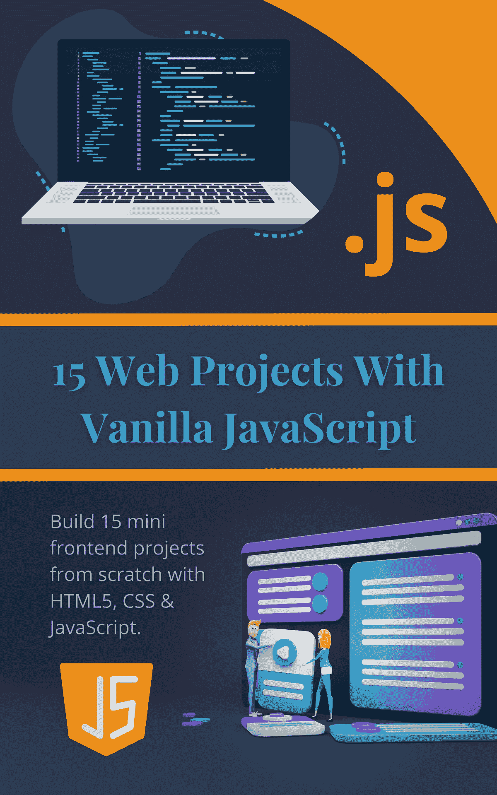

# 15 个原生 JavaScript Web 项目：使用 HTML5、CSS 和 JavaScript 从零构建 15 个前端微型项目




# 第 1 节：简介

## 第 1 章：欢迎来到本课程

首先，让我对你选择学习《使用原生 JavaScript 完成 15 个 Web 项目》表示诚挚的感谢。这本课程书是你步入 Web 开发世界的门户，你将使用 Web 的基础工具：`HTML5`、`CSS` 和 `JavaScript` 来构建项目。当你翻开这本书时，你将开启一段沉浸式的旅程，这段旅程不仅承诺为你提供必要的技能，还将为你带来极具参与感的实践体验。

### 等待你的是什么？
在接下来的几个章节中，我们将深入探讨一系列项目，每个项目都经过精心设计，以提供理论与实践的平衡结合。从创建表单验证器和自定义视频播放器，到构思像猜词游戏 (Hangman) 和打砖块 (Breakout) 这样的游戏，每个项目的设计都旨在实现两个主要目标：
1. 技能获取：确保你对 Web 开发的核心概念有具体的理解。
2. 技能应用：使你能够将所学知识应用于实际场景中。

### 为什么是“原生” JavaScript？
在 Web 开发的浩瀚海洋中，无数的框架和库承诺更快的开发速度和巧妙的功能。虽然这些对于资深开发者来说是极好的工具，但对于初学者来说，掌握纯 `JavaScript` 的基础且原始的力量至关重要。通过专注于“原生” `JavaScript`，我们确保你理解 Web 脚本的核心，从而使你在未来更容易适应任何库或框架。

### 本课程书面向谁？
本课程书面向广泛的受众：
- 接触过 `HTML`、`CSS` 和 `JS` 并渴望构建项目的初学者。
- 希望巩固理解并获得更多实践经验的中级开发者。
- 寻求结构化 Web 开发教学课程的教育者和讲师。

### 如何最大限度地利用本课程书
1. 积极跟随：由于这是一个基于项目的课程书，请始终准备好你的开发环境。亲手输入代码片段，尝试运行它们，尝试破坏它们，然后修复它们。
2. 熟能生巧：在某些章节的末尾，我加入了一些可选练习。请参与其中以巩固你的理解。
3. 保持好奇心：每当引入一个新概念时，花点时间进一步探索。你越是挑战自己，就越能掌握 Web 开发的细微之处。

### 前置要求
虽然本课程书旨在提供全面的指导，但具备 `HTML`、`CSS` 和 `JS` 的基础知识将大有裨益。如果你是完全的初学者，我建议先学习我在 Udemy 上的“Modern HTML/CSS From The Beginning”和“Modern JS From The Beginning”课程。这将为你应对本课程书中的项目打下坚实的基础。

### 总结
请记住，每一位程序员，无论多么熟练，都是从零开始的。只要有耐心、毅力和正确的资源，你也可以在 Web 开发领域开辟出自己的天地。

现在，当我们站在这段激动人心旅程的起点时，请深呼吸，卷起袖子，让我们一起潜入原生 `JavaScript` Web 项目的世界吧！

## 第 2 章：环境搭建

欢迎来到我们探索 Web 开发世界的激动人心之旅的第一步！在深入研究我们将要处理的各种项目之前，确保我们的开发环境正确配置至关重要。本章将引导你完成本书项目中所需的所有工具和软件的安装与配置。

### 2.1. 系统要求
在开始之前，请确保你的计算机具备：
- Windows、macOS 或 Linux 等操作系统。
- 至少 4GB RAM（建议 8GB 以获得更流畅的性能）。
- 稳定的互联网连接。

### 2.2. 文本编辑器


## 2.3 网页浏览器

每位开发者都需要一个可靠的文本编辑器。以下是一些热门选择：

- Visual Studio Code (VS Code)：这款来自微软的免费开源编辑器因其易用性、丰富的功能集和庞大的扩展库而被广泛采用。[在此下载。](https://code.visualstudio.com/)
- Sublime Text：另一款深受开发者喜爱的编辑器，界面简洁，性能强劲。[在此下载。](https://www.sublimetext.com/)
- Atom：由 GitHub 开发，Atom 是一款免费开源、可定制且对新手友好的编辑器。[在此下载。](https://atom.io/)

VS Code 推荐扩展：如果你选择 VS Code，建议安装 `Live Server`、`Prettier` 和 `ESLint` 等扩展，以获得更佳的开发体验。

要查看和测试我们的项目，你需要一个现代网页浏览器。虽然大多数浏览器都能用，但以下浏览器因其强大的开发者工具而备受推荐：

- Google Chrome [在此下载。](https://www.google.com/chrome/)
- Mozilla Firefox [在此下载。](https://www.mozilla.org/en-US/firefox/new/)
- Microsoft Edge（Chromium 版本）[在此下载。](https://www.microsoft.com/edge)

## 2.4 浏览器开发者工具

现代浏览器都配备了开发者工具，让你能够检查、调试和分析你的 Web 项目。请熟悉你所选浏览器的开发者工具。它们对于诊断问题以及理解代码在浏览器中的运行方式至关重要。

## 2.5 Node.js 和 npm

本书中的一些项目需要使用 `Node.js` 和 `npm`（Node 包管理器）。`Node.js` 让你可以在浏览器之外运行 JavaScript，而 `npm` 则是全球最大的软件注册中心。

1. 安装 Node.js：访问 [Node.js 官方网站](https://nodejs.org/) 并下载 LTS（长期支持）版本。安装过程很简单。
2. 验证安装：安装完成后，打开终端或命令提示符，运行以下命令以确保 `Node.js` 和 `npm` 均已安装：

```bash
node -v
npm -v
```

## 2.6 使用 Git 进行版本控制

`Git` 是一个分布式版本控制系统，可帮助你跟踪代码的更改。强烈推荐每位开发者使用。

1. 安装 Git：从 [官方网站](https://git-scm.com/) 下载并安装 `Git`。
2. 验证安装：在终端或命令提示符中输入：

```bash
git --version
```

## 2.7 目录结构

为你的项目保持清晰的目录结构。以下是一个建议的结构：

```
/web-projects
  /project-1-form-validator
    /css
    /js
    index.html
  /project-2-movie-seat-booking
    /css
    /js
    index.html
  ... 以此类推
```

通过保持文件的有序组织，你可以确保随着项目的增长，不会在文件和文件夹的迷宫中迷失方向。

## 2.8 总结

恭喜！你已经设置好了开发环境。在阅读本书的过程中，你将获得实践经验，并加深对本章所讨论工具的理解。请记住，Web 开发是一段旅程，每个项目都会提升你的技能和知识。

现在一切就绪，让我们进入下一章的第一个项目吧！

# 第 2 部分：项目 1 - 表单验证器 | 入门项目

## 项目介绍

欢迎来到这段激动人心旅程中的第一个项目：表单验证器！表单是 Web 不可或缺的一部分，无论 Web 开发的格局如何变化，表单验证始终是 Web 开发者必备的技能。无论你是在构建注册页面、登录表单还是任何其他输入系统，确保数据的准确性和正确性都至关重要。这个入门项目旨在为这些验证提供坚实的基础。

### 为什么选择表单验证？

在广阔的 Web 开发世界中，我们为什么选择从表单验证开始？原因如下：

1. 通用性：几乎你访问的每个网站都有某种表单——无论是搜索栏、登录页面还是反馈表单。
2. 用户体验：良好的表单验证系统能向用户提供即时反馈，确保他们提供正确的信息。
3. 安全性：在前端验证数据也可以成为抵御恶意输入的第一道防线。

### 我们将构建什么

我们将设计一个简单的表单，要求用户输入用户名、电子邮件和密码。该表单将具有以下功能：

- 检查字段是否为空。
- 验证电子邮件地址的格式是否正确。
- 验证密码长度，并确保确认密码与密码一致。

### 技术与技巧

虽然这里的主要焦点是 JavaScript，但 HTML 和 CSS 也将发挥关键作用。以下是我们将使用的内容概览：

1. HTML：构建表单和输入框的结构。
2. CSS：提供视觉提示，指示错误或成功输入。
3. JavaScript：验证逻辑的核心。我们将使用原生 JavaScript，不借助任何库或框架。

### 前置要求

你需要对 HTML、CSS 和 JavaScript 有基本的了解。如果你是初学者或需要复习，建议先查看 Udemy 上的“现代 HTML/CSS 从入门到精通”和“现代 JS 从入门到精通”课程。

### 你将获得什么

完成本项目后，你将：

1. 理解如何使用 JavaScript 拦截表单提交。
2. 学习如何遍历和操作 DOM 以突出显示错误。
3. 熟悉用于验证的基本字符串方法和正则表达式。
4. 在你的作品集中拥有一个基础项目，展示基本的前端验证技能。

### 让我们开始吧！

兴奋吗？你应该感到兴奋！这个基础项目将为我们在本课程中将要处理的其他更复杂的项目奠定节奏。所以，系好安全带，让我们深入表单验证的世界吧！

在下一章中，我们将通过创建 HTML 布局来开始构建表单的结构。让我们一起开始这段奇妙的旅程吧！

# 项目 HTML

欢迎来到第 4 章，我们将深入第一个项目的核心：表单验证器。在开始添加样式和动态功能之前，我们需要一个坚实的基础。这个基础就是我们的 HTML 结构。

## 理解项目

在深入代码之前，让我们先掌握项目的核心概念。表单验证器确保用户输入的数据满足特定标准。这不仅对用户体验很重要，对安全性也同样重要。

我们的表单将需要：

- 用户名
- 电子邮件地址
- 密码
- 确认密码

每个字段都有自己的验证标准，我们将在后续章节中实现这些标准。

## 设置基础 HTML

从 HTML 文档的基本结构开始：

```html
<!DOCTYPE html>
<html lang="en">
<head>
    <meta charset="UTF-8">
    <meta name="viewport" content="width=device-width, initial-scale=1.0">
    <title>表单验证器</title>
    <!-- 你的样式稍后将链接到这里 -->
</head>
<body>
</body>
</html>
```

## 构建表单

在 `<body>` 内部，我们将构建表单的结构：


```html
<div class="container">
  <form id="form" class="form">
    <h2>Register With Us</h2>
    <!-- Username Field -->
    <div class="form-control">
      <label for="username">Username</label>
      <input type="text" id="username" placeholder="Enter username">
      <!-- Error message will be displayed here -->
      <small>Error message</small>
    </div>
    <!-- Email Field -->
    <div class="form-control">
      <label for="email">Email</label>
      <input type="email" id="email" placeholder="Enter email">
      <small>Error message</small>
    </div>
    <!-- Password Field -->
    <div class="form-control">
      <label for="password">Password</label>
      <input type="password" id="password" placeholder="Enter password">
      <small>Error message</small>
    </div>
    <!-- Password Check Field -->
    <div class="form-control">
      <label for="password2">Confirm Password</label>
      <input type="password" id="password2" placeholder="Enter password again">
      <small>Error message</small>
    </div>
    <!-- Submit Button -->
    <button type="submit">Submit</button>
  </form>
</div>
```

以下是我们所做的工作：

1. 容器（Container）：我们所有的表单元素都被包裹在一个 `<div>` 容器中，以便于对表单进行样式设置并使其在页面上居中。
2. 表单控件（Form Controls）：每个输入字段及其标签都被包含在一个 `form-control` div 中。这种设置将帮助我们为每个字段设置样式并显示相关的错误消息。
3. 错误消息（Error Messages）：使用 `<small>` 标签来显示错误消息。最初，它包含一条通用的错误消息，但随着我们对表单进行验证，它将动态地发生变化。
4. 提交按钮（Submit Button）：该按钮将用于触发我们的验证。当用户点击它时，表单要么提交（如果所有内容都有效），要么显示相关的错误消息。

### 结论
我们的表单验证器（Form Validator）的 HTML 结构已经搭建完成。虽然现在看起来很简单，但这个结构是我们动态功能的骨架。

请始终记住，创建高效 Web 项目的关键是在 HTML 中保持简洁且易于理解的结构，这会让样式设计和脚本编写变得更加顺畅。让我们进入下一章！

## 项目 CSS

欢迎来到我们第一个项目——表单验证器的样式部分。正如你可能记得的，这个项目的目的是向你介绍 Web 开发的基础知识，而构建一个视觉上吸引人的 Web 应用程序的关键方面之一就是样式设计。CSS（层叠样式表）允许我们为 HTML 文档应用样式，使其在美学上更令人愉悦且更用户友好。

对于我们的表单验证器，我们将专注于创建一个整洁、简单且直观的设计，引导用户完成输入详细信息的流程。这里的目标不仅是让界面好看，而且是将样式作为提升可用性的工具。

### 1. 基础样式
让我们先为表单添加一些通用样式：

```css
body {
  font-family: Arial, sans-serif;
  line-height: 1.6;
  background-color: f4f4f4;
  display: flex;
  justify-content: center;
  align-items: center;
  height: 100vh;
}

.container {
  background-color: fff;
  padding: 20px;
  border-radius: 5px;
  box-shadow: 0 0 10px rgba(0, 0, 0, 0.3);
  width: 400px;
}
```

这些基础样式将提供一个舒适的灰色背景，使我们的表单在页面上居中，并给表单容器添加一个漂亮的阴影和圆角。

### 2. 表单样式
现在，让我们为表单元素设置样式。

```css
form {
  width: 100%;
}

form label {
  display: block;
  margin-bottom: 5px;
  font-weight: bold;
}

form input[type="text"],
form input[type="password"],
form input[type="email"] {
  width: 100%;
  padding: 10px;
  margin-bottom: 10px;
  border: 1px solid ccc;
  border-radius: 4px;
}

form button {
  display: block;
  width: 100%;
  padding: 10px;
  border: none;
  border-radius: 4px;
  background-color: 333;
  color: fff;
  cursor: pointer;
}
```

这些样式使我们的表单输入框延伸至填满容器的全部宽度，方便用户点击。它们还应用了一些内边距（padding），以获得更好的视觉间距和整洁的外观。

### 3. 验证反馈样式
为了向用户提供即时反馈，让我们添加一些样式来突出显示无效和有效的字段：

```css
.invalid {
  border-color: red;
  background-color: ffe6e6;
}

.valid {
  border-color: green;
  background-color: e6ffe6;
}

.error-message {
  color: red;
  font-weight: bold;
  font-size: 0.8rem;
  margin-top: -10px;
  margin-bottom: 10px;
}
```

`.invalid` 和 `.valid` 类通过改变边框颜色，为输入字段的状态提供视觉提示。`.error-message` 类将用于在输入字段旁边显示具体的错误消息。

### 4. 响应式设计
考虑到移动端用户数量的增长，我们的表单应该是响应式的：

```css
@media screen and (max-width: 420px) {
  .container {
    width: 90%;
  }
}
```

这个媒体查询确保在较小的屏幕上，我们的表单占据视口宽度的绝大部分，并在两侧留出少量边距。

### 结论
CSS 是一个强大的工具，它的作用不仅仅是让东西看起来好看。通过我们添加的样式，我们的表单现在不仅具有视觉吸引力，而且用户友好。来自验证反馈样式的视觉提示将引导用户完成表单填写，使整个过程变得直观且高效。

## 添加简单验证

在 Web 开发的世界里，你会经常遇到需要验证表单的情况。无论是注册表单、登录页面还是设置更新页面，确保用户提供的数据正确且安全至关重要。在本章中，我们将深入探讨如何使用原生 JavaScript 为我们的入门项目创建简单的表单验证。

### 为什么验证很重要？
在深入代码之前，让我们先了解为什么验证至关重要：

1. 用户体验 (UX)：适当的验证可确保用户正确填写表单，减少错误和误解。
2. 安全性：验证输入有助于防止恶意用户向你的服务器发送有害数据。
3. 数据完整性：通过验证表单，你可以确保发送到服务器的数据符合预期的格式。

### 开始简单验证
对于我们的入门项目，我们有一个希望用户填写的简单表单。假设它包含 `username`（用户名）、`email`（电子邮件）和 `password`（密码）等字段。我们的任务是通过简单的检查来验证这些字段。

#### HTML 结构：
```html
<form id="userForm">
  <input type="text" id="username" placeholder="Username">
  <input type="email" id="email" placeholder="Email">
  <input type="password" id="password" placeholder="Password">
  <button type="submit">Submit</button>
  <p id="error-message"></p>
</form>
```

`error-message` 段落是我们向用户显示任何验证错误的地方。

#### JavaScript 验证：
首先选择我们的表单，并为 `submit` 事件添加事件监听器。

```javascript
const form = document.getElementById('userForm');

form.addEventListener('submit', function(e) {
  e.preventDefault(); // 防止表单提交
  validateForm();
});
```

接下来，我们将定义我们的 `validateForm()` 函数：


```javascript
function validateForm() {
  const username = document.getElementById('username').value;
  const email = document.getElementById('email').value;
  const password = document.getElementById('password').value');
  const errorMessage = document.getElementById('error-message');

  // 重置错误消息
  errorMessage.textContent = '';

  // 验证用户名
  if(username === '' || username.length < 3) {
    errorMessage.textContent += '用户名长度至少为 3 个字符。\n';
    return;
  }

  // 验证邮箱
  const emailPattern = /^[a-zA-Z0-9._-]+@[a-zA-Z0-9.-]+\.[a-zA-Z]{2,6}$/;
  if(!emailPattern.test(email)) {
    errorMessage.textContent += '请输入有效的邮箱地址。\n';
    return;
  }

  // 验证密码
  if(password === '' || password.length < 8) {
    errorMessage.textContent += '密码长度至少为 8 个字符。\n';
    return;
  }
}
```

## 验证概述

以下是我们的验证检查的简要概述：
- 用户名：不能为空，且长度至少为 3 个字符。
- 邮箱：我们使用正则表达式来确保邮箱格式正确。
- 密码：不能为空，且长度至少为 8 个字符。

### 结论
表单验证对于确保用户数据的准确性、安全性和用户友好性至关重要。仅使用原生 JavaScript，你就可以实施简单的验证来提升用户体验并保护你的应用程序。随着你深入更复杂的项目，你会遇到需要更复杂验证规则的场景。但基础始终不变：确保用户提供的数据符合应用程序的预期。

在下一章中，我们将通过重构代码并引入更多验证检查来增强验证流程。敬请期待！

# 检查必填项与重构

在本章中，我们将深入探讨表单验证的核心：检查必填字段。用户在填写表单时必须提供必要的信息，因此确保他们填写了所有必填字段是一个基本步骤。但仅仅检查是不够的；我们的代码应该干净且可维护。因此，我们还将花一些时间重构代码，使其高效且易于阅读。

## 理解必填字段
必填字段是表单中任何必须在成功提交前包含值的输入项。例如，在注册表单中，“用户名”、“密码”和“邮箱”等字段通常被标记为必填。

## 检查必填字段的步骤
1. 选择：选择所有要验证的输入字段。
2. 检查：对于每个输入字段，检查其值是否为空。
3. 反馈：如果值为空，向用户提供反馈，指示该字段为必填。

## 编写必填字段检查代码
首先，让我们选择所有输入字段：

```javascript
const form = document.getElementById('register-form');
const username = document.getElementById('username');
const email = document.getElementById('email');
const password = document.getElementById('password');
const password2 = document.getElementById('password2');
```

现在，让我们创建一个函数来检查必填字段：

```javascript
function checkRequired(inputArr) {
  inputArr.forEach(function(input) {
    if (input.value.trim() === '') {
      showError(input, `${getFieldName(input)} 是必填项`);
    } else {
      showSuccess(input);
    }
  });
}

function getFieldName(input) {
  return input.id.charAt(0).toUpperCase() + input.id.slice(1);
}
```

在 `checkRequired` 函数中，我们遍历每个输入字段，检查其值是否为空。如果为空，则显示错误；否则，表示成功。

`getFieldName` 函数是一个工具函数，用于获取输入字段更易读的名称。该函数将输入 `id` 的首字母大写，以便在错误消息中使用。

现在，让我们调用 `checkRequired` 函数：

```javascript
form.addEventListener('submit', function(e) {
  e.preventDefault();
  checkRequired([username, email, password, password2]);
});
```

## 重构代码
重构涉及在不改变功能的情况下重组现有代码。其目的是使代码更高效、更易读、更可维护。

针对我们的表单验证器，以下是重构代码的一些步骤：
1. 避免重复：我们已经通过创建 `checkRequired` 函数开始了这一步。通过将重复的逻辑封装在该函数中，我们可以在需要时简单地调用它，而不是反复编写相同的逻辑。
2. 工具函数：将复杂任务分解为更小的工具函数（如我们的 `getFieldName`）可以使代码更易读。每个工具函数应执行一个特定任务。
3. 注释：虽然我们的代码应该不言自明，但添加一些解释复杂或关键部分的注释对他人（甚至对我们未来的自己）非常有帮助。
4. 一致的命名：确保我们有一致的命名约定可以使代码更易读。

### 结论
检查必填字段是表单验证的基本步骤。通过我们的 `checkRequired` 函数，我们现在可以轻松确保用户填写了所有必填字段。此外，通过重构代码，我们使其更高效、更可维护。随着我们继续推进表单验证器项目，请记住干净代码的重要性。这不仅仅是让代码运行起来，更是构建一个健壮且易于理解的东西。

在下一章中，我们将通过添加输入长度、邮箱格式和密码匹配的检查来进一步增强验证器。敬请期待！

# 检查长度、邮箱与密码匹配

欢迎来到表单验证器入门项目的下一章！在上一章中，我们介绍了如何添加简单的验证检查。现在，我们将通过实现长度约束、邮箱格式和密码匹配的检查来深入具体细节。让我们开始吧！

## 理解验证的重要性
在深入代码之前，重要的是要认识到这些检查为何至关重要。通过确保用户名和密码等输入的长度，我们为表单增加了安全性和一致性。验证邮箱格式确保用户提供合法的邮箱，而检查密码匹配则确认用户的意图。

## 检查输入长度
为了确保用户的用户名和密码具有特定长度，我们将设置最小和最大限制。

```javascript
function checkLength(input, min, max) {
  if (input.value.length < min || input.value.length > max) {
    showError(input, `${getFieldName(input)} 必须在 ${min} 到 ${max} 个字符之间`);
  } else {
    showSuccess(input);
  }
}
```

这里，`checkLength` 函数接受一个输入元素，并检查其 `value.length` 是否在给定的最小和最大长度之间。如果不满足这些条件，则显示错误消息。

## 验证邮箱格式
为了确保用户提供有效的邮箱地址，我们将使用正则表达式来验证格式。

```javascript
function isValidEmail(input) {
  const re = /^[a-zA-Z0-9._-]+@[a-zA-Z0-9.-]+\.[a-zA-Z]{2,6}$/;
  if (re.test(input.value.trim())) {
    showSuccess(input);
  } else {
    showError(input, '邮箱格式无效');
  }
}
```

正则表达式可能有点棘手，但上述模式检查了有效邮箱地址的常见特征。

## 检查密码匹配
密码匹配确保用户在两个字段中正确输入了预期的密码。

```javascript
function checkPasswordsMatch(input1, input2) {
  if (input1.value !== input2.value) {
    showError(input2, '密码不匹配');
  }
}
```

该函数比较两个输入字段的 `value`。如果不匹配，则显示错误。


# 整合所有内容

现在，让我们在表单的提交事件中实现这些验证检查：

```javascript
form.addEventListener('submit', function(e) {
  e.preventDefault();
  checkLength(username, 3, 15);
  checkLength(password, 6, 25);
  isValidEmail(email);
  checkPasswordsMatch(password, password2);
});
```

当表单提交时，这些验证检查将被执行，确保我们的表单数据既安全又一致。

## 结论

通过本章的学习，你已经学会了实现许多 Web 应用中常见的特定验证检查。确保用户输入的长度、格式和一致性对于可用性和安全性都至关重要。随着课程的深入，你将发现更多高级技术来进一步增强表单验证流程。

# 第 3 节：项目 2 - 电影座位预订 | DOM 与本地存储

## 项目介绍

欢迎来到项目 2，我们将深入探索文档对象模型（DOM）的强大功能以及本地存储 API 的奇妙之处。完成本项目后，你将构建一个功能完整的电影座位预订应用，为你的 Web 开发作品集增添一份亮眼的资产。

## 概述

想象一下，每次你想看电影时，只需加载自己的应用，选择电影，挑选心仪的座位，然后搞定！即使你不小心关闭了应用，它也能记住你的选择。听起来很棒，对吧？这正是我们将在本项目中构建的内容。

## 主要功能

1. 动态电影选择：显示电影列表及其价格，允许用户选择一部电影。
2. 交互式座位图：电影院的图形化表示，用户可以点击单个座位来选择或取消选择。
3. 座位预订：允许用户通过点击来预订心仪的座位。已预订的座位将使用不同的颜色或样式，以区别于可用座位。
4. 价格计算：根据所选座位数量和所选电影的价格显示总价。
5. 本地存储功能：即使用户关闭浏览器，也能保存其电影和座位选择。当用户再次访问时，他们的选择仍然存在。

## 你将学到什么

- DOM 操作：学习如何实时与网页元素交互并修改它们，使你的 Web 应用具有交互性和动态性。
- 事件处理：检测并响应用户操作，例如点击座位或选择电影。
- 使用本地存储：将用户数据（如座位选择）存储在他们自己的计算机上，确保即使关闭浏览器后，他们的偏好设置仍被保留。
- 数据检索与显示：从本地存储中检索数据，并在用户再次访问页面时适当地显示出来。

## 实际应用

除了作为一个有趣的项目之外，理解这些概念对于构建交互式 Web 应用至关重要。

- 电子商务网站使用类似技术处理购物车，确保你选择的商品在离开页面后仍保留在购物车中。
- 许多网站上的表单会记住你离开又返回时输入的内容，从而提升用户体验。

通过在这里掌握这些概念，你将能够很好地应对 Web 开发中的实际挑战。

## 前置要求

在开始本项目之前，建议具备以下条件：

1. 对 HTML、CSS 和 JavaScript 有基本了解。如果你是新手，请回顾我们的基础章节或课程。
2. 熟悉 DOM 的基础知识，特别是如何选择和修改元素。

## 结论

本项目是前端设计与使用纯前端技术实现类似后端功能的激动人心的结合。它不仅会增强你构建实际项目的信心，还将成为你作品集中的优秀补充，展示你在 DOM 操作和本地存储方面的能力。

# 项目 HTML

欢迎来到我们第二个项目的核心：电影座位预订应用。本项目将为你提供使用文档对象模型（DOM）和浏览器本地存储的实践经验。但在深入交互式 JavaScript 和 CSS 样式之前，我们需要先用 HTML 打好基础。一切从这里开始。

### 1. 设置 HTML 文档

首先，让我们搭建基本的 HTML 结构：

```html
<!DOCTYPE html>
<html lang="en">
<head>
  <meta charset="UTF-8">
  <meta name="viewport" content="width=device-width, initial-scale=1.0">
  <title>电影座位预订</title>
  <link rel="stylesheet" href="styles.css">
  <script src="script.js" defer></script>
</head>
<body>
</body>
</html>
```

该结构引用了外部样式表（`styles.css`）和外部 JavaScript 文件（`script.js`）。`defer` 属性确保我们的 JavaScript 在 HTML 文档完全加载后才会运行。

### 2. 主容器

在 body 内部，我们的主要内容将位于一个居中的容器中：

```html
<div class="container">
  <!-- 内容将放在这里 -->
</div>
```

### 3. 添加标题和电影选择

首先，为我们的电影院提供一个标题，然后是一个用于选择电影的下拉菜单：

```html
<h2>选择电影：</h2>
<select id="movie">
  <option value="10">复仇者联盟 4：终局之战 ($10)</option>
  <option value="8">小丑 ($8)</option>
  <option value="12">冰雪奇缘 2 ($12)</option>
  <option value="9">玩具总动员 4 ($9)</option>
</select>
```

每个电影的 `value` 属性代表其票价。

### 4. 影院布局

对于影院布局，我们将使用 `div` 元素来表示座位。未占用的座位是可点击的，允许用户选择它们。一旦选中，座位的状态将更新为已占用。

```html
<div class="cinema">
  <!-- 我们将使用重复的 div 来表示单个座位 -->
  <div class="row">
    <div class="seat"></div>
    <div class="seat"></div>
    <!-- 根据需要添加更多座位 -->
  </div>
  <!-- 根据需要重复行 -->
</div>
```

### 5. 信息显示

在影院布局下方，我们将提供一个区域来向用户显示信息：

```html
<div class="info">
  <p>总票数：<span id="ticketCount">0</span></p>
  <p>总价：$<span id="totalPrice">0</span></p>
</div>
```

信息显示区域展示了票数和总价。

### 6. 结论

这为我们的电影座位预订应用奠定了基础。有了 HTML 结构，我们将在下一章深入 CSS 来美化应用，随后通过 JavaScript 赋予其动态功能。

请记住，结构良好的 HTML 将简化样式和添加交互性的过程。可以将其视为构建应用的骨架，我们将在其上添加肌肉（CSS）和大脑（JavaScript）。

在下一章中，我们将深入探讨本项目的样式设计。请确保你的 HTML 结构与这里介绍的一致，这对于我们的 CSS 和 JavaScript 正确运行至关重要。

# 项目 CSS

在本章中，我们将深入使用纯 CSS 来为电影座位预订应用设计样式。我们的目标是创建一个直观、引人入胜且美观的用户界面，使其与后续章节中开发的功能相得益彰。

## CSS 结构

我们将把样式分为三个主要部分：

1. 基础样式：在此设置应用的字体、颜色和整体布局等基础样式。
2. 组件样式：包括按钮、座位选择和电影下拉菜单等特定组件的样式。
3. 工具样式：可能重复使用的通用工具样式。

### 1. 基础样式

HTML 主体和容器：


# 为电影座位预订应用程序添加样式

```css
body {
  font-family: 'Arial', sans-serif;
  background-color: f4f4f4;
  margin: 0;
  padding: 0;
  display: flex;
  justify-content: center;
  align-items: center;
  height: 100vh;
}

.container {
  background-color: fff;
  padding: 20px;
  border-radius: 5px;
  box-shadow: 0 0 10px rgba(0, 0, 0, 0.1);
  width: 80%;
  max-width: 800px;
}
```

### 默认文本样式

```css
h1, h2, h3 {
  margin-top: 0;
}

p {
  margin-bottom: 20px;
}
```

## 组件样式

### 电影下拉菜单

```css
.movie-select {
  display: flex;
  justify-content: space-between;
  margin: 20px 0;
}

.movie-select select {
  padding: 10px 15px;
  border-radius: 5px;
  border: 1px solid e0e0e0;
}
```

### 电影院座位

为了将电影院可视化，我们将使用 flexbox 来定位座位和屏幕。

```css
.cinema {
  perspective: 1000px;
}

.screen {
  background-color: d3d3d3;
  height: 70px;
  width: 100%;
  margin: 20px 0;
  text-align: center;
  line-height: 70px;
  font-size: 1.5em;
  letter-spacing: 3px;
}

.seats {
  display: flex;
  flex-direction: row;
  flex-wrap: wrap;
  position: relative;
}

.seat {
  background-color: BDC3C7;
  width: 20px;
  height: 20px;
  margin: 5px;
  border-top-left-radius: 10px;
  border-top-right-radius: 10px;
  cursor: pointer;
}

.seat.occupied {
  background-color: E74C3C;
  cursor: not-allowed;
}

.seat.selected {
  background-color: 2ECC71;
}
```

### 摘要和按钮样式

```css
.summary {
  margin-top: 20px;
  display: flex;
  justify-content: space-between;
}

button {
  padding: 10px 20px;
  border: none;
  border-radius: 5px;
  background-color: 2ECC71;
  color: ffffff;
  cursor: pointer;
  transition: background-color 0.3s;
}

button:hover {
  background-color: 27AE60;
}
```

## 工具样式

```css
.clearfix::after {
  content: "";
  clear: both;
  display: table;
}
```

## 结论

样式设计是任何 Web 应用程序不可或缺的一部分，正如我们在本章中所看到的，它在用户体验中起着至关重要的作用。随着 CSS 的设置完成，我们的电影座位预订应用程序不仅具备了功能，而且在视觉上也具有吸引力。

# 通过 UI 选择电影和座位

在本章中，我们将逐步讲解创建电影座位预订应用程序核心功能的流程。我们的主要重点是理解并实现允许用户从 UI 中选择电影及其相应座位的逻辑。

### 1. 创建 HTML 布局

在深入研究 JavaScript 之前，请确保您的 HTML 已正确设置。在本节中，我们将设置一个包含电影及其相应价格的下拉列表，以及一个代表电影院座位的布局。

```html
<div class="movie-container">
  <label>Choose a movie:</label>
  <select id="movie">
    <option value="10">Avengers: Endgame ($10)</option>
    <option value="12">Joker ($12)</option>
    <option value="8">Frozen II ($8)</option>
    <option value="9">Ford v Ferrari ($9)</option>
  </select>
</div>
<ul class="seating-chart">
  <!-- Each list item represents a seat -->
  <!-- Using data attributes to indicate seat status: available, occupied -->
  <li class="seat" data-status="available"></li>
  <!-- ... repeat for all seats in the theater -->
</ul>
```

### 2. JavaScript：DOM 选择

首先从 DOM 中选择元素：

```javascript
const movieSelect = document.getElementById('movie');
const seats = document.querySelectorAll('.seating-chart .seat[data-status="available"]');
```

### 3. 监听事件

现在，我们要检测用户何时选择电影或点击座位：

```javascript
movieSelect.addEventListener('change', updateSelectedMovie);
seats.forEach(seat => seat.addEventListener('click', toggleSeatSelection));
```

### 4. 切换座位选择状态

我们希望用户能够选择和取消选择座位。当座位被选中时，我们将更改其数据属性：

```javascript
function toggleSeatSelection(e) {
  const seat = e.target;
  // Toggle the data-status attribute
  if (seat.dataset.status === 'available') {
    seat.dataset.status = 'selected';
  } else {
    seat.dataset.status = 'available';
  }
  // Update a visual representation (maybe change seat color)
  seat.classList.toggle('selected-seat');
  // You can now also call another function to calculate and display total cost
  updateTotalCost();
}
```

### 5. 更新所选电影

当用户选择不同的电影时，我们将存储该电影的值（价格）以便进一步计算：

```javascript
let ticketPrice = +movieSelect.value;
function updateSelectedMovie(e) {
  ticketPrice = +e.target.value;
  // Resetting previously selected seats when switching movies might be a good idea
  resetSelectedSeats();
  updateTotalCost();
}
```

### 6. 计算总费用

在选择座位和电影后，我们将提供总费用的实时更新：

```javascript
function updateTotalCost() {
  const selectedSeats = document.querySelectorAll('.seating-chart .seat[data-status="selected"]');
  const numberOfSeats = selectedSeats.length;
  const totalCost = numberOfSeats * ticketPrice;
  // Display this to the user using DOM manipulation
  document.getElementById('total-cost').textContent = `$${totalCost}`;
}
```

请记住，本章侧重于前端方面。在实际应用中，您需要与后端同步以确保座位的可用性，特别是在多个用户可能尝试同时预订相同座位的场景下。

## 结论

到目前为止，您应该已经拥有一个功能齐全的 UI，允许用户选择电影、选择心仪的座位并查看所选内容的总费用。在下一章中，我们将研究如何将这些详细信息保存到本地存储（local storage）中，并使用保存的数据填充 UI，以增强用户体验。

# 将数据保存到本地存储

本地存储是现代 Web 开发的重要组成部分，尤其是当我们希望提供无缝的用户体验时。在电影座位预订项目的背景下，利用本地存储来保存用户的座位选择和电影选择是非常合理的。这样，即使他们离开页面再回来，他们的选择依然存在。

## 理解本地存储

本地存储是一种在用户浏览器上存储数据的方法。它就像浏览器中的一个小型数据库，开发人员可以用它来存储键值对。

**优点：**
- 数据在浏览器会话之间保存。
- 没有过期时间；除非被明确删除或用户清除浏览器数据，否则数据将一直保留。
- 与 Cookie 不同，本地存储不会在每次 HTTP 请求时发送到服务器，从而使您的应用程序运行更快、更高效。

**局限性：**
- 通常，浏览器提供 5-10MB 的存储空间。
- 它是同步的，这意味着如果您尝试存储大量数据，它可能会阻塞主线程。

## 在电影座位预订应用程序中实现本地存储

对于我们的项目，我们将保存所选电影及其价格，以及所选座位的索引。这样，当用户重新访问页面时，我们可以用他们的选择重新填充 UI。

### 第 1 步：保存所选电影

每当用户从下拉菜单中选择电影时，我们应该将该选择保存到本地存储中。

```javascript
const movieSelect = document.getElementById('movie');
movieSelect.addEventListener('change', (e) => {
  const selectedMovieIndex = e.target.selectedIndex;
  const selectedMoviePrice = e.target.value;
  localStorage.setItem('selectedMovieIndex', selectedMovieIndex);
  localStorage.setItem('selectedMoviePrice', selectedMoviePrice);
});
```

### 第 2 步：保存所选座位

为了存储座位选择，我们将跟踪所选座位的索引。这些索引将代表我们 UI 中的座位。


```javascript
const seats = document.querySelectorAll('.row .seat:not(.occupied)');

seats.forEach((seat, index) => {
  seat.addEventListener('click', () => {
    // 点击时切换选中类
    seat.classList.toggle('selected');
    // 保存更新后的座位选择
    saveSelectedSeats();
  });
});

function saveSelectedSeats() {
  const selectedSeats = document.querySelectorAll('.row .seat.selected');
  const seatsIndex = [...selectedSeats].map(seat => [...seats].indexOf(seat));
  localStorage.setItem('selectedSeats', JSON.stringify(seatsIndex));
}
```

注意：我们使用 `JSON.stringify()` 是因为本地存储只能存储字符串。通过将座位索引数组转换为字符串，我们可以轻松保存和检索它。

## 用保存的数据填充用户界面

当用户再次访问我们的订票页面时，我们应该检查本地存储中是否有保存的数据，并相应地更新用户界面。

### 步骤 1：设置已选电影

```javascript
const selectedMovieIndex = localStorage.getItem('selectedMovieIndex');

if (selectedMovieIndex !== null) {
  movieSelect.selectedIndex = selectedMovieIndex;
}
```

### 步骤 2：显示已选座位

```javascript
const selectedSeats = JSON.parse(localStorage.getItem('selectedSeats'));

if (selectedSeats !== null && selectedSeats.length > 0) {
  seats.forEach((seat, index) => {
    if (selectedSeats.indexOf(index) > -1) {
      seat.classList.add('selected');
    }
  });
}
```

## 结论

在我们的电影座位预订项目中使用本地存储，可以确保用户友好的体验。这一功能在用户可能意外刷新或离开页面的场景中尤为重要。借助本地存储，他们的座位和电影选择得以保留，免去了重新选择的麻烦。

在下一章中，我们将探讨如何用本地存储中保存的数据填充用户界面，为回访用户提供无缝体验。

## 用保存的数据填充用户界面

欢迎回来！在上一章中，我们讨论了如何将选中的电影和座位数据保存到本地存储。现在，当用户访问电影座位预订页面时，他们应该能够看到之前选中的座位。这对于用户友好的体验至关重要。在本章中，我们将用本地存储中保存的数据填充用户界面（UI）。

### 1. 理解目的

用保存的数据填充用户界面有助于提供无缝的用户体验。当用户返回我们的电影订票网站时，他们无需再次选择座位和电影；系统会自动显示他们之前的选择。

### 2. 从本地存储检索数据

在填充用户界面之前，我们必须先检索保存的数据。

```javascript
const selectedSeats = JSON.parse(localStorage.getItem('selectedSeats'));
const selectedMovieIndex = localStorage.getItem('selectedMovieIndex');
```

在上述代码中：
- 我们从本地存储中检索 `selectedSeats`，并使用 `JSON.parse()` 将其从字符串格式解析为数组。
- `selectedMovieIndex` 按原样检索，因为它存储为字符串。

### 3. 填充电影选择

为了用保存的电影选择填充电影下拉菜单，我们使用检索到的 `selectedMovieIndex`。

```javascript
const movieSelect = document.getElementById('movie');

if (selectedMovieIndex !== null) {
  movieSelect.selectedIndex = selectedMovieIndex;
}
```

这里，我们只需将 `movieSelect` 下拉菜单的 `selectedIndex` 属性设置为检索到的索引，并确保它不为 null。

### 4. 填充座位

现在，让我们根据保存的选择来填充座位：

```javascript
const seats = document.querySelectorAll('.seat:not(.occupied)');

if (selectedSeats !== null && selectedSeats.length > 0) {
  seats.forEach((seat, index) => {
    if (selectedSeats.indexOf(index) > -1) {
      seat.classList.add('selected');
    }
  });
}
```

在这段代码中：
- 我们首先选择所有未被占用的座位。
- 然后检查 `selectedSeats` 是否包含数据，并遍历每个座位。
- 如果座位的索引在 `selectedSeats` 数组中，我们为该座位添加 `selected` 类，从而在视觉上标记为已选。

### 5. 更新计数和总价

请记住，我们的用户界面还应反映已选座位的正确数量和总价。让我们确保也处理这一点。

```javascript
function updateSelectedCountAndTotal() {
  const selectedSeats = document.querySelectorAll('.row .seat.selected');
  const count = selectedSeats.length;
  const total = count * +movieSelect.value;
  document.getElementById('count').innerText = count;
  document.getElementById('total').innerText = total;
}
// 在填充座位后调用此函数
updateSelectedCountAndTotal();
```

### 6. 最终思考

在开发应用程序时，始终考虑用户体验至关重要。通过用保存的数据填充用户界面，我们为用户节省了时间，并提供了连续性，尤其是当他们不得不离开页面再返回时。

在下一节中，我们将深入探讨自定义视频播放器以及如何利用 HTML5 Video API 的强大功能。敬请期待！

# 第 4 节：项目 3 - 自定义视频播放器 | HTML5 Video API

## 项目介绍

在当今互联网驱动的世界中，视频内容是最强大、最有说服力的信息传递媒介之一。像 YouTube、Vimeo 和其他媒体托管平台之所以蓬勃发展，是因为我们天生热爱视觉叙事。但是，作为一名 Web 开发者，你是否曾思考过播放按钮、音量滑块或全屏切换背后的魔力？自定义视频播放器正是这种魔力的核心。

欢迎来到项目 3：自定义视频播放器！这个项目不仅仅是把视频嵌入到网页中。在本模块结束时，你将创建一个根据你的设计量身定制的视频播放器，功能丰富，全部使用强大的 HTML5 Video API。

## 为什么需要自定义视频播放器？

1. 设计控制：你不受标准视频控件的限制。想要一个复古的音量旋钮而不是滑块？尽管去做！
2. 增强功能：添加速度控制、自定义字幕甚至视频书签系统等功能。
3. 集成：将播放器与其他系统无缝集成，例如用于跟踪用户参与度的分析工具。

## 你将学到什么？

- HTML5 视频元素：深入理解 `<video>` 元素、其属性及其能力。
- 自定义控件：用你自己的播放、暂停、音量和全屏按钮替换浏览器的默认控件。
- 视频 API：利用 HTML5 Video API 以编程方式操控视频播放。
- 样式化播放器：使用 CSS 为你的视频播放器设计样式，使其响应式且视觉吸引力强。
- 事件与交互：理解视频播放过程中触发的不同事件，并利用它们创建交互功能。

## 项目概览

在这个项目中，你将构建一个具有以下功能的自定义视频播放器：

1. 基本控件：播放、暂停、停止以及音量滑块。
2. 播放进度：一个显示视频播放进度并允许用户跳转到不同部分的滑块。
3. 时间戳：显示当前时间和视频总时长。
4. 全屏切换：允许用户切换到全屏模式。
5. 响应式设计：确保播放器在所有设备上看起来都很棒。

通过完成这个项目，你将深入到一个开发者在构建富媒体 Web 应用时遇到的真实任务。无论是用于个性化作品集、定制企业应用还是媒体创业想法，掌握自定义视频播放器都是一项能让你脱颖而出的技能。


在接下来的章节中，我们将把创建过程分解为易于理解的部分，涵盖设计、功能和最佳实践。最后，你将拥有一个功能完备的视频播放器，并掌握根据自身需求进一步定制的技能和知识。让我们开始吧！

# 项目 HTML

欢迎来到我们项目系列的下一个激动人心的阶段！在本章中，我们将通过搭建 HTML 结构来为自定义视频播放器项目奠定基础。该播放器将利用 HTML5 视频 API，使我们能够实现播放、暂停、快进等功能。但在那之前，我们需要先构建 HTML 脚手架！

## HTML5 视频元素

HTML5 引入了 `<video>` 元素，它允许我们嵌入视频文件，这些文件可以直接在浏览器中播放，无需外部插件。除了视频元素本身，我们还可以使用多种属性和子元素来增强用户体验，例如添加控件、设置海报图像，甚至为不同视频格式提供多个源文件。

## 搭建基本结构

让我们开始为视频播放器创建 HTML 结构。

```html
<!DOCTYPE html>
<html lang="en">
<head>
    <meta charset="UTF-8">
    <meta name="viewport" content="width=device-width, initial-scale=1.0">
    <title>自定义视频播放器</title>
    <!-- 你将在此处链接 CSS -->
    <link rel="stylesheet" href="styles.css">
</head>
<body>
    <div class="video-container">
        <video id="video" width="750" height="500" controls>
            <!-- 在此处插入你的视频源 -->
            <source src="path-to-your-video.mp4" type="video/mp4">
            <!-- 你可以为不同视频格式提供多个源文件 -->
            <source src="path-to-your-video.webm" type="video/webm">
            <!-- 为不支持 video 标签的浏览器显示文本 -->
            你的浏览器不支持 video 标签。
        </video>
        <div class="controls">
            <button id="play-pause">播放</button>
            <input type="range" id="volume" min="0" max="1" step="0.1">
            <button id="full-screen">全屏</button>
            <span id="time">00:00 / 00:00</span>
        </div>
    </div>
    <!-- 你将在此处链接 JavaScript -->
    <script src="script.js"></script>
</body>
</html>
```

## 代码解释

-   视频容器：这是一个包裹 `div`，包含视频及其自定义控件。它将有助于样式设置和定位。
-   视频元素：我们在 `<video>` 标签内提供了两个 `<source>` 元素。这是为了确保跨浏览器的最大兼容性。不同浏览器可能支持不同的视频格式，因此通过提供多种格式，我们确保大多数用户都能观看视频。
    `controls` 属性存在时，会显示视频播放器的默认浏览器控件。虽然我们将构建自己的自定义控件，但在设置阶段，这对于确保视频正确加载非常有用。
-   自定义控件：在视频下方，我们有一个类名为 `controls` 的 `div`。它将包含我们视频播放器的自定义控件，包括：
    -   播放/暂停按钮：用于播放或暂停视频的切换按钮。
    -   音量控制：用于调整视频音量的输入范围滑块。
    -   全屏按钮：用于切换全屏模式的按钮。
    -   时间显示：一个 `span`，用于显示视频的当前时间和总时长。

## 结论

设置 HTML 是创建自定义视频播放器的第一步。这个结构为我们后续构建样式和功能提供了基础。在接下来的章节中，我们将专注于使用 CSS 为这个结构设置样式，然后使用 JavaScript 实现视频控件。目标是创建一个既实用又美观的播放器，为用户提供增强的视频播放体验。

# 项目 CSS

欢迎回来！既然我们在上一章中已经为自定义视频播放器搭建了 HTML 结构，现在是时候为其设置样式，赋予它一个吸引人的外观了。CSS 是网页美学的支柱。在本章中，我们将专注于让我们的视频播放器不仅功能完善，而且用户友好、视觉美观。

## 1. 基础重置

首先，让我们重置一些默认样式。这将有助于我们在不同浏览器之间保持一致性。

```css
* {
    margin: 0;
    padding: 0;
    box-sizing: border-box;
}
```

## 2. 设置容器

我们的视频播放器将位于一个容器内。该容器将容纳视频和控制栏。

```css
.video-container {
    width: 80%;
    max-width: 800px;
    margin: 40px auto;
    position: relative;
    box-shadow: 0 4px 8px rgba(0, 0, 0, 0.1);
}
```

## 3. 设置视频元素样式

`<video>` 元素将占据其容器的整个宽度。我们还会给它一个固定的高度。

```css
video {
    width: 100%;
    height: 450px;
    display: block;
}
```

## 4. 视频控件

在视频下方，我们将放置自定义控件，包括播放/暂停按钮、进度条、音量控制和全屏切换。

```css
.video-controls {
    display: flex;
    align-items: center;
    justify-content: space-between;
    background-color: 333;
    color: fff;
    padding: 10px 15px;
}
```

### 4.1 按钮

所有按钮将具有一致的样式。

```css
.video-controls button {
    background: none;
    border: none;
    color: fff;
    font-size: 16px;
    margin-right: 15px;
    cursor: pointer;
}
```

对于任何激活或悬停状态：

```css
.video-controls button.active,
.video-controls button:hover {
    color: ff6347;
}
```

### 4.2 进度条

进度条将显示视频已播放了多少。

```css
.progress-bar {
    flex: 1;
    height: 5px;
    background-color: 555;
    margin: 0 10px;
    position: relative;
}
```

对于已播放的部分：

```css
.progress-bar span {
    display: block;
    height: 100%;
    background-color: ff6347;
    position: absolute;
    left: 0;
    top: 0;
    width: 0%; /* 这将通过 JavaScript 动态更新 */
}
```

### 4.3 音量控制

```css
.volume {
    display: flex;
    align-items: center;
}
.volume-slider {
    width: 100px;
    margin-left: 10px;
}
```

## 5. 全屏样式

在全屏模式下，我们希望视频占据整个视口。

```css
video:-webkit-full-screen {
    width: 100vw;
    height: 100vh;
}
video:fullscreen {
    width: 100vw;
    height: 100vh;
}
```

至此，我们完成了自定义视频播放器的样式设置。如你所见，只需少量 CSS，我们就将原始的 HTML 结构转变成了一个视觉美观且用户友好的视频播放器。在下一章中，我们将深入探讨如何使用 HTML5 视频 API 和 JavaScript 让这个播放器具备功能。

**注意：** 始终记得在不同浏览器中测试你的样式，以确保兼容性和外观一致性。可能需要根据特定浏览器的特性进行调整。

# 播放、暂停与停止

欢迎回来，亲爱的读者们！在本章中，我们将深入探讨自定义视频播放器的核心功能：播放、暂停和停止。这些是任何媒体播放器基本但至关重要的控件，借助 HTML5 视频 API，实现它们相当直接。

## HTML5 视频 API 简介

在深入编码部分之前，理解 HTML5 视频 API 的强大功能至关重要。该 API 提供了一种以编程方式访问和操作通过网页中 `<video>` 元素播放的视频内容的方法。它公开了方法和属性，允许开发者播放、暂停、调整音量，甚至检查视频是否已结束。

对于我们的自定义视频播放器，我们将主要关注以下方法：

1.  `play()`：开始播放视频。
2.  `pause()`：暂停当前正在播放的视频。
3.  `currentTime`：表示当前播放时间（以秒为单位）。它既是 getter 也是 setter，意味着你可以将其设置为特定值，以跳转到视频中的该时间点。

## 设置 HTML


# 视频播放器实现

假设你的视频播放器具有以下 HTML 结构：

```html
<div class="video-container">
  <video id="videoPlayer" width="640" height="360" controls>
    <source src="path_to_your_video.mp4" type="video/mp4">
    您的浏览器不支持 video 标签。
  </video>
  <div class="controls">
    <button id="playBtn">播放</button>
    <button id="pauseBtn">暂停</button>
    <button id="stopBtn">停止</button>
  </div>
</div>
```

## 实现播放、暂停和停止功能

1. **播放视频**：
要播放视频，我们需要定位视频元素并调用 `play()` 方法。

```javascript
const video = document.getElementById('videoPlayer');
document.getElementById('playBtn').addEventListener('click', function() {
  video.play();
});
```

2. **暂停视频**：
暂停视频同样简单。定位视频元素并调用 `pause()` 方法。

```javascript
document.getElementById('pauseBtn').addEventListener('click', function() {
  video.pause();
});
```

3. **停止视频**：
停止视频包含两个步骤：
1. 暂停视频。
2. 将视频的 `currentTime` 重置为 `0`（即开头）。

```javascript
document.getElementById('stopBtn').addEventListener('click', function() {
  video.pause();
  video.currentTime = 0;
});
```

## 通过播放/暂停切换增强用户体验

通常，视频播放器会将播放和暂停功能合并到一个按钮中。让我们为此创建一个切换函数：

1. **修改 HTML**：
```html
<button id="togglePlayPauseBtn">播放</button>
```

2. **JavaScript**：
```javascript
const togglePlayPauseBtn = document.getElementById('togglePlayPauseBtn');
togglePlayPauseBtn.addEventListener('click', function() {
  if (video.paused) {
    video.play();
    togglePlayPauseBtn.innerText = "暂停";
  } else {
    video.pause();
    togglePlayPauseBtn.innerText = "播放";
  }
});
```

### 总结

借助 HTML5 Video API，实现播放、暂停和停止功能变得轻而易举。该 API 提供了丰富的方法和属性，帮助开发者创建功能强大且特性丰富的视频播放器。

在下一章中，我们将深入探讨如何通过添加进度条和时间戳来增强视频播放器的用户体验，让用户能够直观地看到播放状态和视频时长。

记住，熟能生巧！大胆尝试修改代码，探索不同的功能，让这个视频播放器真正属于你。祝你编码愉快！

# 视频进度条与时间戳

欢迎来到第 19 章！在本章中，我们将探索自定义视频播放器的两个关键元素——进度条和时间戳。这两者都能提升用户体验，让观看者了解视频的进度并控制播放。

## 1. 理解 Video API

在深入编码之前，有必要先了解一下 HTML5 Video API。Video API 提供了诸如 `currentTime`（当前播放位置，以秒为单位）和 `duration`（视频总时长，以秒为单位）等属性。这些属性对于我们的进度条和时间戳功能至关重要。

## 2. HTML 结构

对于我们的自定义视频播放器，假设你已经从之前的章节中获得了以下基本 HTML 结构：

```html
<video id="video" width="750" controls>
  <source src="path_to_video.mp4" type="video/mp4">
</video>
<div id="video-controls">
  <div id="progress-bar">
    <div id="progress"></div>
  </div>
  <span id="timestamp">00:00 / 00:00</span>
</div>
```

这里，`progress-bar` 是容器，`progress` 是填充条，用于显示视频播放进度。`timestamp` 将显示当前时间和视频总时长。

## 3. 进度条的 CSS

在添加功能之前，确保进度条外观正确：

```css
.progress-bar {
  width: 90%;
  height: 5px;
  background: #e0e0e0;
  margin: 10px auto;
  position: relative;
}
.progress {
  height: 5px;
  background: #007BFF;
  width: 0;
}
```

## 4. JavaScript 功能

现在，让我们进入有趣的部分——JavaScript！

### a. 进度条
我们希望进度条随着视频播放而填充：

```javascript
const video = document.getElementById('video');
const progressBar = document.getElementById('progress-bar');
const progress = document.getElementById('progress');
video.addEventListener('timeupdate', updateProgressBar);

function updateProgressBar() {
  const percentage = (video.currentTime / video.duration) * 100;
  progress.style.width = `${percentage}%`;
}
```

### b. 时间戳
更新时间戳：

```javascript
const timestamp = document.getElementById('timestamp');
video.addEventListener('timeupdate', updateTimestamp);

function updateTimestamp() {
  const minutesCurrent = Math.floor(video.currentTime / 60);
  let secondsCurrent = Math.floor(video.currentTime % 60);
  if (secondsCurrent < 10) {
    secondsCurrent = '0' + secondsCurrent;
  }
  const minutesDuration = Math.floor(video.duration / 60);
  let secondsDuration = Math.floor(video.duration % 60);
  if (secondsDuration < 10) {
    secondsDuration = '0' + secondsDuration;
  }
  timestamp.textContent = `${minutesCurrent}:${secondsCurrent} / ${minutesDuration}:${secondsDuration}`;
}
```

## 5. 跳转功能

让我们添加用户点击进度条跳转到视频不同部分的功能：

```javascript
progressBar.addEventListener('click', setVideoProgress);

function setVideoProgress(e) {
  const clickPosition = e.offsetX;
  const width = progressBar.offsetWidth;
  const clickPercentage = (clickPosition / width);
  video.currentTime = clickPercentage * video.duration;
}
```

## 6. 回顾

至此，你已经拥有了一个功能性的进度条，它会随着视频播放而填充，并且时间戳会实时更新。用户还可以点击进度条跳转到视频的任意位置，从而增强了用户对播放的控制和体验。

# 项目 4 - 汇率计算器 | Fetch 与 JSON 入门

## 项目介绍

欢迎来到项目 4——汇率计算器！在这个项目中，我们将踏上一段旅程，创建一个在日常生活中广泛使用的实用工具。无论你是旅行、投资，还是仅仅对世界经济感到好奇，汇率计算器都能提供关于不同国家货币价值的重要信息。

### 目标
在本项目结束时，你将构建一个交互式 Web 应用程序，该程序能够获取多种货币的实时汇率，并执行计算以在这些货币之间进行金额转换。这一切都将使用纯原生 JavaScript 完成，让你亲身体验 `Fetch API` 和 `JSON` 数据处理。

### 项目概览
以下是我们将要开发的内容预览：
1. **用户界面**：一个简洁直观的设计，包含用于选择货币的下拉菜单和用于输入转换金额的输入框。
2. **实时数据**：我们将从一个免费的 API 获取实时汇率。
3. **转换逻辑**：将输入的货币转换为目标货币并显示结果。
4. **错误处理**：实现适当的错误检查和错误处理，以确保流畅的用户体验。

### 需要掌握的技能与技术
- `Fetch API`：理解如何发出异步请求以获取实时数据。
- `JSON` 数据处理：处理 `JSON` 响应，提取、操作并在应用程序中使用数据。
- 动态 DOM 操作：用可用货币填充下拉菜单、显示实时汇率等。
- 错误处理：为网络错误或无效数据等问题创建用户友好的错误消息。

### 为什么选择这个项目？
汇率计算器不仅会成为你作品集中的又一个项目，它还能展示你构建实用现实世界应用程序的能力。它强调：
1. **实用性**：创建人们可以在日常生活中使用的工具。
2. **数据处理**：处理实时数据流并动态显示它们。


### 3. 异步编程
掌握 `Fetch API` 和异步 JavaScript 将为未来打开许多其他项目的大门。

#### 前置条件
在深入编码部分之前，请确保你对以下内容有基本了解：
- `HTML`：用于创建应用程序的基本结构。
- `CSS`：用于美化应用程序，使其视觉上更吸引人。
- `JavaScript`：变量、函数和事件的基础知识。

如果你是初学者或想复习一下，我建议重新阅读本书中关于 `HTML`、`CSS` 和入门 `JavaScript` 的章节，或者查看我在 Udemy 上的其他课程。

#### 结论
带着明确的目标和激动的心情，让我们开始构建这个项目吧！后续章节将逐步指导你，从布局 `HTML` 结构、用 `CSS` 进行样式设计，到用 `JavaScript` 赋予其生命力。最后，你将拥有一个功能完整的汇率计算器，并对 Web 开发技术有更深入的理解。

你准备好深入探索 `Fetch` 和 `JSON` 的世界了吗？让我们开始吧！

## 项目 HTML
在本章中，我们将为汇率计算器项目奠定基础。`HTML` 结构将构成骨架，之后我们将在此基础上添加样式（`CSS`）和动态功能（`JavaScript`）。在本章结束时，你将清楚了解构成汇率计算器的布局和元素。

### 结构概览
我们的汇率计算器将包含：
- 一个标题
- 两个用于选择源货币和目标货币的下拉列表
- 两个用于输入和显示转换结果的输入字段
- 一个执行转换的按钮
- 一个显示所选货币之间当前汇率的区域

### HTML 结构
```html
<!DOCTYPE html>
<html lang="en">
<head>
    <meta charset="UTF-8">
    <meta name="viewport" content="width=device-width, initial-scale=1.0">
    <title>汇率计算器</title>
    <!-- 稍后将添加 CSS 文件的链接 -->
</head>
<body>
    <div class="calculator-container">
        <h1>汇率计算器</h1>
        <div class="input-group">
            <label for="from-currency">从：</label>
            <select id="from-currency">
                <!-- 选项将通过 JavaScript 填充 -->
            </select>
            <input type="number" id="from-amount" placeholder="输入金额">
        </div>
        <div class="input-group">
            <label for="to-currency">到：</label>
            <select id="to-currency">
                <!-- 选项将通过 JavaScript 填充 -->
            </select>
            <input type="number" id="to-amount" placeholder="转换金额" readonly>
        </div>
        <button id="convert-btn">转换</button>
        <div class="rate-display">
            <p>从 <span id="display-from-currency"></span> 到 <span id="display-to-currency"></span> 的汇率是：<span id="exchange-rate"></span></p>
        </div>
    </div>
    <!-- 稍后将添加 JavaScript 文件的链接 -->
</body>
</html>
```

### 结构分解
1. **HTML 模板**：文档开头设置了标准结构，包括文档类型声明、`<head>` 部分和 `<body>` 标签。我们还指定了 `viewport` 元标签，以确保计算器在移动设备上具有响应式设计。
2. **计算器容器**：我们将整个计算器包裹在一个类为 `calculator-container` 的 `div` 中。这将有助于我们稍后将计算器作为一个整体进行样式设计。
3. **标题**：一个简单的标题（`<h1>`）说明了应用程序的用途：“汇率计算器”。
4. **输入组**：我们有两个类为 `input-group` 的 `div` 元素，分别用于源货币和目标货币。在每个 `div` 内部，我们有：
    - 一个标签
    - 一个用于选择货币的下拉列表（`<select>`）
    - 一个用于输入金额的输入字段（`<input>`）
    源货币输入允许用户输入，而目标货币输入是只读的，因为它将显示计算结果。
5. **转换按钮**：“转换”按钮（`<button>`）将在点击时触发货币转换。
6. **汇率显示**：最后，我们有一个类为 `rate-display` 的 `div`，它将显示两种选定货币之间的当前汇率。我们使用了占位符 `<span>` 元素，以便稍后用 `JavaScript` 插入动态数据。

### 结论
在本章结束时，我们已经使用纯 `HTML` 为汇率计算器建立了基本结构。我们确保结构清晰且语义化，使其易于访问，并在后续章节中易于样式设计和脚本编写。在接下来的章节中，我们将用 `CSS` 对这个结构进行样式设计，然后用 `JavaScript` 添加动态功能。

## 项目 CSS
欢迎来到第 22 章，我们将重点为汇率计算器项目进行样式设计。设计将保持简洁、现代且直观。鉴于用户体验在 Web 应用程序中的重要性，我们的目标是创建一个易于导航的用户友好界面。

### 1. 设置基本结构
在深入具体细节之前，确保你已经进行了基本的 `CSS` 重置，以避免浏览器应用任何不需要的默认样式。

```css
* {
    margin: 0;
    padding: 0;
    box-sizing: border-box;
    font-family: 'Arial', sans-serif;
}
```

### 2. 主容器
我们的汇率计算器将居中显示在页面上。这个主容器将容纳所有组件。

```css
.container {
    width: 90%;
    max-width: 600px;
    margin: 50px auto;
    background-color: f4f4f4;
    padding: 20px;
    border-radius: 5px;
    box-shadow: 0 3px 10px rgba(0, 0, 0, 0.2);
}
```

### 3. 标题样式
确保项目标题突出，并向用户明确其用途。

```css
.container h1 {
    text-align: center;
    margin-bottom: 20px;
    color: 333;
}
```

### 4. 汇率输入字段
汇率计算器主要由两个输入字段组成——一个用于源货币，一个用于目标货币。

```css
.input-group {
    display: flex;
    justify-content: space-between;
    margin-bottom: 15px;
}
.input-group label {
    flex: 1;
    padding: 10px;
    background: ddd;
    border: 1px solid bbb;
    border-right: none;
    border-radius: 5px 0 0 5px;
}
.input-group input {
    flex: 2;
    padding: 10px;
    border: 1px solid bbb;
    border-radius: 0 5px 5px 0;
}
```

### 5. 货币下拉菜单
我们将有两个下拉菜单供用户选择要兑换的货币。

```css
.select-group {
    margin-bottom: 20px;
}
.select-group select {
    width: 48%;
    padding: 10px;
    border: 1px solid bbb;
    border-radius: 5px;
}
```

### 6. 结果显示
用户输入金额并选择相关货币后，转换后的值将显示在下方。

```css
.result-display {
    background-color: e6e6e6;
    padding: 10px;
    border-radius: 5px;
    text-align: center;
    margin-top: 20px;
}
.result-display p {
    font-size: 1.5em;
    color: 333;
}
```

### 7. 按钮样式
我们的计算按钮将触发汇率计算。

```css
.calculate-btn {
    width: 100%;
    padding: 10px;
    background-color: 0099cc;
    border: none;
    border-radius: 5px;
    color: fff;
    font-size: 1.2em;
    cursor: pointer;
    transition: background-color 0.3s ease;
}
.calculate-btn:hover {
    background-color: 0077aa;
}
```

### 8. 响应式设计
我们希望计算器在桌面端和移动设备上都能有良好的显示效果。

```css
@media (max-width: 600px) {
    .input-group, .select-group {
        flex-direction: column;
    }
    .input-group label, .input-group input, .select-group select {
        width: 100%;
        margin-bottom: 10px;
    }
}
```

### 结论
通过这样的 `CSS` 设置，我们的汇率计算器现在应该拥有时尚、现代的外观。这确保了我们的应用程序不仅高效运行，还能提供愉悦的用户体验。请记住，`CSS` 是关于实验和创造力的，所以不要犹豫，根据你的个人设计偏好调整样式。


在下一章中，我们将深入理解 JSON 以及如何使用 Fetch API 获取实时汇率。敬请期待！

# 初识 JSON 与 Fetch

在本章中，我们将深入探讨现代 Web 开发中的两个关键概念：JSON 和 Fetch API。在构建汇率计算器的过程中，我们将依赖这些工具来获取和处理外部数据。通过理解它们的基础知识，你将能更好地创建动态、数据驱动的 Web 应用。

## 什么是 JSON？

JSON 代表 JavaScript 对象表示法（JavaScript Object Notation）。它是一种轻量级的数据交换格式，易于人类读写，也易于机器解析和生成。JSON 是一种文本格式，与任何语言无关，因此成为客户端与服务器之间或应用不同部分之间数据交换的理想格式。

一个 JSON 对象看起来像这样：

```json
{
"name": "John",
"age": 30,
"city": "New York"
}
```

### JSON 的主要特性：

1. 可读性：JSON 结构直观，便于人类读写。
2. 通用性：大多数编程语言（包括 JavaScript）都内置了对 JSON 的支持。
3. 灵活性：JSON 可以表示多种数据结构，包括对象、数组和基本数据类型。

## Fetch API 简介

Fetch API 提供了一个用于获取资源的接口，包括跨网络获取。与较旧的 `XMLHttpRequest` 相比，它提供了一种更现代的 Web 请求方式。使用 `fetch()`，我们可以更灵活地发起请求并处理响应，且样板代码更少。

### Fetch 的基本语法：

```javascript
fetch(url)
.then(response => response.json())
.then(data => console.log(data))
.catch(error => console.error('Error:', error));
```

## 结合 JSON 与 Fetch

当我们使用 Fetch API 从服务器获取数据时，响应通常采用 JSON 格式。以下是它们结合使用的逐步分解：

1. 请求数据：使用 `fetch()` 函数向 API 或服务器发起请求。
2. 处理响应：请求发出后，服务器会返回一个响应。该响应并非直接是 JSON 格式，而是一个 `Response` 对象，其中包含可通过 `json()` 等方法提取的数据。
3. 解析 JSON：使用 `json()` 方法，我们可以从 `Response` 对象中提取 JSON 数据。

示例：

```javascript
fetch('https://api.example.com/data')
.then(response => response.json())
.then(data => {
// 在此处处理 JSON 数据
console.log(data);
})
.catch(error => {
console.error('Error fetching data:', error);
});
```

## 实际应用：获取汇率

对于我们的汇率计算器项目，我们将使用一个以 JSON 格式提供货币汇率的 API。通过 Fetch API，我们可以获取这些数据，解析 JSON，然后在应用中操作这些数据，为用户提供实时货币转换。

以下是一个假设示例：

```javascript
fetch('https://api.currencyexchange.com/rates')
.then(response => {
if (!response.ok) {
throw new Error('Network response was not ok');
}
return response.json();
})
.then(data => {
// 使用数据（汇率）更新应用界面
updateExchangeRates(data);
})
.catch(error => {
console.error('There was a problem with the fetch operation:', error.message);
});
```

在上面的示例中，获取数据后，我们使用 `response.ok` 属性检查响应是否成功。如果出现问题（例如服务器返回 404 或 500 状态码），我们会进行相应处理。

### 总结

理解 JSON 和 Fetch API 对于现代 Web 开发至关重要。这些工具使我们能够无缝地与服务器、API 及其他外部数据源交互。在构建汇率计算器的过程中，我们将看到这些概念的实际应用——获取真实世界的数据并呈现给用户。在接下来的章节中，我们将把这些知识整合到项目中，为动态、数据驱动的 Web 应用奠定基础。

### 延伸阅读与资源：

- MDN Web 文档：[使用 Fetch](https://developer.mozilla.org/en-US/docs/Web/API/Fetch_API/Using_Fetch)
- MDN Web 文档：[JSON](https://developer.mozilla.org/en-US/docs/Web/JavaScript/Reference/Global_Objects/JSON)

### 练习：

1. 访问在线 JSON 编辑器，例如 [jsoneditoronline.org](https://jsoneditoronline.org/)。创建一个示例 JSON 结构并练习修改。
2. 尝试使用 Fetch API。尝试从公共 API（如 [jsonplaceholder.typicode.com](https://jsonplaceholder.typicode.com/)）获取数据。分析你得到的 JSON 响应。

掌握了 JSON 和 Fetch 的知识后，你现在可以更深入地投入汇率计算器项目，并应用所学内容构建一个功能性的交互式应用。

# 获取汇率并更新 DOM

在前面的章节中，我们为汇率计算器项目打下了基础，构建了 HTML 结构并用 CSS 美化了界面。现在，我们将深入应用的核心：获取实时汇率并动态更新网页（即文档对象模型，简称 DOM）。

## 1. 数据获取简介

从外部源获取数据是现代 Web 应用中的常见需求。JavaScript 提供了一种名为 `fetch()` 的内置方法用于发起 HTTP 请求，这简化了从外部源检索和发送数据的过程。

## 2. Fetch API

Fetch API 提供了一个简单的接口用于发起网络请求和处理响应。其主要方法是 `fetch()`。

### 基本语法：

```javascript
fetch(url)
.then(response => response.json())
.then(data => console.log(data))
.catch(error => console.error("There was an error!", error));
```

- `url`：你想要获取的 URL。
- `fetch()` 方法返回一个 Promise，该 Promise 解析为表示请求响应的 `Response` 对象。
- `response.json()` 方法读取响应体并将其作为 JSON 对象返回。

## 3. 设置汇率 API

对于本项目，我们将使用 `exchangerate-api`（或任何类似服务）。这是一个提供货币兑换汇率的免费服务。

首先，注册并获取你的 API 密钥。

## 4. 发起 Fetch 请求

准备好 API 密钥后，让我们获取汇率：

```javascript
const currencyOne = document.getElementById('currency-one');
const currencyTwo = document.getElementById('currency-two');
const rateElement = document.getElementById('rate');
let apiURL = `https://api.exchangerate-api.com/v4/latest/${currencyOne.value}`;

fetch(apiURL)
.then(response => response.json())
.then(data => {
const rate = data.rates[currencyTwo.value];
rateElement.innerText = `1 ${currencyOne.value} = ${rate} ${currencyTwo.value}`;
})
.catch(error => console.error("Error fetching data:", error));
```

这里，我们获取 `currencyOne` 所选货币的最新汇率，并用 `currencyTwo` 的汇率更新 DOM。

## 5. 更新 DOM

获取数据后，我们的主要任务是动态更新网页。上面的代码已经显示了汇率。但为了让应用具有交互性，我们还需要转换输入的金额：

```javascript
const amountOne = document.getElementById('amount-one');
const amountTwo = document.getElementById('amount-two');

fetch(apiURL)
.then(response => response.json())
.then(data => {
const rate = data.rates[currencyTwo.value];
rateElement.innerText = `1 ${currencyOne.value} = ${rate} ${currencyTwo.value}`;
// 转换金额
const amount = amountOne.value * rate;
amountTwo.value = amount.toFixed(2);
});
```

我们添加了代码，使用获取的汇率转换 `amountOne`，并相应地更新 `amountTwo`。

## 6. 事件监听器


为了让我们的应用程序能够响应用户操作，让我们添加事件监听器：

```javascript
currencyOne.addEventListener('change', calculate);
currencyTwo.addEventListener('change', calculate);
amountOne.addEventListener('input', calculate);
amountTwo.addEventListener('input', calculate);
```

`calculate` 函数将调用我们的数据获取逻辑并更新 DOM。现在，每当用户更改货币类型或调整金额时，我们的应用程序都会动态获取新汇率并更新 DOM。

## 7. 错误处理

API 的世界并非总是完美的。可能会出现停机，或者我们可能超出 API 请求限制。让我们添加一些基本的错误处理：

```javascript
fetch(apiURL)
.then(response => {
    if(!response.ok) {
        throw new Error("Network response was not ok");
    }
    return response.json();
})
.then(data => {
    //... 其余逻辑
})
.catch(error => {
    console.error("There was a problem with the fetch operation:", error.message);
});
```

## 8. 结论

至此，我们的汇率计算器核心功能已经完成！你已成功将外部 API 集成到项目中，并使应用程序变得动态且可交互。

在后续项目中，你将进一步探索异步 JavaScript，以及如何与 API 和 DOM 进行更多交互。记住，实践是关键。你构建的项目越多，就会变得越熟练。

> 注意：务必谨慎处理来自外部来源的数据。确保你获取的数据来自可信来源，并在使用前始终验证和清理数据。

# 第 6 节：项目 5 - DOM 数组方法 | `forEach`、`map`、`filter`、`sort`、`reduce`

## 项目介绍

欢迎来到项目 5：DOM 数组方法探索！如果你曾对 JavaScript 在处理数组时提供的强大功能感到好奇，那么你来对地方了。本项目将带你深入探索 JavaScript 中一些最常用且基础的数组方法。

### 为什么是 DOM 数组方法？

数组是 JavaScript 中最基本但至关重要的数据结构之一。无论你是创建简单的项目列表、处理来自 API 的数据，还是构建更复杂的应用程序，你都会发现自己需要处理数组。JavaScript 提供了丰富的内置方法，帮助你高效地管理和操作这些数组。

但为什么要把 DOM 和数组方法结合起来呢？文档对象模型（DOM）代表了网页的结构。通过将我们对 DOM 的了解与数组方法相结合，我们可以创建动态且交互式的 Web 应用程序。本项目将展示这种组合的强大威力。

### 我们将构建什么？

我们将开发一个应用程序，从 API 获取随机用户数据，将其呈现在网页上，并允许用户使用各种功能与数据进行交互。以下是简要概述：

- **生成随机用户**：我们将获取用户数据并在网站上展示。
- **双倍金钱**：点击按钮，我们将演示如何操作数组中的数值数据，将用户的金钱翻倍。
- **按财富排序**：另一个交互功能，根据用户的财富进行排序。
- **显示百万富翁**：一个筛选功能，仅显示财富超过一百万的用户。
- **计算总财富**：我们将汇总所有用户的财富，并以简洁的格式呈现。

### 学习成果

完成本项目后，你将能够：

1. **加深对数组方法的理解**：我们将深入探讨 `forEach`、`map`、`filter`、`sort` 和 `reduce` 等方法。你不仅会了解如何使用它们，还会明白为什么以及何时使用它们。
2. **增强 DOM 操作技能**：你将获得大量动态添加、删除和修改网页元素的实践机会。
3. **强化异步操作能力**：我们将从 API 获取数据，为你提供一个实际场景来理解 JavaScript 中的异步操作。
4. **提升问题解决能力**：通过动手任务，你将提高逻辑思维和解决问题的能力。

### 先决条件

为了充分利用本项目：

- 需要具备 HTML、CSS 和 JavaScript 的基础知识。如果你是初学者，建议先回顾这些主题的早期章节。
- 了解如何从 API 获取数据将有所帮助。如果你不熟悉，别担心！我们会在本项目中介绍基础知识。
- 耐心和乐于尝试的精神。有时，理解一个概念的最佳方式就是动手实践、犯错并从中学习。

### 开始之前的话

每一位开发者，无论是新手还是专家，都会经历发现和学习的过程。本项目旨在成为你掌握 Web 开发之路上的垫脚石。虽然重点在于数组方法和 DOM 操作，但请记住，更广泛的目标是培养探索和持续学习的心态。

带着热情投入，保持开放的心态，最重要的是，享受这个过程！让我们一起踏上这段激动人心的旅程。

## 项目 UI

在 Web 开发领域，用户界面（UI）是人与机器之间交互的空间。这种交互的目标是让人类能够有效地操作和控制机器，同时机器提供反馈以帮助操作者做出决策。在“项目 5：DOM 数组方法”中，我们的主要目标是展示一系列不同的 JavaScript 方法，为了有效地做到这一点，我们需要一个合适的 UI。

本项目的目的是构建一个动态的用户仪表板，列出随机用户及其财富，并提供各种功能来操作这些数据。用户将能够为用户双倍金钱、按财富排序、筛选仅显示百万富翁以及计算总财富。让我们开始构建这个 UI 吧！

### 搭建结构

#### HTML 结构：

1. **主容器** - 此容器将封装与项目相关的所有 UI 元素。
2. **标题** - 一个简单的标题，用于显示应用程序/项目的名称。
3. **用户列表** - 一个结构化的列表，我们将在其中显示每个用户及其财富。
4. **操作按钮** - 一组按钮，用于启用我们想要展示的不同功能。

```html
<div class="main-container">
    <header>
        <h1>DOM 数组方法仪表板</h1>
    </header>
    <ul class="users-list"></ul>
    <div class="actions">
        <button id="double">双倍金钱</button>
        <button id="show-millionaires">显示百万富翁</button>
        <button id="sort">按财富排序</button>
        <button id="calculate-wealth">计算总财富</button>
    </div>
</div>
```

#### 样式化 UI：

CSS 结构：

1. **主容器** - 居中显示在屏幕中央，并添加一些内边距以提升美观度。
2. **标题** - 我们将增大字体大小，居中对齐文本，并添加外边距以留出间距。
3. **用户列表** - 我们将对其进行样式设置，使每个用户及其财富以整齐的行显示，并交替使用浅色和深色背景以提高清晰度。
4. **操作按钮** - 这些按钮将被设计为易于识别，并带有悬停效果以显示交互性。

```css
.main-container {
    width: 80%;
    margin: auto;
    padding: 2rem;
    border-radius: 10px;
    box-shadow: 0 4px 8px rgba(0, 0, 0, 0.1);
}
header {
    text-align: center;
    margin-bottom: 2rem;
}
.users-list {
    list-style-type: none;
    padding: 0;
}
.users-list li:nth-child(odd) {
    background-color: f4f4f4;
}
.users-list li {
    padding: 1rem;
    display: flex;
    justify-content: space-between;
    align-items: center;
}
.actions button {
    padding: 0.5rem 1rem;
    margin: 0.5rem;
    border: none;
    border-radius: 5px;
    cursor: pointer;
    transition: background-color 0.3s ease;
}
.actions button:hover {
    background-color: e0e0e0;
}
```


### 总结

UI 在确保最终用户能够理解并欣赏我们项目的数组方法方面，UI 起到了至关重要的作用。通过建立一个简单且有效的界面，我们为随后将填充并操作该界面数据的逻辑 JavaScript 函数铺平了道路。

在接下来的章节中，我们将深入探讨如何获取随机用户数据，并运用数组方法来实现我们之前通过操作按钮暗示的功能。请保持关注，继续编码！

# 生成随机用户 - 使用 Async/Await 进行 Fetch

为项目生成随机用户至关重要，尤其是当你构建需要用户数据但又不想使用真实个人数据的应用程序时。在本章中，我们将使用 Random User Generator API 来获取随机用户数据。`Fetch API` 与 `Async/Await` 的结合使得获取这些数据的过程变得流畅且高效。

## 设置 API

在深入代码之前，你需要熟悉我们将要使用的 API。Random User Generator 是一个免费的开源 API，它以 `JSON` 格式提供随机用户数据。数据可以包括姓名、照片、位置、电子邮件等信息。

API 端点：`https://randomuser.me/api/`

## 开始使用 Fetch 和 Async/Await

在开始使用 `Async/Await` 之前，让我们先了解 `Fetch API` 的基础知识。

`Fetch API` 提供了一个获取资源的接口。简单来说，它允许你与其他网站和服务器进行通信，这在我们想要检索或发送数据时至关重要。

一个基础的 fetch 请求如下所示：

```javascript
fetch('https://randomuser.me/api/')
.then(response => response.json())
.then(data => console.log(data));
```

然而，我们将利用 `async/await` 来使代码更简洁且更易于理解。使用 `async/await` 后，我们的代码变为：

```javascript
async function fetchUsers() {
  let response = await fetch('https://randomuser.me/api/');
  let data = await response.json();
  console.log(data);
}
fetchUsers();
```

## 生成随机用户

为了获取多个用户，我们需要通过在 API 端点添加参数来指定想要的用户数量。

例如，获取 5 个用户：`https://randomuser.me/api/?results=5`

让我们将其集成到我们的函数中：

```javascript
async function fetchMultipleUsers(num) {
  let response = await fetch(`https://randomuser.me/api/?results=${num}`);
  let data = await response.json();
  displayUsers(data.results); // 我们接下来将创建这个函数
}
fetchMultipleUsers(5);
```

## 显示用户

现在我们已经获取了用户，我们希望将他们显示在 HTML 中。在这个示例中，我们将创建一个简单的姓名列表。

```javascript
function displayUsers(users) {
  const usersContainer = document.getElementById('usersContainer');
  users.forEach(user => {
    const userElement = document.createElement('div');
    userElement.innerHTML = `
      <h2>${user.name.title} ${user.name.first} ${user.name.last}</h2>
      
      <p>Email: ${user.email}</p>
      <p>Location: ${user.location.city}, ${user.location.state}</p>
    `;
    usersContainer.appendChild(userElement);
  });
}
```

请确保你的 HTML 中有一个 id 为 `usersContainer` 的元素：

```html
<div id="usersContainer"></div>
```

## 错误处理

在与 API 交互时，优雅地处理错误至关重要。网络问题、API 停机或请求限制都可能导致问题。使用 `async/await`，我们可以使用简单的 `try/catch` 块：

```javascript
async function fetchMultipleUsers(num) {
  try {
    let response = await fetch(`https://randomuser.me/api/?results=${num}`);
    if (!response.ok) {
      throw new Error(`HTTP error! Status: ${response.status}`);
    }
    let data = await response.json();
    displayUsers(data.results);
  } catch (error) {
    console.error('Fetch error: ' + error.message);
  }
}
```

### 总结

在本章中，我们学习了如何使用 Random User Generator API 生成随机用户数据，并将其与 `Fetch API` 和 `Async/Await` 结合。当你想要为应用程序创建模拟数据（尤其是开发阶段）时，这种技术将非常有用。

记住，如果你想探索更多功能或遇到任何问题，请始终参考 API 的文档。API 是强大的工具，掌握它们可以显著提升你的项目水平。

# 输出用户 - forEach() 与 DOM 方法

欢迎来到第 28 章！在本章中，我们将深入探讨如何使用 `forEach()` 方法和 DOM 操作技术将用户列表输出到我们的网页上。我们将继续进行 DOM 数组方法项目，目标是获取随机用户列表并以用户友好的格式显示它们。

## 前提条件

在开始本章之前，请确保你已具备：

1. 对 JavaScript 及其 ES6 语法的基本理解。
2. 熟悉文档对象模型 (DOM)。
3. 完成了第 27 章，即使用 `Fetch` 和 `Async/Await` 生成随机用户列表。

## 第一步：设置 HTML 结构

我们需要在 HTML 中设置一个区域来输出用户。让我们创建一个简单的 `div` 来承载用户：

```html
<div id="users-output"></div>
```

## 第二步：获取用户

假设你在前一章中已经获取了用户，你应该已经拥有一个用户对象数组。为了简单起见，假设我们的数组如下所示：

```javascript
const users = [
  {id: 1, name: 'John Doe', age: 32},
  {id: 2, name: 'Jane Smith', age: 28},
  // ... 更多用户
];
```

## 第三步：使用 forEach() 和 DOM 方法输出用户

现在，让我们使用 `forEach()` 方法遍历每个用户并显示他们：

```javascript
const outputDiv = document.getElementById('users-output');
users.forEach(user => {
  // 为每个用户创建一个新的 div
  const userDiv = document.createElement('div');
  userDiv.className = 'user';
  // 为用户创建 innerHTML 模板
  userDiv.innerHTML = `
    <h3>${user.name}</h3>
    <p>Age: ${user.age}</p>
  `;
  // 将用户 div 添加到主输出 div 中
  outputDiv.appendChild(userDiv);
});
```

在上述代码中：

1. 我们首先获取主输出 div 的引用。
2. 使用 `forEach()` 遍历每个用户。
3. 为每个用户创建一个新的 `div`。
4. 然后我们将该 div 的 `innerHTML` 设置为一个显示用户姓名和年龄的模板。
5. 最后，我们将这个用户 div 添加到主输出 div 中。

## 第四步：美化用户样式

虽然本章主要关注 JavaScript，但添加一点 CSS 可以帮助我们更美观地呈现用户：

```css
.user {
  border: 1px solid ccc;
  padding: 10px;
  margin: 10px 0;
  border-radius: 5px;
}
```

这将为每个用户提供一个带有间距的精美方框。

### 总结

在本章中，我们学习了如何将 `forEach()` 方法与 DOM 方法结合使用，将用户输出到网页上。这是 Web 开发中的一个基本模式——获取数据然后将其显示给用户。

在下一章中，我们将通过添加允许用户使用 `map()` 方法使资金翻倍的功能来增强我们的项目。请保持关注！

**注意：** 请记住，在真实场景中，用户数据将从 API 或数据库中获取。本示例中的硬编码 `users` 数组仅用于演示目的。此外，请始终确保处理 fetch 操作期间可能出现的任何错误或任何其他潜在问题，以提升用户体验。

# 资金翻倍 - map()


# JavaScript 数组方法探索

在本章中，我们将探索 JavaScript 中一个非常实用的数组方法——`map()` 函数。它是我们在这个项目中深入研究的 DOM 数组方法之一。正如章节标题所示，我们将应用 `map()` 来将列表中的金额翻倍。这个实践练习将让你亲身体验 `map()` 函数的工作原理，以及如何在各种 Web 项目中利用它。

## 什么是 map()？

`map()` 方法是一个高阶函数，它创建一个新数组，其结果是调用数组中的每个元素上提供的函数后的返回值。与 `forEach()` 不同（它不返回任何内容），`map()` 返回一个新数组，而不会改变原始数组。

### 基本语法

```javascript
const newArray = array.map(function(currentValue, index, arr), thisValue);
```

- `currentValue`：数组中正在处理的当前元素。
- `index`（可选）：正在处理的当前元素的索引。
- `arr`（可选）：调用 `map` 的数组。
- `thisValue`（可选）：执行函数时用作 `this` 的对象。

## 实际应用：金额翻倍

假设你有一个用户列表，每个用户都有一个账户余额。也许你正在举办一个特别促销活动，为每个用户提供余额翻倍的机会。让我们看看如何使用 `map()` 函数来实现这一点。

### 步骤 1：创建原始数组

首先，让我们创建包含当前余额的初始用户数组：

```javascript
const users = [
  { name: 'Alice', balance: 100 },
  { name: 'Bob', balance: 200 },
  { name: 'Charlie', balance: 150 },
  { name: 'David', balance: 80 }
];
```

### 步骤 2：使用 map() 翻倍金额

为了将每个用户的金额翻倍，我们将使用 `map()` 函数。我们将针对 `balance` 属性并将其乘以 2：

```javascript
const doubledBalances = users.map(user => {
  return {
    ...user,
    balance: user.balance * 2
  };
});
```

在上面的代码片段中，我们为每个用户返回一个新对象。我们使用展开运算符（`...user`）展开原始用户属性，然后通过将当前值乘以 2 来覆盖 `balance` 属性。

### 步骤 3：显示结果

现在，让我们显示结果，查看原始余额和翻倍后的余额：

```javascript
console.log("原始余额:", users);
console.log("翻倍后的余额:", doubledBalances);
```

## 为什么要使用 map()？

1. **不可变性**：`map()` 最大的优点之一是它不会改变原始数组。这符合函数式编程原则，确保数据保持不变，有助于防止代码中出现意外的副作用。
2. **可链式调用**：由于 `map()` 返回一个新数组，你可以链式调用其他数组方法，如 `sort()`、`filter()` 等，使代码更简洁易读。
3. **灵活性**：提供的函数可以根据需要简单或复杂，允许对数组元素进行广泛的转换。

## 结论

`map()` 函数是 JavaScript 工具箱中的一个强大工具。它提供了一种简单、高效且函数式的方式来转换数组中的数据。在本章中，我们利用 `map()` 将数组中每个用户的金额翻倍。然而，它的应用是多样化的，随着你在不同 Web 项目中的进展，你会发现无数场景中 `map()` 都会派上用场。

# 按财富排序 - sort()

在我们探索 Web 开发领域的旅程中，我们已经接触了各种 DOM 数组方法，每种方法都有其独特的能力。在本章中，我们将深入探讨 `sort()` 方法。它可能看起来只是一个简单的排序工具，但在 JavaScript 中，它变成了一个多功能的工具，可以根据各种用例进行定制。我们的任务？按财富对用户列表进行排序，将最富有的人显示在最前面。

## 理解 sort() 方法

`sort()` 方法的核心是根据某些比较标准对数组元素进行排序。默认情况下，它将元素作为字符串进行排序。因此，`[10, 2, 22].sort()` 会返回 `[10, 2, 22]`。这可能不是你期望的结果，但这是 JavaScript 的默认行为。

但别担心，`sort()` 方法允许我们定义自己的比较函数，从而赋予我们自定义排序方式的能力。

## sort() 的语法

```javascript
array.sort([compareFunction])
```

`compareFunction` 是可选的，但对于我们的任务至关重要。该函数应返回：

- 如果 `a` 应排在 `b` 之前，则返回负值
- 如果 `a` 应排在 `b` 之后，则返回正值
- 如果 `a` 和 `b` 相等，则返回零

## 按财富对用户排序

假设我们有一个用户对象数组，每个对象都有 `name` 和 `wealth` 属性：

```javascript
const users = [
  { name: 'John', wealth: 2300 },
  { name: 'Sarah', wealth: 5800 },
  { name: 'Mike', wealth: 4500 },
];
```

要按财富降序（最富有的在前）对这些用户进行排序，我们可以这样使用 `sort()` 方法：

```javascript
users.sort((a, b) => b.wealth - a.wealth);
```

这里，`(a, b)` 是 `users` 数组中两个连续的元素。减法结果为正或负值，帮助 `sort()` 决定顺序。

## 可视化排序机制

考虑两个用户：
- 用户 A 财富为 5000
- 用户 B 财富为 3000

按降序排序时：`b.wealth - a.wealth`：
- 对于 A 和 B：3000 - 5000 = -2000（负值，所以 A 排在 B 之前）

现在你可以看到用户是如何按财富排序，最富有的排在最前面了！

## 在 DOM 中显示排序后的用户

排序后，你可能希望在 DOM 中显示用户。使用前面章节学到的技术，你可以创建并追加元素到 DOM 中。

```javascript
const userList = document.querySelector('.users-list');
users.forEach(user => {
  const userElement = document.createElement('div');
  userElement.className = 'user';
  userElement.innerHTML = `
    <h3>${user.name}</h3>
    <p>$${user.wealth.toLocaleString()}</p>
  `;
  userList.appendChild(userElement);
});
```

在上面的代码中，我们遍历每个用户，为他们创建一个新的 DOM 元素，并将其追加到 `.users-list` 容器中。`toLocaleString()` 方法是一个巧妙的小技巧，用于格式化数字并添加逗号（或相应的区域符号）。

## 结论

`sort()` 方法虽然看起来简单，但它是 JavaScript 工具箱中的必备工具。通过它，你成功按财富对用户进行了排序，丰富了 Web 应用程序的功能。这个方法的真正优势在于它的灵活性——通过定义自己的比较函数，我们可以以多种自定义方式对数组进行排序。

请记住，Web 开发不仅仅是了解工具，更是理解它们并创新地使用它们。随着你不断前进，思考在你的项目中还可以用 `sort()` 实现哪些令人兴奋的方式！

## 练习

尝试按财富升序对用户进行排序。你会如何修改比较函数来实现这一点？

在下一章中，我们将深入探讨 `filter()` 方法，这是一个根据特定条件精炼列表的强大工具。敬请期待！

# 显示百万富翁 - filter()

欢迎来到第 31 章，我们将深入探讨 JavaScript 中最常用的数组方法之一：`filter()` 方法。鉴于我们项目的主题是 DOM 数组方法，本章将重点介绍如何使用 `filter()` 从用户列表中仅显示百万富翁。我们将学习如何利用 `filter()` 的强大功能，从原始数据数组中创建一个子集，并在网页上动态显示它。

## 什么是 filter() 方法？


# 数组方法：filter()

`filter()` 方法创建一个新数组，其中包含所有通过所提供函数测试的元素。简单来说，它会根据你设定的条件过滤出元素。

## 语法

```javascript
let newArray = arr.filter(callback(element[, index[, array]])[, thisArg])
```

其中：
- `callback`：一个断言函数，返回布尔值。它测试每个元素，返回 `true` 则保留该元素，否则返回 `false`。
- `element`：数组中当前正在处理的元素。
- `index`（可选）：当前元素在数组中的索引。
- `array`（可选）：调用 `filter()` 的数组本身。
- `thisArg`（可选）：执行回调时用作 `this` 的对象。

## 实现 filter() 方法以显示百万富翁

假设我们有一个用户对象数组，每个对象包含 `name`、`age` 和 `wealth` 属性。我们的目标是筛选出财富超过 100 万的用户并显示。

### 步骤 1：示例数据数组
为了演示，考虑以下示例用户数据：

```javascript
const users = [
  { name: 'John Doe', age: 32, wealth: 500000 },
  { name: 'Jane Smith', age: 29, wealth: 1500000 },
  { name: 'Chris Johnson', age: 45, wealth: 2200000 },
  { name: 'Anna Brown', age: 28, wealth: 750000 },
  { name: 'Tom Davis', age: 34, wealth: 9800000 }
];
```

### 步骤 2：使用 filter() 获取百万富翁
逻辑很简单：我们需要检查每个用户的 `wealth` 属性是否大于 100 万。

```javascript
const millionaires = users.filter(user => user.wealth > 1000000);
console.log(millionaires);
```

上述代码将返回一个包含财富超过 100 万的用户数组。

### 步骤 3：在 DOM 上显示百万富翁
我们将创建一个函数，用于在网页上动态显示百万富翁列表：

```javascript
function displayMillionaires(millionaires) {
  const millionaireContainer = document.getElementById('millionaire-list');
  // 清空之前的列表
  millionaireContainer.innerHTML = '';
  // 遍历每个百万富翁并添加到 DOM
  millionaires.forEach(millionaire => {
    const millionaireElement = document.createElement('div');
    millionaireElement.className = 'millionaire';
    millionaireElement.innerHTML = `
      <strong>${millionaire.name}</strong> - 财富: $${millionaire.wealth.toLocaleString()}
    `;
    millionaireContainer.appendChild(millionaireElement);
  });
}
// 调用显示函数
displayMillionaires(millionaires);
```

请确保你的 HTML 中有一个 `id` 为 `millionaire-list` 的元素，以便此功能正常工作。

## 结论
`filter()` 方法非常强大，它允许我们根据特定条件从主数据集中提取子集。在本章中，我们成功筛选并显示了百万富翁用户。随着你在 JavaScript 学习之旅中的深入，你会发现 `filter()` 在无数场景中都是不可或缺的。

# 数组方法：reduce()

欢迎来到 DOM 数组方法项目的又一个精彩章节。到目前为止，我们已经介绍了多种数组方法，如 `forEach()`、`map()`、`filter()` 和 `sort()`。在本章中，我们将重点介绍另一个强大的数组方法：`reduce()`。我们的目标？计算用户列表的总财富。

## reduce() 简介
`reduce()` 方法对累加器和数组中的每个元素（从左到右）应用一个函数，将其归约为单个值。累加器会累积回调的返回值。如果没有提供 `initialValue`，则数组的第一个元素将被用作累加器，回调将从第二个元素开始执行。

## 语法

```javascript
array.reduce(callback(accumulator, currentValue[, index[, array]])[, initialValue])
```

关键点：
- `accumulator`：累加回调的返回值。
- `currentValue`：数组中当前正在处理的元素。
- `index`（可选）：`currentValue` 的索引。
- `array`（可选）：调用 `reduce()` 的数组本身。
- `initialValue`（可选）：作为第一次调用回调的第一个参数的值。

## 场景：计算总财富
假设你有一个用户列表，每个用户包含 `id`、`name` 和 `wealth`：

```javascript
const users = [
  { id: 1, name: "John", wealth: 50000 },
  { id: 2, name: "Jane", wealth: 150000 },
  { id: 3, name: "Doe", wealth: 30000 },
  { id: 4, name: "Smith", wealth: 120000 }
];
```

我们想要计算所有用户的总财富。

## 使用 reduce() 实现
让我们看看如何使用 `reduce()` 方法实现这一目标：

```javascript
const totalWealth = users.reduce((acc, user) => acc + user.wealth, 0);
console.log(totalWealth);  // 输出: 350000
```

在上面的示例中：
1. 我们为累加器 `acc` 提供了初始值 `0`。
2. 对于 `users` 数组中的每个 `user`，我们将用户的 `wealth` 加到累加器上。
3. `acc` 的最终值（本例中为 350000）表示总财富。

### 分解说明
- `reduce()` 函数从累加器（`acc`）值为 `0`（我们的初始值）开始。
- 对于第一个用户（John），`acc` 为 `0`，`user.wealth` 为 `50000`。因此 `acc` 变为 `50000`。
- 对于下一个用户（Jane），`acc` 为 `50000`，`user.wealth` 为 `150000`。因此 `acc` 变为 `200000`。
- 此过程对所有用户继续。
- 迭代结束时，`acc` 保存了所有用户的总财富。

### 总结
`reduce()` 方法提供了一种简洁的方式来计算数组的聚合值。在本章中，我们用它来计算用户数组的总财富。但 `reduce()` 函数的应用远不止于此。你可以在许多场景中使用它，例如查找数组中的最大值、统计项目出现次数等。

# 项目 6 - 菜单滑块与模态框 | DOM & CSS

## 项目介绍
欢迎来到本系列的第六个项目，我们将深入使用纯 HTML、CSS 和 JavaScript 创建一个菜单滑块与模态框。没有框架，没有库，只有原生的 Web 技术。一如既往，我们将全程指导你，确保你理解代码每一部分背后的“如何”与“为什么”。

## 1. 项目概述
在这个项目中，我们将创建一个从侧面滑入的交互式导航菜单（通常称为“汉堡菜单”）。这是许多现代网站上的流行功能，提供了简洁的用户界面，尤其适合移动端用户。

但这还不是全部！为了配合我们的菜单滑块，我们还将创建一个模态框。模态框是显示在当前页面之上的对话框或弹出窗口，通常用于通知、收集用户输入或在不离开页面的情况下显示附加信息。

## 2. 涵盖的核心概念
- **DOM 操作**：本项目将让我们练习操作文档对象模型（DOM）的技能，使我们能够动态地与网页元素交互并修改它们。
- **CSS 过渡与动画**：我们将更深入地探索 CSS 世界，使菜单滑动效果和模态框的显示平滑且美观。
- **事件监听器**：这些对于创建交互性至关重要。我们将使用事件监听器来检测菜单按钮何时被点击、模态触发器何时被触发以及用户何时想要关闭模态框。

## 3. 你将实现的目标
在本项目结束时，你将拥有：
- 一个点击按钮即可激活的滑动菜单，具有平滑的过渡效果。
- 一个可以触发打开并带有关闭按钮的模态框。
- 对 DOM 以及如何使用原生 JavaScript 与之交互的更深入理解。
- 增强的 CSS 技能，特别是在创建动画和过渡方面。
- 更有信心从头开始构建交互式 Web 组件！

## 4. 前置要求


虽然本项目旨在让那些对 HTML、CSS 和 JavaScript 有基本了解的人能够上手，但如果你已经完成了本课程之前的项目，将会非常有帮助。我们将基于前几章介绍的基础概念进行构建。

## 最终目标的预览

想象一个时尚的网页。在左上角有一个汉堡图标（三条堆叠的线）。点击后，一个菜单从左侧滑入，显示指向网站不同部分的链接。这种滑动效果非常流畅，使用户体验感觉精致且专业。

现在，在我们的主要内容中，有一个标有“了解更多”的按钮。点击它后，背景变暗，一个居中的模态窗口出现，包含更多详细信息或一个注册表单。点击关闭图标或模态窗口外部的任何位置将再次将其隐藏，将用户返回到主要内容。

听起来很令人兴奋，对吧？这就是我们即将构建的内容！所以，系好安全带，让我们开始这段奇妙的旅程，为你的 Web 开发工具箱添加更多交互元素。进入下一章，我们将从项目的 HTML 结构开始！

# 项目 HTML

欢迎来到第六个项目：菜单滑块与模态窗口（Menu Slider & Modal）的 HTML 部分！这里是我们奠定项目基础的地方。记住，良好的 HTML 结构对于使 CSS 和 JavaScript 的集成更简单、更高效至关重要。

### 简介

HTML（超文本标记语言）是任何网页的骨架。它提供结构，而 CSS 负责样式，JavaScript 则赋予其生命。在本章中，我们将专注于为我们的菜单滑块和模态窗口创建语义化且可访问的结构。

### 设置基础 HTML 结构

首先，我们将设置一个基础的 HTML5 模板。

```html
<!DOCTYPE html>
<html lang="en">
<head>
    <meta charset="UTF-8">
    <meta name="viewport" content="width=device-width, initial-scale=1.0">
    <title>Menu Slider & Modal</title>
    <link rel="stylesheet" href="styles.css">
</head>
<body>
</body>
<script src="script.js"></script>
</html>
```

### 创建页眉部分

我们的页眉将包含一个导航栏和一个用于触发滑动菜单的菜单图标。

```html
<header>
    <div class="container">
        <h1>Menu Slider & Modal</h1>
        <button id="menu-btn">☰</button>
    </div>
</header>
```

这里：
- `container` 将作为一个包装器来使我们的内容居中。
- `h1` 提供标题。
- `menu-btn` 按钮将用于触发滑动菜单。

### 打造滑动菜单

滑动菜单将是一个从左侧滑入和滑出的侧边栏。我们将从基础结构开始，随后使用 JavaScript 添加滑动功能。

```html
<aside id="menu-slider">
    <ul>
        <li><a href="home">Home</a></li>
        <li><a href="services">Services</a></li>
        <li><a href="about">About</a></li>
        <li><a href="contact">Contact</a></li>
    </ul>
</aside>
```

### 构建模态窗口部分

我们的模态窗口将是一个简单的弹出窗口，可以通过按钮点击触发。为了这个示例，我们将使用它来显示一个订阅表单。

```html
<div id="modal">
    <div class="modal-content">
        <span id="close-btn">×</span>
        <h2>Subscribe to Our Newsletter</h2>
        <form action="">
            <input type="email" placeholder="Enter your email">
            <button type="submit">Subscribe</button>
        </form>
    </div>
</div>
```

在这个结构中：
- ID 为 `modal` 的外层 `div` 将作为背景，在模态窗口可见时使页面的其余部分变暗。
- `modal-content` 包含模态窗口的实际内容。
- `close-btn` 将用于关闭模态窗口。
- 模态窗口内的表单提示用户订阅新闻通讯。

### 总结

随着菜单滑块与模态窗口项目的 HTML 结构就绪，你已经准备好进入 CSS 样式设计和 JavaScript 功能添加阶段了。请始终确保你的 HTML 清晰且具有语义化，因为这不仅能提高网站的可访问性，还能简化样式设计和脚本编写的过程。

在下一章中，我们将深入研究导航栏的样式设计，并使用 CSS 设置项目的整体外观。

# 导航栏样式

欢迎来到第 35 章，我们将专注于 Web 应用程序 UI 中最基础的组件之一：导航栏（Navbar）。导航栏通常包含帮助用户在网站不同部分或页面之间跳转的链接。鉴于其重要性，导航栏的样式设计对于美学和可用性都至关重要。让我们来看看如何为“菜单滑块与模态窗口”项目设计导航栏样式。

### 1. 导航栏的基础结构

在开始设计样式之前，让我们回顾一下我们正在使用的 HTML 结构。一个典型的导航栏可能像这样：

```html
<nav class="navbar">
    <div class="logo">
        <h1>MyWebsite</h1>
    </div>
    <ul class="nav-menu">
        <li><a href="home">Home</a></li>
        <li><a href="about">About</a></li>
        <li><a href="services">Services</a></li>
        <li><a href="contact">Contact</a></li>
    </ul>
    <div class="menu-toggle"><i class="fas fa-bars"></i></div>
</nav>
```

### 2. 导航栏容器的样式

首先，让我们给导航栏一个独特的外观，使其与页面的其余部分区分开来。

```css
.navbar {
    display: flex;
    justify-content: space-between;
    align-items: center;
    background-color: 333;
    padding: 10px 50px;
    box-shadow: 0px 3px 10px rgba(0, 0, 0, 0.2);
}
```

- `display: flex;` 确保导航栏的子元素在同一行对齐。
- `justify-content: space-between;` 将子元素均匀地分布在导航栏两端。
- `box-shadow:` 添加一个微妙的阴影，使导航栏看起来略微高于页面。

### 3. Logo 的样式

我们的 Logo 是品牌的代表；它应该突出，但不能掩盖其他元素。

```css
.navbar .logo h1 {
    color: fff;
    margin: 0;
    font-size: 1.5rem;
    text-transform: uppercase;
    letter-spacing: 2px;
}
```

### 4. 菜单的样式

接下来，让我们设计菜单链接的样式。现代的做法是使用带有项目间距的水平列表。

```css
.nav-menu {
    list-style-type: none;
    padding: 0;
    display: flex;
    gap: 20px;
}
.nav-menu li a {
    color: fff;
    text-decoration: none;
    transition: color 0.3s ease;
}
.nav-menu li a:hover {
    color: 007BFF;  /* 悬停效果的蓝色调 */
}
```

### 5. 菜单切换按钮的样式

这是用户在较小屏幕上点击以查看菜单的按钮：

```css
.menu-toggle {
    display: none; /* 初始在桌面端隐藏 */
    font-size: 1.5rem;
    color: fff;
    cursor: pointer;
}
/* 媒体查询，用于在较小屏幕上显示菜单切换按钮 */
@media (max-width: 768px) {
    .menu-toggle {
        display: block;
    }
    .nav-menu {
        display: none; /* 默认在移动端隐藏菜单 */
        flex-direction: column;
        gap: 10px;
        position: absolute;
        top: 60px; /* 导航栏的高度 */
        left: 0;
        background-color: 333;
        width: 100%;
    }
    .nav-menu.active { /* 该类将通过 JS 添加以显示菜单 */
        display: flex;
    }
}
```

### 6. 额外修饰

为了进一步完善我们的导航栏，可以考虑添加过渡或动画，以获得更流畅的用户体验。例如：

```css
.nav-menu li a {
    transition: all 0.3s ease;
}
```

这将确保在悬停于菜单项时，颜色等属性的变化是渐进且平滑的。

### 结论

通过这些样式，我们的导航栏不仅功能完备，而且视觉上具有吸引力。一个设计良好的导航栏能增强用户体验，并引导他们无缝地浏览你的应用程序。一如既往，你可以随意调整颜色、尺寸和其他属性，以更好地适应你网站的整体设计和主题。

在下一章中，我们将探索页眉和模态组件的样式设计，深入研究 CSS 世界并提升项目的外观和感觉。敬请期待！

# 页眉与模态窗口样式


欢迎回来！在搭建好“菜单滑块与模态框”项目的基本结构后，现在是时候为我们的页眉（header）和模态框（modal）添加一些吸引人的视觉效果了。样式设计是任何 Web 项目的关键部分，它能增强用户体验，并确保你的应用程序赏心悦目。在本章中，我们将重点讨论如何使用纯 CSS 为页眉和模态框设计样式。

## 1. 页眉样式设计

我们的页眉通常包含网站标题，可能还有一个导航菜单按钮。让我们在保持简洁的同时，使其脱颖而出。

### HTML 结构回顾：

```html
<header>
<h1>Our Website</h1>
<button id="menu-btn">Menu</button>
</header>
```

### CSS：

```css
/* Base Styling for the Header */
header {
display: flex;
justify-content: space-between;
align-items: center;
padding: 1rem 2rem;
background-color: 333;
color: white;
box-shadow: 0px 3px 10px rgba(0, 0, 0, 0.2);
}
header h1 {
font-size: 2rem;
}
menu-btn {
background-color: 555;
border: none;
color: white;
padding: 0.5rem 1rem;
cursor: pointer;
border-radius: 5px;
transition: background-color 0.3s;
}
menu-btn:hover {
background-color: 777;
}
```

在这里，我们为页眉使用了 flexbox 布局，以便将标题和按钮分开排列。`box-shadow` 为页眉提供了一种微妙的悬浮效果。

## 2. 模态框样式设计

模态框是本项目的一个关键部分。它应该能吸引用户的注意力，但又不能过于干扰。

### HTML 结构回顾：

```html
<div id="modal">
<div class="modal-content">
<span class="close-btn">&times;</span>
<h2>Modal Title</h2>
<p>Some content here...</p>
</div>
</div>
```

### CSS：

```css
/* Base Styling for the Modal */
modal {
display: none;
position: fixed;
top: 0;
left: 0;
width: 100vw;
height: 100vh;
background-color: rgba(0, 0, 0, 0.7);
z-index: 1000;
align-items: center;
justify-content: center;
}
.modal-content {
background-color: fff;
padding: 2rem;
width: 70%;
max-width: 500px;
border-radius: 10px;
box-shadow: 0px 5px 20px rgba(0, 0, 0, 0.3);
}
.close-btn {
position: absolute;
top: 10px;
right: 15px;
font-size: 1.5rem;
cursor: pointer;
transition: color 0.3s;
}
.close-btn:hover {
color: red;
}
```

外部的 `modal` div 延伸至整个视口，并具有半透明背景，以便将焦点集中在模态框内容上。`.modal-content` div 承载实际的模态框内容，得益于其白色，在深色背景下显得格外突出。

`close-btn` 位于模态框的右上角。我们还添加了悬停效果，以便向用户提供反馈。

### 总结

随着页眉和模态框样式的完成，我们的项目开始初具规模。样式设计在决定应用程序的感受和氛围方面起着至关重要的作用，到目前为止，你应该已经更好地理解了如何使用纯 CSS 来实现这一点。

在下一章中，我们将深入研究菜单和模态框切换功能背后的 JavaScript，让我们的项目“活”起来！

## 菜单与模态框切换

在本章中，我们将学习如何使用文档对象模型（DOM）和层叠样式表（CSS）为我们的菜单和模态框实现切换机制。切换（Toggles）在 Web 设计中经常被用来在用户交互时显示或隐藏内容。它们通过提供动态界面来增强用户体验。

### 1. HTML 结构：

在深入研究切换功能的 JavaScript 和 CSS 之前，让我们先搭建基本的 HTML 结构：

```html
<div id="menu-container">
<button id="menu-button">Menu</button>
<div id="menu-content" class="hidden">
<ul>
<li><a href="">Home</a></li>
<li><a href="">About</a></li>
<li><a href="">Services</a></li>
</ul>
</div>
</div>
<button id="open-modal-btn">Open Modal</button>
<div id="myModal" class="modal hidden">
<div class="modal-content">
<span id="close-modal-btn" class="close">&times;</span>
<p>Welcome to our website!</p>
</div>
</div>
```

注意：我们为 `menu-content` 和 `myModal` 都添加了 `hidden` 类，以便在初始状态下隐藏它们。

### 2. 切换样式设计：

`hidden` 类至关重要，因为它将帮助我们切换菜单和模态框的显示状态：

```css
.hidden {
display: none;
}
.menu {
/* Add general styling for the menu here */
}
.modal {
position: fixed;
z-index: 1;
left: 0;
top: 0;
width: 100%;
height: 100%;
background-color: rgba(0,0,0,0.4);
}
.modal-content {
background-color: fefefe;
margin: 15% auto;
padding: 20px;
border: 1px solid 888;
width: 80%;
}
```

### 3. JavaScript 切换机制：

使用 JavaScript，我们可以轻松地切换菜单和模态框的可见性：

```javascript
document.addEventListener('DOMContentLoaded', function() {
const menuBtn = document.getElementById("menu-button");
const modalBtn = document.getElementById("open-modal-btn");
const closeModalBtn = document.getElementById("close-modal-btn");
const menuContent = document.getElementById("menu-content");
const myModal = document.getElementById("myModal");
menuBtn.addEventListener("click", function() {
toggleVisibility(menuContent);
});
modalBtn.addEventListener("click", function() {
toggleVisibility(myModal);
});
closeModalBtn.addEventListener("click", function() {
toggleVisibility(myModal);
});
function toggleVisibility(element) {
if (element.classList.contains('hidden')) {
element.classList.remove('hidden');
} else {
element.classList.add('hidden');
}
}
});
```

上述脚本监听 `DOMContentLoaded` 事件，确保 JavaScript 仅在整个 HTML 文档完全加载后才运行。我们定义了一个 `toggleVisibility()` 函数，通过添加或删除 `hidden` 类来切换元素的可见性。

### 总结：

在本章结束时，你已经学习了如何将 JavaScript 和 CSS 结合使用，为菜单和模态框创建切换机制。通过将这些知识整合到你的 Web 项目中，你可以创建更具交互性和动态的用户界面。

# 第 8 节：项目 7 - 猜词游戏 (Hangman Game) | DOM, SVG, 事件

## 项目介绍

欢迎来到我们的第七个项目 —— 猜词游戏（Hangman Game）！这款经典的文字游戏不仅考验你的词汇量，还能在 SVG 图形、DOM 动态内容操作和 JavaScript 事件捕获用户输入的帮助下，提供愉悦的用户体验。到本项目结束时，你将拥有一个功能完整的猜词游戏，可以向朋友展示，甚至将其加入你的 Web 作品集。

### 游戏目标：

猜词游戏的目标很简单。随机选择一个单词或短语，玩家必须逐个字母地猜测该单词。每次猜错，就会画出“吊死鬼”图形的一部分。当图形绘制完成（表示所有猜测均错误）或单词/短语被完全正确猜出时，游戏结束。

### 你将学到：

- SVG (可缩放矢量图形)：你将了解如何使用 SVG 来绘制和动画化吊死鬼图形。SVG 是向网页添加矢量图形的强大方式，并且可以使用 CSS 和 JavaScript 进行操作。
- DOM 操作：与之前的项目一样，DOM 起着至关重要的作用。你将根据用户的猜测更新显示内容、揭晓字母、显示通知等。
- JavaScript 事件：用户输入在猜词游戏中至关重要。你将利用键盘事件来捕获用户猜测，利用按钮点击事件进行游戏控制等。
- 游戏逻辑：每个游戏背后都有一套规则和逻辑。你将设置条件来检查玩家的猜测，确定游戏何时获胜或失败等。

### 为什么选择猜词游戏？


游戏一直是学习编程的绝佳方式。它们带来的挑战与标准网页开发任务略有不同，并鼓励从开发者和玩家的双重角度进行思考。此外，游戏还极具吸引力！它们能提供即时反馈，让编码和测试过程充满乐趣。

## 项目结构

-   我们将从视觉上设计游戏开始，搭建主布局，并使用 SVG 绘制刽子手。
-   将设置主要样式，确保设计具有响应性和吸引力。
-   我们将引入游戏机制，设置单词/短语数组，并实现随机选择功能。
-   使用 JavaScript 事件捕获用户输入。
-   根据用户输入，通过揭示正确字母或绘制刽子手部分来提供反馈（错误猜测时）。
-   附加功能，如弹窗和通知，将进一步提升游戏体验，为玩家提供说明、反馈或重新开始游戏的选项。

## 前置条件

虽然这是一个独立项目，但如果你对 HTML、CSS 和 JavaScript 有基本了解会更有帮助，因为我们将深入探讨一些高级主题。如果你是初学者，建议先阅读本书前面的章节，打好坚实基础。

总之，刽子手游戏是一个将乐趣与学习相结合的激动人心的项目。在完成本节的过程中，记得经常测试你的游戏，并享受这个过程。最终，你不仅会加深对网页开发技术的理解，还会拥有一款可以玩和分享的游戏。让我们开始吧！

## 使用 SVG 绘制刽子手

SVG（可缩放矢量图形）是一种基于 XML 的二维图形格式。SVG 的美妙之处在于它可以无限缩放而不损失任何质量，因此成为网页图形的热门选择。在本章中，我们将利用 SVG 逐步绘制标志性的刽子手形象。

### SVG 入门

SVG 图形使用 XML 定义，这意味着 SVG 中的每个元素和属性都可以通过 JavaScript 访问，从而实现动态创建和操作。

以下是 SVG 的基本结构：

```xml
<svg width="300" height="300" xmlns="http://www.w3.org/2000/svg">
<!-- SVG 内容放在这里 -->
</svg>
```

这定义了一个 300x300 单位的 SVG 画布。在此区域之外绘制的任何内容都将被裁剪掉。

### 设置刽子手支架

在绘制刽子手形象之前，我们先设置好刽子手支架。

```xml
<svg width="200" height="250" xmlns="http://www.w3.org/2000/svg">
<!-- 竖线 -->
<line x1="60" y1="20" x2="60" y2="200" style="stroke:black;stroke-width:5"/>
<!-- 横线 -->
<line x1="10" y1="20" x2="150" y2="20" style="stroke:black;stroke-width:5"/>
<!-- 小竖线 -->
<line x1="140" y1="20" x2="140" y2="40" style="stroke:black;stroke-width:5"/>
</svg>
```

### 使用 SVG 绘制刽子手

为了将绘制过程分解为可管理的步骤，我们将逐部分绘制刽子手。每次错误猜测，刽子手的新部分就会出现。

1.  头部
    使用 SVG 的 `<circle>` 元素：
    ```xml
    <circle cx="140" cy="60" r="20" stroke="black" stroke-width="3" fill="white" />
    ```
    其中，`cx` 和 `cy` 确定圆的中心，`r` 定义半径。

2.  身体
    使用 SVG 的 `<line>` 元素：
    ```xml
    <line x1="140" y1="80" x2="140" y2="120" style="stroke:black;stroke-width:3"/>
    ```

3.  左臂
    ```xml
    <line x1="140" y1="90" x2="120" y2="110" style="stroke:black;stroke-width:3"/>
    ```

4.  右臂
    ```xml
    <line x1="140" y1="90" x2="160" y2="110" style="stroke:black;stroke-width:3"/>
    ```

5.  左腿
    ```xml
    <line x1="140" y1="120" x2="120" y2="150" style="stroke:black;stroke-width:3"/>
    ```

6.  右腿
    ```xml
    <line x1="140" y1="120" x2="160" y2="150" style="stroke:black;stroke-width:3"/>
    ```

### 使用 JavaScript 动态绘制

我们不希望立即显示整个图形，而是希望根据错误猜测逐步绘制每个部分。这意味着要使用 JavaScript 动态添加 SVG 元素。

以下是一个示例代码片段，用于在第一次错误猜测后显示头部：

```javascript
const svgNamespace = "http://www.w3.org/2000/svg";

function drawHead() {
  let circle = document.createElementNS(svgNamespace, "circle");
  circle.setAttribute("cx", "140");
  circle.setAttribute("cy", "60");
  circle.setAttribute("r", "20");
  circle.setAttribute("stroke", "black");
  circle.setAttribute("stroke-width", "3");
  circle.setAttribute("fill", "white");
  document.querySelector("svg").appendChild(circle);
}
```

为身体、手臂和腿重复类似的函数。根据游戏状态和错误猜测次数触发绘制函数。

### 总结

使用 SVG 绘制图形为创建网页应用图形提供了极大的灵活性。在本章中，我们探讨了如何使用 SVG 动态绘制游戏中的刽子手形象。通过将 SVG 与 JavaScript 集成，我们可以使游戏更具交互性，并能对玩家的操作做出响应。随着刽子手游戏项目的推进，你将体会到 SVG 为网页开发带来的强大功能和灵活性。

## 主要样式

欢迎来到我们创建刽子手游戏之旅的第 40 章。现在我们已经使用 SVG 绘制了刽子手的草图，是时候为我们的游戏赋予视觉吸引力，使其既美观又直观了。我们将介绍刽子手游戏的主要样式，重点在于创造引人入胜的用户体验。

### 1. 设置基本布局

在深入具体元素之前，我们先定义一些基础样式，以创建一致的外观。

```css
* {
  margin: 0;
  padding: 0;
  box-sizing: border-box;
  font-family: 'Arial', sans-serif;
}
body {
  background-color: f4f4f4;
  color: 333;
  font-size: 16px;
  line-height: 1.5;
}
.container {
  max-width: 800px;
  margin: 2em auto;
  background-color: fff;
  padding: 20px;
  box-shadow: 0 0 10px rgba(0, 0, 0, 0.1);
}
```

这设置了中性背景色、默认字体以及游戏居中的容器。

### 2. 刽子手面板样式

我们的刽子手面板将是主要亮点，因此要确保它看起来吸引人。

```css
.hangman-board {
  display: flex;
  justify-content: space-between;
  margin-bottom: 20px;
}
.hangman-figure {
  flex: 1;
  display: inline-block;
  position: relative;
  width: 250px;
  height: 250px;
}
```

### 3. 单词占位符

玩家猜测的单词将以每个未猜字母的下划线形式显示。我们将对这些样式进行设置，使其易于阅读且间距合理。

```css
.word {
  display: flex;
  justify-content: center;
  align-items: center;
  height: 50px;
  margin-bottom: 20px;
}
.letter, .placeholder {
  margin: 0 5px;
  font-size: 2em;
  font-weight: bold;
  display: inline-block;
  width: 30px;
  border-bottom: 2px solid 333;
  text-align: center;
}
```

### 4. 键盘

在我们的游戏中，玩家将从屏幕键盘上选择字母。让我们为这些按钮设置样式：

```css
.keyboard {
  display: flex;
  flex-wrap: wrap;
  justify-content: center;
}
.key {
  margin: 5px;
  padding: 10px 15px;
  border: none;
  background-color: f4f4f4;
  cursor: pointer;
  border-radius: 4px;
  transition: background-color 0.2s ease;
}
.key:hover {
  background-color: ddd;
}
```

### 5. 通知弹窗

我们将使用弹窗来通知玩家选择了重复的字母。

```css
.notification {
  position: absolute;
  top: 10px;
  right: 10px;
  background-color: e74c3c;
  color: fff;
  padding: 10px 20px;
  border-radius: 4px;
  visibility: hidden;
  opacity: 0;
  transition: opacity 0.3s ease, visibility 0.3s ease;
}
.show-notification {
  visibility: visible;
  opacity: 1;
}
```

### 6. 响应式设计

最后，确保我们的游戏在小屏幕上也能良好显示。


```css
@media screen and (max-width: 768px) {
  .hangman-board {
    flex-direction: column;
  }
  .hangman-figure, .word, .keyboard {
    width: 100%;
    text-align: center;
  }
}
```

有了这些样式，我们的猜词游戏现在应该拥有一个精致且用户友好的界面。在下一章中，我们将深入探讨如何创建弹窗和通知，以引导玩家进行游戏。敬请期待！

# 弹窗与通知样式设计

欢迎回到我们激动人心的猜词游戏项目之旅！在本章中，我们将专注于游戏中弹窗和通知的设计与样式。这些元素对于创建交互式用户体验至关重要，它们能引导玩家完成游戏过程，并确保玩家了解自己的进度或错误。

* * *

## 本章内容

1. 理解弹窗和通知在游戏中的重要性。
2. 为弹窗和通知构建 HTML 结构。
3. 使用 CSS 为这些元素设计流畅且交互性强的样式。

* * *

### 1. 理解其重要性

在任何游戏中，反馈都至关重要。它能让玩家了解当前状况——无论是进展顺利、遭遇失败还是取得重大成就。弹窗和通知是提供这种反馈的经典方式。

对于我们的猜词游戏：

- 弹窗可用于指示游戏结束的场景，例如玩家获胜或失败时。
- 通知则便于告知玩家是否选择了已选过的字母，或者所选字母不在单词中。

* * *

### 2. HTML 结构

在开始样式设计之前，我们需要一个合适的 HTML 结构。为简单起见，我们将为弹窗和通知分别创建一个基本模态框。

```html
<!-- 弹窗模态框 -->
<div class="popup-modal">
  <div class="popup-content">
    <span class="close-btn">&times;</span>
    <h2>游戏结束！</h2>
    <p>你正确猜出了单词！恭喜！</p>
  </div>
</div>

<!-- 通知模态框 -->
<div class="notification-modal">
  <p>你已经选过这个字母了，请换一个！</p>
</div>
```

* * *

### 3. 使用 CSS 进行样式设计

现在，让我们让这些弹窗和通知在视觉上更具吸引力，并与游戏主题保持一致。

#### 弹窗模态框样式：

```css
.popup-modal {
  display: none; /* 默认隐藏 */
  position: fixed;
  top: 0;
  left: 0;
  width: 100%;
  height: 100%;
  background-color: rgba(0, 0, 0, 0.7); /* 半透明黑色背景 */
  z-index: 1; /* 确保显示在最上层 */
}

.popup-content {
  background-color: #fefefe;
  margin: 15% auto; /* 垂直居中 */
  padding: 20px;
  border-radius: 10px;
  width: 70%;
  box-shadow: 0 5px 15px rgba(0, 0, 0, 0.3);
}

.close-btn {
  color: #aaa;
  float: right;
  font-size: 28px;
  font-weight: bold;
}

.close-btn:hover,
.close-btn:focus {
  color: #000;
  text-decoration: none;
  cursor: pointer;
}
```

* * *

#### 通知模态框样式：

```css
.notification-modal {
  background-color: #ff6666; /* 红色调表示错误 */
  color: #fff;
  position: fixed;
  bottom: 20px;
  left: 50%;
  transform: translateX(-50%); /* 水平居中 */
  padding: 10px 20px;
  border-radius: 5px;
  box-shadow: 0 2px 10px rgba(0, 0, 0, 0.2);
  display: none; /* 默认隐藏 */
}
```

* * *

### 用 JavaScript 让它们动起来

要显示弹窗和通知，我们需要使用 DOM。

例如，如果玩家选择了重复的字母：

```javascript
const notificationModal = document.querySelector('.notification-modal');
// 在字母检查逻辑中的某处
if (letterIsRepeated) {
  notificationModal.style.display = 'block';
  setTimeout(() => {
    notificationModal.style.display = 'none';  // 2 秒后隐藏
  }, 2000);
}
```

类似地，对于弹窗模态框，你可以根据游戏事件（如游戏结束场景）切换其可见性。

* * *

### 总结

本章关于弹窗和通知样式设计的内容到此结束！有了这些元素，我们的猜词游戏现在能够向玩家提供及时且视觉上吸引人的反馈。请记住，用户体验与核心游戏逻辑同样重要。在下一章中，我们将通过“显示单词函数”深入探讨游戏机制。敬请期待！

# 显示单词函数

在猜词游戏中，核心是猜出一个单词。这个单词可以是随机的，也可以从预定义的单词列表中选取。为了让游戏更具吸引力，我们将维护一个单词列表，并随机选择一个单词供玩家猜测。`显示单词函数`将负责在屏幕上呈现这个单词，隐藏字母，并在玩家猜对时逐个揭示它们。

* * *

### 1. 设置单词数组

在深入函数之前，我们先为游戏创建一个可能的单词数组：

```javascript
const words = ["javascript", "python", "typescript", "ruby", "java"];
```

我们为猜词游戏选择了几种编程语言。你可以随意添加任意数量的单词。

* * *

### 2. 随机选择一个单词

我们需要从 `words` 数组中随机挑选一个单词。让我们创建一个函数来实现这一点：

```javascript
function getRandomWord() {
  return words[Math.floor(Math.random() * words.length)];
}
```

这里，`Math.random()` 生成一个 0 到 1 之间的随机数，乘以 `words` 数组的长度后得到一个 0 到数组长度之间的数。`Math.floor()` 确保我们得到一个整数值，用作索引来获取单词。

* * *

### 3. 显示单词函数

该函数的主要目标是在游戏板上显示单词，并用下划线“_”隐藏字母。

让我们定义函数：

```javascript
let selectedWord = getRandomWord();
let displayWord = [];

function displayWordsFunction() {
  displayWord = selectedWord.split('').map(letter => '_');
  updateDisplay();
}
```

这里，我们使用 `split()` 方法将 `selectedWord` 拆分成单个字母，然后使用 `map()` 函数将每个字母替换为下划线。

* * *

### 4. 更新显示函数

该函数负责更新 HTML 中的单词显示：

```javascript
function updateDisplay() {
  const displayElement = document.getElementById('wordDisplay');
  displayElement.innerHTML = displayWord.join(' ');
}
```

请确保你的 HTML 中有一个 id 为 `wordDisplay` 的元素来显示单词。

* * *

### 5. 揭示猜中的字母

当玩家猜对字母时，我们需要在单词中揭示相应的字母。让我们添加这个功能：

```javascript
function revealLetter(letter) {
  selectedWord.split('').forEach((char, index) => {
    if (char === letter) {
      displayWord[index] = char;
    }
  });
  updateDisplay();
}
```

`revealLetter` 函数检查 `selectedWord` 中的每个字符。如果与猜中的字母匹配，则更新 `displayWord` 数组中对应索引的值。

* * *

### 6. 最终完善

为了初始化游戏，让我们在游戏开始或重置时调用 `displayWordsFunction()`：

```javascript
function startGame() {
  selectedWord = getRandomWord();
  displayWordsFunction();
  // 其他游戏初始化代码...
}
```

* * *

### 总结

我们的 `显示单词函数` 是猜词游戏的基石。它随机选择一个单词，将其隐藏起来供玩家猜测，并在玩家猜对时逐个揭示字母。结合游戏逻辑和用户界面，它为玩家创造了引人入胜的体验。在后续章节中，我们将深入探讨如何处理用户输入以及为游戏添加更多功能。

# 字母按键事件处理程序


# 处理猜词游戏中的事件

处理事件是交互式网页应用的基础。在我们的猜词游戏中，检测用户的字母输入对游戏功能至关重要。本章重点介绍实现这一交互的字母按键事件处理器。让我们深入了解如何设置并在游戏中有效使用它。

## JavaScript 中的事件处理器

在深入探讨字母按键事件处理器的具体细节之前，理解 JavaScript 中的事件处理器很重要。事件处理器是一个在特定事件发生时运行的函数。例如，当按钮被点击时，可以设置某个函数运行。将函数设置为响应事件而运行的过程称为将事件`绑定`到元素。

## 设置字母按键事件处理器

1. HTML 结构：确保你的猜词游戏有一个交互区域，可能是一个输入框或一系列按钮，玩家可以在其中输入或选择字母。

```html
<div id="letter-box">
  <button class="letter">A</button>
  <button class="letter">B</button>
  <!--... 对所有字母重复 -->
</div>
```

2. JavaScript 事件绑定：为了将按键事件绑定到每个字母，我们将使用 `addEventListener` 方法。

```javascript
document.querySelectorAll('.letter').forEach(letterButton => {
  letterButton.addEventListener('click', handleLetterPress);
});
```

## 实现 `handleLetterPress` 函数

这就是魔法发生的地方。当点击一个字母时，`handleLetterPress` 函数被触发。

```javascript
function handleLetterPress(event) {
  // 从点击的按钮中提取字母
  const chosenLetter = event.target.innerText;
  // 检查所选字母是否存在于待猜单词中
  if (wordToGuess.includes(chosenLetter)) {
    // ... 在显示中揭示该字母
  } else {
    // ... 更新错误猜测并可能绘制部分绞刑架
  }
  // 禁用按钮以防止重复猜测
  event.target.disabled = true;
}
```

## 理解事件对象

在上面的代码中，我们使用了 `event` 参数。这个参数让我们可以访问事件对象，其中包含关于事件的详细信息，例如哪个元素触发了它、事件类型等。

- `event.target`：指触发事件的元素。在我们的例子中，它是代表字母的按钮。

## 增强体验

- 键盘按键：除了点击按钮，你也可以让用户输入他们的猜测。为此使用 `keydown` 事件：

```javascript
document.addEventListener('keydown', function(event) {
  // 确保按下的键是有效字母且尚未被猜过
  if (isLetter(event.key) && !isGuessed(event.key)) {
    handleLetterPress(event.key.toUpperCase());
  }
});
```

- 反馈：向用户提供即时反馈。也许字母按钮的背景颜色会根据猜测正确与否而变化。

## 结论

字母按键事件处理器对于在我们的猜词游戏中实现交互至关重要。它帮助捕获用户输入，使游戏响应迅速且动态。通过理解事件处理器在 JavaScript 中的工作方式以及如何有效地绑定和处理它们，你在增强网页应用的用户交互性方面迈出了重要一步。

请记住，虽然我们专注于猜词游戏，但事件处理的原理在 JavaScript 中普遍适用，并且是创建交互式网页应用的关键。

在下一章中，我们将探讨如何处理错误猜测、更新显示以绘制绞刑架的部分，并在游戏结束后为玩家提供再次游戏的机会。敬请期待！

# 错误字母与重新开始

欢迎回到我们的猜词游戏项目！在本章中，我们将重点介绍游戏功能的两个关键部分：处理错误字母以及在游戏结束后为玩家提供重新开始的方式。

## 1. 奠定基础

在深入代码之前，让我们先理解这两个功能：

- 错误字母：当用户选择一个不在单词中的字母时，我们需要一种方式向用户指示这一点。这通常表现为更新绞刑架绘图并通知用户其错误选择。
- 重新开始：在用户赢得或输掉游戏后，我们应该提供一个无需刷新页面即可重新开始的选项。

## 2. 处理错误字母

### 2.1 更新绞刑架绘图

对于这个项目，我们使用 SVG 来绘制绞刑架。每次错误猜测都会导致绞刑架多绘制一部分。

让我们在 JavaScript 中进行设置：

```javascript
const figureParts = document.querySelectorAll('.figure-part');
let wrongLetters = [];

function updateHangmanDrawing() {
  figureParts.forEach((part, index) => {
    const errors = wrongLetters.length;
    if (index < errors) {
      part.style.display = 'block';
    } else {
      part.style.display = 'none';
    }
  });
}
```

这个函数会根据错误字母的数量显示绞刑架的部分。

### 2.2 显示错误字母选择

我们还应该通知用户他们选择过的错误字母。这提供了反馈并避免重复相同的错误字母。

```javascript
const wrongLetterEl = document.getElementById('wrong-letters');

function updateWrongLettersEl() {
  wrongLetterEl.innerHTML = `
    ${wrongLetters.length > 0 ? '<p>错误</p>' : ''}
    ${wrongLetters.map(letter => `<span>${letter}</span>`).join(', ')}
  `;
  updateHangmanDrawing();
}
```

每当玩家输入一个错误字母时，这个函数会更新页面上的专用元素以显示这些字母。

## 3. 重新开始功能

### 3.1 重新开始按钮

首先，让我们添加一个简单的按钮，它会在游戏结束时出现。

```html
<div id="play-again-btn" class="popup" style="display: none;">
  <h2>再来一局？</h2>
  <button id="play-button">重新开始</button>
</div>
```

### 3.2 实现重新开始逻辑

现在，在我们的 JavaScript 中，当点击这个按钮时重置游戏：

```javascript
const playAgainBtn = document.getElementById('play-button');

playAgainBtn.addEventListener('click', () => {
  // 清空 wrongLetters 数组
  wrongLetters.splice(0);
  // 重置游戏状态
  finalMessage.innerText = '';
  popup.style.display = 'none';
  // 重置 UI 元素 - 错误字母、绞刑架绘图
  updateWrongLettersEl();
  // ... 你拥有的任何其他游戏重置功能
  // 开始新游戏实例
  initGame();
});
```

记得还要创建并定义 `initGame` 函数，该函数负责启动一个全新的游戏实例。

## 4. 总结

有了这些功能，猜词游戏变得交互性强且用户友好。适当处理错误字母选择并提供反馈改善了用户体验，而重新开始选项则让玩家保持参与。

# 第 9 节：项目 8 - 美食搜索器 | Fetch 与 MealDB API

## 项目介绍

欢迎来到项目 8，美食搜索器应用！这个项目是一次激动人心的旅程，探索 API 交互以及在网页上显示动态内容。顾名思义，我们的目标是构建一个基于网页的应用，帮助用户根据特定查询找到美食，并探索它们的详细信息。以下是这个项目的内容：

## 概述

在这个项目中，我们将开发一个美食搜索器应用，用户可以搜索美食，获取匹配结果列表，查看单个美食的详细信息，甚至获得随机美食推荐。所有这些都将由 `MealDB API` 驱动，这是一个免费使用的数据库，包含美食食谱和详细信息。

## 为什么选择这个项目？


# 餐食查找器项目指南

## 引言
1. 理解 API：API（应用程序编程接口）允许不同软件之间进行通信和数据共享。在 Web 开发领域，掌握如何使用 API 是一项关键技能，本项目将提供其实际应用。
2. 深入探索 Fetch：`Fetch API` 提供了一个 JavaScript 接口，用于访问和操作 HTTP 管道的各个部分，例如请求和响应。我们将大量使用 `Fetch API` 从 `MealDB` 中检索数据。
3. 动态 UI 更新：本项目将让你亲身体验如何根据从外部源获取的数据动态更新用户界面。

## 我们将构建什么？
1. 搜索功能：用户可以输入餐食名称或食材来搜索匹配的餐食。
2. 显示餐食：我们将以网格形式展示餐食，为用户提供视觉享受。
3. 详细视图：当用户点击某餐食时，可以查看其详细信息，包括食材、制作步骤，甚至视频教程。
4. 随机餐食推荐：添加一个有趣的功能，用户可以获取随机餐食推荐，帮助他们发现新食谱。

## 技术与技巧
- HTML 和 CSS：我们信赖的伙伴。我们将使用它们来创建和美化网页。
- JavaScript：这将是本项目的核心。我们将用它来获取数据、操作 DOM 以及添加交互性。
- `Fetch API`：用于向 `MealDB API` 发送请求并获取数据。
- `Async/Await`：一种处理 JavaScript 中异步操作的现代方式。在使用 `Fetch API` 时，我们将利用它来编写更易读、更清晰的代码结构。
- `JSON`：从 API 获取的数据将是 `JSON` 格式。我们将解析这些数据并利用它动态更新网页。

## 面临的挑战
1. 处理 API 响应：并非每次搜索查询都会返回结果。学习如何优雅地处理此类情况可以提升用户体验。
2. 动态 DOM 操作：根据获取的数据，应用程序的外观将动态变化。
3. 错误处理：API 有时可能失败，或者可能存在连接问题。适当的错误处理可确保我们的应用程序健壮且用户友好。

在接下来的章节中，我们将深入探讨构建餐食查找器应用的细节。从在 HTML 中搭建基本结构，到用 CSS 设计组件样式，最后用 JavaScript 让一切活起来。所以，卷起袖子，让我们开始烹饪吧！

> 注意：在开发本项目时，请始终参考 `MealDB API` 文档。它提供了关于请求端点、响应格式等方面的宝贵信息。请始终遵守 API 使用指南和服务条款。

# 项目 HTML 与基础 CSS

在本章中，我们将为“餐食查找器”项目奠定基础。到本章结束时，你将拥有一个视觉上吸引人的 HTML 结构，并辅以基础 CSS 样式。这将作为后续章节中我们与 `MealDB API` 交互的基础。

### 步骤 1：搭建 HTML 结构
对于我们的餐食查找器应用，我们需要一个用于搜索的输入字段、一个触发搜索的按钮、一个显示结果的容器，以及一个显示所选餐食详细信息的区域。

```html
<!DOCTYPE html>
<html lang="en">
<head>
    <meta charset="UTF-8">
    <meta name="viewport" content="width=device-width, initial-scale=1.0">
    <title>餐食查找器</title>
    <link rel="stylesheet" href="styles.css">
</head>
<body>
    <div class="container">
        <h1>餐食查找器</h1>
        <div class="search-box">
            <input type="text" id="search-input" placeholder="搜索餐食...">
            <button id="search-btn">搜索</button>
        </div>
        <div class="meal-list"></div>
        <div class="meal-details"></div>
    </div>
</body>
</html>
```

### 步骤 2：添加基础 CSS
对于基础样式，我们将使用现代 CSS 技术，确保我们的应用外观时尚且响应式。

`styles.css`：

```css
body {
    font-family: 'Arial', sans-serif;
    background-color: f4f4f4;
    margin: 0;
    padding: 0;
}
.container {
    width: 80%;
    margin: 2rem auto;
    background-color: fff;
    padding: 1rem;
    box-shadow: 0 0 10px rgba(0, 0, 0, 0.1);
}
h1 {
    text-align: center;
    color: 333;
    margin-bottom: 1rem;
}
.search-box {
    display: flex;
    justify-content: center;
    gap: 1rem;
}
search-input {
    padding: 0.5rem 1rem;
    font-size: 1rem;
    border: 1px solid ccc;
    border-radius: 5px;
    flex: 2;
}
search-btn {
    padding: 0.5rem 1rem;
    background-color: 007BFF;
    color: fff;
    border: none;
    border-radius: 5px;
    cursor: pointer;
    transition: background-color 0.3s;
}
search-btn:hover {
    background-color: 0056b3;
}
.meal-list, .meal-details {
    margin-top: 2rem;
}
```

### 总结
至此，我们的“餐食查找器”项目已具备基本布局。通过结构化的 HTML 和基础 CSS 样式，我们拥有了一个简洁直观的界面。在接下来的章节中，我们将集成使用 `MealDB API` 搜索餐食的功能，在应用中显示结果，并允许用户查看每道餐食的详细信息。

# 从 API 搜索并显示餐食

在本章中，我们将深入探讨 API 的世界，特别关注 `MealDB API`。我们将了解如何将其集成到我们的餐食查找器项目中，让用户能够搜索餐食并查看详细信息。到本章结束时，你将亲身体验如何从 API 获取数据，并使用原生 JavaScript 将其动态渲染到 DOM 中。

## 理解 MealDB API
在深入代码之前，让我们先熟悉一下 `MealDB API`。该 API 提供食谱餐食信息，并且免费使用。你可以搜索餐食、按 ID 查找特定餐食，甚至获取随机餐食推荐。

按名称搜索餐食的端点：
`https://www.themealdb.com/api/json/v1/1/search.php?s={餐食名称}`

将 `{餐食名称}` 替换为你想要搜索的餐食。返回的 `JSON` 将包含一个匹配搜索的餐食数组。

## 设置搜索功能

### 1. HTML 结构
我们需要一个输入字段供用户输入餐食名称，以及一个触发搜索的按钮。

```html
<input type="text" id="meal-search" placeholder="搜索餐食...">
<button id="search-btn">搜索</button>
<div id="meal-results"></div>
```

### 2. JavaScript - 获取数据
为了从 API 获取数据，我们将使用 JavaScript 中的 `Fetch API`。我们将为搜索按钮添加一个事件监听器来触发该函数。

```javascript
const searchBtn = document.getElementById('search-btn');
const mealSearch = document.getElementById('meal-search');
const mealResults = document.getElementById('meal-results');

searchBtn.addEventListener('click', fetchMeals);

function fetchMeals() {
    const searchTerm = mealSearch.value.trim();
    fetch(`https://www.themealdb.com/api/json/v1/1/search.php?s=${searchTerm}`)
        .then(response => response.json())
        .then(data => displayMeals(data.meals));
}
```

## 显示结果
一旦我们获取到餐食数据，就需要将其显示出来。我们将通过遍历餐食数组并为每个餐食创建卡片来实现。

```javascript
function displayMeals(meals) {
    if(!meals) {
        mealResults.innerHTML = '<p>未找到餐食。请尝试其他搜索！</p>';
        return;
    }
    const mealsHTML = meals.map(meal => `
        <div class="meal-card">
            
            <h3>${meal.strMeal}</h3>
            <button onclick="fetchMealDetails(${meal.idMeal})">查看食谱</button>
        </div>
    `).join('');
    mealResults.innerHTML = mealsHTML;
}
```

该函数检查返回的数组中是否有餐食。如果没有，则显示“未找到餐食”消息。否则，它会遍历 `meals` 数组，为每个餐食生成 HTML，并将其插入到 DOM 中。

## 获取餐食详细信息


我们的卡片上有一个“查看食谱”按钮。点击后，我们希望获取关于该餐食的更详细信息。这需要用到 MealDB API 的另一个端点，该端点根据餐食 ID 检索详细信息。

按 ID 获取餐食详情的端点：

```
https://www.themealdb.com/api/json/v1/1/lookup.php?i={meal-id}
```

用于获取并显示详情的函数可能如下所示：

```javascript
function fetchMealDetails(id) {
  fetch(`https://www.themealdb.com/api/json/v1/1/lookup.php?i=${id}`)
    .then(response => response.json())
    .then(data => {
      const meal = data.meals[0];
      const detailsHTML = `
        <h2>${meal.strMeal}</h2>
        
        <p>${meal.strInstructions}</p>
      `;
      mealResults.innerHTML = detailsHTML;
    });
}
```

该函数使用提供的 ID 获取详细的餐食数据，然后将其渲染到 DOM 中。

---

## 结论

至此，你应该已经拥有一个功能完整的餐食查找器，允许用户通过 MealDB API 搜索餐食。结果会动态显示，用户只需点击一下即可查看详细的食谱。请记住，API 提供了大量数据，可用于增强你的 Web 应用程序。关键在于理解 API 文档、合理构建 fetch 请求，并以用户友好的方式呈现数据。

## 显示单餐页面

欢迎回来！在上一章中，我们了解了如何根据用户查询获取并显示餐食。现在，我们将专注于如何在专用页面上显示所选餐食的详细信息。到本章结束时，你将拥有一个交互式页面，用户可以在其中点击餐食并查看其详细信息，包括食材和准备步骤。

---

### 目标：

- 使用 MealDB API 获取单餐的详细数据。
- 显示餐食详情，包括图片、名称、类别、产地、食材和准备步骤。

---

### 开始：

为了显示单餐页面，我们将利用 `idMeal` 属性，该属性对每餐都是唯一的，可用于从 MealDB API 获取该餐食的详细信息。

---

### 1. HTML 结构：

首先，让我们设计单餐页面的布局。

```html
<div class="single-meal">
  <div class="single-meal-header">
    
    <h2 id="meal-name"></h2>
  </div>
  <div class="single-meal-info">
    <p><strong>类别：</strong> <span id="meal-category"></span></p>
    <p><strong>产地：</strong> <span id="meal-origin"></span></p>
  </div>
  <div class="single-meal-ingredients">
    <h3>食材：</h3>
    <ul id="ingredients-list"></ul>
  </div>
  <div class="single-meal-instructions">
    <h3>步骤：</h3>
    <p id="meal-instructions"></p>
  </div>
</div>
```

---

### 2. CSS 样式：

为了更好的呈现效果，为单餐显示添加一些 CSS。

```css
.single-meal-header {
  display: flex;
  align-items: center;
}
meal-img {
  width: 150px;
  height: 150px;
  margin-right: 20px;
  object-fit: cover;
  border-radius: 50%;
}
.single-meal-info {
  margin-top: 20px;
}
.single-meal-ingredients, .single-meal-instructions {
  margin-top: 30px;
}
```

---

### 3. JavaScript 功能：

我们将使用 JavaScript 获取并显示单餐的详细信息。

```javascript
function getSingleMealDetails(mealID) {
  fetch(`https://www.themealdb.com/api/json/v1/1/lookup.php?i=${mealID}`)
    .then(response => response.json())
    .then(data => {
      const meal = data.meals[0];
      displayMealDetails(meal);
    })
    .catch(error => console.error('获取单餐时出错：', error));
}

function displayMealDetails(meal) {
  // 清除之前的数据
  document.getElementById('meal-img').src = meal.strMealThumb;
  document.getElementById('meal-name').textContent = meal.strMeal;
  document.getElementById('meal-category').textContent = meal.strCategory;
  document.getElementById('meal-origin').textContent = meal.strArea;

  // 列出食材
  const ingredientsList = document.getElementById('ingredients-list');
  ingredientsList.innerHTML = '';
  for(let i = 1; i <= 20; i++) {
    if(meal[`strIngredient${i}`]) {
      const li = document.createElement('li');
      li.textContent = `${meal[`strIngredient${i}`]} - ${meal[`strMeasure${i}`]}`;
      ingredientsList.appendChild(li);
    }
  }

  // 显示步骤
  document.getElementById('meal-instructions').textContent = meal.strInstructions;
}
```

---

### 4. 事件处理：

当用户点击列表中的餐食时，获取其详细信息：

```javascript
document.body.addEventListener('click', (e) => {
  if (e.target.classList.contains('meal-item')) {
    const mealID = e.target.getAttribute('data-mealid');
    getSingleMealDetails(mealID);
  }
});
```

确保列表中显示的每个餐食都带有 `meal-item` 类和一个包含餐食唯一 ID 的 `data-mealid` 属性。

---

### 总结：

你已经成功创建了一个单餐页面，该页面获取餐食的详细信息并以用户友好的格式显示。现在，当用户对某个餐食的名称或图片感兴趣时，他们可以深入了解其食材和步骤。

在下一章中，我们将深入探讨如何显示随机餐食并为其设计样式。敬请期待！

## 显示随机餐食与单餐 CSS

欢迎回到项目 8：餐食查找器。在前几章中，我们介绍了如何从 MealDB API 获取餐食并以列表形式呈现。现在，我们将通过为单餐显示设计样式，并为随机呈现的餐食创建吸引人的视图，来进一步深入项目。

---

### 为什么关注样式？

UI（用户界面）是任何 Web 应用程序最关键的部分之一。它决定了用户如何与应用程序交互，并影响他们的整体体验。一个好的 UI 应该直观且视觉上吸引人。通过为我们的餐食提供引人入胜的设计，我们旨在为用户创造难忘的体验，这有望鼓励他们更频繁地使用我们的应用程序。

---

### 显示随机餐食 CSS

当我们显示随机餐食时，目标是使其成为屏幕的焦点，给予其应有的重视。

**HTML 结构：**

```html
<div class="random-meal">
  
  <div class="random-meal-details">
    <h2 class="random-meal-title">餐食名称</h2>
    <p class="random-meal-description">简短描述...</p>
  </div>
</div>
```

**CSS 样式：**

```css
.random-meal {
  display: flex;
  align-items: center;
  margin: 20px 0;
  border-radius: 8px;
  overflow: hidden;
  box-shadow: 0 4px 8px rgba(0, 0, 0, 0.1);
}
.random-meal-image {
  width: 150px;
  height: 150px;
  object-fit: cover;
}
.random-meal-details {
  flex: 1;
  padding: 10px;
}
.random-meal-title {
  font-size: 24px;
  font-weight: bold;
  margin-bottom: 10px;
}
.random-meal-description {
  font-size: 16px;
  color: 555;
}
```

---

### 单餐 CSS

单餐显示将提供关于特定餐食的更多详细信息，从食材到准备步骤。

**HTML 结构：**

```html
<div class="single-meal">
  
  <div class="single-meal-details">
    <h2 class="single-meal-title">餐食名称</h2>
    <ul class="ingredients-list">
      <li>食材 1</li>
      <!-- ... -->
    </ul>
    <p class="single-meal-instructions">烹饪步骤...</p>
  </div>
</div>
```

**CSS 样式：**


```css
.single-meal {
  display: flex;
  margin: 30px 0;
  border-radius: 8px;
  overflow: hidden;
  box-shadow: 0 4px 15px rgba(0, 0, 0, 0.15);
}

.single-meal-image {
  width: 300px;
  height: 300px;
  object-fit: cover;
}

.single-meal-details {
  flex: 1;
  padding: 20px;
  display: flex;
  flex-direction: column;
  gap: 20px;
}

.single-meal-title {
  font-size: 32px;
  font-weight: bold;
  margin-bottom: 15px;
}

.ingredients-list {
  list-style-type: none;
  padding: 0;
}

.ingredients-list li {
  font-size: 18px;
  color: 333;
  margin: 5px 0;
}

.single-meal-instructions {
  font-size: 18px;
  color: 666;
}
```

---

## 结论

借助上述 CSS，我们成功增强了随机餐食和单餐展示的视觉效果。结构清晰、视觉美观的设计不仅能让我们的应用看起来更专业，还能为用户提供愉悦的体验。

---

# 第 10 节：项目 9 - 费用追踪器 | 数组方法与本地存储

## 项目简介

在探索广阔 Web 开发世界的过程中，我们已经见证了 HTML、CSS 和 JavaScript 的结合如何为各种动态应用注入活力。从表单验证到创建交互式电影座位预订，每个项目都为你的 Web 开发技能增添了新的亮点。在本项目中，我们将深入探讨一个许多人日常使用的必备工具——费用追踪器。通过完成本项目，你将构建一个动态应用，它不仅能够追踪支出和收入，还能利用本地存储持久化数据。

---

## 项目概述

在当今移动应用蓬勃发展的数字时代，费用追踪应用越来越受欢迎。它们帮助用户监控消费习惯、跟踪储蓄情况，并提供对财务健康状况的洞察。通过费用追踪器项目，我们旨在让你掌握构建自己版本这一实用工具的技能。

我们的费用追踪器的主要目标是：

- 记录并显示交易（包括支出和收入）。
- 显示当前余额、总收入及总支出。
- 提供添加和删除交易的功能。
- 将交易数据存储在本地存储中，确保刷新页面后数据依然保留。

---

## 为什么选择这个项目？

你可能会想，为什么是费用追踪器？

1. 实用价值：费用追踪器是一个实用工具，许多用户会在日常生活中发现它的价值。构建具有现实用途的应用会带来成就感和动力。
2. 复杂度适中：该项目在简单与复杂之间取得了平衡。它足够全面以挑战你，但又不会过于复杂而成为障碍。
3. 多样化技能应用：该项目提供了一个绝佳的平台，让你应用各种技能，如操作 DOM、使用高阶数组方法（如 `forEach`、`map`、`filter` 和 `reduce`），以及利用本地存储。

---

## 使用的技术与概念

- HTML 与 CSS：费用追踪器前端的基础。你将创建结构化的 HTML 模板，并为其添加样式，使应用视觉上吸引人。
- JavaScript：操作的核心。JS 将为应用注入活力，允许用户与费用追踪器交互。
- DOM 操作：你将大量操作 DOM 来显示交易、更新余额、收入和支出。
- 数组方法：本项目将使用高阶数组方法，这些方法在处理 JavaScript 中的数据列表时至关重要。你将用到 `map` 进行数据处理，以及 `filter` 来显示特定交易。
- 本地存储：本项目最令人兴奋的方面之一。你将确保用户输入的数据在浏览器会话结束后依然持久保存。

---

## 结论

准备好迎接一段激动人心的旅程吧，我们将深入构建费用追踪器的复杂过程。通过完成本项目，你将拥有一个实用的工具，并加深对如何从零开始构建实际应用的理解。

现在，让我们进入下一章，开始构建 HTML 结构，为我们的费用追踪器奠定基础！

## 项目 HTML

欢迎来到构建费用追踪器的第一个技术步骤！HTML 是任何 Web 应用的骨架。本章将帮助你构建费用追踪器的结构，确保后续的 CSS 和 JavaScript 步骤能够无缝实施。

---

### 1. 引言

在本章中，我们将为费用追踪器应用搭建基本的 HTML 结构。这包括显示余额、收入、支出、交易列表以及添加新交易的表单的区域。目标是确保标记语义化、可访问且易于样式化。

---

### 2. 文档设置

从基本的 HTML 模板开始。

```html
<!DOCTYPE html>
<html lang="en">
<head>
  <meta charset="UTF-8">
  <meta name="viewport" content="width=device-width, initial-scale=1.0">
  <title>费用追踪器</title>
  <!-- 链接到你的 CSS 文件（你将在下一章创建） -->
  <link rel="stylesheet" href="styles.css">
</head>
<body>
  <!-- 你的内容将放在这里 -->
</body>
</html>
```

---

### 3. 主容器

首先创建应用的主容器。

```html
<div class="container">
  <!-- 所有其他组件将放在这里 -->
</div>
```

---

### 4. 标题与余额

我们将在顶部显示应用名称和用户余额。

```html
<h2>费用追踪器</h2>
<div class="balance">
  <h3>你的余额</h3>
  <h4 id="balance-amount">$0.00</h4>
</div>
```

---

### 5. 收入与支出摘要

在余额下方，我们将放置两个容器，分别显示总收入和总支出。

```html
<div class="inc-exp-container">
  <div>
    <h4>收入</h4>
    <p id="money-plus" class="money plus">+$0.00</p>
  </div>
  <div>
    <h4>支出</h4>
    <p id="money-minus" class="money minus">-$0.00</p>
  </div>
</div>
```

---

### 6. 交易历史

此部分将显示用户添加的交易列表。

```html
<h3>历史记录</h3>
<ul id="transactions-list" class="transactions">
  <!-- 单个交易将在此处动态添加 -->
</ul>
```

---

### 7. 添加新交易

最后，我们需要一个表单供用户输入新交易。

```html
<h3>添加新交易</h3>
<form id="form">
  <div class="form-control">
    <label for="text">文本</label>
    <input type="text" id="text" placeholder="输入文本...">
  </div>
  <div class="form-control">
    <label for="amount">金额</label>
    <input type="number" id="amount" placeholder="输入金额...">
    <small>（负数 - 支出，正数 - 收入）</small>
  </div>
  <button class="btn">添加交易</button>
</form>
```

---

### 8. 结论

有了这个结构，我们已经为费用追踪器打下了基础。接下来的步骤将涉及使用 CSS 进行样式设计，使其视觉上吸引人，然后使用 JavaScript 添加交互功能。请记住，扎实的 HTML 基础至关重要，因为它能确保我们的应用既功能完善又易于访问。

## 项目 CSS

在本章中，我们将深入探讨“费用追踪器”项目的样式设计。CSS（层叠样式表）是我们用来设计 Web 应用的语言。它控制从布局到字体、颜色和动画的一切，创建既实用又美观的引人入胜的用户界面。

---

### 1. 为什么 CSS 很重要


在开始编码之前，理解 CSS 的重要性至关重要。对于我们的费用追踪器，一个清晰有序的用户界面能确保用户轻松添加和监控支出，不受干扰。样式设计还有助于强化功能——通过突出显示重要按钮或警告，我们引导用户体验朝着积极的方向发展。

* * *

## 2. 设置基础样式

为了跨浏览器保持一致性，我们将从重置一些默认浏览器样式开始：

```css
* {
  margin: 0;
  padding: 0;
  box-sizing: border-box;
  font-family: 'Arial', sans-serif;
}
```

* * *

## 3. 样式化主容器

我们的费用追踪器应用将包含在一个主 `div` 中。我们希望这个容器居中，并在其周围留有一些空间，以获得美观的外观：

```css
.container {
  width: 80%;
  max-width: 600px;
  margin: 40px auto;
  padding: 20px;
  background-color: f4f4f4;
  border-radius: 5px;
  box-shadow: 0 0 10px rgba(0, 0, 0, 0.1);
}
```

* * *

## 4. 标题样式

一个醒目的标题有助于用户快速识别应用：

```css
header {
  text-align: center;
  margin-bottom: 20px;
}

header h2 {
  font-size: 2rem;
  color: 333;
}
```

* * *

## 5. 输入字段和按钮

我们的应用将包含输入字段供用户添加支出，以及提交按钮。这些元素应易于发现和使用：

```css
input, button {
  width: 100%;
  padding: 10px;
  margin-bottom: 10px;
  border: 1px solid ccc;
  border-radius: 4px;
  font-size: 1rem;
}

button {
  background-color: 007BFF;
  color: fff;
  cursor: pointer;
}

button:hover {
  background-color: 0056b3;
}
```

* * *

## 6. 显示交易记录

支出将以行形式列出。正值（收入）将显示为绿色，负值（支出）将显示为红色，以便轻松区分：

```css
.transaction {
  display: flex;
  justify-content: space-between;
  padding: 10px;
  border-bottom: 1px solid ddd;
}

.transaction.income {
  color: green;
}

.transaction.expense {
  color: red;
}
```

* * *

## 7. 总计、收入和支出显示

用户能够快速了解其财务状况至关重要：

```css
.overview {
  display: flex;
  justify-content: space-between;
  margin-top: 20px;
}

.total, .income, .expense {
  width: 30%;
  padding: 10px;
  border: 1px solid ddd;
  border-radius: 4px;
  text-align: center;
}

.total {
  color: 333;
}

.income {
  color: green;
}

.expense {
  color: red;
}
```

* * *

## 8. 响应式设计

鉴于越来越多的用户通过移动设备访问应用，我们必须确保我们的设计在小屏幕上也能呈现良好效果：

```css
@media (max-width: 480px) {
  .container {
    width: 95%;
  }

  .overview {
    flex-direction: column;
  }

  .total, .income, .expense {
    width: 100%;
    margin-bottom: 10px;
  }
}
```

* * *

### 总结

我们的“费用追踪器”应用的样式设计强调清晰和用户友好。我们结合使用了布局、配色方案和响应式设计，以确保我们的应用在各种设备上都能良好运行和显示。在接下来的章节中，我们将深入探讨应用的功能，使用 JavaScript 让我们的费用追踪器活起来。

## 显示交易项目

在本章中，我们将专注于在费用追踪器项目中显示交易项目。这些交易项目代表用户记录在应用中的单个财务活动，无论是收入还是支出。我们将结合使用 HTML、CSS 和 JavaScript 来实现这一目标。让我们开始吧！

* * *

### 1. HTML 结构

为了显示交易项目，我们需要在 HTML 中提供一个容器，每个交易都可以在其中列出。以下标记将满足我们的需求：

```html
<section class="transactions">
  <h2>交易历史</h2>
  <ul id="transaction-list">
    <!-- 交易项目将使用 JavaScript 添加到这里 -->
  </ul>
</section>
```

在这里，`transaction-list` 将使用 JavaScript 动态填充交易项目。

* * *

### 2. CSS 样式

为了使我们的交易列表在视觉上更具吸引力，让我们为其添加样式：

```css
.transactions {
  margin: 20px 0;
  border: 1px solid e0e0e0;
  padding: 10px;
}

.transactions h2 {
  text-align: center;
  margin-bottom: 15px;
}

transaction-list {
  list-style-type: none;
  padding: 0;
}

transaction-list li {
  display: flex;
  justify-content: space-between;
  padding: 8px 0;
  border-bottom: 1px solid e0e0e0;
}
```

* * *

### 3. JavaScript 实现

首先，在 JavaScript 中选择交易列表：

```javascript
const transactionList = document.getElementById('transaction-list');
```

假设你有一个名为 `transactions` 的交易对象数组（该数组将由用户输入或本地存储数据填充），我们将使用以下函数来显示它们：

```javascript
function displayTransactions() {
  // 清除列表中当前的所有交易项目
  transactionList.innerHTML = '';

  // 遍历 transactions 数组并显示每个交易
  transactions.forEach(transaction => {
    const item = document.createElement('li');
    item.innerHTML = `
      <span>${transaction.description}</span>
      <span>${transaction.amount > 0 ? '+' : '-'}$${Math.abs(transaction.amount)}</span>
    `;
    item.classList.add(transaction.amount > 0 ? 'income' : 'expense');
    transactionList.appendChild(item);
  });
}
```

此函数首先清除列表中的当前交易。然后，对于 `transactions` 数组中的每个交易，它创建一个新的列表项（`li`）元素，设置其内部 HTML 以显示交易的描述和金额，根据交易是收入还是支出添加一个类，然后将该项追加到 `transaction-list` 中。

* * *

### 4. 收入和支出的额外 CSS

使用颜色在视觉上区分收入和支出：

```css
transaction-list .income {
  color: green;
}

transaction-list .expense {
  color: red;
}
```

* * *

### 5. 调用 `displayTransactions` 函数

每当添加新交易或修改现有交易时，请确保调用 `displayTransactions()` 函数。这将确保列表始终使用最新数据更新：

```javascript
// 添加新交易时的示例代码
function addTransaction(transaction) {
  transactions.push(transaction);
  displayTransactions();
}
```

* * *

## 结论

通过以上步骤，我们成功地在费用追踪器项目中实现了显示交易项目的功能。当用户添加或删除交易时，列表将动态更新，提供清晰简洁的财务活动概览。在后续章节中，我们将在此基础上添加更多功能，例如计算和显示余额、收入和支出。敬请期待！

## 显示余额、收入和支出

在费用追踪器的核心功能中，最关键的功能之一是能够正确显示用户的余额、收入和支出。这使用户能够一目了然地了解其财务状况。在本章中，我们将深入探讨实现这一目标所需的 JavaScript 逻辑和 DOM 操作技术。

* * *

### 1. 准备工作

在编写任何代码之前，必须准备好必要的 HTML 结构来容纳我们的余额、收入和支出。

**HTML 结构：**

```html
<div class="balance">
  <h3>你的余额</h3>
  <h2 id="balance-amount">$0.00</h2>
  <div class="income-expense">
    <div class="plus">
      <h3>收入</h3>
      <p id="income-amount">$0.00</p>
    </div>
    <div class="minus">
      <h3>支出</h3>
      <p id="expense-amount">$0.00</p>
    </div>
  </div>
</div>
```

* * *

### 2. 初始化变量

在我们的脚本中，让我们初始化所需的变量：


```javascript

let balance = 0;

let income = 0;

let expense = 0;

const balanceAmount = document.getElementById('balance-amount');

const incomeAmount = document.getElementById('income-amount');

const expenseAmount = document.getElementById('expense-amount');

```

* * *

## 3. 计算函数

现在，让我们创建一个函数，根据交易数据计算 `balance`（余额）、`income`（收入）和 `expense`（支出）。

```javascript

function calculateTotals(transactions) {

income = transactions

.filter(transaction => transaction.amount > 0)

.reduce((acc, transaction) => acc + transaction.amount, 0);

expense = transactions

.filter(transaction => transaction.amount < 0)

.reduce((acc, transaction) => acc + transaction.amount, 0) * -1; // 乘以 -1 得到正数

balance = income - expense;

}

```

注意：在上面的函数中，我们使用了数组方法 `filter()` 和 `reduce()` 来计算 `income`（收入）、`expense`（支出）和 `balance`（余额）。

* * *

## 4. 显示数值

计算完成后，是时候将这些值显示在 DOM 中了。

```javascript

function updateUI() {

balanceAmount.textContent = `$${balance.toFixed(2)}`;

incomeAmount.textContent = `$${income.toFixed(2)}`;

expenseAmount.textContent = `$${expense.toFixed(2)}`;

}

```

* * *

## 5. 与本地存储集成

由于我们的项目涉及本地存储，我们需要确保每当添加或删除新交易时，重新计算数值并更新 UI。

```javascript

function updateLocalStorage() {

localStorage.setItem('transactions', JSON.stringify(transactions));

calculateTotals(transactions);

updateUI();

}

```

* * *

## 6. 与现有交易系统集成

假设我们有一个添加或删除交易的机制，我们应该在添加或删除交易后立即调用 `updateLocalStorage` 函数。

```javascript

function addTransaction(transaction) {

transactions.push(transaction);

updateLocalStorage();

}

function removeTransaction(id) {

transactions = transactions.filter(transaction => transaction.id !== id);

updateLocalStorage();

}

```

* * *

## 结论

我们的支出追踪器现在不仅能添加或删除交易，还能通过实时显示 `balance`（余额）、`income`（收入）和 `expense`（支出）来清晰展示用户的财务状况。通过与本地存储集成，我们确保数据在会话之间保持持久。该项目展示了原生 JavaScript 在构建动态应用方面的强大能力，无需依赖任何库或框架。随着我们的推进，我们将继续为该项目添加更多功能，使其成为任何希望追踪支出的人的综合工具。

* * *

### 练习：

1. 添加处理不同货币的功能。
2. 增强 UI，在视觉上区分正余额和负余额。
3. 扩展追踪器，对支出进行分类并以饼图形式呈现。

## 添加与删除交易

在本章中，我们将学习如何在支出追踪器中添加和删除交易。我们将与 DOM 交互以捕获用户输入，并利用本地存储来持久化交易。让我们开始吧。

* * *

### 1. HTML 结构

在添加或删除交易之前，我们需要一个简单的 HTML 结构来捕获用户输入。为简洁起见，假设以下结构已就位：

```html

<div id="transaction-form">

<input type="text" id="transaction-name" placeholder="输入交易名称...">

<input type="number" id="transaction-amount" placeholder="输入金额...">

<button id="add-transaction">添加交易</button>

</div>

<ul id="transaction-list">

<!-- 交易将动态添加到这里 -->

</ul>

```

* * *

### 2. 捕获用户输入

首先，我们需要捕获用户输入的内容。这可以通过 DOM 实现。

```javascript

const transactionNameEl = document.getElementById('transaction-name');

const transactionAmountEl = document.getElementById('transaction-amount');

```

* * *

### 3. 存储交易

我们将交易存储在一个数组中，然后保存到本地存储。

```javascript

let transactions = [];

function addTransaction(e) {

e.preventDefault();

if (transactionNameEl.value.trim() === '' || transactionAmountEl.value.trim() === '') {

alert('请输入有效的交易名称和金额。');

return;

}

const newTransaction = {

id: generateID(),

name: transactionNameEl.value,

amount: parseFloat(transactionAmountEl.value)

};

transactions.push(newTransaction);

updateLocalStorage();

updateUI();

transactionNameEl.value = '';

transactionAmountEl.value = '';

}

function generateID() {

return Math.floor(Math.random() * 100000000);

}

```

* * *

### 4. 显示交易

添加交易后，我们需要将其显示给用户。

```javascript

function updateUI() {

const transactionListEl = document.getElementById('transaction-list');

transactionListEl.innerHTML = '';

transactions.forEach(transaction => {

const sign = transaction.amount < 0 ? '-' : '+';

const item = document.createElement('li');

item.className = transaction.amount < 0 ? 'minus' : 'plus';

item.innerHTML = `

${transaction.name} <span>${sign}${Math.abs(transaction.amount)}</span>

<button class="delete-btn" onclick="deleteTransaction(${transaction.id})">x</button>

`;

transactionListEl.appendChild(item);

});

}

```

* * *

### 5. 删除交易

对于删除，我们可以利用分配给每个交易的唯一 ID。

```javascript

function deleteTransaction(id) {

transactions = transactions.filter(transaction => transaction.id !== id);

updateLocalStorage();

updateUI();

}

```

* * *

### 6. 持久化到本地存储

我们希望即使在页面重新加载后，交易仍然可用。为此，我们将利用本地存储。

```javascript

function updateLocalStorage() {

localStorage.setItem('transactions', JSON.stringify(transactions));

}

// 初始从本地存储加载交易（如果可用）

function initializeTransactions() {

const storedTransactions = localStorage.getItem('transactions');

transactions = storedTransactions ? JSON.parse(storedTransactions) : [];

updateUI();

}

initializeTransactions();

```

* * *

### 7. 事件监听器

最后，我们为添加按钮附加一个事件监听器：

```javascript

document.getElementById('add-transaction').addEventListener('click', addTransaction);

```

瞧！有了这些功能，用户可以无缝地添加和删除交易。交易不仅会反映在 UI 中，还会存储在浏览器的本地存储中，确保即使用户刷新页面也不会丢失数据。

请记住，虽然上述代码片段为支出追踪器提供了坚实的基础，但您还可以加入各种增强功能和附加特性。一如既往，彻底测试每个功能可确保流畅的用户体验。

## 持久化到本地存储

现代 Web 应用最常见的需求之一是在会话之间持久化数据，而无需将数据发送回服务器。这可以为用户提供无缝体验，因为设置、用户偏好甚至用户生成的内容等数据都可以保存，并在后续访问时加载。在我们的支出追踪器项目中，我们将利用 Web 存储 API（特别是本地存储）的强大功能来实现这一点。

* * *

### 什么是本地存储？

本地存储是一种基于 Web 的存储解决方案，允许网站在 Web 浏览器中存储键值对，且没有过期时间。它非常适合保存用户特定数据，并且其存储容量远大于 Cookie。

优点：

- **持久性**：与会话存储不同，本地存储中的数据不会随会话过期。这意味着即使您关闭浏览器或标签页，数据在您返回时仍然存在。


- **容量**：根据浏览器的不同，最多可存储 5-10 MB 的数据，远超 Cookie 的存储能力。
- **简洁性**：API 直观明了，提供了简单的 `set`、`get` 和 `remove` 方法。

* * *

## 在费用追踪器中实现本地存储

### 存储交易记录：

为了持久化保存我们的费用交易记录，每当添加新交易或删除现有交易时，都需要将其保存到本地存储中。

```javascript

// 初始交易数组

let transactions = [];

function updateLocalStorage() {

localStorage.setItem('transactions', JSON.stringify(transactions));

}

```

### 添加交易：

当你向列表中添加新交易时：

```javascript

function addTransaction(transaction) {

transactions.push(transaction);

updateLocalStorage();

}

```

这会将交易添加到 `transactions` 数组中，然后用新数组更新本地存储。

### 删除交易：

同样，删除时：

```javascript

function deleteTransaction(id) {

transactions = transactions.filter(transaction => transaction.id !== id);

updateLocalStorage();

}

```

这里，我们过滤掉具有特定 ID 的交易，然后更新本地存储。

### 从本地存储加载交易：

当用户访问费用追踪器时，必须检查本地存储并加载已保存的交易。

```javascript

function init() {

// 检查本地存储中是否有已保存的交易

const savedTransactions = JSON.parse(localStorage.getItem('transactions'));

if (savedTransactions) {

transactions = savedTransactions;

// 然后根据需要将这些交易渲染到 DOM 中

}

}

init();

```

* * *

## 重要注意事项：

- **JSON 解析与序列化**：本地存储只存储字符串。因此，在保存数组或对象时，需要先用 `JSON.stringify()` 将其序列化。在读取时，再用 `JSON.parse()` 将其解析回可用的格式。
- **限制**：虽然 5-10 MB 的限制对许多应用来说已经足够，但仍需注意。如果应用可能存储大量数据，可能需要考虑其他方案或策略，例如 IndexedDB 或服务器端存储。
- **安全性**：本地存储并非为敏感数据设计。由于它可以通过 JavaScript 访问，因此容易受到潜在的 XSS 攻击。务必确保对数据进行验证和清理。

* * *

## 结论：

本地存储是 Web 开发者工具箱中的强大工具，通过数据持久化提供了一种简单高效的方式来增强用户体验。在我们的费用追踪器应用中，它在会话之间架起了一座重要的桥梁，确保用户永远不会丢失交易记录。与所有工具一样，了解其局限性并谨慎使用至关重要。

# 第 11 节：项目 10 - 无限滚动帖子 | Fetch、Async/Await、CSS 加载器

## 项目简介

欢迎来到我们旅程中的第十个项目——“无限滚动帖子”。这个项目将是一次引人入胜的探索，涉及从 API 获取数据、利用异步 JavaScript 操作，并通过美观的 CSS 加载器动画提升用户体验。那么，闲话少叙，让我们来看看这个项目包含哪些内容。

* * *

### 1. 概述

在现代网络时代，用户体验至关重要。用户体验的一个方面是能够无中断地获取和显示内容。用户习惯于点击“下一页”进行分页的日子已经一去不复返了。现在，他们期望内容在滚动时自动加载，这通常被称为无限滚动。从 Twitter 和 Facebook 等社交媒体平台到新闻网站，这一功能在许多现代网站上都能看到。

* * *

### 2. 目标

完成本项目后，你将能够：

- 理解无限滚动功能的基本原理和机制。
- 使用 Fetch 和 Async/Await 从公共 API 获取数据。
- 在用户向下滚动页面时无缝显示获取到的数据。
- 通过添加 CSS 加载器动画来指示数据获取过程，从而增强用户体验。

* * *

### 3. 技术与概念

- **Fetch API**：我们将使用 Fetch API 来请求和接收数据。这个强大的 Web API 使得跨网络获取资源变得简单。
- **Async/Await**：为了有效处理异步操作，我们将利用 JavaScript 中的 Async/Await。这将确保数据获取过程流畅，避免出现任何意外的竞态条件。
- **CSS 加载器**：用户必须始终了解后台正在进行的操作。CSS 加载器通过提供视觉提示来指示数据正在获取，从而满足这一需求。
- **无限滚动机制**：我们将深入探讨自动加载内容背后的逻辑。通过检查用户的滚动位置和内容的高度，我们可以确定何时获取更多数据。

* * *

### 4. 预期效果？

以下是最终产品的概览：

1. **初始加载**：当用户首次访问网站时，屏幕上会显示预设数量的帖子。
2. **滚动**：当用户向下滚动时，在接近底部之前，新帖子会自动开始加载，从而提升用户体验。
3. **加载动画**：在获取新帖子时，底部会显示一个加载器，向用户指示内容正在加载。
4. **错误处理**：如果由于网络问题或 API 限制等原因无法获取数据，将适当通知用户。

* * *

### 5. 前置要求

在开始本项目之前，建议你熟悉以下内容：

- 用于结构和样式的基本 HTML/CSS。
- JavaScript 基础知识，尤其是 Promise。
- 对 API 工作原理的基本了解。

* * *

### 6. 开始前的话

“无限滚动帖子”项目将考验你的技能，并提供创建当今 Web 应用中广泛使用的功能的实际经验。随着项目的推进，请记住，每一个挑战都是通往精通的垫脚石。保持好奇心，继续编码！

在接下来的章节中，我们将从 HTML 结构开始，使用 CSS 设计项目样式，然后深入探讨驱动无限滚动机制的 JavaScript 逻辑。系好安全带，让我们开始吧！

## 项目 HTML

欢迎来到第 51 章，我们将深入探讨“无限滚动帖子”项目的 HTML 结构。这个项目特别令人兴奋，因为它结合了 Fetch API、异步函数和流畅的 CSS 动画。HTML 结构构成了 CSS 和 JavaScript 运行的基础，所以让我们确保打下坚实的基础！

* * *

### 1. 项目概述

在“无限滚动帖子”项目中，我们的目标是创建一个 Web 应用程序，用户可以在其中无限滚动浏览一系列帖子，就像许多社交媒体平台上的工作方式一样。当用户滚动到页面底部时，新帖子会从 API 获取并无缝显示。此外，CSS 加载器将向用户提示更多内容正在加载。

* * *

### 2. 设置文档

每个 HTML 文档都从一个基本结构开始。让我们从那里开始：

```html

<!DOCTYPE html>

<html lang="en">

<head>

<meta charset="UTF-8">

<meta name="viewport" content="width=device-width, initial-scale=1.0">

<title>无限滚动帖子</title>

<link rel="stylesheet" href="styles.css">

</head>

<body>

<!-- 内容将放在这里 -->

<script src="script.js"></script>

</body>

</html>

```

* * *

### 3. 主要内容区域

我们项目的核心内容是我们将获取并显示的帖子。让我们为这些帖子创建一个容器：

```html

<div class="posts-container">

<!-- 各个帖子将追加到这里 -->

</div>

```

* * *

### 4. 加载器

由于我们实现了无限滚动，我们需要一个加载器来告知用户正在获取新帖子：


```html

<div class="loader">
  Loading...
</div>

```

（注意：加载器的实际视觉效果将通过 CSS 控制。在我们的 JavaScript 中，我们将根据是否正在获取数据，以编程方式显示或隐藏此加载器。）

* * *

## 5. 错误消息

如果获取帖子时出现问题，设置一个专门区域来显示错误消息是良好的用户体验：

```html
<div class="error-message">
  <!-- 错误消息将插入此处 -->
</div>
```

* * *

## 6. 添加元数据

包含元标签以改善 SEO（搜索引擎优化），并确保在 Facebook 或 Twitter 等平台上分享时显示良好，是一种良好的实践：

```html
<meta name="description" content="无限滚动帖子：从我们的 API 中深入无尽的内容。">
<meta property="og:title" content="无限滚动帖子">
<meta property="og:description" content="体验从我们的 API 实时获取帖子的无限滚动魔力。">
<meta property="og:image" content="path_to_thumbnail_image.jpg">
```

将 `path_to_thumbnail_image.jpg` 替换为你选择的用于社交平台分享的缩略图路径。

* * *

## 7. 结语

我们在此处构建的 HTML 结构构成了无限滚动帖子项目的基础。虽然看起来简单，但请记住，当我们的 CSS 和 JavaScript 发挥作用时，魔法才会发生，使这个结构变得生动。

在接下来的章节中，我们将使用 CSS 为这个结构添加样式，然后使用 JavaScript 添加功能。敬请期待，看看我们简单的 HTML 如何转变为一个动态的无限滚动体验！

## 项目 CSS 与加载器动画

欢迎来到第 59 章！在这里，我们将讨论无限滚动帖子项目的 CSS 设计以及加载器动画的创建。在本章结束时，你将拥有一个视觉上吸引人的布局和一个流畅的加载动画，这将增强用户体验，尤其是在获取新帖子时。

* * *

### 第 1 节：基本 CSS 设置

在深入探讨加载器动画的具体细节之前，让我们先确保设置好基本的 CSS 基础。

```css
body {
  font-family: 'Arial', sans-serif;
  background-color: #f9f9f9;
  color: #333;
  line-height: 1.6;
}

.container {
  width: 80%;
  margin: auto;
  overflow: hidden;
}

.post {
  border: 1px solid #ccc;
  padding: 20px;
  margin: 20px 0;
  border-radius: 5px;
  background-color: #fff;
  box-shadow: 2px 2px 12px rgba(0,0,0,0.1);
}
```

在这个初始设置中：

- 我们为整个 body 设置了通用字体、背景颜色、文本颜色和行高。
- `.container` 类使内容居中并保持整洁。
- 各个 `.post` 部分通过微妙的边框、内边距、阴影和圆角清晰定义，呈现现代外观。

* * *

### 第 2 节：设计加载器动画

对于无限滚动，提供用户反馈非常重要。加载器动画是一个视觉指示器，表明正在获取帖子。

#### 步骤 1：基本加载器结构

我们的加载器将是一个简单的旋转圆圈。首先在你打算放置加载器的位置添加以下 HTML 结构：

```html
<div class="loader"></div>
```

#### 步骤 2：为加载器添加样式

现在，应用以下 CSS 来设计我们的加载器：

```css
.loader {
  border: 16px solid #f3f3f3; /* 浅灰色 */
  border-top: 16px solid #3498db; /* 蓝色 */
  border-radius: 50%; /* 使其成为圆形 */
  width: 120px;
  height: 120px;
  animation: spin 1s linear infinite;
}
```

#### 步骤 3：创建旋转动画

现在，神奇的部分来了。让我们创建 `spin` 动画：

```css
@keyframes spin {
  0% { transform: rotate(0deg); }
  100% { transform: rotate(360deg); }
}
```

通过这个关键帧动画，我们的加载器将持续旋转，为用户提供内容正在加载的视觉提示。

* * *

### 第 3 节：定位加载器

我们的加载器应居中放置在页面上，尤其是在获取帖子时。应用以下样式以确保其位置保持一致：

```css
.loader {
  position: fixed;
  left: 50%;
  top: 50%;
  transform: translate(-50%, -50%);
  z-index: 1000;
}
```

* * *

### 第 4 节：显示和隐藏加载器

使用 JavaScript，你可以轻松控制加载器的可见性。在获取帖子时，将其样式设置为 `display: block`，完成后设置为 `display: none`。

```javascript
// 假设你已经通过查询选择了加载器
const loader = document.querySelector('.loader');

// 显示加载器
loader.style.display = 'block';

// 隐藏加载器
loader.style.display = 'none';
```

这样，我们的加载器只在获取过程中可见，确保用户不会受到不必要的干扰。

* * *

## 结论

CSS 在增强用户体验方面起着至关重要的作用，尤其是对于像无限滚动帖子项目这样的 Web 应用程序。通过视觉上吸引人的设计和流畅的加载器动画，我们让用户体验变得愉悦且直观。

在下一章中，我们将专注于获取初始帖子并用内容填充页面。这将是我们结合 CSS 设计与动态 JavaScript 功能真正发挥魔力的地方。敬请期待！

## 从 API 获取初始帖子

在我们的“无限滚动帖子”项目中，实现无限滚动功能之前的第一步是从 API 获取初始帖子。在本章中，我们将深入探讨如何使用 `Fetch` API 和 `Async/Await` 从外部 API 获取帖子。开始之前，请确保你已经按照前面章节的描述正确设置了项目结构。

* * *

### 为什么使用带有 Async/Await 的 Fetch API？

JavaScript 的 `Fetch` API 提供了一种更简单的方式向服务器发起网络请求。当与 `Async/Await` 结合使用时，`Fetch` 变得更加强大，允许我们编写看起来和行为都像同步代码的异步代码，使其更易于阅读和维护。

* * *

### 设置 API 端点

在本教程中，让我们使用 `jsonplaceholder` 免费的假在线 REST API，它提供了一组我们可以检索的帖子：

API 端点：`https://jsonplaceholder.typicode.com/posts`

* * *

### 使用 Async/Await 编写 Fetch 函数

```javascript
async function getInitialPosts() {
  try {
    const response = await fetch('https://jsonplaceholder.typicode.com/posts?_limit=5');
    const data = await response.json();
    return data;
  } catch (error) {
    console.error("获取帖子时出错", error);
  }
}
```

* * *

### 理解函数

- 我们将函数 `getInitialPosts` 声明为 `async`。这确保该函数返回一个 promise。
- 在函数内部，我们使用 `try...catch` 块来处理任何潜在的错误。
- 我们使用 API 端点调用 `fetch` 函数。为了确保初始不会获取太多帖子，我们使用查询参数 `_limit=5` 将帖子数量限制为 5。
- 使用 `await` 关键字暂停函数的执行，直到 promise 解决并返回其结果。这使得我们的异步代码看起来像同步代码。
- 一旦数据被获取，我们使用 `response.json()` 方法将其转换为 JSON。
- 如果一切顺利，该函数将返回获取的帖子作为 JSON 数组。

* * *

### 显示帖子

一旦我们获取了帖子，就需要将它们显示在页面上。让我们添加另一个函数来处理这个任务。

```javascript
function displayPosts(posts) {
  const postContainer = document.getElementById('posts');
  posts.forEach(post => {
    const postElement = document.createElement('div');
    postElement.classList.add('post');
    postElement.innerHTML = `
      <h2 class="post-title">${post.title}</h2>
      <p class="post-body">${post.body}</p>
    `;
    postContainer.appendChild(postElement);
  });
}
```

要使用这个函数：

```javascript
getInitialPosts().then(posts => {
  displayPosts(posts);
});
```

* * *

## 结论


在本章中，我们介绍了如何使用 Fetch API 结合 Async/Await 从 API 端点获取初始帖子。我们还学习了如何将这些帖子显示在网页上。在下一章中，我们将添加无限滚动功能，当用户向下滚动页面时，该功能会加载更多帖子。

请记住，虽然 `jsonplaceholder` 非常适合学习和测试，但在实际应用中，你需要使用自己的后端或提供所需内容的第三方服务。始终确保优雅地处理错误，以提升用户体验。

## 添加无限滚动

欢迎来到第 61 章！在这里，我们将实现现代网站上最受欢迎的功能之一：无限滚动。该技术通过用户滚动时持续加载内容来提升用户体验，无需分页按钮。为此，我们将利用 Fetch 和 Async/Await 的强大功能，并结合一些 CSS 魔法。让我们开始吧！

* * *

### 1. 理解无限滚动

无限滚动是一种网页设计技术，当用户向下滚动页面时，内容会持续加载，无需分页。它广泛应用于社交媒体平台、博客和新闻网站，以提高用户参与度。原理很简单：当用户接近内容底部时，会获取并追加更多内容。

* * *

### 2. 环境设置

在实现无限滚动之前，请确保你具备：

- 一个 API 或数据源，用于获取帖子或数据。
- HTML 中用于显示获取数据的容器。
- 加载动画的基本样式（请参考第 59 章了解 CSS 和加载动画）。

* * *

### 3. 监听滚动事件

为了检测用户何时接近页面底部，我们将使用 `scroll` 事件。

```javascript
window.addEventListener('scroll', () => {
  if (window.innerHeight + window.scrollY >= document.documentElement.scrollHeight - 10) {
    loadMorePosts();
  }
});
```

事件内部的条件检查视口高度与滚动偏移量之和是否大于或等于整个文档的高度减去一个小的阈值（此处为 10 像素）。

* * *

### 4. 获取更多帖子

`loadMorePosts` 函数将处理获取更多帖子的操作。

```javascript
async function loadMorePosts() {
  // 显示加载动画
  showLoader();

  // 延迟以模拟数据获取
  await setTimeout(() => {}, 1000);

  // 获取下一组帖子
  const response = await fetch('YOUR_API_ENDPOINT_HERE');
  const data = await response.json();

  // 渲染获取到的帖子
  displayPosts(data);

  // 隐藏加载动画
  hideLoader();
}
```

这里，`showLoader()` 和 `hideLoader()` 分别是显示和隐藏加载动画的函数。请务必将 `'YOUR_API_ENDPOINT_HERE'` 替换为你的实际 API 端点。

* * *

### 5. 追加帖子

在 `displayPosts` 函数中，遍历获取到的数据并将每个帖子追加到你的容器中。

```javascript
function displayPosts(posts) {
  posts.forEach(post => {
    const postElement = document.createElement('div');
    postElement.classList.add('post');
    postElement.innerHTML = `
      <h2>${post.title}</h2>
      <p>${post.body}</p>
    `;
    document.querySelector('.posts-container').appendChild(postElement);
  });
}
```

请确保你的 HTML 中有一个 `.posts-container` 或类似的元素来追加这些帖子。

* * *

### 6. 处理边界情况

为了获得无缝的用户体验：

- 处理没有更多内容可获取的情况，并相应通知用户。
- 确保在获取过程中出现错误时，加载动画不会卡住。
- 根据内容结构和期望的用户体验调整阈值（本例中为 10 像素）。

* * *

### 结论

无限滚动是一种强大的技术，可提高内容丰富网站的用户参与度。通过利用 Fetch 和 Async/Await 等现代 JavaScript 功能，我们可以轻松地在 Web 项目中实现此功能。始终记住处理边界情况并向用户提供反馈，以获得流畅的浏览体验。

**注意：** 本章假设你对 Fetch API、Async/Await 和 CSS 动画有基本了解。如果没有，请重新阅读前面的章节以深入理解。提供的代码是一个基本实现，可能需要根据你的项目和 API 的具体情况进行调整。

## 过滤已获取的帖子

欢迎回到“无限滚动帖子”项目。在已经获取帖子并实现无限滚动之后，我们的下一个目标是引入一个功能，允许用户过滤已获取的帖子。这将使用户能够快速找到特定帖子，从而提升用户体验。

**目标：** 实现一个过滤功能，允许用户根据标题和内容搜索已获取的帖子。

* * *

### 先决条件：

1. 具备 JavaScript 的工作知识，特别是 ES6+ 特性，如 Async/Await。
2. 熟悉 DOM（文档对象模型）并使用 JavaScript 操作它。
3. 本项目前面的章节，其中我们设置了帖子获取和无限滚动。

* * *

### 步骤 1：设置过滤输入字段

我们需要一个输入字段，用户可以在其中输入搜索查询：

```html
<input type="text" id="filter" placeholder="过滤帖子...">
```

* * *

### 步骤 2：JavaScript 实现

#### a. 访问输入元素

使用 DOM 访问输入元素：

```javascript
const filterInput = document.getElementById('filter');
```

#### b. 事件监听器

我们将为输入元素附加一个事件监听器，以检测用户何时输入：

```javascript
filterInput.addEventListener('input', filterPosts);
```

#### c. 过滤函数

此函数是过滤功能的核心：

```javascript
function filterPosts(e) {
  const searchTerm = e.target.value.toUpperCase(); // 将输入转换为大写以实现不区分大小写的搜索
  const posts = document.querySelectorAll('.post'); // 假设每个帖子都有一个 'post' 类

  posts.forEach(post => {
    const postTitle = post.querySelector('.post-title').innerText.toUpperCase();
    const postContent = post.querySelector('.post-content').innerText.toUpperCase();

    // 检查搜索词是否存在于帖子标题或内容中
    if (postTitle.indexOf(searchTerm) > -1 || postContent.indexOf(searchTerm) > -1) {
      post.style.display = 'block';
    } else {
      post.style.display = 'none';
    }
  });
}
```

**解释：**

- 我们使用 `input` 事件，该事件在输入字段的 `value` 每次更改时触发。
- 在 `filterPosts` 函数中：
  - 将搜索词转换为大写，以确保搜索不区分大小写。
  - 我们选择所有帖子。在此示例中，我假设每个帖子都有一个 `'post'` 类。
  - 对于每个帖子，我们检查搜索词是否存在于其标题或内容中。如果存在，则显示该帖子；否则隐藏它。

* * *

### 步骤 3：增强功能

#### a. 添加延迟

即时过滤可能会让人感到突兀，尤其是在处理较大数据集时。考虑使用 `setTimeout` 添加延迟。

#### b. 旋转器或加载器

如果过滤需要时间，显示旋转器可以提升用户体验。你可以重用前面章节中实现的 CSS 加载器。

#### c. 高亮匹配文本

通过高亮帖子中匹配的文本来增强用户体验。这可以通过使用 `Regex` 和操作帖子元素的 `innerHTML` 属性来实现。

* * *

### 结论

过滤是一项强大的功能，可极大地提升用户体验，使用户能够快速高效地找到所需信息。通过上述实现，你的无限滚动帖子项目的用户现在可以轻松搜索帖子。

## 第 12 节：项目 11 - 语音文本阅读器 | 语音合成

### 项目介绍


随着数字领域的发展，我们与设备交互的方式也在迅速变化。虽然触摸和打字是主要的交互方式，但语音识别与合成正在技术世界中迅速崭露头角。机器理解并响应我们语音的能力不仅提供了便利，还弥合了残障用户的使用鸿沟。

在本项目中，我们将踏上一段开发“语音文本阅读器”应用的旅程。借助 `Web Speech API`，特别是 `Speech Synthesis` 接口，我们的应用将能够将文本输入转换为可听的语音。无论你是在考虑一款辅助视障用户的工具，还是一个能大声朗读睡前故事的应用，可能性都是无限的。

---

## 目标

完成本项目后，你将能够：

1. 理解 `Web Speech API` 的基础知识及其在现代 Web 应用中的作用。
2. 实现 `Speech Synthesis` 接口，将文本数据转换为语音。
3. 自定义语音选择、音调和语速。
4. 设计一个用户友好的界面，便于文本输入和语音输出。

---

## 为什么选择语音合成？

语音合成，通常称为文本转语音（TTS），有着广泛的应用：

- **无障碍性**：它帮助有视觉障碍、阅读障碍或其他导致屏幕阅读困难情况的用户。
- **多任务处理**：用户可以在进行其他活动（如开车或做饭）时收听内容。
- **语言学习**：它为学习新语言的人提供发音指导。
- **娱乐**：用于阅读故事或将书面内容转换为播客等应用。

---

## 它是如何工作的？

`Web Speech API` 提供了通往文本转语音引擎的桥梁，允许开发者从其 Web 应用中控制语音输出。通过 `Speech Synthesis` 接口，我们将有一系列选项来调整语音（男声、女声等）、音调、语速，甚至选择不同的语言。

---

## 项目范围

我们的语音文本阅读器将包含：

- 一个简洁清晰的用户界面（UI），用于文本输入。
- 选择不同语音的选项。
- 用于调整音调和语速的滑块/控件。
- 一个播放按钮，用于启动语音合成。
- 视觉反馈，指示文本正在被朗读。

---

## 后续章节内容预告

随着我们逐步深入各章节，我们将：

1. 为我们的应用搭建 HTML 框架，重点关注用户界面。
2. 深入 CSS，确保我们的应用不仅功能完善，而且美观悦目。
3. 实现 JavaScript，这是魔法发生的地方，集成 `Web Speech API`，捕获用户输入并将其转换为语音。

---

## 前置要求

虽然本项目面向有一定 HTML、CSS 和 JS 经验的学习者，但设计上也力求对初学者友好。如果你对这些技术完全陌生，建议先回顾书中描述的入门章节或课程。

---

## 让我们开始吧！

兴奋吗？我们也是！将文本转换为语音的能力非常了不起，在本项目结束时，你将拥有一个功能完整的语音文本阅读器。那么，闲话少说，让我们直接开始吧！

## HTML 与输出语音框

在项目 11 中，我们将涉足 Web 语音合成领域，让我们的 Web 应用能够“对用户说话”。`Speech Synthesis API` 提供了 Web 应用与系统级语音合成软件之间的桥梁。本章将引导你为语音文本阅读器创建 HTML 结构，重点放在输出语音框上，这些框将成为我们阅读器的基础。

---

### 1. 语音阅读器的结构

对于我们的语音文本阅读器，我们将有一组预设的短语或句子，用户点击即可听到它们被朗读出来。每个短语都将包含在自己的框中，我们称之为“语音框”。

---

### 2. 设置基础 HTML 结构

让我们从搭建基础 HTML 结构开始。

```html
<!DOCTYPE html>
<html lang="en">
<head>
<meta charset="UTF-8">
<meta name="viewport" content="width=device-width, initial-scale=1.0">
<title>语音文本阅读器</title>
<link rel="stylesheet" href="path_to_your_css">
</head>
<body>
<main id="main">
<h1>语音文本阅读器</h1>
<div class="speech-boxes">
<!-- 语音框将添加在这里 -->
</div>
</main>
<script src="path_to_your_js"></script>
</body>
</html>
```

---

### 3. 创建一个语音框

每个语音框将包含一个短语或句子，点击即可朗读。单个语音框的 HTML 结构如下所示：

```html
<div class="speech-box" data-text="Hello, world!">
<p>Hello, world!</p>
</div>
```

`data-text` 属性保存了将被朗读的文本。我们将使用 JavaScript 访问该属性，然后通过 `Speech Synthesis API` 朗读文本。

---

### 4. 添加更多语音框

在我们的示例中，让我们添加几个包含不同短语的框：

```html
<div class="speech-boxes">
<div class="speech-box" data-text="Hello, world!">
<p>Hello, world!</p>
</div>
<div class="speech-box" data-text="How are you today?">
<p>How are you today?</p>
</div>
<div class="speech-box" data-text="It's a sunny day outside.">
<p>It's a sunny day outside.</p>
</div>
</div>
```

每个语音框包含一个独特的短语。用户点击任意一个框，就能听到对应的文本。

---

### 5. 提升用户体验

为了提升用户体验，可以考虑添加一些视觉元素或图标，提示用户这些框是可点击的，并且会产生音频输出。例如，你可以在每个框内添加一个小喇叭或音频图标。

---

### 总结

本章介绍了语音文本阅读器应用所需的基本 HTML 结构。我们设计了语音框来容纳预设短语，用户点击即可听到它们被朗读。在接下来的章节中，我们将深入探讨 `Speech Synthesis API` 以及相应的 JavaScript，让我们的语音框活起来。

语音框的视觉外观和整体布局可以通过 CSS 进行改进并实现交互，我们将在下一章中介绍。

## 项目 CSS

欢迎来到语音文本阅读器项目的 CSS 样式部分！在完成 HTML 结构之后，我们现在需要增强其外观和感觉，使其既用户友好又吸引人。在本章中，我们将逐一介绍应用于语音文本阅读器的每个 CSS 属性和样式，使其生动起来。

---

### 1. 设置基础样式

首先，让我们重置一些浏览器默认样式，并为项目建立基础。

```css
* {
margin: 0;
padding: 0;
box-sizing: border-box;
font-family: 'Arial', sans-serif;
}

body {
background-color: #f4f4f4;
color: #333;
font-size: 16px;
line-height: 1.5;
}
```

---

### 2. 主容器

我们的主容器将把所有内容居中在屏幕上，并添加柔和的阴影以增加层次感。

```css
.container {
max-width: 800px;
margin: 50px auto;
padding: 20px;
background: #fff;
box-shadow: 0 0 10px rgba(0, 0, 0, 0.1);
}
```

---

### 3. 标题

标题样式将加粗、居中，并在底部留出更多间距，以与下方内容分隔。

```css
h1 {
text-align: center;
font-size: 2em;
margin-bottom: 20px;
}
```

---

### 4. 语音框样式

这些框将包含预定义的文本，我们的应用可以朗读这些文本。


```css
.speech-box {
  display: flex;
  align-items: center;
  justify-content: space-between;
  padding: 15px;
  border: 1px solid ccc;
  margin-bottom: 10px;
  cursor: pointer;
  transition: background 0.3s ease;
}

.speech-box:hover {
  background: f9f9f9;
}
```

* * *

## 5. 自定义文本框

用户可以在此处输入自定义文本，供应用程序朗读。

```css
.custom-text {
  margin-top: 20px;
}

.custom-text textarea {
  width: 100%;
  padding: 10px;
  border: 1px solid ccc;
  height: 100px;
  resize: none;
}
```

* * *

## 6. 按钮

我们的按钮将启动语音功能。我们希望它们易于识别和点击。

```css
.btn {
  display: inline-block;
  background: 007BFF;
  color: fff;
  padding: 10px 20px;
  margin-top: 20px;
  border: none;
  cursor: pointer;
  transition: background 0.3s ease;
}

.btn:hover {
  background: 0056b3;
}

.btn:disabled {
  background: ccc;
  cursor: not-allowed;
}
```

* * *

## 7. 语音选择下拉菜单

此下拉菜单允许用户选择不同的语音选项。

```css
.voice-selection {
  margin-top: 20px;
}

.voice-selection select {
  width: 100%;
  padding: 10px;
  border: 1px solid ccc;
}
```

* * *

## 结论

通过设置这些样式，我们的语音文本阅读器应该看起来精致且用户友好。这些样式增强了应用程序的可用性，并为用户创造了愉快的体验。在下一章中，我们将深入 JavaScript，集成 Web Speech API，让用户能够将文本转换为语音。

# 获取语音

在 Web 开发领域，提供全面的用户体验不仅涉及用户看到的内容，还涉及他们听到的内容。Web Speech API 的 `SpeechSynthesis` 接口提供了将文本内容语音化的能力。该接口的关键要素之一是能够选择不同的语音选项以满足内容需求。在本章中，我们将探讨如何获取并使用可用的语音选项来丰富语音文本阅读器项目。

* * *

## 理解 SpeechSynthesis

在深入获取可用语音之前，有必要掌握 `SpeechSynthesis` 的基础知识。它是控制网页上文本转语音的主要接口。该接口拥有一个名为 `getVoices()` 的方法，该方法返回一个 `SpeechSynthesisVoice` 对象数组，代表所有可用的语音。

* * *

## 获取可用语音

1. 初始化过程：在获取语音之前，我们需要引用 `SpeechSynthesis` 接口：

```javascript
const synth = window.speechSynthesis;
```

2. 获取并列出语音：使用初始化后的 `synth` 对象，调用 `getVoices()` 方法：

```javascript
let voices = [];

function populateVoiceList() {
  voices = synth.getVoices();
  // 用于显示这些语音的代码将写在这里
}
```

请记住，可用语音列表在页面加载时可能不会立即可用。为了处理这种情况，我们应该监听 `voiceschanged` 事件：

```javascript
synth.onvoiceschanged = populateVoiceList;
```

* * *

## 在下拉菜单中显示语音

为了让用户选择语音，通常的做法是将它们显示在下拉列表中：

1. HTML 结构：

```html
<select id="voiceSelect"></select>
```

2. 填充下拉菜单：

回到 `populateVoiceList` 函数，现在可以遍历 `voices` 数组并为每个语音创建一个选项：

```javascript
const voiceSelect = document.getElementById('voiceSelect');
voices.forEach(voice => {
  const option = document.createElement('option');
  option.textContent = `${voice.name} (${voice.lang})`;
  // 设置必要的属性
  option.setAttribute('data-lang', voice.lang);
  option.setAttribute('data-name', voice.name);
  voiceSelect.appendChild(option);
});
```

* * *

## 使用选中的语音

要实际使用某个语音，你需要在合成语音时进行设置：

1. 合成语音：

假设你想朗读以下消息：

```javascript
const utterThis = new SpeechSynthesisUtterance('Hello, how are you?');
```

2. 设置语音：

在指示 `synth` 朗读消息之前，设置选中的语音：

```javascript
const selectedVoiceName = voiceSelect.selectedOptions[0].getAttribute('data-name');
utterThis.voice = voices.find(voice => voice.name === selectedVoiceName);
```

3. 朗读！：

最后，使用 `speak` 方法：

```javascript
synth.speak(utterThis);
```

* * *

## 结论

将动态语音选择集成到你的语音文本阅读器中，可以增强定制化能力，满足全球不同语言偏好的用户需求。只需几行代码，Web Speech API 的 `SpeechSynthesis` 接口就能为你的 Web 应用程序提供一个强大的工具，让静态文本焕发生机。随着你的深入，可以考虑探索其他功能，如调整音调、语速和音量，以进一步定制用户的听觉体验。

# 语音按钮

在本章中，我们将探讨语音文本阅读器项目的核心组件之一：语音按钮。这些按钮将作为触发器，让应用程序将选中的或输入的文本转换为可听的语音。利用 Web Speech API（特别是 Speech Synthesis 接口）的强大功能，我们将为应用程序赋予声音。

* * *

## 前提条件

在深入本章之前，请确保你已经按照前几章的内容成功设置了项目的基本结构。

* * *

## 创建语音按钮

1. HTML 结构：

首先，在 HTML 中为按钮搭建基本结构：

```html
<div id="buttons">
  <button id="start">开始朗读</button>
  <button id="stop">停止朗读</button>
</div>
```

这里有两个按钮：

- `开始朗读`：启动语音。
- `停止朗读`：停止正在进行的语音。

2. 基本样式：

为了让按钮视觉上吸引人且用户友好，我们应用一些 CSS：

```css
buttons {
  display: flex;
  justify-content: space-around;
  margin-top: 20px;
}

button {
  padding: 10px 20px;
  font-size: 16px;
  cursor: pointer;
  border: none;
  background-color: 3498db;
  color: fff;
  border-radius: 5px;
}

button:hover {
  background-color: 2980b9;
}
```

* * *

## JavaScript 实现

现在，让我们利用 Web Speech API 的强大功能：

1. 选择元素：

使用 JavaScript，首先选择按钮元素：

```javascript
const startBtn = document.getElementById('start');
const stopBtn = document.getElementById('stop');
```

2. 初始化 Speech Synthesis：

接下来，初始化 `SpeechSynthesis` 对象：

```javascript
const synth = window.speechSynthesis;
```

3. 开始朗读按钮：

“开始朗读”按钮将获取提供的文本并将其转换为语音。让我们看看如何实现：

```javascript
startBtn.addEventListener('click', () => {
  if (synth.speaking) {
    console.error('语音合成正在进行中。');
    return;
  }
  let textInput = document.getElementById('text-input').value;  // 假设 'text-input' 是用户输入/粘贴文本的 textarea 或 input 的 ID
  if (textInput !== '') {
    let utterance = new SpeechSynthesisUtterance(textInput);
    // 可选：在此处设置语音、音调和语速
    // utterance.voice = synth.getVoices()[0];
    // utterance.pitch = 1;
    // utterance.rate = 1;
    synth.speak(utterance);
  }
});
```

4. 停止朗读按钮：

“停止朗读”按钮将停止任何正在进行的语音合成：

```javascript
stopBtn.addEventListener('click', () => {
  if (synth.speaking) {
    synth.cancel();
  }
});
```

* * *

## 测试功能

添加上述代码片段后，你应该在支持 Web Speech API 的浏览器中测试应用程序。在指定的输入区域输入或粘贴一些文本，然后点击“开始朗读”按钮。你应该能听到文本被朗读出来。点击“停止朗读”按钮应立即停止语音。

* * *

## 结论


# 更改语音与自定义文本框

在本章中，我们将通过实现两个关键功能来扩展语音文本阅读器的功能：

1. 更改文本转语音阅读器的语音。
2. 允许用户输入自定义文本以供朗读。

这些功能将使我们的应用程序更加灵活，让用户对语音输出和朗读内容拥有更多控制权。

---

## 第一步：为语音选择和自定义文本设置 HTML

在深入 JavaScript 功能之前，我们先设置 HTML，包含一个用于语音选择的下拉列表和一个用于自定义文本输入的文本区域。

`index.html`

```html
<div class="voice-selection">
  <label for="voiceList">选择语音：</label>
  <select id="voiceList"></select>
</div>
<div class="custom-text">
  <label for="customText">输入自定义文本：</label>
  <textarea id="customText" rows="5" placeholder="在此输入自定义文本..."></textarea>
  <button id="readCustomText">朗读自定义文本</button>
</div>
```

---

## 第二步：获取可用语音

我们从 `SpeechSynthesis` API 获取可用语音，并填充下拉列表。

`app.js`

```javascript
const voiceList = document.getElementById('voiceList');
let voices = [];

function populateVoiceList() {
  voices = speechSynthesis.getVoices();
  voices.forEach(voice => {
    const option = document.createElement('option');
    option.textContent = voice.name;
    option.setAttribute('data-lang', voice.lang);
    option.setAttribute('data-name', voice.name);
    voiceList.appendChild(option);
  });
}

// 当语音列表发生变化时触发此事件
speechSynthesis.onvoiceschanged = populateVoiceList;
```

---

## 第三步：更改语音

当语音加载到下拉列表后，我们希望根据用户的选择来更改语音。

`app.js`（续）

```javascript
let selectedVoice;

voiceList.addEventListener('change', (e) => {
  selectedVoice = voices.find(voice => voice.name === e.target.value);
});
```

---

## 第四步：实现自定义文本框

对于自定义文本功能，我们需要允许用户在文本区域中输入内容，然后使用选定的语音朗读出来。

`app.js`（续）

```javascript
const customText = document.getElementById('customText');
const readCustomTextButton = document.getElementById('readCustomText');

readCustomTextButton.addEventListener('click', () => {
  let utterThis = new SpeechSynthesisUtterance(customText.value);
  if (selectedVoice) {
    utterThis.voice = selectedVoice;
  }
  speechSynthesis.speak(utterThis);
  customText.value = ''; // 朗读后清空文本区域
});
```

---

## 第五步：美化界面

为了让用户界面直观整洁，我们添加一些样式。

`styles.css`

```css
.voice-selection, .custom-text {
  margin: 20px 0;
}

label {
  display: block;
  margin-bottom: 10px;
  font-weight: bold;
}

select, textarea {
  width: 100%;
  padding: 10px;
  border: 1px solid #ccc;
  border-radius: 4px;
}

button {
  display: block;
  margin-top: 10px;
  padding: 10px 20px;
  background-color: #333;
  color: #fff;
  border: none;
  border-radius: 4px;
  cursor: pointer;
}

button:hover {
  background-color: #555;
}
```

---

## 结论

通过上述步骤，我们成功地为语音文本阅读器添加了更改语音的功能，并允许用户输入自定义文本供应用程序朗读。这不仅使我们的应用程序更加灵活，还通过提供对内容和呈现方式的更多控制，增强了用户体验。

请记住，像这样的无障碍工具可以改变用户与 Web 应用程序交互的方式。务必使用不同类型的用户测试这些工具，以确保它们能满足不同的需求。

---

# 第 13 节：项目 12 - 放松应用 | CSS 动画、setTimeout

## 项目介绍

欢迎来到项目 12——放松应用。在快节奏的世界中，花点时间放松和呼吸不仅对心理健康至关重要，也有助于提高生产力。基于此，放松应用作为一个数字伴侣，鼓励用户暂停、呼吸，并重新与当下时刻建立连接。

---

## 放松应用的目标

放松应用的主要目的是引导用户完成一系列呼吸练习，帮助他们达到平静和专注的状态。作为开发者，这为我们提供了一个机会，深入探索 CSS 动画和 JavaScript 函数（尤其是 `setTimeout` 方法）的有趣结合。

---

## 我们将构建什么？

1. **视觉呼吸引导**：一个用户友好的界面，直观地向用户显示何时吸气、屏气和呼气。
2. **动画**：使用 CSS，我们将创建一个与呼吸指令同步的平滑、舒缓的动画，让用户能够视觉跟随。
3. **JavaScript 集成**：我们的 JS 代码不仅控制动画触发，还指导用户每个呼吸阶段应持续多长时间。

---

## 放松应用的功能

1. **引导式呼吸指令**：清晰的屏幕提示，准确告诉用户何时吸气、屏气和呼气。
2. **自适应循环**：应用将持续运行呼吸循环，用户可以根据需要随时使用。
3. **响应式设计**：我们的应用将适配不同设备，确保每个人都能访问并受益。
4. **可自定义设置**：虽然这是一个基础版本，但开发者后续可以添加功能，让用户设置自己的呼吸间隔或选择不同的放松模式。

---

## 为什么选择放松应用？

- **全面学习**：该项目提供了全面的学习体验，从创建视觉吸引人的设计到理解和实现 JavaScript 的异步函数。
- **实际应用**：冥想和放松应用越来越受欢迎。该项目可以作为那些希望深入探索此类应用的基础。
- **具有挑战性但可实现**：对于与我们一同走过前 11 个项目的开发者来说，放松应用提供了恰到好处的挑战，同时确保它仍然可实现且有趣。

总之，通过完成这个项目，你不仅将拥有一个功能完整的放松应用，还将更深入地理解如何将 CSS 动画与 JavaScript 方法有效结合，以创建同步的用户体验。那么，让我们开始构建通往放松和编程精通之路吧！

---

## 创建大圆

在放松应用中，主要的视觉组件是一个大圆，它将代表我们的呼吸视觉引导。这个圆会扩张和收缩，模拟呼吸过程。在动画化之前，我们首先需要创建它。在本章中，我们将引导你使用 HTML 和 CSS 创建这个关键组件。

---

### 第一步：设置 HTML 结构

让我们从为圆创建基本 HTML 结构开始。

```html
<!DOCTYPE html>
<html lang="en">
<head>
  <meta charset="UTF-8">
  <meta name="viewport" content="width=device-width, initial-scale=1.0">
  <title>放松应用</title>
  <link rel="stylesheet" href="styles.css">
</head>
<body>
  <div class="container">
    <div class="circle"></div>
  </div>
</body>
</html>
```

这里，我们将圆包裹在一个容器中。这将有助于后续的定位和动画制作。

---

### 第二步：使用 CSS 为圆添加样式


为了让我们的圆形看起来美观且给用户带来放松感，我们将选择一种柔和、淡雅的色彩。圆形的大小应足够显著，成为视觉焦点，但又不至于过于突兀。

在你的 `styles.css` 文件中：

```css
body, html {
  height: 100%;
  margin: 0;
  display: flex;
  justify-content: center;
  align-items: center;
  background-color: 282c34; /* 深色背景以形成对比 */
}

.container {
  position: relative;
  width: 300px;
  height: 300px;
}

.circle {
  position: absolute;
  top: 50%;
  left: 50%;
  transform: translate(-50%, -50%);
  width: 100%;
  height: 100%;
  border-radius: 50%; /* 使其成为完美的圆形 */
  background-color: 89CFF0; /* 舒缓的蓝色 */
  box-shadow: 0px 0px 15px rgba(0,0,0,0.2); /* 微妙的阴影增加深度感 */
}
```

在上述 CSS 中，我们：

- 使用 `body` 上的 flex 属性将 `.container` 居中。
- 对 `.circle` 使用 `position: absolute` 和 `transform` 属性，确保它在 `.container` 内完美居中。
- 使用 `border-radius` 属性将方形 div 变成圆形。
- 选择了一种令人放松的蓝色作为背景色。

* * *

## 步骤 3：添加文字指示

虽然我们的主要焦点是圆形，但添加文字指示可以提供额外的上下文。让我们添加简单的“吸气”和“呼气”文字，稍后当圆形扩展和收缩时，将通过 JavaScript 切换这些文字。

修改 HTML：

```html
<div class="container">
  <div class="circle">
    <p class="text">吸气</p>
  </div>
</div>
```

现在，为文字添加一些样式：

```css
.text {
  position: absolute;
  top: 50%;
  left: 50%;
  transform: translate(-50%, -50%);
  font-family: 'Arial', sans-serif;
  color: fff;
  font-size: 1.5rem;
  text-align: center;
  opacity: 0.8;
}
```

* * *

## 结论

我们现在已成功创建了一个大圆形，它将作为放松应用的核心视觉元素。这个圆形很快将被动画化，以帮助用户进行放松的呼吸练习。在接下来的章节中，我们将深入探讨如何添加动画并增强这个圆形的交互性。

请记住，这个应用的有效性不仅在于动画或代码，还在于能够帮助用户找到放松和平静的视觉提示。我们对颜色、位置以及动画流畅度的选择将在应用的整体效果中发挥关键作用。

# 创建并动画化指针

在本章中，我们将专注于放松应用的一个关键部分：指针。指针作为视觉提示，引导用户完成呼吸练习。它将围绕圆的周长旋转，其运动与呼吸指令相对应。

* * *

## 前置条件

在开始之前，请确保你已经完成了以下设置：

- 放松应用的基本 HTML 结构
- 页面中央的一个大圆形（来自第 70 章）

* * *

### 1. 使用 HTML 和 CSS 创建指针

**HTML：**

在圆形元素内添加一个指针的 div：

```html
<div class="circle">
  <div class="pointer"></div>
</div>
```

**CSS：**

将指针样式设置为一个突出的小三角形，使其在圆形上显眼：

```css
.pointer {
  width: 0;
  height: 0;
  border-left: 10px solid transparent;
  border-right: 10px solid transparent;
  border-bottom: 20px solid 333;
  position: absolute;
  top: -10px;
  left: 50%;
  transform: translateX(-50%);
}
```

* * *

### 2. 基本动画设置

为了动画化指针，我们将使用 CSS 关键帧和 `transform` 属性。为简单起见，我们设置一个动画，让指针在 8 秒内旋转 360 度（模拟一个完整的呼吸周期）。

**CSS：**

```css
@keyframes rotatePointer {
  0% {
    transform: rotate(0deg);
  }
  100% {
    transform: rotate(360deg);
  }
}
```

将动画应用到指针上：

```css
.pointer {
  /* ...之前的样式... */
  animation: rotatePointer 8s linear infinite;
}
```

* * *

### 3. 使用 `setTimeout` 控制时间

虽然 CSS 动画提供了连续的运动，但我们希望指针在特定时刻暂停，以模拟“吸气”和“呼气”阶段。为此，我们将使用 JavaScript 的 `setTimeout` 方法。

**JavaScript：**

首先，获取指针元素：

```javascript
const pointer = document.querySelector('.pointer');
```

接下来，创建一个控制指针动画的函数：

```javascript
function controlPointerAnimation() {
  // 暂停动画
  pointer.style.animationPlayState = 'paused';

  // “吸气”持续 4 秒
  setTimeout(() => {
    pointer.style.animationPlayState = 'running';
  }, 4000);

  // “呼气”持续 4 秒，然后再次暂停
  setTimeout(() => {
    pointer.style.animationPlayState = 'paused';
  }, 8000);
}
```

在页面加载时调用该函数：

```javascript
controlPointerAnimation();
```

为了实现连续循环，可以使用 `setInterval` 每 8 秒运行一次 `controlPointerAnimation` 函数。

```javascript
setInterval(controlPointerAnimation, 8000);
```

* * *

## 结论

动画化的指针现在为用户提供了清晰的视觉提示，引导他们完成呼吸练习。通过将 CSS 动画与定时 JavaScript 函数相结合，我们创造了一个无缝的用户体验，既具有交互性，又有助于放松。

在下一章中，我们将深入探讨如何使用 JavaScript 触发呼吸动画，进一步提升放松体验。敬请期待！

# 使用 JS 触发的呼吸动画

目标：在本章中，我们将逐步讲解如何创建一个呼吸放松应用。该应用将鼓励用户跟随一个扩展和收缩的视觉引导，按照有节奏的呼吸模式进行呼吸。动画将使用 CSS 动画实现，并通过 JavaScript 触发。

* * *

## 1. 引言

呼吸练习常用于诱导放松和减轻压力。我们的目标是创建一个模拟吸气和呼气过程的动画，引导用户与之同步呼吸。

* * *

## 2. 设置 HTML 结构

让我们从创建动画的基本结构开始：

```html
<div class="app">
  <div class="circle">
    <div class="inner-circle"></div>
  </div>
  <p id="instruction">吸气</p>
</div>
```

这里，`.circle` 代表呼吸的视觉元素，而 `.inner-circle` 模拟肺部的扩张和收缩。

* * *

## 3. 为动画添加样式

接下来，为我们的圆形添加样式：

```css
.app {
  display: flex;
  justify-content: center;
  align-items: center;
  height: 100vh;
  background-color: e0f7fa;
}

.circle {
  width: 100px;
  height: 100px;
  border-radius: 50%;
  background-color: 81d4fa;
  display: flex;
  justify-content: center;
  align-items: center;
  overflow: hidden;
}

.inner-circle {
  width: 50px;
  height: 50px;
  border-radius: 50%;
  background-color: 29b6f6;
  opacity: 0.7;
}
```

* * *

## 4. 创建 CSS 动画

让我们创建两个动画：一个用于吸气，圆形扩展；另一个用于呼气，圆形收缩。

```css
@keyframes breatheIn {
  0%, 100% {
    width: 50px;
    height: 50px;
  }
  50% {
    width: 100px;
    height: 100px;
  }
}

@keyframes breatheOut {
  0%, 100% {
    width: 100px;
    height: 100px;
  }
  50% {
    width: 50px;
    height: 50px;
  }
}
```

* * *

## 5. 添加 JavaScript 触发

现在，使用 JavaScript 来触发这些动画：

```javascript
const instruction = document.getElementById('instruction');
const innerCircle = document.querySelector('.inner-circle');

let isBreathingIn = true;

const breatheFunction = () => {
  if (isBreathingIn) {
    instruction.innerText = '呼气';
    innerCircle.style.animation = 'breatheIn 2s alternate 2';
  } else {
    instruction.innerText = '吸气';
    innerCircle.style.animation = 'breatheOut 2s alternate 2';
  }
  isBreathingIn = !isBreathingIn;
};

// 初始调用
breatheFunction();

// 使用 setInterval 持续重复
setInterval(breatheFunction, 4000);
```


在这里，我们每 4 秒在 `breatheIn` 和 `breatheOut` 动画之间切换一次，每个动画有 2 秒完成时间，并伴有 2 秒的暂停（通过使用 `alternate` 计数实现）。

* * *

## 6. 结论

至此，我们的呼吸动画就完成了。`放松应用` 现在为用户提供了一种视觉辅助，帮助他们同步呼吸。CSS 动画与 JavaScript 触发器相结合，为用户提供了一种动态的方式来呈现引人入胜的内容。

通过遵循此模型，您可以扩展此概念，加入声音、调整时间，甚至为不同的放松技巧加入不同的呼吸模式。

* * *

注意：请始终确保您的应用程序（尤其是那些涉及健康影响的）包含适当的免责声明。此应用是一个基本模型，仅供说明之用。在处理与健康和福祉相关的内容时，最好咨询专业人士。

# 第 14 节：项目 13 - 新年倒计时 | DOM、日期与时间

## 项目介绍

欢迎来到本书的第十三个项目！我们已经走了很长的路，从表单验证器到自定义视频播放器，现在我们正深入一个令人愉悦的新年倒计时应用。当我们告别旧年，热切期待新年的到来时，一个可视化的倒计时可以增强兴奋和激动之情。无论您是想将其部署到您的网站上，集成到活动页面中，还是仅仅享受编程之旅，这个项目都将带来挑战和成就感。

* * *

## 项目目标

本项目的主要目标是创建一个基于网页的新年倒计时器。随着时间一秒一秒地流逝，新年临近，我们的应用将提供实时更新，显示剩余的天数、小时数、分钟数和秒数。

* * *

## 主要功能

1. 动态日期与时间集成：使用 JavaScript 的 `Date` 对象，应用程序将持续获取当前日期和时间，计算与新年之间的差值，并显示倒计时。
2. 着陆页：一个设计精美的着陆页，通过动画、相关图片以及倒计时本身来吸引用户。
3. 响应式设计：我们希望每个人，无论使用何种设备，都能享受倒计时。因此，我们将确保设计具有响应性，在手机和桌面设备上都能呈现良好效果。
4. 旋转效果：就在倒计时到达新年之前，我们将添加一个旋转效果来增加期待感。
5. 动态年份更新：无需手动更新目标年份。我们的应用将自动为下一个新年设置倒计时。

* * *

## 使用的技术与方法

* HTML：用于构建着陆页和倒计时元素的结构。
* CSS：用于样式设计、美化以及确保应用的响应性。我们还将使用 CSS 创建动画。
* JavaScript：这是奇迹发生的地方。我们将使用 JS 来：
  - 获取当前日期和时间。
  - 计算当前日期与新年之间的差值。
  - 实时更新 DOM 元素。
  - 实现旋转效果和动态年份更新。

* * *

## 你将学到什么

在本项目结束时：

- 你将更深入地理解 JavaScript 的 `Date` 对象及其方法。
- 你将学会实时操作 DOM，使你的应用更具动态性和交互性。
- 你将更清楚地认识到设计中响应性的重要性，并掌握实现它的实用知识。
- 你将体验到构建一个对时间敏感的应用所带来的兴奋感。

## 前提条件

在开始本项目之前，请确保你对 HTML、CSS 和 JavaScript 有基本的了解。本书之前的项目涵盖了 DOM 操作、CSS 样式和 JavaScript 基础知识，这些对于成功完成本项目至关重要。

* * *

## 着陆页 HTML 与样式

在本章中，我们将专注于为新年倒计时项目创建着陆页。目标是设计一个视觉上吸引人的网页，同时为我们的倒计时器提供功能背景。我们将使用 HTML 构建结构，使用 CSS 进行样式设计。

* * *

### 1. 设置 HTML 结构

对于着陆页，我们希望有一个简单而充满活力的设计，以营造对新年倒计时的期待感。

让我们从基本的 HTML 结构开始：

```html
<!DOCTYPE html>
<html lang="en">
<head>
<meta charset="UTF-8">
<meta name="viewport" content="width=device-width, initial-scale=1.0">
<title>新年倒计时</title>
<link rel="stylesheet" href="styles.css">
</head>
<body>
<div class="container">
<header>
<h1>新年倒计时</h1>
<p>满怀激动地迎接新年！</p>
</header>
<div class="countdown-wrapper">
<!-- 倒计时器将在下一章放置于此 -->
</div>
</div>
</body>
</html>
```

在这里，我们设置了一个 `container` div 来容纳整个内容。在此内部，`header` 包含一个标题和一个副标题。`countdown-wrapper` 是一个占位符，我们将在下一章中在此处添加倒计时器。

* * *

### 2. 为着陆页添加样式

现在让我们进入样式设计。对于这个项目，我们考虑使用深色主题搭配金色点缀，以营造节日氛围。

styles.css

```css
body {
font-family: 'Arial', sans-serif;
background-color: 222;
color: fff;
text-align: center;
margin: 0;
padding: 0;
height: 100vh;
display: flex;
justify-content: center;
align-items: center;
}
.container {
width: 80%;
max-width: 800px;
}
header {
margin-bottom: 20px;
}
header h1 {
font-size: 2.5rem;
color: gold;
margin: 0;
}
header p {
color: ddd;
font-style: italic;
}
.countdown-wrapper {
border: 2px solid gold;
padding: 20px;
border-radius: 10px;
box-shadow: 0px 0px 15px rgba(255, 215, 0, 0.6);
}
```

以下是我们 CSS 所做工作的分解：

- 对于 body，我们使用了深色（`222`）并将文本颜色设置为白色。我们还使用 flexbox 属性将 `container` 居中。
- 容器宽度设置为视口的 80%，最大宽度为 800px，以确保我们的设计具有响应性。
- header 有一个底部边距，以在其与倒计时器之间留出空间。h1 标签（标题）被着色为金色以突出显示。
- 我们为 `countdown-wrapper` 设置了金色边框，并添加了微妙的盒子阴影以赋予其一些深度。

* * *

### 3. 结论

随着着陆页的 HTML 和样式设计完成，我们现在有了一个基础，可以在接下来的章节中实现我们的倒计时器。深色主题搭配金色点缀，为新年倒计时增添了一丝节日气氛和期待感。

在下一章中，我们将专注于创建实际的倒计时，动态添加天数、小时数、分钟数和秒数，并使用 JavaScript 使其全部实时运行。

# 创建倒计时

## 第 75 章：创建倒计时

欢迎来到我们项目旅程的第 75 章！在本章中，我们将深入新年倒计时项目的核心：创建倒计时本身。我们将获取当前日期，确定新年日期，并计算两者之间的差值。然后，结果将动态显示在我们的着陆页上。

* * *

### 1. 理解目标

我们的目标是显示一个每秒递减的倒计时，并显示距离新年剩余的天数、小时数、分钟数和秒数。这种动态视觉效果能够吸引用户，并营造对即将到来的新年的期待感。

* * *

### 2. 设置 HTML 结构

在深入 JavaScript 之前，让我们在 HTML 中创建一个占位符，用于显示我们的倒计时：


```html
<div class="countdown">
  <div class="time">
    <span class="days">365</span> 天
  </div>
  <div class="time">
    <span class="hours">00</span> 小时
  </div>
  <div class="time">
    <span class="minutes">00</span> 分钟
  </div>
  <div class="time">
    <span class="seconds">00</span> 秒
  </div>
</div>
```

---

## 3. 获取当前日期与新年日期

在 JavaScript 中，我们需要获取当前日期和下一个新年的日期：

```javascript
const currentDate = new Date();
const nextNewYearDate = new Date(currentDate.getFullYear() + 1, 0, 1);
```

---

## 4. 计算差值

我们需要计算当前日期与新年日期之间的毫秒差：

```javascript
const difference = nextNewYearDate - currentDate;
```

根据这个差值，我们可以推导出天数、小时数、分钟数和秒数。

---

## 5. 推导时间单位

以下是推导每个时间单位的详细步骤：

```javascript
const seconds = Math.floor(difference / 1000);
const minutes = Math.floor(seconds / 60);
const hours = Math.floor(minutes / 60);
const days = Math.floor(hours / 24);
const secondsLeft = seconds % 60;
const minutesLeft = minutes % 60;
const hoursLeft = hours % 24;
```

---

## 6. 显示倒计时

现在，我们将用计算出的值更新 HTML 结构：

```javascript
document.querySelector('.days').textContent = days;
document.querySelector('.hours').textContent = hoursLeft;
document.querySelector('.minutes').textContent = minutesLeft;
document.querySelector('.seconds').textContent = secondsLeft;
```

---

## 7. 每秒更新倒计时

为了让倒计时动态更新，我们需要每秒刷新一次：

```javascript
setInterval(() => {
  // 重新计算差值
  const currentDate = new Date();
  const difference = nextNewYearDate - currentDate;

  // 将差值转换为天数、小时数、分钟数和秒数
  // ...

  // 更新 HTML
  // ...
}, 1000);
```

大功告成！你已经成功利用 DOM 操作和 JavaScript 的 `Date` 对象创建了一个动态的新年倒计时。

---

## 结语

倒计时可以为许多网站增添激动人心的元素，尤其是那些期待某个活动的网站。通过掌握 `Date` 对象并理解时间计算背后的数学原理，你可以为网页创建大量基于时间的功能。一如既往，熟能生巧。尝试为其他活动创建倒计时，或者添加自定义用户输入等功能，实现个性化倒计时。创意无限！

## 动态年份与加载动画

欢迎回到项目 13——新年倒计时！在上一章中，我们通过设置着陆页打下了基础。这一次，我们将深入 JavaScript 世界，实现动态年份显示和加载动画，展示新年倒计时。

---

### 设置动态年份

新年倒计时最重要的功能之一就是确保它每年都能保持时效性。与其硬编码年份，不如利用 JavaScript 的 `Date` 对象，让倒计时始终指向即将到来的新年。

#### 步骤 1：访问 DOM 元素

开始之前，我们需要获取要显示年份的元素的引用。

```javascript
const yearEl = document.getElementById('year');
```

#### 步骤 2：获取当前年份

使用 `Date` 对象，我们可以获取当前年份：

```javascript
const currentYear = new Date().getFullYear();
```

#### 步骤 3：显示下一年份

```javascript
yearEl.textContent = currentYear + 1;
```

这将确保显示的年份始终是下一年，使倒计时保持时效性。

---

### 实现加载动画

当用户访问我们的页面时，提供一个视觉提示，表明倒计时正在加载中，会带来良好的体验。这就是加载动画的作用。它会短暂显示，然后才展示倒计时。

#### 步骤 1：HTML 设置

在主 HTML 中，加入加载动画的 div：

```html
<div class="spinner" id="spinner"></div>
```

#### 步骤 2：CSS 样式

对于加载动画，你需要一个简单的旋转动画：

```css
.spinner {
  width: 50px;
  height: 50px;
  border: 5px solid rgba(255, 255, 255, 0.1);
  border-top: 5px solid fff;
  border-radius: 50%;
  position: absolute;
  top: 50%;
  left: 50%;
  transform: translate(-50%, -50%);
  animation: spin 1s linear infinite;
}

@keyframes spin {
  0% {
    transform: translate(-50%, -50%) rotate(0deg);
  }
  100% {
    transform: translate(-50%, -50%) rotate(360deg);
  }
}
```

#### 步骤 3：JavaScript 逻辑

最后，确保加载动画只短暂显示，然后展示倒计时：

```javascript
const spinnerEl = document.getElementById('spinner');
const countdownEl = document.getElementById('countdown'); // 假设这是倒计时容器的 id

setTimeout(() => {
  spinnerEl.style.display = 'none';
  countdownEl.style.display = 'block';
}, 1000);
```

这将在一秒后隐藏加载动画并显示倒计时。

---

### 总结

有了动态年份和友好的加载动画来迎接用户，我们的新年倒计时已初具雏形！

请记住，Web 开发的魅力不仅在于创造精美的视觉效果，更在于通过这些微小的动态功能提升用户体验。倒计时变得更加健壮和用户友好，确保用户年复一年地回来使用。

# 第 15 节：项目 14 - 可排序列表 | 拖放 API

## 项目介绍

欢迎来到项目 14！在本模块中，我们将探索现代 Web 开发的酷炫功能之一——拖放 API。作为 Web 开发者，我们一直在寻找增强用户体验、让 Web 交互感觉自然直观的方法。拖放功能是一种多功能工具，如果实现得当，可以显著提升网站或应用程序的功能性和可用性。

---

## 项目目标

本项目的主要目标是开发一个可排序列表。想象一下这样的场景：你有一个任务列表、优先级列表，甚至是一个歌曲播放列表，你想根据它们的重要性、紧迫性或偏好重新排列顺序。如果你能简单地拖拽一个项目，并将其放置在列表中的任意位置，那该多棒？这正是我们将在本项目中构建的内容。

---

## 为什么需要可排序列表？

通过拖放来操作列表项顺序的能力，不仅对用户来说视觉上令人满意，而且功能极其强大。原因如下：

1. 灵活性：用户在最初创建列表时，并不总是确定项目的顺序。拥有重新排序的能力，可以随着时间的推移灵活调整列表。
2. 直观性：拖放操作感觉自然。它模仿了物理移动物体的动作，使交互感觉真实且沉浸。
3. 增强用户体验：无需手动删除并重新添加项目来改变顺序。可排序列表提供了一种无缝的方式来组织项目。

---

## 技术概述

在本项目中，我们将利用 HTML5 拖放 API 的能力。以下是我们将重点关注的主要组件：

1. 可拖拽元素：这些是我们列表中希望使其可移动的项目。
2. 放置区域：这些是我们可以放置可拖拽元素的区域。
3. 拖放事件：这些是浏览器在元素被拖拽和放置时触发的一组事件。我们将利用 `dragstart`、`dragover`、`dragleave` 和 `drop` 等事件。

---

## 预期成果

在本项目结束时：

- 你将拥有一个功能性的可排序列表，允许通过拖放重新排列项目。
- 你将深入理解拖放 API 及其事件和方法。


- 你将能够在不同场景中实现拖放功能，而不仅仅是用于排序列表。

---

## 前置条件

虽然我们会详细解释每一步，但你需要具备以下基础知识：

- HTML：用于构建列表结构。
- CSS：用于设置列表样式，并在拖放过程中提供视觉提示。
- JavaScript：用于处理拖放事件并操作 DOM。

---

### 总结

拖放 API 为网页开启了交互可能性的新世界。无论是构建游戏、计划表还是可视化组织工具，理解如何利用它的力量都能让你的项目脱颖而出。

你准备好了吗？让我们直接开始构建可排序列表吧！

# 将列表项插入 DOM

在本章中，我们将探讨 Web 开发中的基础任务之一——将列表项插入文档对象模型（DOM）。动态向 DOM 插入元素的能力对于创建动态 Web 应用至关重要。在我们的可排序列表项目中，我们将创建一个用户可以通过拖放列表项进行交互的列表。但在那之前，我们需要先将列表项放入 DOM。让我们开始吧！

---

## 理解 DOM

在深入插入过程之前，理解什么是 DOM 至关重要。DOM 代表了 Web 文档的结构，每个元素、属性和文本片段都成为该结构中的一个节点。当我们谈论将列表项插入 DOM 时，本质上是在向这个结构添加节点。

---

## 基本列表结构

在 HTML 中，使用无序列表的基本列表结构如下所示：

```html
<ul>
  <li>Item 1</li>
  <li>Item 2</li>
  <li>Item 3</li>
</ul>
```

在我们的可排序列表项目中，我们希望动态插入这些列表项。

---

## 使用 JavaScript 插入列表项

以下是使用 JavaScript 将列表项插入 DOM 的分步指南：

1. 选择父元素

在插入列表项之前，我们需要选择父元素。在我们的例子中，它是 `<ul>` 元素。

```javascript
const list = document.querySelector('ul');
```

2. 创建列表项元素

我们可以使用 `document.createElement()` 方法创建一个新元素。

```javascript
const listItem = document.createElement('li');
```

3. 设置列表项的内容

你可以使用 `textContent` 属性为新创建的列表项设置文本内容。

```javascript
listItem.textContent = 'Item 4';
```

4. 将列表项追加到父元素

要将新的列表项插入 DOM，可以使用 `appendChild()` 方法。

```javascript
list.appendChild(listItem);
```

如果你按照上述步骤操作，你的列表现在将如下所示：

```html
<ul>
  <li>Item 1</li>
  <li>Item 2</li>
  <li>Item 3</li>
  <li>Item 4</li>
</ul>
```

---

## 动态插入多个列表项

为了使我们的项目具有交互性，我们可能希望一次插入多个列表项。例如，如果我们有一个项目数组，可以遍历该数组并将每个项目插入 DOM：

```javascript
const items = ['Item 5', 'Item 6', 'Item 7'];
items.forEach(item => {
  const listItem = document.createElement('li');
  listItem.textContent = item;
  list.appendChild(listItem);
});
```

这将把我们的列表扩展为：

```html
<ul>
  <li>Item 1</li>
  <li>Item 2</li>
  <li>Item 3</li>
  <li>Item 4</li>
  <li>Item 5</li>
  <li>Item 6</li>
  <li>Item 7</li>
</ul>
```

---

### 总结

能够操作 DOM 是 Web 开发人员的基本技能。现在，你应该已经很好地理解了如何使用 JavaScript 动态地将列表项插入 DOM。在下一章中，我们将学习如何打乱这些列表项，并为我们的拖放功能做好准备。敬请期待！

# 打乱列表项

在本章中，我们将介绍打乱可排序列表中项目的概念。目的是让用户挑战将列表重新排列回原始顺序。通过这样做，我们将提供一个拖放 API 的实际应用场景，展示其实际用途。

---

## 理解打乱的需求

在深入技术细节之前，让我们先理解打乱的需求。当我们向用户提供一个已排序的列表，然后要求他们在打乱后重新排列时，我们实际上是在给他们一个简单而有效的排序练习。这可以应用于现实场景，如排序任务、重新排列产品列表或任何其他需要排序的需求。

---

## 开始

首先，我们假设有一个项目列表，其 HTML 结构如下：

```html
<ul id="sortable-list">
  <li draggable="true">Item 1</li>
  <li draggable="true">Item 2</li>
  <li draggable="true">Item 3</li>
  <!--... 以此类推 -->
</ul>
```

---

## JavaScript：打乱列表

我们将使用现代版本的 Fisher-Yates（也称为 Knuth）洗牌算法。该算法确保列表的每种排列概率相等。

```javascript
function scrambleList() {
  const ul = document.querySelector('sortable-list');
  const items = ul.getElementsByTagName('li');
  let itemsArr = Array.prototype.slice.call(items);
  itemsArr.sort(() => 0.5 - Math.random());
  itemsArr.forEach(item => {
    ul.appendChild(item);
  });
}
```

在这个函数中：

- 我们首先通过 ID 选择无序列表。
- 我们获取无序列表中的所有列表项。
- 我们将 HTML 集合转换为数组，以便对其使用数组方法。
- 然后使用 `sort()` 方法打乱列表。逻辑 `0.5 - Math.random()` 是一种常用的随机排序技巧。
- 最后，我们将每个打乱后的项目重新追加到列表中。

---

## 执行打乱

现在，你可能希望在应用程序的特定时刻触发打乱。为了演示，我们将添加一个按钮，点击后即可打乱列表。

```html
<button onclick="scrambleList()">打乱项目</button>
```

---

### 总结

通过引入打乱功能，你为可排序列表应用增加了一个交互层。这既给用户带来了挑战，也给了他们一个明确的目标：恢复顺序。在下一章中，我们将深入探讨应用的核心样式，并为拖放功能设置视觉舞台。记住，用户体验至关重要，我们提供的视觉反馈对于引导用户完成排序过程至关重要。

# 核心 CSS

CSS，即层叠样式表，是控制 Web 应用外观和感觉的重要工具。在本章中，我们将深入探讨核心 CSS，为我们的可排序列表项目赋予简洁、专业的外观。请记住，好的 CSS 不仅能让你的应用视觉上吸引人，还能提升用户体验。

---

## 1. 重置默认样式

在深入项目特定样式之前，确保重置浏览器默认样式至关重要。这将为我们提供跨不同浏览器的一致基线。

```css
* {
  margin: 0;
  padding: 0;
  box-sizing: border-box;
}
```

---

## 2. 设置 Body 和主容器

`body` 和主容器元素决定了整个应用的基本样式和定位。

```css
body {
  font-family: 'Arial', sans-serif;
  background-color: #f4f4f4;
  color: #333;
  font-size: 16px;
  line-height: 1.6;
}

.wrapper {
  width: 80%;
  max-width: 1200px;
  margin: 40px auto;
  padding: 20px;
  background-color: #fff;
  box-shadow: 0 0 10px rgba(0, 0, 0, 0.1);
}
```

---

## 3. 设置可排序列表的样式

对于我们的可排序列表，我们将设计一种样式，使每个列表项有所区分，同时明确表明它们可以被拖放。


```css
.sortable-list {
  list-style-type: none;
}

.sortable-list li {
  padding: 15px;
  border: 1px solid ddd;
  cursor: move; /* 表示可拖拽 */
  margin-bottom: 10px;
  background-color: f9f9f9;
  transition: background-color 0.2s;
}

.sortable-list li:hover {
  background-color: f4f4f4;
}
```

---

## 4. 拖放指示

当用户拖拽列表项时，我们需要给出视觉提示。一个简单的方法是改变背景颜色。

```css
.sortable-list li.dragging {
  background-color: ddd;
  border: 1px solid transparent;
}
```

---

## 5. 反馈与通知

如果你集成了任何反馈机制（例如用于指示正确顺序的提示框），我们需要为其设置相应的样式。

```css
.alert {
  padding: 10px;
  margin: 10px 0;
  border: 1px solid transparent;
  border-radius: 5px;
}

.alert.success {
  color: 006400;
  background-color: e6ffe6;
  border-color: 006400;
}

.alert.error {
  color: a80000;
  background-color: ffe6e6;
  border-color: a80000;
}
```

---

## 6. 额外润色

最后，你可以添加一些额外的润色来提升美观度和用户体验。考虑添加 `hover` 效果、过渡动画，以及可能的响应式媒体查询，以确保你的可排序列表在所有设备上都能良好显示。

---

## 结论

CSS 是一种强大的工具，它使 Web 开发者能够创建视觉上吸引人且直观的用户界面。通过使用深思熟虑且有针对性的样式，你可以显著改善用户体验。在接下来的章节中，我们将把拖放 API 功能集成到我们样式化的可排序列表中，为美观的设计增添功能性。

请记住，始终在各种设备和浏览器上测试你的设计，以确保一致性和最佳用户体验。

---

## 拖放功能

拖放（DnD）功能是一种用户界面模式，允许用户直接操作屏幕上的元素，提供一种直观的方式来重新排列元素、在容器之间移动数据，甚至通过将新对象拖入指定空间来创建元素。在我们的可排序列表项目中，我们将使用此功能通过将列表项拖拽到所需位置来重新排列它们。

---

### HTML 拖放 API 基础

在深入代码之前，理解拖放 API 的基本概念至关重要：

- `draggable` 属性：该属性设置在你希望拖拽的元素上。大多数 HTML 元素默认不可拖拽，因此你需要为它们设置 `draggable="true"`。

```html
<div draggable="true">这是一个可拖拽的元素。</div>
```

- 拖放事件：这些是 DnD API 提供的主要事件，它们让我们能够控制拖放的生命周期。
  - `dragstart`：当用户开始拖拽元素时触发。
  - `drag`：当元素正在被拖拽时触发。
  - `dragend`：当用户释放元素时触发。
  - `dragenter`：当被拖拽的元素进入一个放置目标时触发。
  - `dragover`：当被拖拽的元素位于一个放置目标上方时触发（多次触发）。
  - `dragleave`：当被拖拽的元素离开一个放置目标时触发。
  - `drop`：当被拖拽的元素被放置到放置目标上时触发。

---

### 为我们的可排序列表实现拖放

#### 1. 将项目设置为可拖拽

每个你希望可拖拽的列表项都应设置 `draggable` 属性为 `true`。假设你有一个这样的列表：

```html
<ul id="sortable-list">
  <li draggable="true">项目 1</li>
  <li draggable="true">项目 2</li>
  <!-- ... -->
</ul>
```

#### 2. 添加事件监听器

现在，我们将附加事件监听器来处理拖放操作。

```javascript
const listItems = document.querySelectorAll('sortable-list li');

listItems.forEach(item => {
  item.addEventListener('dragstart', handleDragStart);
  item.addEventListener('dragover', handleDragOver);
  item.addEventListener('drop', handleDrop);
  item.addEventListener('dragleave', handleDragLeave);
});
```

#### 3. 处理拖拽开始

当拖拽开始时，我们将在事件上设置一些数据，以识别正在拖拽的内容。

```javascript
function handleDragStart(e) {
  e.dataTransfer.setData('text/plain', e.target.id);
  setTimeout(() => {
    e.target.classList.add('hidden');
  }, 0);
}
```

`hidden` 类可以是一个简单的样式，用于在视觉上隐藏项目，例如：

```css
.hidden {
  display: none;
}
```

#### 4. 处理拖拽悬停

默认情况下，大多数元素上禁止放置。要允许放置，我们需要阻止事件的默认行为。

```javascript
function handleDragOver(e) {
  e.preventDefault();
  e.target.classList.add('over');
}
```

`over` 类可以作为放置位置的样式提示，指示元素将被放置的位置。

#### 5. 处理放置

这就是奇迹发生的地方！在这里，我们将根据项目被放置的位置重新排列列表。

```javascript
function handleDrop(e) {
  e.preventDefault();
  const draggedId = e.dataTransfer.getData('text/plain');
  const draggedItem = document.getElementById(draggedId);
  const dropTarget = e.target;

  // 将被拖拽的项目插入到放置目标之前
  dropTarget.parentNode.insertBefore(draggedItem, dropTarget);
  draggedItem.classList.remove('hidden');
}
```

#### 6. 处理拖拽离开

当可拖拽项目离开一个潜在的放置目标时，我们希望移除任何表明该放置目标处于活动状态的指示。

```javascript
function handleDragLeave(e) {
  e.target.classList.remove('over');
}
```

---

## 结论

拖放 API 提供了一种强大的方式，可以在你的 Web 项目中实现直观的交互。借助此 API，我们可以创建视觉上吸引人的界面，让用户能够直接操作屏幕上的元素，从而带来更具动态性和参与感的用户体验。

---

## 检查顺序

在掌握了在可排序列表中拖放项目的技巧后，下一步关键任务是检查项目的顺序。这确保用户能收到关于其操作的反馈，从而使可排序列表具有交互性和直观性。

在本章中，我们将重点放在确定项目排序后的正确顺序上。我们将逐步创建一个函数来验证顺序，然后根据用户的排序表现提供反馈。

---

### 前提条件

在深入代码之前，请确保：

- 你已经拥有前几章中实现的拖放功能。
- 你有一个预定义的列表项正确顺序，用于进行比较。

---

### 设置正确顺序

为了本教程的方便，假设我们的列表代表行星距离太阳的顺序：

```javascript
const correctOrder = ['水星', '金星', '地球', '火星', '木星', '土星', '天王星', '海王星'];
```

---

### 检查顺序

当用户完成列表排序后，我们需要对照 `correctOrder` 数组检查顺序。

```javascript
function checkOrder() {
  const listItems = document.querySelectorAll('li');
  let isCorrect = true;

  listItems.forEach((item, index) => {
    if (item.textContent !== correctOrder[index]) {
      isCorrect = false;
    }
  });

  return isCorrect;
}
```

在这个函数中：

- 我们首先选择所有 `li` 元素。
- 我们初始化一个变量 `isCorrect` 为 `true`。
- 然后我们遍历每个列表项，将其文本内容与正确顺序进行比较。如果有任何不匹配，我们将 `isCorrect` 设置为 `false`。

---

### 提供反馈

一旦我们确定了顺序是否正确，就需要向用户提供反馈。

```javascript
function provideFeedback() {
  const isOrderCorrect = checkOrder();

  if (isOrderCorrect) {
    alert("恭喜！你已正确排序列表。");
  } else {
    alert("哎呀！看起来不太对。再试一次。");
  }
}
```

现在，我们将在每次列表项被放置时调用 `provideFeedback`。

---

### 将反馈函数连接到拖放操作

更新你的 `drop` 事件监听器：


```javascript
listItem.addEventListener('drop', function(e) {
  // ... existing drag & drop logic ...
  provideFeedback();
});
```

现在，每次拖放项目时，都会检查顺序并提供反馈。

* * *

## 增强功能

1. 高亮错误项：除了简单的弹窗提示，你可以为错误项添加红色边框或更改背景颜色，以直观地引导用户。
2. 添加“检查顺序”按钮：不必在每次拖放后立即检查，可以添加一个按钮，让用户在认为自己排序正确时再检查顺序。

* * *

## 结论

融入反馈机制（例如检查可排序列表的顺序）能极大地提升用户体验。它将列表从简单的排序活动转变为更具互动性和吸引力的谜题。请始终记住，在任何交互式 Web 应用中，提供实时反馈至关重要，这能确保用户保持参与并了解自己的操作。

随着你在 Web 开发中的进步，可以考虑深入研究拖放 API，探索其他可能性，例如多列表拖放、克隆拖放等！

# 第 16 节：项目 15 - 打砖块游戏 | HTML5 Canvas API

## 项目简介

欢迎来到项目 15，即使用 HTML5 Canvas API 的“打砖块游戏”！如果你曾体验过经典街机游戏，那么这将是一段愉快的怀旧之旅。如果没有，请准备好体验这款为许多现代游戏奠定基础的昔日瑰宝。

* * *

## 打砖块游戏

打砖块游戏（通常简称为“Breakout”）的规则很简单。你控制一个挡板，左右移动，目的是弹起一个球，球在墙壁上反弹并击碎上方排列的砖块。击碎砖块后，它们会消失，目标是在不让球掉落到挡板下方的情况下清除所有砖块。听起来很简单，对吧？随着关卡提升，游戏可能会引入更快的球速、不同的砖块布局以及其他挑战，让你时刻保持警惕！

* * *

## 为什么选择这个项目？

这款游戏为深入探索 HTML5 Canvas API 提供了绝佳平台。通过这个项目，你将理解：

- 如何在画布上绘制和动画化形状。
- 实现检测球与砖块或挡板碰撞的逻辑。
- 捕获用户输入以移动挡板。
- 实时操作画布以反映游戏状态，如分数、球重置或游戏结束场景。

* * *

## 你将学到什么？

到本项目结束时，你将熟悉：

1. HTML5 Canvas 基础：设置画布，理解其坐标系，并绘制基本形状。
2. 动画：使用 `requestAnimationFrame` 创建流畅动画。
3. 碰撞检测：理解如何检测球击中挡板、墙壁或砖块。
4. 用户输入处理：捕获并处理键盘输入以移动挡板。
5. 游戏逻辑：实现游戏的核心机制，如球移动、分数追踪和关卡推进。

* * *

## 先决条件

在开始之前，请确保你熟悉基本的 JavaScript 概念，因为我们将用 JS 编写游戏逻辑。了解数组、循环和条件语句会很有帮助。如果你对 Canvas API 不熟悉，也不用担心，我们会逐步讲解所有内容。

* * *

## 工具与技术

- HTML：用于搭建游戏的结构和画布。
- CSS：一些样式，使游戏看起来更吸引人。
- JavaScript：游戏逻辑的核心。我们将使用原生 JS，因此无需外部库。
- HTML5 Canvas API：用于绘制和动画化游戏元素。

* * *

### 总结

这个项目既有趣又有教育意义。到结束时，你不仅会拥有一个可以向朋友和家人展示的功能性游戏，还会对游戏开发原理、Canvas API 和 JavaScript 有更深入的理解。所以，卷起袖子，让我们通过打砖块游戏进入游戏开发的世界吧！

在下一章中，我们将开始设置游戏页面和样式。准备好，让我们开始打砖块吧！

## 创建与样式化页面

在本章中，我们将迈出打砖块游戏项目的第一步。在深入 HTML5 Canvas API 并创建实际游戏机制之前，我们首先需要打好基础。一个结构良好且样式美观的网页将成为我们游戏的基石。让我们开始吧！

* * *

### 1. 设置 HTML 结构：

首先，我们的 HTML 结构将很简单。我们需要一个游戏标题、一个用于渲染游戏的 canvas 元素，以及可能一个用于游戏说明或致谢的页脚或区域。

```html
<!DOCTYPE html>
<html lang="en">
<head>
  <meta charset="UTF-8">
  <meta name="viewport" content="width=device-width, initial-scale=1.0">
  <title>打砖块游戏</title>
  <link rel="stylesheet" href="styles.css">
</head>
<body>
  <header>
    <h1>打砖块游戏</h1>
  </header>
  <section id="game-area">
    <canvas id="breakoutCanvas" width="800" height="600"></canvas>
  </section>
  <footer>
    <p>操作说明：使用方向键或触摸控制移动挡板。击碎所有砖块即可获胜！</p>
  </footer>
</body>
</html>
```

注意：

- `canvas` 元素被赋予了固定的宽度和高度。这些尺寸可以根据你的设计偏好进行调整。
- 我们链接了一个名为 `styles.css` 的外部 CSS 文件来样式化游戏页面。

* * *

### 2. 样式化页面：

为了游戏的视觉吸引力，我们将采用简洁、居中的布局，并配以柔和的背景，使游戏区域成为主要焦点。

*styles.css:*

```css
body {
  font-family: 'Arial', sans-serif;
  background-color: 282c34;
  color: ffffff;
  text-align: center;
  display: flex;
  flex-direction: column;
  align-items: center;
  justify-content: center;
  height: 100vh;
  margin: 0;
}

header {
  margin-bottom: 20px;
}

h1 {
  font-size: 2.5em;
  margin: 0;
}

#game-area {
  position: relative;
}

#breakoutCanvas {
  border: 2px solid ffffff;
  background-color: 1a1d23;
}

footer {
  margin-top: 20px;
}

footer p {
  font-size: 0.9em;
}
```

亮点：

- 我们为页面设置了深色背景（`282c34`），以突出色彩丰富的游戏元素。
- 游戏画布使用了稍有不同的深色（`1a1d23`），并带有边框以作区分。
- 整个布局通过 Flexbox 在水平和垂直方向上居中，呈现出现代而简洁的外观。

* * *

### 3. 改进与增强：

虽然我们的基础结构和样式已经设置好，但始终要考虑如何增强用户体验：

- 你可能想添加一个开始游戏按钮，或一个记分板来追踪玩家的进度。
- 响应式设计可以确保游戏在所有设备上看起来都很棒。使用媒体查询为小屏幕调整样式。
- 考虑添加游戏音效或背景音乐，以获得更沉浸的体验。

* * *

### 总结：

通过搭建页面结构并应用样式，我们为打砖块游戏奠定了坚实的基础。这确保了我们在后续章节中将要深入的游戏机制，能够在一个精致且专业的舞台上展示。

请记住，设计是游戏开发的关键部分。它不仅关乎外观，还关乎感觉。因此，请始终花时间完善和优化游戏运行的环境。在接下来的章节中，我们将使用 HTML5 Canvas API 让打砖块游戏活起来。敬请期待！

## Canvas 计划大纲

欢迎来到第 85 章，我们将深入规划打砖块游戏项目。画布是我们游戏的关键部分，理解其结构和功能对于游戏开发至关重要。

* * *

### 1. Canvas 简介


在我们深入探讨打砖块游戏的具体细节之前，先简要回顾一下 Canvas 是什么。HTML5 `<canvas>` 元素用于通过脚本（通常是 JavaScript）动态绘制图形。它支持对 2D 形状和位图图像进行动态、可脚本化的渲染。

---

## 2. 设置我们的 Canvas

为了初始化我们的 Canvas，我们将在 HTML 中定义它：

```html
<canvas id="breakoutCanvas" width="800" height="600"></canvas>
```

这将创建一个宽 800 像素、高 600 像素的绘图表面。但要让这个 Canvas 活起来，我们必须使用 JavaScript。

在你的 JavaScript 中，定位到 Canvas 元素：

```javascript
const canvas = document.getElementById('breakoutCanvas');
const ctx = canvas.getContext('2d');
```

`getContext('2d')` 为我们提供了 Canvas 上的绘图上下文，我们将用它来绘制打砖块游戏的视觉元素。

---

## 3. 打砖块游戏的元素

我们的打砖块游戏包含以下元素：

- 球
- 挡板
- 砖块
- 分数显示
- 生命显示

每个元素都将使用 Canvas API 进行绘制和操作。

---

## 4. 坐标系

Canvas 有一个内置的坐标系。Canvas 的左上角被定义为点 `(0,0)`。所有元素都相对于这个点放置。向下移动时，y 坐标增加；向右移动时，x 坐标增加。

---

## 5. 球的动态

- 初始位置：Canvas 的中心。
- 移动：球将同时在 x 和 y 方向上移动。
- 碰撞：我们需要检测与挡板、砖块以及 Canvas 边缘的碰撞。

---

## 6. 挡板的动态

- 初始位置：水平居中于 Canvas 底部。
- 移动：挡板仅水平移动，由用户控制。
- 宽度和高度：这些尺寸将是常量，我们可以根据游戏需求进行调整。

---

## 7. 砖块配置

- 行和列：我们将使用多行多列设计砖块图案。
- 砖块大小：每个砖块将具有统一的大小，但我们可以根据设计进行调整。
- 间隙：砖块之间会有小间隙，以便清晰区分。

---

## 8. 分数与生命显示

- 位置：Canvas 的左上角。
- 动态：当球击中砖块时，分数增加；当球未击中挡板时，生命值减少。

---

## 9. 配色方案

一致且视觉上令人愉悦的配色方案至关重要。对于我们的游戏，我们将选择：

- 球：红色
- 挡板：黑色
- 砖块：蓝色渐变（这将增加动态感）
- 背景：浅灰色
- 分数与生命显示：深灰色背景，白色文字

---

## 10. 未来增强（可选）

提前规划，我们可以考虑额外的功能：

- 多个难度递增的关卡
- 随机出现的道具
- 不同类型的砖块，有些更难击碎

---

## 结论

Canvas 为基于 Web 的游戏开发提供了大量机会。通过理解其能力并规划游戏结构，我们为后续章节的顺利开发奠定了基础。在接下来的章节中，我们将深入探讨每个游戏元素的细节，首先从在 Canvas 上绘制球和挡板开始。敬请期待！

---

请记住，规划是任何开发过程中的关键阶段。一个深思熟虑的计划有助于简化编码阶段并减少潜在错误。在开始编码之前，务必花足够的时间在这个阶段。

---

## 绘制球、挡板和分数

在本章中，我们将开始看到打砖块游戏逐渐成形。我们将深入探讨 HTML5 Canvas API，了解如何绘制和动画化球、挡板以及记录分数。让我们开始吧！

---

### 1. 设置 Canvas 上下文

在开始绘制之前，让我们设置 Canvas 上下文。我们已经在 HTML 中创建了 Canvas 元素，因此我们将获取它并设置其 2D 渲染上下文：

```javascript
const canvas = document.getElementById('breakoutCanvas');
const ctx = canvas.getContext('2d');
```

---

### 2. 定义球的属性

我们将从定义球的属性开始：

```javascript
const ball = {
  x: canvas.width / 2,
  y: canvas.height - 30,
  radius: 10,
  speed: 2,
  dx: 2,
  dy: -2,
  color: 'blue'
};
```

这里，`dx` 和 `dy` 表示球沿 x 轴和 y 轴的运动。

---

### 3. 绘制球

现在，让我们创建一个绘制球的函数：

```javascript
function drawBall() {
  ctx.beginPath();
  ctx.arc(ball.x, ball.y, ball.radius, 0, Math.PI * 2);
  ctx.fillStyle = ball.color;
  ctx.fill();
  ctx.closePath();
}
```

这个函数使用了 `arc()` 方法，该方法使用我们为球设置的属性绘制一个圆形。

---

### 4. 定义挡板的属性

让我们定义挡板：

```javascript
const paddle = {
  height: 10,
  width: 75,
  x: (canvas.width - 75) / 2,
  color: 'green'
};
```

我们将挡板的初始位置设置为 Canvas 底部居中。

---

### 5. 绘制挡板

这是绘制挡板的函数：

```javascript
function drawPaddle() {
  ctx.beginPath();
  ctx.rect(paddle.x, canvas.height - paddle.height, paddle.width, paddle.height);
  ctx.fillStyle = paddle.color;
  ctx.fill();
  ctx.closePath();
}
```

我们使用了 `rect()` 方法将挡板绘制为矩形。

---

### 6. 记录分数

我们需要一个变量来跟踪分数：

```javascript
let score = 0;
```

为了显示分数，我们将创建一个函数：

```javascript
function drawScore() {
  ctx.font = '16px Arial';
  ctx.fillStyle = 'black';
  ctx.fillText('Score: ' + score, 8, 20);
}
```

`fillText()` 方法用于在 Canvas 上渲染分数。

---

### 7. 整合所有内容

现在，让我们创建一个绘制所有内容的函数：

```javascript
function draw() {
  ctx.clearRect(0, 0, canvas.width, canvas.height);
  drawBall();
  drawPaddle();
  drawScore();
  requestAnimationFrame(draw);
}
```

我们首先清除 Canvas，以确保球不会留下轨迹。然后绘制我们的元素。最后，`requestAnimationFrame()` 递归调用我们的 `draw()` 函数，创建动画循环。

---

### 8. 开始游戏！

要启动游戏，只需调用 `draw()` 函数：

```javascript
draw();
```

这将启动我们的游戏循环，你将在 Canvas 上看到球、挡板和分数。

---

### 总结

在本章中，我们成功使用 HTML5 Canvas API 绘制了球和挡板，并开始记录分数。随着我们进一步推进，我们将添加移动挡板、弹跳球以及击碎砖块的功能。这只是我们打砖块游戏之旅的开始！

---

## 创建砖块

在本章中，我们将专注于打砖块游戏的核心组件之一：砖块。每个游戏都有其障碍物，而在打砖块中，砖块就起到了这个作用。通过使用 HTML5 Canvas API，我们将创建、样式化和定位我们的砖块。

---

### 砖块配置

在深入代码之前，让我们概述一下砖块将具有的属性：

- 宽度和高度：每个砖块的尺寸。
- 间距：每个砖块之间的空间。
- 偏移量：开始绘制砖块的初始顶部和左侧空间。
- 颜色：砖块的颜色。
- 行和列：砖块的行数和列数。

---

### 设置我们的砖块

#### 1. 砖块变量

在绘制之前，我们需要设置变量：

```javascript
const brickWidth = 70;
const brickHeight = 20;
const brickPadding = 10;
const brickOffsetTop = 30;
const brickOffsetLeft = 30;
const brickRowCount = 5;
const brickColumnCount = 3;
```

#### 2. 砖块数组

我们将砖块表示为一个对象数组：

```javascript
let bricks = [];
for(let c=0; c<brickColumnCount; c++) {
  bricks[c] = [];
  for(let r=0; r<brickRowCount; r++) {
    bricks[c][r] = { x: 0, y: 0, status: 1 };
  }
}
```


每个砖块对象都有用于定位的 `x` 和 `y` 属性，以及一个 `status` 属性。当 `status` 为 `1` 时，砖块可见；当它为 `0` 时，砖块“破碎”或不可见。

* * *

## 绘制砖块

让我们创建一个函数来绘制砖块：

```javascript
function drawBricks() {
  for(let c=0; c<brickColumnCount; c++) {
    for(let r=0; r<brickRowCount; r++) {
      if(bricks[c][r].status == 1) {
        let brickX = (c*(brickWidth+brickPadding))+brickOffsetLeft;
        let brickY = (r*(brickHeight+brickPadding))+brickOffsetTop;
        bricks[c][r].x = brickX;
        bricks[c][r].y = brickY;
        ctx.beginPath();
        ctx.rect(brickX, brickY, brickWidth, brickHeight);
        ctx.fillStyle = "0095DD";
        ctx.fill();
        ctx.closePath();
      }
    }
  }
}
```

- 首先，我们遍历砖块的列和行。
- 我们只绘制状态为 `1` 的砖块。
- 对于每个砖块，我们计算其 X 和 Y 位置。
- 使用 `ctx`（我们的画布上下文），我们将砖块绘制为矩形并填充颜色。

* * *

## 更新游戏循环

现在我们有了绘制砖块的函数，需要将其包含在主游戏循环中，以便砖块显示在屏幕上：

```javascript
function draw() {
  // ... 其他游戏绘制逻辑 ...
  drawBricks();
  // ... 更多游戏绘制逻辑 ...
}
```

* * *

## 结论

我们的打砖块游戏现在有了作为玩家障碍物的砖块。在接下来的章节中，我们将探讨球如何与这些砖块交互，击中时移除它们，以及如何随着玩家进度增加游戏难度。

请记住，游戏开发的美妙之处在于创造力。你可以调整砖块的属性、颜色和行为，以创建独特的挑战和设计。祝你编码愉快！

# 移动挡板

欢迎来到第 88 章，我们将深入探讨在打砖块游戏中移动挡板的机制。挡板移动对于游戏玩法至关重要，它允许玩家反弹球并瞄准砖块。

* * *

## 1. 介绍

在游戏世界中，挡板是玩家对抗弹跳球的唯一防御手段，防止球掉出屏幕，并使玩家能够瞄准球的方向。使用 HTML5 Canvas API，我们将创建这个挡板并实现其移动。

* * *

## 2. 设置挡板

### 2.1. 挡板属性

首先，定义挡板的属性。将这些代码放在脚本顶部，即你设置其他游戏变量的位置：

```javascript
let paddleHeight = 10;
let paddleWidth = 75;
let paddleX = (canvas.width - paddleWidth) / 2;
```

- `paddleHeight`：挡板的厚度。
- `paddleWidth`：挡板的长度。
- `paddleX`：挡板的起始 x 坐标。这将使其居中位于画布底部。

* * *

## 3. 绘制挡板

使用画布上下文，我们可以绘制挡板：

```javascript
function drawPaddle() {
  ctx.beginPath();
  ctx.rect(paddleX, canvas.height - paddleHeight, paddleWidth, paddleHeight);
  ctx.fillStyle = "0095DD";
  ctx.fill();
  ctx.closePath();
}
```

每次调用 `drawPaddle()` 时，它都会在当前 `paddleX` 位置渲染挡板。

* * *

## 4. 移动挡板

我们将允许玩家使用左箭头键和右箭头键移动挡板。

### 4.1. 事件监听器

添加事件监听器以检测按键：

```javascript
document.addEventListener("keydown", keyDownHandler, false);
document.addEventListener("keyup", keyUpHandler, false);
```

### 4.2. 处理按键

现在，我们将创建处理函数。当玩家按下某个键时，`keyDownHandler` 将触发；当释放键时，`keyUpHandler` 将执行：

```javascript
let rightPressed = false;
let leftPressed = false;

function keyDownHandler(e) {
  if(e.key == "Right" || e.key == "ArrowRight") {
    rightPressed = true;
  }
  else if(e.key == "Left" || e.key == "ArrowLeft") {
    leftPressed = true;
  }
}

function keyUpHandler(e) {
  if(e.key == "Right" || e.key == "ArrowRight") {
    rightPressed = false;
  }
  else if(e.key == "Left" || e.key == "ArrowLeft") {
    leftPressed = false;
  }
}
```

* * *

## 5. 实现挡板移动

在游戏的 `draw` 或主循环函数中，实现挡板的移动：

```javascript
let paddleDX = 7;  // 挡板的移动速度

if(rightPressed) {
  paddleX += paddleDX;
  if (paddleX + paddleWidth > canvas.width){
    paddleX = canvas.width - paddleWidth;
  }
}

if(leftPressed) {
  paddleX -= paddleDX;
  if (paddleX < 0){
    paddleX = 0;
  }
}
```

以下是分解说明：

- `paddleDX`：挡板移动的速度。调整此值可使挡板移动更快或更慢。
- 第一个 `if` 块检查是否按下了右箭头，并通过将 `paddleDX` 加到其 x 坐标上来向右移动挡板。
- 第二个 `if` 块对左箭头执行相同操作，从挡板的 x 坐标中减去 `paddleDX`。
- 内部的 `if` 条件确保挡板不会超出画布边界。

* * *

## 6. 结论

通过这些步骤，挡板应该能在画布上平滑移动，为玩家提供反弹球和击碎砖块的工具。请记住，调整 `paddleDX` 可以改变游戏的难度级别，使其对玩家来说更容易或更难。

在下一章中，我们将深入探讨球的移动，结合挡板移动，这将构成我们打砖块游戏的核心玩法。

# 移动球与击碎砖块

在本章中，我们将深入探讨打砖块游戏机制，让球移动起来，并在碰撞时击碎砖块。我们将使用 HTML5 Canvas API 让游戏活起来。

* * *

## 球的移动

我们需要实现的第一件事是让球移动起来。为此，我们将在每一帧更新球的 `x` 和 `y` 位置。

```javascript
let ball = {
  x: canvas.width / 2,
  y: canvas.height - 30,
  dx: 2,
  dy: -2,
  radius: 10
};
```

在上面的代码中，`dx` 和 `dy` 分别表示 `x` 和 `y` 位置的变化量。如果 `dx` 为正，球向右移动；如果 `dy` 为负，球向上移动。

* * *

## 更新球的位置

要移动球，我们需要在每一帧更新其位置：

```javascript
function moveBall() {
  ball.x += ball.dx;
  ball.y += ball.dy;
}
```

* * *

## 球与砖块的碰撞检测

为了使游戏具有交互性，我们现在让球在碰撞时击碎砖块。

### 1. 定义砖块

首先，定义我们的砖块：

```javascript
const brickRowCount = 5;
const brickColumnCount = 3;
const brickWidth = 75;
const brickHeight = 20;
const brickPadding = 10;
const brickOffsetTop = 30;
const brickOffsetLeft = 30;
const bricks = [];

for(let c=0; c<brickColumnCount; c++) {
  bricks[c] = [];
  for(let r=0; r<brickRowCount; r++) {
    bricks[c][r] = { x: 0, y: 0, status: 1 };
  }
}
```

这里，`status: 1` 表示砖块未被击碎。一旦被球击碎，我们将将其改为 `status: 0`。

### 2. 碰撞检测

对于每一帧，我们需要检查球是否与任何砖块发生碰撞：

```javascript
function collisionDetection() {
  for(let c=0; c<brickColumnCount; c++) {
    for(let r=0; r<brickRowCount; r++) {
      let brick = bricks[c][r];
      if(brick.status == 1) {
        if(ball.x > brick.x && ball.x < brick.x + brickWidth && ball.y > brick.y && ball.y < brick.y + brickHeight) {
          ball.dy = -ball.dy;
          brick.status = 0;
        }
      }
    }
  }
}
```

当检测到碰撞时，我们反转球的 `dy` 方向，并将砖块的 `status` 设置为 `0`，表示它已被击碎。

### 3. 在画布上绘制砖块

在定义砖块并检测碰撞后，我们需要将砖块绘制到画布上：


```javascript

function drawBricks() {

for(let c=0; c<brickColumnCount; c++) {

for(let r=0; r<brickRowCount; r++) {

if(bricks[c][r].status == 1) {

let brickX = (c*(brickWidth + brickPadding)) + brickOffsetLeft;

let brickY = (r*(brickHeight + brickPadding)) + brickOffsetTop;

bricks[c][r].x = brickX;

bricks[c][r].y = brickY;

ctx.beginPath();

ctx.rect(brickX, brickY, brickWidth, brickHeight);

ctx.fillStyle = "0095DD";

ctx.fill();

ctx.closePath();

}

}

}

}

```

* * *

# 结论

至此，你应该已经拥有一个能够碰撞并击碎砖块的移动小球。通过将小球运动与砖块碰撞相结合，我们的打砖块游戏初具雏形。在下一章中，我们将重点处理小球碰到游戏边界、挡板以及玩家失败时重置游戏的情况。

# 失败与重置游戏

在本章中，我们将探讨打砖块游戏的关键环节之一：处理游戏结束的情况，并允许玩家重置游戏。与任何游戏一样，正确定义并妥善管理游戏结束条件对于获得愉快的玩家体验至关重要。

* * *

## 1. 理解失败条件

在深入代码之前，理解玩家在打砖块游戏中何时失败很重要。失败条件通常是当小球越过挡板（未被挡板击中）并触及画布底部边缘时。

* * *

## 2. 设置失败条件

首先，我们需要在每一帧（每次游戏更新时）检查小球是否击中了底部。以下是设置方法：

```javascript

if(ball.y + ball.radius > canvas.height) {

// 玩家失败

}

```

* * *

## 3. 重置游戏状态

当玩家失败时，我们应该重置游戏状态，以便他们可以重新开始。这包括：

- 将`ball`的位置重置到屏幕中央。
- 重置`ball`的运动向量（即其移动方向和速度）。
- 可选地重置`score`，具体取决于你希望游戏机制如何运作。

以下是一个简单的重置游戏状态函数：

```javascript

function resetGame() {

ball.x = canvas.width / 2;

ball.y = canvas.height - 30;

ball.dx = 2 * (Math.random() * 2 - 1);  // 随机方向，向左或向右

ball.dy = -2;

score = 0;

}

```

* * *

## 4. 处理游戏结束

现在，当玩家失败时，我们将显示一条游戏结束消息，并提供重新开始游戏的机会：

```javascript

if(ball.y + ball.radius > canvas.height) {

alert('游戏结束！');

resetGame();

}

```

注意：使用`alert`是一种简单的暂停游戏并通知玩家的方式，但对于一个精致的游戏，你可能更希望直接在画布上绘制一个更集成的游戏结束画面。

* * *

## 5. 增强功能

你可以添加多种增强功能，使游戏结束体验更加精致：

- 淡出效果：使用全局透明度并逐渐降低，在游戏结束时创建淡出效果。
- 自定义消息：针对不同分数范围显示自定义消息，鼓励玩家再试一次或祝贺他们获得高分。
- 持久化最高分：使用`localStorage` API，你可以在浏览器中存储玩家的最高分，这样他们就能跨会话看到自己的最佳成绩。

* * *

## 6. 结论

处理游戏结束条件并提供流畅的重置体验对于玩家留存和满意度至关重要。通过明确定义结束条件、提供即时反馈并让玩家轻松重新投入游戏，你可以确保玩家保持参与并积极提升自己。

在下一章中，我们将探索更多能够提升游戏体验的增强功能和特性。请记住，虽然技术实现至关重要，但游戏开发中往往是那些小细节对玩家体验产生最大的影响。

* * *

以上是关于如何在打砖块风格游戏中处理游戏结束和重置条件的基本概述。你可以在此基础上扩展更高级的游戏机制、视觉效果和音效，以创造更丰富的游戏体验。

# 结论

恭喜你完成了《15 个使用原生 JavaScript 的 Web 项目》的学习。你刚刚经历了一系列引人入胜的动手项目，这些项目加深了你对使用纯 HTML5、CSS 和 JavaScript 进行 Web 开发的理解。没有框架，没有库——只有核心 Web 技术的原始力量。

回顾我们的旅程，我们从基础开始，学习了 Web 开发的根基，然后深入理解了 JavaScript 如何与浏览器交互以创建动态、交互式的体验。从简单的表单验证、管理本地存储、探索异步编程、操作 DOM，到了解各种 API 的细微差别——每个项目都是掌握新技能的机会。

* * *

## 关键要点回顾：

1. **原生 JavaScript 功能强大**：你并不总是需要框架或库来构建令人印象深刻的项目。扎实掌握基础知识可以让你在 Web 上创建几乎任何东西。
2. **HTML5 和 CSS 是支柱**：无论我们的 JS 功能多么高级，最终都归结为结构化的 HTML 文档和 CSS 样式。它们是 Web 开发中默默无闻的英雄。
3. **动手学习效果显著**：每个项目都证明了“做中学”的力量。理论知识必不可少，但实际应用才能确保它深深印在你的记忆中。
4. **调试是过程的一部分**：如果你遇到了挑战并不得不排查错误——太好了！这是开发者旅程中的关键部分，每一次错误只会让你变得更好。

* * *

## 继续你的 Web 开发之旅：

本书中的项目旨在既有趣又有教育意义，但它们也为更大型的项目奠定了基础。凭借你现在拥有的工具和知识：

- **深入探索**：探索其他 API，尝试更高级的 CSS 动画，或加深对 JavaScript 的理解。Web 世界广阔无垠，总有更多东西值得学习。
- **引入框架**：既然你已经理解了基本原理，可以考虑探索流行的框架，如 React、Angular 或 Vue。它们可以帮助简化你在这里学到的一些流程。
- **构建全栈**：考虑将你的视野扩展到后端开发。将前端技能与服务器端编程相结合，可以让你创建完整的 Web 应用程序。

最后，请记住科技行业在不断演变。为了保持竞争力，始终保持好奇心并持续学习。参与社区活动，为开源项目做贡献，永远不要回避挑战。

再次恭喜你！无论这本书是作为复习、新的学习体验，还是仅仅是对 Web 开发所能提供的有趣探索，我希望它满足了你的需求。

请记住，你在网上享受过的每一个网站、每一个 Web 应用程序、每一段交互式内容，都始于某个人敲出的一行行代码。你现在已经成为这一传承的一部分。拥抱它，继续构建，永远不要停止突破你所知的边界。

