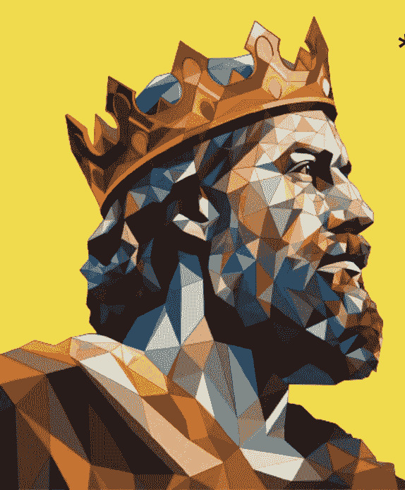

# 150+ JavaScript 模式程序：通过 if 语句和循环激发创造力的顶级 JS 练习（150+ 模式程序系列 2）

```
* * * * *       *       * * * * *
  * * * *     * *       * * * *
    * * *     * * *       * * *
      * *     * * * *       *
        *     * * * * *       *
```



## 简介

通过使用 JavaScript 语言的 `if` 语句和循环创建美丽的星号图案来培养你的创造力。这门强大的语言将让你在编写代码时更加得心应手，因为通过练习这些技巧，你将掌握编程中更核心的主题。

如果你在大学学习计算机科学，这本书非常适合你。他们将要求你创建这类图案，这对于学习各种高级技巧并快速掌握这门美妙的语言非常有用。

## 模式 1

```
// *****
// *****
// *****
// *****
// *****

for (let i = 1; i <= 5; i++) {
    let row = "";
    for (let j = 1; j <= 5; j++) {
        row += '*';
    }
    console.log(row);
}
```

## 模式 2

```
// *
// **
// ***
// ****
// *****

for (let i = 1; i <= 5; i++) {
    let row = '';
    for (let j = 1; j <= i; j++) {
        row += '*';
    }
    console.log(row);
}
```

## 模式 3

```
// *****
// ****
// ***
// **
// *

for (let i = 1; i <= 5; i++) {
    let row = "";
    for (let j = 5; j >= i; j--) {
        row += '*';
    }
    console.log(row);
}
```

## 模式 4

```
//     *
//    **
//   ***
//  ****
// *****

const n = 5;

for (let i = 1; i <= n; i++) {
    let row = "";

    for (let j = n - 1; j >= i; j--) {
        row += ' ';
    }

    for (let k = 1; k <= i; k++) {
        row += '*';
    }

    console.log(row);
}
```

## 模式 5

```
// *****
//  ****
//   ***
//    **
//     *

const n = 5;

for (let i = n; i >= 1; i--) {
    let spaces = "";
    for (let j = n - 1; j >= i; j--) {
        spaces += ' ';
    }

    let stars = "";
    for (let k = 1; k <= i; k++) {
        stars += '*';
    }

    console.log(spaces + stars);
}
```

## 模式 6

```
//     *
//    * *
//   * * *
//  * * * *

const p_height = 5;

for (let i = 1; i < p_height; i++) {
    let spaces = '';
    for (let k = p_height - 1; k >= i; k--) {
        spaces += ' ';
    }

    let stars = '';
    for (let j = 1; j <= i; j++) {
        stars += '* ';
    }

    console.log(spaces + stars);
}
```

## 模式 7

```
// * * * * *
//  * * * *
//   * * *
//    * *
//     *

const p_height = 5;

for (let i = p_height; i >= 1; i--) {
    let spaces = '';
    for (let k = p_height - 1; k >= i; k--) {
        spaces += ' ';
    }

    let stars = '';
    for (let j = i; j >= 1; j--) {
        stars += '* ';
    }

    console.log(spaces + stars);
}
```

## 模式 8

```
//     *
//    ***
//   *****
//  *******
// *********

const p_height = 5;
let min_stars = 1;
let p_space = p_height - 1;

for (let i = 0; i < p_height; i++) {
    let spaces = '';
    for (let j = p_space; j > i; j--) {
        spaces += ' ';
    }

    let stars = '';
    for (let k = 0; k < min_stars; k++) {
        stars += '*';
    }
    min_stars += 2;

    console.log(spaces + stars);
}
```

## 模式 9

```
// *********
//  *******
//   *****
//    ***
//     *
```

```javascript
const p_height = 5;
let max_stars = p_height * 2 - 1;
let p_space = p_height - 1;

for (let i = p_height; i >= 1; i--) {
    let spaces = '';
    for (let j = p_space; j >= i; j--) {
        spaces += ' ';
    }

    let stars = '';
    for (let k = 1; k <= max_stars; k++) {
        stars += '*';
    }
    max_stars -= 2;

    console.log(spaces + stars);
}
```

## 模式 10

```
// *
// **
// ***
// ****
// ***
// **
// *
```

```javascript
const size = 3;

for (let i = size; i >= -size; i--) {
    let row = '';
    for (let j = size; j >= Math.abs(i); j--) {
        row += '*';
    }
    console.log(row);
}
```

## 模式 11

```
// *
// **
// ***
// ****
// ***
// **
// *
```

```javascript
const size = 3;

for (let i = size; i >= -size; i--) {
    let row = "";

    for (let j = 1; j <= Math.abs(i); j++) {
        row += ' ';
    }

    for (let k = size; k >= Math.abs(i); k--) {
        row += '*';
    }

    console.log(row);
}
```

## 模式 12

```
// 1****
// 22***
// 333**
// 4444*
// 55555
```

```javascript
const n = 5;

for (let i = 1; i <= n; i++) {
    let row = "";

    for (let j = 1; j <= n; j++) {
        if (j > i) {
            row += '*';
        } else {
            row += i;
        }
    }

    console.log(row);
}
```

## 模式 13

```
// 1****
// 12***
// 123**
// 1234*
// 12345
```

```javascript
const n = 5;

for (let i = 1; i <= n; i++) {
    let row = "";

    for (let j = 1; j <= n; j++) {
        if (j > i) {
            row += '*';
        } else {
            row += j;
        }
    }

    console.log(row);
}
```

## 模式 14

```
// 55555
// 4444*
// 333**
// 22***
// 1****
```

```javascript
const n = 5;

for (let i = 1; i <= n; i++) {
    let row = "";

    for (let j = 1; j <= n; j++) {
        if (j > i) {
            row += '*';
        } else {
            row += j;
        }
    }

    console.log(row);
}
```

## 模式 15

```
// 12345
// 1234*
// 123**
// 12***
// 1****
```

```javascript
const n = 5;

for (let i = n; i >= 1; i--) {
    let row = "";

    for (let j = 1; j <= n; j++) {
        if (j > i) {
            row += '*';
        } else {
            row += j;
        }
    }

    console.log(row);
}
```

## 模式 16

```
// ****1
// ***22
// **333
// *4444
// 55555
```

```javascript
const n = 5;

for (let i = 1; i <= n; i++) {
    let row = "";

    for (let j = n; j >= 1; j--) {
        if (j > i) {
            row += '*';
        } else {
            row += i;
        }
    }

    console.log(row);
}
```

## 模式 17

```
// ****1
// ***21
// **321
// *4321
// 54321
```

```javascript
const n = 5;

for (let i = 1; i <= n; i++) {
    let row = "";

    for (let j = n; j >= 1; j--) {
        if (j > i) {
            row += '*';
        } else {
            row += j;
        }
    }

    console.log(row);
}
```

## 模式 18

```
// 55555
// *4444
// **333
// ***22
// ****1
```

```javascript
const n = 5;

for (let i = n; i >= 1; i--) {
    let row = "";

    for (let j = n; j >= 1; j--) {
        if (j > i) {
            row += '*';
        } else {
            row += i;
        }
    }

    console.log(row);
}
```

## 模式 19

```
// 54321
// *4321
// **321
// ***21
// ****1
```

```javascript
const n = 5;

for (let i = n; i >= 1; i--) {
    let row = "";

    for (let j = n; j >= 1; j--) {
        if (j > i) {
            row += '*';
        } else {
            row += j;
        }
    }

    console.log(row);
}
```

## 模式 20

```
// A*****
// BB***
// CCC**
// DDDD*
// EEEEE
```

```javascript
const n = 5;

for (let i = 0; i < n; i++) {
    let row = "";

    for (let j = 0; j < n; j++) {
        if (j > i) {
            row += '*';
        } else {
            row += String.fromCharCode(i + 65);
        }
    }

    console.log(row);
}
```

## 模式 21

```
// A*****
// AB***
// ABC**
// ABCD*
// ABCDE
```

```javascript
const n = 5;

for (let i = 0; i < n; i++) {
    let row = "";

    for (let j = 0; j < n; j++) {
        if (j > i) {
            row += '*';
        } else {
            row += String.fromCharCode(j + 65);
        }
    }

    console.log(row);
}
```

## 模式 22

```
// EEEEE
// DDDD*
// CCC**
// BB***
// A****
```

```javascript
const n = 4;

for (let i = n; i >= 0; i--) {
    let row = "";

    for (let j = 0; j <= n; j++) {
        if (j > i) {
            row += '*';
        } else {
            row += String.fromCharCode(i + 65);
        }
    }

    console.log(row);
}
```

## 模式 23

```
// ABCDE
// ABCD*
// ABC**
// AB***
// A****
```

```javascript
const n = 4;

for (let i = n; i >= 0; i--) {
    let row = "";

    for (let j = 0; j <= n; j++) {
        if (j > i) {
            row += '*';
        } else {
            row += String.fromCharCode(j + 65);
        }
    }

    console.log(row);
}
```

## 模式 24

```
// ****A
// ***BB
// **CCC
// *DDDD
// EEEEE
```

```javascript
const n = 4;

for (let i = 0; i <= n; i++) {
    let row = "";

    for (let j = n; j >= 0; j--) {
        if (j > i) {
            row += '*';
        } else {
            row += String.fromCharCode(i + 65);
        }
    }

    console.log(row);
}
```

## 模式 25

```
// ****A
// ***BA
// **CBA
// *DCBA
// EDCBA
```


## 模式 26

```
// EEEEE
// *DDDD
// **CCC
// ***BB
// ****A
```

```javascript
const n = 4;

for (let i = n; i >= 0; i--) {
    let row = "";

    for (let j = n; j >= 0; j--) {
        if (j > i) {
            row += '*';
        } else {
            row += String.fromCharCode(i + 65);
        }
    }

    console.log(row);
}
```

## 模式 27

```
// EDCBA
// *DCBA
// **CBA
// ***BA
// ****A
```

```javascript
const n = 4;

for (let i = n; i >= 0; i--) {
    let row = "";

    for (let j = n; j >= 0; j--) {
        if (j > i) {
            row += '*';
        } else {
            row += String.fromCharCode(j + 65);
        }
    }

    console.log(row);
}
```

## 模式 28

```
// 1 2 3 4 *
// 1 2 3 * 5
// 1 2 * 4 5
// 1 * 3 4 5
// * 2 3 4 5
```

```javascript
const n = 5;

for (let i = 1; i <= n; i++) {
    let row = "";

    for (let j = 1; j <= n; j++) {
        if (j === n - i + 1) {
            row += '* ';
        } else {
            row += j + ' ';
        }
    }

    console.log(row);
}
```

## 模式 29

```
// * 1 * 2 *
// 3 * 4 * 5
// * 6 * 7 *
// 8 * 9 *10
// *11 *12 *
```

```javascript
const n = 5;
let x = 1;

for (let i = 1; i <= n; i++) {
    let row = "";

    for (let j = 1; j <= n; j++) {
        if ((i + j) % 2 === 1) {
            row += `${x++} `;
        } else {
            row += '* ';
        }
    }

    console.log(row);
}
```

## 模式 30

```
// * A* B*
// C* D* E
// * F* G*
// H* I* J
// * K* L*
```

```javascript
const n = 5;
let x = 'A';

for (let i = 1; i <= n; i++) {
    let row = "";

    for (let j = 1; j <= n; j++) {
        if ((i + j) % 2 === 1) {
            row += `${x}`;
            x = String.fromCharCode(x.charCodeAt(0) + 1);
        } else {
            row += '* ';
        }
    }

    console.log(row);
}
```

## 模式 31

```
// * # # # # #
// # # # # * *
// * * * # # #
// # # # * * *
// * * * # # #
// # # # # * *
// * # # # # #
```

```javascript
const n = 7;
let x = 1;

for (let i = 1; i <= n; i++) {
    let row = "";

    for (let j = 1; j <= n; j++) {
        if (i % 2 === 1 && j <= x) {
            row += '* ';
        } else if (i % 2 === 0 && j >= n - x + 1) {
            row += '* ';
        } else {
            row += '# ';
        }
    }

    console.log(row);

    if (i <= n / 2) {
        x++;
    } else {
        x--;
    }
}
```

## 模式 32

```
// * 0 0 0 * 0 0 0 *
// 0 * 0 0 * 0 0 * 0
// 0 0 * 0 * 0 * 0 0
// 0 0 0 * * * 0 0 0
// 0 0 0 0 * 0 0 0 0
```

```javascript
const n = 5;

for (let i = 1; i <= n; i++) {
    let row = "";

    for (let j = 1; j < 2 * n; j++) {
        if (j === i || j === 2 * n - i || j === n) {
            row += '* ';
        } else {
            row += '0 ';
        }
    }

    console.log(row);
}
```

## 模式 33

```
// 1
// 1* 2
// 1* 2* 3
// 1* 2* 3* 4
// 1* 2* 3* 4* 5
```

```javascript
const n = 5;

for (let i = 1; i <= n; i++) {
    let row = "";

    for (let j = 1; j <= i; j++) {
        row += j;
        if (j !== i) {
            row += '* ';
        }
    }

    console.log(row);
}
```

## 模式 34

```
// 1
// 3* 2
// 4* 5* 6
// 10* 9* 8* 7
// 11* 12* 13* 14* 15
```

```javascript
const n = 5;

let px = 1;
let py = 1;
let t;

for (let i = 1; i <= n; i++) {
    t = py;
    let row = "";

    for (let j = 1; j <= i; j++) {
        if (i % 2 === 1) {
            row += `${px} `;
        } else {
            row += `${t} `;
        }
        t--;
        px++;

        if (j !== i) {
            row += '* ';
        }
    }

    py = py + i + 1;
    console.log(row);
}
```

## 模式 35

```
// #
// **
// ###
// ****
// #####
```

```javascript
const n = 5;

for (let i = 1; i <= n; i++) {
    let row = "";

    for (let j = 1; j <= i; j++) {
        if (i % 2 === 0) {
            row += '*';
        } else {
            row += '#';
        }
    }

    console.log(row);
}
```

## 模式 36

```
// 1
// **
// 333
// ****
// 55555
```

```javascript
const n = 5;

for (let i = 1; i <= n; i++) {
    let row = "";

    for (let j = 1; j <= i; j++) {
        if (i % 2 === 0) {
            row += '*';
        } else {
            row += i;
        }
    }

    console.log(row);
}
```

## 模式 37

```
// 1
// **
// 123
// ****
// 12345
```

```javascript
const n = 5;

for (let i = 1; i <= n; i++) {
    let row = "";

    for (let j = 1; j <= i; j++) {
        if (i % 2 === 0) {
            row += '*';
        } else {
            row += j;
        }
    }

    console.log(row);
}
```

## 模式 38

```
// 1
// 1*
// 1*3
// 1*3*
// 1*3*5
```

```javascript
const n = 5;

for (let i = 1; i <= n; i++) {
    let row = "";

    for (let j = 1; j <= i; j++) {
        if (j % 2 === 0) {
            row += '*';
        } else {
            row += j;
        }
    }

    console.log(row);
}
```

## 模式 39

```
// 1
// 2*
// 3*3
// 4*4*
// 5*5*5
```

```javascript
const n = 5;

for (let i = 1; i <= n; i++) {
    let row = "";

    for (let j = 1; j <= i; j++) {
        if (j % 2 === 0) {
            row += '*';
        } else {
            row += i;
        }
    }

    console.log(row);
}
```

## 模式 40

```
// ######
// ****
// ####
// **
// #
```

```javascript
const n = 5;

for (let i = n; i >= 1; i--) {
    let row = "";

    for (let j = 1; j <= i; j++) {
        if (i % 2 === 0) {
            row += '*';
        } else {
            row += '#';
        }
    }

    console.log(row);
}
```

## 模式 41

```
// #*#*#
// #*#*
// #*#
// #*
// #
```

```javascript
const n = 5;

for (let i = n; i >= 1; i--) {
    let row = "";

    for (let j = 1; j <= i; j++) {
        if (j % 2 === 0) {
            row += '*';
        } else {
            row += '#';
        }
    }

    console.log(row);
}
```

## 模式 42

```
// 55555
// ****
// 333
// **
// 1
```

```javascript
const n = 5;

for (let i = n; i >= 1; i--) {
    let row = "";

    for (let j = 1; j <= i; j++) {
        if (i % 2 === 0) {
            row += '*';
        } else {
            row += i;
        }
    }

    console.log(row);
}
```

## 模式 43

```
// 12345
// ****
// 123
// **
// 1
```

```javascript
const n = 5;

for (let i = n; i >= 1; i--) {
    let row = "";

    for (let j = 1; j <= i; j++) {
        if (i % 2 === 0) {
            row += '*';
        } else {
            row += j;
        }
    }

    console.log(row);
}
```

## 模式 44

```
// 1*3*5
// 1*3*
// 1*3
// 1*
// 1
```

```javascript
const n = 5;

for (let i = n; i >= 1; i--) {
    let row = "";

    for (let j = 1; j <= i; j++) {
        if (j % 2 === 0) {
            row += '*';
        } else {
            row += j;
        }
    }

    console.log(row);
}
```

## 模式 45

```
// 5*5*5
// 4*4*
// 3*3
// 2*
// 1
```

```javascript
const n = 5;

for (let i = n; i >= 1; i--) {
    let row = "";

    for (let j = 1; j <= i; j++) {
        if (j % 2 === 0) {
            row += '*';
        } else {
            row += i;
        }
    }

    console.log(row);
}
```

## 模式 46

```
//     #
//    **
//   ####
//  ****
// ######
```

```javascript
const n = 5;

for (let i = n; i >= 1; i--) {
    let row = "";

    for (let j = 1; j <= n; j++) {
        if (i <= j) {
            if (i % 2 === 0) {
                row += '*';
            } else {
                row += '#';
            }
        } else {
            row += ' ';
        }
    }

    console.log(row);
}
```

## 模式 47

```
//     #
//    *#
//   #*#
//  *##*
// #*##*
```

```javascript
const n = 5;

for (let i = 1; i <= n; i++) {
    let row = "";

    for (let j = n; j >= 1; j--) {
        if (i >= j) {
            if (j % 2 === 0) {
                row += '*';
            } else {
                row += '#';
            }
        } else {
            row += ' ';
        }
    }

    console.log(row);
}
```

## 模式 48


## 模式 49

```
// 1
// **
// 321
// ****
// 54321

const n = 5;

for (let i = 1; i <= n; i++) {
    let row = "";

    for (let j = n; j >= 1; j--) {
        if (i >= j) {
            if (i % 2 === 0) {
                row += '*';
            } else {
                row += j;
            }
        } else {
            row += ' ';
        }
    }

    console.log(row);
}
```

## 模式 50

```
//    5
//   **
//  345
// ****
//12345

const n = 5;

for (let i = n; i >= 1; i--) {
    let row = "";

    for (let j = 1; j <= n; j++) {
        if (i <= j) {
            if (i % 2 === 0) {
                row += '*';
            } else {
                row += j;
            }
        } else {
            row += ' ';
        }
    }

    console.log(row);
}
```

## 模式 51

```
//    1
//   *1
//  3*1
// *3*1
// 5*3*1

const n = 5;

for (let i = 1; i <= n; i++) {
    let row = "";

    for (let j = n; j >= 1; j--) {
        if (i >= j) {
            if (j % 2 === 0) {
                row += '*';
            } else {
                row += j;
            }
        } else {
            row += ' ';
        }
    }

    console.log(row);
}
```

## 模式 52

```
// 1
// *2
// 3*3
// *4*4
// 5*5*5

const n = 5;

for (let i = 1; i <= n; i++) {
    let row = "";

    for (let j = n; j >= 1; j--) {
        if (i >= j) {
            if (j % 2 === 0) {
                row += '*';
            } else {
                row += i;
            }
        } else {
            row += ' ';
        }
    }

    console.log(row);
}
```

## 模式 53

```
// ######
// ****
// ####
// **
// #

const n = 5;

for (let i = n; i >= 1; i--) {
    let row = "";

    for (let j = n; j >= 1; j--) {
        if (i >= j) {
            if (i % 2 === 0) {
                row += '*';
            } else {
                row += '#';
            }
        } else {
            row += ' ';
        }
    }

    console.log(row);
}
```

## 模式 54

```
// #*#*#
//  *#*#
//   #*#
//    *#
//     #

const n = 5;

for (let i = n; i >= 1; i--) {
    let row = "";

    for (let j = n; j >= 1; j--) {
        if (i >= j) {
            if (j % 2 === 0) {
                row += '*';
            } else {
                row += '#';
            }
        } else {
            row += ' ';
        }
    }

    console.log(row);
}
```

## 模式 55

```
// 55555
// ****
//  333
//   **
//    1

const n = 5;

for (let i = n; i >= 1; i--) {
    let row = "";

    for (let j = n; j >= 1; j--) {
        if (i >= j) {
            if (i % 2 === 0) {
                row += '*';
            } else {
                row += i;
            }
        } else {
            row += ' ';
        }
    }

    console.log(row);
}
```

## 模式 56

```
// 54321
// ****
//  321
//   **
//    1

const n = 5;

for (let i = n; i >= 1; i--) {
    let row = "";

    for (let j = n; j >= 1; j--) {
        if (i >= j) {
            if (i % 2 === 0) {
                row += '*';
            } else {
                row += j;
            }
        } else {
            row += ' ';
        }
    }

    console.log(row);
}
```

## 模式 57

```
// 5*3*1
//  *3*1
//   3*1
//    *1
//     1

const n = 5;

for (let i = n; i >= 1; i--) {
    let row = "";

    for (let j = n; j >= 1; j--) {
        if (i >= j) {
            if (j % 2 === 0) {
                row += '*';
            } else {
                row += j;
            }
        } else {
            row += ' ';
        }
    }

    console.log(row);
}
```

## 模式 58

```
//     #
//    * *
//   # # #
//  * * * *
// # # # # #

const n = 5;

for (let i = n; i >= 1; i--) {
    let row = "";

    for (let j = 1; j <= n; j++) {
        if (i <= j) {
            if (i % 2 === 0) {
                row += '* ';
            } else {
                row += '# ';
            }
        } else {
            row += ' ';
        }
    }

    console.log(row);
}
```

## 模式 59

```
//     #
//    * #
//   # * #
//  * # * #

const n = 5;

for (let i = 1; i <= n; i++) {
    let row = "";

    for (let j = n; j >= 1; j--) {
        if (i > j) {
            if (j % 2 === 0) {
                row += '* ';
            } else {
                row += '# ';
            }
        } else {
            row += ' ';
        }
    }

    console.log(row);
}
```

## 模式 60

```
// 1
// * *
// 3 3 3
// * * * *
// 5 5 5 5 5

const n = 5;

for (let i = 1; i <= n; i++) {
    let row = "";

    for (let j = n; j >= 1; j--) {
        if (i >= j) {
            if (i % 2 === 0) {
                row += '* ';
            } else {
                row += i + ' ';
            }
        } else {
            row += ' ';
        }
    }

    console.log(row);
}
```

## 模式 61

```
// # # # # #
// * * * *
//   # # #
//     * *
//       #

const n = 5;

for (let i = n; i >= 1; i--) {
    let row = "";

    for (let j = n; j >= 1; j--) {
        if (i >= j) {
            if (i % 2 === 0) {
                row += '* ';
            } else {
                row += '# ';
            }
        } else {
            row += ' ';
        }
    }

    console.log(row);
}
```

## 模式 62

```
// # * # * #
// * # * #
// # * #
// * #
// #

const n = 5;

for (let i = n; i >= 1; i--) {
    let row = "";

    for (let j = n; j >= 1; j--) {
        if (i >= j) {
            if (j % 2 === 0) {
                row += '* ';
            } else {
                row += '# ';
            }
        } else {
            row += ' ';
        }
    }

    console.log(row);
}
```

## 模式 63

```
// 5 5 5 5 5
// * * * *
// 3 3 3
// * *
// 1

const n = 5;

for (let i = n; i >= 1; i--) {
    let row = "";

    for (let j = n; j >= 1; j--) {
        if (i >= j) {
            if (i % 2 === 0) {
                row += '* ';
            } else {
                row += i + ' ';
            }
        } else {
            row += ' ';
        }
    }

    console.log(row);
}
```

## 模式 64

```
// 0
// 1*
// 2**
// 3***
// 4****
// 5*****

const n = 5;

for (let i = 0; i <= n; i++) {
    let row = "";

    for (let j = 0; j <= i; j++) {
        if (j !== 0) {
            row += '*';
        } else {
            row += i;
        }
    }

    console.log(row);
}
```

## 模式 65

```
// 5*****
// 4****
// 3***
// 2**
// 1*
// 0

const n = 5;

for (let i = n; i >= 0; i--) {
    let row = "";

    for (let j = 0; j <= i; j++) {
        if (j !== 0) {
            row += '*';
        } else {
            row += i;
        }
    }

    console.log(row);
}
```

## 模式 66

```
// 0
// *1
// **2
// ***3
// ****4
// *****5

const n = 5;

for (let i = 0; i <= n; i++) {
    let row = "";

    for (let j = 0; j <= i; j++) {
        if (i > j) {
            row += '*';
        } else {
            row += i;
        }
    }

    console.log(row);
}
```

## 模式 67

```
// *****5
// ****4
// ***3
// **2
// *1
// 0

const n = 5;

for (let i = n; i >= 0; i--) {
    let row = "";

    for (let j = 0; j <= i; j++) {
        if (i > j) {
            row += '*';
        } else {
            row += i;
        }
    }

    console.log(row);
}
```

## 模式 68

```
// *   *
//  * *
//   *
//  * *
// *   *

const n = 5;

for (let i = 1; i <= n; i++) {
    let row = "";

    for (let j = 1; j <= n; j++) {
        if (i === j || i + j === n + 1) {
            row += '*';
        } else {
            row += ' ';
        }
    }

    console.log(row);
}
```

## 模式 69

```
//  *
//  *
// *****
//  *
//  *

const n = 5;

for (let i = 1; i <= n; i++) {
    let row = "";

    for (let j = 1; j <= n; j++) {
        if (j === 3 || i === 3) {
            row += '*';
        } else {
            row += ' ';
        }
    }

    console.log(row);
}
```

## 模式 70


# 模式 71

```
// *****
// *####*
// *####*
// *####*
// *****

const n = 5;

for (let i = 1; i <= n; i++) {
    let row = "";

    for (let j = 1; j <= n; j++) {
        if ((j === 1 || j === n) || (i === 1 || i === n)) {
            row += '*';
        } else {
            row += '#';
        }
    }

    console.log(row);
}
```

## 模式 72

```
// *******
// **   **
// * * * *
// *   * *
// * * * *
// **   **
// *******

const n = 7;

for (let i = 0; i < n; i++) {
    let row = "";

    for (let j = 0; j < n; j++) {
        if (i === 0 || j === 0 || i === j || i === n - 1 || j === n - 1 || i + j === n - 1) {
            row += '*';
        } else {
            row += ' ';
        }
    }

    console.log(row);
}
```

## 模式 73

```
// *
// * *
// *   *
// *     *
// *       *
// *         *
// * * * * * * *

const n = 7;

for (let i = 1; i <= n; i++) {
    let row = "";

    for (let j = 1; j <= n; j++) {
        if (j === 1 || i === j || i === n) {
            row += '* ';
        } else {
            row += '  ';
        }
    }

    console.log(row);
}
```

## 模式 74

```
// * * * * * * *
// *         *
// *       *
// *     *
// *   *
// * *
// *

const n = 7;

for (let i = n; i >= 1; i--) {
    let row = "";

    for (let j = n; j >= 1; j--) {
        if (j === n - i + 1 || j === n || i === n) {
            row += '* ';
        } else {
            row += '  ';
        }
    }

    console.log(row);
}
```

## 模式 75

```
//       *
//     * *
//   *   *
// *     *
// * * * * *

const n = 5;

for (let i = 1; i <= n; i++) {
    let row = "";

    for (let j = 1; j <= n; j++) {
        if (j === n - i + 1 || j === n || i === n) {
            row += '* ';
        } else {
            row += '  ';
        }
    }

    console.log(row);
}
```

## 模式 76

```
// * * * * *
//   *     *
//     *   *
//       * *
//         *

const n = 5;

for (let i = n; i >= 1; i--) {
    let row = "";

    for (let j = 1; j <= n; j++) {
        if (j === n - i + 1 || j === n || i === n) {
            row += '* ';
        } else {
            row += '  ';
        }
    }

    console.log(row);
}
```

## 模式 77

```
//     *
//    * *
//   *   *
//  *     *
// *       *

const n = 5;

let px = n;
let py = n;

for (let i = 1; i <= n; i++) {
    let row = "";

    for (let j = 1; j <= n * 2; j++) {
        if (j === px || j === py) {
            row += '*';
        } else {
            row += ' ';
        }
    }

    px--;
    py++;
    console.log(row);
}
```

## 模式 78

```
// *       *
//   *   *
//     * *
//       *

const n = 5;

let px = 1;
let py = n * 2 - 1;

for (let i = 1; i <= n; i++) {
    let row = "";

    for (let j = 1; j <= n * 2; j++) {
        if (j === px || j === py) {
            row += '*';
        } else {
            row += ' ';
        }
    }

    px++;
    py--;
    console.log(row);
}
```

## 模式 79

```
// *
//  *
//   *
//    *
//   *
//  *
// *
```

```
const n = 7;

let x = 1;
for (let i = 1; i <= n; i++) {
    let row = "";

    for (let j = 1; j <= x; j++) {
        if (j === x) {
            row += '* ';
        } else {
            row += ' ';
        }
    }

    console.log(row);

    if (i <= n / 2) {
        x++;
    } else {
        x--;
    }
}
```

## 模式 80

```
// *
//  *
//  *
// *
//  *
//  *
// *
```

```
const n = 7;
let x = Math.floor(n / 2) + 1;

for (let i = 1; i <= n; i++) {
    let row = "";

    for (let j = 1; j <= x; j++) {
        if (j === x) {
            row += '* ';
        } else {
            row += ' ';
        }
    }

    console.log(row);

    if (i <= n / 2) {
        x--;
    } else {
        x++;
    }
}
```

## 模式 81

```
//     *
//    * *
//   *   *
//  *     *
// *       *
//  *     *
//   *   *
//    * *
//     *
```

```
const n = 9;
let px = Math.floor(n / 2) + 1;

for (let i = 1; i <= n; i++) {
    let row = "";

    for (let j = 1; j <= n; j++) {
        if (j === px || j === n - px + 1) {
            row += '*';
        } else {
            row += ' ';
        }
    }

    if (i <= n / 2) {
        px--;
    } else {
        px++;
    }

    console.log(row);
}
```

## 模式 82

```
//     *
//    / \
//   /   \
//  /     \
// /       \
// \       /
//  \     /
//   \   /
//    \ /
//     *
```

```
const n = 10;

let px = Math.floor(n / 2);
let py = Math.floor(n / 2);

for (let i = 1; i <= n; i++) {
    let row = "";

    for (let j = 1; j <= n; j++) {
        if ((i === 1 || i === n) && j === n / 2) {
            row += '*';
        } else if (j === px) {
            row += '/';
        } else if (j === py) {
            row += '\\';
        } else {
            row += ' ';
        }
    }

    if (i === n / 2) {
        let t = px;
        px = py;
        py = t;
    } else {
        px--;
        py++;
    }

    console.log(row);
}
```

## 模式 83

```
//     *
//    - -
//   -   -
//  -     -
// -       -
// -       -
//  -     -
//   -   -
//    - -
//     *
```

```
const n = 10;

let px = Math.floor(n / 2);
let py = Math.floor(n / 2);

for (let i = 1; i <= n; i++) {
    let row = "";

    for (let j = 1; j <= n - 1; j++) {
        if ((i === 1 || i === n) && j === n / 2) {
            row += '*';
        } else if (j === px || j === py) {
            row += '-';
        } else {
            row += ' ';
        }
    }

    if (i === n / 2) {
        let t = px;
        px = py;
        py = t;
    } else {
        px--;
        py++;
    }

    console.log(row);
}
```

## 模式 84

```
//    *
//   * *
//  * * *
// * * * *
//  * * *
//   * *
//    *
```

```
const size = 3;

for (let i = size; i >= -size; i--) {
    let row = "";

    for (let j = 1; j <= Math.abs(i); j++) {
        row += ' ';
    }

    for (let k = size; k >= Math.abs(i); k--) {
        row += '* ';
    }

    console.log(row);
}
```

## 模式 85

```
// *
// **
// ***
// *
// **
// ***
// *
// **
// ***
```

```
const n = 3;

for (let i = 1; i <= n; i++) {
    for (let j = 1; j <= n; j++) {
        let row = '';
        for (let k = 1; k <= j; k++) {
            row += '*';
        }
        console.log(row);
    }
}
```

## 模式 86

```
// *
// * *
// 123
// * *
// *
```

```
let n = 5;
let x = 1;

for (let i = 1; i <= n; i++) {
    let row = "";

    for (let j = 1; j <= x; j++) {
        if (i !== Math.floor(n / 2) + 1) {
            row += '* ';
        } else {
            row += j;
        }
    }

    if (i <= Math.floor(n / 2)) {
        x++;
    } else {
        x--;
    }

    console.log(row);
}
```

## 模式 87

```
// *
// * *
// ABC
// * *
// *
```

```
let n = 5;
let x = 1;

for (let i = 1; i <= n; i++) {
    let row = "";

    for (let j = 1; j <= x; j++) {
        if (i !== Math.floor(n / 2) + 1) {
            row += '* ';
        } else {
            row += String.fromCharCode(64 + j);
        }
    }

    if (i <= Math.floor(n / 2)) {
        x++;
    } else {
        x--;
    }

    console.log(row);
}
```

## 模式 88

```
// 1
// 2* 2
// 3* 3* 3
// 4* 4* 4* 4
// 3* 3* 3
// 2* 2
// 1
```

```
let n = 7;
let x = 1;

for (let i = 1; i <= n; i++) {
    let row = "";

    for (let j = 1; j < 2 * x; j++) {
        if (i <= Math.floor(n / 2) + 1 && j % 2 === 1) {
            row += i;
        } else if (i > Math.floor(n / 2) + 1 && j % 2 === 1) {
            row += n - i + 1;
        } else {
            row += '* ';
        }
    }

    if (i <= Math.floor(n / 2)) {
        x++;
    } else {
        x--;
    }

    console.log(row);
}
```

## 模式 89

```
// * * * * * * *
//   * * * * *
//     * * *
//       *
//     * * *
//   * * * * *
// * * * * * * *
```


# 模式 90

```javascript
let n = 7;
let x = 1;

for (let i = 1; i <= n; i++) {
    let row = "";

    for (let j = 1; j <= n; j++) {
        if (j >= x && j <= n - x + 1) {
            row += '* ';
        } else {
            row += '  ';
        }
    }

    if (i <= Math.floor(n / 2)) {
        x++;
    } else {
        x--;
    }

    console.log(row);
}
```

输出：

```
// *       *
// * *     * *
// * * *   * * *
// * * * * * * *
// * * *   * * *
// * *     * *
// *       *
```

# 模式 91

```javascript
let n = 7;
let x = 1;

for (let i = 1; i <= n; i++) {
    let row = "";

    for (let j = 1; j <= n; j++) {
        if (j <= x || j >= n - x + 1) {
            row += '* ';
        } else {
            row += '  ';
        }
    }

    if (i <= Math.floor(n / 2)) {
        x++;
    } else {
        x--;
    }

    console.log(row);
}
```

输出：

```
// * * * * *
// * * * *
// * * *
// * *
// *
// * *
// * * *
// * * * *
// * * * * *
```

# 模式 92

```javascript
let size = 4;

for (let i = size; i >= -size; i--) {
    let row = "";

    for (let j = 0; j <= Math.abs(i); j++) {
        row += '* ';
    }

    console.log(row);
}
```

输出：

```
// * * * *
//   * * *
//     * *
//       *
//     * *
//   * * *
// * * * *
```

# 模式 93

```javascript
let n = 7;
let x = 1;

for (let i = 1; i <= n; i++) {
    let row = "";

    for (let j = 1; j <= n / 2 + 1; j++) {
        if (j >= x) {
            row += '* ';
        } else {
            row += '  ';
        }
    }

    if (i <= n / 2) {
        x++;
    } else {
        x--;
    }

    console.log(row);
}
```

输出：

```
// *     *
// **   **
// *** ***
// **** ****
// *********
```

# 模式 94

```javascript
let n = 5;

for (let i = 1; i <= n; i++) {
    let row = "";

    for (let j = 1; j < n * 2; j++) {
        if (j <= i || j >= n * 2 - i) {
            row += '*';
        } else {
            row += ' ';
        }
    }

    console.log(row);
}
```

输出：

```
// *********
// **** ****
// ***   ***
// **     **
// *       *
```

# 模式 95

```javascript
let n = 5;
let px = n;
let py = n;

for (let i = 1; i <= n; i++) {
    let row = "";

    for (let j = 1; j < n * 2; j++) {
        if (j > px && j < py) {
            row += ' ';
        } else {
            row += '*';
        }
    }

    px--;
    py++;
    console.log(row);
}
```

输出：

```
//     *       *
//    ***     ***
//   *****   *****
//  ******* *******
// *******************
```

# 模式 96

```javascript
let minStars = 1;
let pHeight = 5;
let pSpace = pHeight - 1;
let n;
let x = 1;

for (let i = 0; i < pHeight; i++) {
    let row = "";

    for (let j = pSpace; j > i; j--) {
        row += ' ';
    }

    for (let k = 0; k < minStars; k++) {
        row += '*';
    }

    for (n = pHeight + pHeight - 2; n >= x; n--) {
        row += ' ';
    }

    for (let k = 0; k < minStars; k++) {
        row += '*';
    }

    minStars += 2;
    x += 2;
    console.log(row);
}
```

输出：

```
// 1 2 3 4 * 4 3 2 1
// 1 2 3 * * * 3 2 1
// 1 2 * * * * * 2 1
// 1 * * * * * * * 1
// * * * * * * * * *
```

# 模式 97

```javascript
let n = 5;
let x = n;

for (let i = 1; i <= n; i++) {
    let row = "";

    for (let j = 1; j < 2 * n; j++) {
        if (j >= x && j <= n + i - 1) {
            row += '* ';
        } else if (j <= n) {
            row += j + ' ';
        } else {
            row += (2 * n - j) + ' ';
        }
    }

    x--;
    console.log(row);
}
```

输出：

```
//       *
//     # * #
//   * # * # *
// # * # * # * #
// * # * # * # * # *
```

# 模式 98

```javascript
let n = 5;
let x = n;

for (let i = 1; i <= n; i++) {
    let row = "";

    for (let j = 1; j < 2 * n; j++) {
        if (j >= x && j < n + i && j % 2 === 1) {
            row += '* ';
        } else if (j >= x && j < n + i && j % 2 === 0) {
            row += '# ';
        } else {
            row += '  ';
        }
    }

    x--;
    console.log(row);
}
```

输出：

```
//         *
//       * *
//     * * *
//   * * * *
// *       *
// * *     * *
// * * *   * * *
// * * * * * * * *
// * * * * * * * * *
```

# 模式 99

```javascript
let p_height = 5;
let p_space = p_height - 1;
let x = 1;

for (let i = 1; i < p_height; i++) {
    let row = ' '.repeat(p_height);

    for (let k = p_space; k >= i; k--)
        row += ' ';

    for (let j = 1; j <= i; j++)
        row += '* ';

    console.log(row);
}

for (let i = 0; i < p_height; i++) {
    let row = ' '.repeat(p_space - i);

    for (let k = 0; k <= i; k++)
        row += '* ';

    for (let n = p_height + p_height - 2; n >= x; n--)
        row += ' ';

    for (let k = 0; k <= i; k++)
        row += '* ';

    x += 2;
    console.log(row);
}
```

输出：

```
//     *
//    * *
//   *   *
//  *     *
// *********
```

# 模式 100

```javascript
let n = 5;
let px = n;
let py = n;

for (let i = 1; i <= n; i++) {
    let row = "";

    for (let j = 1; j < n * 2; j++) {
        if (j === px || j === py || i === n) {
            row += '*';
        } else {
            row += ' ';
        }
    }

    px--;
    py++;
    console.log(row);
}
```

输出：

```
// *
// **
// * *
// *  *
// * *
// **
// *
```

# 模式 101

```javascript
let n = 7;
let x = 1;

for (let i = 1; i <= n; i++) {
    let row = "";

    for (let j = 1; j <= x; j++) {
        if (j === 1 || j === x) {
            row += '*';
        } else {
            row += ' ';
        }
    }

    console.log(row);

    if (i <= n / 2) {
        x++;
    } else {
        x--;
    }
}
```

输出：

```
// *
// **
// * *
// *  *
// * *
// **
// *
```

# 模式 102

```javascript
let n = 7;
let x = Math.floor(n / 2) + 1;

for (let i = 1; i <= n; i++) {
    let row = "";

    for (let j = 1; j <= Math.floor(n / 2) + 1; j++) {
        if (j === x || j === Math.floor(n / 2) + 1) {
            row += '*';
        } else {
            row += ' ';
        }
    }

    if (i <= Math.floor(n / 2)) {
        x--;
    } else {
        x++;
    }

    console.log(row);
}
```

输出：

```
// *********
// *       *
// *   *   *
// * *   * *
// *       *
// *   *   *
// * *   * *
// *       *
// *********
```

# 模式 103

```javascript
let n = 5;
let x = 1;
let y = 2 * n - 1;

for (let i = 1; i <= n; i++) {
    let row = "";

    for (let j = 1; j < 2 * n; j++) {
        if (j === x || j === y || i === 1) {
            row += '*';
        } else {
            row += ' ';
        }
    }

    console.log(row);
    x++;
    y--;
}
```

输出：

```
// *       *
// * *     * *
// *   *   *   *
// *     *     *
// *   *   *   *
// * *     * *
// *       *
```

# 模式 104

```javascript
let n = 7;
let x = 1;

for (let i = 1; i <= n; i++) {
    let row = "";

    for (let j = 1; j <= n; j++) {
        if (j === x || j === n - x + 1 || (j === 1 && i !== 1 && i !== n) || (j === n && i !== 1 && i !== n)) {
            row += '* ';
        } else {
            row += '  '; // 调整间距以获得更好的外观
        }
    }

    if (i <= n / 2) {
        x++;
    } else {
        x--;
    }

    console.log(row);
}
```

输出：

```
// *     *     *
//   *   *   *
//     * * *
// * * * * * * *
//     * * *
//   *   *   *
// *     *     *
```

# 模式 105

```javascript
let n = 7;
for (let i = 1; i <= n; i++) {
    let row = "";
    for (let j = 1; j <= n; j++) {
        if (j === i || j === n - i + 1 || i === Math.floor(n / 2) + 1 || j === Math.floor(n / 2) + 1) {
            row += '* ';
        } else {
            row += '  ';
        }
    }
    console.log(row);
}
```

输出：

```
// *     * * * *
// *     *
// *     *
// * * * * * * *
//     *     *
//     *     *
// * * *     *
```

# 模式 106

```javascript
let n = 7;

for (let i = 1; i <= n; i++) {
    let row = "";
    for (let j = 1; j <= n; j++) {
        if (
            i === Math.floor(n / 2) + 1 ||
            j === Math.floor(n / 2) + 1 ||
            (i === 1 && j >= Math.floor(n / 2) + 1) ||
            (i === n && j <= Math.floor(n / 2)) ||
            (j === 1 && i <= Math.floor(n / 2)) ||
            (j === n && i >= Math.floor(n / 2) + 1)
        ) {
            row += "* ";
        } else {
            row += "  ";
        }
    }
    console.log(row);
}
```

输出：

```
// *     * * * *
// *     *
// *     *
// * * * * * * *
//     *     *
//     *     *
// * * *     *
```


## 模式 107

```
// * * * * * * * * *
// *           *
// *   * * * * *   *
// *   *       *   *
// *   *   *   *   *
// *   *       *   *
// *   * * * * *   *
// *           *
// * * * * * * * * *
```

```javascript
let n = 9;
let x = 1;

for (let i = 1; i <= n; i++) {
    let row = "";
    for (let j = 1; j <= n; j++) {
        if ((j <= x || j >= n - x + 1) && j % 2 === 1) {
            row += "* ";
        } else if ((j >= x && j <= n - x + 1) && i % 2 === 1) {
            row += "* ";
        } else {
            row += "  ";
        }
    }
    console.log(row);
    if (i <= n / 2) {
        x++;
    } else {
        x--;
    }
}
```

## 模式 108

```
// * * *
// * * * *
// * * *
// * * * *
// * * *
// * * * *
// * * *
```

```javascript
let n = 7;

for (let i = 1; i <= n; i++) {
    let row = "";
    for (let j = 1; j <= n; j++) {
        if ((i + j) % 2 === 1) {
            row += "* ";
        } else {
            row += "  ";
        }
    }
    console.log(row);
}
```

## 模式 109

```
// *     *     *
// **    ***   **
// ***   ***** ***
// ***************
// ***************
// ***************
// ***************
```

```javascript
let n = 7;

let x = n;
for (let i = 1; i <= n; i++) {
    let row = "";
    for (let j = 1; j < 2 * n; j++) {
        if ((j >= x && j <= 2 * n - x) || j <= n - x + 1 || j >= n + x - 1) {
            row += "*";
        } else {
            row += " ";
        }
    }
    x--;
    console.log(row);
}
```

## 模式 110

```
//       *
//     * * *
//   *   *   *
// *       *       *
// * * * * * * * * *
//   *       *       *
//     *   *   *
//       * * *
//       *
```

```javascript
let n = 9;
let c1 = (n - 1) / 2;
let c2 = 3 * n / 2 - 1;

for (let i = 0; i < n; i++) {
    let output = "";
    for (let j = 0; j < n; j++) {
        if (i + j === c1 || i - j === c1 || j - i === c1 || i + j === c2 || i === c1 || j === c1) {
            output += "* ";
        } else {
            output += "  ";
        }
    }
    console.log(output);
}
```

## 模式 111

```
// * * * * * * * * *
// * * * *   * * * *
// * * *       * * *
// * *           * *
// *               *
// * *           * *
// * * *       * * *
// * * * *   * * * *
// * * * * * * * * *
```

```javascript
let n = 9;
let c1 = (n - 1) / 2;
let c2 = 3 * n / 2 - 1;

for (let i = 0; i < n; i++) {
    let row = "";
    for (let j = 0; j < n; j++) {
        if (i + j <= c1 || i - j >= c1 || j - i >= c1 || i + j >= c2) {
            row += "* ";
        } else {
            row += "  ";
        }
    }
    console.log(row);
}
```

## 模式 112

```
// * * * * * * *
// * * *   * * * *
// * *       * * *
// *           * *
// * *           *
// * * *       * *
// * * * *   * * *
// * * * * * * * *
```

```javascript
let n = 8;
let c1 = (n - 1) / 2;
let c2 = 3 * n / 2 - 1;

for (let i = 0; i < n; i++) {
    let row = "";
    for (let j = 0; j < n; j++) {
        if (i + j <= c1 || i - j >= c1 || j - i >= c1 || i + j >= c2) {
            row += "* ";
        } else {
            row += "  ";
        }
    }
    console.log(row);
}
```

## 模式 113

```
// *     *
// **   **
// *** ***
// *******
// *** ***
// **   **
// *     *
```

```javascript
let n = 7;
let px = 1;

for (let i = 1; i <= n; i++) {
    let row = "";
    for (let j = 1; j <= n; j++) {
        if (j <= px || j >= n - px + 1) {
            row += "*";
        } else {
            row += " ";
        }
    }

    if (i <= n / 2) {
        px++;
    } else {
        px--;
    }
    console.log(row);
}
```

## 模式 114

```
//     *****
//    *****
//   *****
//  *****
// *****
```

```javascript
let z = 1;
let n = 5;

for (let i = 0; i < n; i++) {
    let spaces = "";
    let stars = "";

    for (let j = n - 1; j > i; j--) {
        spaces += " ";
    }

    for (let k = 0; k < n; k++) {
        stars += "*";
    }

    console.log(spaces + stars);

    z++;
}
```

## 模式 115

```
// **
// **
// ****
// ****
// ******
// ******
```

```javascript
for (let i = 1; i <= 6; i++) {
    let k = (i % 2 !== 0) ? i + 1 : i;

    let line = "";
    for (let j = 0; j < k; j++) {
        line += '*';
    }

    console.log(line);
}
```

## 模式 116

```
//     **
//     **
//   ****
//   ****
// ******
// ******
```

```javascript
for (let i = 1; i <= 6; i++) {
    let k = (i % 2 !== 0) ? i + 1 : i;

    let spaces = '';
    for (let g = 6; g > k; g--) {
        spaces += ' ';
    }

    let line = '';
    for (let j = 0; j < k; j++) {
        line += '*';
    }

    console.log(spaces + line);
}
```

## 模式 117

```
// *******
// *******
// *****
// *****
// ***
// ***
```

```javascript
let n = 6;

for (let i = n; i > 0; i--) {
    let k = (i % 2 !== 0) ? i + 1 : i;

    let line = "";
    for (let j = 0; j < k; j++) {
        line += '*';
    }

    console.log(line);
}
```

## 模式 118

```
// *******
// *******
//   ****
//   ****
//     **
//     **
```

```javascript
let n = 6;

for (let i = n; i > 0; i--) {
    let k = (i % 2 !== 0) ? i + 1 : i;

    let line = '';
    for (let x = k; x < n; x++) {
        line += ' ';
    }
    for (let j = 0; j < k; j++) {
        line += '*';
    }

    console.log(line);
}
```

## 模式 119

```
// *
// *
// **
// **
// ***
// ***
```

```javascript
let n = 3;

for (let i = 1; i <= n; i++) {
    for (let c = n - 1; c > 0; c--) {
        let row = "";
        for (let j = 0; j < i; j++) {
            row += '*';
        }
        console.log(row);
    }
}
```

## 模式 120

```
//  *
//  *
// **
// **
//***
//***
```

```javascript
for (let i = 1; i <= 3; i++) {
    for (let x = 2; x > 0; x--) {
        let spaces = '';
        for (let y = 2; y >= i; y--) {
            spaces += ' ';
        }
        let stars = '';
        for (let j = 0; j < i; j++) {
            stars += '*';
        }
        console.log(spaces + stars);
    }
}
```

## 模式 121

```
// ***
// ***
// **
// **
// *
// *
```

```javascript
for (let i = 3; i >= 1; i--) {
    for (let x = 2; x > 0; x--) {
        let stars = '';
        for (let j = 0; j < i; j++) {
            stars += '*';
        }
        console.log(stars);
    }
}
```

## 模式 122

```
// ***
// ***
//  **
//  **
//   *
//   *
```

```javascript
for (let i = 3; i >= 1; i--) {
    for (let x = 2; x > 0; x--) {
        let spaces = "";
        for (let y = 2; y >= i; y--) {
            spaces += ' ';
        }
        let stars = "";
        for (let j = 0; j < i; j++) {
            stars += '*';
        }
        console.log(spaces + stars);
    }
}
```

## 模式 123

```
//  *
//  *
// ***
// ***
// *****
// *****
```

```javascript
const n = 3;
let z = 1;

for (let i = 0; i < n; i++) {
    for (let j = 2; j > 0; j--) {
        let spaces = "";
        for (let x = n - 1; x > i; x--) {
            spaces += ' ';
        }
        let stars = "";
        for (let y = 0; y < z; y++) {
            stars += '*';
        }
        console.log(spaces + stars);
    }
    z += 2;
}
```

## 模式 124

```
//       **
//       **
//     *   *
//     *   *
//   *       *
//   *       *
// *           *
```

```javascript
const n = 7;
let x = n;

for (let i = 1; i <= n; i++) {
    let row = "";
    for (let j = 1; j <= 2 * n; j++) {
        if (j === x || j === 2 * n - x + 1) {
            row += '*';
        } else {
            row += ' ';
        }
    }
    console.log(row);
    if (i % 2 === 0) {
        x -= 2;
    }
}
```

## 模式 125

```
// *****
//   ***
//     *
//   ***
// *****
```


## 模式 126

```javascript
const n = 3;
let s1 = n * 2 - 1, s2 = 3;

for (let i = 1; i <= n; i++) {
    let row = "";
    for (let j = 1; j < i; j++) {
        row += ' ';
    }
    for (let k = 1; k <= s1; k++) {
        row += '*';
    }
    s1 -= 2;
    console.log(row);
}

for (let i = 1; i <= n - 1; i++) {
    let row = "";
    for (let j = n - 2; j >= i; j--) {
        row += ' ';
    }
    for (let k = 1; k <= s2; k++) {
        row += '*';
    }
    s2 += 2;
    console.log(row);
}
```

```
//     * * * * * * *
//   * * * * * * * * *
// * * * * * * * * * * *
// * * * * * * * * * * * *
// * * * * * * * * * * * *
// * * * * * * * * * * * *
// * * * * * * * * * * *
//   * * * * * * * * *
//     * * * * * * *
```

```javascript
for (let i = 1; i <= 9; i++) {
    let x, z;

    switch (i) {
        case 1:
        case 9:
            x = 6;
            z = 4;
            break;
        case 2:
        case 8:
            x = 8;
            z = 2;
            break;
        case 3:
        case 7:
            x = 9;
            z = 1;
            break;
        default:
            x = 10;
            z = 0;
    }

    let row = "";
    for (let j = 1; j <= z; j++) {
        row += ' ';
    }

    for (let k = 1; k <= x; k++) {
        row += '* ';
    }

    console.log(row);
}
```

## 模式 127

```
// ***   ***
// ***** *****
// ***********
//  *********
//   *******
//    *****
//     ***
//      *
```

```javascript
const n = 6;

// 心形的上半部分
for (let i = n / 2; i <= n; i += 2) {
    let row = "";

    for (let j = 1; j < n - i; j += 2) {
        row += ' ';
    }

    for (let j = 1; j <= i; j++) {
        row += '*';
    }

    for (let j = 1; j <= n - i; j++) {
        row += ' ';
    }

    for (let j = 1; j <= i; j++) {
        row += '*';
    }

    console.log(row);
}

// 心形的下半部分
for (let i = n; i >= 1; i--) {
    let row = "";
    for (let j = i; j < n; j++) {
        row += ' ';
    }

    for (let j = 1; j <= (i * 2) - 1; j++) {
        row += '*';
    }

    console.log(row);
}
```

## 模式 128

```
// ** **
// * * *
// *   *
//  * *
//   **
//    *
```

```javascript
for (let row = 0; row < 6; row++) {
    let rowOutput = '';
    for (let col = 0; col < 7; col++) {
        if ((row === 0 && col % 3 !== 0) || (row === 1 && col % 3 === 0) ||
            (row - col === 2) || (row + col === 8)) {
            rowOutput += '*';
        } else {
            rowOutput += ' ';
        }
    }
    console.log(rowOutput);
}
```

## 模式 129：X-Max 树

```
//       *
//      * *
//     * * *
//    * * * *
//     * * *
//    * * * *
//   * * * * *
//  * * * * * *
//    * * * *
//    * * * *
//    * * * *
//    * * * *
```

```javascript
function drawPattern() {
    let height = 3;
    let width = 4;

    let space = width * 5;
    let r = 1;
    let m = 1;

    for (r = 1; r < height; r++) {
        for (let i = m; i <= width; i++) {
            let rowOutput = '';
            for (let j = space; j >= i; j--) {
                rowOutput += ' ';
            }
            for (let k = 1; k <= i; k++) {
                rowOutput += '* ';
            }
            console.log(rowOutput);
        }
        m += 2;
        width += 2;
    }
}
```

```javascript
for (let i = 1; i <= 4; i++) {
    let rowOutput = "";
    for (let j = space - 3; j >= 1; j--) {
        rowOutput += ' ';
    }
    for (let k = 1; k <= 4; k++) {
        rowOutput += '* ';
    }
    console.log(rowOutput);
}

drawPattern();
```

## 图案 130

```
// * * * * *
// *     *
// *   *
// * *
// * * * * *
```

```javascript
let n = 5;

for (let i = 1; i <= n; i++) {
    let row = "";
    for (let j = 1; j <= n; j++) {
        if (i === 1 || i === n || j === 1 || j === n || i + j === n + 1) {
            row += '* ';
        } else {
            row += '  ';
        }
    }
    console.log(row);
}
```

## 图案 131

```
// * *
// *   *
//     *
//     *
// * * * * *
```

```javascript
let n = 5;
let mid = Math.floor(n / 2) + 1;

for (let i = 1; i <= n; i++) {
    let row = "";
    for (let j = 1; j <= n; j++) {
        if (j === mid || i === n || (i + j === mid && j <= mid)) {
            row += '* ';
        } else {
            row += '  ';
        }
    }
    console.log(row);
}
```

## 图案 132

```
// * * * * *
//       *
// * * * * *
// *
// * * * * *
```

```javascript
let n = 5;
let mid = Math.floor(n / 2) + 1;

for (let i = 1; i <= n; i++) {
    let row = "";
    for (let j = 1; j <= n; j++) {
        if (i === 1 || i === n || i === mid || (j === 1 && i >= mid) || (j === n && i < mid)) {
            row += '* ';
        } else {
            row += '  ';
        }
    }
    console.log(row);
}
```

## 图案 133

```
// * * * * *
//         *
// * * * * *
//         *
// * * * * *
```

```javascript
let n = 5;
let mid = Math.floor(n / 2) + 1;

for (let i = 1; i <= n; i++) {
    let row = "";
    for (let j = 1; j <= n; j++) {
        if (i === 1 || i === n || i === mid || j === n) {
            row += '* ';
        } else {
            row += '  ';
        }
    }
    console.log(row);
}
```

## 图案 134

```
// *       *
// *       *
// * * * * *
//       *
//       *
```

```javascript
let n = 5;
let mid = Math.floor(n / 2) + 1;

for (let i = 1; i <= n; i++) {
    let row = "";
    for (let j = 1; j <= n; j++) {
        if (i === mid || (j === 1 && i <= mid) || j === n) {
            row += '* ';
        } else {
            row += '  ';
        }
    }
    console.log(row);
}
```

## 图案 135

```
// * * * * *
// *
// * * * * *
//         *
// * * * * *
```

```javascript
let n = 5;
let mid = Math.floor(n / 2) + 1;

for (let i = 1; i <= n; i++) {
    let row = "";
    for (let j = 1; j <= n; j++) {
        if (i === 1 || i === n || i === mid || (j === 1 && i <= mid) || (j === n && i > mid)) {
            row += '* ';
        } else {
            row += '  ';
        }
    }
    console.log(row);
}
```

## 图案 136

```
// * * * * *
// *
// * * * * *
// *       *
// * * * * *
```

```javascript
let n = 5;
let mid = Math.floor(n / 2) + 1;

for (let i = 1; i <= n; i++) {
    let row = "";
    for (let j = 1; j <= n; j++) {
        if (i === 1 || i === n || i === mid || j === 1 || (j === n && i > mid)) {
            row += '* ';
        } else {
            row += '  ';
        }
    }
    console.log(row);
}
```

## 图案 137

```
// * * * *
//     *
//   *
// *
// *
```

```javascript
let n = 5;

for (let i = 1; i <= n; i++) {
    let row = "";
    for (let j = 1; j <= n - 1; j++) {
        if (i === 1 || i + j === n + 1) {
            row += '* ';
        } else {
            row += '  ';
        }
    }
    console.log(row);
}
```

## 图案 138

```
// * * * * *
// *       *
// * * * * *
// *       *
// * * * * *
```

```javascript
let n = 5;
let mid = Math.floor(n / 2) + 1;

for (let i = 1; i <= n; i++) {
    let row = "";
    for (let j = 1; j <= n; j++) {
        if (i === 1 || i === n || i === mid || j === 1 || j === n) {
            row += '* ';
        } else {
            row += '  ';
        }
    }
    console.log(row);
}
```

## 图案 139

```
// * * * * *
// *       *
// * * * * *
//       *
// * * * * *
```

```javascript
let n = 5;
let mid = Math.floor(n / 2) + 1;

for (let i = 1; i <= n; i++) {
    let row = "";
    for (let j = 1; j <= n; j++) {
        if (i === 1 || i === n || i === mid || (j === 1 && i <= mid) || j === n) {
            row += '* ';
        } else {
            row += '  ';
        }
    }
    console.log(row);
}
```

## 图案 140

```
//     *
//    * *
//  *****
//  *   *
// *     *
```

```javascript
let n = 5;
let x = n;

for (let i = 1; i <= n; i++) {
    let row = "";
    for (let j = 1; j <= 2 * n; j++) {
        if (j === x || j === n + i - 1) {
            row += '*';
        } else if (j >= x && j <= n + i - 1 && i === Math.floor(n / 2) + 1) {
            row += '*';
        } else {
            row += ' ';
        }
    }
    console.log(row);
    x--;
}
```

## 图案 141


# 图案 141

```
// ****
// *   *
// *****
// *   *
// ****

let n = 5;

for (let i = 1; i <= n; i++) {
    let row = "";
    for (let j = 1; j <= n; j++) {
        if (j === 1 || (i === 1 || i === n || i === Math.floor(n / 2) + 1) && j <= n - 1) {
            row += '*';
        } else if (i !== 1 && i !== n && j === n) {
            row += '*';
        } else {
            row += ' ';
        }
    }
    console.log(row);
}
```

## 图案 142

```
// *****
// *
// *
// *
// *****

let n = 5;

for (let i = 1; i <= n; i++) {
    let row = "";
    for (let j = 1; j <= n; j++) {
        if (i === 1 || i === n || j === 1) {
            row += '*';
        }
    }
    console.log(row);
}
```

## 图案 143

```
// ****
// *  *
// *  *
// *  *
// ****

let n = 5;

for (let i = 1; i <= n; i++) {
    let row = "";
    for (let j = 1; j <= n; j++) {
        if (j === 1 || (i === 1 || i === n) && j <= n - 1) {
            row += '*';
        } else if (i !== 1 && i !== n && j === n) {
            row += '*';
        } else {
            row += ' ';
        }
    }
    console.log(row);
}
```

## 图案 144

```
// *****
// *
// *****
// *
// *****

let n = 5;

for (let i = 1; i <= n; i++) {
    let row = "";
    for (let j = 1; j <= n; j++) {
        if (j === 1 || i === 1 || i === n || i === Math.floor(n / 2) + 1) {
            row += '*';
        }
    }
    console.log(row);
}
```

## 图案 145

```
// *****
// *
// *****
// *
// *

let n = 5;

for (let i = 1; i <= n; i++) {
    let row = "";
    for (let j = 1; j <= n; j++) {
        if (j === 1 || i === 1 || i === Math.floor(n / 2) + 1) {
            row += '*';
        } else {
            row += ' ';
        }
    }
    console.log(row);
}
```

## 图案 146

```
// *****
// *
// * ***
// *   *
// *****

let n = 5;

for (let i = 1; i <= n; i++) {
    let row = "";
    for (let j = 1; j <= n; j++) {
        if (j === 1 || i === 1 || i === n || (i > n / 2 && j === n) || (i === Math.floor(n / 2) + 1 && j > n / 2)) {
            row += "*";
        } else {
            row += " ";
        }
    }
    console.log(row);
}
```

## 图案 147

```
// *       *
// *       *
// * * * * *
// *       *
// *       *

let n = 5;

for (let i = 1; i <= n; i++) {
    let row = "";
    for (let j = 1; j <= n; j++) {
        if (j === 1 || j === n || i === Math.floor(n / 2) + 1) {
            row += "* ";
        } else {
            row += "  ";
        }
    }
    console.log(row);
}
```

## 图案 148

```
// * * * * *
//     *
//     *
//     *
// * * * * *

let n = 5;

for (let i = 1; i <= n; i++) {
    let row = "";
    for (let j = 1; j <= n; j++) {
        if (i === 1 || i === n || j === Math.floor(n / 2) + 1) {
            row += "* ";
        } else {
            row += "  ";
        }
    }
    console.log(row);
}
```

## 图案 149

```
// * * * * *
//     *
//     *
//     *
// * * *

let n = 5;

for (let i = 1; i <= n; i++) {
    let row = "";
    for (let j = 1; j <= n; j++) {
        if (i === 1 || (i === n && j <= Math.floor(n / 2) + 1) || j === Math.floor(n / 2) + 1) {
            row += "* ";
        } else {
            row += "  ";
        }
    }
    console.log(row);
}
```

## 图案 150

```
// *   *
// * * *
//   *   
// * * *
// *   *

let n = 5;
let x = Math.floor(n / 2) + 1;

for (let i = 1; i <= n; i++) {
    let row = "";
    for (let j = 1; j <= Math.floor(n / 2) + 1; j++) {
        if (j === 1 || j === x) {
            row += "* ";
        } else {
            row += "  ";
        }
    }
    if (i <= Math.floor(n / 2)) {
        x--;
    } else {
        x++;
    }
    console.log(row);
}
```

## 模式 151

```
// *
// *
// *
// *
// * * *

let n = 5;

for (let i = 1; i <= n; i++) {
    let row = "";
    for (let j = 1; j <= n; j++) {
        if (j === 1 || (i === n && j <= Math.floor(n / 2) + 1)) {
            row += "* ";
        }
    }
    console.log(row);
}
```

## 模式 152

```
// *     *
// * *   * *
// *   *   *
// *       *
// *       *
```

```
let n = 5;
let x = 1;

for (let i = 1; i <= n; i++) {
    let row = "";
    for (let j = 1; j <= n; j++) {
        if (j === 1 || j === n || (j === x || j === n - x + 1) && i <= Math.floor(n / 2) + 1) {
            row += "* ";
        } else {
            row += "  ";
        }
    }
    x++;
    console.log(row);
}
```

## 模式 153

```
// *     *
// * *   *
// *   * *
// *     *
// *     *
```

```
let n = 5;

for (let i = 1; i <= n; i++) {
    let row = "";
    for (let j = 1; j <= n; j++) {
        if (j === 1 || j === n || i === j) {
            row += "* ";
        } else {
            row += "  ";
        }
    }
    console.log(row);
}
```

## 模式 154

```
// * * * * *
// *       *
// *       *
// *       *
// * * * * *
```

```
let n = 5;

for (let i = 1; i <= n; i++) {
    let row = "";
    for (let j = 1; j <= n; j++) {
        if (j === 1 || j === n || i === 1 || i === n) {
            row += "* ";
        } else {
            row += "  ";
        }
    }
    console.log(row);
}
```

## 模式 155

```
// * * *
// *   *
// * * *
// *
// *
```

```
const n = 5;
const x = Math.floor(n / 2) + 1;

for (let i = 1; i <= n; i++) {
    let row = "";
    for (let j = 1; j <= n; j++) {
        if (i === 1 && j <= x || j === 1 || j === x && i <= x || i === x && j <= x) {
            row += "* ";
        } else {
            row += "  ";
        }
    }
    console.log(row);
}
```

## 模式 156

```
// * * * * * *
// *       *
// *       *
// *       *
// *     * *
// * * * * * *
//       *
```

```
const n = 7;
const x = n - Math.floor(n / 2) + 1;

for (let i = 1; i <= n; i++) {
    let row = "";
    for (let j = 1; j <= n; j++) {
        if ((i === 1 || i === x + 1) && j <= x + 1 || (j === 1 || j === x + 1) && i <= x + 1 || (j === i && i >= x)) {
            row += "* ";
        } else {
            row += "  ";
        }
    }
    console.log(row);
}
```

## 模式 157

```
// * * *
// *   *
// * * *
// * *
// *   *
```

```
let n = 5;
let x = 1;
for (let i = 1; i <= n; i++) {
    let row = "";
    for (let j = 1; j <= Math.floor(n / 2) + 1; j++) {
        if (j === 1 || i === 1 || i === Math.floor(n / 2) + 1 || (i <= Math.floor(n / 2) && j === Math.floor(n / 2) + 1) || j === x) {
            row += '* ';
        } else {
            row += '  ';
        }
    }
    if (i > Math.floor(n / 2)) {
        x++;
    }
    console.log(row);
}
```

## 模式 158

```
// * * * * *
// *
// * * * * *
//         *
// * * * * *
```

```
let n = 5;
for (let i = 1; i <= n; i++) {
    let row = "";
    for (let j = 1; j <= n; j++) {
        if (i === 1 || i === n || i === Math.floor(n / 2) + 1 || (j === 1 && i <= Math.floor(n / 2) + 1) || (j === n && i > Math.floor(n / 2) + 1)) {
            row += '* ';
        } else {
            row += '  ';
        }
    }
    console.log(row);
}
```

## 模式 159

```
// * * * * *
//     *
//     *
//     *
//     *
```

```
let n = 5;
for (let i = 1; i <= n; i++) {
    let row = "";
    for (let j = 1; j <= n; j++) {
        if (i === 1 || j === Math.floor(n / 2) + 1) {
            row += '* ';
        } else {
            row += '  ';
        }
    }
    console.log(row);
}
```

## 模式 160

```
// *     *
// *     *
// *     *
// *     *
// * * * * *
```

```
let n = 5;
for (let i = 1; i <= n; i++) {
    let row = "";
    for (let j = 1; j <= n; j++) {
        if (j === 1 || j === n || i === n) {
            row += '* ';
        } else {
            row += '  ';
        }
    }
    console.log(row);
}
```

## 模式 161

```
// *       *
//   *   *
//     * *
//   *   *
// *       *
```

```
for (let i = 1, x = 1; i <= 5; i++) {
    let row = "";
    for (let j = 1; j < 2 * 5; j++) {
        if (j === x || j === 2 * 5 - x) {
            row += '*';
        } else {
            row += ' ';
        }
    }
    console.log(row);
    x++;
}
```

## 模式 162

```
// *   *   *
// * * * * *
// * *   * *
// **     **
// *       *
```

```
let n = 5;
let x = n;

for (let i = 1; i <= n; i++) {
    let row = "";
    for (let j = 1; j <= 2 * n - 1; j++) {
        if (j === 1 || j === 2 * n - 1 || j === x || j === 2 * n - x) {
            row += '*';
        } else {
            row += ' ';
        }
    }
    console.log(row);
    x--;
}
```

## 模式 163

```
// *       *
//   *   *
//     *
//   *   *
// *       *
```

```
for (let i = 1; i <= 5; i++) {
    let row = "";
    for (let j = 1; j <= 5; j++) {
        if (j === i || j === 5 - i + 1) {
            row += '* ';
        } else {
            row += '  ';
        }
    }
    console.log(row);
}
```

## 模式 164

```
// *       *
//   *   *
//     *
//     *
//     *
```

```
let n = 5;
for (let i = 1; i <= n; i++) {
    let row = "";
    for (let j = 1; j <= n; j++) {
        if ((j === i || j === n - i + 1) && i <= Math.floor(n / 2) + 1 || (j === Math.floor(n / 2) + 1 && i > Math.floor(n / 2))) {
            row += '* ';
        } else {
            row += '  ';
        }
    }
    console.log(row);
}
```

## 模式 165

```
// * * * * *
//       *
//     *
//   *
// * * * * *
```

```
for (let i = 1; i <= 5; i++) {
    let row = "";
    for (let j = 1; j <= 5; j++) {
        if (i === 1 || i === 5 || j === 5 - i + 1) {
            row += '* ';
        } else {
            row += '  ';
        }
    }
    console.log(row);
}
```

在每一行代码中，他们都编织了一个关于创新和创造力的故事。这本书一直是你在广阔的 JavaScript 世界中的指南针。

结束这一章时，请记住，每一次克服的挑战都是一项成就，每一个解决方案都是迈向精通的一步。

你的代码是赋予项目生命的旋律。愿你们继续充满激情地创造和编程！

感谢你们允许我成为你们旅程的一部分。

此致，

埃尔南多·阿贝拉

《150+ JavaScript 模式程序》作者

在以下网址发现其他有用资源：

`www.hernandoabella.com`