# 2D 游戏开发：从零到英雄：游戏设计与开发社区知识汇编 (Javascript 版)

# 前言

每当我们开始一段新的学习旅程时，可能会被一连串的疑虑和恐惧所笼罩。无论任务多么微小，都可能显得令人生畏。考虑到游戏开发领域的广阔，这些恐惧是完全可以理解的。

本书旨在成为面向 2D 游戏开发者的参考书，同时也是一套你在独自（或与朋友一起）开发游戏时应遵循的“最佳实践”集合。

但你不应让这些“最佳实践”将你禁锢在并非属于自己的思维方式中。实际上，我在本书中的第一条建议是：**不要遵循本书。至少现在不要。**

去犯错。

通过亲身经历去理解这些最佳实践为何存在：写出复杂到无法维护的代码，不检查数字溢出，**允许自己犯错**。

你的工具箱是用来辅助你的，你的工具没有可以被伤害的感情（尽管它们会多次对你抱怨），就像你敲钉子时没敲到钉头也不会伤害锤子一样。犯错不会弄坏电脑（至少 99.9999%的情况下不会）。打破规则只会帮助你更好地理解它们。

编写你自己的代码，尽可能保持简单，并多加练习。

不要让周围的人告诉你“你不应该那样做”，如果你允许这种情况发生，你就剥夺了自己一个绝佳的学习机会。不要让别人的“驯狮者综合征”影响到你，尽可能避免复杂的结构；复制粘贴代码不会让你有任何进步。

但最重要的是，永不放弃，并努力保持乐趣。

有时你会感到想要放弃，因为某些东西没有按你期望的方式运行，或者因为你觉得自己还没有准备好写出一些代码。当你觉得没有准备好时，试着做一些简单的东西，一些能教你如何操作数据结构、并且只需几天工作就能看到成果的东西。哪怕只是一个在屏幕上移动的矩形，响应你的按键，也能成为小小的信心助推器，让你在这个世界里越走越远。

当其他方法都失败时，拿起笔、纸和你最喜欢的[橡皮鸭](https://en.wikipedia.org/wiki/Rubber_duck_debugging)（确保它是防撞的），然后**思考**。

编码很难，但同时也能给你带来很多满足感。

我真心希望这本书能为你提供一些技巧、窍门和结构，让你有一天能说出“哦，对了，我可以用到那个！”。这样，你就能在享受创作过程的同时，打造出别人也会喜欢的体验。

# 引言

千里之行，始于足下。

——老子《道德经》

欢迎阅读本书！本书旨在成为社区关于游戏开发技术、算法和经验的有组织集合，目标是尽可能全面。

## 为什么还要写一本游戏开发书？

在当今的游戏开发领域，人们通常通过抽象并引导我们工作的工具来接触游戏开发，这些工具不让我们接触底层细节，从而加快并简化开发过程。当一切顺利时，这种方法很棒；但当我们遇到问题时，它可能会严重不利：我们受限于库/框架创建者认为的最佳（即“适用于最广泛问题”）解决方案。

游戏通常以 30fps 运行，更现代的游戏以 60fps 运行，有些甚至更高，留给我们的处理时间只有 33ms 到 16ms 甚至更少，这包括：

*   处理用户输入；
*   根据输入更新玩家移动；
*   更新关卡中使用的任何 AI 的状态；
*   根据 AI 移动 NPC；
*   识别所有游戏对象之间的碰撞；
*   对碰撞做出反应；
*   更新摄像机（如果存在）；
*   更新 HUD（如果存在）；
*   将场景绘制到屏幕。

这些只是游戏中可能发生变化的一些基本事项，**每一帧**都可能不同。

当事情不顺利时，游戏会卡顿、变慢甚至死锁。在这种情况下，我们将不得不亲自处理，按照我们想要的方式处理细节（而不是试图解决一个通用问题）。

当你为任何没有“无限内存”的设备（如手机、游戏机或旧电脑）编写游戏时，这种“底层技术知识”就变得更加重要。

本书希望打开与 2D 游戏开发相关的一切盒子，并附带一些让游戏更愉快的小技巧。这样，如果你的游戏遇到问题，你就不会害怕深入底层细节并自行修复。

或者，为什么不呢？使用纯多媒体接口（如 SDL 或 SFML）从头开始制作一切，而不是使用完整的游戏引擎（如 Unity）。

本书旨在成为任何想学习 2D 游戏开发（包括底层细节）的人的免费教学和参考资源。

享受吧！

## 本书使用的约定

### 逻辑约定

在讨论逻辑理论时，变量将用单个大写字母表示，以数学模式书写：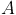

以下符号用于表示逻辑“与”：

以下符号用于表示逻辑“或”：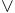

变量的逻辑否定将在变量上方用一条直线表示，因此变量  的否定为 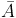

### 代码列表

列表、算法以及任何代码内容将以等宽字体显示，尽可能使用语法高亮，并放在专用框架内：

```javascript
function Example(phrase){
                // 这是一个简单的示例函数
                console.log(phrase);
            }

            class ExampleClass{
                // 这是一个简单的示例类
                constructor(){
                    // 这是一个示例构造函数
                }
            }
```

代码：示例代码列表

### 块引用


有时候需要逐字引用其他来源的内容，这时我们会使用块引用，其样式如下：

> 你好，我是一个块引用！当有内容被引用时，你就会看到我！

> 

> 我是块引用的另一行！祝你有美好的一天！

### 盒子

在阅读本书的过程中，你可能会遇到一些盒子，让我们看看有哪些类型。

提示！

这是一个提示框，这里会提供与当前章节大致相关的提示。这些小提示能帮助你制作出更好的游戏，或者帮你绕过某些难题。

陷阱警告！

这是一个陷阱框，它会提醒你注意前方的陷阱，以及某个解决方案可能存在的缺陷。

随机冷知识！

这是一个冷知识框，它会提供一些有助于你更好理解的小知识，或者只是让你在学习之余稍作休息。

注意！

这是一个普通注意框，它既不是陷阱、提示，也不是冷知识。它用于提醒事项，或者作为通用笔记使用。

### 使用的引擎

本书不使用任何引擎。所有算法都会假设幕后有一个“通用引擎”来处理精灵、向量等内容。本书的目标是以最不依赖引擎（如果你看的是“伪代码版”，也是最不依赖语言）的方式教授算法、技巧和游戏设计。

## 本书结构

本书分为多个章节，以下是每个章节的简要说明。

*   **前言：** 你没有跳过它，对吧？

*   **引言：** 这里介绍本书的结构以及它存在的原因。你现在正在阅读它，坚持住，快结束了！

*   **游戏开发背后的数学：** 这里我们将学习任何游戏都涉及的基础数学，如向量、矩阵和屏幕坐标。

*   **一些计算机科学基础：** 这里我们将学习（或复习）一些已知的计算机科学基础（以及一些不太为人知的！）和规则，这些将帮助我们管理游戏的开发。

*   **项目管理技巧：** 项目管理很难！这里我们将了解一些常见的陷阱和技巧，帮助我们按时交付自己的项目。

*   **游戏设计入门：** 在本节中，我们将讨论游戏可以运行的平台、输入方法以及一些游戏类型。

*   **编写游戏设计文档：** 在本节中，我们将了解当我们想要制作游戏时最早出现的文档之一，以及如何编写它。

*   **游戏循环：** 这里我们将学习“游戏循环”的基础知识，这是任何电子游戏的根本。

*   **碰撞检测与反应：** 在本节中，我们将讨论电子游戏中最复杂且计算量最大的操作之一：碰撞检测。

*   **摄像机：** 在本节中，我们将讨论在 2D 游戏中可以实现的不同类型的摄像机，并进行深入分析和解释。

*   **游戏设计：** 在本章中，我们将讨论关卡设计以及如何引导玩家学习和强化游戏机制，初步涉足游戏设计这个庞大的话题。

*   **创建你的资源：** 小型或独立游戏开发者可能需要自己创建资源，在本节中我们将了解如何创建自己的图形、音效和音乐。

*   **程序化内容生成：** 在本章中，我们将看到程序化生成与随机内容生成的区别，以及程序化生成如何应用于比我们想象的更多的事物。

*   **设计模式：** 深入探讨游戏开发中的软件工程方面，在本节中我们将检查许多游戏中使用的软件设计模式。

*   **有用的容器和类：** 一系列有用的类和容器，用于让你的游戏更易于维护且性能更佳。

*   **电子游戏中的人工智能：** 在本节中，我们将讨论帮助你编写敌人 AI 的算法，以及任何在游戏中需要“智能表象”的东西。

*   **其他有用的算法：** 在本节中，我们将看到一些游戏中常用的算法，包括寻路、世界生成等。

*   **开发游戏机制：** 这里我们将深入游戏开发最黑暗、最肮脏的秘密，游戏如何欺骗我们产生强烈情感，以及一些最常用的机制是如何实现的。

*   **电子游戏中的无障碍设计：** 这里我们将学习“无障碍”的概念，并了解我们可以为玩家提供哪些选项，使我们的游戏更易访问（也更易使用）。

*   **测试你的游戏：** 本节全是关于捉虫的，但没有杀虫剂。深入测试的世界，包括自动化测试和手动测试。

*   **优化和分析你的游戏：** 当事情不顺利时，比如游戏卡顿或太慢，我们必须依赖性能分析和优化。在本节中，我们将学习技巧、方法和流程，了解如何让游戏表现更好。

*   **平衡你的游戏：** 一个关于游戏平衡的非常理想化的视角，在本章中我们将深入玩家的内心，看看对我们来说“不错的挑战”如何转化为玩家眼中的“糟糕的平衡问题”。

*   **营销你的游戏：** 这里我们将从一个小型独立开发者的角度，审视行业在营销和维护自己产品时所犯的错误。我们还将检查一些更具争议性的话题，如战利品箱、微交易和季票。

*   **吸引你的社区：** 游戏的很大一部分力量来自其社区，在本节中我们将了解一些你可以在游戏内（以及游戏外）实施的建议，以进一步吸引你的忠实粉丝。

*   **游戏开发大赛：** 一个小节，专门介绍游戏开发大赛以及如何参与其中而不失去理智，同时还能交付一个原型。

*   **剖析游戏：** 一个小节，专门剖析一款（非常）糟糕的游戏和一款（非常）优秀的游戏的特点，让我们更深入地理解是什么让好游戏“好”，又是什么让坏游戏“坏”。

*   **项目创意：** 在本节中，我们将了解一些你可以尝试自己制作的项目，每个项目分为 3 个级别，每个级别会列出你需要掌握的技能才能应对该级别。

*   **接下来去哪里：** 我们到了最后冲刺阶段，你已经学到了很多，这里你会找到其他可能有用的资源，以便学习更多。

*   **词汇表：** 任何带有[g]符号的词语都会在这里找到定义。

*   **引擎和框架：** 一系列你可以选择用来开始游戏开发的框架和引擎。

*   **工具：** 一些你可以用来创建自己的资源、地图的软件和工具包，总体上让你的开发过程更轻松、更可控。

*   **预制资源和素材：** 在本附录中，你会找到许多网站和资源的链接，用于图形、音效、音乐或学习。

*   **贡献者：** 最后但同样重要的是，为本书做出贡献的人员名单。

祝你阅读愉快，我们开始吧！

第一部分：基础

# 游戏开发背后的数学

不要担心你在数学上的困难。我可以向你保证，我的困难更大。

——阿尔伯特·爱因斯坦

本书假设你已经具备一些基础的数学知识，包括但不限于：

*   对数

*   指数

*   根

*   方程

*   极限

*   笛卡尔坐标系


此外，我们将使用 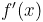 符号来表示导数，而不是更冗长的 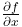。

在本章中，我们将快速回顾（如果你已经了解，则作为复习）制作 2D 游戏所需的基础数学知识。

## 一些有用的符号

在阅读本书时，我们可能需要深入探讨一些并非所有人都能立即理解的数学术语，因此这里提供一个我们可能会用到的数学符号简明词典。

*   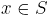 表示“集合隶属关系”，即符号左侧的对象是右侧集合的一个元素：`x` 是集合 `S` 中的一个元素；
*   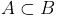 表示“子集关系”：`A` 是 `B` 的子集；
*   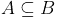 表示一种可能相等的“子集关系”：`A` 是 `B` 的子集，但同时也可能出现 `A` 等于 `B` 的情况；
*   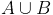 表示“集合并集”，结果由 `A` 和 `B` 的所有元素组合而成；
*   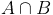 表示“集合交集”，结果由 `A` 中同时也存在于 `B` 中的所有元素组成；
*    意思是“对于所有”；
*   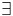 意思是“存在”；
*   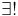 意思是“存在且唯一”；
*   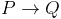 意思是“蕴含”，你可以将其读作“`P` 蕴含 `Q`”或“如果 `P` 为真，那么 `Q` 为真”；
*   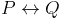 逻辑等价：意思是“当且仅当”或“等价”，你可以将其读作“`P` 等价于 `Q`”或“`P` 当且仅当 `Q`”；

## 取模运算符

数学中一个非常基础但有时被忽视的函数是“取模”函数（或“取模运算符”）。取模是一个接受两个参数（我们称之为 `a` 和 `b`）的函数，并返回 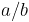 所代表的除法余数。

例如：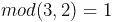 或 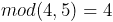 以及 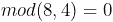。

在大多数编程语言中，取模函数隐藏在运算符 `%` 之后，这意味着函数 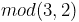 用 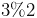 来表示。

当我们需要将一个不断增长的值在两个值之间循环时，取模运算符非常有用（详见 无限滚动背景）。

**陷阱警告！**

在使用负数参数进行取模运算时要小心：它可能会导致意外的结果，且结果可能取决于你所使用的编程语言。

## 向量

为了实现我们的目标，我们将尽可能地简化向量这一复杂课题。

在 2D 游戏开发的情况下，向量仅仅是一对值 `(x,y)`。

向量通常代表施加在物体上的力、其速度或加速度，并在图形上用箭头表示。


*向量图示*

学习向量的艰辛将通过其强大的能力得到回报：它们可以相互加减，也可以与一个数字（称为“标量”）相乘，或者彼此相乘。

### 向量的加法和减法

向量加法就像相加其“成员”一样简单。让我们考虑以下向量：

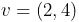
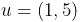

那么和向量 `s` 将为：

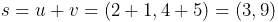

在图形上，可以通过将箭头 `v` 的尾部放在箭头 `u` 的头部（或反之）来表示：


*向量之和的图形表示*

### 向量缩放

在某些情况下，你可能需要让向量 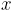 倍长。这种操作称为“标量乘法”，其执行方式如下：


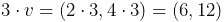


*向量乘以 3 的示例*

显然，这同样适用于值在 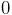 和  之间的标量：


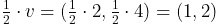


*向量乘以 0.5 的示例*

当你将向量乘以一个小于  的值时，向量将旋转 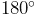。


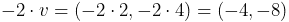


*向量乘以 -2 的示例*

### 点积

点积（或标量积、投影积或内积）定义如下：

给定两个 n 维向量 ![v = [v_1, v_2, ... v_n]](media/file37.png) 和 ![u = [u_1, u_2, ..., u_n]](media/file38.png)，点积定义为：

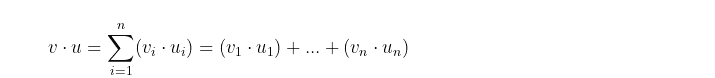

因此在我们的案例中，我们可以轻松地计算两个二维向量 ![v = [v_1, v_2]](media/file40.png) 和 ![u = [u_1, u_2]](media/file41.png) 的点积：


举个例子：

给定向量 ![v = [1,2]](media/file43.png) 和 ![u = [4,3]](media/file44.png)，其点积向量为：


### 向量长度与归一化

给定一个向量 ![a = [a_1, a_2, ..., a_n]](media/file46.png)，你可以将向量的长度定义为：


或者


我们可以通过“归一化”来获得一个长度为 1 单位的向量，从而得到一个在不影响幅值的情况下，用于影响（或指示）方向的有用向量。归一化向量通常用一个“帽子”符号表示，因此 ![a = [a_1, a_2, ..., a_n]](media/file46.png) 的归一化向量为：

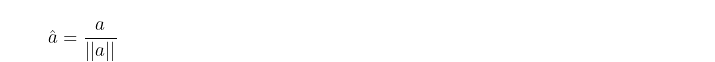

由于向量的长度是一个标量（一个数字，而非向量），因此适用正常的标量乘法规则。（参见 向量缩放）

### 向量“钳制”（Clamping）

这本身并不是一种运算，但在某些场合我们需要限制向量的长度：这通常发生在处理速度时，因为如果不加限制，物体的位置变化会越来越快，导致游戏可玩性降低，甚至破坏基于时间步长的碰撞检测算法。

要钳制一个向量，我们首先需要找到它的幅值和方向，即“归一化向量”。考虑向量 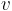，其幅值和方向为：

 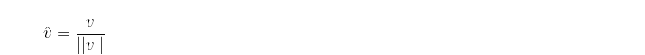

之后，我们可以使用“钳制后的幅值”（我们称之为 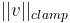）来构建一个新向量，计算方式如下：

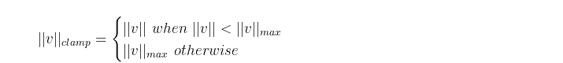

为了构建新向量，我们只需要将  乘以 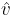：


新向量将与原向量具有相同的方向，但其幅值将被钳制，正如我们所希望的那样。

## 几何

在目前为止我们接触到的所有数学（以及稍后将解释的数学）中，我们无法避免谈论几何：在本书中，我们将讨论理解后续概念所需的最少几何知识。

### 凸多边形 vs 凹多边形


一个多边形被认为是凸的，本质上当**任意一条直线**（不与边或顶点相切）穿过该形状时，只与形状相交两次（在其两端）。


凸形状示例

任何形状，如果你能找到至少一条直线穿过该形状超过两次，则被认为是“非凸的”（通常称为“凹的”）。


凹形状示例

注意！

严格来说，并非所有非凸形状都称为“凹的”（它们应被称为“非凸的”），但为了简便起见，本书中我们将交替使用“非凸”和“凹”这两个术语。

### 自交多边形

与许多人的想法相反，多边形也可以自交，这会使计算变得困难得多。


自交多边形示例

为了游戏开发的需要，我们通常讨论简单多边形，即不自交且内部没有孔洞的多边形。更严格地说，我们（99.9% 的情况下）将讨论**凸简单多边形**。

### 直线及其方程

在游戏开发之旅中，我们将反复遇到的一个主要主题是“直线”。我们需要绘制它们，判断两条直线是否相交，将物体投影到它们上面，等等。因此，熟悉它们非常重要。

这是一条直线：


这和你预想的不一样，对吧？你看到的是直线方程的“一般形式”，因为你可以用方程来表示直线（以及圆和其他东西）。不过，这种形式并不常用，最常用的形式可能是“斜截式”：


随机小知识！

要将“一般形式”方程转换为对应的“斜截式”，只需记住以下公式：

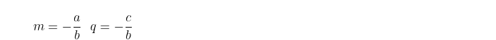

当 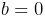 时，这个公式就不适用了，这将是下一个“陷阱”的主题。

其中，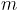 是直线的*斜率*，而 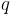 表示所谓的*y 轴截距*（当 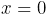 时 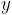 的值）。如果 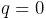，直线经过笛卡尔坐标系的原点；如果 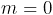，直线是水平的。

陷阱警告！

“垂直直线”是斜截式失效的地方，实际上垂直直线的方程形式为 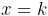，这意味着 ，这会产生问题（参见前面的小知识）。

#### 已知两点求直线方程

我们都知道，给定两点可以确定唯一一条直线。你有多少次测量两个点（比如在做 DIY 时）并在它们之间画一条直线？

在我们的冒险中，能够从两个点出发得到直线方程将非常有用。因此，让我们将两个点记为 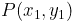 和 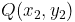，那么穿过这两点的直线方程为：

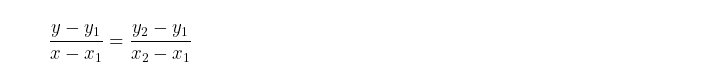

这看起来可能很复杂，但通过一些简单的计算，我们可以得到任意形式（一般式或“斜截式”）的直线公式。

陷阱警告！

同样，当处理“垂直线”时，这个公式会失效，因为方程右侧的分母为零。但在那种情况下，我们已经知道公式：它将是 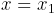（这又等于 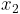）。

#### 已知斜率和一点求直线方程

如果我们有一个点  和斜率 （例如，需要找到与另一条直线垂直的直线），那么我们可以使用以下公式：


陷阱警告！

猜猜看？这（再次）无法创建“垂直线”，因为我们需要一个斜率值，而垂直线没有斜率。你可以（非严格地）将垂直线视为具有“无穷大斜率”的直线。

### 投影

在某些情况下（如你将在 SAT 中看到的），我们可能需要将多边形投影到一条直线上，这通常涉及将**点**投影到直线上。

利用我们之前看到的公式，并稍加思考，我们可以轻松地将一个点投影到任意直线上。让我们看看如何操作。

假设我们有一个点 ，想要将其投影到一条直线  上，该直线方程为 ，且 （因此排除水平直线）。我们将投影点称为“P 在 r 上的投影”，记为 。


将点 P 投影到直线 r 上

首先，我们需要找到经过  且垂直于  的直线，这非常简单。要找到与斜率为  的直线垂直的直线的斜率 ，我们使用公式：


陷阱警告！

这就是为什么我们排除了 （水平直线）的情况，否则我们可能会得到 ，这没有意义。

现在我们有了一个点和斜率，因此可以使用我们之前见过的某个公式来找到具有该斜率且经过  的直线：


要找到 ，我们只需要找到两条直线的交点，即方程组的解：


其解为：


我们刚刚找到的坐标  和  实际上就是投影点  的坐标  和 。

#### 将任意直线投影到坐标轴上

类似于我们对点的操作，我们可以将任意直线（或者更准确地说，该直线的端点）投影到坐标轴上。这将在后续计算中帮助我们。

要将任意直线投影到 x 轴上，我们只需将“直线上所有点”通过以下函数：


如果要将该直线投影到 y 轴上，我们可以使用另一个函数：


下面是将一条直线投影到坐标轴上的图形表示：


将直线投影到坐标轴上

## 矩阵

### 什么是矩阵

矩阵本质上是一个  的数字阵列，用于表示线性变换。

下面是一个  矩阵的例子。


### 矩阵的加法和减法

对  矩阵进行加法和减法是通过对每个元素进行相加或相减来完成的，下面是一个简单的例子。给定以下矩阵：


我们有：


## 标量乘法

标量乘法与向量的运算方式类似，给定矩阵：


标量乘法通过将矩阵的每个元素乘以该标量来实现，如下例所示：


## 转置

给定一个 `m \times n` 矩阵 `A`，其转置是一个 `n \times m` 矩阵 `A^T`，通过将行变为列、列变为行来构造。

给定矩阵：


转置矩阵为：


## 矩阵乘法

给定两个大小分别为 `m \times n` 和 `n \times p` 的矩阵（注意第一个矩阵的行数等于第二个矩阵的列数）：


我们可以按以下方式计算这两个矩阵的乘法。

首先，确定结果矩阵的大小，它始终是 `m \times p`。

现在我们面临以下情况：


矩阵乘法被称为“行乘列”乘法，因此要计算第一行第一列的值，我们需要一个矩阵的第一行和另一个矩阵的第一列。


示例中的值将按如下方式组合：


得到以下结果：


接下来尝试下一个值：


这些值将按如下方式组合：


得到：


最后一个值也是如此。处理完第一行后，我们继续以类似方式处理第二行：


这导致以下计算：


我们将它插入结果矩阵：


你可以自己尝试完成这个计算，最终结果如下：


**注意！**

矩阵乘法是`非交换`的，这意味着 `A \times B` 的结果不等于 `B \times A` 的结果：实际上，其中一个结果甚至可能无法计算。

## 矩阵的其他用途

矩阵可用于快速表示方程组，其中方程相互依赖。例如：


可用于表示以下方程组：


或者，正如我们将看到的，矩阵可用于表示游戏开发中的变换。

# 三角学

当你想要开发一个游戏时，你可能会发现自己需要相对于某个点或彼此旋转物体。要做到这一点，你需要了解一些三角学知识，那么开始吧！

## 弧度与角度

在日常生活中，角度以度为单位测量，从 0 到 360 度。在数学的某些情况下，使用弧度测量角度更方便，范围从 0 到 `2 \pi`。

你可以使用以下公式在弧度和角度之间进行转换：


本书将始终以弧度表示角度，因此这里提供一些有用的转换，供你随时使用：

### 角度与弧度之间的转换

| 角度 | 弧度 |
| --- | --- |
| 0° | 0 |
| 30° |  |
| 45° |  |
| 60° |  |
| 90° |  |
| 180° |  |
| 360° |  |

## 正弦、余弦和正切

最重要的三角函数是正弦和余弦。它们通常参照“单位圆”（半径为 1 的圆）来定义。

给定单位圆，让一条通过原点、与 x 轴正方向夹角为 `\theta` 的直线与该单位圆相交。交点的 x 坐标由 `cos(\theta)` 定义，y 坐标由 `sin(\theta)` 定义。


*单位圆定义正弦和余弦*

就本书而言，我们将避免正切函数的完整定义，仅将其作为正弦和余弦的公式给出：


### 勾股三角恒等式

三角学中最重要的恒等式之一是“勾股三角恒等式”，其表达式如下，适用于任意角度 ：


利用这个恒等式，你可以用不同的方式表示函数：


同时请记住  和 。

### 反射

有时我们可能需要反射一个角度，以便用更简单的方式表达它，而相应的三角函数公式也会受到影响，因此以下公式可能会派上用场：

三角学中的一些反射公式

| 反射公式 |
| --- |
|  |
|  |
|  |
|  |
|  |
|  |
|  |
|  |

### 平移

三角函数是周期性的，因此当它们的自变量偏移一定量时，计算起来可能会更容易。以下是一些平移公式：

三角学中的一些平移公式

| 平移公式 |
| --- |
|  |
|  |
|  |
|  |
|  |
|  |

### 三角函数的加法与减法

有时你可能需要将一个复杂自变量的三角函数表达式拆分成不同的三角函数公式。如果该自变量是角度的和或差，你可以使用以下公式：

三角学中的一些加法与差角恒等式

| 加法/差角恒等式 |
| --- |
|  |
|  |

### 倍角公式

其他时候（通常是在纸上），你可能会遇到一个自变量是已知角度的倍数的情况，此时可以使用倍角公式来计算。

三角学中常用的一些倍角公式

| 倍角公式 |
| --- |
|  |
|  |

### 反函数公式

与几乎所有数学公式一样，正弦和余弦也有反函数，称为  和 ，它们允许根据正弦和余弦值求出角度。

在本书中，我们不再详细说明，只介绍最有用的一种：双参数反正切函数。

该公式允许你根据向量“末端”的 `x` 和 `y` 坐标，求出该向量相对于坐标系的夹角，该角度  定义为：


向量角度的图形绘制

## 数值分析

这里我们将介绍一些算法和方法，它们可能有助于更好地解释本书中涉及的某些主题。如果你不想深入探讨这类数学的细节，可以跳过或快速浏览本节。

### 牛顿-拉弗森方法

也称为牛顿法，这是一种迭代算法，用于逐步逼近函数的根。

该算法从一个“猜测值”开始，称为 ，并使用以下公式生成第一个近似值：


后续的每个猜测值（以及迭代）可以通过类似的方式使用以下公式获得：


并且该猜测值将比前一个更精确（如果不考虑某些情况下逼近根可能存在问题或无法实现）。当达到“足够好”的近似值时，算法将停止。

显然，标准函数的所有限制仍然适用，例如定义域和除以零的问题。

## 计算机中的坐标系

在计算机的二维图形中，我们的世界可以说是颠倒的。

在数学课程中，我们学习了坐标平面，它有一个原点，`x` 轴从左到右，`y` 轴从下到上，这两条轴的交点称为“原点”。


坐标平面图像

在计算机的二维图形和游戏开发中，坐标平面如下所示：


屏幕坐标平面图像

原点位于屏幕的左上角（坐标为 `(0,0)`），`y` 轴从上到下。一开始可能有点奇怪，但习惯起来并不难。

## 变换矩阵

在游戏开发的过程中，有时我们需要旋转一个物体，这通常很容易，因为几乎所有引擎和工具包都原生支持旋转。但有时我们也需要手动进行变换。

例如，相对于某个点或另一个物体旋转一个物品：想象一支战斗机编队飞行，所有飞机都相对于“队长”移动（并因此旋转）。

在本章中，我们将讨论三种最常用的变换：

*   拉伸/压缩/缩放；

*   旋转；

*   剪切。

### 拉伸

拉伸是一种变换，它按某个定义的常数因子放大特定方向上的所有距离。在二维图形中，你可以沿 x 轴、y 轴或两者同时进行拉伸（或压缩）。

如果你想沿 x 轴按因子  拉伸某物，你将得到以下方程组：


这可以转化为以下矩阵形式：


同样，你可以沿 y 轴按因子  拉伸某物，使用以下矩阵：


你可以混合搭配这些因子，获得不同类型的拉伸。如果在 x 轴和 y 轴上使用相同的因子 ，则执行的是*缩放*操作。

如果你不是拉伸，而是想按因子  压缩某物，只需对 x 轴使用以下矩阵：


以及分别对应 y 轴：


### 旋转

如果你想将物体旋转某个角度 ，除了旋转角度外，还需要决定两件事：

*   旋转方向（顺时针或逆时针）；

*   旋转的参考点。

#### 选择旋转方向

我们将  称为“旋转”功能的变换矩阵。

与拉伸类似，将物体旋转某个角度  会得到以下矩阵形式：


如果我们想相对于参考点**顺时针**旋转物体，将使用以下变换矩阵：


如果我们想**逆时针**旋转，则使用以下矩阵：


陷阱警告！

这些公式**假设 x 轴指向右，y 轴指向上**，如果你的实现中 y 轴指向下，则需要交换矩阵。

#### 绕任意点旋转

旋转的最大问题在于绕某个点旋转物体：你需要知道坐标系的原点，并按如下方式修改矩阵：


简而言之，你需要先将物体“平移到原点”，旋转它，然后再将其移回原位。

### 剪切

在拉伸时，我们使用“主对角线”上的元素来拉伸物体。如果修改“副对角线”上的元素，我们将得到剪切映射（或剪切）。

剪切会沿着某个轴移动点，移动的“强度”由沿另一轴的距离决定：如果剪切一个矩形，我们将得到一个平行四边形。

平行于 x 轴的剪切将使用以下矩阵：


而平行于 y 轴的剪切则使用以下矩阵：


# 一些计算机科学基础

计算机科学家面临的主要挑战，是不被自己制造的复杂性所迷惑。

—— Edsger W. Dijkstra

为了理解后续将要出现的某些术语，有必要学习一些计算机科学的语言和基础知识。

本章将简要解释一些术语和用词，它们的含义，以及它们如何帮助你进行游戏开发。

在本章中，我们假设你已经知道以下术语的含义：

*   真值表

*   算法

## 递归

从（可以说比较难的）递归主题开始可能看起来很奇怪，但尽早理解递归很重要，这样我们才能充分利用它。

我喜欢讲一个关于递归的笑话：

> 要理解递归，你必须先理解递归。

什么是递归？递归就是使用一个调用自身的函数。

你的第一个问题可能是：这不会让程序永远陷入某种循环吗？有可能。但如果你小心使用，递归是一个神奇的工具，能让你获得极大的清晰度和简洁性。

让我们想象一个简单的算法：我们希望程序从数字 `n` 倒数到 0。用简单的“循环”方式，我们可以这样写：

```
[](#cb2-1)function count_backwards(n){
[](#cb2-2)                // 循环条件
[](#cb2-3)                while (n != 0){
[](#cb2-4)                    // 函数体
[](#cb2-5)                    console.log(n);
[](#cb2-6)                    // 更新条件以实现倒数
[](#cb2-7)                    n = n - 1;
[](#cb2-8)                }
[](#cb2-9)            }
```

代码：使用循环从 n 倒数到 0

很简单，对吧？一个现实世界的例子是从 10 倒数到 0：我们打印 10，减去 1 得到 9，打印 9，减去 1 得到 8，……

让我们换个思路。我们可以这样看待从 10 倒数到 0：先打印 10，然后从 9 开始倒数。从 9 倒数就是打印 9，然后从 8 开始倒数，以此类推……

我们刚刚把简单的循环变成了递归函数：

```
[](#cb3-1)function count_backwards(n){
[](#cb3-2)                // 停止条件
[](#cb3-3)                if (n == 0){
[](#cb3-4)                    return;
[](#cb3-5)                }
[](#cb3-6)                // 过程
[](#cb3-7)                console.log(n);
[](#cb3-8)                // 递归调用
[](#cb3-9)                count_backwards(n-1);
[](#cb3-10)            }
```

代码：使用递归从 n 倒数到 0

递归函数有三个主要组成部分：

*   **基本情况**（有时称为“停止条件”）：当满足某个条件时，函数停止调用自身；

*   **过程**：处理数据或执行某些操作（在我们的例子中，只是打印数字）；

*   **递归调用**：调用正在编写的同一个函数，调用方式要确保每次调用都更接近“停止条件”。可以通过对参数子集（如果是列表）调用函数，直到列表只剩一个元素，或者对更小的数字（如果函数参数是数字）调用函数来实现。

递归可以按多种方式分类：

*   **按递归调用的数量：** 单次递归与多次递归；

*   **按递归调用的方式：** 直接递归（函数直接调用自身）与间接递归（函数 A 被另一个函数 B 调用，而 B 又被函数 A 调用）；

*   **按递归调用的位置：** 头递归与尾递归。

我想强调最后一种区别：我们在前面的代码中看到的是“尾递归”：递归调用是在所有其他操作（过程）**之后**进行的。

而头递归则是在过程**开始之前**进行递归调用，因此我们可以通过将“尾递归”改为“头递归”并添加一条打印语句，将“倒数”函数转换为“正数”函数。


```
function count_backwards(n){
                // Stop condition
                if (n == 0){
                    // If we don't do this, we won't print 0
                    console.log(n);
                    return;
                }
                // Recursive call
                count_backwards(n-1);
                // Procedure
                console.log(n);
            }
```

代码：使用头递归从 0 计数到 n

## 计算机（不）精确

人类和计算机之间有许多差异，其中有一个差异将一直困扰我们：人类以“十进制”（基数为 10）进行计算，而计算机以“二进制”（基数为 2）进行计算。

这要求计算机以不同的方式表示数字，通常采用指数+尾数表示法（IEEE 754）。此外，计算机资源有限，因此没有“无穷大”（以及“无穷小”）的概念。

假设我们有一台精度降低的计算机，并执行以下 C++程序：

```
#include <iostream>
            #include <iomanip>
 
            int main ()
            {
                // This will reduce the computer's precision for this execution
                std::cout << std::setprecision(20);
 
                float d1(1.0);
                std::cout << "This should be 1.0: " << d1 << std::endl;
 
                float d2(0.1);
                std::cout << "This should be 0.1: " << d2 << std::endl;
 
                float d3(0.1*0.1);
                std::cout << "This should be 0.01:" << d3 << std::endl;
 
                bool x (0.1 + 0.1 + 0.1 == 0.3);
                std::cout << "This should be true (1): " << x << std::endl;
 
                return 0;
              }
```

我们将其保存为 `precision_test.cpp`，并使用以下命令行（在 Linux 上）编译：

```
g++ -Wall -Wextra -Werror -O0 precision_test.cpp -o precision_test.bin
```

该程序将临时降低数字表示的精度，并尝试输出数字 、 和  的值，让我们看看结果：


简单浮点精度测试的结果

数字  一切正常，但是……  发生了什么？那些垃圾是什么？数字  更糟糕！甚至都不接近！为什么  的结果不等于 ！**数学到底怎么了？**

我们刚刚遇到了计算机的（众多）限制之一：计算机无法在不“近似”的情况下表示某些数字。存在编译器和库来解决这些问题，但我们需要做好准备，避免意外。

再次强调：这不是单一编程语言的问题，我们可以看到 C++受到影响，但 Python 也有同样的问题：


Python 2 与 C++ 存在相同的精度问题


Python 3 在精度方面也没有好多少

这通常是计算机的问题，对于一般用途可能不是大问题，但如果我们试图在计算中过于精确，这可能会反过来困扰我们。

### 灾难性抵消

“灾难性抵消”这个名字听起来很危险，这确实是一种危险的现象，但只有在我们不了解它时才会危险。

灾难性抵消（有时称为“抵消误差”）是在减去两个（通常较大的）数值相近的数字时可能发生的事件。

**警告：** 从本节开始，将出现一些技术性语言。我会尽量使其简单易懂。

假设有一台计算机，其内存最多能处理 8 位小数，而其 A.L.U.（负责“做数学”的单元）最多能处理 16 位小数。

现在取两个数字：


当我们将这些数字传输到内存中时，计算机会近似这些数字以适应其内存限制。我们通过给每个数字应用一个函数  来表示这一点，该函数可以理解为“该数字的浮点表示”。因此，我们最终得到：


这通常被称为“赋值误差”，即在给变量赋值时，数字丢失了部分信息。

让我们尝试计算这些近似值有多大的偏差（通过计算百分比“相对误差”），以便了解仅将数字加载到“假想计算机”上就损失了多少：

 

我们可以看到，我们的近似值**非常接近**我们要计算的数字，现在让我们计算 。手动计算的话，我们会得到：


这是一个非常小的数字。现在让我们计算 ，记住 A.L.U.会填充到 16 位小数：


看起来还不错，除非我们看“相对误差”：


哦不……我们偏离了总结果的 16%！这是一个巨大的损失！真正的灾难。

发生了什么？如果你仔细观察，这些数字非常接近，甚至有 7 位小数相同，由于我们的计算机只能记住 8 位数字，第 9 到第 13 位小数看起来如此不重要，却突然成为结果的大部分（由于减法），但它们已经丢失了。

## 随机数并非真正随机

计算机是确定性机器，给定相同的指令和输入，它们**总是**返回相同的输出。有人可能会想到“随机数生成器”，当然，这些程序看起来像是在屏幕上吐出随机数，但实际上并非如此。

生成随机数时最重要的数字称为 `seed`（种子），它是生成器用来产生随机数的数字。

让我们看一个 C++中随机数生成器的例子：

```
#include<iostream>
            int main(){
                // First of all we get the seed
                unsigned int seed;
                std::cout << "Type the seed: " ;
                std::cin >> seed;
                // Now we seed the randomizer
                srand(seed);
                // Small presentation
                std::cout << "This generator will now generate 10 random numbers" << std::endl;
                // Output 10 random numbers
                for (int i = 0; i < 10; ++i) {
                    std::cout << rand() << std::endl;
                }
                // Finish the program
                return 0;
            }
```

我们可以将此程序保存为 `random_seed.cpp`，并使用以下命令编译：


```
[](#cb8-1)g++ -Wall -Wextra -Werror -O0 random_seed.cpp -o random_seed.bin
```

当我们运行程序时，它会要求我们输入一个种子（在我们的例子中是一个数字），之后它会基于该种子打印 10 个随机数。如果我们运行程序两次并使用相同的种子，会发生什么？


使用相同种子运行随机数生成器将始终输出相同的数字

计算机生成的随机数从来都不是真正的随机数，这就是为什么它们更恰当地被称为“伪随机数”。

## 德摩根定律与条件表达式

德摩根定律在计算机科学以及任何涉及命题逻辑的学科中都是基础性的。我们将快速了解一下与编码严格相关的含义。

德摩根定律可以写成：

> `not (A and B) = not A or not B`
> `not (A or B) = not A and not B`

用符号表示：

 

这些定律允许我们以不同的方式表达自己的条件语句，从而提高可读性，并可能避免一些可能妨碍游戏性能的布尔操作。

## 估算算法的复杂度

如今，你比以往任何时候都更需要高效。你如何知道某个算法的“效率”如何？

查看所需时间并不是一个可行的选项，因为计算机规格因系统而异，所以我们需要一种可以被视为“跨平台”的东西。

这就是符号发挥作用的地方。

你应该知道三种渐近符号：、 和 `O`。

`()` 表示下界：这意味着算法至少会执行指定数量的周期。

`O()` 表示上界：这是最常用的符号，意味着算法最多会执行指定数量的周期。

`()` 是一个紧界，当大 O 符号和大符号具有相同值时使用，这有助于更好地定义算法的行为。

我们现在将讨论最常见的 Big-O 符号，从“最高效”到“最低效”。

陷阱警告！

请注意一件具体的事情：这些符号只是将算法的性能与某个变量（通常是数据集）的增长方式联系起来。如果你确定数据集保持相对较小，那么一个效率较低的算法可能不会产生巨大差异。

### `O(1)`

以 `O(1)` 执行的算法被称为“常数时间”执行，这意味着无论输入多少数据，该算法都会在相同的时间内执行。

一个简单的 `O(1)` 算法的例子是：给定一个元素列表（至少有一个元素），如果第一个元素是 `null`，则返回 `True`。

```
[](#cb9-1)function isFirstElementNull(elements){
[](#cb9-2)                if (elements[0] == null){
[](#cb9-3)                    return true;
[](#cb9-4)                }else{
[](#cb9-5)                    return false;
[](#cb9-6)                }
[](#cb9-7)            }
```

代码：一个 `O(1)` 算法的示例

准确地说，该算法将在 `O(1)` 和  中执行，因此它将在  中执行。

### `O(log(n))`

以 `O(log(n))` 执行的算法被称为“对数时间”执行，这意味着给定 `n` 个输入项，该算法最多执行 `log(n)` 个周期。

一个 `O(log(n))` 算法的例子是对有序列表进行的所谓“二分查找”。

```
[](#cb10-1)function binarySearch(elements, element_to_find, begin, end){
[](#cb10-2)                // We need some indexes to make this work
[](#cb10-3)                if (begin === undefined){
[](#cb10-4)                    begin = 0;
[](#cb10-5)                }
[](#cb10-6)                if (end === undefined){
[](#cb10-7)                    end = elements.length - 1;
[](#cb10-8)                }
[](#cb10-9)                // Get the middle element
[](#cb10-10)                let middle_element_index = Math.floor((end - begin) / 2) + begin;
[](#cb10-11)                let middle_element = elements[middle_element_index];
[](#cb10-12)                if (end <= begin && element_to_find != middle_element){
[](#cb10-13)                    // We found nothing, if we don't have this base case the algorithm will keep going forever
[](#cb10-14)                    return null;
[](#cb10-15)                }
[](#cb10-16)                if (element_to_find == middle_element){
[](#cb10-17)                    return middle_element_index;
[](#cb10-18)                }
[](#cb10-19)                if (element_to_find > middle_element){
[](#cb10-20)                    return binarySearch(elements, element_to_find, middle_element_index + 1, end);
[](#cb10-21)                }else{
[](#cb10-22)                    return binarySearch(elements, element_to_find, begin, middle_element_index - 1);
[](#cb10-23)                }
[](#cb10-24)            }
```

代码：一个 `O(log(n))` 算法的示例（二分查找）

最佳情况是当你要查找的元素恰好是列表的“中间元素”时，在这种情况下，算法将以线性时间执行： - 你至少需要一次查找 ()，最多需要一次查找 ()。

在最坏情况下，元素不在列表中，因此你必须拆分列表并查找中间元素，直到意识到没有更多元素可迭代——这转化为一个紧界 

### `O(n)`

以 `O(n)` 执行的算法被称为“线性时间”执行，这意味着给定 `n` 个输入项，该算法最多执行 `n` 个周期。

一个简单的 `O(n)` 算法的例子是逐元素打印列表的算法。

```
[](#cb11-1)function printList(list){
[](#cb11-2)                for (const element in list){
[](#cb11-3)                    console.log(element);
[](#cb11-4)                }
[](#cb11-5)            }
```

代码：一个 `O(n)` 算法的示例（打印列表）

很明显，该算法将调用 `print` 函数 `n` 次，其中 `n` 是列表的大小。这转化为  复杂度，它既是  又是 。

这里没有“最佳”或“最差”情况，该算法打印 `n` 个元素，无论它们的顺序、行星和恒星的排列，还是其父级的许可。

### `O(n·log(n))`

以 `O(n·log(n))` 执行的算法比线性算法花费的时间稍长，但仍被认为是“理想的”。这些算法被称为“准线性”、“对数线性”、“超线性”或“线性对数”时间。

给定 `n` 个输入元素，这些算法执行 `n·log(n)` 步或周期。

一些以 `O(n·log(n))` 运行的算法有：

*   快速排序
*   堆排序
*   快速傅里叶变换 (F.F.T.)

这些算法比简单的示例更复杂，需要单独一章来讲解，因此我们暂时不举例。

### `O(n²)`

二次算法，即那些以 `O(n²)` 执行的算法，是通往“危险区域”的大门。

这些算法会很快消耗你的 CPU 时间，尽管它们仍然可以用于小型计算，效率尚可。

给定 `n` 个输入元素，这些算法执行 `n²` 个周期，这意味着给定 **20** 个元素，我们将执行 **400** 个周期。


二次算法的一个简单示例是“冒泡排序”。这里给出了一个伪代码实现。

```
[](#cb12-1)function bubbleSort(A){
[](#cb12-2)                let n = length(A);
[](#cb12-3)                let swapped = false;
[](#cb12-4)                do{
[](#cb12-5)                    swapped = false;
[](#cb12-6)                    for (let i = 1; i < n; i++){
[](#cb12-7)                        if (A[i-1] > A[i]){
[](#cb12-8)                            // 交换元素
[](#cb12-9)                            let tmp = A[i-1];
[](#cb12-10)                            A[i-1] = A[i];
[](#cb12-11)                            A[i] = tmp;
[](#cb12-12)                            swapped = true;
[](#cb12-13)                        }
[](#cb12-14)                    }
[](#cb12-15)                }while(swapped);
[](#cb12-16)            }
```

代码：一个 O(n²) 算法的示例（冒泡排序）

任何复杂度高于 O(n²) 的算法通常被认为不可用。

### O(2^n)

以指数时间执行的算法被视为重大红色警报，通常会被启发式算法取代（启发式算法会牺牲一些精度以降低复杂度）。

给定一个包含 `20` 个元素的输入，一个以 O(2^n) 执行的算法将执行 2²⁰ = 1 048 576 次循环！

## 算法阶数计算入门

### 一些基础知识

当你估算一个算法时，通常需要计算它在“最坏情况”下的表现，这意味着所有循环都会执行到结束（列表末尾或计数器上限），并且所有操作都花费尽可能长的时间。

让我们从一个例子开始：

```
[](#cb13-1)// 一个简单的 O(1) 算法：给变量赋值
[](#cb13-2)            let my_variable = 1;
```

代码：一个简单的 O(1) 算法

这是一个简单的赋值操作，我们认为它是瞬间完成的。因此它的复杂度是 。

现在来看另一个算法：

```
[](#cb14-1)// 一个简单的 O(n) 算法：遍历列表
[](#cb14-2)            for (const item in my_list){
[](#cb14-3)                console.log(item);
[](#cb14-4)            }
```

代码：一个简单的 O(n) 算法

在这个例子中，我们遍历一个列表。可以看到，随着列表的增长，我们在屏幕上打印元素的次数也会增加。因此，如果列表有  个元素，我们将调用输出语句  次。这是一个  复杂度的算法。

现在，让我们分析一个我们已经见过的算法：冒泡排序算法：

```
[](#cb15-1)function bubbleSort(A){
[](#cb15-2)                let n = length(A);
[](#cb15-3)                let swapped = false;
[](#cb15-4)                do{
[](#cb15-5)                    swapped = false;
[](#cb15-6)                    for (let i = 1; i < n; i++){
[](#cb15-7)                        if (A[i-1] > A[i]){
[](#cb15-8)                            // 交换元素
[](#cb15-9)                            let tmp = A[i-1];
[](#cb15-10)                            A[i-1] = A[i];
[](#cb15-11)                            A[i] = tmp;
[](#cb15-12)                            swapped = true;
[](#cb15-13)                        }
[](#cb15-14)                    }
[](#cb15-15)                }while(swapped);
[](#cb15-16)            }
```

代码：冒泡排序算法，一个 O(n²) 算法

这需要我们稍微动点脑筋：我们可以看到这段代码中有两个嵌套循环。最坏情况是什么？答案是“元素按逆序排列”。

当元素按逆序排列时，我们需要遍历整个列表才能将最大的元素放到列表末尾，然后再遍历一次将第二大的元素放到倒数第二个位置……以此类推。

因此，每将一个元素放到正确位置，我们就需要遍历整个列表一次。这个过程对每个元素都会发生。

所以，在一个长度为 `n` 的列表中，我们将最大的元素放到正确位置需要 `n` 次，而每次都需要扫描 `n` 个元素：结果是 。

该算法的时间复杂度为 。

### 当有多个大 O 时怎么办？

有时我们会遇到如下所示的代码：

```
[](#cb16-1)// -------------------------------------
[](#cb16-2)            let n = A.length;
[](#cb16-3)            let swapped = false;
[](#cb16-4)            do{
[](#cb16-5)                swapped = false;
[](#cb16-6)                for (let i = 1; i < n; i++){
[](#cb16-7)                    if (A[i-1] > A[i]){
[](#cb16-8)                        // 交换元素
[](#cb16-9)                        let tmp = A[i-1];
[](#cb16-10)                        A[i-1] = A[i];
[](#cb16-11)                        A[i] = tmp;
[](#cb16-12)                        swapped = true;
[](#cb16-13)                    }
[](#cb16-14)                }
[](#cb16-15)            }while(swapped);
[](#cb16-16) 
[](#cb16-17)            // -------------------------------------
[](#cb16-18) 
[](#cb16-19)            for (const item in A){
[](#cb16-20)                console.log(item);
[](#cb16-21)            }
```

代码：一个需要估算的更复杂算法

我们可以看到，第一部分是冒泡排序算法，接着是遍历（现已排序的）列表，打印其值。

我们可以将总估算值计算为 ，这完全正确。但随着列表的增长， 的增长速率与  相比非常微小，如下图所示：


O(n) 增长速率与 O(n²) 对比

因此，我们可以忽略 ，将整个算法视为一个  算法。这意味着在处理复杂度估算时，你总是保留具有最大“增长速率”的项（更多细节请参考 大 O 估算对比 部分）。

### 递归算法如何处理？

当涉及递归算法时，事情会变得复杂得多，需要构建递归树，有时还需要使用所谓的“分治递归的主定理”。

这些方法超出了本书目前的范围。

### 大 O 估算之间如何相互比较？

下面我们可以直观地看到大 O 估算之间的对比，以及编写高效算法的重要性。


大 O 估算图

之前的图中没有包含  估算有一个非常具体的原因：如果包含它，我们将无法看到任何有价值的信息，如下一张图所示：


O(2^n) 如何压倒较低复杂度

***[本节内容正在编写中，将尽快完成]***

## 使用卡诺图简化条件语句

卡诺图是简化布尔代数表达式以及识别和潜在解决竞争条件的有效工具。

卡诺图的输出始终是“与项之或”。

解释它们的最佳方式是通过一个例子。

让我们看下面的真值表：

我们将用卡诺图简化的第一个真值表

| A | B |  |
| --- | --- | --- |
| 0 | 0 |  |
| 0 | 1 |  |
| 1 | 0 |  |
| 1 | 1 |  |

该表可以包含任意数量的变量（我们将看到如何实现）。准确地说，这个表表示公式 `A XOR B`（XOR 表示“异或”）。

让我们将其排列成一个双输入表，如下所示（A 的值在顶部，B 的值在左侧）：


## A XOR B 的卡诺图

现在我们需要找出包含 2^n 个值为 1 的元素的最大正方形或矩形，以便覆盖所有我们拥有的“1”值（它们可以重叠）。在这个例子中，我们不太走运，因为只有两个小矩形，每个只包含一个元素：


两个“矩形”的元素已被标记为绿色和红色的卡诺图

在这种情况下，我们通过以下公式得到所需结果：

这并没有任何改进，但这是因为这个例子非常简单。

### “无关项”

当我们拥有所谓的“无关项”时，卡诺图会更有用，即我们不在乎（哇！）结果的情况。下面是一个例子。

带有“无关项”值的真值表

| A | B |  |
| --- | --- | --- |
| 0 | 0 |  |
| 0 | 1 |  |
| 1 | 0 |  |
| 1 | 1 |  |

将这个真值表放入卡诺图，我们得到了一些更有趣的东西：


带有“无关项”值的卡诺图

现在我们有一个行为有点像“通配符”的值，这意味着我们可以根据情况将其视为 0 或 1。在这个例子中，我们将其视为 1，因为这样能给我们带来最大的“矩形”。


我们将“无关项”值视为 1 的卡诺图

现在我们可以在这个图中找到两个包含两个元素的矩形。

第一个如下：


卡诺图中的第一个矩形

在这种情况下，我们可以看到当  时，结果为 1，无论 A 的值如何。我们将记住这一点。

第二个矩形是：


卡诺图中的第二个矩形

在这种情况下，我们可以看到当  时，结果为 1，无论 B 的值如何。

这转化为公式：，考虑到我们不在乎当  且  时得到的结果。

### 更复杂的图

当我们有更多变量时，比如下面的真值表：

| A | B | C | D |  |
| --- | --- | --- | --- | --- |
| 0 | 0 | 0 | 0 |  |
| 0 | 0 | 0 | 1 |  |
| 0 | 0 | 1 | 0 |  |
| 0 | 0 | 1 | 1 |  |
| 0 | 1 | 0 | 0 |  |
| 0 | 1 | 0 | 1 |  |
| 0 | 1 | 1 | 0 |  |
| 0 | 1 | 1 | 1 |  |
| 1 | 0 | 0 | 0 |  |
| 1 | 0 | 0 | 1 |  |
| 1 | 0 | 1 | 0 |  |
| 1 | 0 | 1 | 1 |  |
| 1 | 1 | 0 | 0 |  |
| 1 | 1 | 0 | 1 |  |
| 1 | 1 | 1 | 0 |  |
| 1 | 1 | 1 | 1 |  |

现在我们需要将变量分组，并使用格雷码放入卡诺图，实际上每一行或每一列与相邻行或列仅相差一个比特。

得到的卡诺图如下（AB 在列上，CD 在行上）：


一个更复杂的卡诺图

我们可以看到两个包含 2^n 个项的矩形，一个包含 2 个项，另一个包含 8 个项，这里我们将唯一的“无关项”值视为 1。


更复杂卡诺图中的第一个矩形

在第一个矩形中，我们可以看到 C 和 D 的值对结果无关紧要，B 的值也是如此。在这个矩形中，唯一决定结果的变量是 。我们将记住这一点。

让我们看看第二个矩形：


更复杂卡诺图中的第二个矩形

在这种情况下，A 对结果没有任何贡献，但同时我们需要 、 和  才能得到所需结果。

 转化为 ，从而得到公式：。

如果我们没有那个“无关项”值，一切都会复杂得多。

### 引导练习

让我们去掉“无关项”值，得到以下真值表：

| A | B | C | D |  |
| --- | --- | --- | --- | --- |
| 0 | 0 | 0 | 0 |  |
| 0 | 0 | 0 | 1 |  |
| 0 | 0 | 1 | 0 |  |
| 0 | 0 | 1 | 1 |  |
| 0 | 1 | 0 | 0 |  |
| 0 | 1 | 0 | 1 |  |
| 0 | 1 | 1 | 0 |  |
| 0 | 1 | 1 | 1 |  |
| 1 | 0 | 0 | 0 |  |
| 1 | 0 | 0 | 1 |  |
| 1 | 0 | 1 | 0 |  |
| 1 | 0 | 1 | 1 |  |
| 1 | 1 | 0 | 0 |  |
| 1 | 1 | 0 | 1 |  |
| 1 | 1 | 1 | 0 |  |
| 1 | 1 | 1 | 1 |  |

将其放入卡诺图：


引导练习：卡诺图（1/4）

找出最大的矩形：


引导练习：卡诺图（2/4）


引导练习：卡诺图（3/4）


引导练习：卡诺图（4/4）

提取结果：

## 面向对象编程

### 引言

目前使用最广泛的编程范式之一无疑是“面向对象编程”（以下简称“O.O.P.”）范式。在这种范式中，程序的基本单元是*对象*。该范式允许你以更模块化和可重用的方式组织代码，同时实现抽象，使代码更健壮，并让其他代码能够使用你的代码而无需了解除其*接口*之外的任何细节。

### 对象

对象是 O.O.P. 中的基本单元，对象本质上是数据和函数的集合。对象实际上是所谓的“类”的具体实例化。

为了简化概念：“类”是房屋蓝图，“对象”是房屋本身。

对象包含数据和函数，为了精确起见，我们将使用它们的专业术语：

*   属于对象的函数称为**方法**，它们可以分类为：
    *   *实例方法*：作用于单个对象实例；
    *   *静态方法*：不作用于实例（通常是工具函数），这也意味着这些方法属于类本身，而不是它的实例。
*   类中包含的每条数据称为**字段**，它们可以分类为：
    *   *实例字段*：属于实例，并且可以在不同实例之间变化；
    *   *静态字段*：属于类，但在不同实例之间不变（**注意：** 这并不意味着它们不能改变，如果改变，这种变化会波及所有实例）。

### 抽象与接口

抽象是 O.O.P. 中的一个基本点，通常通过所谓的**接口**来实现。


接口是对象提供给其他对象以便它们进行交互的前端。

例如：你的电脑的接口由键盘、鼠标和屏幕提供——你不需要知道单个电子如何穿过电路就能使用计算机；同样，一个提供良好抽象接口的类也是如此。

能够抽象出一个概念，消除了解所使用代码内部工作原理的必要性，是编写健壮且可维护代码的基础，因为实现会变化，但接口很少变化。

让类通过接口协同工作，可以让你修改和优化代码，而不会让每次编辑像滚雪球一样引发一连串的编译器（或解释器）错误。例如：一个矩形类在其接口中暴露了一个方法 `getArea()`——你不需要知道如何计算面积，只需调用该方法，就知道它会返回矩形的面积。

保持类内部工作原理的概念被称为*信息隐藏*。

### 继承与多态

面向对象编程最重要的方面之一是**继承**：你可以基于所谓的“基类”创建其他类，从而实现软件的可扩展性。

你可以创建一个 `Person` 类，包含姓名、姓氏和年龄作为字段，然后通过继承 `Person` 类创建 `Student` 类，它拥有 Person 的所有字段，再加上“社团”和“年级”字段。

这允许创建代表软件一部分的“类树”。

从继承出发，面向对象编程提出了一个称为**多态**的概念（源自“Poly”——多，“Morph”——形态），你可以使用基类来表示整个类树，从而实现替换。

在我们的 `Person`-`Student` 示例中，你可以使用指向 `Person` 或 `Student` 的指针来获取他们的名字。

在某些语言中，一个对象可以继承自多个其他对象，这被称为“多重继承”。

### 混入

混入是包含某些方法的类，这些方法旨在被其他类使用。我们可以将混入视为一种已经实现了方法的接口。

混入鼓励代码复用（因为公共功能被分离到它们自己的类中），允许一些有趣的机制，并强化了依赖倒置原则。

很多时候，混入被描述为“包含”而非“继承”，这是由其性质决定的。

随机小知识！

Python 的 Web 框架 Django 在其基于类的视图中大量使用了混入：你可以创建一个标准的 `View`（例如，代表一个网页），然后通过 `LoginRequiredMixin` 添加登录保护，或通过 `PermissionRequiredMixin` 添加权限。这一切都是通过 Python 的多重继承实现的。

关于混入的代码示例超出了本书的范围，因为每种语言都有自己实现混入的方式，有些简单（如 Python），有些则稍微复杂（如 C++，参见“奇异递归模板模式”，即 C.R.T.P.）。

### 菱形问题

通常，当你调用一个对象本身不存在的方法时，程序会查找该对象的父类来执行该方法。当没有歧义时，这通常工作良好，但如果出现歧义呢？

当涉及多重继承时，极有可能出现类似下图的情况：


菱形问题示例

在这个例子中，类 `A` 实现了一个方法 `dostuff()`，该方法被类 `B` 和 `C`（它们继承自 `A`）重写：现在类 `D` 继承自 `B` 和 `C`，但没有重写 `dostuff()`，那么会选择哪一个呢？

这就是许多语言不在类之间实现多重继承的原因（如 Java，它只允许接口之间的多重继承），其他语言则实现了所谓的“虚继承”（C++），还有一些语言使用有序列表来解决这个问题（Python）。

这通常不是你需要担心的事情，但在组织类结构时，你可能需要小心避免“菱形问题”，以免头疼。

### 组合

与继承的“IS-A”关系相反，组合利用了“HAS-A”类型的关系。

组合允许通过声明对象具有哪些属性来定义对象：一个玩家角色可以是一个带有 `Movable` 组件的精灵，或者一个盒子可以有一个 `RigidBody` 组件。

这样，我们可以通过复用基本组件来创建新对象，使维护更容易，同时节省代码行数，避免“菱形问题”并减少耦合。

***[本节内容正在编写中，将尽快完成]***

### 耦合

耦合是一个术语，用于定义这样一种现象：对软件某部分的编辑会像滚雪球一样，导致对依赖该修改部分的其他部分进行一系列编辑，进而影响依赖先前编辑部分的其他部分，依此类推……

所涉及的部分被定义为“耦合”，因为尽管它们是分离的，但它们的维护行为却非常像是一个单一实体。这也意味着耦合的元素更难复用，因为它们关系如此紧密，以至于最终只为彼此服务，而不服务于其他。

在软件中引入不必要的耦合将来会反噬我们，对可维护性产生非常负面的影响，因为我们所做的任何编辑（例如，修复一个 bug）都可能导致需要编辑我们正在编写的软件（或游戏）的其余部分。

减少耦合是通过减少程序元素之间的相互依赖、协调和信息流来实现的。

耦合的例子包括：

*   一个模块使用另一个模块的代码（这违反了*信息隐藏*原则[g]）；
*   多个模块访问相同的全局数据；
*   一个模块控制另一个模块的流程（例如传递一个决定“做什么”的参数）；
*   子类化。

这意味着我们最好尽可能减少代码耦合，遵循“简洁编程”的良好原则，并遵循接下来介绍的 SOLID 原则。

注意！

我们可能会试图“完全消除耦合”，但这通常是徒劳的。我们想要尽可能减少耦合，同时提高“内聚性”。有时耦合是不可避免的（例如子类化的情况）。平衡是关键。

### DRY 原则

DRY 是一个助记缩写，代表“Don’t Repeat Yourself”（不要重复自己），它概括了减少软件中重复的原则，用*抽象*和*数据规范化*来替代重复。

这使得每一段代码（以及知识，因为 DRY 原则也适用于文档）都是明确的，集中了其职责，避免了重复。

违反 DRY 原则的解决方案被称为“WET”（write everything twice，写两遍）解决方案，它们基于重复，更容易出现错误和不一致。

### SOLID 原则

SOLID 是一个助记缩写，概括了良好设计的五个原则，旨在使代码和软件易于理解、灵活且可维护。

*   **单一职责**：每个类应该只有一个职责，它应该负责软件规范的一部分，并且对该规范的每次更改应该只影响该类。这意味着你应该避免所谓的“上帝类”，即那些负责太多、对系统了解太多、简而言之：在软件中承担过多职责的类。


*   **开闭原则**：每个软件实体应对扩展开放，但对修改封闭。这意味着每个类（例如）应可通过继承或组合进行扩展，但不应允许修改类的代码。这实际上强制实现了*信息隐藏*。

*   **里氏替换原则**：程序中的对象应可被其子类型的实例替换，且程序的正确性不应受到影响。这是继承和多态的基础。如果用一个子类替换基类（子类应与基类存在“子类是基类”的关系，例如“圆形是一种形状”）后程序不再正确，那么要么程序有问题，要么这些类不应存在“IS-A”关系。

*   **接口隔离原则**：类应提供多个特定接口，而非一个通用接口。这意味着没有客户端应依赖于它不使用的方法。这使软件更易于重构和维护，并降低耦合度。

*   **依赖倒置原则**：软件组件应依赖于抽象而非具体实现。这是简洁编程和面向对象编程的另一个要点——每个类应使用其他类的接口，而非其内部实现。这有助于可维护性，并便于代码的更新和修改，避免修改像雪崩一样引发灾难性错误。

### “组合优于继承”设计

***[本节内容正在编写中，将尽快完成]***

## 将实体设计为数据

有时，将实体设计为数据而非静态对象（可能需要对产品进行新版本发布）会很有用。

将对象设计为数据，允许你使用配置文件来创建、配置、调整和扩展产品，同时也允许游戏的爱好者进行修改。

例如，在一个奇幻角色扮演游戏中，你可以有三种类型的敌人，全部定义为类：

*   `Skeleton`

*   `Zombie`

*   `Ghost Swordsman`

它们具有相同的行为，但动画和精灵图不同。

这些类可以继承自一个`entity`抽象类，该类定义了基本行为，然后可以扩展以创建每个独特的敌人。

另一种思路是设计一个可实例化的`entity`类，并通过配置文件定义每个实体是什么及其属性。

例如，使用 YAML 的示例如下：

```
entity:
  name: skeleton
  health:  10
  damage_on_hit:  2.5
  spritesheet:  "./skelly.png"
  animations:
  walking:
  start_sprite:  4
  frame_no:  4
  duration:  0.2
  attacking:
  start_sprite:  9
  frame_no:  2
  duration:  0.1
```

另一种常用的替代方案是 JSON，如下所示：

```
{
                "entity": {
                    "name": "skeleton",
                    "health": 10,
                    "damage_on_hit": 2.5,
                    "spritesheet": "./skelly.png",
                    "animations":{
                        "walking":{
                            "start_sprite": 4,
                            "frame_no": 4,
                            "duration": 0.2
                        },
                        "attacking":{
                            "start_sprite": 9,
                            "frame_no": 2,
                            "duration": 0.1
                        }
                    }
                }
            }
```

借助更复杂的构建算法，仅通过配置文件即可改变行为甚至更多内容，这非常适合 rogue-like 游戏，因为随机选择敌人可以从扩展敌人池中受益。事实上，配置一种新类型的敌人并使其在游戏中运行而无需重新编译任何内容，是非常容易的。

这使代码更易读，并具有更高的可扩展性。

## 阅读 UML 图

UML（统一建模语言）是一套图形化工具，使团队能够更好地组织和规划软件产品。图的绘制方式应使读者能够全面评估所描述的情况，同时易于阅读和理解。

在本章中，我们将介绍 UML 中使用的四种图：

*   用例图

*   类图

*   活动图

*   序列图

### 用例图

用例图通常用于软件工程中，以收集即将开发的软件的需求。在游戏开发领域，用例图有助于从“外部视角”审视我们的游戏，并理解用户如何与游戏交互。

以下是一个游戏用例图的示例：


用例图示例

#### 参与者

参与者是可以与我们的系统（此处为游戏）交互但不属于系统的任何实体。参与者可以是人类、机器，甚至是其他系统。

参与者用火柴人表示，并且可以相互继承：这将在参与者之间创建“IS-A”关系。


参与者层次结构示例

在上例中，我们可以看到`Free User`是一个`Authenticated User`，而`Power User`（可能是付费用户）本身也是一个`Authenticated User`，而`Ultimate User`（可能是更高级别的付费用户）是一个`Power User`（因此拥有所有`Power User`的能力，外加一些独特能力），并且通过传递性，它也是一个`Authenticated User`。

如上所示，参与者之间的继承关系用一条带有空心闭合箭头的实线表示。该箭头指向主体（或“子类型”、“子类”）继承的“超类型”或“父类”。

这种表示法也将在 UML 语言的其他图中出现。

#### 用例

用例表示系统提供的功能以及它们之间的关系。

用例用椭圆表示，内部包含用例名称。为用例选择合适的名称极为重要，因为它们将代表游戏中将要开发的功能。


用例示例

##### 继承

与 UML 中使用的许多其他元素一样，用例可以相互继承。继承（也称为“泛化”）用指向父用例的空心闭合箭头表示。


用例层次结构示例

##### 扩展

用例扩展指定了可选行为发生的方式和时机。被扩展的用例本身是有意义的，且独立于扩展用例；而扩展用例定义了可选行为，该行为本身可能没有太大意义。

扩展用一条带有开放箭头的虚线表示，箭头端标有`<<extend>>`关键字，指向扩展用例。


用例扩展示例

##### 包含

包含指定了被包含用例的行为如何插入到包含用例的行为中。包含通常用于通过拆分大型用例来简化它们，或提取两个或多个用例的公共行为。

在这种情况下，包含用例**本身并不完整**。


包含关系通过一条末端带有开放箭头的虚线表示，并标注`<<include>>`指向被包含的用例。


用例包含示例

#### 注释

在用例图以及许多其他 UML 图中，注释用于记录条件、评论以及一切有助于更好理解图表但无法通过 UML 内部明确结构传达的信息。

注释的形状像一张折角的纸，通常通过虚线连接到图表。每条注释可以连接到图表的多个部分。

你可以在本章开头的用例图解释中看到一条注释。

#### 子用例

用例可以通过创建子用例进一步细化，如下例所示。


子用例示例

### 类图

#### 类

类图在分析游戏之后使用，因为它们用于规划类。类图的核心元素是“类”，其表示方式如下：


UML 中的类示例

类由类名组成，类名显示在类的顶部；抽象类的名称以*斜体*显示。

公有成员在其名称前用“+”符号（或本例中的绿色符号）突出显示，受保护成员使用“#”符号（或黄色符号），私有成员使用“-”符号。

静态成员以名称显示，而抽象成员以*斜体*显示。

#### 接口

有时需要在 UML 类图中传达“接口”的概念，可以通过两种方式轻松实现：

*   使用类构造，并在其顶部写上关键字（称为“构造型”）`<<interface>>`；
*   使用“棒棒糖表示法”（也称为“接口实现”）。


在 UML 中定义接口


UML 中的接口实现

#### 类图中实体之间的关系

在规划游戏时，仅表达单个类本身并不能赋予 UML 很大的表达能力。这里我们将快速了解类之间最常用的关系。


UML 图中类之间的关系

##### 继承

继承通过一个指向基类的空心闭合箭头表示（与角色继承完全相同），这意味着类之间是“超类型和子类型”关系。


UML 类图中的继承示例

在这个例子中，我们说“学生 IS-A 人”，并继承人的所有方法和字段。

##### 接口实现

接口实现一开始可能难以理解，因为其正式定义如下：

> 接口实现关系指定了实现类必须符合所提供接口规定的契约。

简而言之，这意味着该类实现了接口指定的所有方法（从而“实现”了它，即使其成为现实）。


UML 类图中的接口实现示例

##### 关联

关联表示两个类之间的静态关系。通常用带箭头的实线表示。箭头通常显示关联的读取顺序，因此如果你看到“作者”类和“书籍”类，“撰写”关联将从“作者”指向“书籍”类。

如果关系是双向的，则省略箭头，只保留两个类之间的实线。


UML 类图中的关联示例

关联的一个例子是“人”和“杂志”之间的关系，这种关系就是“订阅”。在这种情况下，关系是双向的，因为一本“杂志”可以被多人订阅，而一个“人”也可以订阅多本“杂志”。

##### 聚合与组合

聚合是关联关系的一种特殊情况，代表了更具体的关联形式。聚合是“拥有”关系的一种变体，表示整体-部分关系。

聚合用空心菱形和指向*被包含*类的线表示，参与聚合关系的类*不*相互依赖生命周期，这意味着如果容器被销毁，被包含的对象将继续存在。例如，老师和他们的学生，如果老师去世，学生将继续存在。


UML 类图中的聚合与组合示例

组合用实心菱形而非空心菱形表示，在这种情况下存在生命周期依赖，因此当容器被销毁时，其内容也会被销毁。就像大学解散时，其院系将不复存在。

##### 依赖

依赖关系是耦合度最低的关系，它表示“供应者-客户”关系，其中供应者向客户提供其功能（方法）。该关系用一条末端带有开放箭头的虚线表示，箭头指向供应者。

这意味着客户类需要、要求或依赖于供应者。

依赖关系有许多类别，例如`<<create>>`或`<<call>>`，它们进一步解释了供应者与客户之间存在的依赖类型。

一个例子是“汽车工厂”和“汽车”类之间的关系：“CarFactory”类依赖于“Car”类，这种依赖是一种实例化依赖。


UML 类图中的依赖示例

#### 注释

与用例图一样，类图也可以使用注释，其图形表示方式与用例图中完全相同。

### 活动图

活动图是流程图更强大的版本：它们详细表示活动的流程，有助于更好地理解过程或算法。


活动图示例

#### 开始节点和结束节点

每个图从一个“开始节点”开始，用实心黑色圆圈表示，并以一个“结束节点”结束，用空心圆圈内的实心黑色圆圈表示。


活动图开始节点和结束节点示例

#### 动作

软件执行的每个动作在图中用圆角矩形表示，动作的简短描述写在圆角矩形空间内。


活动图中的动作示例

#### 决策（条件）和循环

决策和循环包含在菱形中。如果需要编写条件，菱形可以变成六边形，以便为条件留出空间，或者可以使用守卫来表达条件。


决策示例，使用六边形表示条件


循环示例，使用守卫表示条件


所有依赖于条件或属于循环的分支都从菱形开始和结束，如下所示。


嵌套循环和条件如何执行的示例

#### 同步

同步（或并行处理）在活动图中通过使用包围并发流程的填充黑色条来表示：这些条被称为“同步点”或“分叉”和“汇合”。


活动图中并发流程的示例

在上一个示例中，“发送订单确认”和“处理订单”活动是并行处理的，彼此独立，先完成的活动将等待另一个活动完成后才进入结束节点。

#### 泳道

泳道是一种将相关活动按列组织和分组的方式。例如，一个购物活动图可以有“客户”、“订单”、“会计”和“发货”泳道，每个泳道包含与其类别相关的活动。


活动图中泳道的示例

#### 信号

信号用于表示活动如何受到系统外部的影响或修改。有两个符号用于表示信号。

“发送信号”符号用一个凸五边形表示（让人联想到远离我们系统的箭头），而“接收信号”用一个凹五边形表示（让人联想到一个“插槽”，发送信号符号可以连接到其中）。


活动图中信号的示例

#### 注释

与用例图和类图一样，活动图也可以使用注释，方式与本书中介绍的其他两种图相同。


活动图中注释的示例

#### 关于活动图的说明

这里展示的活动图组件只是所用组件的一小部分，但它们应该足以让你开始设计和阅读大多数现有的活动图。

### 序列图

序列图用于表示对象（称为“参与者”）如何相互交互，并且这些交互按时间顺序表示。

#### 生命线

序列图的核心概念是生命线：它们表示参与者“存活”的时间以及它正在做什么的时间。


序列图生命线的示例

时间从上到下流动，虚线表示参与者存在（例如，对象在内存中被实例化），而替换虚线的矩形表示参与者处于“活动”状态（例如，调用了对象的某个函数）。

##### 参与者

参与者不必是实际的类，因为序列图表示的是比纯代码级规划更“高层次”的交互。

一些 UML 绘图软件允许为每个参与者使用自定义形状，如下所示：


参与者的一些替代形状

#### 消息

每个对象（由生命线表示）通过“消息”与其他对象（以及“外部”）进行通信。

消息用箭头表示，示例如下：


序列图中的消息

让我们逐一分析它们：

*   **发现消息** 是从“外部”来的消息，从我们正在分析的系统部分的角度来看，它们可能来自另一个系统甚至用户。

*   **同步消息和返回** 是激活一个类并等待“返回消息”的消息。这些通常表示同步函数调用（但也可以表示更抽象的概念）。

*   **异步消息** 是激活一个类但不等待返回值的消息。这些通常表示异步函数调用。

*   **自消息** 是从对象到自身的消息，通常表示内部函数调用。

*   **丢失消息** 是发送到“外部”的消息，从我们正在分析的系统部分的角度来看。

#### 对象实例化和销毁

有时在序列图中表示对象的实例化和销毁可能很有用。UML 通过`<<instantiate>>`、`<<create>>`和`<<destroy>>`关键字以及对象销毁的符号提供了这样的功能。


序列图中的对象实例化和销毁

#### 分组和循环

有时，我们可能需要表示一系列并行发送的消息、一个循环，或者只是将一些消息分组以便更清晰地表示。这时分组就派上用场了：它基于“框”的表示形式，如下所示：


序列图中的循环分组

#### 注释

与所有 UML 图一样，可以使用注释添加一些可能有助于解释我们图的评论，如下所示。


序列图中注释的示例

### 其他图

UML 由大量图组成，可用于与团队成员沟通和组织工作，其中包括：

*   组件图；
*   通信图；
*   复合结构图；
*   部署图；
*   包图；
*   轮廓图；
*   状态图；
*   时序图。

在本章中，我们只介绍了那些在阅读本书其余部分时对你最有帮助的图，以及有效规划你心中任何项目的图。

## 泛型编程

有时（主要是在容器的情况下）可能需要让同一类代码处理不同的数据类型，这意味着我们需要**将类型抽象为变量**，并能够针对这些类型进行编码。

**泛型编程**是一个总括术语，定义了一种计算机编程风格，其中算法以“待定”数据类型的形式编写，这通常适用于使用*静态类型*[g]的语言。

## 高级容器

本节致力于对计算机科学中使用的一些高级容器进行基本解释，以便我们在将来想要实现更高级的容器时能够做出明智的选择。

我们将包含基本操作的大 O 性能指标：在开头添加/删除项、在末尾添加/删除项、在任意位置添加/删除项以及按位置索引。

本节绝非详尽无遗，但应该足以根据需求为我们的组件选择使用哪些容器做出明智的决定。

注意！

本节将纯粹是理论性的，不会展示任何容器的代码，这是因为不同编程语言之间的实现差异很大，并且其中一些“高级容器”已集成到这些语言中。

### 动态数组

在许多语言中，数组是静态大小的，其大小在编译时决定。这严重限制了数组的实用性。

动态数组是数组的包装器，允许在需要时扩展其大小。这通常会在插入或删除项时带来一些额外的操作。


动态数组参考图

#### 性能分析


对数组进行索引是即时的，因为数组本身支持原生索引。

在数组开头插入元素是一项繁重的任务，因为它需要移动所有现有元素或重建内部原生数组。此类操作需要复制或移动每个元素，导致平均时间复杂度为 `O(n)`。


在动态数组开头添加元素

如果在末尾添加元素时我们保留一个指向最后插入元素的指针，那么该操作通常是即时的（时间复杂度 `O(1)`），但当数组已满时，我们需要实例化一个新的原生数组（通常是当前数组的两倍大小），并将所有元素复制到新数组中（该操作的时间复杂度为 `O(n)`）。由于 `O(1)` 操作的数量远远超过 `O(n)` 操作的数量，因此可以证明，从长远来看，在动态数组末尾追加元素的平均时间复杂度约为 `O(1)`。


在动态数组末尾添加元素

在任意位置插入元素，与在开头插入元素类似，需要将数组中的一些元素（可能全部，当任意位置是数组开头时）向后移动，因此时间复杂度为 `O(n)`。此类操作可能触发数组扩容，但这对估算没有实际影响。


在动态数组的任意位置添加元素

某些动态数组的实现会尝试节省空间：当删除操作导致元素数量低于数组容量的  时，内部数组会以一半的大小重建。该操作的时间复杂度为 `O(n)`。

其他一些实现采用 / 规则：当删除元素使元素数量低于数组容量的  时，将数组容量减半；当插入元素使元素数量高于数组容量的  时，将数组容量加倍。

**注意：** 并非所有编程语言都原生支持数组，例如 Python 使用列表。

动态数组性能表

| 操作 | 平均成本 |
| --- | --- |
| 索引 | `O(1)` |
| 在开头插入/删除 | `O(n)` |
| 在末尾插入/删除 | `O(1)` 均摊 |
| 在指定位置插入/删除 | `O(n)` |

动态数组总结表

| **容器名称** | 动态数组 |
| **使用场景** | 所有需要直接索引容器，但插入和删除不频繁且通常以“尾插”（在末尾插入）形式进行的场景 |
| **优点** | 直接索引、快速遍历所有元素（因为数组在内存中紧凑存储）、快速追加 |
| **缺点** | 在任意位置和数组头部插入较慢 |

### 链表

链表是一种由“节点”组成的数据结构，每个节点包含数据以及指向链表中下一个节点的引用。与数组不同，节点在内存中可能不连续，这使得索引变得困难。


链表参考图

某些实现会包含一个指向链表最后一个元素的指针，以便更轻松、更快速地在末尾追加元素。


双端链表参考图

#### 性能分析

由于我们只持有第一个节点的句柄，索引需要扫描所有元素直到找到目标元素。该操作的潜在时间复杂度为 `O(n)`。

在开头插入元素是即时的：我们只需创建一个新节点，使其指向当前链表头，然后更新“句柄”使其指向新创建的节点。操作次数与已有数据量无关，因此时间复杂度为 `O(1)`。


在链表开头插入新节点

在末尾追加元素的时间复杂度取决于具体实现：如果链表持有尾节点的引用，则只需创建一个新节点，更新尾节点的引用（通常称为“next”）指向新节点，然后更新尾节点引用指向新创建的节点（时间复杂度 `O(1)`）。如果队列没有这样的引用，则需要扫描整个链表以找到尾节点（时间复杂度 `O(n)`）。


在（双端）链表末尾插入新节点

在任意位置插入需要扫描链表直到找到目标位置，然后只需拆分并正确重建引用，这是一个快速操作。


在（双端）链表的任意位置插入新节点

链表性能表

| 操作 | 平均成本 |
| --- | --- |
| 索引 | `O(n)` |
| 在开头插入/删除 | `O(1)` |
| 在末尾插入/删除 | 双端链表为 `O(1)`，否则为 `O(n)` |
| 在指定位置插入/删除 | 搜索时间 + `O(1)` |

链表总结表

| **容器名称** | 链表 |
| **使用场景** | 所有需要在头部或尾部快速插入/删除的场景（用作栈或队列） |
| **优点** | 非常快速的插入/删除，遍历所有元素相当快 |
| **缺点** | 在任意位置索引较慢，排序可能复杂 |

### 双向链表

双向链表是链表的一种变体，其中每个节点不仅持有指向后继节点的引用，还持有指向前驱节点的引用。这使得可以轻松地反向处理链表，而无需创建开销巨大的算法。

所有插入、索引和删除操作都与我们之前看到的经典单向链表类似，只是多了一个需要处理的指针。


双向链表参考图

双向链表性能表

| 操作 | 平均成本 |
| --- | --- |
| 索引 | `O(n)` |
| 在开头插入/删除 | `O(1)` |
| 在末尾插入/删除 | `O(1)` |
| 在指定位置插入/删除 | 搜索时间 + `O(1)` |

链表总结表

| **容器名称** | 双向链表 |
| **使用场景** | 所有需要在头部或尾部快速插入/删除（栈或队列），或需要正向/反向遍历整个链表的场景 |
| **优点** | 非常快速的插入/删除，遍历所有元素相当快，可以轻松反向遍历链表 |
| **缺点** | 在任意位置索引较慢，排序可能复杂 |

### 哈希表

哈希表是一种存储**无序数据**的好方法，可以通过“键”来引用。这种结构有不同的名称，如“映射”、“字典”或“哈希映射”。

哈希映射背后的思想是：键经过*哈希函数*[g]处理，该函数决定元素在内部结构中的位置。


哈希表参考图（带桶的哈希表）


实现哈希表最简单的方法是使用“带桶的数组”：一个数组，其中每个单元格都引用一个链表。

平均而言，查找一个元素需要将键传入哈希函数，这样的哈希函数会立即告诉我们该元素在内部结构中的位置。因此时间复杂度为 。

插入操作的性能大致相同，键经过哈希函数处理后，决定使用哪个链表来存储该元素。

删除操作也类似，将键传入哈希函数，然后删除对应的值；时间复杂度为 。

哈希表的性能表

| 操作 | 平均成本 |
| --- | --- |
| 查找 | O(1) |
| 插入 | O(1) |
| 删除 | O(1) |

哈希表总结表

| **容器名称** | 哈希表 |
| **使用场景** | 所有需要通过明确定义的键快速访问元素的场景。构建无序数据集。 |
| **优点** | 快速插入/删除，通过键直接索引（在没有哈希冲突的情况下）。 |
| **缺点** | 如果哈希函数不佳，性能会退化为链表，且无法排序。 |

### 二叉搜索树（BST）

二叉搜索树，有时也称为“有序树”，是一种在其元素之间具有“顺序关系”的容器。


二叉搜索树参考图

这种顺序关系使得树能够区分“较大”和“较小”的值，从而在搜索时非常快速，但代价是插入和删除的速度略有下降。

在 BST 中搜索很简单：从根节点开始，检查当前节点是否为要搜索的值；如果不是，则将当前节点的值与搜索值进行比较。

如果搜索值更大，则在右子节点中搜索；如果更小，则在左子节点中继续搜索。

递归执行此算法将找到该节点（如果存在）。该算法的时间复杂度为 。

类似地，插入操作会递归检查子树，直到找到值的正确位置。插入操作的时间复杂度与搜索相同：。

删除操作在概念上稍微复杂一些，因为需要维护节点的顺序。该操作的时间复杂度为 。

二叉搜索树的性能表

| 操作 | 平均成本 |
| --- | --- |
| 查找 | O(log(n)) |
| 插入 | O(log(n)) |
| 删除 | O(log(n)) |

二叉搜索树总结表

| **容器名称** | 二叉搜索树 |
| **使用场景** | 需要良好整体性能且要求快速搜索的场景。 |
| **优点** | 插入和删除时间良好，在此结构上搜索速度快。 |
| **缺点** | 由于数据结构的性质，无法直接索引，也无法排序。 |

### 堆

堆是一种基于树的数据结构，我们努力保持所谓的“堆属性”。堆属性定义了所使用的堆的类型：

*   **最大堆：** 对于每个节点 `N` 及其父节点 `P`，总是满足 `P` 的值大于或等于 `N` 的值；
*   **最小堆：** 对于每个节点 `N` 及其父节点 `P`，总是满足 `P` 的值小于或等于 `N` 的值；


堆参考图（最小堆）

堆是优先级队列最高效的实现之一，因为最高（或最低）优先级的元素存储在根节点，可以在常数时间内找到。

堆的性能表

| 操作 | 平均成本 |
| --- | --- |
| 查找最小值 | 取决于实现，从  到  |
| 移除最小值 |  |
| 插入 | 取决于实现，从  到  |

堆总结表

| **容器名称** | 堆 |
| **使用场景** | 所有需要快速查找和/或提取容器中最小值或最大值的场景，例如优先级队列。 |
| **优点** | 良好的通用时间复杂度，用作优先级队列时性能最佳。 |
| **缺点** | 没有内在顺序，通用场景下有更好的解决方案。 |

### 栈

栈是一种特殊的数据结构，其工作方式有限：只能在栈顶放入或移除元素，并且可以“窥视”栈顶。


栈的工作原理

栈是 LIFO（后进先出）数据结构，可以通过链表或巧妙索引的数组来实现。

根据具体实现，从栈中“弹出”元素的操作也会返回该元素，供后续计算使用。


栈的数组和链表实现

### 队列

队列与栈完全相反，是 FIFO（先进先出）数据结构：可以在队列尾部放入元素，从队列头部移除元素。


队列的工作原理

根据具体实现，从队列中“出队”元素的操作也会返回刚刚移除的元素，供后续计算使用。

与栈类似，队列利用其工作方式的限制来更好地控制结构本身。队列通常通过链表实现，但也可以通过数组实现，使用多个索引并在迭代时进行索引环绕。


队列的数组和链表实现

### 循环队列

循环队列是一种特殊的队列，可以无限迭代，每次迭代器到达队列最后一个元素之后，它会绕回到开头。


循环队列的工作原理

循环队列可以通过链表或巧妙索引的数组来实现，并具有这些结构带来的所有优点和缺点。


循环队列的数组和链表实现

## 将多维结构视为一维结构

这通常在处理指针时用到，但我们在处理精灵和动画时也可能需要用到一些数学知识。

正如我们将在精灵表章节中看到的，将精灵和动画帧存储在精灵表中效率更高。

在处理动画帧时，我们希望帧是“一维”的，每个“单元格”代表一个特定的“时间”。


处理帧的“简单方式”

在处理精灵表时，我们可能会发现动画帧以某种“矩阵”形式保存，如下所示：


与之前相同帧的示例精灵表

我们刚刚看到的图像将帮助你理解以下公式的工作原理。

要将二维  坐标转换为单个索引，公式为：


注意！

请记住，在许多编程语言中，数组和类似结构是从 0 开始索引的。这里将使用此系统。

因此，如果我想知道第二行第三个元素（索引为 (2,1)）的索引，公式变为：


逆公式如下：


因此，如果我们想知道索引为 7 的帧的 (行, 列) 位置，则有：


注意！

这种方法可以用于 n 维结构，但维度越多，公式就越复杂。我们暂时只讨论二维。

## 数据冗余

在处理某些结构时，有些操作天生就很复杂：例如，统计列表中的元素个数：

```
class List{
                constructor(){
                    this.nodeList = null;
                }
                // ...
                getLength(){
                    let counter = 0;
                    for (const item in this.nodeList){
                        counter = counter + 1;
                    }
                    return counter;
                }
            }
```

代码：统计列表中的元素个数

不难看出，这样的算法具有  复杂度，对于像获取列表长度这样常见的操作来说，这并不理想。

这就是数据冗余发挥作用的地方：列表的长度是列表本身的一个固有属性，那么为什么不把它保存在我们结构的 `head` 中呢？

显然，这需要在所有会改变列表元素数量的方法中多做一些工作，因为我们需要保持 `length` 属性与列表的实际长度同步，但作为交换，我们可以通过简单的查找来统计列表中的元素个数。

让我们看一个示例实现：

```
class List{
                constructor(){
                    this.nodeList = null;
                    this.length = 0;
                }
                // ...
                getLength(){
                    return length;
                }

                addItem(node){
                    // ... 正常操作 ...
                    // ...
                    // 更新长度计数器
                    this.length = this.length + 1;
                }

                removeItem(node){
                    // ... 正常删除操作 ...
                    // ...
                    // 更新长度计数器
                    this.length = this.length - 1;
                }

                clear(){
                    // ... 正常清空操作 ...
                    // ...
                    // 同时清空长度
                    this.length = 0;
                }

                // ...
            }
```

代码：使用数据冗余统计列表中的元素个数

陷阱警告！

保持我们的“冗余属性”与对象的实际状态同步至关重要，即使在抛出异常时也是如此。否则会产生错误。

让我们考虑另一个例子：我们有一个标准的链表，如下所示：


单向链表没有冗余

我们的 `pointer` 指向包含数字“5”的节点，现在我们需要知道它前面节点的值。为此，我们需要从 `head` 开始，将节点保存在临时变量中，直到找到 `pointer` 所指向的节点。

```
function get_previous_node(lst, current_node){
                let pointer = lst.head;
                let previous = null;
                while (pointer != current_node){
                    previous = pointer;
                    pointer = pointer.next;
                }
                return previous;
            }
```

代码：在单向链表中查找前一个元素

该操作的复杂度为 ，这并不理想。如果我们要用这种技术反向打印列表，情况会更糟。

双向链表是数据冗余的另一个例子。我们保存了 `previous` 节点的内容，这样我们就可以通过简单的查找实现复杂度为  的操作，从而轻松（且高效）地完成“反向打印”。


双向链表是冗余的一个例子

## 多任务处理简介

对于人类来说，我们习惯于立即获得所需的一切，但对于计算机来说，每个处理单元（CPU）通常一次只能执行一个任务。

为了实现多任务处理（同时执行多项活动），CPU 在任务之间高速切换，给我们造成许多事情同时发生的错觉。有许多方法可以确保多任务处理而不发生*进程饥饿*[g]，最常用的是*抢占式*[g]，即强制在进程之间进行上下文切换，以避免某个进程独占 CPU。

### 协程

如果你在网上搜索“协程”这个词，你会找到大量极其复杂的解释，涉及*抢占式*[g]和*非抢占式*多任务处理、子程序、线程等知识。让我们试着理清头绪。

首先，协程是可以在多任务环境中运行的计算机程序（因此它可以与我们的主游戏循环分离运行），用于非抢占式多任务处理。与术语表中定义的抢占式风格不同，在非抢占式多任务处理中，操作系统从不强制进行上下文切换，而是由协程负责**让出**控制权给另一个函数。

协程不是“争夺资源”，而是礼貌地释放处理器，将控制权交给其他东西（可以是调用者或其他协程），这种多任务处理形式通常被称为**协作式多任务处理**。

协程的一个特别有趣之处在于，它们的执行可以“暂停”和“恢复”，而不会丢失其内部状态。协程用于更高级的引擎（使用*Actor 模型*）以及某些特定场景。你可能永远不需要使用任何协程，也可能每天都需要使用它们，因此至少了解它们是什么是值得的。

## 多线程简介

对于游戏和软件，我们通常将其视为一条执行线，分支到（并非真正）无限的可能性；但在游戏中，我们可能需要涉足多线程应用程序的世界。

### 什么是多线程

多线程意味着在单个进程的上下文中存在多个线程，每个线程都有独立的执行线，但所有线程共享进程资源。

在游戏中，我们有“游戏进程”，它可以包含不同的线程，例如：

*   世界更新线程

*   渲染线程

*   加载线程

*   …

当我们想要并发执行活动时，多线程也很有用。

### 为什么需要多线程？


许多人认为多线程是任务的“并行执行”，能带来更快的性能。但情况并非总是如此。有时多线程用于简化执行流之间的数据共享，有时线程能保证更低的延迟，而另一些时候我们可能*需要*线程才能让事情正常运转。

例如，以加载界面为例：在单线程应用中，我们会在输入-更新-绘制循环中无限循环，但如果循环中的“更新”部分用于从慢速存储介质（如硬盘，甚至更糟的磁盘驱动器）加载资源呢？

更新函数会一直运行直到所有资源加载完毕，游戏循环被卡住，在加载完成前不会执行任何绘制。游戏基本上会挂起、冻结，你的操作系统甚至可能要求你终止它。在这种情况下，我们需要主游戏循环继续运行，同时由其他部分负责加载资源。

### 线程安全

线程（即并发执行）是我们“程序员工具箱”中的强大工具，但正如所有力量一样，它也有自身的缺点。

#### 竞态条件

想象一个简单的情况：我们有两个线程和一个共享变量。


两个线程和一个共享变量

两个线程的执行都非常简单：它们读取变量的值，加 1，然后将结果写回同一个变量。

这对我们人类来说似乎很简单，但存在一种可能造成严重危害的情况：让我们看看下面的例子，每个线程只执行一次。因此，根据示例，最终结果应该是“3”。

首先，假设线程 1 开始执行并读取变量值。


线程 1 读取变量

现在，在线程 1 计算结果的同时，线程 2（与线程 1 完全无关）开始执行并读取变量。


在线程 1 工作时，线程 2 读取变量

现在线程 1 完成计算，并将结果写入变量。


线程 1 写入变量

之后，线程 2 也完成计算，并将结果也写入变量。


线程 2 写入变量

有些不对劲，结果应该是“3”，但却是“2”。


两个线程都终止了

我们刚刚经历了一种称为**“竞态条件”**的情况：访问共享变量没有真正的顺序，因此事情变得混乱，结果是不确定的。我们无法保证结果总是正确的（或总是错误的）。

#### 临界区

临界区（有时称为“临界段”）是指那些使用共享资源的代码片段，它们可能导致错误或意外行为。这些区域必须受到并发访问的保护，这意味着在任意给定时间，只有一个进程或线程可以访问它们。

### 确保确定性

让我们看看如何以安全的方式实现多线程，使我们的游戏性能更好且没有非确定性行为。还有其他实现方法（如线程本地存储和可重入性），但这里我们将介绍最常见的几种。

#### 不可变对象

实现线程安全最简单的方法是使共享数据不可变。这样数据只能被读取（而不能被修改），我们完全消除了被其他线程修改的风险。许多语言（如 Python 和 Java）在处理字符串时都采用这种方法。在这些语言中，字符串是不可变的，“可变操作”只会返回一个*新字符串*，而不是修改现有字符串。

#### 互斥锁

互斥锁（**mut**ual **ex**clusion 的缩写）意味着对共享数据的访问被序列化，使得在任意给定时间只有一个线程可以读取或写入该数据。互斥可以通过算法（注意*乱序执行*[g]）、硬件或使用“软件互斥设备”来实现，例如：

*   锁（也称为*互斥锁*）
*   信号量
*   监视器
*   读写锁
*   递归锁
*   …

通常这些多线程功能是所用编程语言的一部分，或者通过库提供。

让我们看看互斥锁如何解决我们的并发问题。

如前所述，我们有一个共享变量和两个想要对其加 1 的线程。


互斥锁如何工作（1/8）

现在第一个线程读取变量并“锁定”互斥锁（从而阻止其他线程访问该变量）。


互斥锁如何工作（2/8）

当第二个线程想要访问“临界区”时，它会检查互斥锁，发现它被“锁定”，于是被迫等待：它无法读取变量，否则就会产生“竞态条件”。


互斥锁如何工作（3/8）

一旦第一个线程完成工作，它会将结果写入变量并“解锁”互斥锁，允许其他线程访问该变量。


互斥锁如何工作（4/8）

由于第二个线程正在等待，它会读取变量结果（现在为 2）并“锁定”互斥锁以确保安全。第二个线程进入了“临界区”。


互斥锁如何工作（5/8）

第二个线程会正常执行其工作，如果第三个线程试图访问该变量，它会被锁定的互斥锁阻止。


互斥锁如何工作（6/8）

当工作完成时，第二个线程会写入变量并“解锁”互斥锁，从而允许其他线程或进程访问该变量。


互斥锁如何工作（7/8）

现在两个线程都完成了工作，变量中的结果是正确的。


互斥锁如何工作（8/8）

#### 原子操作

***[本节内容正在编写中，将尽快完成]***

# 游戏设计词典

为什么要制作游戏？为了从你独特的视角给玩家带来快乐，并享受表达自我的乐趣。你赢了，玩家也赢了。

——杜安·艾伦·哈恩

在本节中，我们将快速讨论平台、输入系统和游戏类型。本章将向你介绍游戏设计中使用的语言和术语，这样后续章节将更容易理解。

我们将讨论每种决策带来的差异和挑战，以及游戏类型的基本运作方式。本章的目标是在深入探讨主题之前，为你提供一些关于游戏设计的术语和知识。

## 平台

游戏可以针对多种不同的平台进行开发，每种平台都有其自身的优点和缺点。这里我们将讨论最值得注意的几种。

### 街机

街机柜已经存在了几十年，并且仍然在游戏爱好者心中占有重要地位，例如经典的“合金弹头”系列。这些机器的主要目标是让你玩得开心，同时迫使你投币才能继续游戏。

这些街机柜的软件以极具挑战性（有时是因为你需要往机器里投币才能获得“游玩权”）、画面和音效出色而闻名。街机游戏通常以“街机板”的形式呈现，这相当于一台功能齐全的游戏机，拥有自己的处理芯片和只读存储器。


### 街机通常是什么样子

就街机而言，硬件通常是为支持软件而定制的；但后来也有一些例外（如 Capcom Play System，也称为`CPS`），在这些系统中，硬件在不同街机之间更加稳定，而软件则发生变化。

### 游戏主机

游戏主机是电子游戏产业中巨大（如果不是最大）的一部分。它们的硬件专门用于游戏（以及一些非常边缘的“多媒体功能”），并且以“代”为单位演进：这意味着每一“代”都有稳定的硬件，程序员可以研究和利用。

这种硬件稳定性是一把双刃剑：硬件在初期可能很难掌握，导致该代初期出现一些性能不佳的游戏，但一旦掌握，效果令人难以置信。这形成了一个如下所示的循环：

1. 新一代推出
2. 初期混乱，性能和图形表现不佳
3. 硬件被掌握，游戏性能/图形表现出色
4. 游戏对当前代来说变得“太大”，必须引入新一代。

### 个人电脑

个人电脑是电子游戏产业的另一个巨大组成部分。它们极其灵活（因为是通用机器），但有一个巨大的缺点：不同电脑的硬件并不相同。这意味着程序员需要使用“抽象层”才能与所有不同的硬件进行通信。

再加上开发者使用的“抽象层”（如`SDL`、`SFML`或`GLFW`）运行在其他“抽象层”之上，比如声音服务器、设备驱动程序等，而这些抽象层本身可能充满错误。看看现代 Linux 系统（通常附带`PulseAudio`）上有多少间接层：


仅仅为了让游戏能够播放声音，使用了多少抽象层

这可能会带来性能成本，并迫使程序员添加选项来降低图形设置、分辨率等。

所有这一切只是为了能够在尽可能多的电脑上运行。好处是，当电脑性能足够强大时，你可以获得出色的性能和惊人的画质，但这种情况很少见。

### 移动设备

游戏开发者工作的最新平台之一就在你的口袋里：你的智能手机。

如今的智能手机拥有足够的性能，可以在移动中运行完整的电子游戏。遗憾的是，触摸屏可能非常不舒适，除非游戏专门为其量身定制。

### 网页

另一个近年来大幅增长的平台是网页：借助`WebGL`和`WebAssembly`，完整的游戏（包括 3D 游戏）可以在我们的浏览器中运行，从而实现大规模多人游戏体验（如`Agar.io`），无需手动安装或确保游戏与你的平台兼容。

“网页方法”的一个缺点是网页浏览器、`WebGL`和`WebAssembly`所能提供的性能有限，以及需要先下载游戏才能玩（有时如果你清除了浏览器缓存，可能需要重新下载游戏）。

## 输入设备

游戏需要一种交互方式：这种“方式”由输入设备提供。在本节中，我们将简要介绍游戏中可用的输入设备。

### 鼠标和键盘

这是最常见的输入设备之一，目前大多数可用的框架和引擎都支持通过鼠标和键盘进行输入。这些输入方式非常适合视觉小说、点击冒险、FPS/TPS 游戏以及任何被认为是“为 PC 制作”的游戏。

### 游戏手柄

这是经典的输入设备之一，适用于大多数游戏：FPS/TPS 游戏可能需要一些瞄准辅助机制。点击冒险游戏使用这种输入方式会感觉笨拙。

与鼠标和键盘一样，目前大多数可用的引擎和框架都支持游戏手柄。

### 触摸屏

随着智能手机的到来，触摸屏成为我们必须考虑的一种新输入设备。触摸屏可以很好地模拟电脑鼠标，尽管缺乏精度。

作为输入设备和屏幕的混合体，如果设计得当，会带来许多新的游戏体验方式。很多时候触摸屏被用来模拟游戏手柄：缺乏按钮提供的触觉反馈使得这种模拟笨拙且不舒适。

一些最新的框架和引擎支持触摸屏，不过由于你所针对的智能手机的具体操作系统，会增加一层额外的复杂性。

### 专用硬件

有些游戏需要专用硬件才能发挥最佳效果，甚至才能运行。例如吉他（吉他英雄）、赛车游戏的方向盘、飞行模拟器的操纵杆、街机移植版的摇杆……

专用硬件需要精确的编程，通常是一个高级话题。在 PC 上，许多“专用输入设备”被识别为“游戏手柄”，并使用“轴”和“按钮”的抽象，使编码更容易。

### 其他输入设备

所有那些“通用”（即非“专用”）但又不属于我们之前所见的类别的输入设备，值得特别一提。

在这一组中，我们看到陀螺仪、加速度计（如任天堂 Wii/Switch Joy-Con）、传感器、红外线以及其他仍可在电子游戏中利用的奇特硬件。

## 游戏类型

让我们分析一些游戏类型，以便更好地理解它们，并介绍一些可能在编写游戏设计文档中有用的技术术语。

这些类型相当宽泛，因此电子游戏通常是这些“类别”的混合（例如策略+模拟游戏）。

### 射击游戏

射击游戏是涉及……射击的游戏。它们可以包括任何类型的投射物（子弹、精灵的魔法、猎人的箭），并且可以与任何其他类型交叉（从而产生子类型），例如 2D 平台游戏。

一些最知名的射击游戏类型有：

* **FPS**（第一人称射击游戏），3D 游戏，从主角的视角展示游戏。这只能看到 HUD 和武器，而不是整个角色；
* **TPS**（第三人称射击游戏），3D 游戏，从角色背后的视角展示游戏。有些展示整个主角，而另一些则采用过肩视角；
* **俯视角射击游戏**，通常是 2D 游戏，你可能驾驶载具（宇宙飞船、飞机等）并击落一波波敌人，这一类别包括竞技场射击游戏（如 Crimsonland）和太空射击游戏（如 Galaga）；
* **横版卷轴射击游戏**，通常是 2D 游戏和平台游戏，你控制主角在 2D 平面上射击敌人，这一类别中有像《合金弹头》这样的游戏。

### 策略游戏

策略游戏涉及长期规划和资源控制，它们节奏较慢，但在与其他玩家竞争时可能会非常激烈。

一些最受欢迎的策略游戏类型有：

* **RTS**（即时战略），单位实时控制；
* **回合制策略**，单位和资源按回合管理；

### 平台游戏

平台游戏涉及困难的跳跃和精确的移动，它们可以是 2D 或 3D 游戏。平台游戏的一个典型例子是马里奥系列：2D 游戏有 Mario 1,2,3，3D 游戏有 Mario 64。

### RPG（角色扮演游戏）

RPG 或“角色扮演游戏”是你在虚构设定中扮演一个角色的游戏。在 RPG 中，世界定义明确，通常有某种等级或职业系统以及相当高级的物品管理。


RPG 可以是动作/冒险类（实时动作）、回合制或混合类（实时移动但回合制战斗）。一些典型的 RPG 游戏包括《塞尔达传说》系列和《最终幻想》系列。

### MMO

MMO（大型多人在线）一词用于指代通过互联网实现强多人交互的游戏。最知名的 MMO 类型是 MMORPG（大型多人在线角色扮演游戏）。

### 模拟类游戏

模拟类游戏涵盖了大量旨在以或精确或粗略的方式“模拟现实”的游戏。在模拟类游戏中，我们可以找到：

* **赛车游戏：** 有些更偏向模拟，有些则更偏向街机风格，赛车游戏模拟驾驶车辆的经验，其真实程度各不相同（从现代汽车到未来风格的氮气加速摩托车）；
* **社交模拟：** 模拟角色之间的互动，这类游戏的先驱无疑是《模拟人生》；
* **农场模拟：** 模拟田间劳作的宁静与工作；
* **商业模拟：** 例如《游戏开发大亨》或《过山车大亨》；

此外还有其他类型的模拟游戏，比如《模拟城市》，你在其中管理一整座城市。

### 节奏游戏

节奏游戏基于尽可能精确地跟随音乐节拍的概念，这也可以作为其他类型游戏中的一种“机制”。

节奏游戏的例子包括《劲舞革命》（也称 DDR），以及更具创新性的游戏如《节奏地牢》（节奏游戏与地牢探索的混合体）。

### 视觉小说

视觉小说是一种图形冒险游戏，其主要目标是“讲述一个故事”，它们可以是线性的，也可以包含“选择你自己的道路”的要素。它们通常具有多个结局和手绘的静态图像作为美术作品。

更现代的版本包含更多互动组件和完整的 3D 图形，但将这一类型联系在一起的通常是“点击式”的游戏玩法。

# 第二部分：项目管理

## 项目管理基础与技巧

> 有计划的人比没有计划的人做得更好，尽管他们很少坚持自己的计划。
>
> ——温斯顿·丘吉尔

项目管理是一个非常广泛的话题，但我认为本书应该涵盖一些基础知识和技巧，因为了解一些项目管理知识可以为你省去很多麻烦，并可能决定成功与巨大失败之间的差别。

### 游戏设计与开发中的角色

在深入探讨主题之前，我们需要熟悉参与游戏设计与开发过程的主要角色，因为你很可能（如果你是游戏唯一的开发者）需要承担他们所有的任务。

#### 制作人/项目经理

制作人是一个在多个领域拥有经验并对项目有整体视野的角色。他们本质上负责将项目整合在一起。

他们的职责包括：

* 团队建设（以及维护）；
* 分配职责和责任；
* 与媒体打交道。

在“项目经理”这个术语下，你可以找到不同的角色，其中包括：

* 产品经理；
* 助理制作人；
* 执行制作人。

一个好的项目经理需要工具来管理任务（如看板），以及促进团队沟通的工具（聊天、VoIP）和信息存储库（将所有信息放在同一个地方很重要！）。

#### 游戏设计师

游戏设计师负责游戏概念，通常（但并非唯一）使用非常特定的软件，这些软件通常由团队中的程序员提供（如特定的关卡编辑器）。

他们设计平衡的游戏机制，管理学习曲线，并负责关卡设计。

在“游戏设计师”这个术语下，你可以找到不同的角色，其中包括：

* 关卡设计师；
* 世界构建师；
* 叙事设计师；
* 任务/使命设计师。

一个好的游戏设计师必须了解数学、一些脚本编写，并能够使用规划工具（再次，我们友好的看板登场）以及图表绘制工具。

#### 编剧

编剧是能够帮助你为游戏赋予故事的人，同时也协助处理游戏本身之外的事情。

他们的一些工作包括：

* 编写教程提示；
* 编写叙事；
* 编写对话；
* 为游戏营销撰写文案（有时称为“文案写作”）。

在“编剧”这个术语下，你可以找到更多角色，例如：

* 编辑；
* 叙事设计师；
* 创意写手。

一个好的编剧必须拥有良好的语言技能以及创造力。他们必须能够使用规划程序（像所有人一样，沟通很重要）以及写作程序，例如 LibreOffice/OpenOffice Writer。

#### 开发者

逻辑和数学是程序员的强项，他们负责让游戏运转起来，他们也可以有许多专长，例如：

* 问题解决者；
* 游戏机制程序员；
* 控制程序员；
* AI 开发者；
* 视觉程序员；
* 网络程序员；
* 物理程序员；
* ……

他们必须熟悉 IDE 和编程环境，以及源代码管理工具（如 Git），了解 Unity 等游戏引擎更佳，但也与所制作的游戏类型相关。

#### 视觉美术师

在 2D 游戏中，视觉艺术与 3D 游戏同样重要，好的图形可以极大地提升游戏质量，而差的图形则很容易毁掉游戏。

在视觉美术师中，我们可以找到：

在 2D 和 3D 游戏中都有：

* 2D 美术师；
* 动画师；
* 环境美术师；
* UI 美术师/设计师；
* 概念美术师。

在 3D 游戏中：

* 3D 建模师；
* 纹理美术师。

视觉美术师必须精通绘图程序的使用，例如 Krita、GIMP 或它们的商业替代品。

#### 音效师

与图形一样，声音和音乐可以成就或毁掉一款游戏。音效师也可能是音乐家，他们的任务是创建可用于视频游戏的音频，例如音效、氛围或背景音乐。

在音效师这个总称下，你可以找到：

* 音频工程师；
* 游戏作曲师；
* 音乐混音师；
* 音频程序员。

掌握 DAW（数字音频工作站）软件是基础，同时了解一些所谓的“中间件”（如 FMOD）也很重要。另一个重要的知识是能够有效地使用音频编辑器。

#### 测试员

这可能是游戏开发团队中最重要的职位，测试需要高度关注细节的人，以及良好的抗压能力。

测试员能够发现、描述并帮助你重现游戏中的错误和异常行为。

### 一些通用技巧

#### 注意功能蔓延

“如果能加入这个就太酷了”的陷阱，正式名称为“功能蔓延”，是所有涉及任何热情的项目中的一个大问题。

说“如果能加入 `<插入某个东西>` 就太酷了：我们来实现它吧！”可能会失控，导致我们永远在实现新功能，从而无法处理那些构成好游戏（甚至根本做不出游戏）的基础。

先坚持基础，然后在游戏发布后再考虑扩展，如果值得的话：先让它能运行，然后才让它运行得好。

#### 关于项目工期

在项目管理中，评估项目工期总是很困难，因此记住下面这句话可能会很有用：

> “如果你认为一个项目需要一个月，那么你应该为不可预见的事件增加一个月的时间。之后，你还应该为那些你真的无法预见的事件再增加一个月。”

这意味着项目的实际工期至少是你预想的三倍。


这听起来可能有些夸张，但意外事件确实会发生，并且可能对游戏的发布产生巨大影响。宁可谨慎行事，甚至在出现问题时推迟发布。宫本茂曾说过：

> 延迟的游戏最终会变好，而糟糕的游戏永远糟糕。

因此，在时间估算上“留有余地”或许并非错误。

### 头脑风暴：好的、坏的和丑陋的

头脑风暴是一种活动，设计团队尽可能写下所有能想到的点子（暂时不考虑其质量）。

这是在游戏开发和设计过程初期进行的一项富有成效的活动，但如果后续阶段继续这样做，则可能成为功能蔓延的巨大源头。

在头脑风暴的初始阶段之后，团队会分析这些点子，剔除那些不可能实现的，接着去掉那些“不像最初听起来那么好”的点子。剩下的点子可以组合起来，形成一款电子游戏的概念或其某个次要组成部分。

简而言之：头脑风暴是创新的好活动，但由于它本质上是“把东西扔到墙上，看哪些能粘住”，因此也可能毫无成效，甚至“过于富有成效”，而在这两种情况下，我们最终都一无所获。

### 关于续作

如果你的游戏大获成功，你可能会考虑制作续作：这本身并非坏事，但你需要记住一些事情。

在开发续作时，你必须不辜负前作以及玩家的期望，而随着“成功续作”的延续，这变得越来越困难。

续作不仅要“与前作一样好或更好”，还应该为原作增添一些新内容，以及为已有的世界观（如果有的话）做出贡献。

你的时间和资源管理必须非常出色，才能“用更少的资源带来更多的东西”，因为你的资源需求不能毫无理由地飙升。

另外，不要陷入某种“续作病”——仅仅为了“榨取知识产权”而制作续作，最终你会毁掉整个系列。

## 常见错误与陷阱

当你制作一款新游戏时，很容易感到迷茫和“脱离舒适区”，这很正常！同样容易陷入那些可能毁掉你体验的陷阱和误区，下面我们来看看最常见的几种。

### 失去动力

有时你可能会失去动力，通常是因为“野心太大”：确保你能开发出你想要的那种游戏，并且暂时不要考虑多人模式。多人模式只会消耗开发时间，而且它本身并不是那么重要的功能（而且以后还可以添加，参见《星露谷物语》）。

就像音乐领域一样，很多人更喜欢“平庸”而非“伟大”，所以不要强迫自己创新：把事情做得足够好，如果创新的想法来了，就欢迎它。

如果累了，就休息一下，你是自己的老板，没有人拿着电棍在你身后催促你：只需专注于制作一个优秀的整体产品，事情就会顺利发展。

### “副项目”陷阱

这种情况经常发生：你对各种类型的游戏有无数想法，很可能你会开始想：

> 做一个小的“副项目”来换换口味有什么不好呢？

最终你会拥有大量“已启动的项目”，却没有一个完成，你的精力会耗尽，事情会变得混乱，你甚至不知道自己正在开发哪款游戏。

相反，为新机制做一个小的概念设计，并尝试将其融入你当前的游戏中，你可能会发现一种前所未有的新组合，从而使你的游戏更加独特。

### “孤立地”制作游戏

在制作游戏时，你需要为它吸引一些受众，并营造一些热度：独自制作游戏而不让公众参与是一个错误，这会让你失去大量建议和（建设性）批评的来源。

将你的游戏公之于众，在像 `itch.io` 或 `IndieDB` 这样的平台上发布，获取反馈和鼓励。在开发接近尾声时制作预告片，上传到 `YouTube` 或 `Vimeo`，如果你想全力以赴，可以联系媒体（先从本地开始），为你的产品制造热度。

### 不当处理批评

在所有其他事情之外，我们还需要处理来自“潜在玩家”的反馈，这需要相当大的心力，因为我们无法让它“自动化”。

并非所有批评都可以归类为“钓鱼”，如果不听取任何反馈就闭门造车，那只会意味着这款游戏不会像我们希望的那样被很多人喜欢，也许只是因为一个非常简单的问题，而如果我们听取了公众的意见，这个问题本可以解决。

同时，也并非所有批评都是“有用的”，不把批评归类为“钓鱼”并不意味着钓鱼不存在，有些人会以破坏他人心情为乐，通过令人厌烦且无用的批评，甚至找出根本不存在的问题。

你应该问自己的问题很简单：

> 我收到的这个批评是建设性的吗？它能让我的游戏变得更好吗？

如果答案是否定的，那么你可能想要忽略这样的批评；但如果是建设性的，也许你应该考虑采纳它。

#### 滥用《数字千年版权法》

这可以说是不当处理批评的极致：利用 DMCA 下架通知来压制对游戏的批评。

注意！

以下内容**并非法律建议**。我不是律师。

如果你想了解更多（无论是信息的数量还是质量），请联系你信任的律师。

遗憾的是，主要在 YouTube 生态系统中，DMCA 下架通知经常被用作压制批评的手段，让视频评论从互联网上消失。不用说，这**可能是非法的**，同时**绝对是可鄙的**。

根据 DMCA 的下架通知是你可用的工具，用于处理那些窃取你部分（或全部）作品的人的版权侵权行为，允许（至少在 YouTube 上）移除涉嫌侵权的材料。这应该谨慎使用，并且至少要在私下联系涉嫌侵权者之后，因为版权规则存在例外情况。

##### 合理使用原则

所谓的“合理使用”是版权法的一个有限例外，针对的是例如评论、批评、模仿、解说和新闻报道等目的。

“合理使用”的判定有四个因素（根据美国法典第 17 编第 107 条）：

1.  **使用的目的和性质：** 如果有人能证明其使用通过添加新内容推动了知识或艺术进步，那么很可能属于合理使用。这通常由问题“作品是否具有足够的**转化性**？”来定义。

2.  **版权作品的性质：** 例如，事实和思想不受版权保护，只有其特定的表达或固定形式才受保护。本质上，你不能因为某人制作了一款与你的游戏非常相似的游戏（例如制作一款 2D 横版卷轴跑动射击平台游戏）而起诉他。

3.  **所使用部分相对于整个作品的数量和实质性：** 如果有人使用了作品的一小部分（相对于整体），并且该部分并非实质性内容，那么很可能属于合理使用。

4.  **对版权作品潜在市场的影响：** 这定义了“涉嫌侵权使用”的广泛存在是否会妨碍版权所有者利用（从中获利）其原创作品的能力。

可能还会考虑一些其他因素，但上述四个因素通常足以判定合理使用是否存在。

##### “评论案例”


让我们来看一个简单的例子：一款全新电子游戏的视频评测，其中包含一些游戏片段（总计约 5 分钟），并对游戏玩法、音效和画面进行评论。这是一个非常常见的场景（我希望结果不会出人意料）。

首先看第一点：目的是批评，评测带来了新的视角（本质上**它具有变革性**）：即某人对商业作品的印象和评论。

第二点：游戏是一种互动媒介，而评测本质上是非互动的，传播方式不同。

第三点：考虑到电子游戏的平均时长约为 8 到 10 小时，5 分钟的游戏片段仅占整体体验的  到 ，与整体体验相比微不足道。

第四点：这一点很多人可能会搞错。评测可能对受版权保护作品的市场产生巨大影响（大型评测机构给出的低分可能导致巨额损失），但这并非判断标准的核心。第四点通常可以通过以下问题来回答：

> 有人从涉嫌侵权者那里购买（或免费享受）该作品，而不是从我（版权所有者）这里购买的可能性有多大？

这被称为“作为原作品的直接市场替代”。另一个问题是：

> 是否存在（除市场替代之外的）潜在损害？

这通常与许可市场有关。而这就是最终的关键所在：不存在直接市场替代，法院也承认某些市场并不否定合理使用，而评测就属于这类市场。本质上，**版权不是抵御负面批评的盾牌**。

### 不让别人测试你的游戏

当你专注于制作游戏时，这是一个常见的错误：将自己的技能作为“衡量世界技能水平的通用标准”。你可能是一位不知名的 2D 平台游戏大师，因此对你来说“略有难度”的内容，对普通玩家来说可能“完全不可能”。反之亦然。

尽量保持关卡难度恒定，采用大多数游戏常见的难度逐渐上升的曲线，并让别人测试你的游戏。

一个带有反馈功能的测试版（或者只是一个测试版加上一个表单或电子邮件地址也能达到效果）在了解玩家对游戏难度水平的看法时，简直是金矿。

记住：当一个关卡（被认为不公平地）太难时，玩家就会停止玩游戏。

### 追求完美主义

如果你的朋友称你为“完美主义者”，那么从游戏开发过程一开始，这就应该是一个危险信号。

发现自己反复打磨游戏，投入无数小时（总觉得“还不够”）来让游戏“更好”，最终只会破坏开发过程本身。

当你拥有：

*   良好的视觉效果和音频
*   可玩的游戏玩法
*   经得起时间考验的挑战
*   完成测试阶段

你就拥有了一个完整的产品。**发布它**。如今更新产品非常容易，也许这能给你带来开启新游戏的精神能量。甚至可能是续作？

### 使用错误的引擎

游戏引擎是你在游戏开发之旅开始时可以做出的最重要的决定之一。在开发数月后意识到自己使用了错误的引擎，可能是一个巨大的挫折，也是你动力的“黑洞”。

不要相信市场对某个引擎的炒作，也不要相信供应商的承诺。

游戏引擎是否**已经**具备你需要的功能？没有？那么你的钱应该留在手里，你应该另寻他处。

如果该引擎的生产商承诺未来会提供你想要的功能，不要相信它，那个版本可能会来，也可能永远不会来。如果你购买了引擎，而该功能永远不会出现，你的钱也不会回来。

## 软件生命周期模型

在讨论项目管理（无论是其本身还是更广泛的软件工程领域）时，讨论一些可用于管理项目的指导性模型是非常有用的。

### 迭代与增量

在介绍模型之前，我们需要讨论两个经常互换使用的术语之间的区别：“迭代”和“增量”。

**迭代**是一个非确定性的过程，在迭代过程中，你会重新审视已经完成的工作，这种重新审视可能包括进步或倒退。在迭代时，你无法知道何时能完成工作。

**增量**则是确定性的，通过增量，你在基础之上逐步添加内容。每个增量都为下一个增量创建了一个“新基础”，并且增量是有编号且有限的，让你知道何时必须完成工作。

### 瀑布模型

瀑布模型，也称为“顺序模型”，是最容易理解的模型，易于重复（在不同项目中），由**严格顺序**的阶段组成，这意味着：

*   没有并行性；
*   阶段之间没有重叠；
*   当一个阶段完成后，无法返回。


瀑布生命周期模型图

这使得瀑布生命周期模型*极其僵化*，所有内容都需要仔细分析和记录（有时人们称此模型为“文档驱动”），而编码仅在最后阶段进行。

为了获得良好结果，该模型需要量化一些指标（花费的时间、成本等），而这种量化在很大程度上依赖于项目经理和管理人员的经验。

### 增量模型

当涉及一定规模的项目时，进行所谓的“大爆炸式集成”（将所有组件集成在一起）是一个坏主意。这种方法会使故障排除变成噩梦，因此建议*增量式地集成*组件。

增量模型允许进行“高层分析和规划”，之后团队决定哪些功能应该优先实现。这样，最重要的功能就能尽快就绪，并有更多时间变得稳定并与软件的其余部分集成。


增量生命周期模型图

该模型可以使用严格顺序的阶段（详细规划 -> 发布 -> 详细规划 -> 发布……），或者引入一些并行性（例如同时规划和开发前端和后端）。

从图中可以看出，高层分析和规划不会重复，而是在明确定义次数的迭代中重复详细规划和发布周期，每次迭代我们都会得到一个可工作的发布版本或原型。

### 演化模型

并非总能事先完美地了解问题的轮廓，这就是演化模型被发明的原因。由于需求会随时间变化，同时维护软件不同版本的生命周期是一个好主意。


演化生命周期模型高层图

增加一种实现来自客户和利益相关者反馈的方法，就完成了生命周期模型的微观管理部分。每次实现反馈和更新时，都会发布一个新版本。


演化生命周期模型图

### 敏捷软件开发


敏捷软件开发是为了应对我们之前所见模型的过度僵化而诞生的。敏捷软件开发的基本原则在 [`agilemanifesto.org`](http://agilemanifesto.org) 网站上有介绍，但我们将在下面简要讨论。

*   僵化的规则并不好；
*   可工作的软件比全面的文档更重要；
*   寻求与利益相关者的协作，而不是试图与他们谈判；
*   响应变化比遵循计划更好；
*   互动和个体比流程和工具更重要。

显然，并非所有闪光的东西都是金子，敏捷模型有许多批评者，他们提出了一些值得注意的批评：

*   敏捷工作方式要求团队具有极高的纪律性：“灵活性”与“完全缺乏规则”之间的界限很微妙；
*   没有文档的软件是负债而非资产：仅仅注释代码是不够的——你需要知道（并让他人知道）某个选择背后的原因；
*   没有计划，你就无法评估风险并衡量项目的进展；
*   响应变化可能是好的，但你需要意识到这种变化及其响应所带来的成本和收益。

#### 用户故事

敏捷模型基于“用户故事”，这些文档描述了当前面临的问题。

这些文档是通过与利益相关者/客户交谈、倾听他们的意见、积极参与讨论、主动提出解决方案和改进来编写的。

用户故事还定义了我们将如何检查我们正在开发的软件是否真正满足了客户的需求。

#### Scrum

“Scrum”一词源自美式橄榄球运动，其中有一个看似混乱实则隐藏着策略、规则和组织的动作。

让我们看看一些 Scrum 术语：

*   **产品待办列表：** 这本质上是一个“待办事项列表”，记录了我们的产品必须拥有的需求和功能；
*   **冲刺：** 迭代，我们选择做什么来为产品创建所谓的“有用的增量”。每个冲刺持续大约 2 到 4 周，在每个冲刺结束时，你会得到一个可以潜在销售给客户的软件版本；
*   **冲刺待办列表：** 本质上是另一个“待办事项列表”，记录了将在下一个冲刺中使用的用户故事集合。

从术语中可以看出，Scrum 方法基于明确定义的迭代（冲刺），每个冲刺由以下阶段组成：

*   **冲刺计划：** 你收集产品待办列表以及可能之前的冲刺待办列表，并决定在即将到来的冲刺中实现什么；
*   **每日站会：** 一个大约 15 分钟的每日站立会议，检查每日进度；
*   **冲刺评审：** 冲刺完成后，对冲刺的产出（包括软件和文档）进行验证和确认；
*   **冲刺回顾：** 对冲刺本身进行质量控制，以便持续改进工作方式。

##### 对 Scrum 方法的批评

如果用户故事和待办列表没有得到良好维护和清晰定义，Scrum 方法可能会迅速变得混乱。此外，无论每日站会多么简短，它仍然是一种侵入性的做法，会中断工作流程，并要求每个人都到场并做好准备。

#### 看板

看板是一种敏捷开发方法，源自丰田公司用于精益生产和准时制生产的调度系统。

看板的基础是“看板面板”（有时简称为“看板”），其中卡片（也称为“卡片”或“工单”）在泳道中移动，泳道可以表示：

*   卡片的状态（待办、进行中、测试中、已完成）
*   工作类型（前端、后端、数据库……）
*   负责该工作的团队

看板有助于组织工作，并提供工作状态的高层次视图。


看板面板示例

#### ScrumBan

ScrumBan 是 Scrum 和看板之间的混合方法，将每日站会和冲刺方法与看板面板相结合。

这种方法通常用于从基于 Scrum 的方法迁移到纯看板方法的过程中。

### 精益开发

精益开发试图将精益制造的原则引入软件开发。精益开发的基础分为 7 个原则：

*   **消除浪费：** “浪费”可以是部分工作、无用的功能、等待、缺陷、工作交接等；
*   **强化学习：** 编码被视为一个学习过程，不同的想法应在实践中测试，高度重视学习过程；
*   **延迟决策：** 决策越晚，假设和预测就越能被事实取代。此外，重大承诺应尽可能晚地做出，因为它们会使系统灵活性降低；
*   **尽早交付：** 技术发展迅速，生存下来的技术是最快的。如果你能尽快交付无缺陷的产品，你将迅速获得反馈，并更快地进入下一次迭代；
*   **赋能团队：** 管理者被教导要倾听开发者的意见，并提供建议；
*   **构建完整性：** 系统的各个组件应良好协作，提供一致的体验，给客户以完整性的印象；
*   **优化整体：** 通过将大任务拆分为小任务来进行优化，这有助于发现并消除缺陷的根源。

### 下一步该往哪里走

显然，这里介绍的模型并非一成不变，而是已被证明有助于项目管理的“最佳实践”，而且并非所有实践都适用。

没有任何东西阻止你从一个模型中提取元素并将其应用到另一个模型中。例如，你可以使用演化模型，同时结合看板面板来管理单个增量。

## 版本控制

在管理软件开发过程中任何重要资源时，建立一个版本控制系统来管理这些资源至关重要。

代码并不是我们唯一可能想要进行版本控制的东西，文档也可以进行版本控制。

版本控制系统（VCS）允许你跟踪代码和文档的编辑记录，了解（并追究）用户的某些更改，并在必要时撤销这些更改。它们还通过仅上传提交之间的差异来节省带宽，并使你的开发环境更加健壮（例如，通过分散代码仓库）。

编码中最常用的版本控制系统是 Git，它是分布式的，并且非常擅长跟踪基于文本的文件，如代码或文档，但借助 LFS 扩展，它也可以高效地处理大文件。


来自 Git（一个版本控制系统）的示例屏幕

其他常用的版本控制系统有 Mercurial 和 SVN（Subversion）。

许多版本控制系统的另一个有用功能是远程源，它允许你将仓库上传并同步到远程位置（例如 GitHub、GitLab 或 BitBucket），并将其安全地保存在云端，通过冗余确保安全性。

## 指标与仪表板

在开发过程中，你需要关注项目的质量，这时你需要一个**项目仪表板**：但在此之前，你需要确定你的**质量指标**，即定义你的项目是否达到预期标准的度量。

### SLOC


这可能是最简单的度量指标：“源代码行数”（SLOC）。它通过统计代码行数来衡量程序的大小。比尔·盖茨曾说过：

> 用代码行数来衡量编程进度，就像用重量来衡量飞机制造进度一样。

飞机必须轻巧且坚固，过重会导致无法飞行。同样的道理也应适用于此：更长的源代码并不意味着更好的产品。

在“可读性”和“简洁性”之间取得平衡至关重要：你的代码应该简短，但作为源代码，它仍然是为人类阅读而设计的，因此可读性比简洁性更重要。

通常，SLOC 指标用于给出程序的“数量级”印象：假设两个程序功能完全相同，一个代码量为 10,000 行，另一个为 100,000 行，你可能会怀疑较大的程序更复杂（可能毫无必要）且更难维护。

### 圈复杂度

更精确地说，称为“麦凯布圈复杂度”，该指标定义了程序源代码中线性独立路径的数量：指标越高，代码在执行过程中可能采取的路径数量就越多。

这意味着路径数量越多，涉及的条件和决策就越多，当这个数字变得过高时，代码将难以维护。

建议的最大复杂度为 10，尽管有时可以放宽到 15。当圈复杂度超过最大值时，建议将模块拆分为更小、更易于维护的模块。

如果你的 IDE 足够先进，它应该已经能够警告你圈复杂度过高。

陷阱警告！

请注意，圈复杂度可能存在“高估”或“低估”的问题，具体取决于具体情况。麦凯布圈复杂度远非能解决所有问题的“银弹”，但与其他指标一样，它可以指出可能需要重构的地方。

### 代码覆盖率

当你拥有测试套件时，你可能已经在考虑一个能告诉你代码被测试了多少的指标。没错，就是它：*代码覆盖率*指标告诉你执行测试套件时，代码库中有多少百分比被运行过。

这正是该指标既有用又有害的地方：*代码覆盖率*并不能告诉你代码被测试得**有多好**，只告诉你**有多少代码被执行了**，因此很容易陷入我称之为“偶然覆盖”的情况：当代码仅仅被“执行”而没有经过彻底“测试”时，代码覆盖率却显示较高值。

代码覆盖率又分为许多“子集”，例如：

*   **语句覆盖率：** 程序中多少条语句被执行；
*   **分支覆盖率：** 定义了哪些分支（如 `if/else` 和 `switch` 语句中的部分）被执行；
*   **函数覆盖率：** 有多少函数或子程序被调用。

这也是为什么最好先准备单元测试，稍后再进行集成测试的原因。

要了解更多关于这些术语的信息，请前往测试章节。

### 代码异味

代码异味是一个总称，代表某种编程语言中常见（且已知）的错误，以及可以或多或少轻松修复的不良实践。

其中一些异味可以通过静态分析程序（有时称为 Linter）自动检测，另一些可能需要动态执行，但所有代码异味都应从根源上解决，因为它们通常意味着更深层次的问题。

代码异味包括：

*   重复代码；
*   不受控制的副作用；
*   变量突变；
*   上帝对象；
*   过长的方法；
*   过长的（因此复杂的）代码行。

### 编码风格违规

当你与他人协作时，强制执行编码风格至关重要，这样团队中的每个人都能轻松阅读他人的代码，而无需花费太多精力。

通过适当配置的静态分析工具，可以强制执行编码风格。

（自动）统计编码风格违规的数量可以帮助你估算处理代码所需的工作量，从而能够预见开发过程中的减速。

### 继承深度

有人说继承是邪恶的，应该避免；也有人说继承是好的。正如所有事物一样，*in medio stat virtus*（美德在于中庸），有时继承最好保持原样，有时它的使用又是必要的。

*继承深度*指标告诉我们继承层次结构的深度，因此该指标将告诉我们一种可能的依赖类型的强度。继承越深，依赖关系越多，这意味着如果有更多类被修改，将会改变“子类”的行为。

最好保持较短的继承深度（尽管这不一定错误），较长的依赖链可能意味着存在结构性问题，其中某些类“过于通用”，而在层次结构的顶部存在某种“通用对象”。

### 方法/字段/变量的数量

让我们谈谈数字：一个类中拥有过多的方法或字段可能表明存在所谓的“上帝对象”：一个承担了过多职责的对象（做了太多事情），这违反了*单一职责原则*，应该避免。

我们可以通过将类拆分为更小的类来解决这个问题，每个类都有自己的单一职责。

而局部变量数量过多可能指向复杂性问题：你的算法可能比需要的更复杂，或者需要拆分为不同的函数。

### 参数数量

这个指标专门针对函数，当一个函数有大量参数时，调用和理解都会更加困难。在大多数情况下，函数的参数不应超过 5 个，否则会变得复杂。

你的 IDE 中的某些自动化工具可能能够在方法或函数参数过多时发出警告。

要解决这个问题，你可能需要重新审视该函数（也许它承担了太多职责？），或者向其传递一个所谓的“复杂结构”（从而将所有参数合并为一个）。

### 其他指标

上面列出的指标并非唯一可用的指标，一些 IDE 具有聚合指标（如 Visual Studio 中的“可维护性指数”），而你可能还想测量其他指标，例如：

*   **前置时间：** 流程开始到结束之间经过的时间（可能是一个工单或任务）；
*   **MTBF：** （平均故障间隔时间）表示软件崩溃前的平均时间；
*   **崩溃率：** 软件崩溃次数与使用次数的比率。

# 编写游戏设计文档

如果你不知道要去哪里，又怎能期望到达那里？

——巴兹尔·S·沃尔什

在游戏开发领域，最常讨论的事情之一就是所谓的“GDD”或“游戏设计文档”。有人说它是过去的东西，有人坚信它的价值，还有人对其存在不以为然。

作为任何软件开发过程中的重要组成部分，本书将以更灵活的方式讨论 GDD。

## 什么是游戏设计文档

游戏设计文档是一个知识体系，包含了你游戏的所有内容，它可以有多种形式，例如：

*   一份正式的设计文档；
*   一个 Wiki[g]；
*   一个看板[g]。

关于 GDD 最重要的一点是，它在一个集中且可能易于访问的地方包含了关于你游戏的所有细节。


这不是一份技术文档，而主要是一份设计文档，技术内容应移至专门的“技术设计文档”。

## 游戏设计文档的可能章节

每款游戏都有其独特属性，因此每份游戏设计文档都可能不同。以下我们将介绍一些最常见的章节，你可以将其纳入自己的游戏设计文档中。

### 项目描述

本节用于向读者快速介绍游戏，包括其类型（RPG、FPS、解谜等）、目标受众（休闲、硬核等）。任何有助于基本理解游戏的重要附加信息也可放在此处。

本节不应超过几个段落。

描述的一个可能摘录如下：

> 本游戏设计文档详细描述了一款 2D 横向卷轴平台游戏，玩家利用基于箭头的机制作为平台，到达关卡终点。
> 游戏将包含一个基于中美洲古代文化（玛雅、阿兹特克等）的故事。
> 游戏名称尚未确定，候选名称如下：

### 角色

如果你的游戏包含故事，你需要先介绍角色，以便后续内容清晰易懂。

角色列表的一个可能摘录如下：

> **欧姆**是主角，属于名为“抵抗组织”的团体，致力于恢复电路世界的电力秩序。
> **法德**是主要配角，“电容”组织全部知识的最后幸存者和继承者。其主要职责是为欧姆提供技术支持。
> **将军·E·雷特**是主要反派，“电抗”运动的将军，企图征服电路世界。

此处是放置角色美术作品的好地方。

如果你的游戏没有故事，可以完全跳过本节。

### 故事线

介绍完角色后，接下来要讨论游戏中发生的事件。

故事摘录的一个示例如下：

> 邪恶的**雷特**和电抗势力掌权已有 500 兆刻，给电路世界带来了一个黑暗的新纪元。
> 在邪恶电抗成员无数次的恶行之后，部分电路世界居民联合起来，组成了所谓的“抵抗组织”。
> 凭借数千名成员和*电容*的合作，抵抗组织向邪恶的电抗帝国发动了攻击，但帝国以地毯式突袭反击，重创了抵抗组织，仅留下少数幸存者，他们将肩负重建抵抗组织、将世界从电抗邪恶影响中解放出来的使命。
> 就在这时，人们发现了一个小孩及其父母。孩子的名字**欧姆**，听起来像是抵抗组织美好未来的预言。
> 我们的故事由此开始。

与角色章节一样，如果你的游戏没有故事，可以跳过本节。

#### 主题

当人们阅读设计文档时，快速理解游戏主题至关重要：它可以是基于喜剧的故事，或是关于艰难奋斗、为更美好未来而战的游戏，又或者是一款纯粹基于古代历史的奇幻游戏……

以下是一个简单示例：

> 这是一款关于为更美好未来而战、应对艰难困苦以及面对濒临毁灭的世界时深感悲伤的游戏。
> 这款游戏仍应强调小胜利带来的快乐，并在这些小事中给予一种“温馨感”，即使世界可能显得冰冷。

如果你认为本节与你的游戏无关，可以跳过。

#### 进程

在定义故事之后，你应该从宏观层面描述随着玩家深入体验，故事如何推进。

一个示例：

> 游戏以一段开场动画开始，向玩家展示被毁的城市，主角获得了一根魔法杖，它将伴随玩家整个游戏旅程。
> 最初的几个关卡是基础移动教程，萨满教给玩家基本移动模式以及第一个机制：*法杖助推*。同时也会教授战斗机制。
> 教程完成后，玩家进入第一个真正的游戏区域：**石林**。
> …

### 关卡与环境

在本节中，我们将详细定义关卡如何构建以及它们将包含哪些机制。

以下是一个可能的示例：

> 第一关（教程）设定在一个类似中世纪（但适应中美洲主题）的室外训练营，玩家需要学习跳跃、移动以及攻击稻草人。在基础战斗和移动训练结束时，玩家将接触到*法杖助推*，首先用于跳到一个普通跳跃无法到达的高台，然后该机制用于向一个太远而无法直接到达的区域推进。
> …

本节可以包含一些关卡美术作品，以进一步定义关卡的外观和感觉。

### 游戏玩法

本节将用于描述你的游戏玩法。本节可能会变得非常长，但不必担心，你可以将其拆分为有意义的子章节，以帮助组织和查找。

#### 目标

> 玩家为什么要玩你的游戏？

本节应回答这个问题。在此处插入游戏的目标，包括长期和短期目标。

一个示例如下：

> 长期目标：阻止伟大的电路世界大战
> 可选长期目标：恢复电路世界昔日的辉煌。
> 短期目标：
> * 找到出口钥匙
> * 消灭敌人
> * 进入下一关

#### 游戏机制

在本节中，你将详细描述游戏的核心机制。关于如何描述游戏机制有无数资源，但我们在下面添加一个示例。

> 游戏将以著名的三消游戏风格进行。每消除三个物品将增加一些分数，并且每次都会从随机方向“掉落”新物品。
> 每次完成“L”形或“T”形消除时，将生成一个随机颜色的特殊物品。当包含该物品的消除发生时，同一行和列的所有物品将被删除，并给予奖励。
> 每次完成一行四个物品的消除时，将生成一个随机颜色的特殊物品。当包含该物品的消除发生时，以该物品为中心的 3x3 网格内的所有物品将被删除，并给予奖励。
> 每次完成一行五个物品的消除时，将生成一个无色的特殊物品，它可以作为任何消除的“万能牌”。
> 如果五个物品的特殊物品与任何其他特殊物品匹配，整个游戏板将被清空，并给予奖励。
> …

#### 技能

在此处，你将描述玩家为了能够游玩（并精通）你的游戏所需的技能。

这将有助于评估你的游戏设计，并最终发现是否存在对目标受众要求过高的情况；例如，要求小孩子进行高级资源管理可能会成为问题。

这也有助于决定最适合运行你的游戏的硬件，例如，如果你的游戏需要精确输入来进行平台跳跃，那么触摸屏可能不是最佳选择。

以下是本节的一个示例：

> 玩家需要具备以下技能才能有效游玩游戏：
> * 按下键盘按钮或手柄按钮
> * 解谜（用于“好结局”的贯穿谜题）


> *   合理安排输入时机（针对障碍较多的关卡）
>
> …

#### 道具/强化道具

在描述了基本游戏机制以及玩家需要掌握才能有效游玩游戏的技能之后，你可以用这一部分来介绍可用于改变核心玩法的道具和强化道具。

例如：

> 玩家可以触碰一个球状发光强化道具来获得无敌状态，任何触碰玩家的敌人都会被自动消灭。强化道具持续时间为 15 秒。
>
> 红色（燃烧）箭矢可以在关卡中收集，它们可以被射出，一旦接触地面或敌人就会像火柴一样爆燃。
>
> …

在这一部分，你需要描述所有可以在游戏中找到、从游戏内商店购买或通过微交易获得的道具。游戏内货币的获取方式也应在此提及，但会在变现部分进一步详述。

#### 难度管理与进程

这一部分可用于管理游戏如何变得更具挑战性，以及玩家如何应对。这将扩展等级和装备等游戏机制。

这一部分本质上相当主观，但描述游戏进程在开发的关键阶段会非常有帮助。

以下是该部分的一个可能示例：

> 游戏将通过引入更强大的敌人（拥有更多护甲、生命值和攻击力）来增加难度。为了应对这种难度变化，玩家需要制定防御策略、提升闪避能力，同时升级属性并从城镇商店购买更好的装备。
>
> 在后期关卡中，敌人也会开始闪避，并且速度更快。玩家需要提升自己的速度属性，以免被快速敌人甩开或“风筝”。
>
> 随着游戏推进，玩家需要获取重型武器来应对更大的 Boss，以及更高效的远程武器来对抗远程敌人。
>
> …

如果你想讨论解锁新任务/地图/关卡，这一部分也很合适。

#### 失败条件

很多时候，我们过于关注玩家如何到达游戏终点，以至于完全忘记了玩家*无法*到达终点的情况。

失败条件必须列出，并且与胜利条件同等重要，因为它们增加了游戏本身的挑战性。

以下是“失败条件”部分的一个可能写法示例：

> 游戏可能因以下方式失败：
>
> *   失去所有生命且未“继续”（游戏结束）
> *   未找到所有水晶振荡器（坏结局）

另一种可能的变体是设置一个“结局”部分，列出所有（好结局、坏结局和中性结局）。

### 图形风格与美术

这里描述游戏外观的构想，包括图形风格和媒介。

以下是游戏的一个可能示例：

> 这是一款黑暗主题的 2D 横版卷轴游戏，画面应显得阴郁，并让人联想到电路板。
>
> 图形媒介应为中等分辨率的像素艺术，让玩家的想象力“填补”画面，并保持“经典”和“街机”的感觉。
>
> …

### 音效与音乐

遗憾的是，在太多游戏中，音乐和音效都是事后才考虑的事情。好的配乐和音效确实能提升沉浸感，即使是最简单的游戏也不例外。

在这一部分，我们可以详细描述关于音乐和音效的一切。如果这一部分变得难以管理，将其拆分为不同的子部分有助于组织。

> 音乐应基于故障嘻哈风格，以配合电子主题。配乐中最好使用 8 位或 16 位风格的声音，而不是现代的高质量采样。
>
> 音效应迎合 8 位或 16 位时代。
>
> 应使用大量音效，在玩家使用杠杆打开关卡新区域时给予正面反馈，而额外生命/1UP 应有覆盖主音乐的提示音。

### 用户界面

在这一部分，我们将描述与用户界面相关的一切：菜单、HUD、背包以及所有有助于构建用户体验但与游戏玩法无直接关联的内容。

这在重度依赖菜单的游戏中尤为重要，例如回合制策略游戏或背包管理至关重要的生存游戏。

让我们看看这一部分可以如何撰写：

> 游戏将采用赛博朋克风格的主菜单，看起来很像老式的绿色磷光终端，但带有一丝未来主义色彩。游戏标志应显示在左侧，经过精心转换为像素艺术后。右侧是一系列让人联想到老式终端 GUI 的按钮。屏幕底部应有一个动画终端输入框，以增加效果。
>
> 每当菜单项被鼠标高亮或悬停时，终端输入框会动画并写入一条与所选菜单项相关的命令，例如：
>
> *   继续游戏：`./initiate_mission.bin -r`
> *   开始游戏：`./initiate_mission.bin --new`
> *   选项：`rlkernel_comm.bin --show_settings`
> *   退出：`systemcontrol.bin --shutdown`
>
> HUD 显示应让人联想到终端，但采用更便携的形式，以更好地配合腕戴式设备的“便携性”。

在这一部分添加一些菜单的模拟设计图也是个好主意。

### 游戏控制

在这一部分，你需要插入所有与游戏控制方式相关的内容，包括可能使用的特殊外设。

这将帮助你更好地专注于实现输入系统，并将选择限制在项目可行且有用的范围内，而不是仅凭直觉行事。

以下是该部分的一种可能写法：

> 游戏主要通过鼠标和键盘控制，使用鼠标瞄准和射击，使用键盘移动角色。
>
> 或者，也可以连接双摇杆手柄，右摇杆移动武器准星，左摇杆移动角色，手柄的一个背部扳机键可配置为射击。
>
> 如果使用手柄，可以启用某种形式的瞄准辅助，使游戏对手柄用户更友好。

### 无障碍选项

在这里，你可以添加所有用于让更多人能够访问你的游戏的选项，其作用可能超乎你的想象。

以下是一个游戏中许多无障碍选项的示例。

> 游戏将包含“色盲模式”，使颜色对色盲用户友好：该模式将包括 3 个选项：红色盲、蓝色盲和全色盲。
>
> 此外，游戏将包含禁用闪烁灯光的选项，使游戏对光敏性人群更友好。
>
> 游戏将支持“瞄准辅助”，使准星自动吸附到准星一定距离内的敌人身上。
>
> 为了帮助那些在困难平台跳跃和反应时间方面有困难的玩家，我们将提供以 75%、50%和 25%速度进行游戏的可能性。

### 工具

这一部分对团队协作非常有用，因为拥有相同的工具集可以避免大多数“在我这能运行”的情况——即游戏在某个测试者/开发者那里运行良好，但在其他人那里却崩溃或无法正常工作。

如果我们想将新成员纳入团队并让他们快速融入项目，这一部分也非常有用。


在本节中，我们应描述我们的工具包，可能包含版本号（这有助于减少不兼容问题），以及库和框架。本节应遵循以下线索：

> 用于开发游戏的工具和框架如下：
> 
> **像素艺术绘制：** Aseprite 1.2.13
> 
> **集成开发环境：** Eclipse 2019-09
> 
> **音乐创作：** Linux Multimedia Studio (LMMS) 1.2.1
> 
> **地图与关卡设计：** Tiled 1.3.1
> 
> **框架：** SFML 2.5.1
> 
> **版本控制：** Git 2.24.0 和 GitLab

### 市场营销

本节让你决定如何营销游戏，并制定更好的长期计划，以向玩家推广你的游戏。

仔细选择并记录你的目标平台和受众，有助于避免在游戏内容上偏离主题。

#### 目标受众

了解你的目标受众有助于你更好地将游戏适配到你实际瞄准的受众群体。

以下是本节的一个示例：

> 目标受众如下：
> 
> 年龄：15 岁及以上
> 
> 性别：不限
> 
> 目标玩家：硬核 2D 平台游戏爱好者

#### 可用平台

在此描述首发平台，以及游戏发布后将会加入的平台。这有助于长期规划。

以下是本节可能呈现的示例：

> 游戏最初将在以下平台发布：
> 
> *   PC
> *   PlayStation 4
> 
> 发布后，我们将致力于以下平台的移植：
> 
> *   Nintendo Switch
> *   XBox 360
> 
> 完成所有移植后，我们可能会考虑将游戏移植到移动平台，例如：
> 
> *   Android 9.0 +
> *   iOS 11.0 +
> 
> ……

#### 盈利模式

在这个可选部分，你可以定义游戏发布方式的计划，以及额外的盈利策略。

例如：

> 游戏将不包含内购。
> 
> 盈利重点将放在以完整的“独立游戏价格”销售游戏本身，后续盈利将通过大型可下载内容扩展包（DLC）实现。
> 
> 最终的移动版本将免费提供，并在关卡之间嵌入广告。用户也可以购买低价付费版本来避免看到广告。

#### 国际化与本地化

在海外市场推广游戏时，国际化与本地化是决定成败的关键因素。

例如，出于政治和文化原因，你不应使用国旗来标识语言。某些国家/地区内的人们可能不太接受看到自己的语言被政治对手的国旗所代表。

另一个例子：如果你的主角是一杯咖啡，你的游戏可能会在某些地方被禁，理由是“毒品广告”。

这凸显了“国际化”与“本地化”的区别：

国际化

使内容在不同国家/地区之间无需重大修改即可访问

本地化

使内容在不同国家/地区之间可访问，同时考虑目标国家的文化

以下是本节可能的一个示例：

> 游戏最初将以以下语言发布：
> 
> *   英语
> *   意大利语
> 
> 首次发布后，将有一次更新以包含：
> 
> *   西班牙语
> *   德语
> *   法语

### 其他/随机想法

这是另一个可选部分，你可以将其用作“灵感收集箱”，存放所有不确定是否会最终加入游戏的内容。这有助于将想法记录在案，以免遗忘。

以下是一个小示例：

> 一些随机想法：
> 
> *   用户自制关卡
> *   成就系统
> *   多人合作模式
> *   多人竞技模式

## 下一步方向

本章仅作为游戏设计文档的指南，你可以自由删除任何不适用于当前项目的部分，并添加与之相关的新内容。

游戏设计文档是一份知识体系，将伴随你整个游戏开发过程。如果你对它感到得心应手，并且它被塑造成适合你的形式，那么它将发挥最大作用。

第 3 部分：游戏开发基础

# 游戏循环

所有循环对于有故障的 RAM 模块来说都是无限循环。

——匿名

## 输入-更新-绘制抽象

正如动画和电影是幻觉一样，游戏也是如此。游戏和电影每秒显示数十张静态图像，给我们带来运动的错觉。

任何游戏及其菜单都可以抽象为三个主要操作，它们在一个循环中依次执行：

1.  处理用户输入
2.  更新世界（或菜单）状态
3.  将更新后的世界（或菜单）显示（绘制）到屏幕上


输入-更新-绘制抽象的 UML 图

因此，这种循环的伪代码实现大致如下：

```
function game(){
                let game_is_running = true;
                while (game_is_running){
                    process_user_input();
                    update_world();
                    draw();
                }
            }
```

代码：游戏循环示例

这种抽象在处理大量代码行并保持整洁有序时非常有用。

## 输入

### 事件 vs 实时输入

某些框架可能能够通过提供*API*来进一步抽象输入处理方式，从而利用**事件**。

大多数情况下，事件会被放入一个队列中，并单独处理。这样更容易编程处理每个事件的反应，并保持代码整洁有序。缺点是事件驱动的输入处理的性能直接与触发的事件数量相关：触发的事件越多，处理输入前的等待时间可能越长。

这通常取决于事件队列的实现方式：事件队列在资源消耗上更少，并允许更松散的代码耦合，但队列中可能充斥着我们不感兴趣的事件（例如，在仅使用键盘控制的游戏中，鼠标移动事件），因此我们需要花时间配置事件处理器，使其在不需要时忽略某些事件。

注意！

配置良好的基于事件的输入系统**是最有效的方式**，允许仅在必要时执行代码。

相反，我们有所谓的“实时输入”，即在更新例程的某个时刻，我们检查输入外设的即时状态并立即处理。这允许更快速、响应更灵敏的代码，并可以应用一些不同的逻辑（例如，按下键盘上的左和右可以编码为让角色停止）。除了更即时之外，这种系统与“轮询”有很多共同点，轮询可能性能开销较大，并导致一些不希望的代码耦合。

同样，一个实现良好且配置得当的基于事件的系统应该感觉与实时输入无异，同时具有更好的性能和更少的代码耦合。

## 计时你的循环


当涉及到任何与物理相关的内容（包括电子游戏）时，我们需要在循环中设置与时间的关系。设置增量时间（或时间步长）的方法有很多，我们将介绍一些最常见的方法。

### 什么是时间步长

时间步长（或增量时间）是一个数值，它定义了世界两次“快照”之间“经过了多少时间”（记住，世界是以离散间隔更新和显示的，从而产生运动的错觉）。这个数值使我们能够使循环更灵活，并更好地应对负载和机器的变化。

### 固定时间步长

第一种也是最简单的方法是使用固定时间步长，即我们的增量时间固定为某个数值，这使得模拟更容易计算，但也带来了一些严格的假设：

*   游戏中启用了垂直同步
*   电脑性能足够强大，能够 100%的时间流畅运行游戏

固定时间步长循环的一个示例如下（假设每秒 60 帧，即 ）：

```
let dt = 1.0/60.0;
let game_is_running = True;
while (game_is_running){
    process_user_input();
    update_world(dt);
    draw();
}
```

代码：固定时间步长的游戏循环

一切都很完美，直到我们的电脑开始变慢（高负载或性能不足），此时游戏也会变慢。

这意味着每当电脑变慢，哪怕只有一微秒，游戏也会变慢，这可能会令人烦恼。

### 可变时间步长

限制固定时间步长方法带来的问题的一种方法是使用可变时间步长，这种方法理论上简单，但实际管理起来可能很困难。

其秘诀是测量上一帧与当前帧之间经过的时间，并使用该值来更新我们的世界。

伪代码示例如下：

```
let game_is_running = True;
while (game_is_running){
    let dt = measure_time_from_last_frame();
    process_user_input();
    update_world(dt);
    draw();
}
```

代码：可变时间步长的游戏循环

这可以平滑可能的卡顿峰值，甚至允许我们禁用垂直同步并减少输入延迟，但这种方法也有一些缺点。

由于增量时间现在取决于游戏速度，游戏在变慢时可以“追赶”上来；这可能导致根据帧率不同而略有不同的手感，但如果出现严重的卡顿，`dt` 可能会变得非常大，从而破坏我们的模拟，而碰撞检测很可能是第一个受害者。

此外，这种方法可能更难管理，因为每个运动都必须用 `dt` 进行缩放。

### 半固定时间步长

这是一种特殊情况，我们为时间步长设置一个上限，并让更新循环尽可能快地执行。这样我们仍然可以以相对可靠的方式模拟世界，避免较大峰值带来的风险。

半固定时间步长的方法如下（假设 60 帧/秒，即 ）：

```
let dt = 1.0/60.0;
let game_is_running = true;
while (game_is_running){
    let frametime = measure_time_from_last_frame();
    while (frametime > 0.0){
        let deltaTime = min(dt, frametime);
        process_user_input();
        update_world(deltaTime);
        frametime = frametime - deltaTime;
    }
    draw();
}
```

代码：半固定时间步长的游戏循环

这样，如果循环运行过慢，游戏会变慢，但模拟不会崩溃。这种方法的主要缺点是，每次绘制步骤需要执行更多的更新步骤，如果绘制比更新世界更耗时，这没问题。但如果循环的更新阶段比绘制阶段更耗时，我们就会陷入糟糕的境地。

我们可以称之为“死亡螺旋”，即模拟需要 Y 秒（真实时间）来模拟 X 秒（游戏时间），且 ，模拟落后会导致模拟需要更多步骤，进而使模拟更加落后，从而让游戏越来越卡。

### 帧限制

帧限制是一种技术，我们为游戏循环设定一个目标持续时间。如果游戏循环的一次迭代比预期快，那么该迭代会等待，直到达到目标循环时长。

再次考虑一个以 60 帧/秒运行的循环（或 ）：

```
let targetTime = 1.0/60.0;
let game_is_running = True;
while (game_is_running){
    let dt = measure_time_from_last_frame();
    process_user_input();
    update_world(dt);
    draw();
    wait(targetTime - time_spent_this_frame());
}
```

代码：帧限制的游戏循环

即使限制了帧率，所有更新也必须与增量时间绑定才能正常工作。使用此循环，游戏**最多**以每秒 60 帧运行，如果出现卡顿，游戏会降至 60 帧以下，如果游戏运行更快，也不会超过 60 帧。

### 帧跳过/丢弃

当一帧的更新和渲染时间超过目标时间时，一种常见的解决方案是使用所谓的“丢帧”。游戏不会渲染下一帧，以努力“追赶”到期望的帧率。

这显然会导致可感知的视觉卡顿。

### 多线程循环

高预算（AAA）游戏通常不使用“经典”游戏循环的变体，而是利用新硬件的性能。通过使用多个线程（执行线）同时执行，使一切更快，帧率更高。

多线程循环的创建方式是将游戏循环的输入-更新部分与绘制部分分离。这样，更新线程可以负责更新模拟，而绘制/渲染线程可以负责将结果绘制到屏幕上。

关键在于，我们不能等待输入-更新线程完成后再渲染，那样不会比单线程游戏循环更快：相反，我们让渲染线程“落后”输入-更新线程 *1 帧*——这样，当输入-更新线程处理第  帧时，绘制线程将渲染已准备好的第  帧。

| 线程     |     |     |     |     |     |     |
|----------|-----|-----|-----|-----|-----|-----|
| 更新     | 1   | 2   | 3   | 4   | 5   | 6   |
| 渲染     |     | 1   | 2   | 3   | 4   | 5   |

更新与渲染之间的这 1 帧差异会引入延迟，其范围在 *16.67ms*（60 帧/秒时）到 *33.3ms*（30 帧/秒时）之间，还需要加上 LCD 刷新率的 2-5 毫秒以及其他可能导致延迟的因素。在一些需要极高精度的游戏中，这可能被认为不可接受，因此单线程循环可能更合适。

## 问题与可能的解决方案

在本节中，我们将简要讨论一些与游戏循环及其计时相关的常见问题，以及一些可能的解决方案。

### 画面撕裂


屏幕撕裂是一种现象，当游戏循环的“生成输出”阶段发生在屏幕绘制一帧的过程中时就会发生。

这会导致绘制帧的一部分显示某个输出阶段的结果，而另一部分则显示由更近的游戏循环迭代给出的更新版本帧。


屏幕撕裂示例

一种非常常见的解决此现象的方法是**双缓冲**，即使用两个颜色缓冲区。当第一个缓冲区显示在屏幕上时，游戏循环更新并在第二个颜色缓冲区上绘制。

当需要将颜色缓冲区绘制到屏幕上时，会执行一个称为“翻转”的操作，此时第二个颜色缓冲区显示在屏幕上，以便游戏循环可以在第一个颜色缓冲区上绘制。

为了平滑游戏，可以使用一种称为“三重缓冲”的技术，它增加第三个颜色缓冲区，使动画更平滑，但代价是更高的输入延迟。

## 绘制到屏幕

在绘制到屏幕时，绝大多数游戏使用所谓的“画家算法”，其大致如下：

> 1.  清空屏幕
> 2.  绘制最远的背景
> 3.  绘制第二远的背景
> 4.  绘制瓦片地图
> 5.  绘制敌人和障碍物
> 6.  绘制玩家
> 7.  在屏幕上显示所有内容

如果我们划分每个“图层”，就可以看到画家算法的工作原理：


“画家算法”的小示例

就像真正的画家一样，我们先绘制背景元素，再绘制前景元素，将它们一层层叠加。有时游戏会使用优先级队列来决定先绘制哪些元素，其他时候游戏开发者（通常受限于游戏开发大赛的时间限制）只是硬编码绘制顺序。

### 清空屏幕

关于清空屏幕的特别说明：这个操作有时看起来可能毫无用处，但就像画家更换画布一样，清空屏幕（实际上是清空我们正在绘制的“缓冲区”）可以避免大量图形故障。


不清空屏幕如何导致故障

在上图中，我们可以看到，当屏幕缓冲区未被清空时，一个只有 FPS 计数器的黑色屏幕最终会绘制出各种故障：我们可以清晰地看到 FPS 计数器，但屏幕的其余部分应该是空的，而 GPU 却试图表示其内存中的残留数据，从而导致故障。

# 碰撞检测与响应

每一次对错误的检测都引导我们走向真理：每一次尝试都耗尽了某种诱人的错误形式。

——威廉·休厄尔

在碰撞管理方面，主要有两个阶段：

*   **碰撞检测：** 找出哪些游戏对象相互碰撞；
*   **碰撞响应：** 处理检测到的碰撞背后的物理，使游戏对象对此碰撞做出反应。

碰撞不仅发生在游戏对象之间（两个战士互相攻击），也发生在角色与世界之间（否则它们就会直接穿过地面）。

在本节中，我们将讨论一些检测和响应碰撞的方法。

## 为什么碰撞检测要分多遍进行

碰撞检测算法可能非常昂贵，尤其是在使用暴力方法时，但通过结合不同的碰撞检测算法，可以在较低成本下实现更精确的碰撞检测。

应用多遍碰撞检测最常见的方式是将过程分为“宽”和“细”两遍。

宽遍可以使用非常简单的算法来检查碰撞的可能性，所使用的算法通常计算成本较低，例如构建四叉树。

当简单算法检测到碰撞的可能性时，会使用更精确的算法来检查碰撞是否真的发生，通常这种精细算法计算成本较高，并且会受益于第一遍“宽”过滤，从而避免无用的繁重计算。

注意！

在本章中，我们将先介绍较简单的窄遍检测，然后是更复杂的宽遍算法，但请记住，一个好的碰撞检测系统会先进行“宽遍”，然后再深入“窄遍”。

## 窄相碰撞检测：真的碰撞了吗？

首先，我们需要了解如何确保两个物体真的相互碰撞。

### 两点之间的碰撞

这是最简单的情况：点是单维对象，两个点碰撞的唯一方式是它们具有相同的坐标。

示例算法如下：

```
function point_collision(A, B){
                if (A.x == B.x && A.y == B.y){
                    return true;
                }else{
                    return false;
                }
            }
```

代码：点到点碰撞检测

一个可能的简化/简短版本可以是：

```
function point_collision(A, B){
                return A.x == B.x && A.y == B.y;
            }
```

代码：点到点碰撞检测的简化版本

该算法由常数次操作组成，因此其时间复杂度为 O(1)。

由于计算机中的数字可能**非常**精确，两点之间的碰撞可能过于精确，因此在点周围设置一个“缓冲区”可能会很有用，这样当两个点**大致在同一位置**时，我们就可以认为它们发生了碰撞。

在这种情况下，使用点与圆检测，甚至圆与圆碰撞检测可能会更有用，此时“半径”就是点的“近似范围”。

### 点与圆之间的碰撞

现在引入一个圆，圆有两个主要特征：**圆心**和**半径**。


点-圆碰撞检测参考图

我们可以看到，圆心到点的距离可以用公式表示：


其中 `r` 是圆的半径，`x` 是圆心到点的距离差（可以为负）：


当  时，点在圆内，这意味着：


我们可以用几句话来表达：

> 当点到圆心的距离*小于或等于*半径时，该点被认为在圆内。

因此，我们需要一个计算两点之间距离的函数，然后用它来判断点是否在圆内。

示例如下：


```
[](#cb29-1)class Circle{
[](#cb29-2)                // Let's define a circle class/structure
[](#cb29-3)                constructor(){
[](#cb29-4)                    this.center = new Point();
[](#cb29-5)                    this.radius = 0;
[](#cb29-6)                }
[](#cb29-7)            }
[](#cb29-8) 
[](#cb29-9)            function distance(A, B){
[](#cb29-10)                // Calculates the distance between two points
[](#cb29-11)                return Math.sqrt((A.x - B.x)² + (A.y - B.y)²);
[](#cb29-12)            }
[](#cb29-13) 
[](#cb29-14)            function circle_point_collision(A, B){
[](#cb29-15)                if (distance(A.center, B) <= A.radius){
[](#cb29-16)                    return true;
[](#cb29-17)                }else{
[](#cb29-18)                    return false;
[](#cb29-19)                }
[](#cb29-20)            }
```

代码：点到圆的碰撞检测

再次，更懒的版本：

```
[](#cb30-1)class Circle{
[](#cb30-2)                // Let's define a circle class/structure
[](#cb30-3)                constructor(){
[](#cb30-4)                    this.center = new Point();
[](#cb30-5)                    this.radius = 0;
[](#cb30-6)                }
[](#cb30-7)            }
[](#cb30-8) 
[](#cb30-9)            function distance(A, B){
[](#cb30-10)                // Calculates the distance between two points
[](#cb30-11)                return Math.sqrt((A.x - B.x)² + (A.y - B.y)²);
[](#cb30-12)            }
[](#cb30-13) 
[](#cb30-14)            function circle_point_collision(A, B){
[](#cb30-15)                return distance(A.center, B) <= A.radius;
[](#cb30-16)            }
```

代码：点到圆碰撞检测的简短版本

虽然在计算上稍微重一些，但该算法仍然以 O(1) 运行。

### 两个圆之间的碰撞

现在让我们再加入一个圆，并以大致相同的方式思考：


圆-圆碰撞检测的参考图像

我们可以看到圆心之间的距离用以下公式表示：


其中  和  是半径，而  定义如下：


和之前一样，我们的  可以为负，这意味着如果 ，则圆发生碰撞，即：


我们可以用文字再次表达这个概念：

> 当两个圆心之间的距离小于或等于它们的半径之和时，它们发生碰撞

用伪代码表示如下：

```
[](#cb31-1)class Circle{
[](#cb31-2)                // Let's define a circle class/structure
[](#cb31-3)                constructor(){
[](#cb31-4)                    this.center = new Point();
[](#cb31-5)                    this.radius = 0;
[](#cb31-6)                }
[](#cb31-7)            }
[](#cb31-8) 
[](#cb31-9)            function distance(A, B){
[](#cb31-10)                // Calculates the distance between two points
[](#cb31-11)                return Math.sqrt((A.x - B.x)² + (A.y - B.y)²);
[](#cb31-12)            }
[](#cb31-13) 
[](#cb31-14)            function circle_circle_collision(A, B){
[](#cb31-15)                if (distance(A.center, B.center) <= A.radius + B.radius){
[](#cb31-16)                    return true;
[](#cb31-17)                }else{
[](#cb31-18)                    return false;
[](#cb31-19)                }
[](#cb31-20)            }
```

代码：圆与圆的碰撞检测

更短的版本是：

```
[](#cb32-1)class Circle{
[](#cb32-2)                // Let's define a circle class/structure
[](#cb32-3)                constructor(){
[](#cb32-4)                    this.center = new Point();
[](#cb32-5)                    this.radius = 0;
[](#cb32-6)                }
[](#cb32-7)            }
[](#cb32-8) 
[](#cb32-9)            function distance(A, B){
[](#cb32-10)                // Calculates the distance between two points
[](#cb32-11)                return Math.sqrt((A.x - B.x)² + (A.y - B.y)²);
[](#cb32-12)            }
[](#cb32-13) 
[](#cb32-14)            function circle_circle_collision(A, B){
[](#cb32-15)                return distance(A.center, B.center) <= A.radius + B.radius;
[](#cb32-16)            }
```

代码：圆与圆碰撞检测的简短版本

同样，该算法执行的操作数量是恒定的，因此它以 O(1) 运行。

### 两个轴对齐矩形之间的碰撞（AABB）

这是游戏中最常用的碰撞检测类型之一：它比其他类型的碰撞检测稍微复杂一些，但在计算上仍然容易执行。这通常被称为“轴对齐边界框”碰撞检测，简称 AABB。

让我们从一些理论开始。我们有两个正方形：


AABB 碰撞检测中使用的示例

要知道是否可能发生碰撞，我们需要检查其中一个边是否“在”另一个矩形的内部（即介于顶部和底部边之间）：


顶部-底部检查

在这种情况下，我们知道第二个矩形的“顶部边”（以蓝色高亮）的 `y` 坐标位于第一个矩形的顶部和底部边的 `y` 坐标之间（以红色高亮）。

虽然这是一个必要条件，但还不够，因为可能存在满足此条件但矩形不碰撞的情况：


顶部-底部检查不够

因此，我们还需要以类似的方式检查其他边：


左右检查的示例

这必须对其中一个矩形的所有四个边进行检查。

现在我们可以尝试编写一些代码，我们假设矩形由其左上角（通常如此）以及宽度和高度定义：

```
[](#cb33-1)class Point{
[](#cb33-2)                // Rewritten as a memo
[](#cb33-3)                constructor(){
[](#cb33-4)                    this.x = null;
[](#cb33-5)                    this.y = null;
[](#cb33-6)                }
[](#cb33-7)            }
[](#cb33-8) 
[](#cb33-9)            class Rectangle{
[](#cb33-10)                constructor(){
[](#cb33-11)                    this.corner = new Point();
[](#cb33-12)                    this.width = 0;
[](#cb33-13)                    this.height = 0;
[](#cb33-14)                }
[](#cb33-15)            }
[](#cb33-16) 
[](#cb33-17)            function rect_rect_collision(A, B){
[](#cb33-18)                if ((A.corner.x < B.corner.x + B.width) &&
[](#cb33-19)                   (A.corner.x + A.width > B.corner.x) &&
[](#cb33-20)                   (A.corner.y < B.corner.y + B.height) &&
[](#cb33-21)                   (A.corner.y + A.height > A.corner.y)){
[](#cb33-22)                    return True;
[](#cb33-23)                }else{
[](#cb33-24)                    return False;
[](#cb33-25)                }
[](#cb33-26)            }
```

代码：轴对齐边界框碰撞检测

这个复杂的条件检查了 4 件事：

*   矩形 A 的左侧位于矩形 B 的右侧的**左边**；
*   矩形 A 的右侧位于矩形 B 的左侧的**右边**；
*   矩形 A 的顶部位于矩形 B 的底部的**上方**；
*   矩形 A 的底部位于矩形 B 的顶部的**下方**。

如果所有四个检查都为真，则发生了碰撞。

正确理解该算法的最佳方法是手动测试并让自己相信它是有效的。


这是一个非常轻量级的算法，但当需要检测碰撞的对象很多时，它会迅速加重 CPU 的负担。稍后我们将看到如何限制检测次数，使碰撞检测操作不再那么消耗我们宝贵的 CPU 周期。

### 线段/点碰撞

我们可以通过两个端点来表示一条线段，这是一种非常经济的表示线段的方式（仅需两个点）。那么，如何判断一个点是否与线段发生碰撞呢？

要判断一个点是否与线段碰撞，我们需要……三角形！

每个三角形都可以用三个点来表示，有一个非常有用的定理我们可以利用：

> 任意两边长度之和必须大于或等于第三边的长度。

因此，给定三角形 ABC：


三角形不等式定理示例

我们得到以下三个不等式：

  

对我们来说更有趣的是，当三角形的一个顶点**位于**其对边上时，三角形退化了：


退化三角形示例

该定理也退化为如下形式：


因此，我们可以计算该点到线段两个端点的距离，并且我们知道，当这两个距离之和等于线段长度时，该点将与线段发生碰撞。

在代码中，它看起来像下面这样：

```
[](#cb34-1)class Point{
[](#cb34-2)                // Rewritten as a memo
[](#cb34-3)                constructor(){
[](#cb34-4)                    this.x = null;
[](#cb34-5)                    this.y = null;
[](#cb34-6)                }
[](#cb34-7)            }
[](#cb34-8) 
[](#cb34-9)            class Line{
[](#cb34-10)                constructor(){
[](#cb34-11)                    this.A = new Point();
[](#cb34-12)                    this.B = new Point();
[](#cb34-13)                }
[](#cb34-14)            }
[](#cb34-15) 
[](#cb34-16)            function distance(A, B){
[](#cb34-17)                // Calculates the distance between two points
[](#cb34-18)                return Math.sqrt((A.x - B.x)² + (A.y - B.y)²);
[](#cb34-19)            }
[](#cb34-20) 
[](#cb34-21)            function line_point_collision(pt, ln){
[](#cb34-22)                // First, let's calculate the length of the line
[](#cb34-23)                let length = distance(ln.A, ln.B);
[](#cb34-24)                // Now let's calculate the distance between the point pt
[](#cb34-25)                // and the point "A" of the line
[](#cb34-26)                let pt_a = distance(ln.A, pt);
[](#cb34-27)                // Same Goes for the distance between pt and "B"
[](#cb34-28)                let pt_b = distance(ln.B, pt);
[](#cb34-29)                // Now for the detection
[](#cb34-30)                if (pt_a + pt_b == length){
[](#cb34-31)                    return true;
[](#cb34-32)                }else{
[](#cb34-33)                    return false;
[](#cb34-34)                }
[](#cb34-35)            }
```

代码：线段与点碰撞检测

在这里设置一个“缓冲区”也可能很有用，这样碰撞检测就不会过于生硬和精确。在这种情况下，你可能想看看线段与圆碰撞算法，此时半径就是点的“近似”。

### 线段/圆碰撞

与上一节类似，我们将线段存储为一对点，因此使用点/圆碰撞算法来检查圆是否与线段的任一端点碰撞就很容易了。

```
[](#cb35-1)class Point{
[](#cb35-2)                // Rewritten as a memo
[](#cb35-3)                constructor(){
[](#cb35-4)                    this.x = null;
[](#cb35-5)                    this.y = null;
[](#cb35-6)                }
[](#cb35-7)            }
[](#cb35-8) 
[](#cb35-9)            class Line{
[](#cb35-10)                constructor(){
[](#cb35-11)                    this.A = new Point();
[](#cb35-12)                    this.B = new Point();
[](#cb35-13)                }
[](#cb35-14)            }
[](#cb35-15) 
[](#cb35-16)            class Circle{
[](#cb35-17)                // Let's define a circle class/structure
[](#cb35-18)                constructor(){
[](#cb35-19)                    this.center = new Point();
[](#cb35-20)                    this.radius = 0;
[](#cb35-21)                }
[](#cb35-22)            }
[](#cb35-23) 
[](#cb35-24)            // ...
[](#cb35-25) 
[](#cb35-26)            function line_circle_collision(circle, line){
[](#cb35-27)                let collides_A = circle_point_collision(circle, line.A);
[](#cb35-28)                let collides_B = circle_point_collision(circle, line.B);
[](#cb35-29)                if (collides_A || collides_B){
[](#cb35-30)                    return true;
[](#cb35-31)                }
[](#cb35-32)                // ...
[](#cb35-33)            }
```

代码：线段与圆碰撞检测的部分实现

现在我们的下一个目标是找到线段上离圆心最近的点。这里将省略其背后的数学细节和证明，只需知道以下内容：

给定一条线段 ，其端点分别为  和 ，以及一个点 ，则线段上离 P 最近的点坐标为：

 

其中：


这数学可真多！

不过我们需要小心，因为这个公式给出的是*无限*直线上的点，所以我们找到的点可能在线段之外。我们将使用线段/点算法来检查这一点。

在确认该点在线段上之后，我们可以测量该点到圆心的距离，如果该距离小于半径，则发生碰撞！（或者再次应用圆/点碰撞算法）。

最终的算法应该类似这样：


```
class Point{
                // Rewritten as a memo
                constructor(){
                    this.x = null;
                    this.y = null;
                }

                constructor(x, y){
                    this.x = x;
                    this.y = y;
                }
            }

            class Line{
                constructor(){
                    this.A = new Point();
                    this.B = new Point();
                }
            }

            class Circle{
                // Let's define a circle class/structure
                constructor(){
                    this.center = new Point();
                    this.radius = 0;
                }
            }

            function distance(A, B){
                // Calculates the distance between two points
                return Math.sqrt((A.x - B.x)² + (A.y - B.y)²);
            }

            function line_point_collision(line, point){
                // ...
            }

            function circle_point_collision(circ, point){
                // ...
            }

            function line_circle_collision(circle, line){
                // We check the ends first
                let collides_A = circle_point_collision(circle, line.A);
                let collides_B = circle_point_collision(circle, line.B);
                if (collides_A || collides_B){
                    return true;
                }
                // We pre-calculate "u", we'll use some variables for readability
                let x1 = line.A.x;
                let x2 = line.B.x;
                let xk = circle.center.x;
                let y1 = line.A.y;
                let y2 = line.B.y;
                let yk = circle.center.y;
                let u = ((xk - x1) * (x2 - x1) + (yk - y1) * (y2 - y1))/(distance(line.A, line.B))²;
                // Now let's calculate the x and y coordinates
                let x = x1 + u * (x2 - x1);
                let y = y1 + u * (y2 - y1);
                // "Reuse": we'll use some older functions, let's create a point, with the coordinates we found
                let P = new Point(x,y);
                // Let's check if the "closest point" we found is on the line
                if ((line_point_collision(line, P)) == false){
                    // If the point is outside the line, we return false, because the ends have already been checked against collisions
                    return false
                }else{
                    // Let's Reuse the Point/Circle Algorithm
                    return circle_point_collision(circle, P);
                }
            }
```

代码：线段与圆的碰撞检测

### 点/矩形碰撞

如果我们想检测一个点是否与矩形碰撞，其实非常简单，只需检查点的坐标是否在矩形内部即可。

```
function pointRectCollision(x1, y1, rectx, recty, rectwidth, rectheight){
                // We check if the point is inside the rectangle
                return x1 >= rectx && x1 <= rectx + rectwidth && y1 >= recty && y1 <= recty + rectheight;
            }
```

代码：点/矩形碰撞检测

### 点/三角形碰撞

一种判断点是否在三角形内部的方法是利用一些几何知识。

我们可以使用*海伦公式*来计算原始三角形的面积，并将其与由原始三角形的两个点和待测点构成的三个三角形的面积之和进行比较。


点/三角形碰撞检测：分割为子三角形

如果这三个面积（图中用不同颜色表示）之和等于原始计算出的面积，那么我们就知道该点在三角形内部。

让我们看看代码：

```
function point_triangle_collision(px, py, x1, y1, x2, y2, x3, y3){
                let original_area = Math.abs((x2 - x1) * (y3 - y1) - (x3 - x1) * (y2 - y1));
                let area1 = Math.abs((x1-px)*(y2-py) - (x2-px)*(y1-py));
                let area2 = Math.abs((x2-px)*(y3-py) - (x3-px)*(y2-py));
                let area3 = Math.abs((x3-px)*(y1-py) - (x1-px)*(y3-py));
                if (area1 + area2 + area3 == original_area){
                    return true;
                }else{
                    return false;
                }
            }
```

代码：点/三角形碰撞检测

这显然带来了（常见的）精度问题：计算机对无穷大没有概念（由于它们的有限性，参见计算机（不）精确）。这意味着我们需要（再次）留出一些余地，并在计算中定义一个“可接受的误差”，因此我们将创建一个“足够小的值”（在数学中用希腊字母“epsilon”表示：）并相应地修改我们的算法。

让我们看看如何修改。

我们的主要测试是，我们创建的三个三角形的面积之和（）等于原始三角形的面积（），用数学术语表示：


我们也可以这样重写这个方程：


由于可能的精度问题，我们知道在某些值下上述方程不成立，因此我们选择一个我们愿意接受的“足够小的误差”，例如，并使用以下测试：


可以（如果你愿意）展开为


代码不会有太大变化，但为了清晰起见，如下所示：

```
function point_triangle_collision(px, py, x1, y1, x2, y2, x3, y3){
                // We accept anything that is closer than 1/1000th of unit
                const epsilon = 0.0001;
                let original_area = Math.abs((x2 - x1) * (y3 - y1) - (x3 - x1) * (y2 - y1));
                let area1 = Math.abs((x1-px)*(y2-py) - (x2-px)*(y1-py));
                let area2 = Math.abs((x2-px)*(y3-py) - (x3-px)*(y2-py));
                let area3 = Math.abs((x3-px)*(y1-py) - (x1-px)*(y3-py));
                if (Math.abs(area1 + area2 + area3 - original_area) < epsilon){
                    return true;
                }else{
                    return false;
                }
            }
```

代码：带 epsilon 的点/三角形碰撞检测

### 圆/矩形碰撞


首先，我们需要确定应检测矩形的哪一侧。如果圆心位于矩形右侧，则检测矩形的右边缘；如果位于上方，则检测上边缘，以此类推……

之后，我们只需对距离和计算值进行一些数学运算，即可检测圆是否与矩形发生碰撞。

```
class Point{
                // 重写为备忘录
                constructor(){
                    this.x = null;
                    this.y = null;
                }
            }

            class Rectangle{
                constructor(){
                    this.corner = new Point();
                    this.width = 0;
                    this.height = 0;
                }
                // ...
            }

            class Circle{
                // 定义一个圆类/结构
                constructor(){
                    this.center = new Point();
                    this.radius = 0;
                }
            }

            function circle_rectangle_collision(circ, rect){
                // 检测圆与矩形之间的碰撞

                // 这些变量用作应检测的坐标
                // 暂时设置为圆心的坐标，原因稍后可见
                let tx = circ.center.x;
                let ty = circ.center.y;

                // 检测在 x 轴上应检测哪条边
                if (circ.center.x < rect.corner.x){
                    // 位于矩形左侧，检测左边缘
                    tx = rect.corner.x;
                }else if (circ.center.x > rect.corner.x + rect.width){
                    // 位于矩形右侧，检测右边缘
                    tx = rect.corner.y + rect.width;
                }

                // 在垂直轴上同理
                if (circ.center.y < rect.corner.y){
                    // 位于矩形上方，检测上边缘
                    ty = rect.corner.y;
                }else if (circ.center.y > rect.corner.y + rect.height){
                    // 位于矩形下方，检测下边缘
                    ty = rect.corner.y + rect.height;
                }

                // 计算检测坐标与圆心之间的距离
                let distanceX = circ.center.x - tx;
                let distanceY = circ.center.y - ty;
                let distance = Math.sqrt(distanceX² + distanceY²);

                // 注意：如果圆心在矩形内部，检测坐标将是圆心本身，因此下一个条件将始终返回 true

                if (distance <= circ.radius){
                    return true;
                }

                // 默认返回 false，表示未发生碰撞
                return false;
            }
```

代码：矩形与圆的碰撞检测

### 线段/线段碰撞

一旦你了解了几何学的内在原理，线段/线段碰撞的实现就相当简单了，但首先我们需要解释该算法背后的思路，所以……**数学警告！！**

请看下图：


线段/线段碰撞示例图

线段 A 上的任意点  可以用以下公式表示：


转化为基于坐标的方程：


这让我们明白，线段 A 上的任意点都可以用其起点  加上向量  的某个分数（由  表示）来表示。

这也意味着 ，否则该点将不在线段上。

同理，线段 B 上的任意点  可以用以下公式表示：


转化为：


当  时，两条线段相交，因此我们得到以下方程：


需要求解变量  和 。

结果为：


将任一结果代入对应的线段方程，即可得到交点（这对于某些粒子效果可能有用）。

现在，关于我们的解的一些说明：

*   如果  和  方程的分母为零，则两条线段平行

*   如果  和  的分子和分母都为零，则两条线段重合

*   如果同时满足  和 ，则两条线段相交。

现在我们可以将所有数学内容转化为代码：

```
function lineLineCollision(x1, y1, x2, y2, x3, y3, x4, y4){
                // 计算分母，这可以避免“除以零”错误
                let den = ((y4 - y3) * (x2 - x1) - (x4 - x3) * (y2 - y1));

                if (den == 0){
                    // 线段平行
                    return false;
                }

                let uA = ((x4 - x3) * (y1 - y3) - (y4 - y3) * (x1 - x3)) / den;
                let uB = ((x2 - x1) * (y1 - y3) - (y2 - y1) * (x1 - x3)) / den;

                // 检查 uA 和 uB 是否表明线段相交
                if ((uA >= 0 && uA <= 1) && (uB >= 0 && uB <= 1)){
                    return true;
                }

                // 否则不相交
                return false;
            }
```

代码：线段/线段碰撞检测的实现

这种碰撞检测算法可用于基于线段的益智游戏，例如“解绳”谜题。

### 线段/矩形碰撞


基于之前关于线段/线段碰撞检测的解释，构建线段/矩形算法相当容易；我们需要区分两种情况：是否要考虑线段完全位于矩形内部。

```
function lineLineCollision(x1, y1, x2, y2, x3, y3, x4, y4){
                // 我们之前实现的线段/线段碰撞检测
                // ...
            }

            function pointRectCollision(x1, y1, rectx, recty, rectwidth, rectheight){
                // 我们之前实现的点/矩形碰撞检测
                // ...
            }

            function lineRectangleCollision(x1, y1, x2, y2, rectx, recty, rectwidth, rectheight){
                // 如果要测试线段是否完全位于矩形内部，只需
                // 检查其任意端点是否在矩形内
                if (pointRectCollision(x1, y1, rectx, recty, rectwidth, rectheight) || pointRectCollision(x2, y2, rectx, recty, rectwidth, rectheight)){
                    // 线段至少有一个端点在矩形内部
                    return true;
                }
                // 现在测试矩形与线段（如果线段不完全在内部）
                let left = lineLineCollision(x1, y1, x2, y2, rectx, recty, rectx, recty + rectheight);
                let right = lineLineCollision(x1, y1, x2, y2, rectx + rectwidth, recty, rectx + rectwidth, recty + rectheight);
                let top = lineLineCollision(x1, y1, x2, y2, rectx, recty, rectx + rectwidth, recty);
                let bottom = lineLineCollision(x1, y1, x2, y2, rectx, recty + rectheight, rectx + rectwidth, recty + rectheight);

                if (left || right || top || bottom){
                    // 我们击中了某条边，发生碰撞
                    return true;
                }

                // 其他情况，返回 false
                return false;
            }
```

代码：线段/矩形碰撞检测的实现

这在 AI 算法中测试“视线”时非常有用。

### 点/多边形碰撞

终于到了窄相位碰撞检测中最复杂的问题：检测任意凸多边形之间的碰撞。

注意！

本书将重点讨论“无孔”的凸多边形，这是最常见的情况。

首先，我们将讨论一些定理和需求，这些将帮助我们构建“多边形 vs 多边形”碰撞检测算法。

#### 若尔当曲线定理

想象一个平面，比如我们的 2D 屏幕：如果我们在平面上绘制一条不自交的连续闭合曲线，就得到一条*若尔当曲线*。这条曲线将平面分成两个不同的区域：“内部”和“外部”。


若尔当曲线示例

任何不自交的多边形（无论是凸的还是非凸的）都可以看作一条若尔当曲线，这意味着我们可以轻松地（通过编程）判断一个点是在多边形内部还是外部。至少在“凸”的情况下是这样。

取一个凸多边形，以及多边形内部的一个点：我们可以看到，如果我们在多边形外部（不碰撞）选择一个点，那么可以在“内部点”和所选点之间画一条直线，这条直线会与多边形的一条边相交。这给了我们一个思路，如何检查“点 vs 多边形”。


一个点位于多边形外部的简单情况

显然，如果点位于多边形内部，则不会发生这种情况：


一个点位于多边形内部的简单情况

这一切都很好，但我们面临两个问题：

*   找到多边形内部的一个点；

*   我们有一个非凸多边形；

让我们先把第一个问题放在一边，因为讨论它可能会变得混乱且只是空谈（或者空写，既然这是一本书），然后专注于第二个问题。

如果我们有一个非凸多边形，即使点与多边形碰撞，也可能出现一条线与多边形边界相交的情况：


非凸多边形如何让一切变得更复杂

这里我们将  称为“多边形内部的点”，而  和  是我们正在测试的点：如图所示， 触发了我们的“不碰撞”测试，尽管它位于多边形内部。

你能看出什么可以帮助我们解决这个问题吗？我相信你心里已经有*一些*想法了，我们将在非凸多边形碰撞检测章节中讨论。

#### 跳出框框思考：多边形三角剖分

正如你所见，若尔当曲线定理虽然简单，但会带来一些目前可能超出我们能力范围的问题，所以让我们尝试寻找一个不那么理想但更容易理解的解决方案。

现在让我们将范围限制在凸多边形上，（再次强调）这是最常见的情况。

我们可以从 3D 图形中汲取灵感，在 3D 图形中，任何实体形状（以及构成这些形状的多边形）都被分解成一组三角形。我们完全可以做同样的事情，将任意多边形分解成一组三角形，如下所示：


将多边形分解为三角形

这种特定的三角剖分称为“扇形三角剖分”，其执行时间为 （其中 n 是顶点数）。

#### 包围盒

在让我们可怜的 CPU 进行大量计算之前，我们可能想先检查一下是否存在碰撞的可能性，也许可以用一个更简单的算法。

游戏对象在其生命周期中的绝大部分时间都不会与任何东西发生碰撞，因此，如果我们能在开始复杂算法之前轻松排除碰撞，我们的游戏将从中受益。

我们可以为复杂多边形添加一个“包围盒”，任何位于该盒子内部的点*有可能*与多边形碰撞，但任何*位于*包围盒*外部*的点*肯定*不会碰撞。


多边形及其包围盒示例

如何计算包围盒？很简单，我们只需要 4 个坐标：

*   最小的 x（我们称之为 ）

*   最小的 y（）

*   最大的 x（）

*   最大的 y（）

我们的包围盒的顶点始终是：


提示！

由于矩形的特性，我们可以只使用点  和  来构建一个矩形：因为它们包含了所有 4 个坐标，我们可以从中推断出  和 。

这很容易实现：我们只需要遍历所有顶点并找到我们的坐标。算法如下：


```
class Point{
                // Rewritten as a memo
                constructor(){
                    this.x = null;
                    this.y = null;
                }
            }

            class Rectangle{
                constructor(){
                    this.corner = new Point();
                    this.width = 0;
                    this.height = 0;
                }

                static from_points(topleft, bottomright){
                    // ...
                }
            }

            function bounding_box(vertices){
                // First we create and bootstrap the variables
                let xmin = vertices[0].x;
                let xmax = vertices[0].x;
                let ymin = vertices[0].y;
                let ymax = vertices[0].y;
                // Now we iterate through all the other vertices
                for (const vertex in vertices){
                    if (vertex.x < xmin){
                        xmin = vertex.x;
                    }
                    if (vertex.x > xmax){
                        xmax = vertex.x;
                    }
                    if (vertex.y < ymin){
                        ymin = vertex.y;
                    }
                    if (vertex.y > ymax){
                        ymax = vertex.y;
                    }
                }
                // Now we can build the needed points for the bounding box
                A = new Point();
                C = new Point();
                A.x = xmin;
                A.y = ymin;
                C.x = xmax;
                C.y = ymax;
                // We build our bounding box
                let boundingBox = Rectangle.from_points(A, C);
                // and return it
                return boundingBox;
            }
```

代码：如何找到多边形的边界框

要检查碰撞“可能发生”，我们可以简单地使用一个点与矩形碰撞检测。

#### 使用三角形的点/多边形碰撞检测

最后，经过所有的数学计算和准备工作，我们可以开始着手实现碰撞检测算法了。

陷阱警告！

该算法仅适用于没有孔洞的凸多边形，而且它可能不是检测点与多边形碰撞的最有效方法。

这更像是一种创造力的练习，而非“概念”：我们为一个复杂问题找到了一个简单的解决方案。即使它不是最高效的，也可能“足够高效”。

##### `Polygon` 类

与之前的类和结构不同，`polygon` 类需要更多的工作。这是因为我们要做的不仅仅是简单地存储顶点。

首先，我们需要一个**有序的**顶点列表（或数组），这些顶点由点表示。其次，我们需要能够计算三角形列表及其面积的功能。

陷阱警告！

你可能会倾向于存储“扇形三角剖分”输出的“三角形”及其面积。如果管理得当，这可能是个好主意，但我们需要处理这些三角形的“移动”，并在多边形变形时进行管理：在这种情况下，所有三角形的面积都必须重新计算。

边界框也是如此，当多边形旋转或变形时，其大小会发生变化。在本书中，我们将尽量保持类的通用性（以及简单性），因此我们会在每一帧根据需要重新计算所有内容。

第三，我们需要构造函数在使用多边形之前进行一些数学计算。最后，我们需要集成一个 `fanning` 函数。

呼……工作量不小，但以下是多边形类的代码：

```
class Polygon{
                constructor(){
                    this.vertices = [];  // An array of Point() classes
                }

                calculate_bounding_box(){
                    // This function calculates the bounding box
                    // -------------------------
                    // First we create and bootstrap the variables
                    let xmin = vertices[0].x;
                    let xmax = vertices[0].x;
                    /*
 * ...
 * see the bounding box algorithm for the full version
 * ...
 */
                    // We build our bounding box
                    let boundingBox = Rectangle.from_points(A, C);
                    // and return it
                    return boundingBox;
                }

                do_fanning(){
                    /*
 * This function iterates over the vertices and returns
 * an array of triangles corresponding to the "fan triangulation"
 */
                    // We fix the "base" of the fan on the first vertex
                    let root_vertex = vertices[0];
                    let temp_triangles = [];
                    // Now we iterate through all the other vertices
                    for (let j = 2; i < vertices.length; j++){
                        // j goes from the third vertex, to the last
                        // j - 1 goes from the second to the second to last
                        temp_triangles.push(Triangle.from_points(root_vertex, j - 1, j));
                    }
                    // In the end, we will have the triangles array, we can just return it
                    return temp_triangles;
                }
            }
```

代码：一个（不那么）简单的多边形类

##### 算法

经过所有这些准备，我们终于准备好实现算法了，它将分两步进行：

1.  一个“较宽”的步骤，将点与多边形的边界框进行比较。
2.  一个“精确窄”的步骤，进行一系列三角形与点的碰撞检测。

以下是代码：


```
[](#cb45-1)// ...
[](#cb45-2)            function polygon_point(poly, point){
[](#cb45-3)                // First of all, we get the polygon's bounding box
[](#cb45-4)                let bounding_box = poly.calculate_bounding_box();
[](#cb45-5)                // Then we do a simple point vs. rectangle check
[](#cb45-6)                if (!point_rectangle(bounding_box, point)){
[](#cb45-7)                    // We are not even in the bounding box, we can't collide
[](#cb45-8)                    return false;
[](#cb45-9)                }
[](#cb45-10)                // If instead we are in the bounding box, we need to get the "fan triangulation"
[](#cb45-11)                let triangles = poly.do_fanning();
[](#cb45-12)                // Now we check, for each triangle, if the point collides
[](#cb45-13)                for (const triangle in triangles){
[](#cb45-14)                    if (point_triangle(triangle, point)){
[](#cb45-15)                        // We found the "slice" of the polygon that the point collides with
[](#cb45-16)                        return true;
[](#cb45-17)                    }
[](#cb45-18)                }
[](#cb45-19)                // If we pass all triangles without a hit, we are in the bounding box
[](#cb45-20)                // but outside the polygon, that's the worst case, and we are not colliding
[](#cb45-21)                return false;
[](#cb45-22)            }
```

代码：多边形与点的碰撞检测

### 性能分析

该算法看起来相当简单，但我们可能需要检查其性能，看看它的效率如何。在此分析中，`n` 表示顶点数，而 `m` 表示三角形数。

最佳情况是测试点位于多边形包围盒之外：这意味着我们计算包围盒（即 ）并检查点与包围盒的关系（即 ），因此我们的最佳情况（下界）为 。

最坏情况是整个算法执行到最后，即点位于包围盒内但在多边形外：这意味着我们计算包围盒（），检查点与包围盒（），进行“扇形三角剖分”（），检查每个三角形但未发现碰撞（），然后结束。我们的最坏情况（上界）为 。

考虑到三角形数量 `m` 与顶点数量 `n` 通过以下公式关联（适用于简单凸多边形）：


我们得到上界 ，这是因为常数被 `n` 的线性行为“压缩”，并且当数据集增长时， 的渐近行为与  相同。

尽管整个算法具有紧界 （这意味着计算量随新顶点的增加而缓慢增长），但我们仍需注意所执行的计算量，包括一些如平方根的重型操作。

### 圆与多边形的碰撞

现在我们已经解决了最难的话题之一，可以专注于其他类型的任意凸多边形碰撞检测：其中之一是“圆与多边形”的碰撞检测。

首先来看一个示例图片：


用于圆与多边形碰撞检测的示例图片

这里我们可以看到圆与多边形之间碰撞（或未碰撞）的四种不同情况（如果你特别敏锐，可能已经注意到我们缺少第 5 种情况，但稍后会讨论）：

*   **情况 A：** 圆完全在多边形内部；
*   **情况 B：** 圆部分在多边形内部，且圆心**在**多边形内部；
*   **情况 C：** 圆部分在多边形内部，且圆心**在**多边形外部；
*   **情况 D：** 圆完全在多边形外部。

情况 A 和 B 可以通过点/多边形检查一起解决，其中点就是圆心，而情况 C 可以通过圆与多边形所有边之间的线/圆检查来解决。

那么“缺失的第 5 种情况”呢？如下所示：


圆/多边形检查的一个边界情况

在这种情况下，圆完全包含多边形，且圆心在多边形区域之外，因此情况 A 和 B 中使用的检查不起作用，情况 C 中使用的检查也不起作用。

这是一个非常罕见的边界情况，因为通常游戏检查速度很快，以至于在这个边界情况出现之前，你早就进入了情况 C。如果这种情况发生，我们只需要检查多边形的任何顶点是否在圆内。

以下是完整算法：

```
[](#cb46-1)// ...
[](#cb46-2)            function circle_polygon(poly, circ){
[](#cb46-3)                // Case C (and partly B) are less resource-intensive than
[](#cb46-4)                // a point/polygon check, so let's do them first
[](#cb46-5)                for (let i = 0; i < poly.vertices.length; i++){
[](#cb46-6)                    // We iterate through all the vertices
[](#cb46-7)                    let j = i + 1;
[](#cb46-8)                    // If we get to the end, we wrap around j
[](#cb46-9)                    if (j == poly.vertices.length){
[](#cb46-10)                        j = 0;
[](#cb46-11)                    }
[](#cb46-12)                    let temp_line = Line.fromPoints(poly.vertices[i], poly.vertices[j]);
[](#cb46-13)                    // In case we find a hit, we already know there is a collision
[](#cb46-14)                    if (line_circle_collision(circ, temp_line)){
[](#cb46-15)                        return true;
[](#cb46-16)                    }
[](#cb46-17)                }
[](#cb46-18)                // Now Let's check for cases "A" and "B"
[](#cb46-19)                if (polygon_point(poly, circ.center)){
[](#cb46-20)                    // If the center is inside the polygon, we have a collision
[](#cb46-21)                    return true;
[](#cb46-22)                }
[](#cb46-23)                // Now let's check for the rare edge-case: if this case happens, all the vertices
[](#cb46-24)                // are inside the circle, so we can only check one of them
[](#cb46-25)                if (circle_point_collision(circ, poly.vertices[0])){
[](#cb46-26)                    // If any vertex is inside the circle, we have a collision, so we check the first
[](#cb46-27)                    return true;
[](#cb46-28)                }
[](#cb46-29)                // If none of the checks above returned, we don't have a collision (case D)
[](#cb46-30)                return false;
[](#cb46-31)            }
```

代码：多边形与圆的碰撞检测

### 线与多边形的碰撞

线与多边形的碰撞检测算法与我们之前看到的并没有太大不同。让我们看一张包含我们能想到的所有情况的图片：


用于线与多边形碰撞检测的示例图片

这里我们可以看到 4 种情况（这次是真的）：

*   **线段 ：** 线段完全在多边形内部（包括端点）；
*   **线段 ：** 线段部分在多边形内部（其中一个端点位于多边形内部）；
*   **线段 ：** 线段穿过多边形，但两端点都在多边形外部；
*   **线段 ：** 线段完全在多边形外部；


我们可以通过检查线段端点是否在多边形内部，利用点/多边形碰撞检测来解决涉及线段  和  的情况。

涉及线段  的情况可以通过对  与多边形的所有边进行线段/线段碰撞检测来解决。

让我们来看完整的算法：

```
[](#cb47-1)// ...
[](#cb47-2)            function line_polygon(line, poly){
[](#cb47-3)                // 首先，检查线段的任一端点是否在多边形内部
[](#cb47-4)                // 这涵盖了 AB 和 CD 的情况
[](#cb47-5)                if (polygon_point(poly, line.A)){
[](#cb47-6)                    // 其中一个端点位于多边形内部，发生碰撞
[](#cb47-7)                    return true;
[](#cb47-8)                }
[](#cb47-9)                if (polygon_point(poly, line.B)){
[](#cb47-10)                    // 其中一个端点位于多边形内部，发生碰撞
[](#cb47-11)                    return true;
[](#cb47-12)                }
[](#cb47-13)                // 现在检查 EF 的情况
[](#cb47-14)                for (let i = 0; i < poly.vertices.length ; i++){
[](#cb47-15)                    // 遍历所有顶点
[](#cb47-16)                    let j = i + 1;
[](#cb47-17)                    // 如果到达末尾，则绕回 j
[](#cb47-18)                    if (j == poly.vertices.length){
[](#cb47-19)                        j = 0;
[](#cb47-20)                    }
[](#cb47-21)                    let temp_line = Line.fromPoints(poly.vertices[i], poly.vertices[j]);
[](#cb47-22)                    if (line_line_collsion(temp_line, line)){
[](#cb47-23)                        return true;
[](#cb47-24)                    }
[](#cb47-25)                }
[](#cb47-26)                if (line_line_collision(temp_line, line)){
[](#cb47-27)                    return true;
[](#cb47-28)                }
[](#cb47-29)                // 如果前面的检查都没有触发，则没有碰撞
[](#cb47-30)                return false;
[](#cb47-31)            }
```

代码：多边形与线段碰撞检测

### 多边形/多边形碰撞

终于到了最终阶段：多边形与多边形的碰撞检测。我们翻阅了大量概念和推理的页面才走到这里，现在我们已经掌握了处理更复杂碰撞检测方法所需的工具。

请记住：我们正在检查两个**凸**多边形是否发生碰撞，先来看一张示例图。


用于多边形/多边形碰撞检测的示例图

这里我们可以看到 4 种情况，从最简单到最困难：

*   正方形 **D** 在多边形外部；
*   五边形 **B** 完全在多边形内部；
*   八边形 **E** 与七边形 **C** 发生碰撞，且 **C** 的一个顶点位于 **E** 内部；
*   七边形 **C** 与六边形 **A** 发生碰撞，但 **C** 的所有顶点都不在 **A** 内部；

我们可以通过“多边形与线段”碰撞检测轻松解决涉及 **A** 和 **E** 的情况，而涉及 **B** 的情况则可以通过“多边形与点”检测来检查。

让我们来看算法：

```
[](#cb48-1)// ...
[](#cb48-2)            function polygon_polygon(p1, p2){
[](#cb48-3)                // 首先，对所有边进行多边形与线段检测
[](#cb48-4)                for (let i = 0; i < p2.vertices.length; i++){
[](#cb48-5)                    let j = i + 1;
[](#cb48-6)                    if (j == p2.vertices.length){
[](#cb48-7)                        // 如果到达末尾，则绕回
[](#cb48-8)                        j = 0;
[](#cb48-9)                    }
[](#cb48-10)                    let temp_line = Line.fromPoints(p2.vertices[i], p2.vertices[j]);
[](#cb48-11)                    if (polygon_line(p1, temp_line)){
[](#cb48-12)                        // 发生碰撞
[](#cb48-13)                        return true;
[](#cb48-14)                    }
[](#cb48-15)                }
[](#cb48-16)                // 现在检查一个多边形是否包含另一个多边形，只需检查一个顶点即可
[](#cb48-17)                if (polygon_point(p1, p2.vertices[0]) || polygon_point(p2, p1.vertices[0])){
[](#cb48-18)                    return true;
[](#cb48-19)                }
[](#cb48-20)                // 没有触发任何检查，无碰撞
[](#cb48-21)                return false;
[](#cb48-22)            }
```

代码：多边形与多边形碰撞检测

如你所见，算法相当简短，但它建立在许多我们之前研究过的算法之上，因此这几行代码背后隐藏着大量的复杂性。

提示！

我们可以通过首先添加一个（轴对齐）包围盒之间的检查来让算法性能更好：这将大幅减少“线段与多边形”和“点与多边形”的检查次数，代价是当发生碰撞时算法会稍重一些。

### 非凸多边形碰撞

让我们回到之前的例子，使用一个非凸多边形：我们有一个“内部点”和两个待测试的点，一个在内，一个在外。


非凸多边形如何让一切变得更困难

诀窍在于计算“两点之间的线段”与多边形边界的相交次数：


计算与边界相交的次数即可得到结果

如果“相交”次数为奇数，则测试点位于多边形外部；如果为偶数，则点位于多边形内部。

当我们在路径中碰到一个顶点时，上述规则会失效：我们不能简单地将其视为“双重相交”，因为有可能我们是在“进入”多边形时碰到了它。


顶点带来的问题让一切更加困难

如果我们将顶点相交计为“双重相交”，那么一个“多边形内部的点”最终会被误判为“多边形外部的点”。

这些复杂情况和边界情况很多，超出了本书的范围，因此我们在此打住，转而继续讨论之前提到的方法。

#### 多边形三角剖分：卷土重来

我们可以将之前对简单凸多边形的推理扩展到所有简单多边形（因此也可以包括非凸多边形）：任何无孔且不自交的多边形都可以分解为三角形。

唯一的限制在于方法：“扇形三角剖分”方法仅适用于凸多边形和非常有限的非凸多边形；因此我们需要找到另一种对这些多边形进行三角剖分的方法。


对非凸多边形进行三角剖分

三角剖分方法包括“耳切法”和“单调多边形三角剖分”，但它们的实现超出了本书的范围。

提示！

你始终可以将任何类型的多边形（甚至带孔）分解为一系列可以扇形三角剖分的凸多边形。许多图形库基于扇形三角剖分方法来表示多边形。

### 像素完美碰撞

像素完美碰撞是最精确的碰撞检测类型，但也是迄今为止最慢的。

通常执行碰撞检测的方法是使用**位掩码**，即每个像素用 1 位来表示精灵（白色通常视为“1”，黑色视为“0”）。


用于解释像素完美碰撞的两个位掩码


对位掩码逐像素执行逻辑`AND`操作；考虑到精灵位置，一旦第一个`AND`操作返回`True`，就发生了碰撞。


两个位掩码碰撞，返回 true 的‘AND’操作以白色高亮显示

```
[](#cb49-1)class Color{
[](#cb49-2)                constructor(){
[](#cb49-3)                    this.colorData = [];
[](#cb49-4)                }
[](#cb49-5) 
[](#cb49-6)                isWhite(){
[](#cb49-7)                    // ...
[](#cb49-8)                };
[](#cb49-9)            }
[](#cb49-10) 
[](#cb49-11)            class Bitmask{
[](#cb49-12)                constructor(){
[](#cb49-13)                    this.data = [];  // An array of Color() classes
[](#cb49-14)                }
[](#cb49-15)                getColor(x, y){
[](#cb49-16)                    // ...
[](#cb49-17)                };
[](#cb49-18)                // ...
[](#cb49-19)            }
[](#cb49-20) 
[](#cb49-21)            class Sprite{
[](#cb49-22)                constructor(){
[](#cb49-23)                    this.bitmask = new Bitmask();
[](#cb49-24)                    this.x = null;
[](#cb49-25)                    this.y = null;
[](#cb49-26)                    this.width = 0;
[](#cb49-27)                    this.height = 0;
[](#cb49-28)                }
[](#cb49-29)            }
[](#cb49-30) 
[](#cb49-31)            function pixel_perfect_collision(A, B){
[](#cb49-32)                // Calculate the intersecting rectangle to limit checks
[](#cb49-33)                let x1 = max(A.x, B.x);
[](#cb49-34)                let x2 = min((A.x + A.width), (B.x + B.width));
[](#cb49-35) 
[](#cb49-36)                let y1 = max(A.y, B.y);
[](#cb49-37)                let y2 = min((A.y + A.height), (B.y + B.height));
[](#cb49-38) 
[](#cb49-39)                // For each pixes in the intersecting rectangle, let's check
[](#cb49-40)                for (let y = y1; y <= y2; y++){
[](#cb49-41)                    for (let x = x1; x <= x2; x++){
[](#cb49-42)                        let a = A.bitmask.getColor(x - A.x, y - A.y);
[](#cb49-43)                        let b = B.bitmask.getColor(x - B.x, y - B.y);
[](#cb49-44) 
[](#cb49-45)                        if (a.isWhite() && b.isWhite()){
[](#cb49-46)                            return true;
[](#cb49-47)                        }
[](#cb49-48)                    }
[](#cb49-49)                }
[](#cb49-50) 
[](#cb49-51)                // If no collision is occurred by the end of the checking, we're safe
[](#cb49-52)                return false;
[](#cb49-53)            }
```

代码：像素完美碰撞检测的一种可能实现示例

该算法的时间复杂度为 ，其中  是第一个位掩码的总像素数，而  是第二个位掩码的总像素数。

## 宽相位碰撞检测：碰撞是否可能发生？

现在我们需要找出哪些游戏对象发生了碰撞，如果处理不当，这很容易成为我们游戏中最耗时的部分之一。

本节将展示了解哪些物品肯定不会**碰撞**如何帮助我们优化算法。

我们需要记住，每个对象（按照良好实践的建议）只知道自身，它们不像我们一样有“眼睛”，能看到另一个对象正在靠近并想着“我要碰撞了”。我们唯一能做的就是让“其他人”来负责检查碰撞。

举个例子，我们来看以下情况：


碰撞检测示例

我们可以明显看到圆 1 和圆 2 正在碰撞，但显然我们的游戏不会仅仅“知道”，除非我们给它一种思考两个物体如何碰撞的方式。

### 暴力法

最简单的方法是所谓的“暴力法”：你不知道哪些物品可能碰撞？那就全部试一遍。

因此，如果我们考虑一个包含 7 个游戏对象的列表，我们需要检查 1 是否与 2 碰撞，1 是否与 3 碰撞，……，2 是否与 1 碰撞，……

这种类型的算法可能如下所示：

```
[](#cb50-1)function is_collision(A, B){
[](#cb50-2)                // Defines how two items collide (being circles, this could be a difference of radii)
[](#cb50-3)                // ...
[](#cb50-4)            }
[](#cb50-5) 
[](#cb50-6)            let items = [item1, item2, ...];
[](#cb50-7) 
[](#cb50-8)            function get_colliding_items(items_to_check){
[](#cb50-9)                colliding_items = [];
[](#cb50-10) 
[](#cb50-11)                for (const A in items_to_check){
[](#cb50-12)                    for (const B in items_to_check){
[](#cb50-13)                        if (A != B){
[](#cb50-14)                            // We avoid checking if an item collides with itself, for obvious reasons
[](#cb50-15)                            if (is_collision(A, B)){
[](#cb50-16)                                // We keep together the pair of items that collided
[](#cb50-17)                                colliding_items.push([A, B]);
[](#cb50-18)                            }
[](#cb50-19)                        }
[](#cb50-20)                    }
[](#cb50-21)                }
[](#cb50-22)                return colliding_items;
[](#cb50-23)            }
```

代码：碰撞搜索的暴力法

该算法的时间复杂度为 O(n²)，因为它检查每个物品与其他所有物品，包括自身。

在这个例子中，算法在 49 步内完成，但你可以想象当整个游戏世界需要更新时，游戏会变得多慢（记住，碰撞检测以及其他更新和渲染/绘制必须在 16.67 毫秒和 33.33 毫秒内完成，所以如果你能节省时间，绝对应该这么做）。

### 构建四叉树

一个不错的想法是能够限制我们执行的测试次数，因为暴力法很快就会变得非常昂贵。

在构建四叉树时，我们本质上是在将屏幕划分为“象限”（如有必要，这些象限将进一步划分为子象限），检测哪些对象位于这些象限中，并测试同一象限内对象之间的碰撞。


四叉树的图形示例，叠加在参考图像上

下面我们可以看到四叉树的结构：


一个四叉树

四叉树中遵循的规则很简单，无论是填充还是检索。当我们填充四叉树时：

*   每个节点最初插入到根节点；
*   如果根节点“已满”（超过设定的节点数量），它会“分裂”成 4 个子树；
*   如果一个节点可能适合两个象限（如#5），则将其放入这两个象限的父节点中。

当我们检索节点时，我们会知道某个节点内的对象只能与同一节点内或以此节点为根的子树中的对象发生碰撞。

使用原始的暴力法，我们对 7 个物品最多进行 49 次测试（尽管可以优化），而使用四叉树，我们将执行：

*   对节点 5 进行 6 次测试（5-1, 5-2, 5-3, 5-4, 5-6, 5-7）；
*   对节点 1 进行 1 次测试（1-2）；
*   对节点 2 进行 1 次测试（2-1）；
*   不对节点 3 进行测试，因为它独立且没有子树；
*   不对节点 4 进行测试，原因相同；
*   对节点 6 进行 1 次测试（6-7）；
*   对节点 7 进行 1 次测试（7-6）。

总共 10 次测试，可以通过避免测试已经测试过的对象对来进一步优化。

***[本节正在编写中，将尽快完成]***

### 构建 AABB 树


另一种高效执行宽相位碰撞检测的方法是构建包含轴对齐包围盒（AABB）的树。

其主要思想与我们之前见过的二叉搜索树类似，并结合了刚刚讨论的四叉树：我们试图追踪彼此靠近的物体（如四叉树所做），并在搜索时，每次沿树下降时尝试排除大量数据（类似于二叉搜索树）。

这是通过在每次向树中插入物体时计算一个“代价函数”来实现的：我们的目标是使代价尽可能小。代价函数的一个思路是矩形的大小（用其周长表示，或者直接用）。

我们的示例图像将这样表示：


AABB 树如何处理我们的示例图像

这可能看起来有点令人困惑，让我们看看这棵树的样子：


一种可能的 AABB 树结构

这棵树的性能与其“平衡性”密切相关：与其他类型的“平衡树”不同，AABB 树依赖于每个父节点被其子节点分割的均匀程度（而不是通常的“深度”度量）。如果 AABB 树分割不均匀，算法将无法在每次迭代中“排除”足够多的节点，从而退化为暴力方法（将给定的 AABB 与所有其他包围盒进行测试）。

### 查询

这类树背后的思想是尽可能快地执行查询，这可以通过在搜索算法的每次迭代中检查更小的矩形来实现。例如，在我们的示例中，只需几次测试就能找到与给定包围盒可能碰撞的实体列表。

以恰好位于点 3 和点 4 之间的圆“P”为例：


在 AABB 树中搜索的示例

首先进行根测试，检查它是否可能与 7 个圆中的任何一个碰撞（如果它在绿色矩形之外，那么搜索就已经结束了）。然后进行“左（青色）子节点”测试，在这种情况下，我们没有与相应的包围盒碰撞，所以继续：


查询 AABB 树（1/3）

这样我们排除了 1、2、6 和 7。现在进行“右（青色）子节点”测试，我们与相应的包围盒碰撞，继续沿此分支前进。


查询 AABB 树（2/3）

进行“左（红色）子节点”测试，我们与相应的包围盒碰撞，现在可以对该节点的叶子进行窄相位碰撞检测（同时我们也排除了 5）。


查询 AABB 树（3/3）

***[本节正在编写中，将尽快完成]***

## 其他碰撞检测方法

### 计算瓦片的位置

当你使用瓦片构建关卡时，使用四叉树或暴力方法来限制游戏中的碰撞检测次数可能比其他方法更困难。

使用一点数学可能是找出哪些碰撞发生的最简单且最有效的方法。

让我们看一个示例关卡：


基于瓦片的示例关卡

如果一个游戏实体正在下落，如下例所示：


基于瓦片的示例：下落

使用简单的 AABB 碰撞检测，我们只需要检查精灵的两个最低点是否与关卡中的任何瓦片发生碰撞。

首先，将关卡视为一个二维瓦片数组，所有瓦片大小相同。显然，我们有两个使用不同度量单位的游戏实体：角色以像素为单位移动，而地面使用瓦片。我们需要某种转换方法。

假设`TILE_WIDTH`和`TILE_HEIGHT`为单个瓦片的尺寸，我们将得到以下函数：

```
const TILE_WIDTH = 32;
            const TILE_HEIGHT = 32;

            function convert_pixels_to_tile(x, y){
                // Converts a point into tile coordinates
                let tile_x = Math.floor(x / TILE_WIDTH);
                let tile_y = Math.floor(y / TILE_HEIGHT);
                let to_return = [tile_x, tile_y];
                return to_return;
            }
```

代码：将玩家坐标转换为瓦片坐标

要知道需要检查哪些瓦片是否发生碰撞，我们只需检查两个红点（见上图），使用转换函数，然后对它们进行简单的 AABB 检查。

```
const TILE_WIDTH = 32;
            const TILE_HEIGHT = 32;


            class Rectangle{
                // A rectangle will represent the player
                constructor(){
                    this.corner = new Point();
                    this.width = 0;
                    this.height = 0;
                }
            }

            function convert_pixels_to_tile(x, y){
                // Converts a point into tile coordinates
                let tile_x = Math.floor(x / TILE_WIDTH);
                let tile_y = Math.floor(y / TILE_HEIGHT);
                let to_return = [tile_x, tile_y];
                return to_return;
            }

            // We assume the player is falling, so no check will be shown here
            let points_to_check = [
                Point(player.corner.x, player.corner.y + player.height),
                Point(player.corner.x + player.width, player.corner.y + player.height),
            ]
            for (const point in points_to_check){
                let detected_tile_coordinates = convert_pixels_to_tile(point.x, point.y);
                let detected_tile = get_tile(detected_tile_coordinates[0], detected_tile_coordinates[1]);
                if (AABB(player, detected_tile.rectangle)){
                    // React to the collision
                    // ...
                }
            }
```

代码：基于瓦片的碰撞检测

考虑到该算法自行计算碰撞瓦片，我们可以说其复杂度为`O(n)`，其中`n`等于计算出的可能碰撞瓦片数量。

如果一个物体比单个瓦片大，如下例所示：


带有更大物体的基于瓦片的示例关卡

我们需要计算一系列中间点（使用`TILE_WIDTH`和`TILE_HEIGHT`度量），用于测试：


带有更大物体的基于瓦片的示例：下落

使用相同的方法，可以找到碰撞瓦片，而无需比前一个算法多出太多计算。实际上，我们可以使用完全相同的算法，只是测试的点列表不同。

## 碰撞反应/修正

当你通过任何算法确定发生了碰撞时，现在需要决定如何应对该碰撞。你可能想要销毁玩家或目标，或者你可能想要修正行为，从而避免物体进入墙壁内部。

### 碰撞框 vs 受击框


首先，我们需要解释“受击框”（HurtBox）和“攻击框”（HitBox）之间的区别。

这种区别的重要性因所编写的游戏而异，有时这两个概念可能会被混淆。

**攻击框**是一个形状（通常是矩形，参见两个轴对齐矩形之间的碰撞（AABB）），用于标识某个实体可以*攻击*另一个实体的位置。对于玩家来说，“攻击框”可能包裹其攻击时的剑。

**受击框**则是一个形状，用于标识某个实体可以被另一个实体*击中*的位置。对于玩家来说，“受击框”可能是其身体。


攻击框（红色）和受击框（蓝色）示例

### 碰撞反应方法

碰撞发生了，现在两个物体重叠了。

我们如何以令人信服（不一定是“真实”）且高效的方式应对这一事件？有很多方法可以应对碰撞，下面我们将展示一些最常用的方法，以及一些有趣的方法。

我们将使用下图作为每种碰撞反应的参考：


用作碰撞反应参考的图像

我们将分别研究每种情况，在检测到碰撞时（即两个物体已经相互穿透），每种情况都将是这张参考图像的一部分。

#### 一种朴素的方法

这是我们能想到的最简单的方法：一旦物体进入墙壁内部，就将其推回到障碍物的某个边缘，同时留意其移动方向。

##### 工作原理

这种方法需要分别处理 `x` 和 `y` 轴，更新一个轴，检查由此产生的碰撞，再更新另一个轴，并检查新的碰撞。

```
[](#cb53-1)// 使用矩形进行朴素碰撞反应
[](#cb53-2)            function update(dt){
[](#cb53-3)                // ...
[](#cb53-4)                player.position = player.position + player.speed * dt;
[](#cb53-5)                // 参考你最喜欢的碰撞检测及粗/细检测流程
[](#cb53-6)                if (collision(player, object)){
[](#cb53-7)                    if (player.x_speed > 0){  // 向右移动
[](#cb53-8)                        player.position.x = object.rectangle.left;  // 重置位置
[](#cb53-9)                        player.x_speed = 0;  // 停止玩家
[](#cb53-10)                    }
[](#cb53-11)                    if (player.x_speed < 0){  // 向左移动
[](#cb53-12)                        player.position.x = object.rectangle.right; // 重置位置
[](#cb53-13)                        player.x_speed = 0;  // 停止玩家
[](#cb53-14)                    }
[](#cb53-15)                }
[](#cb53-16)                // 再次参考你最喜欢的碰撞检测及粗/细检测流程
[](#cb53-17)                if (collision(player, object)){
[](#cb53-18)                    if (player.y_speed > 0){  // 向下移动
[](#cb53-19)                        player.position.y = object.rectangle.top;  // 重置位置
[](#cb53-20)                        player.y_speed = 0;  // 停止玩家
[](#cb53-21)                    }
[](#cb53-22)                    if (player.y_speed > 0){  // 向上移动
[](#cb53-23)                        player.position.y = object.rectangle.bottom;  // 重置位置
[](#cb53-24)                        player.y_speed = 0;  // 停止玩家
[](#cb53-25)                    }
[](#cb53-26)                }
[](#cb53-27)                // ...
[](#cb53-28)            }
```

代码：朴素碰撞反应的代码

##### 分析

让我们看看这种方法在各种情况下的反应。

当我们试图撞墙时，该方法的工作方式如下：


朴素方法对墙壁碰撞的反应

1.  我们将位置向量分解为  和  分量。

2.  检查碰撞，如果有，则在  轴上沿速度的  分量相反方向做出反应。

3.  再次检查碰撞，如果有，则在  轴上沿速度的  分量相反方向做出反应。

##### 问题

当我们尝试使用相同的方法来应对水平面上的碰撞时，问题就出现了。在这种情况下，首先在 x 轴上做出反应会带来一些意想不到的惊喜。


朴素方法对地面碰撞的反应

我们需要找到一种方法来决定应该先修正哪个轴。

#### 基于浅轴的反应方法

这种方法的工作方式与朴素方法类似，但优先在重叠最浅的轴上做出反应。

这需要测量每个轴上物体的重叠程度，这可能稍微复杂一些，但成本并不高。


水平面上基于浅轴的反应示例

在上图中，我们可以看到算法如何选择先在  轴上解决碰撞，然后才在 x 轴上解决；但由于解决  轴已经解决了碰撞，因此不会在  轴上执行任何反应。


垂直面上基于浅轴的反应示例

在这种新情况下，算法选择先在  轴上解决碰撞；但由于解决  轴已经解决了碰撞，因此不会在  轴上执行任何反应。

***[本节内容正在完善中，将尽快完成]***

#### 交错单轴移动与碰撞检测

这是一种很容易理解的方法：将移动分解为  和  分量，先移动第一个分量，检查并做出反应，再移动另一个分量，再次检查并做出反应。

##### 工作原理

这种方法通过分别处理  和  轴来实现：更新一个轴，检查由此产生的碰撞，再更新另一个轴，并检查新的碰撞。


```
[](#cb54-1)// 交错移动与矩形碰撞反应
[](#cb54-2)            function update(dt){
[](#cb54-3)                // ...
[](#cb54-4)                player.position.x = player.position.x + player.x_speed * dt;
[](#cb54-5)                // 参考你喜欢的碰撞检测及粗/细检测流程
[](#cb54-6)                if (collision(player, object)){
[](#cb54-7)                    if (player.x_speed > 0){  // 向右移动
[](#cb54-8)                        player.position.x = object.rectangle.left;  // 重置位置
[](#cb54-9)                        player.x_speed = 0;  // 停止玩家
[](#cb54-10)                    }
[](#cb54-11)                    if (player.x_speed < 0){  // 向左移动
[](#cb54-12)                        player.position.x = object.rectangle.right; // 重置位置
[](#cb54-13)                        player.x_speed = 0;  // 停止玩家
[](#cb54-14)                    }
[](#cb54-15)                }
[](#cb54-16)                player.position.y = player.position.y + player.y_speed * dt;
[](#cb54-17)                // 再次参考你喜欢的碰撞检测及粗/细检测流程
[](#cb54-18)                if (collision(player, object)){
[](#cb54-19)                    if (player.y_speed > 0){  // 向下移动
[](#cb54-20)                        player.position.y = object.rectangle.top;  // 重置位置
[](#cb54-21)                        player.y_speed = 0;  // 停止玩家
[](#cb54-22)                    }
[](#cb54-23)                    if (player.y_speed > 0){  // 向上移动
[](#cb54-24)                        player.position.y = object.rectangle.bottom;  // 重置位置
[](#cb54-25)                        player.y_speed = 0;  // 停止玩家
[](#cb54-26)                    }
[](#cb54-27)                }
[](#cb54-28)                // ...
[](#cb54-29)            }
```

代码：交错移动与碰撞反应的代码

##### 分析

让我们看看这种方法在各种情况下如何反应。

当我们试图落到地面上时，该方法的工作方式如下：


交错方法在水平面上对碰撞的反应

1.  我们将移动向量分解为  和  分量。

2.  我们沿  轴移动并检查碰撞，本例中没有碰撞（幽灵代表我们之前的位置）。

3.  我们沿  轴移动，检查碰撞后发现我们与地面发生了碰撞（幽灵代表我们的下一个位置）。

4.  我们通过将精灵移动到地面顶部来响应碰撞。

#### “快照”方法

这种方法稍微复杂一些，但可以更精细地控制如何穿过或碰撞某些障碍物。

此方法的秘诀是在更新阶段之前拍摄对象位置的快照，然后与更新后的位置进行一系列比较。

```
[](#cb55-1)// 快照碰撞反应
[](#cb55-2)            // 所有精灵的原点位于实体的左上角
[](#cb55-3)            let snapshot = player_instance.copy();  // “快照”
[](#cb55-4) 
[](#cb55-5)            // 在此处更新 player_instance
[](#cb55-6)            player_instance.position = player_instance.position + (velocity * dt);
[](#cb55-7) 
[](#cb55-8)            // 现在检查碰撞
[](#cb55-9)            // ...
[](#cb55-10)            for (const block of player_instance.get_collision_list()){
[](#cb55-11)                if ((snapshot.y >= block.y + block.height) && (player_instance.y < block.y + block.height)){
[](#cb55-12)                    // 我们从下方接近方块，相应处理
[](#cb55-13)                    // 忽略此反应将允许玩家从下方穿过方块
[](#cb55-14)                    player_instance.position.y = block.y + block.height;
[](#cb55-15)                }
[](#cb55-16) 
[](#cb55-17)                if ((snapshot.y + snapshot.height <= block.y) && (player_instance.y + snapshot.height > block.y)){
[](#cb55-18)                    // 我们从上方接近方块
[](#cb55-19)                    player_instance.position.y = block.y;
[](#cb55-20)                    player_instance.on_ground = true;
[](#cb55-21)                }
[](#cb55-22) 
[](#cb55-23)                if ((snapshot.y + snapshot.width <= block.x) && (player_instance.x > block.x)){
[](#cb55-24)                    // 我们从左侧接近方块
[](#cb55-25)                    player_instance.position.x = block.x - player_instance.width;
[](#cb55-26)                }
[](#cb55-27) 
[](#cb55-28)                if ((snapshot.y >= block.x + block.width) && (player_instance.x < block.x + block.width)){
[](#cb55-29)                    // 我们从右侧接近方块
[](#cb55-30)                    player_instance.position.x = block.x + block.width;
[](#cb55-31)                }
[](#cb55-32)            }
```

代码：“快照”碰撞反应方法的示例

这种方法解决了可单向穿越的平台所带来的问题。

#### “瓦片 + 偏移”方法

***[本节正在编写中，将尽快完成]***

### 当两个移动物体碰撞时

到目前为止，我们看到的都是移动物体与静止物体碰撞的方法，但如果我们要处理两个移动物体之间的碰撞呢？

这需要更多的数学知识，但实现起来并不特别困难。

首先，我们需要找到“碰撞向量”（我们称之为 ），它只是一个通过物体位置差计算出的向量。我们只需要方向，因此还要对其进行归一化（这样它就变成了 ）。

假设有两个物体，位置分别为  和 

 

现在我们需要知道物体之间的相对运动方式，这将帮助我们判断是否需要以及如何做出反应。让我们计算物体的“相对速度”。


现在我们需要了解相对速度如何影响碰撞，这意味着我们需要将该速度投影到碰撞向量上。这正好可以用点积来解决。

  可以称为“碰撞速度”（它是一个标量，不是向量），它告诉我们所需的信息：如果 ，则物体已经在相互远离，我们无需做任何事。如果 ，则物体正在相互靠近。

为了对相互靠近的物体做出反应，我们只需将它们的速度改变一个因子 。

***[本节正在编写中，将尽快完成]***

## 时间步长碰撞检测的常见问题

到目前为止，我们看到的碰撞检测方法被称为“时间步长技术”，因为每个循环中我们都会“拍摄快照”并分析情况，这会导致一系列可能令人烦恼的问题，我们在游戏开发过程中可能会遇到这些问题。

### “子弹穿纸”问题

“子弹穿纸”是碰撞检测中的一个常见问题：当障碍物非常薄（我们的“纸”），而物体非常快且小（“子弹”）时，可能会检测不到碰撞。


“子弹穿过纸张”问题示例

物体运动速度极快，以至于它能在单个帧内完全穿过障碍物。

针对此问题的解决方案多种多样，有些甚至超出了所谓的“时间步进技术”（如推测接触或射线投射）的范畴，这些技术从计算角度来看可能非常昂贵。

因此，此类解决方案应仅在必要时针对快速移动的物体启用（或实现），因为在大多数情况下，资源和时间都非常宝贵。

### 精度问题

有时，由于机器精度或错误的舍入，位置可能会被错误地重置，这可能导致角色看起来抽搐，或者随机地穿过地板。解决这些问题的方法是确保位置和状态设置正确，从而避免帧之间出现无用的状态变化。

有时角色的“抽搐”源于碰撞反应将角色设置在地板之上一个像素的位置，从而触发了“下落”状态；下一帧状态会变为“空闲”，然后在第`n+2`帧，循环会重新开始，碰撞反应再次将角色放置在地板之上一个像素的位置。

### 单向障碍物

上述某些方法仅能用于完全实心的障碍物。如果你想使用可以单向穿过的平台，则需要特别注意，因为当你的速度方向改变时，你可能会被传送。


速度方向改变如何导致传送

在上面的例子中，我们试图穿过平台跳上去，但跳跃高度不够。由于速度方向发生了改变，我们最终被传送到了平台上方，这被视为一个故障。

## 分离轴定理

我们已经深入探讨了一系列专门的算法，但还有一个更通用的定理，可以让我们判断两个凸多边形是否发生碰撞：*分离轴定理*（Separating Axis Theorem，简称 SAT）。该定理指出：

> 如果两个凸物体没有穿透，则存在一个轴，使得这两个物体在该轴上的投影不会重叠。

这与一个更简单的“人性化”解释相关：

> 如果两个凸多边形没有碰撞，那么你可以在它们之间画一条直线。


如何在两个不相交的凸多边形之间画一条直线

在深入探讨之前，我们先看看需要了解的内容：

*   凸多边形与凹多边形的区别

*   什么是投影

*   一些向量数学知识

### 为什么只适用于凸多边形？

为了解释这一点，我们使用“人性化解释”：如果其中一个形状是凹的，那么多边形可能没有碰撞，但我们无法在它们之间画一条直线。


为什么 SAT 不适用于凹多边形

因此，我们的算法会在没有碰撞的情况下返回碰撞结果。

提示！

这个问题可以通过将凹多边形“分解”为两个或多个凸多边形来解决，但为了简单起见，我们假设所有进行碰撞检测的多边形都是凸的。

现在让我们看看更“技术性的解释”。

### 工作原理

让我们再次阅读分离轴定理的定义并分解它：

> 如果两个凸物体没有穿透，则存在一个轴，使得这两个物体在该轴上的投影不会重叠。

第一部分定义了条件：如果两个物体没有碰撞，那么后续内容成立。

到目前为止，我们关注的轴都是“与屏幕边界对齐的”，但实际上轴可以有不同的方向，我们可以将形状投影到这些轴上。

我们定义中的条件表示如下：


SAT 算法的工作原理

如图所示，我们找到了一个轴（此处是倾斜的），两个形状在该轴上的投影不重叠。由于两个多边形没有碰撞，因此保证存在这样一个投影不重叠的轴。

随机小知识！

现在我们可以很容易地看出，为什么“人性化解释”（就我们的目的而言）等同于“技术性解释”：我们只需在两个投影之间的“间隙”中取一个点，然后画一条垂直于该轴的直线。

这就是我们的“分离轴”。

#### 寻找需要分析的轴

现在我们只有一个问题：我们显然不能花费无限的时间去尝试所有可能的组合，以期找到一个投影不重叠的轴。

事实上，我们不需要尝试所有轴。实际上，我们只需要尝试少数几个，数量与所涉及多边形的边数相同。

我们需要检查的轴实际上是平行于“多边形边的法线”的轴。通俗地说：我们需要检查的轴平行于与多边形各边垂直的直线。

让我们逐步进行，首先找到“法线”，即垂直于多边形各边的单位向量。


寻找 SAT 的轴（1/2）

现在，我们只需画出平行于这些法线的轴，这些就是我们需要检查的轴。


寻找 SAT 的轴（2/2）

在上图中，为了清晰起见，我选择了围绕两个多边形的轴。

陷阱警告！

不要认为我们找到的轴只有 5 个：实际上有 10 个。这是因为为了整洁，我选择的图形是一个矩形和一个六边形，它们各有两条边是平行的。

#### 将形状投影到轴上并退出算法

现在，对于找到的每个轴，我们需要将两个多边形投影到该轴上。


将多边形投影到轴上

现在，我们分别考虑每个轴，并检查投影是否重叠。

一旦我们找到一个两个投影不接触（重叠）的轴，我们就知道这两个多边形没有碰撞。于是我们退出算法。

如果我们扫描的所有轴上的投影都重叠，那么我们可以说正在分析的多边形发生了碰撞。

在示例中，我们可以找到两个投影不重叠的轴，因此最坏的情况是算法连续三次错过这两个轴，并在第四次迭代时退出。

随机小知识！

如果你使用轴对齐矩形作为“多边形”，你会注意到分离轴定理会退化为类似于简单的 AABB 碰撞检测。

唯一的区别是，我们检查的是矩形**不**碰撞的条件。

由于其特性，该算法在碰撞较少时效率更高，因为它一旦找到分离轴（投影中的间隙）就会立即退出。

#### 从任意轴到“x 和 y”

剩下的问题是如何从“任意轴”转换到我们常用的“x 和 y”轴。这里投影将再次帮助我们：我们可以简单地将我们的投影再次投影。


将我们的投影投影到 x 和 y 轴上

仔细观察，我们只是将多边形投影到一组轴上，使它们“扁平化为线段”，然后将这些线段投影到 x 和 y 轴上，以查看这些线段是否接触。

## 射线投射


有时需要使用不寻常的技术来检测碰撞：射线投射就是其中之一。如果运用得当（再加上一些“幻象魔法”），射线投射可以成为解决“子弹穿透纸张”问题的好方法。

### 什么是射线投射？

射线投射主要用于 3D 领域，是一种投射虚拟射线（通常是光线）直到击中某物的技术，但其用途远不止于此。

以发射一颗简单的子弹为例：当“子弹”又小又快时，可能会出现问题，正如之前在子弹穿透纸张问题中解释的那样。

首先，我们设定一些（任意的）约束条件，这些条件将帮助我们简化计算、提升性能，同时又不轻易暴露我们的技巧。

我们的子弹将从枪管中射出（废话！），但我们还要定义一个子弹消失的点：这将限制射线的长度，使算法性能更好。我们仍然可以给出一个借口，比如“子弹受重力影响”（这实际上是事实），甚至可能将其用作难度管理技巧（阻止玩家远距离狙击敌人，可以让游戏更难，迫使玩家按照我们开发者期望的方式游玩）。


射线投射的工作原理：枪（1/2）

我们的枪上附着一条不可见的线（我们的射线），它会跟随枪本身的每一个动作。


射线投射的工作原理：枪（2/2）

当我们想要开枪时，不再使用之前提到的“时间步进技术”，而是执行一次线段到矩形（或线段到圆形，或任何我们认为最佳的形状）的碰撞检测，同时播放一颗子弹沿着投射射线快速飞行的动画。如果投射的射线击中了敌人，敌人就会死亡（或被摧毁）。

提示！

如果你发现子弹动画与敌人死亡的时间对不上，可能是动画速度不够快。有些游戏甚至完全放弃显示子弹，而是显示一条短暂出现然后消失的白线。效果非常好！

***[本节内容正在编写中，将尽快完成]***

# 摄像机

没有哪个角度是完美的

——贺拉斯

绝大多数游戏并不会将地图的大小限制在屏幕尺寸内，而是拥有比屏幕大得多的地图。

为了能够管理并将这样的地图显示到屏幕上，我们需要讨论摄像机（有时称为“视口”）：它们允许我们只向用户展示世界的一部分，从而使游戏更具扩展性和沉浸感。

## 屏幕空间 vs. 游戏空间

在开始介绍最常用的摄像机类型之前，我们需要区分所谓的“屏幕空间”和“游戏空间”（有时称为“地图空间”）。


屏幕空间与游戏空间的参考图¹

当我们谈论一个点的坐标是相对于*整个游戏（或关卡）地图的左上角*时，我们称之为“游戏空间”。

相反，当我们谈论该点的坐标是相对于*屏幕的左上角*时，我们称之为“屏幕空间”。

查看我们的参考图，我们可以看到洋红色点在屏幕空间和地图空间中的坐标差异有多大。

通过考虑视口偏移（参考图中的红点），可以在屏幕空间和地图空间之间进行转换，如下所示：


更通俗地说，我们可以将视口视为一个在地图上移动的“窗口”。或者，也可以将其视为一个始终静止的视口，而地图在其下方滚动。

## 最常用的摄像机类型

### 静态摄像机

这是我们可以实现的最简单的摄像机：每个关卡的大小等于屏幕（或我们决定的虚拟分辨率，参见虚拟分辨率），每次我们离开地图时，屏幕会淡出为黑色，然后淡入到新的“房间”。

***[本节内容正在编写中，将尽快完成]***

### 网格摄像机

这是对静态摄像机公式的改进：每个关卡（或房间）的大小等于屏幕（或我们选择的虚拟分辨率），每次我们离开地图时，屏幕会滚动到新的区域。这种摄像机用于任天堂娱乐系统上的初代《塞尔达传说》。

***[本节内容正在编写中，将尽快完成]***

### 位置跟踪摄像机

这种摄像机稍微复杂一些：视口跟踪玩家的位置并随之移动，从而使角色保持在屏幕中央。电子游戏中使用两种位置跟踪摄像机：水平跟踪摄像机和全跟踪摄像机。

这种摄像机在涉及突然且非常快速的转向时会有一些严重缺点：由于摄像机始终跟踪玩家，可能会显得抖动和过度反应，这可能导致不适甚至恶心。

#### 水平跟踪摄像机

水平跟踪摄像机将玩家保持在屏幕的水平中央，而跳跃不会影响摄像机位置。这适用于横向展开的游戏，因为跳跃时摄像机不会移动，从而不会暂时隐藏我们可能落下的敌人。


水平跟踪摄像机示例

这是经典游戏《超级马里奥兄弟》（任天堂娱乐系统）中使用的摄像机。

***[本节内容正在编写中，将尽快完成]***

#### 全跟踪摄像机

有时我们的关卡不仅横向展开，因此我们需要在两个轴向上跟踪玩家，使其始终保持在屏幕中央。这适用于不需要极其精确操作的平台游戏，因为精确操作可能导致摄像机移动过多。


全跟踪摄像机示例

***[本节内容正在编写中，将尽快完成]***

### 摄像机陷阱

“摄像机陷阱”系统是为了消除或至少减轻位置跟踪摄像机带来的问题而发明的。可玩角色被包裹在一个“陷阱”中，当角色“逃出”陷阱时，摄像机会追赶上来，试图将玩家重新放回“陷阱”中。

陷阱由一个不可见的矩形表示，如果需要调试摄像机，可以在屏幕上可视化该矩形。


基于摄像机陷阱的系统示例

这使摄像机不那么抖动，带来更自然的感觉。此外，你可以根据正在编写的游戏类型来调整摄像机陷阱的大小：慢节奏游戏可以使用较大的摄像机陷阱，让摄像机在同一屏幕上停留更长时间；而快节奏游戏可以使用较小的摄像机陷阱，以获得更快的响应时间。

***[本节内容正在编写中，将尽快完成]***

### 前瞻摄像机

这是一种更复杂的摄像机，当可玩角色快速朝某个方向移动时使用。前瞻摄像机用于显示玩家前方更多的空间，从而有更多时间对即将到来的障碍物或敌人做出反应。


前瞻摄像机示例


这款相机在改变方向时需要良好的实现：玩家角色突然改变方向时，相机应缓慢平移响应至新方向，否则游戏会让人感到眩晕。

因此，这款相机不适合需要精确平台跳跃的游戏，因为为了精准踏上狭窄平台所需的持续“修正”会导致相机移动过多，让玩家感到恶心。

***[本节内容正在编写中，将尽快完成]***

### 混合方法

相机也有混合方法，将不同类型的相机混合搭配可以为你的游戏增添独特的触感。例如在《塞尔达传说：众神的三角力量》中，相机是“相机陷阱”和“网格相机”的混合体，每个区域都是网格的一部分，在每个“网格单元”内部，我们有一个基于“相机陷阱”的追踪系统。

这使得游戏更具动态感，同时也节省了内存，因为 SNES 每次只需加载一个“区域”，而不是整个地图。

请随意实验和创造！

## 限制相机位置

无论你决定使用哪种类型的相机（除了静态相机和网格相机），都可能出现一个不理想的副作用：相机追踪可能过于忠实地跟随玩家，最终显示出地图外的区域。


相机可能如何显示地图外区域

地图外区域在许多情况下可能显示为黑色，但在其他情况下（当屏幕没有正确“清除”时），地图外区域可能显示当前地图的故障版本。

在这种情况下，需要“限制”相机位置，这样它仍然会跟随玩家，但不会显示地图外区域。

这通常只需检查视口边界与地图边界，然后将坐标重置到地图边界即可。

# 游戏设计技巧

对一件设计作品有三种反应——是、不、和哇！哇是我们要追求的目标。

——米尔顿·格拉泽

游戏设计是一个庞大的话题，在本节中我们只是浅尝辄止，讨论一些游戏类型和特性，包括一些能让“好”体验与“差”体验产生区别的技巧和窍门。

在本节中，我们还将讨论关卡设计的技巧、窍门以及需要避免的常见陷阱。我们将讨论教程、如何娱乐玩家以及如何更好地奖励他们。

## 教程

### 不要填充教程

教程旨在向玩家介绍游戏机制，但糟糕的教程会毁掉体验。教程应该全面但紧凑，绝对不应该填充内容。

略过简单的内容（通常是该类型游戏共通的），更多地关注你游戏的独特机制。

避免像这样的内容：

> 使用“右箭头”按钮向右移动，“左箭头”按钮向左移动，使用“上箭头”跳跃，使用“下箭头”蹲下

而应该使用：

> 使用方向键移动。

并最终以“障碍课程”的方式呈现更复杂的机制。

### 将教程融入背景故事

当教程很好地融入背景故事时效果更好，例如，如果你的游戏有一套高科技服装，也许你应该在发明这套服装的建筑内设置一个“训练课程”。

通过将教程融入游戏世界，玩家会感觉这更像是对游戏主角的训练，而不是一个教程。

### 让玩家探索操作

有时，最好让玩家通过提供一个安全区域来尝试操作：这个区域通常是教程或特定的训练区域。

避免向玩家灌输所有操作，而是让他们自己探索游戏的核心机制，最终辅以某种游戏内手册，这样可能更有效。

所以，不要像这样（以 2D 格斗游戏为例）：

> 按  + A 进行劈砍攻击
>
> 按  + A 进行上勾拳
>
> ……

尝试像这样：

> 按  + A 进行上勾拳
>
> 尝试用方向键和攻击键组合出更多招式
>
> 在暂停菜单中查看招式列表

## 巩固和刷新游戏机制

### 提醒玩家他们学过的机制

有一句拉丁谚语说“repetita juvant”，意思是“重复有益”。

一个好主意是在不同关卡中散布之前学过的概念，以提醒和巩固它们。在学习新机制后不久这样做效果更好。

### 引入使用旧机制的新方法

一段时间后，旧机制往往会变得乏味，为了重新激活它们，我们可以将这些机制应用于新问题。稍微改变它们的用途可以让旧体验焕然一新。

例如，知道用我们的魔法光束射击天花板上的某物会使其掉落（通常杀死敌人），我们可以让玩家利用这种环境互动来放下悬挂的重物以打开一扇门，或者射击铃铛以“迫使”守卫换岗，从而悄悄潜入。

## 奖励玩家

### 奖励玩家的“横向思维”

一个好主意是奖励那些不“一头扎进”战斗，而是跳出思维定式，完全避免战斗或以不同方式获胜的玩家。

在宝藏（例如游戏中使用的货币）前放置一个非常强大的敌人似乎不公平，除非你放置了一个不稳定的钟乳石，可以用魔法光束射击。

你的魔法光束造成的伤害不足以在敌人杀死你之前将其消灭，但钟乳石砸在它头上就能解决问题，而横向思维的奖励将是一堆金币（或宝石，或你发明的任何货币）。


如何通过环境伤害诱导横向思维的示例 ² ³ ⁴

通过打破第四面墙给玩家提示是另一个主意，一块形状像箭头的岩石或枯草可以指向一个带有假墙的秘密房间。


如何通过“打破第四面墙”诱导横向思维的示例 ⁵

最后一个提示应该非常微妙，以免破坏沉浸感。除非你的游戏利用了这类元素（例如基于喜剧的游戏）。

### 奖励玩家的坚韧

在建议奖励玩家不要一头扎进战斗之后，现在我要建议完全相反的做法（在某种程度上）：奖励玩家的坚韧。

用某种（弱）武器击败一个强大的 Boss，或者仅仅是完成一项艰巨任务所需的坚韧和技巧，这些壮举应该得到奖励：例如，在升级后获得一把强大的武器。

### 奖励玩家的探索

探索可以引导玩家发现秘密，这些秘密可以包括简单的装备、未探索的环境片段，甚至游戏背景故事的片段。

世界探索不应局限于简单的秘密，一个好主意可能是找到一条通往通常被视为“环境伤害”的东西（例如背景中的投石机）的路径，以便玩家可以将其关闭。

跳出思维定式，在这个提示下可以产生一些非常有趣的结果。

### 奖励不立即遵循给定方向的玩家


这是对前一点的延伸：玩家应因其探索努力而获得奖励，尤其是当这些努力意味着不立即遵循设计师给出的方向时。

“不同思考”应通过挑战和与挑战相匹配的奖励来获得回报。如果任务要求玩家爬上塔楼，那么更好奇的玩家可能会被引导在继续任务之前先探索塔楼的地下城。在这样的地下城中设置一个不错的挑战，并配以合适的奖励，可以扩展游戏体验。

### 奖励玩家不完全信任你

有时，对游戏设计师和玩家来说，跟玩家开个小玩笑也很有趣。

一些著名游戏，如《毁灭战士》和《黑暗之魂》，使用“秘密中的秘密”来诱使玩家以为自己发现了有价值的东西，同时隐藏了更重要的内容。请看下面的例子。


秘密中的秘密示例

我们可以看到，我们如何在一个秘密中隐藏另一个秘密，并使用一件有价值（但并非*过于*有价值）的宝藏让玩家以为自己找到了秘密，而真正的秘密则藏在另一面假墙后面。

### 奖励回溯（但不要强制！）

为了让游戏体验更广泛、更丰富，你可以通过在某些回溯路径中隐藏宝藏来奖励玩家的探索努力。

例如，你可以在关卡某处向玩家展示一扇锁着的门，这扇门会在击败下一个房间的 Boss 怪物或波次挑战后解锁并打开，并隐藏一些原本会在游戏后期解锁的武器。

一个不错的想法是，在事件触发时播放门打开的声音，向玩家“暗示”发生了有趣的事情。另一个想法是直接向玩家展示门已经打开（例如，如果你在开阔区域，玩家可以清楚地看到之前关闭的大门现在敞开了）。

最重要的是要记住，所有这些都应该是可选的，是对玩家愿意进一步探索关卡的奖励：避免强制回溯，否则只会让人觉得你在“拖长游戏时间”而毫无价值。

玩家用他们的时间和精力来支付你，你理应回报他们愉快的体验。

随机小知识！

一个很好的回溯奖励例子（尽管要达成 100% 游戏进度是必须的）出现在《古惑狼 3：扭曲》的“斯芬克斯终结者”关卡中。

当你开始关卡时，你可以向后跑，会发现 4 个箱子（这些箱子是获得“宝石”和 100% 游戏进度所必需的，但对正常结局并非强制），其中一个是额外生命。

回溯路径非常短，并且给你一个不错的奖励。

### “生命”系统

额外飞船、1-UP、续关、继续：这些都是我们称之为“生命系统”的实例。这个系统为你的游戏增添了更多“街机感”，并增加了重要的挑战因素。

如果没有某种威胁游戏结束的机制，通关就不再是挑战，而只是时间问题。当克服挑战变得不可避免时，它就不再是挑战，玩家最终会失去兴趣。

这就是“生命系统”的作用：它是一把“达摩克利斯之剑”，悬在玩家头顶，不断威胁着“游戏结束”，促使玩家尽最大努力尽可能深入游戏。

“续关”只是“生命的生命系统”，它们数量非常有限（或者需要代价，比如往街机投币口再投一个币），允许你以一组新的“生命”继续游戏，而不会丢失进度。

与电子游戏中的一切事物一样，它不需要带来真正的挑战，只需带来“挑战的幻觉”即可。

此外，生命和续关是奖励玩家努力的好工具：每 20,000 分奖励一条额外生命、无伤击败 Boss 给予一次续关、在难以到达的地方放置一堆 1-UP，这些都是挑战和奖励玩家、为游戏增加深度的好方法。

#### 1-UP

当生命系统存在时，获得额外生命（即所谓的 1-UP）是值得庆祝的，因为它能让玩家更深入游戏，或尝试更大胆的新策略，或只是感觉更安心。

有许多方式可以奖励玩家额外生命，例如：

*   发现秘密；
*   达到某个分数阈值（例如每 100,000 分）；
*   找到某个物品（“实体 1-UP”）；
*   完成某个连击链（例如不落地连续击杀 8 个以上敌人）；
*   ……

无论 1-UP 是如何获得的，都应该用一段非常容易识别的音效来庆祝：这样玩家无需多想就能“知道”自己获得了 1-UP。不“庆祝”这一事件会使其变得“普通”且无趣，而它在整体设计中却极其重要。

有些游戏甚至会在播放（简短的）音效时暂时暂停游戏，这就是额外生命的重要性：“停下一切！我们拿到 1-UP 了！”

## 加载画面

加载画面也可以进行设计，决定在其中放置什么内容可以极大地提升玩家对你产品的体验。

### 加载画面中放什么

“我们可以在加载画面中放什么？”答案对某些人来说可能显而易见，但一个简单的加载画面其实包含很多内容。让我们想想，最简陋的加载画面至少包含两个元素：

*   一个动画，让加载画面不那么无聊，并向玩家确保游戏没有卡死；
*   某种进度指示器，让玩家知道加载进度到了哪里。

但我们还可以加入更多内容，让我们看看：

*   **故事：** 在故事性强的游戏中，放置一段提示、简报或只是几句话来说明剧情进展可能是个好主意。这在《毁灭战士》（2016）中就有体现。
*   **世界观构建：** 如果故事不是线性的，一个好主意是讲述一些关于游戏世界的事实，比如主要 NPC 喜欢什么、他们的习惯等……
*   **提示：** 放置一些帮助玩家的提示是加载画面中最常见的做法之一，这些提示应该简短且有用（不要写“按 F 键潜行击杀敌人”，那是基本操作）。
*   **小游戏：** 如果你的游戏加载时间可能较长，让玩家在等待时玩一个简单的小游戏（也许有奖励）是个好主意。这在 PS2 版（PC 版也可启用）的《大神》中就有实现，玩家可以通过两个小游戏获得妖怪牙。
*   **状态相关语句：** 这既可以作为“加载画面填充内容”，也可以作为“隐藏调试功能”。
    *   **实际加载信息：** 有些玩家可能喜欢知道他们的电脑在做什么，所以显示“加载背景”或“加载音效数据”是一个不错的画面填充，并且可以在游戏加载时卡死时给玩家一个提示。
    *   **搞笑短语：** 与其使用枯燥的实际加载信息，你可以放置一些搞笑短语，比如“正在插入 buckazoids”（《太空冒险》系列，有人记得吗？），如果你有一系列与实际加载检查点相关的搞笑短语，它还能作为一个小型调试辅助工具。

### 让玩家“退出”加载画面

在某些情况下，让加载画面直接淡入下一阶段（或区域）是好事，而在其他情况下，提示玩家自己“退出”加载画面（例如通过“按任意键继续”提示）可能更明智。

最重要的因素是我们要加载的区域是否安全：如果玩家没有准备好，他们可能会被敌人杀死，这会让人感觉不公平。


当满足以下至少一个条件时，应使用“按任意键继续提示”：

* **我们加载到的任何区域可能不安全：** 我们不希望玩家短暂休息、在房间里走动后，回来发现角色已经死亡；
* **加载屏幕上有文字：** 无论是提示、世界观构建还是故事，玩家可能正在阅读，突然移除文字会让他们感到恼火。

### 完全避免加载屏幕

***[本节内容正在完善中，将尽快完成]***

## 设计故事与游戏流程

在为我们游戏铺设基础时，了解故事和游戏玩法将如何展开至关重要。游戏玩法有多种不同类型，这里我们介绍其中几种。

### 线性游戏玩法

这是最简单的游戏设计类型：所有故事事件按顺序发生，没有任何偏离流程的可能性。


线性游戏玩法示例图

与演示文稿非常相似，没有分支，但这种线性结构也有其优势，例如易于测试，以及能够运用数千年来发展出的传统叙事工具。

线性游戏玩法总结

| **游戏流程类型** | 线性游戏玩法 |
| **优点** | 测试简单且成本低，可轻松使用传统叙事工具。 |
| **缺点** | 缺乏重玩性，游戏可能感觉不够“互动” |

### 分支游戏玩法

转向更复杂的流程类型，我们可以使用分支来增加互动性。


分支游戏玩法示例图

这种游戏流程通过设计让玩家的决策直接影响故事走向，从而提供大量互动性。

这种游戏流程测试起来更困难（因此成本更高），但允许多种结局。

| **游戏流程类型** | 分支游戏玩法 |
| **优点** | 实现简单，能带来强烈的互动感，通过提供不同游戏路径实现高重玩性。 |
| **缺点** | 测试困难且成本高，若管理不当可能失控。 |

### 并行游戏玩法

分支游戏玩法有一个巨大缺点：管理起来非常困难，且不太适合“更线性”的游戏。

这时并行游戏玩法就派上用场了。


并行游戏玩法示例图

在这种流程风格中，存在相互“并行”的分支，但它们会汇合到“强制事件”（通常与故事相关）。这样我们既能拥有多样化的游戏玩法，又能保持故事基本线性。

| **游戏流程类型** | 并行游戏玩法 |
| **优点** | 测试成本适中，可使用部分传统叙事工具，故事更易于管理。 |
| **缺点** | 从故事角度看重玩性受影响。如果设计不佳，玩家从一开始就会感觉故事“被牵着走”。 |

### 线程式游戏玩法

另一种不同的游戏玩法是“线程式”版本，其中有许多“开头”、“中间”和“结尾”，通常通过扮演不同角色来实现。


线程式游戏玩法示例图

这种方式通过提供多条相互交织的故事线，让玩家更好地理解某种“大局”，从而增加重玩性。这种游戏流程成本较高，因为需要测试所有可能的路径和交叉点。

| **游戏流程类型** | 线程式游戏玩法 |
| **优点** | 重玩性好，非常适合展现故事的多个“侧面”。 |
| **缺点** | 测试所有路径成本高，管理难度更大。 |

随机冷知识！

《生化危机 6》就采用了这种方式，不同角色（和团队）拥有相互重叠的不同故事。

### 剧集式游戏玩法

一种更“面向对象”的叙事方式是通过制作许多带有多个入口和出口点的小型“剧集”（如迷你故事）来实现。


剧集式游戏玩法示例图

在布置剧集时，我们需要注意循环（我们不希望重玩已经完成的剧集）。这种游戏流程提供了极佳的互动性，但某种程度上“迫使”玩家重玩游戏才能看到所有可能的剧集。

| **游戏流程类型** | 剧集式游戏玩法 |
| **优点** | 互动性极佳。 |
| **缺点** | 倾向于“迫使”玩家重玩游戏以观看所有剧集和路径，测试和管理困难（因此成本高）。 |

### 添加并行路径

我们完全可以混合搭配各种方法，创造出更适合自己游戏的设计。

一种非常受欢迎且常用的游戏流程是：线性故事搭配大量“支线任务”，既能为常规游戏提供调剂，也能增加重玩价值，因为玩家很可能会错过某些支线任务。

## 部分游戏类型及其特点

### Roguelike 与 Rogue-lite

Roguelike 游戏通常涉及地牢探索和程序化生成关卡，背景多为奇幻题材。在本小节中，我们将了解 Roguelike 游戏的特征。

最被广泛接受的 Roguelike 游戏定义是“柏林诠释”，它基于以下特征。当游戏偏离这些特征，但仍大致基于经典 Roguelike 设计时，通常被称为“Rogue-lite”或“类 Roguelike”。

#### 使用伪随机性与程序化生成

这样做是为了增加重玩性：地牢（或类似关卡）通过程序化生成，并加入少量随机性。将程序化生成与伪随机性结合优于单纯的伪随机性，因为应用的规则能确保关卡无需特殊装备即可通关，同时也能让整体关卡更具美感。

#### 永久死亡

在绝大多数 Roguelike 游戏中，角色死亡是永久性的。当角色死亡时，玩家必须开始一次新的“运行”：关卡将重新生成，可获得的战利品也会改变。

通常永久死亡会与删除与“失败运行”相关的存档文件相结合，这避免了所谓的“存档刷档”：一种玩家反复加载存档以获取更好结果的做法（在 Roguelike 领域通常被视为作弊）。

另一种阻止“存档刷档”的方法是在加载存档时删除该文件，因此当你保存时，唯一能保留存档的方式就是退出游戏。

永久死亡使得“保存游戏”功能更像是一种“游戏暂停”，而不是给玩家一个可以无限返回的可恢复状态。

#### 回合制游戏玩法

与桌游类似，Roguelike 的游戏玩法通常是回合制的：这允许玩家花尽可能多的时间来做决定。

#### 无模式化游戏玩法

Roguelike 没有真正的“进度”概念：它们允许你从一开始就做任何事情，不会因为你处于游戏的某个阶段而阻止任何行动。

#### 完成（或失败！）任务的多种方式

Roguelike 通常允许你以多种不同方式完成任务，多到让人觉得开发者考虑到了所有情况。例如，面对一扇锁着的门，Roguelike 游戏会给你多种选择：

* 找到钥匙或触发器来打开门；
* 撬锁；
* 烧掉它；
* 找路绕过去；
* 踢开它；
* ……

这也意味着你必须小心自己的行动：如果一件武器在接触敌人肉体时会将其冻结，那你最好备上一副手套。

#### 资源管理至关重要


在 Roguelike 游戏中，资源管理至关重要：这类游戏通常包含饥饿机制，以及治疗物品、武器和各种战利品，玩家必须从中筛选才能生存。玩家将被迫把一些战利品留在地牢地板上，或者在已知武器和可能更弱或“被诅咒”的未知武器之间做出选择。

#### 和平从来不是选项

大多数 Roguelike 游戏基于砍杀机制，你的主要目标是杀死怪物。在这类游戏中，“和平选项”并不存在（尽管它们可能以某种临时形式存在，用于增强某些潜行机制——比如先绕到敌人身后，再获取更好的武器来杀死强大的敌人）。

#### 应对未知

Roguelike 游戏高度依赖“未知”概念：你需要探索未知的地方，寻找能力未知且需要鉴定的战利品。魔法物品每次游玩都会变化，只给出模糊的描述（比如“红色药水”），它可能在一局中治疗你，在另一局中杀死你。

此外，物品可能会发生变化，因环境改变或玩家改造而获得或失去特性。

## 技巧与窍门

### 通用技巧

#### 让最后一点生命值发挥作用

玩家喜欢那种仅剩一点生命值从险境中逃脱时肾上腺素飙升的感觉。这种“勉强幸存”的情况可以由游戏本身“促成”：一些程序员决定以特殊方式处理最后一点生命值。

有些人倾向于让最后一点生命值拥有比其他生命值更高的数值（类似于“隐藏生命储备”），另一些人则倾向于在达到最后“1 点生命值”阈值时给予短暂的无敌时间。

这些小技巧能让你为玩家提供更多“濒死”体验，从而增强他们的信心，让他们坚持通过困难关卡，同时降低他们怒删游戏的概率。

随机趣闻！

这一机制在《毁灭战士》和《刺客信条》中都有实现，其中最后一段生命值拥有更多的“生命点数”。

在《生化奇兵》中，当你受到最后一点伤害时，你会获得大约 1 到 2 秒的无敌时间。

#### 不做决定本身也是一种决定

让游戏角色显得更真实的一个有趣方法是，在游戏 AI 或对话树中记录“缺乏回应”或“缺乏行动”。

这意味着“忽视”会产生后果，不作为本身就是一种“什么都不做”的行为，应该被纳入考量——就像在现实生活中忽视某人可能带来严重后果，或者有人宁愿什么都不做，也不愿在众多糟糕决定中做出选择。

随机趣闻！

这一技巧在游戏《看火人》中使用，其中不回应对话提示被视为一个明确的决定。

#### 预兆提示

玩家讨厌 Boss 突然发动攻击时产生的不公平感，这就是为什么在许多需要精确防御移动的游戏中，Boss 会发出关于其攻击性质的信号。

这种“预兆提示”技术既能营造“危险即将来临”的感觉，同时仍给玩家机会采取行动来应对攻击。

预兆提示是引导玩家如何躲避全屏攻击（能带来最强的“危险迫近感”）的好方法。


射击游戏中预兆提示的全屏攻击示例

随机趣闻！

《生化奇兵》系列使用了某种形式的预兆提示：敌人对你的第一枪总是打偏，这是为了避免“突如其来”的情况，同时也能传达敌人的存在和位置。

#### 小游戏

小游戏常常被低估，但它们实际上是优秀游戏体验中至关重要的一部分。

小游戏可以成为主游戏的有趣调剂，延长参与时间，同时也是大型开放世界游戏的宝贵资源：你可以将常见的“低级”材料投入小游戏，以换取更好的材料、武器或奖品。

这是一个双赢的局面：你丢弃未使用的材料，获得有用的工具、材料或装饰品，同时还能利用某些人可能会搞砸并需要再次获取“低级”材料的机制，进一步延长游戏的参与时间。

#### 涉及解锁内容时，要保持平衡

当你制作一款包含“解锁内容”的游戏时（例如，一款 Roguelike 游戏中你可以为后续游玩解锁更多物品），你绝对应该平衡这些解锁内容，以促使玩家去解锁它们。

如果你在解锁内容后面隐藏了一个“负面物品”，玩家会主动避免执行导致解锁该物品的行为。在如今维基百科盛行的时代尤其如此。

如果你必须实现解锁内容，你应该选择以下方式之一：

* **让解锁的物品成为“好物品”：** 这会自然促使玩家解锁该物品，使后续游玩更轻松、更有趣、更多样化；
* **让解锁的物品成为“中性物品”，但具有情境性的好结果：** 玩家对这些物品的兴趣会较低，但情境性的好结果（我们可以称之为“互动”或“协同效应”）可能会让玩家愿意付出努力去解锁；
* **同时解锁两个物品：一个“好”的和一个“坏的”：** 玩家可能对这种“好+坏”组合兴趣较低，但为了“好物品”以及后续游玩中增加多样性，他们可能仍愿意完成解锁努力；

如果你真的想将“坏物品”放在“门后”，一个好主意是让“坏物品”成为解锁“非常好物品”的前提条件。或者，你可以在解锁“好物品”的“途中”解锁坏物品：例如，你可以将“击败第一个 Boss 5 次”作为解锁坏物品的条件，而“击败第二个 Boss 10 次”作为生成“好物品”的条件。

提示！

记住：你始终要考虑维基百科的存在。有些人认为维基百科“破坏了游戏的惊喜感”，而另一些人只是出于好奇使用维基百科，还有一些人则将维基百科作为“指南”来简化游戏或更好地组织策略。

### 射击游戏

#### 让子弹醒目

在关卡中边跑边射击时，最烦人的事情之一就是被不太显眼的子弹击中。

你自己的子弹，以及（最重要的是！）敌人的子弹，应该与背景和其他精灵区分开来，以便玩家能够看到并躲避它们。

有些人可能会问为什么你自己的子弹也需要醒目，答案是：这样你才能轻松瞄准目标。

### 角色扮演游戏

#### 刷怪与刷材料

对于角色扮演类游戏，你的词典里必须有两个词：**刷怪**和**刷材料**，无论你是玩家还是游戏开发者。

这两个词有时被当作同义词使用，执行方式也相似，但实际上它们不同，且目标不同。让我们来看看。

##### 刷怪

就像“磨斧头”一样，RPG 中的刷怪意味着反复清理区域内的敌人（通过重玩任务或随机遭遇），目的是赚取“经验值”，从而让自己变得更强。

刷怪在某种程度上是一种“自我升级的游戏设计铰链”，让你在设计关卡难度时拥有一定的余地：如果玩家喜欢更轻松的游戏体验，他们会“刷”到更高等级；如果他们更喜欢挑战，他们会快速通过“较容易的部分”，直到找到他们寻求的挑战（可能是因为“等级不足”）。


我们也可以使用“设计好的刷级”（以及“等级门槛”，即需要达到一定经验值才能继续）来控制游戏节奏，甚至最终延长游戏体验。

提示！在设计关卡和“设计刷级”时，需要注意目标受众。不同文化背景的玩家对刷级的接受度（和喜好）不同，刷级量太低可能让他们觉得不过瘾，而太高则可能令人沮丧。同时要非常谨慎地“强制玩家刷级”：玩家喜欢拥有选择权，非常讨厌被强迫，这一点会因目标受众而异。

冷知识！世嘉 Genesis/MegaDrive 上的《超级海德里德》就是一款根据目标市场口味调整经验值需求的游戏。以日本版为基准，美国版的经验值需求减半。

#### 刷材料

刷材料与刷级行为相同，但这里我们把敌人当作“养殖动物”，目标是获取一定数量的材料来获得武器或物品。“设计刷材料”最重要的方面是确保玩家得到回报：如果一件“特殊物品”需要大量材料（因此需要大量刷），那么这件物品应该值得付出努力，否则玩家会感觉自己的时间、精力和材料被欺骗了。

注意！要注意有些玩家会利用你设计的复杂机制来更快地刷材料和货币。这种情况发生在《巫师 3》中，玩家曾通过杀牛然后冥想使牛重生。

冷知识！在《巫师 3》中，确切地说是 1.05 补丁，引入了一种防止此类利用的机制。“牛防御力量倡议”包括一个会重生的中等等级怪物（称为“卓特”），它会攻击玩家，从而使低等级玩家的刷材料变得非常危险。另一方面，高等级玩家可以利用这个无限重生的怪物来获取卓特皮，其价值高于牛皮。后来通过只生成一只卓特来修复了这个问题。

***[本节内容正在完善中，将尽快完成]***

#### 升级曲线

在角色扮演游戏中，根据你偏好的设计方式，有多种“设计升级曲线”的方法。

##### “指数”曲线

最著名的升级曲线设计方式之一是让每个更高的“技能等级”所需经验值比前一级更多，例如：

指数级曲线示例

| 等级 | 经验值 |
| --- | --- |
| 1 | 5,000 |
| 2 | 10,000 |
| 3 | 20,000 |
| 4 | 40,000 |
| … | … |

这种升级曲线意味着每个更新的（更强的）敌人会提供更多经验值（不一定是数量上让体验感觉“线性”）。这种指数级升级特性会“推动”玩家去挑战更强的敌人，因为随着等级提升，刷低级敌人的效率越来越低。

##### “基于等级”的经验奖励

作为指数曲线的补充或替代，一些游戏通过根据玩家等级（向下）缩放经验值来进一步“推动”玩家挑战更强的敌人。这种方法不仅能防止无脑刷低级敌人，还能奖励挑战高难度敌人的行为。实现方式有多种，其中之一是给敌人分配等级，然后根据玩家等级与敌人等级的差值来缩放奖励经验值。

“基于等级”的经验奖励示例

| 玩家等级 - 敌人等级 | 经验奖励 |
| --- | --- |
| < -3（严重低于等级） | 35,000 |
| -2（中等低于等级） | 20,000 |
| -1（略低于等级） | 10,000 |
| 0（理想） | 5,000 |
| +1（略高于等级） | 2,500 |
| +2（中等高于等级） | 800 |
| > +3 | 1 |

## 感知公平性

### 你不需要精确的碰撞检测

我们又在这里大胆发言了。还有一个更大胆的说法：你**不想要**精确的碰撞检测。它更慢、更难实现，最重要的是，玩家可能会因此感到恼火。在激烈的游戏过程中，各种动作同时发生，玩家可能会对细微的东西变得有点“盲目”：这意味着任何不“明显”的东西都会被他们视为随意。

让我们以这个箭矢 vs “通用跳跃小人”为例：


像素级精确检测会在此情况下触发

在静态图像中，事情很明显：这是碰撞，发生在角色脚趾尖上，但确实是命中。可能只有 1 或 2 个像素（实际上是 3 个），但仍然是命中。现在想象一下动态画面：箭矢从左向右飞驰，而角色正在上升，看起来像是擦边命中，玩家会享受这种濒死的肾上腺素飙升感。如果我们将其判定为“命中”，玩家会不理解为什么，他们会说“这不公平，它刚刚没打中我”。我们的碰撞检测**过于精确**了。


更小的碰撞箱可以避免玩家的一些挫败感

有时我们只需要一个足够小的碰撞箱来避免这些“看起来像没打中”的事件：碰撞检测触发的情况很明显，玩家会享受濒死带来的感觉。显然你需要取得平衡，如果碰撞箱太小，以至于明显的命中被算作未命中（少数例外，如弹幕游戏），则会破坏沉浸感。

### 即时危险应清晰可见

玩家可能遇到的最大挫败感之一，无疑是被隐藏物体击中（或杀死）。为了避免这些“不公平的射击”，我们应该在游戏循环的绘制阶段“较晚”绘制即时危险，但有一个问题：我们不想破坏沉浸感。

以下面这个例子为例：一个敌人将炸弹生成在宝箱后面，而我们的角色离它非常近。


炸弹生成在宝箱后面，按真实顺序绘制

如果炸弹在宝箱“后面”，我们不能突然让它弹出到宝箱“前面”，这肯定会破坏沉浸感，而且可能会打乱某些 2D 游戏使用的强制透视效果。


将炸弹移到宝箱前面可能会破坏沉浸感

如你所见，即使炸弹有阴影，看起来炸弹和阴影像是“悬浮在半空中”，从而破坏了沉浸感。

不同的游戏针对这个问题采用了不同的解决方案，有些倾向于用轮廓线在所有物体上方高亮显示危险，如下所示：


高亮显示危险的隐藏部分很有用

另一些则倾向于让“前景物体”半透明，以便玩家能看到后面的东西。


让物体透明也是一种解决方案

这种解决方案通常用于玩家自身位于障碍物后方时，能给整个游戏带来更“互动”和“更少困惑”的感觉。

## 杂项

本节包含一些不太适合归入“技巧与窍门”但与游戏设计相关的内容。

### 游戏中不能使用“红十字”

注意！以下内容**并非法律建议**。我不是律师。


如果你想了解更多信息（包括信息的数量和质量），请联系你信任的律师。

在开发游戏时，你可能会忍不住在血包或与生命值相关的物品上使用著名的“红十字”符号。

**千万别这么做**

红十字符号（白底红十字）并非公共领域符号，它实际上受红十字国际委员会（ICRC）管辖，滥用该符号可能会给你带来法律麻烦。

《光环》和《毁灭战士》都更改了它们的血包符号，分别改成了“红色 H”和“药丸”形状。

红十字国际委员会对此规则的执行并不一致，但从技术上讲，这违反了《日内瓦第一公约》第七章第 44 条和第 53 条。

此外，各国（如加拿大）也往往有更详细的法律法规来规范该符号的使用。

### 自动保存

有些人可能认为自动保存只是一种简单的“生活质量改进”，但在游戏崩溃时，它也能为玩家省去很多烦恼：相信我，无论你的编程水平多高，你的游戏都会崩溃（可能是图形驱动有漏洞、遇到 0.0001%概率的边缘情况，或者只是运气不好）。

如果可能，你应该为玩家同时提供自动保存和“手动保存”功能，这样玩家既可以在想要的地方保存，也能有一个备份以防万一。

要实现自动保存功能，我们需要一个用于自动保存的存档位，因此我们可以选择以下两种方式之一：

*   **在开始新游戏时选择存档位：** 这意味着自动保存功能会在每个重大事件发生时自动保存并覆盖所选存档位，这可能不是玩家想要的。这时手动保存功能就派上用场了：允许玩家手动保存也能让他们创建备份存档文件。

*   **专用的“自动保存”存档位：** 这保留了手动保存功能，同时增加了一个玩家无法保存的“特殊存档位”。该存档位专用于最近的自动保存（无论我们从哪个存档位加载）。

### 反馈很重要

为动作（如攻击）添加反馈极其重要：良好的视觉反馈和恰当的音效能让你的游戏产生天壤之别。

最常见的攻击视觉反应是让被击中的精灵高亮（添加白色叠加层）：这样就能非常明显地看出发生了攻击。

视觉反馈还应反映攻击的有效性。爆炸性武器造成的伤害应该远大于单发子弹：如果做不到这一点，武器就会感觉不平衡，设计也很糟糕。

第 4 部分：创建你的资源

# 创建你的资源

艺术不是你所看到的，而是你让别人看到的。

——埃德加·德加

## 前提假设

本书（目前）假设你已经对某些主题有了一些基本了解，包括但不限于：

*   小节（音乐中的）
*   节拍（音乐中的）
*   基本音乐记谱法（*字母记谱法*[g] 或 *现代音乐记谱法*[g]）

## 图形

### 计算机图形学基础

在开始任何操作之前，我们需要了解一些图形学基础知识。在本节中，我们将介绍一些术语，如“位深度”（或“颜色深度”）、“过滤”、“精灵表”、“虚拟分辨率”等。

我们将看到很多内容，从图形如何存储在显存中的鸟瞰视角，到法线贴图等等。

#### 颜色深度

光栅图形使用位来表示每个像素的颜色，每个像素使用的位数称为*颜色深度*（或“位深度”）。

我们图像使用的颜色深度会影响游戏的性能和外观：位数越多意味着颜色选择越多，但也会占用更多内存。结合高分辨率，一张图像（如果未压缩）很容易占用数 MB 的内存。

让我们看看历史上最常用的颜色深度：

*   **1 位颜色：** 每个像素只有 1 位，这意味着它要么是黑色，要么是白色。这主要用于基于文本的系统，但一些独立游戏仅用两种颜色就取得了出色的效果。

*   **2 位颜色：** 每个像素可以从 4 种颜色（通常是固定的）的调色板中选择。这用于 IBM 的 CGA 显卡，通常颜色可以从四个可用调色板中选择一个：“白色、黑色、浅青色、浅品红色”或“黄色、黑色、浅红色、浅绿色”。另外两个调色板只是我们刚才看到的“低强度变体”。

*   **4 位颜色：** 这里开始出现 16 种颜色，通常从一组固定调色板中选择。这用于 IBM 的 EGA 显卡，以及 Commodore 64（配合“颜色单元”）。

*   **8 位颜色：** 从完全可编程的调色板中选择 256 种颜色（这简直是奢侈！）。用于低分辨率下的 VGA 显卡。

*   **16 位颜色：** 有时称为“高彩色”，支持最多 32768 种颜色（带透明度），或不带透明度时最多 65536 种颜色。

*   **24 位颜色：** 有时称为“真彩色”，这是最常用的颜色深度，支持超过 1600 万种颜色。每个红-绿-蓝通道有 256 个可能值。

*   **30 位颜色：** 有时称为“深彩色”，这种格式每个通道 10 位，屏幕上可显示超过 10 亿种颜色。许多显卡和一些高端手机支持此格式。

*   **48 位颜色：** 这种格式支持数十万亿种颜色（如果你想读出这个数字，大约是 281474976710656）。图像编辑软件使用此格式以避免在处理颜色时丢失数据。

#### 直接颜色 vs. 索引颜色

数字图像中有两种主要的颜色表示方式。

第一种是“直接颜色”，通常每个颜色通道（红、绿、蓝）允许 256 个值（从 0 到 255），总共超过 1600 万种颜色。

每种颜色由其值标识，当图像中只有少数几种明确定义的颜色时，这可能会浪费空间和内存。

第二种存储图像的方式是“索引颜色”：在这种情况下，会创建一个颜色“调色板”，每个像素颜色引用该调色板中的一个索引。这允许更小的图像，但代价是可用的颜色数量减少。如果你想在图片中添加一种新颜色，首先需要将其添加到调色板中（如果有空间的话）。

#### 无损格式

在计算机上存储信息有几种方式，要么原始存储，要么使用一些技巧使这些信息在驱动器中占用更少的空间。

在存储信息时，无损格式通常是不压缩的，或者使用巧妙的技巧来压缩图像而不丢失信息。

在计算机图形学中，无损格式包括：

*   JPEG 2000（其无损形式）；
*   便携式网络图形（PNG）；
*   自由无损图像格式（FLIF）；
*   PDF（其无损形式）；
*   TARGA 文件（Truevision TGA，使用 TGA 文件格式）；
*   TIFF（其无损形式）。

#### 有损格式

在压缩信息时，存储尽可能少信息的最佳方法实际上是*不存储它们*。有损文件格式会以或多或少明显的方式（取决于压缩比）丢弃图片中的一些信息，以降低文件大小。

在计算机图形学中，有损文件格式包括：

*   JPEG（其最常见的“有损”形式）。

#### 透明度

通常你的美术资源需要透明度，例如精灵图。根据你使用的图像格式以及你所使用的引擎/框架的支持，有几种不同的方法可以实现透明度。

##### Alpha 透明度


这是目前最常见的透明度类型：除了常规的红绿蓝（RGB）通道外，图像还包含一个额外的“Alpha”通道。有时，带有“Alpha 透明度”的图像也被称为“RGBA”图像。

这种透明度可以精确设置，并且也支持“部分透明度”，这意味着我们能够创建阴影和半透明表面。

PNG 格式是众多支持 Alpha 透明度的图像格式之一。

##### 索引透明度

“索引透明度”通常用于 GIF 图像，是格式本身限制的产物：你只能从有限的调色板中选择颜色来绘制图像。

如果你希望在图像中实现透明度，就需要牺牲一种颜色，并告诉格式该颜色是“透明色”。在许多图像中，会使用一种非常明亮、显眼的颜色（如洋红色）。这种颜色不会被绘制，从而产生透明效果。

这也意味着我们无法制作半透明表面，因为只有那种特定颜色会完全透明，仅此而已。

### 纹理过滤

有时，你的图像需要缩放或过滤，以避免出现恼人的伪影。在这一小章中，我们将了解一些过滤器及其效果。

#### 最近邻过滤

***[本节内容正在编写中，将尽快完成]***

#### 双线性过滤

***[本节内容正在编写中，将尽快完成]***

#### 三线性过滤

***[本节内容正在编写中，将尽快完成]***

### 通用技巧

在本节中，我们将了解一些基础美术技巧，这些技巧将为你提供一些关于如何为自己的游戏创作美术的指导。这些要点将帮助你继续前进。

#### 练习、练习、再练习……

与所有艺术形式一样，“变得优秀”的秘诀就是练习。这是无法回避的，你的第一幅作品可能不错，也可能糟糕透顶，但下一幅会更好，再下一幅会更好……从长远来看，努力总是能战胜“天赋”。

#### 参考是你的朋友

参考是一个棘手的话题，有些艺术家坚信其重要性，而另一些则强烈反对。

在我看来，在绘画时，观察你想要绘制对象的现实版本，可能是最有用的做法之一。即使是在绘制包含大量幻想元素的内容时，参考也能为你提供形状和大小方面的提示。

它也不必是一对一的参考，你可以从鳄鱼、蜥蜴甚至蛇身上获取龙的灵感！

#### 不要将自己的风格与他人比较

在学习新事物时，最令人沮丧的事情之一就是将自己与其他艺术家比较，并说“我应该能画得像他们一样好”。

每个人都有自己独特的风格，你应该致力于发展自己风格的独特性，而不是将自己的风格与他人比较。

#### 学习其他风格

这一点与上一点有些关联：你不应该与他人比较，但你也应该花时间欣赏他人的作品，找出你喜欢的部分，并将其融入自己的艺术风格中。

环顾四周可以帮助你作为艺术家成长，并帮助你在寻找自己艺术风格的艰难道路上取得进展。

#### 学会将物体分解为形状

每个复杂的物体都可以分解为更简单的形状：圆形、椭圆、三角形、矩形、正方形……

你可以使用这些简单的形状，将它们重叠起来，为你的主题（无论是有生命的还是无生命的）构建一个骨架，从而更容易地绘制它：借助当前大多数绘图应用程序引入的图层系统，你无需在移除骨架时进行精确操作。

### 精灵表

每当我们创建一个精灵时，都需要一定的内存来存储其信息，并且为了匹配硬件限制，精灵图像通常需要用未使用的像素进行填充。


为匹配硬件限制而填充的示例精灵

每个存储的精灵图像（可能有数百个）都会浪费越来越多的内存，因此我们需要一种更高效地存储精灵的方法。在上面的例子中，我们可以看到 21x21 的精灵被填充到 32x32 的大小，精灵占用的内存比实际需要多 52%！

这时，不起眼的精灵表就登场了。

我们将精灵（以及动画帧）保存到单个绘图中，称为“精灵表”。通过将多个相同大小的较小图像组合成一张精灵表，我们只需调整渲染方式，在屏幕上绘制精灵表的一部分即可。只有精灵表需要根据硬件限制进行调整，从而节省内存。


为匹配硬件限制而填充的示例精灵表

在上面的例子中，精灵表占用的内存仅比实际需要多 1.5%。这是一个巨大的改进。

这样一来，我们不再需要大量引用要绘制的精灵（每个精灵都浪费自己的内存），而只需引用精灵表和一个坐标列表（很可能是矩形）来绘制。

像 OpenGL 这样的库支持“精灵图集”（或精灵批处理），允许显卡负责绘制（在准备批处理后），而 CPU 则可以将更多周期用于处理输入、移动和碰撞。

***[本节内容正在编写中，将尽快完成]***

### 虚拟分辨率

有时，拥有最清晰的图形并不是一个好主意，例如在像素艺术游戏中。

有时，保持游戏低分辨率是更好的选择，无论是出于性能考虑（你的早期游戏可能优化不足，即使在地图尺寸和分辨率较低时也会变慢），还是为了保持像素艺术的清晰和“像素感”。

这与不断追求更高分辨率的趋势相冲突，可能会以多种方式破坏你的游戏，例如以下几种情况。

如果游戏强制以窗口模式运行，你会遇到如下问题：


窗口游戏示例 - 在 1920x1080 窗口中运行 640x480 的游戏

游戏窗口太小，难以看清，如果 HUD[g] 占用更多窗口空间，窗口可能会变得更小。这可以通过根据窗口大小计算每个元素的位置来缓解，但这可能导致元素过小（或过大，如果缩小比例），如下面的 HUD 示例所示。


全屏游戏示例 - 根据窗口大小重新计算元素位置

这时，**虚拟分辨率**就派上了用场。帧在虚拟表面上渲染，该表面以“虚拟分辨率”运行，整个帧被绘制并放大（或缩小）到屏幕上，无需实时重新计算任何内容（从而使游戏更快、更轻量）。


全屏游戏示例 - 虚拟分辨率

元素会相应地缩放，无需进行繁重的计算。虚拟分辨率支持不同类型的放大，可带或不带过滤或插值，例如：

*   **无过滤** - 适用于保持图形的“像素感”，例如基于像素艺术的游戏。速度快。
*   **线性、双线性、三线性过滤** - 提供更柔和的外观，速度较慢。


*   **各向异性过滤** - 用于现代 3D 游戏，质量最高但速度也最慢，通常用于渲染（从玩家视角看到的）倾斜表面。

更多详情，请查看过滤章节。

### 使用有限调色板

***[本节内容正在编写中，将尽快完成]***

### 抖动

抖动（通常称为“颜色量化”）是一种在有限调色板下，模拟出更高“颜色深度”错觉的技术。

当像素可见时，使用抖动会在图像中引入图案；如果像素足够小，图案看起来会像一种新颜色，而无需实际向调色板中添加新颜色。

利用两种不同深浅的蓝色，我们可以通过抖动图案得到一种新的蓝色调，如下所示：


抖动示例

可以使用抖动表来研究调色板对抖动的反应，这能让你了解通过抖动可获得的颜色范围。

这里有一个简单的抖动表示例：


抖动表示例

你可以在顶部行和左侧列看到调色板颜色，然后可以看到抖动（此处为简单的棋盘格图案）如何让不同颜色显现出来。

存在不同的抖动图案，它们能产生不同类型的颜色、强度和图案：


更多抖动示例

### 分层与图形

在为游戏绘制图层时，有一些事项需要牢记，这里我们讨论关于分层和图形的一些关键点。

#### 细节吸引注意力

在游戏制作中，很容易过于兴奋，用尽可能多的细节来雕琢作品，但有一个问题：细节往往会吸引玩家的注意力。

如果在背景中放置过多细节，会分散玩家对前景主要游戏内容的注意力，这可能带来危险：画面会变得杂乱，甚至可能无法区分平台和背景。

因此，一条黄金法则可以是：

> 在前景、游戏性强的元素中使用高细节，在背景中使用较少细节

让背景细节减少的一个好方法是使用模糊，这能保留整体美感，但使其看起来比前景“不那么有趣”。

这并不意味着背景应该毫无细节，只是不要过度。

#### 利用饱和度进一步分离图层

明亮的颜色和细节一样能吸引注意力，因此一个好主意是让每个背景图层在颜色上比前景图层更“柔和”。

使背景更柔和的主要技术是降低饱和度，将颜色与灰色混合：这会让背景对玩家的干扰更小。

因此，另一条规则可以写成：

> 距离越远的图层，其颜色饱和度应低于距离摄像机越近的图层

#### 运动是另一种干扰

正如细节和饱和度会吸引玩家注意力，运动是另一种“吸睛”因素，可能使游戏玩法更加混乱，增加玩家难度。

少量运动是可以的，但背景中的完整动画会分散注意力。

那么，记下第三条规则：

> 尽量避免背景中的运动

#### 利用对比度

对比色（互补色）对因其“引人注目”的特性而被印象派使用，它们由三种原色（在屏幕中：红、绿、蓝）中选取一种，并将另外两种组合成“二次色”而得到。

一些互补色对包括：

*   **红色和青色**：选择红色，则绿色+蓝色得到青色；

*   **绿色和品红**：选择绿色，则红色+蓝色得到品红；

*   **蓝色和黄色**：选择蓝色，则红色+绿色得到黄色。

*请记住，我们讨论的是由**光**（颜色加法）产生的 RGB 颜色模型，而非传统的色轮*

而在谈论由颜料（颜色减法）产生的颜色时，有以下颜色对：

*   **品红和绿色**：选择品红，则黄色+青色得到绿色；

*   **黄色和紫色**：选择黄色，则品红+青色得到紫色；

*   **青色和橙色**：选择青色，则品红+黄色得到橙色。

这些颜色在色调交汇处往往会吸引大量注意力，分散玩家对主要游戏内容的注意力。

那么，我们的第四条规则应该是：

> 保持背景低对比度，避免分散玩家注意力

同时，相反的规则也可能适用：

> 保持主要游戏元素高对比度，以吸引注意力朝向它们

例如，一个穿着橙色长袍的角色在偏蓝色的背景上会更容易被追踪。

#### 寻找例外

没有什么是绝对的，任何规则都不应阻止你跳出框框，尝试对某些规则进行一些例外处理。

### 调色板交换

调色板交换是一种主要用在早期电子游戏中的技术，即对已有的图形（如玩家角色的精灵图）使用不同的调色板（颜色组合）进行复用。

这种调色板交换使得新图形与原始图形有明显区别。该技术通常用于区分第一玩家和第二玩家。

一个典型的例子是（重新）开创了这一切的游戏：《超级马力欧兄弟》。马力欧和路易吉的精灵图完全相同，但路易吉使用了不同的调色板。

其他一些电子游戏使用调色板交换来表示状态（例如使用绿色或紫色调色板表示“中毒”状态），或表示属性差异（如使用红色调色板表示增强的攻击属性），有时也用于区分同一敌人的更强版本。

其他系列，如《宝可梦》，使用调色板交换来引入某些实体的“特殊版本”（在宝可梦中，就是闪光宝可梦）。

不过，调色板交换也可以用于更具创意的方式。回到《超级马力欧兄弟》，你可以看到关卡中的云朵和灌木丛是完全相同的图形，只是调色板不同。地下的砖块和地上的砖块也是如此：它们只是颜色不同。

### 像素艺术

***[本节内容正在编写中，将尽快完成]***

#### 什么是像素艺术，什么不是

***[本节内容正在编写中，将尽快完成]***

#### 工具

在像素艺术中，你最常用的工具将是：

*   **铅笔：** 其硬边缘非常适合基础颜色和轮廓，允许逐像素编辑，无需担心模糊半径；

*   **画笔：** 画笔工具的软边缘非常适合着色，如果你想要更“高分辨率”的外观；

*   **油漆桶：** 非常适合用基础颜色填充轮廓区域。这还能创建“区域”，帮助你区分精灵图的不同部分；

*   **橡皮擦：** 去除多余像素的好工具！只需确保橡皮擦设置为删除整个像素，而不是“使其看起来更透明”。

工具的透明度选项非常适合着色：你可以使用同一种颜色，将其与其他现有颜色混合，或者通过多次涂抹同一区域使其颜色更深。这使得过程更接近真实绘画。

#### 图层


与其他绘画风格一样，图层在像素艺术中也是你最好的朋友。请务必从透明图层开始，因为某些绘图程序（出于内存和 CPU 效率考虑）不会让你在之后轻松添加“透明背景图层”。

图层让你可以在不影响已“就绪”内容的情况下处理新内容，同时还能分离角色的各个部分（例如手臂、腿、躯干和头部）。

你可以在之后随时“拼合图像”（将所有图层合并为一个）。

#### 子像素动画

***[本节内容正在编写中，将尽快完成]***

### 法线贴图

如果你想让 2D 游戏看起来惊艳，就离不开着色器。使用着色器的方法之一是计算光照，但由于我们处于 2D 环境中，没有“法线向量”来计算光照如何与 2D 物体交互。

这时就需要法线贴图：这些精灵将颜色通道映射到“法线向量”的方向，也就是说，用颜色来传达方向。很酷，不是吗？

随机小知识！

如果你好奇，法线贴图通常有以下颜色到方向的映射：

*   x（范围从-1 到+1）映射到红色通道（范围从 0 到 255）
*   y（范围从-1 到+1）映射到绿色通道（范围从 0 到 255）
*   z（范围从 0 到-1）映射到蓝色通道（范围从 128 到 255）

这是一个纹理及其可能的法线贴图的示例：


法线贴图示例

获取法线贴图的方法有很多：你可以尝试用程序自动生成，在 3D 建模软件中制作物体并从中提取法线贴图，或者直接手绘。

如果你选择后者，一些工具（如 Aseprite）提供了“法线贴图”模式，会显示这样一个特殊的颜色选择器：


Aseprite 的法线贴图颜色选择器（普通版和离散版）

只需将这个颜色选择器想象成一个“3D 球体”，然后选择你正在绘制的“3D 表面”面对应的颜色。

陷阱警告！

注意你的着色器，有些可能期望你的一个或多个通道是“翻转”的。

#### 一个简单的例子

我们以一个没有阴影的简单盒子为例，如下所示：


用于展示法线贴图如何影响光照的盒子

现在，我们在没有法线贴图的情况下向盒子打光：这会发生两次：

在第一个例子（左侧）中，光线将是一个圆形渐变，从图像的右上角照射过来；而在第二个例子中，光线会更强一些，从左上角照射过来。结果如下：


缺少法线贴图使光照显得不自然

现在，我们绘制最简单的法线贴图：只需用“3D 球体”（法线贴图颜色选择器）中（大致）对应的颜色填充我们能看到的盒子的三个面，可以看到结果截然不同：


法线贴图如何改变光照

接下来，我们做一些更精细的处理，通过突出盒子侧面交叉支撑的面，它们被照亮的方式再次不同：


更精细的法线贴图带来更好的光照效果

你可以根据需要做到非常精细，但请记住，如果精灵数量过多，可能会对性能产生影响。

### 技巧与窍门

本节包含艺术家在视频游戏中创造特定效果的各种技巧和窍门，展示有时非常简单的东西也能对游戏体验产生巨大影响。

#### 瓦片

##### 入门

当你开始制作新的瓦片集时，最好从一个至少 5x5 瓦片的基础尺寸开始（因此如果单个瓦片是 32x32 像素，图像至少为 160x160 像素）：这可以为瓦片集提供变化，使得在制作地图时“瓦片化”（重复）不那么容易被察觉。


瓦片“替代方案”示例

如果你觉得某个东西不适合瓦片集，试着想想周围区域会是什么样子：较暗的草地可能是杂草丛生，水中的暗点可能表示更深的水域，阴影和光线也有帮助。

对于“角落瓦片”，使用相同的瓦片并以 90 度步长旋转，是一个很好的基础，之后你可以相应地编辑瓦片。

这种“旋转技巧”可以用于你创建的大多数瓦片，例如，以下图表展示了一些瓦片：


瓦片“旋转技巧”（1/3）

我们可以将这些瓦片旋转，得到如下结果：


瓦片“旋转技巧”（2/3）

如果我们继续复制、旋转和粘贴，就可以为瓦片集打下良好的基础：


瓦片“旋转技巧”（3/3）

之后，我们可以进行编辑，使瓦片无缝衔接，同时投入最少必要精力来创造令人信服的效果。

##### 创建“室内房间”瓦片集

在许多情况下，处理基于瓦片的游戏时，我们需要创建一个适合表现“室内”环境的瓦片集，例如地下室、洞穴或建筑物内部。实现这一目标的一个简单方法是创建一组黑色和透明的瓦片，可以叠加在另一个瓦片集上，如下所示：


用于“室内房间”的黑色和透明瓦片集示例

然后，这些瓦片可以叠加到类似下面的内容上：


不完整的“室内房间”示例

我们得到以下结果：


带有黑色/透明叠加层的“室内房间”示例

***[本节内容正在编写中，将尽快完成]***

#### 精灵与图标

##### 先定形状

当你制作某种精灵或图标时，应该先确定物体的基本形状，然后再用颜色赋予物体更多深度和细节。这有助于你理解物体所占的空间。


颜色如何彻底改变一个物体

这是一只小狗！这是一个小丑！这是一个……草草画成的花瓶？

这就是颜色的力量，你可以通过改变颜色的方式彻底改变物体的本质，但先确定物体的基本形状会对你大有帮助。

## 声音与音乐

***[本节内容正在编写中，将尽快完成]***

### 一些音频基础

在创建声音和音乐之前，我们需要澄清一些术语，并在深入 FM 合成（如波形）之前学习一些基础知识。之后，我们可以了解音序器和软件 DAW。

在本节中，我们将学习采样率、位深度、有损/无损格式和削波等内容。

#### 采样率

与模拟音频（连续，具有无限细节）不同，数字音频本质上是“离散”的，是一串数字（0 和 1）。这意味着我们每秒要播放这些数字数千次，才能构建出听起来不错的声音。


我们从数字麦克风中记录这些数字的次数（以及从扬声器中播放这些数字的次数）称为采样率，以赫兹（Hz）为单位。

每秒的采样数越多，我们就能在音频文件中塞入更多细节，但同时文件也会变得更大。


采样率图示（44.1KHz）

在普通 CD 音频中，采样率为 44100 Hz，这意味着我们在 1 秒内记录了 44100 次样本。

在制作游戏音频时，我们应始终保持在类似值附近，因为降低采样率会使音频音质变差，因为音频本身的信息量减少了。


采样率图示（8KHz）

此外，我们应避免使用奇怪的采样率，44.1KHz（或 44100 Hz，如果你更喜欢）是一个“魔法值”，能保证最佳的兼容性。

#### 位深度

与采样率一起，音频中还有另一个表示其质量的参数：位深度。

位深度定义了单个样本中可以有多少个“音量值”，它以与采样率不同的方式塑造声音质量。

如果我们的音频位深度为 1 位，每个样本将只有 2 个值：

*   **0：** 静音
*   **1：** 满音量爆发

这会极大地降低音频质量。

随机冷知识！

在 GameBoy 版的《宝可梦 皮卡丘》中，皮卡丘的声音是用 1 位深度编码的。

如果我们有 2 位深度，就可以让每个样本拥有更多音量值：

*   00：静音
*   01：33%音量
*   10：66%音量
*   11：100%音量

通常音频具有 16 位深度，但更现代的系统使用 24 位甚至 32 位。

#### 无损格式

与图形类似，有些音频格式允许你存储未压缩的信息，以及压缩（但无损）的声音。最常见的无损音频格式包括：

*   WAV（未压缩）；
*   AIFF（通常未压缩，但 AIFF-C 支持无损和有损压缩）；
*   FLAC（无损压缩）。

#### 有损格式

与图形类似，也存在“有损格式”，它们通过丢弃被认为超出我们听觉范围的信息（例如）来让我们用更少的空间存储信息。一些最知名的有：

*   Mpeg Layer 3（MP3）；
*   OGG Vorbis；
*   Windows Media Audio（WMA）；
*   Advanced Audio Codec（AAC）。

#### 削波

削波是一种现象，当你试图输出（或录制）一个超出设备容量的波形时发生。结果，波形被“削平”（剪切），并产生非常明显的失真。

你肯定以前在音频中听到过削波，通常当人们对着低质量麦克风尖叫时，音频就会失真。

修复削波的最佳方法是完全重新录制音频，尽管有些工具可以在你绝对无法重新录制时提供帮助。

此外，你应该警惕削波，因为有时它可能会损坏你的音频设备。

### 声音合成

现在我们进入技术领域。我们将讨论声音合成：创造声音的艺术，也称为“声音合成”。

### AM 合成

第一种，也是技术上最简单的生成声音的方式是通过 AM（幅度调制）合成。

使用这种技术，你取一个振荡器产生的波形，并根据第二个波形调制其幅度（音量）。


AM 合成示例

在这个例子中，我们看到一个 440Hz 的正弦波（中间）的幅度被一个 110Hz 的正弦波（顶部）相当剧烈地调制：底部产生的波形带有“颤音效果”。

### FM 合成

使用这种技术，你取一个振荡器产生的波形（称为“载波频率”），但不是调制其幅度，而是根据另一个波形（称为“调制波频率”）调制其频率（音高）。


FM 合成示例

在这个例子中（为了清晰起见），我们有一个 110Hz 的正弦波（中间），其频率被一个 22Hz 的正弦波（顶部）再次剧烈调制：我们可以在图底部看到结果。

这种频率调制发生得非常快，以至于我们最终得到的声音与原始波形完全不同。

### 基本波形

了解主要波形的外观和声音对于理解如何创建自己的乐器，以及进一步了解老式 8 位游戏的声音效果非常重要。

建议在互联网上查找每种正弦波并听听它的声音，这里我们将简要介绍主要波形、它们的形状和用途。

#### 正弦波

正弦波的幅度遵循三角正弦函数，听起来非常“纯净”，通常以 440Hz 用于调音乐器中的 A 音。


正弦波外观

在游戏中，它通常用于营造类似长笛乐器的印象。

#### 方波

方波看起来……像方形。它是 8 位音乐中最常用的波形之一，听起来比正弦波更粗糙，用于发出哔哔声和短促音。


方波外观

在游戏音乐中，它通常用作主奏乐器，通过各种调制，可以听起来像木琴或钢琴，或者至少是非常人工的再现。

NES（任天堂娱乐系统）有两个声道（或通道）专门用于方波。

#### 三角波

三角波是 8 位音乐中另一种非常常用的波形，由于其非常“柔和”的特性，它可以用来为歌曲提供某种“低音轨道”。


三角波外观

NES 有一个完全专用于三角波形的通道。

#### 锯齿波

锯齿波是 Commodore64 时代的标志，具有“沙哑”、“嗡嗡”的声音，在长音符上听起来很像长号。


锯齿波外观

#### 噪声

噪声不是一种真正的、静态的波形，更像是当每个样本的幅度取随机值时产生的声音。


噪声波形外观

噪声（通过适当的调制和处理）可以用来模拟打击乐器。

NES 有一个完全专用于噪声波形的通道。

### ADSR 包络

现在我们已经了解了波形的样子，我们需要理解这些声音如何随时间变化。声音包络正是用来描述这一点的。

控制信号包络最常见的方式是通过四个参数：起音（Attack）、衰减（Decay）、延音（Sustain）和释音（Release）。因此得名“ADSR 包络”。


ADSR 包络示意图

#### 起音

起音是声音从零到初始峰值所需的时间，当按下琴键时。


ADSR 包络中的起音

起音越长，按下琴键时声音“升起”得越慢。

#### 衰减

起音之后是衰减，它是声音从初始峰值下降到“延音电平”所需的时间。


ADSR 包络中的衰减

衰减越长，声音下降到延音电平的速度越慢。

#### 延音

衰减完成后，我们进入延音阶段。延音*不是*时间度量，而是**音量度量**。


ADSR 包络中的延音

延音电平越高，在“延音阶段”的信号就越响。这个信号将持续到我们松开琴键为止。


#### 释放

当我们松开按键后，声音需要以某种方式逐渐消失。释放时间是指声音从延音电平回到零所需的时间。


ADSR 包络中的释放阶段

释放时间越长，声音“淡出”所需的时间就越长。

### 数字声音处理（DSP）

让我们思考一个简单的情况：我们想要播放一个“行走”音效——每当角色的脚落地时，播放一个“脚步”音效。

如果反复播放同一个声音，很快就会变得单调，破坏沉浸感。一种思路是保存多个不同的脚步声，然后每次玩家迈出一步时，随机播放其中一个脚步声。

这解决了问题，但代价是：我们需要使用更多内存来存储这些声音，如果乘以几十种音效，游戏可能会在低端系统上耗尽内存（或者我们在创建几十种音效变体时会“耗尽”耐心）。

另一种解决方案是使用 DSP：实时编辑声音样本以增加多样性和深度，同时节省内存。代价是消耗 CPU 时间，但这是一个可以接受的权衡。

#### 混响

当你在人行道上散步时，你听到的脚步声会有一定的“开阔感”，但如果你穿着硬底鞋在一个小洞穴内的硬地板上行走，这种感觉肯定会改变。每一步你都能听到大量的混响和回声。

混响是我们旅程中遇到的第一个音效：它能让我们的音效更有深度，听起来就像我们身处一个小洞穴或一个非常大的房间中。

#### 音高偏移

一种无需太多工作就能增加音效多样性的方法是使用音高偏移，随机将声音调高或调低一点，这样每一步都略有不同：这样我们的耳朵就不容易对听到的音效感到疲劳。

使用音高偏移必须谨慎，因为滥用会扭曲音效，破坏游戏中的沉浸感。

另一个音高偏移的例子出现在赛车游戏中，汽车的轰鸣声会根据油门大小而向上或向下偏移音高。

#### 滤波

我们可以使用的另一种音效是滤波，根据它们“允许通过”的频率，滤波分为三个主要类型：

*   **低通滤波器：** 该滤波器允许低频无衰减地通过，而高于设定阈值的高频将被切除。这可以实现低音不变但高频被切除的效果；
*   **高通滤波器：** 与上一个滤波器相反，该滤波器允许高频无变化地通过，而低于设定阈值的低频将被切除；
*   **带通滤波器：** 前两个滤波器的组合，该滤波器允许两个设定阈值之间的所有频率通过。这可以实现更有趣的效果，比如通过老式收音机播放音乐。

一个有趣的例子是当玩家附近发生爆炸时，“眩晕”效果是通过对爆炸声使用低通滤波器（使其听起来非常低沉和闷响）实现的，然后还会应用一个减速效果，并添加一个非常高音调的声音（类似于你耳朵嗡嗡作响时听到的声音）。

#### 多普勒效应

为了给音效增加更多深度，你可以使用音高偏移来模拟现实生活中警车经过时的“多普勒效应”：当汽车靠近我们时，音调变高；当汽车在我们面前时，我们听到正常的警笛声；当汽车经过我们时，我们听到音调较低的警笛声。

多普勒效应在赛车游戏中同样非常有用，当我们超越对手（或对手超越我们）时，使用多普勒效应可以帮助玩家感觉更“沉浸”在体验中。

多普勒效应实际上也适用于光，但我们需要物体以极高的速度运动，或者该物体非常遥远（比如一颗行星）。

### FM 合成与基于样本的音乐

***[本节内容正在编写中，将尽快完成]***

### 模拟老式游戏机的音频

有时我们想给玩家一种怀旧的感觉，或者只是想通过限制自己来最大限度地发挥创造力（创造力源于限制），因此我们可能会决定模拟某款著名游戏机的音频（或者至少以某种方式让人联想到它）。

仅仅“听起来”一样（相同的音高、相同的大致声音）是不够的，我们还需要遵守游戏机的限制。通常这些限制体现在通道数量上（即所有乐器同时可以演奏的音符数量），但有时限制更具结构性。

注意！

以下只是每款游戏机限制的简化版本。另外，如果你愿意，可以随意打破任何“规则”，创作出具有“经典”味道的原创作品。

让我们看看一些最著名的游戏机。

#### Commodore Vic20

Commodore Vic20 是最早的著名家用电脑之一；它的音频来自 VIC 芯片，该芯片也负责视频输出。

VIC 芯片有 3 个通道，专门用于方波/脉冲波，音域为 3 个八度，每个八度之间相隔一个八度（因此其八度结构类似于第 1、第 3、第 5 八度）。

VIC 芯片还有一个噪声通道，总共 4 个音色。请记住，这些音色在音乐和音效之间共享。

#### Commodore 64

这可能是 8 位时代最著名的家用电脑，拥有当时令人惊叹的声音芯片：永恒的 SID 芯片，用于音频输出以及控制手柄/摇杆。

SID 芯片（主要有两个版本：MOS 6581 和 8580）有 3 个通道，每个通道都可以实时重新编程，使用四种波形之一：

*   方波/脉冲波
*   三角波
*   锯齿波
*   噪声

这种实时编程能力使得“更多乐器的错觉”更容易实现，此外 SID 芯片还为每个通道提供了 ADSR 控制，提供了更多可能性。

随机冷知识！

MOS 6581（第一代 SID 芯片）的音量寄存器存在一个非常特殊的缺陷：如果你能足够快地改变 `$D418` 寄存器的值，就可以以 4 位分辨率播放音频样本，从而有效地为 C64 提供第 4 个通道来播放 PCM 样本！

这个问题在后来的 MOS 8580 版本中得到了修复，但可以通过在主板上添加一个电阻来“恢复”这一功能。

#### Commodore Amiga

这是另一款著名的家用电脑，尽管有人可能会说它是在 Commodore 衰落期间生产的，但它仍然是基于样本的音乐和音乐跟踪器的摇篮。

Commodore Amiga 的声音芯片名为 Paula，拥有一个 4 通道的 PCM 样本声音系统，每个样本的分辨率为 8 位。当然，人们可以将多个样本混合在一起，营造出更多通道的错觉。

Paula 芯片的另一个限制是：2 个通道严格分配给“左”立体声通道，另外 2 个通道分配给“右”立体声通道。

#### Sega Master System / GameGear

Sega Master System 是一款相当著名的 8 位游戏机，取得了中等程度的成功，并且在硬件方面与便携式 Sega GameGear 有很多共同之处，这些相似之处也延伸到了声音芯片上。

其使用的芯片相当于德州仪器的 SN76489，具有 3 个专门用于方波/脉冲波的通道 + 一个噪声通道。

随机冷知识！


Master System 的前身 SEGA SG-1000 使用的是真正的 `TI-SN76489` 芯片，而 Master System 则使用集成在其 VDP（视频显示处理器）中的“克隆”版本。

#### Sega Genesis/MegaDrive

可能是世嘉最著名的游戏机：Genesis/MegaDrive 在声音方面是个有点奇怪的家伙。你很快就会明白为什么。

该主机主要使用雅马哈 `YM2612` 芯片发声，提供 6 个可编程 FM 声道 + 1 个 DAC（数模转换器），可播放小样本。该声音芯片在技术上是立体声的，但由于原始主机中立体声只能通过耳机插孔听到，这一功能并未得到充分利用。

此外，为了兼容 Master System，该主机还配备了一个相当于 `TI-SN76489` 的芯片（集成在其 VDP 中），增加了 3 个方波声道和一个噪声声道。

随机冷知识！

为了强调声音在这款主机中的重要性，只需想想声音竟然拥有自己专用的完整 CPU！它是一颗 Zylog `Z80`，与 Sinclair ZX Spectrum 的主 CPU 相同。

#### NES

可能是世界上最著名的游戏机，NES 的声音工具包虽然有限，但很有趣。

基础主机有 5 个声道，分布如下：

* 2 个声道用于方波；
* 1 个声道仅用于三角波；
* 1 个噪声声道；
* 1 个声道用于播放小型数字声音样本（通常用于鼓声）。

但最有趣的是，这些功能可以通过卡带硬件进行扩展，最著名的可能是科乐美的 `VRC6`，它增加了 2 个方波声道和 1 个锯齿波声道，用于《恶魔城 III》。

随机冷知识！

为了强调这个系统的可扩展性，科乐美的 `VRC7` 包含一个声音芯片，提供 6 声道 FM 合成器。遗憾的是，其扩展音频功能仅在一款日本独占游戏中使用过。

#### SNES

SNES 是任天堂系统音频方面的一大进步，拥有 8 个声道，使用 8 位样本。

S-SMP 芯片还具有多种滤波器和效果，因此除了声道数量外，你几乎拥有完全的自由。

#### AdLib / SoundBlaster

AdLib 和 SoundBlaster 声卡基于雅马哈 `YM3812` 芯片，该芯片具有 9 个声道，使用数字振荡器。鉴于声道数量多且自由度大，一旦你掌握了音调，就很容易得到听起来像老式 DOS 游戏的效果。

### “可替换”音效

回到我们行走的例子，一个增加可用音效多样性的想法是维护一个“可替换声音”列表：这些声音仍然属于我们正在考虑的类别，但截然不同。

例如，我们可以为不同的地板设置不同的行走声音，这样在草地上行走和在石板路上行走就会不同。在这种情况下，让声音可配置，并让声音管理器能够检查我们正在行走的地板类型会很有用。

以下是一个“可替换音效”配置的示例，采用 YAML 格式编写：

```
footsteps:
  grass:
  - grasswalk1.wav
  - grasswalk2.wav
  stone:
  - stonewalk1.wav
  - stonewalk2.wav
  metal:
  - metalstep1.wav
  - metalstep2.wav
```

使用配置文件而不是硬编码元素，可以轻松实现扩展和模组化，这是大家都喜欢的（参见将实体设计为数据）。

### 一些音频处理技巧

***[本节内容正在编写中，将尽快完成]***

#### 优先削减而非提升

有时我们可能会发现音频样本缺乏所需的“冲击力”，我们首先想到的可能是使用“低音增强”滤波器来突出低频。大多数情况下，这不是一个好主意，因为增强滤波器可能会产生伪影。

更好的做法是削减高频，然后在混音时适当提升整个样本的音量。这样样本的特性就不会因增强而受损，同时我们也能达到想要的效果。

### DAW 基础

#### 什么是 DAW 软件？

数字音频工作站软件（DAW 软件）是一类具有强大录音、回放和编辑功能的软件，允许你使用一些乐器样本（或预录轨道）创作自己的歌曲。

它们还具备混音功能、波形显示和轨道控制，有些甚至包含（软件等效的）效果机架，例如均衡器，以进一步扩展以最佳方式创作作品的可能性。

#### 钢琴卷帘

你见过那种似乎内置了音乐盒的钢琴吗？那就是所谓的“钢琴卷帘”，用于存储音乐并在钢琴上播放。

大多数 DAW 软件都有类似的抽象概念，也称为“钢琴卷帘”。


LMMS 中的钢琴卷帘示例

在上图中，我们可以看到四个音符，每个音符由其垂直位置（分别为 C5、C6、A5、F#5）和长度（分别为一个全音符/全音符和三个二分音符/半音符）定义。在上例中，每个垂直绿条代表 ``，每个浅绿条代表一拍。这应该有助于你想象如何作曲。

不同的系统有不同的钢琴卷帘变体。例如：


FamiStudio 中的钢琴卷帘示例

这个 DAW 软件的音符形状不同，意味着对它们应用了某种效果。不过，所有基本原理仍然适用。

钢琴卷帘抽象允许你通过抓取音符并移动它们，或拖动其边缘来延长它们，从而轻松编辑音乐。

### 音乐追踪器基础

#### 什么是音乐追踪器软件？

音乐追踪器诞生于 Commodore Amiga 的 4 声道采样系统，本质上是一种音乐音序器。绝大多数音乐追踪器的屏幕大部分区域都被追踪器版本的音乐谱占据。


MilkyTracker 的一个屏幕

与大多数 DAW 软件的工作方式不同，音符在垂直延伸的时间轴上的特定点被放置在声道中。

通常每个声道包含 64 行（16 拍），但可以根据作曲者的偏好进行更改。


追踪器的简单概览

每个声道的每一行都包含供追踪器执行的指令，形式为音符、乐器和命令（或效果）。


每个追踪器声道的划分方式

音符以你在许多音乐环境中常见的“字母记谱法”书写，而乐器则被枚举，然后是命令：命令可以指示追踪器对音符应用临时效果，例如滑音或颤音。

在上例中，有一个“颤音”命令正在进行，以 `48C` 开头：`4` 是“颤音命令”，`8` 是颤音速度，`C`（十六进制表示“12”）是颤音深度。

颤音继续以 `V0 E41` 命令对进行，其中 `V0` 将颤音深度改为 `0`（速度与之前命令中定义的相同），而 `E41` 是一个“颤音控制命令”（`E4`），它将颤音的波形改为 `1`，即“斜坡下降”。

下一个命令除了将颤音波形改为“方波”外，大致相同。

`E40` 命令将颤音波形重置为默认的“正弦波”。

***[本节内容正在编写中，将尽快完成]***

#### 样本


样本是音乐跟踪器的基础：它们本质上是波形，可以加速或减速以产生不同的音符。如果没有样本，你就不会有任何乐器，这也就意味着你根本不会有任何声音。

通常样本以小型数字声音文件的形式出现，大多数跟踪器允许样本（整体或部分）循环播放，以模拟“持续”效果。

***[本节内容正在编写中，将尽快完成]***

#### 乐器

乐器是一组声音样本，并默认应用了一些效果（如果你愿意的话）。本质上，乐器是一个“容器”，用于存放样本和一些允许改变音高和效果的参数。

***[本节内容正在编写中，将尽快完成]***

#### 通道

“通道”（也称为“音轨”）是一个空间，每次播放一个样本。一个通道并不“固定”于某种乐器，现代音乐跟踪器可以混合无限数量的通道。很多时候，音乐制作者会将自己限制在特定数量的通道上，以追求“复古感”或挑战自我。

***[本节内容正在编写中，将尽快完成]***

#### 模式

模式本质上是歌曲的一个片段：一组轨道，包含各自的乐器、设置和写入的音符。通过“模式”抽象，你可以通过简单地引用模式来轻松重复歌曲的片段。

***[本节内容正在编写中，将尽快完成]***

### 基本节奏

在创作音乐时，我们可能不知道从何入手：这就是本节的目的：为你提供一些简单的节奏作为起点。这里我将使用 LMMS 的节拍+低音线编辑器来表示音符，因为它最容易理解。

记得也要检查你的速度，因为它可能决定作品是偏向“浩室”风格还是更“科技”风格。

#### 四拍地板

这是最基本的节奏：假设我们每小节有 16 拍（因此每个音符是 1/16 拍）：


基本节奏中的一个小节

四拍地板节奏在第 1、5、9 和 13 拍使用底鼓，形成稳定的节奏。


基本的四拍地板节奏

这实际上是所有舞曲音乐的基础。

#### 带弱拍踩镲的四拍地板

像“四拍地板”这样的基本节奏本身可能会显得相当单调。为了增加趣味，我们可以在弱拍上添加一些闭镲，如下所示：


带弱拍踩镲的四拍地板

如果你仔细听，很多音乐都以某种方式混合了这种基本模式。

***[本节内容正在编写中，将尽快完成]***

#### 自适应音乐

自适应音乐（有时称为“动态音乐”或“交互式音乐”）是一种背景音乐轨道，它会根据游戏事件做出反应。这种反应可以涉及音量、节奏、曲调、添加新乐器（例如添加鼓点）。

***[本节内容正在编写中，将尽快完成]***

## 字体

### 字体分类

在开始介绍字体及其在游戏中的集成方式之前，我们应先了解一些定义，并根据字体自身特征对其进行分类。

#### 衬线字体和无衬线字体

在排版中，*衬线*是附着在某些字体字母（或符号）较大笔画上的小笔画。使用衬线的字体系列称为**衬线字体**或**衬线字样**。

衬线字体看起来更优雅，给人一种“罗马”的感觉（事实上，衬线字体也被称为*罗马*字样），适合用于历史背景的游戏，或需要在其世界中营造一种“历史重要性”假象的游戏。


衬线字体示例（DejaVu Serif）

衬线字体在纸上看起来效果更好，但在屏幕上可能略显难以阅读。著名的衬线字体有 Times New Roman。

与之相反的是**无衬线字体**，这些字体没有小笔画。无衬线字体在屏幕上看起来更容易阅读，且更简洁，但在涉及长文本时，在纸上的效果不如衬线字体。


无衬线字体示例（DejaVu Sans）

著名的无衬线字体有 Arial。

### 比例字体和等宽字体

当今使用的大多数字体都是**比例字体**，其中每个字母占据与其自身宽度成比例的空间。比例字体的例子有 Times New Roman 和 Arial。


比例字体示例（DejaVu Serif）

注意某些字母对之间的宽度差异，例如“i”和“o”或“a”和“l”。

比例字体适用于没有特殊约束的通用文本。

与之相反的是**等宽字体**，也称为**固定宽度字体**。在这些字体系列中，每个字母占据相同的预定义宽度。


等宽字体示例（Inconsolata）

再次注意，所有字母占据相同的水平空间。

等宽字体用于计算机文本、编程和 ASCII 艺术。等宽字体的例子有 Courier New 和 Inconsolata。

### 使用纹理制作文本

***[本节内容正在编写中，将尽快完成]***

### 使用字体制作文本

***[本节内容正在编写中，将尽快完成]***

## 着色器

### 什么是着色器

着色器本质上是小型程序，通常在你的显卡（GPU）中运行。在游戏中，它们通常用于后期处理和特效，从而利用 GPU 的专用能力，减轻 CPU 的大量工作负载。

着色器可以分为不同的组：

*   **2D 着色器：** 这些着色器作用于纹理，并修改像素的属性。

    *   **像素（片段）着色器：** 用于计算与单个输出像素相关的颜色和其他属性。它们可用于模糊、边缘检测或增强以及卡通着色。

*   **3D 着色器：** 这些着色器作用于 3D 模型或其他几何体。

    *   **顶点着色器：** 这些着色器对每个传递给 GPU 的顶点运行一次，将虚拟空间中的 3D 位置转换为屏幕上的 2D 坐标。这些着色器不能创建任何新的几何体。

    *   **几何着色器：** 这些着色器可以创建新的图元，例如点或三角形。

    *   **细分着色器：** 这些着色器允许在运行时将简单网格细分为更精细的网格，这使得靠近摄像机的网格具有更精细的细节，而较远的网格则细节较少。

    *   **图元着色器：** 类似于计算着色器，但可以访问数据以处理几何体。

*   **计算着色器：** 这些着色器不限于图形，而是与 GPGPU（GPU 通用计算）领域相关，可用于动画或光照的进一步阶段。

### 着色器编程语言

根据你编程游戏所使用的平台和库，有多种编程语言。

如果你使用 OpenGL，则应使用官方的 OpenGL 着色语言，称为 **GLSL**。


```
#ifdef GL_ES
            precision lowp float;
            #endif

            uniform float u_time;

            void main() {
                gl_FragColor = vec4(1.0,0.0,0.0,1.0);
            }
```

如果你使用的是 Direct3D，则应改用“高级着色器语言”，也称为 `HLSL`。

如果你想使用 Vulkan，则需要使用 `SPIR-V`（标准便携式中间表示）格式，但好消息是（在撰写本文时）你可以将 GLSL 代码转换为 SPIR-V，并在 Vulkan 中使用。

现代引擎，如 Unity 和 Unreal Engine，也包含基于 GUI 节点的编辑器，帮助你通过有向图创建新的着色器，而无需使用任何代码。


Godot 的“可视化着色器”编辑器

### GLSL 编程语言

***[本节正在编写中，将尽快完成]***

#### 数据类型

***[本节正在编写中，将尽快完成]***

### 一些 GLSL 着色器示例

***[本节正在编写中，将尽快完成]***

第 5 部分：高级主题

# 设计模式

模式意味着“我已经用尽了语言。”

里奇·希基

设计模式本质上是“针对已知问题的预制解决方案”，可以帮助解耦游戏中的元素，提高可维护性。

注意！

本书将按照著名的“四人帮”著作《设计模式：可复用面向对象软件的基础》中的解释来介绍设计模式。在某些语言中（例如将函数作为一等对象的语言），这些模式可能采取不同的形式。本书将告诉你每个模式的作用以及粗略的实现，但你需要在自己喜欢的语言中检查最高效的实现。

陷阱警告！

当人们发现设计模式时，通常会出现“手里有锤子，看什么都像钉子”的综合征。不要仅仅因为看起来“酷”或“可能解决未来的问题”而过度使用设计模式。重要的是你现在的游戏。

设计模式并非万能药，它们会引入开销，并可能导致过度工程化：在创建游戏（或任何软件）时，平衡是关键。

把未来的问题留给未来的自己。

## 单例模式

有时需要确保整个程序中某个对象只有一个实例，这就是*单例*设计模式发挥作用的地方。

要实现单例，需要隐藏（设为私有）类的构造函数，这样类本身就不能通过其构造函数实例化。

之后，我们需要一个静态方法来获取单例的实例，该方法必须是静态的，以便在没有单例类实例的情况下调用。

单例的 UML 图非常简单。


单例模式的 UML 图

```
class Singleton {
                // This is actually a lazy implementation of the singleton pattern
                // since we can't instance classes at "import time"

                // This way the constructor always returns the singleton instance
                constructor(){
                    if (!Singleton.INSTANCE){
                        Singleton.INSTANCE = this;
                    }
                    return Singleton.INSTANCE;
                }

                static getInstance(){
                    return Singleton.INSTANCE;
                }
            }
```

代码：单例模式示例

前面的单例会立即实例化，这并不总是必要的，在这种情况下，实现所谓的“懒加载”可能是个好主意，即在你第一次请求对象实例时才进行实例化。

```
class LazySingleton {

                // This way the constructor always returns the singleton instance
                constructor(){
                    // Multi-threading: manage race conditions
                    // ----- Critical region start -----
                    if (!Singleton.INSTANCE){
                        Singleton.INSTANCE = this;
                    }
                    // ----- Critical region end -----
                    return Singleton.INSTANCE;
                }

                static getInstance(){
                    return Singleton.INSTANCE;
                }
            }
```

代码：带懒加载的单例模式示例

如果多个线程涉及使用懒加载单例，你可能需要注意防止*竞态条件*[g]，这可能导致创建多个单例实例。

许多批评者认为单例是一种“反模式”，主要是因为它被过度使用，并且向应用程序中添加了可能不必要的“全局状态”（可以将其视为全局变量，但以面向对象的意义而言）。

在应用单例模式之前，问自己以下问题：

*   我真的需要**确保**整个程序中只存在该对象的一个实例吗？
*   该对象存在多个实例是否会对程序的功能产生不利影响？如何影响？
*   该对象的实例是否**需要**从程序中的任何地方访问？

单例模式总结表

| **模式名称** | 单例 |
| **使用时机** | 在所有严格需要一个对象实例且可全局访问的情况下。 |
| **优点** | 允许类控制自身的实例化，便于访问类的唯一实例。 |
| **缺点** | 引入了一些可能不必要的限制，向应用程序中引入了全局状态。 |

## 命令模式

在软件开发过程中，可能需要将函数抽象为可以赋值并作为对象处理的东西。

许多编程语言现在将函数作为“一等公民”，允许将函数视为对象：将函数赋值给变量、调用函数、lambda 表达式、内联函数、仿函数、函数指针……

命令模式允许我们将一个函数（或任何可执行代码行）抽象为它自己的对象，从而可以像对象一样处理，允许我们将请求封装到它自己的对象中以便以后使用。

该模式可用于编写 GUI，使游戏中的动作可撤销、宏、回放等。


命令模式的 UML 图


```
class Command{
                // This is the abstract class that will be used as interface
                constructor(){
                    // In javascript there are no real facilities for abstract classes
                    // So we need to play around
                    if (new.target == Handler){
                        // The new.target changes in derivative classes
                        throw new TypeError("Cannot construct abstract objects")
                    }
                }

                execute(){};
            }

            class JumpCommand extends Command{
                // This will implement the execute method
                execute(){
                    jump();
                }

                jump(){
                    // DO STUFF
                }
            }
```

代码：命令模式的示例代码

命令模式总结表

| **模式名称** | `Command` |
| **使用时机** | 在所有希望避免将调用者与单个请求耦合，或者希望在运行时配置调用者以执行请求的情况下。 |
| **优点** | 支持封装，降低耦合，提高运行时灵活性和定制性。 |
| **缺点** | 后期绑定和对象可能会引入一些开销。 |

## 享元模式

有时可能需要跟踪大量非常相似的对象。

想象一下，有许多树木的精灵图，它们具有相同的纹理和大小，但位置不同：将所有精灵对象都保存在内存中，每个对象都拥有自己的纹理和大小副本，这可能会非常消耗资源。这也可能导致性能负担，因为所有这些纹理都必须传输到 GPU。

这时就引入了`Flyweight`模式：我们尝试在包含所谓“外部状态”的对象之间，尽可能多地共享对象的所谓“内部状态”。


`Flyweight`模式的 UML 图

以下是享元模式的示例代码。

```
class Common{
                // Contains the common data for a 3D Object to be replicated
                constructor(){
                    this.mesh = new Mesh();
                    this.texture = new Texture();
                }
            }

            class FlyWeight{
                // Contains only the necessary data to create an instance of the item
                constructor(common_ptr){
                    this.common_pointer = common_ptr;
                    this.position = new Vector2();
                    this.scale_factor = 1;
                }
            }
```

代码：享元模式的代码

随机小知识！

这只是猜测，但 SFML 的图形系统可能使用了`Flyweight`模式：你需要先将图像加载到“`Texture`”中（它完成所有底层工作），然后可以实例化一个更高级的“`Image`”类。许多图像可以引用同一个纹理（可能是一个精灵表）。

享元模式总结表

| **模式名称** | `Flyweight` |
| **使用时机** | 当你需要高效地支持大量相似对象时，当你需要避免创建大量对象时。 |
| **优点** | 在涉及大量相似对象时节省内存，避免创建许多对象带来的一些开销。 |
| **缺点** | 内部状态必须是“上下文无关的”，因此不能改变（否则所有引用该状态的享元也会改变）。由于共享内存，在多线程环境中需要特别注意享元的实例化。 |

## 观察者模式

观察者模式用于实现自定义事件处理系统，其中一个对象自动响应另一个对象生成的事件。

观察者模式中使用了两个主要对象：

*   **主题**：有时称为“被观察对象”
*   **观察者**：有时称为“依赖对象”

主题是“事件流”的创建者，观察者对象消费这些事件流。

主题在其结构中实现了一个观察者列表，当发生变化时，这些观察者将被通知，同时还有注册（添加）新观察者和注销（移除）现有观察者的方法；而观察者将实现一个由主题调用的方法，以便观察者能够收到此类变化的通知。

这里我们可以看到观察者模式的 UML 图：


观察者模式的 UML 图

这里我们可以看到`Observer`抽象类（它可以是一个接口），一个具体主题和两个具体观察者，它们实现了`Observer`所要求的内容。

这里我们可以看到观察者模式的一个实现：

```
class Subject{
                /* This is the observed class that contains the list of observers and
 * the notifyObservers method */

                constructor(){
                    this.observers = [];
                }

                register_observer(observer){
                    observers.push(observer);
                }

                notifyObservers(){
                    for (const observer in this.observers){
                        observer.update();
                    }
                }
            }


            class Observer{
                /* This is the class that contains the update method, used to force
 * an update in the observer */

                update(){
                    console.log("I have been updated!");
                }
            }


            let subject = new Subject();
            let observer = new Observer();
            subject.register_observer(observer);
            subject.notifyObservers();
```

代码：观察者模式的代码

如果需要，你可以通过使用必要的参数调用每个`update()`方法，在主题和观察者之间传递信息。

观察者模式总结表

| **模式名称** | `Observer` |
| **使用时机** | 事件处理系统，使对象对其他对象的动作做出反应 |
| **优点** | 解耦，增加灵活性，对于很少发生的条件，比 if 语句性能更好。 |
| **缺点** | 设置起来可能有点困难，使架构更复杂，如果注销处理不当，可能会导致严重的内存泄漏（即使在垃圾回收语言中）。 |

## 策略模式

在某些情况下，可能需要从一组算法中选择一个算法来使用，并且该决策必须在运行时进行。

在这种情况下，*策略模式*（也称为“政策模式”）允许代码在运行时接收关于执行哪个算法的指令。这使得算法可以独立于使用该算法的客户端而变化。


策略模式的 UML 图


## 策略模式

```javascript
class Strategy{
    // This class defines the strategy interface the client will refer to
    constructor(){
        // In javascript there are no real facilities for abstract classes
        // So we need to play around
        if (new.target == Handler){
            // The new.target changes in derivative classes
            throw new TypeError("Cannot construct abstract objects")
        }
    }
    algorithm(){
        // This algorithm will be implemented by the subclasses
    }
}

class ConcreteStrategy1 extends Strategy{
    algorithm(){
        // Real implementation of the algorithm
        // DO STUFF
    }
}

class ConcreteStrategy2 extends Strategy{
    algorithm(){
        // Real implementation of the algorithm
        // DO STUFF SLIGHTLY DIFFERENTLY
    }
}

// Example Usage
function main(){
    let to_execute = null;
    if (condition){
        to_execute = new ConcreteStrategy1();
    }else{
        to_execute = new ConcreteStrategy2();
    }
    to_execute.algorithm();  // This will execute 1 or 2 depending on "condition"
}
```

代码：策略模式的代码

策略模式总结表

| **模式名称** | 策略模式 |
| **使用时机** | 每当需要在运行时决定执行哪个算法时。 |
| **优点** | 解耦，增加灵活性。 |
| **缺点** | 可能导致大量外观相似的策略类，函数的后期绑定以及模式的面向对象特性可能带来一些开销。 |

## 责任链模式

有时我们需要处理与运行时条件相关联的条件判断。这时*责任链模式*就派上了用场，它本质上是`if ... else if ... else`语句的面向对象版本。


责任链模式的 UML 图

从图中可以看出，发送者并不直接连接到接收者，而是连接到一个“处理者”接口，从而使它们相互独立。

就像公司中的责任链一样，如果任务无法处理，就会将其转交给“上级”，责任链模式中每个接收者都会审查请求，如果可能则处理它，如果不可能，则将其转发给链中的下一个接收者。

```javascript
class Handler{
    // This is the handler abstract/class interface that the sender connects to
    constructor(){
        // In javascript there are no real facilities for abstract classes
        // So we need to play around
        if (new.target == Handler){
            // The new.target changes in derivative classes
            throw new TypeError("Cannot construct abstract objects")
        }
        this.next = null;  // The next handler in the chain
    }

    handle_request(){
        if (condition){
            // In case I can handle this request
            this.real_handler();
        }

        if (this.next != null){
            next.handle_request();
        }
    }

    real_handler(){
        // This function gets implemented in the concrete classes
    }

    add_handler(new_handler){
        this.next = new_handler;
        return this.next;  // Allows for chaining .add_handler().add_handler()...
    }
}
```

代码：责任链模式的代码

责任链模式总结表

| **模式名称** | 责任链模式 |
| **使用时机** | 当需要实现灵活的、在运行时变化的 if…else if…else 语句时。当你想将发送者与接收者解耦时。 |
| **优点** | 解耦，增加灵活性。 |
| **缺点** | 对象和后期绑定会带来一些开销，可能导致大量外观相似的处理者/接收者。 |

## 组件/组合模式

在构建任何游戏实体时，我们发现游戏实体本身的复杂性会急剧增加：一个庞大的类可能包含大量本应分离的不同操作，例如：

*   输入处理
*   图形与动画
*   声音
*   物理
*   …

此时，我们的软件工程直觉开始警觉，这里存在危险。

在大型项目中，更好的替代方案是将庞大的类拆分，创建不同的组件，并允许后续重用。这就是组件模式。


组件设计模式图

客户端连接到一个具有相同接口（在前面的例子中是`update()`方法）的组件列表，因此每个游戏实体可以成为一个“组件的容器”，这些组件定义了它的行为。

例如，我们的游戏实体不必包含上述所有功能，而是可以包含以下组件：

*   输入组件
*   图形组件
*   声音组件
*   物理组件

这些组件可以重用、扩展，并提供更大的灵活性，更符合 DRY 原则。

下面我们来看一个组件设计模式的示例实现：


```
class Component{
    // 为组件模式定义抽象类/接口
    constructor(){
        // 在 JavaScript 中没有真正的抽象类机制
        // 所以我们需要变通一下
        if (new.target == Handler){
            // new.target 在派生类中会改变
            throw new TypeError("无法构造抽象对象")
        }
    }

    update(){
        // 什么都不做，这是一个抽象类
    }
}

class ConcreteComponent1 extends Component{
    // 定义具体组件 1
    update(){
        // 执行操作
    }
}

class ConcreteComponent2 extends Component{
    // 定义具体组件 2

    // 该组件可以包含一个需要更新的其他组件列表
    constructor(){
        super();
        this.list = [component1, component2, ..., component9];
    }

    update(){
        for (const component in this.list){
            component.update();
        }

        // 执行其他操作
    }
}

class Client{
    constructor(){
        this.first_component = new ConcreteComponent1();
        this.second_component = new ConcreteComponent2();
    }

    update(){
        // 这是客户端的更新函数
        this.first_component.update();
        this.second_component.update();
    }
}
```

代码：组件模式的示例实现

组件/组合设计模式总结表

| **模式名称** | 组件/组合 |
| --- | --- |
| **使用时机** | 当需要处理部分-整体层次结构，且每个组件需要被平等对待时。 |
| **优点** | 解耦，增加灵活性。 |
| **缺点** | 在较大系统中，管理可能变得非常复杂。 |

## 依赖注入

***[本节正在编写中，将尽快完成]***

## 装饰器

在某些情况下，我们需要在运行时动态地向类添加或移除行为。装饰器模式提供了一种灵活的替代子类化的方案，并满足了这一需求。


装饰器模式图

如你所见，装饰器大量使用了抽象类和接口，大多数编程语言都能毫无问题地实现它们。

装饰器设计模式总结表

| **模式名称** | 装饰器 |
| --- | --- |
| **使用时机** | 当需要在运行时动态地向类添加或移除功能时。对于应用记忆化技术非常有用。 |
| **优点** | 解耦，增加灵活性。 |
| **缺点** | 使用接口或抽象类一开始可能显得有些令人生畏，可能导致类数量激增。 |

***[本节正在编写中，将尽快完成]***

## 访问者

***[本节正在编写中，将尽快完成]***

## 适配器

面对现实吧，并非所有东西都能直接兼容。电源插头如此，在软件开发这个多样化的世界里又怎会例外呢？

有时我们需要一个适配器，这正是该设计模式的作用：在两个不兼容的接口之间提供一层兼容性。

适配器设计模式可以通过两种方式实现，但首先让我们看一下总结表。

适配器设计模式总结表

| **模式名称** | 适配器 |
| --- | --- |
| **使用时机** | 当需要在两个不兼容的接口之间提供一层兼容性，或者需要为某个类提供“替代接口”时。 |
| **优点** | 解耦，增加灵活性，更好的兼容性，代码复用。 |
| **缺点** | 需要大量适配器可能意味着程序存在更深层次的结构问题。 |

### 对象适配器

“对象适配器”版本中，适配器在运行时将任务委托给被适配者。为此，它将被适配者类的实例作为其类字段。


对象适配器模式图

***[本节正在编写中，将尽快完成]***

### 类适配器

“类适配器”版本则在编译时继承被适配者类。由于适配器继承自被适配者类，因此可以直接调用被适配者的方法，无需引用类字段。


类适配器模式图

***[本节正在编写中，将尽快完成]***

## 原型

有时在游戏中，我们需要在运行时决定创建哪些对象，以及实例化动态加载的类。在这些情况下，原型模式可以派上用场：我们定义一个“原型”，通过克隆自身来创建类。

以下是该模式的 UML 图：


原型模式图

原型设计模式总结表

| **模式名称** | 原型 |
| --- | --- |
| **使用时机** | 当需要在运行时决定创建哪些对象，或者实例化动态加载的类时。 |
| **优点** | 解耦，增加灵活性。 |
| **缺点** | 可能被过度使用，根据情况可能难以实现。 |

***[本节正在编写中，将尽快完成]***

## 外观

有时你会遇到一个非常复杂的库，其接口极其复杂，与之交互极为困难。外观模式通过一个简单易用的接口隐藏了这种复杂性，该接口通过委托方式工作。


外观模式图

此模式应谨慎使用，仅在必要时使用，因为增加“间接层”会使代码更复杂且更难维护。

外观设计模式总结表

| **模式名称** | 外观 |
| --- | --- |
| **使用时机** | 当需要为复杂系统提供简单接口，或者希望减少对子系统的依赖时。 |
| **优点** | 解耦，增加可读性。 |
| **缺点** | 可能被过度使用，委托会增加一些开销，有时可能被误用于本应使用适配器或装饰器的场景。 |

***[本节正在编写中，将尽快完成]***

## 服务定位器

***[本节正在编写中，将尽快完成]***

# 有用的容器和类

消除不相关事物之间的影响。设计自包含、独立且具有单一明确目的的组件。


匿名

在本章中，我们将介绍一些有用的数据容器和类，它们可以帮助你解决某些问题，或提高游戏的可维护性和灵活性。

## 资源管理器

一个有用的容器是“资源管理器”，它可以用来轻松高效地存储和管理纹理、字体、声音和音乐。

资源管理器通常通过泛型编程实现，这有助于编写 DRY 代码，并使用哈希表等搜索高效的容器，因为我们可以在加载画面期间处理资源的加载和删除。

首先，我们需要知道如何标识我们的资源；有多种可能性：

*   **枚举：** 通常在语言层面实现为“带名称的整数”，它很轻量，但每次向游戏添加新资源时，我们也需要更新枚举；
*   **文件路径：** 这是一种让事情“更透明”的方法，但每次资源位置发生变化时，我们也需要更新引用该资源的代码；
*   **助记名称：** 这允许我们使用特殊字符串来获取特定资源（例如“skeleton_spritesheet”），并且每次资源文件夹发生变化时，我们只需更新加载例程（类似于枚举解决方案）。

其次，我们需要确保容器是**线程安全的**（更多关于多线程的内容请参见多线程章节），因为我们可能需要实现一个线程化的加载画面（参见此处了解如何实现），以避免游戏在资源加载期间卡住。

***[本节内容正在编写中，将尽快完成]***

## 动画器

这是一个非常有用的组件，可以将与动画相关的所有内容封装到一个简单且可重用的包中。

动画组件会像其他组件一样被更新，并根据内部计时器自动更新动画帧，通常通过更新定义精灵表中绘制区域的矩形坐标来实现。

***[本节内容正在编写中，将尽快完成]***

## 有限状态机

有限状态机是一种计算模型，它表示一个具有有限数量可能状态的抽象机器，但在给定时刻只有一个（或有限个）状态处于“执行中”。

我们可以使用有限状态机来表示玩家角色的状态，如下图所示：


角色状态机示意图

每个状态机由两个主要元素组成：

*   **状态** 定义了系统的某种状态（对于上图，状态包括：空闲、蹲伏、跳跃和踩踏）；
*   **转换** 定义了条件以及机器状态的改变（对于上图，有两个“按下向下”转换、一个“释放向下”转换和一个“按下空格”转换）

状态机非常灵活，可以用于表示菜单系统，例如：


菜单系统状态机示意图

在这个更复杂的图中，我们可以看到按下某个按钮或点击某个选项如何触发状态变化。

每个状态都可以被创建为拥有自己的成员变量和方法：在菜单系统中，让每个状态拥有自己的 `update(dt)` 和 `draw()` 函数，并从主游戏循环中调用，这有助于提高代码可读性并更好地运用“核心编程”原则。

***[本节内容正在编写中，将尽快完成]***

## 菜单栈

尽管菜单可以通过有限状态机来表示，但用户界面（UI）的结构更适合另一种数据模型：栈（或者更确切地说，类似于栈的结构）。

栈允许我们以更简单的方式编写其他函数，例如，我们可以通过将当前菜单从栈中弹出（pop）来实现“返回上一菜单”功能；当我们进入新菜单时，只需将其推入（push）菜单栈，菜单栈会处理其余部分。

与我们通常使用的栈不同，菜单栈也可以像队列（先进先出）一样被访问，这样你就可以在彼此之上绘制菜单和对话框，而最后一个 UI 元素（位于栈顶）则控制输入-更新-绘制循环。

在菜单栈中，我们还有一些标准栈可能不包含的功能，例如“清除”函数，它允许我们完全清空栈：这在进入主游戏时非常有用，因为我们可能不希望渲染主游戏“下方”的菜单，从而浪费宝贵的 CPU 周期。

***[本节内容正在编写中，将尽快完成]***

## 粒子系统

***[本节内容正在编写中，将尽快完成]***

### 粒子

***[本节内容正在编写中，将尽快完成]***

### 生成器

***[本节内容正在编写中，将尽快完成]***

### 发射器

***[本节内容正在编写中，将尽快完成]***

### 更新器

***[本节内容正在编写中，将尽快完成]***

### 力应用

***[本节内容正在编写中，将尽快完成]***

## 计时器

计时器是许多游戏机制中的基本组件：Coyote Time 和 跳跃缓冲 就是两个基于计时器的机制典型例子。

如果我们想每隔几秒执行一个函数，就需要计时器。

如果我们需要限制武器能发射多少颗子弹，猜猜看？还是计时器。

制作一个计时器并不像看起来那么复杂，我们需要：

*   一个跟踪已用时间的变量；
*   一个跟踪函数执行前需要经过多少时间的变量；
*   一个指向该函数的指针；
*   一个布尔值，用于跟踪计时器是否激活；
*   一个布尔值，用于决定计时器是“一次性”还是“连续”的。


```
[](#cb66-1)class Timer{
[](#cb66-2)                /*
[](#cb66-3) * 这是一个简单的计时器类，用于在指定时间后执行一个函数
[](#cb66-4) * 经过一定时间后执行一个函数
[](#cb66-5) */
[](#cb66-6)                constructor(){
[](#cb66-7)                    this.time = 0;
[](#cb66-8)                    this.set_time;
[](#cb66-9)                    function_to_execute = function(){};
[](#cb66-10)                    this.one_shot = false;
[](#cb66-11)                    this.active = true;
[](#cb66-12)                }
[](#cb66-13) 
[](#cb66-14)                constructor(time, func, one_shot, active){
[](#cb66-15)                    // 我们准备计时器并记住设置
[](#cb66-16)                    this.time = time;
[](#cb66-17)                    this.set_time = time;
[](#cb66-18)                    // 函数指针应已准备好参数
[](#cb66-19)                    this.function_to_execute = func;
[](#cb66-20)                    // 这个计时器是一次性的吗？然后禁用？
[](#cb66-21)                    this.one_shot = one_shot;
[](#cb66-22)                    if (one_shot == undefined){
[](#cb66-23)                        this.one_shot = false;
[](#cb66-24)                    }
[](#cb66-25)                    // 这个计时器在构造时需要激活吗？
[](#cb66-26)                    this.active = active;
[](#cb66-27)                    if (active == undefined){
[](#cb66-28)                        this.active = false;
[](#cb66-29)                    }
[](#cb66-30)                }
[](#cb66-31) 
[](#cb66-32)                update(dt){
[](#cb66-33)                    if (!this.active){
[](#cb66-34)                        // 如果计时器被禁用，直接返回
[](#cb66-35)                        return;
[](#cb66-36)                    }
[](#cb66-37)                    // 像其他实体一样，我们更新它
[](#cb66-38)                    this.time = this.time - dt;
[](#cb66-39)                    // 当计时器“滴答”时，执行函数
[](#cb66-40)                    if (this.time <= 0){
[](#cb66-41)                        this.function_to_execute();
[](#cb66-42)                        if (this.one_shot){
[](#cb66-43)                            // 如果这个计时器是一次性的，则禁用它
[](#cb66-44)                            this.active = False;
[](#cb66-45)                        }
[](#cb66-46)                        // 重置计时器（之后可能需要手动重新激活）
[](#cb66-47)                        this.time = this.set_time;
[](#cb66-48)                    }
[](#cb66-49)                }
[](#cb66-50)            }
```

代码：一个简单的计时器类

### 处理“剩余时间”

这个计时器是一个简洁的解决方案，但有一个小缺陷：当计时器设置为连续执行且函数被触发时，它没有处理“剩余时间”。通过一个例子可能更容易理解。

假设我们有一个计时器，每四分之一秒（250 毫秒）发射一颗子弹，游戏以稳定的 30 帧/秒运行（意味着每帧耗时 33.33 毫秒），计时器的内部计数器会这样工作：

*   **第 1 帧：** 250 - 33.33 = 216.67
*   **第 2 帧：** 216.67 - 33.33 = 183.34
*   …
*   **第 7 帧：** 50.20 - 33.33 = 16.87
*   **第 8 帧：** 16.87 - 33.33 = -16.46（触发函数并重置计时器）
*   **第 9 帧：** 250 - 33.33 = 216.67

我们的计时器没有处理第 8 帧和第 9 帧之间超过 16 毫秒的剩余时间，因此计时器会不精确。乍一看这似乎很容易修复，但事实并非如此。

#### 一个天真的解决方案

首先想到的解决方案是将计时器变量的赋值替换为加法，这样第 7、8、9 帧会变成这样：

*   **第 7 帧：** 50.20 - 33.33 = 16.87
*   **第 8 帧：** 16.87 - 33.33 = -16.46（触发函数并重置计时器，加上 250）
*   **第 9 帧：** 233.54 - 33.33 = 200.21

代码如下：

```
[](#cb67-1)class Timer{
[](#cb67-2)                /*
[](#cb67-3) * ...
[](#cb67-4) * 与旧版本相同
[](#cb67-5) * ...
[](#cb67-6) */
[](#cb67-7) 
[](#cb67-8)                update(dt){
[](#cb67-9)                    if (!this.active){
[](#cb67-10)                        // 如果计时器被禁用，直接返回
[](#cb67-11)                        return;
[](#cb67-12)                    }
[](#cb67-13)                    // 像其他实体一样，我们更新它
[](#cb67-14)                    this.time = this.time - dt;
[](#cb67-15)                    // 当计时器“滴答”时，执行函数
[](#cb67-16)                    if (this.time <= 0){
[](#cb67-17)                        this.function_to_execute();
[](#cb67-18)                        if (this.one_shot){
[](#cb67-19)                            // 如果这个计时器是一次性的，则禁用它
[](#cb67-20)                            this.active = False;
[](#cb67-21)                        }
[](#cb67-22)                        // 以不同方式重置计时器，通过加上“设定时间”
[](#cb67-23)                        this.time = this.time + this.set_time;
[](#cb67-24)                    }
[](#cb67-25)                }
[](#cb67-26)            }
```

代码：一种处理剩余时间的朴素方法

但如果出现比计时器本身更长的突然卡顿呢？

**第 7 帧** 我们得到 50.20 - 500 = -449.8，由于卡顿：上一帧处理时间更长，我们必须执行函数并重置计时器，加上 250。

**第 8 帧** 我们得到 -199.8 - 33.33 = -233.13：计时器试图追赶卡顿，由于触发条件仍然满足，我们再次执行函数并加上 250。

**第 9 帧** 我们得到 16.87 - 33.33 = -16.46：我们几乎追上了卡顿，但需要第三次执行函数并加上 250。

**第 10 帧** 正常行为：233.54 - 33.33 = 200.21。

由于卡顿，函数被执行了三次，这在技术上是“追赶”计时器*本应*触发的次数的正确方式。但这可能是一个不良的副作用。

如果游戏已经变慢，执行更多函数只会雪上加霜，因此更好的方法肯定是避免调用超过严格需要的函数次数。

#### 另一种方法

为了避免这种“追赶”，有很多方法，我将在本书中介绍其中两种。第一种非常简单：我们在一个循环中加上设定的计时器，直到达到大于零的值。


```
class Timer{
                /*
 * ...
 * 与旧版本相同
 * ...
 */

                update(dt){
                    if (!this.active){
                        // 如果计时器被禁用，直接返回
                        return;
                    }
                    // 与其他实体一样，我们更新它
                    this.time = this.time - dt;
                    // 当计时器“滴答”时，执行函数
                    if (this.time <= 0){
                        this.function_to_execute();
                        if (this.one_shot){
                            // 如果这是一个一次性计时器，则禁用它
                            this.active = False;
                        }
                        // 我们以不同方式重置计时器，通过添加“设定时间”直到得到正值
                        while (this.time <= 0){
                            this.time = this.time + this.set_time;
                        }
                    }
                }
            }
```

代码：处理剩余时间的一种可能方案

这种方法有一个小问题：我们使用了循环，因此离零越远，需要添加的次数就越多。第二种方法是计算一个“乘数”并直接将其应用于增加值，从而避免循环。

```
class Timer{
                /*
 * ...
 * 与旧版本相同
 * ...
 */

                update(dt){
                    if (!this.active){
                        // 如果计时器被禁用，直接返回
                        return;
                    }
                    // 与其他实体一样，我们更新它
                    this.time = this.time - dt;
                    // 当计时器“滴答”时，执行函数
                    if (this.time <= 0){
                        this.function_to_execute();
                        if (this.one_shot){
                            // 如果这是一个一次性计时器，则禁用它
                            this.active = False;
                        }
                        // 我们以不同方式重置计时器，通过添加带有乘数的“设定时间”
                        // this.time 保证为负数或零，除以负数得到正乘数
                        let multiplier = ceil(this.time / -this.set_time);
                        this.time = this.time + (multiplier * this.set_time);
                    }
                }
            }
```

代码：处理剩余时间的另一种可能方案

第二种方法也有一个问题：我们需要计算一个值的上取整，这可能会消耗更多 CPU 时间（尽管大多数现代 CPU 只需一个周期即可完成）。

两种方法都是有效的，对于较长的计时器，即使是“朴素”方法也是有效且快速的。选择取决于你的个人偏好和敏感性。

## 补间动画

补间动画（Inbetweening），也称为“tweening”，是一种允许值随时间“平滑过渡”的方法，通常用于动画中。你可以设置某个对象的起始和结束位置，以及运动所需的时间，然后让程序处理动画。

这在动画化 *UI*[g] 对象时特别有用，可以为游戏带来更精致的感觉。

这里我们将介绍一些可编程的简单补间动画，并对其进行解释。

让我们从*线性*补间开始，通常使用以下函数：

```
function linearTween(time, begin, change, duration){
                return change * (time / duration) + begin;
            }
```

代码：线性补间

让我们解释一下使用的变量：

* `time`：补间的当前时间。可以是任何单位（帧、秒、步数等），只要与“duration”变量单位相同即可；

* `begin`：表示被补间属性的起始值；

* `change`：表示属性起始值与目标值之间的变化量；

* `duration`：表示补间的持续时间。

注意，度量（`time` / `duration`）表示补间的“完成百分比”。

在某些情况下，线性补间是不够的，这时就需要*缓动*（easing）登场了。

在介绍缓动之前，让我们再次分析这个函数。如果你尝试向函数中代入一些数据，你会发现总是会得到：


因此，我们可以用 `begin` 替换为 0，`change` 替换为 1 来计算 `factor`，并得到类似这样的代码：

```
// 计算补间因子
            let factor = linearTween(time, 0, 1, duration);
            // 现在改变我们正在补间的属性
            object.property = property_original_value + (destination_value - property_original_value) * factor;
```

代码：简单缓动函数示例

对于线性补间，该函数退化为 ，但现在我们可以用以下函数替换线性补间：

```
function easeIn(time, duration, power){
                return (time/duration) ^ power;
            }
```

代码：缓入

通过改变 `power` 参数，我们可以改变缓动的行为，使运动在开始时较慢，然后逐渐加速，直到到达目标。这被称为“缓入”。

对于“缓出”，即动画开始时快，结束时慢，我们使用以下函数：

```
function easeOut(time, duration, power){
                return 1 - (1 - (time / duration)) ^ power;
            }
```

代码：缓出

通过一些计算和对已过时间的条件判断，你可以将两者结合，得到“缓入缓出”函数。

```
function easeInOut(time, duration, power){
                let threshold = duration / 2;
                if (time <= threshold){
                    return easeIn(time, duration, power);
                }else{
                    return easeOut(time,duration, power);
                }
            }
```

代码：缓入缓出

显然，这些函数有一个问题：它们不会将值限制在 0 和 1 之间。这需要在运动函数中通过添加检查或使用一些数学方法（例如使用 `min(calculated_value, 1)`）来处理。

```
function clamp(value, min, max){
                // 将“value”限制在“min”和“max”之间
                if (value < min){
                    return min;
                }
                if (value > max){
                    return max;
                }
                return value;
            }
```

代码：限制值

在这种情况下，使用值 `0` 和 `1` 调用限制函数即可解决问题。


很多人容易忘记但非常重要的一点是，你可以对游戏中任何实体或对象的任何属性进行补间，例如：

*   UI 元素的位置；
*   生命条的宽度；
*   屏幕地图或指南针的旋转角度；
*   昼夜交替时天空的颜色。

简而言之：任何能在一定时间内“平滑”过渡到两个值之间的数值都可以进行补间。

### 弹跳

缓动是让过渡看起来更“自然”的好方法，但自然界中没有任何东西是绝对精确的：我们可能希望稍微超出目标值再修正回来，使其看起来有点像“弹跳”。

其背后的思路如下：当大约 80% 的时间过去时，我们的属性应该超出其最大值约 10% 到 20%（超出更多会显得不自然）。剩下的 20% 时间将用于“缓回”到最终值。这样就能带来我们想要的弹跳感。

下面是一个快速示例函数，用于创建弹跳效果：`t` 变量表示动画已过去的时间，其中  表示动画开始， 表示动画结束。

```
function bounce_tween(t){
    // 这个常量允许我们超出最大值约 10%
    const c = 1.70158;

    return 1 + (c + 1) * (t - 1)³ + c * (t - 1)²;
}
```

代码：一个弹跳补间函数

## 链式调用

***[本节内容正在编写中，将尽快完成]***

# 游戏中的人工智能

计算机能否思考这个问题，并不比潜艇能否游泳更有趣。

Edsger W. Dijkstra

在本书的这一部分，我们将介绍一些数据结构和算法，帮助你构建游戏的人工智能。

## 寻路

寻路是人工智能算法的一部分，负责从 A 点到达 B 点，使用最短路径并避开障碍物。

### 表示我们的世界

在理解寻路算法的概念之前，我们需要决定如何向要编写的 AI 表示我们的世界。有多种方法可以实现，这里我们将讨论其中几种最常用的方法。

#### 二维网格

向 AI 表示世界的最简单方法可能是使用二维网格：我们可以用一个二维矩阵来表示世界，其中每个单元格是自由空间、障碍物、起点或终点。

这种表示方法适用于俯视视角的基于瓦片的 2D 游戏（基于瓦片或自由移动）。

```
class Grid_2D{
    // 表示一个由 "Tile" 类组成的二维网格

    constructor(rows, cols){
        // 为网格准备内存
        this.grid = Array.from(Array(rows), () => new Array(cols));
        this.height = rows;
        this.width = cols;
    }

    getCell(row, col){
        // 从二维网格中获取一个单元格
        if ((row >= 0 && row < height) && (col >=0 && col < width)){
            // 最好检查是否在网格内
            return grid[row][col];
        }else{
            return null;
        }
    }

    getAdjacentCells(row, col){
        /* 返回给定单元格相邻的单元格列表
        注意：我们从 0 开始索引，所以第一行是 0，最后一行是
        "height - 1"，列同理 */
        let toReturn = [];
        if ((row >= 0 && row < height) && (col >=0 && col < width)){
            // 最好检查是否在网格内
            if (row > 0){
                // 不在第一行，可以添加上方的单元格
                toReturn.push(this.getCell(row - 1, col));
            }
            if (row < height - 1){
                // 不在最后一行，可以添加下方的单元格
                toReturn.push(this.getCell(row + 1, col));
            }
            if (col > 0){
                // 不在第一列，可以添加左侧的单元格
                toReturn.push(this.getCell(row, col - 1));
            }
            if (col < width - 1){
                // 不在最后一列，可以添加右侧的单元格
                toReturn.push(this.getCell(row, col + 1));
            }
        }
        /* 如果检查通过，toReturn 将包含相邻单元格列表，否则为空 */
        return toReturn;
    }
}
```

代码：二维网格的一种可能表示

尽管这可能是许多情况下最直接的世界表示方法，但大多数算法使用的是图结构而非二维网格。将这里介绍的算法适配到这种结构上应该不会太难。

#### 路径节点

另一种更灵活的世界表示方法是使用“路径节点”，其中每个“路径节点”由图中的一个节点表示。

图在代码中通常有两种表示方式（当然还有其他方式）：使用*邻接表*或使用*邻接矩阵*。

这种基于图的抽象在教授 `A*` 或 `Dijkstra` 等寻路算法时最为常用。

##### 邻接表

***[本节内容正在编写中，将尽快完成]***

##### 邻接矩阵

***[本节内容正在编写中，将尽快完成]***

#### 导航网格

导航网格用于解决使用路径节点表示世界时可能出现的一个问题：我们无法在不使用数千个路径节点的情况下表示“安全区域”（AI 驱动的实体可以穿过的区域）。

导航网格由一组凸多边形（网格）组成，这些多边形定义了“安全区域”，每个网格内部没有障碍物，因此 AI 驱动的实体可以自由地穿过整个网格。

这种抽象允许使用 `A*` 和 `Dijkstra` 算法，但不再是尝试在图中导航，而是在网格之间寻找路径（网格保存在图结构中）。

为了让抽象更容易理解，我们来看下面的地图。


我们将为其创建导航网格的地图 ⁶

第一步是将地图划分为凸多边形，这里我们使用矩形。


将地图划分为多个凸多边形 ⁷

现在每个矩形都是图中的一个节点（AI 需要相应地处理它，知道可以在每个矩形内自由导航），接下来我们需要连接每个节点，同时遵循墙壁带来的限制。


创建图 ⁸


***[本节内容正在编写中，将尽快完成]***

### 启发式

在寻路过程中，当你需要做出决策时，会考虑一些“启发式”因素：在寻路中，启发式函数  表示从当前节点到目标节点的估计代价。

如果一个启发式函数*永远不会高估*该代价，则它是可采纳的：如果它高估了，就无法保证算法能找到通往目标节点的最佳路径。

本书将介绍游戏开发中最常用的启发式函数。

#### 曼哈顿距离启发式

曼哈顿距离启发式不允许对角线移动（允许对角线移动会导致启发式函数高估代价），对于二维网格，其公式如下：


图示：


曼哈顿距离示例

左侧展示了如何计算曼哈顿距离，右侧可以看到所有“可能最短”的替代路径都具有相同的曼哈顿距离。

由于两点之间所有“可能最短”的路径都具有相同的曼哈顿距离，这保证了算法永远不会高估（其他所有路径都会更长，因此曼哈顿距离会低估代价），这是该启发式函数被视为“可采纳”的必要条件。

```
class Tile{
                constructor(){
                    this.x = null;
                    this.y = null;
                }
            }

            function manhattan_distance(start, goal){
                return Math.abs(start.x - goal.x) + Math.abs(start.y - goal.y);
            }
```

代码：在二维网格上计算曼哈顿距离的示例代码

这种方法适用于基于二维网格的世界。

#### 欧几里得距离启发式

当二维网格中允许对角线移动时，欧几里得距离效果很好，其计算公式为标准距离公式：


欧几里得距离示例

```
class Tile{
                constructor(){
                    this.x = null;
                    this.y = null;
                }
            }

            function euclidean_distance(start, goal){
                return Math.sqrt((start.x - goal.x)² + (start.y - goal.y)²);
            }
```

代码：在二维网格上计算欧几里得距离的示例代码

### 算法

在介绍算法之前，我们需要考虑两种辅助数据结构：

*   **开放集：** 一种有序的数据结构，包含当前需要被考虑的节点。它应该是一个堆或任何可以快速排序的结构，因为我们需要频繁地引用具有最低启发式值的节点/单元格/网格。

*   **封闭集：** 一种数据结构，包含所有已经被算法考虑过的节点/网格/单元格。该结构应易于搜索（如二叉搜索树），因为我们需要经常检查某个节点/单元格/网格是否属于该集合。

在查看算法将采用的路径时，我们会参考下图：


寻路算法参考图

阴影行表示我们在执行算法时将引用的索引。

每个算法中都会显示其实现所采用的路径，因此我们建议您手动执行算法的指令，并参考下图中预先计算的启发式值。


寻路算法启发式参考图

#### 简单的“漫游”算法

这并非真正的“寻路”算法，而更像是模拟人物“四处游荡”的效果。该算法非常简单，可归纳为两条规则：

1.  随机选择一个方向，如果无法沿该方向前进，则顺时针继续搜索；

2.  不能后退，除非这是唯一可行的方向。

该算法适用于迷宫，让我们尝试一个示例：


简单漫游算法 1/2

在这个例子中，我们随机选择了向前，但前方是一堵墙，因此我们顺时针继续搜索：


简单漫游算法 2/2

顺时针搜索一次后，又遇到一堵墙，于是继续搜索；这个方向可行，但会导致后退，因此忽略。唯一可行的方向是向左。

该算法远非完美：如果我们构建一个非常简单的迷宫，就能让算法失效：


这个迷宫破坏了我们的漫游算法

如果计算概率，你会发现从入口出发，AI 有 75% 的概率进入其中一个凹室，只有 25% 的概率向前走。

这意味着一个实体只有  的概率在不左转的情况下走出迷宫。不仅如此，每次实体离开凹室时，它有 50% 的概率转向任意方向（左转意味着向前，右转意味着向后），这意味着有 37.5% 的概率（75% 左转概率乘以 50% 右转概率）实体将返回迷宫入口。

下面我们来看该算法的一种可能实现。


```
[](#cb80-1)const DIRECTIONS = ["NORTH", "EAST", "SOUTH", "WEST"];
[](#cb80-2) 
[](#cb80-3)            class AIEntity{
[](#cb80-4)                constructor(){
[](#cb80-5)                    // 0=北, 1=东, ...
[](#cb80-6)                    this.forward_direction_index = 0;
[](#cb80-7)                    this.current_cell = [1,0];
[](#cb80-8)                }
[](#cb80-9)                // ...
[](#cb80-10)                get_adjacent_cell(cell, direction){
[](#cb80-11)                    // 返回指定方向的相邻单元格
[](#cb80-12)                    let cell_copy = cell.copy();
[](#cb80-13)                    if (direction == "NORTH"){
[](#cb80-14)                        cell_copy.y -= 1;
[](#cb80-15)                    }
[](#cb80-16)                    if (direction == "SOUTH"){
[](#cb80-17)                        cell_copy.y += 1;
[](#cb80-18)                    }
[](#cb80-19)                    if (direction == "WEST"){
[](#cb80-20)                        cell_copy.x -= 1;
[](#cb80-21)                    }
[](#cb80-22)                    if (direction == "EAST"){
[](#cb80-23)                        cell_copy.x += 1;
[](#cb80-24)                    }
[](#cb80-25)                    return cell_copy;
[](#cb80-26)                }
[](#cb80-27) 
[](#cb80-28)                is_valid(cell){
[](#cb80-29)                    /* 如果单元格有效则返回 true，即
[](#cb80-30) * 没有墙壁且不向后移动 */
[](#cb80-31)                    if (cell.is_wall()){
[](#cb80-32)                        // 该单元格是一堵墙
[](#cb80-33)                        return False;
[](#cb80-34)                    }
[](#cb80-35)                    if (cell == this.get_adjacent_cell([(forward_direction_index + 2) % 4])){
[](#cb80-36)                        // 我们正在向后移动，我们不希望这样
[](#cb80-37)                        return False;
[](#cb80-38)                    }
[](#cb80-39)                    // 在所有其他情况下，它是有效的
[](#cb80-40)                    return True;
[](#cb80-41)                }
[](#cb80-42) 
[](#cb80-43)                update(dt){
[](#cb80-44)                    // ...
[](#cb80-45)                    // 选择一个随机方向
[](#cb80-46)                    let chosen_direction = DIRECTIONS[Math.random() * DIRECTIONS.length];
[](#cb80-47)                    let i = 0;
[](#cb80-48)                    let next_cell = this.get_adjacent_cell(current_cell, chosen_direction);
[](#cb80-49)                    while (!this.is_valid(next_cell) && i != 4){
[](#cb80-50)                        chosen_direction = DIRECTIONS[(DIRECTIONS.indexOf(chosen_direction) + 1) % 4];
[](#cb80-51)                        next_cell = this.get_adjacent_cell(current_cell, chosen_direction);
[](#cb80-52)                        i = i + 1;
[](#cb80-53)                    }
[](#cb80-54)                    if (i == 4){
[](#cb80-55)                        // 我们已经穷尽了所有可能性，向后移动
[](#cb80-56)                        chosen_direction = DIRECTIONS[(forward_direction_index + 2) % 4];
[](#cb80-57)                        next_cell = this.get_adjacent_cell(current_cell, chosen_direction);
[](#cb80-58)                    }
[](#cb80-59)                    // 移动
[](#cb80-60)                    this.move_to(next_cell);
[](#cb80-61)                }
[](#cb80-62)            }
```

代码：简单漫游算法的实现

## 一种稍好的“漫游”算法

正如我们所见，之前的漫游算法存在很大的偏差，让我们设计另一种效果更好、偏差更低的算法。

1. 检查周围所有有效的方向。
2. 如果没有找到有效方向，则返回。
3. 如果至少找到一个有效方向，则在找到的有效方向中随机选择一个。

该算法依赖于这样一个事实：从一个只包含一个项的列表中随机选择一个项，100% 会返回那个项。

让我们看看这种算法的代码实现。

```
[](#cb81-1)const DIRECTIONS = ["NORTH", "EAST", "SOUTH", "WEST"];
[](#cb81-2) 
[](#cb81-3)            class AIEntity{
[](#cb81-4)                constructor(){
[](#cb81-5)                    // 0=北, 1=东, ...
[](#cb81-6)                    this.forward_direction_index = 0;
[](#cb81-7)                    this.current_cell = [1,0];
[](#cb81-8)                }
[](#cb81-9)                // ...
[](#cb81-10)                get_adjacent_cell(cell, direction){
[](#cb81-11)                    // 返回指定方向的相邻单元格
[](#cb81-12)                    let cell_copy = cell.copy();
[](#cb81-13)                    if (direction == "NORTH"){
[](#cb81-14)                        cell_copy.y -= 1;
[](#cb81-15)                    }
[](#cb81-16)                    if (direction == "SOUTH"){
[](#cb81-17)                        cell_copy.y += 1;
[](#cb81-18)                    }
[](#cb81-19)                    if (direction == "WEST"){
[](#cb81-20)                        cell_copy.x -= 1;
[](#cb81-21)                    }
[](#cb81-22)                    if (direction == "EAST"){
[](#cb81-23)                        cell_copy.x += 1;
[](#cb81-24)                    }
[](#cb81-25)                    return cell_copy;
[](#cb81-26)                }
[](#cb81-27) 
[](#cb81-28)                is_valid(cell){
[](#cb81-29)                    /* 如果单元格有效则返回 true，即
[](#cb81-30) * 没有墙壁且不向后移动 */
[](#cb81-31)                    if (cell.is_wall()){
[](#cb81-32)                        // 该单元格是一堵墙
[](#cb81-33)                        return False;
[](#cb81-34)                    }
[](#cb81-35)                    if (cell == this.get_adjacent_cell([(forward_direction_index + 2) % 4])){
[](#cb81-36)                        // 我们正在向后移动，我们不希望这样
[](#cb81-37)                        return False;
[](#cb81-38)                    }
[](#cb81-39)                    // 在所有其他情况下，它是有效的
[](#cb81-40)                    return True;
[](#cb81-41)                }
[](#cb81-42) 
[](#cb81-43)                get_available_directions(cell){
[](#cb81-44)                    /* 返回可用方向的列表 */
[](#cb81-45)                    let result = [];
[](#cb81-46)                    for (const direction of DIRECTIONS){
[](#cb81-47)                        if (is_valid(this.get_adjacent_cell(cell, direction))){
[](#cb81-48)                            result.push(direction);
[](#cb81-49)                        }
[](#cb81-50)                    }
[](#cb81-51)                    return result;
[](#cb81-52)                }
[](#cb81-53) 
[](#cb81-54)                update(dt){
[](#cb81-55)                    // ...
[](#cb81-56)                    // 获取可用方向的列表
[](#cb81-57)                    let available_directions = this.get_available_directions(current_cell);
[](#cb81-58)                    let chosen_direction = "NORTH";  // 只是一个默认值
[](#cb81-59)                    if (available_directions.length === 0){
[](#cb81-60)                        // 没有可用方向，让我们返回
[](#cb81-61)                        chosen_direction = DIRECTIONS[(forward_direction_index + 2) % 4];
[](#cb81-62)                    }else{
[](#cb81-63)                        // 在可用方向中随机选择一个
[](#cb81-64)                        chosen_direction = available_directions[Math.random() * available_directions.length];
[](#cb81-65)                    }
[](#cb81-66)                    // 移动
[](#cb81-67)                    next_cell = this.get_adjacent_cell(current_cell, chosen_direction);
[](#cb81-68)                    this.move_to(next_cell);
[](#cb81-69)                }
[](#cb81-70)            }
```

代码：更好漫游算法的实现


该算法以相同概率在所有可用方向中进行选择，并略微偏向于走向迷宫入口。

### 贪婪“最佳优先”算法

这是一种*贪婪算法*[g]，它搜索“局部最优”（即在某一时刻的最佳选择，而不规划未来的决策），并利用启发式方法。

对于每个尚未探索的相邻单元格/网格/节点，算法将选择启发式成本最低的那个。由于该算法不做任何规划，可能导致结果并非最优，通常表现为实体紧贴墙壁以到达目标，以及走更长的路径。

在此算法中，我们将使用一个由以下内容组成的`Node`结构：

```
[](#cb82-1)class Node{
[](#cb82-2)                constructor(){
[](#cb82-3)                    this.parent = null;  // 用于构建路径
[](#cb82-4)                    this.h = null;  // 节点的 h(x) 值
[](#cb82-5)                }
[](#cb82-6)            }
```

代码：贪婪“最佳优先”算法中使用的节点结构

让我们看看算法本身：

```
[](#cb83-1)// 初始化变量
[](#cb83-2)            let openSet = [];
[](#cb83-3)            let closedSet = [];
[](#cb83-4)            let currentNode = start;
[](#cb83-5)            closedSet.push(currentNode);  // 避免重复分析此节点
[](#cb83-6)            do{
[](#cb83-7)                for (const n of currentNode.getAdjacentList()){
[](#cb83-8)                    if (closedSet.includes(n)){
[](#cb83-9)                        // 已分析过此节点，继续下一个 n
[](#cb83-10)                        continue;
[](#cb83-11)                    }else{
[](#cb83-12)                        n.parent = currentNode;
[](#cb83-13)                        if (!openSet.includes(n)){
[](#cb83-14)                            n.h = getHeuristics(n, end);  // 计算 n 的 h(x) 值
[](#cb83-15)                            openSet.push(n);
[](#cb83-16)                        }
[](#cb83-17)                    }
[](#cb83-18)                }
[](#cb83-19)                if (openSet.length === 0){
[](#cb83-20)                    // 已穷尽所有可能性
[](#cb83-21)                    break;
[](#cb83-22)                }
[](#cb83-23)                // 选择新的 "currentNode"
[](#cb83-24)                // 按 h 对 openSet 排序，第一个元素将是总成本最低的
[](#cb83-25)                openSet.sort((first, second) => {
[](#cb83-26)                    if (first.h < second.h){
[](#cb83-27)                        return -1;
[](#cb83-28)                    }
[](#cb83-29)                    if (first.h > second.h){
[](#cb83-30)                        return 1;
[](#cb83-31)                    }
[](#cb83-32)                    return 0;
[](#cb83-33)                });
[](#cb83-34)                // Shift 弹出并返回数组的第一个元素
[](#cb83-35)                currentNode = openSet.shift();
[](#cb83-36)                closedSet.push(currentNode);
[](#cb83-37)            }while (currentNode != end);
[](#cb83-38) 
[](#cb83-39)            if (currentNode == end){
[](#cb83-40)                /* 已到达终点并找到路径，需要进行栈
[](#cb83-41) 反转以找到路径 */
[](#cb83-42)                let finalPath = [];
[](#cb83-43)                let n = end;
[](#cb83-44)                while (n != null){
[](#cb83-45)                    finalPath.push(n);
[](#cb83-46)                    n = n.parent;  // 使用 "parent" 反向遍历找到的路径
[](#cb83-47)                }
[](#cb83-48)            }else{
[](#cb83-49)                // 无法找到 "start" 和 "end" 之间的路径
[](#cb83-50)                // ... 相应处理
[](#cb83-51)            }
```

代码：贪婪“最佳优先”算法

一个优化该算法并避免最终“栈反转”的有趣想法是，从终点节点开始向起点节点寻找路径。

在下图中，我们可以看到算法所走的路径，以及它并非最优路径。


贪婪“最佳优先”算法所走的路径

### Dijkstra 算法

Dijkstra 算法背后的思想是引入一个“成本”分量，表示从`start`节点到`current`节点所需付出的成本。这将使我们之前的算法得以进化，并找到可能的最短路径。

为了能够跟踪这种“路径成本”分量，我们将使用与贪婪“最佳优先”算法不同的`Node`结构：

```
[](#cb84-1)class Node{
[](#cb84-2)                constructor(){
[](#cb84-3)                    this.parent = null;  // 用于构建路径
[](#cb84-4)                    this.g = null;  // 节点的路径成本值
[](#cb84-5)                }
[](#cb84-6)            }
```

代码：Dijkstra 算法中使用的节点结构

整个算法的核心思想是：“如果我们找到一条从`start`节点到`current`节点的更快捷路径，就应该采用它”。

让我们看看算法：

```
[](#cb85-1)let openSet = [];
[](#cb85-2)            let closedSet = [];
[](#cb85-3)            let currentNode = start;
[](#cb85-4)            closedSet.push(currentNode);
[](#cb85-5)            do{
[](#cb85-6)                for (const n of currentNode.getAdjacentList()){
[](#cb85-7)                    if (closedSet.includes(n)){
[](#cb85-8)                        continue;
[](#cb85-9)                    }else if (openSet.includes(n)){  // 检查这条路径是否更好
[](#cb85-10)                        let new_g = getPathCost(n, start);
[](#cb85-11)                        if (new_g < n.g){
[](#cb85-12)                            // 找到了一条从 start 到 currentNode 的更好路径
[](#cb85-13)                            n.parent = currentNode;
[](#cb85-14)                            n.g = new_g;
[](#cb85-15)                        }
[](#cb85-16)                    }else{
[](#cb85-17)                        n.parent = currentNode;
[](#cb85-18)                        n.g = getPathCost(n, start);
[](#cb85-19)                        openSet.push(n);
[](#cb85-20)                    }
[](#cb85-21)                }
[](#cb85-22) 
[](#cb85-23)                if (openSet.length === 0){
[](#cb85-24)                    // 已穷尽所有可能性
[](#cb85-25)                    break;
[](#cb85-26)                }
[](#cb85-27)                // 按 g 对 openSet 排序，第一个元素将是总成本最低的
[](#cb85-28)                openSet.sort((first, second) => {
[](#cb85-29)                    if (first.g < second.g){
[](#cb85-30)                        return -1;
[](#cb85-31)                    }
[](#cb85-32)                    if (first.g > second.g){
[](#cb85-33)                        return 1;
[](#cb85-34)                    }
[](#cb85-35)                    return 0;
[](#cb85-36)                });
[](#cb85-37)                // Shift 弹出并返回数组的第一个元素
[](#cb85-38)                currentNode = openSet.shift();
[](#cb85-39)                closedSet.push(currentNode);
[](#cb85-40)            }while(currentNode != end);
[](#cb85-41) 
[](#cb85-42)            // 像贪婪“最佳优先”算法一样重建路径
```

代码：Dijkstra 算法

与贪婪“最佳优先”算法一样，我们可以通过从`end`节点开始来优化“栈反转”阶段。

下面我们可以看到算法所走的路径：


Dijkstra 算法所走的路径

### A* 算法

A* 算法将“路径成本”思想与启发式方法结合起来，形成一种更高效的寻路算法。


该算法与 Dijkstra 算法非常相似，但它通过一个新公式  对开放集进行排序，该公式的计算方式如下：


其中  是我们的路径成本，而  是我们选择的启发式函数。

让我们看看代码：

```
[](#cb86-1)let openSet = [];
[](#cb86-2)            let closedSet = [];
[](#cb86-3)            let currentNode = start;
[](#cb86-4)            closedSet.push(currentNode);
[](#cb86-5)            do{
[](#cb86-6)                for (const n of currentNode.getAdjacentList()){
[](#cb86-7)                    if (closedSet.includes(n)){
[](#cb86-8)                        continue;
[](#cb86-9)                    }else if (openSet.includes(n)){  // Check if this path is better
[](#cb86-10)                        let new_g = getPathCost(n, start);
[](#cb86-11)                        if (new_g < n.g){
[](#cb86-12)                            // We found a better path from start to currentNode
[](#cb86-13)                            n.parent = currentNode;
[](#cb86-14)                            n.g = new_g;
[](#cb86-15)                            n.f = n.g + n.h;
[](#cb86-16)                        }
[](#cb86-17)                    }else{
[](#cb86-18)                        n.parent = currentNode;
[](#cb86-19)                        n.g = getPathCost(n, start);
[](#cb86-20)                        n.h = getHeuristicCost(n, end);
[](#cb86-21)                        n.f = n.g + n.h;
[](#cb86-22)                        openSet.push(n);
[](#cb86-23)                    }
[](#cb86-24)                }
[](#cb86-25) 
[](#cb86-26)                if (openSet.length === 0){
[](#cb86-27)                    // We exhausted all possibilities
[](#cb86-28)                    break;
[](#cb86-29)                }
[](#cb86-30)                // We order the openset by f, the first element will be the one with the lowest total cost
[](#cb86-31)                openSet.sort((first, second) => {
[](#cb86-32)                    if (first.f < second.f){
[](#cb86-33)                        return -1;
[](#cb86-34)                    }
[](#cb86-35)                    if (first.f > second.f){
[](#cb86-36)                        return 1;
[](#cb86-37)                    }
[](#cb86-38)                    return 0;
[](#cb86-39)                });
[](#cb86-40)                // Shift pops and returns the first element of the array
[](#cb86-41)                currentNode = openSet.shift();
[](#cb86-42)                closedSet.push(currentNode);
[](#cb86-43)            }while(currentNode != end);
[](#cb86-44) 
[](#cb86-45)            // Reconstruct the path like in the greedy "best-first" algorithm
```

代码：A* 算法

A* 算法所走的路径与 Dijkstra 算法完全相同，但启发式函数帮助 A* 算法访问更少的节点。

##### Dijkstra 算法作为 A* 算法的特例

Dijkstra 算法可以用与 A* 算法相同的代码实现，只需将启发式成本设为  即可。

缺少启发式函数（依赖于目标节点）会导致 Dijkstra 算法访问更多节点，但在存在多个有效目标节点且我们不知道哪个最近的情况下，它可能很有用。

## 有限状态机

我们可以使用之前介绍的有限状态机来定义一些相当复杂的人工智能方案。


表示敌人 AI 的有限状态机

在上图中，我们可以看到如何利用条件作为敌人 AI 不同“思维状态”之间的转换，使其行为各异。

默认情况下，敌人会巡逻，但如果玩家被听到或看到，敌人将进入“警戒状态”，此时它要么呼叫支援，要么主动搜索玩家。一旦找到玩家，敌人就会攻击并试图杀死玩家。

## 决策树

决策树是一种用于定义 AI 控制实体决策过程的结构。


决策树示例

决策树总是从根节点到叶节点进行评估，每个节点代表一个条件，其复杂程度可高可低。在上图中，我们使用了一个简单的“二叉树”来表示可以用“是”或“否”回答的条件。

***[本节内容正在完善中，将尽快完成]***

## 行为树

行为树在结构上与决策树相似，但评估方式不同。


行为树示例

首先，行为树的子节点按优先级排序，如果某个子节点的所有条件都满足，其内部状态将变为“运行中”，并将所选“行为”返回给调用者。

在下一次评估中，树会再次按顺序评估，如果遇到一个“运行中”的节点，该行为将在当前帧继续执行。如果遇到一个“更高优先级”的行为，则该行为将开始运行（取代之前选择的行为）。

如果某个节点的条件未全部满足，算法将返回其父节点，父节点将按优先级顺序选择下一个节点。

***[本节内容正在完善中，将尽快完成]***

# 其他有用的算法

花哨的算法在 n 很小时很慢，而 n 通常很小。

——罗布·派克

## 世界生成

### 中点位移算法

顾名思义，该算法递归地取两个端点之间的中点，并对其进行“位移”。

首先，让我们看看它是如何工作的。我们有一个完全平坦的地形：


中点位移算法的工作原理（1/4）

然后，我们取两个端点之间的中点，并将其（向上或向下）移动一个随机量（在两个合理的极值之间）：


中点位移算法的工作原理（2/4）

在这个例子中，我们将其向上移动了一定距离，现在取前一个中点左侧和右侧的两个中点，并对它们也进行位移：


中点位移算法的工作原理（3/4）

然后，我们取所创建线段的中点，并再次对它们进行位移：


中点位移算法的工作原理（4/4）

每次位移的量通常比前一次小，这样最初的位移给出了地形的“大致形状”，而后续的位移则为地形添加“细节”。

当达到预定义的细分次数（有时称为“八度”）时，算法终止。在上面的例子中，我们有 4 个八度。

让我们看看中点位移算法的一种可能实现：


```
let MIN = 0;
            let MAX = 100;
            let OCTAVES = 5;
 
            // This will contain the "heights" of our terrain
            let terrain = [];
 
            // We start by deciding the start and end "heights" of our terrain
            terrain[0] = Math.random() * (MAX - MIN) + MIN;
            terrain[31] = Math.random() * (MAX - MIN) + MIN;
            // We interpolate all the missing values
            interpolate(terrain, 0, 31);
 
 
            function midpoint_displacement(begin, end, octave){
                // Get the midpoint
                let midpoint = Math.floor((end - begin) / 2);
                // Get the midpoint value
                let value = (Math.abs(terrain[end] - terrain[begin])) / 2;
                // Get the possible displacement
                let displacement = MAX / octave;
                // Displace by a random amount
                value = value + Math.random() * 2 * displacement - displacement;
                // Apply the value
                terrain[midpoint] = value;
                // Interpolate the values between begin and midpoint
                for (let i = begin + 1; i < midpoint;  i++){
                    terrain[i] = interpolate(terrain, begin, midpoint);
                }
                // Interpolate the values between midpoint and the end
                for (let i = midpoint + 1; i < end;  i++){
                    terrain[i] = interpolate(terrain, midpoint, end);
                }
                // Recursion on the subtree
                if (octave < OCTAVES){
                    // Recur left
                    midpoint_displacement(begin, midpoint, octave + 1);
                    // Recur right
                    midpoint_displacement(midpoint, end, octave + 1);
                }
            }
```

代码：中点位移算法的示例实现

### 菱形-方形算法

菱形-方形算法是中点位移算法在二维空间中的演进（到目前为止，我们只在一个维度上改变了一个值）。

该算法迭代地重复两个步骤：

*   **菱形步骤**：找到所有正方形，取中点并将其设为四个角的平均值，再加上一个随机位移；

*   **方形步骤**：找到所有菱形，取中点并将其设为四个角的平均值，再加上一个随机位移。

让我们看看它是如何工作的。

首先，我们在四个角上任意设定初始值，作为起点。


菱形-方形算法的工作原理（1/5）

现在执行第一个“菱形步骤”：我们只有一个大正方形，有 4 个角，找到它的中心，将其值设为四个角的平均值，并应用一个随机位移。


菱形-方形算法的工作原理（2/5）

现在执行第一个“方形步骤”：我们有 4 个菱形，找到它们的中心（红色标记），将其设为相邻点的平均值，再加上一个随机位移。


菱形-方形算法的工作原理（3/5）

现在，我们在得到的四个新的小正方形上迭代执行另一个“菱形步骤”，找到它们的中心，再次取平均值并加上位移。


菱形-方形算法的工作原理（4/5）

最后一步，对于这个 5x5 网格，我们执行另一个“方形步骤”，找到 12 个更小的菱形，再次取角的平均值并应用位移。


菱形-方形算法的工作原理（5/5）

***[本节内容正在编写中，将尽快完成]***

### 迷宫生成

迷宫生成是绝大多数地牢生成系统的基础。你可以创建一个迷宫，挖出几个房间，设置入口和出口，就能得到一个不错且快速生成的地牢！

有许多方法可以用来生成迷宫，有些基于预先准备的地图，然后将其细化成迷宫；另一些则基于墙壁而非瓦片。这里我们将介绍其中几种算法。

#### 随机化深度优先搜索（递归回溯法）

深度优先搜索（DFS）算法在树和图结构领域是一种遍历算法。我们可以使用随机化的 DFS 算法作为简单的迷宫生成算法。

随机化 DFS 算法通常使用回溯技术和递归例程来实现：这种算法被称为“递归回溯法”。

该算法的思想是：从一个定义的“单元格”开始，随机选择一个可用方向，挖掘一条路径，从而探索网格。


递归回溯算法的工作原理（1）

当算法检测到没有可用方向时，意味着挖掘器的“头部”碰到了已探索的单元格或地图边界。


递归回溯算法的工作原理（2）

在这种情况下，我们“回溯”直到找到一个至少有一个可用方向的单元格，然后继续探索。


递归回溯算法的工作原理（3）

这种“挖掘与回溯”的过程持续进行，直到没有其他未访问的单元格为止。


递归回溯算法的工作原理（4）

在某些版本的算法中，我们还需要跟踪用作“墙壁”的单元格，因此实际实现会有所不同。

***[本节内容正在编写中，将尽快完成]***

该算法可能涉及大量递归，这可能导致程序中出现*栈溢出*[g]，从而阻止算法运行，进而导致整个游戏崩溃。可以通过使用显式栈代替调用栈来解决这个问题。

***[本节内容正在编写中，将尽快完成]***

由于该算法源自深度优先搜索算法，它倾向于生成非常长的走廊。

#### 随机化克鲁斯卡尔算法

该算法基于最小生成树算法（克鲁斯卡尔算法）的随机化版本。

该算法需要以下数据结构才能工作：

*   一个包含迷宫所有“墙壁”的结构，可以是列表

*   一个允许轻松合并不相交集合的结构，该结构将包含单元格

最初，所有单元格都被墙壁隔开，每个单元格自成集合。


随机化克鲁斯卡尔算法的工作原理（1/6）

现在，我们从列表中随机选择一堵墙，如果该墙分隔的单元格属于不同的集合，则删除这堵墙，并将这些单元格合并为一个集合。


随机化克鲁斯卡尔算法的工作原理（2/6）


“不同集合”检查可以避免迷宫中产生环路（在某些情况下也能避免拆除所有墙壁）。接下来，我们选择另一面墙，检查被墙分隔的单元格是否属于不同集合，并将它们合并。


随机化克鲁斯卡尔算法的工作原理（3/6）

目前这看起来还不像迷宫，但通过合并单元格，我们可以开始看到迷宫中形成了一些短路径。


随机化克鲁斯卡尔算法的工作原理（4/6）

如前所述，黑色单元格开始形成路径。随着集合变大，我们可以“打破”以合并集合的墙会越来越少。


随机化克鲁斯卡尔算法的工作原理（5/6）

当只剩下一个集合时，我们的迷宫就完成了。


随机化克鲁斯卡尔算法的工作原理（6/6）

该算法基于最小生成树算法，因此倾向于生成大量短死胡同。

现在让我们看看随机化克鲁斯卡尔算法的一个示例实现：

***[此部分正在编写中，将尽快完成]***

### 递归分割算法

该算法与递归回溯算法有些相似，但不同之处在于它专注于墙壁而非通道：其思想是递归地将可用空间用一面水平或垂直的墙分割，并在墙上随机开一个“洞”。

当“垂直”和“水平”墙的选择受到上次分割所得子区域大小的影响时，该算法能产生更好的结果。

让我们看看该算法的工作原理。

从一个没有墙壁的空迷宫开始，我们决定第一面墙的方向（水平或垂直），将其添加到随机位置，并确保墙上有一个开口。


递归分割算法的工作原理（1/6）

我们选择找到的两个子区域之一，递归地添加另一面墙，位置和方向随机。


递归分割算法的工作原理（2/6）

我们选择两个子子区域之一，再添加一面墙，位置和方向随机。


递归分割算法的工作原理（3/6）

我们继续递归地分割每个子区域，添加墙壁，直到子区域的某个维度（水平或垂直）等于 1 个单元格。


递归分割算法的工作原理（4/6）

当这种情况发生时，我们回溯到之前的某个子区域并继续。


递归分割算法的工作原理（5/6）

这个过程持续进行，直到迷宫完成。


递归分割算法的工作原理（6/6）

尽管它是目前最高效的算法之一（考虑到它可以轻松转换为多线程版本），但由于其特性，该算法天然倾向于构建长墙，这给迷宫带来一种非常“矩形”的感觉。

这种倾向在更大的迷宫中更为明显，如下所示。


递归分割算法的倾向性

让我们看看该算法的一个示例实现：

***[此部分正在编写中，将尽快完成]***

### 二叉树算法

这是另一种非常高效的“通道雕刻”算法：对于每个单元格，我们雕刻一条向上或向左的通道（但绝不会同时向两个方向）。

让我们看看该算法的工作原理：我们从迷宫的右下角单元格（最后一个）开始。


二叉树迷宫生成的工作原理（1/6）

现在，我们随机决定雕刻一条向上或向左的通道（我们不会雕刻一条“在墙上开洞”的通道）。这里我们选择向左。


二叉树迷宫生成的工作原理（2/6）

现在让我们转到倒数第二个单元格……


二叉树迷宫生成的工作原理（3/6）

再次随机决定雕刻一条向上或向左的通道，这次我们选择向上。


二叉树迷宫生成的工作原理（4/6）

我们再次转到“前一个”单元格，继续我们的过程，直到碰到左墙（这将迫使我们向上雕刻通道）或顶墙（这将迫使我们向左）；当同时碰到顶墙和左墙时，我们停止。


二叉树迷宫生成的工作原理（5/6）

以下是该算法的结果：


二叉树迷宫生成的工作原理（6/6）

由于该算法深深植根于计算机科学的“二叉树”结构（其中根节点位于左上角），它只展示了迷宫中可用单元格类型的一半：没有十字路口，所有死胡同要么有向上的通道，要么有向左的通道（但同样，永远不会同时出现）。

让我们看看“二叉树算法”的一个示例实现：

***[此部分正在编写中，将尽快完成]***

### 埃勒算法

埃勒算法是迄今为止已知的内存效率最高的迷宫生成算法：它逐行生成迷宫，无需在创建过程中将整个迷宫存储在内存中。

首先，我们确定迷宫的宽度和高度，创建一行，其长度等于我们想要的宽度。然后将每个单元格设置为它自己的“集合”。


埃勒迷宫生成算法的工作原理（1/7）

现在，我们遍历单元格，随机合并属于两个不同“集合”的相邻单元格。


埃勒迷宫生成算法的工作原理（2/7）

合并后，我们在底部墙上创建一些“洞”，确保每个“集合”至少有一个洞可以通往下一行。


埃勒迷宫生成算法的工作原理（3/7）

之后，我们开始创建下一行，将带有“洞”的单元格与上一行连接起来，并为它们分配相同的集合。在图中，灰色单元格尚未分配集合。


埃勒迷宫生成算法的工作原理（4/7）

之后，我们为剩余的单元格分配新的集合。


埃勒迷宫生成算法的工作原理（5/7）

此时，我们只需迭代，忽略上一行：合并不属于同一“集合”的相邻单元格（我们将上一行变灰）。


埃勒迷宫生成算法的工作原理（6/7）

然后，我们为每个集合创建“洞”，并准备下一行。如果我们希望迷宫完全互联，那么如果当前行是最后一行，我们可以直接合并所有单元格。


#### 埃勒迷宫生成算法的工作原理（7/7）

显然，我们可以根据需要重复多次迭代，从而得到任意大小的迷宫。该算法没有明显的偏差，非常适合高效生成地牢，例如在添加房间时。

让我们看看这个奇特但有趣的算法的一种可能实现：

***[本节内容正在编写中，将尽快完成]***

## 地牢生成

***[本节内容正在编写中，将尽快完成]***

## 噪声生成

“噪声”在游戏开发中可能非常重要：我们可以用它创建纹理，甚至生成世界。在本节中，我们将探讨如何高效地生成“噪声”并达到预期效果：从完全随机到更“自然”的噪声，用于创建地图。

### 随机噪声（静态）

我们能生成的最简单的噪声也称为“静态噪声”，即对每个处理单元（例如像素）在两个边界之间生成一个随机数。

以下是随机噪声的示例：


随机噪声示例

我们可以用几行代码创建类似“电视雪花”的静态效果，如下所示：

```
let WIDTH = 800;
let HEIGHT = 600;
// 创建一个空纹理（假设可视为二维数组）
let texture = new Texture(WIDTH, HEIGHT);

// 遍历纹理的每个像素
for (const row in texture){
    for (const pixel in row){
        // 生成随机灰度值（0 为黑色，255 为白色）
        let rand_gray_tone = Math.random() * 255;
        // 大多数颜色由红、绿、蓝组成，将它们设为相同值即可得到灰度
        let rand_color = new Color(rand_gray_tone, rand_gray_tone, rand_gray_tone);
        pixel.setColor(rand_color);
    }
}
```

代码：随机噪声的示例实现

### 柏林噪声

***[本节内容正在编写中，将尽快完成]***

# 程序化内容生成

科学是我们理解得足够透彻、可以解释给计算机听的东西。艺术则是除此之外的一切。

——唐纳德·克努特

## 什么是程序化生成（以及什么不是）

有时你会听到“程序化生成”这个词被用来描述电子游戏中某些部分通过随机元素生成。这并不完全正确，因为“程序化生成”暗示存在一个“生成物品的程序”，简而言之：一个算法。

程序化生成的武器并非由艺术家静态创建，而是由算法组合其特性而成。如果算法输入相同的数据，那么输出的物品也将相同。

当你引入随机元素（更准确地说是**伪随机性**）时，就得到了所谓的“随机生成”。

让我们举个简单的例子：假设我们的《超级无敌射击游戏》使用程序化/随机生成来创建武器。下面的例子将阐明程序化生成与随机生成在算法上的区别：所有武器都有枪身、瞄准镜、枪管和弹匣。

以下是程序化武器的可能算法：

```
function createProceduralWeapon(){
    // "class" 和 "new" 关键字在 ES6/ECMAScript 2015 中支持
    let wp = new Weapon();
    // 加载一些预定义的组件
    wp.loadBody("body0001.png");
    wp.loadScope("scope0051.png");
    wp.loadBarrel("barrel0045.png");
    wp.loadAmmoMagazine("mag0009.png");
    // 设置武器伤害为 45
    wp.setDamage(45);
    // 设置武器射程为 15
    wp.setRange(15);
    // 设置武器散射为 23
    wp.setSpread(23);
    return wp;
}
```

代码：程序化武器创建示例

而以下是随机武器的可能算法，为简化起见，假设所有部件都兼容：

```
function createRandomizedWeapon(){
    // "class" 和 "new" 关键字在 ES6/ECMAScript 2015 中支持
    let wp = new Weapon();
    // 加载随机部件
    wp.loadRandomBodyFrom("weaponBodies/shotguns");
    wp.loadRandomScopeFrom("weaponScopes/shotguns");
    wp.loadRandomBarrelFrom("weaponBarrels/shotguns");
    wp.loadRandomAmmoMagazine("weaponMagazines/shotguns");
    // 设置武器伤害为 35 到 50 之间的随机值
    wp.damage = Math.random() * 16 + 35;
    // 设置武器射程为 13 到 18 之间的随机值
    wp.range = Math.random() * 5 + 13;
    // 设置武器散射为 20 到 30 之间的随机值
    wp.spread = Math.random() * 10 + 20;
    return wp;
}
```

代码：随机武器创建示例

如你所见，这两种算法非常相似，但第二种加入了随机元素。

因此，作为备忘录：

程序化生成是**一致的**，即使内容是实时生成的，只要输入相同，输出也相同。

随机生成通常**不一致**，但可以通过控制随机生成器（通过其种子）在相同输入下获得确定性结果。

例如，正确设置随机数生成器的种子，可以让你生成一个庞大的宇宙而无需将其存储在内存中；不过，对该宇宙的修改仍需以其他方式保存。

## 优点与缺点

与所有事物一样，程序化生成和随机生成都有其优点和缺点，下面将进行说明。

### 优点

#### 减少磁盘空间占用

使用算法构建世界和物品意味着大部分内容实时生成，因此无需保存到硬盘，因为如果算法不是随机的，你可以在需要时重新创建相同的世界和物品。这在 NES 时代更为重要，当时游戏大小通常只有几百 KB。

#### 以更少的工作量创建更大的游戏

当世界是手工制作时，所有内容都需要手动放置和贴图，这需要时间和金钱。这显然限制了世界的大小上限。

而程序化（和随机）生成则没有理论上的大小限制（假设硬件无限强大）。

物品也是如此，每个手工制作的物品都需要时间和金钱，而使用程序化生成，你可以重复利用这些物品的组件，生成理论上无限数量的具有特定特性的新物品。

#### 降低预算

制作电子游戏成本高昂，所谓的“AAA”级游戏成本高达数百万美元。使用程序化和随机生成，你可以创建资源的变体（例如纹理），从而降低成本。

#### 增加多样性和可重玩性


当一个世界及其中的物品都是手工制作时，游戏体验必然是固定的：相同的物品收集、相同的世界、相同的整体体验。程序化生成和随机生成可以在每次游玩时为游戏带来一些“未知”感，这也提升了游戏的重玩价值。

### 缺点

#### 需要更强大的硬件

程序化生成依赖于算法，这类算法对计算机硬件的消耗可能很大，因此加载时间可能会增加，或者配置较低的电脑用户可能会遇到卡顿，因为他们的电脑无法“跟上”游戏的需求。

#### 质量控制较弱

计算机能够以惊人的速度处理数字，但它们缺乏创造力。在程序化生成的世界中，你会失去“人性化触感”，而经验丰富的优秀设计师能够通过这种触感引入细微之处和变化。

同时，用户体验存在差异，因此你无法向所有玩家保证相同的游戏质量。有些玩家可能会遇到非常容易的地图，而另一些玩家则可能遇到难度过高、阻碍游戏进行的地图。

#### 世界可能显得重复或“缺乏艺术方向”

由于质量控制较弱，世界和物品可能会让人觉得“缺乏艺术性”，同时也会显得重复。

如果你使用程序化和随机生成，你有可能用较少的资源和算法生成极其广阔的世界和种类繁多的物品；这时，我们人类“识别模式”的本性就会破坏气氛：重复的模式很容易被察觉，从而将我们拉出游戏氛围，引入我们最糟糕的敌人之一：无聊。

如果我们试图“寻找折中方案”，使用手工制作的“区块”拼接起来构建关卡，情况可能会更糟。为了避免玩家因重复的“关卡片段”而感到无聊，我们需要构建大量能够拼接在一起的区块，以便几乎每次都能创造出有趣且新颖的内容。

#### 可能生成无法使用的内容

在极端情况下，我们有可能生成一个无法游玩的世界或无用的物品：地形过高无法攀爬、墙壁挡住了关键区域、没有出口的地下城房间等等。

#### 故事和固定游戏事件更难编写脚本

由于不确定性，程序化生成使得固定事件的脚本编写变得更加困难，甚至不可能。在这种情况下，更常见的是混合使用程序化生成和预先制作的游戏元素，其中固定元素用于推动叙事，而程序化生成的元素则用于创建一个开放世界供玩家探索，并改变其游戏体验。

## 适用场景

程序化（和随机）生成几乎可以应用于电子游戏的任何地方，以下是一些示例：

*   **世界生成：** 使用一种称为“Perlin 噪声”的算法，可以生成所谓的“噪声图”，用于生成 3D 地形，将浓度较高的区域赋予更高的高度。对于地牢探索类游戏，你可能需要使用迷宫生成算法的变体，等等；

*   **环境填充：** 你可以使用算法在世界中放置特定物品，如果需要随机性元素，在世界中放置物品无疑是一项非常简单的任务，可以为你的游戏增添很多内容，但要注意不要将物品生成到墙壁里！

*   **物品创建：** 如前所述，你可以使用程序化生成来创建独特且随机的物品，具有不同的“部件”或不同的“属性”，可能性是无限的！

*   **敌人和 NPC：** 甚至敌人和 NPC 也可以受到程序化（和随机）生成的影响，使每个 NPC 的外观略有不同，或者放大敌人的体型以创建“巨兽”版本的史莱姆，也许还可以增加其生命值、随机化纹理颜色，同样，可能性是无限的；

*   **纹理：** 可以对纹理进行着色，为环境增添不同的风味，同时为程序化生成的纹理添加一层随机性可以极大地增强游戏的潜力；

*   **动画：** 程序化生成动画的一个例子是所谓的“布娃娃物理”，即计算作用于某个身体（及其“虚拟骨架”）的力。更简单的方法可能是让程序在一组预定义的“跳跃动画”中随机选择，以增加游戏的趣味性；

*   **音效：** 你可以使用音效处理库来改变音调，为其增加一些随机性，同时通过改变音量来实现“声音空间化”，使声音听起来来自相对于玩家位置的某个特定方向；

*   **故事：** 如果你想在某个等级门槛后设置一些任务，可以使用程序化生成的任务让玩家刷取经验和资源，以便为后续的故事节点做好准备；

*   **难度管理：** 程序化生成可以参与难度管理，通过调整敌人参数和生成方式来满足我们的需求。

## 程序化生成与难度管理

如上所述，我们可以利用程序化生成的元素来帮助我们管理游戏难度，调整我们为玩家提供的挑战。

### 静态难度

有时被称为“算法难度”，这是许多游戏中常见的一种难度管理方式：元素和敌人被放置成一种给玩家带来递增难度曲线的形式，并带有不同的参数。

这些参数构成了“难度等级”（新手、普通、高级、大师……）的抽象概念：每个难度等级包含一组改变游戏体验的参数。

在实践中，通常你会为某个区域分配一个“难度等级”，并让游戏相应地处理敌人的生成；有时这种“区域等级”用于让游戏生成具有一定力量等级且属性有一定偏移的随机物品。

### 自适应难度

自适应难度并不完全被视为“程序化生成”，它使用不同的算法（借鉴自 AI 编程）来根据玩家的表现调整游戏难度。

如果玩家进展迅速，游戏会变得更难；反之，如果玩家经常失去生命，游戏会变得更简单、随机性更低。

自适应难度的目标是通过判断当前游戏对玩家来说是“太简单”还是“太难”，从而为每个人创造“最佳体验”。

#### 橡皮筋效应

橡皮筋效应（不要与有时也称为“橡皮筋效应”的“网络延迟”混淆）是自适应难度的一个实例，主要用于赛车游戏，其中对手的能力（如赛车游戏中的速度）会被“调整”，以保持游戏的挑战性（但不会不公平）。

这通常会导致对手在玩家领先时速度加快（有时甚至超过最高速度），或者在玩家落后太多时速度减慢。

你可以将其视为一根虚拟的“橡皮筋”，将你的对手与你连接在一起：橡皮筋拉得越紧，对手就越“被吸引”向你（或者你被吸引向对手，双向皆可）。

随机小知识！

“橡皮筋效应”并不仅限于赛车游戏。例如，《NBA Jam》会调整玩家技能，以保持比赛的竞争性和趣味性。

### 静态难度 vs. 自适应难度

每种方法都有其优点和缺点，这使得其中一种可能更适合你的游戏。

静态难度易于创建，并让玩家在不同难度等级之间做出选择；也许有些人想要更“放松的体验”，而不是持续受到挑战。


最大的缺点是每个难度等级都是对其难度的估算，因此“简单模式”可能过于简单，而“普通模式”对某些人来说可能太难。很难找到平衡点。

此外，还需要投入大量工作来为每个难度等级编程参数。

自适应难度更难编码，有时能带来很好的效果，但它也完全否定了例如 RPG 游戏中“刷级”的概念。如果你试图通过接受更简单的任务来变强，你会发现随着你变强，任务也变得越来越难。

自适应难度不允许玩家通过“刷级”来摆脱游戏中的困难部分。

# 开发游戏机制

愚者说他们从经验中学习。我更喜欢从别人的经验中获益。
——奥托·冯·俾斯麦

在本节中，我们将探讨如何开发一些已知的游戏机制，并附上代码片段以帮助你。

## 通用目的

### 无敌帧（I-Frames）

I-Frames（也称为“无敌帧”）是一个术语，用于指代被击中后的一段时间，在此期间角色会闪烁或变得透明，并且免疫伤害。

这种机制可以被视为“给玩家优势”，但实际上它更根植于“公平性”而非“难度管理”，让我们看看为什么。

假设我们的主角有 100 点生命值，触碰敌人会造成 5 点伤害。如果没有无敌帧，这将转化为每帧 5 点伤害，进而每秒造成介于和之间的伤害（分别在 30 和 60 帧每秒的情况下）。

人类的平均反应时间约为 1 秒，这意味着触碰敌人会在我们意识到之前就杀死我们。

在受到伤害后检查是否仍与敌人碰撞并不是一个好策略，因为这样玩家只会从 Boss 那里受到一次伤害，然后小心地停留在 Boss 的碰撞箱内同时攻击敌人，从而利用这个保护机制。

在被击中后给予短暂的无敌时间（通常在 0.5 到 2 秒之间），可以让玩家理解情况、重新组织策略并应对当前的挑战。无敌时间结束后，玩家将再次受到伤害，从而修复了我们之前发现的漏洞。

无敌帧可以通过计时器轻松实现，方式类似于以下代码：

```
const INVINCIBILITY_TIME = 0.75;  // Seconds of invincibility
            // ...
            function update(dt){
                let inv_time = 0;
                // ...
                if (inv_time <= 0){
                    // Check for collision
                    // ...
                    // Collision has been detected here, we have a hit
                    inv_time = INVINCIBILITY_TIME;  // Start of the invincibility period
                }else{
                    // We are currently invincible
                    inv_time = inv_time - dt;  // We decrease the invincibility time
                }
            }
```

代码：无敌帧实现示例

### 滚动背景与视差滚动

#### 无限滚动背景

在制作任何具有滚动背景的游戏时，你应该相应地构建美术资源，既要保证足够的多样性以增加游戏趣味，又要避免创建影响游戏性能的巨大美术作品。

在使用滚动背景的游戏中，所使用的背景在滚动方向上至少应为屏幕大小的两倍（在这种情况下，虚拟分辨率会非常有用），并且图像应具有所谓的“循环点”。

循环点是图像重复自身的点，从而允许我们创建出在屏幕上滚动时几乎无限的图像。要拥有所谓的“循环点”，图像在滚动方向上至少应为屏幕大小的两倍。

下图展示了一个背景及其循环点。


带有循环点的图像演示

为了使图像看起来无限滚动，我们需要在屏幕经过循环点时在循环点之间来回移动图像。

为便于解释，假设屏幕向右滚动，当我们到达一个循环点时，我们将图像位置重置回起始位置，由于图像被设计为循环，玩家不会注意到背景已被重置。

```
let background_x_offset = 0.0;  // The x offset of the background
            const BACKGROUND_X_SIZE = 512;  // The horizontal size of the background
            const LOOP_POINT = 256;  // The horizontal loop point of the image
            const DISTANCE_FACTOR = 0.5;  // The background moves at half the player speed
 
            function update(dt){
                // ...
                // In case we're moving right, the background scrolls left slightly
                if (player.speed_x > 0){
                    // Update player's position and state
                    // ...
                    // Update the background position
                    background_x_offset = background_x_offset - player.speed_x * DISTANCE_FACTOR * dt;
                    // If we passed the image's loop point
                    if (background_x_offset <= - LOOP_POINT){
                        // We reset the coordinates, keeping note of the remainder
                        background_x_offset = background_x_offset % LOOP_POINT;
                    }
                }
                // In case we're moving left, the background scrolls right slightly
                if (player.speed_x < 0){
                    // Update player's position and state
                    // ...
                    // Update the background position
                    background_x_offset = background_x_offset - player.speed_x * DISTANCE_FACTOR * dt
                    if (background_x_offset >= 0){
                        // We reset the coordinates, keeping note of the remainder, just backwards
                        background_x_offset = background_x_offset - BACKGROUND_X_SIZE;
                    }
                }
            }
 
            function draw(){
                // ...
                // Draw the background
                screen.draw(background, (background_x_offset, 0));
                // ...
            }
```

代码：无限滚动背景实现示例

#### 视差滚动

游戏中的视差是一种可以给环境增加深度感的效果：看起来远处的物体比近处的物体移动得慢得多。

这可以为我们所用，结合图形章节中解释的其他增强深度感知的技巧。

创建视差效果相当简单：首先我们需要至少两个背景层（尽管三个似乎是性能和效果深度之间的最佳折衷）：


*   最靠近我们的**精灵层**，将以开发游戏时决定的特定速度移动；
*   一个**移动背景**，其移动速度比精灵层慢，从而产生视差效果；
*   一个**固定背景**，代表我们的地平线和最远的物体。

为清晰起见，我们将复用之前展示过的一张图片来解释“画家算法”：


如何将游戏分层

如前所述，可以添加第三个可选背景来加深视差滚动效果，该背景可以位于以下任一位置：

*   **精灵层之上**：在这种情况下，这个“前景层”需要比精灵层移动得**更快**，并且应包含非常不显眼的图形，以避免遮挡重要的游戏元素（如敌人）；
*   **精灵层与第一个移动背景之间**：在这种情况下，可选背景应比精灵层移动得**更慢**，但比第一个移动背景**更快**；
*   **第一个移动背景与固定背景之间**：在这种情况下，可选背景必须比第一个移动背景移动得**更慢**。

所有背景应朝同一方向移动，具体取决于角色移动的方向：如果角色向右移动，移动背景应向左移动。

### 避免不同输入系统之间的交互

这是菜单系统可以做出的一项小改进：如果玩家使用键盘浏览菜单，鼠标不应与菜单交互。

在许多框架中，当全屏游戏窗口“捕获”鼠标光标时，光标会被置于屏幕中央，而那里可能正好有一个菜单项。

现在想象一下，你正在“浏览”菜单，试图加载一个存档文件，而光标被检测到指向“删除存档”选项；你快速浏览菜单，以为弹出的对话框是“是否要加载此文件？”，实际上却在问“是否要**删除**此存档？”。你点击“是”，然后存档就没了！

这是一个极端的边缘情况，但确实可能发生。即使只是一个小烦恼，比如你想加载一个已有存档却误开了新存档，也会降低你的体验质量。

### 精灵模板/遮罩

***[本节内容正在编写中，将尽快完成]***

### 加载画面

如果你在与主游戏循环相同的线程中加载资源，游戏会在加载时卡死，这可能会触发系统询问你是否要终止任务。在这种情况下，最好涉足多线程并创建一个合适的加载画面。

加载画面由两个主要部分组成：

*   **图形加载画面：** 向用户显示资源加载进度，以及提示和动画；
*   **实际资源加载线程：** 负责将资源加载到正确的容器中，并在主游戏循环中向加载画面传达全局加载状态。

我们可以用以下 UML 图来表示这两个“循环”：


多线程加载画面的粗略 UML 图

***[本节内容正在编写中，将尽快完成]***

### 模拟惯性

在学习了如何在屏幕上移动物体之后，下一步是通过引入惯性来使移动不那么“突兀”。在抛出解决方案之前，我们先看看问题所在。

当我们按下按钮时，如果没有惯性，角色会立即以全速朝我们指定的方向移动，一旦松开按钮就会停止。我们可以用下图来表示这种行为：


无惯性移动的示例图表

这本身可能就很突兀，但速度差异越大，情况就越严重：一个角色能从静止状态瞬间跑动并立即停下是一回事，但如果角色能在行进中毫无惯性迹象地 180 度转弯，感觉就更突兀了（我们假设正速度表示“向右”，负速度表示“向左”）：


无惯性移动的示例图表：反向

如果这与全跟踪摄像机系统结合，你的玩家将体验到堪比世界上最致命的过山车。我们想要的速度曲线更像下面这样（这里同样假设正速度表示“向右”，负速度表示“向左”）：


有惯性移动的示例图表

方向之间的“柔和”过渡可以很好地避免眩晕，同时让游戏行为更逼真，方向变化还可以配合打滑动画，使其更具说服力。

随机冷知识！

惯性非常重要（且常见），以至于著名的 NES 游戏《超级马里奥兄弟》（1983）也包含了它，以及“打滑动画”。

在本节中，我们将研究如何在一维空间中模拟惯性，即只能左右移动。

模拟惯性时，我们首先需要知道：

*   最高速度
*   加速度
*   减速度
*   当前方向
*   目标方向

让我们考虑以下情况：我们的角色以速度 `v`（以像素/帧为单位）向右奔跑：


角色奔跑示例

这意味着角色的 `x` 坐标每帧按以下公式移动：


现在，我们突然想让玩家开始向左走：我们需要在该方向施加一个加速度 `a`：


对奔跑的角色施加加速度

新的加速度将逐帧影响速度，公式为：


由于速度和加速度方向相反，我们施加的加速度将逐帧“吞噬”速度，直到角色开始向左移动。这个“吞噬”阶段就是惯性的感觉。


逐帧施加加速度产生惯性感

加速度和速度都是矢量，我们可以在一维（如 2D 平台游戏）或二维（如太空射击游戏）中施加加速度，公式仍然有效。

减速度是我们目前所见情况的一个特例，区别在于加速度的方向始终与速度相反，一旦速度降为零，我们就停止施加加速度。

现在我们可以开始编写一些代码了：


```
// ...
class Player{
    constructor(){
        this.MAX_SPEED = 50.0;  // Maximum speed
        this.ACCEL = 15.0;  // The acceleration rate
        this.DECEL = 30.0;  // The deceleration rate
        this.input_accel = new Vector2();  // Defines the direction we are accelerating
        this.velocity = new Vector2();  // Defines the direction and magnitude of our speed
        this.position = new Vector2();  // Defines our current position, in (x,y) coordinates
        this.is_moving = False;  // Tells us if we're moving
    }

    handle_input(){
        // First of all, we need to zero the input_accel, or we'll be working on "residual data"
        input_accel = Vector2.ZERO;
        // Now we can handle movement
        if (KEYBOARD.Left_Arrow_Pressed){
            this.input_accel.x = this.input_accel.x - 1;
        }
        if (KEYBOARD.Right_Arrow_Pressed){
            this.input_accel.x = this.input_accel.x + 1;
        }
        if (KEYBOARD.Down_Arrow_Pressed){
            this.input_accel.y = this.input_accel.y + 1;
        }
        if (KEYBOARD.Right_Arrow_Pressed){
            this.input_accel.y = this.input_accel.y - 1;
        }
        // If any component of the acceleration vector is not zero, we are moving
        if (this.input_accel != Vector2.ZERO){
            this.is_moving = true;
        }
    }

    handle_movement(dt){
        if (this.is_moving){
            // Vectors will take care of summing forces
            this.velocity = this.velocity + ACCEL * dt * this.input_accel;
            // We need to clamp the speed, to avoid going too fast
            this.velocity.clamp(MAX_SPEED);
        }else{
            // We are stopping, let's subtract the deceleration
            let velocity_value = this.velocity.length() - DECEL * dt;
            if (velocity_value < 0){
                // If, After decelerating, we have a negative value, we need to make it zero or the object will start moving backwards
                velocity_value = 0;
            }
            // We are just changing the length of the vector, so we can just clamp its length
            this.velocity.clamp(velocity_value);
        }

        // Now it's time to move the object
        this.position = this.position + this.velocity;
    }
}
```

代码：模拟惯性的代码

## 2D 平台游戏

### 模拟重力

在 2D 平台游戏中模拟重力相当简单：你只需向重力拉动的方向施加一个恒定的加速度（不一定非要朝向屏幕底部！），然后根据该加速度移动你的物体。

你的加速度不必精确（比如物理常数），你并不想制作一个物理引擎：你只是想做一个看起来可信（甚至更好：有趣）的现实近似。

这通常在玩家移动用于更新角色状态之前完成（但在捕获玩家输入之后）。记得在碰撞检测处理之前添加这个加速度。

一个有用的预防措施是避免在处理长距离下落时出现“子弹穿纸”问题：为物体的下落速度设置一个限制（类似于空气阻力限制物体下落速度）。通过对速度施加硬性限制，你的重力将变得真实，但不会破坏你的模拟。

```
const GRAVITY_ACCELERATION = 10;
const MAX_FALL_VELOCITY = 500;
// ...
// Apply Gravity
speed_y = speed_y + GRAVITY_ACCELERATION;
// Cap the fall speed
if (speed_y > MAX_FALL_VELOCITY){
    speed_y = MAX_FALL_VELOCITY;
}
// ...
```

代码：对物体施加重力的代码

### 避免“飘浮跳跃”

前面的技巧展示了一个物理精确的跳跃：如果我们绘制高度随时间变化的曲线，会得到类似下面的跳跃曲线：


绘制物理精确的跳跃

尽管这可能会让我们控制的角色感觉“飘浮”，但这并不有趣。在这种情况下，更好的做法是在下落时增强重力，给角色增加一些“重量”，这大致可以用下面的曲线表示：


绘制增强重力后的跳跃

这可以通过几行简单的代码实现，与之前的重力示例相差不大：

```
const GRAVITY_ACCELERATION = 10;
const MAX_FALL_VELOCITY = 500;
const GRAVITY_FALL_MULTIPLIER = 1.5;
// ...
// Are we jumping?
if (speed_y < 0){
    // Apply Gravity Normally
    speed_y = speed_y + GRAVITY_ACCELERATION;
}else{
    // We're falling, enhance gravity
    speed_y = speed_y + GRAVITY_ACCELERATION * GRAVITY_FALL_MULTIPLIER;
}
// Cap the fall speed
if (speed_y > MAX_FALL_VELOCITY){
    speed_y = MAX_FALL_VELOCITY;
}
// ...
```

代码：下落时增强重力的跳跃代码

在这个例子中，我们假设所使用的框架采用屏幕坐标系，跳跃将玩家从屏幕底部移向顶部。如果你想要不同的行为（比如解谜游戏中的重力反转），可能需要稍微复杂一些的处理。

### 梯子

***[本节正在编写中，将尽快完成]***

### 在斜坡上行走

***[本节正在编写中，将尽快完成]***

### 楼梯

***[本节正在编写中，将尽快完成]***

### 跳跃缓冲

一个主要用于 2D 平台游戏以实现更流畅游戏体验的巧妙技巧是“跳跃缓冲”，也称为“输入缓冲”。

通常，当角色在空中时，跳跃按钮不起作用，在代码中：


```
[](#cb96-1)function update(dt){
[](#cb96-2)                // ...
[](#cb96-3)                if (controls.jump.isPressed()){
[](#cb96-4)                    if (player.on_ground){
[](#cb96-5)                        // Jump
[](#cb96-6)                    }
[](#cb96-7)                }
[](#cb96-8)                // ...
[](#cb96-9)            }
```

代码：无缓冲跳跃的代码

跳跃缓冲（Jump Buffering）允许玩家在角色落地前稍微“缓冲”一次跳跃，使操作不那么僵硬，游戏体验更加流畅。


跳跃缓冲工作原理示例

跳跃缓冲通常通过计时器实现，方式类似于以下代码：

```
[](#cb97-1)// ...
[](#cb97-2)            const jumpBufferTime = 5.0;
[](#cb97-3)            // ...
[](#cb97-4)            function update(dt){
[](#cb97-5)                // ...
[](#cb97-6)                if (controls.jump.isPressed()){
[](#cb97-7)                    player.hasBufferedJump = true;
[](#cb97-8)                    player.jumpBufferCountdown = jumpBufferTime;
[](#cb97-9)                }
[](#cb97-10)                // 注意这段代码位于“跳跃按下”部分之外
[](#cb97-11)                if (player.hasBufferedJump){
[](#cb97-12)                    player.jumpBufferCountdown = player.jumpBufferCountdown - dt;
[](#cb97-13)                }
[](#cb97-14)                if (player.on_ground){
[](#cb97-15)                    if (player.jumpBufferCountdown > 0.0){
[](#cb97-16)                        // 跳跃
[](#cb97-17)                        player.jumpBufferCountdown = 0.0;
[](#cb97-18)                        player.hasBufferedJump = false;
[](#cb97-19)                    }
[](#cb97-20)                }
[](#cb97-21)                // ...
[](#cb97-22)            }
```

代码：跳跃缓冲示例

### 土狼时间（Coyote Time）

土狼时间（也称为“边缘容忍”）是一种技术，允许玩家在从平台掉落后的几帧内仍能跳跃，从而实现更流畅的游戏体验。


土狼时间工作原理示例

其诀窍在于：当玩家离开平台且未跳跃时，立即启动一个倒计时；如果玩家在该倒计时结束前按下跳跃键，则仍会执行跳跃动作，仿佛他们还在平台上一样。

```
[](#cb98-1)class Player{
[](#cb98-2)                constructor(){
[](#cb98-3)                    this.coyote_time_started = False;
[](#cb98-4)                    this.coyote_time = 0;
[](#cb98-5)                    this.onground = False
[](#cb98-6)                    this.has_jumped = False
[](#cb98-7)                }
[](#cb98-8)                // ...
[](#cb98-9)                update(dt){
[](#cb98-10)                    // ...
[](#cb98-11)                    if (this.onground){
[](#cb98-12)                        // 玩家在地面时执行的操作
[](#cb98-13)                        // ...
[](#cb98-14)                    }else{
[](#cb98-15)                        if (!this.has_jumped){
[](#cb98-16)                            // 玩家不在地面且未跳跃，玩家正在下落
[](#cb98-17)                            if (!this.coyote_time_started){
[](#cb98-18)                                this.coyote_time_started = true;
[](#cb98-19)                                this.coyote_time = 5;
[](#cb98-20)                            }else{
[](#cb98-21)                                this.coyote_time = this.coyote_time - dt;
[](#cb98-22)                            }
[](#cb98-23)                        }
[](#cb98-24)                    }
[](#cb98-25)                }
[](#cb98-26) 
[](#cb98-27)                jump(){
[](#cb98-28)                    // 此函数负责跳跃
[](#cb98-29)                    // ...
[](#cb98-30)                    if (this.coyote_time > 0){
[](#cb98-31)                        // 执行跳跃
[](#cb98-32)                    }
[](#cb98-33)                    // ...
[](#cb98-34)                }
[](#cb98-35)            }
```

代码：土狼时间代码示例

### 定时跳跃（Timed Jumps）

扩展 2D 平台游戏移动性和挑战性的一种方法是：允许玩家根据跳跃键按下的时长跳得更高。这样角色可以轻松实现低跳和高跳，使跳跃键的按下时机成为一个变量，增加游戏的挑战性。


定时跳跃工作原理示例

要实现良好的定时跳跃，需要跟踪跳跃键的`onPress`和`onRelease`事件。当跳跃键刚被按下时，设置角色的`Y`速度；一旦按键释放，该速度将被限制，从而缩短跳跃高度。

```
[](#cb99-1)class Player{
[](#cb99-2)                constructor(){
[](#cb99-3)                    this.JUMP_VELOCITY = -12.0;
[](#cb99-4)                    this.y_speed = 0;
[](#cb99-5)                }
[](#cb99-6)                // ...
[](#cb99-7)                onJumpKeyPressed(){
[](#cb99-8)                    /* 跳跃键刚被按下（不考虑之前帧中跳跃键被按下的情况） */
[](#cb99-9)                    this.y_speed = JUMP_VELOCITY;
[](#cb99-10)                }
[](#cb99-11) 
[](#cb99-12)                onJumpKeyReleased(){
[](#cb99-13)                    // 跳跃键刚被释放，削减 y_speed 以使跳跃更低
[](#cb99-14)                    if (this.y_speed < JUMP_VELOCITY / 2){
[](#cb99-15)                        // 速度高于截止速度（绝对值）
[](#cb99-16)                        this.y_speed = JUMP_VELOCITY / 2;
[](#cb99-17)                    }
[](#cb99-18)                }
[](#cb99-19)            }
```

代码：定时跳跃工作原理的示例代码

### 屏幕环绕（Screen Wrap）

***[本节内容正在编写中，将尽快完成]***

## 俯视视角 RPG 类游戏

### 高度管理

***[本节内容正在编写中，将尽快完成]***

### 节奏游戏

### 延迟的世界

欢迎来到节奏游戏的世界。与所有新体验一样，我们将从……最终 Boss 开始：延迟。

延迟将是您必须应对的最棘手的问题之一：实现节奏游戏并不像您想象的那么简单。让我们看看如何应对它，并最终如何限制它对玩家体验的影响。

#### 输入延迟

首先：始终存在的“输入延迟”。从用户按下按钮到游戏接收到该输入之间存在一定的时间窗口。在这中间，电子以极快的速度穿过键盘电路、线缆、主板、CPU、操作系统中的输入抽象层，最后到达游戏中的输入系统。

而且我们还没到游戏更新阶段。

此外，我们甚至还没有考虑玩家看到屏幕上内容到做出反应的反应时间（大约一秒）。

输入延迟是我们无法避免的，但有一些应对措施，如下所述。

#### 视频延迟


视频延迟参考图

与输入延迟类似，还存在不可忽视的视频延迟。游戏需要准备图像，将其发送到显卡，显卡进行渲染、应用效果，然后发送到屏幕，屏幕上的液晶（或未来任何技术）将重新排列以在屏幕上创建彩色像素。

#### 音频延迟


音频延迟参考图


当音频与视频不完全匹配时，我们称之为“音频延迟”，如果你想要制作一款优秀的节奏游戏，就必须考虑这一点。在这种情况下，需要通过将每个音效（或音乐）提前或推迟一个明确定义的毫秒数来补偿音频延迟。

#### 延迟测试

在延迟方面，很难估计计算机对游戏的反应，因此我们需要一个指标来告诉我们需要进行哪些修正。

这些修正通过将视频和音频与输入进行比较来估算：这样我们就能将所有内容与玩家输入同步，使游戏感觉更紧凑。

第一种测试是“视频 vs. 输入”，玩家需要在屏幕上发生某些事件时按下按钮（例如，随着圆点颜色变化有节奏地按下），这样我们就可以根据输入来估算视频延迟。这意味着我们将获得一个  延迟测量值。

第二种测试是“音频 vs. 输入”，玩家需要在扬声器/耳机中听到声音提示时按下按钮（例如，随着哔哔声有节奏地按下），这样我们就可以根据输入来估算音频延迟。这样我们将获得一个  延迟测量值。

通过简单的数学计算，我们可以得到“视频 vs. 音频”的延迟，如下所示：


***[本节内容正在编写中，将尽快完成]***

### 与音乐同步

***[本节内容正在编写中，将尽快完成]***

#### 时域 vs. 频域

当我们听音乐时，本质上是在时间推移中流式传输一系列数字，因此我们可以将波形的幅度随时间绘制出来，如下所示：


将幅度随时间绘制

在这种情况下，当时间是我们工作的“自变量”时，我们称之为在*时域*中工作。

当我们在游戏中工作时，我们并不真正关心 5 分钟后会发生什么（从音乐角度），而是关心当前正在发生的其他事情。在这种情况下，在*频域*中工作可能会更有趣，它看起来像这样：


绘制频域

我们可以通过“变换”在两个域之间来回切换，最常用的是傅里叶变换，而在计算机上实现它的最常用算法之一是“FFT”（快速傅里叶变换）。

#### 快速傅里叶变换

***[本节内容正在编写中，将尽快完成]***

#### 节拍检测

***[本节内容正在编写中，将尽快完成]***

## “弹幕地狱”风格游戏

“弹幕地狱”游戏的常见定义通常是一种滚动（通常以太空为主题）射击游戏，难度极高，屏幕上敌人子弹数量众多（因此得名）。

### 子弹

对于这类游戏，敌人子弹的**清晰可见**至关重要（如“游戏设计”章节中的射击游戏部分所述），这通常意味着它们的颜色更亮，与背景和屏幕上的精灵形成强烈对比。


如何更好地“突出”子弹的示例

拥有“明显”的敌人子弹可以让情况更容易评估，即使场面变得非常混乱。如果你缩小视图（或将阅读设备拿远一些），可以看到“未突出显示”的子弹（左侧）倾向于“融合”，而“突出显示”的版本（右侧）仍然可见。

要突出子弹，可以使用“互补色”，如利用对比度优势部分所示。

提示！

子弹的可见性非常重要，以至于在许多游戏中，子弹是玩家之前最后绘制的元素：这意味着它们会绘制在爆炸、其他敌人以及你自己的子弹之上。

如果你让图形效果覆盖子弹，导致玩家看不到子弹，游戏会显得不公平。

### 飞船的碰撞箱

在弹幕地狱类型中，玩家飞船（或某种角色）的碰撞箱通常比可见的精灵小得多，这使得游戏看起来比实际“简单一些”，但同时也并不意味着游戏很容易。


弹幕地狱飞船碰撞箱示例

在这张图片中，飞船的碰撞箱仅限于驾驶舱，有些游戏倾向于选择“飞船引擎”区域，而其他游戏则只保留某种“核心”。

许多该类型的游戏甚至将碰撞箱设置为单个像素！

### 清屏炸弹

弹幕地狱游戏中使用的另一种机制是“清屏炸弹”：这些炸弹用于清除屏幕上数量庞大的子弹，给玩家一些喘息空间。

在某些游戏中，炸弹也可以用来摧毁小型敌人并伤害大型敌人。清屏动作可以通过多种方式实现：最常见的是让子弹消失，但其他游戏更喜欢将“被摧毁的子弹”变成可收集的小物品，为玩家提供分数。

### 在模式变化时清除子弹

一些弹幕地狱游戏设有多个阶段的 Boss，Boss 会在战斗的某些时刻（通常是剩余血量达到一定值时）改变攻击策略，从而改变子弹模式和速度。这可能会给玩家带来一些问题，因为新子弹可能会覆盖之前子弹故意留下的所有“逃生路线”，从而使得玩家无法避免死亡。

一个简单有效的策略是在 Boss 切换阶段时自动清除屏幕上的敌人子弹（有时将子弹转化为可收集的分数物品），这将让玩家快速喘息，同时也能平滑过渡到新阶段。

### 寻找其他清除子弹的机会

有些游戏会找到创造性的方法来清理布满子弹的屏幕：例如，当飞船接触到某个道具时，一些子弹会变成可收集物品。

随机冷知识！

在《ZenoDyne R》中，强化道具是真实的“物理”物体，因此它们可以阻挡来袭的子弹，所以可以策略性地用作“盾牌”，然后在最后一刻拾取它们。

有些游戏喜欢在 Boss 战开始时清屏（不提供可收集物品），以便为 Boss 战提供一个“干净的起点”。

### 在 Boss 战结束时将敌人子弹变成可收集物品

弹幕地狱游戏中常见的一种有趣奖励形式是，在 Boss 战结束时将屏幕上所有 Boss 的子弹变成可收集物品。

由于这类游戏的难度随着屏幕上子弹数量的增加而逐渐提高，这个小技巧奖励了擅长躲避的玩家，而使用清屏炸弹的玩家将获得较小的奖励。

### “连击计量条”

这是许多弹幕地狱游戏中使用的机制：连击计量条根据你在一定时间内击杀的敌人数量增加数值，并据此提供分数倍率。

这个计量条会随时间自动减少，使得保持高分倍率变得困难，从而增加玩家的挑战性，并奖励那些擅长快速大量消灭敌人的玩家。


通常，计量表有 5 个等级，从等级 1 开始。当计量表满时，它会“提升一级”，并相应应用分数倍率。例如，我们可以有：

* 等级 1：1 倍倍率（正常分数）
* 等级 2：2 倍倍率（每击杀一个敌人获得双倍分数）
* …
* 等级 5：5 倍倍率

提示！

你可以编写“消耗”逻辑，使其在更高等级时消耗更快。这会给保持高等级带来更多挑战。

当玩家死亡时，计数器会完全清空，因此倍率会重置为 1 倍。

提示！

或者，你也可以在玩家死亡时将计量表等级减半。

### 管理玩家死亡

在“弹幕”类游戏中，通常会用大幅削弱飞船能力来惩罚玩家死亡。

这有一个问题：玩家死亡后可能会陷入彻底的游戏结束，因为与玩家死亡时的关卡相比，飞船现在变得极其弱小。

这类游戏常用的一种解决方案是：让死亡玩家的飞船在死亡时有随机概率释放随机数量的强化道具和炸弹拾取物，从而让变弱的玩家能够“恢复一些力量”并继续游戏。

### 敌人 AI

在“弹幕”风格游戏中，最难开发的部分可能就是敌人 AI，以及如何让敌人的子弹形成一种既困难但又不至于无法躲避的弹幕模式。

由于游戏玩法很难平衡，这类游戏很少见到“程序化生成”的游戏（我能想到的一个例外是《Task force Kampas》，它拥有程序化生成的关卡，但 Boss 是手工制作的）。

让游戏感觉更公平的一种方法是：编程 AI 使其不会在“离开屏幕时”射击。每个敌人 AI 基本上有三个阶段：

1. 进入屏幕
2. 战斗（通常通过发射单一弹幕模式或连续发射相同模式）
3. 离开屏幕（或死亡）

当敌人离开屏幕时，它应该停止射击，并有序地离开。

提示！

如果你的游戏中有敌人炮塔，它们应该在位于玩家飞船后方时停止射击：玩家忙于处理来自前方的攻击已经够忙了。从后方射击会让游戏变得不公平。

### 对玩家公平，也要对电脑公平

这个标题可能有点奇怪：怎么能“对电脑公平”呢？

电脑没有感情，但玩家有。如果让玩家在 AI 激活之前就杀死敌人，那就完全剥夺了游戏本身的挑战性：当玩家的武器有足够“火力”能瞬间杀死大部分敌人时，敌人就成了炮灰。

因此，为了应用这一点，你应该让敌人在完全进入屏幕之前处于无敌状态：这样玩家能看到它们，而不会在游戏区域顶部之外就杀死它们。

### 惯性

在一款游戏中，一个像素可能决定你的飞船/角色的生死，因此操控至关重要。这意味着，较大的惯性并不适合“弹幕”类游戏。

但这也不意味着你不能应用任何惯性，只是要小心，不要过度。当玩家因为飞船因惯性飞得太远而死亡时，他们会生游戏的气，进而迁怒于开发者。

### 一些例子

有些游戏充分利用“弹幕”机制来给玩家带来更多挑战，或者提供风险/回报选择。

一款游戏是《东方 Project》，它有一个“擦弹”机制：如果一颗子弹轻微擦过（但没有击中）你的判定点，你会看到一些火花并获得分数奖励。

另一款充分利用“风险 vs 回报”选择的游戏是《斑鸠》，它拥有“极性”机制。你的飞船有两个面：黑色和白色，每一面都能吸收（因此也对）同色子弹免疫，同时对异色敌人造成更多伤害。

## 消除类游戏

### 管理和绘制网格

对于消除类游戏，游戏区域的一个良好数据结构是矩阵。

在大多数编程语言中，矩阵以“数组的数组”形式存储，其中数组的每个元素代表一行，而行的每个元素是一个方块。


矩阵示例，以“数组的数组”形式存储

这是一种很好的解释网格的方式，但如果不小心，也可能带来一些陷阱。

许多编程语言允许通过连续使用多个访问运算符（通常是 `[]` 运算符）来直接访问“数组的数组”中的元素。

通常，第一次使用 `[]` 运算符访问的每个元素代表行，而第二次使用 `[]` 时访问的是列，这意味着你需要像这样直接访问元素：`matrix[y][x]`，其中 `y` 是行号，`x` 是列号，这可能会违反直觉。

在前面的例子中，如果我们想访问高亮显示的元素，它在第三行（索引为 2）和第五列（索引为 4）。我们必须使用 `matrix[2][4]`，这与许多人习惯的 `(x,y)` 坐标思维相反。

尽量在脑海中将视觉表示与数据结构分开，以避免混淆。

### 查找并消除匹配

如果你正在制作一个简单的消除类游戏，只能水平或垂直匹配方块，那么查找匹配的算法在概念上和计算上都相当简单。

主要思路是将“水平匹配”与“垂直匹配”分开处理。这可以简化算法并避免一些陷阱（除非你想为“T 形”和“L 形”匹配提供奖励）。

对于水平匹配，思路是遍历每一行，维护一些变量来表示当前匹配的长度以及当前“进行中”匹配的颜色。一旦发现不同颜色，如果“进行中”匹配的长度大于 `x`（通常为 3），则保存所涉及方块的引用，以便后续移除。

类似地，我们可以对垂直匹配执行相同的算法，通过遍历每一列并保存匹配。

以下是一个伪代码示例：


```
function findHorizontalMatches(){
                let matchLength = 0;
                const minMatchLength = 3;
                matches = [];
                for (const row in matrix){
                    let lastMatchingTile = null;
                    for (const column in row){
                        let currentTile = matrix[row][column].tile;
                        if (currentTile == lastMatchingTile){
                            matchLength = matchLength + 1;
                        }else{
                            if (matchLength >= minMatchLength){
                                // We need to memorize all the tiles involved in the match
                                for (let i = column - matchLength; i <= column; i++){
                                    matches.push(matrix[row][i]);
                                }
                            }else{
                                // No matches, reset the counter and set the current tile as last matching
                                matchLength = 1;
                                lastMatchingTile = currentTile;
                            }
                        }
                        // We need to account for the right-hand border corner case
                        if (column == matrix[row].length){
                            if (matchLength >= minMatchLength){
                                // We need to memorize all the tiles involved in the match
                                for (let i = column - matchLength; i <= column; i++){
                                    matches.push(matrix[row][i]);
                                }
                            }
                        }
                    }
                }
                return matches;
            }
```

代码：在三消游戏中查找水平匹配

我们来简单谈谈算法中的最后几行：它们专门用于处理一种边界情况，即当匹配恰好结束在屏幕右边界时。

如果没有这段代码，匹配数会加一，然后 for 循环会重置所有内容，导致我们丢失该匹配。

类似地，我们可以编写一个算法，用于记忆垂直匹配以便后续移除：

```
function findVerticalMatches(){
                let matchLength = 0;
                const minMatchLength = 3;
                matches = [];
                for (const column in matrix){
                    let lastMatchingTile = null;
                    for (const row in column){
                        let currentTile = matrix[row][column].tile;
                        if (currentTile == lastMatchingTile){
                            matchLength = matchLength + 1;
                        }else{
                            if (matchLength >= minMatchLength){
                                // We need to memorize all the tiles involved in the match
                                for (let i = row-matchLength; i <= row; i++){
                                    matches.push(matrix[i][column]);
                                }
                            }else{
                                // No matches, reset the counter and set the current tile as last matching
                                matchLength = 1;
                                lastMatchingTile = currentTile;
                            }
                        }
                        // We need to account for the bottom border corner case
                        if (row == matrix.length){
                            if (matchLength >= minMatchLength){
                                // We need to memorize all the tiles involved in the match
                                for (let i = row-matchLength; i <= row; i++){
                                    matches.push(matrix[i][column]);
                                }
                            }
                        }
                    }
                }
                return matches;
            }
```

代码：在三消游戏中查找垂直匹配

两个算法的时间复杂度均为 ，其中 `n` 是屏幕上的方块数量。

现在我们可以继续移除所有被记忆为“匹配的一部分”的方块，最快的方法可能是将这些方块设置为 `null`（或你所用编程语言中的等效值）。

#### 为什么不立即删除匹配？

我们可以这样做，但这会引入一个难以处理的陷阱：在“T”形匹配的情况下，“水平匹配”算法会删除该匹配的一部分，而“垂直匹配”算法将无法完成“T 形匹配”，因为所需的方块已被删除。

让我们通过图片来更好地理解：


立即删除匹配时会发生什么

从第一张图可以看出，存在一个 T 形匹配，涉及第 0 行的单元格 0、1、2，第 1 行的单元格 1，以及第 2 行的单元格 1。

如果我们立即删除水平匹配，就会失去完成垂直匹配（第二张图中高亮显示）的可能性。

相反，我们首先记忆所有匹配，然后一次性删除所有匹配，这样就不会有丢失的风险。

### 替换已移除的方块并应用重力

此时，让“浮动方块”进入正确位置就很容易了：最困难的部分是处理图形补间动画，它为我们提供了许多三消游戏中看到的“下落效果”。

在图形补间之后，我们需要创建新的方块，以填补因匹配和方块移动而产生的空洞。

创建方块并完成补间动画后，还需要检查下落方块是否产生了新的匹配（并最终通知某种“连击系统”以应用“分数倍率系统”，甚至使用观察者模式来实现成就系统）。

***[本节内容正在编写中，将尽快完成]***

## 过场动画

当你想推进剧情时，一个很好的工具无疑是常被低估的过场动画。游戏暂时限制交互性，变得更像“电影”，从而推动故事发展。过场动画可以是脚本化的，也可以是真正的视频文件；在本章中，我们将从高层视角分析两者的区别、各自的优缺点以及如何实现它们。

#### 视频

在大多数引擎和框架中，实现过场动画最简单的方法是使用视频。许多框架原生支持仅用几行代码播放多媒体文件，这使得视频成为代码实现方面的首选。

但缺点是视频是一种“静态”格式。它们有自己的分辨率、压缩方式和特性，这意味着当视频以高于其原生分辨率的方式播放时，由于放大，我们难免会遇到画质伪影。


[本节内容正在编写中，将尽快完成]

### 脚本化过场动画

[本节内容正在编写中，将尽快完成]

第 6 部分：打磨你的游戏

# 平衡你的游戏

平衡的诀窍在于，不要让牺牲重要的事情成为常态

——西蒙·斯涅克

不平衡的游戏会让人感到沮丧，而大多数情况下，平衡游戏是游戏开发者/设计师面临的最艰巨挑战之一。

我们来谈谈一些原则和指南，它们可以帮助你平衡游戏，让玩家感到有挑战性但又不至于沮丧。

## “不扯淡”原则

每个人都应该遵循的“首要原则”（依我拙见）就是我所说的“不扯淡”原则。

你不应该为了任何其他机制（比如播放广告来让玩家继续游戏）而牺牲游戏的“乐趣”，这等同于背叛你的玩家，会让游戏感觉不公平且无趣。

以下是一些违反“不扯淡”原则的机制示例：

*   **难度突然飙升：** 当难度突然飙升时，玩家会感到困惑，游戏往往会失去魅力。你通过在玩家道路上设置一个任意的障碍，打断了游戏的“流畅感”；
*   **屏幕外的即死陷阱：** 从屏幕外突然冒出致命的东西杀死玩家是不公平的，这会让你的玩家一直大喊“这太扯了！”。如果你想放置一些从屏幕外弹出的障碍，你应该“预告”它们。“预告”是一种向玩家发送危险即将来临的警告信号的技术。例如，一个能瞬间杀死你的巨大激光，应该在激光即将击中的位置，提前几秒在屏幕右侧显示一个黄色的“！”信号。另一种预告该激光的方式是照亮即将被击中的屏幕区域，就像激光的光芒正在显现一样；
*   **任意的隐形时间限制：** 如果你突然用“时间到”打断玩家的游戏，而屏幕上又没有倒计时，玩家肯定会感到沮丧；
*   **剥夺玩家的控制权：** 不允许玩家移动（被敌人挡住并杀死），或者不允许玩家在空中调整跳跃方向，这绝对是让他们不再玩你游戏的方法。

## 始终偏向玩家

在平衡游戏的过程中，作为游戏开发者/设计师，你肯定会一次又一次地面临以下决策：

> 我应该偏向游戏的精确性，还是给玩家一些宽容度？

答案永远是后者。

给玩家一些宽容度，例如通过设置更宽松的碰撞判定框，即使子弹擦过你的角色也能存活，这会让游戏看起来更“公平”。

有无数种方法可以让游戏具有挑战性，而不必强迫玩家接受极其精确的碰撞判定框或极其严苛的操作。

## 经济系统

有些游戏（不仅仅是 MMO）在玩法中包含了“经济”方面：这可能会成为一件非常难以平衡的事情，如果不小心就会造成虚拟金融灾难。

本节将为你提供一些基础知识，帮助你做好这件事。

### 供给与需求

每一种经济（至少部分地）都受供求规律的支配，这可以用下图来表示：


供给与需求的简化示意图

注意！

这是对市场（以及整个经济）运作方式的过度简化，仅足以让你远离最常见的问题。

我们可以从这张图中得到一些要点：

*   如果需求低（没人想要该产品），供应商会试图通过降价来“刺激需求”；
*   如果需求高（很多人想要该产品），供应商会试图通过提价来赚取更多；
*   如果供给低（产品稀缺），人们会更看重它（价格会更高）；
*   如果供给高（产品非常普遍），人们会不那么看重它（支付更少）。

这也表明，人为地保持低供给会让产品感觉更有价值，从而可以索要更高的价格。

另一件要记住的事：货币也是一种商品，同样受这些规律支配。

### 货币来源与货币消耗

任何人工经济通常由三个“组成部分”构成：

*   **货币来源：** 它们凭空创造货币，可以是任务发布者、宝箱等；
*   **货币消耗：** 那些“销毁货币”的地方，比如市场中的 NPC 商人（凭空创造物品）、幸运机，以及任何收取货币或将其兑换成其他东西的机制。

来源和消耗极其重要，需要仔细平衡，因为创造的货币量与销毁的货币量失衡可能会带来灾难性后果。其中，最突出的是失控的通货膨胀和通货紧缩。

### 通货膨胀

通货膨胀是一种价格通常失控上涨的现象：这意味着货币“贬值了”。

这通常是由于经济中货币大量存在所致，因此从来源/消耗的角度看，货币来源释放的货币远多于消耗所能吸收的。

其结果是固定价格操作（比如将“修理武器”设为固定 50 金币）变得极其便宜，而市场上的产品则变得贵得离谱。

从供给/需求的角度看，货币供给充足，导致对其需求很小（因为它太普遍了），而对产品的需求很大（从而推高价格）。

这可能导致人们拥有大量货币，却没有人愿意接受它们进行交易。物物交换可能会作为货币的替代方案出现。

### 通货紧缩

通货紧缩是一种价格通常下跌的现象：这意味着货币“价值过高”。

这与通货膨胀的原因完全相反：经济中货币太少，货币来源释放的货币不足，而消耗货币的机制太多。

其结果是固定价格操作变得极其昂贵（如果你有 100 金币，花 50 金币修理武器可能显得很多），而市场上的产品变得极其便宜。

同样，从供给/需求的角度看，货币供给低（使其更有价值），而需求却很高。

这可能会引发“囤积货币”，从而冻结经济，有时物物交换会作为一种替代方式出现，在不涉及“珍贵的货币”的情况下交换商品。一些需要最低货币量的操作甚至可能因为流通货币太少而被锁定。

## 作弊入门

作弊是指玩家自己通过欺诈手段改变游戏机制以获取优势的行为。

这是许多游戏开发者和设计师必须与之斗争的事情，因此这里有一些建议和技巧，可以帮助你在游戏中限制作弊。

本节仅提供关于我们可能遇到的作弊类型的入门知识，因为了解某事物是对抗它的最佳武器；所以像“如何作弊”（或“如何破解”）这样的问题不在本书的讨论范围之内。

### 基于信息的作弊

基于信息的作弊是指所有那些向作弊者提供额外信息的作弊手段，这些信息可以带来相当大的优势。一个可能的例子是在即时战略（RTS）游戏中移除所谓的“战争迷雾”的作弊：能够看到所有敌方单位，使得作弊者可以针对正在被创建的部队采取反制措施。


这些作弊手段还包括透视外挂、所有使隐身失效的作弊（因为服务器或对等方仍需传输隐藏单位的坐标），以及任何能显示本不应展示给用户的信息的作弊。

一种可能的解决方案是让游戏“不传输”这些数据，从而使作弊无效，但有时这根本不可行。

### 基于机制的作弊

另一类作弊包括所有改变游戏机制本身的外挂，例如杀死地图上的所有玩家。这类作弊通常是通过漏洞实现的，或者仅仅因为作弊者拥有玩家正在游玩的服务器。

这类作弊很容易破坏游戏的可玩性，甚至使其完全无法游玩。

针对这些作弊的一种可能的解决方案是使用作弊检测程序（这将引发一场“猫鼠游戏”，外挂不断更新以逃避检测，而检测程序也不断更新以发现新外挂），同时插入一些对服务器命令的客户端验证（如果服务器包含“权威游戏状态”）；例如，如果所有玩家同时被杀死，客户端可以将该服务器标记为可能作弊。

### 中间人攻击

这种攻击在网络环境中广为人知：使用一台外部机器来路由并拦截所有发往游戏的数据流量。这可能是一个真正的问题，因为攻击程序“位于游戏环境之外”，使得几乎所有作弊检测程序都失效。

中间人攻击还可用于进一步利用游戏漏洞并发现新的弱点。

一种可能的解决方案是完全加密所有游戏流量，但这会带来问题，因为加密会消耗宝贵的 CPU 周期，可能导致游戏体验受损。

## 作弊如何影响游戏体验和乐趣

### 单人模式

在单人模式中作弊通常不会造成巨大损害，而且这种损害通常局限于单个“单人”游戏之内。

在规则之外游玩可能非常有趣（这正是“漏洞猎人”喜爱的原则之一：做别人强加规则之外的事情），例如，有些人在游戏中作弊是为了给游戏过程增添一些混乱，或者他们使用游戏内置的作弊功能来制造喜剧效果（比如无处不在的“大头”作弊）。

有时作弊是因为游戏不平衡，违反了“不扯淡”原则。例如，当一款游戏拥有出色的故事和玩法，但某个 Boss 难度极高，导致游戏卡在那里。你想知道故事如何继续，但游戏已经严重失衡，以至于你愿意打破其机制来继续推进。

在这种情况下，你应该采取的方法是重新平衡游戏，而不是限制玩家。

在防止作弊方面，通常的首要行动是让游戏具备“检查指令有效性”的能力。

例如，如果一个玩家角色在第帧时的坐标为(5,5)，而在第帧时的坐标为(1500, 5)，那就有问题了，因为玩家可能每秒只能移动 500 像素（而它在秒的一帧内移动了 995 像素）。

这种检查会减慢处理速度，但能让你限制作弊行为，可能通过主动干预，将移动距离重置为一帧内允许的最大值，尽管这可能会在较慢的电脑和可变时间步长上带来一些问题。

### 多人模式

当涉及多人模式和“排行榜”时，作弊会严重破坏游戏的乐趣。看到排行榜顶部有一个 0 秒完成的关卡，而正常游戏完全无法达到，这确实令人沮丧。

当竞争性游戏出现时，与作弊者对战会令人沮丧和愤怒，你会感到无力，游戏不再有趣，有时甚至感觉“坏了”，尽管它本身稳定且可玩。

这里我们将区分两种主要的多人模式：点对点游戏和专用服务器。

#### 点对点（P2P）

点对点多人模式是实现多人游戏最经济、最简单的方式，两台或多台电脑（或主机）处于“同一层级”，直接相互通信，中间没有第三方服务器。


P2P 连接示例

防止作弊的主要困难在于没有“权威游戏状态”，程序除了拥有一系列“可能的行为”外，无法知道任一玩家是否作弊，就像单人模式一样，但还增加了网络延迟的难度。


两个作弊者在 P2P 中相遇

将这种“权威游戏状态”赋予任一玩家都不是好主意，因为这样他们就能自己作弊，而且由于他们是“游戏主宰”，他们所做的一切都会被接受。


如果其中一个对等方拥有权威游戏状态会发生什么

这也是为什么许多使用 P2P 连接的游戏所实现的反作弊系统最多只能算是粗制滥造的原因。

#### 专用服务器

专用服务器通常是防止作弊的最佳方式，在系统中加入一个第三方服务器，该服务器要么由游戏创建者控制，要么使用专门设计为“多人服务器”的软件。


专用服务器示例

这样的服务器包含权威游戏状态，并决定什么是正确的、什么是错误的，或者什么是可能的、什么是不可能的。


两个作弊者 vs. 专用服务器

通常，专用服务器软件专门设计用于限制作弊，同时提供比 P2P 更好的性能（例如，它不需要运行图形）。

如果一致的排行榜和杜绝作弊很重要（例如在高度竞争的多人游戏中），你应该选择这种方案。

本节假设游戏使用的是第三方游戏服务器，并且任何玩家都无法直接访问该服务器，因为如果服务器所有者能直接访问，就会导致作弊。

## 作弊防护

保护你的游戏、排行榜和社区免受作弊侵害是困难的，并且有很多方法可以预防。专用服务器是众多方法之一，还有作弊引擎检测（有许多商业解决方案），但这些解决方案中没有一个是防作弊的。

如果你的游戏有 100 万玩家（我希望如此！），而作弊的概率是 0.0001%，那么从统计上看，其中必然会出现一个作弊者。作弊总会发生，通常无法完全阻止，但这不应让你气馁。

游戏应该难以作弊，但最重要的是，作弊应该更难不被发现。

因此，你的工具箱中还有其他工具可以使用，例如，你可以保存游戏会话的“轻量级”回放（如果你的游戏有排行榜），这样任何想要进入排行榜的人也会发送他们游戏会话的回放。

这有多个好处：从社区角度来看，玩家可以“向高手学习技巧”，同时也可以举报明显作弊的人，因为回放会显示出来。


通常，这些“轻量级”回放是通过记录玩家的位置及其状态，以及游戏的初始状态来实现的。再加上游戏是确定性的这一事实，你就得到了等同于游戏过程录像的内容。

更棒的是，你可以记录玩家的输入，并检查用这些输入进行的“模拟”是否与回放中记录的位置和动作一致：这样一来，如果有人修改了游戏让自己变得无敌或更快，模拟就会失败，回放也无法通过验证。

随机小知识！

最近发现，《赛道狂飙》这款游戏不仅记录了输入，还记录了车辆的位置，这使得游戏能够针对最常见的作弊形式验证回放。

我们可以确信模拟结果等同于视频，因为游戏（以及任何程序）都是确定性的：给定相同的初始状态和输入，游戏总会以相同的方式结束。即使涉及随机数也是如此（这就是为什么它们被称为“伪随机”），参见“计算机上的随机数并非真正随机”。

# 电子游戏中的无障碍设计

无障碍设计就是好的设计——它不仅惠及残障人士，也惠及非残障人士。无障碍设计旨在消除障碍，让每个人都能享受技术带来的好处。

——史蒂夫·鲍尔默

## 什么是无障碍设计，什么不是

我们先从无障碍设计不是什么开始：无障碍设计并不是让残障人士能够玩游戏。准确地说，它不仅仅是这些。

无障碍设计是一种包容性实践，确保不存在（或至少尽可能少）阻碍他人与你的游戏互动的障碍。

很多时候，“好的设计”和“自定义选项”也会渗透到“无障碍设计”中，如下文所述。

## 界面和抬头显示缩放

这是那些渗透到“无障碍设计”中的“自定义选项”之一。有些人可能喜欢更小的抬头显示和通用界面，以便为游戏画面留出更多空间，而另一些人则可能因为视力障碍而希望界面更大。

界面和抬头显示缩放对任何玩家来说都是一个很好的自定义功能，而不仅仅是那些患有某种障碍或残疾的人。

## 字幕

如果你无法在不打扰他人的情况下将音量调高（并且没有耳机），这个功能就非常有用。字幕的另一个重要用途是扩大游戏受众，覆盖那些非英语母语、可能在发音上有些困难的玩家。

有些游戏通过使用某种语言的口语并支持另一种语言的字幕来进一步扩大受众群体，有时它还可以作为剧情手段：在《雷曼 2》中，角色说“雷曼语”（有时称为 Wandayē），这是一种幻想语言，并以所选语言显示字幕。

字幕的另一个用途是为听障用户描述游戏世界中的声音。

## 可映射按键

这是另一个既属于“自定义选项”也属于“无障碍功能”的例子。让玩家能够更改按键映射，对于确保更多玩家能够享受你创建的游戏至关重要。

现代引擎通常包含支持可映射按键的输入处理器，你只需通过创建合适的菜单，将这种功能“移植”到自己的游戏中即可。

## 按键切换

在某些游戏中，玩家可能需要按住一个按键来执行某个动作（比如冲刺）。

有些游戏允许按键以“切换”方式工作，这样按一次启用冲刺，再按一次禁用。这既可以是一种“舒适性”功能，也可以让游戏对肌肉控制有困难的玩家更加友好。

## 阅读障碍

在文本方面，一个经常被忽视的问题是阅读障碍。在本小节中，我们将快速了解一些有助于解决这个问题的无障碍选项。

### 文本间距

一个好的起点是提供自定义行间距的可能性：这样能大大减少混淆不同行文本的可能性。这也有助于那些喜欢更小界面但同时又觉得阅读过于“紧凑”文本有困难的人。

### 字体

另一个好工具是字体自定义：有一些专用字体专门用于大幅减少字母混淆和误认，这得益于字母底部更粗（提供更清晰的基线）以及不同的字母形状。

其中一种专用字体是“OpenDyslexic”（可在 [`www.opendyslexic.org/`](https://www.opendyslexic.org/) 获取），它采用 SIL-OFL 许可证，可免费使用。

## “慢速模式”

提供一个可以减慢游戏速度的选项，对于任何想享受电子游戏但在反应时间或肌肉控制方面有困难的人来说，都是一大福音。同时，这也让游戏对那些不喜欢高难度挑战但仍想玩你游戏的玩家来说更加有趣。

## 色盲模式

在颜色方面，每个人看到的颜色都不同，但有些人可能完全无法区分某些颜色：这时色盲模式就派上用场了。

调整游戏调色板，使色盲用户更容易区分颜色，这绝对是需要更多工作但能让一些玩家非常开心的无障碍选项之一。

## 无闪烁灯光

在光敏性方面，（非常危险的）癫痫发作并非唯一可能的结果：有些人看到强烈的视觉效果和闪烁的灯光可能会引发剧烈头痛。

提供一个禁用或减弱闪烁灯光和强烈（有时甚至过于刺眼）视觉效果的选项，可以让游戏对那些对光敏感的人更加友好。

## 无动态模糊

有些人喜欢动态模糊，有些人不喜欢，还有些人根本无法忍受：将动态模糊设为可切换选项，既可以改善游戏体验，也可以帮助有视力问题的人。

## 减少动态效果

有些人可能对涉及大量动态的镜头或纹理图案特别敏感，这可能会导致玩家不适，甚至引发严重的晕动症。提供一个减少动态效果的选项（例如避免某些镜头旋转机制或使某些图案保持静态），确实可以帮助用户享受你的游戏，而不会让游戏“伤害”他们。

随机小知识！

《索尼克 4：第二章》中有一个关卡（确切地说是“死亡蛋头 Mk. II”），其中有一个很酷的机制：镜头会跟随你乘坐的地面一起旋转。这是一个非常酷的效果，但也是可能引起晕动症的效果之一。提供一个禁用镜头旋转的开关（也许在“真实感”上稍作牺牲）会很有帮助，尽管这可能会带来一些控制方案上的挑战。

## 辅助操作

提供一个“瞄准辅助”选项，当准星“足够接近”敌人时能“吸附到敌人身上”，这对协调能力有问题的人很有帮助，同时也对喜欢用手柄而非鼠标的玩家非常有用。

任何形式的“辅助操作”都能同时帮助残障和非残障人士。

## 控制器支持

只支持某一种特定的“控制设备”对无障碍设计并不友好；有些人可能更喜欢或需要某种控制器，无论是游戏手柄还是更复杂的设备，支持“替代输入”总是一个好主意。

## 一些特殊情况

特别值得一提的是 VR 游戏《莫斯》，其中有一个角色（名叫奎尔）通过美国手语进行情感交流并给出谜题线索。


***[本节正在编写中，将尽快完成]***

# 测试你的游戏

> 低质量的苦涩在满足进度的甜蜜被遗忘后仍会长期存在。
> ——匿名

当你想要确保产品质量时，你需要进行测试。测试可能会成为你作为开发者的噩梦，但它也会帮助你发现错误，并确保它们不再复发。

记住，你应该自己捕捉错误，否则你的玩家会替你完成（那将不会好看）。

让我们深入测试的世界吧！

## 何时测试

### 测试“事后诸葛亮”

大多数时候，测试被当作“事后诸葛亮”，是最后才做的事情，或者至少是在开发过程中太晚才做的事情。

测试变得困难，因为代码都是相互关联的，使得分离和测试每个组件变得非常困难（如果不是不可能的话）。

将测试留作事后诸葛亮不是一个好主意，让我们看看其他选择。

### 测试驱动开发

有些人信奉“测试驱动开发”（以下简称“TDD”）方法。TDD 包括在编写一行代码之前先开发测试，然后在测试准备好之后，创建解决该测试的代码。

这样，测试将“引导我们”找到问题的解决方案。至少这是它应该做的。

作为对 TDD 方法的批评，我个人认为人们最终会试图“解决测试”，而不是“解决问题”。这意味着可能会采用次优的解决方案，并且会遗漏“边缘情况”。

### “为测试而设计”的方法

为了两全其美，我们需要在软件设计上多下功夫，通过在设计时考虑测试：函数应该是自包含的，耦合度应该尽可能低（如果有的话），并且应该能够轻松地模拟元素。

注意并额外努力创建易于测试的架构，从长远来看会给你带来回报。

### 你无法测试所有东西

在尝试测试任何东西之前，请记住测试是**困难**的。你无法测试所有东西，而且当你时间紧迫需要交付游戏时，情况会更糟。

记住，偷工减料并不总是坏事，有时走捷径能让你的游戏发布，而一个坚实（且经过测试）的基础也会对此有所帮助。

## 模拟

在讨论测试的细节之前，我们需要谈谈“模拟”。

模拟是一种通常在测试期间执行的过程，它用所谓的“模拟对象”就地替换一个对象或函数。模拟对象被设计成没有真正的逻辑，只返回预定义的结果，或者只有预定义的、非常简单的行为。

模拟将帮助你“分离”相互依赖的对象，用行为一致且不受被模拟对象中可能存在的错误影响的“傀儡”（模拟对象）来替代这些依赖。

## 测试类型

让我们看看如何测试我们的游戏，因为（就像生活中的许多事情一样）测试可能比表面看起来更复杂。在本节中，我们将讨论手动测试和自动化测试，它们之间的区别以及哪种方法适合哪种情况。

### 自动化测试

自动化测试通常在新代码推送到仓库时或按需执行。自动化测试使用“测试套件”：一组在游戏元素上运行的测试，以检验其正确性。

这里我们可以看到一个简单函数的小例子，以及一个测试，用伪代码表示：

```
function sum_two_numbers(a, b):
                // This function takes two numbers and sums them
                return a + b

            function test_sum():
                // This function tests the sum function
                int result = sum_two_numbers(2, 2)
                assert result == 4
```

正如我们所见，测试使用了 `assert` 语句，在许多语言中，当 `assert` 为假时会引发错误。这意味着如果由于某种原因，`sum_two_numbers` 函数被编辑为返回“2+2=5”，那么运行测试时就会引发异常。

在进行自动化测试时应当小心：它们应该尽可能简单，以避免测试本身出现错误。此外，像世界上所有代码一样，它也需要维护：你应该详细注释你的测试，如果被测试的组件发生变化，相关的测试也应该随之改变，否则可能会失败。

### 手动测试

有时也称为“游戏测试”，通常分为几个时间段，参与人数逐渐增多：

*   **内部测试**，由一小队专门的测试人员进行；

*   **封闭测试**，少数选定的玩家可以测试游戏，报告错误和问题。通常在这个阶段，游戏已经基本完成并可玩；

*   **开放测试**，类似于封闭测试，但玩家可以自由注册来玩游戏。

我们将在接下来的章节中详细讨论每种测试类型。

## 单元测试

单元测试负责测试系统内尽可能小的组件：通常意味着单个函数。这些“单元”必须与所有依赖项分离（通过模拟），以避免依赖项中的错误干扰我们的测试工作。

许多编程语言都有自己的单元测试框架，其中最常用的有：

*   **Python：** Unittest（标准库中）；

*   **Javascript：** unit.js；

*   **C++：** Boost Testing Library；

*   **Java：** JUnit；

*   **Lua：** luaunit。

记住：在单元测试期间，你需要确保正在测试的单元已经模拟了其依赖项，否则测试结果将取决于这些依赖项的性能和正确性。

## 集成测试

集成测试比“单元测试”更进一步，这里你将不同的“单元”放在一起，检查它们作为一个组的行为。

集成测试有许多方法，最常用的有：

*   **大爆炸集成：** 将大部分单元放在一起形成一个相对完整的系统（或至少是其主要部分），然后开始集成测试。如果结果没有准确记录，这可能导致“复杂性爆炸”。

*   **自底向上：** 首先测试“最低层”的组件，这有助于测试“更高层”的组件。然后测试比前一个“高一层”的组件。一直持续到层次结构顶部的组件被测试。

*   **自顶向下：** 与上一种方法相反，首先测试集成模块，然后分支到较低层的模块，直到达到层次结构的底部。

*   **三明治测试：** 自底向上和自顶向下的组合。

## 回归测试

回归测试在我们“从具体到一般”的测试结构中有点另类，但这是因为它们的目标不同。

回归测试（有时也称为*非回归测试*，你会明白为什么）用于避免我们的软件退回到以前的错误。

这意味着每次你在软件中发现一个严重错误时，你应该修复它，并创建一个测试来检查该错误是否再次出现。

随着时间的推移，错误和回归测试会积累，这通常意味着需要自动化（如持续集成和交付）来在每次推送或定期执行它们。

## 游戏测试


自动化测试无法帮助判断游戏给玩家的“手感”，为此你需要一套全面的游戏测试策略。这里我们将讨论几种不同的策略，它们可以混合搭配，以达到最佳效果。

### 内部测试

最初的游戏测试应在内部进行，由一支具备出色报告能力的专职测试团队负责，并且产品应已包含能够快速报告出现的错误和问题的工具，同时配备良好的日志系统，并将其设置为`DEBUG`级别以获取最大细节。

与测试团队的紧密合作对于发布一款优秀的游戏至关重要，不要将他们视为“给你增加工作量的人”，而应看作“确保你的游戏获得大量赞誉的人”。

### 封闭测试

封闭测试阶段通常在内部测试之后进行，多用于多人游戏。该阶段会邀请一组经过筛选的玩家来试玩游戏，并报告游戏中的每一个问题以及错误。

产品应具备从游戏内部直接报告错误和问题的简便方式，并支持在“工单”中附加详细的日志。

### 开放测试

与封闭测试阶段不同，开放测试阶段通常在其之后进行，对参与测试的玩家数量没有严格限制。

产品应具备与封闭测试阶段相同的特性，并且可能需要更高的稳定性。

开放测试通常用于测试网络系统在高负载下的健壮性，拥有一个可能很大（甚至超出预期）的玩家群体，是对基础设施的真正考验。

### A/B 测试

A/B 测试是一种特殊的测试，它不涉及“游戏的稳定性”，而更关注某些功能的可玩性。在 A/B 测试中，用户会被随机展示某个功能的两个版本之一；这两个“版本”之间只有细微的差别（通常只改变一个影响体验的变量）。

A/B 测试通常用于用户体验研究场景，但也可以用于游戏开发，以判断哪个版本（通常称为*变体*）更适合游戏，甚至制定“分段策略”，让其中一个变体在特定情境下发挥作用（例如“简化控制方案”与“完整控制方案”）。

# 性能分析与优化

真正的问题是，程序员在错误的地方和错误的时间花了太多时间担心效率；过早优化是万恶之源（至少是大部分罪恶）在编程中。

——唐纳德·克努特，《计算机编程是一门艺术》

## 分析你的游戏

### 你的应用程序真的需要性能分析吗？

在本节中，我们将提供一个简短清单，帮助我们判断游戏是否真的需要进行性能分析。有时，FPS 计数器告诉我们的故事与我们脑海中的并不相同。

#### 你的 FPS 计数器是否徘徊在某个“特殊”值附近？

有些情况下，FPS 计数器显示较低，但会稳定在某个值附近。这意味着 FPS 值被人为地限制了，可能是由垂直同步或其他因素导致的。

你可能会看到的一些特殊值包括：

*   25 FPS：PAL 刷新率
*   29.970 FPS：NTSC 刷新率
*   30 FPS：某些游戏使用
*   50 FPS：某些游戏使用
*   60 FPS：大多数游戏使用
*   75 FPS 或 80 FPS：某些液晶显示器使用
*   90 FPS：主要用于 VR 游戏
*   144 FPS：用于较新的高刷新率显示器
*   240 FPS：用于最新高端游戏和显示器

#### 你的游戏动画是否出现卡顿，但 FPS 计数器正常？

如果你的动画出现卡顿，或者其速度随平台负载变化，但 FPS 计数器仍卡在最大允许帧率，那么你可能忘记了在游戏循环中将动画与 delta-time 绑定。请查看游戏循环计时部分以获取更多信息。

***[本节内容正在完善中，将尽快完成]***

### 初步调查

首先，我们需要了解游戏的瓶颈所在：检查你的任务管理器，看看游戏的表现如何。

#### 你的游戏是否占用了 100% 的 CPU？

你的游戏是否占用了 100% 的 CPU（如果你在 Linux 上，可能会看到超过 100% 的百分比，这仅表示你的游戏使用了多个 CPU 核心）？

首先，你应该检查是否使用了框架或游戏引擎提供的帧率限制方法：如果它们未启用，你的游戏将“尽可能快地运行”，这意味着它会占用所有可用的 CPU 时间。这可能导致极高的 FPS 计数（数千帧），但也会带来高能耗和其他任务的卡顿。

如果你已经按照上述方法采取了所有帧率限制措施，那么可能意味着游戏在 CPU 上做了大量工作，你需要让游戏每帧执行更少的工作。在这种情况下，性能分析工具对于找出 CPU 花费最多时间的位置非常宝贵：`Valgrind` 或 `GProf` 是优秀的性能分析工具。


使用 Valgrind 的 Callgrind 工具和 Kcachegrind，我们可以看到是什么拖慢了我们的游戏

#### 你的游戏是否使 GPU 过载？

如果你的游戏没有占用全部 CPU 计算能力，那么问题可能出在 GPU 上：你的游戏可能过于频繁地调用绘制例程。游戏与硬件通信的次数越少，性能就越高。在这种情况下，使用精灵图集和其他“批处理技术”（允许仅通过一次调用绘制多个对象）将有助于提升游戏性能。

#### 你的游戏在运行过程中是否不断消耗更多内存？

你的游戏开始时运行良好，但几分钟后就开始变慢并变得卡顿。你可能遇到了内存问题。

如果你的游戏支持窗口模式，请保持任务管理器（或在 Linux 上使用 `top`/`htop`/`bpytop`）打开，并观察游戏进程：游戏使用的内存是否随着你的游玩而增加？

如果是这样，你可能遇到了所谓的*内存泄漏*[g]：在运行周期的某个地方，游戏忘记清理某些内容，这些内容会一直驻留在内存中，直到游戏关闭。结果，在创建和销毁大量实体并留下大量*垃圾*之后，总内存使用量会增加。

这在 C++ 等语言中尤其常见，因为没有自动的“垃圾回收”，出现所谓的*不可达内存*g 的情况会严重扰乱内存使用。

陷阱警告！

有些人将不可达内存的情况称为“*悬空指针*[g]”，但从技术上讲，它们是两个不同（且相反）的概念。

请查看术语表以获取更多信息。

如果你怀疑存在内存泄漏，可以查看以下章节：

*   实体清理与内存泄漏
*   使用内存分析器检测泄漏
*   资源池

***[本节内容正在完善中，将尽快完成]***

## 优化你的游戏

在精确的性能分析之后，你需要进行干预，尝试从代码中榨取更多性能。在本节中，我们将讨论一些关于如何优化游戏的指导原则和技巧。

### 使用引用 vs. 返回值

根据你使用的编程语言以及其编译器/解释器的内部优化程度，你可以在函数处理时选择两种主要方式之一：


*   从函数返回值；
*   将变量的引用传递给函数，并在函数中使用该引用（例如在 C++ 中）。

当函数处理大量数据时，“值拷贝”可能会成为真正的资源消耗大户。每次返回值时，你都会创建一份正在处理的数据的新副本，而不是在引用上操作，这个副本随后会被赋值。

这种情况也可能发生在向函数传递参数时（此时称为“参数按值传递”）：参数的新副本会在函数内部本地创建，从而占用内存。当你不想修改函数外部的数据时，“值拷贝”会有所帮助，但当你**想要**修改这些值时，它就是一种浪费。

使用“引用”、“常量引用”和“指针”之类的东西，对于让游戏在内存方面更精简非常有价值，同时也能节省所有浪费在内存拷贝上的 CPU 周期。

### 优化绘制

这在很大程度上取决于你使用的框架和引擎类型，但一个好的经验法则是尽可能减少对绘制例程的调用次数：绘制东西涉及大量的上下文切换和算法，因此你应该只在必要时才进行绘制。

如果你的引擎/框架支持，你应该使用精灵图集/批处理，以及其他有趣的结构，如顶点数组（在 SFML 中使用），它们只需一次绘制调用就能在屏幕上绘制多个元素。

另一种优化绘制例程的方法是避免频繁更改纹理：更改纹理可能导致大量上下文变化（例如将新纹理从 RAM 复制到 GPU 内存），因此你应该只使用一个超大纹理（以精灵表的形式），并只绘制其中的一部分，通过更改要绘制的矩形坐标来实现。这样就能为电脑节省大量工作。

***[本节内容正在编写中，将尽快完成]***

### 减少对引擎例程的调用

某些引擎的例程会进行完整性检查、逻辑优化等操作，过多地调用这些例程会加重游戏的性能负担，尤其是在每帧都调用它们的情况下。

如果你想将角色沿对角线向右上方移动，不要这样做：

```
function update(dt){
                let vector_up = new Vector(0, -1);
                let vector_right = new Vector(1, 0);
                // ...
                characterController.Move(vector_up * dt);
                characterController.Move(vector_right * dt);
                // ...
            }
```

代码：双重引擎移动调用

因为 `Move` 函数中的所有完整性检查每帧都会执行两次（因为我们处于 `Update` 函数中）。相反，你应该先计算出最终的移动向量，然后只调用一次 `Move` 函数：

```
function update(dt){
                let vector_up = new Vector(0, -1);
                let vector_right = new Vector(1, 0);
                // ...
                let total_movement = vector_up + vector_right;
                characterController.Move(total_movement * dt);
                // ...
            }
```

代码：单次引擎移动调用

这样，我们只进行一次完整性检查和相关操作，将角色移动到最终位置，而不会浪费资源。

### 实体清理与内存泄漏

软件开发（以及游戏开发中更严重）的一大祸害是内存泄漏：程序分配了内存却没有正确释放。

内存管理（以及任何类型的“资源管理”）可以概括为三个阶段：

*   获取；
*   使用；
*   释放。

当涉及没有自动垃圾回收的语言（如 C++）时，这尤其令人烦恼，但它可能影响任何编程语言。内存管理很困难，我们应该在使用完任何资源后立即释放它，但这并不总是容易的：例如在加载和卸载关卡时。

如前所述，这个问题影响所有语言，因为某些资源可能被一些实际上从未运行的“活动代码”获取，从而阻止垃圾回收器正常工作。

除了“小心”管理资源外，你还可以使用特定工具来检查内存泄漏。

### 使用分析器检测内存泄漏

在开发游戏时，有很多工具可以让你检查游戏并发现可能的内存泄漏。有些是“静态扫描器”，而另一些（通常称为“动态测试工具”）则需要游戏正在运行。

#### 静态扫描器

这些工具在不运行代码的情况下分析代码，检查样式和可能误插入的常见错误。这类静态工具的一个例子是“linter”（或 linting 工具）。

大多数这类工具都集成在 IDE 中，但有些（如 LLVM 的 scan-build）是独立的。


LLVM 的 scan-build 示例截图

#### 动态测试工具

有些工具需要游戏正在运行，一些通用工具用于查找内存泄漏（如 Valgrind），而另一些则有更具体的用途，通常集成在引擎中。


Valgrind 的截图，看起来这里有一个内存泄漏

这些更具体的工具可以跟踪 FPS、内存以及每个函数的调用情况，让你能够追踪是什么拖慢了游戏。


Godot 分析器的截图

### 资源池

***[本节内容正在编写中，将尽快完成]***

### 查找表

在较早的游戏中，CPU 周期非常宝贵，一种广泛使用的提升性能的技巧是“查找表”。

这些表会存储某些昂贵函数在给定输入下的结果值，从而用对某个数据结构（通常非常快）的查找来替代昂贵的操作。

这有一个权衡：你用 CPU 时间换取了内存空间，因为查找表需要常驻在 RAM 中。

在现代游戏中，查找表的实例非常罕见，但这是对某些早期优化形式的一个有趣的历史回顾。

### 记忆化

记忆化（有时称为“制表”）是一种优化技术，它包括保存昂贵函数的结果以及函数的参数，以便后续调用：这样当相同的参数再次传递给函数时，你可以返回存储的值，而不是重新进行计算。

这是因为函数是确定性的，所以如果输入相同，你总是会得到相同的输出：这允许以牺牲内存为代价来最小化昂贵的计算。

显然，这种技术不能真正应用于使用伪随机数和相关功能的函数，因为记忆化会完全破坏这种随机性。

记忆化通常通过装饰器实现，这些装饰器检查传递的参数是否在定义的数据结构（通常是哈希表）中：如果命中，则立即返回结果；如果没有，则运行原始（昂贵）函数，并将其结果存储在该结构中。

记忆化应仅用于满足以下条件的函数：

*   计算昂贵
*   经常以相同参数调用


如果我们对所有函数都开始使用这种技术，最终可能会得到一个占用大量内存但速度没有显著提升的软件。

### 近似计算

在开发游戏时，很多时候我们并不需要精确到小数点后第十位的数值，这时近似计算就派上了用场。

近似计算的一个典型例子是《雷神之锤 III 竞技场》中使用的“快速平方根倒数”算法。在 1999 年，计算一个数的平方根倒数对 CPU 来说是一项昂贵的运算，因此开发者决定创建一种算法来快速计算近似值。

这是通过操作浮点数的底层结构并使用一个“魔法常数”（`0x5f3759df`）来生成一个良好的“初始猜测”，然后应用一次牛顿-拉弗森方法的迭代来优化这个猜测。

事实证明，这比直接计算归一化向量（当时需要平方根和除法，开销很大）更快，也比使用查找表更快。不过，在较新的 x86 CPU 上，该算法比专用的 SSE 指令要慢（且精度更低）。

### 急切求值 vs. 惰性求值

惰性对象是优化时的另一种可能性，但也有一些缺点：你创建了一个对象，但与其状态相关的计算是在对象首次使用时才执行，而不是在构造时执行。

当你需要逐个遍历大量项目，但不需要一次性拥有整个集合时，这会非常有用。对于集合而言，惰性对象有助于节省内存，但代价是在游戏运行时消耗更多的 CPU 周期。

在某些语言中，这个概念被抽象为语言特性（例如 Python 中的“生成器表达式”），而在其他语言中，你可能需要多花些功夫才能实现它们。

让我们看一个例子：我们有一个自定义对象，它包含一个数字列表的引用。当我们遍历这个对象时，我们希望它返回保存的数字的一半。

注意！

以下只是一个教学示例，但应该足够简单，能够理解“急切”对象和“惰性”对象之间的区别。

#### 急切方法

急切方法是获取数字列表，在对象内部创建第二个列表，其中包含减半后的数字：这样可以确保值始终准备就绪且立即可用，但会消耗更多内存。示例如下：

```
[](#cb105-1)class EagerObject{
[](#cb105-2)                constructor(numbers){
[](#cb105-3)                    this.halved_numbers = [];
[](#cb105-4)                    // Prepares the halved numbers list
[](#cb105-5)                    for (number in numbers){
[](#cb105-6)                        this.halved_numbers.push(number / 2);
[](#cb105-7)                    }
[](#cb105-8)                }
[](#cb105-9) 
[](#cb105-10)                getObject(index){
[](#cb105-11)                    // Returns the pre-calculated object at the requested index
[](#cb105-12)                    return halved_numbers[index];
[](#cb105-13)                }
[](#cb105-14)            }
```

代码：一个急切对象

#### 惰性方法

如果我们知道要处理数百万个值，并且很少遍历它们，那么将所有减半后的值保存在 RAM 中可能不是一个好主意。这时惰性求值就派上了用场：我们不将值存储在 RAM 中，而是在需要时计算它。示例如下：

```
[](#cb106-1)class LazyObject{
[](#cb106-2)                constructor(numbers){
[](#cb106-3)                    this.numbers_reference = numbers;
[](#cb106-4)                }
[](#cb106-5) 
[](#cb106-6)                getObject(index){
[](#cb106-7)                    // Calculates the halved number on-demand
[](#cb106-8)                    return this.numbers_reference[index] / 2;
[](#cb106-9)                }
[](#cb106-10)            }
```

代码：一个惰性对象

## 技巧与窍门

### 注意你的“更新”函数

新手游戏开发者常犯的一个错误是将整个游戏逻辑放在引擎的 `update()` 方法中：这最终会导致游戏运行缓慢，并在帧率变化时产生不一致。

输入应该在引擎的基于事件的输入系统中处理（很少需要在 `update()` 方法中检查键盘状态），此外，在管理游戏更新方式时，你应该充分利用引擎提供的功能。

例如，Unity 提供了三种更新函数：

*   `FixedUpdate()`

*   `Update()`

*   `LateUpdate()`

`FixedUpdate()` 与物理引擎一起执行，因此这里是你施加力、扭矩和其他物理相关函数的地方。由于与物理引擎一起运行，该函数每帧可能被调用零次、一次或多次。

`Update()` 是常规的更新函数，每帧总是执行一次，不会失败。它用于其他类型的更新，如果你在这里执行物理操作，结果可能不一致（因为它不与物理引擎同步运行）。你仍然可以移动不与物理绑定的对象。

`LateUpdate()` 是一个实用函数，每帧在 `Update()` 函数之后执行一次。这对于所有需要 `update()` 计算完成的操作非常有用。

### 脏位

并非游戏中的所有实体都需要随时更新其状态。持续更新所有实体的内部状态在游戏性能方面可能代价高昂。

一种快速减轻游戏资源负担（从而提高性能）的方法是在更新函数开头添加一个布尔检查，判断对象是否真的需要更新其内部状态。

一个可能的示例如下：

```
[](#cb107-1)class Player{
[](#cb107-2)                constructor(){
[](#cb107-3)                    this.speed = [0, 0];
[](#cb107-4)                    this.needs_update = false;
[](#cb107-5)                }
[](#cb107-6)                // ...
[](#cb107-7)                input(){
[](#cb107-8)                    // ...
[](#cb107-9)                    if (right_key.is_Pressed){
[](#cb107-10)                        this.speed[0] = this.speed[0] + 1;  // Move right
[](#cb107-11)                        this.needs_update = true;
[](#cb107-12)                        // ...
[](#cb107-13)                    }
[](#cb107-14)                    if (up_key.is_Pressed){
[](#cb107-15)                        this.needs_update[1] = this.speed[1]  -100;  // Move up (jump)
[](#cb107-16)                        this.needs_update = true;
[](#cb107-17)                    }
[](#cb107-18)                    // ...
[](#cb107-19)                }
[](#cb107-20) 
[](#cb107-21)                update(dt){
[](#cb107-22)                    if (this.needs_update){
[](#cb107-23)                        // Do Update instructions
[](#cb107-24)                        // ...
[](#cb107-25)                    }
[](#cb107-26)                }
[](#cb107-27)            }
```

代码：使用脏位优化实体的示例

如果你的代码编写得当，就不会出现动画冻结之类的问题，因为这些动画会与“更新例程”分离，因为动画器会在 `draw` 函数请求时播放其帧。

### 远处的实体（脏矩形）

另一种优化游戏性能的方法是不更新屏幕外的实体：这也是《我的世界》中使用的一种技术，当玩家远离实体时，实体被冻结以节省资源。

一个可能的思路是设置一个“可更新矩形”（有时称为“脏矩形”），它比屏幕大，只有该矩形内的实体才会被更新。


当游戏中的挑战源于实体之间同步更新时，这可能会引发一些问题。因此，如果我们实现这种“可更新矩形”，一个或多个实体就会“失步”，可能导致无法通关。

在这种情况下，我们或许可以抛出一个异常（即某些实体无论如何都会被更新），或者将关卡划分为更小的“房间”，这些房间始终被完全更新。

### 补间动画优于逐帧动画

动画器和动画帧非常消耗性能，在那些可以使用补间技术的情况下，绝对不应该使用它们。

这意味着在处理移动的 UI 部件时，不应使用逐帧动画：如果你想从顶部滑入一个 UI 元素（例如“电脑黑客”游戏中的下拉终端），只需对其位置进行补间，就能节省大量内存。

请记住，补间不仅适用于位置，你可以对游戏对象的任何属性进行补间。

因此，优化游戏的一个快速方法是移除所有不必要的动画，并用补间替代，你的游戏必将从中受益。

### 移除死代码

“死代码”有多种定义，有些人使用“不可达代码”的定义（例如放在 `return` 语句之后的代码），有些人则使用更宽泛的定义。

我喜欢将死代码理解为“浪费的代码”，即：

*   函数中 `return` 语句之后编写的任何内容：`return` 语句用于将程序控制权交还给函数的调用者，因此这段代码永远不会被执行；
*   未使用的变量：变量会占用内存，需要计算和 CPU 周期，如果未使用，那就是浪费；
*   未使用的代码：从未被调用的完整函数会浪费内存（因为它们可能被加载到 RAM 中）和磁盘空间，使可执行文件变得更大；
*   调试代码：有时我们需要编写代码来调试其他代码，这些代码最终可能成为“发布版本”的一部分，从而拖慢性能。

在优化死代码时应当小心，尤其是处理那些结果未被使用的函数时：这些函数可能会改变某些全局状态（或通过*副作用*[g]改变内容）。

## 非优化

在这一小节中，我们将审视一些所谓的“优化”，它们实际上对游戏性能毫无帮助（或几乎毫无帮助）。

### “Switch 比 IF 更快”

有些人声称使用 `switch` 语句代替 `if` 语句一定能优化游戏。这是一种夸大其词，我们可以通过一个简单的测试来证明。

让我们创建两个 C++ 代码清单，如下所示：

```
#include <iostream>
using namespace std;
int main(){
  for (int i = 0; i < 10000000; i++){
    int x = rand() % 5;
    if (x==1){
      cout << "One" << endl;
    }else if (x==2){
      cout << "Two" << endl;
    }else if(x==3){
      cout << "Three" << endl;
    }else if(x==4){
      cout << "Four" << endl;
    }else if(x==5){
      cout << "Five" << endl;
    }
  }
  return 0;
}
```

```
#include <iostream>
using namespace std;
int main(){
  for (int i = 0; i < 10000000; i++){
    int x = rand() % 5;
    switch(x){
      case 1:
        cout << "One" << endl;
        break;
      case 2:
        cout << "Two" << endl;
        break;
      case 3:
        cout << "Three" << endl;
        break;
      case 4:
        cout << "Four" << endl;
        break;
      case 5:
        cout << "Five" << endl;
        break;
    }
  }
  return 0;
}
```

这些代码将使用 `G++` 在不进行任何优化的情况下编译，命令如下：

```
g++ -Wall -Wextra -Werror -O0 filename.cpp -o filename.bin
```

其中 `filename` 替换为源文件名，然后使用 `time` 命令执行每个文件，如下所示：

```
time ./filename.bin
```

下面是两个代码的运行结果：


IF 代码耗时


Switch 代码耗时

我们可以看到，在 1000 万次迭代中，差异仅为 0.25 秒左右。如果你将等效的 IF 语句替换为 Switch 语句，那么在 60fps 下每 46 小时的游戏时间中，你只能节省四分之一秒。

正确的选择是简单地选择能让你写出最可读代码的结构：代码越可读，就越容易理解；越容易理解，出现 bug（或某种性能瓶颈）的概率就越低。

### 盲目应用优化

在优化时，最糟糕的做法莫过于不考虑应用上下文而盲目应用优化。

在内存有限（但 CPU 性能充足）的环境中使用资源池可能会是一场灾难：这种情况下，最好实例化和销毁对象。

有时动画器可能比 LERP/补间更快，尤其是在需要对具有多个子对象的对象进行补间时：补间会为新的位置和大小产生大量 CPU 密集型计算，导致整个系统卡顿和掉帧。

你唯一能做的就是先思考，再尝试：本书可以给你一些建议，但不要全盘接受。请记住你的游戏运行的环境，**不要将所有平台等同对待**：WebGL 不同于主机，也不同于移动端。

# 第 7 部分：营销与社区

## 营销你的游戏

我的整个营销理念是：以你希望被对待的方式对待他人。

——加思·布鲁克斯

### 重要提示：脚踏实地

说实话，你随处可见的“独立游戏成功故事”会给你一种虚假的希望，让你觉得“这个行业每个人都有机会”。

我要告诉你真相：如果你是为了赚钱，那你已经输了。

现实是，许多游戏开发者的收入低得可怜，许多项目失败了，还有更多项目将会失败。

如果你是为了创意，为了做你想做的东西，那么看到你的项目“表现不佳”时，你的痛苦会少一些，甚至根本不会痛苦。你的第一个项目不会成为畅销品，但做你喜欢的事情会让它变得更好。

本书旨在教授游戏开发的基础知识，作为你发挥创造力的途径，并帮助你理解那些可能阻碍你以最佳方式展示最佳产品的陷阱和错误。

### 对消费者友好至关重要


我们生活在一个“金钱驱动”的世界里。这是一个事实，而非观点。因此，抛开道德不谈，你可以说那种“榨干所有钱”的普遍游戏发行商心态并非完全错误。但你不需要成为一个理想主义者也能意识到，我们应该看到世界可能成为的样子，而不是它现在的样子。我们应该将这种心态应用到世界的方方面面，包括游戏行业。

我们并不是要在这里启发你关于游戏行业必须如何改变，但每个游戏开发者都应该意识到，一款游戏真正的成功**不是**基于销量，而是基于客户满意度。所以，即使这种该死的“发行商心态”可能适用于小型独立开发者（剧透：它并不适用），我们也必须抵制它，并恢复“客户满意度高于一切”的理念。那么，有趣的事实是：我们（小型独立开发者）唯一能做的就是*做正确的事*。

将你的努力集中在客户满意度上，你必须对消费者友好！

我的第一个建议是：与其实现一千个功能，不如把一个功能改进一千倍（李小龙风格）。如果你向客户承诺一大堆功能，你可以制造炒作（我们稍后会讨论），但如果你是一个独立开发者（大多数情况下即使你不是），把一件事做得极其有趣要好得多。

为什么？因为你的目标是创造一些东西（哪怕只有一件事）能让客户记住你的游戏：质量胜于数量。

满足客户并非易事，我们都知道。所以你可能会问：我到底怎样才能做到原创？答案是：你不需要。

所以，我的第二个建议：市面上有数百万款游戏，所以创造前所未见的东西非常、非常、非常、非常困难。因此，尝试创新已有的东西，用你自己的方式做出常规功能。这就是子类型游戏诞生的方式。

你认为这不是正确的方式？那就去告诉 `From Software` 的人，“魂类”子类型游戏并非创新。

最后一个建议：玩法胜于画面。

我们不是动视，我们负担不起花一千万美元做一个过场动画。瞄准“老派玩家”，那些为了乐趣而玩的客户，而不是因为某款游戏画面华丽。无论你在做什么，无论你的游戏类型是什么，专注于让玩法变得有趣。事情就是这么简单。在模型或精灵上少花两小时，多花两小时思考如何不让你的客户感到无聊。

### 定价

如果你想销售你的游戏，*定价*是你应该关注的营销 4P 之一（另外三个是“渠道”、“产品”和“促销”），这里有一些关于如何为你的游戏定价的建议。

#### 以低价渗透市场

电子游戏市场相当庞大，但也相当饱和，如果没有有竞争力的视觉效果、机制，尤其是价格，就很难脱颖而出。

以低价渗透市场更容易，尤其是当你的游戏并不以“创新”作为其强项时。通常“复古”类游戏受益于这种定价模式。

在最初的“廉价”阶段之后，你应该能够通过后续销售“高级”产品（比如预算更高的游戏）来收回投资。这种策略的主要目标是创造所谓的“品牌知名度”，简而言之：让自己被认识。

#### 以高价传递“高端”氛围

当你的游戏有更多亮点时（比如尖端、前所未见的图形能力），你可能能够维持高价，传递出你的产品“优于”竞争对手的氛围。

这也适用于提供真正创新概念的产品，但很少适用于你在任何地方都能看到的“普通”游戏。

#### “9”的魔力

数字 9 在心理上有着某种魔力。当你把某样东西定价为 0.99 美元而不是 1.00 美元时，看起来你几乎是在免费赠送产品。同样，将你的游戏定价为 39.99 美元而不是 40.00 美元，价格看起来会更接近 30.00 美元而不是 40.00 美元，尽管与 40.00 美元的差价只有 1 美分。

#### 首发价格

另一种创造产品知名度的方法是设定“首发价格”：在游戏发布期间（例如一周）的折扣价，之后游戏价格恢复到“标价”。

这将确保快速涌入一批想要以优惠价格购买你游戏的玩家（如果你炒作得好，人数会更多）。

一种变体是拥有一个低价的基础游戏，然后通过可下载内容（DLC）进行变现，为基础游戏增加更多内容。

#### 捆绑销售

另一种吸引玩家购买你产品的方法是“捆绑销售”，即“以同样的价格提供更多内容”。如果你的游戏有非常出色的原声带，一个好主意是将原声带与游戏一起出售（这可以帮助你支付作曲家的费用），或者是一本数字版的艺术画册，或者是一些能揭示开发过程的草图。

其他类型的捆绑销售可以包括你制作的其他游戏，或者作为同一类型游戏捆绑包的一部分。“捆绑销售”的一个例子是著名的“Humble Bundle”，它围绕某个主题或特定场合（如圣诞节）捆绑游戏。

在你的捆绑包中提供灵活的价格可能会很有趣，如下所示：

*   基础游戏：9.99 美元；
*   基础游戏 + 原声带：14.99 美元；
*   基础游戏 + 艺术画册：15.99 美元；
*   基础游戏 + 原声带 + 艺术画册：18.99 美元。

这将允许你的玩家选择他们想要购买的“附加内容”，使他们在购买过程中更加舒适。

#### 没有什么比“免费”的价格更好（差不多）

免费游戏如今风靡一时，如果你能抵制各种微交易和高级 DLC，你可以免费玩到很棒的游戏。

这实际上是免费游戏的问题之一：你不能在微交易上“太唠叨”，否则你的玩家会感到厌烦并停止游戏。此外，你的游戏仍然需要有足够的品质来吸引玩家：如果你的游戏明显质量低下，没有人会玩它，即使是免费的。

### 管理炒作

是时候讨论推广我们的作品了。

让我们从一个显而易见（遗憾的是并不那么显而易见）的陈述开始：我们**不是**大型发行商，我们承担不起犯大错。

事实是，像 EA、育碧、Square Enix、动视（以及许多其他公司）这样的公司几乎可以为所欲为。为什么？因为他们知道，他们的大量受众会“不看货就买”，无论产品如何。

我们不是这种情况，所以我们必须非常谨慎。我们必须意识到，糟糕的举动（更不用说非法的）会导致严重后果，而大多数时候独立开发者付不起这个代价。

要记住的最重要的事情是：永远不要承诺而不兑现。这一点非常重要，尤其是当你让人们付费而游戏尚未完成时（所谓的“抢先体验”）。

你不是大型发行商，人们不信任你，不会为你的承诺付费。你必须给他们一些物有所值、立即可玩的东西。为游戏定价过高，并以“未来发布/内容”为由辩解，也是行不通的。

Patreon（或一般的众筹网站）可能是这种情况下的一个有趣折中方案，但你必须以正确的方式使用它，并且永远不要滥用支持者的信任。记住我们刚刚讨论的所有关于管理炒作的基本技巧，并确保在众筹达到一定收入（所谓的众筹“目标”）时，尊重承诺的发布/更新。

### 可下载内容

DLC 改变了游戏行业，这是一个事实。怎么改变的？你可能会问。


答案很简单：这是延长游戏寿命的绝佳方式，尤其对于单人游戏而言。它既能保持玩家持续游玩（或吸引玩家回归），同时也能赚取收入。

一如既往，有好的做法，也有非常糟糕的做法。

#### DLC：应避免的做法

在我看来，除了显而易见的“不要定价过高”之外，还有两种主要行为需要避免。我将通过一些例子来说明它们。

**1）将“真结局”放在 DLC 中** 这种行为几乎是对顾客的侮辱。制作一款游戏却将其结局放在 DLC 中，等同于销售未完成的产品，这就是事实。对于“休闲玩家”来说可能无关紧要，但对于游戏/系列的真正粉丝来说，这非常令人恼火。为什么？因为你实际上是在强迫他付两次钱：游戏本体和它的 DLC。一些大型游戏公司利用这种机制，简单地将原版游戏的部分内容切掉，放入 DLC 中：同样的工作量，更多的收入。我发现 EA/BioWare 组合是这种行为的主要例子，其中《龙腾世纪：审判》及其 DLC“入侵者”立刻浮现在脑海中。

**2）出售“基于信任”的季票** 这种行为对顾客要求过高，事情可能会变得非常糟糕。简单来说，你是在没有展示 DLC 的情况下出售季票。理想情况下，如果你从第一天就出售季票，那么你至少应该让受众了解未来 DLC 的数量及其基本内容/质量/数量。那么，如果一款过度宣传的游戏与其季票一同发布，而整个项目却相当失败，会发生什么？这就是《最终幻想 15》的情况。史克威尔艾尼克斯冒了很大的风险，但确实没有获得回报。但史克威尔艾尼克斯毕竟是史克威尔艾尼克斯，它短期内不会破产。

#### DLC：应做的做法

黄金法则是：

* 将 DLC 限制在**附加内容**上。与主线故事相关，但不涉及重大转折或结局本身；
* 以适当的游戏时长制作 DLC。如果你的游戏是一款超过 60 小时内容的 RPG，你绝对不能制作一个只有 5 小时的 DLC；
* 只有当你打算发布至少三个独立的 DLC，或两个非常庞大的 DLC 时，才出售季票；
* 显然，要让顾客支付公平的价格。

我认为 CD Projekt RED 是在 DLC 方面绝对最好的公司。特别是《巫师 3：狂猎》的两个 DLC，具备了我们想要的所有优点。

内容充足，价格合理，而且我们谈论的是总计 50 小时的额外游戏时间。

### 数字版权管理（DRM）

另一个可能成就或破坏游戏乐趣的因素是数字版权管理系统（简称“DRM”）。

DRM 是一种软件，它静默地运行在游戏后台，以验证其真实性，从而在游戏发布后的头几个月限制盗版。

一个问题浮现在脑海中：为什么一个无形的软件会影响游戏？

DRM 系统可能赶走顾客的一些主要原因：

* DRM 以令人讨厌的方式与游戏交互；
* DRM 的行为超出了其范围；
* （上一点的延伸）DRM 已知会监视用户。

我们到处都能看到“DRM 与游戏交互不良”的案例，例如“始终在线”的 DRM，如果你的网络连接中断一秒钟，它就会阻止你玩游戏；或者一些著名的案例中，多个 DRM 系统层层叠加，拖慢了游戏性能。

这导致了许多人觉得恼火且不公平的事情：人们付费玩正版游戏却受到 DRM 的阻碍，而盗版者却因为盗版了游戏而免受这种阻碍。你为游戏付了钱，却要为别人盗版它付出代价，形式包括掉帧、卡顿，有时甚至完全无法游玩。

玩家讨厌的另一件事是，有一款软件行为超出其范围，甚至更糟，像*恶意软件*[g]一样。

曾有案例中，DRM 系统将自己安装为*rootkit*[g]，使得玩家无法卸载它们，即使删除了该 DRM 所绑定的游戏之后也是如此。

例如，免费游戏《音速小子大乱斗》——一款以可爱的蓝色刺猬为主角的格斗同人游戏——就发生过这种情况。这款游戏包含一个会追踪你浏览器标签页的软件：如果你搜索作弊/模组/破解，它会关闭你的浏览器并启用“保护阶段”，通过添加无敌且能一击必杀的敌人，使游戏无法游玩。

与此同时，这种 DRM 会拥有原始磁盘访问权限，还会搜索 Cheat Engine 的安装。更糟糕的是，游戏会将计算机 IP 发送到服务器并保存在列表中，这样即使重新安装后，“保护阶段”仍然会触发。

一些研究发现，该游戏有时会要求系统的管理员权限，这通常不应该发生。

底线是：DRM 并不总能保证更多人会玩你的游戏，所以如果你必须实施 DRM 系统，**请做好它**，进行一些测试，看看是否有掉帧、卡顿，看看游戏在断网时表现如何，等等……

有些游戏甚至决定不使用 DRM，例如在 GOG（Good Old Games）市场上销售的任何游戏。这是你需要仔细考虑的另一个重要决定，以确保你的游戏有最大的成功机会。

#### DRM 如何最终毁掉一款游戏

2019 年 11 月，迪士尼的游戏《创：进化》因迪士尼的 SecuROM 许可证过期而被报告为“无法游玩”。这产生了严重的后果。

该游戏无法再玩，因为 SecuROM 会定期检查激活状态并报告“序列号已停用”错误，购买了正版副本的人发现自己无法享受合法获得的产品。

这是盗版获胜的另一种情况，因为盗版游戏的人比合法购买游戏的人拥有更好的体验。玩家受制于游戏发行商及其维护游戏的意愿；同时也受制于 DRM 制造商，因为没有软件是永恒的，DRM 服务器可能会关闭，从而阻止身份验证。

### 免费游戏经济与战利品箱

让我们面对最具争议的话题，开始吧。

#### 微交易

这是目前相当热门的话题：臭名昭著、邪恶的微交易。让我们从一开始就明确一点，微交易本质上并不坏。一如既往，有好的做法和坏的做法。在这种情况下，坏的做法可能会带来非常糟糕的反噬。

微交易应仅限于时尚配饰和角色自定义。与游戏机制或玩法相关的元素无关。每个人都**讨厌**付费获胜。

我们必须承认，有些人愿意付费来为他们的角色增添一些装饰。微交易以及战利品箱，应该用于这类受众。

我认为暴雪是微交易和战利品箱良好实施的最佳例子。例如，《守望先锋》提供了战利品箱的最佳范例，只让受众获得英雄的时尚/自定义功能，比如：不同的皮肤、动画、语音。

另一方面，EA 凭借《FIFA》系列，成为了如何**不**做微交易/战利品箱的完美例子。原因很简单：FIFA 终极球队是有史以来最大、最贪婪、最付费获胜的机制。

你可能会质疑我，声称战利品箱是赌博式的微交易。你说得对。这是一个棘手的话题，所以必须做对，但它本身的存在并非坏事。否则我们最终会变成对人们如何花钱进行审判。


如今许多国家都在努力规范战利品箱（有些甚至直接将其定为非法），因此你应当始终了解当地法律，如果决定实施战利品箱，你也必须清楚随之而来的责任。

##### 战利品箱对人类和社会的影响

在所有变现方案中，战利品箱可能是最具争议的之一——至少那些用现实货币购买的是如此。

战利品箱和微交易的目标是产生一种二次收入，一些专家称之为“重复性用户支出”。

战利品箱背后的理念是：有一个奖池，从中随机抽取一个奖品，用户购买一个战利品箱后获得一个随机物品（或一组物品），通常伴随着一系列华丽的动画、色彩和音乐。

这种机制可能会让人联想到老虎机，两者背后共享相同的心理学原理。

炫目的灯光和音乐旨在触发我们大脑中的某些化学反应，从而让人觉得有趣。这再加上所有“差一点”的心理效应，会让你上瘾，总想“再来一次”（你听过多少次有人因为数字“差一位”而错过彩票大奖？）。

当你想要奖池中某个非常特定的物品时，情况会变得更加严重，这降低了玩家眼中的中奖几率，并巩固了“再来一次”的思维方式。

当涉及儿童时，事情变得可怕：如果他们看到父亲为他们购买战利品箱并学会了如何操作，迟早信用卡会被拒绝（这种情况确实发生过——[BBC 文章的网络存档链接](http://web.archive.org/web/20190712061732/https://www.bbc.com/news/technology-48908766)）。

当你开始将患有强迫症的人、游戏成瘾者、赌博成瘾者以及所谓的“鲸鱼”（拥有大量资金且愿意在电子游戏中花费这些钱的人）纳入考虑时，情况会变得灾难性。有些人将电子游戏作为逃避赌博成瘾的手段，而战利品箱可能会在人们的大脑中触发相同的机制。

这显然会对消费者信任以及你的游戏开发工作室（甚至你个人）的形象产生严重后果，最终可能导致对你的产品进行全面抵制。

记住：你不是大型发行商，你承受不起一个非常糟糕的决定带来的打击。

#### 免费游戏与移动游戏

我们来谈谈免费游戏。

不提及移动游戏就无法讨论这个话题，移动游戏是免费游戏的王国。

首先：**哪些事情不该做**：

*   让玩家等待或付费才能游玩（即目前非常流行的“体力系统”）。付费获胜机制很糟糕，但几乎可以理解，而付费游玩机制则令人作呕；
*   使用侵入式横幅/广告，打断游戏或缩小可用屏幕尺寸；
*   避免付费获胜，尤其是在多人游戏中。

我还想给你一个关于如何巧妙使用横幅/广告的重要建议：

让玩家自己决定是否观看广告。尤其是在单人游戏中，如果你给予他们丰厚的回报（例如下一局双倍积分/金币/黄金，或死亡后继续游戏的机会），他们会接受这个提议。

这种机制有两个主要优点：

*   玩家不会因广告而感到烦恼，他们通常将这种机制视为一种交易：“Do ut des”（我给你，你回报我）；
*   如果他们做了一次，很可能还会再做。最终他们会自愿为你观看广告。

显然，你不应该反复在游戏中杀死玩家，然后提供观看广告继续游戏的机会，从玩家的角度来看，这会被视为一种“付费游玩”的形式。

### 资产与资产翻转

在电子游戏开发中，预制资产既是资源也是负担，具体取决于如何使用。

开发者可以在所谓的“资产商店”中购买资产，**作为基础**，即他们构建自己游戏的基石——这正是它们被设计用来使用的方式，也应该是它们被使用的方式。

遗憾的是，每件好事背后必有坏事：**资产翻转者**。

就像“翻修房屋”（但省去了工作），一组资产可以被拼凑在一起（有点像搭积木），形成一个勉强能用的最终产品，而无需太多（或任何）工作，这就成了所谓的**资产翻转**。

这些产品通常出售给冒险或不知情的消费者以快速获利，或者卖给那些希望从“游戏外经济”（如 Steam 卡牌或可交易物品）中赚钱的人，而最终产品的质量充其量是缺乏水准，最差则糟糕透顶。

这又回到了“对消费者友好”的问题上：你不是在向一个人销售，而是向许多背景和专业知识各异的人销售，其中**必定**会有人发现你的游戏是“资产翻转”。

翻转资产相当于背叛你的客户，同时也完全依赖于那些制作这些资产的人的工作。

简而言之：资产是开发游戏的良好基础（或用于制作占位符），但需要精炼以提升游戏质量。

### 众筹

众筹在“从创意到现实”的商业领域引发了一场小革命。你发布一个创意，附带一个可运行的样本和一些说明，然后对你的创意感兴趣的人就会投资。

这使得将创意变为现实变得容易得多，并消除了开发者许多经济上的担忧。

然而，每件好事背后总有陷阱：无论是骗局、完全不可能实现的事情，还是管理不善，并非所有获得“资助”的项目都会顺利进行。

以下是一些建议，能帮助你在这一混乱的世界中前行。

#### 沟通是关键

有一句意大利谚语大致可以翻译如下：

> 一个好的工作者必须工作、懂得、知道如何工作，并让别人知道他们的工作。

这强调了你可能拥有知识和实践，但沟通是任何工作成功的关键因素。

记住至少每周向你的支持者更新进度，避免使用可能造成误解的语言（有人可能将“可爱的语言”误解为“对支持者的嘲弄”），并且始终为你的决定提供理由。毕竟你是在与自己的投资者对话。

#### 不要背叛你的支持者

你的支持者是你第一批也是最珍贵的客户：他们是“未见实物”就购买你产品的人，是在不知道结果的情况下投资的人。

通过做出不受欢迎的决定来背叛你的支持者，是招致退款和报复的必然途径。如果你突然决定将游戏发布商店改为与承诺不同的平台，你最好拿出**非常有力**的理由。

不要撒谎。如果你收到一笔资金注入，要求你在某个平台上发布产品（即使是作为“临时独占”），请告诉你的支持者你的决定以及这笔资金注入的原因：有些人会理解，有些人不喜欢，有些人会生气。这仍然比他们发现你对他们撒谎后所有人都生气要好。

#### 不要贪婪

在众筹的世界里，贪婪从来不受欢迎。同时发起多个项目寻求资金看起来不好，而在一个已获资助的项目尚未交付时又开启新的众筹活动，看起来更糟。

用多种方式为同一个项目筹集资金可能看起来是个好主意，但通常并非如此，反而会给人贪婪的印象，甚至无法给“后来者”提供资助你项目的机会。


另一个错误是所谓的“延伸目标”：鼓励项目在达到目标后继续筹集资金，以换取更多功能。这是一个严重的错误，如果你不能正确管理，它可能会毁掉整个项目，因为你用金钱换来了更多的工作，而更多的工作通常意味着发布延迟。

延伸目标应该非常少，并且已经提前规划在时间表中，经过深思熟虑。如果没有做到，你将为此付出代价。

#### 在规划中保持“安全侧”

开发新手常犯的一个错误是时间估算不准。这种情况会发生，也很正常。

规划一个项目很难，而且很容易出错，最终导致截止日期临近时，你手里却没有任何可用的东西。

> 在规划时，你应该始终将项目工期翻倍——以防不可预见的事件。然后，你应该再将这个时间翻倍——以防那些你真的无法预见的事件。

#### 信守承诺，或者超越承诺

当你展示你的想法，并附带一个可运行的样品（许多众筹网站通常会要求提供）时，你应该记住，人们会把这个样品当作一个“锚点”：一个对产品最低预期质量的固定参考。

没有什么“非游戏实机画面”能救你。你承诺了，就必须兑现。

交付与承诺不同的产品的唯一方法，是交付一个客观上比承诺更好的产品（更好的画面、玩法、音效、故事、功能等）。

#### 一个引人注目的案例：《无敌 9 号》

我想花点时间谈谈一个未能达到预期、并且打破了我们刚才提到的所有规则的众筹活动。

这款游戏的目标筹款金额是 90 万美元，仅用两天就达成了目标，最终在 Kickstarter 和 PayPal 上筹集了超过 400 万美元。游戏预告片展示了出色的画面、惊艳的配乐和快节奏的玩法。

遗憾的是，这次众筹管理非常糟糕。项目更新虽然频繁，但似乎与开发现实脱节，而且活动中充斥着**十六个**延伸目标（根据 Kickstarter 页面上的图片，还有更多目标被预见）。

最终交付的产品低于预期，画面与预告片完全不同，显得粗糙廉价。游戏原定于 2015 年 4 月发布，但一直推迟到 2016 年 6 月。

该活动的发起人梦想着打造整个《无敌 9 号》系列，包括实体奖励和动画剧集，但最终未能实现，即使他们收到了几乎五倍于目标金额的资金，并与发行商 Deep Silver 达成了合作。

这款游戏到底做错了什么？

*   延伸目标太多；
*   未能在承诺的时间内交付（游戏多次延期）；
*   最终产品远低于预期；
*   发布的平台太多（多达 10 个！）；
*   官方预告片中的“让他们像毕业舞会之夜上的动漫迷一样哭泣”——鉴于游戏非常动漫化，这听起来很像是对粉丝和资助者的嘲讽；
*   在交付游戏之前，用于《无敌 9 号》的 Kickstarter 账户被用来发起一个新的众筹项目（Red Ash -Magicicada-），这在产品交付延迟的情况下显得非常不妥；
*   对于一个刚起步的项目来说，要做的事情太多：计划了实体版发行和奖励，还有动画剧集和整个系列。对于一个尚未获得第一笔销售的产品来说，这赌注太大了。

如果你想了解更多关于这件事的细节，网上有很多 YouTube 视频和文章在讨论这个话题，这确实会让你思考在发起众筹活动时应该如何行事。

### 参与度 vs 乐趣

在游戏行业中，我们有时会遇到“乐趣”和“参与度”这两个词，它们看起来像是同义词，但绝对不是。

我们先从最难定义的概念开始：乐趣。乐趣是非常主观的，作为人类，我们每个人对“乐趣”的概念都截然不同。《牛津英语词典》在某种程度上帮了我们一把：

> 轻松愉快的愉悦、享受或娱乐；喧闹的欢乐或嬉戏；消遣。

这是一个非常宽泛的定义，但“乐趣”这个概念本身就很宽泛和复杂，只能归结为我们在游戏中可以定义的几个共同点，这使得“设计乐趣”更像是一种艺术，而不是工程行为。

“玩家参与度”则完全不同，它有一个明确的衡量标准：游戏时间。

通过调整难度，让玩家感到足够沮丧而不断尝试，但又不会放弃游戏，偶尔加入奖励让玩家继续玩下去，可以人为地延长玩家的游戏时间（无论你的体验调整得多么完美，如果没有回报，玩家迟早会离开）。

当体验被这样“调整”时，玩家会觉得有趣吗？可能不会，但游戏被设计成让游戏时间更长。

乐趣下降，但游戏时间上升。乐趣和参与度不是一回事。

“玩家参与度”（以及“游戏时间”）是大型发行商用来分析玩家并让他们沉迷于游戏内经济和战利品箱的指标之一。玩家参与你的游戏越多，你就越能“推销”战利品箱和游戏内经济。当游戏以“在线服务”的形式出现时，这些指标会发挥更大的作用。

### 主播与内容创作者

当你开发或发行一款电子游戏时，你不应该低估所谓“内容创作者”的力量：大大小小的主播和 YouTube 明星，可以将你的游戏从小众项目直接变成爆款。

让我们举一些例子，这些游戏本身虽然很棒，但如果没有主播，它们可能不会达到今天的高度：

*   **《我的世界》：** 这款游戏本身就很棒，但大量主播的报道无疑帮助了它的成长，以至于 Mojang 被微软公司收购；
*   **《堡垒之夜》：** 尽管由 Epic Games 这样的大公司推动，这款游戏也从直播社区中受益匪浅；
*   **《糖豆人》：** 由 Devolver Digital 发行，这款游戏利用了“大乱斗/大逃杀”类型，同时加入了古怪有趣的元素。它本身是一款古怪的游戏，因此成为直播的理想选择，这无疑促进了它的销量。

在深入探讨主播/开发者共生关系的细节之前，我想再举一个例子：**《Among Us》**。

《Among Us》是一款在几周内从“无人知晓”变成“爆款”的游戏，这要归功于直播。它在 2020 年迎来了“黄金时期”，当时主播们将它带入了大众视野：这是一款基于欺骗的多人在线游戏，类似于《Salem 小镇》。

问题是，这款游戏于 2018 年发布，起初表现并不好，直到直播介入。由于这是一款互动性很强的游戏，它非常适合主播朋友之间的合作，在怀疑、悬念和策略之间取得了很好的平衡。主播加入后，销量暴增。

内容创作者/开发者的共生关系是电子游戏开发中最好的双赢局面之一，让我们来看看具体如何。

#### 游戏开发者方面

对于游戏开发者来说，游戏被主播报道有一个巨大的优势：**免费广告**。

一些大主播单场直播就能吸引 1.5 万到 3.5 万名观众，这会给你的游戏带来巨大的曝光度。大多数情况下，游戏是主播自己花钱购买的，所以你已经卖出了一份，但其价值远不止于此。

这种广告曝光会带来连锁反应：如果游戏看起来有趣，人们就会受到鼓励去购买，从而导致销量激增。了解游戏的人越多，它就越能通过“口口相传”传播开来，进一步推动你的销量。


没有哪种“传统广告”能为你的游戏带来如此多的关注。

#### 主播的角度

对于主播来说，拥有新游戏无疑是有利的：这是全新的内容。新鲜内容能让直播频道保持趣味性，吸引观众，从而产生广告收入。主播可以用这些收入购买更好的设备，也可以购买新游戏，为频道带来更多新鲜内容，从而保持观众的高参与度。

#### 其他实体与结论

这种“共生关系”并不局限于游戏开发者和主播：广告商因产品曝光而获利，其他游戏开发者因玩家购买其产品以带来新内容而获利，设备制造商（键盘、鼠标、显示器、摄像头、灯光、绿幕等）则从希望提升直播质量的主播那里获得收入。这正是行业经济增长的最佳体现。

2020 年 10 月 22 日，Google Stadia 的创意总监提出了一个想法：让主播为直播的内容向游戏开发者（或发行商）支付费用（或收入分成）。鉴于我们刚刚看到的种种好处以及它带来的巨大优势，征收“主播税”将会把内容创作者从电子游戏环境中剔除，从而抵消所有由此产生的积极影响。

小型主播将无力支付这样的“税”，而大型主播则愿意改变他们的内容（例如远离电子游戏），以避免支付这种“税”且不会遭受太多损失：人们观看直播是因为他们喜欢主播的行为、反应和玩笑，以及游戏风格和技巧。如果观众是因为主播玩的游戏而观看他们，那么观看次数和订阅量就不会像现在这样稳定。

这将把一个行之有效的系统，改变成一个绝对行不通的系统。

作为游戏开发者，你能做的最好的事情之一就是利用直播社区的力量：联系一些小型主播，赠送免费激活码，提供评测版本，提供 DLC 的预览版本，保持友好和支持的态度。小型主播有朝一日可能会成为大主播，而支持彼此成长是一种非常令人满足的体验。

## 保持玩家的参与度

没有什么比一个社区发现它关心的事情更能带来改变的力量了。

——玛格丽特·J·惠特利

拥有扎实的故事和出色的游戏机制只是你目标的一部分：你希望玩家尽可能长时间地讨论你的游戏或游玩它，这可以通过两种主要方式实现：**社区**和**可重玩性**。

### 社区

编写代码只是整个游戏开发生态系统的一部分，与社区互动并进行富有成效的思想和知识交流，可以成为让游戏留在玩家心中的绝佳资源。

#### 论坛

论坛（也称为“版块”）是人们（在我们的例子中是玩家）就某些事项（恰当地称为“话题”）进行讨论的网站。论坛可以成为玩家分享粉丝作品、讨论游戏和提出建议的地方。论坛也可以作为临时的“服务台”，玩家可以在这里报告游戏可能出现的任何漏洞和异常。

#### 维基

维基是一种协作知识库，人们可以就某个主题编写不同的页面。在我们的例子中，为游戏建立维基可以包含各种页面，讨论：

*   角色
*   关卡
*   首领
*   敌人
*   攻略

让许多玩家在同一主题上协作的好处是，有人可能会发现其他人遗漏的东西，从而帮助建立对游戏更深入的理解。搜索关于游戏的更多信息本身就像一种游戏，能够建立并加强社区。

#### 更新预览

测试频道和更新预览可以成为吸引最忠实粉丝的绝佳方式，同时还能：

*   **提供更多测试场地：** 让众多玩家测试你的游戏，可以比任何小团队提供更广泛的测试，还能让你测试服务器负载；
*   **提供市场洞察：** 不同的视角可以让你了解玩家是否喜欢你正在准备的新功能。

#### 速通

当你的游戏取得一定成功时（即使没有！），可能会有人希望挑战自己，尽可能快地通关游戏，有时还会借助漏洞。速通社区真的可以让你的游戏从“默默无闻”变成“广为人知”，在活动和聚会上展示它，并从中制造有趣的表演，无论好坏（嘿，不是所有甜甜圈都有洞！）：即使你的游戏“不那么好”，它仍然可能是一个有趣的怪胎，人们愿意去速通它。

为你的游戏添加一个“速通模式”可能是有益的，它可以降低速通玩家的入门门槛，让他们知道你正在考虑他们，并希望他们来速通你的游戏。


一个简单的“速通模式”可能的样子

这样的“速通模式”可以包含什么？比你想象的更多功能：

*   **游戏全局计时器：** 这将记录通关游戏所需的时间；
*   **每个部分的计时：** 通常称为“分段计时”，可以显示每个关卡或游戏部分与之前记录时间的差异；
*   **自动跳过过场动画：** 在速通中，过场动画通常只是浪费时间，有些人可能会欣赏在此模式下不播放过场动画；
*   **自动停止计时器：** 计时器可以在游戏结束时自动停止，游戏本身可以识别何时完成一个部分，从而提供一致的速通评估方式；
*   **自动保存最佳时间：** 这将帮助速通玩家管理他们的时间，并记住他们的“PB”（个人最佳）；
*   **输入监视器：** 这将显示速通玩家按下的按钮，如果发现新策略，它可能是一个无价的工具。

下面是一个更复杂、更高级的“速通模式”屏幕可能的样子：


一个更高级的“速通模式”可能的样子

一些游戏开发者甚至为了速通而选择不修复某些漏洞。

### 可重玩性

#### 模组

吸引更多技术型粉丝的一个好方法是开放游戏结构以供编辑，这意味着允许人们“模改”你的游戏。模组是吸引社区参与的绝佳方式，而且可以制作的模组类型非常多：

*   **数据包：** 这些为游戏添加新的用户创建内容，例如：
    *   新地图/关卡；
    *   升级的纹理；
    *   升级的模型（如果游戏是 3D 的）；
    *   升级的音效；
*   **功能模组：** 这些为游戏添加新功能，例如：
    *   新的游戏模式；
    *   HUD 修改或升级（例如小地图）；
    *   新的选项和设置；
    *   额外/调整的难度级别；
*   **完全转换：** 这些使用游戏的引擎（例如最初的《毁灭战士》）制作一个全新的游戏，例如《恶魔城：西蒙的命运》。

完善并发布你自己的地图编辑器，可以成为让游戏更“开放编辑”并允许模组制作者享受工作的绝佳方式。之后，如果你的游戏结构允许，你可以记录引擎并允许人们创建自己的杰作、地图和粉丝制作的故事。

#### 粉丝游戏


如果你的游戏变得非常出名，以至于你成功打造出一个完整的系列，那么粉丝游戏必然会随之出现：这些小型游戏从你的故事情节中汲取灵感，并根据创作者的意愿走向不同的方向。这是一个绝佳的机会，可以测试你当前游戏的受欢迎程度，以及人们希望其故事如何发展。

一些开发者倾向于根据《数字千年版权法案》（DMCA）打压粉丝游戏并将其移除，以避免“损害系列声誉”；另一些开发者则选择视而不见；甚至还有一些开发者会雇佣粉丝游戏的创作者，制作一款完整的官方游戏。

在我看来，粉丝游戏是好事，它们表明社区渴望更多内容，你也应该去玩一玩，因为新想法往往来自将自己的思考与他人的想法进行比较。

### 随机化

近年来，出现了一种针对老游戏（主要围绕《塞尔达传说》和《银河战士》系列构建）的特定修改方式，通过打乱物品位置来改变游戏玩法，并采用一定的逻辑来避免出现无法通关的情况。

如果你的游戏有相对线性的故事，且没有“类 roguelike”元素，你可以通过添加“随机模式”来延长其重玩价值。这种新模式会实现一些逻辑，以避免存档文件“软锁定”，并打乱物品和强化道具，通常会让游戏更具挑战性。

### 新游戏+

延长游戏寿命的一个好方法是添加“新游戏+”模式。让我们看看它是什么。

新游戏+是一种在你完成某个存档文件上的游戏后解锁的模式，该模式允许你重新体验相同的故事和游戏，并附带一些新增内容（因此称为“+”）。这些新增内容可能包括多种形式，例如：

* **保留你的库存/装备：** 这在注重故事驱动、多路径/多结局的游戏中尤其有用。它允许玩家忽略战斗，而更专注于在故事中“走不同的路线”。不过，我们也不能低估玩家在战斗密集的游戏中通过碾压敌人来体验“权力幻想”的意愿；
* **保留你的属性：** 这与“保留装备”类似，但更针对 RPG 风格的游戏，非常有用；
* **解锁新物品：** 通过允许在“新周目”中使用全新的、之前锁定的装备，让游戏变得略有不同；
* **增加游戏挑战性：** 通过让敌人更强、更耐打，或只是在各个区域增加更多敌人，使每次新周目对玩家来说都更具挑战性。一个好主意是让中期和后期游戏中的敌人更早出现。

### 幻化

我们都知道外观很重要，有些人愿意“额外付费”来获得他们想要的外观。这在 MMO 游戏中尤其如此，因为（可悲的是）同伴压力往往相当高。

欢迎了解“幻化”（有时称为“transmog”、“tmog”、“xmog”或简称为“mog”）：这是一种允许玩家改变武器、护甲或其他物品外观的系统，使其看起来像另一件武器、护甲或其他物品。

简而言之，幻化解决了以下句子所代表的问题：

> 这东西看起来太酷了！但它的属性太差了……

使用幻化，你可以同时拥有最佳护甲（或武器，或强力棍棒）的力量，以及看起来超酷的（较弱）护甲（或武器，别忘了棍棒）的外观。

幻化可以很容易地实现，只需允许每个对象实例拥有可自定义的精灵图，而不是将其锁定在物品本身。你只需记住在库存/存档文件中保存每个对象所使用的皮肤。

从设计角度来看，你应该让幻化变得相当难以获得，因为它是一种“生活质量”提升，但同时也不应让玩家感到过于沮丧而放弃尝试。

任何会让玩家感到沮丧的决定（也许是为了“鼓励”他们使用微交易）最终都会反噬你。

记住：你不是 AAA 级开发者或发行商，**你承受不起这些决定带来的后果**：过于贪婪可能会彻底毁掉一款好游戏的表现。

# 第 8 部分：向他人学习并展示自己

## 剖析游戏：两个研究案例

我是个作家，所以我喜欢剖析事物。

——哈尔·斯帕克斯

在本节中，我们将讨论两款游戏，一款差一款好，并仔细研究它们的决策：一款差游戏如何给玩家带来不便，或者一款好游戏如何缩短玩家思考与屏幕操作之间的距离。

本节并非旨在贬低差游戏或赞美好游戏，而是研究糟糕的决策如何累积成公认的“差游戏”，而做出许多正确决策才能成就一款“好游戏”。

### 一款差游戏：《星を見る人》

#### 简介

《星を見る人》（大致翻译为“观星者”）是一款面向 NES/Famicom 的日式回合制 RPG，背景设定在未来，每个人都拥有“超感官知觉”（ESP），一台超级计算机通过洗脑奴役了人类。

故事听起来可能很刺激，但游戏并非如此。让我们看看为什么这款游戏也被称为“伝説のクソゲー”（含义留给读者自行查找）。

#### 平衡性问题

##### 你打不过初始敌人

游戏开始时，你每次攻击只能造成 1 点伤害，远低于常见初始敌人的生命值。再加上你的初始生命值，使得初始敌人在大多数情况下都无法击败。速通玩家通常会在游戏开始时遇到敌人时重置游戏。

##### 伤害地板

其中一个名为“Misa”的角色是唯一能在伤害地板上行走而不受伤的角色。对此没有任何解释。

这意味着你必须多次死亡才能发现，在你的队伍中只有四个角色中的一个能够穿过某些地板砖块，而这些砖块可能与其他砖块并无区别。

##### 玩家无法逃离战斗，但敌人可以

在这款 RPG 中，你无法选择逃离战斗。

而敌人则有机会在生命值低于原始生命值的 25%时逃离战斗。这公平吗？

“逃跑”选项实际上隐藏在升级后获得的“传送”法术中，而且该法术的运作方式非常奇怪。

选择“传送”法术后，你需要选择一个队友作为目标，该法术可能成功也可能失败：

* 如果法术成功，被选中的队友逃离战斗，而其他队友在接下来的回合中继续战斗；
* 如果法术失败，整个队伍都会被“弹出”（即“逃离”）战斗。

这意味着传送法术在失败时比成功时更有益（速度快 4 倍）。

##### 属性

有些属性在其他 RPG 中是有意义的，但在这款游戏中并非如此。

例如，“防御”属性的提升效果非常差，以至于你几乎感觉不到它的作用。

在其他游戏中，“速度”属性与攻击顺序相关（从最快到最慢的角色），但在这款游戏中，顺序始终是“玩家队伍”先行动，“敌方队伍”后行动。

总之，在《星を見る人》中，防御实际上毫无用处，而速度甚至根本没有实现。

#### 糟糕的设计选择

##### 你被扔到了荒郊野外

在 NES 时代，将故事写在说明书里是常见做法。为了节省卡带空间，开头的故事元素被缩减到最低限度或完全删除，但在大多数游戏中，你仍然能感觉到该去哪里。


在这款游戏中，你被直接扔到一个荒无人烟的地方，没有任何指引。而且你无法像《塞尔达传说》那样自由探索，因为任何敌人都能轻易把你剁成肉酱。

相比之下，同时期的游戏《勇者斗恶龙》至少会让你先去谒见国王，从而将你引入故事。

### 起始小镇是隐形的

上面这点其实不太准确，你实际上出生在一个小镇附近，但那个小镇是隐形的。

游戏试图用极其拙劣的理由来解释小镇为何隐形，但这种解释完全站不住脚。

这只会让故事更加混乱，同时让玩家缺乏方向感，最终可能导致挫败感并放弃游戏。

### 跳跃能力

在 1 级时，你会获得“跳跃能力”，可以跳过某些地形，比如河流。问题在于，这些地形与其他地形没有任何区别。

于是你会发现自己不断用主角的身体去撞各种地形，试图找出哪些可以用跳跃能力跳过，而在这个过程中，你很可能会因为撞上无法识别的伤害地形而死亡。

### 物品是隐形的

游戏中的所有物品都是隐形的，包括所有关键剧情物品和复活道具。唯一能告诉你找到物品的，是拾取时发出的“哔”声。

这进一步加剧了玩家从游戏开始就面临的方向缺失问题。虽然可以理解 NES/Famicom 游戏受限于容量（因此也受限于时长），迫使开发者设计更难的关卡来延长游戏时间，但引入令人困惑甚至完全不公平的机制，纯粹是糟糕的设计。

### 物品管理

通常在 RPG 中购买新武器时，你可以卸下旧武器并换上新的，然后卖掉旧武器回收一些货币。这为游戏挑战增加了新的维度：物品管理和简单的经济系统。

然而，这款游戏完全没有物品管理：每次购买新武器，旧武器会自动丢弃。你无法出售旧武器，而自动丢弃也让你无法尝试新武器后再换回旧的。

而且你无法卸下任何物品和武器。

### 购买武器会让你变弱

从 1 级开始，空手时，战斗选项能让你造成 0 到 4（含边界）之间的随机伤害，攻击力非常低。

而装备武器后，系统会计算敌人的防御值，这意味着大多数情况下，武器提供的攻击力加成不足以超过敌人的防御，从而让使用武器变得毫无优势。

简而言之：购买武器会让你变弱。

而且如前所述，你无法卸下武器，所以你的游戏进程很可能就毁了。

### 敌人技能

许多敌人拥有一种技能，本质上是永久性的、战斗中无法治愈的麻痹+中毒组合，会让你的战斗变得极其艰难和令人沮丧。这意味着被该状态击中的角色将失去所有行动回合。

如果所有队员都被这种状态击中，你不会立即游戏结束，而是会不断失去回合，同时敌人慢慢削减你队伍的生命值，直到最终游戏结束。

这种效果在战斗外也会持续，因此每走一步，受影响的队员都会损失生命值，直到你找到治疗师。

### 你可能把自己卡死

在绝大多数游戏中，钥匙卡通常是永久性物品，找到后可以重复使用。而在其他游戏中，用钥匙卡打开的门会保持开启状态。

在这款游戏中，钥匙卡需要花大价钱购买，使用后消失，而且如果你买得不够多，很有可能会把自己卡死在某个地方。

## 令人困惑的选择

### 角色的起始等级

这可能是个小问题，但你的角色起始等级是 0 级。从玩家角度看，这既令人困惑又奇怪。

不过作为程序员，我觉得这还挺有趣的。

### 缓慢的大地图移动

在大地图上移动非常缓慢，大约每 2 秒移动一格。这真的很令人困惑，因为 NES/Famicom 完全有能力实现更高的性能。

这不是由于延迟或性能问题，而是故意让角色走得这么慢。

### 离开地牢或小镇

每次离开小镇或地牢时，你不会出现在该地点的入口或出口（如你所期望的那样），而是会出现在你所在世界的默认出生点。

所以你可能会发现自己回到了游戏起点，或者地图上某个难以辨认的位置。

### 生命值 UI

在战斗界面中，队员的生命值显示在头像上方，作为覆盖层。

由于字体大小和头像尺寸的限制，只能显示 4 位数字。而根据游戏的生命值缩放机制，你的生命值很可能达到 5 位数。

采用的解决方案是：在所有情况下都省略生命值计数器的最后一位数字（即使你的最大生命值少于 5 位也是如此）：所以如果你看到“15”，你的实际生命值在“150”到“159”之间。

另外，不知为何，如果你的生命值低于 10 点，它会显示为 0。

## 给玩家制造不便

### 战斗菜单顺序

在绝大多数回合制 RPG 中，选项按以下顺序显示：

1. 攻击
2. 魔法（ESP）
3. 物品
4. 逃跑

这是按照从最常用（攻击）到最不常用（逃跑）的顺序排列的。

而在《星を見る人》中，菜单顺序将 ESP 选项放在第一位，并默认选中，因此大多数时候你都需要将光标移到“攻击”选项并选择它。这又和下面另一个问题叠加在一起。

### 每个菜单都是确认操作

任何菜单中都没有“返回”选项，这意味着每个菜单都是确认操作，你无法撤销任何决定，即使是误操作也不行。

也就是说，如果你在战斗中误选了 ESP 选项，而你又没有足够的能量/法力来执行任何攻击，你就会浪费一个回合。

如果你选错了制作药水的材料，你很可能会浪费掉那种材料。

### 密码存档

在 NES/Famicom 时代，使用电池备份 RAM 模块来保存游戏进度的游戏很少见。这意味着最常用的存档方法是使用“密码”：一串字母（有时还有数字和符号），需要精确记下，否则就无法恢复进度。

这款游戏的密码非常长，并且混合使用了片假名日语字符和英文字母（而游戏其他部分使用的是平假名字符），这令人困惑。

此外，密码并不能完全按原样保存你的进度：你的等级会按 4 的倍数保存（所以如果你 6 级，恢复进度后会是 4 级），金钱会按 255 的倍数保存（如果你有 3000 金币，恢复进度后会有  金币）。

### 每个角色有自己的钱袋

在大多数有队伍设定的 RPG 中，所有成员共享一个金钱池用于所有开销，这虽然可能不“真实”，但足够好用，而且有一个主要优点：实用。

而这款游戏则进一步给玩家制造不便，让每个队员拥有各自独立的钱袋。这虽然真实，有时也在更现代的 RPG 中使用，但并不实用：每次你需要购买全队共用的药水时（记住：没有物品管理），你都得切换角色，否则就会发现钱不够用。

## 漏洞与故障


#### 月球漫步与保存传送

这款游戏对输入指令的解析并不理想，因此如果你同时按下上键和下键，就会发现自己进入了“月球漫步”状态。

除了看起来酷炫之外，月球漫步还能让你穿过障碍物，最终破坏瓦片地图的图形（例如将地图右侧加载到屏幕左侧）。

这是因为游戏在检测墙壁碰撞时只检查一个方向，却将角色向相反方向移动。

在控制器上同时按下上键和下键是不可能的，因为 NES/Famicom 的十字键没有分离的按钮，但如果你连接任何允许最多连接 4 个控制器的配件，游戏将无法区分来自控制器 1 和控制器 3 的输入。

月球漫步的一个副作用，在速通中被用来实现“保存传送”：你可以通过月球漫步操纵瓦片地图和自身位置，然后保存，*瞧*，你就会被传送到地图的另一个点。

#### 最终迷宫

最终迷宫分为多层，是这款游戏制作有多仓促的最佳证明。

在迷宫的第一层（本应非常困难），没有编程任何遇敌图块：这意味着你在这层无需战斗。同样，也没有编程任何“墙壁碰撞”，因此你可以像在地板上行走一样轻松穿过迷宫墙壁。

在其他迷宫楼层，虽然编程了遇敌图块，但仍然没有实现墙壁碰撞，而且由于你无法在墙壁内遭遇敌人，你只需在迷宫墙壁内闲逛就能最大限度地减少遇敌几率。

#### 结局

这款游戏（我得说非常有野心）拥有多个结局。在接近尾声时，你必须做出一个非常艰难的决定：

*   加入你的敌人，离开人类，平静地生活
*   离开争议领土，让敌人和平生活
*   战斗以夺取争议领土的控制权

这会导致四种不同的结局，对于一款 NES/Famicom 游戏来说确实很有野心。只可惜最终 Boss 战没有被实现……

如果你选择战斗，你将自动输掉战斗，游戏以“坏结局”结束。

### 结论

《星を見る人》是其时代背景的产物。有传言说这款游戏仅由一人编程，并且为了以某种方式与《勇者斗恶龙》竞争而被仓促赶工。为了公平起见，我将假设这款游戏是由一个团队制作的。

这款游戏在当时有一些有趣的想法：赛博朋克主题、超感官能力、角色精灵会随着等级提升而“成长”、敌人精灵在艺术上制作精良……但执行过程中却充满了问题、对玩家的阻碍、糟糕的设计决策和漏洞。

似乎开发者并不熟悉 NES/Famicom 的架构，游戏设计师并不真正了解游戏设计概念，而游戏测试人员则完全不存在。

尽管这款游戏获得了“传说级粪作”（并非“Densetsu no Kusoge”的直译）的地位，但《星を見る人》却拥有了一批非常忠实的狂热追随者，以至于一位黑客主动承担了修补游戏、重绘图形、重新平衡武器以及修复行走速度的艰巨任务。

甚至还有一个名为“STARGAZER”的 Windows 版“重制版”。

## 一款好游戏：黑暗之魂

***[本节内容正在编写中，将尽快完成]***

## 项目创意

理论上，理论与实践是相同的。在实践中，它们并不相同。

——阿尔伯特·爱因斯坦

本节试图为你提供一些你可以尝试自己完成的小项目创意。

这些项目将按（感知上的）难度排序，每个项目都会用到你已学过的更多技能。每个项目都有三个完成等级：

*   **基础：** 这是将项目视为“完成”的基准线，也是项目排序所依据的需求集；
*   **进阶：** 这更具挑战性，需要更高级的技能和技巧。如果你完成了这个等级，可以认为你对项目中涉及的大部分内容已经得心应手；
*   **大师：** 这可能是一个真正的挑战，需要本书可能未教授的技能和技巧，但这些问题可以通过一些规划来解决。如果你成功完成了这个等级，请拍拍自己的背，继续保持出色的工作！

每个游戏不需要标题画面，但如果你想做一个，请随意。

### 井字棋


井字棋示例图片

井字棋是一种“有限”游戏，选择与策略的数量有限，但这使其成为简单项目的理想选择。

游戏的目标是在 3x3 的网格中，将自己的三个符号（`X` 或 `O`）连成一行或对角线；玩家轮流在游戏板的空位上放置自己的符号。

#### 基础等级

制作一个简单的井字棋风格游戏，鼠标控制双方玩家（因此交替切换 `X` 和 `O`），游戏应能检测某个符号的获胜条件或平局。

所需技能：

*   屏幕绘制；
*   事件处理；
*   鼠标事件；
*   胜负条件。

#### 进阶等级

制作一个电脑控制的玩家，让鼠标只放置 `X` 符号，而电脑会随机将 `O` 符号放在空白位置。游戏仍应能检测每位玩家的获胜条件以及平局。

此外，游戏应强制执行回合制，使得人类玩家不能在电脑回合时放置自己的符号。

额外所需技能：

*   随机数生成；
*   编写基本游戏逻辑。

#### 大师等级

改进你的电脑控制玩家，使其真正寻求战胜人类玩家的方法。AI 应按顺序执行以下检查：

1.  “我能否一步完成三连？”：这意味着 AI 已有两连且有一个空位可用。AI 应将符号放在空位上以获胜。
2.  “我的对手是否即将完成三连？”：这意味着人类玩家已有两连且有一个空位可用。AI 的反应是将自己的符号放在那个空位上。
3.  如果以上情况均未发生，则让 AI 退回到“随机选择”。

AI 不需要完美，只需稍有挑战性即可。

提示！

对某些人来说，第 1 点和第 2 点可能会出现问题，例如当两行、两列或两条对角线同时满足其中一个条件时。

如果两者都满足条件 1，实际上没有问题，AI 无论如何都会赢：AI 可以随机选择。

在情况 2 中，AI 应检查是否有一种方法可以一步阻挡两个“潜在胜利”，但将其视为 AI 的失败并随机选择也是一个完全可以接受的解决方案。

### 太空侵略者

由太东公司于 1978 年制造，街机游戏《太空侵略者》可能因其历史价值而成为最知名的游戏之一。


“太空侵略者”风格游戏示例

你的目标是阻止一群外星人登陆，用你的单色激光炮射击它们。这个概念看似简单，但如果你更深入地观察，实现起来可能非常复杂。杀死的外星人越多，剩余的外星人下降得越快；会有一艘奖励飞船随机出现；外星人会向你回击；有可破坏的“护盾”为你提供一些防御；还有胜利与失败机制……

随机小知识！


《太空侵略者》中外星人速度变快并非最初的设计意图：外星人的位置每帧都会更新，但硬件无法足够快地处理所有实体。被击杀的外星人越多，每帧需要处理的实体就越少，导致外星人移动速度加快。这个“漏洞”没有被修复，反而被保留下来，成为一项具有挑战性的“特性”。

#### 基础级别

在基础级别中，我们只需创建一群静止且无武装的外星人，威胁我们的基地（虽然静止不动算不上什么威胁）。我们可以向它们发射子弹，击中后它们会消失，同时增加我们的得分。

由于这些不请自来的外星客人威胁不大，我们无需设置任何护盾来防御子弹。当所有外星人被消灭后，我们就赢得了游戏。

所需技能：

*   屏幕绘图；
*   碰撞检测；
*   键盘输入；
*   子弹；
*   分数管理；
*   获胜条件；
*   实体管理。

#### 进阶级别

在进阶级别中，我们将通过引入移动机制，并让外星人以随机间隔向我们的激光炮开火，使它们更具威胁。外星人无需像原版游戏那样加速（但实现起来并不难）。

当外星人触地时，我们将输掉游戏。这会使游戏管理（以及游玩）变得更具挑战性。

我们还将引入一艘奖励飞船，它出现在外星人群上方，从左向右漂浮，成功击中后会获得额外奖励。

提示！

要制作奖励飞船，你可能会想创建一个全新的对象，但“奖励飞船”本质上是一种“外星飞船”，这需要用到子类化。

如果你能通过方法将行为与对象很好地分离，就可以利用子类化，通过重写 `update()` 方法来“改变飞船的行为”。

进一步所需技能：

*   计时器（用于飞船移动，以及奖励飞船的移动）；
*   随机数生成（用于奖励飞船和外星人子弹）；
*   子类化；
*   失败条件。

#### 大师级别

在大师级别中，我们将制作护盾。按照原版游戏的方式编码会非常复杂，因此我们会“偷懒”。

我们的护盾将是“力场”，能够承受 3 次射击后失效——这些射击可能来自外星人或我们的飞船。5 到 10 秒后，护盾将重新上线，再次准备阻挡子弹。

与原版游戏一样，护盾可以同时阻挡敌我双方的子弹，使游戏更具挑战性。

为了进一步提升挑战性，我们可以（偶尔）让一艘随机飞船脱离外星人群，直接攻击我们：在这种情况下，飞船会开始更频繁地开火，并向我们的激光炮移动，然后返回原位（有点像《小蜜蜂》）。

进一步所需技能：

*   计时器（这次用于护盾）；
*   最小化 AI（用于“飞船攻击”）；
*   管理对象状态。

### 打砖块


打砖块风格游戏的示例图片

打砖块是一种著名的打砖块风格游戏，玩家操控挡板，试图不让球掉到屏幕底部，同时击碎屏幕上所有的砖块。

#### 基础级别

基础级别只需制作基本游戏：制作一个可玩的关卡。如果玩家失去球，则失败；如果成功清屏，则获胜。

挡板应通过鼠标或键盘（你可以选择实现其中一种或两种）移动，速度要足够快以避免无谓的死亡，但又足够慢以便操控。球应像撞到墙壁一样反弹：保持与墙壁的角度不变。

所需技能：

*   屏幕绘图；
*   向量；
*   移动游戏元素；
*   事件处理；
*   获胜/失败条件；
*   鼠标/键盘控制；
*   碰撞检测与反应；
*   对象管理（创建与删除）；
*   分数记录。

#### 进阶级别

在进阶级别中，你应该实现基本的生命系统：每次球穿过屏幕底部，你将失去一条生命；当所有生命耗尽时，游戏失败。

为了让游戏更有趣，可以考虑实现不同类型的砖块：

*   **爆炸砖块：** 被摧毁时，这些砖块会爆炸，摧毁周围的砖块；
*   **多击砖块：** 需要多次击打才能摧毁；
*   **分数砖块：** 被摧毁时，这些砖块会掉落分数道具，道具缓慢向屏幕底部下降。如果你用挡板接住这些道具，就能获得额外分数。

此外，球的速度应随着游戏进程逐渐加快，你可以选择每弹跳几次加速一次，或者每次与挡板碰撞都加速。由你决定。

进一步所需技能：

*   管理对象状态；
*   子类化；
*   管理游戏状态。

#### 大师级别

在“大师级别”中，我们将通过添加强化道具来完善这个游戏：它们的工作方式与进阶级别的分数砖块类似，通过一个下降的道具为球或挡板赋予某种状态。

你可以让每个砖块被摧毁时随机掉落，或者设置专门的砖块。以下是一些强化道具的建议：

*   更大/更小的挡板；
*   可发射子弹摧毁砖块的挡板；
*   更快/更慢的球；
*   可穿透砖块并摧毁它们的球；
*   “粘性挡板”，允许停止并释放球；
*   多球。

此外，你可以为挡板实现一种“偏向反弹”：球接触挡板的位置越靠左或靠右，反弹时就会越偏向那个方向。

这样，挡板中心是“中性”的，保持正常的反弹机制，而最左侧和最右侧则允许玩家按自己的意愿引导球的方向。


打砖块的偏向反弹示意图

### 射击竞技场


可能的射击竞技场游戏

这是一款简单的鼠标控制竞技场射击游戏，风格类似《血腥大地》和《R.I.P.》：游戏目标是尽可能长时间地生存。

#### 基础级别

此级别需要制作基本游戏：作为一款基于成群敌人的游戏，AI 可以非常简单，只需跟随你的移动并试图接触你。

单一类型的怪物会从屏幕外生成，缓慢地向你移动，而可玩角色则向鼠标光标方向发射子弹。

如果子弹击中敌人，敌人会死亡，你的分数会增加；如果敌人碰到你，你会死亡。

所需技能：

*   屏幕绘图；
*   向量；
*   基本 AI；
*   碰撞检测与反应；
*   投射物；
*   失败条件；
*   鼠标/键盘控制；
*   生成实体；
*   分数记录。

#### 进阶级别

在进阶级别中，你应该为可玩角色实现生命系统，这样玩家不会立即死亡，而是受伤（减少生命值），并拥有生命值。屏幕上应显示生命条。

每个敌人也应如此，因此你需要能够分别管理每个对象（敌人）的状态。如果在被击中的敌人上方显示一个小型生命条，显示其当前生命值，可获得额外加分。

你还应该实现一种轻松编码新敌人类型的方法，这需要重构代码以支持从数据导入实体。每个敌人至少应具有不同的速度和生命值。

每次敌人死亡时，应有随机概率掉落一个医疗包，接触后可治疗玩家。该道具应在屏幕上停留有限时间，若未被使用则消失。

进一步所需技能：

*   绘制 HUD；
*   管理对象状态；
*   将实体编码为数据。


*   随机数生成；
*   计时器。

#### 大师级

在最高难度级别中，你需要开始编写强化道具，例如新武器类型、临时提升移动速度、更高伤害的投射物等。与医疗包类似，这些强化道具应在一定时间后消失。

一个有趣的武器是“电磁炮”，其子弹可以穿透敌人。如果你尚未使用射线投射（以及一些绘制技巧），实现它会更容易。

你还应该为角色添加动画，从而熟悉你常用引擎的动画节点/类：这会让游戏感觉更完整。

每次敌人死亡时，应留下一滩血迹（或如果你喜欢，黏液），几秒后消失：这会让游戏更显混乱，并带来独特的趣味。

所需进阶技能：

*   动画系统；
*   射线投射。

## 游戏开发马拉松

你错过的每一次射击，都是 100%的失误。

——韦恩·格雷茨基

游戏开发马拉松是在时间紧迫、需要“快速拼凑”出一个完整游戏原型的紧张环境中测试你游戏制作技能的绝佳机会。

本节将提供一些关于如何在游戏开发马拉松中生存的建议。

### 享受乐趣

从游戏开发马拉松中获得的最大奖励是经验，以及与其他参与者建设性地比较。你不应仅仅为了奖品而参加游戏开发马拉松（尽管以此为目标可能会激励你做得更好）。

如果你不觉得有趣，那可能就不值得参加。

### 保持健康

参加游戏开发马拉松时，别忘了吃饭、定时休息、早点睡觉，并保持一些健康的工作习惯。

如果你不保持健康的工作方式，你的生产力会急剧下降：你会发现连最简单的问题都难以解决，创造力会消失殆尽，并且会变得极度沮丧。

### 坚持使用你熟悉的技术

游戏开发马拉松不是学习新语言或新游戏引擎的好地方，你几乎没有时间制作游戏，更不用说学习一门全新的语言甚至新引擎了！

如果你不得不在最新引擎和你已经用过两三次的引擎之间做选择：**选择你熟悉的那个**。

### 快速实现优于过度规划（但仍需提前规划！）

在游戏开发马拉松期间，时间非常宝贵：你不应使用复杂的数据结构，或过分担心“最佳实践”。

有时“快速实现”比“完美方案”更好：你本质上是在构建一个原型，只要游戏能运行且可玩，你就已经达到了目标。

你仍应提前为游戏开发马拉松做好规划：

*   确保你的电脑设置良好；
*   确保你的开发环境正常工作；
*   确保你能正确编译一些测试程序；
*   准备好一个优秀的 *IDE*[g]；
*   规划好你的饮食，做饭时间越少，你就能有更多时间休息和思考；
*   制定一个通用路线图，标明每个阶段你打算投入多少时间；
*   准备一些可立即使用的资源作为占位符；
*   如果游戏开发马拉松允许，准备好一个基本的游戏结构（例如带有“开始”按钮的标题画面）。

### 图形？音效？音乐？专注！

在游戏开发马拉松中，你无法在图形或音效上浪费太多时间：拥有一个可立即使用的资源库至关重要，同时这也是在其他人绘制时测试游戏机制的好方法（如果你是组队参加）。

有时，完全没有图形反而更好，只要不影响游戏的趣味性（例如游戏《托马斯独自一人》，其中图形只是矩形）。这对于更“极端”的游戏开发马拉松（如“0 小时游戏开发马拉松”，即在夏令时切换的那一小时（通常从凌晨 2 点到夏令时凌晨 2 点）内制作游戏）更为重要。

保持精简，如果你想制作一个带有程序生成武器的完整 RPG，游戏开发马拉松不是合适的地方。

再次强调，时间宝贵，砍掉一切可以砍掉的内容：

*   菜单可以用简单的标题画面代替，无需选项；
*   如果创作者名字能放在标题画面中，就不要单独制作制作人员名单画面；
*   保持 HUD 最小化，或者干脆移除；

专注于一个或一小部分游戏机制，并把它们做好。如果你试图做很多事情，最终没有一样能好到足以制作出有趣的游戏。

### 在限制中寻找创意

随着经验积累，你会发现当项目拥有完全自由时，反而更难找到灵感。

一些游戏开发马拉松会规定游戏必须遵循的“主题”，这是一种通过限制来激发创造力的好方法。通常这些主题通过一个单词或一种游戏机制来表达。

“游戏机制”的一个例子可以是：“双按钮控制”（顺便一提，这是 Ludum Dare 34 的主题之一）。

“主题”或“题目”可以是“重力”，它可以指以下任何一种含义：

*   牛顿引力
*   庄严、严肃
*   重量/压力（通常指情感上的）

另一个主题可以是“成长”（Ludum Dare 34 的另一个主题），例如：

*   种植和培育植物
*   个人成长（获取生活经验）
*   进食、生存并成长为成年人

很多时候，你会发现在主题背后隐藏着某种含义，这可能会给你带来真正独特的东西，并最终让你在游戏开发马拉松中比其他参与者更具优势。

### 邀请你的朋友！

游戏开发马拉松不一定是“独行侠”的追求，你可以邀请朋友参与其中，即使他们不是程序员或游戏开发者：谈论你的想法，获取新的视角、建议和帮助。

游戏开发马拉松可以成为朋友和同事之间非常牢固的纽带体验。

### 撰写事后总结（也读一些！）

在游戏开发马拉松之后，你能为自己和他人做的最有用的事情之一，就是为你的游戏撰写所谓的“事后总结”，在其中陈述你在游戏开发马拉松中的经历、哪些做对了、哪些做错了，以及你在下一次活动中会如何改进。

事后总结是对所发生事情的反思，以及如何让自己和自己的工作变得更好，同时留下一份文档，让其他人能够从你的错误中学习，并从“更有经验的你”身上学习。

显然，明智的做法是自己也阅读一些事后总结，以便更多地了解游戏开发马拉松，并避免此类经历中的一些常见陷阱。

一个有趣的事后总结方式可以是制作你的工作延时视频。有一些现成的应用程序可以定期截取你的桌面和网络摄像头（如果启用，带有画中画效果）的屏幕截图。最后，程序会自动为你合成一个延时视频。看着一个周末快进，并说“哦，我记得那个”，会很有趣。

### 游戏开发马拉松中最常见的陷阱

为了结束本节，我们将看看游戏开发马拉松中一些最常见的问题：

*   **贪多嚼不烂：** 目标过高并成为“功能蔓延”的受害者是一个真实的问题。唯一的解决方案是保持专注，让一切尽可能简单，并对要添加到游戏中的功能精挑细选：花时间打磨已有的内容，而不是添加新功能；
*   **工具相关的限制：** 如果你的工具在导入某个资源时出现问题，或者你无法为游戏创建美术资源，那么你就真的麻烦了。你无法承受花时间排查与游戏无关的问题。你需要在开发马拉松开始时做好准备，测试你的工具，并收集一个你可以信赖的工具箱，一个能保证你稳定性和生产力的工具箱。


*   **打包：** 这是一个难题——有时想尝试你游戏的人可能无法运行它，要么是因为安装程序的问题，要么是缺少动态链接库（DDL）。请确保将游戏所需的一切都打包进去，并最终链接到可能缺失的组件（例如微软的 Visual C++ 可再发行组件）。评估者越容易尝试你的游戏，效果就越好。
*   **时间或动力不足：** 做好规划，保持乐观，你能做到的！

## 接下来该往哪走

感谢你生命中遇到的所有障碍。它们在你继续前行的旅程中让你变得更强大。

匿名

这是一段很长的旅程，希望这本书已经满足了你在 2D 游戏开发与设计方面的大部分好奇心，但冒险远未结束。线上和线下都有无穷无尽的资源，可以进一步提升你在游戏开发和设计方面的经验。

这本书的主要内容是让你接触游戏开发的实质，为你提供工具，使你能够在不过度依赖工具包（无论是 Unity、UDK 还是其他功能完备的游戏引擎）的情况下创建自己的游戏，甚至能够在底层修改所给工具的行为，以达到你的目标。

仍然有无数的问题有待解答，我们可以将它们浓缩成一个重大问题：

> “接下来我该往哪走？”

下面，我们按类别列出了一些资源，你可以查看这些资源，成为更好的游戏开发者和设计师。

但首先，这里有一个小图例，用于区分付费产品和免费产品。

*   **免费产品：** **[F]**
*   **接受捐赠或部分免费：** **[D]**
*   **付费产品：** **[P]**

### 不同主题的合集

#### 书籍

*   **Apress-Open 电子书：** [`www.apress.com/it/apress-open/apressopen-titles`](https://www.apress.com/it/apress-open/apressopen-titles) **[F]**
*   **O'Reilly 的“OpenBook”优惠：** [`www.oreilly.com/openbook/`](https://www.oreilly.com/openbook/) **[F]**

#### 视频

*   **freeCodeCamp.org 的 YouTube 频道：** [`www.youtube.com/channel/UC8butISFwT-Wl7EV0hUK0BQ`](https://www.youtube.com/channel/UC8butISFwT-Wl7EV0hUK0BQ) **[F]**
*   **3DBuzz（存档于互联网档案馆）：** [`archive.org/details/3dbuzz-archive`](https://archive.org/details/3dbuzz-archive) **[F]**

#### 多种格式

*   **PacktPub 的每日“免费学习”优惠：** [`www.packtpub.com/free-learning`](https://www.packtpub.com/free-learning) **[F]**
*   **“Awesome 列表”：** [`github.com/sindresorhus/awesome`](https://github.com/sindresorhus/awesome) **[F]**
*   **Gamedevelop.io：** [`gamedevelop.io/`](https://gamedevelop.io/) **[F]**

### 像素艺术

#### 多种格式

*   **Pedro Medeiros 的 Patreon 页面：** [`www.patreon.com/saint11/`](https://www.patreon.com/saint11/) **[D]**

### 音效设计

#### 多种格式

*   **EpicSound 的音效教程：** [`www.epicsound.com/sfx/`](https://www.epicsound.com/sfx/) **[F]**

### 游戏设计

#### 书籍

*   **100 个游戏设计技巧与窍门** *(Wlad Marhulets)* [`archive.org/details/100-design-tips-and-tricks/`](https://archive.org/details/100-design-tips-and-tricks/) **[F]**
*   **游戏设计的乐趣理论** *(Raph Koster)* **[P]**
*   **游戏设计艺术：透镜之书** *(Jesse Schell)* **[P]**

### 游戏开发

#### 视频

*   **OneLoneCoder 的 YouTube 频道：** [`www.youtube.com/channel/UC-yuWVUplUJZvieEligKBkA`](https://www.youtube.com/channel/UC-yuWVUplUJZvieEligKBkA) **[F]**

### 参考与速查表

*   **缓动函数速查表：** [`easings.net/`](https://easings.net/) **[F]**

附录

# 词汇表

## A

API

“应用程序编程接口”的缩写，是一组定义、工具以及各种软件组件之间通信的明确方法。

## C

按引用调用

一种求值策略，其中函数参数通过传递参数的引用来绑定到函数，这可能导致*副作用*[g]，因为函数能够更改其局部作用域之外的变量。

按值调用

一种求值策略，其中函数参数通过复制用作参数的值来绑定到函数。

## D

悬空指针

悬空指针是指向内存区域中不包含有效对象的指针。悬空指针通常发生在对象被强制从内存中删除，但指向该对象的指针未被失效（通常通过将这些指针设置为空值）时。

动态执行

参见*乱序执行*

## E

EULA

“最终用户许可协议”的缩写，本质上是一份合同，规定了购买者使用该软件的权利，通常对副本的使用方式有一些限制。

## G

贪心算法

一类算法，试图通过在**每个阶段**做出局部最优选择来解决问题，从而逼近全局解，而不进行任何全局规划。

## H

哈希函数

哈希函数是一种特殊函数，用于将任意大小的数据映射到固定大小的值。该函数具有一些特性，例如能够均匀地分布值（最小化具有相同哈希值的不同值，称为“哈希冲突”），速度快且具有确定性（给定相同输入将生成相同哈希值）。

HUD

“抬头显示器”的缩写，在游戏中通常显示你的生命值、弹药、小地图和其他信息。

## I

IDE

“集成开发环境”的缩写，是一个集成了语法高亮文本编辑器、编译器、代码检查器、项目浏览器以及其他功能（例如标签浏览器）的程序。

信息隐藏

信息隐藏是编程的基本原则之一：程序的每个部分（“模块”）不应暴露其内部工作方式，而应向外部世界暴露一个稳定的“接口”。这有助于将模块彼此分离，并避免在修改其中一个模块的内部工作方式时产生“雪球效应”。

## K

看板

“看板管理板”的缩写，是用于管理工作的工作板。该板通常分为泳道，代表待办工作的“卡片”从左向右移动，以表示工作本身的进度。

## L

字母记谱法

也称为“字母音乐记谱法”，是一种使用字母 A 到 G 来书写音乐的音乐记谱系统。

## M

恶意软件

“恶意软件”的缩写，是病毒、特洛伊木马以及任何被编程为恶意行为的软件的统称。此类软件可以窃取信息（密码、按键记录、习惯等），或者直接试图让你的计算机无法使用（删除系统文件、加密你的文档并索要赎金等）。

内存泄漏

内存泄漏通常是编程错误的结果，即内存未得到正确管理。这通常涉及分配和使用内存而不释放它，因此程序在持续运行时会消耗越来越多的内存。

现代音乐记谱法

最常见的书写音乐的方式，使用符号来表示音符的时值和类型，而符号在五线谱上的位置则定义其音高。

## O

振荡器

振荡器是一种用于产生交流电的设备（通常是硬件）。振荡器可用于音频合成中产生音高。

乱序执行

高性能 CPU 中使用的一种范式，用于减少浪费的指令周期。指令的执行顺序由输入数据和执行单元的可用性决定，而不是由程序员定义的原始顺序。

## P

抢占

参见*抢占式多任务处理*

抢占式多任务处理


一个多任务环境，其中操作系统会强制在运行进程之间发起上下文切换（保存状态并临时中断），无论其任务是否完成。

进程饥饿

参见 *饥饿*

## R

竞态条件

一种条件，其中两个或多个线程竞争某个资源（变量、屏幕缓冲区等），而线程恰好获取该资源的顺序会改变结果。

Rootkit

通常与恶意软件相关，rootkit 是一种能够获取操作系统保留区域访问权限的软件，通常用于隐藏自身或其他软件的存在。

## S

副作用

在计算机科学中，当函数更改其局部环境之外的变量时，称该函数具有“副作用”，这通常发生在使用*按引用调用*[g]求值策略的语言中。

栈溢出

栈溢出是指过多数据被推入称为“栈”的数据结构的情况。“栈溢出”最常见的场景之一发生在递归过程中：当函数被调用时，所有当前工作变量都会被保存并推入内存中的栈数据结构，同时还会保存一个“返回地址”，以便程序能够回到该点。当递归过深（递归函数调用自身次数过多）时，调用栈被填满，无法继续执行，导致操作中止。

饥饿

也称为“进程饥饿”，是指某个进程（或一组进程）优先级低于其他进程，并且由于总是被更高优先级的任务“抢占”而无法访问资源（如 CPU）的现象。这导致该进程永远无法执行。当发生这种情况时，该进程被标记为“处于饥饿状态”。

静态类型

具有*静态类型*特性的语言，是指某些变量（整数、字符串、类等）的类型在编译时已知的语言。

## U

UI

*用户界面*的缩写，定义了在软件中（或在此处指电子游戏菜单中）向用户显示并供用户交互的元素。

不可达内存

这是一种现象，指某些动态分配的内存不再有任何引用指向它。这是在没有自动垃圾回收的编程语言（如 C 和 C++）中导致内存泄漏的常见原因。

## W

Wiki

Wiki 通常指一种知识库网站，用户可以通过自己的网页浏览器协作修改内容和结构。

# 引擎、库和框架

以下列出了游戏引擎、库和框架，以便您根据平台做出明智的选择，或者只是尝试一下！

对于每个推荐的引擎或框架，除了简短描述外，您还会找到以下部分：

*   **网站：** 包含引擎/框架/库官方网站的链接；
*   **价格：** 这里会显示产品是免费使用还是需要付费，以及介于两者之间的情况；
*   **相关绑定：** 在此表格中，您将看到该产品是否支持多种流行的编程语言；
*   **其他绑定：** 与上一个表格不同，此表格只有两列：
    *   **专有语言：** 该引擎/框架使用自己的脚本语言，通常比通用语言更容易学习。您可能需要学习它；
    *   **可视化编程：** 该产品采用“可视化脚本”（无代码）范式，您可以通过有向图和节点来编写游戏，而无需编写代码。
*   **平台兼容性：** 这里会告诉您该产品是否适合您的目标，列出您可以部署的平台，如 Linux、Windows，甚至通过 HTML5 部署到 Web；
*   **许可证：** 这里会告诉您在法律方面应如何行事，因为某些引擎的免费版本不允许商业使用。

## Game Maker Studio

**网站：** [`www.yoyogames.com/gamemaker`](https://www.yoyogames.com/gamemaker)

**价格：** 商业软件

Game Maker Studio 是市场上最简单的游戏制作工具包之一，但这并不意味着它功能不强大。事实上，近年来最著名的游戏之一《Undertale》就是用这款工具制作的。

它使用自己的脚本语言，同时也提供一些可视化工具包。

**相关绑定：**

| C++ | C | C# | Go | Java | Python | Ruby | Lua | Rust | JavaScript |
| --- | --- | --- | --- | --- | --- | --- | --- | --- | --- |
|  |  |  |  |  |  |  |  |  |  |

**其他绑定：**

| 专有语言 | 可视化编程 |
| --- | --- |
| ✓ | ✓ |

**平台兼容性：**

| Windows | Linux | Mac OS | iOS | Android | 基于 Web |
| --- | --- | --- | --- | --- | --- |
| ✓ | ✓ | ✓ | ✓ | ✓ | ✓ |

Game Maker Studio 是商业软件，受其自身 EULA 约束，但此处列出是为了完整性。

## GDevelop

**网站：** [`gdevelop-app.com/`](https://gdevelop-app.com/)

**价格：** 免费

GDevelop 是一个开源游戏制作工具包，主要基于可视化编程。GDevelop 支持使用 JavaScript 编写游戏部分代码，也支持 JSON 和 HTTP 请求。GDevelop 还支持导出到 Android 和 Facebook Instant Games，以及导出到 iOS 和基于 Web 的平台。

**相关绑定：**

| C++ | C | C# | Go | Java | Python | Ruby | Lua | Rust | JavaScript |
| --- | --- | --- | --- | --- | --- | --- | --- | --- | --- |
|  |  |  |  |  |  |  |  |  | ✓ |

**其他绑定：**

| 专有语言 | 可视化编程 |
| --- | --- |
|  | ✓ |

**平台兼容性：**

| Windows | Linux | Mac OS | iOS | Android | 基于 Web |
| --- | --- | --- | --- | --- | --- |
| ✓ | ✓ | ✓ | ✓ | ✓ | ✓ |

GDevelop 采用 MIT 许可证分发（尽管名称和徽标受版权保护），但主许可证文件指向每个文件夹内的其他许可证文件。因此，您可能需要查看 GitHub 仓库以获取更多信息。

## GLFW

**网站：** [`www.glfw.org/`](https://www.glfw.org/)

**价格：** 免费

GLFW 是一个用于 OpenGL、OpenGL ES 和 Vulkan 的开源库，允许创建窗口、上下文和表面，以及接收输入和事件。它使用 C 语言编写。

**相关绑定：**

| C++ | C | C# | Go | Java | Python | Ruby | Lua | Rust | JavaScript |
| --- | --- | --- | --- | --- | --- | --- | --- | --- | --- |
| ✓ | ✓ | ✓ | ✓ | ✓ | ✓ | ✓ | ✓ | ✓ |  |

**其他绑定：**

| 专有语言 | 可视化编程 |
| --- | --- |
|  |  |

**平台兼容性：**

| Windows | Linux | Mac OS | iOS | Android | 基于 Web |
| --- | --- | --- | --- | --- | --- |
| ✓ | ✓ | ✓ |  |  |  |

GLFW 采用 ZLib/png 许可证分发，允许商业和个人使用，无论是专有还是开源场景。

## Godot

**网站：** [`godotengine.org/`](https://godotengine.org/)

**价格：** 免费

Godot 是一个功能完备的引擎，采用基于节点的方法，支持多种方式编写游戏，包括 2D 和 3D，以及自己的语言（GDScript）和可视化脚本。

**相关绑定：**

| C++ | C | C# | Go | Java | Python | Ruby | Lua | Rust | JavaScript |
| --- | --- | --- | --- | --- | --- | --- | --- | --- | --- |
| ✓ |  | ✓ |  |  |  |  |  |  |  |

**其他绑定：**

| 专有语言 | 可视化编程 |
| --- | --- |
| ✓ | ✓ |

**平台兼容性：**

| Windows | Linux | Mac OS | iOS | Android | 基于 Web |
| --- | --- | --- | --- | --- | --- |
| ✓ | ✓ | ✓ | ✓ | ✓ | ✓ |

Godot 目前采用 MIT 许可证分发，您应查看 Godot 文档的法律部分，了解可能需要了解的所有附加许可证。

## IRRlicht

**网站：** [`irrlicht.sourceforge.net/`](http://irrlicht.sourceforge.net/)


## IRRlicht

**价格：** 免费

IRRlicht 是一款用 C++ 编写的高性能 3D 引擎（仅用于 3D 渲染）。

**相关绑定：**

| C++ | C | C# | Go | Java | Python | Ruby | Lua | Rust | JavaScript |
| --- | --- | --- | --- | --- | --- | --- | --- | --- | --- |
| ✓ |  | ✓ |  | ✓ | ✓ | ✓ |  |  |  |

**其他绑定：**

| 专有语言 | 可视化编程 |
| --- | --- |
|  |  |

**平台兼容性：**

| Windows | Linux | Mac OS | iOS | Android | 基于 Web |
| --- | --- | --- | --- | --- | --- |
| ✓ | ✓ | ✓ |  |  |  |

IRRlicht 采用 ZLib/png 许可证发布，允许商业和个人使用，适用于专有和开源场景。

## Löve

**网站：** [`love2d.org/`](http://love2d.org/)

**价格：** 免费

Löve 是一个基于 Lua 的游戏开发框架，拥有详尽的文档，并提供一定程度的抽象，有助于游戏开发。

**相关绑定：**

| C++ | C | C# | Go | Java | Python | Ruby | Lua | Rust | JavaScript |
| --- | --- | --- | --- | --- | --- | --- | --- | --- | --- |
|  |  |  |  |  |  |  | ✓ |  |  |

**其他绑定：**

| 专有语言 | 可视化编程 |
| --- | --- |
|  |  |

**平台兼容性：**

| Windows | Linux | Mac OS | iOS | Android | 基于 Web |
| --- | --- | --- | --- | --- | --- |
| ✓ | ✓ | ✓ | ✓ | ✓ |  |

Löve 采用 ZLib/png 许可证发布，允许商业和个人使用，适用于专有和开源场景。

## MonoGame

**网站：** [`www.monogame.net/`](http://www.monogame.net/)

**价格：** 免费

MonoGame 是 XNA 4 的开源移植版，它允许熟悉微软 XNA 框架的人将游戏移植到其他平台，也可以从头创建新游戏。许多游戏都使用了该框架，其中最著名的是《星露谷物语》。

**相关绑定：**

| C++ | C | C# | Go | Java | Python | Ruby | Lua | Rust | JavaScript |
| --- | --- | --- | --- | --- | --- | --- | --- | --- | --- |
|  |  | ✓ |  |  |  |  |  |  |  |

**其他绑定：**

| 专有语言 | 可视化编程 |
| --- | --- |
|  |  |

**平台兼容性：**

| Windows | Linux | Mac OS | iOS | Android | 基于 Web |
| --- | --- | --- | --- | --- | --- |
| ✓ | ✓ | ✓ | ✓ | ✓ |  |

MonoGame 采用混合许可证发布：Microsoft Public License + MIT License。建议在项目的 GitHub 页面上自行查看许可证。

## Ogre3D

**网站：** [`www.ogre3d.org/`](https://www.ogre3d.org/)

**价格：** 免费

Ogre3D 是一个开源 3D 图形引擎（仅用于渲染 3D 图形）。

**相关绑定：**

| C++ | C | C# | Go | Java | Python | Ruby | Lua | Rust | JavaScript |
| --- | --- | --- | --- | --- | --- | --- | --- | --- | --- |
| ✓ |  | ✓ |  | ✓ | ✓ | ✓ |  |  |  |

**其他绑定：**

| 专有语言 | 可视化编程 |
| --- | --- |
|  |  |

**平台兼容性：**

| Windows | Linux | Mac OS | iOS | Android | 基于 Web |
| --- | --- | --- | --- | --- | --- |
| ✓ | ✓ | ✓ |  |  |  |

Ogre3D 有两个版本：1.x 版本采用 GNU LGPL 许可证发布，而较新的 2.x 版本则采用更宽松的 MIT 许可证。

## Panda3D

**网站：** [`www.panda3d.org/`](https://www.panda3d.org/)

**价格：** 免费

Panda3D 是一个完整且开源的 3D 游戏引擎。

**相关绑定：**

| C++ | C | C# | Go | Java | Python | Ruby | Lua | Rust | JavaScript |
| --- | --- | --- | --- | --- | --- | --- | --- | --- | --- |
| ✓ |  |  |  |  | ✓ |  |  |  |  |

**其他绑定：**

| 专有语言 | 可视化编程 |
| --- | --- |
|  |  |

**平台兼容性：**

| Windows | Linux | Mac OS | iOS | Android | 基于 Web |
| --- | --- | --- | --- | --- | --- |
| ✓ | ✓ | ✓ |  |  |  |

Panda3D 本身采用修改后的 BSD 许可证发布，非常宽松，但它集成了许多第三方库，这些库采用不同的许可证。建议查阅手册的许可证部分以获取更多信息。

## SDL

**网站：** [`www.libsdl.org/`](https://www.libsdl.org/)

**价格：** 免费

SDL（Simple DirectMedia Layer）是最著名的库之一，用于制作多媒体应用程序以及电子游戏。

**相关绑定：**

| C++ | C | C# | Go | Java | Python | Ruby | Lua | Rust | JavaScript |
| --- | --- | --- | --- | --- | --- | --- | --- | --- | --- |
| ✓ | ✓ | ✓ | ✓ |  | ✓ |  | ✓ | ✓ |  |

**其他绑定：**

| 专有语言 | 可视化编程 |
| --- | --- |
|  |  |

**平台兼容性：**

| Windows | Linux | Mac OS | iOS | Android | 基于 Web |
| --- | --- | --- | --- | --- | --- |
| ✓ | ✓ | ✓ | ✓ | ✓ |  |

SDL 采用 ZLib 许可证发布，允许商业和个人使用，适用于专有和开源场景。列表中标记为“可用”的许多语言都是通过扩展实现兼容的。

1.2 版本及之前的 SDL 则采用 GNU LGPL 许可证发布，该许可证更为复杂，可能需要法律专家进行分析。

## SFML

**网站：** [`www.sfml-dev.org/`](https://www.sfml-dev.org/)

**价格：** 免费

SFML（Simple Fast Multimedia Library）是一个专用于创建多媒体应用程序（不限于电子游戏）的库，为系统组件提供了简单的接口。

**相关绑定：**

| C++ | C | C# | Go | Java | Python | Ruby | Lua | Rust | JavaScript |
| --- | --- | --- | --- | --- | --- | --- | --- | --- | --- |
| ✓ | ✓ | ✓ | ✓ | ✓ | ✓ | ✓ |  | ✓ |  |

**其他绑定：**

| 专有语言 | 可视化编程 |
| --- | --- |
|  |  |

**平台兼容性：**

| Windows | Linux | Mac OS | iOS | Android | 基于 Web |
| --- | --- | --- | --- | --- | --- |
| ✓ | ✓ | ✓ | * | * |  |

*：目前正在开发中

SFML 采用 ZLib/png 许可证发布，允许商业和个人使用，适用于专有和开源场景。

## Unity 3D

**网站：** [`unity.com/`](https://unity.com/)

**价格：** 个人使用免费 + 商业项目付费版

Unity 可能是最著名的 3D 引擎之一，用于创建电子游戏以及利用其 3D 能力的其他项目（如基于 VR/AR 的项目）。它使用 C# 编程语言。

**相关绑定：**

| C++ | C | C# | Go | Java | Python | Ruby | Lua | Rust | JavaScript |
| --- | --- | --- | --- | --- | --- | --- | --- | --- | --- |
|  |  | ✓ |  |  |  |  |  |  |  |

**其他绑定：**

| 专有语言 | 可视化编程 |
| --- | --- |
|  |  |

**平台兼容性：**

| Windows | Linux | Mac OS | iOS | Android | 基于 Web |
| --- | --- | --- | --- | --- | --- |
| ✓ | ✓ | ✓ | ✓ | ✓ | ✓ |

Unity 是一个专有引擎，采用专有许可证发布，并提供免费版本。

# 其他一些有用的工具

## 图形

### Aseprite

Aseprite 是一个开源且商业化的像素艺术图形创建工具。可以购买或从源代码编译，但根据其*最终用户许可协议[g]*，不得重新分发。

[`www.aseprite.org/`](https://www.aseprite.org/)

### Blender

Blender 是一个开源曲面建模程序，用于电影行业和许多其他 3D 项目，它允许你免费创建模型和世界。

[`www.blender.org/`](https://www.blender.org/)

### Gimp

Gimp 是一个可扩展的绘图和照片处理工具，可用于绘制、编辑、滤镜、平衡或压缩图形资源。

[`www.gimp.org/`](https://www.gimp.org/)

### Inkscape

Inkscape 是一个用于处理矢量图形的开源软件，如果你想让图形看起来非常简洁，不妨看看这个软件。

[`inkscape.org/`](https://inkscape.org/)

### Krita


Krita 是一款主要面向艺术家的绘图程序，拥有各种画笔和工具，对任何图形艺术家以及希望为游戏赋予“绘画感”的人来说，都是一份真正的享受。

[`krita.org/en/`](https://krita.org/en/)

### Laighter

这是一款很棒的“自行定价”工具，允许你为 2D 纹理创建法线贴图，让你的游戏更具“专业感”。

[`azagaya.itch.io/laigter`](https://azagaya.itch.io/laigter)

### LibreSprite

LibreSprite 是 Aseprite 的一个分支，但它保留了之前的 GNU GPL 2 许可证。

[`libresprite.github.io/`](https://libresprite.github.io/)

### NormalMap-Online

这是一款非常棒的工具，可以免费自动创建法线贴图。适合快速游戏开发或初学者使用。

[`cpetry.github.io/NormalMap-Online/`](https://cpetry.github.io/NormalMap-Online/)

### Piskel

Piskel 是一款基于 Web 的开源工具，用于创建像素艺术图形和动画。网站上也有可下载版本，但通常基于 Web 的版本性能稍好一些。

[`www.piskelapp.com/`](https://www.piskelapp.com/)

### Pixelorama

Pixelorama 是一款非常有趣的工具，因为它使用 Godot 游戏引擎和 GDScript 制作，具备工具、动画时间轴、工具选项、图案填充以及许多其他有趣的功能。

[`orama-interactive.itch.io/pixelorama`](https://orama-interactive.itch.io/pixelorama)

## 着色器

### SHADERed

SHADERed 是一款功能齐全的 IDE，用于编写 GLSL 和 HLSL 着色器，支持调试以及正在编写的着色器的实时预览。它是跨平台且开源的。

[`shadered.org/`](https://shadered.org/)

## 音效与音乐

### Audacity

Audacity 是一款用于音频编辑和录制的开源工具，可通过插件扩展。在专家手中，这个看似简单的程序可以完成伟大的壮举。

由于许可和遥测问题，该程序曾引发争议，因此出现了一个名为“Tenacity”的分支，详见下文。

[`www.audacityteam.org/`](https://www.audacityteam.org/)

### Bosca Ceoil

由 Terry Cavanagh（《VVVVVV》、《Super Hexagon》和《Dicey Dungeons》的创作者）创建，这款工具面向初学者，包含和弦、音阶以及预制乐器。这让你能够立即上手并做出不错的效果。

该工具是开源的，使用 Adobe AIR 制作，适用于 Windows、Linux 和 Mac。

[`terrycavanagh.itch.io/bosca-ceoil`](https://terrycavanagh.itch.io/bosca-ceoil)

### Chiptone

作为 SFXR 的替代品，Chiptone 是一款在线工具（使用 HTML5、Haxe 和 OpenFL 制作），可用于为你的游戏创建类似芯片音乐的声音。

它还提供适用于 Windows 和 Mac OS 的可下载版本。

[`sfbgames.itch.io/chiptone/`](https://sfbgames.itch.io/chiptone/)

### FamiStudio

FamiStudio 是一款 DAW（数字音频工作站）软件，允许你编辑和创建适用于任天堂 Famicom/NES 的 tracker 文件。其界面非常直观，与许多常见的 DAW 软件相似。

该软件适用于 Windows、macOS 和 Linux。

[`famistudio.org/`](https://famistudio.org/)

### Helio

Helio 项目自称“重新思考音乐音序器，以创建一款感觉恰到好处的工具”。它追求极其简洁的界面，摒弃了将其作为“成长为作曲家”的工具这一理念。

该项目仍处于早期阶段，但现有内容看起来非常不错。

该软件适用于 Windows、Linux、macOS、Android 和 iOS。

[`helio.fm/`](https://helio.fm/)

### LMMS

LMMS（Linux 多媒体工作室）是一款用于创作数字音乐的软件，其工作方式与商业软件 FruityLoops 类似。

[`lmms.io/`](https://lmms.io/)

### MilkyTracker

MilkyTracker 是一款 Amiga 风格的 tracker 文件编辑器，深受 FastTracker II 启发，功能丰富，文档齐全，社区活跃。

[`milkytracker.titandemo.org/`](https://milkytracker.titandemo.org/)

### Rimshot

Rimshot 是一款简单但有效的鼓机，可用于为你的下一次即兴演奏奠定节奏。有助于为你的游戏创作背景音乐。

[`stabyourself.net/rimshot/`](http://stabyourself.net/rimshot/)

### SFXR/BFXR/CFXR

SFXR（及其其他迭代版本）是一款小型软件，可帮助你轻松为游戏创建 8 位风格音效。有适用于 Windows、Mac 甚至在线版本。

[`www.drpetter.se/project_sfxr.html`](http://www.drpetter.se/project_sfxr.html)

### Tenacity

Tenacity 是 Audacity 音频编辑器的一个分支，主要是由于许可问题以及对新遥测功能和数据收集的投诉。

[`tenacityaudio.org/`](https://tenacityaudio.org/)

## 地图

### Tiled

Tiled 是一款地图编辑器工具，可用于使用瓦片地图绘制地图，支持正交、等距甚至六边形地图。

[`www.mapeditor.org/`](https://www.mapeditor.org/)

# 免费素材与资源

在本附录中，我们将介绍一小部分网站，这些网站包含有助于游戏开发的资源，例如素材、免版税音乐等。

对于每个网站，我们将提供简短描述以及以下内容：

*   **网站：** 包含指向该网站的链接，你可以在其中找到所列资源；

*   **资源类型：** 一个小表格，描述你将在该网站上找到的资源种类。

许可证因网站而异，甚至因单个资源而异，因此你应密切关注你使用的内容及其使用方式。

## Openclipart.org

网站：[`openclipart.org/`](https://openclipart.org/)

**可用资源类型：**

| 图形 | 音乐 | 音效 |
| --- | --- | --- |
| ✓ |  |  |

Openclipart 是一个包含大量免费剪贴画的网站，采用矢量格式，可以作为你自己美术作品的良好起点：按钮、角色、符号……

该网站目前（截至 2020 年 12 月 18 日）正处于过渡阶段，在更换后端并疑似遭受网络犯罪分子攻击之后。

现在它的界面有些混乱，但提供了搜索功能。如果你知道自己要找什么，它仍然是一个宝贵的艺术资源库。

## Opengameart.org

**网站：** [`opengameart.org/`](https://opengameart.org/)

**可用资源类型：**

| 图形 | 音乐 | 音效 |
| --- | --- | --- |
| ✓ | ✓ | ✓ |

Opengameart 是一个专门针对游戏开发的网站，提供各种可用于游戏的资源，无论是作为占位符还是旨在保留在产品中的高质量素材。

界面相当简洁，有时网站可能加载较慢，但这是获取制作电子游戏所需任何内容的绝佳来源。

## Freesound

**网站：** [`freesound.org/`](https://freesound.org/)

**可用资源类型：**

| 图形 | 音乐 | 音效 |
| --- | --- | --- |
|  | ✓ | ✓ |

Freesound 项目是一个基于“知识共享”许可的协作声音数据库，它还包含一个非常有趣的博客，教你关于声音和音景的知识。

## PublicDomainFiles

网站：[`www.publicdomainfiles.com/`](http://www.publicdomainfiles.com/)

**可用资源类型：**

| 图形 | 音乐 | 音效 |
| --- | --- | --- |
| ✓ |  |  |

与 OpenClipart 类似，PublicDomainFiles 包含大量图形资源，可以作为你所有项目的良好起点。它拥有带过滤器的良好搜索功能和不错的界面，尽管外观不如其他专用网站现代。

## CCMixter

网站：[`ccmixter.org/`](http://ccmixter.org/) 和 [`dig.ccmixter.org`](http://dig.ccmixter.org)


**可用资源类型：**

| 图形 | 音乐 | 音效 |
| --- | --- | --- |
|  | ✓ |  |

CCMixer 是一个寻找游戏音乐的金矿：其界面简单易懂，支持基于标签的搜索，且质量上乘。

如果你想为游戏增添一些节奏感，这个网站绝对值得一看。

## SoundBible.com

网站：[`soundbible.com`](http://soundbible.com)

**可用资源类型：**

| 图形 | 音乐 | 音效 |
| --- | --- | --- |
|  |  | ✓ |

SoundBible.com 是另一个寻找游戏音效的优秀网站：界面简洁，所有音效都附带许可证信息，这无疑是一个加分项。

## Incompetech

网站：[`incompetech.com/`](https://incompetech.com/)

**可用资源类型：**

| 图形 | 音乐 | 音效 |
| --- | --- | --- |
|  | ✓ |  |

作为该领域最知名的网站之一（有时也被过度使用），Incompetech 提供了大量游戏音乐，但你需要自行检查许可证。在等待更合适的配乐之前，它绝对能为你的项目提供一套出色的占位素材。

# 贡献者

本电子书是众多游戏开发者、评论家和爱好者的集体成果。以下是参与本书编写的人员名单：

*   Daniele Penazzo (Penaz)
*   Luca Violato (Rei)
*   Sjofin (Fin)
*   Nikita Ivanchenko (Nivanchenko)

* * *

1.  Jawbreaker 图块集，在 [`adamatomic.itch.io/jawbreaker`](https://adamatomic.itch.io/jawbreaker) 上标注为公共领域↩︎
2.  32x32 宝箱，作者：Bonsaiheldin ([`nora.la`](http://nora.la))，托管于 [opengameart](https://opengameart.org/content/treasure-chests-32x32)↩︎
3.  简单 SVG 冰平台游戏图块，在 [OpenGameArt.org](https://opengameart.org/content/simple-svg-ice-platformer-tiles-16x16-16x96-96x16) 上标注为“公共领域 (CC0)”↩︎
4.  化石（亡灵）RPG 敌人精灵，作者：Stephen Challener (Redshrike)，托管于 [OpenGameArt.org](https://opengameart.org/content/fossil-undead-rpg-enemy-sprites)↩︎
5.  Jawbreaker 图块集，在 [`adamatomic.itch.io/jawbreaker`](https://adamatomic.itch.io/jawbreaker) 上标注为公共领域↩︎
6.  Jawbreaker 图块集，在 [`adamatomic.itch.io/jawbreaker`](https://adamatomic.itch.io/jawbreaker) 上标注为公共领域↩︎
7.  Jawbreaker 图块集，在 [`adamatomic.itch.io/jawbreaker`](https://adamatomic.itch.io/jawbreaker) 上标注为公共领域↩︎
8.  Jawbreaker 图块集，在 [`adamatomic.itch.io/jawbreaker`](https://adamatomic.itch.io/jawbreaker) 上标注为公共领域↩︎

