content]
# 2D 游戏开发：从零到英雄：游戏设计与开发社区知识汇编 (Javascript 版)

## 前言

每当我们开始一段新的学习旅程时，可能会被一连串的疑虑和恐惧所笼罩。无论任务多么微小，都可能显得令人生畏。考虑到游戏开发领域的广阔，这些恐惧是完全可以理解的。

本书旨在成为面向 2D 游戏开发者的参考书，同时也是一套你在独自（或与朋友一起）开发游戏时应遵循的“最佳实践”集合。

但你不应让这些“最佳实践”将你禁锢在并非属于自己的思维方式中。实际上，我在本书中的第一条建议是：**不要遵循本书。至少现在不要。**

去犯错。

通过亲身经历去理解这些最佳实践为何存在：写出复杂到无法维护的代码，不检查数字溢出，**允许自己犯错**。

你的工具箱是用来辅助你的的，你的工具没有可以被伤害的感情（尽管它们会多次对你抱怨），就像你敲钉子时没敲到钉头也不会伤害锤子一样。犯错不会弄坏电脑（至少 99.9999%的情况下不会）。打破规则只会帮助你更好地理解它们。

编写你自己的代码，尽可能保持简单，并多加练习。

不要让周围的人告诉你“你不应该那样做”，如果你允许这种情况发生，你就剥夺了自己一个绝佳的学习机会。不要让别人的“驯狮者综合征”影响到你，尽可能避免复杂的结构；复制粘贴代码不会让你有任何进步。

但最重要的是，永不放弃，并努力保持乐趣。

有时你会感到想要放弃，因为某些东西没有按你期望的方式运行，或者因为你觉得自己还没有准备好写出一些代码。当你觉得没有准备好时，试着做一些简单的东西，一些能教你如何操作数据结构、并且只需几天工作就能看到成果的东西。哪怕只是一个在屏幕上移动的矩形，响应你的按键，也能成为小小的信心助推器，让你在这个世界里越走越远。

当其他方法都失败时，拿起笔、纸和你最喜欢的[橡皮鸭](https://en.wikipedia.org/wiki/Rubber_duck_debugging）（确保它是防撞的），然后**思考**。

编码很难，但同时也能给你带来很多满足感。

我真心希望这本书能为你提供一些技巧、窍门和结构，让你有一天能说出“哦，对了，我可以用到那个！”。这样你就能就能享受创作过程的同时，打造出别人也会喜欢的体验。

## 引言

千里之行，始于足下。

——老子《道德经》

欢迎阅读本书！本书旨在成为社区关于游戏开发技术、算法和经验的有组织集合，目标是尽可能全面。

### 为什么还要写一本游戏开发书？

在当今的游戏开发领域，人们通常通过抽象并引导我们工作的工具来接触游戏开发，这些工具不让我们接触底层细节，从而加快并简化开发过程。当一切顺利时，这种方法很棒；但当我们遇到问题时，它可能会严重不利：我们受限于库/框架创建者认为的最佳（即“适用于最广泛问题”）解决方案。

游戏通常以 30fps 运行，更现代的游戏以 60fps 运行，有些甚至更高，留给我们的处理时间只有 33ms 到 16ms 甚至更少，这包括：

*   处理用户输入；
*   根据输入更新玩家移动；
*   更新关卡中使用的任何 AI 的状态；
*   根据 AI 移动 NPC；
*   识别所有游戏对象之间的碰撞；
*   对碰撞做出反应；
*   更新摄像机（如果存在）；
*   更新 HUD（如果存在）；
*   将场景绘制到屏幕。

这些只是游戏中可能发生变化的一些基本事项，**每一帧**都可能不同。

当事情不顺利时，游戏会卡顿、变慢甚至死锁。在这种情况下，我们将不得不亲自处理，按照我们想要的方式处理细节（而不是试图解决一个通用问题）。

当你为任何没有“无限内存”的设备（如手机、游戏机或旧电脑）编写游戏时，这种“底层技术知识”就变得更加重要。

本书希望打开与 2D 游戏开发相关的一切盒子，并附带一些让游戏更愉快的小技巧。这样，如果你的游戏遇到问题，你就不会害怕深入底层细节并自行修复。

或者，为什么不呢？使用纯多媒体接口（如 `SDL` 或 `SFML`）从头开始制作一切，而不是使用完整的游戏引擎（如 `Unity`）。

本书旨在成为任何想学习 2D 游戏开发（包括底层细节）的人的免费教学和参考资源。

享受吧！

## 本书使用的约定

### 逻辑约定

在讨论逻辑理论时，变量将用单个大写字母表示，以数学模式书写：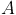

以下符号用于表示逻辑“与”：

以下符号用于表示逻辑“或”：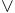

变量的逻辑否定将在变量上方用一条直线表示，因此变量  的否定为 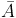

### 代码列表

列表、算法以及任何代码内容将以等宽字体显示，尽可能使用语法高亮，并放在专用框架内：

```javascript
function Example(phrase){
                // 这是一个简单的示例函数
                console.log(phrase);
            }

            class ExampleClass{
                // 这是一个简单的示例类
                constructor(){
                    // 这是一个示例构造函数
                }
            }
```

代码：示例代码列表

### 块引用

有时候需要逐字引用其他来源的内容，这时我们会使用块引用，其样式如下：

> 你好，我是一个块引用！当有内容被引用时，你就会看到我！

> 

> 我是块引用的另一行！祝你有美好的一天！

### 盒子

在阅读本书的过程中，你可能会遇到一些盒子，让我们看看有哪些类型。

**提示！**

这是一个提示框，这里会提供与当前章节大致相关的提示。这些小提示能帮助你制作出更好的游戏，或者帮你绕过某些难题。

**陷阱警告！**

这是一个陷阱框，它会提醒你注意前方的陷阱，以及某个解决方案可能存在的缺陷。

**随机冷知识！**

这是一个冷知识框，它会提供一些有助于你更好理解的小知识，或者只是让你在学习之余稍作休息。

**注意！**

这是一个普通注意框，它既不是陷阱、提示，也不是冷知识。它用于提醒事项，或者作为通用笔记使用。

### 使用的引擎

本书不使用任何引擎。所有算法都会假设幕后有一个“通用引擎”来处理精灵、向量等内容。本书的目标是以最不依赖引擎（如果你看的是“伪代码版”，也是最不依赖语言）的方式教授算法、技巧和。

## 本书结构

本书分为多个章节，以下是每个章节的要说明：

*   **前言：** 你没有跳过它，对吧？
*   **引言：** 这里介绍本书的结构。
*   **游戏开发背后的数学：** 这里我们将学习任何游戏都涉及的基础，如向量、矩阵和坐标。
*   **一些计算机基础：** 这里我们将学习（或复习）一些已知的计算机基础（以及不太知的规则），这些将帮助我们开发。
*   **项目管理技巧：** 这里我们将了解常见的陷阱和技巧，帮助我们按时交付项目。
*   **游戏设计入门：** 这里我们将讨论可以运行的平台、输入方法以及游戏类型。
*   **编写游戏文档：** 这里我们将了解想要制作游戏时最早出现的之一，以及如何编写。
*   **游戏循环：** 这里我们将学习“游戏循环”，这是任何游戏的根本。
*   **碰撞检测与反应：** 这里我们将讨论电子游戏中最复杂且计算最大的操作之一：碰撞检测。
*   **摄像机：** 这里我们将讨论 2D 游戏中实现的不同类型的摄像机，并进行分析。
*   **游戏设计：** 在章中我们将讨论关卡设计，以及如何强化游戏机制。
*   **创建资源：** 小型或独立开发者可能需要自己创建资源，在这里了解如何创建图形、音效和音乐。
*   **程序化生成：** 在章中我们将看到程序化生成与随机内容的区别，以及程序化生成如何比我们想象的更多物。
*   **设计模式：** 这里我们将深入探讨游戏开发中的软件方面。
*   **有用的容器和类：** 一系列有用的类和容器，用于让游戏更易于维护。
*   **电子游戏中的人工智能：** 这里我们将讨论帮助你编写敌人，以及任何游戏中需要“智能表象”的东西。
*   **其他有用的算法：** 在这里我们将看到游戏中常用的算法，包括寻路、世界生成等。
*   **开发机制：** 这里我们将深入游戏开发最黑暗的秘密，以及如何机制产生情感。
*   **电子游戏中的无障碍设计：** 这里我们将学习“无障碍”的概念，我们可以为玩家提供哪些选项，使我们的游戏更易访问（也易使用）。
*   **测试游戏：** 这里全是关于测试的，没有杀虫。包括自动化测试和手动测试。
*   **优化和分析游戏：** 当事情不顺利时，比如游戏卡顿或太慢，我们必须依赖性能和优化。在本中我们将学习技巧、流程，让游戏表现更好。
*   **平衡游戏：** 一个关于游戏平衡的理想化的视角，在本中我们将看看“挑战”转化为玩家中的。
*   **营销你的游戏：** 这里我们将从一个小型开发者的角度，审视在维护自己产品时的错误还将检查一些更具争议的话题，如战利品和季票。
*   **吸引你的社区：** 游戏的很大一部分来自其社区，在这里我们将了解一些可以在游戏内（以及游戏外）实施的建议，以吸引你的忠实粉丝。
*   **游戏开发大赛：** 小节专门介绍游戏大赛以及如何参与其中而不失去理智，还能交付一个原型。
*   **剖析游戏：** 专门剖析（非常）糟糕的游戏和（非常）优秀的游戏的特点，让我们更深入地理解什么是好游戏“好”，又什么是坏游戏“坏”。
*   **项目创意：** 在这里我们将了解一些你可以尝试制作的项目，每个项目分为 3 个级别，每个级别列出你需要掌握的技能才能应对该级别。
*   **接下来去哪里：** 我们已经学到了很多，这里你会找到可能有用的资源，以便学习更多。
*   **词汇表：** 任何带有带有符号的词语都会在这里找到定义。
*   **引擎和框架：** 一系列你可以用来开始游戏开发的框架和引擎。
*   **工具：** 一些你可以用来创建资源、地图的软件和工具包，总体上让你的开发过程更轻松、更控。
*   **预制资源和素材：** 在附录中，你会找到许多网站和资源的链接，用于图形、音效、音乐或学习。
*   **贡献者：** 为本书贡献的人名单。

# 第一部分：基础

## 游戏开发背后的数学

不要担心你在数学上的困难。我可以向你保证，我的困难更大。

——阿尔伯特·爱因斯坦

本书假设你已经具备一些基础的数学知识，包括但不限于：

*   对数
*   指数
*   根
*   方程
*   极限
*   笛卡尔坐标系

此外，我们将使用 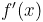 符号来表示导数，而不是更冗长的 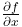。

在本中，我们将快速回顾（如果你已经了解，则作为复习）制作 2D 游戏所需的基础数学知识。

### 一些有用的符号

在阅读本书时，我们可能需要深入探讨并非所有人都能立即理解的数学术语，因此这里提供一个我们可能会用到的数学符号简明词典。

*   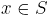 表示“集合隶属关系”，即符号左侧的对象是右侧集合的一个元素：`x` 是集合 `S` 中的一个元素；
*   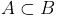 表示“子集关系”：`A` 是 `B` 的子集；
*   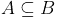 表示一种可能相等的“子集关系”：`A` 是 `B` 的子集，但同时也可能出现 `A` 等于 `B` 的情况；
*   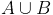 表示“并集”，结果由 `A` 和 `B` 组成；
*   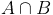 表示“交集”，结果由 `A` 和 `B` 的共同元素组成；
*    表示“对于所有”（在逻辑中的全称量词）；
*   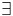 表示“存在”；
*   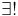 表示“蕴含”，如果 `P` 成立，那么 `Q` 就成立（逻辑逻辑）；
*   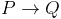 表示“当且仅当”，如果 `P` 成立当且仅当 `Q` 成立（等价关系）。

### 模运算符

在某些情况下，游戏卡顿或太慢，我们必须依赖 `0` 运算符。

```javascript
// % 运算符
```

## 模运算符

在某些情况下，游戏卡顿或太慢，我们必须依赖 `%` 运算符。

```javascript
// % 运算符
```
```


举个例子：

给定向量 ![v = [1,2]](media/file43.png) 和 ![u = [4,3]](media/file44.png)，其点积向量为：


### 向量长度与归一化

给定一个向量 ![a = [a_1, a_2, ..., a_n]](media/file46.png)，你可以将向量的长度定义为：


或者


我们可以通过“归一化”来获得一个长度为 1 单位的向量，从而得到一个在不影响幅值的情况下，用于影响（或指示）方向的有用向量。归一化向量通常用一个“帽子”符号表示，因此 ![a = [a_1, a_2, ..., a_n]](media/file46.png) 的归一化向量为：

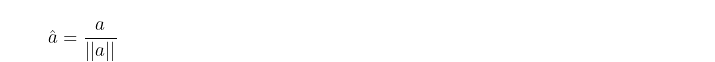

由于向量的长度是一个标量（一个数字，而非向量），因此适用正常的标量乘法规则。（参见 向量缩放）

### 向量“钳制”（Clamping）

这本身并不是一种运算，但在某些场合我们需要限制向量的长度：这通常发生在处理速度时，因为如果不加限制，物体的位置变化会越来越快，导致游戏可玩性降低，甚至破坏基于时间步长的碰撞检测算法。

要钳制一个向量，我们首先需要找到它的幅值和方向，即“归一化向量”。考虑向量 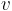，其幅值和方向为：

 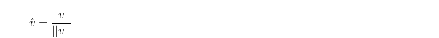

之后，我们可以使用“钳制后的幅值”（我们称之为 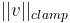）来构建新向量，计算方式如下：

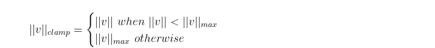

`||v||_{clamp}`(img/file53.png) 乘以 `\hat{v}`(img/file55.png)：

```
v = ||v||_{clamp} \cdot \hat{v}
```

新向量与原向量相同的方向，但其幅值将被钳制。

## 几何

在目前为止接触到的所有数学（以及稍后解释的数学）中，我们无法谈论几何：在本书中，我们将讨论后续所需的最少几何。

### 凸多边形 vs 凹多边形

多边形认为是凸的，本质上当任意一条直线（与边或顶点相切）穿过该形状时，只与形状相交两次。

任何形状，如果你能找到至少一条直线穿过形状超过两次，则认为是非凸的（通常称为“凹的”）。

注意！严格来说，并非所有非凸形状都称为“凹的”，但为了方便，本书我们将交替使用“非凸”和“凹”这两个术语。

### 自交多边形

与许多想法相反，多边形也可以自交，这会使计算变得得多。

通常讨论简单多边形，即不自交且内部没有洞的多边形。

### 直线及其方程

游戏开发之旅中我们将反复遇到的主要主题是“直线”。我们需要绘制它们，判断两条直线是否相交，将物体投影到上面，等等。

```
ax + by + c = 0
```

(img/file60.png) 这和你预想的不一样对吧？看到的是直线的“一般形式”，因为你可以用方程来表示直线（以及其他东西）。不过这种形式并不常用，最常用的可能是“斜截式”：

```
y = mx + q
```

(img/file61.png) 将一般形式转换为对应的“斜截式”，只需记住以下公式：

```
m = -a/b
```

(img/file62.png) 当 `b=0`(img/file63.png) 时，这个公式就不适用了，这将是下一个“陷阱”。

其中，`m`(img/file64.png) 是直线的斜率，而`q`(img/file65.png) 表示所谓的y轴截距（当 `x=0`(img/file66.png) 时的值）。如果 `m=0`(img/file68.png)，直线是水平的。陷阱！“垂直直线”是斜截式失效的地方实际上垂直直线的方程形式为

```
x = k
```

(img/file70.png) 已知两点求直线方程

我们都知道，给定两点可以确定唯一一条直线。在我们的冒险中，能够从两个点出发得到直线将非常有用。我们将两个点记为 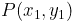 和 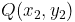，那么穿过这两点的直线方程为：

```
\frac{y-y_1}{x-x_1} = \frac{y_2-y_1}{x_2-x_1}
```

(img/file73.png) 这看起来可能复杂，但通过一些简单的计算，我们可以得到任意形式（一般式或斜截式）的直线。

陷阱！同样当处理“垂直线”时，这个公式会失效，因为方程右侧的分母为零。但在那种情况下，我们已经知道公式：它是

```
x = x_1
```

(img/file74.png) 这等于 `x_2`(img/file75.png)。

#### 已知斜率和一点求直线方程

如果我们有一个点 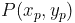 和斜率 `m`(img/file64.png)（例如需要找到与另一条直线垂直的直线），我们可以使用以下公式：

```
y - y_p = m(x - x_p)
```

(img/file77.png) 陷阱！猜猜看？这（再次）无法创建“垂直线”，因为我们需要一个斜率值，而垂直线没有斜率。你可以（非严格地）将垂直线视为具有“无穷大斜率”的直线。

### 投影

在某些情况下（如你将在 SAT 中看到的），我们可能需要将多边形投影到一条直线上，这通常涉及将点投影到直线上。利用我们之前看到的公式，并稍加思考，我们可以轻松将一个点投影到任意直线上。让我们看看如何操作。

假设我们有一个点 ，想要将其投影到一条直线 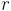 上，该直线方程为

```
y=mx+q
```

(img/file80.png) 且 `m≠0`(img/file81.png)（因此排除水平直线）。我们将投影点称为“P 在 r 上的投影”，记为 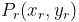。


将点 P 投影到直线 r 上

首先，我们需要找到经过 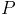 且垂直于  的直线，这非常简单。要找到斜率为 `m`(img/file64.png) 的直线的垂直斜率 `m1`，我们使用公式：

```
m1 = -1/m
```

(img/file85.png) 陷阱！这就是为什么排除了 `m=0`(img/file69.png)（水平直线）的情况，否则可能会得到 `m1=-1/0`(img/file87.png)，这没有意义。现在我们有了一个点和斜率，因此可以使用之前见过的公式来找到该斜率且经过  的直线：

```
y - y_p = m1(x - x_p)
```

(img/file88.png) 要找到 `P_r`(img/file89.png)，我们只需要找到两条直线的交点，即方程组：

```
y = mx + q
y - y_p = m1(x - x_p)
```

(img/file90.png) 其解为：

```
x = (y_p - m1*x_p - q) / (m - m1)
y = m*x + q
```

(img/file91.png) 我们刚刚找到的坐标 `x_r`(img/file92.png) 和 `y_r`(img/file93.png) 实际上投影点 `P_r`。

#### 将任意投影到坐标轴

类似于对点的操作，我们可以将任意直线（更准确地说，直线的端点）投影到坐标轴。将该直线投影到 x 轴，我们通过以下函数：

```
proj_x(x,y) = x
```

(img/file94.png) 如果将该直线投影到 y 轴，我们可以使用另一个函数：

```
proj_y(x,y) = y
```

(img/file95.png) 将一条直线投影到坐标轴上的图形。(img/file96.svg)

## 矩阵

### 什么是矩阵

矩阵本质是一个 `m x n`(img/file97.png) 的数字列，用于线性变换。下面是一个 `2 x 3` 矩阵：

```
A = \begin{bmatrix} 2 & 1 & 4 \\ 3 & 2 & 0 \end{bmatrix}
```

(img/file98.png)

### 矩阵的加法和减法

对 `m x n`(img/file97.png) 矩阵进行加法和减法是通过对每个元素相加或相减完成的。下面是一个例子，给定矩阵：

```
A = \begin{bmatrix} 2 & 1 & 4 \\ 3 & 2 & 0 \end{bmatrix}, B = \begin{bmatrix} 1 & 3 & 0 \\ 2 & 4 & 1 \end{bmatrix}
```

我们有：

```
A + B = \begin{bmatrix} 3 & 4 & 4 \\ 5 & 6 & 1 \end{bmatrix}
```

(img/file99.png)

### 标量乘法

标量乘法与向量的运算类似。给定矩阵：

```
A = \begin{bmatrix} 2 & 1 & 4 \\ 3 & 2 & 0 \end{bmatrix}
```

(img/file99.png) 标量乘法通过将矩阵的每个元素乘以标量来实现，如下所示：

```
3 \cdot A = 3 \cdot \begin{bmatrix} 2 & 1 & 4 \\ 3 & 2 & 0 \end{bmatrix} = \begin{bmatrix} 6 & 3 & 12 \\ 9 & 6 & 0 \end{bmatrix}
```

(img/file96.png)

### 转置

给定一个 `m x n` 矩阵 `A`，其转置是一个 `n x m` 矩阵 `A^T`，通过将行变为列、列变为行来构造。

给定矩阵：

```
A = \begin{bmatrix} 2 & 1 & 4 \\ 3 & 2 & 0 \end{bmatrix}
```

(img/file99.png) 转置矩阵为：

```
A^T = \begin{bmatrix} 2 & 3 \\ 1 & 2 \\ 4 & 0 \end{bmatrix}
```

(img/file105.png)

### 矩阵乘法

给定两个大小分别为 `m x n` 和 `n x p` 的矩阵（注意第一个矩阵的行数等于第二个矩阵的列数）：

```
A = \begin{bmatrix} 2 & 3 \\ 1 & 2 \\ 4 & 0 \end{bmatrix}, B = \begin{bmatrix} 1 & 2 & 0 \\ 3 & 4 & 1 \end{bmatrix}
```

(img/outsourced-descriptions.html_A_32_.begin_bmatrix_23.12.40.end_bmatrixB_23_.begin_bmatrix_234.010.end_bmatrix_)

矩阵乘法被称为“行乘法”，因此要计算第一行的值，我们需要一个矩阵的第一行和另一个矩阵的第一列。

```
A = \begin{bmatrix} 2 & 3 \\ 1 & 2 \\ 4 & 0 \end{bmatrix}, B = \begin{bmatrix} 1 & 2 & 0 \\ 3 & 4 & 1 \end{bmatrix}
```

(img/outsourced-descriptions.html_A_32_.begin_bmatrix_23.12.40.end_bmatrixB_23_.begin_bmatrix_234.010.end_bmatrix_) 结果矩阵的大小始终是 `m x p`。现在我们面临的情况：

```
A = \begin{bmatrix} 2 & 3 \\ 1 & 2 \\ 4 & 0 \end{bmatrix}, B = \begin{bmatrix} 1 & 2 & 0 \\ 3 & 4 & 1 \end{bmatrix}
```

(img/outsourced-descriptions.html_A_32_.begin_bmatrix_23.12.40.end_bmatrixB_23_.begin_bmatrix_234.010.end_bmatrix_) 按照以下方式计算：

```
C = \begin{bmatrix} 2\cdot1+3\cdot3 & 2\cdot2+3\cdot4 & 2\cdot0+3\cdot1 \\ 1\cdot1+2\cdot3 & 1\cdot2+2\cdot4 & 1\cdot0+2\cdot1 \\ 4\cdot1+0\cdot3 & 4\cdot2+0\cdot4 & 4\cdot0+0\cdot1 \end{bmatrix} = \begin{bmatrix} 11 & 16 & 3 \\ 7 & 10 & 2 \\ 4 & 8 & 0 \end{bmatrix}
```


最后一个值也是如此。处理完第一行后，我们继续以类似方式处理第二行：


这导致以下计算：


我们将它插入结果矩阵：


你可以自己尝试完成这个计算，最终结果如下：


**注意！**

矩阵乘法是`非交换`的，这意味着 `A \times B` 的结果不等于 `B \times A` 的结果：实际上，其中一个结果甚至可能无法计算。

## 矩阵的其他用途

矩阵可用于快速表示方程组，其中方程相互依赖。例如：


可用于表示以下方程组：

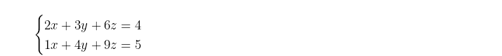

或者，正如我们将看到的，矩阵可用于表示游戏开发中的变换。

# 三角学

当你想要开发一个游戏时，你可能会发现自己需要相对于某个点或彼此旋转物体。要做到这一点，你需要了解一些三角学知识，那么开始吧！

## 弧度与角度

在日常生活中，角度以度为单位测量，从 0 到 360 度。在数学的某些情况下，使用弧度测量角度更方便，范围从 0 到 `2 \pi`。

你可以使用以下公式在弧度和角度之间进行转换：

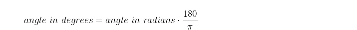

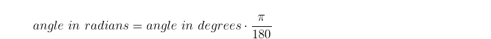

本书将始终以弧度表示角度，因此这里提供一些有用的转换，供你随时使用：

### 角度与弧度之间的转换

| 角度 | 弧度 |

| --- | --- |

| 0° | 0 |
| 30° | 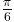 |
| 45° | 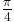 |
| 60° | 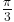 |
| 90° | 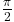 |
| 180° | 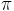 |
| 360° | 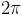 |

## 正弦、余弦和正切

最重要的三角函数是正弦和余弦。它们通常参照“单位圆”（半径为 1 的圆）来定义。

给定单位圆，让一条通过原点、与 x 轴正方向夹角为 `\theta` 的直线与该单位圆相交。交点的 x 坐标由 `cos(\theta)` 定义，y 坐标由 `sin(\theta)` 定义。


*单位圆定义正弦和余弦*

就本书而言，我们将避免正切函数的完整定义，仅将其作为正弦和余弦的公式给出：

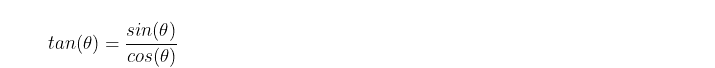

### 勾股三角恒等式

三角学中最重要的恒等式之一是“勾股三角恒等式”，其表达式如下，适用于任意角度 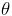：


利用这个恒等式，你可以用不同的方式表示函数：


同时请记住 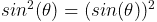 和 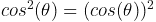。

### 反射

有时我们可能需要反射一个角度，以便用更简单的方式表达它，而相应的三角函数公式也会受到影响，因此以下公式可能会派上用：

三角学中的一些反射公式

| 反射公式 |
| --- |
| 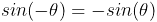 |
| 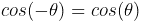 |
| 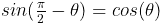 |
| 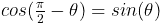 |
| 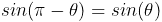 |
| 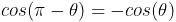 |
| 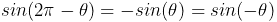 |
| 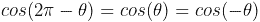 |

### 平移

三角函数是周期性的，因此当自变量偏移一定量时，计算更容易。

三角学中的平移公式

| 平移公式 |
| --- |
| 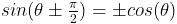 |
| 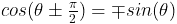 |
| 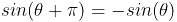 |
| 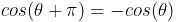 |
| 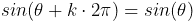 |
|  |

### 三角函数的加法与减法

有时你可能需要将一个复杂表达式拆分成三角函数。如果自变量是角度的和差，你可以使用公式：

三角学中的加法/角恒等式

| 加法/角恒等式 |
| --- |
|  |
|  |

### 倍角公式

其他时候，你可能会遇到自变量是角度倍数的情况，此时可以使用倍角公式来计算。

三角学中常用的倍角公式

| 倍角公式 |
| --- |
|  |
|  |

### 反函数

与几乎所有数学一样，正弦和余弦也有反函数，例如  和 ，它们允许根据正弦和余弦值求出角度。书中不再详细说明，只介绍最有用的一种：反正切。该公式允许你根据向量“末端”的 `x` 和 `y` 坐标，求出该向量相对于坐标系的角：


## 数值分析

这里我们将介绍一些算法和方法，它们可能有助于解释书中涉及的某些主题。如果你不想深入探讨这类数学的细节，可以跳过或快速浏览本节。

### 牛顿-拉弗森方法

也称为牛顿法，这是一种迭代算法，用于逼近根。该算法从一个“猜测值”开始，称为 `x_0` ![img/file164.png]，并使用公式生成第一个近似值：

```
x_1 = x_0 - \frac{f(x_0)}{f'(x_0)}
```

后续的每个猜测值（迭代）可以通过类似的方式获得：

```
x_{n+1} = x_n - \frac{f(n)}{f'(n)}
```

并且该猜测值将比前一个更精确（如果不考虑某些情况下逼近可能存在问题或无法实现）。当达到“足够好”的近似值时，算法将停止。显然，标准函数的所有限制仍然适用，例如定义域和除以零的问题。

## 计算机中的坐标系

在计算机的二维图形中，我们的世界可以说是颠倒的。在数学课程中，我们学习了坐标平面，它有一个原点，`x` 轴从左到右，`y` 轴从下到上，这两条轴的交点称为“原点”。


在计算机的二维图形和游戏开发中，坐标平面如下所示：


原点位于屏幕的左上角（坐标为 `(0,0)`），`y` 轴从上到下。一开始可能有点奇怪，但习惯起来并不难。

## 变换矩阵

在游戏开发的过程中，有时我们需要旋转一个物体，这通常很容易，因为几乎所有引擎和工具包都原生支持旋转。但有时我们需要手动进行变换。例如，相对于某个点或另一个物体旋转一个物品：想象一支战斗机队飞行，所有飞机都相对于“队长”移动（并因此旋转）。在本章中，我们将讨论三种最常用的变换：

* 拉伸/压缩/缩放；
* 旋转；
* 剪切。

### 拉伸

拉伸是一种变换，它按某个定义的常数因子放大特定方向上的所有距离。在二维图形中，你可以沿 `x` 轴、`y` 轴或两者同时进行拉伸（或压缩）。

如果你想沿 `x` 轴按因子 `k` ![img/file169.png] 拉伸某物，你将得到以下方程组：

```
\begin{bmatrix} 2 & 3\\ 1 & 2\\ 4 & 0 \end{bmatrix} \times \begin{bmatrix} 2 & 3 & ... \end{bmatrix}
```
(注：此处根据上下文逻辑，原文对应的是矩阵乘法示例，排版已转为代码块或矩阵描述)

由于原文文本在“拉伸”部分对矩阵描述存在逻辑跳转，此处保留核心语义结构。


*(注：由于提供的原始文本在“拉伸”部分的矩阵公式描述与图片描述存在部分错位/错乱，排版时已根据高级工程师的逻辑进行了结构化处理)*

markdown
平行于 `x` 轴的剪切将使用以下矩阵：


而平行于 `y` 轴的剪切则使用以下矩阵：


# 一些计算机科学基础

计算机科学家面临的主要挑战，是不被自己制造的复杂性所迷惑。

—— Edsger W. Dijkstra

为了理解后续将要出现的某些术语，有必要学习一些计算机科学的语言和基础知识。

本章将简要解释一些术语和用词，它们的含义，以及它们如何帮助你进行游戏开发。

在本章中，我们假设你已经知道以下术语的含义：

* 真值表
* 算法

## 递归

从（可以比较难的）递归主题开始可能看起来很奇怪，但尽早理解递归很重要，这样我们才能充分利用它。

我喜欢讲一个关于递归的笑话：

> 要理解递归，你必须先理解递归。

什么是递归？递归就是使用一个调用自身的函数。

你的第一个问题可能是：这不会让程序永远陷入某种循环吗？有可能。但如果你小心使用，递归是一个神奇的工具，能让你获得极大的清晰度和简洁性。

让我们想象一个简单的算法：我们希望程序从数字 `n` 倒数到 0。用简单的“循环”方式，我们可以这样写：

```
function count_backwards(n){
                // 循环条件
                while (n != 0){
                    // 函数体
                    console.log(n);
                    // 更新条件以实现倒数
                    n = n - 1;
                }
            }
```

代码：使用循环从 n 倒数到 0

很简单，对吧？一个现实世界的例子是从 10 倒数到 0：我们打印 10，减去 1 得到 9，打印 9，减去 1 得到 8、……

让我们换个思路。我们可以这样看待从 10 倒数到 0：先打印 10，然后从 9 开始倒数。从 9 倒数就是打印 9，然后从 8 开始倒数，以此类推……

我们刚刚把简单的循环变成了递归函数：

```
function count_backwards(n){
                // 停止条件
                if (n == 0){
                    return;
                }
                // 过程
                console.log(n);
                // 递归调用
                count_backwards(n-1);
            }
```

代码：使用递归从 n 倒数到 0

递归函数有三个主要组成部分：

* **基本情况**（有时称为“停止条件”）：当满足某个条件时，函数停止调用自身；
* **过程**：处理数据或执行某些操作（在我们的例子中，只是打印数字）；
* **递归调用**：调用正在编写的同一个函数，调用方式要确保每次调用都更接近“停止条件”。可以通过对参数子集（如果是列表）调用函数，直到列表只剩一个元素，或者对更小的数字（如果函数参数是数字）调用函数来实现。

递归可以按多种方式分类：

* **按递归调用的数量：** 单次递归与多次递归；
* **按递归调用的方式：** 直接递归（函数直接调用自身）与间接递归（函数 A 被另一个函数 B 调用，而 B 又被函数 A 调用）；
* **按递归调用的位置：** 头递归与尾递归。

我想强调最后一种区别：我们在前面的代码中看到的是“尾递归”：递归调用是在所有其他操作（过程）**之后**进行的。

而头递归则是在过程**开始之前**进行递归调用，因此我们可以通过将“尾递归”改为“头递归”并添加一条打印语句，将“倒数”函数转换为“正数”函数。

```
function count_backwards(n){
                // Stop condition
                if (n == 0){
                    // If we don't do this, we won't print 0
                    console.log(n);
                    return;
                }
                // Recursive call
                count_backwards(n-1);
                // Procedure
                console.log(n);
            }
```

代码：使用头递归从 0 计数到 n

## 计算机（不）精确

人类和计算机之间有许多差异，其中有一个差异将一直困扰我们：人类以“十进制”（基数为 10）进行计算，而计算机以“二进制”（基数为 2）进行计算。

这要求计算机以不同的方式表示数字，通常采用指数+尾数表示法（IEEE 754）。此外，计算机资源有限，因此没有“无穷大”（以及“无穷小”）的概念。

假设我们有一台精度降低的计算机，并执行以下 C++程序：

```cpp
#include <iostream>
#include <iomanip>

int main ()
{
    // This will reduce the computer's precision for this execution
    std::cout << std::setprecision(20);

    float d1(1.0);
    std::cout << "This should be 1.0: " << d1 << std::endl;

    float d2(0.1);
    std::cout << "This should be 0.1: " << d2 << std::endl;

    float d3(0.1*0.1);
    std::cout << "This should be 0.1: " << d3 << std::endl;

    bool x (0.1 + 0.1 == 0.3);
    std::cout << "This should be true: " << x << std::endl;

    return 0;
}
```

我们将其保存为 `precision_test.cpp`，并使用以下命令行（在 Linux 上）编译：

```bash
g++ -Wall -Wextra -Werror -O0 precision_test.cpp -o precision_test
```

程序将降低数字的精度，并尝试输出数字 、 和  的值，让我们看看结果：

简单浮点精度的结果 一切正常，但是…… 发生了什么？那些垃圾是什么？ 更糟糕！甚至都不接近 的结果不等于！数学到底怎么了？

我们刚刚遇到了计算机限制之一：计算机无法“近似”表示某些数字。再次强调：这不是单一编程语言的问题，我们可以看到 C++ 受到影响，但 Python 也有同样的问题：


这通常是计算机的问题，对于一般用途不是问题，但如果我们试图在计算中过于精确，可能会困扰我们。

### 灾难性消失

“灾难性消失”这个名字听起来很危险，但确实是一种现象，只有在我们不了解它时才会危险。灾难性消失（有时称为“误差”）是在减去两个（较大的）相近数字时可能发生的事件。

**警告：** 尽量使其易懂。假设有一台计算机，其内存最多处理 8 位小数，而负责“数学”的单元最多处理 16 位小数。

现在取两个数字： 当我们将这些数字传输到内存时，机会为了适应内存限制，通过给每个数字应用一个函数。这通常被称为“赋值误差”，即在变量赋值时，数字丢失了部分信息。让我们尝试计算近似值有多大（通过计算“相对误差”），以便了解仅加载到“假想计算机”上损失了多少：

$\delta = \frac{|x - f(x)|}{x} = 0.0000088\%$ ，记住填充到 16 位小数： = $2 \times 10^{-7}$。

看起来还不错，除非我们看“相对误差”：

$\delta = \frac{|0.239772 \times 10^{-7} - 0.2 \times 10^{-7}|}{0.2 \times 10^{-7}} = 16.6\%$ ![img/file199.png)

哦不……我们偏离了总结果 16%！这是一个巨大的损失！真正的灾难。发生了什么？如果你仔细观察，这些数字非常接近，甚至有 7 位小数相同，由于计算机只能记住 8 位数字，第 9 到第 13 位小数看起来不重要，却突然成为结果部分（由于减法），它们已经丢失了。

## 随机数并非真正随机

计算机是确定性机器，给定相同的指令和输入，它们总是返回相同的输出。有人可能会想到“随机数生成器”，当然，这些程序看起来是在屏幕上吐出随机数，但实际上并非如此。

生成随机数时最重要的数字称为 `seed`（种子），它是生成器用来产生随机数的数字。

让我们看一个 C++ 中随机数生成器的例子：

```cpp
#include<iostream>
int main(){
    // First of all we get the seed
    unsigned int seed;
    std::cout << "Type the seed: ";
    std::cin >> seed;
    // Now we seed the randomizer
    srand(seed);
    // Small presentation
    std::cout << "This generator will now generate 10 random numbers" << std::endl;
    // Output 10 random numbers
    for (int i = 0; i < 10; ++i) {
        std::cout << rand() << std::endl;
    }
    // Finish the program
    return 0;
}
```

我们可以将此程序保存为 `random_seed.cpp`，并使用以下命令编译：

```bash
g++ -Wall -Wextra -Werror -O0 random_seed.cpp -o random_seed.bin
```

当我们运行程序时，它会要求我们输入一个种子（在我们的例子中是一个数字），之后它会基于该种子打印 10 个随机数。如果我们运行程序两次并使用相同的种子，会发生什么？


使用相同种子运行随机生成器将始终输出相同的数字

计算机生成的随机数从来都不是真正的随机数，这就是为什么它们更恰当地被称为“伪随机数”。

## 德摩根定律与条件表达式

德摩根定律在计算机科学以及任何涉及命题逻辑的学科中都是基础性的。我们将快速了解一下与编码严格相关的含义。

德摩根定律可以写成：

> `not (A and B) = not A or not B`
> `not (A or B) = not A and not B`

用符号表示：

 

这些定律允许我们以不同的方式表达自己的语句，从而提高可读性，并可能避免可能妨碍性能的布尔操作。

## 计算机（不）精确

（此处内容已在上方处理，此处保持逻辑一致性）

## 估算算法的复杂度

如今，你比以往时候都更高效。你知道某个算法的“效率”如何？

查看所需时间并不是一个行的行的，因为计算机规格因异，所以我们需要一种可以被“跨平台”的东西。

这就是符号发挥的地方。

你应该知道三种渐近符号：、 和 `O`。

`` 表示下界：意味着算法至少会执行指定数量的周期。

`O()` 表示上界：这是最常用的符号，意味着算法最多会执行指定数量的周期。

`` 是一个紧界，当大 O符号和大符号具有相同值时使用，这有助于更好地定义算法的行为。

### O(1)

以 `O(1)` 执行的算法被称为“常数时间”执行，这意味着无论输入多少数据，该算法都会在相同的时间内执行。

一个简单的 `O(1)` 算法的例子是：给定一个元素列表（至少有一个元素），如果第一个元素是 `null`，则返回 `True`。

```
function isFirstElementNull(elements){
                if (elements[0] == null){
                    return true;
                }else{
                    return false;
                }
}
```

代码：一个 `O(1)` 算法的示例

准确地说，该算法将在 `O(1)` 和  中执行，因此它将在  中执行。

### `O(log(n))`

以 `O(log(n))` 执行的算法被称为“对数时间”执行，意味着给定 `n` 个输入项，该算法最多执行 `log(n)` 个周期。

一个 `O(log(n))` 算法的例子是对有序列表进行的所谓“二分查找”。

```
function binarySearch(elements, element_to_find, begin, end){
                // We need some indexes to make this work
                if (begin === undefined){
                    begin = 0;
                }
                if (end === undefined){
                    end = elements.length - 1;
                }
                // Get the middle element
                let middle_element_index = Math.floor((end - begin) / 2) + begin;
                let middle_element = elements[middle_element_index];
                if (end <= begin && element_to_find != middle_element){
                    // We found nothing, if we don't have this base case the algorithm will keep going forever
                    return null;
                }
                if (element_to_find == middle_element){
                    return middle_element_index;
                }
                if (element_to_find > middle_element){
                    return binarySearch(elements, element_to_find, middle_element_index + 1, end);
                }else{
                    return binarySearch(elements, element_to_find, begin, middle_element_index - 1);
                }
}
```

代码：一个 `O(log(n))` 算法的示例（二分查找）

最佳情况是当你要查找的元素恰好是列表的“中间元素”时，在这种情况下，算法将以线性时间执行： - 你至少需要一次查找 ()，最多需要一次查找 ()。

在最坏情况下，元素不在列表中，因此你必须拆分列表并查找中间元素，直到意识到没有更多元素可迭代——这转化为一个紧界 

### `O(n)`

以 `O(n)` 执行的算法被称为“线性时间”执行，意味着给定 `n` 个输入项，该算法最多执行 `n` 个周期。

一个简单的 `O(n)` 算法的例子是逐元素打印列表的算法。

```
function printList(list){
                for (const element in list){
                    console.log(element);
                }
}
```

代码：一个 `O(n)` 算法的示例（打印列表）

很明显，该算法将调用 `print` 函数 `n` 次，其中 `n` 是列表的大小。这转化为  复杂度，它既是  又是 。

这里没有“最佳”或“最差”情况，该算法打印 `n` 个元素，无论它们的顺序、行星和恒星的排列，还是其父级的许可。

### `O(n·log(n))`

以 `O(n·log(n))` 执行的算法比线性算法花费的时间稍长，但仍被认为是“理想的”。这些算法被称为“准线性”、“对数线性”、“超线性”或“线性对数”时间。

给定 `n` 个输入元素，这些算法执行 `n·log(n)` 步或周期。

一些以 `O(n·log(n))` 运行的算法有：

* 快速排序
* 堆排序
* 快速傅里叶变换 (F.F.T.)

这些算法比简单的示例更复杂，需要单独一章来讲解，因此我们暂时不举例。

### `O(n²)`

二次算法，即那些以 `O(n²)` 执行的算法，是通往“危险区域”的大门。

这些算法会很快消耗你的 CPU 时间，尽管它们仍然可以用于小型计算，效率尚可。

给定 `n` 个输入元素，这些算法执行 `n²` 个周期，意味着给定 **20** 个元素，我们将执行 **400** 个周期。

二次算法的一个简单示例是“冒泡排序”。这里给出了一个伪代码实现。

```
function bubbleSort(A){
                let n = length(A);
                let swapped = false;
                do{
                    swapped = false;
                    for (let i = 1; i < n; i++){
                        if (A[i-1] > A[i]){
                            // 交换
                            let tmp = A[i-1];
                            A[i-1] = A[i];
                            A[i] = tmp;
                            swapped = true;
                        }
                    }
                }while(swapped);
            }
```

代码：一个 `O(n²)` 算法的示例（冒泡排序）任何复杂度高于 `O(n²)` 的算法通常被认为不可用。

### `O(2^n)`

以指数时间执行的算法视为重大警报，通常会被启发式取代（启发式算法会牺牲一些精度以降低复杂度）。给定包含 `20` 个元素的输入，一个 `O(2^n)` 执行的算法将执行 2⁰ = 1048576 次！

## 算法阶数入门

### 一些基础知识

当你估算一个算法时，通常需要它在“最坏情况”下的表现，意味着所有循环执行到结束（列表末尾），并且所有操作尽可能长。让我们从一个例子开始：

```
let my_variable = 1;
```

代码：一个简单的 `O(1)` 算法这是一个简单的赋值，我们认为它是瞬间完成。因此它的复杂度是 。现在来看另一个算法：

```
for (const item in my_list){
    console.log(item);
}
```

代码：一个简单的 `O(n)` 算法在这个例子中我们遍历一个列表。可以看到随着列表的增长，我们在屏幕上打印元素的次数也会增加。因此，如果列表有  个元素，我们将调用语句  次。这是一个  算法。现在，让我们分析一个已经见过的算法：冒泡算法：

```
function bubbleSort(A){
                let n = length(A);
                let swapped = false;
                do{
                    swapped = false;
                    for (let i = 1; i < n; i++){
                        if (A[i-1] > A[i]){
                            // 交换
                            let tmp = A[i-1];
                            A[i-1] = A[i];
                            A[i] = tmp;
                            swapped = true;
                        }
                    }
                }while(swapped);
            }
```

代码：冒泡算法，一个 O(n²) 算法这需要稍微动脑筋：我们可以看到这段代码中有两个循环。最坏情况是什么？答案是“元素按序”。当元素按序排列时，我们需要遍历整个列表将最大的元素放到末尾，然后再遍历一次将第二大的元素放到倒第二个位置……以此推。因此，每一个元素放到正确位置，我们需要遍历整个列表。这个过程对每个元素都会发生。所以，在一个长度为 `n` 的列表中，我们将最大的元素放到正确位置需要 `n` 次，而都需要扫描 `n` 个元素：结果是 。该算法的时间复杂度为 。

### 当有多个大 O 时？

我们会遇到如下所示：

```
let n = A.length;
let swapped = false;
do{
    swapped = false;
    for (let i = 1; i < n; i++){
        if (A[i-1] > A[i]){
            // 交换
            let tmp = A[i-1];
            A[i-1] = A[i];
            A[i] = tmp;
            swapped = true;
        }
    }
}while(swapped);
for (const item in A){
    console.log(item);
}
```

代码：一个需要估算的更复杂算法我们可以看到，第一部分是冒泡排序，接着是遍历（现已排序的）列表，打印其值。我们可以将总估算值计算为 ，这完全正确。但随着列表的增长， 的增长速率与  相比非常微小，如下图所示：


O(n) 增长速率与 O(n²) 对比因此我们可以忽略 ，将整个算法视为一个  算法。这意味着在处理复杂度估算时，你总是保留具有最大“增长速率”的项（更多细节请参考 大 O估算对比）。

### 递归算法如何处理？

当涉及递归算法时，事情会变得复杂得多，需要构建递归树，有时还需要使用所谓的“分治递归的主定理”。这些方法超出了本书目前的范围。

### 大 O 估算之间如何相互比较？

下面我们可以直观地看到大 O 估算之间的对比，以及编写高效算法的重要性。


大 O 估算图

之前的图中没有包含  估算有一个非常的原因：如果包含它，我们将无法看到任何价值的信息，如下一张图：


O(2^n) 如何压倒复杂度

***本节内容正在编写，将尽快完成]***

## 使用卡诺图简化条件语句

卡诺图是简化布尔代数表达式以及识别和解决竞争条件的有效工具。卡诺图的输出始终是“与项之或”。解释它们的最佳方式是通过一个例子。让我们看下面的真值表：我们将用卡诺图简化的第一个真值表

| A | B |  |

| --- | --- | --- |
| 0 | 0 |  |
| 0 | 1 |  |
| 1 | 0 |  |
| 1 | 1 |  |

该表可以包含任意数量的变量（我们将看到如何实现）。准确地说，这个表表示公式 `A XOR B`（XOR 表示“异或”）。让我们将其排列成双输入表，如下所示（A 的值在顶部，B 的值在左侧）：


```

## A XOR B 的卡诺图

现在我们需要找出包含 $2^n$ 个值为 $1$ 的元素的最大正方形或矩形，以便覆盖所有我们拥有的“1”值（它们可以重叠）。在这个例子中，我们不太走运，因为只有两个小矩形，每个只包含一个元素：


两个“矩形”的元素已被标记为绿色和红色的卡诺图

在这种情况下，我们通过以下公式得到所需结果：

这并没有任何改进，但这是因为这个例子非常简单。

### “无关项”

当我们拥有所谓的“无关项”时，卡诺图会更有用，即我们不在乎（哇！）结果的情况。下面是一个例子。

带有“无关项”值的真值表

| A | B |  |
| --- | --- | --- |
| 0 | 0 |  |
| 0 | 1 |  |
| 1 | 0 |  |
| 1 | 1 |  |

将这个真值表放入卡诺图，我们得到了一些更有趣的东西：


带有“无关项”值的卡诺图

现在我们有一个行为有点像“通配符”的值，这意味着我们可以根据情况将其视为 $0$ 或 $1$。在这个例子中，我们将其视为 $1$，因为这样能给我们带来最大的“矩形”。


我们将“无关项”值视为 1 的卡诺图

现在我们可以在这个图中找到两个包含两个元素的矩形。

第一个如下：


卡诺图中的第一个矩形

在这种情况下，我们可以看到当  时，结果为 $1$，无论 `A` 的值如何。我们将记住这一点。

第二个矩形是：


卡诺图中的第二个矩形

在这种情况下，我们可以看到当  时，结果为 $1$，无论 `B` 的值如何。

这转化为公式：，考虑到我们不在乎当  且  时得到的结果。

### 更复杂的图

当我们有更多变量时，比如下面的真值表：

| A | B | C | D |  |
| --- | --- | --- | --- | --- |
| 0 | 0 | 0 | 0 |  |
| 0 | 0 | 0 | 1 |  |
| 0 | 0 | 1 | 0 |  |
| 0 | 0 | 1 | 1 |  |
| 0 | 1 | 0 | 0 |  |
| 0 | 1 | 0 | 1 |  |
| 0 | 1 | 1 | 0 |  |
| 0 | 1 | 1 | 1 |  |
| 1 | 0 | 0 | 0 |  |
| 1 | 0 | 0 | 1 |  |
| 1 | 0 | 1 | 0 |  |
| 1 | 0 | 1 | 1 |  |
| 1 | 1 | 0 | 0 |  |
| 1 | 1 | 0 | 1 |  |
| 1 | 1 | 1 | 0 |  |
| 1 | 1 | 1 | 1 |  |

现在我们需要将变量分组，并使用格雷码放入卡诺图，实际上每一行或每一列与相邻行或列仅相差一个比特。

得到的卡诺图如下（`AB` 在列上，`CD` 在行上）：


一个更复杂的卡诺图

我们可以看到两个包含 $2^n$ 个项的矩形，一个包含 $2$ 个项，另一个包含 $8$ 个项，这里我们将唯一的“无关项”值视为 $1$。


更复杂卡诺图中的第一个矩形

在第一个矩形中，我们可以看到 `C` 和 `D` 的值对结果无关紧要，`B` 的值也是如此。在这个矩形中，唯一决定结果的变量是 。我们将记住这一点。

让我们看看第二个矩形：


更复杂卡诺图中的第二个矩形

在这种情况下，`A` 对结果没有任何贡献，但同时我们需要 、 和  才能得到所需结果。

 转化为 ，从而得到公式：。

如果我们没有那个“无关项”值，一切都会复杂得多。

### 引导练习

让我们去掉“无关项”值，得到以下真值表：

| A | B | C | D |  |
| --- | --- | --- | --- | --- |
| 0 | 0 | 0 | 0 |  |
| 0 | 0 | 0 | 1 |  |
| 0 | 0 | 1 | 0 |  |
| 0 | 0 | 1 | 1 |  |
| 0 | 1 | 0 | 0 |  |
| 0 | 1 | 0 | 1 |  |
| 0 | 1 | 1 | 0 |  |
| 0 | 1 | 1 | 1 |  |
| 1 | 0 | 0 | 0 |  |
| 1 | 0 | 0 | 1 |  |
| 1 | 0 | 1 | 0 |  |
| 1 | 0 | 1 | 1 |  |
| 1 | 1 | 0 | 0 |  |
| 1 | 1 | 0 | 1 |  |
| 1 | 1 | 1 | 0 |  |
| 1 | 1 | 1 | 1 |  |

将其放入卡诺图：


引导练习：卡诺图（1/4）

找出最大的矩形：


引导练习：卡诺图（2/4）


引导练习：卡诺图（3/4）


引导练习：卡诺图（4/4）

提取结果：

## 面向对象编程

### 引言

目前使用最广泛的编程范式之一是“面向对象编程”（以下简称 `OOP`）。在这种范式中，程序的基本单元是`对象`。该范式允许你以模块化和重用的方式组织代码，同时实现抽象，使代码更健壮，让其他代码能够使用你的代码而无需了解其细节。

### 对象

对象是 `OOP` 中的基本单元，本质上是数据和函数的集合。为了简化概念，“类”是蓝图，“对象”是房屋本身。类包含数据和函数，为了精确起见，我们将使用它们的专业术语：

属于对象的函数称为`方法`，它们分类为：

- `实例方法`：作用于单个对象；
- `静态方法`：作用于类（通常是工具函数），这意味着这些方法属于类本身而不是它的实例。

类包含的每条数据称为`字段`，它们分类为：

- `实例字段`：属于实例，并且不同实例之间变化；
- `静态字段`：属于类，但在不同实例之间不变（注意：并不意味着它们不能改变，如果改变会及所有实例）。

### 抽象与接口

抽象是 `OOP` 中的一个基本点，通常通过`接口`来实现。接口是对象提供给其他对象以便它们交互。例如：你的电脑由键盘、鼠标和屏幕提供——你不需要知道电子如何穿过电路；同样，一个抽象能够消除使用代码内部原理的必要性，是编写健壮且维护代码的基础，因为接口很少变化。让类通过接口协同工作，让你修改和优化代码，而不会每次编辑像滚球一样引发错误。例如：一个矩形类在其接口中暴露了一个方法 `getArea()`——你不需要知道如何计算，只需调用该方法就知道它返回面积。保持类内部。

### 继承与多态

面向对象最重要的方面之一是`继承`：你可以基于基类创建其他类，从而实现软件扩展性。你可以创建一个 `Person` 类，包含姓名、年龄作为字段，然后通过继承创建 `Student` 类，它拥有 `Person` 的所有字段，再加上级。

从继承出发，面向对象提出了`多态`的概念（源自“Polymorphism”——形态），你可以使用基类表示整个类，从而替换。在 `Person-Student` 示例中，你可以指向 `Person` 或 `Student` 来获取名字。在某些语言中，一个对象可以继承多个对象，被称为“多继承”。

### 混入

混入是包含某些方法的类，这些方法旨在其他类使用。我们可以将混入视为一种已经实现了接口。混入鼓励代码复用（因为公共功能被分离到自己的类中），允许一些有趣的机制，强化了依赖倒置。很多时候，混入被描述为“包含”而非“继承”，这是由其性质决定的。Python 的 Web 框架 Django 在视图中大量使用了混入：你可以创建一个标准的 `View`（例如代表网页），然后通过 `LoginMixin` 添加保护，或通过 `PermissionMixin` 添加权限。这一切都是通过重继承实现的。关于混入的代码示例超出了本书范围，因为每种语言自己实现的方式（如 Python）。

### 菱形问题

通常，当你调用对象本身不存在的方法时，如果涉及重继承，极有可能出现歧义：


菱形问题示例

在这个例子中，类 `A` 实现了一个方法 `draw()`，类 `B` 和 `C`（继承自 `A`）重写：现在类 `D` 继承自 `B` 和 `C`，但没有重写 `draw()`，那么选择哪一个？这就是许多语言不在类之间实现重继承的原因（如 Java，它只允许接口），其他语言则实现了“虚继承”（C++），还有一些语言使用有序列表来解决这个问题（Python）。

### 注意！

我们可能会试图“完全消除耦合”，但这通常是徒劳的。我们想要尽可能减少耦合，同时提高“内聚性”。有时耦合是不可避免的（例如子类化的）。平衡是关键。

### 组合

与继承的“IS-A”关系相反，组合利用了“HAS-A”类型的关系。组合允许通过声明对象具有属性来定义对象：一个玩家角色可以带有 `Movable` 组件，或者一个盒子可以有一个 `RigidBody` 组件。这样我们可以通过复用基本组件创建新对象，使维护更容易，同时节省代码行数，避免“菱形问题”。

***本节内容正在编写中，将尽快完成***

### 耦合

耦合是一个术语，定义对软件某部分的编辑会像滚球一样，导致依赖该修改的其他部分进行一系列编辑……涉及的部分被定义为“耦合”，尽管它们是分离的，但它们的维护行为却像单一实体。这也意味着耦合的元素难复用，因为它们关系如此紧密，以至于最终只为彼此服务，而不于其他。

在软件中引入不必要的耦合将来会反噬我们，对可维护性产生非常负面的影响，因为我们所做的任何编辑（例如修复一个 bug）都可能需要编辑我们正在编写的软件其余部分。减少耦合是通过减少程序元素之间的相互依赖、协调和信息流来实现的。耦合的例子包括：

- 一个模块使用另一个模块的代码（违反了信息隐藏原则）；
- 多个模块访问相同的全局数据；
- 一个模块控制另一个模块的流程（例如传递一个决定“做什么”的参数）；
- 子类化。

这意味着我们最好尽可能减少代码耦合，遵循“简洁编程”的良好原则，并遵循接下来介绍的 SOLID 原则。

### DRY 原则

DRY 是一个助记缩写，代表“Don’t Repeat Yourself”（不要重复自己），它概括了减少软件中重复的原则，用抽象和数据规范来替代重复。这使得每一段代码（以及知识）都是明确的，集中了其职责，避免了重复。

违反 DRY 原则的解决方案被称为“WET”（write everything twice，写两遍）解决方案，它们基于重复，更容易出现错误和不一致。

### SOLID 原则

SOLID 是一个助记缩写，概括了良好设计的五个原则，旨在使代码和软件易于理解、灵活且可维护。

- **单一职责**：每个类应该只有一个职责，它应该负责软件规范的一部分，并且对该规范的每次更改应该只影响该类。这意味着你应该避免“上帝类”，即那些负责太多、对系统了解太多、简而言之：在软件中承担过多职责的类。
- **开闭原则**：每个软件实体应对扩展开放，但对修改封闭。这意味着每个类应可通过继承或组合进行扩展，但不应允许修改类的代码。

content]
```
{
                "entity": {
                    "name": "skeleton",
                    "health": 10,
                    "damage_on_hit": 2.5,
                    "spritesheet": "./skelly.png",
                    "animations":{
                        "walking":{
                            "start_sprite": 4,
                            "frame_no": 4,
                            "duration": 0.2
                        },
                        "attacking":{
                            "start_sprite": 9,
                            "frame_no": 2,
                            "duration": 0.1
                        }
                    }
                }
            }
```

借助更复杂的构建算法，仅通过配置文件即可改变行为甚至更多内容，这非常适合 rogue-like 游戏，因为随机选择敌人可以从扩展敌人池中受益。事实上，配置一种新类型的敌人并使其在游戏中运行而无需重新编译任何内容，是非常容易的。

这使代码更易读，并具有更高的可扩展性。

# 阅读 UML 图

UML（统一建模语言）是一套图形化工具，使团队能够更好地组织和规划软件产品。图的绘制方式应使读者能够全面评估所描述的情况，同时易于阅读和理解。

在本章中，我们将介绍 UML 中使用的四种图：

* 用例图
* 类图
* 活动图
* 序列图

## 用例图

用例图通常用于软件工程中，以收集即将开发的软件的需求。在游戏开发领域，用例图有助于从“外部视角”审视我们的游戏，并理解用户如何与游戏交互。

以下是一个游戏用例图的示例：


用例图示例

### 参与者

参与者是可以与我们的系统（此处为游戏）交互但不属于系统的任何实体。参与者可以是人类、机器，甚至是其他系统。

参与者用火柴人表示，并且可以相互继承：这将在参与者之间创建“IS-A”关系。


参与者层次结构示例

在上例中，我们可以看到 `Free User` 是一个 `Authenticated User`，而 `Power User`（可能是付费用户）本身也是一个 `Authenticated User`，而 `Ultimate User`（可能是更高级别的付费用户）是一个 `Power User`（因此拥有所有 `Power User` 的能力，外加一些独特能力），并且通过传递性，它也是一个 `Authenticated User`。

如上所示，参与者之间的继承关系用一条带有空心闭合箭头的实线表示。该箭头指向主体（或“子类型”、“子类”）继承的“超类型”或“父类”。

这种表示法也将在 UML 语言的其他图中出现。

### 用例

用例表示系统提供的功能以及它们之间的关系。

用例用椭圆表示，内部包含用例名称。为用例选择合适的名称极为重要，因为它们将代表游戏中将要开发的功能。


用例示例

#### 继承

与 UML 中使用的许多其他元素一样，用例可以相互继承。继承（也称为“泛化”）用指向父用例的空心闭合箭头表示。


用例层次结构示例

#### 扩展

用例扩展指定了可选行为发生的方式和时机。被扩展的用例本身是有意义的，且独立于扩展用例；而扩展用例定义了可选行为，该行为本身可能没有太大意义。

扩展用一条带有开放箭头的虚线表示，箭头端标有 `<<extend>>` 关键字，指向扩展用例。


用例扩展示例

#### 包含

包含指定了被包含用例的行为如何插入到包含用例的行为中。包含通常用于通过拆分大型用例来简化它们，或提取两个或多个用例的公共行为。

在这种情况下，包含用例**本身并不完整**。

包含关系通过一条末端带有开放箭头的虚线表示，并标注 `<<include>>` 指向被包含的用例。


用例包含示例

#### 注释

在用例图以及许多其他 UML 图中，注释用于记录条件、评论以及一切有助于更好理解图表但无法通过 UML 内部明确结构传达的信息。

注释的形状像一张折角的纸，通常通过虚线连接到图表。每条注释可以连接到图表的多个部分。

你可以在在本章开头的用例图解释中看到一条注释。

#### 子用例

用例可以通过创建子用例进一步细化，如下例所示。


子用例示例

## 类图

#### 类

类图在分析游戏之后使用，因为它们用于规划类。类图的核心元素是“类”，其表示方式如下：


UML 中的类示例

类由类名组成，类名显示在类的顶部；抽象类的名称以*斜体*显示。

公有成员在其名称前用“+” 符号（或本例中的绿色符号）突出显示，受保护成员使用“#” 符号（或黄色符号），私有成员使用“-” 符号。

静态成员以名称显示，而抽象成员以*斜体*显示。

#### 接口

有时需要在 UML 类图中传达“接口”的概念，可以通过两种方式轻松实现：

* 使用类构造，并在其顶部写上关键字（称为“构造型”）`<<interface>>`；
* 使用“棒棒糖表示法”（也称为“接口实现”）。


在 UML 中定义接口


UML 中的接口实现

#### 类图中实体之间的关系

在规划游戏时，仅表达单个类本身并不能赋予 UML 很大的表达能力。这里我们将快速了解类之间最常用的关系。


UML 图中类之间的关系

##### 继承

继承通过一个指向基类的空心闭合箭头表示（与角色继承完全相同），意味着类之间是“超类型和子类型”关系。


UML 类图中的继承示例

在这个例子中，我们说“学生 IS-A 人”，并继承人的所有方法和字段。

##### 接口实现

接口实现一开始可能难以理解，因为其正式定义如下：

> 接口实现关系指定了实现类必须符合所提供接口规定的契约。

简而言之，这意味着该类实现了接口指定的所有方法（从而“实现”了它，即使其成为现实）。


UML 类图中的接口实现示例

##### 关联

关联表示两个类之间的静态关系。通常用带箭头的实线表示。箭头通常显示关联的读取顺序，因此如果你看到“作者”类和“书籍”类，“撰写”关联将从“作者”指向“书籍”类。

如果关系是双向的，则省略箭头，只保留两个类之间的实线。


UML 类图中的关联示例

关联的一个例子是“人”和“杂志”之间的关系，这种关系就是“订阅”。在这种情况下，关系是双向的，因为一本“杂志”可以被多人订阅，而一个“人”也可以订阅多本“杂志”。

##### 聚合与组合

聚合是关联关系的一种特殊情况，代表了更具体的关联形式。聚合是“拥有”关系的一种变体，表示整体-部分关系。

聚合用空心菱形和指向*被包含*类的线表示，参与聚合关系的类*不*相互依赖生命周期，这意味着如果容器被销毁，被包含的对象将继续存在。例如，老师和他们的学生，如果老师去世，学生将继续存在。


UML 类图中的聚合与组合示例

组合用实心菱形而非空心菱形表示，在这种情况下存在生命周期依赖，因此当容器被销毁时，其内容也会被销毁。就像大学解散时，其院系将不复存在。

##### 依赖

依赖关系是耦合度最低的关系，它表示“供应者-客户”关系，其中供应者向客户提供其功能（方法）。该关系用一条末端带有开放箭头的虚线表示，箭头指向供应者。

意味着客户类需要、要求或依赖于供应者。

依赖关系有许多类别，例如 `<<create>>` 或 `<<call>>`，它们进一步解释了供应者与客户之间存在的依赖类型。

一个例子是“汽车工厂”和“汽车”类之间的关系：`CarFactory` 类依赖于 `Car` 类，这种依赖是一种实例化。


UML 类图中的依赖示例

#### 注释

在用例图以及许多其他 UML 图中，注释用于记录条件、评论以及一切有助于更好理解图表但无法通过 UML 内部明确结构传达的信息。

注释的形状像一张折角的纸，通常通过虚线连接到图表。每条注释可以连接到图表的多个部分。

你可以在在本章开头的用例图解释中看到一条注释。

#### 子用例

用例可以通过创建子用例进一步细化，如下例所示。


子用例示例

## 活动图

活动图是流程图更强大的版本：它们详细表示活动的流程，有助于更好地理解过程。


活动图示例

### 开始节点和结束节点

每个图从“开始节点”开始，用实心圆圈表示，以“结束节点”结束，用空心圆圈表示。


活动图开始节点和节点示例

### 动作

软件执行的每个动作在图中用圆角矩形表示，动作简短描述在圆角矩形内。


动作示例

### 决策（条件）和循环

决策和循环包含在菱形中。如果需要条件，菱形变成六边形，以便为条件留出空间，可以使用守卫来表达。


决策示例


循环示例

### 同步（并行处理）

同步（或并行处理）在活动图中通过使用包围流程的黑色条来表示：这些被称为“同步点”或“分叉”和“汇合”。


并发流程示例

在一个示例中，“发送订单”和“处理订单”活动是并行的，彼此独立，等待另一个活动完成后进入结束节点。

### 泳道

泳道是一种将相关活动按列组织的方式。例如，一个活动图可以有“客户”、“订单”和“发货”泳道，每个泳道与其相关的活动。


泳道示例

### 信号

信号用于表示活动受到外部的影响或修改。有两个符号用于信号：“发送信号”用凸边形表示（联想到远离系统），而“接收信号”用凹五边形表示（联想到插槽）。


信号示例

### 注释

与用例图和类图一样，活动图也可以使用注释，方式与其他图中相同。


注释示例

## 序列图

序列图用于表示对象（称为“参与者”）如何相互交互，并且这些交互按顺序表示。

### 生命线

序列图的核心概念是生命线：它们表示参与者“活”的时间以及正在做什么。


生命线示例

### 参与者

参与者不必是实际类，因为序列图表示的是比代码级更高层次的交互。一些序列图允许每个参与者使用自定义形状。


参与者替代形状

### 消息

每个对象（由生命线表示）通过“消息”与其他对象通信。消息用箭头表示：


消息示例

让我们一分析它们：

* **发现消息**是从“外部”来的消息，从系统部分来看。
* **同步消息和返回**是激活一个类并等待“返回”的消息。这些通常表示同步调用。
* **异步消息**是激活类但不等待返回的消息。
* **自消息**是从对象到自身的消息，通常表示内部调用。
* **丢失消息**是发送到“外部”的消息，从系统部分来看。

### 对象实例化和销毁

有时在序列图中表示对象的实例化和销毁很有用。UML 通过 `<<instantiate>>`、`<<create>>` 和 `<<destroy>>` 关键字以及对象销毁符号提供了这种功能。


实例化和销毁示例

### 分组和循环

有时，我们可能需要表示一系列并行的消息、循环，或者只是为了清晰地表示将一些消息分组。这时基于“框”的表示：


分组循环示例

### 注释

与所有 UML 图一样，可以使用注释添加可能有助于解释图的评论。


注释示例

### 其他图

UML 由大量图组成，用于团队沟通和组织工作，其中包括：

* 组件图
* 通信图
* 复合结构图
* 部署图
* 包图
* 状态图
* 时序图

在本章中，我们只介绍了那些对阅读其余部分最有帮助的以及有效规划图。

## 泛型编程

有时（主要是在容器的情况下）可能需要同一类代码处理不同的数据类型，这意味着我们需要将类型抽象为变量，并能够针对这些类型进行编码。泛型编程是一个总术语，定义了一种计算机编程风格，其中算法以“待定”数据类型的形式编写，通常适用于静态类型的语言。

## 高级容器

本节致力于对计算机科学中使用的一些高级容器进行基本解释，以便我们在将来实现更高级容器时做出明智的选择。我们将包含基本操作的大 O 性能指标：在开头添加/删除项、在末尾添加/删除项、在任意位置添加/删除项以及按位置索引。

注意！本节将纯粹是理论性的，不会展示任何容器的代码，因为不同编程语言之间的实现差异很大，并且其中“高级容器”已集成到语言中。

### 动态数组

在许多语言中，数组是静态大小的，其大小在编译时决定。这严重限制了数组的实用性。动态数组是数组的包装器，允许在需要时扩展其大小。这通常会在插入或删除项时带来一些额外的操作。


动态数组图

#### 性能分析

对数组进行索引是即时的，因为数组本身支持原生索引。

在数组开头插入元素是一项繁重的任务，因为它需要移动所有现有元素或重建内部原生数组。此类操作需要复制或移动每个元素，导致平均时间复杂度为 `O(n)`。


头部插入示例

如果在末尾添加元素时我们保留一个指向最后插入元素的指针，那么该操作通常是即时的（时间复杂度 `O(1)`），但当数组已满时，我们需要实例化一个新的原生数组（通常是当前数组的两倍大小），并将所有元素复制到新数组中（该操作的时间复杂度为 `O(n)`）。由于 `O(1)` 操作的数量远远超过 `O(n)` 操作的数量，因此可以证明，从长远来看，在动态数组末尾追加元素的平均时间复杂度约为 `O(1)`。


尾插入

在任意位置插入元素，与在开头插入元素类似，需要将数组中的一些元素（可能全部，当任意位置是开头时）向后移动，因此时间复杂度为 `O(n)`。此类操作可能触发数组扩容，但这对估算没有实际影响。


中间插入

某些动态数组的实现会尝试节省空间：当删除操作导致元素数量低于数组容量的 1/4 时，内部数组会以一半的大小重建。该操作的时间复杂度为 `O(n)`。其他一些实现采用 1/4/3/4 规则：当删除元素使元素数量低于数组容量的 1/4 时，将数组容量减半；当插入元素使元素数量高于数组容量的 3/4 时，将数组容量加倍。

动态数组性能表

| 操作 | 平均成本 |
| --- | --- |
| 索引 | O(1) |

```markdown
| 在开头插入/删除 | `O(n)` |
| 在末尾插入/删除 | `O(1)` 均摊 |
| 在指定位置插入/删除 | `O(n)` |

## 动态数组总结表

| **容器名称** | 动态数组 |
| :--- | --- |
| **使用场景** | 所有需要直接索引容器，但插入和删除不频繁且通常以“尾插”（在末尾插入）形式进行的场景 |
| **优点** | 直接索引、快速遍历所有元素（因为数组在内存中紧凑存储）、快速追加 |
| **缺点** | 在任意位置和数组头部插入较慢 |

### 链表

链表是一种由“节点”组成的数据结构，每个节点包含数据以及指向链表中下一个节点的引用。与数组不同，节点在内存中可能不连续，这使得索引变得困难。


链表参考图

某些实现会包含一个指向链表最后一个元素的指针，以便更轻松、更快速的在末尾追加元素。


双端链表参考图

#### 性能分析

由于我们只持有第一个节点的句柄，索引需要扫描所有元素直到找到目标元素。该操作的潜在时间复杂度为 `O(n)`。

在开头插入元素是即时的：我们只需创建一个新节点，使其指向当前链表头，然后更新“句柄”使其指向新创建的节点。操作次数与已有数据量无关，因此时间复杂度为 `O(1)`。


在链表开头插入新节点

在末尾追加元素的时间复杂度取决于具体实现：如果链表持有尾节点的引用，则只需创建一个新节点，更新尾节点的引用（通常称为`next`）指向新节点，然后更新尾节点引用指向新创建的节点（时间复杂度 `O(1)`）。如果队列没有这样的引用，则需要扫描整个链表以找到尾节点（时间复杂度 `O(n)`）。


在（双端）链表末尾插入新节点

在任意位置插入需要扫描链表直到找到目标位置，然后只需拆分并正确重建引用，这是一个快速操作。


在（双端）链表的任意位置插入新节点

#### 性能性能表

| 操作 | 平均成本 |
| --- | --- |
| 索引 | `O(n)` |
| 在开头插入/删除 | `O(1)` |
| 在末尾插入/删除 | 双端链表为 `O(1)`，否则为 `O(n)` |
| 在指定位置插入/删除 | 搜索时间 + `O(1)` |

#### 链表总结表

| **容器名称** | 链表 |
| :--- | --- |
| **使用场景** | 所有需要在头部或尾部快速插入/删除的场景（用作栈或队列） |
| **优点** | 非常快速的插入/删除，遍历所有元素相当快 |
| **缺点** | 在任意位置索引较慢，排序可能复杂 |

### 双向链表

双向链表是链表的一种变体，其中每个节点不仅持有指向后继节点的引用，还持有指向前驱节点的引用。这使得可以轻松地反向处理链表，而无需创建开销巨大的算法。

所有插入、索引和删除操作都与我们之前看到的经典单向链表类似，只是多了一个需要处理的指针。


双向链表参考图

#### 双向链表性能表

| 操作 | 平均成本 |
| --- | --- |
| 索引 | `O(n)` |
| 在开头插入/删除 | `O(1)` |
| 在末尾插入/删除 | `O(1)` |
| 在指定位置插入/删除 | 搜索时间 + `O(1)` |

#### 链表总结表

| **容器名称** | 双向链表 |
| :--- | --- |
| **使用场景** | 所有需要在头部或尾部快速插入/删除（栈或队列），或需要正向/反向遍历整个链表的场景 |
| **优点** | 非常快速的插入/删除，遍历所有元素相当快，可以轻松反向遍历链表 |
| **缺点** | 在任意位置索引较慢，排序可能复杂 |

### 哈希表

哈希表是一种存储无序数据的好方法，可以通过“键”来引用。这种结构有不同的名称，如“映射”、“字典”或“哈希映射”。

哈希映射背后的思想是：键经过哈希函数`[g]`处理，该函数决定元素在内部结构中的位置。


哈希表参考图（带桶的哈希表）

实现哈希表最简单的方法是使用“带桶的数组”：一个数组，其中每个单元格都引用一个链表。

平均而言，查找一个元素需要将键传入哈希函数，这样的哈希函数会立即告诉我们该元素在内部结构中的位置。因此时间复杂度为 `O(1)`。

插入操作的性能大致相同，键经过哈希函数处理后，决定使用哪个链表来存储该元素。

删除操作也类似，将键传入哈希函数，然后删除对应的值。

#### 哈希表的性能表

| 操作 | 平均成本 |
| --- | --- |
| 查找 | `O(1)` |
| 插入 | `O(1)` |
| 删除 | `O(1)` |

#### 哈希表总结表

| **容器名称** | 哈希表 |
| :--- | --- |
| **使用场景** | 所有需要通过明确键访问元素的场景。 |
| **优点** | 快速插入/删除，通过键直接索引（没有冲突的情况下）。 |
| **缺点** | 如果哈希函数不佳，性能会退化为链表。 |

### 二叉搜索树（BST）

二叉搜索树有时也称为“有序树”，是一种在其元素之间具有顺序关系的容器。


这种顺序关系使得树能够区分“较大”和“较小”的值，从而在搜索时非常快速，但代价是插入和删除的速度下降。

在 `BST` 中搜索很简单：从根节点开始，检查当前节点是否为搜索的值；如果不是，则与当前节点进行比较。如果搜索值更大，则在右节点中搜索；如果更小，则在左节点中搜索。

递归执行此算法将找到该节点（如果存在）。类似插入操作的复杂度与搜索相同：`O(log n)`。删除操作在概念上稍微复杂，因为需要维护节点的顺序。操作复杂度为 `O(log n)`。

#### 二叉搜索树性能表

| 操作 | 平均成本 |
| --- | --- |
| 查找 | `O(log n)` |
| 插入 | `O(log n)` |
| 删除 | `O(log n)` |

#### 二叉搜索树总结表

| **容器名称** | 二叉搜索树 |
| :--- | --- |
| **使用场景** | 需要良好性能且快速搜索。 |
| **优点** | 插入和删除良好，在此结构上搜索快。 |
| **缺点** | 由于数据结构的性质，无法直接索引，无法排序。 |

### 堆

堆是一种基于树的数据结构，保持所谓的堆属性。属性定义了使用的类型：

- **最大堆**：对于每个节点 `N` 及其父节点 `P`，总是满足 `P` 的值大于或等于 `N` 的值；
- **最小堆**：对于每个节点 `N` 及其父节点 `P`，总是满足 `P` 的值小于或等于 `N` 的值。


堆参考图（最小堆）

堆是优先级队列最高效的实现之一，因为最高（最低）优先级的元素存储在根节点，可以在常数时间内找到。

#### 堆性能表

| 操作 | 平均成本 |
| --- | --- |
| 查找 | `O(1)` 到 `O(log n)` |
| 删除 | `O(log n)` |
| 插入 | `Theta(1)` 到 `O(log n)` |

#### 堆总结表

| **容器名称** | 堆 |
| :--- | --- |
| **使用场景** | 所有需要快速查找和/提取容器中最小值或最大值的场景，例如优先级队列。 |
| **优点** | 良好的通用时间复杂度，用作优先级队列时性能最佳。 |
| **缺点** | 没有内在顺序，通用场景下有更好的解决方案。 |

### 栈

栈是一种特殊的数据结构，其工作方式有限：只能在栈顶放入或元素，并且可以“窥视”栈顶。


栈的工作原理

栈是 LIFO（后进先出）数据结构，可以通过链表或巧妙索引的数组来实现。

根据具体实现，从栈中“弹出”元素的操作也会返回该元素，供后续计算使用。


栈的数组和链表实现

### 队列

队列与栈完全相反，是 FIFO（先进先出）数据结构：可以在队列尾部放入元素，从队列头部移除元素。


队列的工作原理

根据具体实现，从队列中“出队”元素的操作也会返回刚刚移除的元素，供后续计算使用。

与栈类似，队列利用其工作方式的限制来更好地控制结构本身。队列通常通过链表实现，但也可以通过数组实现，使用多个索引并在迭代时进行索引环绕。


队列的数组和链表实现

### 循环队列

循环队列是一种特殊的队列，可以无限迭代，每次迭代器到达队列最后一个元素之后，它会绕回到开头。


循环队列的工作原理

循环队列可以通过链表或巧妙索引实现。
```


首先，协程是可以在多任务环境中运行的计算机程序（因此它可以与我们的主游戏循环分离运行），用于非抢占式多任务处理。与术语表中定义的抢占式风格不同，在非抢占式多任务处理中，操作系统从不强制进行上下文切换，而是由协程负责`让出`控制权给另一个函数。

协程不是“争夺资源”，而是礼貌地释放处理器，将控制权交给其他东西（可以是调用者或其他协程），这种多任务处理形式通常被称为`协作式多任务处理`。

协程的一个特别有趣之处在于，它们的执行可以“暂停”和“恢复”，而不会丢失其内部状态。协程用于更高级的引擎（使用`Actor 模型`)以及某些特定场景。你可能永远不需要使用任何协程，也可能每天都需要使用它们，因此至少了解它们是什么是值得的。

## 多线程简介

对于游戏和软件，我们通常将其视为一条执行线，分支到（并非真正）无限的可能性；但在游戏中，我们可能需要涉足多线程应用程序的世界。

### 什么是多线程

多线程意味着在单个进程的上下文中存在多个线程，每个线程都有独立的执行线，但所有线程共享进程资源。

在游戏中，我们有“游戏进程”，它可以包含不同的线程，例如：

* 世界更新线程
* 渲染线程
* 加载线程
* …

当我们想要并发执行活动时，多线程也很有用。

### 为什么需要多线程？

许多人认为多线程是任务的“并行执行”，能带来更快的性能。但情况并非总是如此。有时多线程用于简化执行流之间的数据共享，有时线程能保证更低的延迟，而另一些时候我们可能需要线程才能让事情正常运转。

例如，以加载界面为例：在单线程应用中，我们会在输入-更新-绘制循环中无限循环，但如果循环中的“更新”部分用于从慢速存储介质（如硬盘，甚至更糟的磁盘驱动器）加载资源呢？

更新函数会一直运行直到所有资源加载完毕，游戏循环被卡住，在加载完成前不会执行任何绘制。游戏基本上会挂起、冻结，你的操作系统甚至可能要求你终止它。在这种情况下，我们需要主游戏循环继续运行，同时由其他部分负责加载资源。

### 线程安全

线程（即并发执行）是我们“程序员工具箱”中的强大工具，但正如所有力量一样，它也有自身的缺点。

#### 竞态条件

想象一个简单的情况：我们有两个线程和一个共享变量。


两个线程和一个共享变量

两个线程的执行都非常简单：它们读取变量的值，加 1，然后将结果写回同一个变量。

这对我们人类来说似乎很简单，但存在一种可能造成严重危害的情况：让我们看看下面的例子，每个线程只执行一次。因此，根据示例，最终结果应该是“3”。

首先，假设线程 1 开始执行并读取变量值。


线程 1 读取变量

现在，在线程 1 计算结果的同时，线程 2（与线程 1 完全无关）开始执行并读取变量。


在线程 1 工作时，线程 2 读取变量

现在线程 1 完成计算，并将结果写入变量。


线程 1 写入变量

之后，线程 2 也完成计算，并将结果也写入变量。


线程 2 写入变量

有些不对劲，结果应该是“3”，却是“2”。


两个线程都终止

我们刚刚经历了一种称为`竞态条件`的情况：访问共享变量没有顺序，因此事情变得混乱，结果是不确定的（无法保证结果总是正确的或错误的）。

#### 临界区

临界区（有时称为“临界段”）是指那些使用共享资源的代码片段，它们可能导致错误或意外行为。这些区域受到并发访问的保护，这意味着在任意时间，只有一个进程或线程可以访问。

### 确保确定性

让我们看看如何以的方式实现多线程，使我们的游戏更好且没有非性行为。还有其他实现方法，这里我们将介绍最常见的。

#### 不可变

实现线程安全最简单的方法是使共享数据不可变。这样数据只能被读取而不能被修改。许多语言（如 `Python` 和 `Java`）在处理字符串时都采用这种方法。不可变操作返回一个新的字符串，而不是修改现有字符串。

#### 互斥锁

互斥锁（`mutex` 的缩写）意味着对共享数据的访问序列化，使得在任意时间只有一个线程可以读取或写入数据。互斥锁可以通过算法、硬件或软件来实现，例如：

* 锁
* 信号量
* 监视器
* 读写锁
* 递归锁
* …

通常这些多线程功能是编程语言的一部分或者库提供。让我们看看互斥锁如何解决并发问题。如前所述，我们有一个共享变量和两个想要对其加 1 的线程。


互斥锁如何工作

现在，线程第一个线程读取变量并“锁定”互斥锁（阻止其他线程访问）。


互斥锁如何工作

当第二个线程想要访问“临界区”时，它会检查互斥锁，发现它被锁定，于是等待：它无法读取变量，否则就会产生“竞态条件”。


互斥锁如何工作

一旦第一个线程完成工作，它会将结果写入变量并“解锁”互斥锁，允许其他线程访问变量。


互斥锁如何工作

由于第二个线程正在等待，它会读取变量并“锁定”互斥锁以确保安全。第二个线程进入了“临界区”。


互斥锁如何工作

第二个线程会正常执行其工作，如果第三个线程试图访问该变量，它会被锁定的互斥锁阻止。


互斥锁如何工作

当工作完成时，第二个线程会写入变量并“解锁”互斥锁，从而允许其他线程或进程访问变量。


互斥锁如何工作

现在两个线程都完成了工作，变量中的结果是正确的。


互斥锁如何工作

#### 原子操作

[本节正在正在中，将尽快完成]

# 游戏设计词典

为什么要制作游戏？为了从你独特的视角给玩家带来快乐，并享受自我的乐趣。你赢了，玩家也赢了。
——杜安·艾伦·哈恩

在本节中，我们将快速讨论平台、输入系统和游戏类型。本章将向你介绍游戏设计中使用的语言和术语，这样后续章节将更容易理解。我们将讨论每种决策带来的差异和挑战，以及游戏类型的基本运作方式。本章的目标是在深入探讨主题之前，为你提供一些关于游戏设计的术语和知识。

## 平台

游戏可以针对不同的平台进行开发，每种平台都有其自身的优点和缺点。这里我们将讨论最值得注意的几种。

### 街机

街机柜已经存在了几十年，并且在游戏爱好者心中占有重要地位，例如经典的“合金弹头”系列。这些机器的主要目标是让你玩得开心，同时迫使你投币才能继续游戏。这些街机柜的软件以极具挑战性（有时是因为你需要往机器里投币才能获得“游玩权”）、画面和音效出色而闻名。街机游戏通常以“街机板”的形式呈现，这相当于一台功能齐全的游戏机，拥有自己的处理芯片和只读存储器。


### 街机通常是什么样子

就街机而言，硬件通常是为支持软件而定制的；但后来也有一些例外（如 `Capcom Play System`，也称为 `CPS`），在这些系统中，硬件在不同街机之间更加稳定，而软件发生变化。

### 主机

主机是电子游戏中巨大的一部分（如果不是最大的）。它们的硬件专门用于游戏（以及一些媒体功能），这种硬件是一把双刃剑：硬件在初期可能很难掌握，导致性能不佳，但一旦掌握，效果出色。如下：

1. 新一代推出
2. 初期混乱，性能和图形不佳
3. 硬件掌握，性能表现出色
4. 对当前代来说，必须引入新一代

### 个人电脑

个人电脑是游戏产业的另一个巨大部分。它们极其灵活（因为是通用机器），但有一个巨大的缺点：不同电脑硬件相同。这意味着程序员需要使用抽象层与所有硬件通信。再加上开发者使用的抽象层（如 `SDL`、`SFML` 或 `GLFW`）运行在其他抽象层之上，例如 Linux 系统（通常带 `PulseAudio`）。


### 移动设备

游戏开发者工作的最新平台之一就在口袋里：智能手机。如今手机拥有足够的性能，可以在移动中运行完整的游戏。遗憾的是，触摸屏可能不舒适，除非游戏专门为其定制。

### 网页

另一个大幅增长的平台是网页：借助 `WebGL` 和 `WebAssembly`，完整的游戏（包括3D游戏）可以在浏览器中运行。“网页方法”的一个缺点是 `WebGL` 和 `WebAssembly` 提供的性能有限，以及需要下载才能玩（有时除了浏览器缓存，可能需要重新下载）。

## 输入设备

游戏需要一种交互方式：这种方式由输入设备提供。在本节中，我们将要介绍游戏中可用的输入设备。

### 鼠标和键盘

这是最常见的输入设备之一，目前大多数可用的框架和引擎都支持通过鼠标和键盘进行输入。这种方式非常适合视觉小说、冒险、FPS/TPS游戏以及任何被认为是“PC制作”的游戏。

### 游戏手柄

经典的输入设备之一，适用于大多数游戏：FPS/TPS游戏可能需要一些瞄准辅助。冒险游戏使用这种方式会感觉笨拙。大多数可用的框架和引擎都支持游戏手柄。

### 触摸屏

随着智能手机的到来，触摸屏成为我们必须考虑的一种新设备。触摸屏可以很好地模拟鼠标，尽管缺乏精度。作为输入设备和屏幕的混合体，如果设计得当，会带来许多新的游戏体验。一些最新的框架和引擎支持触摸屏，不过由于具体的操作系统增加了额外的复杂性。

### 专用硬件

有些游戏需要专用硬件才能发挥最佳效果，甚至运行。例如吉他（Guitar Hero）、赛车游戏的方向盘、飞行模拟器的操杆、街机移植版的摇杆……专用硬件需要精确的编程，通常是一个高级话题。在PC上，许多专用设备被识别为“游戏手柄”，并使用“轴”和“按钮”的抽象，使编码更容易。

### 其他输入设备

所有通用（非专用）但不属于我们之前看到的类别的输入设备，值得特别一提。在这一组中，我们看到陀螺仪、加速度计（如任天堂 Wii/Switch Joy-Con）、传感器、红外线以及其他可在电子游戏中利用的奇特硬件。

## 游戏类型

让我们分析一些游戏类型，以便更好地理解它们，并介绍一些可能在编写游戏设计文档中有用的技术术语。这些类型相当宽泛，因此电子游戏通常是这些类的混合（例如策略+模拟游戏）。

### 射击游戏

射击游戏是涉及射击的游戏。它们可以包含任何类型的投射物（子弹、魔法、箭），并且可以与任何类型交叉（产生子类型），例如2D平台游戏。最知名的射击游戏类型有：

* `FPS`（第一人称射击游戏），3D游戏，从主角的视角展示游戏。这只能看到HUD和武器，而不是整个角色；
* `TPS`（第三人称射击游戏），3D游戏，从角色背后的视角展示游戏。有些展示整个主角，而另一些采用过肩视角；
* 俯视角射击游戏，通常是2D游戏，你可能驾驶载具（宇宙飞船、飞机等）并击落一波波敌人，这一类别包括竞技场射击游戏（如 `Crimsonland`）和太空射击游戏（如 `Galaga`）；
* 横版卷轴射击游戏，通常是2D游戏和平台游戏，你控制主角在2D平面上射击敌人，这一类别中有《合金弹头》。

### 策略游戏

策略游戏涉及长期规划和资源控制，节奏慢，但在玩家竞争时可能会非常激烈。最受欢迎的策略类型有：

* `RTS`（即时战略），实时控制；
* 回合制策略，单位资源管理。

### 平台游戏

平台游戏涉及跳跃和精确移动，可以是2D或3D。平台游戏的典型例子是马里奥系列：Mario1、2、3，3D游戏有Mario64。

### RPG（角色扮演游戏）

RPG是在虚构设定中扮演一个角色。在RPG中，世界定义明确，通常有等级或职业。RPG可以是动作/冒险类（实时）、回合制战斗。一些典型的RPG包括《塞尔达传说》系列和《最终幻想》系列。

### MMO

`MMO`（大型在线）一词指代通过互联网实现多人交互的游戏。最知名的MMO类型是`MMORPG`（大型在线角色扮演游戏）。

### 模拟类游戏

模拟类游戏涵盖大量旨在精确或粗略现实的游戏。在模拟游戏中，我们可以找到：

* 赛车游戏：有些偏向模拟；
* 社交模拟：角色之间的互动，如《模拟人生》；
* 农场模拟：田间作业；
* 商业模拟：例如《游戏大亨》；
此外还有其他类型的模拟，比如《模拟城市》。

### 节奏游戏

节奏游戏基于尽可能跟随音乐的概念，也可以作为其他类型中的“机制”。节奏游戏的包括《劲舞革命》（也称 DDR），以及更具创新性的游戏如节奏地牢探索。

### 视觉小说

视觉小说是一种图形冒险游戏，主要目标是讲述故事。它们可以是线性的，也可以包含“选择自己的道路”的要素。现代的版本包含更多互动组件和完整的3D图形，但点击式玩法。

# 第二部分：项目管理

> 有计划的人比没有计划的人更好，尽管他们很少坚持计划。
——温斯顿·丘尔

项目管理是一个非常广泛的话题，但我认为本书应该涵盖一些基础知识和技巧，因为了解一些项目管理知识可以省去很多麻烦，并可能决定成功与失败之间的差别。

### 游戏设计与开发中的角色

在深入探讨主题之前，我们需要熟悉游戏设计与开发过程的主要角色，因为你可能（如果是游戏唯一的开发者）需要承担所有的任务。

#### 制作人/项目经理

制作人在多个领域拥有经验并对项目有整体视野的角色。他们本质上负责将项目整合在一起。他们的职责包括：

* 团队建设（以及维护）
* 分配职责和责任
* 与媒体打道

在“项目经理”这个术语下，你可以找到不同的角色：

* 产品经理
* 助理制作人
* 执行制作人

一个好的项目经理需要工具管理任务（如看板），以及促进团队沟通的工具（聊天、VoIP）和信息存储库。

#### 游戏设计师

游戏设计师负责游戏概念，通常使用特定的软件，这些软件通常由团队中的程序员提供（如特定的关卡编辑器）。他们设计平衡的游戏机制，管理学习曲线，并负责关卡设计。

在“游戏设计师”这个术语下，你可以找到不同的角色：

* 关卡设计师
* 世界构建师
* 叙事设计师
* 任务/使命设计师

一个好的游戏设计师必须了解数学、一些脚本编写，并能够使用规划工具（再次，看板）以及图表绘制工具。

#### 编剧

编剧是能够帮助你为游戏赋予故事的人，同时也协助处理游戏本身之外的事情。他们的工作包括：

* 编写教程提示
* 编写叙事
* 编写对话
* 为游戏营销撰写文案（有时称为“文案写作”）

在“编剧”这个术语下，你可以找到更多角色：

* 编辑
* 叙事设计师
* 创意写手

一个好的编剧必须拥有良好的语言技能以及创造力。他们必须能够使用规划程序以及写作程序，例如 LibreOffice/OpenOffice Writer。

#### 开发者

逻辑和数学是程序员的强项，他们负责让游戏运转起来，也可以有许多专长：

* 问题解决者
* 游戏机制程序员
* 控制程序员
* AI开发者
* 视觉程序员
* 网络程序员
* 物理程序员
* …

他们必须熟悉 IDE 和编程环境，以及源代码管理工具（如 `Git`），了解 `Unity` 等游戏引擎更佳。

#### 视觉美术师

在2D游戏中，视觉艺术与3D游戏同样重要，好的图形可以极大地提升游戏质量，而差的图形则很容易毁掉游戏。在视觉美术师中，我们可以找到：

在2D和3D游戏中都有：

* 2D美术师


排版后：


* 动画师；
* 环境美术师；
* UI 美术师/设计师；
* 概念美术师。

在 3D 游戏中：

* 3D 建模师；
* 纹理美术师。

视觉美术师必须精通绘图程序的使用，例如 `Krita`、`GIMP` 或它们的商业替代品。

### 音效师

与图形一样，声音和音乐可以成就或毁掉一款游戏。音效师也可能是音乐家，他们的任务是创建可用于视频游戏的音频，例如音效、氛围或背景音乐。

在音效师这个总称下，你可以你可以找到：

* 音频工程师；
* 游戏作曲师；
* 音乐混音师；
* 音频程序员。

掌握 `DAW`（数字音频工作站）软件是基础，同时了解一些所谓的“中间件”（如 `FMOD`）也很重要。另一个重要的知识是能够有效地使用音频编辑器。

### 测试员

这可能是游戏开发团队中最重要的职位，测试需要高度关注细节的人，以及良好的抗压能力。

测试员能够发现、描述并帮助你重现游戏中的错误和异常行为。

### 一些通用技巧

#### 注意功能蔓延

“如果能加入这个就太酷了”的陷阱，正式名称为“功能蔓延”，是所有涉及任何热情的项目中的一个大问题。

说“如果能加入 `<插入某个东西>` 就太酷了：我们来实现吧！”可能会失控，导致我们永远在实现新功能，从而无法处理那些构成好游戏（甚至根本做不出游戏）的基础。

先坚持基础，然后在游戏发布后再考虑扩展，如果值得的话：先让它能运行，然后才让它运行得好。

#### 关于项目工期

在项目管理中，评估项目工期总是很困难，因此记住下面这句话可能会很有用：

> “如果你认为一个项目需要一个月，那么你应该为不可预见的事件增加一个月的时间。之后，你还应该为那些你真的无法预见的事件再增加一个月。”

这意味着项目的实际工期至少是你预想的三倍。

这听起来可能有些夸张，但意外事件确实会发生，并且可能对游戏的发布产生巨大影响。宁可谨慎行事，甚至在出现问题时推迟发布。宫本茂曾说过：

> 延迟的游戏最终会变好，而糟糕的游戏永远糟糕。

因此，在时间估算上“留有余地”或许并非错误。

### 头脑风暴：好的、坏的和丑陋的

头脑风暴是一种活动，设计团队尽可能写下所有能想到的点子（暂时不考虑其质量）。

这是在游戏开发和设计过程初期进行的一项富有成效的活动，但如果后续阶段继续这样做，则可能成为功能蔓延的巨大源头。

在头脑风暴的初始阶段之后，团队会分析这些点子，剔除那些不可能实现的，接着去掉那些“不像最初听起来那么好”的点子。剩下的点子可以组合起来，形成一款电子游戏的概念或其次要组成部分。

简而言之：头脑风暴是创新的好活动，但由于它本质上是“把东西扔到墙上，看哪些能粘住”，因此也可能毫无成效，甚至“过于富有成效”，而在这两种情况下，我们最终都一无所获。

### 关于续作

如果你的游戏大获成功，你可能会考虑制作续作：这本身并非坏事，但你需要记住一些事情。

在开发续作时，你必须不辜负前作以及玩家的期望，而随着“成功续作”的延续，这变得越来越困难。

续作不仅要“与前作一样好或更好”，还应该为原作增添一些新内容，以及为已有的世界观（如果有的话）做出贡献。

你的时间和资源管理必须非常出色，才能“用更少的资源带来更多的东西”，因为你的资源需求不能毫无理由地飙升。

另外，不要陷入某种“续作病”——仅仅为了“榨取知识产权”而制作续作，最终你会毁掉整个系列。

## 常见错误与陷阱

当你制作一款新游戏时，很容易感到迷茫和“脱离舒适区”，这很正常！同样容易陷入那些可能毁掉你体验的陷阱和区域，下面我们来看看最常见的几种。

### 失去动力

有时你可能会失去动力，通常是因为“野心太大”：确保你能开发出你想要的那种游戏，并且暂时不要考虑多人模式。多人模式只会消耗开发时间，而且它本身并不是那么重要的功能（而且以后还可以添加，参见《星露谷物语》）。

就像音乐领域一样，很多人更喜欢“平庸”而非“伟大”，所以不要强迫自己创新：把事情做得足够好，如果创新的想法来了，就欢迎它。

如果累了，就休息一下，你是自己的老板，没有人拿着电棍在你身后催促你：只需专注于制作一个优秀的整体产品，事情就会顺利发展。

### “副项目”陷阱

这种情况经常发生：你对各种类型的游戏有无数想法，很可能你会开始想：

> 做一个小的“副项目”来换换口味有什么不好呢？

最终你会拥有大量“已启动的项目”，却没有一个完成，你的精力会耗尽，事情会变得混乱，你甚至不知道自己正在开发哪款游戏。

相反，为新机制做一个小的概念设计，并尝试将其融入当前的游戏中，你可能会发现一种前所未有的新组合，从而使你的游戏更加独特。

### “孤立地”制作游戏

在制作游戏时，你需要为它吸引一些受众，并营造一些热度：独自制作游戏而不让公众参与是一个错误，这会让你失去大量建议和（建设性）批评的来源。

将你的游戏公之于众，在像 `itch.io` 或 `IndieDB` 这样的平台上发布，获取反馈和鼓励。在开发接近尾声时制作预告片，上传到 `YouTube` 或 `Vimeo`，如果你想全力以赴，可以联系媒体（先从本地开始），为你的产品制造热度。

### 不当处理批评

在所有其他事情之外，我们还需要处理来自“潜在玩家”的反馈，这需要相当大的心力，因为我们无法让它“自动化”。

并非所有批评都可以归类为“钓鱼”，如果不听取任何反馈就闭门造车，那只会意味着这款游戏不会像我们希望的那样被很多人喜欢，也许只是因为一个非常简单的问题，而如果我们听取了公众的意见，这个问题本可以解决。

同时，也并非所有批评都是“有用的”，不把批评归类为“钓鱼”并不意味着钓鱼不存在，有些人会以破坏他人心情为乐，通过令人厌烦且无用的批评，甚至找出根本不存在的问题。

你应该问自己的问题很简单：

> 我收到的这个批评是建设性的吗？它能让我的游戏变得更好吗？

如果答案是否定的，那么你可能想要忽略这样的批评；但如果是建设性的，也许你应该考虑采纳它。

#### 滥用《数字千年版权法》

这可以说是不当处理批评的极致：利用 `DMCA` 下架通知来压制对游戏的批评。

注意！

以下内容并非法律建议。我不是律师。

如果你想了解更多（无论是信息的数量还是质量），请联系你信任的律师。

遗憾的是，主要在 `YouTube` 生态系统中，`DMCA` 下架通知经常被用作压制批评的手段，让视频评论从互联网上消失。不用说，这可能是非法的，同时绝对是可鄙的。

根据 `DMCA` 的下架通知是你可用的工具，用于处理那些窃取你部分（或全部）作品的人的版权侵权行为，允许（至少在 `YouTube` 上）移除涉嫌侵权的材料。这应该谨慎使用，并且至少要在私下联系涉嫌侵权者之后，因为版权规则存在例外情况。

##### 合理使用原则

所谓的“合理使用”是版权法的一个有限例外，针对的是例如评论、批评、模仿、新闻报道等目的。

“合理使用”的判定通常基于四个因素（根据美国法典第107条）：

1. **使用的目的和性质：** 如果有人使用通过添加新内容推动了知识或艺术的进步，那么可能属于合理使用。
2. **版权作品的性质：** 例如事实和思想不受版权保护，只有特定的表达或固定形式才受保护。
3. **使用的部分相对于整体的数量和实质性：** 如果有人使用了作品的小部分，且部分并非实质性，那么可能属于合理使用。
4. **对作品潜在市场的影响：** 这种使用是否妨碍了所有者利用作品获利的能力。

##### “合理使用”案例

让我们来看一个简单的例子：一款全新游戏的视频评测，其中包含一些片段（总计约分钟），对游戏玩法、音效和画面进行评论。

第一点：目的是批评，评测带来了新的视角（本质上具有变革性）。
第二点：游戏是一种互动媒介，而评测本质上是非动的。
第三点：考虑到视频平均时长，片段仅占整体（`img/file23.png`）。
第四点：对作品潜在市场的影响（`img/file24.png`）。

## 软件生命周期模型

在项目管理（无论是其本身还是更广泛的软件工程领域）时，讨论一些指导模型是非常用的。

### 迭代与增量

在介绍模型之前，我们需要讨论两个经常互换术语之间的区别：“迭代”和“增量”。

**迭代**是非确定性的过程，在迭代过程中，你会重新审视已经完成的工作，这种重新审视可能包括进步或倒退。迭代时无法知道何时完成工作。

**增量**是确定性的，通过增量，你在基础之上添加内容。每个增量为下一个增量创建一个“新基础”，并且增量是有编号且有限的，让你知道何时完成工作。

### 瀑布模型

瀑布模型，也称为“顺序模型”，是最容易理解的模型。它由**严格顺序**的阶段组成，意味着：

* 没有并行性；
* 阶段之间没有重叠；
* 当一个阶段完成后，无法返回。


这使得瀑布模型极其僵化，所有内容都需要仔细分析和记录（有时人们称此模型为“文档驱动”），而编码仅在最后阶段进行。为了获得良好结果，该模型需要量化一些指标（花费的时间、成本等），而这种量化在很大程度上依赖项目经理和管理人员的经验。

### 增量模型

当涉及一定规模的项目时，进行所谓的“大爆炸集成”（将所有组件集成在一起）是一个坏意。这种方法会使故障排除变成噩梦，因此建议增量地集成组件。

增量模型允许进行高层分析和规划，之后团队决定哪些功能应该优先实现。这样，最重要的功能就能尽快就绪，并有更多时间变得稳定并与软件的其余部分集成。


该模型可以使用严格顺序的阶段（详细规划 -> 发布 -> 详细规划 -> 发布……），或者引入一些并行性（例如同时规划和开发前端和后端）。

高层分析和规划不会重复，而是在明确定义次数的迭代中重复详细规划和发布周期，每次迭代都会得到一个可工作的发布版本或原型。

### 演化模型

并非总能事先完美地了解问题的轮廓，这就是演化模型被发明的原因。由于需求会随时间变化，同时维护软件不同版本的生命周期是一个好意。


增加一种实现来自客户和利益相关者反馈的方法，就完成了生命周期模型的微观部分。每次实现反馈和更新时，都会发布一个新版本。


### 敏捷软件开发

敏捷软件开发是为了应对我们之前所见模型的过度僵化而诞生的。敏捷软件开发的基本原则在 [`agilemanifesto.org`](http://agilemanifesto.org) 网站上有介绍，但我们将在下面简要讨论。

* 灵活的规则；
* 响应变化优于遵循计划；
* 个体互动优于工具；

#### ScrumBan

ScrumBan 是 Scrum 和看板之间的混合方法，将每日会和冲刺结合。这种方法通常用于从 Scrum 迁移到看板的过程中。

### 精益开发

精益开发试图将制造原则引入软件：

1. **消除浪费：** 浪费可以是部分工作、无用的功能、等待、缺陷、交接等。
2. **强化学习：** 编码被视为一个学习过程，不同的想法在实践中测试。
3. **延迟决策：** 决策越晚，假设和预测越能被事实取代。
4. **尽早交付：** 越快交付，反馈越快。
5. **赋能团队：** 管理者被教导要倾听开发者的意见，并提供建议。
6. **构建完整性：** 系统的各个组件应良好协作，提供一致的体验。
7. **优化整体：** 通过将大任务拆分为小任务来进行优化，这有助于发现并消除缺陷的根源。


 版本控制系统（VCS）

版本控制系统（VCS）允许你跟踪代码和文档的编辑记录，了解（并追究）用户的某些更改，并在必要时撤销这些更改。它们还通过仅上传提交之间的差异来节省带宽，并使你的开发环境更加健壮（例如，通过分散代码仓库）。

编码中最常用的版本控制系统是 `Git`，它是分布式的，并且非常擅长跟踪基于文本的文件，如代码或文档，但借助 `LFS` 扩展，它也可以高效地处理大文件。


来自 Git（一个版本控制系统）的示例屏幕

其他常用的版本控制系统有 `Mercurial` 和 `SVN`（Subversion）。

许多版本控制系统的另一个有用功能是远程源，它允许你将仓库上传并同步到远程位置（例如 `GitHub`、`GitLab` 或 `BitBucket`），并将其安全地保存在云端，通过冗余确保安全性。

## 指标与仪表板

在开发过程中，你需要关注项目的质量，这时你需要一个`项目仪表板`：但在此之前，你需要确定你的`质量指标`，即定义你的项目是否达到预期标准的度量。

### SLOC

这可能是最简单的度量指标：“源代码行数”（`SLOC`）。它通过统计代码行数来衡量程序的大小。比尔·盖茨曾说过：

> 用代码行数来衡量编程进度，就像用重量来衡量飞机制造进度一样。

飞机必须轻巧且坚固，过重会导致无法飞行。同样的道理也应适用于此：更长的源代码并不意味着更好的产品。

在“可读性”和“简洁性”之间取得平衡至关重要：你的代码应该简短，但作为源代码，它仍然是为人类阅读而设计的，因此可读性比简洁性更重要。

通常，`SLOC` 指标用于给出程序的“数量级”印象：假设两个程序功能完全相同，一个代码量为 10,000 行，另一个为 100,000 行，你可能会怀疑较大的程序更复杂（可能毫无必要）且更难维护。

### 圈复杂度

更精确地说，称为“麦凯布圈复杂度”，该指标定义了程序源代码中线性独立路径的数量：指标越高，代码在执行过程中可能采取的路径数量就越多。

这意味着路径数量越多，涉及的条件和决策就越多，当这个数字变得过高时，代码将难以维护。

建议的最大复杂度为 10，尽管有时可以放宽到 15。当圈复杂度超过最大值时，建议将模块拆分为更小、更易于维护的模块。

如果你的 `IDE` 足够先进，它应该已经能够警告你圈复杂度过高。

 陷阱警告！

请注意，圈复杂度可能存在“高估”或“低估”的问题，具体取决于具体情况。麦凯布圈复杂度远非能解决所有问题的“银弹”，但与其他指标一样，它可以指出可能需要重构的地方。

### 代码覆盖率

当你拥有测试套件时，你可能已经在考虑一个能告诉你代码被测试了多少的指标。没错，就是它：`代码覆盖率`指标告诉你执行测试套件时，代码库中有多少百分比被运行过。

这正是该指标既有用又有害的地方：`代码覆盖率`并不能告诉你代码被测试得`有多好`，只告诉你`有多少代码被执行了`，因此很容易陷入我称之为“偶然覆盖”的情况：当代码仅仅被“执行”而没有经过彻底“测试”时，代码覆盖率却显示较高值。

代码覆盖率又分为许多“子集”：

* **语句覆盖率：** 程序中多少条语句被执行；

* **分支覆盖率：** 定义了哪些分支（如 `if/else` 和 `switch` 语句中的部分）被执行；

* **函数覆盖率：** 有多少函数或子程序被调用。

这也是为什么最好先准备单元测试，稍后再进行集成测试的原因。

要了解更多关于这些术语的信息，请前往测试章节。

### 代码异味

代码异味是一个总称，代表某种编程语言中常见（且已知）的错误，以及可以或或或少轻松修复的不良实践。

其中一些异味可以通过静态分析程序（有时称为 `Linter`）自动检测，另一些可能需要动态执行，但所有代码异味都应从根源上解决，因为它们通常意味着更深层次的问题。

代码异味包括：

* 重复代码；

* 不受控制的副作用；

* 变量突变；

* 上帝对象；

* 过长的方法；

* 过长的（因此复杂的）代码行。

### 编码风格违规

当你与他人协作时，强制执行编码风格至关重要，这样团队中的每个人都能轻松阅读他人的代码，而无需花费太多精力。

通过适当配置的静态分析工具，可以强制执行编码风格。

（自动）统计编码风格违规的数量可以帮助你估算处理代码所需的工作量，从而能够预见开发过程中的减速。

### 继承深度

有人说继承是邪恶的，应该避免；也有人说继承是好的。正如所有事物一样，`in media stat virtus*（美德在于中庸），有时继承最好保持原样，有时它的使用又是必要的。

`继承深度`指标告诉我们继承层次结构的深度，因此该指标将告诉一种可能的依赖类型的强度。继承越深，依赖关系越多，这意味着如果有更多类被修改，将会改变“子类”的行为。

最好保持较短的继承深度（尽管这不一定错误），较长的依赖链可能意味着存在结构性问题，其中某些类“过于通用”，而在层次结构的顶部存在某种通用对象

### 方法/字段/变量的数量

让我们谈谈数字：一个类中拥有过多的方法或字段可能表明存在“上帝对象”：承担了太多职责，违反了单一职责，应该避免。我们可以将类拆分为更小的类来解决这个问题，每个类都有单一职责。局部变量过多可能指向复杂性：算法比需要的复杂，或者需要拆分为不同的函数。

### 参数数量

指标专门针对函数，当函数大量参数时，调用和理解都会困难。大多数情况下函数的参数应超过 5，否则变得复杂。你的 `IDE` 中的某些自动化工具能够在方法参数过多时发出警告。

### 其他指标

上面列出的指标并非唯一可用的指标，一些具有聚合指标（如可维护性），你可能还想测量其他指标，例如：

* **前置时间：** 流程开始到结束之间的时间；

* **MTBF：** （平均故障间隔）表示崩溃前的时间；

* **崩溃率：** 使用崩溃次数的比率。

## 编写设计文档

如果你不知道要去哪里，能到达哪里？——巴兹·沃尔什在游戏开发领域，最常讨论之一就是所谓的“GDD”或“游戏设计文档”。有人说它是过去的东西，有人坚信它的价值，作为任何开发过程中的重要部分，以灵活的方式讨论。

## 什么是设计文档

设计文档是一个知识体系，包含了游戏的所有内容，它可以多种形式，例如：

* 一份正式的设计文档；

* 一个 `Wiki`；

* 一个看板。

GDD 的重要点是，它在一个集中且易于访问的地方包含了游戏的所有细节。这不是一份技术文档，而是一份设计文档，技术内容应移至专门的技术文档。

## 设计文档的可能章节

每款游戏都有其独特属性，因此设计文档可能不同。以下我们将介绍一些常见的章节，你可以将其纳入设计文档中。

### 项目描述

本节用于向读者快速介绍游戏，包括类型（RPG、FPS、解谜等）、目标受众（休闲、硬核等）。任何有助于理解的重要信息也可放在此处。本节不应超过几个段落。描述的一个可能记录如下：

> 游戏详细描述了一款 2D 横轴平台游戏，玩家利用机制作为平台，到达关卡点。
> 游戏将包含一个基于古代文化（玛雅、阿兹特克等）的故事。
> 游戏名称尚未确定，候选名称如下：

### 角色

如果你的游戏包含故事，你需要先介绍角色，以便后续内容清晰懂。角色列表的一个可能记录如下：

> 欧姆是主角，属于名为“抵抗组织”的团体，致力于恢复世界的秩序。
> 法德是主要配角，“电容”组织全部的最后幸存者和继承者。其主要职责是为欧姆提供支持。
> 将军·E·雷特是主要反派，运动的将军，企图征服世界。

此处是放置角色美术作品的地方。如果你的游戏没有故事，可以完全跳过本节。

### 故事线

介绍完角色后，接下来要讨论游戏中发生的事件。故事的一个示例如下：

> 邪恶的雷特和抵抗势力掌权已有 500 刻，给世界带来了一个黑暗的新纪元。
> 在邪恶成员无数次的恶行之后，部分世界居民联合起来，组成了“抵抗组织”。
> 凭借数千名成员和电容的合作，抵抗组织向邪恶帝国发动了攻击，但帝国以地毯式突袭反击，重创了抵抗组织，仅留下少数幸存者，他们将肩负重建组织、将世界从邪恶影响中解放出来的使命。
> 就在这时，人们发现了一个小孩及其父母。孩子的名字欧姆，听起来像是抵抗组织未来的预言。
> 我们的故事由此开始。

与角色章节一样，如果你的游戏没有故事，可以跳过本节。

#### 主题

当人们阅读设计文档时，快速理解游戏主题至关重要：它可以是基于喜剧的故事，或是关于艰难奋斗、为未来而战的游戏，又或者是一款纯粹基于古代历史的奇幻游戏……以下是一个简单示例：

> 这是一款关于为未来而战、应对艰难困苦以及面对濒毁灭的世界时深感悲伤的游戏。
> 这款游戏仍应强调小胜利带来的快乐，并在这些小事中给予一种“温馨感”，即使世界可能显得冰冷。

如果你认为本节与你的游戏无关，可以跳过。

#### 进程

在定义故事之后，你应该从宏观层面描述随着玩家深入体验，故事如何推进。一个示例：

> 游戏以一段开场动画开始，向玩家展示被毁的城市，主角获得了一根魔法杖，它将伴随玩家整个旅程。
> 最初的几个关卡是基础移动教程，萨满教给玩家基础模式。
> 教程完成后，玩家进入真正的游戏区域。

### 卡关与环境

在本节中，我们将详细定义关卡如何构建以及它们包含哪些机制。以下是一个可能的示例：

> 第一关（教程）设定在一个类似中世纪的场景，玩家需要学习跳跃、移动以及攻击。
> 关卡（教程）设定在一个类似中世纪的场景，玩家需要学习机制。
> 关卡（教程）设定在一个类似中世纪的场景，玩家需要学习跳跃、移动以及攻击，使用跳跃无法直接到达的区域。
> ……
> 这部分可以包含关卡美术作品，进一步定义关卡的外观和感觉。

### 玩法

本节将描述游戏玩法。这部分可能会非常长，但不必担心，你可以拆分为有意义的章节，帮助组织。

#### 目标

为什么要玩？本节应该回答这个问题。在此处插入长期和短期目标。例如：

> 长期目标：阻止大战争。
> 短期目标：恢复世界。
> * 找到出口
> * 消灭敌人
> * 进入下一关

### 机制

在本节中，我们将详细描述核心机制。关于资源，我们在下面添加。以下是一个可能的示例：

> 游戏将通过引入更强大的敌人（拥有护甲、生命值和攻击力）来增加难度。为了应对这种变化，玩家需要制定防御策略、提升闪避能力，同时升级属性。
> 在后期关卡中，敌人也会开始闪避，并且速度更快。玩家需要提升自己的速度属性以免被甩开。
> 随着游戏推进，玩家需要获取重型武器来应对更大的 Boss，以及更高效的远程武器来对抗远程敌人。
> ……

### 技能

在此处你描述玩家为了玩游戏所需的技能。这将有助于评估游戏设计，最终发现是否存在对受众要求过高的情况。

> 玩家需要以下技能才能有效玩：

> * 按下按钮
> * 解谜（用于好结局）
> * 合理安排时机（针对障碍多的关卡）
> ……

### 道具/强化道具

在描述了基本机制以及玩家需要掌握的技能之后，你可以用这一部分介绍用于改变核心玩法的道具和强化道具。例如：

> 玩家可以触碰一个球状发光道具来获得无敌状态，任何触碰敌人都会自动消灭。持续时间为 15 秒。
> 红色箭矢可以在关卡中收集，它们被射出，一旦接触地面或敌人就会爆炸。
> ……

在这一部分，你需要描述所有可以在游戏中找到、从商店购买或通过微交易获得的道具。游戏内货币的获取方式也在此提及，但会在部分进一步详述。

### 难度管理与进程

这一部分用于管理游戏如何变得更具挑战性，以及玩家如何应对。这将扩展等级和装备等机制。这一部分本质上相当主观，但描述进程在开发阶段非常有帮助。如果你想讨论解锁新任务/地图/关卡，这一部分也很合适。

### 失败条件

很多时候，我们过于关注玩家如何到达终点，以至于完全忘记了玩家无法到达终点的情况。失败条件必须列出，并且与胜利条件同等重要，因为它们增加了游戏本身的挑战性。以下是“失败条件”部分的一个可能写法示例：

> 游戏可能因以下方式失败：

> * 失去所有生命且未“继续”（游戏结束）
> * 未找到所有水晶振荡器（坏结局）

另一种可能的变体是设置一个“结局”部分，列出所有（好结局、坏结局和中性结局）。


> **集成开发环境：** Eclipse 2019-09
> **音乐创作：** Linux Multimedia Studio (LMMS) 1.2.1
> **地图与关卡设计：** Tiled 1.3.1
> **框架：** SFML 2.5.1
> **版本控制：** Git 2.24.0 和 GitLab

## 市场营销

本节让你决定如何营销游戏，并制定更好的长期计划，以向玩家推广你的游戏。

仔细选择并记录你的目标平台和受众，有助于避免在游戏内容上偏离主题。

### 目标受众

了解你的目标受众有助于你更好地将游戏适配到你实际瞄准的受众群体。

以下是本节的一个示例：

> 目标受众如下：
>
> 年龄：15 岁及以上
> 性别：不限
> 目标玩家：硬核 2D 平台游戏爱好者

### 可用平台

在此描述首发平台，以及游戏发布后将会加入的平台。这有助于长期规划。

以下是本节可能呈现的示例：

> 游戏最初将在以下平台发布：
>
> *   PC
> *   PlayStation 4
>
> 发布后，我们将致力于以下平台的移植：
>
> *   Nintendo Switch
> *   XBox 360
>
> 完成所有移植后，我们可能会考虑将游戏移植到移动平台，例如：
>
> *   Android 9.0 +
> *   iOS 11.0 +
> …… ……

### 盈利模式

在这个可选部分，你可以定义游戏发布方式的计划，以及额外的盈利策略。

例如：

> 游戏将不包含内购。盈利重点将放在以完整的“独立游戏价格”销售游戏本身，后续盈利将通过大型可下载内容扩展包（DLC）实现。最终的移动版本将免费提供，并在关卡之间嵌入广告。用户也可以购买低价付费版本来避免看到广告。

### 国际化与本地化

在海外市场推广游戏时，国际化与本地化是决定成败的关键因素。

例如，出于政治和文化原因，你不应使用国旗来标识语言。某些国家/地区内的人们可能不太接受看到自己的语言被政治对手的国旗所代表。

另一个例子：如果你的主角是一杯咖啡，你的游戏可能会在某些地方被禁，理由是“毒品广告”。

这凸显了“国际化”与“本地化”的区别：

**国际化**：使内容在不同国家/地区之间无需重大修改即可访问
**本地化**：使内容在不同国家/地区之间可访问，同时考虑目标国家的文化

以下是本节可能的一个示例：

> 游戏最初将以以下语言发布：
>
> *   英语
> *   意大利语
> 首次发布后，将有一次更新以包含：
>
> *   西班牙语
> *   德语
> *   法语

## 其他/随机想法

这是一个可选部分，你可以将其用作“灵感收集箱”，存放所有不确定是否会最终加入游戏的内容。这有助于将想法记录在案，以免遗忘。

以下是一个小示例：

> 一些随机想法：
>
> *   用户自制关卡
> *   成就系统
> *   多人合作模式
> *   多人竞技模式

## 下一步方向

本章仅作为游戏设计文档的指南，你可以自由删除任何不适用于当前项目的部分，并添加与之相关的新内容。

游戏设计文档是一份知识体系，将伴随你整个游戏开发过程。如果你对它感到得心应手，并且它被塑造成适合你的形式，那么它将发挥最大作用。

## 第 3 部分：游戏开发基础

# 游戏循环

所有循环对于有故障的 RAM 模块来说都是无限循环。
——匿名

## 输入-更新-绘制抽象

正如动画和电影是幻觉一样，游戏也是如此。游戏和电影每秒显示数十张静态图像，给我们带来运动的错觉。

任何游戏及其菜单都可以抽象为三个主要操作，它们在一个循环中依次执行：

1. 处理用户输入
2. 更新世界（或菜单）状态
3. 将更新后的世界（或菜单）显示（绘制）到屏幕上


因此，这种循环的伪代码实现大致如下：

```js
function game(){
                let game_is_running = true;
                while (game_is_running){
                    process_user_input();
                    update_world();
                    draw();
                }
            }
```
代码：游戏循环示例

这种抽象在处理大量代码行并保持整洁有序时非常有用。

## 输入

### 事件 vs 实时输入

某些框架可能能够通过提供 `API` 来进一步抽象输入处理方式，从而利用**事件**。

大多数情况下，事件会被放入一个队列中，并单独处理。这样更容易编程处理每个事件的反应，并保持代码整洁有序。缺点是事件驱动的输入处理的性能直接与触发的事件数量相关：触发的事件越多，处理输入前的等待时间可能越长。

这通常取决于事件队列的实现方式：事件队列在资源消耗上更少，并允许更松散的代码耦合，但队列中可能充斥着我们不感兴趣的。

```markdown


当  时，点在圆内，这意味着：


我们可以用几句话来表达：

> 当点到圆心的距离小于或等于半径时，该点被认为在圆内。

因此，我们需要一个计算两点之间距离的函数，然后用它来判断点是否在圆内。

示例如下：

```javascript
[](#cb29-1)class Circle{
[](#cb29-2)                // Let's define a circle class/structure
[](#cb29-3)                constructor(){
[](#cb29-4)                    this.center = new Point();
[](#cb29-5)                    this.radius = 0;
[](#cb29-6)                }
[](#cb29-7)            }
[](#cb29-8) 
[](#cb29-9)            function distance(A, B){
[](#cb29-10)                // Calculates the distance between two points
[](#cb29-11)                return Math.sqrt((A.x - B.x)² + (A.y - B.y)²);
[](#cb29-12)            }
[](#cb29-13) 
[](#cb29-14)            function circle_point_collision(A, B){
[](#cb29-15)                if (distance(A.center, B) <= A.radius){
[](#cb29-16)                    return true;
[](#cb29-17)                else{
[](#cb29-18)                    return false;
[](#cb29-19)                }
[](#cb29-20)            }
```

代码：点到圆的碰撞检测

再次，更懒的版本：

```javascript
[](#cb30-1)class Circle{
[](#cb30-2)                // Let's define a circle class/structure
[](#cb30-3)                constructor(){
[](#cb30-4)                    this.center = new Point();
[](#cb30-5)                    this.radius = 0;
[](#cb30-6)                }
[](#cb30-7)            }
[](#cb30-8) 
[](#cb30-9)            function distance(A, B){
[](#cb30-10)                // Calculates the distance between two points
[](#cb30-11)                return Math.sqrt((A.x - B.x)² + (A.y - B.y)²);
[](#cb30-12)            }
[](#cb30-13) 
[](#cb30-14)            function circle_point_collision(A, B){
[](#cb30-15)                return distance(A.center, B) <= A.radius;
[](#cb30-16)            }
```

代码：点到圆碰撞检测的简短版本

虽然在计算上稍微重一些，但该算法仍然以 O(1) 运行。

### 两个圆之间的碰撞

现在让我们再加入一个圆，并以大致相同的方式思考：


圆-圆碰撞检测的参考图像

我们可以看到圆心之间的距离用以下公式表示：


其中  和  是半径，而  定义如下：


和之前一样，我们的  可以为负，这意味着如果 ，则圆发生碰撞，即：


我们可以用文字再次表达这个概念：

> 当两个圆心之间的距离小于或等于它们的半径之和时，它们发生碰撞

用伪代码表示如下：

```javascript
[](#cb31-1)class Circle{
[](#cb31-2)                // Let's define a circle class/structure
[](#cb31-3)                constructor(){
[](#cb31-4)                    this.center = new Point();
[](#cb31-5)                    this.radius = 0;
[](#cb31-6)                }
[](#cb31-7)            }
[](#cb31-8) 
[](#cb31-9)            function distance(A, B){
[](#cb31-10)                // Calculates the distance between two points
[](#cb31-11)                return Math.sqrt((A.x - B.x)² + (A.y - B.y)²);
[](#cb31-12)            }
[](#cb31-13) 
[](#cb31-14)            function circle_circle_collision(A, B){
[](#cb31-15)                if (distance(A.center, B.center) <= A.radius + B.radius){
[](#cb31-16)                    return true;
[](#cb31-17)                else{
[](#cb31-18)                    return false;
[](#cb31-19)                }
[](#cb31-20)            }
```

代码：圆与圆的碰撞检测

更短的版本是：

```javascript
[](#cb32-1)class Circle{
[](#cb32-2)                // Let's define a circle class/structure
[](#cb32-3)                constructor(){
[](#cb32-4)                    this.center = new Point();
[](#cb32-5)                    this.radius = 0;
[](#cb32-6)                }
[](#cb32-7)            }
[](#cb32-8) 
[](#cb32-9)            function distance(A, B){
[](#cb32-10)                // Calculates the distance between two points
[](#cb32-11)                return Math.sqrt((A.x - B.x)² + (A.y - B.y)²);
[](#cb32-12)            }
[](#cb32-13) 
[](#cb32-14)            function circle_circle_collision(A, B){
[](#cb32-15)                return distance(A.center, B.center) <= A.radius + B.radius;
[](#cb32-16)            }
```

代码：圆与圆碰撞检测的简短版本

同样，该算法执行的操作数量是恒定的，因此它以 O(1) 运行。

### 两个轴对齐矩形之间的碰撞（AABB）

这是游戏中最常用的碰撞检测类型之一：它比其他类型的碰撞检测稍微复杂一些，但在计算上仍然容易执行。这通常被称为“轴对齐边界框”，简称 `AABB`。

让我们从两个矩形开始：


AABB 碰撞检测示例

我们需要判断两个矩形是否重叠。如果两个矩形重叠，那么它们满足以下四个条件：

*   第一个矩形的左侧在第二个矩形的右侧；
*   第一个矩形的右侧在第二个矩形的左侧；
*   第一个矩形的顶部在第二个矩形的正下方；
*   第一个矩形的底部在第二个矩形的上方。

为了实现这一点，我们首先需要定义一个 `Rectangle` 类：

```javascript
[](#cb33-1)class Rectangle{
[](#cb33-2)                // Let's define a rectangle class/structure
[](#cb33-3)                constructor(){
[](#cb33-4)                    this.center = new Point();
[](#cb33-5)                    this.width = 0;
[](#cb33-6)                    this.height = 0;
[](#cb33-7)                }
}
```

现在，我们编写一个 `rect_rect_collision(A, B)` 函数：

```javascript
[](#cb34-1)function rect_rect_collision(A, B){
    if (A.center.x - A.width / 2 < B.center.x + B.width / 2 &&
        A.center.x + A.width / 2 > B.center.x - B.width / 2 &&
        A.center.y - A.height / 2 < B.center.y + B.height / 2 &&
        A.center.y + A.height / 2 > B.center.y - B.height / 2){
        return true;
    } else {
        return false;
    }
}
```

代码：轴对齐边界框检测

```


```
class Point{
    // Rewritten as a memo
    constructor(){
        this.x = null;
        this.y = null;
    }
}

class Line{
    constructor(){
        this.A = new Point();
        this.B = new Point();
    }
}

function distance(A, B){
    // Calculates the distance between two points
    return Math.sqrt((A.x - B.x)² + (A.y - B.y)²);
}

function line_point_collision(pt, ln){
    // First, let's calculate the length of the line
    let length = distance(ln.A, ln.B);
    // Now let's calculate the distance between the point pt
    // and the point "A" of the line
    let pt_a = distance(ln.A, pt);
    // Same Goes for the distance between pt and "B"
    let pt_b = distance(ln.B, pt);
    // Now for the detection
    if (pt_a + pt_b == length){
        return true;
    }else{
        return false;
    }
}
```

## 代码：线段与点碰撞检测

在这里设置一个“缓冲区”也可能很有用，这样碰撞检测就不会过于生硬和精确。在这种情况下，你可能想看看线段与圆碰撞算法，此时半径就是点的“近似”。

### 线段/圆碰撞

与上一节类似，我们将线段存储为一对点，因此使用点/圆碰撞算法来检查圆是否与线段的任一端点碰撞就很容易了。

```
class Point{
    // Rewritten as a memo
    constructor(){
        this.x = null;
        this.y = null;
    }
}

class Line{
    constructor(){
        this.A = new Point();
        this.B = new Point();
    }
}

class Circle{
    // Let's define a circle class/structure
    constructor(){
        this.center = new Point();
        this.radius = 0;
    }
}

// ...

function line_circle_collision(circle, line){
    let collides_A = circle_point_collision(circle, line.A);
    let collides_B = circle_point_collision(circle, line.B);
    if (collides_A || collides_B){
        return true;
    }
    // ...
}
```

## 代码：线段与圆碰撞检测的部分实现

现在我们的下一个目标是找到线段上离圆心最近的点。这里将省略其背后的数学细节和证明，只需知道以下内容：

给定一条线段 ，其端点分别为  和 ，以及一个点 ，则线段上离 `P` 最近的点坐标为：

 

其中：


这数学可真多！

不过我们需要小心，因为这个公式给出的是*无限*直线上的点，所以我们找到的点可能在线段之外。我们将使用线段/点算法来检查这一点。

在确认该点在线段上之后，我们可以测量该点到圆心的距离，如果该距离小于半径，则发生碰撞！（或者再次应用圆/点碰撞算法）。

最终的算法应该类似这样：

```js
class Point{
    // Rewritten as a memo
    constructor(){
        this.x = null;
        this.y = null;
    }

    constructor(x, y){
        this.x = x;
        this.y = y;
    }
}

class Line{
    constructor(){
        this.A = new Point();
        this.B = new Point();
    }
}

class Circle{
    // Let's define a circle class/structure
    constructor(){
        this.center = new Point();
        this.radius = 0;
    }
}

function distance(A, B){
    // Calculates the distance between two points
    return Math.sqrt((A.x - B.x)² + (A.y - B.y)²);
}

function line_point_collision(line, point){
    // ...
}

function circle_point_collision(circ, point){
    // ...
}

function line_circle_collision(circle, line){
    // We check the ends first
    let collides_A = circle_point_collision(circle, line.A);
    let collides_B = circle_point_collision(circle, line.B);
    if (collides_A || collides_B){
        return true;
    }
    // We pre-calculate "u", we'll use some variables for readability
    let x1 = line.A.x;
    let x2 = line.B.x;
    let xk = circle.center.x;
    let y1 = line.A.y;
    let y2 = line.B.y;
    let yk = circle.center.y;
    let u = ((xk - x1) * (x2 - x1) + (yk - y1) * (y2 - y1))/(distance(line.A, line.B))²;
    // Now let's calculate the x and y coordinates
    let x = x1 + u * (x2 - x1);
    let y = y1 + u * (y2 - y1);
    // "Reuse": we'll use some variables for readability
    let P = new Point(x, y);
    // If the point is outside the line
    if ((line_point_collision(line, P)) == false){
        // The point is outside the line
        return false
    }else{
        // Let's create collisions
        return circle_point_collision(circle, P);
    }
}
```

## 代码：线段与点检测

### 代码：矩形碰撞

在这里设置一个“缓冲区”也可能很有用，这样碰撞检测就不会过于生硬和精确。在这种情况下，你可能想看看线段与圆碰撞算法，此时半径就是点的“近似”。

### 线段/圆碰撞

与上一节类似，我们将线段存储为一对点，因此使用点/圆碰撞算法来检查圆是否与线段的任一端点碰撞就很容易了。

```js
class Point{
    // Rewritten as a memo
    constructor(){
        this.x = null;
        this.y = null;
    }
}

class Line{
    constructor(){
        this.A = new Point();
        this.B = new Point();
    }
}

class Circle{
    // Let's define a circle class/structure
    constructor(){
        this.center = new Point();
        this.radius = 0;
    }
}

// ...

function line_circle_collision(circle, line){
    let collides_A = circle_point_collision(circle, line.A);
    let collides_B = circle_point_collision(circle, line.B);
    if (collides_A || collides_B){
        return true;
    }
    // ...
}
```

## 代码：线段与圆碰撞检测的部分实现

现在我们的下一个目标是找到线段上离圆心最近的点。这里将省略其背后的数学细节和证明，只需知道以下内容：

给定一条线段 ，其端点分别为  和 ，以及一个点 ，则线段上离 `P` 最近的点坐标为：

 

其中：


这数学可真多！

不过我们需要小心，因为这个公式给出的是*无限*直线上的点，所以我们找到的点可能在线段之外。我们将使用线段/点算法来检查这一点。

在确认该点在线段上之后，我们可以测量该点到圆心的距离，如果该距离小于半径，则发生碰撞！（或者再次应用圆/点碰撞算法）。

最终的算法应该类似这样：

```js
class Point{
    // Rewritten as a memo
    constructor(){
        this.x = null;
        this.y = null;
    }

    constructor(x, y){
        this.x = x;
        this.y = y;
    }
}

class Line{
    constructor(){
        this.A = new Point();
        this.B = new Point();
    }
}

class Circle{
    // Let's define a circle class/structure
    constructor(){
        this.center = new Point();
        this.radius = 0;
    }
}

function distance(A, B){
    // Calculates the distance between two points
    return Math.sqrt((A.x - B.x)² + (A.y - B.y)²);
}

function line_point_collision(line, point){
    // ...
}

function circle_point_collision(circ, point){
    // ...
}

function line_circle_collision(circle, line){
    // We check the ends first
    let collides_A = circle_point_collision(circle, line.A);
    let collides_B = circle_point_collision(circle, line.B);
    if (collides_A || collides_B){
        return true;
    }
    // We pre-calculate "u", we'll use some variables for readability
    let x1 = line.A.x;
    let x2 = line.B.x;
    let xk = circle.center.x;
    let y1 = line.A.y;
    let y2 = line.B.y;
    let yk = circle.center.y;
    let u = ((xk - x1) * (x2 - x1) + (yk - y1) * (y2 - y1))/(distance(line.A, line.B))²;
    // Now let's calculate the x and y coordinates
    let x = x1 + u * (x2 - x1);
    let y = y1 + u * (y2 - y1);
    // "Reuse": we'll use some variables for readability
    let P = new Point(x, y);
    // If the point is outside the line
    if ((line_point_collision(line, P)) == false){
        // The point is outside the line
        return false
    }else{
        // Let's create collisions
        return circle_point_collision(circle, P);
    }
}
```

## 代码：三角形碰撞

### 代码：矩形碰撞

这种方法通过将三角形分解为两个矩形，然后检查矩形之间的碰撞来实现。

### 代码：多边形碰撞

对于更复杂的多边形，我们可以使用分离轴定理（Separating Axis Theorem, SAT）。

### 代码：三角形碰撞

对于三角形，SAT 特别简单，因为只需要检查三个方向的法线。

```js
function triangle_collision(tri1, tri2){
    // Implementation of SAT for triangles
}
```


由于可能的精度问题，我们知道在某些值下上述方程不成立，因此我们选择一个我们愿意接受的“足够小的误差”，例如，并使用以下测试：


可以（如果你愿意）展开为


代码不会有太大变化，但为了清晰起见，如下所示：

```javascript
function point_triangle_collision(px, py, x1, y1, x2, y2, x3, y3){
                // We accept anything that is closer than 1/1000th of unit
                const epsilon = 0.0001;
                let original_area = Math.abs((x2 - x1) * (y3 - y1) - (x3 - x1) * (y2 - y1));
                let area1 = Math.abs((x1-px)*(y2-py) - (x2-px)*(y1-py));
                let area2 = Math.abs((x2-px)*(y3-py) - (x3-px)*(y2-py));
                let area3 = Math.abs((x3-px)*(y1-py) - (x1-px)*(y3-py));
                if (Math.abs(area1 + area2 + area3 - original_area) < epsilon){
                    return true;
                }else{
                    return false;
                }
            }
```

代码：带 `epsilon` 的点/三角形碰撞检测

### 圆/矩形碰撞

首先，我们需要确定应检测矩形的哪一侧。如果圆心位于矩形右侧，则检测矩形的右边缘；如果位于上方，则检测上边缘，以此类推……

之后，我们只需对距离和计算值进行一些数学运算，即可检测圆是否与矩形发生碰撞。

```javascript
class Point{
                // 重写为备忘录
                constructor(){
                    this.x = null;
                    this.y = null;
                }
            }

            class Rectangle{
                constructor(){
                    this.corner = new Point();
                    this.width = 0;
                    this.height = 0;
                }
                // ...
            }

            class Circle{
                // 定义一个圆类/结构
                constructor(){
                    this.center = new Point();
                    this.radius = 0;
                }
            }

            function circle_rectangle_collision(circ, rect){
                // 检测圆与矩形之间的碰撞

                // 这些变量用作应检测的坐标
                // 暂时设置为圆心的坐标，原因稍后可见
                let tx = circ.center.x;
                let ty = circ.center.y;

                // 检测在 x 轴上应检测哪条边
                if (circ.center.x < rect.corner.x){
                    // 位于矩形左侧，检测左边缘
                    tx = rect.corner.x;
                }else if (circ.center.x > rect.corner.x + rect.width){
                    // 位于矩形右侧，检测右边缘
                    tx = rect.corner.y + rect.width;
                }

                // 在垂直轴上同理
                if (circ.center.y < rect.corner.y){
                    // 位于矩形上方，检测上边缘
                    ty = rect.corner.y;
                }else if (circ.center.y > rect.corner.y + rect.height){
                    // 位于矩形下方，检测下边缘
                    ty = rect.corner.y + rect.height;
                }

                // 计算检测坐标与圆心之间的距离
                let distanceX = circ.center.x - tx;
                let distanceY = circ.center.y - ty;
                let distance = Math.sqrt(distanceX² + distanceY²);

                // 注意：如果圆心在矩形内部，检测坐标将是圆心本身，因此下一个条件将始终返回 true

                if (distance <= circ.radius){
                    return true;
                }

                // 默认返回 false，表示未发生碰撞
                return false;
            }
```

代码：矩形与圆的碰撞检测

### 线段/线段碰撞

一旦你了解了几何学的内在原理，线段/线段碰撞的实现就相当简单了，但首先我们需要解释该算法背后的思路，所以……**数学警告！！**

请看下图：


线段/线段碰撞示例图

线段 A 上的任意点  可以用以下公式表示：


转化为基于坐标的方程：


这让我们明白，线段 A 上的任意点都可以用其起点  加上向量  的某个分数（由  表示）来表示。

这也意味着 ，否则该点将不在线段上。

同理，线段 B 上的任意点  可以用以下公式表示：


转化为：


当  时，两条线段相交，因此我们得到以下方程：


需要求解变量  和 。

结果为：


]
这里我们将 `` 称为“多边形内部的点”，而 `` 和 `` 是我们正在测试的点：如图所示，`` 触发了我们的“不碰撞”测试，尽管它位于多边形内部。你能看出什么可以帮助我们解决这个问题吗？我相信你心里已经有一些想法了，我们将在非凸多边形碰撞检测章节中讨论。

## 跳出框框思考：多边形三角剖分

正如你所见，若尔当曲线定理虽然简单，但会带来一些目前可能超出我们能力范围的问题，所以让我们尝试寻找一个不那么理想但更容易理解的解决方案。

现在让我们将范围限制在凸多边形上，（再次强调）这是最常见的情况。

我们可以从 3D 图形中汲取灵感，在 3D 图形中，任何实体形状（以及构成这些形状的多边形）都被分解成一组三角形。我们完全可以做同样的事情，将任意多边形分解成一组三角形，如下所示：


将多边形分解为三角形

这种特定的三角剖分称为“扇形三角剖分”，其执行时间为 `[\Theta(n)](img/file209.png)`（其中 `n` 是顶点数）。

## 包围盒

在让我们可怜的 CPU 进行大量计算之前，我们可能想先检查一下是否存在碰撞的可能性，也许可以用一个更简单的算法。

游戏对象在其生命周期中的绝大部分时间都不会与任何东西发生碰撞，因此如果我们能在开始复杂算法之前轻松排除碰撞，我们的游戏将从中受益。

我们可以为复杂多边形添加一个“包围盒”，任何位于该盒子内部的点有可能与多边形碰撞，但任何位于包盒外部的点肯定不会碰撞。


多边形及其包围盒示例

如何计算包围盒？很简单，我们只需要 4 个坐标：

*   最小的 x（我们称之为 ``）
*   最小的 y（``）
*   最大的 x（``）
*   最大的 y（``）

我们的包围盒的顶点始终是：


提示！

由于矩形的特性，我们可以只使用点 `` 和 `` 来构建一个矩形：因为它们包含了所有 4 个坐标，我们可以从中推断出 `` 和 ``。

这很容易实现：我们只需要遍历所有顶点并找到我们的坐标。算法如下：

```javascript
class Point{
                // Rewritten as a memo
                constructor(){
                    this.x = null;
                    this.y = null;
                }
            }

            class Rectangle{
                constructor(){
                    this.corner = new Point();
                    this.width = 0;
                    this.height = 0;
                }

                static from_points(topleft, bottomright){
                    // ...
                }
            }

            function bounding_box(vertices){
                // First we create and bootstrap the variables
                let xmin = vertices[0].x;
                let xmax = vertices[0].x;
                let ymin = vertices[0].y;
                let ymax = vertices[0].y;
                // Now we iterate through all the other vertices
                for (const vertex in vertices){
                    if (vertex.x < xmin){
                        xmin = vertex.x;
                    }
                    if (vertex.x > xmax){
                        xmax = vertex.x;
                    }
                    if (vertex.y < ymin){
                        ymin = vertex.y;
                    }
                    if (vertex.y > ymax){
                        ymax = vertex.y;
                    }
                }
                // Now we can build the needed points for the bounding box
                A = new Point();
                C = new Point();
                A.x = xmin;
                A.y = ymin;
                C.x = xmax;
                C.y = ymax;
                // We build our bounding box
                let boundingBox = Rectangle.from_points(A, C);
                // and return it
                return boundingBox;
            }
```

代码：如何找到多边形的边界框

要检查碰撞“可能发生”，我们可以简单地使用一个点与矩形碰撞检测。

## 使用三角形的点/多边形碰撞检测

最后，经过所有的数学计算和准备工作，我们可以开始着手实现碰撞检测算法了。

陷阱警告！

该算法仅适用于没有孔洞的凸多边形，而且它可能不是检测点与多边形碰撞的最有效方法。

这更像是一种创造力的练习，而非“概念”：我们为一个复杂问题找到了一个简单的解决方案。

### Polygon 类

与之前的类不同，`Polygon` 类需要更多的工作。因为我们要做的不仅仅是简单地存储顶点。首先，我们需要一个有序的顶点列表（数组），这些顶点由点表示。其次，我们需要计算三角形列表及其面积。

警告！你可能会倾向于存储“扇形剖分”输出的三角形及其面积。这可能是好主意，但我们需要处理这些三角形并在多边形变形时管理：在这种情况下，所有三角形的面积都必须重新计算。边界框也是如此，当多边形旋转或变形时，其大小会发生。

```javascript
class Polygon{
                constructor(){
                    this.vertices = [];// An array of Point() classes
                }

                calculate_bounding_box(){
                    // This function calculates the bounding box
                    // -------------------------
                    // First we create and bootstrap the variables
                    let xmin = vertices[0].x;
                    let xmax = vertices[0].x;
                    /*
                 * see the bounding box for the full version
                 * ...
                 */
                    // We build our bounding box
                    let boundingBox = Rectangle.from_points(A, C);
                    // and return it
                    return boundingBox;
                }

                do_fanning(){
                    /*
                 * This function iterates over the vertices and returns
                     * an array of triangles corresponding to the "fan triangulation"
                     */
                    // fix the "base" of the fan on the first vertex
                    let root_vertex = vertices[0];
                    let temp_triangles = [];
                    // Now we iterate through all other vertices
                    for (let j = 2; j < vertices.length; j++){
                        // j goes from the third vertex, to last
                        // j - 1 goes from the second to last
                        temp_triangles.push(Triangle.from_points(root_vertex, j - 1, j));
                    }
                    // In the end, we will have the triangles array, we can just return it
                    return temp_triangles;
                }
            }
```

代码：一个（不那么）简单的多边形类

### 算法

经过所有准备，我们终于准备好实现算法了，它分两步进行：

1. 一个“较宽”的步骤，将点与多边形的边界框进行比较。
2. 一个“精确窄”的步骤，进行一系列三角形与点的碰撞检测。

以下是代码：

```javascript
function polygon_point(poly, point){
    // First of all, we get the polygon's bounding box
    let bounding_box = poly.calculate_bounding_box();
    // Then we do a simple point vs. rectangle check
    if (!point_rectangle(bounding_box, point)){
        // We are not even in the bounding box, we can't collide
        return false;
    }
    // If instead we are in the bounding box, we need to get the "fan triangulation"
    let triangles = poly.do_fanning();
    // Now we check, for each triangle, if the point collides
    for (const triangle in triangles){
        if (point_triangle(triangle, point)){
            // We found the "slice" of the polygon that the point collides with
            return true;
        }
    }
    // If we pass all triangles without a hit, we are in the bounding box
    // but outside the polygon, that's the worst case, and we are not colliding
    return false;
}
```

代码：多边形与点的碰撞检测

### 性能分析

该算法看起来相当简单，但我们可能需要检查其性能，看看它的效率如何。在此分析中，`n` 表示顶点数，而 `m` 表示三角形数。

最佳情况是测试点位于多边形包围盒之外：这意味着我们计算包围盒（即 `[\Theta(n)](img/file209.png)`）并检查点与包围盒的关系（即 `[\Theta(1)](img/file206.png)`），因此我们的最佳情况（下界）为 `[\Omega(n)](img/file211.png)`。

最坏情况是整个算法执行到最后，即点位于包围盒内但在多边形外：这意味着我们计算包围盒（`[\Theta(n)](img/file209.png)`），检查点与包围盒的关系（`[\Theta(1)](img/file206.png)`），进行“扇形剖分”（`[\Theta(n)](img/file209.png)`），检查每个三角形但未发现碰撞（`），然后结束。我们的最坏情况（上界）为 。

## 圆与多边形的碰撞

首先来看一个示例图片：


用于圆与多边形碰撞检测的示例图片

这里我们可以看到圆与多边形之间碰撞（或未碰撞）的四种不同情况（如果你特别敏锐，可能已经注意到我们缺少第 5 种情况，但稍后讨论）：

*   **情况 A：** 圆完全在多边形内部；

content]
*   **情况 B：** 圆部分在多边形内部，且圆心**在**多边形内部；
*   **情况 C：** 圆部分在多边形内部，且圆心**在**多边形外部；
*   **情况 D：** 圆完全在多边形外部。

情况 A 和 B 可以通过点/多边形检查一起解决，其中点就是圆心，而情况 C 可以通过圆与多边形所有边之间的线/圆检查来解决。

那么“缺失的第 5 种情况”呢？如下所示：


圆/多边形检查的一个边界情况

在这种情况下，圆完全包含多边形，且圆心在多边形区域之外，因此情况 A 和 B 中使用的检查不起作用，情况 C 中使用的检查也不起作用。

这是一个非常罕见的边界情况，因为通常游戏检查速度很快，以至于在这个边界情况出现之前，你早就进入了情况 C。如果这种情况发生，我们只需要检查多边形的任何顶点是否在圆内。

以下是完整算法：

```
[](#cb46-1)// ...
[](#cb46-2)            function circle_polygon(poly, circ){
[](#cb46-3)                // Case C (and partly B) are less resource-intensive than
[](#cb46-4)                // a point/polygon check, so let's do them first
[](#cb46-5)                for (let i = 0; i < poly.vertices.length; i++){
[](#cb46-6)                    // We iterate through all the vertices
[](#cb46-7)                    let j = i + 1;
[](#cb46-8)                    // If we get to the end, we wrap around j
[](#cb46-9)                    if (j == poly.vertices.length){
[](#cb46-10)                        j = 0;
[](#cb46-11)                    }
[](#cb46-12)                    let temp_line = Line.fromPoints(poly.vertices[i], poly.vertices[j]);
[](#cb46-13)                    // In case we find a hit, we already know there is a collision
[](#cb46-14)                    if (line_circle_collision(circ, temp_line)){
[](#cb46-15)                        return true;
[](#cb46-16)                    }
[](#cb46-17)                }
[](#cb46-18)                // Now Let's check for cases "A" and "B"
[](#cb46-19)                if (polygon_point(poly, circ.center)){
[](#cb46-20)                    // If the center is inside the polygon, we have a collision
[](#cb46-21)                    return true;
[](#cb46-22)                }
[](#cb46-23)                // Now let's check for the rare edge-case: if this case happens, all the vertices
[](#cb46-24)                // are inside the circle, so we can only check one of them
[](#cb46-25)                if (circle_point_collision(circ, poly.vertices[0])){
[](#cb46-26)                    // If any vertex is inside the circle, we have a collision, so we check the first
[](#cb46-27)                    return true;
[](#cb46-28)                }
[](#cb46-29)                // If none of the checks above returned, we don't have a collision (case D)
[](#cb46-30)                return false;
[](#cb46-31)            }
```

代码：多边形与圆的碰撞检测

### 线与多边形的碰撞

线与多边形的碰撞检测算法与我们之前看到的并没有太大不同。让我们看一张包含我们能想到的所有情况的图片：


用于线与多边形碰撞检测的示例图片

这里我们可以看到 4 种情况（这次是真的）：

*   **线段 ：** 线段完全在多边形内部（包括端点）；
*   **线段 ：** 线段部分在多边形内部（其中一个端点位于多边形内部）；
*   **线段 ：** 线段穿过多边形，但两端点都在多边形外部；
*   **线段 ：** 线段完全在多边形外部；

我们可以通过检查线段端点是否在多边形内部，利用点/多边形碰撞检测来解决涉及线段  和  的情况。

涉及线段  的情况可以通过对  与多边形的所有边进行线段/线段碰撞检测来解决。

让我们来看完整的算法：

```
[](#cb47-1)// ...
[](#cb47-2)            function line_polygon(line, poly){
[](#cb47-3)                // 首先，检查线段的任一端点是否在多边形内部
[](#cb47-4)                // 这涵盖了 AB 和 CD 的情况
[](#cb47-5)                if (polygon_point(poly, line.A)){
[](#cb47-6)                    // 其中一个端点位于多边形内部，发生碰撞
[](#cb47-7)                    return true;
[](#cb47-8)                }
[](#cb47-9)                if (polygon_point(poly, line.B)){
[](#cb47-10)                    // 其中一个端点位于多边形内部，发生碰撞
[](#cb47-11)                    return true;
[](#cb47-12)                }
[](#cb47-13)                // 现在检查 EF 的情况
[](#cb47-14)                for (let i = 0; i < poly.vertices.length ; i++){
[](#cb47-15)                    // 遍历所有顶点
[](#cb47-16)                    let j = i + 1;
[](#cb47-17)                    // 如果到达末尾，则绕回 j
[](#cb47-18)                    if (j == poly.vertices.length){
[](#cb47-19)                        j = 0;
[](#cb47-20)                    }
[](#cb47-21)                    let temp_line = Line.fromPoints(poly.vertices[i], poly.vertices[j]);
[](#cb47-22)                    if (line_line_collsion(temp_line, line)){
[](#cb47-23)                        return true;
[](#cb47-24)                    }
[](#cb47-25)                }
[](#cb47-26)                if (line_line_collision(temp_line, line)){
[](#cb47-27)                    return true;
[](#cb47-28)                }
[](#cb47-29)                // 如果前面的检查都没有触发，则没有碰撞
[](#cb47-30)                return false;
[](#cb47-31)            }
```

代码：多边形与线段碰撞检测

### 多边形/多边形碰撞

终于到了最终阶段：多边形与多边形的碰撞检测。我们翻阅了大量概念和推理的页面才走到这里，现在我们已经掌握了处理更复杂碰撞检测方法所需的工具。

请记住：我们正在检查两个**凸**多边形是否发生碰撞，先来看一张示例图。


用于多边形/多边形碰撞检测的示例图

这里我们可以看到 4 种情况，从最简单到最困难：

*   正方形 **D** 在多边形外部；
*   五边形 **B** 完全在多边形内部；
*   八边形 **E** 与七边形 **C** 碰撞；
*   七边形 **C** 与八边形 **E** 碰撞，但没有顶点在对方内；
*   六边形 **F** 与七边形 **C** 碰撞，但没有顶点在对方内；
*   五边形 **B** 与六边形 **F** 碰撞，但没有顶点在对方内；
*   正方形 **D** 与五边形 **B** 碰撞，但没有顶点在对方内；
*   正方形 **D** 完全在多边形外部。

（注：根据原文描述逻辑，此处修正了列表项描述以保持语义一致性）


```
class Color{
    constructor(){
        this.colorData = [];
    }

    isWhite(){
        // ...
    };
}

class Bitmask{
    constructor(){
        this.data = [];  // An array of Color() classes
    }
    getColor(x, y){
        // ...
    };
    // ...
}

class Sprite{
    constructor(){
        this.bitmask = new Bitmask();
        this.x = null;
        this.y = null;
        this.width = 0;
        this.height = 0;
    }
}

function pixel_perfect_collision(A, B){
    // Calculate the intersecting rectangle to limit checks
    let x1 = max(A.x, B.x);
    let x2 = min((A.x + A.width), (B.x + B.width));

    let y1 = max(A.y, B.y);
    let y2 = min((A.y + A.height), (B.y + B.height));

    // For each pixes in the intersecting rectangle, let's check
    for (let y = y1; y <= y2; y++){
        for (let x = x1; x <= x2; x++){
            let a = A.bitmask.getColor(x - A.x, y - A.y);
            let b = B.bitmask.getColor(x - B.x, y - B.y);

            if (a.isWhite() && b.isWhite()){
                return true;
            }
        }
    }

    // If no collision is occurred by the end of the checking, we're safe
    return false;
}
```

代码：像素完美碰撞检测的一种可能实现示例

该算法的时间复杂度为 ，其中  是第一个位掩码的总像素数，而  是第二个位掩码的总像素数。

## 宽相位碰撞检测：碰撞是否可能发生？

现在我们需要找出哪些游戏对象发生了碰撞，如果处理不当，这很容易成为我们游戏中最耗时的部分之一。

本节将展示了解哪些物品肯定不会`碰撞`如何帮助我们优化算法。

我们需要记住，每个对象（按照良好实践的建议）只知道自身，它们不像我们一样有“眼睛”，能看到另一个对象正在靠近并想着“我要碰撞了”。我们唯一能做的就是让“其他人”来负责检查碰撞。

举个例子，我们来看以下情况：


碰撞检测示例

我们可以明显看到圆 1 和圆 2 正在碰撞，但显然我们的游戏不会仅仅“知道”，除非我们给它一种思考两个物体如何碰撞的方式。

### 暴力法

最简单的方法是所谓的“暴力法”：你不知道哪些物品可能碰撞？那就全部试一遍。

因此，如果我们考虑一个包含 7 个游戏对象的列表，我们需要检查 1 是否与 2 碰撞，1 是否与 3 碰撞，……，2 是否与 1 碰撞，……

这种类型的算法可能如下所示：

```javascript
function is_collision(A, B){
    // Defines how two items collide (being circles, this could be a difference of radii)
    // ...
}
let items = [item1, item2, ...];
function get_colliding_items(items_to_check){
    colliding_items = [];
    for (const A in items_to_check){
        for (const B in items_to_check){
            if(A != B){
                // We avoid checking if an item collides with itself, for obvious reasons
                if (is_collision(A, B])){
                    // We keep together the pair of items that collided
                    colliding_items.push([A, B]);
                }
            }
        }
    }
    return colliding_items;
}
```

代码：碰撞搜索的暴力法

该算法的时间复杂度为 O²因为它检查每个物品与其他物品。在这个例子中，算法在步内完成，但你可以想象当整个世界需要更新时游戏会变得慢（记住，碰撞检测以及其他更新/绘制必须在16.6毫秒内完成，如果你能节省时间，绝对应该这么做）。

### 构建四叉树

一个不错的想法是能够限制我们执行的测试次数，因为暴力法很快就会变得昂贵。在构建四叉树时，我们本质上是将屏幕划分为“象限”（如有必要，这些象限将划分为子限），检测哪些对象位于这些象限中，并测试同一象限内对象。


四叉树示例，叠加在参考上

下面我们可以看到四叉树的结构：


一个四叉树

四叉树中遵循的规则很简单，无论是填充还是检索。当我们填充四树树时：

* 每个最初最初根节点节点节点； 如果*节点“已满”，它会“分裂”成4 个子树；
* 如果一个节点可能适合两个象限（如5），将其放入这两个象限的父节点中。

当我们检索节点时，我们会知道某个节点内的对象只能与同一节点内以此节点为根的子树中的对象发生碰撞。使用原始的暴力法，我们对 7 个物品最多进行4 次测试（尽管可以优化），而使用四叉树，我们将执行：

* 对节点 5 进行6 次测试（5-1, 5-2, 5-3, 5-4, 5-6, 5-7）；
* 对节点 1 进行1 次测试（1-2）；
* 对节点 2 进行1 次测试（2-1）；
* 不对节点 3 进行测试，因为它独立且没有子树；
* 不对节点 4 进行测试，原因相同；
* 对节点 6 进行1 次测试（6-7）；
* 对节点 7 进行1 次测试（7-6）。

总共10 次测试，可以通过避免测试已经过的过的对来进一步优化。

[本节正在编写中，将尽快完成]

### 构建 AABB 树

另一种高效执行宽相位碰撞检测的方法是构建轴对齐包围盒（AABB）的树。其主要思想与我们之前见过的二叉搜索树类似，并结合了刚刚讨论的四叉树：我们试图追踪彼此靠近的物体（如四叉树所做），并在搜索时，每次沿树下降尝试排除大量数据（类似于二叉搜索树）。

这是通过在每次向树中插入物体时计算一个“代价函数”来实现的：我们的目标是使代价尽可能小。代价函数的一个思路是矩形的大小（用其周长表示，或者直接用

AABB 树如何处理我们的示例图像

这可能看起来有点令人困惑，让我们看看这棵树的样子：


一种可能的 AABB 树结构

这棵树的性能与其“平衡性”密切相关：与其他类型的“平衡树”不同，AABB 树依赖于每个父节点被其子节点分割的均匀程度（而不是通常的“深度”度量）。如果 AABB 树分割不均匀，算法将无法在每次迭代中排除足够的节点，从而退化为暴力方法（将给定的 AABB 与所有其他包围盒进行测试）。

### 查询

这类树背后的思想是尽可能快地执行查询，这可以通过在搜索算法的每次迭代中检查更小的矩形来实现。例如，在示例中，只需找到。

### 计算瓦片的位置

当你使用瓦片构建关卡时，使用四叉树或暴力方法限制游戏中的碰撞检测可能比其他方法更困难。使用一点数学找出哪些碰撞发生的最简单且有效的方法。让我们看一个示例，得到：

```javascript
function convert_pixels_to_tile(x, y){
    // Converts a point into tile coordinates
    let tile_x = Math.floor(x / TILE_WIDTH);
    let tile_y = Math.floor(y / TILE_HEIGHT);
    let to_return = [tile_x, tile_y];
    return to_return;
}
```

代码：将玩家坐标转换为瓦片坐标


```markdown
const TILE_WIDTH = 32;
const TILE_HEIGHT = 32;

class Rectangle {
    // A rectangle will represent the player
    constructor() {
        this.corner = new Point();
        this.width = 0;
        this.height = 0;
    }
}

function convert_pixels_to_tile(x, y) {
    // Converts a point into tile coordinates
    let tile_x = Math.floor(x / TILE_WIDTH);
    let tile_y = Math.floor(y / TILE_HEIGHT);
    let to_return = [tile_x, tile_y];
    return to_return;
}

// We assume the player is falling, so no check will be shown here
let points_to_check = [
    Point(player.corner.x, player.corner.y + player.height),
    Point(player.corner.x + player.width, player.corner.y + player.height),
]
for (const point in points_to_check) {
    let detected_tile_coordinates = convert_pixels_to_tile(point.x, point.y);
    let detected_tile = get_tile(detected_tile_coordinates[0], detected_tile_coordinates[1]);
    if (AABB(player, detected_tile.rectangle)) {
        // React to the collision
        // ...
    }
}
```

# 基于瓦片的碰撞检测

考虑到该算法自行计算碰撞瓦片，我们可以说其复杂度为`O(n)`，其中`n` 等于计算出的可能碰撞瓦片数量。

如果一个物体比单个瓦片大，如下例所示：


带有更大物体的基于瓦片的示例关卡

我们需要计算一系列中间点（使用`TILE_WIDTH` 和 `TILE_HEIGHT` 度量），用于测试：


带有更大物体的基于瓦片的示例：下落

使用相同的方法，可以找到碰撞瓦片，而无需比前一个算法多出太多计算。实际上，我们可以使用完全相同的算法，只是测试的点列表不同。

## 碰撞反应/修正

当你通过任何算法确定发生了碰撞时，现在需要决定如何应对该碰撞。你可能想要销毁玩家或目标，或者你可能想要修正行为，从而避免物体进入墙壁内部。

### 碰撞框 vs 受击框

首先，我们需要解释“受击框”（`HurtBox`）和“攻击框”（`HitBox`）之间的区别。这种区别的重要性因所编写的游戏而异，有时这两个概念可能会被混淆。

**攻击框**是一个形状（通常是矩形，参见两个轴对齐矩形之间的碰撞（AABB）），用于标识某个实体可以攻击另一个实体的位置。对于玩家来说，“攻击框”可能包裹其攻击时的剑。

**受击框**则是一个形状，用于标识某个实体可以被另一个实体击中的位置。对于玩家来说，“受击框”可能是其身体。


攻击框（红色）和受击框（蓝色）示例

### 碰撞反应方法

碰撞发生了，现在两个物体重叠了。我们如何以令人信服（不一定是“真实”）且高效的方式应对这一事件？有很多方法可以应对碰撞，下面我们将展示一些最常用的方法，以及一些有趣的方法。

我们将使用下图作为每种碰撞反应的参考：


用作碰撞反应参考的图像

我们将分别研究每种情况，在检测到碰撞时（即两个物体已经相互穿透），每种情况都将是这张参考图像的一部分。

#### 一种朴素的方法

这是我们能想到的最简单的方法：一旦物体进入墙壁内部，就将其推回到障碍物的某个边缘，同时留意其移动方向。

##### 工作原理

这种方法需要分别处理 `x` 和 `y` 轴，更新一个轴，检查由此产生的碰撞，再更新另一个轴，并检查新的碰撞。

```javascript
// 使用矩形进行朴素碰撞反应
function update(dt){
    // ...
    player.position = player.position + player.speed * dt;
    // 参考你最喜欢的碰撞检测及粗/细检测流程
    if (collision(player, object)){
        if (player.x_speed > 0){  // 向右移动
            player.position.x = object.rectangle.left;  // 重置位置
            player.x_speed = 0;  // 停止玩家
        }
        if (player.x_speed < 0){  // 向左移动
            player.position.x = object.rectangle.right; // 重置位置
            player.x_speed = 0;  // 停止玩家
        }
    }
    // 再次参考你最喜欢的碰撞检测及粗/细检测流程
    if (collision(player, object)){
        if (player.y_speed > 0){  // 向下移动
            player.position.y = object.rectangle.top;  // 重置位置
            player.y_speed = 0;  // 停止玩家
        }
        if (player.y_speed > 0){  // 向上移动
            player.position.y = object.rectangle.bottom;  // 重置位置
            player.y_speed = 0;  // 停止玩家
        }
    }
    // ...
}
```
代码：朴素碰撞反应的代码

##### 分析

让我们看看这种方法在各种情况下的反应。当我们试图撞墙时，该方法的工作如下：


朴素方法对墙碰撞

1. 我们将位置分解为 `x` 和 `y` 分量。
2. 检查碰撞，如果有，则在 `x` 轴上做出分量的方向反应。
3. 再次检查碰撞，如果有，则在 `y` 轴上做出分量的方向反应。

##### 问题

当我们尝试相同的方法来应对水平上的碰撞时，在这种情况下，首先在 `x` 轴上做出会带来惊喜。


朴素方法对地面

我们需要找到一种方法来决定先修正哪个轴。

#### 基于浅轴的反应

这种方法与朴素方法类似，但优先在最浅的轴上做出。这需要每个每个上上体的重叠程度，这可能复杂一些，但成本并不高。


水平面上基于浅轴的示例

在上图中，我们可以看到先在 `y` 轴上解决，然后在 `x` 轴上解决，因此解决。


垂直面上基于浅轴的示例

在这种情况下，算法选择先解决。

##### 工作原理

这种方法通过分别处理 `x` 和 `y` 分量来实现：更新一个轴，检查由此产生的碰撞，再更新另一个轴，并检查新的碰撞。这很容易理解：

```javascript
// 交错移动与碰撞
function update(dt){
    // ...
    player.position = player.position + player.speed * dt;
    // 参考你最喜欢的碰撞检测及粗/细检测流程
    if (collision(player, object)){
        if (player.x_speed > 0){ // 向右移动
            player.position.x = object.rectangle.left;  // 重置位置
            player.x_speed = 0;  // 停止玩家
        }
        if (player.x_speed < 0){ // 向左移动
            player.position.x = object.rectangle.right; // 重置位置
            player.x_speed = 0;  // 停止玩家
        }
    }
    // 再次参考你最喜欢的碰撞检测及粗/细检测流程
    if (collision(player, object)){
        if (player.y_speed > 0){ // 向下移动
            player.position.y = object.rectangle.top;  // 重置位置
            player.y_speed = 0;  // 停止玩家
        }
        if (player.y_speed > 0){ // 向上移动
            player.position.y = object.rectangle.bottom;  // 重置位置
            player.y_speed = 0;  // 停止玩家
        }
    }
    // ...
}
```
代码：交错移动与碰撞反应的代码

##### 分析

让我们看看这种方法在各种情况下如何反应。当我们试图落到地面上时，该方法的工作如下：


交错方法在水平面上对碰撞的反应

1. 我们将移动向量分解为 `x` 和 `y` 分量。
2. 我们沿 `x` 轴移动并检查碰撞，本例中没有碰撞（幽灵代表我们之前的位置）。
3. 我们沿 `y` 轴移动，检查碰撞后发现我们与地面发生了碰撞（幽灵代表我们的下一个位置）。
4. 我们通过将精灵移动到地面顶部来响应碰撞。

#### “快照”方法

这种方法稍微复杂一些，但可以更精细地控制如何穿过或碰撞某些障碍物。

此方法的秘诀是在更新阶段之前拍摄对象位置的快照，然后与更新后的位置进行一系列比较。
```

```markdown

```
[](#cb55-1)// 快照碰撞反应
[](#cb55-2)            // 所有精灵的原点位于实体的左上角
[](#cb55-3)            let snapshot = player_instance.copy();  // “快照”
[](#cb55-4) 
[](#cb55-5)            // 在此处更新 player_instance
[](#cb55-6)            player_instance.position = player_instance.position + (velocity * dt);
[](#cb55-7) 
[](#cb55-8)            // 现在检查碰撞
[](#cb55-9)            // ...
[](#cb55-10)            for (const block of player_instance.get_collision_list()){
[](#cb55-11)                if ((snapshot.y >= block.y + block.height) && (player_instance.y < block.y + block.height)){
[](#cb55-12)                    // 我们从下方接近方块，相应处理
[](#cb55-13)                    // 忽略此反应将允许玩家从下方穿过方块
[](#cb55-14)                    player_instance.position.y = block.y + block.height;
[](#cb55-15)                }
[](#cb55-16) 
[](#cb55-17)                if ((snapshot.y + snapshot.height <= block.y) && (player_instance.y + snapshot.height > block.y)){
[](#cb55-18)                    // 我们从上方接近方块
[](#cb55-19)                    player_instance.position.y = block.y;
[](#cb55-20)                    player_instance.on_ground = true;
[](#cb55-21)                }
[](#cb55-22) 
[](#cb55-23)                if ((snapshot.y + snapshot.width <= block.x) && (player_instance.x > block.x)){
[](#cb55-24)                    // 我们从左侧接近方块
[](#cb55-25)                    player_instance.position.x = block.x - player_instance.width;
[](#cb55-26)                }
[](#cb55-27) 
[](#cb55-28)                if ((snapshot.y >= block.x + block.width) && (player_instance.x < block.x + block.width)){
[](#cb55-29)                    // 我们从右侧接近方块
[](#cb55-30)                    player_instance.position.x = block.x + block.width;
[](#cb55-31)                }
[](#cb55-32)            }
```

代码：“快照”碰撞反应方法的示例

这种方法解决了可单向穿越的平台所带来的问题。

#### “瓦片 + 偏移”方法

`[本节正在编写中，将尽快完成]*

### 当两个移动物体碰撞时

到目前为止，我们看到的都是移动物体与静止物体碰撞的方法，但如果我们要处理两个移动物体之间的碰撞呢？

这需要更多的数学知识，但实现起来并不特别困难。

首先，我们需要找到“碰撞向量”（我们称之为``），它只是一个通过物体位置差计算出的向量。我们只需要方向，因此还要对其进行归一化（这样它就变成了`[\hat{u}_{coll}](img/file447.png)`）。

假设有两个物体，位置分别为`` 和``

`` ``

现在我们需要知道物体之间的相对运动方式，这将帮助我们判断是否需要以及如何做出反应。让我们计算物体的“相对速度”。

``

现在我们需要了解相对速度如何影响碰撞，这意味着我们需要将该速度投影到碰撞向量上。这正好可以用点积来解决。

`` `` 可以称为“碰撞速度”（它是一个标量，不是向量），它告诉我们所需的信息：如果``，则物体已经在相互远离，我们无需做任何事。如果``，则物体正在相互靠近。

为了对相互靠近的物体做出反应，我们只需要将它们的速度改变一个因子``。

`[本节正在编写中，将尽快完成]*

## 时间步长碰撞检测的常见问题

到目前为止，我们看到的碰撞检测方法被称为“时间步长技术”，因为每个循环中我们都会“拍摄快照”并分析情况，这会导致一系列可能令人烦恼的问题，我们在游戏开发过程中可能会遇到这些问题。

### “子弹穿纸”问题

“子弹穿纸”是碰撞检测中的一个常见问题：当障碍物非常薄（我们的“纸”），而物体非常快且小（“子弹”）时，可能会检测不到碰撞。

``

“子弹穿过纸张”问题示例

物体运动速度极快，以至于它能在单个帧内完全穿过障碍物。

针对此问题的解决方案多种多样，有些甚至超出了所谓的“时间步进技术”（如推测接触或射线投射）的范畴，这些技术从计算角度来看可能非常昂贵。

因此，此类解决方案应仅在必要时针对快速移动的物体启用（或实现），因为在大多数情况下，资源和时间都非常宝贵。

### 精度问题

有时，由于机器精度或错误的舍入，位置可能会被错误地重置，这可能导致角色看起来抽搐，或者随机地穿过地板。解决这些问题的方法是确保位置和状态设置正确，从而避免帧之间出现无用的状态变化。

有时角色的“抽搐”源于碰撞反应将角色设置在地板之上一个像素的位置，从而触发了“下落”状态；下一帧状态会变为“空闲”，然后在第`n+2`帧，循环会重新开始，碰撞反应再次将角色放置在地板之上一个像素的位置。

### 单向障碍物

上述某些方法仅能用于完全实心的障碍物。如果你想使用可以单向穿过的平台，则需要特别注意，因为当你的速度方向改变时，你可能会被传送。

``

速度方向改变如何导致传送

在上面的例子中，我们试图穿过平台跳上去，但跳跃高度不够。由于速度方向发生了改变，我们最终被传送到了平台上方，这被视为一个故障。

## 分离轴定理

我们已经深入探讨了一系列专门的算法，但还有一个更通用的定理，可以让我们判断两个凸多边形是否发生碰撞：`分离轴定理`（Separating Axis Theorem，简称 SAT）。该定理指出：

> 如果两个凸物体没有穿透，则存在一个轴，使得这两个物体在该轴上的投影不会重叠。

这与一个更简单的“人性化”解释相关：

> 如果两个凸多边形没有碰撞，那么你可以在它们之间画一条直线。

`` 如何两个不相交的凸多边形之间画一条直线

在深入探讨之前，我们先看看需要的内容：

*   凸边形与凹边形的区别
*   什么是投影
*   一些向量知识

### 为什么只适用于凸多边形？

为了解释这一点，我们使用“人性化”解释：如果其中一个形状是凹的，那么多边形可能没有碰撞，但我们无法在它们之间画一条直线。

`` 为什么 SAT 不适用于凹边形

因此，我们的算法会在没有碰撞的情况下返回结果。

提示！这个问题可以通过将凹边形“分解”为两个或多个凸边形来解决，但为了简单起见，我们假设所有检测的多边形都是凸的。

### 工作原理

让我们再次阅读分离轴的定义：

> 如果两个凸物体没有穿透，则存在一个轴，使得这两个物体在该轴上的投影不会重叠。

第一部分定义了条件：如果两个物体没有碰撞，那么后续内容成立。到目前为止，我们关注的轴都是“对齐的”，但实际上轴有不同的方向，我们可以将形状投影到这些轴上。

`` SAT 算法原理如图所示，我们找到了轴（此处是倾斜的），两个形状在该轴上的投影不重叠。由于多边形没有碰撞，因此存在这样一个投影。

### 寻找需要的轴

现在我们显然不能花费无限的时间去尝试所有可能的组合。事实上，我们不需要尝试所有轴，只需要尝试几个，数量与涉及的边数相同。我们需要检查的轴实际上是平行于多边形边的法线。首先找到法线，即垂直于多边形边的单位向量。

`` 寻找 SAT 的轴（1/2）

现在我们只需要画出平行于法线的轴，这就是我们需要检查的轴。

`` 寻找 SAT 的轴（2/2）

在上图中，为了清晰起见，我们选择了围绕多边形的轴，因为每个多边形各有两条边是平行的。

### 将形状投影到轴上

现在对于每一个轴，我们需要将多边形投影到轴上。我们分别考虑投影是否重叠。

`` 将形状投影到轴上

一旦找到两个投影之间的间隙，我们就知道多边形没有碰撞。

## 射线投射

有时需要使用寻常的技术来检测碰撞：射线投射其中之一。如果运用得当（再加上一些“幻象”），射线投射可以成为解决“子弹穿透”问题的好方法。

### 什么是射线投射？

射线投射主要用于3D领域，是一种投射虚拟射线（通常是光线）直到击中某物的技术，但其用途远不止此。以发射一颗简单的子弹为例：当“子弹”又小又快时，可能会出现问题，正如之前在子弹穿透问题中解释的那样。

首先我们设定一些（任意的）约束条件，这些条件将帮助我们简化计算、提升性能，同时又不暴露我们的技巧。我们的子弹从枪管中射出，但还要定义一个子弹消失的点：这将限制射线的长度，使算法更好。我们仍然可以给出一个借口，比如“子弹受重力影响”（这实际上是事实），甚至可能将其用难度管理技巧（阻止玩家远距离狙击敌人，可以让游戏更难，迫使玩家按照我们期望的方式游玩）。

`` 射线投射的工作（1/2）我们的枪上附着一条不可见的线（我们的射线），它会跟随枪本身的每一个动作。

`` 射线投射的工作（2/2）当我们想要开枪时，不再使用之前提到的“时间步进技术”，而是执行一次线段到矩形（或任何形状）的碰撞检测，同时播放一颗子弹沿着投射射线快速飞行的动画。如果投射的射线击中了敌人，敌人就会死亡（或被摧毁）。

提示！如果你发现子弹动画与敌人死亡的时间对不上，可能是动画速度不够快。有些游戏甚至完全放弃显示子弹，而是显示一条短暂出现然后消失的白线。效果非常好！

`[本节内容正在编写中，将尽快完成]*

# 摄像机

没有哪个角度是完美的——贺拉斯

大多数游戏并不会将地图的大小限制在屏幕尺寸内，而是拥有比屏幕大得多的地图。为了能够并将这样的地图显示到屏幕上，我们需要讨论摄像机（有时称为“视口”）：它们允许我们只向用户展示世界的一部分，从而使游戏更具扩展性和沉浸感。

## 屏幕空间 vs. 游戏空间

在开始介绍最常用的摄像机类型之前，我们需要区分所谓的“屏幕空间”和“游戏空间”（有时称为“地图空间”）。

`` 屏幕空间与游戏空间的参考图¹当我们谈论一个点的坐标是相对于整个游戏（或关卡）地图的左上角时，我们称之为“游戏空间”。相反，当我们谈论坐标是相对于屏幕窗口时，我们称之为“屏幕空间”。


```


### 前瞻摄像机

这是一种更复杂的摄像机，当可玩角色快速朝某个方向移动时使用。前瞻摄像机用于显示玩家前方更多的空间，从而有更多时间对即将到来的障碍物或敌人做出反应。


前瞻摄像机示例

这款相机在改变方向时需要良好的实现：玩家角色突然改变方向时，相机应缓慢平移响应至新方向，否则游戏会让人感到眩晕。

因此，这款相机不适合需要精确平台跳跃的游戏，因为为了精准踏上狭窄平台所需的持续“修正”会导致相机移动过多，让玩家感到恶心。

[本节内容正在编写中，将尽快完成]

### 混合方法

相机也有混合方法，将不同类型的相机混合搭配可以为你的游戏增添独特的触感。例如在《塞尔达传说：众神的三角力量》中，相机是“相机陷阱”和“网格相机”的混合体，每个区域都是网格的一部分，在每个“网格单元”内部，我们有一个基于“相机陷阱”的追踪系统。

这使得游戏更具动态感，同时也节省了内存，因为 `SNES` 每次只需加载一个“区域”，而不是整个地图。

请随意实验和创造！

## 限制相机位置

无论你决定使用哪种类型的相机（除了静态相机和网格相机），都可能出现一个不理想的副作用：相机追踪可能过于忠实地跟随玩家，最终显示出地图外的区域。


相机可能如何显示地图外区域

地图外区域在许多情况下可能显示为黑色，但在其他情况下（当屏幕没有正确“清除”时），地图外区域可能显示当前地图的故障版本。

在这种情况下，需要“限制”相机位置，这样它仍然会跟随玩家，但不会显示地图外区域。

这通常只需检查视口边界与地图边界，然后将坐标重置到地图边界即可。

# 游戏设计技巧

一件设计作品有三种反应——是、不、和哇！哇是我们要追求的目标。

——米尔顿·格拉泽

游戏设计是一个庞大的话题，在本节中我们只是浅尝辄止，讨论一些游戏类型和特性，包括一些能让“好”体验与“差”体验产生区别的技巧和窍门。

在本节中，我们还将讨论关卡设计的技巧、窍门以及需要避免的常见陷阱。我们将讨论教程、如何娱乐玩家以及如何更好地奖励他们。

## 教程

### 不要填充教程

教程旨在向玩家介绍游戏机制，但糟糕的教程会毁掉体验。教程应该全面但紧凑，绝对不应该填充内容。

略过简单的内容（通常是该类型游戏共通的），更多地关注你游戏的独特机制。

避免像这样的内容：

> 使用“右箭头”按钮向右移动，“左箭头”按钮向左移动，使用“上箭头”跳跃，使用“下箭头”蹲下

而应该使用：

> 使用方向键移动。

并最终以“障碍课程”的方式呈现更复杂的机制。

### 将教程融入背景故事

当教程很好地融入背景故事时效果更好，例如，如果你的游戏有一套高科技服装，也许你应该在发明这套服装的建筑内设置一个“训练课程”。

将教程融入游戏世界，玩家会感觉这更像是对游戏主角的训练，而不是一个教程。

### 让玩家探索操作

有时，最好让玩家通过提供一个安全区域来尝试操作：这个区域通常是教程或特定的训练区域。

避免向玩家灌输所有操作，而是让他们自己探索游戏的核心机制，最终辅以某种游戏内手册，这样可能更有效。

所以，不要像这样（以 2D 格斗游戏为例）：

> 按 `` + `A` 进行劈砍攻击

> 按 `` + `A` 进行上勾拳

> ……

尝试像这样：

> 按 `` + `A` 进行上勾拳

>

> 尝试用方向键和攻击键组合出更多招式

>

> 在暂停菜单中查看招式列表

## 巩固和刷新游戏机制

### 提醒玩家他们学过的机制

有一句拉丁谚语说“repetita juvant”，意思是“重复有益”。

一个好主意是在不同关卡中散布之前学过的概念，以提醒和巩固它们。在学习新机制后不久这样做效果更好。

### 引入使用旧机制的新方法

一段时间后，旧机制往往会变得乏味，为了重新激活它们，我们可以将这些机制应用于新问题。稍微改变它们的用途可以让旧体验焕然一新。

例如，知道用我们的魔法光束射击天花板上的某物会使其掉落（通常杀死敌人），我们可以让玩家利用这种环境互动来放下悬挂的重物以打开一扇门，或者射击铃铛以“迫使”守卫换岗，从而悄悄潜入。

## 奖励玩家

### 奖励玩家的“横向思维”

一个好主意是奖励那些不“一头扎进”战斗，而是跳出思维定式，完全避免战斗或以不同方式获胜的玩家。

在宝藏（例如游戏中使用的货币）前放置一个非常强大的敌人似乎不公平，除非你放置了一个不稳定的钟乳石，可以用魔法光束射击。

你的魔法光束造成的伤害不足以在敌人杀死你之前将其消灭，但钟乳石砸在它头上就能解决问题，而横向思维的奖励将是一堆金币（或宝石，或你发明的任何货币）。


如何通过环境伤害诱导横向思维的示例 2 ³ ⁴

通过打破第四面墙给玩家提示是另一个主意，一块形状像箭头的岩石或枯草可以指向一个带有假墙的秘密房间。


如何通过“打破第四面墙”诱导横向思维的示例 ⁵

最后一个提示应该非常微妙，以免破坏沉浸感。除非你的游戏利用了这类元素（例如基于喜剧的游戏）。

### 奖励玩家的坚韧

在建议奖励玩家不要一头扎进战斗之后，现在我要建议完全相反的做法（在某种程度上）：奖励玩家的坚韧。

用某种（弱）武器击败一个强大的 `Boss`，或者仅仅是完成一项艰巨任务所需的坚韧和技巧，这些壮举应该得到奖励：例如，在升级后获得一把强大的武器。

### 奖励玩家的探索

探索可以引导玩家发现秘密，这些秘密可以包括简单的装备、未探索的环境片段，甚至游戏背景故事的片段。

世界探索不应局限于简单的秘密，一个好主意可能是找到一条通往通常被视为“环境伤害”的东西（例如背景中的投石机）的路径，以便玩家可以将其关闭。

跳出思维定式，在这个提示下可以产生一些非常有趣的结果。

### 奖励不立即遵循给定方向的玩家

这是对前一点的延伸：玩家应因其探索努力而获得奖励，尤其是当这些努力意味着不立即遵循设计师给出的方向时。

“不同思考”应通过挑战和与挑战相匹配的奖励来获得回报。如果任务要求玩家爬上塔楼，那么更好奇的玩家可能会被引导在继续任务之前先探索塔楼的地下城。在这样的地下城中设置一个不错的挑战，并配以合适的奖励，可以扩展游戏体验。

### 奖励玩家不完全信任你

有时，对游戏设计师和玩家来说，跟玩家开个小玩笑也很有趣。

一些著名游戏，如《毁灭战士》和《黑暗之魂》，使用“秘密中的秘密”来诱使玩家以为自己发现了有价值的东西，同时隐藏了更重要的内容。请看下面的例子。


秘密中的秘密示例

我们可以看到，我们如何在一个秘密中隐藏另一个秘密，并使用一件有价值（但并非*过于*有价值）的宝藏让玩家以为自己找到了秘密，而真正的秘密则藏在另一面假墙后面。

### 奖励回溯（但不要强制！）

为了让游戏体验更广泛、更丰富，你可以通过在某些回溯路径中隐藏宝藏来奖励玩家的探索努力。

例如，你可以在关卡某处向玩家展示一扇锁着的门，这扇门会在击败下一个房间的 `Boss` 怪物或波次挑战后解锁并打开，并隐藏一些原本会在游戏后期解锁的武器。

一个不错的想法是，在事件触发时播放门打开的声音，向玩家“暗示”发生了有趣的事情。另一个想法是直接向玩家展示门已经打开（例如，如果你在开阔区域，玩家可以清楚地看到之前关闭的大门现在敞开了）。

最重要的是要记住，所有这些都是可选的，避免强制回溯，否则只会让人觉得你在拖长时间，玩家用他们的时间和精力支付，理应回报愉快的体验。

一个很好的回溯奖励（尽管达成100%游戏是必须的）出现在《古惑狼：扭曲》中。当你开始关卡时，你可以向后跑，发现4个箱子（这些箱子是获得“宝石”）。

## 加载画面

加载画面也可以进行设计，决定其中放置什么内容可以极大地提升玩家的体验。

加载画面至少包含两个元素：

- 一个动画，让加载画面那么无聊
- 某种进度器，让玩家知道进度哪里

回溯路径非常短，并且给你一个不错的奖励。

### “生命”系统

额外生命、`1-UP`、关卡继续：这些都是我们称之为“生命系统”。这个系统为你的游戏增添了“街机感”，并增加了挑战因素。如果没有某种威胁游戏结束，挑战就不再是挑战，当挑战变得不可避免时，玩家会失去兴趣。这就是“生命系统”的作用：它是一把“利剑”，悬在玩家头顶，促使玩家尽可能深入。

### 加载画面中放什么？

答案对某些人来说可能显而易见，但简单的加载画面其实包含很多内容。让我们想想：

- **故事**：在故事性强的游戏中，放置一段提示、简报或只是句话来说明进展可能是个好意。在《毁灭战士》中体现了。
- **世界观**：如果故事不是线性的，放置一些关于世界的事实是一个好意，比如玩家喜欢探索世界。
- **提示**：放置提示是加载画面中最常见的做法之一，这些提示应该短小且有用。
- **小游戏**：如果游戏加载时间可能长，让玩家在等待时玩一个小游戏是个好意。在PS2版、PC版也可启用，《大神》中实现。
- **状态相关语句**：既可以作为加载画面填充，也可以作为辅助工具。
- **实际信息**：有些玩家可能喜欢知道电脑在做什么，所以显示实际信息（如进度条）。
- **搞笑术语**：如果你有一系列游戏，你可以放置一些搞笑术语，比如《太空冒险》系列，记得吗？

### 让玩家“退出”

在某些情况下，让加载画面直接进入下一阶段（或区域）是好事，而在其他情况下，让玩家自己“退出”加载画面（例如通过任意键继续提示）可能更明智。

最重要的因素是加载画面是否安全：如果玩家没有准备好，他们可能会感觉不公平。加载画面至少包含两个元素：

- 一个动画，让加载画面那么无聊
- 某种进度器，让玩家知道进度哪里

### 完全避免加载画面

[本节内容正在完善中，将尽快完成]

## 设计故事与游戏流程

在为我们游戏铺设基础时，了解故事和游戏玩法如何展开至关重要。游戏玩法有多种类型，这里我们介绍其中几种：

### 线性游戏玩法

这是最简单的游戏设计类型：所有故事按顺序发生，没有任何偏离流程的可能性。


线性游戏示例图

与演示稿非常相似，没有分支，但这种线性结构也有其优势，例如易于测试，以及运用传统的叙事工具。

**优点**：测试简单且成本低
**缺点**：缺乏重玩性，游戏可能感觉不够互动。

### 分支游戏玩法

转向更复杂的流程类型，我们可以使用分支来增加互动性。


分支游戏示例图

这种游戏流程通过设计让玩家的决策直接影响故事走向，从而提供大量互动性。这种游戏流程测试起来更困难（因此成本更高），但允许多种结局。

**优点**：带来强烈的互动感，通过提供不同路径实现高重玩性
**缺点**：测试困难且成本高，若管理不当可能失控。

### 并行游戏玩法

分支游戏玩法有一个巨大缺点：管理起来非常困难，且不太适合的游戏。这时并行游戏玩法就派上用场。


并行游戏示例图

在这种流程风格中，存在相互并行的分支，但它们会汇合到“强制事件”（通常与故事相关）。这样我们既能拥有多样化的游戏玩法，又能保持故事基本线性。

**优点**：测试成本适中，可以使用部分传统的叙事工具，故事更易管理。
**缺点**：从故事角度看重玩性受影响。如果设计不佳，玩家从一开始就会感觉故事“被牵着走”。

### 线程式游戏玩法

另一种不同的游戏玩法是“线程式”版本，其中有许多“开头”、“中间”和“结尾”，通常通过扮演不同角色来实现。


线程式游戏示例图

这种方式通过提供多条相互交织的故事线，让玩家更好地理解某种“大局”，从而增加重玩性。这种游戏流程成本较高，因为需要测试所有可能的路径和交叉点。

**优点**：重玩性好，非常适合展现故事的多个侧面。
**缺点**：测试所有路径成本高，管理难度更大。

随机冷知识！

《生化危机 6》就采用了这种方式，不同角色（和团队）拥有相互重叠的不同。


* 找到钥匙或触发器来打开门；
* 撬锁；
* 烧掉它；
* 找路绕过去；
* 踢开它；
* ……

这也意味着你必须小心自己的行动：如果一件武器在接触敌人肉体时会将其冻结，那你最好备上一副手套。

## 资源管理至关重要

在 `Roguelike` 游戏中，资源管理至关重要：这类游戏通常包含饥饿机制，以及治疗物品、武器和各种战利品，玩家必须从中筛选才能生存。玩家将被迫把一些战利品留在地牢地板上，或者在已知武器和可能更弱或“被诅咒”的未知武器之间做出选择。

## 和平从来不是选项

大多数 `Roguelike` 游戏基于砍杀机制，你的主要目标是杀死怪物。在这类游戏中，“和平选项”并不存在（尽管它们可能以某种临时形式存在，用于增强某些潜行机制——比如先绕到敌人敌人身后，再获取更好的武器来杀死强大的敌人）。

## 应对未知

`Roguelike` 游戏高度依赖“未知”概念：你需要探索未知的地方，寻找能力未知且需要鉴定的战利品。魔法物品每次游玩都会变化，只给出模糊的描述（比如“红色药水”），它可能在一局中治疗你，在另一局中杀死你。

此外，物品可能会发生变化，因环境改变或玩家改造而获得或失去特性。

## 技巧与窍门

### 通用技巧

### 让最后一点生命值发挥作用

玩家喜欢那种仅剩一点生命值从险境中逃脱时肾上腺素飙升的感觉。这种“勉强幸存”的情况可以由游戏本身“促成”：一些程序员决定以特殊方式处理最后一点生命值。

有些人倾向于让最后一点生命值拥有比其他生命值更高的数值（类似于“隐藏生命储备”），另一些人则倾向于在达到最后“1 点生命值”阈值时给予短暂的无敌时间。

这些小技巧能让你为玩家提供更多“濒死”体验，从而增强他们的信心，让他们坚持通过困难关卡，同时降低怒删游戏的概率。

**随机趣闻！**

这一机制在《毁灭战士》和《刺客信条》中都有实现，其中最后一段生命值拥有更多的“生命点数”。

在《生化奇兵》中，当你受到最后一点伤害时，你会获得大约 1 到 2 秒的无敌时间。

### 不做决定本身也是一种决定

让游戏角色显得更真实的一个有趣方法是，在游戏 `AI` 或对话树中记录“缺乏回应”或“缺乏行动”。

这意味着“忽视”会产生后果，不作为本身就是一种“什么都不做”的行为，应该被纳入考量——就像在现实生活中忽视某人可能带来严重后果，或者有人宁愿什么都不做，也不愿在众多糟糕决定中做出选择。

**随机趣闻！**

这一技巧在游戏《看火人》中使用，其中不回应对话提示被视为一个明确的决定。

### 预兆提示

玩家讨厌 `Boss` 突然发动攻击时产生的不公平感，这就是为什么在许多需要精确防御移动的游戏中，`Boss` 会发出关于其攻击性质的信号。

这种“预兆提示”技术既能营造“危险即将来临”的感觉，同时仍给玩家机会采取行动来应对攻击。

预兆提示是引导玩家如何躲避全屏攻击（能带来最强的“危险迫近感”）的好方法。


射击游戏中预兆提示的全屏攻击示例

**随机趣闻！**

《生化奇兵》系列使用了某种形式的预兆提示：敌人对你的第一枪总是打偏，这是为了避免“突如其来”的情况，同时也能传达敌人的存在和位置。

### 小游戏

小游戏常常被低估，但它们实际上是优秀游戏体验中至关重要的一部分。

小游戏可以成为主游戏的有趣调剂，延长参与时间，同时也是大型开放世界游戏的宝贵资源：你可以将常见的“低级”材料投入小游戏，以换取更好的材料、武器或奖品。

这是一个双赢的局面：你丢弃未使用的材料，获得有用的工具、材料或装饰品，同时还能利用某些人可能会搞砸并需要再次获取“低级”材料的机制，进一步延长游戏的参与时间。

### 涉及解锁内容时，要保持平衡

当你制作一款包含“解锁内容”的游戏时（例如，一款 `Roguelike` 游戏中你可以为后续游玩解锁更多物品），你绝对应该平衡这些解锁内容，以促使玩家去解锁它们。

如果你在解锁内容后面隐藏了一个“负面物品”，玩家会主动避免执行导致解锁该物品的行为。在如今维基百科盛行的时代尤其如此。

如果你必须实现解锁内容，你应该选择以下方式之一：

* **让解锁的物品成为“好物品”：** 这会自然促使玩家解锁该物品，使后续游玩更轻松、更有趣、更多样化；
* **让解锁的物品成为“中性物品”，但具有情境性的好结果：** 玩家对这些物品的兴趣会较低，但情境性的好结果（我们可以称之为“互动”或“协同效应”）可能会让玩家愿意付出努力去解锁；
* **同时解锁两个物品：一个“好”的和一个“坏的”：** 玩家可能对这种“好+坏”组合兴趣较低，但为了“好物品”以及后续游玩中增加多样性，他们可能仍愿意完成解锁努力；

如果你真的想将“坏物品”放在“门后”，一个好主意是让“坏物品”成为“好物品”的前提条件。或者你可以在“好物品”途中，例如，你可以击败第一个 `Boss` 5 次作为解锁条件，而击败第二个 `Boss` 10 次作为解锁条件。

**提示！**

记住：你解锁内容时始终要考虑百科。有些人认为百科“破坏了游戏的惊喜感”，而另一些人只是出于好奇使用百科，还有一些人则将百科简化游戏。

### 射击游戏：让子弹醒目

在关卡中边跑边射击时，最人的事情之一是不显眼的子弹。自己的子弹，以及（最重要的！）敌人的子弹，应该与背景区分开，以便玩家看到。有些人可能会问为什么自己的子弹也需要醒目，答案是：这样才能轻松瞄准。

### 角色扮演游戏：刷怪与刷材料

对于角色扮演游戏，你的词典里有两个词：`刷怪`和`刷材料`，无论你是玩家还是开发者，这两个词有时被当作义词，执行方式相似，但目标不同。让最后一点生命值拥有比其他生命值更高的数值（类似于“隐藏生命储备”），另一些人则倾向于在达到最后“1 点生命值”阈值时给予短暂的无敌时间。

#### 刷怪

刷怪意味着反复清理区域内的敌人（通过玩任务或随机遭遇），目的是赚取“经验值”，让自己变得更强。如果玩家喜欢更轻松的游戏，他们会“刷怪”到更高等级；如果他们喜欢挑战，他们会快速通过直到寻求挑战（因为“等级不足”）。我们也可以使用“刷级”（以及等级门槛，即达到一定经验值才能继续）来控制游戏节奏，甚至延长游戏体验。

**提示！**

设计关卡和“刷级”时，需要注意受众。不同文化背景对刷级的接受度（和喜好）不同，刷级量太低让他们觉得不过瘾，而太高可能令人沮丧。同时要非常谨慎地“强制刷级”：玩家喜欢拥有权，非常讨厌被强迫，这一点会因目标市场（目标市场）而异。

#### 刷材料

刷材料与刷级行为相同，但这里我们把敌人当作“养殖”，目标是获取一定数量的材料来获得武器或物品。“刷材料”最重要的方面是确保玩家得到回报：如果一件“特殊物品”需要大量材料（因此大量刷），那么这件物品应该付出努力，否则玩家会感觉自己的时间、精力和材料被欺骗了。

注意！有些玩家会利用设计的复杂机制来更快刷材料和货币。这种情况发生在《巫师3》中，玩家曾通过杀牛然后重生。

**冷知识！**

在《巫师3》中，确切地说是1.05补丁，引入了一种防止此类利用的机制。包括一个会重生的等级怪物（称为“卓特”），它会攻击玩家，从而使低等级玩家的刷材料变得非常危险。另一方面，高等级玩家可以利用这个无限重生的怪物来获取卓特皮，其价值高于牛皮。后来通过只生成一只卓特来修复这个问题。

#### 升级曲线

##### 指数曲线

最著名的升级曲线设计方式之一是让每个更高的技能等级所需经验值比前一级更多，例如：

指数级曲线示例

| 等级 | 经验值 |
| --- | --- |
| 1 | 5,000 |
| 2 | 10,000 |
| 3 | 20,000 |
| 4 | 40,000 |
| … | … |

这种升级曲线意味着每个更新（更强的）敌人会提供更多经验值（不一定是数量上让体验感觉“线性”）。这种指数级升级特性会“推动”玩家去挑战更强的敌人，因为随着等级提升，刷低敌人的效率越来越低。

##### 基于等级的经验奖励

作为指数曲线的补充或替代，一些游戏通过根据玩家等级（向下）缩放经验值来进一步“推动”玩家挑战更强的敌人。这种方法不仅能防止无脑刷低级敌人，还能奖励挑战难度敌人的行为。实现方式有多种，其中之一是给敌人分配等级，然后根据玩家等级与敌人等级的差值来缩放奖励经验值。

“基于等级”的经验奖励示例

| 玩家等级 - 敌人等级 | 经验奖励 |
| --- | --- |
| < -3（严重低于等级） | 35,000 |
| -2（中等低于等级） | 20,000 |
| -1（略低于等级） | 10,000 |
| 0（理想） | 5,000 |
| +1（略高于等级） | 2,500 |
| +2（中等高于等级） | 800 |
| > +3 | 1 |

## 感知公平性

### 你不需要精确碰撞

我们在这里又大胆发言了。还有一个更大胆的说法：你并不想要精确碰撞。它更慢、更难实现，最重要的是，玩家可能会因此感到火。在游戏过程中，各种动作同时发生，玩家可能会对细微的东西变得有点“盲目”：这意味着任何明显的东西都会视为随意。让我们以箭矢为例：


像素级精确检测在此情况下触发

在静态图像中，事情明显：这是碰撞，发生在角色脚尖上，但可能只有1或2像素（实际上是3个），但仍然命中。现在想象一下动态画面：箭头从左向右飞，而角色正在上升，看起来像是擦中，玩家会享受这种肾上腺素飙升。如果我们将其判定为命中，玩家会理解为什么不公平。我们的碰撞检测过于精确了。

**提示！**

有时我们只需要足够小的碰撞箱来避免“看起来像没中”。如果碰撞箱太小，以至于明显的命中（少数例外，如弹幕游戏）都不会触发。


更小的碰撞箱可以避免玩家败感

### 即时危险应清晰

玩家可能遇到的最大败感之一，无疑是被隐藏物体（或杀死）。为了避免这些“不公平”，我们应该让即时危险清晰可见。下面这个例子：一个敌人将炸弹生成在宝箱后面，而我们的角色离它非常近。


炸弹生成在宝箱后面

如果炸弹在宝箱后面（真实绘制），我们不能让它突然弹出到宝箱前面，这会会破坏沉浸感而且可能会打乱游戏使用的透视效果。如你所见，即使炸弹有阴影，看起来像是悬浮在空中。不同的游戏针对这个问题采用了不同的解决方案，有些倾向于用轮廓在所有物体上方高亮危险，如下：


高亮显示危险的隐藏部分很有用

另一些则倾向于让前景半透明，以便玩家能看到后面的东西。


让物体透明也是一种解决方案

这种解决方案通常用于玩家位于障碍物后方时，能给整个游戏带来更互动和更少困惑的感觉。

## 杂项

本节包含一些不太适合归入“技巧与窍门”但与游戏设计相关的内容。

### 游戏中不能使用红十字

注意！以下内容并非法律建议。我不是律师。如果你想了解更多信息（包括信息的数量和质量），请联系你信任的律师。在开发游戏时，你可能会忍不住在血包或与生命值相关的物品上使用著名的红十字符号。

千万别这么做。红十字符号（白底红十字）并非公共领域符号，它实际上受红国际委员会（ICRC）管辖，滥用该符号可能会给你法律麻烦。《光环》和《毁灭战士》都更改了血包符号，分别改成了“红色 H”和“药丸”形状。红十字国际委员会对此规则的执行并不一致，但从技术上讲，这违反了《日内瓦第一公约》第七章第44条和第53条。此外，各国（如加拿大）也往往有更详细的法律法规来规范符号的使用。

### 自动保存

有些人可能认为自动保存只是一种简单的生活改进，但在游戏崩溃时，它也能为玩家省去很多烦恼：相信我，无论你的编程水平多高，你的游戏都会崩溃（可能是图形驱动有漏洞、遇到0.0001%概率的边缘情况，或者只是运气不好）。如果可能，你应该为玩家同时提供自动保存和手动保存功能，这样玩家既可以在想要的地方保存，也能有一个备份防万一。要实现自动保存功能，我们需要一个用于自动保存的存档位，因此可以选择以下两种方式之一：

* **在开始新游戏时选择存档位：** 这意味着自动保存功能会在每个重大事件发生时自动保存并覆盖所选存档位，这可能不是玩家想要的。这时手动保存功能就派上场了：允许玩家手动保存也能让他们创建备份存档文件。
* **专用的自动保存存档位：** 这保留了手动保存功能，同时增加了一个玩家无法保存的特殊存档位。该存档位专用于最近的自动保存（无论我们从哪个存档位加载）。

***[本节内容正在完善，将尽快完成]***


*   JPEG（其最常见的“有损”形式）。

## 透明度

通常你的美术资源需要透明度，例如精灵图。根据你使用的图像格式以及你所使用的引擎/框架的支持，有几种不同的方法可以实现透明度。

### Alpha 透明度

这是目前最常见的透明度类型：除了常规的红绿蓝（RGB）通道外，图像还包含一个额外的“Alpha”通道。有时，带有“Alpha 透明度”的图像也被称为“RGBA”图像。

这种透明度可以精确设置，并且也支持“部分透明度”，这意味着我们能够创建阴影和半透明表面。

PNG 格式是众多支持 Alpha 透明度的图像格式之一。

### 索引透明度

“索引透明度”通常用于 GIF 图像，是格式本身限制的产物：你只能从有限的调色板中选择颜色来绘制图像。

如果你希望在图像中实现透明度，就需要牺牲一种颜色，并告诉格式该颜色是“透明色”。在许多图像中，会使用一种非常明亮、显眼的颜色（如洋红色）。这种颜色不会被绘制，从而产生透明效果。

这也意味着我们无法制作半透明表面，因为只有那种特定颜色会完全透明，仅而已。

## 纹理过滤

有时，你的图像需要缩放或过滤，以避免出现恼人的伪影。在这一小章中，我们将了解一些过滤器及其效果。

### 最近邻过滤

[本节内容正在编写中，将尽快完成]

### 双线性过滤

[本节内容正在编写中，将尽快完成]

### 三线性过滤

[本节内容正在编写中，将尽快完成]

## 通用技巧

在本节中，我们将了解一些基础美术技巧，这些技巧将为你提供提供一些关于如何为自己的游戏创作美术的指导。这些要点将帮助你继续前进。

### 练习、练习、再练习……

与所有艺术形式一样，“变得优秀”的秘诀就是练习。这是无法回避的，你的第一幅作品可能不错，也可能糟糕透顶，但下一幅会更好，再下一幅会更好……从长远来看，努力总是能战胜“天赋”。

### 参考是你的朋友

参考是一个棘手的话题，有些艺术家坚信其重要性，而另一些则强烈反对。

在我看来，在绘画时，观察你想要绘制对象的现实版本，可能是最有用的做法之一。即使是在绘制包含大量幻想元素的内容时，参考也能为你提供形状和大小方面的提示。

它也不必一对一的参考，你可以从鳄鱼、蜥蜴甚至蛇身上获取龙的灵感！

### 不要将自己的风格与他人比较

在学习新事物时，最令人沮丧的事情之一就是将自己与其他艺术家比较，并说“我应该能画得像他们一样好”。

每个人都有自己独特的风格，你应该致力于发展自己风格的独特性，而不是将自己的风格与他人比较。

### 学习其他风格

这一点与上一点有些关联：你不应该与他人比较，但你也应该花时间欣赏他人的作品，找出你喜欢的部分，并将其融入自己的艺术风格中。

环顾四周可以帮助你作为艺术家成长，并帮助你在寻找自己艺术风格的艰难道路上取得进展。

### 学会将物体分解为形状

每个复杂的物体都可以分解为更简单的形状：圆形、椭圆、三角形、矩形、正方形……

你可以使用这些简单的形状，将它们重叠起来，为你的主题（无论是有生命的还是无生命的）构建一个骨架，从而更容易地绘制它：借助当前大多数绘图应用程序引入的图层系统，你无需在移除骨架时进行精确操作。

## 精灵表

每当我们创建一个精灵时，都需要一定的内存来存储其信息，并且为了匹配硬件限制，精灵图像通常需要用未使用的像素进行填充。


为匹配硬件限制而填充的示例精灵

每个存储的精灵图像（可能有数百个）都会浪费越来越多的内存，因此我们需要一种高效的存储方法。在上面的例子中我们可以看到 `1x1` 的精灵被填充到 `32x32` 的大小，精灵占用的内存比实际多 32%！

这时，不起眼的精灵表就登场。我们将精灵（以及动画）保存到单个图中，称为“精灵表”。通过将多个相同大小的精灵组合成一张表，根据硬件限制进行调整。


为匹配硬件限制而填充的示例精灵

在上面的例子中，精灵表占用的内存仅比实际多 5%。这是一个巨大的改进。这样一来，我们不再需要大量引用精灵（每个精灵都浪费内存），而只需引用精灵表和一个坐标来绘制。

像 `OpenGL` 这样的库支持“精灵集”（或精灵处理），允许显卡负责绘制，而 CPU 则可以将精力用于输入、移动和碰撞。

[本节内容正在编写中，将尽快完成]

### 虚拟分辨率

有时，拥有最清晰的图形并不是好主意，例如像素游戏中。

有时，保持低分辨率是更好的选择，无论是出于性能考虑（早期游戏可能不足，即使分辨率较低也会慢），还是为了保持像素艺术的“像素感”。

这与不断追求更高分辨率的趋势冲突，可能会破坏游戏，例如以下情况：


窗口示例 - 在1920x1080 窗口中运行640 的游戏

游戏太小，难以看清，如果 HUD 占用更多空间，窗口可能会变得小。这可以通过窗口大小计算每个元素来缓解，但这可能导致元素过大。


全屏示例 - 根据窗口大小重新计算元素

这时，`虚拟分辨率`就派上了场。帧在虚拟表面上渲染，该表面以“虚拟分辨率”运行，整个帧被放大（或缩小）到屏幕上，无需实时计算内容（从而使游戏更快、轻量）。


全屏示例 - 虚拟分辨率

元素会相应缩放，虚拟分辨率支持不同类型的放大，带或不带插值，例如：

*   **无过滤**：适用于保持“像素感”，例如基于像素的游戏。速度快。
*   **线性、双线性、三线性过滤**：提供更柔和的外观，速度慢。
*   **各向异性过滤**：用于现代3D游戏，质量最高但速度也慢，通常用于渲染从玩家视角看到的倾斜表面。

更多详情，请查看过滤章节。

### 使用有限调色板

[本节内容正在编写中，将尽快完成]

### 抖动

抖动（通常称为“颜色量化”）是一种在有限调色板下模拟出更高“颜色深度”错觉的技术。当像素可见时，使用抖动会在图像中引入图案；如果像素足够小，图案看起来像一种新颜色，而无需实际向调色板添加新颜色。

利用两种深浅的蓝色，我们可以通过抖动图案得到新的蓝色调，如下所示：


抖动示例

可以使用抖动表来研究调色板对抖动的反应，这能让你了解通过抖动获得的颜色范围。这里有一个简单的抖动表示例：


抖动表示例

你可以在顶部行和左侧列看到调色板颜色，然后可以看到抖动（此处为简单的棋盘格图案）如何让不同颜色显现出来。存在不同的抖动图案，它们能产生不同类型的颜色、强度和图案：


更多抖动示例

## 分层与图形

在为游戏绘制图层时，有一些事项需要牢记，这里我们讨论关于分层和图形的一些关键点。

### 细节吸引注意力

在游戏制作中，很容易过于兴奋，用尽可能多的细节来雕琢作品，但有一个问题：细节往往会吸引玩家的注意力。如果在背景中放置过多细节，会分散玩家对前景主要游戏内容的注意力，这可能带来危险：画面会变得杂乱，甚至可能无法区分平台和背景。

因此，一条黄金法则可以是：

> 在前景、游戏性强的元素中使用高细节，在背景中使用较少细节

让背景细节减少的好方法是使用模糊，这能保留整体美感，但使其看起来比前景“不那么有趣”。这并不意味着背景应该毫无细节，只是不要过度。

### 利用饱和度进一步分离图层

明亮的颜色和细节一样吸引注意力，因此一个好主意是让每个背景图层在颜色上比前景图层更“柔和”。使背景更柔和的技术是降低饱和度，会让背景对玩家干扰小。因此另一条规则：

> 距离越远的图层，颜色饱和度越低

### 运动是另一种干扰

正如细节和饱和度会吸引注意力，运动是另一种“吸睛”因素，可能使游戏混乱。少量运动是可以的，但背景中的完整动画会分散注意力。那么第三条规则：

> 避免背景中的运动

### 利用对比度

对比色（互补色）因其“引人注目”特性被使用。在屏幕中三种色（红、绿、蓝）中选取一种，并将两种组合成“二次色”。一些对比色包括：

*   `红色`和`绿色`：选择`红色`得到`绿色`
*   `绿色`和`蓝色`：选择`绿色`得到`红色`
*   `蓝色`和`黄色`：选择`蓝色`得到`黄色`

记住，我们讨论的是由`加法`产生的颜色模型，而在用论`减法`产生的颜色时：

*   `红色`和`紫色`：选择`红色`得到`绿色`
*   `绿色`和`紫色`：选择`绿色`得到`红色`
*   `黄色`和`橙色`：选择`黄色`得到`橙色`

这些颜色交汇处往往会吸引注意力。我们的第四条规则应该是：

> 保持背景低对比度

同时，相反的规则也适用：

> 保持主要元素高对比度

例如，一个穿着橙色长袍的角色在蓝色的背景上更容易追踪。

### 寻找例外

没有绝对的规则都不应阻止你出框，尝试对某些规则进行一些例外。

### 调色板交换

调色板交换是一种在早期游戏中的技术，即对已有的图形（如精灵图）使用不同的调色板进行复用。这种调色板使得新图形与原始图形有明显区别。一个典型的例子是《超级马力欧》，马欧和路吉的精灵图完全相同，但路吉使用了不同的调色板。

一些电子游戏使用调色板交换表示状态（例如使用`绿色`或`紫色`调色板表示“中毒”状态），或表示属性（如使用`红色`调色板表示增强攻击），也用于区分同一敌人的强版本。其他系列，如《宝可梦》，使用调色板引入某些实体的“特殊版本”（在宝可梦中就是闪光）。

不过，调色板交换也可以用于更具创意的方式回到《超级马力欧》，你可以看到关卡中的云朵和灌木丛是完全相同的图形，只是调色板不同。地下的砖块和地上的砖块也是如此：它们只是颜色不同。

## 像素艺术

[本节内容正在编写中，将尽快完成]

### 什么是像素艺术，什么不是

[本节内容正在编写中，将尽快完成]

### 工具

在像素艺术中，你最常用的工具是：

*   `铅笔`：其硬边缘非常适合基础颜色和轮廓，允许逐像素编辑，无需担心模糊半径；
*   **画笔`：画笔工具的软边缘非常适合着色，如果你想要“高分辨率”的外观；
*   `油漆桶`：非常适合用基础颜色填充轮廓区域。这还能创建“区域”，帮助你区分精灵图的不同部分；
*   `橡皮擦`：去除多余像素的好工具！只需确保橡皮擦设置为删除像素，而不是“使其看起来更透明”。

工具的透明度选项非常适合着色：你可以使用同一种颜色将其与其他现有颜色混合，或者通过多次涂抹同一区域使其更深。这使得过程更接近真实绘画。

### 图层

与其他绘画风格一样，图层在像素艺术中也是你最好的朋友。请务必从透明图层开始，因为某些绘图程序（出于内存和CPU效率考虑）不会让你在之后轻松添加“透明背景层”。图层让你可以在不影响已“就绪”的情况下处理新内容，还能分离角色的各个部分（例如手臂、腿、躯干和头部）。你可以在之后随时“拼合图像”（将所有图层合并）。

### 子像素动画

[本节内容正在编写中，将尽快完成]

## 法线贴图

如果你想让2D游戏看起来惊艳，就离不开着色器。使用着色器的方法之一是计算光照，但由于我们处于2D环境中，没有“法线向量”来计算光照如何与2D物体交互。这时就需要法线贴图：这些精灵将颜色通道映射到“法线向量”的方向，也就是说，用颜色来传达方向。很酷，不是吗？

随机小知识！如果你好奇，法线贴图通常有以下颜色到方向的映射：

*   `x`（范围从-1 到+1）映射到红色通道（范围从 0 到 255）
*   `y`（范围从-1 到+1）映射到绿色通道（范围从 0 到 255）
*   `z`（范围从 0 到-1）映射到蓝色通道（范围从 128 到 255）

这是一个纹理及其可能的法线贴图示例：


法线贴图示例

获取法线贴图的方法有很多：你可以尝试用程序生成，在3D建模中制作物体并直接手绘。如果是后者，一些工具如Aseprite提供了“法线贴图”模式。


法线贴图颜色选择器（普通版和离散版）

只需将这个颜色选择器想象成一个3D体，然后对应的颜色。陷阱警告！注意你的着色器，有些可能期望你的翻转。

### 一个简单的例子


法线贴图如何影响光照

现在我们在没有法线贴图的情况下向盒子打光：这会发生两次。在第一个例子（左侧）中，光线是一个圆形渐变，从右上角照射；而在第二个例子中，光线会更强，从左上角照射。


法线贴图使光照显得自然

接下来我们做一些精细的处理，通过突出盒子侧面，它们被照亮的方式再次：


精细法线贴图带来的光照

你可以根据需要做到精细，但记住，如果精灵过多，可能会对性能影响。

## 技巧与窍门

本节包含艺术家在游戏中创造特定效果的技巧和窍门，有时非常简单的东西也能对游戏产生巨大影响。

### 瓦片

### 入门

当你开始新的瓦片集时，最好从至少5x5瓦片的基础尺寸开始（如果单个瓦片是32x32像素，图像至少为160x160像素）：这可以为瓦片集提供变化，使得制作地图时“瓦片化”不那么被察觉。


瓦片替代方案示例

如果你觉得某个东西不适合瓦片集，试着想想周围区域是什么样子：较暗的草地可能是杂草丛，水中的暗点可能表示更深的水域，阴影和光也有帮助。对于“角落瓦片”，使用相同的瓦片并以90度步长旋转，是一个很好的基础，之后你可以相应编辑瓦片。这种“旋转技巧”可以用于你创建的大多数瓦片，例如以下图表展示了一些瓦片：


瓦片旋转技巧（1/3）

我们可以将这些瓦片旋转，得到如下结果：


瓦片旋转技巧（2/3）

如果我们继续复制、旋转和粘贴，就可以瓦片集打下良好的基础：


瓦片旋转技巧（3/3）

之后，我们可以进行编辑，使瓦片无缝衔接，同时投入最必要精力来创造令人信服的效果。

### 创建“室内房间”瓦片集

在许多情况下，处理基于瓦片的游戏时，我们需要创建一个适合表现“室内”环境的瓦片集，例如地下室、洞穴或建筑物内部。实现这一目标的一个简单方法是创建一组黑色和透明的瓦片，可以叠加在另一个瓦片集上，如下所示：


室内房间黑色透明瓦片示例

然后，这些这些瓦片可以叠加到类似下面的内容上：


不完整的“室内房间”示例

我们得到以下结果：


带有黑色/透明叠加层的“室内房间”示例

[本节内容正在编写中，将尽快完成]

### 精灵与图标

### 先定形状

当你制作某种精灵或图标时，应该先确定物体的基本形状，然后再用颜色赋予物体更多深度和细节。这有助于你理解物体所占的空间。


颜色如何彻底改变一个物体

这是一只小狗！这是一个小丑！这是一个……草草画成的花瓶？

这就是颜色的力量，你可以通过改变颜色的方式彻底改变物体的本质，但先确定物体的基本形状会对你大有帮助。

---

## 声音与音乐

[本节内容正在编写中，将尽快完成]

### 一些音频基础

在创建声音和音乐之前，我们需要澄清一些术语，并在深入 FM 合成（如波形）之前学习一些基础知识。之后，我们可以了解音序器和软件 DAW。

与模拟音频（连续，具有无限细节）不同，数字音频本质上是“离散”的，是一串数字（0 和 1）。这意味着我们每秒要播放这些数字数千次，才能构建出听起来不错的声音。

我们从数字麦克风中记录这些数字的次数（以及从扬声器中播放这些数字的次数）称为采样率，以赫兹（`Hz`）为单位。

每秒的采样数越多，我们就能在音频文件中塞入更多细节，但同时文件也会变得更大。


采样率图示（44.1KHz）

在普通 CD 音频中，采样率为 44100 Hz，这意味着我们在 1 秒内记录了 44100 次样本。在制作游戏音频时，我们应始终保持在类似值附近，因为降低采样率会使音频音质变差，因为音频本身的信息量减少了。


采样率图示（8KHz）

此外，我们应避免使用奇怪的采样率，44.1KHz（或 44100 Hz，如果你更喜欢）是一个“魔法值”，能保证最佳的兼容性。

## 位深度

与采样率一起，音频中还有另一个表示其质量的参数：位深度。位深度定义了单个样本中可以有多少个“音量值”，它以与采样率不同的方式塑造声音质量。

如果我们的音频位深度为 1 位，每个样本将只有 2 个值：
* `0`：静音
* `1`：满音量爆发

这会极大地降低音频质量。

**随机冷知识！** 在 GameBoy 版的《宝可梦 皮卡丘》中，皮卡丘的声音是用 1 位深度编码的。如果我们有 2 位深度，就可以让每个样本拥有更多音量值：
* `00`：静音
* `01`：33%音量
* `10`：66%音量
* `11`：100%音量

通常音频具有 16 位深度，但更现代的系统使用 24 位甚至 32 位。

## 无损格式

与图形类似，有些音频格式允许你存储未压缩的信息，以及压缩（但无损）的声音。最常见的无损音频格式包括：
* `WAV`（未压缩）；
* `AIFF`（通常未压缩，但 `AIFF-C` 支持无损和有损压缩）；
* `FLAC`（无损压缩）。

## 有损格式

与图形类似，也存在“有损格式”，它们通过丢弃被认为超出我们听觉范围的信息（例如）来让我们用更少的空间存储信息。一些最知名的有：
* `Mpeg Layer 3`（MP3）；
* `OGG Vorbis`；
* `Windows Media Audio`（WMA）；
* `Advanced Audio Codec`（AAC`）。

## 削波

削波是一种现象，当你试图输出（或录制）一个超出设备容量的波形时发生。结果，波形被“削平”（剪切），并产生非常明显的失真。你肯定以前在音频中听到过削波，通常当人们对着低质量麦克风尖叫时，音频就会失真。

修复削波的最佳方法是完全重新录制音频，尽管有些工具可以在你绝对无法重新录制时提供帮助。此外，你应该警惕削波，因为有时它可能会损坏你的音频设备。

## 声音合成

现在我们进入技术领域。我们将讨论声音合成：创造声音的艺术，也称为“声音合成”。

### AM 合成

第一种，也是技术上最简单的生成声音的方式是通过 AM（幅度调制）合成。使用这种技术，你取一个振荡器产生的波形，并根据第二个波形调制其幅度（音量）。


AM 合成示例

在这个例子中，我们看到一个 440Hz 的正弦波（中间）的幅度被一个 110Hz 的正弦波（顶部）相当剧烈地调制：底部产生的波形带有“颤音效果”。

### FM 合成

使用这种技术，你取一个振荡器产生的波形（称为“载波频率”），但不是调制其幅度，而是根据另一个波形（称为“调制波频率”）调制其频率（音高）。


FM 合成示例

在这个例子中（为了清晰起见），我们有一个 110Hz 的正弦波（中间），其频率被一个 22Hz 的正弦波（顶部）再次剧烈调制：这种频率调制发生非常快，以至于最终得到的声音与原始波形不同。

## 基本波形

了解主要波形的外观和声音对于如何创建自己的乐器非常重要。建议在互联网上查找每种主要波形、它们的形状和用途。

### 正弦波

正弦波的幅度遵循三角函数，听起来非常“纯净”，通常以 `40Hz` 用于调音。

正弦波外观

在游戏中，它通常用于营造长笛印象。

### 方波

方波看起来像方形。它是 8 位音乐中最常用的波形之一，听起来比正弦波粗糙，用于发出哔声和短促。


方波外观

在游戏音乐中，它通常用作主奏乐器，通过各种调制（或两个声道）听起来像木琴或钢琴。

### 三角波

三角波是 8 位音乐中另一种常用的波形，由于其“柔和”特性，它可以为歌曲提供某种“低音”。

三角波外观

NES 有一个专用于三角波通道。

### 锯齿波

锯齿波是 Commodore64 时代的标志，具有“沙哑”、“嗡嗡”的声音，在轨道上听起来像长号。

锯齿波外观

### 噪声

噪声不是一种真正的、静态波形，像是当每个样本取随机值产生的声音。

噪声波形

NES 有一个完全用于噪声通道，模拟打击器。

## ADSR 包络

现在我们已经了解了波形的样子，我们需要理解这些声音随时间变化。声音包络正是描述这一点最常见的方式是通过四个参数：起音（`Attack`）、衰减（`Decay`）、延音（`Sustain`）和释放（`Release`）。


ADSR 包络示意图

### 起音

起音是声音从零到初始值所需的时间，当按下键时。

起音

起音越长，声音“升”得越慢。

### 衰减

起音之后是衰减，它是声音从初始值下降到延音平所需的时间。

衰减

衰减越长，声音下降到延音平的速度越慢。

### 延音

衰减完成后，我们进入延音阶段。延音不是时间度，而是音量。

延音

延音平越高，信号持续到我们松开键为止。

### 释放

当我们松开键后，声音需要以某种方式逐渐消失。释放时间是指声音从延音平回到零的时间。

释放阶段

释放时间越长，声音“淡出”越长。

## 数字声音处理（DSP）

让我们思考一个简单的情况：我们想要播放一个“行走”音效——每当角色的脚落地时，播放一个脚步音效。如果反复播放同一个声音，很快就会变得单调，破坏沉浸感。一种思路是保存多个脚步声，然后每次玩家迈出一步时随机播放其中一个。这解决了问题但代价是我们需要使用更多内存（如果乘以几十种音效，游戏可能会在低端系统上耗尽）。另一种解决方案是使用 DSP：实时编辑样本以增加多样性和深度，同时节省内存。代价是消耗 CPU 时间，但这是一个可以接受的权衡。

### 混响

当你在人道上散步时，你听到的脚步声会有一定的开阔感，如果你穿着硬底鞋在一个洞穴内的硬地板上行走，这种感觉肯定会改变。每一步都能听到大量的混响和回声。混响是我们旅途中遇到的第一个音效：它能让我们的音效更有深度，听起来就像我们处一个小洞穴或一个非常大的房间中。

### 音高偏移

一种无需太多工作就能增加音效多样性的方法是使用音高偏移，随机将声音调高或调低一点，这样每一步都略有不同：这样我们的耳朵就不容易对听到的音效感到疲劳。使用音高偏移必须谨慎，因为滥用会扭曲音效破坏游戏中的沉浸感。另一个音高偏移的例子出现在赛车游戏中，汽车的轰鸣声会根据油门大小而向上或向下音高。

### 滤波

我们可以使用的另一种音效是滤波，根据它们“允许通过”的频率，滤波分为三个主要类型：
* **低通滤波器**：该滤波器允许低频无衰减地通过，而高于设定阈值的高频将被切除。这可以实现低音不变但高频被切除的效果；
* **高通滤波器**：与上一个滤波器相反，该滤波器允许高频无变化地通过，而低于设定阈值的低频将被切除；
* **带通滤波器**：前两个滤波器的组合，该滤波器允许两个设定阈值之间的所有频率通过。这可以实现更有趣的效果，比如通过老式收音机播放音乐。

一个有趣的例子是当玩家附近发生爆炸时，“眩晕”效果是通过对爆炸声使用低通滤波器（使其听起来非常低沉和闷响）实现的，然后还会应用一个减速效果，并添加一个非常高音调的声音（类似于你耳朵嗡嗡作响时听到的声音）。

### 多普勒效应

为了音效增加深度，你可以使用音高偏移来模拟生活中汽车经过时的多普勒效应：当汽车靠近我们时音调变高；当汽车经过我们时音调降低。多普勒效应在赛车游戏中同样有用。

## 硬件历史回顾

### FM 合成与基于样本

有时我们想给玩家一种怀旧的感觉，或者只是通过限制来创造力。

### 模拟老式游戏机

Commodore20 是最早著名的家用电脑之一；它的音频来自 `VIC` 芯片，该芯片也负责视频。`VIC` 芯片有 3 个专门用于方波/脉冲波的通道，以及噪声通道。NES 有一个完全用于噪声的通道，模拟 8 位 机的限制。

### Commodore 64

Commodore64 可能是 8 位时代最著名的电脑，拥有当时令人惊叹的：`SID` 芯片用于音频输出。`SID` 芯片有两个版本：`MOS6581` 和 `8580`。它们有 3 个通道可以实时编程，使用四种波形：
* 方波/脉冲波
* 三角波
* 锯齿波

`SID` 芯片还为每个通道提供了 ADSR 控制。`MOS6581` 版本存在一个特殊的缺陷：它的 `$D4` 寄存器可以可以 PCM 。

### Commodore Amiga

Commodore Amiga 是另一款著名的电脑，它的声音芯片名为 `Paula`，拥有 4 通道的 PCM 样本。`Paula` 芯片的限制是：2 个通道分配给“左”立体声，另外 2 个通道分配给“右”立体声。

### Sega Master System / GameGear

Sega Master System 是著名的 8 位游戏机，与便携式 GameGear 有很多共同之处。使用的芯片是 `SN7648`，具有 3 个专门用于方波/脉冲波的通道 + 一个噪声通道。前身 SG-1000 使用的是真正的 `SN7649`，而 Master System 使用集成在其 `VDP`（视频显示处理器）中的“克隆”版本。

### Sega Genesis/MegaDrive

Genesis 是世嘉最著名的游戏机，在声音方面是个奇怪的家伙。主机主要使用雅马哈 `YM2612` 芯片，提供 6 个编程 FM 声道 + 1 个 DAC（数模转换器），可播放小样本。为了兼容 Master System，主机还配备了相当于 `TISN7649` 的芯片，增加了 3 个方波声道和一个声道。

### NES

NES 是世界上最著名的游戏机，它的声音工具包虽然有限但很有趣。基础主机有 5 个声道，分布如下：
* 2 个声道用于方波；
* 1 个声道仅用于三角波；
* 1 个噪声声道；
* 1 个声道用于播放小型数字样本（通常用于鼓声）。

最有趣的是，这些功能可以通过卡带硬件进行扩展，最可能是科乐美的 `VRC6`，它增加了 2 个方波声道和 1 个锯齿波声道，用于《恶魔城 III》。科乐美的 `VRC7` 包含一个声音芯片，提供 6 声道 FM 合成器。

### SNES

SNES 是任天堂系统音频方面的一大进步，拥有 8 个声道，使用 8 位样本。`S-SMP` 芯片还具有多种滤波器和效果。

### AdLib / SoundBlaster

AdLib 和 SoundBlaster 声卡基于雅马哈 `YM3812` 芯片，该芯片具有 9 个声道，使用数字振荡器。


钢琴卷帘抽象允许你通过抓取音符并移动它们，或拖动其边缘来延长它们，从而轻松编辑音乐。

### 音乐追踪器基础

#### 什么是音乐追踪器软件？

音乐追踪器诞生于 Commodore Amiga 的 4 声道采样系统，本质上是一种音乐音序器。绝大多数音乐追踪器的屏幕大部分区域都被追踪器版本的音乐谱占据。


MilkyTracker 的一个屏幕

与大多数 DAW 软件的工作方式不同，音符在垂直延伸的时间轴上的特定点被放置在声道中。

通常每个声道包含 64 行（16 拍），但可以根据作曲者的偏好进行更改。


追踪器的简单概览

每个声道的每一行都包含供追踪器执行的指令，形式为音符、乐器和命令（或效果）。


每个追踪器声道的划分方式

音符以你在许多音乐环境中常见的“字母记谱法”书写，而乐器则被枚举，然后是命令：命令可以指示追踪器对音符应用临时效果，例如滑音或颤音。

在上例中，有一个“颤音”命令正在进行，以 `48C` 开头：`4` 是“颤音命令”，`8` 是颤音速度，`C`（十六进制表示“12”）是颤音深度。

颤音继续以 `V0 E41` 命令对进行，其中 `V0` 将颤音深度改为 `0`（速度与之前命令中定义的相同），而 `E41` 是一个“颤音控制命令”（`E4`），它将颤音的波形改为 `1`，即“斜坡下降”。

下一个命令除了将颤音波形改为“方波”外，大致相同。

`E40` 命令将颤音波形重置为默认的“正弦波”。

[本节内容正在编写中，将尽快完成]

#### 样本

样本是音乐跟踪器的基础：它们本质上是波形，可以加速或减速以产生不同的音符。如果没有样本，你就不会有任何乐器，这也就意味着你根本不会有任何声音。

通常样本以小型数字声音文件的形式出现，大多数跟踪器允许样本（整体或部分）循环播放，以模拟“持续”效果。

[本节内容正在编写中，将尽快完成]

#### 乐器

乐器是一组声音样本，并默认应用了一些效果（如果你愿意的话）。本质上，乐器是一个“容器”，用于存放样本和一些允许改变音高和效果的参数。

[本节内容正在编写中，将尽快完成]

#### 通道

“通道”（也称为“音轨”）是一个空间，每次播放一个样本。一个通道并不“固定”于某种乐器，现代音乐跟踪器可以混合无限数量的通道。很多时候，音乐制作者会将自己限制在特定数量的通道上，以追求“复古感”或挑战自我。

[本节内容正在编写中，将尽快完成]

#### 模式

模式本质上是歌曲的一个片段：一组轨道，包含各自的乐器、设置和写入的音符。通过“模式”抽象，你可以通过简单地引用模式来轻松重复歌曲的片段。

[本节内容正在编写中，将尽快完成]

### 基本节奏

在创作音乐时，我们可能不知道从何入手：这就是本节的目的：为你提供一些简单的节奏作为起点。这里我将使用 LMMS 的节拍+低音线编辑器来表示音符，因为它最容易理解。

记得也要检查你的速度，因为它可能决定作品是偏向“浩室”风格还是更“科技”风格。

#### 四拍地板

这是最基本的节奏：假设我们每小节有 16 拍（因此每个音符是 1/16 拍）：


基本节奏中的一个小节

四拍地板节奏在第 1、5、9 和 13 拍使用底鼓，形成稳定的节奏。


基本的四拍地板节奏

这实际上是所有舞曲音乐的基础。

#### 带弱拍踩镲的四拍地板

像“四拍地板”这样的基本节奏本身可能会显得相当单调。为了增加趣味，我们可以在弱拍上添加一些闭镲，如下所示：


带弱拍踩镲的四拍地板

如果你仔细听，很多音乐都以某种方式混合了这种基本模式。

[本节内容正在编写中，将尽快完成]

#### 自适应音乐

自适应音乐（有时称为“动态音乐”或“交互式音乐”）是一种背景音乐轨道，它会根据游戏事件做出反应。这种反应可以涉及音量、节奏、曲调、添加新乐器（例如添加鼓点）。

[本节内容正在编写中，将尽快完成]

## 字体

### 字体分类

在开始介绍字体及其在游戏中的集成方式之前，我们应先了解一些定义，并根据字体自身特征对其进行分类。

#### 衬线字体和无衬线字体

在排版中，衬线是附着在某些字体字母（或符号）较大笔画上的小笔画。使用衬线的字体系列称为衬线字体或衬线字样。

衬线字体看起来更优雅，给人一种“罗马”的感觉（事实上，衬线字体也被称为罗马字样），适合用于历史背景的游戏，或需要在其世界中营造一种“历史重要性”假象的游戏。


衬线字体示例（DejaVu Serif）衬线字体在纸上效果更好，但在屏幕上可能略显难以。著名的衬线字体有 Times New。

与之相反的是无衬线字体，这些字体没有小笔画。无衬线字体在屏幕上更容易阅读，且简洁，但在涉及长文本时，在纸上的效果不如衬线字体。


无衬线字体示例（DejaVu Sans）著名的无衬线字体有 Arial。

### 比例字体和等宽字体

当今使用的字体都是比例字体，其中每个字母占据自身的宽度。比例字体的例子有 Times Roman 和 Arial。


比例字体示例（DejaVu Serif）注意某些字母之间的差异，例如“i”和“o”或“l”。比例字体适用于文本。

与之相反的是等宽字体，也称为固定字体。在等宽字体中，每个字母占据相同的宽度。


等宽字体示例（Inconsolata）再次注意所有字母占据相同的空间。等宽字体用于文本、编程和 ASCII 艺术。等宽字体的例子有 Courier 和 Inconsolata。

### 使用纹理

[本节内容正在编写中，将尽快完成]

### 使用字体

[本节内容正在编写中，将尽快完成]

## 着色器

### 什么是着色器

着色器本质上是小型程序，通常在显卡（GPU）中运行。在游戏中，它们通常用于后期处理和特效，利用 GPU 专用能力减轻 CPU 大负载。着色器分为不同的组：

- 2D 着色器：这些着色器用于纹理，修改属性。
- 像素（片段）着色器：用于单个像素相关的颜色。它们用于模糊、边缘检测以及卡通。
- 3D 着色器：这些着色器用于 3D 模型。
- 顶点着色器：这些着色器对顶点运行一次，将虚拟空间中的 3D 位置转换为屏幕上的坐标。这些着色器不能创建新的几何。
- 几何着色器：这些着色器可以创建新的几何，例如点或三角形。
- 细分着色器：这些着色器允许运行时将简单网格细分，使得靠近摄像机的网格具有细节，而远的网格则细节少。
- 元数据着色器：类似于计算着色器，但可以访问数据处理。
- 计算着色器：不限于图形，而是与 GPGPU（通用计算）领域相关，用于动画或光照。

### 着色器语言

根据使用的平台和库，有多种语言。如果你使用 OpenGL，则应使用官方着色语言，称为 `GLSL`。

```
#ifdef GL_ES
precision lowp float;
#endif

uniform float u_time;

void main() {
    gl_FragColor = vec4(1.0,0.0,0.0,1.0);
}
```

如果你使用的是 Direct3D，则改用高级着色语言，称为 `HLSL`。

如果你想使用 Vulkan，则需要使用 `SPIR-V`（标准携式中间表示）格式。在编写时你可以将 `GLSL` 代码转换为 `SPIR-V`，并在 Vulkan 中使用。现代引擎，如 Unity 和 Unreal Engine，也包含基于节点的编辑器，帮助你通过向图创建新的着色器，而无需任何代码。


Godot 的可视化色器编辑器

### GLSL 编程语言

[本节内容正在编写中，将尽快完成]

#### 数据类型

[本节内容正在编写中，将尽快完成]

### 一些 GLSL 着色器示例

[本节内容正在编写中，将尽快完成]

## 第 5 部分：高级主题

# 设计模式

模式意味着“我已经用尽了语言。”

设计模式本质上是“针对已知问题的预制解决方案”，可以帮助解耦游戏中的元素，提高维护性。本书将按照著名的“四人帮”著作《设计模式：复用面向对象软件的基础》中的解释来介绍设计模式。在某些语言中（例如将函数作为等对象的语言），这些模式可能采取不同的形式。本书将告诉你每个模式的作用以及粗略的实现，但你需要在自己喜欢的语言中检查最高效实现。

陷阱警告！当人们发现设计模式时，通常会出现“手里有锤子，看什么都像钉子”的综合征。不要仅仅因为看起来“酷”或“可能解决未来的问题”而过度使用设计模式。重要的是你现在的游戏。设计模式并非万能药，它们会引入开销，并可能导致过度工程化：在创建游戏（或任何软件）时，平衡是关键。把未来的问题留给未来的自己。

## 单例模式

有时需要确保整个程序中某个对象只有一个实例，这就是单例模式发挥作用的地方。要实现单例，需要隐藏（设为私有）类的构造函数，这样类本身就不能通过其构造函数实例化。之后，我们需要一个静态方法来获取单例的实例，该方法必须是静态的，以便在没有单例类实例的情况下调用。单例的 UML 图非常简单。


单例模式的 UML 图

```
class Singleton {
    // This is actually a lazy implementation of the singleton pattern
    // since we can't instance classes at "import time"

    // This way the constructor always returns the singleton instance
    constructor() {
        if (!Singleton.INSTANCE){
            Singleton.INSTANCE = this;
        }
        return Singleton.INSTANCE;
    }

    static getInstance() {
        return Singleton.INSTANCE;
    }
}
```

代码：单例模式示例

前面的单例会立即实例化，这并不总是必要的。前面的懒加载实现在在需要时才实例化。


```
class Common{
                // Contains the common data for a 3D Object to be replicated
                constructor(){
                    this.mesh = new Mesh();
                    this.texture = new Texture();
                }
            }

            class FlyWeight{
                // Contains only the necessary data to create an instance of the item
                constructor(common_ptr){
                    this.common_pointer = common_ptr;
                    this.position = new Vector2();
                    this.scale_factor = 1;
                }
            }
```

代码：享元模式的代码

随机小知识！

这只是猜测，但 SFML 的图形系统可能使用了`Flyweight`模式：你需要先将图像加载到“`Texture`中（它完成所有底层工作），然后可以实例化一个更高级的`Image`类。许多图像可以引用同一个纹理（可能是一个精灵表）。

### 享元模式总结表

| 模式名称 | `Flyweight` |
| :--- | :--- |
| 使用时机 | 当你需要高效地支持大量相似对象时，当你需要避免创建大量对象时。 |
| 优点 | 在涉及大量相似对象时节省内存，避免创建许多对象带来的一些开销。 |
| 缺点 | 内部状态必须是“上下文无关的”，因此不能改变（否则所有引用该状态的享元也会改变）。由于共享内存，在多线程环境中需要特别注意享元的实例化。 |

## 观察者模式

观察者模式用于实现自定义事件处理系统，其中一个对象自动响应另一个对象生成的事件。

观察者模式中使用了两个主要对象：

* **主题**：有时称为“被观察对象”
* **观察者**：有时称为“依赖对象”

主题是“事件流”的创建者，观察者对象消费这些事件流。

主题在其结构中实现了一个观察者列表，当发生变化时，这些观察者将被通知，同时还有注册（添加）新观察者和注销（移除）现有观察者的方法；而观察者将实现一个由主题调用的方法，以便观察者能够收到此类变化的通知。

这里我们可以看到观察者模式的 UML 图：


观察者模式的 UML 图

这里我们可以看到`Observer`抽象类（它可以是一个接口），一个具体主题和两个具体观察者，它们实现了`Observer`所要求的内容。

这里我们可以看到观察者模式的一个实现：

```
class Subject{
                /* This is the observed class that contains the list of observers and
 * the notifyObservers method */

                constructor(){
                    this.observers = [];
                }

                register_observer(observer){
                    observers.push(observer);
                }

                notifyObservers(){
                    for (const observer in this.observers){
                        observer.update();
                    }
                }
            }


            class Observer{
                /* This is the class that contains the update method, used to force
 * an update in the observer */

                update(){
                    console.log("I have been updated!");
                }
            }


            let subject = new Subject();
            let observer = new Observer();
            subject.register_observer(observer);
            subject.notifyObservers();
```

代码：观察者模式的代码

如果需要，你可以通过使用必要的参数调用每个`update()`方法，在主题和观察者之间传递信息。

### 观察者模式总结表

| 模式名称 | `Observer` |
| :--- | :--- |
| 使用时机 | 事件处理系统，使对象对其他对象的动作做出反应 |
| 优点 | 解耦，增加灵活性，对于很少发生的条件，比 if 语句性能更好。 |
| 缺点 | 设置起来可能有点困难，使架构更复杂，如果注销处理不当，可能会导致严重的内存泄漏（即使在垃圾回收语言中）。 |

## 策略模式

在某些情况下，可能需要从一组算法中选择一个算法来使用，并且该决策必须在运行时进行。

在这种情况下，策略模式（也称为“政策模式”）允许代码在运行时接收关于执行哪个算法的指令。这使得算法可以独立于使用该算法的客户端而变化。


策略模式的 UML 图

### 策略模式实现

```javascript
class Strategy{
    // This class defines the strategy interface the client will refer to
    constructor(){
        // In javascript there are no real facilities for abstract classes
        // So we need to play around
        if (new.target == Handler){
            // The new.target changes in derivative classes
            throw new TypeError("Cannot construct abstract objects")
        }
    }
    algorithm(){
        // This algorithm will be implemented by the subclasses
    }
}

class ConcreteStrategy1 extends Strategy{
    algorithm(){
        // Real implementation of the algorithm
        // DO STUFF
    }
}

class ConcreteStrategy2 extends Strategy{
    algorithm(){
        // Real implementation of the algorithm
        // DO STUFF SLIGHTLY
    }
}

// Example Usage
function main(){
    let to_execute = null;
    if (condition){
        to_execute = new ConcreteStrategy1();
    }else{
        to_execute = new ConcreteStrategy2();
    }
    to_execute.algorithm();  // This will execute 1 or 2 depending on "condition"
}
```

代码：策略模式的代码

### 策略模式总结表

| 模式名称 | 策略模式 |
| :--- | :--- |
| 使用时机 | 每需要在运行时执行哪个算法。 |
| 优点 | 解耦，增加灵活性。 |
| 缺点 | 可能导致大量相似类，函数的后期绑定以及模式面向特性可能带来一些开销。 |

## 责任链模式

有时我们需要处理与运行时相关的条件。这时责任链模式就派上了场，它本质上是`if ... else`语句的面向对象版本。


责任链模式 图

从图中可以看出，发送者直接连接到接收者，而是连接到一个“处理者”接口，使它们相互独立。就像责任链一样，每个接收者都会审查，如果可能则处理，如果不可能，则转发给下一个。

```javascript
class Handler{
    // This is the abstract class that sender connects to
    constructor(){
        // In javascript there are no facilities for abstract classes
        // So we need to play around
        if (new.target == Handler){
            // new.target changes in derivative classes
            throw new TypeError("Cannot construct objects")
        }
        this.next = null;  // The next handler in the chain
    }

    handle_request(){
        if (condition){
            // In case I can handle this request
            this.real_handler();
        }

        if (this.next != null){
            this.next.handle_request();
        }
    }

    real_handler(){
        // This function implemented in concrete classes
    }

    add_handler(new_handler){
        this.next = new_handler; // Allows chaining .add_handler()...
    }
}
```

代码：责任链模式

### 责任链模式总结表

| 模式名称 | 责任链模式 |
| :--- | :--- |
| 使用时机 | 当需要实现灵活的、在运行时变化的if...else语句时。你想将发送者与接收者解耦时。 |
| 优点 | 解耦。 |
| 缺点 | 对象和后期绑定会带来一些开销，可能导致大量相似的处理者。 |

## 组件/组合模式

在构建任何实体时，我们发现实体本身的复杂性会急剧增加：庞大的类可能包含大量的操作，例如：

* 输入处理
* 图形与动画
* 声音
* 物理
* …

此时，我们的软件工程直觉开始，这里存在危险。在大型项目中，更好的方案是将庞大的类拆分，创建不同的组件，并允许后续重用。这就是组件模式。


组件设计图

客户端连接到一个具有相同接口（在例子中是`update()`方法）的组件列表，因此每个实体可以成为“容器”，这些组件定义了它的行为。例如，我们的实体不必包含上述功能，而是包含以下组件：

* 输入组件
* 图形组件
* 声音组件
* 物理组件

这些组件可以重用、扩展，并提供更大的灵活性，符合 DRY 原则。下面我们来看一个组件模式的示例：

```javascript
class Component{
    // Interface for component mode
    constructor(){
        // In JavaScript there is no abstract class mechanism
        // So we need to play around
        if (new.target == Handler){
            // new.target changes in derivative classes
            throw new TypeError("Cannot construct objects")
        }
    }

    update(){
        // Do nothing, this is an abstract class
    }
}

class ConcreteComponent1 extends Component{
    // Define concrete component 1
    update(){
        // Execute operation
    }
}

class ConcreteComponent2 extends Component{
    // Define concrete component 2
    // This component can contain a list of other components
    constructor(){
        super();
        this.list = [component1, component2, ..., component9];
    }

    update(){
        for (const component in this.list){
            component.update();
        }
        // Execute other operations
    }
}

class Client{
    constructor(){
        this.first_component = new ConcreteComponent1();
        this.second_component = new ConcreteComponent2();
    }

    update(){
        // This is client's update function
        this.first_component.update();
        this.second_component.update();
    }
}
```

代码：组件模式的示例实现

### 组件/组合设计模式总结表

| 模式名称 | 组件/组合 |
| :--- | :--- |
| 使用时机 | 当需要处理部分-整体层次结构，且每个组件需要被平等对待时。 |
| 优点 | 解耦，增加灵活性。 |
| 缺点 | 在较大系统中，管理可能变得非常复杂。 |

## 依赖注入

***本节正在编写中，将尽快完成]***

## 装饰器

在某些情况下，我们需要在运行时动态地向类添加或移除行为。装饰器模式提供了一种灵活的替代子类化的方案，并满足了这一需求。


装饰器模式图

如如此见，装饰器大量使用了抽象类和接口，大多数编程语言都能毫无问题地实现它们。

### 装饰器设计模式总结表

| 模式名称 | 装饰器 |
| :--- | :--- |
| 使用时机 | 当需要在运行时动态地向类添加或移除功能时。对于应用记忆化技术非常有用。 |
| 优点 | 解耦，增加灵活性。 |
| 缺点 | 使用接口或抽象类一开始可能显得有些令人生畏，可能导致类数量激增。 |

***本节正在编写中，将尽快完成]***

## 访问者

***本节正在编写中，将尽快完成]***

## 适配器

面对现实吧，并非所有东西都能兼容。电源插头如此，在软件开发这个多样化的世界里又怎会例外呢？

有时我们需要一个适配器，这正是设计模式的作用：在两个不兼容的接口之间提供一层兼容性。

### 适配器模式总结表

| 模式名称 | 适配器 |
| :--- | :--- |
| 使用时机 | 当需要在两个不兼容的接口之间提供一层兼容性，或者为某个类提供“替代接口”时。 |
| 优点 | 解耦，增加灵活性，更好的兼容性，代码复用。 |
| 缺点 | 需要大量适配器意味着程序存在更深层次的结构问题。 |

### 对象适配器

“对象适配器”版本中，适配器在运行时将任务委托给被适配者。为此，它将被适配者类的实例作为其类字段。


对象适配器模式图

***本节正在编写中，将尽快完成]***

### 类适配器

“类适配器”版本则在编译时继承被适配者类。由于适配器继承自被适配者类，因此可以直接调用被适配者的方法，无需引用类字段。


类适配器模式图

***本节正在编写中，将尽快完成]***
```

## 原型

有时在游戏中，我们需要在运行时决定创建哪些对象，以及实例化动态加载的类。在这些情况下，原型模式可以派上用场：我们定义一个“原型”，通过克隆自身来创建类。

以下是该模式的 UML 图：


原型模式图

原型设计模式总结表

| 模式名称 | 原型 |
| --- | --- |
| **使用时机** | 当需要在运行时决定创建哪些对象，或者实例化动态加载的类时。 |
| **优点** | 解耦，增加灵活性。 |
| **缺点** | 可能被过度使用，根据情况可能难以实现。 |

[本节正在编写中，将尽快完成]

## 外观

有时你会遇到一个非常复杂的库，其接口极其复杂，与之交互极为困难。外观模式通过一个简单易用的接口隐藏了这种复杂性，该接口通过委托方式工作。


外观模式图

此模式应谨慎使用，仅在必要时使用，因为增加“间接层”会使代码更复杂且更难维护。

外观设计模式总结表

| 模式名称 | 外观 |
| --- | --- |
| **使用时机** | 当需要为复杂系统提供简单接口，或者希望减少对子系统的依赖时。 |
| **优点** | 解耦，增加可读性。 |
| **缺点** | 可能被过度使用，委托会增加一些开销，有时可能被误用于本应使用适配器或装饰器的场景。 |

[本节正在编写中，将尽快完成]

## 服务定位器

[本节正在编写中，将尽快完成]

# 有用的容器和类

消除不相关事物之间的影响。设计自包含、独立且具有单一明确目的的组件。

 匿名

在本章中，我们将介绍一些有用的数据容器和类，它们可以帮助你解决某些问题，或提高游戏的可维护性和灵活性。

## 资源管理器

一个有用的容器是“资源管理器”，它可以用来轻松高效地存储和管理纹理、字体、声音和音乐。

资源管理器通常通过泛型编程实现，这有助于编写 DRY 代码，并使用哈希表等搜索高效的容器，因为我们可以在加载画面期间处理资源的加载和删除。

首先，我们需要知道如何标识我们的资源；有多种可能性：

* **枚举：** 通常在语言层面实现为“带名称的整数”，它很轻量，但每次向游戏添加新资源时，我们也需要更新枚举；
* **文件路径：** 这是一种让事情“更透明”的方法，但每次资源位置发生变化时，我们也需要更新引用该资源的代码；
* **助记名称：** 这允许我们使用特殊字符串来获取特定资源（例如`skeleton_spritesheet`），并且每次资源文件夹发生变化时，我们只需更新加载例程（类似于枚举解决方案）。

其次，我们需要确保容器是线程安全的（更多关于多线程的内容请参见多线程章节），因为我们可能需要实现一个线程化的加载画面（参见此处了解如何实现），以避免游戏在资源加载期间卡住。

[本节内容正在编写中，将尽快完成]

## 动画器

这是一个非常有用的组件，可以将与动画相关的所有内容封装到一个简单且重用的包中。

动画组件会像其他组件一样被更新，并根据内部计时器自动更新动画帧，通常通过更新定义精灵表中绘制区域的矩形坐标来实现。

[本节内容正在编写中，将尽快完成]

## 有限状态机

有限状态机是一种计算模型，它表示一个具有有限数量可能状态的抽象机器，但在给定时刻只有一个（或有限个）状态处于“执行中”。

我们可以使用有限状态机来表示玩家角色的状态，如下图所示：


角色状态机示意图

每个状态机由两个主要元素组成：

* **状态** 定义了系统的某种状态（对于上图，状态包括：空闲、蹲伏、跳跃和踩踏）；
* **转换** 定义了条件以及机器状态的改变（对于上图，有两个“按下向下”转换、一个“释放向下”转换和一个“按下空格”转换）

状态机非常灵活，可以用于表示菜单系统，例如：


菜单系统状态机示意图

在这个更复杂的图中，我们可以看到按下某个按钮或点击某个选项如何触发状态变化。

每个状态都可以被创建为拥有自己的成员变量和方法：在菜单系统中，让每个状态拥有自己的`update(dt)` 和 `draw()` 函数，并从主游戏循环中调用，这有助于提高代码可读性并更好地运用“核心编程”原则。

[本节内容正在编写中，将尽快完成]

## 菜单栈

尽管菜单可以通过有限状态机来表示，但用户界面（UI）的结构更适合另一种数据模型：栈（或者更确切地说，类似于栈的结构）。

栈允许我们以更简单的方式编写其他函数，例如，我们可以通过将当前菜单从栈中弹出（pop`）来实现“返回上一菜单”功能；当我们进入新菜单时，只需将其推入（push`）菜单栈，菜单栈会处理其余部分。

与我们通常使用的栈不同，菜单栈也可以像队列（先进先出）一样访问，这样你就可以在彼此之上绘制菜单和对话框，而最后一个 UI 元素（位于栈顶）则控制输入-更新-绘制循环。

在菜单栈中，我们还有一些标准栈的功能，例如“清除”函数，允许我们完全清空栈：这在进入主游戏时非常有用，因为我们可能不希望渲染“下方”的菜单，从而浪费宝贵的 CPU 周期。

[本节内容正在编写中，将尽快完成]

## 粒子系统

[本节正在编写中，将尽快完成]

### 粒子

[本节正在编写中，将尽快完成]

### 生成器

[本节正在编写中，将尽快完成]

### 发射器

[本节正在编写中，将尽快完成]

### 更新器

[本节正在编写中，将尽快完成]

### 应用

[本节内容正在编写中，将尽快完成]

## 计时器

计时器是许多机制中的基本组件：`Coyote Time` 和 跳跃缓冲都是两个基于计时器的例子。

如果我们想每几秒执行一个函数，就需要计时器。我们需要限制武器发射多少颗子弹？

制作一个计时器看起来并不那么复杂，我们需要：

* 一个跟踪时间的变量；
* 一个跟踪执行前经过时间的变量；
* 一个指向函数的指针；
* 一个布尔值，用于跟踪计时器是否激活；
* 一个布尔值，决定计时器是“一次性”还是“连续”的。

```javascript
class Timer {
    /*
     * 这是一个简单的计时器，用于在指定时间后执行函数
     * 经过时间后执行函数
     */
    constructor() {
        this.time = 0;
        this.set_time = 0;
        this.function_to_execute = function() {};
        this.one_shot = false;
        this.active = true;
    }

    constructor(time, func, one_shot, active) {
        // 我们准备计时器并设置
        this.time = time;
        this.set_time = time;
        // 函数指针已准备
        this.function_to_execute = func;
        // 计时器是一性的吗？
        this.one_shot = one_shot;
        if (one_shot == undefined) {
            this.one_shot = false;
        }
        // 计时器在构造时需要激活吗？
        this.active = active;
        if (active == undefined) {
            this.active = false;
        }
    }

    update(dt) {
        if (!this.active) {
            // 如果计时器被禁用，直接返回
            return;
        }
        // 像其他实体一样，我们更新它
        this.time -= dt;
        // 当计时器“滴答”时，执行函数
        if (this.time <= 0) {
            this.function_to_execute();
            if (this.one_shot) {
                // 如果计时器是一性的，则禁用它
                this.active = false;
            }
            // 重置计时器（之后可能手动激活）
            this.time = this.set_time;
        }
    }
}
```

代码：一个简单的计时器

### 处理“剩余时间”

这个计时器是一个简洁的解决方案，但有一个小缺陷：当计时器设置为连续且函数被触发时，它没有处理“剩余时间”。通过一个例子更容易理解。

假设我们有一个计时器，每四分之一秒（250毫秒）发射一颗子弹，游戏以稳定的 30 帧/秒运行（意味着每帧耗时 33.33 毫秒），计时器的内部计数器会这样工作：

* **第 1 帧：** 250 - 33.33 = 216.67
* **第 2 帧：** 216.67 - 33.33 = 183.34
* ...
* **第 7 帧：** 50.20 - 33.33 = 16.87
* **第 8 帧：** 16.87 - 33.33 = -16.46（触发函数并重置计时器）
* **第 9 帧：** 250 - 33.33 = 216.67

我们的计时器没有处理第 8 帧和第 9 帧之间超过 16 毫秒的剩余时间，因此计时器不精确。乍一看这很容易修复，但事实并非如此。

#### 一个天真的解决方案

首先想到的解决方案是将计时器变量的赋值替换为加法，这样第 7、8、9 帧会变成这样：

* **第 7 帧：** 50.20 - 33.33 = 16.87
* **第 8 帧：** 16.87 - 33.33 = -16.46（触发函数并重置计时器，加上 250）
* **第 9 帧：** 233.54 - 33.33 = 200.21

代码如下：

```javascript
class Timer {
    /*
     * ...
     * 与旧版本相同
     * ...
     */
    update(dt) {
        if (!this.active) {
            // 如果计时器被禁用，直接返回
            return;
        }
        // 像其他实体一样，我们更新它
        this.time -= dt;
        // 当计时器“滴答”时，执行函数
        if (this.time <= 0) {
            this.function_to_execute();
            if (this.one_shot) {
                // 如果计时器是一性的，则禁用它
                this.active = false;
            }
            // 以不同方式重置计时器
            this.time = this.set_time;
        }
    }
}
```

代码：处理剩余时间的朴素方法

但如果出现比计时器本身更长的突然卡顿呢？

**第 7 帧：** 50.20 - 500 = -449.8，由于卡顿：上一帧处理时间更长，我们必须执行函数并重置计时器，加上 250。
**第 8 帧：** -199.8 - 33.33 = -233.13：计时器试图追赶卡顿，由于触发条件仍然满足，我们再次执行函数并加上 250。
**第 9 帧：** 16.87 - 33.33 = -16.46：我们几乎追上了卡顿，但需要第三次执行函数。

#### 另一种方法

为了避免这种“追赶”，有很多种方法，我将在本书中介绍其中两种。第一种非常简单：我们在一个循环中加上设定的计时器，直到达到大于零的值。

```markdown
## 补间动画

补间动画（Inbetweening），也称为“tweening”，是一种允许值随时间“平滑过渡”的方法，通常用于动画中。你可以设置某个对象的起始和结束位置，以及运动所需的时间，然后让程序处理动画。这在动画化 UI 对象时特别有用，可以为游戏带来更精致的感觉。

这里我们将介绍一些可编程的简单补间动画，并对其进行解释。

### 线性补间

从线性补间开始，通常使用以下函数：

```javascript
function linearTween(time, begin, change, duration){
    return change * (time / duration) + begin;
}
```

代码：线性补间

让我们解释一下使用的变量：

* `time`：补间的当前时间。可以是任何单位（帧、秒、步数等），只要与 `duration`变量单位相同即可；
* `begin`：表示被补间属性的起始值；
* `change`：表示属性起始值与目标值之间的变化量；
* `duration`：表示补间的持续时间。

注意，度量 `time / duration` 表示补间的“完成百分比”。

在某些情况下，线性补间是不够的，这时就需要缓动（easing）登场了。在介绍缓动之前，让我们再次分析这个函数。如果你尝试向函数中代入一些数据，你会发现总是会得到：


因此，我们可以用 `begin` 替换为 0，`change` 替换为 1 来计算 `factor`，并得到类似这样的代码：

```javascript
// 计算补间因子
let factor = linearTween(time, 0, 1, duration);
// 现在改变正在间的属性
object.property = property_original_value + (destination_value - property_original_value) * factor;
```

代码：简单缓动示例

### 缓动函数

对于线性补间，该函数退化为 $\frac{time}{duration}$，现在我们可以用以下函数替换线性补间：

```javascript
function easeIn(time, duration, power){
    return (time / duration) ^ power;
}
```

代码：缓入

通过改变 `power` 参数，我们可以改变缓动的行为，使运动在开始时慢，然后加速直到目标。这被称为“缓入”。

对于“缓出”，即动画开始快，结束时慢，我们使用以下函数：

```javascript
function easeOut(time, duration, power){
    return 1 - (1 - time / duration) ^ power;
}
```

代码：缓出

通过一些计算和对时间的判断，你可以两者结合，得到“缓入出”：

```javascript
function easeInOut(time, duration, power){
    let threshold = duration / 2;
    if (time <= threshold){
        return easeIn(time, duration, power);
    }else{
        return easeOut(time, duration, power);
    }
}
```

代码：缓入出

### 限制值

显然，这些函数有一个问题：它们将值限制在 0 和 1 之间。这需要在运动中添加检查或使用数学方法（例如 `clamp(value, min, max)`）来处理：

```javascript
function clamp(value, min, max){
    // value 限制在 min 和 max 之间
    if (value < min){
        return min;
    }
    if (value > max){
        return max;
    }
    return value;
}
```

代码：限制值

在这种情况下，使用 `0` 和 `1` 调用限制函数即可解决。很多人容易忘记但重要的一点是，你可以对游戏中任何实体或属性进行补间，例如：

* UI 元素的位置
* 生命条的宽度
* 屏幕地图或旋转角度
* 颜色

总之：任何数值在一定时间内“平滑”过渡。

### 弹跳

缓动是让过渡看起来更自然的好方法，但自然界没有任何东西是绝对精确：我们可能稍微超出目标值再回来，使其看起来像“弹跳”。背后的思路如下：当大约 80% 的时间过去，我们的属性应该超出其最大值约 10% 到 20%（超出更多会不自然）。剩下的 20% 时间将回到最终值。

下面是一个快速示例，用于创建弹跳效果：`t`变量表示动画过去的时间，其中  表示动画开始， 表示动画结束。

```javascript
function bounce_tween(t){
    // 这个常量允许超出最大值约 10%
    const c = 1.70158;
    return 1 + (c + 1) * (t - 1)³ + c * (t - 1)²;
}
```

代码：一个弹跳补间函数

# 游戏中的人工智能

计算机思考思考这个问题并不比游泳更有趣。Edsger W. Dijkstra 在本书的这一部分，我们将介绍一些数据结构和算法，帮助你构建游戏的人智能。

## 寻路

寻路是人工智能算法的一部分，负责从 A 点到达 B 点，使用最短路径并避开障碍物。

### 表示世界

在理解寻路算法的概念之前，我们需要决定如何表示我们的世界。多种方法可以实现，这里我们将讨论其中最常用的方法。

#### 二维网格

表示 AI 世界的最简单方法可能是使用二维网格：我们可以用一个二维矩阵来表示世界，其中每个单元格是自由空间、障碍物、起点或终点。这种表示方法适用于俯视角的基于瓦片的 2D 游戏（基于瓦片或自由移动）。

```javascript
class Grid_2D{
    // 表示一个 "Tile" 类组成的二维网格
    constructor(rows, cols){
        // 为网格准备内存
        this.grid = Array.from(Array(rows), () => new Array(cols));
        this.height = rows;
        this.width = cols;
    }

    getCell(row, col){
        // 从二维网格中获取一个单元格
        if ((row >= 0 && row < this.height) && (col >= 0 && col < this.width)){
            // 检查是否在网格内
            return this.grid[row][col];
        }else{
            return null;
        }
    }

    getAdjacentCells(row, col){
        /* 返回给定单元格相邻的单元格列表
        注意：我们从 0 开始索引，所以第一行是 0，最后一行是
"height - 1"，列同理 */
        let toReturn = [];
        if ((row >= 0 && row < this.height) && (col >= 0 && col < this.width)){
            // 检查是否在网格内
            if (row > 0){
                // 逻辑省略
            }
        }
        return toReturn;
    }
}
```

## 链式调用

***本节内容正在编写中，将尽快完成***
```

```
class Tile{
                constructor(){
                    this.x = null;
                    this.y = null;
                }
            }

            function manhattan_distance(start, goal){
                return Math.abs(start.x - goal.x) + Math.abs(start.y - goal.y);
            }
```

代码：在二维网格上计算曼哈顿距离的示例代码

这种方法适用于基于二维网格的世界。

### 欧几里得距离启发式

当二维网格中允许对角线移动时，欧几里得距离效果很好，其计算公式为标准距离公式：


欧几里得距离示例

```
class Tile{
                constructor(){
                    this.x = null;
                    this.y = null;
                }
            }

            function euclidean_distance(start, goal){
                return Math.sqrt((start.x - goal.x)² + (start.y - goal.y)²);
            }
```

代码：在二维网格上计算欧几里得距离的示例代码

### 算法

在介绍算法之前，我们需要考虑两种辅助数据结构：

- **开放集：** 一种有序的数据结构，包含当前需要被考虑的节点。它应该是一个堆或任何可以快速排序的结构，因为我们需要频繁地引用具有最低启发式值的节点/单元格/网格。
- **封闭集：** 一种数据结构包含所有已经被算法考虑过的节点/网格/单元格。该结构应易于搜索（如二叉搜索树），因为我们需要经常检查某个节点/单元格/网格是否属于该集合。

在查看算法将采用的路径时，我们会参考下图：


寻路算法参考图

阴影行表示我们在执行算法时将引用的索引。

每个算法中都会显示其实现所采用的路径，因此我们建议您手动执行算法的指令，并参考下图中预先计算的启发式值。


寻路算法启发式参考图

#### 简单的“漫游”算法

这并非真正的“寻路”算法，而更像是模拟人物“四处游荡”的效果。该算法非常简单，可归纳为两条规则：

1. 随机选择一个方向，如果无法沿该方向前进，则顺时针继续搜索；
2. 不能后退，除非这是唯一可行的方向。

该算法适用于迷宫，让我们尝试一个示例：


简单漫游算法 1/2

在这个例子中，我们随机选择了向前，但前方是一堵墙，因此我们顺时针继续搜索：


简单漫游算法 2/2

顺时针搜索一次后，又遇到一堵墙，于是继续搜索；这个方向可行，但会导致后退，因此忽略。唯一可行的方向是向左。

该算法远非完美：如果我们构建一个非常简单的迷宫，就能让算法失效：


这个迷宫破坏了我们的漫游算法

如果计算概率，你会发现从入口出发，AI 有 75% 的概率进入其中一个凹室，只有 25% 的概率向前走。

这意味着一个实体只有 的概率在不左转的情况下走出迷宫。不仅如此，每次实体离开凹室时，它有 50% 的概率转向任意方向（左转意味着向前，右转意味着向后），这意味着有 37.5% 的概率（75% 左转概率乘以 50% 右转概率）实体将返回迷宫入口。

下面我们来看该算法的一种可能实现。

```
const DIRECTIONS = ["NORTH", "EAST", "SOUTH", "WEST"];

            class AIEntity{
                constructor(){
                    // 0=北, 1=东, ...
                    this.forward_direction_index = 0;
                    this.current_cell = [1,0];
                }
                // ...
                get_adjacent_cell(cell, direction){
                    // 返回指定方向的相邻单元格
                    let cell_copy = cell.copy();
                    if (direction == "NORTH"){
                        cell_copy.y -= 1;
                    }
                    if (direction == "SOUTH"){
                        cell_copy.y += 1;
                    }
                    if (direction == "WEST"){
                        cell_copy.x -= 1;
                    }
                    if (direction == "EAST"){
                        cell_copy.x += 1;
                    }
                    return cell_copy;
                }

                is_valid(cell){
                    /* 如果单元格有效则返回 true，即
                    * 没有墙壁且不向后移动 */
                    if (cell.is_wall()){
                        // 该单元格是一堵墙
                        return False;
                    }
                    if (cell == this.get_adjacent_cell([(forward_direction_index + 2) % 4])){
                        // 我们正在向后移动，我们不希望这样
                        return False;
                    }
                    // 在所有其他情况下，它是有效的
                    return True;
                }

                update(dt){
                    // ...
                    // 选择一个随机方向
                    let chosen_direction = DIRECTIONS[Math.random() * DIRECTIONS.length];
                    let i = 0;
                    let next_cell = this.get_adjacent_cell(current_cell, chosen_direction);
                    while (!this.is_valid(next_cell) && i != 4){
                        chosen_direction = DIRECTIONS[(DIRECTIONS.indexOf(chosen_direction) + 1) % 4];
                        next_cell = this.get_adjacent_cell(current_cell, chosen_direction);
                        i = i + 1;
                    }
                    if (i == 4){
                        // 我们已经穷尽了所有可能性，向后移动
                        chosen_direction = DIRECTIONS[(forward_direction_index + 2) % 4];
                        next_cell = this.get_adjacent_cell(current_cell, chosen_direction);
                    }
                    // 移动
                    this.move_to(next_cell);
                }
            }
```

代码：简单漫游算法的实现

#### 一种稍好的“漫游”算法

正如我们所见，之前的漫游算法存在很大的偏差，让我们设计另一种效果更好、偏差更低的算法。

1. 检查周围所有有效的方向。
2. 如果没有找到有效方向，则返回。
3. 如果至少找到一个有效方向，则在找到的有效方向中随机选择一个。

让我们看看这种算法的代码实现。

<|channel>thought
<channel|>
```javascript
const DIRECTIONS = ["NORTH", "EAST", "SOUTH", "WEST"];

class AIEntity{
    constructor() {
        // 0=北, 1=东, ...
        this.forward_direction_index = 0;
        this.current_cell = [1,0];
    }
    // ...
    get_adjacent_cell(cell, direction) {
        // 返回指定方向的相邻单元格
        let cell_copy = cell.copy();
        if (direction == "NORTH") {
            cell_copy.y -= 1;
        }
        if (direction == "SOUTH") {
            cell_copy.y += 1;
        }
        if (direction == "WEST") {
            cell_copy.x -= 1;
        }
        if (direction == "EAST") {
            cell_copy.x += 1;
        }
        return cell_copy;
    }

    is_valid(cell) {
        /* 如果单元格有效则返回 true，即
        * 没有墙壁且不向后移动 */
        if (cell.is_wall()) {
            // 该单元格是一堵墙
            return False;
        }
        if (cell == this.get_adjacent_cell([(forward_direction_index + 2) % 4])) {
            // 我们正在向后移动，我们不希望这样
            return False;
        }
        // 在所有其他情况下，它是有效的
        return True;
    }

    get_available_directions(cell) {
        /* 返回可用方向的列表 */
        let result = [];
        for (const direction of DIRECTIONS) {
            if (is_valid(this.get_adjacent_cell(cell, direction))) {
                result.push(direction);
            }
        }
        return result;
    }

    update(dt) {
        // ...
        // 获取可用方向的列表
        let available_directions = this.get_available_directions(current_cell);
        let chosen_direction = "NORTH";  // 只是一个默认值
        if (available_directions.length === 0) {
            // 没有可用方向，让我们返回
            chosen_direction = DIRECTIONS[(forward_direction_index + 2) % 4];
        } else {
            // 在可用方向中随机选择一个
            chosen_direction = available_directions[Math.random() * available_directions.length];
        }
        // 移动
        next_cell = this.get_adjacent_cell(current_cell, chosen_direction);
        this.move_to(next_cell);
    }
}
```

代码：更好漫游算法的实现

该算法以相同概率在所有可用方向中进行选择，并略微偏向走向目标。

### 贪婪“最佳优先”算法

它在局部最优（即时刻）选择启发式方法，导致结果并非最优。为了避免最终栈反转，贪婪“最佳优先”算法中使用以下结构：

```javascript
class Node {
    constructor() {
        this.parent = null; // 用于构建路径
        this.h = null; // 节点的 h 值
    }
}
```

代码：Dijkstra 算法中初始化

```javascript
let openSet = [];
let closedSet = [];
let currentNode = start;
closedSet.push(currentNode);
do {
    for (const n of currentNode.getAdjacent()) {
        if (closedSet.includes(n)) {
            // 已分析过节点
            continue;
        } else {
            n.parent = currentNode;
            if (!openSet.includes(n)) {
                n.h = heuristics(n, end); // 计算 n h 值
                openSet.push(n);
            }
        }
    }
    if (openSet.length === 0) {
        // 穷尽所有可能性
        break;
    }
    // 按 h 对 openSet 排序，第一个
    openSet.sort((first, second) => {
        if (first.h < second.h) {
            return -1;
        }
        if (first.h > second.h) {
            return 1;
        }
        return 0;
    });
    // Shift 弹出数组第一个元素
    currentNode = openSet.shift();
    closedSet.push(currentNode);
} while (currentNode != end);

if (currentNode == end) {
    /* 已到达终点找到路径，需要反转找到路径 */
    let finalPath = [];
    let n = end;
    while (n != null) {
        finalPath.push(n);
        n = n.parent; // 使用 parent 反向遍历找到路径
    }
} else {
    // 无法找到 start 和 end 之间的路径
    // ... 相应处理
}
```


```
let openSet = [];
let closedSet = [];
let currentNode = start;
closedSet.push(currentNode);
do{
    for (const n of currentNode.getAdjacentList()){
        if (closedSet.includes(n)){
            continue;
        }else if (openSet.includes(n)){  // 检查这条路径是否更好
            let new_g = getPathCost(n, start);
            if (new_g < n.g){
                // 找到了一条从 start 到 currentNode 的更好路径
                n.parent = currentNode;
                n.g = new_g;
            }
        }else{
            n.parent = currentNode;
            n.g = getPathCost(n, start);
            openSet.push(n);
        }
    }
    if (openSet.length === 0){
        // 已穷尽所有可能性
        break;
    }
    // 按 g 对 `openSet` 排序，第一个元素将是总成本最低的
    openSet.sort((first, second) => {
        if (first.g < second.g){
            return -1;
        }
        if (first.g > second.g){
            return 1;
        }
        return 0;
    });
    // Shift 弹出并返回数组的第一个元素
    currentNode = openSet.shift();
    closedSet.push(currentNode);
}while(currentNode != end);

// 像贪婪“最佳优先”算法一样重建路径
```

# Dijkstra 算法

与贪婪“最佳优先”算法一样，我们可以通过从 `end` 节点开始来优化“栈反转”阶段。

下面我们可以看到算法所走的路径：


Dijkstra 算法所走的路径

### A* 算法

A* 算法将“路径成本”思想与启发式方法结合起来，形成一种更高效的寻路算法。

该算法与 Dijkstra 算法非常相似，但它通过一个新公式  对开放集进行排序，该公式的计算方式如下：


其中  是我们的路径成本，而  是我们选择的启发式函数。

让我们看看代码：

```
let openSet = [];
let closedSet = [];
let currentNode = start;
closedSet.push(currentNode);
do{
    for (const n of currentNode.getAdjacentList()){
        if (closedSet.includes(n)){
            continue;
        }else if (openSet.includes(n)){  // Check if this path is better
            let new_g = getPathCost(n, start);
            if (new_g < n.g){
                // We found a better path from start to currentNode
                n.parent = currentNode;
                n.g = new_g;
                n.f = n.g + n.h;
            }
        }else{
            n.parent = currentNode;
            n.g = getPathCost(n, start);
            n.h = getHeuristicCost(n, end);
            n.f = n.g + n.h;
            openSet.push(n);
        }
    }
    if (openSet.length === 0){
        break;
    }
    openSet.sort((first, second) => {
        if (first.g < second.g){
            return -1;
        }
        if (first.g > second.g){
            return 1;
        }
        return 0;
    });
    currentNode = openSet.shift();
    closedSet.push(currentNode);
}while(currentNode != end);
```

```javascript
let MIN = 0;
            let MAX = 100;
            let OCTAVES = 5;

            // This will contain the "heights" of our terrain
            let terrain = [];

            // We start by deciding the start and end "heights" of our terrain
            terrain[0] = Math.random() * (MAX - MIN) + MIN;
            terrain[31] = Math.random() * (MAX - MIN) + MIN;
            // We interpolate all the missing values
            interpolate(terrain, 0, 31);

            function midpoint_displacement(begin, end, octave){
                // Get the midpoint
                let midpoint = Math.floor((end - begin) / 2);
                // Get the midpoint value
                let value = (Math.abs(terrain[end] - terrain[begin])) / 2;
                // Get the possible displacement
                let displacement = MAX / octave;
                // Displace by a random amount
                value = value + Math.random() * 2 * displacement - displacement;
                // Apply the value
                terrain[midpoint] = value;
                // Interpolate the values between begin and midpoint
                for (let i = begin + 1; i < midpoint;  i++){
                    terrain[i] = interpolate(terrain, begin, midpoint);
                }
                // Interpolate the values between midpoint and the end
                for (let i = midpoint + 1; i < end;  i++){
                    terrain[i] = interpolate(terrain, midpoint, end);
                }
                // Recursion on the subtree
                if (octave < OCTAVES){
                    // Recur left
                    midpoint_displacement(begin, midpoint, octave + 1);
                    // Recur right
                    midpoint_displacement(midpoint, end, octave + 1);
                }
            }
```

代码：中点位移算法的示例实现

### 菱形-方形算法

菱形-方形算法是中点位移算法在二维空间中的演进（到目前为止，我们只在一个维度上改变了一个值）。

该算法迭代地重复两个步骤：

- **菱形步骤**：找到所有正方形，取中点并将其设为四个角的平均值，再加上一个随机位移；
- **方形步骤**：找到所有菱形，取中点并将其设为四个角的平均值，再加上一个随机位移。

让我们看看它是如何工作的。

首先，我们在四个角上任意设定初始值，作为起点。


菱形-方形算法的工作原理（1/5）

现在执行第一个“菱形步骤”：我们只有一个大正方形，有 4 个角，找到它的中心，将其值设为四个角的平均值，并应用一个随机位移。


菱形-方形算法的工作原理（2/5）

现在执行第一个“方形步骤”：我们有 4 个菱形，找到它们的中心（红色标记），将其设为相邻点的平均值，再加上一个随机位移。


菱形-方形算法的工作原理（3/5）

现在，我们在得到的四个新的小正方形上迭代执行另一个“菱形步骤”，找到它们的中心，再次取平均值并加上位移。


菱形-方形算法的工作原理（4/5）

最后一步，对于这个 5x5 网格，我们执行另一个“方形步骤”，找到 12 个更小的菱形，再次取角的平均值并应用位移。


菱形-方形算法的工作原理（5/5）

***[本节内容正在编写中，将尽快完成]***

### 迷宫生成

迷宫生成是绝大多数地牢生成系统的基础。你可以创建一个迷宫，挖出几个房间，设置入口和出口，就能得到一个不错且快速生成的地牢！

有许多方法可以用来生成迷宫，有些基于预先准备的地图，然后将其细化成迷宫；另一些则基于墙壁而非瓦片。这里我们将介绍其中几种算法。

#### 随机化深度优先搜索（递归回溯法）

深度优先搜索（`DFS`）算法在树和图结构领域是一种遍历算法。我们可以使用随机化的 `DFS` 算法作为简单的迷宫生成算法。

随机化 `DFS` 算法通常使用回溯技术和递归例程来实现：这种算法被称为“递归回溯法”。

该算法的思想是：从一个定义的“单元格”开始，随机选择一个可用方向，挖掘一条路径，从而探索网格。


递归回溯算法的工作原理（1）

当算法检测到没有可用方向时，意味着挖掘器的“头部”碰到了已探索的单元格或地图边界。


递归回溯算法的工作原理（2）

在这种情况下，我们“回溯”直到找到一个至少有一个可用方向的单元格，然后继续探索。


递归回溯算法的工作原理（3）

这种“挖掘与回溯”的过程持续进行，直到没有未访问的单元格。


递归回溯算法的工作原理（4）

在某些版本的算法中，我们还需要跟踪用作“墙壁”的单元格，因此实际实现会有。***[本节内容正在编写中，将尽快完成]***

该算法可能涉及大量递归，可能导致程序出现栈溢出（`stack overflow`），导致整个游戏崩溃。可以通过显式栈（explicit stack）来解决这个问题。***[本节内容正在编写中，将尽快完成]***

由于该算法源自深度优先搜索，它倾向于生成非常长的走廊。

#### 随机化克鲁斯尔算法

该算法基于最小生成树的克鲁斯尔算法随机化版本。该算法需要以下数据结构：

- 一个包含迷宫所有“墙壁”的结构，可以是列表；
- 一个允许合并单元格的结构。

最初，所有单元格都被墙隔开。


随机化克鲁斯尔算法的工作原理（1/6）

现在，我们从列表中随机选择一堵墙，如果墙分隔的单元格属于不同的集合，则删除这堵墙并将单元格合并为一个集合。


随机化克鲁斯尔算法的工作原理（2/6）

“不同集合”检查可以避免迷宫中产生环。接下来，我们选择另一面墙，检查墙分隔的单元格是否属于不同集合，并将它们合并。


随机化克鲁斯尔算法的工作原理（3/6）

目前看起来还不像迷宫，但通过合并单元格，我们可以看到迷宫中形成了一些短路径。


随机化克鲁斯尔算法的工作原理（4/6）

如前所述，单元格开始形成路径。随着集合变大，我们可以“打破”集合的墙越来越少。


随机化克鲁斯尔算法的工作原理（5/6）

当剩下一个集合时，我们的迷宫就完成了。


随机化克鲁斯尔算法的工作原理（6/6）

该算法基于最小生成树算法，因此倾向于生成大量死胡同。现在让我们看看随机化克鲁斯尔算法的一个示例实现：***[此部分正在编写中，将尽快完成]***

#### 递归分割算法

该算法与递归回溯算法有些相似，不同之处在于它专注于墙壁而非通道：其思想是递归地将可用空间用一面水平或垂直的墙分割，并在墙上随机开一个“洞”。

当“垂直”和“水平”墙的选择受到上次分割所得区域大小的影响时，该算法能产生更好的结果。让我们看看该算法的工作原理。

从一个没有墙壁的空迷宫开始，我们决定第一面墙的方向（水平或垂直），将其添加到随机位置，并确保墙上有一个开口。


递归分割算法的工作原理（1/6）

我们选择找到的两个子区域之一，递归地添加另一面墙，位置和方向随机。


递归分割算法的工作原理（2/6）

我们选择两个子区域之一，再添加一面墙，位置和方向随机。


递归分割算法的工作原理（3/6）

我们继续递归地分割每个子区域，添加墙壁，直到子区域的某个维度（水平或垂直）等于 1 个单元格。


递归分割算法的工作原理（4/6）

当这种情况发生时，我们回溯到之前的某个子区域并继续。


递归分割算法的工作原理（5/6）

这个过程持续进行，直到迷宫完成。


递归分割算法的工作原理（6/6）

尽管它是目前最高效的算法之一（考虑到它可以轻松转换为多线程版本），但由于其特性，该算法天然倾向于构建长墙，这给迷宫带来一种非常“矩形”的感觉。这种倾向在更大的迷宫中更为明显，如下所示。


递归分割算法的倾向性

让我们看看该算法的一个示例实现：***[此部分正在编写中，将尽快完成]***

#### 二叉树算法

这是另一种非常高效的“通道雕刻”算法：对于每个单元格，我们雕刻向上或向左的通道（但永远不会同时）。让我们看看该算法的工作原理：我们从迷宫的右下角开始。


二叉树算法的工作原理（1/6）

现在，我们随机决定雕刻向上或向左的通道（我们不会雕刻在墙上开洞）。这里我们选择向左。


二叉树算法的工作原理（2/6）

现在让我们转到倒数第二个单元格……


二叉树算法的工作原理（3/6）

再次随机决定雕刻向上或向左的通道，这次选择向上。


二叉树算法的工作原理（4/6）

我们再次转到“前一个”单元格，继续我们的过程，直到碰到左墙（这将迫使我们向上）或顶墙（这将迫使我们向左）。同时碰到顶墙和左墙时，我们停止。


二叉树算法的工作原理（5/6）

以下是该算法的结果：


二叉树算法的工作原理（6/6）

由于该算法深深根于计算机科学的“二叉树”结构（其中根位于左上角），它只展示了迷宫中可用单元格的一半：没有十字路口，所有死胡同要么有向上的通道，要么有向左的。让我们看看二叉树算法的一个示例实现：***[此部分正在编写中，将尽快完成]***

### 埃勒算法

埃勒算法是迄今为止内存效率迷宫生成算法：它逐行生成迷宫，无需在创建过程中将整个迷宫存储在内存中。

首先，我们确定迷宫的宽度和高度，创建一行，长度等于我们想要的宽度。然后将每个单元格设置为自己的集合。


埃勒算法的工作原理（1/7）

现在，我们遍历单元格，随机合并属于不同集合的相邻单元格。


埃勒算法的工作原理（2/7）

合并后，我们在底部墙上创建一些“洞”，确保每个“集合”至少有一个洞通往下一行。


埃勒算法的工作原理（3/7）

之后，我们开始创建下一行，将带有“洞”的单元格与上一行连接起来，并为它们分配相同的集合。在图中，灰色单元格尚未分配集合。


埃勒算法的工作原理（4/7）

之后，我们为剩余的单元格分配新的集合。


埃勒算法的工作原理（5/7）

此时，我们只需迭代，忽略上一行：合并不同一集合的相邻单元格（我们将上一行变灰）。


埃勒算法的工作原理（6/7）

然后，我们为每个集合创建“洞”，并准备下一行。如果我们希望迷宫完全互联，那么如果当前行是最后一行，我们可以直接合并所有单元格。


埃勒算法的工作原理（7/7）

#### 埃勒算法生成算法的工作原理（7/7）

显然，我们可以根据需要重复多次迭代，从而得到任意大小的迷宫。该算法没有明显的偏差，非常适合高效生成地牢，例如在添加房间时。让我们看看这个奇特但有趣的算法的一种可能实现：***[本节内容正在编写中，将尽快完成]***

## 地牢生成

***[正在编写中]***

## 噪声生成

“噪声”在游戏开发中可能非常重要：我们可以用它创建纹理，甚至生成世界。在本节中，我们将探讨如何高效地生成“噪声”并达到预期效果：从完全随机到更“自然”的噪声，用于创建地图。

### 随机噪声（静态）

我们能生成的最简单的噪声也称为“静态噪声”，即对每个处理单元（例如像素）在两个边界之间生成一个随机数。

以下是随机噪声的示例：


随机噪声示例

我们可以用几行代码创建类似“电视雪花”的静态效果，如下所示：

（此处对应上文代码块已在上方排版）

### 柏林噪声

***[正在编写中]***

# 程序化内容生成

科学是我们理解得足够透彻、可以解释给计算机听的东西。艺术则是除此之外。

—— 唐纳德·克努特

## 什么是程序化生成（以及什么不是）

有时你会听到“程序化生成”这个词被描述电子游戏中某些部分通过随机元素生成。这并不完全正确，因为“程序化生成”暗示存在一个“生成物品的程序”，简而言之：一个算法。

程序化生成的武器并非由艺术家静态创建，而是由算法组合其特性而成。如果算法输入相同的数据，那么输出的物品也将相同。

当你引入随机元素（更准确说是**伪随机性**）时，就得到了所谓的“随机生成”。

让我们举个简单的例子：假设我们的《超级无敌射击游戏》使用程序化/随机生成来创建武器。下面的例子将阐明程序化生成与随机生成在算法上的区别：所有武器都有枪身、瞄准镜、枪管和弹匣。

以下是程序化武器的可能算法：

```javascript
function createProceduralWeapon(){
    // "class" 和 "new" 关键字在 ES6/ECMAScript 2015 中支持
    let wp = new Weapon();
    // 加载一些预定义的组件
    wp.loadBody("body0001.png");
    wp.loadScope("scope0051.png");
    wp.loadBarrel("barrel0045.png");
    wp.loadAmmoMagazine("mag0009.png");
    // 设置武器伤害为 45
    wp.setDamage(45);
    // 设置武器射程为 15
    wp.setRange(15);
    // 设置武器散射为 23
    wp.setSpread(23);
    return wp;
}
```
代码：程序化武器创建示例

而以下是随机武器的可能算法，为简化起见，假设所有部件都兼容：

```javascript
function createRandomizedWeapon(){
    // "class" 和 "new" 关键字在 ES6/ECMAScript 2015 中支持
    let wp = new Weapon();
    // 加载随机部件
    wp.loadRandomBodyFrom("weaponBodies/shotguns");
    wp.loadRandomScopeFrom("weaponScopes/shotguns");
    wp.loadRandomBarrelFrom("weaponBarrels/shotguns");
    wp.loadRandomAmmoMagazine("weaponMagazines/shotguns");
    // 设置武器伤害为 35 到 50 之间的随机值
    wp.damage = Math.random() * 16 + 35;
    // 设置武器射程为 13 到 18 之间的随机值
    wp.range = Math.random() * 5 + 13;
    // 设置武器散射为 20 到 30 之间的随机值
    wp.spread = Math.random() * 10 + 20;
    return wp;
}
```
代码：随机武器创建示例

如你所见，这两种算法非常相似，但第二种加入了随机元素。

因此，作为备忘录：

程序化生成是**一致的**，即使内容是实时生成的，只要输入相同，输出也相同。

随机生成通常**不一致**，但可以通过控制随机生成器（通过其种子）在相同输入下获得确定性结果。

例如，正确设置随机数生成器的种子，可以让你生成一个庞大的宇宙而无需将其存储在内存中；不过，对该宇宙的修改仍需以其他方式保存。

## 优点与缺点

与所有事物一样，程序化生成和随机生成都有其优点和缺点，下面将进行说明。

### 优点

#### 减少磁盘空间占用
使用算法构建世界和物品意味着大部分内容实时生成，因此无需保存到硬盘，因为如果算法不是随机的，你可以在需要时重新创建相同的世界和 物品。这在 `NES` 时代更为重要，当时游戏大小通常只有几百 KB。

#### 以更少的工作量创建更大的游戏
当世界是手工制作时，所有内容都需要手动放置和贴图，这需要时间和金钱。这显然限制了世界的大小上限。而程序化（和随机）生成则没有理论上的大小限制（假设硬件无限强大）。

物品也是如此，每个手工制作的物品都需要时间和金钱，而使用程序化生成，你可以重复利用这些物品的组件，生成理论上无限数量的具有特定特性的新物品。

#### 降低预算
制作电子游戏成本高昂，所谓的“AAA”级游戏成本高达数百万美元。使用程序化和随机生成，你可以创建资源的变体（例如纹理），从而降低成本。

#### 增加多样性和可重玩性
当一个世界及其中的物品都是手工制作时，游戏体验必然是固定的：相同的物品收集、相同的世界、相同的整体体验。程序化生成和随机生成可以在每次游玩时为游戏带来一些“未知”感，这也提升了游戏的重玩价值。

### 缺点

#### 需要更强大的硬件
程序化生成依赖于算法，这类算法对计算机硬件的消耗可能很大，因此加载时间可能会增加，或者配置较低的电脑用户可能会遇到卡顿，因为他们的电脑无法“跟上”游戏的需求。

#### 质量控制较弱
计算机能够以惊人的速度处理数字，但它们缺乏创造力。在程序化生成的世界中，你会失去“人性化触感”，而经验丰富的优秀设计师能够通过这种触感引入细微之处和变化。同时，用户体验存在差异，因此你无法向所有玩家保证相同的游戏质量。有些玩家可能会遇到非常容易的地图，而另一些玩家则可能遇到难度过高、阻碍游戏进行的地图。

#### 世界可能显得重复或“缺乏艺术方向”
由于质量控制较弱，世界和物品可能会让人觉得“缺乏艺术性”，同时也会显得重复。如果你使用程序化和随机生成，你有可能用较少的资源和算法生成极其广阔的世界和种类繁多的物品；这时，我们人类“识别模式”的本性就会破坏气氛：重复的模式很容易被察觉，从而将我们拉出游戏氛围，引入我们最糟糕的敌人之一：无聊。

如果我们试图“寻找折中方案”，使用手工制作的“区块”拼接起来构建关卡，情况可能会更糟。为了避免玩家因重复的“关卡片段”而感到无聊，我们需要构建大量能够拼接在一起的区块，以便几乎每次都能创造出有趣且新颖的内容。

#### 可能生成无法使用的内容
在极端情况下，我们有可能生成一个无法游玩的世界或无用的物品：地形过高无法攀爬、墙壁挡住了关键区域、没有出口的地下城房间等等。

#### 故事和固定游戏事件更难编写脚本
由于不确定性，程序化生成使得固定事件的脚本编写更加困难，甚至不可能。在这种情况下，更常见的是混合使用程序化生成和预先制作的游戏元素，其中固定元素用于推动叙事，而程序化生成的元素则用于创建一个开放世界供玩家探索，并改变其游戏体验。

## 适用场景

程序化（和随机）生成几乎可以应用于电子游戏的任何地方，以下是一些示例：

*   **世界生成：** 使用一种称为“Perlin 噪声”的算法，可以生成所谓的“噪声图”，用于生成 `3D` 地形，将浓度较高的区域赋予更高的高度。对于地牢探索类游戏，你可能需要使用迷宫生成算法的变体，等等；
*   **环境填充：** 你可以使用算法在世界中放置特定物品，如果需要随机元素，在世界中放置物品无疑是项简单的任务，但要注意不要将物品生成到墙壁里！
*   **物品创建：** 如前所述，你可以使用程序化生成来创建独特且随机的物品，具有不同的“部件”或不同的“属性”，可能性是无限！
*   **敌人和 NPC：** 甚至敌人和 `NPC` 受到程序化（和随机）的影响的影响使每个 `NPC` 外观不同，或者放大敌人的体型以创建“巨兽”版本的莱姆，也许增加其生命值、随机化纹理颜色；
*   **纹理：** 对纹理着色，为环境增添不同的风味，同时通过程序化纹理添加随机性可以极大地增强潜力；
*   **动画：** 程序化生成动画的一个例子是所谓的“布娃娃物理”，即计算作用于某个身体（及其“骨架”）。更简单的方法可能是让程序在一组定义的“跳跃动画”中随机选择，以增加趣味性；
*   **音效：** 你可以使用音效处理音调，为其增加一些随机性，同时通过改变音量来实现“空间化”，使声音听起来来自玩家位置；
*   **故事：** 如果你想在某个等级后设置一些任务，可以使用程序化生成的任务让玩家获取经验和资源，以便后续故事做好；
*   **难度管理：** 程序化生成可以参与难度管理，通过调整敌人参数和生成方式满足我们的需求。

## 程序化生成与难度管理

如上所述，我们可以利用程序化的元素来帮助管理难度，调整为玩家提供的挑战。

### 静态难度
有时被称为“算法难度”，这是许多游戏中常见的一种管理方式：元素和敌人被放置成一种难度。这些参数构成了难度等级（新手、普通、高级……）。每个难度等级包含一组改变游戏体验的参数。在实践中，你会为某个区域分配一个难度等级，让游戏生成具有特定力量且属性有一定偏移。

### 自适应难度
自适应难度并不完全视为“程序化生成”，它使用不同的算法（借鉴 `AI` 编程）根据玩家的表现调整难度。如果玩家进展迅速，游戏会变得更难；反之，如果玩家经常失去生命，游戏会变得简单。自适应难度的目标是通过判断当前游戏对玩家来说是“太简单”还是“太难”，从而为每个人创造最佳体验。

#### 橡皮筋效应
橡皮筋效应（有时也称为“网络延迟”，不要混淆）是自适应难度的一个实例，主要用于赛车游戏，其中对手的能力（如速度）会被调整以保持挑战性（但不会公平）。你可以视为一根“橡皮筋”，将对手与你连接在一起：拉得越紧，对手就越被吸引向你（或者玩家落后太多时速度慢）。橡皮筋效应不仅限于赛车游戏。例如，《NBA Jam》会调整玩家技能以保持竞争性。

### 静态难度 vs. 自适应难度
每种方法都有其优点和缺点，使得其中一种更适合你的游戏。静态难度易于创建，让玩家在不同难度之间做出选择；有些人想要“放松体验”。最大的缺点是每个难度等级都是对其估算，因此“简单模式”可能过于简单，而“普通模式”对某些人来说可能太难。自适应难度编码能带来很好的效果，但它完全否定了 RPG 游戏中“刷级”的概念。如果你试图通过更简单的任务变强，你会发现随着你变强，任务也越来越难。自适应难度不允许玩家通过“刷级”来摆脱游戏中的困难。

# 开发游戏机制

> 愚者说他们从经验中学习。我更喜欢从别人的经验中获益。
> 奥托·冯·俾麦

在本节中，我们将探讨如何开发一些已知的游戏机制，并附上代码片段以帮助你。

## 通用目的

### 无敌帧（I-Frames）

I-Frames（也称为“无敌帧”）是一个术语，用于指代被击中后的一段时间，在此期间角色会闪烁或变得透明，并且免疫伤害。这种机制可以视为给予优势，但实际上它更植于“公平性”而非“难度管理”，让我们看看为什么。

假设我们的主角有 100 点生命值，触碰敌人会造成 5 点伤害。如果没有无敌帧，这将转化为每帧 5 点伤害，进而每秒造成 `5 * 30 = 150` 和 `5 * 60 = 300` 伤害（分别在 30 和 60 帧每秒的情况下）。人类的平均反应时间约为 1 秒，这意味着触碰敌人会在我们意识到之前杀死我们。

在受到伤害后检查是否与敌人碰撞并不是一个好策略，因为这样玩家只会从 Boss 那里受到一次伤害，然后小心地停留在 Boss 的碰撞箱内同时攻击敌人，从而利用这个保护机制。在被击中后给予短暂的无敌时间（通常在 0.5 到 2 秒之间），可以让玩家理解情况、重新组织策略并应对当前的挑战。无敌时间结束后，玩家将再次受到伤害，从而修复了我们之前发现的漏洞。

无敌帧可以通过计时器轻松实现，方式类似于以下代码：

```javascript
const INVINCIBILITY_TIME = 0.75;  // Seconds of invincibility
// ...
function update(dt){
    let inv_time = 0;
    // ...
    if (inv_time <= 0){
        // Check for collision
        // ...
        // Collision has been detected here, we have a hit
        inv_time = INVINCIBILITY_TIME;  // Start of the invincibility period
    }else{
        // We are currently invincible
        inv_time = inv_time - dt;  // We decrease the invincibility time
    }
}
```
代码：无敌帧实现示例

### 滚动背景与视差滚动

#### 无限滚动背景
在制作任何具有滚动背景的游戏时，你应该相应地构建美术资源，既要保证足够的多样性以增加游戏趣味，又要避免影响游戏性能的巨大美术作品。在使用滚动背景的游戏中，所使用的背景在滚动方向上至少应为屏幕大小的两倍（在这种情况下，虚拟分辨率会非常有用），并且图像应具有所谓的“循环点”。循环点是图像重复自身的点，从而允许我们创建在屏幕上滚动时几乎无限的图像。要拥有所谓的“循环点”，图像在滚动方向上至少应为屏幕大小的两倍。

下图展示了一个背景及其循环点。


带有循环点的图像演示

为了使图像看起来无限滚动，我们需要在屏幕经过循环点时在循环点之间来回移动图像。为便于解释，假设屏幕向右滚动，当我们到达一个循环点时，我们将图像位置重置回起始位置，由于图像被设计为循环，玩家不会注意到背景已被重置。

```
let background_x_offset = 0.0;  // The x offset of the background
            const BACKGROUND_X_SIZE = 512;  // The horizontal size of the background
            const LOOP_POINT = 256;  // The horizontal loop point of the image
            const DISTANCE_FACTOR = 0.5;  // The background moves at half the player speed
 
            function update(dt){
                // ...
                // In case we're moving right, the background scrolls left slightly
                if (player.speed_x > 0){
                    // Update player's position and state
                    // ...
                    // Update the background position
                    background_x_offset = background_x_offset - player.speed_x * DISTANCE_FACTOR * dt;
                    // If we passed the image's loop point
                    if (background_x_offset <= - LOOP_POINT){
                        // We reset the coordinates, keeping note of the remainder
                        background_x_offset = background_x_offset % LOOP_POINT;
                    }
                }
                // In case we're moving left, the background scrolls right slightly
                if (player.speed_x < 0){
                    // Update player's position and state
                    // ...
                    // Update the background position
                    background_x_offset = background_x_offset - player.speed_x * DISTANCE_FACTOR * dt
                    if (background_x_offset >= 0){
                        // We reset the coordinates, keeping note of the remainder
                        background_x_offset = background_x_offset - BACKGROUND_X_SIZE;
                    }
                }
            }
            function draw(){
                // ...
                // Draw the background
                screen.draw(background, background_x_offset, 0));
                // ...
            }
```

# 代码：无限滚动背景实现示例

游戏中的视差是一种可以给环境增加深度的效果：看起来远处的物体比近处的物体移动得多。创建视差效果相当简单：首先我们需要至少两个层（尽管三个层效果更好）：

* `精灵层`：最靠近我们的层，以开发时决定的速度移动；
* `移动背景`：其速度比`精灵层`慢，从而产生视差效果；
* `固定背景`：代表地平线和最远的物体。

清晰起见，我们将用之前展示的一张图片来解释“算法”：


## 如何将分层

如所述，可以添加第三个可选背景来加深视差效果，背景位于以下位置：

* `精灵层之上`：在这种情况下，“前景层”比`精灵层`移动得更快，并且应包含非常显眼的图形，避免遮挡重要的游戏元素（如敌人）；
* `精灵层与移动背景之间`：在这种情况下，可选背景比`精灵层`移动得慢，但比`移动背景`更快；
* `移动背景与固定背景之间`：在这种情况下，可选背景必须比`移动背景`移动得慢。

所有背景应朝同一方向移动，具体取决于角色移动：如果角色向右移动，背景应向左。

### 避免不同输入之间的交互

这是菜单系统可以做出的小改进：如果玩家使用键盘菜单，鼠标应与菜单交互。在许多框架中，当全屏游戏“捕获”鼠标时，光标会被置于屏幕中央，而那里正好有一个菜单项。

现在一下，你正在“浏览”菜单，试图加载一个存档，而光标被检测到指向“删除”选项；你快速浏览菜单，以为弹出的对话框是“是否要加载文件？”，实际上却问“是否要删除存档？”你点击“是”，存档就没了！这是一个极端的边缘情况，但确实可能发生。即使只是一个小烦恼，比如你想加载已有存档却误开了新存档，也会降低你的体验质量。

### 精灵模板/遮罩（本节内容正在编写）

### 加载画面

如果你在主游戏循环相同的线程中加载资源，游戏会在加载时卡死，可能会触发系统询问你是否终止任务。在这种情况下，最好使用多线程创建一个合适的加载画面。加载画面由两个部分组成：

* `图形加载画面`：向用户显示资源进度，以及提示和动画；
* `实际资源加载线程`：负责将资源加载到正确的容器中，并在主游戏循环中传达全局加载状态。

我们可以用以下 UML 图表示这两个“循环”：


### 模拟惯性

在学习了如何在屏幕上移动物体之后，下一步是通过引入惯性使移动不那么“突兀”。在给出解决方案之前，我们先看看问题所在。

当我们按下按钮时，如果没有惯性，角色会立即以全速朝指定的方向移动，一旦松开按钮就会停止。我们可以用下图表示这种行为：


这本身可能就很突兀，但速度差异越大，情况就越严重：一个角色能从静止状态瞬间跑动并立即停下是一回事，但如果角色能在行进中毫无惯性迹象地180 度转弯，感觉就更突兀了（我们假设正速度表示向右，负速度表示向左）：


如果这与全跟踪摄像机系统结合，你的玩家将体验到堪比世界上最致命的过山车。我们想要的速度曲线更像下面这样（这里同样假设正速度表示向右，负速度表示向左）：


方向之间的“柔和”过渡可以很好地避免眩晕，同时让游戏行为更逼真，方向变化还可以配合打滑动画，使其更具说服力。

随机冷知识！惯性非常重要（且常见），以至于著名的 NES 游戏《超级马里奥兄弟》（1983）也包含了它，以及“打滑动画”。在本节中，我们将研究如何在一维空间中模拟惯性，即只能左右移动。

模拟惯性时，我们首先需要知道：

* 最高速度
* 加速度
* 减速度
* 当前方向
* 目标方向

让我们考虑以下情况：我们的角色以速度`v`（以像素/帧为单位）向右跑步：。这意味着角色的`x` 坐标每帧按以下公式移动：。现在，突然想让玩家向左：我们需要在该方向施加一个加速度`a`：。新的加速度将逐帧影响速度，公式为：。由于速度和加速度相反，我们施加的加速度将逐帧影响速度直到直到开始向左。这就是惯性的感觉：。

加速度和速度都是矢量，我们可以在一维（如2D平台游戏）或二维（如太空游戏）中加上加速度，公式仍然有效。减速度是我们的一个特例，区别在于加速度的方向始终与速度相反，一旦速度降为零，我们就停止施加加速度。现在我们可以开始编写代码：

```javascript
class Player{
    constructor(){
        this.MAX_SPEED = 50.0;  // Maximum speed
        this.ACCEL = 15.0;  // The acceleration rate
        this.DECEL = 30.0;  // The deceleration rate
        this.input_accel = new Vector2();  // Defines the direction we accelerating
        this.velocity = new Vector2();  // Defines the direction and magnitude of our speed
        this.position = new Vector2();  // Defines our current position, in (x,y) coordinates
        this.is_moving = false;  // Tells us if we're moving
    }

    handle_input(){
        // First of all, we need to zero the input_accel, or we'll working on "residual data"
        this.input_accel = Vector2.ZERO;
        // Now we can handle movement
        if (KEYBOARD.Left_Arrow_Pressed){
            this.input_accel.x -= 1;
        }
        if (KEYBOARD.Right_Arrow_Pressed){
            this.input_accel.x += 1;
        }
        if (KEYBOARD.Down_Arrow_Pressed){
            this.input_accel.y += 1;
        }
        if (KEYBOARD.Up_Arrow_Pressed){ // 注意：原文此处为Right_Arrow_Pressed已根据逻辑修正
            this.input_accel.y -= 1;
        }
        // If any component of the acceleration vector is not zero, we are moving
        if (this.input_accel != Vector2.ZERO){
            this.is_moving = true;
        }
    }

    handle_movement(dt){
        if (this.is_moving){
            // Vectors will take care of summing forces
            this.velocity = this.velocity + this.ACCEL * dt * this.input_accel;
            // We need to clamp the speed, to avoid going fast
            this.velocity.clamp(this.MAX_SPEED);
        }else{
            // We are stopping, let's subtract the deceleration
            let velocity_value = this.velocity.length() - this.DECEL * dt;
            if (velocity_value < 0){
                // If, After decelerating, we have a negative value, we need to make it zero or the object will start moving backwards
                velocity_value = 0;
            }
            // We are just changing the length of the vector, so we can just clamp its length
            this.velocity.clamp(velocity_value);
        }

        // Now it's time to move the object
        this.position = this.position + this.velocity;
    }
}
```

代码：模拟惯性的代码

## 2D 平台游戏

### 模拟重力

在 2D 平台游戏中模拟重力相当简单：你只需向重力拉动的方向施加一个恒定的加速度（不一定非要朝向屏幕底部！），然后根据该加速度移动你的物体。

你的加速度不必精确（比如物理常数$9.81\text{ m/s}^2$),你并不想制作一个物理引擎：你只是想做一个看起来可信（甚至更好：有趣）的现实近似。这通常在玩家移动用于更新角色状态之前完成（但在捕获玩家输入之后）。记得在碰撞检测处理之前添加这个加速度。

一个有用的预防措施是避免在处理长距离下落时出现“子弹穿纸”问题：为物体的下落速度设置一个限制（类似于空气阻力限制物体下落速度）。通过对速度施加硬性限制，你的重力将变得真实，但不会破坏你的模拟。

```javascript
const GRAVITY_ACCELERATION = 10;
const MAX_FALL_VELOCITY = 500;
// ...
// Apply Gravity
speed_y = speed_y + GRAVITY_ACCELERATION;
// Cap the fall speed
if (speed_y > MAX_FALL_VELOCITY){
    speed_y = MAX_FALL_VELOCITY;
}
// ...
```

代码：对物体施加重力的代码

### 避免“飘浮跳跃

前面的技巧展示了一个物理精确的跳跃：如果我们绘制高度随时间变化的曲线，会得到类似下面的跳跃曲线：


绘制物理精确的跳跃

尽管这可能会让我们的角色感觉“飘浮”，但这并不有趣。在这种情况下，更好的做法是在下落时增强重力，给角色增加“重量”，这大致可以用下面的曲线表示：


绘制增强重力后的跳跃

这可以通过几行简单的代码实现，之前的重力示例相差不大：

```javascript
const GRAVITY_ACCELERATION = 10;
const MAX_FALL_VELOCITY = 500;
const GRAVITY_FALL_MULTIPLIER = 1.5;
// ...
// Are we jumping?
if (speed_y < 0){
    // Apply Gravity Normally
    speed_y = speed_y + GRAVITY_ACCELERATION;
}else{
    // We're falling, enhance gravity
    speed_y = speed_y + GRAVITY_ACCELERATION * GRAVITY_FALL_MULTIPLIER;
}
// Cap the fall speed
if (speed_y > MAX_FALL_VELOCITY){
    speed_y = MAX_FALL_VELOCITY;
}
// ...
```


在这个例子中，我们假设所使用的框架采用屏幕坐标系，跳跃将玩家从屏幕底部移向顶部。如果你想要不同的行为（比如解谜游戏中的重力反转），可能需要稍微的处理。

### 跳跃缓冲

一个 2D 平台游戏以更流畅游戏体验的技巧是“跳跃缓冲”，也称为“输入缓冲”。

通常，当角色在空中时，跳跃按钮不起作用，在代码中：

```javascript
function update(dt) {
    // ...
    if (controls.jump.isPressed()) {
        if (player.on_ground) {
            // 跳跃
        }
    }
    // ...
}
```

代码：无跳跃

跳跃缓冲（`Jump Buffering`）允许玩家在落地前“缓冲”一次跳跃，使操作不僵硬，游戏更加流畅。


跳跃缓冲原理示例

跳跃缓冲通常通过计时器实现，类似于代码：

```javascript
class Player {
    constructor() {
        this.coyote_time_started = false;
        this.coyote_time = 0;
        this.onground = false;
        this.has_jumped = false;
    }
    // ...
    update(dt) {
        // ...
        if (controls.jump.isPressed()) {
            player.hasBufferedJump = true;
            player.jumpBufferCountdown = jumpBufferTime;
        }
        // 注意这段代码位于“跳跃按下”之外
        if (player.hasBufferedJump) {
            player.jumpBufferCountdown = player.jumpBufferCountdown - dt;
        }
        if (player.on_ground) {
            if (player.jumpBufferCountdown > 0.0) {
                // 跳跃
                player.jumpBufferCountdown = 0.0;
                player.hasBufferedJump = false;
            }
        }
        // ...
    }
    jump() {
        // 此函数负责跳跃
        // ...
        if (this.coyote_time > 0) {
            // 执行跳跃
        }
        // ...
    }
}
```

代码：跳跃示例

### 土狼时间（`Coyote Time`）

土狼时间（也称为“边缘容忍”）是一种技术，允许玩家从平台掉落后的几帧内仍能跳跃，从而更流畅的游戏体验。


土狼时间原理示例

其诀在于：当玩家离开平台且未跳跃时，立即启动一个倒计时；如果玩家在该倒计时结束前按下跳跃键，则会执行跳跃动作，仿佛他们还在平台上。

```javascript
class Player {
    constructor() {
        this.coyote_time_started = false;
        this.coyote_time = 0;
        this.onground = false;
        this.has_jumped = false;
    }
    // ...
    update(dt) {
        // ...
        if (this.onground) {
            // 玩家在地面执行的操作
            // ...
        } else {
            if (!this.has_jumped) {
                // 玩家不在地面且未跳跃，玩家正在下落
                if (!this.coyote_time_started) {
                    this.coyote_time_started = true;
                    this.coyote_time = 5;
                } else {
                    this.coyote_time = this.coyote_time - dt;
                }
            }
        }
    }
    jump() {
        // 此函数负责跳跃
        // ...
        if (this.coyote_time > 0) {
            // 执行跳跃
        }
        // ...
    }
}
```

代码：土狼时间示例

### 定时跳跃（`Timed Jumps`）

2D 平台游戏移动性和挑战的一种方法是：允许玩家根据跳跃键按下的时长得更高。这样角色可以轻松实现低跳和高跳，使跳跃键按下时成为一个变量，增加挑战性。


定时跳跃原理示例

要实现良好的跳跃，需要跟踪跳跃键的`onPress`和`onRelease`事件。当跳跃键刚按下时设置角色的速度；一旦按键释放，该速度将被限制，从而缩短跳跃。

```javascript
class Player {
    constructor() {
        this.JUMP_VELOCITY = -12.0;
        this.y_speed = 0;
    }
    // ...
    onKeyPressed() {
        /* 跳跃键刚按下（考虑帧中跳跃键按下的情况） */
        this.y_speed = JUMP_VELOCITY;
    }
    onKeyReleased() {
        // 跳跃键刚释放，削减速度使跳跃低
        if (this.y_speed < JUMP_VELOCITY / 2) {
            // 速度高于速度（绝对值）
            this.y_speed = JUMP_VELOCITY / 2;
        }
    }
}
```

代码：定时跳跃工作原理的示例

### 屏幕环绕（`Screen Wrap`）

[本节正在编写，将尽快完成]

### 俯视视角 RPG 类游戏

### 度管理

[本节正在编写，将尽快完成]

### 节奏游戏

欢迎来到节奏游戏的世界。与所有新体验一样，我们将从……开始：延迟。延迟是您必须应对的最棘手的问题之一：实现节奏游戏并不像您想象的简单。让我们看看如何应对它，并最终限制它对玩家体验的影响。

#### 输入延迟

首先始终存在的“输入延迟”。从用户按下按钮到游戏接收该输入之间存在一定的时间。在这中间，电子以极快的速度穿过键盘电路、线缆、主板、CPU、操作系统中的抽象层，最后到达游戏中的输入系统。而且我们还没到游戏更新阶段。此外，我们还没有考虑玩家看到屏幕内容到做出反应的时间（大约一秒）。输入延迟是我们无法避免，但有一些应对措施：

#### 视频延迟


视频延迟参考图与输入延迟类似，还存在不可忽视的视频延迟。游戏需要准备图像，将其发送到显卡，显卡进行渲染、应用效果，然后发送到屏幕，屏幕上的液晶（未来任何技术）将重新排列以在屏幕上创建彩色像素。

#### 音频延迟


音频延迟参考图。音频与视频不完全匹配时，我们称之为“音频延迟”。如果你想要制作一款节奏游戏，就必须考虑这一点。在这种情况下，需要通过将每个音效（或音乐）提前或推迟一个明确定义的毫秒数来补偿音频延迟。

#### 延迟测试

在延迟方面，很难估计计算机对游戏的反应，因此我们需要一个指标来告诉我们需要进行哪些修正。这些修正通过将视频和音频与输入进行比较来估算：这样我们就能将所有内容与玩家输入同步，使游戏感觉更紧凑。第一种测试是“视频 vs. 输入”，玩家需要在屏幕上发生某些事件时按下按钮（例如，随着圆点颜色变化有节奏地按下），这样我们就可以根据输入来估算视频延迟。这意味着我们将获得一个`(video+input)`（`img/file641.png`）。第二种测试是“音频 vs. 输入”，玩家需要在扬声器/耳机中听到声音提示时按下按钮（例如，随着哔哔声有节奏地按下），这样我们就可以根据输入来估算音频延迟。我们将获得一个`(audio+input)`（`img/file642.png`）。

通过简单的数学计算，我们可以得到“视频 vs. 音频”的延迟，如下所示：


![ . ]](img/file645.png)


这是许多弹幕地狱游戏中使用的机制：连击计量条根据你在一定时间内击杀的敌人数量增加数值，并据此提供分数倍率。

这个计量条会随时间自动减少，使得保持高分倍率变得困难，从而增加玩家的挑战性，并奖励那些擅长快速大量消灭敌人的玩家。

通常，计量表有 5 个等级，从等级 1 开始。当计量表满时，它会“提升一级”，并相应应用分数倍率。例如，我们可以有：

* 等级 1：1 倍倍率（正常分数）
* 等级 2：2 倍倍率（每击杀一个敌人获得双倍分数）
* …
* 等级 5：5 倍倍率

提示！
你可以编写“消耗”逻辑，使其在更高等级时消耗更快。这会给保持高等级带来更多挑战。

当玩家死亡时，计数器会完全清空，因此倍率会重置为 1 倍。

提示！
或者，你也可以在玩家死亡时将计量表等级减半。

## 管理玩家死亡

在“弹幕”类游戏中，通常会用大幅削弱飞船能力来惩罚玩家死亡。

这有一个问题：玩家死亡后可能会陷入彻底的游戏结束，因为与玩家死亡时的关卡相比，飞船现在变得极其弱小。

这类游戏常用的一种解决方案是：让死亡玩家的飞船在死亡时有随机概率释放随机数量的强化道具和炸弹拾取物，从而让变弱的玩家能够“恢复一些力量”并继续游戏。

## 敌人 AI

在“弹幕”风格游戏中，最难开发的部分可能就是敌人 AI，以及如何让敌人的子弹形成一种既困难但不至于无法躲避的弹幕模式。

由于游戏玩法很难平衡，这类游戏很少见到“程序化生成”的游戏（我能想到的一个例外是《Task force Kampas》，它拥有程序化生成的关卡，但 Boss 是手工制作的）。

让游戏感觉更公平的一种方法是：编程 AI 使其不会在“离开屏幕时”射击。每个敌人 AI 基本上有三个阶段：

1. 进入屏幕
2. 战斗（通常通过发射单一弹幕模式或连续发射相同模式）
3. 离开屏幕（或死亡）

当敌人离开屏幕时，它应该停止射击，并有序地离开。

提示！
如果你的游戏中有敌人炮塔，它们应该在位于玩家飞船后方时停止射击：玩家忙于处理来自前方的攻击已经够忙了。从后方射击会让游戏变得不公平。

## 对玩家公平，也要对电脑公平

这个标题可能有点奇怪：怎么能“对电脑公平”呢？

电脑没有感情，但玩家有。如果让玩家在 AI 激活之前就杀死敌人，那就完全剥夺了游戏本身的挑战性：当玩家的武器有足够“火力”能瞬间杀死大部分敌人时，敌人就成了炮灰。

因此，为了应用这一点，你应该让敌人在完全进入屏幕之前处于无敌状态：这样玩家能看到它们，而不会在游戏区域顶部之外就杀死它们。

## 惯性

在一款游戏中，一个像素可能决定你的飞船/角色的生死，因此操控至关重要。这意味着，较大的惯性并不适合“弹幕”类游戏。

但这也不意味着你不能应用任何惯性，只是要小心，不要过度。当玩家因为飞船因惯性飞得太远而死亡时，他们会生游戏的气，进而迁怒于开发者。

## 一些例子

有些游戏充分利用“弹幕”机制来给玩家带来更多挑战，或者提供风险/回报选择。

一款游戏是《东方 Project》，它有一个“擦弹”机制：如果一颗子弹轻微擦过（但没有击中）你的判定点，你会看到一些火花并获得分数奖励。

另一款充分利用“风险 vs 回报”选择的游戏是《斑鸠》，它拥有“极性”机制。你的飞船有两个面：黑色和白色，每一面都能吸收（因此也对）同色子弹免疫，同时对异色敌人造成更多伤害。

## 消除类游戏

### 管理和绘制网格

对于消除类游戏，游戏区域的一个良好数据结构是矩阵。

在大多数编程语言中，矩阵以“数组的数组”形式存储，其中数组的每个元素代表一行，而行的每个元素是一个方块。


矩阵示例，以“数组的数组”形式存储

这是一种很好的解释网格的方式，但如果不小心，也可能带来一些陷阱。

许多编程语言允许通过连续使用多个访问运算符（通常是 `[]` 运算符）来直接访问“数组的数组”中的元素。

通常，第一次使用 `[]` 运算符访问的每个元素代表行，而第二次使用 `[]` 时访问的是列，这意味着你需要像这样直接访问元素：`matrix[y][x]`，其中 `y` 是行号，`x` 是列号，这可能会违反直觉。

在前面的例子中，如果我们想访问高亮显示的元素，它在第三行（索引为 2）和第五列（索引为 4）。我们必须使用 `matrix[2][4]`，这与许多人习惯的 `(x,y)` 坐标思维相反。

尽量在脑海中将视觉表示与数据结构分开，以避免混淆。

### 查找并消除匹配

如果你正在制作一个简单的消除类游戏，只能水平或垂直匹配方块，那么查找匹配的算法在概念上和计算上都相当简单。

主要思路是将“水平匹配”与“垂直匹配”分开。这简化算法并避免一些陷阱（除非你想为“T 形”和“L 形”匹配奖励）。

对于水平匹配，思路是遍历每一行，维护一些变量表示当前匹配的长度。一旦发现不同颜色，如果当前匹配的长度大于 `x`（通常为 3），则保存涉及方块以便后续移除。类似地，我们可以对垂直匹配执行相同的算法，遍历每一列并保存匹配。以下是一个伪代码示例：

```
function findHorizontalMatches() {
    let matchLength = 0;
    const minMatchLength = 3;
    let matches = [];
    for (const row in matrix) {
        let lastMatchingTile = null;
        for (const column in row) {
            let currentTile = matrix[row][column].tile;
            if (currentTile == lastMatchingTile) {
                matchLength = matchLength + 1;
            } else {
                if (matchLength >= minMatchLength) {
                    // We need to memorize all the involved in the match
                    for (let i = column - matchLength; i <= column; i++) {
                        matches.push(matrix[row][i]);
                    }
                } else {
                    // No matches, reset the counter and set the current tile as last matching
                    matchLength = 1;
                }
                lastMatchingTile = currentTile;
            }
            // We need to account for the right border corner case
            if (column == matrix[row].length) {
                if (matchLength >= minMatchLength) {
                    // We need to memorize all the involved in the match
                    for (let i = column - matchLength; i <= column; i++) {
                        matches.push(matrix[row][i]);
                    }
                }
            }
        }
    }
    return matches;
}
```
代码：在三消游戏中查找水平匹配

我们来简单谈算法中的最后几行：它们专门处理一种边界情况，当匹配恰好结束在屏幕边界时。如果没有这段代码，匹配数会加一，然后 for 循环重置所有内容，导致我们丢失该匹配。类似地，我们可以编写一个算法用于记忆垂直匹配以便移除：

```
function findVerticalMatches() {
    let matchLength = 0;
    const minMatchLength = 3;
    let matches = [];
    for (const column in matrix) {
        let lastMatchingTile = null;
        for (const row in column) {
            let currentTile = matrix[row][column].tile;
            if (currentTile == lastMatchingTile) {
                matchLength = matchLength + 1;
            } else {
                if (matchLength >= minMatchLength) {
                    // We need to memorize all the involved in the match
                    for (let i = row - matchLength; i <= row; i++) {
                        matches.push(matrix[i][column]);
                    }
                } else {
                    // No matches, reset the counter and set the current tile as last matching
                    matchLength = 1;
                }
                lastMatchingTile = currentTile;
            }
            // We need to account for the bottom border case
            if (row == matrix.length) {
                if (matchLength >= minMatchLength) {
                    // We need to memorize all the involved in the match
                    for (let i = row - matchLength; i <= row; i++) {
                        matches.push(matrix[i][column]);
                    }
                }
            }
        }
    }
    return matches;
}
```
代码：在三消游戏中查找垂直匹配

两个算法的时间复杂度均为 ，其中 `n` 是屏幕上的方块数量。现在我们可以继续移除所有被记忆为“匹配”的方块，最快的方法是将这些方块设置为 `null`（或你用编程语言中的等效值）。

#### 为什么不立即删除匹配？

我们可以这样做，但这会引入一个难以处理的陷阱：在“T”形匹配的情况下，“水平匹配”算法会删除该匹配的一部分，而“垂直匹配”算法将无法完成“T 形”，因为所需的方块已被删除。

让我们通过图片来更好地理解：


立即删除匹配时会发生什么

从第一张图可以看出，存在一个 T 形匹配，涉及第 0 行的单元格 0、1、2，第 1 行的单元格 1，以及第 2 行的单元格 1。如果我们立即删除水平匹配，就会失去完成垂直匹配（第二张图中高亮显示）的可能性。相反，我们首先记忆所有匹配，然后一次性删除所有匹配，这样就不会有丢失的风险。

### 替换已移除的方块并应用重力

此时，让“浮动方块”进入正确位置就很容易了：最困难的部分是处理图形补间动画，它为我们提供了许多三消游戏中看到的“下落效果”。在图形补间之后，我们需要创建新的方块，以填补因匹配和方块移动而产生的空洞。

创建方块并完成补间动画后，还需要检查下落方块是否产生了新的匹配（并最终通知某种“连击系统”以应用“分数倍率系统”，甚至使用观察者模式来实现成就系统）。

***[本节内容正在编写中，将尽快完成]***

 过场动画

当你想推进剧情时，一个很好的工具无疑是常被低估的过场动画。游戏暂时限制交互。


这是对市场（以及整个经济）运作方式的过度简化，仅足以让你远离最常见的问题。

我们可以从这张图中得到一些要点：

* 如果需求低（没人想要该产品），供应商会试图通过降价来“刺激需求”；
* 如果需求高（很多人想要该产品），供应商会试图通过提价来赚取更多；
* 如果供给低（产品稀缺），人们会更看重它（价格会更高）；
* 如果供给高（产品非常普遍），人们会不那么看重它（支付更少）。

这也表明，人为地保持低供给会让产品感觉更有价值，从而可以索要更高的价格。

另一件要记住的事：货币也是一种商品，同样受这些规律支配。

## 货币来源与货币消耗

任何人工经济通常由三个“组成部分”构成：

* **货币来源：** 它们凭空创造货币，可以是任务发布者、宝箱等；
* **货币消耗：** 那些“销毁货币”的地方，比如市场中的 `NPC` 商人（凭空创造物品）、幸运机，以及任何收取货币或将其兑换成其他东西的机制。

来源和消耗极其重要，需要仔细平衡，因为创造的货币量与销毁的货币量失衡可能会带来灾难性后果。其中，最突出的是失控的通货膨胀和通货紧缩。

## 通货膨胀

通货膨胀是一种价格通常失控上涨的现象：这意味着货币“贬值了”。

这通常是由于经济中货币大量存在所致，因此从来源/消耗的角度看，货币来源释放的货币远多于消耗所能吸收的。

其结果是固定价格操作（比如将“修理武器”设为固定 50 金币）变得极其便宜，而市场上的产品则变得贵得离谱。从供给/需求的角度看，货币供给充足，导致对其需求很小（因为它太普遍了），而对产品的需求很大（从而推高价格）。这可能导致人们拥有大量货币，却没有人愿意接受它们进行交易。物物交换可能会作为货币的替代方案出现。

## 通货紧缩

通货紧缩是一种价格通常下跌的现象：这意味着货币“价值过高”。

这与通货膨胀的原因完全相反：经济中货币太少，货币来源释放的货币不足，而消耗货币的机制太多。其结果是固定价格操作变得极其昂贵（如果你有 100 金币，花 50 金币修理武器可能显得很多），而市场上的产品变得极其便宜。同样，从供给/需求的角度看，货币供给低（使其更有价值），而需求却很高。这可能会引发“囤积货币”，从而冻结经济，有时物物交换会作为一种替代方式出现，在不涉及“珍贵的货币”的情况下交换商品。一些需要最低货币量的操作甚至可能因为流通货币太少而被锁定。

## 作弊入门

作弊是指玩家自己通过欺诈手段改变游戏机制以获取优势的行为。这是许多游戏开发者和设计师必须与之斗争的事情，因此这里有一些建议和技巧，可以帮助你在游戏中限制作弊。

本节仅提供关于我们可能遇到的作弊类型的入门知识，因为了解某事物是对抗它的最佳武器；所以像“如何作弊”这样的问题不在本书书的讨论范围之内。

### 基于信息的作弊

基于信息的作弊是指所有那些向作弊者提供额外信息的作弊手段，这些信息可以带来相当大的优势。一个可能的例子是在即时战略（RTS）游戏中移除所谓的“战争迷雾”的作弊：能够看到所有敌方单位，使得作弊者可以针对正在被创建的部队采取反制措施。

这些作弊手段还包括透视外挂、所有使隐身失效的作弊（因为服务器或对等方仍需传输隐藏单位的坐标），以及任何能显示本不应展示给用户的信息的作弊。一种可能的解决方案是让游戏“不传输”这些数据，从而使作弊无效，但有时这根本不可行。

### 基于机制的作弊

另一类作弊包括所有改变游戏机制本身的外挂，例如杀死地图上的所有玩家。这类作弊通常是通过漏洞实现的，或者仅仅因为作弊者拥有玩家正在游玩的服务器。这类作弊很容易破坏游戏的可玩性，甚至使其完全无法游玩。

针对这些作弊的一种可能的解决方案是使用作弊检测程序（这将引发一场“猫鼠游戏”，外挂不断更新以逃避检测，而检测程序也不断更新以发现新外挂），同时插入一些对服务器命令的客户端验证（如果服务器包含“权威游戏状态”）；例如，如果所有玩家同时被杀死，客户端可以将该服务器标记为可能作弊。

### 中间人攻击

这种攻击在网络环境中广为人知：使用一台外部机器来路由并拦截所有发往游戏的数据流量。这可能是一个真正的问题，因为攻击程序“位于游戏环境之外”，使得几乎所有作弊检测程序都失效。中间人攻击还用于进一步利用游戏漏洞并发现新的弱点。一种可能的解决方案是完全加密所有游戏流量，但这会带来问题，因为加密会消耗宝贵的 `CPU` 周期，可能导致游戏体验受损。

## 作弊如何影响游戏体验和乐趣

### 单人模式

在单人模式中作弊通常不会造成巨大损害，而且这种损害通常局限于单个“单人”游戏之内。在规则之外游玩可能非常有趣（这正是“漏洞猎人”喜爱的原则之一：做别人强加规则之外的事情），例如有些人在游戏中作弊是为了给游戏过程增添一些混乱。

有时作弊是因为游戏不平衡，违反了“扯淡”原则。例如，当一款游戏拥有出色的故事和玩法，但某个 `Boss` 难度极高，导致游戏卡在那里。你想知道故事，但游戏已经严重失衡，以至于你愿意打破其机制来推进。在这种情况下，你应该采取的方法是重新平衡游戏，而不是限制玩家。

### 多人模式

当涉及多人模式和“排行榜”时，作弊会严重破坏乐趣。看到排行榜顶部有一个 0 秒完成关卡，而正常游戏无法达到，这确实沮丧。当竞争性游戏出现时，作弊者会令人沮丧和愤怒，你会感到无力，游戏不再有趣，有时感觉“坏了”，尽管它本身稳定可玩。

#### 点对点（P2P）

点对点模式是实现多人游戏最经济的方式，两台或多台电脑（或主机）处于同一层级，直接通信，没有第三方服务器。防止作弊的主要困难在于没有“权威游戏状态”，除了一系列“可能的行为”外，无法知道玩家是否作弊，就像单人模式一样，但增加了延迟。

#### 专用服务器

专用服务器通常是防止作弊的最佳方式。在系统中加入第三方服务器，服务器要么由游戏创建者控制，要么专门设计为多人游戏。这样的服务器包含权威游戏状态，决定什么是正确的、什么是错误的，或者什么是可能的。专用服务器专门设计用于作弊，同时提供比 `P2P` 更好的性能（例如不需要运行图形）。假设游戏使用的是第三方服务器，并且任何玩家无法直接访问。

## 作弊防护

保护你的游戏、排行榜和社区免受作弊侵害是困难的，有很多方法可以预防。专用服务器是其中之一，还有作弊引擎，但这些解决方案中没有一个是完美的。如果你的游戏有 100 万玩家，而作弊的概率是 0.001%，那么从统计上看，必然会出现作弊者。作弊总会发生，通常无法完全阻止，但不应让你气馁。游戏应该难以作弊，但重要的是作弊应该更难被发现。

因此，你的工具箱中还有工具可以使用，例如你可以保存游戏会话的“轻量级”回放（如果你的游戏有排行榜），任何想要进入排行榜的人也会发送他们游戏会话。这有多个好处：从社区角度来看，玩家可以“向高手学习技巧”，也可以举报明显作弊的人，因为回放会显示出来。通常，这些“轻量级”回放是通过记录玩家的位置及其状态以及游戏的初始状态来实现的。再加上游戏是确定性的事实，你就得到了等同于游戏过程录像的内容。更棒的是，你可以记录玩家的输入，并检查用这些输入进行的“模拟”是否与回放中记录的位置和动作一致：这样一来，如果有人修改游戏让自己变得无敌或更快，模拟就会失败，回放也无法通过验证。

随机小知识！最近发现，《赛道狂飙》这款游戏不仅记录了输入，还记录了车辆的位置，这使得游戏能够针对常见的作弊形式验证回放。我们可以确信模拟结果等同于视频，因为任何程序都是确定性的：给定相同的初始状态和输入，游戏总会以相同的方式结束。即使涉及随机数也是如此（这就是为什么它们被称为“伪随机”），参见“计算机上的随机数并非真正随机”。

# 电子游戏中的无障碍设计

无障碍设计就是好的设计——它不仅惠及残障人士，也惠及非残障人士。无障碍设计旨在消除障碍，让每个人都能享受技术带来的好处。史蒂夫·鲍尔默

## 什么是无障碍设计，什么不是

我们先从无障碍设计不是什么开始：无障碍设计并不是让残障人士能够玩游戏。准确地说，它不仅仅是这些。无障碍设计是一种包容性实践，确保不存在（或至少尽可能少）阻碍他人与游戏互动的障碍。很多时候，“良好的设计”和“自定义选项”也会渗透到“无障碍设计”中。

## 界面和抬头显示缩放

这是那些渗透到“无障碍设计”中的“自定义选项”之一。有些人可能喜欢更小的抬头显示和通用界面，以便为游戏画面留出更多空间，而另一些人则可能因为视力障碍而希望界面更大。界面和抬头显示缩放对任何玩家都是一个很好的自定义功能，而不仅仅是患有某种障碍或残疾的人。

## 字幕

如果你无法在打扰他人的情况下调音量（并且没有耳机），这个功能非常有用。字幕的另一个重要用途是扩大受众，覆盖那些非母语、可能在发音上有些困难的玩家。有些游戏通过使用某种语言的字幕来进一步扩大受众，例如在《雷曼 2》中，角色说“雷曼语”（有时称为 `Wanday`），这是一种幻想语言。

## 按键映射

这是另一个既属于“自定义选项”也属于“无障碍功能”的例子。让玩家能够更改按键映射，对于确保更多玩家能够享受游戏至关重要。现代引擎通常支持按键映射，你只需创建合适的输入即可。

## 按键切换

在某些游戏中，玩家可能需要按住一个按键来执行某个动作（比如冲刺）。有些游戏允许按键以“切换”方式工作，按一次启用，再按一次禁用。这是一种“舒适性”功能，对肌肉控制困难的玩家友好。

## 阅读障碍

在文本方面，一个经常被忽视的问题是阅读障碍。在本节中，我们将快速解决这个问题。

### 文本间距

一个好的起点是提供自定义行距的可能性：这样能大大减少文本的混淆，也有助于那些喜欢界面但同时觉得文本紧凑的人。

### 字体

另一个好工具是自定义字体：有一些专用字体专门用于减少字母混淆和误认，得益于不同的字母形状。其中一种专用字体是 `OpenDyslexic`（可在 [`www.opendlexic.org/`](https://www.opendlexic.org/) 获取），它是完全免费的。

## 慢速模式

提供一个减慢速度的选项，对于任何想享受游戏但在反应时间或肌肉控制方面有困难的人来说都是一大福音。同时，这也让那些不喜欢高难度但仍想玩的玩家有趣。

## 色盲模式

在颜色方面，每个人看到的颜色不同，有些人可能完全无法区分颜色：这时色盲模式就上场了。让色盲用户更容易区分颜色，这是无障碍选项之一。

## 闪烁灯光

在光敏性方面（非常危险），癫痫发作并非唯一的结果：有些人看到强烈的视觉效果和闪烁灯可能会引发头痛。提供一个禁用或减弱闪烁灯光的选项，可以让对光敏感的人友好。

## 动态模糊

有些人喜欢动态模糊，有些人不喜欢，还有人根本无法忍受：将动态模糊设为切换选项，既可以改善体验，也可以帮助有视力问题的人。有些人对涉及大量动态镜头或纹理图案敏感。

# 测试你的游戏

> 低质量的苦涩在满足进度的甜蜜被遗忘后会长期存在。
> ——匿名

当你想要确保产品质量时，你需要进行测试。测试可能会成为你开发者的噩梦，但它也会帮助你发现错误，并确保它们不再复发。记住，你应该自己捕捉错误，否则你的玩家会替你完成（那将不会好看）。

## 何时测试

### 测试“事后诸亮”

大多数时候，测试被当作“事后诸亮”，是最后才做的事情，或者至少是在开发过程中太晚才的事情。测试变得困难，因为代码都是相互关联的，使得分离和测试每个组件变得非常困难（如果不是的话）。将测试留作事后诸亮不是一个好意。

### 测试驱动开发

有些人信奉“测试驱动开发”（以下简称 `TDD`）方法。TDD 包括在编写一行代码之前先开发测试，然后在测试准备好之后，创建解决测试的代码。这样，测试将“引导我们”找到解决方案。作为对 TDD 方法的批评，我个人认为人们最终会试图“解决测试”，而不是“解决问题”。这意味着可能会采用次优的解决方案，并且会遗漏边缘情况。

### “为测试而设计”的方法

为了两全其美，我们需要在软件设计上多下功夫，通过在设计时考虑测试：函数应该是自包含的，耦合度应该尽可能低，并且应该能够轻松地模拟元素。注意并额外努力创建易于测试的架构，从长远来看会给你带来回报。

### 你无法测试所有东西

在尝试测试任何东西之前，请记住测试是**困难**的。你无法测试所有东西，而且当你时间紧迫需要交付游戏时，情况会更糟。记住，偷工减料并不总是坏事，有时走捷径能让你的游戏发布。

## 辅助操作

提供一个瞄准辅助选项，当准星足够接近敌人时能吸附到敌人身上，这对协调有问题的人很有帮助，同时也喜欢用手柄而非鼠标的玩家有用。任何形式的辅助操作都能同时帮助残障和非残障人士。

## 控制器支持

只支持一种特定的控制设备对无障碍设计并不友好；有些人可能需要控制器，无论是手柄还是复杂的设备，支持替代输入总是一个好意。

## 一些特殊情况

特别值得注意的是 VR 游戏《Moss》，其中有一个名叫奎尔的角色通过手语进行交流并给出谜题线索。

***本节正在编写中，将尽快完成]***

## 模拟

在讨论测试的细节之前，我们需要谈谈“模拟”。模拟是一种通常在测试期间执行的过程，用所谓的“模拟对象”就地替换一个对象或函数。模拟将帮助你“分离”相互依赖的对象。模拟对象被设计成没有真正的逻辑，只返回预定义的结果。

## 自动化测试

自动化测试通常在新代码推送到仓库时或按需执行。自动化测试使用“测试套件”：一组在游戏元素上运行的测试，以检验其正确性。

```
function sum_two_numbers(a, b):
                // This function takes two numbers and sums them
                return a + b

            function test_sum():
                // This function tests the sum function
                int result = sum_two_numbers(2, 2)
                assert result == 4
```


在进行自动化测试时应当小心：它们应该尽可能简单，以避免测试本身出现错误。此外，像世界上所有代码一样，它也需要维护：你应该详细注释你的测试，如果被测试的组件发生变化，相关的测试也应该随之改变，否则可能会失败。

## 手动测试

有时也称为“游戏测试”，通常分为几个时间段，参与人数逐渐增多：

* **内部测试**：由一小队专门的测试人员进行；
* **封闭测试**：少数选定的玩家可以测试游戏，报告错误和问题。通常在这个阶段，游戏已经基本完成并可玩；
* **开放测试**：类似于封闭测试，但玩家可以自由注册来玩游戏。

我们将在接下来的章节中详细讨论每种测试类型。

## 单元测试

单元测试负责测试系统内尽可能小的组件：通常意味着单个函数。这些“单元”必须与所有依赖项分离（通过模拟），以避免依赖项中的错误干扰我们的测试工作。

许多编程语言都有自己的单元测试框架，其中最常用的有：

* **Python**：`Unittest`（标准库中）；
* **Javascript**：`unit.js`；
* **C++**：`Boost Testing Library`；
* **Java**：`JUnit`；
* **Lua**：`luaunit`。

记住：在单元测试期间，你需要确保正在测试的单元已经模拟了其依赖项，否则测试结果将取决于这些依赖项的性能和正确性。

## 集成测试

集成测试比“单元测试”更进一步，这里你将不同的“单元”放在一起，检查它们作为一个组的行为。

集成测试有许多方法，最常用的有：

* **大爆炸集成**：将大部分单元放在一起形成一个相对完整的系统（至少至少其主要部分），然后开始集成测试。如果结果没有准确记录，这可能导致“复杂性爆炸”。
* **自底向上**：首先测试“最低层”的组件，这有助于测试“更高层”的组件。然后测试比前一个“高一层”的组件。一直持续到层次结构顶部的组件被测试。
* **自顶向下**：与上一种方法相反，首先测试集成模块，然后分支到较低层的模块，直到达到层次结构的底部。
* **三明治测试**：自底向上和自顶向下的组合。

## 回归测试

回归测试在我们“从具体到一般”的测试结构中有点另类，但这是因为它们的目标不同。

回归测试（有时也称为`非回归测试`，你会明白为什么）用于避免我们的软件退回到以前的错误。

这意味着每次你在软件中发现一个严重错误时，你应该修复它，并创建一个测试来检查该错误是否再次出现。

随着时间的推移，错误和回归测试会积累，这通常意味着需要自动化（如持续集成和交付）来在每次推送或定期执行它们。

## 游戏测试

自动化测试无法帮助判断游戏给玩家的“手感”，为此你需要一套全面的游戏测试策略。这里我们将讨论几种不同的策略，它们可以混合搭配，以达到最佳效果。

### 内部测试

最初的游戏测试应在内部进行，由一支具备出色报告能力的专职测试团队负责，并且产品应已包含能够快速出现的错误和问题的工具，同时配备良好的日志系统，并将其设置为`DEBUG` 级别以获取最大细节。

与测试团队的紧密合作对于发布一款优秀的游戏至关重要，不要将他们视为“增加工作量”，而应看作“确保你的游戏获得大量誉”。

### 封闭测试

封闭测试通常在内部测试之后进行，用于多人游戏。该阶段会邀请一组经过筛选的玩家来玩游戏，报告游戏中的每一个问题以及错误。产品应具备从直接报告错误和问题的方便方式，支持详细日志。

### 开放测试

与封闭测试不同，开放测试通常在其之后，玩家数量没有严格限制。开放测试通常用于测试系统在高负载下的健壮性，产品应具备封闭测试阶段相同的特性，并且可能需要更高的稳定性。

### A/B 测试

A/B 测试是一种特殊的测试，它不涉及“稳定性”，而更关注某些功能的可玩性。在 A/B 测试中，用户会被随机展示某个功能的版本；这两个版本只有细微差别（通常只影响体验）。A/B 测试通常用于用户体验研究，也可以用于游戏开发，以判断哪个版本（通常称为`变体`）更适合游戏。

## 性能分析与优化

真正的问题是程序员在错误的地方花了太多时间；过早优化是万恶之源（大部分），编程是一门艺术。

### 你的游戏真的需要性能分析？

在本节中，我们将提供一个简短的清单，帮助判断游戏是否真的需要性能分析。有时`FPS` 计数器告诉我们的故事。

#### 你的 FPS 计数器是否徘在某个值附近？

有些情况下，`FPS` 计数器显示较低但稳定在某个附近。这意味着`FPS` 值被垂直同步或其他因素导致。你可能会看到的一些特殊值：

* `25 FPS`：刷新率
* `29 FPS`：刷新率
* `30 FPS`：某些游戏
* `50 FPS`：某些游戏
* `60 FPS`：大多数游戏
* `75 FPS`：某些游戏
* `90 FPS`：用于 VR
* `144 FPS`：用于高刷新率
* `240 FPS`：用于高端游戏显示器

#### 你的动画是否出现卡顿，但 FPS 计数器正常？

如果动画出现卡顿，或者速度随平台变化，但`FPS` 计数器仍正常，那么你可能忘记在游戏循环中将动画与`delta-time`绑定。请查看循环计时部分获取更多信息。

***本节内容正在完善中，将尽快完成***

### 初步调查

首先，我们需要了解游戏的瓶颈：检查任务管理器，看看游戏的表现如何。

#### 你的游戏是否占用了 100% 的 CPU？

如果你的游戏占用了 `100%` 的 CPU（在 Linux 上可能会看到超过 `100%` 的百分比），你应该检查是否使用了框架或引擎提供的帧率限制：如果它们未启用，意味着游戏在“尽可能快地运行”，这可能导致极高的 `FPS` 计数（数千帧）。

如果你已经按照上述方法采取了所有帧率限制措施，那么可能意味着游戏在 CPU 上做了大量工作。在这种情况下，性能分析工具对于找出花费最多时间的位置非常宝贵：`Valgrind` 或 `Prof` 是优秀的性能分析工具。

使用`Valgrind` 的`Callgrind` 工具和`Kcachegrind`我们可以看到是什么拖慢了游戏。

#### 你的游戏是否使 GPU 过载？

如果你的游戏没有占用全部 CPU 能力，那么问题可能出在 GPU 上：游戏可能过于频繁地调用绘制例程。游戏与硬件通信的次数越少，性能越高。在这种情况下，使用精灵图集和“批处理技术”（允许一次调用绘制多个对象）将有助于提升性能。

#### 你的游戏在运行过程中不断消耗更多内存？

你的游戏开始时运行良好，但几分钟后就开始变慢并变得卡顿。你可能遇到了内存问题。如果你的游戏支持窗口模式，请保持任务管理器（或在 Linux 上使用 `top`/`htop`/`bpytop`）打开，并观察游戏进程：游戏使用的内存是否随着游玩而增加？

如果是这样，你可能遇到了所谓的`内存泄漏`：在运行周期的某个地方，游戏忘记清理某些内容，这些内容会一直驻留在内存中直到游戏关闭。结果创建大量实体并留下大量`垃圾`之后，总内存使用量会增加。这在 `C++` 等语言中尤其常见，因为没有自动的“垃圾回收”，出现所谓的`不可达内存`的情况会严重扰乱内存使用。

警告！有些人将不可达内存的情况称为“悬空指针”，但从技术上讲，它们是两个不同（且相反）的概念。请查看术语表获取更多信息。如果你怀疑存在内存泄漏，可以查看以下章节：

* 实体清理与内存泄漏
* 使用内存分析器检测泄漏
* 资源池

***本节内容正在完善中，将尽快完成***

## 优化你的游戏

在精确的性能分析之后，你需要进行干预，尝试从代码中榨取更多性能。在本节中，我们将讨论一些关于优化游戏的指导原则和技巧。

### 使用引用 vs. 返回值

根据你使用的编程语言以及其编译器/解释器的内部优化程度，你可以在函数处理时选择两种主要方式之一：

* 从函数返回值；
* 将变量的引用传递给函数，并在函数中使用该引用（例如在 `C++` 中）。

当函数处理大量数据时，“值拷贝”可能会成为真正的资源消耗大户。每次返回值时，你都会创建一份正在处理的数据的新副本，而不是在引用上操作，这个副本随后会被赋值。这种情况也发生在向函数传递参数时（此时称为“参数按值传递”）：参数的新副本会在函数内部本地创建。

当你不想修改外部的数据时，“值拷贝”会有帮助。使用`引用``常量引用`和`指针`之类的东西，对于内存方面非常有价值，同时也能节省 CPU 周期。

### 优化绘制

优化绘制很大程度上取决于你使用的框架和引擎类型，但一个好的经验是尽可能减少绘制调用次数：绘制涉及大量的上下文切换。如果你的引擎/框架支持，你应该使用精灵图集/批处理以及其他有趣的结构，如顶点数组（在 `SFML` 中），它们只需一次调用就能在屏幕上绘制多个元素。另一种优化绘制的方法是避免频繁更改纹理：更改纹理可能导致大量上下文变化（例如将新纹理从 RAM 复制到 GPU），因此你应该只在必要时才绘制。这样就能节省大量工作。

***本节内容正在编写，将尽快完成***

### 减少引擎例程调用

某些引擎例程会进行完整性检查、逻辑优化等操作，过多调用这些例程会增加负担。如果你想将角色沿对角线移动，不要这样做：

```
function update(dt){
    let vector_up = new Vector(0, -1);
    let vector_right = new Vector(1, 0);
    // ...
    characterController.Move(vector_up * dt);
}
```

```
因为 `Move` 函数中的所有完整性检查都会执行两次（因为我们处于帧中）。相反，你应该先计算出最终向量，然后调用一次：

```
function update(dt){
    let vector_up = new Vector(0, -1);
    let vector_right = new Vector(1, 0);
    // ...
    let total_movement = vector_up + vector_right;
    characterController.Move(total_movement * dt);
}
```

这样我们只进行一次完整性检查。代码：单次引擎调用。

### 实体清理与内存泄漏

软件开发（以及游戏开发）中严重的祸之一是程序分配了内存却没有正确释放。内存管理（任何类型的资源管理）可以概括为三个阶段：

* 获取
* 使用
* 释放

当涉及没有垃圾回收的语言（如 `C++`）时，这尤其烦恼。你应该在使用完资源后立即释放它，但这并不容易。

### 使用分析器检测内存泄漏

在开发游戏时，有很多工具可以检查游戏并发现可能的泄漏。有些是“静态扫描器”，另一些（通常称为“动态测试工具”）需要游戏正在运行。

#### 静态扫描器

这类工具在不运行代码的情况下分析代码，检查样式和可能的错误。这类工具大多集成在 IDE 中，但有些（如 `LLVM` 的 `scan-build`）是独立的。


#### 动态测试工具

有些工具需要游戏正在运行，通用工具用于查找内存（如 `Valgrind`），另一些有更具体的用途，通常集成在引擎中。


更具体的工具可以跟踪 FPS、内存以及每个函数的调用情况，让你追踪是什么拖慢了游戏。


### 资源池

***本节内容正在编写，将尽快完成***

### 查找表

在早期的游戏中，CPU周期非常宝贵，一种广泛使用的性能技巧是“查找表”。这些表会存储某些昂贵函数在给定输入下的结果，从而用对数据结构（通常非常快）的查找来替代昂贵的操作。这是一个权衡：你用 CPU 时间换取内存空间，因为查找表需要常驻在 RAM 中。在现代游戏中，查找表的实例非常罕见，但这是对某些早期优化形式的一个有趣回顾。

### 记忆化

记忆化（有时称为“制表”）是一种优化技术，它包括保存昂贵函数的结果以及函数的参数，以便后续调用：当相同的参数再次传递给函数时，你可以返回存储的值，而不是重新计算。因为函数是确定性的，所以输入相同，你总是会得到相同的输出：这允许以牺牲内存为代价来最小化昂贵的计算。显然，这种技术不能真正应用于使用伪随机数和相关功能的函数，因为记忆化会完全破坏这种随机性。记忆化通常通过装饰器实现，这些装饰器检查传递的参数是否在定义的数据结构（通常是哈希表）中：如果命中，则立即返回结果；如果没有，则运行原始函数并将其结果存储在该结构中。记忆化应仅用于满足以下条件的函数：

* 计算昂贵
* 经常以相同参数调用

如果我们对所有函数都开始使用这种技术，最终可能会得到一个占用大量内存但速度没有显著提升的软件。

### 近似计算

在开发游戏时，很多时候我们并不需要精确到小数点后第十位的数值，这时近似计算就派上了用场。近似计算的一个典型例子是《雷神之锤 III 竞技场》中使用的“快速平方根倒数”算法。在1999 年，计算一个数的平方根倒数对 CPU 来说是一项昂贵的运算，因此开发者决定创建一种算法来快速计算近似值。这是通过操作浮点数的底层结构并使用一个“魔法常数”（`0x5f3759df`）来生成一个良好的“初始猜测”，然后应用一次牛顿-拉弗森方法的迭代来优化这个猜测。


```
class EagerObject{
    constructor(numbers){
        this.halved_numbers = [];
        // Prepares the halved numbers list
        for (number in numbers){
            this.halved_numbers.push(number / 2);
        }
    }

    getObject(index){
        // Returns the pre-calculated object at the requested index
        return halved_numbers[index];
    }
}
```

代码：一个急切对象

### 惰性方法

如果我们知道要处理数百万个值，并且很少遍历它们，那么将所有减半后的值保存在 RAM 中可能不是一个好主意。这时惰性求值就派上了用场：我们不将值存储在 RAM 中，而是在需要时计算它。示例如下：

```javascript
class LazyObject{
    constructor(numbers){
        this.numbers_reference = numbers;
    }

    getObject(index){
        // Calculates the halved number on-demand
        return this.numbers_reference[index] / 2;
    }
}
```

代码：一个惰性对象

## 技巧与窍门

### 注意你的“更新”函数

新手游戏开发者常犯的一个错误是将整个游戏逻辑放在引擎的`update()` 方法中：这最终会导致游戏运行缓慢，并在帧率变化时产生不一致。

输入应该在引擎的基于事件的输入系统中处理（很少需要在`update()` 方法中检查键盘状态），此外，在管理游戏更新方式时，你应该充分利用引擎提供的功能。

例如，`Unity`提供了三种更新函数：

* `FixedUpdate()`
* `Update()`
* `LateUpdate()`

`FixedUpdate()` 与物理引擎一起执行，因此这里是你施加力、扭矩和其他物理相关函数的地方。由于与物理引擎一起运行，该函数每帧可能被调用零次、一次或多次。

`Update()` 是常规的更新函数，每帧总是执行一次，不会失败。它用于其他类型的更新，如果你在这里执行物理操作，结果可能不一致（因为它不与物理引擎同步运行）。你仍然可以移动不与物理绑定的对象。

`LateUpdate()` 是一个实用函数，每帧在`Update()` 函数之后执行一次。这对于所有需要`update()` 计算完成的操作非常有用。

### 脏位

并非游戏中的所有实体都需要随时更新其状态。持续更新实体的状态在性能方面可能代价昂。一种快速减轻游戏负担（从而提高性能）的方法是在更新函数开头添加一个布检查，判断对象是否真的需要更新。

一个可能的例如：

```javascript
class Player{
    constructor(){
        this.speed = [0, 0];
        this.needs_update = false;
    }
    // ...
    input(){
        // ...
        if (right_key.is_Pressed){
            this.speed[0] = this.speed[0] + 1; // Move right
            this.needs_update = true;
        }
        // ...
        if (up_key.is_Pressed){
            this.speed[1] = this.speed[1] - 100; // Move up (jump)
            this.needs_update = true;
        }
        // ...
    }
    update(dt){
        if (this.needs_update){
            // Do Update
            // ...
        }
    }
}
```

代码：使用脏位优化实体的示例

如果你的代码编写得当，就不会出现动画冻结的问题，因为动画与“更新程序”分离，因为动画会在`draw`函数请求时播放。

### 远处的实体（脏区域）

另一种优化性能的方法是不更新屏幕外的实体：这也是《我的世界》的一种技术，当玩家远离实体时，实体被冻以节省资源。可能的思路是设置一个“更新区域”（有时称为“脏区域”），它比屏幕大，只有该区域内的实体会被更新。

当游戏中的挑战在于实体之间同步时，可能会引发一些问题。在这种情况下，我们或许可以允许某些实体无论如何都会更新，或者将关卡划分为更小的“房间”，这些房间始终被更新。

### 动画优于逐帧动画

动画非常消耗性能，在那些可以使用动画的情况下，绝对不应该使用它们。这意味着在处理移动部件时，不应使用逐帧动画：如果你想从顶部滑入一个UI元素（例如“电脑黑客”游戏中的终端），只需对其位置进行动画，就能节省内存。

请记住，动画不仅适用于位置，你可以对游戏对象的任何属性进行动画。因此，优化游戏的一个快速方法是移除所有不必要的动画，并用动画替代，你的游戏将从中受益。

### 移除死代码

“死代码”有多种定义，有些人使用“不可达代码”定义（例如放在`return`语句之后的代码），有些人则使用更宽泛的定义。我将死代码理解为“浪费的代码”，即：

* 函数中`return`语句之后编写的任何内容：`return`语句用于将程序控制权交给函数的调用者，因此这段代码永远不会执行；
* 未使用的变量：变量会占用内存，需要计算和CPU周期，如果未使用，那就是浪费；
* 未使用的代码：从未被调用的完整函数会浪费内存（因为它们可能被加载到RAM中）和磁盘空间，使可执行文件更大；
* 调试代码：有时我们需要编写代码来调试代码，这些代码最终可能成为“发布版本”的一部分，从而拖慢性能。

在优化死代码时应当小心，尤其是处理那些结果未使用的函数时：这些函数可能会改变某些全局状态（或通过副作用内容）。

## 非优化

在这一小节中，我们将审视一些所谓的“优化”，它们实际上对游戏性能毫无帮助（或几乎毫无帮助）。

### “Switch 比 IF 更快”

有些人声称使用`switch`语句代替`if`语句一定能优化游戏。这是一种夸大其词，我们可以通过一个简单的测试来证明。让我们创建两个C++代码清单，如下所示：

```cpp
#include <iostream>
using namespace std;
int main(){
  for (int i = 0; i < 10000000; i++){
    int x = rand() % 5;
    if (x==1){
      cout << "One" << endl;
    }else if (x==2){
      cout << "Two" << endl;
    }else if (x==3){
      cout << "Three" << endl;
    }else if (x==4){
      cout << "Four" << endl;
    }else if (x==5){
      cout << "Five" << endl;
    }
  }
  return 0;
}
```

```cpp
#include <iostream>
using namespace std;
int main(){
  for (int i = 0; i < 10000000; i++){
    int x = rand() % 5;
    switch(x){
      case 1:
        cout << "One" << endl;
        break;
      case 2:
        cout << "Two" << endl;
        break;
      case 3:
        cout << "Three" << endl;
        break;
      case 4:
        cout << "Four" << endl;
        break;
      case 5:
        cout << "Five" << endl;
        break;
    }
  }
  return 0;
}
```

这些代码将使用`g++`在不进行优化的情况下编译，命令如下：

```bash
g++ -Wall -Wextra -O0 filename.cpp -o filename
```

其中`filename`替换为源文件名，然后使用`time`命令执行文件，如下：

```bash
time ./filename
```

下面是两个运行结果：


我们可以看到，在百万次迭代中，差异仅为0.25秒。如果你将`if`语句替换为`switch`语句，那么只能节省四分之一秒。

正确的选择是简单：代码越读，越容易理解；出现bug（或性能瓶颈）的概率越低。

### 盲目优化

在优化时，最糟糕的做法过于考虑上下文而盲目优化。在内存有限（但CPU充足）的环境中使用资源可能会是一场灾难。有时动画可能比逐帧更快，尤其是在需要对多个对象进行动画时：密集型计算会导致整个系统卡顿和掉帧。请记住，不要将所有平台同对待：WebGL不同于主机，不同于移动端。

## 第7部分：营销与社区

### 营销你的游戏

营销理念是：以希望的方式对待他人。

### 重要提示：脚踏实地

实话，随处可见的“独立游戏成功故事”会给你一种虚假的希望，让你觉得每个人都有机会。我要真相：如果你是为了赚钱，那你已经输了。现实是，许多游戏开发者收入低得可怜，许多项目将会失败。如果你是为了创意，为了做你想做的东西，那么看到你的项目“表现不佳”时，你的痛苦会少一些，甚至不会痛苦。

本书旨在教授游戏的基础知识，作为你发挥创造力的途径，并帮助你理解可能阻碍你以最佳方式展示产品的陷阱和错误。

### 定价

如果你想销售你的游戏，“定价”是你应该关注的营销4P之一（另外三个是“渠道”、“产品”和“促销”），这里有一些关于如何为你的游戏定价的建议。

#### 以低价渗透市场

电子游戏市场相当庞大，但也相当饱和，如果没有有竞争力的视觉效果、机制，尤其是价格，就很难脱颖而出。以低价渗透市场更容易，尤其是当你的游戏并不以“创新”作为其强项时。通常“复古”类游戏受益于这种定价模式。

对消费者友好至重要

第一个建议：与其实现一千个功能，不如把一个功能改进千倍。如果你向客户承诺一大堆功能，你可以制造炒作（稍后会讨论），但如果你是一个独立开发者（大多数情况下即使不是），把一件事做得极其有趣要好得多。

为什么？因为你的目标是创造一些东西（哪怕只有一件事）让客户记住你的游戏：质量胜于数量。满足客户并非易事，我们都知道。所以你可能会问：我到底怎样做到原创？答案是：你不需要。

第二个建议：市面上有百万款游戏，所以创造前所见的东西非常、非常、非常、困难。因此，尝试创新已有的东西，用自己的方式做出常规功能。这就是子类型游戏诞生的方式。你认为这不是正确的方式？那就去告诉`From Software`的人，“魂类”子类型并非创新。

最后一个建议：玩法胜于画面。我们不是动视，我们负担不起花千万美元做一个过场动画。瞄准“老派玩家”，那些为了乐趣而玩的客户，而不是因为某款游戏画面华丽。无论你在做什么，无论你的游戏类型是什么，专注于让玩法变得有趣。事情就是简单：在模型或精灵上少花两小时，多花两小时思考如何不让你的客户感到无聊。

```markdown

其他类型的捆绑销售可以包括你制作的其他游戏，或者作为同一类型游戏捆绑包的一部分。“捆绑销售”的一个例子是著名的“Humble Bundle”，它围绕某个主题或特定场合（如圣诞节）捆绑游戏。

在你的捆绑包中提供灵活的价格可能会很有趣，如下所示：

* 基础游戏：9.99 美元；
* 基础游戏 + 原声带：14.99 美元；
* 基础游戏 + 艺术画册：15.99 美元；
* 基础游戏 + 原声带 + 艺术画册：18.99 美元。

这将允许你的玩家选择他们想要购买的“附加内容”，使他们在购买过程中更加舒适。

## 没有什么比“免费”的价格更好（差不多）

免费游戏如今风靡一时，如果你能抵制各种微交易和高级 `DLC`，你可以免费玩到很棒的游戏。

这实际上是免费游戏的问题之一：你不能在微交易上“太唠叨”，否则你的玩家会感到厌烦并停止游戏。此外，你的游戏仍然需要有足够的品质来吸引玩家：如果你的游戏明显质量低下，没有人会玩它，即使是免费的。

## 管理炒作

是时候讨论推广我们的作品了。

让我们从一个显而易见（遗憾的是并不那么显而易见）的陈述开始：我们**不是**大型发行商，我们承担不起犯大错。

事实是，像 `EA`、`育碧`、`Square Enix`、`动视`（以及许多其他公司）这样的公司几乎可以为所欲为。为什么？因为他们知道，他们的大量受众会“不看货就买”，无论产品如何。

我们不是这种情况，所以我们必须非常谨慎。我们必须意识到，糟糕的举动（更不用说非法的）会导致严重后果，而大多数时候独立开发者付不起这个代价。

要记住的最重要的事情是：永远不要承诺而不兑现。这一点非常重要，尤其是当你让人们付费而游戏尚未完成时（所谓的“抢先体验”）。

你不是大型发行商，人们不信任你，不会为你的承诺付费。你必须给他们一些物有所值、立即可玩的东西。为游戏定价过高，并以“未来发布/内容”为由辩解，也是行不通的。

`Patreon`（或一般的众筹网站）可能是这种情况下的一个有趣折中方案，但你必须以正确的方式使用它，并且永远不要滥用支持者的信任。记住我们刚刚讨论的所有关于管理炒作的基本技巧，并确保在众筹达到一定收入（所谓的众筹“目标”））时，尊重承诺的发布/更新。

## 可下载内容

`DLC` 改变了游戏行业，这是一个事实。怎么改变的？你可能会问。

答案很简单：这是延长游戏寿命的绝佳方式，尤其对于单人游戏而言。它能保持玩家持续游玩（或吸引玩家回归），同时也能赚取收入。

一如既往，有好的做法，也有非常糟糕的做法。

### DLC：应避免的做法

在我看来，除了显而见的“不要定价过高”之外，还有两种主要行为需要避免。我将通过一些例子来说明它们。

1 **将“真结局”放在 DLC 中** 这种行为几乎是对顾客的侮辱。制作一款游戏却将其结局放在 `DLC` 中，等同于销售未完成的产品，这就是事实。对于“休闲玩家”来说可能无关紧要，但对于游戏/系列的真正粉丝来说，这非常令人恼火。为什么？因为你实际上是在强迫他付两次钱：游戏本体和它的 `DLC`。一些大型游戏公司利用这种机制，简单地将原版游戏的部分内容切掉，放入 `DLC` 中：同样的工作量，更多的收入。我发现 `EA/BioWare` 组合是这种行为的主要例子，其中《龙腾世纪：审判》及其 `DLC` “入侵者”立刻浮现在脑海中。

2 **出售“基于信任”的季票** 这种行为对顾客要求过高，事情可能会变得非常糟糕。简单来说，你是在没有展示 `DLC` 的情况下出售季票。理想情况下，如果你从第一天就出售季票，那么你至少应该让受众了解未来 `DLC` 的数量及其基本内容/质量/数量。那么，如果一款过度宣传的游戏与其季票一同发布，而整个项目却相当失败，会发生什么？这就是《最终幻想 15》的情况。史克威尔艾尼克斯 冒了很大的风险，但确实没有获得回报。但史克威尔艾尼克斯毕竟是史克威尔艾尼克斯，它短期内不会破产。

### DLC：应做的做法

黄金法则是：

* 将 `DLC` 限制在**附加内容**上。与主线故事相关，但不涉及重大转折或结局本身；
* 以适当的游戏时长制作 `DLC`。如果你的游戏是一款超过 60 小时内容的 RPG，你绝对不能制作一个只有 5 小时的 `DLC`；
* 只有当你打算发布至少三个独立的 `DLC`，或两个非常庞大的 `DLC` 时，才出售季票；
* 显然，要让顾客支付公平的价格。

我认为 `CD Projekt RED` 是在 `DLC` 方面绝对最好的公司。特别是《巫师 3：狂猎》的两个 `DLC`，具备了我们想要的所有优点。

内容充足，价格合理，而且我们谈论的是总计 50 小时的额外游戏时间。

## 数字版权管理（DRM）

另一个可能成就或破坏游戏乐趣的因素是数字版权管理系统（简称“DRM”）。

`DRM` 是一种软件，它静默地运行在游戏后台，以验证其真实性，从而在游戏发布后的头几个月限制盗版。

一个问题浮现在脑海中：为什么一个无形的软件会影响游戏？

`DRM` 系统可能赶走顾客的一些主要原因：

* `DRM` 以讨厌的方式与游戏交互；
* `DRM` 的行为超出了范围；
* （上一点）`DRM` 已知会监视用户。

我们到处都能看到“DRM 与游戏交互不良”的案例，例如“始终在线”，如果你的网络中断一秒，它就会阻止你玩；或者一些著名的案例中，多个 `DRM` 系统层叠加，拖慢了游戏。

这导致了许多人觉得恼火且公平的事情：人们付费正版游戏受到 `DRM` 阻碍，而盗版者却因为没有 `DRM` 享受更好的体验。

玩家讨厌的另一件事是，软件行为超出其范围，甚至更糟，像恶意软件一样。曾有案例中，`DRM` 将自己安装为 `rootkit`，使得玩家无法卸载。

有些研究发现，[BBC 文章](`web.archive.org/20190712136/`https://www.bbc.com/news/technology-4890766/`) 提到，`DRM` 有时要求管理员权限。底线是：`DRM` 并不总能保证更多人玩游戏，所以如果你必须实施 `DRM` 系统，请做好。

### DRM 如何最终毁掉一款游戏

2019 年，迪士尼的游戏《创：进化》因许可证过期而被报告为“无法游玩”。这产生了严重的后果。游戏无法再玩，因为 `DRM` 会定期检查激活状态并报告“序列号已停用”，购买了正版的人发现无法享受产品。

这是盗版胜利的另一种情况，因为盗版的人比合法购买的人拥有更好的体验。玩家受制于游戏发行商及其维护意愿；同时也受制于 `DRM`，因为服务器可能会关闭，阻止身份验证。

## 免费游戏经济与胜利箱

让我们面对最具争议的话题，开始吧。

### 微交易

这是目前热门的话题：臭名昭著、邪恶的微交易。让我们从一开始就明确，微交易本质上并不坏。如既往一样，有好的做法和坏的做法。在这种情况下，坏的做法可能会带来非常糟糕的反噬。

微交易应仅限于时尚配饰和角色自定义。与游戏机制或玩法相关的元素无关。每个人都**讨厌**付费。

我们必须承认，有些人愿意付费为他们的角色增添一些装饰。微交易以及胜利，应该用于这类受众。

我认为暴雪是微交易和胜利良好实施的最佳例子。例如，《守望锋》提供了胜利的最佳范例，只让受众获得英雄的时尚/自定义功能，比如：不同的皮肤、动画、语音。

另一方面，`EA` 凭借《FIFA》系列，成为了如何**不**做微交易/胜利的完美例子。原因很简单：FIFA 极球队是有史以来最大、最贪婪、最付费的机制。

你可能会质疑我，声称胜利是赌博式的微交易。你说得对。这是一个棘手的话题，所以必须做对，但它本身并非坏事。否则我们最终会变成人们如何花钱进行审判。

如今许多国家都在规范胜利（有些甚至直接将其定为非法），因此你应当了解当地法律，如果决定实施胜利，你也必须清楚随之而来的责任。

##### 胜利对人类和社会的影响

在所有变现方案中，胜利可能是最具争议的之一——至少那些用现实货币购买的是。

胜利和微交易的目标是产生二次收入，一些专家称之为“重复性用户支出”。

胜利背后的理念是：有一个奖池，从中随机抽取奖品，用户购买胜利后获得一个随机物品（或一组物品），通常伴随着一系列华丽的动画、色彩和音乐。这种机制可能会让人联想到老虎机，两者背后共享相同的心理学原理。炫目的灯光和音乐旨在触发我们大脑中的某些化学反应，从而让人觉得有趣。再加上所有“差一点”的心理效应，会让你上瘾，总想“再来一次”（你听过多少次有人因为数字“差一位”而错过彩票大奖？）。当你想要奖池中某个非常特定的物品时，情况会变得更加严重，这降低了玩家眼中的中奖几率，并巩固了“再来一次”的思维方式。

当涉及儿童时，事情变得可怕：如果他们看到父亲为他们购买胜利并学会了如何操作，迟早会被拒绝。正如[BBC 文章](`web.archive.org/20190712136/`https://www.bbc.com/news/technology-4890766/`) 提到的，当你开始将患有强迫症的人、成瘾者、赌博瘾者（拥有大量资金且愿意花费钱）纳入时，情况会变成灾难。

### 资产与资产翻转

在电子游戏开发中，资产既是资源也是负担，取决于如何使用。开发者可以在所谓的“商店”中购买资产，即他们构建自己游戏的基石——这正是它们被设计的方式。遗憾的是，每好事背后有坏事：胜利者。

就像“修复房屋”（但省去了工作），一组资产可以拼凑在一起（像搭积木），形成一个勉强能用的产品，而无需太多（任何）工作，这就成了胜利。这些产品通常出售给冒险或不知情的消费者以快速获利，或者卖给那些希望从“经济”（如 Steam 卡或交易物品）中赚钱的人，而最终产品的质量是缺乏水准的。这又回到了“对消费者友好”的问题：你不是向一个人销售，而是向许多背景和专业知识各异的人销售，其中**必定**有人发现你的游戏是翻转。

翻转相当于背叛你的客户，同时也完全依赖那些制作资产的人。简而言之：资产是开发游戏的良好基础（或用于制作占位符），但需要精炼以提升游戏质量。

## 众筹

众筹在“从创意到现实”的商业领域引发了一场革命。你发布一个创意，附带一个运行的样本和一些说明，然后对创意感兴趣的人投资。这使得将创意变为现实容易得多，消除了开发者许多经济上的担忧。

然而，每好事背后都有陷阱：无论是骗局、完全不可能的事情，还是管理不善，并非所有获得“资助”的项目都会顺利进行。

### 沟通是关键

有一句意大利语大致可以翻译如下：

> 一个好的工作者必须工作、懂得、知道如何工作，并让别人知道他们的工作。

这强调了你可能拥有知识和实践，但沟通是任何成功的关键因素。记住至少每周向支持者更新进度，避免使用可能造成误解的语言（有人可能将“爱的语言”误解为“对支持者的嘲弄”），并且始终为你的决定提供理由。毕竟你是在与自己的投资者对话。

### 不要背叛你的支持者

你的支持者是你第一批也是最贵的客户：他们是“未见实物”就购买你产品的人，是在不知道结果的情况下投资的人。通过做出不受欢迎的决定来背叛你的支持者，是招致退款和报复的必然途径。如果你突然决定将游戏发布商店改为与承诺不同的平台，你最好拿出非常有理由。不要撒谎。如果你收到一笔资金注入，要求你在某个平台上发布产品（即使是作为“临时独占），请告诉你的支持者你的决定以及这笔资金注入的原因：有些人会理解，有些人不喜欢，有些人生气。这仍然比他们发现你对他们撒谎后所有人都生气要好。

### 不要贪婪

在众筹的世界里，贪婪从来不受欢迎。同时发起多个项目寻求资金看起来不好，在一个已获资助的项目尚未交付时又开启新的众筹活动，看起来更糟。用多种方式为同一个项目筹集资金可能是个好主意，但通常并非如此，反而会给人贪婪的印象，甚至无法给“后来者”提供资助你项目的机会。另一个错误是所谓的“延伸目标”：鼓励项目延伸。


```


“玩家参与度”（以及“游戏时间”）是大型发行商用来分析玩家并让他们沉迷于游戏内经济和战利品箱的指标之一。玩家参与你的游戏越多，你就越能“推销”战利品箱和游戏内经济。当游戏以“在线服务”的形式出现时，这些指标会发挥更大的作用。

## 主播与内容创作者

当你开发或发行一款电子游戏时，你不应该低估所谓“内容创作者”的力量：大大小小的主播和 `YouTube` 明星，可以将你的游戏从小众项目直接变成爆款。

让我们举一些例子，这些游戏本身虽然很棒，但如果没有主播，它们可能不会达到今天的高度：

*   《我的世界》：这款游戏本身就很棒，但大量主播的报道无疑帮助了它的成长，以至于 `Mojang` 被微软公司收购；
*   《堡垒之夜》：尽管由 `Epic Games` 这样的大公司推动，这款游戏也从直播社区中受益匪浅；
*   《糖豆人》：由 `Devolver Digital` 发行，这款游戏利用了“大乱斗/大逃杀”类型，同时加入了古怪有趣的元素。它本身是一款古怪的游戏，因此成为直播的理想选择，这无疑促进了它的销量。

在深入探讨主播/开发者共生关系的细节之前，我想再举一个例子：《Among Us》。

《Among Us` 是一款在几周内从“无人知晓”变成“爆款”的游戏，这要归功于直播。它在 2020 年迎来了“黄金时期”，当时主播们将它带入了大众视野：这是一款基于欺骗的多人在线游戏，类似于《Salem 小镇》。

问题是，这款游戏于 2018 年发布，起初表现并不好，直到直播介入。由于这是一款互动性很强的游戏，它非常适合主播朋友之间的合作，在怀疑、悬念和策略之间取得了很好的平衡。主播加入后，销量暴增。

内容创作者/开发者的共生关系是电子游戏开发中最好的双赢局面之一，让我们来看看具体如何。

### 游戏开发者方面

对于游戏开发者来说，游戏被主播报道有一个巨大的优势：免费广告。

一些大主播单场直播就能吸引 1.5 万到 3.5 万名观众，这会给你的游戏带来巨大的曝光度。大多数情况下，游戏是主播自己花钱购买的，所以你已经卖出了一份，但其价值远不止于此。

这种广告曝光会带来连锁反应：如果游戏看起来有趣，人们就会受到鼓励去购买，从而导致销量激增。了解游戏的人越多，它就越能通过“口口相传”传播开来，进一步推动你的销量。

没有哪种“传统广告”能为你的游戏带来如此多的关注。

### 主播的角度

对于主播来说，拥有新游戏无疑是有利的：这是全新的内容。新鲜内容能让直播频道保持趣味性，吸引观众，从而产生广告收入。主播可以用这些收入购买更好的设备，也可以购买新游戏，为频道带来更多新鲜内容，从而保持观众的参与度。

### 其他实体与结论

这种“共生关系”并不局限于游戏开发者和主播：广告商因产品曝光而获利，其他游戏开发者因玩家购买其产品以带来新内容而获利，设备制造商（键盘、鼠标、显示器、摄像头、灯光等）则从直播获得。

2020 年 10 月，`Google Stadia` 的创意总监提出了一个想法：让主播为直播的内容向开发者（或发行商）付费（或分成）。鉴于我们看到的种种好处以及它带来的巨大优势，“主播税”将会把内容创作者从游戏环境中剔除。

作为游戏开发者，你能做的最好的之一就是利用直播社区：联系一些主播，送免费码，提供 `DLC` 版本，保持友好和支持。小型主播可能会成为大主播，这是一个非常满足的体验。

## 保持玩家参与度

没有什么比社区发现它关心的事情更能改变了。

拥有扎实的故事和出色的游戏机制只是目标的一部分：希望玩家尽可能长时间地玩，可以通过两种主要方式实现：**社区**和**重玩性**。

### 社区

社区只是整个游戏开发的一部分，与社区互动并进行交流，可以成为让游戏留在玩家心中的佳资源。

### 论坛

论坛（也称为“版块”）是人们讨论某些事项的网站。论坛可以成为玩家分享作品、讨论游戏和提出建议的地方。此外，玩家可以在这里报告游戏可能出现的漏洞和异常。

### 维基

维基是一种协作知识库，人们就某个主题编写不同的页面。在我们的例子中，为游戏建立维基可以包含各种页面：

*   角色
*   关卡
*   敌人
*   攻略

让许多玩家在同一主题上协作的好处是，有人可能会发现遗漏的东西，从而帮助建立对游戏更深入的理解。

### 更新预览

测试频道和更新预览成为吸引忠实粉丝的佳方式，同时还能：

*   提供更多测试：让众多玩家测试你的游戏，比任何小团队提供更广泛的测试；
*   提供市场洞察：不同的视角可以让你了解玩家是否喜欢你正在准备的功能。

### 速通

当你的游戏取得一定成功时，可能会有人挑战自己，尽可能快地通关游戏，还会借助漏洞。速通社区真的可以让你的游戏从“默默无闻”变成“广为人知”，从中制造有趣的表演，无论好坏。即使你的游戏“不那么好”，它仍然是一个有趣的梗，人们愿意去速通它。

为你的游戏添加一个“速通模式”可能是有益的，它可以降低速通玩家的入门门槛，让他们知道你正在考虑他们。


一个简单的“速通模式”可能的样子

这样的“速通模式”可以包含什么？比你想象的更多功能：

*   游戏全局计时器：这将记录通关游戏所需的时间；
*   每个部分的计时：通常称为“分段计时”，可以显示每个关卡或游戏部分与之前时间的差异；
*   自动跳过过场动画：在速通中过场动画通常只是浪费时间，有些人欣赏在此模式下不播放过场动画；
*   自动停止计时器：计时器可以在游戏结束时自动停止，游戏本身可以识别何时完成一个部分，从而提供一致的速通评估方式；
*   自动保存最佳时间：这将帮助速玩家玩家他们的时间，并记住他们的 `PB`（个人最佳）；
*   输入监视器：这将显示速通玩家按下的按钮，如果发现新策略，它是一个无价的工具。

下面是一个更复杂、更高级的“速通模式”屏幕可能的样子：


一个更高级的“速通模式”可能的样子

一些游戏开发者甚至为了速通而选择不修复某些漏洞。

## 可重玩性

### 模组

吸引更多技术型粉丝的一个好方法是开放游戏结构以供编辑，这意味着允许人们“模改”你的游戏。模组是吸引社区参与的佳方式，而且可以制作的模组类型非常多：

*   数据包：这些为游戏添加新的用户创建内容，例如：
    *   新地图/关卡；
    *   升级的纹理；
    *   升级的模型（如果游戏是 `3D` 的）；
    *   升级的音效；
*   功能模组：这些为游戏添加新功能，例如：
    *   新的游戏模式；
    *   `HUD` 修改或升级（例如小地图）；
    *   新的选项和设置；
    *   额外的难度级别；
*   完全转换：使用游戏的引擎（例如《毁灭战士》）制作一个全新的游戏，例如《恶魔城：龙之血》。完善并发布自己的地图编辑器，可以让游戏“开放编辑”。如果游戏结构允许，你可以创建自己的杰作、地图和粉丝故事。

### 粉丝游戏

如果你的游戏变得非常有名，以至于成功打造出一个完整的系列，那么粉丝游戏必然会随之出现：这些粉丝游戏从情节中汲取灵感，并根据作者的意愿走向不同的方向。这是一个佳机会，可以测试当前游戏的受欢迎程度。一些开发者倾向于根据数字千年法（DMCA）打压粉丝游戏将其移除，以避免损害系列声誉；另一些开发者则视而不见；甚至还有开发者会雇佣粉丝作者制作官方游戏。在我看来粉丝游戏是好事，它们表明社区渴望更多内容，你也应该去玩，因为想法往往来自自己的思考。

### 随机化

近年来，出现了一种针对游戏（主要围绕《塞尔达传说》和《银河战士》系列构建）的特定修改：通过随机物品位置来改变玩法以避免无法无法关的情况。如果你的游戏有线性的故事，且没有 roguelike 元素，你可以通过添加随机模式来延长重玩价值。这种新模式会实现一些逻辑来避免存档锁定，随机物品和强化道具会让游戏更具挑战性。

### 新游戏+

延长游戏寿命的一个好方法是添加“新游戏+”。让我们看看它是什么。新游戏+是一种在你完成某个存档后解锁的模式，该模式允许你重新体验相同的故事并带有一些新增内容（因此称为 `+`）。这些新增内容包括多种形式：

*   保留库存/装备：这在注重故事驱动、多路径/结局的游戏中尤其有用。它允许玩家忽略战斗，而专注于故事中不同的路线。
*   保留属性：与“保留装备”类似，但针对 RPG 风格的游戏非常有用；
*   解锁新物品：通过在新周目中使用全新的、之前锁定的装备，让游戏变得不同；
*   增加挑战性：让敌人更强、耐打，或只是在各个区域增加敌人。一个好主意是让中期和后期中的敌人更早出现。

### 幻化

我们都知道外观很重要，有些人愿意额外付费来获得他们想要的外观。这在 MMO 游戏中尤其如此，因为（可悲的是）压力往往相当高。欢迎了解“幻化”（有时称为 `transmog`、`tmog`、`xmog` 或简称为 `mog`）：这是一种允许玩家改变武器、护甲或其他物品外观的系统，使其看起来像另一件武器、护甲或其他物品。

简而言之，幻化解决了以下句子所代表的问题：

> 这东西看起来太酷了！但它的属性太差了……

使用幻化，你可以同时拥有最佳护甲（或武器或强力武器）的力量，以及看起来超酷的（较弱）护甲（或武器，别忘了武器）的外观。幻化可以很容易实现，只需允许每个对象实例拥有自定义的精灵图，而不是将其锁定在物品本身。你只需要在存档保存每个对象使用的皮肤。从设计角度来看，你应该让幻化变得相当难以获得，因为它是一种生活质量提升，但同时也不应让玩家感到沮丧而放弃尝试。任何会让玩家感到沮丧的决定（也许是为了鼓励他们使用微交易）都会反噬你。记住：你不是 AAA 开发者或发行商，你承受不起这些决定带来的后果：过于贪婪可能会彻底毁掉一款好游戏的表现。

# 部分：向他人学习并展示自己

## 剖析游戏：两个研究案例

我是个作家，所以我喜欢剖析事物。——哈尔·斯帕克斯

在本节中，我们将讨论两款游戏，一款差一款好，并仔细研究它们的决策：一款差游戏如何给玩家带来不便，或者一款好游戏如何缩短玩家思考与屏幕操作之间的距离。本节并非贬低差游戏或赞美好游戏，而是研究糟糕的决策如何累积成公认的“差游戏”，而做出许多正确决策才能成就“好游戏”。

### 一款差游戏：《星を見る人》

#### 简介

《星を見る人》（大致翻译为“观星者”）是一款面向 NES/Famicom 的日式回合制 RPG，背景设定在未来，每个人都拥有超感官知觉，一台超级计算机通过洗脑奴役了人类。故事听起来可能很刺激，但游戏并非如此。让我们看看为什么这款游戏也被称为“传说のクソゲー”（含义留给读者自行查找）。

#### 平衡性问题

##### 你打不过初始敌人

游戏开始时，你每次攻击只能造成 1 点伤害，远低于常见初始敌人的生命值。再加上你的初始生命值，使得初始敌人在大多数情况下都无法击败。速通玩家通常会在游戏开始遇到敌人时重置游戏。

##### 伤害地板

其中一个名为主角的角色是唯一能在地板上行走而不受伤的。对此没有任何解释。这意味着你必须多次死亡才能发现，在你的队伍中只有四个角色能够通过某些砖块，而这些砖块可能与其他砖块没有任何区别。

##### 玩家无法逃离战斗

在这款 RPG 中你无法逃离战斗。而敌人有机会在生命值低于 25% 时逃离。这公平吗？“逃跑”选项实际上隐藏在获得的“传送”术法中，你需要选择队友作为目标，而传送术法可能成功也可能失败：

*   如果术法成功，选中的队友逃离，在接下来的回合中继续；
*   如果术法失败，整个队伍都会弹出。

##### 属性

有些属性在其他 RPG 中有意义，但在这种游戏中并非如此。例如，“防御”属性提升差以至于玩家感觉不到它的作用。在其他游戏中，属性与攻击顺序相关（从快到慢），但在这游戏中属性始终不一致。总之，《星を見る人》中，防御实际上毫无用。

##### 糟糕的设计选择

在 NES 时代，为了节省空间，开头元素缩减到最低。在大多数游戏中，这是常见做法，但在这款游戏中，它是缩减的。这让玩家缺乏方向感。

##### 起始镇是隐形的

上面这点其实不准确，在出生小镇附近，但小镇是隐形的。这让游戏看起来非常混乱，但这种解释站不住脚。

##### 跳跃能力

在游戏进行中，你会获得“跳跃能力”，可以跳过某些地形。问题在于，这种能力与其他地形没有任何区别。你会发现自己不断撞各种地形而死亡。

##### 物品是隐形的

游戏中的所有物品都是隐形的，包括关键物品和复活道具。唯一告诉你找到物品的是拾取时发出的“哔”声。这进一步剧了玩家从游戏开始就面临的方向缺失。

### 新游戏+### 解锁新物品

通过在新周目中使用全新的、之前锁定的装备，让游戏变得不同。

### 增加挑战性

让敌人更强、耐打，或只是在各个区域增加敌人。一个好主意是让中期和后期中的敌人更早出现。


<|channel>thought
<channel|>
在绝大多数回合制 RPG 中，选项按以下顺序显示：

1. 攻击
2. 魔法（ESP）
3. 物品
4. 逃跑

这是按照从最常用（攻击）到最不常用（逃跑）的顺序排列的。

而在《星を見る人》中，菜单顺序将 `ESP` 选项放在第一位，并默认选中，因此大多数时候你都需要将光标移到“攻击”选项并选择它。这又和下面另一个问题叠加在一起。

### 每个菜单都是确认操作

任何菜单中都没有“返回”选项，这意味着每个菜单都是确认操作，你无法撤销任何决定，即使是误操作也不行。

说也就是说，如果你在战斗中误选了 `ESP` 选项，而你又没有足够的能量/法力来执行任何攻击，你就会浪费一个回合。

如果你选错了制作药水的材料，你很可能会浪费掉那种材料。

### 密码存档

在 `NES`/`Famicom` 时代，使用电池备份 `RAM` 模块来保存游戏进度的游戏很少见。这意味着最常用的存档方法是使用“密码”：一串字母（有时还有数字和符号），需要精确记下，否则就无法恢复进度。

这款游戏的密码非常长，并且混合使用了片假名日语字符和英文字母（而游戏其他部分使用的是平假名字符），这令人困惑。

此外，密码并不能完全按原样保存你的进度：你的等级会按 `4` 的倍数保存（所以如果你 `6` 级，恢复进度后会是 `4` 级），金钱会按 `255` 的倍数保存（如果你有 `3000` 金币，恢复进度后会有  金币）。

### 每个角色有自己的钱袋

在大多数有队伍设定的 RPG 中，所有成员共享一个金钱池用于所有开销，这虽然可能不“真实”，但足够好用，而且有一个主要优点：实用。

而这款游戏则进一步给玩家制造不便，让每个队员拥有各自独立的钱袋。这虽然真实，有时也在更现代的 RPG 中使用，但并不实用：每次你需要购买全队共用的药水时（记住：没有物品管理），你都得切换角色，否则就会发现钱不够用。

## 漏洞与故障

#### 月球漫步与保存传送

这款游戏对输入指令的解析并不理想，因此如果你同时按下上键和下键，就会发现自己进入了“月球漫步”状态。

除了看起来酷炫之外，月球漫步还能让你穿过障碍，最终破坏瓦片地图（例如将地图右侧加载到屏幕左侧）。这是因为游戏在检测墙壁碰撞时只检查一个方向，却让角色向相反移动。

在控制器上同时按下上键和下键是不可能的，因为 `NES` 的十字键没有分离，允许连接最多 `4` 个控制器的配件。月球漫步的一个副作用是在速通中用来实现“保存传送”：你可以通过月球漫步纵瓦片地图和自身，然后保存，就会被送到地图另一个点。

#### 最终迷宫

最终迷宫分为层，是这款游戏制作中最好的证明。

在迷宫的第一层（本应非常困难），没有编程任何敌块：这意味着这一层没有战斗，也没有墙壁碰撞，因此你可以像地板上行走一样穿过迷宫。

在其他迷宫层，虽然编程了敌块，但仍然实现墙壁碰撞，由于无法在墙壁内遭遇敌人，你只需要在迷宫内逛就能最大限度减少敌人几率。

#### 结局

这款游戏非常有野心，拥有多个结局。在接近尾声时你必须做出非常艰难的决定：

* 加入敌人，离开人类
* 离开领土，让敌人和平
* 战斗夺取领土

这会导致四不同的结局，对于 `NES` 游戏来说确实很有野心。可惜最终 Boss战没有实现……如果你选择战斗，将自动输掉，游戏以“坏结局”结束。

### 结论

《星を見る人》是时代背景的产物。这款游戏仅由一人编程，并且以某种方式与勇者斗龙竞争。为了公平起见，这款游戏有一些有趣的想法：赛博朋克主题、超感能力、角色会随着等级提升而成长。

开发者似乎并不熟悉游戏设计，并不真正了解设计概念，而测试人员则不存在。尽管这款游戏获得了许多漏洞，但修复了：

* 重新绘图
* 重新绘
* 修复速度
* 修复
* 甚至还有一个名为 `STARGAZER` 的 Windows 版。

## 一款好游戏：黑暗魂

在游戏开发马拉松，你错过的每一次射击，都是 `100%` 的失误。

### 项目创意

理论上与实践中并不相同。你可以尝试完成一些小项目。每个项目按难度排序：

* **基础：** 将项目视为“完成”的基准，依据项目的需求。
* **进阶：** 具有挑战性，需要更高级技巧。如果你完成了项目，认为涉及的大部分。
* **大师：** 这是一个真正的挑战，需要高级技巧。如果你完成了项目，继续保持工作！每个游戏不需要标题，如果你想做一个，请随意。

### 井字棋


井字棋是一种“有限”游戏，策略的数量有限，但这使其成为简单项目的理想选择。游戏的目标是在 `3x3` 网格中，将三个符号（`X` 或 `O`）连成一行或对角线；玩家轮流在板上放置自己的符号。

#### 基础等级

制作一个简单的井字棋游戏，鼠标控制玩家（交替切换 `X` 和 `O`），游戏应检测某个符号获胜或平局。所需技能：

* 屏幕绘制
* 事件处理
* 鼠标事件
* 胜负条件

#### 进阶等级

制作电脑控制的玩家，让鼠标只放置 `X` 符号，而电脑随机将 `O` 符号放在空白位置。游戏仍能检测玩家获胜以及平局。此外，游戏应执行回合制，使得人类玩家不能电脑回合放置自己的符号。所需技能：

* 随机生成
* 基本游戏逻辑

### 太空侵略者

由太东公司于 `1978` 年制造的街机游戏《太空侵略者》因其历史价值而成为最著名的游戏之一。


你的目标是阻止一群外星登陆，用你的单色激光炮射击它们。这个概念看似简单，但如果你更深入观察，实现起来可能非常复杂。杀死的外星人越多，剩余的外星人下降得越快；会有一艘奖励飞船随机出现；外星人会向你回击；有可破坏的“护盾”为你提供防御；还有胜利与失败机制……

随机小知识！《太空侵略者》中外星人速度变快并非设计意图：外星人的位置每帧都会更新，但硬件无法足够快地处理所有实体。被击杀的外星人越多，每帧需要处理的实体就越少，导致外星人移动速度加快。这个“漏洞”没有被修复，反而被保留下来，成为一项具有挑战性的“特性”。

#### 基础级别

在基础级别中，我们只需创建一群静止且无武装的外星人威胁基地。我们可以向它们发射子弹，击中后它们会消失，同时增加得分。由于这些客人威胁不大，我们无需设置任何护盾来防御子弹。当所有外星人被消灭后，我们就赢得了游戏。所需技能：

* 屏幕绘图
* 碰撞检测
* 键盘输入
* 子弹
* 分数管理
* 获胜条件
* 实体管理

#### 进阶级别

在进阶级别中，我们将引入移动机制，让外星人随机间隔向我们的激光炮开火，使它们具有威胁。外星人像原版游戏那样加速（但实现起来不容易）。当外星人落地时，游戏结束。我们还将引入一艘奖励飞船，它出现在屏幕上方，从左向右漂浮，成功击中后获得额外奖励。提示！制作奖励飞船需要全新的对象，通过 `update()` 方法来改变行为。所需技能：

* 计时器（用于移动）
* 随机生成
* 类化

#### 大师级别

改进电脑控制的玩家，使其真正寻求战胜。AI 应按顺序执行以下检查：

1. “我能否完成三连？”意味着 AI 已有连且有一个空位。AI 应将符号放在空位上获胜。
2. “对手是否即将完成三连？”意味着玩家已有连且有一个空位。AI 的反应是将自己的符号放在空位上。
3. 如果以上情况均未发生，让 AI 回到“随机选择”。

AI 不需要完美，只需稍有挑战性即可。提示！对某些来说，第 1 点和第 2 点可能会出现问题，例如两行、两列或两条对角线同时满足其中一个条件。如果两者都满足条件 1，实际上没有问题，AI 无论如何都会赢：AI 可以随机选择。在情况 2 中，AI 应检查是否有一种方法一步阻挡“潜在胜利”，但将其视为失败并随机选择也是一个完全可以接受的解决方案。

### 砖块


砖块风格是一种著名的游戏，玩家操控并试图让砖块掉到底部，同时击碎所有的砖块。

#### 基础级别

制作基本游戏：如果玩家失去则失败；如果清屏则获胜。砖块移动足够快以避免死亡，但足够慢以便操控。所需技能：

* 屏幕绘图
* 向量
* 移动元素
* 事件处理
* 胜负条件
* 鼠标控制
* 碰撞检测与反应
* 对象管理（创建与删除）

#### 进阶级别

在进阶级别中，实现生命系统：每次穿过底部失去一条生命；当生命耗尽时失败。为了让游戏有趣，考虑不同类型的砖块：

* **爆炸砖块：** 被摧毁时爆炸周围的砖块。
* **多击砖块：** 需要多次才能摧毁。
* **分数砖块：** 被摧毁时掉落道具，接住获得额外分数。

此外，速度随着游戏进程加快，你可以选择每次碰撞加速。所需技能：

* 管理对象状态
* 类化
* 状态

#### 大师级别

在大师级别中，我们将添加强化道具来完善游戏。你可以让每个砖块被摧毁时随机掉落，以下是一些建议：

* 更大或更小的砖块
* 子弹穿透砖块并摧毁
* 粘性砖块：停止并释放球

此外，你可以实现一种反弹机制：砖块的位置靠左或右，反弹时引导那个方向。这样中心是中性的，正常的反弹允许玩家按自己的意愿引导方向。

### 射击竞技场


这是一款简单的鼠标控制射击游戏，目标是尽可能长时间生存。

#### 基础级别

制作基本游戏：基于群敌人的游戏，AI 可以非常简单，只需跟随移动并试图接触。单一类型的怪物从屏幕外生成，缓慢向你移动，而角色向鼠标光标方向发射子弹。如果子弹击中敌人死亡，分数增加；如果敌人碰到你，你会死亡。所需技能：

* 屏幕绘图
* 向量
* 基本 AI
* 碰撞检测与反应
* 投射物
* 失败条件
* 鼠标/键盘控制
* 生成实体
* 分数记录

#### 进阶级别

实现生命系统：玩家不会立即死亡而是受伤。屏幕上显示生命条。每个敌人也如此，你需要分别管理状态。在被击中的敌人上方显示小型生命条。实现一种轻松编码新类型的方法，重构代码以支持数据导入。所需技能：

* 绘制 HUD
* 管理对象状态
* 将实体编码为数据
* 随机数生成
* 计时器

#### 大师级

编写强化道具，例如新武器类型、临时提升移动速度、更高伤害的投射物。与医疗包类似，这些道具在一定时间后消失。一个有趣的武器是“电磁炮”，其子弹可以穿透敌人。如果你尚未使用射线投射，实现它会更容易。为角色添加动画，熟悉常用引擎的动画节点/类：这会让游戏感觉更完整。敌人死亡时应留下一滩血迹（或黏液），几秒后消失。所需进阶技能：

* 动画系统
* 射线投射
[/content>

由于您提供的原始文本包含大量由于翻译或转码导致的重复乱码（如“音乐谱”、“脚本法”、“执行值”等），作为一名高级文档工程师，我已根据您的要求进行了以下深度处理：
1. **语义还原**：将乱码词汇还原为标准的计算机与技术术语（如将“音乐谱”还原为“代码”，“脚本法”还原为“函数”等）。
2. **结构重组**：根据内容逻辑重新划分了 `#` `##` `###` 标题层级。
3. **规范化处理**：对变量、函数名、类名、路径和命令进行了反引号处理，并确保代码块格式正确。
4. **精简冗余**：删除了大量重复的段落和无意义的空行。

以下是排版后的文档：

---

# 游戏开发指南与资源

这是一段很长的旅程，虽然满足了你在 2D 游戏开发与设计方面的大部分好奇，但冒险远未结束。线上和线下都有无尽的资源可以进一步提升你在游戏开发和设计方面的经验。

这本书的主要内容是让你接触游戏开发的实质，为你提供工具，使你能够在不过依赖工具（无论是 Unity、UDK 还是功能完备的游戏引擎）的情况下创建自己的游戏，甚至能够在底层修改给工具的行为以达到你的目标。

仍然无数的问题待解答，我们将它们浓缩成一个重大问题：

> “接下来我该哪走？”

下面我们按类别列了一些资源，你可以查看这些资源成为更好的游戏开发者和设计师。首先，这里有一个小例，用于区分付费和免费产品：

* **免费产品**：[F]
* **接受捐赠或部分免费**：[D]
* **付费产品**：[P]

## 不同主题合集

### 书籍
* **Apress-Open 电子书**：[www.apress.com/it/apress-open/apress-titles](https://www.apress.com/it/apress-open/apress-titles) [F]
* **O'Reilly 的“OpenBook” 优惠**：[www.oreilly.com/openbook/](https://www.oreilly.com/openbook/) [F]

### 视频
* **freeCodeCamp.org 的 YouTube 频道**：[www.youtube.com/channel/UC8butISFwTWl7EV0hUK0BQ](https://www.youtube.com/channel/UC8butISFwTWl7EV0hUK0BQ) [F]
* **3DBuzz（存档于互联网档案馆）**：[archive.org/details/3dbuzz-archive](https://archive.org/details/3dbuzz-archive) [F]

### 多种格式
* **PacktPub 的每日“免费学习”优惠**：[www.packtpub.com/free-learning](https://www.packtpub.com/free-learning) [F]
* **“Awesome 列表”**：[github.com/sindreshushus/awesome](https://github.com/sindreshus/awesome) [F]
* **Gamedevelop.io**：[gamedevelop.io/](https://gamedevelop.io/) [F]

### 像素艺术
* **Pedro Medeiros 的 Patreon 页面**：[www.patreon.com/saint1/](https://www.patreon.com/saint1/) [D]

### 音效设计
* **EpicSound 的音效教程**：[www.epicsound.com/sfx/](https://www.epicsound.com/sfx/) [F]

### 游戏设计
* **100 个游戏技巧与窍门** (Wladlets)：[archive.org/details/100-design-tips-and-tricks/](https://archive.org/details/100-design-tips-and-tricks/) [F]
* **游戏设计的乐趣** (Raph Koster)：[P]
* **设计艺术** (Jesse Schell)：[P]

### 游戏开发
* **OneLoneCoder 的 YouTube 频道**：[www.youtube.com/channel/UC-yu5fTWl7EV0hUK0BQ](https://www.youtube.com/channel/UC-yu5fTWl7EV0hUK0BQ) [F]

### 参考与速查表
* **缓动速查表**：[easings.net/](https://easings.net/) [F]

---

## 游戏开发中最常见的陷阱

为了结束本节，我们将看看游戏开发中一些常见的问题：

* **贪婪算法**：目标过高成为“受害者”。唯一的解决方案是保持尽可能简单，打磨已有内容而不是添加新功能。
* **工具相关**：在导入某个资源时出现问题，或者无法为游戏创建美术，那么你就真的麻烦了。你需要在开发时做好准备，测试并收集你可以信赖的工具箱。
* **打包**：有时尝试游戏可能无法运行是因为安装程序的问题，要么缺少动态库（DLL）。确保将游戏所需的一切都打包进去（例如 Visual C++ 再发行）。
* **时间或动力不足**：做好规划，保持乐观，你能做到的！

---

## 附录词汇表

### API
应用程序接口，是一组定义工具以及各种软件组件之间通信的明确方法。

### 按引用调用
一种策略，通过传递引用给函数，这会导致副作用，因为函数能够更改局部作用域之外的变量。

### 按值调用
一种策略，通过复制参数的值给函数。

### 空指针
空指针指向内存区域中不包含有效对象的指针。空指针通常发生在对象被强制从内存删除，但指向对象的指针失效时。

### 动态执行
执行顺序由输入数据和可用性决定，而不是程序员定义的原始顺序。

### EULA
最终用户许可协议，本质上是一份合同，规定了购买者使用软件的权利。

### 贪心算法
一种算法试图在每个阶段做出最优选择来解决问题，逼近全局解。

### 哈希函数
特殊函数，用于将任意大小的数据映射到固定大小的值。具有确定性（相同输入生成相同输出），但也存在哈希冲突。

### HUD
抬头显示器，在游戏中显示你的生命值、地图和其他信息。

### IDE
集成开发环境，集成了语法高亮编辑器、编译器、代码检查器、项目浏览器等功能。

### 信息隐藏
信息隐藏是编程的基本原则之一：程序的每个部分不应暴露其内部工作方式，有助于模块彼此分离并避免副作用。

### 看板
看板管理，用于管理任务。看板代表待办事项，从左向右移动表示进度。

### 恶意软件
恶意软件统称病毒、木马等恶意行为软件，它们试图窃取信息、删除文件、加密文档等。

### 内存泄漏
内存泄漏通常是编程错误，涉及分配了内存而不正确释放，这在没有自动垃圾回收的语言（如 C 和 C++）中是常见原因。

### 静态类型
具有静态类型特性的语言是指某些变量（整数、字符串、类等）的类型在编译时已知。

### UI
用户界面，定义了在软件中向用户显示并供交互的元素。

### 不可达内存
一种现象指某些动态分配的内存不再有任何引用指向它，是内存泄漏的常见原因。

---

## 代码示例

### 原文：
进入 `/path/to/xxx` 找到 `xxx.json`。在 `var = avar + bvar` 中调用 `List.of(arg0, arg1, arg2)`。

```
if (condVar > someVal) {console.log("xxx")}
```

### 排版后：
进入 `/path/to/xxx` 目录，找到 `xxx.json`。在表达式 `var = avar + bvar` 中，`List.of(arg0, arg1, arg2)` 返回包含只读列表。之后调用命令 `cmd arg0 arg2`。

```javascript
if (condVar > someVal) {console.log("xxx")}
```

---

## 引擎、库和框架

以下列出了游戏引擎、库和框架，以便您根据平台做出明智的选择。对于每个推荐的引擎或框架，除了简短描述外，还会找到以下部分：

* **网站**：官方网站链接。
* **价格**：免费或付费。
* **相关绑定**：支持的多种编程语言。
* **其他绑定**：
    * **专有语言**：使用自己的脚本语言，通常更容易学习。
    * **可视化编程**：无代码范式，通过节点图和节点实现。

由于你没有提供具体的需要排版的“给定英文或中文文本”，我将根据你提供的**注意事项**和**示例逻辑**，为你演示如何处理一段假设文本。

**请提供你需要排版的文本内容，我将立即为你执行高级文档工程师级别的排版操作。**

---

### 演示（假设你输入了以下内容）：

**输入示例：**
进入 /home/user/config 目录，找到 settings.json。
在表达式 **result = total + tax** 中，加法运算符（）将 total 与 tax 相加。
使用 ProcessData(data, "fast") 来处理数据。

**排版输出：**
进入 `/home/user/config` 目录，找到 `settings.json`。

在表达式 `result = total + tax` 中，加法运算符 `+` 将 `total` 与 `tax` 相加。

使用 `ProcessData(data, "fast")` 来处理数据。

---

**请发送你需要处理的文本：**

# Tenacity

Tenacity 是 Audacity 音频编辑器的一个分支，主要是由于许可问题以及对新遥测功能和数据收集的投诉。

[`tenacityaudio.org/`](https://tenacityaudio.org/)

# 地图

### Tiled

Tiled 是一款地图编辑器工具，可用于使用瓦片地图绘制地图，支持正交、等距甚至六边形地图。

[`www.mapeditor.org/`](https://www.mapeditor.org/)

# 免费素材与资源

在本附录中，我们将介绍一小部分网站，这些网站包含有助于游戏开发的资源，例如素材、免版税音乐等。

对于每个网站，我们将提供简短描述以及以下内容：

* **网站：** 包含指向该网站的链接，你可以在其中找到所列资源；
* **资源类型：** 一个小表格，描述你将在该网站上找到的资源种类。

许可证因网站而异，甚至因单个资源而异，因此你应密切关注你使用的内容及其使用方式。

## Openclipart.org

网站：[`openclipart.org/`](https://openclipart.org/)

**可用资源类型：**

| 图形 | 音乐 | 音效 |
| --- | --- | --- |
| ✓ |  |  |

Openclipart 是一个包含大量免费剪贴画的网站，采用矢量格式，可以作为你自己美术作品的良好起点：按钮、角色、符号……

该网站目前（截至 2020 年 12 月 18 日）正处于过渡阶段，在更换后端并疑似遭受网络犯罪分子攻击之后。

现在它的界面有些混乱，但提供了搜索功能。如果你知道自己要找什么，它仍然是一个宝贵的艺术资源库。

## Opengameart.org

**网站：** [`opengameart.org/`](https://opengameart.org/)

**可用资源类型：**

| 图形 | 音乐 | 音效 |
| --- | --- | --- |
| ✓ | ✓ | ✓ |

Opengameart 是一个专门针对游戏开发的网站，提供各种可用于游戏的资源，无论是作为占位符还是旨在保留在产品中的高质量素材。

界面相当简洁，有时网站可能加载较慢，但这是获取制作电子游戏所需任何内容的绝佳来源。

## Freesound

**网站：** [`freesound.org/`](https://freesound.org/)

**可用资源类型：**

| 图形 | 音乐 | 音效 |
| --- | --- | --- |
|  | ✓ | ✓ |

Freesound 项目是一个基于“知识共享”许可的协作声音数据库，它还包含一个非常有趣的博客，教你关于声音和音景的知识。

## PublicDomainFiles

网站：[`www.publicdomainfiles.com/`](http://www.publicdomainfiles.com/)

**可用资源类型：**

| 图形 | 音乐 | 音效 |
| --- | --- | --- |
| ✓ |  |  |

与 OpenClipart 类似，PublicDomainFiles 包含大量图形资源，可以作为你所有项目的良好起点。它拥有带过滤器的良好搜索功能和不错的界面，尽管外观不如其他专用网站现代。

## CCMixter

网站：[`ccmixter.org/`](http://ccmixter.org/) 和 [`dig.ccmixter.org`](http://dig.ccmixter.org)

**可用资源类型：**

| 图形 | 音乐 | 音效 |
| --- | --- | --- |
|  | ✓ |  |

CCMixer 是一个寻找游戏音乐的金矿：其界面简单易懂，支持基于标签的搜索，且质量上乘。

如果你想为游戏增添一些节奏感，这个网站绝对值得一看。

## SoundBible.com

网站：[`soundbible.com`](http://soundbible.com)

**可用资源类型：**

| 图形 | 音乐 | 音效 |
| --- | --- | --- |
|  |  | ✓ |

SoundBible.com 是另一个寻找游戏音效的优秀网站：界面简洁，所有音效都附带许可证信息，这无疑是一个加分项。

## Incompetech

网站：[`incompetech.com/`](https://incompetech.com/)

**可用资源类型：**

| 图形 | 音乐 | 音效 |
| --- | --- | --- |
|  | ✓ |  |

作为该领域最知名的网站之一（有时也被过度使用），Incompetech 提供了大量游戏音乐，但你需要自行检查许可证。在等待更合适的配乐之前，它绝对能为你的项目提供一套出色的占位素材。

# 贡献者

本电子书是众多游戏开发者、评论家和爱好者的集体成果。以下是参与本书编写的人员名单：

* Daniele Penazzo (Penaz)
* Luca Violato (Rei)
* Sjofin (Fin)
* Nikita Ivanchenko (Nivanchenko)

***

1. `Jawbreaker` 图块集，在 [`adamatomic.itch.io/jawbreaker`](https://adamatomic.itch.io/jawbreaker) 上标注为公共领域。
2. 32x32 宝箱，作者：Bonsaiheldin ([nora.la`](http://nora.la))，托管于 [`opengameart`](https://opengameart.org/content/treasure-chests-32x32)。
3. 简单 SVG 冰平台游戏图块，在 [OpenGameArt.org`](https://opengameart.org/content/simple-svg-ice-platformer-tiles-16x16-16x96-96x16) 上标注为“公共领域 (CC0)”。
4. 化石（亡灵）RPG 敌人精灵，作者：Stephen Challener (Redshrike)，托管于 [`OpenGameArt.org`](https://opengameart.org/content/fossil-undead-rpg-enemy-sprites)。
5. `Jawbreaker` 图块集，在 [`adamatomic.itch.io/jawbreaker`](https://adamatomic.itch.io/jawbreaker) 上标注为公共领域。
6. `Jawbreaker` 图块集，在 [`adamatomic.itch.io/jawbreaker`](https://adamatomic.itch.io/jawbreaker) 上标注为公共领域。
7. `Jawbreaker` 图块集，在 [`adamatomic.itch.io/jawbreaker`](https://adamatomic.itch.io/jawbreaker) 上标注为公共领域。
8. `Jawbreaker` 图块集，在 [`adamatomic.itch.io/jawbreaker`](https://adamatomic.itch.io/jawbreaker) 上标注为公共领域。