# 3D 编程：JavaScript 改变世界


## 引言

欢迎来到编程世界！

说实话，编程有时会让人感到沮丧（我每周至少哭一次）。但这一切痛苦都是值得的。你可以让这个世界随心所欲地运转，可以与别人分享你的世界，可以建造真正改变世界的东西。

你手中这本充满渴望的书，是开始编程的绝佳途径。它充满了清晰易懂的解释。最棒的是，我们还能制作一些相当酷的游戏。这将是一次激动人心的旅程。

### 我是如何学会编程的

小时候，我从书中抄写电脑游戏程序。那是很久以前的事了，所以我买的书里全是程序，然后我把它们输入到电脑里。


当我刚开始做这件事时，我完全不知道自己在做什么。渐渐地，我开始识别出一些反复出现的模式，并几乎理解了它们。我开始做出一些改变——起初只是小改动——看看会发生什么。然后我开始进行更大的改动。最终，我变得相当熟练。经过很长一段时间，我能够编写自己的程序了。我希望这本书能让你做到同样的事情，但有一个重要的区别：我会解释其中的原理，这样你就不必再猜测太多。

## 本书所需条件

并非所有网页浏览器都能生成我们在本书中将要构建的炫酷 3D 游戏对象。为了充分利用本书，你应该在计算机上安装谷歌 Chrome 浏览器（https://www.google.com/chrome/）。其他浏览器也能工作，但本书中的一些练习依赖于谷歌 Chrome 独有的功能。有一个浏览器肯定无法完成这些练习，那就是微软 Internet Explorer。

对于本书中的大部分练习，任何安装了谷歌 Chrome 的计算机都足够了。后续涉及有趣光照、阴影和 3D 材质的练习则需要一台支持 WebGL 的计算机。你可以访问 Get WebGL 网站（http://get.webgl.org/）来测试你的计算机性能。不必过于担心 WebGL；即使你的计算机无法处理高级 3D 图形，你也能完成大量编程工作。

## 什么是 JavaScript？

编程语言有很多很多。有些程序员喜欢争论哪种语言最好，但事实是，所有语言都有其独特且有价值的地方。

在本书中，我们将使用`JavaScript`编程语言。我们之所以用`JavaScript`编程，是因为它是 Web 的语言。它是唯一一种所有网页浏览器无需额外软件就能理解的编程语言。如果你能用`JavaScript`编程，那么你不仅能制作本书中将要学习的各种游戏，还能为几乎所有网站编写程序。

我们不会成为`JavaScript`专家。我们将只学习足够的`JavaScript`知识，以便能够编写本书中的游戏。这已经涉及相当多的`JavaScript`——足以让你在之后轻松学会其余部分。

## 如何阅读本书

你会看到两种章节：项目章节和学习章节。项目章节以“项目”开头，就像第 1 章“项目：创建简单形状”一样。其他所有章节都是学习章节。

如果你想按照我学习编程的方式来做，只需阅读项目章节，并跟着完成所有练习。你将创建出相当酷的游戏角色和可供游玩的游戏世界。你将制作太空模拟场景。你将制作紫色怪物。你将制作各种精彩的东西。

如果你对游戏为何以这种方式编写有疑问，那么请阅读学习章节。我们不会涵盖编程的所有内容，但应该有足够的内容帮助你理解我们为什么这样做。这些章节正是我小时候希望拥有的。

## 让我们开始吧！

介绍得够多了——让我们直接跳入编程吧！当你完成本章后，你将能够：
- 了解什么是代码编辑器以及如何使用它进行编程
- 知道如何制作各种 3D 形状
- 能够编写简单的`JavaScript`程序
- 理解如何让 3D 形状移动

# 第 1 章 项目：创建简单形状

本书后面会有充足的时间进行详细解释。现在，让我们开始编程吧！

## 1.1 使用 ICE 代码编辑器进行编程

在本书中，我们将使用 ICE 代码编辑器进行编程。ICE 代码编辑器直接在浏览器中运行。它让我们可以输入编程代码并立即看到结果。

首先，使用谷歌 Chrome 浏览器打开 ICE 代码编辑器，网址为`http://gamingJS.com/ice`。在本章中，我们将创建一个名为`Shapes`的新项目。

要在 ICE 代码编辑器中创建新项目，我们点击屏幕右上角的菜单按钮（带有三条水平线的按钮），然后从下拉菜单中选择`New`。在文本字段中输入项目名称`Shapes`，然后点击`Save`按钮。将模板保留为`3D starter project`。

请记住，如果你在 Internet Explorer 中使用 ICE 代码编辑器，本书中的任何项目都无法运行。虽然有些练习可以在 Mozilla Firefox 中运行，但为了所有项目的一致性，最好坚持使用单一浏览器（谷歌 Chrome）。

### 使用 ICE 代码编辑器编码

我们将在本书中一直使用 ICE 代码编辑器。你只需要在第一次连接`http://gamingJS.com/ice/`时拥有网络访问权限。首次访问后，ICE 会存储在浏览器中，因此即使没有联网，你也可以继续工作。

当 ICE 打开一个新的 3D 项目时，文件中已经有很多代码。我们稍后会仔细查看这些代码，但现在让我们从第 20 行开始我们的编程冒险。找到写着`START CODING ON THE NEXT LINE`的那一行。在第 20 行，输入以下内容：

```javascript
var shape = new THREE.SphereGeometry(100); 
var cover = new THREE.MeshNormalMaterial(); 
var ball = new THREE.Mesh(shape, cover); 
scene.add(ball);
```

输入完成后，你应该会看到一些很酷的东西：我们输入的球体——我们编程得到的球体——出现在了 ICE 中。恭喜！你刚刚编写了你的第一个`JavaScript`程序！

暂时不必担心代码的结构；你将在“深入了解 JavaScript 基础”中熟悉它。现在，让我们检查一下我们刚刚完成的 3D 编程。

3D 物体由两部分构成：形状和覆盖形状的东西。这两者的组合（形状及其覆盖物）在 3D 编程中有一个专门的名称：`mesh`。

`Mesh`是 3D 物体的一个花哨术语。网格需要形状（有时称为`geometry`）和覆盖它们的东西（有时称为`materials`）。在本章中，我们将研究不同的形状。我们将在“使用光照和材质”中处理不同的覆盖物。

一旦我们有了一个`mesh`，我们就把它添加到`scene`中。`scene`是 3D 编程中魔法发生的地方。它是所有事物发生的世界。在这个例子中，它是我们的球体所在的地方，等待着一些朋友。让我们向`scene`中添加一些其他形状，这样球体就不会孤单了。

### 你的工作会自动保存

你的工作会自动保存，因此你无需手动保存。如果你仍然想自己保存代码，请点击 ICE 中的三线菜单按钮，然后从下拉菜单中选择`Save`选项。

## 1.2 使用 JavaScript 制作形状

到目前为止，我们只看到了一种形状：球体。形状可以很简单，比如立方体、金字塔、圆锥体和球体。形状也可以更复杂，比如人脸或汽车。在本书中，我们将坚持使用简单形状。当我们构建像树这样的东西时，我们会组合简单的形状（如球体和圆柱体）来制作它们。

### 创建球体

在几何学和 3D 编程中，球体总是被称为球体。在`JavaScript`中，有两种方法可以控制球体的形状。

**大小：`SphereGeometry(100)`**

控制球体的第一种方法是描述它的大小。当我们说`new THREE.SphereGeometry(100)`时，我们创建了一个半径为 100 的球体。当你将半径改为 250 时会发生什么？

```javascript
var shape = new THREE.SphereGeometry(250); 
var cover = new THREE.MeshNormalMaterial(); 
var ball = new THREE.Mesh(shape, cover);
```


### 控制球体形状

```javascript
THREE.Mesh(shape, cover); scene.add(ball);
```
这里指明了修改球体大小的位置。将数值从 `250` 改为 `10` 会使球体变得非常小。这是控制球体形状的一种方法。

### 避免块状感：`SphereGeometry(100, 20, 15)`
如果你在 ICE 中点击**隐藏代码**按钮，可能会注意到我们的球体并非真正光滑的球体。计算机通过拼接许多正方形（有时是三角形）来模拟球体。为了让球体看起来更平滑，可以在 `SphereGeometry()` 行中添加额外的数字：

```javascript
var shape = new THREE.SphereGeometry(100, 20, 15); 
var cover = new THREE.MeshNormalMaterial(); 
var ball = new THREE.Mesh(shape, cover); 
scene.add(ball);
```

第一个数字是大小，第二个数字是球体周围的分块数量，第三个数字是球体上下方向的分块数量。

### 除非必要，否则不要更改分块数量
形状中的分块越多，计算机绘制它所需的工作量就越大。通常，通过为形状选择不同的覆盖材质，计算机更容易让物体看起来平滑。

当你完成调整后，通过设置球体的位置将其移开：

```javascript
var shape = new THREE.SphereGeometry(100); 
var cover = new THREE.MeshNormalMaterial(); 
var ball = new THREE.Mesh(shape, cover); 
scene.add(ball);
ball.position.set(-250, 250, -250);
```

`ball.position.set()` 中的三个数字分别将球体向左、向上和向后移动。

### 使用立方体形状制作盒子
立方体（或盒子）有三种改变形状的方式：宽度、高度和深度。

### 尺寸：`CubeGeometry(300, 100, 20)`
要创建一个盒子，请输入以下代码：

```javascript
var shape = new THREE.CubeGeometry(100, 100, 100); 
var cover = new THREE.MeshNormalMaterial(); 
var box = new THREE.Mesh(shape, cover); 
scene.add(box);
```

如果你看到的是正方形而不是盒子，那是因为摄像机正对着其中一个面。要解决这个问题，请旋转盒子：

```javascript
var shape = new THREE.CubeGeometry(100, 100, 100); 
var cover = new THREE.MeshNormalMaterial(); 
var box = new THREE.Mesh(shape, cover); 
scene.add(box);
box.rotation.set(0.5, 0.5, 0);
```

这三个数字分别使盒子向下、逆时针和左右旋转。

### 自己尝试
旋转物体需要适应。完整旋转一圈是 `6.3`。尝试将其中两个数字设为 `0`，另一个设为 `0.1`，然后设为 `0.25`，最后设为 `0.5`。

要更改尺寸（例如，宽 300、高 100、深 20），请使用：

```javascript
var shape = new THREE.CubeGeometry(300, 100, 20); 
var cover = new THREE.MeshNormalMaterial(); 
var box = new THREE.Mesh(shape, cover); 
scene.add(box); 
box.rotation.set(0.5, 0.5, 0);
```

要将盒子移开：

```javascript
var shape = new THREE.CubeGeometry(300, 100, 20); 
var cover = new THREE.MeshNormalMaterial(); 
var box = new THREE.Mesh(shape, cover); 
scene.add(box); 
box.rotation.set(0.5, 0.5, 0); 
box.position.set(250, 250, -250);
```

### 使用圆柱体制作各种形状
圆柱体（或管状体）可用于制作树干、易拉罐、轮子、圆锥体、常青树，甚至金字塔。

### 尺寸：`CylinderGeometry(20, 20, 100)`
要创建一个圆柱体，请输入：

```javascript
var shape = new THREE.CylinderGeometry(20, 20, 100); 
var cover = new THREE.MeshNormalMaterial(); 
var tube = new THREE.Mesh(shape, cover); 
scene.add(tube);
```

要旋转管状体，请添加：
`tube.rotation.set(0.5, 0, 0);`

在 `CylinderGeometry()` 中，前两个数字描述顶部和底部的大小，最后一个数字是高度。

### 自己尝试
- 扁平的圆柱体就是一个圆盘。
- 顶部或底部大小为 `1` 的圆柱体就是一个圆锥体。


 还没结束。我们还有一招。金字塔：`CylinderGeometry(1, 100, 100, 4)` 你注意到圆柱体看起来有棱角吗？那么，你可以控制圆柱体的棱角程度也就不足为奇了。例如，如果你将圆盘的分段数设为 20，就像这样：

```
var shape = new THREE.CylinderGeometry(100, 100, 10, 20);
var cover = new THREE.MeshNormalMaterial();
var tube = new THREE.Mesh(shape, cover);
scene.add(tube);
tube.rotation.set(0.5, 0, 0);
```

那么你应该会看到类似这样的效果：

 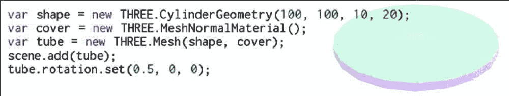 和球体一样，只有在

 真正需要的时候，才应该使用这么多分段。

你能想到如何把它变成金字塔吗？你已经掌握了所有需要的线索。

### 用 JavaScript 制作形状

准备就绪

### 自己试试

  试试不同的数字，看看你能创造出什么！

 你想明白了吗？没想明白也别担心。我们接下来要用的方法

 其实相当巧妙。答案是，你需要减少制作圆锥体所用的分段数。如果你将顶部半径设为 1，底部半径设为 100，高度设为 100， 分段数设为 4，那么你会得到这样的效果：

 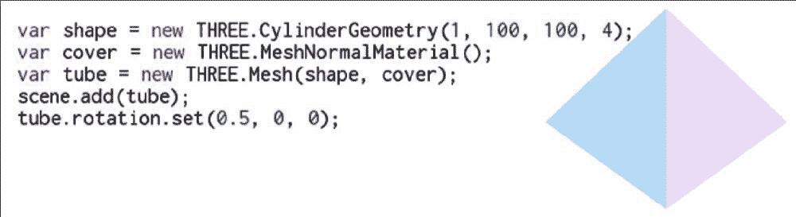 用这种方法来创建金字塔可能看起来像是在作弊，但

 这引出了编程中非常重要的一条建议：

 ### 尽可能作弊

在现实生活中你不应该作弊，但在编程中——尤其是在 3D 编程中——你应该总是寻找更简单的方法来做事。即使有常规的做法，也可能存在更好的方式。

到目前为止你做得很好。像我们对立方体和球体那样，把圆管移出中心位置：

```
tube.position.set(250, -250, -250);
```

现在让我们进入本章的最后两个形状。

### 用平面构建平坦表面

平面是一个平坦的表面。平面特别适合用来做地面，但在游戏中标记门和边缘时也很有用。`PlaneGeometry(100, 100)` 由于平面只是平坦的方形，它们比我们见过的其他对象简单得多。输入以下代码：

```
var shape = new THREE.PlaneGeometry(100, 100);
var cover = new THREE.MeshNormalMaterial();
var ground = new THREE.Mesh(shape, cover);
scene.add(ground);
ground.rotation.set(0.5, 0, 0);
```

别忘了最后一行中的旋转。平面非常薄，当你直视它时可能看不到。

构建平面时的数字是宽度和深度。一个宽度为 300、深度为 100 的平面

 300 宽

 100

  深，看起来可能像这样：

 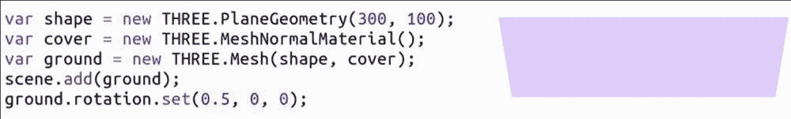 关于平面，需要了解的基本就是这些。把我们的平面移开：

```
var shape = new THREE.PlaneGeometry(300, 100);
var cover = new THREE.MeshNormalMaterial();
var ground = new THREE.Mesh(shape, cover);
scene.add(ground);
ground.position.set(-250, -250, -250);
```

现在让我们进入世界上最棒的形状。

### 用圆环渲染甜甜圈（不是吃的那种）

在 3D 编程术语中，甜甜圈被称为圆环。我们能创建的最简单的圆环需要指定两个值：一个是从中心到外边缘的距离，另一个是管道的粗细。`TorusGeometry(100, 25)` 在 ICE 中输入以下代码：

```
var shape = new THREE.TorusGeometry(100, 25);
var cover = new THREE.MeshNormalMaterial();
var donut = new THREE.Mesh(shape, cover);
scene.add(donut);
```

你应该会看到一个非常粗糙的甜甜圈，如图 1 所示，第 13 页的“粗糙的甜甜圈”。

到现在为止，你可能已经知道如何让甜甜圈不那么粗糙了。

### 用 JavaScript 制作形状

准备就绪

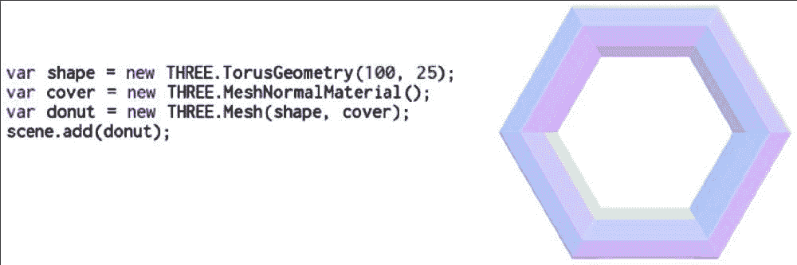 图 1——粗糙的甜甜圈

 `TorusGeometry(100, 25, 8, 25)` 和球体一样，甜甜圈形状也是由分段构成的。围绕内管的分段可以变大或变小，我们可以在定义 `TorusGeometry` 时包含第三个数字来设置。我们还可以通过包含第四个数字来调整甜甜圈外侧的分段大小。尝试像下面这样的数字，看看会发生什么。

```
var shape = new THREE.TorusGeometry(100, 25, 8, 25);
var cover = new THREE.MeshNormalMaterial();
var donut = new THREE.Mesh(shape, cover);
scene.add(donut);
```

 现在

 这是一个好看的甜甜圈：

 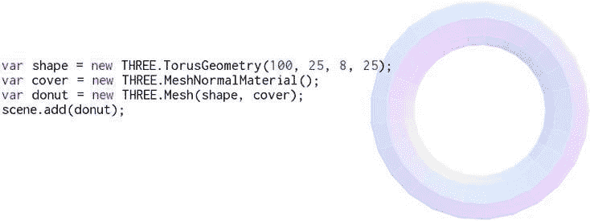 `TorusGeometry(100, 25, 8, 25, 3.14)` 我们还可以对甜甜圈玩另一个把戏。尝试在 `TorusGeometry` 形状中添加另一个数字 3.14：

```
var shape = new THREE.TorusGeometry(100, 25, 8, 25, 3.14);
var cover = new THREE.MeshNormalMaterial();
var donut = new THREE.Mesh(shape, cover);
scene.add(donut);
```

这应该会做出一个被咬了一半的甜甜圈。

## 1.3 让形状动起来

在结束我们的第一次编程会话之前，让我们做点酷的事情。让所有形状疯狂旋转。

在 ICE 中，在所有形状代码之后添加以下代码：

```
var clock = new THREE.Clock();
function animate() {
    requestAnimationFrame(animate);
    var t = clock.getElapsedTime();
    ball.rotation.set(t, 2*t, 0);
    box.rotation.set(t, 2*t, 0);
    tube.rotation.set(t, 2*t, 0);
    ground.rotation.set(t, 2*t, 0);
    donut.rotation.set(t, 2*t, 0);
    renderer.render(scene, camera);
}
animate();
```

暂时不用担心这段代码中每行是什么意思——我们会在本书后面更详细地研究所有这些行。现在，只要知道在特定的时间间隔内，我们正在改变形状的旋转。每次改变后，我们告诉渲染程序在屏幕上重新绘制当前的形状。

 ### 如果 ICE 卡住了

在进行动画和其他复杂编程时，ICE 代码编辑器有可能完全卡住。这没什么大不了的。如果 ICE 停止响应，你需要撤销你最后做的任何更改。如何做到这一点的说明在“当 ICE 崩溃时恢复”中。

## 1.4 到目前为止的代码

为了方便起见，这个项目的完整版本包含在附录 A1.1 中，第 217 页的“代码：创建简单形状”。在练习过程中使用该代码来检查你的工作，但不要将代码复制粘贴到 ICE 中。除非你自己编写代码，否则不可能学会和理解编程。

准备就绪

## 1.5 接下来是什么

哇！这真是太疯狂了。我们学到了很多，而且才刚刚开始！我们已经知道如何在 ICE 代码编辑器中编写项目。我们知道如何制作许多不同的形状。我们甚至知道如何用 JavaScript 移动和旋转物体。最棒的是，在制作完形状后，我们只用了十五行代码就创建了一个相当酷的动画。这是一个好的开始。

既然我们已经尝到了 3D 编程的滋味，让我们稍微谈谈在网页浏览器中编程。

当你完成本章后，你将能够：

- 打开/关闭 JavaScript 控制台
- 知道如何在 JavaScript 控制台中查找错误
- 能够在 ICE 卡住时修复项目

## 第 2 章 玩转控制台并找出问题所在

在网页浏览器中编程时，能够使用浏览器的 JavaScript 控制台非常有用。大多数现代浏览器都有 JavaScript 控制台，但这里我们使用的是 Google Chrome。

 ### 编程可能会让人不知所措

有时它会让你想把电脑扔到墙上（别这么做）。在做这些事情时，请记住这两个事实：

- 会有你不知道的事情——这没关系。
- 你的程序会出问题——这没关系。

只要记住每个人都会遇到这些困难，你会没事的。

### 2.1 开始

 了解 ICE 代码编辑器


我们仍然在使用第 1 章“项目：创建简单形状”（第 1 页）中使用的 ICE 代码编辑器。如果你还没有开始使用 ICE，请回到那一章熟悉一下编辑器。

## 开始一个新项目

你在 ICE 中已经完成的任何工作都应该自动保存，所以我们可以直接开始一个新项目。点击菜单按钮，然后从菜单中选择`New`：

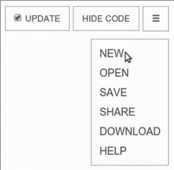  

让我们将新项目命名为   `Breaking Things`。

 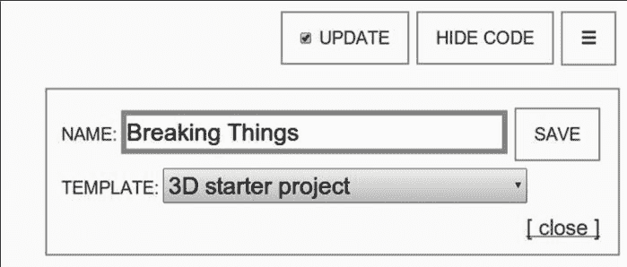 确保将模板设置为  `3D starter project`   。

 现在让我们打开浏览器的 JavaScript 控制台。

### 2.2 打开和关闭 JavaScript 控制台

浏览器中的 JavaScript 控制台是网页程序员最好的朋友。它告诉我们哪里出了错误。

 打开和关闭 JavaScript 控制台  `Ctrl+Shift+J`（同时按住`Ctrl`、`Shift`和`J`键）可以打开和关闭 JavaScript 控制台。如果你使用的是苹果电脑，可以使用`Cmd+Option+J`来打开和关闭控制台。

第一次打开 JavaScript 控制台时，如果看到大量警告和错误，不用担心。它会记录网页或 ICE 代码编辑器中发生的事件。如果消息太多，你可以使用带有斜线圆圈的按钮清除日志。打开 JavaScript 控制台的相同组合键也可以关闭它（但本章中请保持打开状态）。

## ICE 中的调试：红色 X

让我们从破坏一些 ICE 代码编辑器能检测到的简单东西开始。

### 2.3 ICE 中的调试：红色 X

代码旁边的红色 X 表示 ICE 发现了一个会阻止代码运行的问题。让我们写一些非常糟糕的 JavaScript 来演示这一点。

在“START CODING ON THE NEXT LINE”下方输入以下行：

```javascript
bad()javascript
```

这是一段糟糕的 JavaScript！想知道为什么吗？糟糕是因为括号后面不应该有单词。如果你这样写代码，ICE 会在有问题的行旁边显示一个红色 X，表示该行需要修复。将鼠标指针移到红色 X 上会显示实际的错误信息，例如“missing ; before statement”。

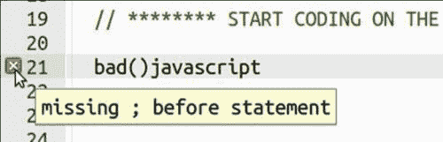 ICE 不会告诉你括号后面放了单词。它只知道括号应该在一行的末尾，而这里不是这样。当它检测到该行未完成时，会触发一个错误警告：“嘿！你忘了在行末加分号！”我们需要自己找出该行应该在何处结束。

看到红色 X 时，需要检查代码中的一些事项：
- 是否忘了加分号？
- 如果在红色 X 行看不到问题，也请检查上一行。ICE 有时无法确定问题从何处开始，可能会偏差一两行。

### 2.4 ICE 中的调试：黄色三角形

与红色 X 不同，代码左侧出现的黄色三角形不会阻止程序运行。即使代码行被标记了黄色三角形，你的代码可能仍然能运行，但可能无法正确运行。最好在出现这些三角形时就消除它们。

让我们通过写一些更糟糕（但没那么糟糕）的 JavaScript 来实践一下。首先，删除上一节中的`bad()javascript`行，并添加以下行：

```javascript
food; eat(food);
```

在这种情况下，ICE 会通过黄色三角形告诉我们`food`这一行没有做任何事情。

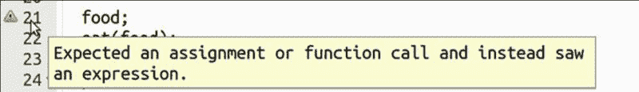 我们可以通过将`food`行改为赋值语句来修复问题，如下所示：

```javascript
food = 'Cookie'; eat(food);
```

ICE 应该接受新的`food`行，并且不再显示任何错误。然而，即使 ICE 没有报告更多问题，这段代码仍然存在问题。

#### 在控制台中调试

### 2.5 在控制台中调试

这就是 JavaScript 控制台派上用场的地方，我们可以看到程序实际在做什么。打开控制台后，你会看到一个错误消息，提示`eat()`未定义。

 当浏览器尝试运行这段糟糕的 JavaScript 代码时，它意识到出了问题。在我们的程序中，我们告诉浏览器运行`eat()`函数，但我们从未告诉浏览器如何执行它。尝试运行代码时发现的错误称为运行时错误。

我们将在第 5 章“函数：反复使用”（第 49 页）中更详细地讨论函数。现在，只需知道函数是一种可以反复运行的代码编写方式即可。

ICE 用红色 X 和黄色三角形标记的错误称为编译时错误。编译时错误是在计算机读取代码并决定如何处理它时捕获的。编译指的是计算机决定如何处理代码。JavaScript 控制台帮助我们修复运行时错误。

#### 在控制台中调试

为了解决这个问题，让我们告诉 JavaScript 程序如何吃东西。我们通过在`eat(food)`行之后添加一个解释如何吃的函数来实现。

```javascript
food = 'Cookie'; eat(food);

function eat(food) { 
    console.log(food + "! Nom. Nom. Nom."); 
}
```

此时，ICE 中应该没有编译时错误，JavaScript 控制台中也没有运行时错误，并且控制台中会显示消息“Cookie! Nom. Nom. Nom.”。

在结束本章之前，让我们看看一些常见的 3D 编程错误。在`eat()`函数的右花括号之后添加以下代码：

```javascript
var shape = new THREE.SpherGeometry(100); 
var cover = new Three.MeshNormalMaterial(); 
var ball = new THREE.Mesh(shape, cover); 
scene.ad(ball);
```

你会注意到，这段代码在 ICE 中没有编译时错误。浏览器读取 JavaScript 代码并说：“嗯，这看起来是完全正确的 JavaScript。我现在就运行它！”然而，当代码实际运行时，问题就会出现，你会在 JavaScript 控制台中看到运行时错误。

#### 可能的错误消息——未定义不是函数

让我们看看哪里出了问题。首先，如果 JavaScript 控制台  还没有打开，请打开它。在那里，你应该会看到一条非常不友好的消息。

 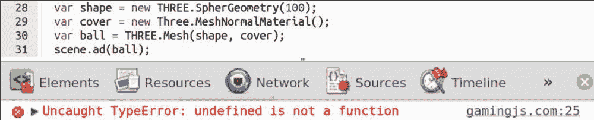 这条消息  试图  告诉我们 `SphereGeometry`  拼写错误。检查  代码；原来我们漏掉了一个`e`，输入了`SpherGeometry`。JavaScript 控制台中的消息非常糟糕且不友好。

这里有两个问题需要处理。首先，“未定义不是函数”实际上没有告诉我们任何信息，而且不容易理解。即使是 JavaScript 专家也会被这条消息搞糊涂。

第二个问题是错误消息中的行号。在这个例子中，`gamingjs.com:25` 表示浏览器认为问题发生在程序的第 25 行（你的行号可能略有不同）。然而，拼写错误的单词并不在 ICE 的第 25 行。我们的问题实际上发生在第 28 行。是的，JavaScript 专家也会被这个搞糊涂。

 准备好的控制台行号并不总是精确的


ICE 会尽力在控制台中显示正确的行号，有时也能成功——甚至现在对你来说可能就是正确的——但有时也会偏差几行。先从精确的行号开始查看。如果看起来与错误不符，那就检查接下来的几行。

我们回到“undefined is not a function”这个错误消息，它实际上指向 ICE 中的第 28 行。这个错误意味着当浏览器尝试运行我们的代码时，它正在寻找一个函数，但找到了一个它不认识的东西。`THREE.SpherGeometry` 没有被定义，因为实际的函数叫做 `THREE.SphereGeometry`。幸运的是，这个问题很容易修复，我们只需要加上字母 `e`。

## 可能的错误消息——Three 未定义

然而，即使我们正确拼写了 `SphereGeometry`，球体仍然没有出现在屏幕上。我们的代码还是有问题。

查看 JavaScript 控制台，你应该会看到类似下面的内容。

 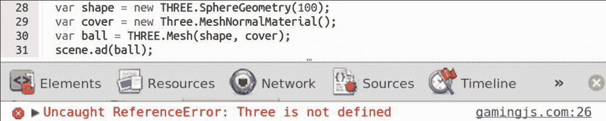 这里，JavaScript 控制台告诉我们，我们忘记了

 `THREE` 应该始终   全部大写。不存在 `Three` 这个东西，而我们写的就是 `Three`，JavaScript 控制台正是在告诉我们这一点。

这是使用 3D 库时一个非常常见的错误，所以下次看到这个错误时，请务必记住这一点。

我们可以通过将代码中的 `Three` 替换为 `THREE` 来修复这个问题。

## 可能的错误消息——Undefined: No Method

即使修复了这两个问题，球体仍然不可见，控制台中又出现了另一个晦涩的错误消息。

## 当 ICE 崩溃时如何恢复

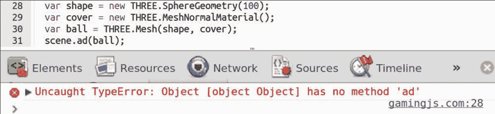  不用担心消息中的

 `Object [object Object]`

   部分，因为它目前没有提供任何有用的信息。

在这种情况下，我们告诉浏览器有一个名为 `ad()` 的方法，但它无法在文件中找到任何相关信息。修复方法与之前的例子相同。我们应该使用的方法是 `add()`，而不是 `ad()`。换句话说，我们不是要把球体“ad”（广告）到屏幕上，而是要“add”（添加）它。

修复那一行之后，你最终会看到一个球体，并且 JavaScript 控制台中会出现“Nom. Nom. Nom.”的消息。

 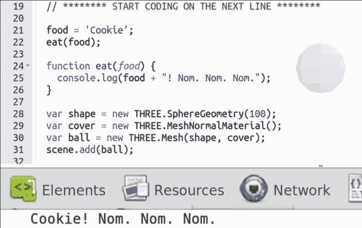

## 2.6 当 ICE 崩溃时如何恢复

 

弄坏一个网页浏览器出奇地容易。如果你创建一个包含一百万个分块的球体，浏览器会崩溃。如果你创建一个没有停止点的递归函数（我们会在《函数：反复使用》中讨论），浏览器也会崩溃。

如果浏览器崩溃了，那么 ICE 代码编辑器也就崩溃了，对吧？

嗯，是的，但有一个简单的修复方法：在 URL 中添加 `?e` 或 `?edit-only`，这样你看到的就是 `http://gamingjs.com/ice/?e`。这是 ICE 的纯编辑模式。

准备就绪

修复你最后输入的那段导致 ICE 崩溃的代码，然后从 URL 中移除纯编辑模式的问号，回到 `http://gamingjs.com/ice/`。现在你应该又能看到预览了。

在某些电脑上，你可能需要先关闭浏览器标签页或窗口，然后再尝试。然后你可以打开一个新窗口或标签页，输入 ICE 的纯编辑模式 URL。特别是 Google Chromebook，按照这个步骤运行纯编辑模式效果更好。

## 2.7 接下来是什么

既然我们已经知道如何制作形状，以及出错时去哪里检查，那么让我们开始制作第一个游戏，构建我们自己的化身。

完成本章后，你将学会：

- 如何在屏幕上组合放置物体
- 拥有一个可以在后续章节和游戏中使用的化身

# 第 3 章 项目：制作一个化身

开发游戏需要构建很多部分，比如游戏区域、游戏中的玩家，以及阻碍玩家的东西。在这个项目章节中，我们将创建一个可以在游戏中使用的玩家——一个化身。它最终看起来会像这样：

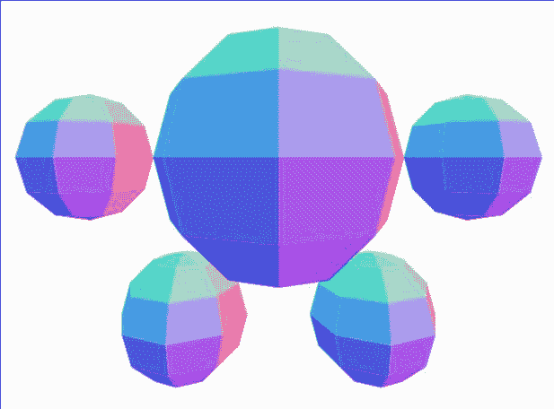

化身就是你在游戏世界中的身份。它显示你在游戏中的位置以及你在做什么。由于它应该代表你和我，所以它应该给人一种良好的感觉。我们想要比一个简单的方块更好的东西来代表我们。

玩家与化身的区别  在本书中，我们将使用“玩家”一词来指代玩游戏的人。而“化身”一词将用来描述游戏中的玩家。

### 3.1 开始

让我们再次打开 ICE 代码编辑器 1，创建一个名为 My Avatar 的新项目（如果你不记得如何操作，请查看第 17 页的“开始一个新项目”）。

1. `http://gamingJS.com/ice` 准备就绪

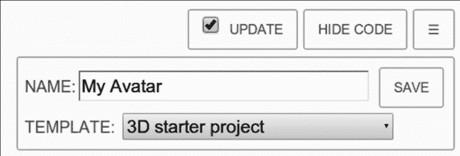 确保将模板设置为 3D 入门项目。这样，我们就可以准备好在“START CODING ON THE NEXT LINE”之后的那一行开始编程了。

### 3.2 用部件组合整体

从第 1 章《项目：创建简单形状》第 1 页开始，我们已经知道如何制作基本形状。让我们从制作一个球体作为身体开始，来构建我们的玩家化身。

```
var cover = new THREE.MeshNormalMaterial();
var body = new THREE.SphereGeometry(100);
var avatar = new THREE.Mesh(body, cover);
scene.add(avatar);
```

我们已经知道输入这些代码后会发生什么——我们会在场景中心得到一个球体。

 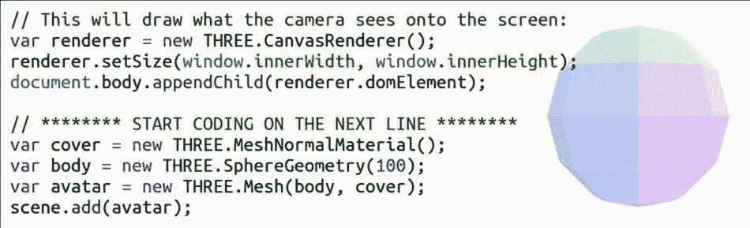 接下来，让我们在身体旁边添加一只手。在你已经输入的创建身体的代码下面，添加以下几行。


```
var hand = new THREE.SphereGeometry(50);
var right_hand = new THREE.Mesh(hand, cover);
right_hand.position.set(-150, 0, 0);
scene.add(right_hand);
```

### 用部件组合整体

注意，我们没有为手创建新的覆盖材质。而是重复使用了同一个覆盖材质，也就是我们在化身身体上使用的那个，我们将其命名为 `cover`。这节省了一些输入。少打字是件好事，因为我们都是程序员，而程序员骨子里都是懒惰的。这让我想起了一些编程智慧，想与大家分享：


### 好程序员是懒惰的

我并不是说程序员讨厌做工作。实际上，我们热爱自己的工作，并且经常因为太热爱而花过多时间工作。

不，我所说的懒惰是指我们讨厌做那些计算机更擅长的工作。因此，与其单独创建手和脚，我们更愿意编写一个单独的手/脚，然后根据需要复制多次。

懒惰在两个非常重要的方面对我们有益：

- 我们输入得更少。信不信由你，这是一个巨大的胜利。不仅第一次输入得更少，而且以后想要更新时，需要阅读的内容也更少。
- 如果我们想改变某个肢体的创建方式，只需要修改一处。也就是说，如果将来想改变手的覆盖材质甚至形状，我们只需要在一个地方进行修改。

那么，让我们看看在创建化身的左手时，能否更加懒惰：

```
var left_hand = new THREE.Mesh(hand, cover);
left_hand.position.set(150, 0, 0);
scene.add(left_hand);
```

我们不仅没有为左手创建新的覆盖材质，而且也没有创建新的形状！我们只是为左手使用了与右手相同的形状。这才叫懒惰！

这样一来，我们的化身应该看起来像图 2《带手的化身》第 28 页那样。

好吧，我承认这看起来不太像带手的身体。请再忍耐一会儿，你会看到的。

准备就绪 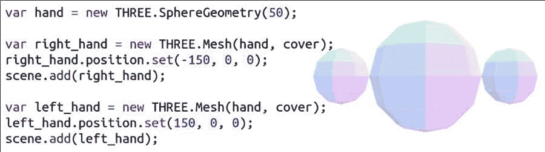 图 2——带手的化身


### 3.3 分解说明

让我们快速看一下为什么我们为手使用了那些数字。如果你没有耐心，可以跳到第 3.4 节《添加行走的脚》第 29 页，继续构建我们的游戏化身。

当任何物体被添加到场景中时，它最初位于正中心。所以当我们添加身体和一只手时，它开始看起来像这样：


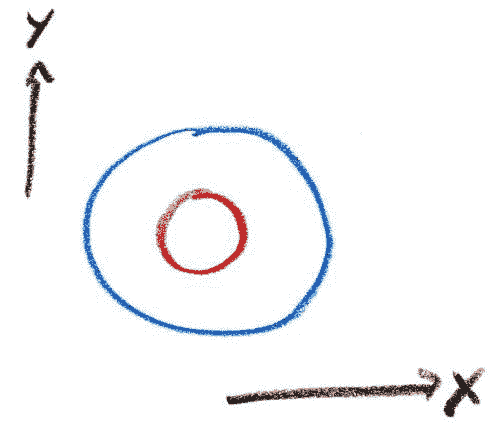 在 3D 编程和数学中，左和右被称为 X 方向。上和下被称为 Y 方向。

这就是为什么我们改变手的 X 位置：

```
var left_hand = new THREE.Mesh(hand, cover);
left_hand.position.set(150, 0, 0);
scene.add(left_hand);
```

`left_hand.position.set(150, 0, 0)` 中的数字分别是左手的 X、Y 和 Z 位置（Z 方向是前后）。我们将 X 设为 150，而 Y 和 Z 均为 0。这实际上等同于 `left_hand.position.x = 150`。稍后我们会看到，在一行中设置多个值会非常方便。

## 添加行走的脚

但为什么是 150？答案是身体的半径为 100，手的半径为 50。我们需要将手在 X（左/右）方向上移动 100 + 50，即 150：

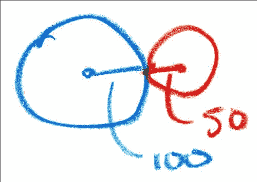 如果我们只将手的中心移动 100，那么手就会有一部分嵌入身体内部：

 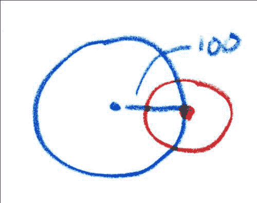

### 自己试试

  如果你不信，可以自己试试。通过调整第一个数字来改变 X 位置：

 `right_hand.position.set(`

  `150`, 0, 0)。对左手和右手都试试。不过别把它们设得

      太大，否则它们可能直接跑出屏幕了！

 3.4 添加行走的脚

 对于脚，我们同样使用大小为 50 的球体。我将由你来决定如何添加相关代码行。

Prepared

一些提示：
- 脚的左/右移动距离不要像手那么大。脚应该位于身体下方。
- 你需要将它们向下移动。上/下定位使用 Y 方向而不是 X 方向。这是 `right_hand.position.set(-150, 0, 0)` 中的第二个数字。你可能需要使用负数来向下移动——例如，-25。
- 回想一下，手是在我们渲染场景之前添加的——即在 `renderer.render(scene, camera)` 这一行之前。脚也应该如此。

以下是右手的实现方式；在你尝试处理脚时可能会有所帮助：

```
var hand = new THREE.SphereGeometry(50);
var right_hand = new THREE.Mesh(hand, cover);
right_hand.position.set(-150, 0, 0);
scene.add(right_hand);
```

祝你好运！！[](Image00169.jpg)

### 自己试试

尝试自己放置脚。要左右移动脚，你需更改 `right_foot.position.set(0, 0, 0)` 中的第一个数字。要上下移动，则更改第二个数字（第三个数字是前后方向）。可能需要花点时间才能调对，但相信我——这是很好的练习。先试一会儿，然后继续阅读正文。

你成功了吗？

效果可能如下所示：

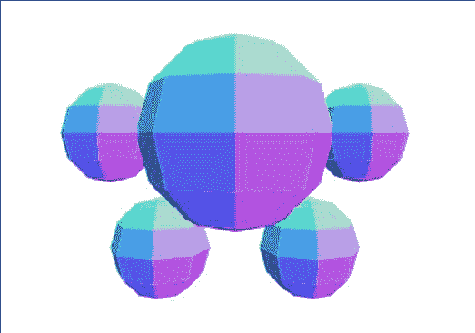 如果你的效果不完全一样，别担心。你的甚至可能更好！如果遇到困难，请参考用于制作虚拟角色的代码：

## 挑战：打造属于你自己的虚拟角色

```
var cover = new THREE.MeshNormalMaterial();
var body = new THREE.SphereGeometry(100);
var avatar = new THREE.Mesh(body, cover);
scene.add(avatar);
var hand = new THREE.SphereGeometry(50);
var right_hand = new THREE.Mesh(hand, cover);
right_hand.position.set(-150, 0, 0);
scene.add(right_hand);
var left_hand = new THREE.Mesh(hand, cover);
left_hand.position.set(150, 0, 0);
scene.add(left_hand);
var foot = new THREE.SphereGeometry(50);
var right_foot = new THREE.Mesh(foot, cover);
right_foot.position.set(-75, -125, 0);
scene.add(right_foot);
var left_foot = new THREE.Mesh(foot, cover);
left_foot.position.set(75, -125, 0);
scene.add(left_foot);
```

这是从“在下一行开始编码”之后的所有内容。

## 3.5 挑战：打造属于你自己的虚拟角色

如果你愿意接受挑战，看看能否创建一个看起来像这样的虚拟角色：

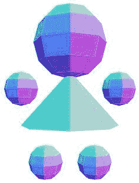 要做到这一点，你需要将身体替换为第 1 章“项目：创建简单形状”（第 1 页）中的某个形状，并添加一个头部。不要

Prepared

担心连接手、脚和身体的手臂和腿——那会让后续章节变得更难。

当然，你可以制作任何你喜欢的虚拟角色。只要记得制作一个带有手和脚的——我们在后续章节中会用到它们。

## 3.6 做侧手翻

稍后我们会为虚拟角色添加控制。但在进入下一课之前，先让虚拟角色做一些翻转和侧手翻。

就像我们在第 1 章“项目：创建简单形状”（第 1 页）末尾所做的那样，我们首先更改代码的最后一行（即编辑器末尾 `</script>` 标签上方的那一行）。我们不再让浏览器只显示一次场景，而是按如下方式对场景进行动画处理。

```
// Now, animate what the camera sees on the screen:
function animate() {
  requestAnimationFrame(animate);
  avatar.rotation.z = avatar.rotation.z + 0.05;
  renderer.render(scene, camera);
}
animate();
```

如果你正确输入了所有代码，可能会注意到一个奇怪的现象。只有头部在旋转，而不是整个虚拟角色。

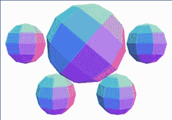 这可能是一个很酷的效果，但并不是我们想要的。那么，我们该如何让整个虚拟角色旋转呢？

如果你猜测我们需要对手和脚也添加 `rotation.z` 的变化，那你的猜测不错。但那样行不通。手和脚会像头部一样在原地旋转。

这个问题的答案是一种非常强大的 3D 编程技术。我们将所有身体部分组合在一起，然后旋转这个组。这是一个简单的想法，但正如你之后会发现的那样，它出奇地强大。

要将身体部分组合在一起，我们将各部分添加到虚拟角色上，而不是场景中。

### 做侧手翻

如果你回头看右手的代码，会发现我们把它添加到了场景中。我们将更改那一行。

```
var right_hand = new THREE.Mesh(hand, cover);
right_hand.position.set(-150, 0, 0);
❶ scene.add(right_hand);
```

❶ 更改这一行。不再将手添加到场景，而是添加到虚拟角色上：

```
var right_hand = new THREE.Mesh(hand, cover);
right_hand.position.set(-150, 0, 0);
❶ avatar.add(right_hand);
```

❶ 这一行现在将右手添加到虚拟角色上，而不是场景中。对 `left_hand`、`right_foot` 和 `left_foot` 也做同样的操作后，你的虚拟角色应该就能做侧手翻了——而且不会丢失任何部件！

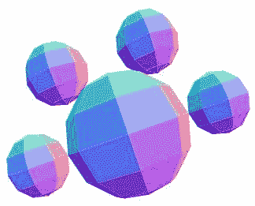 有时我们可能不希望虚拟角色做侧手翻。让我们添加一行代码来控制它。

```
❶ var is_cartwheeling = false;
function animate() {
  requestAnimationFrame(animate);
  ❷ if (is_cartwheeling) {
    avatar.rotation.z = avatar.rotation.z + 0.05;
  }
  renderer.render(scene, camera);
}
animate();
```

❶ 这里我们指定虚拟角色是否在做侧手翻。如果设为 `true`，则虚拟角色在做侧手翻。如果设为 `false`（就像我们这里做的），则虚拟角色不会做侧手翻。

❷ 将 `avatar.rotation` 包裹在 `if` 中，如图所示。不要忘记这一行和 `avatar.rotation` 行之后的花括号。

将 `is_cartwheeling` 的值从 `false` 改为 `true`。虚拟角色是否又开始做侧手翻了？

### 让我们的虚拟角色翻转！

Prepared  现在你已经让虚拟角色做侧手翻了，试着也让虚拟角色翻转。你应该使用类似 `is_flipping` 的值来控制翻转。提示：尝试使用 `avatar.rotation.x` 或 `avatar.rotation.y` 代替 `avatar.rotation.z`。你成功了吗？如果没有，也没关系。我们会在后续章节中进一步介绍。

## 3.7 到目前为止的代码

完整的代码应该类似于附录 A1.3“代码：制作虚拟角色”（第 219 页）中的代码。如果你的代码不完全一样，别担心。你的代码可能更好，或者只是不同。

## 3.8 下一步

我们有了一个看起来很酷的虚拟角色。给它添加一张脸或衣服可能会不错。但你知道什么会更好吗？如果我们能用键盘移动虚拟角色。这正是我们在第 4 章“项目：移动虚拟角色”（第 35 页）中要做的事情。


现在，花点时间调整构成你虚拟形象的各部分的大小、位置和旋转角度。完成本章后，你将能够：

*   使用键盘移动虚拟形象
*   初步了解 JavaScript 事件
*   能够随虚拟形象移动摄像机

# 第 4 章 项目：移动虚拟形象

在第 3 章“项目：制作虚拟形象”（第 25 页）中，我们介绍了如何构建一个游戏虚拟形象。一个无法移动的虚拟形象相当乏味。因此，在本章中，你将学习如何让虚拟形象向不同方向移动。我们还会给它一个小森林供其穿梭。最终效果大致如下：

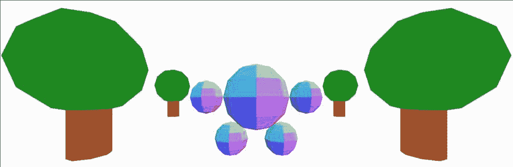

### 4.1 准备工作

本章基于我们在“项目：制作虚拟形象”中所做的工作。如果你尚未完成该章的练习，请先返回完成后再继续。特别地，你需要完成该章末尾的 `animate()` 练习。

让我们复制上一章的虚拟形象项目。这样，如果我们想回顾那个简单的旋转和侧手翻虚拟形象，随时可以查看。要复制该项目，请点击菜单按钮，然后从菜单中选择“制作副本”（Make a Copy）。（见图 3，选择“制作副本”，第 36 页）。我们将这个项目命名为“我的虚拟形象：键盘控制”，如图 4，“命名项目”，第 36 页所示。

至此，我们已准备好添加键盘控制。

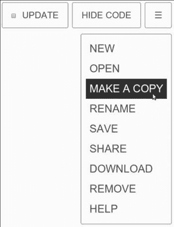 图 3——选择“制作副本”
  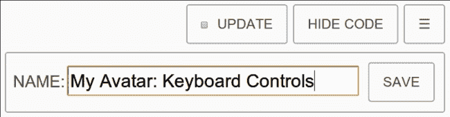 图 4——命名项目


### 4.2 使用键盘事件构建交互系统

到目前为止，本书中的代码都是非常线性的——它沿着一条直线执行。我们先制作了一个封面、一个形状和一个网格，然后将对象添加到场景中。接着我们处理下一个网格，同样将其添加到场景中。虽然可以编写大量类似这样的 JavaScript 代码，但大多数 JavaScript 程序往往截然不同。

这是因为 JavaScript 通常在 Web 浏览器中运行。在 Web 浏览器中，JavaScript 代码必须响应事件。键盘按键被按下、鼠标按钮被点击、鼠标指针在页面上移动，这些都是 Web 浏览器中的事件。每个网页上可能发生大量事件，而大多数情况下，这些事件都被忽略了。

但我们不会忽略按键事件。我们将使用一种称为事件监听器（event listener）的东西来监听事件。让我们在代码的最底部，即我们在第 3 章“项目：制作虚拟形象”（第 25 页）中添加的 `animate()` 行下方，添加以下代码。

### 将键盘事件转换为虚拟形象移动

```javascript
// 监听按键事件
document.addEventListener('keydown', function (event) { 
    alert(event.keyCode);
});
```

这为整个页面添加了一个事件监听器。它监听 `keydown` 事件。当我们的代码检测到 `keydown` 时，它会弹出一个包含刚刚发生事件的 `keyCode` 的警告框。

什么是 `keyCode`？为了回答这个问题，我们来试试看！点击页面顶部工具栏中的“隐藏代码”按钮，然后按下键盘上的 A 键。你应该会看到类似这样的警告对话框。

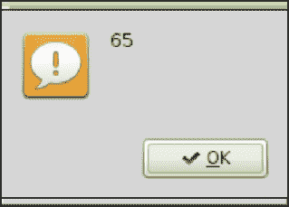

这个 65 是什么？请记住，计算机存储所有内容，甚至字母，都是以数字形式存储的。计算机在向人类显示正确的字母时，会将该数字转换为字母。当我们想到字母 a 时，计算机想到的是 65。

为什么我们需要知道这个？如果你还没有点击警告框上的“确定”按钮，请先点击。然后对键盘上的左、上、右、下箭头键重复此操作。对于左箭头，你会发现计算机认为是 37。对于上箭头，计算机认为是 38。对于右箭头，计算机检测到的键码是 39。对于下箭头，计算机认为是 40。

让我们利用这些 `keyCode` 来移动我们的虚拟形象！

## 4.3 将键盘事件转换为虚拟形象移动

通过使用键盘事件监听器，我们现在知道了四个箭头键对应的数字。我们将这些箭头键和数字转换为虚拟形象的移动，如下所示：

| 箭头键 | 计算机数字 | 虚拟形象方向 |
| :--- | :--- | :--- |
| 左 | 37 | 向左 |
| 上 | 38 | 向前 |
| 右 | 39 | 向右 |
| 下 | 40 | 向后 |

那么，让我们来实现这一点。删除 `document.addEventListener()` 内部的 `alert(event.keyCode)` 行。用以下代码替换它，从 `var code` 语句开始。

```javascript
document.addEventListener('keydown', function (event) {
    var code = event.keyCode; 
    if (code == 37) avatar.position.x = avatar.position.x - 5; // 左
    if (code == 38) avatar.position.z = avatar.position.z - 5; // 上
    if (code == 39) avatar.position.x = avatar.position.x + 5; // 右
    if (code == 40) avatar.position.z = avatar.position.z + 5; // 下
});
```

我们在“项目：制作虚拟形象”中见过 `if` 语句。在这里，我们检查 `keyCode` 是否等于某个箭头键的计算机数字。如果键码是 37（左箭头键），那么我们将 `avatar` 的 `X` 位置减去 5。

在 JavaScript 中，双等号（`==`）用于检查某物是否等于另一物——单等号（`=`）用于将值赋给另一物。在我们上面的代码示例中，我们将 `code` 设置为等于 `event.keyCode`。然后我们检查它是否等于不同的箭头键值。


**试一试！**
点击“隐藏代码”按钮，然后试一试。使用箭头键移动虚拟形象。它是否按你预期的方式工作？记住：如果出现问题，请检查 JavaScript 控制台！

如果一切正常，那么你应该能够将虚拟形象移动到远处、近处、最左边或最右边，甚至移出屏幕。

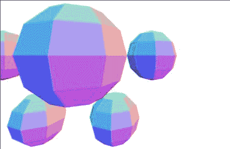

在第 3.6 节“做侧手翻”（第 32 页）中，我们添加了做侧手翻的能力，你学会了如何确保虚拟形象的手和脚随身体一起移动。由于手和脚是添加到 `avatar` 对象而不是 `scene` 中的，因此移动 `avatar` 意味着手和脚也会随之移动。

**挑战：开始/停止动画**
让我们看看如果其中一条腿没有连接到虚拟形象上会发生什么。在这里，我们将修改 `left_foot`，使其添加到 `scene` 而不是 `avatar` 中。

```javascript
var left_foot = new THREE.Mesh(foot, cover); 
left_foot.position.set(75, -125, 0); 
scene.add(left_foot);
```

运行这段代码，左脚就会消失。

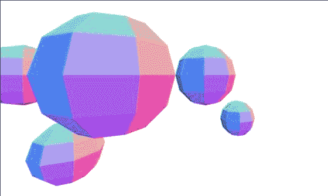

不要低估这个概念的力量。我们稍后会用它做一些疯狂的事情。现在，别忘了将你的左脚固定到 `avatar` 上！

## 4.4 挑战：开始/停止动画

还记得我们在第 3 章“项目：制作虚拟形象”（第 25 页）中构建虚拟形象时使用的 `is_cartwheeling` 和 `is_flipping` 值吗？让我们在键盘事件监听器中再添加两个 `if` 语句。如果按下 C 键（计算机认为是数字 67），则虚拟形象应开始或停止做侧手翻。如果按下 F 键（计算机认为是数字 70），则翻转例程应开始或停止。

**提示**：使用非运算符在 `true` 和 `false` 之间切换。在 JavaScript 中，非运算符是感叹号 `!`。你可以使用这个非运算符将 `is_cartwheeling` 的值赋为其相反值，例如 `is_cartwheeling = !is_cartwheeling`。我们将在“布尔值”部分再次看到这一点。

希望你能自己实现它。以下是处理侧手翻和翻转的 `animate()` 函数。

```javascript
var is_cartwheeling = false; 
var is_flipping = false; 

function animate() {
    requestAnimationFrame(animate); 
    if(is_cartwheeling) {
        avatar.rotation.z = avatar.rotation.z + 0.05; 
    }
    if (is_flipping) {
        avatar.rotation.x = avatar.rotation.x + 0.05;
    }
    renderer.render(scene, camera);
} 
animate();
```

以下是用于移动、翻转和侧手翻虚拟形象的完整键盘事件监听器。

```javascript
document.addEventListener('keydown', function (event) {
```


`var code = event.keyCode; if (code == 37) avatar.position.x = avatar.position.x-5; // 左移 if (code == 38) avatar.position.z = avatar.position.z-5; // 上移 if (code == 39) avatar.position.x = avatar.position.x+5; // 右移 if (code == 40) avatar.position.z = avatar.position.z+5; // 下移 if (code == 67) is_cartwheeling = !is_cartwheeling; // C if (code == 70) is_flipping = !is_flipping; // F`

`}) ;`

如果你做对了，你应该能让角色在移出屏幕时做出后空翻和侧手翻。

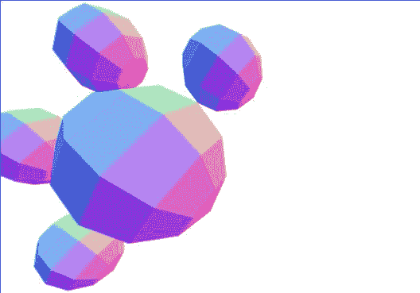 实际上，角色能离开屏幕这件事相当疯狂。我们稍后会修复这个问题，但首先，让我们添加一些树木，让角色可以穿行其中。

## 4.5 用函数建造森林

我们的森林需要很多树木。我们可以一棵一棵地建造，但我们不会这么做。相反，让我们在所有角色身体部件之后添加以下 JavaScript 代码：

`makeTreeAt( 500, 0) ;`

`makeTreeAt(-500, 0) ;`

`makeTreeAt( 750, -1000) ;`

`makeTreeAt(-750, -1000) ;`

### 用函数建造森林

```
function makeTreeAt(x, z) {
  var trunk = new THREE.Mesh(
    new THREE.CylinderGeometry(50, 50, 200),
    new THREE.MeshBasicMaterial({color: 0xA0522D})
  );
  var top = new THREE.Mesh(
    new THREE.SphereGeometry(150),
    new THREE.MeshBasicMaterial({color: 0x228B22})
  );
  top.position.y = 175;
  trunk.add(top);
  trunk.position.set(x, -75, z);
  scene.add(trunk);
}
```

如果你正确输入了所有代码，你会看到角色站在一片由四棵树组成的森林前。

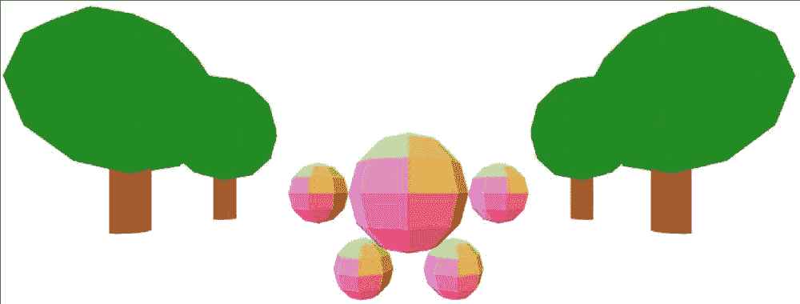 这很酷，但我们是怎样做到的呢？

### 分解步骤

建造森林的第一部分很容易理解。我们在场景中不同的 X 和 Z 坐标（记住 Y 是上下方向）处添加树木。

`makeTreeAt( 500, 0) ;`

`makeTreeAt(-500, 0) ;`

`makeTreeAt( 750, -1000) ;`

`makeTreeAt(-750, -1000) ;`

这很简单，但那个 `makeTreeAt()` 是如何工作的呢？

正如我们将在第 5 章“函数：反复使用”（第 49 页）中看到的，JavaScript 函数是一种重复运行相同代码的方式。在这里，我们在名为 `makeTreeAt()` 的函数中完成了建造树干和树冠的所有重复性工作。我们可以给它起任何名字，但我们给它起了一个能说明其功能的名字——在这种情况下，它会在我们指定的坐标处建造一棵树。

我们应该对这个函数内部的大部分内容都很熟悉。

```
function makeTreeAt(x, z) {
❶ var trunk = new THREE.Mesh(
    new THREE.CylinderGeometry(50, 50, 200),
    new THREE.MeshBasicMaterial({color: 0xA0522D})
  );
❷ var top = new THREE.Mesh(
    new THREE.SphereGeometry(150),
    new THREE.MeshBasicMaterial({color: 0x228B22})
  );
❸ top.position.y = 175;
❹ trunk.add(top);
❺ trunk.position.set(x, -75, z);
❻ scene.add(trunk);
}
```

❶ 用圆柱体制作树干。  
❷ 用球体制作树冠。  
❸ 将树冠向上移动（记住 Y 是上下方向）到树干顶部。  
❹ 将树冠添加到树干上。  
❺ 将树干的位置设置为调用函数时传入的 x 和 z 值——例如 `makeTreeAt(500,0)`。Y 值为 -75 将树干向下移动，使其看起来像树干。  
❻ 将树干添加到场景中。

重要的是要记住，我们必须将树冠添加到树干上，而不是添加到场景中。如果我们将树冠添加到场景中，那么当我们尝试移动树木时，只有树干会被移动，而树冠不会。如果我们将树冠添加到场景中，我们还需要设置树冠的位置——将其添加到树干上意味着树冠的位置与树干相同。

到目前为止，我们已经很擅长用形状和材质构建对象并将它们放置在屏幕上了。你可能不用费太大力气就能做出四棵树。对于一棵树，你需要一个 `THREE.CylinderGeometry` 作为树干，一个 `THREE.SphereGeometry` 作为树冠。如果你将绿色的树叶添加到树冠上，那么你就可以一起移动这两个部分了。

### 让摄像机跟随角色移动

然后你需要再重复三次同样的操作，才能总共做出四棵树。四棵树需要输入很多代码。别忘了：我们程序员不喜欢打字。永远记住我们很懒。而这次让我们偷懒的东西就是函数。

这里还有一个新东西：颜色。我们从维基百科的颜色名称列表（http://en.wikipedia.org/wiki/X11_color_names）中选取了这些颜色。树干的颜色是赭色。如果你喜欢，可以尝试自己的颜色。颜色来自该网页的第一列，但我们需要将网页上的 `#` 符号替换为 `0x`，以便 JavaScript 能够识别。因此，`#A0522D` 变成了 `0xA0522D`。

现在我们已经有了森林，让我们看看能否让摄像机在角色穿越场景时跟随角色移动。

## 4.6 让摄像机跟随角色移动

回想一下，为了让手和脚随着角色一起移动，我们将它们添加到了角色的身体上，而不是添加到场景中。这正是我们需要对摄像机做的事情。首先，找到写着 `scene.add(camera)` 的那一行，并将其删除。然后，在角色被添加到场景的那一行下方，在 `makeTreeAt()` 函数上方，将摄像机添加到角色上：

```
var left_foot = new THREE.Mesh(foot, cover);
left_foot.position.set(75, -125, 0);
avatar.add(left_foot);

❶ avatar.add(camera);  // ❶ 添加这一行。
```

隐藏代码后，你会看到当角色移动时，摄像机始终保持在角色正前方。

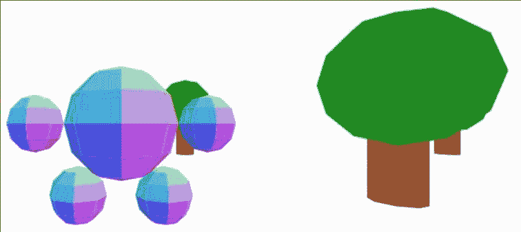

它始终位于角色前方 500 个单位处（`camera.position.z = 500`）。由于我们从未用 `position.y` 定义摄像机的高度，所以摄像机始终与角色保持相同高度。由于我们尚未用 `position.x` 设置左右位置，所以摄像机始终位于正前方。

你可以把摄像机想象成用一根无形的链条拴在角色上。

 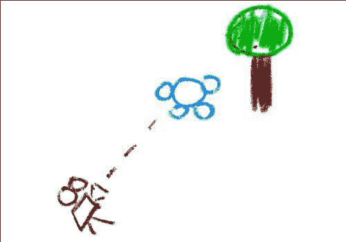 无论角色走到哪里，摄像机都会跟着走。

 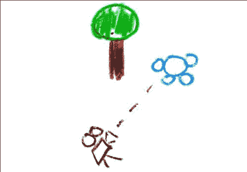

很酷，对吧？嗯，这种方法有一个大问题。如果角色开始做侧手翻或后空翻（记住我们用的是 C 和 F 键），会发生什么？自己试试看！

角色似乎保持不动，但其他所有东西都开始旋转！（见图 5，“所有东西都开始旋转！”，第 45 页。）

这是因为摄像机被拴在角色身上的无形链条上。如果角色旋转，摄像机也会跟着旋转。（见图 6，“摄像机随角色旋转”，第 45 页。）

这可不是我们想要的。我们真正想要的是将摄像机锁定在角色的位置上，而不是锁定在角色本身上。

在 3D 编程中，没有简单的方法可以可靠地将某物只锁定到另一个物体的位置上。但并非无计可施。

### 让摄像机跟随角色移动

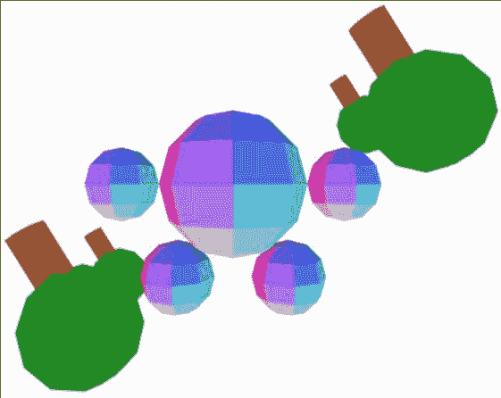 图 5——所有东西都开始旋转！

 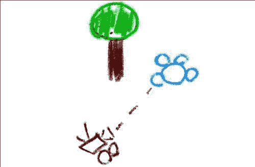 图 6——摄像机随角色旋转

 我们将在游戏中添加一个角色位置标记。

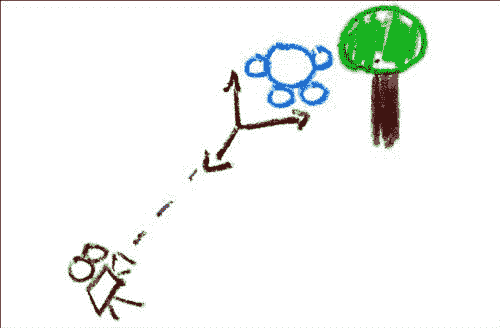 如果我们将摄像机和角色都锁定到这个标记上，那么移动标记就会同时移动角色和摄像机。

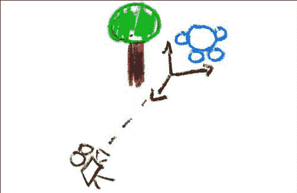 但更重要的是，当角色做侧手翻时，摄像机不会移动。角色在做侧手翻，但标记不会旋转。由于标记不旋转，摄像机也不会旋转。

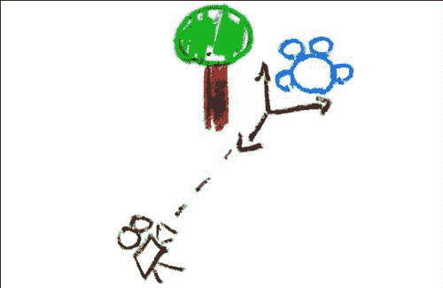

在 3D 编程中，这个标记只是一个标记。它应该是不可见的。所以我们不想为此使用网格或几何体。相反，我们使用 `Object3D`。让我们在角色生成代码之前，紧接在 `START CODING ON THE NEXT LINE` 之后添加以下代码。

```
var marker = new THREE.Object3D();
scene.add(marker);
```

现在，我们修改角色，将其添加到标记上，而不是添加到场景中：

```
var avatar = new THREE.Mesh(body, cover);
marker.add(avatar);
```

我们还需要修改摄像机的添加方式。不再将摄像机添加到角色上，而是将其添加到标记上。


`marker.add(camera);` 最后需要修改的是键盘事件监听器。我们不再改变角色的位置，而是改变标记的位置。

```
document.addEventListener( 'keydown' , function (event) {

var code = event.keyCode; if (code == 37) marker.position.x = marker.position.x-5; // left if (code == 38) marker.position.z = marker.position.z-5; // up if (code == 39) marker.position.x = marker.position.x+5; // right if (code == 40) marker.position.z = marker.position.z+5; // downif (code == 67) is_cartwheeling = !is_cartwheeling; // C if (code == 70) is_flipping = !is_flipping; // F

}) ;
```

这样一来，我们可以用键盘移动角色的位置，但当我们翻转或侧翻时，摄像机保持直立。

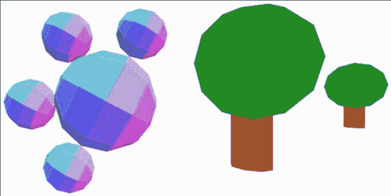
### 4.7 到目前为止的代码
如果你想核对一下目前的代码，请与第 220 页的 A1.4 节《代码：移动角色》中的代码进行比较。
### 4.8 接下来是什么
本章我们学习了一项非常重要的技能。随着游戏技能的提升，我们会反复将对象像这样分组。分组可以简化一起移动、扭转、旋转、放大和缩小物体的操作。

Prepared
在给角色添加更多内容之前，我们先休息一下，以便更深入地探索 JavaScript 函数。我们已经用它们来创建森林、制作动画和监听事件。我们还能用它们做更多酷炫的事情。

完成本章后，你将：

• 理解程序员的一个超强工具（函数）
• 知道使用函数的两个理由
• 识别一些常见的 JavaScript 错误并知道如何修复它们

## 第 5 章 函数：反复使用
我们已经多次遇到函数。最近一次是在第 4 章《项目：移动角色》（第 35 页）中，我们用它们来创建森林。如果你仔细观察，可能会发现我们在同一章中也用函数构建了键盘事件监听器。

虽然我们已经使用过函数，但还没有深入讨论它们。你可能已经感觉到它们非常强大，那么现在让我们仔细看看。

我们不会讨论函数的方方面面——它们可能会变得相当复杂。我们只讨论到足以理解本书中使用的函数的程度。

### 5.1 开始
在 ICE 代码编辑器中创建一个新项目。使用空项目模板，并将其命名为“Functions”。

在开头的`<script>`标签之后，删除写着“Your code goes here”的那一行，然后输入以下 JavaScript 代码。

```
var log = document.createElement('div' ) ; log.style.height
= '75px' ; log.style.width = '450px' ; log.style.overflow =
'auto' ; log.style.border = '1px solid #666' ;

log.style.backgroundColor = '#ccc' ; log.style.padding =
'8px' ; log.style.position = 'absolute' ; log.style.bottom =
'10px' ; log.style.right = '20px' ;

document.body.appendChild(log);

var message = document.createElement('div' ) ; message.textContent = 'Hello, JavaScript functions!' ; log.appendChild(message);message = document.createElement('div' ) ; message.textContent = 'My name is Chris.' ; log.appendChild(message);

message = document.createElement('div' ) ; message.textContent = 'I like popcorn.' ; log.appendChild(message);
```

Prepared
第一段代码在浏览器中创建了一个记录消息的地方。最后三个代码块向该日志写入了三条不同的消息。如果一切输入正确，你应该会在页面右下角看到这三条消息。

 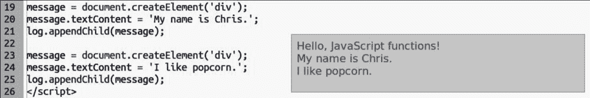 回到
 第 3 章，
 项目：创建角色
 ，第 25 页
，我们使用了一个函数
 来避免重复四次创建树的相同过程。所以
 你大概能猜到我们首先要改什么。让我们改变记录这三条消息的方式。

首先，删除从第一行`var message`到最后一个`log.appendChild`行的所有内容。在原来代码的位置，添加以下内容。

```
logMessage('Hello, JavaScript functions!' , log); logMessage('My name is
Chris.' , log); logMessage('I like popcorn.' , log);function logMessage(message, log) {

var holder = document.createElement('div' ) ; holder.textContent = message; log.appendChild(holder);}
```

当我们编写这段代码时，发生了一件令人惊讶的事情——它变得更容易阅读了。即使是非程序员也能读懂前三行，并知道它们向日志发送了一条消息。这对我们这样的程序员来说是一个巨大的胜利。

如果我们后来决定要在每条消息前添加时间，现在找出在哪里修改就更容易了。

## 开始
 可读的代码以后更容易修改

区分优秀程序员和普通程序员的技能之一就是修改现有代码的能力。优秀的程序员知道，当代码易于阅读时，修改起来更容易。

显然我们需要修改函数内部的内容。以前，我们需要花一些时间才能弄清楚那三个代码块是在写日志消息，以及如何修改它们。

这也引出了一个非常重要的规则。

 保持代码 DRY——不要重复自己

这本书与一本著名的书《程序员修炼之道》出自同一家出版社。如果你继续编程，总有一天会读到那本书。书中有一个绝妙的建议：程序员应该保持代码 DRY——遵循“不要重复自己”（简称 DRY）的规则。

当我们最初编写代码时，我们重复了三件事：
1. 为消息创建一个容器
2. 向容器添加文本消息
3. 将消息容器添加到日志中

很容易看出我们在重复自己，因为三个代码块中的代码除了消息内容外完全相同。这又是我们偷懒的机会。如果我们添加超过三条消息，只需多输入一行，而不是三行。

当然，如果我们需要修改日志消息的某些内容，只需修改一个函数，而不是三个不同的代码块。

我们在这里还没有完全结束函数的使用。如果你查看所有代码，会发现需要很长时间才能到达重要的部分。（见图 7，函数之前的大量垃圾代码，第 52 页。）

重要的工作——写入消息——直到第 15 行才开始。在向日志写入消息之前，我们需要一个日志，但其他所有内容都只是干扰。

为了解决这个问题，让我们将干扰代码移到一个函数中，放在`logMessage()`行下方。在调用`logMessage()`的三行和定义`logMessage()`函数之间，添加一个名为`makeLog()`的新函数。创建日志容器的“干扰”代码

Prepared
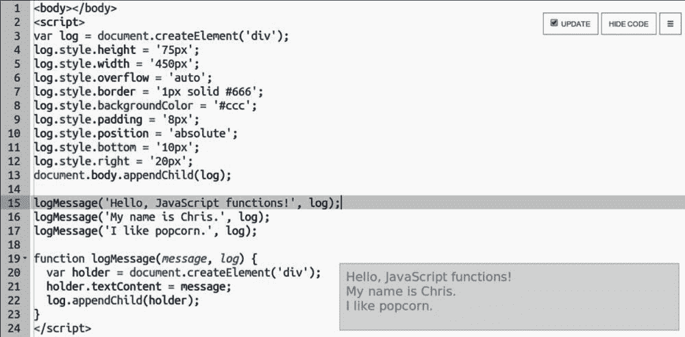 图 7——函数之前的大量垃圾代码

 从`var log = document.createElement('div');`这一行开始，到`document.body.appendChild(holder)`这一行结束。将这些行及其之间的所有内容移到`makeLog()`中：

```
function makeLog() {

var holder = document.createElement('div' ) ; holder.style.height =
'75px' ; holder.style.width = '450px' ; holder.style.overflow = 'auto' ;
holder.style.border = '1px solid #666' ;

holder.style.backgroundColor = '#ccc' ; holder.style.padding = '8px' ;
holder.style.position = 'absolute' ; holder.style.bottom = '10px' ;
holder.style.right = '20px' ; document.body.appendChild(holder);return holder;

}
```

注意我们将`log`改成了`holder`。另外，不要忘记最后一行，它返回`holder`以便我们可以用它做其他事情。

我们可以用这个函数创建日志。在开头的`<script>`标签之后，前四行变成以下内容：

```
var log = makeLog(); logMessage('Hello, JavaScript functions!' , log);
```


`logMessage('My name is Chris.' , log);` `logMessage('I like popcorn.' , log);`

## 理解简单函数

这段代码非常易读！写出这样的代码比想象中要难。真正优秀的程序员知道，在没有充分理由之前不要使用函数。换句话说，伟大的程序员正是像我们这样做的：先写出能运行的代码，再寻找改进的方法。

## 始终从丑陋的代码开始


你是一个非常聪明的人。能走到这一步，你必然很聪明。所以你可能会想：“哦，我一开始就能写出可读性好的代码。”


请相信我，你做不到。程序员对此深有体会，甚至给这种尝试起了个专门的名称：过早泛化。用花哨的说法就是，在写出丑陋的代码之前就猜测函数将如何使用，这是一个错误。程序员对我们常犯的错误都有花哨的名称。

## 5.2 理解简单函数

到目前为止，我们已经了解了为什么要使用函数。现在来看看函数是如何工作的。

从代码中删除三行 `logMessage()`。在 `var log = makeLog` 这一行之后，写入以下内容。

```
logMessage(hello('President Obama' ), log);
logMessage(hello('Mom' ), log);
logMessage(hello('Your Name' ), log);
function hello(name) {
  return 'Hello, ' + name + '! You look very pretty today :)' ;
}
```

这个 `hello()` 函数的结果是首先返回短语“Hello, President Obama! You look very pretty today :)”。记录这些短语的效果应该如下所示：

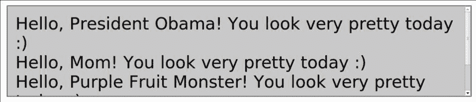

`hello` 函数内部有很多内容需要处理，让我们把它分解成更小的部分。

```
❶ function hello(name) {
❷   return 'Hello, ' + name + '! You look very pretty today :)' ;
}
```

准备就绪

函数的组成部分如下：

❶ 关键字 `function`，告诉 JavaScript 我们正在创建一个函数。

函数的名称——这里是 `hello`。

函数参数。在这个例子中，我们接受一个参数（`name`），它将在函数体内部使用。当我们用参数调用函数时——例如 `hello(Fred)` ——我们告诉函数，任何时候使用 `name` 参数，都等同于使用 `Fred`。

函数体以左花括号 `{` 开始，以右花括号 `}` 结束。你在写英文时可能从未使用过花括号，但在写 JavaScript 时会经常用到。

❷ 关键字 `return` 告诉 JavaScript 我们想要函数返回的结果。它可以是任何东西：数字、字母、单词、日期，甚至更有趣的东西。


JavaScript 中的每一行，即使是函数内部的，都应该以分号结尾。

### 字母、单词和句子都是字符串

引号内的内容，比如 `'Hello'`，被称为字符串。即使在其它编程语言中，字母、单词和句子通常也被称为字符串。

务必确保关闭引号。如果忘记，你会遇到非常奇怪且难以修复的错误。

接下来，让我们故意破坏它，以便了解出错时该如何处理。

## 5.3 当事情出错时

让我们戴上黑客的帽子，尝试破坏一些函数。

虽然用 JavaScript 函数做错事很容易，但找出错在哪里却并不容易。程序员最常犯的错误会产生奇怪的错误信息。让我们来看看，以便你做好更充分的准备。

### 当事情出错时

#### 黑客，而非破解


别担心！我们不会真的破坏任何东西。破坏东西是破解，而不是黑客。黑客是好事。你经常会听到非程序员错误地使用“黑客”这个词。既然你现在是程序员了，你需要知道这个词的含义以及如何正确使用它。黑客意味着我们在玩弄代码、应用程序或


网站。我们玩弄它们是为了学习，而不是造成破坏。有时我们会尝试破坏自己的代码——但只是为了更好地理解它。

永远做黑客，绝不做破解者。

### 意外错误

最常见的情况是忘记花括号：

```
// 缺少花括号 - 这不会工作！
function hello(name)
  return 'Hello, ' + name + '! You look very pretty today :)' ;
}
```

这是 JavaScript 中的编译时错误——JavaScript 在尝试读取、编译和运行时能够检测到的错误之一——我们在

 第 2.5 节

  控制台调试

 第 20 页中遇到过。由于这是一个编译时

 错误，ICE 代码编辑器会告诉我们问题所在。

 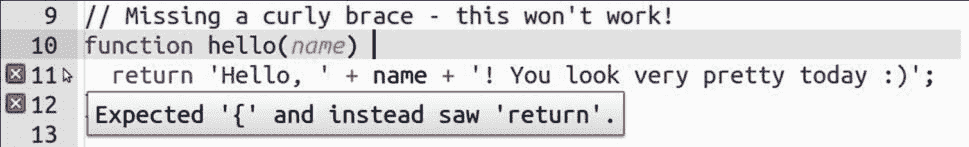 如果我们把花括号放回去，但移除 `return` 语句后面的花括号，会发生什么？

```
// 缺少花括号 - 这不会工作！
function hello(name) {
  return 'Hello, ' + name + '! You look very pretty today :)' ;
```

我们的 `hello` 函数中没有错误，但代码最底部有一个错误。

 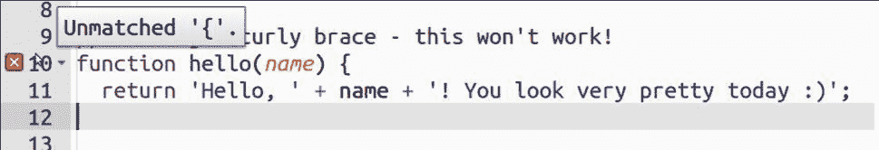

这可能是一个难以修复的错误。程序员常常在意识到自己犯了错误之前，已经写了很多行代码，甚至可能写了几个函数。然后需要花时间找出你原本打算在哪里添加花括号。

#### 挑战

准备就绪

尝试自己找出以下有问题的代码。错误出现在哪里？提示：如第 2.5 节“控制台调试”第 20 页所述，其中一些可能是运行时错误。

- 忘记给参数加括号：
```
function hello name {
  return 'Hello, ' + name + '! You look very pretty today :)' ;
}
```
- 忘记函数的参数：
```
function hello() {
  return 'Hello, ' + name + '! You look very pretty today :)' ;
}
```
- 函数内部使用了错误的变量名：
```
function hello(name) {
  return 'Hello, ' + person + '! You look very pretty today :)' ;
}
```
- 调用函数时使用了错误的名称：
```
logMessage(helo('President Obama' ), log);
function hello(name) {
  return 'Hello, ' + name + '! You look very pretty today :)' ;
}
```

哇！破坏函数的方式可真多。请相信我，当你逐渐成为一名优秀的程序员时，你会以这些方式以及其他许多方式破坏函数。

### 伟大的程序员总是搞砸事情

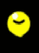

正因为他们经常搞砸，所以他们非常擅长修复问题。这是让伟大程序员变得伟大的另一项技能。

如果你搞砸了代码，千万不要自责。搞砸的代码是学习的机会。别忘了像你在“玩转控制台与查找错误”中学到的那样，使用 JavaScript 控制台来帮助排查问题！

## 5.4 函数的奇特技巧

函数在 JavaScript 中非常特殊，你可以对它们做各种疯狂的事情。关于“函数式”JavaScript 的整本书都写出来了，但让我们先看一个我们以后会用到的小技巧。

### 递归

像这样修改 `hello`：

```
function hello(name) {
  var ret = 'Hello, ' + name + '! ' + 'You look very pretty today :)' ;
  if (!name.match(/again/)) { ❶
    ret = ret + ' /// ' + hello(name + ' (again)' ) ;
  }
  return ret;
}
```

❶ 仔细看这里。在函数 `hello` 的函数体内部，我们正在调用函数 `hello`！

这将记录两次问候消息。


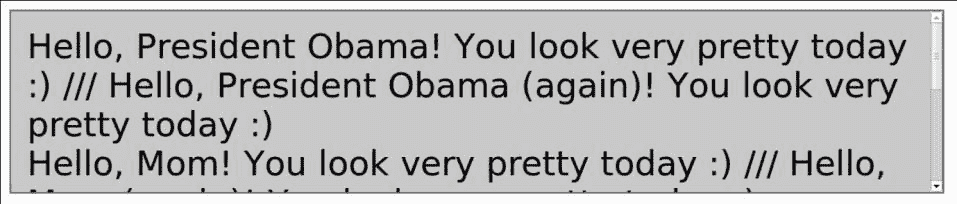 像这样调用自身的函数其实并不疯狂。它非常常见，以至于有一个专门的名称：递归函数。使用递归函数时要小心！如果没有东西阻止递归函数反复调用自身，你的浏览器就会卡死，你只能进入纯编辑模式来修复它，如第 23 页的 2.6 节“当 ICE 崩溃时如何恢复”所述。在这个例子中，我们通过仅在`name`变量不等于`"again"`时再次调用`hello`函数来停止递归。如果`name`不等于`"again"`，我们就用`name + "(again)"`调用`hello()`，这样下一次调用就会包含`"again"`。

递归可能是一个难以理解的概念，但你的代码编辑器的名字就是一个很好的例子：

- ICE Code Editor 中的 I 代表什么？
- 它代表 ICE Code Editor。

- ICE Code Editor 中的 I 代表什么？
- 它代表 ICE Code Editor。

- ICE Code Editor 中的 I 代表什么？
- …

你可以永远问下去，但最终你会厌倦的。计算机不会厌倦提问，所以你必须告诉它们何时停止。

## 5.5 到目前为止的代码

如果你想核对本章的代码，请参考第 222 页的 A1.5 节“代码：函数：反复使用”。

## 5.6 接下来是什么

函数对于 JavaScript 程序员来说是非常强大的工具。正如我们所看到的，使用函数的两个主要原因是代码复用和让代码更易读。我们创建了一个`logMessage()`函数，以便反复使用它的功能。我们创建了`makeLog()`函数，将一大段杂乱的代码从更重要的代码中移开。我们甚至还瞥见了函数的一些疯狂用法，比如递归。

而我们才刚刚触及皮毛！

很快你就会看到，在接下来的章节中我们会大量使用函数。让我们从下一章开始，教我们的虚拟角色如何移动手脚！

当你完成本章后，你将：

- 理解一些 3D 游戏的重要数学知识
- 知道如何让物体来回摆动
- 拥有一个看起来在行走的虚拟角色

## 第 6 章 项目：移动手脚

当我们上次在第 4 章“项目：移动虚拟角色”（第 35 页）中看到我们的虚拟角色时，它已经能很好地移动了，但有点僵硬。即使身体移动了，手脚却仍然静止。在本章中，我们将让虚拟角色更加生动。

### 6.1 开始

在本章中，我们再次基于前几章的工作进行构建。既然我们在“项目：移动虚拟角色”中做了大量工作让虚拟角色动起来，那么让我们复制那个项目，以便在本章中使用。

如果它还没有在 ICE Code Editor 中打开，请打开我们命名为“我的虚拟角色：键盘控制”的项目。点击菜单按钮，从菜单中选择“制作副本”来复制它。

将项目命名为“我的虚拟角色：移动手脚”，然后点击“保存”按钮。这样，我们就准备好为虚拟角色注入活力了！

### 6.2 移动一只手

让我们从一只手开始。回顾前几章，手和脚只是从身体伸出的球体。我们用以下 JavaScript 代码构建了右手：

```javascript
var right_hand = new THREE.Mesh(hand, cover);
right_hand.position.set(-150, 0, 0);
avatar.add(right_hand);
```

如你所知，我们用来设置手位置的三个数字分别是 X 位置（左/右）、Y 位置（上/下）和 Z 位置（前/后）。对于右手，我们将其放置在距离虚拟角色中心 -150 的位置。

除了同时设置位置的三个数字外，我们还可以通过更新 `position.x`、`position.y` 或 `position.z` 来只改变其中一个位置。要向前（朝向观察者）移动右手，请添加下面所示的 `position.z` 行。

```javascript
var right_hand = new THREE.Mesh(hand, cover);
right_hand.position.set(-150, 0, 0);
avatar.add(right_hand);
right_hand.position.z = 100;
```

将 `position.z` 的值从 100 改为 -100。会发生什么？如果你在 100 和 -100 之间不断切换，会发生什么？当 `z` 为 100 时，手向前移动。

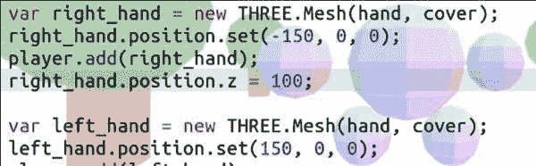

当 `z` 为 -100 时，手向后移动，以至于我们几乎看不到手在身体后面。

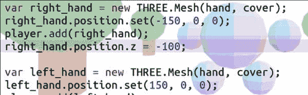

当你在 -100 和 100 之间来回改变 `position.z` 时，手就像在来回摆动。恭喜！你刚刚学会了一种著名的动画技术！

在某些游戏中，将物体从一个地方移动到另一个地方就足以让它看起来在移动。但在我们的游戏中，我们可以做得更好。

首先删除设置 `position.z` 的那一行。我们不想只设置一次。我们想要让它动起来。所以，删除那一行后，转到 `animate()` 函数。在第 4 章“项目：移动虚拟角色”（第 35 页）之后，我们已经实现了侧手翻和后空翻的动画。

```javascript
var is_cartwheeling = false;
var is_flipping = false;

function animate() {
  requestAnimationFrame(animate);
  if (is_cartwheeling) {
    avatar.rotation.z = avatar.rotation.z + 0.05;
  }
  if (is_flipping) {
    avatar.rotation.x = avatar.rotation.x + 0.05;
  }
  renderer.render(scene, camera);
}
animate();
```

我们的 `animate()` 函数中有很多内容。从第 5 章“函数：反复使用”（第 49 页）我们知道，这种“噪音”会让代码难以阅读。我们还要向 `animate()` 中添加更多内容。如果不采取措施，`animate()` 函数会变得非常非常庞大。

所以，让我们创建一个 `acrobatics()` 函数来处理后空翻和侧手翻。我们顺便把 `is_cartwheeling` 和 `is_flipping` 变量也移过去。然后我们可以在 `animate()` 中调用 `acrobatics()`，使代码更易读。

```javascript
function animate() {
  requestAnimationFrame(animate);
  acrobatics();
  renderer.render(scene, camera);
}
animate();

var is_cartwheeling = false;
var is_flipping = false;

function acrobatics() {
  if (is_cartwheeling) {
    avatar.rotation.z = avatar.rotation.z + 0.05;
  }
  if (is_flipping) {
    avatar.rotation.x = avatar.rotation.x + 0.05;
  }
}
```

花点时间确认一切仍然正常工作。如果出了问题，请检查 JavaScript 控制台！

现在让我们向 `animate()` 函数中添加三样东西。

```javascript
var clock = new THREE.Clock(true);

function animate() {
  requestAnimationFrame(animate);
  walk();
  acrobatics();
  renderer.render(scene, camera);
}

animate();

function walk() {
  var position = Math.sin(clock.getElapsedTime() * 10) * 100;
  right_hand.position.z = position;
}
```

❶ 我们将使用这个 3D 时钟作为动画的计时器。

❷ 除了表演杂技，现在我们还要行走。

❸ 这是移动手脚的函数。

正如你可能从名字中猜到的，`Math.sin()` 与数学有关。事实上，它是一个非常神奇的数学函数，叫做正弦，有各种各样的用途。这里我们利用了 `Math.sin()` 会随时间生成一个介于 -1 和 1 之间的数字这一特性。

将 100 乘以 `Math.sin()` 意味着 `position` 将是一个介于 -100 和 100 之间的数字。在 JavaScript 中，星号字符（`*`）用于乘法。

我们将在“深入理解 JavaScript 基础”中进一步讨论如何处理数学运算。

如果你正确输入了所有内容，你应该会看到虚拟角色的右手在来回抖动：

 

来回：

 

而且它应该移动得相当快。


**自己试试**

尝试修改 `animate()` 中的数字。如果你把 10 改成 100，会发生什么？如果你把 100 改成 1000，会发生什么？尝试使用 `position.x` 或 `position.y` 代替 `position.z`。尝试同时使用 `position.y` 和 `position.z`。


  同时。

 一旦你对这些数字有了感觉，尝试另一只手  和脚。

## 6.3 同时摆动双手和双脚

效果如何？你能让所有的手和脚都前后摆动吗？有没有遇到什么问题？

如果你尝试以相同的方式移动手和脚，你可能会注意到我们的虚拟角色移动得非常奇怪。两只脚和两只手同时向前移动，然后两只脚和两只手同时向后摆动。现实生活中没有人这样走路。

当你走路时，一只脚在前，另一只脚在后。用虚拟角色的术语来说，一只脚在 Z 正方向，另一只在 Z 负方向：

```javascript
var position = Math.sin(clock.getElapsedTime()*5) * 50 ; 
right_foot.position.z = - position; 
left_foot.position.z = position;
```

人们通常也会在左脚向前时向前移动右手。如果右手向前，那么左手应该向后。我们可以通过以下代码让虚拟角色做到这一点：

```javascript
function walk() {
    var position = Math.sin(clock.getElapsedTime()*5) * 50 ; 
    right_hand.position.z = position; 
    left_hand.position.z = - position; 
    right_foot.position.z = - position;
    left_foot.position.z = position;
}
```

这样，我们的手和脚就会以良好的行走姿态前后摆动。

## 6.4 移动时行走

目前，我们的虚拟角色一直在行走——即使我们没有使用第 4 章“项目：移动虚拟角色”（第 35 页）中的控制键来控制它。让我们解决这个问题。

### 准备
首先，我们在 `walk()` 函数中添加一行代码。

```javascript
function walk() {
    if (!isWalking()) return ; 
    var position = Math.sin(clock.getElapsedTime()*5) * 50 ; 
    right_hand.position.z = position; 
    left_hand.position.z = - position;
    right_foot.position.z = - position; 
    left_foot.position.z = position; 
}
```

你注意到函数的第一行了吗？这行代码的意思是，如果虚拟角色没有在行走，则立即从函数中返回。调用 `return` 意味着我们立即离开函数，并且函数中的其他代码都不会执行。也就是说，如果虚拟角色没有在行走，则离开 `walk()` 函数，不运行任何让虚拟角色看起来在行走的代码。

如果你一直非常仔细地观察，可能会好奇那个 `isWalking()` 是什么。这是一个我们现在要编写的函数！

我们将在 `keydown` 事件监听器之前添加这段代码。

```javascript
var is_moving_right, is_moving_left, is_moving_forward, is_moving_back; 
function isWalking() { 
    if (is_moving_right) return true; 
    if (is_moving_left) return true; 
    if (is_moving_forward) return true; 
    if (is_moving_back) return true; 
    return false;
}
```

在 `isWalking()` 函数之前，我们声明了“正在移动”的变量，这些变量很快就会被用到。我们使用了一个 JavaScript 快捷方式——逗号分隔列表——在一行中声明了所有四个变量，并且只使用了一个 `var`。

在函数内部，我们使用 `return` 关键字立即退出函数。这次我们返回一个 `true` 或 `false` 值。如果虚拟角色控制的任何移动属性为 `true`，那么 `isWalking()` 将返回 `true`。换句话说，如果控制的任何移动属性表明虚拟角色正在移动，那么虚拟角色就是 `isWalking()`。

函数 `isWalking()` 的最后一行返回 `false`，只有当所有移动控制属性都不为 `true` 时才会执行。如果虚拟角色控制的移动属性都没有开启，那么我们就返回 `false`，以表明虚拟角色没有在行走。

现在我们需要打开和关闭这些移动控制。我们在事件监听器中执行此操作，该监听器已经根据按下的键移动虚拟角色。添加如下所示的代码行。

```javascript
document.addEventListener('keydown' , function (event) { 
    var code = event.keyCode;
    if (code == 37) { // 左 
        marker.position.x = marker.position.x-5;
        is_moving_left = true; 
    }
    if (code == 38) { // 上 
        marker.position.z = marker.position.z-5;
        is_moving_forward = true; 
    }
    if (code == 39) { // 右 
        marker.position.x = marker.position.x+5;
        is_moving_right = true; 
    }
    if (code == 40) { // 下 
        marker.position.z = marker.position.z+5;
        is_moving_back = true; 
    }
    if (code == 67) is_cartwheeling = !is_cartwheeling; // C 
    if (code == 70) is_flipping = !is_flipping; // F
});
```

1. 虚拟角色正在向左移动。
2. 虚拟角色正在向前移动。
3. 虚拟角色正在向右移动。
4. 虚拟角色正在向后移动。

这打开了移动控制，但我们还需要能够关闭它们。由于我们使用 `keydown` 来判断按键何时被按下，你大概能猜到我们将如何判断按键何时被释放。

在 `keydown` 事件监听器代码的最后一行（`});` 行之后），添加以下 `keyup` 事件监听器代码。

```javascript
document.addEventListener('keyup' , function (event) { 
    var code = event.keyCode;
    if (code == 37) is_moving_left = false; 
    if (code == 38) is_moving_forward = false; 
    if (code == 39) is_moving_right = false; 
    if (code == 40) is_moving_back = false;
});
```

这样，我们应该能够使用方向键移动虚拟角色，并看到虚拟角色的手和脚前后摆动。当我们松开这些键时，虚拟角色的行走应该会停止。

### 挑战：更好的杂技控制
准备 

如果你愿意接受挑战，让我们争取更好的杂技控制。既然我们有代码来监听 `keydown` 和 `keyup` 事件，试着让侧手翻和后空翻在按下 `C` 或 `F` 键时开始，并在松开 `C` 或 `F` 键时停止。你觉得这样控制更好吗？如果是，就保留它们——这是你的游戏！

## 6.5 到目前为止的代码
如果你想核对本章的代码，请参阅附录 A1.6“代码：移动手和脚”（第 223 页）。

## 6.6 下一步
我们现在有了一种让虚拟角色活起来的新方法。在第 4 章“项目：移动虚拟角色”（第 35 页）中，我们能够在场景中移动虚拟角色并执行后空翻和侧手翻。在本章中，我们能够让虚拟角色的部分移动——使虚拟角色看起来更加生动。

本章的大概念不是 JavaScript 的东西，甚至不是 3D 的东西。它是一个数学概念：正弦。即使你在数学课上学过这些，我敢打赌你没有像我们这样使用它们！

我们的虚拟角色仍然缺少的一个能力是转身。即使虚拟角色向左或向右移动，它仍然面朝前方。这有点奇怪，对吧？在第 8 章“项目：旋转我们的虚拟角色”（第 79 页）中，我们将介绍如何旋转整个虚拟角色。

但首先，让我们短暂休息一下，更仔细地看看 JavaScript。

当你完成本章后，你将：
- 知道许多 JavaScript 的东西（比如 `var`）是什么。


# 第 7 章 深入理解 JavaScript 基础

在继续之前，让我们更深入地了解 JavaScript。与其他编程语言一样，JavaScript 的设计初衷是让计算机和人类都能理解。JavaScript 编程可以看作是对事物及其行为的描述，就像英语和其他语言一样。当我们构建虚拟角色时，我们用 JavaScript 描述了它的头部、手和脚。我们还描述了 3D 渲染器如何在浏览器中绘制场景。总而言之，JavaScript 拥有计算机和人类都能理解的关键字。让我们来看看。

### 7.1 开始

本章中，我们不再绘制和移动形状，而是探索 JavaScript 编程语言。大部分操作可以在 JavaScript 控制台中完成，所以请先打开它。如果你不记得如何打开，请参考第 18 页的 2.2 节“打开和关闭 JavaScript 控制台”。有些我们要看的 JavaScript 代码对于控制台来说太大了。这时，我们需要在 ICE 代码编辑器中创建一个新项目。使用 3D 入门项目模板，并将其命名为“Just JavaScript”。


JavaScript 控制台中的代码。

本章开头只是介绍一些概念，所以在 JavaScript 控制台中操作是最简单的。一定要多尝试！

准备就绪

### 7.2 在 JavaScript 中描述事物

你有没有注意到我们是如何在 JavaScript 中引入新事物的？

```
// 你不需要输入这行代码：
var head_shape = new THREE.SphereGeometry(100);
```

`var`关键字在 JavaScript 中声明新事物。它告诉计算机和阅读代码的人：“准备好了——有新东西要来了！”

JavaScript 中有很多不同种类的事物。在你刚才看到的那一小段代码中，我们创建了一个新的 3D 球体形状。事物也可以是数字：

```
var my_height = 1.5;
```

它们可以是文字：

```
var title = "3D Game Programming for Kids";
```

程序员通常把引号内的内容称为字符串。这里的`title`是一个字符串，它保存了本书的书名。

### 字符串很容易出错

  一定要记得关闭引号。如果忘记，你会遇到非常奇怪的错误，而且很难修复。


 它们可以是  布尔值：  

```
var am_i_cool = true;
var am_i_dumb = false;
```

它们甚至可以是表示“无意义”的奇怪 JavaScript 事物：

```
var i_mean_nothing = null;
var i_also_mean_nothing = undefined;
```


### 为什么用`var`？`null`和`undefined`是什么？

通常你不需要担心`undefined`或`null`。创建这样的东西没有太大意义。如果你看到它们，通常是在函数中——表示函数没有找到或创建任何东西。

`var`关键字是变量（variable）的缩写。变量是可以改变的事物：

```
var game = "started";
// 在这里做一些工作
game = "over";
```

一开始游戏还没结束。然后，过了一段时间，游戏结束了。如果我们在`// 在这里做一些工作`的位置编写代码，那段代码会认为游戏仍在进行中。能够更新变量很快就会派上用场。

关于以两个斜杠开头的行……

### 注释

双斜杠表示注释。计算机知道它应该忽略`//`之后该行的所有内容。换句话说，注释仅供人类阅读：

```
// 返回今天的日期
var today = new Date();

// 这是 2013 年 1 月 1 日
var jan1 = new Date(2013, 1, 1);
```


### 你不需要输入注释

本书中的注释旨在为你提供有用的提示。你不需要输入它们，但最好还是输入。当你以后打开代码进行修改时，注释会帮助你记住当初为什么这样做。真的，你也应该添加自己的注释。

### 7.3 改变事物

我们知道可以改变事物，但每种变量在 JavaScript 中如何改变呢？让我们逐一来看。

### 数字

你可以使用标准的数学符号在 JavaScript 中进行加减运算。在 JavaScript 控制台中尝试以下操作：

```
5 + 2;
10 - 9.5;
23 - 46;
84 + -42;
```

你应该得到以下答案（答案显示在数学问题下方的注释中）：

```
5 + 2;   // 7
10 - 9.5; // 0.5
23 - 46;  // -23
84 + -42; // 42
```

所以它甚至适用于负数。记住这一点；负数在我们处理 3D 图形时会很有用。

好了，加减法在 JavaScript 中相当简单。乘除法呢？大多数键盘上有加号和减号，但没有×和÷键。

乘法使用星号（`*`）字符：

```
3 * 7;   // 21
2 * 2.5; // 5
-2 * 4;  // -8
7 * 6;   // 42
```

除法使用斜杠（`/`）字符：

```
45 / 9;   // 5
100 / 8;  // 12.5
84 / 2;   // 42
```

关于数字，还有一点需要了解：当同时进行大量算术运算时，可以使用括号进行分组。括号内的数学运算总是先计算：

```
5 * (2 + 4); // 30
(5 * 2) + 4; // 14
```

没有括号会发生什么？你能猜出原因吗？[¹]

### 几何

本书涉及 3D 游戏概念，这意味着几何。我们将在需要几何知识的各个项目章节中更详细地讨论几何。现在，我们先考虑两个几何函数：正弦和余弦。如果你不了解它们，别担心——你会在游戏中逐渐熟悉它们。

只需记住，在 JavaScript 中，我们不使用度数，而是使用弧度。什么是弧度？当我们绕圆旋转半圈时，我们不说转了 180°，而是说转了π弧度。


π是数学中的一个特殊数字。它的值大约是 3.14159。你经常会看到符号π表示π。我们称之为 pi，因为 JavaScript 中叫它`Math.PI`。

绕圆一整圈是 180°旋转的两倍——通常称为 360°旋转，即 2π弧度，或 2×π。


顺便说一下，2×π就是我们之前在第 6 页“用立方体形状制作盒子”中首次讨论旋转时提到的完整旋转的 6.3。因为π的数值大约是 3.15，所以 2×π就是 2×3.15，即 6.3。


[¹]: 没有括号时，先做乘法，再做除法。还记得数学课上的“运算顺序”吗！

在 JavaScript 中，π被称为`Math.PI`。所以 360°就是`2 * Math.PI`。下面是一个方便的换算表：

| 度数 | 弧度 | JavaScript |
|------|------|------------|
| 0°   | 0    | 0          |
| 45°  | π ÷ 4 | `Math.PI/4` |
| 90°  | π ÷ 2 | `Math.PI/2` |
| 180° | π    | `Math.PI`   |
| 360° | 2 × π | `2 * Math.PI` |
| 720° | 4 × π | `4 * Math.PI` |

几何函数也可以在 JavaScript 的`Math`模块中找到。例如我们在第 6 章“项目：移动手和脚”（第 59 页）中看到的正弦函数。JavaScript 将正弦及其伴侣余弦分别简写为`sin`和`cos`：

```
Math.sin(0);       // 0
Math.sin(2*Math.PI); // 0
Math.cos(0);       // 1
```

### 非常非常接近零


根据你的计算机，当你在 JavaScript 控制台中尝试`Math.sin(2*Math.PI)`时，可能没有得到正确的答案。2×π的正弦是零，但你可能会看到类似`-2.4492127076447545e-16`的结果。这表明计算机并不完美。有时它们的计算可能会有微小的误差。


当 JavaScript 在数字末尾有`e-16`时，表示这是一个小数点向左移动 16 位的小数。换句话说，`-2.45e-16`等同于`0.000000000000000245`。这是一个非常非常小的数字——你需要把它加更多次


我们不会经常用到这些 `Math` 函数。随着学习的深入，它们会时不时地出现。大多数情况下，我们可以使用简单的算术运算符进行加、减、乘、除。

## 字符串

JavaScript 中的字符串有点无聊。你实际上只能将两个字符串连接成更大的字符串。有趣的是，加号运算符就是用来连接它们的。在 JavaScript 控制台中尝试以下代码。

```
var str1 = "Howdy" ; var str2 = "Bob" ;

str1 + " " + str2; // "Howdy Bob"
```

很疯狂，不是吗？鉴于大多数键盘上没有乘法和除法键，肯定也没有将两个字符串粘在一起的键。所以 JavaScript 偷懒了，再次使用了加号。

你猜如果你尝试连接一个字符串和一个数字会发生什么？试试看：

```
var str = "The answer to 7 + 4 is " ; var answer = 7 + 4 ; str + answer;
```

自己试试

  执行此操作并在 JavaScript 控制台中检查！

 结果是，当组合字符串和数字时，JavaScript 会将数字视为字符串：

```
var str = "The answer to 7 + 4 is " ; var answer = 7 + 4 ;

str + answer;

// "The answer to 7 + 4 is 11 "
```

## 布尔值

布尔值没什么复杂的。它要么是 `true`，要么是 `false`。可以使用非运算符来转换布尔值。在 JavaScript 中，感叹号就是非运算符：

```
var yes = true; var the_opposite = ! yes; var

the_opposite_of_the_opposite = !! yes; yes; // true

the_opposite;

// false

the_opposite_of_the_opposite; // true
```

我们不会经常这样直接使用布尔值。我们通常会看到生成布尔值的比较运算符：

```
// The > symbol checks for values greater than others
var is_ten_greater_than_six = 10 > 6 ;

is_ten_greater_than_six; // true
```

```
// Two equal signs check if values are equal
var is_twelve_the_same_as_eleven = 12 == 11 ;

is_twelve_the_same_as_eleven;

// false
```

### 双等号 vs. 单等号

 JavaScript 中的双等号（`==`）用于检查某个值是否等于另一个值。它不会改变任何东西——它只检查值并产生一个布尔值。

正如我们在本书中看到的，单等号（`=`）使一个值等于另一个值。通常称为赋值运算符，单等号确实会改变一个值——它更新一个变量或首次为其赋值。

你可能会想，让两个截然不同的运算符看起来如此相似是否明智。并不明智。这是一个非常常见的错误来源——即使对于编程多年的人来说也是如此。但是，由于它已经存在了很长时间，可能短期内不会改变。所以要警惕这类错误。

我们会经常看到这类布尔值。事实上，它们就在下一节中。

### 7.4 使用 while 和 if 重复和跳过代码

通常，JavaScript 代码是从上到下运行的。程序顶部的代码行首先运行。一旦计算机运行完这些行，就会继续执行下一行。这个过程一直持续到程序文件的底部。

但有时我们并不希望所有代码都运行。而其他时候我们希望代码运行多次。在这些情况下，我们使用控制关键字。本书中最常见的关键字是 `while` 和 `if`。

使用 while 和 if 重复和跳过代码

 在 ICE 中编写代码，在控制台中检查

本章剩余部分的代码对于 JavaScript 控制台来说太大了，所以请在 ICE 中将其添加到 START CODING 行之后。确保保持 JavaScript 控制台打开——即使我们没有在那里输入代码，我们仍然会用它来显示消息。

### While

如果一段代码（我们称之为块）以 `while` 开头，那么该块会反复运行，直到某个条件发生变化。需要变化的条件放在 `while` 关键字后面的括号中：

```
var i = 0 ;
while (i < 5) {
    console.log("i is now:" + i);
    i = i + 1 ;
}
```

如果你尝试这个并在 JavaScript 控制台中检查，你会看到类似下面的内容：

```
i is now: 0
i is now: 1
i is now: 2
i is now: 3
i is now: 4
```

每次执行代码块时，我们都会将变量 `i` 记录到 JavaScript 控制台。我们还进行了一点数学运算。我们将 `i` 的旧值加 1。然后计算机将再次运行 `while` 块——只要 `i` 小于 5（`<` 符号表示小于）。一旦 `i` 等于 5，计算机就会停止重新运行 `while` 块，并继续执行后续行。

自己试试

  如果你运行以下代码会发生什么？


```
var i = 0 ;

while (i < 5) {

    console.log("Chris is awesome!!!!" ) ;

    i = i + 1 ;

}
```

一定要试试你自己的名字！

### 仅在条件为真时运行代码

有时我们希望完全跳过某些代码。在这些情况下，我们使用 `if` 关键字。就像 `while` 一样，`if` 关键字对代码块执行操作：

```
var game = "started" ;

// More code here that might change the variable "game"
// to something else...
if (game == "over" ) {
    console.log("Game Over!!!" ) ;
}
```

`if` 关键字允许我们编写仅在某个条件为真时才运行的 JavaScript 代码。在这个例子中，我们使用双等号（`==`）运算符检查 `game` 是否等于字符串 `over`。

我们还可以使用 `else if` 和 `else` 来扩展 `if` 语句。考虑以下代码，我们将在第 20 章（项目：河流漂流，第 185 页）中使用它来转向和移动木筏：

```
document.addEventListener( "keydown" , function (event) {
    var code = event.keyCode;

    ❶ if (code == 32) pushRaft(); // space
    ❷ else if (code == 37) rotateRaft(-1); // left
    ❸ else if (code == 39) rotateRaft(1); // right
    ❹ else { // Something else
        console.log(code);
    }
}) ;
```

我们将在项目章节中进一步讨论这段代码，但我们可以看到：

❶ 如果代码是空格键代码，则我们将木筏向前推

❷ 否则，如果代码是左箭头键，则我们将木筏向左转

❸ 否则，如果代码是右箭头键，则我们向右转

❹ 否则，按下了某个奇怪的键，我们只需将代码记录到 JavaScript 控制台

### 不要过度使用 If

    `if`、`else if` 和

 `else`

    非常强大，但可能会被过度使用。我们

 将在一些项目章节中讨论更好的方法。


### 7.5 列出事物

有时能够描述一个事物列表非常方便。在 JavaScript 中，列表使用方括号创建。一个精彩电影的列表可能如下所示：

```
var amazing_movies = [
    'Star Wars' ,
    'The Empire Strikes Back' ,
    'Indiana Jones and the Raiders of the Lost Ark'
] ;
```

列表中的事物可以是到目前为止我们讨论过的任何类型：字符串、数字、布尔值。甚至可以创建一个包含各种类型事物的列表：

```
// Don't do this:
var useless_list = [
    true, 3.14 ,'OK'
] ;
```

但不要这样做。这很愚蠢。就像在现实生活中一样，计算机列表应该包含相同类型的事物。在购物清单上包含你最喜欢的颜色、朋友过来的时间或昨晚比赛的得分是没有意义的。在商店购买物品的清单应该只包含商店里有的物品。

使用列表的方法有很多，但我们在本书中最常用的是为列表中的每个项目调用一个函数：

```
var amazing_movies = [
    'Star Wars' ,
    'The Empire Strikes Back' ,
    'Indiana Jones and the Raiders of the Lost Ark'
] ;

amazing_movies.forEach( function (movie) {
    console.log("GREAT: " + movie);
}) ;
```

将 `forEach()` 函数视为一种方式，表示对于列表中的“每个”事物，

- 给它一个昵称——在前面的代码中我们称之为 `movie`
- 在函数内部对其进行操作——我们将其记录为 `"GREAT"`


如果你输入这段代码并查看 JavaScript 控制台，你会得到如下输出：
GREAT: Star Wars
GREAT: The Empire Strikes Back
GREAT: Indiana Jones and the Raiders of the Lost Ark

我们将在后续的一些章节中再次看到列表。

### 7.6 JavaScript 的独特之处

JavaScript 与许多其他语言不同，但对我们来说最重要的是它被设计为在浏览器中运行。这意味着它可以非常轻松地完成许多网页相关的工作。正如我们在第 4 章《项目：移动角色》（第 35 页）中看到的，JavaScript 可以打开浏览器警告对话框：

```javascript
alert('Stop what you are doing and shout "Yay!"');
```

JavaScript 也非常擅长修改网页内容。虽然本书中不会大量涉及网页修改，但在某些游戏制作计分板时我们会讨论这个话题。

### 7.7 下一步

本章包含大量信息。如果有些内容暂时不理解，不必担心。当你学习后续章节时，如果遇到问题可以回到这里查阅。随着学习的深入，你会逐渐理解这些内容。

我们在这里介绍的基础知识就像是 JavaScript 语言的名词。我们在第 5 章《函数：反复使用》（第 49 页）中看到的函数则像是动词——它们告诉基础知识需要做什么才能让事情发生。说到让事情发生，让我们回到为角色添加酷炫功能的工作中！

完成本章后，你将能够：
- 掌握更多用于 3D 编程的有趣数学知识
- 知道如何旋转物体使其朝向特定方向
- 能够制作平滑的动画

# 第 8 章 项目：旋转我们的角色

我们的角色动画已接近完成。在第 4 章《项目：移动角色》（第 35 页）中，我们学会了如何让角色移动。在第 6 章《项目：移动手脚》（第 59 页）中，我们让角色看起来像是在行走。现在我们需要让角色在切换方向时能够转向。转向（或旋转）对我们来说并不陌生——我们在翻转和侧翻时已经让角色旋转过。但这次我们希望角色朝向特定的方向。

### 8.1 开始

如果尚未在 ICE 代码编辑器中打开，请打开我们命名为“我的角色：移动手脚”的项目（来自《项目：移动手脚》）。点击菜单按钮，选择“制作副本”，将其复制一份。将项目命名为“我的角色：转向”，然后点击“保存”按钮。

### 8.2 朝向正确的方向

让角色朝向正确的方向相当简单——尤其是我们已经掌握了这么多知识。就像我们添加手脚行走动作时一样，我们将编写一个新函数来旋转角色。我们将这个函数命名为 `turn()`，因此在 `animate()` 函数中添加对该函数的调用。

```javascript
function animate() {
    requestAnimationFrame(animate);
    walk(); 
    turn();
    acrobatics();
    renderer.render(scene, camera);
} 
animate();
```

接下来编写 `turn()` 函数。JavaScript 不关心你将这个函数放在哪里，但由于我们在 `animate()` 函数中是在 `walk()` 之后调用它，我们不妨将其放在 `walk()` 函数之后。在 `walk()` 函数的右花括号后面输入以下内容：

```javascript
function turn() {
    var direction = 0; 
    if (is_moving_forward) direction = Math.PI; 
    if (is_moving_back) direction = 0; 
    if (is_moving_right) direction = Math.PI/2; 
    if (is_moving_left) direction = -Math.PI/2;
    avatar.rotation.y = direction; 
}
```

这样一来，当我们向左或向右行走时，角色就会面向它移动的方向：


这真是太棒了。你现在已经制作了一个复杂的游戏角色。想想你完成了什么：
- 为角色赋予了身体、手和脚
- 让角色移动时所有部件随之移动
- 让角色能够侧翻和翻转
- 将摄像机固定在角色上
- 将摄像机固定在角色的位置上，这样翻转和侧翻就不会让我们头晕
- 让角色行走时手脚前后摆动
- 让角色停止移动时手脚也停止摆动
- 让角色面向它行走的方向

### 分解说明
这是非常了不起的 JavaScript 3D 编程。你能走到这一步已经很棒了，但我们还能做得更多。首先，让我们仔细看看 `turn()` 函数，确保我们理解其中的原理。

## 8.3 分解说明

在 `turn()` 函数中，为什么我们将 `direction` 设置为 `Math.PI` 和 `-Math.PI/2` 这样的值？

回想一下第 71 页的《几何学》部分，角度（旋转量）使用的是弧度而非度数。角色初始时面朝后方，朝向摄像机。因此 0° 旋转对应 0 弧度，即面朝后方。而 180° 对应 π 弧度，即面朝屏幕前方。下表是我们在 `turn()` 函数中使用的完整列表。

| 方向 | 弧度 | JavaScript | 度数 |
| :--- | :--- | :--- | :--- |
| 前方 | 180° | `Math.PI` | π |
| 右方 | 90° | `Math.PI/2` | π ÷ 2 |
| 左方 | -90° | `-Math.PI/2` | -π ÷ 2 |
| 后方 | 0° | `0` | 0 |

### 为什么是 `rotation.y`？
这解释了我们在 `turn()` 函数中为 `direction` 变量使用的数值，但为什么设置的是 `rotation.y`？而不是 `rotation.z` 或 `rotation.x`？

原因之一是，我们在做侧翻时已经改变了 `rotation.x`，在做翻转时改变了 `rotation.z`。我们设置 `rotation.y` 是因为我们希望角色绕 y 轴旋转。回想一下，在 3D 中，y 轴是上下方向的。想象一根杆子从角色正中间竖直穿过，那就是角色的 y 轴：


让角色绕这根杆子旋转，就是绕 y 轴旋转角色。

### 别忘了 `avatar.rotation`！
如果你尝试旋转 `marker.rotation` 而不是 `avatar.rotation`，你可能会注意到不仅角色旋转了，其他所有东西似乎也跟着旋转了。这是因为我们将摄像机附加到了角色的标记上：

```javascript
var marker = new THREE.Object3D();
scene.add(marker); 
marker.add(camera);
```

可以把 `marker` 想象成一个容纳角色部件的隐形盒子。通过将摄像机添加到 `marker` 上，我们把它固定在了 `marker` 的一侧。如果我们旋转这个盒子，摄像机也必须跟着一起转：


这也是为什么我们将手脚添加到角色的头部而不是角色的 `marker` 上。当我们在 `marker` 内部旋转角色时，它的手脚需要随之移动——而不是与 `marker` 一起保持静止。

## 8.4 动画化旋转

目前，当我们旋转角色时，它会立即面向新方向。让我们通过动画化转向新方向的过程，使其更逼真一些。为此，我们需要一个新的 JavaScript 库。这个库将帮助我们实现不同位置和旋转之间的动画。这个库叫做 `Tween`。

为此，请转到代码顶部。添加 `Tween.js` 的 `<script>` 标签，如下所示：

```html
<body></body>
<script src="http://gamingJS.com/Three.js"></script>
<script src="http://gamingJS.com/Tween.js"></script>
<script src="http://gamingJS.com/ChromeFixes.js"></script>
```

### 动画化旋转
`Tween` 库用于在起始状态和结束状态之间进行动画过渡。这里我们希望从一个旋转角度动画过渡到另一个旋转角度。

使用 `Tween` 的第一步是将其 `update()` 函数添加到我们的 `animate()` 函数中：

```javascript
function animate() {
    requestAnimationFrame(animate); 
    TWEEN.update();
    walk(); 
    turn();
    acrobatics();
    renderer.render(scene, camera);
} 
animate();
```

接下来，我们需要修改刚刚编写的 `turn()` 函数。不再立即设置方向，而是调用一个新函数，该函数将使角色旋转到新方向。将 `turn()` 函数的最后一行改为调用 `spinAvatar()`：

```javascript
function turn() {
    var direction = 0; 
    if (is_moving_forward) direction = Math.PI;
    if (is_moving_back) direction = 0; 
    if (is_moving_right) direction = Math.PI/2; 
    if (is_moving_left) direction = -Math.PI/2;
    spinAvatar(direction);
}
```


`Math.PI/2`;`spinAvatar(direction)`; }  
最后，我们需要编写`spinAvatar()`函数的代码。Tween 代码初看可能有些奇怪。阅读时请记住，我们希望从角色头部当前面对的方向（`avatar.rotation.y`）开始旋转，最终旋转到传入`spinAvatar()`作为`direction`参数的新方向。

在`turn()`函数之后编写以下`spinAvatar()`函数：

```
function spinAvatar(direction) {
  new TWEEN.Tween({y: avatar.rotation.y})
    .to({y: direction}, 100)
    .onUpdate(function () {
      avatar.rotation.y = this.y;
    })
    .start();
}
```

从上到下阅读该函数，新的 Tween 从 Y 旋转值`avatar.rotation.y`开始——即角色当前面对的方向。然后我们告诉 Tween 要旋转到传入`spinAvatar()`函数的新 Y 旋转值。每次动画运行时，都会执行`onUpdate()`中的内容。角色头部的旋转会更新为 Tween 的 Y 旋转值。最后一行启动整个过程。

该函数中每行末尾的句点表示方法链。在 JavaScript 中，分号结束一段代码“句子”。与英语不同，JavaScript 中的句点表示我们想对当前代码做其他事情——代码句子尚未结束。

我们本可以将所有这些代码放在一行，但将代码分行阅读对人类来说更容易（计算机并不在意）。方法链仅适用于某些 JavaScript 对象，如 Tween。这在 JavaScript 中是一种比较常见的做法，尽管我们不会频繁使用它。

自己试试  


我们告诉 Tween 库它将在 100 毫秒内从开始运行到结束。这个数字位于以`to`开头的行末尾。


1000 毫秒等于 1 秒，因此 100 毫秒小于 1 秒。角色的旋转耗时不到 1 秒。尝试调整这个数字，直到你满意为止。1000 太长了吗？10 太短了吗？你来决定！

### 8.5 到目前为止的代码

如果你想核对本章的代码，请参阅第 226 页的 A1.8 节《代码：旋转我们的角色》。

### 8.6 接下来是什么

哇！我们简单的角色模拟已经变得相当复杂了，不是吗？我们已经为角色投入了不少精力，但你可能已经注意到它可以直接穿过我们的树木。在下一个项目章节中，我们将讨论碰撞检测，并用它来让角色在撞到树木时停下来。

但首先，让我们仔细看看我们开始这个项目时自动添加的所有那些 JavaScript 代码。

当你完成本章后，你将  
• 了解一些关于制作网页的知识  
• 理解起始代码  
• 能够自如地修改起始代码

# 第 9 章  
那些其他代码都是什么？

当我们从 3D 起始模板创建新项目时，里面已经有很多代码了。在本章中，我们将了解它们都是什么意思。

### 9.1 开始

在 ICE 代码编辑器中从 3D 起始模板创建一个新项目。将其命名为“所有其他代码”。

### 9.2 HTML 快速入门

我们代码的最顶部是以下 HTML：

```
<body></body>
```

HTML 不是一种编程语言。那么它为什么出现在我们漂亮的 JavaScript 代码中呢？

HTML 是超文本标记语言。它用于构建网页，而不是让网页做有趣的事情。

尽管它不是编程语言，但我们仍然需要 HTML 来运行 JavaScript。由于 JavaScript 是一种 Web 编程语言，我们需要一个可以编程的网页——即使只是一个简单的页面。

第一行包含一个开始和结束的`<body>`标签。在这两个标签之间，HTML 作者通常会放置文字——指向图片和其他页面的链接。我们不在里面放任何东西，因为我们是在编程，而不是制作网页。

为了了解 HTML 的作用，在两个`<body>`标签之间添加以下 HTML，如下所示：

```
<body>
<h1> 你好！</h1>
<p>
你可以制作 <b>粗体</b> 文字、
<i>斜体</i> 文字，甚至
<u>下划线</u> 文字。
</p>
<p>
你可以链接到
<a href="http://gamingJS.com">其他页面</a>。你还可以添加来自网络服务器的图片：

</p>
</body>
```

 忽略 HTML 的 ICE 警告

 你的 HTML 代码可能会出现红色 X 警告。这些可以安全地  
 忽略。ICE 是用来编辑 JavaScript 的，而不是 HTML，所以它可能会  
 混淆。

 如果你在 ICE 代码编辑器中隐藏代码，你会看到类似这样的内容：

  这是一本关于 JavaScript 的书，而不是 HTML 的书，但你已经看到了 HTML 的一些  
 可能性。

在`<body>`标签之后是两个`<script>`标签。与`<body>`标签一样，这些`<script>`标签也是 HTML，但它们从网络其他地方加载 JavaScript，以便我们可以在当前页面中使用它。

```
<script src="http://gamingJS.com/Three.js"></script>
<script src="http://gamingJS.com/ChromeFixes.js"></script>
```

这两行告诉浏览器加载两个库。这里，我们加载了一个名为`Three.js`的 3D JavaScript 库，以及一个修复 Chrome 浏览器中 ICE 代码编辑器错误的小型库。

设置场景

JavaScript 不一定来自其他位置。在本书的大部分内容中，我们都是在 HTML 网页内部编写代码。

### 9.3 设置场景

要在 3D 编程中做任何事情，我们需要一个场景。将场景视为所有动作发生的宇宙。对于如此重要的东西，创建起来却非常简单。ICE 中的以下代码就做到了这一点：

```
// 这是游戏中所有事情发生的地方：
var scene = new THREE.Scene();
```

场景使用起来非常简单。我们在整本书中一直在向场景中添加对象。一旦对象被添加到场景中，场景就负责跟踪所有内容。事实上，这就是我们需要了解的场景的全部内容——创建场景后，我们向其中添加大量对象，场景会处理其余的事情。

### 9.4 使用摄像机捕捉场景

场景在跟踪所有内容方面做得很好，但它们不会向我们展示发生了什么。要看到场景中的任何东西，我们需要一个摄像机。注意 ICE 中的以下代码：

```
// 这是看到所有东西的东西：
var aspect_ratio = window.innerWidth / window.innerHeight;
var camera = new THREE.PerspectiveCamera(75, aspect_ratio, 1, 10000);
camera.position.z = 500;
scene.add(camera);
```

`aspect_ratio` 的目的是确定浏览器的形状。这与电影屏幕和电视机的宽高比是同一个概念。一个宽高比为 4:3 的大电视可能宽 4 米，高 3 米（好吧，那真是一台非常大的电视）。一个更大的 4:3 屏幕可能宽 12 米，高 9 米（将 4:3 中的 4 和 3 都乘以 3 得到 12:9）。如今大多数电影都以 16:9 的宽高比制作，这意味着一个 9 米高的屏幕宽 16 米——与相同高度的 4:3 宽高比相比，多了 4 米。

这对我们来说为什么重要？如果你试图将一部 16:9 的电影投影到 4:3 的屏幕上，就需要进行大量压缩。同样，一部 4:3 的电影需要在 16:9 的屏幕上拉伸才能显示。大多数电影不会拉伸或压缩，而是被裁剪，这样你就会错过那 4 米的动作。我们的`Three.js`库不会裁剪——它会拉伸或压缩。换句话说，正确设置宽高比非常重要。


当我们构建好一个新相机后，需要将其添加到场景中。与 3D 编程中的其他元素一样，相机默认位于我们添加它的场景中心。我们将其沿 Z 轴方向（即屏幕“向外”方向）移动 500 个单位，以便能够清晰地观察场景中心发生的情况。

### 9.5 使用渲染器投射相机所见的画面

场景和相机足以描述场景的外观以及我们从何处观察，但要在网页上显示它，还需要一个额外的步骤。这就是渲染器的工作。它负责显示（或渲染）相机所见的场景：

```
// This will draw what the camera sees onto the screen:
var renderer = new THREE.CanvasRenderer();
renderer.setSize(window.innerWidth, window.innerHeight);
document.body.appendChild(renderer.domElement);
```

我们必须告诉渲染器它将要绘制的屏幕尺寸。我们将视图大小设置为占据整个浏览器窗口（`window.innerWidth` 和 `window.innerHeight`）。

要将渲染器包含在网页中，我们使用它的 `domElement` 属性。`domElement` 是 HTML 标签的另一种称呼，就像本章前面添加的那些标签一样。不过，这个 `domElement` 承载的不是标题或段落，而是我们精彩的 3D 世界。

我们将这个 `domElement` 添加到 `document.body` 中——也就是之前存放 HTML 的同一个 `<body>` 标签。`appendChild()` 函数负责将 `domElement` 添加到文档主体中。如果你好奇为什么会有像 `appendChild()` 和 `domElement` 这样的名称，我只能告诉你，庆幸自己是一名 3D 游戏程序员，而不是 Web 程序员。Web 程序员不得不一直使用这种愚蠢（且难记）的名称。

此时，渲染器已经可以绘制到屏幕上了，但我们仍然需要告诉它进行渲染，否则什么都不会显示。这就是为什么在代码末尾要使用 `renderer.render()`。

```
// Now, show what the camera sees on the screen:
renderer.render(scene, camera);
```

渲染器可能像一个烦人的弟弟或妹妹，只有当我们给出极其明确的指令时才会做正确的事情。从某种意义上说确实如此，但从另一种意义上说，所有编程都是这样。除非我们以完全正确的方式告诉计算机该做什么，否则它常常会做出完全出乎意料的事情。

### 9.6 探索不同的相机和渲染器

就渲染器而言，我们已经可以看出拥有这种控制权的好处。在某些实验中，我们只渲染一次。但在许多项目中，我们会在 `animate()` 函数内重复渲染。如果没有这种控制，挑选合适的渲染风格就会困难得多。

你可能已经注意到，我们将相机称为 `PerspectiveCamera`，将渲染器称为 `CanvasRenderer`。如果这些名称显得过于具体，那是因为还有其他类型的相机和渲染器。我们一直使用这些，是因为大多数浏览器和硬件都支持它们。正如我们将在第 12 章《灯光与材质》（第 109 页）中看到的，一些我们可能想添加到 3D 游戏中的酷炫效果需要不同的相机和渲染器，而这些只能在相对较新的计算机上运行。


**你不必亲自运行这些示例**

有些计算机可能无法运行本章剩余部分的示例。这是因为它们依赖于一种名为 WebGL 的技术，我们将在第 12 章《灯光与材质》（第 109 页）中更详细地讨论。由于你的计算机可能不支持 WebGL，因此你不必在 ICE 代码编辑器中跟着本节操作。

### 介绍 WebGL 渲染器

另一个重要的渲染器是 `WebGLRenderer`。它的使用方式与 `CanvasRenderer` 完全相同。我们只需要更改名称：

```
// This will draw what the camera sees onto the screen:
var renderer = new THREE.WebGLRenderer();
renderer.setSize(window.innerWidth, window.innerHeight);
document.body.appendChild(renderer.domElement);
```

WebGL 是一项相当新的技术，它允许程序员实现有趣的 3D 编程技术，如光照、阴影和雾效。它的动画运行速度也远快于 `CanvasRenderer`。我们将在《灯光与材质》中进一步探讨。

### 快速了解一个名称古怪的相机

另一种相机称为正交相机。为了理解正交相机的作用，我们可以添加一条红色道路，让紫色水果怪物在上面行走。在“在下一行开始编码”之后添加以下代码：

```
var shape = new THREE.CubeGeometry(200, 1000, 10);
var cover = new THREE.MeshBasicMaterial({color:0x990000});
var road = new THREE.Mesh(shape, cover);
scene.add(road);
road.position.set(0, 400, 0);
road.rotation.set(-Math.PI/4, 0, 0);
```

我们的透视相机使道路看起来像这样：


这是一条矩形道路，但看起来并不像矩形。它看起来像是越远越小。透视相机为我们实现了这一点：

```
var aspect_ratio = window.innerWidth / window.innerHeight;
var camera = new THREE.PerspectiveCamera(75, aspect_ratio, 1, 10000);
```

另一方面，如果我们使用正交相机，一切看起来都是扁平的：


这是上一张图片中的同一条道路。我们只是将创建透视相机的两行代码替换为以下内容：

```
var width = window.innerWidth, height = window.innerHeight;
var camera = new THREE.OrthographicCamera(
  -width/2, width/2, height/2, -height/2, 1, 10000
);
```

正如你可能想象的那样，能让一切呈现三维感的透视相机在 3D 游戏中非常有用。那么为什么还要使用正交相机呢？

正交相机在两种情况下很有用。第一种是当你想要制作一个扁平的 2D 游戏时。在平面游戏中使用 3D 相机看起来会很奇怪——尤其是在屏幕边缘。另一种情况是当我们制作距离非常非常远的游戏时，比如太空游戏。事实上，我们可以在稍后的一些太空模拟中使用正交相机。

### 9.7 接下来是什么

既然我们已经了解了相机、场景和 JavaScript 库，我们将越来越多地改变它们。但首先，让我们教会游戏角色不要穿过树木。

完成本章后，你将能够：

- 阻止游戏元素相互穿过
- 理解碰撞（这在游戏中很重要）
- 为你的角色设置游戏边界

## 第 10 章 项目：碰撞

我们有一个相当酷的游戏角色。它能移动、能行走、甚至能转身。但你可能注意到了角色的一些奇怪之处：它可以穿过树木。


在本章中，我们将使用 Three.js 3D JavaScript 库内置的工具来防止角色穿树的效果。（正如我们将在其他章节中看到的，还有其他方法可以实现同样的目的。）

### 10.1 开始

如果项目尚未在 ICE 代码编辑器中打开，请打开“项目：旋转我们的角色”中名为“我的角色：旋转”的项目。

复制我们的角色项目。在 ICE 代码编辑器的菜单中，选择“制作副本”，并将新项目名称设为“我的角色：碰撞”。


### 10.2 射线与相交

我们防止角色穿过树木的方法其实很简单。想象一下从角色身上向下指着一支箭。


在几何学中，我们将箭头指向称为射线。射线就是从一个点出发并指向某个方向所得到的结果。在这里，这个点就是我们的虚拟角色所在的位置，而方向是向下。有时给这样简单的概念命名似乎有些愚蠢，但对程序员来说，了解这些名称很重要。程序员喜欢给简单的概念起花哨的名字。了解简单概念的命名，能让你更容易与从事相同工作的人交流。程序员把这些名称称为模式。现在，我们有了指向下方的射线，想象一下地面上围绕树木的圆圈。下面是我们防止虚拟角色撞上树木的极其简单的方法：我们并不阻止它！相反，我们阻止虚拟角色的射线穿过树木的圆圈。

## 射线与相交

如果在任何时候，我们发现下一步移动会导致虚拟角色的射线指向穿过圆圈，我们就阻止虚拟角色移动。仅此而已！《星际迷航 2：可汗之怒》这看起来可能有些奇怪，但观看某些科幻电影会让你的程序员生活更轻松。有时程序员会说出一些奇怪的话，结果发现是电影台词。并不要求你观看甚至喜欢这些电影，但这确实有帮助。其中一句经典台词来自《星际迷航 2：可汗之怒》：“他很聪明，但缺乏经验。他的模式表明他是二维思维。”

### 准备

电影中的反派不习惯三维思考，而这被用来对付他。在这里，尽管我们在构建一个三维游戏，但我们只想在二维空间中考虑碰撞。我们只考虑二维（X 和 Z 轴）的碰撞，完全忽略上下方向的 Y 轴。这又是尽可能“作弊”的一个例子。真正的三维碰撞很难处理，需要新的 JavaScript 库。但我们可以通过更简单的技巧来作弊，并在许多情况下获得相同的效果。此时，你应该已经在脑海中形成了下一步该做什么的画面。我们需要一个列表，记录这些虚拟角色不允许进入的树木圆圈边界。我们需要在构建树木时构建这些圆圈边界，并检测虚拟角色何时即将进入圆圈边界。最后，我们需要阻止虚拟角色进入这些禁止区域。让我们建立保存所有禁止边界的列表。在`START CODING ON THE NEXT LINE`行下方，添加以下代码。

```
var not_allowed = [] ;
```

回忆一下第 77 页的 7.5 节“列出事物”，方括号是 JavaScript 创建列表的方式。这里，空方括号创建了一个空列表。`not_allowed`变量是一个空列表，用于存储虚拟角色不允许进入的空间。接下来，找到`makeTreeAt()`的定义位置。当我们创建树木时，也要创建边界。在添加树冠到树干的那行代码之后，在设置树干位置的那行代码之前，添加以下代码。

```
var boundary = new THREE.Mesh( new THREE.CircleGeometry(300), new THREE.MeshNormalMaterial()) ;
boundary.position.y = -100 ;
boundary.rotation.x = - Math.PI/2;
trunk.add(boundary);
not_allowed.push(boundary);
```

这里没有什么特别花哨的东西。我们创建了一个普通的 3D 网格——这次使用简单的圆形几何体。我们旋转它使其平放，并将其定位在树木下方。当然，最后我们将其添加到树木中。但边界网格的处理还没完。最后，我们将其推入禁止空间列表。现在，每次我们使用`makeTreeAt()`函数创建树木时，都会构建这个列表。让我们对这个列表做点什么。在代码的最底部，`</script>`标签上方，添加以下代码来检测碰撞。

```
function detectCollisions() {
  var vector = new THREE.Vector3(0, -1, 0) ;
  var ray = new THREE.Ray(marker.position, vector);
  var intersects = ray.intersectObjects(not_allowed);
  if (intersects.length > 0) return true;
  return false;
}
```

这个函数返回一个布尔值——是或否的答案——取决于虚拟角色是否与边界发生碰撞。这就是我们创建射线来检查它是否穿过任何物体的地方。如前所述，射线是方向（或向量，这里指向下）和点（这里是虚拟角色的`marker.position`）的组合。然后我们询问该射线是否穿过（相交）任何`not_allowed`对象。如果射线确实与其中一个对象相交，那么`intersects`变量的长度将大于零。在这种情况下，我们检测到了碰撞，并返回`true`。否则，没有碰撞，返回`false`。在许多情况下，碰撞是一个棘手的问题，所以你能跟着做已经很棒了。但我们还没完成。我们现在可以检测虚拟角色何时与边界碰撞，但还没有真正阻止虚拟角色。让我们在`keydown`监听器中实现这一点。在`keydown`监听器中，如果按下了方向键，我们会改变虚拟角色的位置。

```
if (code == 37) { // 左
  marker.position.x = marker.position.x-5;
  is_moving_left = true;
}
```

这样的改变可能意味着虚拟角色现在进入了边界。如果是这样，我们必须立即撤销移动。在`keydown`事件监听器的底部（紧接在`if (code == 70)`之后）添加以下代码。

```
if (detectCollisions()) {
  if (is_moving_left) marker.position.x = marker.position.x+5;
  if (is_moving_right) marker.position.x = marker.position.x-5;
  if (is_moving_forward) marker.position.z = marker.position.z+5;
  if (is_moving_back) marker.position.z = marker.position.z-5;
}
```

准备 仔细阅读这几行代码，确保你理解它们。这段代码的意思是：如果检测到碰撞，则检查我们移动的方向。如果正在向左移动，则撤销虚拟角色刚刚执行的移动——向相反方向移动相同的量。这样，我们的虚拟角色可以走到树木边界前，但无法再前进。

 耶！这看起来可能是一段相当简单的代码，但你刚刚解决了游戏编程中一个非常困难的问题。

## 10.3 到目前为止的代码

如果你想核对本章的代码，请参见第 230 页的附录 A1.10“代码：碰撞”。

## 10.4 下一步是什么

游戏中的碰撞检测是一个非常棘手的问题，所以恭喜你走到了这一步。当你还需要考虑上下移动，而不仅仅是左右、前后移动时，问题会变得更加困难。但概念是相同的。通常我们依赖其他人编写的代码库来帮助我们处理这些情况。在接下来我们将要尝试的一些游戏中，我们会使用这样的代码库。但首先，我们要为我们的虚拟角色游戏画上点睛之笔。在下一章中，我们将添加声音和计分。让我们开始吧！完成本章后，你将能够：

- 为游戏添加声音
- 为游戏添加简单的计分
- 拥有一个可以玩的简单游戏

# 第 11 章 项目：水果狩猎

我们有了虚拟角色，有了树木。让我们制作一个游戏，让虚拟角色从树木中获取东西。树木里藏着虚拟角色想要的美味水果。如果虚拟角色能及时拿到水果，计分板上就会增加分数。最终效果大致如下：

 祝贺我们的游戏程序员同行 Sophie H.，她提出了本章使用的获胜游戏概念！

### 11.1 开始

要制作这个游戏，我们需要本书中一直在使用的虚拟角色、树木和碰撞检测函数。在第 10 章“项目：碰撞”（第 93 页）之后，我们已经拥有了开始所需的一切。


准备工作已就绪，开始这个项目。让我们复制一份我们一直在做的项目。在 ICE 代码编辑器的菜单中，选择“制作副本”，并将新项目命名为“水果猎人！”。为了在这个游戏中记录分数，我们需要一个新东西——记分板。ICE 代码编辑器中内置了一个相当不错的记分板，但我们需要先加载库。在第 9 章“那些其他代码是什么？”的第 85 页，我们了解了通过代码最顶部的 `<script>` 标签加载的库。我们需要再添加一个。

同样，为了在游戏中播放声音，我们需要声音库。所以，让我们在代码顶部添加第二个 `<script>` 标签。我们通过在页面顶部带有 `src` 属性的三个 `<script>` 标签之后另起一行来进行这些更改。新行应该在第 5 行。添加以下 `<script>` 标签以引入记分板和声音库：

```
<script src="http://gamingJS.com/Scoreboard.js" ></script> <script src="http://gamingJS.com/Sounds.js" ></script>
```

由于这只是我们程序的“入门”部分，这些行实际上不会改变游戏中的任何内容。要看到记分板，我们需要配置并启用它。接下来我们就这么做。

### 11.2 从零开始记分板

本章的其余代码将放在“从下一行开始编码”这一行之下。为了给我们的游戏添加一个记分板，我们使用 `new` 关键字创建一个新的记分板。然后我们告诉记分板启动一个倒计时器，显示分数，并添加一条帮助信息。为了做到这些，我们首先在引入 `not_allowed` 变量的那一行之后输入以下代码：

```
var scoreboard = new Scoreboard();

scoreboard.countdown(45); scoreboard.score();

scoreboard.help('使用方向键移动。' +

'按空格键跳向水果。' +

'注意摇晃的树上有水果。' +

'靠近树并在水果消失前跳跃！') ;
```

这些行在我们的屏幕上添加了一个漂亮的记分板，包括游戏剩余时间（45 秒）、当前分数（零）以及一条提示，告诉玩家他们可以按问号（?）键获取帮助。

记分板应该如下所示：

给树一点摇晃


在让游戏按照帮助文本所说的那样运行之前，我们需要教会游戏在时间耗尽时该做什么。为此，在所有记分板代码之后的那一行添加以下内容：

```
var game_over = false; scoreboard.onTimeExpired(function () {

scoreboard.message("游戏结束！") ;

game_over = true;}) ;
```

这告诉记分板，当时间耗尽时，它应该运行一个函数，将记分板消息设置为“游戏结束！”，并且 `game_over` 变量应设置为 `true`。

构建记分板就是这么简单。现在，让我们想办法让玩家为记分板增加分数。

### 11.3 给树一点摇晃

这个游戏的目标是在树上找到水果，我们称之为宝藏。在任何给定时间，只有一棵树会有宝藏。为了显示是哪棵树，我们会让它稍微摇晃一下。但首先我们需要一个树的列表。

找到创建森林的代码——应该有四行不同的 `makeTree()` 调用。我们早在第 4 章“项目：移动化身”的第 35 页添加了这些代码。我们需要对将树添加到场景的代码部分做一点小改动。

我们首先添加两个变量。第一个是 `tree_with_treasure`，你可能已经猜到它将指向当前拥有宝藏的树。第二个变量是一个包含所有树的列表，我们称之为 `trees`。然后我们将构成森林的所有树推入这个列表。将你的四行 `makeTreeAt()` 代码改为以下内容：

```
var tree_with_treasure; var trees = []

;

trees.push(makeTreeAt( 500, 0)) ; trees.push(makeTreeAt(-500, 0)) ;
准备工作
trees.push(makeTreeAt( 750, -1000)) ; trees.push(makeTreeAt(-750, -1000)) ;
```

为了让这段代码生效，我们需要修改 `makeTreeAt()` 函数，使其返回一些东西。如果 `makeTreeAt()` 不返回任何东西，那么我们将把空值推入树的列表。在 `makeTreeAt()` 函数的最底部，最后一个花括号之前添加以下行：

```
function makeTreeAt(x, z) {

// 不要更改开头的任何代码...

// ... 但在末尾添加以下行： return top;

}
```

这样，树顶（绿色的球/叶子）被返回并添加到树的列表中。我们本可以返回树干，甚至是我们在“项目：碰撞”中添加的碰撞边界。树顶是我们最需要处理的部分（因为宝藏将藏在那里），所以返回它以便将其推入树的列表是合理的。

现在我们有了树的列表，我们可以将宝藏藏在一棵树中并让它摇晃。在 `makeTreeAt()` 函数之后，添加以下函数和函数调用：

```
function shakeTree() {

tree_with_treasure = Math.floor(Math.random() * trees.length);new TWEEN

.Tween({x: 0})

.to({x: 2*Math.PI}, 200)

.repeat(20)

.onUpdate(function () { trees[tree_with_treasure].position.x = 75 * Math.sin(this.x); })

.start();setTimeout(shakeTree, 12*1000) ; } shakeTree();
```

我们将在第 20 章“项目：河流漂流”的第 185 页讨论 `Math.floor()` 和 `Math.random()`。现在，我们只需知道 `shakeTree()` 中的第一行会随机选择一棵树。我们已经见过 Tween 库，它可以将事物从一个值移动到另一个值。在这里，我们再次沿着正弦曲线移动。正弦和余弦非常棒，因为当从 0 移动到 360°（`2*Math.PI`）时，它们开始和结束于相同的值。我们使用正弦。当 Tween 的值从 0 移动到 `2*Math.PI` 时，`Math.sin()` 的值从 0 到 1，然后回到 0，再到 -1，最后回到 0。换句话说，它非常适合让物体轻微摇晃。

跳跃得分

`shakeTree()` 的最后一部分设置了一个 12 秒的超时。12 秒过后，这个超时会再次调用 `shakeTree()` 函数，并分配一棵新的带有宝藏的树。

在这段代码之后，应该会有一棵不同的树不停地摇晃，告诉玩家有宝藏可以收集。让我们给化身一个获取宝藏的方式。

### 11.4 跳跃得分

在这个游戏中，化身需要跳到当前有宝藏的树旁边。当这种情况发生时，我们要做两件事：化身将获得一些分数，并且我们会制作一个漂亮的宝藏动画并播放声音。

但首先我们需要一个触发跳跃的按键。我们通过在 `keydown()` 监听器中添加以下 `if` 语句来实现：

```
if (code == 32) jump(); // 空格键
```

你可以将该 if 代码添加到控制化身转向的其他 `if` 语句之上。

现在，我们添加 `jump()` 函数，该函数由 case 语句调用。这个函数可以放在 `detectCollisions()` 函数之后。它检查宝藏并在屏幕上动画化跳跃：

```
function jump() { checkForTreasure();

animateJump();

}
```

为了检查化身是否足够接近以获取宝藏，在代码底部（最后一个 `<script/>` 标签之前）添加以下函数：

```
function checkForTreasure() {

if (tree_with_treasure == undefined) return ;

var treasure_tree = trees[tree_with_treasure], p1 =

treasure_tree.parent.position, p2 = marker.position;var distance = Math.sqrt(

(p1.x - p2.x)*(p1.x - p2.x) +

(p1.z - p2.z)*(p1.z - p2.z)准备工作

) ;if (distance < 500) { scorePoints();

}

}
```

`checkForTreasure()` 函数做了三件事：

- 如果没有活动的树——如果它是 `undefined`，如“用 JavaScript 描述事物”中所述——则立即返回，不做任何其他操作。
- 如果化身附近有一棵活动的树，那么 `checkForTreasure()` 计算树与化身之间的距离。
- 如果距离小于 500，则调用 `scorePoints()` 函数。


勾股定理警告


如果你已经学过一点三角学，你可能已经认出了 `checkForTreasure()` 函数中的勾股定理。我们用这个定理来计算两点之间的距离：角色和当前激活的树。

现在，我们先把 `scorePoints()` 函数写得非常简单。把它添加到 `checkForTreasure()` 函数之后。我们只用它来给记分板加分：

```
function scorePoints() {
  if (scoreboard.getTimeRemaining() === 0) return ;
  scoreboard.addPoints(10);
}
```

一定要加上函数中的第一行；否则玩家在时间结束后还能得分！

最后需要做的是让跳跃动起来，这样我们就能在屏幕上看到它。我们把之前见过的两个东西结合起来：补间动画和正弦函数。接下来添加 `animateJump()` 函数：

```
function animateJump() {
  new TWEEN
    .Tween({jump: 0})
    .to({jump: Math.PI}, 500)
    .onUpdate(function () {
      marker.position.y = 200*Math.sin(this.jump);
    })
    .start();
}
```

这样就完成了！如果你隐藏代码，现在就可以四处移动，找到激活的树，然后跳跃从树中获取宝藏。如果你动作够快，甚至可以在激活的树旁边多次跳跃来获得多个分数。

这已经是一个有趣的游戏了，但我们还可以做一些调整让它变得更好。

# 11.5 让我们的游戏更出色

在这本书中，我们花了很多时间给角色添加动画。这样做部分是为了理解像分组对象这样的重要概念，但也是因为 3D 游戏程序员经常做这类工作。

我们的角色并不需要像真实生活中那样有会动的手和脚，但这种动画有助于让游戏看起来更真实。在这个例子中，游戏玩法非常简单：在宝藏附近按空格键就能得分。

让游戏引人入胜、让玩家不断回来的，是趣味玩法与偶尔出现的真实感的结合。

## 添加动画和音效

添加多少调整取决于你——游戏程序员。但本章我们添加两个：当角色获取宝藏果实时，我们会看到动画并听到声音。给游戏添加声音是两者中较简单的，所以我们先处理它。

首先，在 `scorePoints()` 函数中添加 `Sounds.bubble.play()`：

```
function scorePoints() {
  if (scoreboard.getTimeRemaining() === 0) return ;
  scoreboard.addPoints(10);
  Sounds.bubble.play();
}
```

你可以在第 277 页的 A2.5 节“Sounds.js”中找到关于 `Sounds.js` 库的更多信息。这个库可供选择的音效数量相当少，但应该足够开始编写游戏了。

添加这行代码后，当角色跳起来抓取宝藏果实时，我们就能得分并听到声音。但实际上我们并没有从树上得到任何金色果实。

为了给果实添加动画，我们需要把果实添加到角色的参考系中，然后对它进行补间。这个补间会和我们之前做过的有些不同，因为它要同时动画化两个东西：果实会升到角色上方并旋转。下面的代码可以添加到 `scorePoints()` 函数之后，实现所有这些效果：

```
var fruit;
function animateFruit() {
  if (fruit) return ;
  fruit = new THREE.Mesh(new THREE.CylinderGeometry(25, 25, 5, 25) , new THREE.MeshBasicMaterial({color: 0xFFD700}) ) ;
  fruit.rotation.x = Math.PI/2;
  marker.add(fruit);
  new TWEEN.
    Tween({ height: 150, spin: 0 }).
    to({height: 250 , spin: 4 }, 500).
    onUpdate(function () {
      fruit.position.y = this.height;
      fruit.rotation.z = this.spin;
    }).
    onComplete(function () {
      marker.remove(fruit);
      fruit = undefined;
    }).
    start();
}
```

我们会在第 159 页的第 17 章“项目：学习 JavaScript 对象”中更详细地讨论花括号内的属性。现在，只需知道我们设置了两个不同的数字属性：果实的旋转和高度。旋转从零开始，在整个动画过程中旋转四次。果实还会在动画过程中从屏幕上的 150 位置上升到 250 位置。

当然，`animateFruit()` 函数需要被调用才能生效。在 `scorePoints()` 函数的底部添加对它的调用，使其看起来像这样：

```
function scorePoints() {
  if (scoreboard.getTimeRemaining() === 0) return ;
  scoreboard.addPoints(10);
  Sounds.bubble.play();
  animateFruit();
}
```

结果是一个漂亮的动画，在角色收集果实时会播放。

耶！得分！到目前为止的代码 

## 我们还能添加什么？

这就是我们从第 25 页的第 3 章“项目：制作角色”开始从头构建的角色。但这并不意味着你不能让这个游戏变得更好！

在这个游戏中，从树上摘取果实非常容易。也许你可以添加一个调整，让角色每棵树只能摘一个果实？或者，如果角色在树未激活、没有摆动时跳跃，可以惩罚玩家——比如 `subtractPoints()`。如果你觉得玩家移动得太快或太慢，也许可以在按键监听器中寻找改进的方法。你可以构建一个充满各种角落、缝隙和奖品的游戏。

这就是游戏设计师的工作，而你就是设计师。复制到目前为止的代码，看看你能添加什么，让游戏按照你想要的方式运行。你打算如何让这个游戏变得出色？

# 11.6 到目前为止的代码

如果你想核对本章的代码，请翻到第 234 页的 A1.11 节“代码：水果猎人”。

准备就绪

# 11.7 下一步做什么

这可能是我们角色项目的终点，但还有很多事情要做。接下来，我们将探索 3D 编程中更多的小细节，从灯光、材质和阴影开始。

完成本章后，你将学会：

* 理解如何制作不同的颜色
* 能够使形状有光泽或难以看清
* 知道如何在 3D 游戏中制作阴影

# 第 12 章 使用灯光和材质

在本章中，我们将介绍如何构建有趣的形状和材质，效果如下：

  回到

 第 1 章，

 项目：创建简单形状

 ，第 1 页

，我们讨论了3D 库中的形状。这里我们将讨论这些形状的不同“外皮”。要学习外皮，就不能不学习灯光。即使在现实世界中，材质和灯光也是相辅相成的。如果材质有光泽，就意味着它能更好地反射光线。如果材质暗淡无光，那么可能需要非常明亮的光线才能看到它。

我们到目前为止使用的 `MeshNormalMaterial` 在最初构建游戏时很有帮助，但对于真正的游戏来说并不是一个好选择。它无法控制颜色、光泽度或任何其他属性。让我们看看几种可以改变这一点的材质。

### 12.1 开始

在 ICE 中启动一个新项目。从菜单中选择 3D 入门项目模板，然后将其保存为“灯光和材质”。

### 12.2 改变颜色

在“START CODING ON THE NEXT LINE”下方添加以下代码：

准备就绪

```
var shape = new THREE.SphereGeometry(100);
var cover = new THREE.MeshBasicMaterial();
cover.color.setRGB(1, 0, 0) ;
var ball = new THREE.Mesh(shape, cover);
scene.add(ball);
```

### MeshBasicMaterial

注意，我们现在使用的是 `MeshBasicMaterial`，而不是之前用来包裹物体的 `MeshNormalMaterial`。由于这是一种基础材质，我们能做的并不多。但我们可以改变颜色，这是新的功能。

你应该会在屏幕上看到一个红色的球：

  计算机程序中的颜色用

 RGB 数字表示


，它描述了红色（R）、绿色（G）和蓝色（B）的使用量。信不信由你，通过组合这三种颜色，你几乎可以调出所有颜色。组合 RGB 颜色可能并不像你想象的那样——例如，通过混合红色和绿色可以得到黄色：`cover.color.setRGB(1,1,0)`。维基百科有一个非常详细的颜色列表

维基百科列表位于 `http://en.wikipedia.org/wiki/List_of_colors`，其中包含 RGB 百分比，你需要将其写成小数形式。例如，该列表中的第一种颜色是“英国皇家空军蓝”，其 RGB 百分比为：36%、54%、66%。要让我们的球体变成这种颜色，可以使用以下代码：`cover.color.setRGB(0.36, 0.54, 0.66)`。这种基础材质在实际游戏中比我们之前使用的 `MeshNormalMaterial` 更有用一些。它特别适合用于背景和平坦表面。即便如此，它也不是我们能选择的最逼真的材质。无论什么光照，颜色看起来都一样。它不会反射光线，也不会产生阴影。话虽如此，尽可能使用它——因为计算机绘制起来很容易。现在让我们来看一种更有趣的材质。但首先，把红色的基础球体移开：`ball.position.set(500, 0, 0)`；

### 12.3 真实感：光泽度

我们首先要做的是切换渲染器。我们在第 9 章“其他代码都是什么？”（第 85 页）中讨论过渲染器。请记住，渲染器是在计算机屏幕上绘制游戏的东西。我们在那一章简要讨论了不同类型的渲染器。现在我们要使用它们。我们一直使用的 `CanvasRenderer` 在大多数计算机上都能工作，但无法实现我们游戏中可能想要的一些酷炫效果。这在你的计算机上可能无法工作！！要实现真实感，你的计算机必须支持 WebGL。如果你的计算机不支持 WebGL，那么你应该只阅读本章剩余部分，但不要输入任何代码，因为代码无法运行。能够看到这些效果固然好，但对于我们大多数游戏来说并非必需。判断你的计算机和浏览器是否支持 WebGL 的最简单方法是访问 `http://get.webgl.org/`。如果你在该页面上看到一个旋转的立方体，那么你的计算机支持 WebGL。要切换到 `WebGLRenderer`，找到渲染器代码（大约在第 15 行附近），将 `CanvasRenderer` 改为 `WebGLRenderer`，使代码看起来像这样：

```
// 这将把相机看到的内容绘制到屏幕上：
var renderer = new THREE.WebGLRenderer();
```

如果你仍然能看到右侧的球体，那么一切正常，你的计算机支持 WebGL。如果没有，请切换回 `CanvasRenderer`，并阅读本章内容，但不要进行上述修改。在球体代码下方，让我们用 Phong 材质创建一个甜甜圈：

```
var shape = new THREE.TorusGeometry(100, 50, 8, 20) ;
var cover = new THREE.MeshPhongMaterial();
cover.emissive.setRGB(0.8, 0.1, 0.1) ;
var donut = new THREE.Mesh(shape, cover);
scene.add(donut);
```

如果你操作正确，你应该会看到一个非常暗淡的红色甜甜圈。你可能会想：“就这样？”嗯，当然不是！缺少的是光。在现实生活中，当某物有光泽时，意味着光线——阳光、手电筒等——会从它上面明亮地反射出来。在电脑游戏中也是如此。所以让我们添加一个光源。在甜甜圈代码下方，添加一些阳光：

Prepared

```
var sunlight = new THREE.DirectionalLight();
sunlight.intensity = 0.5 ;
sunlight.position.set(100, 100, 100) ;
scene.add(sunlight);
```

我们将阳光定位在甜甜圈的右侧、上方和前方。结果应该是一个看起来很酷的甜甜圈：


### 自发光

与 `MeshBasicMaterial` 封面不同——我们调整了 `color` 属性——对于 `MeshPhongMaterial`，我们调整 `emissive` 属性来描述颜色：`cover.emissive.setRGB(0.8, 0.1, 0.1)`；我们不能直接使用 `color`，因为在使用 `MeshPhongMaterial` 时，我们需要调整多个与颜色相关的属性。`emissive` 属性描述了封面“发射”的颜色——即它本身的颜色。

### 高光

`Specular` 是我们可以调整的另一个颜色属性。`specular` 属性描述了物体高光部分的颜色。如果我们不设置这个值，它就不会很亮。让我们让它变亮。在设置 `emissive` 颜色的那一行下面添加 `specular` 行：

```
var shape = new THREE.TorusGeometry(100, 50, 8, 20) ;
var cover = new THREE.MeshPhongMaterial();
cover.emissive.setRGB(0.8, 0.1, 0.1) ;
cover.specular.setRGB(0.9, 0.9, 0.9) ;
var donut = new THREE.Mesh(shape, cover);
scene.add(donut);
```

如果所有 RGB 值都相同，那么我们会看到黑色、白色或某种灰色。全零是黑色。全一是白色。介于两者之间的是灰色。在这种情况下，我们将 `specular` 颜色——高光的颜色——设置为三个 0.9 的值，这非常接近全 1.0 的白色。换句话说，我们看到的高光更多一些：

  始终使用灰色或白色作为高光颜色

 你可以为 `specular` 属性使用任何你喜欢的颜色。 但通常最好坚持使用灰色或白色。例如， 我们照在甜甜圈上的阳光是白色的，但依然可以将 `specular` 颜色设为黄色（将最后一个数字改为 0.0）。 但这很奇怪——白光产生黄色高光。 我们已经介绍了 `emissive` 和 `specular`；还有另外两个与颜色相关的属性可以在 Phong 材质上设置：`ambient` 和普通的 `color`。`ambient` 颜色仅在使用“环境光”时适用——一种无处不在的光。`color` 属性仅在附近没有强光时使用。在本书中，我们将坚持使用 `emissive` 和 `specular`——它们能制作出更酷的物体。

### 12.4 阴影

我们给甜甜圈打上了光，但还没有阴影。通常你可以跳过渲染阴影，但有时它们确实很有用。

不要过度使用阴影

计算机绘制阴影需要大量工作，所以只在确实需要的地方使用它们。这是一个艰难的选择，因为阴影几乎总是能让游戏看起来更好。但正如我们将看到的，它会让计算机在主要游戏之外的其他事情上更费力，而且正确设置起来也有点麻烦。首先，我们需要告诉渲染器要处理阴影。在 WebGL 渲染器行下方添加设置 `shadowMapEnabled` 属性的行：

```
// 这将把相机看到的内容绘制到屏幕上：
var renderer = new THREE.WebGLRenderer();
renderer.shadowMapEnabled = true;
```

这似乎已经足够了——我们告诉渲染器它应该绘制阴影，它应该处理其他所有事情。但阴影需要计算机做大量工作。如果每个光源都产生阴影，每个物体都投射阴影，每个物体都能接收阴影……那么计算机将把所有能力都用于绘制阴影，而没有剩余能力让用户真正玩游戏。下一步是将甜甜圈标记为产生阴影。为此，我们在将甜甜圈添加到场景后设置 `castShadow` 属性。在 `scene.add(donut)` 之后添加 `donut.castShadow` 行：

```
var shape = new THREE.TorusGeometry(100, 50, 8, 20) ;
var cover = new THREE.MeshPhongMaterial();
cover.emissive.setRGB(0.8, 0.1, 0.1) ;
cover.specular.setRGB(0.9, 0.9, 0.9) ;
var donut = new THREE.Mesh(shape, cover);
```


`scene.add(donut); donut.castShadow = true;`

现在，通过设置 `sunlight` 上的 `castShadow` 属性，告诉阳光它也能产生阴影。同样，在 `scene.add(sunlight)` 之后添加 `sunlight.castShadow = true;` 这一行：

```
var sunlight = new THREE.DirectionalLight();
sunlight.intensity = 0.5;
sunlight.position.set(100, 100, 100);
scene.add(sunlight);
sunlight.castShadow = true;
```

最后，我们需要一个让阴影投射的地方。在现实生活中，我们会在建筑物或地面上看到阴影。让我们在甜甜圈下方创建一些地面，让阴影投射在上面：

```
var shape = new THREE.PlaneGeometry(1000, 1000);
var cover = new THREE.MeshBasicMaterial();
var ground = new THREE.Mesh(shape, cover);
scene.add(ground);
ground.position.set(0, -200, 0);
ground.rotation.set(-Math.PI/2, 0, 0);
ground.receiveShadow = true;
```

注意，这里我们使用了平面和基础材质。始终使用你能用到的最简单的对象。

这样，你应该能看到我们炫酷的甜甜圈正在投射阴影：

 

### 12.5 让我们开始动画！


这一切都很酷，但你知道比一个闪闪发光并投射阴影的甜甜圈更酷的是什么吗？一个闪闪发光、投射阴影并且旋转的甜甜圈！

替换代码底部的 `renderer.render()`：

```
var clock = new THREE.Clock();
function animate() {
    requestAnimationFrame(animate);
    var time = clock.getElapsedTime();
    donut.rotation.set(time, 2*time, 0);
    renderer.render(scene, camera);
}
animate();
```

我们之前见过很多这样的代码，但现在正是解释它的好时机。我们的 3D 库提供了 `clock`。它对于了解动画开始以来经过了多少时间非常有用。这个“经过的时间”对于各种动画效果都非常有用。

在这段代码中，我们用它来设置甜甜圈绕 x 轴和 y 轴的旋转。随着时间一秒秒流逝，甜甜圈的旋转角度将从 0 到 0.5，再到 1，最终达到 2 × π（一整圈）。然后它会继续旋转，再转一圈到 4 × π，再到 6 × π，如此循环往复（直到计算机无法再数那么大的数为止）。我们让 y 轴的旋转速度是 x 轴的两倍，从而产生一种疯狂、摇晃的运动。

用秒数来表示旋转量有点奇怪。但话说回来，它们都只是数字。`clock.getElapsedTime()` 调用返回的是秒数，而我们用这个数字来表示甜甜圈旋转的弧度数。

`animate()` 函数中另一个有趣的地方是 `requestAnimationFrame()`。这是现代网络浏览器内置的一个函数，它们非常擅长判断绘制画面的最佳时机。通过使用 `requestAnimationFrame()` 函数，我们可以获得非常流畅的动画。

`requestAnimationFrame()` 真正有趣的地方在于，我们给它传递了另一个函数——就是当前正在运行的 `animate()` 函数本身。我们没有在 `animate` 后面加括号，因为那样会立即调用 `animate()` 函数。通过给 `requestAnimationFrame()` 一个对 `animate()` 的引用，我们告诉浏览器：下次它准备好进行绘制时（这应该在几毫秒后），它应该再次调用这个 `animate` 函数。

就这样，你凭空创造了一个甜甜圈，并让它疯狂旋转起来。 这有多酷？


### 12.6 到目前为止的代码

如果你想核对本章的代码，请翻到第 240 页的附录 A1.12，代码：使用灯光和材质。

### 12.7 接下来是什么

灯光和材质是高级主题，我们只是触及了可能性的表面。有很多设置需要大量练习才能适应。仅仅用红、绿、蓝值来设置颜色一开始就有点奇怪。但这并不是它们成为高级主题的原因。灯光和材质非常酷，但你必须意识到，你不应该总是使用它们。在任何编程中，这都是一条重要的经验，不仅仅是 JavaScript 游戏开发：能做的事不代表应该做。世界上最优秀的程序员都深知这条规则。现在，你也知道了！

让我们在下一章中好好运用我们新学的灯光技能，构建一个太阳系模拟。

当你完成本章后，你将能够：

- 知道如何让物体做圆周运动
- 理解如何制作太阳光源
- 能够在同一场景中切换两个摄像机
- 理解一个人类花了数千年才解开的谜团

## 第 13 章 项目：构建你自己的太阳系

让我们暂时放下我们的虚拟角色，来做一些不同但同样酷的事情：让太阳系动起来。最终效果如下：


不，这不是一个游戏，但它仍然很有趣。

### 13.1 开始

在 ICE 中新建一个项目。选择 3D 入门项目模板，并将此项目命名为 `Planets`。

### 13.2 太阳、地球和火星

既然我们在处理太空，我们需要调整常规的摄像机并切换渲染器。我们对 `START CODING ON THE NEXT LINE` 上方的代码进行这些修改。

创建摄像机，使其能看到最远 `1e6` 的距离，这是 1 后面跟六个零（即 1,000,000）的简写。同时，将摄像机从屏幕中心移开 1000 个单位。

```
// 这是用来观察物体的：
var aspect_ratio = window.innerWidth / window.innerHeight;
var camera = new THREE.PerspectiveCamera(75, aspect_ratio, 1, 1e6);
camera.position.z = 1000;
scene.add(camera);
```

我们要做的另一个更改是切换到 `WebGLRenderer`，就像我们在第 12 章“使用灯光和材质”（第 109 页）中所做的那样。

```
// 这将把摄像机看到的内容绘制到屏幕上：
var renderer = new THREE.WebGLRenderer();
renderer.setSize(window.innerWidth, window.innerHeight);
document.body.appendChild(renderer.domElement);
```


**如果 WebGLRenderer 在你的电脑上无法工作**

如果你在第 12 章“使用灯光和材质”（第 109 页）测试时，`WebGLRenderer` 在你的电脑上无法工作，你仍然可以完成本章的大部分内容。你需要在这里保留 `CanvasRenderer`。在下面的代码中，将 `MeshPhongMaterial` 引用替换为 `MeshBasicMaterial`。模拟效果不会那么酷——而且你无法完成最后一部分——但大部分内容仍然可以工作。

现在，我们在 `START CODING ON THE NEXT LINE` 之后开始编码。首先，让我们为太空模拟做一件重要的事：让太空变成黑色。

```
document.body.style.backgroundColor = 'black';
```

现在，将太阳添加到我们的模拟中。

```
var surface = new THREE.MeshPhongMaterial({ambient: 0xFFD700});
var star = new THREE.SphereGeometry(50, 28, 21);
var sun = new THREE.Mesh(star, surface);
scene.add(sun);

var ambient = new THREE.AmbientLight(0xffffff);
scene.add(ambient);

var sunlight = new THREE.PointLight(0xffffff, 5, 1000);
sun.add(sunlight);
```

太阳的颜色是金色，取自 http://en.wikipedia.org/wiki/List_of_colors（回忆一下，在创建 JavaScript 颜色时，我们将该页面上的 `#` 替换为 `0x`）。我们将其设为环境色，因为不会有其他光照在太阳上。这是它仅仅因为存在而获得的颜色。

为了使环境色生效，我们需要添加一个环境光，我们已经添加了。为了让太阳照亮我们太阳系中的行星，我们需要在太阳中心添加一个点光源。点光源从一个点向所有方向发光，就像真正的太阳一样。


那么，我们来创建行星，并将它们放置在离太阳稍远的位置（显然不是按比例！）。

```
var surface = new THREE.MeshPhongMaterial({ambient: 0x1a1a1a, color: 0x0000cd});
var planet = new THREE.SphereGeometry(20, 20, 15);
var earth = new THREE.Mesh(planet, surface);
earth.position.set(250, 0, 0);
scene.add(earth);

var surface = new THREE.MeshPhongMaterial({ambient: 0x1a1a1a, color: 0xb22222});
var planet = new THREE.SphereGeometry(20, 20, 15);
var mars = new THREE.Mesh(planet, surface);
mars.position.set(500, 0, 0);
scene.add(mars);
```

这样我们就得到了太阳、地球和火星。到目前为止，它们还不会动。让我们通过将最后一行代码从单次渲染改为 `animate()` 函数来解决这个问题。

```
clock = new THREE.Clock();

function animate() {
    requestAnimationFrame(animate);
    var time = clock.getElapsedTime();
    var e_angle = time * 0.8;
    earth.position.set(250 * Math.cos(e_angle), 250 * Math.sin(e_angle), 0);
    var m_angle = time * 0.3;
    mars.position.set(500 * Math.cos(m_angle), 500 * Math.sin(m_angle), 0);
    // 现在，在屏幕上显示相机看到的内容：
    renderer.render(scene, camera);
}
animate();
```

我们之前在第 6 章“项目：移动手脚”（第 59 页）中已经使用过 3D 时钟计时器，当时我们想让角色的手脚来回摆动。为了让手脚来回摆动，我们没有使用 JavaScript——而是用了数学。具体来说，我们用了正弦函数。对于我们的行星，我们再次使用了正弦函数，但还使用了一个新函数——余弦函数。

如果我们只使用正弦函数，行星就会像角色的手脚一样来回穿过太阳。但我们希望行星也能上下移动。这就是余弦函数的作用。当正弦函数让行星穿过太阳时，余弦函数会将其推向另一个方向。随着时间的推移，这就形成了一个完美的圆形。

这样一来，我们的行星就能绕着太阳运行了！在现实生活中，行星并不是以完美的圆形轨道运行的，但这仍然很酷，对吧？

准备

我们的太空模拟还缺少一样东西：星星。要制作星星，我们将使用粒子系统。在添加粒子系统时请小心，使用以下代码（注意后面的警告）。

```
var stars = new THREE.Geometry();
while (stars.vertices.length < 1e4) {
    var lat = Math.PI * Math.random() - Math.PI / 2;
    var lon = 2 * Math.PI * Math.random();
    stars.vertices.push(new THREE.Vector3(
        1e5 * Math.cos(lon) * Math.cos(lat),
        1e5 * Math.sin(lon) * Math.cos(lat),
        1e5 * Math.sin(lat)
    ));
}
var star_stuff = new THREE.ParticleBasicMaterial({size: 500});
var star_system = new THREE.ParticleSystem(stars, star_stuff);
scene.add(star_system);
```

在 ICE 中添加`while`语句时要小心

  

`while`语句会一直运行，直到有东西阻止它。如果没有东西阻止它，浏览器就会卡死。当这种情况发生在 ICE 中时，你唯一的选择就是切换到仅编辑模式（参见“当 ICE 崩溃时如何恢复”）。

为了防止卡死，你可以先注释掉`while`语句，直到你输入完整个代码块。也就是说，你可以在`while`前面加上双斜杠进行注释，然后输入代码块中的其他所有内容。之后再回去删除双斜杠，就能在屏幕上看到`while`语句的结果了。

我们不会过多关注粒子系统的细节。本质上，粒子系统是一种在不给计算机带来很大负担的情况下，向模拟中添加大量对象的方法。在这里，我们向场景中添加了大量星星。

地球摄像头！


## 13.3 地球摄像头！

让我们添加从地球观察火星的能力。当你从地球观察火星几个月时，火星在天空中的位置会以一种相当奇怪的方式变化。这种变化如此奇怪，以至于古代天文学家无法解释它。但我们可以。

要从地球观察火星，除了俯视太阳系的相机外，我们还需要另一个相机。所以我们要做的第一件事就是给我们的太阳系俯视相机起一个更好的名字。我们叫它 `above_cam`。将代码顶部的 `camera` 改为 `above_cam`：

```
// 这是用来观察物体的相机：
var aspect_ratio = window.innerWidth / window.innerHeight;
var above_cam = new THREE.PerspectiveCamera(75, aspect_ratio, 1, 1e6);
above_cam.position.z = 1000;
scene.add(above_cam);
```

接下来，我们添加一个名为 `earth_cam` 的新相机。

```
var earth_cam = new THREE.PerspectiveCamera(75, aspect_ratio, 1, 1e6);
scene.add(earth_cam);
```

我们代码的其余部分期望有一个名为 `camera` 的相机，所以我们就给它一个。首先，让 `camera` 与 `above_cam` 指向同一个对象。

```
var camera = above_cam;
```

接下来，我们需要将 `earth_cam` 添加到地球上，并旋转它使其指向火星。我们在 `animate()` 函数内部完成这个操作。在设置火星位置的那一行之后、`renderer.render` 那一行之前，添加以下代码。

准备

```
var y_diff = mars.position.y - earth.position.y,
    x_diff = mars.position.x - earth.position.x,
    angle = Math.atan2(x_diff, y_diff);

earth_cam.rotation.set(Math.PI / 2, -angle, 0);
earth_cam.position.set(earth.position.x, earth.position.y, 22);
```

如果你知道两个物体的 X 和 Y 坐标之差，你就可以再次使用数学来计算它们之间的旋转角度。这就是我们使用 `x_diff` 和 `y_diff` 变量所做的——我们计算火星和地球的 X、Y 位置相差多少。而 `Math.atan2()` 函数则告诉我们这个角度。


用一个`var`声明多个变量

你可能注意到了，在前面的代码中，我们只使用了一个 `var` 关键字来构建变量列表。JavaScript 程序员通常认为这是一种将一组相关变量组合在一起的好方法——在这里，就是两个点以及它们之间的角度。在函数开头这样做尤其常见。

一旦我们知道了旋转角度，就可以将相机放置在地球的位置，然后旋转它使其面向火星。

最后，我们需要添加使用键盘在两个相机之间切换的功能。我们用 A 键切换到 `above_cam`，用 E 键切换到 `earth_cam`。A 的计算机代码是 65，E 的计算机代码是 69。因此，在代码的最底部，结束的 `<script>` 标签之前，添加以下事件监听器。

```
document.addEventListener("keydown", function(event) {
    var code = event.keyCode;
    if (code == 65) { // A
        camera = above_cam;
    }
    if (code == 69) { // E
        camera = earth_cam;
    }
});
```

这样就完成了！现在，如果你隐藏代码，你应该能够在“地球摄像头”和“太阳系俯视摄像头”之间来回切换。从


# 迄今为止的代码

地球，你应该注意到一些奇怪的现象（但不幸的是，只有当你使用 WebGL 渲染器时才能看到）。火星通常看起来会随着时间的推移向左移动。但时不时地，它会停下来，似乎还会向后移动一小段时间。

如果你走到户外，连续几个月观察火星在天空中的位置，你会看到同样的现象。古代天文学家称这种现象为“逆行运动”。因为他们认为地球是宇宙的中心，所以无法很好地解释为什么会出现逆行运动。哦，他们中的一些人想出了疯狂的解释，但都不像我们刚刚模拟的这么简单。

但我们现在知道是怎么回事了，不是吗？如果你在火星刚开始向后移动时切换到 `above_cam`，你会看到当地球追上火星并超过它时，就会发生逆行运动。这有点像一辆快车超过一辆慢车——慢车（火星）看起来几乎像是在向后移动。

你只用了不到一百行 JavaScript 代码就解决了一个几千年来世界上最聪明的人都无法解决的问题。太棒了！

## 13.4 迄今为止的代码

如果你想核对本章中的代码，请参考第 241 页的附录 A1.13《代码：构建你自己的太阳系》。

## 13.5 接下来是什么

我们在这里看到了一个相当令人惊叹的太阳系视图，对于一个快速、单章的项目来说，这已经很不错了！你不仅解开了一个困扰伟大头脑的谜团，还在此过程中学到了一些关于 3D 编程的非常有用的知识。你现在知道了如何让物体做圆周运动。更酷的是，你可以向 3D 场景中添加多个摄像机，移动摄像机，并在它们之间来回切换。

我们将在下一章中基于这个项目做一些每个 3D 程序员迟早都要做的事情：模拟月球绕地球公转时的相位变化。

### 准备

当你完成本章后，你将：

- 了解 3D 程序员虚拟工具箱中最重要的技巧
- 掌握对现有代码进行重大修改的策略
- 比大多数人（但可能不如《玩具总动员》的动画师）更了解月相

# 第 14 章 项目：月相

逆行运动那一章相当精彩，但本章我们将涵盖每个 3D 程序员都必须学习的内容：如何可视化月球及其相位。最终效果会像这样：


为什么模拟月相很重要？首先，这是一个足够简单的问题——太阳照射在月球上，而月球绕地球公转——这让我们能够运用关于光照和材质的知识。它还能让我们运用之前练习过的相对定位技巧，就像我们处理虚拟角色的手和脚那样。

如果你仍然觉得这不重要，那就去看看《玩具总动员》吧。这是第一部全电脑动画长片，背后的程序员们确保他们做对了——当伍迪和巴斯被安迪留在加油站后争吵时，背景中可以看到一弯娥眉月。如果这对那些电影制作人来说足够重要，那对我们来说也足够重要！

### 14.1 开始

本章我们将做一些不同的事情。与其从头开始，不如复制一份我们的火星项目。在 ICE 代码编辑器的菜单中，选择“制作副本”。

准备


在出现的常规项目对话框中，将这个项目命名为“月相”。

### 14.2 将火星变成月球

我们需要做的第一件事是将所有 `mars` 的实例重命名为 `moon`。先做这件事，并确保没有留下任何 `mars` 变量（应该有六处改动）。

完成之后，你仍然会有一颗红色行星绕太阳公转。仅仅改名并不会改变它的外观或行为——我们需要修改代码才能实现这一点。

这是重要的第一步。我们没有试图一次性改变所有东西，只是改了代码中一个东西的名字。当一切行为与之前一致时，我们就可以进行下一步了。永远不要试图一次性改变所有东西——你几乎总会搞砸一切。第一步中最糟糕的情况可能是动画消失了，因为我们漏掉了某个地方的 `mars`，但这很容易发现和修正。小步前进总是赢家。

接下来，让我们改变月球的外观。将月球的颜色属性改为全白：`0xffffff`。我们还应该让月球比地球小一点，同时让它不那么粗糙。大小应为 15，垂直分段数为 30，水平分段数为 25。

```
var surface = new THREE.MeshPhongMaterial({ambient: 0x1a1a1a, color: 0xffffff});
var planet = new THREE.SphereGeometry(15, 30, 25);
var moon = new THREE.Mesh(planet, surface);
```

### 14.3 最酷的技巧：参考系

接下来，我们需要让月球的行为更像月球。它不应该绕太阳公转，而应该绕地球公转。因此，删除设置月球位置的代码行，并将其添加到场景中。由于月球不再添加到场景中，它会消失——这没关系。我们马上会把它加回来。

但首先，让我们移除让月球移动的代码。在 `animate()` 函数的花括号内，删除计算 `y_diff`、`x_diff` 和 `angle` 的代码行。同时删除设置 `earth_cam` 旋转和位置的两行代码。

最后，删除用正弦和余弦设置月球位置的那一行，也就是 `var m_angle` 下面那一行。我们仍然需要为地球做这些，但我们将尝试一些新的方法来移动月球。

现在我们已经移除了所有让月球表现得像火星的代码，接下来准备让它做月球该做的事——主要是绕地球公转。为了实现这一点，我们将采用一个非常巧妙的方法。

### 最酷的技巧：参考系

在创建月球之后，我们创建月球的轨道，它只是一个空的 3D 对象——类似于我们在第 3 章《项目：制作虚拟角色》（第 25 页）中所做的。然后我们将轨道添加到地球上：

```
var moon_orbit = new THREE.Object3D();
earth.add(moon_orbit);
```

像这样将 `moon_orbit` 添加到地球上，意味着它以地球为中心。而且，无论地球走到哪里，这个 `moon_orbit` 对象都会与地球保持在一起。

这可能看起来没什么，但这是 3D 编程中一个极其重要的技巧。事实上，它如此重要，以至于有一个花哨的名字：参考系。我们的 `moon_orbit` 就是一个新的参考系。为了展示参考系思维的威力，我们将月球添加到 `moon_orbit` 中，并将其移动 100 个单位远离中心：

```
moon_orbit.add(moon);
moon.position.set(0, 100, 0);
```

这样，我们应该再次看到月球，只不过现在它紧挨着地球，随着地球绕太阳公转。

由于 `moon_orbit` 参考系始终以地球为中心，月球现在始终距离地球 100 个单位。我们还需要让月球绕地球公转。我们将地球的摄像机添加到 `moon_orbit` 参考系中，并旋转它使其面向月球：

```
moon_orbit.add(earth_cam);
earth_cam.rotation.set(Math.PI/2, 0, 0);
```

现在到了参考系最酷的部分。回到 `animate()` 函数中，我们将让 `moon_orbit` 旋转。添加第二行代码，并将 `m_angle`（月球轨道改变的量）修改如下：

```
var m_angle = time * 4;
moon_orbit.rotation.set(0, 0, m_angle);
```

这样，月球就应该绕地球公转了！

如果你仔细观察，会发现我们并没有移动月球。相反，我们是在旋转月球的轨道——也就是说，我们在旋转月球的参考系。如果你隐藏代码并按 E 键切换到地球摄像机视角，你会看到，由于我们将摄像机添加到了月球的参考系中，它会一直旋转指向月球。

你可以把这个参考系想象成一个盘子，我们把摄像机和月球粘在上面：

 

当我们旋转盘子时，月球和摄像机也随之旋转。


 

## 挑战：创建地球轨道参考系

结果是我们几乎不需要做太多工作就能绕月球轨道运行，或者让地球摄像头对准月球。而对于火星，我们不得不进行各种复杂的正弦、余弦和距离计算。我们必须通过 `animate()` 序列来定位地球、火星和摄像头。有了参考系，我们只需旋转一个物体。懒惰真是件好事。

哦，你可能会想：为什么我们不对地球使用同样的技巧呢？很高兴你问这个问题。

## 14.4 挑战：创建地球轨道参考系

你可以做到。只需按照我们为月球采取的步骤：

- 创建一个 3D 对象来容纳地球，并将其添加到太阳中。
- 将地球添加到新的轨道参考系中，而不是场景中。
- 删除设置地球位置的 `animate()` 代码。
- 旋转地球的轨道。

完成这些后，你就拥有了一个非常复杂的天文模拟，它完全基于简单的参考系构建——没有任何复杂的正弦或余弦！

## 14.5 暂停模拟

看到月球绕地球公转，同时地球绕太阳公转，这很酷。但要真正理解月相，我们需要能够从地球观察月球——就像我们在夜空中看到的那样。暂停一切也很有帮助，这样我们就可以在俯视摄像头和地球摄像头之间来回切换。

要暂停，我们需要对 `animate()` 函数做一些修改。当模拟暂停时，我们仍然需要执行动画并渲染场景，但不应更新地球或月球的位置。这意味着我们必须将 `renderer.render()` 调用移到 `animate()` 函数的前面——它需要在检查模拟是否暂停之前进行渲染。我们还需要想出一种不同的计时方式。我们一直使用的 `THREE.Clock()` 无法暂停。

因此，删除 `animate()` 函数上方的 `clock = THREE.Clock` 语句。用下面三个变量（`time`、`speed` 和 `pause`）替换它：

```javascript
var time = 0,
    speed = 1,
    pause = false;

function animate() {
    requestAnimationFrame(animate);
    renderer.render(scene, camera);
    if (pause) return;
    time = time + speed;
    var e_angle = time * 0.001;
    earth.position.set(250 * Math.cos(e_angle), 250 * Math.sin(e_angle), 0);
    var m_angle = time * 0.02;
    moon_orbit.rotation.set(0, 0, m_angle);
}
animate();
```

其中还有其他变化：

- `renderer.render()` 行不再位于底部。现在它是 `animate()` 中的第二行。
- 如果 `pause` 为真，我们添加了一个返回语句。
- 我们通过每次将 `speed` 加到 `time` 上来增加时间。
- 用于计算 `e_angle` 和 `m_angle` 的 `time` 乘数变小了。

完成所有这些更改后，模拟应该会像以前一样再次运行。我们进行这些更改是为了能够通过按键来更改某些设置。

为此，找到 `keydown` 监听器并将其更改为以下内容：

```javascript
document.addEventListener("keydown", function(event) {
    var code = event.keyCode;
    if (code == 67) changeCamera(); // C
    if (code == 32) changeCamera(); // space
    if (code == 80) pause = !pause; // P
    if (code == 49) speed = 1; // 1
    if (code == 50) speed = 2; // 2
    if (code == 51) speed = 10; // 3
});

function changeCamera() {
    if (camera == above_cam) camera = earth_cam;
    else camera = above_cam;
}
```

现在，如果你隐藏代码，你可以按 `C` 键或空格键来切换摄像头。按 `P` 键可以暂停或恢复。你甚至可以通过按 `1`、`2` 或 `3` 来改变速度。

试试看！

## 理解月相

## 14.6 理解月相

月球有四个主要月相：新月、上弦月、满月和下弦月。新月是指月球位于地球和太阳之间。由于太阳照射在月球我们看不到的那一面，此时我们看不到月球（而且它也在天空中与太阳同一区域）。

上弦月意味着月球绕其轨道运行了四分之一。这并不意味着它被照亮了四分之一——正如你所见，它是一半被照亮。


当月球绕地球运行了四分之二（也就是一半）时，就是满月。我们看到的月球部分完全被照亮。


你知道下弦月是什么。月球绕地球运行了四分之三，再次被照亮一半。


在新月和上弦月之间，月球是月牙形。

   

在上弦月与满月之间，以及满月与下弦月之间，月球被称为

  凸月。

   

当被照亮的一面在增大时，称为“盈”。当它在减小时，称为“亏”。现在你几乎了解了关于月相的一切。更棒的是，你有了自己的模拟！

## 14.7 到目前为止的代码

如果你想核对本章的代码，请参见第 243 页的附录 A1.14《代码：月相》。

不，它不包括使用地球参考系的挑战。自己动手吧！

## 14.8 接下来是什么

本书中的太空模拟到此结束。恭喜你——你已经完成了 3D 编程中的一个伟大传统。希望你学到了一些关于太空的知识。更重要的是，对于你的计算机技能来说，你已经接触到了参考系的概念，我们肯定会在游戏中用到它。

说到游戏，让我们在下一章开始吧！

完成本章后，你将

- 知道如何在游戏中计分
- 理解当物体碰撞时如何计分（或执行其他操作）
- 了解物理如何在游戏中应用的一个例子

## 第 15 章 项目：紫色水果怪物游戏

在本章中，我们将制作一个跳跃游戏。玩家将使用键盘让紫色水果怪物跳跃和移动，以捕获尽可能多的滚动水果，同时不能接触地面。最终效果如下所示：


这是一个相当简单的游戏，但它将让我们领略一些重要的游戏概念。

### 15.1 开始

在 ICE 中启动一个新项目。选择 3D 入门项目模板，并将此项目命名为“紫色水果怪物”。

### 15.2 让我们来制作物理！

对于这个游戏，我们需要两个新的 JavaScript 库和一些配置设置。在文件的最顶部，添加两个新的 `<script>` 标签：

```html
<body></body>
```

```html
<script src="http://gamingJS.com/Three.js"></script> ❶
<script src="http://gamingJS.com/physi.js"></script> ❷
<script src="http://gamingJS.com/Scoreboard.js"></script>
<script src="http://gamingJS.com/ChromeFixes.js"></script>
```

❶ 我们将在游戏中使用物理。我们使用 Physijs 库，这样就不必自己编写所有物理代码。

❷ 这个库将帮助在游戏中计分。

然后，在 3D 入门项目模板代码的顶部，紧跟在没有 `src=` 属性的 `<script>` 标签下方，进行以下更改：

```html
<script>
// 物理设置
❶ Physijs.scripts.ammo = 'http://gamingJS.com/ammo.js';
❷ Physijs.scripts.worker = 'http://gamingJS.com/physijs_worker.js';

// 这是游戏中事情发生的地方：
❸ var scene = new Physijs.Scene({ fixedTimeStep: 2 / 60 });
❹ scene.setGravity(new THREE.Vector3(0, -100, 0));

// 这是观察事物的东西：
var aspect_ratio = window.innerWidth / window.innerHeight;
var camera = new THREE.PerspectiveCamera(75, aspect_ratio, 1, 10000);
❺ camera.position.z = 200;
❻ camera.position.y = 100;
scene.add(camera);

// 这将把摄像头看到的内容绘制到屏幕上：
❼ var renderer = new THREE.WebGLRenderer();
renderer.setSize(window.innerWidth, window.innerHeight);
document.body.appendChild(renderer.domElement);
```


// ******** 在下一行开始编码 ********  
❶ 一个 `Physijs` 设置让 `Physijs` 决定物体何时相互碰撞。  
❷ 一个工作线程在后台运行，执行所有物理计算。  
❸ 我们需要使用 `Physijs.scene` 而不是 `THREE.scene`。  
❹ 即使启用了物理引擎，我们也不会拥有重力，除非将其添加到场景中。这里，我们在 Y 轴负方向（即向下）添加重力。  
❺ 将摄像机稍微拉近一点以观察动作。  
❻ 将摄像机向上移动一点，以便更好地观察动作。  
❼ `WebGLRenderer` 比常规的 `CanvasRenderer` 效果更好。如果你的浏览器不支持 WebGL，别担心——本章仍然适用（尽管你可能看不到地面）。

至此，我们已准备好开始编写跳跃游戏。

### 15.3 规划游戏

在编码之前，让我们思考如何组织代码。能读到本书这里，你已经编写了大量代码。有时，在代码中穿梭查看已写内容可能会变得困难。你不是第一个遇到这个问题的程序员，也不会是最后一个。幸运的是，你可以从前人的错误中学习。

组织代码最简单的方法之一就是将其视为写作。写文章时，你可能会先列一个大纲。有了大纲后，再填充细节。

组织代码时，先写大纲再在其下方添加代码会很有帮助。由于我们在编程，大纲也是用代码写的。在 `START CODING ON THE NEXT LINE` 下方输入以下内容，包括双斜线。

```javascript
//var ground = addGround();
//var avatar = addAvatar();
//var scoreboard = addScoreboard();
//animate();
//gameStep();
```

回顾第 69 页的“注释”部分，每行开头的双斜线表示 JavaScript 注释。这意味着 JavaScript 会忽略这些行。这是好事，因为我们还没有定义这些函数。

程序员称此为“注释掉代码”，使其不会运行。程序员这样做有很多原因。这里我们这样做是为了避免 JavaScript 在调用未定义的函数时报错。

当我们定义每个函数时，会回到这个代码大纲，移除函数调用前的双斜线。程序员移除注释符号时，我们称之为“取消注释代码”。

这种方法使查找代码更容易。只需查看代码大纲，我们就知道 `addGround()` 函数会在 `addAvatar()` 之前定义。我们越快找到代码，就能越快修复或添加内容。当你编写大量代码时，这样的技巧确实有助于保持条理。

准备就绪

在这个游戏中，我们需要地面、一个角色和一个记分板。我们将动作分为两部分：动画和游戏逻辑。所有这些都列在我们的代码大纲中。让我们开始编写与大纲匹配的代码。

## 为游戏添加地面

代码大纲中的第一个函数调用是 `addGround()`。就在代码大纲下方（在注释掉的 `//gameStep()` 行之后），按如下方式定义该函数：

```javascript
function addGround() {
  document.body.style.backgroundColor = '#87CEEB';
  ground = new Physijs.PlaneMesh(
    new THREE.PlaneGeometry(1e6, 1 e6),
    new THREE.MeshBasicMaterial({color: 0 x7CFC 00})
  );
  ground.rotation.x = - Math.PI/2;
  scene.add(ground);
  return ground;
}
```

`Physijs` 库将我们的 3D 对象“包装”在代码中，使碰撞检测更容易。这就是为什么地面是 `Physijs.PlaneMesh` 而不是我们通常使用的 `THREE.Mesh`。

我们在第 10 章“项目：碰撞”（第 93 页）中做的碰撞检测只适用于简单碰撞。在这个游戏中，我们需要检测与地面和水果的碰撞。多重碰撞要困难得多，因此我们将使用 `Physijs` 库来简化工作。

除了 `Physijs.PlaneMesh`，这个函数中的一切都是熟悉的。我们创建一个大的绿色平面，将其旋转为水平，并添加到场景中。

定义好这个函数后，我们在代码大纲中取消对 `addGround()` 的注释。如果一切正常，我们应该看到绿色的地面和蓝色的天空背景。

## 构建一个简单的角色

创建角色类似。我们使用 `Physijs.Box` 来包裹一个紫色立方体。我们还对角色做了两件事：让它开始移动，并添加碰撞事件监听器。

```javascript
function addAvatar() {
  avatar = new Physijs.BoxMesh(
    new THREE.CubeGeometry(40, 50, 1),
    new THREE.MeshBasicMaterial({color: 0x800080})
  );
  avatar.position.set(-50, 50, 0);
  scene.add(avatar);
  avatar.setAngularFactor(new THREE.Vector3(0, 0, 0)); // 无旋转
  avatar.setLinearFactor(new THREE.Vector3(1, 1, 0)); // 仅在 X/Y 轴上移动
  avatar.setLinearVelocity(new THREE.Vector3(0, 150, 0));
  avatar.addEventListener('collision', function (object) {
    if (object.is_fruit) {
      scoreboard.addPoints(10);
      avatar.setLinearVelocity(new THREE.Vector3(0, 50, 0));
      scene.remove(object);
    }
    if (object == ground) {
      game_over = true;
      scoreboard.message("Game Over!");
    }
  });
  return avatar;
}
```

我们在第 4 章“项目：移动角色”（第 35 页）中熟悉了 JavaScript 事件监听器，当时我们用它来监听键盘按键。这里我们监听的是不同的事件：紫色水果怪物与某物碰撞。

如果角色与水果碰撞，我们给记分板加 10 分，给角色一个向上的小弹跳，并将水果从屏幕上移除（因为紫色水果怪物吃掉了水果）。如果角色与地面碰撞，则游戏结束，紫色水果怪物不能再吃任何东西。

这个函数中有很多内容。最重要的是碰撞事件监听器，所有动作都在这里发生。

该函数中还有其他几个值得提及的新内容。首先是 `THREE.Vector3()`。如果你看过电影《神偷奶爸》，你就会知道向量是一个带有方向和大小（哦，没错！）的箭头。这意味着向量包含两条信息：它指向的方向以及在该方向上的强度。你可以用向量来描述需要多大力气才能跳到一个位于左上方的高台。

向量在物理学中非常重要，这就是为什么它们被用于 `Physijs` 相关的东西。正如注释所暗示的，将“角因子”设置为全零向量可以防止角色旋转。设置“线性因子”可以防止向上、向下、向左、向右、向前或向后的运动。由于我们希望角色只向上、向下、向左和向右移动（但不能进入或离开屏幕），我们将向量的 X 和 Y 分量设置为 1（允许运动），Z 分量设置为 0（不允许运动）。最后，物体的线速度是指物体移动的速度和方向。我们让角色以 150 的速度垂直向上开始运动。如果角色与水果碰撞，我们也会给角色一个 50 的垂直向上小弹跳。

在代码大纲中取消对 `addAvatar()` 的注释。我们还没有创建 `animate()` 函数，所以目前还没有任何东西在移动。“角色”应该停在地面上。目前，它只是一个紫色矩形——稍后我们会让它更花哨一些。

## 添加计分

准备就绪

接下来我们添加记分板：

```javascript
function addScoreboard() {
  var scoreboard = new Scoreboard();
  scoreboard.score(0);
  scoreboard.help('Use arrow keys to move and the space bar to jump');
  return scoreboard;
}
```

这类似于我们在第 11 章“项目：水果狩猎”中使用的记分板。


在第 99 页，所以代码应该看起来很熟悉。取消代码大纲中`addScoreboard()`函数的注释，你应该会看到一个显示零分的记分板。

## 为场景添加动画

现在，我们应该有一个显示零分的记分板和一个可爱的紫色方块立在地面上。为了让场景动起来，我们将代码底部的`renderer.renderer(scene, camera)`移到我们常用的`animate()`函数中——这次稍有不同。

```
var game_over = false;
function animate() {
  if (game_over) return ;
  requestAnimationFrame(animate);
  scene.simulate(); // 运行物理模拟
  renderer.render(scene, camera);
}
```

这里新增了一个检查游戏是否结束的逻辑。如果游戏结束，我们从函数中返回，从而停止动画。另外新增了`scene.simulate()`这一行。正如注释所说，这一行是必需的，这样物理库才能移动物体（让它们跳跃、下落、滚动）并检测碰撞。别忘了这一行！

一旦`animate()`函数准备就绪，回到代码大纲，取消对`animate()`调用的注释。如果一切正常，角色应该跳向空中然后落回地面，游戏结束。

## 创建游戏元素

到目前为止，我们还没有为紫色水果怪物提供任何水果。我们在`gameStep()`函数中添加这些内容。我们之前没见过这个函数，但它在 3D 游戏编程中非常有用。动画和物理模拟正在忙碌运行。我们不想在它们每次执行操作时都中断它们，来判断是否该开始滚动另一个水果。

因此，我们使用一个独立的`gameStep()`函数，它每三秒运行一次。在`animate()`函数下方输入以下代码：

```
function gameStep() {
  if (game_over) return ;
  launchFruit();
  setTimeout(gameStep, 3*1000) ;
}
```

第一次调用`gameStep()`时，我们通过`launchFruit()`函数向角色发射一些水果。经过 3 秒的超时后，该函数再次调用自身，从而发射另一个水果。让一个函数“超时”后再执行其他操作，这是`setTimeout()`的工作。`setTimeout()`是 JavaScript 内置的函数，用于等待一段时间（以毫秒为单位），然后调用给定的函数。在这个例子中，`gameStep()`在`3*1000`毫秒（即 3 秒）后调用自身。

与`animate()`函数一样，如果游戏结束，我们立即从`gameStep()`中返回。

当然，除非我们定义了发射水果的函数，否则这一切都不会生效：

```
function launchFruit() {
  var fruit = new Physijs.ConvexMesh(
    new THREE.CylinderGeometry(20, 20, 1, 24) ,
    new THREE.MeshBasicMaterial({color: 0xff0000})
  ) ;
  fruit.is_fruit = true;
  fruit.setAngularFactor( new THREE.Vector3( 0, 0, 1 )) ;
  fruit.setLinearFactor(new THREE.Vector3( 1, 1, 0 )) ;
  fruit.position.set(300, 20, 0) ;
  fruit.rotation.x = Math.PI/2;
  scene.add(fruit);
  fruit.setLinearVelocity(new THREE.Vector3(-150, 0, 0) ) ;
}
```

`launchFruit()`函数中没有什么新内容。它的任务是创建一个支持物理的圆形，将其添加到场景中，并让它滚动起来。更有趣的是`gameStep()`函数，我们将在后续章节中再次使用它。

完成`gameStep()`和`launchFruit()`函数后，取消代码大纲中对`gameStep()`调用的注释。如果一切正常，你应该会看到红色水果片向角色滚去。一旦角色落地，游戏应该结束，水果停止移动。

在基础游戏中，我们只剩下一件事要做——为角色添加控制。

## 创建角色控制

为了控制角色，我们使用前面章节中见过的`keydown`事件监听器。在`gameStep()`和`launchFruit()`函数下方添加以下代码：

```
document.addEventListener("keydown" , function (event) {
  var code = event.keyCode;
  if (code == 37) left(); // 左箭头
  if (code == 39) right(); // 右箭头
  if (code == 38) up(); // 上箭头
  if (code == 32) up(); // 空格键
}) ;

function left() { move(-50, 0); }
function right() { move(50, 0); }
function up() { move(avatar.getLinearVelocity().x, 50); }

function move(x, y) {
  avatar.setLinearVelocity( new THREE.Vector3(x, y, 0) ) ;
}
```

有了这些，我们应该能够向上、向左、向右移动角色，吃掉美味的水果！（见图 8，紫色方块怪物，第 141 页。）

恭喜！你刚刚又从头编写了一个游戏。当然，你可能还想对游戏做很多改进：

- 让水果移动得更快以获得更高分数
- 添加紫色水果怪物不喜欢的东西，当它吃掉时分数会下降

 图 8——紫色方块怪物


- 如果太多水果从紫色水果怪物身边溜走，则停止游戏
- 游戏结束时重置
- 加入图形

虽然我们可以添加更多内容让游戏变得更好，但游戏的核心已经完成。我们可以控制角色。我们可以判断玩家何时得分。我们可以判断游戏何时结束。我们可以显示分数。这已经很多了。

## 添加简单图形

当然，我们有紫色水果怪物的图形资源，所以让我们把它们加进去。首先，在`addAvatar()`函数中，将`MeshBasicMaterial`设为不可见，并添加紫色水果怪物图像：

```
function addAvatar() {
  avatar = new Physijs.BoxMesh(
    new THREE.CubeGeometry(40, 50, 1) ,
    ❶ new THREE.MeshBasicMaterial({visible: false})
  ) ;
  ❷ var avatar_material = new THREE.MeshBasicMaterial({
    map: THREE.ImageUtils.loadTexture('/images/purple_fruit_monster.png' ) ,
    transparent: true
  }) ;
  ❸ var avatar_picture = new THREE.Mesh(
    new THREE.PlaneGeometry(40, 50), avatar_material
  ) ;
  ❹ avatar.add(avatar_picture);
  // 此函数中其余部分保持不变，从以下开始：
  avatar.position.set(-50, 50, 0) ;
  scene.add(avatar);
}
```

❶ 移除紫色，使这个方块不可见。  
❷ 创建一种新材质：图像材质。  
❸ 用这种材质构建一个简单的网格。  
❹ 将图像网格附加到角色上。

对`launchFruit()`函数也做同样的处理。

```
function launchFruit() {
  var fruit = new Physijs.ConvexMesh(
    new THREE.CylinderGeometry(20, 20, 1, 24) ,
    ❶ new THREE.MeshBasicMaterial({visible: false})
  ) ;
  ❷ var material = new THREE.MeshBasicMaterial({
    map: THREE.ImageUtils.loadTexture('/images/fruit.png' ) ,
    transparent: true
  }) ;
  ❸ var picture = new THREE.Mesh(
    new THREE.PlaneGeometry(40, 40), material
  ) ;
  ❹ picture.rotation.x = - Math.PI/2;
  ❺ fruit.add(picture);
}
```

❶ 移除红色，使这个圆柱体不可见。  
❷ 创建一种新材质：图像材质。  
❸ 用这种材质构建一个简单的网格。  
❹ 旋转图像网格以与圆柱体对齐。  
❺ 将图像网格附加到水果上。

这样，我们就有了一个四处觅食的紫色水果怪物！

 • 143

## 到目前为止的代码

## 挑战：游戏重置

目前，重新开始游戏的唯一方法是显示代码，点击“更新”按钮，然后再次隐藏代码。尝试添加一个键盘处理程序，使得当按下 R 键（计算机代码 82）时，游戏重置。

需要注意以下几点：

- 角色应回到起始位置。
- 分数应重置。
- 游戏不再结束。
- `animate()`和`gameStep()`都需要重新启动。

祝你好运！这可能是一个相当大的挑战——你甚至现在就可以尝试一下，然后在积累了几章物理经验后再回来。

## 15.4 到目前为止的代码

如果你想核对本章的代码，请参考附录 A1.15，代码：紫色水果怪物游戏，第 245 页。

## 15.5 下一步

这是一个令人印象深刻的游戏制作过程。在接下来的章节中，我们将练习在这里学到的物理技能。我们还将基于`gameStep()`函数的概念进行扩展，这个函数在本游戏中相当简单。

准备就绪

完成本章后，你将

- 知道如何构建一个完整的 3D 游戏
- 知道如何构建复杂的 3D 形状


# 第 16 章 项目：倾斜板

• 开始理解形状、材质、光照和物理如何在游戏中协同工作，这很有趣

在本章中，我们将构建一个 3D 游戏，其中一个小球落在太空中的游戏板上。游戏的目标是使用方向键倾斜板子，使小球穿过板子中心的一个小洞——同时避免从边缘掉落。最终效果看起来像这样：

 

我们会把这个游戏做得漂亮，因此将用到以下技能：

 第 12 章，使用光照和材质

 ，第 109 页

 。我们需要物理引擎来让小球

 下落，使其在游戏板上来回滑动，并检测它是否击中目标，因此我们会用到第 15 章“项目：紫色水果怪物游戏”（第 133 页）中的一些技能。此外，我们还会添加大量形状并移动它们，因此也需要本书前半部分的技能。

提醒一句：这个游戏涉及的内容非常多，这意味着我们要输入大量代码。我们不会过多讨论代码，因为很多代码都使用了前面章节的概念。如果你还没有完成那些章节的学习，编写这个游戏可能会让你感到沮丧！

第 16 章 项目：倾斜板 • 145

### 16.1 开始

在 ICE 中新建一个项目。选择 3D 入门项目模板，并将项目命名为 Tilt-aBoard。


这是一个 WebGL 游戏

如果你的浏览器不支持 WebGL，你将不得不跳过本章。判断你的电脑和浏览器是否支持 WebGL 的最简单方法是访问 http://get.webgl.org/ 。如果页面上显示旋转的立方体，那么你拥有 WebGL。如果没有，你将需要做其他项目。

### 16.2 重力及其他设置

就像我们在紫色水果怪物游戏中所做的那样，我们需要在“在下一行开始编码”这一行之前做一些准备工作。按照以下代码中的说明进行修改。

```
<body> < /body >

<script src="http://gamingJS.com/Three.js "></script>
<script src=" http://gamingJS.com/physi.js"></script>
<script src="http://gamingJS.com/ChromeFixes.js"> < /script >
<script>
// 物理设置
Physijs.scripts.ammo = 'http://gamingJS.com/ammo.js' ;
Physijs.scripts.worker = 'http://gamingJS.com/physijs_worker.js' ;

// 游戏中所有内容发生的地方：
var scene = new Physijs.Scene({ fixedTimeStep: 2 / 60 }) ;
scene.setGravity(new THREE.Vector3( 0, -50, 0 )) ;

// 这是观察场景的视角：
var aspect_ratio = window.innerWidth / window.innerHeight;
var camera = new THREE.PerspectiveCamera(75, aspect_ratio, 1, 10000) ;
camera.position.set(0, 100, 200) ;
camera.rotation.x = - Math.PI/8;
scene.add(camera);

// 这将把相机看到的内容绘制到屏幕上：
var renderer = new THREE.WebGLRenderer();
renderer.shadowMapEnabled = true;
renderer.setSize(window.innerWidth, window.innerHeight);
document.body.appendChild(renderer.domElement);

// ******** 在下一行开始编码 ********
```

准备工作

❶ 加载物理库。

❷ 告诉物理库在哪里可以找到额外的碰撞检测帮助。

❸ 设置一个工作线程来执行所有物理计算。

❹ 创建一个支持物理的 `Physijs.scene`。

❺ 启用重力。

❻ 将相机稍微上移，以便更好地观察动作。

❼ 倾斜相机，以便更好地观察动作。

❽ 使用 WebGL 渲染器。

❾ 在渲染器中启用阴影以增加真实感。

这个开头与我们在第 15 章“项目：紫色水果怪物游戏”（第 133 页）中使用的开头之间的唯一区别是相机的旋转和投射阴影的能力。现在我们已经准备好处理物理，让我们开始编写“在下一行开始编码”之后的代码。

### 16.3 游戏大纲

我们的游戏中需要以下元素：一个小球、一个游戏板、一个目标、光照和太空背景。像往常一样，我们还需要让游戏动起来，并且会有一个单独的函数来处理不需要像动画那样频繁执行的游戏逻辑。输入以下代码大纲，包括双斜杠。

```
//addLights();
//var ball = addBall();
//var board = addBoard();
//addControls();
//addGoal();
//addBackground();
//animate();
//gameStep();
```

就像我们在第 15 章“项目：紫色水果怪物游戏”（第 133 页）中所做的那样，当我们定义这些函数时，我们会取消对这些函数调用的注释。

### 添加光照

准备工作

在做其他事情之前，我们先在场景中添加一些光照。没有光照，游戏中的其他内容将很难看清。

在注释掉的代码大纲下方，添加以下 `addLights()` 函数定义。

```
function addLights() {
  scene.add(new THREE.AmbientLight(0x999999));
  var back_light = new THREE.PointLight(0xffffff);
  back_light.position.set(50, 50, -100);
  scene.add(back_light);
  var spot_light = new THREE.SpotLight(0xffffff);
  spot_light.position.set(-250, 250, 250);
  spot_light.castShadow = true;
  scene.add(spot_light);
}
```

我们在第 12 章“使用光照和材质”（第 109 页）和第 13 章“项目：构建你自己的太阳系”（第 117 页）中已经见过光照。这里我们使用了三种光照。环境光是一种无处不在的光——它不会投射阴影或使物体发光，但会显现物体的颜色。点光源就像灯泡——我们将其放置在场景中心的上方和后方，以便它能照射到游戏平台。聚光灯正如其名——我们用它从侧面照射光线并投射阴影。

现在我们已经添加了函数定义，取消代码大纲中对 `addLights()` 的注释。

### 添加游戏小球

让我们开始编写 `addBall()` 函数，在 `addLights()` 函数定义下方添加以下代码。

```
function addBall() {
  var ball = new Physijs.SphereMesh(
    new THREE.SphereGeometry(10, 25, 21),
    new THREE.MeshPhongMaterial({
      color: 0x333333,
      shininess: 100.0,
      ambient: 0xff0000,
      emissive: 0x111111,
      specular: 0xbbbbbb
    })
  );
  ball.castShadow = true;
  scene.add(ball);
  resetBall(ball);
  return ball;
}
```

从之前的工作中，我们熟悉了将 3D 形状和材质包裹在物理感知网格中的方法。我们也见过各种颜色设置。在这里，我们将小球做成非常闪亮的红色（`0xff0000` 是红色）。我们将它的 `castShadow` 属性设置为 `true`，以便它能有阴影。最后，我们将其添加到场景中。所有这些都非常标准——除了我们现在添加的 `resetBall()` 函数。

```
function resetBall(ball) {
  ball.__dirtyPosition = true;
  ball.position.set(-33, 50, -65);
  ball.setLinearVelocity(0,0,0);
  ball.setAngularVelocity(0,0,0);
}
```


dirty 以两个下划线开头

确保在 `dirtyPosition` 前加两个下划线。不是 `_dirtyPosition`。设置是 `__dirtyPosition`。如果只用一个下划线，不会报错，但移动控制将无法工作。

这个 `resetBall()` 函数以非常有趣的 `ball.__dirtyPosition` 设置开始。程序员有时会有奇怪的幽默感，dirty position 就是其中一个例子。程序员经常用“dirty”这个词来标记某些已被更改的东西，通常是以错误的方式。

在这里，我们通过改变小球的位置做了一件非常错误的事情。在现实生活中，物体不会突然改变位置。在 3D 物理世界中也是如此。物体不能突然出现在一个新位置。但我们需要在游戏开始时以及游戏重置时改变小球的位置。

所以 `__dirtyPosition` 是我们告诉游戏物理引擎的方式：“听着，我知道这不对，但我知道我在做什么，我需要立即改变以下位置。” 而且，由于我们如此礼貌地请求，游戏物理引擎会回答：“没问题！只是如果你以后还需要这样做，别忘了这个设置。”


这难道不是过早的泛化吗？


回到《函数：反复使用》中，我曾说过程序员永远不应该先编写漂亮的代码。我们本可以直接在 `addBall()` 内部添加位置代码。但我们没有这样做，原因有二。第一，我们已经知道需要重置游戏——就像我们在《项目：紫色水果怪物游戏》中讨论的那样。第二，我不希望你在输入代码后还要修改一大堆内容。不过，在做类似操作时还是要谨慎。

现在我们已经将 `addBall()` 函数定义添加到游戏中，可以取消代码大纲中 `addBall()` 调用的注释。我们的代码大纲现在应该如下所示：

```
addLights(); var ball = addBall(); //var board = addBoard();//addControls(); //addGoal();

//addBackground();//animate(); //gameStep();
```

## Prepared 添加游戏板

现在我们应该有一个悬浮在半空中的球。让我们添加游戏板，让球有事可做。按如下方式添加 `addBoard()` 函数（警告：这个函数需要输入大量代码）。

```
function addBoard() { var material = new THREE.MeshPhongMaterial({

color: 0 x333333, shininess: 40 ,

ambient: 0 xffd700, emissive: 0

x111111, specular: 0 xeeeeee}) ;var beam = new Physijs.BoxMesh(

new THREE.CubeGeometry(50, 2, 200) , material,

0) ; beam.position.set(-37, 0, 0) ;

beam.receiveShadow = true;var beam2 = new Physijs.BoxMesh(

new THREE.CubeGeometry(50, 2, 200) , material) ; beam2.position.set(75, 0, 0) ;

beam2.receiveShadow = true; beam.add(beam2);var beam3 = new Physijs.BoxMesh(

new THREE.CubeGeometry(200, 2, 50) ,

material) ;

beam3.position.set(40, 0, -40) ; beam3.receiveShadow = true; beam.add(beam3);var beam4 = new Physijs.BoxMesh(

new THREE.CubeGeometry(200, 2, 50) , material) ; beam4.position.set(40, 0, 40) ;

beam4.receiveShadow = true; beam.add(beam4);

beam.rotation.set(0.1, 0, 0) ; scene.add(beam); return beam; }
```

这里有很多代码，但大部分你都知道。我们创建了四个横梁，并将它们组合在一起形成游戏板。最后，我们稍微倾斜了板子（以便让球滚动），并将其添加到场景中。注意，我们将每个横梁标记为可以接收阴影。

有一个新东西是第一个横梁中的 `0`：

```
var beam = new Physijs.BoxMesh(

new THREE.CubeGeometry(50, 2, 200) ,

material,

0) ;
```

这个 `0` 告诉物理库重力不作用于该对象（或其添加的任何对象）。如果没有这个零，我们的游戏板就会直接掉出屏幕！

取消代码大纲中 `addBoard()` 调用的注释，你应该会看到球悬浮在游戏板上方。

## 启用动画

在启用游戏板控制之前，我们需要让场景动起来。在代码的最底部，将 `renderer.render()` 这一行移入 `animate()` 函数中，如下所示：

```
function animate() {

requestAnimationFrame(animate); scene.simulate(); // 运行物理引擎

renderer.render(scene, camera);}
```

从代码大纲中取消 `animate()` 函数（它位于最后的 `gameStep()` 调用之前）的注释。虽然不会有什么变化，但现在我们可以添加游戏控制了。

## 添加游戏控制

现在我们已经有了球和板子，接下来为游戏板添加控制。在我们刚刚添加的 `animate()` 函数上方，添加以下 `addControls()` 函数定义。

```
function addControls() {

document.addEventListener("keydown" , function (event) {

var code = event.keyCode;if (code == 37) left(); if (code == 39) right(); if (code == 38) up();

if (code == 40) down();}) ;

}
```

到现在为止，我们已经非常熟悉使用 JavaScript 事件来控制游戏玩法了。而且我们开始记住方向键的计算机编号了！

注意，我们还需要定义几个函数来让游戏板向左、向右、向上、向下倾斜。添加以下五个函数定义。

```
function left() { tilt('z' , 0.02); } function right() { tilt('z' , -0.02); } function up() { tilt('x' , -0.02); } function down() { tilt('x' , 0.02); }function tilt(dir, amount) {

board.__dirtyRotation = true;

board.rotation[dir] = board.rotation[dir] + amount;}
```

Prepared`left()`、`right()`、`up()` 和 `down()` 函数非常容易理解。它们非常简短，以至于我们可以将整个函数定义放在一行！我们在每个函数调用的 `tilt()` 函数中所做的事情稍微复杂一些。

我们已经从《添加游戏球》中的 `__dirtyPosition` 了解了 `__dirtyRotation`（并且我们知道它以下划线开头）。

我们正在改变游戏板的旋转。尽管板的旋转只改变了一点点，但我们需要告诉物理库我们确实想要这样做。

`tilt()` 中真正巧妙的是 `board.rotation[dir]`。当调用 `left()` 函数时，它会以字符串 `'z'` 作为 `dir` 的值来调用 `tilt()`。在这种情况下，它等同于更新 `board.rotation['z']`。这是新东西！我们见过像 `board.rotation.z` 这样的写法，但从未见过方括号加字符串的写法。

`board.rotation['z']` 等同于 `board.rotation.z`。JavaScript 将两者都视为更改旋转的 `z` 属性。利用这个技巧，我们只需一行代码就能在 `tilt()` 中更新所有不同的方向。

`board.rotation[dir] = board.rotation[dir] + amount;` 如果没有这样的技巧，我们可能不得不使用四个不同的 `if` 语句。所以我们这些懒惰的程序员喜欢这个技巧！

取消代码大纲中 `addControls()` 调用的注释，然后试试游戏板。你应该能够向左、向右、向上、向下倾斜它。

## 添加目标

我们需要在游戏板下方的某个位置放置一个目标。即使我们看不到它，我们也知道有一个目标。当球完全穿过洞口时，我们就击中了目标并赢得了游戏。在 `addControls()` 函数定义的下方，输入以下内容。

```
function addGoal() {

var light = new THREE.Mesh(

new THREE.CylinderGeometry(20, 20, 1000) , new

THREE.MeshPhongMaterial({transparent:true, opacity: 0.15 ,

shininess: 0 , ambient: 0 xffffff,

emissive: 0 xffffff})

) ; scene.add(light);var score = new Physijs.ConvexMesh(

new THREE.PlaneGeometry(20, 20) ,

new THREE.MeshNormalMaterial({wireframe: true}) ) ; score.position.y = -50 ; score.rotation.x = Math.PI/2; scene.add(score);score.addEventListener( 'collision' , function () {

flashGoalLight(light); resetBall(ball);

}) ;

}
```

这个函数的第一部分向场景添加了一个光源，但并不是真正的光源。这不是一个发光的灯，而是一个假光源，用来显示目标的位置。通过几何体和材质可以看出它是一个假光源——两者都是用于常规形状的。为了让它看起来像聚光灯照射在重要物体上，我们将其标记为透明并赋予较低的不透明度。换句话说，我们让它很容易被看穿。

将光源添加到场景后，我们添加实际的目标。这只是一个添加到游戏板下方场景中的小平面。这个目标的重要之处在于我们添加的碰撞事件监听器。当球与目标碰撞时，我们会闪烁目标灯并重置球。由于有了 `resetBall()` 函数，重置球很容易。

## 线框显示


你可能已经注意到，在创建目标时我们将 `wireframe` 设置为 `true`。线框让我们能够看到几何体，而无需材质包裹。这是一个探索形状和绘制平面的有用工具，就像我们在这里所做的那样。


通常，你应该在完成的游戏代码中移除线框属性（也可以移除包裹它的花括号）。在这个游戏中，将 `wireframe: true` 改为 `visible:false` 可能最有意义，这样目标对玩家来说就是不可见的。

为了闪烁灯光，我们需要定义 `flashGoalLight()` 函数，如下所示。

```
function flashGoalLight(light, remaining) {

if (typeof (remaining) == 'undefined' ) remaining = 9 ;if (light.material.opacity == 0.4) {

light.material.ambient.setRGB(1,1,1); light.material.emissive.setRGB(1,1,1); light.material.color.setRGB(1,1,1); light.material.opacity = 0.15 ;}

else {
```


`light.material.ambient.setRGB(1,0,0); light.material.emissive.setRGB(1,0,0);`

`light.material.color.setRGB(1,0,0); light.material.opacity = 0.4 ; }if (remaining > 0) {`

```
setTimeout(function () {flashGoalLight(light, remaining-1);}, 500) ; } }
```

准备就绪该函数的大部分内容用于设置球门灯的颜色和不透明度（即透过它看到的难易程度）。如果不透明度原本是 0.4，那么我们将其设置为 0.15（使其更易透视），并将聚光灯颜色改为白色。否则，我们将颜色设置为红色，不透明度设置为 0.4。这是函数的主体部分，但并非最有趣的部分。当调用 `flashGoalLight()` 时，会传入要闪烁的球门灯以及剩余闪烁次数。我们在碰撞事件中调用 `flashGoalLight()` 时，并没有告诉它剩余闪烁次数——我们调用时没有传入参数。如果 JavaScript 函数被调用时缺少部分参数，这些参数的值就是 `undefined`，我们首次在第 67 页的“7.2 用 JavaScript 描述事物”中讨论过这一点。

在这种情况下，如果 `remaining` 是 `undefined`，则说明这是该函数第一次被调用，我们将其设置为再闪烁 9 次。

这个函数真正有趣的地方在于结尾。如果剩余闪烁次数大于零，我们会从函数内部再次调用它自身。

```
if (remaining > 0) {
  setTimeout(function () {flashGoalLight(light, remaining-1);}, 500) ;
}
```

这是一个递归的实际例子，我们首次在“函数：反复使用”中遇到过。这里，我们用相同的灯光参数调用同一个 `flashGoalLight()`，但将剩余闪烁次数减一。因此，我们以剩余 8 次调用它，然后它又以剩余 7 次调用自身，依此类推，直到剩余 0 次。当剩余 0 次时，我们不再调用 `flashGoalLight()`，递归停止。在这段代码的最后还有 `setTimeout()`。它会在等待一小段时间后调用函数。这里我们等待 500 毫秒，即半秒。

至此，球门部分就完成了，所以回到代码大纲，取消对 `addGoal()` 调用的注释。

## 添加背景

让我们将第 117 页“第 13 章 项目：构建你自己的太阳系”中的星空背景添加到这个游戏中。在 `addGoal()` 函数定义下方，添加以下代码：

```
function addBackground() {
  document.body.style.backgroundColor = 'black' ;
  var stars = newTHREE.Geometry();
  while (stars.vertices.length < 1000) {
    var lat = Math.PI * Math.random() - Math.PI/2;
    var lon = 2*Math.PI * Math.random();
    stars.vertices.push(new THREE.Vector3(
      1000 * Math.cos(lon) * Math.cos(lat),
      1000 * Math.sin(lon) * Math.cos(lat),
      1000 * Math.sin(lat)
    ));
  }
  var star_stuff = new THREE.ParticleBasicMaterial({size: 5});
  var star_system = new THREE.ParticleSystem(stars, star_stuff);
  scene.add(star_system);
}
```

这与行星模拟器中的太空背景类似。完成后，取消代码大纲中 `addBackground()` 函数的注释。

## 游戏逻辑

正如我们在第 133 页“第 15 章 项目：紫色水果怪物游戏”中看到的，以动画工作的频率来处理游戏逻辑并不是一个好主意。因此，在这个游戏中，我们再次将两者分开。在 `addBackground()` 函数体下方添加以下游戏逻辑定义：

```
function gameStep() {
  if (ball.position.y < -100) resetBall(ball);
  setTimeout(gameStep, 1000 / 60) ;
}
```

首先，我们的游戏逻辑告诉 Physijs 在场景中模拟物理。然后我们检查球是否掉出了棋盘。我们每秒处理 60 次游戏逻辑。也就是说，我们将该函数的超时时间设置为 1000 毫秒除以 60，即 16.67 毫秒。因此 `gameStep()` 每 16.67 毫秒处理一次，这看起来非常频繁。但在计算机中，这并不算频繁。在这 1000 毫秒内，动画至少会更新 16 次，很可能更多。说实话，在这个案例中，将游戏逻辑分离出来并不那么重要。对于大多数计算机来说，在这个简单游戏中处理物理并判断球的 Y 坐标是否小于 -100 并不是太大的负担。不过，在编写游戏时，这是一个值得养成的好习惯。现在，取消代码大纲中 `gameStep()` 函数的注释，然后…… 准备就绪 • 156

## 到目前为止的代码

就是这样！至此，你应该拥有一个功能完备、太空时代的倾斜板游戏了。使用方向键倾斜板子并得分。

### 16.4 到目前为止的代码

如果你想核对本章的代码，请参考第 249 页的“A1.16 代码：倾斜板”。

### 16.5 下一步

这是我们迄今为止最好的游戏。我们将编写 3D 游戏的技能与制作阴影和材质的新技能结合了起来。倾斜板游戏看起来确实很漂亮。编写代码当然花了不少时间，但很值得。在接下来的章节中，我们将更深入地探讨 JavaScript。具体来说，我们将介绍**对象**，我们一直在使用它们，但还没有讨论如何创建它们。一旦掌握了这项技能，我们将再构建几个非常酷的游戏。

## 第 17 章 项目：学习 JavaScript 对象

• 157

完成本章后，你将能够：

- 理解我们一直使用的 `new` 关键字的意义
- 定义自己的对象
- 知道如何复制对象

## 第 17 章 项目：学习 JavaScript 对象

到目前为止，我们已经取得了相当惊人的进展。我们有了一个可以在屏幕上行走并撞到障碍物的化身。我们构建了一个太阳系的动画模型和一个月球运动的模拟。我们还尝试用新技能创建了几个相当酷的游戏。事实上，我们已经取得了如此大的进步，以至于我们达到了 JavaScript 所能做到的极限——至少在不引入新概念的情况下是如此。为了理解为什么我们需要学习这个新概念，想想我们的化身。我们可以制作很多让化身独自玩耍的游戏，但如果玩家想和其他人一起玩呢？如果两个玩家同时出现在屏幕上，我们如何添加所有的手、脚和身体，而不把它们搞混？如何让每个化身独立移动？如何为每个化身分配不同的颜色和形状？如果我们试图用目前所学的知识来完成所有这些事情，事情很快就会失控。所以，是时候学习对象并看看我们能拿它们做什么了。

### 这是一个具有挑战性的章节

  本章包含许多新概念。你可能会发现最好先快速浏览一遍，然后再回来深入学习。   

### 17.1 开始

 在 ICE 代码编辑器中创建一个新项目。对于这个练习，我们使用 3D 入门项目模板，并将其命名为“Objects”。

本章我们不会创建可视化内容。相反，我们将在 ICE 中创建对象，并在 JavaScript 控制台中查看它们。所以请确保 JavaScript 控制台已打开。

准备就绪

### 17.2 简单对象

程序员将事物称为**对象**。现实世界中任何我们可以触摸或谈论的东西，都可以在计算机世界中描述为一个对象。以电影为例。我想我们都同意《星球大战》是有史以来最伟大的电影，对吧？那么，这里我们将《星球大战》描述为一个 JavaScript 对象：

```
var best_movie = {
  title: 'Star Wars' ,
  year: 1977
```


`};`尽管这个例子很短，但其中包含了很多内容。首先，我们看到 JavaScript 中花括号除了包裹函数定义和 if 语句之外，还有另一种用途。花括号也可以包裹 JavaScript 对象。此外，我们看到 JavaScript 对象就像数字和字符串一样——它们可以被赋值给一个变量（本例中是 `best_movie`）。更重要的是，对象让我们能够以不同的方式描述事物。在这个例子中，我们可以用标题、导演和制作年份来描述一部电影。我们用来描述事物的不同信息片段被称为**属性**。对象的属性可以是任何东西。在我们的《星球大战》示例中，属性是字符串和数字。我们也可以使用布尔值、列表，甚至函数。

```
var best_movie = {

title: 'Star Wars' , year: 1977 , stars: ['Mark Hamill' , 'Harrison Ford' , 'Carrie Fisher' ]

, aboutMe: function () {console.log(this.title + ', starring: ' + this.stars); }

} ;

best_movie.aboutMe();

// => Star Wars, starring: Mark Hamill,Harrison Ford,Carrie Fisher
```

在我们的 `best_movie` 对象上调用 `aboutMe()` 函数会在 JavaScript 控制台中输出“Star Wars, starring…”消息。这就是 `console.log()` 调用的作用——它将我们想要的内容记录到 JavaScript 控制台中。

## 复制对象

当我们在对象中使用函数时，我们用一个不同的名称来称呼它们：**方法**。方法让我们能够修改对象，或者像这里所做的那样，返回关于对象的其他信息。看看 `aboutMe()` 方法以及我们如何使用 `this` 关键字。`this` 关键字是我们引用当前对象的方式。如果我们使用 `title` 而不是 `this.title`，就会收到一条错误消息，告诉我们 `title` 未定义。在这个例子中，`title` 未定义是因为代码在程序的其他地方寻找名为 `title` 的变量。通过使用 `this.title`，我们指定要获取分配给当前对象的 `title` 属性。


## `console.log()` 是你的朋友

Web 程序员经常使用 `console.log()` 来双重检查变量是否具有我们期望的值。它永远不会出现在网页或游戏中，但程序员可以看到它——并在出现问题时进行修复。只需记得在完成后删除 `console.log()`——在没有大量 `console.log()` 消息的情况下使用 JavaScript 控制台会容易得多！

## 17.3 复制对象

在现实生活中，你通过复制某个酷想法或事物的所有功能，并在这里或那里做一些修改使其变得更好，来复制它。你复制的东西成为了新做法的原型。JavaScript 以类似的方式处理对象的复制。要描述另一部电影，我们可以使用 `Object.create` 复制原型对象 `best_movie`：

```
var great_movie = Object.create(best_movie);

great_movie.aboutMe();

// => Star Wars, starring: Mark Hamill,Harrison Ford,Carrie Fisher
```

`Object.create` 会创建一个新对象，该对象具有我们之前创建的原型对象的所有相同属性和方法。因此，新对象 `great_movie` 与原始对象 `best_movie` 具有相同的标题和演员。它也具有相同的 `aboutMe()` 方法。我们不需要对 `aboutMe()` 方法做任何修改。我们仍然希望它将电影标题和演员列表记录到 JavaScript 控制台中。即使标题和演员列表发生变化，`aboutMe()` 方法也保持不变——它可能会记录不同的信息，但会使用相同的属性来实现。

然而，我们确实希望更新新对象中的标题和其他信息。让我们让这个新对象引用一部所有像我们这样的 3D 程序员都喜欢的电影：《玩具总动员》。

```
great_movie.title = 'Toy Story' ; great_movie.year = 1995 ;

great_movie.stars = ['Tom Hanks' , 'Tim Allen' ] ; great_movie.aboutMe();

Prepared

// => Toy Story, starring: Tom Hanks,Tim Allen

best_movie.aboutMe();

// => Star Wars, starring: Mark Hamill,Harrison Ford,Carrie Fisher
```

在前三行中，我们修改了当前对象的属性。然后我们让 `aboutMe()` 方法执行它的操作，它使用我们刚刚提供的新信息完成了任务。这一小点魔法要归功于 `aboutMe()` 中的 `this` 关键字。`this.title` 始终引用当前对象的 `title` 属性。请注意，更新新对象 `great_movie` 上的属性不会影响 `best_movie` 对象。`best_movie` 的所有属性保持不变，其 `aboutMe()` 方法仍然显示原始结果。所有这些关于原型和原型对象的讨论，并不仅仅是为了抛出花哨的词汇。事实上，原型的概念在 JavaScript 中非常重要，并且回答了你可能从本书第一章就有的一个问题：我们一直输入的 `new` 关键字是什么？

## 17.4 构造新对象

我们现在对 JavaScript 中的对象有了很好的理解。我们也看到了对象如何作为原型对象，并充当创建类似对象的模板。像这样创建新对象可能相当繁琐且容易出错。考虑一下：如果我们忘记为 `great_movie` 赋值 `year` 属性，那么该对象会认为《玩具总动员》是在 1977 年制作的。除非我们告诉对象不同，否则它会从原始对象（`star_wars`）复制所有属性，包括年份 1977！我们还可以使用一个简单的函数在 JavaScript 中构建对象——是的，就是我们在第 5 章“函数：使用与复用”（第 49 页）中首次看到的简单函数。令人惊讶的是，我们不需要对函数做任何特殊处理来创建新对象。通常，作为一种风格，程序员在创建新对象的函数名称时会使用大写字母。例如，一个用于创建电影对象的函数可能被命名为 `Movie`。

```
function Movie(title, stars) {

this.title = title; this.stars = stars; this.year = (new Date()).getFullYear();}

var kung_fu_movie = new Movie('Kung Fu Panda' , ['Jack Black' , 'Angelina Jolie' ]) ; 

console.log(kung_fu_movie.title);

// => Kung Fu Panda

console.log(kung_fu_movie.stars);

// => ['Jack Black', 'Angelina Jolie']
```


`console.log(kung_fu_movie.year); // => 2013`

你可能注意到《功夫熊猫》电影的年份是错误的（它是在 2008 年上映的）。这是因为我们的构造函数只知道将 `year` 属性设置为当前年份。如果你想挑战一下，可以修改构造函数，让它接受第三个参数——年份。如果设置了年份，就在构造函数中使用该年份，而不是当前年份。

现在我们知道我们的 3D JavaScript 库的创建者是如何编写所有代码的了，因此我们可以这样写：

```
var shape = new THREE.SphereGeometry(100);
var cover = new THREE.MeshNormalMaterial();
var ball = new THREE.Mesh(shape, cover);
```

`SphereGeometry`、`MeshNormalMaterial` 和 `Mesh` 都是 Three.js 库中的构造函数。

一个谜题解开了，但还有一个：如果我们使用函数构造函数来构建对象，如何为这些对象创建方法呢？答案就是我们之前在上一节中强调的“原型”（prototype）。要为使用 `Movie()` 构造函数创建的对象创建一个 `aboutMe()` 方法，我们需要在构造函数的原型上定义该方法。也就是说，对于一个原型电影，我们希望 `aboutMe()` 方法看起来像下面这样。

```
Movie.prototype.aboutMe = function () {
  console.log(this.title + ', starring: ' + this.stars);
};
```

有了这个方法，我们就可以向 `kung_fu_movie` 询问 `aboutMe()` 的答案了。

```
kung_fu_movie.aboutMe();
// => Kung Fu Panda, starring: Jack Black, Angelina Jolie
```

JavaScript 对象可以有任意数量的方法，比如 `aboutMe()`，但最好保持方法数量较少。如果你发现自己写了十二个以上的方法，那么可能是时候创建一个带有新构造函数的新对象了。

## 17.5 到目前为止的代码

如果你想核对本章中的代码，请参阅第 253 页的 A1.17 节《代码：学习 JavaScript 对象》。

## 17.6 接下来是什么

面向对象编程是一个难以理解的概念。如果你理解了本章的所有内容，那么你比我当初学习这些概念时做得更好。如果有些内容没有完全理解，也不用担心。我们在接下来的几个游戏中会用到一些例子，它们应该有助于澄清这些问题。

在编写了一两个使用对象的游戏之后，重新阅读本章可能会有所帮助。随着你自己创作的游戏越来越复杂，你会希望依靠对象来帮助组织代码。

完成本章后，你将能够：

- 知道如何用鼠标移动物体
- 拥有另一个完整的游戏可以分享

# 第 22 章 项目：洞穴谜题

在本章中，我们将构建一个基于动作的益智游戏。在游戏中，角色只能向左或向右移动，但要获胜，角色需要到达屏幕顶部。玩游戏的人可以移动和旋转斜坡，帮助角色到达屏幕顶部并获胜。为了增加挑战性，游戏板中包含一些无法移动的物体。

游戏的草图可能如下所示：


在本章中，我们将充分利用新学到的面向对象编程技能，因此如有需要，请参考第 159 页的第 17 章《项目：学习 JavaScript 对象》。

## 开始

我们首先在 ICE 代码编辑器中创建一个新项目。这次我们使用 3D 入门项目（带物理引擎）模板（你需要更改模板），并将其命名为“Cave Puzzle”。

你可能已经猜到，这个模板包含了我们在第 133 页的第 15 章《项目：紫色水果怪物游戏》中手动添加的大部分物理引擎工作。

在 `START CODING` 行之前，我们还需要做一些修改。首先，我们需要再引入两个 JavaScript 库——一个用于计分，一个用于处理鼠标。在第 4 行之后，紧挨着普通的 `<script>` 标签之前，新起一行，添加以下两个 `<script>` 标签：

```
<script src="http://gamingJS.com/Scoreboard.js"></script>
<script src="http://gamingJS.com/Mouse.js"></script>
```

重要的是，`Mouse.js` 的 `<script>` 标签要放在 `physi.js` 的 `<script>` 标签之后，这样它才能为支持物理引擎的对象添加鼠标功能。

我们需要做的另一件事是选择一个更好的背景颜色来营造游戏氛围。我们不希望它完全黑暗，但稍微灰暗一些、更深一些的颜色会让屏幕感觉更像洞穴内部。因此，在 `START CODING` 行上方，将背景颜色设置为以下值：

```
document.body.style.backgroundColor = '#9999aa';
```

### 计算机喜欢十六进制数


我想我们都同意 99 是一个数字。但 `aa` 怎么能是数字呢？因为计算机喜欢二进制数（1 和 0），它们喜欢用十六进制数来工作。计算机不是数到九然后用两位数（1 和 0）表示十，而是喜欢一直数到十五才增加一位数字。由于人类只有十个一位数（0、1、2、3、4、5、6、7、8 和 9），我们使用字母来表示十六进制数，从 `a` 开始。


在普通数字系统和十六进制中，数字 0 到 9 是相同的。普通数字 10 在十六进制中是 `a`，数字 11 是 `b`，以此类推，直到 15 在十六进制中是 `f`。下一个数字 16 在十六进制中是 `10`。

计算机颜色通常是两位十六进制数——尤其是在网页上。两位十六进制数在计算机中有一个特殊的名称：一个字节。用两位十六进制数，我们可以从零（`00`）数到 255（`ff`）。

因此，十六进制 `99` 告诉计算机将颜色打开到其全亮度的约 60%。十六进制 `aa` 稍微亮一些——约为全亮度的 66%。`ff` 会将颜色调到全亮度，而 `00` 则完全关闭它。

### 设置游戏边界

前两个数字是我们想要使用的红色量，中间两个数字是绿色量，最后两个是蓝色量。对于洞穴，我们使用等量的红色和绿色（`99`），但通过将蓝色设置为 `aa` 来增加一点蓝色。

在 `START CODING` 行上方，我们要做的最后一件事是切换到我们在第 89 页的《快速浏览一个名字奇怪的相机》中使用过的正交相机。这更像是一个二维游戏，因此正交相机更适合我们的目的。


### 仅限 WebGL

仅当你的计算机支持第 111 页的 12.3 节《真实感：光泽》中描述的 WebGL 时，才进行以下更改。即使你的计算机支持 WebGL，也可以跳过这些设置，以便更容易与他人分享此游戏。

注释掉透视相机，并取消注释正交相机的三行代码：

```
//var camera = new THREE.PerspectiveCamera(75, aspect_ratio, 1, 10000);
var camera = new THREE.OrthographicCamera(
  -width/2, width/2, height/2, -height/2, 1, 10000
);
```

并且，由于正交相机仅在 WebGL 中工作，我们需要切换渲染器：

```
// 这将把相机看到的内容绘制到屏幕上：
var renderer = new THREE.WebGLRenderer();
```

至此，我们准备开始编码。

### 设置游戏边界

这个游戏中的所有动作都将在屏幕上进行。因此，我们需要一些东西来将角色限制在屏幕内。我们需要边界——四个边界。由于我们需要添加四个相同的东西，我们将通过一个 `makeBorder()` 函数来实现。这个函数将使用 `x` 和 `y` 位置来决定边界放置的位置。它还将定义 `width` 和 `height` 来构建正确的形状。让我们在 `START CODING` 行下方添加以下代码：

```
function makeBorder(x, y, w, h) {
  var border = new Physijs.BoxMesh(
    new THREE.CubeGeometry(w, h, 100),
    Physijs.createMaterial(
      new THREE.MeshBasicMaterial({color: 0x000000}),
      0.2,
      1.0
    ),
    0
  );
  border.position.set(x, y, 0);
  return border;
}
```

这将创建与我们在第 15 章中使用的相同类型的支持物理引擎的网格。


15，项目：紫色水果怪物游戏，第 133 页。请注意，矩形框的深度始终为 100。这将确保角色不会意外掉落到边界的前方或后方。`makeBorder()`函数用于构建网格。我们还需要将这些网格添加到场景中。使用以下四行代码添加左、右、上、下边界（如果你不喜欢，可以不包含所有空格）：`scene.add(makeBorder(width/-2, 0, 50, height)); scene.add(makeBorder(width/2, 0, 50, height)); scene.add(makeBorder(0, height/2, width, 50)); scene.add(makeBorder(0, height/-2, width, 50));`


## 为透视相机调整边界

如果你使用的是透视相机，那么边界将无法完全到达屏幕边缘。为了正确定位它们，我们需要将边界稍微放大，并将它们向外移动一点。要放大边界，将宽度和高度乘以 1.2：`new THREE.CubeGeometry(1.2*w, 1.2*h, 100)`，

要将边界向外移动一点，同样将 x 和 y 位置乘以 1.2：`border.position.set(1.2*x, 1.2*y, 0);` 这样，我们就有了四个边界来将角色限制在屏幕上。现在让我们添加角色。

## 从一个简单的角色开始

在这个游戏中，我们将保持角色简单。完成后，你可以随意使用第 15 章（项目：紫色水果怪物游戏，第 133 页）或第 12 章（使用灯光和材质，第 109 页）中的一些技巧，但最好从简单开始，之后再增加复杂性。我们之前已经做过大部分工作，所以让我们快速浏览接下来的代码。将角色的网格制作成一个带有红色表面的扁平圆柱体：

### 设置游戏边界

```javascript
var avatar = new Physijs.ConvexMesh(
    new THREE.CylinderGeometry(30, 30, 5, 16),
    Physijs.createMaterial(new THREE.MeshBasicMaterial({color:0xbb0000}), 0.2, 0.5)
);
```

由于这是一个物理模拟，我们使用 0.2 这个数字使材质变得光滑（1.0 会非常难以移动），并使用 0.5 这个数字使其具有一定的弹性（1.0 会非常有弹性）。接下来我们将角色添加到场景中：

```javascript
avatar.rotation.set(Math.PI/2, 0, 0);
avatar.position.set(0.5 * width/-2, -height/2 + 25 + 30, 0);
scene.add(avatar);
avatar.setAngularFactor(new THREE.Vector3(0, 0, 0)); // 不旋转
avatar.setLinearFactor(new THREE.Vector3(1, 1, 0)); // 仅在 X 和 Y 轴上移动
```

我们将角色旋转 90 度（`Math.PI/2`），使其直立而不是平躺。我们将其定位在稍微靠左且刚好在底部边界上方（25 是边界宽度的一半，30 是角色的大小）。与项目：紫色水果怪物游戏一样，我们设置角度因子，使角色不会平躺，并设置线性因子，使其仅上下移动（不进出屏幕）。

接下来，我们决定当角色与某物碰撞时该怎么做。大多数情况下我们并不关心。角色撞到墙壁或斜坡并不重要。只有当物体是目标时才重要：

```javascript
avatar.addEventListener('collision', function(object) {
    if (object.isGoal) gameOver();
});
```

我们稍后添加目标时会处理`isGoal`属性。

接下来我们需要处理键盘交互：

```javascript
document.addEventListener("keydown", function(event) {
    var code = event.keyCode;
    if (code == 37) move(-50); // 左箭头
    if (code == 39) move(50); // 右箭头
});
```

这里没有什么新内容。我们仍然需要告诉角色，每当按下左/右箭头键时，速度增加 50：

```javascript
function move(x) {
    var v_y = avatar.getLinearVelocity().y,
        v_x = avatar.getLinearVelocity().x;
    if (Math.abs(v_x + x) > 200) return;
    avatar.setLinearVelocity(new THREE.Vector3(v_x + x, v_y, 0));
}
```

准备好的这个`move()`函数相当智能。首先它确定角色当前移动的速度。我们需要知道角色向左或向右移动的速度，以便我们可以增加或减少速度（取决于按下的箭头键）。我们还需要知道角色向上或向下移动的速度，以便不改变它。对于一个正在下落的角色突然停止下落是没有意义的。我们还在这里做了一些巧妙的事情。我们设置角色速度永远不会超过 200。`Math.abs()`函数会去除数字的负号（你可能在数学课上见过绝对值——这里的 abs 就代表它）。换句话说，`Math.abs(-200)`等于 200——就像`Math.abs(200)`一样。这让我们可以说，“如果角色的速度是-200（向左移动）或 200（向右移动），那么完全不改变速度。”玩家需要以不超过 200 的速度赢得游戏。角色部分就这些。现在让我们添加目标。

## 构建一个随机、不可达的目标

让我们把目标做成一个绿色的甜甜圈。别忘了将普通的 3D 网格包裹在物理网格中，以便轻松检测碰撞。

```javascript
var goal = new Physijs.ConvexMesh(
    new THREE.TorusGeometry(100, 25, 20, 30),
    Physijs.createMaterial(new THREE.MeshBasicMaterial({color:0x00bb00})),
    0
);
goal.isGoal = true;
```

最后一行是我们告诉角色这是目标的方式。我们创建角色的碰撞检测时，让它检查这个`isGoal`属性。游戏中没有其他物体设置了这个属性，这让我们可以确定角色确实到达了目标。接下来我们做一些不同的事情：我们将目标放置在三个随机位置之一。在 JavaScript 中，随机数来自`Math.random()`。它是一个介于 0 和 1 之间的数字。因此，如果随机数小于 0.33，我们将目标放置在左上角（`width/-2, height/2`）。如果随机数大于 0.66，我们将目标放置在右上角（`width/2, height/2`）。否则，我们将目标放置在洞穴天花板中间（`0, height/2`）。

```javascript
function placeGoal() {
    var x = 0,
        rand = Math.random();
    if (rand < 0.33) x = width / -2;
    if (rand > 0.66) x = width / 2;
    goal.position.set(x, height/2, 0);
    scene.add(goal);
}
placeGoal();
```

我们将其做成一个函数，以便可以反复调用。当我们在下一章为游戏添加多个关卡时，每当玩家完成一个关卡，我们都需要调用`placeGoal()`。添加游戏重置功能时也是如此。如果你多次更新代码，你应该会看到目标在屏幕顶部移动到不同的位置。当然，这些目前都无关紧要——角色还没有办法到达屏幕顶部！！[](Image00419.jpg) 让我们添加一种方法。

## 构建可拖动的斜坡

到达屏幕顶部还有很长的路要走。玩家至少需要两个斜坡才能到达顶部。为了构建两个行为相同但独立的斜坡，我们需要像第 17 章（项目：学习 JavaScript 对象，第 159 页）那样构建一些 JavaScript 对象。我们首先定义斜坡构造函数。由于它构造对象，我们将构造函数名称大写为`Ramp`。在构造函数中，我们定义一个属性——斜坡网格，并调用三个方法：

```javascript
function Ramp(x, y) {
    this.mesh = new Physijs.ConvexMesh(
        new THREE.CylinderGeometry(5, height * 0.05, height * 0.25),
        Physijs.createMaterial(new THREE.MeshBasicMaterial({color:0x0000cc}), 0.2, 1.0),
        0
    );
    this.move(x, y);
    this.rotate(2*Math.PI*Math.random());
    this.listenForEvents();
}
```

准备好的

我们现在已经熟悉网格了，所以关于这个网格没什么好说的。与项目：紫色水果怪物游戏一样，我们将其制作成 Physijs 网格，以便


这样，角色就能在斜坡上加速。我们在构造函数末尾调用的三个方法用于初始化一个新的斜坡。`this.move()` 方法会根据构造函数中指定的数值移动斜坡。如果我们用 `new Ramp(100, 100)` 创建一个新斜坡，那么 `this.move(x, y)` 会将斜坡移动到 X=100, Y=100 的位置。接着，我们随机旋转斜坡一个角度。最后，我们告诉斜坡对象它需要监听事件。下面我们逐一查看这些方法。

`move()` 方法需要两个数值参数，用于指定斜坡需要移动的距离：

```
Ramp.prototype.move = function (x, y) {
  this.mesh.position.x = this.mesh.position.x + x;
  this.mesh.position.y = this.mesh.position.y + y;
  this.mesh.__dirtyRotation = true;
  this.mesh.__dirtyPosition = true;
};
```

当我们移动斜坡时，实际上是在违背物理规律——前一秒斜坡可能还在屏幕中央且没有旋转，下一秒它就可能出现在 X=100, Y=100 的位置并随机旋转。每当我们这样做时，都必须告诉物理引擎我们正在做一些非物理的操作，这就是为什么我们要设置 `__dirtyPosition` 和 `__dirtyRotation`。别忘了，就像在“添加游戏球”（第 148 页）中那样，这两个“脏”变量前面都有两个下划线。

`rotate()` 方法非常类似：构建可拖拽的斜坡

```
Ramp.prototype.rotate = function (angle) {
  this.mesh.rotation.z = this.mesh.rotation.z + angle;
  this.mesh.__dirtyRotation = true;
  this.mesh.__dirtyPosition = true;
};
```

接下来是 `listenForEvents()` 方法，所有实际动作都在这里发生：

```
Ramp.prototype.listenForEvents = function () {
  var me = this,
      mesh = this.mesh;
  mesh.addEventListener('drag', function (event) {
    me.move(event.x_diff, event.y_diff);
  });
  document.addEventListener('keydown', function (event) {
    if (!mesh.isActive) return;
    if (event.keyCode != 83) return; // S
    me.rotate(0.1);
  });
};
```

我们在这个方法开始时将 `this` 赋值给一个新变量 `me`，将 `this.mesh` 赋值给一个新变量 `mesh`。这样做主要是因为 JavaScript 对 `this` 的处理有时会出人意料——尤其是在处理事件时。JavaScript 对 `this` 的修改有充分的理由，但在本书中我们不会深究。

首先，我们监听拖拽事件，当游戏玩家点击并拖拽某个物体时触发。在这个例子中，斜坡会根据 `event.x_diff` 和 `event.y_diff` 的数值被拖拽，我们通过之前创建的 `move()` 方法让斜坡移动自身。

接着，如果游戏玩家点击了一个斜坡（使其变为激活状态）并按下 S 键，那么我们会将斜坡旋转一小段角度。

拖拽事件和 `isActive` 属性都来自我们在第 18.1 节“开始”（第 165 页）中添加的 `Mouse.js` 库。没有这个库，这两者都无法工作。

就是这样！我们现在可以按需构建任意数量的斜坡了。每个构建的斜坡都有自己的网格，并且可以自行移动。为了看到实际效果，让我们创建两个斜坡并将它们的网格添加到场景中：

```
var ramp1 = new Ramp(-width/4, height/4);
scene.add(ramp1.mesh);

var ramp2 = new Ramp(width/4, -height/4);
scene.add(ramp2.mesh);
```

如果你用鼠标点击并拖拽这些斜坡，你会发现它们可以在游戏区域内任意移动。如果你点击斜坡并按下 S 键，可以让它们旋转。甚至有可能赢得游戏：


我们拥有一个包含相当复杂元素的游戏。唯一缺少的是结局。那么，让我们通过创建 `gameOver()` 函数来结束本章。

准备就绪

## 18.5 赢得游戏

在本章开头，我们添加了两个 `<script>` 标签。我们已经充分利用了 `Mouse.js` 库来让斜坡移动和旋转。但我们还没有对 `Scoreboard.js` 库做任何操作。这里我们将用它来为游戏设置时间限制，并设置游戏结束消息。

让我们添加一个计分板，包含一个计时器、一个从 40 开始的倒计时、一些帮助文本，以及游戏结束时要执行的操作：

```
var scoreboard = new Scoreboard();

scoreboard.timer();
scoreboard.countdown(40);

scoreboard.help("获取绿色圆环。" +
  "点击并拖拽蓝色斜坡。" +
  "点击蓝色斜坡并按 S 键旋转。" +
  "左右箭头移动玩家。" +
  "动作要快！");

scoreboard.onTimeExpired(function () {
  scoreboard.setMessage("游戏结束！");
  gameOver();
});
```

赢得游戏

这里我们几乎用到了 `Scoreboard.js` 的所有功能。其中大部分是计分板外观的简单指令：显示计时器、倒计时以及一些帮助文本。

我们对计分板做的最后一件事是使用一个函数来描述时间耗尽时发生的情况——将计分板消息设置为“游戏结束！”并调用 `gameOver()` 函数。

我们已经调用过这个 `gameOver()` 函数——当角色与目标碰撞时我们调用了它。因此我们知道 `gameOver()` 需要处理时间还有剩余的情况。也就是说，如果角色在时间耗尽前到达目标，玩家就赢得了游戏。在这种情况下，我们将计分板消息设置为“胜利！”：

```
var pause = false;
function gameOver() {
  if (scoreboard.getTimeRemaining() > 0)
    scoreboard.setMessage('胜利！');
  scoreboard.stopCountdown();
  scoreboard.stopTimer();
  pause = true;
}
```

我们还告诉计分板停止它的计时器。最后，我们设置了一个 `pause` 变量。我们将用 `pause` 来告诉动画和物理函数停止运行。在这两个函数中，如果 `paused == true`，我们就在它们有机会再次调用自身之前返回。更新 `animate()` 函数，添加检查 `pause` 的代码行：

```
function animate() {
  if (pause) return;
  requestAnimationFrame(animate);
  renderer.render(scene, camera);
}
animate();
```

对 `gameStep()` 函数也做同样的处理：

```
function gameStep() {
  if (pause) return;
  scene.simulate();
  // 每秒更新物理 60 次，使运动平滑
  setTimeout(gameStep, 1000/60);
}
gameStep();
```

如果一切正常，并且你非常非常熟练，现在你应该能够赢得游戏。你甚至可能打破我的最高分！


## 18.6 到目前为止的代码

如果你想核对本章的代码，请参见第 255 页的附录 A1.18“代码：洞穴谜题”。

## 18.7 下一步

这一章我们写了不少代码，但很值得，你不觉得吗？我们第一次体验了真正的面向对象编程。而我们的努力也换来了一款相当酷的游戏。

我们还可以对这个游戏做更多改进。在下一章中，我们将把它改造成一个多关卡的游戏。而且每个关卡的游戏难度都会增加！

准备就绪

完成本章后，你将：

• 掌握构建多关卡游戏的策略
• 理解如何重置倒计时器
• 看到编写逐步增加难度游戏的示例

## 第 19 章 项目：多关卡游戏

一旦你掌握了我们在第 18 章“项目：洞穴谜题”（第 165 页）中编写的洞穴谜题游戏的玩法，赢得游戏就变得相当容易。作为游戏玩家，它很快就会变得无聊，你想继续体验更刺激的内容。作为游戏设计师，我们的职责是构建让玩家想一直玩下去的游戏。游戏应该从简单开始，然后逐渐变难（但绝不能不可能——玩不可能的游戏毫无乐趣）。考虑到这一点，让我们重新审视上一章的游戏草图。


上次我们一直没有添加那些不可移动的障碍物，对吧？现在让我们来做这件事——但只在玩家第一次到达目标之后才添加。

### 19.1 开始之前

在开始这个游戏之前，你需要先完成上一章的游戏。如果你已经完成了整个程序，让我们通过点击三线菜单按钮并选择“制作副本”来复制一份：


我们制作副本是因为我们有一个花了些时间才写好的、运行良好的游戏。如果这个新游戏效果很好，我们以后可以随时删除旧版本，但制作副本总没有坏处。


# 永远不要丢弃可运行的代码


如果你有可运行的代码，务必确保在某个地方保留一份副本。你可能觉得接下来的改动很小，不会破坏任何东西。但在编程时，搞砸事情其实非常容易。一旦发生这种情况，备份就像黄金一样珍贵。你可以参考备份，或者删除新代码重新开始。

点击“制作副本”后，会弹出常规的保存对话框。将这个游戏命名为“多层洞穴谜题”，然后点击保存。

 现在我们可以开始编码了——所有的物理和摄像机工作已经在上一章完成了。

## 19.2 构建关卡

程序员有很多方法让玩家在不同关卡之间移动。一种方法是清除屏幕上的所有内容——甚至场景本身——然后在下一关从头重建一个新场景。为此，游戏需要存储当前玩家的分数、玩家可能捡起的物品以及已完成的关卡等信息。这种方法在 Wii 或 Xbox 等主机上效果很好。

### 构建关卡

另一种处理关卡切换的方法是移除并创建特定的游戏元素——比如平台和障碍物——而场景的其他部分保持不变。随着游戏变得复杂，这种方法会变得非常困难。但在这个游戏中，我们只有少量障碍物，所以这种方法完全可行。

我们来构建一个 `Levels` 对象来存储这些信息。这与上一章中使用对象的原因略有不同。上一章我们使用 `Ramp` 对象来轻松创建多个斜坡。这次我们构建 `Levels` 对象，是因为将其视为一个整体会更方便思考。

在记分板代码之后、`animate()` 函数之前添加 `Levels` 代码。按如下方式创建 `Levels` 函数构造函数，使其设置四个属性：

```
function Levels(scoreboard, scene) {
  this.scoreboard = scoreboard;
  this.scene = scene;
  this.levels = [];
  this.current_level = 0;
}
```

`Levels` 对象需要了解这些信息才能完成其工作。它需要访问 `scoreboard` 来重置关卡之间的计数器。它需要访问 `scene` 来绘制和移除障碍物。它需要拥有不同关卡中物体的列表。最后，它需要知道当前是第几关。

### 对象应只操作自己的属性


我们其实不需要将 `scoreboard` 和 `scene` 对象传入构造函数。因为所有代码都在同一个地方，`Levels` 对象可以直接对 `scoreboard` 变量进行操作。但永远不要这样做。


有两个原因。首先，如果我们将所有代码拆分成独立的 JavaScript 库，那么 `scoreboard` 和 `scene` 在库中可能并不总是被定义。其次，你的代码会更整洁。面向对象编程并不容易。尽可能利用各种规则来避免混乱。这是一个好规则。

构造函数完成后，我们来定义 `Levels` 对象的方法。首先，我们需要一种添加新关卡的方法：

```
Levels.prototype.addLevel = function (things_on_this_level) {
  this.levels.push(things_on_this_level);
};
```

这个方法接收一个属于新关卡的物体列表。该列表包含玩家到达该关卡时需要显示的所有内容，也包含玩家完成该关卡时需要移除的所有内容。我们将它推入所有关卡的列表中。如果你觉得 `push` 这个名字很奇怪，那并不只有你一个人这么想。有时程序员不得不记住一些奇怪的名字。

接下来，我们需要一种快速获取当前关卡中定义的对象的方法：

```
Levels.prototype.thingsOnCurrentLevel = function () {
  return this.levels[this.current_level];
};
```

记住，计算机喜欢从零开始计数。如果当前关卡是第零关，那么这个方法将返回 `this.levels[0]`，这是查找列表中第一个元素的另一种方式。

接下来，我们需要能够在场景中绘制当前关卡：

```
Levels.prototype.draw = function () {
  var scene = this.scene;
  this.thingsOnCurrentLevel().forEach(function (thing) {
    scene.add(thing);
  });
};
```

我们使用刚刚创建的 `thingsOnCurrentLevel()` 方法来获取需要绘制的物体列表。然后，对于每个物体，我们运行一个函数将其添加到场景中。

### 函数可能对 `this` 做出意外操作


JavaScript 函数可能会对 `this` 做出奇怪的操作，这就是为什么我们要复制 `scene` 变量。在“项目：学习 JavaScript 对象”中，我们看到 `this` 通常指向当前对象。这没错，但在函数内部除外。在函数内部（比如我们用来向场景添加物体的那个函数），`this` 指向函数本身。为了处理 JavaScript 的这个怪癖，程序员通常会在函数调用前复制 `this`（或其某个属性）。

既然有绘制对象的方法，那么也需要有擦除它们的方法：

```
Levels.prototype.erase = function () {
  var scene = this.scene;
  this.thingsOnCurrentLevel().forEach(function (obstacle) {
    scene.remove(obstacle);
  });
};
```

### 构建关卡

现在轮到 `Levels` 做有趣的工作了。它需要能够在玩家通关后升级关卡。只要还有更多关卡，升级就应该擦除当前关卡，增加当前关卡编号，然后绘制下一关。最后，我们需要让倒计时计时器重置，但时间要稍微少一点。

```
Levels.prototype.levelUp = function () {
  if (!this.hasMoreLevels()) return;

  this.erase();
  this.current_level++;
  this.draw();

  this.scoreboard.resetCountdown(50 - this.current_level * 5);
};
```

## 准备就绪

这是一个简洁的小方法，完全按照我们的意愿工作。编写像简单指令一样易读的代码并不容易（有时甚至不可能），但这样的代码是我们应该追求的。

`Levels` 对象还没有完全完成。`levelUp()` 方法做的第一件事是询问是否还有更多关卡。我们需要添加如下方法：

```
Levels.prototype.hasMoreLevels = function () {
  var last_level = this.levels.length - 1;
  return this.current_level < last_level;
};
```

如果游戏中有两个关卡，那么在第一关时 `hasMoreLevels()` 应为 `true`，在第二关时应为 `false`。由于 JavaScript 喜欢从零开始计数，第一关时 `this.current_level` 为 0，第二关时为 1。换句话说，在两个关卡的游戏中，最后一关对应 `this.current_level` 为 1。

### 从零开始计数可能很困难


从零而不是从一开始计数时进行数学运算可能会令人困惑。通常代入实际数字会有所帮助——尤其是列表末尾之前和之后的数字。

这样就完成了 `Levels` 对象的定义。在尝试使用它之前，添加以下 `buildObstacle()` 方法：

```
function buildObstacle(shape_name, x, y) {
  var shape;
  if (shape_name == 'platform') {
    shape = new THREE.CubeGeometry(height/2, height/10, 10);
  } else {
    shape = new THREE.CylinderGeometry(50, 2, height);
  }
  var material = Physijs.createMaterial(
    new THREE.MeshBasicMaterial({color:0x333333}),
    0.2,
    1.0
  );
  var obstacle = new Physijs.ConvexMesh(shape, material, 0);
  obstacle.position.set(x, y, 0);
  return obstacle;
}
```

这个方法构建两种不同类型的障碍物——平台和钟乳石。现在我们可以构建关卡了。创建一个新的 `Levels` 对象并添加前两个关卡：

```
var levels = new Levels(scoreboard, scene);
levels.addLevel([]);
levels.addLevel([
  buildObstacle('platform', 0, 0.5 * height/2 * Math.random())
]);
```

钟乳石在天花板上。石笋在地面上。钟乳石紧紧抓住天花板。石笋从地面开始，可能触及天花板。


]) ; 第一层没有任何障碍物，第二层有一个来自 `buildObstacle()` 函数的平台。最后需要做的是，当玩家在当前关卡到达目标时，调用 `levelUp()` 方法。为此，找到为角色添加碰撞事件监听器的代码，它应该类似这样：

```
avatar.addEventListener( 'collision' , function (object) { if (object.isGoal) gameOver();
}) ;
```

删除这段代码。

现在，回到关卡代码下方，添加以下内容：

```
avatar.addEventListener( 'collision' , function (object) {
if (!object.isGoal) return ; if (!levels.hasMoreLevels()) return gameOver(); moveGoal(); levels.levelUp();
}) ;
```

这稍微修改了碰撞代码。如果角色撞到的不是目标（比如墙壁、斜坡和障碍物），我们仍然不做任何操作。我们还添加了一个检查，看是否还有更多关卡。如果没有更多关卡，则返回 `gameOver()` 函数的结果。如果还有关卡，则移动目标并升级关卡。

### 为游戏添加收尾润色

以下代码将移动目标（延迟 2 秒后）：

```
function moveGoal() { scene.remove(goal); setTimeout(placeGoal, 2*1000) ;
}
```

这样就完成了。现在，如果你在第一关到达目标，你不会看到记分牌上显示“胜利！”消息，而是会看到一个只有单个障碍物的新关卡。如果你技术高超，可以在第二关后获胜：

准备就绪 

### 19.3 为游戏添加收尾润色

这已经是一个相当酷的游戏了，但我们为添加一些能让它更独特、更有趣的润色做好了准备。最明显的事情就是添加新关卡。你可以在第一关之后、`avatar.addEventListener()` 之前尝试以下代码（也可以自己添加一些）：

```
levels.addLevel([
buildObstacle('platform' , 0, 0.5 * height/2 * Math.random()), buildObstacle('platform' , 0, -0.5 * height/2 * Math.random())]) ; levels.addLevel([
buildObstacle('platform' , 0, 0.5 * height/2 * Math.random()), buildObstacle('platform' , 0, -0.5 * height/2 * Math.random()), buildObstacle('stalactite' , -0.33 * width, height/2), buildObstacle('stalactite' , 0.33 * width, height/2)]) ;
```

我们还可以添加第 11 章“项目：水果狩猎”（第 99 页）中的一些音效。我们可以让角色在撞到非目标物体时发出“咔哒”声，在到达目标时播放吉他声。在 `avatar.addEventListener()` 下方、`moveGoal()` 之前添加以下代码：

```
avatar.addEventListener( 'collision' , function (object) {
if (object.isGoal) Sounds.guitar.play(); else Sounds.click.play();
}) ;
```

如果需要音效，别忘了在顶部添加 `Sounds.js` 库：

```
<script src="http://gamingJS.com/Sounds.js"> < /script >
```

为了让游戏对玩家来说尽可能特别，你可以做各种各样的事情。发挥创意吧！

### 19.4 到目前为止的代码

如果你想核对本章的代码，请将你的代码与附录 A1.19“代码：多关卡游戏”（第 259 页）中的代码进行对比。

### 19.5 下一步是什么

这个游戏中的大部分动作都发生在二维空间中。诚然，我们使用了一些令人印象深刻的编程技巧（甚至一点点 3D 编程）来制作这个游戏。不过，让我们在下一个游戏中回到 3D 编程。

我们将在下一章中运用所有技能，所以开始吧！

准备就绪

完成本章后，你将能够：

• 制作一个完整的 3D 游戏
• 为游戏添加计分功能
• 理解如何将形状扭曲成新的东西

## 第 20 章：项目：河流漂流

作为我们的最终项目，让我们构建一个河流漂流游戏，玩家需要操控木筏沿着河流航行，躲避障碍物并尽可能收集加分点。游戏看起来像这样：


我们还会添加一些自己的小玩意。

### 20.1 开始

我们首先在 ICE 代码编辑器中创建一个新项目。使用 3D 入门项目（带物理引擎）模板，并将其命名为“河流漂流”。

我们需要一个游戏记分牌，所以在第 4 行之后、普通的 `<script>` 标签之前插入一行，并添加以下内容：

```
<script src="http://gamingJS.com/Scoreboard.js"> < /script >
```

在 `<script>` 标签之后，将重力从 -100 改为 -20：

```
scene.setGravity(new THREE.Vector3( 0, -20, 0 )) ;
```

你可以在完成项目后尝试调整这个数值，但这样会比初始的 -100 更真实。

我们也要调整摄像机位置。在构建游戏时，鸟瞰视角会很有帮助。我们需要删除设置摄像机位置的那行代码——但不要删除下一行将摄像机添加到场景的代码！用以下两行替换它：

```
camera.position.set(250, 250, 250) ; camera.lookAt(new THREE.Vector3(0, 0, 0)) ;
```

这会将摄像机向右、向上、向前移动 250 个单位。移动摄像机后，我们需要让它看向屏幕中心，第二行代码就是做这个的。

最后，这是一个 WebGL 游戏，所以我们必须将 `CanvasRenderer` 改为 `WebGLRenderer`：

```
var renderer = new THREE.WebGLRenderer();
```

这就是目前需要在“开始编码”行上方做的所有事情。让我们向下移动到其余代码，开始制作内容吧！

### 20.2 组织代码

我们的漂流游戏代码大纲可能如下所示：

```
// 不要输入这段代码！！！
addSunlight(); addScoreboard();
addRiver(); addRaft();
```

现在先不要输入——我们的游戏最终看起来会有点不同。但你明白意思。

我们将像第 15 章“项目：紫色水果怪物游戏”（第 133 页）和第 16 章“项目：倾斜板”（第 145 页）那样使用代码大纲，但工作方式会略有不同。我们不会先写大纲，而是在构建函数的同时构建代码大纲。

开始一个项目没有绝对正确或错误的方法——选择最适合你的方式。一旦你完成了这个项目，你将在本书中尝试几种不同的方法，并可以为你的下一个项目选择最喜欢的一种。

组织代码 准备就绪

### 添加阳光

我们的木筏将要跳跃并撞到东西。如果有阴影，这会更有趣。为了有阴影，我们需要光。让我们在“开始编码”行下方开始我们的代码大纲，调用 `addSunlight()`：

```
addSunlight(scene);
```

为游戏添加阳光是一门艺术。既然你已经是程序员了，我告诉你一个秘密：当程序员说某件事更像是艺术而非科学时，我们其实只是在猜测。换句话说，我们尝试一些数值，然后调整它们直到看起来合适。以下数值对我们来说应该合适（但你可以随意自己调整！）：

```
function addSunlight(scene) { var sunlight = new THREE.DirectionalLight();
sunlight.intensity = 0.5 ; sunlight.castShadow = true;
sunlight.position.set(250, 250, 250) ; sunlight.shadowCameraNear = 250
; sunlight.shadowCameraFar = 600 ; sunlight.shadowCameraLeft = -200 ;
sunlight.shadowCameraRight = 200 ; sunlight.shadowCameraTop = 200 ;
sunlight.shadowCameraBottom = -200 ; sunlight.shadowMapWidth =
```


`4096 ; sunlight.shadowMapHeight = 4096 ;scene.add(sunlight); }` 这段代码看起来很多，似乎只是为了实现一个简单的光照。其实大部分内容都与 3D 编程的艺术有关。实际上，只有前两行是真正必需的。它们告诉光源不要太亮（`intensity = 0.5`）并且要投射阴影（`castShadows = true`）。那么剩下的行是做什么的呢？嗯，剩下的数字有助于生成漂亮的阴影，同时不让计算机负担过重。如果你不需要了解细节，可以跳到下一节。

在场景中添加方向光就像在天空中加一个太阳。我们在场景中给方向光设置的位置描述了太阳在天空中的位置。这里它位于场景中心右侧 250、前方 250、上方 250 的位置。因此，当这个方向光照射下来时，阴影会向左、向后投射，并落在地面上。

我们本可以将每个数字都设为 1，效果也是一样的。太阳仍然会从天空中的同一方向（右侧、前方、上方）照射下来。我们使用 250 并不是为了让“太阳”更远，而是因为将光源位置移远会移动光源的阴影盒。除了描述方向光在天空中的位置外，方向光的位置还为阴影盒提供了一个起点。计算机试图在场景中到处绘制阴影会耗费太多工作量。阴影盒是场景中绘制阴影的区域。这个盒子从方向光的位置开始。

`addSunlight()` 函数中的其余属性描述了该游戏的阴影盒。`shadowCameraNear` 属性指定了我们希望阴影从距离光源多远的地方开始出现。在这个例子中，直到光源距离相机 200 时我们才需要阴影。通过将 `shadowCameraFar` 设置为 600，我们告诉相机在距离 600 之后可以停止绘制阴影。盒子的厚度为 400，这有助于计算机减少绘制阴影的工作量，从而将更多时间用于更重要的任务。`shadowCameraLeft`、`shadowCameraRight`、`shadowCameraTop` 和 `shadowCameraBottom` 属性描述了阴影盒的宽度和长度。所有这些值都是通过实验选定的。在完成游戏编码后，欢迎你回来自己调整这些值。最后两个数字 `shadowMapWidth` 和 `shadowMapHeight` 描述了阴影的细节程度。数字越大，细节越多（计算机的工作量也越大，所以不要设得太大）。如果我们完全不设置这些属性，默认值 512 对于我们的目的来说太低了，阴影会难以看清。4096 这个值是通过艺术手段或随机实验找到的。

现在，我们的漂流游戏有了光照，接下来添加另一个重要的东西：用于记录分数的记分板。

## 记分

我们将使用与《项目：紫色水果怪物游戏》和《项目：洞穴谜题》中类似的记分板。首先，在代码大纲中添加第二行：

```
addSunlight(scene);
var scoreboard = addScoreboard();
```

然后在 `addSunlight()` 函数下方添加以下函数定义：

准备就绪

```
function addScoreboard() {
    var scoreboard = new Scoreboard();
    scoreboard.score(0);
    scoreboard.timer();
    scoreboard.help('left / right arrow keys to turn. ' +
        'space bar to move forward.'
    );
    return scoreboard;
}
```

我们之前见过这个 `Scoreboard` 代码。我们构造了一个带有计时器的新记分板对象，包含一些帮助文本，并将分数初始化为零。

在编写代码时，我们应该牢记代码大纲。现在我们的代码大纲中依次有 `addSunlight()` 和 `addScoreboard()`。在代码大纲下方，我们添加了 `addSunlight()` 函数，接着是 `addScoreboard()` 函数。我们将继续这样向大纲和函数定义中添加内容，以便于查找。

这两个函数完成后，我们就可以进入下一节，开始编写一些非常酷的 3D 编程代码了。

## 20.3 变形形状以创造独特物体

到目前为止，本书中我们通过组合基本形状成功构建了有趣的游戏。这通常足以创造出独特且具有挑战性的游戏。但有时我们需要将 3D 编程再推进一步，以构建真正有趣的形状和地形。在本游戏中，我们将为河流这样做。

我们将只用两个部分来构建河流：陆地和河水。我们的陆地是一个平面。河水也是一个平面，位于陆地稍下方。为了制作河流，我们将把部分陆地拉到水面以下。这是 3D 动画中非常强大的技术，借助物理定律，它变得更加强大。让我们开始吧。

将 `addRiver()` 函数添加到代码大纲的底部，使大纲现在看起来像这样：

```
addSunlight(scene);
var scoreboard = addScoreboard();
var river = addRiver(scene);
```

在 `addRiver()` 函数内部（我们将它编码在 `addScoreboard()` 函数下方），我们将添加另一个代码大纲。这个代码大纲将描述如何构建河流：

```
function addRiver(scene) {
    var ground = makeGround(500);
    addWater(ground, 500);
    addLid(ground, 500);
    scene.add(ground);
    return ground;
}
```

我们的代码现在调用了三个不存在的函数，因为我们还没有编写它们。这会在 JavaScript 控制台中产生错误，更重要的是，会破坏我们的代码，导致 ICE 代码编辑器屏幕上什么也不显示。为了防止这种情况，添加以下骨架函数：

```
function makeGround(size) { }
function addWater(ground, size) { }
function addLid(ground, size) { }
```

这些函数在被调用时不会做任何事情，但由于它们已被定义，就不会再出现错误，我们的代码也能再次运行。

每个函数都会向我们的游戏世界添加平面。唯一复杂的是地面，因为我们需要将部分地面拉低以露出河水。最后一个函数绘制的盖子将是地面上的一个隐形屏障，这样我们的木筏就不会跳出河流。

让我们从 `makeGround()` 函数开始：

```
function makeGround(size) {
    var faces = 100;
    var shape = new THREE.PlaneGeometry(size, size, faces, faces);
    var cover = Physijs.createMaterial(new THREE.MeshPhongMaterial({
        emissive: new THREE.Color(0x339933), // 略带绿色
        specular: new THREE.Color(0x333333)  // 深灰色 / 不反光
    }),
    1,   // 高摩擦（难以移动）
    0.1  // 弹性不大
    );
    var ground = new Physijs.HeightfieldMesh(
        shape, cover, 0
    );
    ground.rotation.set(-Math.PI/2, 0.2, Math.PI/2);
    ground.receiveShadow = true;
    ground.castShadow = true;
    return ground;
}
```

这将生成一个平坦的绿色平面。（和往常一样，你不需要输入代码中的注释，尽管它们以后可能有助于你理解代码的含义。）

  乍一看，这很像我们从第 1 章《项目：创建简单形状》（第 1 页）开始就一直构建的网格。再仔细看一点，


然而，仔细观察，你会发现一些不同之处。首先，我们构建了一个包含 100 个面（正方形）的平面。我们需要很多面，这样拉下其中一个面的角落时，不会拉下整个平面——只会影响它的一小部分。函数中的其他大部分代码都是我们已经见过的——使用 `Physijs.createMaterial()` 创建物理材质，并告诉网格它可以投射和接收阴影。这段代码中新增的是一个称为高度场网格的东西。这让物理引擎能够处理扭曲的形状（我们稍后会讲到）。另一个不同之处在于，我们需要在三个方向上旋转这个网格。实际上，两个 90°（`Math.PI/2`）的旋转并不令人意外——它们让地面平躺而不是竖立。而 0.2 的轻微旋转则是一个巧妙的技巧，让河流看起来像是在推动木筏。就像球会滚下坡一样，我们的木筏也会如此。游戏玩家不需要知道是坡让木筏移动——他们可以相信是河流的作用。

当然，我们还没有河流，更不用说顺流而下的木筏了。现在就来解决这个问题。我们需要在 `makeGround()` 中添加两行代码来挖掘河流。第一行调用一个函数来实际挖掘，另一行将河流中的点列表添加到地面网格中。现在我们在创建地面形状的那一行下面添加以下代码：

```
var river_points = digRiver(shape, faces + 1);
```

然后在地面的阴影属性之后添加以下点：

```
ground.river_points = river_points;
```

整个 `makeGround()` 函数现在应该如下所示：

```
function makeGround(size) {
  var faces = 100;
  var shape = new THREE.PlaneGeometry(size, size, faces, faces);
  var river_points = digRiver(shape, faces + 1);
  var cover = Physijs.createMaterial(
    new THREE.MeshPhongMaterial({
      emissive: new THREE.Color(0x339933), // 一点绿色
      specular: new THREE.Color(0x333333) // 深灰色 / 不反光
    }),
    1, // 高摩擦（难以移动）
    0.1 // 不太有弹性
  );
  var ground = new Physijs.HeightfieldMesh(
    shape, cover, 0
  );
  ground.rotation.set(-Math.PI/2, 0.2, -Math.PI/2);
  ground.receiveShadow = true;
  ground.castShadow = true;
  ground.river_points = river_points;
  return ground;
}
```

你能看出问题所在吗？没错——这会导致代码出错，因为我们还没有定义 `digRiver()` 函数。接下来我们就来做这件事。

## 拉下角落

我们通过在 `makeGround()` 函数之后输入以下代码来挖掘河流：

```
function digRiver(shape, size) {
  var center_points = [];
  for (var row=0; row<size; row++) {
    var center = Math.sin(4*Math.PI*row/size);
    center = center * 0.1 * size;
    center = Math.floor(center + size/2);
    center = row*size + center;
    for (var distance=0; distance<12; distance++) {
      shape.vertices[center + distance].z = -5 * (12 - distance);
      shape.vertices[center - distance].z = -5 * (12 - distance);
    }
    center_points.push(shape.vertices[center]);
  }
  shape.computeFaceNormals();
  shape.computeVertexNormals();
  return center_points;
}
```

这个函数的主要目的是找到河流的中心，以便将中心及其周围的点拉下。我们通过将 `z` 属性设置为负数来拉下形状的顶点。

在前面的函数中，我们逐行处理整个平面。第一个 `for` 循环将 `row` 变量设置为零，然后计算出该行河流中心的位置。从第 6 章“项目：移动准备好的手脚”（第 59 页）中，我们已经知道 `Math.sin()` 可以生成一条优美的蜿蜒路径，所以这里再次使用它。

计算并重新计算中心的四行代码决定了曲线数量、弯曲距离中心的偏移量、该点在当前行中的位置，以及该点在整个顶点列表中的位置。你可以尝试修改第一行中的 `4` 和第二行中的 `0.1`。如果你在学校学过三角学，就会知道这些数字代表正弦波的频率和振幅。不过，主要乐趣在于调整它们。

我们在每一行中挖出一条沟渠，然后将它们组合成河流。我们从每行的中心点开始，向两侧各延伸十个顶点（正负距离）。最后，我们存储中心顶点，以便以后可以用来在河流上放置物体。

当所有行都挖出部分沟渠后，我们需要重新计算法线。3D 渲染器会努力跟踪面及其角点的指向方向。这个方向称为法线，它有助于光照、着色和阴影。我们不需要过多担心法线的工作原理，但需要告诉渲染器我们已经改变了它们，通过让形状调用 `computeFaceNormals()` 和 `computeVertexNormals()`。

这样，我们就有了河流流经的沟渠（见图 9，“河流沟渠”，第 194 页）。接下来添加实际的河流。

## 欺骗眼睛

添加河水以及防止木筏跳出河道的盖子对我们来说相当简单。我们需要两个平面——一个用于水，将是蓝色的，另一个用于盖子，将是不可见的。我们已经有了空的 `addWater()` 和 `addLid()` 函数，只需定义它们即可。我们添加以下代码来绘制水：

```
function addWater(ground, size) {
  var water = new Physijs.ConvexMesh(
    new THREE.CubeGeometry(1.4*size, 1.4*size, 10),
    Physijs.createMaterial(
      new THREE.MeshBasicMaterial({color: 0x0000bb}),
      0, // 无摩擦（像冰一样滑）
      0.01 // 几乎没有弹性
    ),
    0 // 永不移动
  );
  water.position.z = -20;
  water.receiveShadow = true;
  ground.add(water);
}
```

这里的所有内容我们都熟悉，不过有几点值得一提。我们使用立方体而不是平面，以防止意外掉入水中。物理引擎虽然很酷，但并不完美。给水增加一点厚度可以减少这种错误发生的可能性。

水的尺寸是地面的 1.4 倍，这样木筏到达终点时就不会掉出世界。最后要注意的是，我们改变的是 Z 位置而不是通常的 Y 位置来上下移动。这是因为地面在添加到场景时已经被旋转了。

准备就绪

## 建造比赛用的木筏

这样，我们就拥有了一条蜿蜒穿过陆地的酷炫河流：

 

最后，我们将盖子函数定义如下：


```
function addLid(ground, size) {
  var lid = new Physijs.ConvexMesh(
    new THREE.CubeGeometry(size, size, 1),
    new THREE.MeshBasicMaterial({visible:false})
  );
  ground.add(lid);
}
```

这个不可见的盖子是一个简单的添加，用于防止木筏跳出河岸。说到木筏，我们接下来就添加它。

### 20.4 建造比赛用的木筏

甜甜圈形状非常适合作为河流木筏。将 `addRaft()` 调用添加到顶部的代码大纲中：

```
addSunlight(scene);
var scoreboard = addScoreboard();
var river = addRiver(scene);
var raft = addRaft(scene);
```

现在，在河流代码的最后部分（应该是 `addLid()`）之后，我们像这样开始 `addRaft()`：

```
function addRaft(scene) {
  var mesh = new Physijs.ConvexMesh(
    new THREE.TorusGeometry(2, 0.5, 8, 20),
    Physijs.createMaterial(
      new THREE.MeshPhongMaterial({
        emissive: 0xcc2222,
        specular: 0xeeeeee
      }),
      0.1,
      0.01
    )
  );
  mesh.rotation.x = -Math.PI/2;
  mesh.castShadow = true;
  scene.add(mesh);
  mesh.setAngularFactor(new THREE.Vector3(0, 0, 0));
  var rudder = new THREE.Mesh(
    new THREE.SphereGeometry(0.5),
    new THREE.MeshBasicMaterial({color: 0x000099})
  );
  rudder.position.set(3, 0, 0);
  mesh.add(rudder);
  return mesh;
}
```

我们现在已经熟悉这段代码了。我们使用两个形状来构建木筏：一个圆环和一个球体。球体是一个小点，我们将其添加到木筏的前部，以便知道木筏的朝向。


此时木筏已添加到场景中，但并未位于河流起点。我们将在代码的下一部分中修改这一点。

## 重置游戏

到目前为止，在代码大纲中，我们有三个变量分别保存记分板、河流和木筏。这三个对象都已添加到场景中，因此除了让它们为游戏开始做好准备之外，没有太多其他操作。开始游戏并不总是与重置游戏完全相同，但在此情况下两者是一致的。因此，让我们在代码大纲中添加另一个函数 `startGame()`：

```
addSunlight(scene);
var scoreboard = addScoreboard();
var river = addRiver(scene);
var raft = addRaft(scene);
startGame(raft, river, scoreboard);
```

在 `addRaft()` 下方，添加以下内容：

```
function startGame(raft, river, scoreboard) {
    var start = river.river_points[100];
    raft.__dirtyPosition = true;
    raft.position.set(start.y, start.z + 100, 0);
    raft.setLinearVelocity(new THREE.Vector3());
    scoreboard.resetTimer();
    scoreboard.score(0);
    updateCamera();
    camera.lookAt(new THREE.Vector3(start.y, 0, 0));
}
```

别忘了 `__dirtyPosition` 以两个下划线字符开头！

## 准备就绪

此函数中的代码必须同时适用于开始游戏和重新开始游戏。`setLinearVelocity()` 调用每次都将木筏的速度设为零。如果没有这一行，玩家在比赛中途重新开始游戏时，会在起跑线上就以全速重新开始。

除了将木筏放置在起跑线并重置记分板外，这段代码还通过先移动摄像机，然后让它看向起跑线来重新定位摄像机。`updateCamera()` 移动摄像机；这是一个新函数，我们需要将其添加到 `startGame()` 函数正下方的代码中：

```
function updateCamera() {
    camera.position.set(
        raft.position.x + 75,
        raft.position.y + 40,
        raft.position.z
    );
}
```

我们将 `updateCamera()` 设为独立函数，以便 `animate()` 可以在每次场景更新时调用它。我们在 `animate()` 中 `renderer.render()` 这一行上方添加对 `updateCamera()` 的调用，如下所示：

```
function animate() {
    requestAnimationFrame(animate);
    updateCamera();
    renderer.render(scene, camera);
}
animate();
```

这确保了每次渲染场景时摄像机都会位于木筏前方。

此时，你应该能看到木筏沿河流向下移动，摄像机全程跟随。当然，如果没有控制功能，这几乎毫无用处。

以下键盘监听器和两个函数为游戏提供了基本控制。将它们添加到代码的最底部（在最后的 `</script>` 标签之前）。

```
document.addEventListener("keydown", function (event) {
    var code = event.keyCode;
    if (code == 32) pushRaft(); // 空格键
    if (code == 37) rotateRaft(-1); // 左箭头
    if (code == 39) rotateRaft(1); // 右箭头
    if (code == 82) startGame(raft, river, scoreboard); // R 键
});

function pushRaft() {
    var angle = raft.rotation.z;
    raft.applyCentralForce(
        new THREE.Vector3(
            500 * Math.cos(angle), 0,
            -500 * Math.sin(angle)
        )
    );
}

function rotateRaft(direction) {
    raft.__dirtyRotation = true;
    raft.rotation.z = raft.rotation.z + direction * Math.PI / 10;
}
```

到目前为止我们已经多次见过键盘监听器，因此 `document.addEventListener()` 应该已经很熟悉了。`pushRaft()` 函数使用了一个针对物理对象的新方法：`applyCentralForce()`。这不过是一种花哨的说法，意思是“从中间而不是边缘推动物体”。最后，旋转部分（包括 `__dirtyRotation`）应该也很熟悉——我们上次见到它是在第 18 章“项目：洞穴谜题”的第 165 页。

至此，我们拥有了一个相当酷的游戏的基本组件！左箭头和右箭头键可以转动木筏，空格键则推动木筏朝其面向的方向前进。

我们还可以对这个游戏做更多改进。接下来将添加简单的计分功能以及河流中的一两个障碍物。

## 20.5 设置终点线

最终木筏会到达终点线。然后它会继续前进，一直前进。不如我们暂停游戏，让玩家在再次尝试之前有时间欣赏一下自己的分数。我们需要在四个地方进行修改：代码大纲、`startGame()`、`animate()` 和 `gameStep()`。

先从代码大纲开始。在调用 `startGame()` 函数之前，我们需要添加一行用于 `paused` 变量：

```
var paused;
startGame(raft, river, scoreboard);
```

其他函数将使用该变量来决定是否需要运行动画或更新游戏。JavaScript 对于变量的声明时机相当严格。经验法则是变量在使用前必须先声明。`paused` 变量将在调用 `startGame()`、`animate()` 和 `gameStep()` 时被使用，因此我们在调用这些函数之前声明它。

我们在 `startGame()` 函数中首次设置 `paused`。每当游戏启动时（这正是 `startGame()` 所做的），游戏不应处于暂停状态。因此，我们在 `startGame()` 的底部将 `paused` 设为 `false`：

```
function startGame(raft, river, scoreboard) {
    var start = river.river_points[100];
    raft.__dirtyPosition = true;
    raft.position.set(start.y, start.z + 100, 0);
    raft.setLinearVelocity(new THREE.Vector3());
    scoreboard.resetTimer();
    scoreboard.score(0);
    scoreboard.message('');
    updateCamera();
    camera.lookAt(new THREE.Vector3(start.y, 0, 0));
    paused = false;
}
```

接下来，我们告诉 `animate()` 函数，当游戏暂停时，它不需要渲染场景。也就是说，如果 `paused` 被设为 `true`，那么我们在更新摄像机或渲染场景之前就退出 `animate()` 函数：

```
function animate() {
    requestAnimationFrame(animate);
    if (paused) return;
    updateCamera();
    renderer.render(scene, camera);
}
```

我们在调用 `requestAnimationFrame()` 之后检查 `paused`，这样动画函数会继续运行——尽管它什么也不做。这样，当游戏重置且 `paused` 被设为 `true` 时，动画仍在运行，计算机无需额外工作即可更新摄像机。

我们在 `gameStep()` 函数中也做了类似处理。如果游戏暂停，则立即退出该函数，不执行任何常规步骤：

```
function gameStep() {
    // 每秒更新物理 60 次，使运动平滑
    setTimeout(gameStep, 1000 / 60);
    if (paused) return;
    checkForGameOver();
    scene.simulate();
}
```

注意，我们更改了 `gameStep()` 中函数调用的顺序，以适应暂停功能。`scene.simulate()` 和 `checkForGameOver()` 调用都位于 `if (paused)` 语句之后——当游戏暂停时，模拟物理或检查游戏是否结束都没有意义。

`checkForGameOver()` 函数是新增的。它可以紧跟在 `gameStep()` 函数之后，内容如下：

```
function checkForGameOver() {
    if (raft.position.x < 250) return;
    paused = true;
    scoreboard.stopTimer();
    scoreboard.message("你成功了！");
}
```

如果木筏的 X 位置尚未到达终点线（即 X 小于 250），则该函数什么也不做——立即返回，不执行其他操作。如果木筏已到达终点线，则将 `paused` 设为 `true`，以便所有其他函数停止工作。同时停止记分板计时器并添加一条显示消息。

游戏应在河流终点处暂停，并显示玩家完成比赛所用的时间，以及“你成功了！”的消息。你甚至可能很快就能完成：


## 按距离计分

在某些游戏中，玩家仅仅因为离起点更远就能获得分数。计分属于 `gameStep()` 方法中的逻辑，因为它是游戏逻辑，而非动画（动画应放在 `animate()` 函数中）。

如果你希望木筏沿河流前进时分数不断增加，可以在 `gameStep()` 中添加对 `updateScore()` 函数的调用：

```
function gameStep() {
    // 每秒更新物理 60 次，使运动平滑
    setTimeout(gameStep, 1000 / 60);
    if (paused) return;
    // ...（函数其余部分）
}
```


`updateScore(); checkForGameOver(); scene.simulate();` 由于我们旋转河流场景的方式，木筏的 X 位置会随着它沿河而下而改变。为了在木筏每前进 25 个单位距离时增加分数，我们可以使用以下代码（放在 `gameStep()` 函数下方）：

```
var next_x;
function updateScore() {
    if (!next_x) next_x = raft.position.x + 25 ;
    if (raft.position.x >
        next_x) {
        scoreboard.addPoints(10);
        next_x = next_x + 25 ;
    }
}
```

每次木筏到达下一个 X 得分点时，该函数会为分数增加 10 分，并重新计算下一个 X 得分区域，使其再向前 25 个单位。

另一个基于距离的得分功能是，在限定时间内完成漂流路线可获得时间奖励。我们通过在 `checkForGameOver()` 函数中添加以下最后三行代码来实现：

```
function checkForGameOver() {
    if (raft.position.x < 250) return ;
    paused = true;
    scoreboard.stopTimer();
    scoreboard.message( "You made it!" ) ;
    if (scoreboard.getTime() < 30) scoreboard.addPoints(100);
    if (scoreboard.getTime() < 25) scoreboard.addPoints(200);
    if (scoreboard.getTime() < 20) scoreboard.addPoints(500);
}
```

如果玩家在 30 秒内完成，将额外获得 100 分。如果玩家在 25 秒内完成，则同时获得 100 分和额外的 200 分。如果玩家在 20 秒内完成，则获得 100 分、200 分以及额外的 500 分，总共可能赢得 800 额外分。你能做到吗？

## 能量道具得分

许多游戏会奖励玩家收集奖励物品。如果我们想在木筏游戏中实现这一点，需要做两件事：将这些物品添加到河流中，并在木筏撞到这些物体时为玩家增加分数。

我们希望在游戏重置时添加物品，因此大部分工作需要在 `startGame()` 函数内部及其之后完成。但首先，我们需要声明一个变量来保存游戏中的物品列表。在代码大纲中，将其添加到 `paused` 变量和第一次调用 `startGame()` 之前：

```
var game_items = [] ;
var paused;
startGame(raft, river, scoreboard);
```

然后，在 `startGame()` 的定义中，添加对 `resetItems()` 的调用：

```
function startGame(raft, river, scoreboard) {
    var start = river.river_points[100];
    raft.__dirtyPosition = true;
    raft.position.set(start.y, start.z + 100, 0) ;
    raft.setLinearVelocity(new THREE.Vector3());
    scoreboard.resetTimer();
    scoreboard.score(0);
    scoreboard.clearMessage();
    updateCamera();
    camera.lookAt(new THREE.Vector3(start.y, 0, 0)) ;
    resetItems(river, scoreboard);
    paused = false;
}
```

由于对 `resetItems()` 的调用在相机更改之后，因此 `resetItems()` 函数的定义应放在像 `updateCamera()` 这样的相机函数之后。这个函数的定义很简单。它调用了另外两个函数——一个用于从屏幕上移除所有现有物品，另一个用于向屏幕添加新物品：

```
function resetItems(ground, scoreboard) {
    removeItems();
    addItems(ground, scoreboard);
}
```

从游戏中移除物品只需将每个物品从场景中移除即可。一旦每个物品被移除，我们就可以将游戏物品列表设置为空列表：

```
function removeItems() {
    game_items.forEach(function (item) {
        scene.remove(item);
    }) ;
    game_items = [] ;
}
```

向河流中添加物品才是开始变得有趣的地方。地面仍然具有 `river_points` 属性。我们将使用该点列表在河流的若干位置随机放置能量水果。随机放置水果将使每局新游戏对玩家来说都是不同的挑战。

不过我们并不希望完全随机。如果完全随机，可能会将两个水果放在同一位置，或者一个正好放在起点。

回想一下，地面有 100 个面，并且我们使用地面上的 100 个点来描述河流的中间位置。让我们在河流点 20 附近随机放置一个能量水果，在点 70 附近再放一个。以下代码可以实现我们的需求：

```
function addItems(ground, scoreboard) {
    var points = ground.river_points;
    var random20 = Math.floor(20 + 10 * Math.random()),
        fruit20 = addFruitPowerUp(points[random20], ground, scoreboard);
    game_items.push(fruit20);
    var random70 = Math.floor(70 + 10 * Math.random()),
        fruit70 = addFruitPowerUp(points[random70], ground, scoreboard);
    game_items.push(fruit70);
}
```

这段代码的主要目的是调用我们即将构建的 `addFruitPowerUp()` 函数。然后将 `fruit20` 和 `fruit70` 物品推入所有游戏物品的列表中（以便后续可以按需移除）。

`random20` 和 `random70` 数字乍看可能有点复杂，但仔细看，它们应该是有意义的。我们只看 `random20` 来更好地理解。`Math.random()` 函数生成一个介于 0 和 1 之间的数字。

- 如果 `Math.random()` 为 0，则 `10 * Math.random()` 为 0，使得 `20 + 10 * Math.random()` 最终为 20。
- 如果 `Math.random()` 为 0.5，则 `10 * Math.random()` 为 5，使得 `20 + 10 * Math.random()` 最终为 25。
- 如果 `Math.random()` 为 1，则 `10 * Math.random()` 为 10，使得 `20 + 10 * Math.random()` 最终为 30。

换句话说，由于 `Math.random()` 保证在 0 到 1 之间，我们保证得到一个介于 20 和 30 之间的数字。

随机数被包裹在 `Math.floor()` 函数调用中。`Math.floor()` 会去掉小数点后的所有内容。如果 `Math.random()` 返回 0.01，那么 `10 * Math.random()` 将得到 0.1。`Math.floor()` 去掉小数点及其后的内容，剩下 0。

随机数从 `river_points` 属性中获取一个点，然后传递给 `addFruitPowerUp()`。该函数主要执行我们之前见过的操作——构建一个物理网格，分配碰撞事件监听器，并将黄色水果添加到场景中：

```
function addFruitPowerUp(location, ground, scoreboard) {
    var mesh = new Physijs.ConvexMesh(
        new THREE.SphereGeometry(10, 25),
        new THREE.MeshPhongMaterial({emissive: 0xbbcc00}),
        0
    );
    mesh.receiveShadow = true;
    mesh.castShadow = true;
    mesh.addEventListener('collision', function () {
        var list_index = game_items.indexOf(mesh);
        game_items.splice(list_index, 1);
        scene.remove(mesh);
        scoreboard.addPoints(200);
        scoreboard.message('Yum!');
        setTimeout(function () {
            scoreboard.clearMessage();
        }, 2.5 * 1000);
    });
    ground.updateMatrixWorld();
    var p = new THREE.Vector3(location.x, location.y, -20);
    ground.localToWorld(p);
    mesh.position.copy(p);
    scene.add(mesh);
    return mesh;
}
```

在碰撞处理函数中，我们做的第一件事是将水果从游戏物品列表中移除。JavaScript 并不容易做到这一点——我们获取要移除物品的索引（在列表中的位置），然后通过拼接从该索引到下一个索引来移除它。有一本著名的 JavaScript 书叫 *JavaScript: The Good Parts* ——从列表中移除东西绝对不在那本书里（你应该读一读）。

- 204 到目前为止的代码

另一个新内容是使用 `localToWorld()` 方法将局部坐标转换为世界坐标。在本书的大部分内容中，我们发现使用参考坐标系非常有用——这对 3D 程序员来说是一个宝贵的技巧。但有时我们不得不将物体放回常规的场景坐标中。这就是其中一次。`localToWorld()` 方法为我们提供了随机河流点的场景坐标，这样当水果被添加到场景中时，看起来就像是被添加到了河流中。

在调用 `localToWorld()` 之前，最好先对需要世界坐标的物体调用 `updateMatrixWorld()`。矩阵是一种数学方式，用于描述 3D 中的位置、方向和其他值。`updateMatrixWorld()` 调用确保这些值都是最新且准确的。

至此，我们有了两个水果，它们可以帮助你在游戏中疯狂得分。你甚至可能打破我的最高分：


# 20.6 到目前为止的代码

如果你想核对本章中的代码，请参考第 265 页的附录 A1.20《代码：河流漂流》。

# 20.7 接下来是什么

代码量很大，但值得。我们运用了许多技能，涉及物理、光照和材质。我们还通过拉取形状的顶点并将局部坐标转换为“世界”坐标，初步领略了 3D 编程的其他可能性。

和我们的其他游戏一样，不要认为这是最终版本。你还可以添加很多内容。也许你可以加入障碍物来扣分？添加一些跳跃？像我们在第 177 页第 19 章《项目：多层级游戏》中那样，做成多层级游戏？让赛道更长？你可以尝试添加摄像机控制，这样就能从漂流乘客的视角观看，而不是从上方俯视一切。或者，你可能已经有了我甚至无法想象的改进这个游戏的想法。

在最后一章中，我们将转换方向，把我们的项目发布到网络上。完成本章后，你将：

- 更清楚地了解构成网站的各个部分
- 理解构建我们自己的网站需要什么
- 知道如何将项目发布到像 Tumblr 这样的网站上

# 第 21 章：将代码发布到 Web 上

既然我们在用 Web 语言编程，那么快速了解一下 Web 的工作原理是值得的。我们不会深入太多细节——只够让我们理解为什么在本书中要做某些事情。

## 一张抽象图胜过千言万语


你可能听说过“一图胜千言”这句话。像你我这样的程序员，大脑中做了大量工作。当我们思考一个问题或试图想出一种酷炫的新方法时，我们会在脑海中形成问题的图像。这些脑海中的图像被称为**抽象**。

抽象并不总是包含大量细节。它们通常只包含足够帮助我们理解问题的信息。云的抽象可能是它由一大堆棉球组成。这个心理图像足以理解云的形状和外观，有时这就足够了。

但抽象并不总是够用。如果我们试图理解云为什么会下雨，那么“云是由棉球组成的”这个想法根本帮不上忙。

在我们讨论 Web 时请记住这一点。我们正在使用抽象，它们在大多数时候会有所帮助。但有时它们会是湿棉球。

## 21.1 强大无比的浏览器

请看强大的浏览器：


Web 浏览器是一种我们每天使用的极其复杂的技术。令人惊讶的是，它在某些方面也相当笨拙。

当我们告诉浏览器我们想要一个网站或网站上的某个页面时，它会通过互联网向一台公开可用的机器发送请求：


如你所见，当你让浏览器显示一个网站时，浏览器会通过互联网发出一个请求。这个请求向某个特定的 Web 服务器索要它拥有的信息。这些信息可能是 HTML 网页、图像、视频，也可能是 JavaScript。

为了到达正确的服务器，我们的浏览器必须查找 Web 服务器的公共互联网地址。Google 的`www.google.com`的互联网地址是`173.194.73.147`。地址中的数字足以让互联网将浏览器的请求发送到 Web 服务器。

### Web 服务器必须在互联网上公开可用

请记住，承载网站的机器必须在互联网上公开可用。你在家里使用的机器几乎从不公开可用。即使互联网上的其他人知道你的机器的网络地址，他们仍然无法访问它，因为它不是公开可用的。


不幸的是，这意味着你通常需要花一点钱才能让你酷炫的 Web 游戏在互联网上可用。你需要向 Web 托管公司付费来托管你的游戏。

当浏览器的请求到达 Web 服务器时，服务器会检查它是否有请求的项目。Web 服务器可以存储各种信息：


通常，浏览器发送给服务器的第一个请求是请求一个 HTML 网页：


如果服务器有用户正在寻找的网页，那么它会将其发送回浏览器：


这就是比较笨拙的部分。网页通常很小且无趣。网页通常看起来漂亮并做很多了不起的事情，但单独来看它们并不漂亮。一个网页本身无法做很多了不起的事情。要想有任何有趣的事情发生，网页需要告诉浏览器发出大量其他请求。

我们在第 85 页第 9 章《其他代码都是什么？》中见过 HTML 网页。它们有尖括号，这些是对浏览器重要的标记：

```html
<body>
<h1> 你好！</h1>
<p>你可以制作<b> 粗体</b>字、<i> 斜体</i>字，
甚至<u> 下划线</u>字。
</p>
<p>
你可以链接到
<a href="http://gamingJS.com"> 其他页面</a>。你还可以添加来自
Web 服务器的图像：

</p>
</body>
```

一些标记包含 JavaScript 文件、图像或样式，这些能让酷炫的事情发生。因此，一旦浏览器获取了它请求的网页，它就必须请求大量其他东西：


而这一切中最笨拙的部分是：浏览器通常必须等待大部分或所有这些内容返回后，才能做重要的事情。

有两种方法可以在做重要工作之前等待一切就绪。第一种是我们一直在做的——将最重要的内容放在 HTML 文档的最后：

```html
<body></body>
<script>
// 这就是我们一直编码的地方——在<body>标签之后
</script>
```

在这种情况下，我们将`<script>`标签放在文档的最底部，这意味着浏览器会在运行我们的代码之前显示网页内容（文本、图像、样式信息等）。希望当浏览器运行那段代码时，其他所有内容都已准备就绪。

另一种处理这种情况的方法是使用一种称为`on-dom-ready`的浏览器技巧。DOM 代表文档对象模型。当浏览器思考网页时，它们使用 DOM。浏览器还允许 Web 程序员使用 DOM 来修改网页（更改颜色、显示弹出框）。当浏览器读取网页并将其转换为 DOM 时，DOM 被称为“就绪”。通过`on-dom-ready`，我们监听文档：

```javascript
// 等待网页完全加载
document.addEventListener("DOMContentLoaded", function () {
    document.body.appendChild(renderer.domElement);
});
```

这个技巧放在 JavaScript 中，而不是网页中，并利用了网页的一个重要特性：它们喜欢大声宣布发生的事情。很多时候，当浏览器大声宣布时，没有人或任何东西在监听。但知道浏览器会这样做，就给了我们力量。

在这种情况下，我们有能力监听一个特定的浏览器事件：`DOMContentLoaded`。当浏览器加载页面所需的所有内容时，浏览器会向任何感兴趣的人宣布。在这里，我们告诉浏览器，是的，我们感兴趣，并且当这样的事件发生时，我们应该将我们的 3D 渲染器添加到页面中。

## 21.2 免费网站

之前我们提到，只有公开可用的 Web 服务器才能提供网页、图像、JavaScript 等。通常这需要花一些钱。但有一些方法可以让你的网页和 JavaScript 游戏免费公开可用：

- Tumblr
- Blogger
- WordPress


### 何时可能需要付费


我们刚刚讨论了如何在不付费的情况下获得一个公开网站。那为什么还需要付费呢？答案是：当你的网站需要存储新信息时，你就需要付费。如果网站需要记录用户信息，那么你需要付费来获得存储这些信息的空间。如果网站需要记住玩家的分数，那么你也需要付费来保存这些数据。

1. http://tumblr.com
2. http://blogger.com
3. http://www.wordpress.com

# 将代码部署到其他网站

大多数免费网站都有自己创建网页、脚本文件和图片的方式。为了了解如何将我们的一些项目复制到真实网站中，我们将以在 Tumblr 上部署一个 3D 动画为例。

## 21.3 将代码部署到其他网站

本节假设你已经拥有一个 Tumblr 账户（或其他类似服务的账户）。这些说明应该适用于大多数网站，但所有发布服务都有各自的特性，你可能需要自行调试。另外请注意，Tumblr 的控件可能会随时间变化，外观和功能可能与这里展示的不完全一致。

将我们的代码发布到 Tumblr 相当简单。像平常一样开始一篇新帖子，但务必点击帖子工具栏中的 `<html>` 按钮：


启用后，`<html>` 按钮应显示为蓝色（但根据你的 Tumblr 主题，颜色可能不同）。

接下来，添加一些 HTML 代码，并为你的模拟程序预留一个位置。以下代码创建了一个短段落，接着是放置 3D 游戏的位置，然后是另一个短段落：

```
<p> 这是我做的！</p>
<div id="ice-code-2013-06-06">
<p>它来自《3D 游戏编程》的第一章
<a href="http://gamingjs.com ">3D 游戏编程</a>。 </p>
```

重要的是，`<div>` 的 `id=` 属性必须是唯一的——页面上不能有其他标签使用相同的 `id=`。一个好的命名方案是结合用途（如 `ice-editor`）和当前日期（例如 `2013-06-06`）。你可以随意更改 `<p>` 标签内的文字。

接下来，从 ICE 中复制你的代码，并粘贴到 Tumblr 帖子中。从 ICE 复制代码时，务必跳过包含 `<body> </body>` 的第一行。只从第一个 `<script>` 标签复制到末尾。

将这段代码粘贴到我们之前添加的 HTML 下方（参见第 214 页的图 10，Tumblr 帖子）。

我们还没有完成。本书中编写的代码会占据整个浏览器窗口。而在这些帖子中，我们只想占用帖子的一小部分。我们还需要将动画附加到之前添加的 `<div>` 上。

准备就绪


图 10——Tumblr 帖子


要调整大小，请修改 `aspect_ratio` 和渲染器尺寸。要使渲染器宽 400、高 300，你可以这样写：

```
// 这将把相机看到的内容绘制到屏幕上：
var renderer = new THREE.CanvasRenderer();
renderer.setSize(400, 300);
```

那么宽高比如下：

```
// 这是观察物体的视角：
var aspect_ratio = 400/300;
var camera = new THREE.PerspectiveCamera(75, aspect_ratio, 1, 10000);
```

数学高手们会知道，你也可以将宽高比写成 `4/3`。你不必使用这些数字——可以自行实验，找到最适合页面的数值。

## 接下来做什么

最后，将动画附加到 `<div>` 标签。找到添加 `renderer.domElement` 的那一行（它应该类似于 `document.body.appendChild(renderer.domElement)`）。将其修改为将渲染器的 `domElement` 添加到 `<div>` 标签中：

```
document.getElementById('ice-code-2013-06-06').appendChild(renderer.domElement);
```

请确保将 `getElementById()` 方法调用中的值替换为你之前为 `<div>` 标签设置的 `id=` 值。

完成这些后，你应该能够发布帖子并看到你的成果：


别忘了在本书论坛上分享你的作品：http://pragprog.com/book/csjava/3dgameprogramming-for-kids?tab=tab-forums ！

## 21.4 接下来做什么

现在你要靠自己了！我已经倾囊相授，是时候释放你的创造力了。本书中的所有游戏都不是最终成品。每个游戏都可以变得更好，但前提是你需要添加代码并增强游戏体验。坚持读完这本书，你已经学到了很多。而现在才是真正有趣的时候——你会发现凭借自己能做到什么。这是我能想象到的最激动人心的冒险。

祝你好运！如果需要帮助，别忘了在本书论坛上提问！我期待听到你的进展。

准备就绪

# 附录 1 项目代码

本附录包含本书中所有项目的完整版本。你的代码可能与以下代码不完全相同——这没关系。提供这些代码是为了方便你在遇到问题时，能够与可运行的版本进行对比。

## A1.1 代码：创建简单形状

这是第 1 章“项目：创建简单形状”（第 1 页）中形状代码的最终版本。

```
<body> </body>
<script src="http://gamingJS.com/Three.js"></script>
<script src="http://gamingJS.com/ChromeFixes.js"></script>
<script>
// 这是游戏中所有物体所在的位置：
var scene = new THREE.Scene();
// 这是观察物体的视角：
var aspect_ratio = window.innerWidth / window.innerHeight;
var camera = new THREE.PerspectiveCamera(75, aspect_ratio, 1, 10000);
camera.position.z = 400;
scene.add(camera);
// 这将把相机看到的内容绘制到屏幕上：
var renderer = new THREE.CanvasRenderer();
renderer.setSize(window.innerWidth, window.innerHeight);
document.body.appendChild(renderer.domElement);
// ******** 从下一行开始编码 ********
var shape = new THREE.SphereGeometry(100);
var cover = new THREE.MeshNormalMaterial();
var ball = new THREE.Mesh(shape, cover);
scene.add(ball);
ball.position.set(-250,250,-250);
var shape = new THREE.CubeGeometry(300, 100, 20);
var cover = new THREE.MeshNormalMaterial();
var box = new THREE.Mesh(shape, cover);
scene.add(box);
box.position.set(250, 250, -250);
准备就绪
var shape = new THREE.CylinderGeometry(110, 100, 100);
var cover = new THREE.MeshNormalMaterial();
var tube = new THREE.Mesh(shape, cover);
scene.add(tube);
tube.position.set(250, -250, -250);
var shape = new THREE.PlaneGeometry(300, 100);
var cover = new THREE.MeshNormalMaterial();
var ground = new THREE.Mesh(shape, cover);
scene.add(ground);
ground.position.set(-250, -250, -250);
var shape = new THREE.TorusGeometry(100, 25, 8, 25);
var cover = new THREE.MeshNormalMaterial();
var donut = new THREE.Mesh(shape, cover);
scene.add(donut);
var clock = new THREE.Clock();
function animate() {
    requestAnimationFrame(animate);
    var t = clock.getElapsedTime();
    ball.rotation.set(t, 2*t, 0);
    box.rotation.set(t, 2*t, 0);
    tube.rotation.set(t, 2*t, 0);
    ground.rotation.set(t, 2*t, 0);
    donut.rotation.set(t, 2*t, 0);
    renderer.render(scene, camera);
}
animate();
// 现在，在屏幕上显示相机看到的内容：
renderer.render(scene, camera);
</script>
```

## A1.2 代码：使用控制台并查找错误

第 2 章“使用控制台并查找错误”（第 17 页）中没有可运行的代码。我们在 ICE 中编写了一些有错误的代码，并探索了 JavaScript 控制台。

## A1.3 代码：创建角色

这是第 3 章“项目：创建角色”（第 25 页）中角色代码的最终版本。

```
<body> </body>
<script src="http://gamingJS.com/Three.js"></script>
<script src="http://gamingJS.com/ChromeFixes.js"></script>
<script>
// 这是游戏中所有物体所在的位置：
var scene = new THREE.Scene();
// 这是观察物体的视角：
</script>
```


```
var aspect_ratio = window.innerWidth / window.innerHeight; var camera = new THREE.PerspectiveCamera(75, aspect_ratio, 1, 10000) ; camera.position.z = 500 ; scene.add(camera);// This will draw what the camera sees onto the screen: var renderer = new THREE.CanvasRenderer(); renderer.setSize(window.innerWidth, window.innerHeight); document.body.appendChild(renderer.domElement); // ******** START CODING ON THE NEXT LINE ********var cover = new THREE.MeshNormalMaterial(); var body = new THREE.SphereGeometry(100); var avatar = new THREE.Mesh(body, cover); scene.add(avatar); var hand = new THREE.SphereGeometry(50);var right_hand = new THREE.Mesh(hand, cover); right_hand.position.set(-150, 0, 0) ; avatar.add(right_hand);var left_hand = new THREE.Mesh(hand, cover); left_hand.position.set(150, 0, 0) ; avatar.add(left_hand); var foot = new THREE.SphereGeometry(50);var right_foot = new THREE.Mesh(foot, cover); right_foot.position.set(-75, -125, 0) ; avatar.add(right_foot);var left_foot = new THREE.Mesh(foot, cover); left_foot.position.set(75, -125, 0) ; avatar.add(left_foot);

// Now, animate what the camera sees on the screen: var

is_cartwheeling = false; var is_flipping = true; function animate() {requestAnimationFrame(animate); if(is_cartwheeling) {

avatar.rotation.z = avatar.rotation.z + 0.05 ;

}

if (is_flipping) {

avatar.rotation.x = avatar.rotation.x + 0.05 ;

}

renderer.render(scene, camera);

} animate();

< /script >
```

### A1.4 代码：移动的角色

这是第 4 章“项目：移动的角色”第 35 页中的移动角色代码。

```
Prepared<body> < /body >

<script src="http://gamingJS.com/Three.js"></script>

<script src=" http://gamingJS.com/ChromeFixes.js"></script> < script >// This is where stuff in our game will happen: var scene = new THREE.Scene();// This is what sees the stuff:

var aspect_ratio = window.innerWidth / window.innerHeight; var camera = new THREE.PerspectiveCamera(75, aspect_ratio, 1, 10000) ; camera.position.z = 500 ; //scene.add(camera);// This will draw what the camera sees onto the screen: var renderer = new THREE.CanvasRenderer(); renderer.setSize(window.innerWidth, window.innerHeight); document.body.appendChild(renderer.domElement);// ******** START CODING ON THE NEXT LINE ******** var marker = new THREE.Object3D(); scene.add(marker);var cover = new THREE.MeshNormalMaterial(); var body = new THREE.SphereGeometry(100); var avatar = new THREE.Mesh(body, cover); marker.add(avatar); var hand = new THREE.SphereGeometry(50); var right_hand = new THREE.Mesh(hand, cover);Code: Moving Avatars

right_hand.position.set(-150, 0, 0) ; avatar.add(right_hand);

var left_hand = new THREE.Mesh(hand, cover); left_hand.position.set(150, 0, 0) ; avatar.add(left_hand); var foot = new THREE.SphereGeometry(50);

var right_foot = new THREE.Mesh(foot, cover); right_foot.position.set(-75, -125, 0) ; avatar.add(right_foot);

var left_foot = new THREE.Mesh(foot, cover); left_foot.position.set(75, -125, 0) ; avatar.add(left_foot); marker.add(camera);

// Trees makeTreeAt( 500, 0) ; makeTreeAt(-500, 0) ; makeTreeAt( 750, -1000) ; makeTreeAt(-750, -1000) ;function makeTreeAt(x, z) {

var trunk = new THREE.Mesh(

new THREE.CylinderGeometry(50, 50, 200) , new THREE.MeshBasicMaterial({color: 0 xA0522D })) ;var top = new THREE.Mesh( new THREE.SphereGeometry(150),

new THREE.MeshBasicMaterial({color: 0x228B22})) ; top.position.y = 175 ; trunk.add(top);

trunk.position.set(x, -75, z); scene.add(trunk);

}// Now, animate what the camera sees on the screen: var is_cartwheeling = false; var is_flipping = false; function animate() {requestAnimationFrame(animate); if (is_cartwheeling) { avatar.rotation.z = avatar.rotation.z + 0.05 ; } if (is_flipping) {avatar.rotation.x = avatar.rotation.x + 0.05 ; }

renderer.render(scene, camera);} animate();document.addEventListener( 'keydown' , function (event) {

var code = event.keyCode; if (code == 37) marker.position.x = marker.position.x-5; // left if (code == 38) marker.position.z = marker.position.z-5; // up if (code == 39) marker.position.x = marker.position.x+5; // right if (code == 40) marker.position.z = marker.position.z+5; // downif (code == 67) is_cartwheeling = !is_cartwheeling; // C if (code == 70) is_flipping = !is_flipping; // F

}) ;

< /script >
```

### A1.5 代码：函数：使用与复用

在第 5 章“函数：使用与复用”第 49 页中，我们在探索函数时故意破坏了许多内容。以下是可正常工作的代码副本（注意，它不包含递归示例）。

```
<body> < /body >

<script src="http://gamingJS.com/Three.js"></script>

<script src=" http://gamingJS.com/ChromeFixes.js"></script>

< script > var log =

makeLog();

logMessage(hello("President Obama" ), log); logMessage(hello("Mom" ), log); logMessage(hello("Purple Fruit Monster" ), log); logMessage(hello("Chris" ), log);/*

// Missing a curly brace - this won't work! function hello(name) {Prepared

return 'Hello, ' + name + '! You look very pretty today :) ';

*/function hello(name) {

return 'Hello, ' + name + '! You look very pretty today :)' ;

}function makeLog() {

var holder = document.createElement('div' ) ; holder.style.height = '75px' ; holder.style.width = '450px' ;Code: Moving Hands and Feetholder.style.overflow = 'auto' ; holder.style.border = '1px solid #666' ; holder.style.backgroundColor = '#ccc' ; holder.style.padding = '8px' ; holder.style.position = 'absolute' ; holder.style.bottom = '10px' ; holder.style.right = '20px' ;

document.body.appendChild(holder);return holder; }function logMessage(message, log) {

var holder = document.createElement('div' ) ; holder.textContent = message; log.appendChild(holder);}

< /script >
```

### A1.6 代码：移动手和脚

这是第 6 章“项目：移动手和脚”第 59 页中的代码。

```
<body> < /body >

<script src="http://gamingJS.com/Three.js"></script>

<script src=" http://gamingJS.com/ChromeFixes.js"></script> < script >// This is where stuff in our game will happen: var scene = new THREE.Scene();// This is what sees the stuff:

var aspect_ratio = window.innerWidth / window.innerHeight; var camera = new THREE.PerspectiveCamera(75, aspect_ratio, 1, 10000) ; camera.position.z = 500 ; //scene.add(camera);// This will draw what the camera sees onto the screen: var renderer = new THREE.CanvasRenderer(); renderer.setSize(window.innerWidth, window.innerHeight); document.body.appendChild(renderer.domElement);// ******** START CODING ON THE NEXT LINE ******** var marker = new THREE.Object3D(); scene.add(marker);

var cover = new THREE.MeshNormalMaterial(); var body =new THREE.SphereGeometry(100); var avatar = new

THREE.Mesh(body, cover); marker.add(avatar); var hand =

new THREE.SphereGeometry(50);var right_hand = new THREE.Mesh(hand, cover); right_hand.position.set(-150, 0, 0) ; avatar.add(right_hand);

var left_hand = new THREE.Mesh(hand, cover); left_hand.position.set(150, 0, 0) ; avatar.add(left_hand); var foot = new THREE.SphereGeometry(50);

var right_foot = new THREE.Mesh(foot, cover); right_foot.position.set(-75, -125, 0) ; avatar.add(right_foot);

var left_foot = new THREE.Mesh(foot, cover); left_foot.position.set(75, -125, 0) ; avatar.add(left_foot); marker.add(camera);

// Trees makeTreeAt( 500, 0) ; makeTreeAt(-500, 0) ; makeTreeAt( 750, -1000) ; makeTreeAt(-750, -1000) ;

function makeTreeAt(x, z) {

var trunk = new THREE.Mesh(

new THREE.CylinderGeometry(50, 50, 200) , new THREE.MeshBasicMaterial({color: 0 xA0522D }) ) ;var top = new THREE.Mesh(

new THREE.SphereGeometry(150), new THREE.MeshBasicMaterial({color: 0x228B22})

) ; top.position.y = 175 ; trunk.add(top);trunk.position.set(x, -75, z); scene.add(trunk); }// Now, animate what the camera sees on the screen: var clock = new THREE.Clock(true); function animate() { requestAnimationFrame(animate);

walk(); acrobatics();

Code: Moving Hands and Feetrenderer.render(scene, camera); } animate();function walk() {
```


```
if (!isWalking()) return ; var position = Math.sin(clock.getElapsedTime()*5) * 50 ; right_hand.position.z = position; left_hand.position.z = - position; right_foot.position.z = position; left_foot.position.z = position;}

var is_cartwheeling = false; var is_flipping = false; function acrobatics() {

if (is_cartwheeling) {

Preparedavatar.rotation.z = avatar.rotation.z + 0.05 ; } if (is_flipping) {

avatar.rotation.x = avatar.rotation.x + 0.05 ; }

}var is_moving_right, is_moving_left, is_moving_forward, is_moving_back; function isWalking() { if (is_moving_right) return true; if (is_moving_left) return true; if

(is_moving_forward) return true; if (is_moving_back) return true;

return false;}

document.addEventListener('keydown' , function (event) { var code = event.keyCode;

// left if (code == 37) {

marker.position.x = marker.position.x-5; is_moving_left = true; }

if (code == 38) { // up marker.position.z = marker.position.z-5;

is_moving_forward = true; }if (code == 39) { // right marker.position.x = marker.position.x+5; is_moving_right

= true; }if (code == 40) { // down marker.position.z = marker.position.z+5;

is_moving_back = true;

} if (code == 67) is_cartwheeling = !is_cartwheeling; // C if (code == 70) is_flipping = !is_flipping; // F

}) ;

document.addEventListener('keyup' , function (event) { var code = event.keyCode;if (code == 37) is_moving_left = false; if (code == 38) is_moving_forward = false; if (code == 39) is_moving_right = false; if (code == 40) is_moving_back = false;}) ;

< /script >
```

## A1.7 代码：深入理解 JavaScript 基础

第 7 章《深入理解 JavaScript 基础》第 67 页没有项目代码。

## A1.8 代码：旋转我们的虚拟角色

这是第 8 章《项目：旋转我们的虚拟角色》第 79 页的代码。

```
<body> < /body >

<script src="http://gamingJS.com/Three.js"></script> <script src=" http://gamingJS.com/Tween.js"></script>

<script src="http://gamingJS.com/ChromeFixes.js"> < /script > < body></body><script >// This is where stuff in our game will happen: var scene = new THREE.Scene();// This is what sees the stuff:

var aspect_ratio = window.innerWidth / window.innerHeight; var camera = new THREE.PerspectiveCamera(75, aspect_ratio, 1, 10000) ; camera.position.z = 500 ; //scene.add(camera);// This will draw what the camera sees onto the screen: var renderer = new THREE.CanvasRenderer(); renderer.setSize(window.innerWidth, window.innerHeight); document.body.appendChild(renderer.domElement);// ******** START CODING ON THE NEXT LINE ******** var marker = new THREE.Object3D(); scene.add(marker);var cover = new THREE.MeshNormalMaterial(); var body = new THREE.SphereGeometry(100); var avatar = new THREE.Mesh(body, cover);Code: Turning Our Avatar

marker.add(avatar); var hand = new THREE.SphereGeometry(50);

var right_hand = new THREE.Mesh(hand, cover); right_hand.position.set(-150, 0, 0) ; avatar.add(right_hand);

var left_hand = new THREE.Mesh(hand, cover); left_hand.position.set(150, 0, 0) ; avatar.add(left_hand); var foot = new THREE.SphereGeometry(50);

var right_foot = new THREE.Mesh(foot, cover); right_foot.position.set(-75, -125, 0) ; avatar.add(right_foot);

var left_foot = new THREE.Mesh(foot, cover); left_foot.position.set(75, -125, 0) ; avatar.add(left_foot); marker.add(camera);

// Trees makeTreeAt( 500, 0) ; makeTreeAt(-500, 0) ; makeTreeAt( 750, -1000) ; makeTreeAt(-750, -1000) ;

Preparedfunction makeTreeAt(x, z) {

var trunk = new THREE.Mesh(

new THREE.CylinderGeometry(50, 50, 200) , new THREE.MeshBasicMaterial({color: 0 xA0522D })) ;var top = new THREE.Mesh(

new THREE.SphereGeometry(150),

new THREE.MeshBasicMaterial({color: 0x228B22})) ; top.position.y = 175 ; trunk.add(top);

trunk.position.set(x, -75, z); scene.add(trunk);

}// Now, animate what the camera sees on the screen: var clock = new THREE.Clock(true); function animate() { requestAnimationFrame(animate);TWEEN.update(); walk(); turn(); acrobatics(); renderer.render(scene, camera);

} animate();function walk() {

if (!isWalking()) return ; var position = Math.sin(clock.getElapsedTime()*5) * 50 ; right_hand.position.z = position; left_hand.position.z = - position; right_foot.position.z = position; left_foot.position.z = position;}function turn() {

var direction = 0 ; if (is_moving_forward) direction = Math.PI; if (is_moving_back) direction = 0 ; if (is_moving_right) direction = Math.PI/2; if (is_moving_left) direction = - Math.PI/2;spinAvatar(direction); }function spinAvatar(direction) { new TWEEN.

Tween({y: avatar.rotation.y}). to({y: direction}, 100). onUpdate(function () { avatar.rotation.y = this.y; }). start();}

var is_cartwheeling = false; var is_flipping = false; function

acrobatics() {

if (is_cartwheeling) {avatar.rotation.z = avatar.rotation.z + 0.05 ;

} if (is_flipping) {

avatar.rotation.x = avatar.rotation.x + 0.05 ;

}

} var is_moving_left, is_moving_right, is_moving_forward, is_moving_back;Code: What’s All That Other Code? function isWalking() {

if (is_moving_right) return true; if (is_moving_left) return true; if (is_moving_forward) return true; if

(is_moving_back) return true; return false;}

document.addEventListener('keydown' , function (event) { var code = event.keyCode;

// leftif (code == 37) {

marker.position.x = marker.position.x-5; is_moving_left = true;

}

if (code == 38) { // up marker.position.z = marker.position.z-5;

is_moving_forward = true; }if (code == 39) { // right marker.position.x = marker.position.x+5; is_moving_right

= true; }if (code == 40) { // down marker.position.z = marker.position.z+5; is_moving_back

= true; }if (code == 67) is_cartwheeling = !is_cartwheeling; // C if (code == 70) is_flipping = !is_flipping; // F

}) ;

document.addEventListener('keyup' , function (event) { var code = event.keyCode;if (code == 37) {

console.log("not left anymore" ) ; is_moving_left = false;

} if (code == 38) is_moving_forward = false; if (code == 39) is_moving_right = false; if (code == 40) is_moving_back = false; }) ;

< /script >
```

## A1.9 代码：其他所有代码是什么？

第 9 章《其他所有代码是什么？》第 85 页没有新代码。我们只探讨了启动新项目时自动创建的代码。

## A1.10 代码：碰撞

这是我们在第 10 章《项目：碰撞》第 93 页添加碰撞后的虚拟角色代码。

```
<body> < /body >

<script src="http://gamingJS.com/Three.js"></script> <script src=" http://gamingJS.com/Tween.js"></script>

<script src="http://gamingJS.com/ChromeFixes.js"> < /script > < script >// This is where stuff in our game will happen: var scene = new THREE.Scene();// This is what sees the stuff:

var aspect_ratio = window.innerWidth / window.innerHeight; var camera = new THREE.PerspectiveCamera(75, aspect_ratio, 1, 10000) ; camera.position.z = 500 ; //scene.add(camera);// This will draw what the camera sees onto the screen: var renderer = new THREE.CanvasRenderer(); renderer.setSize(window.innerWidth, window.innerHeight); document.body.appendChild(renderer.domElement);// ******** START CODING ON THE NEXT LINE ******** var not_allowed = [] ;

var marker = new THREE.Object3D(); scene.add(marker);var cover = new THREE.MeshNormalMaterial(); var body = new THREE.SphereGeometry(100); var avatar = new THREE.Mesh(body, cover); marker.add(avatar); var hand = new THREE.SphereGeometry(50);var right_hand = new THREE.Mesh(hand, cover); right_hand.position.set(-150, 0, 0) ; avatar.add(right_hand);var left_hand = new THREE.Mesh(hand, cover);

left_hand.position.set(150, 0, 0) ; avatar.add(left_hand); var foot = new THREE.SphereGeometry(50);var right_foot = new THREE.Mesh(foot, cover); right_foot.position.set(-75, -125, 0) ; avatar.add(right_foot);Code: Collisions var left_foot = new THREE.Mesh(foot, cover); left_foot.position.set(75, -125, 0) ; avatar.add(left_foot); marker.add(camera);// Trees makeTreeAt( 500, 0) ; makeTreeAt(-500, 0) ; makeTreeAt( 750, -1000) ; makeTreeAt(-750, -1000) ;function makeTreeAt(x, z) {
```


```javascript
var trunk = new THREE.Mesh(

new THREE.CylinderGeometry(50, 50, 200) , new THREE.MeshBasicMaterial({color: 0 xA0522D })) ;var top = new THREE.Mesh(

new THREE.SphereGeometry(150),

new THREE.MeshBasicMaterial({color: 0x228B22})) ; top.position.y = 175 ; trunk.add(top);var boundary = new THREE.Mesh( new

THREE.CircleGeometry(300), new

THREE.MeshNormalMaterial()) ; boundary.position.y = -100 ; boundary.rotation.x = Math.PI/2; trunk.add(boundary); not_allowed.push(boundary);

trunk.position.set(x, -75, z); scene.add(trunk);

}// Now, animate what the camera sees on the screen: var clock = new THREE.Clock(true); function animate() { requestAnimationFrame(animate);

TWEEN.update(); walk(); turn();

acrobatics();

renderer.render(scene, camera);

}

animate();function walk() {

if (!isWalking()) return ; var position = Math.sin(clock.getElapsedTime()*5) * 50 ; right_hand.position.z = position; left_hand.position.z = - position; right_foot.position.z = position; left_foot.position.z = position;}function turn() {

var direction = 0 ; if (is_moving_forward) direction = Math.PI; if (is_moving_back) direction = 0 ; if (is_moving_right) direction = Math.PI/2; if (is_moving_left) direction = - Math.PI/2;spinAvatar(direction); }

Preparedfunction spinAvatar(direction) { new TWEEN .Tween({y: avatar.rotation.y})

.to({y: direction}, 100)

.onUpdate(function () { avatar.rotation.y = this.y; })

.start();}

var is_cartwheeling = false; var is_flipping = false; function acrobatics() {

if (is_cartwheeling) {avatar.rotation.z = avatar.rotation.z + 0.05 ; } if (is_flipping) {

avatar.rotation.x = avatar.rotation.x + 0.05 ; }

}var is_moving_left, is_moving_right, is_moving_forward, is_moving_back; function isWalking() { if (is_moving_right) return true; if (is_moving_left) return true; if

(is_moving_forward) return true; if (is_moving_back) return true;

return false;}
```

## 代码：碰撞检测

```javascript
document.addEventListener('keydown' , function (event) { var code = event.keyCode;

// left if (code == 37) {

marker.position.x = marker.position.x-5; is_moving_left = true; }

if (code == 38) { // up marker.position.z = marker.position.z-5;

is_moving_forward = true; }if (code == 39) { // right marker.position.x = marker.position.x+5; is_moving_right

= true; }if (code == 40) { // down marker.position.z = marker.position.z+5; is_moving_back

= true; }if (code == 67) is_cartwheeling = !is_cartwheeling; // C if (code == 70) is_flipping = !is_flipping; // F

if (detectCollisions()) {if (is_moving_left) marker.position.x = marker.position.x+5; marker.position.x-5; if (is_moving_forward) marker.position.z = marker.position.z = marker.position.z-5; } }) ;

if (is_moving_right) marker.position.x =marker.position.z+5; if (is_moving_back) document.addEventListener('keyup' , function (event) { var code = event.keyCode;if (code == 37) is_moving_left = false; if (code == 38) is_moving_forward = false; if (code == 39) is_moving_right = false; if (code == 40) is_moving_back = false;}) ;function detectCollisions() {

var vector = new THREE.Vector3(0, -1, 0) ; var ray = new THREE.Ray(marker.position, vector); var intersects = ray.intersectObjects(not_allowed); if (intersects.length > 0) return true; return false;}
```

</script>

## A1.11 代码：水果狩猎

这是我们在第 11 章“项目：水果狩猎”（第 99 页）中将角色代码添加到游戏后的版本。这段代码使用了`WebGLRenderer`来让树木更美观一些，但`CanvasRenderer`也能正常工作。

```html
<body> </body>

<script src="http://gamingJS.com/Three.js"></script> <script src="http://gamingJS.com/Tween.js"></script>

<script src="http://gamingJS.com/ChromeFixes.js"> </script> <script src="http://gamingJS.com/Scoreboard.js"></script>

<script src="http://gamingJS.com/Sounds.js"></script> <script>
// This is where stuff in our game will happen: var scene = new THREE.Scene();// This is what sees the stuff:

var aspect_ratio = window.innerWidth / window.innerHeight; var camera = new THREE.PerspectiveCamera(75, aspect_ratio, 1, 10000) ; camera.position.z = 500 ; //scene.add(camera);// This will draw what the camera sees onto the screen: var renderer = new THREE.WebGLRenderer(); renderer.setSize(window.innerWidth, window.innerHeight); document.body.appendChild(renderer.domElement);// ******** START CODING ON THE NEXT LINE ******** var not_allowed = [] ;var scoreboard = new Scoreboard();

scoreboard.countdown(45); scoreboard.score(); scoreboard.help('Arrow keys to move; ' +

'Space bar to jump for fruit; ' +

'Watch for shaking trees with fruit.' +

'Get near the tree and jump before the fruit is gone!'Prepared) ; var game_over = false;

scoreboard.onTimeExpired(function () { scoreboard.message("Game Over!" ) ;

game_over = true;

}) ;var marker = new THREE.Object3D(); scene.add(marker);

var cover = new THREE.MeshNormalMaterial(); var body = newTHREE.SphereGeometry(100);

var avatar = new THREE.Mesh(body, cover); marker.add(avatar); var hand = new THREE.SphereGeometry(50);var right_hand = new THREE.Mesh(hand, cover); right_hand.position.set(-150, 0, 0) ; avatar.add(right_hand);

var left_hand = new THREE.Mesh(hand, cover); left_hand.position.set(150, 0, 0) ; avatar.add(left_hand); var foot = new THREE.SphereGeometry(50);

var right_foot = new THREE.Mesh(foot, cover); right_foot.position.set(-75, -125, 0) ; avatar.add(right_foot);

var left_foot = new THREE.Mesh(foot, cover); left_foot.position.set(75, -125, 0) ; avatar.add(left_foot); marker.add(camera);

var tree_with_treasure; var trees = [] ; trees.push(makeTreeAt( 500, 0)) ; trees.push(makeTreeAt(500, 0)) ; trees.push(makeTreeAt( 750, -1000)) ; trees.push(makeTreeAt(-750, -1000)) ;

function makeTreeAt(x, z) { // Don't change any code at the start... var trunk = new THREE.Mesh( new THREE.CylinderGeometry(50, 50, 200) , new THREE.MeshBasicMaterial({color: 0 xA0522D }) ) ;var top = new THREE.Mesh(

new THREE.SphereGeometry(150), new THREE.MeshBasicMaterial({color: 0x228B22})

) ; top.position.y = 175 ; trunk.add(top);var boundary = new THREE.Mesh( new THREE.CircleGeometry(300), newTHREE.MeshNormalMaterial()

) ;

boundary.position.y = -100 ; boundary.rotation.x = - Math.PI/2; trunk.add(boundary);not_allowed.push(boundary);trunk.position.set(x, -75, z); scene.add(trunk); // ... but add the following line to the end: return top; }function shakeTree() {

tree_with_treasure = Math.floor(Math.random() * trees.length);new TWEEN

.Tween({x: 0})

.to({x: 2*Math.PI}, 200)

.repeat(20)

.onUpdate(function () { trees[tree_with_treasure].position.x = 75 * Math.sin(this.x); })

.start();Prepared

setTimeout(shakeTree, 12*1000) ; } shakeTree();// Now, animate what the camera sees on the screen: var clock = new THREE.Clock(true); function animate() {

requestAnimationFrame(animate);

TWEEN.update(); walk(); turn(); acrobatics();

renderer.render(scene, camera);

} animate();function walk() {

if (!isWalking()) return ; var position = Math.sin(clock.getElapsedTime()*5) * 50 ; right_hand.position.z = position; left_hand.position.z = - position; right_foot.position.z = - position; left_foot.position.z = position;} function turn() { var direction = 0 ; if

(is_moving_forward) direction = Math.PI; if

(is_moving_back) direction = 0 ; if

(is_moving_right) direction = Math.PI/2; if

(is_moving_left) direction = - Math.PI/2;

spinAvatar(direction); }function spinAvatar(direction) { new TWEEN .Tween({y: avatar.rotation.y})

.to({y: direction}, 100)

.onUpdate(function () { avatar.rotation.y = this.y; })

.start();}

var is_cartwheeling = false; var is_flipping = false; function acrobatics() {

if (is_cartwheeling) {avatar.rotation.z = avatar.rotation.z + 0.05 ; } if (is_flipping) {

avatar.rotation.x = avatar.rotation.x + 0.05 ; }

}var is_moving_left, is_moving_right, is_moving_forward, is_moving_back; function isWalking() { if (is_moving_right) return true; if (is_moving_left) return true; if

(is_moving_forward) return true; if (is_moving_back) return true;
```


```
return false;}document.addEventListener( 'keydown' , function (event) { var code = event.keyCode;

if (code == 32) jump(); // spaceif (code == 37) { // left marker.position.x = marker.position.x-5; is_moving_left = true; }

if (code == 38) { // up marker.position.z = marker.position.z-5; is_moving_forward = true; }

if (code == 39) { // rightmarker.position.x = marker.position.x+5; is_moving_right

= true; }if (code == 40) { // down marker.position.z = marker.position.z+5;

is_moving_back = true;}

if (code == 67) is_cartwheeling = !is_cartwheeling; // C if (code == 70) is_flipping = !is_flipping; // F

if (detectCollisions()) { if (is_moving_left) marker.position.x-5; if marker.position.x =(is_moving_forward) marker.position.x+5; marker.position.z = if (is_moving_right) marker.position.z+5; marker.position.x = if (is_moving_back)marker.position.z = marker.position.z-5; } }) ;

document.addEventListener('keyup' , function (event) { var code = event.keyCode;

if (code == 37) is_moving_left = false; if (code == 38) is_moving_forward = false; if (code == 39) is_moving_right = false; if (code == 40) is_moving_back = false; }) ;function detectCollisions() {

var vector = new THREE.Vector3(0, -1, 0) ; var ray = new THREE.Ray(marker.position, vector); var intersects = ray.intersectObjects(not_allowed); if (intersects.length > 0) return true; return false;}

function jump() { checkForTreasure(); animateJump(); }

function checkForTreasure() {

if (tree_with_treasure == undefined) return ;

var treasure_tree = trees[tree_with_treasure], p1 = treasure_tree.parent.position, p2 = marker.position; var distance = Math.sqrt( (p1.x - p2.x)*(p1.x - p2.x) + (p1.z - p2.z)*(p1.z - p2.z) ) ;

Prepared

if (distance < 500) { scorePoints(); }

}function scorePoints() { if (scoreboard.getTimeRemaining() === 0) return ; scoreboard.addPoints(10); Sounds.bubble.play(); animateFruit();

}var fruit; function animateFruit() { if (fruit) return ;fruit = new THREE.Mesh(

new THREE.CylinderGeometry(25, 25, 5, 25) , new THREE.MeshBasicMaterial({color: 0 xFFD 700})

) ;

fruit.rotation.x = Math.PI/2; marker.add(fruit);new TWEEN.

Tween({ height: 150 , spin: 0 }).

to({height: 250 , spin: 4 }, 500).

onUpdate(function () {

fruit.position.y = this.height; fruit.rotation.z = this.spin; }). onComplete(function () { marker.remove(fruit); fruit = undefined; }). start();

}function animateJump() { new TWEEN

.Tween({jump: 0})

.to({jump: Math.PI}, 500)

.onUpdate(function () { marker.position.y = 200*Math.sin(this.jump);

})

.start();

}

< /script >
```

## A1.12 代码：使用灯光和材质

这是我们在第 12 章“使用灯光和材质”（第 109 页）中用于探索灯光和材质的最终版本代码。

```
<body> < /body >

<script src="http://gamingJS.com/Three.js"></script>

<script src=" http://gamingJS.com/ChromeFixes.js"></script> < script >// This is where stuff in our game will happen: var scene = new THREE.Scene();// This is what sees the stuff:

var aspect_ratio = window.innerWidth / window.innerHeight; var camera = new THREE.PerspectiveCamera(75, aspect_ratio, 1, 10000) ; camera.position.z = 500 ; scene.add(camera);// This will draw what the camera sees onto the screen:

var renderer = new THREE.WebGLRenderer(); renderer.shadowMapEnabled =true; //var renderer = new THREE.CanvasRenderer();

renderer.setSize(window.innerWidth, window.innerHeight);

document.body.appendChild(renderer.domElement); // ******** START CODING ON THE NEXT LINE ********var shape = new THREE.SphereGeometry(100); var cover = new THREE.MeshBasicMaterial(); cover.color.setRGB(1, 0, 0) ; var ball = new THREE.Mesh(shape, cover);

scene.add(ball); ball.position.set(500, 0, 0) ;var shape = new THREE.TorusGeometry(100, 50, 8, 20) ; var cover = new THREE.MeshPhongMaterial(); cover.emissive.setRGB(0.8, 0.1, 0.1) ; cover.specular.setRGB(0.9, 0.9, 0.9) ; var donut = new THREE.Mesh(shape, cover);

scene.add(donut); donut.castShadow = true;

Code: Build Your Own Solar Systemvar sunlight = new THREE.DirectionalLight(); sunlight.intensity = 0.5 ; sunlight.position.set(100, 100, 100) ; scene.add(sunlight); sunlight.castShadow = true;var shape = new THREE.PlaneGeometry(1000, 1000) ; var cover = new THREE.MeshBasicMaterial(); var ground = new THREE.Mesh(shape, cover); scene.add(ground); ground.position.set(0, -200, 0) ;

ground.rotation.set(-Math.PI/2, 0, 0) ; ground.receiveShadow = true;var clock = new THREE.Clock(); function animate() { requestAnimationFrame(animate);

var time = clock.getElapsedTime(); donut.rotation.set(time, 2*time, 0) ;

renderer.render(scene, camera); } animate();

< /script >
```

## A1.13 代码：构建你自己的太阳系

这是第 13 章“项目：构建你自己的太阳系”（第 117 页）中太阳系代码的最终版本。

```
<body> < /body >

<script src="http://gamingJS.com/Three.js"></script>

<script src=" http://gamingJS.com/ChromeFixes.js"></script> < script >// This is where stuff in our game will happen: var scene = new THREE.Scene();// This is what sees the stuff:

var aspect_ratio = window.innerWidth / window.innerHeight; var above_cam = new

THREE.PerspectiveCamera(75, aspect_ratio, 1, 1 e6); above_cam.position.z = 1000 ; scene.add(above_cam);var earth_cam = new THREE.PerspectiveCamera(75, aspect_ratio, 1, 1 e6); scene.add(earth_cam); var camera = above_cam;

// This will draw what the camera sees onto the screen:

var renderer = new THREE.WebGLRenderer();

renderer.setSize(window.innerWidth, window.innerHeight); document.body.appendChild(renderer.domElement); // ******** START CODING ON THE NEXT LINE ******** document.body.style.backgroundColor = 'black' ;

var surface = new THREE.MeshPhongMaterial({ambient: 0 xFFD700}); var star = new THREE.SphereGeometry(50, 28, 21) ; var sun = new THREE.Mesh(star, surface); scene.add(sun); var ambient = new THREE.AmbientLight(0xffffff); scene.add(ambient);

var sunlight = new THREE.PointLight(0xffffff, 5, 1000) ; sun.add(sunlight);var surface = new THREE.MeshPhongMaterial({ambient: 0x1a1a1a, color: 0 x0000cd}); var planet = new THREE.SphereGeometry(20, 20, 15) ; var earth = new THREE.Mesh(planet, surface); earth.position.set(250, 0, 0) ; scene.add(earth);var surface = new THREE.MeshPhongMaterial({ambient: 0x1a1a1a, color: 0 xb22222}); var planet = new THREE.SphereGeometry(20, 20, 15) ; var mars = new THREE.Mesh(planet, surface); mars.position.set(500, 0, 0) ; scene.add(mars); clock = new THREE.Clock();function animate() {

requestAnimationFrame(animate); var time =

clock.getElapsedTime();

var e_angle = time * 0.8 ;

earth.position.set(250* Math.cos(e_angle), 250* Math.sin(e_angle), 0) ;

var m_angle = time * 0.3 ;

mars.position.set(500* Math.cos(m_angle), 500* Math.sin(m_angle), 0) ;

var y_diff = mars.position.y - earth.position.y, x_diff = mars.position.x - earth.position.x, angle = Math.atan2(x_diff, y_diff);

earth_cam.rotation.set(Math.PI/2, -angle, 0) ;

earth_cam.position.set(earth.position.x, earth.position.y, 22) ;

// Now, show what the camera sees on the screen: Code: Phases of the Moon

renderer.render(scene, camera); } animate();

var stars = new THREE.Geometry(); while (stars.vertices.length < 1e4) { var lat = Math.PI * Math.random() - Math.PI/2; var lon = 2*Math.PI * Math.random();stars.vertices.push( new THREE.Vector3( 1e5 * Math.cos(lon) *

Math.cos(lat),

1e5 * Math.sin(lon) * Math.cos(lat),

1e5 * Math.sin(lat))) ;

} var star_stuff = new THREE.ParticleBasicMaterial({size: 500}) ; var star_system = new THREE.ParticleSystem(stars, star_stuff); scene.add(star_system);document.addEventListener( "keydown" , function (event) { var code = event.keyCode;

if (code == 65) { // A camera = above_cam; }

if (code == 69) { // E camera = earth_cam; }}) ;

< /script >
```

## A1.14 代码：月相

这是第 14 章“项目：月相”（第 125 页）中月相代码的最终版本。

```
<body> < /body >

<script src="http://gamingJS.com/Three.js"></script>
```


`<script src="http://gamingJS.com/ChromeFixes.js"></script>`

```javascript
<script>
// 游戏中的内容将在这里发生：
var scene = new THREE.Scene();
// 这是观察场景的摄像机：
var aspect_ratio = window.innerWidth / window.innerHeight;
var above_cam = new THREE.PerspectiveCamera(75, aspect_ratio, 1, 1 e6);
above_cam.position.z = 1000;
scene.add(above_cam);
var earth_cam = new THREE.PerspectiveCamera(75, aspect_ratio, 1, 1 e6);
var camera = above_cam;
// 这将把摄像机看到的内容绘制到屏幕上：
var renderer = new THREE.WebGLRenderer();
renderer.setSize(window.innerWidth, window.innerHeight);
document.body.appendChild(renderer.domElement);
// ******** 从下一行开始编码 ********
document.body.style.backgroundColor = 'black';

var surface = new THREE.MeshPhongMaterial({ambient: 0 xFFD700});
var star = new THREE.SphereGeometry(50, 28, 21);
var sun = new THREE.Mesh(star, surface);
scene.add(sun);

var ambient = new THREE.AmbientLight(0xffffff);
scene.add(ambient);

var sunlight = new THREE.PointLight(0xffffff, 5, 1000);
sun.add(sunlight);
var surface = new THREE.MeshPhongMaterial({ambient: 0x1a1a1a, color: 0 x0000cd});
var planet = new THREE.SphereGeometry(20, 20, 15);
var earth = new THREE.Mesh(planet, surface);
earth.position.set(250, 0, 0);
scene.add(earth);
var surface = new THREE.MeshPhongMaterial({ambient: 0x1a1a1a, color: 0 xffffff});
var planet = new THREE.SphereGeometry(15, 30, 25);
var moon = new THREE.Mesh(planet, surface);
var moon_orbit = new THREE.Object3D();

earth.add(moon_orbit);
moon_orbit.add(moon);
moon.position.set(0, 100, 0);
moon_orbit.add(earth_cam);
earth_cam.rotation.set(Math.PI/2, 0, 0);

var time = 0, speed = 1, pause = false;
function animate() {
    requestAnimationFrame(animate);
    renderer.render(scene, camera);
    if (pause) return;
    time = time + speed;
    // 代码：紫色水果怪物游戏
    var e_angle = time * 0.001;
    earth.position.set(250* Math.cos(e_angle), 250* Math.sin(e_angle), 0);
    var m_angle = time * 0.02;
    moon_orbit.rotation.set(0, 0, m_angle);
}
animate();

var stars = new THREE.Geometry();
while (stars.vertices.length < 1e4) {
    var lat = Math.PI * Math.random() - Math.PI/2;
    var lon = 2*Math.PI * Math.random();
    stars.vertices.push( new THREE.Vector3(
        1e5 * Math.cos(lon) *
        Math.cos(lat),
        1e5 * Math.sin(lon) * Math.cos(lat),
        1e5 * Math.sin(lat)
    ));
}
var star_stuff = new THREE.ParticleBasicMaterial({size: 500});
var star_system = new THREE.ParticleSystem(stars, star_stuff);
scene.add(star_system);

document.addEventListener("keydown", function (event) {
    var code = event.keyCode;
    if (code == 67) changeCamera(); // C
    if (code == 32) changeCamera(); // 空格
    if (code == 80) pause = !pause; // P
    if (code == 49) speed = 1; // 1
    if (code == 50) speed = 2; // 2
    if (code == 51) speed = 10; // 3
});

function changeCamera() {
    if (camera == above_cam) camera = earth_cam;
    else camera = above_cam;
}
</script>
```

## A1.15 代码：紫色水果怪物游戏

这是第 15 章“项目：紫色水果怪物游戏”（第 133 页）中游戏代码的最终版本。

`<body> </body>`

`<script src="http://gamingJS.com/Three.js"></script>`
`<script src="http://gamingJS.com/physi.js"></script>`
`<script src="http://gamingJS.com/Scoreboard.js"></script>`
`<script src="http://gamingJS.com/ChromeFixes.js"></script>`

```javascript
<script>
// 游戏中的内容将在这里发生：
Physijs.scripts.ammo = 'http://gamingJS.com/ammo.js';
Physijs.scripts.worker = 'http://gamingJS.com/physijs_worker.js';

var scene = new Physijs.Scene({ fixedTimeStep: 2 / 60 });
scene.setGravity(new THREE.Vector3( 0, -100, 0 ));
// 这是观察场景的摄像机：
var aspect_ratio = window.innerWidth / window.innerHeight;
var camera = new THREE.PerspectiveCamera(75, aspect_ratio, 1, 10000);
camera.position.z = 200;
camera.position.y = 100;
scene.add(camera);
// 这将把摄像机看到的内容绘制到屏幕上：
var renderer = new THREE.WebGLRenderer();
renderer.setSize(window.innerWidth, window.innerHeight);
document.body.appendChild(renderer.domElement);
// ******** 从下一行开始编码 ********
var ground = addGround();
var avatar = addAvatar();
var scoreboard = addScoreboard();
animate();
gameStep();

function addGround() {
    document.body.style.backgroundColor = '#87CEEB';
    ground = new Physijs.PlaneMesh(
        new THREE.PlaneGeometry(1e6, 1 e6),
        new THREE.MeshBasicMaterial({color: 0 x7CFC 00})
    );
    ground.rotation.x = - Math.PI/2;
    scene.add(ground);
    return ground;
}

function addAvatar() {
    avatar = new Physijs.BoxMesh(
        new THREE.CubeGeometry(40, 50, 1),
        new THREE.MeshBasicMaterial({visible: false})
    );
    var avatar_material = new THREE.MeshBasicMaterial({
        map: THREE.ImageUtils.loadTexture('/images/purple_fruit_monster.png'),
        transparent: true
    });
    var avatar_picture = new THREE.Mesh(
        new THREE.PlaneGeometry(40, 50),
        avatar_material
    );
    avatar.add(avatar_picture);
    // 代码：紫色水果怪物游戏
    avatar.position.set(-50, 50, 0);
    scene.add(avatar);
    avatar.setAngularFactor(new THREE.Vector3( 0, 0, 0 )); // 无旋转
    avatar.setLinearFactor(new THREE.Vector3( 1, 1, 0 )); // 仅沿 X/Y 轴移动
    avatar.setLinearVelocity(new THREE.Vector3(0, 150, 0));
    avatar.addEventListener('collision', function(object) {
        if (object.is_fruit) {
            scoreboard.addPoints(10);
            avatar.setLinearVelocity(new THREE.Vector3(0, 50, 0));
            scene.remove(object);
        }
        if (object == ground) {
            game_over = true;
            scoreboard.message(" 游戏结束！");
        }
    });
    return avatar;
}

function addScoreboard() {
    var scoreboard = new Scoreboard();
    scoreboard.score(0);
    scoreboard.help('使用方向键移动，空格键跳跃');
    return scoreboard;
}

var game_over = false;
function animate() {
    if (game_over) return;
    requestAnimationFrame(animate);
    scene.simulate(); // 运行物理引擎
    renderer.render(scene, camera);
}

function gameStep() {
    if (game_over) return;
    launchFruit();
    setTimeout(gameStep, 3*1000);
}

function launchFruit() {
    var fruit = new Physijs.ConvexMesh(
        new THREE.CylinderGeometry(20, 20, 1, 24),
        new THREE.MeshBasicMaterial({visible: false})
    );
    var material = new THREE.MeshBasicMaterial({
        map: THREE.ImageUtils.loadTexture('/images/fruit.png'),
        transparent: true
    });
    var picture = new THREE.Mesh(new THREE.PlaneGeometry(40, 40), material);
    picture.rotation.x = - Math.PI/2;
    fruit.add(picture);
    fruit.is_fruit = true;
    fruit.setAngularFactor(new THREE.Vector3( 0, 0, 1 ));
    fruit.setLinearFactor(new THREE.Vector3( 1, 1, 0 ));
    fruit.position.set(300, 20, 0);
    fruit.rotation.x = Math.PI/2;
    scene.add(fruit);
    fruit.setLinearVelocity(new THREE.Vector3(-150, 0, 0));
}

document.addEventListener("keydown", function(event) {
    var code = event.keyCode;
    if (code == 37) left(); // 左箭头
    if (code == 39) right(); // 右箭头
    if (code == 38) up(); // 上箭头
    if (code == 32) up(); // 空格键
    if (code == 82) reset(); // R
});

function left() { move(-50, 0); }
function right() { move(50, 0); }
function up() { move(avatar.getLinearVelocity().x, 50); }

function move(x, y) {
    avatar.setLinearVelocity( new THREE.Vector3(x, y, 0) );
}

function reset() {
    avatar.__dirtyPosition = true;
    avatar.position.set(-50, 50, 0);
    avatar.setLinearVelocity(new THREE.Vector3(0, 150, 0));
    for (var i in scene._objects) {
        if (scene._objects[i].is_fruit) {
            scene.remove(scene._objects[i]);
        }
    }
    scoreboard.score(0);
    // 代码：倾斜板
    if (game_over) {
        game_over = false;
        animate();
        gameStep();
    }
}
</script>
```

## A1.16 代码：倾斜板

这是第 16 章“项目：倾斜板”（第 145 页）中游戏代码的最终版本。

`<body> </body>`

`<script src="http://gamingJS.com/Three.js"></script>`
`<script src="http://gamingJS.com/physi.js"></script>`
`<script src="http://gamingJS.com/ChromeFixes.js"></script>`
`<script>// 物理设置`


```javascript
Physijs.scripts.ammo = 'http://gamingJS.com/ammo.js' ; Physijs.scripts.worker = 'http://gamingJS.com/physijs_worker.js' ;// 游戏中所有内容将在此发生： var scene = new Physijs.Scene({ fixedTimeStep: 2 / 60 }) ; scene.setGravity(new THREE.Vector3( 0, -50, 0 )) ;// 这是观察内容的视角：

var aspect_ratio = window.innerWidth / window.innerHeight; var camera = new

THREE.PerspectiveCamera(75, aspect_ratio, 1, 10000) ; camera.position.set(0, 100, 200) ; camera.rotation.x = - Math.PI/8; scene.add(camera);// 这将把相机看到的内容绘制到屏幕上：

var renderer = new THREE.WebGLRenderer(); renderer.shadowMapEnabled = true; renderer.setSize(window.innerWidth, window.innerHeight); document.body.appendChild(renderer.domElement); // ******** 从下一行开始编码 ******** addLights();

var ball = addBall(); var board = addBoard();

addControls(); addGoal(); addBackground(); animate(); gameStep();

function addLights() {

scene.add(new THREE.AmbientLight(0x999999));

var back_light = new THREE.PointLight(0xffffff); back_light.position.set(50, 50, -100) ; scene.add(back_light);

var spot_light = new THREE.SpotLight(0xffffff); spot_light.position.set(-250, 250, 250) ; spot_light.castShadow = true; scene.add(spot_light);

}function addBall() {

var ball = new Physijs.SphereMesh( new THREE.SphereGeometry(10, 25, 21) , new THREE.MeshPhongMaterial({ color: 0 x333333, shininess: 100.0 , ambient: 0 xff0000, emissive: 0 x111111, specular: 0 xbbbbbb})

) ; ball.castShadow = true; scene.add(ball); resetBall(ball); return ball; }function resetBall(ball) {

ball.__dirtyPosition = true; ball.position.set(-33, 50, -65) ; ball.setLinearVelocity(0,0,0); ball.setAngularVelocity(0,0,0);

}function addBoard() { var material = new THREE.MeshPhongMaterial({

color: 0 x333333, shininess: 40 , ambient: 0 xffd700, emissive: 0 x111111, specular: 0 xeeeeee }) ;

var beam = new Physijs.BoxMesh(

new THREE.CubeGeometry(50, 2, 200) , 代码：倾斜板

material,

0

) ; beam.position.set(-37, 0, 0) ; beam.receiveShadow = true;var beam2 = new Physijs.BoxMesh(

new THREE.CubeGeometry(50, 2, 200) ,

material) ; beam2.position.set(75, 0, 0) ; beam2.receiveShadow = true; beam.add(beam2);var beam3 = new Physijs.BoxMesh( new THREE.CubeGeometry(200, 2, 50) , material

) ; beam3.position.set(40, 0, -40) ; beam3.receiveShadow = true; beam.add(beam3);var beam4 = new Physijs.BoxMesh(

new THREE.CubeGeometry(200, 2, 50) ,

material) ; beam4.position.set(40, 0, 40) ; beam4.receiveShadow = true; beam.add(beam4);

beam.rotation.set(0.1, 0, 0) ; scene.add(beam); return beam; }

function addControls() {

document.addEventListener("keydown" , function (event) { var code = event.keyCode;

if (code == 37) left(); if (code == 39) right(); if (code == 38) up(); if (code == 40) down();

}) ;

}

function left() { tilt('z' , 0.02); } function right() { tilt('z' , -0.02); } function up() { tilt('x' , -0.02); } function down() { tilt('x' , 0.02); } function tilt(dir, amount) {

board.__dirtyRotation = true; board.rotation[dir] = board.rotation[dir] + amount; }

function addGoal() {

var light = new THREE.Mesh(

new THREE.CylinderGeometry(20, 20, 1000) , new THREE.MeshPhongMaterial({ transparent:true, opacity: 0.15 , shininess: 0 , ambient: 0 xffffff, emissive: 0 xffffff

})

) ; scene.add(light);var score = new Physijs.ConvexMesh(

new THREE.PlaneGeometry(20, 20) ,

new THREE.MeshNormalMaterial({wireframe: true})) ; score.position.y = -50 ; score.rotation.x = - Math.PI/2; scene.add(score);score.addEventListener( 'collision' , function () { flashGoalLight(light); resetBall(ball);

}) ;

}function addBackground() {

document.body.style.backgroundColor = 'black' ; var stars = new THREE.Geometry(); while (stars.vertices.length < 1000) { var lat = Math.PI * Math.random() - Math.PI/2; var lon = 2*Math.PI * Math.random(); stars.vertices.push(new THREE.Vector3(1000 * Math.cos(lon) * Math.cos(lat),

1000 * Math.sin(lon) * Math.cos(lat),

1000 * Math.sin(lat)

)) ;

} var star_stuff = new THREE.ParticleBasicMaterial({size: 5}) ; var star_system = new THREE.ParticleSystem(stars, star_stuff); scene.add(star_system);

}

代码：学习 JavaScript 对象 function animate() {

requestAnimationFrame(animate); scene.simulate(); // 运行物理引擎 renderer.render(scene, camera);}function gameStep() {

if (ball.position.y < -100) resetBall(ball); setTimeout(gameStep, 1000 / 60) ;

}function flashGoalLight(light, remaining) {

if (typeof (remaining) == 'undefined' ) remaining = 9 ;if (light.material.opacity == 0.4) {

light.material.ambient.setRGB(1,1,1); light.material.emissive.setRGB(1,1,1); light.material.color.setRGB(1,1,1); light.material.opacity = 0.15 ;}

else {

light.material.ambient.setRGB(1,0,0); light.material.emissive.setRGB(1,0,0);

light.material.color.setRGB(1,0,0); light.material.opacity = 0.4 ; }if (remaining > 0) {

setTimeout(function () {flashGoalLight(light, remaining-1);}, 500) ; } }

< /script >
```

## A1.17 代码：学习 JavaScript 对象

第 17 章（第 159 页）的项目“学习 JavaScript 对象”的代码应该类似于以下内容。

```javascript
<body> < /body >

<script src="http://gamingJS.com/Three.js"></script>

<script src=" http://gamingJS.com/ChromeFixes.js"></script> < script >// 游戏中所有内容将在此发生： var scene = new THREE.Scene();// 这是观察内容的视角：

var aspect_ratio = window.innerWidth / window.innerHeight; var camera = new THREE.PerspectiveCamera(75, aspect_ratio, 1, 10000) ; camera.position.z = 500 ; scene.add(camera);// 这将把相机看到的内容绘制到屏幕上： var renderer = newTHREE.CanvasRenderer(); renderer.setSize(window.innerWidth, window.innerHeight);

document.body.appendChild(renderer.domElement); // ******** 从下一行开始编码 ********var best_movie = {

title: 'Star Wars' , year: 1977 } ;var best_movie = {

title: 'Star Wars' , year: 1977 , stars: ['Mark Hamill' , 'Harrison Ford' , 'Carrie Fisher' ] , aboutMe: function () {console.log(this.title + ', starring: ' + this.stars); }

} ;

best_movie.aboutMe();

// => 星球大战，主演：马克·哈米尔、哈里森·福特、凯丽·费雪 var great_movie = Object.create(best_movie);

great_movie.aboutMe();

// => 星球大战，主演：马克·哈米尔、哈里森·福特、凯丽·费雪 great_movie.title = 'Toy Story' ; great_movie.year = 1995 ;

great_movie.stars = ['Tom Hanks' , 'Tim Allen' ] ; great_movie.aboutMe(); // => 玩具总动员，主演：汤姆·汉克斯、蒂姆·艾伦 best_movie.aboutMe();

// => 星球大战，主演：马克·哈米尔、哈里森·福特、凯丽·费雪 function Movie(title, stars) {

this.title = title; this.stars = stars;

this.year = (new Date()).getFullYear();} var kung_fu_movie = new Movie('Kung Fu Panda' , ['Jack Black' , 'Angelina Jolie' ]) ; console.log(kung_fu_movie.title); // => 功夫熊猫

console.log(kung_fu_movie.stars); // => ['Jack Black', 'Angelina

Jolie']

console.log(kung_fu_movie.year); // => 2013Movie.prototype.aboutMe = function () { 代码：洞穴谜题 console.log(this.title + ', starring: ' + this.stars); } ;

kung_fu_movie.aboutMe();

// => 功夫熊猫，主演：杰克·布莱克、安吉丽娜·朱莉 var donut = {

mesh: new THREE.Mesh(

new THREE.TorusGeometry(100, 50, 8, 20) , new THREE.MeshBasicMaterial({color: 0 x33cc 33})) , speed: 1 , spin: function () { var mesh = this.mesh; scene.add(mesh);

} } ;

// 现在，在屏幕上显示相机看到的内容： renderer.render(scene, camera);

< /script >
```

## A1.18 代码：洞穴谜题

这是第 18 章（第 165 页）的项目“洞穴谜题”的最终版本游戏代码。

```javascript
<body> < /body >

<script src="http://gamingJS.com/Three.js"></script> <script src=" http://gamingJS.com/physi.js"></script>

<script src="http://gamingJS.com/ChromeFixes.js"> < /script > <script src="http://gamingJS.com/Scoreboard.js"></script>

<script src=" http://gamingJS.com/Mouse.js"></script>

< script >// 物理设置
```


```javascript
Physijs.scripts.ammo = 'http://gamingJS.com/ammo.js' ; Physijs.scripts.worker = 'http://gamingJS.com/physijs_worker.js' ;// 游戏中的物体将在这里发生： var scene = new Physijs.Scene({ fixedTimeStep: 2 / 60 }) ; scene.setGravity(new THREE.Vector3( 0, -100, 0 )) ;

// 这是观察物体的视角：

var width = window.innerWidth, height =

window.innerHeight, aspect_ratio = width / height;//var camera = new THREE.PerspectiveCamera(75, aspect_ratio, 1, 10000) ; var camera = new THREE.OrthographicCamera(

-width/2, width/2, height/2, -height/2, 1, 10000) ;

camera.position.z = 500 ; scene.add(camera);// 这将把相机看到的内容绘制到屏幕上： var renderer = new THREE.WebGLRenderer(); renderer.setSize(window.innerWidth, window.innerHeight); document.body.appendChild(renderer.domElement); document.body.style.backgroundColor = '#9999aa' ;// ******** 在下一行开始编码 ********

/*// 透视相机边框 function makeBorder(x, y, w, h) {

var border = new Physijs.BoxMesh(

new THREE.CubeGeometry(1.2*w, 1.2*h, 100) ,

Physijs.createMaterial( new THREE.MeshBasicMaterial({color: 0x000000}), 0.2, 1.0 ) ,

0) ;

border.position.set(1.2*x, 1.2*y, 0) ; return border;

}

*/

function makeBorder(x, y, w, h) {

var border = new Physijs.BoxMesh(

new THREE.CubeGeometry(w, h, 100) ,

Physijs.createMaterial( new THREE.MeshBasicMaterial({color: 0x000000}), 0.2, 1.0

) ,

0

) ;

border.position.set(x, y, 0) ; return border;

}

scene.add(makeBorder(width/-2, 0, 50, height)); scene.add(makeBorder(width/2, 0, 50, height));height/2, width, 50)) ; scene.add(makeBorder(0, height/-2, width, 50)) ; var avatar = scene.add(makeBorder(0, new Physijs.ConvexMesh(

new THREE.CylinderGeometry(30, 30, 5, 16) ,

Physijs.createMaterial( new THREE.MeshBasicMaterial({color:0xbb0000}), 0.2, 0.5

Code: Cave Puzzle)

) ;

avatar.rotation.set(Math.PI/2, 0, 0) ;

avatar.position.set(0.5 * width/-2, -height/2 + 25 + 30, 0) ; scene.add(avatar);avatar.setAngularFactor(new THREE.Vector3( 0, 0, 0 )); // 不旋转 avatar.setLinearFactor(new THREE.Vector3( 1, 1, 0 )); // 仅在 X 和 Y 轴上移动 avatar.addEventListener( 'collision' , function (object) { if (object.isGoal) gameOver();

}) ;document.addEventListener( "keydown" , function (event) { var code = event.keyCode; if (code == 37) move(-50); // 左箭头 if (code == 39) move(50); // 右箭头}) ;

function move(x) {

var v_y = avatar.getLinearVelocity().y, v_x = avatar.getLinearVelocity().x;if (Math.abs(v_x + x) > 200) return ; avatar.setLinearVelocity( new THREE.Vector3(v_x + x, v_y, 0)

) ;

}var goal = new Physijs.ConvexMesh( new THREE.TorusGeometry(100, 25, 20, 30) ,

Physijs.createMaterial( new THREE.MeshBasicMaterial({color:0x00bb00}) ) ,

0) ;

goal.isGoal = true;function placeGoal() { var x = 0 , rand = Math.random(); if (rand < 0.33) x = width / -2 ; if (rand > 0.66) x = width / 2 ; goal.position.set(x, height/2, 0) ; scene.add(goal);} placeGoal();function Ramp(x, y) {

this.mesh = new Physijs.ConvexMesh(

new THREE.CylinderGeometry(5, height * 0.05, height * 0.25) ,

Physijs.createMaterial( new THREE.MeshBasicMaterial({color:0x0000cc}), 0.2, 1.0 ) ,

0) ;this.move(x, y);

this.rotate(2*Math.PI*Math.random()); this.listenForEvents();}Ramp.prototype.move = function (x, y) { this.mesh.position.x = this.mesh.position.x + x; this.mesh.position.y = this.mesh.position.y + y; this.mesh.__dirtyRotation = true; this.mesh.__dirtyPosition = true;

} ;Ramp.prototype.rotate = function (angle) { this.mesh.rotation.z = this.mesh.rotation.z + angle; this.mesh.__dirtyRotation = true; this.mesh.__dirtyPosition = true;

} ;Ramp.prototype.listenForEvents = function () { var me = this, mesh = this.mesh; mesh.addEventListener('drag' , function (event) {

me.move(event.x_diff, event.y_diff);

}) ;document.addEventListener( 'keydown' , function (event) { if (!mesh.isActive) return ; if (event.keyCode != 83) return ; // S me.rotate(0.1);}) ;

} ;

var ramp1 = new Ramp(-width/4, height/4); scene.add(ramp1.mesh); var ramp2 = new Ramp(width/4, - height/4); scene.add(ramp2.mesh);

var scoreboard = new Scoreboard();

scoreboard.timer(); scoreboard.countdown(40); scoreboard.help("拿到绿色圆环。" +

"点击并拖动蓝色斜坡。" + "点击蓝色斜坡并按 S 键旋转。" + "左右箭头移动玩家。" +

"快点！") ;

scoreboard.onTimeExpired(function () {

scoreboard.setMessage("游戏结束！" ) ; gameOver();

}) ;var pause = false; function gameOver() {

if (scoreboard.getTimeRemaining() > 0) scoreboard.setMessage('胜利！' ) ; scoreboard.stopCountdown(); scoreboard.stopTimer(); pause = true;}// 动画化游戏中的运动 function animate() { if (pause) return ; requestAnimationFrame(animate); renderer.render(scene, camera);

} animate();// 运行物理引擎 function gameStep() { if

(pause) return ;

scene.simulate();

// 每秒更新物理引擎 60 次，使运动平滑 setTimeout(gameStep, 1000/60) ;

} gameStep();

< /script >
```

## A1.19 代码：多层级游戏

这是第 19 章（第 177 页）项目“多层级游戏”的最终版本代码。

```html
<body> < /body >

<script src="http://gamingJS.com/Three.js"></script> <script

src=" http://gamingJS.com/physi.js"></script>

<script src="http://gamingJS.com/ChromeFixes.js"> < /script > <script

src="http://gamingJS.com/Scoreboard.js"></script>

<script src=" http://gamingJS.com/Mouse.js"></script>

<script src="http://gamingJS.com/Sounds.js"> < /script >

< script >// 物理设置

Physijs.scripts.ammo = 'http://gamingJS.com/ammo.js' ;

Physijs.scripts.worker = 'http://gamingJS.com/physijs_worker.js' ;// 游戏中的物体将在这里发生： var scene = new Physijs.Scene({ fixedTimeStep: 2 / 60 }) ; scene.setGravity(new THREE.Vector3( 0, -100, 0 )) ;

// 这是观察物体的视角：

var width = window.innerWidth, height = window.innerHeight, aspect_ratio = width / height;//var camera = new THREE.PerspectiveCamera(75, aspect_ratio, 1, 10000) ; var camera = new THREE.OrthographicCamera(

-width/2, width/2, height/2, -height/2, 1, 10000

) ;camera.position.z = 500 ; scene.add(camera);// 这将把相机看到的内容绘制到屏幕上： var renderer = new THREE.WebGLRenderer(); renderer.setSize(window.innerWidth, window.innerHeight);

document.body.appendChild(renderer.domElement); document.body.style.backgroundColor = '#9999aa' ;// ******** 在下一行开始编码 ********

/*// 透视相机边框 function makeBorder(x, y, w, h) {

var border = new Physijs.BoxMesh(

new THREE.CubeGeometry(1.2*w, 1.2*h, 100) ,

Physijs.createMaterial( new THREE.MeshBasicMaterial({color: 0x000000}), 0.2, 1.0

) ,

0) ;

border.position.set(1.2*x, 1.2*y, 0) ; return border;

}

*/

function makeBorder(x, y, w, h) {

var border = new Physijs.BoxMesh(

new THREE.CubeGeometry(w, h, 100) ,

Physijs.createMaterial( new THREE.MeshBasicMaterial({color: 0x000000}), 0.2, 1.0 ) ,

0

) ; border.position.set(x, y, 0) ; return border;

}

scene.add(makeBorder(width/-2, 0, 50, height)); scene.add(makeBorder(width/2, 0, 50, height));

scene.add(makeBorder(0, height/2, width, 50)) ; scene.add(makeBorder(0, height/-2, width, 50)) ;var avatar = new Physijs.ConvexMesh(

new THREE.CylinderGeometry(30, 30, 5, 16) ,

Physijs.createMaterial( new THREE.MeshBasicMaterial({color:0xbb0000}), 0.2, 0.5 )) ;

avatar.rotation.set(Math.PI/2, 0, 0) ;

avatar.position.set(0.5 * width/-2, -height/2 + 25 + 30, 0) ; scene.add(avatar);avatar.setAngularFactor(new THREE.Vector3( 0, 0, 0 )); // 不旋转 avatar.setLinearFactor(new THREE.Vector3( 1, 1, 0 )); // 仅在 X 和 Y 轴上移动 document.addEventListener( "keydown" , function (event) { var code = event.keyCode; if (code == 37) move(-50); // 左箭头 if (code == 39) move(50); // 右箭头}) ;

function move(x) {

var v_y = avatar.getLinearVelocity().y, v_x = avatar.getLinearVelocity().x;if (Math.abs(v_x + x) > 200) return ; avatar.setLinearVelocity( new THREE.Vector3(v_x + x, v_y, 0)

) ;
```


```
var goal = new Physijs.ConvexMesh(
  new THREE.TorusGeometry(100, 25, 20, 30) ,
  Physijs.createMaterial( new THREE.MeshBasicMaterial({color:0x00bb00}) ) ,
  0) ;
goal.isGoal = true;function placeGoal() { var x = 0 ,
  rand = Math.random();
  if (rand < 0.33) x = width / -2 ; if (rand > 0.66) x = width / 2 ; goal.position.set(x, height/2, 0) ;
  scene.add(goal);} placeGoal();function Ramp(x, y) {
  this.mesh = new Physijs.ConvexMesh(
    new THREE.CylinderGeometry(5, height * 0.05, height * 0.25) ,
    Physijs.createMaterial( new THREE.MeshBasicMaterial({color:0x0000cc}), 0.2, 1.0 ) ,
    0) ;this.move(x, y);
  this.rotate(2*Math.PI*Math.random()); this.listenForEvents();}Ramp.prototype.move = function (x, y) { this.mesh.position.x = this.mesh.position.x + x; this.mesh.position.y = this.mesh.position.y + y; this.mesh.__dirtyRotation = true; this.mesh.__dirtyPosition = true;
} ;Ramp.prototype.rotate = function (angle) { this.mesh.rotation.z = this.mesh.rotation.z + angle; this.mesh.__dirtyRotation = true; this.mesh.__dirtyPosition = true;
} ;Ramp.prototype.listenForEvents = function () { var me = this, mesh = this.mesh; mesh.addEventListener('drag' , function (event) {
  me.move(event.x_diff, event.y_diff);
}) ;document.addEventListener( 'keydown' , function (event) { if (!mesh.isActive) return ; if (event.keyCode != 83) return ; // S me.rotate(0.1);}) ;
} ;
var ramp1 = new Ramp(-width/4, height/4); scene.add(ramp1.mesh);var ramp2 = new Ramp(width/4, - height/4); scene.add(ramp2.mesh); var scoreboard = new Scoreboard();
scoreboard.timer(); scoreboard.countdown(40); scoreboard.help("Get the green ring. " +
  "Click and drag blue ramps. " +
  "Click blue ramps and press S to spin. " + "Left and right arrows to move player. " + "Be quick!" ) ;scoreboard.onTimeExpired( function () {
  scoreboard.setMessage("Game Over!" ) ; gameOver();
}) ;var pause = false; function gameOver() {
  if (scoreboard.getTimeRemaining() > 0) scoreboard.setMessage('Win!' ) ; scoreboard.stopCountdown(); scoreboard.stopTimer(); pause = true;}function Levels(scoreboard, scene) {
  this.scoreboard = scoreboard; this.scene = scene; this.levels = [] ; this.current_level = 0 ;}
Levels.prototype.addLevel = function (things_on_this_level) { this.levels.push(things_on_this_level); } ;
Levels.prototype.thingsOnCurrentLevel = function () { return this.levels[this.current_level]; } ;
Levels.prototype.draw = function () { var scene = this.scene; this.thingsOnCurrentLevel().forEach(function (thing) { scene.add(thing);
}) ;
} ;
Levels.prototype.erase = function () { var scene = this.scene; this.thingsOnCurrentLevel().forEach(function (obstacle) { scene.remove(obstacle);
}) ;
} ;Levels.prototype.levelUp = function () { if (!this.hasMoreLevels()) return ;
  this.erase(); this.current_level++; this.draw(); this.scoreboard.resetCountdown(50 - this.current_level * 5) ;
} ;Levels.prototype.hasMoreLevels = function () { var last_level = this.levels.length-1; return this.current_level < last_level;
} ;function buildObstacle(shape_name, x, y) { var shape; if (shape_name == 'platform' ) { shape = new THREE.CubeGeometry(height/2, height/10, 10) ; } else { shape = new THREE.CylinderGeometry(50, 2, height);} var material = Physijs.createMaterial(
  new THREE.MeshBasicMaterial({color:0x333333}), 0.2, 1.0
) ;var obstacle = new Physijs.ConvexMesh(shape, material, 0) ; obstacle.position.set(x, y, 0) ; return obstacle; }
var levels = new Levels(scoreboard, scene);
levels.addLevel([]); levels.addLevel([
  buildObstacle('platform' , 0, 0.5 * height/2 * Math.random())]) ; levels.addLevel([
  buildObstacle('platform' , 0, 0.5 * height/2 * Math.random()), buildObstacle('platform' , 0, -0.5 * height/2 * Math.random())
]) ; levels.addLevel([
  buildObstacle('platform' , 0, 0.5 * height/2 * Math.random()), buildObstacle('platform' , 0, -0.5 * height/2 * Math.random()), buildObstacle('stalactite' , -0.33 * width, height/2), buildObstacle('stalactite' , 0.33 * width, height/2)
]) ;avatar.addEventListener('collision' , function (object) {
  if (!object.isGoal) return ; if (!levels.hasMoreLevels()) return gameOver(); moveGoal(); levels.levelUp(); }) ;avatar.addEventListener( 'collision' , function (object) { if (object.isGoal) Sounds.guitar.play(); else Sounds.click.play();
}) ;function moveGoal() { scene.remove(goal); setTimeout(placeGoal, 2*1000) ;
}// Animate motion in the game function animate() { if (pause) return ;
  requestAnimationFrame(animate); renderer.render(scene, camera); } animate();// Run physics function
gameStep() { if (pause) return ;
  scene.simulate();
  // Update physics 60 times a second so that motion is smooth
  setTimeout(gameStep, 1000/60) ;
} gameStep();
< /script >
```

A1.20 代码：河流漂流 这是第 20 章（第 185 页）项目“河流漂流”的最终版游戏代码。代码很长，还有一些额外的功能可以尝试。

```
<body> < /body >
<script src="http://gamingJS.com/Three.js"></script> <script src=" http://gamingJS.com/physi.js"></script>
<script src="http://gamingJS.com/ChromeFixes.js"> < /script > <script src="http://gamingJS.com/Scoreboard.js"></script>< script >
// Physics settings
Physijs.scripts.ammo = 'http://gamingJS.com/ammo.js'; Physijs.scripts.worker = 'http://gamingJS.com/physijs_worker.js';// This is where stuff in our game will happen:
var scene = new Physijs.Scene({ fixedTimeStep: 2 / 60 }) ; scene.setGravity(new THREE.Vector3( 0, -20, 0 )) ;
// This is what sees the stuff: var width = window.innerWidth, height = window.innerHeight, aspect_ratio = width / height;var camera = new THREE.PerspectiveCamera(75, aspect_ratio, 1, 1 e6); // var camera = new THREE.OrthographicCamera(
// -width/2, width/2, height/2, -height/2, 1, 10000 // ) ;camera.position.set(250, 250, 250) ; camera.lookAt(new THREE.Vector3(0, 0, 0)) ; scene.add(camera);// This will draw what the camera sees onto the screen:
var renderer = new THREE.WebGLRenderer(); renderer.shadowMapEnabled = true; renderer.setSize(window.innerWidth, window.innerHeight);
document.body.appendChild(renderer.domElement); document.body.style.backgroundColor = '#ffffff'; // ******** START CODING ON THE NEXT LINE ********addSunlight(scene); var scoreboard = addScoreboard(); var river = addRiver(scene); var raft = addRaft(scene); var game_items = [] ; var paused;
startGame(raft, river, scoreboard);function addSunlight(scene) { var sunlight = new THREE.DirectionalLight(); sunlight.intensity = 0.5 ; sunlight.castShadow = true; sunlight.position.set(250, 250, 250) ; sunlight.shadowCameraNear = 250 ; sunlight.shadowCameraFar = 600 ; sunlight.shadowCameraLeft = -200 ; sunlight.shadowCameraRight = 200 ; sunlight.shadowCameraTop = 200 ; sunlight.shadowCameraBottom = -200 ; sunlight.shadowMapWidth = 4096 ; sunlight.shadowMapHeight = 4096 ;scene.add(sunlight);
}
function addScoreboard() {var scoreboard = new Scoreboard(); scoreboard.score(0); scoreboard.timer(); scoreboard.help('left / right arrow keys to turn. ' + 'space bar to move forward.' ) ;
return scoreboard; }function addRiver(scene) { var ground = makeGround(500); addWater(ground, 500) ; addLid(ground, 500) ; scene.add(ground);return ground; }
Preparedfunction makeGround(size) {
var faces = 100 ;
var shape = new THREE.PlaneGeometry(size, size, faces, faces); var river_points = digRiver(shape, faces + 1) ;var cover = Physijs.createMaterial(
  new THREE.MeshPhongMaterial({
    emissive: new THREE.Color(0x339933), // a little green specular: new THREE.Color(0x333333) // dark gray / not shiny}) ,
  1, // high friction (hard to move across)
  0.1 // not very bouncy ) ;var ground = new Physijs.HeightfieldMesh(
  shape, cover, 0
) ;
ground.rotation.set(-Math.PI/2, 0.2, - Math.PI/2); ground.receiveShadow = true;
ground.castShadow = true; ground.river_points = river_points;return ground; }function digRiver(shape, size) {
```


```javascript
var center_points = [] ; for (var row=0; row<size; row++) { var center = Math.sin(4*Math.PI*row/size); center = center * 0.1 * size; center = Math.floor(center + size/2); center = row*size + center;for (var distance=0; distance<12; distance++) {

shape.vertices[center + distance].z = -5 * (12 - distance); shape.vertices[center - distance].z = -5 * (12 - distance);

}center_points.push(shape.vertices[center]);

}

shape.computeFaceNormals(); shape.computeVertexNormals(); return center_points;}function addWater(ground, size) {

var water = new Physijs.ConvexMesh(

new THREE.CubeGeometry(1.4*size, 1.4*size, 10) ,

Physijs.createMaterial( new THREE.MeshBasicMaterial({color: 0 x0000bb}),0, // 无摩擦（像冰一样滑）

0.01 // 几乎没有弹性

) ,

0 // 永不移动

) ; water.position.z = -20 ; water.receiveShadow = true;

ground.add(water);

}function addLid(ground, size) { var lid = new Physijs.ConvexMesh( new THREE.CubeGeometry(size, size, 1) , new THREE.MeshBasicMaterial({visible:false}) ) ;

ground.add(lid);

}function addSharkJump(pos, ground) { var ramp = new Physijs.ConvexMesh(

new THREE.CubeGeometry(10, 8, 3) ,

new THREE.MeshPhongMaterial({emissive: 0 xbb 0000})) ;

ramp.receiveShadow = true; ramp.rotation.x = - Math.PI/10;

ramp.position.copy(pos); ramp.position.z = pos.z + 10 ; ground.add(ramp);

var shark = new Physijs.ConvexMesh(new THREE.CylinderGeometry(0.1, 2, 3) , new THREE.MeshPhongMaterial({emissive: 0x999999}) ) ; shark.receiveShadow = true; shark.position.copy(pos); shark.rotation.x = Math.PI/2; shark.rotation.z = Math.PI/8; shark.position.z = pos.z + 12 ; shark.position.y = pos.y 15 ; ground.add(shark);}function addRaft(scene) {

var mesh = new Physijs.ConvexMesh(

new THREE.TorusGeometry(2, 0.5, 8, 20) ,

Physijs.createMaterial( new THREE.MeshPhongMaterial({emissive: 0 xcc2222, specular: 0 xeeeeee }) ,

0.1 ,

0.01)

) ; mesh.rotation.x = - Math.PI/2; mesh.castShadow = true;

scene.add(mesh);

mesh.setAngularFactor(new THREE.Vector3(0, 0, 0)) ;var rudder = new THREE.Mesh(

new THREE.SphereGeometry(0.5), new THREE.MeshBasicMaterial({color: 0x000099})

) ; rudder.position.set(3, 0, 0) ; mesh.add(rudder);return mesh;

}

//raft.setLinearVelocity(

// new THREE.Vector3(50, 0, -10) //);function startGame(raft, river, scoreboard) {

var start = river.river_points[100]; raft.__dirtyPosition = true; raft.position.set(start.y, start.z + 100, 0) ; raft.setLinearVelocity(new THREE.Vector3()); scoreboard.resetTimer(); scoreboard.score(0); scoreboard.clearMessage(); updateCamera();

camera.lookAt(new THREE.Vector3(start.y, 0, 0)) ; resetItems(river, scoreboard);

paused = false;}

Preparedfunction updateCamera() { camera.position.set( raft.position.x + 75 , raft.position.y + 40 , raft.position.z

) ;}function resetItems(ground, scoreboard) { removeItems();

addItems(ground, scoreboard);}

function removeItems() { game_items.forEach(function(item) { scene.remove(item);

}) ; game_items = [] ;

}

function addItems(ground, scoreboard) { var points = ground.river_points;var random20 = Math.floor(20 + 10 *Math.random()), fruit20 = addFruitPowerUp(points[random20], ground, scoreboard);

game_items.push(fruit20);var random70 = Math.floor(70 + 10 *Math.random()), fruit70 = addFruitPowerUp(points[random70], ground, scoreboard);

game_items.push(fruit70);

} function addFruitPowerUp(location, ground, scoreboard) {

var mesh = new Physijs.ConvexMesh(

new THREE.SphereGeometry(10, 25) ,

new THREE.MeshPhongMaterial({emissive: 0 xbbcc00}), 0

) ;

mesh.receiveShadow = true; mesh.castShadow = true;

mesh.addEventListener('collision', function() {

var list_index = game_items.indexOf(mesh); game_items.splice(list_index, 1) ; scene.remove(mesh); scoreboard.addPoints(200); scoreboard.message('Yum!'); setTimeout(function() {scoreboard.clearMessage();}, 2.5* 1000) ;

}) ;ground.updateMatrixWorld();

var p = new THREE.Vector3(location.x, location.y, -20) ; ground.localToWorld(p); mesh.position.copy(p); scene.add(mesh); return mesh;}

// 游戏中的动画运动 function animate() { requestAnimationFrame(animate); if (paused) return;

updateCamera();

renderer.render(scene, camera); } animate();

// 运行物理引擎 function gameStep() {

// 每秒更新物理引擎 60 次，使运动平滑 setTimeout(gameStep, 1000/60) ; if (paused)

return;

updateScore(); checkForGameOver(); scene.simulate(); } gameStep();var next_x; function updateScore() {

if (!next_x) next_x = raft.position.x + 25 ; if (raft.position.x > next_x) { scoreboard.addPoints(10);

next_x = next_x + 25 ;}

}

function checkForGameOver() { if (raft.position.x < 250) return;paused = true; scoreboard.stopTimer(); scoreboard.message(" 你成功了！"); if (scoreboard.getTime() < 30) scoreboard.addPoints(100); if (scoreboard.getTime() < 25) scoreboard.addPoints(200); if (scoreboard.getTime() < 20) scoreboard.addPoints(500);} var mass, velocity; document.addEventListener(" keydown", function(event) {

var code = event.keyCode; if (code == 32) pushRaft(); // 空格键 if (code == 38) pushRaft(); // 上箭头 if (code == 40) pushRaft(); // 下箭头 if (code == 37) rotateRaft(-1); // 左箭头 if (code == 39) rotateRaft(1); // 右箭头 if (code == 82) startGame(raft, river, scoreboard); // r 键

if (code == 80) { // p 键 paused = ! paused; if (paused) {mass = raft.mass; velocity = raft.getLinearVelocity(); raft.mass=0;

} else {

raft.mass = mass;

raft.setLinearVelocity(velocity);

}

} }) ;function pushRaft() {

var angle = raft.rotation.z;raft.applyCentralForce( new THREE.Vector3(

500 * Math.cos(angle),

0 ,

-500 * Math.sin(angle)

)

) ;

}

function rotateRaft(direction) {

raft.__dirtyRotation = true; raft.rotation.z = raft.rotation.z + direction * Math.PI/10; } < /script >
```
准备就绪

## 附录 2 本书使用的 JavaScript 库

本附录列出了本书使用的 JavaScript 库，并详细说明如何获取每个库的更多信息。

### A2.1 Three.js

`Three.js` JavaScript 库是本书使用的主要库。该项目的首页是 http://threejs.org/ 。首页包含许多酷炫的动画和示例，其中很多可以在 ICE 代码编辑器中尝试。

我们使用的是`Three.js`的第 52 版。本书未讨论的属性和方法的详细文档可以在 http://gamingjs.com/docs/ threejs/ 找到。

### A2.2 Physijs

本书使用的物理引擎是`Physijs`。该库的首页是 http://chandlerprall.github.io/Physijs/ 。该页面包含简短的示例和一些介绍性文章。

`Physijs`项目的文档不如`Three.js`项目丰富，但项目维基上有一些文档： https://github.com/chandlerprall/Physijs/ wiki 。我们使用的是与`Three.js` 52 兼容的`Physijs`版本。由于`Physijs`持续发展，维基可能提及比我们使用的版本所支持的更新的功能。

### A2.3 Tween.js

在本书中，当我们希望随时间改变数值（位置、旋转、速度）时，我们使用`Tween`库。项目首页是 http://github.com/sole/tween.js 。构建一个`Tween`涉及几个部分。一个`Tween`需要起始值、结束值、从起始值到结束值所需的时间，以及在`Tween`运行时调用的函数。`Tween`还需要启动和更新才能工作。

第 11 章“项目：水果猎人”（第 99 页）中的`Tween`包含一个很好的示例。

```javascript
new TWEEN.
Tween({ height: 150
, spin: 0 }).
to({height: 250 , spin: 4 }, 500).
onUpdate(function () {
```


`fruit.position.y = this.height; fruit.rotation.z = this.spin; }). start();` 这段代码在两个值之间移动：高度和旋转。在半秒（500 毫秒）内，高度从 150 移动到 250，旋转从 0 移动到 4。每次更新 Tween 时，我们都会改变正在动画的水果的位置和旋转。当前正在补间的值作为特殊`this`对象的一个属性提供。在前面的示例中，我们做的最后一件事是启动 Tween。

Tween 还需要一些东西来告诉它们更新。在 3D 编程中，我们通常在`animate()`函数中通过调用`TWEEN.update()`来实现。

```
function animate() {
  requestAnimationFrame(animate);
  TWEEN.update();
  renderer.render(scene, camera);
}
```

除了`onUpdate()`之外，还有`onStart()`和`onComplete()`方法，它们会在 Tween 开始和完成时调用一个函数。

## A2.4 Scoreboard.js

Scoreboard.js 库是一个简单的 JavaScript 库，提供了游戏中计分的基本功能。它支持的配置很少，但旨在让程序员易于使用。Scoreboard.js

项目主页是 https://github.com/eee-c/scoreboard.js 。Scoreboard.js 库支持消息、帮助文本、计分、经过时间计时器和倒计时计时器。

### 计分板消息

使用消息向游戏玩家提供游戏内消息。如果你用 `var scoreboard = new Scoreboard()` 创建了一个计分板，则可以使用以下方法：

- `scoreboard.message('your message here')` — 设置当前计分板消息。这将替换任何现有消息。如果计分板的消息部分尚未显示，则会显示它。
- `scoreboard.addMessage('your message here')` — 向当前计分板消息添加更多消息。
- `scoreboard.addMessage('your message here')` — 向当前计分板消息添加更多消息。
- `scoreboard.showMessage()` — 显示计分板的消息部分。
- `scoreboard.hideMessage()` — 隐藏计分板的消息部分。
- `scoreboard.clearMessage()` — 清除计分板的消息部分。

### 帮助

计分板帮助提供了一种向玩家提供说明的方式，而不会使计分板的消息部分显得杂乱。玩家需要输入问号才能看到计分板上的帮助。如果你用 `var scoreboard = new Scoreboard()` 创建了一个计分板，则可以使用以下方法：

- `scoreboard.help('your help instructions here')` — 设置计分板帮助。这将替换任何现有帮助。如果计分板的帮助部分尚未显示，则会显示它。
- `scoreboard.showHelp()` — 显示计分板的帮助部分。
- `scoreboard.hideHelp()` — 隐藏计分板的帮助部分。

### 计分

计分板的这一功能用于跟踪玩家在游戏中获得的分数。如果你用 `var scoreboard = new Scoreboard()` 创建了一个计分板，则可以使用以下方法：

- `scoreboard.score(42)` — 设置游戏中的当前分数。这将替换任何现有分数。如果未提供数字，则使用零。如果计分板的分数部分尚未显示，则会显示它。
- `scoreboard.showScore()` — 显示计分板的分数部分。
- `scoreboard.hideScore()` — 隐藏计分板的分数部分。
- `scoreboard.getScore()` — 返回游戏中的当前分数。
- `scoreboard.addPoints(10)` — 将游戏中的分数增加指定数量。
- `scoreboard.subtractPoints(10)` — 将游戏中的分数减少指定数量。

### 计时器

这一功能用于跟踪游戏中经过的总时间。

如果你用 `var scoreboard = new Scoreboard()` 创建了一个计分板，则可以使用以下方法：

- `scoreboard.timer()` — 启动游戏中的计时器。如果计分板的计时器部分尚未显示，则会显示它。
- `scoreboard.showTimer()` — 显示计分板的计时器部分。
- `scoreboard.hideTimer()` — 隐藏计分板的计时器部分。
- `scoreboard.stopTimer()` — 停止计时器继续计时。
- `scoreboard.startTimer()` — 开始计时器计时。
- `scoreboard.resetTimer()` — 将计时器从零重新开始。
- `scoreboard.getTime()` — 返回游戏中经过的秒数。

### 倒计时

这一功能用于跟踪游戏中经过的总时间。

如果你用 `var scoreboard = new Scoreboard()` 创建了一个计分板，则可以使用以下方法：Sounds.js

- `scoreboard.countdown(60)` — 使用提供的秒数启动游戏中的倒计时。如果未指定时间，则使用 60 秒。如果计分板的倒计时部分尚未显示，则会显示它。
- `scoreboard.showCountdown()` — 显示计分板的倒计时部分。
- `scoreboard.hideCountdown()` — 隐藏计分板的倒计时部分。
- `scoreboard.stopCountdown()` — 停止倒计时继续计时。
- `scoreboard.startCountdown()` — 开始倒计时计时。
- `scoreboard.resetCountdown(60)` — 将倒计时重置为指定的秒数。

- `scoreboard.getTimeRemaining()` — 返回游戏中剩余的秒数。
- `scoreboard.onTimeExpired('Time expired message')` — 设置时间到期时显示的消息。
- `scoreboard.onTimeExpired(function())` « { ... } » — 如果向 `onTimeExpired()` 方法提供了一个函数，则当时间用完时会调用该函数。

## A2.5 Sounds.js

Sounds.js JavaScript 库包含了游戏中所需的最基本的声音。完整的最新文档可在 https://github.com/eee-c/Sounds.js 获取。

要使用 Sounds.js 库，必须在 `<script>` 标签中引入它：

```
<script src="http://gamingJS.com/Sounds.js"></script>
```

在撰写本文时，共有十一种声音可用：bubble、buzz、click、donk、drip、guitar、knock、scratch、snick、spring 和 swish。每种声音都可以通过类似下面的代码播放：

`Sounds.bubble.play();`

要让声音重复播放，将 `play()` 方法替换为 `repeat()`：

`Sounds.bubble.repeat();`

要在稍后停止声音，调用 `stop()` 方法：

`Sounds.bubble.stop();`

如果你希望声音重复播放固定时间，那么可以启动重复声音，并设置一个超时来停止声音：

`Sounds.bubble.repeat(); setTimeout(function (){Sounds.bubble.stop();}, 5*1000);`

上面的代码会启动重复的气泡声。5 秒后，超时函数运行，停止重复的气泡声。
