```markdown
# 3D 编程：JavaScript 改变世界

## 引言

欢迎来到编程世界！

说实话，编程有时会让人感到沮丧（我每周至少哭一次）。但这一切痛苦都是值得的。你可以让这个世界随心所欲地运转，可以与别人分享你的世界，可以建造真正改变世界的东西。

你手中这本充满渴望的书，是开始编程的绝佳途径。它充满了清晰易懂的解释。最棒的是，我们还能制作一些相当酷的游戏。这将是一次激动人心的旅程。

### 我是如何学会编程的

小时候，我从书中抄写电脑游戏程序。那是很久以前的事了，所以我买的书里全是程序，然后我把它们输入到电脑里。

当我刚开始做这件事时，我完全不知道自己在做什么。渐渐地，我开始识别出一些反复出现的模式，并几乎理解了它们。我开始做出一些改变——起初只是小改动——看看会发生什么。然后我开始进行更大的改动。最终，我变得相当熟练。经过很长一段时间，我能够编写自己的程序了。我希望这本书能让你做到同样的事情，但有一个重要的区别：我会解释其中的原理，这样你就不必再猜测太多。

## 本书所需条件

并非所有网页浏览器都能生成我们在本书中将要构建的炫酷 3D 游戏对象。为了充分利用本书，你应该在计算机上安装谷歌 Chrome 浏览器（`https://www.google.com/chrome/`）。其他浏览器也能工作，但本书中的一些练习依赖于谷歌 Chrome 独有的功能。有一个浏览器肯定无法完成这些练习，那就是微软 Internet Explorer。

对于本书中的大部分练习，任何安装了谷歌 Chrome 的计算机都足够了。后续涉及有趣光照、阴影和 3D 材质的练习则需要一台支持 WebGL 的计算机。你可以访问 Get WebGL 网站（`http://get.webgl.org/`）来测试你的计算机性能。不必过于担心 WebGL；即使你的计算机无法处理高级 3D 图形，你也能完成大量编程工作。

## 什么是 JavaScript？

编程语言有很多很多。有些程序员喜欢争论哪种语言最好，但事实是，所有语言都有其独特且有价值的地方。

在本书中，我们将使用 `JavaScript` 编程语言。我们之所以用 `JavaScript` 编程，是因为它是 Web 的语言。它是唯一一种所有网页浏览器无需额外软件就能理解的编程语言。如果你能用 `JavaScript` 编程，那么你不仅能制作本书中将要学习的各种游戏，还能为几乎所有网站编写程序。

我们不会成为 `JavaScript` 专家。我们将只学习足够的 `JavaScript` 知识，以便能够编写本书中的游戏。这已经涉及相当多的 `JavaScript`——足以让你在之后轻松学会其余部分。

## 如何阅读本书

你会看到两种章节：项目章节和学习章节。项目章节以“项目”开头，就像第 1 章“项目：创建简单形状”一样。其他所有章节都是学习章节。

如果你想按照我学习编程的方式来做，只需阅读项目章节，并跟着完成所有练习。你将创建出相当酷的游戏角色和可供游玩的游戏世界。你将制作太空模拟场景。你将制作紫色怪物。你将制作各种精彩的东西。

如果你对游戏为何以这种方式编写有疑问，那么请阅读学习章节。我们不会涵盖编程的所有内容，但应该有足够的内容帮助你理解我们为什么这样做。这些章节正是我小时候希望拥有的。

## 让我们开始吧！

介绍得够多了——让我们直接跳入编程吧！当你完成本章后，你将能够：

- 了解什么是代码编辑器以及如何使用它进行编程
- 知道如何制作各种 3D 形状
- 能够编写简单的 `JavaScript` 程序
- 理解如何让 3D 形状移动

# 第 1 章 项目：创建简单形状

本书后面会有充足的时间进行详细解释。现在，让我们开始编程吧！

## 1.1 使用 ICE 代码编辑器进行编程

在本书中，我们将使用 ICE 代码编辑器进行编程。ICE 代码编辑器直接在浏览器中运行。它让我们可以输入编程代码并立即看到结果。

首先，使用谷歌 Chrome 浏览器打开 ICE 代码编辑器，网址为 `http://gamingJS.com/ice`。在本章中，我们将创建一个名为 `Shapes` 的新项目。

要在 ICE 代码编辑器中创建新项目，我们点击屏幕右上角的菜单按钮（带有三条水平线的按钮），然后从下拉菜单中选择 `New`。在文本字段中输入项目名称 `Shapes`，然后点击 `Save` 按钮。将模板保留为 `3D starter project`。

记住，如果你在 Internet Explorer 中使用 ICE 代码编辑器，本书中的任何项目都无法运行。有些练习可以在 Mozilla Firefox 中运行，但为了所有项目的一致性，最好使用谷歌 Chrome。

### 使用 ICE 代码编辑器

我们将在本书中一直使用 ICE 代码编辑器。只需要第一次连接 `http://gamingJS.com/ice/` 时拥有权限。首次访问后，ICE 会存储在浏览器中，因此即使联网你也可以继续工作。

当 ICE 打开一个新的 3D 项目时，文件中有很多代码。让我们从第 20 行开始写代码：

```javascript
var shape = new THREE.SphereGeometry(100);
var cover = new THREE.MeshNormalMaterial();
var ball = new THREE.Mesh(shape, cover);
scene.add(ball);
```

输入完成后，你应该看到一些酷的东西：球体——出现在 ICE 中。恭喜！你刚刚编写了第一个 `JavaScript` 程序！暂时不必担心代码，我们将在“深入了解 JavaScript”中熟悉它。现在，让我们检查一下刚刚完成的 3D 体由两部分构成：形状和覆盖。这两者的组合（形状及其覆盖）在 3D 编程中有一个专门的名称：`mesh`。

`Mesh` 是 3D 体的一个种类。`mesh` 需要形状（有时称为 `geometry`）和覆盖的东西（有时称为 `materials`）。在本书中，我们将在“使用光照和材质”中处理。一旦我们有了 `mesh`，我们就把它添加到 `scene` 中。`scene` 是 3D 编程中发生的地方。在这个例子中，它是球体所在的地方。

### 工作会自动保存

工作会自动保存，因此无需手动保存。如果你仍然想保存，请点击 ICE 中的菜单按钮，然后从菜单中选择 `Save`。

## 1.2 使用 JavaScript 制作形状

到为止，我们只看到了一种形状：球体。形状可以很简单，比如立方体、金字塔、锥体。形状也可以复杂，比如脸或汽车。在本书中，我们将使用简单形状。当我们构建像树这样的东西时，我们会组合形状（如球体和圆柱体）来制作。

### 创建球体

在 3D 编程中，球体总是被称为球体。在 `JavaScript` 中，有两种方法控制球体的形状。

大小：`SphereGeometry(100)`

控制球体的第一种方法是描述它。当我们说 `new THREE.SphereGeometry(100)` 时，我们创建了一个半径为 100 的球体。

```javascript
var shape = new THREE.SphereGeometry(250);
var cover = new THREE.MeshNormalMaterial();
var ball = new THREE.Mesh(shape, cover);
```

```javascript
THREE.Mesh(shape, cover); scene.add(ball);
```

这里指了修改球体大小。将数值从 `250` 改为 `10` 会使球体变得小。这是控制球体形状的一种方法。

### 避免块感：`SphereGeometry(100, 20, 15)`

如果你在 ICE 中点击按钮，可能会注意到球体并非真正光滑。计算机通过拼接正方形（有时是三角形）来模拟球体。为了让球体看起来平滑，可以在 `SphereGeometry()` 行中添加额外的数字：

```javascript
var shape = new THREE.SphereGeometry(100, 20, 15);
var cover = new THREE.MeshNormalMaterial();
var ball = new THREE.Mesh(shape, cover);
scene.add(ball);
```

第一个数字是大小，第二个数字是球体周围的分块数量，第三个数字是球体上下方向的分块数量。

### 除非必要，否则不要更改分块数量

形状中的块越多，计算机绘制它所需的工作就越大。通常，通过为形状选择不同的材质，计算机更容易让物体看起来平滑。当你完成调整后，通过设置球体的位置将其移开：

```javascript
var shape = new THREE.SphereGeometry(100);
var cover = new THREE.MeshNormalMaterial();
var ball = new THREE.Mesh(shape, cover);
scene.add(ball);
ball.position.set(-250, 250, -250);
```

`ball.position.set()` 中的三个数字将球体向左、向上和向后移动。

### 使用立方体形状制作盒子

立方体（或盒子）三种改变形状的方式：宽度、高度和深度。

### 尺寸：`CubeGeometry(300, 100, 20)`

要创建一个盒子，请输入以下代码：

```javascript
var shape = new THREE.CubeGeometry(100, 100, 100);
var cover = new THREE.MeshNormalMaterial();
var box = new THREE.Mesh(shape, cover);
scene.add(box);
```

如果你看到的是正方形而不是盒子，那是因为摄像机正对着其中一个面。要解决这个问题，请旋转盒子：

```javascript
var shape = new THREE.CubeGeometry(100, 100, 100);
var cover = new THREE.MeshNormalMaterial();
var box = new THREE.Mesh(shape, cover);
scene.add(box);
box.rotation.set(0.5, 0.5, 0);
```

这三个数字分别使盒子向下、逆时针和左右旋转。

### 自己尝试

旋转物体需要适应。完整旋转一圈是 `6.3`。尝试将其中两个数字设为 `0`，另一个设为 `0.1`，然后设为 `0.25`，最后设为 `0.5`。

要更改尺寸（例如，宽 300、高 100、深 20），请使用：

```javascript
var shape = new THREE.CubeGeometry(300, 100, 20);
var cover = new THREE.MeshNormalMaterial();
var box = new THREE.Mesh(shape, cover);
```

要移开：

```javascript
var shape = new THREE.CubeGeometry(300, 100, 20);
var cover = new THREE.MeshNormalMaterial();
var box = new THREE.Mesh(shape, cover);
scene.add(box);
```

### 使用圆柱形状制作盒子

在本书中，圆柱体（。。


圆，，，。

### 尺寸：`CylinderGeometry(20, 100)`

要创建一个圆，，，代码：

```javascript
var shape = new THREE.CylinderGeometry(20, 100);
var cover = new THREE.MeshNormalMaterial();
var box = new THREE.Mesh(shape, cover);
scene.add(box);
```

尺寸：`CylinderGeometry(20, 100)` ```

``````

```
var shape = new THREE.TorusGeometry(100, 25);
var cover = new THREE.MeshNormalMaterial();
var donut = new THREE.Mesh(shape, cover);
scene.add(donut);
```

你应该会看到一个非常粗糙的甜甜圈，如图 1 所示，第 13 页的“粗糙的甜甜圈”。

到现在为止，你可能已经知道如何让甜甜圈不那么粗糙了。

## 用 JavaScript 制作形状

### 准备就绪

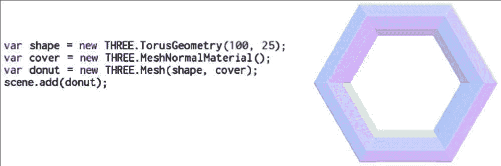 图 1——粗糙的甜甜圈

 `TorusGeometry(100, 25, 8, 25)` 和球体一样，甜甜圈形状也是由分段构成的。围绕内管的分段可以变大或变小，我们可以在定义 `TorusGeometry` 时包含第三个数字来设置。我们还可以通过包含第四个数字来调整甜甜圈外侧的分段大小。尝试像下面这样的数字，看看会发生什么。

```
var shape = new THREE.TorusGeometry(100, 25, 8, 25);
var cover = new THREE.MeshNormalMaterial();
var donut = new THREE.Mesh(shape, cover);
scene.add(donut);
```

 现在

 这是一个好看的甜甜圈：

 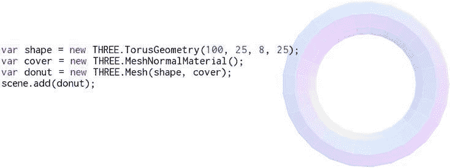 `TorusGeometry(100, 25, 8, 25, 3.14)` 我们还可以对甜甜圈玩另一个把戏。尝试在 `TorusGeometry` 形状中添加另一个数字 3.14：

```
var shape = new THREE.TorusGeometry(100, 25, 8, 25, 3.14);
var cover = new THREE.MeshNormalMaterial();
var donut = new THREE.Mesh(shape, cover);
scene.add(donut);
```

这应该会做出一个被咬了一半的甜甜圈。

## 1.3 让形状动起来

在结束我们的第一次编程会话之前，让我们做点酷的事情。让所有形状疯狂旋转。

在 ICE 中，在所有形状代码之后添加以下代码：

```
var clock = new THREE.Clock();
function animate() {
    requestAnimationFrame(animate);
    var t = clock.getElapsedTime();
    ball.rotation.set(t, 2*t, 0);
    box.rotation.set(t, 2*t, 0);
    tube.rotation.set(t, 2*t, 0);
    ground.rotation.set(t, 2*t, 0);
    donut.rotation.set(t, 2*t, 0);
    renderer.render(scene, camera);
}
animate();
```

暂时不用担心这段代码中每行是什么意思——我们会在本书后面更详细地研究所有这些行。现在，只要知道在特定的时间间隔内，我们正在改变形状的旋转。每次改变后，我们告诉渲染程序在屏幕上重新绘制当前的形状。

 如果 如果 ICE 卡住了

在进行动画和其他复杂编程时，ICE 代码编辑器有可能完全卡住。这没什么大不了的。如果 ICE 停止响应，你需要撤销你最后做的任何更改。如何做到这一点的说明在“当 ICE 崩溃时恢复”中。

## 1.4 到目前为止的代码

为了方便起见，这个项目的完整版本包含在附录 A1.1 中，第 217 页的“代码：创建简单形状”。在练习过程中使用该代码来检查你的工作，但不要将代码复制粘贴到 ICE 中。除非你自己编写代码，否则不可能学会和理解编程。

准备就绪

## 1.5 接下来是什么

哇！这真是太疯狂了。我们学到了很多，而且才刚刚开始！我们已经知道如何在 ICE 代码编辑器中编写项目。我们知道如何制作许多不同的形状。我们甚至知道如何用 JavaScript 移动和旋转物体。最棒的是，在制作完形状后，我们只用了十五行代码就创建了一个相当酷的动画。这是一个好的开始。

既然我们已经尝到了 3D 编程的滋味，让我们稍微谈谈在网页浏览器中编程。

当你完成本章后，你将能够：

- 打开/关闭 JavaScript 控制台
- 知道如何在 JavaScript 控制台中查找错误
- 能够在 ICE 卡住时修复项目

## 第 2 章 玩转控制台并找出问题所在

在网页浏览器中编程时，能够使用浏览器的 JavaScript 控制台非常有用。大多数现代浏览器都有 JavaScript 控制台，但这里我们使用的是 Google Chrome。

 编程可能会让人不知所措

有时它会让你想把电脑扔到墙上（别这么做）。在做这些事情时，请记住这两个事实：

- 会有你不知道的事情——这没关系。
- 你的程序会出问题——这没关系。

只要记住每个人都会遇到这些困难，你会没事的。

### 2.1 开始

 了解 ICE 代码编辑器

我们仍然在使用第 1 章“项目：创建简单形状”（第 1 页）中使用的 ICE 代码编辑器。如果你还没有开始使用 ICE，请回到那一章熟悉一下。

### 开始新项目

在 ICE 中完成的任何工作都自动保存，所以我们可以直接开始新项目。点击菜单，然后从菜单中选择 `New`：

  `Breaking Things`
  `3D starter`
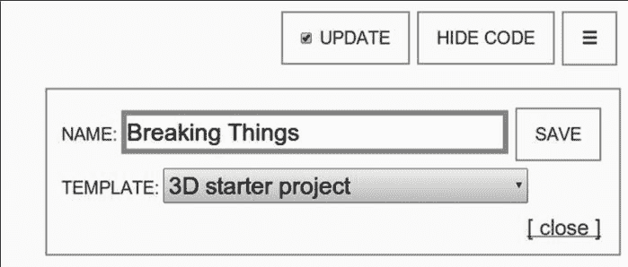  `3D project`
  现在让我们打开浏览器的 JavaScript 控制台。

### 2.2 打开和关闭控制台

浏览器中的 JavaScript 控制台是程序员最好的朋友。它告诉我们哪里出了错误。

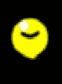 按住 `Ctrl` + `Shift` + `J` 可以打开关闭控制台。如果你使用的是苹果电脑，可以使用 `Cmd` + `Option` + `J` 来打开控制台。

第一次打开控制台时，如果看到大量警告和错误，不用担心。它会记录网页或 ICE 编辑器发生的事件。你可以使用带有斜圈的按钮清除日志。相同的组合键也可以关闭它（本章中请保持打开）。

### 2.3 ICE 中的调试：红色 X

代码旁边的红色 X 表示 ICE 发现了一个阻止代码运行的问题。

在“START CODING ON NEXT LINE”下方输入以下行：

```javascript
bad()
```

这是一段糟糕的 JavaScript！想知道为什么吗？是因为括号后面有单词。如果你这样写代码，ICE 会在问题的行旁边显示一个红色 X，表示该行需要修复。将鼠标指针移到红色 X 上会显示实际错误，例如“missing ; statement”。

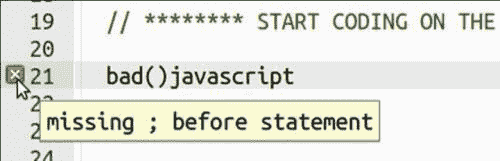 ICE 不告诉你括号后面了单词。它只知道括号应该在行的末尾，而这里不是这样。检测到行未完成时，触发一个错误：“嘿！你忘了在行末加号！”看到红色 X 时，需要检查：

- 是否忘了分号？
- 如果在红色 X 行看不到问题，也检查上一行。ICE 有时无法确定问题从何处开始，可能会偏差两行。

### 2.4 ICE 中的调试：黄色三角形

与红色 X 不同，代码左侧出现的黄色三角形不会阻止程序运行。即使行被标记了黄色三角形，你的代码仍然能运行，但可能无法正确。最好在出现这些三角形时消除它们。

让我们通过写一些更糟糕（但没那么糟糕）的 JavaScript 来实践一下。删除上一节中的 `bad()` 行，添加以下行：

```javascript
food; eat(food);
```

在这种情况下，ICE 会通过黄色三角形告诉我们 `food` 这一行没有做任何事情。

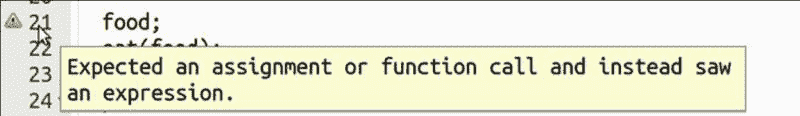 我们可以将 `food` 行改为赋值语句来修复问题：

```javascript
food = 'Cookie'; eat(food);
```

ICE 应该接受新的 `food` 行。然而，即使 ICE 没有报告更多问题，这段代码仍然存在问题。

### 2.5 在控制台中调试

这就是 JavaScript 控制台派用场的地方，我们可以看到程序实际做什么。打开控制台后，你会看到一个错误消息，提示 `eat()` 未定义。

 当浏览器尝试运行这段糟糕的 JavaScript 代码时，它意识到出了问题。在程序中，我们告诉浏览器运行 `eat()` 函数，但我们从未告诉浏览器如何执行它。

尝试运行代码时发现的错误称为运行时错误。我们将在第 5 章“函数：反复使用”中更详细地讨论。现在，只需知道函数是一种反复运行的代码编写方式即可。ICE 用红色 X 和黄色三角形标记的错误称为编译时错误。编译时错误是在计算机读取代码并决定如何处理它时捕获的。JavaScript 控制台帮助我们修复运行时错误。

### 解决方法

为了解决这个问题，让我们告诉 JavaScript 程序如何吃东西。通过在 `eat(food)` 行之后添加一个解释如何吃的函数：

```javascript
food = 'Cookie'; eat(food);

function eat(food) { 
    console.log(food + "! Nom. Nom. Nom."); 
}
```

此时，ICE 中应该没有编译时错误，JavaScript 控制台中也没有运行时错误，控制台中会显示消息“Cookie! Nom. Nom. Nom.”。

在结束本章之前，让我们看看一些常见的 3D 编程错误。在 `eat()` 函数的右花括号之后添加以下代码：

```javascript
var shape = new THREE.SpherGeometry(100); 
var cover = new Three.MeshNormalMaterial(); 
var ball = new THREE.Mesh(shape, cover); 
scene.add(donut);
```

```javascript
bad()
```

排版后：


化身就是你在游戏世界中的身份。它显示你在游戏中的位置以及你在做什么。由于它应该代表你和我，所以它应该给人一种良好的感觉。我们想要比一个简单的方块更好的东西来代表我们。

玩家与化身的区别  在本书中，我们将使用“玩家”一词来指代玩游戏的人。而“化身”一词将用来描述游戏中的玩家。

### 3.1 开始

让我们再次打开 ICE 代码编辑器 1，创建一个名为 My Avatar 的新项目（如果你不记得如何操作，请查看第 17 页的“开始一个新项目”）。

1. `http://gamingJS.com/ice` 准备就绪。

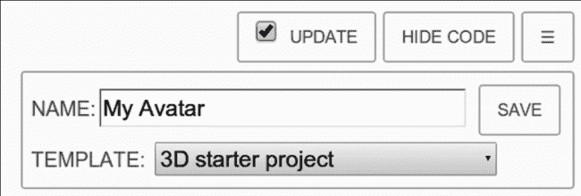 确保将模板设置为 3D 入门项目。这样，我们就可以准备好在“START CODING ON THE NEXT LINE”之后的那一行开始编程了。

### 3.2 用部件组合整体

从第 1 章《项目：创建简单形状》第 1 页开始，我们已经知道如何制作基本形状。让我们从制作一个球体作为身体开始，来构建我们的玩家化身。

```
var cover = new THREE.MeshNormalMaterial();
var body = new THREE.SphereGeometry(100);
var avatar = new THREE.Mesh(body, cover);
scene.add(avatar);
```

我们已经知道输入这些代码后会发生什么——我们会在场景中心得到一个球体。

 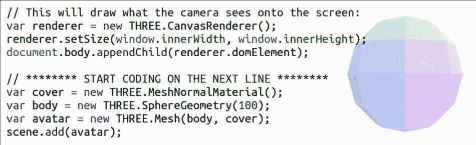 接下来，让我们在身体旁边添加一只手。在你已经输入的创建身体的代码下面，添加以下几行。


```
var hand = new THREE.SphereGeometry(50);
var right_hand = new THREE.Mesh(hand, cover);
right_hand.position.set(-150, 0, 0);
scene.add(right_hand);
```

#### 用部件组合整体

注意，我们没有为手创建新的覆盖材质。而是重复使用了同一个覆盖材质，也就是我们在化身身体上使用的那个，我们将其命名为 `cover`。这节省了一些输入。少打字是件好事，因为我们都是程序员，而程序员骨子里都是懒惰。这让我想起了一些编程智慧，想与大家分享：


#### 好程序员是懒惰的

我并不是说程序员讨厌做工作。实际上，我们热爱自己的工作，并且经常因为太热爱而花过多时间工作。

不，我所说的懒惰是指我们讨厌做那些计算机更擅长的工作。因此，与其单独创建手和脚，我们更愿意编写一个单独的手/脚，然后根据需要复制多次。

懒惰在两个非常重要的方面对我们有益：

- 我们输入得更少。信不信由你，这是一个巨大的胜利。不仅第一次输入更少，而且以后想要更新时，需要阅读的内容也更少。
- 如果我们想改变某个肢体的创建方式，只需要修改一处。也就是说，如果将来想改变手的覆盖材质甚至形状，我们只需要在一个地方进行修改。

那么，让我们看看在创建化身的左手时，能否更加懒惰：

```
var left_hand = new THREE.Mesh(hand, cover);
left_hand.position.set(150, 0, 0);
scene.add(left_hand);
```

我们不仅没有为左手创建新的覆盖材质，而且也没有创建新的形状！我们只是为左手使用了与右手相同的形状。这才叫懒惰！

这样一来，我们的化身应该看起来像图 2《带手的化身》第 28 页那样。

好吧，我承认这看起来不太像带手的身体。请再忍耐一会儿，你会看到的。

准备就绪 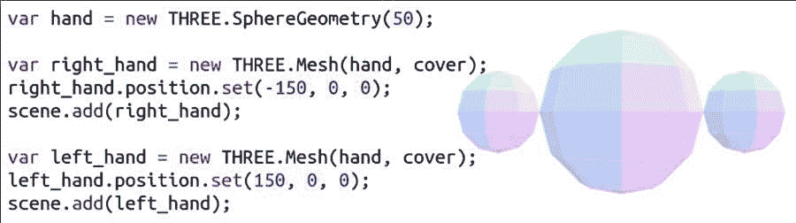 图 2——带手的化身


### 3.3 分解说明

让我们快速看一下为什么我们为手使用了那些数字。如果你没有耐心，可以跳到第 3.4 节《添加行走的脚》第 29 页，继续构建我们的游戏化身。

当任何物体被添加到场景中时，它最初位于正中心。所以当我们添加身体和一只手时，它开始看起来像这样：

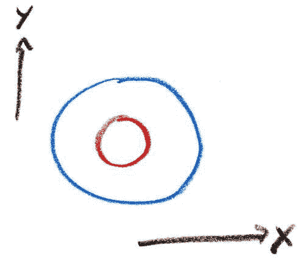 在 3D 编程和数学中，左和右被称为 X 方向。上和下被称为 Y 方向。

这就是为什么我们改变手的 X 位置：

```
var left_hand = new THREE.Mesh(hand, cover);
left_hand.position.set(150, 0, 0);
scene.add(left_hand);
```

`left_hand.position.set(150, 0, 0)` 中的数字分别是左手的 X、Y 和 Z 位置（Z 方向是前后）。我们将 X 设为 150，而 Y 和 Z 均为 0。这实际上等同于 `left_hand.position.x = 150`。稍后我们会看到，在一行中设置多个值会非常方便。

#### 添加行走的脚

但为什么是 150？答案是身体的半径为 100，手的半径为 50。我们需要将手在 X（左/右）方向上移动 100 + 50，即 150：

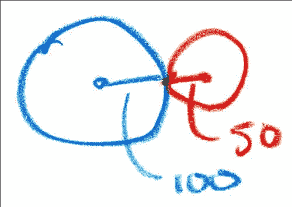 如果我们只将手的中心移动 100，那么手就会嵌入内部：

 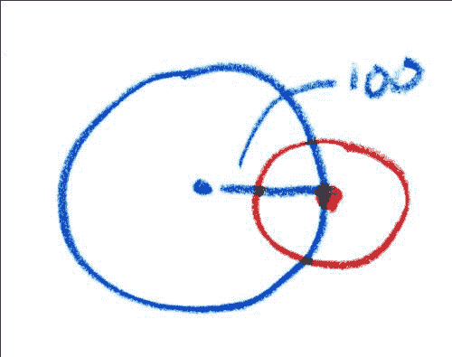

#### 自己试试

 如果你不信，可以自己试试。通过调整第一个数字改变 X 位置：

 `right_hand.position.set(150, 0, 0)`。对左手也试试。不过把它们设得太大，否则它们直接跑出屏幕！

 3.4 添加行走的脚

 对于脚，我们同样使用大小为 50 的球体。由你决定如何添加代码：

- 脚的左/右移动不要像手那么大。脚应该位于身体下方。
- 你将它们向下移动。使用 Y 方向而不是 X 方向。这是 `right_hand.position.set(-150, 0, 0)` 中的第二个数字。使用负数，例如 -25。
- 回想一下，手是在渲染场景之前添加的——即在 `renderer.render(scene, camera)` 这一行之前。脚也应该如此。

以下是右手的实现；在你处理脚时可能会帮助：

```
var hand = new THREE.SphereGeometry(50);
var right_hand = new THREE.Mesh(hand, cover);
right_hand.position.set(-150, 0, 0);
scene.add(right_hand);
```

祝你好运

#### 自己试试

尝试自己放置脚。左右移动脚需更改 `right_foot.position.set(0, 0, 0)` 中的第一个数字。上下移动则更改第二个数字（第三个数字是前后方向）。可能花点时间调对，但相信我——这是很好的练习。先试一会儿，然后继续正文。

你成功了吗？效果可能如下：

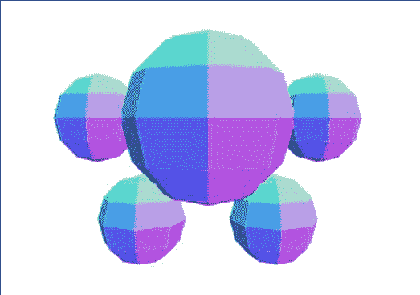 如果你的效果不完全一样，别担心。你的甚至可能更好！如果遇到困难，请参考用于制作角色的代码：

#### 挑战：打造属于自己的虚拟角色

```
var cover = new THREE.MeshNormalMaterial();
var body = new THREE.SphereGeometry(100);
var avatar = new THREE.Mesh(body, cover);
scene.add(avatar);
var hand = new THREE.SphereGeometry(50);
var right_hand = new THREE.Mesh(hand, cover);
right_hand.position.set(-150, 0, 0);
scene.add(right_hand);
var left_hand = new THREE.Mesh(hand, cover);
left_hand.position.set(150, 0, 0);
scene.add(left_hand);
var foot = new THREE.SphereGeometry(50);
var right_foot = new THREE.Mesh(foot, cover);
right_foot.position.set(-75, -125, 0);
scene.add(right_foot);
var left_foot = new THREE.Mesh(foot, cover);
left_foot.position.set(75, -125, 0);
scene.add(left_foot);
```

这是从“在下一行开始编码”之后的所有内容。

### 3.5 挑战：打造属于自己的虚拟角色

如果你愿意挑战，看看能否创建一个像这样的虚拟角色：

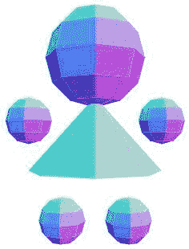 要做到这一点，你需要将身体替换为第 1 章“项目：创建简单形状”中的某个形状，并添加一个头部。不要连接手、脚和身体的手臂和腿——那会让后续章节变得更难。

当然，你可以制作任何你喜欢的虚拟角色。只要记得制作带有手和脚的——我们在后续章节会用到它们。

### 3.6 做侧手翻

稍后我们会为虚拟角色添加控制。但在进入下一课之前，先让虚拟角色做一些翻转和侧手翻。

就像我们在第 1 章“项目：创建简单形状”（第 1 页）末尾所做的那样，我们首先更改代码的最后一行（即编辑器末尾 `</script>` 标签上方的那行）。我们不再让浏览器只显示一次场景，而是按如下方式对场景进行动画处理。

```javascript
// Now, animate what the camera sees on the screen:
function animate() {
  requestAnimationFrame(animate);
  avatar.rotation.z = avatar.rotation.z + 0.05;
  renderer.render(scene, camera);
}
animate();
```

如果你正确输入了所有代码，可能会注意到一个奇怪的现象。只有头部在旋转，而不是整个虚拟角色。

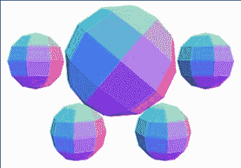 这可能是一个很酷的效果，但并不是我们想要的。那么，我们该如何让整个虚拟角色旋转？

如果你尝试对手和脚也添加 `rotation.z` 的变化，那是不通的。手脚会像头部一样原地旋转。这个问题的答案是一种强大的 3D 编程技术：将所有部分组合在一起，然后旋转这个组。部分添加到虚拟角色上，而不是场景中。

#### 做侧手翻

如果你回头右手的代码，发现把它添加到了场景中。更改一行：

```
var right_hand = new THREE.Mesh(hand, cover);
right_hand.position.set(-150, 0, 0);
scene.add(right_hand);
```

不再将手添加到场景中，而是添加到虚拟角色上：

```
var right_hand = new THREE.Mesh(hand, cover);
right_hand.position.set(-150, 0, 0);
avatar.add(right_hand);
```

对 `left_hand`、`right_foot` 和 `left_foot` 也同样的操作，你的虚拟角色就能做侧手翻了。添加一行来控制：

```javascript
var is_flipping = false;
function animate() {
  requestAnimationFrame(animate);
  if (is_flipping) {
    avatar.rotation.z = avatar.rotation.z + 0.05;
  }
  renderer.render(scene, camera);
}
animate();
```

指定 `is_flipping` 的值。如果为 `true`，虚拟角色会开始侧手翻。将 `avatar.rotation` 包裹在 `if` 中。

#### 让我们的虚拟角色翻转！

 现在你已经让虚拟角色做侧手翻了，试着也让它翻转。使用 `avatar.rotation.x` 或 `avatar.rotation.y` 代替 `avatar.rotation.z`。

### 3.7 到目前为止的代码

完整的代码类似于附录 A1.3“代码：制作虚拟角色”（第 19 页）中的代码。如果你的代码不完全一样，别担心，它可能更好或者只是不同。

### 3.8 下一步

我们有一个看起来很酷的虚拟角色。给它添加一张脸或衣服可能会不错。但如果我们用键盘移动虚拟角色呢？这正是第 4 章“项目：移动虚拟角色”（第 35 页）中要做的事情。

现在，花点时间调整虚拟形象的大小、位置和旋转角度。完成本章后，你将能够：

- 使用键盘移动虚拟形象
- 初步了解 JavaScript 事件
- 能够随虚拟移动摄像机

# 第 4 章 项目：移动虚拟形象

在第 3 章“项目：制作虚拟形象”（第 25 页）中，我们介绍了如何构建一个游戏虚拟形象。一个无法移动的虚拟形象相当乏味。因此，在本章中，你将学习如何让虚拟形象向不同方向移动。我们还会给它一个小森林供其穿梭。最终效果大致如下：

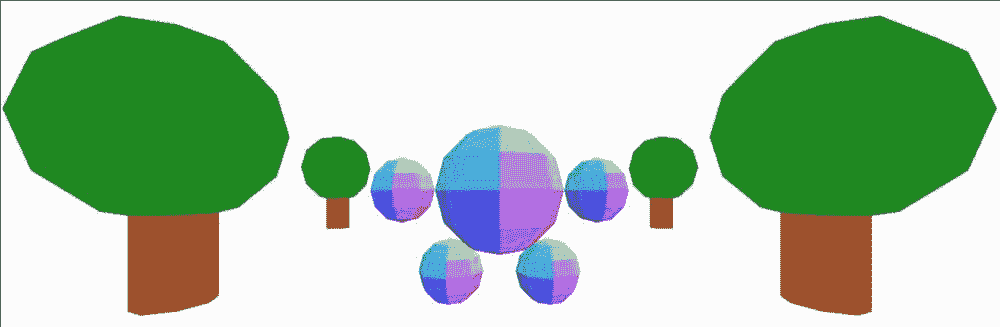

### 4.1 准备工作

本章基于“项目：制作虚拟形象”中所做的工作。如果你尚未完成该章的练习，请先返回后再继续。特别地，你需要完成该章末尾的 `animate()` 练习。

让我们复制上一章的虚拟形象项目。这样，如果我们想回顾那个简单的旋转和侧手翻虚拟形象，随时可以查看。要复制该项目，请点击菜单按钮，然后从菜单中选择“制作副本”（Make a Copy）（见图 3，选择制作副本，第 36 页）。我们将这个项目命名为“我的虚拟形象：键盘控制”，如图 4，“命名项目”，第 36 页所示。

至此，我们已准备好添加键盘控制。

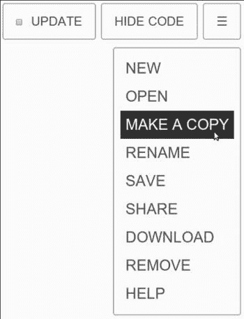 图 3——选择制作副本

  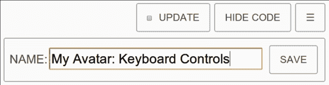 图 4——命名项目


### 4.2 使用键盘事件构建交互系统

到目前为止，本书中的代码都是非常线性的——它沿着一条直线执行。我们先制作了一个封面、一个形状和一个网格，然后将对象添加到场景中。接着我们处理下一个网格，同样将其添加到场景中。虽然可以编写大量类似这样的 JavaScript 代码，但大多数 JavaScript 程序往往截然不同。

这是因为 JavaScript 通常在 Web 浏览器中运行。在 Web 浏览器中，JavaScript 代码必须响应事件。键盘按键被按下、鼠标按钮被点击、鼠标指针在页面上移动，这些都是 Web 浏览器中的事件。每个网页上可能发生大量事件，而大多数情况下，这些事件都被忽略了。

但我们不会忽略按事件。我们将使用一种称为事件监听器（event listener）的东西来监听事件。让我们在代码的最底部，即我们在第 3 章“项目：制作虚拟形象”（第 25 页）中添加的 `animate()` 行下方，添加以下代码。

#### 将键盘事件转换为虚拟形象移动

```javascript
document.addEventListener('keydown', function (event) { 
    alert(event.keyCode);
});
```

什么是 `keyCode`？为了回答这个问题，我们来试试看！点击页面顶部工具栏中的“隐藏代码”按钮，然后按下键盘上的 A 键。你应该看到类似这样的警告对话框。

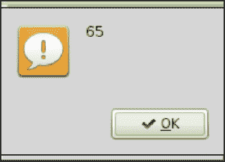


```markdown

这个 65 是什么？请记住，计算机存储所有内容，甚至字母，都是以数字形式存储的。计算机在向人类显示正确的字母时，会将该数字转换为字母。当我们想到字母 `a` 时，计算机想到的是 `65`。

为什么我们需要知道这个？如果你还没有点击警告框上的“确定”按钮，请先点击。然后对键盘上的左、上、右、下箭头键重复此操作。对于左箭头，你会发现计算机认为是 `37`。对于上箭头，计算机认为是 `38`。对于右箭头，计算机检测到的键码是 `39`。对于下箭头，计算机认为是 `40`。

让我们利用这些 `keyCode` 来移动我们的虚拟形象！

## 4.3 将键盘事件转换为虚拟形象移动

通过使用键盘事件监听器，我们现在知道了四个箭头键对应的数字。我们将这些箭头键和数字转换为虚拟形象的移动，如下所示：

| 箭头键 | 计算机数字 | 虚拟形象方向 |
| :--- | :--- | :--- |
| 左 | 37 | 向左 |
| 上 | 38 | 向前 |
| 右 | 39 | 向右 |
| 下 | 40 | 向后 |

那么，让我们来实现这一点。删除 `document.addEventListener()` 内部的 `alert(event.keyCode)` 行。用以下代码替换它，从 `var code` 语句开始。

```javascript
document.addEventListener('keydown', function (event) {
    var code = event.keyCode; 
    if (code == 37) avatar.position.x = avatar.position.x - 5; // 左
    if (code == 38) avatar.position.z = avatar.position.z - 5; // 上
    if (code == 39) avatar.position.x = avatar.position.x + 5; // 右
    if (code == 40) avatar.position.z = avatar.position.z + 5; // 下
});
```

我们在“项目：制作虚拟形象”中见过 `if` 语句。在这里，我们检查 `keyCode` 是否等于某个箭头键的计算机数字。如果键码是 `37`（左箭头键），那么我们将 `avatar` 的 `X` 位置减去 5。

在 JavaScript 中，双等号（`==`）用于检查某物是否等于另一物——单等号（`=`）用于将值赋给另一物。在我们上面的代码示例中，我们将 `code` 设置为等于 `event.keyCode`。然后我们检查它是否等于不同的箭头键值。


**试一试！**

点击“隐藏代码”按钮，然后试一试。使用箭头键移动虚拟形象。它是否按你预期的方式工作？记住：如果出现问题，请检查 JavaScript 控制台！

如果一切正常，那么你应该能够将虚拟形象移动到远处、近处、最左边或最右边，甚至移出屏幕。

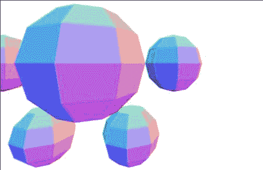

在第 3.6 节“做侧手翻”（第 32 页）中，我们添加了做侧手翻的能力，你学会了如何确保虚拟形象的手和脚随身体一起移动。由于手和脚是添加到 `avatar` 对象而不是 `scene` 中的，因此移动 `avatar` 意味着手和脚也会随之移动。

**挑战：开始/停止动画**

让我们看看如果其中一条腿没有连接到虚拟形象上会发生什么。在这里，我们将修改 `left_foot`，使其添加到 `scene` 而不是 `avatar` 中。

```javascript
var left_foot = new THREE.Mesh(foot, cover); 
left_foot.position.set(75, -125, 0); 
scene.add(left_foot);
```

运行这段代码，左脚就会消失。

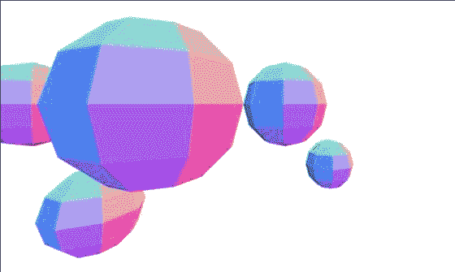

不要低估这个概念的力量。我们稍后会用它做一些疯狂的事情。现在，别忘了将你的左脚固定到 `avatar` 上！

## 4.4 挑战：开始/停止动画

还记得我们在第 3 章“项目：制作虚拟形象”（第 25 页）中构建虚拟形象时使用的 `is_cartwheeling` 和 `is_flipping` 值吗？让我们在键盘事件监听器中再添加两个 `if` 语句。如果按下 C 键（计算机认为是数字 `67`），则虚拟形象应开始或停止做侧手翻。如果按下 F 键（计算机认为是数字 `70`），则翻转例程应开始或停止。

**提示**：使用非运算符在 `true` 和 `false` 之间切换。在 JavaScript 中，非运算符是感叹号 `!`。你可以使用这个非运算符将 `is_cartwheeling` 的值赋为其相反值，例如 `is_cartwheeling = !is_cartwheeling`。我们将在“布尔值”部分再次看到这一点。

希望你能自己实现它。以下是处理侧手翻和翻转的 `animate()` 函数。

```javascript
var is_cartwheeling = false; 
var is_flipping = false; 

function animate() {
    requestAnimationFrame(animate); 
    if(is_cartwheeling) {
        avatar.rotation.z = avatar.rotation.z + 0.05; 
    }
    if ( is_flipping) {
        avatar.rotation.x = avatar.rotation.x + 0.05;
    }
    renderer.render(scene, camera);
}
animate();
```

以下是用于移动、翻转和侧手翻虚拟形象的完整键盘监听器。

```javascript
document.addEventListener('keydown', function (event) {
    var code = event.keyCode;
    if (code == 37) avatar.position.x = avatar.position.x - 5; // 左
    if (code == 38) avatar.position.z = avatar.position.z - 5; // 上
    if (code == 39) avatar.position.x = avatar.position.x + 5; // 右
    if (code == 40) avatar.position.z = avatar.position.z + 5; // 下
    if (code == 67) is_cartwheeling = !is_cartwheeling; // C
    if (code == 70) is_flipping = !is_flipping; // F
});
```

如果你做对了，你应该让角色在移出屏幕时做出翻和侧手翻。

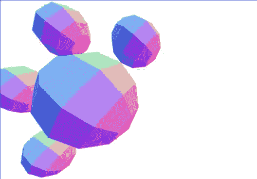

## 4.5 创建森林

我们的森林需要很多树木。我们可以一棵一棵地建造，但我们不会这么做。相反，让我们在所有角色之后添加以下代码：

```javascript
makeTree(500, 0);
makeTree(-500, 0);
makeTree(750, 1000);
makeTree(-750, 1000);
```

### 使用函数创建

```javascript
function makeTree(x, z) {
  var trunk = new THREE.Mesh(
    new THREE.CylinderGeometry(50, 50, 200),
    new THREE.MeshBasicMaterial({color: 0xA052D})
  );
  var top = new THREE.Mesh(
    new THREE.SphereGeometry(150),
    new THREE.MeshBasicMaterial({color: 0x22B22})
  );
  top.position.y = 175;
  trunk.add(top);
  trunk.position.set(x, -75, z);
  scene.add(trunk);
}
```

如果你正确输入了所有代码，你会看到角色站在一片由四棵树森林前。

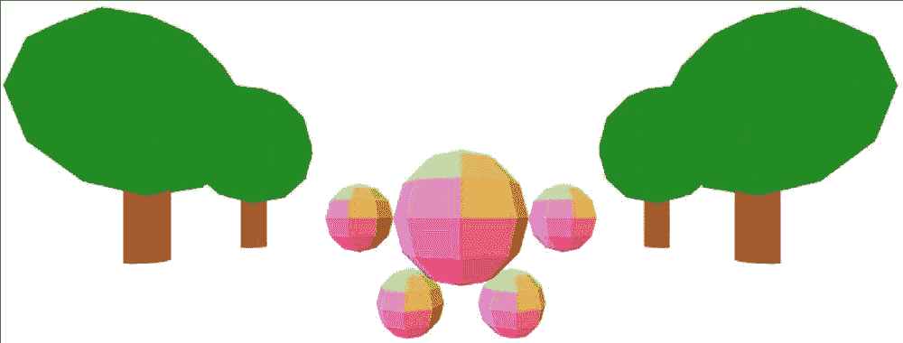 很酷，但我们是怎样做到的？

### 分解步骤

建造森林的第一部分很容易理解。我们在场景中不同的 `X` 和 `Z` 坐标（记住 Y 是上下方向）处添加树木。

`makeTree(500, 0)`
`makeTree(-500, 0)`
`makeTree(750, 1000)`
`makeTree(-750, 1000)`

### `makeTree()` 如何工作的？

❶ 用圆柱体制作树干。
❷ 用球体制作树冠。
❸ 将树冠向上移动（记住 Y 是上下方向）到树干顶部。
❹ 将树冠添加到树干上。
❺ 将树干的位置设置为调用函数传入的 `x` 和 `z` 值——例如 `makeTree(500,0)`。`Y` 值为 `-75` 将树干向下移动，使其看起来像树干。
❻ 将树干添加到场景中。

重要的是要记住，我们必须将树冠添加到树干上，而不是添加到场景中。如果我们将树冠添加到场景中，那么当我们尝试移动树时，只有树干会被移动，而树冠不会。如果我们将树冠添加到场景中，我们还需要设置树冠的位置——添加到树干上意味着树冠的位置与树干相同。

到目前为止，我们已经很擅长用形状和材质构建对象并将它们放置在屏幕上了。你可能不用费太大力就能做出四棵树。对于一棵树，你需要一个 `THREE.CylinderGeometry` 作为树干，一个 `THREE.SphereGeometry` 作为树冠。如果你将绿色的树叶添加到树冠上，那么你就可以一起移动这两个部分了。

### 让摄像机跟随角色移动

然后你需要再重复三次同样的操作，才能总共做出四棵树。四棵树需要很多代码。别忘了：程序员不喜欢打字。我们很懒。

## 4.6 让摄像机跟随角色

想一下，为了让手和脚随角色移动，我们将它们添加到了角色的身体上，而不是添加到场景中。这正是我们需要对摄像机做的事情。首先，找到 `scene.add(camera)` 的一行并将其删除。然后，在角色添加到场景的下方，在 `makeTree()` 函数上方，将摄像机添加到角色上：

```javascript
var left_foot = new THREE.Mesh(foot, cover);
left_foot.position.set(75, -125, 0);
avatar.add(left_foot);
avatar.add(camera); // 添加这一行
```

隐藏代码后，你会看到当角色移动时，摄像机始终保持在前方。

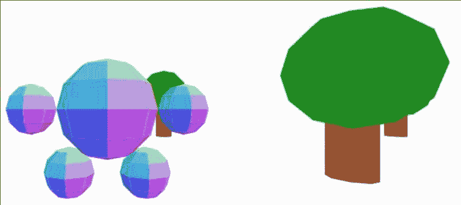 它位于角色前方 500 单位处（`camera.position.z = 500`）。由于我们从未定义 `position.y`，摄像机始终与角色相同高度。由于我们尚未设置 `position.x`，摄像机始终位于前方。你可以把摄像机想象成用一根无形的链条拴在角色上。

  无论角色走到哪里，摄像机都会跟着。 很酷，对吧？嗯，这种方法有一个大问题。如果角色开始侧手翻或后翻（记住我们用的是 `C` 和 `F` 键），会发生什么？角色似乎不动，但其他东西都开始旋转！（见图 5，“所有东西都开始旋转！”，第 45 页。）这是因为摄像机被拴在身上的无形链条上。如果角色旋转，摄像机也会跟着。（见图 6，“摄像机随旋转”，第 45 页。）这不是我们想要的。我们真正想要的是摄像机锁定在角色的位置上，而不是锁定在角色本身上。在 3D 编程中，没有简单的方法可以可靠地将某物锁定到另一个物体上。但并非不可施。

### 使用标记跟随

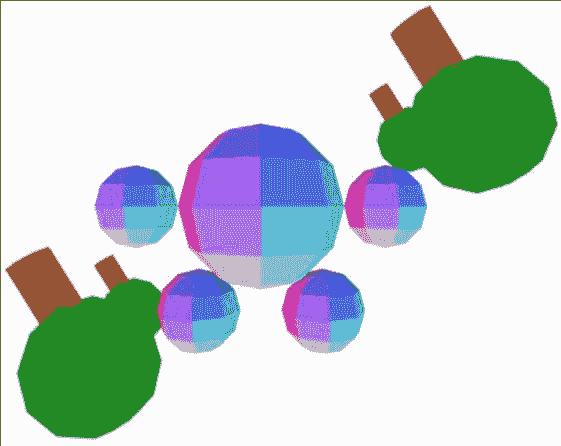 图 5——所有东西都开始旋转！  图 6——摄像机随旋转 我们将在游戏中添加一个角色标记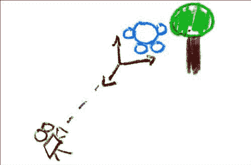 如果我们将摄像机和角色都锁定到这个标记上，那么移动标记就会同时移动角色和摄像机。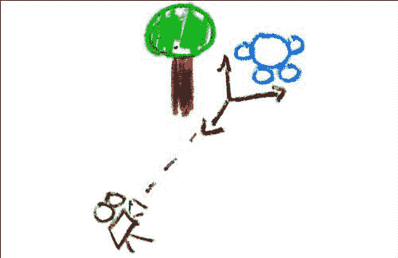 但更重要的是，当角色做侧手翻时，摄像机不会移动。角色在做侧手翻，但标记不会旋转。由于标记不旋转，摄像机也不会旋转。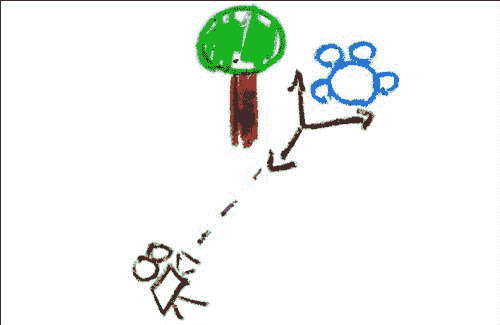 在 3D 编程中，这个标记只是一个标记。它应该是不可见的。所以我们不想为此使用网格或几何体。相反，我们使用 `Object3D`。让我们在角色生成之前，紧接在 `START CODING ON THE NEXT LINE` 之后添加以下代码：

```javascript
var marker = new THREE.Object3D();
scene.add(marker);
```

现在，我们修改角色，将其添加到标记上，而不是添加到场景中：

```javascript
var avatar = new THREE.Mesh(body, cover);
marker.add(avatar);
```

我们还需要修改摄像机的添加方式。不再将摄像机添加到角色上，而是添加到标记上。`marker.add(camera);` 最后修改的是键盘事件监听器。我们不再改变角色的位置，而是改变标记的位置。

```javascript
document.addEventListener('keydown', function (event) {
    var code = event.keyCode; 
    if (code == 37) marker.position.x = marker.position.x-5; // left
    if (code == 38) marker.position.z = marker.position.z-5; // up
    if (code == 39) marker.position.x = marker.position.x+5; // right
    if (code == 40) marker.position.z = marker.position.z+5; // down
    if (code == 67) is_cartwheeling = !is_cartwheeling; // C
    if (code == 70) is_flipping = !is_flipping; // F
});
```

这样一来，我们可以用键盘移动角色的位置，但当我们翻转或侧翻时，摄像机保持直立。

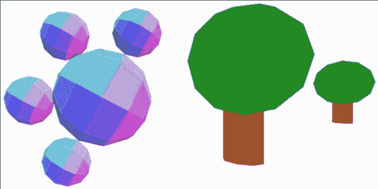

### 4.7 到目前为止的代码

```

我们已经多次遇到函数。最近一次是在第 4 章《项目：移动角色》（第 35 页）中，我们用它们来创建森林。如果你仔细观察，可能会发现我们在同一章中也用函数构建了键盘事件监听器。

虽然我们已经使用过函数，但还没有深入讨论它们。你可能已经感觉到它们非常强大，那么现在让我们仔细看看。

我们不会讨论函数的方方面面——它们可能会变得相当复杂。我们只讨论到足以理解本书中使用的函数的程度。

### 5.1 开始

在 `ICE` 代码编辑器中创建一个新项目。使用空项目模板，并将其命名为“`Functions`”。

在开头的 `<script>` 标签之后，删除写着“Your code goes here”的那一行，然后输入以下 JavaScript 代码。

```javascript
var log = document.createElement('div' ) ; log.style.height
= '75px' ; log.style.width = '450px' ; log.style.overflow =
'auto' ; log.style.border = '1px solid #666' ;

log.style.backgroundColor = '#ccc' ; log.style.padding =
'8px' ; log.style.position = 'absolute' ; log.style.bottom =
'10px' ; log.style.right = '20px' ;

document.body.appendChild(log);

var message = document.createElement('div' ) ; message.textContent = 'Hello, JavaScript functions!' ; log.appendChild(message);message = document.createElement('div' ) ; message.textContent = 'My name is Chris.' ; log.appendChild(message);

message = document.createElement('div' ) ; message.textContent = 'I like popcorn.' ; log.appendChild(message);
```

Prepared

第一段代码在浏览器中创建了一个记录消息的地方。最后三个代码块向该日志写入了三条不同的消息。如果一切输入正确，你应该会在页面右下角看到这三条消息。

 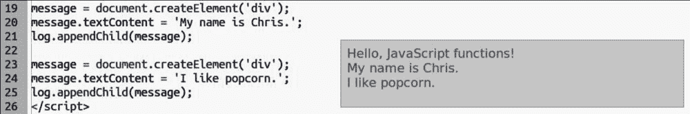 回到

 第 3 章，

 项目：创建角色

 ，第 25 页

，我们使用了一个函数

 来避免重复四次创建树的相同过程。所以

 你大概能猜到我们首先要改什么。让我们改变记录这三条消息的方式。

首先，删除从第一行 `var message` 到最后一个 `log.appendChild` 行的所有内容。在原来代码的位置，添加以下内容。

```javascript
logMessage('Hello, JavaScript functions!' , log); logMessage('My name is
Chris.' , log); logMessage('I like popcorn.' , log);function logMessage(message, log) {

var holder = document.createElement('div' ) ; holder.textContent = message; log.appendChild(holder);}
```

当我们编写这段代码时，发生了一件惊讶的事情——它变得更容易阅读了。即使是非程序员也能读懂前三行，并知道它们向日志发送了一条消息。这对我们这样的程序员来说是一个巨大的胜利。

如果我们后来决定要在每条消息前添加时间，现在找出在哪里修改就更容易了。

## 开始

 可读的代码以后更容易修改

区分优秀程序员和普通程序员的技能之一就是修改现有代码的能力。优秀的程序员知道，当代码易于阅读时，修改起来更容易。

显然我们需要修改函数内部的内容。以前，我们需要花一些时间才能弄清楚那三个代码块是在写日志消息，以及如何修改它们。

这也引出了一个非常重要的规则。

 保持代码 DRY——不要重复自己

这本书与一本著名的书《程序员修炼之道》出自同一家出版社。如果你继续编程，总有一天会读到那本书。书中有一个绝妙的建议：程序员应该保持代码 DRY——遵循“不要重复自己”（简称 DRY）的规则。

当我们最初编写代码时，我们重复了三件事：

1. 为消息创建一个容器
2. 向容器添加文本消息
3. 将消息容器添加到日志中

很容易看出我们在重复自己，因为三个代码块中的代码除了消息内容外完全相同。这又是我们偷懒的机会。如果我们添加超过三条消息，只需多输入一行，而不是三行。

当然，如果我们需要修改日志消息的某些内容，只需修改一个函数，而不是三个不同的代码块。

我们在这里还没有完全结束函数的使用。如果你查看所有代码，会发现需要很长时间才能到达重要的部分。（见图 7，函数之前的大量垃圾代码，第 52 页。）

重要的工作——写入消息——直到第 15 行才开始。在向日志写入消息之前，我们需要一个日志，但其他所有内容都只是干扰。

为了解决这个问题，让我们将干扰代码移到一个函数中，放在 `logMessage()` 行下方。在调用 `logMessage()` 的三行和定义 `logMessage()` 函数之间，添加一个名为 `makeLog()` 的新函数。创建日志容器的“干扰”代码

Prepared

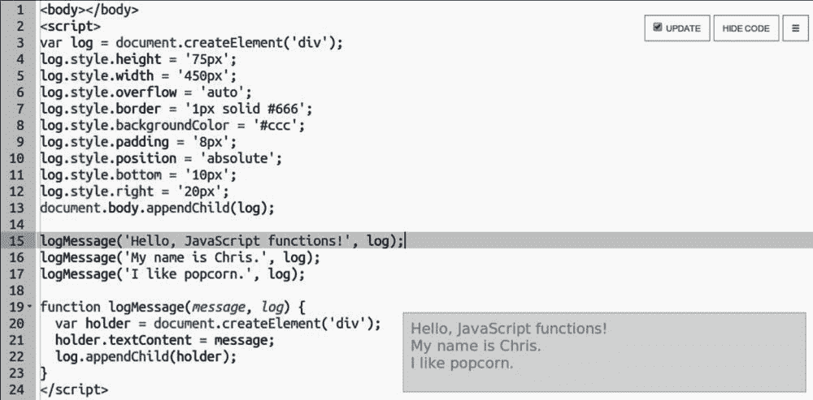 图 7——函数之前的大量垃圾代码

 从 `var log = document.createElement('div');` 这一行开始，到 `document.body.appendChild(holder)` 这一行结束。将这些行及其之间的所有内容移到 `makeLog()` 中：

```javascript
function makeLog() {

var holder = document.createElement('div') ; holder.style.height
= '75px' ; holder.style.width = '450px' ; holder.style.overflow =
'auto' ; holder.style.border = '1px solid #666' ;

holder.style.backgroundColor = '#ccc' ; holder.style.padding =
'8px' ; holder.style.position = 'absolute' ; holder.style.bottom =
'10px' ; holder.style.right = '20px' ;

document.body.appendChild(holder);
return holder;
}
```

注意我们将 `log` 改成了 `holder`。另外不要忘记最后一行，它返回 `holder`以便我们可以用它做事情。

我们可以用函数创建日志。在开头的 `<script>` 标签之后，前四行变成：

```javascript
var log = makeLog(); logMessage('Hello, JavaScript functions!' , log);
logMessage('My name is Chris.' , log);logMessage('I like popcorn.' , log);
```

理解简单函数这段代码非常易读！写出这样的代码比想象中难。真正优秀的程序员知道，没有充分理由之前使用函数。换句话，伟大的程序员正是我们这样做的：先写出丑陋的代码，再寻找改进。始终从丑陋的代码开始

 你是一个聪明的人。走到这一步，必然很聪明。你可能会想：“哦，我一开始就能写出可读的代码。” 请相信我，你做不到。程序员对此有体会。

## 5.2 理解简单函数到目前为止，我们已经了解为什么要使用函数。现在来看看函数是如何工作的。

从代码中删除三行 `logMessage()`。在 `var log = makeLog` 这一行之后，写入以下内容。

```javascript
logMessage('President Obama' ), log);
logMessage('Mom' ), log);
logMessage('Your Name' ), log);
function hello(name) {
  return 'Hello, ' + name + '! You look pretty today' ;
}
```

这个 `hello()` 函数的结果是首先返回短语“Hello, President Obama! You look pretty today”。记录这些短语的效果如下：

 `hello` 函数内部有很多内容需要处理，让我们把它成更小的部分。

```javascript
function hello(name) {
❷ return 'Hello, ' + name + '! You look pretty today' ;
}
```

准备就绪函数的组成部分如下：

❶ 关键字 `function`，告诉 JavaScript 我们正在创建一个函数。函数的名称——这里是 `hello`。函数参数。在这个例子中，我们接受一个参数（`name`），它将在函数内部使用。当我们用参数调用函数——例如 `hello(Fred)`——我们告诉函数，任何时候使用 `name` 参数，都等同于使用 `Fred`。函数体以左花括号 `{` 开始，以右花括号 `}` 结束。你在写英文时可能未使用花括号，但在写 JavaScript 时经常用到。

❷ 关键字 `return` 告诉 JavaScript 我们想要函数的结果。它可以是任何东西：数字、字母、单词、日期，甚至更有趣的东西。

 JavaScript 中的每一行，即使是函数内部，都应该以分号结尾。

### 字母、单词和句子都是字符串引号内的内容比如 `'Hello'`，被称为字符串。即使在其它编程语言中，字母、单词和句子通常也被称为字符串。务必确保关闭引号。如果忘记，你会遇到非常奇怪且难以修复的错误。接下来，让我们故意破坏它，以便了解出错时如何处理。

## 5.3 当事情出错让我们戴上黑客的帽子，尝试破坏一些函数。虽然用 JavaScript 函数做错事很容易，但找出错在哪里并不容易。程序员最常犯的错误会产生奇怪的错误信息。让我们来看看，以便你做好更充分的准备。

### 当事情出错时黑客而非破解 别担心！我们不会真的破坏任何东西。破坏东西是破解，而不是黑客。黑客是好事。你经常会听到非程序员错误地使用“黑客”这个词。既然你现在是程序员了，你需要知道这个词的含义以及如何正确使用它。黑客意味着我们在玩弄代码、应用程序或 网站。我们玩弄它们是为了学习，而不是造成破坏。我们会尝试破坏自己的代码——但只是为了更好地理解它。永远做黑客，绝不做破解者。

### 意外错误最常见的情况是忘记花括号：

```javascript
// 缺少花括号 - 这不会工作！
function hello(name)
  return 'Hello, ' + name + '! You look pretty today :)' ;
}
```

这是 JavaScript 中的编译时错误——JavaScript 在尝试读取、编译和运行时能够检测到的错误之一——我们在  第 2.5 节   处遇到。

 这里的代码是 `function hello(name)` 缺少花括号。

## 5.4 保持 DRY 当事情出错

 保持代码 DRY——不要重复自己

这本书与一本著名的书《程序员修炼之道》出自同一家出版社。如果你继续编程，总有一天会读到那本书。书中有一个绝妙的建议：程序员应该保持代码 DRY——遵循“不要重复自己”（简称 DRY）的规则。

当我们最初编写代码时，我们重复了三件事：

1. 为消息创建一个容器
2. 向容器添加文本消息
3. 将消息容器添加到日志中

很容易看出我们在重复自己，因为三个代码块中的代码除了消息内容外完全相同。这又是我们偷懒的机会。如果我们添加超过三条消息，只需多输入一行，而不是三行。

当然，如果我们需要修改日志消息的某些内容，只需修改一个函数，而不是三个不同的代码块。

我们在这里还没有完全结束函数的使用。如果你查看所有代码，会发现需要很长时间才能到达重要的部分。（见图 7，函数之前的大量垃圾代码，第 52 页。）

重要的工作——写入消息——直到第 15 行才开始。在向日志写入消息之前，我们需要一个日志，但其他所有内容都只是干扰。

为了解决这个问题，让我们将干扰代码移到一个函数中，放在 `logMessage()` 行下方。在调用 `logMessage()` 的三行和定义 `logMessage()` 函数之间，添加一个名为 `makeLog()` 的新函数。创建日志容器的“干扰”代码

Prepared

 图 7——函数之前的大量垃圾代码

 从 `var log = document.createElement('div');` 这一行开始，到 `document.body.appendChild(holder)` 这一行结束。将这些行及其之间的所有内容移到 `makeLog()` 中：

```javascript
function makeLog() {

var holder = document.createElement('div') ; holder.style.height
= '75px' ; holder.style.width = '450px' ; holder.style.overflow =
'auto' ; holder.style.border = '1px solid #666' ;

holder.style.backgroundColor = '#ccc' ; holder.style.padding =
'8px' ; holder.style.position = 'absolute' ; holder.style.bottom =
'10px' ; holder.style.right = '20px' ;

document.body.appendChild(holder);
return holder;
}
```

注意我们将 `log` 改成了 `holder`。另外不要忘记最后一行，它返回 `holder`以便我们可以用它做事情。

我们可以用函数创建日志。在开头的 `<script>` 标签之后，前四行变成：

```javascript
var log = makeLog(); logMessage('Hello, JavaScript functions!' , log);
logMessage('My name is Chris.' , log);logMessage('I like popcorn.' , log);
```

理解简单函数这段代码非常易读！写出这样的代码比想象中难。真正优秀的程序员知道，没有充分理由之前使用函数。换句话，伟大的程序员正是我们这样做的：先写出丑陋的代码，再寻找改进。始终从丑陋的代码开始

 你是一个聪明的人。走到这一步，必然很聪明。你可能会想：“哦，我一开始就能写出可读的代码。” 请相信我，你做不到。程序员对此有体会。

## 5.2 理解简单函数到目前为止，我们已经了解了为什么要使用函数。现在来看看函数是如何工作的。

从代码中删除三行 `logMessage()`。在 `var log = makeLog` 这一行之后，写入以下内容。

```javascript
logMessage('President Obama' ), log);
logMessage('Mom' ), log);
logMessage('Your Name' ), log);
function hello(name) {
  return 'Hello, ' + name + '! You look pretty today' ;
}
```

这个 `hello()` 函数的结果是首先返回短语“Hello, President Obama! You look pretty today”。记录这些短语的效果如下：

 `hello` 函数内部有很多内容需要处理，让我们把它成更小的部分。

```javascript
function hello(name) {
❷ return 'Hello, ' + name + '! You look pretty today' ;
}
```

准备就绪函数的组成部分如下：

❶ 关键字 `function`，告诉 JavaScript 我们正在创建一个函数。函数的名称——这里是 `hello`。函数参数。在这个例子中，我们接受一个参数（`name`），它将在函数内部使用。当我们用参数调用函数——例如 `hello(Fred)`——我们告诉函数，任何时候使用 `name` 参数，都等同于使用 `Fred`。函数体以左花括号 `{` 开始，以右花括号 `}` 结束。你在写英文时可能未使用花括号，但在写 JavaScript 时经常用到。

❷ 关键字 `return` 告诉 JavaScript 我们想要函数的结果。它可以是任何东西：数字、字母、单词、日期，甚至更有趣的东西。

 JavaScript 中的每一行，即使是函数内部，都应该以分号结尾。

### 字母、单词和句子都是字符串引号内的内容比如 `'Hello'`，被称为字符串。即使在其它编程语言中，字母、单词和句子通常也被称为字符串。务必确保关闭引号。如果忘记，你会遇到非常奇怪且难以修复的错误。接下来，让我们故意破坏它，以便了解出错时如何处理。

## 5.3 当事情出错让我们戴上黑客的帽子，尝试破坏一些函数。虽然用 JavaScript 函数做错事很容易，但找出错在哪里并不容易。程序员最常犯的错误会产生奇怪的错误信息。让我们来看看，以便你做好更充分的准备。

### 当事情出错时黑客而非破解 别担心！我们不会真的破坏任何东西。破坏东西是破解，而不是黑客。黑客是好事。你经常会听到非程序员错误地使用“黑客”这个词。既然你现在是程序员了，你需要知道这个词的含义以及如何正确使用它。黑客意味着我们在玩弄代码、应用程序或 网站。我们玩弄它们是为了学习，而不是造成破坏。我们会尝试破坏自己的代码——但只是为了更好地理解它。永远做黑客，绝不做破解者。

### 意外错误最常见的情况是忘记花括号：

```javascript
// 缺少花括号 - 这不会工作！
function hello(name)
  return 'Hello, ' + name + '! You look pretty today :)' ;
}
```

这是 JavaScript 中的编译时错误——JavaScript 在尝试读取、编译和运行时能够检测到的错误之一——我们在  第 2.5 节   处遇到。

 这里的代码是 `function hello(name)` 缺少花括号。

## 5.4 保持 DRY 当事情出错

```markdown

函数对于 JavaScript 程序员来说是非常强大的工具。正如我们所看到的，使用函数的两个主要原因是代码复用和让代码更易读。我们创建了一个`logMessage()` 函数，以便反复使用它的功能。我们创建了`makeLog()` 函数，将一大段杂乱的代码从更重要的代码中移开。我们甚至还瞥见了函数的一些疯狂用法，比如递归。

而我们才刚刚触及皮毛！

很快你就会看到，在接下来的章节中我们会大量使用函数。让我们从下一章开始，教我们的虚拟角色如何移动手脚！

当你完成本章后，你将：

- 理解一些 3D 游戏的重要数学知识
- 知道如何让物体来回摆动
- 拥有一个看起来在行走的虚拟角色

## 第 6 章 项目：移动手脚

当我们上次在第 4 章“项目：移动虚拟角色”（第 35 页）中看到我们的虚拟角色时，它已经能很好地移动了，但有点僵硬。即使身体移动了，手脚却仍然静止。在本章中，我们将让虚拟角色更加生动。

### 6.1 开始

在本章中，我们再次基于前几章的工作进行构建。既然我们在“项目：移动虚拟角色”中做了大量工作让虚拟角色动起来，那么让我们复制那个项目，以便在本章中使用。

如果它还没有在 `ICE Code Editor` 中打开，请打开我们命名为“我的虚拟角色：键盘控制”的项目。点击菜单按钮，从菜单中选择“制作副本”来复制它。

将项目命名为“我的虚拟角色：移动手脚”，然后点击“保存”按钮。这样，我们就准备好为虚拟角色注入活力了！

### 6.2 移动一只手

让我们从一只手开始。回顾前几章，手和脚只是从身体伸出的球体。我们用以下 JavaScript 代码构建了右手：

```javascript
var right_hand = new THREE.Mesh(hand, cover);
right_hand.position.set(-150, 0, 0);
avatar.add(right_hand);
```

如你所知，我们用来设置手位置的三个数字分别是 X 位置（左/右）、Y 位置（上/下）和 Z 位置（前/后）。对于右手，我们将其放置在距离虚拟角色中心 -150 的位置。

除了同时设置位置的三个数字外，我们还可以通过更新 `position.x`、`position.y` 或 `position.z` 来只改变其中一个位置。要向前（朝向观察者）移动右手，请添加下面所示的 `position.z` 行。

```javascript
var right_hand = new THREE.Mesh(hand, cover);
right_hand.position.set(-150, 0, 0);
avatar.add(right_hand);
right_hand.position.z = 100;
```

将 `position.z` 的值从 100 改为 -100。会发生什么？如果你在 100 和 -100 之间不断切换，会发生什么？当 `z` 为 100 时，手向前移动。

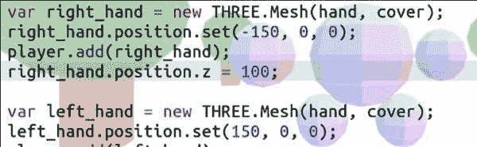

当 `z` 为 -100 时，手向后移动，以至于我们几乎看不到手在身体后面。

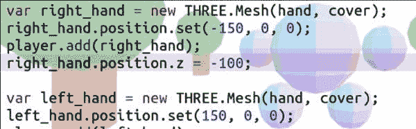

当你在 -100 和 100 之间来回改变 `position.z` 时，手就像在来回摆动。恭喜！你刚刚学会了一种著名的动画技术！

在某些游戏中，将物体从一个地方移动到另一个地方就足以让它看起来在移动。但在我们的游戏中，我们可以做得更好。

首先删除设置 `position.z` 的那一行。我们不想只设置一次。我们想要让它动起来。所以，删除那一行后，转到 `animate()` 函数。在第 4 章“项目：移动虚拟角色”（第 35 页）之后，我们已经实现了侧手翻和后空翻的动画。

```javascript
var is_cartwheeling = false;
var is_flipping = false;

function animate() {
  requestAnimationFrame(animate);
  if (is_cartwheeling) {
    avatar.rotation.z = avatar.rotation.z + 0.05;
  }
  if (is_flipping) {
    avatar.rotation.x = avatar.rotation.x + 0.05;
  }
  renderer.render(scene, camera);
}
animate();
```

我们的 `animate()` 函数中有很多内容。从第 5 章“函数：反复使用”（第 49 页）我们知道，这种“噪音”会让代码难以阅读。我们还要向 `animate()` 中添加更多内容。如果不采取措施，`animate()` 函数会变得非常非常庞大。

所以，让我们创建一个 `acrobatics()` 函数来处理后空翻和侧手翻。我们顺便把 `is_cartwheeling` 和 `is_flipping` 变量也移过去。然后我们可以在 `animate()` 中调用 `acrobatics()`，使代码更易读。

```javascript
function animate() {
  requestAnimationFrame(animate);
  acrobatics();
  renderer.render(scene, camera);
}
animate();

var is_cartwheeling = false;
var is_flipping = false;

function acrobatics() {
  if (is_cartwheeling) {
    avatar.rotation.z = avatar.rotation.z + 0.05;
  }
  if (is_flipping) {
    avatar.rotation.x = avatar.rotation.x + 0.05;
}
```

花时间确认一切正常。如果出了问题，请检查控制台！现在让我们向 `animate()` 函数中添加三东西。

```javascript
var clock = new THREE.Clock(true);

function animate() {
  requestAnimationFrame(animate);
  walk();
  acrobatics();
  renderer.render(scene, camera);
}
animate();

function walk() {
  var position = Math.sin(clock.getElapsedTime()) * 100;
  right_hand.position.z = position;
}
```

❶ 我们将这个 `Clock` 作为动画的计时器。
❷ 除了杂技，现在我们还要行走。
❸ 这是移动脚的函数。

正如你可能从名字中猜到的，`Math.sin()` 与数学有关。事实上它是一个神奇的函数，叫做正弦，有各种用途。这里我们利用了 `Math.sin()` 随时间生成一个介于 -1 和 1 之间的数字。将 100 乘以 `Math.sin()` 意味着 `position` 将介于 -100 和 100 之间的数字。在 JavaScript 中，`*` 用于乘法。

我们将在“深入理解 JavaScript”中进一步讨论数学运算。如果你正确输入了所有内容，你应该看到虚拟色的右手在来回抖动：

 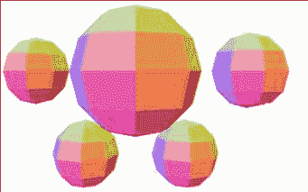

来回：

 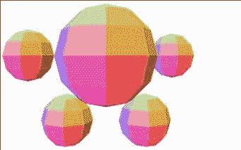

而且它应该移动得相当快。


**自己试试**尝试修改 `animate()` 中的数字。如果你把 10 改成 100，会发生什么？如果你把 100 改成 1000，会发生什么？尝试使用 `position.x` 或 `position.y` 代替 `position.z`。尝试使用 `position.y` 和 `position.z`。

  同时。

 一旦你对这些数字有了感觉，尝试另一只手  和脚。

### 6.3 同时摆动双手和脚

效果如何？你能让所有的手和脚都摆动吗？有没有遇到什么问题？如果你尝试以相同的方式移动手脚，你可能会注意到虚拟角色移动得非常奇怪。两只脚同时向前移动，然后两只手同时向后摆动。现实生活中没有人这样走路。当你走路时，一只脚在前，另一脚在后。用虚拟角色的术语来说，一只脚在 Z 正方向，另一只在 Z 负方向：

```javascript
var position = Math.sin(clock.getElapsedTime()) * 50; 
right_foot.position.z = - position; 
left_foot.position.z = position;
```

人们通常在左脚向前时移动右手。如果右手向前，那么左手应该向后。我们可以通过以下代码让虚拟角色做到：

```javascript
function walk() {
    var position = Math.sin(clock.getElapsedTime()) * 50; 
    right_hand.position.z = position; 
    left_hand.position.z = - position; 
    right_foot.position.z = - position; 
    left_foot.position.z = position;
}
```

这样，我们的手和脚就会以良好的行走姿态前后摆动

## 6.4 移动时行走

目前，我们的虚拟角色一直在行走——即使我们没有使用第 4 章“项目：移动虚拟角色”（第 35 页）中的控制键来控制它。让我们解决这个问题。

#### 准备

首先，我们在 `walk()` 函数中添加一行代码。

```javascript
function walk() {
    if (!isWalking()) return ; 
    var position = Math.sin(clock.getElapsedTime()) * 50; 
    right_hand.position.z = position; 
    left_hand.position.z = - position;
    right_foot.position.z = - position; 
    left_foot.position.z = position; 
}
```

你注意到函数的第一行了吗？这行代码的意思是，如果虚拟角色没有在行走，则立即从函数中返回。调用 `return` 意味着我们立即离开函数，并且函数中的其他代码都不会执行。也就是说，如果虚拟角色没有在行走，则离开 `walk()` 函数，不运行任何虚拟角色看起来在行走的代码。

如果你一直非常仔细地观察，可能会好奇那个 `isWalking()` 是什么。这是一个我们现在要编写的函数！

我们将在 `keydown` 事件监听器之前添加这段代码。

```javascript
var is_moving_right, is_moving_left, is_moving_forward, is_moving_back; 
function isWalking() { 
    if (is_moving_right) return true; 
    if (is_moving_left) return true; 
    if (is_moving_forward) return true; 
    if (is_moving_back) return true; 
    return false; 
}
```

```

<|channel>thought
<channel|>
本章中，我们不再绘制和移动形状，而是探索 JavaScript 编程语言。大部分操作可以在 JavaScript 控制台中完成，所以请先打开它。如果你不记得如何打开，请参考第 18 页的 2.2 节“打开和关闭 JavaScript 控制台”。有些我们要看的 JavaScript 代码对于控制台来说太大了。这时，我们需要在 ICE 代码编辑器中创建一个新项目。使用 3D 入门项目模板，并将其命名为“Just JavaScript”。


JavaScript 控制台中的代码。

本章开头只是介绍一些概念，所以在 JavaScript 控制台中操作是最简单的。一定要多尝试！

# 准备就绪

## 7.2 在 JavaScript 中描述事物

你有没有注意到我们是如何在 JavaScript 中引入新事物的？

```
// 你不需要输入这行代码：
var head_shape = new THREE.SphereGeometry(100);
```

`var`关键字在 JavaScript 中声明新事物。它告诉计算机和阅读代码的人：“准备好了——有新东西要来了！”

JavaScript 中有很多不同种类的事物。在你刚才看到的那一小段代码中，我们创建了一个新的 3D 球体形状。事物也可以是数字：

```javascript
var my_height = 1.5;
```

它们可以是文字：

```javascript
var title = "3D Game Programming for Kids";
```

程序员通常把引号内的内容称为字符串。这里的`title`是一个字符串，它保存了本书的书名。

### 字符串很容易出错

  一要记得关闭引号。如果忘记，你会遇到非常奇怪的错误，而且很难修复。


 它们可以是  布尔值： 

```javascript
var am_i_cool = true;
var am_i_dumb = false;
```

它们可以是表示“无意义”的：

```javascript
var i_mean_nothing = null;
var i_also_mean_nothing = undefined;
```


### 为什么用 `var`？`null` 和 `undefined` 是什么？

通常不需要担心`undefined`或`null`。创建这样的东西太大。如果你看到它们，通常是在函数中表示没有。`var`关键字是变量（`variable`）缩写。变量是可以改变的：

```javascript
var game = "started";
// 在这里做工作
game = "over";
```

一开始还没结束。然后，过段时间，游戏结束了。如果我们在`//`在这里做工作的位置，那段代码认为游戏仍在进行。

### 注释

双斜杠`//`表示注释。计算机知道它应该忽略`//`之后的所有内容。换句话，注释仅供人类阅读：

```javascript
// 返回今天的日期
var today = new Date();

// 这是 2013 年 1 月
jan = new Date(2013, 1, 1);
```


### 不需要输入

本书中的注释旨在提供有用的提示。不需要输入它们，但最好还是输入。当你以后修改代码时，注释会帮助你记住这样做。

### 7.3 改变事物

我们知道可以改变，但每种变量在 JavaScript 中如何呢？让我们逐一来看。你可以使用标准的数学符号在 JavaScript 中进行加减运算。在 JavaScript台中尝试以下操作：

```javascript
5 + 2;
10 - 9.5;
23 - 46;
```

你应该得到以下答案（在数学下方的注释中）：

```javascript
5 + 2; // 7
10 - 9.5; // 0.5
23 - 46; // -23
84 + -42; // 42
```

所以它甚至适用于负数。记住这一点；负数在我们处理 3D 图形时很有用。好了，加法在 JavaScript 中相当简单。乘法呢？大多数键盘上有加和减号，但没有×和÷。

乘法使用星号`*`字符：

```javascript
3 * 7; // 21
2 * 2.5; // 5
-2 * 4; // -8
7 * 6; // 42
```

除法使用斜杠`/`字符：

```javascript
45 / 9; // 5
100 / 8; // 12.5
84 / 2; // 42
```

关于数字，还有一点需要了解：当同时进行大量算术运算时，可以使用括号分组。括号内的数学运算总是计算：

```javascript
5 * (2 + 4); // 30
(5 * 2) + 4; // 14
```

没有括号会发生什么？你能猜出原因吗？[^1]

没有 没有括号时，先做乘法，再做除法。还记得数学课上的“运算顺序”吗！

### 几何

本书涉及 3D 游戏概念意味着几何。我们将在需要几何知识的各个章节中详细讨论。现在，我们先考虑两个函数：正弦和余弦。如果你不了解它们，别担心你会在游戏中逐渐熟悉它们。

记住，在 JavaScript 中，我们不使用度，而是使用弧度。什么是弧度？当我们绕圆旋转半圈时，我们不说转了 180°，而是转了弧度。

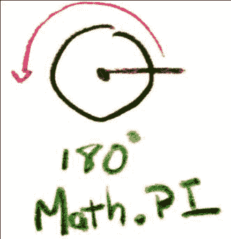

π是数学中的特殊数字。它的值大约是3.14159。你经常会看到符号π表示π。我们称之为 pi，因为 JavaScript 中叫它`Math.PI`。

绕圆一整圈是180°旋转的两倍——通常称为360°旋转，即2π弧度，或2×π。

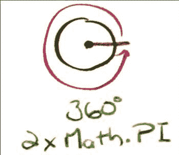

顺便说一下，2×π就是我们之前在第6 页“用立方体形状制作盒子”中首次讨论旋转时提到的完整旋转的6.3。因为π的数值大约是3.15，所以2×π就是2×3.15，即6.3。


在 JavaScript 中，π被称为`Math.PI`。所以360°就是`2 * Math.PI`。下面是一个方便的换算表：

| 度数 | 弧度 | JavaScript |
|------|------|------------|
| 0°   | 0    | 0          |
| 45°  | π ÷ 4 | `Math.PI/4` |
| 90°  | π ÷ 2 | `Math.PI/2` |
| 180° | π    | `Math.PI`   |
| 360° | 2 × π | `2 * Math.PI` |
| 720° | 4 × π | `4 * Math.PI` |

`Math.sin`和`Math.cos`也可以在`Math`模块中找到。例如我们在第59 页看到的正弦和余弦分别简写为`sin`和`cos`：

```javascript
sin(0);       // 0
sin(2 * Math.PI); // 0
cos(0);       // 1
```

### 非常接近零

 根据计算机，当你在控制台中尝试`Math.sin(2 * Math.PI)`时，可能没有得到正确的答案。2π的正弦是零，但你可能会看到类似`-2.4499276856198976e-16`的结果。这表明计算机并不完美。有时计算可能会有微小的误差。 末尾的`-2.4499276856198976e-16`表示这是一个非常小的数字。

### 布尔值

布尔值没什么复杂的。要么是`true`，要么是`false`。可以使用运算符来转换布尔值。在 JavaScript 中，感叹号`!`就是非运算符：

```javascript
var yes = true;
var the_opposite = !yes; // false
the_opposite_of_opposite = !!yes; // true
```

我们不会经常这样直接使用布尔值。通常会看到比较运算符：

```javascript
// The > symbol checks for values greater
var is_greater_than_six = 10 > 6;
is_greater_than_six; // true
```

```javascript
// Two equal signs check if values are equal
var is_twelve_same_as_eleven = 12 == 11;
is_twelve_same_as_eleven; // false
```

### 双等号 vs. 单等号

 JavaScript中的双等号`==`用于检查某个值等于另一个值。它不会改变任何东西——只检查值并产生布尔值。正如我们在书中看到的，单等号=`使一个值等于另一个值。通常称为赋值运算符，单等号确实会改变一个值——它更新一个变量。你可能会想，让两个不同的运算符看起来相似是否明智。并不明智。这是一个非常常见的错误——即使对于编程多年的人来说如此。由于它已经存在了很长时间，可能不会改变。所以要警惕这类错误。

### 7.4 使用 while 和 if 重复和跳过代码

通常，JavaScript 代码是从上下运行的。程序顶部的代码行首先运行。一旦计算机运行完这些行，就会继续执行下一行。这个过程一直持续到程序的底部。但有时我们并不希望所有代码都运行。其他时候我们希望代码运行多次。在这些情况下，我们使用控制关键字。本书中最常见的关键字是`while`和`if`。

 在 ICE 中编写代码，在控制台中检查本章剩余部分对于 JavaScript 控制台来说太大了，所以请在 ICE 中将其添加到 CODING 行之后。确保保持 控制台打开——即使我们没有在那里输入代码，我们仍然用它来显示消息。

### While

如果一段代码（我们称之为块）以`while`开头，那么该块会反复运行，直到某个条件发生变化。需要变化的条件放在`while`关键字后面的括号中：

```javascript
var i = 0;
while (i < 5) {
    console.log("i is now:" + i);
    i = i + 1;
}
```

如果你尝试这个并在 JavaScript台中检查，你会看到类似下面的内容：

```i is now: 0
i is now: 1
i is now: 2
i is now: 3
i is now: 4
```

每次执行代码块时，我们都会将变量`i`记录到 JavaScript 控制台。我们还进行了一点数学运算。我们将`i`的旧值加1。然后计算机将再次运行`while`块——只要`i`小于5（`<`符号表示小于）。一旦`i`等于5，计算机就会停止重新运行`while`块，并继续执行后续行。

自己试试   如果你运行以下代码会发生什么？


```javascript
var i = 0;
while (i < 5) {
    console.log("The answer to 7 + 4 is " + i);
    i = i + 4;
}
```

### 字符串

JavaScript中的字符串有点无聊。只能将两个字符串连接成更大的字符串。有趣的是，加运算符用来连接它们的：

```javascript
var str1 = "Howdy";
var str2 = "Bob";
str1 + str2; // "Howdy Bob"
```

### 7.5 列出事物

有时能够描述一个事物列表非常方便。在 JavaScript 中，列表使用方括号创建。一个精彩电影的列表可能如下：

```javascript
var amazing_movies = [
    'Star Wars',
    'The Empire Strikes Back',
    'Indiana Jones and the Raiders of the Lost Ark'
];
```

列表中的事物可以是到目前我们讨论过的任何类型：字符串、数字、布尔值。甚至可以创建一个包含各种类型事物的列表：

```javascript
// Don't do this:
var useless_list = [
    true, 3.14, 'OK'
];
```

[^1]: 没有括号时，先做乘法，再做除法。还记得数学课上的“运算顺序”吗！
助助助助助助助助助助助助助助助助助助助助助助助助助助助助助助助助助助助助助助助助助助助助助助助助助助助助助助助助助助助助助助助助助助助助助助助助助助助助助助助助助助助助助助助助助助助助助助助助助助助助助助助助助助助助助助助助助助助助助助助助助助助助助助助助助助助助助助助助助助助助助助助助助助助助助助助助助助助助助助助助助助助助助助助助助助助助助助助助助助助助助助助助助助助助助助助助助助助助助助助助助助助助助助助助助助助助助助助助助助助助助助助助助助助助助助助助助助助助助助助助助助助助助助助助助助助助助助助助助助助助助助助助助助助助助助助助助助助助助助助助助助助助助助助助助助助助助助助助助助助助助助助助助助助助助助助助助助助助助助助助助助助助助助助助助助助助助助助助助助助助助助助助助助助助助助助助助助助助助助助助助助助助助助助助助助助助助助助助助助助助助助助助助助助助助助助助助助助助助助助助助助助助助助助助助助助助助助助助助助助助助助助助助助助助助助助助助助助助助助助助助助助助助助助助助助助助助助助助助助助助助助助助助助助助助助助助助助助助助助助助助助助助助助助助助助助助助助助助助助助助助助助助助助助助助助助助助助助助助助助助助助助助助助助助助助助助助助助助助助助助助助助助助助助助助助助助助助助助助助助助助助助助助助助助助助助助助助助助助助助助助助助助助助助助助助助助助助助助助助助助助助助助助助助助助助助助助助助助助助助助助助助助助助助助助助助助助助助助助助助助助助助助助助助助助助助助助助助助助助助助助助助助助助助助助助助助助助助助助助助助助助助助助助助助助助助助助助助助助助助助助助助助助助助助助助助助助助助助助助助助助助助助助助助助助助助助助助助助助助助助助助助助助助助助助助助助助助助助助助助助助助助助助助助助助助助助助助助助助助助助助助助助助助助助助助助助助助助助助助助助助助助助助助助助助助助助助助助助助助助助助助助助助助助助助助助助助助助助助助助助助助助助助助助助助助助助助助助助助助助助助助助助助助助助助助助助助助助助助助助助助助助助助助助助助助助助助助助助助助助助助助助助助助助助助助助助助助助助助助助助助助助助助助助助助助助助助助助助助助助助助助助助助助助助助助助助助助助助助助助助助助助助助助助助助助助助助助助助助助助助助助助助助助助助助助助助助助助助助助助助助助助助助助助助助助助助助助助助助助助助助助助助助助助助助助助助助助助助助助助助助助助助助助助助助助助助助助助助助助助助助助助助助助助助助助助助助助助助助助助助助助助助助助助助助助助助助助助助助助助助助助助助助助助助助助助助助助助助助助助助助助助助助助助助助助助助助助助助助助助助助助助助助助助助助助助助助助助助助助助助助助助助助助助助助助助助助助助助助助助助助助助助助助助助助助助助助助助助助助助助助助助助助助助助助助助助助助助助助助助助助助助助助助助助助助助助助助助助助助助助助助助助助助助助助助助助助助助助助助助助助助助助助助助助助助助助助助助助助助助助助助助助助助助助助助助助助助助助助助助助助助助助助助助助助助助助助助助助助助助助助助助助助助助助助助助助助助助助助助助助助助助助助助助助助助助助助助助助助助助助助助助助助助助助助助助助助助助助助助助助助助助助助助助助助助助助助助助助助助助助助助助助助助助助助助助助助助助助助助助助助助助助助助助助助助助助助助助助助助助助助助助助助助助助助助助助助助助助助助助助助助助助助助助助助助助助助助助助助助助助助助助助助助助助助助助助助助助助助助助助助助助助助助助助助助助助助助助助助助助助助助助助助助助助助助助助助助助助助助助助助助助助助助助助助助助助助助助助助助助助助助助助助助助助助助助助助助助助助助助助助助助助助助助助助助助助助助助助助助助助助助助助助助助助助助助助助助助助助助助助助助助助助助助助助助助助助助助助助助助助助助助助助助助助助助助助助助助助助助助助助助助助助助助助助助助助助助助助助助助助助助助助助助助助助助助助助助助助助助助助助助助助助助助助助助助助助助助助助助助助助助助助助助助助助助助助助助助助助助助助助助助助助助助助助助助助助助助助助助助助助助助助助助助助助助助助助助助助助助助助助助助助助助助助助助助助助助助助助助助助助助助助助助助助助助助助助助助助助助助助助助助助助助助助助助助助助助助助助助助助助助助助助助助助助助助助助助助助助助助助助助助助助助助助助助助助助助助助助助助助助助助助助助助助助助助助助助助助助助助助助助助助助助助助助助助助助助助助助助助助助助助助助助助助助助助助助助助助助助助助助助助助助助助助助助助助助助助助助助助助助助助助助助助助助助助助助助助助助助助助助助助助助助助助助助助助助助助助助助助助助助助助助助助助助助助助助助助助助助助助助助助助助助助助助助助助助助助助助助助助助助助助助助助助助助助助助助助助助助助助助助助助助助助助助助助助助助助助助助助助助助助助助助助助助助助助助助助助助助助助助助助助助助助助助助助助助助助助助助助助助助助助助助助助助助助助助助助助助助助助助助助助助助助助助助助助助助助助助助助助助助助助助助助助助助助助助助助助助助助助助助助助助助助助助助助助助助助助助助助助助助助助助助助助助助助助助助助助助助助助助助助助助助助助助助助助助助助助助助助助助助助助助助助助助助助助助助助助助助助助助助助助助助助助助助助助助助助助助助助助助助助助助助助助助助助助助助助助助助助助助助助助助助助助助助助助助助助助助助助助助助助助助助助助助助助助助助助助助助助助助助助助助助助助助助助助助助助助助助助助助助助助助助助助助助助助助助助助助助助助助助助助助助助助助助助助助助助助助助助助助助助助助助助助助助助助助助助助助助助助助助助助助助助助助助助助助助助助助助助助助助助助助助助助助助助助助助助助助助助助助助助助助助助助助助助助助助助助助助助助助助助助助助助助助助助助助助助助助助助助助助助助助助助助助助助助助助助助助助助助助助助助助助助助助助助助助助助助助助助助助助助助助助助助助助助助助助助助助助助助助助助助助助助助助助助助助助助助助助助助助助助助助助助助助助助助助助助助助助助助助助助助助助助助助助助助助助助助助助助助助助助助助助助助助助助助助助助助助助助助助助助助助助助助助助助助助助助助助助助助助助助助助助助助助助助助助助助助助助助助助助助助助助助助助助助助助助助助助助助助助助助助助助助助助助助助助助助助助助助助助助助助助助助助助助助助助助助助助助助助助助助助助助助助助助助助助助助助助助助助助助助助助助助助助助助助助助助助助助助助助助助助助助助助助助助助助助助助助助助助助助助助助助助助助助助助助助助助助助助助助助助助助助助助助助助助助助助助助助助助助助助助助助助助助助助助助助助助助助助助助助助助助助助助助助助助助助助助助助助助助助助助助助助助助助助助助助助助助助助助助助助助助助助助助助助助助助助助助助助助助助助助助助助助助助助助助助助助助助助助助助助助助助助助助助助助助助助助助助助助助助助助助助助助助助助助助助助助助助助助助助助助助助助助助助助助助助助助助助助助助助助助助助助助助助助助助助助助助助助助助助助助助助助助助助助助助助助助助助助助助助助助助助助助助助助助助助助助助助助助助助助助助助助助助助助助助助助助助助助助助助助助助助助助助助助助助助助助助助助助助助助助助助助助助助助助助助助助助助助助助助助助助助助助助助助助助助助助助助助助助助助助助助助助助助助助助助助助助助助助助助助助助助助助助助助助助助助助助助助助助助助助助助助助助助助助助助助助助助助助助助助助助助助助助助助助助助助助助助助助助助助助助助助助助助助助助助助助助助助助助助助助助助助助助助助助助助助助助助助助助助助助助助助助助助助助助助助助助助助助助助助助助助助助助助助助助助助助助助助助助助助助助助助助助助助助助助助助助助助助助助助助助助助助助助助助助助助助助助助助助助助助助助助助助助助助助助助助助助助助助助助助助助助助助助助助助助助助助助助助助助助助助助助助助助助助助助助助助助助助助助助助助助助助助助助助助助助助助助助助助助助助助助助助助助助助助助助助助助助助助助助助助助助助助助助助助助助助助助助助助助助助助助助助助助助助助助助助助助助助助助助助助助助助助助助助助助助助助助助助助助助助助助助助助助助助助助助助助助助助助助助助助助助助助助助助助助助助助助助助助助助助助助助助助助助助助助助助助助助助助助助助助助助助助助助助助助助助助助助助助助助助助助助助助助助助助助助助助助助助助助助助助助助助助助助助助助助助助助助助助助助助助助助助助助助助助助助助助助助助助助助助助助助助助助助助助助助助助助助助助助助助助助助助助助助助助助助助助助助助助助助助助助助助助助助助助助助助助助助助助助助助助助助助助助助助助助助助助助助助助助助助助助助助助助助助助助助助助助助助助助助助助助助助助助助助助助助助助助助助助助助助助助助助助助助助助助助助助助助助助助助助助助助助助助助助助助助助助助助助助助助助助助助助助助助助助助助助助助助助助助助助助助助助助助助助助助助助助助助助助助助助助助助助助助助助助助助助助助助助助助助助助助助助助助助助助助助助助助助助助助助助助助助助助助助助助助助助助助助助助助助助助助助助助助助助助助助助助助助助助助助助助助助助助助助助助助助助助助助助助助助助助助助助助助助助助助助助助助助助助助助助助助助助助助助助助助助助助助助助助助助助助助助助助助助助助助助助助助助助助助助助助助助助助助助助助助助助助助助助助助助助助助助助助助助助助助助助助助助助助助助助助助助助助助助助助助助助助助助助助助助助助助助助助助助助助助助助助助助助助助助助助助助助助助助助助助助助助助助助助助助助助助助助助助助助助助助助助助助助助助助助助助助助助助助助助助助助助助助助助助助助助助助助助助助助助助助助助助助助助助助助助助助助助助助助助助助助助助助助助助助助助助助助助助助助助助助助助助助助助助助助助助助助助助助助助助助助助助助助助助助助助助助助助助助助助助助助助助助助助助助助助助助助助助助助助助助助助助助助助助助助助助助助助助助助助助助助助助助助助助助助助助助助助助助助助助助助助助助助助助助助助助助助助助助助助助助助助助助助助助助助助助助助助助助助助助助助助助助助助助助助助助助助助助助助助助助助助助助助助助助助助助助助助助助助助助助助助助助助助助助助助助助助助助助助助助助助助助助助助助助助助助助助助助助助助助助助助助助助助助助助助助助助助助助助助助助助助助助助助助助助助助助助助助助助助助助助助助助助助助助助助助助助助助助助助助助助助助助助助助助助助助助助助助助助助助助助助助助助助助助助助助助助助助助助助助助助助助助助助助助助助助助助助助助助助助助助助助助助助助助助助助助助助助助助助助助助助助助助助助助助助助助助助助助助助助助助助助助助助助助助助助助助助助助助助助助助助助助助助助助助助助助助助助助助助助助助助助助助助助助助助助助助助助助助助助助助助助助助助助助助助助助助助助助助助助助助助助助助助助助助助助助助助助助助助助助助助助助助助助助助助助助助助助助助助助助助助助助助助助助助助助助助助助助助助助助助助助助助助助助助助助助助助助助助助助助助助助助助助助助助助助助助助助助助助助助助助助助助助助助助助助助助助助助助助助助助助助助助助助助助助助助助助助助助助助助助助助助助助助助助助助助助助助助助助助助助助助助助助助助助助助助助助助助助助助助助助助助助助助助助助助助助助助助助助助助助助助助助助助助助助助助助助助助助助助助助助助助助助助助助助助助助助助助助助助助助助助助助助助助助助助助助助助助助助助助助助助助助助助助助助助助助助助助助助助助助助助助助助助助助助助助助助助助助助助助助助助助助助助助助助助助助助助助助助助助助助助助助助助助助助助助助助助助助助助助助助助助助助助助助


但不要这样做。这很愚蠢。就像在现实生活中一样，计算机列表应该包含相同类型的事物。在购物清单上包含你最喜欢的颜色、朋友过来的时间或昨晚比赛的得分是没有意义的。在商店购买物品的清单应该只包含商店里有的物品。

使用列表的方法有很多，但我们在本书中最常用的是为列表中的每个项目调用一个函数：

```javascript
var amazing_movies = [
    'Star Wars' ,
    'The Empire Strikes Back' ,
    'Indiana Jones and the Raiders of the Lost Ark'
] ;

amazing_movies.forEach( function (movie) {
    console.log("GREAT: " + movie);
}) ;
```

将`forEach()` 函数视为一种方式，表示对于列表中的“每个”事物：

- 给它一个昵称——在前面的代码中我们称之为`movie`
- 在函数内部对其进行操作——我们将其记录为 `"GREAT"`

如果你输入这段代码并查看 JavaScript 控制台，你会得到如下输出：

GREAT: Star Wars

GREAT: The Empire Strikes Back

GREAT: Indiana Jones and the Raiders of the Lost Ark

我们将在后续的一些章节中再次看到列表。

### 7.6 JavaScript 的独特之处

JavaScript 与许多其他语言不同，但对我们来说最重要的是它被设计为在浏览器中运行。这意味着它可以非常轻松地完成许多网页相关的工作。正如我们在第 4 章《项目：移动角色》（第 35 页）中看到的，JavaScript 可以打开浏览器警告对话框：

```javascript
alert('Stop what you are doing and shout "Yay!"');
```

JavaScript 也非常擅长修改网页内容。虽然本书中不会大量涉及网页修改，但在某些游戏制作计分板时我们会讨论这个话题。

### 7.7 下一步

本章包含大量信息。如果有些内容暂时不理解，不必担心。当你学习后续章节时，如果遇到问题可以回到这里查阅。随着学习的深入，你会逐渐理解这些内容。

我们在这里介绍的基础知识就像是 JavaScript 语言的名词。我们在第 5 章《函数：反复使用》（第 49 页）中看到的函数则像是动词——它们告诉基础知识需要做什么才能让事情发生。说到让事情发生，让我们回到为角色添加酷炫功能的工作中！

完成本章后，你将能够：

- 掌握更多用于 3D 编程的有趣数学知识
- 知道如何旋转物体使其朝向特定方向
- 能够制作平滑的动画

# 第 8 章 项目：旋转我们的角色

我们的角色动画已接近完成。在第 4 章《项目：移动角色》（第 35 页）中，我们学会了如何让角色移动。在第 6 章《项目：移动手脚》（第 59 页）中，我们让角色看起来像是在行走。现在我们需要让角色在切换方向时能够转向。转向（或旋转）对我们来说并不陌生——我们在翻转和侧翻时已经让角色旋转过。但这次我们希望角色朝向特定的方向。

### 8.1 开始

如果尚未在 ICE 代码编辑器中打开，请打开我们命名为“我的角色：移动手脚”的项目（来自《项目：移动手脚》）。点击菜单按钮，选择“制作副本”，将其复制一份。将项目命名为“我的角色：转向”，然后点击“保存”按钮。

### 8.2 朝向正确的方向

让角色朝向正确的方向相当简单——尤其是我们已经掌握了这么多知识。就像我们添加手脚行走动作时一样，我们将编写一个新函数来旋转角色。我们将这个函数命名为`turn()`，因此在`animate()` 函数中添加对该函数的调用。

```javascript
function animate() {
    requestAnimationFrame(animate);
    walk(); 
    turn();
    acrobatics();
    renderer.render(scene, camera);
} 
animate();
```

接下来编写`turn()` 函数。JavaScript 不关心你将这个函数放在哪里，但由于我们在 `animate()` 函数中是在 `walk()` 之后调用它，我们不妨将其放在 `walk()` 函数之后。在 `walk()` 函数的右花括号后面输入以下内容：

```javascript
function turn() {
    var direction = 0; 
    if (is_moving_forward) direction = Math.PI; 
    if (is_moving_back) direction = 0; 
    if (is_moving_right) direction = Math.PI/2; 
    if (is_moving_left) direction = -Math.PI/2;
    avatar.rotation.y = direction; 
}
```

这样一来，当我们向左或向右行走时，角色就会面向它移动的方向：

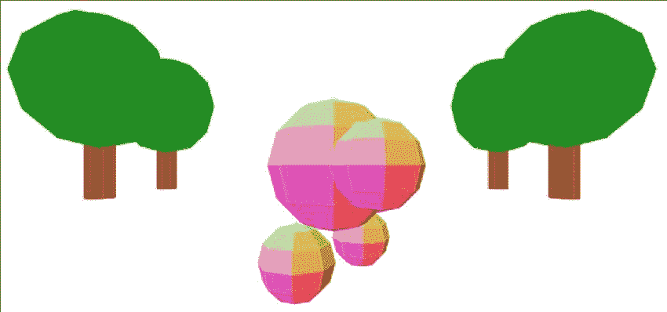

这真是太棒了。你现在已经制作了一个复杂的游戏角色。想想你完成了什么：

- 为角色赋予了身体、手和脚
- 让角色移动时所有部件随之移动
- 让角色能够侧翻和翻转
- 将摄像机固定在角色上
- 将摄像机固定在角色的位置上，这样翻转和侧翻就不会让我们头晕
- 让角色行走时手脚前后摆动
- 让角色停止移动时手脚也停止摆动
- 让角色面向它行走的方向

### 分解说明

这是非常了不起的 JavaScript 3D 编程。你能走到这一步已经很棒了，但我们还能做得更多。首先，让我们仔细看看 `turn()` 函数，确保我们理解其中的原理。

## 8.3 分解说明

在 `turn()` 函数中，为什么我们将 `direction` 设置为 `Math.PI` 和 `-Math.PI/2` 这样的值？回想一下第 71 页《几何学》部分，角度（旋转量）使用的是弧度而非度数。角色初始时朝后方，0° 对应 0 弧度；180° 对应 π 弧度。

下表是我们在 `turn()` 函数中使用的完整列表：

| 方向 | 度数 | JavaScript | 弧度 |
| :--- | :--- | :--- | :--- |
| 前方 | 180° | `Math.PI` | π |
| 右方 | 90° | `Math.PI/2` | π ÷ 2 |
| 左方 | -90° | `-Math.PI/2` | -π ÷ 2 |
| 后方 | 0° | `0` | 0 |

### 为什么是 `rotation.y`？

`turn()` 函数中为 `direction` 变量使用的数值，为什么设置的是 `rotation.y` 而不是 `rotation.z` 或 `rotation.x`？原因之一，我们在做侧翻时改变了 `rotation.x`，在翻转时改变了 `rotation.z`。我们设置 `rotation.y` 是因为我们希望绕 y 轴旋转。回想一下，在 3D 中，y 轴是上下方向。


让角色绕这杆子旋转，就是绕 y 轴。

### 别忘了 `avatar.rotation`

如果你尝试旋转 `marker.rotation` 而不是 `avatar.rotation`，可能会注意到不仅角色旋转了，其他东西也跟着旋转了。这是因为我们将摄像机附加到了标记上：

```javascript
var marker = new THREE.Object3D();
scene.add(marker);
marker.add(camera);
```

把 `marker` 想象成一个容纳角色的盒子。通过将摄像机添加到 `marker` 上，我们把它固定在了侧。如果我们旋转这个盒子，摄像机也跟着转：


这也是为什么我们将手脚添加到头部而不是 `marker` 上。当我们在 `marker` 内部旋转时，它的手脚需要随之移动——与 `marker` 静止。

## 8.4 动画化旋转

目前，当我们旋转角色时，它会立即面向新方向。让我们通过动画化转向的过程，使其更逼真。为此，我们需要一个新的 JavaScript 库。这个库将帮助实现不同位置和旋转之间的动画。这个库叫做 `Tween`。

为此，转到代码顶部。添加 `Tween.js` 的 `<script>` 标签：

```html
<body>
<script src="http://gamingJS.com/Three.js"></script>
<script src="http://gamingJS.com/Tween.js"></script>
<script src="http://gamingJS.com/ChromeFixes.js"></script>
</body>
```

### 动画化旋转

`Tween` 库用于在起始状态和结束状态之间进行动画过渡。我们希望从一个旋转角度动画到另一个旋转角度。使用 `Tween` 的第一步是将 `update()` 函数添加到我们的 `animate()` 函数中：

```javascript
function animate() {
    requestAnimationFrame(animate); 
    TWEEN.update();
    walk(); 
    turn();
    acrobatics();
    renderer.render(scene, camera);
} 
animate();
```

接下来，我们需要修改刚刚编写的 `turn()` 函数。不再立即设置方向，而是调用一个新函数，该函数将使角色旋转到新方向。将 `turn()` 函数的最后一行改为调用 `spinAvatar()`：

```javascript
function turn() {
    var direction = 0; 
    if (is_moving_forward) direction = Math.PI;
    if (is_moving_back) direction = 0; 
    if (is_moving_right) direction = Math.PI/2; 
    if (is_moving_left) direction = -Math.PI/2;
    spinAvatar(direction);
}
```

最后，我们需要编写 `spinAvatar()` 函数的代码。Tween 代码初看有些奇怪。阅读时请记住，我们希望从角色头部当前面对的方向（`avatar.rotation.y`）开始旋转，最终旋转到传入 `spinAvatar()` 作为 `direction` 参数的新方向。

```javascript
function spinAvatar(direction) {
  new TWEEN.Tween({y: avatar.rotation.y})
    .to({y: direction}, 100)
    .onUpdate(function () {
      avatar.rotation.y = this.y;
    })
    .start();
}
```

从上到下阅读该函数，新的 `Tween` 从 Y 旋转值 `avatar.rotation.y` 开始——即角色当前面对的方向。然后我们告诉 `Tween` 要旋转到传入 `spinAvatar()` 函数的新 Y 旋转值。每次动画运行时，都会执行 `onUpdate()` 中的内容。角色头部的旋转会更新为 Tween 的 Y 旋转值。最后一行启动整个过程。

该函数中每行末尾的句点表示方法链。在 JavaScript 中，分号结束一段代码“句子”。方法链仅适用于某些对象，如 `Tween`。


`Tween` 库它将在 100 毫秒内从开始到结束。这个数字位于 `to` 方法末尾。


1000 毫秒等于 1 秒。

### 8.5 到目前为止

如果你想对本章的代码，请参阅第 26 页的《项目：旋转我们的角色》。

### 8.6 下一步

哇！简单的角色已经变得复杂了，吗？我们已经为角色投入了不少精力。在下一个章节中，我们将讨论碰撞检测，并用它来让角色在撞到物体时停下来。

首先，让我们仔细看看项目时自动添加的所有 JavaScript 代码。当你完成本章后，你将：

- 了解一些关于网页的知识
- 理解起始代码
- 能够修改起始代码

# 第 9 章 所有的代码都是什么？

当我们从起始模板创建项目时，里面已经有很多代码。在本章中，我们将了解它们都是什么。

### 9.1 开始

在 ICE 代码编辑器中从起始模板创建一个项目。将其命名为“所有的代码”。

### 9.2 HTML快速入门

代码的最顶部是以下 HTML：

```html
<body></body>
```

HTML 不是一种编程语言。那么为什么出现在 JavaScript 代码中呢？HTML 是超文本标记语言。它用于构建网页。尽管它不是编程语言，但我们仍然需要 HTML 来运行 JavaScript。由于 JavaScript 是一种 Web 语言，我们需要一个简单的页面。

第一行包含开始和结束的 `<body>` 标签。在这两个标签之间，HTML 通常会放置文字——指向图片的链接。我们不在里面放任何东西，因为我们是在编程。

为了了解 HTML 的作用，在两个 `<body>` 标签之间添加以下 HTML，如下所示：

```html
<body>
  <h1>你好！</h1>
  <p>
    你可以制作<b>粗体</b>文字、
    <i>斜体</i>文字，甚至
    <u>下划线</u>文字。
  </p>
  <p>
    你可以链接到<a href="http://gamingJS.com">页面</a>。你还可以添加来自服务器的图片：
    
  </p>
</body>
```

 忽略 HTML 的警告

 你的 HTML 代码可能会出现红色警告。这些可以安全地

 忽略。ICE 是用来编辑 JavaScript 的而不是 HTML，所以它可能会混淆。

 如果你在 ICE 代码编辑器中隐藏代码，你会看到类似的内容：

  这是一本关于 JavaScript 的书，而不是 HTML 的书，但你已经看到了 HTML 的一些可能性。


在 `<body>` 标签之后是两个 `<script>` 标签。与 `<body>` 标签一样，这些 `<script>` 标签也是 HTML，但它们从网络地方加载 JavaScript，以便我们可以在当前页面中使用。

```html
<script src="http://gamingJS.com/Three.js"></script>
<script src="http://gamingJS.com/ChromeFixes.js"></script>
```

这两行告诉浏览器加载两个库。这里，我们加载了一个名为 `Three.js` 的 3D JavaScript 库，以及一个修复 Chrome 浏览器中 ICE 代码编辑器错误的小型库。

JavaScript 不一定来自位置。在本书的大部分内容中，我们都是在 HTML 网页内部编写代码。

### 9.3 设置场景

要在 3D 编程中做任何事情，我们需要一个场景。将场景视为所有动作发生的宇宙。对于如此重要的东西，创建起来却非常简单。ICE 中的以下代码就做到了这一点：

```javascript
// 这是游戏中所有事情发生的地方：
var scene = new THREE.Scene();
```

场景使用起来非常简单。我们在整本书中一直在向场景中添加对象。一旦对象被添加到场景中，场景就负责跟踪所有内容。事实上，这就是我们需要了解的场景的全部内容——创建场景后，我们向其中添加大量对象，场景会处理其余的事情。

### 9.4 使用摄像机捕捉场景

场景在跟踪所有内容方面做得很好，但它们不会向我们展示发生了什么。要看到场景中的任何东西，我们需要一个摄像机。注意 ICE 中的以下代码：


```
// 这是看到所有东西的东西：
var aspect_ratio = window.innerWidth / window.innerHeight;
var camera = new THREE.PerspectiveCamera(75, aspect_ratio, 1, 10000);
camera.position.z = 500;
scene.add(camera);
```

`aspect_ratio` 的目的是确定浏览器的形状。这与电影屏幕和电视机的宽高比是同一个概念。一个宽高比为 4:3 的大电视可能宽 4 米，高 3 米（好吧，那真是一台非常大的电视）。一个更大的 4:3 屏幕可能宽 12 米，高 9 米（将 4:3 中的 4 和 3 都乘以 3 得到 12:9）。如今大多数电影都以 16:9 的宽高比制作，这意味着一个 9 米高的屏幕宽 16 米——与相同高度的 4:3 宽高比相比，多了 4 米。

这对我们来说为什么重要？如果你试图将一部 16:9 的电影投影到 4:3 的屏幕上，就需要进行大量压缩。同样，一部 4:3 的电影需要在 16:9 的屏幕上拉伸才能显示。大多数电影不会拉伸或压缩，而是被裁剪，这样你就会错过那 4 米的动作。我们的`Three.js`库不会裁剪——它会拉伸或压缩。换句话说，正确设置宽高比非常重要。

当我们构建好一个新相机后，需要将其添加到场景中。与 3D 编程中的其他元素一样，相机默认位于我们添加它的场景中心。我们将其沿 Z 轴方向（即屏幕“向外”方向）移动 500 个单位，以便能够清晰地观察场景中心发生的情况。

### 9.5 使用渲染器投射相机所见的画面

场景和相机足以描述场景的外观以及我们从何处观察，但要在网页上显示它，还需要一个额外的步骤。这就是渲染器的工作。它负责显示（或渲染）相机所见的场景：

```
// This will draw what the camera sees onto the screen:
var renderer = new THREE.CanvasRenderer();
renderer.setSize(window.innerWidth, window.innerHeight);
document.body.appendChild(renderer.domElement);
```

我们必须告诉渲染器它将要绘制的屏幕尺寸。我们将视图大小设置为占据整个浏览器窗口（`window.innerWidth` 和 `window.innerHeight`）。

要将渲染器包含在网页中，我们使用它的 `domElement` 属性。`domElement` 是 HTML 标签的另一种称呼，就像本章前面添加的那些标签一样。不过，这个 `domElement` 承载的不是标题或段落，而是我们精彩的 3D 世界。

我们将这个 `domElement` 添加到 `document.body` 中——也就是之前存放 HTML 的同一个 `<<body>` 标签。`appendChild()` 函数负责将 `domElement` 添加到文档主体中。如果你好奇为什么会有像 `appendChild()` 和 `domElement` 这样的名称，我只能告诉你，庆幸自己是一名 3D 游戏程序员，而不是 Web 程序员。Web 程序员不得不一直使用这种愚蠢（且难记）的名称。

此时，渲染器已经可以绘制到屏幕上了，但我们仍然需要告诉它进行渲染，否则什么都不会显示。这就是为什么在代码末尾要使用 `renderer.render()`。

```
// Now, show what the camera sees on the screen:
renderer.render(scene, camera);
```

渲染器可能像一个烦人的弟弟或妹妹，只有当我们给出极其明确的指令时才会做正确的事情。从某种意义上说确实如此，但从另一种意义上说，所有编程都是这样。除非我们以完全正确的方式告诉计算机该做什么，否则它常常会做出完全出乎意料的事情。

### 9.6 探索不同的相机和渲染器

就渲染器而言，我们已经可以看出拥有这种控制权的好处。在某些实验中，我们只渲染一次。但在许多项目中，我们会在 `animate()` 函数内重复渲染。如果没有这种控制，挑选合适的渲染风格就会困难得多。

你可能已经注意到，我们将相机称为 `PerspectiveCamera`，将渲染器称为 `CanvasRenderer`。如果这些名称显得过于具体，那是因为还有其他类型的相机和渲染器。我们一直使用这些，是因为大多数浏览器和硬件都支持它们。正如我们将在第 12 章《灯光与材质》（第 109 页）中看到的，一些我们可能想添加到 3D 游戏中的酷炫效果需要不同的相机和渲染器，而这些只能在相对较新的计算机上运行。


**你不必亲自运行这些示例**

有些计算机可能无法运行本章剩余部分的示例。这是因为它们依赖于一种名为 WebGL 的技术，我们将在第 12 章《灯光与材质》（第 109 页）中更详细地讨论。由于你的计算机可能不支持 WebGL，因此你不必在 ICE 代码编辑器中跟着本节操作。

### 介绍 WebGL 渲染器

另一个渲染器是 `WebGLRenderer`。它的使用方式与 `CanvasRenderer` 完全相同。我们只需要更改名称：

```
// This will draw what the camera sees onto the screen:
var renderer = new THREE.WebGLRenderer();
renderer.setSize(window.innerWidth, window.innerHeight);
document.body.appendChild(renderer.domElement);
```

WebGL 是一项相当新的技术，它允许程序员实现有趣的 3D 编程技术，如光照、阴影和雾效。它的动画运行速度也远快于 `CanvasRenderer`。我们将在《灯光与材质》中进一步探讨。

### 快速了解一个名称古怪的相机

另一种相机称为正交相机。为了理解正交相机的作用，我们可以添加一条红色道路，让紫色怪物在上面行走。在“下一行编码”之后添加以下代码：

```
var shape = new THREE.CubeGeometry(200, 1000, 10);
var cover = new THREE.BasicMaterial({color:0x99000});
var road = new THREE.Mesh(shape, cover);
scene.add(road);
road.position.set(0, 400, 0);
road.rotation.set(-Math.PI/4, 0, 0);
```

我们的透视相机使道路像这样：


这是一条矩形道路，但看起来不像矩形。它看起来越远越小。透视相机为我们实现了这一点：

```
var aspect_ratio = window.innerWidth / window.innerHeight;
var camera = new THREE.PerspectiveCamera(75, aspect_ratio, 1, 10000);
```

另一方面，如果我们使用正交相机，一切看起来扁平：


这是上一张图片中的同一条道路。我们只是将创建透视相机的行代码替换为：

```
var width = window.innerWidth, height = window.innerHeight;
var camera = new THREE.OrthographicCamera(-width/2, width/2, height/2, -height/2, 1, 10000);
```

正如你可能想象的那样，让一切呈现三维感的透视相机在3D游戏中非常有用。那么还要使用正交相机呢？正交相机在两种情况下很有用。第一种是你想要制作2D游戏时。在平面游戏中使用3D相机看起来会奇怪——尤其是在屏幕边缘。另一种情况是我们制作距离非常远的游戏时，比如太空游戏。

### 9.7 接下来是什么

既然我们已经了解了相机、场景和`Three.js`库，我们将越来越多地改变它们。但首先，让我们教会游戏角色不要穿过树。完成本章后，你将能够：

- 阻止游戏元素相互穿过
- 理解碰撞（在游戏中很重要）
- 为你的角色设置游戏边界

### 第10 章：碰撞

我们有一个相当酷的游戏角色。它能移动、能行走、甚至转身。但你可能注意到了角色的一些之处：它可以穿过树木。


在本章中，我们将使用`Three.js`内置的工具来防止角色穿过。（正如我们将在其他章节看到的，还有其他方法可以实现同样的目的。）

#### 10.1 开始

如果项目尚未在 ICE 代码编辑器中打开，请打开名为“我的角色：旋转”的项目。复制我们的项目。在 ICE 代码编辑器的菜单中，选择“制作副本”，并将新项目命名为“我的角色：碰撞”。


#### 10.2 射线与相交

防止角色穿过树木的方法其实很简单。想象一下从角色身上向下指一支箭。

 在几何学中，我们将箭头指向称为射线。射线是从一个点出发并指向某个方向得到的结果。在这里，这个点就是虚拟角色所在的位置，而方向是向下。有时给这样简单的命名似乎有些愚蠢，但对程序员来说了解这些名称很重要。程序员喜欢给简单的概念起花哨的名字。了解简单概念的命名，能让你更容易与从事相同的人交流。程序员把这些名称称为模式。现在，我们有了指向下方的射线，想象一下地面上围绕树木的圆圈。

 下面是我们防止虚拟角色撞上树木的极其简单的方法：我们并不阻止它！相反，我们阻止虚拟角色的射线穿过树木的圆圈。

### 射线与相交

 如果在任何时候，我们发现下一步移动会导致虚拟角色的射线指向穿过圆圈，我们就阻止虚拟角色移动。仅此而已！ 这看起来可能有些奇怪，但观看某些科幻电影会让你的程序员生活更轻松。有时程序员会说出一些奇怪的话，结果发现是电影台词。并不要求你观看甚至喜欢这些电影，但这确实有帮助。其中一句经典台词来自《星际迷航 2：可汗之怒：“他很聪明，但缺乏经验。他的模式表明他是二维思维。”

### 准备

 电影中的反派不习惯三维思考，而这被用来对付他。在这里，尽管我们在构建一个三维游戏，但我们只想在二维空间中考虑碰撞。我们只考虑二维（X和Z轴）的碰撞，完全忽略上下方向的Y轴。这又是尽可能“作弊”的一个例子。真正的三维碰撞很难处理，需要新的JavaScript库。但我们可以通过更简单的技巧来作弊，并在许多情况下获得相同的效果。此时，你应该已经在脑海中形成了下一步该做什么的画面。我们需要一个列表，记录这些虚拟角色不允许进入的树木圆圈边界。我们需要在构建树木时构建这些圆圈边界，并检测虚拟角色何时即将进入圆圈边界。最后，我们需要阻止虚拟角色进入这些禁止区域。让我们建立所有禁止边界的列表。在`START CODING ON THE NEXT LINE`行下方，添加以下代码：

```
var not_allowed = [];
```

回忆一下节“列出事物”，方括号是JavaScript创建列表的方式。这里，空括号创建了一个列表。`not_allowed`变量是一个空列表，用于存储虚拟角色不允许进入的空间。接下来，当我们使用`makeTreeAt()`函数创建树木时，都会构建边界。在树干的那行代码之后，在设置位置的行代码之前，添加以下代码：

```
var boundary = new THREE.Mesh(new THREE.CircleGeometry(300), new THREE.MeshNormalMaterial());
boundary.position.y = -100;
boundary.rotation.x = -Math.PI/2;
trunk.add(boundary);
not_allowed.push(boundary);
```

没有什么花哨的东西。我们创建了一个普通的3D网格——这次使用圆形几何体。我们旋转使其平放，并将其定位在树木下方。最后将其推入禁止列表。在代码的最底部，`</script>`标签上方，添加以下代码来检测碰撞：

```
function detectCollisions() {
  var vector = new THREE.Vector3(0, -1, 0);
  var ray = new THREE.Ray(marker.position, vector);
  var intersects = ray.intersectObjects(not_allowed);
  if (intersects.length > 0) return true;
  return false;
}
```

这个函数返回一个布尔值——是或否——取决于虚拟角色与边界发生碰撞。这就是我们创建射线来检查它是否穿过任何物体的地方。如前所述，射线是方向（或向量，这里指向下）和点（这里是虚拟角色的`marker.position`）的组合。然后我们询问该射线是否穿过（相交）任何`not_allowed`对象。如果射线确实与一个对象相交，那么`intersects`变量的长度将大于零。在这种情况下，我们检测到了碰撞，并返回`true`。否则，没有碰撞，返回`false`。在许多情况下，碰撞是一个棘手的问题，所以你能跟着已经很棒了。但还没完成。我们现在可以检测虚拟角色何时与边界，但但还没有真正角色。让我们在`keydown`监听器中实现这一点。在`keydown`监听器中，如果按下了方向键，我们会改变虚拟角色的位置：

```
if (code == 37) { // 左
  marker.position.x = marker.position.x-5;
  is_moving_left = true;
}
```

这样的改变意味着虚拟角色现在了边界。如果是这样，我们必须立即撤销移动。在`keydown`事件监听器的底部（紧接在`if (code == 70)`之后）添加以下代码：

```
if (detectCollisions()) {
  if (is_moving_left) marker.position.x = marker.position.x+5;
  if (is_moving_right) marker.position.x = marker.position.x-5;
  if (is_moving_forward) marker.position.z = marker.position.z+5;
  if (is_moving_back) marker.position.z = marker.position.z-5;
}
```

仔细阅读这几行代码，确保你理解它们。这段代码的意思是：如果检测到碰撞，则检查我们移动的方向。如果正在向左移动，则撤销虚拟角色刚刚执行的移动——向相反移动相同的量。这样，我们的虚拟角色可以走到树木边界前，但无法再前进。

 耶！这看起来可能是一段相当简单的代码，但你刚刚解决了游戏编程中一个困难的问题。

### 10.3 到目前为止

如果你想核对本章的代码，请参见第230 页的附录A.10“代码：碰撞”。

### 10.4 下一步是什么

游戏中的碰撞检测是非常棘手的问题，所以恭喜你走到了这一步。当你还需要考虑上下移动，而不仅仅是左右、前后移动时，问题会更加困难。但概念是相同的。通常我们依赖其他人编写的代码库来帮助处理这些情况。在接下来我们将要尝试的一些游戏中，我们会使用这样的代码库。但首先，我们要为我们的虚拟角色游戏画上点睛笔。在下一章中，我们将添加声音和计分。让我们开始吧！完成本章后，你将能够：

- 为游戏添加声音
- 为游戏添加简单的计分
- 拥有一个可以玩的简单游戏

# 第11 章 项目：水果狩猎

我们有了虚拟角色，有了树木。让我们制作一个游戏，让虚拟角色从树木中获取东西。树木里藏着虚拟角色想要的美味水果。如果虚拟角色能及时拿到水果，计分板上就会增加分数。最终效果大致如下：

 贺我们的游戏程序员同行 Sophie H.,她提出了本章使用的获胜游戏概念！

### 11.1 开始

要制作这个游戏，我们需要本书中一直在使用的虚拟角色、树木和碰撞检测函数。在第10章“项目：碰撞”（第93 页）之后，我们已经拥有了开始所需的一切。准备工作已就绪，开始这个项目。让我们复制一份一直在做的项目。在 ICE 代码编辑器的菜单中，选择“制作副本”，并将新项目命名为“水果猎人！”。

```markdown
```
<script src="http://gamingJS.com/Scoreboard.js" ></script> <script src="http://gamingJS.com/Sounds.js" ></script>
```

由于这只是我们程序的“入门”部分，这些行实际上不会改变游戏中的任何内容。要看到记分板，我们需要配置并启用它。接下来我们就这么做。

## 11.2 从零开始记分板

本章的其余代码将放在“从下一行开始编码”这一行之下。为了给我们的游戏添加一个记分板，我们使用 `new` 关键字创建一个新的记分板。然后我们告诉记分板启动一个倒计时器，显示分数，并添加一条帮助信息。为了做到这些，我们首先在引入 `not_allowed` 变量的那一行之后输入以下代码：

```
var scoreboard = new Scoreboard();

scoreboard.countdown(45); scoreboard.score();

scoreboard.help('使用方向键移动。' +

'按空格键跳向水果。' +

'注意摇晃的树上有水果。' +

'靠近树并在水果消失前跳跃！') ;
```

这些行在我们的屏幕上添加了一个漂亮的记分板，包括游戏剩余时间（45 秒）、当前分数（零）以及一条提示，告诉玩家他们可以按问号（?）键获取帮助。

记分板应该如下所示：

给树一点摇晃

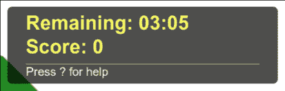

在让游戏按照帮助文本所说的那样运行之前，我们需要教会游戏在时间耗尽时该做什么。为此，在所有记分板代码之后的那一行添加以下内容：

```
var game_over = false; scoreboard.onTimeExpired(function () {

scoreboard.message("游戏结束！") ;

game_over = true;}) ;
```

这告诉记分板，当时间耗尽时，它应该运行一个函数，将记分板消息设置为“游戏结束！”，并且 `game_over` 变量应设置为 `true`。

构建记分板就是这么简单。现在，让我们想办法让玩家为记分板增加分数。

## 11.3 给树一点摇晃

这个游戏的目标是在树上找到水果，我们称之为宝藏。在任何给定时间，只有一棵树会有宝藏。为了显示是哪棵树，我们会让它稍微摇晃一下。但首先我们需要一个树的列表。

找到创建森林的代码——应该有四行不同的 `makeTree()` 调用。我们早在第 4 章“项目：移动化身”的第 35 页添加了这些代码。我们需要对将树添加到场景的代码部分做一点小改动。

我们首先添加两个变量。第一个是 `tree_with_treasure`，你可能已经猜到它将指向当前拥有宝藏的树。第二个变量是一个包含所有树的列表，我们称之为 `trees`。然后我们将构成森林的所有树推入这个列表。将你的四行 `makeTreeAt()` 代码改为以下内容：

```
var tree_with_treasure; var trees = []

;

trees.push(makeTreeAt( 500, 0)) ; trees.push(makeTreeAt(-500, 0)) ;
准备工作
trees.push(makeTreeAt( 750, -1000)) ; trees.push(makeTreeAt(-750, -1000)) ;
```

为了让这段代码生效，我们需要修改 `makeTreeAt()` 函数，使其返回一些东西。如果 `makeTreeAt()` 不返回任何东西，那么我们将空值推入树列表。在 `makeTreeAt()` 函数的最底部，最后一个括号之前添加以下行：

```
function makeTreeAt(x, z) {

// 不要更改开头的代码...

// ...在末尾添加以下行： return top;
}
```

这样，树顶（top）被返回并添加到列表中。我们可以返回树干，甚至是我们在“项目：碰撞”中添加的碰撞边界。是我们我们需要的部分。现在我们有了树列表，我们可以将宝藏藏在一棵树中让它摇晃。在 `makeTreeAt()` 函数之后，添加以下函数和调用：

```
function shakeTree() {

tree_with_treasure = Math.floor(Math.random() * trees.length);new TWEEN
.Tween({x: 0})
.repeat(20)
.onUpdate(function () { trees[tree_with_treasure].position.x = 75 * Math.sin(this.x); })
.start();setTimeout(shakeTree,2000) ;
} shakeTree();
```

我们在第 20 章“项目：河流”的第 185 页讨论 `Math.floor()` 和 `Math.random()`。现在我们只需知道 `shakeTree()` 中的第一行会随机选择一棵树。我们已经见过 `Tween`，它可以将事物从一个值移动到另一个值。在这里再次沿着正弦曲线移动。正弦非常棒，因为从 0 移动到 `2*Math.PI` 时，它们开始和结束相同的值。我们使用正弦。当 `Tween` 的值从 0 移动到 `2*Math.PI` 时，`Math.sin()` 的值从 0 到 1，回到 0，再到 -1，最后回到 0。换句话说，它非常适合让物体轻微摇晃`shakeTree()` 的最后一部分设置了一个12 秒超时。12 秒过后，这个超时会再次调用 `shakeTree()` 函数，分配一棵带有宝藏的树。在这段代码之后，应该有一棵不同的树不停摇晃，告诉玩家有宝藏可以收集。让我们给化身一个获取宝藏的方式。

## 11.4 跳跃得分

在这个游戏中，化身需要跳到当前宝藏的树旁边。当这种情况发生时，我们要做两件事：化身将获得分数，并且我们会制作一个漂亮的宝藏动画并播放声音。但首先我们需要一个触发跳跃的按键。我们通过在 `keydown()` 监听器中添加以下 `if` 语句来实现：

```
if (code == 32) jump(); // 空格键
```

你可以将该 `if` 代码添加到控制化身转向的其他 `if` 语句之上。现在，我们添加 `jump()` 函数，该函数调用。可以放在 `detectCollisions()` 函数之后。它检查宝藏并在屏幕上动画跳跃：

```
function jump() { checkForTreasure();

animateJump();
}
```

为了检查化身是否足够以获取宝藏，在代码底部（最后一个 `<script/>` 标签之前）添加以下函数：

```
function checkForTreasure() {

if (tree_with_treasure == undefined) return ;

var treasure_tree = trees[tree_with_treasure], p1 =

treasure_tree.parent.position, p2 = marker.position;var distance = Math.sqrt(

(p1.x - p2.x)*(p1.x - p2.x) +

(p1.z - p2.z)*(p1.z - p2.z)
) ;if (distance < 500) { scorePoints();

}
}
```

`checkForTreasure()` 函数做了三件事：

- 如果活动的树——如果它是 `undefined`，如“用 JavaScript描述事物”中所述——则立即返回，不做任何操作。
- 如果化身附近有一棵活动的树，那么 `checkForTreasure()` 计算树与化身之间的距离。
- 如果距离小于 500，则调用 `scorePoints()` 函数。

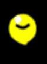

### 勾定理警告

如果你已经学过一点三角学，你可能已经认出了 `checkForTreasure()` 函数中的勾股定理。我们用这个定理计算两点之间的距离：角色和当前激活的树。现在，我们先把 `scorePoints()` 函数写得非常简单。把它添加到 `checkForTreasure()` 函数之后。我们只用它来给记分板加分：

```
function scorePoints() {
  if (scoreboard.getTimeRemaining() === 0) return ;
  scoreboard.addPoints(10);
}
```

一定要加上函数中的第一行；否则玩家在时间结束后还能得分！最后需要做的是让跳跃动起来，这样我们就能在屏幕上看到它。我们把之前见过的两个东西结合起来：补间动画和正弦函数。接下来添加 `animateJump()` 函数：

```
function animateJump() {
  new TWEEN
    .Tween({jump: 0})
    .to({jump: Math.PI}, 500)
    .onUpdate(function () {
      marker.position.y = 200*Math.sin(this.jump);
    })
    .start();
}
```

这样就完成了！如果你隐藏代码，现在就可以移动找到激活的树。如果你动作够快，甚至可以在激活的树旁边跳跃来获得分数。这是一个有趣的游戏，但我们还可以做一些调整让它更好。

## 11.5 让我们的游戏更出色

在书中，我们花了很多时间给角色添加动画。这样做是为了理解对象这样的重要概念，但也是因为3D游戏经常做这类工作。我们的角色不需要像真实生活中那样有手脚，但这种动画有助于游戏看起来真实。在这个例子中游戏非常简单：在宝藏附近按键就能得分。

### 添加动画和音效

添加多少调整取决于你——本章我们添加两个：当角色获取宝藏实时，我们会看到动画并听到声音。给游戏添加声音是两者中简单的。音效数量少，但足够开始游戏了。首先，在 `scorePoints()` 函数中添加 `Sounds.bubble.play()`：

```
function scorePoints() {
  if (scoreboard.getTimeRemaining() === 0) return ;
  scoreboard.addPoints(10);
  Sounds.bubble.play();
}
```

你可以在第 277 页 A2.5节“Sounds.js”中找到关于 `Sounds.js` 的更多信息。为了给果实添加动画，我们需要把果实添加到角色参考系中，然后对它进行补间。这个补间和我们之前做的有些不同，因为它同时动画两个东西：果实会升到角色上方并旋转。下面的代码可以添加到 `scorePoints()` 函数之后，实现所有这些效果：

```
var fruit;
function animateFruit() {
  if (fruit) return ;
  fruit = new THREE.Mesh(new THREE.CylinderGeometry(25, 25, 5, 25) , new THREE.MeshBasicMaterial({color: 0xFFD700}) )
  fruit.rotation.x = Math.PI/2;
  marker.add(fruit);
  new TWEEN
    Tween({ height: 150, spin: 0 }).
    to({height: 250 , spin: 4 }, 500).
    onUpdate(function () {
      fruit.position.y = this.height;
      fruit.rotation.z = this.spin;
    }).
    onComplete(function () {
      marker.remove(fruit);
      fruit = undefined;
    }).
    start();
}
```

我们会在第 159 页的第 17 章“项目：学习 JavaScript 对象”中更详细地讨论花括号内的属性。现在，只需知道我们设置了两个数字属性：果实的旋转和高度。旋转从零开始，在动画过程中旋转四次。果实还会在动画过程中从屏幕上的150位置上升到250位置。当然，`animateFruit()` 函数需要被调用才能生效。在 `scorePoints()` 函数的底部添加它的调用，使其看起来这样：

```
function scorePoints() {
  if (scoreboard.getTimeRemaining() === 0) return ;
  scoreboard.addPoints(10);
  Sounds.bubble.play();
  animateFruit();
}
```

结果是一个漂亮的动画，在角色收集实时会播放。耶！得分！到目前为止的代码

img/Image0320.jpg

## 我们还能添加什么？

这就是我们从第 25 页的第 3 章“项目：制作角色”开始从头构建的角色。但这意味着你不能让这个游戏变得更好！在这个游戏中，从树上摘实体非常容易。也许你可以添加一个调整，让角色每棵树只能摘一个水果？或者，如果角色在树未激活、没有摆动时跳跃，可以惩罚玩家——比如 `subtractPoints()`。如果你觉得玩家移动得太快或太慢，也许可以在按键监听器中寻找改进的方法。你可以构建一个充满各种角落、缝隙和奖品的游戏。这就是游戏设计师的工作，而你就是设计师。复制到目前为止的代码，看看你能添加什么，让游戏按照你想要的方式运行。你打算如何让这个游戏变得出色？

## 11.6 到为止的代码

如果你想核对本章的代码，请翻到第 234 页的 A1.11节“代码：水果猎人”。

## 11.7 下一步做什么

这可能是我们角色项目的终点，但还有很多事情要做。接下来，我们将探索 3D编程中更多的小细节，从灯光、材质和阴影开始。

完成本章后，你将学会：

- 理解如何制作不同的颜色
- 能够使形状有光泽或难以看清
- 知道如何在3D游戏中制作阴影

# 第 12 章 使用灯光和材质

在本章中，我们将介绍如何构建有趣的形状和材质，效果如下：

  回到 第 1 章

img/Image0324.jpg) 项目简单形状

img/Image0325.jpg) 第 1 页

img/Image0326.jpg) 3D库

img/Image0327.jpg) 3D

img/Image0329.jpg)  计算机程序中的颜色用

img/Image0331.jpg) RGB 数字表示

img/Image0332.jpg) 红色（R）、绿色（G）和蓝色（B）

img/Image0333.jpg)

img/Image0334.jpg) 维基百科有一个非常详细的颜色列表
```


维基百科列表位于 `http://en.wikipedia.org/wiki/List_of_colors`，其中包含 RGB 百分比，你需要将其写成小数形式。例如，该列表中的第一种颜色是“英国皇家空军蓝”，其 RGB 百分比为：36%、54%、66%。要让我们的球体变成这种颜色，可以使用以下代码：`cover.color.setRGB(0.36, 0.54, 0.66)`。这种基础材质在实际游戏中比我们之前使用的 `MeshNormalMaterial` 更有用一些。它特别适合用于背景和平坦表面。即便如此，它也不是我们能选择的最逼真的材质。无论什么光照，颜色看起来都一样。它不会反射光线，也不会产生阴影。话虽如此，尽可能使用它——因为计算机绘制起来很容易。现在让我们来看一种更有趣的材质。但首先，把红色的基础球体移开：`ball.position.set(500, 0, 0)`。

### 12.3 真实感：光泽度

我们首先要做的是切换渲染器。我们在第 9 章“其他代码都是什么？”（第 85 页）中讨论过渲染器。请记住，渲染器是在计算机屏幕上绘制游戏的东西。我们在那一章简要讨论了不同类型的渲染器。现在我们要使用它们。我们一直使用的 `CanvasRenderer` 在大多数计算机上都能工作，但无法实现我们游戏中可能想要的一些酷炫效果。这在你的计算机上可能无法工作！！要实现真实感，你的计算机必须支持 WebGL。如果你的计算机不支持 WebGL，那么你应该只阅读本章剩余部分，但不要输入任何代码，因为代码无法运行。能够看到这些效果固然好，但对于我们大多数游戏来说并非必需。判断你的计算机和浏览器是否支持 WebGL 的最简单方法是访问 `http://get.webgl.org/`。如果你在该页面上看到一个旋转的立方体，那么你的计算机支持 WebGL。要切换到 `WebGLRenderer`，找到渲染器代码（大约在第 15 行附近），将 `CanvasRenderer` 改为 `WebGLRenderer`，使代码看起来像这样：

```javascript
// 这将把相机看到的内容绘制到屏幕上：
var renderer = new THREE.WebGLRenderer();
```

如果你仍然能看到右侧的球体，那么一切正常，你的计算机支持 WebGL。如果没有，请切换回 `CanvasRenderer`，并阅读本章内容，但不要进行上述修改。在球体代码下方，让我们用 Phong 材质创建一个甜甜圈：

```javascript
var shape = new THREE.TorusGeometry(100, 50, 8, 20) ;
var cover = new THREE.MeshPhongMaterial();
cover.emissive.setRGB(0.8, 0.1, 0.1) ;
var donut = new THREE.Mesh(shape, cover);
scene.add(donut);
```

如果你操作正确，你应该会看到一个非常暗淡的红色甜甜圈。你可能会想：“就这样？”嗯，当然不是！缺少的是光。在现实生活中，当某物有光泽时，意味着光线——阳光、手电筒等——会从它上面明亮地反射出来。在电脑游戏中也是如此。所以让我们添加一个光源。在甜甜圈代码下方，添加一些阳光：

```javascript
var sunlight = new THREE.DirectionalLight();
sunlight.intensity = 0.5 ;
sunlight.position.set(100, 100, 100) ;
scene.add(sunlight);
```

我们将阳光定位在甜甜圈的右侧、上方和前方。结果应该是一个看起来很酷的甜甜圈：

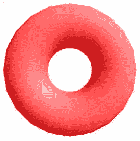

### 自发光

与 `MeshBasicMaterial` 封面不同——我们调整了 `color` 属性——对于 `MeshPhongMaterial`，我们调整 `emissive` 属性来描述颜色：`cover.emissive.setRGB(0.8, 0.1, 0.1)`；我们不能直接使用 `color`，因为在使用 `MeshPhongMaterial` 时，我们需要调整多个与颜色相关的属性。`emissive` 属性描述了封面“发射”的颜色——即它本身的颜色。

### 高光

`Specular` 是我们可以调整的另一个颜色属性。`specular` 属性描述了物体高光部分的颜色。如果我们不设置这个值，它就不会很亮。让我们让它变亮。在设置 `emissive` 颜色的那一行下面添加 `specular` 行：

```javascript
var shape = new THREE.TorusGeometry(100, 50, 8, 20) ;
var cover = new THREE.MeshPhongMaterial();
cover.emissive.setRGB(0.8, 0.1, 0.1) ;
cover.specular.setRGB(0.9, 0.9, 0.9) ;
var donut = new THREE.Mesh(shape, cover);
scene.add(donut);
```

如果所有 RGB 值都相同，那么我们会看到黑色、白色或某种灰色。全零是黑色。全一是白色。介于两者之间的是灰色。在这种情况下，我们将 `specular` 颜色——高光的颜色——设置为三个 0.9 的值，这非常接近全 1.0 的白色。换句话说，我们看到的高光更多一些：

 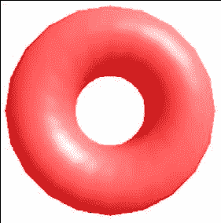

### 12.4 阴影

我们给甜甜圈打上了光，但还没有阴影。计算机绘制阴影需要大量工作，所以只在需要的地方使用。这是一个艰难的选择，因为阴影总是让游戏看起来更好。正确设置起来，首先我们需要告诉渲染器处理阴影。在 `WebGL` 渲染器下方添加 `shadowMap` 属性的行：

```javascript
// 这将把相机看到的内容绘制到屏幕上：
var renderer = new THREE.WebGLRenderer();
renderer.shadowMap = true;
```

下一步是将甜甜圈标记为阴影。为此，我们在甜甜圈添加到场景后设置 `castShadow` 属性。在 `scene.add(donut)` 之后添加 `donut.castShadow`：

```javascript
var shape = new THREE.TorusGeometry(100, 50, 8, 20) ;
var cover = new THREE.MeshPhongMaterial();
cover.emissive.setRGB(0.8, 0.1, 0.1) ;
cover.specular.setRGB(0.9, 0.9, 0.9) ;
var donut = new THREE.Mesh(shape, cover);
scene.add(donut);
donut.castShadow = true;
```

现在，通过设置 `sunlight` 上的 `castShadow` 属性，告诉阳光也能产生阴影。同样，在 `scene.add(sunlight)` 之后添加 `sunlight.castShadow = true` 这一行：

```javascript
var sunlight = new THREE.DirectionalLight();
sunlight.intensity = 0.5;
sunlight.position.set(100, 100, 100);
scene.add(sunlight);
sunlight.castShadow = true;
```

最后，我们需要一个让阴影投射的地方。在现实生活中，我们会在建筑物或地面上看到阴影。让我们在甜甜圈下方创建地面，让阴影投射在上面：

```javascript
var shape = new THREE.PlaneGeometry(1000, 1000);
var cover = new THREE.MeshBasicMaterial();
var ground = new THREE.Mesh(shape, cover);
scene.add(ground);
ground.position.set(0, -200, 0);
ground.rotation.set(-Math.PI/2, 0, 0);
ground.receiveShadow = true;
```

注意，这里我们使用了平面和基础材质。始终使用你能用到的最简单的对象。这样，你应该能看到我们炫酷的甜甜圈正在投射阴影：

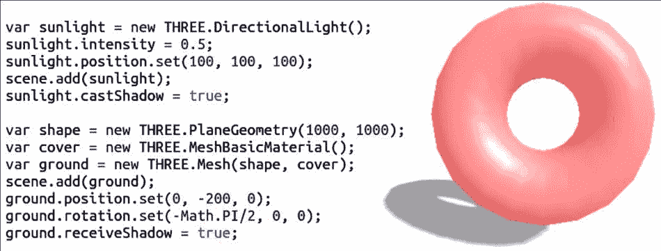 

### 12.5 让我们开始动画！


这一切都很酷，但你知道比一个闪闪发光并投射阴影的甜甜圈更酷的是什么吗？一个闪闪发光、投射阴影并且旋转的甜甜圈！

替换代码底部的 `renderer.render()`：

```javascript
var clock = new THREE.Clock();
function animate() {
    requestAnimationFrame(animate);
    var time = clock.getElapsedTime();
    donut.rotation.set(time, 2*time, 0);
    renderer.render(scene, camera);
}
animate();
```

我们之前见过很多这样的代码，但现在正是解释它的好时机。我们的 3D 库提供了 `clock`。它对于了解动画开始以来经过了多少时间非常有用。这个“经过的时间”对于各种动画效果都非常有用。在这段代码中，我们用它来设置甜甜圈绕 x 轴和 y 轴的旋转。随着时间一秒秒流逝，甜甜圈的旋转角度将从 0 到 0.5，再到 1，最终达到 2 × π（一整圈）。然后它会继续旋转，再转一圈，到 4 × π，再到 6 × π，如此往复。

我们让 y 轴的旋转速度是 x 轴的两倍，从而产生一种疯狂、摇晃的运动。`clock.getElapsedTime()` 返回的是秒数，我们用这个数字表示旋转。`animate()` 函数中有趣的地方是 `requestAnimationFrame()`。这是现代浏览器内置的一个函数，非常擅长绘制。通过使用 `requestAnimationFrame()` 函数，我们可以获得流畅流畅动画。`requestAnimationFrame()` 真正有趣在于我们给它传递了另一个函数——就是当前运行的 `animate()`。我们没有在 `animate` 后面加括号，那样会立即调用 `animate()`。通过 `requestAnimationFrame()` 告诉浏览器：下次准备好绘制时（应该在几秒后），它再次调用这个 `animate()` 函数。

### 12.6 到目前为止

如果你想对本章的代码，请翻到第 240 页。

### 12.7 接下来是什么

灯光和材质是高级主题，我们只是触及了可能。有很多设置需要练习才能适应。仅仅用红、绿、蓝值来设置颜色就有点奇怪。但这并不是成为高级主题的原因。灯光和材质非常酷，但你必须意识到，你不应该总是使用。在任何编程中，这都是重要的经验。最优秀的程序员都开发：能的事代表应该做。

现在，你也知道了！让我们在下一章中好好运用新学的灯光技能，构建一个太阳系。当你完成本章后，你将能够：

- 知道如何让物体圆周运动
- 理解如何制作太阳光源
- 能够在同一场景中切换摄像机
- 理解一个人类花了千年才解开的谜

## 第 13 章：构建自己的太阳系

让我们暂时放下虚拟角色，来做不同但同样的事情：让太阳系动起来。最终效果如下：

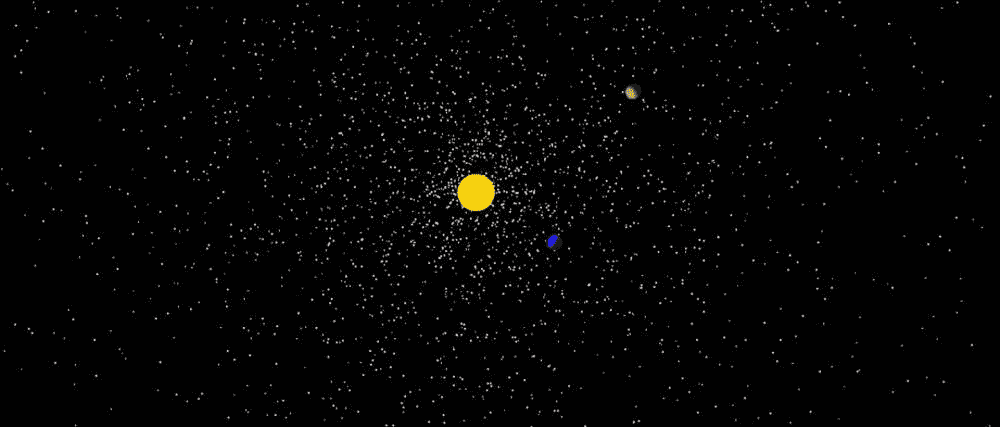

不，这不是游戏，但它很有趣。

### 13.1 开始

在 ICE 中新建一个项目。选择 3D 入门模板，并将此项目命名为 `Planets`。

### 13.2 太阳、地球和火星

既然我们在处理太空，我们需要调整常规的摄像机并切换渲染器。我们对 `START CODING ON THE NEXT LINE` 上方的代码进行修改。创建摄像机，使其看到最远 `1e6` 的距离，这是 1 后面跟六零（即 1,000,000）的简写。同时，将摄像机从屏幕中心移开1000 个单位。

```javascript
// 这是用来观察体的：
var aspect_ratio = window.innerWidth / window.innerHeight;
var camera = new THREE.PerspectiveCamera(75, aspect_ratio, 1, 1e6);
camera.position.z = 1000;
scene.add(camera);
```

我们要做的另一个更改是切换到 `WebGLRenderer`，就像我们在第 12 章“使用灯光和材质”（第 109 页）中所做的那样。

```javascript
// 这将把相机看到的内容绘制到屏幕上：
var renderer = new THREE.WebGLRenderer();
renderer.setSize(window.innerWidth, window.innerHeight);
document.body.appendChild(renderer.domElement);
```


**如果 WebGLRenderer 在你的电脑上无法工作**

如果你在第 12 章“使用灯光和材质”（第 109 页）测试时，`WebGLRenderer` 在你的电脑上无法工作，你仍然可以完成本章的大部分内容。你需要在这里保留 `CanvasRenderer`。在下面的代码中，将 `MeshPhongMaterial` 引用替换为 `MeshBasicMaterial`。模拟效果不会那么酷——而且你无法完成最后一部分——但大部分内容仍然工作。

现在，我们在 `START CODING ON THE NEXT LINE` 之后开始编码。首先，让我们为太空模拟做一件重要的事：让太空变成黑色。

```javascript
document.body.style.backgroundColor = 'black';
```

现在，将太阳添加到我们的模拟中。

```javascript
var surface = new THREE.MeshPhongMaterial({ambient: 0xFFD700});
var star = new THREE.SphereGeometry(50, 28, 21);
var sun = new THREE.Mesh(star, surface);
scene.add(sun);

var ambient = new THREE.AmbientLight(0xffffff);
scene.add(ambient);

var sunlight = new THREE.PointLight(0xffffff, 5, 1000);
sun.add(sunlight);
```

太阳的颜色是金色，取自 `http://en.wikipedia.org/wiki/List_of_colors`（回忆一下，在创建 JavaScript 颜色时，我们将该页面上的 `#` 替换为 `0x`）。我们将其设为环境色，因为不会有其他光照在太阳上。这是它仅仅因为存在而获得的颜色。

那么，我们来创建行星，并将它们放置在离太阳稍远的位置（显然不是按比例！）。


```javascript
var surface = new THREE.MeshPhongMaterial({ambient: 0x1a1a1a, color: 0x0000cd});
var planet = new THREE.SphereGeometry(20, 20, 15);
var earth = new THREE.Mesh(planet, surface);
earth.position.set(250, 0, 0);
scene.add(earth);

var surface = new THREE.MeshPhongMaterial({ambient: 0x1a1a1a, color: 0xb22222});
var planet = new THREE.SphereGeometry(20, 20, 15);
var mars = new THREE.Mesh(planet, surface);
mars.position.set(500, 0, 0);
scene.add(mars);
```

这样我们就得到了太阳、地球和火星。到目前为止，它们还不会动。让我们通过将最后一行代码从单次渲染改为 `animate()` 函数来解决这个问题。

```javascriptclock = new THREE.Clock();

function animate() {
    requestAnimationFrame(animate);
    var time = clock.getElapsedTime();
    var e_angle = time * 0.8;
    earth.position.set(250 * Math.cos(e_angle), 250 * Math.sin(e_angle), 0);
    var m_angle = time * 0.3;
    mars.position.set(500 * Math.cos(m_angle), 500 * Math.sin(m_angle), 0);
    // 现在，在屏幕上显示相机看到的内容：
    renderer.render(scene, camera);
}
animate();
```

我们之前在第 6 章“项目：移动手脚”（第 59 页）中已经使用过 3D 时钟计时器，当时我们想让角色的手脚来回摆动。为了让手脚来回摆动，我们没有使用 JavaScript——而是用了数学。具体来说，我们用了正弦函数。对于我们的行星，我们再次使用了正弦函数，但还使用了一个新函数——余弦函数。

如果我们只使用正弦函数，行星就会像角色的手脚一样来回穿过太阳。但我们希望行星也能上下移动。这就是余弦函数的作用。当正弦函数让行星穿过太阳时，余弦函数会将其推向另一个方向。随着时间的推移，这就形成了一个完美的圆形。

这样一来，我们的行星就能绕着太阳运行了！在现实生活中，行星并不是以完美的圆形轨道运行的，但这仍然很酷，对吧？

## 准备

我们的太空模拟还缺少一样东西：星星。要制作星星，我们将使用粒子系统。在添加粒子系统时请小心，使用以下代码（注意后面的警告）。

```javascript
var stars = new THREE.Geometry();
while (stars.vertices.length < 1e4) {
    var lat = Math.PI * Math.random() - Math.PI / 2;
    var lon = 2 * Math.PI * Math.random();
    stars.vertices.push(new THREE.Vector3(
        1e5 * Math.cos(lon) * Math.cos(lat),
        1e5 * Math.sin(lon) * Math.cos(lat),
        1e5 * Math.sin(lat)
    ));
}
var star_stuff = new THREE.ParticleBasicMaterial({size: 500});
var star_system = new THREE.ParticleSystem(stars, star_stuff);
scene.add(star_system);
```

在 ICE 中添加`while`语句时要小心

  

`while`语句会一直运行，直到有东西阻止它。如果没有东西阻止它，浏览器就会卡死。当这种情况发生在 ICE 中时，你唯一的选择就是切换到仅编辑模式（参见“当 ICE 崩溃时如何恢复”）。

为了防止卡死，你可以先注释掉`while`语句，直到你输入完整个代码块。也就是说，你可以在`while`前面加上双斜杠进行注释，然后输入代码块中的其他所有内容。之后再回去删除双斜杠，就能在屏幕上看到`while`语句的结果了。

我们不会过多关注粒子系统的细节。本质上，粒子系统是一种在不给计算机带来很大负担的情况下，向模拟中添加大量对象的方法。在这里，我们向场景中添加了大量星星。

## 地摄像头！

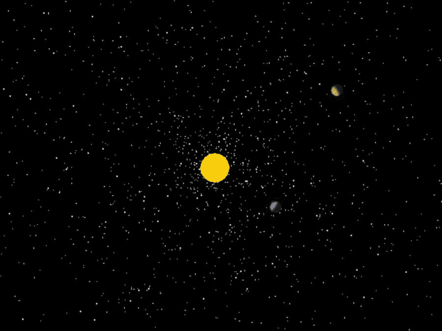

## 13.3 地球摄像头！

让我们添加从地球观察火星的能力。当你从地球观察火星几个月时，火星在天空中的位置会以一种相当奇怪的方式变化。这种变化如此奇怪，以至于古代天文学家无法解释它。但我们可以。

要从地球观察火星，除了俯视太阳系的相机外，我们还需要另一个相机。所以我们要做的第一件事就是给我们的太阳系俯视相机起一个更好的名字。我们叫它`above_cam`。将代码顶部的`camera`改为`above_cam`：

```javascript
// 这是用来观察物体的相机：
var aspect_ratio = window.innerWidth / window.innerHeight;
var above_cam = new THREE.PerspectiveCamera(75, aspect_ratio, 1, 1e6);
above_cam.position.z = 1000;
scene.add(above_cam);
```

接下来，我们添加一个名为`earth_cam`的相机。

```javascript
var earth_cam = new THREE.PerspectiveCamera(75, aspect_ratio, 1, 1e6);
scene.add(earth_cam);
```

代码其余部分期望有一个名为`camera`的相机，所以我们就给它一个。

```javascript
var camera = above_cam;
```

接下来，我们需要将`earth_cam`添加到地球上，并旋转使其指向火星。我们在`animate()`函数内部完成这个操作。在设置火星位置的那之后、`renderer.render`之前，添加以下代码：

```javascript
var y_diff = mars.position.y - earth.position.y;
var x_diff = mars.position.x - earth.position.x;
var angle = Math.atan2(x_diff, y_diff);

earth_cam.rotation.set(Math.PI / 2, -angle, 0);
earth_cam.position.set(earth.position.x, earth.position.y, 2);
```

如果你知道两个物体的坐标，就可以再次使用数学来计算它们之间的角度。这就是我们使用`x_diff`和`y_diff`变量所做的——我们计算火星和地球的位置差多少。`Math.atan2()`函数则告诉我们这个角度。


## 用一个var声明多个变量

你可能注意到了，在前面的代码中只使用了一个`var`来构建变量。JavaScript程序员通常认为这是一种将相关变量组合在一起的方法——在这里就是两个点之间的角度。在函数开头这样做尤其常见。一旦知道了旋转角度，就可以相机放置在地球的位置，然后旋转使其面向火星。

最后，我们需要添加使用键盘在两个相机之间切换的功能。用A键切换到`above_cam`，用E键切换到`earth_cam`。A代码是65，E代码是69。因此，在代码的底部，结束的`<script>`标签之前，添加以下监听器：

```javascript
document.addEventListener("keydown", function(event) {
    var code = event.keyCode;
    if (code == 65) {
        camera = above_cam;
    }
    if (code == 69) {
        camera = earth_cam;
    }
});
```

这样就完成了！现在，如果你隐藏代码，你应该能够在“地球摄像头”和“太阳系俯视摄像头”之间来回切换。

## 迄今为止的代码

地球，你应该注意到一些奇怪的现象（但不幸的是，只有使用WebGL渲染器才能看到）。火星通常看起来随着时间的推移向左移动。但时不地，它会停下来，还会向后移动一段时间。

如果你走到户外，连续几个月观察火星中的位置，你会看到同样的现象。古代天文学家称这种现象为“逆行运动”。因为他们认为地球是宇宙的中心，所以无法解释为什么会出现逆行运动。哦，他们中的一些人想出了疯狂的解释，都不像我们刚刚模拟的简单。

但我们现在知道是怎么回事了，不是吗？如果你在火星刚向后移动时切换到`above_cam`，你会看到地球追上火星并超过它时，就会发生逆行运动。这有点像一辆快车超过一辆慢车——慢车（火星）看起来几乎是在向后移动。

你只用了一百行JavaScript代码就解决了几千年来世界上聪明的人都无法解决的问题。太棒了！

## 13.4 迄今为止的代码

如果你想核对本章中的代码，请参考第241页的附录A.13《代码：构建自己的太阳系》。

## 13.5 接下来是什么

我们在这里看到了一个令人惊叹的太阳系视图，对于一个快速、单章的项目来说，这已经很不错了！你不仅解开了困扰伟大头脑的谜团，还在此过程中学了一些关于3D编程非常有用的知识。你现在知道了如何让物体做圆周运动。更酷的是，你可以向3D场景中添加多个缓冲区，移动摄像机，并在它们之间来回切换。

我们将在下一章中基于这个项目做一些每个3D程序员迟早要做的事情：模拟月球绕地球转时的相位变化。

### 准备

当你完成本章后，你将：

- 了解3D程序员虚拟工具箱中最重要的技巧
- 掌握对现有代码进行重大修改的策略
- 比大多数人（但可能不如《玩具总动员》的动画师）更了解月相

# 第14章 项目：月相

逆行运动那一章相当精彩，但本章我们将涵盖每个3D程序员都必须学习的内容：如何可视化月球及其相位。最终效果会像这样：


为什么模拟月相很重要？首先，这是一个足够简单的问题——太阳照射在月球上，而月球绕地球公转——这让我们能够运用关于光照和材质的知识。它还能让我们运用之前练习过的相对定位技巧，就像我们处理虚拟角色的手和脚那样。

如果你仍然觉得不重要，那就去看看《玩具总动员》吧。这是第一部全电脑动画长片，背后的程序员们确保他们做对了——当伍迪和巴斯留在加油站后，背景中可以看到月球。如果这对电影来说足够重要，对我们来说也重要！

### 14.1 开始

本章我们将做一些事情。从头开始，不如复制一份我们的火星项目。准备

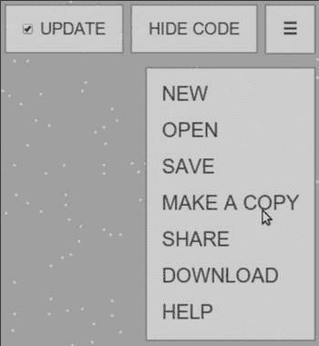

在项目框中，将这个项目命名为“月相”。

## 14.2 将火星变成月球

我们需要做的第一件事是将`mars`重命名为`moon`。先做这件事，并确保没有留下`mars`变量。完成之后，你仍然有一个红色行星绕太阳转。

我们需要让`moon`绕地球转。仅仅改名不会改变它的外观或行为——我们需要修改代码来实现这一点。这是重要的第一步。最糟糕的情况可能是漏掉了某个`mars`，但这很容易修正。

接下来，让我们改变月球的外观。将月球的颜色改为全白：`0xffffff`。我们还应该让月球比地球小。大小为15，垂直段数为30，水平段数为25。

```javascript
var surface = new THREE.MeshPhongMaterial({ambient: 0x1a1a1a, color: 0xffffff});
var planet = new THREE.SphereGeometry(15, 30, 25);
var moon = new THREE.Mesh(planet, surface);
```

## 14.3 最酷的技巧：参考系

接下来，我们需要让月球的行为像月球。它应该绕太阳转，而应该绕地球转。因此，删除设置月球位置的代码，并将其添加到场景中。由于月球不再添加到场景，它会消失——没关系。我们马上把它回来。

首先，让我们移除月球移动的代码。在`animate()`函数的括号内，删除`y_diff`、`x_diff`和`angle`代码。同时删除`earth_cam`旋转和位置的代码。

最后，删除正弦和余弦设置月球位置的那一行，也就是`m_angle`下面一行。我们仍然需要为地球做这些，我们将尝试一些新的方法来移动月球。

### 最酷的技巧：参考系

创建月球之后，我们创建一个月球轨道，它只是一个空的3D对象——类似于第3章“项目：制作虚拟角色”中所做的。然后我们将轨道添加到地球上：

```javascript
var moon_orbit = new THREE.Object3D();
earth.add(moon_orbit);
```

像这样将`moon_orbit`添加到地球上，意味着它以地球为中心。而且，无论地球走到哪里，这个`moon_orbit`对象都会与地球在一起。

这可能看起来没什么，但这是3D编程中一个极其重要的技巧。事实上，它如此重要，以至于有一个花哨的名字：参考系（Coordinate System）。为了展示参考系思维的威力，我们将月球添加到`moon_orbit`中，并将其移动100个单位远离中心：

```javascript
moon_orbit.add(moon);
moon.position.set(0, 100, 0);
```

这样，我们应该再次看到月球，只不过现在它紧挨着地球，随着地球绕太阳转。

由于`moon_orbit`参考系始终以地球为中心，月球始终距离地球100个单位。我们还需要让月球绕地球转。我们将地球摄像头添加到`moon_orbit`参考系中，并旋转使其面向月球：

```javascript
moon_orbit.add(earth_cam);
earth_cam.rotation.set(Math.PI/2, 0, 0);
```

现在到了参考系最酷的部分。回到`animate()`函数中，我们将让`moon_orbit`旋转。添加代码，并将`m_angle`（月球轨道改变的量）修改如下：

```javascript
var m_angle = time * 4;
moon_orbit.rotation.set(0, 0, m_angle);
```

这样，月球就应该绕地球公转了！

如果你仔细观察，会发现我们并没有移动月球。相反，我们是在旋转月球的轨道——也就是说，我们在旋转月球的参考系。如果你隐藏代码并按E键切换到地球摄像机视角，你会看到，由于我们将摄像机添加到了月球的参考系中，它会一直旋转指向月球。

你可以把这个参考系想象成一个盘子，我们把摄像机和月球粘在上面：

 

当我们旋转盘子时，月球和摄像机也随之旋转。

 

## 14.4 挑战：创建地球参考系

你可以做到。只需按照我们为月球采取的步骤：

- 创建一个3D对象来容纳地球，并将其添加到太阳中。
- 将地球添加到新的轨道参考系，而不是场景中。
- 删除设置地球位置的`animate()`代码。
- 旋转地球的轨道。

## 14.5 暂停模拟

地球，你应该注意到一些奇怪的现象（但不幸的是，只有使用WebGL渲染器才能看到）。火星通常看起来随着时间的推移向左移动。但时不地，它会停下来，还会向后移动一段时间。

如果你走到户外，连续几个月观察火星中的位置，你会看到同样的现象。古代天文学家称这种现象为“逆行运动”。因为他们认为地球是宇宙的中心，所以无法解释为什么会出现逆行运动。哦，他们中的一些人想出了疯狂的解释，但都不像我们刚刚模拟的简单。


要暂停，我们需要对`animate()`函数做一些修改。当模拟暂停时，我们仍然需要执行动画并渲染场景，但不应更新地球或月球的位置。这意味着我们必须将`renderer.render()` 调用移到`animate()`函数的前面——它需要在检查模拟是否暂停之前进行渲染。我们还需要想出一种不同的计时方式。我们一直使用的`THREE.Clock()`无法暂停。

因此，删除`animate()`函数上方的`clock = THREE.Clock` 语句。用下面三个变量（`time`、`speed` 和 `pause`）替换它：

```javascript
var time = 0,
    speed = 1,
    pause = false;

function animate() {
    requestAnimationFrame(animate);
    renderer.render(scene, camera);
    if (pause) return;
    time = time + speed;
    var e_angle = time * 0.001;
    earth.position.set(250 * Math.cos(e_angle), 250 * Math.sin(e_angle), 0);
    var m_angle = time * 0.02;
    moon_orbit.rotation.set(0, 0, m_angle);
}
animate();
```

其中还有其他变化：

- `renderer.render()` 行不再位于底部。现在它是`animate()`中的第二行。

- 如果`pause` 为真，我们添加了一个返回语句。

- 我们通过每次将`speed` 加到`time` 上来增加时间。

- 用于计算`e_angle` 和`m_angle` 的`time` 乘数变小了。

完成所有这些更改后，模拟应该像以前一样再次运行。我们进行这些更改是为了能够通过按键来更改某些设置。

为此，找到`keydown` 监听器并将其更改为以下内容：

```javascript
document.addEventListener("keydown", function(event) {
    var code = event.keyCode;
    if (code == 67) changeCamera(); // C
    if (code == 32) changeCamera(); // space
    if (code == 80) pause = !pause; // P
    if (code == 49) speed = 1; // 1
    if (code == 50) speed = 2; // 2
    if (code == 51) speed = 10; // 3
});

function changeCamera() {
    if (camera == above_cam) camera = earth_cam;
    else camera = above_cam;
}
```

现在，如果你隐藏代码，你可以按`C` 键或空格键来切换摄像头。按`P` 键可以暂停或恢复。你甚至可以通过按`1`、`2` 或`3` 来改变速度。

试试看！

## 理解月相

## 14.6 理解月相

月球有四个主要月相：新月、上弦月、满月和下弦月。新月是指月球位于地球和太阳之间。由于太阳照射在月球我们看不到的那一面，此时我们看不到月球（而且它也在天空中与太阳同一区域）。

上弦月意味着月球绕其轨道运行了四分之一。这并不意味着它被照亮了四分之一——正如你所见，它是一半被照亮。

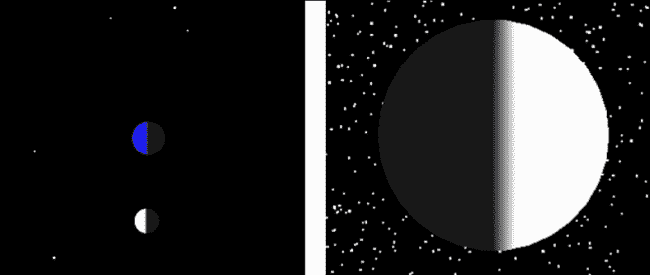

当月球绕地球运行了四分之二（也就是一半）时，就是满月。我们看到的月球部分完全被照亮。

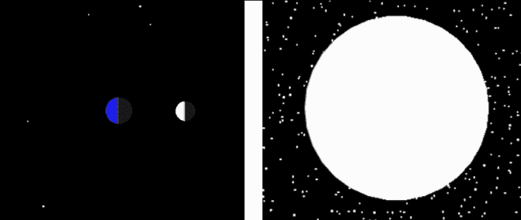

你知道下弦月是什么。月球绕地球运行了四分之三，再次被照亮一半。

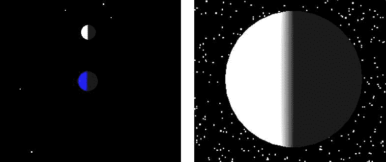

在新月和上弦月之间，月球是月牙形。

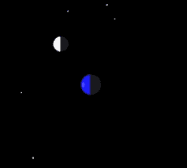   

在上弦月与满月之间，以及满月与下弦月之间，月球被称为

  凸月。

   

当被照亮的一面在增大时，称为“盈”。当它在减小时，称为“亏”。现在你几乎了解了关于月相的一切。更棒的是，你有了自己的模拟！

## 14.7 到目前为止的代码

如果你想核对本章的代码，请参见第 243 页的附录 A1.14《代码：月相》。

不，它不包括使用地球参考系的挑战。自己动手吧！

## 14.8 接下来是什么

本书中的太空模拟到此结束。恭喜你——你已经完成了 3D 编程中的一个伟大传统。希望你学到了一些关于太空的知识。更重要的是，对于你的计算机技能来说，你已经接触到了参考系的概念，我们肯定会在游戏中用到它。

说到游戏，让我们在下一章开始吧！

完成本章后，你将

- 知道如何在游戏中计分

- 理解当物体碰撞时如何计分（或执行其他操作）

- 了解物理如何在游戏中应用的一个例子

## 第 15 章 项目：紫色水果怪物游戏

在本章中，我们将制作一个跳跃游戏。玩家使用键盘让紫色水果怪物跳跃和移动，捕获尽可能多的水果，不能地面。最终效果如下：


这是一个简单的游戏，但它将让我们略一些重要的游戏概念。

### 15.1 开始

在编辑器中启动新项目。选择3D 入门模板，并将此项目命名为“紫色水果”。

### 15.2 让我们制作物理！

对于这个游戏，我们需要新的 JavaScript 库和一些配置。在文件的顶部，添加新的`<script>` 标签：

```html
<body>
```

```html
<script src="http://gaming.com/Three.js"></script>
<script src="http://gaming.com/physi.js"></script>
<script src="http://gaming.com/Scoreboard.js"></script>
<script src="http://gaming.com/Fixes.js"></script>
```

我们将使用物理。在3D 入门模板代码的顶部，紧跟`src=` 属性的`<script>` 标签下方，进行以下更改：

```html
<script>
// 物理设置
Physijs.scripts.ammo = 'http://gaming.com/ammo.js';
Physijs.scripts.worker = 'http://gaming.com/worker.js';

// 这是游戏发生的地方
var scene = new Physijs.Scene({fixedTimeStep: 2 / 60});
scene.setGravity(new THREE.Vector3(0, -100, 0));

// 这是观察事物
var aspect_ratio = window.innerWidth / window.innerHeight;
var camera = new THREE.PerspectiveCamera(75, aspect_ratio, 1, 10000);
camera.position.z = 200;
camera.position.y = 100;
scene.add(camera);

// 这将摄像头的内容绘制到屏幕上
var renderer = new THREE.WebGLRenderer();
renderer.setSize(window.innerWidth, window.innerHeight);
document.body.appendChild(renderer.domElement);
```

- `Physijs` 设置让`Physijs` 决定物体何时碰撞。

- 一个工作线程在后台运行，执行所有物理计算。

- 我们需要使用`Physijs.scene` 而不是`THREE.scene`。

- 即使启用了物理引擎，我们也不会拥有重力，除非将其添加到场景中。这里我们在 Y 轴负方向（即向下）添加重力。

- 将摄像机稍微拉近以观察。

- 将摄像机向上移动，以便更好地观察。

- `WebGLRenderer` 比常规的`CanvasRenderer`效果更好。如果你的浏览器不支持WebGL，别担心——尽管你可能看不到地面。

至此，我们已准备好编写跳跃游戏。

### 15.3 规划游戏

在编码之前，让我们思考如何组织代码。有时在代码中穿梭查看内容可能会变得困难。你不是第一个遇到问题的程序员，也不会是最后一个。幸运的是，你可以从前人的错误中学习。

组织代码最简单的方法之一将其视为写作。写文章时，你可能会先列一个大纲。有了大纲后，再填充细节。

组织代码时，先写大纲再在其下方添加代码会有帮助。由于我们在编程，大纲也是用代码写的。在`START CODING ON THE NEXT LINE`下方输入以下内容，包括斜线：

```javascript
// var ground = addGround();
// var avatar = addAvatar();
// var scoreboard = addScoreboard();
// animate();
// gameStep();
```

### 15.4 准备就绪

在这个游戏中，我们需要地面、一个角色和一个记分板。我们将动作分为两部分：动画和游戏逻辑。所有这些都列在我们的代码大纲中。让我们开始编写与大纲匹配的代码。

## 为游戏添加地面

代码大纲中的第一个函数调用是`addGround()`。就在代码大纲下方（在注释掉的`//gameStep()`行之后），按如下方式定义该函数：

```javascript
function addGround() {
  document.body.style.backgroundColor = '#87CEEB';
  ground = new Physijs.Mesh(
    new THREE.PlaneGeometry(1e6, 1e6),
    new THREE.MeshBasicMaterial({color: 0x7CFC00})
  );
  ground.rotation.x = Math.PI / 2;
  scene.add(ground);
}
```

## 构建一个角色

代码大纲中的第二个函数调用是`addAvatar()`。在代码大纲下方，按如下方式定义该函数：

```javascript
function addAvatar() {
  avatar = new Physijs.BoxMesh(
    new THREE.BoxGeometry(20, 20, 20),
    new THREE.MeshBasicMaterial({color: 0xff0000})
  );
  avatar.position.set(0, 50, 0);
  scene.add(avatar);
}
```

## 添加计分板

代码大纲中的第三个函数调用是`addScoreboard()`。在代码大纲下方，按如下方式定义该函数：

```javascript
function addScoreboard() {
  var scoreboard = new Scoreboard();
  scoreboard.score(0);
  return scoreboard;
}
```

## 动画

代码大纲中的第四个函数调用是`animate()`。在代码大纲下方，按如下方式定义该函数：

```javascript
function animate() {
  requestAnimationFrame(animate);
  scene.simulate();
  renderer.render(scene, camera);
}
```

## 游戏逻辑

代码大纲中的最后一个函数调用是`gameStep()`。在代码大纲下方，按如下方式定义该函数：

```javascript
function gameStep() {
  // 逻辑处理
}
```


```markdown
这里新增了一个检查游戏是否结束的逻辑。如果游戏结束，我们从函数中返回，从而停止动画。另外新增了`scene.simulate()`这一行。正如注释所说，这一行是必需的，这样物理库才能移动物体（让它们跳跃、下落、滚动）并检测碰撞。别忘了这一行！

一旦`animate()`函数准备就绪，回到代码大纲，取消对`animate()`调用的注释。如果一切正常，角色应该跳向空中然后落回地面，游戏结束。

## 创建游戏元素

到目前为止，我们还没有为紫色水果怪物提供任何水果。我们在`gameStep()`函数中添加这些内容。我们之前没见过这个函数，但它在 3D游戏编程中非常有用。动画和物理模拟正在忙碌运行。我们不想在它们每次执行操作时都中断它们，来判断是否该开始滚动另一个水果。

因此，我们使用一个独立的`gameStep()`函数，它每三秒运行一次。在`animate()`函数下方输入以下代码：

```
function gameStep() {
  if (game_over) return ;
  launchFruit();
  setTimeout(gameStep, 3*1000) ;
}
```

第一次调用`gameStep()`时，我们通过`launchFruit()`函数向角色发射一些水果。经过 3 秒的超时后，该函数再次调用自身，从而发射另一个水果。让一个函数“超时”后再执行其他操作，这是`setTimeout()`的工作。`setTimeout()`是 JavaScript 内置的函数，用于等待一段时间（以毫秒为单位），然后调用给定的函数。在这个例子中，`gameStep()`在`3*1000`毫秒（即 3 秒）后调用自身。

与`animate()`函数一样，如果游戏结束，我们立即从`gameStep()`中返回。

当然，除非我们定义了发射水果的函数，否则这一切都不会生效：

```
function launchFruit() {
  var fruit = new Physijs.ConvexMesh(
    new THREE.CylinderGeometry(20, 20, 1, 24) ,
    new THREE.MeshBasicMaterial({color: 0xff0000})
  ) ;
  fruit.is_fruit = true;
  fruit.setAngularFactor( new THREE.Vector3( 0, 0, 1 )) ;
  fruit.setLinearFactor(new THREE.Vector3( 1, 1, 0 )) ;
  fruit.position.set(300, 20, 0) ;
  fruit.rotation.x = Math.PI/2;
  scene.add(fruit);
  fruit.setLinearVelocity(new THREE.Vector3(-150, 0, 0) ) ;
}
```

`launchFruit()`函数中没有什么新内容。它的任务是创建一个支持物理的圆形，将其添加到场景中，并让它滚动起来。更有趣的是`gameStep()`函数，我们将在后续章节中再次使用它。

完成`gameStep()`和`launchFruit()`函数后，取消代码大纲中对`gameStep()`调用的注释。如果一切正常，你应该会看到红色水果片向角色滚去。一旦角色落地，游戏应该结束，水果停止移动。

在基础游戏中，我们只剩下一件事要做——为角色添加控制。

## 创建角色控制

为了控制角色，我们使用前面章节中见过的`keydown`事件监听器。在`gameStep()`和`launchFruit()`函数下方添加以下代码：

```
document.addEventListener("keydown" , function (event) {
  var code = event.keyCode;
  if (code == 37) left(); // 左箭头
  if (code == 39) right(); // 右箭头
  if (code == 38) up(); // 上箭头
  if (code == 32) up(); // 空格键
}) ;

function left() { move(-50, 0); }
function right() { move(50, 0); }
function up() { move(avatar.getLinearVelocity().x, 50); }

function move(x, y) {
  avatar.setLinearVelocity( new THREE.Vector3(x, y, 0) ) ;
}
```

有了这些，我们应该能够向上、向左、向右移动角色，吃掉美味的水果！（见图 8，紫色方块怪物，第 141 页。）

恭喜！你刚刚又从头编写了一个游戏。当然，你可能还想对游戏做很多改进：

- 让水果移动得更快以获得更高分数
- 添加紫色水果怪物不喜欢的东西，当它吃掉时分数会下降

 图 8——紫色方块怪物


- 如果太多水果从紫色水果怪物身边溜走，则停止游戏
- 游戏结束时重置
- 加入图形

虽然我们可以添加更多内容让游戏变得更好，但游戏的核心已经完成。我们可以控制角色。我们可以判断玩家何时得分。我们可以判断游戏何时结束。我们可以显示分数。这已经很多了。

## 添加简单图形

当然，我们有紫色水果怪物的图形资源，所以让我们把它们加进去。首先，在`addAvatar()`函数中，将`MeshBasicMaterial`设为不可见，并添加紫色水果怪物图像：

```
function addAvatar() {
  avatar = new Physijs.BoxMesh(
    new THREE.CubeGeometry(40, 50, 1) ,
    ❶ new THREE.MeshBasicMaterial({visible: false})
  ) ;
  ❷ var avatar_material = new THREE.MeshBasicMaterial({map: THREE.ImageUtils.loadTexture('/images/purple_fruit_monster.png') ) ,
    transparent: true
  }) ;
  ❸ var avatar_picture = new THREE.Mesh(
    new THREE.PlaneGeometry(40, 50), avatar_material
  ) ;
  ❹ avatar.add(avatar_picture);
  // 此函数中其余部分保持不变：
  avatar.position.set(-50, 50, 0) ;
  scene.add(avatar);
}
```

❶ 移除紫色，使这个块不可见。
❷ 创建一种新材质：图像材质。
❸ 用这种材质构建一个简单的网格。
❹ 将图像网格附加到角色。

对`launchFruit()`函数也做同样：

```
function launchFruit() {
  var fruit = new Physijs.ConvexMesh(
    new THREE.CylinderGeometry(20, 20, 1, 24) ,
    ❶ new THREE.MeshBasicMaterial({visible: false})
  ) ;
  ❷ var material = new THREE.MeshBasicMaterial({
    map: THREE.ImageUtils.loadTexture('/images/fruit.png') ) ,
    transparent: true
  }) ;
  ❸ var picture = new THREE.Mesh(
    new THREE.PlaneGeometry(40, 40), material
  ) ;
  ❹ picture.rotation.x = - Math.PI/2;
  ❺ fruit.add(picture);
}
```

❶ 移除红色，使这个圆柱体可见。
❷ 创建一种新材质：图像材质。
❸ 用这种材质构建一个简单的网格。
❹ 旋转图像网格以圆柱体对齐。
❺ 将图像网格附加到水果。

这样，我们就有了一个处觅食的紫色水果怪物！

 •143

## 挑战：挑战：游戏重置

目前，重新开始游戏的唯一方法是显示代码，点击“更新”按钮，再次隐藏代码。尝试添加一个键盘程序，使得按下 R键（计算机代码 82）时，游戏重置。需要注意以下点：

- 角色应该回到起始位置。
- 分数应重置。
- 游戏不再结束。
- `animate()`和`gameStep()`都需要重新启动。

祝运！这可能是一个大的挑战——你现在就可以尝试一下，然后在积累了几章物理后再回来。

## 15.4 到为止的代码

如果你想核对本章的代码，请参考附录 A.15，代码：紫色水果怪物，第 245 页。

## 15.5 下一步

这是一个令人深刻的游戏制作过程。在接下来的章节中，我们将练习在这里学到的物理。我们还将基于`gameStep()`函数的概念进行扩展，这个函数在本游戏中相当简单。完成本章后，你将

- 知道如何构建一个完整的3D游戏
- 知道如何构建复杂的3D形状

# 第16 章 项目：倾斜板

形状、材质、光照和物理如何在游戏中协同工作，这很有趣在本章中，我们将构建一个3D游戏，其中一个小球落在太空中的板上。游戏的目标是使用方向键倾斜板子，使小球穿过板子中心的小洞——同时避免从边缘掉落。最终效果看起来像这样：

 

我们会把这个游戏做得漂亮，因此将用到以下技能：

 第12 章，使用光照和材质(img/Image00396.jpg) ，第109 页(img/Image00397.jpg)。我们需要物理引擎来让小球(img/Image00398.jpg) 下落，使其在游戏板上来回滑动，并检测它是否击中目标，因此我们会用到第15 章“项目：紫色水果游戏”（第133 页）中的一些技能。此外，我们还会添加大量形状并移动它们，因此也需要本书前半部分的技能。提醒一句：这个游戏涉及的内容非常多，意味着我们要输入大量代码。我们不会过多讨论代码，因为很多代码都使用了前面章节的概念。如果你还没有完成那些章节的学习，编写这个游戏可能会让你感到沮丧！第16 章 项目：倾斜板 •145

### 16.1 开始

在 ICE 中新建一个项目。选择 3D入门项目模板，并将项目命名为 Tilt-aBoard。


这是一个 WebGL 游戏。如果你的浏览器不支持 WebGL，你将不得不跳过本章。判断你的电脑和浏览器是否支持 WebGL 的简单方法是访问 http://get.webgl.org/ 。如果页面上显示旋转的立方体，那么你拥有 WebGL。如果没有，你将需要做其他项目。

### 16.2 重力及其他设置

就像我们在紫色水果怪物游戏中所做的那样，我们需要在“在下一行开始编码”这一行之前做一些准备工作。按照以下代码中的说明进行修改。

```
<body> < /body >

<script src="http://gamingJS.com/Three.js "></script>
<script src=" http://gamingJS.com/physijs.js"></script>
<script src="http://gamingJS.com/cannon.js"></script>
<script>
var scene = new THREE.Scene();
var camera = new THREE.PerspectiveCamera(45,window.innerWidth/window.innerHeight,1,10000);
var world = new CANNON.World();
world.gravity.set(new CANNON.Vec3(0, -9.8, 0));
var renderer = new THREE.WebGLRenderer({ antialias: true });
renderer.setSize(window.innerWidth,window.innerHeight);
document.body.appendChild(renderer.domElement);
var light = new THREE.DirectionalLight(0xffffff,1);
light.position.set(10,20,10);
scene.add(light);
scene.add(new THREE.AmbientLight(0x404040));
```

### 16.3 游戏逻辑

在下一行开始编码：

```javascript
var avatar;
var score = 0;
var fruits = [];
var game_over = false;

function addAvatar() {
  avatar = new Physijs.BoxMesh(
    new THREE.CubeGeometry(40, 50, 1) ,
    ❶ new THREE.MeshBasicMaterial({visible: false})
  ) ;
  ❷ var avatar_material = new THREE.MeshBasicMaterial({map: THREE.ImageUtils.loadTexture('/images/purple_fruit_monster.png') ) ,
    transparent: true
  }) ;
  ❸ var avatar_picture = new THREE.Mesh(
    new THREE.PlaneGeometry(40, 50), avatar_material
  ) ;
  ❹ avatar.add(avatar_picture);
  // 此函数中其余部分保持不变：
  avatar.position.set(-50, 50, 0) ;
  scene.add(avatar);
}

function launchFruit() {
  var fruit = new Physijs.ConvexMesh(
    new THREE.CylinderGeometry(20, 20, 1, 24) ,
    new THREE.MeshBasicMaterial({color: 0xff0000})
  ) ;
  fruit.is_fruit = true;
  fruit.setAngularFactor( new THREE.Vector3( 0, 0, 1 )) ;
  fruit.setLinearFactor(new THREE.Vector3( 1, 1, 0 )) ;
  fruit.position.set(300, 20, 0) ;
  fruit.rotation.x = Math.PI/2;
  scene.add(fruit);
  fruit.setLinearVelocity(new THREE.Vector3(-150, 0, 0) ) ;
}
```

### 16.4 倾斜板

为了让板子倾斜，我们需要监听键盘输入并改变板子的物理属性。

```javascript
var keys = {};
document.addEventListener("keydown", function(e) { keys[e.keyCode] = true; });
document.addEventListener("keyup", function(e) { keys[e.keyCode] = false; });

function updateBoard() {
  var tiltX = 0;
  if (keys[37]) tiltX += 0.05;
  if (keys[39]) tiltX -= 0.05;
  // 应用倾斜逻辑...
}
```

### 16.5 碰撞检测

我们需要检测角色是否碰到了水果。

```javascript
avatar.addEventListener("collide", function(e) {
  if (e.body.is_fruit) {
    score += 10;
    scene.remove(e.body);
  }
});
```

### 16.6 游戏循环

```javascript
function animate() {
  requestAnimationFrame(animate);
  if (!game_over) {
    world.step(1/60);
    updateBoard();
  }
  renderer.render(scene, camera);
}
```
```

```
function resetBall(ball) {
  ball.__dirtyPosition = true;
  ball.position.set(-33, 50, -65);
  ball.setLinearVelocity(0,0,0);
  ball.setAngularVelocity(0,0,0);
}
```


### dirty 以两个下划线开头

确保在 `dirtyPosition` 前加两个下划线。不是 `_dirtyPosition`。设置是 `__dirtyPosition`。如果只用一个下划线，不会报错，但移动控制将无法工作。

这个 `resetBall()` 函数以非常有趣的 `ball.__dirtyPosition` 设置开始。程序员有时会有奇怪的幽默感，`dirty position` 就是其中一个例子。程序员经常用“`dirty`”这个词来标记标记某些已被更改的东西，通常是以错误的方式。

在这里，我们通过改变小球的位置做了一件非常错误的事情。在现实生活中，物体不会突然改变位置。在 `3D` 物理世界中也是如此。物体不能突然出现在一个新位置。但我们需要在游戏开始时以及游戏重置时改变小球的位置。

所以 `__dirtyPosition` 是我们告诉游戏物理引擎的方式：“听着，我知道这不对，但我知道我在做什么，我需要立即改变以下位置。”而且，由于我们如此礼貌地请求，游戏物理引擎会回答：“没问题！只是如果你以后还需要这样做，别忘了这个设置。”


### 这难道不是过早的泛化吗？

回到《函数：反复使用》中，我曾说过程序员永远不应该先编写漂亮的代码。我们本可以直接在 `addBall()` 内部添加位置代码。但我们没有这样做，原因有二。第一，我们已经知道需要重置游戏——就像我们在《项目：紫色水果怪物游戏》中讨论的那样。第二，我不希望你在输入代码后还要修改一大堆内容。不过，在做类似操作时还是要谨慎。

现在我们已经将 `addBall()` 函数定义添加到游戏中，可以取消代码大纲中 `addBall()` 调用的注释。我们的代码大纲现在应该如下所示：

```
addLights(); var ball = addBall(); //var board = addBoard();//addControls(); //addGoal();

//addBackground();//animate(); //gameStep();
```

## Prepared 添加游戏板

现在我们应该有一个悬浮在半空中的球。让我们添加游戏板，让球有事可做。按如下方式添加 `addBoard()` 函数（警告：这个函数需要输入大量代码）。

```
function addBoard() { var material = new THREE.MeshPhongMaterial({

color: 0 x333333, shininess: 40 ,

ambient: 0 xffd700, emissive: 0

x111111, specular: 0 xeeeeee}) ;var beam = new Physijs.BoxMesh(

new THREE.CubeGeometry(50, 2, 200) , material,

0) ; beam.position.set(-37, 0, 0) ;

beam.receiveShadow = true;var beam2 = new Physijs.BoxMesh(

new THREE.CubeGeometry(50, 2, 200) , material) ; beam2.position.set(75, 0, 0) ;

beam2.receiveShadow = true; beam.add(beam2);var beam3 = new Physijs.BoxMesh(

new THREE.CubeGeometry(200, 2, 50) ,

material) ;

beam3.position.set(40, 0, -40) ; beam3.receiveShadow = true; beam.add(beam3);var beam4 = new Physijs.BoxMesh(

new THREE.CubeGeometry(200, 2, 50) , material) ; beam4.position.set(40, 0, 40) ;

beam4.receiveShadow = true; beam.add(beam4);

beam.rotation.set(0.1, 0, 0) ; scene.add(beam); return beam; }
```

这里有很多代码，但大部分你都知道。我们创建了四个横梁，并将它们组合在一起形成游戏板。最后，我们稍微倾斜了板子（以便让球滚动），并将其添加到场景中。注意，我们将每个横梁标记为可以接收阴影。

有一个新东西是第一个横梁中的 `0`：

```
var beam = new Physijs.BoxMesh(

new THREE.CubeGeometry(50, 2, 200) ,

material,

0) ;
```

这个 `0` 告诉物理库重力不作用于该对象（或其添加的任何对象）。如果没有这个零，我们的游戏板就会直接掉出屏幕！

取消代码大纲中 `addBoard()` 调用的注释，你应该会看到球悬浮在游戏板上方。

## 启用动画

在启用游戏板控制之前，我们需要让场景动起来。在代码的最底部，将 `renderer.render()` 这一行移入 `animate()` 函数中，如下所示：

```
function animate() {

requestAnimationFrame(animate); scene.simulate(); // 运行物理引擎

renderer.render(scene, camera);}
```

从代码大纲中取消 `animate()` 函数（它位于最后的 `gameStep()` 调用之前）的注释。虽然不会有什么变化，但现在我们可以添加游戏控制了。

## 添加游戏控制

现在我们已经有了球和板子，接下来为游戏板添加控制。在我们刚刚添加的 `animate()` 函数上方，添加以下 `addControls()` 函数定义。

```
function addControls() {

document.addEventListener("keydown" , function (event) {

var code = event.keyCode;if (code == 37) left(); if (code == 39) right(); if (code == 38) up();

if (code == 40) down();})
```

到现在为止，我们已经非常熟悉使用事件来控制玩法。而且开始记住方向键了！注意，我们还需要定义几个函数来让游戏板向左、向右、向上、向下斜。添加以下五个函数：

```
function left() { tilt('z' , 0.02); } function right() { tilt('z' , -0.02); } function up() { tilt('x' , -0.02); } function down() { tilt('x' , 0.02); }function tilt(dir, amount) {

board.__dirtyRotation = true;

board.rotation[dir] = board.rotation[dir] + amount;}
```

`left()`、`right()`、`down()` 函数非常容易理解。它们非常短，以至于我们可以将整个函数放在一行！在 `tilt()` 函数中做的事情稍微复杂。我们已经从《添加球》中的 `dirtyPosition` 了解了 `__dirtyRotation`（并且知道它改变旋转）。尽管板旋转只改变了点，但我们需要告诉物理库我们想要这样做。`tilt()` 中巧妙的是 `board.rotation[dir]`。当调用 `left()` 函数时，它以字符串 `'z'` 作为 `dir` 值。这种情况下等同于更新 `board.rotation['z']`。这是新东西！像 `board.rotation.z` 这样的写法，但从未见过。`board.rotation['z']` 等同于 `board.rotation.z`。利用这个技巧，我们只需一行代码就能 `tilt()` 中更新所有方向。`board.rotation[dir] = board.rotation[dir] + amount;` 如果没有这样的技巧，我们不得不使用四个不同的 `if` 语句。取消代码大纲中 `addControls()` 调用的注释，然后试试游戏板。你应该能够控制它的倾斜。

## 添加目标

我们需要在游戏板下方的某个位置放置一个目标。即使我们看不到它，我们也知道有一个目标。当球完全穿过洞口时，我们就击中了目标并赢得了游戏。在 `addControls()` 函数定义的下方，输入以下内容：

```
function addGoal() {

var light = new THREE.Mesh(

new THREE.CylinderGeometry(20, 20, 1000) , new

THREE.MeshPhongMaterial({transparent:true, opacity: 0.15 ,

shininess: 0 , ambient: 0xffffff,

emissive: 0xffffff})

) ; scene.add(light);var score = new Physijs.ConvexMesh(

new THREE.PlaneGeometry(20, 20) ,

new THREE.MeshNormalMaterial({wireframe: true}) ) score.position.y = -50 ; score.rotation.x = Math.PI/2; scene.add(score);score.addEventListener( 'collision' , function () {

flashGoalLight(light); resetBall(ball);

}) ;
}
```

这个函数的第一部分向场景添加了一个光源，但并不是真正的光源。这不是一个发光的灯，而是一个假光源，用来显示目标。通过几何体和材质可以看出它是一个假光源——两者都是用于常规形状。为了让它看起来像聚光灯照射在重要物体上，我们将其标记为透明并赋予较低的不透明度。换句话说，我们让它很容易被看穿。将光源添加到场景后，我们添加实际的目标。这只是一个添加到游戏板下方场景中的平面。这个目标的重要在于我们添加了碰撞监听器。当球与目标碰撞时，我们会闪烁目标灯并重置球。由于有了 `resetBall()` 函数，重置球很容易。

## 线框显示


你可能已经注意到，在创建目标时我们将 `wireframe` 设置为 `true`。线框让我们能够看到几何体，而无需材质包裹。这是一个探索形状和绘制平面的有用工具，就像我们在这里所做的那样。


，你应该在完成的游戏代码中移除线框属性（也可以移除它的花括号）。在这个游戏中，将 `wireframe: true` 改为 `visible:false` 可能最有意义，这样目标对玩家来说就是不可见的。为了闪烁灯光，我们需要定义 `flashGoalLight()` 函数，如下所示。

```
function flashGoalLight(light, remaining) {

if (typeof (remaining) == 'undefined' ) remaining = 9 ;if (light.material.opacity == 0.4) {

light.material.ambient.setRGB(1,1,1); light.material.emissive.setRGB(1,1,1); light.material.color.setRGB(1,1,1); light.material.opacity = 0.15 ;}

else {
```

`light.material.ambient.setRGB(1,0,0); light.material.emissive.setRGB(1,0,0);`

`light.material.color.setRGB(1,0,0); light.material.opacity = 0.4 ; }if (remaining > 0) {

```
setTimeout(function () {
  flashGoalLight(light, remaining - 1);
}, 500);
```

### 游戏逻辑

正如我们在第 13 页“第 15 章：紫色水果怪物游戏”中看到的，以动画工作的频率来处理游戏逻辑并不是好主意。因此，在这个游戏中，我们再次将两者分开。在 `addBackground()` 函数体下方添加以下游戏逻辑：

```
function gameStep() {
  if (ball.position.y < -100) resetBall(ball);
  setTimeout(gameStep, 1000 / 60) ;
}
```

```markdown
```
就是这样！至此，你应该拥有一个功能完备、太空时代的倾斜板游戏了。使用方向键倾斜板子并得分。

### 16.4 到目前为止的代码

如果你想核对本章的代码，请参考第 249 页的“A1.16 代码：倾斜板”。

### 16.5 下一步

这是我们迄今为止最好的游戏。我们将编写 3D 游戏的技能与制作阴影和材质的新技能结合了起来。倾斜板游戏看起来确实很漂亮。编写代码当然花了不少时间，但很值得。在接下来的章节中，我们将更深入地探讨 JavaScript。具体来说，我们将介绍`对象`，我们一直在使用它们，但还没有讨论如何创建它们。一旦掌握了这项技能，我们将再构建几个非常酷的游戏。

## 第 17 章 项目：学习 JavaScript 对象

• 157

完成本章后，你将能够：

- 理解我们一直使用的 `new` 关键字的意义
- 定义自己的对象
- 知道如何复制对象

## 第 17 章 项目：学习 JavaScript 对象

到目前为止，我们已经取得了相当惊人的进展。我们有了一个可以在屏幕上行走并撞到障碍物的化身。我们构建了一个太阳系的动画模型和一个一个月球运动的模拟。我们还尝试用新技能创建了几个相当酷的游戏。事实上，我们已经取得了如此大的进步，以至于我们达到了 JavaScript 所能做到的极限——至少在不引入新概念的情况下是如此。为了理解为什么我们需要学习这个新概念，想想我们的化身。我们可以制作很多让化身独自玩耍的游戏，但如果玩家想和其他人一起玩呢？如果两个玩家同时出现在屏幕上，我们如何添加所有的手、脚和身体，而不把它们搞混？如何让每个化身独立移动？如何为每个化身分配不同的颜色和形状？如果我们试图用目前所学的知识来完成所有这些事情，事情很快就会失控。所以，是时候学习对象并看看我们能拿它们做什么了。

### 这是一个具有挑战性的章节

  本章包含许多新概念。你可能会发现最好先快速浏览一遍，然后再回来深入学习。  

### 17.1 开始

 在 ICE 代码编辑器中创建一个新项目。对于这个练习，我们使用 3D 入门项目模板，并将其命名为“Objects`。

本章我们不会创建可视化内容。相反，我们将在 ICE 中创建对象，并在 JavaScript 控制台中查看它们。所以请确保 JavaScript 控制台已打开。

准备就绪

### 17.2 简单对象

程序员将事物称为`对象`。现实世界中任何我们可以触摸或谈论的东西，都可以在计算机世界中描述为一个对象。以电影为例。我想我们都同意《星球大战》是有史以来最伟大的电影，对吧？那么，这里我们将《星球大战》描述为一个 JavaScript 对象：

```javascript
var best_movie = {
  title: 'Star Wars' ,
  year: 1977
};
```

尽管这个例子很短，但其中包含了很多内容。首先，我们看到 JavaScript 中花括号除了包裹函数定义和 `if` 语句之外，还有另一种用途。花括号也可以包裹 JavaScript 对象。此外，我们看到 JavaScript 对象就像数字和字符串一样——它们可以被赋值给变量（本例中是 `best_movie`）。更重要的是，对象让我们能够以不同的方式描述事物。在这个例子中，我们可以用标题、导演和制作年份来描述一部电影。我们用来描述事物的不同信息片段被称为`属性`。对象的属性可以是任何东西。在我们的《星球大战》示例中，属性是字符串和数字。我们也可以使用布尔值、列表，甚至函数。

```javascript
var best_movie = {
  title: 'Star Wars' , year: 1977 , stars: ['Mark Hamill' , 'Harrison Ford' , 'Carrie Fisher' ]
  aboutMe: function () {console.log(this.title + ', starring: ' + this.stars); }
};

best_movie.aboutMe();

// => Star Wars, starring: Mark Hamill,Harrison Ford,Carrie Fisher
```

在我们的 `best_movie` 对象上调用 `aboutMe()` 函数会在 JavaScript 控制台中输出“Star Wars, starring: ...”。这就是`console.log()`调用的作用——它将我们想要的内容记录到控制台中。

## 方法

当我们在对象中使用函数时，用一个不同的名称来呼它们：`方法`。方法让我们能够修改对象，或者像这里做样，返回对象的其他信息。看看`aboutMe()` 方法以及我们如何使用`this`关键字。`this`关键字是引用当前对象的方式。如果我们使用 `title` 而不是 `this.title`，就会收到一条错误告诉我们 `title` 未定义。在这个例子中`title` 未定义是因为代码在其他地方寻找。通过使用`this.title`，我们指定要分配给当前对象的`title`属性。

## console.log 是你的朋友

程序员经常使用`console.log()`来检查变量具有期望的值。它永远不会出现在网页或游戏中，但在出现问题时修复。只需记得完成后删除`console.log()`——没有大量使用控制台容易得多！

### 17.3 复制对象

在现实生活中，我们通过复制某个酷想法或事物，在这里或那里做一些修改使其更好，这种复制成为了新的做法。JavaScript以类似的方式处理复制。要描述另一部电影，我们可以使用`Object.create`复制对象`best_movie`：

```javascript
var great_movie = Object.create(best_movie);
great_movie.aboutMe();

// => Star Wars, starring: Mark Hamill,Harrison Fisher
```

`Object.create`会创建一个新对象，该对象具有之前创建的`best_movie`的所有属性和方法。它具有相同的`aboutMe()`方法。我们不需要对`aboutMe()`方法做任何修改。然而，我们希望复制对象时即使标题和列表发生变化，`aboutMe()`方法保持不变——我们希望更新新对象中的标题。比如程序员喜欢的电影：《玩具动员》：

```javascript
great_movie.title = 'Toy Story' ; great_movie.year = 1995 ;
great_movie.stars = ['Tom Hanks' , 'Tim Allen' ] ; great_movie.aboutMe();

// => Toy Story, starring: Tom Hanks,Tim Allen

best_movie.aboutMe();

// => Star Wars, starring: Mark Hamill,Harrison Fisher
```

在前三行中，我们修改了当前对象的属性。然后我们让`aboutMe()`方法执行它的操作，它使用刚刚提供的新信息完成了任务。这一小魔法归于`aboutMe()`中的`this`关键字。`this.title`始终引用当前对象的属性。注意，更新新对象`great_movie`上的属性不会影响`best_movie`对象，`aboutMe()`方法仍然显示原始结果。这就是原型和原型对象的讨论。事实上，原型的概念在JavaScript中非常重要，并且回答了你可能从第一章就有问题：`new`关键字是什么？

### 17.4 构造函数

我们现在对JavaScript中的对象有了很好的理解。我们也看到了对象如何作为原型充当模板。像这样创建对象可能相当繁琐且出错。考虑一下：如果我们忘记为`great_movie`赋值`year`属性，那么该对象会认为《玩具动员》是在1977年制作的。除非我们告诉对象否则它会从原始对象（`best_movie`）复制所有属性，包括年份！我们可以使用一个简单的函数在JavaScript中构建对象——是的，我们在第5章“函数：复用”中首次看到的简单函数。令人惊讶的是，我们不需要做任何特殊处理来创建对象。通常，作为一种风格，程序员在创建对象的函数名称时使用大写字母。例如，一个创建电影对象的函数可能命名为`Movie`。

```javascript
function Movie(title, stars) {
  this.title = title;
  this.stars = stars;
  this.year = (new Date()).getFullYear();
}

var kung_fu_movie = new Movie('Kung Fu Panda', ['Jack Black', 'Angelina Jolie']); 

console.log(kung_fu_movie.title);
// => Kung Fu Panda

console.log(kung_fu_movie.stars);
// => ['Jack Black', 'Angelina Jolie']

console.log(kung_fu_movie.year); // => 2013
```

你可能注意到《功夫熊猫》电影的年份是错误的（它是在2008年上映的）。这是因为我们的构造函数只知道将`year`属性设置为当前年份。如果你想挑战一下，可以修改构造函数让它接受第三个参数——年份。如果设置了年份，就在构造函数中使用该年份，而不是当前年份。

现在我们知道3D JavaScript库创建者是如何编写所有代码的，因此我们可以这样写：

```javascript
var shape = new THREE.SphereGeometry(100);
var cover = new THREE.MeshNormalMaterial();
var ball = new THREE.Mesh(shape, cover);
```

`SphereGeometry`、`MeshNormalMaterial`和`Mesh`都是Three.js库中的构造函数。

一个谜题解开了，但还有一个：如果我们使用函数构造函数来构建对象，如何为这些对象创建方法呢？答案就是我们之前在上一节中强调的“原型”（`prototype`）。要为使用`Movie()`构造函数创建的对象创建一个`aboutMe()`方法，我们需要在构造函数的原型上定义该方法。也就是说，对于一个原型电影，我们希望`aboutMe()`方法看起来像这样：

```javascript
Movie.prototype.aboutMe = function () {
  console.log(this.title + ', starring: ' + this.stars);
};
```

有了这个方法，我们就可以向`kung_fu_movie`询问`aboutMe()`的答案了。

```javascript
kung_fu_movie.aboutMe();
// => Kung Fu Panda, starring: Jack Black, Angelina Jolie
```

JavaScript对象可以有任意数量的方法，比如`aboutMe()`，但最好保持方法数量较少。如果你发现自己写了太多方法，请检查是否应该使用原型。
```


这个游戏中的所有动作都将在屏幕上进行。因此，我们需要一些东西来将角色限制在屏幕内。我们需要边界——四个边界。由于我们需要添加四个相同的东西，我们将通过一个 `makeBorder()` 函数来实现。这个函数将使用 `x` 和 `y` 位置来决定边界放置的位置。它还将定义 `width` 和 `height` 来构建正确的形状。让我们在 `START CODING` 行下方添加以下代码：

```javascript
function makeBorder(x, y, w, h) {
  var border = new Physijs.BoxMesh(
    new THREE.CubeGeometry(w, h, 100),
    Physijs.createMaterial(
      new THREE.MeshBasicMaterial({color: 0x00000}),
      0.2,
      1.0
    ),
    0
  );
  border.position.set(x, y, 0);
  return border;
}
```

这将创建我们在第 15 章使用的相同类型的物理引擎支持网格。15，项目：紫色水果游戏，133 页。请注意，矩形框的始终为00。这将确保角色不会意外掉到边界的前方或后方。`makeBorder()`函数用于构建网格。我们还需要这些网格添加到场景中。使用以下代码添加左、右、上、边界（如果你不喜欢，可以包含所有）：`scene.add(makeBorder(width/-2, 0, height)); scene.add(makeBorder(width/2, 0, height)); scene.add(makeBorder(0, height/2, width)); scene.add(makeBorder(0, height/-2, width));`


## 为透视相机调整边界


如果你使用的是透视相机，那么边界将无法到达边缘。为了确定它们，我们需要边界稍微放大，并将它们向外移动。要放大边界，宽度和高度乘以1.2：`new THREE.CubeGeometry(1.2*w, 1.2*h, 100)`，要边界向外移动，同样 `x` 和 `y` 位置乘以1.2：`border.position.set(1.2*x, 1.2*y, 0);` 这样我们就有了四个边界来将角色限制在屏幕上。现在让我们添加角色。

## 从简单的角色开始

在这个游戏中，我们将保持角色简单。完成后，你可以随意使用第15 章（项目：紫色水果游戏，133 页）或第12 章（使用灯光和材质，109 页）中的技巧，但最好从简单开始，之后再增加复杂性。我们之前已经做了大部分工作，所以让我们浏览接下来的代码。将角色的网格制作一个带有红色表面的圆柱：

### 设置边界

```javascript
var avatar = new Physijs.ConvexMesh(
    new THREE.CylinderGeometry(30, 30, 5, 16),
    Physijs.createMaterial(new THREE.MeshBasicMaterial({color:0xbb0000}), 0.2, 0.5)
);
```

由于这是一个物理模拟，我们使用0.2这个数字材质变得光滑（1.0非常难以移动），并使用0.5这个数字使其具有弹性（1.0非常有弹性）。接下来我们将角色添加到场景中：

```javascript
avatar.rotation.set(Math.PI/2, 0, 0);
avatar.position.set(0.5 * width/-2, -height/2 + 25 + 30, 0);
scene.add(avatar);
avatar.setAngularFactor(new THREE.Vector3(0, 0, 0)); // 不旋转
avatar.setLinearFactor(new THREE.Vector3(1, 1, 0)); // 仅在XY轴上移动
```

我们将角色旋转90 度（`Math.PI/2`），使其直立而不是平躺。我们将将其定位在稍微靠左且在底部边界上方（25是边界的一半，30是角色的大小）。与紫色水果游戏一样，我们设置角度因子，使角色不会平躺，并设置线性因子，使其仅上下移动（不进入屏幕）。

接下来，我们决定当角色与某物碰撞时该怎么做。大多数情况下我们并不关心。角色撞到墙壁或斜坡并不重要。只有当物体是目标时才重要：

```javascript
avatar.addEventListener('collision', function(object) {
    if (object.isGoal) gameOver();
});
```

我们稍后添加目标时会处理`isGoal`属性。接下来我们需要处理键盘交互：

```javascript
document.addEventListener("keydown", function(event) {
    var code = event.keyCode;
    if (code == 37) move(-50); // 左箭头
    if (code == 39) move(50); // 右箭头
});
```

这里没有什么新内容。我们仍然需要告诉角色，每当按下左/右箭头键时，速度增加50：

```javascript
function move(x) {
    var v_y = avatar.getLinearVelocity().y,
        v_x = avatar.getLinearVelocity().x;
    if (Math.abs(v_x + x) > 200) return;
    avatar.setLinearVelocity(new THREE.Vector3(v_x + x, v_y, 0));
}
```

准备好的这个`move()`函数相当智能。首先它确定角色当前移动的速度。我们需要知道角色向左或向右移动的速度，以便我们可以增加或减少速度（取决于按下的箭头键）。我们还需要知道角色向上或向下移动的速度，以便不改变它。对于一个正在下落的角色突然停止下落是没有意义的。我们还在这里做了一些巧妙的事情。我们设置角色速度永远不会超过200。`Math.abs()`函数会去除数字的负号（你可能在数学课上见过绝对值——这里的`abs`就代表它）。换句话说，`Math.abs(-200)`等于200——就像`Math.abs(200)`一样。我们可以说，“如果角色的速度超过200，向左移动或右移动。”

## 构建一个随机、不可达的目标

我们将目标做成一个绿色的甜圈。别忘了将普通的网格包裹在物理网格中，以便轻松检测。

```javascript
var goal = new Physijs.ConvexMesh(
    new THREE.TorusGeometry(100, 25, 20, 30),
    Physijs.createMaterial(new THREE.MeshBasicMaterial({color:0x00bb00}), 0
);
goal.isGoal = true;
```

最后一行是我们告诉角色这是目标。在碰撞检测时让它检查`isGoal`属性。设置了这个属性让我们可以确定角色确实到达了目标。接下来我们做一些事情：我们将目标放置在随机位置。随机数来自`Math.random()`。它是一个0和1之间的数字。如果随机数小于0.33，我们将目标放置在左上角（`width/-2, height/2`）。如果随机数大于0.66，我们将目标放置在右上（`width/2, height/2`）。否则，我们将目标放置在天花板中间（`0, height/2`）。

```javascript
function placeGoal() {
    var x = 0,
        rand = Math.random();
    if (rand < 0.33) x = width / -2;
    if (rand > 0.66) x = width / 2;
    goal.position.set(x, height/2, 0);
    scene.add(goal);
}
placeGoal();
```

将其做成一个函数，以便反复调用。当我们在多个关卡中，每玩家完成一个关卡，我们都需要调用`placeGoal()`。如果你多次更新代码，你会看到目标移动到不同的位置。当然，这些目前都无关——角色还没有办法到达顶部！！

## 构建可拖动的斜坡

到达顶部还有很长的路走。玩家至少需要两个斜坡才能到达顶部。为了构建相同但独立的斜坡，我们需要像第17 章（项目：学习JavaScript，159 页）那样构建一些对象。我们首先定义斜坡构造函数。由于构造对象，我们将构造函数名称大写为`Ramp`。在构造函数中，我们定义一个属性——斜坡网格，并调用三个方法：

```javascript
function Ramp(x, y) {
    this.mesh = new Physijs.ConvexMesh(
        new THREE.CylinderGeometry(5, height * 0.05, height * 0.25),
        Physijs.createMaterial(new THREE.MeshBasicMaterial({color:0x0000cc}), 0.2, 1.0
    );
    this.move(x, y);
    this.rotate(2 * Math.PI * Math.random());
    this.listenForEvents();
}
```

准备好的

我们现在已经熟悉网格了，所以关于这个网格没什么说的。与紫色水果游戏一样，我们将其制作成Physijs网格，以便角色就能在斜坡上加速。我们在构造函数末尾调用的三个方法用于初始化一个新的斜坡。`this.move()`方法根据构造函数中指定的数值移动斜坡。如果我们用`new Ramp(100, 100)`创建一个新斜坡，那么`this.move(x, y)`会将斜坡移动到X=100, Y=100的位置。接着，我们随机旋转斜坡一个角度。最后，我们告诉斜坡对象它需要监听事件。下面我们逐一查看这些方法。

`move()`方法需要两个数值参数，用于指定斜坡需要移动的距离：

```javascript
Ramp.prototype.move = function (x, y) {
  this.mesh.position.x = this.mesh.position.x + x;
  this.mesh.position.y = this.mesh.position.y + y;
  this.mesh.__dirtyRotation = true;
  this.mesh.__dirtyPosition = true;
};
```

当我们移动斜坡时，实际上是在违背物理规律——前一秒斜坡可能还在屏幕中央且没有旋转，下一秒它就可能出现在X=100, Y=100的位置并随机旋转。每当我们这样做时，都必须告诉物理引擎正在正在一些非物理的操作，这就是为什么我们要设置`__dirtyPosition`和`__dirtyRotation`。别忘了，就像在“添加游戏球”（第148 页）那样，这两个“脏”变量前面都有两个下划线。

`rotate()`方法非常类似：构建可拖拽的斜坡

```javascript
Ramp.prototype.rotate = function (angle) {
  this.mesh.rotation.z = this.mesh.rotation.z + angle;
  this.mesh.__dirtyRotation = true;
  this.mesh.__dirtyPosition = true;
};
```

接下来是`listenForEvents()`，我们不需要它：

```javascript
Ramp.prototype.listenForEvents = function () {
  document.addEventListener("keydown", function (event) {
    var code = event.keyCode;
    if (code == 37) move(-50); // 左箭头
    if (code == 39) move(50); // 右箭头
  });
};
```


```javascript
function gameStep() {
  if (pause) return;
  scene.simulate();
  // 每秒更新物理 60 次，使运动平滑
  setTimeout(gameStep, 1000/60);
}
gameStep();
```

如果一切正常，并且你非常非常熟练，现在你应该应该能够赢得游戏。你甚至可能打破我的最高分分！


## 18.6 到目前为止的代码

如果你想核对本章的代码，请参见第 255 页的附录 A1.18“代码：洞穴谜题”。

## 18.7 下一步

这一章我们写了不少代码，但很值得，你不觉得吗？我们第一次体验了真正的面向对象编程。而我们的努力也换来了一款相当酷的游戏。

我们还可以对这个游戏做更多改进。在下一章中，我们将把它改造成一个多关卡的游戏。而且每个关卡的游戏难度都会增加！

### 准备就绪

完成本章后，你将：

- 掌握构建多关卡游戏的策略
- 理解如何重置倒计时器
- 看到编写逐步增加难度游戏的示例

## 第 19 章 项目：多关卡游戏

一旦你掌握了我们在第 18 章“项目：洞穴谜题”（第 165 页）中编写的洞穴谜题游戏的玩法，赢得游戏就变得相当容易。作为游戏玩家，它很快就会变得无聊，你想继续体验更刺激的内容。作为游戏设计师，我们的职责是构建让玩家想一直玩下去的游戏。游戏应该从简单开始，然后逐渐变难（但绝不能不可能——玩不可能的游戏毫无乐趣）。考虑到这一点，让我们重新审视上一章的游戏草图。


上次我们一直没有添加那些不可移动的障碍物，对吧？现在让我们来做这件事——但只在玩家第一次到达目标之后才添加。

### 19.1 开始之前

在开始这个游戏之前，你需要先完成上一章的游戏。如果你已经完成了整个程序，让我们通过点击三线菜单按钮并选择“制作副本”来复制一份：


我们制作副本是因为我们有一个花了些时间才写好的、运行良好的游戏。如果这个新游戏效果很好，我们以后可以随时删除旧版本，但制作副本总没有坏处。

### 永远不要丢弃可运行的代码


如果你有可运行的代码，务必确保在某个地方保留一份副本。你可能觉得接下来的改动很小，不会破坏任何东西。但在编程时，搞砸事情其实非常容易。一旦发生这种情况，备份就像黄金一样珍贵。你可以参考备份，或者删除新代码重新开始。

点击“制作副本”后，会弹出常规的保存对话框。将这个游戏命名为“多层洞穴谜题”，然后点击保存。

 现在我们可以开始编码了——所有的物理和摄像机工作已经在上一章完成了。

## 19.2 构建关卡

程序员有很多方法让玩家在不同关卡之间移动。一种方法是清除屏幕上的所有内容——甚至场景本身——然后在下一关从头重建一个新场景。为此，游戏需要存储当前玩家的分数、玩家可能捡起的物品以及已完成的关卡等信息。这种方法在 Wii 或 Xbox 等主机上效果很好。

### 构建关卡

另一种处理关卡切换的方法是移除并创建特定的游戏元素——比如平台和障碍物——而场景的其他部分保持不变。随着游戏变得复杂，这种方法会变得非常困难。但在这个游戏中，我们只有少量障碍物，所以这种方法完全可行。

我们来构建一个 `Levels` 对象来存储这些信息。这与上一章中使用对象的原因略有不同。上一章我们使用 `Ramp` 对象来轻松创建多个斜坡。这次我们构建 `Levels` 对象，是因为将其视为一个整体会更方便思考。

在记分板代码之后、`animate()` 函数之前添加 `Levels` 代码。按如下方式创建 `Levels` 函数构造函数，使其设置四个属性：

```javascript
function Levels(scoreboard, scene) {
  this.scoreboard = scoreboard;
  this.scene = scene;
  this.levels = [];
  this.current_level = 0;
}
```

`Levels` 对象需要了解这些信息才能完成其工作。它需要访问 `scoreboard` 来重置关卡之间的计数器。它需要访问 `scene` 来绘制和移除障碍物。它需要拥有不同关卡中物体的列表。最后，它需要知道当前是第几关。

### 对象应只操作自己的属性


我们其实不需要将 `scoreboard` 和 `scene` 对象传入构造函数。因为所有代码都在同一个地方，`Levels` 对象可以直接对 `scoreboard` 变量进行操作。但永远不要这样做。


有两个原因。首先，如果我们将所有代码拆分成独立的 JavaScript 库，那么 `scoreboard` 和 `scene` 在库中可能并不总是被定义。其次，你的代码会更整洁。面向对象编程并不容易。尽可能利用各种规则来避免混乱。这是一个好规则。

构造函数完成后，我们来定义 `Levels` 对象的方法。首先，我们需要一种添加新关卡的方法：

```javascript
Levels.prototype.addLevel = function (things_on_this_level) {
  this.levels.push(things_on_this_level);
};
```

这个方法接收一个属于新关卡的物体列表。该列表包含玩家到达该关卡时需要显示的所有内容，也包含玩家完成该关卡时需要移除的所有内容。我们将它推入所有关卡的列表中。如果你觉得 `push` 这个名字很奇怪，那并不只有你一个人这么想。有时程序员不得不记住一些奇怪的名字。

接下来，我们需要一种快速获取当前关卡中定义的对象的方法：

```javascript
Levels.prototype.thingsOnCurrentLevel = function () {
  return this.levels[this.current_level];
};
```

记住，计算机喜欢从零开始计数。如果当前关卡是第零关，那么这个方法将返回 `this.levels[0]`，这是查找列表中第一个元素的另一种方式。

接下来，我们需要能够在场景中绘制当前关卡：

```javascript
Levels.prototype.draw = function () {
  var scene = this.scene;
  this.thingsOnCurrentLevel().forEach(function (thing) {
    scene.add(thing);
  });
};
```

我们使用刚刚创建的 `thingsOnCurrentLevel()` 方法来获取需要绘制的物体列表。然后，对于每个物体，我们运行一个函数将其添加到场景中。

### 函数可能对 this 做出意外


JavaScript 函数可能会对 `this` 做出意外，这就是为什么我们要复制 `scene` 变量。在“项目：学习对象”中，我们看到 `this` 通常指向当前对象。这没错，但在函数内部（比如我们用来向场景添加物体的函数），`this` 指向函数本身。为了处理这个怪癖，既然有绘制的方法，也需要擦除的方法：

```javascript
Levels.prototype.erase = function () {
  var scene = this.scene;
  this.thingsOnCurrentLevel().forEach(function (obstacle) {
    scene.remove(obstacle);
  });
};
```

### 构建关卡

现在轮到 `Levels` 做有趣的工作。它能够在玩家通关后升级关卡。只要还有关卡，升级就擦除当前关卡，增加关卡编号，然后绘制下一关。最后我们需要让倒计时器重置，但时间稍微少一点。

```javascript
Levels.prototype.levelUp = function () {
  if (!this.hasMoreLevels()) return;

  this.erase();
  this.current_level++;
  this.draw();

  this.scoreboard.resetCountdown(50 - this.current_level * 5);
};
```

### 准备就绪

这是一个简洁的方法，完全按照我们的工作。编写像简单指令一样容易（有时不可能），但这样的代码是我们追求的。`Levels` 对象还没有完成。`levelUp()` 方法做的第一件事是询问还有关卡：

```javascript
Levels.prototype.hasMoreLevels = function () {
  var last_level = this.levels.length - 1;
  return this.current_level < last_level;
};
```

如果游戏中有关卡，第一关时 `hasMoreLevels()` 应为 `true`，第二关时为 `false`。由于 JavaScript 喜欢从开始计数，第一关时 `current_level` 为 `0`，第二关为 `1`。换句话说，在两个关卡中，最后一关对应 `current_level` 为 `1`。

### 从零开始可能困难


从零而不是一开始计数进行运算可能会困惑。通常代入数字会有帮助。这样完成了 `Levels` 的定义。在尝试它之前，添加以下 `buildObstacle()` 方法：

```javascript
function buildObstacle(shape_name, x, y) {
  var shape;
  if (shape_name == 'platform') {
    shape = new THREE.CubeGeometry(height/2, 10, 10);
  } else {
    shape = new THREE.CylinderGeometry(50, 2, height);
  }
  var material = Physijs.createMaterial(
    new THREE.MeshBasicMaterial({color:0x333333}),
    0.2,
    1.0
  );
  var obstacle = new Physijs.ConvexMesh(shape, material, 0);
  obstacle.position.set(x, y, 0);
  return obstacle;
}
```

这个方法构建两种类型的障碍物——平台和钟乳石。现在我们可以构建关卡了。创建一个 `Levels` 对象并添加前两个关卡：

```javascript
var levels = new Levels(scoreboard, scene);
levels.addLevel([]);
levels.addLevel([
  buildObstacle('platform', 0, 0.5 * height/2 * Math.random())
]);
```

钟乳石在天花板上。石笋在地面上。钟乳石紧抓住天花板。石笋从地面开始，可能触及天花板。第一层没有任何障碍物，第二层有一个来自 `buildObstacle()` 函数的平台。最后需要做的是，当玩家在当前关卡到达目标时，调用 `levelUp()` 方法。为此为角色添加碰撞监听器的代码，它应该类似这样：

```javascript
avatar.addEventListener( 'collision' , function (object) { if (object.isGoal) gameOver();
}) ;
```

删除这段代码。现在，回到关卡代码下方，添加以下内容：

```javascript
avatar.addEventListener( 'collision' , function (object) {
if (!object.isGoal) return ; if (!levels.hasMoreLevels()) return gameOver(); moveGoal(); levels.levelUp();
}) ;
```

这稍微修改了碰撞代码。如果角色撞到的不是目标（比如墙壁、斜坡和障碍物），我们仍然不做任何操作。我们还添加了一个检查，看是否有更多关卡。如果没有更多关卡，则返回 `gameOver()` 函数的结果。如果还有关卡，则移动目标并升级关卡。

### 为游戏添加润色

以下代码将移动目标（延迟 2 秒后）：

```javascript
function moveGoal() { scene.remove(goal); setTimeout(placeGoal, 2*1000) ;
}
```

这样就完成了。现在，如果你在第一关到达目标，你不会看到记分牌上显示“胜利！”消息，而是会看到一个只有单个障碍物的新关。如果你技术高超，可以在第二关后获胜：

准备就绪 

### 19.3 添加挑战

这已经是一个相当酷的游戏了，但我们为添加一些能让它更独特、更有趣的润色做好了准备。最明显的事情就是添加新关卡。你可以在第一关之后、`avatar.addEventListener()` 之前尝试以下代码（也可以自己添加一些）：

```javascript
levels.addLevel([
buildObstacle('platform' , 0, 0.5 * height/2 * Math.random()), buildObstacle('platform' , 0, -0.5 * height/2 * Math.random())]) ; levels.addLevel([
buildObstacle('platform' , 0, 0.5 * height/2 * Math.random()), buildObstacle('platform' , 0, -0.5 * height/2 * Math.random()), buildObstacle('stalactite' , -0.33 * width, height/2), buildObstacle('stalactite' , 0.33 * width, height/2)]) ;
```

我们还可以添加第 11 章“项目：水果狩猎”（第 99 页）中的一些音效。我们可以让角色在撞到非目标物体时播放音效。

## 20 章 项目：河流漂流

作为我们的最终项目，让我们构建一个漂流游戏，玩家操控木筏沿着河流航行，躲避障碍物并尽可能收集分点。游戏看起来这样：


我们还会添加一些自己的。

### 20.1 开始

我们首先在代码编辑器中创建一个新项目。使用 3D 入门项目（带物理引擎）模板，并将其命名为“河流漂流”。

我们需要一个游戏记分牌，所以在第 4 行之后、普通的 `<script>` 标签之前插入一行，并添加以下内容：

```html
<script src="http://gaming.com/Scoreboard.js"> </script>
```

在 `<script>` 标签之后，将重力从 -100 改为 -20：

```javascript
scene.setGravity(new THREE.Vector3( 0, -20, 0 )) ;
```

我们要调整摄像机位置。在构建游戏时，鸟瞰视角很有帮助。我们需要删除设置摄像机位置的那行代码——但不要删除下一行将摄像机添加到场景的代码！用以下两行替换它：

```javascript
camera.position.set(250, 250, 250) ; camera.lookAt(new THREE.Vector3(0, 0, 0)) ;
```

这是一个 WebGL 游戏，所以我们必须将 `CanvasRenderer` 改为 `WebGLRenderer`：

```javascript
var renderer = new THREE.WebGLRenderer();
```

这就是目前需要在“开始编码”行上方做的所有事情。让我们向下移动到其余代码，开始制作内容吧！

### 20.2 组织代码

我们的漂流游戏代码大纲可能如下：

```
// 不要输入这段代码！！！
addSunlight(); addScoreboard();
addRiver(); addRaft();
```

现在先不要输入——我们的游戏最终看起来会有点不同。但你明白意思。

我们将像第 15 章“项目：紫色水果怪物游戏”（第 133 页）和第 16 章“项目：倾斜板”（第 145 页）那样使用代码大纲，但工作方式会略有不同。我们不会先写大纲，而是在构建函数的同时构建代码大纲。

开始一个项目没有绝对正确或错误的方法——选择最适合你的方式。一旦你完成了这个项目，你将在本书中尝试几种不同的方法，并可以为你的下一个项目选择最喜欢的一种。

# 组织代码 准备就绪

### 添加阳光

我们的木筏将要跳跃并撞到东西。如果有阴影，这会更有趣。为了有阴影，我们需要光。让我们在“开始编码”行下方开始我们的代码大纲，调用`addSunlight()`：

```javascript
addSunlight(scene);
```

为游戏添加阳光是一门艺术。既然你已经是程序员了，我告诉你一个秘密：当程序员说某件事更像是艺术而非科学时，我们其实只是在猜测。换句话说，我们尝试一些数值，然后调整它们直到看起来合适。以下数值对我们来说应该合适（但你可以随意自己调整！）：

```javascript
function addSunlight(scene) { 
    var sunlight = new THREE.DirectionalLight();
    sunlight.intensity = 0.5 ; sunlight.castShadow = true;
    sunlight.position.set(250, 250, 250) ; sunlight.shadowCameraNear = 250
    sunlight.shadowCameraFar = 600 ; sunlight.shadowCameraLeft = -200 ;
    sunlight.shadowCameraRight = 200 ; sunlight.shadowCameraTop = 200 ;
    sunlight.shadowCameraBottom = -200 ; sunlight.shadowMapWidth = 4096 ; sunlight.shadowMapHeight = 4096 ;
    scene.add(sunlight); 
}
```

这段代码看起来很多，似乎只是为了实现一个简单的光照。其实大部分内容都与 3D 编程的艺术有关。实际上，只有前两行是真正必需的。它们告诉光源不要太亮（`intensity = 0.5`）并且要投射阴影（`castShadow = true`）。那么剩下的行是做什么的呢？嗯，剩下的数字有助于生成漂亮的阴影，同时不让计算机负担过重。如果你不需要了解细节，可以跳到下一节。

在场景中添加方向光就像在天空中加一个太阳。我们在场景中给方向光设置的位置描述了太阳在天空中的位置。这里它位于场景中心右侧 250、前方 250、上方 250 的位置。因此，当这个方向光照射下来时，阴影会向左、向后投射，并落在地面上。

我们本可以将每个数字都设为 1，效果也是一样的。太阳仍然会从天空中的同一方向（右侧、前方、上方）照射下来。我们使用 250 并不是为了让“太阳”更远，而是因为将光源位置移远会移动光源的阴影盒。除了描述方向光在天空中的位置外，方向光的位置还为阴影盒提供了一个起点。计算机试图在场景中到处绘制阴影会耗费太多工作量。阴影盒是场景中绘制阴影的区域。这个盒子从方向光的位置开始。

`addSunlight()` 函数中的其余属性描述了该游戏的阴影盒。`shadowCameraNear` 属性指定了我们希望阴影从距离光源多远的地方开始出现。在这个例子中，直到光源距离相机 200 时我们才需要阴影。通过将 `shadowCameraFar` 设置为 600，我们告诉相机在距离 600 之后可以停止绘制阴影。盒子的厚度为 400，这有助于计算机减少绘制阴影的工作量，从而将更多时间用于更重要的任务。`shadowCameraLeft`、`shadowCameraRight`、`shadowCameraTop` 和 `shadowCameraBottom` 属性描述了阴影盒的宽度和长度。所有这些值都是通过实验选定的。在完成游戏编码后，欢迎你回来自己调整这些值。最后两个数字 `shadowMapWidth` 和 `shadowMapHeight` 描述了阴影的细节程度。数字越大，细节越多（计算机的工作量也越大，所以不要设得太大）。如果我们完全不设置这些属性，默认值 512 对于我们的目的来说太低了，阴影会难以看清。4096 这个值是通过艺术手段或随机实验找到的。

现在，我们的漂流游戏有了光照，接下来添加另一个重要的东西：用于记录分数的记分板。

## 记分

我们将使用与《项目：紫色水果怪物游戏》和《项目：洞穴谜题》中类似的记分板。首先，在代码大纲中添加第二行：

```javascript
addSunlight(scene);
var scoreboard = addScoreboard();
```

然后在`addSunlight()` 函数下方添加以下函数定义：

```javascript
function addScoreboard() {
    var scoreboard = new Scoreboard();
    scoreboard.score(0);
    scoreboard.timer();
    scoreboard.help('left / right arrow keys to turn. ' +
        'space bar to move forward.'
    );
    return scoreboard;
}
```

我们之前见过这个 `Scoreboard` 代码。我们构造了一个带有计时器的新记分板对象，包含一些帮助文本，并将分数初始化为零。

在编写代码时，我们应该牢记代码大纲。现在我们的代码大纲中依次有`addSunlight()` 和 `addScoreboard()`。在代码大纲下方，我们添加了`addSunlight()` 函数，接着是`addScoreboard()` 函数。我们将继续这样向大纲和函数定义中添加内容，以便查找。

### 变形形状以创造独特物体

到目前为止，我们通过组合基本形状成功构建了有趣的游戏。通常足以创造独特且具有挑战性的。但有时我们需要将 3D 编程推进一步，构建真正有趣的形状和地形。在这个游戏中我们将只用两个部分来构建河流：陆地和河水。陆地是一个平面。河水也是一个平面，位于陆地稍下方。为了制作河流，我们将部分陆地拉到水以下。这是 3D 动画中强大的技术，借助物理定律，它变得更加强大。让我们开始吧。将`addRiver()` 函数添加到大纲，使大纲现在像这样：

```javascript
addSunlight(scene);
var scoreboard = addScoreboard();
var river = addRiver(scene);
```

在`addRiver()` 函数内部（我们将它在`addScoreboard()` 函数下方），我们将添加另一个代码大纲。这个大纲描述如何构建河流：

```javascript
function addRiver(scene) {
    var ground = makeGround(500);
    addWater(ground, 500);
    addLid(ground, 500);
    scene.add(ground);
    return ground;
}
```

我们的代码现在调用了三个不存在的函数，因为我们还没有编写它们。这会在 JavaScript 控制台中产生错误，导致编辑器上什么也不显示。为了防止这种情况，添加以下函数：

```javascript
function makeGround(size) { }
function addWater(ground, size) { }
function addLid(ground, size) { }
```

这些函数在被调用时不会做任何事情，由于它们已被定义，我们的代码再次运行。每个函数都会向我们的世界添加平面。唯一复杂的是地面，因为我们需要部分地面拉低以露出河水。

从`makeGround()` 函数开始：

```javascript
function makeGround(size) {
    var faces = 100;
    var shape = new THREE.PlaneGeometry(size, size, faces, faces);
    var cover = Physijs.createMaterial(new THREE.PhongMaterial({
        emissive: new THREE.Color(0x339933), // 略带绿色
        specular: new THREE.Color(0x333333)  // 深灰色 / 不反光
    }),
    1,   // 高摩擦（难以移动）
    0.1  // 弹性不大
    );
    var ground = new Physijs.HeightfieldMesh(
        shape, cover, 0
    );
    ground.rotation.set(-Math.PI/2, 0.2, Math.PI/2);
    ground.receiveShadow = true;
    ground.castShadow = true;
    return ground;
}
```

这将生成一个平坦的绿色平面。（和往常一样，你不需要输入代码中的注释，尽管它们可能有助于你理解代码的含义。）

  乍一看，很像我们从第 1 章《项目：创建简单形状》（第 1 页）开始就一直构建的网格。再仔细看一点，然而，仔细观察，你会发现一些不同之处。首先，我们构建了一个包含100个面（正方形）的平面。我们需要很多面，这样拉下其中一个角落时，不会拉下整个平面——只会影响它一小部分。函数中的大部分代码都是我们已经见过的——使用`Physijs.createMaterial()` 创建物理材质，并告诉网格它可以投射和接收阴影。这段代码中新增的是一个称为高度场网格的东西。这让物理引擎能够处理扭曲的形状（我们稍后会讲到）。另一个不同之处在于，我们需要在三个方向上旋转这个网格。实际上，两个90°（`Math.PI/2`）的旋转并不是意外——它们让地面平躺而不是竖立。而0.2的轻微旋转是一个巧妙的技巧，让河流看起来像是在推动木筏。就像球滚下坡一样，我们的木筏也会如此。游戏玩家不需要知道是坡让木筏移动——他们可以相信是河流的作用。

当然，我们还没有河流，更不用说顺流而下的木筏了。现在就来解决这个问题。我们需要在`makeGround()` 中添加两行代码来挖掘河流。第一行调用一个函数来实际挖掘，另一行将河流中的点列表添加到地面网格中。现在我们在创建地面形状的那一行下面添加以下代码：

```javascript
var river_points = digRiver(shape, faces + 1);
```

然后在地面的阴影属性之后添加以下点：

```javascript
ground.river_points = river_points;
```

整个`makeGround()` 函数现在应该如下所示：

```javascript
function makeGround(size) {
  var faces = 100;
  var shape = new THREE.PlaneGeometry(size, size, faces, faces);
  var river_points = digRiver(shape, faces + 1);
  var cover = Physijs.createMaterial(new THREE.PhongMaterial({
    emissive: new THREE.Color(0x339933),
    specular: new THREE.Color(0x333333)
  }),
  1,
  0.1
  );
  var ground = new Physijs.HeightfieldMesh(
    shape, cover, 0
  );
  ground.rotation.set(-Math.PI/2, 0.2, Math.PI/2);
  ground.receiveShadow = true;
  ground.castShadow = true;
  ground.river_points = river_points;
  return ground;
}
```

现在，我们的漂流游戏有了光照，接下来添加另一个重要的东西：用于记录分数的记分板。

```markdown
```
function addLid(ground, size) {
  var lid = new Physijs.ConvexMesh(
    new THREE.CubeGeometry(size, size, 1),
    new THREE.MeshBasicMaterial({visible:false})
  );
  ground.add(lid);
}
```

这个不可见的盖子是一个简单的添加，用于防止木筏跳出河岸。说到木筏，我们接下来就添加它。

### 20.4 建造比赛用的木筏

甜甜圈形状非常适合作为河流木筏。将 `addRaft()` 调用添加到顶部的代码大纲中：

```
addSunlight(scene);
var scoreboard = addScoreboard();
var river = addRiver(scene);
var raft = addRaft(scene);
```

现在，在河流代码的最后部分（应该是 `addLid()`）之后，我们像这样开始 `addRaft()`：

```
function addRaft(scene) {
  var mesh = new Physijs.ConvexMesh(
    new THREE.TorusGeometry(2, 0.5, 8, 20),
    Physijs.createMaterial(
      new THREE.MeshPhongMaterial({
        emissive: 0xcc2222,
        specular: 0xeeeeee
      }),
      0.1,
      0.01
    )
  );
  mesh.rotation.x = -Math.PI/2;
  mesh.castShadow = true;
  scene.add(mesh);
  mesh.setAngularFactor(new THREE.Vector3(0, 0, 0));
  var rudder = new THREE.Mesh(
    new THREE.SphereGeometry(0.5),
    new THREE.MeshBasicMaterial({color: 0x000099})
  );
  rudder.position.set(3, 0, 0);
  mesh.add(rudder);
  return mesh;
}
```

我们现在已经熟悉这段代码了。我们使用两个形状来构建木筏：一个圆环和一个球体。球体是一个小点，我们将其添加到木筏的前部，以便知道木筏的朝向。

此时木筏已添加到场景中，但并未位于河流起点。我们将在代码的下一部分中修改这一点。

## 重置游戏

到目前为止，在代码大纲中，我们有三个变量分别保存记分板、河流和木筏。这三个对象都已添加到场景中，因此除了让它们为游戏开始做好准备之外，没有太多其他操作。开始游戏并不总是与重置游戏完全相同，但在此情况下两者是一致的。因此，让我们在代码大纲中添加另一个函数 `startGame()`：

```
addSunlight(scene);
var scoreboard = addScoreboard();
var river = addRiver(scene);
var raft = addRaft(scene);
startGame(raft, river, scoreboard);
```

在 `addRaft()` 下方，添加以下内容：

```
function startGame(raft, river, scoreboard) {
    var start = river.river_points[100];
    raft.__dirtyPosition = true;
    raft.position.set(start.y, start.z + 100, 0);
    raft.setLinearVelocity(new THREE.Vector3());
    scoreboard.resetTimer();
    scoreboard.score(0);
    updateCamera();
    camera.lookAt(new THREE.Vector3(start.y, 0, 0));
}
```

别忘了 `__dirtyPosition` 以两个下划线字符开头！

## 准备就绪

此函数中的代码必须同时适用于开始游戏和重新开始游戏。`setLinearVelocity()` 调用每次都将木筏的速度设为零。如果没有这一行，玩家在比赛中途重新开始游戏时，会在起跑线上就以全速重新开始。

除了将木筏放置在起跑线并重置记分板外，这段代码还通过先移动摄像机，然后让它看向起跑线来重新定位摄像机。`updateCamera()` 移动摄像机；这是一个新函数，我们需要将其添加到 `startGame()` 函数正下方的代码中：

```
function updateCamera() {
    camera.position.set(
        raft.position.x + 75,
        raft.position.y + 40,
        raft.position.z
    );
}
```

我们将 `updateCamera()` 设为独立函数，以便 `animate()` 可以在每次场景更新时调用它。我们在 `animate()` 中 `renderer.render()` 这一行上方添加对 `updateCamera()` 的调用，如下所示：

```
function animate() {
    requestAnimationFrame(animate);
    updateCamera();
    renderer.render(scene, camera);
}
animate();
```

这确保了每次渲染场景时摄像机都会位于木筏前方。

此时，你应该能看到木筏沿河流向下移动，摄像机全程跟随。当然，如果没有控制功能，这几乎毫无用处。

以下键盘监听器和两个函数为游戏提供了基本控制。将它们添加到代码的最底部（在最后的 `</script>` 标签之前）。

```
document.addEventListener("keydown", function (event) {
    var code = event.keyCode;
    if (code == 32) pushRaft(); // 空格键
    if (code == 37) rotateRaft(-1); // 左箭头
    if (code == 39) rotateRaft(1); // 右箭头
    if (code == 82) startGame(raft, river, scoreboard); // R 键
});

function pushRaft() {
    var angle = raft.rotation.z;
    raft.applyCentralForce(
        new THREE.Vector3(
            500 * Math.cos(angle), 0,
            -500 * Math.sin(angle)
        )
    );
}

function rotateRaft(direction) {
    raft.__dirtyRotation = true;
    raft.rotation.z = direction * Math.PI / 10;
}
```

到目前为止我们已经多次见过键盘监听器，因此 `document.addEventListener()` 应该已经熟悉。`pushRaft()` 函数使用了一个物理对象：`applyCentralForce()`。不过是一种花哨说法，意思是“从中间而不是边缘”。最后，旋转部分（包括 `__dirtyRotation`）应该也很熟悉。

至此，我们拥有了一个相当酷的游戏组件！左箭头和右箭头可以转动木筏，空格键则推动木筏朝其面向前进。我们还可以对游戏做更多改进。接下来添加简单的计分功能以及河流中的障碍。

## 20.5 设置终点

最终木筏会到达终点线。然后它会继续前进，一直前进。不如我们暂停游戏，让玩家再次尝试之前，我们需要在四个地方进行修改：代码大纲、`startGame()`、`animate()` 和 `gameStep()`。

从代码大纲开始。在调用 `startGame()` 函数之前，我们需要添加一行 `paused` 变量：

```
var paused;
startGame(raft, river, scoreboard);
```

其他函数将使用该变量来决定是否运行动画或更新游戏。JavaScript 对于变量的声明相当严格。`paused` 将在调用 `startGame()`、`animate()` 和 `gameStep()` 时使用。接下来我们告诉 `animate()` 函数，当游戏暂停时不需要渲染场景。

```
function animate() {
    requestAnimationFrame(animate);
    if (paused) return;
    updateCamera();
    renderer.render(scene, camera);
}
```

我们在调用 `requestAnimationFrame()` 之后检查 `paused`，这样动画函数会继续运行——尽管它什么也不做。这样，当游戏重置且 `paused` 被设为 `true` 时，动画仍在运行，计算机无需额外工作即可更新摄像机。

我们在 `gameStep()` 函数中也做了类似处理。如果游戏暂停，则立即退出该函数，不执行常规步骤：

```
function gameStep() {
    // 每秒更新物理 60 次，使运动平滑
    setTimeout(gameStep, 1000 / 60);
    if (paused) return;
    checkForGameOver();
    scene.simulate();
}
```

注意，我们更改了 `gameStep()` 中函数调用的顺序，以适应暂停功能。`scene.simulate()` 和 `checkForGameOver()` 调用都位于 `if (paused)` 语句之后——当游戏暂停时，模拟物理或检查游戏是否结束都没有意义。`checkForGameOver()` 函数是新增的。它可以紧跟在 `gameStep()` 函数之后，内容如下：

```
function checkForGameOver() {
    if (raft.position.x < 250) return;
    paused = true;
    scoreboard.stopTimer();
    scoreboard.message("你成功了！");
}
```

如果木筏的 X 位置尚未到达终点线（即 X 小于 250），则该函数什么也不做——立即返回，不执行其他操作。如果木筏已到达终点线，则将 `paused` 设为 `true`，以便所有其他函数停止工作。同时停止记分板计时器并添加一条显示消息。

游戏应在河流终点处暂停，并显示玩家完成比赛所用的时间，以及“你成功了！”的消息。你甚至可能很快就能完成：


## 按距离计分

在某些游戏中，玩家仅仅因为离起点更远就能获得分数。计分属于 `gameStep()` 方法中的逻辑，因为它是游戏逻辑，而非动画（动画应放在 `animate()` 函数中）。

如果你希望木筏沿河流前进时分数不断增加，可以在 `gameStep()` 中添加对 `updateScore()` 函数的调用：

```
function gameStep() {
    // 每秒更新物理 60 次，使运动平滑
    setTimeout(gameStep, 1000 / 60);
    if (paused) return;
    // ...（函数其余部分）
}
```

`updateScore(); checkForGameOver();` 距离得分位置是 `next_x`。
```

```markdown

```javascript
function resetItems(ground, scoreboard) {
    removeItems();
    addItems(ground, scoreboard);
}
```

从游戏中移除物品只需将每个物品从场景中移除即可。一旦每个物品被移除，我们就可以将游戏物品列表设置为空列表：

```javascript
function removeItems() {
    game_items.forEach(function (item) {
        scene.remove(item);
    }) ;
    game_items = []
}
```

向河流中添加物品才是开始变得有趣的地方。地面仍然具有 `river_points` 属性。我们将使用该点列表在河流的若干位置随机放置能量水果。随机放置水果将使每局新游戏对玩家来说都是不同的挑战。

不过我们并不希望完全随机。如果完全随机，可能会将两个水果放在同一位置，或者一个正好放在起点。

回想一下，地面有 100 个面，并且我们使用地面上的 100 个点来描述河流的中间位置。让我们在河流点 20 附近随机放置一个能量水果，在点 70 附近再放一个。以下代码可以实现我们的需求：

```javascript
function addItems(ground, scoreboard) {
    var points = ground.river_points;
    var random20 = Math.floor(20 + 10 * Math.random()),
        fruit20 = addFruitPowerUp(points[random20], ground, scoreboard);
    game_items.push(fruit20);
    var random70 = Math.floor(70 + 10 * Math.random()),
        fruit70 = addFruitPowerUp(points[random70], ground, scoreboard);
    game_items.push(fruit70);
}
```

这段代码的主要目的是调用我们即将构建的 `addFruitPowerUp()` 函数。然后将 `fruit20` 和 `fruit70` 物品推入所有游戏物品的列表中（以便后续可以按需移除）。

`random20` 和 `random70` 数字乍看可能有点复杂，但仔细看，它们应该是有意义的。我们只看 `random20` 来更好地理解。`Math.random()` 函数生成一个介于 0 和 1 之间的数字。

- 如果 `Math.random()` 为 0，则 `10 * Math.random()` 为 0，使得 `20 + 10 * Math.random()` 最终为 20。

- 如果 `Math.random()` 为 0.5，则 `10 * Math.random()` 为 5，使得 `20 + 10 * Math.random()` 最终为 25。

- 如果 `Math.random()` 为 1，则 `10 * Math.random()` 为 10，使得 `20 + 10 * Math.random()` 最终为 30。

换句话说，由于 `Math.random()` 保证在 0 到 1 之间，我们保证得到一个介于 20 和 30 之间的数字。

随机数被包裹在 `Math.floor()` 函数调用中。`Math.floor()` 会去掉小数点后的所有内容。如果 `Math.random()` 返回 0.01，那么 `10 * Math.random()` 将得到 0.1。`Math.floor()` 去掉小数点及其后的内容，剩下 0。

随机数从 `river_points` 属性中获取一个点，然后传递给 `addFruitPowerUp()`。该函数主要执行我们之前见过的操作——构建一个物理网格，分配碰撞事件监听器，并将黄色水果添加到场景中：

```javascript
function addFruitPowerUp(location, ground, scoreboard) {
    var mesh = new Physijs.ConvexMesh(
        new THREE.SphereGeometry(10, 25),
        new THREE.MeshPhongMaterial({emissive: 0xbbcc00}),
        0
    );
    mesh.receiveShadow = true;
    mesh.castShadow = true;
    mesh.addEventListener('collision', function () {
        var list_index = game_items.indexOf(mesh);
        game_items.splice(list_index, 1);
        scene.remove(mesh);
        scoreboard.addPoints(200);
        scoreboard.message('Yum!');
        setTimeout(function () {
            scoreboard.clearMessage();
        }, 2.5 * 1000);
    });
    ground.updateMatrixWorld();
    var p = new THREE.Vector3(location.x, location.y, -20);
    ground.localToWorld(p);
    mesh.position.copy(p);
    scene.add(mesh);
    return mesh;
}
```

在碰撞处理函数中，我们做的第一件事是将水果从游戏物品列表中移除。JavaScript 并不容易做到这一点——我们获取要移除物品的索引（在列表中的位置），然后通过拼接从该索引到下一个索引来移除它。有一本著名的 JavaScript 书叫《JavaScript: The Good Parts》，从列表中移除东西绝对不在那本书里（你应该读一读）。

- 204 到目前为止的代码

另一个新内容是使用 `localToWorld()` 方法将局部坐标转换为世界坐标。在本书的大部分内容中，我们发现使用参考坐标系非常有用——这对 3D 程序员来说是一个宝贵的技巧。但有时我们不得不将物体放回常规的场景坐标中。这就是其中一次。`localToWorld()` 方法为我们提供了随机河流点的场景坐标，这样当水果被添加到场景中时，看起来就像是被添加到了河流中。

在调用 `localToWorld()` 之前，最好先对需要世界坐标的物体调用 `updateMatrixWorld()`。矩阵是一种数学方式，用于描述 3D 中的位置、方向和其他值。`updateMatrixWorld()` 调用确保这些值都是最新且准确的。

至此，我们有了两个水果，它们可以帮助你在游戏中疯狂得分。你甚至可能打破我的最高分：

# 20.6 到目前为止的代码

如果你想核对本章中的代码，请参考第 265 页的附录 A1.20《代码：河流漂流》。

# 20.7 接下来是什么

代码量很大，但值得的。我们运用了许多技能，涉及物理、光照和材质。我们还通过拉取形状的顶点并将局部坐标转换为“世界”坐标，初步领略了 3D 编程的其他可能性。

和我们的其他游戏一样，不要认为这是最终版本。你还可以添加很多内容。也许你可以加入障碍物来扣分？添加一些跳跃？像我们在第 177 页第 19 章《项目：多层级游戏》中那样，做成多层级游戏？让赛道更长？你可以尝试添加摄像机，这样就能从乘客视角观看，而不是从俯视视角。

在最后一章中，我们将转换方向，把项目发布到网络。完成本章后，你将：

- 更清楚地了解网站的各个部分
- 理解构建自己的网站需要什么
- 知道如何发布到像 Tumblr 这样的网站

# 第21 章：代码发布到 Web

既然我们在用 Web 语言，那么快速了解一下 Web 的原理是值得的。我们不会深入太多，只够让我们理解在书中要做某些事情。

## 抽象胜过千言

你可能听说过“图胜千言”这句话。像你这样的程序员，大脑中做了大量工作。当我们思考一个问题或想出一种酷的方法时，我们会在脑海中形成图像。这些图像被称为“抽象”。抽象并不总是包含大量细节，它们只包含足够帮助我们理解问题的信息。抽象可能是由一大堆球组成的。抽象足以理解形状和外观，有时足够了。

## 抽象总是够用

地面仍然具有 `river_points` 属性。我们将使用该点列表在河流的若干位置随机放置能量水果。随机放置水果将使每局新游戏对玩家来说都是不同的挑战。

不过我们并不希望完全随机。如果完全随机，可能会将两个水果放在同一位置，或者一个正好放在起点。

回想一下，地面有 100 个面，并且我们使用地面上的 100 个点来描述河流的中间位置。让我们在河流点 20 附近随机放置一个能量水果，在点 70 附近再放一个。以下代码可以实现我们的需求：

```javascript
function addItems(ground, scoreboard) {
    var points = ground.river_points;
    var random20 = Math.floor(20 + 10 * Math.random()),
        fruit20 = addFruitPowerUp(points[random20], ground, scoreboard);
    game_items.push(fruit20);
    var random70 = Math.floor(70 + 10 * Math.random()),
        fruit70 = addFruitPowerUp(points[random70], ground, scoreboard);
    game_items.push(fruit70);
}
```

这段代码的主要目的是调用我们即将构建的 `addFruitPowerUp()` 函数。然后将 `fruit20` 和 `fruit70` 物品推入所有游戏物品的列表中（以便后续可以按需移除）。

`random20` 和 `random70` 数字乍看可能有点复杂，但仔细看，它们应该是有意义的。我们只看 `random20` 来更好地理解。`Math.random()` 函数生成一个介于 0 和 1 之间的数字。

- 如果 `Math.random()` 为 0，则 `10 * Math.random()` 为 0，使得 `20 + 10 * Math.random()` 最终为 20。

- 如果 `Math.random()` 为 0.5，则 `10 * Math.random()` 为 5，使得 `20 + 10 * Math.random()` 最终为 25。

- 如果 `Math.random()` 为 1，则 `10 * Math.random()` 为 10，使得 `20 + 10 * Math.random()` 最终为 30。

换句话说，由于 `Math.random()` 保证在 0 到 1 之间，我们保证得到一个介于 20 和 30 之间的数字。

随机数被包裹在 `Math.floor()` 函数调用中。`Math.floor()` 会去掉小数点后的所有内容。如果 `Math.random()` 返回 0.01，那么 `10 * Math.random()` 将得到 0.1。`Math.floor()` 去掉小数点及其后的内容，剩下 0。

随机数从 `river_points` 属性中获取一个点，然后传递给 `addFruitPowerUp()`。该函数主要执行我们之前见过的操作——构建一个物理网格，分配碰撞事件监听器，并将黄色水果添加到场景中：

```javascript
function addFruitPowerUp(location, ground, scoreboard) {
    var mesh = new Physijs.ConvexMesh(
        new THREE.SphereGeometry(10, 25),
        new THREE.MeshPhongMaterial({emissive: 0xbbcc00}),
        0
    );
    mesh.receiveShadow = true;
    mesh.castShadow = true;
    mesh.addEventListener('collision', function () {
        var list_index = game_items.indexOf(mesh);
        game_items.splice(list_index, 1);
        scene.remove(mesh);
        scoreboard.addPoints(200);
        scoreboard.message('Yum!');
        setTimeout(function () {
            scoreboard.clearMessage();
        }, 2.5 * 1000);
    });
    ground.updateMatrixWorld();
    var p = new THREE.Vector3(location.x, location.y, -20);
    ground.localToWorld(p);
    mesh.position.copy(p);
    scene.add(mesh);
    return mesh;
}
```

在碰撞处理函数中，我们做的第一件事是将水果从游戏物品列表中移除。JavaScript 并不容易做到这一点——我们获取要移除物品的索引（在列表中的位置），然后通过拼接从该索引到下一个索引来移除它。有一本著名的 JavaScript 书叫《JavaScript: The Good Parts》，从列表中移除东西绝对不在那本书里（你应该读一读）。

- 204 到目前为止的代码

另一个新内容是使用 `localToWorld()` 方法将局部坐标转换为世界坐标。在本书的大部分内容中，我们发现使用参考坐标系非常有用——这对 3D 程序员来说是一个宝贵的技巧。但有时我们不得不将物体放回常规的场景坐标中。这就是其中一次。`localToWorld()` 方法为我们提供了随机河流点的场景坐标，这样当水果被添加到场景中时，看起来就像是被添加到了河流中。

在调用 `localToWorld()` 之前，最好先对需要世界坐标的物体调用 `updateMatrixWorld()`。矩阵是一种数学方式，用于描述 3D 中的位置、方向和其他值。`updateMatrixWorld()` 调用确保这些值都是最新且准确的。

至此，我们有了两个水果，它们可以帮助你在游戏中疯狂得分。你甚至可能打破我的最高分：

# 20.6 到目前为止的代码

如果你想核对本章中的代码，请参考第 265 页的附录 A1.20《代码：河流漂流》。

# 20.7 接下来是什么

代码量很大，但值得。我们运用了许多技能，涉及物理、光照和材质。我们还通过拉取形状的顶点并将局部坐标转换为“世界”坐标，初步领略了 3D 编程的其他可能性。

和我们的其他游戏一样，不要认为这是最终版本。你还可以添加很多内容。也许你可以加入障碍物来扣分？添加一些跳跃？像我们在第 177 页第 19 章《项目：多层级游戏》中那样，做成多层级游戏？让赛道更长？你可以尝试添加摄像机，这样就能从乘客视角观看，而不是从俯视视角。

在最后一章中，我们将转换方向，把项目发布到网络。完成本章后，你将：

- 更清楚地了解网站的各个部分
- 理解构建自己的网站需要什么
- 知道如何发布到像 Tumblr 这样的网站

# 第21 章：代码发布到 Web

既然我们在用 Web 语言，那么快速了解一下 Web 的原理是值得的。我们不会深入太多，只够让我们理解在书中要做某些事情。

## 抽象胜过千言

你可能听说过“图胜千言”这句话。像你这样的程序员，大脑中做了大量工作。当我们思考一个问题或想出一种酷的方法时，我们会在脑海中形成图像。这些图像被称为“抽象”。抽象并不总是包含大量细节，它们只包含足够帮助我们理解问题的信息。抽象可能是由一大堆球组成的。抽象足以理解形状和外观，有时足够了。

## 抽象总是够用

地面仍然具有 `river_points` 属性。我们将使用该点列表在河流的若干位置随机放置能量水果。随机放置水果将使每局新游戏对玩家来说都是不同的挑战。

不过我们并不希望完全随机。如果完全随机，可能会将两个水果放在同一位置，或者一个正好放在起点。

回想一下，地面有 100 个面，并且我们使用地面上的 100 个点来描述河流的中间位置。让我们在河流点 20 附近随机放置一个能量水果，在点 70 附近再放一个。以下代码可以实现我们的需求：

```javascript
function addItems(ground, scoreboard) {
    var points = ground.river_points;
    var random20 = Math.floor(20 + 10 * Math.random()),
        fruit20 = addFruitPowerUp(points[random20], ground, scoreboard);
    game_items.push(fruit20);
    var random70 = Math.floor(70 + 10 * Math.random()),
        fruit70 = addFruitPowerUp(points[random70], ground, scoreboard);
    game_items.push(fruit70);
}
```

这段代码的主要目的是调用我们即将构建的 `addFruitPowerUp()` 函数。然后将 `fruit20` 和 `fruit70` 物品推入所有游戏物品的列表中（以便后续可以按需移除）。

`random20` 和 `random70` 数字乍看可能有点复杂，但仔细看，它们应该是有意义的。我们只看 `random20` 来更好地理解。`Math.random()` 函数生成一个介于 0 和 1 之间的数字。

- 如果 `Math.random()` 为 0，则 `10 * Math.random()` 为 0，使得 `20 + 10 * Math.random()` 最终为 20。

- 如果 `Math.random()` 为 0.5，则 `10 * Math.random()` 为 5，使得 `20 + 10 * Math.random()` 最终为 25。

- 如果 `Math.random()` 为 1，则 `10 * Math.random()` 为 10，使得 `20 + 10 * Math.random()` 最终为 30。

换句话说，由于 `Math.random()` 保证在 0 到 1 之间，我们保证得到一个介于 20 和 30 之间的数字。

随机数被包裹在 `Math.floor()` 函数调用中。`Math.floor()` 会去掉小数点后的所有内容。如果 `Math.random()` 返回 0.01，那么 `10 * Math.random()` 将得到 0.1。`Math.floor()` 去掉小数点及其后的内容，剩下 0。

随机数从 `river_points` 属性中获取一个点，然后传递给 `addFruitPowerUp()`。该函数主要执行我们之前见过的操作——构建一个物理网格，分配碰撞事件监听器，并将黄色水果添加到场景中：

```javascript
function addFruitPowerUp(location, ground, scoreboard) {
    var mesh = new Physijs.ConvexMesh(
        new THREE.SphereGeometry(10, 25),
        new THREE.MeshPhongMaterial({emissive: 0xbbcc00}),
        0
    );
    mesh.receiveShadow = true;
    mesh.castShadow = true;
    mesh.addEventListener('collision', function () {
        var list_index = game_items.indexOf(mesh);
        game_items.splice(list_index, 1);
        scene.remove(mesh);
        scoreboard.addPoints(200);
        scoreboard.message('Yum!');
        setTimeout(function () {
            scoreboard.clearMessage();
        }, 2.5 * 1000);
    });
    ground.updateMatrixWorld();
    var p = new THREE.Vector3(location.x, location.y, -20);
    ground.localToWorld(p);
    mesh.position.copy(p);
    scene.add(mesh);
    return mesh;
}
```

在碰撞处理函数中，我们做的第一件事是将水果从游戏物品列表中移除。JavaScript 并不容易做到这一点——我们获取要移除物品的索引（在列表中的位置），然后通过拼接从该索引到下一个索引来移除它。有一本著名的 JavaScript 书叫《JavaScript: The Good Parts》，从列表中移除东西绝对不在那本书里（你应该读一读）。

- 204 到目前为止的代码

另一个新内容是使用 `localToWorld()` 方法将局部坐标转换为世界坐标。在本书的大部分内容中，我们发现使用参考坐标系非常有用——这对 3D 程序员来说是一个宝贵的技巧。但有时我们不得不将物体放回常规的场景坐标中。这就是其中一次。`localToWorld()` 方法为我们提供了随机河流点的场景坐标，这样当水果被添加到场景中时，看起来就像是被添加到了河流中。

在调用 `localToWorld()` 之前，最好先对需要世界坐标的物体调用 `updateMatrixWorld()`。矩阵是一种数学方式，用于描述 3D 中的位置、方向和其他值。`updateMatrixWorld()` 调用确保这些值都是最新且准确的。

至此，我们有了两个水果，它们可以帮助你在游戏中疯狂得分。你甚至可能打破我的最高分：

# 20.6 到目前为止的代码

如果你想核对本章中的代码，请参考第 265 页的附录 A1.20《代码：河流漂流》。

# 20.7 接下来是什么

代码量很大，但值得的。我们运用了许多技能，涉及物理、光照和材质。我们还通过拉取形状的顶点并将局部坐标转换为“世界”坐标，初步领略了 3D 编程的其他可能性。

和我们的其他游戏一样，不要认为这是最终版本。你还可以添加很多内容。也许你可以加入障碍物来扣分？添加一些跳跃？像我们在第 177 页第 19 章《项目：多层级游戏》中那样，做成多层级游戏？让赛道更长？你可以尝试添加摄像机，这样就能从乘客视角观看，而不是从俯视视角。

在最后一章中，我们将转换方向，把项目发布到网络。完成本章后，你将：

- 更清楚地了解网站的各个部分
- 理解构建自己的网站需要什么
- 知道如何发布到像 Tumblr 这样的网站

# 第21 章：代码发布到 Web

既然我们在用 Web 语言，那么快速了解一下 Web 的原理是值得的。我们不会深入太多，只够让我们理解在书中要做某些事情。

## 抽象胜过千言

你可能听说过“图胜千言”这句话。像你这样的程序员，大脑中做了大量工作。当我们思考一个问题或想出一种酷的方法时，我们会在脑海中形成图像。这些图像被称为“抽象”。抽象并不总是包含大量细节，它们只包含足够帮助我们理解问题的信息。抽象可能是由一大堆球组成的。抽象足以理解形状和外观，有时足够了。

## 抽象总是够用

地面仍然具有 `river_points` 属性。我们将使用该点列表在河流的若干位置随机放置能量水果。随机放置水果将使每局新游戏对玩家来说都是不同的挑战。

不过我们并不希望完全随机。如果完全随机，可能会将两个水果放在同一位置，或者一个正好放在起点。

回想一下，地面有 100 个面，并且我们使用地面上的 100 个点来描述河流的中间位置。让我们在河流点 20 附近随机放置一个能量水果，在点 70 附近再放一个。以下代码可以实现我们的需求：

```javascript
function addItems(ground, scoreboard) {
    var points = ground.river_points;
    var random20 = Math.floor(20 + 10 * Math.random()),
        fruit20 = addFruitPowerUp(points[random20], ground, scoreboard);
    game_items.push(fruit20);
    var random70 = Math.floor(70 + 10 * Math.random()),
        fruit70 = addFruitPowerUp(points[random70], ground, scoreboard);
    game_items.push(fruit70);
}
```

这段代码的主要目的是调用我们即将构建的 `addFruitPowerUp()` 函数。然后将 `fruit20` 和 `fruit70` 物品推入所有游戏物品的列表中（以便后续可以按需移除）。

`random20` 和 `random70` 数字乍看可能有点复杂，但仔细看，它们应该是有意义的。我们只看 `random20` 来更好地理解。`Math.random()` 函数生成一个介于 0 和 1 之间的数字。

- 如果 `Math.random()` 为 0，则 `10 * Math.random()` 为 0，使得 `20 + 10 * Math.random()` 最终为 20。

- 如果 `Math.random()` 为 0.5，则 `10 * Math.random()` 为 5，使得 `20 + 10 * Math.random()` 最终为 25。

- 如果 `Math.random()` 为 1，则 `10 * Math.random()` 为 10，使得 `20 + 10 * Math.random()` 最终为 30。

换句话说，由于 `Math.random()` 保证在 0 到 1 之间，我们保证得到一个介于 20 和 30 之间的数字。

随机数被包裹在 `Math.floor()` 函数调用中。`Math.floor()` 会去掉小数点后的所有内容。如果 `Math.random()` 返回 0.01，那么 `10 * Math.random()` 将得到 0.1。`Math.floor()` 去掉小数点及其后的内容，剩下 0。

随机数从 `river_points` 属性中获取一个点，然后传递给 `addFruitPowerUp()`。该函数主要执行我们之前见过的操作——构建一个物理网格，分配碰撞事件监听器，并将黄色水果添加到场景中：

```javascript
function addFruitPowerUp(location, ground, scoreboard) {
    var mesh = new Physijs.ConvexMesh(
        new THREE.SphereGeometry(10, 25),
        new THREE.MeshPhongMaterial({emissive: 0xbbcc00}),
        0
    );
    mesh.receiveShadow = true;
    mesh.castShadow = true;
    mesh.addEventListener('collision', function () {
        var list_index = game_items.indexOf(mesh);
        game_items.splice(list_index, 1);
        scene.remove(mesh);
        scoreboard.addPoints(200);
        scoreboard.message('Yum!');
        setTimeout(function () {
            scoreboard.clearMessage();
        }, 2.5 * 1000);
    });
    ground.updateMatrixWorld();
    var p = new THREE.Vector3(location.x, location.y, -20);
    ground.localToWorld(p);
    mesh.position.copy(p);
    scene.add(mesh);
    return mesh;
}
```

在碰撞处理函数中，我们做的第一件事是将水果从游戏物品列表中移除。JavaScript 并不容易做到这一点——我们获取要移除物品的索引（在列表中的位置），然后通过拼接从该索引到下一个索引来移除它。有一本著名的 JavaScript 书叫《JavaScript: The Good Parts》，从列表中移除东西绝对不在那本书里（你应该读一读）。

- 204 到目前为止的代码

另一个新内容是使用 `localToWorld()` 方法将局部坐标转换为世界坐标。在本书的大部分内容中，我们发现使用参考坐标系非常有用——这对 3D 程序员来说是一个宝贵的技巧。但有时我们不得不将物体放回常规的场景坐标中。这就是其中一次。`localToWorld()` 方法为我们提供了随机河流点的场景坐标，这样当水果被添加到场景中时，看起来就像是被添加到了河流中。

在调用 `localToWorld()` 之前，最好先对需要世界坐标的物体调用 `updateMatrixWorld()`。矩阵是一种数学方式，用于描述 3D 中的位置、方向和其他值。`updateMatrixWorld()` 调用确保这些值都是最新且准确的。

至此，我们有了两个水果，它们可以帮助你在游戏中疯狂得分。你甚至可能打破我的最高分：

# 20.6 到目前为止的代码

如果你想核对本章中的代码，请参考第 265 页的附录 A1.20《代码：河流漂流》。

# 20.7 接下来是什么

代码量很大，但值得。我们运用了许多技能，涉及物理、光照和材质。我们还通过拉取形状的顶点并将局部坐标转换为“世界”坐标，初步领略了 3D 编程的其他可能性。

和我们的其他游戏一样，不要认为这是最终版本。你还可以添加很多内容。也许你可以加入障碍物来扣分？添加一些跳跃？像我们在第 177 页第 19 章《项目：多层级游戏》中那样，做成多层级游戏？让赛道更长？你可以尝试添加摄像机，这样就能从乘客视角观看，而不是从俯视视角。

在最后一章中，我们将转换方向，把项目发布到网络。完成本章后，你将：

- 更清楚地了解网站的各个部分
- 理解构建自己的网站需要什么
- 知道如何发布到像 Tumblr 这样的网站

# 第21 章：代码发布到 Web

既然我们在用 Web 语言，那么快速了解一下 Web 的原理是值得的。我们不会深入太多，只够让我们理解在书中要做某些事情。

## 抽象胜过千言

你可能听说过“图胜千言”这句话。像你这样的程序员，大脑中做了大量工作。当我们思考一个问题或想出一种酷的方法时，我们会在脑海中形成图像。这些图像被称为“抽象”。抽象并不总是包含大量细节，它们只包含足够帮助我们理解问题的信息。抽象可能是由一大堆球组成的。抽象足以理解形状和外观，有时足够了。

## 抽象总是够用

地面仍然具有 `river_points` 属性。我们将使用该点列表在河流的若干位置随机放置能量水果。随机放置水果将使每局新游戏对玩家来说都是不同的挑战。

不过我们并不希望完全随机。如果完全随机，可能会将两个水果放在同一位置，或者一个正好放在起点。

回想一下，地面有 100 个面，并且我们使用地面上的 100 个点来描述河流的中间位置。让我们在河流点 20 附近随机放置一个能量水果，在点 70 附近再放一个。以下代码可以实现我们的需求：

```javascript
function addItems(ground, scoreboard) {
    var points = ground.river_points;
    var random20 = Math.floor(20 + 10 * Math.random()),
        fruit20 = addFruitPowerUp(points[random20], ground, scoreboard);
    game_items.push(fruit20);
    var random70 = Math.floor(70 + 10 * Math.random()),
        fruit70 = addFruitPowerUp(points[random70], ground, scoreboard);
    game_items.push(fruit70);
}
```

这段代码的主要目的是调用我们即将构建的 `addFruitPowerUp()` 函数。然后将 `fruit20` 和 `fruit70` 物品推入所有游戏物品的列表中（以便后续可以按需移除）。

`random20` 和 `random70` 数字乍看可能有点复杂，但仔细看，它们应该是有意义的。我们只看 `random20` 来更好地理解。`Math.random()` 函数生成一个介于 0 和 1 之间的数字。

- 如果 `Math.random()` 为 0，则 `10 * Math.random()` 为 0，使得 `20 + 10 * Math.random()` 最终为 20。

- 如果 `Math.random()` 为 0.5，则 `10 * Math.random()` 为 5，使得 `20 + 10 * Math.random()` 最终为 25。

- 如果 `Math.random()` 为 1，则 `10 * Math.random()` 为 10，使得 `20 + 10 * Math.random()` 最终为 30。

换句话说，由于 `Math.random()` 保证在 0 到 1 之间，我们保证得到一个介于 20 和 30 之间的数字。

随机数被包裹在 `Math.floor()` 函数调用中。`Math.floor()` 会去掉小数点后的所有内容。如果 `Math.random()` 返回 0.01，那么 `10 * Math.random()` 将得到 0.1。`Math.floor()` 去掉小数点及其后的内容，剩下 0。

随机数从 `river_points` 属性中获取一个点，然后传递给 `addFruitPowerUp()`。该函数主要执行我们之前见过的操作——构建一个物理网格，分配碰撞事件监听器，并将黄色水果添加到场景中：

```javascript
function addFruitPowerUp(location, ground, scoreboard) {
    var mesh = new Physijs.ConvexMesh(
        new THREE.SphereGeometry(10, 25),
        new THREE.MeshPhongMaterial({emissive: 0xbbcc00}),
        0
    );
    mesh.receiveShadow = true;
    mesh.castShadow = true;
    mesh.addEventListener('collision', function () {
        var list_index = game_items.indexOf(mesh);
        game_items.splice(list_index, 1);
        scene.remove(mesh);
        scoreboard.addPoints(200);
        scoreboard.message('Yum!');
        setTimeout(function () {
            scoreboard.clearMessage();
        }, 2.5 * 1000);
    });
    ground.updateMatrixWorld();
    var p = new THREE.Vector3(location.x, location.y, -20);
    ground.localToWorld(p);
    mesh.position.copy(p);
    scene.add(mesh);
    return mesh;
}
```

在碰撞处理函数中，我们做的第一件事是将水果从游戏物品列表中移除。JavaScript 并不容易做到这一点——我们获取要移除物品的索引（在列表中的位置），然后通过拼接从该索引到下一个索引来移除它。有一本著名的 JavaScript 书叫《JavaScript: The Good Parts》，从列表中移除东西绝对不在那本书里（你应该读一读）。

- 204 到目前为止的代码

另一个新内容是使用 `localToWorld()` 方法将局部坐标转换为世界坐标。在本书的大部分内容中，我们发现使用参考坐标系非常有用——这对 3D 程序员来说是一个宝贵的技巧。但有时我们不得不将物体放回常规的场景坐标中。这就是其中一次。`localToWorld()` 方法为我们提供了随机河流点的场景坐标，这样当水果被添加到场景中时，看起来就像是被添加到了河流中。

在调用 `localToWorld()` 之前，最好先对需要世界坐标的物体调用 `updateMatrixWorld()`。矩阵是一种数学方式，用于描述 3D 中的位置、方向和其他值。`updateMatrixWorld()` 调用确保这些值都是最新且准确的。

至此，我们有了两个水果，它们可以帮助你在游戏中疯狂得分。你甚至可能打破我的最高分：

# 20.6 到目前为止的代码

如果你想核对本章中的代码，请参考第 265 页的附录 A1.20《代码：河流漂流》。

# 20.7 接下来是什么

代码量很大，但值得。我们运用了许多技能，涉及物理、光照和材质。我们还通过拉取形状的顶点并将局部坐标转换为“世界”坐标，初步领略了 3D 编程的其他可能性。

和我们的其他游戏一样，不要认为这是最终版本。你还可以添加很多内容。也许你可以加入障碍物来扣分？添加一些跳跃？像我们在第 177 页第 19 章《项目：多层级游戏》中那样，做成多层级游戏？让赛道更长？你可以尝试添加摄像机，这样就能从乘客视角观看，而不是从俯视视角。

在最后一章中，我们将转换方向，把项目发布到网络。完成本章后，你将：

- 更清楚地了解网站的各个部分
- 理解构建自己的网站需要什么
- 知道如何发布到像 Tumblr 这样的网站

# 第21 章：代码发布到 Web

既然我们在用 Web 语言，那么快速了解一下 Web 的原理是值得的。我们不会深入太多，只够让我们理解在书中要做某些事情。

## 抽象胜过千言

你可能听说过“图胜千言”这句话。像你这样的程序员，大脑中做了大量工作。当我们思考一个问题或想出一种酷的方法时，我们会在脑海中形成图像。这些图像被称为“抽象”。抽象并不总是包含大量细节，它们只包含足够帮助我们理解问题的信息。抽象可能是由一大堆球组成的。抽象足以理解形状和外观，有时足够了。

## 抽象总是够用

地面仍然具有 `river_points` 属性。我们将使用该点列表在河流的若干位置随机放置能量水果。随机放置水果将使每局新游戏对玩家来说都是不同的挑战。

不过我们并不希望完全随机。如果完全随机，可能会将两个水果放在同一位置，或者一个正好放在起点。

回想一下，地面有 100 个面，并且我们使用地面上的 100 个点来描述河流的中间位置。让我们在河流点 20 附近随机放置一个能量水果，在点 70 附近再放一个。以下代码可以实现我们的需求：

```javascript
function addItems(ground, scoreboard) {
    var points = ground.river_points;
    var random20 = Math.floor(20 + 10 * Math.random()),
        fruit20 = addFruitPowerUp(points[random20], ground, scoreboard);
    game_items.push(fruit20);
    var random70 = Math.floor(70 + 10 * Math.random()),
        fruit70 = addFruitPowerUp(points[random70], ground, scoreboard);
    game_items.push(fruit70);
}
```

这段代码的主要目的是调用我们即将构建的 `addFruitPowerUp()` 函数。然后将 `fruit20` 和 `fruit70` 物品推入所有游戏物品的列表中（以便后续可以按需移除）。

`random20` 和 `random70` 数字乍看可能有点复杂，但仔细看，它们应该是有意义的。我们只看 `random20` 来更好地理解。`Math.random()` 函数生成一个介于 0 和 1 之间的数字。

- 如果 `Math.random()` 为 0，则 `10 * Math.random()` 为 0，使得 `20 + 10 * Math.random()` 最终为 20。

- 如果 `Math.random()` 为 0.5，则 `10 * Math.random()` 为 5，使得 `20 + 10 * Math.random()` 最终为 25。

- 如果 `Math.random()` 为 1，则 `10 * Math.random()` 为 10，使得 `20 + 10 * Math.random()` 最终为 30。

换句话说，由于 `Math.random()` 保证在 0 到 1 之间，我们保证得到一个介于 20 和 30 之间的数字。

随机数被包裹在 `Math.floor()` 函数调用中。`Math.floor()` 会去掉小数点后的所有内容。如果 `Math.random()` 返回 0.01，那么 `10 * Math.random()` 将得到 0.1。`Math.floor()` 去掉小数点及其后的内容，剩下 0。

随机数从 `river_points` 属性中获取一个点，然后传递给 `addFruitPowerUp()`。该函数主要执行我们之前见过的操作——构建一个物理网格，分配碰撞事件监听器，并将黄色水果添加到场景中：

```javascript
function addFruitPowerUp(location, ground, scoreboard) {
    var mesh = new Physijs.ConvexMesh(
        new THREE.SphereGeometry(10, 25),
        new THREE.MeshPhongMaterial({emissive: 0xbbcc00}),
        0
    );
    mesh.receiveShadow = true;
    mesh.castShadow = true;
    mesh.addEventListener('collision', function () {
        var list_index = game_items.indexOf(mesh);
        game_items.splice(list_index, 1);
        scene.remove(mesh);
        scoreboard.addPoints(200);
        scoreboard.message('Yum!');
        setTimeout(function () {
            scoreboard.clearMessage();
        }, 2.5 * 1000);
    });
    ground.updateMatrixWorld();
    var p = new THREE.Vector3(location.x, location.y, -20);
    ground.localToWorld(p);
    mesh.position.copy(p);
    scene.add(mesh);
    return mesh;
}
```

在碰撞处理函数中，我们做的第一件事是将水果从游戏物品列表中移除。JavaScript 并不容易做到这一点——我们获取要移除物品的索引（在列表中的位置），然后通过拼接从该索引到下一个索引来移除它。有一本著名的 JavaScript 书叫《JavaScript: The Good Parts》，从列表中移除东西绝对不在那本书里（你应该读一读）。

- 204 到目前为止的代码

另一个新内容是使用 `localToWorld()` 方法将局部坐标转换为世界坐标。在本书的大部分内容中，我们发现使用参考坐标系非常有用——这对 3D 程序员来说是一个宝贵的技巧。但有时我们不得不将物体放回常规的场景坐标中。这就是其中一次。`localToWorld()` 方法为我们提供了随机河流点的场景坐标，这样当水果被添加到场景中时，看起来就像是被添加到了河流中。

在调用 `localToWorld()` 之前，最好先对需要世界坐标的物体调用 `updateMatrixWorld()`。矩阵是一种数学方式，用于描述 3D 中的位置、方向和其他值。`updateMatrixWorld()` 调用确保这些值都是最新且准确的。

至此，我们有了两个水果，它们可以帮助你在游戏中疯狂得分。你甚至可能打破我的最高分：

# 20.6 到目前为止的代码

如果你想核对本章中的代码，请参考第 265 页的附录 A1.20《代码：河流漂流》。

# 20.7 接下来是什么

代码量很大，但值得。我们运用了许多技能，涉及物理、光照和材质。我们还通过拉取形状的顶点并将局部坐标转换为“世界”坐标，初步领略了 3D 编程的其他可能性。

和我们的其他游戏一样，不要认为这是最终版本。你还可以添加很多内容。也许你可以加入障碍物来扣分？添加一些跳跃？像我们在第 177 页第 19 章《项目：多层级游戏》中那样，做成多层级游戏？让赛道更长？你可以尝试添加摄像机，这样就能从乘客视角观看，而不是从俯视视角。

在最后一章中，我们将转换方向，把项目发布到网络。完成本章后，你将：

- 更清楚地了解网站的各个部分
- 理解构建自己的网站需要什么
- 知道如何发布到像 Tumblr 这样的网站

# 第21 章：代码发布到 Web

既然我们在用 Web 语言，那么快速了解一下 Web 的原理是值得的。我们不会深入太多，只够让我们理解在书中要做某些事情。

## 抽象胜过千言

你可能听说过“图胜千言”这句话。像你这样的程序员，大脑中做了大量工作。当我们思考一个问题或想出一种酷的方法时，我们会在脑海中形成图像。这些图像被称为“抽象”。抽象并不总是包含大量细节，它们只包含足够帮助我们理解问题的信息。抽象可能是由一大堆球组成的。抽象足以理解形状和外观，有时足够了。

## 抽象总是够用

地面仍然具有 `river_points` 属性。我们将使用该点列表在河流的若干位置随机放置能量水果。随机放置水果将使每局新游戏对玩家来说都是不同的挑战。

不过我们并不希望完全随机。如果完全随机，可能会将两个水果放在同一位置，或者一个正好放在起点。

回想一下，地面有 100 个面，并且我们使用地面上的 100 个点来描述河流的中间位置。让我们在河流点 20 附近随机放置一个能量水果，在点 70 附近再放一个。以下代码可以实现我们的需求：

```javascript
function addItems(ground, scoreboard) {
    var points = ground.river_points;
    var random20 = Math.floor(20 + 10 * Math.random()),
        fruit20 = addFruitPowerUp(points[random20], ground, scoreboard);
    game_items.push(fruit20);
    var random70 = Math.floor(70 + 10 * Math.random()),
        fruit70 = addFruitPowerUp(points[random70], ground, scoreboard);
    game_items.push(fruit70);
}
```

这段代码的主要目的是调用我们即将构建的 `addFruitPowerUp()` 函数。然后将 `fruit20` 和 `fruit70` 物品推入所有游戏物品的列表中（以便后续可以按需移除）。

`random20` 和 `random70` 数字乍看可能有点复杂，但仔细看，它们应该是有意义的。我们只看 `random20` 来更好地理解。`Math.random()` 函数生成一个介于 0 和 1 之间的数字。

- 如果 `Math.random()` 为 0，则 `10 * Math.random()` 为 0，使得 `20 + 10 * Math.random()` 最终为 20。

- 如果 `Math.random()` 为 0.5，则 `10 * Math.random()` 为 5，使得 `20 + 10 * Math.random()` 最终为 25。

- 如果 `Math.random()` 为 1，则 `10 * Math.random()` 为 10，使得 `20 + 10 * Math.random()` 最终为 30。

换句话说，由于 `Math.random()` 保证在 0 到 1 之间，我们保证得到一个介于 20 和 30 之间的数字。

随机数被包裹在 `Math.floor()` 函数调用中。`Math.floor()` 会去掉小数点后的所有内容。如果 `Math.random()` 返回 0.01，那么 `10 * Math.random()` 将得到 0.1。`Math.floor()` 去掉小数点及其后的内容，剩下 0。

随机数从 `river_points` 属性中获取一个点，然后传递给 `addFruitPowerUp()`。该函数主要执行我们之前见过的操作——构建一个物理网格，分配碰撞事件监听器，并将黄色水果添加到场景中：

```javascript
function addFruitPowerUp(location, ground, scoreboard) {
    var mesh = new Physijs.ConvexMesh(
        new THREE.SphereGeometry(10, 25),
        new THREE.MeshPhongMaterial({emissive: 0xbbcc00}),
        0
    );
    mesh.receiveShadow = true;
    mesh.castShadow = true;
    mesh.addEventListener('collision', function () {
        var list_index = game_items.indexOf(mesh);
        game_items.splice(list_index, 1);
        scene.remove(mesh);
        scoreboard.addPoints(200);
        scoreboard.message('Yum!');
        setTimeout(function () {
            scoreboard.clearMessage();
        }, 2.5 * 1000);
    });
    ground.updateMatrixWorld();
    var p = new THREE.Vector3(location.x, location.y, -20);
    ground.localToWorld(p);
    mesh.position.copy(p);
    scene.add(mesh);
    return mesh;
}
```

在碰撞处理函数中，我们做的第一件事是将水果从游戏物品列表中移除。JavaScript 并不容易做到这一点——我们获取要移除物品的索引（在列表中的位置），然后通过拼接从该索引到下一个索引来移除它。有一本著名的 JavaScript 书叫《JavaScript: The Good Parts》，从列表中移除东西绝对不在那本书里（你应该读一读）。

- 204 到目前为止的代码

另一个新内容是使用 `localToWorld()` 方法将局部坐标转换为世界坐标。在本书的大部分内容中，我们发现使用参考坐标系非常有用——这对 3D 程序员来说是一个宝贵的技巧。但有时我们不得不将物体放回常规的场景坐标中。这就是其中一次。`localToWorld()` 方法为我们提供了随机河流点的场景坐标，这样当水果被添加到场景中时，看起来就像是被添加到了河流中。

在调用 `localToWorld()` 之前，最好先对需要世界坐标的物体调用 `updateMatrixWorld()`。矩阵是一种数学方式，用于描述 3D 中的位置、方向和其他值。`updateMatrixWorld()` 调用确保这些值都是最新且准确的。

至此，我们有了两个水果，它们可以帮助你在游戏中疯狂得分。你甚至可能打破我的最高分：

# 20.6 到目前为止的代码

如果你想核对本章中的代码，请参考第 265 页的附录 A1.20《代码：河流漂流》。

# 20.7 接下来是什么

代码量很大，但值得。我们运用了许多技能，涉及物理、光照和材质。我们还通过拉取形状的顶点并将局部坐标转换为“世界”坐标，初步领略了 3D 编程的其他可能性。

和我们的其他游戏一样，不要认为这是最终版本。你还可以添加很多内容。也许你可以加入障碍物来扣分？添加一些跳跃？像我们在第 177 页第 19 章《项目：多层级游戏》中那样，做成多层级游戏？让赛道更长？你可以尝试添加摄像机，这样就能从乘客视角观看，而不是从俯视视角。

在最后一章中，我们将转换方向，把项目发布到网络。完成本章后，你将：

- 更清楚地了解网站的各个部分
- 理解构建自己的网站需要什么
- 知道如何发布到像 Tumblr 这样的网站

# 第21 章：代码发布到 Web

既然我们在用 Web 语言，那么快速了解一下 Web 的原理是值得的。我们不会深入太多，只够让我们理解在书中要做某些事情。

## 抽象胜过千言

你可能听说过“图胜千言”这句话。像你这样的程序员，大脑中做了大量工作。当我们思考一个问题或想出一种酷的方法时，我们会在脑海中形成图像。这些图像被称为“抽象”。抽象并不总是包含大量细节，它们只包含足够帮助我们理解问题的信息。抽象可能是由一大堆球组成的。抽象足以理解形状和外观，有时足够了。

## 抽象总是够用

地面仍然具有 `river_points` 属性。我们将使用该点列表在河流的若干位置随机放置能量水果。随机放置水果将使每局新游戏对玩家来说都是不同的挑战。

不过我们并不希望完全随机。如果完全随机，可能会将两个水果放在同一位置，或者一个正好放在起点。

回想一下，地面有 100 个面，并且我们使用地面上的 100 个点来描述河流的中间位置。让我们在河流点 20 附近随机放置一个能量水果，在点 70 附近再放一个。以下代码可以实现我们的需求：

```javascript
function addItems(ground, scoreboard) {
    var points = ground.river_points;
    var random20 = Math.floor(20 + 10 * Math.random()),
        fruit20 = addFruitPowerUp(points[random20], ground, scoreboard);
    game_items.push(fruit20);
    var random70 = Math.floor(70 + 10 * Math.random()),
        fruit70 = addFruitPowerUp(points[random70], ground, scoreboard);
    game_items.push(fruit70);
}
```

这段代码的主要目的是调用我们即将构建的 `addFruitPowerUp()` 函数。然后将 `fruit20` 和 `fruit70` 物品推入所有游戏物品的列表中（以便后续可以按需移除）。

`random20` 和 `random70` 数字乍看可能有点复杂，但仔细看，它们应该是有意义的。我们只看 `random20` 来更好地理解。`Math.random()` 函数生成一个介于 0 和 1 之间的数字。

- 如果 `Math.random()` 为 0，则 `10 * Math.random()` 为 0，使得 `20 + 10 * Math.random()` 最终为 20。

- 如果 `Math.random()` 为 0.5，则 `10 * Math.random()` 为 5，使得 `20 + 10 * Math.random()` 最终为 25。

- 如果 `Math.random()` 为 1，则 `10 * Math.random()` 为 10，使得 `20 + 10 * Math.random()` 最终为 30。

换句话说，由于 `Math.random()` 保证在 0 到 1 之间，我们保证得到一个介于 20 和 30 之间的数字。

随机数被包裹在 `Math.floor()` 函数调用中。`Math.floor()` 会去掉小数点后的所有内容。如果 `Math.random()` 返回 0.01，那么 `10 * Math.random()` 将得到 0.1。`Math.floor()` 去掉小数点及其后的内容，剩下 0。

随机数从 `river_points` 属性中获取一个点，然后传递给 `addFruitPowerUp()`。该函数主要执行我们之前见过的操作——构建一个物理网格，分配碰撞事件监听器，并将黄色水果添加到场景中：

```javascript
function addFruitPowerUp(location, ground, scoreboard) {
    var mesh = new Physijs.ConvexMesh(
        new THREE.SphereGeometry(10, 25),
        new THREE.MeshPhongMaterial({emissive: 0xbbcc00}),
        0
    );
    mesh.receiveShadow = true;
    mesh.castShadow = true;
    mesh.addEventListener('collision', function () {
        var list_index = game_items.indexOf(mesh);
        game_items.splice(list_index, 1);
        scene.remove(mesh);
        scoreboard.addPoints(200);
        scoreboard.message('Yum!');
        setTimeout(function () {
            scoreboard.clearMessage();
        }, 2.5 * 1000);
    });
    ground.updateMatrixWorld();
    var p = new THREE.Vector3(location.x, location.y, -20);
    ground.localToWorld(p);
    mesh.position.copy(p);
    scene.add(mesh);
    return mesh;
}
```

在碰撞处理函数中，我们做的第一件事是将水果从游戏物品列表中移除。JavaScript 并不容易做到这一点——我们获取要移除物品的索引（在列表中的位置），然后通过拼接从该索引到下一个索引来移除它。有一本著名的 JavaScript 书叫《JavaScript: The Good Parts》，从列表中移除东西绝对不在那本书里（你应该读一读）。

- 204 到目前为止的代码

另一个新内容是使用 `localToWorld()` 方法将局部坐标转换为世界坐标。在本书的大部分内容中，我们发现使用参考坐标系非常有用——这对 3D 程序员来说是一个宝贵的技巧。但有时我们不得不将物体放回常规的场景坐标中。这就是其中一次。`localToWorld()` 方法为我们提供了随机河流点的场景坐标，这样当水果被添加到场景中时，看起来就像是被添加到了河流中。

在调用 `localToWorld()` 之前，最好先对需要世界坐标的物体调用 `updateMatrixWorld()`。矩阵是一种数学方式，用于描述 3D 中的位置、方向和其他值。`updateMatrixWorld()` 调用确保这些值都是最新且准确的。

至此，我们有了两个水果，它们可以帮助你在游戏中疯狂得分。你甚至可能打破我的最高分：

# 20.6 到目前为止的代码

如果你想核对本章中的代码，请参考第 265 页的附录 A1.20《代码：河流漂流》。

# 20.7 接下来是什么

代码量很大，但值得。我们运用了许多技能，涉及物理、光照和材质。我们还通过拉取形状的顶点并将局部坐标转换为“世界”坐标，初步领略了 3D 编程的其他可能性。

和我们的其他游戏一样，不要认为这是最终版本。你还可以添加很多内容。也许你可以加入障碍物来扣分？添加一些跳跃？像我们在第 177 页第 19 章《项目：多层级游戏》中那样，做成多层级游戏？让赛道更长？你可以尝试添加摄像机，这样就能从乘客视角观看，而不是从俯视视角。

在最后一章中，我们将转换方向，把项目发布到网络。完成本章后，你将：

- 更清楚地了解网站的各个部分
- 理解构建自己的网站需要什么
- 知道如何发布到像 Tumblr 这样的网站

# 第21 章：代码发布到 Web

既然我们在用 Web 语言，那么快速了解一下 Web 的原理是值得的。我们不会深入太多，只够让我们理解在书中要做某些事情。

## 抽象胜过千言

你可能听说过“图胜千言”这句话。像你这样的程序员，大脑中做了大量工作。当我们思考一个问题或想出一种酷的方法时，我们会在脑海中形成图像。这些图像被称为“抽象”。抽象并不总是包含大量细节，它们只包含足够帮助我们理解问题的信息。抽象可能是由一大堆球组成的。抽象足以理解形状和外观，有时足够了。

## 抽象总是够用

地面仍然具有 `river_points` 属性。我们将使用该点列表在河流的若干位置随机放置能量水果。随机放置水果将使每局新游戏对玩家来说都是不同的挑战。

不过我们并不希望完全随机。如果完全随机，可能会将两个水果放在同一位置，或者一个正好放在起点。

回想一下，地面有 100 个面，并且我们使用地面上的 100 个点来描述河流的中间位置。让我们在河流点 20 附近随机放置一个能量水果，在点 70 附近再放一个。以下代码可以实现我们的需求：

```javascript
function addItems(ground, scoreboard) {
    var points = ground.river_points;
    var random20 = Math.floor(20 + 10 * Math.random()),
        fruit20 = addFruitPowerUp(points[random20], ground, scoreboard);
    game_items.push(fruit20);
    var random70 = Math.floor(70 + 10 * Math.random()),
        fruit70 = addFruitPowerUp(points[random70], ground, scoreboard);
    game_items.push(fruit70);
}
```

这段代码的主要目的是调用我们即将构建的 `addFruitPowerUp()` 函数。然后将 `fruit20` 和 `fruit70` 物品推入所有游戏物品的列表中（以便后续可以按需移除）。

`random20` 和 `random70` 数字乍看可能有点复杂，但仔细看，它们应该是有意义的。我们只看 `random20` 来更好地理解。`Math.random()` 函数生成一个介于 0 和 1 之间的数字。

- 如果 `Math.random()` 为 0，则 `10 * Math.random()` 为 0，使得 `20 + 10 * Math.random()` 最终为 20。

- 如果 `Math.random()` 为 0.5，则 `10 * Math.random()` 为 5，使得 `20 + 10 * Math.random()` 最终为 25。

- 如果 `Math.random()` 为 1，则 `10 * Math.random()` 为 10，使得 `20 + 10 * Math.random()` 最终为 30。

换句话说，由于 `Math.random()` 保证在 0 到 1 之间，我们保证得到一个介于 20 和 30 之间的数字。

随机数被包裹在 `Math.floor()` 函数调用中。`Math.floor()` 会去掉小数点后的所有内容。如果 `Math.random()` 返回 0.01，那么 `10 * Math.random()` 将得到 0.1。`Math.floor()` 去掉小数点及其后的内容，剩下 0。

随机数从 `river_points` 属性中获取一个点，然后传递给 `addFruitPowerUp()`。该函数主要执行我们之前见过的操作——构建一个物理网格，分配碰撞事件监听器，并将黄色水果添加到场景中：

```javascript
function addFruitPowerUp(location, ground, scoreboard) {
    var mesh = new Physijs.ConvexMesh(
        new THREE.SphereGeometry(10, 25),
        new THREE.MeshPhongMaterial({emissive: 0xbbcc00}),
        0
    );
    mesh.receiveShadow = true;
    mesh.castShadow = true;
    mesh.addEventListener('collision', function () {
        var list_index = game_items.indexOf(mesh);
        game_items.splice(list_index, 1);
        scene.remove(mesh);
        scoreboard.addPoints(200);
        scoreboard.message('Yum!');
        setTimeout(function () {
            scoreboard.clearMessage();
        }, 2.5 * 1000);
    });
    ground.updateMatrixWorld();
    var p = new THREE.Vector3(location.x, location.y, -20);
    ground.localToWorld(p);
    mesh.position.copy(p);
    scene.add(mesh);
    return mesh;
}
```

在碰撞处理函数中，我们做的第一件事是将水果从游戏物品列表中移除。JavaScript 并不容易做到这一点——我们获取要移除物品的索引（在列表中的位置），然后通过拼接从该索引到下一个索引来移除它。有一本著名的 JavaScript 书叫《JavaScript: The Good Parts》，从列表中移除东西绝对不在那本书里（你应该读一读）。

- 204 到目前为止的代码

另一个新内容是使用 `localToWorld()` 方法将局部坐标转换为世界坐标。在本书的大部分内容中，我们发现使用参考坐标系非常有用——这对 3D 程序员来说是一个宝贵的技巧。但有时我们不得不将物体放回常规的场景坐标中。这就是其中一次。`localToWorld()` 方法为我们提供了随机河流点的场景坐标，这样当水果被添加到场景中时，看起来就像是被添加到了河流中。

在调用 `localToWorld()` 之前，最好先对需要世界坐标的物体调用 `updateMatrixWorld()`。矩阵是一种数学方式，用于描述 3D 中的位置、方向和其他值。`updateMatrixWorld()` 调用确保这些值都是最新且准确的。

至此，我们有了两个水果，它们可以帮助你在游戏中疯狂得分。你甚至可能打破我的最高分：

# 20.6 到目前为止的代码

如果你想核对本章中的代码，请参考第 265 页的附录 A1.20《代码：河流漂流》。

# 20.7 接下来是什么

代码量很大，但值得。我们运用了许多技能，涉及物理、光照和材质。我们还通过拉取形状的顶点并将局部坐标转换为“世界”坐标，初步领略了 3D 编程的其他可能性。

和我们的其他游戏一样，不要认为这是最终版本。你还可以添加很多内容。也许你可以加入障碍物来扣分？添加一些跳跃？像我们在第 177 页第 19 章《项目：多层级游戏》中那样，做成多层级游戏？让赛道更长？你可以尝试添加摄像机，这样就能从乘客视角观看，而不是从俯视视角。

在最后一章中，我们将转换方向，把项目发布到网络。完成本章后，你将：

- 更清楚地了解网站的各个部分
- 理解构建自己的网站需要什么
- 知道如何发布到像 Tumblr 这样的网站

# 第21 章：代码发布到 Web

既然我们在用 Web 语言，那么快速了解一下 Web 的原理是值得的。我们不会深入太多，只够让我们理解在书中要做某些事情。

## 抽象胜过千言

你可能听说过“图胜千言”这句话。像你这样的程序员，大脑中做了大量工作。当我们思考一个问题或想出一种酷的方法时，我们会在脑海中形成图像。这些图像被称为“抽象”。抽象并不总是包含大量细节，它们只包含足够帮助我们理解问题的信息。抽象可能是由一大堆球组成的。抽象足以理解形状和外观，有时足够了。

## 抽象总是够用

地面仍然具有 `river_points` 属性。我们将使用该点列表在河流的若干位置随机放置能量水果。随机放置水果将使每局新游戏对玩家来说都是不同的挑战。

不过我们并不希望完全随机。如果完全随机，可能会将两个水果放在同一位置，或者一个正好放在起点。

回想一下，地面有 100 个面，并且我们使用地面上的 100 个点来描述河流的中间位置。让我们在河流点 20 附近随机放置一个能量水果，在点 70 附近再放一个。以下代码可以实现我们的需求：

```javascript
function addItems(ground, scoreboard) {
    var points = ground.river_points;
    var random20 = Math.floor(20 + 10 * Math.random()),
        fruit20 = addFruitPowerUp(points[random20], ground, scoreboard);
    game_items.push(fruit20);
    var random70 = Math.floor(70 + 10 * Math.random()),
        fruit70 = addFruitPowerUp(points[random70], ground, scoreboard);
    game_items.push(fruit70);
}
```

这段代码的主要目的是调用我们即将构建的 `addFruitPowerUp()` 函数。然后将 `fruit20` 和 `fruit70` 物品推入所有游戏物品的列表中（以便后续可以按需移除）。

`random20` 和 `random70` 数字乍看可能有点复杂，但仔细看，它们应该是有意义的。我们只看 `random20` 来更好地理解。`Math.random()` 函数生成一个介于 0 和 1 之间的数字。

- 如果 `Math.random()` 为 0，则 `10 * Math.random()` 为 0，使得 `20 + 10 * Math.random()` 最终为 20。

- 如果 `Math.random()` 为 0.5，则 `10 * Math.random()` 为 5，使得 `20 + 10 * Math.random()` 最终为 25。

- 如果 `Math.random()` 为 1，则 `10 * Math.random()` 为 10，使得 `20 + 10 * Math.random()` 最终为 30。

换句话说，由于 `Math.random()` 保证在 0 到 1 之间，我们保证得到一个介于 20 和 30 之间的数字。

随机数被包裹在 `Math.floor()` 函数调用中。`Math.floor()` 会去掉小数点后的所有内容。如果 `Math.random()` 返回 0.01，那么 `10 * Math.random()` 将得到 0.1。`Math.floor()` 去掉小数点及其后的内容，剩下 0。

随机数从 `river_points` 属性中获取一个点，然后传递给 `addFruitPowerUp()`。该函数主要执行我们之前见过的操作——构建一个物理网格，分配碰撞事件监听器，并将黄色水果添加到场景中：

```javascript
function addFruitPowerUp(location, ground, scoreboard) {
    var mesh = new Physijs.ConvexMesh(
        new THREE.SphereGeometry(10, 25),
        new THREE.MeshPhongMaterial({emissive: 0xbbcc00}),
        0
    );
    mesh.receiveShadow = true;
    mesh.castShadow = true;
    mesh.addEventListener('collision', function () {
        var list_index = game_items.indexOf(mesh);
        game_items.splice(list_index, 1);
        scene.remove(mesh);
        scoreboard.addPoints(200);
        scoreboard.message('Yum!');
        setTimeout(function () {
            scoreboard.clearMessage();
        }, 2.5 * 1000);
    });
    ground.updateMatrixWorld();
    var p = new THREE.Vector3(location.x, location.y, -20);
    ground.localToWorld(p);
    mesh.position.copy(p);
    scene.add(mesh);
    return mesh;
}
```

在碰撞处理函数中，我们做的第一件事是将水果从游戏物品列表中移除。JavaScript 并不容易做到这一点——我们获取要移除物品的索引（在列表中的位置），然后通过拼接从该索引到下一个索引来移除它。有一本著名的 JavaScript 书叫《JavaScript: The Good Parts》，从列表中移除东西绝对不在那本书里（你应该读一读）。

- 204 到目前为止的代码

另一个新内容是使用 `localToWorld()` 方法将局部坐标转换为世界坐标。在本书的大部分内容中，我们发现使用参考坐标系非常有用——这对 3D 程序员来说是一个宝贵的技巧。但有时我们不得不将物体放回常规的场景坐标中。这就是其中一次。`localToWorld()` 方法为我们提供了随机河流点的场景坐标，这样当水果被添加到场景中时，看起来就像是被添加到了河流中。

在调用 `localToWorld()` 之前，最好先对需要世界坐标的物体调用 `updateMatrixWorld()`。矩阵是一种数学方式，用于描述 3D 中的位置、方向和其他值。`updateMatrixWorld()` 调用确保这些值都是最新且准确的。

至此，我们有了两个水果，它们可以帮助你在游戏中疯狂得分。你甚至可能打破我的最高分：

# 20.6 到目前为止的代码

如果你想核对本章中的代码，请参考第 265 页的附录 A1.20《代码：河流漂流》。

# 20.7 接下来是什么

代码量很大，但值得。我们运用了许多技能，涉及物理、光照和材质。我们还通过拉取形状的顶点并将局部坐标转换为“世界”坐标，初步领略了 3D 编程的其他可能性。

和我们的其他游戏一样，不要认为这是最终版本。你还可以添加很多内容。也许你可以加入障碍物来扣分？添加一些跳跃？像我们在第 177 页第 19 章《项目：多层级游戏》中那样，做成多层级游戏？让赛道更长？你可以尝试添加摄像机，这样就能从乘客视角观看，而不是从俯视视角。

在最后一章中，我们将转换方向，把项目发布到网络。完成本章后，你将：

- 更清楚地了解网站的各个部分
- 理解构建自己的网站需要什么
- 知道如何发布到像 Tumblr 这样的网站

# 第21 章：代码发布到 Web

既然我们在用 Web 语言，那么快速了解一下 Web 的原理是值得的。我们不会深入太多，只够让我们理解在书中要做某些事情。

## 抽象胜过千言

你可能听说过“图胜千言”这句话。像你这样的程序员，大脑中做了大量工作。当我们思考一个问题或想出一种酷的方法时，我们会在脑海中形成图像。这些图像被称为“抽象”。抽象并不总是包含大量细节，它们只包含足够帮助我们理解问题的信息。抽象可能是由一大堆球组成的。抽象足以理解形状和外观，有时足够了。

## 抽象总是够用

地面仍然具有 `river_points` 属性。我们将使用该点列表在河流的若干位置随机放置能量水果。随机放置水果将使每局新游戏对玩家来说都是不同的挑战。

不过我们并不希望完全随机。如果完全随机，可能会将两个水果放在同一位置，或者一个正好放在起点。

回想一下，地面有 100 个面，并且我们使用地面上的 100 个点来描述河流的中间位置。让我们在河流点 20 附近随机放置一个能量水果，在点 70 附近再放一个。以下代码可以实现我们的需求：

```javascript
function addItems(ground, scoreboard) {
    var points = ground.river_points;
    var random20 = Math.floor(20 + 10 * Math.random()),
        fruit20 = addFruitPowerUp(points[random20], ground, scoreboard);
    game_items.push(fruit20);
    var random70 = Math.floor(70 + 10 * Math.random()),
        fruit70 = addFruitPowerUp(points[random70], ground, scoreboard);
    game_items.push(fruit70);
}
```

这段代码的主要目的是调用我们即将构建的 `addFruitPowerUp()` 函数。然后将 `fruit20` 和 `fruit70` 物品推入所有游戏物品的列表中（以便后续可以按需移除）。

`random20` 和 `random70` 数字乍看可能有点复杂，但仔细看，它们应该是有意义的。我们只看 `random20` 来更好地理解。`Math.random()` 函数生成一个介于 0 和 1 之间的数字。

- 如果 `Math.random()` 为 0，则 `10 * Math.random()` 为 0，使得 `20 + 10 * Math.random()` 最终为 20。

- 如果 `Math.random()` 为 0.5，则 `10 * Math.random()` 为 5，使得 `20 + 10 * Math.random()` 最终为 25。

- 如果 `Math.random()` 为 1，则 `10 * Math.random()` 为 10，使得 `20 + 10 * Math.random()` 最终为 30。

换句话说，由于 `Math.random()` 保证在 0 到 1 之间，我们保证得到一个介于 20 和 30 之间的数字。

随机数被包裹在 `Math.floor()` 函数调用中。`Math.floor()` 会去掉小数点后的所有内容。如果 `Math.random()` 返回 0.01，那么 `10 * Math.random()` 将得到 0.1。`Math.floor()` 去掉小数点及其后的内容，剩下 0。

随机数从 `river_points` 属性中获取一个点，然后传递给 `addFruitPowerUp()`。该函数主要执行我们之前见过的操作——构建一个物理网格，分配碰撞事件监听器，并将黄色水果添加到场景中：

```javascript
function addFruitPowerUp(location, ground, scoreboard) {
    var mesh = new Physijs.ConvexMesh(
        new THREE.SphereGeometry(10, 25),
        new THREE.MeshPhongMaterial({emissive: 0xbbcc00}),
        0
    );
    mesh.receiveShadow = true;
    mesh.castShadow = true;
    mesh.addEventListener('collision', function () {
        var list_index = game_items.indexOf(mesh);
        game_items.splice(list_index, 1);
        scene.remove(mesh);
        scoreboard.addPoints(200);
        scoreboard.message('Yum!');
        setTimeout(function () {
            scoreboard.clearMessage();
        }, 2.5 * 1000);
    });
    ground.updateMatrixWorld();
    var p = new THREE.Vector3(location.x, location.y, -20);
    ground.localToWorld(p);
    mesh.position.copy(p);
    scene.add(mesh);
    return mesh;
}
```

在碰撞处理函数中，我们做的第一件事是将水果从游戏物品列表中移除。JavaScript 并不容易做到这一点——我们获取要移除物品的索引（在列表中的位置），然后通过拼接从该索引到下一个索引来移除它。有一本著名的 JavaScript 书叫《JavaScript: The Good Parts》，从列表中移除东西绝对不在那本书里（你应该读一读）。

- 204 到目前为止的代码

另一个新内容是使用 `localToWorld()` 方法将局部坐标转换为世界坐标。在本书的大部分内容中，我们发现使用参考坐标系非常有用——这对 3D 程序员来说是一个宝贵的技巧。但有时我们不得不将物体放回常规的场景坐标中。这就是其中一次。`localToWorld()` 方法为我们提供了随机河流点的场景坐标，这样当水果被添加到场景中时，看起来就像是被添加到了河流中。

在调用 `localToWorld()` 之前，最好先对需要世界坐标的物体调用 `updateMatrixWorld()`。矩阵是一种数学方式，用于描述 3D 中的位置、方向和其他值。`updateMatrixWorld()` 调用确保这些值都是最新且准确的。

至此，我们有了两个水果，它们可以帮助你在游戏中疯狂得分。你甚至可能打破我的最高分：

# 20.6 到目前为止的代码

如果你想核对本章中的代码，请参考第 265 页的附录 A1.20《代码：河流漂流》。

# 20.7 接下来是什么

代码量很大，但值得。我们运用了许多技能，涉及物理、光照和材质。我们还通过拉取形状的顶点并将局部坐标转换为“世界”坐标，初步领略了 3D 编程的其他可能性。

和我们的其他游戏一样，不要认为这是最终版本。你还可以添加很多内容。也许你可以加入障碍物来扣分？添加一些跳跃？像我们在第 177 页第 19 章《项目：多层级游戏》中那样，做成多层级游戏？让赛道更长？你可以尝试添加摄像机，这样就能从乘客视角观看，而不是从俯视视角。

在最后一章中，我们将转换方向，把项目发布到网络。完成本章后，你将：

- 更清楚地了解网站的各个部分
- 理解构建自己的网站需要什么
- 知道如何发布到像 Tumblr 这样的网站

# 第21 章：代码发布到 Web

既然我们在用 Web 语言，那么快速了解一下 Web 的原理是值得的。我们不会深入太多，只够让我们理解在书中要做某些事情。

## 抽象胜过千言

你可能听说过“图胜千言”这句话。像你这样的程序员，大脑中做了大量工作。当我们思考一个问题或想出一种酷的方法时，我们会在脑海中形成图像。这些图像被称为“抽象”。抽象并不总是包含大量细节，它们只包含足够帮助我们理解问题的信息。抽象可能是由一大堆球组成的。抽象足以理解形状和外观，有时足够了。

## 抽象总是够用

地面仍然具有 `river_points` 属性。我们将使用该点列表在河流的若干位置随机放置能量水果。随机放置水果将使每局新游戏对玩家来说都是不同的挑战。

不过我们并不希望完全随机。如果完全随机，可能会将两个水果放在同一位置，或者一个正好放在起点。

回想一下，地面有 100 个面，并且我们使用地面上的 100 个点来描述河流的中间位置。让我们在河流点 20 附近随机放置一个能量水果，在点 70 附近再放一个。以下代码可以实现我们的需求：

```javascript
function addItems(ground, scoreboard) {
    var points = ground.river_points;
    var random20 = Math.floor(20 + 10 * Math.random()),
        fruit20 = addFruitPowerUp(points[random20], ground, scoreboard);
    game_items.push(fruit20);
    var random70 = Math.floor(70 + 10 * Math.random()),
        fruit70 = addFruitPowerUp(points[random70], ground, scoreboard);
    game_items.push(fruit70);
}
```

这段代码的主要目的是调用我们即将构建的 `addFruitPowerUp()` 函数。然后将 `fruit20` 和 `fruit70` 物品推入所有游戏物品的列表中（以便后续可以按需移除）。

`random20` 和 `random70` 数字乍看可能有点复杂，但仔细看，它们应该是有意义的。我们只看 `random20` 来更好地理解。`Math.random()` 函数生成一个介于 0 和 1 之间的数字。

- 如果 `Math.random()` 为 0，则 `10 * Math.random()` 为 0，使得 `20 + 10 * Math.random()` 最终为 20。

- 如果 `Math.random()` 为 0.5，则 `10 * Math.random()` 为 5，使得 `20 + 10 * Math.random()` 最终为 25。

- 如果 `Math.random()` 为 1，则 `10 * Math.random()` 为 10，使得 `20 + 10 * Math.random()` 最终为 30。

换句话说，由于 `Math.random()` 保证在 0 到 1 之间，我们保证得到一个介于 20 和 30 之间的数字。

随机数被包裹在 `Math.floor()` 函数调用中。`Math.floor()` 会去掉小数点后的所有内容。如果 `Math.random()` 返回 0.01，那么 `10 * Math.random()` 将得到 0.1。`Math.floor()` 去掉小数点及其后的内容，剩下 0。

随机数从 `river_points` 属性中获取一个点，然后传递给 `addFruitPowerUp()`。该函数主要执行我们之前见过的操作——构建一个物理网格，分配碰撞事件监听器，并将黄色水果添加到场景中：

```javascript
function addFruitPowerUp(location, ground, scoreboard) {
    var mesh = new Physijs.ConvexMesh(
        new THREE.SphereGeometry(10, 25),
        new THREE.MeshPhongMaterial({emissive: 0xbbcc00}),
        0
    );
    mesh.receiveShadow = true;
    mesh.castShadow = true;
    mesh.addEventListener('collision', function () {
        var list_index = game_items.indexOf(mesh);
        game_items.splice(list_index, 1);
        scene.remove(mesh);
        scoreboard.addPoints(200);
        scoreboard.message('Yum!');
        setTimeout(function () {
            scoreboard.clearMessage();
        }, 2.5 * 1000);
    });
    ground.updateMatrixWorld();
    var p = new THREE.Vector3(location.x, location.y, -20);
    ground.localToWorld(p);
    mesh.position.copy(p);
    scene.add(mesh);
    return mesh;
}
```

在碰撞处理函数中，我们做的第一件事是将水果从游戏物品列表中移除。JavaScript 并不容易做到这一点——我们获取要移除物品的索引（在列表中的位置），然后通过拼接从该索引到下一个索引来移除它。有一本著名的 JavaScript 书叫《JavaScript: The Good Parts》，从列表中移除东西绝对不在那本书里（你应该读一读）。

- 204 到目前为止的代码

另一个新内容是使用 `localToWorld()` 方法将局部坐标转换为世界坐标。在本书的大部分内容中，我们发现使用参考坐标系非常有用——这对 3D 程序员来说是一个宝贵的技巧。但有时我们不得不将物体放回常规的场景坐标中。这就是其中一次。`localToWorld()` 方法为我们提供了随机河流点的场景坐标，这样当水果被添加到场景中时，看起来就像是被添加到了河流中。

在调用 `localToWorld()` 之前，最好先对需要世界坐标的物体调用 `updateMatrixWorld()`。矩阵是一种数学方式，用于描述 3D 中的位置、方向和其他值。`updateMatrixWorld()` 调用确保这些值都是最新且准确的。

至此，我们有了两个水果，它们可以帮助你在游戏中疯狂得分。你甚至可能打破我的最高分：

# 20.6 到目前为止的代码

如果你想核对本章中的代码，请参考第 265 页的附录 A1.20《代码：河流漂流》。

# 20.7 接下来是什么

代码量很大，但值得。我们运用了许多技能，涉及物理、光照和材质。我们还通过拉取形状的顶点并将局部坐标转换为“世界”坐标，初步领略了 3D 编程的其他可能性。

和我们的其他游戏一样，不要认为这是最终版本。你还可以添加很多内容。也许你可以加入障碍物来扣分？添加一些跳跃？像我们在第 177 页第 19 章《项目：多层级游戏》中那样，做成多层级游戏？让赛道更长？你可以尝试添加摄像机，这样就能从乘客视角观看，而不是从俯视视角。

在最后一章中，我们将转换方向，把项目发布到网络。完成本章后，你将：

- 更清楚地了解网站的各个部分
- 理解构建自己的网站需要什么
- 知道如何发布到像 Tumblr 这样的网站

# 第21 章：代码发布到 Web

既然我们在用 Web 语言，那么快速了解一下 Web 的原理是值得的。我们不会深入太多，只够让我们理解在书中要做某些事情。

## 抽象胜过千言

你可能听说过“图胜千言”这句话。像你这样的程序员，大脑中做了大量工作。当我们思考一个问题或想出一种酷的方法时，我们会在脑海中形成图像。这些图像被称为“抽象”。抽象并不总是包含大量细节，它们只包含足够帮助我们理解问题的信息。抽象可能是由一大堆球组成的。抽象足以理解形状和外观，有时足够了。

## 抽象总是够用

地面仍然具有 `river_points` 属性。我们将使用该点列表在河流的若干位置随机放置能量水果。随机放置水果将使每局新游戏对玩家来说都是不同的挑战。

不过我们并不希望完全随机。如果完全随机，可能会将两个水果放在同一位置，或者一个正好放在起点。

回想一下，地面有 100 个面，并且我们使用地面上的 100 个点来描述河流的中间位置。让我们在河流点 20 附近随机放置一个能量水果，在点 70 附近再放一个。以下代码可以实现我们的需求：

```javascript
function addItems(ground, scoreboard) {
    var points = ground.river_points;
    var random20 = Math.floor(20 + 10 * Math.random()),
        fruit20 = addFruitPowerUp(points[random20], ground, scoreboard);
    game_items.push(fruit20);
    var random70 = Math.floor(70 + 10 * Math.random()),
        fruit70 = addFruitPowerUp(points[random70], ground, scoreboard);
    game_items.push(fruit70);
}
```

这段代码的主要目的是调用我们即将构建的 `addFruitPowerUp()` 函数。然后将 `fruit20` 和 `fruit70` 物品推入所有游戏物品的列表中（以便后续可以按需移除）。

`random20` 和 `random70` 数字乍看可能有点复杂，但仔细看，它们应该是有意义的。我们只看 `random20` 来更好地理解。`Math.random()` 函数生成一个介于 0 和 1 之间的数字。

- 如果 `Math.random()` 为 0，则 `10 * Math.random()` 为 0，使得 `20 + 10 * Math.random()` 最终为 20。

- 如果 `Math.random()` 为 0.5，则 `10 * Math.random()` 为 5，使得 `20 + 10 * Math.random()` 最终为 25。

- 如果 `Math.random()` 为 1，则 `10 * Math.random()` 为 10，使得 `20 + 10 * Math.random()` 最终为 30。

换句话说，由于 `Math.random()` 保证在 0 到 1 之间，我们保证得到一个介于 20 和 30 之间的数字。

随机数被包裹在 `Math.floor()` 函数调用中。`Math.floor()` 会去掉小数点后的所有内容。如果 `Math.random()` 返回 0.01，那么 `10 * Math.random()` 将得到 0.1。`Math.floor()` 去掉小数点及其后的内容，剩下 0。

随机数从 `river_points` 属性中获取一个点，然后传递给 `addFruitPowerUp()`。该函数主要执行我们之前见过的操作——构建一个物理网格，分配碰撞事件监听器，并将黄色水果添加到场景中：

```javascript
function addFruitPowerUp(location, ground, scoreboard) {
    var mesh = new Physijs.ConvexMesh(
        new THREE.SphereGeometry(10, 25),
        new THREE.MeshPhongMaterial({emissive: 0xbbcc00}),
        0
    );
    mesh.receiveShadow = true;
    mesh.castShadow = true;
    mesh.addEventListener('collision', function () {
        var list_index = game_items.indexOf(mesh);
        game_items.splice(list_index, 1);
        scene.remove(mesh);
        scoreboard.addPoints(200);
        scoreboard.message('Yum!');
        setTimeout(function () {
            scoreboard.clearMessage();
        }, 2.5 * 1000);
    });
    ground.updateMatrixWorld();
    var p = new THREE.Vector3(location.x, location.y, -20);
    ground.localToWorld(p);
    mesh.position.copy(p);
    scene.add(mesh);
    return mesh;
}
```

在碰撞处理函数中，我们做的第一件事是将水果从游戏物品列表中移除。JavaScript 并不容易做到这一点——我们获取要移除物品的索引（在列表中的位置），然后通过拼接从该索引到下一个索引来移除它。有一本著名的 JavaScript 书叫《JavaScript: The Good Parts》，从列表中移除东西绝对不在那本书里（你应该读一读）。

- 204 到目前为止的代码

另一个新内容是使用 `localToWorld()` 方法将局部坐标转换为世界坐标。在本书的大部分内容中，我们发现使用参考坐标系非常有用——这对 3D 程序员来说是一个宝贵的技巧。但有时我们不得不将物体放回常规的场景坐标中。这就是其中一次。`localToWorld()` 方法为我们提供了随机河流点的场景坐标，这样当水果被添加到场景中时，看起来就像是被添加到了河流中。

在调用 `localToWorld()` 之前，最好先对需要世界坐标的物体调用 `updateMatrixWorld()`。矩阵是一种数学方式，用于描述 3D 中的位置、方向和其他值。`updateMatrixWorld()` 调用确保这些值都是最新且准确的。

至此，我们有了两个水果，它们可以帮助你在游戏中疯狂得分。你甚至可能打破我的最高分：

# 20.6 到目前为止的代码

如果你想核对本章中的代码，请参考第 265 页的附录 A1.20《代码：河流漂流》。

# 20.7 接下来是什么

代码量很大，但值得。我们运用了许多技能，涉及物理、光照和材质。我们还通过拉取形状的顶点并将局部坐标转换为“世界”坐标，初步领略了 3D 编程的其他可能性。

和我们的其他游戏一样，不要认为这是最终版本。你还可以添加很多内容。也许你可以加入障碍物来扣分？添加一些跳跃？像我们在第 177 页第 19 章《项目：多层级游戏》中那样，做成多层级游戏？让赛道更长？你可以尝试添加摄像机，这样就能从乘客视角观看，而不是从俯视视角。

在最后一章中，我们将转换方向，把项目发布到网络。完成本章后，你将：

- 更清楚地了解网站的各个部分
- 理解构建自己的网站需要什么
- 知道如何发布到像 Tumblr 这样的网站

# 第21 章：代码发布到 Web

既然我们在用 Web 语言，那么快速了解一下 Web 的原理是值得的。我们不会深入太多，只够让我们理解在书中要做某些事情。

## 抽象胜过千言

你可能听说过“图胜千言”这句话。像你这样的程序员，大脑中做了大量工作。当我们思考一个问题或想出一种酷的方法时，我们会在脑海中形成图像。这些图像被称为“抽象”。抽象并不总是包含大量细节，它们只包含足够帮助我们理解问题的信息。抽象可能是由一大堆球组成的。抽象足以理解形状和外观，有时足够了。

## 抽象总是够用

地面仍然具有 `river_points` 属性。我们将使用该点列表在河流的若干位置随机放置能量水果。随机放置水果将使每局新游戏对玩家来说都是不同的挑战。

不过我们并不希望完全随机。如果完全随机，可能会将两个水果放在同一位置，或者一个正好放在起点。

回想一下，地面有 100 个面，并且我们使用地面上的 100 个点来描述河流的中间位置。让我们在河流点 20 附近随机放置一个能量水果，在点 70 附近再放一个。以下代码可以实现我们的需求：

```javascript
function addItems(ground, scoreboard) {
    var points = ground.river_points;
    var random20 = Math.floor(20 + 10 * Math.random()),
        fruit20 = addFruitPowerUp(points[random20], ground, scoreboard);
    game_items.push(fruit20);
    var random70 = Math.floor(70 + 10 * Math.random()),
        fruit70 = addFruitPowerUp(points[random70], ground, scoreboard);
    game_items.push(fruit70);
}
```

这段代码的主要目的是调用我们即将构建的 `addFruitPowerUp()` 函数。然后将 `fruit20` 和 `fruit70` 物品推入所有游戏物品的列表中（以便后续可以按需移除）。

`random20` 和 `random70` 数字乍看可能有点复杂，但仔细看，它们应该是有意义的。我们只看 `random20` 来更好地理解。`Math.random()` 函数生成一个介于 0 和 1 之间的数字。

- 如果 `Math.random()` 为 0，则 `10 * Math.random()` 为 0，使得 `20 + 10 * Math.random()` 最终为 20。

- 如果 `Math.random()` 为 0.5，则 `10 * Math.random()` 为 5，使得 `20 + 10 * Math.random()` 最终为 25。

- 如果 `Math.random()` 为 1，则 `10 * Math.random()` 为 10，使得 `20 + 10 * Math.random()` 最终为 30。

换句话说，由于 `Math.random()` 保证在 0 到 1 之间，我们保证得到一个介于 20 和 30 之间的数字。

随机数被包裹在 `Math.floor()` 函数调用中。`Math.floor()` 会去掉小数点后的所有内容。如果 `Math.random()` 返回 0.01，那么 `10 * Math.random()` 将得到 0.1。`Math.floor()` 去掉小数点及其后的内容，剩下 0。

随机数从 `river_points` 属性中获取一个点，然后传递给 `addFruitPowerUp()`。该函数主要执行我们之前见过的操作——构建一个物理网格，分配碰撞事件监听器，并将黄色水果添加到场景中：

```javascript
function addFruitPowerUp(location, ground, scoreboard) {
    var mesh = new Physijs.ConvexMesh(
        new THREE.SphereGeometry(10, 25),
        new THREE.MeshPhongMaterial({emissive: 0xbbcc00}),
        0
    );
    mesh.receiveShadow = true;
    mesh.castShadow = true;
    mesh.addEventListener('collision', function () {
        var list_index = game_items.indexOf(mesh);
        game_items.splice(list_index, 1);
        scene.remove(mesh);
        scoreboard.addPoints(200);
        scoreboard.message('Yum!');
        setTimeout(function () {
            scoreboard.clearMessage();
        }, 2.5 * 1000);
    });
    ground.updateMatrixWorld();
    var p = new THREE.Vector3(location.x, location.y, -20);
    ground.localToWorld(p);
    mesh.position.copy(p);
    scene.add(mesh);
    return mesh;
}
```

在碰撞处理函数中，我们做的第一件事是将水果从游戏物品列表中移除。JavaScript 并不容易做到这一点——我们获取要移除物品的索引（在列表中的位置），然后通过拼接从该索引到下一个索引来移除它。有一本著名的 JavaScript 书叫《JavaScript: The Good Parts》，从列表中移除东西绝对不在那本书里（你应该读一读）。

- 204 到目前为止的代码

另一个新内容是使用 `localToWorld()` 方法将局部坐标转换为世界坐标。在本书的大部分内容中，我们发现使用参考坐标系非常有用——这对 3D 程序员来说是一个宝贵的技巧。但有时我们不得不将物体放回常规的场景坐标中。这就是其中一次。`localToWorld()` 方法为我们提供了随机河流点的场景坐标，这样当水果被添加到场景中时，看起来就像是被添加到了河流中。

在调用 `localToWorld()` 之前，最好先对需要世界坐标的物体调用 `updateMatrixWorld()`。矩阵是一种数学方式，用于描述 3D 中的位置、方向和其他值。`updateMatrixWorld()` 调用确保这些值都是最新且准确的。

至此，我们有了两个水果，它们可以帮助你在游戏中疯狂得分。你甚至可能打破我的最高分：

# 20.6 到目前为止的代码

如果你想核对本章中的代码，请参考第 265 页的附录 A1.20《代码：河流漂流》。

# 20.7 接下来是什么

代码量很大，但值得。我们运用了许多技能，涉及物理、光照和材质。我们还通过拉取形状的顶点并将局部坐标转换为“世界”坐标，初步领略了 3D 编程的其他可能性。

和我们的其他游戏一样，不要认为这是最终版本。你还可以添加很多内容。也许你可以加入障碍物来扣分？添加一些跳跃？像我们在第 177 页第 19 章《项目：多层级游戏》中那样，做成多层级游戏？让赛道更长？你可以尝试添加摄像机，这样就能从乘客视角观看，而不是从俯视视角。

在最后一章中，我们将转换方向，把项目发布到网络。完成本章后，你将：

- 更清楚地了解网站的各个部分
- 理解构建自己的网站需要什么
- 知道如何发布到像 Tumblr 这样的网站

# 第21 章：代码发布到 Web

既然我们在用 Web 语言，那么快速了解一下 Web 的原理是值得的。我们不会深入太多，只够让我们理解在书中要做某些事情。

## 抽象胜过千言

你可能听说过“图胜千言”这句话。像你这样的程序员，大脑中做了大量工作。当我们思考一个问题或想出一种酷的方法时，我们会在脑海中形成图像。这些图像被称为“抽象”。抽象并不总是包含大量细节，它们只包含足够帮助我们理解问题的信息。抽象可能是由一大堆球组成的。抽象足以理解形状和外观，有时足够了。

## 抽象总是够用

地面仍然具有 `river_points` 属性。我们将使用该点列表在河流的若干位置随机放置能量水果。随机放置水果将使每局新游戏对玩家来说都是不同的挑战。

不过我们并不希望完全随机。如果完全随机，可能会将两个水果放在同一位置，或者一个正好放在起点。

回想一下，地面有 100 个面，并且我们使用地面上的 100 个点来描述河流的中间位置。让我们在河流点 20 附近随机放置一个能量水果，在点 70 附近再放一个。以下代码可以实现我们的需求：

```javascript
function addItems(ground, scoreboard) {
    var points = ground.river_points;
    var random20 = Math.floor(20 + 10 * Math.random()),
        fruit20 = addFruitPowerUp(points[random20], ground, scoreboard);
    game_items.push(fruit20);
    var random70 = Math.floor(70 + 10 * Math.random()),
        fruit70 = addFruitPowerUp(points[random70], ground, scoreboard);
    game_items.push(fruit70);
}
```

这段代码的主要目的是调用我们即将构建的 `addFruitPowerUp()` 函数。然后将 `fruit20` 和 `fruit70` 物品推入所有游戏物品的列表中（以便后续可以按需移除）。

`random20` 和 `random70` 数字乍看可能有点复杂，但仔细看，它们应该是有意义的。我们只看 `random20` 来更好地理解。`Math.random()` 函数生成一个介于 0 和 1 之间的数字。

- 如果 `Math.random()` 为 0，则 `10 * Math.random()` 为 0，使得 `20 + 10 * Math.random()` 最终为 20。

- 如果 `Math.random()` 为 0.5，则 `10 * Math.random()` 为 5，使得 `20 + 10 * Math.random()` 最终为 25。

- 如果 `Math.random()` 为 1，则 `10 * Math.random()` 为 10，使得 `20 + 10 * Math.random()` 最终为 30。

换句话说，由于 `Math.random()` 保证在 0 到 1 之间，我们保证得到一个介于 20 和 30 之间的数字。

随机数被包裹在 `Math.floor()` 函数调用中。`Math.floor()` 会去掉小数点后的所有内容。如果 `Math.random()` 返回 0.01，那么 `10 * Math.random()` 将得到 0.1。`Math.floor()` 去掉小数点及其后的内容，剩下 0。

随机数从 `river_points` 属性中获取一个点，然后传递给 `addFruitPowerUp()`。该函数主要执行我们之前见过的操作——构建一个物理网格，分配碰撞事件监听器，并将黄色水果添加到场景中：

```javascript
function addFruitPowerUp(location, ground, scoreboard) {
    var mesh = new Physijs.ConvexMesh(
        new THREE.SphereGeometry(10, 25),
        new THREE.MeshPhongMaterial({emissive: 0xbbcc00}),
        0
    );
    mesh.receiveShadow = true;
    mesh.castShadow = true;
    mesh.addEventListener('collision', function () {
        var list_index = game_items.indexOf(mesh);
        game_items.splice(list_index, 1);
        scene.remove(mesh);
        scoreboard.addPoints(200);
        scoreboard.message('Yum!');
        setTimeout(function () {
            scoreboard.clearMessage();
        }, 2.5 * 1000);
    });
    ground.updateMatrixWorld();
    var p = new THREE.Vector3(location.x, location.y, -20);
    ground.localToWorld(p);
    mesh.position.copy(p);
    scene.add(mesh);
    return mesh;
}
```

在碰撞处理函数中，我们做的第一件事是将水果从游戏物品列表中移除。JavaScript 并不容易做到这一点——我们获取要移除物品的索引（在列表中的位置），然后通过拼接从该索引到下一个索引来移除它。有一本著名的 JavaScript 书叫《JavaScript: The Good Parts》，从列表中移除东西绝对不在那本书里（你应该读一读）。

- 204 到目前为止的代码

另一个新内容是使用 `localToWorld()` 方法将局部坐标转换为世界坐标。在本书的大部分内容中，我们发现使用参考坐标系非常有用——这对 3D 程序员来说是一个宝贵的技巧。但有时我们不得不将物体放回常规的场景坐标中。这就是其中一次。`localToWorld()` 方法为我们提供了随机河流点的场景坐标，这样当水果被添加到场景中时，看起来就像是被添加到了河流中。

在调用 `localToWorld()` 之前，最好先对需要世界坐标的物体调用 `updateMatrixWorld()`。矩阵是一种数学方式，用于描述 3D 中的位置、方向和其他值。`updateMatrixWorld()` 调用确保这些值都是最新且准确的。

至此，我们有了两个水果，它们可以帮助你在游戏中疯狂得分。你甚至可能打破我的最高分：

# 20.6 到目前为止的代码

如果你想核对本章中的代码，请参考第 265 页的附录 A1.20《代码：河流漂流》。

# 20.7 接下来是什么

代码量很大，但值得。我们运用了许多技能，涉及物理、光照和材质。我们还通过拉取形状的顶点并将局部坐标转换为“世界”坐标，初步领略了 3D 编程的其他可能性。

和我们的其他游戏一样，不要认为这是最终版本。你还可以添加很多内容。也许你可以加入障碍物来扣分？添加一些跳跃？像我们在第 177 页第 19 章《项目：多层级游戏》中那样，做成多层级游戏？让赛道更长？你可以尝试添加摄像机，这样就能从乘客视角观看，而不是从俯视视角。

在最后一章中，我们将转换方向，把项目发布到网络。完成本章后，你将：

- 更清楚地了解网站的各个部分
- 理解构建自己的网站需要什么
- 知道如何发布到像 Tumblr 这样的网站

# 第21 章：代码发布到 Web

既然我们在用 Web 语言，那么快速了解一下 Web 的原理是值得的。我们不会深入太多，只够让我们理解在书中要做某些事情。

## 抽象胜过千言

你可能听说过“图胜千言”这句话。像你这样的程序员，大脑中做了大量工作。当我们思考一个问题或想出一种酷的方法时，我们会在脑海中形成图像。这些图像被称为“抽象”。抽象并不总是包含大量细节，它们只包含足够帮助我们理解问题的信息。抽象可能是由一大堆球组成的。抽象足以理解形状和外观，有时足够了。

## 抽象总是够用

地面仍然具有 `river_points` 属性。我们将使用该点列表在河流的若干位置随机放置能量水果。随机放置水果将使每局新游戏对玩家来说都是不同的挑战。

不过我们并不希望完全随机。如果完全随机，可能会将两个水果放在同一位置，或者一个正好放在起点。

回想一下，地面有 100 个面，并且我们使用地面上的 100 个点来描述河流的中间位置。让我们在河流点 20 附近随机放置一个能量水果，在点 70 附近再放一个。以下代码可以实现我们的需求：

```javascript
function addItems(ground, scoreboard) {
    var points = ground.river_points;
    var random20 = Math.floor(20 + 10 * Math.random()),
        fruit20 = addFruitPowerUp(points[random20], ground, scoreboard);
    game_items.push(fruit20);
    var random70 = Math.floor(70 + 10 * Math.random()),
        fruit70 = addFruitPowerUp(points[random70], ground, scoreboard);
    game_items.push(fruit70);
}
```

这段代码的主要目的是调用我们即将构建的 `addFruitPowerUp()` 函数。然后将 `fruit20` 和 `fruit70` 物品推入所有游戏物品的列表中（以便后续可以按需移除）。

`random20` 和 `random70` 数字乍看可能有点复杂，但仔细看，它们应该是有意义的。我们只看 `random20` 来更好地理解。`Math.random()` 函数生成一个介于 0 和 1 之间的数字。

- 如果 `Math.random()` 为 0，则 `10 * Math.random()` 为 0，使得 `20 + 10 * Math.random()` 最终为 20。

- 如果 `Math.random()` 为 0.5，则 `10 * Math.random()` 为 5，使得 `20 + 10 * Math.random()` 最终为 25。

- 如果 `Math.random()` 为 1，则 `10 * Math.random()` 为 10，使得 `20 + 10 * Math.random()` 最终为 30。

换句话说，由于 `Math.random()` 保证在 0 到 1 之间，我们保证得到一个介于 20 和 30 之间的数字。

随机数被包裹在 `Math.floor()` 函数调用中。`Math.floor()` 会去掉小数点后的所有内容。如果 `Math.random()` 返回 0.01，那么 `10 * Math.random()` 将得到 0.1。`Math.floor()` 去掉小数点及其后的内容，剩下 0。

 数从 `river_points` 属性中获取一个点，然后传递给 `addFruitPowerUp()`。该函数主要执行我们之前见过的操作——构建一个物理网格，分配碰撞事件监听器，并将黄色水果添加到场景中：

```javascript
function addFruitPowerUp(location, ground, scoreboard) {
    var mesh = new Physijs.ConvexMesh(
        new THREE.SphereGeometry(10, 25),
        new THREE.MeshPhongMaterial({emissive: 0xbbcc00}),
        0
    );
    mesh.receiveShadow = true;
    mesh.castShadow = true;
    mesh.addEventListener('collision', function () {
        var list_index = game_items.indexOf(mesh);
        game_items.splice(list_index, 1);
        scene.remove(mesh);
        scoreboard.addPoints(200);
        scoreboard.message('Yum!');
        setTimeout(function () {
            scoreboard.clearMessage();
        }, 2.5 * 1000);
    });
    ground.updateMatrixWorld();
    var p = new THREE.Vector3(location.x, location.y, -20);
    ground.localToWorld(p);
    mesh.position.copy(p);
    scene.add(mesh);
    return mesh;
}
```

在碰撞处理函数中，我们做的第一件事是将水果从游戏物品列表中移除。JavaScript 并不容易做到这一点——我们获取要移除物品的索引（在列表中的位置），然后通过拼接从该索引到下一个索引来移除它。有一本著名的 JavaScript 书叫《JavaScript: The Good Parts》，从列表中移除东西绝对不在那本书里（你应该读一读）。

- 204 到目前为止的代码

另一个新内容是使用 `localToWorld()` 方法将局部坐标转换为世界坐标。在本书的大部分内容中，我们发现使用参考坐标系非常有用——这对 3D 程序员来说是一个宝贵的技巧。但有时我们不得不将物体放回常规的场景坐标中。这就是其中一次。`localToWorld()` 方法为我们提供了随机河流点的场景坐标，这样当水果被添加到场景中时，看起来就像是被添加到了河流中。

在调用 `localToWorld()` 之前，最好先对需要世界坐标的物体调用 `updateMatrixWorld()`。矩阵是一种数学方式，用于描述 3D 中的位置、方向和其他值。`updateMatrixWorld()` 调用确保这些值都是最新且准确的。

至此，我们有了两个水果，它们可以帮助你在游戏中疯狂得分。你甚至可能打破我的最高分：

# 20.6 到目前为止的代码

如果你想核对本章中的代码，请参考第 265 页的附录 A1.20《代码：河流漂流》。

# 20.7 接下来是什么

代码量很大，但值得。我们运用了许多技能，涉及物理、光照和材质。我们还通过拉取形状的顶点并将局部坐标转换为“世界”坐标，初步领略了 3D 编程的其他可能性。

和我们的其他游戏一样，不要认为这是最终版本。你还可以添加很多内容。也许你可以加入障碍物来扣分？添加一些跳跃？像我们在第 177 页第 19 章《项目：多层级游戏》中那样，做成多层级游戏？让赛道更长？你可以尝试添加摄像机，这样就能从乘客视角观看，而不是从俯视视角。

在最后一章中，我们将转换方向，把项目发布到网络。完成本章后，你将：

- 更清楚地了解网站的各个部分
- 理解构建自己的网站需要什么
- 知道如何发布到像 Tumblr 这样的网站

# 第21 章：代码发布到 Web

既然我们在用 Web 语言，那么快速了解一下 Web 的原理是值得的。我们不会深入太多，只够让我们理解在书中要做某些事情。

## 抽象胜过千言

你可能听说过“图胜千言”这句话。像你这样的程序员，大脑中做了大量工作。当我们思考一个问题或想出一种酷的方法时，我们会在脑海中形成图像。这些图像被称为“抽象”。抽象并不总是包含大量细节，它们只包含足够帮助我们理解问题的信息。抽象可能是由一大堆球组成的。抽象足以理解形状和外观，有时足够了。

## 抽象总是够用

地面仍然具有 `river_points` 属性。我们将使用该点列表在河流的若干位置随机放置能量水果。随机放置水果将使每局新游戏对玩家来说都是不同的挑战。

不过我们并不希望完全随机。如果完全随机，可能会将两个水果放在同一位置，或者一个正好放在起点。

回想一下，地面有 100 个面，并且我们使用地面上的 100 个点来描述河流的中间位置。让我们在河流点 20 附近随机放置一个能量水果，在点 70 附近再放一个。以下代码可以实现我们的需求：

```javascript
function addItems(ground, scoreboard) {
    var points = ground.river_points;
    var random20 = Math.floor(20 + 10 * Math.random()),
        fruit20 = addFruitPowerUp(points[random20], ground, scoreboard);
    game_items.push(fruit20);
    var random70 = Math.floor(70 + 10 * Math.random()),
        fruit70 = addFruitPowerUp(points[random70], ground, scoreboard);
    game_items.push(fruit70);
}
```

这段代码的主要目的是调用我们即将构建的 `addFruitPowerUp()` 函数。然后将 `fruit20` 和 `fruit70` 物品推入所有游戏物品的列表中（以便后续可以按需移除）。

`random20` 和 `random70` 数字乍看可能有点复杂，但仔细看，它们应该是有意义的。我们只看 `random20` 来更好地理解。`Math.random()` 函数生成一个介于 0 和 1 之间的数字。

- 如果 `Math.random()` 为 0，则 `10 * Math.random()` 为 0，使得 `20 + 10 * Math.random()` 最终为 20。

- 如果 `Math.random()` 为 0.5，则 `10 * Math.random()` 为 5，使得 `20 + 10 * Math.random()` 最终为 25。

- 如果 `Math.random()` 为 1，则 `10 * Math.random()` 为 10，使得 `20 + 10 * Math.random()` 最终为 30。

换句话说，由于 `Math.random()` 保证在 0 到 1 之间，我们保证得到一个介于 20 和 30 之间的数字。

随机数被包裹在 `Math.floor()` 函数调用中。`Math.floor()` 会去掉小数点后的所有内容。如果 `Math.random()` 返回 0.01，那么 `10 * Math.random()` 将得到 0.1。`Math.floor()` 去掉小数点及其后的内容，剩下 0。

随机数从 `river_points` 属性中获取一个点，然后传递给 `addFruitPowerUp()`。该函数主要执行我们之前见过的操作——构建一个物理网格，分配碰撞事件监听器，并将黄色水果添加到场景中：

```javascript
function addFruitPowerUp(location, ground, scoreboard) {
    var mesh = new Physijs.ConvexMesh(
        new THREE.SphereGeometry(10, 25),
        new THREE.MeshPhongMaterial({emissive: 0xbbcc00}),
        0
    );
    mesh.receiveShadow = true;
    mesh.castShadow = true;
    mesh.addEventListener('collision', function () {
        var list_index = game_items.indexOf(mesh);
        game_items.splice(list_index, 1);
        scene.remove(mesh);
        scoreboard.addPoints(200);
        scoreboard.message('Yum!');
        setTimeout(function () {
            scoreboard.clearMessage();
        }, 2.5 * 1000);
    });
    ground.updateMatrixWorld();
    var p = new THREE.Vector3(location.x, location.y, -20);
    ground.localToWorld(p);
    mesh.position.copy(p);
    scene.add(mesh);
    return mesh;
}
```

在碰撞处理函数中，我们做的第一件事是将水果从游戏物品列表中移除。JavaScript 并不容易做到这一点——我们获取要移除物品的索引（在列表中的位置），然后通过拼接从该索引到下一个索引来移除它。有一本著名的 JavaScript 书叫《JavaScript: The Good Parts》，从列表中移除东西绝对不在那本书里（你应该读一读）。

- 204 到目前为止的代码

另一个新内容是使用 `localToWorld()` 方法将局部坐标转换为世界坐标。在本书的大部分内容中，我们发现使用参考坐标系非常有用——这对 3D 程序员来说是一个宝贵的技巧。但有时我们不得不将物体放回常规的场景坐标中。这就是其中一次。`localToWorld()` 方法为我们提供了随机河流点的场景坐标，这样当水果被添加到场景中时，看起来就像是被添加到了河流中。

在调用 `localToWorld()` 之前，最好先对需要世界坐标的物体调用 `updateMatrixWorld()`。矩阵是一种数学方式，用于描述 3D 中的位置、方向和其他值。`updateMatrixWorld()` 调用确保这些值都是最新且准确的。

至此，我们有了两个水果，它们可以帮助你在游戏中疯狂得分。你甚至可能打破我的最高分：

# 20.6 到目前为止的代码

如果你想核对本章中的代码，请参考第 265 页的附录 A1.20《代码：河流漂流》。

# 20.7 接下来是什么

代码量很大，但值得。我们运用了许多技能，涉及物理、光照和材质。我们还通过拉取形状的顶点并将局部坐标转换为“世界”坐标，初步领略了 3D 编程的其他可能性。

和我们的其他游戏一样，不要认为这是最终版本。你还可以添加很多内容。也许你可以加入障碍物来扣分？添加一些跳跃？像我们在第 177 页第 19 章《项目：多层级游戏》中那样，做成多层级游戏？让赛道更长？你可以尝试添加摄像机，这样就能从乘客视角观看，而不是从俯视视角。

在最后一章中，我们将转换方向，把项目发布到网络。完成本章后，你将：

- 更清楚地了解网站的各个部分
- 理解构建自己的网站需要什么
- 知道如何发布到像 Tumblr 这样的网站

# 第21 章：代码发布到 Web

既然我们在用 Web 语言，那么快速了解一下 Web 的原理是值得的。我们不会深入太多，只够让我们理解在书中要做某些事情。

## 抽象胜过千言

你可能听说过“图胜千言”这句话。像你这样的程序员，大脑中做了大量工作。当我们思考一个问题或想出一种酷的方法时，我们会在脑海中形成图像。这些图像被称为“抽象”。抽象并不总是包含大量细节，它们只包含足够帮助我们理解问题的信息。抽象可能是由一大堆球组成的。抽象足以理解形状和外观，有时足够了。

## 抽象总是够用

地面仍然具有 `river_points` 属性。我们将使用该点列表在河流的若干位置随机放置能量水果。随机放置水果将使每局新游戏对玩家来说都是不同的挑战。

不过我们并不希望完全随机。如果完全随机，可能会将两个水果放在同一位置，或者一个正好放在起点。

回想一下，地面有 100 个面，并且我们使用地面上的 100 个点来描述河流的中间位置。让我们在河流点 20 附近随机放置一个能量水果，在点 70 附近再放一个。以下代码可以实现我们的需求：

```javascript
function addItems(ground, scoreboard) {
    var points = ground.river_points;
    var random20 = Math.floor(20 + 10 * Math.random()),
        fruit20 = addFruitPowerUp(points[random20], ground, scoreboard);
    game_items.push(fruit20);
    var random70 = Math.floor(70 + 10 * Math.random()),
        fruit70 = addFruitPowerUp(points[random70], ground, scoreboard);
    game_items.push(fruit70);
}
```

这段代码的主要目的是调用我们即将构建的 `addFruitPowerUp()` 函数。然后将 `fruit20` 和 `fruit70` 物品推入所有游戏物品的列表中（以便后续可以按需移除）。

`random20` 和 `random70` 数字乍看可能有点复杂，但仔细看，它们应该是有意义的。我们只看 `random20` 来更好地理解。`Math.random()` 函数生成一个介于 0 和 1 之间的数字。

- 如果 `Math.random()` 为 0，则 `10 * Math.random()` 为 0，使得 `20 + 10 * Math.random()` 最终为 20。

- 如果 `Math.random()` 为 0.5，则 `10 * Math.random()` 为 5，使得 `20 + 10 * Math.random()` 最终为 25。

- 如果 `Math.random()` 为 1，则 `10 * Math.random()` 为 10，使得 `20 + 10 * Math.random()` 最终为 30。

换句话说，由于 `Math.random()` 保证在 0 到 1 之间，我们保证得到一个介于 20 和 30 之间的数字。

随机数被包裹在 `Math.floor()` 函数调用中。`Math.floor()` 会去掉小数点后的所有内容。如果 `Math.random()` 返回 0.01，那么 `10 * Math.random()` 将得到 0.1。`Math.floor()` 去掉小数点及其后的内容，剩下 0。

随机数从 `river_points` 属性中获取一个点，然后传递给 `addFruitPowerUp()`。该函数主要执行我们之前见过的操作——构建一个物理网格，分配碰撞事件监听器，并将黄色水果添加到场景中：

```javascript
function addFruitPowerUp(location, ground, scoreboard) {
    var mesh = new Physijs.ConvexMesh(
        new THREE.SphereGeometry(10, 25),
        new THREE.MeshPhongMaterial({emissive: 0xbbcc00}),
        0
    );
    mesh.receiveShadow = true;
    mesh.castShadow = true;
    mesh.addEventListener('collision', function () {
        var list_index = game_items.indexOf(mesh);
        game_items.splice(list_index, 1);
        scene.remove(mesh);
        scoreboard.addPoints(200);
        scoreboard.message('Yum!');
        setTimeout(function () {
            scoreboard.clearMessage();
        }, 2.5 * 1000);
    });
    ground.updateMatrixWorld();
    var p = new THREE.Vector3(location.x, location.y, -20);
    ground.localToWorld(p);
    mesh.position.copy(p);
    scene.add(mesh);
    return mesh;
}
```

在碰撞处理函数中，我们做的第一件事是将水果从游戏物品列表中移除。JavaScript 并不容易做到这一点——我们获取要移除物品的索引（在列表中的位置），然后通过拼接从该索引到下一个索引来移除它。有一本著名的 JavaScript 书叫《JavaScript: The Good Parts》，从列表中移除东西绝对不在那本书里（你应该读一读）。

- 204 到目前为止的代码

另一个新内容是使用 `localToWorld()` 方法将局部坐标转换为世界坐标。在本书的大部分内容中，我们发现使用参考坐标系非常有用——这对 3D 程序员来说是一个宝贵的技巧。但有时我们不得不将物体放回常规的场景坐标中。这就是其中一次。`localToWorld()` 方法为我们提供了随机河流点的场景坐标，这样当水果被添加到场景中时，看起来就像是被添加到了河流中。

在调用 `localToWorld()` 之前，最好先对需要世界坐标的物体调用 `updateMatrixWorld()`。矩阵是一种数学方式，用于描述 3D 中的位置、方向和其他值。`updateMatrixWorld()` 调用确保这些值都是最新且准确的。

至此，我们有了两个水果，它们可以帮助你在游戏中疯狂得分。你甚至可能打破我的最高分：

# 20.6 到目前为止的代码

如果你想核对本章中的代码，请参考第 265 页的附录 A1.20《代码：河流漂流》。

# 20.7 接下来是什么

代码量很大，但值得。我们运用了许多技能，涉及物理、光照和材质。我们还通过拉取形状的顶点并将局部坐标转换为“世界”坐标，初步领略了 3D 编程的其他可能性。

和我们的其他游戏一样，不要认为这是最终版本。你还可以添加很多内容。也许你可以加入障碍物来扣分？添加一些跳跃？像我们在第 177 页第 19 章《项目：多层级游戏》中那样，做成多层级游戏？让赛道更长？你可以尝试添加摄像机，这样就能从乘客视角观看，而不是从俯视视角。

在最后一章中，我们将转换方向，把项目发布到网络。完成本章后，你将：

- 更清楚地了解网站的各个部分
- 理解构建自己的网站需要什么
- 知道如何发布到像 Tumblr 这样的网站

# 第21 章：代码发布到 Web

既然我们在用 Web 语言，那么快速了解一下 Web 的原理是值得的。我们不会深入太多，只够让我们理解在书中要做某些事情。

## 抽象胜过千言

你可能听说过“图胜千言”这句话。像你这样的程序员，大脑中做了大量工作。当我们思考一个问题或想出一种酷的方法时，我们会在脑海中形成图像。这些图像被称为“抽象”。抽象并不总是包含大量细节，它们只包含足够帮助我们理解问题的信息。抽象可能是由一大堆球组成的。抽象足以理解形状和外观，有时足够了。

## 抽象总是够用

地面仍然具有 `river_points` 属性。我们将使用该点列表在河流的若干位置随机放置能量水果。随机放置水果将使每局新游戏对玩家来说都是不同的挑战。

不过我们并不希望完全随机。如果完全随机，可能会将两个水果放在同一位置，或者一个正好放在起点。

回想一下，地面有 100 个面，并且我们使用地面上的 100 个点来描述河流的中间位置。让我们在河流点 20 附近随机放置一个能量水果，在点 70 附近再放一个。以下代码可以实现我们的需求：

```javascript
function addItems(ground, scoreboard) {
    var points = ground.river_points;
    var random20 = Math.floor(20 + 10 * Math.random()),
        fruit20 = addFruitPowerUp(points[random20], ground, scoreboard);
    game_items.push(fruit20);
    var random70 = Math.floor(70 + 10 * Math.random()),
        fruit70 = addFruitPowerUp(points[random70], ground, scoreboard);
    game_items.push(fruit70);
}
```

这段代码的主要目的是调用我们即将构建的 `addFruitPowerUp()` 函数。然后将 `fruit20` 和 `fruit70` 物品推入所有游戏物品的列表中（以便后续可以按需移除）。

`random20` 和 `random70` 数字乍看可能有点复杂，但仔细看，它们应该是有意义的。我们只看 `random20` 来更好地理解。`Math.random()` 函数生成一个介于 0 和 1 之间的数字。

- 如果 `Math.random()` 为 0，则 `10 * Math.random()` 为 0，使得 `20 + 10 * Math.random()` 最终为 20。

- 如果 `Math.random()` 为 0.5，则 `10 * Math.random()` 为 5，使得 `20 + 10 * Math.random()` 最终为 25。

- 如果 `Math.random()` 为 1，则 `10 * Math.random()` 为 10，使得 `20 + 10 * Math.random()` 最终为 30。

换句话说，由于 `Math.random()` 保证在 0 到 1 之间，我们保证得到一个介于 20 和 30 之间的数字。

随机数被包裹在 `Math.floor()` 函数调用中。`Math.floor()` 会去掉小数点后的所有内容。如果 `Math.random()` 返回 0.01，那么 `10 * Math.random()` 将得到 0.1。`Math.floor()` 去掉小数点及其后的内容，剩下 0。

随机数从 `river_points` 属性中获取一个点，然后传递给 `addFruitPowerUp()`。该函数主要执行我们之前见过的操作——构建一个物理网格，分配碰撞事件监听器，并将黄色水果添加到场景中：

```javascript
function addFruitPowerUp(location, ground, scoreboard) {
    var mesh = new Physijs.ConvexMesh(
        new THREE.SphereGeometry(10, 25),
        new THREE.MeshPhongMaterial({emissive: 0xbbcc00}),
        0
    );
    mesh.receiveShadow = true;
    mesh.castShadow = true;
    mesh.addEventListener('collision', function () {
        var list_index = game_items.indexOf(mesh);
        game_items.splice(list_index, 1);
        scene.remove(mesh);
        scoreboard.addPoints(200);
        scoreboard.message('Yum!');
        setTimeout(function () {
            scoreboard.clearMessage();
        }, 2.5 * 1000);
    });
    ground.updateMatrixWorld();
    var p = new THREE.Vector3(location.x, location.y, -20);
    ground.localToWorld(p);
    mesh.position.copy(p);
    scene.add(mesh);
    return mesh;
}
```

在碰撞处理函数中，我们做的第一件事是将水果从游戏物品列表中移除。JavaScript 并不容易做到这一点——我们获取要移除物品的索引（在列表中的位置），然后通过拼接从该索引到下一个索引来移除它。有一本著名的 JavaScript 书叫《JavaScript: The Good Parts》，从列表中移除东西绝对不在那本书里（你应该读一读）。

- 204 到目前为止的代码

另一个新内容是使用 `localToWorld()` 方法将局部坐标转换为世界坐标。在本书的大部分内容中，我们发现使用参考坐标系非常有用——这对 3D 程序员来说是一个宝贵的技巧。但有时我们不得不将物体放回常规的场景坐标中。这就是其中一次。`localToWorld()` 方法为我们提供了随机河流点的场景坐标，这样当水果被添加到场景中时，看起来就像是被添加到了河流中。

在调用 `localToWorld()` 之前，最好先对需要世界坐标的物体调用 `updateMatrixWorld()`。矩阵是一种数学方式，用于描述 3D 中的位置、方向和其他值。`updateMatrixWorld()` 调用确保这些值都是最新且准确的。

至此，我们有了两个水果，它们可以帮助你在游戏中疯狂得分。你甚至可能打破我的最高分：

# 20.6 到目前为止的代码

如果你想核对本章中的代码，请参考第 265 页的附录 A1.20《代码：河流漂流》。

# 20.7 接下来是什么

代码量很大，但值得。我们运用了许多技能，涉及物理、光照和材质。我们还通过拉取形状的顶点并将局部坐标转换为“世界”坐标，初步领略了 3D 编程的其他可能性。

和我们的其他游戏一样，不要认为这是最终版本。你还可以添加很多内容。也许你可以加入障碍物来扣分？添加一些跳跃？像我们在第 177 页第 19 章《项目：多层级游戏》中那样，做成多层级游戏？让赛道更长？你可以尝试添加摄像机，这样就能从乘客视角观看，而不是从俯视视角。

在最后一章中，我们将转换方向，把项目发布到网络。完成本章后，你将：

- 更清楚地了解网站的各个部分
- 理解构建自己的网站需要什么
- 知道如何发布到像 Tumblr 这样的网站

# 第21 章：代码发布到 Web

既然我们在用 Web 语言，那么快速了解一下 Web 的原理是值得的。我们不会深入太多，只够让我们理解在书中要做某些事情。

## 抽象胜过千言

你可能听说过“图胜千言”这句话。像你这样的程序员，大脑中做了大量工作。当我们思考一个问题或想出一种酷的方法时，我们会在脑海中形成图像。这些图像被称为“抽象”。抽象并不总是包含大量细节，它们只包含足够帮助我们理解问题的信息。抽象可能是由一大堆球组成的。抽象足以理解形状和外观，有时足够了。

## 抽象总是够用

地面仍然具有 `river_points` 属性。我们将使用该点列表在河流的若干位置随机放置能量水果。随机放置水果将使每局新游戏对玩家来说都是不同的挑战。

不过我们并不希望完全随机。如果完全随机，可能会将两个水果放在同一位置，或者一个正好放在起点。

回想一下，地面有 100 个面，并且我们使用地面上的 100 个点来描述河流的中间位置。让我们在河流点 20 附近随机放置一个能量水果，在点 70 附近再放一个。以下代码可以实现我们的需求：

```javascript
function addItems(ground, scoreboard) {
    var points = ground.river_points;
    var random20 = Math.floor(20 + 10 * Math.random()),
        fruit20 = addFruitPowerUp(points[random20], ground, scoreboard);
    game_items.push(fruit20);
    var random70 = Math.floor(70 + 10 * Math.random()),
        fruit70 = addFruitPowerUp(points[random70], ground, scoreboard);
    game_items.push(fruit70);
}
```

这段代码的主要目的是调用我们即将构建的 `addFruitPowerUp()` 函数。然后将 `fruit20` 和 `fruit70` 物品推入所有游戏物品的列表中（以便后续可以按需移除）。

`random20` 和 `random70` 数字乍看可能有点复杂，但仔细看，它们应该是有意义的。我们只看 `random20` 来更好地理解。`Math.random()` 函数生成一个介于 0 和 1 之间的数字。

- 如果 `Math.random()` 为 0，则 `10 * Math.random()` 为 0，使得 `20 + 10 * Math.random()` 最终为 20。

- 如果 `Math.random()` 为 0.5，则 `10 * Math.random()` 为 5，使得 `20 + 10 * Math.random()` 最终为 25。

- 如果 `Math.random()` 为 1，则 `10 * Math.random()` 为 10，使得 `20 + 10 * Math.random()` 最终为 30。

换句话说，由于 `Math.random()` 保证在 0 到 1 之间，我们保证得到一个介于 20 和 30 之间的数字。

随机数被包裹在 `Math.floor()` 函数调用中。`Math.floor()` 会去掉小数点后的所有内容。如果 `Math.random()` 返回 0.01，那么 `10 * Math.random()` 将得到 0.1。`Math.floor()` 去掉小数点及其后的内容，剩下 0。

随机数从 `river_points` 属性中获取一个点，然后传递给 `addFruitPowerUp()`。该函数主要执行我们之前见过的操作——构建一个物理网格，分配碰撞事件监听器，并将黄色水果添加到场景中：

```javascript
function addFruitPowerUp(location, ground, scoreboard) {
    var mesh = new Physijs.ConvexMesh(
        new THREE.SphereGeometry(10, 25),
        new THREE.MeshPhongMaterial({emissive: 0xbbcc00}),
        0
    );
    mesh.receiveShadow = true;
    mesh.castShadow = true;
    mesh.addEventListener('collision', function () {
        var list_index = game_items.indexOf(mesh);
        game_items.splice(list_index, 1);
        scene.remove(mesh);
        scoreboard.addPoints(200);
        scoreboard.message('Yum!');
        setTimeout(function () {
            scoreboard.clearMessage();
        }, 2.5 * 1000);
    });
    ground.updateMatrixWorld();
    var p = new THREE.Vector3(location.x, location.y, -20);
    ground.localToWorld(p);
    mesh.position.copy(p);
    scene.add(mesh);
    return mesh;
}
```

在碰撞处理函数中，我们做的第一件事是将水果从游戏物品列表中移除。JavaScript 并不容易做到这一点——我们获取要移除物品的索引（在列表中的位置），然后通过拼接从该索引到下一个索引来移除它。有一本著名的 JavaScript 书叫《JavaScript: The Good Parts》，从列表中移除东西绝对不在那本书里（你应该读一读）。

- 204 到目前为止的代码

另一个新内容是使用 `localToWorld()` 方法将局部坐标转换为世界坐标。在本书的大部分内容中，我们发现使用参考坐标系非常有用——这对 3D 程序员来说是一个宝贵的技巧。但有时我们不得不将物体放回常规的场景坐标中。这就是其中一次。`localToWorld()` 方法为我们提供了随机河流点的场景坐标，这样当水果被添加到场景中时，看起来就像是被添加到了河流中。

在调用 `localToWorld()` 之前，最好先对需要世界坐标的物体调用 `updateMatrixWorld()`。矩阵是一种数学方式，用于描述 3D 中的位置、方向和其他值。`updateMatrixWorld()` 调用确保这些值都是最新且准确的。

至此，我们有了两个水果，它们可以帮助你在游戏中疯狂得分。你甚至可能打破我的最高分：

# 20.6 到目前为止的代码

如果你想核对本章中的代码，请参考第 265 页的附录 A1.20《代码：河流漂流》。

# 20.7 接下来是什么

代码量很大，但值得。我们运用了许多技能，涉及物理、光照和材质。我们还通过拉取形状的顶点并将局部坐标转换为“世界”坐标，初步领略了 3D 编程的其他可能性。

和我们的其他游戏一样，不要认为这是最终版本。你还可以添加很多内容。也许你可以加入障碍物来扣分？添加一些跳跃？像我们在第 177 页第 19 章《项目：多层级游戏》中那样，做成多层级游戏？让赛道更长？你可以尝试添加摄像机，这样就能从乘客视角观看，而不是从俯视视角。

在最后一章中，我们将转换方向，把项目发布到网络。完成本章后，你将：

- 更清楚地了解网站的各个部分
- 理解构建自己的网站需要什么
- 知道如何发布到像 Tumblr 这样的网站

# 第21 章：代码发布到 Web

既然我们在用 Web 语言，那么快速了解一下 Web 的原理是值得的。我们不会深入太多，只够让我们理解在书中要做某些事情。

## 抽象胜过千言

你可能听说过“图胜千言”这句话。像你这样的程序员，大脑中做了大量工作。当我们思考一个问题或想出一种酷的方法时，我们会在脑海中形成图像。这些图像被称为“抽象”。抽象并不总是包含大量细节，它们只包含足够帮助我们理解问题的信息。抽象可能是由一大堆球组成的。抽象足以理解形状和外观，有时足够了。

## 抽象总是够用

地面仍然具有 `river_points` 属性。我们将使用该点列表在河流的若干位置随机放置能量水果。随机放置水果将使每局新游戏对玩家来说都是不同的挑战。

不过我们并不希望完全随机。如果完全随机，可能会将两个水果放在同一位置，或者一个正好放在起点。

回想一下，地面有 100 个面，并且我们使用地面上的 100 个点来描述河流的中间位置。让我们在河流点 20 附近随机放置一个能量水果，在点 70 附近再放一个。以下代码可以实现我们的需求：

```javascript
function addItems(ground, scoreboard) {
    var points = ground.river_points;
    var random20 = Math.floor(20 + 10 * Math.random()),
        fruit20 = addFruitPowerUp(points[random20], ground, scoreboard);
    game_items.push(fruit20);
    var random70 = Math.floor(70 + 10 * Math.random()),
        fruit70 = addFruitPowerUp(points[random70], ground, scoreboard);
    game_items.push(fruit70);
}
```

这段代码的主要目的是调用我们即将构建的 `addFruitPowerUp()` 函数。然后将 `fruit20` 和 `fruit70` 物品推入所有游戏物品的列表中（以便后续可以按需移除）。

`random20` 和 `random70` 数字乍看可能有点复杂，但仔细看，它们应该是有意义的。我们只看 `random20` 来更好地理解。`Math.random()` 函数生成一个介于 0 和 1 之间的数字。

- 如果 `Math.random()` 为 0，则 `10 * Math.random()` 为 0，使得 `20 + 10 * Math.random()` 最终为 20。

- 如果 `Math.random()` 为 0.5，则 `10 * Math.random()` 为 5，使得 `20 + 10 * Math.random()` 最终为 25。

- 如果 `Math.random()` 为 1，则 `10 * Math.random()` 为 10，使得 `20 + 10 * Math.random()` 最终为 30。

换句话说，由于 `Math.random()` 保证在 0 到 1 之间，我们保证得到一个介于 20 和 30 之间的数字。

随机数被包裹在 `Math.floor()` 函数调用中。`Math.floor()` 会去掉小数点后的所有内容。如果 `Math.random()` 返回 0.01，那么 `10 * Math.random()` 将得到 0.1。`Math.floor()` 去掉小数点及其后的内容，剩下 0。

随机数从 `river_points` 属性中获取一个点，然后传递给 `addFruitPowerUp()`。该函数主要执行我们之前见过的操作——构建一个物理网格，分配碰撞事件监听器，并将黄色水果添加到场景中：

```javascript
function addFruitPowerUp(location, ground, scoreboard) {
    var mesh = new Physijs.ConvexMesh(
        new THREE.SphereGeometry(10, 25),
        new THREE.MeshPhongMaterial({emissive: 0xbbcc00}),
        0
    );
    mesh.receiveShadow = true;
    mesh.castShadow = true;
    mesh.addEventListener('collision', function () {
        var list_index = game_items.indexOf(mesh);
        game_items.splice(list_index, 1);
        scene.remove(mesh);
        scoreboard.addPoints(200);
        scoreboard.message('Yum!');
        setTimeout(function () {
            scoreboard.clearMessage();
        }, 2.5 * 1000);
    });
    ground.updateMatrixWorld();
    var p = new THREE.Vector3(location.x, location.y, -20);
    ground.localToWorld(p);
    mesh.position.copy(p);
    scene.add(mesh);
    return mesh;
}
```

在碰撞处理函数中，我们做的第一件事是将水果从游戏物品列表中移除。JavaScript 并不容易做到这一点——我们获取要移除物品的索引（在列表中的位置），然后通过拼接从该索引到下一个索引来移除它。有一本著名的 JavaScript 书叫《JavaScript: The Good Parts》，从列表中移除东西绝对不在那本书里（你应该读一读）。

- 204 到目前为止的代码

另一个新内容是使用 `localToWorld()` 方法将局部坐标转换为世界坐标。在本书的大部分内容中，我们发现使用参考坐标系非常有用——这对 3D 程序员来说是一个宝贵的技巧。但有时我们不得不将物体放回常规的场景坐标中。这就是其中一次。`localToWorld()` 方法为我们提供了随机河流点的场景坐标，这样当水果被添加到场景中时，看起来就像是被添加到了河流中。

在调用 `localToWorld()` 之前，最好先对需要世界坐标的物体调用 `updateMatrixWorld()`。矩阵是一种数学方式，用于描述 3D 中的位置、方向和其他值。`updateMatrixWorld()` 调用确保这些值都是最新且准确的。

至此，我们有了两个水果，它们可以帮助你在游戏中疯狂得分。你甚至可能打破我的最高分：

# 20.6 到目前为止的代码

如果你想核对本章中的代码，请参考第 265 页的附录 A1.20《代码：河流漂流》。

# 20.7 接下来是什么

代码量很大，但值得。我们运用了许多技能，涉及物理、光照和材质。我们还通过拉取形状的顶点并将局部坐标转换为“世界”坐标，初步领略了 3D 编程的其他可能性。

和我们的其他游戏一样，不要认为这是最终版本。你还可以添加很多内容。也许你可以加入障碍物来扣分？添加一些跳跃？像我们在第 177 页第 19 章《项目：多层级游戏》中那样，做成多层级游戏？让赛道更长？你可以尝试添加摄像机，这样就能从乘客视角观看，而不是从俯视视角。

在最后一章中，我们将转换方向，把项目发布到网络。完成本章后，你将：

- 更清楚地了解网站的各个部分
- 理解构建自己的网站需要什么
- 知道如何发布到像 Tumblr 这样的网站

# 第21 章：代码发布到 Web

既然我们在用 Web 语言，那么快速了解一下 Web 的原理是值得的。我们不会深入太多，只够让我们理解在书中要做某些事情。

## 抽象胜过千言

你可能听说过“图胜千言”这句话。像你这样的程序员，大脑中做了大量工作。当我们思考一个问题或想出一种酷的方法时，我们会在脑海中形成图像。这些图像被称为“抽象”。抽象并不总是包含大量细节，它们只包含足够帮助我们理解问题的信息。抽象可能是由一大堆球组成的。抽象足以理解形状和外观，有时足够了。

## 抽象总是够用

地面仍然具有 `river_points` 属性。我们将使用该点列表在河流的若干位置随机放置能量水果。随机放置水果将使每局新游戏对玩家来说都是不同的挑战。

不过我们并不希望完全随机。如果完全随机，可能会将两个水果放在同一位置，或者一个正好放在起点。

回想一下，地面有 100 个面，并且我们使用地面上的 100 个点来描述河流的中间位置。让我们在河流点 20 附近随机放置一个能量水果，在点 70 附近再放一个。以下代码可以实现我们的需求：

```javascript
function addItems(ground, scoreboard) {
    var points = ground.river_points;
    var random20 = Math.floor(20 + 10 * Math.random()),
        fruit20 = addFruitPowerUp(points[random20], ground, scoreboard);
    game_items.push(fruit20);
    var random70 = Math.floor(70 + 10 * Math.random()),
        fruit70 = addFruitPowerUp(points[random70], ground, scoreboard);
    game_items.push(fruit70);
}
```

这段代码的主要目的是调用我们即将构建的 `addFruitPowerUp()` 函数。然后将 `fruit20` 和 `fruit70` 物品推入所有游戏物品的列表中（以便后续可以按需移除）。

`random20` 和 `random70` 数字乍看可能有点复杂，但仔细看，它们应该是有意义的。我们只看 `random20` 来更好地理解。`Math.random()` 函数生成一个介于 0 和 1 之间的数字。

- 如果 `Math.random()` 为 0，则 `10 * Math.random()` 为 0，使得 `20 + 10 * Math.random()` 最终为 20。

- 如果 `Math.random()` 为 0.5，则 `10 * Math.random()` 为 5，使得 `20 + 10 * Math.random()` 最终为 25。

- 如果 `Math.random()` 为 1，则 `10 * Math.random()` 为 10，使得 `20 + 10 * Math.random()` 最终为 30。

换句话说，由于 `Math.random()` 保证在 0 到 1 之间，我们保证得到一个介于 20 和 30 之间的数字。

随机数被包裹在 `Math.floor()` 函数调用中。`Math.floor()` 会去掉小数点后的所有内容。如果 `Math.random()` 返回 0.01，那么 `10 * Math.random()` 将得到 0.1。`Math.floor()` 去掉小数点及其后的内容，剩下 0。

随机数从 `river_points` 属性中获取一个点，然后传递给 `addFruitPowerUp()`。该函数主要执行我们之前见过的操作——构建一个物理网格，分配碰撞事件监听器，并将黄色水果添加到场景中：

```javascript
function addFruitPowerUp(location, ground, scoreboard) {
    var mesh = new Physijs.ConvexMesh(
        new THREE.SphereGeometry(10, 25),
        new THREE.MeshPhongMaterial({emissive: 0xbbcc00}),
        0
    );
    mesh.receiveShadow = true;
    mesh.castShadow = true;
    mesh.addEventListener('collision', function () {
        var list_index = game_items.indexOf(mesh);
        game_items.splice(list_index, 1);
        scene.remove(mesh);
        scoreboard.addPoints(200);
        scoreboard.message('Yum!');
        setTimeout(function () {
            scoreboard.clearMessage();
        }, 2.5 * 1000);
    });
    ground.updateMatrixWorld();
    var p = new THREE.Vector3(location.x, location.y, -20);
    ground.localToWorld(p);
    mesh.position.copy(p);
    scene.add(mesh);
    return mesh;
}
```

在碰撞处理函数中，我们做的第一件事是将水果从游戏物品列表中移除。JavaScript 并不容易做到这一点——我们获取要移除物品的索引（在列表中的位置），然后通过拼接从该索引到下一个索引来移除它。有一本著名的 JavaScript 书叫《JavaScript: The Good Parts》，从列表中移除东西绝对不在那本书里（你应该读一读）。

- 204 到目前为止的代码

另一个新内容是使用 `localToWorld()` 方法将局部坐标转换为世界坐标。在本书的大部分内容中，我们发现使用参考坐标系非常有用——这对 3D 程序员来说是一个宝贵的技巧。但有时我们不得不将物体放回常规的场景坐标中。这就是其中一次。`localToWorld()` 方法为我们提供了随机河流点的场景坐标，这样当水果被添加到场景中时，看起来就像是被添加到了河流中。

在调用一个localToWorld()` 之前，最好先对需要世界坐标的物体调用 `updateMatrixWorld()`。矩阵是一种数学方式，用于描述 3D 中的位置、方向和其他

```javascript
document.getElementById('ice-code-2013-06-06').appendChild(renderer.domElement);
```

请确保将 `getElementById()` 方法调用中的值替换为你之前为 `<div>` 标签设置的 `id=` 值。

完成这些后，你应该能够发布帖子并看到你的成果：


别忘了在本书论坛上分享你的作品：http://pragprog.com/book/csjava/3dgameprogramming-for-kids?tab=tab-forums ！

## 21.4 接下来做什么

现在你要靠自己了！我已经倾囊相授，是时候释放你的创造力了。本书中的所有游戏都不是最终成品。每个游戏都可以变得更好，但前提是你需要添加代码并增强游戏体验。坚持读完这本书，你已经学到了很多。而现在才是真正有趣的时候——你会发现凭借自己能做到什么。这是我能想象到的最激动人心的冒险。

祝你好运！如果需要帮助，别忘了在本书论坛上提问！我期待听到你的进展。

准备就绪

# 附录 1 项目代码

本附录包含本书中所有项目的完整版本。你的代码可能与以下代码不完全相同——这没关系。提供这些代码是为了方便你在遇到问题时，能够与可运行的版本进行对比。

## A1.1 代码：创建简单形状

这是第 1 章“项目：创建简单形状”（第 1 页）中形状代码的最终版本。

```javascript
<body> </body>
<script src="http://gamingJS.com/Three.js"></script>
<script src="http://gamingJS.com/ChromeFixes.js"></script>
<script>
// 这是游戏中所有物体所在的位置：
var scene = new THREE.Scene();
// 这是观察物体的视角：
var aspect_ratio = window.innerWidth / window.innerHeight;
var camera = new THREE.PerspectiveCamera(75, aspect_ratio, 1, 10000);
camera.position.z = 400;
scene.add(camera);
// 这将把相机看到的内容绘制到屏幕上：
var renderer = new THREE.CanvasRenderer();
renderer.setSize(window.innerWidth, window.innerHeight);
document.body.appendChild(renderer.domElement);
// ************* 从下一行开始编码 ********
var shape = new THREE.SphereGeometry(100);
var cover = new THREE.MeshNormalMaterial();
var ball = new THREE.Mesh(shape, cover);
scene.add(ball);
ball.position.set(-250,250,-250);
var shape = new THREE.CubeGeometry(300, 100, 20);
var cover = new THREE.MeshNormalMaterial();
var box = new THREE.Mesh(shape, cover);
scene.add(box);
box.position.set(250, 250, -250);
准备就绪
var shape = new THREE.CylinderGeometry(110, 100, 100);
var cover = new THREE.MeshNormalMaterial();
var tube = new THREE.Mesh(shape, cover);
scene.add(tube);
tube.position.set(250, -250, -250);
var shape = new THREE.PlaneGeometry(300, 100);
var cover = new THREE.MeshNormalMaterial();
var ground = new THREE.Mesh(shape, cover);
scene.add(ground);
ground.position.set(-250, -250, -250);
var shape = new THREE.TorusGeometry(100, 25, 8, 25);
var cover = new THREE.MeshNormalMaterial();
var donut = new THREE.Mesh(shape, cover);
scene.add(donut);
var clock = new THREE.Clock();
function animate() {
    requestAnimationFrame(animate);
    var t = clock.getElapsedTime();
    ball.rotation.set(t, 2*t, 0);
    box.rotation.set(t, 2*t, 0);
    tube.rotation.set(t, 2*t, 0);
    ground.rotation.set(t, 2*t, 0);
    donut.rotation.set(t, 2*t, 0);
    renderer.render(scene, camera);
}
animate();
// 现在，在屏幕上显示相机看到的内容：
renderer.render(scene, camera);
</script>
```

## A1.2 代码：使用控制台并查找错误

第 2 章“使用控制台并查找错误”（第 17 页）中没有可运行的代码。我们在 ICE 中编写了一些有错误的代码，并探索了 JavaScript 控制台。

## A1.3 代码：创建角色

这是第 3 章“项目：创建角色”（第 25 页）中角色代码的最终版本。

```javascript
<body> </body>
<script src="http://gamingJS.com/Three.js"></script>
<script src="http://gamingJS.com/ChromeFixes.js"></script>
<script>
// 这是游戏中所有物体所在的位置：
var scene = new THREE.Scene();
// 这是观察物体的视角：
</script>
```

```javascript
var aspect_ratio = window.innerWidth / window.innerHeight; var camera = new THREE.PerspectiveCamera(75, aspect_ratio, 1, 10000) ; camera.position.z = 500 ; scene.add(camera);// This will draw what the camera sees onto the screen: var renderer = new THREE.CanvasRenderer(); renderer.setSize(window.innerWidth, window.innerHeight); document.body.appendChild(renderer.domElement); // ******** CODING ON THE NEXT LINE ******** cover = new THREE.MeshNormalMaterial(); var = = THREE.MeshGeometry(100); var THREE = THREE.Mesh((,0);...(Mesh);Mesh = =...Geometry((0); var right_hand = new THREE.((,,); right_....(50,,0.0.add(,00); right_hand = new THREE.Mesh(hand, cover); left_hand.set(150, 0,.0.(,0,,,,0..0((00); right_foot = new THREE.Mesh(5, cover); right_foot.0..5,,,,5, ,.,(,,5); left_foot = new THREE.Mesh(foot, cover); left_..set(75, -125, 0....left.,,,,,(camera);); marker.add(camera); right_foot = new THREE.Mesh(foot, cover); right_foot.set(-75, -125); avatar.add(right_foot); left_foot = new THREE.Mesh(foot, cover); left_foot.set(75, -125, 0); avatar.add(left_foot);// Now, animate what the camera sees on the screen: var is_cartwheeling = false; var is_flipping = true; function animate() {requestAnimationFrame(animate); if(is_cartwheeling) { avatar.rotation.z = avatar.rotation.z + 0.05; } if (is_flipping) {avatar.rotation.x = avatar.rotation.x + 0.05; } renderer.render(scene, camera);} animate();
</script>
```

### A1.4 代码：移动的角色

这是第 4 章“项目：移动的角色”第 35 页中的移动代码。

```javascript
Prepared<body>> </body>
<script src="http://gamingJS.com/Three.js"></script>
<script src=" http://gamingJS.com/ChromeFixes.js"></script> <script>// This is where stuff in our game will happen: var scene = new THREE.Scene();// This is what sees the stuff: var aspect_ratio = window.innerWidth / window.innerHeight; var camera = new THREE.PerspectiveCamera(75, aspect_ratio, 1, 10000) ; camera.position.z = 500 ; //scene.add(camera);// This will draw what the camera sees onto the screen: var renderer = new THREE.CanvasRenderer(); renderer.setSize(window.innerWidth, window.innerHeight); document.body.appendChild(renderer.domElement);// ******** CODING ON THE NEXT LINE ******** marker = new THREE.Object3D(); scene.add(marker);var cover = new THREE.MeshNormalMaterial(); var body = new THREE.SphereGeometry(100); var avatar = new THREE.Mesh(body, cover); marker.add(avatar); var hand = new THREE.SphereGeometry(50); var right_hand = new THREE.Mesh(hand, cover);Code: Moving Avatars right_hand.position.set(-150, 0, 0) ; avatar.add(right_hand); left_hand = new THREE.Mesh(hand, cover); left_hand.position.set(150, 0, 0) ; avatar.add(left_hand); var foot = new THREE.SphereGeometry(50); var right_foot = new THREE.Mesh(foot, cover); right_foot.position.set(-75, -125, 0) ; avatar.add(right_foot); left_foot = new THREE.Mesh(foot, cover); left_foot.position.set(75, -125, 0) ; avatar.add(left_foot); marker.add(camera); // Trees makeTreeAt( 500, 0) ; makeTreeAt(-500, 0) ; makeTreeAt( 750, -1000) ; makeTreeAt(-750, -1000) ;function makeTreeAt(x, z) {var trunk = new THREE.Mesh(new THREE.CylinderGeometry(50, 50, 200) , new THREE.MeshBasicMaterial({color: 0 xA0522D })) ;var top = new THREE.Mesh( new THREE.SphereGeometry(150),new THREE.MeshBasicMaterial({color: 0x228B22})) ; top.position.y = 175 ; trunk.add(top);trunk.position.set(x, -75, z); scene.add(trunk);// Now, animate what the camera sees on the screen: var is_cartwheeling = false; var is_flipping = false; function animate() {requestAnimationFrame(animate); if (is_cartwheeling) { avatar.rotation.z = avatar.rotation.z + 0.05 ; } if (is_flipping) {avatar.rotation.x = avatar.rotation.x + 0.05 ; }renderer.render(scene, camera);} animate();document.addEventListener( 'keydown' , function (event) {var code = event.keyCode; if (code == 37) marker.position.x = marker.position.x-5; // left if (code == 38) marker.position.z = marker.position.z-5; // up if (code == 39) marker.position.x = marker.position.x+5; // right if (code == 40) marker.position.z = marker.position.z+5; // downif (code == 67) is_cartwheeling = !is_cartwheeling; // C if (code == 70) is_flipping = !is_flipping; // F}) ;

< /script >
```

### A1.5 代码：函数：使用与复用

在第 5 章“函数：使用与复用”第 49 页中，我们在探索函数时故意破坏了许多内容。以下是可正常工作的代码副本（注意，它不包含递归示例）。


```
<body> < /body >

<script src="http://gamingJS.com/Three.js"></script>

<script src=" http://gamingJS.com/ChromeFixes.js"></script>

 < script > var log =

makeLog();

logMessage(hello("President Obama" ), log); logMessage(hello("Mom" ), log); logMessage(hello("Purple Fruit Monster" ), log); logMessage(hello("Chris" ), log);/*

// Missing a curly brace - this won't work! function hello(name) {Prepared

return 'Hello, ' + name + '! You look very pretty today :) ';

*/function hello(name) {

return 'Hello, ' + name + '! You look very pretty today :)' ;

}function makeLog() {

var holder = document.createElement('div' ) ; holder.style.height = '75px' ; holder.style.width = '450px' ;Code: Moving Hands and Feetholder.style.overflow = 'auto' ; holder.style.border = '1px solid #666' ; holder.style.backgroundColor = '#ccc' ; holder.style.padding = '8px' ; holder.style.position = 'absolute' ; holder.style.bottom = '10px' ; holder.style.right = '20px' ;

document.body.appendChild(holder);return holder; }function logMessage(message, log) {

var holder = document.createElement('div' ) ; holder.textContent = message; log.appendChild(holder);}

< /script >
```

### A1.6 代码：移动手和脚

这是第 6 章“项目：移动手和脚”第 59 页中的代码。

```
<body> < /body >

<script src="http://gamingJS.com/Three.js"></script>

<script src=" http://gamingJS.com/ChromeFixes.js"></script> < script >// This is where stuff in our game will happen: var scene = new THREE.Scene();// This is what sees the stuff:

var aspect_ratio = window.innerWidth / window.innerHeight; var camera = new THREE.PerspectiveCamera(75, aspect_ratio, 1, 10000) ; camera.position.z = 500 ; //scene.add(camera);// This will draw what the camera sees onto the screen: var renderer = new THREE.CanvasRenderer(); renderer.setSize(window.innerWidth, window.innerHeight); document.body.appendChild(renderer.domElement);// ************* START CODING ON THE NEXT LINE ************ var marker = new THREE.Object3D(); scene.add(marker);

var cover = new THREE.MeshNormalMaterial(); var body =new THREE.SphereGeometry(100); var avatar = new

THREE.Mesh(body, cover); marker.add(avatar); var hand =

new THREE.SphereGeometry(50);var right_hand = new THREE.Mesh(hand, cover); right_hand.position.set(-150, 0, 0) ; avatar.add(right_hand);

var left_hand = new THREE.Mesh(hand, cover); left_hand.position.set(150, 0, 0) ; avatar.add(left_hand); var foot = new THREE.SphereGeometry(50);

var right_foot = new THREE.Mesh(foot, cover); right_foot.position.set(-75, -125, 0) ; avatar.add(right_foot);

var left_foot = new THREE.Mesh(foot, cover); left_foot.position.set(75, -125, 0) ; avatar.add(left_foot); marker.add(camera);

// Trees makeTreeAt( 500, 0) ; makeTreeAt(-500, 0) ; makeTreeAt( 750, -1000) ; makeTreeAt(-750, -1000) ;

function makeTreeAt(x, z) {

var trunk = new THREE.Mesh(

new THREE.CylinderGeometry(50, 50, 200) , new THREE.MeshBasicMaterial({color: 0 xA0522D }) ) ;var top = new THREE.Mesh(

new THREE.SphereGeometry(150), new THREE.MeshBasicMaterial({color: 0x228B22})

) ; top.position.y = 175 ; trunk.add(top);trunk.position.set(x, -75, z); scene.add(trunk);}// Now, animate what the camera sees on the screen: var clock = new THREE.Clock(true); function animate() { requestAnimationFrame(animate);

walk(); acrobatics();

Code: Moving Hands and Feetrenderer.render(scene, camera); } animate();function walk() {
```

```
if (!isWalking()) return ; var position = Math.sin(clock.getElapsedTime()*5) * 50 ; right_hand.position.z = position; left_hand.position.z = - position; right_foot.position.z = position; left_foot.position.z = position;}

var is_cartwheeling = false; var is_flipping = false; function acrobatics() {

if (is_cartwheeling) {

Preparedavatar.rotation.z = avatar.rotation.z + 0.05 ; } if (is_flipping) {

avatar.rotation.x = avatar.rotation.x + 0.05 ; }

}var is_moving_right, is_moving_left, is_moving_forward, is_moving_back; function isWalking() { if (is_moving_right) return true; if (is_moving_left) return true; if

(is_moving_forward) return true; if (is_moving_back) return true;

return false;}

document.addEventListener('keydown' , function (event) { var code = event.keyCode;

// left if (code == 37) {

marker.position.x = marker.position.x-5; is_moving_left = true; }

if (code == 38) { // up marker.position.z = marker.position.z-5;

is_moving_forward = true; }if (code == 39) { // right marker.position.x = marker.position.x+5; is_moving_right

= true; }if (code == 40) { // down marker.position.z = marker.position.z+5;

is_moving_back = true; }

} if (code == 67) is_cartwheeling = !is_cartwheeling; // C if (code == 70) is_flipping = !is_flipping; // F

}) ;

document.addEventListener('keyup' , function (event) { var code = event.keyCode;if (code == 37) is_moving_left = false; if (code == 38) is_moving_forward = false; if (code == 39) is_moving_right = false; if (code == 40) is_moving_back = false;}) ;
```

```html
<body> </body>

<script src="http://gamingJS.com/Three.js"></script> <script src=" http://gamingJS.com/Tween.js"></script>

<script src="http://gamingJS.com/ChromeFixes.js"> </script> <body></body><script>
// This is where stuff in our game will happen:
var scene = new THREE.Scene();
// This is what sees the stuff:

var aspect_ratio = window.innerWidth / window.innerHeight;
var camera = new THREE.PerspectiveCamera(75, aspect_ratio, 1, 10000) ; camera.position.z = 500 ;
//scene.add(camera);
// This will draw what the camera sees onto the screen:
var renderer = new THREE.CanvasRenderer();
renderer.setSize(window.innerWidth, window.innerHeight);
document.body.appendChild(renderer.domElement);
// ******** START CODING ON THE NEXT LINE ********
var marker = new THREE.Object3D();
scene.add(marker);
var cover = new THREE.MeshNormalMaterial();
var body = new THREE.SphereGeometry(100);
var avatar = new THREE.Mesh(body, cover);
// Code: Turning Our Avatar

marker.add(avatar);
var hand = new THREE.SphereGeometry(50);

var right_hand = new THREE.Mesh(hand, cover);
right_hand.position.set(-150, 0, 0) ; avatar.add(right_hand);

var left_hand = new THREE.Mesh(hand, cover);
left_hand.position.set(150, 0, 0) ; avatar.add(left_hand);
var foot = new THREE.SphereGeometry(50);

var right_foot = new THREE.Mesh(foot, cover);
right_foot.position.set(-75, -125, 0) ; avatar.add(right_foot);

var left_foot = new THREE.Mesh(foot, cover);
left_foot.position.set(75, -125, 0) ; avatar.add(left_foot);
marker.add(camera);

// Trees
makeTreeAt( 500, 0) ; makeTreeAt(-500, 0) ; makeTreeAt( 750, -1000) ; makeTreeAt(-750, -1000) ;

Prepared
function makeTreeAt(x, z) {

var trunk = new THREE.Mesh(
new THREE.CylinderGeometry(50, 50, 200) , new THREE.MeshBasicMaterial({color: 0xA0522D })) ;
var top = new THREE.Mesh(
new THREE.SphereGeometry(150),
new THREE.MeshBasicMaterial({color: 0x228B22})) ;
top.position.y = 175 ;
trunk.add(top);

trunk.position.set(x, -75, z);
scene.add(trunk);

}
// Now, animate what the camera sees on the screen:
var clock = new THREE.Clock(true);
function animate() {
requestAnimationFrame(animate);
TWEEN.update();
walk();
turn();
acrobatics();
renderer.render(scene, camera);
}
animate();
function walk() {

if (!isWalking()) return ;
var position = Math.sin(clock.getElapsedTime()*5) * 50 ;
right_hand.position.z = position;
left_hand.position.z = - position;
right_foot.position.z = position;
left_foot.position.z = position;
}
function turn() {

var direction = 0 ;
if (is_moving_forward) direction = Math.PI;
if (is_moving_back) direction = 0 ;
if (is_moving_right) direction = Math.PI/2;
if (is_moving_left) direction = - Math.PI/2;
spinAvatar(direction);
}
function spinAvatar(direction) {
new TWEEN.Tween({y: avatar.rotation.y}).to({y: direction}, 100).onUpdate(function () {
avatar.rotation.y = this.y;
}).start();
}

var is_cartwheeling = false;
var is_flipping = false;
function acrobatics() {

if (is_cartwheeling) {
avatar.rotation.z = avatar.rotation.z + 0.05 ;
}
if (is_flipping) {

avatar.rotation.x = avatar.rotation.x + 0.05 ;
}

}
var is_moving_left, is_moving_right, is_moving_forward, is_moving_back;
// Code: What’s All That Other Code?
function isWalking() {

if (is_moving_right) return true;
if (is_moving_left) return true;
if (is_moving_forward) return true;
if (is_moving_back) return true;
return false;
}

document.addEventListener('keydown' , function (event) {
var code = event.keyCode;

// left
if (code == 37) {

marker.position.x = marker.position.x-5;
is_moving_left = true;
}

if (code == 38) { // up
marker.position.z = marker.position.z-5;

is_moving_forward = true;
}
if (code == 39) { // right
marker.position.x = marker.position.x+5;
is_moving_right = true;
}
if (code == 40) { // down
marker.position.z = marker.position.z+5;
is_moving_back = true;
}
if (code == 67) is_cartwheeling = !is_cartwheeling; // C
if (code == 70) is_flipping = !is_flipping; // F
})
document.addEventListener('keyup' , function (event) {
var code = event.keyCode;
if (code == 37) {

console.log("not left")
is_moving_left = false;
}
if (code == 38) is_moving_forward = false;
if (code == 39) is_moving_right = false;
if (code == 40) is_moving_back = false;
})
</script>
```

<|channel>thought
<channel|>```javascript
document.addEventListener('keydown' , function (event) { var code = event.keyCode;

// left if (code == 37) {

marker.position.x = marker.position.x-5; is_moving_left = true; }

if (code == 38) { // up marker.position.z = marker.position.z-5;

is_moving_forward = true; }if (code == 39) { // right marker.position.x = marker.position.x+5; is_moving_right

= true; }if (code == 40) { // down marker.position.z = marker.position.z+5; is_moving_back

= true; }if (code == 67) is_cartwheeling = !is_cartwheeling; // C if (code == 70) is_flipping = !is_flipping; // F

if (detectCollisions()) {if (is_moving_left) marker.position.x = marker.position.x+5; marker.position.x-5; if (is_moving_forward) marker.position.z = marker.position.z = marker.position.z-5; } }) ;

if (is_moving_right) marker.position.x =marker.position.z+5; if (is_moving_back) document.addEventListener('keyup' , function (event) { var code = event.keyCode;if (code == 37) is_moving_left = false; if (code == 38) is_moving_forward = false; if (code == 39) is_moving_right = false; if (code == 40) is_moving_back = false;}) ;function detectCollisions() {

var vector = new THREE.Vector3(0, -1, 0) ; var ray = new THREE.Ray(marker.position, vector); var intersects = ray.intersectObjects(not_allowed); if (intersects.length > 0) return true; return false;}
```

`</script>`

## A1.11 代码：水果狩猎

这是我们在第 11 章“项目：水果狩猎”（第 99 页）中将角色代码添加到游戏后的版本。这段代码使用了`WebGLRenderer`来让树木更美观一些，但`CanvasRenderer`也能正常工作。

```html
<body> </body>

<script src="http://gamingJS.com/Three.js"></script> <script src="http://gamingJS.com/Tween.js"></script>

<script src="http://gamingJS.com/ChromeFixes.js"> </script> <script src="http://gamingJS.com/Scoreboard.js"></script>

<script src="http://gamingJS.com/Sounds.js"></script> <script>
// This is where stuff in our game will happen: var scene = new THREE.Scene();//This is what sees the stuff:

var aspect_ratio = window.innerWidth / window.innerHeight; var camera = new THREE.PerspectiveCamera(75, aspect_ratio, 1, 10000) ; camera.position.z = 500 ; //scene.add(camera);// This will draw what the camera sees onto the screen: var renderer = new THREE.WebGLRenderer(); renderer.setSize(window.innerWidth, window.innerHeight); document.body.appendChild(renderer.domElement);// ************* START CODING ON THE NEXT LINE ******** var not_allowed = [] ;var scoreboard = new Scoreboard();

scoreboard.countdown(45); scoreboard.score(); scoreboard.help('Arrow keys to move; ' +

'Space bar to jump for fruit; ' +

'Watch for shaking trees with fruit.' +

'Get near the tree and jump before the fruit is gone!'Prepared) ; var game_over = false;

scoreboard.onTimeExpired(function () { scoreboard.message("Game Over!" ) ;

game_over = true;

}) ;var marker = new THREE.Object3D(); scene.add(marker);

var cover = new THREE.MeshNormalMaterial(); var body = newTHREE.SphereGeometry(100);

var avatar = new THREE.Mesh(body, cover); marker.add(avatar); var hand = new THREE.SphereGeometry(50);var right_hand = new THREE.Mesh(hand, cover); right_hand.position.set(-150, 0, 0) ; avatar.add(right_hand);

var left_hand = new THREE.Mesh(hand, cover); left_hand.position.set(150, 0, 0) ; avatar.add(left_hand); var foot = new THREE.SphereGeometry(50);

var right_foot = new THREE.Mesh(foot, cover); right_foot.position.set(-75, -125, 0) ; avatar.add(right_foot);

var left_foot = new THREE.Mesh(foot, cover); left_foot.position.set(75, -125, 0) ; avatar.add(left_foot); marker.add(camera);

var tree_with_treasure; var trees = [] ; trees.push(makeTreeAt( 500, 0)) ; trees.push(makeTreeAt(500, 0)) ; trees.push(makeTreeAt( 750, -1000)) ; trees.push(makeTreeAt(-750, -1000)) ;

function makeTreeAt(x, z) { // Don't change any code at the start... var trunk = new THREE.Mesh( new THREE.CylinderGeometry(50, 50, 200) , new THREE.MeshNormalMaterial() ); trunk.position.set(x, z); scene.add(trunk); // ... but add the following line to end: return top; }function shakeTree() {

tree_with_treasure = Math.floor(Math.random() * trees.length);new TWEEN.Tween(trees[tree_with_treasure].position)

.to({x: 0})

.to({x: 2*Math.PI}, 200)

.repeat(20)

.onUpdate(function () { trees[tree_with_treasure].position.x = 75 * Math.sin(this.x); })

.start();}

```
return false;}document.addEventListener( 'keydown' , function (event) { var code = event.keyCode;

if (code == 32) jump(); // spaceif (code == 37) { // left marker.position.x = marker.position.x-5; is_moving_left = true; }

if (code == 38) { // up marker.position.z = marker.position.z-5; is_moving_forward = true; }

if (code == 39) { // rightmarker.position.x = marker.position.x+5; is_moving_right

= true; }if (code == 40) { // down marker.position.z = marker.position.z+5;

is_moving_back = true;}

if (code == 67) is_cartwheeling = !is_cartwheeling; // C if (code == 70) is_flipping = !is_flipping; // F

if (detectCollisions()) { if (is_moving_left) marker.position.x-5; if marker.position.x =(is_moving_forward) marker.position.x+5; marker.position.z = if (is_moving_right) marker.position.z+5; marker.position.x = if (is_moving_back)marker.position.z = marker.position.z-5; } }) ;

document.addEventListener('keyup' , function (event) { var code = event.keyCode;

if (code == 37) is_moving_left = false; if (code == 38) is_moving_forward = false; if (code == 39) is_moving_right = false; if (code == 40) is_moving_back = false; }) ;function detectCollisions() {

var vector = new THREE.Vector3(0, -1, 0) ; var ray = new THREE.Ray(marker.position, vector); var intersects = ray.intersectObjects(not_allowed); if (intersects.length > 0) return true; return false;}

function jump() { checkForTreasure(); animateJump(); }

function checkForTreasure() {

if (tree_with_treasure == undefined) return ;

var treasure_tree = trees[tree_with_treasure], p1 = treasure_tree.parent.position, p2 = marker.position; var distance = Math.sqrt( (p1.x - p2.x)*(p1.x - p2.x) + (p1.z - p2.z)*(p1.z - p2.z) ) ;

Prepared

if (distance < 500) { scorePoints(); }

}function scorePoints() { if (scoreboard.getTimeRemaining() === 0) return ; scoreboard.addPoints(10); Sounds.bubble.play(); animateFruit();

}var fruit; function animateFruit() { if (fruit) return ;fruit = new THREE.Mesh(

new THREE.CylinderGeometry(25, 25, 5, 25) , new THREE.MeshBasicMaterial({color: 0 xFFD 700})

) ;

fruit.rotation.x = Math.PI/2; marker.add(fruit);new TWEEN.

Tween({ height: 150 , spin: 0 }).

to({height: 250 , spin: 4 }, 500).

onUpdate(function () {

fruit.position.y = this.height; fruit.rotation.z = this.spin; }). onComplete(function () { marker.remove(fruit); fruit = undefined; }). start();

}function animateJump() { new TWEEN

.Tween({jump: 0})

.to({jump: Math.PI}, 500)

.onUpdate(function () { marker.position.y = 200*Math.sin(this.jump);

})

.start();

}

< /script >
```

## A1.12 代码：使用灯光和材质

这是我们在第 12 章“使用灯光和材质”（第 109 页）中用于探索灯光和材质的最终版本代码。

```
<body> < /body >

<script src="http://gamingJS.com/Three.js"></script>

<script src=" http://gamingJS.com/ChromeFixes.js"></script> < script >// This is where stuff in our game will happen: var scene = new THREE.Scene();//This is what sees the stuff:

var aspect_ratio = window.innerWidth / window.innerHeight; var camera = new THREE.PerspectiveCamera(75, aspect_ratio, 1, 10000) ; camera.position.z = 500 ; scene.add(camera);// This will draw what the camera sees onto the screen:

var renderer = new THREE.WebGLRenderer(); renderer.shadowMapEnabled =true; //var renderer = new THREE.CanvasRenderer();

renderer.setSize(window.innerWidth, window.innerHeight);

document.body.appendChild(renderer.domElement); // ************* START CODING ON THE NEXT LINE ********var shape = new THREE.SphereGeometry(100); var cover = new THREE.MeshBasicMaterial(); cover.color.setRGB(1, 0, 0) ; var ball = new THREE.Mesh(shape, cover);

scene.add(ball); ball.position.set(500, 0, 0) ;var shape = new THREE.TorusGeometry(100, 50, 8, 20) ; var cover = new THREE.MeshPhongMaterial(); cover.emissive.setRGB(0.8, 0.1, 0.1) ; cover.specular.setRGB(0.9, 0.9, 0.9) ; var donut = new THREE.Mesh(shape, cover);

scene.add(donut); donut.castShadow = true;

Code: Build Your Solar Systemvar sunlight = new THREE.DirectionalLight(); sunlight.intensity = 0.5 ; sunlight.position.set(100, 100) ; scene.add(sunlight); sunlight.castShadow = true;var shape = new THREE.PlaneGeometry(1000, 1000) ; var cover = new THREE.MeshBasicMaterial(); var ground = new THREE.Mesh(shape, cover); scene.add(ground); ground.position.set(0, -200, 0) ; ground.rotation.set(-Math.PI/2, 0) ; ground.receiveShadow = true;var clock = new THREE.Clock(); function animate() { requestAnimationFrame(animate);

var time = clock.getElapsedTime(); donut.rotation.set(time, 2*time, 0) ;

renderer.render(scene, camera); } animate();

</script >
```

## A1.13 代码：构建自己的太阳系

这是第 13 章“项目：构建自己的太阳系”（第 17 页）中太阳系的最终版本。

```
<body> < /body >

<script src="http://gamingJS.com/Three.js"></script>

<script src=" http://gamingJS.com/ChromeFixes.js"></script> < script >// This is where stuff in our game will happen: var scene = new THREE.Scene();// This is what sees the stuff:

var aspect_ratio = window.innerWidth / window.innerHeight; var above_cam = new THREE.PerspectiveCamera(75, aspect_ratio, 1, 16); above_cam.position.z = 1000 ; scene.add(above_cam);var earth_cam = new THREE.PerspectiveCamera(75, aspect_ratio, 1, 16); scene.add(earth_cam); var camera = above_cam;

// This will draw what the camera sees onto the screen:

var renderer = new THREE.WebGLRenderer();

renderer.setSize(window.innerWidth, window.innerHeight);

document.body.appendChild(renderer.domElement); // ******** START CODING ON THE NEXT LINE ******** document.body.style.backgroundColor = 'black' ;

var surface = new THREE.MeshPhongMaterial({ambient: 0xffD700}); var star = new THREE.SphereGeometry(50, 28, 21) ; var sun = new THREE.Mesh(star, surface); scene.add(sun); var ambient = new THREE.AmbientLight(0xffffff); scene.add(ambient);

var sunlight = new THREE.PointLight(0xffffff, 5, 1000) ; sun.add(sunlight);var surface = new THREE.MeshPhongMaterial({ambient: 0x1a1a1a, color: 0x000cd}); var planet = new THREE.SphereGeometry(20, 20, 15) ; var earth = new THREE.Mesh(planet, surface); earth.position.set(250, 0, 0) ; scene.add(earth);var surface = new THREE.MeshPhongMaterial({ambient: 0x1a1a1a, color: 0xb2222}); var planet = new THREE.SphereGeometry(20, 20, 15) ; var mars = new THREE.Mesh(planet, surface); mars.position.set(500, 0, 0) ; scene.add(mars); clock = new THREE.Clock();function animate() {

requestAnimationFrame(animate); var time = clock.getElapsedTime();

var e_angle = time * 0.8 ;

earth.position.set(250*Math.cos(e_angle), 250*Math.sin(e_angle), 0) ;

var m_angle = time * 0.3 ;

mars.position.set(500*Math.cos(m_angle), 500*Math.sin(m_angle), 0) ;

var y_diff = mars.position.y - earth.position.y, x_diff = mars.position.x - earth.position.x, angle = Math.atan2(x_diff, y_diff);

earth_cam.rotation.set(Math.PI/2, -angle, 0) ;

earth_cam.position.set(earth.position.x, earth.position.y, 22) ;

// Now, show what the camera sees on the screen: Code: Phases of the Moon

renderer.render(scene, camera); } animate();

var stars = new THREE.Geometry(); while (stars.vertices.length < 1e4) { var lat = Math.PI * Math.random() - Math.PI/2; var lon = 2*Math.PI * Math.random();stars.vertices.push( new THREE.Vector3( 1e5 * Math.cos(lon) * Math.cos(lat), 1e5*Math.sin(lon) * Math.cos(lat), 1e5 *Math.sin(lat))) ;

} var star_stuff = new THREE.ParticleBasicMaterial({size: 500}) ; var star_system = new THREE.ParticleSystem(stars, star_stuff); scene.add(star_system);document.addEventListener( "keydown" , function (event) { var code = event.keyCode;

if (code == 65) { // A camera = above_cam; }

if (code == 69) { // E camera = earth_cam; }}) ;

</script >
## A1.14 代码：月相

这是第 14 章“项目：月相”（第 125 页）中月相代码的最终版本。

javascript
<script>
// 游戏中的内容将在这里发生：
var scene = new THREE.Scene();
// 这是观察场景的摄像机：
var aspect_ratio = window.innerWidth / window.innerHeight;
var above_cam = new THREE.PerspectiveCamera(75, aspect_ratio, 1, 1 e6);
above_cam.position.z = 1000;
scene.add(above_cam);
var earth_cam = new THREE.PerspectiveCamera(75, aspect_ratio, 1, 1 e6);
var camera = above_cam;
// 这将把摄像机看到的内容绘制到屏幕上：
var renderer = new THREE.WebGLRenderer();
renderer.setSize(window.innerWidth, window.innerHeight);
document.body.appendChild(renderer.domElement);
// ************* 从下一行开始编码 ********
document.body.style.backgroundColor = 'black';

var surface = new THREE.MeshPhongMaterial({ambient: 0 xFFD700});
var star = new THREE.SphereGeometry(50, 28, 21);
var sun = new THREE.Mesh(star, surface);
scene.add(sun);

var ambient = new THREE.AmbientLight(0xffffff);
scene.add(ambient);

var sunlight = new THREE.PointLight(0xffffff, 5, 1000);
sun.add(sunlight);
var surface = new THREE.MeshPhongMaterial({ambient: 0x1a1a1a, color: 0 x0000cd});
var planet = new THREE.SphereGeometry(20, 20, 15);
var earth = new THREE.Mesh(planet, surface);
earth.position.set(250, 0, 0);
scene.add(earth);
var surface = new THREE.MeshPhongMaterial({ambient: 0x1a1a1a, color: 0 xffffff});
var planet = new THREE.SphereGeometry(15, 30, 25);
var moon = new THREE.Mesh(planet, surface);
var moon_orbit = new THREE.Object3D();

earth.add(moon_orbit);
moon_orbit.add(moon);
moon.position.set(0, 100, 0);
moon_orbit.add(earth_cam);
earth_cam.rotation.set(Math.PI/2, 0, 0);

var time = 0, speed = 1, pause = false;
function animate() {
    requestAnimationFrame(animate);
    renderer.render(scene, camera);
    if (pause) return;
    time = time + speed;
    // 代码：紫色水果怪物游戏
    var e_angle = time * 0.001;
    earth.position.set(250* Math.cos(e_angle), 250* Math.sin(e_angle), 0);
    var m_angle = time * 0.02;
    moon_orbit.rotation.set(0, 0, m_angle);
}
animate();

var stars = new THREE.Geometry();
while (stars.vertices.length < 1e4) {
    var lat = Math.PI * Math.random() - Math.PI/2;
    var lon = 2*Math.PI * Math.random();
    stars.vertices.push( new THREE.Vector3(
        1e5 * Math.cos(lon) *
        Math.cos(lat),
        1e5 * Math.sin(lon) * Math.cos(lat),
        1e5 * Math.sin(lat)
    ));
}
var star_stuff = new THREE.ParticleBasicMaterial({size: 500});
var star_system = new THREE.ParticleSystem(stars, star_stuff);
scene.add(star_system);

document.addEventListener("keydown", function (event) {
    var code = event.keyCode;
    if (code == 67) changeCamera(); // C
    if (code == 32) changeCamera(); // 空格
    if (code == 80) pause = !pause; // P
    if (code == 49) speed = 1; // 1
    if (code == 50) speed = 2; // 2
    if (code == 51) speed = 10; // 3
});

function changeCamera() {
    if (camera == above_cam) camera = earth_cam;
    else camera = above_cam;
}
</script>
```

## A1.15 代码：紫色水果怪物游戏

这是第 15 章“项目：紫色水果怪物游戏”（第 133 页）中游戏代码的最终版本。

`<body> </body>`

`<script src="http://gamingJS.com/Three.js"></script>`

`<script src="http://gamingJS.com/physi.js"></script>`

`<script src="http://gamingJS.com/Scoreboard.js"></script>`

`<script src="http://gamingJS.com/ChromeFixes.js"></script>`

```javascript
<script>
// 游戏中的内容将在这里发生：
Physijs.scripts.ammo = 'http://gamingJS.com/ammo.js';
Physijs.scripts.worker = 'http://gamingJS.com/physijs_worker.js';

var scene = new Physijs.Scene({ fixedTimeStep: 2 / 60 });
scene.setGravity(new THREE.Vector3( 0, -100, 0 ));
// 这是观察场景的摄像机：
var aspect_ratio = window.innerWidth / window.innerHeight;
var camera = new THREE.PerspectiveCamera(75, aspect_ratio, 1, 1000);
camera.position.z = 200;
camera.position.y = 100;
scene.add(camera);
// 这将摄像机看到的内容绘制到屏幕上：
var renderer = new THREE.WebGLRenderer();
renderer.setSize(window.innerWidth, window.innerHeight);
document.body.appendChild(renderer.domElement);
// ******** 从下一行开始编码 ********
var ground = addGround();
var avatar = addAvatar();
var scoreboard = addScoreboard();
animate();
gameStep();

function addGround() {
    document.body.style.backgroundColor = '#87CEEB';
    ground = new Physijs.PlaneMesh(
        new THREE.PlaneGeometry(1e6, 1e6),
        new THREE.MeshBasicMaterial({color: 0x7FC00})
    );
    ground.rotation.x = - Math.PI/2;
    scene.add(ground);
    return ground;
}

function addAvatar() {
    avatar = new Physijs.BoxMesh(
        new THREE.CubeGeometry(40, 50, 1),
        new THREE.MeshBasicMaterial({visible: false})
    );
    var avatar_material = new THREE.MeshBasicMaterial({
        map: THREE.ImageUtils.loadTexture('/images/purple_fruit_monster.png'),
        transparent: true
    });
    var avatar_picture = new THREE.Mesh(
        new THREE.PlaneGeometry(40, 50),
        avatar_material
    );
    avatar.add(avatar_picture);
    // 代码：紫色水果怪物游戏
    avatar.position.set(-50, 50, 0);
    scene.add(avatar);
    avatar.setAngularFactor(new THREE.Vector3( 0, 0, 0 )); // 无旋转
    avatar.setLinearFactor(new THREE.Vector3( 1, 1, 0 )); // 仅 X/Y 轴移动
    avatar.setLinearVelocity(new THREE.Vector3(0, 150, 0));
    avatar.addEventListener('collision', function(object) {
        if (object.is_fruit) {
            scoreboard.addPoints(10);
            avatar.setLinearVelocity(new THREE.Vector3(0, 50, 0));
            scene.remove(object);
        }
        if (object == ground) {
            game_over = true;
            scoreboard.message("游戏结束!");
        }
    });
    return avatar;
}

function addScoreboard() {
    var scoreboard = new Scoreboard();
    scoreboard.score(0);
    scoreboard.help('使用方向键移动，空格跳跃');
    return scoreboard;
}

var game_over = false;
function animate() {
    if (game_over) return;
    requestAnimationFrame(animate);
    scene.simulate(); // 运行物理引擎
    renderer.render(scene, camera);
}

function gameStep() {
    if (game_over) return;
    launchFruit();
    setTimeout(gameStep, 3000);
}

function launchFruit() {
    var fruit = new Physijs.ConvexMesh(
        new THREE.CylinderGeometry(20, 20, 1, 24),
        new THREE.MeshBasicMaterial({visible: false})
    );
    var material = new THREE.MeshBasicMaterial({
        map: THREE.ImageUtils.loadTexture('/images/fruit.png'),
        transparent: true
    });
    var picture = new THREE.Mesh(new THREE.PlaneGeometry(40, 40), material);
    picture.rotation.x = - Math.PI/2;
    fruit.add(picture);
    fruit.is_fruit = true;
    fruit.setAngularFactor(new THREE.Vector3( 0, 0, 1 ));
    fruit.setLinearFactor(new THREE.Vector3( 1, 1, 0 ));
    fruit.position.set(300, 20, 0);
    fruit.rotation.x = Math.PI/2;
    scene.add(fruit);
    fruit.setLinearVelocity(new THREE.Vector3(-150, 0, 0));
}

document.addEventListener("keydown", function(event) {
    var code = event.keyCode;
    if (code == 37) left(); // 左箭头
    if (code == 39) right(); // 右箭头
    if (code == 38) up(); // 上箭头
    if (code == 32) up(); // 空格键
    if (code == 82) reset(); // R
});

function left() { move(-50, 0); }
function right() { move(50, 0); }
function up() { move(avatar.getLinearVelocity().x, 50); }

function move(x, y) {
    avatar.setLinearVelocity( new THREE.Vector3(x, y, 0) );
}

function reset() {
    avatar.__dirtyPosition = true;
    avatar.position.set(-50, 50, 0);
    avatar.setLinearVelocity(new THREE.Vector3(0, 150, 0));
    for (var i in scene._objects) {
        if (scene._objects[i].is_fruit) {
            scene.remove(scene._objects[i]);
        }
    }
    scoreboard.score(0);
    // 代码：倾斜板
    if (game_over) {
        game_over = false;
        animate();
        gameStep();
    }
}
</script>
```

## A1.16 代码：倾斜板

这是第 16 章“项目：倾斜板”（第 145 页）中游戏代码的最终版本。

`<body> </body>`

`<script src="http://gamingJS.com/Three.js"></script>`

`<script src="http://gamingJS.com/physi.js"></script>`

`<script src="http://gamingJS.com/ChromeFixes.js"></script>`

`<script>// 物理设置`


```javascript
Physijs.scripts.ammo = 'http://gamingJS.com/ammo.js' ; Physijs.scripts.worker = 'http://gamingJS.com/physijs_worker.js' ;// 游戏中所有内容将在此发生： var scene = new Physijs.Scene({ fixedTimeStep: 2 / 60 }) ; scene.setGravity(new THREE.Vector3( 0, -50, 0 )) ;// 这是观察内容的视角：

var aspect_ratio = window.innerWidth / window.innerHeight; var camera = new

THREE.PerspectiveCamera(75, aspect_ratio, 1, 10000) ; camera.position.set(0, 100, 200) ; camera.rotation.x = - Math.PI/8; scene.add(camera);// 这将把相机看到的内容绘制到屏幕上：

var renderer = new THREE.WebGLRenderer(); renderer.shadowMapEnabled = true; renderer.setSize(window.innerWidth, window.innerHeight); document.body.appendChild(renderer.domElement); // ************* 从下一行开始编码 ******** addLights();

var ball = addBall(); var board = addBoard();

addControls(); addGoal(); addBackground(); animate(); gameStep();

function addLights() {

scene.add(new THREE.AmbientLight(0x999999));

var back_light = new THREE.PointLight(0xffffff); back_light.position.set(50, 50, -100) ; scene.add(back_light);

var spot_light = new THREE.SpotLight(0xffffff); spot_light.position.set(-250, 250, 250) ; spot_light.castShadow = true; scene.add(spot_light);

}function addBall() {

var ball = new Physijs.SphereMesh( new THREE.SphereGeometry(10, 25, 21) , new THREE.MeshPhongMaterial({ color: 0 x333333, shininess: 100.0 , ambient: 0 xff0000, emissive: 0 x111111, specular: 0 xbbbbbb})

) ; ball.castShadow = true; scene.add(ball); resetBall(ball); return ball; }function resetBall(ball) {

ball.__dirtyPosition = true; ball.position.set(-33, 50, -65) ; ball.setLinearVelocity(0,0,0); ball.setAngularVelocity(0,0,0);

}function addBoard() { var material = new THREE.MeshPhongMaterial({

color: 0 x333333, shininess: 40 , ambient: 0 xffd700, emissive: 0 x111111, specular: 0 xeeeeee }) ;

var beam = new Physijs.BoxMesh(

new THREE.CubeGeometry(50, 2, 200) , 代码：倾斜板

material,

0

) ; beam.position.set(-37, 0, 0) ; beam.receiveShadow = true;var beam2 = new Physijs.BoxMesh(

new THREE.CubeGeometry(50, 2, 200) ,

material) ; beam2.position.set(75, 0, 0) ; beam2.receiveShadow = true; beam.add(beam2);var beam3 = new Physijs.BoxMesh( new THREE.CubeGeometry(200, 2, 50) , material

) ; beam3.position.set(40, 0, -40) ; beam3.receiveShadow = true; beam.add(beam3);var beam4 = new Physijs.BoxMesh(

new THREE.CubeGeometry(200, 2, 50) ,

material) ; beam4.position.set(40, 0, 40) ; beam4.receiveShadow = true; beam.add(beam4);

beam.rotation.set(0.1, 0, 0) ; scene.add(beam); return beam; }

function addControls() {

document.addEventListener("keydown" , function (event) { var code = event.keyCode;

if (code == 37) left(); if (code == 39) right(); if (code == 38) up(); if (code == 40) down();

}) ;

}

function left() { tilt('z' , 0.02); } function right() { tilt('z' , -0.02); } function up() { tilt('x' , -0.02); } function down() { tilt('x' , 0.02); } function tilt(dir, amount) {

board.__dirtyRotation = true; board.rotation[dir] = board.rotation[dir] + amount; }

function addGoal() {

var light = new THREE.Mesh(

new THREE.CylinderGeometry(20, 20, 1000) , new THREE.MeshPhongMaterial({ transparent:true, opacity: 0.15 , shininess: 0 , ambient: 0 xffffff, emissive: 0 xffffff

})

) ; scene.add(light);var score = new Physijs.ConvexMesh(

new THREE.PlaneGeometry(20, 20) ,

new THREE.MeshNormalMaterial({wireframe: true})) ; score.position.y = -50 ; score.rotation.x = - Math.PI/2; scene.add(score);score.addEventListener( 'collision' , function () { flashGoal(light); resetBall(ball);

}) ;

}function addBackground() {

document.body.style.backgroundColor = 'black' ; var stars = new THREE.Geometry(); while (stars.vertices.length < 1000) { var lat = Math.PI * Math.random() - Math.PI/2; var lon = 2*Math.PI * Math.random(); stars.vertices.push(new THREE.Vector3(1000 * Math.cos(lon) * Math.cos(lat),1000 * Math.sin(lat),1000 * Math.sin(lon) * Math.cos(lat)))) ;

var star_ = = new THREE.BasicMaterial({size: 5}) ; star_system = new THREE.ParticleSystem(stars, star_stuff); scene.add(star_system);

function animate animate {

requestAnimationFrame(animate);..();(); gameStep() {

if (ball.position.y < -100) resetBall(ball); setTimeout(gameStep,1000 / 60))


function flashGoal(light, remaining) {

if (typeof (remaining) == 'undefined' ) remaining = 9 ;if (light.material.opacity == 0.4) {

light.material.ambient.setRGB(1,1,1); light.material.emissive.setRGB(1,1,1); light.material.color.setRGB(1,1,1); light.material.opacity = .15 ;

else {

light.material.ambient.setRGB(0,0,0); light.material.emissive.setRGB(0,0,0); light.material.color.setRGB(0,0,0); light.material.opacity = .4 ; }if (remaining > 0) {

setTimeout(function () {flashGoal(light, remaining-1);}, 500) ; } }

```

第 17 章（第 159 页）的项目“学习 JavaScript”的代码类似于以下内容。

```javascript
<body> < /body >

<script src="http://gamingJS.com/Three.js"></script>

<script src=" http://gamingJS.com/Chromees.js"></script>

 < script >// 游戏中所有内容将在此发生： var scene = new THREE.Scene();// 这是观察内容的视角：

var aspect_ratio = window.innerWidth / window.innerHeight; var camera = new THREE.PerspectiveCamera(75, aspect_ratio, 1, 10000) ; camera.position.z = 500 ; scene.add(camera);// 这将把相机看到的内容绘制到屏幕上： var renderer = new THREE.CanvasRenderer(); renderer.setSize(window.innerWidth, window.innerHeight);

document.body.appendChild(renderer.domElement); // ************* 从下一行开始编码 ********var best_movie = {

title: 'Star Wars' , year: 1977 } ;var best_movie = {

title: 'Star Wars' , year: 1977 , stars: ['Mark Hamill' , 'Harrison Ford' , 'Carrie Fisher' ] , aboutMe: function () {console.log(this.title + ', starring: ' + this.stars); }

} ;

best_movie.aboutMe();

// => 星球大战，主演：马克·哈米尔、哈里森·福特、凯丽·费雪var great_movie = Object.create(best_movie);

great_movie.aboutMe();

// => 星球大战，主演：马克·哈米尔、哈里森·福特、凯丽·费雪great_movie.title = 'Toy Story' ; great_movie.year = 1995 ;

great_movie.stars = ['Tom Hanks' , 'Tim Allen' ] ; great_movie.aboutMe(); // => 玩具总动员，主演：汤姆·汉克斯、蒂姆·艾伦best_movie.aboutMe();

// => 星球大战，主演：马克·哈米尔、哈里森·福特、凯丽·费雪function Movie(title, stars) {

this.title = title; this.stars = stars;

this.year = (new Date()).getFullYear();}var kung_fu_movie = new Movie('Kung Fu Panda' , ['Jack Black' , 'Angelina Jolie' ]) ; console.log(kung_fu_movie.title); // => 功夫熊猫

console.log(kung_fu_movie.stars); // => ['Jack Black', 'Angelina Jolie']

console.log(kung_fu_movie.year); // => 2013Movie.prototype.aboutMe = function () { 代码：洞穴谜题 console.log(this.title + ', starring: ' + this.stars); } ;

kung_fu_movie.aboutMe();

// => 功夫熊猫，主演：杰克·布莱克、安吉丽娜·朱莉var donut = {

mesh: new THREE.Mesh(

new THREE.TorusGeometry(100, 50, 8, 20) , new THREE.MeshBasicMaterial({color: 0 x33cc 33})) , speed: 1 , spin: function () { var mesh = this.mesh; scene.add(mesh);

} } ;

// 现在，在屏幕上显示相机看到的内容： renderer.render(scene, camera);

< /script >
```

## A1.18 代码：洞穴谜题

第 18 章（第 165 页）的项目“洞穴谜题”的最终版本游戏代码。

```javascript
<body> < /body >

<script src="http://gamingJS.com/Three.js"></script>

<script src=" http://gamingJS.com/physi.js"></script>

<script src="http://gamingJS.com/ChromeFixes.js"> < /script> <script src="http://gamingJS.com/Scoreboard.js"></script>

<script src=" http://gamingJS.com/Mouse.js"></script>

< script >// 物理设置
```


```javascript
Physijs.scripts.ammo = 'http://gamingJS.com/ammo.js' ; Physijs.scripts.worker = 'http://gamingJS.com/physijs_worker.js' ;//游戏中的物体将在这里发生： var scene = new Physijs.Scene({ fixedTimeStep: 2 / 60 }) ; scene.setGravity(new THREE.Vector3( 0, -100, 0 )) ;

// 这是观察物体的视角：

var width = window.innerWidth, height =

window.innerHeight, aspect_ratio = width / height;//var camera = new THREE.PerspectiveCamera(75, aspect_ratio, 1, 10000) ; var camera = new THREE.OrthographicCamera(

-width/2, width/2, height/2, -height/2, 1, 10000) ;

camera.position.z = 500 ; scene.add(camera);// 这将将相机看到的内容绘制到屏幕上： var renderer = new THREE.WebGLRenderer(); renderer.setSize(window.innerWidth, window.innerHeight); document.body.appendChild(renderer.domElement); document.body.style.backgroundColor = '#9999aa' ; ***** ***** 在下一行开始编码 *************

/*// 透视相机边框 function makeBorder(x, y, w, h) {

var border = new Physijs.BoxMesh(

new THREE.CubeGeometry(1.2*w, 1.2*h, 100) ,

Physijs.createMaterial( new THREE.MeshBasicMaterial({color: 0x000000}), 0.2, 1.0 ) ,

0) ;

border.position.set(1.2*x, 1.2*y, 0) ; return border;

}

*/

function makeBorder(x, y, w, h) {

var border = new Physijs.BoxMesh(

new THREE.CubeGeometry(w, h, 100) ,

Physijs.createMaterial( new THREE.MeshBasicMaterial({color: 0x000000}), 0.2, 1.0

) ,

0

) ;

border.position.set(x, y, 0) ; return border;

}

scene.add(makeBorder(width/-2, 0, 50, height)); scene.add(makeBorder(width/2, 0, 50, height));height/2, width, 50)) ; scene.add(makeBorder(0, height/-2, width, 50)) ; var avatar = scene.add(makeBorder(0, new Physijs.ConvexMesh(

new THREE.CylinderGeometry(30, 30, 5, 16) ,

Physijs.createMaterial( new THREE.MeshBasicMaterial({color:0xbb0000}), 0.2, 0.5

Code: Cave Puzzle)

) ;

avatar.rotation.set(Math.PI/2, 0, 0) ;

avatar.position.set(0.5 * width/-2, -height/2 + 25 + 30, 0) ; scene.add(avatar);avatar.setAngularFactor(new THREE.Vector3( 0, 0, 0 )); // 不旋转 avatar.setLinearFactor(new THREE.Vector3( 1, 1, 0 )); // 仅在 X 和 Y 轴上移动 avatar.addEventListener( 'collision' , function (object) { if (object.isGoal) gameOver();

}) ;document.addEventListener( "keydown" , function (event) { var code = event.keyCode; if (code == 37) move(-50); // 左箭头 if (code == 39) move(50); // 右箭头}) ;

function move(x) {

var v_y = avatar.getLinearVelocity().y, v_x = avatar.getLinearVelocity().x;if(Math.abs(v_x + x) > 200) return ; avatar.setLinearVelocity( new THREE.Vector3(v_x + x, v_y, 0)

) ;

}var goal = new Physijs.ConvexMesh( new THREE.TorusGeometry(100, 25, 20, 30) ,

Physijs.createMaterial( new THREE.MeshBasicMaterial({color:0x00bb00}) ) ,

0) ;

goal.isGoal = true;function placeGoal() { var x = 0 , rand = Math.random(); if (rand < 0.33) x = width / -2 ; if (rand > 0.66) x = width / 2 ; goal.position.set(x, height/2, 0) ; scene.add(goal);} placeGoal();function Ramp(x, y) {

this.mesh = new Physijs.ConvexMesh(

new THREE.CylinderGeometry(5, height * 0.05, height * 0.25) ,

Physijs.createMaterial( new THREE.MeshBasicMaterial({color:0x0000cc}), 0.2, 1.0 ) ,

0) ;this.move(x, y);

this.rotate(2*Math.PI*Math.random()); this.listenForEvents();}Ramp.prototype.move = function (x, y) { this.mesh.position.x = this.mesh.position.x + x; this.mesh.position.y = this.mesh.position.y + y; this.mesh.__dirtyRotation = true; this.mesh.__dirtyPosition = true; }Ramp.prototype.rotate = function (angle) { this.mesh.rotation.z = this.mesh.rotation.z + angle; this.mesh.__dirtyRotation = true; this.mesh.__dirtyPosition = true; }Ramp.prototype.listenForEvents = function () { var me = this, mesh = this.mesh; mesh.addEventListener('drag' , function (event) {

me.move(event.x_diff, event.y_diff);

}) ;document.addEventListener( 'keydown' , function (event) { if (!mesh.isActive) return ; if (event.keyCode != 83) return ; // S me.rotate(0.1);}) ;

var ramp1 = new Ramp(-width/4, height/4); scene.add(ramp1.mesh); var ramp2 = new Ramp(width/4, -height/4); scene.add(ramp2.mesh);

var scoreboard = new Scoreboard();

scoreboard.timer(); scoreboard.countdown(40); scoreboard.help("拿到圆环。" + "拖动蓝色斜坡。" + "并按 S 键旋转。" + "左右箭头移动玩家。" + "快点！");

scoreboard.onExpired(function () {

scoreboard.setMessage("游戏结束！") ; gameOver();

}) ;var pause = false; function gameOver() {

if(scoreboard.getTimeRemaining() > 0) scoreboard.setMessage('胜利！' ) ; scoreboard.stopCountdown(); pause = true;}化中的运动 function animate() { if (pause) return ; requestAnimationFrame(animate); renderer.render(scene, camera);

 animate();//运行物理引擎 function gameStep() { if(pause) return ; scene.simulate();// 每秒更新物理引擎 60 次，使运动平滑 setTimeout(gameStep,1000/60) ;

 gameStep();
```

```
var goal = new Physijs.ConvexMesh(
  new THREE.TorusGeometry(100, 25, 20, 30) ,
  Physijs.createMaterial( new THREE.MeshBasicMaterial({color:0x00bb00}) ) ,
  0) ;
goal.isGoal = true;

function placeGoal() {
  var x = 0 ,
  rand = Math.random();
  if (rand < 0.33) x = width / -2 ; if (rand > 0.66) x = width / 2 ; goal.position.set(x, height/2, 0) ;
  scene.add(goal);}
}

placeGoal();

function Ramp(x, y) {
  this.mesh = new Physijs.ConvexMesh(
    new THREE.CylinderGeometry(5, height * 0.05, height * 0.25) ,
    Physijs.createMaterial( new THREE.MeshBasicMaterial({color:0x0000cc}), 0.2, 1.0 ) ,
    0) ;this.move(x, y);
  this.rotate(2*Math.PI*Math.random()); this.listenForEvents();}
}

Ramp.prototype.move = function (x, y) {
  this.mesh.position.x = this.mesh.position.x + x; this.mesh.position.y = this.mesh.position.y + y; this.mesh.__dirtyRotation = true; this.mesh.__dirtyPosition = true;
} ;

Ramp.prototype.rotate = function (angle) {
  this.mesh.rotation.z = this.mesh.rotation.z + angle; this.mesh.__dirtyRotation = true; this.mesh.__dirtyPosition = true;
} ;

Ramp.prototype.listenForEvents = function () {
  var me = this, mesh = this.mesh; mesh.addEventListener('drag' , function (event) {
    me.move(event.x_diff, event.y_diff);
  }) ;document.addEventListener( 'keydown' , function (event) {
    if (!mesh.isActive) return ; if (event.keyCode != 83) return ; // S 
    me.rotate(0.1);
  }) ;
} ;

var ramp1 = new Ramp(-width/4, height/4); scene.add(ramp1.mesh);var ramp2 = new Ramp(width/4, - height/4); scene.add(ramp2.mesh); var scoreboard = new Scoreboard();
scoreboard.timer(); scoreboard.countdown(40); scoreboard.help("Get the green ring. " +
  "Click and drag blue ramps. " +
  "Click blue ramps and press S to spin. " + "Left and right arrows to move player. " + "Be quick!" ) ;scoreboard.onTimeExpired( function () {
  scoreboard.setMessage("Game Over!" ) ; gameOver();
}) ;var pause = false; 

function gameOver() {
  if (scoreboard.getTimeRemaining() > 0) scoreboard.setMessage('Win!' ) ; scoreboard.stopCountdown(); scoreboard.stopTimer(); pause = true;}
}

function Levels(scoreboard, scene) {
  this.scoreboard = scoreboard; this.scene = scene; this.levels = [] ; this.current_level = 0 ;}
}

Levels.prototype.addLevel = function (things_on_this_level) { this.levels.push(things_on_this_level); } ;

Levels.prototype.thingsOnCurrentLevel = function () { return this.levels[this.current_level]; } ;

Levels.prototype.draw = function () {
  var scene = this.scene; this.thingsOnCurrentLevel().forEach(function (thing) { scene.add(thing);
  }) ;
} ;

Levels.prototype.erase = function () {
  var scene = this.scene; this.thingsOnCurrentLevel().forEach(function (obstacle) { scene.remove(obstacle);
  }) ;
} ;

Levels.prototype.levelUp = function () {
  if (!this.hasMoreLevels()) return ;
  this.erase(); this.current_level++; this.draw(); this.scoreboard.resetCountdown(50 - this.current_level * 5) ;
} ;

Levels.prototype.hasMoreLevels = function () {
  var last_level = this.levels.length-1; return this.current_level < last_level;
} ;

function buildObstacle(shape_name, x, y) {
  var shape; if (shape_name == 'platform' ) { shape = new THREE.CubeGeometry(height/2, height/10, 10) ; } else { shape = new THREE.CylinderGeometry(50, 2, height);}
  var material = Physijs.createMaterial(
    new THREE.MeshBasicMaterial({color:0x333333}), 0.2, 1.0
) ;var obstacle = new Physijs.ConvexMesh(shape, material, 0) ; obstacle.position.set(x, y, 0) ; return obstacle;
}
}

var levels = new Levels(scoreboard, scene);
levels.addLevel([]); levels.addLevel([
  buildObstacle('platform' , 0, 0.5 * height/2 * Math.random())]) ; levels.addLevel([
  buildObstacle('platform' , 0, 0.5 * height/2 * Math.random()), buildObstacle('platform' , 0, -0.5 * height/2 * Math.random())
]) ; levels.addLevel([
  buildObstacle('platform' , 0, 0.5 * height/2 * Math.random()), buildObstacle('platform' , 0, -0.5 * height/2 * Math.random())
]) ;
```

```javascript
var center_points = [] ; for (var row=0; row<size; row++) { var center = Math.sin(4*Math.PI*row/size); center = center * 0.1 * size; center = Math.floor(center + size/2); center = row*size + center;for (var distance=0; distance<12; distance++) {

shape.vertices[center + distance].z = -5 * (12 - distance); shape.vertices[center - distance].z = -5 * (12 - distance);

}center_points.push(shape.vertices[center]);

}

shape.computeFaceNormals(); shape.computeVertexNormals(); return center_points;}function addWater(ground, size) {

var water = new Physijs.ConvexMesh(

new THREE.CubeGeometry(1.4*size, 1.4*size, 10) ,

Physijs.createMaterial( new THREE.MeshBasicMaterial({color: 0 x0000bb}),0, // 无摩擦（像冰一样滑）

0.01 // 几乎没有弹性

) ,

0 // 永不移动

) ; water.position.z = -20 ; water.receiveShadow = true;

ground.add(water);

}function addLid(ground, size) { var lid = new Physijs.ConvexMesh( new THREE.CubeGeometry(size, size, 1) , new THREE.MeshBasicMaterial({visible:false}) ) ;

ground.add(lid);

}function addSharkJump(pos, ground) { var ramp = new Physijs.ConvexMesh(

new THREE.CubeGeometry(10, 8, 3) ,

new THREE.MeshPhongMaterial({emissive: 0 xbb 0000})) ;

ramp.receiveShadow = true; ramp.rotation.x = - Math.PI/10;

ramp.position.copy(pos); ramp.position.z = pos.z + 10 ; ground.add(ramp);

var shark = new Physijs.ConvexMesh(new THREE.CylinderGeometry(0.1, 2, 3) , new THREE.MeshPhongMaterial({emissive: 0x999999}) ) ; shark.receiveShadow = true; shark.position.copy(pos); shark.rotation.x = Math.PI/2; shark.rotation.z = Math.PI/8; shark.position.z = pos.z + 12 ; shark.position.y = pos.y 15 ; ground.add(shark);}function addRaft(scene) {

var mesh = new Physijs.ConvexMesh(

new THREE.TorusGeometry(2, 0.5, 8, 20) ,

Physijs.createMaterial( new THREE.MeshPhongMaterial({emissive: 0 xcc2222, specular: 0 xeeeeee }) ,

0.1 ,

0.01)

) ; mesh.rotation.x = - Math.PI/2; mesh.castShadow = true;

scene.add(mesh);

mesh.setAngularFactor(new THREE.Vector3(0, 0, 0)) ;var rudder = new THREE.Mesh(

new THREE.SphereGeometry(0.5), new THREE.MeshBasicMaterial({color: 0x000099})

) ; rudder.position.set(3, 0, 0) ; mesh.add(rudder);return mesh;

//raft.setLinearVelocity(

// new THREE.Vector3(50, 0, -10) //);function startGame(raft, river, scoreboard) {

var start = river.river_points[100]; raft.__dirtyPosition = true; raft.position.set(start.y, start.z + 100, 0) ; raft.setLinearVelocity(new THREE.Vector3()); scoreboard.resetTimer(); scoreboard.score(0); scoreboard.clearMessage(); updateCamera();

camera.lookAt(new THREE.Vector3(start.y, 0, 0)) ; resetItems(river, scoreboard);

paused = false;}

Preparedfunction updateCamera() { camera.position.set( raft.position.x + 75 , raft.position.y + 40 , raft.position.z

) ;}function resetItems(ground, scoreboard) { removeItems();

addItems(ground, scoreboard);}

function removeItems() { game_items.forEach(function(item) { scene.remove(item);

}) ; game_items = [] ;

}

function addItems(ground, scoreboard) { var points = ground.river_points;var random20 = Math.floor(20 + 10 *Math.random()), fruit20 = addFruitPowerUp(points[random20], ground, scoreboard);

game_items.push(fruit20);var random70 = Math.floor(70 + 10 *Math.random()), fruit70 = addFruitPowerUp(points[random70], ground, scoreboard);

game_items.push(fruit70);

} function addFruitPowerUp(location, ground, scoreboard) {

var mesh = new Physijs.ConvexMesh(

new THREE.SphereGeometry(10, 25) ,

new THREE.MeshPhongMaterial({emissive: 0 xbbcc00}), 0

) ;

mesh.receiveShadow = true; mesh.castShadow = true;

mesh.addEventListener('collision', function() {

var list_index = game_items.indexOf(mesh); game_items.splice(list_index, 1) ; scene.remove(mesh);

mesh.update..............................................


# 计分板

计分板的这一功能用于跟踪玩家在游戏中获得的分数。如果你用 `var scoreboard = new Scoreboard()` 创建了一个计分板，则可以使用以下方法：

- `scoreboard.score(42)` — 设置游戏中的当前分数。这将替换任何现有分数。如果未提供数字，则使用零。如果计分板的分数部分尚未显示，则会显示它。
- `scoreboard.showScore()` — 显示计分板的分数部分。
- `scoreboard.hideScore()` — 隐藏计分板的分数部分。
- `scoreboard.getScore()` — 返回游戏中的当前分数。
- `scoreboard.addPoints(10)` — 将游戏中的分数增加指定数量。
- `scoreboard.subtractPoints(10)` — 将游戏中的分数减少指定数量。

## 计时器

这一功能用于跟踪游戏中经过的总时间。如果你用 `var scoreboard = new Scoreboard()` 创建了一个计分板，则可以使用以下方法：

- `scoreboard.timer()` — 启动游戏中的计时器。如果计分板的计时器部分尚未显示，则会显示它。
- `scoreboard.showTimer()` — 显示计分板的计时器部分。
- `scoreboard.hideTimer()` — 隐藏计分板的计时器部分。
- `scoreboard.stopTimer()` — 停止计时器继续计时。
- `scoreboard.startTimer()` — 开始计时器计时。
- `scoreboard.resetTimer()` — 将计时器从零重新开始。
- `scoreboard.getTime()` — 返回游戏中经过的秒数。

## 倒计时

这一功能用于跟踪游戏中经过的总时间。如果你用 `var scoreboard = new Scoreboard()` 创建了一个计分板，则可以使用以下方法：`Sounds.js`

- `scoreboard.countdown(60)` — 使用提供的秒数启动游戏中的倒计时。如果未指定时间，则使用 60 秒。如果计分板的倒计时部分尚未显示，则会显示它。
- `scoreboard.showCountdown()` — 显示计分板的倒计时部分。
- `scoreboard.hideCountdown()` — 隐藏计分板的倒计时部分。
- `scoreboard.stopCountdown()` — 停止倒计时继续计时。
- `scoreboard.startCountdown()` — 开始倒计时计时。
- `scoreboard.resetCountdown(60)` — 将倒计时重置为指定的秒数。
- `scoreboard.getTimeRemaining()` — 返回游戏中剩余的秒数。
- `scoreboard.onTimeExpired('Time expired message')` — 设置时间到期时显示的消息。
- `scoreboard.onTimeExpired(function())` `{ ... }` — 如果向 `onTimeExpired()` 方法提供了一个函数，则当时间用完时会调用该函数。

## A2.5 Sounds.js

`Sounds.js` JavaScript 库包含了游戏中所需的最基本的声音。完整的最新文档可在 https://github.com/eee-c/Sounds.js 获取。

要使用 `Sounds.js` 库，必须在 `<script>` 标签中引入它：

```html
<script src="http://gamingJS.com/Sounds.js"></script>
```

在撰写本文时，共有十一种声音可用：bubble、buzz、click、donk、drip、guitar、knock、scratch、snick、spring 和 swish。每种声音都可以通过类似下面的代码播放：

`Sounds.bubble.play();`

要让声音重复播放，将 `play()` 方法替换为 `repeat()`：

`Sounds.bubble.repeat();`

要在稍后停止声音，调用 `stop()` 方法：

`Sounds.bubble.stop();`

如果你希望声音重复播放固定时间，那么可以启动重复声音，并设置一个超时来停止声音：

```javascript
Sounds.bubble.repeat(); setTimeout(function (){Sounds.bubble.stop();}, 5*1000);
```

上面的代码会启动重复的气泡声。5 秒后，超时函数运行，停止重复的气泡声。
