```markdown
# Javascript Minecraft 插件编写初学者指南

献给我的家人。*

## 致谢

我要感谢（排名不分先后）`ScriptCraft`（本书中使用的软件）的众多贡献者；使用并改进 `ScriptCraft` 的教师和志愿者；我的编辑 `Cliff Colby` 和 `Kim Wimpsett`；以及制作编辑和校对员，感谢他们在编写本书过程中的勤奋和巨大帮助。编写本书花费了大量时间，我必须感谢我的妻子 `Ursula` 和孩子们 `Kate` 与 `Sean` 的耐心、爱和支持。我还要感谢我的父亲 `Paul Higgins`，他培养了我对书籍的热爱。

如果没有数百名开源程序员开发或贡献于开源 `Bukkit` 和 `CanaryMod` 项目，本书就不可能问世。这些项目是 Minecraft 和 Minecraft 模组社区的命脉。感谢 `Jason Jones`（@darkdiplomat）在维护 `CanaryMod` 方面的英勇工作，感谢 `Michael Madden` 为 CoderDojo 创建了出色的 `ScriptCraft` 资源，感谢 `Athijegannathan Sundararajan` 耐心回答我关于 `Nashorn` 的所有问题，感谢 `Chris Cacciatore` 对 `ScriptCraft` 的有趣贡献，以及 `Jon Ippolito` 在论坛上的贡献。

## 关于作者

`Walter Higgins` 在微软、苹果、EMC 和 IBM 拥有超过 20 年的软件开发经验。不编程时，他喜欢摆弄新技术、阅读和跑步。他住在爱尔兰科克。

# 前言

## 本书适合谁？

本书适合所有对编程和创建 Minecraft 插件感到好奇的人。它教授如何创建 Minecraft 服务器插件，并假设读者没有编程经验。具体来说，本书面向 10 岁及以上的编程初学者。

## 我为什么写这本书

我从 2010 年开始玩 Minecraft，并从 2011 年开始与我的两个孩子在家里的共享服务器上玩多人 Minecraft。我在青少年时期将软件开发作为爱好，并且已经专业从事软件开发超过 20 年。我带孩子们参加了当地的 `CoderDojo` 课程，在那里他们学会了使用 `Scratch` 以及用 `HTML` 和 `JavaScript` 创建简单的网页。我想：“如果孩子们能通过 Minecraft 学习编程，那该多酷啊？”当我第一次研究开发 Minecraft 插件时，我被可用的选项数量弄糊涂了。

所有可用的选项都要求你用 `Java` 编写代码。`Java` 是 Minecraft 所用的编程语言。它是一种优秀的通用语言，特别适合开发大型、复杂的商业应用程序。然而，它并不适合作为第一门学习的语言。学习 `Java` 需要一些时间，而且你需要编写大量 `Java` 代码才能完成工作。即使对于经验丰富的 `Java` 开发者来说，可用的 Minecraft 模组选项也令人困惑。这就是为什么我提出了通过让插件开发者使用 `JavaScript` 来简化模组开发的想法。

2012 年底，我推出了 `ScriptCraft`——一种使用 `JavaScript` 编写 Minecraft 插件的方法，`JavaScript` 是一种比 `Java` 简单得多的语言。

我写这本书是为了让学习编程变得有趣且简单。我相信，即使只了解一点点软件知识——它是如何制作和运行的——也是有益的。开发 Minecraft 插件是学习编程、为自己和朋友创造乐趣的好方法。也许你想创建自己的 Minecraft 小游戏，或者找不到完全符合你需求的插件。这本书将教你如何创建自己的插件和小游戏。玩 Minecraft 很有趣，而创建 Minecraft 插件则是一种完全不同的乐趣。

沃尔特·希金斯，2014 年 4 月

## 引言

本书将向你展示如何使用 `JavaScript` 创建自己的 Minecraft 服务器。人们常常对 `mod` 和 `plugin` 两个词感到困惑。在本书中，它们含义相同。Minecraft 的开发者 Mojang 在提及即将推出的 `API` 时，倾向于使用 `plugin` 而非 `mod`，该 `API` 将使扩展更加容易。在开始之前，我将解释本书中用到的一些词汇：

- `plugin`：添加到 Minecraft 中的一种修改，以某种方式改变游戏。插件通常以一个多个文件的形式存在。
- `mod`：“修改”的缩写。在书中 `mod` 和 `plugin` 可以互换使用（含义相同）。
- `Modding`：为 Minecraft 编写修改或插件的实践。`Modding` 需要一些编程知识，你将在书中学会。
- `API`：“应用程序接口”的缩写，是一种使用 Minecraft 插件的官方方式。普通玩家用户无需关心 `API`，但它们对程序员至关重要，因为它们使开发更加容易。`API` 就像一份食谱；你可能通过参考在线指南制作你的第一个——如果不知道所有材料在合成格中的位置，尝试制作会有困难？同样，程序员需要 `API`。
- `多人游戏`：与其他玩家连接到同一台服务器一起。
- `服务器`：运行 Minecraft 的计算机。在书中，我将向你展示如何设置和运行自己的服务器。

### 为什么选择 JavaScript？

在书中我将教你如何使用 `JavaScript` 语言进行编程。`JavaScript` 只是众多编程语言中的一种。为了让 Minecraft 插件开发更简单，我选择 `JavaScript` 有几个原因：

- `JavaScript` 是一种易于学习的语言。我喜欢用它编写代码。
- `JavaScript` 富有表现力。你可以用更少的代码做更多的事情。与 `Java` 等其他语言相比，少量 `JavaScript` 代码就能完成相当的工作。程序越短，越容易理解。
- `JavaScript` 与 `Java` 捆绑。最新版本的 `Java` 包含了 `JavaScript`。这意味着你无需安装额外软件即可使用 `ScriptCraft`。
- 任何你能用 `Java` 做的事情，你都能用 `JavaScript` 做。在书中，你将学习 `CanaryMod API`——一套用于创建 Minecraft 插件的指南。`CanaryMod API` 基于 `Java`，但你也可以使用 `JavaScript`！
- `JavaScript` 不是玩具，是一种真正的编程语言，被全球数千名程序员专业使用。虽然最初用于为网页添加扩展，但现在已被用于开发各种软件，已成为最流行的编程语言之一。
- `JavaScript` 是跨平台的。这意味着它可以在 Macintosh、Windows 和 Linux 上使用。

### 关于即将推出的 Minecraft API

当我在 2012 年创建 `ScriptCraft` 时，编写 Minecraft 插件并没有唯一的方法，因为 Mojang 没有提供官方 `API`。在撰写本文时（2014 年 9 月），Mojang 已宣布即将推出使用 `Plugin API` 编写 Minecraft 插件的官方方式。`Plugin API` 将为插件开发者提供一种标准方式来扩展 Minecraft 游戏。`Plugin API` 仍未公布正式日期，但我会密切关注，并在发布时对 `ScriptCraft` 进行必要的更改。

### 在线附录

我们以五个附录的形式提供了一些额外的补充材料，你可以在 [www.peachpit.com](http://www.peachpit.com) 在线找到它们。这些附录涵盖了 `ScriptCraft` 提供的变量、插件使用等内容。访问 [peachpit.com/register](http://peachpit.com/register)，登录或创建账户，并注册本书的 ISBN 下载配套文件。

# 第一部分：搭建 Modding 工作台

欢迎来到 Minecraft 插件开发的精彩世界。在本书的第一部分，我将向你介绍开始编程所需的工具。在 Minecraft 中，你需要先创建一个工作台（有时也称为合成台），然后才能制作更复杂的工具。在现实生活中也是如此，你需要先收集一些资源并设置一个工作区，以便创建复杂的 Minecraft 插件。本书的这一部分将介绍你所需的资源、如何获取它们，以及如何搭建你的“modding 工作台”。你所需的所有资源都可以免费获取。搭建你的 modding 工作台所需的材料如下：

- `CanaryMod`：一个免费的开源 Minecraft 服务器。
- `ScriptCraft`：一个 `CanaryMod` 插件。
- `文本编辑器`：以下章节将向你展示如何安装和设置这些工具。

## 第 1 章 运行你自己的 Minecraft 服务器

从 2010 年开始以单人模式玩 Minecraft。这是一种有趣且放松的方式。后来我在桌子的电脑上安装了 Minecraft 服务器。我的儿子肖恩做完作业，于是问他是否想加入。在游戏中看到彼此是一件新奇的事。很快我的女儿凯特也加入了，我们开始一起建造。与他人一起在 Minecraft 中建造要有趣得多。

你在多人模式下玩 Minecraft 时，与其他玩家聊天、建造是在服务器上进行的。Minecraft 服务器只是一个计算机程序（就像 Minecraft 客户端一样），它为玩家提供了一个共享空间。不需要购买任何特殊的计算机来运行 Minecraft 服务器。你可以在笔记本电脑上运行、在 iPad、平板或手机上运行。它可以在 Windows、Macintosh 和 Linux 上运行。

### 客户端-服务器网络

Minecraft 多人游戏是“客户端-服务器”模式，意味着一个或多个“客户端”（运行游戏的计算机）可以连接到一个中央“服务器”（负责存储所有世界信息，以便玩家可以在同一个世界中玩）。展示了一个简单的客户端-服务器网络，其中只有一个客户端（玩家）连接到服务器。

客户端必须通过某种网络连接到服务器。客户端和服务器之间的连接代表网络。不过，只有一个客户端连接服务器并不有趣。当许多玩家连接到同一个服务器时，服务器才真正变得有趣。

服务器必须与所有客户端通信。例如，如果游戏中开始下雨，服务器必须向每个客户端发送消息告知已经开始下雨。在多人游戏中，服务器负责很多事情：决定世界中的天气、一天中的时间等等。这样时间和天气对所有连接的玩家都是一样的。你会注意到服务器被显示为一个独立的计算机，这仅仅是为了说明。虽然服务器通常运行在独立的计算机上，但你不需要一台独立的计算机来运行 Minecraft 服务器或跟随本书的教程。事实上，为了学习如何创建 Minecraft 插件并充分利用本书，我建议你在同一台计算机上运行 Minecraft 服务器。这意味着你的计算机将充当客户端和服务器。这是迄为止运行服务器最方便且最具效益的方式。

你在多人模式下玩 Minecraft 时，在连接到服务器之前，你必须在游戏中输入服务器详细信息。服务器信息是一个主机名或 IP 地址；这两者中的任何一个都为客户端提供了连接方式。主机名或 IP 地址是计算机在互联网上唯一标识的方式，就像你们通过姓名和或地址相互识别一样。当你在自己的计算机上运行 Minecraft 服务器时，你将使用特殊的主机名 `localhost` 或 IP 地址 `127.0.0.1`。我将在接下来的章节中进一步讨论这些内容。任何人都可以运行服务器。在接下来的章节中，我将向你展示如何设置并运行你自己的 Minecraft 服务器。

### 为什么要运行你自己的服务器？

运行自己的服务器意味着你可以完全控制你想要创建并与朋友分享的 Minecraft 世界。你可以决定你和你的朋友将在何种类型的服务器中游玩，安装哪些插件，哪些规则将管理服务器和世界，以及谁可以加入谁不能。作为服务器管理员，你将拥有普通玩家没有的命令权限。你可以使用 Minecraft 命令控制天气，开始和停止雷暴，甚至改变一天中的时间。你还可以安装流行的插件，如《饥饿游戏》和《怪物竞技场》。运行自己服务器的真正力量在于添加 `ScriptCraft`，它使得创建自己的 Minecraft 插件变得更加容易。如果你有一个新的模组的想法，或者想做当前插件不支持的事情，你可以创建自己的插件并在自己的服务器上测试。

运行自己的服务器对于插件开发至关重要。Minecraft 服务器插件开发者运行自己的服务器，因为他们需要在作品发布给他人使用之前进行测试。认真的开发者不会考虑发布一个未经自己服务器测试的插件。

### 我应该使用哪种 Minecraft 服务器软件？

有几种不同风格的 Minecraft 服务器。Mojang 提供了自己的服务器软件，可以从 Minecraft.net 网站下载。这是第一个为 Minecraft 发布的服务器软件。这通常被称为“原版”Minecraft 服务器。在撰写本文时，它不提供任何添加插件的方式，尽管一旦 Mojang 发布官方的插件 API，情况可能会改变。如果你想要运行一个没有修改的服务器，Mojang 提供的服务器是没问题的。运行这样一个服务器的问题在于，没有可靠的方法来防止恶意破坏。

* *

术语：恶意破坏

恶意破坏是指多人游戏中的玩家故意使用非预期方式，在游戏内惹恼其他玩家、骚扰玩家。标准（原版）Minecraft 服务器只有有限的方法防止恶意破坏。因此，出现了其他流行的服务器软件，允许管理员添加任意数量的反恶意破坏插件，使服务器尽可能安全、可靠且对玩家友好。

* *

术语：Bug

#### 软件缺陷

#### 软件脆弱性与兼容性
```


软件中的缺陷（Bug）是指代码中的错误或失误，可能导致各种问题。没有人确切知道为什么软件错误被称为“Bug”，但有一个说法是：20 世纪 40 年代，一台早期机械计算机的故障是由一只不知怎么飞进去的飞蛾引起的。早在计算机出现之前，“`Bug”一词就被用来描述错误，所以当工程师们捕获那只飞蛾时，他们将其保存下来，并附上一张纸条，上面写着“第一个实际发现 `Bug` 的案例”。

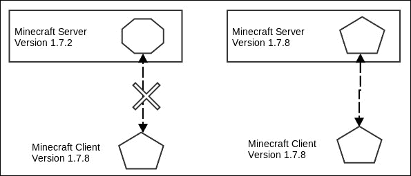

**图 1.5** 客户端与服务器之间的兼容性

通常，在 Minecraft 客户端升级后不久，就会发布兼容版本的 Minecraft 服务器软件。需要记住的一点是，`CanaryMod`是一个开源且自愿的项目——这意味着开发`CanaryMod`的人人并没有因此获得报酬。他们做这件事是为了乐趣。升级服务器软件需要大量工作，并且软件在发布前需要由志愿者进行测试。这就是为什么有时可能需要一段时间才能发布与最新客户端兼容的新版 Minecraft 服务器软件。请耐心等待，并记住开发`CanaryMod`的开发者们是为了乐趣而工作，并没有报酬，所以在`CanaryMod`论坛上发帖询问新版本何时准备好，并不会加快进度。

在撰写本文时，1.8 是 Minecraft 的最新版本，`CanaryMod`开发团队正在努力支持 1.8 版本，但`CanaryMod`最稳定的版本（在撰写本文时）是 1.7.10。本书中的示例代码已在`CanaryMod` 1.7.10 版本上测试过，因此我强烈建议下载并安装该特定版本。有一种方法可以安全地临时降级你的 Minecraft 客户端软件，使其与你的服务器软件兼容。

自 1.6 版本以来，Minecraft 启动器（你在计算机上运行以启动 Minecraft 客户端并在新版本可用时升级的软件）允许你选择要运行的客户端软件版本。默认情况下，启动器配置为始终下载并运行最新版本，但你可以使用新的配置文件功能轻松更改。以下是更改启动器配置文件以使用不同 Minecraft 客户端版本的逐步说明：

1. 启动 Minecraft。
2. 点击启动器屏幕左下角的“新建配置文件”按钮（参见**图 1.6**）。

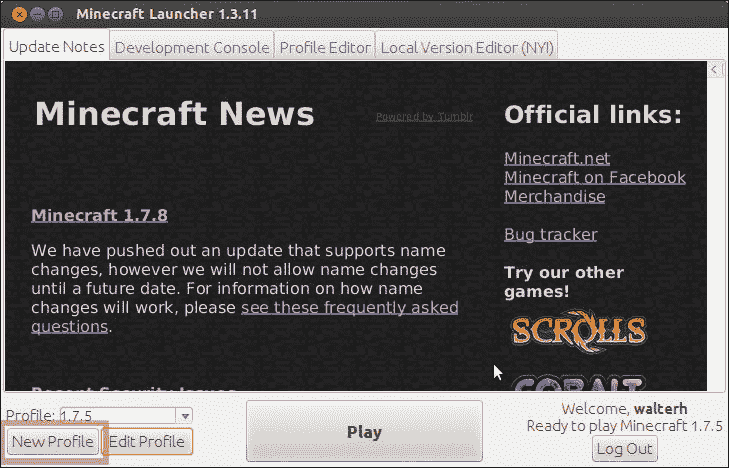

**图 1.6** Minecraft 启动器

3. 填写“配置文件名称”字段。例如，你可以将其命名为类似“Version 1.7.10”的名称。我发现将版本名称包含在新配置文件中很有帮助，这样我可以一目了然地看到该配置文件将使用哪个客户端版本。
4. 从“使用版本”下拉列表中选择合适的版本（参见**图 1.7**）。

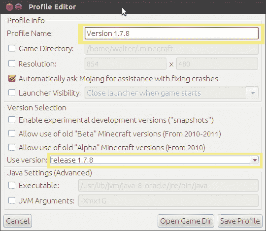

**图 1.7** Minecraft 配置文件编辑器

5. 点击“保存配置文件”按钮。

新创建的配置文件现在应该会自动在启动器主页的“配置文件”下拉列表中被选中。点击“开始游戏”按钮，使用所选版本的 Minecraft 客户端软件开始游戏（参见**图 1.8**）。

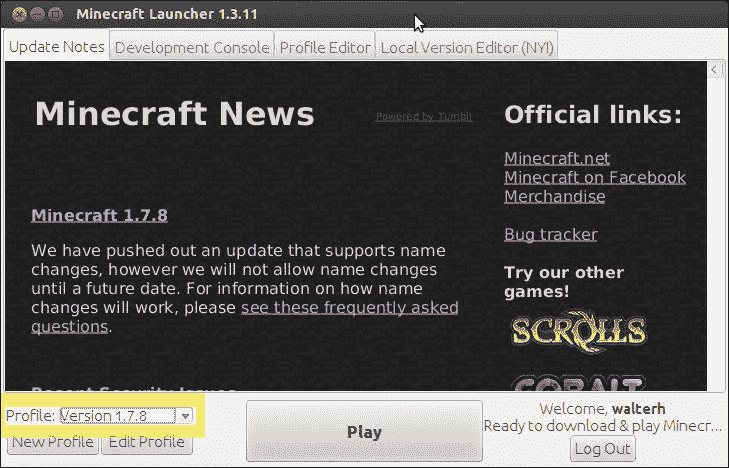

**图 1.8** 配置文件选择

通过使用配置文件编辑器降级你的 Minecraft 客户端软件，你可以确保客户端和服务器兼容，并且即使服务器软件不如当前最新版本的 Minecraft 客户端那么新，你也可以进行多人游戏。这意味着你始终可以使用最稳定的推荐版`CanaryMod`。

根据你使用的浏览器软件（Chrome、Safari、Internet Explorer 或 Firefox），下载说明会有所不同。请阅读你所用浏览器的说明。

### JAR 文件


`CanaryMod`软件以 JAR 文件形式提供下载。使用 Java 编程语言创建的程序通常以 JAR 文件分发，文件名以`.jar`结尾。JAR 是**J** **AR**chive（Java 归档文件）的缩写。它是 Java 运行该软件所需的所有代码和资源的归档文件。`CanaryMod`以 JAR 文件形式分发，`CanaryMod`的所有插件也是如此。

### 下载说明

按照以下步骤下载`CanaryMod`：

1. 在你的计算机上创建一个名为`mcserver`的新文件夹。
2. 访问[`scriptcraftjs.org/download/latest/`](http://scriptcraftjs.org/download/latest/)。右键点击`canarymod.jar`链接，选择“链接另存为”。
3. 将 JAR 文件保存到步骤 1 创建的文件夹中。

下载完成后，下一步是在你的计算机上安装`CanaryMod`。每个操作系统的说明略有不同，因此请直接跳转到你所用操作系统的说明部分。

#### 在 Windows 上安装 CanaryMod

按照以下步骤在 Windows 上安装`CanaryMod`：

1. 打开记事本（你可以通过点击屏幕左下角的“开始”或 Windows 按钮，然后在搜索框中输入“记事本”来找到它）。
2. 在记事本中输入以下内容：

```
java -Xmx1024M -jar canarymod.jar -o true
PAUSE
```
3. 将文档保存为`run.bat`，保存在你之前创建的`mcserver`文件夹中。重要的是，将“保存类型”选项从“文本文档”更改为“所有文件”。否则，记事本会尝试将文档保存为`run.bat.txt`，导致无法执行。
4. 双击上一步保存的`run.bat`文件，`CanaryMod`应该会开始运行。如果你看到错误消息“Java is not recognized as an internal or external command, operable program or batch file.”，那么你需要重新安装 Java。Java 是 Minecraft 的编程语言，也是`CanaryMod` Minecraft 服务器的编程语言。你可以访问[www.java.com](http://www.java.com)并按照说明下载 Java。如果安装 Java 后仍然出现同样的错误，请按照[www.java.com/en/download/help/path.xml](http://www.java.com/en/download/help/path.xml)上的说明进行操作。
5. 假设服务器已启动（你没有看到任何错误），你可以通过在服务器控制台输入`stop`命令（输入`stop`然后按回车）来关闭服务器。

#### 在 Mac OS 上安装 CanaryMod

按照以下步骤在 Mac OS 上安装`CanaryMod`：

1. 首先需要安装 Java。自 OS X 10.7 起，Java 不再随 OS X 一起提供，因此你需要从 Apple 的 Java 安装页面[`support.apple.com/kb/DL1421`](http://support.apple.com/kb/DL1421)安装 Java。
2. 打开文本编辑（TextEdit）。（你可以通过在屏幕右上角的 Spotlight 字段中输入“TextEdit”来找到它。点击放大镜图标打开 Spotlight。）在“格式”菜单下，选择“制作纯文本”，然后输入以下内容：

```bash
#!/bin/bash
cd "$(dirname "$0")"
java -Xmx1024M -jar canarymod.jar -o true
```
将文件保存到`mcserver`文件夹中，命名为`start_server.command`。
3. 你需要运行这个新创建的文件，请按照以下步骤操作：
    a. 打开终端应用程序。（找到它，点击放大镜图标，然后在 Spotlight字段中输入“Terminal”。）
    b. 输入`chmod +x`（先不要回车）。
    c. 在 Finder 中找到刚刚创建的文件，将其拖放到终端窗口中。
    d. 将拖放到终端窗口中的文件名附加到`chmod +x`命令后面，现在你可以回车了。
4. 双击`start_server.command`文件。
5. 要停止服务器，请在终端窗口执行`stop` 命令（输入`stop` 然后回车）。

#### 在 Linux（Ubuntu）上安装 CanaryMod

按照以下步骤在 Linux 上安装`CanaryMod`：

1. 点击屏幕左上角的“Dash”按钮打开主页；然后输入“Edit”查看编辑器列表（你可以选择任何喜欢的编辑器）。
2. 在编辑器中输入以下内容：

```bash
#!/bin/sh
BINDIR=$(dirname "$0")
cd "$BINDIR"
java -Xmx1024M -jar canarymod.jar -o true
```
3. 将文件保存为`canarymod.sh`，存放在创建的`mcserver`文件夹中。
4. 你需要让这个文件成为可执行。在 Nautilus（文件浏览器）中右键点击文件并选择“属性”。在属性框中，点击“权限”卡，确保“执行”框已选。（你也可以在该文件所在的文件夹中执行`chmod +x canarymod.sh`。）
5. 启动终端应用程序，输入`~/mcserver/canarymod.sh`（假设你在目录下创建了文件夹）。
6. 一旦服务器启动，你可以通过执行`stop` 命令（输入`stop` 然后回车）来停止。

##### 同意用户许可

从 Minecraft 1.7.10 版本开始，你需要在首次运行服务器之前同意 Mojang 的用户许可。首次运行服务器时，它会停止并显示以下错误：“你需要同意 EULA才能运行。”要同意 EULA，打开`mcserver`文件夹中的`eula.txt`文件，并将其修改为：

```
eula=true
```
保存`eula.txt`文件，然后重启服务器。这次应该正常运行，不再报错。

##### 配置你的服务器

安装 CanaryMod 后下一步就是配置。在这里你可以决定运行哪种类型的服务器：是否包含怪物？是生存模式还是创造模式？是否允许玩家战斗（PvP）？虽然配置通常只需要一次，你也可以随时更改。记住更改配置需要重启服务器。

##### server.cfg 文件

当你首次启动服务器时，`mcserver/config` 文件夹会生成一些配置文件。其中最重要的文件是`server.cfg`。这是一个纯文本文件（可以使用任何文本编辑器），其中包含了服务器的所有配置。`server.cfg`文件的前几行所示：

```
# Minecraft properties
op-level=4
allow-nether=false
allow-flight=false
announce-player-achievements=true
server-port=2565
```
前两行——以 `#` 字符（也称为井号）开头的行是注释，因此服务器会忽略它们。配置从第三行开始。服务器的设置使用名称-值对的形式，例如`allow-flight=false`就是一个名称-值对，其中名称是`allow-flight`，值是`false`。在属性文件中，名称和值由 `=`（等号）分隔。下面来看你可能想要更改的属性。

###### 世界类型

在本书后面，我将向你展示如何创建道路和摩天楼。如果你打算最终将学到的技能用于建造供参观的大场所，你可能需要编辑`mcserver/config/worlds/default/default.cfg`文件，并将`world-type`属性从`DEFAULT`（Minecraft的标准设置，世界由丘陵、山谷和海洋等多样地形组成）改为`FLAT`。在`FLAT`世界中，没有丘陵，没有山谷，只有望无际的平坦地形。虽然这可能被认为很无聊，但它具有更容易建造的优势。如果你计划建造道路、房屋和其他大型建筑，`FLAT`世界可能是最好的起点。将`world-type`设置为`FLAT`并非必须；你也可以始终保留`DEFAULT`设置，然后平整你想要建造的区域。（如果你后来决定更改世界类型，该设置仅适用于创建新世界。现有世界不会被修改。）

如果你决定创建一个新世界，并且希望使用DEFAULT以外的世界类型，你有两个选择：

- 同时更改`world-name`和`world-type`属性，以创建新世界并保留旧世界。（旧世界不会删除——它仍然保存在计算机上的`worlds`文件夹中。）如果你想保留现有的世界数据，这是最佳选择。你需要将`world-name`设置为默认值以外的名字。给你的新世界起一个容易记住的名字，比如`flat-world`。
- 如果你不关心现有世界，请从`mcserver`文件夹中删除`worlds`文件夹，然后更改`world-type`属性。下次服务器启动时，将创建一个新世界和一个新的`worlds`文件夹。

###### 怪物

你可能想要更改的下一个设置是位于`mcserver/config/worlds/`文件夹中的世界配置文件中的`spawn-monsters`设置。这决定了是否生成怪物。默认情况下，它设置为`true`，这意味着怪物会在夜间出现。我建议将此设置从`true`改为`false`，因为你在学习编程时最不需要的就是被巨型蜘蛛攻击。你可以随时更改此设置。该设置只有在重启服务器后才会生效。

###### 游戏模式

出于同样的原因，我建议将你的服务器设为无怪物区域，同时我也建议将服务器的`gamemode`属性从`0`（生存模式）改为`1`（创造模式）。


在服务器控制台窗口中，你不需要像在 Minecraft 客户端中那样在命令前加斜杠（`/`）。因此，你只需输入命令名称，不带前导的`/`。记住：用`help`而不是`/help`，用`toggledownfall`而不是`/toggledownfall`，以此类推。

关于服务器控制台的另一个注意事项是，当你在此输入命令时，你是以一个名为`CONSOLE`的特殊玩家身份执行的。在 Minecraft 中，`/me`命令用于以`你的名字 动作`的形式向其他玩家发送消息。例如，如果我在 Minecraft 客户端中输入命令`/me sneezes`，服务器上的所有其他玩家将看到`walterh sneezes`。然而，如果你在服务器控制台中输入同样的命令，你将看到`@ sneezes`而不是你自己的名字。`CONSOLE`对其他玩家不可见，也不存在于 Minecraft 世界中。通常只有启动服务器的人才能以`CONSOLE`身份发出命令。

要停止服务器，你应在服务器控制台中输入`stop`命令。如果你计划管理一个供他人游玩的 Minecraft 服务器，那么当你需要关闭服务器进行维护或故障排除时，`stop`命令会非常有用。

## 连接到你的服务器

要检查你的服务器是否正在运行并接受连接，请按照以下步骤操作：

1. 像平常一样启动 Minecraft 游戏。
2. 启动 Minecraft 并登录后，点击“多人游戏”按钮。
3. 如果这是你第一次连接到自己的服务器，请点击“添加服务器”按钮。如果不是第一次连接，请跳到第 8 步。
4. 填写“服务器名称”字段。你可以为服务器取任何你喜欢的名字。如果暂时想不出有创意的名字，默认名称“Minecraft Server”也可以。
5. 在“服务器地址”字段中，你应该输入`localhost`。如前所述，`localhost`是一个特殊的服务器地址，意思是“同一台电脑”。你也可以使用`127.0.0.1`，这是`localhost`的 IP 地址（服务器通常有一个名称和/或地址，通常可以通过名称或地址连接）。使用`localhost`或`127.0.0.1`中的任意一个，但不要同时使用；两者都可以。
6. 输入服务器地址后，点击“完成”按钮。
7. 你刚刚添加的新服务器应该会出现在服务器列表中。如果看不到，请使用滚动条向下滚动。如果你已经添加了其他服务器，它可能不会出现在列表顶部。由于你是通过“添加服务器”按钮（而非“直接连接”按钮）添加的，因此每次启动 Minecraft 时它都会出现在多人游戏服务器列表中。
8. 选择该服务器，然后点击“加入服务器”按钮。

如果在尝试连接时出现错误，请确保你的服务器首先正在运行（参见前面关于启动服务器的部分）。如果服务器未运行，你将看到错误`Failed to connect to the server. java.net.ConnectException: Connection refused`。如果看到此错误，请点击“返回标题画面”按钮，然后启动服务器并重试。

登录到你的服务器后，四处看看。在自己的服务器上拥有管理员权限非常重要。你可以通过输入`/time set 4000`命令来检查你是否拥有正确的权限。如果你能无错误地运行此命令，那么一切就绪。如果你看到警告消息“You do not have permission to perform this command”，那么你需要在服务器控制台窗口中将自己设为管理员。切换到服务器控制台窗口（Windows 上按`Alt+Tab`，OS X 上按`Cmd+Tab`），输入`op username`，将`username`替换为你的用户名；然后切换回 Minecraft 游戏，并尝试在游戏内提示符下输入`/time set 4000`命令。一旦确认你拥有管理员权限，就可以放松休息了。或者，如果你家里有闲置的电脑，可以邀请朋友或家人加入你的服务器。如果这是你第一次与朋友或家人一起玩 Minecraft 多人游戏，你会玩得很开心。

### 成就解锁！

现在，你应该安装并运行了自己的 Minecraft 服务器。。喜你，你已经在成为 Minecraft 模组开发者的道路上迈出了坚实的一步！


## 其他服务器选项

还有其他 Minecraft 服务器选项可用，但如果你想开始模组开发，安装并运行自己的服务器是唯一明智的选择。

### 商业 Minecraft 托管

一旦你掌握了服务器管理和模组开发，你最终可能会决定使用网上提供的众多商业 Minecraft 托管方案之一。这些 Minecraft 托管提供商通常会按月收费，并非免费。付费后，他们会为你提供一个你朋友可以连接并游玩的服务器。商业 Minecraft 托管并不便宜，而且不如运行自己的服务器灵活。你可以通过在线搜索 Minecraft hosting 来找到托管商列表。

### Minecraft Realms

Mojang 已在全球推出了自己的 Minecraft 解决方案——Minecraft Realms。Minecraft Realms 目前不支持任何类型的插件，尽管可能会改变。

## 第 2 章 设置 ScriptCraft

在上一章中你下载并安装了 CanaryMod——一个可定制服务器。在本章中，将安装 ScriptCraft——一个允许你使用 JavaScript 编写插件。

### 什么是 ScriptCraft？

ScriptCraft 是一款 Minecraft 插件，让你用 JavaScript 而非 Java 来创建插件。它是一个服务器插件，意味着它安装在服务器（`CanaryMod`）上，但安装后所有玩家都能使用。

### ScriptCraft 概述

大多数 Minecraft 插件是用一种叫 Java 的语言编写的。Java 发明于 1990 年代，程序员使用 `C` 和 `C++` 等语言，这些语言难以学习和使用。`C` 和 `C++` 之困难是因为如果你编写一个程序想要内存中占用一些空间，必须记得在需要时释放。否则，内存很快耗尽，程序就会崩溃。Java 通过自动回收（是的，程序员确实这么呼它）解决了这个问题，它会在需要时自动释放内存。Java 还有许多优点。它拥有庞大的函数库用于执行常见任务，这样你就不必自己这些函数。Java 是跨平台的，这意味着它可以在 Windows、Linux 和 Mac 上运行。Minecraft 是 Java 编写的，服务器也是如此。Java 是一种优秀的语言，被广泛使用。然而，它可能有点难学，尤其是当你完全是个新手时。Java 可能冗长，意味着做简单的事情也需要编写大量代码。Java 代码不能立即执行，你需要先编译它。编译是将 Java 源代码转换为计算机理解的形式。JavaScript 紧随 Java 之后出现，发明于 1990 年代中期，正值互联网开始流行。尽管它们听起来相似，但它们是完全不同的。JavaScript 在许多方面比 Java 更简单。近年来，它不仅仅是一种用于 Web 编程的语言，被广泛应用于各种用途。

### 安装 ScriptCraft

要下载并安装 ScriptCraft，请按照以下步骤：

1. 访问[`scriptcraft.org/download/latest/`](http://scriptcraft.org/download/latest/)。
2. 右键单击 `scriptcraft.jar` 文件，然后从弹出菜单中选择“另存为”。
3. 将文件保存到 `/mcserver/plugins` 文件夹。如果没有 `plugins` 文件夹，很可能是因为你还没有启动 `CanaryMod`。第一次启动 `CanaryMod` 时，它会创建一些配置文件和 `plugins` 文件夹，因此确保在尝试下载 ScriptCraft 之前至少启动过一次 `CanaryMod`。

如果你的 `plugins` 文件夹中已经有一个 `scriptcraft.jar` 文件（如果不是你第一次安装 ScriptCraft），请务必先删除，然后再保存新文件。如果 `CanaryMod` 正在运行，请在服务器控制台中输入 `stop` 命令来停止它。双击你在第 1 章创建的启动脚本，启动 `CanaryMod`。当 `CanaryMod` 启动时，你应该会在服务器控制台中看到一条“Enabling scriptcraft”消息。第一次加载时，ScriptCraft 插件会将大量文件解压到一个新的 `/mcserver/scriptcraft` 文件夹中。你的服务器控制台输出类似于图 2.1。

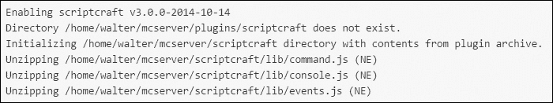

**图 2.1** 解压文件

由于 ScriptCraft 捆绑了许多文件，因此会有更多条目。`/mcserver/plugins` 子文件夹很重要。它是所有 Minecraft 服务器插件应该存放的位置。这不仅适用于 `ScriptCraft.jar`，也适用于所有服务器插件。如果你将服务器插件 JAR 文件保存到除 `plugins` 文件夹之外的任何位置，那么当 `CanaryMod` 启动时，它不会被加载。`CanaryMod` 在启动时只会在 `plugins` 文件夹中查找要加载的插件。

### 验证 ScriptCraft 是否已安装

你可以通过在服务器控制台中输入以下命令来验证 ScriptCraft 是否已成功安装：

```
js 2 + 3
```

请确保完全按照你看到的内容输入，然后按 Enter 键。服务器控制台返回的响应应该是 5。

### 成就解锁！

恭喜！你已经成功安装了 ScriptCraft 并执行了你的第一行 JavaScript 代码。


ScriptCraft 仅为 Minecraft 服务器添加了两个新的服务器命令：`js` 和 `jsp`。我将在本书后面介绍 `jsp`。`js` 命令是“JavaScript”的缩写，它允许你立即执行 JavaScript 代码。你将在下一章了解更多。

## 第 3 章：在 Minecraft 中探索 JavaScript

安装 ScriptCraft 后，你可以使用 `js` 命令来评估代码。`js` 命令会尝试将其后面的文本作为 JavaScript 评估。如果你输入 `js 2 + 7`，`js` 命令会获取 9 并打印出结果。

### 基本数学运算

到为止，你使用的表达式都是简单的数学运算。JavaScript 有许多数学运算。我希望你在阅读时，将以下表达式作为练习。学习编程的最佳方法是动手尝试。

加法使用 `+` 运算符。

```
js 2 + 2
```

除法使用 `/` 符号。

```
js 2 / 3
```

减去数字，使用 `-` 符号：

```
js 2 - 3
```

乘法使用 `*` 符号。

```
js 2 * 3
```

### 比较数字

JavaScript 也可以比较数字，你可以这样问“3 大于 5？”：

```
js 3 > 5
```

答案是 false。你可以这样问“3 小于 5？”：

```
js 3 < 5
```

答案是 true。你可以这样问“3 等于 5？”：

```
js 3 == 5
```

注意，我使用了 `==` 符号而不是 `=`，这一点很重要。结果应该是 false。`true` 和 `false` 值非常重要，因为它们在编程中用于让计算机表现出不同的行为。

### 变量

变量提供了一种为数字和其他类型命名的方法以便记忆、检索和操作。

#### 创建变量

你不能在 `js` 命令后面随便输入什么就得到答案。必须使用 JavaScript 能够理解的表达式。例如，如果你输入：

```
hearts
```

服务器会返回错误 `javax.script.ScriptException: "hearts" is not defined`，这是 JavaScript 在说“我不明白 hearts 是什么”。目前 JavaScript 不知道 `hearts` 是什么。如果你想告诉计算机 `hearts` 是什么，可以这样做：

```
hearts = 8
```

这基本上表示 `hearts` 等于 8。关于前面的表达式有几点注意：首先，`hearts` 现在是一个变量。变量就是 JavaScript 用存储东西。所有编程语言都使用变量存储信息。当你希望计算机记住某件事并跟踪它时，你就使用变量。你可以把变量看作一个命名的存储位置。它就像储物箱（见图 3.1）。

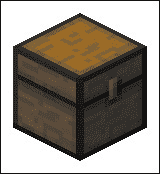

**图 3.1** 变量就像箱子。你可以把东西放在里面。现在当你输入 `js hearts` 时，JavaScript 会理解 `hearts` 是什么，记住它的值并打印出来。试试看：

`js hearts`

它应该打印出 8。其次，在 `js hearts = 8` 这个表达式中做的是赋值。也就是说，我使用 `=` 号将值 8 给了变量 `hearts`。我可以像这样给变量 `hearts` 重新赋一个不同的值：

`js hearts = 9`

这就是为什么变量被称为变量——它们可以变化（或改变）。现在当你执行以下命令时，结果是 9：

`js hearts`

就像你可以用 JavaScript 对数字进行数学运算一样，你也可以对变量进行数学运算。试试这个命令：

`js hearts + 1`

前面的语句应该打印出 10 作为结果。这是因为计算机现在知道 `hearts` 等于 9，而 9 + 1 等于 10。请自行尝试以下命令：

 `js hearts + 5`
 `js hearts - 2`
 `js hearts * 2`
 `js hearts / 3`

执行完所有这些命令后，再执行以下命令：

`js hearts`

你会注意到 `hearts` 变量的值没有改变。仍然是 9。如果你想按某个数量改变 `hearts` 的值，你需要重新给它赋一个新值。你可以这样做：

`js hearts = hearts + 1`

这里你做的把一个数学运算和一个赋值结合在一条语句中。现在执行命令 `js hearts`，你会看到 `hearts` 现在是 10。

##### 字符串变量

让我们创建另一个名为 `healthmessage` 的变量，并给它赋一个值，如下所示：

```
js healthMessage = 'You have ' + hearts + ' health remaining'
```

这里你创建了一个新变量并给它赋了一个值。这个值是文本“You have”加上 `hearts` 变量的值，再加上文本“health remaining”。在 JavaScript 中，`' '`（单引号）或 `" "`（双引号）之间的所有内容都被视为文本。这个表达式的结果如下：

```
You have 10 health remaining
```

在 JavaScript 中，文本也被称为字符串。在《我的世界》中，字符串是蜘蛛有时被杀死时掉落的材料。字符串也是程序员在谈论文本时使用的词。以下是 JavaScript 中字符串（文本）的一些示例：

 `js "Hello"`
 `js 'Goodbye'`


 `js "Minecraft 1.7.9"`

 `js "123"`

最后一个可能会让你惊讶。JavaScript 将引号之间的任何内容都视为字符串，即使它是一个数字！在我们的第一个字符串示例中，`js healthMessage = 'You have ' + hearts + ' health remaining'`，我使用了 `+` 运算符来拼接字符串。`+` 运算符可以用于数字或字符串的加法。当用于拼接字符串时，`+` 运算符的行为不同。在 JavaScript 中，拼接字符串也称为`连接`。你将两个或多个字符串连接在一起，形成更大、更长的字符串。这是你在编写《我的世界》插件时经常用到的一种技术，用于向玩家显示信息。

构成字符串的字母、数字和其他符号被称为`字符`。`字符`是任何单个字母、数字或符号。`a`、`B`、`9`、`-`、`.`、`/` 和 `:` 都是字符的例子。

### 转义引号

在 JavaScript 中，你可以用单引号（`''`）或双引号（`""`）括起字符串，但如果你的字符串需要包含这些字符呢？在 JavaScript 中有几种方法可以做到这一点。

如果你的字符串只包含单引号，你可以用双引号括起字符串。

```
js "I'm a String!"
```

如果你的字符串只包含双引号，你可以用单引号括起字符串。

```
js 'He said "No"'
```

你可以通过在单引号或双引号字符前面加上反斜杠 `\` 来转义它们。

点击此处查看代码图像

```
js 'He said "I\'m a String!".'
```

```
js "He said \"No\""
```

### 变量命名

你可以在 JavaScript 中创建任意数量的变量。你会注意到 `hearts` 和 `healthmessage` 这两个变量都使用了单个单词的名称。我不能把 `healthMessage` 变量叫做 `health message`，因为变量名不能包含空格字符。关于 JavaScript 接受什么样的有效变量名，还有其他一些规则。它不喜欢以数字开头的变量名，所以 `2player` 不是有效的变量名，但 `player2` 是。

JavaScript 程序员通常习惯使用小写字母作为变量名，如果变量名由两个单词连接而成（如 `healthMessage`），那么第二个单词的首字母通常大写。这种变量命名风格被称为`驼峰式命名法`，被认为是 JavaScript 程序员中的“良好实践”。这意味着使用这种命名约定可以让程序员更容易阅读和理解彼此（以及自己）的代码。

你可以在维基百科上阅读更多关于驼峰式命名法的内容（[`en.wikipedia.org/wiki/CamelCase`](http://en.wikipedia.org/wiki/CamelCase)`）。

### 犯错

现在请随意尝试。使用你自己的数字、字符串和运算符创建你自己的变量。如果你犯了错误，你会在控制台窗口中看到一条冗长的错误消息。这些错误消息被称为`堆栈跟踪`，是计算机告诉你出了问题的方式。堆栈跟踪对 Java 程序员可能有用，但对 JavaScript 用处不大。请记住，《我的世界》服务器软件是用 Java 编写的，而不是 JavaScript。你可以把 ScriptCraft（你在服务器控制台中输入 `js` 命令时使用的插件）看作一个翻译器。它将你输入的 JavaScript 代码翻译成 Java 代码，以便服务器理解。如果 JavaScript 代码没有意义，那么翻译就不会成功。

不要担心犯错。犯错是学习新事物的必要部分。计算机对代码非常挑剔，会断然拒绝执行不正确的代码。我们人类擅长对话，因为我们允许错误，并且即使有背景噪音，也能很好地猜测别人想表达的意思。另一方面，计算机相当愚蠢，如果你的代码不正确，它们无法猜测你的真实意图。好消息是，每次你犯错，你都会学到新东西。以下每条语句都会导致错误：

点击此处查看代码图像

```
js help
ReferenceError: "help" is not defined
```

这是 JavaScript 在说“我不知道 help 是什么”。

点击此处查看代码图像

```
js 'steve
EvaluatorException: unterminated String literal
```

这意味着 JavaScript 遇到了一个字符串 `'steve`，它缺少闭合引号符号。字符串必须以单引号（`'`）或双引号（`"`）开头和结尾。此外，你不能混用它们；你不能以单引号开头而以双引号结尾。字符串 `'this is good'` 和 `"so is this"` 都是有效的，但字符串 `'this is bad"` 和 `"another bad one'` 则无效。

点击此处查看代码图片

```
js :-)
EvaluatorException: syntax error
```

如果 JavaScript 无法理解你的代码，它会返回一个`语法错误`。从这个例子可以清楚地看出，JavaScript 不知道笑脸是什么。

在学习编程的过程中，你会遇到错误。一个放错位置的逗号、引号或句点，计算机就会通过`抛出异常`来抱怨。请记住要保持耐心。计算机并不像我们那么聪明，所以在输入代码时必须格外小心。

***

术语：异常

异常是计算机没有预料到的事情——这就是它“异常”的原因。在 JavaScript 中，`抛出异常`是 JavaScript 表示发生了意外情况的方式。异常通常包含一个堆栈跟踪，即异常发生时程序所在位置的痕迹。

***

### `var` 关键字

我 之前说过，你可以通过输入一个名称并为其赋值来创建一个新变量。在之前的示例中，如下所示：

```
js hearts = 8
```

这条语句做了两件事。

 一个名为 `hearts` 的新变量被`声明`。

 该变量还被`赋值`了一个值（8）。

```
js hearts = 8
```

你应该始终使用 `var` 关键字。如果变量没有使用 `var`，它们就会变成`全局`变量。全局变量会导致混乱，因为程序的不同部分都可以访问和修改该变量。好消息是，每次你犯错，你都会学到新东西。以下每条语句都会导致错误：

点击此处查看代码图像

```
js help
ReferenceError: "help" is not defined
```

这是 JavaScript 在说“我不知道 help 是什么”。

点击此处查看代码图像

```
js 'steve
EvaluatorException: unterminated String literal
```

这意味着 JavaScript 遇到了一个字符串 `'steve`，它缺少闭合引号符号。字符串必须以单引号（`'`）或双引号（`"`）开头和结尾。此外，你不能混用它们；你不能以单引号开头而以双引号结尾。字符串 `'this is good'` 和 `"so is this"` 都是有效的，但字符串 `'this is bad"` 和 `"another bad one'` 则无效。

点击此处查看代码图片

```
js :-)
EvaluatorException: syntax error
```

如果 JavaScript 无法理解你的代码，它会返回一个`语法错误`。从这个例子可以清楚地看出，JavaScript 不知道笑脸是什么。

### `null` 关键字

JavaScript 中的 `null` 关键字是一个特殊对象，程序员用它来表示没有值。当你声明一个新变量时，你可以显式将其赋值为 `null`，以更清楚地表明变量是空的。

```
js hearts = null
```

这是声明变量并赋予值的常规方式。

### 声明多个变量

你可以使用 `var` 关键字声明一个变量，也可以使用它在一条语句中声明任意数量的变量。例如，要声明变量 `gameMode` 和 `allowFlight`，你可以使用两条独立的语句，如下：

```
js var gameMode = 1
js var allowFlight = true
```

或者，你也可以一条语句中同时声明两者，如下：

```
js var gameMode = 1, allowFlight = true
```

现在，使用一条语句声明变量已经变得常见。

### 加法和减法

你将在探索更多 JavaScript 数学运算的同时，操作 `hungerBar` 变量。在 Minecraft 中，饥饿条是屏幕底部健康条旁边的条，它显示你的饥饿程度。饥饿条会随着你疲劳而减少，并在你进食时恢复。这是通过加法和减法实现的。在 JavaScript 中，对变量进行加法运算有多种方式。你可以使用以下操作进行递增（意味着加 1）：

```
js hungerBar = hungerBar + 1
```

这将 `hungerBar` 变量增加 1。结果（假设 `hungerBar` 之前的值是 10）将是 11。在大多数编程语言中，这种操作非常常见，因此语言设计者提供了简写方式：

```
js hungerBar += 1
```

这用更少的字符完成了相同的事情。这条语句还可以进一步缩短，写如下形式：

```
js ++hungerBar
```

`++`（两个相邻的 `+` 号）是许多编程语言（包括 JavaScript）中用于递值的约定。类似，从变量中减去值的规则也相同。以下三条语句都做同样的事情——各自减 1：

```
js hungerBar = hungerBar - 1
js hungerBar -= 1
js --hungerBar
```

使用哪条语句取决于个人品味和风格。虽然 `--hungerBar` 更容易输入，但我个人更喜欢 `hungerBar = hungerBar - 1`，因为我认为它读起来更好。

### 数据类型

变量用于存储值。这些值可以是数字、文本或 JavaScript 中可用的许多数据类型之一。你可以使用 `typeof` 运算符询问变量具有什么“类型”的数据。例如，要找出 `hungerBar` 变量保存的数据类型，请使用以下代码：

```
js typeof hungerBar
```

结果是 `number`。`typeof` 运算符不会告诉你值是什么，只会告诉你它的类型。以下是 JavaScript 中不同的数据类型：

 `Number`

 `String`

 `Boolean`

 `Object`

 `Undefined`

 `Function`

为了练习使用 `typeof` 运算符，请在服务器控制台窗口中尝试以下每个示例：

```
js typeof false
js typeof true
js typeof 5
js typeof 9.99
js typeof 'Hello'
js typeof "Goodbye"
js typeof "5"
js typeof console
js typeof Herobrine
js typeof parseInt
```

### 函数

JavaScript 中的函数非常强大，因为它们是容器，可以任意调用。你可以编写自己的函数，也可以使用语言提供的内置函数。

#### 使用函数

`parseInt()` 函数是一个有用的函数，它接受任何文本并尝试从中提取数字。假设你有一段文本 `'4 hours until sunset'`。如果你将文本传递给 `parseInt()` 函数，它会尝试找出数字。

```
js parseInt('4 hours until sunset')
```

结果应该是 `4`。这里你做的是 `'4 hours until sunset'` 文本传递给 `parseInt()` 函数，该函数处理并返回一个值。

#### 编写自己的函数

编程中真正酷的一点是，你不局限于只使用语言内置函数。你可以创建自己的函数。在书中中，你将创建许多函数，以实现 Minecraft 中通常做到的事情。现在，让我们创建一个简单的函数，将两个数字相加。你需要在 Minecraft 中一行内输入以下代码。为了可读性进行了换行。

```
function add(firstNumber, secondNumber) {
    return firstNumber + secondNumber;
}
```

当你输入这个命令时，什么也不会发生。因为你刚刚声明了一个名为 `add` 的新函数。该函数在你调用它之前不会执行任何操作。让我们来调用它：

```
add(1, 2)
```

结果是 `3`。尝试用不同的值调用它，测试函数是否正常工作。

```
add(5, 6)
add(9, 1)
```

现在让我们更详细地看看函数声明。函数是一种将代码打包以便重复使用的方式。当你创建一个函数时，必须说明该函数期望哪些参数。你通过将名称放在圆括号——`(` 和 `)` 符号之间——来实现这一点。一个函数可以接受一个或多个参数。如果它接受多个参数，则每个参数必须用逗号（`,`）分隔。因此，函数声明的第一部分 `function add(firstNumber, secondNumber)` 为函数命名（`add`）并说明函数期望什么。定义函数的下一步是说明函数应该做什么。左花括号和右花括号——`{` 和 `}` 符号之间的所有代码都是每次调用函数时执行的代码。图 3.2 展示了函数定义语句的不同部分。

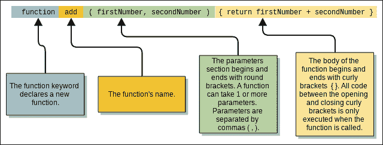

**图 3.2 函数结构

***

**术语：复用**

复用是编程中的重要概念。在编程时，你经常会发现当前遇到的问题与你之前解决过的问题类似。在这种情况下，能够使用你已经编写的代码解决新问题总是好的。有两种方法可以做到这一点：你可以复制你已经编写的代码，但更好的方法是修改你之前编写的代码，使其既能在之前的程序中工作，也能在你当前正在的新程序中工作。有几种编写复用代码的方法——将代码打包到函数中只是其中之一。在书中你将探索更多创建复用代码的方法。

***

当你创建自己的新函数时，应该给函数起一个有意义且容易记住的名字。你可以随意命名函数参数。它们不必叫做 `firstNumber` 和 `secondNumber`，但你应该给参数起容易记住的名字，这样你就不会忘记参数的用途。

在前面的示例函数中，有一条语句 `return firstNumber + secondNumber`，每次调用该函数时都会执行它。`return` 关键字是 JavaScript 中的另一个特殊词。它在函数中用于向调用者返回某些内容。在这个例子中，你返回传入的两个数字的和。`return` 关键字只能在函数内部使用。

### 成就解锁！

你已经创建并调用了你的第一个函数。函数是 JavaScript 的重要组成部分，在书中你将创建更多函数。


我们只是触及了 JavaScript 中函数的皮毛。你将在后续章节中更深入地探索它们。

### 总结

在本章中，你学习了如何在服务器控制台提示符下执行 JavaScript。你探索了数学运算、变量和字符串，以及学习 JavaScript 时会遇到的错误类型。我还提到了函数——如何调用它们以及如何创建它们。在下一章中，你将学习编程编辑器——构建你的模组工作台的最后一块拼图。

## 第 4 章 选择和使用文本编辑器

到目前为止，你一直在服务器控制台窗口中使用 `js` 命令执行 JavaScript。这是尝试 JavaScript 的一种非常好的方式。在尝试新事物和探索新语言时，拥有一个命令行解释器是很棒的。然而，一旦你想开始用 JavaScript 做一些实际工作，你就会希望能够保存你的工作并运行它，而不必每次服务器启动时都在服务器控制台窗口中发出许多 `js` 命令。

ScriptCraft 允许你加载已保存的 JavaScript 文件，并且可以在服务器启动时自动运行它们，或者按需运行你的代码。如果你打算保存你的工作，你需要使用文本编辑器编写代码。任何文本编辑器都可以，但我强烈建议使用专用于编程的文本编辑器。编程文本编辑器会有一些额外的功能，使编写代码比在像记事本这样的普通文本编辑器中更容易。大多数编程编辑器都有所谓的语法高亮功能，它会为代码的不同部分着色，使其更易于阅读。比较 `图 4.1`（来自普通文本编辑器）和 `图 4.2`（来自编程编辑器）。

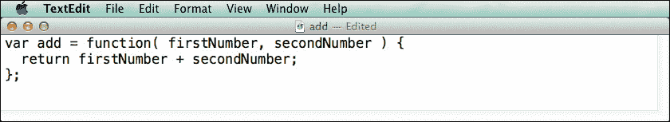

图 4.1 在无语法高亮的编辑器中显示的 JavaScript 代码

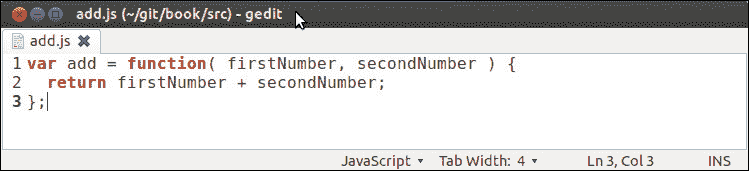

图 4.2 开启语法高亮的编辑器中的 JavaScript 代码

我想你会同意，图 4.2 中的语法高亮让代码读起来更舒适。

### 选择编辑器

有许多编程编辑器可供选择。最终选择哪款编辑器取决于你自己。多年来我一直使用`Emacs`——一款开源编辑器，但我不推荐给初学者，因为它虽然功能强大，但需要花时间学习。程序员用久了会对自己的编程编辑器产生深厚感情。你应该从一款易于使用和学习的编辑器开始。本章中，我将介绍`gedit`，但你可以使用以下任何一款编程编辑器来开始编程：

 `Notepad++` 是一款适用于 Windows 的免费编辑器，可从 [`notepad-plus-plus.org/` 下载。

 BareBones Software 出品的`Textrangler` 是一款适用于 Mac OS 的免费编辑器，从 [`www.barebones.com/products/textwrangler/` 下载。

 `Sublime Text` 是一款跨平台编辑器，你可以无限期评估。从 [`www.sublimetext.com/` 下载` Sublime`。

让我们开始安装 `gedit`。如果你已经在电脑上安装并使用了编辑器，可以跳过本节。Mac OS 用户可以跳过下一节，直接前往“在 Mac OS 上安装 Text”。

### gedit

本书中使用的编辑器叫 `gedit`。我选择 `gedit` 用于本书如下：

 它是跨平台的，意味着可以在 Windows 和 Linux 上运行。`gedit` 也支持旧版 Mac OS（最高到 10），但我推荐 Mac OS 用户使用 `Textrangler`。

 它轻量且易于使用。安装快速，占用空间小，也没有需要学习。它具备入门所需的功能。

 它有一个磁盘面板，可以显示正在操作文件夹。当你需要快速浏览文件夹查找要的文件时，非常方便。

 它是免费的。下载无需付费，你不必使用 `gedit`。任何编程编辑器都有类似的功能：它们允许你创建新文件、编辑和保存文件。你可以从 [`wiki.gnome.org/Apps/Gedit/` 下载 `gedit`。请根据你的平台按照操作。

#### 在 Linux 上安装

如果你使用 Linux，`gedit` 可能已经安装在电脑上了（点击屏幕上角的 Dash 按钮）。如果尚未安装，你可以通过 Ubuntu 软件中心搜索 `gedit`，或者在终端窗口执行以下命令来安装：

```
sudo apt-get install gedit
```

安装完成后，你可以在 Dash 中输入 `gedit` 来启动它（点击 Dash 按钮）。

#### 在 Windows 上安装

按照以下步骤在 Windows 上安装 `gedit`：

1. 打开浏览器，访问 [`wiki.gnome.org/Apps/Gedit/`。
2. 进入页面的下载部分，点击 `Binaries`。
3. 点击最新版本的链接。
4. 点击 `gedit-setup.exe`（名称可能略不同）。
5. 下载完成后，打开 `gedit-setup.exe` 开始安装。
6. 按照安装向导的所有操作。你可以使用默认值。安装完成后，`gedit` 应该出现在菜单中。如果没有出现，可以在搜索框中输入 `gedit`。

#### 文件浏览器

大多数现代编辑器都提供文件视图，让你一眼就能看到所有文件夹和文件。当你需要快速浏览文件夹时，磁盘浏览器非常有用。要在 `gedit` 中启用文件视图，选择`查看 > 侧面板` 打开侧面板。侧面板底部有一个`文件浏览器`标签，点击它切换到文件浏览器（Mac OS 上的 `Textrangler` 中称为磁盘浏览器）中你可以快速打开文件、查看文件夹内容、创建新文件和子文件夹（参见图 4.3）。一旦启用侧面板，下次启动 `gedit` 时它就会显示出来。

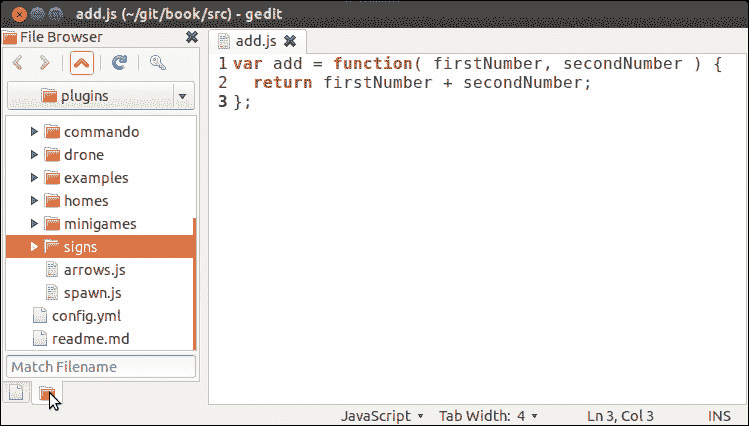

图 4.3 gedit 的文件浏览器

#### Microsoft Windows 上的 gedit 文件浏览器

首次启动 Windows 版 `gedit` 时，你需要更改一个默认设置，以便所有文件和文件夹都显示在文件窗口中。默认情况下，文件浏览器只显示文件夹。这不太有用，因为你希望同时处理文件夹和 JavaScript 文件。要确保你能看到所有类型，请执行以下操作：在文件窗口中右键单击任意位置（点击鼠标键），确保在`筛选`菜单下选中了`显示二进制文件`。这将确保所有类型都可见（参见图 4.4）。

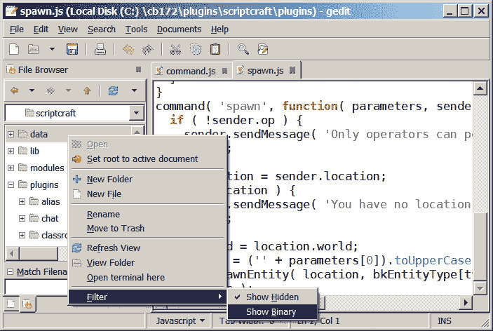

图 4.4 确保 Windows 版 gedit 中所有类型可见

#### gedit 首选项

下一步是设置编辑器行为的一些首选项。通过选择`编辑 > 首选项`打开首选项对话框（参见图 4.5）。让我们依次查看每个选项部分。

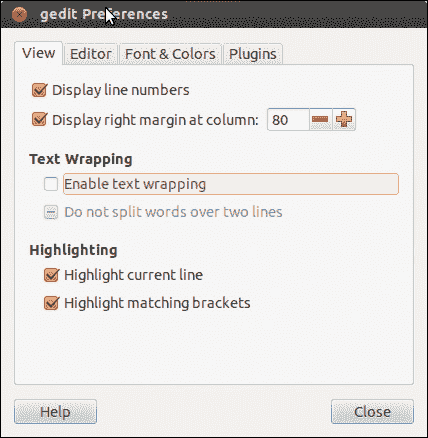

图 4.5 视图首选项

##### 视图首选项

让 `gedit` 在代码旁边显示行号很有用。行号出现在窗口的左侧边距中，不属于实际代码`gedit` 会在窗口右侧第 `80` 列显示一条淡淡的边距线。这条边距线只是一个提示，表明你的代码行可能太长了。它只是一个参考，可以安全地忽略。通常认为保持代码行长度不超过 80 个字符有助于提高可读性，但这条规则总有例外。编程时应关闭`启用文本换行`设置。如果你在写信、写文章或其他非编程文本时，这个设置很有用，但在编程时开启可能会造成混淆。`高亮当前行`可以让你更容易看到当前在代码中的位置。当查看一个大型 JavaScript 文件时，光标（输入时出现在字母旁边的闪烁块）可能很难找到。`高亮匹配括号`是一个非常实用的编程功能。当你在 JavaScript 源代码中移动光标时，如果光标位于以下任何字符旁边，它会匹配对应的开闭字符。

 圆括号：`( )`

 花括号：`{ }`

 方括号：`[ ]`

这在编写或编辑代码时非常有帮助。在图 4.6 中，你可以看到光标位于第 1 行的 `{` 字符旁边，开闭花括号都被灰色高亮显示。

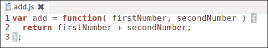

图 4.6 括号匹配

##### 编辑器首选项

图 4.7 显示了`编辑器`标签页中的设置。

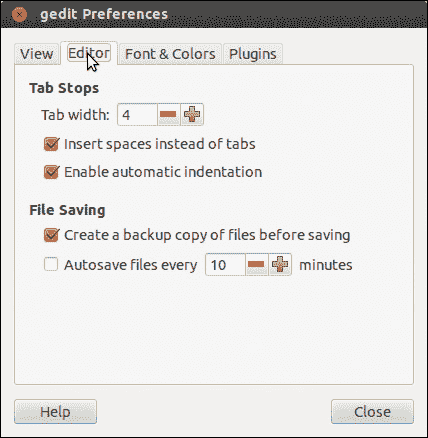

图 4.7 编辑器首选项

建议使用两个或四个空格作为制表符，以使代码易读。这很大程度上是个人喜好。刚开始时，你可能使用四个空格。自动缩进是一项便捷功能，让你在开始编写代码行时按下 `Tab` 和空格键。`gedit`可以在保存文件之前创建备份。这通常是个好意。

##### 字体与颜色

图 4.8 显示了`字体与颜色`选项卡中的设置。

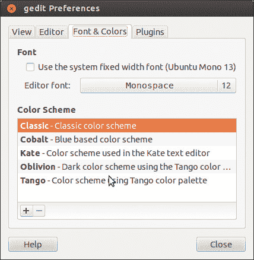

图 4.8 字体与颜色选项

你可以根据自己的喜好更改字体和配色方案。有些人喜欢浅色背景上的文字，有些人喜欢深色背景上的文字。选择你喜欢的配色方案，随时更改。

##### 插件

图 4.9 显示了`插件`选项。


图 4.9 插件选项

`gedit` 自带了一些插件。你应该确保选中`文件浏览器`面板。

### 在 Mac OS 上安装 Textrangler

按照以下步骤在 Mac OS 上安装 Textrangler：

1. 打开 App Store 应用，在右上角的搜索框中搜索 `Textrangler`。
2. 点击“安装”按钮。
3. 安装完成后，你可以在 Spotlight 搜索框中输入 `text`，然后点击它。

每次启动 `Textrangler` 时，你应该通过选择`文件 > 新建 > 磁盘浏览器`来打开。

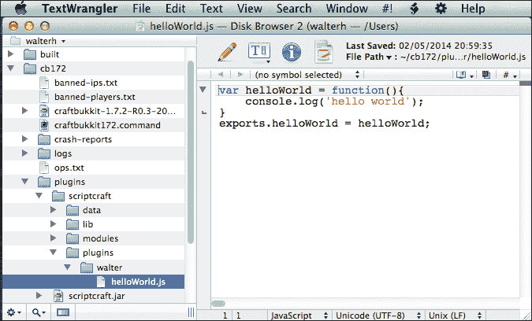

图 10 磁盘浏览器创建文件夹

### 编辑器的第一步

为了熟悉使用编辑器，你将在 `ScriptCraft` 文件夹中创建一个新文件夹和文件。在文件浏览器（Mac OS 上`Textrangler`）中找到并选中 `mcserver`文件夹。导航到 `scriptcraft/plugins`文件夹。选中该文件夹后，右键单击文件夹，从菜单中选择“新建”。将新文件夹命名为 `learning`。你也可以起其他名字，只要好就行。

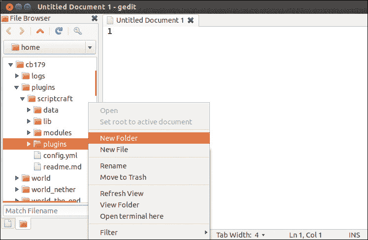

图 11 创建文件夹

#### 创建新的文件

下一步是在刚刚创建的子文件夹中创建一个 JavaScript 文件。这个文件暂时还不会做事情，但你很快就会处理它。右键单击刚刚创建的文件夹，从菜单中选择“新建文件”（参见图 12）。将新文件命名为 `HelloWorld.js`。

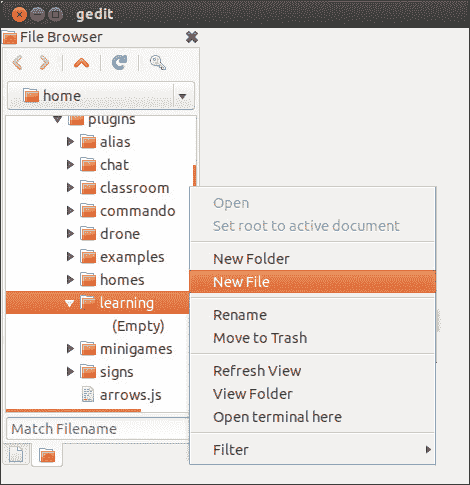

图 12 创建文件

文件刚刚创建，但尚未打开。如果使用 `Textrangler`，单击文件将其打开。如果使用 `gedit`，双击文件将其打开。文件现在显示在右侧的编辑格中。正如你所料，文件是空的。请完全按照你看到的代码输入：```
// TO DO: 稍后添加一些代码
```

上面的代码只是一个注释，你添加它来提醒自己稍后添加合适的代码。这个注释无法理解，所以你可以在 `//` 开头的行上写你喜欢的内容。计算机不会尝试解释和执行它。这样的注释对程序员很有用，因为它们让代码更容易理解。编写代码就像任何形式的写作——你应该努力让代码对你自己和他人都易于阅读，这样当你以后查看代码时，就能弄清楚自己做了什么。大多数编程语言都提供了注释的方法。在 JavaScript 中有多种注释的方式。你可以像上面那样通过插入两个正杠（`//`）来添加单行注释，之后下一行之前的文本都是注释，会被计算机忽略。我将在本书后面更详细地讨论注释。

#### 保存你的工作

通过从“文件”菜单中选择“保存”或按 `Ctrl+S`（Mac OS 上为 `Cmd+S`）来保存文件。文件现已保存。你可以通过关闭文件并再次打开来验证这一点。要关闭文件，请选择`文件 > 关闭`，或单击编辑器格顶部文件名旁边的关闭图标。

在文件/磁盘浏览器窗格中双击文件来重新打开它。你之前输入的文本仍然存在。保存工作非常重要，因为除非你先保存，否则你编辑的代码不会生效。你会惊讶地发现，即使是经验丰富的程序员也经常忘记这个简单的规则，然后困惑为什么他们的代码没有预期工作。

使用 ScriptCraft 时，保存文件夹很重要。你不能随意将文件保放在任何地方，并期望它们被 ScriptCraft 执行。目前，你将新创建的 `HelloWorld.js` 文件保存在了 `mcserver/scriptcraft/plugins/learning`子文件夹中。就像 Minecraft 服务器在其 `plugins` 子文件夹中查找 JAR 文件以加载基于 Java 的插件一样，ScriptCraft 也会自己的 `scriptcraft/plugins`文件夹中查找 JS 文件以加载基于 JavaScript 的插件。

### 总结

你安装了一个编程编辑器，并迈出了创建和编辑新 JavaScript 文件的第一步。在本书的下一部分，你将深入为 Minecraft 创建可用的 JavaScript 插件。

乐趣从这里开始。

# 第二部分：基础模组开发

在前一部分中，你组装了构建模组工作台所需的所有部件。现在你已准备好开始开发 Minecraft 插件。在本书的这一部分，你将学习如何创建插件，同时也会学到更多关于 JavaScript 的知识。在本部分的每一章中，你都会开发一个可用的插件，并在此过程中学习 JavaScript。

## 第 5 章：你的第一个 Minecraft 插件

在本章中，你将深入创建你的第一个 Minecraft 插件。*插件*是一个由更大程序加载并执行的小程序。你将要使用的更大程序当然是你的 Minecraft 服务器。这第一个插件会很短——只有几行代码——所以你不需要输入太多，但你应该通读这第一章，并尝试理解。

### Hello World

启动你的编辑器，打开你在上一章创建的 `HelloWorld.js` 文件。删除之前的注释，并输入以下文本：

```
console.log('Hello World');
```

`console.log()` 是一个内置函数，它会在控制台中打印出消息。你之前没有使用 `console.log()`，它会在服务器控制台中打印一条消息。当你使用 `console.log()` 函数时，输出都会以 `[scriptcraft]` 开头，因为 `console.log()` 会写入服务器的日志文件，服务器软件会在消息前面插入插件名称，以便服务器管理员判断日志文件中的消息来自哪个插件。

### 注释

在 JavaScript 中有多种添加注释的方式。你可以像上面那样通过插入两个正杠（`//`）来添加单行注释，之后下一行之前的任何文本都是注释，会被计算机忽略。

```
// 这是一个单行注释
console.log('Hello World'); // 这行也是注释
```

你也可以使用 `/*` 和 `*/` 符号来添加多行注释：

```javascript
/*
  这是多行注释
*/
```

大多数编程语言都提供了注释的方法。在 JavaScript 中有多种添加注释的方式。你可以像上面那样通过插入两个正杠（`//`）来添加单行注释，之后下一行之前的任何文本都是注释，会被计算机忽略。我将在本书后面更详细地讨论注释。

#### 保存你的工作

通过从“文件”菜单中选择“保存”或按 `Ctrl+S`（Mac OS 上为 `Cmd+S`）来保存文件。文件现已保存。你可以通过关闭文件并再次打开来验证这一点。要关闭文件，请选择`文件 > 关闭`，或单击编辑器格顶部文件名旁边的关闭图标。

在文件/磁盘浏览器窗格中双击文件来重新打开它。你之前输入的文本仍然存在。保存工作非常重要，因为除非你先保存，否则你编辑的代码不会生效。你会惊讶地发现，即使是经验丰富的程序员也经常忘记这个简单的规则，然后困惑为什么他们的代码没有预期工作。

使用 ScriptCraft 时，文件夹很重要。你不能随意将文件保放在任何地方，并期望它们被 ScriptCraft 执行。目前，你将新创建的 `HelloWorld.js` 文件保存在了 `mcserver/scriptcraft/plugins/learning`子文件夹中。就像 Minecraft 服务器在其 `plugins` 子文件夹中查找 JAR 文件以加载基于 Java 的插件一样，ScriptCraft 也会自己的 `scriptcraft/plugins`文件夹中查找 JS 文件以加载基于 JavaScript 的插件。

### 总结

你已经安装了一个编程编辑器，并迈出了创建和编辑新 JavaScript 文件的第一步。在本书的下一部分，你将深入为 Minecraft 创建可用的 JavaScript 插件。

乐趣从这里开始。


### 成就解锁！

信不信由你，你刚刚编写了你的第一个 Minecraft 插件！


嗯，很简单，不是吗？这可能是一个微不足道的简单插件，但它本质上演示了什么是插件——一些“嵌入”在更大程序中的代码，每次宿主程序加载时都会加载它。插件代码永远不会独立运行；它只能作为某个更大的“宿主”程序（Minecraft 服务器）的一部分来运行。你刚刚向 Minecraft 服务器添加了新代码！

### 让你的函数可复用

到目前为止，你编写的插件运行良好；它在 Minecraft 服务器启动时被加载并执行。有时这可能就是你想要或需要的全部，但如果你希望以后能够执行这段代码呢？让我们先把代码放在一个函数中（见**清单 5.1**）。

现在重启服务器。

发生了什么？启动时不再显示消息了！这是因为你把代码放在了函数内部，但还没有调用这个函数！声明一个新函数和调用该函数是两回事。仅仅声明一个函数并不意味着该函数会在文件加载时自动被调用。让我们再次修改代码，这次添加对你刚刚创建的函数的调用（见**清单 5.2**）。

---

**清单 5.1** `helloWorld()` 函数声明

```
function helloWorld( ) {
  console.log('Hello World');
};
```

---

**清单 5.2** `helloWorld()` 函数声明与执行

```
function helloWorld( ) {
  console.log('Hello World');
};
helloWorld();
```

---

现在再次重启服务器。消息将再次在每次服务器启动时出现。你编写的 `helloWorld()` 函数将在每次 Minecraft 服务器启动时被加载并执行。

所以，你将原始代码包装在了自己的函数中，并调用了该函数。到目前为止一切顺利。有时你会希望编写一些函数，以便在游戏内或服务器控制控制 提示符下使用。尝试在游戏内或服务器控制台提示符下运行 `helloWorld()` 函数。

```
js helloWorld()
```

此命令失败，并出现错误 `ReferenceError: helloWorld is not defined`。这很奇怪，不是吗？该函数显然存在并且可以工作，因为它在服务器启动时成功执行了。现在它怎么能声称函数不存在呢？这是因为从 `/plugins/scriptcraft/plugins` 目录加载的函数不会自动提供给其他人使用。`helloWorld.js` 文件被加载，文件中的所有代码在启动时被评估并执行。然而，一旦加载并执行完毕，该代码基本上对其他人是不可见的，并且无法再次运行。你可以使用一个名为 `exports` 的特殊变量让你的代码对其他人可见。`exports` 变量（顾名思义）“导出”代码供他人使用。这就是你提供代码供插件本身之外使用的方式。让我们再次回顾 `helloWorld.js` 文件（见**清单 5.3**）。

再次重启服务器。现在消息出现在服务器控制台中。让我们看看代码中的最后一条语句。

点击此处查看代码图片

```
exports.helloWorld = helloWorld;
```

---

**清单 5.3** 使 `helloWorld()` 公开

点击此处查看代码图片

```
function helloWorld( ) {
  console.log('Hello World');
};
helloWorld();
exports.helloWorld = helloWorld;
```

---

你在这里所做的是*导出* `helloWorld()` 函数，以便在插件之外使用。

`exports` 变量不是 JavaScript 核心语言的一部分。它由 ScriptCraft 提供，ScriptCraft 使用一个名为 *CommonJS* 的模块系统。CommonJS 是一组规则，规定了模块（以及 JavaScript 本身未提供的其他内容）应该如何工作。CommonJS 的模块规则易于理解和采用，因此最近变得非常流行，尤其是随着 Node.js（专业程序员使用的 JavaScript 环境）的日益普及。

### 私有变量与公有变量

当你在 JavaScript 文件中创建一个新变量时，它是*私有*的，意味着系统的其他部分无法看到它。只有文件内部的代码才能看到文件中声明的变量。这就是为什么之前即使 `helloWorld()` 函数在文件中被定义并使用，你仍然无法执行它的原因。默认情况下让变量私有是一件好事。如果你创建的每个变量在系统中任何地方都可见，那将导致混乱。想象一下，你创建了一个名为 `MySuperDooperPlugin.js` 的文件和另一个名为 `MyExplodingZombiesPlugin.js` 的文件，并且在这两个文件中都有一个名为 `livesRemaining` 的变量。如果 `livesRemaining` 变量不是私有的，那么 `MySuperDooperPlugin` 和 `MyExplodingZombiesPlugin` 最终都会使用同一个变量，这可能完全不是预期的结果。

默认情况下让变量私有意味着两个或多个插件在更新或读取变量时不必担心互相干扰。简而言之，私有变量是好的。

有时你会希望让一个变量公有，以便系统的其他部分可以使用它。要做到这一点，你需要像之前那样将该变量附加到特殊的 `exports` 变量上。作为一般规则，你不应该让所有变量都公有，除非你真的认为它们在其他地方会被需要。稍后我会更多地讨论公有和私有变量。

### 关于对象的简短说明

`exports` 变量是一种特殊类型的变量——它是一个*对象*。JavaScript 中的对象是可以容纳或包含其他变量和函数的东西。因此，你可以创建一个属于 `exports` 对象的新变量，就像通常创建新变量一样，如下所示：

点击此处查看代码图片

```
exports.favoriteGame = 'Minecraft';
```

不同之处在于，因为你正在将一个新变量 `favoriteGame` 附加到一个现有对象 `exports` 上，所以不需要使用 `var` 关键字。`favoriteGame` 属于对象的属性。例如，Minecraft 中的玩家拥有生命值、经验值、能力等等。事实上，Minecraft 中的一切都是对象：玩家、方块、工具、生物群系、世界。

### 玩家属性

例如，要让自己满生命值，在游戏内提示符下输入：

```
js self.health = 20
```

要让自己隐身，输入命令：

```
js self.invisible = true
```

要让自己可见，输入命令：

```
js self.invisible = false
```

`self` 变量是 ScriptCraft 提供的内置变量。在游戏内提示符下，你可以通过按斜杠 `/` 键，然后向上箭头键来快速执行之前的命令。

### 想一个 0 和 1 之间的数字

在编写模块之前，我们先在命令符下进行探索。在游戏内提示符下，输入以下内容并回车：

```
/js Math.random()
```

你应该看到类似这样的结果：

```
0.718431206652846
```

你看到的数字会不同，但它是一个介于 0 和 1 之间的数字。再试一次：在游戏内提示符下输入相同的命令并回车。这次你会看到一个之前不同的数字，但它同样介于 0 和 1 之间。你可以随意重复多次，每次得到的数字都会不同。`Math.random()` 返回的数字被称为*浮点数*。你可能认为 0 和 1 之间没有数字，但实际上有非常多的数字。实际数字范围是 `0.0000000000000000` 到 `0.9999999999999999`。这相当于 9 千亿、999 万亿、999 亿、999 百万、99.9 万和 999 个可能的数字。JavaScript 在选取随机数时使用这个范围。

### 特殊的六面骰子

一个普通的六面骰子，六个面上刻着数字 1 到 6。这是因为人类通常从 1 开始计数。当你想要数到某个数时，1 通常是起点。JavaScript（像许多编程语言一样）则不同。在 JavaScript 中，计数从数字 0 开始。所以，如果你想数 10 个数字，通常你会这样数：

1, 2, 3, 4, 5, 6, 7, 8, 9, 10

……而在 JavaScript 中，计数会是这样：

0, 1, 2, 3, 4, 5, 6, 7, 8, 9

这对初学者和有经验的程序员来说都可能令人困惑，需要一些时间来适应。我将在后续章节中解释为什么从 0 开始计数很重要。你的虚拟六面骰子将包含数字 0, 1, 2, 3, 4, 5，而不是通常的 1, 2, 3, 4, 5, 6。

### 玩转数字

你有一个问题需要解决。`Math.random()` 会给出一个介于 0.0 和 0.9999999999999999 之间的数字。

#### 本章小结

在本章中，你编写了第一个插件，并使用了 `exports` 变量导出了代码，以便在插件之外使用。

#### 第 6 章 掷骰子

传统的棋盘游戏，如飞行棋、富翁和蛇梯棋，都包含随机元素。成功完全取决于骰子的数。在本章中，你将模拟六面骰子（大多数棋盘游戏附带的）。在本章中，我将引导你创建第一个可复用的 JavaScript 模块。

#### 随机性

当你掷一个六面骰子时，无法预知结果；它可以是 1 到 6 之间的任何数字。掷出的数字被称为随机。在 JavaScript 语言中，有一种获取随机数的特殊方法：`Math.random()`。在本章中，你将使用 `Math.random()` 方法来获取随机数。

#### 使用模块

回到之前的问题，如何使用你刚刚创建的 `dice.js` 模块？还记得你之前学过的特殊 `exports` 变量吗？它用于暴露私有变量他人使用。那么，你可能想知道如何获取以这种方式暴露的变量。幸运的是，有一个名为 `require()` 的特殊函数可以让你做到。`require()` 函数是 `exports` 变量的对应物。在 `dice.js` 文件中，你使用 `exports` 来表示“这里有一些你可以使用的代码”，而使用 `require()` 来表示“我想使用 dice 模块中的代码”。

因此，要使用你在 `dice.js` 模块中刚刚编写的代码，首先需要 `require()` 它。

```
/js var dice = require('dice')
```


上述语句将你新创建的 `dice.js` 模块加载到计算机内存中。`require()` 函数是 ScriptCraft 加载 JavaScript 模块的方式。你会注意到我不需要包含 `.js` 后缀（文件名的最后一部分）。这是因为 `require()` 函数足够智能，知道它只应查找 `.js` 文件。它也知道应在 `modules` 文件夹中查找，因此你不需要写成 `require('/modules/dice.js')`。

使用 `require()` 函数加载模块后，你几乎总是应该将其赋值给一个变量。在这个例子中，变量与模块同名，但也可以不同。我可以写成 `var steve = require('dice')`，效果是一样的。

## 调用模块函数

你会注意到，上面的语句似乎还没有调用 `roll()`。加载模块会执行模块中的任何代码，但请记住，模块只是定义了一个函数。定义函数和调用函数不是一回事。要调用你刚刚加载的模块上的 `roll()` 函数，请执行以下命令：

```
/js dice.roll()
```

应该会显示一个介于 0 和 5 之间的随机数。尝试多次运行上述命令。每次应该都会看到返回不同的数字。请记住，你可以通过输入 `/` 然后按向上箭头键快速运行上述命令。

## 故障排除

如果你没有看到数字，或者 `/js var dice = require('dice')` 命令没有生效（你看到了错误），请查看服务器控制台窗口，了解发生了什么类型的错误。很可能是输入代码时出现了打字错误。请仔细检查代码，确保它与清单 6.1 中的代码完全相同。

## 模块作为对象

你可能想知道为什么你以这种方式调用 `roll()` 函数：`dice.roll()`。当你 `require` 一个模块时，你得到的是一个 `Object`。记住，对象是一种特殊类型的变量，可以在所谓的属性中保存多个值。因此，`require('dice')` 实际上返回一个对象——即你在模块内部用来公开 `roll()` 函数的 `exports` 对象。当你调用附加到对象上的函数时，你必须将对象名放在前面，然后是一个点，再然后是函数名。所以，你说 `console.log()`，因为 `console` 是一个对象，而 `log()` 是附加到该对象上的函数。类似地，你说 `dice.roll()`，因为 `dice` 是一个对象，而 `roll()` 是附加到它上面的函数。这可能需要一点时间来适应，但随着时间的推移会变得自然而。

### 成就解锁！

太棒了！你已经创建了第一个 JavaScript 模块，加载了它，并使用了它！你在创建可复用代码的道路上迈出了第二个巨大的步伐。

## 深入探索

让我们看看你刚刚添加到 Minecraft 中的代码（见清单 6.2）。

一个 JavaScript 模块是一个包含一个或多个相关函数的文件。在清单 6.2 中，你看到了一个名为 `roll()` 的函数。你通过导出函数来让其他人使用它们。在后续章节中，你将更深入地了解 `exports` 对象和模块。现在，让我们看看函数体本身（第 2 到第 5 行）。

### 清单 6.2 掷骰子

```javascript
function roll(){
  var result = Math.random();
  result = result * 6;
  result = Math.floor(result);
  return result;
};

exports.roll = roll;
```

1. 函数的第一条语句 `var result = Math.random();` 声明了一个名为 `result` 的新变量，并为其赋一个随机数。请记住，`Math.random()` 会返回一个介于 0 和 1 之间的随机数。

2. 下一条语句 `result = result * 6` 将该数字乘以 6。在 JavaScript 中，`*` 符号用于数字相乘。

3. 接下来，你通过将数字传递给 `Math.floor()` 函数并存储结果，将其转换为整数。`Math.floor()` 用于向下取整。`Math.floor()` 会截断任何数字的小数部分，例如 3.5 变成 3.0，4.9 变成 4.0，1.1 变成 1.0，以此类推。`Math` 对象是一个内置对象，提供了许多用于执行数学运算的函数。

4. 最后，函数中的最后一条语句使用特殊的 `return` 语句从函数中返回一个值。当函数遇到 `return` 语句时，它会停止执行，并返回一个表达式（如果提供了的话），或者如果没有提供表达式，则返回无值（`undefined`）。在这个例子中，你希望 `roll()` 函数返回 `result` 变量。

与之前的插件一样，文件的最后一行通过导出（exporting）`roll()`函数，使其可在该文件外部使用。请注意，你并没有在最后一行调用（invoke）该函数（调用函数意味着执行或运行它）；你只是将它附加到特殊的 `exports` 变量上，该变量的唯一目的是揭示你的文件能做什么。`exports.roll = roll` 实际上表示该文件有一个名为 `roll` 的公共函数（`exports.roll`），它与同名的私有函数（从文件第 1 行开始的函数声明）是同一个。

如果一开始觉得这令人困惑，不必担心。你将在本书中反复使用 `exports` 变量，随着重复使用，它的用途会变得更加清晰。

### 数字取整

JavaScript 中的所有数字都是浮点数；它们包含整数部分（小数点前）和小数部分（小数点后）。数字“二点五”在 JavaScript 中表示如下：

`2.5`

这个数字是一个浮点数。整数部分是 `2`。在 JavaScript 中，如果你想将数字“向上取整”或“向下取整”到最近的整数，可以使用 `Math` 函数之一。

`Math.floor()` 用于向下取整。`Math.floor()` 会截断任何数字的小数部分，例如 3.5 变成 3.0，4.9 变成 4.0，1.1 变成 1.0，以此类推。`Math` 对象是一个内置对象，提供了许多用于执行数学运算的函数。

`Math.floor(n)`：接收一个数字并截断小数部分。例如，2.5 变成 2.0。

`Math.ceil(n)`：将数字向上取整到最近的整数。例如，2.5 变成 3.0，2.1 变成 3.0，以此类推。

`Math.round(n)`：将数字向上或向下取整到最近的整数。它会将任何大于 .5 的小数部分向上取整，例如 2.5 向上取整为 3.0，但 2.4 向下取整为 2.0。

### Math

内置的 `Math` 对象还有许多有用的属性和函数：

`Math.PI`：圆周率的值，即圆周与其直径比，大约为 3.141592653589732。在 ScriptCraft 中构建球体、圆柱体和弧时用到这个值。

`Math.abs(n)`：一个数的绝对值。`Math.abs()` 用于将负数（小于 0）转换为正数，例如 `Math.abs(-3)` 返回 3。

`Math.max(n, m, ...)`：接收任意数量的数字，返回最大的数字。例如，`Math.max(3, 9, 5)` 返回 9。

`Math.min(n, m)`：接收任意数量的数字，返回最小的。例如，`Math.min(3, 9, 5)` 返回 2。

`Math.sqrt(n)`：返回一个数的根。例如，`Math.sqrt(9)` 返回 3，`Math.sqrt(4)` 返回 2，`Math.sqrt(16)` 返回 4，以此类推。

### return 语句

`return` 语句在函数内部用于以下目的：

1. 停止函数的执行
2. 向调用者返回一个值

`return` 语句只能在函数内部使用。也可以有完全包含 `return` 语句的函数，在这种情况下，函数会在执行完函数中的最后语句时停止执行。函数必须返回值；事实上，你之后编写的许多函数都不会返回值。

### 小结

在本章中，你创建了第一个真正可用的模块。你学习了模块、随机数和 `Math` 对象。在下一章中，你将进一步增强这个模块，而在接下来的章节中，你将使用该模块为加入服务器的玩家创建自定义问候。

## 第 7 章 多面骰子

在本章中，你将在上一章编写的基础上进行扩展，使其能够掷出任意数的骰子。有时你需要一个不在 1 到 6 范围内的随机数。理想情况下，你希望你的虚拟骰子模块能够针对给出的任何范围返回一个随机数。你将把上一章的六面骰进行进行增强使其使其像某些桌面游戏和角色扮演游戏中使用的多面骰子一样，改变形状以适应任意面数（参见图 7.1）。

### 灵活的函数

如果你想在已有基础上扩展，以支持四面、六面和八面骰子，你可能会为每种骰子编写新的函数。

```
function rollSixSided(){
  ...
}
function rollFourSided(){
  ...
}
function rollEightSided(){
  ...
}
exports.rollSixSided = rollSixSided;
exports.rollFourSided = rollFourSided;
exports.rollEightSided = rollEightSided;
...
```

这样做既耗时、重复又费力，而编程的全部意义就在于让计算机来完成工作！这种方法的问题——除了输入耗时之外——在于每次你想支持一种新类型的骰子（比如 10 面、12 面和 20 面骰子）时，你都必须编写一个新函数。如果你之后想模拟掷一个 24 面骰子，你还得再写一个函数。幸运的是，有更好的方法。

当你调用 `roll()` 函数时，你可以告诉函数骰子有多少面，然后 `roll()` 函数相应执行。如果你说“掷六面子”或“掷20 面子”，`roll()` 函数会做正确的事情（第一次调用返回 0 到 5 之间的随机数，第二次调用返回 0 到 19 之间的随机数），这就是参数的用法。

### 参数

参数提供了一种向函数传递信息的方式。你可以将值传递给函数，函数像变量一样处理。编程中还有一个常用的词：实参（`arguments`）。你将实参传递给函数，函数接收形参`parameters`）。这种区别重要。

你已经在之前的代码中使用参数了。在之前的章节中，你使用了 `console.log()` 函数并向它传递了一个参数。

```
js console.log('Hello world');
```

你应该会在服务器窗口中看到“Hello world”。“Hello world”是你运行 `console.log()` 函数时的指令（用正式术语来说，参数）。再用以下命令尝试：

```
js console.log(5 + 9);
```

你应该会在服务器窗口中看到 14。`5 + 9` 是 `console.log()` 函数的参数，它打印了结果。`console.log()` 函数通常用于日志。日志记录将输出到屏幕的做法通常用于调试或更好地理解代码。

正如 `console.log()` 和其他函数接受参数一样，你也可以编写自己的函数，使它们在调用时接受参数。让我们看看上一章代码的一个略微修改的版本。你不需要输入清单 7.1；我只是强调一些变化。前面的代码与上一章类似，只是我声明了一个名为 `sides` 的变量，并将数字 6 赋值给它。在下一行中，使用的运算是 `result * sides`，而不是上一章中的 `result = 6`。因此，我做的只是创建了一个名为 `sides` 的变量来存储面数。这个函数的行为与上一章相同。但如果你能在每次调用 `roll()` 之前以某种方式改变 `sides` 变量的值？让我们再次修改代码（参见 7.2）。

### 清单 7.1 掷骰子：面数作为变量

```
function roll( ) {
  var result = Math.random();
  var sides = 6;
  result = result * sides;
  result = Math.floor(result);
  return result;
};

exports.roll = roll;
```

### 清单 7.2 掷骰子：面数作为参数

```
function roll( sides ) {
  var result = Math.random();
  result = result * sides;
  result = Math.floor(result);
  return result;
};

exports.roll = roll;
```

你能看出区别吗？我删除了 `var sides = 6;` 语句，并在括号之间放了一个新名称 `sides`。`sides` 变量不再是一个私有变量，而是一个参数。因为它是一个参数，你可以在每次调用 `roll()` 函数时指定它的值。图 7.2 展示了函数经历的变化。第一个变化是将计算中使用的数字 6 变为一个变量。接下来的变化是将该变量变为一个参数。参数就像变量一样。在程序的第一个版本（左侧）中，数字 6 是“硬编码”的，意味着你在函数中写入了特定的数字、文本或其他数据，当时看起来似乎不需要改变（如果你假设只需要 0 到 5 之间的数字，那么情况确实如此）。通常更好的做法是将这些值转化为参数，这样你就不必在数据变化时每次都修改代码。一旦你将 `dice.js` 文件编辑成与右侧版本一致，保存它，然后在游戏内符下输入 `/js refresh()`。然后依次尝试以下每个命令：

```
/js var dice = require('dice');
/js dice.roll(6);
/js dice.roll(20);
```

尝试多次调用 `dice.roll(20)` 来确认它确实能随机选择 0 到 19 之间的数字。更新后的 `roll()` 函数现在接受一个参数，该参数指定骰子应该有多少个面。这个函数接受的参数类型是 `Number`。函数可以接受任何类型的参数，例如数字、字符串（文本）、布尔值（`true` 或 `false`），甚至其他函数！你将在下一章看到一个函数将另一个函数作为参数的例子。记住，函数就像 JavaScript 中的其他值一样，因此它们可以被赋值给变量（你已经看到过）或作为参数传递（你很快就会看到）。

### 默认参数值

如果你调用 `dice.roll()` 时没有传递参数，会发生什么？你可以通过在游戏内置符下输入以下命令来亲自查看：

`/js dice.roll()`

你应该会看到结果为 `NaN`。`NaN` 是 JavaScript 中“不是数字”的缩写，表示计算出的值不是数字。你知道为什么？你的函数总是期望一个数字（骰子的面数），如果你没有提供，数学运算无法按预期进行。如果没有数字传递给 `dice.roll()` 时，它假设你想要一个六面骰子，那不是很好？毕竟六面骰子是最常见的骰子类型。让我们对 `roll` 函数再做一个小动；参见清单 7.3。

### 清单 7.3 掷骰子：默认参数

```
function roll( sides ) {
  if ( typeof sides === 'undefined' ) {
    sides = 6;
  }
  var result = Math.random();
  result = result * sides;
  result = Math.floor(result);
  return result;
};

exports.roll = roll;
```


```markdown

我们将在后面的章节中更详细地介绍 `if` 语句。现在你只需要知道，它对于控制程序在不同条件下的行为非常有用。括号内的代码`typeof sides === 'undefined'` 返回`sides` 参数的类型。如果没有提供参数，那么它的类型将是`undefined`，在这种情况下，你将`sides` 参数设置为默认值 6。编辑并保存`dice.js` 文件后，请确保在游戏内提示符下输入`/js refresh()` 命令，然后输入以下语句：

点击此处查看代码图片

```
/js var dice = require('dice');
/js dice.roll(20);
/js dice.roll();
/js dice.roll(4);
/js dice.roll();
```

你应该会看到每次调用都输出一个随机数。`roll()` 函数现在足够健壮，可以处理参数，并且在调用时如果没有提供参数，则使用合理的默认值 6。

### 赋值给 `exports` 变量

假设你想创建一个提供农场动物的新模块。你可以这样写：

```
var cow = 'Cow';
var sheep = 'Sheep';
var pig = 'Pig';
exports.cow = cow;
exports.sheep = sheep;
exports.pig = pig;
```

但由于前三个变量除了赋值给`exports`变量之外并没有实际使用，你可以简单地这样写，这样可以节省一些输入：

```
exports.cow = 'Cow';
exports.sheep = 'Sheep';
exports.pig = 'Pig';
```

有时这样做并不合适。如果`cow`变量在模块内部被使用，那么声明它并赋值给`exports`变量是有意义的。如果不是，那么直接将值赋值给`exports`变量会更简单，而不是创建一个不会用于其他目的的额外变量。

### 关于注释的更多内容

在进入下一章之前，我想再多谈谈注释。在你创建的第一个 JavaScript 文件中，你你以一行代码开始。

点击此处查看代码图片

```
// TO DO : 稍后添加一些代码
```

这被称为**注释**。注释是你写在代码中的笔记，用来帮助你记住事情。源代码可能很难理解，即使是你自己写的。在解决棘手问题或编写酷炫的新插件时，你可能会写出一些巧妙的代码，但当你几天或几周后回头来看时，常常会发现自己不再理解所写的内容。这就是注释发挥作用的地方。养成在代码旁边写注释的好习惯，尤其是当你的代码比较复杂时。

注释不会被计算机读取，因此你可以在注释中写任何内容。注释应当具有帮助性，并为你自己和他人提供关于代码功能的指引。你可以根据需要添加任意多或任意少的注释。当与他人协作处理同一份源代码时，为代码添加注释被视为良好的实践。注释的数量取决于个人喜好。注释对于**文档化**你的代码非常有用。例如，ScriptCraft API 参考文档（位于[`scriptcraftjs.org/api`](http://scriptcraftjs.org/api)）就是根据 ScriptCraft 源代码中的注释自动生成的。

#### 单行注释

你可以通过在行首添加两个正斜杠（`//`）将任意一行变为注释：

```
// this is a JavaScript comment
console.log('this is not a comment');
```

如果你运行上述代码，将得到以下输出：

```
this is not a comment
```

第一行被忽略，只有程序员才能阅读。

#### 行尾注释

你也可以像这样在行尾添加注释：

```
console.log('The rain in Spain'); // falls mainly in the plain
```

如果你运行上述代码，将看到以下内容：

```
The rain in Spain
```

`//` 之前的部分是常规代码；`//` 之后的部分是注释。

#### 多行注释

有时你需要在代码中编写大量注释。你可能有一段需要解释的代码。你可以像这样使用多个 `//` 注释：

```
// ---------------------------
// Drone Plugin
// The Drone is a convenience class for building.
// It can be used for ...
// 1. Building
// 2. Copying and Pasting
```

如果你的注释跨越多行（如上所示），你可以使用以`/*` 开头、以`*/` 结尾的注释块，如下所示：

```
/* ---------------------------
   Drone Plugin
   The Drone is a convenience class for building.
   It can be used for...
   1. Building
   2. Copying and Pasting
*/
```

大多数编程会以不同颜色显示注释，使其与其余代码区分来。注释对于阅读和理解非常有帮助。

#### 注释掉代码

你也可以使用注释来**关闭**代码。如果你想临时更改代码，或者不再需要代码段，会很有用。

```
console.log('Pig says: Oink');
// console.log('Cow says Moo');
console.log('Sheep says: Baa');
```

上述代码的输出：

```
Pig says: Oink
Sheep says: Baa
```

第二条语句被忽略，因为它前面有`//`。

#### 为 dice.js 添加注释

在你的编辑器中打开`dice.js`，并在文件顶部添加注释部分。注释部分应该要描述模块的功能。你可以使用`//` 注释或`/* */` 注释。注释可以长短。修改后请保存文件，在游戏内提示符下运行`refresh()`，然后运行以下命令以确保代码仍然有效：

```
/js var dice = require('dice');
/js dice.roll();
/js dice.roll(20);
```

示例如下：

```
/*
 this module provides a roll() function which returns a random number.
 the range of numbers is set using sides.
 if no sides parameter is provided, the default is 6.
*/
exports.roll = function( sides ) {
  if ( typeof sides === 'undefined' ) {
    sides = 6;
  }
  var result = Math.random();
  result = result * sides;
  return Math.floor(result);
};
```

#### 成就！

恭喜！你已朝着负责任开发者迈了一步。代码健壮且完善。如果你想与他人分享作品，注释非常重要。


### 总结

你了解到函数既可以返回值，也可以接受参数。当你向函数提供信息时，如果函数没有参数的情况下，最好设置默认值。你还学习了注释，以及如何使用注释帮助自己和他人。

## 第 8 章问候

在本章中，你将改变所有玩家。最好的插件能够增强 Minecraft 体验，同时感觉它们是游戏本身的一部分。在这个过程中，每位玩家加入服务器时都会收到一条随机问候。**事件驱动编程**是一种监听并响应事件的方式。

### 事件驱动编程

在编程早期，并没有事件编程这种东西。程序启动后运行结束，然后退出。如果你的程序需要用户提问，它通过提示符进行，直到用户输入响应并按下回键继续。随着程序变得复杂，必须以不同的方式编写，以适应用户通过菜单、按钮、窗口等与计算机交互。当你点击网页或其他链接或按钮时，那就是一个事件。

### 数组

到目前为止，你使用变量在内存中存储单个项目。这些项目是数字和字符串（文本）。能够在内存中存储项目列表很有用。例如，在 Minecraft 中，服务器会存储当前在线的玩家列表、服务器上的世界列表以及许多其他列表。列表很有用，因为你可以跟踪一组事物。在 JavaScript 中，列表被称为**数组**。**数组**是项目的集合。例如，如果你想在 Minecraft 中创建一个农场动物列表（或数组），可以这样做：

```
var farmAnimals = [ 'Sheep', 'Cow', 'Pig', 'Chicken' ];
```

数组以方括号（`[ ]`）开头和结尾，列表中的每个项目用逗号（`,`）分隔。列表中的最后一个项目后面不应有逗号。让我们在服务器控制台中用数组做一些实验。在服务器控制台提示符下输入以下命令：

```
js var farmAnimals = [ 'Sheep', 'Cow', 'Pig', 'Chicken' ];
js console.log(farmAnimals);
```

输出应如下所示：

Sheep,Cow,Pig,Chicken

数组有一个特殊属性，可以告诉你数组中有多少个项目。在服务器控制台中输入以下命令：

```
js farmAnimals.length
```

输出应如下所示：

4

`length` 属性告诉你数组中有多少个项目，并且很有用，稍后你会看到。现在来说说棘手的地方。在构造新数组时，你使用`[]`。

下一条语句声明了一个名为`greetings` 的新变量，并为其分配了一个包含不同语言问语的列表。我们之前没有遇到过数组，所以需要解释一下。

#### 清单 8.1 添加注释

在本章的第一部分，你将编写一个包含单个函数的模块，该函数每次调用时都会返回随机问候。这个新模块将依赖你在第 7 章中创建的模块来返回随机数。示例如下：

**清单 8.1** 随机问候

```
var dice = require('dice');
var greetings = [ 'Hello ', 'Hola ', 'Bonjour ',
                  'Konnichiwa ' ];
var len = greetings.length;
function random(){
  var index = dice.roll(len);
  var greeting = greetings[ index ];
  return greeting;
}
exports.random = random;
```

你已经从模块和复用中受益，因为你可以复用之前创建的骰子模块。新模块中的第一语句使用上一章的骰子模块。如果你的模块依赖于其他模块，通常最好在代码顶部加载这些模块。这是作为 JavaScript 程序员应该养成的另一个习惯，因为从长远来看，它会让编程更简单。

```

```markdown
```
/js farmAnimals.splice( 4, 1 );
```

上一条命令的输出将被移除元素的数组，因此在你的显示中，你会看到类似这样的内容：

```
[ "Cat" ]
```

这是因为`splice()` 方法返回的不是它拼接后的数组，而是它从数组中移除的元素。记住，你传递给`splice()` 的第一个参数是元素的索引，第二个参数始终是你想要移除的元素数量。如果没有提供额外的参数，`splice()` 只会移除元素而不会插入新元素。要查看你的 `farmAnimals` 数组现在是什么样子，运行`/js farmAnimals` 语句。你的数组在内存中看起来会像这样：

```
[0] 'Sheep'
[1] 'Ocelot'
[2] 'Wolf'
[3] 'Cow'
[4] 'Pig'
[5] 'Chicken'
[6] 'Horse'
```

现在让我们进一步整理数组，移除讨厌的豹猫和狼。

点击此处查看代码图片

```
/js farmAnimals.splice( 1, 2 );
```

上一条语句的意思是“从索引 1 开始，移除 2 个元素”。数组现在看起来像这样：

```
[0] 'Sheep'
[3] 'Cow'
[4] 'Pig'
[5] 'Chicken'
[6] 'Horse'
```

**表 8.1** 列出了其他几个有用的数组方法。

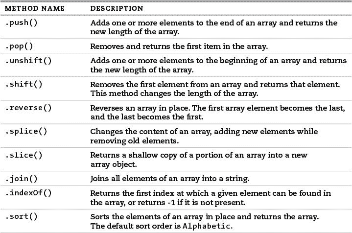

**表 8.1** 数组方法

你可以在 [`developer.mozilla.org/en-US/docs/Web/Javascript/Reference/Global_Objects/Array`](https://developer.mozilla.org/en-US/docs/Web/Javascript/Reference/Global_Objects/Array) 了解更多关于 `Array` 对象及其方法和属性的信息。在后面的章节中，你将学习如何使用 JavaScript 的循环语句处理数组中的所有元素。

### 事件入门

现在，你有一个新的模块 `greetings.js`，其中包含一个名为`random()` 的函数，该函数返回一个随机问候语。你希望每个连接的玩家都能收到一条随机问候语。让我们直接开始，创建一个名为 `greetPlayers.js` 的新模块。

---

**重要提示**

这个新的 `greetPlayers.js` 模块应保存在 `scriptcraft/plugins` 文件夹中，而不是 `scriptcraft/modules` 文件夹中，因为你希望该模块在服务器启动时自动加载。

---

将 **清单 8.2** 中的代码输入到你的新 `greetPlayers.js` 文件中。

确保保存文件，然后运行 JavaScript 的`refresh()` 函数来重新加载 ScriptCraft，方法是在游戏内提示符下输入`/js refresh()`，或在服务器提示符下输入`js refresh()`。

---

**清单 8.2** 玩家加入服务器时向其打招呼

点击此处查看代码图片

```
var greeting = require('greetings');

function greetPlayer( event ) {

  var player = event.player;

  var message = greeting.random() + player.name;

  echo( player, message );

};

events.connect( greetPlayer );
```

---

现在断开与服务器的连接，然后重新加入服务器。当你加入服务器时，屏幕上应该会看到类似这样的内容：

```
Konnichiwa walterh
```

当然，消息对你来说会有所不同。**图 8.1** 显示了当你加入服务器时，问候语应该出现的位置。`echo()` 函数由 ScriptCraft 提供，用于向玩家发送消息。它接受两个参数，第一个是玩家，第二个是你想要发送给该玩家的消息。

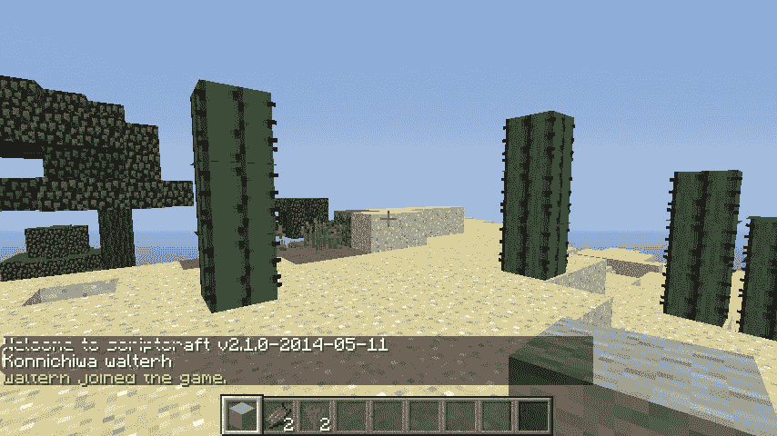

**图 8.1** 向玩家打招呼

ScriptCraft 内置了一个名为`events` 的变量。`events` 变量用于监听和响应游戏中的事件。在 Minecraft 中，你可以响应大约 200 种不同类型的事件。当你在代码中注册一个事件时，你是在告诉服务器，当游戏中发生特定类型的活动时，你希望得到通知。你通过向服务器提供一个函数来注册，这个函数不会被立即被调用，而只会在活动发生时被调用。在清单 8.2 的代码中，你基本上是在对 Minecraft 说：“嘿，每当有人连接到游戏时，我希望你（服务器）调用这个`greetPlayer` 函数。”

这是你第一次看到函数作为参数传递给另一个函数调用。你通过将另一个函数作为参数传递给`events.connect()` 函数来调用它。这种编程风格——将函数作为参数传递给其他函数——被称为函数式编程。这里需要注意的重要一点是，在这个模块中，`greetPlayer()` 函数实际上从未被调用过。你只是使用`events.connect()` 函数注册了它，以便它会在每次玩家连接时被调用。`greetPlayer()` 函数被称为事件处理函数，因为它的目的是处理事件，具体来说就是处理服务器在玩家连接到游戏时触发的事件。

我们将在后面的章节中更详细地介绍事件和事件处理函数。

### 更多关于模块的内容

从 `greetPlayers` 模块可以看出，它做的第一件事就是加载另一个模块 `greetings`，这个模块是你之前在本章中创建的。如果你还记得，`greetings` 模块又加载了另一个模块——你在前面章节中编写的 `dice` 模块。这是一个典型的编程示例。你从专用模块开始，然后逐步构建越来越大的模块，将它们组合起来解决问题。在编程中，解决问题的一个重要部分就是将问题分解成越来越小的问题，解决每个小问题，然后将解决方案组合起来。当一个程序模块依赖于另一个模块时，我们说它依赖于该模块。一个加载另一个模块的模块依赖于该模块，而该模块又依赖于其他模块。程序直接或间接需要的所有模块都称为依赖项。你可以在**图 8.2** 中看到 `greetPlayers`、`greetings` 和 `dice` 模块之间的关系。

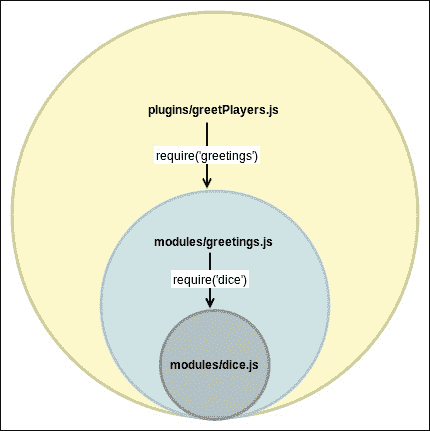

**图 8.2** 封装与模块

`greetPlayers` 模块依赖于 `greetings`，但它不知道也不关心 `greetings` 又依赖于 `dice` 模块。这是编程中的一个重要原则。`greetings` 模块通过只导出一个`random()` 函数，定义了程序员所谓的接口。接口是模块与其他模块之间的契约或协议。它声明了你的模块的用途——它的目的是什么。在定义接口时，模块应该隐藏如何工作的细节，只说明做什么。模块化系统之所以有效，是因为部件可以被替换和更改，而不会影响整个程序。你可以将单个模块（一个 JavaScript 文件）视为一个单独的乐高积木。模块可以组合成更大的模块和程序，最终创造出真正令人惊叹的东西。

Minecraft 常被描述为“虚拟乐高”。编程与之类似，并提供同样的回报，它极具创造力，而且可以非常有趣。

### 有风格地向玩家打招呼

为了让玩家感到受欢迎，让我们添加一些比简单文本消息更壮观的内容。让我们用烟花来迎接每位新玩家，烟花会在他们加入服务器的位置和时间发射（见**清单 8.3**）。

---

**清单 8.3** 用烟花向玩家打招呼

点击此处查看代码图片

```javascript
var greeting = require('greetings');

var fireworks = require('fireworks');

function greetPlayer( event ) {

  var player = event.player;

  var message = greeting.random() + player.name;

  echo(player, message );

  fireworks.firework(player.location);

};

events.connect( greetPlayer );
```

---

在后续章节中，你将再次使用 ScriptCraft 的`fireworks` 模块。事件和事件处理函数可以用来触发各种酷炫的新游戏机制。

### 成就解锁！

太棒了！你已经创建了第一个事件处理器，并首次接触事件驱动编程。很快，你将利用事件处理来保护服务器，添加自己的有趣效果。


### 总结

在本章中，你学习了如何使用 JavaScript 创建数组和操作列表。还了解了事件驱动编程，编写了第一个事件处理函数，用于玩家连接服务器时向他们打招呼。下一章中，你将进一步探索并在 Minecraft 中玩数字。

## 第 9 章 猜游戏

计算机的大优点是它们能够决策，并根据决策在程序中走不同的路径。如果计算机每次都做同样的事情，就会无聊。你能想象玩一个总是做同样的游戏吗？当你玩 Minecraft 时，服务器会不断检查玩家是否死亡，或者他们的生命值是否低。

所有这些决策都使用了`if` 语句。`if` 语句非常有用，几乎每种编程语言都支持，包括 JavaScript 和 Java。在本章中，你将使用`if` 语句创建一个简单的猜游戏，判断玩家是否对了。让我们直接开始编写猜游戏的代码。将**清单 9.1** 中的代码输入到一个名为`numberGuess.js` 的新文件中，并将其保存在`scriptcraft/plugins` 文件夹中。

在这个程序中，`guessNumber()` 函数会掷一个骰子，然后玩家猜数字。如果玩家对了，会显示消息“你对了！”。玩家完后（无论错），会显示消息“感谢参与”。你可以通过服务器控制符下输入以下命令来尝试这段代码：

```
js refresh();
js guessNumber( self )
```

---

**清单 9.1** 猜游戏

点击此处查看代码图片

```javascript
var input = require('input');

var dice = require('dice');

var randomNumber;

function checkAnswer( answer, guesser ){
  if ( answer == randomNumber ) {
    echo ( guesser, 'You guessed correct!' );
  }
  echo( guesser, 'Thanks for playing' );
}

function guessNumber( player ){
  randomNumber = dice.roll(6);
  input( player,'Pick a number between 0 and 5',checkAnswer);
}

exports.guessNumber = guessNumber;
```

`guessNumber()` 函数需要一个`Player` 类型的参数。特殊的变量`self` 是 `Player` 类型，指向玩家。这就是为什么你将`self` 作为参数传递给`guessNumber()`。你可以尝试运行`guessNumber()` 函数几次，得到的数字都不同。

### 问

大多数编程语言都提供了一个提问的函数。JavaScript 在许多环境中运行。最常见的运行方式是在浏览器中，其中有一个特殊的`prompt()` 函数，可以显示一个小窗口（称为对话框），包含一个问题、一个输入字段以及“确定”和“取消”按钮。这种用户交互被称为模态。模态框的问题在于它们会中断程序，程序必须等到用户点击“确定”或“取消”后才能继续。在 Minecraft 中没有`prompt()` 函数，但你可以使用`input` 模块向玩家提问。问题不会以模态框的形式出现，而是作为消息显示在屏幕上。重要的是，玩家不必立即回答。

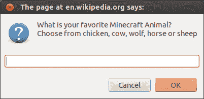

**图 9.1** 模态框

`input()` 函数接受三个参数：玩家、问题和回调函数。`input()` 函数被调用时会立即返回，并且返回任何值。相反，它会在后台等待直到玩家最终回答。

```javascript
var input = require('input');

function respond( answer, player ) {
  if ( answer == randomNumber ) {
    echo(player, "Wow. " + answer + " that's old!");
  } else {
    echo(player, "Thanks for playing");
  }
}

input( self, 'How old are you?', respond );
```

在编写依赖向玩家提问的代码，当玩家回答问题后，`input()` 会调用`respond()` 函数。被其他函数调用的函数有一个常用的名称——它们被称为`回调函数`。回调函数非常有用，也是 JavaScript 如此灵活的原因之一。回调函数也用于为网页编写 JavaScript 代码。例如，可以编写仅在访问者点击按钮时才调用的函数。

### if 语句

在第 3 章中，你曾简要了解过如何在控制台提示符下比较数字。当你将某物与另一物进行比较时，只可能有两个答案：真或假。例如，如果我执行命令`js 5 == 3` 询问计算机 5 是否等于 3，答案将是 false。如果我提出另一个问题，比如`js 5 > 3`——5 是否大于 3？——答案将是 true。在提出这类问题时，不存在“我不知道”、“有时”或“可能”这样的答案。答案永远是 true 或 false。当你进行比较时，你就是在测试真或假。你不仅可以比较数字，还可以比较任何变量。你可以编写代码，使其仅在某个测试通过时执行。请在服务器控制台提示符下尝试以下命令：

```
js if ( 5 > 3 ) { console.log('test is true') }
js if ( 5 > 13 ) { console.log('test is true') }
js if ( 5 == 18 ) { console.log('test is true') }
js if ( 5 < 18 ) { console.log('test is true') }
```

只有第一条和最后一条命令应该显示消息 test is true。`if` 语句使用以下形式：

```
if ( condition ) {
    // 如果条件为真则执行的代码
}
```

因此，在猜数字游戏中，以下代码比较两个数字——骰子掷出的数字和玩家猜的数字：

```
if ( answer == randomNumber ) {
  echo(guesser, 'You guessed correct!');
}
```

如果它们相等，则执行花括号（`{ }`）之间的代码块（向玩家发送一条消息，表示猜对了）。如果数字不相等，则不会执行该代码块。
```

```markdown
如果 `gems` 为 0，则 `if` 语句不会执行 `if` 块内的代码（即花括号 `{ }` 之间的代码）。现在尝试以下语句，看看字符串变量如何解析为 `true` 或 `false`：

```js
var name = "steve"

if ( name ) { console.log("you have a name and it is " + name ); }

name = ""

if ( name ) { console.log("you have a name and it is " + name ); }
```

最后一条命令不会输出任何内容，因为如果变量 `name` 是 `""`（空字符串）或 0，当它作为 `if` 语句中的条件时，会解析为 `false`。你可以像这样测试 `name` 是否等于 `steve`：

```js
if(name == "steve"){ console.log("Hey steve!"); }
```

如果你想测试某物是否为假呢？要测试某物不为真，可以将测试条件放在 `()` 圆括号内，并在前面加上 `!`（感叹号）。

```js
if (! (name == "steve") ) { console.log("Hey, you're not steve!"); }
```

`!` 运算符会对其后的任何布尔表达式取反（使其相反），因此以下所有表达式都会返回 `false`：

```js
! (5 > 2)
> false

! (5 < 8)
> false

! (8 < 5)
> true

! (name == "steve")
> false
```

### if-else 结构

假设你希望程序在玩家猜对时输出一条消息，在猜错时输出另一条消息。这时就需要用到 `else` 语句。你可以在更新后的**清单 9.2** 中看到它在猜数字游戏中的使用。

将现有的 `numberGuess.js` 文件修改为与上述代码一致，保存，然后执行以下命令进行测试：

```js
refresh()

guessTheNumber( self )
```

现在当你猜错时，应该会看到“Better luck next time”这条消息。

***

***

**清单 9.2** 猜错

```js
var input = require('input');

var dice = require('dice');

var randomNumber;

function checkAnswer( guess, guesser ){

  if ( guess == randomNumber ) {
    echo( guesser, 'You guessed correct!');

  } else {
    echo( guesser, 'Better luck next time');
  }

  echo( guesser, 'Thanks for playing');
}

function guessTheNumber( player ){
  randomNumber = dice.roll(6);

  input( player,'Pick a number between 0 and 5',checkAnswer);
}

exports.guessTheNumber = guessTheNumber;
```

***

***

### if-else-if 结构

到目前为止，猜数字游戏只给玩家一次猜数字的机会。在**清单 9.3** 中，代码进一步修改，让玩家可以猜几次，并在猜得过高或过低时得到提示。清单 9.3 使用了 `if—else—if` 形式，这在 JavaScript 中非常常见。

在这个修订版的猜数字游戏中，你使用了一个额外的参数 `repeat`，它是 `input()` 函数传递给输入处理函数 `checkAnswer()` 的参数。在之前的游戏版本中你没有使用这个参数，因为你不需要它。`repeat` 参数本身是一个函数，调用它会重复提问。这就是为什么当答案过高或过低时你会调用它。当 `repeat()` 函数被调用时，它会再次向玩家提出同样的问题，当玩家回答时，它会再次调用你的回调函数。

前一个函数中的另一个变化是，你给了玩家一个选项，只需输入 `quit` 作为问题的答案即可退出游戏。你可能想知道为什么有一个检查猜测是否过低的判断，却没有相应的检查猜测是否过高的判断。原因在于，如果猜测既不等于 `randomNumber`，也不小于它，那么它一定是过高了——没有其他选项。

程序在运行时的行为通常被称为其*流程*。流程图帮助程序员勾勒出他们希望或预期程序在运行时的行为。在流程图中，程序的开始和结束由看起来像胶囊形状的方框表示，位于图表的顶部和底部。程序中需要做出的决策由菱形表示，通常有两条或更多线指向图表的其他部分。过程由普通方框表示。**图 9.2** 是清单 9.3 运行时行为的流程图。流程图有助于理解程序或设计新程序。

***

***

**清单 9.3** 过高，过低

```js
var input = require('input');

var dice = require('dice');

var randomNumber;

function checkAnswer( guess, guesser, repeat ){

  if ( guess == randomNumber ) {
    echo( guesser, 'You guessed correct!');

  } else if ( guess == 'quit') {
    echo( guesser, 'Thanks for playing');

  } else if ( guess < randomNumber ) {
    echo( guesser, 'Too low. Guess again');

    repeat();

  } else {
    echo( guesser, 'Too high. Guess again');

    repeat();
  }
}
```

```javascript
function guessTheNumber( player ){
  randomNumber = dice.roll(6);

  input( player,'Pick a number between 0 and 5',checkAnswer);
}

exports.guessTheNumber = guessTheNumber;
```

***

***

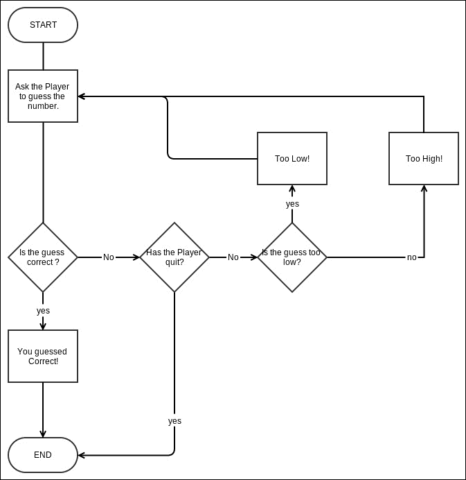

**图 9.2** 流程图

### 嵌套块

`if` 语句是 JavaScript 中几种块语句之一——即带有相应代码块的语句。JavaScript 中其他块语句的例子有 `for` 和 `while` 语句（我们稍后会探讨）。任何块语句都可以在其块内包含其他块语句。当一个块内包含一个或多个块时，称为*嵌套*。**清单 9.4** 中显示的更新后的 `numberGuess.js` 文件为在游戏内提示符（而非服务器控制台窗口）中玩游戏的玩家添加了一项很酷的增强功能。请更新你的代码以匹配清单 9.4。

现在进入游戏，在游戏内提示符下输入以下命令：

```javascript
/js refresh() // 加载更改

/js guessTheNumber( self )
```

当提示出现时，按 T 键开始输入你的猜测。你可能需要多次运行 `guessTheNumber()` 函数才能猜对答案，但这一次，当你猜对时，烟花会直接在你头顶上方绽放。

现在，代码会检查你是否猜对了，如果猜对了，就会向猜谜者发送一条消息。然后，另一个嵌套的 `if` 语句会测试猜谜者是否是。

### 组合条件

`if` 语句是 JavaScript 中几种块语句之一——即带有相应代码块的语句。JavaScript 中其他块语句的例子有 `for` 和 `while` 语句（我们稍后会探讨）。任何块语句都可以在其块内包含其他块语句。当一个块内包含一个或多个块时，称为*嵌套*。**清单 9.4** 中显示的更新后的 `numberGuess.js` 文件为在游戏内提示符（而非服务器控制台窗口）中玩游戏的玩家添加了一项很酷的增强功能。请更新你的代码以匹配清单 9.4。

### 逻辑与

（由于原文文本存在重复混乱，此处按核心逻辑重新排版）

最后一条命令不会输出任何内容，因为如果变量 `name` 是 `""`（空字符串）或 0，当它作为 `if` 语句中的条件时，会解析为 `false`。你可以像这样测试 `name` 是否等于 `steve`：

```js
if(name == "steve"){ console.log("Hey steve!"); }
```

如果你想测试某物是否为假呢？要测试某物不为真，可以将测试条件放在 `()` 圆括号内，并在前面加上 `!`（感叹号）。

```js
if (! (name == "steve") ) { console.log("Hey, you're not steve!"); }
```

`!` 运算符会对其后的任何布尔表达式取反（使其相反），因此以下所有表达式都会返回 `false`：

```js
! (5 > 2)
> false

! (5 < 8)
> false

! (8 < 5)
> true

! (name == "steve")
> false
```
```

***
### 小结

在本章中，你学习了如何使用 `if` 语句做出决策，并根据测试结果让程序执行不同的操作。你还学习了如何组合不同的测试来得到 `true` 和 `false`，以及 ScriptCraft 的 `input` 函数，该函数用于向玩家请求输入。

## 第 10 章 动物声音

在本章中，你将创建一个简单的程序，向玩家提问并根据给出的答案播放声音。你将学习 JavaScript 的 `switch` 语句和 ScriptCraft 的 `sounds` 模块。这个新程序会询问玩家最喜欢的动物是什么，然后播放该动物的声音。

### `switch` 语句

在第 9 章中，你学习了如何从玩家那里获取输入，以及如何使用 JavaScript 的 `if` 语句测试输入。JavaScript 还提供了另一种用于测试值的语句：`switch` 语句。当你希望通过测试单个值来做出决策时，`switch` 语句非常有用。`switch` 语句最好通过示例来解释。在 `/scriptcraft/plugins/` 文件夹中创建一个名为 `animalSounds.js` 的新文件，并输入`清单 10.1` 中所示的代码。

保存文件，然后执行 `js refresh()` 命令重新加载所有 JavaScript 代码。接着在游戏内提示符下执行以下命令：

`/js animalSounds( self );`

系统会提示你输入最喜欢的动物的名称。按 T 键输入文本，然后输入以下任意一种：`cat`、`chicken`、`cow`、`pig`、`sheep`、`wolf`。按下回车键后，你应该听到相应的声音——狼吠、牛哞等。如果你输入其他答案，程序会回复一条消息，说它从未听说过这种动物。

***

**清单 10.1** 动物声音

点击此处查看代码图像

```
var sounds = require('sounds');

var input = require('input');

function onInput( animal, player ) {

  switch (animal) {

    case 'cat':
      echo( player, "A cat says 'meow'");
      sounds.catMeow(player.location);
      break;

    case 'chicken':
      echo( player, "A chicken says 'cluck'");
      sounds.chickenSay(player.location);
      break;

    case 'cow':
      echo( player, "A cow says 'moo'");
      sounds.cowSay(player.location);
      break;

    case 'pig':
      echo( player, "A pig says 'oink'");
      sounds.pigSay(player.location);
      break;

    case 'sheep':
      echo( player, "A sheep says 'baa'");
      sounds.sheepSay(player.location);
      break;

    case 'wolf':
      echo( player, "A wolf says 'woof'");
      sounds.wolfBark(player.location);
      break;

    default:
      echo( player, "I never heard of a " + animal);
  }
};

function animalSounds( player ){
  input( player,
    "What's your favorite animal" +
    " - cat, chicken, cow, pig, sheep or wolf?",
    onInput );
}

exports.animalSounds = animalSounds;
```

`switch` 语句的工作原理与你在第 9 章中使用的 `if-else-if` 结构非常相似。也可以使用 `if-else-if` 形式编写 `animalSounds.js` 模块。点击此处查看代码图像

```
if (animal == 'cat') {
    sounds.catMeow(player.location);
} else if (animal == 'chicken') {
    sounds.chickenSay(player.location);
} else if (animal == 'cow') {
    sounds.cowSay(player.location);
}
```

但由于每次测试都是同一个 `animal` 变量，因此 `switch` 语句更为合理。关于 `switch` 语句，需要注意以下点：

- `switch` 语句用于针对可能的值测试。
- 它有一个多个 `case` 标签，每个标签必须跟一个值和 `:`（也称为冒号）。
- 只有当值匹配时，才会执行 `:` 后面的代码。所有代码一直执行到特殊的 `break` 语句。
- 如果没有匹配 `case`，则执行 `default` 情况。

当你输入的不是 `cat`、`chicken`、`cow`、`pig`、`sheep` 或 `wolf` 时，就会执行 `default` 情况。使用 `switch` 语句时常见的陷阱是忘记在每个 `case` 末尾添加 `break` 语句。作为练习，尝试注释掉 `sheep` 代码块中的 `break` 语句。记住，要注释掉一行，只需在该行加上 `//`。保存并重新加载，然后再次运行 `/js animalSounds( self );`，这次输入 `sheep` 作为喜欢的动物。会发生什么？屏幕上会出现输出：

```
A sheep says 'baa'
A wolf says 'woof'
```

这是因为如果没有遇到 `break`，代码会直接执行下一个 `case` 语句。

### `sounds` 模块

Minecraft 中有很多声音，可用的列表随着每个版本而变化。ScriptCraft 提供了一个 `sounds` 模块，可以播放游戏中的任何声音。在撰写本文时，Minecraft 中大约有160 种声音，`sounds` 模块为每声音提供了一个函数。`sounds` 模块中的函数最多接受三个参数：

- 想要播放声音的位置。此参数是可选的；如果省略，声音将播放给所有玩家。
- 想要播放声音的音量。此参数是可选的；如果省略，默认为 1.0（最大音量）。音量范围是 0 到 1，0 表示没有声音，1 表示最大音量。例如，如果你想以一半音量播放猫声，可以写成 `sounds.catMeow( location, 0.5 );`。
- 想要播放声音的音调。此参数也是可选的，如果省略，默认为 1.0（中等音调）。音调可以在 0 到 4 之间变化。

**表 10.1** 声音函数

`sounds` 模块不是 ScriptCraft 的内置变量，因此你需要先加载该模块才能使用它。在游戏内提示符下，你可以像这样播放各种声音：

```
/js var sounds = require('sounds');
/js sounds.catMeow( self.location );
/js sounds.burp( self.location );
```

在 Minecraft 中，玩家、方块、怪物、动物和村民都有一个 `location` 属性，可以传递给 `sounds` 模块的任何函数。

### 改进代码

运行 `animalSounds()` 函数时，如果你输入 `Cow` 而不是 `cow`，会发生什么？试试看。如果你输入 `Cow` 或 `COW`，函数会说它从未听说过 `Cow` 或 `COW`。对你来说，`Cow` 就是 `COW` 就是 `cow`，但对计算机来说，它们是三个不同的字符串。这是因为计算机是区分大小写的——它们看到单词 `Cow` 时，不会知道无论它是大写字母还是小写字母拼写，都表示相同的意思。计算机只看到一串（列表）字母，对计算机而言，`C` 和 `c` 是完全不同的。你可以通过在游戏内提示符下执行以下命令来亲自验证：

```
/js 'COW' == 'cow'
> false
/js 'Cow' == 'cow'
> false
```

如何让 `animalSounds()` 函数理解当玩家输入 `COW` 时，它应该与 `cow` 同等对待？幸运的是，有一个 `String` 函数可以帮助这个问题。在游戏提示符下输入以下命令：

```
/js 'COW'.toLowerCase() == 'cow'
> true
```

`String.toLowerCase()` 函数会将任何字符串转换为小写形式，因此 `COW` 变成 `cow`，`Cow` 也变成 `cow`。当你想要测试 `String` 值但不在乎它们是大写还是小写时，这非常有用。让我们看看改进后的 `animalSounds` 模块（见**清单 10.2**）。该模块的唯一改动是在 `switch` 语句之前新增了语句：

```
animal = animal.toLowerCase();
```

这条语句确保 `animal` 参数首先转换为小写，这样程序就不会报告如“不知道 Cow 或 SHEEP 是什么”之类的愚蠢消息。

**清单 10.2** 不区分大小写的动物声

点击此处查看代码图像

```
var sounds = require('sounds');
var input = require('input');

function onInput( animal, player ) {
  animal = animal.toLowerCase();
  switch (animal) {
    case 'cat':
      echo( player, "A cat says 'meow'");
      sounds.catMeow(player.location);
      break;

    case 'chicken':
      echo( player, "A chicken says 'cluck'");
      sounds.chickenSay(player.location);
      break;

    case 'cow':
      echo( player, "A cow says 'moo'");
      sounds.cowSay(player.location);
      break;

    case 'pig':
      echo( player, "A pig says 'oink'");
      sounds.pigSay(player.location);
      break;

    case 'sheep':
      echo( player, "A sheep says 'baa'");
      sounds.sheepSay(player.location);
      break;

    case 'wolf':
      echo( player, "A wolf says 'woof'");
      sounds.wolfBark(player.location);
      break;

    default:
      echo( player, "I never heard of a " + animal);
  }
}

function animalSounds( player ) {
  input( player,
    "What's your favorite animal" +
    " - cat, chicken, cow, pig, sheep or wolf?",
    onInput );
}

exports.animalSounds = animalSounds;
```

### 更多关于字符串

JavaScript 中的所有字符串还有一个 `toUpperCase()` 函数，返回字符串的大写版本。注意 `toLowerCase()` 和 `toUpperCase()` 函数都不会改变原始字符串；它们只是返回一个新字符串。这就是为什么需要将 `animal` 变量赋值为返回值。如果你简单地使用代码：

```
animal.toLowerCase();
```

那么对于 `COW`，`switch` 分支仍然失败，因为当你调用 `toLowerCase()` 函数时，`animal` 的值并没有改变。在 JavaScript 中任何字符串都是不可变的，这意味着没有任何方法能以方式改变它。在第 8 章中你可以通过调用 `push()` 方法向数组添加项。数组是可变的：方法可以改变它们调用的对象。让我们在游戏提示符下看一个例子：

```
/js animals = ['cow','pig'];
/js animals.push('sheep');
/js animals[2]
> sheep
```

前面的语句 `animals.push('sheep')` 实际上改变了 `animals` 的值。对于字符串，这种情况永远发生。没有任何字符串方法（而且有很多）会改变它们调用的值。例如，这里有一个 `String.concat()` 函数，用于拼接另一个字符串：

```
/js name = "steve ";
/js name.concat("crafter");
> steve crafter
/js name
> steve 
```

你可以看到，虽然 `name.concat("crafter")` 返回了值 `steve crafter`，但原始 `name` 变量保持不变。如果你想改变 `name` 变量，你必须这样做：

```
/js name = "steve ";
/js name = name.concat("crafter");
> steve crafter
/js name
> steve crafter
```

**表 10.2** 展示了最常用的字符串方法。`String` 方法的完整参考可在 `developer.mozilla.org/en-US/docs/Web/Javascript/Reference/Global_Objects/String` 找到。

#### 本章小结

在本章中，你学习了如何使用 switch 语句进行决策。你还学习了如何使用 ScriptCraft 的 sounds 模块播放声音。在本书的后续部分，你将学习如何使用对象进一步简化这个模块。

## 第 11 章 排行榜：数组的更多乐趣

JavaScript 中数组的一个非常酷的特性是它们可以被排序。排序是查看数组中的每个项目并判断它是否大于或小于同一数组中另一个项目的过程。当数组中的所有项目都被排序后，这个数组就像一个排行榜——一个排好序的项目列表。在本章中，你将根据玩家跳跃的次数创建一个玩家排名列表。

### `Array.sort()`

`Array.sort()` 方法用于对数组中的项目进行排序。让我们看看它的实际效果。在服务器控制台提示符下输入以下命令：

```
js var animals = ['pig','wolf','cow','cat','sheep'];
js console.log( animals );
js animals.sort();
js console.log( animals );
```

> pig,wolf,cat,cow,sheep
> cat,cow,pig,sheep,wolf

从输出中可以看出，`Array.sort()` 会按字母顺序（即字母在字母表中出现的顺序）对字符串列表排序。因此，`cat` 被移到了数组的第一个位置，而 `wolf` 被移到了数组的最后一个位置。中间的所有动物也按字母顺序排序。如果你尝试对数字数组进行排序，会发生什么？

点击此处查看代码图像

```
js var luckyNumbers = [ 9, 23, 5, 40, 21 ];
```

```markdown
js `luckyNumbers.sort();`

js `console.log( luckyNumbers );`

```

> 21, 23, 40, 5, 9

嗯，这毫无意义！在 JavaScript 中，对数组项目进行排序的默认方式是按字母顺序。即使数组中的项目都是数字，它也会这样做。在 JavaScript 中，数组可以包含*任何东西*，比如数字、字符串、对象、其他数组，甚至这些类型的混合。如果你希望 `Array.sort()` 方法以字母顺序以外的任何方式排序，你必须告诉它如何排序。例如，在服务器控制台提示符下输入以下命令：

点击此处查看代码图片

```js
js function numerically( a, b ) { return a - b };

js luckyNumbers.sort( numerically );

js console.log( luckyNumbers );
```

> 5, 9, 21, 23, 40

现在 `luckyNumbers` 数组按正确的顺序排序了。你在前面代码的第一个命令中创建的 `numerically()` 函数是一个接受两个参数 `a` 和 `b` 并相减的函数。这个函数随后被传递给 `Array.sort()` 方法，并且会被 `Array.sort()` 多次调用，因为它从数组中取出两个项目，并向 `numerically()` 函数提问：“哪个项目更大——`a` 还是 `b`？” 如果你添加一个 `console.log()` 语句，你会看到你的 `numerically()` 函数会被多次调用。

点击此处查看代码图片

```js
js function numerically( a, b ) { console.log('a = ' + a + ',

b = ' + b); return a - b }

js luckyNumbers.sort( numerically );
```

> a = 9, b = 5
> a = 21, b = 9
> a = 23, b = 21
> a = 40, b = 23

你看到的具体输出可能不同，但添加 `console.log()` 语句的目的是为了说明在数组排序过程中，`numerically()` 函数会被多次调用。

#### 如何比较数组中的元素

你之前创建的 `numerically()` 函数被称为*比较器*函数，因为它唯一的工作就是*比较*两个事物。`Array.sort()` 在排序时使用的规则很简单。`Array.sort()` 方法从数组中取出两个元素，并调用比较器（比较函数），将这两个元素作为参数传入。它会重复这个过程，直到数组中的所有元素都相互比较完毕。比较器函数通常只将参数命名为 `a` 和 `b`。

 如果函数返回数字 0，则表示 `a` 和 `b` 相同（至少在排序上如此）。

 如果返回小于 0 的数字，则表示 `a` *小于* `b`，因此 `a` 在数组中应出现在 `b` 之前。

 如果返回大于 0 的数字，则表示 `a` *大于* `b`，因此 `a` 在数组中应出现在 `b` 之后。

让我们看看这些规则在 `numerically()` 函数中是如何使用的。

点击此处查看代码图片

```js
function numerically( a, b ) { return a - b ; }
```

按数字排序相对简单。对于数字排序，你只需将一个数字减去另一个数字，就能为 `Array.sort()` 方法提供排序所需的信息。因此，从数组中任意取出两个数字并传递给 `numerically()` 函数，就能得到正确的顺序。

 21 - 40 = -19，小于 0，意味着 21 在数组中会排在 40 *之前*。

 21 - 9 = 12，大于 0，意味着 21 在数组中会排在 9 *之后*。

 5 - 9 = -4，小于 0，意味着 5 在数组中会排在 9 *之前*，以此类推。

***

术语：Java 集合

Java 集合类似于 JavaScript 数组——它是一个项目的集合。然而，它没有相同的方法或函数，也不能像使用 JavaScript 数组那样使用。例如，在 JavaScript 中，你可以使用 `length` 属性来了解数组中有多少项。Java 集合没有这样的属性。要了解 Java 集合中有多少项，你需要调用 `size()` 方法。你在插件中使用的许多对象都是 Java 对象。一般来说，`server` 变量及其任何属性都是 Java 对象。同样，事件、玩家和方块对象也是 Java 对象，因此它们的任何属性也都是 Java 对象。如果你想对 Java 集合进行排序，更简单的方法是先将其转换为 JavaScript 数组。ScriptCraft 附带了一个 `utils` 模块，其中有一个 `array()` 函数可以做到这一点。

***

`Array.sort()` 方法利用所有这些计算的结果，将每个元素移动到数组中的正确位置。乍一看，`Array.sort()` 方法似乎很笨（毕竟它甚至不知道如何对数字排序，必须明确告诉它怎么做），但实际上它非常灵活和强大。`Array.sort()` 几乎可以对任何东西进行排序；你只需要告诉它使用什么规则进行排序。

让我们看一个稍微复杂一点的例子。通常，你的服务器在启动时会创建三个世界。这些世界通常被称为 `world`、`world_nether` 和 `world_the_end`。如果你想根据这些世界的人口（即存在的数量——动物、怪物和玩家）对它们排序，你可以创建一个新的 `byPopulation()` 函数：

点击此处查看代码图片

```js
function byPopulation(a,b){
     return a.entityList.size() - b.entityList.size();
   }
```

`byPopulation()` 函数接受两个参数，名为 `a` 和 `b`，假定这两个参数都是 世界。每个 Minecraft 世界都有 `entityList` 属性，它是一个集合，包含所有生物。`entityList` 属性有一个 `size()` 函数，如果你想了解一个世界中有生物，你可以调用该世界的 `entityList.size()` 方法。你可以通过一个世界的人口减去另一个世界的人口来比较。使用新的 `byPopulation()` 函数如下：

点击此处查看代码图片

```js
var utils = require('utils');
var worlds = utils.worlds();
worlds.sort( byPopulation );
```

`utils.worlds()` 函数返回服务器上世界的数组。它被排序后，结果会打印到控制台。前面的例子演示了如何将喜欢的规则应用于数组。现在来讨论一下对玩家排序。

#### 按名称排序

按名称排序是对玩家排序的方法。严格来说，这并非真正的排行榜。在 `scriptcraft/modules` 文件夹中创建一个名为 `playerSort.js` 的新文件，输入清单1.1 所示的代码。

***

**清单1.1** 按名称排序

点击此处查看代码图片

```js
function byName( a, b ) {
  if (a.name == b.name) {
    return 0;
  } else if (a.name > b.name) {
    return 1;
  } else {
    return -1;
  }
};

exports.byName = byName;
```

***

`byName()` 函数对每个玩家的名称进行了比较。使用 `<` 和 `>` 运算符比较两个字符串时，总是基于字符顺序，因此 `'cat' < 'cow'` 会返回 `true`，而 `'cat' > 'cow'` 会返回 `false`。但是你不希望比较器函数 `byName()` 返回 `true` 或 `false`；你希望它返回一个数字。即使是丰富的程序员，在编写排序函数时也常犯错误。他们忘记了比较函数必须返回一个数字，而不是是 `true` 或 `false`。

要尝试这个模块，请在服务器控制台提示符下发出命令。确保你的服务器至少有两个玩家，否则结果很有趣。点击此处查看代码图片

```js
var utils = require('utils');
var playerSort = require('playerSort');
var players = utils.players();
players.sort( playerSort.byName );
console.log( players );
```

#### 按经验值排序

说实话，基于名称的排行榜既无聊又不公平。相反，让我们尝试一个基于经验值的排行榜。更新你的 `playerSort.js` 文件，添加一个新的 `byExp()` 函数（`Exp` 是 `experience` 的缩写），如清单1.2 所示。

新的 `byExp()` 函数只是数字排序，即返回玩家 `a` 的经验值减去玩家 `b` 的经验值。需要注意的一点是，虽然只有一个函数用于经验值排序，但你导出了两次——一次以 `byExp` 的名称，另一次以更长的名称 `byExperience`。这为使用该模块的程序员提供了选择，他们可以使用该函数的短名称或长名称；无论使用哪个名称，调用的都是同一个函数。发出以下命令再次查看此函数的运行效果；如果服务器上有多个玩家会有帮助：

点击此处查看代码图片

```js
var sortPlayers = require('playerSort');
var utils = require('utils');
var players = utils.players();
players.sort( sortPlayers.byExp );
console.log( players );
```

***

**清单1.2** 按经验值排序

点击此处查看代码图像

```javascript
function byName( a, b ) {
  if (a.name == b.name) {
    return 0;
  } else if (a.name > b.name) {
    return 1;
  } else {
    return -1;
  }
};

exports.byName = byName;

function byExp( a, b ) {
  return a.experience - b.experience;
};

exports.byExperience = byExp;
exports.byExp = byExp;
```

***

当我仅用两名玩家运行这段代码时，得到了以下输出：

`[walterh, sean_higgins]`

当时的实际经验值如下：

玩家      总经验值
----------------------------
walterh        52
sean_higgins   103

你应该对结果感到惊讶。在任何基于玩家经验的排行榜中，*最有经验*的玩家——即经验值最高的玩家——应该排在经验较少的玩家前面。然而，`byExp()` 函数按*升序*排序（即从低到高），因此数组会将经验最少的玩家排在前面。这不是你想要的排行榜效果。

### 反转数组

你可以通过调用 `reverse()` 方法轻松反转数组。

`js players.reverse()`

`reverse()` 方法会就地反转数组。第一个数组元素变成最后一个，最后一个变成第一个。

### 显示排行榜

到为止，你只是使用 `console.log()` 函数在一行中显示数组的全部内容。使用 `console.log()` 显示玩家时，输出可能类似于：

`Player{name=abcdefg}, Player{name=hijklmn}, Player{name=opqrst}`
```


```
这样会变得非常重复且输入起来很累。幸运的是，有一种更简单的方法可以将数组中的每个项目打印到单独的一行。理解 `for` 语句工作原理的最佳方式是通过示例。在服务器提示符下执行以下命令，看看会发生什么：

点击此处查看代码图像

```javascript
js var animals = ['cat','cow','pig','sheep','wolf'];
js for (var i = 0; i < animals.length; i++ ) { console.log(animals[i] ); }
```

`for` 循环用于重复执行一个语句块。你是否注意到动物数组被打印得有多快？让我们再次尝试使用 `for` 语句，这次只打印从 0 到 99 的所有数字。

点击此处查看代码图像

```javascript
js for (var i = 0; i < 100; i++ ) { console.log(i); }
```

在现代计算机上，这 100 个数字会在眨眼之间打印出来。如果你好奇，可以尝试再次运行命令，这次将数字从 100 改为 100 万（即 1 后面跟六个零）。这需要更长的时间，但依然会在你或我能数到 100 之前完成。计算机速度很快，现在你开始感受到它有多快了！让我们仔细看看你使用的第一个`for`语句。

```js
for (var i = 0; i < animals.length; i++ ) {
  console.log(animals[i]);
}
```

`for`语句括号中的部分——`(var i = 0; i < animals.length; i++ )`——为`for` 循环设定了一些规则。每条规则由分号（`;`）分隔。

- 第一条规则（`var i = 0`）称为*初始化*表达式，仅在循环开始前运行一次。
- 第二条规则（`i < animals.length`）称为*测试*表达式，在每次循环的*开始*时运行，以判断循环是否应该结束。
- 第三条规则（`i++`）称为*递增*表达式，在每次循环的*结束*时运行。

在`for`语句之后，你有一个由花括号（`{ }`）括起来的一个或多个语句块。这些语句将在每次循环中执行。让我们使用`for`循环来创建一个更美观的排行榜，显示跳跃次数最多的玩家。在`scriptcraft/modules`文件夹中创建一个名为`leaderboard.js`的新文件，并输入**清单 11.4**中所示的代码。

要尝试这个新模块，请保存它，然后执行`js refresh()`命令重新加载 ScriptCraft，接着在游戏内提示符下输入以下命令：

```js
/js var leaderboard = require('leaderboard');
/js leaderboard.jumps( self );
```

服务器上所有玩家的列表以及他们跳跃的次数应按降序显示，这意味着跳跃次数最多的玩家将位于列表顶部。在后面的章节中，你将重新审视这个模块，使用屏幕上的记分板来显示排行榜，就像在流行的玩家对战服务器上看到的那样。

`jumps()`函数接受一个名为`receiver`的参数，它是`MessageReceiver`的缩写。`MessageReceiver`是游戏中能够接收消息的任何对象。例如，玩家就是消息接收者，因为他们可以接收消息（并使用游戏内提示符发送消息）。在这个函数中，你要做的是将输出发送给发出命令的玩家。这就是为什么你使用`echo( receiver, ...)`而不是`console.log()`来显示排行榜。如果你使用`console.log()`，玩家将看不到排行榜，因为`console.log()`只将消息写入服务器控制台窗口，而不是发送给玩家。在之前的`jumps()`函数中，你按玩家跳跃次数排序，然后反转数组，使较大的数字位于数组前面，最后使用`for`循环*遍历*数组。在`for`循环内部，你有一个语句块。

### 清单 11.4 简单的跳跃排行榜：for 循环

```js
var playerSort = require('playerSort');
var utils = require('utils');

function jumps( receiver ) {
  var players = utils.players();
  players.sort( playerSort.byJumps );
  players.reverse();
  for (var i = 0; i < players.length; i++ ) {
    var player = players[i];
    var playerJumps = player.getStat(utils.stat.JUMP );
    echo( receiver, player.name + '_____' + playerJumps);
  }
};

exports.jumps = jumps;
```

前面的代码块会执行多次——执行次数取决于连接到服务器的玩家数量。变量`i`是`players`数组中的当前位置。这个变量的值在每次循环中都会改变。第一次循环时它为 0，然后是 1，接着是 2，依此类推，直到到达数组末尾，没有更多玩家需要处理。第一条语句获取当前位置的玩家（`players[i]`）并将其赋值给一个名为`player`的变量。然后你获取该玩家的跳跃次数和名字，并在屏幕上显示它们。

### while 循环

第二种循环称为`while`循环。`for`循环适用于*迭代*（循环的另一种说法）数组，或者当你预先知道需要循环多少次时。有时你不知道需要循环多少次，而希望一直循环直到满足某个条件。`while`循环也称为*条件*循环——它类似于`if`语句，但会反复执行同一代码块，直到*测试条件*不再为真。理解这一点的最好方法是看例子。让我们再次查看排行榜模块——这次它使用`while`循环而不是`for`循环编写（见**清单 11.4**）。

在现代计算机上，这 100 个数字会在眨眼之间打印出来。如果你好奇，可以尝试再次运行命令，这次将数字从 100 改为 100 万（即 1 后面跟六个零）。这需要更长的时间，但依然会在你或我能数到 100 之前完成。计算机速度很快，现在你开始感受到它有多快了！让我们仔细看看你使用的第一个`for`语句。

```js
for (var i = 0; i < animals.length; i++ ) {
  console.log(animals[i]);
}
```

`for`语句括号中的部分——`(var i = 0; i < animals.length; i++ )`——为`for`循环设定了一些规则。每条规则由分号（`;`）分隔。

- 第一条规则（`var i = 0`）称为*初始化*表达式，仅在循环开始前运行一次。
- 第二条规则（`i < animals.length`）称为*测试*表达式，在每次循环的*开始*时运行，以判断循环是否应该结束。
- 第三条规则（`i++`）称为*递增*表达式，在每次循环的*结束*时运行。

在`for`语句之后，你有一个由花括号（`{ }`）括起来的一个或多个语句块。这些语句将在每次循环中执行。让我们使用`for`循环来创建一个更美观的排行榜，显示跳跃次数最多的玩家。在`scriptcraft/modules`文件夹中创建一个名为`leaderboard.js`的新文件，并输入**清单 11.4**中所示的代码。

要尝试这个新模块，请保存它，然后执行`js refresh()`命令重新加载 ScriptCraft，接着在游戏内提示符下输入以下命令：

```js
/js var leaderboard = require('leaderboard');
/js leaderboard.jumps( self );
```

服务器上所有玩家的列表以及他们跳跃的次数应按降序显示，这意味着跳跃次数最多的玩家将位于列表顶部。在后面的章节中，你将重新审视这个模块，使用屏幕上的记分板来显示排行榜，就像在流行的玩家对战服务器上看到的那样。

`jumps()`函数接受一个名为`receiver`的参数，它是`MessageReceiver`的缩写。`MessageReceiver`是游戏中能够接收消息的任何对象。例如，玩家就是消息接收者，因为他们可以接收消息（并使用游戏内提示符发送消息）。在这个函数中，你要做的是将输出发送给发出命令的玩家。这就是为什么你使用`echo( receiver, ...)`而不是`console.log()`来显示排行榜。如果你使用`console.log()`，玩家将看不到排行榜，因为`console.log()`只将消息写入服务器控制台窗口，而不是发送给玩家。在之前的`jumps()`函数中，你按玩家跳跃次数排序，然后反转数组，使较大的数字位于数组前面，最后使用`for`循环*遍历*数组。在`for`循环内部，你有一个语句块。

### 清单 11.4 简单的跳跃排行榜：for 循环

```js
var playerSort = require('playerSort');
var utils = require('utils');

function jumps( receiver ) {
  var players = utils.players();
  players.sort( playerSort.byJumps );
  players.reverse();
  for (var i = 0; i < players.length; i++ ) {
    var player = players[i];
    var playerJumps = player.getStat(utils.stat.JUMP );
    echo( receiver, player.name + '_____' + playerJumps);
  }
};

exports.jumps = jumps;
```

前面的代码块会执行多次——执行次数取决于连接到服务器的玩家数量。变量`i`是`players`数组中的当前位置。这个变量的值在每次循环中都会改变。第一次循环时它为 0，然后是 1，接着是 2，依此类推，直到到达数组末尾，没有更多玩家需要处理。第一条语句获取当前位置的玩家（`players[i]`）并将其赋值给一个名为`player`的变量。然后你获取该玩家的跳跃次数和名字，并在屏幕上显示它们。

### while 循环

第二种循环称为`while`循环。`for`循环适用于*迭代*（循环的另一种说法）数组，或者当你预先知道需要循环多少次时。有时你不知道需要循环多少次，而希望一直循环直到满足某个条件。`while`循环也称为*条件*循环——它类似于`if`语句，但会反复执行同一代码块，直到*测试条件*不再为真。理解这一点的最好方法是看例子。让我们再次查看排行榜模块——这次它使用`while`循环而不是`for`循环编写（见**清单 11.4**）。

### 跳出循环

有时你可能想提前跳出循环。假设你只想显示那些跳过的玩家——换句话，跳跃次数大于零的玩家。你可以使用 JavaScript 的`break`语句提前跳出循环。查看**清单 11.6**，了解`break`语句的示例。在前面的代码中，`while`循环在遇到第一个跳跃玩家时停止。

### 跳过循环中的迭代

`break`语句会跳出循环，有效地结束循环，使得循环代码块不再执行。有时你只想跳过循环中的迭代（一次）。假设你有一个列表，只想显示跳过的玩家。`continue`语句允许你跳到循环下一次迭代。在**清单 11.7**中，只有跳过的玩家会被显示。这不是一个排行榜，因为玩家没有按顺序显示。

### 清单 11.5 简单的跳跃排行榜：while 循环

```js
var playerSort = require('playerSort');
var utils = require('utils');

function jumps( sender ) {
  var players = utils.players();
  players.sort( playerSort.byJumps );
  players.reverse();
  var i = 0;
  while ( i < players.length ) {
    var player = players[i];
    var jumpStats = player.getStat( utils.stat.JUMP );
    echo( sender, player.name + ' ' + jumpStats);
    i++;
  }
};

exports.jumps = jumps;
```

### 清单 11.6 跳出循环

```js
var playerSort = require('playerSort');
var utils = require('utils');

function jumps( sender ) {
  var players = utils.players();
  players.sort( playerSort.byJumps );
  players.reverse();
  var i = 0;
  while ( i < players.length ) {
    var player = players[i];
    var jumpStats = player.getStat(utils.stat.JUMP );
    if ( jumpStats == 0 ) {
      break;
    }
    echo( sender, player.name + ' ' + jumpStats);
    i++;
  }
};

exports.jumps = jumps;
```

### 清单 11.7 跳过迭代

```js
var utils = require('utils');

function jumps( sender ) {
  var players = utils.players();
  var i = 0;
  while ( i < players.length ) {
    var player = players[i];
    var jumpStats = player.getStat( utils.stat.JUMP );
    if (jumpStats == 0 ) {
      continue;
    }
    echo( sender, player.name + ' ' + jumpStats);
    i++;
  }
};

exports.jumps = jumps;
```

#### 无限循环

在任何循环中，必须有一条语句影响循环条件。例如，在**清单 11.7**中，每次循环都会检查`i`变量的值。如果你从未改变`i`变量，你认为会发生什么？如果`i`从未改变，那么`i < players.length`将始终为真（当然，除非服务器上没有玩家，在这种情况下while块内的代码永远执行）。一直运行且永不停止的循环称为无限循环。无限循环通常是因为程序员忘记递增计数器变量或循环条件错误而发生的。无限循环通常表明出了问题——代码存在 bug。有些无限循环并非偶然。大多数具有用户界面（窗口、按钮等）的游戏和程序都有事件循环，这是一个不断运行并监听来自用户或系统部分传入事件的循环。游戏的事件循环可能会监听用户的按键、检查游戏中的对象是否发生碰撞、检查玩家的生命值等。Minecraft 服务器就有这样一个循环。

### 为玩家创建命令

到目前为止，在本章中你一直在创建可由服务器上任何操作员调用的 JavaScript 函数。只有操作员才能且能够在游戏内或服务器提示符下执行 JavaScript 代码。执行代码的能力具有危险，因此你绝对不想授予服务器上每个人这种权限。`js`命令会接受任何 JavaScript 代码并尝试执行它。ScriptCraft 还提供了另一个命令，即`jsp`命令。jsp`命令可供每个人使用。与`js`命令不同，`jsp`命令不执行 JavaScript 代码，因此没有操作员权限的玩家可以安全地使用它。`jsp`命令允许你创建自己的自定义命令，所有玩家都可以使用。

你希望所有玩家都能通过一个简单的游戏内命令调出排行榜，并且希望他们无需了解 JavaScript 就能。在本章的下一部分，你将修改`leaderboard.js`文件，以便任何人都可以使用以下命令调出排行榜：

`jsp leaderboard`

当玩家在游戏内提示符下发出此命令时，将向发出命令的玩家显示跳跃次数最多的玩家排行榜。现在先不要尝试——你还没有创建排行榜命令。

### jsp 命令

jsp命令本身作用不大。它只是一个占位符，是一个可以扩展以支持新类型命令的“虚拟”命令。在 Minecraft 服务器中，命令有一个名称和一个多个参数。例如，在以下命令中，`gamemode`是命令的名称，`creative`和`walterh`是命令的参数：

`/gamemode creative walterh`

`jsp`命令的目的是让你能够轻松地使用 JavaScript 创建自己的自定义命令，jsp命令设计得很短，因为它只是自定义命令的前缀。
```

```
玩家名称和跳跃次数的列表应作为消息显示在屏幕上。现在尝试以下操作：输入`/jsp le`，然后按 Tab 键。按 Tab 键应该会自动补全命令的其余部分，就像常规的 Minecraft 命令一样！`jsp`命令利用了 Tab 补全功能：只需重复按 Tab 键，即可补全命令的剩余部分或循环浏览命令参数值。

### 成就解锁！

你刚刚学会了如何在 Minecraft 中提供新的自定义命令！


### 总结

在本章中，你学习了如何使用 `for` 循环和 `while` 循环遍历数组中的每个元素。你还学习了如何对数组进行排序和反转，以及如何使用 ScriptCraft 的`command()`函数提供新的自定义命令。

## 第 12 章 建造摩天大楼

在本章中，你将仅用几行代码和循环语句建造一座 10 层的摩天大楼。你将使用 `for` 和 `while` 循环以及 ScriptCraft 的`Drone`函数在 Minecraft 中建造大型建筑。

### 使用无人机建造

在 Minecraft 中，手动建造很有趣，但当你想建造塔楼、城堡和堡垒等大型建筑时，可能会变得乏味。ScriptCraft 包含一个用于使用 JavaScript 在 Minecraft 中建造大型建筑的模块。`Drone`模块有许多用于建造的函数。你可以在游戏内提示符下使用`Drone`模块直接在游戏内建造，也可以使用 JavaScript 文件中的`Drone`函数为更复杂的结构创建蓝图。将无人机想象成一架无形的遥控飞机，它可以放置任何方块，而你则使用 JavaScript 控制它。让我们从在游戏内提示符下创建一个简单的结构开始。使用`Drone`模块建造时，你应该做的第一件事是看向（也称为瞄准）一个方块。在图 12.1 中，瞄准的方块以比周围方块稍深的颜色勾勒出来。

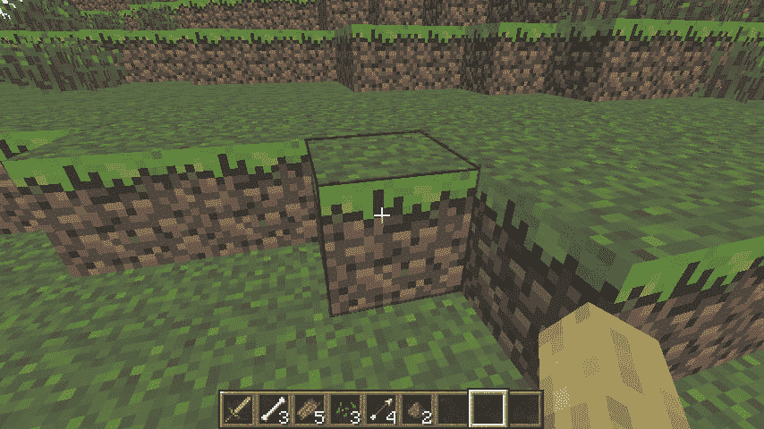

图 12.1 在 Minecraft 中瞄准一个方块。

一旦你选中了一个方块——选择你喜欢的任意方块，但最好选一个刚好在地面之上的——在游戏内提示符下输入以下命令：

`/js box( blocks.gold, 1, 3);`

选中的方块会消失，取而代之的是一根由金块组成的柱子，宽度为 1 格，高度为 3 格，如图 图 12.2 所示。

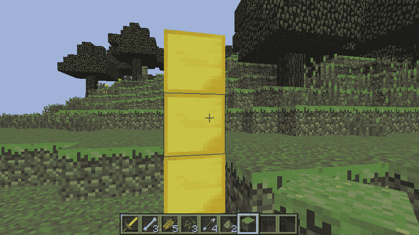

图 12.2 金柱。

`box()`函数用于在游戏中放置方块。它接受四个参数：

 材质：你希望方块使用的材料类型。

 宽度：你希望盒子延伸的宽度。盒子将从选中的方块向右延伸。

 高度：你希望盒子延伸的高度。盒子将从选中的方块向上延伸。

 长度：你希望盒子延伸的距离。盒子将从选中的方块向远离你的方向延伸。

`box()`函数用于创建任意大小的立方体和长方体（参见 图 12.3）。立方体是一种所有边长都相等的三维形状。长方体是一种宽度、高度和长度可以不同的三维形状。

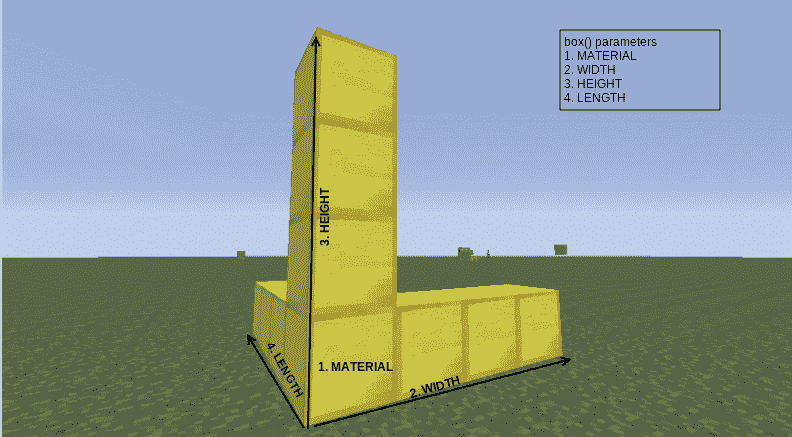

图 12.3 盒子函数参数。

我们再试几个例子。选中原来的方块（现在它是金块），输入以下命令将柱子从金块变成铁块：

`/js box( blocks.iron, 1, 3)`

如果你不确定使用哪种材料，可以使用 Tab 补全来填写材料。只需输入`box (blocks.`，然后按 Tab 键即可查看可能的材料列表。现在选中另一个方块——这次最好选一个地面高度的方块——输入以下命令，创建一个宽 2 格、长 10 格的石质路径：

`/js box( blocks.stone, 2, 1, 10)`

这将创建一个向远离你的方向延伸 10 格的石质路径（参见 图 12.4）。

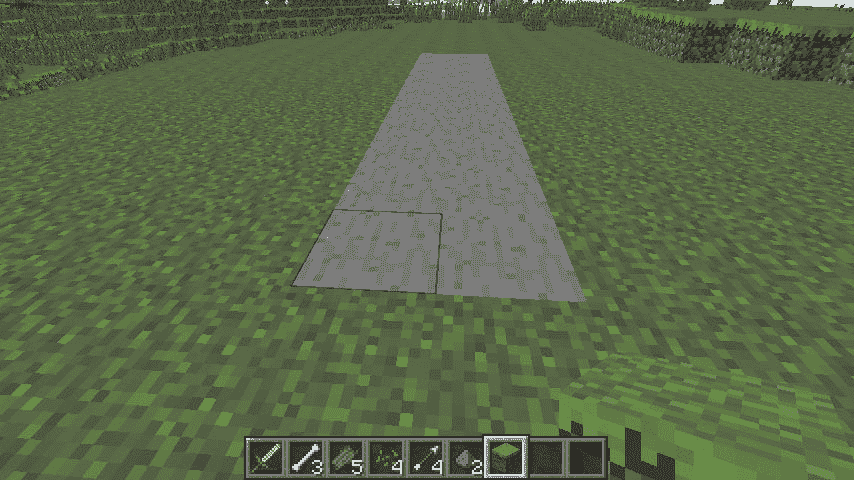

图 12.4 一个 2x10 的石质路径。

如果你省略了宽度、高度和长度中的任意参数，它们默认为 1。因此，`box( blocks.gold, 5, 3)` 将创建一个 5 格、高 3 格、长 1 格的盒子；`box( blocks.gold, 5)` 将创建一个 5 格、高 1 格的盒子；而`box( blocks.gold )` 将创建一个宽、高、长均为 1 格。

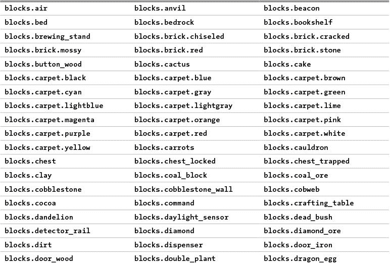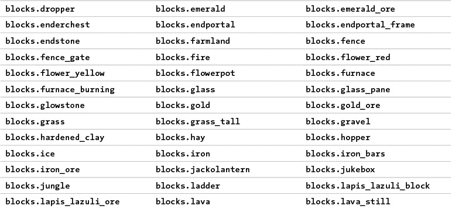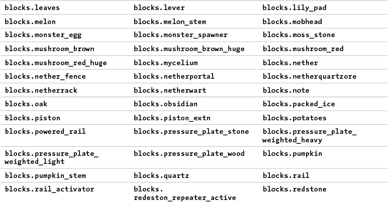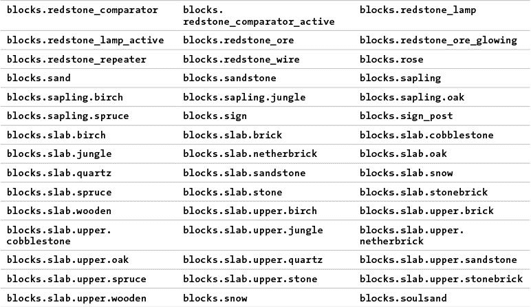

图 12.1 建筑示例。

### 移动你的无人机

不能移动只能在一个位置建造的无人机没什么意思。你可以指挥无人机移动，甚至转向并在任意方向放置方块。几个函数可以用来移动无人机。在纸上绘图时，你在二维空间中绘制宽度（沿 x 轴）和高度（沿 y 轴）。在现实世界中还有第三维度——长度，它沿 z 轴。x 轴、y 轴和 z 轴构成了三维空间。

让我们先通过游戏内提示符使用一些函数来熟悉它们。放置一个金块，然后向右移动两格再放置一个金块，选中一个方块并输入以下命令：

`/js box(blocks.gold).right(2).box(blocks.gold)`

`box(blocks.gold).right(2)`上面的语句看起来有点奇怪，但它是有效的 JavaScript。这种风格被称为链式调用，因为每个点号（`.`）都构成了函数调用。所有 JavaScript 函数都能这样调用，另一个术语是流畅调用。稍后你会看到，你可以添加函数来扩展无人机的功能，这些函数也可以同样的流畅调用。在上面的语句中进行了三次不同的调用：第一次调用`box(blocks.gold)`创建了一个金块。`box()`函数返回一个`Drone` 对象，该对象可以调用其他函数。下一次调用`.right(2)`将无人机向右移动两格，它返回同一个`Drone` 对象。最后一次调用`.box(blocks.gold)`创建了另一个金块。如果你在纸上画出这个过程，它看起来像 图 12.5。

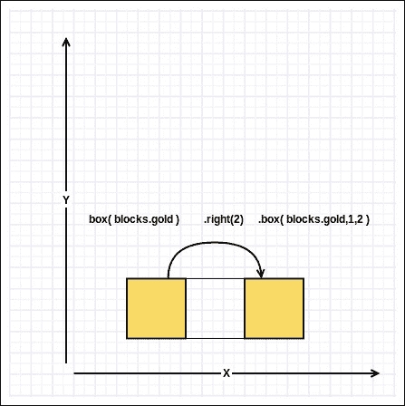

图 12.5 移动无人机示意图。

你也可以将上面的代码写成三条独立的语句如下：

```javascript
/js drone = box(blocks.gold);
/js drone.right(2);
/js drone.box(blocks.gold);
```

我个人喜欢用单条语句来写：`box(blocks.gold).right(2).box(blocks.gold)`，因为它写在一行，而且比三条语句稍微短。不过，写这样的语句时要小心，游戏内命令每条最多接受 100 个字符。

### 基石

在地面之上建造，最好在你想要的位置放置一个方块，然后选中方块，再执行任何`Drone`函数。把这个选中的方块想象成建筑。如果在平坦世界中建造，你需要手动放置一个基块，否则你的建筑从地面以下开始，而不是在地面之上（参见 图 12.6）。

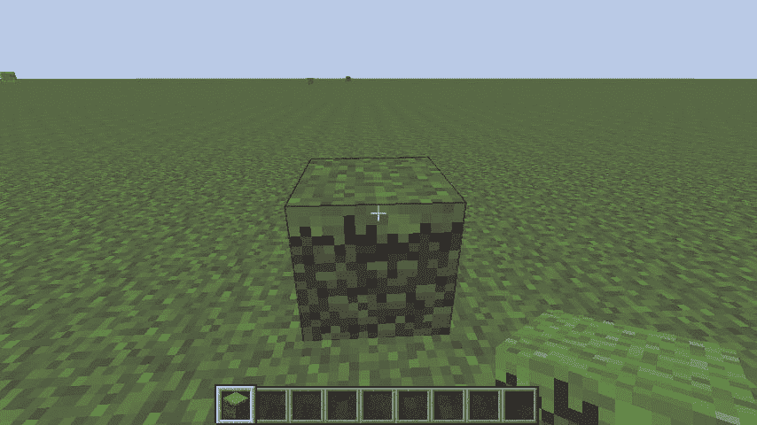

图 12.6 基石。

让我们使用更多的链式调用来创建一系列跳跃平台，每个平台之间相隔两格。选中一个方块，然后输入以下命令：

`/js box(blocks.gold).fwd(2).box(blocks.gold,1,2).fwd(2).box(blocks.gold,1,3)`

这条语句将创建三个平台。第一个平台高 1 格，第二个平台高 2 格，第三平台高 3 格。由于每个平台之间相隔两格，它们非常适合在游戏中进行跳跃练习。在 图 12.7 中，你可以看到这些柱子是如何构建的，而 图 12.8 则展示了跳跃平台在游戏中的样子。

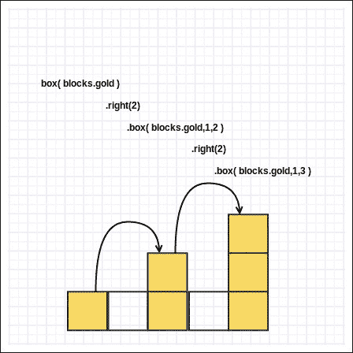

图 12.7 纸上的跳跃平台。

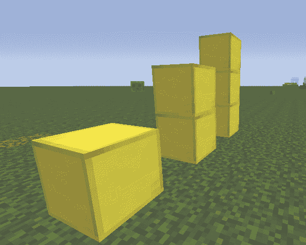

图 12.8 跳跃平台。

### 转向你的无人机

除了移动无人机，你还可以让无人机改变方向。要改变方向，请使用`turn()`函数。转向时，你总是向右转 90 度。要掉头面向相反方向，请转两次`turn(2)`。要向左转，你需要向右转三次：`turn(3)`。你可以将转向、移动和建造组合在一条链式语句中，如下所示：

`/js box(blocks.gold,1,1,4).fwd(4).turn().box(blocks.iron,1,1,3).fwd(3).turn().box(blocks.ice,1,1,2)`

这条命令创建了三面小墙，分别由金块、铁块和冰块构成。在 图 12.9 中，你可以看到这些墙是如何通过组合`box()`、`turn()` 和`fwd()`函数调用构建的。

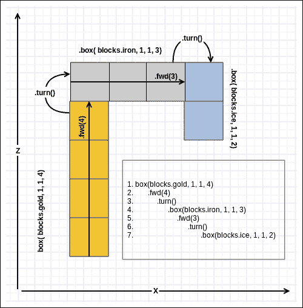

图 12.9 上的面墙。

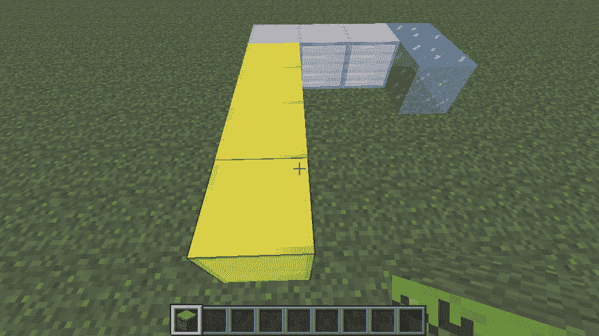

图 12.10 建造过程中的转向与移动。

无人机的所有函数都返回无人机本身，因此每个函数可以直接链式调用另一个函数。如果你想了解更多关于`Drone`对象及其函数的信息，可以查阅在线[Drone API 参考文档](http://scriptcraftjs.org/api#drone-plugin)。

### 蓝图

蓝图是建筑物的技术图纸。蓝图由建筑师在设计建筑时创建。它们是施工团队确保按照建筑师设计建造的指令。你可以将你编写的代码供计算机执行。你是设计者，计算机必须使用指令执行它。当我们讨论在 Minecraft 中使用无人机进行建造时，你的代码就是无人机用来建造的蓝图。如何为无人机创建蓝图？蓝图只是一个 JavaScript模块。图 12.1 是一个金字塔的示例图。你可以看到，它与之前编写的模块并没有太大。允许你通过游戏中瞄准一个方块并在游戏内提示符下输入以下命令来创建金字塔：

`/js pyramid()`

你可以在 图 12.11 中看到结果。金字塔的示例图。

在下一个练习——蓝图基础中，你将更深入了解无人机蓝图。

```javascript
var Drone = require('../drone').Drone;
var blocks = require('blocks');

function pyramid (side) {
  if (!side) {
    side = 30;
  }
  var i = side;
  while (i > 0) {
    this.box(blocks.sandstone, i, 1, i)
      .up()
      .right()
      .fwd();
    i = i - 2;
  }
  this.move('pyramid');
}

Drone.extend(pyramid);
```

### 蓝图基础

在设计你的摩天大楼之前，让我们从更小的东西开始，这样就能更好地理解在 Minecraft 中添加新函数。我们将从一个简单的结构开始，我称之为`monolith`。它是一个巨大的黑色板。在图 12.12 电影中，它可以通过一次调用`Drone`的`box()`方法来创建。`monolith` 是一个巨大的黑色板，宽 4 个方块，高 9 个方块，长 1 个方块。你已经看到无人机有许多用于建造、移动和转向的函数，这些函数可以链式调用来执行复杂的操作。但你还没有看到的是，无人机是可以扩展的；也就是说，可以向无人机添加新函数与现有函数结合。例如，如果你已经创建了`monolith`蓝图，那么能否用命令建造几个`monolith`呢？酷？`Drone` API 有名为`extend()`的函数，可以做到这一点。一旦你创建了`monolith`蓝图，你应该能够执行以下任何命令（现在尝试执行这些命令——你还没有定义`monolith()`函数）：

```javascript
/js monolith()
/js monolith().fwd(4).monolith().fwd(4).monolith()
```

在第一个示例中，你只需调用`monolith()`，因为任何属于`Drone` API 的函数都是全局函数，这意味着无需先调用`require()`。在第二个示例中，你可以看到，一旦创建了`monolith()`函数，你就可以无人机建造链中使用它。第二个命令设置了一系列`monolith`，就像一排多诺牌。我将解释这是如何工作的，但首先创建一个名为`monolith.js`的新模块，并将其保存到`scriptcraft/plugins/drone/contrib`文件夹中（见图 12.2）。

图 12.2olith的蓝图。

```javascript
var Drone = require('../drone').Drone;
var blocks = require('blocks');

function monolith() {
  this.box(blocks.wool.black, 4, 9, 1);
}

Drone.extend(monolith);
```

保存文件后，输入`js refresh()`命令重新加载你的插件。然后在游戏中找一块干净的地，放置一个基石，并输入以下命令：

`/js monolith()`

很快，一个黑色`monolith`就会出现（见图 12.12）。现在让我们仔细看看`monolith.js`的源代码。

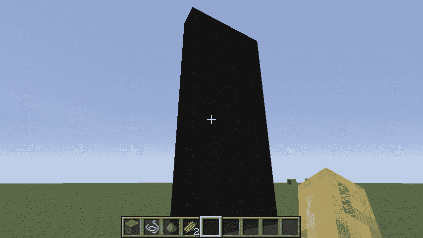

图 12.12 一个黑色`monolith`。

### 蓝图所需的模块

`monolith.js`模块的前两行加载了`Drone`和`blocks`模块。你可能想知道为什么我使用`../drone`而不是简单的`drone`。`../`部分指定在当前文件夹的上一级（也称为父文件夹）中查找`Drone`模块。请记住，`monolith.js`模块保存在`scriptcraft/plugins/drone/contrib`文件夹中。`Drone`模块位于`scriptcraft/plugins/drone`文件夹中，因此`require('../drone')`实际上表示“从父文件夹`scriptcraft/plugins/drone`加载`drone.js`模块”。字符串中的`../`部分表示这是一个相对路径。相对路径是相对于模块所在的文件路径。在这个例子中，你是在说你想从父文件夹加载一个模块。

关于第一个`require()`语句，还需要注意的一点是，在调用`require()`之后紧跟着`.Drone`。每次调用`require()`都会返回一个包含零或多个属性和方法的模块对象。如果你只对返回对象的某个属性或方法感兴趣，你可以使用点号表示法（添加一个`.`并通过名称获取该属性或方法）来获取该属性。以下语句是所有蓝图通常开始并访问`Drone` API的方式，因此如果你要创建自己的蓝图，你需要这样做：

```javascript
var Drone = require('../drone').Drone;
```

第二个`require()`调用加载了`blocks`模块，该模块为所有可能的建筑材料提供了有用的名称——如果没有`blocks`模块，你将需要记住 Minecraft 中所有建筑材料的数据值。Minecraft 维基上有资源，但在代码中使用易记忆的名称会更好。

代码的下一部分是`monolith()`方法。我称之为方法，因为这个函数不是一个独立的函数；相反，它将附加到无人机上。方法只是属于某个对象的函数。方法如何知道它属于哪个对象？在 JavaScript 中，有一个特殊的关键字——`this`——它指向函数所属的对象。我之前提到过对象，你将在第 14 章中更详细地探讨它们。现在，你只需要记住，当你为在 Minecraft 中建造东西创建新函数时，你的函数实际上将是一个方法，并且具有对`Drone`对象的特权访问权限。
```


```javascript

在`monolith()` 方法体内，你会看到`this` 关键字。在`Drone` 方法内部，`this` 关键字始终指向一个`Drone` 对象。要构建一个巨石，你需要能够操作和控制一个已有的`Drone` 对象，就像之前在命令提示符示例中所做的那样。不同之处在于，在方法内部，你必须在每个`Drone` 函数调用的开头使用`this` 关键字。重要的是，在方法内部不要直接使用`box()`，而应使用`this.box()`。调用全局的`box()` 函数实际上会返回一个新的`Drone` 对象。当你在`Drone` 方法内部时，你是在假设已经存在一个`Drone` 对象的前提下工作，并通过`this` 关键字来访问它。当你在游戏内提示符下使用任何`Drone` 方法时，你是从外部控制无人机；而当你在方法内部使用无人机时，你实际上是在驾驶舱内从内部操控无人机。这就是为什么你需要使用`this` 关键字。

```javascript
Drone.extend( monolith );
```

声明了`monolith()` 函数后，你使用`Drone.extend()` 函数将其转换为一个`Drone` 方法。该函数接受一个函数并将其转换为一个方法，实际上是将该函数附加到自身，使其能够成为调用链的一部分。无人机是可扩展的——它能够接受新的蓝图并使用这些蓝图进行建造。当你使用`extend()` 方法向无人机添加新函数时，就好像该函数是无人机不可分割的一部分。神奇的是，该函数会变成全局可链式调用的，并且可以与任何其他`Drone` 方法链式使用。

点击此处查看代码图片

```javascript
/js box(blocks.gold).fwd(2).monolith().fwd(4).turn().fwd(4).

monolith()
```

所以，现在你可以看到扩展无人机以在 Minecraft 中建造有趣的新事物是多么容易。让我们建造一座摩天大楼吧！

## 摩天大楼蓝图

你将创建一个摩天大楼的蓝图，这样只需一个 JavaScript 函数调用，就能在世界中的任何地方放置摩天大楼。让我们创建一个名为`skyscraper.js` 的新模块，并将其保存到`/scriptcraft/plugins/drone/contribs` 文件夹中（参见列表 12.3）。

保存文件后，执行`js refresh()` 命令重新加载你的插件。然后在游戏中找一块干净的空地，放置一块基石，并执行以下命令：

`/js skyscraper()`

***

### 列表 12.3 摩天大楼蓝图

点击此处查看代码图片

```javascript
var Drone = require('../drone').Drone;

var blocks = require('blocks');

function skyscraper( floors ) {

  var i = 0;

  if ( typeof floors == 'undefined' ) {

    floors = 10;
  }

  this.chkpt('skyscraper');

  for ( i = 0; i < floors; i++ ) {

    this
      .box( blocks.iron, 20, 1, 20)
      .up()
      .box0(blocks.glass_pane, 20, 3, 20)
      .up(3);
  }

  this.move('skyscraper');

}

Drone.extend( skyscraper );
```

片刻之后，一座 10 层的摩天大楼就会出现。令人印象深刻，不是吗？你可能已经在思考要为 Minecraft 添加哪些新奇美妙的建筑和结构了，但在开始编码之前，让我们仔细看看摩天大楼的代码。

### skyscraper() 方法

`skyscraper()` 方法的前几行声明了一个变量`i`，并检查`floors` 参数是否已设置。如果没有设置，则默认创建 10 层。接下来你会看到方法中第一次出现`this` 关键字。`.chkpt()` 方法（“checkpoint”的缩写）会为无人机的当前位置添加书签，以便稍后能返回该位置。在任何方法的开头为无人机的当前位置添加书签，并在方法结束时返回该位置是一个好习惯，因为理想情况下，你的方法应该只用于建造，而不应移动或转动无人机。当然，你可以在方法内部转动和移动无人机，但你应该在方法调用结束后将无人机返回到之前的位置。`.chkpt()` 和 `.move()` 这对函数分别用于在无人机出发前保存其位置，并在任务完成后返回该位置。

方法的下一部分是一个 for 循环，它重复执行以下操作（针对每一层）：

1. 建造一个 20 格宽、1 格高、20 格长的铁地板
2. 向上移动一格
3. 在四面建造三格高的玻璃墙
4. 再向上移动三格

这四个步骤对每一层重复执行，因此当 for 循环结束时，整个摩天大楼就建造完成了。你可以在图 12.13 中看到摩天大楼的一层（for 循环的一次迭代）是什么样子。

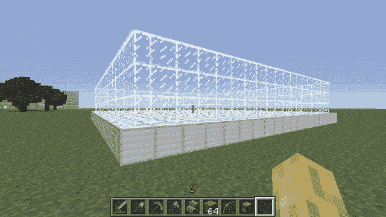

**图 12.13** 摩天大楼的一层

在方法结束时，整个摩天大楼就建造完成了。图 12.14 显示了游戏中的结果。


**图 12.14** 完整的摩天大楼

### 在源文件中链式调用

在游戏内提示符下，你的代码只能写在一行中，因此当链式调用多个`Drone` 方法时，你需要这样写代码：

点击此处查看代码图片

```javascript
/js box(block.iron, 20,1,20).up().box0(blocks.glass_pane, 20,
3, 20).up(3)
```

这可能会难以阅读和理解。幸运的是，在编写源文件代码时没有这样的限制，你可以像这样将语句跨越多行：

点击此处查看代码图片

```javascript
this
  .box( blocks.iron, 20, 1, 20)
  .up()
  .box0(blocks.glass_pane, 20, 3, 20)
  .up(3);
```

这实际上是一个单独的语句——注意只有最后一行后面有分号。前面的代码也可以写在一行中，但像上面那样拆分语句会使代码更易读。前面的代码也可以使用多个语句来编写：

点击此处查看代码图片

```javascript
this.box( blocks.iron, 20, 1, 20);
this.up();
this.box0(blocks.glass_pane, 20, 3, 20);
this.up(3);
```

由于每个`Drone` 方法都返回无人机对象，因此可以使用点号（`.）来链式调用方法。使用哪种风格很大程度上取决于个人喜好。

### box0() 方法

`box0()` 方法是无人机提供的另一个方法；它与`box()`类似，但只创建四面墙而不填充。`box0()` 方法对于建造特别有用。它接受与`box()` 方法相同的参数。

### 成就解锁！

恭喜你，大师级者！你刚刚发现了如何使用 JavaScript 和一些对象来建造大型结构。


### 小结

在本章中，你学习了如何使用 ScriptCraft 的`Drone` 函数在 Minecraft 中建造复杂建筑。你使用了 JavaScript `for` 语句来建造有多层的摩天大楼。介绍了对象以及`this` 关键字在方法内部使用的含义。

## 第13 章 创建烟花表演

在本章中，你将编写代码在 Minecraft 中创建壮观烟花。你学习 ScriptCraft 内置烟花模块和`setTimeout()` 函数，使用一种强大的编程技术——递归。你首先编写代码在两秒延迟后发射烟花，然后在此基础上编写代码多枚烟花。

### 烟花模块

ScriptCraft 包含一个烟花模块，用于在指定位置发射一枚烟花。你可以直接在游戏内提示符下使用烟花模块如下所示：

```javascript
/js fireworks = require('fireworks')
/js fireworks.firework( self.location )
```

`fireworks` 模块的`firework()` 函数接受一个参数——位置。在 Minecraft 中，任意地点（如玩家、动物、方块等）都有位置。传递`self.location` 时，意味着烟花从自己的位置发射。

### 延迟执行

在游戏内提示符下执行命令，烟花会立即发射。你希望延迟几秒，这样有一个更好的视野。幸运的是，有一种方法可以延迟执行。创建一个名为`scriptcraft/plugins/workshow.js` 的文件，并输入清单 13.1所示的代码。保存文件，然后执行`js refresh()` 命令重新加载插件。现在执行以下命令：

```javascript
/js workshow( self.location )
```

后退几步，以便烟花。你注意到烟花没有立即发射？它延迟了两秒。

**清单 13.1** 短短烟花表演

点击此处查看代码图片

```javascript
var fireworks = require('fireworks');

function fireworkshow (location){
  function launch(){
    fireworks.firework(location);
  }
  setTimeout(launch, 2000);
}

exports.fireworkshow = fireworkshow;
```

### setTimeout() 函数

`setTimeout()` 函数允许你延迟调用一个函数。它接受两个参数。

 最终调用的函数。

 延迟时间。延迟时间以毫秒为单位。一秒有1000毫秒，因此2000等于2秒。`setTimeout()` 返回一个值，用于停止定时执行。你需要将`setTimeout()` 返回的值存储在一个变量中，并将值传递给`clearTimeout()` 函数，如下所示：

```javascript
function later(){ console.log('I ran!') };
var scheduled = setTimeout( later, 3000 );
clearTimeout( scheduled );
```

前面代码中的`later()` 函数不会执行，因为当你调用`clearTimeout( scheduled )` 时，任务被取消了。虽然`setTimeout()` 不是 JavaScript 语言的一部分，但它在 Web 浏览器和 Node.js 中提供，并且在 ScriptCraft 中也有实现。使用`setTimeout()` 时常见的错误是认为延迟时间以秒为单位，而不是毫秒。

### 一场烟花表演

在本章开头承诺过一场烟花表演。单次发射的烟花算不上什么表演对吧？让我们改进一下。下一步是修改代码，使其发射多个烟花，每次发射之间间隔两秒。修改你的`workshow.js` 文件，使其与清单 13.2一致。

然后执行`/js refresh()` 命令，并在游戏内提示符下执行以下命令：

```javascript
/js workshow( self.location, 5 )
```

后退几步，观看五个烟花接一个地发射。表演应在第五个烟花发射后结束。你可以通过更改第二个参数来改变发射的烟花数量。

**清单 13.2** 更长的烟花表演

点击此处查看代码图片

```javascript
var fireworks = require('fireworks');

function fireworkshow( location, count ) {
  function launch( ){
    fireworks.firework( location );
    count = count - 1;
    if ( count > 0 ) {
      setTimeout( launch, 2000 );
    }
  }
  setTimeout( launch, 2000 );
}

exports.fireshowshow = fireworkshow;
```

### 我，一个称呼自己的名字

调用自身的函数称为递归函数。递归函数可以非常强大。它们可用于遍历磁盘上的所有文件和文件夹，或绘制漂亮的分形图。递归超出了本书的范围，因此我不会深入探讨。为了让你对递归有个初步了解，想象一个控制机器人手臂的计算机程序，它打开一个俄罗斯套娃，并不断打开里面的任何俄罗斯套娃，直到里面没有更多俄罗斯套娃为止。这样一个程序的代码如下所示：

```javascript
function openRussianDoll( doll ){
  console.log( doll.size );
  if ( doll.inner ) {
    openRussianDoll( doll.inner );
  }
}
```

`openRussianDoll()` 函数不会被调用一次或两次，而是每次发现一个新套娃时都会被调用。这就是递归的力量。如果你对递归感到好奇，有些人已经使用递归在 Minecraft 中创建了一些非常酷的分形。Malin Christersson 在`https://github.com/malinc/MinecraftFractals` 上有一些示例代码。你可以在图 13.1 中看到 Malin 的一个分形创作示例。


**图 13.1** Malin 的分形


```javascript
clearInterval(scheduled);

  }

  }

  var scheduled = setInterval( launch, 2000 );

  return scheduled;

}

exports.fireworkshow = fireworkshow;
```

* *

点击此处查看代码图片

```javascript
/js var show = fireworkshow( self.location, 300 );
```

上述语句启动了一场烟花表演，其中将有 300 次发射，每次间隔两秒。如果不加干预，表演将持续大约 10 分钟，但你要提前取消表演。执行以下命令取消表演：

```javascript
/js clearInterval( show );
```

烟花将停止。如果你曾经使用`setInterval()`或`setTimeout()`函数安排任务，最好保留这些函数返回的值，这样你就可以选择使用`clearInterval()`和`clearTimeout()` 分别取消任务。

### 总结

在本章中，你学习了`setTimeout()`函数以及如何使用它来延迟或“推迟”代码的执行。你还学习了如何让函数调用自身，以及如何使用`setInterval()`函数安排重复任务。

# 第 14 章 动物声音再探

在本章中，你将重新审视之前的动物声音插件，但这次不再使用`switch`语句，而是使用查找表。

### 对象

现在是时候更仔细地研究对象了。JavaScript中的`对象`是可以同时保存数据和函数的东西。你在本书中一直在使用对象。你使用`console`对象向 Minecraft 服务器日志和控制台窗口记录消息。你使用`exports`对象为他人提供新的属性和函数。你使用数组对象通过`sort()`对数组进行排序。最后但同样重要的是，你使用了 Minecraft 的一些内置对象，如`Player`和`Event`，来响应游戏中发生的事件。

对象在编程中非常有用。Java——Minecraft 的编写语言——是一种`面向对象`的语言。这意味着在 Java中`一切`都是对象——玩家、世界、方块、工具、配方等等。对象让你能够将相关的`属性`和`函数`分组。例如，一个玩家：

 拥有食物等级（他们有多少食物）

 可以拥有床

 拥有经验等级

 可以执行命令

 可以飞行

 可以潜行

……等等。在编程术语中，玩家`拥有`的东西称为`属性`，而玩家`执行`的动作称为`方法`。方法只是属于对象的函数。

#### 如何创建对象

在 JavaScript 中创建新对象很容易。以下是一个你可以在游戏内提示符下尝试的示例：

点击此处查看代码图片

```javascript
/js var myFirstObject = { name: 'steve', job: 'minecrafter' }
```

要在 JavaScript 中创建对象，你从花括号（`{`）开始，后面跟着一个`键`，然后是冒号（`:`）和值。你可以使用逗号（`,`）分隔每个键值对。最后用右花括号（}`）结束对象定义。前面展示的对象示例有两个键值对：一个`name`和一个`job`。如果你知道对象的键，就可以找出对象内部的内容。

```javascript
/js myFirstObject.name
```
> "steve"

```javascript
/js myFirstObject.job
```
> "minecrafter"

JavaScript 是一种非常灵活的语言。你已经看到如何使用方括号（`[]`）访问数组中的项。你可以使用相同的方括号表示法来获取对象的值。

```javascript
/js myFirstObject["name"]
```
> "steve"

```javascript
/js myFirstObject["job"]
```
> "minecrafter"

这意味着你也可以使用变量而不是字符串字面量来访问对象的键。

```javascript
/js var key = "name";
```

```javascript
/js myFirstObject[key]
```
> "steve"

即使你事先不知道对象有哪些键，你也可以使用一种特殊的`for`循环来找出它们。

点击此处查看代码图片

```javascript
/js for (var key in myFirstObject){ self.sendMessage( key ) }
```

你甚至可以使用这种形式的`for`循环来处理对象的所有`键`和`值`。

点击此处查看代码图片

```javascript
function displayObject ( object ) {
  var value = null;
  var key = null;
  for ( key in object ) {
    value = object[ key ];
    console.log( key + ' = ' + value );
  }
}
```

当你像这样创建对象时，这被称为`对象字面量`。

点击此处查看代码图片

```javascript
/js var myFirstObject = { name: 'steve', job: 'minecrafter' }
```

在 JavaScript 中还有其他创建对象的方法，但在本书中我们只关注对象字面量。你可以轻松地向现有 JavaScript 对象添加新键。

点击此处查看代码图片

```javascript
/js myFirstObject.toolOfChoice = 'Axe'
```

你也可以使用`delete`关键字从对象中删除键。

点击此处查看代码图片

```javascript
/js delete myFirstObject.toolOfChoice
```

对于 JavaScript 对象，可以添加或删除哪些键没有规则，因为 JavaScript 对此没有强制执行严格的规则。JavaScript 是一种`动态类型`语言，这意味着你可以在程序运行时动态创建新对象，添加删除键更改键。

#### 两种对象

在使用 ScriptCraft 插件时，你可以使用两种类型的对象。ScriptCraft 使用一种特殊的版本，该版本从任何程序中使用。与 JavaScript 不同，JavaScript 对于对象做什么和不能做什么有规则。JavaScript 是`强类型`的——它不允许向对象添加删除属性。例如，你在本书中`self`是一个对象，因此你可以像这样访问键：

```javascript
/js self.isOnGround
```
> true

但你不能这样向对象添加键：

点击此处查看代码图片

```javascript
/js self.favoriteFood = 'Pizza'
```

这将显示错误，尝试这样从对象中删除会静默失败：

```javascript
/js delete self.isOnGround
```

该键不会删除。

### 对象作为查找表

在 JavaScript 中，程序员可以轻松创建对象，并且能够快速查找键。查找表就是任何用来查找信息的东西。例如，你在字典中查找一个单词了解其含义，或者在簿中找到那个名字。在下面的示例中，你将修改第10 章中的`animalSounds.js`模块，并使用对象替代`switch`语句。打开`scriptcraft/plugins`文件夹中的`animalSounds.js`文件，并使其一致。14.1 创建了一个名为`noises`的新对象。

 14.1 动物声音的查找表

点击此处查看代码图片

```javascript
var sounds = require('sounds');
var input = require('input');

var noises = {
  cat: sounds.catMeow,
  chicken: sounds.chickenSay,
  cow: sounds.cowSay,
  'ender dragon': sounds.enderGrowl,
  pig: sounds.pigSay,
  sheep: sounds.sheepSay,
  wolf: sounds.wolfBark
};

function onInput( animal, player ) {
  var makeNoise = null;
  animal = animal.toLowerCase();
  if ( animal in noises ) {
    makeNoise = noises[ animal ];
    makeNoise( player.location );
  } else {
    echo( player, "I never heard of " + animal);
  }
};

exports.animalSounds = function( player ) {
  input( player,
         "What's your favorite animal " +
         " - cat, chicken, cow, ender dragon, pig, sheep or wolf?",
         onInput );
};
```

让我们看看顶部声明的`noises`变量。

点击此处查看代码图片

```javascript
var noises = {
  cat: sounds.catMeow,
  chicken: sounds.chickenSay,
  cow: sounds.cowSay,
  'ender dragon': sounds.enderGrowl,
  pig: sounds.pigSay,
  sheep: sounds.sheepSay,
  wolf: sounds.wolfBark
};
```

关于这条语句，有几点注意：

 该语句创建了一个单一对象。与 JavaScript 中的许多语句一样，它可以跨行。将对象定义跨行可以使代码更具读性。

 `noises`对象包含以下键：`cat`、`chicken`、`cow`、`ender dragon`、`pig`、`sheep`、`wolf`。在对象字面量中，键位于左侧。

 键不需要用引号括起来，但如果键包含空白字符——例如'ender dragon'`——则应该用单引号或双引号括起来。

 你不能使用 JavaScript关键字作为对象的键，因此不能使用字面值`true`、`false`、`default`等。

 键必须是数字或字符串类型。你不能将另一个对象作为对象的键；但你可以将另一个对象作为对象的值。

 对象中的值可以是任何类型——甚至是函数和其他对象！当一个对象包含另一个对象作为值时，该值被称为嵌套对象。稍后你将看到一个嵌套对象的示例。

 每个键值对必须用单个逗号（`,`）分隔。尽量避免在最后一个键值对末尾添加多余的逗。最后一个键值对`wolf: sounds.wolfBark`后面没有逗号，因为不需要，而且某些版本的 JavaScript如果在右花括号（}`）前看到多余的逗号会报错。

创建了`noises`查找表后，你在`onInput()`函数中使用它来检查玩家输入的动物是否在`noises`对象中。下面的`if`语句检查动物是否在`noises`表中：

```javascript
if ( animal in noises ) {
```

这个`key in object`结构会查找对象，如果键在其中则返回`true`。如果动物不在查找表中，函数会报告它没听说过这种动物。如果在查找表中，函数会报告它没听说过这种动物。

```
makeNoise = noises[ animal ];
```

排版后：


 发生了什么吗？

调用`boost()` 函数时没有任何反应，原因是在这个函数的第一版中，你只修改了作为参数传入的布尔值。将`health` 参数设置为 `20` 对对象没有影响，因为你没有将对象作为引用传递。相反，你传递的是对象的 `health` 属性。让我们重新审视 `boost()` 函数，这次将其修改为接受一个对象。

```js
/js function boost( player ) { 
    player.health = 20; 
}
```

同时，你还需要修改调用 `drop()` 函数的方式。这次你将传递 `self` 变量。

```js
/js boost(self);
```

现在 `boost()` 函数生效了，因为你传递了对象的引用，所以函数内部对对象的任何修改都会作用于该对象。这是一个需要记住的重要点：如果你想在函数内部修改对象， 必须将对象本身作为参数接受，而不仅仅是你要修改的对象属性。

### 嵌套对象

JavaScript 中的对象可以包含任何类型的数据，甚至——如前所述——其他对象！回想一下我在第 13 章中讨论递归时提到的套娃代码。如果你要为套娃建模数据，可能会像这样：

```js
var largeDoll = {
    size: 'large',
    inner: {
        size: 'Medium',
        inner: {
            size: 'Small',
            inner: {
                size: 'Tiny',
                inner: null
            }
        }
    }
};
```

这是一个对象内部嵌套了其他对象的例子，就像套娃内部还有其他娃娃一样。在这个例子中，一个大娃娃里面装着一个中娃娃，中娃娃里面装着一个小娃娃，以此类推。最里面的小娃娃的 `inner` 属性为 `null`，表示里面什么都没有。上述代码也可以写成一系列语句，每个语句创建一个独立的对象，如下所示：

```js
var tinyDoll = { size: 'Tiny', inner: null };
var smallDoll = { size: 'Small', inner: tinyDoll };
var mediumDoll = { size: 'Medium', inner: smallDoll };
var largeDoll = { size: 'Large', inner: mediumDoll };
```

无论 `largeDoll` 对象是如何创建的，它的结构在两种情况下都是相同的。你可以将这个 `largeDoll` 对象作为参数传递给之前在第 13 章定义的函数 `openRussianDoll()`。为了测试这一点，在 `scriptcraft/plugins` 文件夹中创建一个新文件 `openRussianDoll.js`，保存文件并执行 `refresh()` 命令重新加载插件。

### 清单 14.2 一个套娃

```js
var tinyDoll = { size: 'Tiny', inner: null };
var smallDoll = { size: 'Small', inner: tinyDoll };
var mediumDoll = { size: 'Medium', inner: smallDoll };
var largeDoll = { size: 'Large', inner: mediumDoll };

function openRussianDoll( doll ){
    console.log( doll.size );
    if ( doll.inner ) {
        openRussianDoll( doll.inner );
    }
}

function openDoll(){
    openRussianDoll( largeDoll );
}

exports.openDoll = openDoll;
```

你应该会在屏幕上看到：

```
> Large
> Medium
> Small
> Tiny
```

尝试将给 `openRussianDoll` 的值从 `largeDoll` 改为 `mediumDoll`、`smallDoll` 或 `tinyDoll`，看看会什么。

### JSON

在讨论 JavaScript 对象时，不能提到 JSON。JSON 是 JavaScript 对象表示法（JavaScript Object Notation）的缩写，指的是使用已经见过的对象面量来构造对象。JSON 在 程序员中非常流行，因为它是在浏览器和服务器之间高效传输的方式。当你看到这样的对象面量时，你的就是 JSON：

```js
var steve = { "name": "steve", "occupation": "miner" }
```

还有一个内置的 JSON 模块，提供了以下方法：img/002.jpeg 让程序员以人类可读的方式打印对象；读取 JSON 输出字符串将其转换回对象。你将在本书后面学习更多关于 JSON 以及加载和保存数据。

### 成就解锁！

恭喜！你已经发现了 JavaScript 中对象的强大功能，以及如何创建高效查找表。你的插件开发学徒生涯已经完成！img/007.jpeg

### 总结

在本章中，你学习了如何创建对象，以及根据属性名称访问和查找对象。你还学习了嵌套对象。这是本书“基础模块开发”部分的最后一章。接下来你将进入高级模块开发。

# 第三部分：高级模块开发

本书的这一部分将重点介绍事件驱动编程以及使用 CanaryMod 的 API。Minecraft 游戏非常定制，因为 CanaryMod 提供了许多改变游戏的方式。CanaryMod API 是一组函数和数据类型的集合，让插件开发者能够为 Minecraft 创建兴奋的内容。在接下来的章节中，你将学习如何使用在线文档探索大的 CanaryMod API，并更好地理解提供的数据类型。

## 第 15 章：保存偏好设置

在本章中，你将学习如何加载和保存偏好设置。你将创建一个新命令，让玩家选择在游戏聊天使用的颜色。他们选择的颜色将被保存，这样当玩家断开连接或服务器重启时，玩家选择的文本会被恢复。

### Minecraft 插件的一天

Minecraft 插件在幕后过着忙碌的生活。一个大型公共服务器可能安装了许多 Minecraft 插件，其中一些或全部插件可能在服务器运行时打开或关闭。所有插件在服务器启动时都会自动加载，所有插件在服务器关闭前都会自动卸载。插件是可执行代码，为游戏添加行为和设置。插件通常需要管理数据、玩家偏好、设置等。当插件被加载和卸载时，这些数据会发生什么？这就是我将在接下来的章节中回答的问题。

### 聊天颜色

在本章中，你将向游戏添加一个新命令，让玩家可以选择在聊天消息使用的颜色。玩家可以从十多种颜色中选择。你希望玩家的颜色选择能够被保存，这样当服务器关闭并重新启动时，该玩家仍会保留相同的颜色。新命令命名为 `/jsp chatcolor`，并支持 Tab 补全功能，这样当玩家按下 Tab 键时会显示一个颜色列表。你在第 11 章中已经接触过 `/jsp` 命令。这个命令是新自定义命令的前缀。

### 自定义命令的 Tab 补全

在 Minecraft 的游戏内或服务器控制台提示符下输入命令时，一个棒的功能是 Tab 补全——即程序能够自动补全命令的剩余部分，无需你手动输入整个命令。你可以用 JavaScript 轻松创建支持 Tab 补全的自定义命令。让我们在游戏内提示符下创建一个利用 Tab 补全的示例命令。这个自定义命令命名为 `jsp icecream`，当玩家按下 Tab 键时，会提示玩家输入一种口味。首先，你需要定义可能的口味有哪些。你可以通过创建一个名为 `flavors` 的数组来实现。

点击此处查看代码图片

```js
var flavors = ['chocolate','strawberry','vanilla'];
```

接下来，创建一个新函数，当玩家发出命令时执行。（虽然此处显示为多行，但以下代码应在一行内。）

```js
function icecream( args, player ){
    echo(player,'Yum ' + args[0] )
}
```

最后，创建一个新的自定义命令，允许玩家发出 `icecream` 命令，并提示选择口味。点击此处查看代码图片

```js
command( icecream, flavors );
```

现在尝试一下，输入以下内容并按下 Tab 键，看看发生什么：

```
jsp
```

按下 Tab 键应该补全命令的第一部分，因此你的提示符输入看起来这样：

```
jsp icecream
```

现在按下空格键，再次按下 Tab 键；你会看到一个可选列表。你可以反复按 Tab 键在口味列表中循环。这是如何实现的秘密在于使用 `command()` 函数创建新的 `/jsp icecream` 命令。`command()` 函数接受两个参数：`args`（一个字符串）和 `player`（一个玩家）。该函数必须有一个名称，因为 `command()` 函数会使用该名称向玩家呈现一个新的命令，前缀为 `jsp`。虽然你定义的命令名称是 `icecream`，但玩家在命令时必须使用。在接下来的章节中，你创建一个新命令，提供一个颜色列表作为可能的选项，当玩家按下 Tab 键时显示这些选项。

### 选择聊天颜色

Minecraft 中的文本颜色可以通过使用特殊的 `§` 符号来更改。这个符号在 Minecraft 中不能直接输入，供开发者使用。聊天消息可以使用 16 种不同的颜色，每种颜色使用一个特殊的代码。例如，要用黄色说“Hello”，你需要在消息前加上特殊代码 `\xa7`。你可以通过游戏内提示符发出以下命令来尝试：

```js
echo(self,'\xa7Hello');
```

文本 `\xa7` 只是 JavaScript 中表示 `§` 的另一种方式。`\xa7` 后面的字符应该是 0 到 9 之间的数字或 a 到 f 范围内的字母。

#### 如何计数

我们通常使用所谓的十进制计数，这意味着数字从 0 开始一直增加到 9。如果你想写一个大于 9 的数字，就在左边加一个数字。因此 475 所示：

```
4 * 100 + 7 * 10 + 5
```

我们使用十进制计数因为这是人类使用的数字系统。为什么使用十进制？可能是因为我们手上有10 根手指。还有其他计数方式。二进制（也称为二进制）只有数字：0 和 1。如何只用两个数字数到 5？当你达到 1 时，可以在左边加一个数字。例如：

二进制 0 等于十进制 0。
二进制 1 等于十进制 1。
二进制 10 等于十进制 2。
二进制 11 等于十进制 3。
二进制 100 等于十进制 4。
二进制 101 等于十进制 5，以此类推。程序员更常用的另一种进制是十六进制，即基数为 16。在十六进制（通常称为 hex）中，数字 10 到 15 用字母 a 到 f 代替，因此数字 0 到 32 的序列如表 15.1 所示。

**表 15.1** 六进制数及其十进制等效值

#### 字符代码

Minecraft 和计算机上其他程序中显示的字符都有一个内部使用的代码。字母 A 的字符代码是 65，B 是 66，依此类推。小写字母从数字 97 开始，因此 a 的字符代码是 97，b 是 98，依此类推。你可以在 Wikipedia 上查看完整的字符及其代码列表。

#### Minecraft 中的文本颜色

特殊的 `§` 符号的字符代码是 167，Minecraft 在字符串开头使用这个特殊字符来表示该字符串应以某种颜色显示。具体的颜色是表 15.2（也可在 Formatting codes 上找到）中列出的 16 种可能颜色之一。

在本章的第一部分，你将创建一个模块，提供颜色名称，并创建一个 `colorize()` 函数，该函数将任何聊天消息添加颜色。你可以通过游戏内提示符发出以下命令来测试它，以显示一条金色消息：

点击此处查看代码图片

```js
var textcolors = require('textcolors');
var goldText = textcolors.colorize( 'gold', 'I am gold!' );
echo(self, goldText);
```

**图 15.1** 创建金色文本

**表 15.2** 文本颜色


清单 15.1 中的模块导出了 `names` 数组和 `colorize()` 函数供他人使用。`names` 数组稍后将用于为希望通过 Tab 补全更改聊天颜色的玩家提供提示。`colorize()` 函数接收一个颜色名称和文本，并在文本开头添加必要的颜色代码，使其在聊天窗口中显示为彩色。它通过使用 `Array.indexOf()` 方法在 `names` 数组中搜索颜色，该方法会返回匹配颜色在数组中的位置。例如，`names.indexOf('darkgreen')` 会返回 2。请记住，数组从索引 0 开始，而不是 1，因此 `'black'` 位于索引 0，`'darkblue'` 位于索引 1，依此类推。如果 `Array.indexOf()` 方法在数组中未找到该项，则返回 –1。如果传递给 `colorize()` 函数的颜色在 `names` 数组中不存在，则文本保持不变——不会向文本添加颜色代码。

颜色的索引很重要，因为该数字会通过 `Number.toString(16)` 方法转换为十六进制值。该值与特殊的 § 符号（写作 `\xa7`）组合，形成插入到原始文本前的颜色代码。`colorize()` 函数是一个完美的例子，展示了如何使用函数封装你不希望重复编写的复杂代码。编写 `colorize('gold','I am gold!')` 比编写 `\xa76I am gold!'` 要简单得多。每次想要编写彩色文本时，都要记住所有 16 种颜色代码和特殊的 `\xa7` 前缀代码会很困难。这就是为什么你将这段代码封装在一个易于使用的函数中，并 `export` 它，以便其他模块和插件可以使用。

以下是编写聊天颜色插件的后续步骤：

1. 提供一个新命令，让玩家可以选择自己的颜色。
2. 添加一个事件处理器，使聊天消息根据玩家的偏好着色。

在你的编辑器中，在 `scriptcraft/plugins` 文件夹中创建一个名为 `chatcolor.js` 的新文件，并输入清单 15.2 中的代码。

### 清单 15.2 设置并应用玩家聊天颜色偏好

点击此处查看代码图片

```
var textcolors = require('textcolors');

var preferences = { };

function chatcolor ( args, player ) {
  var color = args[0];
  preferences[ player.name ] = color;
}

command( chatcolor, textcolors.names );

function onChat( event ) {
  var player = event.player;
  var playerChatColor = preferences[ player.name ];
  if ( playerChatColor ) {
    event.message = textcolors.colorize( playerChatColor,
                                         event.message );
  }
}

events.chat( onChat );
```

在这个插件中，你使用了之前创建的 `textcolors` 模块，并创建了一个新的 `preferences` 变量，它是一个空对象 `{ }`。这个 `preferences` 对象将用于存储每个玩家偏好的颜色。假设你有一个服务器，其中有三个玩家选择了自定义聊天颜色。在这种情况下，`preferences` 对象可能看起来像这样：

```
{
   "steve1901": "blue",
   "jane1908": "gold",
   "john1911": "red"
}
```

...其中 `steve1901` 是玩家的名字，`blue` 是他选择的颜色；`jane1908` 是另一个玩家的名字，她选择的颜色是 `gold`，依此类推。`preferences` 对象是一个玩家名称及其颜色查找表。如果我想知道 `jane1908` 选择的颜色，我会使用表达式 `preferences["jane1908"]`，它返回 `"gold"`。

`chatcolor()` 函数是一个回调函数，当玩家发出 `chatcolor` 命令时会被调用。玩家名称和选择的颜色通过语句存储在 `preferences` 对象中：

```
preferences[ player.name ] = color;
```

你可以通过使用方括号 `[]` 将属性名称放在括号内，向对象添加任何属性。属性名称不必是 `'age'` 或 `'address'` 这样的对象面量；它可以是任何计算结果为字符串。因此 `preferences` 对象的一个新属性。`command()` 函数创建了一个 `/chatcolor` 命令，该命令会调用 `chatcolor()` 函数，并在玩家 Tab 键时提供 `textcolors.names` 数组作为颜色列表。清单 15.2 的第一部分（包括 `command()` 的调用）设置了偏好用于设置颜色的命令。下一部分涉及玩家在 Minecraft 中聊天时，确保玩家的颜色偏好应用于任何消息。

点击此处查看代码图片

```
function onChat( event ) {
  var player = event.player;
  var playerChatColor = preferences[ player.name ];
  if ( playerChatColor ) {
    event.message = textcolors.colorize( playerChatColor,
                                         event.message );
  }
}

events.chat( onChat );
```

`onChat()` 函数是另一个回调函数。每当玩家在游戏中聊天时，该函数就会调用。该函数获取正在聊天的玩家，检查他们是否有偏好的颜色。如果有偏好的颜色，通过使用之前编写的 `textcolors.colorize()` 函数来更改 `message` 属性（属性是玩家发送的消息）。保存 `chatcolor.js` 文件后，使用 `/js refresh()` 重新加载插件，然后在游戏提示符下输入以下内容：

```
/chatcolor
```

按下空格，然后按 Tab 键，你会看到可选择的颜色列表。你可以反复按 Tab 键在颜色列表中循环。选择一种颜色，然后开始聊天。输入一条消息，该消息应该以你选择的颜色显示。太棒了！你刚刚创建了一个有用的命令，很多玩家都会喜欢。像你创建这样的插件在多服务器上受欢迎。尝试使用 `/chatcolor` 命令更改几次颜色，以确保所有颜色有效。

如果你发出 `/js refresh()` 命令会发生什么？目前，你的插件没有保存颜色偏好，因此当插件重新加载或服务器关闭时，每个玩家的颜色偏好都会丢失。玩家的聊天颜色将恢复为默认。如果能够为你的插件加载和保存偏好，使得颜色偏好不会在服务器停止时丢失，那就太好了。

### 插件数据

对于任何 Minecraft JavaScript 插件，你都希望在加载插件时加载插件数据，并在卸载插件时自动保存插件数据。这样你就可以确保服务器关闭时特定的数据永远丢失。

#### 加载插件数据

ScriptCraft 提供了一个 `persist()` 函数，用于处理保存和加载数据。让我们再次查看 `chatcolor.js` 文件。该文件中唯一的唯一数据是文件顶部附近声明的 `preferences` 对象，其赋值为 `{ }`，表示它是一个空对象。

```
var preferences = { };
```

上面的代码将插件的数据初始化为一个空对象。你希望改为执行以下操作：

1. 检查文件中是否保存了数据。
2. 执行以下操作之一：
   - 如果存在保存文件，则从文件中加载数据。
   - 或者，将数据初始化为插件定义的默认值。

这就是 `persist()` 函数的作用——它执行了上述所有功能（甚至更多）。为了理解如何调用 `persist()` 函数，我们来看一个示例。在编辑器中打开 `chatcolor.js`，修改以下行：

```
var preferences = { };
```

...改为以下内容：

点击此处查看代码图像

```
var preferences = persist('chatcolor-prefs', { } );
```

`persist()` 函数最多接受三个参数，但只有第一个参数是必需的。参数如下：

- 用于加载或保存数据的唯一文件名。文件名应具有唯一性，因此避免使用诸如 `data` 或 `preferences` 之类的通用名称。示例中使用了名称 `chatcolor-prefs`。
- 一个对象，用作数据的初始值。如果未提供对象，则默认值为 `{ }`（空对象）。
- 写入标志。写入标志指示是否应立即将数据写入文件。写入标志应为 `true` 或 `false`。如果未提供写入标志参数，则默认为 `false`，表示将读取数据，而不是写入。

`persist()` 函数返回一个对象，该对象是以下两种情况之一：

- **如果文件存在**：从文件加载的数据与第二个参数提供的数据合并。
- **如果文件不存在**：第二个参数中的数据。

`var preferences = persist('chatcolor-prefs', { } )` 用俗话就是：“将 `preferences` 变量设置为 `chatcolor_prefs` 文件中的内容，如果文件不存在，则设置为空对象。”保存 `chatcolor.js` 文件并使用 `/reload` 命令。此时你会注意到颜色偏好仍保留。使用以下命令在游戏提示符下更改偏好：

```
/chatcolor yellow
```

输入两条消息，执行 `/reload` 命令，注意到颜色偏好已被保留。

#### 保存插件数据

此时你可能知道插件数据保存在哪里以及聊天偏好是如何保留的。`persist()` 函数除了加载数据外，还会在卸载时标记数据进行保存。这意味着 `persist()` 函数的任何数据在插件卸载时自动保存。作为 JavaScript 开发者，你无需担心插件数据的问题，一旦使用 `persist()` 函数加载数据，它就会自动保存。

`persist()` 返回的对象所做的更改会被保存。你可以通过游戏提示符下尝试以下命令来验证这一点：

```
var test = persist('test', {});
test.name = 'Your name';
js refresh();
```

`refresh()` 函数会导致 ScriptCraft 重新加载。现在执行以下命令：

```
var test = persist('test', {});
js test.name
```

之前输入的名称应该显示出来。注意的是，只有 `persist()` 返回的对象所做的更改才保存。在上面的示例中，如果你稍后将 `test` 变量赋值给另一个对象并更改，这些更改将被保存。以下代码不起作用：

```
var test = persist('test', {});
test = { name: 'Your name' };
```

你可能想知道插件数据保存在哪里？来看一下。ScriptCraft 将插件数据保存在 `scriptcraft/data` 文件夹中。在编辑器中打开该文件夹，注意到有一个 `chatcolor-prefs-store.json` 文件。在编辑器中打开此文件，你会看到类似的内容：

```
{
  "walter": "blue"
}
```

文件名末尾的 `.json` 表示这是一个 JSON 文件。JSON 是 JavaScript 对象表示法（JavaScript Object Notation）的缩写，是一种加载、存储和发送数据的方式。当你调用 `persist()` 时，它会获取文件名（例如 `chatcolor-prefs`），在文件名后附加 `-store.json`，然后保存文件。数据以 JSON 格式保存，这是 JavaScript 存储和加载数据简单的方式。

#### 更多关于 JSON 的内容

当你在 JavaScript 中创建一个带有名称和值对的新对象时，可以这样做：

```
var player = { name: "steve" }
```

或者这样：

```
var player = { "name": "steve" }
```

也就是说，你可以选择在名称属性周围加引号或不加引号。然而，在保存数据时，内置的 JSON 模块会在每个键周围添加双引号，从而写出 `player`。

```
{ "name": "steve" }
```

内置 JSON 模块有两个被 `persist()` 函数使用的：

- `JSON.parse(string)`：接受一个字符串并尝试转换为 JavaScript 对象。例如，`JSON.parse("[9,5,3]")` 将接受字符串 `"[9,5,3]"` 并返回一个包含三个元素的数组：9、5 和 3。
- `JSON.stringify(object)`：与 `JSON.parse()` 相反。它接受一个 JavaScript 对象并转换为字符串；例如，`JSON.stringify([9, 5, 3])` 接受一个数组并返回字符串 `"[9,5,3]"`。

如果 `JSON.parse()` 函数遇到一个没有引号包围的对象键，会报错并拒绝将字符串转换为对象。

### JSON、持久化和 Java 对象

如果你要保存的数据包含对 Java 对象的引用，那么使用 ScriptCraft 提供的标准 `persist()` 函数将无法保存和加载数据。`persist()` 使用 JSON 的 `stringify()` 和 `parse()` 函数进行操作，而这些函数仅适用于原生 JavaScript 对象。如果你想保存 Java 对象，可以考虑改为保存该对象的唯一标识符。例如，不要存储 `net.canarymod.api.entity.living.humanoid.Player` 对象，而只存储玩家的名称。如果你想保存 `Location` 对象，可以考虑使用 `utils` 模块的 `locationToJSON()` 和 `locationFromJSON()` 函数对，用于将 `Location` Java 对象与 JSON 相互转换。

```
var utils = require('utils');

// 从 Java 转换为 JSON
var locationAsJSON = utils.locationToJSON(player.location);

// 从 JSON 转换为 Java
var locationObject = utils.locationFromJSON(locationAsJSON);
```

```markdown
### 总结

在本章中，你学习了如何为自定义命令提供 `Tab` 补全提示，以及持久化——保存和恢复状态。持久化是你自己的插件中一个有用的功能。许多插件允许玩家设置偏好，而在插件加载和卸载时能够保存和恢复玩家偏好及其他设置非常有用。

## 第 16 章 添加新配方：末影弓

所有有趣的 Minecraft 插件都始于一个简单的问题：如果……会怎样？Minecraft 之所以如此受欢迎，是因为其可能性是无限的。对于 Minecraft 插件开发者来说，这更加有趣，因为编程 API 允许在自定义游戏时发挥无限的创造力。在本章中，你将使用 `CanaryMod API` 创建一个新的合成配方——这个配方将生成一个新的游戏内物品——末影弓。什么是末影弓？它是一种弓，射出的箭会将玩家传送到箭落地的位置！如果你身处险境，四面被怪物包围，需要快速脱身，这将是一个得心应手的工具。手持末影弓，你只需拉弓，瞄准你想传送的位置，然后射击。箭一旦命中，你就会被传送过去。

在本章中，你将添加一个新的合成配方来制作末影弓，你将更详细地探索 `CanaryMod API`，并且我将解释如何探索和发现 API 中可用于你自己插件的功能。你将了解 Java `类`和`继承`，以及这些概念如何帮助你理解 `CanaryMod API` 的能力。在第 17 章中，你将添加弓的传送行为。

在深入探讨如何将新合成配方添加到游戏之前，我们先考虑一下“什么”——新方需要哪些材料，以及如何选择它们。

#### 合成末影弓

Minecraft 中的普通弓是用三根木棍和三根线合成的。通过在合成网格中以特定排列放置每个材料，就能合成一把弓。不过，你要添加到游戏中的末影弓是特殊的。它需要一些额外的材料来为弓添加传送魔法。我根据 Minecraft 中的末影人怪物类型，将这个新物品命名为末影弓。末影人可以随机从一个位置传送到另一个位置，这使他成为一个可怕且难以预测的对手。如果你在战斗中足够幸运击败了末影人，他们会掉落末影珍珠，你可以用手投掷末影珍珠来传送一小段距离。末影弓的射程显然比手投更远，而且——与投掷末影珍珠不同——它不会对传送者造成任何伤害。**图 16.1** 展示了 Minecraft 中普通弓的合成网格。

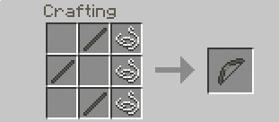

**图 16.1** 弓的合成配方

在下一节中，你将了解如何利用这些信息来合成一种新型弓。

##### 选择应使用的材料

最好基于现有配方来设计新合成配方。服务器插件无法向 Minecraft 客户端添加新图形。例如，你无法添加一个全新的物品，比如传送枪，因为即使你是图形高手，`CanaryMod API` 也没有提供向客户端添加新物品图形的方法。基于现有物品设计新合成配方的另一个原因是，玩家已经熟悉许多合成配方，如果你添加的新配方只是对现有配方稍作改动，那么配方和生成的物品就更容易记住和掌握。

对于末影弓配方，你将基于现有的配方，但添加一些材料来赋予弓特殊能力。你会注意到标准弓配方在网格中有三个空位。你将利用这些空位在每个空位中添加一种材料来合成末影弓。你要添加的材料是末影珍珠。这些珍珠来自传送末影人怪物，因此它们作为末影弓的材料是合理的。当然你也可以选择任何材料。例如，你可以决定在中间加一块草块就足以制作末影弓。但对玩家来说可能不会让新物品变得很有趣。添加到游戏中的任何物品，都应该在其构造上很有趣。新物品应该容易制作，尤其是像末影弓这样强大的物品。末影珍珠在生存模式中获得，因此它们是末影弓的好材料。所以末影弓将使用**图 16.2**所示的配方。

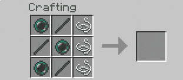

**图 16.2** 弓的合成配方

你会注意到，在图 16.2 中，右侧没有出现物品，因为你还没有指示服务器识别该配方。现在你已经从玩家的角度确定了新配方的样子，让我们深入探讨如何实现。

##### 探索 CanaryMod API

我们已经回答了“做什么”，现在来考虑“怎么做”。以下是我们想要做的事情：

1. 向游戏添加一个新的配方。
2. 为末影弓射出的箭添加传送行为。

我们下一章处理第二项，所以来看看如何向游戏添加一个新的配方。`CanaryMod` 有一个开发者社区，他们一直在使用 API 并在论坛发布问题和答案。如果你想做某件事，搜索是一个好的起点。在开始自己的插件时，这些结果通常很有用。

更有用的是访问 `ci.visualusionsent.net/CanaryLib/javadoc/` 提供的全面 API 参考文档。这个 API 文档是一组相互链接的网页，由 `CanaryMod` 源代码中的注释生成。参考文档列出了 `CanaryMod API` 中的所有 `类`、`包`和`方法`。Java `类`像 JavaScript 模块，而 Java `方法`像 JavaScript 方法或函数。Java `包`是一个包含 Java `类` 的文件夹；它是组织大量源文件的方式。Java 程序可能相当大，源文件必须组织在文件夹和子文件夹中。每个文件夹和子文件夹在 Java 术语中称为`包`。

例如，在 Minecraft 中有数百种不同类型的事件（或“钩子”）可以发生。如果所有事件都放在一个名为 `hooks` 的文件夹中，那么对 `CanaryMod` 开发团队和插件开发者来说都会困难。因此为事件类别创建子文件夹是合理的。如果你访问 `ci.visualusionsent.net/CanaryLib/javadoc/`，你会看到一个包含三个区域的网页（见**图 16.3**）。

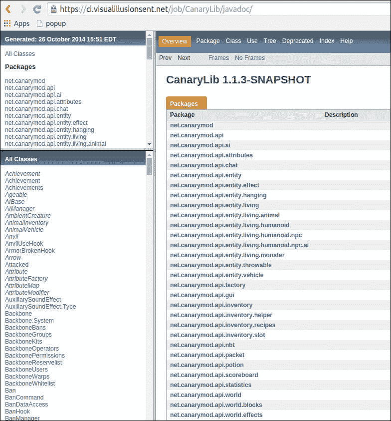

**图 16.3** CanaryMod API 

左上角区域是包列表。该区域提供了整个 API 的高级览。你可以通过点击该区域列出的任何包，快速从一个包切换到另一个包。

左下角区域是当前包（左上角窗格中选中的包）中的类列表。点击该区域中的任何项目，将在右侧的主显示窗格中显示所选项目的详细信息（见**图 16.4**）。

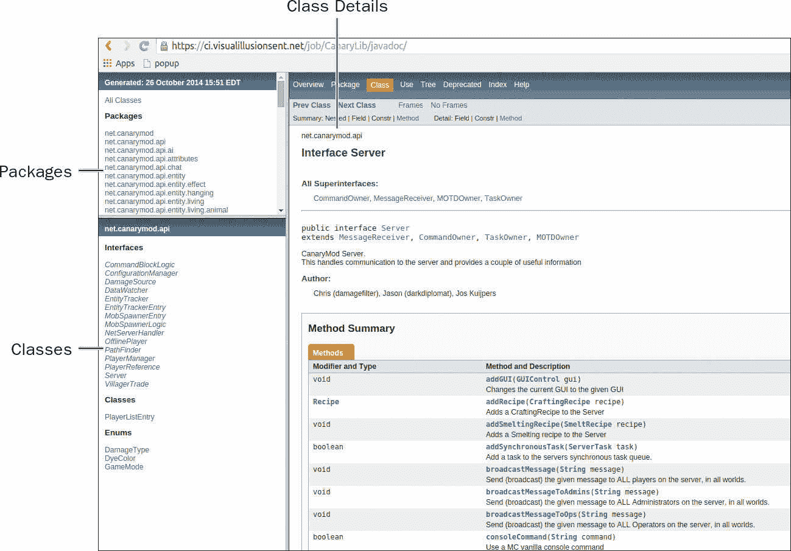

**图 16.4** CanaryMod API 布局

点击页面右侧的任何方法链接，将带你进入有关该方法的更多信息。

你可以从 JavaScript 中调用任何 Java `类`和`方法`；事实上，这正是你在本书一直在做的事情。

Java 和 JavaScript 之间的一个关键区别在于 Java 是严格类型的。这意味着它没有 `var` 关键字。相反，在声明变量时，必须同时声明其类型。因此，在 JavaScript 中，你可以这样写：

```
var myString = "Hello World";
```

而在 Java 中，你必须这样写：

```
String myString = "Hello World";
```

浏览 `CanaryMod API` 时，你会注意到许多方法既包含它们期望的参数类型，也包含它们返回的数据类型。例如，`net.canarymod.api` 包中的 `Server` 类有一个 `addRecipe()` 方法，其方法摘要如下：

`Recipe addRecipe(CraftingRecipe recipe)`

让我们逐部分分析。方法名左侧的 `Recipe` 是该方法返回的数据类型。圆括号内的 `CraftingRecipe recipe` 表示该方法接受一个名为 `recipe`、类型为 `CraftingRecipe` 的参数。这是 Java 方法定义的传统方式：参数类型与参数名称一起显示。

Java 文档页面中的每个类型名称都是一个链接，指向有关该类型的更多信息。因此，如果我想了解更多关于 `CraftingRecipe` Java 类型的信息，只需点击该链接。

#### 接口、类、枚举、异常和注解

Java 有几种不同的对象类型，但你无需过多担心它们之间的差异。不过，了解这些不同术语的含义还是很有用的。

##### 接口

Java 接口是一种抽象类型。也就是说，它规定了对象应该做什么。

##### 类

Java `类`是对象的蓝图。

##### 枚举

Java `枚举`用于表示一组相关的常量。

##### 异常

Java `异常`用于处理运行时的错误。

##### 注解

Java `注解`用于为代码提供元数据。

##### 代码

在 `plugins/script/plugins` 文件夹中创建一个新文件夹，并命名为 `enderbow`。然后在 `enderbow` 文件夹中创建一个名为 `recipe.js` 的新文件。

```
var items = require('items');
var recipes = require('recipes');
var cm = Packages.net.canarymod;
var cmEnchantment = cm.api.inventory.Enchantment.Type;
var cmItemFactory = cm.Canary.factory().itemFactory;

var cmEnderBow, cmLuck;
cmEnderBow = items.bow(1);
cmLuck = cmItemFactory.newEnchantment(cmEnchantment.LuckOfTheSea,3);
cmEnderBow.addEnchantments( [ cmLuck ] );

var enderBowRecipe = new Object();
enderBowRecipe.result = cmEnderBow;
enderBowRecipe.shape = [ 'ESW', 'SEW', 'ESW' ];
enderBowRecipe.ingredients = {
    E: items.enderPearl(1),
    S: items.stick(1),
    W: items.string(1)
};

var recipe = recipes.create( enderBowRecipe );
server.addRecipe( recipe );
```

保存文件，使用 `/js refresh()` 命令重新加载，然后右单击工作台打开合成网格。当你在网格中放置末影珍珠、线和木棍时，你应该看到右侧出现一把闪闪发光的弓（见**图 16.5**）。

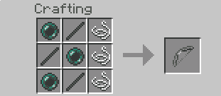

**图 16.5** 弓的合成配方

将制作好的末影弓放入你的物品栏，但先不要尝试使用它。它仍然像普通弓一样工作。我们将在下一章中添加传送魔法。
```

```markdown
Java 中的类名可能相当冗长，因为你必须包含包名和类名。Java 程序员称之为*完全限定名*。Java 程序员通常会通过*导入*包来避免使用完全限定名。在 Java 内部运行的 JavaScript 引擎有一个 `importPackage()` 函数，但该函数在较新版本的 Java JavaScript 中不受支持。我个人喜欢在 JavaScript 代码中避免使用完全限定名，因此每当我需要引用 `CanaryMod` Java 类型时，我都会在模块顶部声明一个短名称变量，该变量指向 `CanaryMod` 类型的较长完全限定名。我还在变量名前面加上 `cm`，以便我知道我正在处理的是 `CanaryMod` 对象，而不是普通的 JavaScript 对象。这只是个人偏好。我发现这在我用 JavaScript 编写插件时很有帮助。它可能对你也很有用。

### 附魔

标记物品具有特殊能力的一种方法是为其添加附魔。附魔物品在游戏中会闪闪发光。末影弓应该会发光，以便玩家知道他们拿的不是普通弓。对于你在游戏中可以执行的大多数活动，`CanaryMod API` 中都有相应的类和方法。例如，在游戏中，玩家*为物品添加附魔*。如果你浏览 `CanaryMod API` 参考，你会看到有一个*物品栏*包，其中其中包含几个类，其中一个叫做 `Item`。`Item` 接口表示一个或多个*物品*的集合，这些物品可以放置在玩家的物品栏槽位中或握在玩家手中。这个 `Item` 接口有一个 `addEnchantments()` 方法，你可以用它来为游戏中的物品添加特殊能力。有了这些知识，让我们来弄清楚你想要做什么。

1. 你想要*附魔*配方中创建的物品，使其闪闪发光，并在视觉上与普通弓区分开来。
2. 你将使用一个 `ShapedRecipe` 对象。`ScriptCraft` 的 `recipes` 模块提供了一个名为 `create()` 的函数，该函数会创建一个新的 `ShapedRecipe` 对象。
3. 你知道（通过浏览 API 参考）可以使用 `Server.addRecipe()` 向游戏添加新配方。

你要做的第一件事是加载 `ScriptCraft` 的 `items` 模块。这个模块简化了 Java `Item` 对象的创建。如果你想创建一个包含一把弓的 `Item`，可以调用 `items.bow(1)`，它会返回一个 Java `Item` 对象，你可以向其中添加附魔。`items` 模块大约有 450 个不同的函数——对应 Minecraft 中的每一种材料。你可以通过三种不同的方式调用这些函数。我们以 `items.bow()` 函数为例。

 当不带参数调用 `items.bow()` 时，它会返回值 `net.canarymod.api.inventory.ItemType.Bow`。这是一个在 `CanaryMod API` 中广泛使用的 `ItemType` 对象。

 当带一个数字参数调用 `items.bow()` 时，例如 `items.bow(2)`，它会返回一个包含两把弓的 `net.canarymod.api.inventory.Item` 对象。`Item` 类型在 `CanaryMod API` 中广泛使用。

 当带一个 `material` 参数调用 `items.bow()` 时，它会将该材料与此函数对应的材料（每个函数都有自己的材料）进行比较，如果相同则返回 `true`，否则返回 `false`。你在清单 9.6 中已经见过一个例子，当时你想检查被破坏的方块是否是 `SAND` 类型。

Minecraft 中有许多不同的*附魔*，其中一些是为弓设计的。你想使用一个并非为弓设计的附魔，因为你不想干扰现有的附魔规则。如果你查看 `CanaryMod API` 文档中可能的*附魔*列表，没有明显的与传送相关的附魔，所以我选择了 `LuckOfTheSea` 附魔，因为它通常用于钓鱼竿。给弓添加一个三级 `LuckOfTheSea` 附魔，可以最大限度地降低这种特定的物品、附魔和等级组合与现有物品/附魔游戏规则冲突的风险。

### 配方

创建并附魔好玩家每次使用配方时将被“烹饪”的物品后，下一步是设置配方的材料。

#### 创建对象的新方法

在 JavaScript 中，你可以使用*对象字面量*创建对象，如下所示：

点击此处查看代码图片

```
var myNewObject = { name: 'ender bow' }
```

但还有另一种我尚未提及的创建对象的方法。JavaScript 中的 `new` 关键字可用于创建新的 JavaScript 对象。例如，JavaScript 有一个 `Date` 函数，当像这样调用时，它会以字符串形式返回当前日期和时间。在 Linux 上的 Java 7 中，以下代码会抛出异常，但官方 JavaScript 规范指出你应该能够像下面这样调用 `Date()`：

```
var today = Date();
```

然而，当你在调用 `Date()` 前面加上 `new` 关键字时，它的行为会有所不同。像这样调用时，`Date()` 函数会返回一个 `Date` 类型的新对象。

```
var today = new Date();
```

JavaScript 中的 `new` 关键字意味着 `Date()` 函数变成了一个*构造函数*。构造函数是任何返回新对象的函数。在*Java* 中，使用对象字面量创建对象的方式有限，因此在*Java* 中构造新对象最常见的方式是使用 `new` 关键字。以下语句创建了一个新的 JavaScript 对象：

点击此处查看代码图片

```
var enderBowRecipe = new Object();
```

我们将在这个对象上设置属性，以指定配方的样子。

#### 合成网格

Minecraft 中的合成网格是指当你右键点击工作台时屏幕上显示的内容。网格由三行组成，每行有三个格子。你能够在代码中定义哪些材料会生成一个新的末影弓。幸运的是，这相对简单。游戏内的网格可以映射为一个 JavaScript 数组，其中每个字母代表一种材料。图 16.6 显示了每个格子上叠加的合成网格。

带有材料的合成网格：`E` 代表末影珍珠，`S` 代表木棍，`W` 代表线（蛛网）。如果你只用 `E`、`S` 和 `W` 作为简写来想象这个配方，它可能看起来像：

```
enderBowRecipe.shape = ['ESW', 'SEW', 'ESW'];
```

#### 从 JavaScript 调用可变参数的 Java 方法

在 `Item` 参考页面 `ci.visualillusionsent.net/job/CanaryLib/javadoc/net/canarymod/api/inventory/Item.html` 中，关于 `.addEnchantments()` 方法的信息如下：

点击此处查看代码图片

```
void addEnchantments(Enchantment... enchantments)
```

参数部分中的 `Enchantment... enchantments` 表示 `.addEnchantments()` 方法接受一个或多个 `Enchantment` 对象作为参数。在 Java 中，这种参数方式称为 `varargs`，是“可变数量参数”的缩写。当你看到使用这种传递方式的 Java 方法时，`...` 告诉你该类型可以有一个或多个参数。从 JavaScript 调用此类方法，你需要将参数作为数组传递。这就是为什么你要像这样调用 `.addEnchantments()` 方法：

注意 `cmLuck` 参数周围的左 `[` 和右 `]` 括号表示我们正在传递一个数组作为参数。在这个例子中，数组包含一个附魔，但如果你想要添加更多，数组可以包含更多。如果你尝试像下面这样调用 `.addEnchantments()` 方法，它会失败：

点击此处查看代码图片

```
cmLuck = cmItemFactory.newEnchantment(Enchantment.LuckOfTheSea, 3);
cmInfinity = cmItemFactory.newEnchantment(Enchantment.Infinity, 1);
enderBow.addEnchantments(cmLuck, cmInfinity);
```

你必须将参数（即使只有一个）用数组括起来，像这样：

点击此处查看代码图片

```
cmLuck = cmItemFactory.newEnchantment(Enchantment.LuckOfTheSea, 3);
cmInfinity = cmItemFactory.newEnchantment(Enchantment.Infinity, 1);
enderBow.addEnchantments([cmLuck, cmInfinity]);
```

每当你看到某个方法对参数使用了 `...` 表示法时，就用数组代替它。

#### 设置材料

现在你已经定义了配方的形状，需要说明每个字母 `E`、`S` 和 `W` 的含义。通过设置 `ingredients` 属性来实现。

点击此处查看代码图片

```
enderBowRecipe.ingredients = {
  E: items.enderPearl(),
  S: items.stick(),
  W: items.string()
};
```

### 继承

最后，设置好新配方的规则后，你可以使用 `server.addRecipe()` 方法将其添加到游戏中。让我们再次查看在线文档中的这个方法。

1. 前往 `visualillusionsent.net/job/CanaryLib/javadoc/`。
2. 点击左上方面板中的 `net.canarymod.api` 链接。
3. 点击左下方面板中的 `Server` 链接。
4. 点击右侧（主）面板中的 `addRecipe` 链接。

右侧面板中的详细信息将如下：

点击此处查看代码图片

```
Recipe addRecipe(CraftingRecipe recipe)
向服务器添加一个 CraftingRecipe。
参数：
  recipe - 要添加的配方
返回：
  一个来自已创建配方的 Recipe 对象
```

如果 `server.addRecipe()` 函数期望一个 `Recipe` 对象，但你却传给它一个 `ShapedRecipe`（也就是 `enderBow` 的类型），为什么不会报错呢？不会报错是因为 `ShapedRecipe` 是 `Recipe` 的子类型。在 Java 编程中，我们说 `ShapedRecipe` 继承自 `Recipe`，或者说它是 `Recipe` 的一个子类。继承是编程中的一个重要原则。理解继承有助于你更轻松地浏览和使用 `CanaryMod API`。如果你点击 `visualillusionsent.net/job/CanaryLib/javadoc/`，你会看到：
```


```

现在，每当你投掷任何弹射物（如雪球、鸡蛋）或射箭时，屏幕上都会显示“Ouch!”。我们稍后会深入探讨这段代码的工作原理。

你可以在线查看所有事件函数的列表，网址为 [`scriptcraftjs.org/api#events-helper-module`](http://scriptcraftjs.org/api#events-helper-module)`。`events` 模块中的每个函数都对应游戏中的一种事件类型。Minecraft 中的事件类型非常多，它们被分组到以下 Java 包中：

 `net.canarymod.hook.command`

 `net.canarymod.hook.entity`

 `net.canarymod.hook.player`

 `net.canarymod.hook.system`

 `net.canarymod.hook.world`

在每个包中，你都会找到数十种事件类型，每种事件类型都不同。因此，当你使用 `events` 模块的某个函数注册事件时，可以保证当游戏中发生该类型的事件时，你的回调函数会被调用，并将事件作为参数传入。

### events 模块与事件包

`events` 模块包含数百个函数——每种事件类型对应一个——并且设计为可以通过 Tab 补全在服务器或游戏内提示符下发现事件注册函数。如果你在服务器提示符下输入 `events.` 然后按 Tab 键，就会看到所有 100 多个事件注册函数。每个函数都允许注册注册类型的事件。

`events.projectileHit()` 函数允许你注册 `net.canarymod.hook.entity.ProjectileHitHook` 类型的事件，`events.connection()` 函数允许你注册 `net.canarymod.hook.player.ConnectionHook` 类型的事件，以此类推。`events.projectileHit()`、`events.connection()` 以及大多数其他 `events` 函数都是简写函数。这些函数名故意设计得很短，以节省输入时间，并让在命令提示符下使用事件更加方便。如果你需要注册不属于标准 CanaryMod API 的事件（例如其他插件提供的事件），还有一个你应该了解的函数。

### events.on() 函数

`events.on()` 函数允许你注册任何类型的事件。它接受两个参数：

 `eventType`：必须是完全限定的事件类型。下面的例子能更好地说明这一点。

 `callback`：一个函数，当事件发生时会被调用。这个回调函数的行为与使用 `events` 模块的简写函数时完全相同。

因此，有两种方式可以监听弹射物命中事件。假设你有一个名为 `onProjectileHit` 的监听函数，看起来像这样：

点击此处查看代码图片

```
function onProjectileHit( event )
  { console.log('projectile hit') }
```

第一种注册方式是使用简写函数 `events.projectileHit()`，如下所示：

点击此处查看代码图片

```
events.projectileHit( onProjectileHit );
```

第二种方式是使用 `events.on()` 函数，并传入一个完全限定的事件类型名称：

点击此处查看代码图片

```
events.on( net.canarymod.hook.entity.ProjectileHitHook,
    onProjectileHit );
```

这两种方法使用哪一种其实并不重要，但在极少数情况下，如果你需要监听非标准事件，则应选择第二种方式，并将事件类型的完全限定名称传递给 `events.on()`。

在注册事件的两种方式中，使用 `events` 模块的某个简写函数可能是最简单的。请访问 [`scriptcraftjs.org/api#events-helper-module`](http://scriptcraftjs.org/api#events-helper-module) 获取事件注册函数的完整列表。

### 事件类型与事件属性

一旦你注册了某个事件，当游戏中发生该事件类型时，你提供的回调函数就会被执行。回调函数会接收一个参数——即被触发的事件。通常，在回调函数中你会希望对事件进行一些操作。回调函数接收的事件参数通常包含你需要在回调中查看和使用的信息。那么，如何知道某个事件内部包含哪些信息呢？现在是时候回顾上一章中提到的一个主题了——继承。

### 深入探讨继承

每个事件回调函数都接受一个参数。你可以随意命名这个参数——`event`、`evt`，甚至只是 `e`。你需要在回调函数中对这个参数进行一些操作。以末影弓为例，你需要从事件中获取一些关键信息，以便传送玩家。这时，CanaryMod API 参考文档及其浏览能力再次变得至关重要。

在这个具体例子中，你需要在在线 CanaryMod 参考文档中探索 `net.canarymod.hook.entity.ProjectileHitHook` 类型的属性和方法，文档地址为 [`ci.visualillusionsent.net/job/CanaryLib/javadoc/`](https://ci.visualillusionsent.net/job/CanaryLib/javadoc/)。在浏览器中打开该链接，点击左上方面板中的 `net.canarymod.hook.entity` 链接，然后点击下面板中的 `ProjectileHitHook` 链接；右侧面板将显示该事件类型的信息。你感兴趣的信息是方法摘要：

`Entity getProjectile()`

获取实体投射物

`getProjectile()` 方法返回一个 `Entity` 类型的对象。如果你点击 `Entity` 链接，你会看到它的一个子类型是 `Projectile`；点击 `Projectile` 链接，你将进入该类型；点击 `Projectile` 链接，你将进入该类型；右侧面板将显示该事件类型的信息。你感兴趣的信息是方法摘要：

`Entity getProjectile()`

获取实体投射物

`getProjectile()` 方法返回一个 `Entity` 类型的对象。如果你点击 `Entity` 链接，你会看到它的一个子类型是 `Projectile`；点击 `Projectile` 链接，你将进入该类型；右侧面板将显示该事件类型的信息。你感兴趣的信息是方法摘要：

`Entity getProjectile()`

获取实体投射物

文档地址为 [`ci.visualillusionsent.net/job/CanaryLib/javadoc/`](https://ci.visualillusionsent.net/job/CanaryLib/javadoc/)。在浏览器中打开该链接，点击左上方面板中的 `net.canarymod.hook.entity` 链接，然后点击下面板中的 `ProjectileHitHook` 链接；右侧面板将显示该事件类型的信息。你感兴趣的信息是方法摘要：

`Entity getProjectile()`

获取实体投射物

`getProjectile()` 方法返回一个 `Entity` 类型的对象。如果你点击 `Entity` 链接，你会看到它的一个子类型是 `Projectile`；点击 `Projectile` 链接，你将进入该类型；右侧面板将显示该事件类型的信息。你感兴趣的信息是方法摘要：

`Entity getProjectile()`

获取实体投射物

`getProjectile()` 方法返回一个 `Entity` 类型的对象。如果你点击 `Entity` 链接，你会看到它的一个子类型是 `Projectile`；点击 `Projectile` 链接，你将进入该类型；右侧面板将显示该事件类型的信息。你感兴趣的信息是方法摘要：

`Entity getProjectile()`

获取实体投射物

`getProjectile()` 方法返回一个 `Entity` 类型的对象。如果你点击 `Entity` 链接，你会看到它的一个子类型是 `Projectile`；点击 `Projectile` 链接，你将进入该类型；右侧面板将显示该事件类型的信息。你感兴趣的信息是方法摘要：

`Entity getProjectile()`

获取实体投射物

`getProjectile()` 方法返回一个 `Entity` 类型的对象。如果你点击 `Entity` 链接，你会看到它的一个子类型是 `Projectile`；点击 `Projectile` 链接，你将进入该类型；右侧面板将显示该事件类型的信息。你感兴趣的信息是方法摘要：

`Entity getProjectile()`

获取实体投射物

`getProjectile()` 方法返回一个 `Entity` 类型的对象。如果你点击 `Entity` 链接，你会看到它的一个子类型是 `Projectile`；点击 `Projectile` 链接，你将进入该类型；右侧面板将显示该事件类型的信息。你感兴趣的信息是方法摘要：

`Entity getProjectile()`

获取实体投射物

`getProjectile()` 方法返回一个 `Entity` 类型的对象。如果你点击 `Entity` 链接，你会看到它的一个子类型是 `Projectile`；点击 `Projectile` 链接，你将进入该类型；右侧面板将显示该事件类型的信息。你感兴趣的信息是方法摘要：

`Entity getProjectile()`

获取实体投射物

`getProjectile()` 方法返回一个 `Entity` 类型的对象。如果你点击 `Entity` 链接，你会看到它的一个子类型是 `Projectile`；点击 `Projectile` 链接，你将进入该类型；右侧面板将显示该事件类型的信息。你感兴趣的信息是方法摘要：

`Entity getProjectile()`

获取实体投射物

`getProjectile()` 方法返回一个 `Entity` 类型的对象。如果你点击 `Entity` 链接，你会看到它的一个子类型是 `Projectile`；点击 `Projectile` 链接，你将进入该类型；右侧面板将显示该事件类型的信息。你感兴趣的信息是方法摘要：

`Entity getProjectile()`

获取实体投射物

`getProjectile()` 方法返回一个 `Entity` 类型的对象。如果你点击 `Entity` 链接，你会看到它的一个子类型是 `Projectile`；点击 `Projectile` 链接，你将进入该类型；右侧面板将显示该事件类型的信息。你感兴趣的信息是方法摘要：

`Entity getProjectile()`

获取实体投射物

`getProjectile()` 方法返回一个 `Entity` 类型的对象。如果你点击 `Entity` 链接，你会看到它的一个子类型是 `Projectile`；点击 `Projectile` 链接，你将进入该类型；右侧面板将显示该事件类型的信息。你感兴趣的信息是方法摘要：

`Entity getProjectile()`

获取实体投射物

`getProjectile()` 方法返回一个 `Entity` 类型的对象。如果你点击 `Entity` 链接，你会看到它的一个子类型是 `Projectile`；点击 `Projectile` 链接，你将进入该类型；右侧面板将显示该事件类型的信息。你感兴趣的信息是方法摘要：

`Entity getProjectile()`

获取实体投射物

`getProjectile()` 方法返回一个 `Entity` 类型的对象。如果你点击 `Entity` 链接，你会看到它的一个子类型是 `Projectile`；点击 `Projectile` 链接，你将进入该类型；右侧面板将显示该事件类型的信息。你感兴趣的信息是方法摘要：

`Entity getProjectile()`

获取实体投射物

`getProjectile()` 方法返回一个 `Entity` 类型的对象。如果你点击 `Entity` 链接，你会看到它的一个子类型是 `Projectile`；点击 `Projectile` 链接，你将进入该类型；右侧面板将显示该事件类型的信息。你感兴趣的信息是方法摘要：

`Entity getProjectile()`

获取实体投射物

`getProjectile()` 方法返回一个 `Entity` 类型的对象。如果你点击 `Entity` 链接，你会看到它的一个子类型是 `Projectile`；点击 `Projectile` 链接，你将进入该类型；右侧面板将显示该事件类型的信息。你感兴趣的信息是方法摘要：

`Entity getProjectile()`

获取实体投射物

`getProjectile()` 方法返回一个 `Entity` 类型的对象。如果你点击 `Entity` 链接，你会看到它的一个子类型是 `Projectile`；点击 `Projectile` 链接，你将进入该类型；右侧面板将显示该事件类型的信息。你感兴趣的信息是方法摘要：

`Entity getProjectile()`

获取实体投射物

`getProjectile()` 方法返回一个 `Entity` 类型的对象。如果你点击 `Entity` 链接，你会看到它的一个子类型是 `Projectile`；点击 `Projectile` 链接，你将进入该类型；右侧面板将显示该事件类型的信息。你感兴趣的信息是方法摘要：

`Entity getProjectile()`

获取实体投射物

`getProjectile()` 方法返回一个 `Entity` 类型的对象。如果你点击 `Entity` 链接，你会看到它的一个子类型是 `Projectile`；点击 `Projectile` 链接，你将进入该类型；右侧面板将显示该事件类型的信息。你感兴趣的信息是方法摘要：

`Entity getProjectile()`

获取实体投射物

`getProjectile()` 方法返回一个 `Entity` 类型的对象。如果你点击 `Entity` 链接，你会看到它的一个子类型是 `Projectile`；点击 `Projectile` 链接，你将进入该类型；右侧面板将显示该事件类型的信息。你感兴趣的信息是方法摘要：

`Entity getProjectile()`

获取实体投射物

`getProjectile()` 方法返回一个 `Entity` 类型的对象。如果你点击 `Entity` 链接，你会看到它的一个子类型是 `Projectile`；点击 `Projectile` 链接，你将进入该类型；右侧面板将显示该事件类型的信息。你感兴趣的信息是方法摘要：

`Entity getProjectile()`

获取实体投射物

`getProjectile()` 方法返回一个 `Entity` 类型的对象。如果你点击 `Entity` 链接，你会看到它的一个子类型是 `Projectile`；点击 `Projectile` 链接，你将进入该类型；右侧面板将显示该事件类型的信息。你感兴趣的信息是方法摘要：

`Entity getProjectile()`

获取实体投射物

`getProjectile()` 方法返回一个 `Entity` 类型的对象。如果你点击 `Entity` 链接，你会看到它的一个子类型是 `Projectile`；点击 `Projectile` 链接，你将进入该类型；右侧面板将显示该事件类型的信息。你感兴趣的信息是方法摘要：

`Entity getProjectile()`

获取实体投射物

`getProjectile()` 方法返回一个 `Entity` 类型的对象。如果你点击 `Entity` 链接，你会看到它的一个子类型是 `Projectile`；点击 `Projectile` 链接，你将进入该类型；右侧面板将显示该事件类型的信息。你感兴趣的信息是方法摘要：

`Entity getProjectile()`

获取实体投射物

`getProjectile()` 方法返回一个 `Entity` 类型的对象。如果你点击 `Entity` 链接，你会看到它的一个子类型是 `Projectile`；点击 `Projectile` 链接，你将进入该类型；右侧面板将显示该事件类型的信息。你感兴趣的信息是方法摘要：

`Entity getProjectile()`

获取实体投射物

`getProjectile()` 方法返回一个 `Entity` 类型的对象。如果你点击 `Entity` 链接，你会看到它的一个子类型是 `Projectile`；点击 `Projectile` 链接，你将进入该类型；右侧面板将显示该事件类型的信息。你感兴趣的信息是方法摘要：

`Entity getProjectile()`

获取实体投射物

`getProjectile()` 方法返回一个 `Entity` 类型的对象。如果你点击 `Entity` 链接，你会看到它的一个子类型是 `Projectile`；点击 `Projectile` 链接，你将进入该类型；右侧面板将显示该事件类型的信息。你感兴趣的信息是方法摘要：

`Entity getProjectile()`

获取实体投射物

`getProjectile()` 方法返回一个 `Entity` 类型的对象。如果你点击 `Entity` 链接，你会看到它的一个子类型是 `Projectile`；点击 `Projectile` 链接，你将进入该类型；右侧面板将显示该事件类型的信息。你感兴趣的信息是 `Projectile` 链接，你将进入该类型；右侧面板将显示该事件类型的信息。你感兴趣的信息是方法摘要：

`Entity getProjectile()`

获取实体投射物

`getProjectile()` 方法返回一个 `Entity` 类型的对象。如果你点击 `Entity` 链接，你会看到它的一个子类型是 `Projectile`；点击 `Projectile` 链接，你将进入该类型；右侧面板将显示该事件类型的信息。你感兴趣的信息是方法摘要：

`Entity getProjectile()`

获取实体投射物

`getProjectile()` 方法返回一个 `Entity` 类型的对象。如果你点击 `Entity` 链接，你会看到它的一个子类型是 `Projectile`；点击 `Projectile` 链接，你将进入该类型；右侧面板将显示该事件类型的信息。你感兴趣的信息是方法摘要：

`Entity getProjectile()`

获取实体投射物

`getProjectile()` 方法返回一个 `Entity` 类型的对象。如果你点击 `Entity` 链接，你会看到它的一个子类型是 `Projectile`；点击 `Projectile` 链接，你将进入该类型；右侧面板将显示该事件类型的信息。你感兴趣的信息是方法摘要：

`Entity getProjectile()`

获取实体投射物

`getProjectile()` 方法返回一个 `Entity` 类型的对象。如果你点击 `Entity` 链接，你会看到它的一个子类型是 `Projectile`；点击 `Projectile` 链接，你将进入该类型；右侧面板将显示该事件类型的信息。你感兴趣的信息是方法摘要：

`Entity getProjectile()`

获取实体投射物

`getProjectile()` 方法返回一个 `Entity` 类型的对象。如果你点击 `Entity` 链接，你会看到它的一个子类型是 `Projectile`；点击 `Projectile` 链接，你将进入该类型；右侧面板将显示该事件类型的信息。你感兴趣的信息是方法摘要：

`Entity getProjectile()`

获取实体投射物

`getProjectile()` 方法返回一个 `Entity` 类型的对象。如果你点击 `Entity` 链接，你会看到它的一个子类型是 `Projectile`；点击 `Projectile` 链接，你将进入该类型；右侧面板将显示该事件类型的信息。你感兴趣的信息是方法摘要：

`Entity getProjectile()`

获取实体投射物

`getProjectile()` 方法返回一个 `Entity` 类型的对象。如果你点击 `Entity` 链接，你会看到它的一个子类型是 `Projectile`；点击 `Projectile` 链接，你将进入该类型；右侧面板将显示该事件类型的信息。你感兴趣的信息是 `Projectile` 链接，点击 `Projectile` 链接，你将进入该类型；右侧面板将显示该事件类型的信息。你感兴趣的信息是方法摘要：

`Entity getProjectile()`

获取实体投射物

`getProjectile()` 方法返回一个 `Entity` 类型的对象。如果你点击 `Entity` 链接，你会看到它的一个子类型是 `Projectile`；点击 `Projectile` 链接，你将进入该类型；右侧面板将显示该事件类型的信息。你感兴趣的信息是方法摘要：

`Entity getProjectile()`

获取实体投射物

`getProjectile()` 方法返回一个 `Entity` 类型的对象。如果你点击 `Entity` 链接，你会看到它的一个子类型是 `Projectile`；点击 `Projectile` 链接，你将进入该类型；右侧面板将显示该事件类型的信息。你感兴趣的信息是方法摘要：

`Entity getProjectile()`

获取实体投射物

`getProjectile()` 方法返回一个 `Entity` 类型的对象。如果你点击 `Entity` 链接，你会看到它的一个子类型是 `Projectile`；点击 `Projectile` 链接，你将进入该类型；右侧面板将显示该事件类型的信息。 (省略)

在这个具体例子中，你需要在在线 CanaryMod 参考文档中探索 `net.canarymod.hook.entity.ProjectileHitHook` 类型的属性和方法，文档地址为 [`ci.visualillusionsent.net/job/CanaryLib/javadoc/`](https://ci.visualillusionsent.net/job/CanaryLib/javadoc/)。在浏览器中打开该链接，点击左上方面板中的 `net.canarymod.hook.entity` 链接，然后点击下面板中的 `ProjectileHitHook` 链接；右侧面板将显示该事件类型的信息。你感兴趣的信息是方法摘要：

`Entity getProjectile()`

获取实体投射物

`getProjectile()` 方法返回一个 `Entity` 类型的对象。如果你点击 `Entity` 链接，你会看到它的一个子类型是 `Projectile`；点击 `Projectile` 链接，你将进入该类型。

```
package: net.canarymod.api.entity
Interface Projectile
所有接口：Entity
已知接口：
  Arrow, ChickenEgg, EnderPearl, EntityThrowable, Snowball...
```


图 17.1 Projectile API 层次结构

这里有用的信息是超接口——即该类型的父类型，以及子类型。


图 17.2 Projectile 继承关系

在 CanaryMod API 类型时，超接口和子接口非常重要，因为它们告诉你该类型的继承。类型之所以重要，是因为父类型能做任何事情，该类型也能做。同样，该类型的子类型也是如此；它们继承了所有属性。

如果你查看 `Entity` 类型，你会发现大量的属性和方法。例如，你可以调用父类型的 `.getLocation()` 方法来获取投射物的位置。你还可以调用父类型的 `.destroy()` 方法来投射物。请注意，`.getLocation()` 方法和 `.destroy()` 方法都没有出现在 `Projectile` 类型上。你需要点击该类型的父链接 `Entity` 才能看到这些用的方法。因为 `Projectile` 是 `Entity` 类型的子类型，所以继承了所有属性和方法！这就是 Java 中继承的强大之处，在浏览 CanaryMod 参考文档时，牢记这条规则：父类型能做任何事情，该类型也能做！`Entity` 类型能做事情！

如果你浏览 CanaryMod API 并发现某个类型（例如 `Arrow`）似乎只有少数方法，请查看其继承——访问 `extends` 或 `Superinterface` 下的父类型。

### 代码

```
var items = require('items');
var cm = Packages.net.canarymod;
var cmEnchantment = cm.api.inventory.Enchantment.Type;
var cmArrow = cm.api.entity.Arrow;
var cmPlayer = cm.api.entity.living.humanoid.Player;

function onArrowHit( event ) {
  var projectile = event.getProjectile();
  if (! (projectile instanceof cmArrow) ) {
    return;
  }
  var shooter = projectile.getOwner();
  if (! (shooter instanceof cmPlayer) ) {
    return;
  }
  var itemInHand = shooter.getItemHeld();
  var arrowLocation = projectile.getLocation();
  if ( isEnderBow( itemInHand ) {
    projectile.destroy();
    shooter.teleportTo( arrowLocation );
  }
}

events.projectileHit( onArrowHit );

function isEnderBow( item ){
  if (item && ( item.getType() == items.bow() ) {
    var enchantment = item.getEnchantment();
    if (enchantment &&
        enchantment.getLevel() == 3 &&
        enchantment.getType() == cmEnchantment.LuckOfTheSea){
      return true;
    }
  }
  return false;
}
```

现在让我们更详细地分析上述代码。与上一章一样，你加载了 `items` 模块，因为它包含了比较 Minecraft 物品的函数。接下来，你声明了三个引用 CanaryMod Java 类的变量。我使用了与上一章相同的命名约定：`cmEnchantment` 是 `net.canarymod.api.inventory.Enchantment.Type` 的缩写，`cmArrow` 是 `net.canarymod.api.entity.Arrow` 的缩写。以 `cm` 开头是为了提醒自己这些是 CanaryMod 类。

`onArrowHit()` 函数是一个回调函数，每当投射物击中某物时，服务器就会执行它。在此函数中，你需要执行以下操作：

1. 获取事件的投射物，即被射出的东西。
2. 获取投射物的发射者，即射出箭的人或物。
3. 获取发射者手持物品，即发射者当前持有的东西。
4. 检查手持物品是否为末影弓，如果是，则传送玩家。

与所有事件处理回调函数一样，`onArrowHit()` 接受一个参数：`event`。由于你使用 `events.projectileHit()` 函数进行注册，该事件将是 `net.canarymod.hook.entity.ProjectileHitHook` 类型。如果你浏览在线参考文档 [`ci.visualillusionsent.net/job/CanaryLib/javadoc/`](https://ci.visualillusionsent.net/job/CanaryLib/javadoc/)，理解继承有助于你深入挖掘 CanaryMod API。


```markdown
```

`net.canarymod.api.entity` 包中包含了所有实体类型。`instanceof` 运算符可用于测试 Java 或 JavaScript 中的*任何*对象类型。

### JavaBeans

你在清单 17.1 中用于获取事件、抛射物和射击者信息的这类函数被称为 *getter*。它们被称为 *getter*，因为每个函数都*获取*所调用对象的某个属性；`event.getProjectile()` 获取事件的抛射物属性，`projectile.getOwner()` 获取抛射物的所有者属性，以此此类推。你可能已经猜到，还有一类函数称为 *setter*，其作用是*设置*对象的属性。例如，你可以使用 `.getHunger()` 方法*获取*当前饥饿值：

```js
/js self.getHunger()
```

你也可以使用 `.setHunger()` 方法*设置*当前饥饿值：

```js
/js self.setHunger(20)
```

遵循使用 *getter* 和 *setter* 方法获取和设置属性这一约定的 Java 类被称为 `JavaBeans`。JavaScript 允许你将 `JavaBeans` 中的 `getter` 和 `setter` 方法视为等效的 JavaScript 属性。属性的名称是 `JavaBean` 方法名去掉 `get` 或 `set` 前缀，并以小写字母开头。例如，你可以使用 `hunger` 属性调用 `Player` 对象中的 `getHunger()` 和 `setHunger()` 方法，如下所示：

```js
/js self.hunger
> "17"
```

要设置 `hunger` 属性，只需为其赋值即可。

```js
/js self.hunger = 20
```

在编写使用 Java 类型的 JavaScript 代码时，这是一种很方便的方式。让我们重新审视之前的代码，这次只使用属性名而不是 `get()` 方法（见清单 17.2）。

我更喜欢只使用属性名而不是 `get` 和 `set` 方法，因为我认为这样生成的代码更具可读性，但这属于个人喜好。如果你在 JavaScript 中处理 Java 类型时，更习惯遵循 Java 的 `getX()` 和 `setX()`（其中 `X` 是某个属性）约定，那么你可以随意使用这些方法。

* * *

**清单 17.2** 直接访问 JavaBean 属性

```js
var items = require('items');

var cm = Packages.net.canarymod;

var cmEnchantment = cm.api.inventory.Enchantment.Type;

var cmArrow = cm.api.entity.Arrow;

var cmPlayer = cm.api.entity.living.humanoid.Player;

function onArrowHit( event ) {
  var projectile = event.projectile;
  if (! (projectile instanceof cmArrow) ) {
    return;
  }
  var shooter = projectile.owner;
  if (! (shooter instanceof cmPlayer) ) {
    return;
  }
  var itemInHand = shooter.itemHeld;
  if ( isEnderBow( itemInHand ) ) {
    projectile.destroy();
    shooter.teleportTo( projectile.location );
  }
}

events.projectileHit( onArrowHit );

function isEnderBow( item ){
  if (item && ( item.type == items.bow() ) ) {
    var enchantment = item.enchantment;
    if (enchantment &&
        enchantment.level == 3 &&
        enchantment.type == cmEnchantment.LuckOfTheSea){
      return true;
    }
  }
  return false;
}
```

* * *

### 关于风格的说明

在本章开头，我建议运行以下代码，并说我会解释其工作原理：

点击此处查看代码图片

`/js function ouch( event ) { echo(event.projectile.owner,'ouch!') }`

`ouch()` 函数使用了之前描述的 `JavaBeans` 属性简写符号来获取事件的 `projectile` 属性，然后获取实体的 `owner` 属性。整个函数体只是一条 JavaScript 语句。

点击此处查看代码图片

`echo(event.projectile.owner,'ouch!')`

我这样写是为了能在游戏内提示符下创建一个简短的回调函数。游戏内提示符下的函数限制为单行最多 100 个字符。如果我在模块中编写这个函数，可能会更详细一些，写成这样：

点击此处查看代码图片

```js
function ouch( event ) {
  var projectile = event.projectile;
  var shooter = entity.owner;
  echo( shooter,'ouch!');
}
```

单行版本的代码避免了为 `projectile` 和 `owner` 创建新变量的需要，但可读性可能较差——尤其是对于初学者来说。再次强调，使用哪种风格由你决定。随着你对编写 JavaScript 代码越来越熟练，你应该尝试不同的风格。

#### 本章小结

在本章中，你完成了向游戏中添加传送末影弓所需的所有代码，并进一步了解了继承以及如何在浏览 `CanaryMod API` 参考时使用它。

## 第 18 章 保护你的服务器免受恶意破坏

运行 `CanaryMod` 服务器而非标准 `Minecraft` 服务器的一大好处是能够通过添加插件来自定义游戏。在一个任何人都可以连接并游玩的公开非白名单服务器上，服务器管理员首先要做的事情之一就是防止恶意破坏或肆意破坏。在本章中，我将向你展示如何防止玩家破坏财产，以及如何防止他们放置 TNT 和熔岩等破坏性方块。

### 简单保护

防止恶意破坏最简单的方法是阻止所有玩家破坏任何方块。但这并不太实用，因为破坏和放置方块是 `Minecraft` 中建造过程的一部分。以下代码展示了如何防止任何方块被破坏：

点击此处查看代码图片

```js
/js function cancel( event ){ event.setCanceled(); }

/js var dontBreak = events.blockDestroy( cancel );
```

### 取消事件

如果你运行上述代码，那么游戏中任何破坏方块的尝试都会失败。方块会在即将破坏时重新出现。这是因为以下语句：

`event.setCanceled()`

这条语句取消了事件，阻止了破坏方块的正常发生，好像方块从未被破坏过。并非所有类型的事件都可以取消，但大多数都可以。你可以在 `.../CanaryLib/javadoc/net/canarymod/hook/Cancelable.html` 的“Direct Subclasses”标题下查看所有取消事件。

另一种恶意破坏是玩家在不该放置方块的地方放置方块——例如，用砖块填满房子。你也可以使用之前定义的 `cancel()` 函数来阻止方块放置：

点击此处查看代码图片

```js
/js var dontPlace = events.blockPlace( cancel );
```

如果你运行上述代码，放置方块都会消失。这个 `cancel()` 事件处理程序并不实用，但它说明了多种事件的一个重要特性——它们可以取消。

### 如何停止监听

你会注意到，在前面的示例中，我将 `events.blockDestroy()` 和 `events.blockPlace()` 的返回值存储在了变量中。当你调用事件时返回一个对象。这个对象可以用来取消监听。如果你只想在短时间内监听然后停止，可以通过两种方式来实现。你可以调用事件返回的对象上的 `unregister()` 方法：

```js
var dontBreak = events.blockDestroy( cancel );
dontBreak.unregister();
```

或者你可以在事件函数内部取消注册：

```js
var protectBlocks = 5;

function cancel( event ) {
  if (protectBlocks > 0) {
    protectBlocks = protectBlocks - 1;
    event.setCanceled();
  } else {
    this.unregister();
  }
}
events.blockDestroy( cancel );
```

在上述代码中，`cancel()` 函数只会取消五个破坏事件，然后取消注册。通过取消注册，该函数告诉服务器在发生方破坏事件时不再调用它。

### 禁止 TNT

禁止游戏中所有方块的放置不会带来有趣的体验。你可以调整之前使用的代码，创建一个简单的插件，防止管理员以外的任何人放置 TNT。在你的编辑器中，在 `script/plugins` 下创建一个名为 `protection` 的新文件夹，并在该文件夹中创建一个名为 `no-tnt.js` 的新文件。然后输入清单 18.1 中所示的代码。

* * *

**清单 18.1** 防止放置 TNT

点击此处查看代码图片

```js
var items = require('items');

function noTNT( event ){
  var material = event.blockPlaced.type;
  if ( isOp( event.player ) ) {
    return;
  }
  if (items.tnt( material ) ) {
    event.setCanceled();
  }
}
events.blockPlace( noTNT );
```

你可以通过使用 `/js refresh()` 命令重新加载这段代码。你还需要使用 `/deop` 命令暂时移除你的管理员权限，以便验证当你不是管理员时放置 TNT 是不可能。之后你可以通过服务器控制台提示符下运行 `op` 命令来重新你的管理员权限。手持 TNT，尝试在任何地方放置，TNT 会短暂出现然后消失。

在清单 18.1 中，你声明了一个名为 `noTNT` 的函数，每当玩家尝试在游戏中放置方块时，该函数就会被调用。`noTNT()` 函数首先获取被放置的材质。它通过事件的 `blockPlaced` 属性来获取。回顾上一章，Java 属性可以通过 `get` 方法（本例中为 `.getBlockPlaced()` 方法）或属性名来读取。正如你在第 17 章中学到的，根据 `JavaBeans` 规则，如果 `net.canarymod.hook.player.BlockPlaceHook` 类中存在 `.getBlockPlaced()` 方法，那么必然存在一个名为 `blockPlaced` 的属性，其类型为 `net.canarymod.api.world.blocks.Block`。你可以对 `blockPlaced` 对象应用同样的规则，推断出既然存在 `.getType()` 方法，那么必然有一个 `type` 属性，表示方块所用的材质。你本这样写：

```js
var material = event.getBlockPlaced().getType();
```

然而，JavaScript 允许你直接使用 `JavaBeans` 属性，而无需调用 getter 方法。

```js
var material = event.blockPlaced.type;
```

接下来，你检查放置方块的玩家是否为管理员。

`isOp()` 函数在玩家是管理员（拥有管理权限的玩家或控制台）时返回 `true`。
```

```markdown
result.extentX = (b.x - a.x);

  } else {

    result.startX = b.x;

    result.extentX = (a.x - b.x);

  }

  if (a.z < b.z){

    result.startZ = a.z;

    result.extentZ = (b.z - a.z);

  } else {

    result.startZ = b.z;

    result.extentZ = (a.z - b.z);

  }

  store.push(result);

  return result;

}

function contains( zone, location){

  if ( ( location.x >= zone.startX &&
         location.x <= (zone.startX + zone.extentX)

       )
       &&

       ( location.z >= zone.startZ &&
         location.z <= (zone.startZ + zone.extentZ)
       )
     ) {
    return true;

  }
  return false;
}

function getBoundingZones( location ){

  var i = 0;

  var result = [];

  var zone = null;

  for (i = 0; i < store.length; i ){

    zone = store[i];

    if (contains( location, zone ) ){
      result.push(zone);
    }

  }

  return result;
}

exports.add = addZone;

exports.getBoundingZones = getBoundingZones;
```

持久化对于安全区域来说绝对是必要的——你希望它们能够持久存在。模块的`add()`函数接受两个参数，两者均为`net.canarymod.api.world.position.Location`类型，并存储它们的二维坐标（`x`和`z` 属性）。另一个函数`getBoundingZones()`将返回给定位置所包含的所有区域列表。区域可以重叠，因此一个位置可能位于多个安全区域内。

接下来，让我们创建一个名为 `zonemaker()` 的新 Drone 扩展。在你的编辑器中，切换到 `scriptcraft/plugins` 文件夹，并创建另一个名为 `protection` 的子文件夹；然后创建一个名为 `zonemaker.js` 的新文件，并输入**清单 18.4** 中的代码。

正如你在第 12 章中所见，可以扩展 `Drone` 对象来构建任何你想要的东西。在这里，你想要构建一个边界框，除了操作员之外，任何人都不能在其中放置或破坏方块。除了用你选择的任何材料构建边界框外，`zonemaker()`函数还会获取 `Drone`的起始位置和最远角落位置，并调用`zones.add()`函数来添加一个新的安全区域。保存此文件（以及`zones.js` 文件）后，你可以通过重新加载插件（使用`/js refresh()` 命令）来测试它，然后在游戏内提示符下，指向地面并输入以下命令：

点击此处查看代码图片

`/js zonemaker( blocks.brick.chiseled, 20 , 20 )`

### 清单 18.4 基于 Drone 的区域创建器

点击此处查看代码图片

```
var Drone = require('../drone/drone').Drone;

var zones = require('protection/zones');

function zonemaker( material, width, length ) {

  var startLoc = this.getLocation();

  this.chkpt('zonemaker');

  if (material != null){

    this.box0( material ,width, 1, length);

  }

  var endLoc = this.fwd(length - 1).right(width - 1).getLocation();

  zones.add(startLoc,endLoc);

  this.move('zonemaker');

}

Drone.extend(zonemaker);
```

应该会出现一个类似于**图 18.2** 所示的边界框。

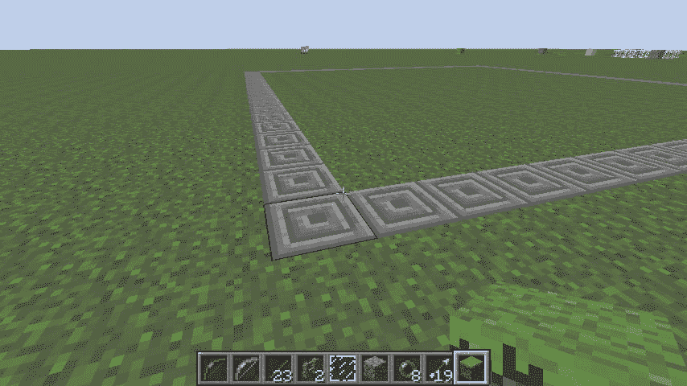

**图 18.2** 一个安全区域（带边框）

目前，你仍然可以在该区域内破坏和放置方块。下一步“保护”安全区域是添加事件处理程序，以禁止放置和破坏方块。在你的编辑器中，在`scriptcraft/plugins/protection/` 文件夹中创建一个名为 `events.js` 的新文件，并输入**清单 18.5**中的代码。

在清单 18.5 中，你监听两个事件，如果被放置或破坏的方块位于安全区域内，则取消这些事件。如果玩家是操作员，则立即返回，因为操作员应该能够放置和破坏方块。保存这些文件，然后使用`/js refresh()` 命令重新加载插件。接着，暂时对自己使用`/deop`，并尝试在你之前创建的安全区域内放置或破坏方块。你应该无法做到。当你确认非操作员玩家无法破坏方块后，通过在服务器控制台提示符下输入`/op` 命令重新启用你的操作员权限。

到目前为止，你已经有一种创建安全区域的方法，非操作员无法在其中破坏或放置方块。接下来需要做的是提供一种方法，在这个安全区域内创建玩家地块，玩家在认领地块后可以在此建造。

### 清单 18.5 保护的事件处理

点击此处查看代码图片

```
var zones = require('protection/zones');

function onPlace( event ) {

  if ( isOp(event.player) ) {

    return;

  }

  var block = event.blockPlaced;

  var boundingZones = zones.getBoundingZones(block.location);

  if (boundingZones.length == 0){

    return;

  }

  event.setCanceled();
}

function onBreak( event ){

  if ( isOp(event.player) ) {

    return;

  }

  var block = event.blockDestroy;

  var boundingZones = zones.getBoundingZones(block.location);

  if (boundingZones.length == 0){

    return;

  }

  event.setCanceled();
}

events.blockPlace( onPlace );

events.blockDestroy( onBreak );
```

### 重构

在深入探讨创建、认领和共享地块之前，让我们思考一下什么是地块，以及你已经创建的安全区域有何相似。区域和地块都是世界中的，适用某些规则。区域有一个起点，沿两个方向（`x`轴和`z`轴）延伸。因此，区域和地块实际上对于任何放置或破坏的方块，你需要测试该方块是否位于给定区域内。区域和地块之间有很多共同点，所以让我们重构已经编写的代码。重构是修改代码以避免重复相同的代码。接下来，你将之前创建的`zones.js`模块中的一些代码提取出来，移到一个新的、更重用的`region.js`中。在你的编辑器中，在`scriptcraft/modules/protection/` 文件夹中创建一个名为`region.js`的新文件，并编辑该文件使其与**清单 18.6**一致。

你会注意到`create()`函数与`zones.js`模块中的`addZone()`函数类似。除了`create()`函数不存在`store.push(result)`语句之外，它们是一样的。如果你想捷径，建议将`addZone()`函数的本体复制到`create()`函数中，然后从`create()`函数中删除`store.push(result)`这一行。`contains()`函数可以直接从`zones.js`文件复制到`region.js`中，无需修改。保存对`region.js`文件的更改后，编辑你的`zones.js`文件使其看起来像**清单 18.7**。

### 清单 18.6 区域管理

点击此处查看代码图片

```
function create( a, b ){

  var result = {
    startX: 0,
    startZ: 0,
    extentX: 0,
    extentZ: 0
  };

  if (a.x < b.x){

    result.startX = a.x;
    result.extentX = (b.x - a.x);

  } else {

    result.startX = b.x;
    result.extentX = (a.x - b.x);
  }

  if (a.z < b.z){

    result.startZ = a.z;
    result.extentZ = (b.z - a.z);

  } else {

    result.startZ = b.z;
    result.extentZ = (a.z - b.z);
  }

  return result;
}

function contains(region, location){

  if ( ( location.x >= region.startX &&
         location.x <= (region.startX + region.extentX)
       )
       &&
       ( location.z >= region.startZ &&
         location.z <= (region.startZ + region.extentZ)
       )
     ) {
    return true;

  }
  return false;
}

function getBoundingRegions(regions, location ){

  var i = 0;

  var result = [];

  for (i = 0; i < regions.length; i ){
    if ( contains(regions[i], location) ){
      result.push(regions[i]);
    }

  }

  return result;
}

exports.create = create;

exports.contains = contains;

exports.getBoundingRegions = getBoundingRegions;
```

### 清单 18.7 使用区域模块的区域

点击此处查看代码图片

```
var region = require('./region');

var store = persist( 'zones', [] );

function addZone( a, b ){

  var result = region.create(a,b);

  store.push(result);

  return result;
}

function getBoundingZones( location ){

  return region.getBoundingRegions(store, location);
}

exports.add = addZone;

exports.getBoundingZones = getBoundingZones;
```

`addZone()`函数大大简化了，而`getBoundingZones()`函数现在调用`region.getBoundingZones()`。完成重构后，你就可以开始处理玩家地块了。对于玩家地块，你需要能够执行以下几项操作。

 操作员需要能够创建地块。

 玩家需要能够认领地块。

 玩家需要能够与其他信任的玩家共享地块。

 玩家需要能够放弃对某个地块的认领。

在开始创建地块之前，你需要先创建一个支持这些操作的地块模块。在你的编程编辑器中，在`scriptcraft/modules/protection/` 文件夹下新建一个名为`plots.js`的文件，并输入**清单 18.8**中的代码。

### 清单 18.8 地块管理

```
var region = require('./region');

var store = persist( 'zones', []});

function addPlot( a, b ){

  var result = region.create(a,b);

  store.push(result);

  return result;
}

function getBoundingPlots( location ){

  return region.getBoundingRegions(store, location);
}

function removeAllPlots(){

  store.length = 0;
}

exports.add = addPlot;

exports.getBoundingPlots = getBoundingPlots;

exports.removeAllPlots = removeAllPlots;
```

到为止，地块模块看起来与区域类似。当你添加一个地块时，需要额外存储三个属性：

 地块编号（`.number`属性）。每次添加新地块时，地块编号递增（增加1）。存储对象的`.plotCounter`属性会被持久化，这样即使服务器重启，每个地块也能拥有唯一的编号。 认领该地块的玩家名称（`.claimedBy`属性）。

 与该地块共享的玩家列表（`.sharedWith`属性）。你希望玩家能够与其他信任的玩家协作，这样他们就可以同一地块上建造。

现在，让我们通过添加认领地块的函数来充实地块模块。将**清单 18.9**中的代码添加到你的`plots.js`文件中。

### 清单 18.9 认领地块

点击此处查看代码图片

```
function claim( player, plotNumber) {

  var i ;

  var plot;

  var result = getClaim(player);

  if (result != null){

    // player already claimed a plot

    return result;

  }

  for ( i = 0; i < store.plots.length; i++){

    plot = store.plots[i];

    if (plot.number == plotNumber){

      // is the plot already claimed by another?

      if (plot.claimedBy){

        echo( player, 'This plot is already claimed');

        return null;

      } else {

        plot.claimedBy = player.name;

        return plot;

      }

    }

  }

  return null;
}

function getClaim( player ){

  var i ;

  var plot;

  for ( i = 0; i < store.plots.length; i++){

    plot = store.plots[i];

    if (plot.claimedBy == player.name){

      return plot;

    }

  }

  return null;
}

exports.claim = claim;

exports.getClaim = getClaim;
```
```

```markdown
### 创建地块

你已经开始搭建供操作员和玩家添加及认领地块的函数。下一步是再次扩展 `Drone` 模块，这次添加一个 `plotmaker()` 函数，操作员将用它来创建玩家后续可以认领的地块。在你的编辑器中，在 `scriptcraft/plugins/protection/` 文件夹下新建一个名为 `plotmaker.js` 的文件，并添加 **清单 18.10** 中的代码。

保存此文件并使用 `/js refresh()` 命令重新加载插件后，你可以使用以下命令创建一个地块（首先瞄准地面上的一个方块）：

点击此处查看代码图片

`/js plotmaker( blocks.brick.red, 10, 10)`

将创建一个新的地块轮廓，并出现一个带有玩家说明的告示牌（参见 **图 18.3**）。

***

***

#### 清单 18.10 创建地块

点击此处查看代码图片

```javascript
var Drone = require('../drone/drone').Drone;

var plots = require('protection/plots');

function plotmaker( material, width, length ) {

  var startLoc = this.getLocation();

  this.chkpt('plotmaker');

  this.box0( material ,width, 1, length);

  var endLoc = this.fwd(length - 1)
                   .right(width - 1)
                   .getLocation();

  var plot = plots.add(startLoc,endLoc);

  this.move('plotmaker');

  var claimMesg = [

    '#' + plot.number +
        ' (' + width + ' X ' + length + ')',

    'To claim:',
    '1\. move inside',
    '2\. /jsp claim '

  ];

  this.up().sign(claimMesg,63).down();

}

Drone.extend(plotmaker);
```

***

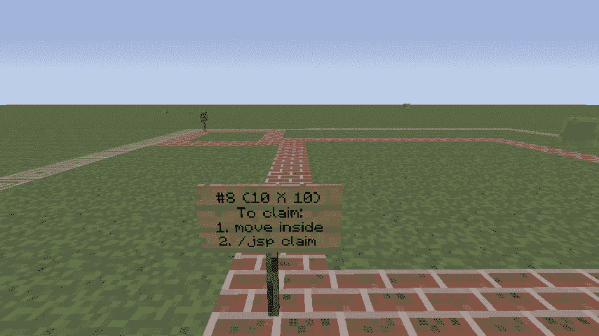

**图 18.3** 玩家地块

### 认领地块

目前，告示牌上显示的说明（进入地块区域并执行 `/jsp claim` 命令）还不起作用。下一步是提供一个 `/jsp claim` 命令，让玩家可以认领他们所在的地块。在你的编辑器中，在 `scriptcraft/plugins/protection/` 文件夹下新建一个名为 `claim.js` 的文件，并输入 **清单 18.11** 中的代码。保存此代码然后使用 `/js refresh()` 命令重新加载插件。

### 防止在地块上破坏

当玩家成功认领地块时，他们会收到一条祝贺，并在位置发射烟花。你已经完成了。现在只需要更新 `scriptcraft/plugins/protection/` 文件夹中的 `events.js` 文件，使其检查玩家是否位于块中并拥有地块。修改 `events.js` 文件，使其与 **清单 18.12** 中的代码一致。

***

***

#### 清单 18.11 `/jsp claim` 命令

点击此处查看代码图片

```javascript
var plots = require('protection/plots');

var fireworks = require('fireworks');

function claim( params, player ) {
  var existingClaim = plots.getClaim( player );
  var boundingPlots = plots.getBoundingPlots( player.location );

  if ( existingClaim ) {
    echo(player, 'You already have plot ' +
                      existingClaim.number);
    return;
  }
  if (boundingPlots.length == 0){
    echo(player, 'You are not in a plot!');
    return;
  }
  for (var i = 0; i < boundingPlots.length++){
    var plot = boundingPlots[i];
    if (!plot.claimedBy){
      // convert from Java to string
      plot.claimedBy = '' + player.name;
      echo(player, 'Congratulations! You now own plot ' +
           number);
      fireworks.firework( player.location );
      return;
    }
  }
  echo(player, 'No available plots!');
}
command(claim);
```

***

***

#### 清单 18.12 地块事件处理

点击此处查看代码图片

```javascript
var zones = require('protection/zones');
var plots = require('protection/plots');

/*
 can a player build on location?
*/
function playerCanBuild( player, location ) {
  // for now just check if player has a plot on this location
  return playerOwnPlot( player, location );
}

/*
 does the player own a plot of land at location?
*/
function playerOwnPlot( player, location ) {
  var boundingPlots = plots.getBoundingPlots( location );
  for (var i = 0; i < boundingPlots.length++){
    var plot = boundingPlots[i];
    if (plot.claimedBy == player.name){
      return true;
    }
  }
  return false;
}

function onPlace( event ) {
  if ( isOp( event.player) ){
    return;
  }
  var block = event.blockPlaced;
  if (playerCanBuild(event.player, block.location)){
    return;
  }
  var boundingPlots = plots.getBoundingPlots( block.location );
  var boundingZones = zones.getBoundingZones( block.location );
  if (boundingPlots.length == 0 && boundingZones.length == 0){
    return;
  }
  event.setCanceled();
}

function onBreak( event ) {
  if ( isOp(event.player) ){
    return;
  }
  var block = event.block;
  if (playerCanBuild( event.player, block.location ) ){
    return;
  }

  var boundingPlots = plots.getBoundingPlots( block.location );
  var boundingZones = zones.getBoundingZones( block.location );
  if (boundingPlots.length == 0 && boundingZones.length == 0){
    return;
  }
  event.setCanceled();
}

events.blockPlace( onPlace );
events.blockDestroy( onBreak );
```

***

***

### 放弃领地

下一步是提供一种让玩家放弃领地的方法，以便他们认领新的领地。为此，你将添加另一个新命令 `/jsp abandon`，执行该命令的玩家将放弃对当前领地的所有权，从而可以自由认领新领地。打开之前创建的 `scriptcraft/plugins/protection/claim.js` 文件，并添加 **清单 18.13** 中的代码。现在使用 `/js refresh()` 命令重新加载你的插件。你的玩家现在可以灵活迁移，在不同地块可用时从一个地块移动到另一个地块！

***

***

#### 清单 18.13 `/jsp abandon` 命令

点击此处查看代码图片

```javascript
function abandon( params, player ) {
  var existingClaim = plots.getClaim( player );
  if (existingClaim){
    existingClaim.claimedBy = null;
    echo(player, '你已放弃对领地 ' +
             existingClaim.number + ' 的权');
  } else {
    echo(player, '你没有任何放弃的地！');
  }
}
command(abandon);
```

***

***

### 共享领地

快完成了。你还需要为保护插件添加最后一个功能。你希望玩家能够选择在其领地上合作者。为此，你需要执行以下操作：
1. 添加一个新的 `/jsp share` 命令，让玩家可以选择或多个信任玩家。
2. 调整方块破坏和方块放置的事件规则，以容纳信任玩家。

让我们从新的 `/jsp share` 命令开始。再次打开你的 `claim.js` 文件，并添加 **清单 18.14** 中的代码。

***

***

#### 清单 18.14 `/jsp share` 命令

点击此处查看代码图片

```javascript
var utils = require('utils');

function share( params, player ) {
  // 将 Java 字符串转换为 JavaScript 字符串
  var trustedPlayer = '' + params[0];
  var existingClaim = plots.getClaim( player );
  if (existingClaim){
    if (typeof existingClaim.sharedWith == 'undefined'){
      existingClaim.sharedWith = [];
    }
    existingClaim.sharedWith.push( trustedPlayer );
    echo( player, '你与 ' + trustedPlayer + ' 共享领地');
  } else {
    echo(player, '你没有任何共享的地！');
  }
}
command(share, utils.playerNames);
```

***

保存 `claim.js` 文件，然后加载插件，现在你可以通过命令与其他人共享领地：`/jsp share`。如果你在输入 `/jsp share` 后按空格再按 Tab 键，你会注意到玩家列表作为命令的补全显示。

### 动态命令

我已经介绍过 `command()` 函数，包括如何使用它添加玩家使用的自定义命令，以及如何为其提供 Tab 补全的选项。`command()` 函数既可以接受静态列表（如之前在第 15 章中的 `cream` 和 `color` 示例），也可以接受另一个函数作为参数。如果 `options` 参数是一个列表，该列表将用于 Tab 补全；如果 `options` 参数是一个函数，则该函数将被执行，并返回一个用于 Tab 补全的字符串列表。在清单 18.14 中，你将 `utils.playerNames` 函数作为第二个参数传递给 `command()`。这意味着当玩家执行 `/jsp share` 命令并按下空格后跟 Tab 键时，都会调用 `utils.playerNames()` 函数。如果你无法预知道自定义命令的可能选项，那么提供一个在执行命令时返回选项列表的函数是可行的方法。在前面的示例中，你无法预知执行命令时有哪些在线，因此提供静态的玩家列表行不通。这就是为什么你将 `utils.playerNames` 函数作为第二个参数传递。

### 更新事件处理以容纳信任的玩家

接下来，你必须更新与保护相关的事件处理代码。你希望允许玩家位于领地内且在该地的 `.sharedWith` 列表中放置或破坏方块。打开 `scriptcraft/plugins/protection/events.js` 文件，添加新的 `playerIsTrusted()` 函数，并更新 `playerCanBuild()` 函数，如 **清单 18.15** 所示。

***

***

#### 清单 18.15 受信任玩家的事件处理

点击此处查看代码图片

```javascript
/*
玩家能否某个位置建造？
*/
function playerCanBuild( player, location ) {
  // 检查玩家在该位置拥有领地
  // 或者受信任
  var result = playerOwns( player, location ) ||
   playerIsTrusted( player, location );
  return result;
}

function playerIsTrusted( player, location) {
  var playerName = ''+ player.name;
  var boundingPlots = plots.getBoundingPlots( location );
  for (var i = 0;i < boundingPlots.length; i++){
    var plot = boundingPlots[i];
    var sharedWith = plot.sharedWith;
    if (!sharedWith ) {
      continue;
    }
    for (var j = 0; j < sharedWith.length; j++){
      if (sharedWith[j] == playerName){
        return true;
      }
    }
  }
  return false;
}
```

***

***

在这个修订版的 `events.js` 文件中，有一个新的 `playerIsTrusted()` 函数。如果玩家被信任可以在领地上工作，该函数返回 `true`。

这个函数中有两个值得注意的地方。第一个是你如何使用玩家的名称来测试玩家是否在 `sharedWith` 列表中。

#### Java 字符串与 JavaScript 字符串

JavaScript 中的 `String` 类型和 Java 中的 `String` 类型——它们名称相同——但略有不同，因此有些操作可以用 JavaScript 字符串完成，但不能用 Java 字符串，反之亦然。当比较两个字符串——一个是 JavaScript `String` 类型，另一个是 Java `String` 类型——最安全的方法是将 Java 字符串转换为 JavaScript 字符串。将 Java 字符串转换为 JavaScript 字符串最简单的方法是在 Java 字符串前面插入一个空的 JavaScript 字符串，如下所示：

```javascript
var jsString = '' + javaString;
```

这就是你在 `playerIsTrusted()` 函数的第一个语句中所做的：

点击此处查看代码图片

```javascript
var playerName = '' + player.name;
```
```

```markdown
```

这将`player.name` 的值赋给一个名为`playerName` 的新 JavaScript 变量。`player` 变量是一个 Java 对象，因此它的所有 `String` 属性都是 Java 字符串。Java 在不同平台和版本上比较 Java 和 JavaScript 字符串时的行为并不一致，因此如果你想要比较字符串或使用标准的 JavaScript 字符串操作，应该通过在 Java 字符串前面加上 `''`（一个空的 JavaScript 字符串）来将其转换为 JavaScript 字符串。

#### 循环中的循环

关于`playerIsTrusted()` 函数，第二点需要注意的是它使用了嵌套循环。**嵌套** 循环就是循环中的循环。在这个例子中，你遍历所有地块，对于每个地块，再遍历该地块的所有受信任玩家。

点击此处查看代码图片

```
for (var i = 0;i < boundingPlots.length; i++){

  var plot = boundingPlots[i];

  var sharedWith = plot.sharedWith;

  if (!sharedWith ) {

    continue;

  }

  for (var j = 0; j < sharedWith.length; j++){

    if (sharedWith[j] == playerName){

      return true;

    }

  }
}
```

在最内层循环中，你使用了与最外层循环不同的循环变量。最外层循环使用 `i` 变量作为索引和计数器，而最内层循环使用 `j` 变量。这一点很重要。当你有嵌套循环时，必须小心不要在内部循环中重复使用外部循环的索引变量。这是一个常见的错误——我在编写这段代码时也犯过。

嵌套循环可以有任意多层，但如果你发现自己编写的函数包含多层嵌套循环，就应该考虑重构该函数，使其更易于阅读和理解。

### 总结

在本章中，我逐步引导你完成了为服务器添加保护的过程。从你使用的代码量和文件数量可以看出，保护服务器并非易事！然而，如果你将问题分解成更小的问题，并逐一解决，就会变得更容易。编程是一个迭代过程——你编写一些代码，测试它，边进行边修改，逐步改进代码，一点一点地添加新功能，直到它达到你想要的效果。在本章中，你反复回顾了之前编写的代码，每次都逐步改进和添加内容。这就是编程的典型方式。即使是世界上最好的程序员，也不可能第一次就得到完美的解决方案！

虽然本章创建的代码并非一个全面的保护插件，但它为构建功能更完善的服务保护插件提供了良好的基础。要使这个插件更好，还需要解决一些突出的功能，比如地块被遗弃后应该如何处理？目前，玩家无法判断一个带有建筑的地块是否已被遗弃。理想情况下，当地块被遗弃时，应该放置一个标志，上面写着“此地块可用”。这只是众多可能的改进之一；我相信你还能想到更多！

## 第 19 章 打雪仗！

在本章中，你将创建一个名为“打雪仗”的玩家对战小游戏（见**图 19.1**）。游戏的目标是尽可能多地用雪球击中对手，同时避免自己被击中或击中自己队伍的成员。在游戏中，玩家可以组成对抗队伍。

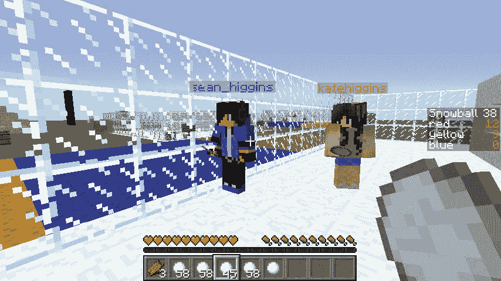

**图 19.1** 打雪仗

为了提供示例代码，游戏将保持简单，你可以根据自己的需求调整和扩展，创建自己的游戏。游戏通过一个 JavaScript 函数启动，其持续时间和队伍结构作为参数传递。如果没有传递参数，则默认持续时间为 60 秒，每个玩家将被分配到队伍之一。首先，我将在一个 JavaScript 模块中呈现游戏，其中包含一个启动游戏的函数。在本章后面，我将介绍如何创建竞技场以及启动游戏的命令。

### 游戏规则

在开始编码之前，我们制定一些打雪仗规则：

1. 游戏开始时，每个玩家获得一定数量雪球。
2. 每个玩家一个队伍。最多有三个队伍：红队、蓝队和黄队。每个玩家的名字显示颜色。
3. 如果玩家击中对手，获得一分。
4. 如果击中自己队伍，则扣分。
5. 游戏期间将显示玩家得分。
6. 游戏结束时，记分将在屏幕上停留几秒，以便玩家查看队伍最终得分。胜利者上方将放烟花。

### 后勤保障

为了游戏顺利进行，玩家应该彼此靠近。在本章后面，你构建一个特殊竞技场，使其更有趣。游戏的乐趣来自于期待感和仪式感。例如，许多玩家对战游戏都有等待区，在`SnowballFight()` 命令启动前，玩家在那里等待。最初，游戏保持简单——只有操作员可以使用命令。在本章后面，任何玩家都可以启动游戏。

### 计分

在第一章中，你使用 JavaScript 数组创建了一个简单的排行榜，按跳跃次数排序。Minecraft 有一些内置命令让你轻松创建并显示带有排行榜的侧边栏。

#### /scoreboard 命令

`/scoreboard` 命令提供了一种简洁的方式指定游戏内列表、侧边栏以及玩家头顶显示的内容。例如，你可以使用以下内置命令显示排行榜：

```
/scoreboard add Jumping
/scoreboard setdisplay Jumping
```

注意，一旦运行这些命令，无论服务器上的任何玩家何时跳跃，记分板都会更新。这是一个非常棒的功能，会在打雪仗中使用它。

#### 从 JavaScript 执行命令

可以使用`server.executeVanillaCommand()` 方法从 JavaScript 执行内置命令。要执行上面的记分板命令，你可以使用代码：

```
server.executeVanillaCommand(server, 'scoreboard add Jumping')
server.executeVanillaCommand(server, 'scoreboard setdisplay Jumping')
```

当你想要从 JavaScript 调用内置命令或其他插件提供的命令时，`server.executeVanillaCommand()` 方法非常有用。附录中包含了更多通过 JavaScript 使用其他插件的信息。

#### ScriptCraft 的记分板模块

ScriptCraft 提供了一个处理排行榜的模块。我们将使用这个模块在游戏开始时添加队伍并在过程中更新分数。

### 游戏源代码

我们要讲的内容很多，让我们直接编写核心代码。在你的编辑器中，在`/scriptcraft/plugins/` 文件夹中创建一个名为`snowball` 的文件夹。在`snowball` 文件夹中，创建一个名为`game.js` 的新文件，并输入清单 19.1 中所示的代码。

**清单 19.1** 打雪仗核心源代码

```
var items = require('items');
var utils = require('utils');
var scoreboard = require('minigames/scoreboard');
var cm = Packages.net.canarymod;
var cmSnowball = cm.api.entity.EntityType.SNOWBALL;
var cmCreative = cm.api.GameMode.CREATIVE;

function start( duration, teams, onGameOver ) {
  var players;
  var i;
```

```javascript
var game;
var teamName;
var ball;
if ( typeof duration == 'undefined' ) {
  duration = 60;
}
if ( typeof teams == 'undefined' ) {
  teams =  {};
  players = utils.players();
  var teamNames = ['red','blue','yellow'];
  var playerCount = players.length;
  for ( i = 0; i < playerCount; i++ ) {
    var playerName = players[i].name;
    teamName = teamNames[ i % playerCount ];
    if (teams[ teamName ] == undefined){
      teams[ teamName ] = [];
    }
    teams[ teamName ].push(playerName);
  }
}
game = {
  teams: teams,
  duration: duration,
  teamScores: {},
  eventListener: null,
  onGameOver: onGameOver
};
function loop(){
  if ( game.duration-- ){
    updateScoreboard( game );
    setTimeout( loop, 1000 );
  } else {
    end( game );
  }
}
function onSnowballHit( event ) {
  var snowball = event.projectile;
  if (snowball.entityType != cmSnowball ){
    return;
  }
  var thrower =
.thrower;
  //var thrower = snowball.handle.j().getCanary()
  var thrower = snowball.thrower;
  //var thrower = snowball.handle.j().getCanary()
  if (snowball.entityType != cmSnowball ){
    return;
  }
  var thrower = snowball.thrower;
  //var thrower =
.handle.j().getCanary()
  var thrower = snowball.thrower;
  //var thrower =
.handle.j().getCanary()
  if (snowball.entityType != cmSnowball ){
    return;
  }
  var thrower = snowball.thrower;
  //var thrower =..handle.j().getCanary()
  var thrower = snowball.thrower;
  //var thrower = snowball.handle.j().getCanary()
  if (snowball.entityType != cmSnowball ){
    return;
  }
  var thrower = snowball.thrower;
  //var thrower = snowball.handle.j().getCanary()
  if (snowball.entityType != cmSnowball ){
    return;
  }
  var thrower = snowball.thrower;
  //var thrower = snowball.handle.j().getCanary()
  if (snowball.entityType != cmSnowball ){
    return;
  }
  var thrower = snowball.thrower;
  //var thrower = snowball.handle.j().getCanary()
  if (snowball.entityType != cmSnowball ){
    return;
  }
  var thrower = snowball.thrower;
  //var thrower = snowball.handle.j().getCanary()
  if (snowball.entityType != cmSnowball ){
    return;
  }
  var thrower = snowball.thrower;
  //var thrower = snowball.handle.j().getCanary()
  if (snowball.entityType != cmSnowball ){
    return;
  }
  var thrower = snowball.thrower;
  //var thrower = snowball.handle.j().getCanary()
  if (snowball.entityType != cmSnowball ){
    return;
  }
  var thrower = snowball.thrower;
  //var thrower = snowball.handle.j().getCanary()
  if (snowball.entityType != cmSnowball ){
    return;
  }
  var thrower = snowball.thrower;
  //var thrower = snowball.handle.j().getCanary()
  if (snowball.entityType != cmSnowball ){
    return;
  }
  var thrower = snowball.thrower;
  //var thrower = snowball.handle.j().getCanary()
  if (snowball.entityType != cmSnowball ){
    return;
  }
  var thrower = snowball.thrower;
  //var thrower = snowball.handle.j().getCanary()
  if (snowball.entityType != cmSnowball ){
    return;
  }
  var thrower = snowball.thrower;
  //var thrower = snowball.handle.j().getCanary()
  if (snowball.entityType != cmSnowball ){
    return;
  }
  var thrower = snowball.thrower;
  //var thrower = snowball.handle.j().getCanary()
  if (snowball.entityType != cmSnowball ){
    return;
  }
  var thrower = snowball.thrower;
  //var thrower = snowball.handle.j().getCanary()
  if (snowball.entityType != cmSnowball ){
    return;
  }
  var thrower = snowball.thrower;
  //var thrower = snowball.handle.j().getCanary()
  if (snowball.entityType != cmSnowball ){
    return;
  }
  var thrower = snowball.thrower;
  //var thrower = snowball.handle.j().getCanary()
  if (snowball.entityType != cmSnowball ){
    return;
  }
  var thrower = snowball.thrower;
  //var thrower = snowball.handle.j().getCanary()
  if (snowball.entityType != cmSnowball ){
    return;
  }
  var thrower = snowball.thrower;
  //var thrower = snowball.handle.j().getCanary()
  if (snowball.entityType != cmSnowball ){
    return;
  }
  var
er =


```
在这个游戏中，理想情况下最多只有三个队伍，每个队伍的名称是以下三种颜色之一：红色、蓝色、黄色。尽量避免使用绿色和红色队伍，因为某些玩家可能难以区分这些颜色。每位玩家的名字会以其队伍的颜色显示，以便玩家更容易分辨谁是敌人，谁是自己人。接下来，创建一个名为`game` 的变量，用于存储游戏状态，并会传递给模块中的其他函数。

### 游戏循环

`loop()` 函数通过 `setTimeout()` 函数每秒调用一次，它会将游戏的持续时间计数器减 1，更新记分板，并在 1 秒后再次调度自身。如果游戏的持续时间计数器为 0，则表示时间已到，游戏结束，此时会调用 `end()` 函数。

### 作用域与函数

你可能想知道为什么 `loop()` 函数要声明在 `start()` 函数内部。`loop()` 函数必须声明在 `start()` 函数内部，因为它需要使用 `game` 变量。由于 `game` 变量和 `loop()` 函数都声明在 `start()` 函数内部，因此 `loop()` 函数可以访问 `game` 变量。如果 `loop()` 函数声明在 `start()` 函数外部，它将无法访问 `game` 变量，因为变量对其声明所在的函数是私有的。通常，你会将 `loop()` 函数声明在 `start()` 函数外部，并将 `game` 变量作为参数传递，但这里你通过 `setTimeout()` 调用来调度 `loop()`。实际上，在 JavaScript 中有几种处理作用域和函数的方法，但我认为将 `loop()` 函数声明在 `start()` 函数内部，使其能够访问并操作 `game` 变量，是最简单的方法。

### 监听雪球击中事件

接下来，声明一个新的事件处理函数 `onSnowballHit()`，它将在每次发生 `projectile hit` 事件时被调用。`events.projectileHit()` 函数可用于监听游戏中的抛射物击中事件。在你的场景中，你只关心小游戏参与者投掷的雪球。`getPlayerTeam()` 函数会返回玩家所属的队伍。如果投掷者和被击中的玩家不在同一队伍，则投掷者所在队伍的得分增加；否则，得分减少。

点击此处查看代码图片

```javascript
if ( throwerTeam != damagedTeam ) {
  game.teamScores[ throwerTeam ]++;
} else {
  game.teamScores[ throwerTeam ]--;
}
```

### 开始游戏

`start()` 函数的主体部分位于模块末尾。以下三条语句负责启动游戏、监听事件以及启动游戏循环：

点击此处查看代码图片

```
game.eventListener = events.projectileHit( onSnowballHit );
setTimeout(loop, 1000);
```

`start()` 函数负责初始化游戏的记分板和队伍分数，并为每位玩家分配雪球。

### 初始化并更新记分板

`start()` 函数中的第一组语句使用记分板模块的 `create()` 函数来初始化小游戏的记分板、添加队伍和队员，并为每位玩家分配雪球。每位玩家被设置为创造模式，以便在游戏过程中拥有无限数量的雪球。

点击此处查看代码图片

```
scoreboard.create('snowball', 'Snowball Fight!');
ball = items.snowBall(1);
for ( teamName in game.teams ) {
  scoreboard.addTeam( teamName, teamName );
  game.teamScores[ teamName ] = 0;
  team = game.teams[ teamName ];
  for ( i = 0; i < team.length; i++ ) {
    scoreboard.addPlayerToTeam( 'snowball', teamName, team[i]);
    player = server.getPlayer( team[i] );
    player.mode = cmCreative;
    player.inventory.addItem( ball.type.id, ball.amount, 0 );
  }
}
```

启动游戏的下一步是遍历游戏中的所有队伍，并对每个队伍调用 `scoreboard.addTeam()` 函数。`scoreboard.addTeam()` 函数接受两个参数：队伍名称和队伍颜色。由于在本游戏中，队伍以颜色命名，因此我们将队伍名称同时用作名称和颜色：

点击此处查看代码图片

```
scoreboard.addTeam( teamName, teamName );
```

### 显示分数

`updateScoreboard()` 函数在游戏开始时被调用一次。它也会在游戏过程中每秒从 `loop()` 函数内部被调用。

### 结束游戏

`end()` 函数负责结束游戏。游戏开始时分配给玩家的所有雪球都会被移除。事件监听器被注销，每位玩家的主记分板被恢复。

### 创建竞技场

到目前为止，你已经创建了一个供操作员使用的 JavaScript 函数，用于开始一场新的雪球大战游戏。游戏可以运行，但通过构建一个竞技场来增加趣味性，并让玩家能够轻松有趣地加入、开始游戏和选择队伍，可以使游戏更加有趣。让我们再次使用 Drone 来构建一个 24×24 格大小的雪地竞技场，并添加一些墙壁，使其成为一个有趣的游戏场所。竞技场将有一面玻璃墙，以便观众观看，并且在围墙竞技场外有三个大型彩色等候区，玩家只需在其中某个彩色区域等待即可选择队伍。整个竞技场和等候区将使用你在第 18 章中开发的区域生成器和区域模块来防止破坏，因此如果你尚未添加该章节的保护模块，建议现在添加。

稍后，你将添加功能，使任何在彩色区域等待的玩家都可以使用 `/jsp snowball` 命令开始游戏。首先，让我们编写构建竞技场的代码。创建一个新的 `scriptcraft/plugins/snowball/arena.js` 文件，并输入清单 19.2 中所示的代码。

---

**清单 19.2** 构建雪球大战竞技场

点击此处查看代码图片

```
var region = require('protection/region');
var Drone = require('../drone/drone').Drone;
var blocks = require('blocks');
var arenas = persist('snowball-arenas', []);
var instructions = [
  'Snowball Fight',
  'In color area:',
  '/jsp snowball'
];

function snowballArena() {
  var arena = {};
  this.chkpt('sbarena');
  // construct team waiting areas
  this.box( blocks.wool.red, 8, 1, 8);
  this.right(8).box( blocks.wool.blue, 8, 1, 8);
  this.right(8).box( blocks.wool.yellow, 8, 1, 8);
  this.move('sbarena');
  // construct arena
  this.fwd(8);
  this.box( blocks.snow, 24, 1, 24);
  // construct some walls to make it
  this.fwd( 6 ).right(3).box( blocks.snow, 10, 4, 1);
  this.right(2).up(2).box( blocks.air, 6, 1);
  this.down(2)
      .right(1)
      .fwd(6).box( blocks.snow, 10, 4, 1);
  this.right(2).up(2).box( blocks.air, 6, 1);
  this.move('sbarena');
  // construct glass wall around arena
  this.up()
      .fwd(8)
      .box(blocks.glass_pane, 24, 3, 24);
  this.move('sbarena');
  this.up().sign(instructions,63).right(8);
  .sign(instructions,63)
      .right(8)
      .sign(instructions,63);
  // make whole area protected
  this.move('sbarena');
  this.zonemaker( null, 24, 32 );
  // store the coordinates of blue, red and
  // yellow waiting areas these will be used
  // determine who's on team
  var loc = this.getLocation();
  var loc2 = this.fwd(8).right(8);
  arena.redZone = region.create(loc, loc2);
  loc = this.back(8);
  loc2 = this.fwd(8).right(8);
  arena.blueZone = region.create(loc, loc2);
  loc = this.back(8);
  loc2 = this.fwd(8).right(8);
  arena.yellowZone = region.create(loc, loc2);
  // store the locations of red, blue and
  // yellow spawn points
  this.move('sbarena');
  loc = this.fwd(10).right(1);
  arena.redSpawn = { x: loc.x, z: loc.z, y: y+1 };
  loc = this.right(8);
  arena.blueSpawn = { x: loc.x, z: loc.z, y: y+1 };
  loc = this.right(8);
  arena.yellowSpawn = { x: loc.x, z: loc.z, y: y+1 };
  this.move('sbarena');
  arenas.push(arena);
}
Drone.extend( snowballArena );
```

`snowballArena()` 函数是一个新的 Drone 扩展，供操作员创建竞技场。操作员可以像任何 Drone 函数一样使用它。在游戏中（拥有操作员），瞄准地面上的方块，然后执行以下命令：

```
/js snowballArena();
```

竞技场应该很快出现。从上方（俯视图）看，竞技场如图19.2 所示。

图19.2 竞技场

与你创建的其他 Drone 函数不同，你需要保存一些关于新创建竞技场的信息以供使用（这样在开发 `/jsp snowball` 命令时，你可以根据玩家的起始区域判断他们哪个队伍）。你使用了第 15 章首次学到的 `persist()` 函数来加载并自动保存竞技场。建议在创建每个雪场后执行 `/js refresh()` 语句，以便立即保存竞技场。

每个彩色区域中都有一块告示牌，上面写着给想要参与的玩家的说明。内容如下：

雪球大战
在彩色区域内：
/jsp snowball

告示牌是使用 Drone 的 `sign()` 函数创建的，该函数可以轻松制作带有信息的告示牌或悬挂告示牌。

#### 保护竞技场

竞技场使用 `zonemaker()` 函数进行保护，该函数接受三个参数：材质、宽度和长度。如果未提供材质，则区域会被保护，但不会放置边界。对于这个竞技场，你只需要保护它，不需要放置边界，因此调用方式如下：

点击此处查看代码图片

```
this.zonemaker( null, 24, 32 );
```

当传入 `null` 而不是材质时，不会构建边界，但该区域会阻止非操作员破坏或放置方块。

### 让玩家轻松游戏

创建了核心游戏代码和场地后，下一步是添加一些简单的机制来启动和停止游戏以及选择队伍。Drone 的 `snowballArena()` 函数不仅创建了场地，还在场地外创建了一个等待区，该区域被划分为彩色区域——每个队伍一个。想要玩玩家只需移动到三个彩色区域之一——他们选择的区域很重要，因为一旦游戏开始，这将是他们所属的队伍。

等待区中的任何玩家在至少有一个彩色区域有玩家时，可以通过以下命令来启动游戏：

`/jsp snowball`

让我们通过编写处理此命令的代码完成游戏。在 `snowball` 文件夹中，创建一个名为 `command.js` 的新文件，并输入清单 19.3 中所示的代码。此模块还使用了你在第 18 章开发的 `protection/region` 模块，以及在本章前面开发的游戏模块。

### 玩家在哪里？

雪球命令首先检查调用命令的玩家的位置。如果发出 `/jsp snowball` 命令的玩家不在三个彩色等待区之一，则游戏不会开始（你不希望任何人随意开始游戏——只有那些想游戏的人才能启动它）。你使用第 18 章中的 `region.contains()` 函数来检查玩家是否位于三个彩色等待区之一。

**清单 19.3** 新命令 `/jsp snowball`

点击此处查看代码图片

```javascript
var region = require('protection/region');
var fireworks = require('fireworks');
var utils = require('utils');
var cm = Packages.net.canarymod;
var cmLocation = cm.api.world.position.Location;
var game = require('./game');
var arenas = persist('snowball-arenas', []);

function snowball( params, sender ){
  var duration = 60; // 秒
  var i;
  var arena = null;
  var gameOn = false;
  var allPlayers = utils.players();
  var player;
  var teams = {red: [], blue:[], yellow:[]};
  var spawns = [];
  var spawn = null;
  for ( i = 0; i < arenas.length; i++ ) {
    arena = arenas[i];
    if ( region.contains(arena.redZone,sender.location)
        || region.contains(arena.blueZone,sender.location)
        || region.contains(arena.yellowZone,sender.location)
       ) {
      // 游戏开始！
      gameOn = true;
      break;
    }
  }
  if (!gameOn){
    echo( sender,
        '你必须在一个彩色区域中发出此命令' );
    return;
  }
  for (i = 0;i < allPlayers.length; i++) {
    player = allPlayers[i];
    var playerLoc = player.location;
    inZone = false;
    if (region.contains( arena.redZone, playerLoc) ) {
      teams.red.push( player.name );
      inZone = arena.redSpawn;
    } else if ( region.contains( arena.blueZone, playerLoc) ) {
      teams.blue.push( player.name );
      inZone = arena.blueSpawn;
    } else if ( region.contains( arena.yellowZone, playerLoc) ) {
      teams.yellow.push( player.name );
      inZone = arena.yellowSpawn;
    }
    if ( inZone ) {
```


```
      var spawnLoc = new cmLocation( playerLoc.world,
                                     inZone.x,
                                     inZone.y,
                                     inZone.z,
                                     0,
                                     0);
      spawns.push( {
        participant: player,
        oldLocation: playerLoc,
        newLocation: spawnLoc
      } );
    }

  }

  if ( (teams.red.length == 0 && teams.blue.length == 0)
      || (teams.red.length == 0 && teams.yellow.length == 0)
      || (teams.blue.length == 0 && teams.yellow.length == 0)
     ) {
    echo( sender,
      '需要多于一个队伍才能开始游戏。' +
      '需要有人选择不同的颜色。');
    return;
  }

  function returnPlayers( gameData, winningTeam) {
    var spawn;
    for (var i = 0;i < spawns.length; i++) {
      spawn = spawns[i];
      var player = spawn.participant;
      player.teleportTo(spawn.oldLocation);
      if (gameData.teams[winningTeam].indexOf( '' + player.name) > -1) {
            fireworks.firework( spawn.oldLocation );
      }
    }
  }

  for (i = 0;i < spawns.length; i++) {
    spawn = spawns[i];
    spawn.participant.teleportTo(spawn.newLocation);
  }

  game.SnowballFight(duration, teams, returnPlayers);
}

command( snowball );
```

### 谁想玩？

如果玩家在其中一个等待区，你会保留对该等待区场地的引用。然后你遍历服务器上的所有玩家，如果有任何玩家位于场地的某个彩色区域中，你就将他们添加到相应的队伍中。

点击此处查看代码图片

```javascript
for (i = 0;i < allPlayers.length; i++) {
    player = allPlayers[i];
    var playerLoc = player.location;
    inZone = false;
    if (region.contains( arena.redZone, playerLoc) ) {
      teams.red.push( player.name );
      inZone = arena.redSpawn;
    } else if ( region.contains( arena.blueZone, playerLoc) ) {
      teams.blue.push( player.name );
      inZone = arena.blueSpawn;
    } else if ( region.contains( arena.yellowZone, playerLoc) ) {
      teams.yellow.push( player.name );
      inZone = arena.yellowSpawn;
    }
    if ( inZone ) {
      var spawnLoc = new cmLocation( playerLoc.world,
                                     inZone.x,
                                     inZone.y,
                                     inZone.z,
                                     0,
                                     0);
      spawns.push( {
        participant: player,
        oldLocation: playerLoc,
        newLocation: spawnLoc
      } );
    }
  }
```

`spawns` 数组是一个列表，包含玩家及其在游戏开始前的位置。你需要保留这些位置列表，因为当游戏开始时，你会将玩家传送到场地内（见图 19.3），并希望在游戏结束时将每个玩家送回他们原来的位置。每个场地还有三个重生点，游戏开始时玩家将被传送到这些点。

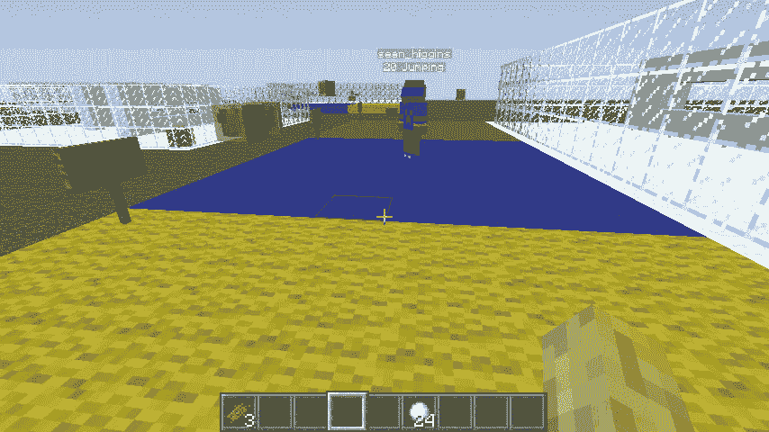

**图 19.3** 雪球大战等待区

### 有多少队伍？

接下来，雪球命令函数检查有多少队伍有玩家。如果只有一个队伍，则游戏不会开始。

点击此处查看代码图片

```javascript
if ( (teams.red.length == 0 && teams.blue.length == 0)
  || (teams.red.length == 0 && teams.yellow.length == 0)
  || (teams.blue.length == 0 && teams.yellow.length == 0))
{
  echo(player, '需要多于一个队伍才能开始游戏。' +
           '需要有人选择不同的颜色。');
  return;
}
```

### 启动和停止游戏

最后——假设发出命令的玩家想玩，并且有足够的队伍/玩家可以玩——你将玩家传送到场地内，并使用 `game.SnowballFight()` 函数开始游戏，该函数映射到本章前面定义的 `start()`。你还使用 `setTimeout()` 函数安排了一个延迟函数调用。当游戏结束时，`returnPlayers()` 函数将被调用，并将每个玩家送回游戏开始前所在的等待区。获胜队伍的每个玩家上方会燃放烟花，这样所有玩家和观众都能知道哪支队伍赢得了比赛。

### 总结

在本章中，你从零开始构建了一个玩家对战小游戏。你复用了之前章节中编写的许多函数，并充分利用了`Drone`对象来创建一个用于游戏的竞技场。这是本书中你为 Minecraft 添加的最复杂的新功能，但也是与朋友一起玩时非常有趣的一个功能。

玩游戏很有趣，但编写自己的游戏会带来巨大的成就感，尤其是当你看到朋友们玩你创建的游戏时！

### 结论

虽然本书到此结束，但你才刚刚开始探索 Minecraft 插件开发的世界。我写这本书的目的是为你提供一个坚实的基础，让你能够开始开发自己的 Minecraft 插件。我试图涵盖所有基础知识以及一些高级主题，并在此过程中提供示例。关于 Minecraft 插件开发还有很多需要的地方，但我希望这本书能给你信心，让你创建自己的插件。写这本书的过程非常有趣，希望你喜欢阅读。

## 附录 A. ScriptCraft 变量

在本附录中我将介绍 ScriptCraft 提供的变量。

#### `server` 变量

`server`变量是 ScriptCraft 提供的全局变量。它引用`net.canarymod.api.Server`对象，这是一个代表服务器的对象。有关此对象可用方法的详细信息，请查阅`net.canarymod.api.Server`。

#### `__plugin` 变量

`__plugin`这个全局变量是对 ScriptCraft插件的引用。某些 CanaryMod 方法需要`net.canarymod.plugin.Plugin`对象作为参数。如果你需要从 JavaScript 调用这些方法，应在需要`net.canarymod.plugin.Plugin`类型的地方提供`__plugin`。

#### `self` 变量

`self`是一个短生命周期变量，仅在执行命令期间存在`self`指的是执行者，即发出命令的玩家或控制台。不要在模块中使用`self`变量——尤其是在多人模式下！它不应在任何延迟函数中使用，因为它在服务器的作用域之外。

## 附录 B. 将 ScriptCraft 与其他插件一起

ScriptCraft 用于与其他 CanaryMod 插件协作并控制它们。ScriptCraft 与其他插件有两种方式：

 通过发出命令

### 发出命令

`server.executeCommand()`方法用于发出内置命令（如`/time set`）或插件提供的命令。ScriptCraft 用于驱动其他插件。许多插件提供自己的命令集，所有这些命令都可以由服务器发出。更多信息请查阅`net.canarymod.api.Server`。

### 使用插件方法和类

访问和使用另一个插件的另一种方式是通过你想控制的插件提供的方法和类。你可以使用以下代码获取任何插件（将`otherPlugin`替换为你使用的插件名称）：

```javascript
var Canary = Packages.net.canarymod.Canary;
var otherPlugin = Canary.manager().getPlugin('otherPlugin');
```

一旦你获得了插件对象，就可以调用它的任何方法与该插件协作。对于任何给定的插件，你需要参考插件的 API 文档来查看可用方法。

## 附录 C. 事件参考

下表列出了模块中所有用于注册事件监听器的函数。每个函数旁边显示了等效的 Java 事件类型。有关每种 Java 钩子类型的详细信息，请查阅 CanaryMod API 文档。钩子类型分为多个类别，如下表所示。

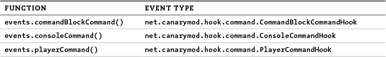 **表 C.1** 命令事件

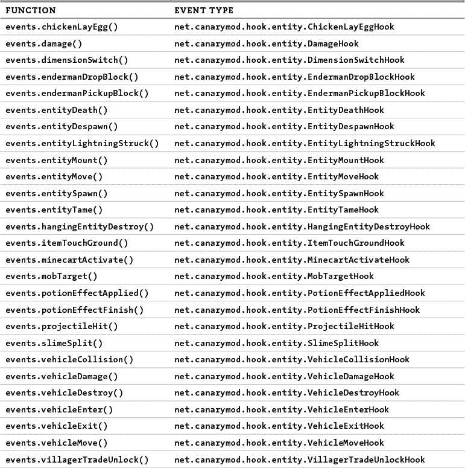 **表 C.2** 实体事件

[Image](img/00096.jpeg) **表 C.3** 玩家事件

 **表 C.4** 系统事件

Image](img/00099.jpeg) **表 C.5** 世界事件

## 附录 D. 物品参考

`items`模块提供了一套有用的函数，用于创建物品堆（即通常存储在玩家库存中的对象集合）。本附录中的每个函数可以通过三种方式调用：

 如果不提供参数，函数将返回等效的材料，即`net.canarymod.api.inventory.ItemType`类型的一个值。例如，调用`items.diamondOre()`将返回`net.canarymod.api.inventory.ItemType.DiamondOre`值，该值可用于任何需要`net.canarymod.api.inventory.ItemType`对象的 CanaryMod API 中。

 如果只提供一个数字作为参数，则返回一个新的`net.canarymod.api.inventory.Item`对象。例如，调用`items.diamondOre(8)`将返回一个由八个钻石矿石方块组成的`Item`。

 如果只提供一个`ItemType`对象作为参数，则将该材料与给定函数关联的材料类型进行比较，如果材料类型相同，则返回`true`。例如，要查看玩家当前是否持有钻石矿石，可以使用以下代码：

```javascript
var isDiamond = items.diamondOre( player.itemHeld.type );
```

请记住，在使用任何函数之前，使用以下代码加载`items`模块：

```javascript
var items = require('items');
```

下面列出了`items`模块的所有函数：

[Image](img/00101.jpeg)[Image](img/00102.jpeg)[Image](img/00103.jpeg)[Image](img/00104.jpeg)[Image](img/00105.jpeg)[Image](img/00106.jpeg)[Image](img/00107.jpeg)[Image](img/00108.jpeg)[Image](img/00109.jpeg)[Image](img/00110.jpeg)[Image](img/00111.jpeg)[Image](img/00112.jpeg)[Image](img/00113.jpeg)[Image](img/00114.jpeg)[Image](img/00115.jpeg)[Image](img/00116.jpeg)[Image](img/00117.jpeg)[Image](img/00118.jpeg)

**表 D.1** 物品参考

## 附录 E. 函数声明与函数表达式

在 JavaScript 中，定义函数的两种最常见方式是使用*函数声明*和*函数表达式*。函数声明如下所示：

```javascript
function myFunction(){

}
```

而函数表达式如下所示：

```javascript
var myFunction = function(){

};
```


在本书中，我使用`函数声明`而不是`函数表达式`来定义函数。我这样做是因为：

 这是一本面向初学者的书。每当 JavaScript 中有两种或更多可能的方法来做某件事时，我努力只呈现最简单的方法，这样初学者就不会被 JavaScript 灵活的语法所困扰。

 函数声明`要求`函数必须有一个名称，而函数表达式则不需要。命名函数——即在定义时被赋予名称，而不仅仅是赋值给一个命名变量的函数——可以调用自身，因为其名称在函数体内保证在作用域内。无论函数是作为表达式还是声明定义，最佳实践都是为其命名。

 函数声明在输入时比等效的函数表达式略短。

 命名函数在讨论递归主题时非常有用，并且在 `ScriptCraft` 中也被广泛使用。

即使你在 JavaScript 编程中变得更加熟练后决定使用函数表达式，为函数命名也是一个好主意。

## 索引

### 符号

`!` 运算符，与 `if` 语句一起使用，108

`+`（加法）符号，28

`&&`（AND）运算符，115

`:`（冒号）符号
  - 与对象一起使用，182–183
  - 与 `switch` 语句一起使用，122

`,`（逗号），与对象一起使用，182–183，187

`{ }`（花括号）
  - 与 `if` 语句一起使用，107
  - 与对象一起使用，182–183

`" "`（双引号），用于括起字符串，32

`/ /`（双斜杠），用于注释，86–88

`−`（减号）符号，28

`*`（乘法）符号，28

`| |`（OR）运算符，115–116

`( )`（圆括号），与 `if` 语句一起使用，107

`.`（句点），与函数一起使用，159

`' '`（单引号），用于括起字符串，32

`/ /`（斜杠）符号，28，68，71

`[ ]`（方括号），与数组一起使用，93

### A

加法和减法，36

加法运算符，28

`addZone()` 与 `create()` 函数，255，258

管理员，将自己设为，21

`allowFlight` 变量，35

类型的继承关系，235

`&&`（AND）运算符，使用，115

动物声音列表，120–121

`animalSounds()` 函数，126

注解，220

答案
  - 检查正确性，106–108
  - 对或错，107

API（应用程序编程接口），ix，216

雪球大战的竞技场
  - 创建，286–290
  - 保护，290

数组示例
  - `push()` 函数，95–96
  - `random()` 函数，95
  - `splice()` 方法，96–97

数组方法
  - `.indexOf()`，98
  - `.join()`，98
  - `.pop()`，98
  - `.push()`，98
  - `.reverse()`，98
  - `.slice()`，98
  - `.sort()`，98
  - `.splice()`，96–98
  - `.unshift()`，98

`Array` 对象，97

数组。另请参阅 排行榜

`[ ]`（方括号）与数组一起使用，93

向数组追加项目，96

数组从 0 开始，94

`,`（逗号）与数组一起使用，93

配置数组中的项目，133–135

定义，93

`farmAnimals`，95，97

`length` 属性，93–94

方法，98

数组中的项目数量，93–94

作为参数传递，226

从数组中移除项目，96–97

反转数组，138

`[]`（方括号）与数组一起使用，93

`array.sort()` 方法
  - 解释，132
  - 使用，132–133

箭矢，传送，236。另请参阅 末影弓

提问，105–106

坐标轴，x 和 y，156–158

### B

十进制，计数，200–201

块语句，113

方块
  - 建筑材料，156–158
  - 嵌套，113
  - 在游戏中放置，154
  - 定位，154–155

蓝图
  - `box0()` 方法，171
  - 在源文件中链式调用，171
  - 解释，162
  - 模块，166–167
  - 概述，164–165
  - 金字塔蓝图，163
  - 摩天大楼蓝图，168–171
  - `skyscraper()` 方法，169–170

布尔值，38

`boost()` 函数，190

弓，制作，214

`box()` 函数，154，171

`break` 语句，122

软件中的错误（Bug），查找，10

建筑材料，156–158。另请参阅 材料

使用无人机建造，154

`byPopulation()` 函数，134–135

### C

驼峰命名法，用于变量，32

CanaryMod
  - 注解，220
  - 类详细信息，218
  - 类，218–219，222
  - 文档布局，218
  - 文档，216–217
  - 下载，13
  - 末影弓配方，221–222
  - 枚举，220，222
  - 异常，220
  - 论坛，216
  - 群组，18
  - 在 Linux（Ubuntu）上安装，15
  - 在 Mac OS 上安装，14–15
  - 在 Windows 上安装，13–14
  - 接口，219
  - 包，218
  - 参数类型，219
  - 权限，18–19
  - 参考，216
  - 访客群组，18

`website`，9

`cancel()` 事件处理器，244–245

`case`，转换参数，126

`case` 语句，122

链式调用
`functions`，159–160

在源文件中，171

字符代码，201

聊天颜色
更改，200–201

字符代码，201

十进制计数，200–201

十六进制等价，202

模块，203–204

概述，198

玩家偏好，205

`chatcolor()` 函数，206

`checkAnswer()` 函数，110

`.chkpt()` 方法，169

Chrsson, Malin，177

领地块，260–261

类，219，B-2

`clearInterval()` 函数，178–79

客户端-服务器网络兼容性，10

概述，6–8

代码，重用，72

代码，关闭，88

代码清单
动物声音，120–121

巨石蓝图，165

摩天大楼蓝图，168–171

跳出循环，146

不区分写的动物声音，127–128

忍者饼干，116

创建地块，262

创建自定义，150

基于无人机的区域创建器，252

烟花表演，75–177

`helloWorld()` 声明，61

`helloWorld()` 声明与执行，62

如果 X 且 (Y 或 Z)，118

Bean 属性，241

`/jsp abandon` 命令，267

`/jsp claim` 命令，264

`/jsp share` 命令，268

`/jsp snowball` 命令，292–294

`/op`，253

`/scoreboard`，276

快捷命令，68

`snowball`，291

注释
`dice.js`，89

注释掉代码，88

注释
行尾注释，87

多行注释，87–88

单行注释，87

使用注释，86，88

CommonJS 模块系统，72

比较器函数，133

`.concat()` 字符串方法，130

条件，组合，113

`console` 对象，182

`CONSOLE` 玩家，20

控制台窗口，切换至，21

`console.log()` 函数，140

忍者饼干清单，116

基石，创建，160

十进制计数，200–201。另见 数字

`cow` 变量，86

合成网格，225

合成配方。参见 配方

`create()` 与 `addZone()` 函数，255，258

花括号（`{ }`）
  - 与 `if` 语句一起使用，107
  - 与对象一起使用，182–183

### D

数据类型，37–38

决策，在 JavaScript 中做出，85

延迟执行，174–175

`/deop` 命令，253

依赖关系，解释，100

骰子，掷，70，75–76，82

`dice.js`，注释，89

`dice.roll()`，调用，68

骰子，六面，69

除法运算符，28

双引号（ ”），用于字符串，32

双斜杠（/ /），用于注释，86–88

Drone API，161

Drone 模块，使用，154

无人机
  基石，160
  移动，158–160
  转向，161–162

###

按跳跃次数玩家，140

传送箭矢，236

使用区域划分，258

冒号（`:`）符号
  - 与对象一起使用，182–183
  - 与 `switch` 语句一起使用，122

逗号（`,`），与对象一起使用，182–183，187

`command()` 函数，150，269

命令
创建与自定义，148–149

为玩家创建，148–149

延迟执行，174–175

`/deop`，253

动态选项，269

从 JavaScript 执行，276

发出命令，B-2

`js` 与 `jsp` 对比，148–149

`/jsp abandon`，267

`/jsp share`，268

`/jsp snowball`，292–294

`/op`，253

`/scoreboard`，276

快捷命令，68

`snowball`，291

注释
`dice.js`，89

注释掉代码，88

注释
行尾注释，87

多行注释，87–88

单行注释，87

使用注释，86，88

CommonJS 模块系统，72

比较器函数，133

`.concat()` 字符串方法，130

条件，组合，113

`console` 对象，182

`CONSOLE` 玩家，20

控制台窗口，切换至，21

`console.log()` 函数，140

忍者饼干清单，116

基石，创建，160

十进制计数，200–201。另见 数字

`cow` 变量，86

合成网格，225

合成配方。参见 配方

`create()` 与 `addZone()` 函数，255，258

花括号（`{ }`）
  - 与 `if` 语句一起使用，107
  - 与对象一起使用，182–183

### D

数据类型，37–38

决策，在 JavaScript 中做出，85

延迟执行，174–175

`/deop` 命令，253

依赖关系，解释，100

骰子，掷，70，75–76，82

`dice.js`，注释，89

`dice.roll()`，调用，68

骰子，六面，69

除法运算符，28

双引号（ ”），用于字符串，32

双斜杠（/ /），用于注释，86–88

Drone API，161

Drone 模块，使用，154

无人机
  基石，160
  移动，158–160
  转向，161–162

### E

按跳跃次数玩家，140

传送箭矢，236

使用区域划分，258

冒号（`:`）符号
  - 与对象一起使用，182–183
  - 与 `switch` 语句一起使用，122

逗号（`,`），与对象一起使用，182–183，187

`command()` 函数，150，269

命令
创建与自定义，148–149

为玩家创建，148–149

延迟执行，174–175

`/deop`，253

动态选项，269

从 JavaScript 执行，276

发出命令，B-2

`js` 与 `jsp` 对比，148–149

`/jsp abandon`，267

`/jsp share`，268

`/jsp snowball`，292–294

`/op`，253

`/scoreboard`，276

快捷命令，68

`snowball`，291
```
*(注：由于原始文本包含大量重复的索引和碎片信息，上述排版根据高级文档工程师的逻辑，保留了核心语义并对变量、函数、路径进行了标准的反引号处理，同时清理了冗余的格式。)*