# JavaScript 数据结构与算法常识指南（第 1 卷）

# 早期赞誉：*《JavaScript 数据结构与算法常识指南，第一卷》*

这是我见过的最好的数据结构与算法书籍。它以既通俗易懂又详尽的方式全面解释了关键概念，非常适合初学者以及希望提升技能的经验丰富的程序员。所有这些方面使得《数据结构与算法常识指南》成为该领域的重要参考书。我强烈推荐！

| → | Boris Pietrzak |

|  | GIS 开发者，ChapsVision |

作者在细节与简洁之间取得了平衡，并带有健康的幽默感，使复杂的概念更易于理解，甚至变得有趣！

| → | Ann Clawson |

|  | 软件工程师 |

Jay Wengrow 从第一页起就让读者坐上驾驶座，通过实际案例和真正有意义的解释。这个更新版本将原本已经很棒的数据结构与算法方法，进一步针对那些希望扩展开发者工具箱而又无需学习另一种编程语言的开发者进行了定制。它包含了所有正确的内容，没有任何冗余。

| → | Jose Oseguera |

|  | 前端开发者 |

# 致谢

虽然写书看似一项孤独的任务，但如果没有许多人在我写作过程中给予支持，这本书根本不可能完成。我想亲自感谢你们所有人。

致我亲爱的妻子 Rena——感谢你给予我的时间和情感支持。当我像隐士一样埋头写作时，你处理了一切。致我可爱的孩子们：Tuvi、Leah、Shaya、Rami 和 Yechiel——感谢你们在我写关于“算法”的书时的耐心。是的——终于完成了。

致我的父母 Howard 和 Debbie Wengrow 先生和夫人——感谢你们最初激发了我对计算机编程的兴趣，并帮助我追求它。你们不知道，给我请一位计算机家教……

# 前言

数据结构和算法不仅仅是抽象的概念。掌握它们能让你编写高效的代码，从而使软件运行更快、消耗更少的内存。这对于当今的软件应用来说非常重要，这些应用越来越多地运行在移动平台上，并处理着越来越大量的数据。

然而，关于这些主题的大多数资源的问题在于……嗯……晦涩难懂。大多数文本大量使用数学术语，如果你不是数学家，很难理解到底在讲什么。即使是那些声称让算法“简单”的书籍，似乎也假设读者拥有高等数学学位。因此，太多人回避这些概念，觉得自己不够“聪明”去理解它们。

但事实是，关于数据结构和算法的一切都可以归结为常识。数学符号本身只是一种特定的语言，而数学中的一切也可以用常识性术语来解释。在这本书中，我使用这种常识性语言（加上大量图表！）以简单且——我敢说——有趣的方式解释这些概念。

一旦你理解了这些概念，你将能够编写高效、快速且优雅的代码。你将能够权衡各种代码方案的利弊，并能够就哪种代码最适合特定情况做出明智的决策。

在这本书中，我尽力让这些概念变得真实和实用，提供你今天就能使用的想法。当然，你会在过程中学到一些非常酷的计算机科学知识。但这本书的目的是将那些看似抽象的东西变得直接实用。读完这本书后，你将能编写更好的代码和更快的软件。

## 本书适合谁？

本书适合以下几类读者：

*   你是一名计算机科学专业的学生，想要一本用通俗英语解释数据结构和算法的书。本书可以作为你正在使用的任何“经典”教科书的补充。

*   你是一名初级开发者，了解基本编程，但希望学习计算机科学基础以编写更好的代码，并提升你的编程知识和技能。

*   你是一名自学成才的开发者，从未正式学习过计算机科学（或者学过但全忘了！），并希望利用数据结构和算法的力量来编写更具可扩展性和优雅性的代码。

无论你是谁，我都尽力让这本书能够……

## JavaScript 版本

本书中的所有代码均使用 JavaScript 编写。本书的原版《数据结构与算法常识指南》（第二版于 2020 年出版）是语言无关的，使用了多种编程语言。这样做的初衷是不想让读者觉得这本书只对一种语言有用，因为数据结构和算法是适用于整个计算领域的概念。

多年来，我收到读者的反馈，他们表示希望看到本书的语言特定版本。毕竟，如果你使用某一种编程语言，有一本所有代码都用该语言编写的书不是很好吗？

因此，我开始创建《数据结构与算法常识指南》的单语言版本。第一个是 Python 版本，于 2023 年出版。第二个版本就是你现在正在阅读的 JavaScript 版本！

由于关于数据结构和算法有太多内容可讲，本书是一个系列中的第一卷。在本卷中，我为你打下这些概念的基础，并涵盖最常见的数据结构和算法。在下一卷中，我将在此基础上进一步深入，介绍更高级的思想和技术。

## 关于代码的说明

本书中的代码已更新以遵循 ECMAScript 6+标准。在可能的情况下，我还努力遵循受 Airbnb JavaScript 风格指南^([[1]](#f_0012.xhtml_FOOTNOTE-1))启发的现代 JavaScript 风格。话虽如此，在某些情况下我偏离了某些规则，因为我认为这样做有助于保持代码更易于理解。

其中一个例子是，JavaScript 拥有许多不同类型的循环语法（这既是祝福也是诅咒，取决于你的观点）。尽管现代的`forEach`循环可以在许多代码片段中使用，但在很多情况下它并不是最佳选择。而且我觉得在所有代码片段中使用太多不同类型的循环会有点突兀。因此，为了……

## 本书内容？

你可能已经猜到，本书大量讨论了数据结构和算法。更具体地说，本书的结构如下：


在第 1 章*为什么数据结构很重要*和第 2 章*为什么算法很重要*中，我解释了什么是数据结构和算法，并探讨了时间复杂度的概念——它用于衡量算法的速度。在此过程中，我还大量讨论了数组、集合和二分查找。

在第 3 章*哦，是的！大 O 表示法*中，我揭示了大 O 表示法，并用易于理解的方式解释它。我们在整本书中都使用这种表示法，所以这一章相当重要。

在第 4 章*用大 O 加速你的代码*和第 5 章*用大 O 优化代码……*中……

## 如何阅读本书

你必须按顺序阅读本书。有些书你可以独立阅读每一章并跳着读，但这本书不是这样。每一章都假设你已经读过前面的章节，而且这本书经过精心构建，以便你在阅读过程中逐步提升理解。

话虽如此，本书后半部分的某些章节并不完全相互依赖。下图展示了哪些章节是其他章节的先修内容。

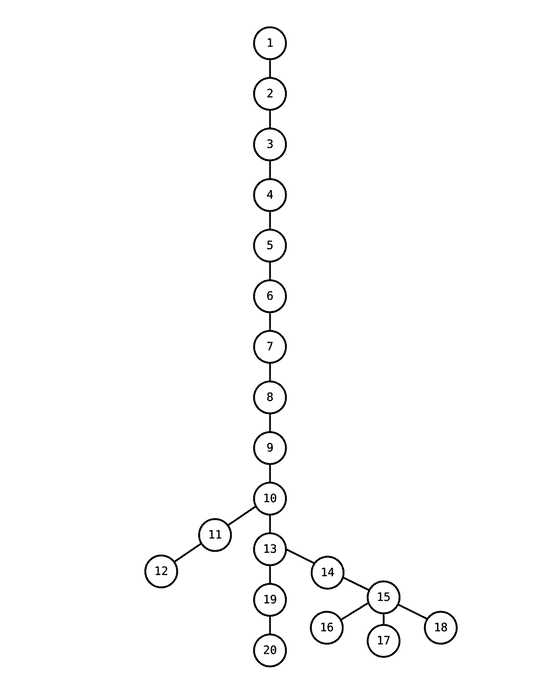

例如，从技术上讲，你可以从第 10 章跳到第 13 章。（哦！这个图基于一种叫做树的数据结构。你将在第 15 章学到它。）

另一个重要说明：为了让这本书易于理解，我在首次介绍某个概念时并不总是揭示其全部内容。有时，分解复杂概念的最佳方式是先揭示一小部分，等到第一部分被消化后再揭示下一部分。如果我将某个特定术语定义为某某，请不要将其视为教科书定义，直到你完成该主题的整个章节。

这是一种权衡：为了让这本书易于消化，我选择先过度简化某些概念，然后随着时间的推移逐步澄清，而不是确保每个句子都完全、学术性地准确。但不要太担心，因为到最后，你会看到完整的准确图景。

## 在线资源

本书在 pragprog.com 上有自己的网页^([[3]](#f_0012.xhtml_FOOTNOTE-3))，你可以在那里找到关于本书的更多信息，下载代码示例的源代码，并通过报告勘误、拼写错误和内容建议来帮助改进本书。

此外，我在我的网站上发布关于写作的最新动态。^([[4]](#f_0012.xhtml_FOOTNOTE-4))在那里你可以找到关于我的书籍的更多信息，以及我和同事们制作的视频教程，我们使用“常识”方法解释各种技术和概念。特别是，你可能会喜欢我的“Jay Vs. Leetcode”^([[5]](#f_0012.xhtml_FOOTNOTE-5))视频系列，其中我使用本书中讨论的许多技术解决编程难题。

## 联系

我喜欢与读者联系，并邀请你在 LinkedIn 上找到我。^([[6]](#f_0012.xhtml_FOOTNOTE-6))我很乐意接受你的连接请求——只需发送一条消息，说明你是本书的读者。期待你的来信！

Jay Wengrow  
2024 年 6 月

### 脚注

[[1]](#f_0008.xhtml_FNPTR-1)

[`github.com/airbnb/javascript`](https://github.com/airbnb/javascript)

[[2]](#f_0008.xhtml_FNPTR-2)

[`pragprog.com/titles/jwjavascript`](https://pragprog.com/titles/jwjavascript)

[[3]](#f_0011.xhtml_FNPTR-3)

[`pragprog.com/titles/jwjavascript`](https://pragprog.com/titles/jwjavascript)

[[4]](#f_0011.xhtml_FNPTR-4)

[`commonsensedev.com`](https://commonsensedev.com)

[[5]](#f_0011.xhtml_FNPTR-5)

[`www.commonsensedev.com/jay-vs-leetcode`](https://www.commonsensedev.com/jay-vs-leetcode)

[[6]](#f_0012.xhtml_FNPTR-6)

[`www.linkedin.com/in/jaywengrow`](https://www.linkedin.com/in/jaywengrow)

版权所有 © 2024，The Pragmatic Bookshelf。

# 第 1 章 为什么数据结构很重要

当人们第一次学习编程时，他们的重点是——也应该是——让代码正确运行。他们的代码用一个简单的指标来衡量：代码是否真的能工作？

然而，随着软件工程师获得更多经验，他们开始了解关于代码质量的更多层次和细微差别。他们了解到，可能有两段代码都能完成相同的任务，但其中一段比另一段更好。

代码质量有很多衡量标准。一个重要标准是代码的可维护性。代码的可维护性涉及代码的可读性、组织性和模块化等方面。

然而，高质量代码的另一个方面是代码……

## 数据结构

让我们谈谈数据。

数据是一个广义术语，指所有类型的信息，甚至包括最基本的数字和字符串。在简单但经典的“Hello World!”程序中，字符串'Hello World!'就是一条数据。事实上，即使是最复杂的数据，通常也可以分解成一堆数字和字符串。

数据结构指的是数据如何组织。你将学习相同的数据如何以多种方式组织。

让我们看看以下代码：

```
x = 'Hello! '
y = 'How are you '
z = 'today?'

console.log(x + y + z)
```

这个简单的程序处理了三条数据，输出三个字符串以组成一条连贯的信息。如果我们要描述数据在这个程序中是如何组织的……

## 数组：基础数据结构

数组是计算机科学中最基本的数据结构之一。我假设你之前使用过数组，所以你知道数组是一个数据元素的列表。数组用途广泛，在许多情况下都能作为有用的工具，但让我们看一个简单的例子。

如果你正在查看一个允许用户创建和使用购物清单的应用程序的源代码，你可能会看到这样的代码：

```
array = ["apples", "bananas", "cucumbers", "dates", "elderberries"]
```

这个数组恰好包含五个字符串，每个字符串代表我可能在超市买的东西。（你一定要尝尝接骨木莓。）

数组有其自己的专业术语……

## 测量速度

那么，我们如何测量操作的速度呢？

如果你只从这本书中学到一件事，那就是：当我们衡量一个操作有多“快”时，我们指的不是纯粹的时间上的快慢，而是它需要多少步。

我们之前已经在打印从 2 到 100 的偶数的例子中看到了这一点。该函数的第二个版本更快，因为它所需的步骤是第一个版本的一半。

为什么我们要用步骤来衡量代码的速度？

我们这样做是因为我们永远无法确切地说某个操作需要，比如说，五秒钟。虽然一段代码在特定计算机上可能需要五秒钟，但同一段代码在较旧的计算机上可能需要更长时间……

## 读取

我们要看的第一个操作是读取，即查找数组中特定索引处包含的值。

计算机只需一步就能从数组中读取。这是因为计算机能够立即访问数组中的任何特定索引并查看内部。在我们的例子`["apples", "bananas", "cucumbers", "dates", "elderberries"]`中，如果我们查找索引 2，计算机会直接跳转到索引 2，并报告它包含值`"cucumbers"`。

计算机如何能够一步查找数组的索引？让我们看看。

计算机的内存可以看作是一个巨大的单元格集合。在下图中，你可以看到一个单元格网格，其中一些是空的，一些包含位……

## 搜索


正如我之前所说，搜索数组意味着查看某个特定值是否存在于数组中，如果存在，则找出它所在的索引。

从某种意义上说，这是读取的逆操作。读取是指向计算机提供一个索引，并要求它返回该索引处包含的值。而搜索则是指向计算机提供一个值，并要求它返回该值所在位置的索引。

虽然这两种操作听起来相似，但在效率方面却有着天壤之别。从索引读取很快，因为计算机可以立即跳转到任何索引并发现其中包含的值。然而，搜索却很繁琐，因为计算机无法立即定位到特定的...

## 插入

向数组中插入新数据的效率取决于插入的位置。

假设我们想在购物清单末尾添加"无花果"。这样的插入只需一步。

这是因为计算机的另一个事实：在分配数组时，计算机始终会跟踪数组的长度。

再加上计算机也知道数组起始的内存地址，计算数组最后一个元素的内存地址就变得轻而易举：如果数组从内存地址 1010 开始，长度为 5，那么它的最后一个内存地址就是 1014。因此，要在其后插入一个元素，就意味着将其添加到下一个内存地址，即 1015。

一旦...

## 删除

从数组中删除是指移除特定索引处的值的过程。

让我们回到最初的示例数组，删除索引 2 处的值。在我们的示例中，这个值是"黄瓜"。

步骤 1：我们从数组中删除"黄瓜"：

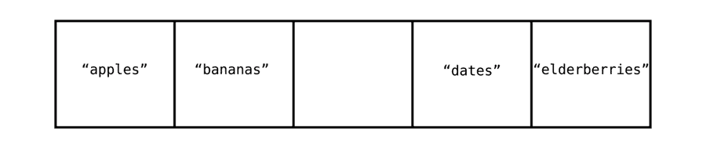

虽然从技术上讲，删除"黄瓜"实际上只花了一步，但现在我们遇到了一个问题：数组中间出现了一个空单元格。数组中间有间隙时效率不高，因此要解决这个问题，我们需要将"枣子"和"接骨木莓"向左移动。这意味着我们的删除过程需要额外的步骤。

步骤 2：我们将"枣子"...

## 集合：一条规则如何影响效率

让我们来探讨另一种数据结构：集合。集合是一种不允许包含重复值的数据结构。

集合有多种类型，但在此讨论中，我将介绍基于数组的集合。这种集合就像数组一样——它是一个简单的值列表。这种集合与经典数组的唯一区别在于，集合绝不允许插入重复值。

例如，如果你有一个集合['a', 'b', 'c']，并试图添加另一个'b'，计算机不会允许，因为集合中已经存在一个'b'。

当你需要确保没有重复数据时，集合非常有用。

例如，如果你正在创建一个在线电话簿，...

## 总结

分析操作所需的步骤数是理解数据结构性能的核心。为程序选择正确的数据结构，可能意味着能够承受重负还是在其下崩溃。在本章中，你学会了使用这种分析来权衡对于给定应用，数组或集合哪个可能是合适的选择。

既然你已经开始学习如何思考数据结构的时间复杂度，我们可以使用同样的分析来比较相互竞争的算法（即使是在同一数据结构内），以确保代码的最终速度和性能。这正是下一章的内容。

## 练习

以下练习为你提供了练习数组的机会。这些练习的解答可在​*第 1 章*​一节中找到。

1.  对于一个包含 100 个元素的数组，请给出以下操作所需的步骤数：

    1.  读取

    2.  搜索一个不在数组中的值

    3.  在数组开头插入

    4.  在数组末尾插入

    5.  在数组开头删除

    6.  在数组末尾删除

2.  对于一个包含 100 个元素的基于数组的集合，请给出以下操作所需的步骤数：

    1.  读取

    2.  搜索一个不在集合中的值

    3.  在集合开头插入一个新值

    4.  在集合末尾插入一个新值

    5.  在集合开头删除

    6.  在集合末尾删除

3.  通常，数组中的搜索操作会查找给定值的第一个实例。但有时我们可能想要查找给定值的所有实例。例如，假设我们要统计数组中出现"苹果"的次数。找出所有"苹果"需要多少步？请用 N 表示你的答案。

版权所有 © 2024, The Pragmatic Bookshelf.

# 第 2 章 为什么算法很重要

在上一章中，我们初步了解了数据结构，并看到选择正确的数据结构如何影响代码的性能。即使是看起来非常相似的两种数据结构，比如数组和集合，也可能具有截然不同的效率水平。

在本章中，我们将发现，即使我们决定了特定的数据结构，还有另一个主要因素会影响代码的效率：正确选择使用哪种算法。

虽然"算法"这个词听起来很复杂，但实际上并非如此。算法只是一组用于完成特定任务的指令。

即使是像准备一碗麦片这样简单的过程，从技术上讲也是一种算法，...

## 有序数组

有序数组与我们在上一章中看到的经典数组几乎相同。唯一的区别是，有序数组要求值始终保持——你猜对了——有序；也就是说，每次添加一个值时，它都会被放置在正确的单元格中，以便数组中的值保持排序。

例如，我们取数组[3, 17, 80, 202]：


假设我们想将值 75 插入到数组中。如果这是一个经典数组，我们可以将 75 插入到末尾，如下所示：

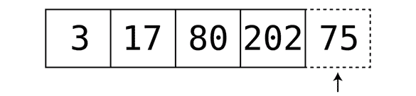

正如我们在上一章中看到的，...

## 搜索有序数组

在上一章中，我描述了在经典数组中搜索特定值的过程：我们逐个检查每个单元格——从左到右——直到找到我们要找的值。我指出这个过程被称为线性搜索。

让我们看看线性搜索在经典数组和有序数组之间有何不同。

假设我们有一个常规数组[17, 3, 75, 202, 80]。如果我们要搜索值 22——这个值恰好不在数组中——我们需要搜索每一个元素，因为 22 可能出现在数组中的任何位置。唯一能在到达数组末尾之前停止搜索的情况是，如果我们碰巧在到达...之前找到了我们要找的值。

## 二分查找

你小时候可能玩过这个猜数字游戏：我想一个 1 到 100 之间的数字。你继续猜我想的是哪个数字，我会告诉你需要猜大一点还是小一点。

你可能凭直觉就知道怎么玩这个游戏。你不会从猜 1 开始。相反，你可能会从 50 开始，正好在中间。为什么？因为选择 50，无论我告诉你猜大还是猜小，你都自动排除了半数可能的数字！


如果你猜 50，我告诉你猜大一点，那么你会选 75，从而排除剩余数字的一半。如果你猜 75 后，我告诉你猜小一点，你会选 62 或 63。你会一直选择中间值，直到……

## 二分查找 vs. 线性查找

对于小规模的有序数组，二分查找算法相比线性查找并没有太大优势。但让我们看看在更大的数组中会发生什么。

对于一个包含 100 个值的数组，每种查找方式所需的最大步数如下：

* 线性查找：100 步
* 二分查找：7 步

使用线性查找时，如果我们要查找的值在最后一个单元格中，或者大于最后一个单元格中的值，我们必须检查每一个元素。对于一个大小为 100 的数组，这需要 100 步。

然而，当我们使用二分查找时，每次猜测都会排除一半可能需要搜索的单元格。在第一次猜测中，我们就能排除多达 50 个单元格。……

## 总结

通常，实现特定计算目标的方法不止一种，而你选择的算法会严重影响代码的速度。

同样重要的是要认识到，通常不存在一种适用于所有情况的完美数据结构或算法。例如，仅仅因为有序数组支持二分查找，并不意味着你应该总是使用有序数组。在你不预期需要频繁搜索数据，而是更频繁地添加数据的情况下，标准数组可能是更好的选择，因为它们的插入速度更快。

正如我们所看到的，分析竞争算法的方法是计算每种算法所需的步数。在下一章中，我们将研究一种形式化的方法，用于表达竞争数据结构和算法的时间复杂度。拥有这种通用语言将为我们提供更清晰的信息，使我们能够就选择哪种算法做出更好的决策。

## 练习题

以下练习为你提供了练习二分查找的机会。这些练习的解答可在*第 2 章*中找到。

1. 在有序数组 [2, 4, 6, 8, 10, 12, 13] 中，对数字 8 执行线性查找需要多少步？
2. 对上一个例子执行二分查找需要多少步？
3. 对一个大小为 100,000 的数组执行二分查找，最多需要多少步？

版权所有 © 2024, The Pragmatic Bookshelf.

# 第 3 章 没错！大 O 记法

在前面的章节中，我们已经看到，决定算法效率的主要因素是它所需的步数。

然而，我们不能简单地将一个算法标记为“22 步算法”，另一个标记为“400 步算法”。这是因为算法所需的步数无法固定为一个单一的数字。以线性查找为例。线性查找所需的步数是变化的，它需要的步数与数组中的元素数量相同。如果数组包含 22 个元素，线性查找需要 22 步。但如果数组包含 400 个元素，线性查找则需要 400 步。

因此，量化线性查找效率的更有效方式是：线性查找……

## 大 O：相对于 N 个元素的步数是多少？

大 O 通过关注算法所需的步数来实现一致性，但采用了一种特定的方式。让我们首先将大 O 应用于线性查找算法。

在最坏的情况下，线性查找所需的步数与数组中的元素数量相同。正如我们之前所说的：对于包含 N 个元素的数组，线性查找最多需要 N 步。用大 O 记法表示的正确方式是：

`O(N)`

有些人将其读作“大 O of N”。另一些人称之为“N 阶”。不过，我个人偏好读作“Oh of N”。

这个记法表达的是对所谓关键问题的回答。关键问题是：如果有 N 个数据元素，算法需要多少步？……

## 大 O 的精髓

既然我们已经遇到了`O(N)`和`O(1)`，我们开始看到大 O 记法不仅仅描述算法所需的步数（比如一个具体的数字 22 或 400）。相反，它是对你脑海中那个关键问题的回答：如果有 N 个数据元素，算法需要多少步？

虽然那个关键问题确实是大 O 的严格定义，但大 O 实际上还有更深层的含义。

假设我们有一个算法，无论数据量有多大，它总是需要三步。也就是说，对于 N 个元素，该算法总是需要三步。你会如何用大 O 表示它？

根据你到目前为止学到的知识，你可能会说它是`O(3)`。……

## 第三种算法

在上一章中，你了解到有序数组上的二分查找比同一数组上的线性查找快得多。现在让我们看看如何用大 O 记法描述二分查找。

我们不能将二分查找描述为`O(1)`，因为步数会随着数据的增加而增加。它也不属于`O(N)`的范畴，因为步数远少于 N 个数据元素。正如我们所见，对于一个包含 100 个元素的数组，二分查找只需要 7 步。

因此，二分查找似乎介于`O(1)`和`O(N)`之间。那么它到底是什么呢？

用大 O 术语来说，我们将二分查找的时间复杂度描述为

`O(log N)`。

我将其读作“Oh of log N”。……

## 对数

让我们探讨一下为什么像二分查找这样的算法被描述为`O(log N)`。对数到底是什么？

Log 是 logarithm（对数）的缩写。首先要注意的是，logarithm 这个词与 algorithm（算法）毫无关系，尽管这两个词看起来和听起来非常相似。

对数是指数的逆运算。这里快速回顾一下指数是什么：

2³ 等价于

2 * 2 * 2。

结果正好是 8。

现在，log[2] 8 是它的逆运算。它的意思是：你需要将 2 自乘多少次才能得到 8？

因为你需要将 2 自乘三次才能得到 8，所以 log[2] 8 = 3。

另一个例子：

2⁶ 转换为

2 * 2 * 2 * 2 * 2 * 2 = 64。

因为我们需要将 2 自乘六次才能得到 64，所以我们有……

## O(log N) 解释

让我们把这一切带回到大 O 记法。在本书中，每当我们说`O(log N)`时，请想象我们在说`O(log[2] N)`。在*忽略常数*中，我们将讨论为什么我们在记法中省略了底数 2。但现在，当你看到`O(log N)`时，请在脑海中将其视为`O(log[2] N)`。

有了这个认识，我们现在可以精确解释`O(log N)`的含义。

回想一下，大 O 记法回答了关键问题：如果有 N 个数据元素，算法需要多少步？

`O(log N)`意味着对于 N 个数据元素，算法需要 log[2] N 步。如果有 8 个元素，算法需要三步，因为 log[2] 8 = 3。

换句话说，如果我们不断将 8 个元素对半分割，需要三步才能……

## 实际示例

以下是一些典型的 JavaScript 代码，用于打印列表中的所有项目：

```javascript
let things = ['apples', 'baboons', 'cribs', 'dulcimers'];

for (const thing of things) {
    console.log(`Here's a thing: ${thing}`);
}
```

我们如何用大 O 记法描述这个算法的效率？

首先要认识到这是一个算法的例子。虽然它可能不花哨，但任何执行某些操作的代码在技术上都是算法——它是解决特定问题的特定过程。在这个例子中，问题是我们想要打印列表中的所有项目。我们用来解决这个问题的算法是一个包含`console.log`语句的 for 循环。


为了分解这个问题，我们需要分析有多少……

## 总结

借助大 O 表示法，我们拥有了一套统一的系统，能够比较任意两种算法。利用它，我们可以审视现实场景，在相互竞争的数据结构和算法中做出选择，从而让代码运行更快，并能处理更重的负载。

在下一章中，我们将遇到一个实际案例，使用大 O 表示法显著提升代码速度。

## 练习题

以下练习让你有机会实践大 O 表示法。这些练习的答案可在第 3 章中找到。

1.  使用大 O 表示法描述以下函数的时间复杂度，该函数用于判断给定年份是否为闰年：

    ```
    function isLeapYear(year) {
      if (year % 100 === 0) {
        if (year % 400 === 0) {
          return true;
        } else {
          return false;
        }
      }
      return year % 4 === 0;
    }
    ```

2.  使用大 O 表示法描述以下函数的时间复杂度，该函数用于对给定数组中的所有数字求和：

    ```
    function arraySum(array) {
      let sum = 0;
      for (const number of array) {
        sum += number;
      };
      return sum;
    }
    ```

3.  以下函数……

# 第 4 章 用大 O 表示法加速你的代码

大 O 表示法是表达算法效率的绝佳工具。我们已经能够用它来量化二分查找与线性查找之间的差异，因为二分查找是 `O(log N)`——一种比线性查找（`O(N)`）快得多的算法。

借助大 O，你还可以将自己的算法与世界上通用的算法进行比较，并自问：“就一般算法而言，这是一个快速还是慢速的算法？”

如果你发现大 O 将你的算法标记为慢速算法，那么你可以退一步，尝试找出是否有办法优化它，争取让它落入大 O 中更快的类别。这并不总是可行的……

## 冒泡排序

不过，在进入实际问题之前，我们首先需要了解大 O 世界中一种新的算法效率类别。为了演示它，我们将使用计算机科学史上经典的算法之一。

排序算法一直是计算机科学中广泛研究的课题，多年来已经开发了数十种这样的算法。它们都解决以下问题：

给定一个未排序的数组，我们如何对其进行排序，使其最终按升序排列？

在本章及后续章节中，我们将遇到许多这样的排序算法。你首先会学到的一些算法被称为简单排序，因为它们易于理解，但效率并不高……

## 冒泡排序实战

让我们完整地走一遍冒泡排序的示例。

假设我们要对数组 `[4, 2, 7, 1, 3]` 进行排序。它目前是无序的，我们希望生成一个包含相同值但按升序排列的数组。

让我们开始第一次遍历。这是我们的初始数组：


步骤 1：首先，比较 4 和 2：


步骤 2：它们顺序不对，所以我们交换它们：


步骤 3：接下来，比较 4 和 7：

它们顺序正确……

## 冒泡排序的效率

冒泡排序算法包含两种重要的步骤：

*   比较：两个数字相互比较，以确定哪个更大。
*   交换：两个数字相互交换，以进行排序。

我们先来确定冒泡排序中发生了多少次比较。

我们的示例数组有五个元素。回顾一下，在第一次遍历中，我们必须在两两数字之间进行四次比较。

在第二次遍历中，我们只需要进行三次比较。这是因为我们不必比较最后两个数字，因为通过第一次遍历，我们知道最后一个数字已经处于正确位置。

在第三次遍历中，我们进行了两次比较，……

## 一个二次方问题

这里有一个实际例子，我们可以用快速的 `O(N)` 算法替换慢速的 `O(N²)` 算法。

假设你正在开发一个 JavaScript 应用程序，用于分析用户对产品的评分，用户评分范围为 0 到 10。具体来说，你正在编写一个函数，检查评分数组中是否包含任何重复数字。这将用于软件其他部分的更复杂计算中。

例如，数组 `[1, 5, 3, 9, 1, 4]` 包含两个数字 1，因此我们返回 `true` 表示数组中有重复数字。

首先想到的方法之一可能是使用嵌套循环，如下所示：

```
function hasDuplicateValue(array) {
  for (...
```

## 一个线性解决方案

下面是 `hasDuplicateValue` 函数的另一种实现，它不依赖嵌套循环。它有点巧妙，所以我们先看看它是如何工作的，然后再判断它是否比第一种实现更高效。

```
function hasDuplicateValue(array) {
  const existingNumbers = [];
  for (let i = 0; i < array.length; i += 1) {
    if (existingNumbers[array[i]] === 1) {
      return true;
    } else {
      existingNumbers[array[i]] = 1;
    }
  }
  return false;
}
```

这个函数的作用如下：它创建一个名为 `existingNumbers` 的数组，初始为空。

然后我们使用循环检查输入数组中的每个数字。当遇到每个数字时，它会在 `existingNumbers` 中等于该数字的索引处放置一个任意值（我们选择使用 1）。

例如，假设输入数组是 `[3, 5, 8]`。当我们遇到 3 时，我们在 `existingNumbers` 的索引 3 处放置一个 1。因此 `existingNumbers` 数组现在大致相当于：

```
[0, 0, 0, 1, 0, 0, 0, 0, 0, 0, 0]
```

现在 `existingNumbers` 的索引 3 处有一个 1，用于指示并记住我们已经在给定数组中遇到了一个 3。

当循环随后遇到给定数组中的 5 时，它会在 `existingNumbers` 的索引 5 处添加一个 1：

```
[0, 0, 0, 1, 0, 1, 0, 0, 0, 0, 0]
```

最后，当我们遇到 8 时，`existingNumbers` 现在看起来像这样：

```
[0, 0, 0, 1, 0, 1, 0, 0, 1, 0, 0]
```

本质上，我们使用 `existingNumbers` 的索引来记住到目前为止我们已经看到了数组中的哪些数字。

现在，真正的技巧来了。在代码将 1 存储到相应索引之前，它首先检查该索引是否已经有一个 1 作为其值。如果是，则意味着我们已经遇到过该数字，即找到了重复项。如果是这种情况，我们直接返回 `true` 并提前结束函数。如果循环结束都没有返回 `true`，则说明没有重复项，我们返回 `false`。

为了用大 O 表示法确定这个新算法的效率，我们再次需要确定算法在最坏情况下所执行的步骤数。


这里，关键步骤是查看每个数字，并检查其在 `existingNumbers` 中的索引值是否为 1：

```
if (existingNumbers[array[i]] === 1) {
```

（除了比较之外，我们还会向 `existingNumbers` 数组中插入元素，但在本次分析中我们认为这类步骤是微不足道的。更多内容将在下一章讨论。）

就最坏情况而言，当数组中没有重复元素时会出现这种情况，此时我们的函数必须完成整个循环。

这个新算法似乎对 N 个数据元素进行了 N 次比较。这是因为只有一个循环，它只是根据数组中的数字数量进行迭代。我们可以通过跟踪 JavaScript 控制台中的步骤来验证这一理论：

```
function hasDuplicateValue(array) {
let steps = 0;
const existingNumbers = [];

for (let i = 0; i < array.length; i += 1) {
steps += 1;
if (existingNumbers[array[i]] === 1) {
return true;
} else {
existingNumbers[array[i]] = 1;
}
}

console.log(steps);
return false;
}
```

如果我们现在运行 `hasDuplicateValue([1, 4, 5, 2, 9])`，我们会看到 JavaScript 控制台中的输出是 5，这与我们数组的大小相同。我们会发现对于所有大小的数组都是如此。因此，这个算法是 O(N)。

我们知道 O(N) 比 O(N²) 快得多，因此通过使用第二种方法，我们显著优化了 `hasDuplicateValue` 函数。这是一个巨大的速度提升。

（这种新实现的一个缺点是，这种方法会比第一种方法消耗更多内存。现在不必担心；我们将在第 19 章 *处理空间限制* 中详细讨论。）

## 总结

显然，扎实理解大 O 表示法能够帮助你识别慢速代码，并在两个竞争算法中选择更快的那个。

然而，在某些情况下，大 O 表示法会让我们认为两个算法速度相同，而实际上其中一个更快。在下一章中，你将学习如何评估各种算法的效率，即使大 O 表示法不够精细到足以区分。

## 练习

以下练习为你提供了加速代码的实践机会。这些练习的解答可在 *第 4 章* 部分找到。

1.  替换下表中的问号，以描述对于给定数量的数据元素，在不同类型的大 O 下会发生多少步：

    | N 个元素 | O(N) | O(log N) | O(N²) |
    | --- | --- | --- | --- |
    | 100 | 100 | ? | ? |
    | 2,000 | ? | ? | ? |

2.  如果我们有一个处理数组的 O(N²) 算法，并且发现它需要 256 步，那么数组的大小是多少？

3.  使用大 O 表示法描述以下函数的时间复杂度。它找出给定数组中任意两个数对的最大乘积：

    ```
    function greatestProduct(array) {
    if (array.length < 2) { return null; }

    let greatestProductSoFar ...
    ```

# 第 5 章

使用和不使用大 O 优化代码

我们已经看到，大 O 表示法是比较算法并确定在给定情况下应使用哪种算法的绝佳工具。然而，它当然不是唯一的工具。事实上，有时两个竞争算法用大 O 描述的方式相同，但其中一个算法比另一个更快。

在本章中，你将学习如何区分两个看似效率相同的算法，以及如何选择其中更快的那个。

## 选择排序

在上一章中，我们探讨了一种称为冒泡排序的排序算法，其效率为 O(N²)。现在我们将深入研究另一种称为选择排序的排序算法，并看看它与冒泡排序相比如何。

选择排序的步骤如下：

1.  我们从左到右检查数组的每个单元格，以确定哪个值最小。当我们从一个单元格移动到另一个单元格时，我们记录到目前为止遇到的最小值。（我们将通过将其索引存储在一个变量中来实现这一点。）如果遇到一个单元格包含的值比我们变量中的值还要小，我们就替换它，使变量现在指向新的索引。请参见下图：

2.  一旦我们确定了哪个索引包含...

## 选择排序实战

让我们使用示例数组 [4, 2, 7, 1, 3] 来逐步演示选择排序的步骤。

我们开始第一次遍历：

我们通过检查索引 0 处的值来开始设置。根据定义，它是我们到目前为止在数组中遇到的最小值（因为它是我们到目前为止遇到的唯一值），所以我们将其索引记录在一个变量中：

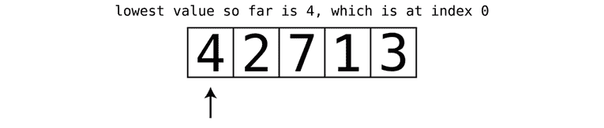

步骤 1：我们将 2 与到目前为止的最小值（恰好是 4）进行比较：


2 比 4 更小，因此它成为到目前为止的最小值：


步骤 2：我们将下一个值——7——与到目前为止的最小值进行比较。7 大于 2，因此 2 仍然是我们的最小值：


步骤 3：我们将 1 与到目前为止的最小值进行比较：


因为 1 比 2 更小，所以 1 成为我们新的最小值：


步骤 4：我们将 3 与到目前为止的最小值（即 1）进行比较。我们已经到达数组的末尾，并确定 1 是整个数组中的最小值：


步骤 5：因为 1 是最小值，我们将其与索引 0 处的任何值交换——索引 0 是我们开始这次遍历的位置：


由于我们已经将最小值移到了数组的开头，这意味着最小值现在处于正确的位置：


我们现在准备开始第二次遍历。

设置：第一个单元格——索引 0——已经排序完毕，因此这次遍历从下一个单元格开始，即索引 1。索引 1 处的值是数字 2，它是我们到目前为止在这次遍历中遇到的最小值：


步骤 6：我们将 7 与到目前为止的最小值进行比较。2 小于 7，因此 2 仍然是我们的最小值：


步骤 7：我们将 4 与当前最小值进行比较。2 小于 4，因此 2 仍然是最小值：


步骤 8：我们将 3 与当前最小值进行比较。2 小于 3，因此 2 仍然是最小值：


我们已经到达数组的末尾。由于本次遍历中的最小值已经在正确的位置，我们无需执行交换。至此，第二次遍历结束，得到如下结果：


现在开始第三次遍历。

初始化：我们从索引 2 开始，该位置包含值 7。7 是本次遍历中到目前为止遇到的最小值：


步骤 9：我们将 4 与 7 进行比较：


我们注意到 4 成为新的最小值：


步骤 10：我们遇到 3，它比 4 更小：


3 成为新的最小值：


步骤 11：我们已经到达数组末尾，因此将 3 与本次遍历起始位置的值（即 7）进行交换：


现在我们知道 3 已经位于数组中的正确位置：


虽然你我都看到整个数组此时已经正确排序，但计算机还不知道，因此它必须开始第四次遍历。

初始化：我们从索引 3 开始遍历。4 是当前最小值：


步骤 12：我们将 7 与 4 进行比较：


4 仍然是本次遍历中遇到的最小值，因此我们无需交换它，因为它已经在正确的位置。

由于除最后一个单元格外所有单元格都已正确排序，这意味着最后一个单元格也处于正确顺序，整个数组已正确排序：


### 代码实现：选择排序

以下是选择排序的 JavaScript 实现：

```javascript
function selectionSort(array) {
  for (let i = 0; i < array.length - 1; i += 1) {
    let lowestNumberIndex = i;

    for (let j = i + 1; j < array.length; j += 1) {
      if (array[j] < array[lowestNumberIndex]) {
        lowestNumberIndex = j;
      }
    }

    if (lowestNumberIndex !== i) {
      [array[i], array[lowestNumberIndex]] =
        [array[lowestNumberIndex], array[i]];
    }
  }

  return array;
}
```

让我们逐行分析。

我们开始一个循环，代表每次遍历。它使用变量 `i` 指向数组的每个索引，并一直进行到倒数第二个值：

```javascript
for (let i = 0; i < array.length - 1; i += 1) {
```

它不需要对最后一个值本身运行，因为到那时数组已经全部排序完毕。

接下来，开始跟踪当前遇到的最小值所在的索引：

```javascript
let lowestNumberIndex = i;
```

这个 `lowestNumberIndex` 在第一次遍历开始时为 0，第二次遍历开始时为 1，依此类推。

我们专门跟踪索引的原因是，在后续代码中我们需要同时访问最小值及其索引，而我们可以通过索引来引用两者。（我们可以通过 `array[lowestNumberIndex]` 来检查最小值。）

在每次遍历中，我们检查数组的剩余值，看是否存在比当前最小值更小的值：

```javascript
for (let j = i + 1; j < array.length; j += 1) {
```

确实，如果找到更小的值，我们将这个新值的索引存储在 `lowestNumberIndex` 中：

```javascript
if (array[j] < array[lowestNumberIndex]) {
  lowestNumberIndex = j;
}
```

内层循环结束时，我们就找到了本次遍历中最小数字的索引。

如果本次遍历中的最小值已经在正确的位置（即最小值是本次遍历中遇到的第一个值），则无需执行任何操作。但如果最小值不在正确位置，我们需要执行交换。具体来说，我们将最小值与位于 `i` 的值交换，`i` 是我们开始遍历时的索引：

```javascript
if (lowestNumberIndex !== i) {
  [array[i], array[lowestNumberIndex]] = [array[lowestNumberIndex], array[i]];
}
```

最后，返回排序后的数组：

```javascript
return array;
```

## 选择排序的效率

选择排序包含两种类型的步骤：比较和交换。在每次遍历中，我们将每个值与遇到的最小值进行比较，并将最小值交换到正确的位置。

回顾我们包含五个元素的示例数组，我们总共进行了 10 次比较。下表详细列出了比较次数：

| 遍历次数 | 比较次数 |
| --- | --- |
| 1 | 4 次比较 |
| 2 | 3 次比较 |
| 3 | 2 次比较 |
| 4 | 1 次比较 |

总计为 4 + 3 + 2 + 1 = 10 次比较。

为了用适用于所有大小数组的方式表述，我们可以说：对于 N 个元素，我们进行 (N - 1) + (N - 2) + (N - 3) … + 1 次比较。

至于交换，每次遍历最多只需要进行一次交换……

## 忽略常数

但有趣的是：在大 O 表示法的世界中，选择排序和冒泡排序的描述方式完全相同。

再次强调，大 O 表示法回答了一个关键问题：如果有 N 个数据元素，算法需要多少步？由于选择排序大约需要 N² 的一半步数，因此将选择排序的效率描述为 O(N² / 2) 似乎是合理的。也就是说，对于 N 个数据元素，需要 N² / 2 步。下表证实了这一点：

| N 个元素 | N² / 2 | 选择排序的最大步数 |
| --- | --- | --- |
| 5 | 5² / 2 = 12.5 | 14 |
| 10 | 10² / 2 = 50 | 54 |
| 20 | 20² / 2 = 200 | 209 |
| 40 | 40² / 2 = 800 | 819 |
| 80 | 80² / 2 = 3200 | 3239 |

然而实际上，选择排序在大 O 表示法中被描述为 O(N²)，与冒泡排序相同。这是因为……

## 大 O 类别

这引出了大 O 表示法中的下一个概念：大 O 表示法只关心算法速度的一般类别。


打个比方，我们来谈谈实体建筑。当然，建筑有很多不同的类型。有单层独栋住宅、双层独栋住宅、三层独栋住宅。有楼层数各异的高层公寓楼。还有高度和形状各异的摩天大楼。

如果我们要比较两栋建筑，一栋是独栋住宅，另一栋是摩天大楼，那么提及它们各自有多少层几乎毫无意义。因为这两栋建筑在规模和功能上差异巨大，我们无需说：“这是一栋两层住宅，而另一栋是一百层的摩天大楼。”我们大可以称一栋为房子，另一栋为摩天大楼。用它们的通用类别来称呼，就足以表明它们的天壤之别。

算法效率也是如此。比如，比较一个 O(N) 算法和一个 O(N²) 算法，两者的效率差异如此之大，以至于 O(N) 算法究竟是 O(2N)、O(N / 2) 还是 O(100N) 都无关紧要。

现在，我们来解释为什么 O(N) 和 O(N²) 被视为两个不同的类别，而 O(N) 和 O(100N) 却属于同一类别。

回想一下 *大 O 的灵魂*。大 O 记法不仅关心算法所需的步骤数，更关心随着数据量增加，算法步骤的长期趋势。O(N) 描述的是线性增长——步骤数按照数据的某个比例呈直线增加。即使步骤数是 100N，也是如此。而 O(N²) 描述的是另一种故事——指数增长。

指数增长与任何形式的 O(N) 相比，完全是不同的类别。这一点在考虑 O(N²) 在数据增长的某个时刻会比乘以任何因子的 O(N) 都慢时，会变得尤为清晰。

在下图中，你可以看到 O(N²) 如何变得比各种 N 的因子更慢：

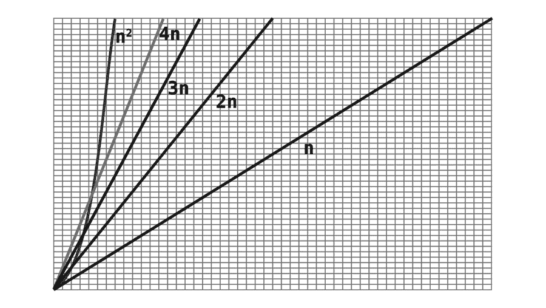

因此，当比较属于不同大 O 类别的两种效率时，只需用它们的通用类别来标识即可。将 O(2N) 与 O(N²) 比较，就像将两层住宅与摩天大楼比较一样。我们大可以说 O(2N) 属于 O(N) 这个通用类别。

我们遇到的所有大 O 类型，无论是 O(1)、O(log N)、O(N)、O(N²)，还是本书后面会遇到的其他类型，都是彼此差异巨大的通用大 O 类别。将步骤数乘以或除以一个常规数字，并不会使它们变成另一个类别。

然而，当两个算法属于同一大 O 分类时，并不一定意味着它们速度相同。毕竟，冒泡排序比选择排序慢一倍，尽管两者都是 O(N²)。因此，虽然大 O 非常适合对比属于不同大 O 分类的算法，但当两个算法属于同一分类时，需要进一步分析才能确定哪个算法更快。

### 一个实际示例

让我们回到第 1 章的第一个代码示例，稍作修改：

```
function printNumbersVersionOne(upperLimit) {
  let number = 2;

  while (number <= upperLimit) {
    if (number % 2 === 0) {
      console.log(number);
    }

    number += 1;
  }
}

function printNumbersVersionTwo(upperLimit) {
  let number = 2;

  while (number <= upperLimit) {
    console.log(number);

    number += 2;
  }
}
```

这里有两个算法用于完成同一任务，即打印从 2 到某个 `upperLimit` 的所有偶数。（在第 1 章中，上限固定为 100，而这里我们让用户传入一个数字作为 `upperLimit`。）

我在第 1 章中提到，第一个版本所需的步骤数是第二个版本的两倍，但现在我们来看看这在大 O 中如何体现。

再次强调，大 O 表达的是关键问题的答案：如果有 N 个数据元素，算法需要多少步？不过在这里，N 不是数组的大小，而是我们传入函数作为 `upperLimit` 的数字。

第一个版本大约需要 N 步。也就是说，如果 `upperLimit` 是 100，函数大约需要 100 步。（实际上需要 99 步，因为从 2 开始计数。）所以我们可以稳妥地说第一个算法的时间复杂度是 O(N)。

第二个版本需要 N / 2 步。当 `upperLimit` 为 100 时，函数只需 50 步。虽然很容易将其称为 O(N / 2)，但你现在已经知道，我们会忽略常数，将表达式简化为 O(N)。

现在，第二个版本比第一个快一倍，自然是更好的选择。这是另一个很好的例子，说明两个算法可以用相同的大 O 记法表示，但需要进一步分析才能确定哪个更快。

### 重要步骤

让我们对前面的例子再深入一层分析。再次审视第一个版本 `printNumbersVersionOne`，我们说它需要 N 步。这是因为循环运行了 N 次，其中 N 是 `upperLimit`。

但函数真的只需要 N 步吗？

如果我们真正分解开来，可以看到循环的每一轮中发生了多个步骤。

首先，我们有比较步骤（`if number % 2 == 0`），检查数字是否能被 2 整除。这个比较在循环的每一轮都会发生。

其次，我们有打印步骤（`console.log(number)`），仅对偶数执行。因此，它每隔一轮循环发生一次。

第三，我们有 `number += 1`，它在循环的每一轮都会执行。

在前面的章节中，我提到过你会学习如何确定哪些步骤在表达算法的大 O 时是重要的、需要计数的。那么在我们的例子中，这些步骤中哪些是重要的？我们关心比较、打印还是数字递增？

答案是所有步骤都是重要的。只不过当我们用大 O 术语表达步骤时，我们会忽略常数，从而简化表达式。

让我们在这里应用这一点。如果统计所有步骤，我们有 N 次比较、N 次递增和 N / 2 次打印。加起来是 2.5N 步。然而，由于我们消除了常数 2.5，我们将其表示为 O(N)。那么哪个步骤是重要的？它们都重要，但通过忽略常数，我们实际上更关注循环运行的次数，而不是循环内部发生的具体细节。

## 总结

我们现在拥有了一些强大的分析工具。我们可以使用大 O 来大致确定算法的效率，也可以比较属于同一大 O 分类的两个算法。

然而，在比较两个算法的效率时，还必须考虑另一个重要因素。到目前为止，我们一直关注算法在最坏情况下的速度。但最坏情况，顾名思义，并非总是发生。平均而言，大多数情况是……嗯……平均情况。在下一章中，你将学习如何考虑所有情况。

## 练习题

以下练习为你提供了分析算法的实践机会。这些练习的解答见 *第 5 章*。

1. 使用大 O 记法描述一个需要 4N + 16 步的算法的时间复杂度。


2. 使用大 O 表示法描述一个算法的时间复杂度，该算法需要 2N² 步。

3. 使用大 O 表示法描述以下函数的时间复杂度，该函数返回数组中所有数字翻倍后的总和：

```
function doubleThenSum(array) {
  const doubledArray = [];
  for (const number of array) {
    doubledArray.push(number * 2);
  }
  let sum = 0;
  for (const number of doubledArray) {
    sum += number;
  }
  return ...
}
```

# 第 6 章

为乐观场景优化

到目前为止，我们主要关注算法在最坏情况下需要多少步。这背后的逻辑很简单：如果你为最坏情况做好了准备，结果就不会太差。

然而，在本章中你会发现，最坏情况并不是唯一值得考虑的情况。能够考虑所有场景是一项重要技能，可以帮助你在每种情况下选择合适的算法。

## 插入排序

我们之前遇到过两种不同的排序算法：冒泡排序和选择排序。两者的效率都是 O(N²)，但选择排序实际上快了一倍。现在你将学习第三种排序算法——插入排序，它将揭示分析最坏情况之外场景的力量。

插入排序包含以下步骤：

1.  在第一次遍历中，我们临时移除索引 1（第二个单元格）处的值，并将其存储在一个临时变量中。这会在该索引处留下一个空隙，因为它没有值：

    

    在后续遍历中，我们移除后续索引处的值。

## 插入排序实战

让我们对数组 [4, 2, 7, 1, 3] 应用插入排序。

我们通过检查索引 1 处的值开始第一次遍历。该值恰好是 2：


第 1 步：我们临时移除 2 并将其保存在一个名为 `tempValue` 的变量中。我们通过将其移到数组其余部分的上方来表示这个值：


第 2 步：我们将 4 与 `tempValue`（即 2）进行比较：


第 3 步：因为 4 大于 2，我们将 4 向右移动……

## 插入排序的效率

插入排序中发生四种类型的步骤：移除、比较、移动和插入。为了分析插入排序的效率，我们需要统计每一步的数量。

首先，我们来深入分析比较操作。每次我们将空隙左侧的值与 `tempValue` 进行比较时，就会发生一次比较。在最坏情况下（数组按逆序排序），每次遍历中我们必须将 `tempValue` 左侧的每个数字与 `tempValue` 进行比较。这是因为 `tempValue` 左侧的每个值总是大于 `tempValue`，所以只有当空隙到达数组左端时遍历才会结束。

在第一次遍历中，`tempValue` 是索引 1 处的值……

## 平均情况

确实，在最坏情况下，选择排序比插入排序快。然而，我们同样必须考虑平均情况。

为什么？

根据定义，最常发生的情况是平均场景。请看钟形曲线。

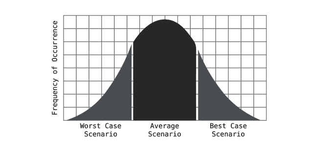

最好和最坏情况发生的频率相对较低。在现实世界中，平均场景才是大多数时候发生的情况。

以随机排序的数组为例。值恰好按完美升序或降序排列的概率有多大？更可能的情况是值杂乱无章。

那么，让我们来考察插入排序在……

## 实际示例

假设你正在编写一个 JavaScript 应用程序，在代码的某处你需要获取两个数组的交集。交集是两个数组中都出现的所有值的列表。例如，如果你有数组 [3, 1, 4, 2] 和 [4, 5, 3, 6]，那么交集将是第三个数组 [3, 4]，因为这两个值在两个数组中都存在。

以下是一种可能的实现：

```
function intersection(firstArray, secondArray) {
  const result = [];
  for (const i of firstArray) {
    for (const j of secondArray) {
      if (i === j) {
        result.push(i);
      }
    }
  }
  return result;
}
```

这里，我们运行了嵌套循环。在外层循环中，我们遍历每个值……

## 总结

能够区分最好、平均和最坏情况是一项关键技能，它有助于你根据需求选择最佳算法，也能让你对现有算法进行进一步优化，使其显著加快。请记住，虽然为最坏情况做好准备是好事，但平均情况才是大多数时候发生的。

现在我们已经涵盖了与大 O 表示法相关的重要概念，接下来让我们将知识应用到实际算法中。在下一章中，我们将研究真实代码库中可能出现的各种日常算法，并用大 O 表示法确定每个算法的时间复杂度。

## 练习题

以下练习为你提供了练习优化最好和最坏情况的机会。这些练习的答案见*第 6 章*部分。

1.  使用大 O 表示法描述一个需要 3N² + 2N + 1 步的算法的效率。

2.  使用大 O 表示法描述一个需要 N + log N 步的算法的效率。

3.  以下函数检查一个数字数组中是否存在两个数之和为 10 的一对数。

    ```
    function twoSum(array) {
      for (const [indexI, i] of array.entries()) {
        for (const [indexJ, j] of array.entries()) {
          if ((indexI !== indexJ) && (i + j === 10)) {
            return true;
          }
        }
      }
      return false;
    }
    ```

    最好、……

# 第 7 章 日常代码中的大 O

在前几章中，你学会了如何使用大 O 表示法来表达代码的时间复杂度。如你所见，大 O 分析涉及许多细节。在本章中，我们将利用你目前学到的所有知识来分析实际代码库中可能出现的实用代码示例的效率。

确定代码的效率是优化代码的第一步。毕竟，如果我们不知道代码有多快，又怎么知道修改后是否会更快呢？

此外，一旦我们知道了代码在大 O 表示法中的分类，我们就可以判断它是否首先需要优化。例如，一个 O(N²) 的算法是……

## 偶数的平均值


以下方法接受一个数字数组，并返回其中所有偶数的平均值。我们如何用大 O 表示法来描述它的效率？

```
function averageOfEvenNumbers(array) {
  let sum = 0;
  let countOfEvenNumbers = 0;

  for (const number of array) {
    if (number % 2 === 0) {
      sum += number;
      countOfEvenNumbers += 1;
    }
  };

  if (countOfEvenNumbers === 0) { return null; }

  return Math.floor(sum / countOfEvenNumbers);
}
```

下面我们来分解这段代码，以确定其效率。

请记住，大 O 表示法旨在回答一个关键问题：如果有 `N` 个数据元素，算法需要执行多少步？因此，我们首先要确定 `N` 个数据元素是什么。

在这个例子中，算法处理的是传入该方法的数字 `array`。因此，这些就是 `N` 个数据元素，其中 `N` 是 `array` 的大小。

接下来，我们必须确定算法处理这 `N` 个值需要多少步。

我们可以看到算法的核心是遍历 `array` 中每个数字的循环，因此我们首先要分析这个循环。由于循环遍历了所有 `N` 个元素，我们知道算法至少需要 `N` 步。

然而，观察循环内部，我们发现每一轮循环中执行的步骤数并不相同。对于每个数字，我们检查它是否为偶数。如果是偶数，我们再执行两步：修改 `sum` 变量和修改 `countOfEvenNumbers` 变量。因此，对于偶数，我们比奇数多执行两步。

正如你所了解的，大 O 表示法主要关注最坏情况。在我们的例子中，最坏情况是所有数字都是偶数，此时每一轮循环我们执行三步。因此，我们可以说对于 `N` 个数据元素，我们的算法需要 `3N` 步。也就是说，对于每个 `N` 个数字，算法执行三步。

现在，我们的方法在循环之外还执行了一些其他步骤。在循环之前，我们初始化了两个变量并将其设置为 `0`。严格来说，这是两步。循环之后，我们又执行了一步：`sum / countOfEvenNumbers` 的除法。严格来说，我们的算法除了 `3N` 步之外，还多了三步，因此总步数为 `3N + 3`。

然而，你也学到了大 O 表示法会忽略常数，所以我们不称算法为 `O(3N + 3)`，而直接称其为 `O(N)`。

## 单词构建器

下一个例子是一个算法，它收集由单个字符数组构建的所有两个字符字符串的组合。例如，给定数组 `["a", "b", "c", "d"]`，我们将返回一个包含以下字符串组合的新数组：

```
[
  'ab', 'ac', 'ad', 'ba', 'bc', 'bd',
  'ca', 'cb', 'cd', 'da', 'db', 'dc'
]
```

以下是该算法的一种实现。让我们看看能否找出它的大 O 效率：

```
function wordBuilder(array) {
  const collection = [];

  for (const [indexI, valueI] of array.entries()) {
    for (const [indexJ, valueJ] of array.entries()) {
      if (indexI !== indexJ) {
        collection.push(valueI + valueJ);
      }
    }
  }

  return collection;
}
```

这里我们运行了一个嵌套在另一个循环中的循环。外层循环遍历数组中的每个字符，并跟踪 `valueI` 的索引。对于每个 `indexI`，我们运行一个内层循环，该循环使用索引 `indexJ` 再次遍历同一个数组中的每个字符。在这个内层循环中，我们将 `indexI` 和 `indexJ` 处的字符连接起来，但 `indexI` 和 `indexJ` 指向同一索引的情况除外。

为了确定算法的效率，我们再次需要确定 `N` 个数据元素是什么。在本例中，与上一个例子一样，`N` 是传递给函数的 `array` 中的元素数量。

下一步是确定算法相对于 `N` 个数据元素执行的步骤数。在本例中，外层循环遍历所有 `N` 个元素，而对于每个元素，内层循环再次遍历所有 `N` 个元素，这相当于 `N` 步乘以 `N` 步。这是经典的 `O(N²)` 情况，通常嵌套循环算法就是如此。

现在，如果我们修改算法来计算三个字符字符串的所有组合，会发生什么？对于我们的示例数组 `["a", "b", "c", "d"]`，函数将返回以下数组：

```
[
  'abc', 'abd', 'acb',
  'acd', 'adb', 'adc',
  'bac', 'bad', 'bca',
  'bcd', 'bda', 'bdc',
  'cab', 'cad', 'cba',
  'cbd', 'cda', 'cdb',
  'dab', 'dac', 'dba',
  'dbc', 'dca', 'dcb'
]
```

下面是一个使用三个嵌套循环的实现。它的时间复杂度是多少？

```
function wordBuilder(array) {
  const collection = [];

  for (const [indexI, valueI] of array.entries()) {
    for (const [indexJ, valueJ] of array.entries()) {
      for (const [indexK, valueK] of array.entries()) {
        if (indexI !== indexJ && indexJ !== indexK && indexI !== indexK) {
          collection.push(valueI + valueJ + valueK);
        }
      }
    }
  }

  return collection;
}
```

在这个算法中，对于 `N` 个数据元素，我们有 `N` 步的“i”循环乘以 `N` 步的“j”循环再乘以 `N` 步的“k”循环。这是 `N * N * N`，即 `N³` 步，描述为 `O(N³)`。

如果我们有四个或五个嵌套循环，我们将分别得到 `O(N⁴)` 和 `O(N⁵)` 的算法。让我们看看这些在图表上如何显示，如所示。

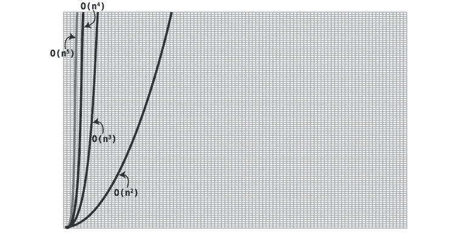

将任何代码从 `O(N³)` 的速度优化到 `O(N²)` 将是一个巨大的胜利，因为代码会呈指数级加速。然而，上面的算法仍然停留在 `O(N³)`。

## 数组采样

在下一个例子中，我们创建一个函数，从数组中取一个小样本。我们预期会有非常大的数组，因此我们的样本只是数组的第一个、中间和最后一个值。

以下是该函数的一种实现。看看你是否能识别出它的大 O 效率：

```
function sample(array) {
  if (array.length === 0) { return null; }

  const first = array[0];
  const middle = array[Math.floor(array.length / 2)];
  const last = array[array.length - 1];

  return [first, middle, last];
}
```

同样，传入这个函数的 `array` 是主要数据，因此我们可以说 `N` 是这个 `array` 中的元素数量。

然而，无论数组大小如何，我们的函数最终执行的步骤数都是相同的……

## 平均摄氏温度读数

这是另一个涉及平均值的例子。假设我们正在构建天气预报软件。为了确定一个城市的温度，我们从城市中许多温度计获取温度读数，并计算这些温度的平均值。

我们还希望以华氏度和摄氏度两种单位显示温度，但最初我们的读数只以华氏度提供。


要获取平均摄氏温度，我们的算法做了两件事：首先，将所有华氏温度读数转换为摄氏温度。然后，计算所有摄氏温度的平均值。

下面是一些实现此功能的代码。它的时间复杂度是多少？

```
function averageCelsius(fahrenheitReadings) {

```

## 服装标签

假设我们正在为一家服装制造商编写软件。我们的代码接收一个包含新生产服装项目（以字符串形式存储）的数组，并为每个可能需要的标签创建文本。

具体来说，我们的标签应包含项目名称及其尺寸，尺寸范围从 1 到 5。例如，如果我们有数组 `["Purple Shirt", "Green Shirt"]`，我们希望为这些衬衫生成如下标签文本：

```
[
"Purple Shirt Size: 1",
"Purple Shirt Size: 2",
"Purple Shirt Size: 3",
"Purple Shirt Size: 4",
"Purple Shirt Size: 5",
"Green Shirt Size: 1",
"Green Shirt Size: 2",
"Green Shirt Size: 3",
"Green Shirt Size: 4",
"Green Shirt Size: 5"
]
```

以下代码将为整个服装项目数组创建这些文本：...

## 数 1

另一个算法，其大 O 乍一看似乎不同。这个函数接收一个数组的数组，其中内部数组包含 1 和 0。该函数返回 1 的总数。

来看这个示例输入：

```
[
[0, 1, 1, 1, 0],
[0, 1, 0, 1, 0, 1],
[1, 0]
]
```

我们的函数将返回 7，因为有七个 1。

以下是函数：

```
function countOnes(outerArray) {
let count = 0;

for (const innerArray of outerArray) {
for (const number of innerArray) {
if (number === 1) {
count += 1;
}
}
}

return count;
}
```

这个算法的大 O 是什么？

同样，很容易注意到嵌套循环并直接得出 O(N²)的结论。然而，...

## 回文检查器

回文是指正向和反向读起来都相同的单词或短语。例如：racecar、kayak 和 deified。

以下是一个判断字符串是否为回文的函数：

```
function isPalindrome(string) {
let leftIndex = 0;
let rightIndex = string.length - 1;

// 迭代直到 leftIndex 到达数组中间：
while (leftIndex < Math.floor(string.length / 2)) {
// 如果左侧字符不等于右侧字符，则字符串不是回文：
if (string[leftIndex] !== string[rightIndex]) {
return false;
}

leftIndex += 1;
rightIndex -= 1;
}

// 如果整个循环都没有发现不匹配，...
```

## 获取所有乘积

下一个示例是一个算法，它接收一个数字数组，并返回每两个数字组合的乘积。

例如，如果我们传入数组 `[1, 2, 3, 4, 5]`，函数返回：

```
[2, 3, 4, 5, 6, 8, 10, 12, 15, 20]
```

这是因为我们首先将 1 乘以 2、3、4、5。然后将 2 乘以 3、4、5。接着将 3 乘以 4 和 5。最后将 4 乘以 5。

注意一个有趣的现象：当我们把 2 与其他数字相乘时，只需要乘以它右边的数字。我们不需要回头把 2 乘以 1，因为之前 1 乘以 2 时已经算过了。所以每个数字只需要...

## 密码破解

你是一名黑客（当然是道德黑客），试图破解某人的密码。你决定采用暴力破解方法，编写一些代码来生成给定长度的所有可能字符串。以下是你的代码：

```
function everyPassword(length) {
let string = 'a'.repeat(length);
console.log(string);

while (string !== 'z'.repeat(length)) {
let stringToBase36 = parseInt(string, 36);
stringToBase36 += 1;
string = (stringToBase36.toString(36)).replace(/0/g, 'a');
console.log(string);
}
}
```

这段代码中有一些复杂的魔法，幸运的是，我们目前不需要理解它。因为我们不会关注这段代码如何工作，而是关注...

## 总结

恭喜！你现在是大 O 专家了。你可以分析各种算法并对其时间复杂度进行分类。有了这些知识，你将能够有条不紊地优化代码以提高速度。

说到速度，在下一章中，我们将发现一种新的数据结构，它是加速算法最有用、最常用的工具之一。而且我说的是非常显著的速度提升。

## 练习

以下练习让你有机会在实际场景中练习算法。这些练习的解答见 *第 7 章* 部分。

1.  使用大 O 表示法描述以下函数的时间复杂度。如果数组是 100 和数组，则返回 true，否则返回 false。

    100 和数组满足以下条件：

    *   第一个和最后一个数字之和为 100。

    *   第二个和倒数第二个数字之和为 100。

    *   第三个和倒数第三个数字之和为 100，以此类推。

    以下是函数：

    ```
    function oneHundredSum(array) {
    if (array.length % 2 !== 0 || array.length === 0) {
    return false;
    }

    let leftIndex = 0;
    let rightIndex = array.length - ...
    ```

# 第 8 章

使用哈希表实现极速查找

想象你正在编写一个程序，允许顾客从餐厅订购快餐，并且你正在实现一个包含食品及其价格的菜单。从技术上讲，你可以使用数组：

```
menu = [
["french fries", 0.75],
["hamburger", 2.5],
["hot dog", 1.5],
["soda", 0.6]
]
```

这个数组包含多个子数组，每个子数组包含两个元素。第一个元素是表示菜单上食品的字符串，第二个元素表示该食品的价格。

正如你在第 2 章 *算法为何重要* 中学到的，如果这个数组是无序的，那么查找给定食品的价格需要 O(N)步，因为计算机必须执行线性搜索。如果是有序数组，计算机可以进行二分查找，需要 O(log N)步。

虽然 O(log N)不算差，但我们可以做得更好。事实上，我们可以好得多。在本章结束时，你将学会如何使用一种称为哈希表的特殊数据结构，它可以在 O(1)时间内查找数据。通过了解哈希表的工作原理以及正确使用它们的场景，你可以在许多情况下利用其惊人的查找速度。

## 哈希表

大多数编程语言都包含一种称为哈希表的数据结构，它有一个惊人的超能力：快速读取。注意，哈希表在不同编程语言中有不同的名称。在 JavaScript 中，它们被称为对象，其他语言则称其为哈希、映射、哈希映射、字典或关联数组。我们将它们称为哈希表，因为这是指代这种数据结构的通用方式。


以下是用哈希表实现的菜单示例：

```
const menu = { "french fries": 0.75, "hamburger": 2.5, "hot dog": 1.5, "soda": 0.6 };
```

哈希表是一个由成对值组成的列表。每对中的第一项称为键，第二项称为值。在哈希表中，键和值之间存在某种重要的关联。在这个例子中，字符串 `"french fries"` 是键，`0.75` 是值。它们配对在一起，表示薯条的价格是 75 美分。

在 JavaScript 中，你可以使用以下语法查找键对应的值：

```
menu["french fries"];
```

这将返回值 `0.75`。如果我们尝试查找哈希表中不存在的值，则会返回 `undefined`。

在哈希表中查找值的平均效率为 `O(1)`，因为通常只需要一步。让我们看看原因。

## 使用哈希函数进行哈希

你还记得小时候用来创建和解密消息的密码吗？例如，下面是一种将字母映射到数字的简单方法：

`A = 1 B = 2 C = 3 D = 4 E = 5`

以此类推。根据这个密码，

`ACE` 转换为 `135`，`CAB` 转换为 `312`，`DAB` 转换为 `412`，

而

`BAD` 转换为 `214`。

这种将字符转换为数字的过程称为哈希。而用于将这些字母转换为特定数字的代码称为哈希函数。

除了这个例子，还有许多其他哈希函数。另一个哈希函数的例子是：取每个字母对应的数字，然后返回所有数字的总和。如果这样做，`BAD` 将变成数字 `7`，经过两步……

## 为了乐趣和利润构建同义词词典，但主要是利润

在晚上和周末，你独自一人致力于一个将征服世界的隐形创业公司。它……是一个同义词词典应用。但这可不是普通的同义词词典——这是 Quickasaurus。你知道它将彻底颠覆价值数十亿美元的同义词词典市场。当用户在 Quickasaurus 中查找一个单词时，它只返回一个同义词，而不是像老式同义词词典那样返回所有可能的同义词。

由于每个单词都有一个关联的同义词，这非常适合使用哈希表。毕竟，哈希表是一个由成对项组成的列表。让我们开始吧。

我们可以用哈希表来表示我们的同义词词典：

```
thesaurus = {};
```

在底层，哈希表将其数据存储在一堆……

## 哈希表查找

当我们从哈希表中查找项时，我们使用键来找到其关联的值。让我们看看这在我们的 Quickasaurus 示例哈希表中是如何工作的。

假设我们想查找与键 `"bad"` 关联的值。在我们的代码中，我们会这样写：

```
thesaurus["bad"]
```

为了找到与 `"bad"` 关联的值，计算机执行两个简单的步骤：

1.  计算机对我们查找的键进行哈希：`BAD = 2 * 1 * 4 = 8`。

2.  由于结果是 `8`，计算机查看单元格 `8` 并返回存储在那里的值。在这种情况下，就是字符串 `"evil"`。

让我们退一步，看看全局。在哈希表中，每个值的位置由其键决定；也就是说，通过对键本身进行哈希，我们计算出索引号……

## 处理冲突

哈希表很棒，但并非没有复杂性。

继续我们的同义词词典示例：如果我们想将以下条目添加到同义词词典中，会发生什么？

```
thesaurus["dab"] = "pat";
```

首先，计算机将对键进行哈希：

`DAB = 4 * 1 * 2 = 8`

然后，它会尝试将 `"pat"` 添加到哈希表的单元格 `8` 中：

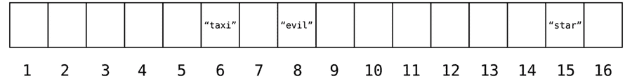

哎呀。单元格 `8` 已经被 `"evil"` 填满了——字面意思！

尝试将数据添加到已填充的单元格中称为冲突。幸运的是，有办法解决。

处理冲突的一种经典方法称为分离链接法。当发生冲突时，不是将单个值放入……

## 构建高效的哈希表

最终，哈希表的效率取决于三个因素：

*   我们在哈希表中存储了多少数据

*   哈希表中有多少个可用单元格

*   我们使用哪个哈希函数

前两个因素的重要性不言而喻。如果你有大量数据但只有少量单元格，就会发生许多冲突，哈希表将失去效率。然而，让我们探讨一下为什么哈希函数本身对效率很重要。

假设我们使用一个哈希函数，它总是产生一个介于 `1` 到 `9` 之间的值。一个例子是：将字母转换为对应的数字，然后不断将结果数字相加，直到得到一个单个数字……

## 哈希表用于组织数据

由于哈希表以成对形式存储数据，它们在许多场景中对于组织数据非常有用。

有些数据天然以成对形式存在。本章中的快餐菜单和同义词词典场景就是经典例子。菜单包含每个食品项及其价格。同义词词典包含每个单词及其同义词。事实上，这就是为什么 JavaScript 将哈希表称为字典。字典是一种常见的成对数据形式；它是一个单词列表及其各自的定义。

其他天然成对数据的例子包括计数，例如政治候选人及其获得的票数：

```
{ "候选人 A": 1402021, "候选人 B": 2321443, "候选人 C": 432 }
```

库存……

## 哈希表用于加速

虽然哈希表非常适合成对数据，但它们也可以用来使代码更快——即使你的数据不是成对存在的。这就是令人兴奋的地方。

这是一个简单的数组：

```
const array = [61, 30, 91, 11, 54, 38, 72];
```

如果你想在这个数组中搜索一个数字，需要多少步？

由于数组是无序的，你必须执行线性搜索，这需要 `N` 步——你在本书开头已经学过。

然而，如果我们运行一些代码，将这些数字转换为如下所示的哈希表，会发生什么？

```
const hashTable = {61: true, 30: true, 91: true, 11: true, 54: true, 38: true, 72: true}
```

在这里，我们将每个……

## 总结

在构建高效软件时，哈希表是不可或缺的。凭借其 `O(1)` 的读取和插入性能，它是一种难以超越的数据结构。

到目前为止，我们对各种数据结构的分析都围绕其效率和速度展开。但你知道吗？有些数据结构除了速度之外还有其他优势。在下一课中，我们将探讨两种有助于提高代码优雅性和可维护性的数据结构。

## 练习

以下练习为你提供了练习哈希表的机会。这些练习的解答可在 *第 8 章* 部分找到。

1.  编写一个函数，返回两个数组的交集。交集是一个包含前两个数组中所有共同值的第三个数组。例如，`[1, 2, 3, 4, 5]` 和 `[0, 2, 4, 6, 8]` 的交集是 `[2, 4]`。你的函数复杂度应为 `O(N)`。（如果你的编程语言有内置方法，请不要使用。目的是自己构建算法。）

2.  编写一个函数，接受一个字符串数组，并返回它找到的第一个重复值。例如，如果数组是 `["a", "b", "c", "d", "c", "e", "f"]`，该函数……

# 第 9 章

用栈和队列编写优雅的代码


到目前为止，我们对数据结构的讨论主要集中在它们如何影响各种操作的性能上。然而，在你的编程武器库中拥有多种数据结构，还能让你编写出更简单、更易读的代码。

在本章中，你将发现两种新的数据结构：栈和队列。事实上，这两种结构并非全新，它们只是带有约束的数组。然而，正是这些约束让它们变得如此优雅。

更具体地说，栈和队列是处理临时数据的优雅工具。从操作系统架构到打印任务，再到数据遍历，栈和队列作为临时容器，可用于构建优美的算法。

可以把临时数据想象成餐厅里的点餐单。每位顾客点的餐在制作和送达之前都很重要，之后就可以扔掉点餐单了。你不需要保留这些信息。临时数据是处理后便不再有意义的信息，因此处理完后就可以丢弃。

栈和队列处理这类临时数据，但特别关注数据的处理顺序，接下来你将了解到这一点。

## 栈

栈以与数组相同的方式存储数据——它只是一个元素列表。唯一的限制是栈有以下三个约束：

*   数据只能在栈的末尾插入。
*   数据只能从栈的末尾删除。
*   只能读取栈的最后一个元素。

你可以把栈想象成一叠实际的盘子；除了最上面的那个盘子，你无法看到其他盘子的正面。同样，你只能在栈顶添加盘子，也只能移除最上面的盘子（至少你不应该这样做）。事实上，大多数计算机科学文献将栈的末尾称为栈顶，将栈的开头称为栈底。

我们的图示将使用这一术语，如下所示……

## 抽象数据类型

大多数编程语言并没有将栈作为内置数据类型或类提供。相反，你需要自己实现它。这与数组形成鲜明对比，数组在大多数语言中都是可用的。

因此，要创建栈，你通常必须使用一种内置数据结构来保存数据。以下是使用 JavaScript 实现栈的一种方法，它在底层使用了数组：

```
class Stack {
  constructor() {
    this.data = [];
  }

  push(element) {
    this.data.push(element);
  }

  pop() {
    if (this.data.length > 0) {
      return this.data.pop();
    } else {
      return null;
    }
  }

  read() {
    if (this.data.length > 0) {
      return this.data[this.data.length - 1]; ...
```

## 栈的实际应用

虽然栈通常不用于长期存储数据，但它可以作为各种算法中处理临时数据的绝佳工具。让我们看一个例子。

我们来创建一个 JavaScript 检查器的雏形——即一个检查程序员 JavaScript 代码并确保每行语法正确的程序。JavaScript 以其代码中大量括号而闻名，因此我们将重点关注语法中的这一方面。这包括圆括号、方括号和花括号——它们都是导致令人沮丧的语法错误的常见原因。

为了解决这个问题，我们首先分析一下括号相关的语法错误有哪些类型。如果分解来看，我们会发现三种错误的语法情况。

第一种是存在一个没有对应右括号的左括号，例如：

`(let x = 2;`

我们称之为语法错误类型 #1。

第二种是存在一个从未有对应左括号的右括号：

`let x = 2;)`

我们称之为语法错误类型 #2。

第三种，我们称之为语法错误类型 #3，是指一个右括号与紧邻的前一个左括号类型不匹配：

`(let x = [1, 2, 3)];`

在上面的例子中，有一组匹配的圆括号和一组匹配的方括号，但右圆括号放错了位置，因为它与紧邻的前一个左括号（方括号）不匹配。

我们如何实现一个算法来检查一行 JavaScript 代码，确保没有括号相关的语法错误呢？这正是栈让我们能够实现一个优雅的检查算法的地方，其工作原理如下。

我们首先准备一个空栈，然后从左到右读取每个字符，遵循以下规则：

1.  如果发现任何不是括号类型（圆括号、方括号或花括号）的字符，则忽略并继续。
2.  如果发现左括号，则将其压入栈中。将其放在栈中意味着我们正在等待关闭该特定括号。
3.  如果发现右括号，则弹出栈顶元素并检查它。然后分析：
    *   如果弹出的元素（总是左括号）与当前的右括号不匹配，则意味着遇到了语法错误类型 #3。
    *   如果因为栈为空而无法弹出元素，则意味着当前的右括号之前没有对应的左括号。这是语法错误类型 #2。
    *   如果弹出的元素与当前的右括号匹配，则意味着我们成功关闭了该左括号，可以继续解析这行 JavaScript 代码。
4.  如果处理到行尾，栈中仍有元素，则意味着存在没有对应右括号的左括号，即语法错误类型 #1。

让我们通过以下示例来看实际运行情况：

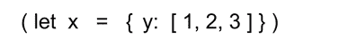

准备好空栈后，我们开始从左到右读取每个字符。

步骤 1：我们从第一个字符开始，它恰好是一个左圆括号：

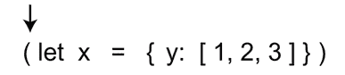

步骤 2：由于它是左括号类型，我们将其压入栈中：


然后我们忽略所有字符 `let x =`，因为它们不是括号字符。

步骤 3：我们遇到下一个左括号：

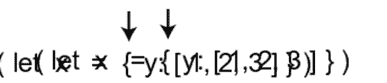

步骤 4：我们将其压入栈中：


然后我们忽略 `y:`。

步骤 5：我们遇到左方括号：

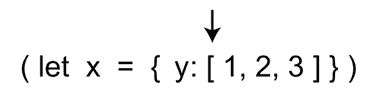

步骤 6：我们也将其添加到栈中：


然后我们忽略 `1, 2, 3`。

步骤 7：我们遇到第一个右括号——一个右方括号：

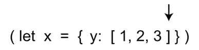

步骤 8：我们弹出栈顶元素，恰好是一个左方括号：


由于我们的右方括号与栈顶元素匹配，这意味着我们可以继续执行算法，而不会抛出任何错误。

步骤 9：我们继续，遇到一个右花括号：


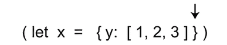

第 10 步：我们从栈中弹出顶部元素：


这是一个左花括号，所以我们找到了与当前右花括号的匹配。

第 11 步：我们遇到一个右圆括号：

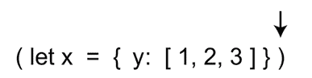

第 12 步：我们弹出栈中的最后一个元素。它是对应的匹配，所以到目前为止没有错误。

因为我们已经处理完了整行代码，并且栈为空，所以我们的代码检查器可以得出结论：这一行没有语法错误（关于左右括号的）。

### 代码实现：基于栈的代码检查器

以下是前述算法的实现。注意我们使用了之前实现的 `Stack` 类：

```javascript
import Stack from './stack.js';

class Linter {
  constructor() {
    this.stack = new Stack();
  }

  lint(text) {
    while (this.stack.read()) {
      this.stack.pop();
    }

    const matchingBraces = { '(': ')', '[': ']', '{': '}' };

    for (const char of text) {
      if (matchingBraces[char]) {
        this.stack.push(char);
      } else if (Object.values(matchingBraces).includes(char)) {
        if (!this.stack.read()) {
          return `${char} does not have opening brace`;
        } else {
          const poppedOpeningBrace = this.stack.pop();

          if (char !== matchingBraces[poppedOpeningBrace]) {
            return `${char} has mismatched opening brace`;
          }
        }
      }
    }

    // If we get to the end of line, and the stack isn't empty:
    if (this.stack.read()) {
      return `${this.stack.read()} does not have closing brace`;
    }

    // Return true if line has no errors:
    return true;
  }
}
```

`import Stack from './stack.js'` 这行代码允许我们的代码使用之前实现的栈，因为我们将其保存在名为 `stack.js` 的文件中。

一旦我们创建了 `Linter` 类的实例，我们就创建了一个算法可以使用的栈。这是通过以下代码实现的：

```javascript
constructor() {
  this.stack = new Stack();
}
```

主要的检查算法在 `lint` 方法中执行，该方法接受一个 JavaScript 代码字符串，并将其赋值给变量 `text`。

我们做的第一件事是确保栈为空，因为它可能还包含上一次检查的数据。我们通过从栈中弹出数据直到没有数据为止来实现这一点：

```javascript
while (this.stack.read()) {
  this.stack.pop();
}
```

然后我们定义我们认为的匹配括号集：

```javascript
const matchingBraces = { '(': ')', '[': ']', '{': '}' };
```

现在我们进入算法的主要部分，它通过一个循环来逐个分析 `text` 的每个字符：

```javascript
for (const char of text) {
```

如果当前字符是左括号，我们将其压入栈中：

```javascript
if (matchingBraces[char]) {
  this.stack.push(char);
}
```

如果当前字符不是左括号，我们接着检查它是否可能是右括号：

```javascript
else if (Object.values(matchingBraces).includes(char)) {
```

`Object.values` 方法返回 `matchingBraces` 对象（即哈希表）中所有值组成的数组，不包含键。在我们的例子中，这些值就是所有的右括号。

如果当前字符是右括号，我们考虑几种可能性。首先检查栈中是否有元素。如果没有，则触发语法错误 #2：

```javascript
if (!this.stack.read()) {
  return `${char} does not have opening brace`;
}
```

如果栈中有元素，我们将其弹出并检查它是否是对应的左括号。如果不是，则触发语法错误 #3：

```javascript
else {
  const poppedOpeningBrace = this.stack.pop();

  if (char !== matchingBraces[poppedOpeningBrace]) {
    return `${char} has mismatched opening brace`;
  }
}
```

循环以此方式继续，直到处理完整个 `text`。

然而，我们还没有完全结束。我们还需要检查栈中是否还有内容，因为如果有，就意味着有一个未闭合的左括号。这同样是语法错误 #1：

```javascript
if (this.stack.read()) {
  return `${this.stack.read()} does not have closing brace`;
}
```

在方法的最后，如果我们处理完整个 `text` 且没有遇到任何错误，则返回 `true`。

以下是一些运行检查器的示例代码：

```javascript
const linter = new Linter();
linter.lint('(let x = 2;')
```

这个示例将触发语法错误 #1，因为左圆括号没有对应的右圆括号。

在这个示例中，我们使用栈实现了一个简洁的检查器算法。但如果栈底层实际上使用的是数组，那为什么还要费心用栈呢？难道我们不能用数组完成同样的任务吗？

## 受限数据结构的重要性

根据定义，如果栈只是数组的一个受限版本，那就意味着数组可以完成栈能做的任何事情。既然如此，栈有什么优势呢？

像栈（以及我们稍后会遇到的队列）这样的受限数据结构之所以重要，有几个原因。

首先，当我们使用受限数据结构时，可以防止潜在的 bug。例如，检查算法只有在我们从栈顶移除元素时才有效。如果程序员无意中编写了从数组中间移除元素的代码，算法就会崩溃。通过使用栈，我们被迫只能从栈顶移除元素，因为不可能从栈中...

## 队列

队列是另一种用于处理临时数据的数据结构。它在很多方面类似于栈，只是处理数据的顺序不同。与栈一样，队列也是一种抽象数据类型。

你可以把队列想象成电影院门口排队的人群。第一个排队的人第一个离开队伍进入影院。对于队列，第一个加入队列的元素就是第一个被移除的元素。这就是为什么计算机科学家用首字母缩写 FIFO 来指代队列：先进先出。

与排队的人群一样，队列通常被水平描绘。通常也将队列的开始称为队首，队列的结束称为队尾。

与栈类似，队列是具有三个...

## 队列的实际应用

队列在许多应用中都很常见，从打印任务到 Web 应用中的后台工作进程。

假设我们正在为一个打印机编写一个简单的 JavaScript 接口，该打印机可以接受来自网络中不同计算机的打印任务。我们希望确保按照接收顺序打印每个文档。

以下代码使用了我们之前实现的 `Queue` 类：

```javascript
import Queue from './queue.js';

class PrintManager {
  constructor() {
    this.queue = new Queue();
  }
}
```


```
queuePrintJob(document) {
  this.queue.enqueue(document);
}

run() {
  while (this.queue.read()) {
    this.printDocument(this.queue.dequeue());
  }
}

printDocument(document) {
  // Code ...
```

## 总结

正如你所见，栈和队列是程序员优雅处理各种实用算法的工具。

现在你已经学习了栈和队列，你解锁了一项新成就：你可以学习递归了，而递归依赖于栈。递归也是本书后续将要介绍的许多更高级、超高效算法的基础。

## 练习

以下练习为你提供了练习栈和队列的机会。这些练习的解答见*第 9 章*。

1.  如果你正在为呼叫中心编写软件，该软件将呼叫者置于等待状态，然后将其分配给“下一个可用的客服代表”，你会使用栈还是队列？

2.  如果你按以下顺序将数字压入栈：1, 2, 3, 4, 5, 6，然后弹出两个元素，你能从栈中读取到哪个数字？

3.  如果你按以下顺序将数字插入队列：1, 2, 3, 4, 5, 6，然后出队两个元素，你能从队列中读取到哪个数字？

4.  编写一个使用栈来反转字符串的函数。（例如，"abcde" 会变成 ...）

# 第 10 章 递归地递归

递归是计算机科学中的一个关键概念，它将解锁我们将在本书中遇到的更高级算法。如果使用得当，递归可以用令人惊讶的简单方式解决某些棘手的问题。有时，它甚至看起来像魔法。

但在深入之前，先来个突击测验！

当这里定义的 `blah()` 函数被调用时会发生什么？

```
function blah() {
  blah();
}
```

你可能已经猜到了，它会无限地调用自身，因为 `blah()` 调用自身，而自身又调用自身，如此循环。

递归是指函数调用自身。确实，如上例所示的无限递归是毫无用处的。然而，如果正确利用，递归……

## 用递归代替循环

假设你在 NASA 工作，需要为发射航天器编写一个倒计时函数。你需要编写的特定函数应该接受一个数字（例如 10），并显示从 10 到 0 的数字。

花点时间自己实现这个函数。完成后，继续往下读。

你很可能写了一个简单的循环，类似于以下实现：

```
function countdown(number) {
  while (number >= 0) {
    console.log(number);
    number -= 1;
  }
}
```

这个实现没有任何问题，但你可能从未想过可以不使用循环。

怎么做？

让我们尝试用递归代替。以下是使用递归实现倒计时函数的首次尝试：

```
function countdown(number) ...
```

## 基本情况

让我们继续逐步分析倒计时函数。为简洁起见，我们跳过一些步骤……

第 21 步：我们调用 `countdown(0)`。

第 22 步：我们将 `number`（即 0）打印到控制台。

第 23 步：我们调用 `countdown(-1)`。

第 24 步：我们将 `number`（即-1）打印到控制台。

哦不。正如你所见，我们的解决方案并不完美，因为我们会无限地打印负数。

为了完善我们的解决方案，我们需要一种方法在 0 处结束倒计时，并防止递归无限继续下去。

我们可以通过添加一个条件语句来解决这个问题，该语句确保如果 `number` 当前为 0，则不再调用 `countdown()`：

```
function countdown(number) {
  console.log(number);

  if (number === 0) {
    return;
  } else {

```

## 阅读递归代码

适应递归需要时间和练习，你最终将学会两套技能：阅读递归代码和编写递归代码。阅读递归代码相对容易一些，所以我们先练习这个。

我们将通过另一个例子来学习：计算阶乘。

阶乘最好通过一些例子来说明。

这是 3 的阶乘：

3 * 2 * 1 = 6

这是 5 的阶乘：

5 * 4 * 3 * 2 * 1 = 120

以此类推。

以下是一个返回数字阶乘的递归实现：

```
function factorial(number) {
  if (number <= 1) {
    return 1;
  } else {
    return number * factorial(number - 1);
  }
}
```

这段代码一开始可能看起来有些令人困惑……

## 计算机眼中的递归

为了让你完全理解递归，我们需要看看计算机本身是如何处理递归函数的。人类使用之前的“草稿纸”方法来推理递归是一回事。然而，计算机必须完成从函数内部调用函数这一棘手的工作。所以，让我们分解计算机执行递归函数的过程。

假设我们调用 `factorial(3)`。由于 3 不是基本情况，计算机执行到这一行：

```
return number * factorial(number - 1);
```

这随后启动了函数 `factorial(2)`。

但有一个问题。当计算机开始运行 `factorial(2)` 时，计算机是否已经完成了 `factorial(3)` 的运行？

这就是递归的特别之处……

## 文件系统遍历

现在你已经了解了递归的工作原理，我们可以用它来解决某些原本无法破解的问题。

递归特别适合解决的一类问题是，我们需要深入问题的多个层次，但不知道有多少层。

以遍历文件系统为例。假设你有一个脚本，它对目录中的所有内容执行某些操作，例如打印所有子目录名称。但是，你不希望脚本只处理直接子目录——你希望它作用于目录的子目录中的子目录，以及这些子目录的子目录，依此类推。

让我们创建一个简单的脚本，打印给定目录中所有子目录的名称：

```
import { readdirSync, lstatSync } from 'fs';
import { join } from 'path';

function printSubdirectories(directoryName) {
  for (const fileName of readdirSync(directoryName)) {
    if (lstatSync(fileName).isDirectory()) {
      const pathName = join(directoryName, fileName);
      console.log(pathName);
    }
  }
}
```

我们可以通过传入目录名来调用这个函数。如果我们想对当前目录调用它，可以编写以下代码：

```
printSubdirectories('.');
```

在这个脚本中，我们遍历给定目录中的每个文件。如果该文件本身是一个子目录，我们就打印该子目录的名称。

虽然这很有效，但它只打印当前目录下直接子目录的名称。它不会打印这些子目录中的子目录的名称。

让我们更新脚本，使其能够搜索更深一层：

```
import { readdirSync, lstatSync } from 'fs';
import { join } from 'path';

function printSubdirectories(directoryName) {
  for (const fileName of readdirSync(directoryName)) {
    if (lstatSync(fileName).isDirectory()) {
      const pathName = join(directoryName, fileName);
      console.log(pathName);
    }
  }
}
```


```
for (const fileName2 of readdirSync(pathName)) {
    const pathName2 = join(pathName, fileName2);
    console.log(pathName2);
    }
    }
    }
    }
```

现在，每次我们的脚本发现一个目录时，它就会对该目录的子目录执行相同的循环，并打印子目录的名称。但这个脚本也有局限性，因为它只搜索了两层深度。如果我们想搜索三层、四层或五层深度呢？那就需要五层嵌套循环。

如果我们想搜索到子目录的最深层呢？这似乎是不可能的，因为我们甚至不知道有多少层。

而这正是递归大放异彩的地方。通过递归，我们可以编写一个能够任意深度搜索的脚本——而且代码量少得多！

```
import { readdirSync, lstatSync } from 'fs';
import { join } from 'path';

function printSubdirectories(directoryName) {
    for (const fileName of readdirSync(directoryName)) {
        const pathName = join(directoryName, fileName);
        if (lstatSync(pathName).isDirectory()) {
            console.log(pathName);
            printSubdirectories(pathName);
        }
    }
}
```

当这个脚本遇到本身就是子目录的文件时，它会针对该子目录调用`printSubdirectories`方法。因此，脚本可以深入到所需的任何深度，不遗漏任何子目录。

为了直观地了解该算法在示例文件系统上的运行方式，请查看下图，该图指定了脚本遍历子目录的顺序：

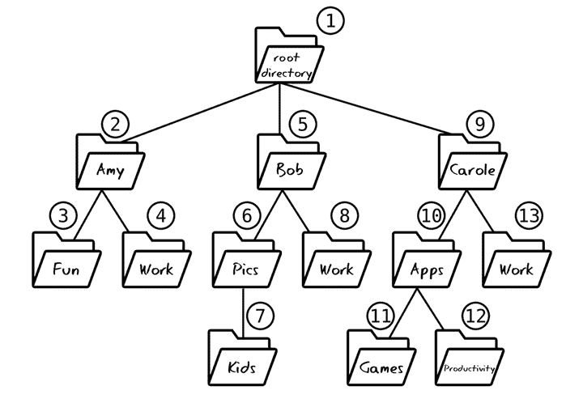

## 总结

正如你在文件系统示例中所见，当算法需要深入任意多层时，递归通常是一个很好的选择。

你现在已经了解了递归的工作原理以及它的巨大用处。你还学会了如何阅读和跟踪递归代码。然而，大多数人在刚开始时很难自己编写递归函数。在下一章中，我们将探讨一些技巧，帮助你学会如何编写递归代码。在此过程中，你还会发现递归作为强大工具的其他重要应用场景。

## 练习

以下练习为你提供了练习递归的机会。这些练习的解答可在​*第 10 章*​中找到。

1.  下面的函数从低到高打印每隔一个的数字。例如，如果 low 为 0，high 为 10，它将打印：

    ```
    0
    2
    4
    6
    8
    10
    ```

    请找出函数中的基本情况：

    ```
    function printEveryOther(low, high) {
        if (low > high) { return; }
        console.log(low);
        printEveryOther(low + 2, high);
    }
    ```

2.  我的孩子在我的电脑上玩耍，修改了我的阶乘函数，使其基于`(number - 2)`而不是`(number - 1)`来计算阶乘。他还将`number <= 1`改成了`number === 1`。预测当我们使用...运行`factorial(10)`时会发生什么？

# 第 11 章

学习编写递归

在上一章中，你了解了什么是递归以及它是如何工作的。在我自己的学习过程中，我发现即使理解了递归的工作原理，我仍然很难编写自己的递归函数。

通过刻意练习和注意各种递归模式，我发现了一些技巧，帮助我更轻松地学会“用递归思考”，我想与你分享这些技巧。在此过程中，你还会发现递归大放异彩的其他领域。

请注意，本章不会讨论递归的效率问题。递归实际上可能对算法的时间复杂度产生严重的负面影响，但这是下一章的主题。现在，我们只专注于培养递归思维。

## 递归类别：重复执行

在解决各种递归问题的过程中，我开始发现存在不同类别的问题。一旦我学会了针对某个类别的有效技巧，当遇到属于同一类别的另一个问题时，我就能应用相同的技巧来解决它。

我发现最简单的类别是算法目标为重复执行某个任务。

上一章中的 NASA 航天器倒计时算法就是一个很好的例子。代码打印数字，如 10，然后 9，然后 8，一直降到 0。虽然函数每次打印的数字不同，但我们将代码的本质归结为它是在重复地...

## 递归类别：计算

在上一节中，我们讨论了第一类递归函数——其任务是重复执行某个动作。在本章的剩余部分，我将详细阐述第二大类：基于子问题执行计算。

许多函数的目标是执行计算。例如，返回两个数之和的函数，或查找数组中最大值的函数。这些函数接收某种输入，并返回涉及该输入的计算结果。

在第 10 章​*递归递归再递归*​中，我们发现递归大放异彩的一个领域是当我们需要处理一个具有任意层级的问题时...

## 自顶向下递归：一种新的思维方式

这引出了本章的核心观点：递归在实现自顶向下方法时大放异彩，因为自顶向下提供了一种解决难题的新思维策略。也就是说，递归的自顶向下方法允许人们以完全不同的方式思考问题。

具体来说，当我们采用自顶向下时，我们可以在心理上“把问题踢到后面”。我们可以从通常自底向上时必须考虑的一些琐碎细节中解放出来。

为了理解我的意思，让我们再看一下自顶向下阶乘实现中的关键一行：

```
return number * factorial(number - 1);
```

这行代码基于`factorial(number - 1)`进行计算。当...

## 楼梯问题

你现在已经学会了使用一种新的思维策略，通过自顶向下递归来解决某些计算问题。然而，你可能仍然持怀疑态度，问道：“我们为什么需要这种新的思维策略？到目前为止，我使用循环就能很好地解决这些问题。”

确实，对于简单的计算，你可能不需要新的思维策略。但当涉及到更复杂的函数时，你可能会发现递归思维使代码编写变得容易得多。对我来说确实如此！

这里有一个我最喜欢的例子。一个著名的问题——称为楼梯问题——是这样的：

假设我们有一个 N 级台阶的楼梯，一个人一次可以爬一级、两级或三级台阶。有多少种...

## 变位词生成

作为我们讨论的压轴，让我们来解决目前最复杂的递归问题。我们将使用递归工具箱中的所有工具来完成这个任务。

我们将编写一个函数，返回给定字符串的所有变位词数组。变位词是字符串中所有字符的重新排列。例如，"abc"的变位词如下：

```
["abc",
"acb",
"bac",
"bca",
"cab",
"cba"]
```


现在，假设我们要收集字符串 `"abcd"` 的所有变位词。让我们运用自顶向下的思维方式来解决这个问题。

大概可以说，`"abcd"` 的子问题是 `"abc"`。那么问题来了：如果我们有一个能返回 `"abc"` 所有变位词的函数，我们该如何利用它们来……

## 总结

学习编写使用递归的函数当然需要练习。但你现在已经掌握了一些技巧和方法，能让学习过程变得更轻松。

不过，我们对递归的探索之旅还没有结束。虽然递归是解决各种问题的好工具，但如果使用不当，它实际上会大大降低代码的运行速度。在下一章中，你将学习如何在保持代码高效快速的同时运用递归。

## 练习

以下练习为你提供了练习递归的机会。这些练习的答案可以在 *第 11 章* 中找到。

1.  使用递归编写一个函数，该函数接受一个字符串数组，并返回所有字符串的总字符数。例如，如果输入数组是 `["ab", "c", "def", "ghij"]`，则输出应为 10，因为总共有 10 个字符。

2.  使用递归编写一个函数，该函数接受一个数字数组，并返回一个只包含偶数的新数组。

3.  有一种特殊的数值序列称为三角数。该序列以 1, 3, 6, 10, 15, 21 开始，并继续下去。要计算序列中的下一个数，我们将前一个数加上……

# 第 12 章 动态规划

在上一章中，你学习了如何编写递归代码，以及如何使用递归解决一些相当复杂的问题。

虽然递归确实可以解决一些问题，但如果使用不当，它也可能带来新的问题。事实上，递归往往是某些最慢的大 O 类别（如 O(2^N)）的罪魁祸首。

不过，好消息是，许多这类问题是可以避免的。在本章中，你将学习如何识别递归代码中最常见的速度陷阱，以及如何用大 O 表示法来描述这类算法。更重要的是，你将学习修复这些问题的技巧。

还有更多好消息：本章介绍的技巧相当简单。让我们开始……

## 不必要的递归调用

下面是一个递归函数，用于从数组中找出最大的数：

```
function max(array) {
  if (array.length === 0) { return null; }

  if (array.length === 1) { return array[0]; }

  if (array[0] > max(array.slice(1))) {
    return array[0];
  } else {
    return max(array.slice(1));
  }
}
```

每次递归调用的本质是将单个数字（`array[0]`）与数组剩余部分的最大值进行比较。（要计算数组剩余部分的最大值，我们调用当前所在的 `max` 函数，这正是该函数递归的原因。）

我们通过一个条件语句来实现比较。条件语句的前半部分如下：

## 大 O 的小修复

值得庆幸的是，有一种简单的方法可以消除所有这些额外的递归调用。我们只在代码中调用一次 `max`，并将结果保存到一个变量中：

```
function max(array) {
  if (array.length === 0) { return null; }

  if (array.length === 1) { return array[0]; }

  // 计算数组剩余部分的最大值
  // 并将其存储在一个变量中：
  const maxOfRemainder = max(array.slice(1));

  // 将第一个数字与该变量进行比较：
  if (array[0] > maxOfRemainder) {
    return array[0];
  } else {
    return maxOfRemainder;
  }
}
```

通过这个简单的修改，我们最终只调用了 `max` 四次。你可以通过添加 `console.log('RECURSION')` 来亲自验证……

## 递归的效率

在我们改进后的第二个 `max` 函数版本中，该函数递归调用的次数与数组中的元素数量相同。我们称之为 O(N)。

到目前为止，我们遇到的 O(N) 情况都涉及循环，即循环运行 N 次。然而，我们也可以将大 O 的相同原理应用于递归。

回想一下，大 O 回答了一个关键问题：如果有 N 个数据元素，算法需要多少步？

由于改进后的 `max` 函数对于数组中的 N 个值运行了 N 次，因此它的时间复杂度为 O(N)。即使函数本身包含多个步骤（例如五个步骤），其时间复杂度也是 O(5N)，这可以简化为 O(N)。

然而，在第一个版本中，该函数在每次运行时（除了基本情况）都会调用自身两次。让我们看看这对于不同大小的数组会如何表现。

下表显示了在不同大小的数组上调用 `max` 的次数：

| N 个元素 | 调用次数 |
| --- | --- |
| 1 | 1 |
| 2 | 3 |
| 3 | 7 |
| 4 | 15 |
| 5 | 31 |

你能看出规律吗？当数据量增加一个时，算法的步骤数大约翻倍。正如我们在讨论 *密码破解器* 时所了解到的，这就是 O(2^N) 的模式。我们已经知道这是一种极其缓慢的算法。

然而，改进后的 `max` 函数只调用了 `max` 与数组元素数量相同的次数。这意味着我们的第二个 `max` 函数的效率为 O(N)。

这是一个强有力的教训：避免额外的递归调用是保持递归快速的关键。乍一看，我们的代码只做了一个很小的改动——仅仅是将计算结果存储在一个变量中——却将函数的速度从 O(2^N) 提升到了 O(N)。

## 重叠子问题

斐波那契数列是一个数学数列，其形式如下，直至无穷：

0, 1, 1, 2, 3, 5, 8, 13, 21, 34, 55……

该数列以数字 0 和 1 开始，后续每个数字都是该数列中前两个数字之和。例如，数字 55 是通过计算前两个数字 21 和 34 的和得到的。

以下 JavaScript 函数返回斐波那契数列中的第 N 个数。例如，如果我们向该函数传递数字 10，它将返回 55，因为 55 是该数列中的第十个数。（0 被视为该数列中的第 0 个数。）

```
function fib(n) {
  if (n === 0 || n === 1) {
    return n;
  }

  return fib(n - 2) + fib(n - 1);
}
```

该函数中的关键行如下：

```
return fib(n - 2) + fib(n - 1);
```

这一行将斐波那契数列中前两个数相加。这是一个优美的递归函数。

然而，现在你的脑海中应该响起警报，因为我们的函数调用了自身两次。

以计算第六个斐波那契数为例。函数 `fib(6)` 会调用 `fib(4)` 和 `fib(5)`，如下图所示：


正如我们所看到的，一个函数调用自身两次很容易让我们走上 O(2^N) 的道路。事实上，`fib(6)` 所做的所有递归调用都显示在 下图 中。

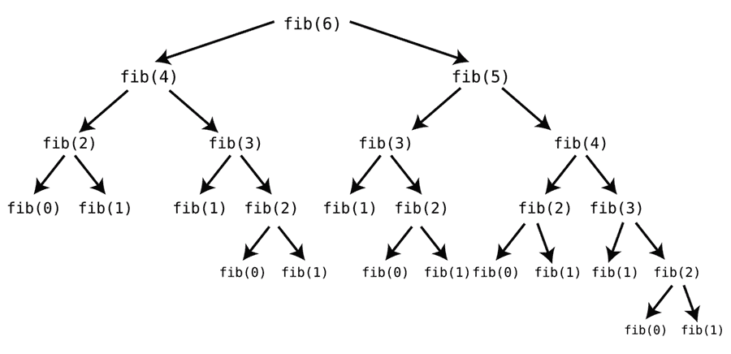

你得承认，O(2^N) 看起来相当可怕。

虽然一个简单的改动就优化了本章的第一个例子，但优化我们的斐波那契数列却没那么简单。


这是因为我们无法在变量中只保存一个数据。我们需要同时计算 `fib(n - 2)` 和 `fib(n - 1)`（因为每个斐波那契数都是这两个数之和），而仅存储其中一个结果并不能直接得到另一个结果。

这就是计算机科学家所说的**重叠子问题**。我们来拆解一下这个术语。

当一个问题的求解依赖于求解同一问题的更小版本时，这个更小的问题就被称为子问题。这个概念并不新鲜——我们在讨论递归时已经多次遇到。以斐波那契数列为例，我们通过先计算数列中更小的数来得到每个数。这些更小数的计算就是子问题。

而之所以说这些子问题是重叠的，是因为 `fib(n - 2)` 和 `fib(n - 1)` 最终会调用许多相同的函数。具体来说，`fib(n - 1)` 会重复执行一些 `fib(n - 2)` 已经做过的计算。例如，在前面的图中可以看到，`fib(5)` 调用了 `fib(3)`，尽管 `fib(4)` 已经调用过它了。还有许多其他调用也是重复的。

看来我们陷入了死胡同。我们的斐波那契示例需要大量重叠的函数调用，而算法的运行速度慢如 O(2^N)。似乎我们无能为力了。

真的吗？

## 通过记忆化实现动态规划

幸运的是，我们确实有办法，那就是通过一种称为**动态规划**的方法。动态规划是优化具有重叠子问题的递归问题的过程。

（不必过分关注“动态”这个词。关于这个术语的由来存在一些争议，而且我即将演示的技术本身并没有什么明显的“动态”之处。）

用动态规划优化算法通常可以通过两种技术之一来实现。

第一种技术称为**记忆化**。没错，这不是拼写错误。发音为 meh-moe-ih-ZAY-shun，记忆化是一种简单但巧妙的技术，用于减少重叠子问题情况下的递归调用。

本质上，记忆化通过记住先前计算过的函数来减少递归调用。（在这方面，记忆化确实很像它的同音词“记忆化”。）

在我们的斐波那契示例中，第一次调用 `fib(3)` 时，函数进行计算并返回数字 2。但在继续之前，函数将这个结果存储在一个哈希表中。哈希表看起来像这样：

```
{3: 2}
```

这表示 `fib(3)` 的结果是数字 2。

类似地，我们的代码会记忆化所有遇到的新计算结果。例如，在遇到 `fib(4)`、`fib(5)` 和 `fib(6)` 之后，我们的哈希表将如下所示：

```
{
  3: 2,
  4: 3,
  5: 5,
  6: 8
}
```

现在我们有了这个哈希表，就可以用它来避免未来的递归调用。其工作原理如下：

没有记忆化时，`fib(4)` 通常会调用 `fib(3)` 和 `fib(2)`，而这些调用又会进行自己的递归调用。现在有了这个哈希表，我们可以采用不同的方式。例如，`fib(4)` 不会盲目地调用 `fib(3)`，而是先检查哈希表，看看 `fib(3)` 的结果是否已经计算过。只有当键 3 不在哈希表中时，函数才会继续调用 `fib(3)`。

记忆化直击重叠子问题的要害。重叠子问题的全部问题在于我们一遍又一遍地计算相同的递归调用。而有了记忆化，每次我们进行新的计算时，都会将其存储在哈希表中供以后使用。这样，我们只会在从未计算过的情况下才进行计算。

好吧，这听起来不错，但有一个明显的问题：每个递归函数如何访问这个哈希表？

答案是：我们将哈希表作为第二个参数传递给函数。

由于哈希表是内存中的一个特定对象，我们能够将它从一个递归调用传递到下一个，即使我们在过程中修改它也是如此。即使在展开调用栈时也是如此。尽管在原始调用时哈希表可能是空的，但当原始调用执行完毕时，同一个哈希表可能已经充满了数据。

### 实现记忆化

为了传递哈希表，我们修改函数以接受两个参数，其中哈希表作为第二个参数。我们将这个哈希表称为 `memo`，即记忆化：

```
function fib(n, memo={}) {
```

注意，我们将 `memo` 设置为默认参数；这样我们第一次调用时就不必传入一个空的哈希表。因此，我们可以简单地这样调用函数：

```
fib(6);
```

每次 `fib` 调用自身时，它也会同时传递哈希表，哈希表会在过程中逐渐填满。

以下是函数的其余部分：

```
function fib(n, memo={}) {
  if (n === 0 || n === 1) {
    return n;
  }
  if (!memo[n]) {
    memo[n] = fib(n - 2, memo) + fib(n - 1, memo);
  }
  return memo[n];
}
```

让我们逐行分析。

同样，我们的函数现在接受两个参数，即 `n` 和 `memo` 哈希表：

```
function fib(n, memo={}) {
```

首先，基本情况 0 和 1 都自动返回 `n`，不受记忆化影响。

在进行任何递归调用之前，我们的代码首先检查对于给定的 `n`，`fib(n)` 是否已经计算过：`if (!memo[n]) {`（如果 `n` 的计算结果已经在哈希表中，我们只需用 `return memo[n]` 返回结果。）

只有当 `n` 的计算尚未完成时，我们才继续计算：`memo[n] = fib(n - 2, memo) + fib(n - 1, memo);`

这里，我们将计算结果存储在 `memo` 哈希表中，这样以后就不必再次计算了。

还要注意，每次调用 `fib` 函数时，我们都将 `memo` 作为参数传递。这是在所有对 `fib` 函数的调用之间共享 `memo` 哈希表的关键。

如你所见，算法的核心保持不变。我们仍然使用递归来解决问题，因为 `fib` 的计算本质上仍然是 `fib(n - 2) + fib(n - 1)`。然而，如果我们要计算的数字是新的，我们就将结果存储在哈希表中；如果这个数字之前已经计算过，我们就直接从哈希表中获取结果，而不是再次计算。

当我们绘制记忆化版本中的递归调用时，会得到下图：

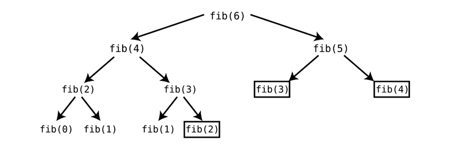

在这个图中，每个被方框包围的调用表示其结果是从哈希表中检索的。

那么现在我们的函数的大 O 是多少？让我们看看对于不同的 N，我们进行了多少次递归调用：

| N 个元素 | 调用次数 |
|----------|----------|
| 1        | 1        |
| 2        | 3        |
| 3        | 5        |
| 4        | 7        |
| 5        | 9        |
| 6        | 11       |

我们可以看到，对于 N，我们进行了 (2N) - 1 次调用。由于在大 O 表示法中我们忽略常数，这是一个 O(N) 算法。

相比 O(2^N)，这是一个惊人的改进。记忆化万岁！

## 通过自底向上实现动态规划

我之前提到，动态规划可以通过两种技术之一来实现。我们研究了第一种技术——记忆化，它相当巧妙。

第二种技术称为**自底向上**，它不那么花哨，甚至可能看起来不像一种技术。自底向上仅仅意味着放弃递归，使用其他方法（比如循环）来解决同一个问题。


自底向上被视为动态规划的一部分，是因为动态规划意味着将一个可以用递归解决的问题，确保它不会对重叠子问题进行重复调用。使用迭代（即循环）而非递归，从技术上讲，是实现这一目标的一种方式。

当问题更自然地适合用递归解决时，自底向上就成了一种更“技巧性”的方法。生成斐波那契数列就是一个例子，递归是一种简洁优雅的解决方案。而用迭代解决同样的问题可能需要更多脑力，因为迭代方法可能不那么直观。（想象一下用循环解决上一章的爬楼梯问题。呃。）

让我们看看如何为斐波那契函数实现自底向上的方法。

### 自底向上的斐波那契

在下面的自底向上方法中，我们从斐波那契数列的前两个数开始：0 和 1。然后我们使用老式的迭代来构建序列：

```
function fib(n) {
  if (n === 0) { return 0; }
  let a = 0;
  let b = 1;
  for (let i = 1; i < n; i += 1) {
    [a, b] = [b, a + b];
  }
  return b;
}
```

我们做的第一件事是，如果输入 `n` 为 0，则返回 0。按照定义，`fib(0)` 应该返回 0，所以我们用一个简单的条件语句轻松处理了这种情况。

现在，我们进入代码的核心部分。我们将变量 `a` 和 `b` 分别初始化为 0 和 1，因为它们是斐波那契数列的前两个数。

然后我们开始一个循环，以便计算序列中的每个数，直到达到 `n`：

```
for (let i = 1; i < n; i += 1) {
```

要计算序列中的下一个数，我们需要将前两个数相加，即 `a + b`。我们将 `b` 更新为这个新数，因为 `b` 始终指向序列中的最后一个数。同时，我们将 `a` 更新为 `b` 原来的值，这样 `a` 继续指向倒数第二个数。我们通过一次方便的交换来完成所有这些操作：

```
[a, b] = [b, a + b];
```

由于我们的代码是一个从 1 到 `N` 的简单循环，因此代码需要 `N` 步。与记忆化方法一样，它的时间复杂度是 `O(N)`。

### 记忆化 vs. 自底向上

你现在已经看到了动态规划的两种主要技术：记忆化和自底向上。一种技术比另一种更好吗？

通常，这取决于问题本身以及你最初使用递归的原因。如果递归为给定问题提供了一种优雅且直观的解决方案，你可能希望坚持使用它，并利用记忆化来处理任何重叠子问题。然而，如果迭代方法同样直观，你可能更倾向于选择它。

需要指出的是，即使使用了记忆化，递归相对于迭代仍然会带来一些额外的开销。具体来说，对于任何递归，计算机都需要在调用栈中跟踪所有调用，这会消耗内存。记忆化本身也需要使用哈希表，这也会占用计算机的额外空间。（更多内容请参见第 19 章，*处理空间限制*。）

一般来说，自底向上通常是更好的选择，除非递归解决方案更直观。在递归更直观的情况下，你可以保留递归，并通过记忆化使其保持快速。

## 总结

现在你已经能够编写高效的递归代码，这也解锁了一项超能力。你即将遇到一些非常高效但高级的算法，其中许多都依赖于递归的原理。

## 练习

以下练习为你提供了练习动态规划的机会。这些练习的解答见*第 12 章*部分。

1.  以下函数接受一个数字数组，并返回总和，前提是某个特定数字不会使总和超过 100。如果添加某个特定数字会使总和超过 100，则忽略该数字。然而，这个函数进行了不必要的递归调用。修复代码以消除不必要的递归：

    ```
    function addUntil100(array) {
      if (array.length === 0) { return 0; }
      if (array[0] + addUntil100(array.slice(1)) > 100) {
        return addUntil100(array.slice(1));
      } else {
        return array[0] + addUntil100(array.slice(1));
      }
    }
    ```

2.  以下函数使用递归计算一个数学序列（称为 Golomb 序列）中的第 N 个数。然而，它的效率非常低！使用记忆化来优化它。（你不需要理解 Golomb 序列的工作原理来完成这个练习。）

    ```
    function golomb(n) {
      if (n === 1) { return 1; }
      return 1 + golomb(n - golomb(golomb(n - 1)));
    }
    ```

3.  以下是上一章练习中唯一路径问题的一个解决方案。（抱歉，如果你还没有尝试那个练习，这有点剧透。）使用记忆化来提高其效率：

    ```
    function uniquePaths(rows, columns) {
      if (rows === 1 || columns === 1) {
        return 1;
      }
      return uniquePaths(rows - 1, columns) + uniquePaths(rows, columns - 1);
    }
    ```

版权所有 © 2024, The Pragmatic Bookshelf.

# 第 13 章 用于加速的递归算法

我们已经看到，理解递归可以解锁各种新算法，例如遍历文件系统或生成变位词。在本章中，你将了解到递归也是让代码运行得更快、更高效的关键。

在前面的章节中，我们遇到了许多排序算法，包括冒泡排序、选择排序和插入排序。然而，在实际应用中，这些方法实际上都不用于对数组进行排序。大多数计算机语言都有内置的数组排序函数，这节省了我们自己实现排序的时间和精力。而在许多语言中，底层使用的排序算法是快速排序。

我们之所以……

## 分区

对数组进行分区，就是取数组中的一个随机值（称为基准值），并确保所有小于基准值的数都位于基准值的左侧，所有大于基准值的数都位于基准值的右侧。我们通过一个简单的算法来完成分区，该算法将在下面的示例中描述。

假设我们有以下数组：


为了保持一致性，我们总是选择最右边的值作为基准值（尽管从技术上讲我们可以选择其他值）。在这个例子中，数字 3 是我们的基准值。我们通过画圈来标记它：


然后我们分配指针——一个指向数组最左边的值，另一个指向数组最右边的值（不包括基准值本身）：


现在我们准备开始实际的分区，它遵循以下步骤。别担心——当我们逐步讲解示例时，这些步骤会变得更清晰。

1.  左指针不断向右移动一个单元格，直到它遇到一个大于或等于基准值的值，然后停止。


2. 然后，右指针不断向左移动一个单元格，直到遇到一个小于或等于基准值的值，然后停止。如果右指针到达数组开头，它也会停止。

3. 一旦右指针停止，我们就来到了一个分岔路口。如果左指针已经到达（或超过了）右指针，我们就进入第 4 步。否则，我们交换左指针和右指针所指向的值，然后返回重复步骤 1、2 和 3。

4. 最后，我们将基准值与左指针当前指向的值进行交换。

完成一次分区后，我们可以确信：基准值左侧的所有值都小于基准值，右侧的所有值都大于基准值。这意味着基准值本身现在位于数组中的正确位置，尽管其他值尚未完全排序。

让我们将这个流程应用到我们的示例中：

步骤 1：将左指针（当前指向 0）与我们的基准值（值为 3）进行比较：


由于 0 小于基准值，左指针在下一步中继续移动。

步骤 2：左指针继续移动：


我们将左指针（指向 5）与基准值进行比较。5 是否小于基准值？不是，所以左指针停止，我们在下一步中激活右指针。

步骤 3：将右指针（指向 6）与基准值进行比较。该值是否大于基准值？是的，所以我们的指针将在下一步中继续移动。

步骤 4：右指针继续移动：


我们将右指针（指向 1）与基准值进行比较。该值是否大于基准值？不是，所以右指针停止。

步骤 5：由于两个指针都已停止，我们交换两个指针所指向的值：

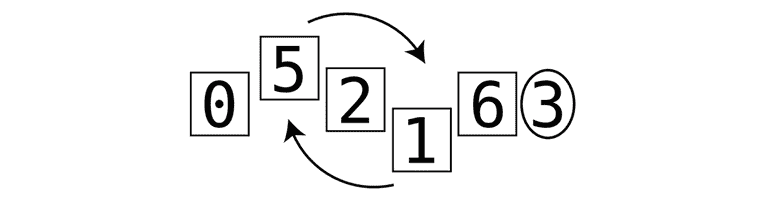

然后我们在下一步中再次激活左指针。

步骤 6：左指针继续移动：


我们将左指针（指向 2）与基准值进行比较。该值是否小于基准值？是的，所以左指针继续移动。

步骤 7：左指针移动到下一个单元格。注意，此时左指针和右指针指向同一个值：


我们将左指针与基准值进行比较。由于左指针指向的值大于基准值，它停止。此时，由于左指针已经到达右指针，我们完成了指针的移动。

步骤 8：在分区的最后一步，我们将左指针指向的值与基准值交换：


虽然我们的数组尚未完全排序，但我们已成功完成了一次分区；也就是说，由于我们的基准值是数字 3，所有小于 3 的数字都在其左侧，而所有大于 3 的数字都在其右侧。这也意味着，根据定义，3 现在位于数组中的正确位置。

### 代码实现：分区

以下是 JavaScript 中 `SortableArray` 类的实现，其中包含一个 `partition` 方法，该方法按照我们描述的方式对数组进行分区：

```javascript
class SortableArray {
  constructor(array) {
    this.array = array;
  }

  partition(leftPointer, rightPointer) {
    const pivotIndex = rightPointer;
    const pivot = this.array[pivotIndex];

    rightPointer -= 1;

    while (true) {
      while (this.array[leftPointer] < pivot) {
        leftPointer += 1;
      }

      while (this.array[rightPointer] > pivot) {
        rightPointer -= 1;
      }

      if (leftPointer >= rightPointer) {
        break;
      } else {
        [this.array[leftPointer], this.array[rightPointer]] =
        [this.array[rightPointer], this.array[leftPointer]];
        leftPointer += 1;
      }
    }

    [this.array[leftPointer], this.array[pivotIndex]] =
    [this.array[pivotIndex], this.array[leftPointer]];

    return leftPointer;
  }
}
```

我们来稍微分解一下这段代码。

`partition` 方法接受左指针和右指针的起始位置作为参数：

`partition(leftPointer, rightPointer) {`

当该方法首次在数组上调用时，这些指针将分别指向数组的左端和右端。然而，我们会看到快速排序也会在数组的子部分上调用此方法。因此，我们不能总是假设左指针和右指针始终是数组的两个端点，它们需要成为方法参数。这一点在我解释完整的快速排序算法时会更加清晰。

接下来，我们选择基准值，它始终是我们所处理范围内的最右侧元素：

`const pivotIndex = rightPointer;`
`const pivot = this.array[pivotIndex];`

一旦确定了基准值，我们将 `rightPointer` 移动到基准值左侧紧邻的元素：

`rightPointer -= 1;`

然后我们开始一个循环（`while (true)`），它看起来会无限运行。然而，在循环内部有一个 `break` 语句，一旦 `leftPointer` 和 `rightPointer` 相遇，就会终止循环。在这个循环中，我们使用另一个循环来不断将 `leftPointer` 向右移动，直到它遇到一个大于或等于基准值的元素：

`while (this.array[leftPointer] < pivot) {`
`leftPointer += 1;`
`}`

类似地，我们将 `rightPointer` 向左移动，直到它遇到一个小于或等于基准值的元素：

`while (this.array[rightPointer] > pivot) {`
`rightPointer -= 1;`
`}`

一旦 `leftPointer` 和 `rightPointer` 停止移动，我们检查两个指针是否相遇：

`if (leftPointer >= rightPointer) {`
`break;`
`}`

如果它们相遇，我们就退出循环，准备交换基准值，稍后就会进行。然而，如果两个指针都已停止但尚未相遇，我们就交换两个指针处的值：

`[this.array[leftPointer], this.array[rightPointer]] = [this.array[rightPointer], this.array[leftPointer]];`

然后我们移动 `leftPointer`，为下一轮左右指针的移动做准备：

`leftPointer += 1;`

最后，当两个指针相遇时，我们将基准值与 `leftPointer` 处的值交换：

`[this.array[leftPointer], this.array[pivotIndex]] = [this.array[pivotIndex], this.array[leftPointer]];`

该方法最后返回 `leftPointer`，因为快速排序算法（我稍后会解释）需要用到它。

## 快速排序


快速排序算法是分区与递归的结合。其工作原理如下：

1.  对数组进行分区。此时基准值已处于正确位置。
2.  将基准值左侧和右侧的子数组视为独立的数组，并递归重复步骤 1 和 2。这意味着我们将对每个子数组进行分区，从而在每个子数组的基准值左右两侧得到更小的子子数组。然后继续对这些子子数组进行分区，依此类推。
3.  当子数组包含零个或一个元素时，这就是我们的基本情况，无需任何操作。

让我们回到之前的例子。我们从数组 [0, 5, 2, 1, 6, 3] 开始，对整个数组执行了一次分区。由于快速排序从这样的分区开始，这意味着我们已经……

## 快速排序的效率

要弄清快速排序的效率，我们首先需要确定单次分区的效率。

当我们分解分区的步骤时，会发现一次分区涉及两种主要类型的步骤：

*   **比较**：我们将每个当前值与基准值进行比较。
*   **交换**：在适当的时候，我们交换左指针和右指针所指向的值。

每次分区至少进行 N 次比较——也就是说，我们将数组的每个元素与基准值进行比较。这是因为在分区过程中，左指针和右指针会遍历每个单元格，直到它们相遇。

然而，交换的次数取决于数据的排序情况。单次分区最多可以进行 N / 2 次交换，因为即使我们每次有机会就交换，每次交换也只会处理两个值。如下图所示，我们仅用三次交换就完成了六个元素的分区：

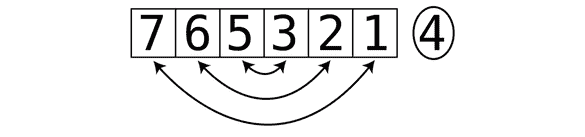

在大多数情况下，我们并不会每一步都进行交换。对于随机排序的数据，我们通常交换大约一半的值。因此，平均而言，我们进行大约 N / 4 次交换。

所以平均来看，我们进行大约 N 次比较和 N / 4 次交换。也就是说，对于 N 个数据元素，大约有 1.25N 步。在大 O 表示法中，我们忽略常数，因此可以说一次分区的时间复杂度为 O(N)。

以上是单次分区的效率。但快速排序涉及多次分区，因此我们需要进一步分析以确定快速排序的整体效率。

### 鸟瞰快速排序

为了更直观地理解，请参见图表，该图从鸟瞰视角展示了对一个包含八个元素的数组进行典型快速排序的过程。具体来说，图表显示了每次分区所处理的元素数量。我们省略了数组中的实际数字，因为具体数值并不重要。请注意，在图表中，活跃子数组是未灰显的单元格组。

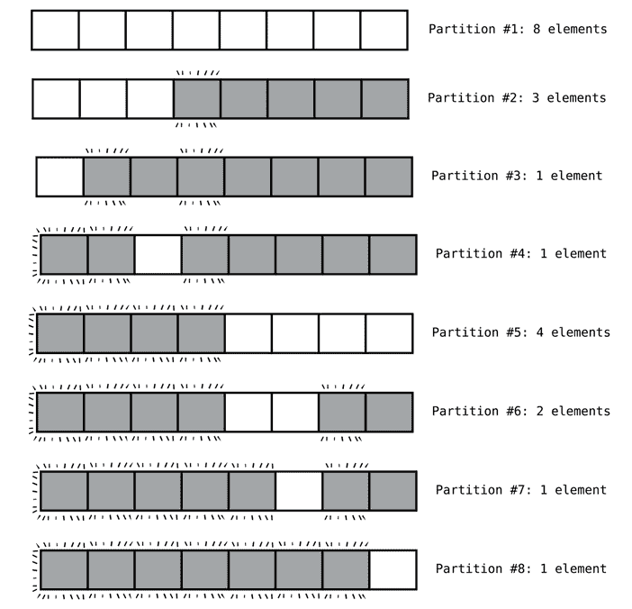

我们可以看到共有八次分区，但每次分区发生在不同大小的子数组上。我们对原始八个元素的数组执行一次分区，还对大小为 4、3 和 2 的子数组执行分区，另外还有四次分区发生在大小为 1 的数组上。

由于快速排序本质上由这一系列分区组成，并且每个分区对于每个子数组的 N 个元素大约需要 N 步，那么将所有子数组的大小相加，就能得到快速排序的总步数：

| ​  | 8 个元素 |
| ​  |  |
| ​  | 3 个元素 |
| ​  |  |
| ​  | 1 个元素 |
| ​  |  |
| ​  | 1 个元素 |
| ​  |  |
| ​  | 4 个元素 |
| ​  |  |
| ​  | 2 个元素 |
| ​  |  |
| ​  | 1 个元素 |
| ​  |  |
| ​  | + 1 个元素 |
| ​  | __________ |
| ​  |  |
| ​  | 总计 ≈ 21 步 |

我们看到，当原始数组有 8 个元素时，快速排序大约需要 21 步。这假设的是最佳或平均情况，即每次分区后基准值大致位于子数组的中间位置。

对于 16 个元素的数组，快速排序大约需要 64 步；对于 32 个元素的数组，大约需要 160 步。请看下表：

| N | 快速排序步骤（近似） |
| --- | --- |
| 4 | 8 |
| 8 | 24 |
| 16 | 64 |
| 32 | 160 |

（虽然在前面的例子中，大小为 8 的数组的快速排序步数为 21，但我在表中写成了 24。具体数值可能因情况而异，24 也是一个合理的近似值。我特意设为 24 是为了让后续解释更清晰。）

### 快速排序的大 O 表示

如何用大 O 表示法来归类快速排序呢？

如果我们观察之前的模式，会发现对于 N 个元素的数组，快速排序的步数大约为 N 乘以 log N，如下表所示：

| N | log N | N * log N | 快速排序步骤（近似） |
| --- | --- | --- | --- |
| 4 | 2 | 8 | 8 |
| 8 | 3 | 24 | 24 |
| 16 | 4 | 64 | 64 |
| 32 | 5 | 160 | 160 |

事实上，这正是快速排序效率的表达方式。它是一种 O(N log N) 的算法。我们发现了大 O 的一个新类别！

下面的图表展示了 O(N log N) 与其他大 O 类别的对比。

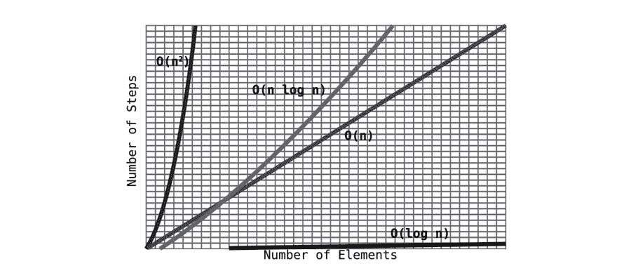

快速排序的步数恰好与 N * log N 吻合，这并非巧合。如果我们从更宏观的角度思考快速排序，就能理解为什么是这样。

每次对数组进行分区时，我们都会将其分解为两个子数组。假设基准值最终落在数组的中间位置——这是平均情况下的表现——那么这两个子数组的大小大致相等。

我们最多能将一个数组对半分解多少次，直到每个子数组的大小都变为 1？对于大小为 N 的数组，这需要 log N 次。请看下图：

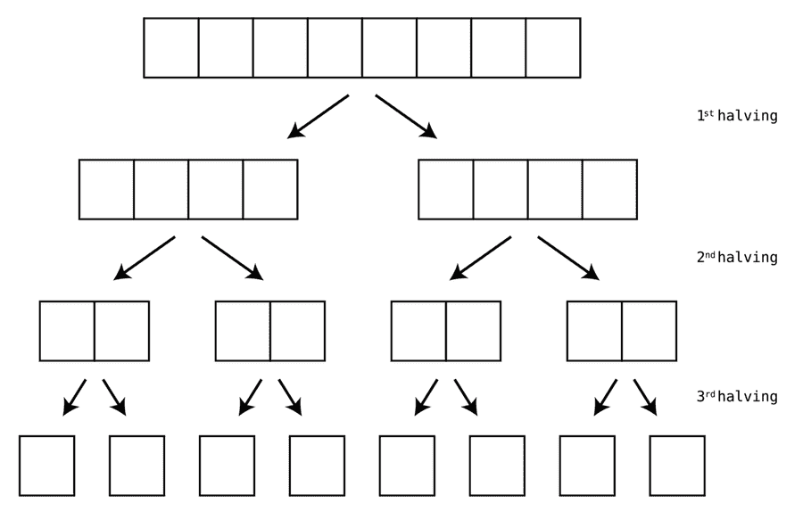

如图所示，对于大小为 8 的数组，我们需要三次对半分解才能将其缩减为八个独立的元素。这就是 log N，符合我们对 log N 的定义：将某个量对半分解直到得到 1 所需的次数。

这就是快速排序需要 N * log N 步的原因。我们有 log N 次对半分解，而每次对半分解时，我们都会对所有子数组进行分区，这些子数组的元素总和为 N。（它们加起来等于 N，因为所有子数组只是原始 N 元素数组的一部分。）

这一点在前面的图表中得到了说明。例如，在图表的顶部，我们对原始八个元素的数组进行分区，创建了两个大小为 4 的子数组。然后我们对这两个大小为 4 的子数组进行分区，这意味着我们再次对八个元素进行了分区。

请记住，O(N * log N) 只是一个近似值。实际上，我们首先还要对原始数组进行一次额外的 O(N) 分区。此外，数组并不会完美地分成两个相等的半区，因为基准值不参与对半分解。

下面是一个更现实的例子，其中我们在每次分区后忽略基准值：

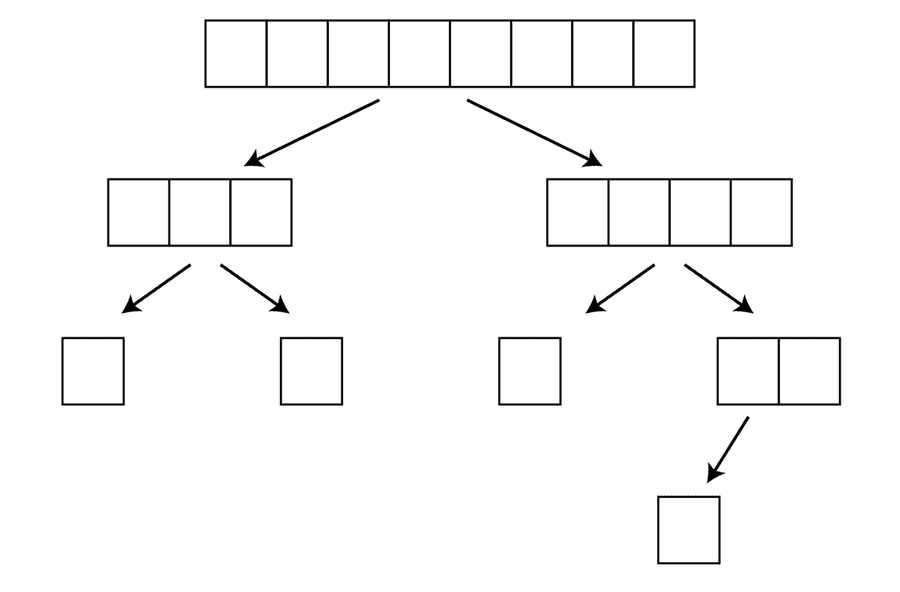

## 快速排序的最坏情况

对于之前遇到的许多其他算法，最佳情况是数组已经排序。然而，对于快速排序来说，最佳情况是每次分区后基准值恰好落在子数组的正中间。有趣的是，这通常发生在数组中的值充分打乱的情况下。


快速排序的最坏情况是基准值总是位于子数组的一端而不是中间。当数组完全按升序或降序排列时，就可能出现这种情况。该过程的可视化如下所示：

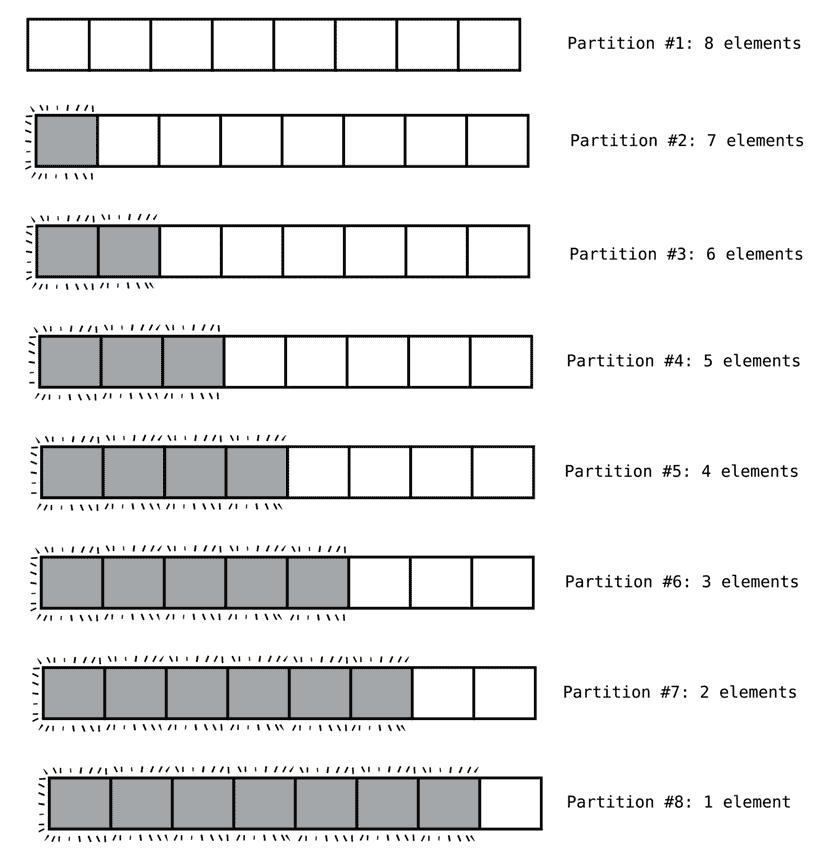

在此图中，你可以看到基准值总是位于每个子数组的左端。

虽然在这种情况下每次分区仍然只涉及一次交换，但由于比较次数增加，我们反而会吃亏。在第一个例子中，当基准值总是落在中间附近时，第一次分区之后的每个分区都是在相对较小的子数组上进行的（最大的子数组大小为 4）。然而在这个例子中，前五次分区都是在大小为 4 或更大的子数组上进行的。而每次分区的比较次数等于子数组中的元素个数。

因此，在这种最坏情况下，我们进行了大小为 8 + 7 + 6 + 5 + 4 + 3 + 2 + 1 的分区，总共产生了 36 次比较。

用更公式化的方式表述，对于 N 个元素，需要执行 N + (N - 1) + (N - 2) + (N - 3) … + 1 步。我们在讨论*获取所有乘积*时已经看到，这相当于 N² / 2 步，用大 O 表示法就是 O(N²)。

因此，在最坏情况下，快速排序的效率为 O(N²)。

### 快速排序 vs. 插入排序

现在我们已经掌握了快速排序，接下来将其与一种更简单的排序算法（如插入排序）进行比较：

|  | 最佳情况 | 平均情况 | 最坏情况 |
| --- | --- | --- | --- |
| 插入排序 | O(N) | O(N²) | O(N²) |
| 快速排序 | O(N log N) | O(N log N) | O(N²) |

我们可以看到，它们的最坏情况相同，并且在最佳情况下插入排序比快速排序更快。然而，快速排序优于插入排序的原因在于平均情况——再次强调，这是大多数情况下发生的情况。对于平均情况，插入排序需要惊人的 O(N²)，而快速排序则快得多，为 O(N log N)。

由于快速排序在平均情况下的优越性，许多编程语言在其内置排序函数的底层使用了快速排序。因此，你不太可能需要自己实现快速排序。然而，一个非常相似的算法在实际场景中会很有用——它叫做快速选择。

## 快速选择

假设你有一个随机顺序的数组，你不需要对它进行排序，但你想知道数组中第十小的值，或者第五大的值。如果我们有很多测试成绩，想知道第 25 百分位数，或者想找到中位数成绩，这就会很有用。

一种解决方法是先对整个数组进行排序，然后跳转到相应的索引位置。

然而，即使我们使用像快速排序这样快速的排序算法，平均情况下也需要至少 O(N log N)的时间。虽然这并不差，但我们可以用一种名为快速选择的巧妙算法做得更好。与快速排序类似，快速选择依赖于分区，可以看作是快速排序和二分查找的混合体。

正如你在本章前面看到的，分区之后，基准值会落在数组中的正确位置。快速选择利用了这一特性，具体方式如下：

假设我们有一个包含八个值的数组，我们想找到数组中第二小的值。

首先，我们对整个数组进行分区：


分区之后，基准值有望落在数组中间的某个位置：


这个基准值现在处于正确的位置，由于它位于第五个单元格，我们因此知道数组中第五小的值是什么。

现在，我们要找的是第二小的值，而不是第五小的。但我们知道第二小的值位于基准值的左侧某处。我们可以忽略基准值右侧的所有内容，专注于左侧子数组。正是在这方面，快速选择类似于二分查找：我们不断将数组分成两半，并专注于我们知道目标值所在的那一半。

接下来，我们对基准值左侧的子数组进行分区：


假设这个子数组的新基准值最终落在第三个单元格：


我们现在知道第三个单元格中的值处于正确位置，这意味着它是数组中第三小的值。因此，第二小的值必然位于它的左侧。现在我们对第三个单元格左侧的子数组进行分区：


在这次分区之后，最小值和第二小的值将落在数组中的正确位置：


然后我们可以从第二个单元格中取出值，并确信它是整个数组中第二小的值。快速选择的美妙之处在于，我们无需对整个数组进行排序就能找到正确的值。

对于快速排序，每次我们将数组减半时，都需要重新对每个元素（以子数组形式）进行分区，从而得到 O(N log N)。而对于快速选择，每次我们将数组减半时，只需要对我们关心的那一半进行分区——即我们知道目标值所在的那一半。

### 快速选择的效率

在分析快速选择的效率时，我们会发现平均情况下它为 O(N)。这是为什么呢？

在我们之前包含八个元素的数组示例中，我们执行了三次分区：一次在八个元素的数组上，一次在四个元素的子数组上，一次在两个元素的子数组上。

回想一下，每次分区大约需要 N 步（针对所运行的子数组）。因此，三次分区的总步数为 8 + 4 + 2 = 14 步。所以一个包含八个元素的数组大约需要 14 步。

对于一个包含 64 个元素的数组，我们大约需要 64 + 32 + 16 + 8 + 4 + 2 = 126 步。对于 128 个元素，大约需要 254 步。对于 256 个元素，最终需要 510 步。

我们可以看到，对于数组中的 N 个元素，大约需要 2N 步。

（另一种表述方式是：对于 N 个元素，我们需要 N + (N/2) + (N/4) + (N/8) + … + 2 步。这总是大约 2N 步。）

由于大 O 表示法忽略常数，我们去掉 2N 中的 2，并说快速选择的效率为 O(N)。

### 代码实现：快速选择

以下是一个快速选择方法的实现，可以放入前面描述的 SortableArray 类中。你会注意到它与快速排序方法非常相似：

```
quickselect(kthLowestValue, leftIndex, rightIndex) {
  if (rightIndex - leftIndex <= 0) {
    return this.array[leftIndex];
  }

  const pivotIndex = this.partition(leftIndex, rightIndex);

  if (kthLowestValue < pivotIndex) {
    return this.quickselect(kthLowestValue, leftIndex, pivotIndex - 1);
  }
```


```
} else if (kthLowestValue > pivotIndex) {
    return this.quickselect(kthLowestValue, pivotIndex + 1, rightIndex);
} else {
    return this.array[pivotIndex];
}
```

变量 `kthLowestValue` 让我们能够选择要搜索的值。我们可以搜索第二小的值、第五小的值，或者任何我们想要的值。

如果你想查找一个未排序数组中第二小的值，可以运行以下代码：

```
const array = [0, 50, 20, 10, 60, 30];
const sortableArray = new SortableArray(array);
console.log(sortableArray.quickselect(1, 0, array.length - 1));
```

`quickselect` 方法的第一个参数接受你要查找的位置，从索引 0 开始。我们传入 1 表示第二小的值。第二个和第三个参数分别是数组的左索引和右索引。

## 排序作为其他算法的关键

截至目前，我们所知的最快排序算法的时间复杂度为 O(N log N)。虽然快速排序是其中最流行的算法之一，但还有许多其他算法。归并排序是另一种著名的 O(N log N) 排序算法，将在本书的第二卷中介绍。

最快的排序算法是 O(N log N) 这一事实很重要，因为它也影响了其他算法。这是因为有些算法将排序作为更大流程的一部分。

例如，如果你还记得第 4 章 *用大 O 表示法加速代码* 中，我们处理了检查数组中是否存在重复值的问题。

我们看到的第一个解决方案使用了嵌套循环，效率为 O(N²)。虽然我们找到了一个 O(N) 的解决方案，但我曾附带提到该方法有一个缺点，即额外的内存消耗。（我将在第 19 章 *处理空间限制* 中详细讨论。）那么，假设 O(N) 的方法不可行。我们还有其他方法可以改进二次 O(N²) 的解决方案吗？提示：解决方案与排序有关！

如果我们预先对数组进行排序，就可以构建一个漂亮的算法。

假设原始数组是 `[5, 9, 3, 2, 4, 5, 6]`。这个数组中有两个 5，因此存在重复的情况。

现在，如果我们先对这个数组进行排序，它会变成 `[2, 3, 4, 5, 5, 6, 9]`。

接下来，我们可以使用一个循环来遍历每个数字。在检查每个数字时，我们会判断它是否与下一个数字相同。如果相同，我们就找到了重复项。如果遍历到末尾都没有找到重复项，那么我们就知道没有重复项。

这里的技巧是，通过预先排序数字，我们将重复的数字聚集在一起。

在我们的例子中，我们从第一个数字 2 开始。检查它是否与下一个数字相同。下一个数字是 3，所以不是重复。

然后检查 3 与后面的数字 4，继续。检查 4 与 5，继续。

此时，我们检查第一个 5 与后面的数字，即第二个 5。啊哈！我们找到了一对重复的数字，可以返回 true。

以下是 JavaScript 实现：

```
function hasDuplicateValue(array) {
    array.sort((a, b) => a - b);
    for (let index = 0; index < array.length - 1; index += 1) {
        if (array[index] === array[index + 1]) {
            return true;
        }
    }
    return false;
}
```

这里我们使用了 JavaScript 内置的 `sort` 函数。参数 `(a, b) => a - b` 是必要的，以确保 JavaScript 正确地对整数进行排序，而不是将它们当作字符串排序。

现在，这是一个将排序作为其组成部分之一的算法。这个算法的大 O 表示法是什么？

我们首先对数组进行排序。可以假设 JavaScript 的 `sort` 函数底层使用了类似快速排序的算法，效率为 O(N log N)。接下来，我们最多需要 N 步来遍历数组。因此，我们的算法需要 (N log N) + N 步。

你之前学过，当多个阶数相加时，大 O 表示法只保留最高阶的 N，因为低阶相对于高阶可以忽略不计。这里同样，N 相对于 N log N 可以忽略，因此我们将表达式简化为 O(N log N)。

就是这样！我们利用排序开发了一个 O(N log N) 的算法，这比原来的 O(N²) 算法有了显著的改进。

许多算法都将排序作为更大流程的一部分。现在我们知道，每当我们这样做时，算法至少是 O(N log N)。当然，如果算法还有其他操作，可能会更慢，但我们知道 O(N log N) 始终是基线。

## 总结

快速排序和快速选择算法是递归算法，为棘手的问题提供了优雅且高效的解决方案。它们是很好的例子，说明一个不显而易见但经过深思熟虑的算法如何提升性能。

既然我们已经看到了一些更高级的算法，现在我们将转向一个新的方向，探索更多数据结构。其中一些数据结构的操作涉及递归，因此我们已经做好了充分的准备。除了非常有趣之外，我们还将看到每种数据结构都有其特殊的能力，可以为各种应用带来显著的优势。

## 练习

以下练习让你有机会练习快速排序。这些练习的答案可以在 *第 13 章* 中找到。

1.  给定一个正数数组，编写一个函数，返回任意三个数的最大乘积。使用三个嵌套循环的方法时间复杂度为 O(N³)，非常慢。请使用排序实现该函数，使其计算速度为 O(N log N)。（其他一些实现甚至更快，但我们专注于使用排序作为加速代码的技术。）

2.  以下函数从一个整数数组中找出缺失的数字；也就是说，该数组应包含从 0 到数组长度的所有整数，但缺少一个。例如，数组 `[5, 2, 4, 1, 0]` 缺少数字 3，数组 `[9, 3, 2, 5, 6, 7, 1, 0, 4]` 缺少数字 8。

    以下是一个 O(N²) 的实现（子句 `if (!array.includes(number))` 本身已经是 O(N)，因为计算机需要搜索整个数组来找到 number）：

    ```
    function findMissingNumber(array) {
        for (let number = 0; number <= array.length; number += 1) {
            if (!array.includes(number)) {
                return number;
            }
        }
        return null;
    }
    ```

    使用排序编写该函数的新实现，使其仅需 O(N log N)。（其他一些实现甚至更快，但我们专注于使用排序作为加速代码的技术。）

3.  编写三个不同的函数实现，用于查找数组中的最大数。编写一个 O(N²) 的函数，一个 O(N log N) 的函数，以及一个 O(N) 的函数。

版权所有 © 2024, The Pragmatic Bookshelf.

# 第 14 章

基于节点的数据结构


在接下来的几章中，我们将探索多种数据结构，它们都建立在同一个概念——节点之上。你很快就会看到，节点是可能分散在计算机内存各处的数据片段。基于节点的数据结构提供了组织和访问数据的新方式，带来了许多显著的性能优势。

本章我们将探讨链表，它是最简单的基于节点的数据结构，也是后续章节的基础。你会发现链表与数组看似几乎相同，但在效率上有着自己的一套权衡，能在某些情况下为我们带来性能提升。

## 链表

与数组类似，链表也是一种表示列表项的数据结构。虽然表面上数组和链表看起来和行为方式非常相似，但在底层却存在巨大差异。

正如第 1 章​*数据结构为何重要*​中提到的，计算机内存可以想象成一组巨大的单元格，其中存储着数据位。你了解到，在创建数组时，代码会在内存中找到一组连续的空白单元格，并将其指定为应用程序存储数据的位置，如所示。

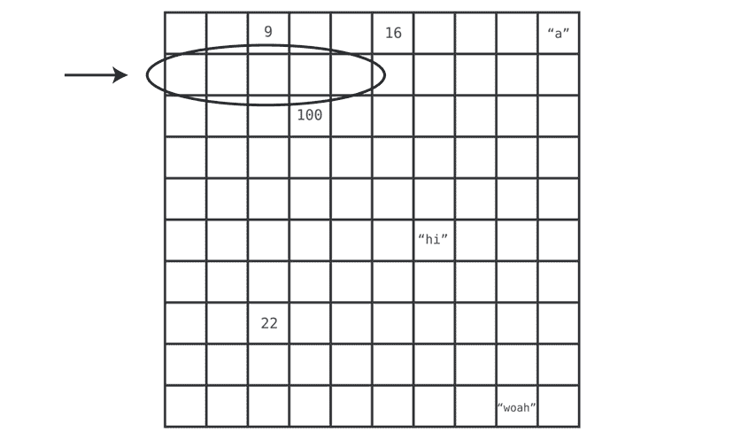

你还看到，计算机能够一步访问任何内存地址，并利用这一能力立即访问数组中的任何索引。如果你编写代码说“查找索引 4 处的值”，计算机可以在一步内定位到该单元格。同样，这是因为程序知道数组的起始内存地址——比如内存地址 1000——因此知道如果要查找索引 4，只需跳转到内存地址 1004 即可。

另一方面，链表的工作方式则不同。链表的数据不是连续的内存块，而是可以分散在计算机内存的不同单元格中。

分散在内存各处的连接数据被称为节点。在链表中，每个节点代表列表中的一个项。那么关键问题来了：如果节点在内存中并不相邻，计算机如何知道哪些节点属于同一个链表？

这就是链表的关键所在：每个节点还附带一点额外信息——即列表中下一个节点的内存地址。

这一额外的数据片段——指向下一个节点内存地址的指针——被称为链接。以下是链表的可视化描述：

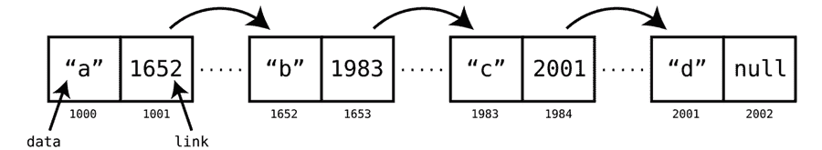

在这个例子中，我们有一个包含四个数据项的链表：`"a"`、`"b"`、`"c"`和`"d"`。然而，它使用了八个内存单元格来存储这些数据，因为每个节点由两个内存单元格组成。第一个单元格保存实际数据，第二个单元格作为链接，指示下一个节点在内存中的起始位置。最后一个节点的链接包含`null`，因为链表到此结束。

链表的第一个节点也称为头节点，最后一个节点称为尾节点。我们可以互换使用“头”和“第一个节点”这两个术语。

如果计算机知道链表从哪个内存地址开始，它就拥有了处理该链表所需的一切！由于每个节点都包含指向下一个节点的链接，计算机只需跟随每个链接就能将整个链表串起来。

链表的数据可以分散在计算机内存中，这是它相对于数组的一个潜在优势。相比之下，数组需要找到一整块连续的单元格来存储数据，随着数组大小的增长，这变得越来越困难。这些细节由编程语言在底层管理，因此你可能无需担心。不过，你很快就会看到，链表和数组之间还有更具体的差异，值得我们深入探讨。

## 实现一个链表

某些编程语言（如 Java）内置了链表。许多语言没有，但自己实现起来相当简单。

让我们用 JavaScript 创建自己的链表。我们将使用两个类来实现：`Node`和`LinkedList`。首先创建`Node`类：

```
class Node {
  constructor(data) {
    this.data = data;
    this.nextNode = null;
  }
}

export default Node;
```

`Node`类有两个属性：`data`包含节点的主要值（例如字符串`"a"`），而`nextNode`包含指向列表中下一个节点的链接。我们可以这样使用这个类：

```
const node1 = new Node('once');
const node2 = new Node('upon');
const node3 = new Node('a');
const node4 = new Node('time');

node1.nextNode = node2;
node2.nextNode = node3;
node3.nextNode = node4;
```

通过这段代码，我们创建了一个包含四个节点的列表，这些节点构成了包含字符串`'once'`、`'upon'`、`'a'`和`'time'`的列表。

请注意，在我们的实现中，`nextNode`引用的是另一个`Node`实例，而不是实际的内存地址数字。但效果是一样的——节点很可能分散在计算机内存中，但我们仍然可以使用节点的链接将列表串起来。

因此，在后续内容中，我们将简单地将每个链接视为指向另一个节点，而不是指向特定的内存地址。相应地，我们将使用简化的图表来描述链表，例如：

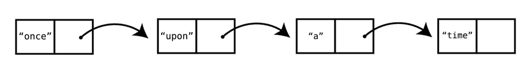

此图中的每个节点由两个单元格组成。第一个单元格包含节点的数据，第二个单元格指向下一个节点。

这反映了我们对`Node`类的实现。其中，`data`方法返回节点的数据，而`nextNode`方法返回列表中的下一个节点。在此上下文中，`nextNode`方法充当节点的链接。

虽然我们仅用`Node`类就能创建这个链表，但我们仍然需要一种简单的方法来告诉程序链表从哪里开始。为此，除了之前的`Node`类之外，我们还将创建一个`LinkedList`类。以下是`LinkedList`类的基本形式：

```
import Node from './node.js';

class LinkedList {
  constructor(firstNode=null) {
    this.firstNode = firstNode;
  }
}
```

注意，我们在代码开头导入了`node`，因为我们将`Node`类放在了与`LinkedList`类不同的文件中。

此时，`LinkedList`实例所做的只是跟踪列表的第一个节点。

之前我们创建了一个包含`node1`、`node2`、`node3`和`node4`的节点链。现在我们可以使用`LinkedList`类来引用这个列表，编写如下代码：

```
const list = new LinkedList(node1);
```

这个`list`变量现在充当链表的句柄，因为它是`LinkedList`的一个实例，可以访问列表的第一个节点。

一个重要的问题出现了：处理链表时，我们只能立即访问其头节点。这将会产生重大影响，我们很快就会看到。

乍一看，链表和数组很相似——它们都只是数据项的列表。然而，当我们深入分析时，会发现这两种数据结构的性能存在巨大差异！让我们进入四个经典操作：读取、搜索、插入和删除。

## 读取


如你所知，计算机可以在 O(1) 时间内从数组中读取数据。但现在我们来弄清楚从链表中读取数据的效率。

如果你想读取链表中第三个节点的值，计算机无法一步完成，因为它无法立即知道该节点在内存中的位置。毕竟，链表的每个节点可能位于内存中的任何位置！我们的程序能立即知道的只有链表第一个节点的内存地址；它无法直接知道其他节点的位置。

因此，要读取第三个节点，计算机必须经历一个过程。首先，它访问第一个节点。然后，它沿着第一个节点的链接找到第二个节点，再沿着第二个节点的链接找到第三个节点。

要访问任意节点，我们总是需要从第一个节点（我们最初唯一能访问的节点）开始，沿着节点链一直走到我们想要的节点。

于是，如果我们想读取列表中的最后一个节点，对于包含 N 个节点的列表，需要 N 步。与数组只需 O(1) 就能读取任意元素相比，链表的最坏读取情况为 O(N) 是一个主要劣势。但别担心，链表也会有它的高光时刻，我们很快就会看到。

### 代码实现：链表读取

让我们继续为 `LinkedList` 类添加一个 `read()` 方法：

```
read(index) {
let currentNode = this.firstNode;
let currentIndex = 0;
while (currentIndex < index) {
currentNode = currentNode.nextNode;
currentIndex += 1;

if (!currentNode) {
return null;
}
}

return currentNode.data;
}
```

例如，如果我们想读取列表中的第四个节点，我们可以通过传入节点索引来调用该方法，如下所示：

`list.read(3);`

让我们逐步了解这个方法的工作原理。

首先，我们创建一个名为 `currentNode` 的变量，它指向我们当前正在访问的节点。由于我们从访问头节点开始，我们这样写：

`let currentNode = this.firstNode;`

回想一下，`firstNode` 是 `LinkedList` 类的一个实例变量。

我们还跟踪 `currentNode` 的索引，以便知道何时到达目标索引。我们从 0 开始，因为第一个节点的索引是 0：

`let currentIndex = 0;`

然后我们启动一个循环，当 `currentIndex` 小于我们试图读取的索引时运行：

`while (currentIndex < index) {`

在循环的每次遍历中，我们访问列表中的下一个节点，并将其设为新的 `currentNode`：

`currentNode = currentNode.nextNode;`

同时将 `currentIndex` 增加 1：

`currentIndex += 1;`

在每次遍历结束时，我们检查是否到达了列表末尾，如果试图读取的索引不在列表中，则返回 `null`：

```
if (!currentNode) {
return null;
}
```

这样做的原因是，列表的最后一个节点的 `nextNode` 实际上是 `null`，因为最后一个节点从未被分配过自己的 `nextNode`。因此，当 `currentNode` 指向最后一个节点，然后我们执行 `current = currentNode.nextNode` 时，`currentNode` 就变成了 `null`。

最后，如果我们退出了循环，说明我们到达了目标索引。然后我们可以用以下代码返回节点的值：

`return currentNode.data;`

## 搜索

如你所知，搜索是指在列表中查找某个值并返回其索引。我们已经看到，数组上的线性搜索速度为 O(N)，因为计算机需要逐个检查每个值。

链表的搜索速度也是 O(N)。要搜索一个值，我们需要经历一个与读取类似的过程；也就是说，从头节点开始，沿着每个节点的链接到下一个节点。在此过程中，我们检查每个值，直到找到我们想要的内容。

### 代码实现：链表搜索

以下是在 JavaScript 中实现 `search()` 操作的方法。我们将这个方法命名为 `search()`，并传入要搜索的值：

```
search(value) {
let currentNode = this.firstNode;
let currentIndex = 0;

while (true) {
if (currentNode.data === value) {
return currentIndex;
}

currentNode = currentNode.nextNode;

if (!currentNode) {
break;
}

currentIndex += 1;
}

return null;
}
```

然后我们可以像这样搜索列表中的任何值：

`list.search('time');`

使用这个方法，我们会得到 `'time'` 在列表中的索引。在上面的例子中，这个索引是 3。

如你所见，搜索的机制与读取类似。主要区别在于循环不会在特定索引处停止，而是运行直到找到该值或到达列表末尾。

## 插入

不可否认，从性能角度来看，链表还没有给我们留下深刻印象。它们在搜索方面并不比数组好，在读取方面则差得多。但别担心——链表会有它的高光时刻。事实上，那个时刻就是现在。

在某些情况下，插入是链表相对于数组具有明显优势的操作之一。

回想一下，数组插入的最坏情况是程序将数据插入到索引 0 处，因为它首先必须将剩余数据向右移动一个单元格，这最终导致效率为 O(N)。然而，对于链表，在列表开头插入只需要一步——即 O(1)。让我们看看原因。

假设我们有如下链表：

如果我们想……

## 删除

链表在删除方面也很出色，尤其是在删除列表开头元素时。

要删除链表开头的节点，我们只需执行一步：将链表的 `firstNode` 改为指向第二个节点。

让我们回到包含值 `"once"`、`"upon"`、`"a"` 和 `"time"` 的链表示例。如果我们想删除值 `"once"`，我们可以简单地将链表改为从 `"upon"` 开始：

`list.firstNode = node2;`

与数组相比，删除第一个元素意味着将所有剩余数据向左移动一个单元格，这需要 O(N) 时间。

当涉及到删除链表的最后一个节点时，实际的删除只需一步——我们将倒数第二个节点的链接设为 `null`。然而，要访问倒数第二个节点本身就需要 N 步，因为我们需要从列表开头开始，沿着链接直到到达它。

下表对比了数组和链表在各种删除场景下的情况。注意它与插入的对比完全相同：

| 情况 | 数组 | 链表 |
| --- | --- | --- |
| 在开头删除 | 最坏情况 | 最佳情况 |
| 在中间删除 | 平均情况 | 平均情况 |
| 在末尾删除 | 最佳情况 | 最坏情况 |

虽然从链表开头或末尾删除很简单，但从中间任意位置删除则稍微复杂一些。

假设我们要从颜色链表示例中删除索引 2 处的值（`"purple"`），如下图所示：

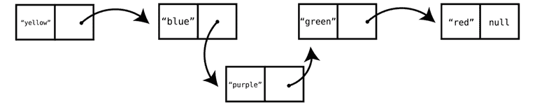

为此，我们需要首先访问紧挨着要删除节点之前的节点（`"blue"`）。然后将其链接改为指向紧挨着要删除节点之后的节点（`"green"`）。


下面的可视化演示了我们将“蓝色”节点的链接从“紫色”改为“绿色”的过程：

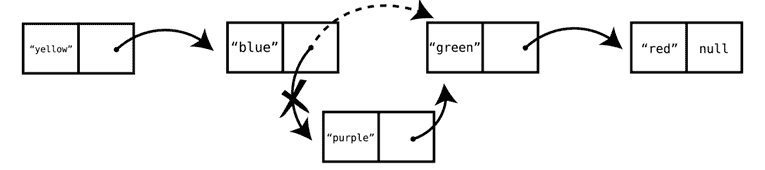

有趣的是，当我们从链表中删除一个节点时，该节点仍然存在于内存中的某个位置。我们只是通过确保链表中没有其他节点链接到它，从而将其从列表中移除。这样做的效果是从列表中删除了该节点，即使该节点仍然存在于内存中。

（不同的编程语言以不同方式处理这些被删除的节点。有些语言会自动检测到它们未被使用，并进行“垃圾回收”，释放内存。）

### 代码实现：链表删除

以下是 `LinkedList` 类中 `delete` 操作的可能实现。它被命名为 `delete`，我们传入要删除的 `index`：

```
delete(index) {
  if (index === 0) {
    this.firstNode = this.firstNode.nextNode;
    return;
  }

  let currentNode = this.firstNode;
  let currentIndex = 0;

  while (currentIndex < (index - 1)) {
    currentNode = currentNode.nextNode;
    currentIndex += 1;
  }

  const nodeAfterDeletedNode = currentNode.nextNode.nextNode;
  currentNode.nextNode = nodeAfterDeletedNode;
}
```

这个方法与我们之前看到的 `insert` 方法非常相似。让我们强调一些新颖之处。

该方法首先处理 `index` 为 0 的情况，即我们打算删除列表的第一个节点。其代码非常简单：

```
if (index === 0) {
  this.firstNode = this.firstNode.nextNode;
  return;
}
```

我们所做的只是将列表的 `firstNode` 指向当前第二个节点，然后就完成了！

方法的其余部分处理列表中其他位置的删除。为此，我们使用一个 `while` 循环来访问紧邻要删除节点之前的节点。这成为我们的 `currentNode`。

然后，我们获取紧邻要删除节点之后的节点，并将其存储在一个名为 `nodeAfterDeletedNode` 的变量中：

```
const nodeAfterDeletedNode = currentNode.nextNode.nextNode;
```

注意我们访问该节点的小技巧。它只是 `currentNode` 之后两个节点的那个节点！

然后我们修改 `currentNode` 的链接，使其指向 `nodeAfterDeletedNode`：

```
currentNode.nextNode = nodeAfterDeletedNode;
```

## 链表操作的效率

经过分析，链表和数组的比较结果如下：

| 操作 | 数组 | 链表 |
| --- | --- | --- |
| 读取 | O(1) | O(N) |
| 搜索 | O(N) | O(N) |
| 插入 | O(N)（末尾 O(1)） | O(N)（开头 O(1)） |
| 删除 | O(N)（末尾 O(1)） | O(N)（开头 O(1)） |

从整体来看，链表在时间复杂度方面似乎表现平平。它们在搜索、插入和删除方面与数组表现相似，而在读取方面则慢得多。既然如此，为什么还有人想要使用链表呢？

解锁链表威力的关键在于，实际的插入和删除步骤仅为 O(1)。

但这不只是在开头插入或删除时才相关吗……

## 链表实战

链表大显身手的一个场景是，当我们遍历一个列表并从中删除多个元素时。例如，假设我们正在构建一个应用程序，该程序会梳理现有的电子邮件地址列表，并删除所有格式无效的电子邮件地址。

无论列表是数组还是链表，我们都需要逐个元素地遍历整个列表来检查每个电子邮件地址。这自然需要 N 步。然而，让我们看看实际删除每个电子邮件地址时会发生什么。

对于数组，每次删除一个电子邮件地址时，我们还需要 O(N) 步来将剩余数据左移以填补空缺。所有这些移动都发生在我们甚至能检查下一个电子邮件地址之前。

假设每 10 个电子邮件地址中有 1 个无效。如果我们有 1000 个电子邮件地址的列表，那么大约有 100 个无效地址。那么我们的算法需要 1000 步来读取所有 1000 个电子邮件地址。但除此之外，删除操作可能还需要多达 100,000 步，因为对于被删除的 100 个地址中的每一个，我们可能需要移动多达 1000 个其他元素。

然而，对于链表，当我们遍历列表时，每次删除只需一步，因为我们只需更改一个节点的链接，使其指向适当的节点，然后继续。对于我们的 1000 封电子邮件，算法只需 1100 步，因为其中有 1000 步读取和 100 步删除。

由此可见，链表是一种非常适合在遍历整个列表时进行插入或删除操作的数据结构，因为我们永远不必担心在插入或删除时移动其他数据。

## 双向链表

链表有多种不同的变体。我们到目前为止讨论的链表是经典链表，但通过一些细微的修改，我们可以赋予链表额外的超能力。

链表的一种变体是双向链表。

双向链表与链表类似，只是每个节点有两个链接——一个指向下一个节点，另一个指向前一个节点。此外，双向链表始终跟踪头节点和尾节点，而不仅仅是头节点。

以下是双向链表的样子：

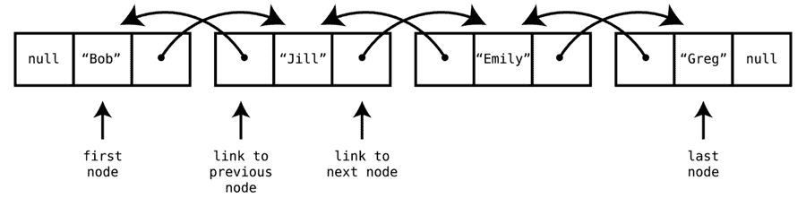

我们可以实现双向链表的核心……

## 作为双向链表的队列

由于双向链表可以立即访问列表的前端和后端，因此它们可以在 O(1) 时间内向任一侧插入数据，也可以在 O(1) 时间内从任一侧删除数据。

由于双向链表可以在 O(1) 时间内向末尾插入数据，并在 O(1) 时间内从开头删除数据，因此它们成为队列的完美底层数据结构。

我们之前看过*队列*，你会记得它们是只能从末尾插入数据、从开头移除数据的列表。你在那里了解到队列是抽象数据类型的一个例子，并且我们可以使用数组在底层实现它们。

现在，由于队列在末尾插入并从开头删除，数组作为底层数据结构只能算差强人意。虽然数组在末尾插入是 O(1)，但从开头删除却是 O(N)。

另一方面，双向链表在末尾插入和从开头删除都是 O(1)。这就是为什么它非常适合作为队列的底层数据结构。

### 代码实现：基于双向链表的队列

在实现队列本身之前，我们首先向 `DoublyLinkedList` 类添加一个方法。这个 `popHead` 方法移除头节点并返回它：

```
popHead() {
  const poppedNode = this.firstNode;
  this.firstNode = this.firstNode.nextNode;
  this.firstNode.previousNode = null;
  return poppedNode;
}
```

如你所见，我们通过将列表的 `this.firstNode` 改为当前第二个节点来有效地删除第一个节点。我们还确保新的头节点不链接到任何前一个节点。最后，我们返回刚刚删除的节点。


有了这个基础，我们现在可以创建一个基于双向链表的队列实现：

```
import DoublyLinkedList from './doubly_linked_list.js';

class Queue {
  constructor() {
    this.data = new DoublyLinkedList();
  }

  enqueue(element) {
    this.data.append(element);
  }

  dequeue() {
    const dequeuedNode = this.data.popHead();
    return dequeuedNode.data;
  }

  read() {
    if (!this.data.firstNode) { return null; }

    return this.data.firstNode.data;
  }
}
```

`Queue` 类在其方法中使用了我们的 `DoublyLinkedList`。`enqueue` 方法依赖于 `DoublyLinkedList` 的 `append` 方法：

```
enqueue(element) {
  this.data.append(element);
}
```

类似地，`dequeue` 方法利用了链表从头部删除的能力：

```
dequeue() {
  const dequeuedNode = this.data.popHead();
  return dequeuedNode.data;
}
```

通过使用双向链表实现队列，我们现在可以以快速的 O(1) 时间复杂度在队列中插入和删除元素。这真是双倍的厉害。

## 总结

正如我们所看到的，数组和链表之间的细微差别为我们提供了新的方式，使代码比以往更快。

通过研究链表，你还学习了节点的概念。然而，链表只是基于节点的数据结构中最简单的一种。在接下来的章节中，你将学习更复杂也更有趣的基于节点的结构——它们将揭示节点如何带来巨大的能力和效率。

## 练习

以下练习为你提供了练习链表的机会。这些练习的答案可以在*第 14 章*中找到。

1.  为经典的 `LinkedList` 类添加一个方法，打印列表中的所有值。

2.  为 `DoublyLinkedList` 类添加一个方法，按逆序打印列表中的所有值。

3.  为经典的 `LinkedList` 类添加一个方法，返回列表中的最后一个值。假设你不知道列表中有多少个元素。

4.  这是一个棘手的问题。为经典的 `LinkedList` 类添加一个方法，反转列表；也就是说，如果原始列表是 A -> B -> C，那么列表的所有链接都应改变，使得 C -> B -> A。

5.  这里有一个巧妙的链表小谜题。假设你可以访问经典链表中间某个位置的节点，但无法访问链表本身；也就是说，你有一个指向 `Node` 实例的变量，但无法访问 `LinkedList` 实例。在这种情况下，如果你沿着这个节点的链接，你可以找到从该中间节点到末尾的所有值，但你无法找到列表中位于该节点之前的节点。

    编写代码，有效地从列表中删除这个节点。整个剩余列表应保持完整，仅移除这个节点。

版权所有 © 2024，The Pragmatic Bookshelf。

# 第 15 章 用二叉搜索树加速一切

有时，我们可能希望以特定顺序排列数据。例如，我们可能想要一个按字母顺序排列的名字列表，或者一个按价格从低到高排列的产品列表。

虽然我们可以使用像快速排序这样的排序算法将数据排列成完美的升序，但这需要付出代价。正如我们所看到的，即使是最快的算法也需要 O(N log N) 的时间。因此，如果我们经常需要对数据进行排序，那么一开始就保持数据有序是明智的，这样我们就不需要重新排序了。

有序数组是一种简单但有效的保持数据有序的工具。对于某些操作，它也很快速，因为它具有 O(1) 的读取和 O(log N) 的搜索……

## 树

在上一章中，你通过链表了解了基于节点的数据结构。在经典的链表中，每个节点包含一个链接，将节点连接到另一个节点。树也是一种基于节点的数据结构，但在树中，每个节点可以有指向多个节点的链接。

以下是一个简单树的可视化表示：

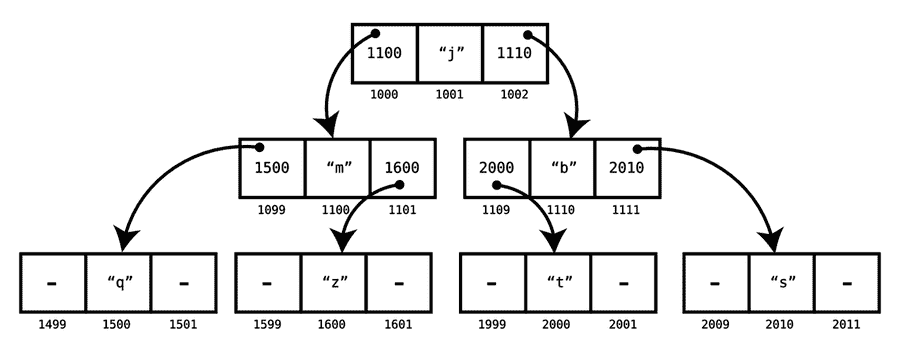

在这个例子中，每个节点都有指向另外两个节点的链接。为了简单起见，我们可以用视觉方式表示这棵树，而不显示所有内存地址：


树有自己独特的术语：

*   最顶层的节点（在我们的例子中是“j”）称为根。是的，在我们的图片中，根位于树的顶部；这是树的典型描绘方式。

*   在我们的例子中，我们会说“j”是“m”和“b”的父节点。相反，“m”和“b”是“j”的子节点。类似地，“m”是“q”和“z”的父节点，而“q”和“z”是“m”的子节点。

*   就像家谱一样，一个节点可以有后代和祖先。节点的后代是从该节点衍生出的所有节点，而节点的祖先则是衍生出该节点的所有节点。在我们的例子中，“j”是树中所有其他节点的祖先，因此所有其他节点都是“j”的后代。

*   树被认为有层级。每个层级是树中的一行。我们的示例树有三个层级：

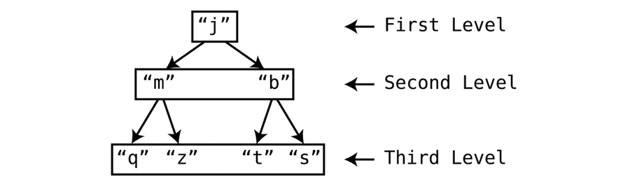

*   树的一个属性是它的平衡程度。当树中节点的子树具有相同数量的节点时，这棵树就是平衡的。

例如，前面的树被认为是完美平衡的。如果你观察每个节点，它的两个子树具有相同数量的节点。根节点（“j”）有两个子树，每个子树包含三个节点。你会发现树中的每个节点也是如此。例如，“m”节点也有两个子树，每个子树包含一个节点。

另一方面，下面的树是不平衡的：


如你所见，根的右子树包含的节点比左子树多，导致不平衡。

## 二叉搜索树

存在许多不同类型的基于树的数据结构，但在本章中，我们将重点介绍一种特定的树，称为二叉搜索树。

注意这里有两个形容词：二叉和搜索。

二叉树是一种每个节点有零个、一个或两个子节点的树。

二叉搜索树是一种同时遵守以下规则的二叉树：

*   每个节点最多可以有一个左子节点和一个右子节点。

*   节点的左后代只能包含小于节点本身的值。同样，节点的右后代只能包含大于节点本身的值。

以下是一个二叉搜索树的例子，其中的值是数字：

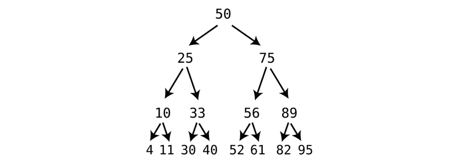

注意，每个节点都有一个值小于自身的子节点（用左箭头表示），以及一个值大于自身的子节点（用右箭头表示）。

此外，请注意，50 的所有左后代都小于它。同时，50 的所有右后代都大于它。每个节点都遵循相同的模式。

虽然下面的例子是一棵二叉树，但它不是二叉搜索树：


这是一个二叉树，因为每个节点有零个、一个或两个子节点。但它不是二叉搜索树，因为根节点有两个左子节点；也就是说，它有两个小于它的子节点。一个有效的二叉搜索树最多只能有一个左（较小）子节点和一个右（较大）子节点。

在 JavaScript 中，树节点的实现可能如下所示：

```javascript
class TreeNode {
constructor(value, left=null, right=null) {
this.value = value;
this.leftChild = left;
this.rightChild = right;
}
}
export default TreeNode;
```

然后我们可以像这样构建一个简单的树：

```javascript
const node1 = new TreeNode(25);
const node2 = new TreeNode(75);
let root = new TreeNode(50, node1, node2);
```

由于二叉搜索树的独特结构，我们可以非常快速地搜索其中的任何值，接下来我们将看到这一点。

## 搜索

下面又是一个二叉搜索树：


在二叉搜索树中搜索的算法如下：

1.  指定一个节点为当前节点。（在算法开始时，根节点是第一个当前节点。）

2.  检查当前节点的值。

3.  如果找到了我们要找的值，太好了！

4.  如果要找的值小于当前节点，则在其左子树中搜索。

5.  如果要找的值大于当前节点，则在其右子树中搜索。

6.  重复步骤 1 到 5，直到找到我们要找的值，或者直到到达树的底部，在这种情况下，我们的...

## 插入

正如我之前提到的，二叉搜索树在插入方面表现最佳。现在我们将看到原因。

假设我们要将数字 45 插入到示例树中。我们首先要做的是找到正确的节点来挂载 45。为了开始搜索，我们从根节点开始，如下图所示：

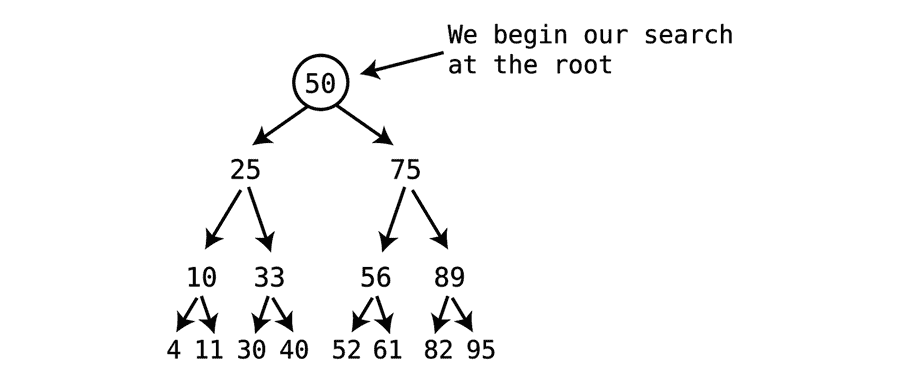

由于 45 小于 50，我们向下钻取到左子节点：

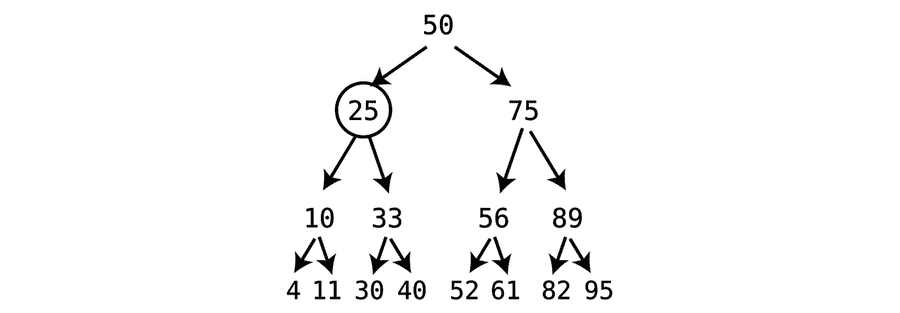

由于 45 大于 25，我们必须检查右子节点：

由于 45 大于 33，我们检查 33 的右子节点：

此时，我们已经到达了...

## 删除

删除是二叉搜索树中最不直接的操作，需要一些谨慎的操作。

假设我们要从这个二叉搜索树中删除 4：


首先，我们执行搜索以找到 4。我们不再可视化这个搜索过程，因为你已经掌握了。

一旦找到 4，我们可以一步删除它：

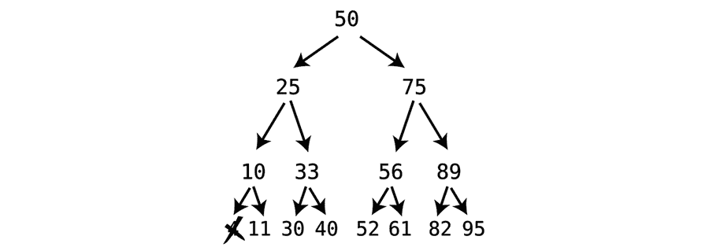

嗯，这很简单。但让我们看看尝试删除 10 时会发生什么：

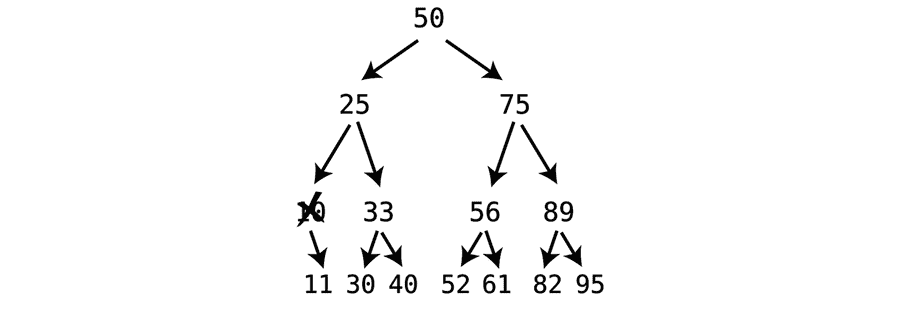

我们最终得到一个不再连接到树的 11。我们不能允许这种情况，因为我们会永远丢失 11。

然而，为了解决这个问题，我们可以将 11 插入到原来 10 的位置：

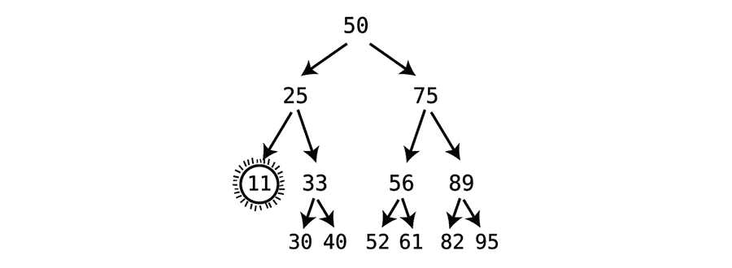

到目前为止，我们的删除算法遵循以下规则：

*   如果被删除的节点没有子节点，直接删除它。

*   如果被删除的节点有一个子节点，删除该节点并将子节点插入到被删除节点原来的位置。

### 删除有两个子节点的节点

删除有两个子节点的节点是最复杂的情况。假设我们要删除这棵树中的 56：

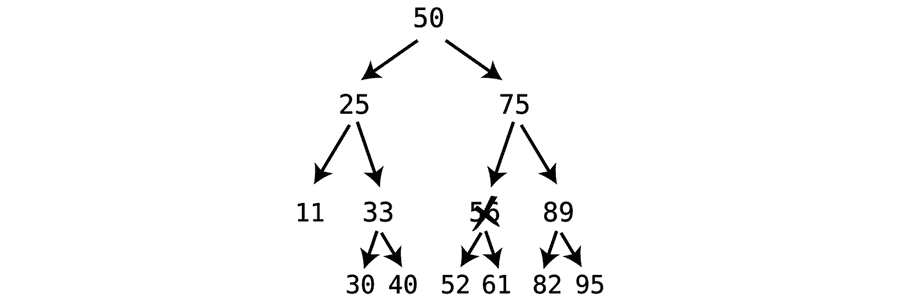

我们该如何处理它原来的子节点 52 和 61？我们不能将它们都移动到 56 的位置。这时就需要用到删除算法的下一条规则：

*   当删除有两个子节点的节点时，用后继节点替换被删除的节点。后继节点是所有大于被删除节点的值中最小值的那个子节点。

这句话有点绕。换句话说：如果我们将被删除节点及其所有后代按升序排列，后继节点就是紧挨着被删除数字的下一个数字。

在这个例子中，很容易找出哪个节点是后继节点，因为被删除节点只有两个后代。如果将数字 52-56-61 按升序排列，56 之后的下一个数字是 61。

一旦找到后继节点，我们将其插入到被删除节点的位置。所以我们将 56 替换为 61：

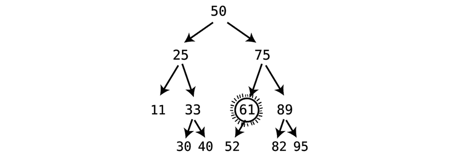

### 寻找后继节点

计算机如何找到后继节点？当我们在树的高层删除节点时，这可能会变得棘手。

以下是寻找后继节点的算法：

*   访问被删除值的右子节点，然后持续访问每个后续子节点的左子节点，直到没有更多的左子节点。最底部的值就是后继节点。

让我们在一个更复杂的例子中再次演示。让我们删除根节点：

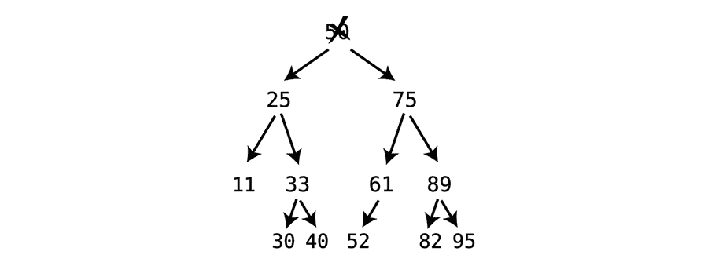

现在我们需要将后继节点插入到原来 50 的位置，并将其变为根节点。所以让我们找到后继节点。

为此，我们首先访问被删除节点的右子节点，然后不断向左下降，直到到达一个没有左子节点的节点：

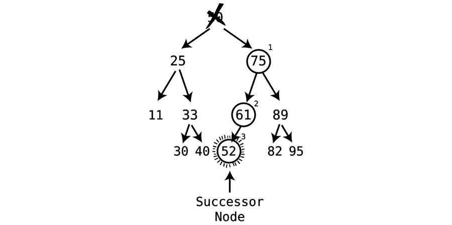

结果发现 52 就是后继节点。

现在我们已经找到了后继节点，我们将其插入到被删除的节点位置：

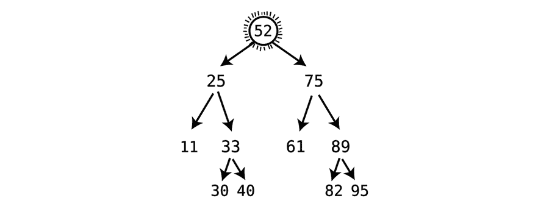

完成！

### 后继节点带有右子节点

不过，我们还没有考虑到一种情况，即后继节点本身有一个右子节点。让我们重新创建前面的树，但给 52 添加一个右子节点：

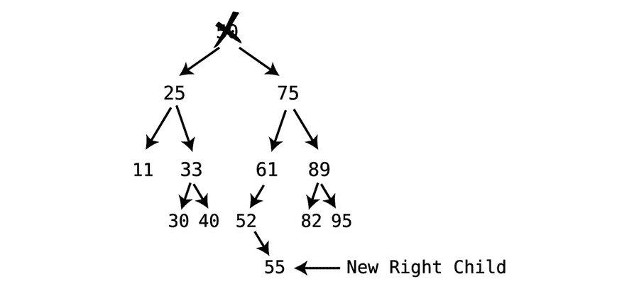

在这种情况下，我们不能简单地将后继节点（52）插入到根节点，因为这样会使其子节点 55 悬空。这引出了我们删除算法的另一条规则：

*   如果后继节点有一个右子节点，在将后继节点插入到被删除节点的位置后，将后继节点原来的右子节点放到后继节点原来的位置。

这又是一个绕口的句子，所以让我们一步步来。

首先，我们将后继节点（52）插入到根节点。这导致 55 没有父节点而悬空：

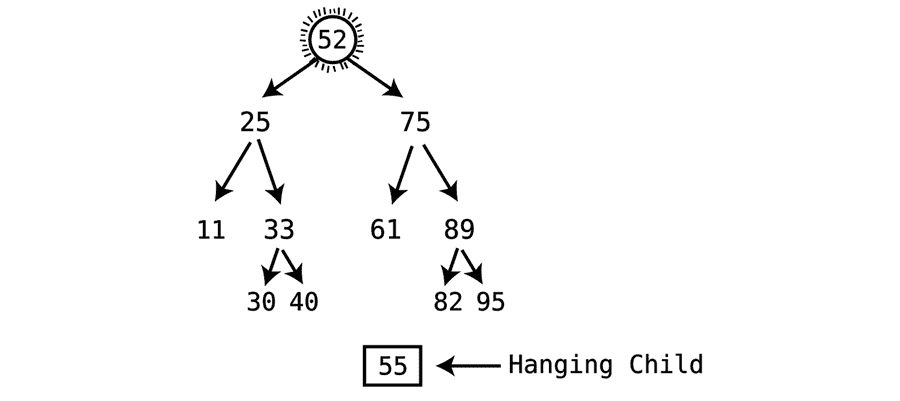

接下来，我们将 55 放到后继节点原来的位置，即 61 的左子节点：

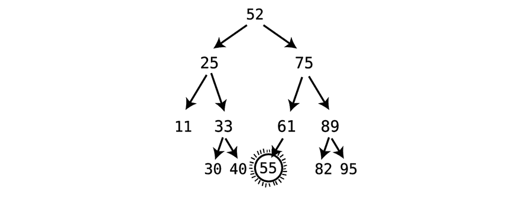

### 后继节点是右子节点

有时后继节点本身就是一个右子节点。而且有时这个后继节点可能也有自己的右子节点。例如，在下面的树中，如果我们删除 3，4 就成为后继节点，因为 4 没有左子节点：


在这里，当我们把后继节点插入到被删除的 3 的位置时，我们不会让 5 悬空并重新连接它。相反，我们只需将 5 保留为 4 的右子节点。

现在真的完成了。

### 完整的删除算法

综合所有步骤，以下是二叉搜索树删除的算法：

*   如果被删除的节点没有子节点，直接删除它。

*   如果被删除的节点有一个子节点，删除该节点并将子节点插入到被删除节点原来的位置。


*   当删除一个有两个子节点的节点时，用后继节点替换被删除的节点。后继节点是值大于被删除节点的所有节点中值最小的那个子节点。
*   要找到后继节点：先访问被删除节点的右子节点，然后持续访问每个后续子节点的左子节点，直到没有左子节点为止。最底部的节点就是后继节点。如果被删除节点的右子节点没有左子节点，那么该右子节点本身就成为后继节点。
*   如果后继节点有一个右子节点（并且后继节点本身是其父节点的左子节点），那么在将后继节点插入到被删除节点的位置后，将后继节点原来的右子节点变成其后继节点原父节点的左子节点。

### 代码实现：二叉搜索树的删除操作

以下是二叉搜索树删除操作的 JavaScript 实现。主要方法是 `delete`，它依赖于一个名为 `replaceWithSuccessorNode` 的辅助方法：

```javascript
function deleteNode(valueToDelete, node) {
  let currentNode = node;
  let parentOfCurrentNode;
  let childOfDeletedNode;
  let nodeToDelete;

  while (currentNode) {
    if (currentNode.value === valueToDelete) {
      nodeToDelete = currentNode;
      break;
    }

    parentOfCurrentNode = currentNode;
    if (valueToDelete < currentNode.value) {
      currentNode = currentNode.leftChild;
    } else if (valueToDelete > currentNode.value) {
      currentNode = currentNode.rightChild;
    }
  }

  if (!nodeToDelete) { return null; }

  if (nodeToDelete.leftChild && nodeToDelete.rightChild) {
    replaceWithSuccessorNode(nodeToDelete);
  } else { // 被删除节点有 0 或 1 个子节点
    childOfDeletedNode = (nodeToDelete.leftChild || nodeToDelete.rightChild);

    if (!parentOfCurrentNode) {
      nodeToDelete.value = childOfDeletedNode.value;
      nodeToDelete.leftChild = childOfDeletedNode.leftChild;
      nodeToDelete.rightChild = childOfDeletedNode.rightChild;
    } else if (nodeToDelete === parentOfCurrentNode.leftChild) {
      parentOfCurrentNode.leftChild = childOfDeletedNode;
    } else if (nodeToDelete === parentOfCurrentNode.rightChild) {
      parentOfCurrentNode.rightChild = childOfDeletedNode;
    }
  }

  return nodeToDelete;
}

function replaceWithSuccessorNode(node) {
  let successorNode = node.rightChild;
  let parentOfSuccessorNode;

  if (!successorNode.leftChild) {
    node.value = successorNode.value;
    node.rightChild = successorNode.rightChild;
    return;
  }

  while (successorNode.leftChild) {
    parentOfSuccessorNode = successorNode;
    successorNode = successorNode.leftChild;
  }

  if (successorNode.rightChild) {
    parentOfSuccessorNode.leftChild = successorNode.rightChild;
  } else {
    parentOfSuccessorNode.leftChild = null;
  }

  node.value = successorNode.value;
  return successorNode;
}
```

代码量不小，但我们会逐步讲解。

与搜索和插入操作不同，我们编写删除代码时没有使用递归。虽然我们可以用递归方式编写删除方法，但我发现递归删除代码更难理解。因此，我们使用循环在树中移动。

让我们从 `delete` 方法开始讲解。

调用此方法时，我们传入要删除的值（`valueToDelete`）以及树的根节点（`node`）。

首先，我们创建几个变量：

```javascript
let currentNode = node;
let parentOfCurrentNode;
let childOfDeletedNode;
let nodeToDelete;
```

`currentNode` 最初指向根节点，但会在我们向下遍历树寻找要删除的值时更新。`parentOfCurrentNode` 顾名思义，将跟踪 `currentNode` 的父节点。`childOfDeletedNode` 变量也是如此。我们需要跟踪这些变量的原因稍后会变得清晰。最后，`nodeToDelete` 最终将指向我们要删除的节点。

然后，我们开始一个循环，在树中搜索 `valueToDelete`。这本质上是一个搜索操作，但同样，这次我们使用迭代而不是递归：

```javascript
while (currentNode) {
  if (currentNode.value === valueToDelete) {
    nodeToDelete = currentNode;
    break;
  }

  parentOfCurrentNode = currentNode;
  if (valueToDelete < currentNode.value) {
    currentNode = currentNode.leftChild;
  } else if (valueToDelete > currentNode.value) {
    currentNode = currentNode.rightChild;
  }
}
```

这段代码在树中向下移动，随着移动更新 `currentNode`，搜索 `valueToDelete`。如果找不到（即该值不在树中），循环会自行终止，因为 `currentNode` 会变为 null。

然而，如果找到了 `valueToDelete`，我们将 `currentNode` 声明为 `nodeToDelete` 并跳出循环。注意，我们还跟踪了 `parentOfCurrentNode`，它现在是我们要删除的节点的父节点。

接下来，我们有这样一段代码：

```javascript
if (!nodeToDelete) { return null; }
```

如果我们要删除的值一开始就不在树中，则返回 null。

该方法的其余部分执行实际的删除操作。我们首先处理最复杂的情况，即要删除的节点有两个子节点：

```javascript
if (nodeToDelete.leftChild && nodeToDelete.rightChild) {
  replaceWithSuccessorNode(nodeToDelete);
}
```

这里，我们将繁重的工作外包给辅助方法 `replaceWithSuccessorNode`，稍后我们会分析它。不过，我们先继续往下看。

接下来，我们处理被删除节点有 0 或 1 个子节点的情况：

```javascript
else {
  childOfDeletedNode = (nodeToDelete.leftChild || nodeToDelete.rightChild);

  if (!parentOfCurrentNode) {
    nodeToDelete.value = childOfDeletedNode.value;
    nodeToDelete.leftChild = childOfDeletedNode.leftChild;
    nodeToDelete.rightChild = childOfDeletedNode.rightChild;
  } else if (nodeToDelete === parentOfCurrentNode.leftChild) {
    parentOfCurrentNode.leftChild = childOfDeletedNode;
  } else if (nodeToDelete === parentOfCurrentNode.rightChild) {
    parentOfCurrentNode.rightChild = childOfDeletedNode;
  }
}
```

这里，我们首先设置一个新变量 `childOfDeletedNode`，它代表被删除节点的子节点。如果被删除节点没有子节点，该变量将被设置为 null。这个变量至关重要，因为当我们删除 `nodeToDelete` 时，需要将其子节点放到被删除节点原来的位置。

这正是上面代码中两个 else if 子句所做的事情。它判断被删除节点是其父节点的左子节点还是右子节点，并相应地将 `childOfDeletedNode` 附加到被删除节点的父节点上。


`if` 语句的第一个子句处理的是我们正在删除根节点的情况。为了确保我们将被删除根节点的子节点标记为新的根节点，我们用其子节点覆盖根节点。

这就引出了我们方法的最后一行，它只是返回被删除的节点，以防我们可能将其用于其他目的：

```
return nodeToDelete;
```

现在，让我们回到被删除节点有两个子节点的情况。我们之前的代码调用了辅助方法 `replaceWithSuccessorNode`，所以现在我们来逐步分析它。

调用此方法时，我们传入将要被删除的节点，该节点将被命名为 `node`。

接下来，我们使用以下代码识别后继节点：

```
let successorNode = node.rightChild;
let parentOfSuccessorNode;

if (!successorNode.leftChild) {
    node.value = successorNode.value;
    node.rightChild = successorNode.rightChild;
    return;
}

while (successorNode.leftChild) {
    parentOfSuccessorNode = successorNode;
    successorNode = successorNode.leftChild;
}
```

这里，我们从被删除节点的右子节点开始，然后沿着左子节点向下移动树，直到无法继续。那个最底部的节点就是我们的后继节点。我们还记录了后继节点的父节点。

然而，如果后继节点恰好是被删除节点的右子节点（当被删除节点的右子节点没有左子节点时发生），我们只需将后继节点插入到被删除节点的位置。如果是这种情况，这就是我们需要做的全部。但如果后继节点是其父节点的左子节点，我们就继续。

接下来，我们将后继节点从其位置移除：

```
if (successorNode.rightChild) {
    parentOfSuccessorNode.leftChild = successorNode.rightChild;
} else {
    parentOfSuccessorNode.leftChild = null;
}
```

我们的代码处理了两种可能的情况。第二种情况（在 `else` 子句中）更简单，即后继节点没有子节点。在这种情况下，我们通过用 `null` 替换它来清除后继节点。

在更复杂的情况下，即后继节点有一个右子节点，我们将该右子节点放在后继节点原来的位置。

我们已经成功地将后继节点从树中移除，但还有一个关键步骤。记住，我们最初的目标并不是删除后继节点。我们的整个目标是删除树中更高位置的节点。

为此，我们将后继节点插入到我们要删除的节点的位置：

```
node.value = successorNode.value;
```

注意，我们并没有插入实际的后继节点；相反，我们只是用它的值覆盖 `node` 的值，从而有效地删除了 `node`。

就是这样！虽然过程曲折，但我们做到了。

### 二叉搜索树删除的效率

与搜索和插入一样，从树中删除通常也是 O(log N)。这是因为删除需要一次搜索，再加上一些处理悬挂子节点的额外步骤。相比之下，从有序数组中删除一个值是 O(N)，因为需要将元素向左移动以填补删除值留下的空隙。

## 二叉搜索树的实际应用

我们已经看到，二叉搜索树在搜索、插入和删除方面具有 O(log N) 的效率，这使得它成为需要存储和操作有序数据场景下的高效选择。特别是当我们经常修改数据时，因为虽然有序数组在搜索数据时与二叉搜索树一样快，但在插入和删除数据方面，二叉搜索树要快得多。

例如，假设我们正在创建一个维护书籍标题列表的应用程序。我们希望应用程序具有以下功能：

*   我们的程序应该能够按字母顺序打印书籍标题列表。
*   我们的程序应该允许持续...

## 二叉搜索树的遍历

现在，我们已经了解了如何从二叉搜索树中搜索、插入和删除数据。不过，我提到过，我们还希望能够按字母顺序打印整个书籍标题列表。我们该怎么做呢？

首先，我们需要能够访问树中的每一个节点。访问节点是访问它们的另一种说法。访问数据结构中每个节点的过程称为遍历数据结构。

其次，我们需要确保按字母升序遍历树，以便按该顺序打印列表。你可以通过多种方式遍历树，但对于这个应用程序，我们将执行所谓的**中序遍历**，以便按字母顺序打印每个标题。

递归是执行遍历的绝佳工具。我们将创建一个名为 `traverse` 的递归函数，它可以在特定节点上调用。该函数执行以下步骤：

1.  在节点的左子节点上递归调用自身（`traverse`）。该函数会一直调用，直到遇到一个没有左子节点的节点。
2.  访问该节点。（对于我们的书籍标题应用程序，我们在此步骤打印节点的值。）
3.  在节点的右子节点上递归调用自身（`traverse`）。该函数会一直调用，直到遇到一个没有右子节点的节点。

对于这个递归算法，基本情况是当我们对一个不存在的子节点调用 `traverse` 时，在这种情况下，我们直接返回，不做任何进一步操作。

以下是一个适用于我们书籍标题列表的 JavaScript `traverseAndPrint` 函数。注意它多么简洁：

```
function traverseAndPrint(node) {
    if (!node) { return; }

    traverseAndPrint(node.leftChild);
    console.log(node.value);
    traverseAndPrint(node.rightChild);
}
```

让我们逐步分析中序遍历。

我们首先对“Moby Dick”调用 `traverseAndPrint`。这反过来又对“Moby Dick”的左子节点（即“Great Expectations”）调用 `traverseAndPrint`：

```
traverseAndPrint(node.leftChild);
```

不过，在继续之前，我们将把以下事实添加到调用栈中：我们正处于“Moby Dick”函数的中间，并且正处于遍历其左子节点的中间：


然后我们继续执行 `traverseAndPrint("Great Expectations")`，它对“Great Expectations”的左子节点（即“Alice in Wonderland”）调用 `traverse_and_print`。

在继续之前，让我们将 `traverseAndPrint("Great Expectations")` 添加到调用栈中：


`traverseAndPrint("Alice in Wonderland")` 对“Alice in Wonderland”的左子节点调用 `traverseAndPrint`。然而，没有左子节点（基本情况），所以什么也没发生。`traverseAndPrint` 的下一行是：

```
console.log(node.value);
```

这一行打印出“Alice in Wonderland”。

接下来，该函数尝试对“Alice in Wonderland”的右子节点执行 `traverseAndPrint`：

```
traverseAndPrint(node.rightChild);
```

然而，没有右子节点（基本情况），所以该函数直接返回，不做任何进一步操作。

由于我们已经完成了函数 `traverseAndPrint("Alice in Wonderland")`，我们检查调用栈，看看在这个递归迷宫中我们进行到了哪里：


啊，对了。我们正处于 `traverseAndPrint("Great Expectations")` 的中间，并且刚刚完成了对其左子节点的 `traverseAndPrint` 调用。让我们将其从调用栈中弹出：

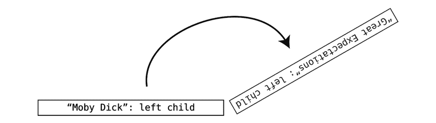


让我们继续。函数 `next` 打印出 "Great Expectations"，然后在其右子节点（即 "Lord of the Flies"）上调用 `traverseAndPrint`。不过，在继续之前，我们先在调用栈中标记当前函数的位置：


现在执行 `traverseAndPrint("Lord of the Flies")`。首先，我们在其左子节点上调用 `traverseAndPrint`，但它没有左子节点。接着，我们打印 "Lord of the Flies"。最后，我们在其右子节点上调用 `traverseAndPrint`，但它也没有右子节点，因此函数执行完毕。

查看调用栈，我们发现之前正在对 "Great Expectations" 的右子节点执行 `traverseAndPrint`。我们可以将该帧从栈中弹出并继续，如下图所示：

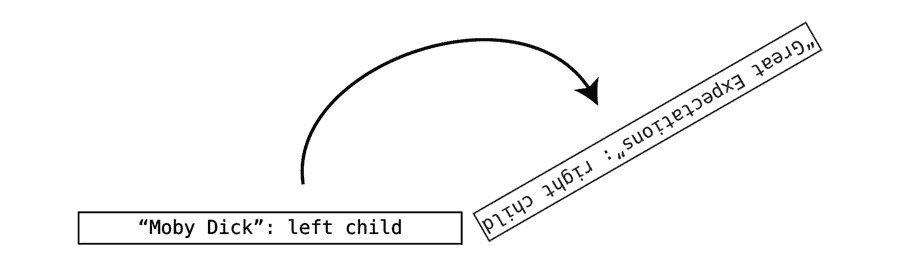

现在，我们恰好也完成了 `traverseAndPrint("Great Expectations")` 中的所有操作，因此可以回到调用栈查看下一步该做什么：


可以看到，我们之前正在对 "Moby Dick" 的左子节点执行 `traverseAndPrint`。我们可以将该帧从调用栈中弹出（此时栈为空），然后继续执行 `traverseAndPrint("Moby Dick")` 中的下一步，即打印 "Moby Dick"。

接着，我们在 "Moby Dick" 的右子节点上调用 `traverseAndPrint`。我们将该帧添加到调用栈中：


为简洁起见（尽管可能已经来不及了），我将让你从这里自行完成 `traverseAndPrint` 函数的剩余部分。

当函数执行完毕时，我们将按以下顺序打印节点：

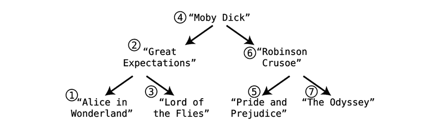

这就是我们如何实现按字母顺序打印书名这一目标的过程。注意，树的遍历是 `O(N)`，因为根据定义，遍历会访问树的所有 `N` 个节点。

## 总结

二叉搜索树是一种强大的基于节点的数据结构，它既能维护顺序，又能提供快速的搜索、插入和删除操作。它比其近亲链表更复杂，但提供了巨大的价值。

然而，二叉搜索树只是树的一种类型。树有许多不同的种类，每种类型在特定场景下都有独特的优势。在下一章中，我们将发现另一种树，它将在一种特定但常见的场景中带来独特的速度优势。

## 练习题

以下练习为你提供了练习二叉搜索树的机会。这些练习的答案可在第 15 章中找到。

1.  假设你从一个空的二叉搜索树开始，并按以下顺序插入数字序列：[1, 5, 9, 2, 4, 10, 6, 3, 8]。

    画出二叉搜索树的示意图。记住，数字是按给出的顺序插入的。

2.  如果一棵平衡良好的二叉搜索树包含 1,000 个值，那么搜索其中一个值最多需要多少步？

3.  编写一个算法，找出二叉搜索树中的最大值。

4.  在正文中，我演示了如何使用中序遍历打印所有书名的列表。另一种遍历树的方式称为前序遍历。以下是应用于我们的图书应用的代码：

    ```
    function traverseAndPrint(node) {
      if (!node) { return; }
      console.log(node.value);
      traverseAndPrint(node.leftChild);
      traverseAndPrint(node.rightChild);
    }
    ```

    对于正文中的示例树（包含 "Moby Dick" 和其他书名），写出前序遍历打印书名的顺序。提醒一下，示例树如下：

    

5.  另一种遍历形式称为后序遍历。以下是应用于我们的图书应用的代码：

    ```
    function traverseAndPrint(node) {
      if (!node) { return; }
      traverseAndPrint(node.leftChild);
      traverseAndPrint(node.rightChild);
      console.log(node.value);
    }
    ```

    对于正文中的示例树（与上一练习相同），写出后序遍历打印书名的顺序。

版权所有 © 2024, The Pragmatic Bookshelf.

# 第 16 章 用堆理清优先级

现在我们已经了解了树，这解锁了许多新的数据结构。在上一章中，我们重点讨论了二叉搜索树，但还有许多其他类型的树。与所有数据结构一样，每种树都有其自身的优缺点，关键在于知道在特定情况下该使用哪一种。

在本章中，我们将探索堆（heap），这是一种树形数据结构，具有特殊能力，可用于特定场景，尤其是当我们希望持续跟踪数据集中最大或最小的数据元素时。

为了理解堆的作用，我们先来看一个完全不同的数据结构：...

## 优先队列

你之前学过队列，知道队列是一种按先进先出（FIFO）顺序处理数据的列表。本质上，这意味着数据只能插入到队列的末尾，而数据只能从队列的前端访问和移除。在访问队列数据时，我们优先考虑数据插入的顺序。

优先队列是一种列表，其删除和访问操作与经典队列相同，但插入操作类似于有序数组。也就是说，我们只从优先队列的前端删除和访问数据，但在插入数据时，我们始终确保数据按特定顺序排序。

优先队列的一个经典应用是管理医院急诊室分诊系统的应用程序。在急诊室，我们并不严格按照到达顺序治疗病人，而是根据症状的严重程度来治疗。如果有人突然带着危及生命的伤势到达，该患者将被置于队列的前端，即使患有流感的病人已经提前数小时到达。

假设我们的分诊系统将患者病情的严重程度按 1 到 10 分级，10 表示最危急。我们的优先队列可能如下所示：


在确定下一个要治疗的病人时，我们总是选择优先队列前端的病人，因为该人的需求最紧急。在这种情况下，下一个要治疗的病人是患者 C。

如果现在有一位新患者到达，病情严重程度为 3，我们首先将该患者放在优先队列中的适当位置。我们称此人为患者 E：


优先队列是一种抽象数据类型——它可以使用其他更基础的数据结构来实现。实现优先队列的一种直接方法是使用有序数组；也就是说，我们使用一个数组并应用以下约束：

*   插入数据时，我们确保始终保持正确的顺序。

*   数据只能从数组的末尾移除（这代表优先队列的前端）。

这种方法很直接，但现在我们来分析其效率。


优先队列有两个主要操作：删除和插入。

我们在第 1 章*为什么数据结构很重要*中看到，从数组前端删除元素的时间复杂度是 O(N)，因为我们必须将所有数据移动以填补索引 0 处产生的空缺。然而，我们巧妙地调整了实现方式，将数组的末尾视为优先队列的前端。这样，我们总是从数组末尾删除元素，时间复杂度为 O(1)。

由于删除操作是 O(1)，我们的优先队列目前状态良好。但插入操作呢？

你了解到，向有序数组中插入元素的时间复杂度是 O(N)，因为我们必须检查数组中最多 N 个元素来确定新数据应该放在哪里。（即使我们提前找到了正确的位置，也需要将所有剩余数据向右移动。）

因此，基于数组的优先队列的删除操作是 O(1)，插入操作是 O(N)。如果我们预期优先队列中有许多元素，那么 O(N) 的插入操作可能会给应用程序带来一些真正令人不快的拖累。

正因为如此，计算机科学家发现了另一种数据结构，它可以作为优先队列更高效的基础。这种数据结构就是堆。

## 堆

堆有几种不同的类型，但我们将重点讨论二叉堆。

二叉堆是一种特殊的二叉树。提醒一下，二叉树是一种每个节点最多有两个子节点的树。（上一章的二叉搜索树就是二叉树的一种特定类型。）

现在，即使是二叉堆也有两种形式：最大堆和最小堆。我们目前将使用最大堆，但稍后你会看到，两者之间的区别微不足道。

接下来，我将把这种数据结构简称为堆，尽管我们具体讨论的是二叉最大堆。

堆是一种满足以下条件的二叉树：

*   每个节点的值必须大于其所有后代节点的值。这个规则称为堆条件。

*   树必须是完全二叉树。（我稍后会解释其含义。）

让我们逐一分析这两个条件，先从堆条件开始。

### 堆条件

堆条件规定，每个节点的值必须大于其每一个后代节点的值。

例如，下面的树满足堆条件，因为每个节点都大于其任何后代节点，如图示所示。


在这个例子中，根节点 100 没有比它更大的后代节点。同样，88 大于它的两个子节点，25 也是如此。

下面的树不是有效的堆，因为它不满足堆条件：


如你所见，92 大于它的父节点 88。这违反了堆条件。

注意，堆的结构与二叉搜索树截然不同。在二叉搜索树中，每个节点的右子节点大于它。然而，在堆中，一个节点永远不会有任何大于它的后代节点。正如他们所说，“二叉搜索树不是堆。”（大概是这样。）

我们也可以构建一个具有相反堆条件的堆，即每个节点必须包含比其任何后代节点更小的值。这种堆被称为最小堆，我之前提到过。我们将继续关注最大堆，其中每个节点必须大于其所有后代节点。最终，堆是最大堆还是最小堆并不重要，因为两者在其他方面完全相同；它们只是堆条件相反。除此之外，基本思想是一样的。

### 完全二叉树

现在，我们来讨论堆的第二条规则——树必须是完全二叉树。

完全二叉树是一种节点完全填满的树；没有缺失节点。因此，如果你从左到右读取树的每一层，所有节点都在那里。然而，最底层可以有空缺位置，只要这些空缺位置的右侧没有节点即可。最好通过示例来演示。

下面的树是完全二叉树，因为树的每一层（即每一行）都完全填满了节点：


下面的树不是完全二叉树，因为第三层有一个空缺位置（而该空缺位置的右侧还有其他节点存在）：


现在，下面的树实际上被认为是完全二叉树，因为它的空缺位置仅限于最底层，并且空缺位置的右侧没有节点：


因此，堆是一种满足堆条件且是完全二叉树的树。以下是堆的另一个示例：


这是一个有效的堆，因为每个节点都大于其任何后代节点，并且树也是完全二叉树。虽然最底层有一些空缺，但这些空缺仅限于树的最右侧。

## 堆的性质

现在你已经知道什么是堆，让我们来研究它的一些有趣性质。

虽然堆条件规定了堆的特定排序方式，但这种排序在堆中搜索值时仍然毫无用处。

例如，假设在上面的堆中，我们想要搜索值 3。如果我们从根节点 100 开始，应该搜索它的左子树还是右子树？在二叉搜索树中，我们知道 3 一定在 100 的左子树中。然而，在堆中，我们只知道 3 必须是 100 的后代，而不能是它的祖先。但我们不知道接下来应该搜索哪个子节点。实际上，3 恰好是 100 的右子树中的节点，但它也可能很容易地出现在左子树中。

因此，与二叉搜索树相比，堆被认为是弱有序的。虽然堆有一定的顺序（后代不能大于祖先），但这种顺序不足以使堆值得进行搜索。

堆的另一个性质（现在可能已经很明显，但值得指出）是：在堆中，根节点始终具有最大值。（在最小堆中，根节点包含最小值。）这将是堆成为实现优先队列的绝佳工具的关键。在优先队列中，我们总是希望访问具有最高优先级的元素。使用堆，我们始终知道可以在根节点中找到它。因此，根节点将代表优先级最高的元素。

堆有两个主要操作：插入和删除。正如我们指出的，在堆中搜索需要检查每个节点，因此搜索通常不是堆上下文中实现的操作。（堆也可以有一个可选的读取操作，它只是查看根节点的值。）

在我们继续讨论堆的主要操作如何工作之前，让我再定义一个术语，因为它将在接下来的算法中大量使用。

堆有一个称为最后一个节点的东西。堆的最后一个节点是其最底层最右侧的节点。

看一下这个堆。


在这个堆中，3 是最后一个节点，因为它是最底层最右侧的节点。

接下来，让我们进入堆的主要操作。

## 堆的插入

要向堆中插入一个新值，我们执行以下算法：


1. 我们创建一个包含新值的节点，并将其插入到最底层下一个可用的最右侧位置。这样，该值就成为堆的最后一个节点。
2. 接着，我们将这个新节点与其父节点进行比较。
3. 如果新节点大于其父节点，则交换新节点与父节点。
4. 重复步骤 3，实际上是将新节点在堆中向上移动，直到新节点的父节点值大于它。

让我们看看这个算法的实际运行。如果我们要向堆中插入一个 40，会发生以下情况：

步骤 1：将 40 添加为堆的最后一个节点：

注意，以下做法是错误的：

将 40 放在...

## 寻找最后一个节点

虽然插入算法看起来很简单，但有一个小问题。第一步要求我们将新值作为堆的最后一个节点。但这引出了一个问题：我们如何找到将成为最后一个节点的位置？

让我们再看一下插入 40 之前的堆：


通过观察图示，我们知道要使 40 成为最后一个节点，应将其设为 8 的右子节点，因为那是底层行中下一个可用的位置。

但计算机没有眼睛，它不会将堆视为若干行。它只能看到根节点，并可以沿着链接访问子节点。那么，我们如何为计算机设计一个算法来找到新值的位置呢？

以我们的示例堆为例。当我们从根节点 100 开始时，我们是否告诉计算机在 100 的右子树中寻找新最后一个节点的下一个可用位置？

虽然在我们的示例堆中，下一个可用位置确实在 100 的右子树中，但请看下面另一个堆：


在这个堆中，新最后一个节点的下一个可用位置将是 88 的右子节点，而 88 位于 100 的左子树中。

因此，本质上，就像无法在堆中进行搜索一样，如果不检查每个节点，就无法高效地找到堆的最后一个节点（或容纳新最后一个节点的下一个可用位置）。

那么，我们如何找到下一个可用节点呢？我稍后会解释，但现在，我们暂且称这个问题为“最后一个节点问题”。我保证我们会回来讨论它。

与此同时，让我们探讨堆的另一个主要操作：删除。

## 堆的删除

关于从堆中删除值，首先要了解的是：我们只删除根节点。这与优先队列的工作方式完全一致，即我们只访问和移除优先级最高的元素。

删除堆根节点的算法如下：

1. 将最后一个节点移动到根节点的位置，从而移除原来的根节点。
2. 将根节点下沉到其正确位置。我稍后会解释下沉的工作原理。

假设我们要从堆中删除根节点。


在这个例子中，根节点是 100。要删除它，我们将最后一个节点（这里是 3）覆盖到根的位置。因此，我们将 3 移动到原来 100 的位置：


现在，我们不能让堆保持原样，因为堆条件已被违反：3 目前小于它的一些（实际上，大部分）后代。为了恢复正确状态，我们需要将 3 下沉，直到堆条件恢复。

下沉比上浮稍微复杂一些，因为每次下沉一个节点时，我们有两个可能的方向：我们可以将其与左子节点或右子节点交换。（而上浮时，每个节点只有一个父节点可以交换。）

以下是下沉的算法。为清晰起见，我们将要下沉的节点称为“下沉节点”。（我知道这听起来有点恶心。）

1. 检查下沉节点的两个子节点，找出较大的那个。
2. 如果下沉节点小于两个子节点中较大的那个，则将下沉节点与那个较大的子节点交换。
3. 重复步骤 1 和 2，直到下沉节点没有比它大的子节点。

让我们看看实际运行。

步骤 1：下沉节点 3 当前有两个子节点：88 和 25。88 是较大的那个，由于 3 小于 88，我们将下沉节点与 88 交换：


步骤 2：下沉节点现在有了两个新子节点：87 和 16。87 是较大的那个，且大于下沉节点。因此我们将下沉节点与 87 交换：


步骤 3：下沉节点的当前子节点是 86 和 50。86 是较大的那个，且大于下沉节点，因此我们将 86 与下沉节点交换：


此时，下沉节点没有比它大的子节点了。（实际上，它根本没有子节点。）因此我们完成了，堆条件已恢复。

我们总是将下沉节点与其两个子节点中较大的那个交换，原因在于：如果与较小的子节点交换，会立即违反堆条件。看看当我们尝试将下沉节点与较小的子节点交换时会发生什么。

让我们再次以下沉节点 3 作为根节点开始：


我们将 3 与 25（较小的子节点）交换：


现在，25 成为了 88 的父节点。由于 88 大于其父节点，堆条件被破坏了。

与插入类似，从堆中删除的时间复杂度为 O(log N)，因为我们需要将节点从根下沉，经过堆的所有 log(N)层。

## 堆与有序数组

现在你已经了解了堆的效率，让我们看看为什么它是实现优先队列的绝佳选择。

以下是有序数组与堆的对比：

|  | 有序数组 | 堆 |
| --- | --- | --- |
| 插入 | O(N) | O(log N) |
| 删除 | O(1) | O(log N) |

乍一看，两者似乎不相上下。有序数组在插入方面比堆慢，但在删除方面比堆快。

然而，堆被认为是更好的选择，原因如下。

虽然 O(1)极快，但 O(log N)仍然非常快。相比之下，O(N)则较慢。基于此，我们可以将上表改写为：

|  | 有序数组 | 堆 |
| --- | --- | --- |
| 插入 | 慢 | 非常快 |
| 删除 | 极快 | 非常快 |

这样一来，堆为何被认为是更好的选择就更加清晰了。我们更愿意使用一个始终非常快的数据结构，而不是一个有时极快、有时慢的数据结构。

值得指出的是，优先队列通常以大致相等的比例执行插入和删除操作。想想急诊室的例子，我们期望治疗每一位进来的病人。因此，我们希望插入和删除都很快。如果任一操作缓慢，我们的优先队列就会效率低下。

因此，使用堆可以确保优先队列的两个主要操作——插入和删除——都以非常快的速度执行。

## 最后一个节点问题……再次出现

虽然堆的删除算法看起来很简单，但它再次引出了最后一个节点的问题。


我解释说，删除的第一步要求我们将最后一个节点移动并使其成为根节点。但首先，我们该如何找到最后一个节点呢？

在解决最后一个节点的问题之前，我们先探讨一下为什么插入和删除如此依赖最后一个节点。为什么我们不能将新值插入到堆的其他位置？为什么在删除时，不能用除最后一个节点以外的其他节点替换根节点？

现在，如果你仔细想想，就会意识到，如果我们使用其他节点，堆将变得不完整。但这引出了下一个问题：为什么完整性对堆如此重要？

完整性之所以重要，是因为我们希望确保堆保持良好的平衡性。

为了更清楚地理解这一点，让我们再看一下插入操作。假设我们有如下堆：


如果我们想向这个堆中插入一个 5，那么保持堆平衡的唯一方法是将 5 作为最后一个节点——在这种情况下，让它成为 10 的子节点：


任何替代此算法的做法都会导致不平衡。假设在另一个平行宇宙中，算法是将新节点插入到最左下角的节点，我们可以通过遍历左子节点直到到达底部来轻松找到它。这样会使 5 成为 15 的子节点：


我们的堆现在有些失衡，而且很容易看出，如果我们继续在最左下角的位置插入新节点，堆会变得更加不平衡。

类似地，当从堆中删除时，我们总是将最后一个节点变为根节点，否则堆可能会变得不平衡。再次以我们的示例堆为例：


如果在那个平行宇宙中，我们总是将最右下角的节点移动到根位置，那么 10 将成为根节点，最终我们会得到一个不平衡的堆，它有一堆左后代和零个右后代。

这种平衡之所以如此重要，是因为它使我们能够实现 `O(log N)` 的操作。在像下面这样严重不平衡的树中，遍历可能需要 `O(N)` 步：


但这又让我们回到了最后一个节点的问题。什么样的算法能让我们始终如一地找到任意堆的最后一个节点？（同样，无需遍历所有 N 个节点。）

而这就是我们情节突然转折的地方。

## 数组作为堆

由于找到最后一个节点对堆的操作至关重要，并且我们希望确保找到最后一个节点是高效的，因此堆通常使用数组来实现。

虽然到目前为止，我们一直假设每棵树都由通过链接相互连接的独立节点组成（就像链表一样），但现在你将看到，我们也可以使用数组来实现堆。堆本身可以是一种抽象数据类型，其底层实际上使用了一个数组。

下面的图示展示了如何使用数组来存储堆的值。


其工作原理是，我们将每个节点分配给数组中的一个索引。在此图中，每个节点的索引位于节点下方的方框中。如果你仔细观察，会发现我们按照特定的模式分配每个节点的索引。

根节点始终存储在索引 0 处。然后我们向下移动一层，从左到右，将每个节点分配给数组中下一个可用的索引。因此，在第二层，左节点（88）成为索引 1，右节点（25）成为索引 2。当我们到达一层的末尾时，我们向下移动到下一层并重复此模式。

现在，我们使用数组来实现堆的原因在于，它解决了最后一个节点的问题。如何解决？

当我们以这种方式实现堆时，最后一个节点始终是数组的最后一个元素。由于在将每个值分配给数组时，我们是从上到下、从左到右进行的，因此最后一个节点始终是数组中的最后一个值。在前面的示例中，你可以看到 3 是最后一个节点，也是数组中的最后一个值。

由于最后一个节点始终位于数组的末尾，找到最后一个节点就变得非常简单：我们只需访问最后一个元素即可。此外，当我们将新节点插入堆时，我们将其插入到数组的末尾，使其成为最后一个节点。

在深入探讨基于数组的堆的其他细节之前，我们已经可以开始编写其基本结构了。以下是我们用 JavaScript 实现的堆的开头部分：

```javascript
class Heap {
  constructor() {
    this.data = [];
  }

  rootNode() {
    return this.data[0];
  }

  lastNode() {
    return this.data[this.data.length - 1];
  }
}
```

如你所见，我们将堆初始化为一个空数组。我们有一个 `rootNode` 方法，它返回该数组的第一个元素，还有一个 `lastNode` 方法，它返回该数组的最后一个值。

### 遍历基于数组的堆

正如你所见，堆的插入和删除算法要求我们能够在堆中渗透。而渗透又要求我们能够通过访问节点的父节点或子节点来遍历堆。但是，当所有值都仅仅存储在数组中时，我们该如何从一个节点移动到另一个节点呢？如果我们能简单地沿着每个节点的链接走，遍历堆会很简单。但现在堆底层是一个数组，我们如何知道哪些节点是相互连接的？

这有一个有趣的解决方案。事实证明，当我们按照前面描述的模式分配堆节点的索引时，堆的以下特性始终成立：

*   要找到任意节点的左子节点，可以使用公式 `(index * 2) + 1`。
*   要找到任意节点的右子节点，可以使用公式 `(index * 2) + 2`。

再看一下前面的图示，重点关注索引 4 处的 16。要找到它的左子节点，我们将它的索引（4）乘以 2 再加 1，得到 9。这意味着索引 9 是索引 4 处节点的左子节点。

类似地，要找到索引 4 的右子节点，我们将 4 乘以 2 再加 2，得到 10。这意味着索引 10 是索引 4 的右子节点。

由于这些公式始终有效，我们能够将数组视为一棵树。

让我们将这两个方法添加到 `Heap` 类中：

```javascript
leftChildIndex(index) {
  return (index * 2) + 1;
}

rightChildIndex(index) {
  return (index * 2) + 2;
}
```

每个方法接受数组中的一个索引，并分别返回左子节点或右子节点的索引。

以下是基于数组的堆的另一个重要特性：

*   要找到一个节点的父节点，可以使用公式 `Math.floor((index - 1) / 2)`。

注意，这个公式使用了向下取整除法，意味着我们丢弃小数点后的任何数字。例如，`Math.floor(3 / 2)` 返回 1，而不是更精确的 1.5。

再次以我们的示例堆为例，重点关注索引 4。如果我们取该索引，减去 1，然后除以 2，得到 1。正如你在图示中看到的，索引 4 处节点的父节点位于索引 1。

因此，我们现在可以向 `Heap` 类添加另一个方法：

```javascript
parentIndex(index) {
  return Math.floor((index - 1) / 2);
}
```

该方法接受一个索引，并计算其父节点的索引。

### 代码实现：堆的插入


现在我们已经掌握了堆的基本要素，接下来实现插入算法：

```
insert(value) {
  this.data.push(value);
  let newNodeIndex = this.data.length - 1;

  while (newNodeIndex > 0
    && (this.data[newNodeIndex] > this.data[this.parentIndex(newNodeIndex)])) {
    const parentIndex = this.parentIndex(newNodeIndex);
    [this.data[parentIndex], this.data[newNodeIndex]] =
      [this.data[newNodeIndex], this.data[parentIndex]];

    newNodeIndex = parentIndex;
  }
}
```

像往常一样，我们来分解一下。

我们的 `insert` 方法接受要插入堆中的值。我们做的第一件事是将这个新值添加到数组的末尾，使其成为最后一个节点：

```
this.data.push(value);
```

接下来，我们跟踪新节点的索引，因为稍后会用到它。目前，该索引是数组中的最后一个索引：

```
let newNodeIndex = this.data.length - 1;
```

然后，我们使用 while 循环将新节点向上渗透到正确的位置：

```
while (newNodeIndex > 0
  && (this.data[newNodeIndex] > this.data[this.parentIndex(newNodeIndex)])) {
```

只要满足两个条件，这个循环就会运行。主要条件是新节点大于其父节点。我们还设定了一个条件，即新节点的索引必须大于 0，因为如果我们试图将根节点与其不存在的父节点进行比较，可能会发生奇怪的事情。

每次循环运行时，我们都会交换新节点与其父节点，因为新节点当前大于父节点：

```
const parentIndex = this.parentIndex(newNodeIndex);
[this.data[parentIndex], this.data[newNodeIndex]] =
  [this.data[newNodeIndex], this.data[parentIndex]];
```

然后，我们相应地更新新节点的索引：

```
newNodeIndex = parentIndex;
```

由于这个循环只在新节点大于其父节点时运行，因此一旦新节点到达正确位置，循环就会结束。

### 代码实现：堆的删除

接下来，我们来看一下从堆中删除一个元素的实现。我们将这个方法命名为 `pop`，因为 pop 这个术语暗示着重点在于返回被删除的值，供其他代码使用，比如在优先队列中（我们很快就会看到）。我们不仅仅是要删除根节点的值，还要将该值传递给其他代码进行处理。

主要方法是 `pop` 方法，但为了使代码更简洁，我们创建了两个辅助方法：`hasGreaterChild` 和 `findLargerChildIndex`。

代码如下：

```
pop() {
  if (this.data.length === 1) {
    const valueToDelete = this.rootNode();
    this.data = [];
    return valueToDelete;
  }

  const valueToDelete = this.rootNode();
  this.data[0] = this.data.pop();
  let trickleNodeIndex = 0;

  while (this.hasGreaterChild(trickleNodeIndex)) {
    const largerChildIndex = this.findLargerChildIndex(trickleNodeIndex);

    [this.data[trickleNodeIndex], this.data[largerChildIndex]] =
      [this.data[largerChildIndex], this.data[trickleNodeIndex]];

    trickleNodeIndex = largerChildIndex;
  }

  return valueToDelete;
}

hasGreaterChild(index) {
  return ((this.leftChildIndex(index) < this.data.length
    && this.data[this.leftChildIndex(index)] > this.data[index])
    || (this.rightChildIndex(index) < this.data.length
    && this.data[this.rightChildIndex(index)] > this.data[index]));
}

findLargerChildIndex(index) {
  if (!this.data[this.rightChildIndex(index)]) {
    return this.leftChildIndex(index);
  }

  if (this.data[this.rightChildIndex(index)] >
    this.data[this.leftChildIndex(index)]) {
    return this.rightChildIndex(index);
  } else {
    return this.leftChildIndex(index);
  }
}
```

首先，我们来深入探讨 `pop` 方法。

`pop` 方法不接受任何参数，因为我们唯一删除的节点就是根节点。下面是该方法的工作原理。

首先，我们处理堆中只有一个元素的情况：

```
if (this.data.length === 1) {
  const valueToDelete = this.rootNode();
  this.data = [];
  return valueToDelete;
}
```

由于只有一个根节点，它就成了我们要删除的值，我们将其存储在一个名为 `valueToDelete` 的变量中。我们将 `this.data` 指向一个空数组来清空它，然后返回 `valueToDelete`。

`pop` 方法的其余部分处理堆中包含多个元素的情况。

首先，我们保存要删除的值，以便在方法末尾返回它：

```
const valueToDelete = this.rootNode();
```

接下来，我们从数组中移除最后一个值，并将其设为第一个值：

```
this.data[0] = this.data.pop();
```

这一行代码有效地删除了原始根节点，因为我们用最后一个节点的值覆盖了根节点的值。

接下来，我们需要将新的根节点向下渗透到正确的位置。我们之前将其称为渗透节点，代码也反映了这一点。

在开始实际的渗透之前，我们跟踪渗透节点的索引，因为稍后会用到它。目前，渗透节点位于索引 0：

```
let trickleNodeIndex = 0;
```

然后，我们使用 while 循环来执行向下渗透算法。只要渗透节点有任何大于它的子节点，循环就会运行：

```
while (this.hasGreaterChild(trickleNodeIndex)) {
```

这一行使用了 `hasGreaterChild` 方法，该方法返回给定节点是否有任何子节点大于该节点。

在这个循环中，我们首先找到渗透节点中较大的子节点的索引：

```
const largerChildIndex = this.findLargerChildIndex(trickleNodeIndex);
```

这一行使用了 `findLargerChildIndex` 方法，该方法返回渗透节点中较大子节点的索引。我们将这个索引存储在一个名为 `largerChildIndex` 的变量中。

接下来，我们交换渗透节点与其较大的子节点：

```
[this.data[trickleNodeIndex], this.data[largerChildIndex]] =
  [this.data[largerChildIndex], this.data[trickleNodeIndex]];
```

我们更新渗透节点的索引，该索引将变为刚刚与之交换的索引：

```
trickleNodeIndex = largerChildIndex;
```

最后，我们返回从堆中删除的节点的值：

```
return valueToDelete;
```

### 堆的其他实现方式

我们的堆实现现在已经完成。值得注意的是，虽然我们在底层使用了数组来实现堆，但也可以使用链表节点来实现堆。（这种替代实现使用了一种不同的技巧来解决最后一个节点的问题，其中涉及二进制数。）

然而，数组实现是更常见的方法，所以我在这里介绍了它。看到如何使用数组来实现树也很有趣。


确实，可以使用数组来实现任何类型的二叉树，例如上一章中的二叉搜索树。然而，堆是二叉树中数组实现带来优势的第一个案例，因为它帮助我们轻松找到最后一个节点。

## 堆作为优先队列

现在你已经理解了堆的工作原理，我们可以回到老朋友——优先队列上。

再次强调，优先队列的主要功能是让我们能够立即访问队列中优先级最高的项。在我们的急诊室示例中，我们想先处理病情最严重的人。

正是因为这个原因，堆非常适合实现优先队列。堆让我们能够立即访问优先级最高的项，它总是位于根节点。每次我们处理完优先级最高的项（然后将其从堆中移除），下一个优先级最高的项就会浮到堆顶，准备被处理。而堆在实现这一点的同时……

## 总结

到目前为止，我们已经看到不同类型的树如何优化不同类型的问题。二叉搜索树在保持快速搜索的同时最小化插入成本，而堆则是构建优先队列的完美工具。

在下一章中，我们将探索另一种树，它用于驱动你日常使用的一些最常见的基于文本的操作。

## 练习

以下练习为你提供了练习堆的机会。这些练习的解答可在第 16 章中找到。

1.  画出将值 11 插入以下堆后的样子：

    

2.  画出删除根节点后上一个堆的样子。

3.  假设你通过按以下顺序将数字插入堆中构建了一个全新的堆：55, 22, 34, 10, 2, 99, 68。然后你依次将它们从堆中弹出，并将这些数字插入到一个新数组中，那么这些数字现在会以什么顺序出现？

版权所有 © 2024, The Pragmatic Bookshelf。

# 第 17 章 字典树（Trie）不会让你受伤

你有没有想过智能手机的自动补全功能是如何工作的？自动补全就是你开始输入“catn”时，手机提示你即将输入的单词是“catnip”或“catnap”的功能。（是的，我经常给朋友发关于猫薄荷的短信。）

为了实现这一点，手机需要访问一个完整的单词词典。但这些单词存储在哪一种数据结构中呢？

让我们暂时想象一下，英语中的所有单词都存储在一个数组中。如果数组是无序的，我们就必须搜索词典中的每一个单词，才能找到所有以“catn”开头的单词。这是 O(N) 的操作，考虑到 N 在这种情况下是一个相当大的数字，这是一个非常慢的操作……

## 字典树（Trie）

字典树是一种非常适合自动补全等基于文本功能的树。在深入探讨字典树的工作原理之前，我们先来解决它的发音问题。

在我看来（虽然没人问），字典树是命名最不幸的数据结构之一。“trie”这个词来源于“retrieval”（检索）。所以从技术上讲，它应该读作“tree”。但由于这会与“tree”这个词混淆，而“tree”是所有树形数据结构的通用术语，所以大多数人把“trie”读作“try”。有些资料将这种数据结构称为前缀树或数字树，但令人惊讶的是，“trie”仍然是最流行的名称。就是这样。

在深入细节之前，还有最后一点说明。字典树不像本书中的其他数据结构那样有详尽的文档，许多不同的资料以略有不同的方式实现字典树。我选择了一种我认为最直接、最容易理解的实现方式，但你可能会找到其他实现。无论如何，大多数实现背后的总体思路是相同的。

### 字典树节点

与大多数其他树一样，字典树是由指向其他节点的节点组成的集合。然而，字典树不是二叉树。二叉树不允许任何节点拥有超过两个子节点，而字典树节点可以有任意数量的子节点。

在我们的实现中，每个字典树节点包含一个哈希表，其中键是英文字符，值是字典树的其他节点。请看下图：


这里，根节点包含一个哈希表，键为 `"a"`、`"b"` 和 `"c"`。这些值是该节点的子节点，即其他字典树节点。这些子节点也包含哈希表，这些哈希表又会指向它们的子节点。（目前，我们将子节点的哈希表留空，但在后续图中它们将包含数据。）

字典树节点本身的实现非常简单。以下是我们的 JavaScript 版本的 `TrieNode` 类：

```javascript
class TrieNode {
  constructor() {
    this.children = {};
  }
}

export default TrieNode;
```

如你所见，`TrieNode` 只包含一个哈希表。

如果我们将上一个示例中根节点的数据打印到控制台，会得到类似这样的结果：

```javascript
{
  a: TrieNode { },
  b: TrieNode { },
  c: TrieNode { }
}
```

再次强调，在这个哈希表中，键是单个字符字符串，值是其他 `TrieNode` 的实例。

### 字典树类

为了完整地创建我们的字典树，我们还需要一个单独的 `Trie` 类，它将跟踪根节点：

```javascript
import TrieNode from './trie_node.js';

class Trie {
  constructor() {
    this.root = new TrieNode();
  }
}
```

这个类维护了一个指向根节点的 `this.root` 变量。在这个实现中，当我们创建一个新的 `Trie` 时，它以一个空的 `TrieNode` 作为根节点开始。

随着本章的深入，我们还将把字典树的操作方法添加到这个 `Trie` 类中。

## 存储单词

现在，字典树的目的是存储单词。让我们看看下面的字典树如何存储单词“ace”、“bad”和“cat”，如下图所示：


这个字典树通过将每个单词的每个字符转换为一个字典树节点来存储这三个单词。例如，从根节点开始，沿着它的 `"a"` 键，它会指向一个包含键 `"c"` 的子节点。而 `"c"` 键又指向一个包含键 `"e"` 的节点。当我们将这三个字符连起来时，就得到了单词 `"ace"`。

通过这种模式，你可以看到字典树也存储了单词 `"bad"` 和 `"cat"`。

你会注意到，这些单词的最后一个字符有自己的子节点。例如，从单词 `"ace"` 的 `"e"` 节点来看，你可以看到 `"e"` 指向一个子节点，该子节点包含一个键为 `"*"`（星号）的哈希表。（值实际上并不重要，所以它可以只是 `null`。）这表示我们已经到达了一个单词的末尾，因此 `"ace"` 是一个完整的单词。这个 `"*"` 键的必要性很快就会变得更加明显。

现在，字典树变得更加有趣了。假设我们还想存储单词“act”。为此，我们保留现有的 `"a"` 和 `"c"` 键，但添加一个包含键 `"t"` 的新节点。请看下图：


如你所见，加粗节点的哈希表现在包含两个子节点，一个 `"e"` 和一个 `"t"`。通过这样做，我们表明 `"ace"` 和 `"act"` 都是有效的词典单词。


为了让后续内容更直观，我们将用更简洁的图来表示字典树。下面是用新格式表示的同一棵字典树：


在这种图风格中，我们将每个哈希表的键放在指向其子节点的箭头旁边。

### 星号的必要性

假设我们要在字典树中存储单词“bat”和“batter”。这是一个有趣的情况，因为“batter”实际上包含了“bat”。处理方式如下：


第一个 `"t"` 指向一个包含两个键的节点。一个键是 `"*"`（值为 `null`），另一个是 `"t"`，其值指向另一个节点。这表明“bat”本身是一个单词，尽管它也是更长单词“batter”的前缀。

注意，在这个图中，我们不再使用经典的哈希表语法，而是使用一种简化的语法以节省空间。我们用花括号表示节点包含一个哈希表。但 `{*, "t"}` 并不是键值对，而只是两个键。`"*"` 键的值为 `null`，`"t"` 键的值为下一个节点。

这就是为什么那些 `"*"` 至关重要。我们需要它们来指示单词的某些部分本身也是单词。

让我们用一个更复杂的例子来整合所有内容。下面是一棵包含单词“ace”、“act”、“bad”、“bake”、“bat”、“batter”、“cab”、“cat”、“catnap”和“catnip”的字典树：


实际应用中使用的字典树可能包含数千个单词。即使不包含整个英语词汇，也至少包含最常用的单词。

为了构建自动补全功能，我们先分析字典树的基本操作。

## 字典树搜索

最经典的字典树操作是搜索——即判断一个字符串是否存在于字典树中。搜索有两种形式：我们可以搜索该字符串是否是一个完整的单词，或者搜索该字符串是否至少是一个单词前缀（即单词的开头）。这两种版本类似，但我们将实现后者，即搜索前缀。这种搜索最终也能找到完整单词，因为完整单词至少也是一个前缀。

前缀搜索的算法执行以下步骤（在后续示例中会更清晰）：

1.  我们建立一个名为 `currentNode` 的变量。算法开始时，它指向 `root` 节点……

## 字典树搜索的效率

字典树搜索的优点是效率极高。

我们来分析一下所需的步骤数。

在我们的算法中，每次只关注搜索字符串中的一个字符。同时，我们利用每个节点的哈希表一步找到对应的子节点。如你所知，哈希表查找只需 O(1) 时间。因此，我们的算法所需的步骤数等于搜索字符串中的字符数。

这比在有序数组上进行二分查找要快得多。二分查找的时间复杂度为 O(log N)，其中 N 是字典中的单词数。而字典树搜索只需搜索词中的字符数那么多步。对于像“cat”这样的单词……

## 字典树插入

向字典树中插入新单词与搜索现有单词类似。我们首先搜索该单词是否已存在于字典树中。如果不存在，则插入新单词。

算法如下：

1.  我们建立一个名为 `currentNode` 的变量。算法开始时，它指向 `root` 节点。

2.  我们遍历搜索字符串中的每个字符。这里的搜索字符串代表我们要插入的新单词。我们称之为搜索字符串，因为同时也在搜索该字符串是否已存在于字典树中。

3.  当指向搜索字符串的每个字符时，我们检查 `currentNode` 是否有一个以该字符为键的子节点。

4.  如果有，则将 `currentNode` 更新为该子节点，并……

## 构建自动补全

我们即将构建一个真正的自动补全功能。为了简化一点，我们先构建一个稍简单的函数来辅助实现。

### 收集所有单词

接下来我们要添加到 `Trie` 类中的方法是一个返回字典树中所有单词数组的方法。实际上，我们很少需要列出整个字典。但我们将允许该方法接受字典树的任意节点作为参数，以便它能列出从该节点开始的所有单词。

下面的方法名为 `collectAllWords`，它从特定节点开始收集字典树中的所有单词：

```
collectAllWords(words, node=null, word='') {
const currentNode ...
```

### 完成自动补全

我们终于准备好实现自动补全功能了。事实上，大部分准备工作已经完成。我们只需要把各个部分组合起来。

下面是一个基本的自动补全方法，可以放入我们的 `Trie` 类中：

```
autocomplete(prefix) {
    const currentNode = this.search(prefix);

    if (!currentNode) { return null; }

    return this.collectAllWords([], currentNode);
}
```

是的，就是这样。通过结合使用 `search` 方法和 `collectAllWords` 方法，我们可以自动补全任何前缀。工作原理如下：

`autocomplete` 方法接受 `prefix` 参数，即用户开始输入的字符串。

首先，我们在字典树中搜索该前缀是否存在。如果 `search` 方法在字典树中找不到该前缀，则返回 `null`，我们的方法也返回 `null`。

然而，如果前缀在字典树中找到，`search` 方法会返回字典树中代表前缀最后一个字符的节点。我们之前提到过，本可以让 `search` 方法在找到单词时直接返回 `true`。之所以让它返回最后一个节点，是为了能用 `search` 方法辅助 `autocomplete` 功能。

我们的 `autocomplete` 方法接着对 `search` 方法返回的节点调用 `collectAllWords` 方法。这会找到并收集从该最后一个节点出发的所有单词，这些单词代表了所有可以附加到原始前缀后面形成完整单词的结尾。

最后，该方法返回一个包含用户前缀所有可能结尾的数组，我们可以将其显示给用户作为可能的自动补全选项。

## 带值的字典树：更好的自动补全

仔细想想，一个好的自动补全功能并不一定要显示用户可能想输入的每一个单词。例如，显示十六个选项会让用户不知所措，所以我们更倾向于只显示可用列表中最流行的单词。

例如，如果用户开始输入“bal”，用户可能想输入“ball”、“bald”或“balance”。当然，用户也有可能输入生僻词“balter”（如果你想知道，它的意思是笨拙地跳舞）。但“balter”很可能不是用户想输入的词，因为它不常用。

为了显示最流行的单词选项，我们需要以某种方式在字典树中存储单词的流行度数据……

## 总结

我们现在已经介绍了三种树：二叉搜索树、堆和字典树。还有许多其他类型的树，例如 AVL 树、红黑树（本书第二卷会介绍）、2-3-4 树等等。每种树都有独特的特性和行为，可以用于特定场景。我鼓励你进一步了解这些不同的树，但至少现在你已经体会到不同树如何解决不同的问题了。


现在是时候介绍本书的最后一个数据结构了。你之前学到的关于树的所有知识，都将帮助你理解图。图在众多不同场景中都非常有用，这也是它们如此受欢迎的原因。那么，让我们开始吧。

## 练习

以下练习为你提供了练习字典树的机会。这些练习的解答可在*第 17 章*中找到。

1.  列出以下字典树中存储的所有单词：

    

2.  画出一个存储以下单词的字典树：“get”、“go”、“got”、“gotten”、“hall”、“ham”、“hammer”、“hill”和“zebra”。

3.  编写一个函数，遍历字典树的每个节点并打印每个键，包括所有`"*"`键。

4.  编写一个自动更正函数，尝试将用户的拼写错误替换为正确的单词。该函数应接受一个表示用户输入文本的字符串。如果用户的字符串不在字典树中，该函数应……

# 第 18 章
用图连接一切

假设我们正在构建一个允许人们相互成为朋友的社交网络。这些友谊是相互的，所以如果爱丽丝是鲍勃的朋友，那么鲍勃也是爱丽丝的朋友。

我们如何最好地组织这些数据？

一种基本方法是使用一个二维数组来存储友谊列表：

```
friendships = [
  ["Alice", "Bob"],
  ["Bob", "Cynthia"],
  ["Alice", "Diana"],
  ["Bob", "Diana"],
  ["Elise", "Fred"],
  ["Diana", "Fred"],
  ["Fred", "Alice"]
]
```

这里，每个包含一对名字的子数组代表两个人之间的友谊。

不幸的是，使用这种方法，没有快速的方法来查看爱丽丝的朋友是谁。如果我们仔细看，可以看到爱丽丝与鲍勃、戴安娜和弗雷德是朋友。但要让计算机确定这一点，它必须遍历列表中的所有关系，因为爱丽丝可能出现在任何关系中。这是 O(N)，非常慢。

幸运的是，我们可以做得比这好得多。使用一种称为图的数据结构，我们可以在 O(1) 时间内找到爱丽丝的朋友。

## 图

图是一种专门处理关系的数据结构，因为它能轻松地展示数据是如何连接的。

下面是我们社交网络的可视化表示，以图的形式展示：


每个人由一个节点表示，每条线表示与另一个人的友谊。例如，看看爱丽丝，你可以看到她与鲍勃、戴安娜和弗雷德是朋友，因为她的节点有连接到他们节点的线。

### 图与树的对比

你可能已经注意到，图看起来与树相似，我们在前几章中已经处理过树。实际上，树是图的一种类型。这两种数据结构都由相互连接的节点组成。

那么，图和树有什么区别呢？

关键在于：虽然所有的树都是图，但并非所有的图都是树。

具体来说，一个图要被视为树，它不能有环，并且所有节点必须相连。让我们看看这意味着什么。

一个图可能包含形成所谓环的节点——即节点之间循环引用。在前面的例子中，爱丽丝与戴安娜是朋友，戴安娜与鲍勃相连，鲍勃又与……爱丽丝相连。这三个节点形成了一个环。

另一方面，树“不允许”有环。如果一个图有环，那么它就不是树。

树的另一个特点是每个节点都以某种方式连接到其他所有节点，即使连接是间接的。然而，图可能不是完全连通的。

请看下面的图：


在这个社交网络中，我们有两对朋友。然而，每对中的任何人都不是另一对中任何人的朋友。此外，我们可以看到维基还没有朋友，也许她几分钟前才注册了这个社交网络。而对于树来说，永远不会有一个节点与树的其余部分断开连接。

### 图的行话

图有一些自己的专业术语。我们习惯将每条数据称为节点，但在“图的语言”中，每个节点被称为顶点。节点之间的线——嗯，顶点之间的线——也有自己的名称，称为边。通过边相连的顶点被称为彼此相邻。一些计算机科学家也将相邻顶点称为邻居。

那么，在我们的第一个图中，爱丽丝和鲍勃的顶点是相邻的，因为它们共享一条边。

我之前提到过，图可能有一个顶点与其他顶点完全没有连接。然而，所有顶点都以某种方式相连的图被称为连通图。

### 最简图实现

为了代码组织，我们将使用面向对象的类来表示图，但值得注意的是，我们也可以使用基本的哈希表（参见第 8 章，*使用哈希表实现极速查找*）来表示一个简单的图。以下是使用哈希表实现我们社交网络的最简代码：

```
friends = {
  "Alice": ["Bob", "Diana", "Fred"],
  "Bob": ["Alice", "Cynthia", "Diana"],
  "Cynthia": ["Bob"],
  "Diana": ["Alice", "Bob", "Fred"],
  "Elise": ["Fred"],
  "Fred": ["Alice", "Diana", "Elise"]
}
```

使用图，我们可以在 O(1) 时间内查找爱丽丝的朋友，因为我们可以一步查找哈希表中任何键的值：

`friends["Alice"]`

这会立即返回包含爱丽丝所有朋友的数组。

## 有向图

在某些社交网络中，关系不是相互的。例如，一个社交网络可能允许爱丽丝关注鲍勃，但鲍勃不必回关爱丽丝。让我们构建一个新的图来展示谁关注谁：


这被称为有向图。在这个例子中，箭头表示关系的方向。爱丽丝关注鲍勃和辛西娅，但没有人关注爱丽丝。我们还可以看到鲍勃和辛西娅相互关注。

我们仍然可以使用简单的哈希表实现来存储这些数据：

```
followees = {
  "Alice": ["Bob", "Cynthia"],
  "Bob": ["Cynthia"],
  "Cynthia": ["Bob"]
}
```

唯一的……

## 面向对象的图实现

我演示了如何使用哈希表实现图，但接下来，我们将使用面向对象的方法。

以下是使用 JavaScript 实现的面向对象图的开始部分：

```
class Vertex {
  constructor(value) {
    this.value = value;
    this.adjacentVertices = [];
  }

  addAdjacentVertex(vertex) {
    this.adjacentVertices.push(vertex);
  }
}

export default Vertex;
```

`Vertex` 类有两个主要属性：`value` 和一个 `adjacentVertices` 数组。在我们的社交网络示例中，每个顶点代表一个人，`value` 可能是一个包含该人名字的字符串。在更复杂的应用程序中，我们可能希望在顶点内存储多条数据，例如该人的其他个人资料信息。

`adjacentVertices` 数组包含该顶点连接到的所有顶点。我们可以使用 `addAdjacentVertex` 方法向给定顶点添加一个新的相邻顶点。


下面是我们如何使用这个类来构建一个有向图，表示图片中谁关注了谁：


```
let alice = new Vertex('alice');
let bob = new Vertex('bob');
let cynthia = new Vertex('cynthia');

alice.addAdjacentVertex(bob);
alice.addAdjacentVertex(cynthia);
bob.addAdjacentVertex(cynthia);
cynthia.addAdjacentVertex(bob);
```

现在，如果我们要为社交网络构建一个无向图（其中所有友谊都是相互的），那么当我们把 Bob 添加到 Alice 的好友列表时，也应该自动把 Alice 添加到 Bob 的好友列表中，这样才合理。

为此，我们可以修改 `addAdjacentVertex` 方法如下：

```
addAdjacentVertex(vertex) {
this.adjacentVertices.push(vertex);
vertex.adjacentVertices.push(this);
}
```

假设我们在 Alice 上调用这个方法，并将 Bob 添加到她的好友列表中。与之前的版本一样，我们使用 `this.adjacentVertices.push(vertex)` 将 Bob 添加到 Alice 的 `adjacentVertices` 列表中。然而，我们也在 Bob 的顶点上调用这个方法，通过 `vertex.adjacentVertices.push(this)` 将 Alice 添加到 Bob 的好友列表中。

为了简化后续内容，我们将处理连通图（即所有顶点都以某种方式相互连接）。对于这样的图，我们可以使用这个单一的 `Vertex` 类来实现后续的所有算法。总体思路是，如果我们能访问到一个顶点，就可以从那里找到所有其他顶点，因为所有顶点都是连通的。

然而，需要指出的是，如果处理的是非连通图，仅从一个顶点可能无法发现所有顶点。在这种情况下，我们可能需要将所有图顶点存储在某些额外的数据结构中，例如数组，以便能够访问它们。（常见的图实现会使用一个单独的 `Graph` 类来包含这个数组。）

## 邻接表 vs. 邻接矩阵

我们的图实现使用一个简单的列表（以数组形式）来存储顶点的相邻顶点。这种方法被称为邻接表实现。

不过，了解另一种使用二维数组而非列表的实现也是有益的。这种替代方法被称为邻接矩阵，它在特定情况下可以提供优势。

两种方法都很流行，我决定坚持使用邻接表，因为我觉得它更直观。但我建议你也研究一下邻接矩阵，因为它可能很有用，而且特别有趣。

## 图搜索

最常见的图操作之一是搜索特定顶点。

在处理图时，“搜索”一词可能有几种含义。在最简单的意义上，搜索图意味着在图中找到某个特定顶点。这类似于在数组中搜索一个值，或在哈希表中搜索一个键值对。

然而，当应用于图时，“搜索”通常有更具体的含义，即如果我们能访问图中的一个顶点，就必须找到另一个与该顶点以某种方式相连的特定顶点。

例如，看看这个社交网络示例：


假设我们当前可以访问 Alice 的顶点。如果我们说我们要搜索 Irena，那就意味着我们试图找到从 Alice 到 Irena 的路径。

有趣的是，你可以看到有两条不同的路径可以从 Alice 到达 Irena。

较短的路径很明显：


我们可以按以下顺序从 Alice 到达 Irena：

Alice -> Derek -> Gina -> Irena

然而，我们也可以走一条稍长的路径到达 Irena：


这是较长的路径：

Alice -> Elaine -> Derek -> Gina -> Irena

“路径”是一个正式的图术语，指的是从一个顶点到另一个顶点的特定边序列。

现在，搜索图（你现在知道这意味着从一个顶点到达另一个顶点）可以用于多种场景。

图搜索最明显的应用可能是在连通图中搜索特定顶点。在这种情况下，即使我们只能访问一个随机顶点，搜索也可以用来找到整个图中的任何顶点。

图搜索的另一个用途是发现两个顶点是否连通。例如，我们可能想知道 Alice 和 Irena 在这个网络中是否以某种方式相连。搜索会给我们答案。

即使我们不是在寻找某个特定顶点，搜索也可以使用；也就是说，我们可以使用图搜索来仅仅遍历图，如果我们希望对图中的每个顶点执行某个操作，这会很有用。你很快就会看到这是如何工作的。

## 深度优先搜索

两种著名的图搜索方法是深度优先搜索和广度优先搜索。两种方法都能完成任务，但每种方法在特定情况下都有独特的优势。我们将从深度优先搜索（也称为 DFS）开始，因为它实际上与我们在 *二叉搜索树遍历* 中讨论的二叉树遍历算法非常相似。事实上，它也与我们在 *文件系统遍历* 中看到的算法本质相同。

如前所述，图搜索可以用于查找特定顶点，也可以仅仅用于遍历图。我们将从使用深度优先搜索遍历图开始，因为该算法稍微简单一些。

任何图搜索算法的关键在于跟踪我们已经访问过的顶点。如果不这样做，我们可能会陷入无限循环。例如，以下图：


在这里，Mohammad 和 Felicia 是朋友。而 Felicia 恰好也是 Zeina 的朋友。但 Zeina 又是 Mohammad 的朋友。所以我们的代码会陷入循环，除非我们跟踪已经遍历过的顶点。

这个问题在处理树（或文件系统遍历）时不会出现，因为树不能有环。但由于图可以有环，我们现在需要解决这个问题。

跟踪已访问顶点的一种方法是使用哈希表。每当我们访问一个顶点时，我们将该顶点（或其值）作为键添加到哈希表中，并为其分配一个任意值，例如布尔值 `true`。如果哈希表中存在某个顶点，说明我们已经访问过它。

基于此，深度优先搜索算法的工作原理如下：

1.  从图中的任意一个随机顶点开始。
2.  将当前顶点添加到哈希表中，标记为已访问。
3.  遍历当前顶点的相邻顶点。
4.  对于每个相邻顶点，如果该相邻顶点已被访问，则忽略它。
5.  如果该相邻顶点尚未被访问，则递归地对该顶点执行深度优先搜索。

### 深度优先搜索演练

让我们看看实际操作。

在这个演练中，我们将从 Alice 开始。在下面的图中，带有边框的顶点是当前顶点。勾号表示我们已正式标记该顶点为已访问（并添加到哈希表中）。

步骤 1：我们从 Alice 开始，给她打上勾号，表示我们已正式访问了她的顶点：


接下来，我们将使用循环遍历爱丽丝的邻居。这些邻居是鲍勃、坎迪、德里克和伊莱恩。

先访问哪个邻居的顺序并不重要，所以我们先从鲍勃开始。他看起来不错。

步骤 2：现在我们对鲍勃执行深度优先搜索。注意，这是一个递归调用，因为我们已经在爱丽丝的深度优先搜索过程中。

与所有递归一样，计算机需要记住它仍在执行哪些函数调用，因此它首先将爱丽丝添加到调用栈中：


现在我们可以开始对鲍勃进行深度优先搜索，这使得鲍勃成为当前顶点。我们将其标记为已访问，如图所示。


然后我们遍历鲍勃的相邻顶点。这些是爱丽丝和弗雷德。

步骤 3：爱丽丝已经被访问过，所以我们可以忽略她。

步骤 4：那么剩下的唯一邻居就是弗雷德。我们在弗雷德的顶点上调用深度优先搜索函数。计算机首先将鲍勃添加到调用栈中，以记住它仍在搜索鲍勃的过程中：


现在我们对弗雷德进行深度优先搜索。他现在是当前顶点，所以我们将其标记为已访问：


接下来，我们遍历弗雷德的相邻顶点，即鲍勃和海伦。

步骤 5：鲍勃已经被访问过，所以我们忽略他。

步骤 6：剩下的唯一相邻顶点是海伦。我们递归地对海伦进行深度优先搜索，因此计算机首先将弗雷德添加到调用栈中：


现在开始对海伦进行深度优先搜索。她是当前顶点，所以我们将其标记为已访问：


海伦有两个相邻顶点：弗雷德和坎迪。

步骤 7：我们已经访问过弗雷德，所以可以忽略他。

步骤 8：坎迪尚未被访问，所以我们递归地对坎迪进行深度优先搜索。不过，首先将海伦添加到调用栈中：


我们对坎迪进行深度优先搜索。她现在成为当前顶点，我们将其标记为已访问：


坎迪有两个相邻顶点：爱丽丝和海伦。

步骤 9：我们已经访问过爱丽丝，所以可以忽略她。

步骤 10：我们已经访问过海伦，所以也可以忽略她。

由于坎迪没有其他邻居，我们对坎迪的深度优先搜索就完成了。此时，计算机开始展开调用栈。

首先，它将海伦从调用栈中弹出。我们已经遍历了她所有的邻居，因此对海伦的深度优先搜索已完成。

计算机弹出弗雷德。我们也遍历了他所有的邻居，所以对他的搜索也完成了。

计算机弹出鲍勃，但我们也完成了对他的搜索。

然后计算机将爱丽丝从调用栈中弹出。在我们对爱丽丝的搜索中，我们正在遍历爱丽丝的所有邻居。现在，这个循环已经遍历了鲍勃（这是步骤 2）。接下来还有坎迪、德里克和伊莱恩。

步骤 11：坎迪已经被访问过，所以无需对她进行搜索。

然而，我们还没有访问过德里克或伊莱恩。

步骤 12：让我们继续递归地对德里克进行深度优先搜索。计算机再次将爱丽丝添加到调用栈中：


现在开始对德里克的深度优先搜索。德里克是当前顶点，所以我们将其标记为已访问：


德里克有三个相邻顶点：爱丽丝、伊莱恩和吉娜。

步骤 13：爱丽丝已经被访问过，所以我们不需要再对她进行搜索。

步骤 14：接下来我们访问伊莱恩，通过递归地对她的顶点进行深度优先搜索。在此之前，计算机将德里克添加到调用栈中：


现在我们对伊莱恩进行深度优先搜索。我们将伊莱恩标记为已访问，如图所示。


伊莱恩有两个相邻顶点：爱丽丝和德里克。

步骤 15：爱丽丝已经被访问过，所以无需再对她进行搜索。

步骤 16：德里克也已经被访问过。

由于我们遍历了伊莱恩的所有邻居，对伊莱恩的搜索就完成了。计算机现在从调用栈中弹出德里克，并遍历他剩余的相邻顶点。在这种情况下，吉娜是最后一个要访问的邻居。

步骤 17：我们之前从未访问过吉娜，所以我们递归地对她的顶点进行深度优先搜索。不过，首先计算机再次将德里克添加到调用栈中：


我们开始对吉娜进行深度优先搜索，并将其标记为已访问，如图所示。


吉娜有两个邻居：德里克和伊琳娜。

步骤 18：德里克已经被访问过。

步骤 19：吉娜有一个未访问的相邻顶点——即伊琳娜。吉娜被添加到调用栈中，以便我们可以递归地对伊琳娜进行深度优先搜索：


我们开始对伊琳娜进行搜索，并将其标记为已访问：


我们遍历伊琳娜的邻居。伊琳娜只有一个邻居：吉娜。

步骤 20：吉娜已经被访问过。

然后计算机展开调用栈，逐个弹出每个顶点。然而，由于调用栈上的每个顶点都已经遍历了其所有邻居，计算机对每个顶点没有更多操作。

这意味着我们完成了！

### 代码实现：深度优先搜索

以下是深度优先遍历的实现：

```
function dfsTraverse(vertex, visitedVertices={}) {
  visitedVertices[vertex.value] = true;

  console.log(vertex.value);

  for (const adjacentVertex of vertex.adjacentVertices) {
    if (!visitedVertices[adjacentVertex.value]) {
      dfsTraverse(adjacentVertex, visitedVertices);
    }
  }
}
```

我们的 `dfsTraverse` 方法接受一个顶点和一个 `visitedVertices` 哈希表。第一次调用此函数时，`visitedVertices` 默认为空哈希表。对于上述示例，我们将从 `alice` 顶点开始执行深度优先遍历，如下所示：

```
dfsTraverse(alice);
```

当我们访问顶点时，我们会用已访问的顶点填充这个哈希表，并在每次递归调用时传递同一个哈希表。

函数内部的第一件事是将当前顶点标记为已访问。我们通过将顶点的值添加到哈希表中来实现：

```
visitedVertices[vertex.value] = true;
```

然后我们可选地打印顶点的值，以便获得我们确实遍历了它的反馈：

```
console.log(vertex.value);
```

接下来，我们遍历当前顶点的所有相邻顶点：

```
for (const adjacentVertex of vertex.adjacentVertices) {
```

我们检查每个相邻顶点是否已被访问。如果已被访问，我们不做任何操作；但如果从未被访问，我们递归地对该相邻顶点调用 `dfsTraverse`：

```
if (!visitedVertices[adjacentVertex.value]) {
  dfsTraverse(adjacentVertex, visitedVertices);
}
```

同样，我们也传入 `visitedVertices` 哈希表，以便后续调用能够访问它。


如果我们想使用深度优先搜索来查找某个特定的顶点，可以使用之前函数的修改版本：

```
function dfs(vertex, searchValue, visitedVertices={}) {
  visitedVertices[vertex.value] = true;

  if (vertex.value === searchValue) { return vertex; }

  for (const adjacentVertex of vertex.adjacentVertices) {
    if (adjacentVertex.value === searchValue) {
      return adjacentVertex;
    }

    if (!visitedVertices[adjacentVertex.value]) {
      const vertexWeAreSearchingFor =
        dfs(adjacentVertex, searchValue, visitedVertices);

      if (vertexWeAreSearchingFor) {
        return vertexWeAreSearchingFor;
      }
    }
  }

  return null;
}
```

这个实现同样对每个顶点递归调用自身，但如果找到了正确的顶点，它会返回 `vertexWeAreSearchingFor`。

## 广度优先搜索

广度优先搜索，通常缩写为 BFS，是另一种搜索图的方式。与深度优先搜索不同，广度优先搜索不使用递归。相反，该算法围绕我们的老朋友——队列展开。正如你所记得的，队列是一种先进先出（FIFO）的数据结构，先进入的元素先出来。

让我们来看一下广度优先搜索的算法。与深度优先搜索的讲解类似，我们将重点放在使用广度优先搜索进行图遍历上；也就是说，我们将访问示例社交网络中的每个顶点。

以下是 BFS 遍历算法：

1. 从图中的任意顶点开始。我们称其为起始顶点。

2. 将起始顶点添加到哈希表中，以标记它已被访问……

## 图搜索的效率

让我们用大 O 表示法分析图搜索的时间复杂度。

在深度优先搜索和广度优先搜索中，最坏情况下我们会遍历所有顶点。最坏情况可能是我们打算进行全图遍历，或者我们正在搜索的顶点在图中不存在。或者，我们正在搜索的顶点恰好是图中最后一个被检查的顶点。

无论如何，我们会触及图中的所有顶点。乍一看，这似乎是 `O(N)`，其中 `N` 是顶点的数量。

然而，在这两种搜索算法中，对于每个遍历的顶点，我们还会遍历其所有相邻顶点。如果某个相邻顶点已经被访问过，我们可能会忽略它，但我们仍然需要花费一步来检查该顶点是否已被访问。

因此，对于每个访问的顶点，我们还需要花费步骤来检查该顶点的每个相邻邻居。这似乎很难用大 O 表示法来精确描述，因为每个顶点可能有不同数量的相邻顶点。

让我们分析一个简单的图来阐明这一点：


这里，顶点 A 有四个邻居。相比之下，B、C、D 和 E 各有三个邻居。让我们计算搜索这个图所需的步骤数。

至少，我们必须访问五个顶点中的每一个。仅此一项就需要五步。

然后，对于每个顶点，我们遍历它的每个邻居。

这将增加以下步骤：

A：遍历 4 个邻居需要 4 步

B：遍历 3 个邻居需要 3 步

C：遍历 3 个邻居需要 3 步

D：遍历 3 个邻居需要 3 步

E：遍历 3 个邻居需要 3 步

总共是 16 次迭代。

因此，我们有访问五个顶点，加上对相邻邻居的 16 次迭代。总共是 21 步。

但这是另一个包含五个顶点的图：


这个图有五个顶点，但对相邻邻居的迭代次数如下：

V：遍历 4 个邻居需要 4 步

W：遍历 1 个邻居需要 1 步

X：遍历 1 个邻居需要 1 步

Y：遍历 1 个邻居需要 1 步

Z：遍历 1 个邻居需要 1 步

总共是 8 次迭代。

我们有五个顶点，加上对相邻邻居的 8 次迭代。总共是 13 步。

因此，我们有两个图，每个都包含五个顶点。然而，搜索一个图需要 21 步，而搜索另一个图只需要 13 步。

由此可见，我们不能仅仅计算图中有多少个顶点。相反，我们还需要考虑每个顶点有多少个相邻邻居。

因此，为了有效描述图搜索的效率，我们需要使用两个变量。一个用来表示图中顶点的数量，另一个用来表示每个顶点相邻邻居的总数。

### `O(V + E)`

有趣的是，大 O 表示法并没有使用变量 `N` 来描述这两者中的任何一个。相反，它使用了变量 `V` 和 `E`。

`V` 比较容易理解。`V` 代表顶点（vertex），表示图中顶点的数量。

`E` 则代表边（edge），表示图中边的数量。

现在，计算机科学家将图搜索的效率描述为 `O(V + E)`。这意味着步骤数等于图中顶点的数量加上图中边的数量。让我们看看为什么这是图搜索的效率，因为这并不是直观的。

具体来说，如果你看我们之前的两个例子，你会注意到 `V + E` 似乎并不准确。

在 A-B-C-D-E 图中，有五个顶点和八条边。这将是总共 13 步。然而，我们注意到实际上总共有 21 步。

而在 V-W-X-Y-Z 图中，有五个顶点和四条边。`O(V + E)` 表示图搜索需要 9 步。但我们看到实际上有 13 步。

造成这种差异的原因是，虽然 `O(V + E)` 只计算了每条边一次，但实际上图搜索会多次触及每条边。

例如，在 V-W-X-Y-Z 图中，只有四条边。然而，V 和 W 之间的边被使用了两次；也就是说，当 V 是当前顶点时，我们通过这条边找到它的相邻邻居 W。但当 W 是当前顶点时，我们通过同一条边找到它的相邻顶点 V。

考虑到这一点，描述 V-W-X-Y-Z 图中图搜索效率最准确的方式是计算五个顶点加上以下内容：

2 * V 和 W 之间的边

2 * V 和 X 之间的边

2 * V 和 Y 之间的边

2 * V 和 Z 之间的边

因此，结果是 `V + 2E`，因为我们访问所有顶点一次（即 `V`），并且每条边使用两次（即 `2E`）。

在这个例子中，`V` 是 5，因为我们访问了 5 个顶点。由于我们使用了四条边各两次，`2E` 等于 8。这就是 `V + 2E` 如何得出总共 13 步的原因。

然而，我们之所以将其简称为 `O(V + E)`，是因为大 O 表示法会忽略常数。虽然实际步骤数是 `V + 2E`，但我们将其简化为 `O(V + E)`。

因此，尽管 `O(V + E)` 最终只是一个近似值，但它已经足够好了，就像所有大 O 表示法的表达式一样。

不过，有一点非常明确：增加边的数量会增加步骤数。毕竟，A-B-C-D-E 图和 V-W-X-Y-Z 图都有五个顶点，但由于 A-B-C-D-E 图有更多的边，它需要的步骤数要多得多。

归根结底，在最坏情况下，图搜索的时间复杂度是 `O(V + E)`，即我们正在搜索的顶点是最后一个找到的（或者根本不在图中）。这对于广度优先搜索和深度优先搜索都是如此。


然而，我们之前看到，根据图的形状以及我们要搜索的数据，选择广度优先还是深度优先搜索可以优化我们的搜索，从而有望在遍历整个图之前找到顶点。正确的搜索方法有助于提高我们避免最坏情况并尽早找到顶点的几率。

在下一节中，你将学习一种特定类型的图，它自带一套搜索方法，可用于解决一些复杂但有用的问题。

## 图数据库

由于图在处理涉及关系的数据（例如社交网络中的好友）时非常高效，因此在现实世界的软件应用中，通常会使用专门的图数据库来存储这类数据。这些数据库利用你在本章中学习的概念以及图论的其他元素，来优化围绕这类数据的操作效率。事实上，许多社交网络应用底层都是由图数据库驱动的。

图数据库的一些例子包括 Neo4j^([[7]](#f_0188.xhtml_FOOTNOTE-7)) 和 ArangoDB^([[8]](#f_0188.xhtml_FOOTNOTE-8))。如果你有兴趣进一步了解图数据库的工作原理，这些网站是一个很好的起点。

## 加权图

我们已经看到图可以有多种不同的形式。另一种有用的图类型称为加权图，它为图的边添加了额外信息。

下面是一个加权图，它表示美国几个主要城市的基本地图：


在这个图中，每条边都附带一个数字，表示该边连接的两个城市之间的距离（以英里为单位）——例如，芝加哥和纽约市之间是 714 英里。

加权图也可以是带方向的。在下面的例子中，我们可以看到，虽然从达拉斯到多伦多的航班价格为 138 美元，但从多伦多返回达拉斯的航班价格却是 216 美元：


### 代码中的加权图

如果我们想为图添加权重，需要对代码进行一点修改。一种方法是使用哈希表来表示相邻顶点，而不是使用数组：

```javascript
class WeightedGraphVertex {
  constructor(value) {
    this.value = value;
    this.adjacentVertices = new Map();
  }

  addAdjacentVertex(vertex, weight) {
    this.adjacentVertices.set(vertex, weight);
  }
}
```

如你所见，`this.adjacentVertices` 现在是一个哈希表而不是数组。哈希表包含键值对，其中每个键值对中，相邻顶点是键，权重（从该顶点到相邻顶点的边的权重）是值。

当我们使用 `addAdjacentVertex` 方法添加相邻顶点时，现在需要同时传入相邻顶点和权重。

由于我们将继续使用一个表示不同城市之间航班价格的图作为例子，我们将创建一个名为 `City` 的特殊类。这个类与前面的 `WeightedGraphVertex` 实现相同，但使用了适合我们用例的类和变量名：

```javascript
class City {
  constructor(name) {
    this.name = name;
    this.routes = new Map();
  }

  addRoute(city, price) {
    this.routes.set(city, price);
  }
}
```

因此，如果我们想创建之前提到的达拉斯-多伦多航班价格图，可以运行以下代码：

```javascript
let dallas = new City('Dallas');
let toronto = new City('Toronto');

dallas.addRoute(toronto, 138);
toronto.addRoute(dallas, 216);
```

### 最短路径问题

加权图在建模各种数据集时非常有用，并且它们还附带了一些强大的算法，帮助我们充分利用这些数据。

让我们利用其中一种算法来省点钱。

下面是一个图，展示了五个不同城市之间可用航班的费用：


现在，假设我在亚特兰大，想飞往埃尔帕索。不幸的是，从图中可以看出，目前没有从亚特兰大到埃尔帕索的直达航线。不过，如果我愿意沿途在其他城市中转，还是可以到达的。例如，我可以从亚特兰大飞往丹佛，然后从丹佛飞往埃尔帕索。但还有其他路径，每条路径的价格都不同。亚特兰大-丹佛-埃尔帕索这条路径需要花费 300 美元，而亚特兰大-丹佛-芝加哥-埃尔帕索这条路径只需 280 美元。

现在的问题是：我们如何创建一个算法来找到到达目的地所需的最便宜价格？假设我们不在乎需要中转多少次；我们只想要最便宜的票价。

这类问题被称为最短路径问题。这个问题也可以有其他形式。例如，如果图显示的是城市之间的距离，我们可能想要找到距离最短的路径。但在这里，我们要找的最短路径是最便宜的路径，因为权重代表的是航班价格。

## 迪杰斯特拉算法

有许多算法可以解决最短路径问题，其中最著名的一种是由艾兹格·迪杰斯特拉（Edsger Dijkstra，发音为“dike’ struh”）于 1959 年发现的。毫不奇怪，这个算法被称为迪杰斯特拉算法。

在本节中，我们将使用迪杰斯特拉算法来寻找我们城市航班示例中的最便宜路径。

### 迪杰斯特拉算法的设置

首先要注意的是，迪杰斯特拉算法附带了一个额外的好处。当我们完成时，我们不仅会找到从亚特兰大到埃尔帕索的最便宜价格，还会找到从亚特兰大到所有已知城市的最便宜价格。正如你将看到的，这个算法就是这样工作的；我们最终会收集所有这些数据。因此，我们将知道最便宜的……

## 总结

我们的旅程即将结束，因为本章是你在本书中遇到的最后一个重要数据结构。你已经看到，图是处理涉及关系的数据的极其强大的工具，除了使我们的代码更快之外，它们还可以帮助解决棘手的问题。

说实话，仅讨论图我就可以写一本书。围绕这种数据结构有许多有趣且有用的算法，例如最小生成树、拓扑排序、双向搜索、弗洛伊德-沃舍尔算法、贝尔曼-福特算法以及图着色等等。但本章应该为你探索这些额外主题奠定基础。

在我们的旅途中，我们的主要……

## 练习题

以下练习为你提供了练习图的机会。这些练习的解答可以在第 18 章部分找到。

1.  第一个图为一个电子商务商店的推荐引擎提供动力。每个顶点代表商店网站上可用的一个产品。边将每个产品连接到其他“相似”产品，当用户浏览某个特定商品时，网站会向用户推荐这些产品。

    如果用户正在浏览“钉子”，那么还会向用户推荐哪些其他产品？


2. 如果我们从顶点 A 开始对第二个图执行深度优先搜索，那么遍历所有顶点的顺序是什么？假设当有多个相邻顶点可供选择时，我们优先访问字母顺序最早的节点。

   

3. 如果我们从顶点 A 开始对上一个图执行广度优先搜索，那么遍历所有顶点的顺序是什么？假设当有多个相邻顶点可供选择时，我们优先访问字母顺序最早的节点。

4. 在本章中，我只提供了广度优先遍历的代码，如​*广度优先搜索*​所述；也就是说，代码只是打印了每个顶点的值。请修改代码，使其能够对函数提供的顶点值执行实际搜索。（我们在深度优先搜索中已经做过类似操作。）换句话说，如果函数找到了它正在搜索的顶点，则应返回该顶点的值。否则，应返回 `null`。

5. 在​*迪杰斯特拉算法*​中，我们看到了迪杰斯特拉算法如何帮助我们找到加权图中的最短路径。然而，最短路径的概念在无权图中也同样存在。这是如何实现的呢？

   经典（无权）图中的最短路径是指从一个顶点到另一个顶点所需经过的最少顶点数的路径。

   这在社交网络应用中尤其有用。以下面的示例网络为例：

   

   如果我们想知道 Idris 与 Lina 是如何连接的，我们会发现她可以通过两个不同的方向与 Lina 相连；也就是说，Idris 通过 Kamil 与 Lina 是二度连接，但通过 Talia 则是五度连接。现在，我们可能更关心 Idris 与 Lina 的紧密程度，因此既然她们已经是二度连接，那么五度连接的事实就不那么重要了。

   编写一个函数，接受图中的两个顶点，并返回它们之间的最短路径。该函数应返回一个包含精确路径的数组，例如 `["Idris", "Kamil", "Lina"]`。

   提示：该算法可能同时包含广度优先搜索和迪杰斯特拉算法的元素。

### 脚注

[[7]](#f_0184.xhtml_FNPTR-7)

http://neo4j.com

[[8]](#f_0184.xhtml_FNPTR-8)

https://www.arangodb.com

版权所有 © 2024，The Pragmatic Bookshelf。

# 第 19 章 处理空间限制

在分析本书中各种算法的效率时，我们一直专注于它们的运行速度——即时间复杂度。然而，另一种效率度量也很有用，那就是算法消耗的内存大小。这种度量被称为空间复杂度。

当内存有限时，空间复杂度成为一个重要因素。如果你有大量数据，或者正在为内存有限的小型设备编程，空间复杂度可能至关重要。

在理想情况下，我们总是希望使用既快速又节省内存的算法。然而，有时我们无法兼得，需要在两者之间做出选择。每种情况都需要仔细分析……

## 空间复杂度的 Big O

有趣的是，计算机科学家使用 Big O 表示法来描述空间复杂度，就像他们描述时间复杂度一样。

早在我介绍 Big O 表示法的第 3 章​*哦，是的！Big O 表示法*​中，我就用所谓的“关键问题”来描述 Big O。对于时间复杂度，关键问题是：如果有 N 个数据元素，算法需要执行多少步？

为了将 Big O 用于空间复杂度，我们只需要重新定义关键问题。当涉及内存消耗时，关键问题变为：如果有 N 个数据元素，算法会消耗多少单位的内存？

下面是一个简单的例子。

假设我们正在编写一个函数，它接受一个字符串数组并返回一个包含这些字符串的数组……

## 时间与空间的权衡

下面是一个函数，它接受一个数组并返回该数组是否包含任何重复值（你可能在第 4 章​*用 Big O 加速你的代码*​中见过这个函数）：

```
function hasDuplicateValue(array) {
  for (let i = 0; i < array.length; i += 1) {
    for (let j = 0; j < array.length; j += 1) {
      if (i !== j && array[i] === array[j]) {
        return true;
      }
    }
  }

  return false;
}
```

该算法使用了嵌套循环，时间复杂度为 O(N²)。我们将这个实现称为版本 #1。

下面是第二个实现，版本 #2，它使用了哈希表，并且只有一个循环：

```
function hasDuplicateValue(array) {
  const existingValues = {};

  for (const value ...
```

## 递归的隐藏成本

本书中我们多次涉及递归算法。让我们看一个简单的递归函数：

```
function recurse(n) {
  if (n < 0) { return; }

  console.log(n);
  recurse(n - 1);
}
```

该函数接受一个数字 `n`，并向下计数到 0，沿途打印每个递减的数字。

这是一个简单的递归，看起来无害。它的速度是 O(N)，因为函数会运行与参数 `n` 相同的次数。而且它没有创建任何新的数据结构，所以似乎没有占用额外的空间。

真的是这样吗？

我在第 10 章​*递归地递归*​中解释了递归在底层的工作原理。你了解到，每次函数递归调用自身时，都会在调用栈中添加一个条目，以便计算机在内层函数完成后能够返回到外层函数。

如果我们向 `recurse` 函数传入数字 100，它会在执行 `recurse(99)` 之前添加 `recurse(100)`。然后在执行 `recurse(98)` 之前将 `recurse(99)` 添加到调用栈中。

当调用 `recurse(-1)` 时，调用栈将达到峰值，其中包含从 `recurse(100)` 到 `recurse(0)` 的 101 个条目。

现在，即使调用栈最终会被展开，我们仍然需要足够的内存来至少暂时存储这 101 个条目。因此，我们的递归函数占用了 O(N) 的空间。在这种情况下，N 是传入函数的数字；如果我们传入数字 100，我们需要在调用栈中临时存储大约 100 个函数调用。

由此得出一个重要原则：递归函数每进行一次递归调用，就会占用一个单位的空间。这就是递归悄悄消耗内存的方式；即使我们的函数没有显式创建新数据，递归本身也会向调用栈添加数据。

为了正确计算递归函数占用的空间，我们总是需要找出调用栈在峰值时的大小。

对于我们的 `recurse` 函数，调用栈的大小大约等于数字 `n` 的大小。

起初，这似乎有点微不足道。毕竟，我们现代的计算机可以处理调用栈上的几个条目，对吧？好吧，让我们看看。

当我在我光滑、最新的笔记本电脑上向 `recurse` 函数传入数字 20,000 时，我的计算机无法处理它。20,000 看起来并不是一个很大的数字。但当我运行 `recurse(20000)` 时，发生了以下情况：

我的计算机打印了从 20000 到 9120 的数字，然后终止并显示以下消息：


`RangeError`：超出最大调用栈大小

由于递归从 20000 持续到大约 9000（我将 9120 向下取整），我们可以推断出当计算机内存耗尽时，调用栈的大小约为 11000。事实证明，我的计算机无法容忍包含超过 11000 个项目的调用栈。

这对递归来说是一个巨大的限制，因为我无法对大于 11000 的数字使用我优美的递归函数！

让我们将其与一个简单的循环方法进行对比：

```
function loop(n) {
  while (n >= 0) {
    console.log(n);
    n -= 1;
  }
}
```

这个函数使用基本循环而非递归实现了相同的目标。

由于这个函数不使用递归，也不占用任何额外内存，它可以处理巨大的数字而不会导致计算机空间耗尽。该函数在处理大数字时可能会花费一些时间，但它能完成任务，而不会像递归函数那样过早放弃。

考虑到这一点，我们现在可以理解为什么快速排序被认为占用 O(log N) 的空间。快速排序进行 O(log N) 次递归调用，因此在峰值时，其调用栈大小为 log(N)。

因此，当我们能够使用递归实现一个函数时，我们需要权衡递归的优缺点。递归允许我们使用“神奇”的自顶向下思维方式，正如你在第 11 章​*学习编写递归*​中所看到的，但我们也需要函数能够完成任务。如果我们处理大量数据，甚至只是像 11000 这样的数字，递归可能无法胜任。

再次强调，这并不是要否定递归。它只是意味着我们需要在每种情况下权衡每种算法的所有利弊。

## 总结

我们现在已经涵盖了如何从所有角度衡量算法的效率，包括时间和空间。你现在具备了分析能力，可以比较每种算法，并为自己的应用做出明智的决策，选择使用哪种方法。

既然你能够自己做决策，是时候进入我们旅程的最后一章了。在这一章中，我将提供一些关于如何优化自己代码的最后建议，同时带你经历一些我们将一起优化的实际场景。

## 练习题

以下练习为你提供了练习空间约束的机会。这些练习的解答见​*第 19 章*​一节。

1.  下面是我们之前在​*单词构建器*​中遇到的单词构建算法。用大 O 表示法描述其空间复杂度：

    ```
    function wordBuilder(array) {
      const collection = [];
      for (const [indexI, valueI] of array.entries()) {
        for (const [indexJ, valueJ] of array.entries()) {
          if (indexI !== indexJ) {
            collection.push(valueI + valueJ);
          }
        }
      }
      return collection;
    }
    ```

2.  下面是一个反转数组的函数。用大 O 表示法描述其空间复杂度：

    ```
    function reverse(array) {
      const newArray = [];
      for (const value of array) {
        newArray.unshift(value);
      }
      return newArray;
    }
    ```

3.  创建一个新的反转数组的函数，该函数仅占用 O(1) 的额外空间。

4.  下面是同一个函数（接受一个数字数组并返回一个包含每个数字乘以 2 的新数组）的三种不同实现。例如，如果输入是 [5, 4, 3, 2, 1]，输出将是 [10, 8, 6, 4, 2]。

    ```
    function doubleArray1(array) {
      const newArray = [];
      for (const value of array) {
        newArray.push(value * 2);
      }
      return newArray;
    }
    ```

    ```
    function doubleArray2(array) {
      for (let i = 0; i < array.length; i += 1) {
        array[i] *= 2;
      }
      return array;
    }
    ```

    ```
    function doubleArray3(array, index = 0) {
      if (index >= array.length) { return; }
      array[index] *= 2;
      doubleArray3(array, index + 1);
      return array;
    }
    ```

    填写下表，描述这三个版本在时间和空间方面的效率：

    | 版本 | 时间复杂度 | 空间复杂度 |
    | --- | --- | --- |
    | 版本 #1 | ? | ? |
    | 版本 #2 | ? | ? |
    | 版本 #3 | ? | ? |

版权所有 © 2024, The Pragmatic Bookshelf.

# 第 20 章 代码优化技巧

我们已经走了很长的路。现在你拥有了分析各种数据结构中算法时间和空间复杂度的工具。有了这些概念，你现在能够编写快速、内存高效且优美的代码。

在我们旅程的最后一章中，我想给你留下一些额外的代码优化技巧。有时很难看出如何改进算法。多年来，我发现以下思维策略有助于我找到提高代码效率的方法。希望它们也能对你有所帮助。

## 前提：确定你当前的 Big O

在进入优化技巧之前，重要的是要强调，在开始优化算法之前，你需要做一件事。

优化的前提是确定当前代码的效率。毕竟，如果你不知道算法当前有多快，就不可能让它变得更快。

到目前为止，你已经对 Big O 表示法以及 Big O 的各种类别有了透彻的理解。一旦你知道你的算法属于哪个 Big O 类别，你就可以开始优化了。

在本章的剩余部分，我将把确定当前算法 Big O 的这一步称为“前提”。

## 从这里开始：最佳可想象的 Big O

虽然本章中的所有技巧都很有用，但你会发现有些技巧适用于某些场景，而另一些则适用于其他场景。

然而，这第一个技巧适用于所有算法，并且应该是你优化过程的第一步。

它就是：

一旦你确定了当前算法的效率（前提），就提出你认为的所谓“最佳可想象的 Big O”。（我看到其他人将其称为“最佳可想象的运行时”，当应用于速度时。）

本质上，最佳可想象的 Big O 是你针对当前问题所能想象到的绝对最佳的 Big O。这个 Big O 是你知道绝对无法超越的。

例如，如果我们要编写一个打印数组中每个项目的函数，我们可能会说这项任务的最佳可想象 Big O 是 O(N)。鉴于我们必须打印数组中的 N 个项目，我们别无选择，只能处理所有 N 个项目。我们无法绕过这个事实，因为我们需要“接触”每个项目才能打印它。因此，O(N) 是我们能想象到的针对此场景的最佳可想象 Big O。

因此，在优化算法时，我们需要确定两个 Big O。我们需要知道算法当前占用的 Big O（前提），并且需要提出该任务可能达到的最佳可想象 Big O。


如果这两个大 O 不相同，则意味着我们有可以优化的地方。例如，如果当前算法的运行时间是`O(N²)`，而最佳可能的大 O 是`O(N)`，那么我们就有了一个改进的目标。这两个大 O 之间的差距显示了通过优化可以获得的潜在收益。

让我们总结一下这些步骤：

1. 确定当前算法的大 O 类别。（这是前提条件。）
2. 确定针对当前问题你能想象到的最佳可能的大 O。
3. 如果最佳可能的大 O 比当前的大 O 更快，那么你可以尝试优化代码，目标是使你的算法尽可能接近最佳可能的大 O。

需要强调的是，并非总能达到最佳可能的大 O。毕竟，你能想象到的东西并不一定都能成为现实。

事实上，你的当前实现可能无法进一步优化。然而，最佳可能的大 O 仍然是一个工具，为我们提供了优化时努力追求的目标。

我经常发现，我可以成功地将算法优化到介于当前大 O 和最佳可能大 O 之间的速度。

例如，如果当前实现是`O(N²)`，而最佳可能的大 O 是`O(log N)`，我会努力将算法优化到`O(log N)`。如果最终我的优化只将代码加速到“仅仅”`O(N)`，那仍然是一个巨大的成功，而最佳可能的大 O 也发挥了有用的作用。

### 拓展想象力

正如你所见，提出最佳可能的大 O 的好处在于它为我们提供了一个优化的目标。为了充分利用这一点，值得稍微拓展一下想象力，想出一个令人惊叹的最佳可能的大 O。事实上，我建议让你的最佳可能的大 O 成为你能想到的最快的大 O，只要它不是完全不可能实现的。

这里还有一个我用来激发想象力的心理技巧。我为当前问题选择一个非常快的大 O——我们称之为“惊人 Big O”。然后我问自己：“如果有人告诉我他们知道如何为这个问题实现惊人 Big O，我会相信他们吗？”如果我相信有人声称已经找到了以惊人 Big O 的效率解决这个问题的方法，那么我就把惊人 Big O 作为我的最佳可能大 O。

一旦我们知道了当前算法的大 O 和我们追求的最佳可能大 O，我们就为优化做好了准备。

在本章的剩余部分，我们将探索更多的优化技巧和心理策略，帮助我们提高代码的效率。

## 神奇查找

我最喜欢的优化技巧之一是问自己：“如果我能神奇地以`O(1)`时间找到所需的信息，我能让算法更快吗？”如果答案是肯定的，那么我就使用一种数据结构（通常是哈希表）来实现这种神奇效果。我将这种技巧称为“神奇查找”。

让我通过一个例子来阐明这个技巧。

### 神奇地查找作者

假设我们正在编写图书馆软件，并且有两个独立的数组分别存储了书籍及其作者的数据。

具体来说，作者数组如下所示：

```
const authors = 
  { authorId: 1, name: 'Virginia Woolf' },
  { authorId: 2, name: 'Leo Tolstoy' },
  { authorId: 3, name: 'Dr. Seuss' },
  { authorId: 4, name: ...
```

## 识别模式

对于代码优化和算法开发来说，最有帮助的策略之一是在当前问题中寻找模式。通常，发现一个模式可以帮助你突破问题的所有复杂性，并开发出一个简单的算法。

### 硬币游戏

这里有一个很好的例子。我称之为“硬币游戏”的游戏有两个玩家，他们按以下方式竞争：开始时有一堆硬币，每个玩家可以选择从堆中移除一枚或两枚硬币。移除最后一枚硬币的玩家输。很有趣，对吧？

事实证明，这不是一个随机游戏，通过正确的策略，你可以迫使对手拿走最后一枚硬币并输掉游戏。为了做到这一点...

## 贪心算法

下一个策略可以加速一些最顽固的算法。它并非在所有情况下都有效，但一旦有效，就可能改变游戏规则。

让我们谈谈编写贪心算法。

这听起来可能是一个奇怪的术语，但它的含义如下：贪心算法是指在每一步中，选择当前看起来最好的选项。通过一个基本例子就能理解。

### 数组最大值

让我们编写一个算法来找出数组中的最大数。一种方法是使用嵌套循环，将每个数字与数组中的其他所有数字进行比较。当我们找到一个比所有其他数字都大的数字时，就说明我们找到了数组中的最大数。

正如典型的...

## 改变数据结构

另一个有用的优化技巧是想象如果我们把给定的数据存储在另一种数据结构中会发生什么。

例如，我们可能正在处理一个问题，其中数据以数组的形式给出。然而，重新想象相同的数据存储在哈希表、树或其他数据结构中，有时会揭示巧妙的优化机会。

我们之前使用哈希表进行神奇查找就是这方面的一个具体例子。我们即将看到，改变数据结构在其他场景中也很有用。

### 变位词检查器

这里有一个例子。假设我们正在编写一个函数，用于判断两个给定的字符串是否互为变位词。我们之前遇到过...

## 总结

这里介绍的技术对于优化代码很有用。再次强调，你总是应该从确定当前的大 O 和最佳可能的大 O 开始。之后，你就可以使用所有其他技术了。

你会发现某些技术在某些情况下比其他技术更有效，但在给定情况下，它们都值得考虑，看看是否适合当前任务。

随着经验的积累，你会磨练自己的优化直觉，并可能发展出自己的额外技巧！

## 结语

在这段旅程中你学到了很多，但你的旅程才刚刚开始。（此处应有戏剧性的音乐。）

你学到了算法设计和数据结构的正确选择会极大地影响代码的性能。

你学到了如何确定代码的效率。

你学到了如何优化代码，使其更快、更节省内存、更优雅。

你可以从本书中获得的是一个做出明智技术决策的框架。创建优秀的软件需要评估可用选项的权衡，而你现在已经具备了看到每个选项的优缺点并为当前任务做出最佳选择的能力。而且你还有能力思考...

## 练习题

以下练习题为你提供了练习优化代码的机会。这些练习的解答可以在[第 20 章中找到。

1. 你正在开发一个分析运动员的软件。以下是两个不同运动项目的运动员数组：

   ```
   const basketballPlayers = [
     { firstName: 'Jill', lastName: 'Huang', team: 'Gators' },
     { firstName: 'Janko', lastName: 'Barton', team: 'Sharks' },
     { firstName: 'Wanda', lastName: 'Vakulskas', team: 'Sharks' },
     { firstName: 'Jill', lastName: 'Moloney', team: 'Gators' },
     { firstName: 'Luuk', lastName: 'Watkins', team: 'Gators' },
   ];

   const footballPlayers = [
   ```


```
| { firstName: 'Hanzla', lastName: 'Radosti', team: '32ers' }, |
| { firstName: 'Tina', ... |
```

# 附录 1 练习解答

## 第 1 章

以下是 *练习* 一节中练习的解答。

1.  我们来逐一分析每种情况：

    1.  从数组中读取始终只需一步。

    2.  在大小为 100 的数组中搜索一个不存在的元素需要 100 步，因为计算机需要检查数组中的每个元素，才能确定找不到该元素。

    3.  插入操作需要 101 步：将每个元素向右移动 100 步，再加上一步将新元素插入数组开头。

    4.  在数组末尾插入始终只需一步。

    5.  删除操作需要 100 步：首先计算机删除第一个元素，然后将剩余的 99 个元素逐个向左移动。

    6.  在数组末尾删除始终只需一步。

2.  我们来逐一分析每种情况：

    1.  与数组类似，从基于数组的集合中读取只需一步。

    2.  与数组类似，在基于数组的集合中搜索需要 100 步，因为我们需要检查每个元素才能断定该元素不存在。

    3.  要向集合中插入，我们首先需要进行一次完整搜索，以确保该值尚未存在于集合中。这次搜索需要 100 步。然后我们需要将所有 100 个元素向右移动，为新值腾出空间。最后，我们将新值放入集合的开头。总共需要 201 步。

    4.  这次插入需要 101 步。同样，我们需要在插入前进行一次完整搜索，这需要 100 步。然后最后一步是将新值插入集合末尾。

    5.  删除操作需要 100 步，与经典数组相同。

    6.  删除操作需要一步，与经典数组相同。

3.  如果数组包含 `N` 个元素，在数组中搜索所有 "apple" 字符串实例需要 `N` 步。当只搜索一个实例时，一旦找到就可以提前结束搜索。但如果需要找到所有实例，我们别无选择，只能检查整个数组的每个元素。

## 第 2 章

以下是 *练习* 一节中练习的解答。

1.  对该数组进行线性搜索需要四步。我们从数组开头开始，从左到右检查每个元素。因为 8 是第四个数，所以我们会在四步内找到它。

2.  在这种情况下，二分搜索只需一步。我们从最中间的元素开始二分搜索，而 8 恰好就是最中间的元素！

3.  要解决这个问题，我们需要计算将 100,000 不断减半直到得到 1 的次数。如果我们将 100,000 不断除以 2，会发现需要十六次才能降到大约 1.53。如果再减半一次（第十七次），会得到大约 0.76，已经小于 1。这表明在最坏情况下，对 100,000 个元素进行二分搜索需要十六或十七步。如果你的答案是十六或十七，说明你很好地理解了这一概念。干得不错！

    实际上，二分搜索需要十六步。我们可以（繁琐地）逐步演示来验证。

    从 100,000 个元素开始。当元素数量为偶数时，中心位置没有精确的元素。相反，有两个中心元素，我们任意搜索其中一个。通过搜索这个元素，我们实际上将其排除在外，剩下一边有 50,000 个元素，另一边有 49,999 个。在最坏情况下，我们要搜索的值就在那 50,000 个元素中。

    让我们继续执行几次搜索。第二次搜索后剩下 25,000 个元素。第三次搜索后剩下 12,500 个元素。第四次搜索将元素减少到 6,250 个。第五次搜索后剩下 3,125 个元素。

    现在，这是我们第一次遇到奇数个元素。这里有一个单独的中心元素，当我们搜索它时，每一边都会有 1,562 个元素。因此，在计算下一次搜索时，我们可以从 3,125 中减去 1（因为我们已经排除了中心元素），然后将 3,124 除以 2。正如我们所说，得到 1,562。

    继续这种模式，最终发现将 100,000 不断减半直到找到目标值需要十六步。

## 第 3 章

以下是 *练习* 一节中练习的解答。

1.  这是 O(1)。我们可以将 `N` 视为传入函数的年份。但无论年份是多少，算法的步骤数都不会变化。

2.  这是 O(N)。对于数组中的 `N` 个元素，循环将运行 `N` 次。

3.  这是 O(log N)。在这种情况下，`N` 是传入函数的数字 `numberOfGrains`。只要 `placedGrains < numberOfGrains`，循环就会继续，但 `placedGrains` 从 1 开始，每次循环翻倍。例如，如果 `numberOfGrains` 是 256，我们需要将 `placedGrains` 翻倍九次才能达到 256，这意味着对于 `N` = 256，循环会运行八次。如果 `numberOfGrains` 是 512，循环会运行九次……

## 第 4 章

以下是 *练习* 一节中练习的解答。

1.  以下是完成的表格：

    | N 个元素 | O(N) | O(log N) | O(N²) |
    | --- | --- | --- | --- |
    | 100 | 100 | 约 7 | 10,000 |
    | 2,000 | 2,000 | 约 11 | 4,000,000 |

2.  该数组应有十六个元素，因为 16² = 256。（另一种说法是 256 的平方根是 16。）

3.  该算法的时间复杂度为 O(N²)。这里的 `N` 是数组的大小。我们有一个外层循环，遍历数组 `N` 次，对于每次外层循环，内层循环又遍历同一个数组 `N` 次。这导致 `N`² 步。

4.  以下版本是 O(N)，因为我们只遍历数组一次：

    ```
    function greatestNumber(array) {
      if (array.length === 0) { return null; }

      let greatestNumberSoFar ...
    ```

## 第 5 章

以下是 *练习* 一节中练习的解答。

1.  去掉常数后，表达式可简化为 O(N)。

2.  去掉常数后，表达式可简化为 O(N²)。

3.  该算法是 O(N)，其中 `N` 是数组的大小。虽然有两个不同的循环处理 `N` 个元素，但这只是 `2N`，去掉常数后简化为 O(N)。

1.  该算法是 O(N)，其中 `N` 是数组的大小。在循环内部，我们执行三步，这意味着我们的算法需要 `3N` 步。然而，去掉常数后简化为 O(N)。

2.  该算法是 O(N²)，其中 `N` 是数组的大小。虽然内层循环只运行一半的时间，……

## 第 6 章

以下是 *练习* 一节中练习的解答。

1.  在大 O 表示法中，`2N² + 2N + 1` 简化为 O(N²)。去掉所有常数后，剩下 `N² + N`，但由于 `N` 的阶低于 `N²`，我们也将 `N` 去掉。

2.  由于 `log N` 的阶低于 `N`，因此简化为 O(N)。


3.  这里需要注意的重要一点是，一旦找到一对和为 10 的数，函数就会立即结束。因此，最佳情况是前两个数相加等于 10，这样我们甚至可以在循环开始之前就结束函数。平均情况可能是两个数位于数组中间某处。最坏情况则是没有任何两个数相加等于 10，此时我们必须完全遍历两个循环。这种最坏情况的时间复杂度为 O(N²)，其中 N 是数组的大小。

4.  该算法的效率为 O(N)，因为数组大小为 N，循环遍历了所有 N 个元素。

    即使数组结束前找到了“X”，该算法也会继续循环。如果我们一找到“X”就`return true`，可以使代码更高效：

    ```
    function containsX(string) {
      for (const char of string) {
        if (char === 'X') { return true; }
      }
      return false;
    }
    ```

## 第 7 章

以下是练习部分的解答。

1.  这里，N 是数组的大小。我们的循环运行了 N / 2 次，因为每轮循环处理两个值。然而，这表示为 O(N)，因为我们忽略了常数。

2.  在这种情况下定义 N 有点棘手，因为我们处理的是两个不同的数组。该算法只处理每个值一次，因此我们可以将 N 定义为两个数组中值的总数，时间复杂度为 O(N)。如果我们想更精确一些，将一个数组称为 N，另一个称为 M，那么效率可以表示为 O(N + M)。然而，由于我们只是将 N 和 M 相加，所以更简单的方法是直接用 N 表示总数……

## 第 8 章

以下是练习部分的解答。

1.  下面的实现首先将第一个数组的值存储在一个哈希表中，然后检查第二个数组的每个值是否存在于该哈希表中：

    ```
    function getIntersection(array1, array2) {
      const intersection = [];
      const hashTable = {};
      array1.forEach((value) => {
        hashTable[value] = true;
      });
      array2.forEach((value) => {
        if (hashTable[value]) {
          intersection.push(value);
        }
      });
      return intersection;
    }
    ```

    该算法的效率为 O(N)。

2.  下面的实现检查数组中的每个字符串。如果该字符串尚未在哈希表中，则将其添加。如果该字符串已在哈希表中，则……

## 第 9 章

以下是练习部分的解答。

1.  可以想象，我们希望善待来电者，按照他们来电的顺序接听电话。为此，我们会使用队列，它按照 FIFO（先进先出）的方式处理数据。

2.  我们将能够读取 4，它现在是栈顶元素。这是因为我们已经弹出了之前位于 4 上方的 6 和 5。

3.  我们将能够读取 3，它现在位于队列的前端，因为我们已经出队了 1 和 2。

4.  我们可以利用栈的特性，即我们以与入栈相反的顺序弹出每个元素。因此，我们首先将字符串的每个字符压入栈中。然后，我们将每个字符弹出并追加到一个新字符串的末尾：

    ```
    import Stack from './stack.js';

    function reverse(string) {
      const stack = new Stack();
      let newString = '';
      for (const char of string) {
        stack.push(char);
      }
      while (stack.read()) {
        newString += stack.pop();
      }
      return newString;
    }
    ```

    代码开头导入的 Stack 类是我们从第 9 章自行实现的栈，保存在名为 `stack.js` 的文件中。

## 第 10 章

以下是练习部分的解答。

1.  基本情况是 `if (low > high)`——也就是说，一旦 low 超过 high，我们就停止递归。否则，我们会打印出比 high 更大的数字，直至无穷。

2.  我们会陷入无限递归！`factorial(10)` 调用 `factorial(8)`，后者调用 `factorial(6)`，再调用 `factorial(4)`，再调用 `factorial(2)`，再调用 `factorial(0)`。由于我们的基本情况是 `if (number === 1)`，number 永远不会等于 1，因此递归会继续。`factorial(0)` 调用 `factorial(-2)`，依此类推。

3.  假设 low 为 1，high 为 10。当我们调用 `sum(1, 10)` 时，它会返回 `10 + sum(1, 9)`。也就是说，我们返回 10 加上……

## 第 11 章

以下是练习部分的解答。

1.  我们将函数命名为 `characterCount`。第一步是假设 `characterCount` 函数已经实现。

    接下来，我们需要识别子问题。如果我们的问题是数组 `["ab", "c", "def", "ghij"]`，那么子问题可以是去掉一个字符串后的相同数组。具体来说，我们假设子问题是去掉第一个字符串后的数组，即 `["c", "def", "ghij"]`。

    现在，看看将“已实现”的函数应用于子问题会发生什么。如果我们调用 `characterCount(["c", "def", "ghij"])`，返回值将是 8，因为总共有 8 个字符。

    因此，要解决我们的原始问题，……

## 第 12 章

以下是练习部分的解答。

1.  这里的问题是函数每次运行时都会递归调用自身两次。我们让它每次只调用自身一次：

    ```
    function addUntil100(array) {
      if (array.length === 0) { return 0; }
      const sumOfRemainingNumbers = addUntil100(array.slice(1));
      if (array[0] + sumOfRemainingNumbers > 100) {
        return sumOfRemainingNumbers;
      } else {
        return array[0] + sumOfRemainingNumbers;
      }
    }
    ```

2.  以下是记忆化版本：

    ```
    function golomb(n, memo = {}) {
      if (n === 1) { return 1; }
      if (!memo[n]) {
        memo[n] = 1 + golomb(n - golomb(golomb(n - 1, memo), memo), memo);
      }
      return memo[n];
    }
    ```

3.  为了实现记忆化，我们需要创建一个同时考虑行数和列数的键。为此，我们可以基于行和列的组合来创建键。

    ```
    function uniquePaths(rows, columns, memo = {}) {
      if (rows === 1 || columns === 1) {
        return 1;
      }
      if (!memo[[rows, columns]]) {
        memo[[rows, columns]] = (uniquePaths(rows - 1, columns, memo)
          + uniquePaths(rows, columns - 1, memo));
      }
      return memo[[rows, columns]];
    }
    ```


```
return memo[[rows, columns]];
}
```

## 第 13 章

以下是练习题部分的解答。

1. 如果对数字进行排序，我们知道最大的三个数会位于数组末尾，只需将它们相乘即可。排序的时间复杂度为 O(N log N)：

```
function greatestProductOf3(array) {
array.sort((a, b) => a - b);

return array[array.length - 1] *
array[array.length - 2] *
array[array.length - 3];
}
```

（这段代码假设 `array` 中至少有三个值。你可以添加代码来处理数组元素不足的情况。）

2. 如果预先对 `array` 进行排序，那么每个数字应该位于其对应的索引位置。也就是说，0 应该在索引 0 处，1 应该在索引 1 处，依此类推。然后我们可以遍历……

## 第 14 章

以下是练习题部分的解答。

1. 一种方法是使用简单的 while 循环：

```
printList() {
let currentNode = this.firstNode;

while (currentNode) {
console.log(currentNode.data);
currentNode = currentNode.nextNode;
}
}
```

2. 对于双向链表，我们可以直接访问最后一个节点，并通过它们的“前一个节点”链接来访问前面的节点。这段代码基本上是上一道练习的逆操作：

```
reversePrint() {
let currentNode = this.lastNode;

while (currentNode) {
console.log(currentNode.data);
currentNode = currentNode.previousNode;
}
}
```

3. 这里我们使用 while 循环遍历每个节点。但在向前移动之前……

## 第 15 章

以下是练习题部分的解答。

1. 树应该如下图所示。注意它并不平衡，因为根节点只有右子树而没有左子树：


2. 在平衡二叉搜索树中搜索最多需要大约 log(N) 步。因此，如果 N 为 1000，搜索最多需要大约 10 步。

3. 二叉搜索树中的最大值总是最右下角的节点。我们可以通过递归地沿着每个节点的右子节点向下直到到达底部来找到它：

```
function max(node) {
if (node.rightChild) {
return max(node.rightChild);
} else {
return node.value; ...
}
```

## 第 16 章

以下是练习题部分的解答。

1. 插入 11 后，堆将如下所示：


2. 删除根节点后，堆将如下所示：


3. 这些数字将按完全降序排列。（这是针对最大堆的情况。对于最小堆，它们将按升序排列。）

你意识到这意味着什么吗？这意味着你刚刚发现了另一种排序算法！

堆排序是一种排序算法，它将所有值插入堆中，然后逐个弹出。正如你从这道练习中看到的，这些值……

## 第 17 章

以下是练习题部分的解答。

1. 这个字典树存储了以下单词：“tag”、“tan”、“tank”、“tap”、“today”、“total”、“we”、“well”和“went”。

2. 下面是一个存储了单词“get”、“go”、“got”、“gotten”、“hall”、“ham”、“hammer”、“hill”和“zebra”的字典树：


3. 以下代码从字典树的节点开始，遍历其每个子节点。对于每个子节点，它打印键，然后递归调用自身处理该子节点：

```
traverse(node = null) {
const currentNode = node || this.root;

for (const [key, childNode] of Object.entries(currentNode.children)) {
console.log(key);

if (key !== '*') {
this.traverse(childNode);
}
}
}
```

4. 我们的自动纠错实现是 `search` 和 `collectAllWords` 函数的组合：

```
autocorrect(word) {
let currentNode = this.root;
let wordFoundSoFar = '';

for (const char of word) {
if (currentNode.children[char]) {
wordFoundSoFar += char;
currentNode = currentNode.children[char];
} else {
return wordFoundSoFar + this.collectAllWords([], currentNode)[0];
}
}

return word;
}
```

基本思路是：首先在字典树中搜索，尽可能多地找到前缀。当遇到死胡同时，不是像 `search` 函数那样直接返回 `null`，而是在当前节点上调用 `collectAllWords` 来收集从该节点出发的所有后缀。然后使用数组中的第一个后缀，将其与前缀拼接，向用户推荐一个新单词。

## 第 18 章

以下是练习题部分的解答。

1. 如果用户正在浏览“nails”，网站将推荐“nail polish”、“needles”、“pins”和“hammer”。

2. 深度优先搜索的顺序为 A-B-E-J-F-O-C-G-K-D-H-L-M-I-N-P，如下图所示：


3. 广度优先搜索的顺序为 A-B-C-D-E-F-G-H-I-J-K-L-M-N-O-P，如下图所示：


4. 以下是广度优先搜索的实现：

```
import Queue from './queue_implementation.js';

function bfs(startingVertex, searchValue) {
const queue = new Queue();
const visitedVertices = {};
visitedVertices[startingVertex.value] = true;
queue.enqueue(startingVertex);

while (queue.read()) {
const currentVertex = queue.dequeue();
if (currentVertex.value === searchValue) {
return currentVertex;
}

for (const adjacentVertex of currentVertex.adjacentVertices) {
if (!visitedVertices[adjacentVertex.value]) {
visitedVertices[adjacentVertex.value] = true;
queue.enqueue(adjacentVertex);
}
}
}

return null;
}
```

5. 要在无权图中找到最短路径，我们将使用广度优先搜索。广度优先搜索的主要特点是尽可能长时间地靠近起始顶点。这一特点将成为寻找最短路径的关键。


让我们将这个应用到我们的社交网络示例中。由于广度优先搜索会尽可能长时间地停留在伊德里斯附近，我们最终会通过最短路径找到莉娜。只有在搜索的后期，我们才会通过更长的路径找到莉娜。事实上，我们甚至可以在找到莉娜后立即停止搜索。（我们接下来的实现不会提前结束，但你可以修改它来实现这一点。）

当我们第一次访问每个顶点时，我们知道当前顶点始终是从起始顶点到我们正在访问的顶点的最短路径的一部分。（记住，在 BFS 中，当前顶点和我们正在访问的顶点不一定相同。）

例如，当我们第一次访问莉娜时，卡米尔将是当前顶点。这是因为在 BFS 中，我们会先通过卡米尔到达丽莎，然后才通过萨莎到达她。当我们（通过卡米尔）访问莉娜时，我们可以存储在一个表中：从伊德里斯到莉娜的最短路径将通过卡米尔。这个表类似于 Dijkstra 算法中的 `cheapestPreviousStopoverCityTable`。

事实上，每当我们访问任何顶点时，从伊德里斯到该顶点的最短路径都将通过当前顶点。我们将所有这些数据存储在一个名为 `previousVertexTable` 的表中。

最后，我们可以利用这些数据从莉娜回溯到伊德里斯，构建出两者之间的精确最短路径。

以下是我们的实现：

```javascript
import Queue from './queue_implementation.js';

function findShortestPath(firstVertex, secondVertex, visitedVertices) {
  const queue = new Queue();
  const previousVertexTable = {};

  visitedVertices[firstVertex.value] = true;
  queue.enqueue(firstVertex);

  while (queue.read()) {
    const currentVertex = queue.dequeue();

    for (const adjacentVertex of currentVertex.adjacentVertices) {
      if (!visitedVertices[adjacentVertex.value]) {
        visitedVertices[adjacentVertex.value] = true;
        queue.enqueue(adjacentVertex);
        previousVertexTable[adjacentVertex.value] = currentVertex.value;
      }
    }
  }

  const shortestPath = [];
  let currentVertexValue = secondVertex.value;

  while (currentVertexValue !== firstVertex.value) {
    shortestPath.unshift(currentVertexValue);
    currentVertexValue = previousVertexTable[currentVertexValue];
  }

  shortestPath.unshift(firstVertex.value);

  return shortestPath;
}
```

## 第 19 章

以下是 *练习* 部分中练习的解答。

1.  空间复杂度为 O(N²)。这是因为该函数创建了一个名为 `collection` 的数组，该数组最终将包含 N² 个字符串。

2.  该实现占用 O(N) 空间，因为我们创建了一个包含 N 个元素的 `newArray`。

3.  以下实现使用了这种算法：我们原地交换第一个元素和最后一个元素。然后原地交换第二个元素和倒数第二个元素。接着原地交换第三个元素和倒数第三个元素，以此类推。由于所有操作都是原地进行，且没有创建任何新数据，因此空间复杂度为 O(1)。

```javascript
function reverse(array) {
  let i = 0;

  while (i < Math.floor(array.length / 2)) {
    const mirrorOfI = array.length - 1 - i;
    [array[i], array[mirrorOfI]] = [array[mirrorOfI], array[i]];

    i += 1;
  }

  return array;
}
```

（尽管 JavaScript 在底层可能会创建一个临时变量来完成每次交换，但在算法执行期间，我们任何时候存储的数据都不会超过这一份。）

1.  以下是完成的表格：

| 版本 | 时间复杂度 | 空间复杂度 |
| --- | --- | --- |
| 版本 #1 | O(N) | O(N) |
| 版本 #2 | O(N) | O(1) |
| 版本 #3 | O(N) | O(N) |

所有三个版本的运行步数都与数组中的数字个数相同，因此时间复杂度均为 O(N)。

版本 #1 创建了一个全新的数组来存储翻倍后的数字。该数组的长度与原数组相同，因此占用 O(N) 空间。

版本 #2 原地修改原数组，因此不占用额外空间。这表示为 O(1)。

版本 #3 也原地修改原数组。但由于该函数是递归的，调用栈在峰值时会有 N 个调用，占用 O(N) 空间。

## 第 20 章

以下是 *练习* 部分中练习的解答。

1.  我们可以通过问自己一个问题来优化这个算法：“如果我能神奇地在 O(1) 时间内找到一条所需信息，我能让算法更快吗？”

    具体来说，当我们遍历一个数组时，我们希望“神奇地”在 O(1) 时间内从另一个数组中查找该运动员。为了实现这一点，我们可以先将其中一个数组转换为哈希表。我们将全名（即名和姓）作为键，`true`（或任意值）作为值。

    一旦我们将一个数组转换为这个哈希表，我们就遍历另一个数组。每遇到一个运动员，我们就在哈希表中进行 O(1) 查找，看看该运动员是否已经……

## 你可能感兴趣……

*选择封面以获取更多信息*

### 《数据结构和算法常识指南》第二版


如果你认为数据结构和算法只是理论，那你就错过了它们能为你的代码带来的好处。学习使用大 O 表示法让你的代码运行速度提升数个数量级。从哈希表、树和图等数据结构中选择，以指数级提高代码效率。本书语言简单、图示清晰，无论你的背景如何，都能让你理解这个复杂的主题。新版每章都包含练习题，并新增了关于动态规划、堆和字典树等主题的章节。获取你日常工作中掌握数据结构和算法所需的实践知识。

Jay Wengrow

（506 页）ISBN: 9781680507225 $45.95

### 《JavaScript 脑筋急转弯》


如果你曾体验过破解棘手问题的兴奋感，或欣赏过挑战思维的优雅代码，那么这本书就是为你量身定制的。准备好深入一系列令人费解的 JavaScript 脑筋急转弯吧。每个谜题不仅仅是代码练习，更是解锁新见解和磨练能力的大门。在解决挑战的过程中，你将学会务实思考、优化代码效率，并避免那些可能让你措手不及的隐藏陷阱。更重要的是——谜题形式将帮助你记住所学内容！

Faraz K. Kelhini

（128 页）ISBN: 9798888650523 $32.95

### 《JavaScript 文本处理》


你可能会认为正则表达式是文本处理的圣杯，但你能确定自己不是强行将它们塞进那些已有标准内置解决方案且效果更好的场景中吗？JavaScript 本身为程序员提供了出色的文本操作方法，了解如何以及何时使用它们，将帮助你编写更高效、性能更优的代码。从从 API 提取数据到计算单词数量，以及介于两者之间的所有任务，学会如何为工作选择正确的工具，并每次都充分利用它。

Faraz K. Kelhini

（240 页）ISBN：9798888650332 51.95 美元

### Programming WebRTC


构建你自己的视频聊天应用——但这仅仅是个开始。借助 WebRTC，你将创建实时应用，将任何类型的用户媒体和数据直接从浏览器流式传输到另一个浏览器，这一切都建立在熟悉的 HTML、CSS 和 JavaScript 之上。实现实时活动，如基于文本的聊天、安全的点对点文件传输、协作式头脑风暴会议——甚至多人游戏。而且你不限于两个连接的用户：本书专门用了一整章来设计多对等 WebRTC 应用，让多人能够实时通信。你将创建自己的视频会议应用。一切尽在其中。

Karl Stolley

（266 页）ISBN：9781680509038 45.95 美元

### Small, Sharp Software Tools


命令行界面正在回归。这是因为开发者知道，操作系统的所有最佳功能都隐藏在一个旨在帮助普通用户使用计算机的用户界面背后。但你并非普通用户，而 CLI 是快速完成工作的最高效方式。将繁琐的杂务变成快速任务：读写文件、管理复杂的目录层次结构、执行网络诊断、下载文件、与 API 交互，以及组合单个程序来创建自己的工作流程。放下鼠标，打开 CLI，掌控你的软件开发环境。

Brian P. Hogan

（326 页）ISBN：9781680502961 38.95 美元

### Programming Kotlin


程序员不仅使用 Kotlin，他们还热爱它。就连谷歌也已将其作为 Android 开发的一级语言。借助 Kotlin，你可以混合使用命令式、函数式和面向对象的编程风格，并从最适合当前问题的方法中受益。通过易于理解的示例，学习使用这种高度简洁、流畅、优雅且富有表现力的静态类型语言的众多特性。学习编写可维护、高性能的 JVM 和 Android 应用，创建 DSL，进行异步编程，以及更多内容。

Venkat Subramaniam

（460 页）ISBN：9781680506358 51.95 美元

### Modern Front-End Development for Rails, Second Edition


通过丰富、引人入胜的客户端交互来改善 Rails 应用的用户体验。学习使用 Rails 7 工具并简化复杂的 JavaScript 生态系统。借助 Hotwire、Turbo 和 Stimulus，构建用户交互从未如此简单。你可以在不增加太多复杂性的情况下添加出色的前端效果。使用 React 构建更复杂的客户端功能集。通过这些强大的选项，为不同级别的客户端需求构建代码结构。立即充实你的工具箱！

Noel Rappin

（408 页）ISBN：9781680509618 55.95 美元

### Agile Web Development with Rails 7


Rails 7 彻底重新定义了创造出色用户体验的意义，并提供了一种以极低复杂度实现单页应用所有优势的方法。Rails 7 将 Hotwire 框架（Stimulus 和 Turbo）直接集成作为新的默认选项，同时引入了导入映射这一热门新特性。结果是一个如此强大的工具包，以至于单个个体就能创建现代应用，并在此基础上构建具有竞争力的业务。就像过去那样。

Sam Ruby

（474 页）ISBN：9781680509298 59.95 美元

### Docker for Rails Developers


Docker 为 DevOps 所做的一切，正如 Rails 为 Web 开发所做的那样——它赋予你一套新的超能力。“在我机器上能运行”的烦恼和冗长的设置任务一去不复返，取而代之的是一个简单、一致的基于 Docker 的开发环境，让你的团队在几秒钟内就能启动并运行。通过一个正在迅速成为软件开发基础的工具体验真实的实践。从零开始一直到生产环境，Docker 将部署应用到云端的巨大飞跃变成了一小步。

Rob Isenberg

（238 页）ISBN：9781680502732 35.95 美元

### Rediscovering JavaScript


JavaScript 不再令人恐惧或厌恶——这种世界上最流行、最普及的语言已经演变成一种值得尊敬的语言。无论你是在编写前端应用还是服务器端代码，ES6 及更高版本中那些卓越的特性——如 rest 运算符、生成器、解构、对象字面量、箭头函数、现代类、Promise、async 以及元编程能力——都会让你兴奋不已，渴望用 JavaScript 进行编程。你找到了正确的书籍，可以快速入门并深入理解现代 JavaScript 的精髓。学习实用技巧，掌握这门语言的优雅之处，并避开陷阱。

Venkat Subramaniam

（286 页）ISBN：9781680505467 45.95 美元

* * *

