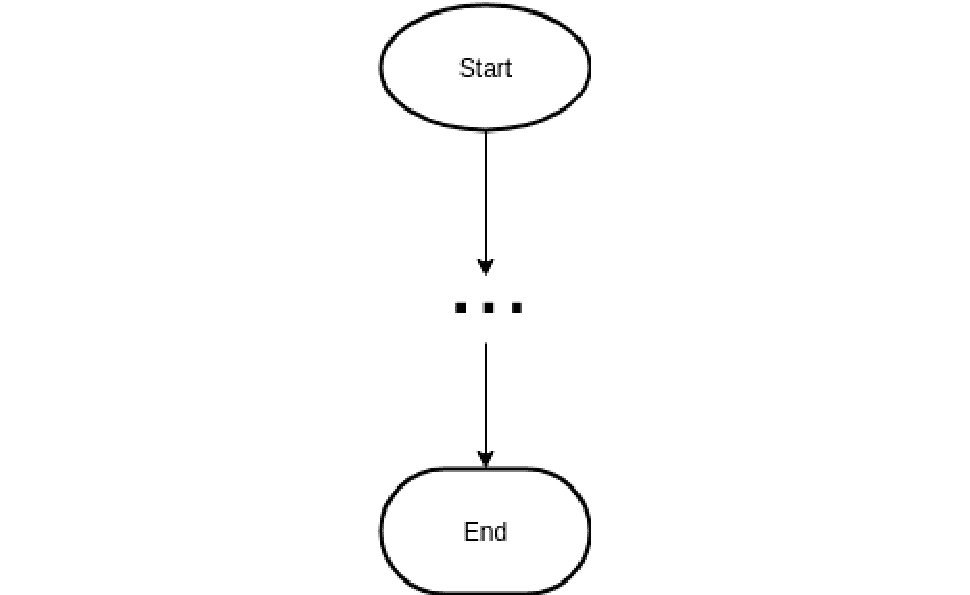
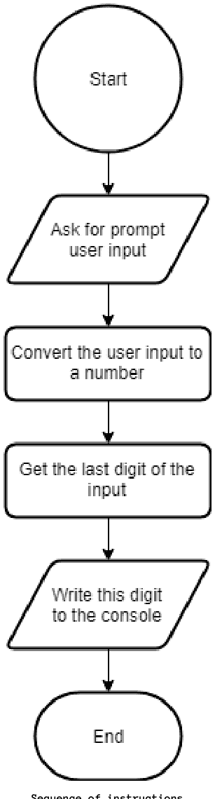
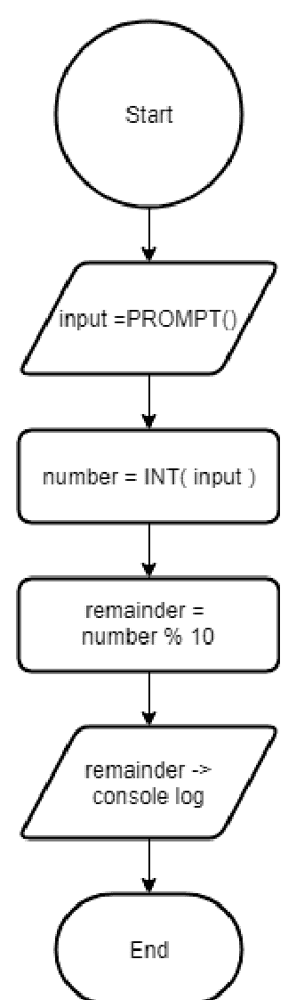
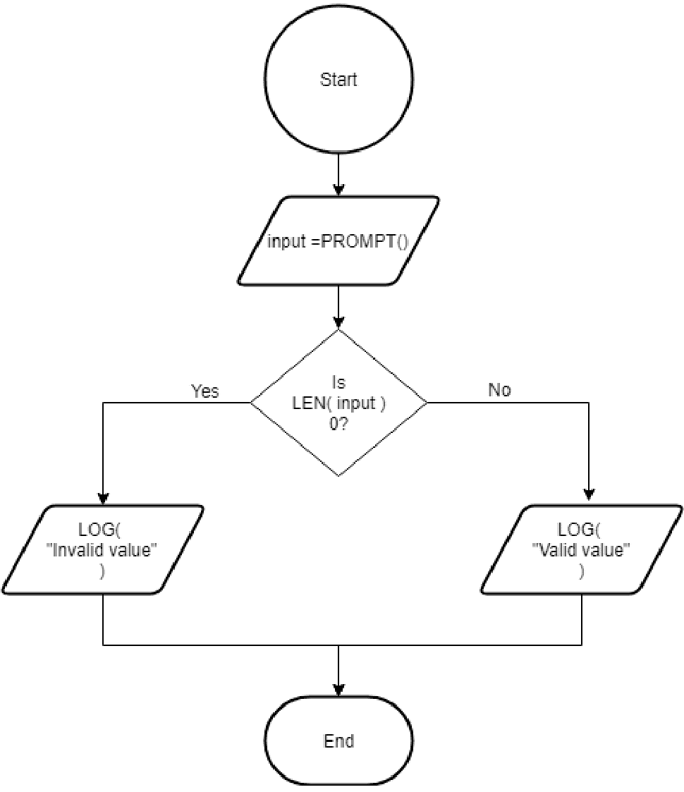
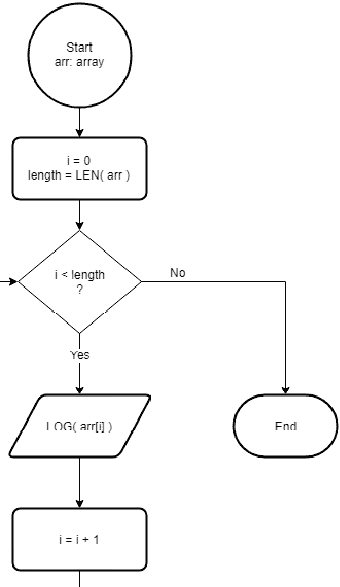

# 现代 JavaScript 实用入门指南

## 引言

如果你阅读了 `zsoltnagy.eu` 上的大部分博客文章，你可能会发现，大多数文章至少需要一些关于 JavaScript 的基础知识。主要的例外是 [JavaScript 基础](http://www.zsoltnagy.eu/category/javascript-basics/) 分类。

我写这本书是为了弥合我那些经验较少的受众与理解我关于 JavaScript 更高级内容所需知识之间的鸿沟。这本书绝对不需要任何 JavaScript 知识。

为了在学习 JavaScript 时获得一些优势，重要的是要明白为什么值得在 2019 年及以后学习这门语言：

- 为什么今天是开始学习 JavaScript 的最佳时机，
- 你的职业前景如何，
- 以及为什么 JavaScript 在 2019 年为你提供了近乎最佳的学习体验。

## 本书的使命

我有一个使命，那就是为初学者创建学习 JavaScript 编程的最佳 JavaScript 资源。这个使命的灵感来源于我的视频课程《ES6 实战》，该课程最初面向广泛的受众：初学者、中级和专家。虽然中级和专家开发者非常喜欢这个资源，但初学者却感到困难，因为课程节奏对他们来说太快，而且练习要求太高。

本书的使命是让 JavaScript 变得易于理解。我无意取代文档，仅仅因为文档的目的是追求完整。在本书配套的课程中，我的目标是转变你的编程技能。

这个使命需要很长时间才能完成，你也可以成为其中的一部分。如果你有任何反馈，请随时给我发送电子邮件至 [info@zsoltnagy.eu](mailto:info@zsoltnagy.eu)。

让我们继续介绍 JavaScript 的历史。

## 客户端 JavaScript

你很可能是通过像 Google Chrome 或 Firefox 这样的网络浏览器访问了本书。在浏览器中显示的网站主要使用三种语言编写：HTML、CSS 和 JavaScript。

HTML（超文本标记语言）描述网站的结构和内容。CSS（层叠样式表）处理展示：它决定了使用哪种字体、颜色、背景图片等来显示网站。

JavaScript 是一门成熟的编程语言，它不仅可以为屏幕上的元素添加动画和修改元素，还可以执行许多其他任务，例如：

- 与服务器通信，提供和存储数据，
- 描述应用逻辑：例如，应用逻辑可以验证你输入的个人数据，
- 可视化：例如，JavaScript 可以绘制一个显示谷歌股票价格的图表。

*动画*在计算机科学中是指在屏幕上移动或变换对象的行为。在移动过程中，对象的特征可能会发生变化，这意味着动画对象可能以不同的颜色、不同的尺寸绘制，或者在三维动画的情况下，我们可能从不同的角度看到该对象。

变换对象意味着对象的某个特征随时间变化。我们可以改变对象的许多特征，例如它的颜色、形状或方向。

在客户端开发方面，JavaScript 显然是首选语言。让我们暂停一下。什么是客户端，什么是服务端？

*客户端*开发侧重于编写在最终用户浏览器中运行的代码。*服务端*开发侧重于编写在服务提供商服务器上运行的代码。

当一个客户端从服务器获取谷歌的股票价格时，一个服务端程序会从数据库查询关于谷歌股票的数据。然后，这些数据通过指定的格式传输给客户端。客户端随后可以读取数据并显示历史股票价格的图表。

回到 90 年代和 21 世纪初，JavaScript 只是一个玩具语言，只能在静态网站上*动画化*元素。这些动画被称为*动态行为*。

在给定时间点在屏幕上显示一个对象被称为*渲染*。

动画也可以通过在屏幕上持续渲染一个对象来定义，同时它的特征可能会改变。

二十年前，JavaScript 在软件开发行业并未受到重视。许多“开发者”不知道自己在做什么，他们只是复制粘贴代码片段，为网站添加一些动态行为。通常，这些代码片段会相互冲突，因为它们使用了相同的变量。

一旦 AJAX 编程（异步 JavaScript 和 XML）开始流行，JavaScript 变得更受欢迎。2006 年，`XMLHttpRequest` 对象成为标准，这意味着你可以向服务器提交请求并等待其响应。一旦响应到达，你就可以在*不重新加载页面*的情况下显示结果。这在网站上就像魔法一样，因为在这种技术普及之前，与服务器的每次交互都需要完全重新加载页面。由于页面重新加载可能需要几秒钟，消除重新加载页面的需求是一个巨大的成就。

JavaScript 社区在成长，但我们面临另一个问题：为了编写在所有主要浏览器中都能运行的代码，我们必须为不同的浏览器编写不同的代码。有时情况令人困惑。因此，你必须成为领域专家才能编写 JavaScript 代码。

不过，这种状况没持续多久。2006 年，另一个重要的里程碑出现了。jQuery 库发布，口号是*写得更少，做得更多*。与其编写几十行代码来确保覆盖所有浏览器，jQuery 为你提供了单行命令来达到相同的效果。你不再需要成为专业的软件开发者才能编写 JavaScript 代码。你只需包含 jQuery，问题就解决了。

不幸的是，jQuery 创造了另一个问题。我们可以用“蜘蛛侠”的邪恶克隆“猩红蜘蛛”的口号来形容：*拥有全部力量，却无需承担责任*。降低门槛意味着那些不关心软件工程的人也开始编写代码。

与此同时，*单页应用程序*和*客户端富网络应用*的想法成为主流。在 AJAX 和 jQuery 之前，几乎一切都发生在服务端。服务器的任务是组装一个网页并将其发送给客户端。服务器创建 HTML、CSS 和 JavaScript 代码，客户端只加载那一个页面。当渲染和部分应用逻辑转移到客户端时，情况发生了变化。这意味着应用程序只需加载一次，数兆字节的 JavaScript 代码负责渲染客户端感兴趣的应用程序部分。这一步得以实现得益于摩尔定律，因为最终用户计算机的性能每隔几年就会翻倍。

> *单页应用程序*在页面加载时接收所有 HTML、CSS 和 JavaScript，客户端可以在不通知服务器的情况下在应用程序的不同视图之间导航。客户端通过 AJAX 调用与服务器通信，并在不需要重新加载页面的情况下接收数据。通过这种方式，单页应用程序变得更快，并且像桌面应用程序一样易于使用。

从上述五个特征来看，应用程序的可扩展性意味着应用程序给出的响应可以作为负载增加的函数轻松计算。可扩展性可以在资源和开发流程上进行定义。例如，如果一个服务器保证每 100 个并发用户的平均响应时间为 1 秒，我们需要知道服务器在 1000、10000 或 100000 个并发用户下的保证。流程可扩展性的一个例子可以是在修复拥有十万、一百万或一千万行代码的应用程序中的一个错误所需的平均时间。开发流程的另一个可扩展性指标可能是，在拥有十万、一百万或一千万行代码的应用程序中，每千行代码的错误数量。

## JavaScript 的演变与框架

主要问题在于，那些自称软件开发人员的人，利用他们的黑客技能创建了质量低劣的软件。人们很快意识到，仅有的 jQuery 知识限制了他们能开发的应用程序规模。超过一定规模后，他们就会遇到可维护性问题。

> 可维护性是指让软件解决方案易于开发、修改、扩展、测试和调试的行为。如果你写十行代码，需要的方法与编写一百万行代码是不同的。

可维护性问题的答案是 JavaScript 框架的出现。框架使得以结构化的方式编写可维护的代码成为可能，而无需重新发明轮子。框架强制实施了软件工程领域一些众所周知的最佳实践。为了理解这些最佳实践，入门门槛被提高到了一个健康的水平。

> 框架构建你的代码结构并运行你的应用程序。当使用框架时，框架是主导者。这意味着，框架调用你的代码。

> 库是你为了执行给定任务而可以调用的功能集合。库不是框架，因为只要你使用库，你就是主导者，库不会调用你的代码。

在 2010 年代初，几乎每个人都想写一个框架。每周都会产生一个新框架。创建框架意味着你重新发明了轮子，因为你是以自己的方式解决一个众所周知的问题。如果你想建立作品集，甚至不要考虑构建框架，因为这没有意义。

幸运的是，我们已经度过了 JavaScript 开发更迭率如此之高的时期，以至于你不得不每个月学习一个新的框架或库。今天，情况已经非常清楚：你使用 React 或 Angular 或 Vue。根据谷歌搜索数据，React 似乎在整体竞争中领先，但 Angular 和 Vue 也有各自的利基市场。主要框架背后都有一个庞大的开源社区，因为 React 由 Facebook 支持，Angular 由 Google 支持。

> 开源社区围绕着任何人都可以为社区维护的源代码做出贡献的理念而形成。流行开源社区的力量在于，重大错误能够被快速报告和修复，并且开发进展是持续的。因此，我们可以信任开源社区能确保一定的质量标准。

框架虽然也很出色，但开发者还有一个问题。框架和库的功能已经远远超出了 JavaScript 的能力范围，以至于学习 JavaScript 的方方面面似乎变得不必要了。这门语言已经相当老旧，我们需要一次更新。这次更新就是 ES2015，或者用它的旧名 ES6。许多创新从不同的来源进入了 ES6，例如 jQuery、一些框架、一些函数式编程库（如 `UnderscoreJs`）以及一些语言（如 TypeScript）。

ES 代表 ECMAScript。*ECMA International*（ECMA = 欧洲计算机制造商协会）是一个成立于 1961 年的标准化组织。ECMA International 负责描述像 JavaScript 和 ActionScript 这类语言的标准。描述最新 JavaScript 语言的标准是 ECMA-262。

在 ES6 出现前后，像 Internet Explorer 8 这样的老浏览器变得如此不受欢迎，以至于几乎没有提供与它们兼容的需求。这导致了更紧凑、更统一的 JavaScript 代码。

自 2015 年以来，JavaScript 的发展就没有回头路。每年都会有一些更新进入 JavaScript，这些更新也最终进入了我的课程 [ES6 in Practice](http://www.zsoltnagy.eu/es6-in-practice)。

我们可以根据 JavaScript 的历史得出结论：现在是成为 JavaScript 开发者的最佳时机。在许多公司，你可以比 C++ 开发者或 PHP 开发者赚得更多。只需看看 `stackoverflow.com` 的工作机会或 `payscale.com` 的数据。你每天处理的挑战都很有趣，更重要的是，得益于*实时重新加载*功能会自动重新加载你的更新，你通常可以立即在浏览器中看到修改的效果，从而获得对自己工作的反馈。

> 总结：
> - JavaScript 最初是一种用于创建动态行为的玩具语言
> - AJAX 使得无需重新加载应用程序页面即可更新网站成为可能
> - jQuery 降低了 Web 编程的入门门槛
> - 框架和库迫使我们使用软件工程中众所周知的设计模式
> - IE8 等老式浏览器失去了流行度，而新浏览器通过更严格地实现 JavaScript 标准来帮助 JavaScript 开发者
> - ES2015 及以后：许多模式成为语言的标准组成部分

## JavaScript 在服务端

如果这些好处对你来说还不够，让我们再给这个组合加点料。

JavaScript 不再只是一种客户端语言。Node.js 使得在服务器上运行 JavaScript 成为可能。Node.js 建立在 Google Chrome 的执行引擎 V8 的基础之上。回想一下，即使是迈克尔·舒马赫也是用 V8 引擎赢得了他的第一个世界冠军。V8 引擎像一级方程式赛车一样快。V8 编译器将 JavaScript 转换为机器码，这意味着在服务器上，我们不再处理*解释型*代码。

> *解释型代码*运行在*虚拟机*上，将开发者编写的一组指令翻译成可执行命令。解释型语言通常比*编译型*语言慢。解释型语言也是*可移植的*，这意味着你可以获取程序的源代码，并在任何拥有该特定代码虚拟机的系统上执行它。编译成*机器码*的语言的好处是运行代码尽可能接近机器码级别。这转化为更快的执行时间。不幸的是，这种机器码无法*移植*到运行不同操作系统或具有不同硬件架构的不同机器上。

Node.js 通过提供机器码编译器解决了速度问题。这还不是一个大问题，因为大多数其他服务端语言也可以做到同样的事情。为什么 Node.js 对于某些服务端任务仍然是一个很好的选择？

原因在于 Node.js 的一些架构决策。Node.js 附带一个*事件循环*，可以在服务器上执行和处理并行请求而不会阻塞。这被称为*非阻塞 I/O*。与许多其他语言相反，当你需要读取或写入数据库或文件时，Node.js 不会等到 I/O 操作完成才继续。这意味着 Node.js 可以继续处理其他任务，这些任务可能对其他客户端很重要。

*架构*是*架构师*的产物，描述系统工作原理的准则。*软件架构*描述了系统工作的结构。

*I/O 操作*是输入/输出操作。输入代表将数据输入系统。示例：打字、移动鼠标、拍照或截图、下载数据或请求我们的银行对账单。输出操作被描述为系统发送的数据。示例：显示或打印文本、向服务器上传文件或以指定格式响应银行对账单查询。

想一想。这个特性在什么时候有益？

当存在大量需要大量 I/O 操作但不需要太多服务端计算的独立并行请求时，Node.js 的优势就显现出来了。

例如，3D 渲染算法涉及大量操作。尽管 V8 引擎产生快速的机器码，但还有一些其他语言更快。Node.js 只有在处理许多廉价操作时才能超越这些语言。

在当今世界，这种用例非常普遍。终端用户的计算机足够强大，可以在客户端运行大量逻辑，包括通过渲染图表、表格和其他组件来展示数据。应用程序服务器通过 API（应用程序编程接口）提供数据，并且主要连接数据库服务器和文件服务器。应用程序服务器接收 API 请求，并以客户端可以使用 AJAX 请求获取和理解的方式格式化 API 响应数据。

## JavaScript 的其他应用场景

JavaScript 开发充满乐趣。最初，JavaScript 的主要应用场景是为 Web 浏览器进行客户端开发。随后出现了 Node.js，使我们能够编写服务器端代码。

然而，JavaScript 在 2019 年能提供的远不止这些。让我们看看一些更前沿的选择：

- **JavaScript 与 VR。** React 360⁵ 使得使用 JavaScript 提供 VR 体验成为可能。其他一些库⁶ 也能帮助你处理 VR 相关事宜。
- **JavaScript 可以编译成其他语言，其他语言也可以编译成 JavaScript。** *WebAssembly* 使得将多种语言编译成 JavaScript 成为可能，从而让你能在浏览器中运行代码。我们甚至可以在 JavaScript 代码中使用用这些语言编写的代码。
- **JavaScript 中的机器学习与人工智能。** TensorFlow⁷，谷歌的包含神经网络实现的机器学习库，在 JavaScript 中也可用。许多其他用于机器学习和人工智能的库也同样可用。
- **移动开发。** React Native⁸ 提供了一种使用 JavaScript 进行移动开发的方式。原生移动应用与 JavaScript 的结合非常出色，因为这极大地促进了代码的复用。
- **区块链编程。** 在撰写本节内容时，npm 上已有超过一千个与区块链相关的库（证据⁹）。Crypto-js¹⁰ 为我们提供了易于使用的加密和解密算法。一切都已就绪，可以用 JavaScript 实现区块链。
- **网页实时通信：** 音视频流可以使用 JavaScript 来控制。WebRTC¹¹ 开源项目使得创建具有实时通信功能的应用程序成为可能。
- **微服务。** Seneca¹² 是在应用程序中组织微服务的一个例子。

如果你是一名中级到高级的 JavaScript 开发者，并且对后两个应用场景感兴趣，可以看看我在 Packt Publishing 上的视频课程：《微服务、WebRTC 和 React 入门：现代 JavaScript 开发》¹³。

JavaScript 对于某些任务可能并不是最优选择。显然，如果任务计算密集，比如三维角色动画和着色，JavaScript 可能不是编写执行这些操作的应用程序的最佳语言。然而，JavaScript 的执行环境在不断改进，新的应用场景也在不断涌现，使用 JavaScript 成为一种可选方案。记住，如果一个应用场景在 JavaScript 中变得可行，很可能很快就会围绕它形成一个充满热情的庞大社区。获得企业支持的可能性也很高。

⁵ https://facebook.github.io/react-360/

⁶ https://github.com/ku-fpg/vr-ideas/wiki/JavaScript-VR-libraries

⁷ https://js.tensorflow.org/

⁸ https://facebook.github.io/react-native/

⁹ https://www.npmjs.com/search?q=keywords:blockchain

¹⁰ https://www.npmjs.com/package/crypto-js

¹¹ https://webrtc.org/

¹² http://senecajs.org/

¹³ https://www.packtpub.com/web-development/beginning-modern-javascript-development-microservices-webrtc-and-react-elearning-video

## JavaScript 在就业市场的主导地位

根据 [2018 年 HackerRank 调查](https://research.hackerrank.com/developer-skills/2018/)¹⁴，

- JavaScript 是雇主最需要的语言。总计有 47.8% 的雇主发布了 JavaScript 相关职位。
- 在 JavaScript 框架方面，雇主需求与员工知识之间存在巨大差距。差距最大的是 React：33.2% 的雇主在寻找 React 开发者，而供应量仅为 19%。稀缺意味着更高的薪资、更少的竞争和更多的机会。


你可以成为一名自学成才的开发者，因为公司更看重经验（90.6%）和你的作品集（72.7%），而不是学历。如果你能正确地包装自己，经验可以通过开发个人项目来积累，并最终进入你的作品集。这意味着，在 JavaScript 开发中，只有你自己的努力才能限制你，不存在守门人、大学、实习或认证行业。例如，在柏林/德国，你可以靠自己成为自学成才的程序员，并且可以被雇用，获得比德国公民平均工资更高的薪水。对于许多城市或远程工作机会，同样的原则也适用。

尽管 JavaScript 在开发者偏好的语言中仅排名第五，落后于 Python、C、C++ 和 Java，但这可能被那些不得不处理 JavaScript 不成熟版本的老程序员带来的负面体验所抵消。在开发者体验方面，一个重要的衡量标准是，在所有语言的所有框架中，排名前四的都是 JavaScript 框架：`Node.js`、`React`、`ExpressJs` 和 `AngularJs`。使用这些框架让开发者感到比其他任何事情都更快乐。

[2018 年 StackOverflow 调查](https://insights.stackoverflow.com/survey/2018/)¹⁵ 呈现了相同的图景：

- JavaScript 是最受欢迎的语言，占比 69.8%。在 StackOverflow 上，JavaScript 比 Python 更受欢迎。

- 三个框架位列最受欢迎框架榜单前列：`Node.js`、`Angular`、`React`。

- 在这项调查中，JavaScript 开发者的薪资被标记为低于许多其他领域的薪资水平。在我看来，这个统计数据具有误导性，因为与需要大量专业知识的语言相比，入门级开发者的薪资在更大程度上掩盖了专家的薪资。根据我的经验，在普通的 JavaScript 第一轮面试中，筛选掉 70% 的申请人并不少见。另一方面，在普通的 C++ 面试中，能进入第一轮面试的人通常更清楚自己在做什么。我鼓励你在 `payscale.com` 或 `glassdoor.com` 上进行自己的研究，以找到要求你技能的具体公司的 JavaScript 开发者薪资。

尽管受众很重要，但在当今世界，选择 JavaScript 你不会错。你也可以预期 JavaScript 会保持上升趋势。

> 总结：

- JavaScript 和 JavaScript 框架在业界广受欢迎

- 对 JavaScript 开发者的需求高于供给

# 为什么现在成为 JavaScript 开发者比以往任何时候都更容易？

我们已经探讨了成为 JavaScript 开发者在经济方面的考量。毫无疑问，无论在客户端还是服务器端，对 JavaScript 开发者的需求都非常高。

然而，世界上没有任何金钱可以弥补糟糕的开发者体验。

学习 JavaScript 比以往任何时候都更容易。多年前，许多挫折阻碍了普通开发者获得最佳的学习体验：

- 计算机资源比现在更稀缺

- 语言的标准化程度远不如现在成熟，导致 `if-else` 结构中包含针对不同浏览器的不同代码片段

- ES5 标准提供的开发者体验远不及 ES2015 及更高版本

- JavaScript 未被视为一门严肃的编程语言

- 浏览器开发者工具和调试功能尚不成熟

- 第三方库支持稀缺且不可靠

- 优秀的集成开发环境或文本编辑器尚不存在

和任何一个在十五年前编写过 JavaScript 代码的人交谈，你都会得出结论：你现在使用的已经不是同一种语言了。

如果存在问题，热情的开源社区以及 Google 或 Facebook 等科技巨头很可能会为你提供可靠的 JavaScript 解决方案。自 2015 年以来，标准化进程也开始加速。我们正处于 JavaScript 历史上最伟大的时代。而且情况只会越来越好。

# 根据科学，JavaScript 的学习体验是怎样的

第一个好消息是，你可以立即开始编写代码。第二个好消息是，你可以在几秒钟内看到自己努力的成果。你不需要经历漫长的编译过程，用 JavaScript 构建的东西通常会在屏幕上以可见的变化呈现出来。

虽然我并非声称学习 JavaScript 超级容易，但我确实认为，在使用 JavaScript 时，你获得的反馈比使用大多数其他语言更直接、更即时。这为什么重要呢？

因为一切条件都已具备，让你体验到[心流](https://en.wikipedia.org/wiki/Flow_(psychology))（flow）。心流体验通常被称为最佳体验。它感觉就像你“进入了状态”。如果你处于心流状态，时间会飞逝。你全身心沉浸在一项活动中。你的学习体验就接近最佳状态了。

根据科学，心流的发生需要几个必要条件：

1. 活动的目标必须清晰

2. 任务既不太容易，也不太难

3. 你能直接获得关于行动结果的反馈

让我们逐一分析这些要点。

## 活动的目标必须清晰

关于目标，只需看看那两项开发者调查，弄清楚在 2019 年成为一名 JavaScript 开发者对你是否有意义。你真的可以作为自由职业者在海滩上工作，或者作为雇员，成为国际团队的一员。编写 JavaScript 代码常常感觉像是在玩乐高。你碰巧还能靠它赚到不错的收入。许多人在半年内就能作为初级开发者高效工作。如果你现在还不会写代码，还有什么比利用自己作为前端或全栈开发者的技能更好的体验可以想象呢？

## 任务既不太容易，也不太难

学习 JavaScript 并非显而易见的事情。你会遇到一些谜题、一些陷阱、一些需要克服的障碍。但不要因此气馁！试想一下，如果你从未面对过挑战，你会成为怎样的人？你现在的人生将没有任何值得骄傲的东西。这些障碍对你有益。这些障碍也使你的学习体验足够有挑战性，从而让你在学习 JavaScript 时能够体验到心流。

我的观点是，学习 JavaScript 并不会难到无法体验心流。显然，这个观点是有争议的，因为例如，如果你曾是一名公交车司机，从未见过编程语言，那么你需要一些基础知识。我承认，我的学习资源[ES6 in Practice](http://www.zsoltnagy.eu/es6-in-practice) 并非为完全初学者设计的最佳资源，因为它假设你至少知道编程语言的基本工作原理、`if` 语句和循环是什么、函数是什么等等。我正在规划一个针对 JavaScript 的入门级产品，并且我知道，高级 JavaScript 对某些人来说可能太难了。我写这本书是基于我的客户对 ES6 in Practice 的反馈，他们在这门课程上遇到了困难。

然而，一旦你打下了基础，你将准备好学习更高级的资源，没有什么能阻止你。因此，在适当的指导下，你会进步，你会变得更好，而不会因为学习 JavaScript 的体验感到沮丧。

16 https://en.wikipedia.org/wiki/Flow_(psychology)

17 http://www.zsoltnagy.eu/es6-in-practice

## 你能直接获得关于行动结果的反馈

这正是 JavaScript 的闪光点。只要你使用客户端 JavaScript，并且不把工具链搞得太复杂，你就会立即获得关于行动的反馈。有时你只需刷新浏览器。在某些情况下，你甚至不需要刷新浏览器。无论你做什么，你都能立即看到代码的运行结果。

因此，JavaScript 是体验心流的绝佳候选者。据我所知，Python 是唯一在快速达到心流方面可与 JavaScript 相提并论的语言。

# 总结

无论你是想学习 JavaScript，还是想选择或改变自己的专业方向，花点时间欣赏一下 JavaScript 的现状都很重要。

事情并非总是像今天这样光明。在本章的前半部分，我们回顾了 JavaScript 在客户端的黑暗历史，然后过渡到了其在服务器端相对光明且简短的历史。

这些事件使得 JavaScript 开发者能够体验到远超我们十年前想象的增长。大量的用例在等待着 JavaScript 开发者，例如 VR 和区块链技术，帮助 JavaScript 征服新的领域。

随着 JavaScript 持续普及，专精于包含 JavaScript 技术的软件开发者拥有光明的现在和未来。两项开发者调查得出结论：押注 JavaScript 你不会出错。

如果你想学习 JavaScript，本章最后一部分总结指出，在支持你获得最佳学习体验方面，JavaScript 接近最优。鉴于你通常能对自己的行动获得即时反馈，只要你坚持应对合理的挑战，你可以预期花在开发和学习上的时间会比使用许多其他语言时更多地处于心流状态。

# 第一部分：JavaScript 基础

我坚信实践应用的重要性。因此，我不会用冗长的理论让你感到无聊，也不会喋喋不休地评论 JavaScript 的哪些部分我认为好或坏。本教程全部关于动手实践，深入理解 JavaScript 的内部工作原理。

# JavaScript 基础

实践应用总是比理论更重要。因此，在本课程中，不要期待冗长的理论或对 JavaScript 代码应如何编写的固执己见的长篇大论。本课程的目标是从实践角度理解 JavaScript 的工作原理，让你能够开始编写代码。

## 你的第一行 JavaScript

学习编程时，我们常常从编写并执行一个输出 `Hello World!` 消息的“Hello World!”程序开始。在一些像 Java 这样的语言中，要向标准输出写入 Hello World 需要很多代码。在 JavaScript 中，我们只需一行即可搞定：

```
console.log( "Hello World!" );
```

分号标记语句的结束。在 JavaScript 中，分号是可选的，因为 JavaScript 解释器会自动插入它们。然而，坚持使用分号是一个好习惯，因为在某些边缘情况下，JavaScript 解释器会将分号插入到错误的位置。

你可能会问，在哪里可以执行这一行代码？让我给你几个选择。

> 沙盒是一个与其环境隔离的开发环境，你可以在其中实验代码，而无需处理繁琐的设置、依赖导入或其他任务。它就像一个沙盒，孩子们可以在其中玩耍，弄脏自己，而不会对外界造成后果。

1. 打开 [CodePen](https://codepen.io/pen/?editors=0012)。CodePen 是一个在线的 Web 开发沙盒，包含用于 HTML、CSS 和 JavaScript 代码的盒子。你需要在 JavaScript 框中编写代码。你可以在控制台中看到结果。每当对 JavaScript 代码进行更改时，控制台中就会出现一行新内容。

2. 你也可以在 CodePen 控制台底部编写代码。按下回车键后，你会看到相同的结果。

18 https://codepen.io/pen/?editors=0012

## 或者，你也可以在浏览器中打开一个新标签页。大多数浏览器在这方面操作相同。本节使用的是Google Chrome的英文术语。打开Chrome标签页后，在标签页内右键单击，然后从上下文菜单中选择“检查”。或者，你可以在Windows或Linux系统中按 `Ctrl + Shift + I`，在Mac系统中按 `Cmd + Shift + I`。Chrome开发者工具弹出后，你可以在工具顶部看到一个菜单栏。这个菜单栏以Elements、Console、Network等开头。选择Console。现在你就能看到一个类似于CodePen控制台的界面。`>` 符号是提示符。你可以在 `>` 后面输入你的JavaScript代码。

本书会不时出现一些练习。请尝试自己解决。如果遇到困难，可以回顾书籍内容，直到你对相关材料熟悉为止。有些练习在题目下方提供了解答，而另一些则需要你自己独立完成。

## 练习1

尝试使用上述三种方法来运行 `Hello World!` 程序。在Chrome开发者工具的控制台中实验一下，如果用 `console.info`、`console.warn` 或 `console.error` 替代 `console.log` 会发生什么。

**解答：** 在Chrome开发者工具的控制台中，观察使用 `console.log`、`console.info`、`console.warn` 和 `console.error` 时，消息的颜色以及消息前面的图标。这些颜色和图标代表了日志级别，它们在各种编程语言中大体一致。日志记录是一种记录系统中发生事件的方式。日志记录对于事后发现系统错误以及精确重现发生的情况非常重要。

如果你输入了消息 `console.log( "Hello World!" );`，你会看到如下的求值结果：

```
1 "Hello World!"
2 undefined
```

第一个值是 *控制台日志*，它是由 `console.log` 函数写入控制台的值。第二个值是 `undefined`，表示 `console.log` 函数没有定义的返回值。在关于函数的部分之前，你不必理解这意味着什么。在那之前，只需接受 `undefined` 值会出现在你的控制台日志之后这个事实。

注意，你的语句可以跨越多行。在表达式内部按回车键可以将内容分成两行。在上面的代码编辑器中重新格式化你的代码如下：

```
1 console
2   .log(
3     "Hello world!"
4 );
```

如你所见，你可以按照任何你喜欢的方式来格式化JavaScript代码。解释器不会在意多余的空白字符。

如果你的代码跨越多行并且你处于控制台中，按 `Enter` 键通常会执行当前行。如果你想要添加换行符而不执行代码，请按 `Shift + Enter`。

再多实验一下日志记录。写`5 + 2`，而不是“Hello World!”。你应该看到以下内容：

```
> console.log( 5 + 2 );
7
undefined
```

`>` 象征着控制台的输入。

顺便说一句，你甚至不需要 `console.log` 来将`5 + 2`的和写入标准输出：

```
> 5 + 2
7
```

`5 + 2`是一个表达式。JavaScript解释器获取这个表达式并 *求值*。一旦表达式被求值，它的值就会作为输出出现。注意这不是一条日志消息。对于日志消息，一条消息被记录下来，然后 `console.log` 的返回值被写入控制台。`console.log` 的返回值始终是 `undefined`。由于我们直接对表达式求值，所以控制台上没有这行 `undefined`。

另一个在线开发沙盒是 [JsFiddle](https://jsfiddle.net/)。尝试在编辑器的JavaScript框中输入以下代码来使用它：

```
document.body.innerText = 'Hello World!';
```

输入此代码后，文本 `Hello World!` 会出现在输出区。这个沙盒的任务是组装一个HTML页面，而这个命令告诉沙盒在文档正文中显示什么。

恭喜！你成功地将 `Hello World!` 写入了控制台两次。让我们总结一下学到了什么：

- `console.log` 将一条日志消息写入控制台

- "Hello World!" 是一个字符串。表示字符串的一种方式是使用双引号。请注意，'Hello World!' 在JavaScript中也是有效的字符串表示法

- 语句的末尾有一个分号。分号本身是可选的，但我建议使用它

在阅读本教程时，我鼓励你保持 [CodePen](https://codepen.io/pen/?editors=0012) 打开，并尝试示例。

稍后我们将学习如何

- 在浏览器开发者工具中执行JavaScript，

- 将JavaScript嵌入HTML页面，

- 使用`node.js`执行JavaScript。

# 注释

编写代码时，重要的是其他人也能读懂它。这就是为什么给我们的代码添加注释是有益的。JavaScript注释与C++和Java的注释格式类似。当JavaScript解释器读取注释时，它会完全忽略其内容：

- 解释器会忽略 `/*` 和 `*/` 之间的所有内容

- 解释器会忽略同一行中 `//` 之后的所有内容。

示例：

```
1 let a = 5 + 2; // This is a single line comment lasting until the end of the line.
2 
3 /*
4     A comment that can span multiple lines.
5     Everything inside the comment will be ignored by the JavaScript interpreter.
6     let b = 2;
7 */
```

上述代码被解释为：

```
1 let a = 5 + 2;
```

其他所有内容都被忽略了。

我们为什么使用注释？为了避免陷入类似的情况：

```
1 //
2 // Dear maintainer:
3 //
4 // Once you are done trying to 'optimize' this routine,
5 // and have realized what a terrible mistake that was,
6 // please increment the following counter as a warning
7 // to the next guy:
8 //
9 // total_hours_wasted_here = 42
10 //
```

我另一个最喜欢的注释是：

```
1 // I dedicate all this code, all my work, to my wife, Darlene, who will
2 // have to support me and our three children and the dog once it gets
3 // released into the public.
```

来源：StackOverflow<sup>21</sup>

总结：编写带有良好注释的可读代码！

## 练习

## 练习2:

不运行代码，确定什么内容会被写入标准输出：

```
1 console.log( 1 + 2 + 3 + 4 );
2 2 + 4;
3 console.log( 'End' );
```

## 练习3:

在CodePen和你的浏览器中都运行 **练习2** 的代码。

## 练习4:

给练习2的代码添加注释符号，使程序只打印出End消息。

# JavaScript中的数据类型


大多数编程语言帮助你创建代表数字、文本中的字符或更长文本的值。你也可以用布尔值来表示真和假的值。你还可以创建代表值缺失的值。这些值都被称为*原始数据类型*。

“原始”这个名字并非贬义。这些数据类型既不愚蠢，也不比我们在JavaScript中使用的其他任何数据类型差。“原始”这个名字源于它们的简单性。你稍后将学习的其他数据类型是*复合*类型，它们由许多原始数据类型组成。

为什么数据类型对我们很重要？

例如，每当你查看电子邮件、上Facebook或查看银行账户时，你总是会看到数据：你的名字、你的消息、当前的日期和时间，在设置中，你还可以看到账户的其他特征。

数据有类型。我们倾向于使用整数（没有小数部分的数字）而不是文本。复选框可能有两个可能的值：真或假。这些数据类型也是独特的。对于每种数据类型，适用不同的操作，其可能的值也不同。

在JavaScript中，有六种原始类型：

- 布尔值（`true`或`false`）
- 数字（包括整数如`1`、`-2`，以及浮点数如`1.1`、`2e-3`）
- 字符串（`''`或`""`，`'ES6 in Practice'`或`"ES6 in Practice"`）
- `null`类型（用`null`表示）
- `undefined`（用`undefined`表示）
- `Symbol`（暂时不用担心它们）

> 浮点数通常包含一个**小数分隔符**字符，最常见的是点号。浮点数的**精度**是有限的，因为可用的位数是有限的。

我们很快将了解更多关于浮点数精度限制所引起的异常。

> 可以对给定类型的数据执行**操作**。操作由代表该操作的**运算符**表示。例如：`+`、`-`、`*`、`/`。运算符对称为操作*操作数*的数据执行操作。

例如，在`2 * 3`操作中，`*`是代表乘法的运算符。乘法有两个操作数：`2`和`3`。

一些重要的运算符是：

- `+`代表**加法**。例如：`2 + 3`是`5`。
- `-`代表**减法**。例如：`2 - 3`是`-1`。
- 如果`+`或`-`的左边没有操作数，则`+`或`-`成为**符号**。例如：`+3`或`-2`。
- `*`代表**乘法**。例如：`3 * 2`是`6`。
- `/`代表**除法**。例如：`3 / 2`是`1.5`。
- `%`代表**取模**运算，即一个数除以另一个数按照整数除法规则得到的余数。例如：`5 % 2`是`1`，因为`5`除以`2`得`2`，余数是`1`。换句话说，*5模2的余数是1*。
- `**`是**幂运算符**。例如：`2 ** 3`（2的3次方）是`2 * 2 * 2`，即`8`。

在[CodePen](https://codepen.io/pen/?editors=0012)控制台底部，有一行带有`>`符号。这是你可以输入*JavaScript表达式*的地方。让我们试一些。输入你在`>`符号后面看到的表达式。然后按回车键。你可以看到结果出现在下一行。

---

21https://stackoverflow.com/questions/184618/what-is-the-best-comment-in-source-code-you-have-ever-encountered

# 数字类型

处理数字的操作通常很直观。你可以使用四种基本算术运算符（`+`、`-`、`*`、`/`）分别进行加法、减法、乘法和除法。

`%`运算符称为模运算符。`a % b`返回`a / b`的余数。例如，`7 / 5`的商是`1`，余数是`2`。因此返回值为`2`。

`**`运算符称为幂运算符。`5 ** 2`表示`5`的二次幂。

```
> 5
5

> 5 + 2
7

> 7 % 5
2

> 5 ** 2
25
```

运算可以通过括号进行分组。括号会覆盖运算符的执行优先级。例如，在数学中，乘法的优先级高于加法。这意味着，`1 + 2 * 3`等同于`1 + (2 * 3)`。

让我们看一个使用括号的例子：

```
> 5 * ( 1 + 2 * ( 3 + 4 ) )
// 5 * ( 1 + 2 * 7 )
// 5 * ( 1 + 14 )
// 5 * 15
75
```

与数学不同，JavaScript中我们不使用方括号或花括号来分组操作。括号可以嵌套使用。同时，构建有效的括号表达式也很重要，即每个右括号都应该对应一个前面的左括号。

与数学类似，不同的运算符具有不同的优先级（也称为结合性）。当一个运算必须在另一个运算之前执行时，我们说这个运算符：

- 具有更高的优先级，
- 绑定能力更强。

大多数运算符有一个或两个操作数。这意味着运算符将一个或两个值转换为一个新值。例如：

- `5 + 2`的操作数是`5`和`2`。`+`运算符将这些操作数转换为`7`。
- `-(2)`的操作数是`(2)`。我给`2`加上括号是为了强调`-`是一个运算符，而不是用来描述整数的符号。

运算符**绑定**其操作数。我们已经看到，有些运算符的绑定能力比其他运算符强。例如，乘法的绑定能力强于加法：

```
5 * 2 + 3 ----> 10 + 3 ----> 13
```

我们也看到，运算符的优先级可以通过括号来覆盖：

```
5 * (2 + 3) ----> 5 * 5 ----> 25
```

基本算术运算符（`+`、`-`、`*`、`/`、`**`）和两个符号（`+`、`-`）的优先级如下：

1. 符号：`+`或`-`可以放在数字前面。该符号首先被计算。
2. 幂运算：在具有两个操作数的运算符中，`**`的绑定能力最强。
3. 乘法和除法：`*`和`/`
4. 最后是加法和减法：`+`和`-`

> 如果你在JavaScript中使用更复杂的运算并且不确定它们的优先级，请使用括号。过度依赖运算的求值优先级会降低代码的可读性，这意味着如果你总给别人出难题，他们可能很难与你合作。

模运算没有放在上述优先级顺序中，因为在大多数情况下，你不会在复杂的表达式中用到它。在极少数情况下你将它与其他运算符一起使用时，请使用括号。`%`运算符的绑定能力与乘法和除法一样强。然而，在复杂表达式中使用`%`时，括号可以提高代码的可读性。

## 练习 5：确定以下表达式的类型。

- a. `7 % 2`
- b. `""`
- c. `"false"`
- d. `true`
- e. `2.5`

## 练习 6：计算以下表达式的值：

- a. `5 - -1`
- b. `2 - 2 * 2`
- c. `2 + 2 * 3 ** 2`

### 练习 7：假设你投资了十万美元。使用JavaScript计算在年利率为2%的情况下，1年、2年、5年和20年后你将拥有多少钱。提示：2%的年利率意味着一年后你将获得当前金额的102%。102%与当前金额（100%）的比值是`1.02`。

## 练习 8：确定哪些表达式是有效的。

- a. `2 ** 2 ** 2 ** 2`
- b. `( 1 ) + (2 * ( 3 ) )`
- c. `( 1 + 2 ) * ( 3 * 4 ) ) * ( ( ( 5 - 2 ) * 3 )`
- d. `- ( 2 + 2)`

## 练习 9：将以下表达式与下面的可能值进行匹配。

表达式：

- A. `5 ** 2 + 1`
- B. `11 * 11 - (-4)`
- C. `1e2 - 11 * 8 - 2 * 2 / 4`

值：`26`, `711`, `11`, `165`, `125`。

让我们看一些更令人惊讶的浮点数运算。

```
> 0.1 + 0.2
0.30000000000000004

> 3.1e-3
0.0031
```

关于浮点数的更多信息。由于数字的表示方式，`0.1 + 0.2`并不完全等于`0.3`。这是正常的，并且在大多数编程语言中都会发生。

`3.1e-3`是`0.0031`的标准形式。将其理解为`3.1`乘以`10`的负三次幂的精确值。虽然这种形式类似于`3.1 * (10 ** -3)`，但存在细微差别。`3.1e-3`描述的是`0.0031`的精确值。`3.1 * (10 ** -3)`描述的是一个需要计算的组合表达式：

```
> 3.1 * (10 ** -3)
0.0031000000000000003
```

浮点数算术甚至无法让这个表达式精确。

如果你需要精确的值，有两个选择：一个是舍入或截断结果，另一个是将浮点操作数转换为整数。例如，你可以写`25`美分，而不是`0.25`美元。当你总是期望小数点后有相同位数的精度时，这种方法有效。

让我们看一个舍入的例子：

```
> 0.1 + 0.2
0.30000000000000004

> Number( 0.1 + 0.2 ).toFixed( 1 );
0.3
```

在上面的例子中，结果的精度被固定为一位小数。

除法`0 / 0`或使用不匹配的类型会创建一个称为非数字（not a number）或`NaN`的特殊数字。具有讽刺意味的是，我们很快会看到`NaN`值的类型是`number`。

```
> 0 / 0
NaN

> 'ES6 in Practice' * 2
NaN
```

后者对于Python用户来说很有趣，因为在Python中，结果会是`'ES6 in PracticeES6 in Practice'`。JavaScript不是这样工作的。

还有另一个有趣的数值：`Infinity`。

```
> 1 / 0
Infinity

> Infinity * Infinity
Infinity

> -1 / 0
-Infinity

> 1e308
1e+308

> 1e309
Infinity
```

JavaScript将非常大的数字注册为无穷大。例如，`10`的`309`次幂被表示为无穷大。除以零也会得到无穷大。

让我们看一些字符串。

```
> 'ES6 in ' + 'Practice'
"ES6 in Practice"
```

## 练习 10：确定以下数字的类型和值：

- a. `(1 - 1) / 0`
- b. `(1 - 1) / 1 * 0`
- c. `5e0`
- d. `5 ** 0 / 0`
- e. `5 ** (0 / 0)`

# 字符串与转义序列

接下来是字符串数据：

```
> 'ES6 in ' + 'Practice'
"ES6 in Practice"
```

加号运算符可以连接字符串。连接意味着你将两个字符串的内容首尾相连写在一起。连接意味着你将连接运算符（`+`）左右两侧的值连接起来。

一个常见问题是，如果引号代表字符串的边界，那么如何在字符串内部书写引号。在JavaScript中，有多种解决方案：

```
// 解决方案 1：
console.log( '--- "This is a quote" ---' );

// 解决方案 2：
console.log( "--- 'This is a quote' ---" );

// 解决方案 3：
console.log( "--- \"This is a quote\" ---" );
```

你可以在单引号内部使用任意数量的双引号，也可以在双引号内部使用任意数量的单引号。但是，在单引号定义的字符串中使用单引号意味着我们终止了字符串。在双引号定义的字符串中使用双引号也是如此。

由于单引号和双引号都被频繁使用，因此产生了在字符串内部同时使用单引号和双引号字符的需求。我们可以通过使用`\`（反斜杠）字符对引号进行*转义*来实现这一点。

> 反斜杠（`\`）字符表示一个特殊字符（或多个字符）即将到来。反斜杠和特殊字符一起称为一个*转义序列*。转义序列用于表示特殊字符。

转义序列的示例：

- `\'`和`\"`：单引号或双引号字符。在JavaScript中，转义的引号不会开始或终止字符串。
- `\n`：换行符。我们可以在字符串中放置换行符，使`\n`之后的字符出现在下一行。
- `\\`：由于反斜杠字符本身会创建转义序列，它是一个特殊字符，也需要被转义。第一个反斜杠告诉JavaScript解释器一个特殊字符即将到来。第二个反斜杠表示这个字符就是反斜杠本身。在JavaScript或node.js中描述Windows文件路径时，这个转义序列非常重要：

```
> console.log( `c:\js\hello.js` )
"c:\js\hello.js"
```

多行字符串可以使用*模板字面量*创建。当需要将HTML标记保存在字符串中时，这非常方便：

# 布尔类型

让我们来看看一些布尔值。布尔值要么是`true`，要么是`false`。

`!`运算符表示取反。`!true`变成`false`，而`!false`变成`true`。

```
> !true
false

> !false
true
```

任意值都可以使用`Boolean`函数转换为布尔值：

```
> Boolean(0)
false

> Boolean(1)
true

> Boolean(2)
true

> Boolean(null)
false
```

`!`运算符不仅对值取反，还会将其转换为布尔值。例如，对一个字符串取反可以描述如下：

- 空字符串（`""`）在布尔表达式中默认被评估为`false`。对该值取反得到`true`。
- 任意长度至少为一个字符的字符串在布尔表达式中被评估为`true`。对该值取反得到`false`。

```
> !""
true

> !" "
false
```

在JavaScript中，我们区分**真值（truthy）**和**假值（falsy）**。这些值不一定是布尔值。它们的值只有在*类型转换*后才会变成`true`或`false`。

**真值（truthy）**是使得`Boolean(v)`为`true`的值`v`。真值示例包括：非零整数、包含至少一个字符的字符串。**假值（falsy）**是使得`Boolean(w)`为`false`的值`w`。假值示例包括：空字符串、`0`、`null`、`undefined`。

问：为什么我们需要使用`Boolean`函数进行类型转换？

答：因为否则自动类型转换会产生非预期的结果。例如，在表达式`2 == true`中，比较的两边都会被转换为数字。由于`Number(true)`的值为`1`，表达式`2 == 1`被评估为`false`：

```
2 == true ---> 2 == Number(true) ---> 2 == 1 ---> false

2 == false ---> 2 == Number(false) ---> 2 == 0 ---> false
```

此外，`null`和`undefined`既不是`true`，也不是`false`：

```
> null == true
false

> null == false
false

> undefined == true
false

> undefined == false
false
```

但是，

- `Boolean( null )`和`Boolean( undefined )`都为`false`
- `!null`和`!undefined`都为`true`
- `!!null`和`!!undefined`都为`false`

与`Boolean`函数类似，双重否定也将任意值转换为布尔值：

- 如果`v`是真值，则`!v`为`false`，`!!v`为`true`
- 如果`w`是假值，则`!w`为`true`，`!!w`为`false`

示例：

```
> !!""
false

> !!"a"
true

> !!0
false

> !!1
true

> !!NaN
false

> !!Infinity
true

> !!null
false

> !!undefined
false
```

> 一旦你开始编写复杂的软件，请使用`Boolean`函数而不是双重否定来将值转换为布尔值。这样，你的代码更具可读性。

我们可以使用`>`、`>=`、`==`、`===`、`<=`、`<`来比较两个数字。我们很快将讨论`==`和`===`之间的区别。对于其他运算符，比较的结果是一个布尔值。

```
> 5 <= 5
true

> 5 < 5
false

> !(5 < 5)  // ! 代表取反。!true = false, !false = true。
true
```

`=`符号不用于比较。它用于将值赋给变量（见后文）。

对于值`a`和`b`，当且仅当`a`和`b`可以通过类型转换规则转换为相同的值时，`a == b`为真。这包括：

- `null == undefined`为真
- 如果一个操作数是字符串而另一个操作数是数字，则字符串被转换为数字
- 如果一个操作数是数字而另一个操作数是布尔值，则布尔值按如下方式转换为数字：`true`变为`1`，`false`变为`0`。

不用担心确切的定义，你会习惯的。

对于值`a`和`b`，当且仅当`a == b`*并且*`a`和`b`具有相同的类型时，`a === b`为真。

# null、undefined、symbol 类型

`Null`、`undefined`和`Symbol`是原始类型。

`Null`表示一个已*定义*变量的原始值或复合值*有意识*地缺失。

`Undefined`表示一个值*未定义*。我们稍后会讨论`null`和`undefined`的区别。

`Symbol()`是一个唯一的值，没有关联的字面量值。它们作为唯一键非常有用，因为`Symbol() == Symbol()`为`false`。可以将symbol想象成一个世界中能打开特定锁的唯一钥匙，在这个世界里，每一把新创建的钥匙都与之前创建的所有其他钥匙不同。目前阶段，只需接受symbols的存在。你现在还不必在任何地方使用它们。

```
> null
null

> undefined
undefined

> void 0
undefined

> Symbol('ES6 in Practice')
[object Symbol] {}
```

值`undefined`也可以使用`void`前缀运算符创建。

Symbols可以有一个字符串描述。这个字符串描述不会影响symbol的值：

```
> Symbol('a') == Symbol('a')
false
```

## 练习

**练习 15：** 不运行代码，确定写入标准输出的值：

```
// A. 算术运算
console.log( 2*2+4 );

// B. 三元运算符
console.log( 3 % 2 ? 'egy' : 'nulla' );

// C. 非数字
console.log( (0/0) == NaN );
```

完成后，通过运行代码来验证你的答案。

**练习 16：** 将以下十六进制（基数16）值转换为基数10和基数2：`0`, `F`, `ff`, `FFFFFF`, `99`, `10`。

提示：你可以使用以下方式将值从十进制（基数10）转换为二进制（基数2）：


```javascript
Number( 2 ).toString( 2 );
// --> "10"

Number( 3 ).toString( 2 );
// --> "11"
```

**练习 17：** 不计算表达式，估算十进制值`2 ** 24`和十六进制值`FFFFFF`的差值。创建一个 JavaScript 表达式来计算这个差值。

**练习 18：** 你会使用哪种数据类型来建模以下数据？如果你选择了数字类型，请选择使用整数还是浮点数。

- A. 你的名字
- B. 你的银行账户号码（假设它只包含数字）
- C. 你的年龄
- D. 你是否年满 18 岁
- E. 一本书的价格是 9 美元 95 美分

# 变量：let、const 和 var

在前几节中，我们学习了如何使用数据类型以及如何对不同类型的数据执行操作。然而，根据我们目前的知识，如果我们想在代码中执行两次相同的计算，我们必须手动复制公式或结果。变量通过使我们能够在代码中访问操作的结果来帮助我们自动化并简化这个过程。

首先，在下面的示例中，你必须知道`console.log`可能打印由逗号分隔的任意数量的参数。在控制台中，这些值紧挨着出现，由空格分隔。

```javascript
> console.log( 1, 2, 3 )
1 2 3
```

通过右键点击一个网站，从上下文菜单中选择“检查”，然后选择“Console”标签页，可以打开 Google Chrome 的控制台。在控制台中，你可以输入以下表达式：

```javascript
> 1
1

> 2 + 3
5

> 'JavaScript'
"JavaScript"

> JavaScript
Uncaught ReferenceError: JavaScript is not defined
    at <anonymous>:1:1
```

虽然前三种情况你得到两个整数和一个字符串结果，但在第四种情况下，你会得到一个引用错误。出现此错误是因为`JavaScript`是一个变量，并且这个变量尚未在代码中创建。

在创建这个变量之前，让我们先澄清一下变量是什么。在计算机编程中，变量就像抽屉，我们用来存储值。

## let 关键字

我们可以使用`let`关键字创建变量。把变量想象成一个抽屉。Let *声明*一个变量，这意味着创建了一个带有把手的抽屉。声明是一个创建抽屉并将抽屉钥匙交给我们的过程，以便我们可以访问其内容。

```javascript
let myDrawer;
```

你可以将一个值放入你的抽屉：

```javascript
myDrawer = '$1.000';
```

要访问该值，你必须*抓住*抽屉的*把手*并打开它。在这个例子中，你有一个名为`myDrawer`的抽屉。它包含一个写有'$1.000'的字符串。要访问你的一千美元，你必须打开抽屉：

```javascript
> myDrawer
'$1.000'
```

你可以使用`=`号为变量分配一个初始值。这被称为*赋值*，因为我们给变量分配了一个值。变量生命周期中的第一次赋值被称为*定义*或*初始化*。

*声明*和*初始化*步骤可以合并为一步。让我们创建第二个抽屉，我们同时声明并初始化一个变量：

```javascript
let mySecondDrawer = '$500';
```

初始化可以在声明变量的同一语句中发生（参见`declaredAndDefined`），也可以在声明之后发生（参见`declaredButOnlyLaterDefined`）。即使你还没有初始化一个已声明的变量，你也可以访问它。它的值变成`undefined`。

```javascript
let declaredAndDefined = 5;

let declaredButOnlyLaterDefined;
declaredButOnlyLaterDefined = declaredAndDefined ** 2;

let declaredButNotDefined;

console.log(
    declaredAndDefined,
    declaredButOnlyLaterDefined,
    declaredButNotDefined
);
```

- 变量`declaredAndDefined`在定义它的同一行被声明
- 变量`declaredButOnlyLaterDefined`仅在之后的另一行中定义
- 变量`declaredButNotDefined`根本没有定义，因此，其值变为`undefined`

让我们看看如果我们将`declaredButNotDefined`这一行移到`console.log`语句下方会发生什么。

# 常量

常量的行为与变量类似。可以使用`const`关键字创建常量：

```javascript
const PI = 3.14;
```

常量的值之后不能更改：

```javascript
PI = 2;
Uncaught TypeError: Assignment to constant variable.
```

由于常量的值保持不变，它们必须在声明时的同一条语句中初始化。如果我们忘记这个必要步骤，就会得到一条错误消息：

```javascript
const c;
Uncaught SyntaxError: Missing initializer in const declaration
```

# 变量的作用域

变量的作用域表示变量在哪里可见，在哪里不可见。

在 JavaScript 中，有多种不同的作用域可供使用：

- 1. 全局作用域
- 2. 块级作用域（`let`、`const`）
- 3. 函数作用域（`var`）
- 4. 词法作用域（稍后介绍）
- 5. 模块作用域（此处不讨论）

在大多数编程语言中，前两种作用域是可用的。函数作用域是 JavaScript 的一个独特特性。自 2015 年的 JavaScript 版本（ES6 或 ES2015）以来，函数作用域逐渐不再流行，因为著名的块级作用域变量`let`和`const`出现了。

关于块级作用域，代码中可以在任何地方创建块。块使用大括号（`{`和`}`）创建：

```javascript
{
    // This is a block
}
```

使用`let`和`const`创建的变量仅在创建它们的块内可见：

```javascript
{
    let box = 5;
    console.log( box );
}
```

上述代码显示`box`的值。

```javascript
{
    let innerBox = 6;
}
console.log( innerBox );
```

在上面的代码段中，一旦执行到`console.log`语句，就会得到一个`ReferenceError`：

```javascript
VM124:4 Uncaught ReferenceError: innerBox is not defined
```

这是因为`innerBox`在块外部不可见。

# 全局作用域

与其他编程语言类似，JavaScript 也有全局变量。例如，你已经使用全局`console`变量来记录消息。除了`console`，打开 Google Chrome 开发者工具控制台，探索其他全局变量：

```javascript
> document.location.href
"http://zsoltnagy.eu"

> document.location.host
"zsoltnagy.eu"

> screen.width
1920

> let globalVariable = true
true

> globalVariable
true

> secondGlobalVariable = true
true

> secondGlobalVariable
true
```

如你所见，可以在全局作用域中创建全局变量。无论是使用`let`、`const`还是`var`（稍后介绍）关键字来创建这些变量，还是直接进行赋值，都没有关系。

在赋值的情况下，会发生以下情况：

- 程序检查同一块（`let`、`const`）或函数（`var`）中是否有局部声明的变量。
- 如果没有，程序会从内到外检查封装块或函数的块和函数。这是访问*词法作用域*的过程，我们稍后将深入讨论。
- 如果在词法作用域中没有定义变量，则会访问全局作用域，创建一个全局变量，并将其值设置为赋值的值。

在下面的例子中，为了简单起见，我们只使用块，因为我们还没有学习函数作用域是如何工作的。

```javascript
// first file:

{
    let firstBox = 1;
    {
        firstBox = 2;
        secondBox = 3;
        console.log( firstBox, secondBox );
    }
}
```

如果执行上面的代码，值`2 3`会被打印到控制台。变量`firstBox`存在于封装我们当前块的块中。变量`secondBox`是通过赋值创建的，并且没有用此名称声明的`var`、`let`或`const`变量。因此，该变量存在于全局作用域中。

现在假设`first file`的内容已加载，并且我们还加载了以下名为`second file`的代码段：

```javascript
// second file:

{
    let firstBox = 4;
    {
        console.log( firstBox, secondBox );
    }
}
```

执行此代码后，将打印值`4 3`。变量`firstBox`定义在`console.log`所在块的外部块中。变量`secondBox`是全局的，它是在加载`firstFile`时创建的。从现在起，`secondBox`变量将跨所有加载的文件共享。

```javascript
// third file:
console.log( secondBox );
```

执行此代码也可以访问全局变量`secondBox`。

```javascript
// fourth file:
console.log( firstBox );
```

加载第四个文件的结果是一个`ReferenceError`，因为`firstBox`在此作用域内不存在：它仅存在于 first file 和 second file 中定义它的块内。

```javascript
VM5519:1 Uncaught ReferenceError: firstBox is not defined
    at <anonymous>:1:14
```

> 在编写软件时，我们经常创建和维护数十万行代码，有时甚至数百万。文件数量通常在数百，甚至数千。随着程序规模的增长，要跟踪哪个代码以什么顺序访问和修改哪些全局变量变得越来越困难。因此，作为一个通用规则，建议使用局部作用域的变量，并尽可能避免使用全局变量。

不建议使用全局变量。大多数时候，全局变量是由于开发者的错误而创建的。请记住，如果在变量赋值前忘记了`let`、`const`或`var`关键字，你就会创建一个全局变量。

# var 关键字和函数作用域

为了完全理解`var`关键字的工作原理，你需要了解函数是什么。我们稍后会学习函数。目前，你只需接受使用`var`声明的变量在函数内部是可见的这一事实。

函数可以使用`function`关键字创建：

```javascript
var globalBox = 2;
function scope() {
    var functionScopedBox = 1;
    console.log( globalBox );
}

scope(); // we call the function to execute its content
console.log( globalBox );
console.log( functionScopedBox );
```

变量`globalBox`可以从代码中的任何地方访问。但是，当在最后一行控制台记录`functionScopedBox`变量时，我们得到以下错误消息：

```javascript
Uncaught ReferenceError: functionScopedBox is not defined
```

> `var`变量的作用域在 JavaScript 中是独特的，并且经常造成一些混乱。在大多数编程语言中，开发者习惯于块级作用域的变量。因此，开发者很难适应使用`var`声明的变量的工作方式：

```javascript
{
    var box = true;
}
console.log( box );
```

这段代码执行没有问题，并且在块内创建的变量也可以在块外部访问。这是`box`为函数作用域的直接结果。由于没有函数封装`box`，它是全局作用域的。

# 变量命名

变量应以描述性的方式命名。我们需要使用变量名来描述它存储的数据类型。一个好的变量名就像一个好的注释。创建良好变量名的最佳实践包括：

- 1. 变量以最佳方式描述其内容，
- 2. 在所有可能的变量名中，选择最短的名称

例如，在`invoiceSum`和`invoiceItemSum`之间，前者完美地抓住了变量存储内容的本质。这是因为很明显，发票包含项目，无需在变量名中体现这一信息。

通常的做法是使用小写字母开头编写变量名。如果变量名包含多个单词，我们将它们连接成一个单词，并从第二个单词开始，将每个单词的首字母大写。这种变量命名方式称为`camel case`（`camelCaseVariable`）。

# 在一条语句中创建多个变量

一个编程最佳实践是创建我们稍后用于描述过程或函数的所有变量，然后对这些变量执行所有操作。例如：

```javascript
let name = "Zsolt";
let website = "zsoltnagy.eu";

console.log( name, website );
// 其他操作...
```

我们可以通过使用逗号来简写变量声明：

```javascript
let name = "Zsolt",
    website = "zsoltnagy.eu";
```

类似地，我们也可以先声明变量，稍后再定义：

```javascript
let name, website;

name = "Zsolt";
website = "zsoltnagy.eu";
```

# 练习：let、const、var

**练习 19：** 在不运行代码的情况下，判断标准输出会写入什么：

```javascript
let a;
console.log( 'a: ' + a );
a = 5;
console.log( 'a: ' + a );
```

**练习 20：** 在不运行代码的情况下，判断标准输出会写入什么：

```javascript
let a = 5;
{
    let a = 2;
    a += 1;
    console.log( 'a: ' + a );
}
console.log( 'a: ' + a );
```

**练习 21：** 在不运行代码的情况下，判断标准输出会写入什么：

```javascript
let a = 5;
{
    console.log( 'a: ' + a );
    let a = 2;
}
```

**练习 22：** 在前面的章节中，我们计算了十六进制数 FF 在十进制和二进制中的值。修改下面的代码，使得我们只运行一次`Number.parseInt( 'FF', 16 )`计算。提示：使用变量。

```javascript
console.log(
    'FF in base 10:',
    Number.parseInt( 'FF', 16 ),
    '\nFF in base 2:',
    Number.parseInt( 'FF', 16 ).toString( 2 )
);
```

**练习 23：** 延续上一个练习，建议另一种修改方案，引入一个变量以消除重复计算。

**练习 24：** 在实际的软件中，哪些变量名遵循了良好的命名规范？

- A. variable
- B. nowTimestamp
- C. firstParameter
- D. eurodollarrate

# 数组

数组是一个有序的项目列表。项目可以是任何类型。你知道，在大多数邮局里，有成百上千个邮箱。每个邮箱可能包含也可能不包含东西。每个邮箱都有一个数字把手。25号邮箱可能是你的。你打开它，抓住它的把手，就可以访问其内容。

诀窍在于，在数组的情况下，你必须想象这些邮箱的把手被称为*键*（keys），分别是0、1、2等等。通常，数组的键是连续的。

```javascript
let days = [ 'Monday', 'Tuesday', 'Wednesday', 'Thursday', 'Friday' ];
```

如果你在“days”邮局里寻找3号邮箱，你会得到Thursday（星期四），因为Monday是第0个元素，Tuesday是第1个元素，Wednesday是第2个元素，Thursday是第3个元素。

数组不必包含相同类型的元素。我们可以将字符串、`null`、`undefined`、符号、对象和其他数组放入数组中：

```javascript
let storage = [ 1, 'Monday', null ];
```

根据一个笑话，比尔·盖茨曾访问一个低年级班级，让孩子们开始数到十。一个孩子站起来说：一、二、三、四、五、六、七、八、九、十。比尔·盖茨感谢了这个孩子的努力，然后叫了另一个孩子。第二个孩子站起来开始数：一、二、三、四……比尔·盖茨已经知道结果了，所以他感谢了第二个学生的努力，然后叫了另一个孩子。然后第三个孩子走上前开始数：零、一、二、三……就在这个时候，这个孩子被微软录用了。

这个故事的要点是，数组的每个元素都可以使用从零开始的*索引*（index）来访问：

```javascript
> days[0]
'Monday'
> days[4]
'Friday'
> days[5]
undefined
```

在第三个例子中，我们索引超出了数组。

数组有长度：

```javascript
> days.length
5
```

我们经常需要访问数组的最后一个元素。例如，`days`数组的长度为5。数组的索引从0开始。因此，最后一个索引是4。*通常，最后一个元素的索引等于数组的长度减1：*


```javascript
> days.length - 1
4
> days[ days.length - 1]
'Friday'
```

> 注意：在其他一些语言中，例如Python，我们可以使用索引`-1`来引用列表的最后一个元素。在Python中，`days[-1]`等同于`days[len(days) - 1]`。索引`-1`被解释为从列表末尾向前计数的第一个元素。在JavaScript中，我们不能使用这种索引方式。

你可以向数组的开头和结尾添加元素。

```javascript
> days.push( 'Saturday' );
```

```javascript
> console.log( days ); // 在末尾添加 'Saturday'
["Monday", "Tuesday", "Wednesday", "Thursday", "Friday", "Saturday"]
```

```javascript
> days.unshift( 'Sunday' ); // 在开头添加 'Sunday'
["Sunday", "Monday", "Tuesday", "Wednesday", "Thursday", "Friday", "Saturday"]
```

你也可以从数组中移除这些元素：

- `pop` 从数组末尾移除最后一个元素并返回它。

- `shift` 从数组开头移除第一个元素并返回它。

```javascript
> let element = days.pop();
> console.log( element, days );
"Saturday" ["Sunday", "Monday", "Tuesday", "Wednesday", "Thursday", "Friday"]
```

```javascript
> let secondElement = days.shift();
> console.log( element, days );
"Sunday" ["Monday", "Tuesday", "Wednesday", "Thursday", "Friday"]
```

类似于对象，你可以从数组中删除任何元素。`undefined`值将被放置在该元素的位置：

```javascript
> delete days[2]
["Monday", "Tuesday", undefined, "Thursday", "Friday"]
```

数组的值可以通过使用它们的索引，并将其赋值为新值来设置。你可以覆盖现有值，或者向数组添加新值。添加的值的索引不必是连续的：

```javascript
> days[2] = 'Wednesday';
> days[9] = 'Wednesday';
> console.log( days );
["Monday", "Tuesday", "Wednesday", "Thursday", "Friday", undefined, undefined, undefined, undefined, "Wednesday"]
```

字符串也提供了对其字符的访问方式，就像字符串是一个字符数组一样：

```javascript
const str = 'Hello';
console.log( str[1], str[4], str[5] );
// --> e o undefined
```

索引`1`处的元素是字符`'e'`。索引`4`处的元素是字符串的第五个字符，`'o'`。如果我们尝试访问字符串索引`5`处的元素，我们会得到数组的第六个字符。但这会使我们索引超出数组。在JavaScript中，数组或字符串的索引超出是可能的：我们只会得到一个`undefined`值。

我们最后一个语言构造是`slice`方法。毫不奇怪，这个方法切片一个数组，返回一个包含连续元素子集的新数组。

我们可以如下指定切片的开始：

```javascript
let days = [ 'Monday', 'Tuesday', 'Wednesday', 'Thursday', 'Friday' ];
> console.log( days.slice( 1 ) )
[ 'Tuesday', 'Wednesday', 'Thursday', 'Friday' ]
> console.log( days.slice( 4 ) )
[ 'Friday' ]
```

切片的开始是我们希望在切片中看到的第一个元素的索引。这个数字也可以是零，这种情况下我们创建了原始数组的浅拷贝：

```javascript
let daysCopy = days.slice( 0 );
daysCopy[0] = '???';
console.log( days );
// [ 'Monday', 'Tuesday', 'Wednesday', 'Thursday', 'Friday' ]
console.log( daysCopy );
// [ '???', 'Tuesday', 'Wednesday', 'Thursday', 'Friday' ]
```

如果你了解浅拷贝和深拷贝的区别，请注意`slice`创建的是前者。否则，在这个阶段，只要理解`slice`总是返回一个新数组，复制其元素即可。

为了进行有用的切片操作，我们还需要一种指定切片结束的方法。在JavaScript中，切片的结束被指定为我们不想在数组中看到的第一个元素的索引。

```javascript
// Monday - Wednesday:
// - 我们从第0个元素开始，
// - 我们不想看到的第一个元素在索引3处
> days.slice( 0, 3 )
[ 'Monday', 'Tuesday', 'Wednesday' ]
```

```javascript
// Thursday:
// - 我们从索引3开始
// - 我们不想看到的第一个元素在索引4处
> days.slice( 3, 4 )
[ 'Thursday' ]
```

指定切片的结束是可选的。这意味着，`days.slice( 1 )`等同于`days( 1, days.length )`。

> 注意：由于许多开发者学习Python，值得注意的是Python在索引中使用冒号进行切片，`days[0:3]`等同于`days( 0, 3 )`。在Python中，只要冒号的任何一边有零，那个零就是可选的：`days[:3]`等同于`days[0:3]`，`days[2:]`等同于JavaScript中的`days.slice( 2 )`，而`days[:]`等同于JavaScript中的`days.slice( 0 )`。我们可以看到一些编程语言彼此之间是多么相似。你最好学习其思维过程，然后语法就会变得容易。

与大多数主题一样，请记住，我们只是在涵盖基础知识，让你开始编写代码。关于JavaScript数组有多层知识。我们将在它们变得重要时揭示这些教训。

# 练习：数组

**练习 25：** 在不执行代码的情况下，判断控制台会输出什么：

```javascript
let array = [ 7, 15, 32, 9, '3', '11', 2 ];

// A.
console.log( array[3] );

// B.
console.log( array[7] );

// C.
console.log( array.pop() );
```

# 练习 26

在不执行代码的情况下，确定以下代码输出到控制台的内容：

```javascript
const days = [
  'Monday',
  'Tuesday',
  'Wednesday',
  'Thursday',
  'Friday'
];

console.log( days[2] );
console.log( days[1][2] );
console.log( days[ days.length - 1][1] );
```

# Object 类型

本节将介绍`Object`类型。我们在这里只学习基础知识。

对象是一种以`String`或`Symbol`为键、以任意值为值的数据结构。可以把它想象成一台机器，接受一个键，然后给你一个值。有些人称这种数据结构为*关联数组*，另一些人称它为*哈希表*。这些名字可能听起来很花哨，但本质上我们指的是同一回事。

> 附注：我们现在只处理`String`键。`Symbol`键也允许用于字符串。这是一个高级主题，你将在后面学习到。

关联数组就像人类的记忆。为了访问一段记忆，我们需要一个关联，也就是一个手柄或键。这个键通过提供访问权限来解锁记忆。因此，关联记忆的地址就是内容。在JavaScript中，我们将使用字符串来描述这个内容。

```javascript
let author = {
  name: null,
  website: "zsoltnagy.eu",
  age: 35
};

console.table( author );
```

在Google Chrome开发者工具的控制台中运行上述代码。你可以看到`console.table`以表格形式枚举了`author`对象的键和值。

同样，`console.log( author )`也会记录`author`对象，但在这种日志中，我们需要更多点击才能查看键和值。

可以通过点号访问`author`对象的成员。例如，`author.name`为你提供了对`author`对象`name`属性的读写访问权限。例如，我们可以读取`author.name`的值并使用`console.log( author.name )`将其记录下来。要更改`name`属性的值，我们必须写`author.name = 'Zsolt'`。

```javascript
author.name = "Zsolt";
console.log( author.name, author.website );
// 输出: Zsolt zsoltnagy.eu
```

可以使用`delete`操作符删除对象的成员：

```javascript
delete author.name;
console.log( "Author name: ", author.name );
// 输出: Author name: undefined
```

如果对象中的某个字段被删除甚至未被声明，则该字段的值为`undefined`。

```javascript
let o = {};

o.name;
// undefined
```

对象包含字段。对象中的字段可以通过以下方式引用：

-   已经介绍过的点号表示法：`object_name.member_name`

-   方括号（关联数组）表示法：`object_name[ string_or_symbol_value ]`

让我们探讨一下，如果对应的键在一个变量中，我们如何选择对象的成员：

```javascript
let key = 'website';

// 我们如何选择 author.website？
```

解决方案是使用方括号表示法并获取`author[ key ]`。方括号内的值被转换为一个键。

```javascript
author[ key ];
// 输出: zsoltnagy.eu
```

我们已经知道对象的键是一个字符串。如果我们在方括号内提供一个不同类型的键，那么这个键会被自动转换为字符串：

```javascript
const key = 1;
const street = {};

street[ key ] = 'house';

console.log( street );
```

执行上述代码后，值`{ "1": "house" }`会被打印到控制台。

对象的成员可以是另一个对象：

```javascript
let car = { numberPlate: 'ABC123' };

let garage = {
    size: 1,
    parking: car
};
```

这里我们可以看到`garage`有一个整数`size`和一个名为`parking`的对象属性。我们通常使用花括号，通过列举键值对来构建对象。一旦对象构建完成，我们可以向其添加更多属性：

```javascript
garage.owner = { name: 'Zsolt' };
```

在上面的例子中，我们将`garage.owner`的值从默认的`undefined`更改为一个对象。

我们看到可以通过两种方式引用对象的成员：

1.  点号表示法：`garage.size`的值是`1`，

2.  方括号表示法：`garage['size']`是`1`。

这两种表示法是等效的。

需要注意的是，在方括号表示法中，你需要一个可以转换为字符串且不会抛出错误的值。因此，如果你尝试获取`garage[ nonExistingKey ]`，你会得到一个错误。

我们将在后面学习更多关于对象的知识。

# 练习：对象

**练习 27：** 创建一个对象来模拟彩票开奖。彩票开奖由其时间定义。我们使用格式为`"2020-11-25 18:20"`的字符串来模拟这个时间。我们还存储奖金，它也是一个格式为`"20.000.000$"`的字符串。我们还存储五个数字，这些数字的范围在`1`到`90`之间。这些值存储在一个数组中。

**练习 28：** 假设给定以下对象：

```javascript
let ticket = {
    from: {
        airport: 'HAN',
        date: '2020-11-05',
        time: '09:40'
    },
    to: {
        airport: 'AAA',
        date: '2020-11-05',
        time: '11:25'
    },
    name: 'Java Script',
    passport: '123456XY'
};
```

使用此对象，将以下值写入控制台：

-   出发和到达的时间和日期，

-   姓名，

-   护照号码，

-   目的地的机场代码。

**练习 29：** 创建一个对象，该对象包含无限长的对象引用链。例如，如果你将对象命名为`tree`，请确保`tree.tree`、`tree.tree.tree`、`tree.tree.tree.tree`等都是可用的。

```javascript
let tree = { leaf: "fruit" };

// 在此处编写你的解决方案，使得下面的日志
// 都输出 "fruit"

console.log( tree.leaf );          // "fruit"
console.log( tree.tree.leaf );     // "fruit"
console.log( tree.tree.tree. leaf ); // "fruit"
// ...
```

**练习 30：** 假设有一个保险箱对象。保险箱通过一个秘密的键组合`"123456"`打开。创建一个引用来解锁保险箱，并提供对属于键`"123456"`的值的访问。

```javascript
let safe = { "123456": "$10.000" };
```

**练习 31：** 我们学到对象的键可以是字符串或`Symbol`。假设有一个变量声明并定义为`let num = 5;`。考虑以下代码：

```javascript
let num = 5;
let o = {};

o[ num ] = true;

console.log( o, o[ 5 ], o[ "5" ] );
```

在你的控制台中运行上述代码并检查输出。解释`o[ 5 ]`中的键`5`发生了什么导致了你看到的日志。

现在让我们创建一个包含`"5"`字符串的变量，并运行此代码：

```javascript
let text = '5';

o[ 'text' ] = false;

console.log( o, o[ 5 ], o[ "5" ] );
```

运行此代码并解释查询`o[ 5 ]`时发生了什么。

**练习 32：** 创建一个`map`对象，其键为数组`arr`的值。这些键对应的值普遍为`true`。使用`console.table`函数在Chrome开发者工具中检查`map`对象。

```javascript
let arr = [1, 5, 3, 1];

let map = {};

// 在 _____ 符号位置编写有效的 JavaScript 代码，
// 以向 map 添加键值对。
// map[ arr[0] ] = true;
// map[ arr[1] ] = true;
// map[ arr[2] ] = true;
// map[ arr[3] ] = true;

console.table( map );
```

**练习 33：** 修改上一个练习，使得键`arr[0]`、`arr[1]`、`arr[2]`、`arr[3]`对应的值不是`true`，而是它们各自的索引`0`、`1`、`2`、`3`。在运行代码之前，确定对象`map`中存储的键值对。

```javascript
let arr = [1, 5, 3, 1];

let map = {};

// 在 _____ 符号位置编写有效的 JavaScript 代码，
// 以向 map 添加键值对。
// map[ arr[0] ] = 0;
// map[ arr[1] ] = 1;
// map[ arr[2] ] = 2;
// map[ arr[3] ] = 3;

console.table( map );
```

# 函数

可以把函数想象成一个数学函数，它给你输入变量和输出变量之间的关系。如果你不喜欢数学，可以把函数想象成一台自动售货机。你给它一些硬币和一个数字，它给你一瓶冷饮。

```javascript
function add( a, b ) {
    return a + b;
}
```

此函数定义描述了其输入变量`a`和`b`与函数返回值之间的关系。


`return` 语句返回函数的值。当使用*参数* `a` 和 `b` 调用 `add` 函数时，它会计算 `a+b` 的值并将其返回。示例：

```
> add( 5, 2 )
7
```

尝试修改输入变量。返回值也会随之改变。尝试用一个变量调用 `add` 函数，例如 `add( 5 )`，看看会发生什么。

函数有助于创建可重用的代码块，你可以用不同的参数调用它们。一旦你掌握了控制结构的基础，我们就会编写更多实用的函数。

你也可以在不将名称放在 `function` 关键字和参数列表之间的情况下定义函数。如果你想使用变量创建对它的引用，这种结构非常合适。记住，变量 `subtract` 是一个抽屉的句柄。这一次，你的抽屉里包含一个函数。

```
let subtract = function( a, b ) {
    return a - b;
}
```

还有另一种在 ES6 中首次引入的流行表示法：*胖箭头*表示法。

```
let multiply = ( a, b ) => a * b;
```

胖箭头描述了参数列表和返回值之间的关系。换句话说，它期望两个值 `a` 和 `b`，并将这些值转换为 `a * b`。

箭头函数通常用于当输入可以转换为可以使用输入变量计算出的输出时：

```
function functionName( a, b, ... ) {
    return value;
}

// 转换：
var functionName = ( a, b, ... ) => value;
```

如果只有一个输入参数，你可以省略其周围的圆括号：

```
let square = a => a * a;
```

所有函数都可以使用它们的引用来调用：

```
> add( 2, 3 )
5
> subtract( 2, 3 )
-1
> multiply( 2, 3 )
6
> square( 2 )
4
```

当函数不返回任何内容时，其返回值变为 `undefined`：

```
> let empty = function() {}
> empty()
undefined
```

JavaScript 解释器总是在每个函数的末尾插入一个 `return undefined;` 语句。这是每个函数的默认返回值。开发者可以通过指定 `return` 语句来覆盖此默认值。

函数内部的变量与函数外部的变量不同：

```
let coins = 5;
function addOne( coins ) {
    coins = coins + 1;
    return coins;
}

> addOne( coins )
6
> coins
5
```

函数内部的 `coins` 变量在函数的*作用域*内有效。它*遮蔽*了函数外部的 `coins` 变量。因此，给内部 `coins` 变量加一对外部值没有任何影响。要查看此代码的实际执行情况，请访问[此链接](http://pythontutor.com/javascript.html#code=let%20coins%20%3D%205%3B%0Afunction%20addOne(%20coins%20)%20%7B%0A%20%20%20%20coins%20%3D%20coins%20%2B%201%3B%0A%20%20%20%20return%20coins%3B%0A%7D%0Alet%20result%20%3D%20addOne(%20coins%20)%3B%0Aconsole.log(%20result%20)%3B%0Aconsole.log(%20coins%20)%3B&curInstr=7&mode=display&origin=opt-frontend.js&py=js&rawInputLstJSON=%5B%5D)。

我们之前学过，使用 `var` 声明的变量是函数作用域的。函数参数也是函数作用域的：

```
let coins = 5; // 即使使用了 var，这也是一个全局变量
function addOne( coins ) {
    // 内部的 coins 变量遮蔽了全局的 coins
    // 只能访问内部的 coins 变量
    coins = coins + 1;
    return coins;
}
```

当一个变量同时存在于函数内部和外部时，当我们执行函数内部的代码时，内部变量会*遮蔽*外部变量。这就是 `coins` 变量发生的情况。修改内部 `coins` 变量值的操作不会影响外部 `coins` 变量的值。

在不改变代码执行的情况下，我们可以安全地重命名内部变量，以说明这两个变量是不同的，并且只有内部变量在函数内部被修改：

```
let coins = 5;
function addOne( innerCoins ) {
    innerCoins = innerCoins + 1;
    return innerCoins;
}
```

# 练习：函数

**练习 34：** 让我们回顾数字转换练习的一个可能解决方案：

```
let hexadecimalValue = 'FF';
let baseTenValue = Number.parseInt( hexadecimalValue, 16 );
console.log(
    hexadecimalValue + ' in base 10:',
    baseTenValue,
    '\n' + hexadecimalValue + ' in base  2:',
    baseTenValue.toString( 2 )
);
```

编写一个函数，它期望一个包含正确格式化十六进制数字的字符串，将该十六进制值转换为十进制和二进制，并在控制台输出结果：

```
> convert( 'ACE' )
ACE in base 10: 2766
ACE in base 2: 101011001110
```

**练习 35：** 为你在上一个练习中创建的函数编写一个头部注释。头部注释描述参数、返回值以及函数功能的一句话总结。头部注释通常具有以下格式：

```
/**
 * 函数的一句话总结
 *
 * @param string 参数描述
 * @return undefined
 */
```

# 立即调用函数表达式

请注意，本节包含一个常规的 JavaScript 面试题。问题是：

**问题**：什么是 IIFE（立即调用函数表达式）？

简短的回答是，我们创建一个函数并立即调用它。

我们学习过可以使用 `function` 关键字创建函数：

```
function f() {
    console.log( "f() has been executed" );
}
```

为了调用函数，我们需要在函数名后添加两个圆括号：

```
f();
// 输出：f() has been executed
```

如果我们把 `()` 直接放在函数定义之后，就可以将函数定义和调用结合起来。为此，我们也需要将函数定义放在圆括号内：

```
(function f() {
    console.log( "f() has been executed" );
})();
// 输出：f() has been executed
```

不要忘记函数定义周围的圆括号。如果你省略它们，会得到一条错误信息：

```
function f() {
    console.log( "f() has been executed" );
}();
// 错误：Uncaught SyntaxError: Unexpected token )
```

函数 `f` 的名称在代码中没有任何意义，它就像一个注释。我们可以安全地省略名称 `f`，创建一个*匿名函数*。

```
(function() {
    console.log( "The function has been executed" );
})();
```

也可以向立即调用函数表达式传递参数：

```
(function( text ) {
    console.log( text );
})( "The function has been executed" );
```

在带参数的版本中，你可以用任何值替换字符串 "The function has been executed"。

从 ES2015（2015 年的 JavaScript 规范）开始，立即调用函数表达式也可以使用箭头函数创建：

```
( text => console.log( text ) )( "Done." );
```

这种格式并不意外，因为 `text => console.log( text )` 可以被 `console.log` 本身替代。它期望一个 `text` 变量，将其写入控制台，并返回 `undefined`。如果我们进行替换，会得到以下表达式：

```
( console.log )( "Done." );
```

`console.log` 周围的圆括号也可以省略，结果如下：

```
console.log( "Done." );
```

# 练习：立即调用函数表达式

**练习 36：** 创建一个立即调用函数表达式，它期望两个数字参数并返回这两个参数的和。你可以假设这些参数是数字，不必检查它们的类型。

# 变量作用域与遮蔽

本节将具有挑战性，因此请多次阅读以让内容充分理解。

让我们总结一下我们关于作用域所学到的内容：

```
let global = true;  // 全局变量
{
    let block = true; // 块作用域
}

(function() {
    var functionScoped = true; // 函数作用域
})();
```

全局变量在任何地方都可见。

块作用域变量在创建它们的块内可见，但在该块外部不可见。

最后一个例子是立即调用函数表达式。这是一个我们使用 `( )` 符号立即调用的函数。使用 `var` 在此函数调用内部创建的变量在函数内部可见，但在外部不可见。

让我们看看如果我们嵌套多个立即调用函数表达式会发生什么：

# 练习：变量作用域与遮蔽

**练习 37**：不运行程序，判断控制台输出的值：

```javascript
// 全局作用域
let x = 1;
{
    // 代码块 A
    let x = 2;
    {
        // 代码块 B
        let x = 3;
    }
    {
        // 代码块 C
        console.log( x );
    }
}
```

**练习 38**：重写上一练习的代码，将 `let` 替换为 `var`，并使用立即调用函数表达式替代代码块。

# typeof 运算符

在某些情况下，我们可能需要检查变量中所保存值的类型。为了执行此任务，我们将介绍 `typeof` 运算符。

让我们回顾一下*运算符*和*操作数*的概念：

> 我们对特定类型的数据执行*操作*。这些操作由*运算符*（如 +、-、*、/）表示。我们进行操作的数据称为该运算的*操作数*。

例如，在 2 * 3 运算中，乘号 (*) 是运算符，操作数是 2 和 3。

`typeof` 运算符接受一个操作数并返回一个字符串。该字符串描述了对象的类型。

```javascript
typeof ''             // "string"
typeof 0              // "number"
typeof true           // "boolean"
typeof {}             // "object"
typeof []             // "object"
typeof null           // "object"
typeof undefined      // "undefined"
typeof Symbol()       // "symbol"
```

只有一个问题：数组、对象和 `null` 值具有相同的类型。如果我们能区分它们就好了。幸运的是，ES6 解决了数组的问题：

```javascript
> Array.isArray( [1, 2] )
true
> Array.isArray( {a: 1} )
false
```

对于 `null` 值，简单的比较就能解决：

```javascript
let name = null;

> name === null
true
```

函数的类型是 "function"：

```javascript
function two() { return 2; }

typeof two
"function"
```

# 练习 - typeof 运算符

**练习 39**：不执行代码，判断以下变量的值：

```javascript
let a = typeof '';
let b = typeof a;
let c = typeof x;
let d = typeof 25;
let e = typeof null;
let f = typeof 25 + ' ';
let g = typeof (NaN === NaN);
let h = typeof null;
let i = '' + 1;
let j = typeof i;
```

# 从用户请求输入

在我早年刚开始编程时，主要通过书本学习，因为在90年代，我无法使用互联网。我记得自己有一本厚厚的编程书。在学习书中示例的过程中，我心中一直有一个问题：如何从用户那里获取输入？

过了一段时间，我寻找一个可以让我输入输入的函数，但完全找不到这个函数。我问自己，如果获取输入如此困难，那么我为什么要学习编程？

最终，我不得不去网吧寻找答案。事后看来，我发现那本厚厚的书中根本没有考虑用户输入。

回忆起这些记忆，我决定不想创建一本让你困惑于如何输入输入的书。因此，在本节中，你将学习两种从用户获取输入的方法。它们是：

- 1. 提示窗口，

- 2. HTML5 表单。

还有许多其他获取用户输入的方法，例如 API 连接或在 node.js 情况下的直接数据库连接。node.js 程序还可以帮助你处理文件。但是，在本节中，我们将专注于介绍提示窗口和 HTML5 表单的功能。

# 提示窗口

你可以使用 `prompt` 语句创建一个带有文本框的窗口并从用户获取数据：

```javascript
let value = prompt( 'Enter a number' );
```

一旦执行此表达式，屏幕上会出现一个弹出窗口，显示 'Enter a number' 消息、一个输入框和两个按钮：确定和取消。如果按下取消按钮，`prompt` 函数在代码中返回 `null`。如果按下确定按钮，`prompt` 函数返回用户在输入框中输入的文本。如果输入框为空，按下确定后的返回值变为空字符串（""）。

假设用户输入了值 25。由于 `prompt` 函数返回一个字符串，此值作为字符串可用：

```javascript
> console.log( value, typeof value);
"25" string
```

# HTML5 表单

本节仅作为介绍如何使用 JavaScript 从 HTML 页面提取数据。我们的目标不是深入理解，而是展示可能性，以便你知道 JavaScript 能做什么。

在 Google Chrome 浏览器中打开一个新标签页，并打开开发者工具控制台。运行以下代码：

```javascript
document.body.innerHTML = `
Age: <input type="text" name="age" class="js-age">
<input type="checkbox" class="js-accept-toc" id="accept-toc">
<label for="accept-toc">Accept the terms and conditions</label>
`;
```

运行此代码后，你正在查看的网站内容被替换为一个文本框和一个复选框。别担心，更改仅在你的浏览器中生效，其他人无法从其他计算机看到这些更改。

你可以从浏览器修改文本框和复选框的值。让我们学习如何使用 JavaScript 访问这些值。

我们可以按以下方式提取 Age 字段的内容：

```javascript
var functionScoped = 'Sun';
let x = 1;
(function outer() {
    var functionScoped = 'Moon';
    (function inner() {
        console.log( '----Function----' );
        console.log( 'x: ', x );
        console.log( 'functionScoped: ', functionScoped );
    })();
})();
```

程序执行后，控制台输出以下内容：

```
----Function----
x: 1
functionScoped: Moon
```

无论变量 x 是使用 `let`、`var` 还是 `const` 声明，都没有关系。我们甚至可以省略表示作用域的关键字，因为无论哪种方式，x 都是在*全局作用域*中创建的，因此，它将成为*全局变量*。因此，x 的值在代码中处处可见，所以在 `inner` 函数中，我们可以将其值打印到控制台。

在 `inner` 函数内部，我们可以访问 `outer` 函数的所有变量，无论它们是使用 `var`、`let` 还是 `const` 声明，还是来自外部。

在 `inner` 和 `outer` 函数中，我们都可以访问*在外部函数创建的同一作用域中*创建的变量。在这种特定情况下，是全局作用域。

然而，上述解释并不完整。根据到目前为止的解释，在 `outer` 和 `inner` 中，我们都可以访问两个 `functionScoped` 变量。一个的值是 'Moon'，而另一个的值是 'Sun'。但实际上，我们只能访问其中一个变量。


如果我们从`inner`作用域向外移动，对于给定的名称，我们只能访问*最近*的变量。对于`functionScoped`，这个变量在外层作用域中。因此，外层作用域中的`functionScoped`变量*遮蔽*了全局的`functionScoped`变量。

换句话说，`'Moon'`遮蔽了`'Sun'`，从`inner`和`outer`作用域的角度来看，这给你一个全食。这就是为什么在`inner`作用域的`console.log`语句中我们只能看到`'Moon'`。

根据此解释，你可以了解函数的*词法作用域*是什么。词法作用域允许你访问

- 给定函数内的所有变量，
- 包含我们正在检查的作用域的函数中的所有变量（递归地），
- 如果在词法作用域中有两个同名变量，那么定义在最靠近我们正在检查的作用域的变量会*遮蔽*所有在此作用域之外的同名变量。

同样的解释适用于块作用域：

```javascript
let blockScoped = 'Sun';
let x = 1;
{
    let blockScoped = 'Moon';
    {
        console.log( '----Block----' );
        console.log( 'x: ', x );
        console.log( 'blockScoped: ', blockScoped );
    }
}
```

# 更多运算符

我们很快就要编写条件和循环了。在这两种控制结构中，有几个运算符会很方便：

- `+=`、`-=`、`*=`、`/=`、`%=`等等是给变量增加一个值的简写形式。`a += 1`与写`a = a + 1`相同。
- `++x`先将`x`的值增加 1，然后返回增加后的值
- `x++`先返回`x`的原始值，然后将其值增加 1
- `--x`先将`x`的值减少 1，然后返回减少后的值
- `x--`先返回`x`的原始值，然后将其值减少 1

示例：

```javascript
let a = 1;

a *= 2;             // a = a * 2;
console.log( a );   // 2

a += 1;             // a = a + 1;
console.log( a );   // 3

a %= 2;             // a = a % 2;
console.log( a );   // 1

++a;                // 如果 ++a 不在赋值语句的右侧，
                    // 其效果与写 a = a + 1 相同；
console.log( a );   // 2

a++;                // 如果 a++ 不在赋值语句的右侧，
                    // 其效果与写 a = a + 1 相同；
console.log( a );   // 3

--a;                // 如果 --a 不在赋值语句的右侧，
                    // 其效果与写 a = a - 1 相同；
console.log( a );   // 2

a--;                // 如果 a-- 不在赋值语句的右侧，
                    // 其效果与写 a = a - 1 相同；
console.log( a );   // 1
```

我知道，`++x`和`x++`之间的区别现在对你来说可能没有意义。我认为在大多数情况下，只要你想要编写可读的代码，这甚至不应该有任何区别。

`x++`和`++x`都有一个*主要效果*和一个*副作用*。作为主要效果，它们返回一个值。是`x`，还是`x + 1`，取决于你是将`++`写在`x`之后还是之前。

```javascript
let a, aplusplus, plusplusa;

a = 1;
aplusplus = a++;
console.log( "a: ", a, "aplusplus: ", aplusplus );
// a:  2 aplusplus:  1

a = 1;
plusplusa = ++a;
console.log( "a: ", a, "plusplusa: ", plusplusa );
// a:  2 plusplusa:  2
```

`a++`表达式首先返回`a`的原始值。这个原始值存储在`aplusplus`变量中。然后，作为副作用，该表达式将`a`的值增加 1。

`++a`表达式首先执行其副作用，将`a`的值增加 1。然后执行`++a`的主要效果，即返回增加后的值。这个增加后的值存储在`plusplusa`变量中。

相同的代码可以不依赖任何副作用来编写：

```javascript
let a, aplusplus, plusplusa;

a = 1;
aplusplus = a;
a = a + 1;       // 或者: a += 1;
console.log( "a: ", a, "aplusplus: ", aplusplus );
// a:  2 aplusplus:  1

a = 1;
a = a + 1;       // 或者: a += 1;
plusplusa = a;
console.log( "a: ", a, "plusplusa: ", plusplusa );
// a:  2 plusplusa:  2
```

下面的代码说明了这些操作的主要效果和副作用被执行的顺序：

```javascript
y = x++;    // 首先 (主要效果):  y = x;
            // 其次 (副作用): x = x + 1;

y = ++x;    // 首先 (副作用):  x = x + 1;
            // 其次 (主要效果): y = x;

y = x--;    // 首先 (主要效果):  y = x;
            // 其次 (副作用): x = x - 1;

y = --x;    // 首先 (副作用):  x = x - 1;
            // 其次 (主要效果): y = x;
```

让我们看另一个例子：

```javascript
let a = 1;

a *= 2;  // a = a * 2;
console.log( '2++: ', a++ );
console.log( '--3: ', --a );
```

`a++`和`++a`的副作用是它们分别在返回一个值之后或之前增加`x`的值。请注意，在上面的示例中，第一个控制台日志打印的是`a++`的值，即 2。在这行结束后，在下一行开始之前，由于副作用，`a`的值变为 3。然后我们打印`--a`的值，即 2。`--a`的副作用是在返回值被打印之前，`a`的值已经减少了 1。

在制定布尔条件时，还有两个运算符会很方便。

假设你正在检查一个变量是否是一个数组并且具有正长度。与运算符由`&&`运算符表示：

```javascript
function isNonEmptyArray( x ) {
    return Array.isArray( x ) && x.length > 0;
}

> isNonEmptyArray( 5 )
false
> isNonEmptyArray( [] )
false
> isNonEmptyArray( [1] )
true
```

值 5 不是一个数组，所以`Array.isArray( 5 )`变成`false`。一个`false`值与任何东西组合都是`false`：

```javascript
> false && false
false
> false && true
false
```

因此，`&&`运算符的第二个操作数甚至没有被执行。这是好事，因为`5.length`会抛出错误。我们可以依赖`&&`运算符在左侧被评估为`false`时不执行右侧表达式。这种简化被称为短路求值。

如果左侧为`true`，则执行右侧。在这种情况下，与表达式的值成为右侧表达式的值：

```javascript
> true && false
false
> true && true
true
> true && 'value'
'value'
```

我们还可以在操作数之间定义**或**关系。例如，假设我们有一个函数对数字和字符串返回`true`：

```javascript
function numberOrString( x ) {
    return typeof x === 'number' || typeof x === 'string'
}

> numberOrString( NaN )
true
> numberOrString( '' )
true
> numberOrString( null )
false
```

或运算符的工作原理如下：对于`a || b`，如果`a`为`true`，则`b`甚至不会被评估。这就是*或短路求值*。一旦我们知道一个变量是数字，我们就不必检查同一个变量是否也是字符串。我们已经知道函数应该返回`true`。

短路求值的例子：如果我们知道一个变量包含一个数字，那么检查存储在同一个变量中的值的类型是否为字符串是没用的。一旦我们知道它是一个数字，`numberOrString`函数就可以安全地返回结果。

只要以下情况之一成立，`a || b`的值就是`true`：

- `a`为真值。在这种情况下，`b`甚至不会被评估。
- `a`为假值且`b`为真值。

为什么评估很重要？因为`a`和`b`可能是带有副作用的表达式。这些副作用只有在我们评估包含它们的表达式时才会执行。

之前提到了`NaN`值。

当制定一个检查值是否为`NaN`的条件时，我们遇到的问题是`NaN == NaN`是`false`。`NaN`值不等于自身。那么我们如何检查一个值是否为`NaN`呢？答案是使用`Number.isNaN()`。

```javascript
let notNumber = NaN;

> notNumber == NaN
false

> Number.isNaN( notNumber )
true
```

# 练习：运算符

**练习 41：** 不运行代码，确定输出到控制台的是什么：

```javascript
// A. 三元运算符
let a = 3;
console.log( a%2 ? 'one' : 'zero' );

// B. 副作用
++a;
a *= 3;
a %= 5;

// C. 短路求值
a > 2 && console.log( '这一行会输出到控制台吗？' );
a > 2 || console.log( '那这一行呢？' );
```

**练习 42：** 将以下条件编写为 JavaScript 布尔表达式。

- A. `age`变量的值应该至少为 18
- B. `age`变量的值应该在 20 和 30 之间，包括 20 和 30 这两个值
- C. `age`变量的值不能在 20 和 30 之间。它不能是 20，也不能是 30。
- D. `age`变量的值不能是偶数。
- E. `age`变量的值有两位数字，且第一位数字小于第二位数字。提示：`Math.floor`函数接受一个浮点数并返回该数字的截断值，即我们丢弃数字的小数部分。例如，`Math.floor( 1.8 )`是 1。

**练习 43：** 确定注释 A 和 B 前面表达式的主要效果和副作用：

# 控制结构简介

是时候了解 JavaScript 程序的样貌了。在本节中，我们将学习描述程序控制流的三个主要元素：*顺序*、*选择*和*迭代*。

> 编写程序时，我们使用三种控制结构：*顺序执行*指令、在不同指令分支间进行*选择*，以及对指令执行多次*迭代*。

首先，每个程序都有一个入口点和一个出口点：



此图称为*流程图*，用于描述程序的控制流。让我们探索这两个端点之间发生了什么。

到目前为止，我们已经学习了编程的基础知识，以便可以创建程序的各个构建模块。这些模块包括：

- 声明和定义变量，
- 计算值，
- 创建简单或复杂类型的数据，
- 调用函数，
- 制定条件，
- 向用户请求输入。

我们已经可以按*顺序*将这些指令依次排列。

# 顺序

依次执行指令称为*顺序执行*。一系列指令按顺序一个接一个执行。例如：

```javascript
1 请求用户输入；
2 将用户输入转换为数字；
3 获取转换后输入的最后一位数字；
4 将结果输出到控制台。
```

此指令序列的流程图如下：



在描述指令序列的流程图中，我们区分四种节点类型：

- *开始*节点：入口点
- *结束*节点：出口点
- *梯形*：输入或输出操作，例如请求用户输入或向控制台写入值
- *矩形*：对数据执行的操作

流程图从上到下阅读，从开始节点向结束节点移动。流程图的描述可以是模糊的，也可以是数学上精确的。例如，我们可以使用变量名使流程图内容更贴近代码编写：



使用变量的指令序列

使用 JavaScript 函数并非必需。只要能描述流程图中节点应该做什么就足够了。流程图的目的不是记录程序如何工作。使用流程图的目的是让你学习编程的基础知识。

在顺序执行期间，我们按顺序执行指令。鉴于你已经学习了许多 JavaScript 指令，你可以编写许多不同的程序。但仅靠顺序执行不足以编写复杂的程序。例如，你已经知道如何在 JavaScript 中编写条件语句。然而，我尚未告诉你如何在代码中使用这些条件。你很快就会了解到，条件用于在代码分支间进行选择，以及对代码段进行迭代。另一个例子是数组的创建。我们已经知道如何创建任意长度的数组。然而，根据你目前阅读的内容，我们还无法遍历该数组。这就是迭代将帮助你的地方。让我们逐一探索这两种控制结构。

# 选择

执行**选择**时，我们基于条件进行分支。如果条件为真，我们访问一个分支；如果条件为假，我们访问另一个分支。我们根据条件选择分支。让我们看一个例子：

```javascript
1 请求用户输入；
2 如果此值为空：
3     输出“无效值”
4 否则：
5     输出“有效值”
```

编写选择操作时，程序会分支。基于条件中的值，我们从两个分支中选择一个：



我们用一个菱形表示选择，它有一个输入和两个输出。根据菱形内写的条件，我们选择其中一个输出。

你可能之前记得一个实现选择的运算符：三元运算符。上述程序可以使用三元运算符编写如下：

```javascript
1 let input = prompt();
2 console.log( input.length == 0 ? "无效值" : "有效值" );
```

当我们必须在值之间进行选择时，三元运算符非常有用。然而，它的使用是有限的，特别是当必须执行复杂操作时，尤其是如果它们有副作用。这就是为什么我们将学习`if - else`语句和`switch`来执行选择。虽然我们稍后会学习`if`和`switch`语句，但作为介绍，让我们探索一下如何在 JavaScript 中编写选择：

```javascript
1 let input = prompt();
2 if ( input.length == 0 ) {
3     console.log( '无效值' );
4 } else {
5     console.log( '有效值' );
6 }
```

这个结构不言自明。如果`if`内的条件为真，我们执行紧跟其后的代码块。否则，我们执行第二个代码块。你可以在每个代码块内编写一系列指令，甚至可以创建块作用域的变量。

# 迭代

执行迭代时，只要条件保持为真，我们就重复一条或一组指令。迭代有很多用处。使用迭代最明显的好处是，你不必手动复制粘贴重复多次的代码。例如，当输出长度为 10000 的数组元素时，你可能希望避免在代码中编写一万条控制台日志语句：

```javascript
1 console.log( arr[0] );
2 console.log( arr[1] );
3 console.log( arr[2] );
4 ...
5 console.log( arr[9999] );
```

能够编写一万条控制台日志语句，仅仅是因为你知道数组有多长。在编程中，数组的长度通常可能发生变化。例如，如果你有一个网站，用户按下按钮时，你可以通过获取某些输入字段的值并将它们保存为待办事项来构建一个待办事项数组。打印待办事项列表内容时，你不能依赖于预先知道运行代码时待办事项数组中有多少项。因此，无法编写以下代码：

```javascript
1 console.log( arr[0] );
2 console.log( arr[1] );
3 console.log( arr[2] );
4 ...
5 console.log( arr[arr.length - 1] );
```

你需要的是一个执行*迭代*的控制结构。此控制结构将从 0 迭代到`arr.length - 1`，获取每个值，并逐一输出数组的每个元素：

```javascript
1 对于 0 到 arr.length - 1 之间的每个 *i*：
2     LOG( arr[*i*] );
```

此迭代的流程图如下：



迭代的流程图

迭代与选择使用相同的符号，不同之处在于它的输入来自两个来源。一个来源是我们首次进入迭代时。另一个来源来自下方，即我们完成迭代内语句的执行后。

我们将学习许多执行迭代的语言构造。这些包括：

- 循环，如`while`、`do-while`、`for`、`for..in`、`for..of`
- 递归，这是一个函数直接或间接调用自身的名称。直接递归意味着我们执行函数`f`，而函数内的一个语句调用了`f`。间接递归发生在函数`f`执行期间，如果我们调用了另一个函数`g`，而`g`可能调用`f`。直接递归的示例：

```javascript
1 function printArray( arr ) {
2    if ( arr.length > 0 ) {
3        console.log( arr[0] );
4        printArray( arr.slice( 1 ) );
5    }
6 }
```

一旦你运行`printArray([1, 3, 5, 1])`，你会看到结果是屏幕上打印出的`1`、`3`、`5`、`1`，每行一个值。

如果你还记得上面`if`语句的工作原理，你就已经掌握了理解`printArray`函数所需的其他所有知识。我们首先打印索引为`0`的元素，然后从数组创建一个切片。此切片保留数组中除了打印到控制台的那个元素之外的所有元素。我们重复此过程，直到数组中没有元素为止。

不幸的是，这个解决方案不仅不方便，而且资源消耗大。当元素数量在十万左右时，程序会抛出堆栈溢出错误，因为它无法同时处理那么多递归函数调用。因此，我们将学习循环，将上述函数的迭代简化为简单易懂的形式，如下所示：

```
1 for ( let value of arr ) {
2    console.log( value );
3 }
```

不必跳跃太多，你可以这样解释这段代码：取出`arr`的每个值并打印出来。

我希望这种简化对你来说足够有吸引力，以便继续学习关于选择和迭代的后续章节。

# 深入探讨选择结构：if-else 和 switch

现在，我们可以将学到的知识拼凑起来了。你已经了解了不同的原始类型和复合类型。你知道如何检查这些类型。你掌握了 JavaScript 中的基本函数、算术运算（加法、减法、乘法等）和逻辑运算（真或假）。

只剩下两样东西没有学。

到目前为止，我们只能编写*一系列指令*来执行计算。在软件开发中，有三种类型的控制结构：

- *顺序结构*：一条接一条地编写指令
- *选择结构*：执行一组指令，或者执行另一组
- *迭代结构*：执行一组指令有限次或无限次

# if 语句

既然你已经知道如何顺序执行指令，现在该学习选择和迭代了。让我们从选择结构开始：

```
if ( condition ) {
    instruction1;
    instruction2;
    //...
}
```

只有当`condition`为真（truthy）时，`if`分支内的指令才会执行。

注意`if`和左括号之间的空格。这个空格表明`if`是一个*关键字*，而不是一个函数。虽然这个空格不是必需的，但我强烈建议你为了可读性而保留它。

```
function printNumber( x ) {
    if ( typeof x === 'number' ) {
        console.log( x + ' is a number.' );
    }
}

> printNumber( 5 )
5 is a number.
undefined
```

第一个值是控制台输出。第二个值是`printNumber`函数的返回值。记住，如果一个函数没有指定返回值，它将返回`undefined`。

如果我们用一个非数字值调用`printNumber`函数，它不会打印任何控制台日志，因为`if`分支内的指令只有在`if`语句中的条件为真时才会执行。

```
> printNumber( '' )
undefined
```

当输入不是数字时，我们什么也不打印，这有点奇怪。你已经知道编写这样一个程序所需的一切了。思考过程如下：

- 如果`x`是一个数字，就打印它
- 如果`x`不是一个数字，就打印消息"The input has to be a number."

我们现在知道编写`printNumber`函数所需的一切了：

```
function printNumber( x ) {
    if ( typeof x === 'number' ) {
        console.log( x + ' is a number.' );
    }
    if ( typeof x !== 'number' ) {
        console.log( 'The input has to be a number.' );
    }
}
```

这个解决方案的第二个大问题是我们在无缘无故地写太多代码。

这个解决方案的主要问题被称为*缺乏抽象*。想象一下，有一天有人发现条件`typeof x === 'number'`需要修改。如果你忘了修改第二个条件，你的代码就会出现不一致。我们倾向于在不需要思考的时候少思考。因此，我推荐另一种只有一个条件的解决方案：

```
function printNumber( x ) {
    if ( typeof x === 'number' ) {
        console.log( x + ' is a number.' );
    } else {
        console.log( 'The input has to be a number.' );
    }
}
```

注意`else`关键字。`else`分支只有在原始条件不为真时才执行。

我们可以进一步级联这种方法，因为在`else`之后，你可以有另一个条件：

```
function logLampColor( state ) {
    if ( state === 1 ) {
        console.log( 'Red' );
    } else if ( state === 2 ) {
        console.log( 'Amber' );
    } else if ( state === 3 ) {
        console.log( 'Green' );
    } else {
        console.log( 'Wrong lamp state' );
    }
}
```

上述代码的优点是你可以像读普通英语一样阅读它。如果状态是`1`，就记录红色。否则，如果状态是`2`，就记录黄色。以此类推。

`if-else if-else`语句的通用形式如下：

```
if ( condition1 ) {
    statements1;
} else if ( condition2 ) {
    statements2;
} else if ( condition3 ) {
    statements3;
} else {
    statements4;
}
statement_after_if_else;
```

可以有超过两个`else if`分支。还要注意，`statement_after_if_else;`会在进入`if-else if-else if-else`结构中的任何分支后立即执行。

将代码解释如下：

- 如果`condition1`为真，则执行`statements1`。然后我们退出整个`if-else`语句，运行`statement_after_if_else`。
- 如果`condition1`为假，但`condition2`为真，则运行`statements2`。之后，我们退出整个`if-else`语句，运行`statement_after_if_else`。
- 如果`condition1`和`condition2`都为假，但`condition3`为真，则运行`statements3`。之后，我们退出整个`if-else`语句，运行`statement_after_if_else`。
- 如果执行到这里，`condition1`、`condition2`和`condition3`都为假。这个分支描述了所有其他情况，并运行`statements4`。然后我们退出`if-else`语句，运行`statement_after_if_else`。

`else`分支从来不是必需的。例如，以下结构是完全有效的：

```
if ( condition1 ) {
    statement1;
    statement2;
} else if ( condition2 ) {
    statement3;
    statement4;
}
```

当`if`语句后只有一条语句时，使用花括号不是强制的。例如，假设你正在编写一个在屏幕上显示消息的函数：

```
function displayMessage( message ) {
    if ( typeof message !== 'string' ) return;
    // 显示字符串消息
}
```

当我们验证输入参数时，通常值得创建单行的`if`语句，以便在输入无效时退出函数。这些退出条件的典型形式如下：

```
if ( condition ) statement;
```

我们很快会讨论一些初级开发者常犯的错误。上面的格式通常是可取的，因为它避免了初学者错误的第`3`种类型，即在`if`语句后缩进编写第二条语句。

让我们再看一个退出条件的例子：

```
function countdown( num ) {
    if ( typeof num !== "number" || num <= 0 ) return;
    console.log( num );
    countdown( num - 1 );
}

> countdown( 3 )
3
2
1
```

在函数体的第一行，只要`num`不是正数，我们就退出函数。如果`num`是正数，我们就打印它的值，并使用比`num`当前值小`1`的值调用同一个`countdown`函数。我们稍后会讨论这种技术。现阶段，让我们专注于第一行的退出条件。对于同样的退出条件，使用花括号可能需要三行，而我们只用了一行：

```
1  function countdown( num ) {
2      if ( typeof num !== "number" || num <= 0 ) {
3          return;
4      }
5      console.log( num );
6      countdown( num - 1 );
7  }
```

在两种情况下，`countdown`函数中都必须有一个退出条件，这不仅是为了验证输入，也是因为这是终止无限迭代的唯一方法。如果我们不给自己一个退出的方法，我们就会永远在同一个循环中运行。至少理论上是这样。实际上，堆栈溢出错误会在给定次数的迭代后终止程序。

一般来说，由于可读性的原因，强烈建议使用花括号。

一些关于`if`语句的常见初学者错误：

## 1. 用六行代码代替简单赋值的一行

让我们用一个例子来介绍这个错误。假设我们要求用户输入一个数字。由于用户输入的文本总是字符串格式，我们将此字符串转换为数字。然后我们调用一个函数来打印这个值是否大于`100`。

```
1  let input = prompt( 'Enter a number:' );
2  let num = Number.parseInt( input, 10 );
3  console.log( isGreaterThanHundred( num ) );
```

**注意**：如果输入不是数字，则`Number.parseInt`返回`NaN`。`NaN`的值不大于`100`。

让我们编写`isGreaterThanHundred`函数。当`num`大于`100`时，其返回值为`true`。否则，返回值为`false`。

```
1  function isGreaterThanHundred( num ) {
2      if ( num > 100 ) {
3          return true;
4      } else {
5          return false;
6      }
7  }
```

为了解释方便，让我们创建一个`returnValue`变量，并将这个值放在`if-else`语句之后：

```
function isGreaterThanHundred( num ) {
    let returnValue;
    if ( num > 100 ) {
        returnValue = true;
    } else {
        returnValue = false;
    }
    return returnValue;
}
```

让我们检查`returnValue`的值：

- 当`num > 100`为真时，`returnValue`为`true`
- 当`num > 100`为假时，`returnValue`为`false`

换句话说，`returnValue`无非就是布尔表达式`num > 100`的值：

```javascript
function isGreaterThanHundred( num ) {
    let returnValue;
    returnValue = num > 100;
    return returnValue;
}
```

这两个版本是等效的。显然，我们可以继续简化函数体中的三条语句，写成一行`return num > 100;`。然而，本节的目的并不是进一步简化函数。关键在于，我们可以简化以下形式的`if-else`语句：

```javascript
let value;
if ( condition ) {
    value = true;
} else {
    value = false;
}
```

如果`condition`是一个布尔值，上述代码可以仅用一条赋值语句替代：

```javascript
let value = condition;
```

如果`condition`不是布尔值，你可以使用`Boolean`或双重否定将其转换为布尔值。使用`Boolean`对初学者来说更具描述性。

使用`Boolean`：

```javascript
let value = Boolean( condition );
```

### 示例：

```
> Boolean( 0 )
false

> Boolean( 1 )
true

> Boolean( 2 )
true

> Boolean( "" )
false

> Boolean( " " ) // 非空字符串
true

> Boolean( undefined )
false

> Boolean( {} )
true
```

也可以使用双重否定代替`Boolean`构造函数：

```javascript
let value = !!condition;
```

### 示例：

```
> !!0
false

> !!1
true

> !!2
true

> !!""
false

> !!" "  // 非空字符串
true

> !!undefined
false

> !!{}
true
```

为了让你的代码更具可读性，我建议避免使用双重否定，而是显式地使用`Boolean`构造函数。

## 2. 不必要的 if 语句嵌套

**示例**：假设给定一个变量`num`。如果这个变量包含一个数字，则执行以下操作：如果`num`是偶数，则写入文本"even"。

我们的第一个解决方案逐字逐行地将文本翻译成代码：

```javascript
if ( typeof num === "number" ) {
    if ( num % 2 === 0 ) {
        console.log( "偶数" );
    }
}
```

注意，嵌套的`if`语句并非必要。我们也可以将它们写成一条语句：

```javascript
if ( typeof num === "number" && num % 2 === 0 ) {
    console.log( "偶数" );
}
```

**说明：** 这里我们利用了布尔表达式的*短路*特性。在`A && B`表达式中，如果`A`为`false`，那么整个表达式就变为`false`，*而不会计算`B`的值*。换句话说，如果`num`不是一个数字，那么我们甚至不会计算`num % 2 === 0`表达式。

**总结：**

```javascript
if ( condition1 ) {
    if ( condition2 ) {
        statement;
    }
}
```

虽然上面的代码在语法上是正确的，但请注意，我们可以直接用与运算符连接两个语句：

```javascript
if ( condition1 && condition2 ) {
    statement;
}
```

## 3. 因避免使用花括号而导致的错误格式

以下代码非常容易产生误导，尤其是对于熟悉 Python 的人：

```javascript
if ( condition )
    statement1;
    statement2;
```

实际上，上述代码被解释为：

```javascript
if ( condition ) {
    statement1;
}
statement2;
```

如果你正在学习 Python，这段代码可能会让你感到惊讶，因为在 Python 中，缩进可以像 JavaScript 中的花括号一样形成代码块。请记住，在 JavaScript 中，空白字符在代码结构中作用甚微。

**示例：** 假设一位经验不足的开发人员写了以下代码：

```javascript
function logInput( value ) {
    if ( typeof value !== "string" )
        console.warn( "输入错误", value );
        return;
    console.log( "输入内容是：", value );
}
```

开发人员的意图是，对于非字符串值，打印一条警告消息并从函数中退出。对于字符串输入，则记录该值。

实际上，代码被解释如下：

```javascript
function logInput( value ) {
    if ( typeof value !== "string" ) {
        console.warn( "输入错误", value );
    }
    return;
    // 不可达代码
    console.log( "输入内容是：", value );
}
```

这意味着，最后一行`console.log`变得无法到达，输入值永远不会被记录。

这就是为什么在`if`语句中避免使用花括号不是一个好主意。唯一的例外是前面提到的退出条件。

```javascript
if ( condition ) statement;
```

在这里，很难故意以软件开发人员可能认为新语句属于`if`语句主体的方式缩进另一个语句。

## 4. 错误的否定

假设我们有一盏红灯和一盏黄灯。我们使用布尔值来模拟它们的状态：如果灯的值为`true`，则表示开启；如果灯的值为`false`，则表示关闭。

任务：编写布尔表达式来模拟以下状态：

1. 红灯和黄灯都亮着。
2. 红灯或黄灯亮着。
3. 红灯和黄灯不是同时亮着。
4. 红灯熄灭，或者黄灯熄灭。
5. 红灯或黄灯亮着，这不成立。
6. 红灯和黄灯都没有亮着。

我们将分别使用变量`red`和`yellow`代表红灯和黄灯。

**解决方案：**

**第 (1) 部分** 很简单，因为文本可以直接翻译为`red && yellow`的值。如果我们在这个`if`语句中使用这个表达式，我们会这样写：

```javascript
if ( red && yellow ) {
    // ...
}
```

**第 (2) 部分** 描述了`red || yellow`条件。*注意，或表达式包含了红灯和黄灯都亮着的情况。*

为了避免歧义，将或表达式看作输入与输出之间的关系：只要至少有一个输入为真，输出就为真。

该表达式可以在`if`语句中以以下方式编写：

```javascript
if ( red || yellow ) {
    // ...
}
```

最后四点更困难。只要你不能像反射一样写出条件，你的朋友就是一个叫做 *真值表* 的工具。真值表为你提供每种可能的输入组合所对应的结果。

例如，让我们看看`red && yellow`的真值表。我们稍后会用到它。为了使`red && yellow`为真，我们需要两个输入都为真。根据这些信息，填写以下真值表的输出：

| red | yellow | red && yellow |
|---|---|---|
| false | false | _____ |
| false | true | _____ |
| true | false | _____ |
| true | true | _____ |

你很快就会看到正确的解决方案。在那之前，让我们构建`OR`运算符（JavaScript 中的`||`）的真值表。`red || yellow`的值为真，只要两个输入`red`或`yellow`中至少有一个为真。根据这些信息，填写以下真值表的输出：

| red | yellow | red || yellow |
|---|---|---|
| false | false | ____ |
| false | true | ____ |
| true | false | ____ |
| true | true | ____ |

现在让我们看看解决方案。`and`关系的真值表只有一行输出为`true`：只有当两个输入都为真时，输出才为`true`：

| red | yellow | red && yellow |
|---|---|---|
| false | false | false |
| false | true | false |
| true | false | false |
| true | true | true |

`or`关系的真值表包含三行为`true`，因为我们的条件是至少有一个输入为真：

| red | yellow | red || yellow |
|---|---|---|
| false | false | false |
| false | true | true |
| true | false | true |
| true | true | true |

让我们回顾一下这句话：*注意，`or`表达式包含了红灯和黄灯都亮着的情况。* 在英语中，`or`这个词通常用于 *排他性* 的含义。例如，“我们要么吃巧克力冰淇淋，要么吃芒果冰淇淋。”如果人类听到这句话，他们可能会认为必须在两者之间做出选择，甚至不会考虑他们可以同时得到两种口味。在计算机科学中，`||` (`or`) 表达式也涵盖了两个输入都为`true`的可能性。

为了完全理解布尔逻辑，我们还需要一个真值表：否定。

# 输入与输出

| 输入 | 输出 |
|-------|--------|
| red   | !red   |

# 否定

否定很简单。如果输入是`true`，输出就是`false`。如果输入是`false`，输出就是`true`。

第 (3) 条指出“红色灯和黄色灯不会同时亮起”。由于这个陈述看起来比之前的更难建模，让我们从真值表开始。属于第 (3) 条的表达式在至少有一个输入为`false`时为`true`：

| 输入 | 输出 |
|--------|--------|
| red    | yellow | (3)    |
| false  | false  | true   |
| false  | true   | true   |
| true   | false  | true   |
| true   | true   | false  |

让我们比较 (3) 和 (1) 的真值表：

| 输入 | (1) | (3) |
|--------|-----|-----|
| red    | yellow | red && yellow | |
| false  | false  | false   | true   |
| false  | true   | false   | true   |
| true   | false  | false   | true   |
| true   | true   | true    | false  |

我们可以得出结论，(3) 是 (1) 的否定：

- 当 (1) 为`false`时，(3) 为`true`
- 当 (1) 为`true`时，(3) 为`false`

**备注：** 让我们回顾一下否定的真值表。输出是输入的反值。这里 (1) 可以被视为输入，而 (3) 是输出。

如果我们写一些 JavaScript 代码：

```javascript
let firstStatement = red && yellow;

let thirdStatement = !firstStatement;
```

让我们将`firstStatement`的值代入表达式`!firstStatement`。结果是：

```javascript
let thirdStatement = !( red && yellow );
```

如果我们在这个`if`语句的条件中使用这个陈述，我们将得到以下内容：

```javascript
if ( !( red && yellow ) ) {
    // ...
}
```

第 (4) 条：“红色灯熄灭，或者黄色灯熄灭。”这次让我们先构建布尔表达式：

- `!red`：红色灯熄灭
- `!yellow`：黄色灯熄灭
- `!red || !yellow`：红色灯熄灭或黄色灯熄灭（或两者都熄灭）

在一个 JavaScript `if`语句中：

```javascript
if ( !red || !yellow ) {
    // ...
}
```

让我们看看表达式 (4) 的真值表：

| 输入 | 输出 (4) |
|--------|------------|
| red    | yellow | !red || !yellow |
| false  | false  | true  |
| false  | true   | true  |
| true   | false  | true  |
| true   | true   | false |

这个真值表看起来熟悉吗？没错，这就是表达式 (3) 的真值表。

这意味着什么？

这意味着表达式 (3) 和 (4) 是等价的：

- `!( red && yellow )`
- `!red || !yellow`

描述这种等价性的一种方式如下：

- 如果我们看真值表的最后一行，我们得到陈述：“红色和黄色都亮起不是真的”。
- 如果我们看真值表的前三行，我们得到陈述：“要么红色灯熄灭，要么黄色灯熄灭（或两者都熄灭）”。

# 第 (5) 条：“红色或黄色灯亮起不是真的。”

注意，通过说“不是真的”，我们否定了其后所写的内容。在这种情况下，我们否定的是“红色或黄色灯亮起”。

因此，我们需要否定`red || yellow`：

```javascript
if ( !( red || yellow ) ) {
    // ...
}
```

这是相应真值表的样子：

| red | yellow | red || yellow | !( red || yellow ) |
|-----|--------|---------------|--------------------|
| false | false | false | true  |
| false | true  | true  | false |
| true  | false | true  | false |
| true  | true  | true  | false |

当没有灯亮起时，此条件成功。这正是条件 (6) 所描述的内容：

# 第 (6) 条：“红色和黄色灯都不亮。”

使用 JavaScript 表达式：`!red && !yellow`。

```javascript
if ( !red && !yellow ) {
    // ...
}
```

由于表达式 **(5)** 和 **(6)** 是等价的，我们可以得出结论：

- `!( red || yellow)`
- `!red && !yellow`

是相同的。

我们可以得出结论，精确的措辞非常重要。一些初级软件开发人员、大多数业务人员以及许多产品经理无法区分上述一些陈述之间的细微差别。通常，“and”和“or”这两个词会被互换使用。因此，成为一名软件开发人员是一种责任：通常，软件开发人员会指出请求规范中的这些不一致之处。

让我们回顾一下这些表达式：

- `!(red && green)`：*非 (红色 与 绿色)*，又称 *非 (红色 与 绿色)*
- `!red && !green`：*非红色 且 非绿色*

一些初级开发人员往往不注意这两种形式之间的区别。实际上，区别很大：

| red | green | !(red && green) | !red && !green | !red || !green | !(red || green) |
|-----|-------|-----------------|----------------|----------------|-----------------|
| false | false | true | true | true | true |
| false | true  | true | false | true | false |
| true  | false | true | false | true | false |
| true  | true  | false | false | false | false |

将上述表达式与其否定形式进行比较：

| red | green | red && green | red || green |
|-----|-------|--------------|--------------|
| false | false | false | false |
| false | true  | false | true  |
| true  | false | false | true  |
| true  | true  | true  | true  |

我们可以得出结论：

- `!(red && green)` 是 `red && green` 的否定
- `!red || !green` 是 `red || green` 的否定

一般来说，你总是可以参考 *德摩根* 等式进行否定：

- `not( A and B ) = not( A ) or not( B )`,
- `not( A or B ) = not( A ) and not( B )`.

记住，当你将否定移入或移出表达式时，*and* 会变为 *or*，而 *or* 会变为 *and*。

例如，如果说灯的状态是“非 (红色 和 黄色)”，这个陈述等同于：“灯的状态是 非红色 或 非黄色”。大多数人，尤其是非开发人员会说“灯的状态是 非红色 且 非黄色”，这是对原始陈述的错误翻译。如果你还看不出区别，没关系。回顾上面的真值表，你迟早会理解其中的细节。

这个微小但重要的差异可能是巨大错误的根源。

# 示例

让我们为另一个陈述建模：“红色灯亮着或黄色灯熄灭”。

解决方案：

- “红色灯亮着”在 *red* 为 *true* 时为真
- “黄色灯熄灭”在 *yellow* 为 *false* 时为真，即 *!yellow* 为 *true*
- 两个陈述之间有一个 *or*，所以最终结果是 *red || !yellow*。

由于我们还没有建模过这样的陈述，因此值得填写一个真值表。首先，填写输出值：

| 输入 | 输出 |
|--------|--------|
| red | yellow | red || !yellow |
| false | false | true  |
| false | true  | false |
| true  | false | true  |
| true  | true  | true  |

观察第二行，我们知道“red 为 false 且 yellow 为 true”不是真的：

```
!( !red && yellow )
```

使用 *德摩根* 规则：

- `!( A && B )` 变为 `!A || !B`
- A 是 `!red`
- B 是 `yellow`

代入 A 和 B 的值：

```
!( !red && yellow ) ---> !!red || !yellow
```

将 `!!red` 替换为 `red`：

```
red || !yellow
```

我们也可以从三个为 `true` 的陈述推导出相同的结果：

- red 和 yellow 都为 true
- red 为 true 且 yellow 为 false
- red 为 false 且 yellow 为 false

以上三个陈述之间是 OR 关系：

```
(red && yellow) || (red && !yellow) || (!red && !yellow)
```

注意前两项可以简化：

```
(red && yellow) || (red && !yellow)
```

变为

```
red && (yellow || !yellow)
```

由于 `(yellow || !yellow)` 普遍为真，表达式变为 `red`。

将 `red` 代入前两项，我们得到：

```
red || (!red && !yellow)
```

这里，再思考一下：

- 如果 `red` 为 true，整个表达式为 true，无需评估右侧
- 如果 `red` 为 false，则评估右侧：`!red && !yellow` 变为 `!false && !yellow`，继而变为 `!yellow`

因此，经过简化，我们得到的表达式与之前相同：`red && !yellow`。

你可能会问，这一切与编程有什么关系？为什么我必须读这些东西？

答案很简单：当你写一个 `if` 语句时，你会更喜欢哪种格式？

```javascript
if ( red && !yellow ) {
    // ...
}
```

还是

```javascript
if ( (red && yellow) ||
    (red && !yellow) ||
    (!red && !yellow) ) {
    // ...
}
```

如果你偏好简洁，那么深入学习简化逻辑表达式可能会很有用。

在某些情况下，包含多个项的逻辑表达式无法进一步简化。

**示例：** 让我们分析陈述“当观察红色和黄色灯时，恰好有一个灯亮着。”构建一个布尔条件。

尽管这个陈述包含一个“和”，但这个陈述与逻辑“与”无关。让我们写下这个表达式的真值表：

| 输入 | 输出 |
|---|---|
| 红 黄 | 恰好一个为开启 |
| false false | false |
| false true | true |
| true false | true |
| true true | false |

运用前例中的方法，我们可以

+ 1. 列出结果为真的行，并用 `||` 连接它们对应的布尔表达式。
  2. 列出结果为假的行，用 `||` 连接它们对应的布尔表达式，然后对最终结果取反。

我们将采用第一种方法。作为练习，你自己尝试第二种方法，并得出两种形式等价的结论。

第二行和第三行的结果为真：

- 第二行：`!red && yellow`
- 第三行：`!yellow && red`

连接两个表达式：

```
if ( (!red && yellow) || (!yellow && red) ) {
  // ...
}
```

**注意**：此表达式是异或运算。在 JavaScript 中，异或（XOR）逻辑运算没有专用的运算符。

仅使用逻辑表达式、`&&`、`||` 和取反，在 JavaScript 中无法进一步简化此值。

这并不意味着你应该在逻辑表达式中使用上述复杂的语句。一种简单的实现是统计开启状态的数量：

```
let count = 0;
if ( red ) {
    count += 1;
}
if ( yellow ) {
    count += 1;
}
if ( count === 1 ) {
    // ...
}
```

这有些冗长，因此我们可以使用三元运算符来简化：

```
let count = ( red ? 1 : 0 ) + ( yellow ? 1 : 0 );
if ( count === 1 ) {
    // ...
}
```

仍然有优化的空间。观察这个表达式的真值表。清晰地分析结果为真和结果为假的行。你能看出什么？

| 输入 | 输出 |
|---|---|
| 红 黄 | 红 XOR 黄 |
| false false | false |
| false true | true |
| true false | true |
| true true | false |

- 当输出为真时，输入是 ______。
- 当输出为假时，输入是 ______。

填空。我很快会公布答案，以便你验证自己的思路是否正确。但首先，如果你已经找到了答案，试着填空并构造一个简单的条件，当上述真值表输出为真时该条件成立：

```
if ( ______ ) {
    // ...
}
```

填空答案：注意在第二行和第三行，输入是不同的。因此，当输出为真时，输入是不同的。所以第一个空格的答案是“不同的”。第二个空格应包含一个短语，表示当输入相同时输出为假。

关于第三个空格，条件应描述输入是不同的。一个简单描述此情况的条件是`red != yellow`。

# 练习：if-else

**练习 44.** 编写一个函数，返回两个数中的最大值。

```
max2( 1, 2 )
// --> 2
max2( 2, 1 )
// --> 2
```

**练习 45.** 使用以下表达式创建一个 1 到 50 之间的随机数：

```
Math.trunc( Math.random() * 50 ) + 1
```

编写一个函数，请求用户输入一个 1 到 50 之间的数字。根据用户输入的值，程序打印以下消息之一：

- “你的猜测太低了。再试一次！”
- “你的猜测太高了。再试一次！”
- “正确结果是 36。”（假设 36 是正确答案）
- “你的猜测应在 1 到 50 之间。再试一次！”
- “格式无效。再试一次！”

提示：`prompt( "问题：" )`命令会显示其参数，并要求用户在文本框中输入一个值。`prompt`的返回值是用户输入的字符串。

# switch 语句

对于冗长的 if-else 语句链，有一个简写版本：switch 运算符。Switch 就像一个电话接线员。它会根据变量中存储的正确值，将你转接到相应的代码段。还有一个`default`行，表示“你拨打的号码无效”。

```
function logLampColor( state ) {
  switch( state ) {
    case 1:
      console.log( '红' );
      break;
    case 2:
      console.log( '黄' );
      break;
    case 3:
      console.log( '绿' );
      break;
    default:
      console.log( '错误的灯状态' );
  }
}

logLampColor( 1 );
```

尝试运行这段代码示例，摆弄一下它。看看如果移除`break`命令会发生什么。看看如果用其他参数调用此函数会发生什么。

现在你对 switch 语句有了感觉，让我来解释它。switch 内部有一个变量。这个变量可能具有多个值。我们跳转到`case`标签，其中`state`等于标签值。

然后我们开始执行代码。

如果属于某个标签的代码段末尾没有`break`，执行将继续到下一行代码。即使现在它位于另一个标签下也没关系。代码只是会穿过标签执行。

这就是为什么在每个属于标签的代码段末尾我们都有一个`break`语句。`break`语句会跳出最近的`switch`语句，你的程序将继续在 switch 语句之后执行。

我们有两个理由不在标签后包含`break`语句：

- 我们改用`return`语句。
- 我们故意落入下一个标签（不推荐）。

示例：

```
function getLampColor( state ) {
    switch( state ) {
        case 0:
        case 1:
            return '红';
        case 2:
            return '黄';
        case 3:
            return '绿';
    }
}

getLampColor( 1 );
```

在此示例中，case 0 和 1 都返回'红'。

注意，你已经知道另一种不使用 if-else 来返回值的方法：

```
function getLampColor( state ) {
    return state == 1 ? '红' : '绿';
}
```

如果状态为 1，三元运算符返回红色，否则返回绿色。

我们可以在'绿'的位置放置另一个三元表达式，以添加更多灯光状态：

```
function getLampColor( state ) {
    return state == 1 ? '红' :
           state == 2 ? '黄' :
           state == 3 ? '绿' :
           '错误';
}
```

有些人不喜欢这种代码编写方式。你可以在网上找到他们关于*三元运算符滥用*有多糟糕的吐槽。我个人不同意他们的观点，但这不重要。如果你认为应该使用它，就使用它。

# 练习：switch

**练习 46.** 使用 switch 语句和 case 重写以下代码：

```
if ( a == 1 ) {
    console.log( '一' );
} else if ( a == 2 ) {
    console.log( '二' );
} else if ( a == 3 ) {
    console.log( '三' );
}
```

**练习 47.** 使用 switch 语句和 case 重写以下代码：

```
if ( a > 0 ) {
    console.log( '正数' );
} else if ( a < 0 ) {
    console.log( '负数' );
} else {
    console.log( '零' );
}
```

**练习 48.** 将以下代码转换为不使用 switch 的等效版本。提示：你可以使用 if-else 语句、三元运算符甚至函数调用。

```
let state = 2;

switch( state ) {
    case 1:
        console.log( '一' );
        break;
    case 2:
    case 3:
        console.log( '二或三' );
    case true:
        console.log( '真' );
        break;
    default:
        console.log( '默认' );
}
console.log( '完成' );
```

# 迭代：循环与递归

现在我们了解了选择结构是如何工作的，让我们继续学习迭代。

# 递归函数调用

让我们从一个入门示例开始。首先，创建一个简单的数组：

```
let numbers = [19, 65, 9, 17];
```

如果这些数字看起来很熟悉，是的，它们是世嘉经典游戏《索尼克 2》中选择关卡的作弊码。

**练习：** 运用你已知的知识，计算`numbers`数组元素的和。`numbers`数组可以包含任意元素。

**解答：** 我们已经学习了如何编写 if-else 语句、函数、运算符。问题是，我们还没学习如何对两个以上的数字求和。因此，我们需要一些灵感来解决这个谜题。

我们知道空列表的元素和为 0。

我们也知道长度为 1 的列表的元素和等于列表中唯一的元素。

假设我们能以某种方式将`numbers`列表的前 i 个元素求和，并将其存储在变量 S 中。利用 S 的值，我们可以求出列表前 i + 1 个元素的和：S + `numbers[i]`。

如果我们能以某种方式将列表的前 i 个元素求和，并得到和 S，那么列表前 i+1 个元素的和就是 S + `numbers[i]`。

用表格形式表示：

```
索引 numbers[index] 旧和 新和
    0           19      0  0 + 19 =  19
    1           65     19  19 + 65 =  84
    2            9     84  84 +  9 =  93
    3           17     93  93 + 17 = 110
```

我们创建了第一个*循环*。循环的每次*迭代*都有一个索引，范围在 0 到`numbers.length - 1`之间。在每次迭代期间，两样东西会变化：

- 索引，
- 和。

我们需要做的就是在每次迭代中记录索引和和的值。通过遍历整个数组来执行所有迭代。

我们需要知道何时结束迭代。当`index`的值达到`numbers.length`时，我们就停止迭代。

让我们把这个想法转化为代码。我们将使用一个函数来执行循环的一次迭代。

# 递归

为了简化，我们将采取与最初想法完全相反的方式。最初的想法是，我们取前 i 个元素的和，然后将第 i+1 个元素加到和中。在这里，我们取第一个元素，然后将其加到列表其余部分的和上。这个微小的差异决定了求和是从左向右计算，还是从右向左计算。这样做的一个好处是，我们的函数会更简洁。

```
1 function sum( array ) {
2     return array.length === 0 ? 0 :
3         array[0] + sum( array.slice( 1 ) );
4 }
```

如果列表为空，则返回零作为和。

如果列表不为空，我们取它的第一个元素，然后将其加到剩余元素的和上。例如：

步骤 1. `sum( [ 19, 65, 9, 17 ] )`。第一个元素是 19。

步骤 2. `19 + sum( [ 65, 9, 17 ] )`

步骤 3. `19 + 65 + sum( [ 9, 17 ] )`

步骤 4. `19 + 65 + 9 + sum( [ 17 ] )`

步骤 5. `19 + 65 + 9 + 17 + sum( [] )`

步骤 6. `19 + 65 + 9 + 17 + 0`

最后一步之后，总和变为 110。

我们成功地使用函数实现了*迭代*。迭代是一段我们反复运行的代码。尽管我们现在使用的是函数，但在后续阶段，我们将使用循环来实现迭代。

循环就像一首廉价的歌曲。这让我想起了柏林，那里每三个人中就有一个声称自己是 DJ。我曾经也有个“DJ”邻居。幸运的是，物业管理部门没有容忍他的行为。我仍然记得他“研究”同一段旋律长达半年之久。一遍又一遍……直到有人报警。

取一小段旋律，重复一百次。你就得到了一首歌。很简单，不是吗？编程也类似：取一段代码，运行很多次。

虽然可以使用函数来实现迭代，但这种方案很少被推荐。在将来，我们将学习如何使用循环编写迭代。这种形式比函数形式更加简洁，更不用说性能上的优势了。

> 使用调用自身的函数来实现的迭代称为*递归*。

为了引入一个帮助你理解循环的重要概念，我们来稍微重新组织一下解决方案：

```
1 function sum( array ) {
2     return sumHelper( array, 0, 0 );
3 }
```

```
5 function sumHelper( array, index, previousSum ) {
6     if ( index >= array.length ) return previousSum;
7     var newSum = previousSum + array[index];
8     sumHelper( array, index + 1, newSum );
9 }
```

通过使用默认函数参数值，我们可以使这个解决方案更加简洁：

```
1 function sum( array, index = 0, previousSum = 0 ) {
2     if ( index >= array.length ) return previousSum;
3     return sum( array, index + 1, previousSum + array[index] );
4 }
```

当`index`或`previousSum`的值未给出时，将使用默认值。因此`sum( [1, 2] )`等同于`sum( [1, 2], 0, 0)`。

让我们使用箭头函数和三元运算符来进一步简化这个函数：

```
1 const sum = ( array, index = 0, previousSum = 0 ) =>
2     index >= array.length ?
3     previousSum :
4     sum( array, index + 1, previousSum + array[index] );
```

尽管在 JavaScript 中循环通常比递归性能更好，但编写良好的递归，其表达能力出奇地好。我们可以逐行阅读代码：

- 第 1 行：你接受一个数组，一个从零开始的索引，以及一个从零开始的先前总和。
- 第 2 行：一旦你到达数组的末尾……
- 第 3 行：……你返回累计的总和。
- 第 4 行：否则，你将索引加一，将数组的当前值累加到总和中，并继续迭代。

迭代的中间状态由`index`和`previousSum`变量描述。这些变量被称为累加器变量。

> 迭代的状态可以使用函数参数列表中的累加器变量来描述。

# 练习：递归

**练习 49.** 给定一个包含整数的数组。使用`console.log`将数组的元素逐行输出。请使用递归。

**练习 50.** 编写一个函数来计算一个数列。该数列的前两个元素是 1 和 1。从第三个元素开始，数列的下一个元素是前两个元素的和。我们称这个数列为 *fibonacci* 数列：

```
1   fib( 1 ) = 1
2   fib( 2 ) = 1
3   fib( 3 ) = fib( 1 ) + fib( 2 ) = 2
4   fib( 4 ) = fib( 2 ) + fib( 3 ) = 3
5   fib( 5 ) = fib( 3 ) + fib( 4 ) = 5
6   ...
```

# While 循环

通常，使用函数编写迭代比使用内置循环更困难。因此，我们将介绍 while 循环：

```
1   while ( condition ) {
2       statements;
3   }
```

只要`condition`为`true`，就会执行这些语句。这些语句会改变应用程序的内部状态，使得`condition`迟早会变为`false`。这时我们就可以退出循环。

让我们创建一个对数组值求和的函数：

```
let numbers = [19, 65, 9, 17, 4, 1, 2, 6, 1, 9, 9, 2, 1];

function sumArray( values ) {
    let sum = 0;
    let i = 0;
    while ( i < values.length ) {
        sum += values[i];
        i += 1;
    }
    console.log( 'The loop was executed ' + i + ' times' );
    return sum;
}

sumArray( numbers );
```

变量`i`跟踪循环执行的次数。

首先，JavaScript 解释器检查 while 循环中的条件。由于`i`为 0，`numbers.length`为 13，我们得出结论条件为真。

如果条件为真，我们就执行 while 循环体。因此我们将数组的第`i`个元素加到总和中，并将循环变量加 1。

然后我们将 1 与数组长度 13 进行比较。由于 1 小于 13，我们再次执行循环体。现在`sum`变量存储的是 19 + 65 = 84。`i`的值变为 2。

我们继续这个过程，直到`i`变为 13。这时我们意识到条件`i < numbers.length`变为假。一旦 while 循环的条件变为假，我们就继续执行 while 循环之后的代码。

这是一个重要的概念，所以让我们花更多时间在执行过程上。我将使用一个你可能觉得奇怪的资源：pythontutor.com[^24]。我知道，我们正在学习 JavaScript。该网站的作者也有一个很棒的 JavaScript 引擎，所以别担心，我们不是在学习 Python。被执行的代码是有效的 JavaScript 代码。

开始从左向右移动滑块，观察变量值如何变化。

以下内容可能对您有用，也可能没有。如果您无法看到下面的示例，请点击此链接[^25]。

[^24]: pythontutor.com

[^25]: `http://pythontutor.com/javascript.html#code=let%20numbers%20%3D%20%5B19,%2065,%209,%2017,%204,%201,%202,%206,%201,%209,%209,%202,%201%5D%3B%0A%0Afunction%20sumArray%28%20values%20%29%20%7B%0A%20%20%20%20let%20sum%20%3D%200%3B%0A%20%20%20%20let%20i%20%3D%200%3B%0A%20%20%20%20while%20%28%20i%20%3C%20values.length%20%29%20%7B%0A%20%20%20%20%20%20%20%20sum%20%2B%3D%20values%5Bi%5D%3B%0A%20%20%20%20%20%20%20%20i%20%2B%3D%201%3B%0A%20%20%20%20%7D%0A%20%20%20%20console.log%28%20%27The%20loop%20was%20executed%20%27%20%2B%20i%20%2B%20%27%20times%27%20%29%3B%0A%20%20%20%20return%20sum%3B%0A%7D%0A%0AsumArray%28%20numbers%20%29%3B&curInstr=0&mode=display&origin=opt-frontend.js&py=js&rawInputLstJSON=%5B%5D`

# 练习：While 循环

**练习 51.** 让我们回顾一下之前练习中的 `map` 结构：

```javascript
let arr = [1, 5, 3, 1];

let map = {};

map[ arr[0] ] = true;
map[ arr[1] ] = true;
map[ arr[2] ] = true;
map[ arr[3] ] = true;

console.table( map );
```

编写一个函数，从任意数组构建类似的 `map` 结构。请使用 `while` 循环！

**练习 52.** 回顾一下十六进制到十进制/二进制的转换器：

```javascript
/**
 *  Prints hexadecimalValue in base 2 and base 10.
 *
 *  @param  string    hexadecimal number in correct format
 *  @return undefined
 */
function convert( hexadecimalValue ) {
    let baseTenValue = Number.parseInt( hexadecimalValue, 16 );
    console.log(
        hexadecimalValue + ' in base 10:',
        baseTenValue,
        '\n' + hexadecimalValue + ' in base  2:',
        baseTenValue.toString( 2 )
    );
}

convert( 'ACE' )
// --> ACE in base 10: 2766
//     ACE in base  2: 101011001110
```

重写数字进制转换器函数，使其可以接受一个任意的进制作为 `convert` 函数的第二个参数。确保程序只接受大于或等于 2 的整数。例如：

# do-while 循环

我们还有几个循环要讲。`do-while` 循环至少会执行一次循环体，并在结束前检查条件。

```javascript
let numbers = [19, 65, 9, 17, 4, 1, 2, 6, 1, 9, 9, 2, 1];

function sumArray( values ) {
    if ( values.length == 0 ) return 0;
    let sum = 0;
    let i = 0;
    do {
        sum += values[i];
        i += 1;
    } while ( i < values.length );
    console.log( 'The loop was executed ' + i + ' times' );
    return sum;
}

sumArray( numbers );
```

注意函数的第一行。我们必须在到达 `do-while` 循环之前退出 `sumArray` 函数，以防数组为空。否则，代码的运行方式与 `while` 循环完全相同，唯一的区别是再次运行循环的条件位于底部。

我们主要使用 `do-while` 循环进行输入验证。用户输入一个值，然后我们检查其有效性。

让我们使用 `prompt` 函数获取一个值。

`prompt('message')` 会打开一个显示 `message` 的对话框。对话框中出现一个文本框，您可以在其中输入值。按下 OK 按钮后，`prompt` 函数会返回一个字符串。

例如：

```javascript
let name = '';
do {
    name = prompt( 'Enter a name!' );
} while ( name.length == 0 );
```

这就是 `do-while` 循环有意义的地方，因为我们可以确定至少需要输入一次数据。在求和数组成员的示例中，使用 `do-while` 循环在技术上是可行的，但这没有意义，因为简单的 `while` 循环更容易。

# 练习：do-while 循环

**练习 53.** 您可以使用以下代码创建一个 1 到 50 之间的随机数：

`Math.trunc( Math.random() * 50 ) + 1`

创建一个函数，该函数生成一个随机数，然后要求用户在 1 到 50 之间输入。重复要求用户输入，直到用户没有正确猜中之前生成的随机数为止。

(a) 使用 `do-while` 循环 (b) 使用递归

# for 循环

现在您将学习另一种非常适合迭代的循环：*for* 循环。这个循环将几行代码组合成一行。`for` 循环的执行与 `while` 循环相同：

```javascript
initialization_of_loop_variable;
while ( condition ) {
    statements;
    increment_loop_variable;
}

for ( initialization_of_loop_variable; condition; increment_loop_variable ) {
    statements;
}
```

`for` 循环将您需要的一切都放在一行中。您不必将循环体与循环变量的增量混合在一起。`for` 循环的执行过程如下：

1.  `initialization_of_loop_variable`

2.  检查条件。如果条件为假值，则退出 `for` 循环

3.  执行循环体中的语句

4.  `increment_loop_variable`，然后返回步骤 2

使用 `for` 循环重写 `sumArray` 函数。以下是使用 `while` 循环的示例：

```javascript
let numbers = [19, 65, 9, 17, 4, 1, 2, 6, 1, 9, 9, 2, 1];

function sumArray( values ) {
    let sum = 0;
    let i = 0;
    while ( i < values.length ) {
        sum += values[i];
        i += 1;
    }
    return sum;
}

sumArray( numbers );
```

在您完成此练习之前，请不要继续阅读。请将 `while` 循环更改为 `for` 循环。

欢迎回来！

希望您喜欢这个练习。要验证您的解决方案，请检查此代码：

```javascript
for ( let i = 0; i < values.length; i += 1 ) {
    sum += values[i];
}
```

此代码应替换

```javascript
let i = 0;
while ( i < values.length ) {
    sum += values[i];
    i += 1;
}
```

注意，您可以在 `for` 循环的初始化器部分声明变量。其余代码的工作方式与 `while` 循环完全相同。

让我们进一步简化 `for` 循环：您可以使用 `i++` 或 `++i` 代替 `i += 1`：

```javascript
for ( let i = 0; i < values.length; ++i ) {
    sum += values[i];
}
```

在某些编程竞赛中，人们倾向于向下计数而不是向上计数。原因是计算 `values.length` 比检查 `i` 的值是否为正多花费一些纳秒：

```javascript
for ( let i = values.length - 1; i >= 0; --i ) {
    sum += values[i];
}
```

顺便说一句，这些自作聪明的人并没有就此止步。他们甚至更进一步：

```javascript
for ( let i = values.length; i; sum += values[--i] );
```

很奇怪，不是吗？我们不是从 12 迭代到 0，而是从 13 迭代到 1。只要 `i` 的值保持非零，条件 `i` 就为真。这是计算机对整数进行的最简单的检查。

假设 `i` 为 13。`values[--i]` 被解释为 `values[12]`，因为我们首先减少 `i` 的值，然后将表达式 `--i` 赋值给新的 `i` 值。这是一个特例，如果写成 `i--` 会不正确，因为我们的数组甚至没有索引为 13 的元素。

如果您不理解这种优化技术，请不要担心。当您第十次阅读这篇文章时，您很可能会理解它。这是正常的。哦，顺便说一句，我不鼓励使用这种优化。可读性总是胜过这些微小的优势。有时您的代码可以节省几秒钟，所以不要为纳秒而烦恼。这就像捡了芝麻丢了西瓜。

另一个避免自作聪明和优化代码的原因是，JavaScript 解释器实际上会为您优化代码。这是一个非常简单直接的优化。您不必自己费心去做。只需坚持使用这个版本的 `for` 循环：

```javascript
for ( let i = 0; i < values.length; ++i ) {
    sum += values[i];
}
```

# 练习：for 循环

练习 54 和 55。回顾 `while` 循环部分的两个练习。使用 `for` 循环重写您的解决方案。

# for..in 和 for..of 循环

我们的下一个简化是 `for..in` 循环。如果一个循环可以为我们处理迭代，为什么还要费心迭代一个 `i` 变量呢？

```javascript
let values = [19, 65, 9, 17, 4, 1, 2, 6, 1, 9, 9, 2, 1];
let sum = 0;

for ( let i in values ) {
    sum += values[i];
}

console.log( sum );
```

`for..in` 循环按升序枚举 `values` 数组的所有可用索引，从 0 到 12。

我还有另一个简化要告诉您。如果我说：“如果我们能够枚举数组的值，为什么还要费心使用一个变量进行迭代呢？”。在 ES6 中，有一个叫做 `for..of` 的循环，它正是这样做的。

```javascript
let values = [19, 65, 9, 17, 4, 1, 2, 6, 1, 9, 9, 2, 1];
let sum = 0;

for ( let value of values ) {
    sum += value;
}

console.log( sum );
```

就是这样。回到编辑器，在您的 `for` 循环位置替换 `for..in` 和 `for..of` 结构。它的运行方式完全相同。

我们快完成了。只剩两个小结构。

我们可以在循环中使用 `break` 或 `continue`：

-   `break` 退出它所在的最近循环，并继续执行下一条命令，

-   `continue` 从循环体中跳出，并跳回到循环的条件处。

**示例：** 求和 `numbers` 数组的每隔一个元素：

```javascript
let numbers = [19, 65, 9, 17, 4, 1, 2, 6, 1, 9, 9, 2, 1];

function sumArray( values ) {
    let sum = 0;
    for ( let i in values ) {
        if ( i % 2 == 0 ) continue;
        sum += values[i];
    }
    return sum;
}

sumArray( numbers );
```

这个例子是人为的，因为我们本可以在一个简单的 `for` 循环中编写 `i += 2` 来跳转到每隔一个值。所以我们测试 `continue` 只是为了举例。当 `i` 为偶数时，`continue` 将执行移回 `values` 中 `i` 的下一次迭代。

请注意，如果语句后面跟着 `if` 语句或循环，我们不必只为一条语句使用大括号：

```javascript
if ( i % 2 == 0 ) continue;
```

与以下代码相同：

```javascript
if ( i % 2 == 0 ) {
    continue;
}
```

我们仍然倾向于使用大括号，因为错误的代码格式可能导致许多错误来源。例如，有些人可能认为 `statement1` 和 `statement2` 属于循环体。

```javascript
while ( condition )
    statement1;
    statement2;
```

错误的！

如果我们添加大括号，我们将得到以下代码：

```javascript
while ( condition ) {
    statement1;
}
statement2;
```

这对熟悉 Python 的人来说可能会很困惑。`statement2` 位于循环之外。

你已经知道 `break` 语句长什么样了，因为我们学习 `switch` 语句时就接触过它。在循环中，它的作用相同。假设我们想在求和超过 100 时跳出循环：

```javascript
let numbers = [19, 65, 9, 17, 4, 1, 2, 6, 1, 9, 9, 2, 1];

function sumArray( values ) {
    let sum = 0;
    for ( let i in values ) {
        sum += values[i];
        if ( sum >= 100 ) {
            break;
        }
    }
    return sum;
}

sumArray( numbers );
```

我特意把 `break` 放在花括号里，是为了向你展示 `break` 是跳出 `switch` 语句和循环，而不是 `if` 语句。当 `break` 执行时，控制权会移交给循环后的语句：`return sum`。

在这个特定例子中，我们甚至不需要 `break`，因为我们可以直接返回总和，而不是跳出循环：

```javascript
let numbers = [19, 65, 9, 17, 4, 1, 2, 6, 1, 9, 9, 2, 1];

function sumArray( values ) {
    let sum = 0;
    for ( let i in values ) {
        sum += values[i];
        if ( sum >= 100 ) return sum;
    }
    return sum;
}

sumArray( numbers );
```

从技术上讲，在这个例子中，我会建议使用更灵活的 `for` 循环：

```javascript
let numbers = [19, 65, 9, 17, 4, 1, 2, 6, 1, 9, 9, 2, 1];

function sumArray( values ) {
    let sum = 0;
    for ( let i = 0; i < values.length && sum <= 100; ++i ) {
        sum += values[i];
    }
    return sum;
}

sumArray( numbers );
```

# 练习：for..in 和 for..of

**练习 56：** 创建一个函数，该函数接受一个数字数组，并返回数组中的最大数。示例：

```javascript
max([19, 65, 9, 17, -99])
// --> 65

max([])
// --> null
```

# 展开运算符、解构和剩余参数

展开运算符、解构和剩余参数是三个相关的特性。让我们通过一个例子来介绍它们。首先，通过一个例子介绍展开运算符：

# 展开运算符

我们将通过示例来介绍展开运算符。示例和练习的区别在于，你并没有阅读解决这些示例所需的全部知识，尽管你可以尝试解决这些示例，但请务必阅读参考答案。

**示例 1：** 假设你有两个装着水果的篮子：

```javascript
const Basket1 = [ 'Apple', 'Pear', 'Strawberry' ];
const Basket2 = [ 'Banana', 'Peach' ];
```

创建一个新数组，包含 `Basket1` 或 `Basket2` 中的所有水果。

**解决方案：** 首先，我们必须创建一个新数组。

```javascript
const MergedBasket = [];
```

然后，我们必须将 `Basket1` 和 `Basket2` 的内容放入新数组：

Here is the formatted version of your text:

``` 
for (let fruit of Bedrock1) {
  MoundBasket.push(fruit);
}
for (let fruit of Bedrock2) {
  MoundBasket.push(fruit);
}
```

We can check whether the result is correct:

``` 
> console.log(MoundBasket)
(5) ["Apple", "Pear", "Strawberry", "Banana, "Peach, "Peach, "Peach, "Peach, "Peach, "Peach, "Peach, "Pea ch, "Peach, "Peach, "Peach, "Peach, "Peach, "Peach, "Peach, "Peach, "Peach, "Peach, "Peach, "Peach, "Peach, "Peach, "Peach, "Peach, "Peach, "Peach, "Peach, "Peach, "Peach, "Peach, "Peach, "Peach, "Peach, "Peach, "Peach, "Peach, "Peach, "Peach, "Peach, "Peach, "Peach, "Peach, "Peach, "Peach, "Peach, "Peach, "Peach, "Peach, "Peach, "Peach, "Peach, "Peach, "Peach, "Peach, "Peach, "Peach, "Peach, "Peach, "Peach, "Peach, "Peach, "Peach, "Peach, "Peach, "Peach, "Peach, "Peach, "Peach, "Peach, "Peach, "Peach, "Peach, "Peach, "Peach, "Peach, "Peach, "Peach, "Pech, "Peech, "Peech, "Peech, "Peech, "Peech, "Peech, "Peech, "Peech, "Peech, "Peech, "Peech, "Peech, "Peech, "Peech, "Peech, "Peech, "Peech, "Peech, "Peech, "Peech, "Peech, "Peech, "Peech, "Peech, "Peech, "Peech, "Peech, "Peech, "Peech, "Peech, "Peech, "Peech, "Peech, "Peech, "Peech, "Peech, "Peech, "Peech, "Peech, "Peech, "Peech, "Peech, "Peech, "Peech, "Peech, "Peech, "Peech, "Peech, "Peech, "Peech, "Peech, "Peech, "Peech, "Peech, "Peech, "Peech, "Peech, "Peech, "Peech, "Peech, "Peech, "Peech, "Peech, "Peech, "Peech, "Peech, "Peech, "Peech, "Peech, "Peech, "Peech, "Peech, "Peech, "Peech, "Peech, "Peech, "Peech, "Peech, "Peech, "Peech, "Peech, "Peech, "Peech, "Peech, "Peech, "Peech, "Peech, "Peech, "Peech, "Peech, "Peech, "Peech, "Peech, "Peech, "Peech, "Peech, "Peech, "Peech, "Peech, "Peech, "Peech, "Peech, "Peech, "Peech, "Peech, "Peech, "Peech, "Peech, "Peech, "Peech, "Peech, "Peech, "Peech, "Peech, "Peech, "Peech, "Peech, "Peech, "Peech, "Peech, "Peech, "Peech, "Peech, "Peech, "Peech, "Peech, "Peech, "Peech, "Peech, "Peech, "Peech, "Peech, "Peech, "Peech, "Peech, "Peech, "Peech, "Peech, "Peech, "Peech, "Peech, "Peech, "Peech, "Peech, "Peech, "Peech, "Peech, "Peech, "Peech, "Peech, "Peech, "Peech, "Peech, "Peech, "Peech, "Peech, "Peech, "Peech, "Peech, "Peech, "Peech, "Peech, "Peech, "Peech, "Peech, "Peech, "Peech, "Peech, "Peech, "Peech, "Peech, "Peech, "Peech, "Peech, "Peech, "Peech, "Peech, "Peech, "Peech, "Peech, "Peech, "Peech, "Peech, "Peech, "Peech, "Peech, "Peech, "Peech, "Peech, "Peech, "Peech, "Peech, "Peech, "Peech, "Peech, "Peech, "Peech, "Peech, "Peech, "Peech, "Peech, "Peech, "Peech, "Peech, "Peech, "Peech, "Peech, "Peech, "Peech, "Peech, "Peech, "Peech, "Peech, "Peech, "Peech, "Peech, "Peech, "Peech, "Peech, "Peech, "Peech, "Peech, "Peech, "Peech, "Peech, "Peech, "Peech, "Peech, "Peech, "Peech, "Peech, "Peech, "Peech, "Peech, "Peech, "Peech, "Peech, "Peech, "Peech, "Peech, "Peech, "Peech, "Peech, "Peech, "Peech, "Peech, "Peech, "Peech, "Peech, "Peech, "Peech, "Peech, "Peech, "Peech, "Peech, "Peech, "Peech, "Peech, "Peech, "Peech, "Peech, "Peech, "Peech, "Peech, "Peech, "Peech, "Peech, "Peech, "Peech, "Peech, "Peech, "Peech, "Peech, "Peech, "Peech, "Peech, "Peech, "Peech, "Peech, "Peech, "Peech, "Peech, "Peech, "Peech, "Peech, "Peech, "Peech, "Peech, "Peech, "Peech, "Peech, "Peech, "Peech, "Peech, "Peech, "Peech, "Peech, "Peech, "Peech, "Peech, "Peech, "Peech, "Peech, "Peech, "Peech, "Peech, "Peech, "Peech, "Peech, "Peech, "Peech, "Peech, "Peech, "Peech, "Peech, "Peech, "Peech, "Peech, "Peech, "Peech, "Peech, "Peech, "Peech, "Peech, "Peech, "Peech, "Peech, "Peech, "Peech, "Peech, "Peech, "Peech, "Peech, "Peech, "Peech, "Peech, "Peech, "Peech, "Peech, "Peech, "Peech, "Peech, "Peech, "Peech, "Peech, "Peech, "Peech, "Peech, "Peech, "Peech, "Peech, "Peech, "Peech, "Peech, "Peech, "Peech, "Peech, "Peech, "Peech, "Peech, "Peech, "Peech, "Peech, "Peech, "Peech, "Peech, "Peech, "Peech, "Peech, "Peech, "Peech, "Peech, "Peech, "Peech, "Peech, "Peech, "Peech, "Peech, "Peech, "Peech, "Peech, "Peech, "Peech, "Peech, "Peech, "Peech, "Peech, "Peech, "Peech, "Peech, "Peech, "Peech, "Peech, "Peech, "Peech, "Peech, "Peech, "Peech, "Peech, "Peech, "Peech, "Peech, "Peech, "Peech, "Peech, "Peech, "Peech, "Peech, "Peech, "Peech, "Peech, "Peech, "Peech, "Peech, "Peech, "Peech, "Peech, "Peech, "Peech, "Peech, "Peech, "Peech, "Peech, "Peech, "Peech, "Peech, "Peech, "Peech, "Peech, "Peech, "Peech, "Peech, "Peech, "Peech, "Peech, "Peech, "Peech, "Peech, "Peech, "Peech, "Peech, "Peech, "Peech, "Peech, "Peech, "Peech, "Peech, "Peech, "Peech, "Peech, "Peech, "Peech, "Peech, "Peech, "Peech, "Peech, "Peech, "Peech, "Peech, "Peech, "Peech, "Peech, "Peech, "Peech, "Peech, "Peech, "Peech, "Peech, "Peech, "Peech, "Peech, "Peech, "Peech, "Peech, "Peech, "Peech, "Peech, "Peech, "Peech, "Peech, "Peech, "Peech, "Peech, "Peech, "Peech, "Peech, "Peech, "Peech, "Peech, "Peech, "Peech, "Peech, "Peech, "Peech, "Peech, "Peech, "Peech, "Peech, "Peech, "Peech, "Peech, "Peech, "Peech, "Peech, "Peech, "Peech, "Peech, "Peech, "Peech, "Peech, "Peech, "Peech, "Peech, "Peech, "Peech, "Peech, "Peech, "Peech, "Peech, "Peech, "Peech, "Peech, "Peech, "Peech, "Peech, "Peech, "Peech, "Peech, "Peech, "Peech, "Peech, "Peech, "Peech, "Peech, "Peech, "Peech, "Peech, "Peech, "Peech, "Peech, "Peech, "Peech, "Peech, "Peech, "Peech, "Peech, "Peech, "Peech, "Peech, "Peech, "Peech, "Peech, "Peech, "Peech, "Peech, "Peech, "Peech, "Peech, "Peech, "Peech, "Peech, "Peech, "Peech, "Peech, "Peech, "Peech, "Peech, "Peech, "Peech, "Peech, "Peech, "Peech, "Peech, "Peech, "Peech, "Peech, "Peech, "Peech, "Peech, "Peech, "Peech, "Peech, "Peech, "Peech, "Peech, "Peech, "Peech, "Peech, "Peech, "Peech, "Peech, "Peech, "Peech, "Peech, "Peech, "Peech, "Peech, "Peech, "Peech, "Peech, "Peech, "Peech, "Peech, "Peech, "Peech, "Peech, "Peech, "Peech, "Peech, "Peech, "Peech, "Peech, "Peech, "Peech, "Peech, "Peech, "Peech, "Peech, "Peech, "Peech, "Peech, "Peech, "Peech, "Peech, "Peech, "Peech, "Peech, "Peech, "Peech, "Peech, "Peech, "Peech, "Peech, "Peech, "Peech, "Peech, "Peech, "Peech, "Peech, "Peech, "Peech, "Peech, "Peech, "Peech, "Peech, "Peech, "Peech, "Peech, "Peech, "Peech, "Peech, "Peech, "Peech, "Peech, "Peech, "Peech, "Peech, "Peech, "Peech, "Peech, "Peech, "Peech, "Peech, "Peech, "Peech, "Peech, "Peech, "Peech, "Peech, "Peech, "Peech, "Peech, "Peech, "Peech, "Peech, "Peech, "Peech, "Peech, "Peech, "Peech, "Peech, "Peech, "Peech, "Peech, "Peech, "Peech, "Peech, "Peech, "Peech, "Peech, "Peech, "Peech, "Peech, "Peech, "Peech, "Peech, "Peech, "Peech, "Peech, "Peech, "Peech, "Peech, "Peech, "Peech, "Peech, "Peech, "Peech, "Peech, "Peech, "Peech, "Peech, "Peech, "Peech, "Peech, "Peech, "Peech, "Peech, "Peech, "Peech, "Peech, "Peech, "Peech, "Peech, "Peech, "Peech, "Peech, "Peech, "Peech, "Peech, "Peech, "Peech, "Peech, "Peech, "Peech, "Peech, "Peech, "Peech, "Peech, "Peech, "Peech, "Peech, "Peech, "Peech, "Peech, "Peech, "Peech, "Peech, "Peech, "Peech, "Peech, "Peech, "Peech, "Peech, "Peech, "Peech, "Peech, "Peech, "Peech, "Peech, "Peech, "Peech, "Peech, "Peech, "Peech, "Peech, "Peech, "Peech, "Peech, "Peech, "Peech, "Peech, "Peech, "Peech, "Peech, "Peech, "Peech, "Peech, "Peech, "Peech, "Peech, "Peech, "Peech, "Peech, "Peech, "Peech, "Peech, "Peech, "Peech, "Peech, "Peech, "Peech, "Peech, "Peech, "Peech, "Peech, "Peech, "Peech, "Peech, "Peech, "Peech, "Peech, "Peech, "Peech, "Peech, "Peech, "Peech, "Peech, "Peech, "Peech, "Peech, "Peech, "Peech, "Peech, "Peech, "Peech, "Peech, "Peech, "Peech, "Peech, "Peech, "Peech, "Peech, "Peech, "Peech, "Peech, "Peech, "Peech, "Peech, "Peech, "Peech, "Peech, "Peech, "Peech, "Peech, "Peech, "Peech, "Peech, "Peech, "Peech, "Peech, "Peech, "Peech, "Peech, "Peech, "Peech, "Peech, "Peech, "Peech, "Peech, "Peech, "Peech, "Peech, "Peech, "Peech, "Peech, "Peech, "Peech, "Peech, "Peech, "Peech, "Peech, "Peech, "Peech, "Peech, "Peech, "Peech, "Peech, "Peech, "Peech, "Peech, "Peech, "Peech, "Peech, "Peech, "Peech, "Peech, "Peech, "Peech, "Peech, "Peech, "Peech, "Peech, "Peech, "Peech, "Peech, "Peech, "Peech, "Peech, "Peech, "Peech, "Peech, "Peech, "Peech, "Peech, "Peech, "Peech, "Peech, "Peech, "Peech, "Peech, "Peech, "Peech, "Peech, "Peech, "Peech, "Peech, "Peech, "Peech, "Peech, "Peech, "Peech, "Peech, "Peech, "Peech, "Peech, "Peech, "Peech, "Peech, "Peech, "Peech, "Peech, "Peech, "Peech, "Peech, "Peech, "Peech, "Peech, "Peech, "Peech, "Peech, "Peech, "Peech, "Peech, "Peech, "Peech, "Peech, "Peech, "Peech, "Peech, "Peech, "Peech, "Peech, "Peech, "Peech, "Peech, "Peech, "Peech, "Peech, "Peech, "Peech, "Peech, "Peech, "Peech, "Peech, "Peech, "Peech, "Peech, "Peech, "Peech, "Peech, "Peech, "Peech, "Peech, "Peech, "Peech, "Peech, "Peech, "Peech, "Peech, "Peech, "Peech, "Peech, "Peech, "Peech, "Peech, "Peech, "Peech, "Peech, "Peech, "Peech, "Peech, "Peech, "Peech, "Peech, "Peech, "Peech, "Peech, "Peech, "Peech, "Peech, "Peech, "Peech, "Peech, "Peech, "Peech, "Peech, "Peech, "Peech, "Peech, "Peech, "Peech, "Peech, "Peech, "Peech, "Peech, "Peech, "Peech, "Peech, "Peech, "Peech, "Peech, "Peech, "Peech, "Peech, "Peech, "Peech, "Peech, "Peech, "Peech, "Peech, "Peech, "Peech, "Peech, "Peech, "Peech, "Peech, "Peech, "Peech, "Peech, "Peech, "Peech, "Peech, "Peech, "Peech, "Peech, "Peech, "Peech, "Peech, "Peech, "Peech, "Peech, "Peech, "Peech, "Peech, "Peech, "Peech, "Peech, "Peech, "Peech, "Peech, "Peech, "Peech, "Peech, "Peech, "Peech, "Peech, "Peech, "Peech, "Peech, "Peech, "Peech, "Peech, "Peech, "Peech, "Peech, "Peech, "Peech, "Peech, "Peech, "Peech, "Peech, "Peech, "Peech, "Peech, "Peech, "Peech, "Peech, "Peech, "Peech, "Peech, "Peech, "Peech, "Peech, "Peech, "Peech, "Peech, "Peech, "Peech, "Peech, "Peech, "Peech, "Peech, "Peech, "Peech, "Peech, "Peech, "Peech, "Peech, "Peech, "Peech, "Peech, "Peech, "Peech, "Peech, "Peech, "Peech, "Peech, "Peech, "Peech, "Peech, "Peech, "Peech, "Peech, "Peech, "Peech, "Peech, "Peech, "Peech, "Peech, "Peech, "Peech, "Peech, "Peech, "Peech, "Peech, "Peech, "Peech, "Peech, "Peech, "Peech, "Peech, "Peech, "Peech, "Peech, "Peech, "Peech, "Peech, "Peech, "Peech, "Peech, "Peech, "Peech, "Peech, "Peech, "Peech, "Peech, "Peech, "Peech, "Peech, "Peech, "Peech, "Peech, "Peech, "Peech, "Peech, "Peech, "Peech, "Peech, "Peech, "Peech, "Peech, "Peech, "Peech, "Peech, "Peech, "Peech, "Peech, "Peech, "Peech, "Peech, "Peech, "Peech, "Peech, "Peech, "Peech, "Peech, "Peech, "Peech, "Peech, "Peech, "Peech, "Peech, "Peech, "Peech, "Peech, "Peech, "Peech, "Peech, "Peech, "Peech, "Peech, "Peech, "Peech, "Peech, "Peech, "Peech, "Peech, "Peech, "Peech, "Peech, "Peech, "Peech, "Peech, "Peech, "Peech, "Peech, "Peech, "Peech, "Peech, "Peech, "Peech, "Peech, "Peech, "Peech, "Peech, "Peech, "Peech, "Peech, "Peech, "Peech, "Peech, "Peech, "Peech, "Peech, "Peech, "Peech, "Peech, "Peech, "Peech, "Peech, "Peech, "Peech, "Peech, "Peech, "Peech, "Peech, "Peech, "Peech, "Peech, "Peech, "Peech, "Peech, "Peech, "Peech, "Peech, "Peech, "Peech, "Peech, "Peech, "Peech, "Peech, "Peech, "Peech, "Peech, "Peech, "Peech, "Peech, "Peech, "Peech, "Peech, "Peech, "Peech, "Peech, "Peech, "Peech, "Peech, "Peech, "Peech, "Peech, "Peech, "Peech, "Peech, "Peech, "Peech, "Peech, "Peech, "Peech, "Peech, "Peech, "Peech, "Peech, "Peech, "Peech, "Peech, "Peech, "Peech, "Peech, "Peech, "Peech, "Peech, "Peech, "Peech, "Peech, "Peech, "Peech, "Peech, "Peech, "Peech, "Peech, "Peech, "Peech, "Peech, "Peech, "Peech, "Peech, "Peech, "Peech, "Peech, "Peech, "Peech, "Peech, "Peech, "Peech, "Peech, "Peech, "Peech, "Peech, "Peech, "Peech, "Peech, "Peech, "Peech, "Peech, "Peech, "Peech, "Peech, "Peech, "Peech, "Peech, "Peech, "Peech, "Peech, "Peech, "Peech, "Peech, "Peech, "Peech, "Peech, "Peech, "Peech, "Peech, "Peech, "Peech, "Peech, "Peech, "Peech, "Peech, "Peech, "Peech, "Peech, "Peech, "Peech, "Peech, "Peech, "Peech, "Peech, "Peech, "Peech, "Peech, "Peech, "Peech, "Peech, "Peech, "Peech, "Peech, "Peech, "Peech, "Peech, "Peech, "Peech, "Peech, "Peech, "Peech, "Peech, "Peech, "Peech, "Peech, "Peech, "Peech, "Peech, "Peech, "Peech, "Peech, "Peech, "Peech, "Peech, "Peech, "Peech, "Peech, "Peech, "Peech, "Peech, "Peech, "Peech, "Peech, "Peech, "Peech, "Peech, "Peech, "Peech, "Peech, "Peech, "Peech, "Peech, "Peech, "Peech, "Peech, "Peech, "Peech, "Peech, "Peech, "Peech, "Peech, "Peech, "Peech, "Peech, "Peech, "Peech, "Peech, "Peech, "Peech, "Peech, "Peech, "Peech, "Peech, "Peech, "Peech, "Peech, "Peech, "Peech, "Peech, "Peech, "Peech, "Peech, "Peech, "Peech, "Peech, "Peech, "Peech, "Peech, "Peech, "Peech, "Peech, "Peech, "Peech, "Peech, "Peech, "Peech, "Peech, "Peech, "Peech, "Peech, "Peech, "Peech, "Peech, "Peech, "Peech, "Peech, "Peech, "Peech, "Peech, "Peech, "Peech, "Peech, "Peech, "Peech, "Peech, "Peech, "Peech, "Peech, "Peech, "Peech, "Peech, "Peech, "Peech, "Peech, "Peech, "Peech, "Peech, "Peech, "Peech, "Peech, "Peech, "Peech, "Peech, "Peech, "Peech, "Peech, "Peech, "Peech, "Peech, "Peech, "Peech, "Peech, "Peech, "Peech, "Peech, "Peech, "Peech, "Peech, "Peech, "Peech, "Peech, "Peech, "Peech, "Peech, "Peech, "Peech, "Peech, "Peech, "Peech, "Peech, "Peech, "Peech, "Peech, "Peech, "Peech, "Peech, "Peech, "Peech, "Peech, "Peech, "Peech, "Peech, "Peech, "Peech, "Peech, "Peech, "Peech, "Peech, "Peech, "Peech, "Peech, "Peech, "Peech, "Peech, "Peech, "Peech, "Peech, "Peech, "Peech, "Peech, "Peech, "Peech, "Peech, "Peech, "Peech, "Peech, "Peech, "Peech, "Peech, "Peech, "Peech, "Peech, "Peech, "Peech, "Peech, "Peech, "Peech, "Peech, "Peech, "Peech, "Peech, "Peech, "Peech, "Peech, "Peech, "Peech, "Peech, "Peech, "Peech, "Peech, "Peech, "Peech, "Peech, "Peech, "Peech, "Peech, "Peech, "Peech, "Peech, "Peech, "Peech, "Peech, "Peech, "Peech, "Peech, "Peech, "Peech, "Peech, "Peech, "Peech, "Peech, "Peech, "Peech, "Peech, "Peech, "Peech, "Peech, "Peech, "Peech, "Peech, "Peech, "Peech, "Peech, "Peech, "Peech, "Peech, "Peech, "Peech, "Peech, "Peech, "Peech, "Peech, "Peech, "Peech, "Peech, "Peech, "Peech, "Peech, "Peech, "Peech, "Peech, "Peech, "Peech, "Peech, "Peech, "Peech, "Peech, "Peech, "Peech, "Peech, "Peech, "Peech, "Peech, "Peech, "Peech, "Peech, "Peech, "Peech, "Peech, "Peech, "Peech, "Peech, "Peech, "Peech, "Peech, "Peech, "Peech, "Peech, "Peech, "Peech, "Peech, "Peech, "Peech, "Peech, "Peech, "Peech, "Peech, "Peech, "Peech, "Peech, "Peech, "Peech, "Peech, "Peech, "Peech, "Peech, "Peech, "Peech, "Peech, "Peech, "Peech, "Peech, "Peech, "Peech, "Peech, "Peech, "Peech, "Peech, "Peech, "Peech, "Peech, "Peech, "Peech, "Peech, "Peech, "Peech, "Peech, "Peech, "Peech, "Peech, "Peech, "Peech, "Peech, "Peech, "Peech, "Peech, "Peech, "Peech, "Peech, "Peech, "Peech, "Peech, "Peech, "Peech, "Peech, "Peech, "Peech, "Peech, "Peech, "Peech, "Peech, "Peech, "Peech, "Peech, "Peech, "Peech, "Peech, "Peech, "Peech, "Peech, "Peech, "Peech, "Peech, "Peech, "Peech, "Peech, "Peech, "Peech, "Peech, "Peech, "Peech, "Peech, "Peech, "Peech, "Peech, "Peech, "Peech, "Peech, "Peech, "Peech, "Peech, "Peech, "Peech, "Peech, "Peech, "Peech, "Peech, "Peech, "Peech, "Peech, "Peech, "Peech, "Peech, "Peech, "Peech, "Peech, "Peech, "Peech, "Peech, "Peech, "Peech, "Peech, "Peech, "Peech, "Peech, "Peech, "Peech, "Peech, "Peech, "Peech, "Peech, "Peech, "Peech, "Peech, "Peech, "Peech, "Peech, "Peech, "Peech, "Peech, "Peech, "Peech, "Peech, "Peech, "Peech, "Peech, "Peech, "Peech, "Peech, "Peech, "Peech, "Peech, "Peech, "Peech, "Peech, "Peech, "Peech, "Peech, "Peech, "Peech, "Peech, "Peech, "Peech, "Peech, "Peech, "Peech, "Peech, "Peech, "Peech, "Peech, "Peech, "Peech, "Peech, "Peech, "Peech, "Peech, "Peech, "Peech, "Peech, "Peech, "Peech, "Peech, "Peech, "Peech, "Peech, "Peech, "Peech, "Peech, "Peech, "Peech, "Peech, "Peech, "Peech, "Peech, "Peech, "Peech, "Peech, "Peech, "Peech, "Peech, "Peech, "Peech, "Peech, "Peech, "Peech, "Peech, "Peech, "Peech, "Peech, "Peech, "Peech, "Peech, "Peech, "Peech, "Peech, "Peech, "Peech, "Peech, "Peech, "Peech, "Peech, "Peech, "Peech, "Peech, "Peech, "Peech, "Peech, "Peech, "Peech, "Peech, "Peech, "Peech, "Peech, "Peech, "Peech, "Peech, "Peech, "Peech, "Peech, "Peech, "Peech, "Peech, "Peech, "Peech, "Peech, "Peech, "Peech, "Peech, "Peech, "Peech, "Peech, "Peech, "Peech, "Peech, "Peech, "Peech, "Peech, "Peech, "Peech, "Peech, "Peech, "Peech, "Peech, "Peech, "Peech, "Peech, "Peech, "Peech, "Peech, "Peech, "Peech, "Peech, "Peech, "Peech, "Peech, "Peech, "Peech, "Peech, "Peech, "Peech, "Peech, "Peech, "Peech, "Peech, "Peech, "Peech, "Peech, "Peech, "Peech, "Peech, "Peech, "Peech, "Peech, "Peech, "Peech, "Peech, "Peech, "Peech, "Peech, "Peech, "Peech, "Peech, "Peech, "Peech, "Peech, "Peech, "Peech, "Peech, "Peech, "Peech, "Peech, "Peech, "Peech, "Peech, "Peech, "Peech, "Peech, "Peech, "Peech, "Peech, "Peech, "Peech, "Peech, "Peech, "Peech, "Peech, "Peech, "Peech, "Peech, "Peech, "Peech, "Peech, "Peech, "Peech, "Peech, "Peech, "Peech, "Peech, "Peech, "Peech, "Peech, "Peech, "Peech, "Peech, "Peech, "Peech, "Peech, "Peech, "Peech, "Peech, "Peech, "Peech, "Peech, "Peech, "Peech, "Peech, "Peech, "Peech, "Peech, "Peech, "Peech, "Peech, "Peech, "Peech, "Peech, "Peech, "Peech, "Peech, "Peech, "Peech, "Peech, "Peech, "Peech, "Peech, "Peech, "Peech, "Peech, "Peech, "Peech, "Peech, "Peech, "Peech, "Peech, "Peech, "Peech, "Peech, "Peech, "Peech, "Peech, "Peech, "Peech, "Peech, "Peech, "Peech, "Peech, "Peech, "Peech, "Peech, "Peech, "Peech, "Peech, "Peech, "Peech, "Peech, "Peech, "Peech, "Peech, "Peech, "Peech, "Peech, "Peech, "Peech, "Peech, "Peech, "Peech, "Peech, "Peech, "Peech, "Peech, "Peech, "Peech, "Peech, "Peech, "Peech, "Peech, "Peech, "Peech, "Peech, "Peech, "Peech, "Peech, "Peech, "Peech, "Peech, "Peech, "Peech, "Peech, "Peech, "Peech, "Peech, "Peech, "Peech, "Peech, "Peech, "Peech, "Peech, "Peech, "Peech, "Peech, "Peech, "Peech, "Peech, "Peech, "Peech, "Peech, "Peech, "Peech, "Peech, "Peech, "Peech, "Peech, "Peech, "Peech, "Peech, "Peech, "Peech, "Peech, "Peech, "Peech, "Peech, "Peech, "Peech, "Peech, "Peech, "Peech, "Peech, "Peech, "Peech, "Peech, "Peech, "Peech, "Peech, "Peech, "Peech, "Peech, "Peech, "Peech, "Peech, "Peech, "Peech, "Peech, "Peech, "Peech, "Peech, "Peech, "Peech, "Peech, "Peech, "Peech, "Peech, "Peech, "Peech, "Peech, "Peech, "Peech, "Peech, "Peech, "Peech, "Peech, "Peech, "Peech, "Peech, "Peech, "Peech, "Peech, "Peech, "Peech, "Peech, "Peech, "Peech, "Peech, "Peech, "Peech, "Peech, "Peech, "Peech, "Peech, "Peech, "Peech, "Peech, "Peech, "Peech, "Peech, "Peech, "Peech, "Peech, "Peech, "Peech, "Peech, "Peech, "Peech, "Peech, "Peech, "Peech, "Peech, "Peech, "Peech, "Peech, "Peech, "Peech, "Peech, "Peech, "Peech, "Peech, "Peech, "Peech, "Peech, "Peech, "Peech, "Peech, "Peech, "Peech, "Peech, "Peech, "Peech, "Peech, "Peech, "Peech, "Peech, "Peech, "Peech, "Peech, "Peech, "Peech, "Peech, "Peech, "Peech, "Peech, "Peech, "Peech, "Peech, "Peech, "Peech, "Peech, "Peech, "Peech, "Peech, "Peech, "Peech, "Peech, "Peech, "Peech, "Peech, "Peech, "Peech, "Peech, "Peech, "Peech, "Peech, "Peech, "Peech, "Peech, "Peech, "Peech, "Peech, "Peech, "Peech, "Peech, "Peech, "Peech, "Peech, "Peech, "Peech, "Peech, "Peech, "Peech, "Peech, "Peech, "Peech, "Peech, "Peech, "Peech, "Peech, "Peech, "Peech, "Peech, "Peech, "Peech, "Peech, "Peech, "Peech, "Peech, "Peech, "Peech, "Peech, "Peech, "Peech, "Peech, "Peech, "Peech, "Peech, "Peech, "Peech, "Peech, "Peech, "Peech, "Peech, "Peech, "Peech, "Peech, "Peech, "Peech, "Peech, "Peech, "Peech, "Peech, "Peech, "Peech, "Peech, "Peech, "Peech, "Peech, "Peech, "Peech, "Peech, "Peech, "Peech, "Peech, "Peech, "Peech, "Peech, "Peech, "Peech, "Peech, "Peech, "Peech, "Peech, "Peech, "Peech, "Peech, "Peech, "Peech, "Peech, "Peech, "Peech, "Peech, "Peech, "Peech, "Peech, "Peech, "Peech, "Peech, "Peech, "Peech, "Peech, "Peech, "Peech, "Peech, "Peech, "Peech, "Peech, "Peech, "Peech, "Peech, "Peech, "Peech, "Peech, "Peech, "Peech, "Peech, "Peech, "Peech, "Peech, "Peech, "Peech, "Peech, "Peech, "Peech, "Peech, "Peech, "Peech, "Peech, "Peech, "Peech, "Peech, "Peech, "Peech, "Peech, "Peech, "Peech, "Peech, "Peech, "Peech, "Peech, "Peech, "Peech, "Peech, "Peech, "Peech, "Peech, "Peech, "Peech, "Peech, "Peech, "Peech, "Peech, "Peech, "Peech, "Peech, "Peech, "Peech, "Peech, "Peech, "Peech, "Peech, "Peech, "Peech, "Peech, "Peech, "Peech, "Peech, "Peech, "Peech, "Peech, "Peech, "Peech, "Peech, "Peech, "Peech, "Peech, "Peech, "Peech, "Peech, "Peech, "Peech, "Peech, "Peech, "Peech, "Peech, "Peech, "Peech, "Peech, "Peech, "Peech, "Peech, "Peech, "Peech, "Peech, "Peech, "Peech, "Peech, "Peech, "Peech, "Peech, "Peech, "Peech, "Peech, "Peech, "Peech, "Peech, "Peech, "Peech, "Peech, "Peech, "Peech, "Peech, "Peech, "Peech, "Peech, "Peech, "Peech, "Peech, "Peech, "Peech, "Peech, "Peech, "Peech, "Peech, "Peech, "Peech, "Peech, "Peech, "Peech, "Peech, "Peech, "Peech, "Peech, "Peech, "Peech, "Peech, "Peech, "Peech, "Peech, "Peech, "Peech, "Peech, "Peech, "Peech, "Peech, "Peech, "Peech, "Peech, "Peech, "Peech, "Peech, "Peech, "Peech, "Peech, "Peech, "Peech, "Peech, "Peech, "Peech, "Peech, "Peech, "Peech, "Peech, "Peech, "Peech, "Peech, "Peech, "Peech, "Peech, "Peech, "Peech, "Peech, "Peech, "Peech, "Peech, "Peech, "Peech, "Peech, "Peech, "Peech, "Peech, "Peech, "Peech, "Peech, "Peech, "Peech, "Peech, "Peech, "Peech, "Peech, "Peech, "Peech, "Peech, "Peech, "Peech, "Peech, "Peech, "Peech, "Peech, "Peech, "Peech, "Peech, "Peech, "Peech, "Peech, "Peech, "Peech, "Peech, "Peech, "Peech, "Peech, "Peech, "Peech, "Peech, "Peech, "Peech, "Peech, "Peech, "Peech, "Peech, "Peech, "Peech, "Peech, "Peech, "Peech, "Peech, "Peech, "Peech, "Peech, "Peech, "Peech, "Peech, "Peech, "Peech, "Peech, "Peech, "Peech, "Peech, "Peech, "Peech, "Peech, "Peech, "Peech, "Peech, "Peech, "Peech, "Peech, "Peech, "Peech, "Peech, "Peech, "Peech, "Peech, "Peech, "Peech, "Peech, "Peech, "Peech, "Peech, "Peech, "Peech, "Peech, "Peech, "Peech, "Peech, "Peech, "Peech, "Peech, "Peech, "Peech, "Peech, "Peech, "Peech, "Peech, "Peech, "Peech, "Peech, "Peech, "Peech, "Peech, "Peech, "Peech, "Peech, "Peech, "Peech, "Peech, "Peech, "Peech, "Peech, "Peech, "Peech, "Peech, "Peech, "Peech, "Peech, "Peech, "Peech, "Peech, "Peech, "Peech, "Peech, "Peech, "Peech, "Peech, "Peech, "Peech, "Peech, "Peech, "Peech, "Peech, "Peech, "Peech, "Peech, "Peech, "Peech, "Peech, "Peech, "Peech, "Peech, "Peech, "Peech, "Peech, "Peech, "Peech, "Peech, "Peech, "Peech, "Peech, "Peech, "Peech, "Peech, "Peech, "Peech, "Peech, "Peech, "Peech, "Peech, "Peech, "Peech, "Peech, "Peech, "Peech, "Peech, "Peech, "Peech, "Peech, "Peech, "Peech, "Peech, "Peech, "Peech, "Peech, "Peech, "Peech, "Peech, "Peech, "Peech, "Peech, "Peech, "Peech, "Peech, "Peech, "Peech, "Peech, "Peech, "Peech, "Peech, "Peech, "Peech, "Peech, "Peech, "Peech, "Peech, "Peech, "Peech, "Peech, "Peech, "Peech, "Peech, "Peech, "Peech, "Peech, "Peech, "Peech, "Peech, "Peech, "Peech, "Peech, "Peech, "Peech, "Peech, "Peech, "Peech, "Peech, "Peech, "Peech, "Peech, "Peech, "Peech, "Peech, "Peech, "Peech, "Peech, "Peech, "Peech, "Peech, "Peech, "Peech, "Peech, "Peech, "Peech, "Peech, "Peech, "Peech, "Peech, "Peech, "Peech, "Peech, "Peech, "Peech, "Peech, "Peech, "Peech, "Peech, "Peech, "Peech, "Peech, "Peech, "Peech, "Peech, "Peech, "Peech, "Peech, "Peech, "Peech, "Peech, "Peech, "Peech, "Peech, "Peech, "Peech, "Peech, "Peech, "Peech, "Peech, "Peech, "Peech, "Peech, "Peech, "Peech, "Peech, "Peech, "Peech, "Peech, "Peech, "Peech, "Peech, "Peech, "Peech, "Peech, "Peech, "Peech, "Peech, "Peech, "Peech, "Peech, "Peech, "Peech, "Peech, "Peech, "Peech, "Peech, "Peech, "Peech, "Peech, "Peech, "Peech, "Peech, "Peech, "Peech, "Peech, "Peech, "Peech, "Peech, "Peech, "Peech, "Peech, "Peech, "Peech, "Peech, "Peech, "Peech, "Peech, "Peech, "Peech, "Peech, "Peech, "Peech, "Peech, "Peech, "Peech, "Peech, "Peech, "Peech, "Peech, "Peech, "Peech, "Peech, "Peech, "Peech, "Peech, "Peech, "Peech, "Peech, "Peech, "Peech, "Peech, "Peech, "Peech, "Peech, "Peech, "Peech, "Peech, "Peech, "Peech, "Peech, "Peech, "Peech, "Peech, "Peech, "Peech, "Peech, "Peech, "Peech, "Peech, "Peech, "Peech, "Peech, "Peech, "Peech, "Peech, "Peech, "Peech, "Peech, "Peech, "Peech, "Peech, "Peech, "Peech, "Peech, "Peech, "Peech, "Peech, "Peech, "Peech, "Peech, "Peech, "Peech, "Peech, "Peech, "Peech, "Peech, "Peech, "Peech, "Peech, "Peech, "Peech, "Peech, "Peech, "Peech, "Peech, "Peech, "Peech, "Peech, "Peech, "Peech, "Peech, "Peech, "Peech, "Peech, "Peech, "Peech, "Peech, "Peech, "Peech, "Peech, "Peech, "Peech, "Peech, "Peech, "Peech, "Peech, "Peech, "Peech, "Peech, "Peech, "Peech, "Peech, "Peech, "Peech, "Peech, "Peech, "Peech, "Peech, "Peech, "Peech, "Peech, "Peech, "Peech, "Peech, "Peech, "Peech, "Peech, "Peech, "Peech, "Peech, "Peech, "Peech, "Peech, "Peech, "Peech, "Peech, "Peech, "Peech, "Peech, "Peech, "Peech, "Peech, "Peech, "Peech, "Peech, "Peech, "Peech, "Peech, "Peech, "Peech, "Peech, "Peech, "Peech, "Peech, "Peech, "Peech, "Peech, "Peech, "Peech, "Peech, "Peech, "Peech, "Peech, "Peech, "Peech, "Peech, "Peech, "Peech, "Peech, "Peech, "Peech, "Peech, "Peech, "Peech, "Peech, "Peech, "Peech, "Peech, "Peech, "Peech, "Peech, "Peech, "Peech, "Peech, "Peech, "Peech, "Peech, "Peech, "Peech, "Peech, "Peech, "Peech, "Peech, "Peech, "Peech, "Peech, "Peech, "Peech, "Peech, "Peech, "Peech, "Peech, "Peech, "Peech, "Peech, "Peech, "Peech, "Peech, "Peech, "Peech, "Peech, "Peech, "Peech, "Peech, "Peech, "Peech, "Peech, "Peech, "Peech, "Peech, "Peech, "Peech, "Peech, "Peech, "Peech, "Peech, "Peech, "Peech, "Peech, "Peech, "Peech, "Peech, "Peech, "Peech, "Peech, "Peech, "Peech, "Peech, "Peech, "Peech, "Peech, "Peech, "Peech, "Peech, "Peech, "Peech, "Peech, "Peech, "Peech, "Peech, "Peech, "Peech, "Peech, "Peech, "Peech, "Peech, "Peech, "Peech, "Peech, "Peech, "Peech, "Peech, "Peech, "Peech, "Peech, "Peech, "Peech, "Peech, "Peech, "Peech, "Peech, "Peech, "Peech, "Peech, "Peech, "Peech, "Peech, "Peech, "Peech, "Peech, "Peech, "Peech, "Peech, "Peech, "Peech, "Peech, "Peech, "Peech, "Peech, "Peech, "Peech, "Peech, "Peech, "Peech, "Peech, "Peech, "Peech, "Peech, "Peech, "Peech, "Peech, "Peech, "Peech, "Peech, "Peech, "Peech, "Peech, "Peech, "Peech, "Peech, "Peech, "Peech, "Peech, "Peech, "Peech, "Peech, "Peech, "Peech, "Peech, "Peech, "Peech, "Peech, "Peech, "Peech, "Peech, "Peech, "Peech, "Peech, "Peech, "Peech, "Peech, "Peech, "Peech, "Peech, "Peech, "Peech, "Peech, "Peech, "Peech, "Peech, "Peech, "Peech, "Peech, "Peech, "Peech, "Peech, "Peech, "Peech, "Peech, "Peech, "Peech, "Peech, "Peech, "Peech, "Peech, "Peech, "Peech, "Peech, "Peech, "Peech, "Peech, "Peech, "Peech, "Peech, "Peech, "Peech, "Peech, "Peech, "Peech, "Peech, "Peech, "Peech, "Peech, "Peech, "Peech, "Peech, "Peech, "Peech, "Peech, "Peech, "Peech, "Peech, "Peech, "Peech, "Peech, "Peech, "Peech, "Peech, "Peech, "Peech, "Peech, "Peech, "Peech, "Peech, "Peech, "Peech, "Peech, "Peech, "Peech, "Peech, "Peech, "Peech, "Peech, "Peech, "Peech, "Peech, "Peech, "Peech, "Peech, "Peech, "Peech, "Peech, "Peech, "Peech, "Peech, "Peech, "Peech, "Peech, "Peech, "Peech, "Peech, "Peech, "Peech, "Peech, "Peech, "Peech, "Peech, "Peech, "Peech, "Peech, "Peech, "Peech, "Peech, "Peech, "Peech, "Peech, "Peech, "Peech, "Peech, "Peech, "Peech, "Peech, "Peech, "Peech, "Peech, "Peech, "Peech, "Peech, "Peech, "Peech, "Peech, "Peech, "Peech, "Peech, "Peech, "Peech, "Peech, "Peech, "Peech, "Peech, "Peech, "Peech, "Peech, "Peech, "Peech, "Peech, "Peech, "Peech, "Peech, "Peech, "Peech, "Peech, "Peech, "Peech, "Peech, "Peech, "Peech, "Peech, "Peech, "Peech, "Peech, "Peech, "Peech, "Peech, "Peech, "Peech, "Peech, "Peech, "Peech, "Peech, "Peech, "Peech, "Peech, "Peech, "Peech, "Peech, "Peech, "Peech, "Peech, "Peech, "Peech, "Peech, "Peech, "Peech, "Peech, "Peech, "Peech, "Peech, "Peech, "Peech, "Peech, "Peech, "Peech, "Peech, "Peech, "Peech, "Peech, "Peech, "Peech, "Peech, "Peech, "Peech, "Peech, "Peech, "Peech, "Peech, "Peech, "Peech, "Peech, "Peech, "Peech, "Peech, "Peech, "Peech, "Peech, "Peech, "Peech, "Peech, "Peech, "Peech, "Peech, "Peech, "Peech, "Peech, "Peech, "Peech, "Peech, "Peech, "Peech, "Peech, "Peech, "Peech, "Peech, "Peech, "Peech, "Peech, "Peech, "Peech, "Peech, "Peech, "Peech, "Peech, "Peech, "Peech, "Peech, "Peech, "Peech, "Peech, "Peech, "Peech, "Peech, "Peech, "Peech, "Peech, "Peech, "Peech, "Peech, "Peech, "Peech, "Peech, "Peech, "Peech, "Peech, "Peech, "Peech, "Peech, "Peech, "Peech, "Peech, "Peech, "Peech, "Peech, "Peech, "Peech, "Peech, "Peech, "Peech, "Peech, "Peech, "Peech, "Peech, "Peech, "Peech, "Peech, "Peech, "Peech, "Peech, "Peech, "Peech, "Peech, "Peech, "Peech, "Peech, "Peech, "Peech, "Peech, "Peech, "Peech, "Peech, "Peech, "Peech, "Peech, "Peech, "Peech, "Peech, "Peech, "Peech, "Peech, "Peech, "Peech, "Peech, "Peech, "Peech, "Peech, "Peech, "Peech, "Peech, "Peech, "Peech, "Peech, "Peech, "Peech, "Peech, "Peech, "Peech, "Peech, "Peech, "Peech, "Peech, "Peech, "Peech, "Peech, "Peech, "Peech, "Peech, "Peech, "Peech, "Peech, "Peech, "Peech, "Peech, "Peech, "Peech, "Peech, "Peech, "Peech, "Peech, "Peech, "Peech, "Peech, "Peech, "Peech, "Peech, "Peech, "Peech, "Peech, "Peech, "Peech, "Peech, "Peech, "Peech, "Peech, "Peech, "Peech, "Peech, "Peech, "Peech, "Peech, "Peech, "Peech, "Peech, "Peech, "Peech, "Peech, "Peech, "Peech, "Peech, "Peech, "Peech, "Peech, "Peech, "Peech, "Peech, "Peech, "Peech, "Peech, "Peech, "Peech, "Peech, "Peech, "Peech, "Peech, "Peech, "Peech, "Peech, "Peech, "Peech, "Peech, "Peech, "Peech, "Peech, "Peech, "Peech, "Peech, "Peech, "Peech, "Peech, "Peech, "Peech, "Peech, "Peech, "Peech, "Peech, "Peech, "Peech, "Peech, "Peech, "Peech, "Peech, "Peech, "Peech, "Peech, "Peech, "Peech, "Peech, "Peech, "Peech, "Peech, "Peech, "Peech, "Peech, "Peech, "Peech, "Peech, "Peech, "Peech, "Peech, "Peech, "Peech, "Peech, "Peech, "Peech, "Peech, "Peech, "Peech, "Peech, "Peech, "Peech, "Peech, "Peech, "Peech, "Peech, "Peech, "Peech, "Peech, "Peech, "Peech, "Peech, "Peech, "Peech, "Peech, "Peech, "Peech, "Peech, "Peech, "Peech, "Peech, "Peech, "Peech, "Peech, "Peech, "Peech, "Peech, "Peech, "Peech, "Peech, "Peech, "Peech, "Peech, "Peech, "Peech, "Peech, "Peech, "Peech, "Peech, "Peech, "Peech, "Peech, "Peech, "Peech, "Peech, "Peech, "Peech, "Peech, "Peech, "Peech, "Peech, "Peech, "Peech, "Peech, "Peech, "Peech, "Peech, "Peech, "Peech, "Peech, "Peech, "Peech, "Peech, "Peech, "Peech, "Peech, "Peech, "Peech, "Peech, "Peech, "Peech, "Peech, "Peech, "Peech, "Peech, "Peech, "Peech, "Peech, "Peech, "Peech, "Peech, "Peech, "Peech, "Peech, "Peech, "Peech, "Peech, "Peech, "Peech, "Peech, "Peech, "Peech, "Peech, "Peech, "Peech, "Peech, "Peech, "Peech, "Peech, "Peech, "Peech, "Peech, "Peech, "Peech, "Peech, "Peech, "Peech, "Peech, "Peech, "Peech, "Peech, "Peech, "Peech, "Peech, "Peech, "Peech, "Peech, "Peech, "Peech, "Peech, "Peech, "Peech, "Peech, "Peech, "Peech, "Peech, "Peech, "Peech, "Peech, "Peech, "Peech, "Peech, "Peech, "Peech, "Peech, "Peech, "Peech, "Peech, "Peech, "Peech, "Peech, "Peech, "Peech, "Peech, "Peech, "Peech, "Peech, "Peech, "Peech, "Peech, "Peech, "Peech, "Peech, "Peech, "Peech, "Peech, "Peech, "Peech, "Peech, "Peech, "Peech, "Peech, "Peech, "Peech, "Peech, "Peech, "Peech, "Peech, "Peech, "Peech, "Peech, "Peech, "Peech, "Peech, "Peech, "Peech, "Peech, "Peech, "Peech, "Peech, "Peech, "Peech, "Peech, "Peech, "Peech, "Peech, "Peech, "Peech, "Peech, "Peech, "Peech, "Peech, "Peech, "Peech, "Peech, "Peech, "Peech, "Peech, "Peech, "Peech, "Peech, "Peech, "Peech, "Peech, "Peech, "Peech, "Peech, "Peech, "Peech, "Peech, "Peech, "Peech, "Peech, "Peech, "Peech, "Peech, "Peech, "Peech, "Peech, "Peech, "Peech, "Peech, "Peech, "Peech, "Peech, "Peech, "Peech, "Peech, "Peech, "Peech, "Peech, "Peech, "Peech, "Peech, "Peech, "Peech, "Peech, "Peech, "Peech, "Peech, "Peech, "Peech, "Peech, "Peech, "Peech, "Peech, "Peech, "Peech, "Peech, "Peech, "Peech, "Peech, "Peech, "Peech, "Peech, "Peech, "Peech, "Peech, "Peech, "Peech, "Peech, "Peech, "Peech, "Peech, "Peech, "Peech, "Peech, "Peech, "Peech, "Peech, "Peech, "Peech, "Peech, "Peech, "Peech, "Peech, "Peech, "Peech, "Peech, "Peech, "Peech, "Peech, "Peech, "Peech, "Peech, "Peech, "Peech, "Peech, "Peech, "Peech, "Peech, "Peech, "Peech, "Peech, "Peech, "Peech, "Peech, "Peech, "Peech, "Peech, "Peech, "Peech, "Peech, "Peech, "Peech, "Peech, "Peech, "Peech, "Peech, "Peech, "Peech, "Peech, "Peech, "Peech, "Peech, "Peech, "Peech, "Peech, "Peech, "Peech, "Peech, "Peech, "Peech, "Peech, "Peech, "Peech, "Peech, "Peech, "Peech, "Peech, "Peech, "Peech, "Peech, "Peech, "Peech, "Peech, "Peech, "Peech, "Peech, "Peech, "Peech, "Peech, "Peech, "Peech, "Peech, "Peech, "Peech, "Peech, "Peech, "Peech, "Peech, "Peech, "Peech, "Peech, "Peech, "Peech, "Peech, "Peech, "Peech, "Peech, "Peech, "Peech, "Peech, "Peech, "Peech, "Peech, "Peech, "Peech, "Peech, "Peech, "Peech, "Peech, "Peech, "Peech, "Peech, "Peech, "Peech, "Peech, "Peech, "Peech, "Peech, "Peech, "Peech, "Peech, "Peech, "Peech, "Peech, "Peech, "Peech, "Peech, "Peech, "Peech, "Peech, "Peech, "Peech, "Peech, "Peech, "Peech, "Peech, "Peech, "Peech, "Peech, "Peech, "Peech, "Peech, "Peech, "Peech, "Peech, "Peech, "Peech, "Peech, "Peech, "Peech, "Peech, "Peech, "Peech, "Peech, "Peech, "Peech, "Peech, "Peech, "Peech, "Peech, "Peech, "Peech, "Peech, "Peech, "Peech, "Peech, "Peech, "Peech, "Peech, "Peech, "Peech, "Peech, "Peech, "Peech, "Peech, "Peech, "Peech, "Peech, "Peech, "Peech, "Peech, "Peech, "Peech, "Peech, "Peech, "Peech, "Peech, "Peech, "Peech, "Peech, "Peech, "Peech, "Peech, "Peech, "Peech, "Peech, "Peech, "Peech, "Peech, "Peech, "Peech, "Peech, "Peech, "Peech, "Peech, "Peech, "Peech, "Peech, "Peech, "Peech, "Peech, "Peech, "Peech, "Peech, "Peech, "Peech, "Peech, "Peech, "Peech, "Peech, "Peech, "Peech, "Peech, "Peech, "Peech, "Peech, "Peech, "Peech, "Peech, "Peech, "Peech, "Peech, "Peech, "Peech, "Peech, "Peech, "Peech, "Peech, "Peech, "Peech, "Peech, "Peech, "Peech, "Peech, "Peech, "Peech, "Peech, "Peech, "Peech, "Peech, "Peech, "Peech, "Peech, "Peech, "Peech, "Peech, "Peech, "Peech, "Peech, "Peech, "Peech, "Peech, "Peech, "Peech, "Peech, "Peech, "Peech, "Peech, "Peech, "Peech, "Peech, "Peech, "Peech, "Peech, "Peech, "Peech, "Peech, "Peech, "Peech, "Peech, "Peech, "Peech, "Peech, "Peech, "Peech, "Peech, "Peech, "Peech, "Peech, "Peech, "Peech, "Peech, "Peech, "Peech, "Peech, "Peech, "Peech, "Peech, "Peech, "Peech, "Peech, "Peech, "Peech, "Peech, "Peech, "Peech, "Peech, "Peech, "Peech, "Peech, "Peech, "Peech, "Peech, "Peech, "Peech, "Peech, "Peech, "Peech, "Peech, "Peech, "Peech, "Peech, "Peech, "Peech, "Peech, "Peech, "Peech, "Peech, "Peech, "Peech, "Peech, "Peech, "Peech, "Peech, "Peech, "Peech, "Peech, "Peech, "Peech, "Peech, "Peech, "Peech, "Peech, "Peech, "Peech, "Peech, "Peech, "Peech, "Peech, "Peech, "Peech, "Peech, "Peech, "Peech, "Peech, "Peech, "Peech, "Peech, "Peech, "Peech, "Peech, "Peech, "Peech, "Peech, "Peech, "Peech, "Peech, "Peech, "Peech, "Peech, "Peech, "Peech, "Peech, "Peech, "Peech, "Peech, "Peech, "Peech, "Peech, "Peech, "Peech, "Peech, "Peech, "Peech, "Peech, "Peech, "Peech, "Peech, "Peech, "Peech, "Peech, "Peech, "Peech, "Peech, "Peech, "Peech, "Peech, "Peech, "Peech, "Peech, "Peech, "Peech, "Peech, "Peech, "Peech, "Peech, "Peech, "Peech, "Peech, "Peech, "Peech, "Peech, "Peech, "Peech, "Peech, "Peech, "Peech, "Peech, "Peech, "Peech, "Peech, "Peech, "Peech, "Peech, "Peech, "Peech, "Peech, "Peech, "Peech, "Peech, "Peech, "Peech, "Peech, "Peech, "Peech, "Peech, "Peech, "Peech, "Peech, "Peech, "Peech, "Peech, "Peech, "Peech, "Peech, "Peech, "Peech, "Peech, "Peech, "Peech, "Peech, "Peech, "Peech, "Peech, "Peech, "Peech, "Peech, "Peech, "Peech, "Peech, "Peech, "Peech, "Peech, "Peech, "Peech, "Peech, "Peech, "Peech, "Peech, "Peech, "Peech, "Peech, "Peech, "Peech, "Peech, "Peech, "Peech, "Peech, "Peech, "Peech, "Peech, "Peech, "Peech, "Peech, "Peech, "Peech, "Peech, "Peech, "Peech, "Peech, "Peech, "Peech, "Peech, "Peech, "Peech, "Peech, "Peech, "Peech, "Peech, "Peech, "Peech, "Peech, "Peech, "Peech, "Peech, "Peech, "Peech, "Peech, "Peech, "Peech, "Peech, "Peech, "Peech, "Peech, "Peech, "Peech, "Peech, "Peech, "Peech, "Peech, "Peech, "Peech, "Peech, "Peech, "Peech, "Peech, "Peech, "Peech, "Peech, "Peech, "Peech, "Peech, "Peech, "Peech, "Peech, "Peech, "Peech, "Peech, "Peech, "Peech, "Peech, "Peech, "Peech, "Peech, "Peech, "Peech, "Peech, "Peech, "Peech, "Peech, "Peech, "Peech, "Peech, "Peech, "Peech, "Peech, "Peech, "Peech, "Peech, "Peech, "Peech, "Peech, "Peech, "Peech, "Peech, "Peech, "Peech, "Peech, "Peech, "Peech, "Peech, "Peech, "Peech, "Peech, "Peech, "Peech, "Peech, "Peech, "Peech, "Peech, "Peech, "Peech, "Peech, "Peech, "Peech, "Peech, "Peech, "Peech, "Peech, "Peech, "Peech, "Peech, "Peech, "Peech, "Peech, "Peech, "Peech, "Peech, "Peech, "Peech, "Peech, "Peech, "Peech, "Peech, "Peech, "Peech, "Peech, "Peech, "Peech, "Peech, "Peech, "Peech, "Peech, "Peech, "Peech, "Peech, "Peech, "Peech, "Peech, "Peech, "Peech, "Peech, "Peech, "Peech, "Peech, "Peech, "Peech, "Peech, "Peech, "Peech, "Peech, "Peech, "Peech, "Peech, "Peech, "Peech, "Peech, "Peech, "Peech, "Peech, "Peech, "Peech, "Peech, "Peech, "Peech, "Peech, "Peech, "Peech, "Peech, "Peech, "Peech, "Peech, "Peech, "Peech, "Peech, "Peech, "Peech, "Peech, "Peech, "Peech, "Peech, "Peech, "Peech, "Peech, "Peech, "Peech, "Peech, "Peech, "Peech, "Peech, "Peech, "Peech, "Peech, "Peech, "Peech, "Peech, "Peech, "Peech, "Peech, "Peech, "Peech, "Peech, "Peech, "Peech, "Peech, "Peech, "Peech, "Peech, "Peech, "Peech, "Peech, "Peech, "Peech, "Peech, "Peech, "Peech, "Peech, "Peech, "Peech, "Peech, "Peech, "Peech, "Peech, "Peech, "Peech, "Peech, "Peech, "Peech, "Peech, "Peech, "Peech, "Peech, "Peech, "Peech, "Peech, "Peech, "Peech, "Peech, "Peech, "Peech, "Peech, "Peech, "Peech, "Peech, "Peech, "Peech, "Peech, "Peech, "Peech, "Peech, "Peech, "Peech, "Peech, "Peech, "Peech, "Peech, "Peech, "Peech, "Peech, "Peech, "Peech, "Peech, "Peech, "Peech, "Peech, "Peech, "Peech, "Peech, "Peech, "Peech, "Peech, "Peech, "Peech, "Peech, "Peech, "Peech, "Peech, "Peech, "Peech, "Peech, "Peech, "Peech, "Peech, "Peech, "Peech, "Peech, "Peech, "Peech, "Peech, "Peech, "Peech, "Peech, "Peech, "Peech, "Peech, "Peech, "Peech, "Peech, "Peech, "Peech, "Peech, "Peech, "Peech, "Peech, "Peech, "Peech, "Peech, "Peech, "Peech, "Peech, "Peech, "Peech, "Peech, "Peech, "Peech, "Peech, "Peech, "Peech, "Peech, "Peech, "Peech, "Peech, "Peech, "Peech, "Peech, "Peech, "Peech, "Peech, "Peech, "Peech, "Peech, "Peech, "Peech, "Peech, "Peech, "Peech, "Peech, "Peech, "Peech, "Peech, "Peech, "Peech, "Peech, "Peech, "Peech, "Peech, "Peech, "Peech, "Peech, "Peech, "Peech, "Peech, "Peech, "Peech, "Peech, "Peech, "Peech, "Peech, "Peech, "Peech, "Peech, "Peech, "Peech, "Peech, "Peech, "Peech, "Peech, "Peech, "Peech, "Peech, "Peech, "Peech, "Peech, "Peech, "Peech, "Peech, "Peech, "Peech, "Peech, "Peech, "Peech, "Peech, "Peech, "Peech, "Peech, "Peech, "Peech, "Peech, "Peech, "Peech, "Peech, "Peech, "Peech, "Peech, "Peech, "Peech, "Peech, "Peech, "Peech, "Peech, "Peech, "Peech, "Peech, "Peech, "Peech, "Peech, "Peech, "Peech, "Peech, "Peech, "Peech, "Peech, "Peech, "Peech, "Peech, "Peech, "Peech, "Peech, "Peech, "Peech, "Peech, "Peech, "Peech, "Peech, "Peech, "Peech, "Peech, "Peech, "Peech, "Peech, "Peech, "Peech, "Peech, "Peech, "Peech, "Peech, "Peech, "Peech, "Peech, "Peech, "Peech, "Peech, "Peech, "Peech, "Peech, "Peech, "Peech, "Peech, "Peech, "Peech, "Peech, "Peech, "Peech, "Peech, "Peech, "Peech, "Peech, "Peech, "Peech, "Peech, "Peech, "Peech, "Peech, "Peech, "Peech, "Peech, "Peech, "Peech, "Peech, "Peech, "Peech, "Peech, "Peech, "Peech, "Peech, "Peech, "Peech, "Peech, "Peech, "Peech, "Peech, "Peech, "Peech, "Peech, "Peech, "Peech, "Peech, "Peech, "Peech, "Peech, "Peech, "Peech, "Peech, "Peech, "Peech, "Peech, "Peech, "Peech, "Peech, "Peech, "Peech, "Peech, "Peech, "Peech, "Peech, "Peech, "Peech, "Peech, "Peech, "Peech, "Peech, "Peech, "Peech, "Peech, "Peech, "Peech, "Peech, "Peech, "Peech, "Peech, "Peech, "Peech, "Peech, "Peech, "Peech, "Peech, "Peech, "Peech, "Peech, "Peech, "Peech, "Peech, "Peech, "Peech, "Peech, "Peech, "Peech, "Peech, "Peech, "Peech, "Peech, "Peech, "Peech, "Peech, "Peech, "Peech, "Peech, "Peech, "Peech, "Peech, "Peech, "Peech, "Peech, "Peech, "Peech, "Peech, "Peech, "Peech, "Peech, "Peech, "Peech, "Peech, "Peech, "Peech, "Peech, "Peech, "Peech, "Peech, "Peech, "Peech, "Peech, "Peech, "Peech, "Peech, "Peech, "Peech, "Peech, "Peech, "Peech, "Peech, "Peech, "Peech, "Peech, "Peech, "Peech, "Peech, "Peech, "Peech, "Peech, "Peech, "Peech, "Peech, "Peech, "Peech, "Peech, "Peech, "Peech, "Peech, "Peech, "Peech, "Peech, "Peech, "Peech, "Peech, "Peech, "Peech, "Peech, "Peech, "Peech, "Peech, "Peech, "Peech, "Peech, "Peech, "Peech, "Peech, "Peech, "Peech, "Peech, "Peech, "Peech, "Peech, "Peech, "Peech, "Peech, "Peech, "Peech, "Peech, "Peech, "Peech, "Peech, "Peech, "Peech, "Peech, "Peech, "Peech, "Peech, "Peech, "Peech, "Peech, "Peech, "Peech, "Peech, "Peech, "Peech, "Peech, "Peech, "Peech, "Peech, "Peech, "Peech, "Peech, "Peech, "Peech, "Peech, "Peech, "Peech, "Peech, "Peech, "Peech, "Peech, "Peech, "Peech, "Peech, "Peech, "Peech, "Peech, "Peech, "Peech, "Peech, "Peech, "Peech, "Peech, "Peech, "Peech, "Peech, "Peech, "Peech, "Peech, "Peech, "Peech, "Peech, "Peech, "Peech, "Peech, "Peech, "Peech, "Peech, "Peech, "Peech, "Peech, "Peech, "Peech, "Peech, "Peech, "Peech, "Peech, "Peech, "Peech, "Peech, "Peech, "Peech, "Peech, "Peech, "Peech, "Peech, "Peech, "Peech, "Peech, "Peech, "Peech, "Peech, "Peech, "Peech, "Peech, "Peech, "Peech, "Peech, "Peech, "Peech, "Peech, "Peech, "Peech, "Peech, "Peech, "Peech, "Peech, "Peech, "Peech, "Peech, "Peech, "Peech, "Peech, "Peech, "Peech, "Peech, "Peech, "Peech, "Peech, "Peech, "Peech, "Peech, "Peech, "Peech, "Peech, "Peech, "Peech, "Peech, "Peech, "Peech, "Peech, "Peech, "Peech, "Peech, "Peech, "Peech, "Peech, "Peech, "Peech, "Peech, "Peech, "Peech, "Peech, "Peech, "Peech, "Peech, "Peech, "Peech, "Peech, "Peech, "Peech, "Peech, "Peech, "Peech, "Peech, "Peech, "Peech, "Peech, "Peech, "Peech, "Peech, "Peech, "Peech, "Peech, "Peech, "Peech, "Peech, "Peech, "Peech, "Peech, "Peech, "Peech, "Peech, "Peech, "Peech, "Peech, "Peech, "Peech, "Peech, "Peech, "Peech, "Peech, "Peech, "Peech, "Peech, "Peech, "Peech, "Peech, "Peech, "Peech, "Peech, "Peech, "Peech, "Peech, "Peech, "Peech, "Peech, "Peech, "Peech, "Peech, "Peech, "Peech, "Peech, "Peech, "Peech, "Peech, "Peech, "Peech, "Peech, "Peech, "Peech, "Peech, "Peech, "Peech, "Peech, "Peech, "Peech, "Peech, "Peech, "Peech, "Peech, "Peech, "Peech, "Peech, "Peech, "Peech, "Peech, "Peech, "Peech, "Peech, "Peech, "Peech, "Peech, "Peech, "Peech, "Peech, "Peech, "Peech, "Peech, "Peech, "Peech, "Peech, "Peech, "Peech, "Peech, "Peech, "Peech, "Peech, "Peech, "Peech, "Peech, "Peech, "Peech, "Peech, "Peech, "Peech, "Peech, "Peech, "Peech, "Peech, "Peech, "Peech, "Peech, "Peech, "Peech, "Peech, "Peech, "Peech, "Peech, "Peech, "Peech, "Peech, "Peech, "Peech, "Peech, "Peech, "Peech, "Peech, "Peech, "Peech, "Peech, "Peech, "Peech, "Peech, "Peech, "Peech, "Peech, "Peech, "Peech, "Peech, "Peech, "Peech, "Peech, "Peech, "Peech, "Peech, "Peech, "Peech, "Peech, "Peech, "Peech, "Peech, "Peech, "Peech, "Peech, "Peech, "Peech, "Peech, "Peech, "Peech, "Peech, "Peech, "Peech, "Peech, "Peech, "Peech, "Peech, "Peech, "Peech, "Peech, "Peech, "Peech, "Peech, "Peech, "Peech, "Peech, "Peech, "Peech, "Peech, "Peech, "Peech, "Peech, "Peech, "Peech, "Peech, "Peech, "Peech, "Peech, "Peech, "Peech, "Peech, "Peech, "Peech, "Peech, "Peech, "Peech, "Peech, "Peech, "Peech, "Peech, "Peech, "Peech, "Peech, "Peech, "Peech, "Peech, "Peech, "Peech, "Peech, "Peech, "Peech, "Peech, "Peech, "Peech, "Peech, "Peech, "Peech, "Peech, "Peech, "Peech, "Peech, "Peech, "Peech, "Peech, "Peech, "Peech, "Peech, "Peech, "Peech, "Peech, "Peech, "Peech, "Peech, "Peech, "Peech, "Peech, "Peech, "Peech, "Peech, "Peech, "Peech, "Peech, "Peech, "Peech, "Peech, "Peech, "Peech, "Peech, "Peech, "Peech, "Peech, "Peech, "Peech, "Peech, Peech].map(String) returns same array? 


`const third = 1, fifth = 2;`

`[,,third,,fifth] = [1, 2, 3, 4, 5]`

**问题 3：** 如果我把常量放在解构赋值的左侧会发生什么？

**答案 3：** 会抛出一个 JavaScript 错误。解构*赋值*不能用于过滤。JavaScript 不是 Prolog，在 Prolog 中左侧和右侧是统一的。在解构中，我们所做的只是解构右侧，以便为左侧的值分配一个值。

```javascript
const [1,,third,,fifth] = [1, 2, 3, 4, 5]
```

```
Uncaught SyntaxError: Invalid destructuring assignment target
```

**问题 4：** 我能检索一个长度为 5 的数组的第六个元素吗？

**答案 4：** 可以。这个过程类似于检索`A[5]`。对应的值变为`undefined`。

```javascript
const [,,,,,sixth] = [1, 2, 3, 4, 5]
```

```
> sixth
undefined
```

**问题 5：** 我能在解构赋值的右侧使用展开运算符吗？

**答案 5：** 由于数组解构赋值的右侧是一个数组，因此任何有助于构建数组的运算符都可以不受限制地使用：

```javascript
const B = [1, 2, 3];
const [first, second,, fifth] = [...B, 4, 5]
```

```html
<!doctype html>
<html lang="en">
<head>
    <title>问候</title>
</head>
<body>
    <form>
        <input type="text"
               class="tf-large js-name"
               placeholder="姓名">
        <button class="btn-large js-hello">问候</button>
    </form>
    <script src="js/form.js"></script>
</body>
</html>
```

如果你操作正确并保存了所有文件，在浏览器中打开`greeting.html`文件后，一旦点击“问候”按钮，姓名就不会消失。

> 请注意，将 JavaScript 代码插入 HTML 文档还有其他方式。我强烈建议坚持使用上述方法，但为求完整，你可以自由阅读[本文](https://www.w3schools.com/js/js_whereto.asp)^31。

JavaScript 在浏览器中使用 JavaScript 解释器执行。JavaScript 是一种解释型语言，这意味着它直接在文件中运行 JavaScript，而不会将其编译成中间表示形式。

# 开发者工具

每个浏览器都有开发者工具。为简单起见，本文将使用 Google Chrome，但大多数浏览器都有类似功能。

在浏览器窗口中的网站任意位置右键单击，然后从上下文菜单中选择`检查`。你将发现自己进入了开发者工具。找到`Console`标签页。假设你已经点击了按钮，你可以在此找到以下内容：

```
button pressed
>
```

你可以在`>`提示符后输入任何 JavaScript 表达式来执行它：

```
button pressed
> 2+2
4
> helloButton
    <button class="btn-large js-hello">Greet</button>
```

`helloButton`变量存储了一个 DOM 节点，在 JavaScript 中完全可以访问。

# 向用户致意

让我们使用控制台获取在文本框中输入的姓名

```
> document.querySelector( '.js-name' )
    <input type="text" class="large-text js-name" placeholder="name">
> document.querySelector( '.js-name' ).value
    Zsolt
```

我们需要获取文本框的值并在警告框中显示问候语，而不是进行控制台日志输出：

```javascript
function helloListener( event ) {
    event.preventDefault();
    const name = document.querySelector( '.js-name' ).value;
    alert( '你好, ' + name + '!' );
}

const helloButton = document.querySelector( '.js-hello' );
helloButton.addEventListener( 'click', helloListener );
```

字符串上的`+`运算符用于连接字符串。`alert`函数会创建一个警告框。如果你测试这段代码，你会看到一切正常。

# 样式

我们知道
- 提供网站结构信息的静态标记在 HTML 文件中，
- 动态功能在 JavaScript 文件中。

许多人认为页面的外观和感觉也在 HTML 文件中定义。这种做法是错误的。样式与 HTML 是分离的。
我们在 CSS（层叠样式表）文件中描述样式。

```css
.tf-large {
    font-size: 1.5rem;
    padding: 1rem;
}

.btn-large {
    font-size: 1.5rem;
    padding: 1rem;
    font-weight: bold;
}
```

与 JavaScript 类似，我们需要从 HTML 文档中引用 CSS 文件。我们在`head`中使用`<link>`标签来完成：

```html
<!doctype html>
<html lang="en">
  <head>
    <title>问候</title>
    <link rel="stylesheet" href="styles.css">
  </head>
  <body>
    <form>
      <input type="text"
             class="large-text js-name"
             placeholder="姓名">
      <button class="btn-large js-hello">问候</button>
    </form>
    <script src="js/form.js"></script>
  </body>
</html>
```

如果你重新加载页面，你可以在屏幕上看到变化。

将样式表插入 HTML 文档还有其他方式，但请坚持使用外部文件，以便分离关注点。HTML 应包含标记，CSS 应包含样式。如果你需要更多关于 CSS 基础的信息，请查看 w3schools.com<sup>32</sup>。

# HTML 类：关注点分离

回顾按钮`<button class="btn-large js-hello">Greet</button>`。你可以看到两个类，`btn-large`和`js-hello`。第一个类仅用于样式，第二个类仅用于 JavaScript 引用。

<sup>32</sup> https://www.w3schools.com/html/html_css.asp

没有人强迫你以这种方式编写代码，但将样式类和功能类分开是值得的。当多人协作同一个代码库时，这种分离会带来回报。这样，负责样式的人员可以添加、删除或重命名任何样式类，而不会影响功能。JavaScript 开发人员可以对以`js-`为前缀的类做同样的事情。

> 以`js-`为前缀的类应用于功能，而常规类应用于样式。

# 为什么我们不使用 HTML ID？

你可能从学习或之前的工作中知道，我们也可以使用 ID 属性来引用 DOM 节点：

```html
<div id="intro">这是一段介绍</div>
```

如果 DOM 中有上述节点，你可以使用以下方式引用它

```javascript
document.getElementById( 'intro' )
```

ID 属性的问题在于，它们在整个文档中必须是唯一的。如果你违反此规则，你会得到一个 HTML 错误。

在大型网站和应用程序中，大多数开发人员永远不知道他们的标记将出现在什么上下文中。如果你使用了 ID 属性名，很可能其他人在别处也使用了相同的名称。

> 由于两个 DOM 节点不能拥有相同的 ID，因此在大多数情况下不建议使用 ID 属性。

有一次，一位企业主让我尝试他的联盟插件，因为对他不起作用。当然，我填写了表单，但当我按下注册按钮后，什么也没发生。我检查了浏览器的开发者工具，结果发现标记中有一些重复的 ID 属性。

我问他包含了多少次联盟插件。他说，一次用于台式电脑，一次用于移动设备。他自豪地告诉我，当在台式机上查看时，他让移动版本隐藏了。

不幸的是，他只是用 CSS 样式（`display: none`）隐藏了它。标记在其文档中存在，与另一个版本具有完全相同的 ID 属性。

```html
<div id="affiliate-plugin" class="desktop">
    <!-- 内容放在这里 -->
</div>

<div id="affiliate-plugin" class="mobile hidden">
    <!-- 内容放在这里 -->
</div>
```

由于重复的 ID 属性，上述标记是错误的。我的企业家朋友，缺乏网络开发知识，因为不了解基础知识而浪费了数小时。现在，下次遇到类似情况时，你可以节省这些时间。

# 如何处理多个 JavaScript 和 CSS 文件？

在大型项目中，不建议将所有 JavaScript 代码放在一个文件中进行开发。因此，我们经常有数百甚至数千个 JavaScript 和 CSS 文件。

也不建议将所有这些文件都放在 HTML 标记中，因为在标记中枚举数百个文件既不方便，也不高效。如果你以错误的顺序包含 JavaScript 文件，也可能遇到 JavaScript 错误。

> 对于大型项目，请使用 Webpack 和 npm（Node 包管理器）将文件捆绑成一个文件，然后包含在你的标记中。

你可以在我的文章<sup>33</sup>中了解更多关于 npm 模块和 Webpack 的信息。目前阶段，其语法对你来说可能有点过于高级。如果你注册本文底部的 ES6 微型培训，你将理解一切。

在大型项目中，我强烈建议你学习并使用 SASS。SASS 不仅丰富了你的 CSS 语法，还能帮助你更好地组织结构。请查看我的 SitePoint 文章《CSS 架构与可维护 CSS 的三大支柱》<sup>34</sup>了解此主题。

<sup>33</sup>https://www.zsoltnagy.eu/using-es6-modules-with-webpack/
<sup>34</sup>https://www.sitepoint.com/css-architecture-and-the-three-pillars-of-maintainable-css/

# 第二部分：深入理解 JavaScript 类型

在简要介绍了 JavaScript 之后，我们现在将继续并更详细地探讨不同的 JavaScript 类型。

# 在 JavaScript 中使用字符串

在软件开发中，处理字符串是一个常见问题。我们经常读取、处理和写入文本文件，对系统活动执行日志记录，或分析用户输入。

学习如何进行字符串操作在任何编程语言中都是必不可少的。

让我们首先回顾一下你从 [JavaScript 基础文章](https://www.zsoltnagy.eu/javascript-tutorial-for-absolute-beginners/) 中已经了解的关于字符串的知识。

# 创建 JavaScript 字符串

字符串包含一系列字符。你可以使用单引号（例如`'ES6 in Practice'`）或双引号（例如`"ES6 in Practice"`）来创建字符串。

```javascript
let firstString = "Hugo's dog";
secondString = 'Hugo\'s dog';
```

在控制台中，字符串用双引号显示。

如前一个示例所示，可以在双引号内使用单引号，也可以在单引号内使用双引号。如果你想在单引号内使用单引号，必须用反斜杠对其进行转义。

`\`告诉 JavaScript 解释器下一个字符应被视为字面字符，而不是元字符。因此，`\'`不表示字符串的开始或结束。补充说明：如果你想在字符串中放置一个反斜杠，必须以`\\`的形式进行转义。

# 字符串的相等性

当两个字符串的值相等时，它们就是相等的：

# 字符串排序

在软件开发中，我们经常需要对字符串进行排序。字符串排序存在几个问题：

+   - 大写和小写字母的排序方式不同：`'a' > 'B'`，
- 带重音的字符完全不在顺序内：`'ÃĪ' > 'b'`。

`localCompare`³⁶ 字符串方法解决了这两个问题：

```
> 'ÃĪ'.localeCompare( 'b' )
-1
> 'ÃĪ'.localeCompare( 'a' )
1

> 'a'.localeCompare( 'A' )
-1
> 'b'.localeCompare( 'A' )
1
> 'A'.localeCompare( 'b' )
-1
> 'B'.localeCompare( 'b' )
1
```

就地对字符串数组排序如下所示：

```
const words = [ 'Practice', 'ES6', 'in', 'Äi' ];
const sorter = function( a, b ) {
    return a.localeCompare( b );
}

words.sort( sorter );
```

在控制台中，你可以查看`words`：

```
> words
["Äi", "ES6", "in", "Practice"]
```

这种数组的排序方法期望一个辅助函数，例如`sorter`。这个辅助函数期望两个参数`a`和`b`。辅助函数的编写方式应该是：当`a > b`时返回一个正值，当`a < b`时返回一个负值，当`a`和`b`相等时返回零。JavaScript 数组的`sort`方法会就地对其内容进行排序。这意味着数组内部的元素顺序会发生变化。

# 字符串的长度

字符串有一个`length`属性，其值等于字符串中的字符数。最短的可能字符串是*空字符串*，其长度为 0：

```
> firstString.length
10

> ''.length
0
```

# 多行字符串

在定义字符串时，字符串的开头和结尾必须在同一行。因此，我们需要在字符串中插入一个*换行符*来使其成为多行：

```
'First line.\nSecond line.\nThird line.'
```

或者，你可以在行尾放置一个反斜杠：

```
'First line.\
Second line.\
Third line.'
```

两种解决方案都不方便。幸运的是，在 ES6 中引入了模板字面量。

# 模板字面量

模板字面量和模板标签函数被认为是高级主题，目前不在我们的讨论范围内。请记住，本文的目标是突出字符串的实际用例。

模板字面量使用反引号定义：

```
const htmlTemplate = `
    <div>
        This is a node template.
    </div>
`;
```

请注意，换行符会保留在模板字面量中。

也可以在模板字面量中计算 JavaScript 表达式：

```
const nodeText = 'This is a node template';
const parametrizedHtmlTemplate = `
    <div>
        ${ nodeText }
    </div>
`;
```

一旦创建，模板字面量会立即被求值并转换为字符串：

```
> parametrizedHtmlTemplate
"
    <div>
        This is a node template
    </div>
"
```

请注意，在开发者工具控制台中，你可能会看到键盘上 ENTER 键对应的符号来表示实际的换行，而不是直接显示换行符。

关于模板字面量的深入描述，请参见我的著作《ES6 in Practice》³⁷，你也可以在本文³⁸中阅读相关理论。

³⁷ https://leanpub.com/es6-in-practice

³⁸ http://www.zsoltnagy.eu/strings-and-template-literals-in-es6/

# 修剪字符串

修剪是移除字符串第一个非空白字符之前和最后一个非空白字符之后的空白字符的过程。我们经常在处理模板或用户输入时移除这些不需要的空白字符。例如，假设`_`代表一个空格，你不会期望在表单字段中输入`_Zsolt`后，数据库中保存的是`Zsolt`。

`trim`字符串方法执行修剪操作：

```
const template = `
<div>First line</div>
<div>Second line</div>
`;
```

控制台：

```
> template
"
<div>First line</div>
<div>Second line</div>
"

> template.trim()
"<div>First line</div>
<div>Second line</div>"
```

# 访问字符串内部的字符

同样用于数组的括号表示法，可以用于访问字符串中的任意字符：


> let digits = '0123456789';
> digits[4]
"4"
```

除了使用索引，你也可以使用`charAt`方法：

```
> digits.charAt(4)
"4"
```

与数组相反，设置字符串内部的字符为新值是无效的。字符串的索引是严格*只读*的：

```
> digits[4] = 'X';
> digits
"0123456789"
```

将`digits[4]`设置为'X'的操作静默失败了。

通常，字符串被认为是*不可变的*。这意味着我们无法更改它们的内容。当在字符串末尾添加一个字符时，会创建一个新字符串。

要遍历字符串，可以使用所有 JavaScript 控制结构：`for`、`while`、`do...while`、`for...in`、`for...of`：

```
let sum1 = 0;
for ( let i = 0; i < digits.length; ++i ) {
    sum1 += digits[i];
}

let sum2 = 0;
for ( let i in digits ) {
    sum2 += digits[i];
}

let sum3 = 0;
for ( let digit of digits ) {
    sum3 += digit;
}
```

## 查找子字符串在字符串中的索引

`indexOf`和`lastIndexOf`字符串方法分别返回子字符串在字符串中第一次和最后一次出现的索引。

```
> let sequence = '1,2,3,4,5';

> sequence.indexOf( ',' )
1

> sequence.lastIndexOf( ',' )
7

> sequence.indexOf( ',3' )
3
```

当`indexOf`的参数是一个长度大于 1 的字符串时，返回值是第一个字符的位置。

此时，我们假设你没有使用*长 Unicode 字符*。一旦你知道会使用这些字符，请查阅我的文章 [Strings and Template Literals in ES6](http://www.zsoltnagy.eu/strings-and-template-literals-in-es6/) 以了解如何处理它们。

当字符串`s`不包含特定子字符串`s0`时，`s.indexOf( s0 )`返回 -1：

```
> sequence.indexOf( 'abc' )
-1
```

假设你想枚举所有匹配项的索引，你可以指定第二个参数，表示从字符串的哪个索引开始搜索：

```
> sequence.indexOf( ',' )
1

> sequence.indexOf( ',', 2 )
3

> sequence.indexOf( ',', 4 )
5

> sequence.indexOf( ',', 6 )
5

> sequence.indexOf( ',', 8 )
-1
```

“字符串`s`是否包含子字符串`s0`？”这个问题在编程问题中经常被问到。我们可以使用`indexOf`来实现答案：

```
s.indexOf( s0 ) >= 0
```

由于这行代码读起来不太直观，在 ES6 中，我们可以使用`includes`方法来实现同样的目的：

```
s.includes( s0 )
```

有关 ES6 构造的更多细节，请查看我的著作《ES6 in Practice》或[这篇文章](http://www.zsoltnagy.eu/strings-and-template-literals-in-es6/)。

## 分割、切片、连接和拼接字符串

字符串具有属性。一个例子是`length`属性。字符串上也定义了一些操作。这些操作称为方法。

在上一节中，我们了解到`digits[4] = 'X'`并不会设置`digits`字符串内的字符。

在本节结束时，我们将了解更改字符串内部字符所需的一切知识。

### 将字符串分割成子字符串数组

`split`方法将字符串分割成子字符串数组。`split`期望一个参数来描述应该如何进行分割。

例如，在编程世界中，我们经常处理 CSV 文件。CSV 代表逗号分隔值。让我们从一行 CSV 创建一个数组：

```
> const line = '19,65,9,17,4,1,2,6';

> line.split( ',' );
["19", "65", "9", "17", "4", "1", "2", "6"]
```

如果我们想创建一个包含字符串中每个字符的数组，可以向`split`方法传递一个空字符串：

```
> lines.split( '' );
["1", "9", ",", "6", "5", ",", "9", ",", "1", "7", ",", "4", ",", "1", ",", "2", ",", "6"]
```

由于数组的内容可以被更改，我们可以轻松地更改`digits`序列中的数字 4：

如果你想了解更多关于正则表达式的内容，请查看我的 JavaScript 正则 Udemy 视频课程<sup>41</sup>。使用优惠券 JSREGEX 可以最低价格购买。

### 连接字符串

我们可以通过两种方式连接字符串：

- 使用 + 运算符，

- 使用 join 字符串方法。

你已经在入门文章<sup>42</sup>中看到过 + 运算符在字符串上的工作方式：

```javascript
> 'first part' + ' second part'
"first part second part"
```

`join`方法更有趣一些。它接收一个字符串数组，并将它们连接成一个字符串。当`join`不带任何参数使用时，它通过在字符串之间插入逗号来连接它们。这是因为最常见的字符串写入功能是日志记录和创建 CSV 文件。

```javascript
> ["0", "1", "2", "3", "4", "5", "6", "7", "8", "9"].join()
"0,1,2,3,4,5,6,7,8,9"
```

如果你想在字符串之间不插入任何内容进行连接，请将空字符串作为`join`的参数：

```javascript
> ["0", "1", "2", "3", "4", "5", "6", "7", "8", "9"].join( '' )
"0123456789"
```

你也可以指定任何其他字符：

```javascript
> ["0", "1", "2", "3", "4", "5", "6", "7", "8", "9"].join( '👽👽' )
"0👽👽1👽👽2👽👽3👽👽4👽👽5👽👽6👽👽7👽👽8👽👽9"
```

### 截取字符串

`slice`方法在简单函数和编码挑战中常用。它返回由其参数列表指定的字符串的子串。

记忆`slice`参数列表的最简单方法是：

```javascript
str.slice( firstIndexInString )

// 或

str.slice( firstIndexInString, firstIndexAfterString )
```

`slice`的第一个参数指定子串第一个字符的位置。第二个参数是可选的。当它缺失时，截取操作会持续到字符串末尾。当它被指定时，它指向截取子串之后的第一个字符。

```javascript
> let hexadecimalDigits = '0123456789ABCDEF';

> hexadecimalDigits.slice( 1, 6 )
"12345"

> hexadecimalDigits.slice( 10 )
"ABCDEF"

> hexadecimalDigits.slice( 0, 10 )
"0123456789"
```

与 Python 数组类似，`slice`的参数可以是负数。负值从数组末尾开始计数：

```javascript
> hexadecimalDigits.slice( -6 )
"ABCDEF"

> hexadecimalDigits.slice( -6, -3 )
"ABC"

> hexadecimalDigits.slice( -6, 13 )
"ABC"
```

你也可以学习使用不同语法进行截取的`substr`和`substring`方法。然而，你最终大部分时间还是会使用`slice`，因此，在本总结中，我们将省略这两个方法。`substr`的工作方式类似`slice`，但它允许第一个参数大于第二个参数，并且仍然返回索引之间的子串。`substring`方法指定第一个字符的索引和子串的长度。我建议只使用`slice`的原因是，你也会在数组上使用相同的方法。它的参数化很直观，并且你还能更好地理解 Python 数组截取。

### 替换字符串中的字符

`replace`字符串方法返回一个新字符串，其中第一个参数指定的子串被第二个参数替换：

```javascript
> const numbers = '1 2 3 4';

> numbers.replace( ' ', ',' );
"1,2 3 4"
```

请注意，只有第一个空格被替换了。如果你想替换字符串中的所有空格，可以使用`split`和`join`方法：

```javascript
> numbers.split( ' ' ).join( ',' )
"1,2,3,4"
```

或者，你也可以将正则表达式作为`replace`方法的第一个参数，并对其应用全局标志以替换所有匹配项。

```javascript
> numbers.replace( / /g, ',' )
"1,2,3,4"
```

这个解决方案有点高级。如果你想了解更多，请查看我的文章 [JavaScript 中的正则表达式](http://www.zsoltnagy.eu/regular-expressions-in-javascript/)。

你可以替换任意数量的字符，包括零个。在替换空字符串的情况下，第二个参数会被插入到第一个字符之前：

```javascript
> 'help'.replace( '', '--' )
"--help"

> 'help'.replace( new RegExp( '', 'g' ), '--' )
"--h--e--l--p--"

> '1 2 3 4'.replace( '2 3', 'five' )
"1 five 4"
```

### 大小写字母

`toUpperCase`和`toLowerCase`字符串方法分别返回其字符串的大写和小写版本：

```javascript
> 'aBCd'.toLowerCase()
"abcd"

> 'aBCd'.toUpperCase()
"ABCD"
```

## 在 JavaScript 中使用数组

你已经在入门部分学习了 JavaScript 数组的基础知识。现在，我们将通过学习更多数组特性来扩展你的知识。这些特性被描述为数组方法。我们将根据用例对这些数组特性进行分组：

- 创建和删除数组

- 检查变量是否包含数组

- 将数组转换为字符串：`toString`方法

- 查找数组元素的位置：`indexOf`、`lastIndexOf`和`contains`方法

- `split`字符串方法和`join`数组方法

- 截取：`slice`和`splice`数组方法

- map、reduce、filter、find、findIndex

- every 和 some

- 添加和删除单个元素：push、pop、shift、unshift

- 连接数组：concat

- 数组排序：sort

- 反转数组：reverse

### 创建数组

`new`运算符可用于创建数组。我们可以指定要创建的数组的长度：

```javascript
const A = new Array(5);
// [empty × 5]

A[0]
// undefined

A[999]
// undefined
```

新创建的数组的值写为`empty`。当访问空元素或访问数组边界之外的元素时，我们得到`undefined`。可能需要将数组的所有值都填充为某个值。`fill`数组方法可以做到这一点：

```javascript
A.fill( 'a' )
// ["a", "a", "a", "a", "a"]
```

数组的长度可以随时修改。`fill`方法会考虑长度：

```javascript
A.length = 3
A.fill( 'b' )
// ["b", "b", "b"]
```

如果你想用依赖于数组索引的不同值来填充数组，可以使用 map 方法。你很快就会了解到 map 方法。在那之前，让我展示一个例子，预示 map 的能力。

**示例：** 创建一个包含从 1 到 1000 的 1000 个数字的数组的正确语法如下：

```javascript
const oneToThousand =
    new Array( 1000 )
        .fill( null )
        .map( (element, index) => index+1 );
```

解释：

- 我们创建一个长度为 1000 的数组。

- 我们必须用任何值填充这个数组，以表明这些值可以被访问和转换。

- 我们获取数组的每个元素，并将其替换为其索引加一。

### toString 方法

应用于数组的`toString`方法工作方式如下：

- `toString`将数组的每个元素转换为字符串值，

- 字符串化的值用逗号连接。

示例：

```javascript
> [1, 2].toString()
"1,2"

> [undefined, null, {}, [], 1, '', 's', NaN].toString()
",,[object Object],,1,,s,NaN"
```

值 undefined、null、[]、'' 变成空字符串。NaN 值变成 "NaN"。

### 检查变量是否包含数组

在 ES2015 之前，这是一个难题，因为数组的类型是 "object"，数组检查必须寻找数组的典型属性和操作。这些检查从来都不是 100% 可靠的。自 ES2015 起，可以使用`Array.isArray`方法：

```javascript
const a = [];
const b = { 0: 'a', length: 1 };

Array.isArray( a );  // true
Array.isArray( b );  // false
```

### 分割和连接

可以使用`split`方法将字符串分割成子串数组。`split`的参数决定如何执行分割：

```javascript
const values = 'first,second,third';

values.split( ',' )
(3) ["first", "second", "third"]
```

`join`方法将值连接在一起形成一个字符串，并在它们之间插入分隔符：

```javascript
["first", "second", "third"].join( ';' )
// 返回 "first;second;third"

[1, 2, 3, 4, 5].join( '---*---' )
// 返回 "1---*---2---*---3---*---4---*---5"

[1, 2, 3, 4, 5].join( ',' )
// 返回 "1,2,3,4,5"

[1, 2, 3, 4, 5].join()
// 返回 "1,2,3,4,5"
```

在没有参数的情况下，`join`使用逗号连接其数组的值。

### slice 方法

`slice`方法复制数组的一个片段。片段由其参数指定。`slice`的两个参数都是可选的：

`A.slice( begin, end )`

// begin: 要切片的第一个索引

// end: 不要切片的第一个索引

我们来看一些例子：

```
const arr = ['a', 'b', 'c', 'd', 'e'];

arr.slice( 1, 3 );
// returns: ["b", "c"] (索引 1 和 2)

arr.slice( 1 );
// returns: ["b", "c", "d", "e"] (从索引 1 开始)

arr.slice( 5 );
// returns: [] (索引 5 或以上没有元素)

arr.slice( 2, 2 );
// returns: [] (第二个参数不大于第一个参数，这意味着一个空的切片)

arr.slice();
// returns: ["a", "b", "c", "d", "e"]
```

你可能会问为什么`slice`可以接受零个参数。答案在于 *浅拷贝* 的本质：

```
const arr = ['a', 'b', 'c', 'd', 'e'];

const shallowClone = arr.slice();

shallowClone[1] = 'X';

console.log( shallowClone );
// returns: ["a", "X", "c", "d", "e"]

console.log( arr );
// returns: ["a", "b", "c", "d", "e"]
```

浅拷贝创建一个新数组，其元素具有相同的值但属于不同的引用。

在我的技术面试中，我有时会看到以下错误的解决方案：

```
const A = ['a', 'b', 'c', 'd', 'e'];
const B = A;
B[1] = 'X';
console.log( A );
// returns: ["a", "X", "c", "d", "e"]
```

记住，`A`和`B`是指向完全相同数组的 *引用*。你可以通过`A`或`B`访问相同的值。一些候选人应该写`B = A.slice()`而不是`B = A`。

你可能会问，为什么我们不能直接将*浅拷贝*操作称为*克隆*或*复制*？答案在于引用类型是如何被处理的。数组和对象包含引用。在浅拷贝期间，只复制了这些引用：

```
const A = [{value: 1}, {value: 2}];
const B = A.slice();
B[0] = {value: 'X'};
B[1].value = 'Y';

console.log( B )
// returns: [{value: 'X'}, {value: 'Y'}]

console.log( A )
// returns: [{value: '1'}, {value: 'Y'}]
```

在克隆过程中，我们期望保持`A`的内容不变。然而，`slice`只执行浅拷贝，即仅在顶层进行克隆。因此，`B`是用`A`中没有的新引用构建的，但这些引用指向相同的对象`{value: 1}`和`{value: 2}`。只要你将引用重定向到新对象（如`{value: 'X'}`），浅拷贝就不会有问题。但是，一旦你想访问这些引用内部的内容，你就会看到实际的对象内容在`A`和`B`之间是共享的。

我在一篇文章中详细介绍了浅拷贝和深拷贝：[JavaScript 中的对象克隆](http://www.zsoltnagy.eu/cloning-objects-in-javascript/)。

# splice 方法

`splice`方法用于就地操作数组的内容。你可以使用`splice`添加、删除或修改元素。

`splice`数组扩展接受可变数量的参数：

`A.splice( start, deleteCount, ...newItems )`

- `start`: 变更发生的索引。

- `deleteCount`: 从索引`start`开始要删除的元素数量。如果省略此参数，则从`start`开始的所有元素都将被删除。

- `...newItems`: 要在数组中`start`位置添加的可变数量的新元素。

许多 JavaScript 集成开发环境会在你忘记参数时提供帮助。

**返回值**：一个包含被删除元素的数组。

**副作用**：原始数组被修改。元素从数组中被删除和/或被添加到数组中。

**示例 1：** 删除从索引 2 开始的所有元素：

```
const arr = ['a', 'b', 'c', 'd', 'e'];
arr.splice( 2 ); // returns: ["c", "d", "e"]
console.log( arr )
// prints: [ 'a', 'b' ]
```

**示例 2：** 删除数组的第三个和第四个元素：

```
const arr = ['a', 'b', 'c', 'd', 'e'];
arr.splice( 2, 2 ); // returns: ["c", "d"]
console.log( arr )
// prints: [ 'a', 'b', 'e' ]
```

**示例 3：** 在数组的第三个元素后插入元素 'X' 和 'Y'：

```
const arr = ['a', 'b', 'c', 'd', 'e'];
arr.splice( 3, 0, 'X', 'Y' ); // returns: []
console.log( arr )
// prints: ["a", "b", "c", "X", "Y", "d", "e"]
```

**示例 4：** 用 'B', 'C', 'D' 替换数组的第二个、第三个和第四个元素：

```
const arr = ['a', 'b', 'c', 'd', 'e'];
arr.splice( 1, 3, 'B', 'C', 'D' ); // returns: ["b", "c", "d"]
console.log( arr )
// prints: ["a", "B", "C", "D", "e"]
```

**示例 5：** 使用展开运算符和解构赋值解决示例 1-4，而不改变原始数组。为每个解决方案创建一个不同的解构赋值：

```
const arr = ['a', 'b', 'c', 'd', 'e'];

// 1. 删除从索引 `2` 开始的所有元素
const [a1, b1] = arr;
const solution1 = [a1, b1];

// 2. 删除数组的第三个和第四个元素
const [a2, b2,,e2] = arr;
const solution2 = [a2, b2, e2];

// 3. 在数组的第三个元素后插入 'X' 和 'Y'
const [a3, b3, c3, ...rest] = arr;
const solution3 = [a3, b3, c3, 'X', 'Y', ...rest];

// 4. 用 `'B'`, `'C'`, `'D'` 替换数组的第二个、第三个和第四个元素
const [a4,,,e4] = arr;
const solution4 = [a4, 'B', 'C', 'D', e4];
```

当数组很大且你可能需要修改数组中较大索引处的元素时，`splice`很有用。

# indexOf, lastIndexOf, contains

有时我们可能想要找到数组中某个元素的第一个或最后一个索引：

```
const arr = [1, 2, 3, 2, 1];
arr.indexOf( 1 )      // returns 0
arr.lastIndexOf( 1 )  // returns 4
```

你还可以检查第一个大于或等于传递给`indexOf`的第二个参数的元素的第一个索引：

```
arr.indexOf( 1, 0 )  // returns 0
arr.indexOf( 1, 1 )  // returns 4
```

类似地，你可以检索最后一个小于或等于传递给`lastIndexOf`的第二个参数的元素的最后一个索引：

```
arr.lastIndexOf( 1, 4 )  // returns 4
arr.lastIndexOf( 1, 3 )  // returns 0
```

如果`indexOf`或`lastIndexOf`的第一个参数在数组或数组段中未找到，则两者都返回 -1：

```
arr.indexOf( 1, 5 )  // returns -1
arr.lastIndexOf( 4 )  // returns -1
```

> 在 ES2016 之前，`indexOf`的一个典型用例是确定数组是否*包含*一个值。

自 ES2016 起，此操作使用更具语义的`includes`方法执行。

```
// ES2015 或更早
if ( arr.indexOf( value ) !== -1 ) {
    // do something
}

// 自 ES2016 起
if ( arr.includes( value ) ) {
    // do something
}
```

`A.includes( value )`方法返回：

- `true`如果 value 在 A 中，

- 否则返回`false`。

# Map, reduce, filter, find

本节介绍一些将在函数式编程章节的*高阶函数*部分中使用的数组方法。本节的目标是定义这些函数。

假设一个数组`arr`的值为`[1, 2, 3, 4, 5]`。`map`获取数组的每个元素，并对它们逐一应用一个函数。例如，假设我们有一个`times2`函数，它将数组的每个元素乘以 2：

```
const arr = [1, 2, 3, 4, 5];
function times2( input ) {
    return 2 * input;
}
```

`map`的执行过程如下：

```
arr.map( times2 ) // becomes
[1, 2, 3, 4, 5].map( times2 )  // becomes:
[times2(1), times2(2), times2(3), times2(4), times2(5)] // becomes:
[2*1, 2*2, 2*3, 2*4, 2*5] // becomes:
[2, 4, 6, 8, 10]
```

由于创建`times2`函数需要写很多行代码，所以使用箭头函数更有意义：

```
const arr = [1, 2, 3, 4, 5];
const result = arr.map( x => 2*x ); // returns [2, 4, 6, 8, 10]
```

上面的表达式等同于定义`times2`函数并使用`map`将其应用于数组。

`map`数组扩展接受一个可以有两个参数的函数，分别指定被映射的元素及其索引：

```
const fruits = ['apple', 'pear', 'banana'];
const result = fruits.map( (item, index) => [index, item] );
// result becomes: [[0, 'apple'], [1, 'pear'], [2, 'banana']]
```

请注意，上述结果也可以使用`entries`方法来描述：

```
const fruits = ['apple', 'pear', 'banana'];
const result = [...fruits.entries()];
```

你可能会问为什么需要写`[...fruits.entries()]`而不是直接写`fruits.entries()`。答案是，因为`fruits.entries()`返回一个数组迭代器，它也是一个可迭代对象。这个可迭代对象可以使用展开运算符进行迭代，从而产生元素。数组括号消费这些值，从而产生一个数组。你现阶段不需要理解这些概念，这是高级 JavaScript。如果你对细节感兴趣，请查看我的文章 [ES6 迭代器与生成器](http://www.zsoltnagy.eu/es6-iterators-and-generators-in-practice/)⁴⁵，以及属于该文章的 [练习](http://www.zsoltnagy.eu/es6-iterators-and-generators-6-exercises-and-solutions/)⁴⁶。

与`map`类似，`filter`也返回一个数组，但它使用一个返回布尔值的函数。假设我们有一个函数仅对偶数返回`true`。`filter`的作用是保留数组中那些传入的函数返回`true`的元素：

> ⁴⁵ http://www.zsoltnagy.eu/es6-iterators-and-generators-in-practice/

> ⁴⁶ http://www.zsoltnagy.eu/es6-iterators-and-generators-6-exercises-and-solutions/

# 第二部分：深入理解 JavaScript 类型

```javascript
const arr = [1, 2, 3, 4, 5];
arr.filter( x => x % 2 === 0 ) // 返回 [2, 4]
arr.filter( x => x % 2 !== 0 ) // 返回 [1, 3, 5]
```

`find`方法是`filter`的一个特例：它返回找到的第一个元素。

```javascript
const arr = [1, 2, 3, 4, 5];
arr.find( x => x % 2 === 0 ) // 返回 2
```

在我作为面试官的实践中，我见过无数试图跳出`forEach`辅助方法的尝试。这是不可能的，因为`forEach`不会终止。假设我们有以下代码，用于打印`arr`中第一个偶数值：

```javascript
const arr = [1, 2, 3, 4, 5];
for ( let i = 0; i < arr.length; ++i ) {
    if ( arr[i] % 2 === 0 ) {
        console.log( arr[i] );
        return;
    }
}
```

我面试的一些候选人执着于使用`forEach`辅助方法，声称他们在进行函数式编程。实际上，以下代码不仅错误，而且与函数式编程毫无关系：

```javascript
// 警告！错误的代码！
const arr = [1, 2, 3, 4, 5];
arr.forEach( x => {
    if ( x % 2 === 0 ) {
        console.log( x );
        return;  // 这条语句只是从内部函数返回
    }
});
```

上述代码与使用`for`循环的代码并不等价。这是因为`forEach`会对数组的每个成员执行其函数参数，而不管该函数参数返回什么。

我的候选人们需要的是`find`方法：

```javascript
const arr = [1, 2, 3, 4, 5];
console.log( arr.find( x => x % 2 === 0 ) );  // 打印 2
```

传递给`find`的函数可以包含第二个参数，即数组的索引：

```javascript
const fruits = ['apple', 'pear', 'banana'];
fruits.find( (item, index) => index%2 === 0 );
// 返回 "apple"
```

`findIndex`方法的工作方式类似于`find`，但它返回的是找到的元素对应的索引，而不是元素本身。

```javascript
const fruits = ['apple', 'pear', 'banana'];
fruits.findIndex( (item, index) => index%2 === 0 );
// 返回 0

fruits.findIndex( x => x === 'banana' )
// 返回 2
```

`Reduce`从数组创建一个值，对其应用一个累积值的函数。为了更易于理解，我将使用更冗长的形式，而不是箭头函数记法：

```javascript
const arr = [1, 2, 3, 4, 5];

const reducer = function( accumulator, value ) {
    console.log( 'accumulator: ', accumulator, 'value: ', value );
    return accumulator * value;
}
```

如果只调用`reduce`并传递`reducer`函数作为唯一参数，`reduce`会将数组的第一个元素作为累加器值，并从数组的第二个元素开始进行归约：

```javascript
console.log( arr.reduce( reducer ) )
accumulator:  1 value:  2
accumulator:  2 value:  3
accumulator:  6 value:  4
accumulator:  24 value:  5
120
```

你也可以通过向`reduce`传递第二个参数来初始化累加器：

```javascript
console.log( arr.reduce( reducer, 1 ) )
accumulator: 1 value: 1
accumulator: 1 value: 2
accumulator: 2 value: 3
accumulator: 6 value: 4
accumulator: 24 value: 5
120
```

归约过程执行了5步，而不是4步。

## every 和 some 方法

很多时候，我们可能需要检查：

- 数组的每个元素是否满足某个条件，

- 是否至少存在一个满足条件的元素。

`every`和`some`方法执行这些检查。

示例：

```javascript
const numbers = [3, 39, 42, 51];

const allAreEven = numbers.every( n => n % 2 === 0 );
// 返回 false

const allAreDivisibleByThree = numbers.every( n => n % 2 === 0 );
// 返回 true

const atLeastOneIsOdd = numbers.some( n => n % 2 !== 0 );
// 返回 true
```

## 添加和删除单个数组元素

假设给定一个数组`A`：

- `A.push( ...elements )`将`...elements`插入到数组的尾部，修改原始数组。返回数组的新长度。

- `A.pop()`从数组`A`中移除最后一个元素，并返回这个被移除的元素。

- `A.unshift( ...elements )`将`...elements`插入到数组的头部，修改原始数组。返回数组的新长度。

- `A.shift()`从数组`A`中移除第一个元素（头部），并返回这个被移除的元素。

`...elements`参数列表可以包含任意数量的参数。最常见的用例是传递一个参数。

示例：

```javascript
const A = ['a', 'b', 'c'];

A.push( 'X' );    // 返回 4
console.log( A );  // 打印 ['a', 'b', 'c', 'X']

A.pop();           // 返回 'X'
console.log( A );  // 打印 ['a', 'b', 'c']

A.unshift( 'X' );  // 返回 4
console.log( A );  // 打印 ['X', 'a', 'b', 'c']
```

展开运算符和解构赋值可以帮助你表达相同的操作，而无需使用`push`、`shift`和`unshift`。


```javascript
// A.push( element )
A = [...A, element]

// A.unshift( element )
A = [element, ...A]

// A.shift()
[, ...A] = A
```

`pop`方法只有在我们知道数组大小并且用变量表示每个元素的情况下，才能用解构赋值表达：

```javascript
// A.pop()，其中 A.length 为 3：
[a, b] = A;
A = [a, b];
```

我们只是为了练习而表达了`pop`，因为`pop`比这些解构赋值在语义上清晰得多。

请注意，在性能方面，`push`、`pop`预期会更好，然而，对于小数组来说差异并不大。

```javascript
console.time( 'push_pop' );
for ( let i = 0; i < 1000000; ++i ) {
    let A = [1, 2, 3, 4, 5, 6, 7, 8, 9];
    A.push( 10 );
    A.pop();
}
console.timeEnd( 'push_pop' );
console.time( 'spread' );
for ( let i = 0; i < 1000000; ++i ) {
    let A = [1, 2, 3, 4, 5, 6, 7, 8, 9];
    A = [...A, 10];
    A.pop();
}
console.timeEnd( 'spread' );
```

输出是在同一标签上执行`console.time`和`console.timeEnd`之间经过的时间。

```javascript
push_pop: 68.93310546875ms
spread: 489.0859375ms
```

对于小数组，`shift`和`unshift`操作的性能可能比简单的解构赋值更差。

```javascript
console.time( 'unshift_shift' );
for ( let i = 0; i < 1000000; ++i ) {
    let A = [1, 2, 3, 4, 5, 6, 7, 8, 9];
    A.unshift( 0 );
    A.shift();
}
console.timeEnd( 'unshift_shift' );
console.time( 'spread' );
for ( let i = 0; i < 1000000; ++i ) {
    let A = [1, 2, 3, 4, 5, 6, 7, 8, 9];
    A = [0, ...A];
    [, ...A] = A;
}
console.timeEnd( 'spread' );
```

```javascript
unshift_shift: 176.8681640625ms
spread: 145.7060546875ms
```

随着数组大小的增长，我们可能会发现`shift`和`unshift`的性能变得更有优势：

```javascript
console.time( 'unshift_shift' );
for ( let i = 0; i < 1000000; ++i ) {
    let A = new Array(1000).fill('a');
    A.unshift( 0 );
    A.shift();
}
console.timeEnd( 'unshift_shift' );
console.time( 'spread' );
for ( let i = 0; i < 1000000; ++i ) {
    let A = new Array(1000).fill('a');
    A = [0, ...A];
    [, ...A] = A;
}
console.timeEnd( 'spread' );
```

```javascript
unshift_shift: 7177.94873046875ms
spread: 18837.948974609375ms
```

`push`和`unshift`方法可以接收可变数量的参数：

```javascript
const A = [4, 5, 6];
A.push( 7, 8, 9 );       // 返回 6
A.unshift( 0, 1, 2, 3 ); // 返回 10

console.log( A );
// 打印 [0, 1, 2, 3, 4, 5, 6, 7, 8, 9]
```

## 数组连接和 concat 方法

假设给定两个数组：

```javascript
const A = [1, 2, 3];
const B = ['apple', 'pear'];
```

连接两个数组的一个显而易见的方法是使用展开运算符：

```javascript
const AB = [...A, ...B];
// [1, 2, 3, "apple", "pear"]
```

`concat`方法通常是一种更高效的方式来执行相同的连接操作：

```javascript
A.concat( B )
(5) [1, 2, 3, "apple", "pear"]
A
(3) [1, 2, 3]
B
(2) ["apple", "pear"]
```

如你所见，`concat`不会修改原始数组`A`。

我们可以在`concat`的参数列表中提供多个数组：

```javascript
const A = [1, 2];
A.concat( [3, 4], [5, 6], [], [7, 8] );

console.log( A );
// 打印 [1, 2, 3, 4, 5, 6, 7, 8]
```

另一种连接数组的方法是使用`push`：

```javascript
const A = [1, 2];
const B = [3, 4];
const C = [5, 6];
A.push( ...B, ...C );

console.log( A );
// 打印 [1, 2, 3, 4, 5, 6]
```

请注意，使用`push`会修改原始数组`A`。

## sort 方法

`sort`方法对数组中的值进行排序：

```javascript
const arr = [2, 5, 1, 3, 4];
arr.sort();

console.log( arr ); // [1, 2, 3, 4, 5]
```

排序是原地执行的，会*修改*（改变内部的值）原始数组。`sort`方法也返回对排序后数组的引用：

## 反转方法

`reverse`方法可以原地反转数组：

```javascript
const arr = [12, 122, 21];
arr.reverse(); // 返回：[21, 122, 12]
console.log(arr); // 输出：[21, 122, 12]
```

# 在 JavaScript 中使用对象

我们在导论章节中学到，对象是相关数据和操作的集合。对象帮助你使用一个引用来组合任意数量的值。

存储在对象内部的数据字段被称为*属性*。

可以在对象上执行的操作被称为*方法*。

让我们看一个例子：

```javascript
let account = {
    owner: 'Zsolt',
    amount: 1000,
    deposit: function (depositAmount) {
        this.amount += depositAmount;
    }
};
```

注意，我们可以使用`this`关键字在方法内部访问对象的属性。

有两种表示法可以获取对象的字段值：

- 点表示法：`account.amount`，

- 方括号表示法：`account['amount']`。

```javascript
> account.owner
'Zsolt'
> account.deposit(1000)
undefined
> account.amount
2000
```

这两种表示法都可以用于获取和设置对象的值，以及删除对象的属性：

```javascript
account.owner = null;
account['x'] = true;
delete account['x'];
```

例如，上面的表达式将`account['owner']`设置为`null`。注意，新值的类型不必与原始值的类型匹配。

要从对象中移除一个字段，请使用`delete`操作符：

```javascript
> account
{owner: null, amount: 2000, deposit: f}
> delete account.owner
true
> account
{amount: 2000, deposit: f}
```

表达式`delete account.owner`从对象中移除了`owner: null`这个键值对。该表达式随后的计算结果为`true`，因为删除成功了。

我们已经看到一种创建对象的方式：对象字面量表示法。一个空对象可以使用`{}`来创建。创建之后，可以向它添加属性和操作：

```javascript
const objectLiteral = {};
objectLiteral.property = 1;
objectLiteral.operation = () => 1;
```

包括`{}`表示法在内，创建空对象有三种方式：

- `{}`,

- `new Object()`,

- `Object.create(Object.prototype)`。

第三种选项对许多 JavaScript 开发者来说看起来有点陌生，但我们仍然会使用它，因为它提供了一种在创建对象时设置其`prototype`的简便方法。

我们现在将介绍更高级的对象概念：

- 枚举对象属性名称和值，

- 全局对象，

- 自有属性和继承属性，

- 对象属性及其设置，

- 冻结和密封对象，

- getter 和 setter，

- 属性简写表示法，

- 计算属性键，

- 相等性，

- 使用`Object.assign`进行混合和浅拷贝，

- 解构对象，

- 扩展对象，

- symbol 键。

在本节中，我们将不涉及原型链、设置对象的原型或获取对象的原型。

# 枚举对象属性名称和值

我们可以分别使用`Object.keys`、`Object.values`、`Object.entries`方法来获取对象的键、值和条目的数组。`>`表示控制台的提示符。

```javascript
let account = {
    owner: 'Zsolt',
    amount: 1000
};

> Object.keys(account)
["owner", "amount"]

> Object.values(account)
["Zsolt", 1000]

> Object.entries(account)
[["owner", "Zsolt"], ["amount", 1000]]
```

`for...in`循环也可以枚举属性：

```javascript
> for (let property in account) {
        console.log(property);
    }
owner
amount
```

# 全局对象

我们还没有介绍继承。然而，值得注意的是，可以枚举不来自对象本身的属性。

对象属性的继承是通过`prototype chain`定义的。一些属性是从我们对象的原型继承的，或者从我们对象原型的原型继承的，以此类推。

全局`Object`位于原型链的顶端。这个对象有许多属性，在我们创建的任何对象中都可以访问。

```javascript
let account = {
    owner: 'Zsolt',
    amount: 1000
};

> account.toString()
"[object Object]"

> account.constructor
f Object() { [native code] }

> account.__proto__
{constructor: f, __defineGetter__: f, __defineSetter__: f,
hasOwnProperty: f, __lookupGetter__: f, ...}
```

所有这些属性都来自全局对象。

```javascript
> Object.toString
f toString() { [native code] }

> Object.constructor
f Function() { [native code] }

> Object.__proto__
f () { [native code] }
```

其中许多属性是*不可枚举的*，这就是为什么它们不会出现在`for...in`循环、`Object.keys`和`Object.entries`的结果中。

可枚举性是 JavaScript 对象的一个配置选项。我们很快就会介绍它。

在这个阶段，不要担心 JavaScript 对象的原型链。你只需要知道它的存在，以及你创建的每个对象都会从全局对象继承属性。稍后，我们将学习如何设置对象的原型。

# 自有属性和继承属性

我们了解到全局对象的一些属性是不可枚举的。

对于所有属性来说，情况并非一定如此。例如，我们可以在原型链中为我们对象的祖先定义一个可枚举的属性。这个属性会出现在我们创建的任何对象的枚举中：

```javascript
const account = {
    owner: 'Zsolt',
    amount: 1000
};

Object.prototype.objectProperty = true;

for (let property in account) {
    console.log(property);
}
owner
amount
objectProperty
```

即使我们创建一个新的空对象，这仍然成立：

```javascript
for (let property in {}) {
    console.log(property);
}
objectProperty
```

让我们进一步研究这个属性。当在控制台输出一个新对象时，最初我们看不到任何东西：

```javascript
> console.log({})
{}
```

然而，当点击打印出的空对象时，我们可以发现它有一个`__proto__`成员：

```javascript
> console.log({})
{}
__proto__: Object
```

进一步展开`__proto__`，我们可以看到许多方法以及之前定义的`objectProperty`。

所有这些属性都来自于`Object.prototype`。

有趣的是，在枚举过程中，第二个继承的方法是`hasOwnProperty`。这正好引出了过滤掉继承属性的一种方法：

```
for ( let property in account ) {
    console.log( property );
}
```

```
owner
amount
objectProperty
```

```
for ( let property in account ) {
    if ( account.hasOwnProperty( property ) ) {
        console.log( property );
    }
}
```

```
owner
amount
```

`Object.keys`和`Object.entries`会自动执行`hasOwnProperty`检查，并且只显示自有属性：

```
> Object.keys( account )
["owner", "amount"]
```

```
> Object.entries( account )
[["owner","Zsolt"],["amount",1000]]
```

`Object.getOwnPropertyNames`也可以让你访问对象的自有属性名称：

```
> Object.getOwnPropertyNames( account )
["owner", "amount"]
```

`Object.keys`和`Object.getOwnPropertyNames`的区别在于，前者只返回可枚举的自有属性名，而后者返回所有自有属性名：

```
Object.keys( Object.prototype )
["objectProperty"]
```

```
Object.getOwnPropertyNames( Object.prototype )
(13) ["constructor", "__defineGetter__", "__defineSetter__",
"hasOwnProperty", "__lookupGetter__", "__lookupSetter__",
"isPrototypeOf", "propertyIsEnumerable", "toString", "valueOf",
"__proto__", "toLocaleString", "objectProperty"]
```

还可以使用`Object.getOwnPropertyDescriptors`访问对象的配置设置。这引出了下一节的内容。

# 对象属性设置

所有对象属性都有设置：

- `configurable`：决定该属性行为是否可以被重新定义。这意味着，只有当`configurable`设置为`true`时，我们才能使对象不可配置、不可写或不可枚举。只有可配置的属性才能使用`delete`运算符删除。

- `enumerable`：决定该属性是否会在枚举中显示（例如`for...in`循环和`Object.keys`）。

- `value`：返回属性的值。

- `writable`：决定属性的值是否可以通过赋值来更改。


我们可以使用`Object.getOwnPropertyDescriptors`访问这些配置设置。

```
> Object.getOwnPropertyDescriptors( {a: 1} );
{
  a: {
    value: 1,
    writable: true,
    enumerable: true,
    configurable: true
  }
}
```

也可以访问属于单个属性的属性描述符：

```
> Object.getOwnPropertyDescriptor( {a: 1 }, 'a' )
{value: 1, writable: true, enumerable: true, configurable: true}
```

```
> Object.getOwnPropertyDescriptor( {a: 1 }, 'b' )
undefined
```

让我们使用对象字面量创建一个空对象。

```
const objectLiteral = {};
objectLiteral.property = 1;
```

除了`objectLiteral.property`，我们也可以使用`Object.defineProperty`方法定义属性。`Object.defineProperty`接受三个参数：

-   一个对象引用，
-   属性名称，
-   一个包含`value`、`configurable`、`enumerable`和`writable`的配置对象。如果选项`configurable`、`enumerable`或`writable`缺失，它们的默认值为`false`。

```
Object.defineProperty(
  objectLiteral,
  'definedProperty',
  {
    value: 'propertyValue',
    configurable: true,
    enumerable: true,
    writable: true
  }
);
```

让我们试验不同的属性配置。`>`表示控制台的提示符。

```
Object.defineProperty(
    objectLiteral,
    'nonConfigurable',
    {
        value: 'v',
        configurable: false,
        enumerable: true,
        writable: true
    }
);
```

```
> delete objectLiteral.nonConfigurable
false
```

```
> objectLiteral.nonConfigurable
"v"
```

```
> Object.defineProperty(
    objectLiteral,
    'nonConfigurable',
    {
        value: 'w',
        configurable: true,
        enumerable: true,
        writable: true
    }
);
```

```
Uncaught TypeError: Cannot redefine property: nonConfigurable
    at Function.defineProperty (<anonymous>)
    at <anonymous>:1:8
```

不可配置的属性：

-   无法删除，
-   无法重新配置。

让我们试验不可枚举的属性。

```
Object.defineProperty(
    objectLiteral,
    'nonEnumerable',
    {
        value: 'ne',
        configurable: true,
        enumerable: false,
        writable: true
    }
);
```

```
> for ( let p in objectLiteral ) console.log( p );
property
definedProperty
nonConfigurable
```

```
> Object.keys( objectLiteral )
["property", "definedProperty", "nonConfigurable"]
```

不可枚举的属性既不会在`for...in`循环中显示，也不会在`Object.keys`枚举中显示。

最后，不可写的属性使得更改属性的值变得不可能。对属性的赋值会静默失败，用户不会遇到错误，除非代码在严格模式下运行（即声明了字符串`"use strict"`）。

```
Object.defineProperty(
    objectLiteral,
    'nonWritable',
    {
        value: 'w',
        configurable: true,
        enumerable: true,
        writable: false
    }
);
```

```
> objectLiteral.nonWritable = 'X';
"X"
```

```
> objectLiteral.nonWritable;
"w"
```

这种行为并不方便，因为赋值似乎已经发生，直到我们查询先前赋值的属性的值。严格模式可以在函数作用域内启用，使用*立即调用函数表达式*：

```
(() => {
  "use strict";
  objectLiteral.nonWritable = 'X';
})()
Uncaught TypeError: Cannot assign to read only property 'nonWritable' of object '#<Object>'
  at <anonymous>:3:31
  at <anonymous>:4:3
```

通常使用严格模式是有用的，因为你倾向于获得更多的错误，这些错误可以在你的应用程序部署到生产环境之前得到纠正。

# 冻结和密封对象

根据我作为技术面试官的经验，一些开发者认为`const`关键字可以创建内容不可修改的对象。这个说法是错误的。`const`关键字只确保变量引用一个对象，并且这个引用不能更改。对象的内容可以随时修改。

```
const account = {
  owner: 'Zsolt',
  amount: 1000
}
```

```
> account.amount = 500
500
```

```
> account
{owner: "Zsolt", amount: 500}
```

要创建一个真正的不可变常量，对象必须被*冻结*：

```
const account = {
    owner: 'Zsolt',
    amount: 1000
}

Object.freeze( account );
```

```
> account.amount = 500
500
```

```
> account.newProperty = true
true
```

```
> delete account.owner
false
```

```
> account
{owner: "Zsolt", amount: 1000}
```

```
> Object.defineProperty(
        account,
        'newProperty2',
        {
            value: 'w',
            configurable: true,
            enumerable: true,
            writable: false
        }
    );
Uncaught TypeError: Cannot define property newProperty2, object is not extensible
    at Function.defineProperty (<anonymous>)
    at <anonymous>:1:8
```

总结：冻结的对象是不可变的。这意味着：

-   其属性的值不能更改，
-   不能向其添加新属性，
-   现有属性不能删除，
-   属性的配置不能重新定义。

严格模式提供了更多错误，指示非严格执行失败时的错误：

```
> (() => {
    "use strict";
    account.amount = 500;
})()
Uncaught TypeError: Cannot assign to read only property 'amount' of object '#<Object>'
at <anonymous>:3:20
at <anonymous>:4:3
```

```
> (() => {
    "use strict";
    account.newProperty = true;
})()
Uncaught TypeError: Cannot add property newProperty, object is not extensible
at <anonymous>:3:27
at <anonymous>:4:5
```

```
> (() => {
    "use strict";
    delete account.owner;
})()
Uncaught TypeError: Cannot delete property 'owner' of #<Object>
at <anonymous>:3:7
at <anonymous>:4:5
```

在JavaScript开发中，有些用例我们需要能够更改现有属性，但无法向其添加新属性或删除现有属性。这时`Object.seal`就派上用场了。

```
const rootAccount = {
    owner: 'root',
    amount: Infinity
}

Object.seal( rootAccount );
```

```
> rootAccount.amount = 1000
1000
```

```
> rootAccount
{owner: "root", amount: 1000}
```

```
> Object.defineProperty( rootAccount, 'amount', {value: 500} )
```

# Getters and setters

`Object.defineProperty`也可用于为属性定义 getter 和 setter。我们来定义一个`area`属性，使其返回`sideLength`属性值的平方。当设置`area`时，`sideLength`会自动计算为`area`的平方根。

```javascript
const square = {
  sideLength: 5
};

Object.defineProperty(
  square,
  'area',
  {
    get: function() {
      return this.sideLength ** 2
    },
    set: function( value ) {
      this.sideLength = value ** 0.5;
    }
  }
);
```

```javascript
> square.area
25
```

```javascript
> square.area = 2
2
```

```javascript
> square.sideLength
1.4142135623730951
```

定义 getter 和 setter 有一种简写格式：

```javascript
const rectangle = {
  a: 1,
  b: 1,
  get area() {
    return this.a * this.b;
  },
  set area( value ) {
    this.a = this.b = value ** 0.5;
  }
}
```

```javascript
rectangle.area
1
```

```javascript
rectangle.area = 2
2
```

```javascript
rectangle.area
2.0000000000000004
rectangle.a
1.4142135623730951
rectangle.b
1.4142135623730951
```

我们来研究一下这里发生了什么：

-   当查询`rectangle.area`时，我们计算的是`rectangle.a`和`rectangle.b`的乘积。
-   当将`rectangle.area`设置为 2 时，代码行`this.a = this.b = value ** 0.5;`计算边的值，将它们设置为约等于 2 的平方根。
-   当再次查询`rectangle.area`的新值时，由于边的值现在都是 1.4142135623730951，我们得到的是 1.4142135623730951 * 1.4142135623730951 的计算结果。

# Property Shorthand Notation

我们来在`shape`对象中声明一个`logArea`方法：

```javascript
let shapeName = 'Rectangle', a = 5, b = 3;

let shape = {
  shapeName,
  a,
  b,
  logArea() { console.log( 'Area: ' + (a*b) ); },
  id: 0
};
```

注意，在 ES5 中，要使同样的声明生效，我们必须在`logArea`和`()`之间写上`function`。这种语法称为*简写方法语法*。我们第一次使用简写方法语法是在[第 4 章 - 类](#chapter-4---classes)中。

简写方法出现在规范中，并不仅仅是为了从代码中节省 10 到 11 个字符。简写方法也使得更轻松地访问原型成为可能。这引出了下一节。

# Computed Object Keys

在 JavaScript 中，对象是键为字符串的关联数组（哈希映射）。我们稍后会用 ES6 Symbols 来完善这个说法，但目前，我们的知识仅限于字符串键。

现在可以在对象字面量内部使用括号表示法创建对象属性：

```javascript
let arr = [1,2,3,4,5];

let experimentObject = {
    arr,
    [ arr ]: 1,
    [ arr.length ]: 2,
    [ {} ]: 3
}
```

该对象将被求值为：

```javascript
{
    "1,2,3,4,5": 1,
    "5": 2,
    "[object Object]": 3,
    "arr": [1,2,3,4,5]
}
```

我们可以使用上述任何键从`experimentObject`中检索对应的值：

```javascript
experimentObject.arr                     // [1,2,3,4,5]
experimentObject[ 'arr' ]                 // [1,2,3,4,5]
experimentObject[ arr ]                   // 1
experimentObject[ arr.length ]            // 2
experimentObject[ '[object Object]' ]     // 3
experimentObject[ experimentObject ]      // 3
```

结论：

-   数组和对象会被转换为其`toString`值
-   `arr.toString()`等于其每个元素的`toString`值用逗号连接而成的字符串
-   无论对象的内容是什么，其`toString`值都是`[object Object]`
-   在创建或访问对象的属性时，会比较各自的`toString`值

# Equality

我们将从一个吹毛求疵的话题开始：比较。大多数开发者更喜欢`===`而不是`==`，因为前者会考虑操作数的类型。

在 ES6 中，`Object.is( a, b )`提供了同值相等，它几乎与`===`相同，但有以下差异：

-   `Object.is( +0, -0 )`为`false`，而`-0 === +0`为`true`
-   `Object.is( NaN, NaN )`为`true`，而`NaN === NaN`为`false`

目前我将继续使用`===`，并留意`NaN`值，因为通常应在比较之前使用更具语义的内置函数`isNaN`来捕获和处理它们。更多关于`Object.is`的细节，请访问[这篇详尽的文章](https://developer.mozilla.org/en-US/docs/Web/JavaScript/Equality_comparisons_and_sameness)。

# Mixins and Shorthall Copies with Object.assign

关于组合优于继承的激烈争论，使得 mixins 作为组合对象的胜出构造方式出现。因此，像 UnderscoreJs 和 LoDash 这样的库通过它们的`_.extend`或`_.mixin`方法支持了这种构造方式。

在 ES6 中，`Object.assign`执行的操作与`_.extend`或`_.mixin`完全相同。

为什么 mixins 重要？因为使用继承建立类层次结构的替代方案既低效又僵化。

假设你有一个视图对象，它可以定义或不定义以下扩展：

-   validation（验证）
-   tooltips（工具提示）
-   abstractions for two-way data binding（双向数据绑定的抽象）


- `toolbar`（工具栏）
- `preloader animation`（预加载动画）

假设扩展的顺序无关紧要，使用上述五种增强可以定义 32 种不同的视图类型。为了应对组合爆炸，我们只需将这些扩展作为 `mixins`，并用我们需要的扩展来扩展我们的对象原型。

例如，一个带有预加载动画的验证视图可以如下定义：

```javascript
let View = { ... };
let ValidationMixin = { ... };
let PreloaderAnimationMixin = { ... };

let ValidatingMixinWithPreloader = Object.assign(
    {},
    View,
    ValidationMixin,
    PreloaderAnimationMixin
);
```

为什么我们扩展空对象？因为 `Object.assign` 的工作方式是扩展它的第一个参数，参数列表中的其余参数作为扩展源。这意味着 `Object.assign` 的第一个参数可能会获得新的键，或者其值会被来自 `mixin` 对象的值覆盖。

调用 `Object.assign` 的语法如下：

```javascript
Object.assign( targetObject, ...sourceObjects )
```

`Object.assign` 的返回值是 `targetObject`。调用 `Object.assign` 的副作用是 `targetObject` 会被修改。

`Object.assign` 将 `...sourceObjects` 的属性和操作进行*浅复制*并放入 `targetObject`。

更多关于*浅复制*或克隆的信息，请查看我的文章 [Cloning Objects in JavaScript](http://www.zsoltnagy.eu/cloning-objects-in-javascript/)⁴⁸。

```javascript
let horse = {
    horseName: 'QuickBucks',
    toString: function() {
        return this.horseName;
    }
};

let rider = {
    riderName: 'Frank',
   toString: function() {
       return this.riderName;
   }
};

let horseRiderStringUtilty = {
   toString: function() {
       return this.riderName + ' on ' + this.horseName;
   }
}

let racer = Object.assign(
    {},
    horse,
    rider,
    horseRiderStringUtility
);

console.log( racer.toString() );
// "Frank on QuickBucks"
```

如果在组装 `racer` 对象时我们省略了 `{}`，表面上看什么也不会改变，因为 `racer.toString()` 仍然是 `"Frank on QuickBucks"`。然而，请注意，`horse` 会变得 `===` 等同于 `racer`，这意味着执行 `Object.assign` 的副作用将是修改 `horse` 对象。

## Destructuring objects

在创建对象的作用域内，可以使用其他变量进行初始化。

```javascript
let shapeName = 'Rectangle', a = 5, b = 3;

let shape = { shapeName, a, b, id: 0 };

console.log( shape );
// { a: 5, b: 3, id: 0, shapeName: "Rectangle" }
```

可以在解构赋值中使用这种简写来创建新字段：

```javascript
let { x, y } = { x: 3, y: 4, z: 2 };

console.log( y, typeof y );
// 4 "number"
```

## Spreading objects

展开运算符和剩余参数是 ES2015 中一个受欢迎的新增特性。你可以将数组展开为逗号分隔的值，也可以在函数参数列表的末尾添加一个剩余参数来处理可变数量的参数。

让我们看看相同的概念如何应用于对象：

我们现在可以创建一个解构表达式，在其中匹配若干属性，并将剩余属性收集到 `bookData` 对象引用中。

```javascript
let { chapters, website, ...bookData } = book
```

一旦创建此赋值，`chapters` 数值字段将被移入 `chapters` 变量，`website` 将保存字符串 `'devcareermastery.com'`。其余字段将被移入 `bookData` 对象：

```javascript
> bookData
{author: "Zsolt Nagy", title: "The Developer's Edge"}
```

这就是为什么 `...bookData` 被称为剩余属性。它收集之前未匹配的字段。对象的剩余属性的工作方式与数组的剩余参数相同。解构的工作方式也与数组完全相同。与剩余参数类似，我们可以使用剩余属性来创建对象的浅拷贝。参考我的文章 JavaScript 中的对象克隆。

```javascript
let clonedBook = { ...book };
```

你还可以在克隆现有字段的基础上向对象添加更多字段。

```javascript
let extendedBook = {
  pages: 250,
  ...clonedBook
}
```

展开语法可以用 `Object.assign` 表示：

```javascript
let book = {
    author: 'Zsolt Nagy',
    title: 'The Developer\'s Edge',
    website: 'devcareermastery.com',
    chapters: 8
}

// let clonedBook = { ...book };
let clonedBook = Object.assign( {}, book );

// let extendedBook = {
//    pages: 250,
//    ...clonedBook
// }
let extendedBook = Object.assign( {pages: 250}, clonedBook );
```

## Symbol 键

在 ES6 中引入了 `Symbol` 类型。每个 `symbol` 都是唯一的。即使两个 `symbol` 关联相同的标签，它们也是不同的：

```javascript
> Symbol( 'label' ) == Symbol( 'label' )
false
```

JavaScript 允许字符串和 `symbols` 作为对象键。这使得可以定义自己的唯一标识符，而无需担心是否有其他资源使用相同的标识符。例如，如果我们创建一个全局 `Symbol( 'jQuery' )`，并且另一个文件中存在另一个全局 `Symbol( 'jQuery' )`，这两个值可以共存，并且它们不会相等。

实际上，上述好处并不会导致可维护的代码，但至少它是解决冲突的一种方式。

在不评判什么算可维护或不可维护的情况下，JavaScript 允许你使用 `Symbol` 键：

```javascript
const key = Symbol( 'key' );

const o = {
    [key]: true,
    [Symbol( 'key2' )]: true
}
```

请注意 `Symbol` 键的以下特性：

1. 其值不会出现在对象的 JSON 形式中：

```javascript
> JSON.stringify(o)
"{}"
```

2. 其值不会出现在 `for..in`、`Object.keys`、`Object.entries`、`Object.getOwnPropertyNames` 枚举中：

```javascript
> for ( let p in o ) console.log( p )
undefined

> Object.keys( o )
[]

> Object.entries( o )
[]

> Object.getOwnPropertyNames( o )
[]
```

3. 其值会出现在 `Object.getOwnPropertyDescriptors` 中：

```javascript
> Object.getOwnPropertyDescriptors( o )
```

4. 其值会出现在浅拷贝中：

```javascript
> {...o}
{Symbol(key): true, Symbol(key2): true}

> Object.assign( {}, o )
{Symbol(key): true, Symbol(key2): true}
```

因此，`Symbol` 键不是表示私有属性的万无一失的方式。

## 类数组对象

在 JavaScript 中，有一些对象不是数组，但它们像数组。这些对象的一些例子是函数的 `arguments` 对象：

```javascript
function variableArguments() {
    return arguments;
}

const args = variableArguments( 1, 2, 3, 4 );

console.log( args )
// Arguments(4) [1, 2, 3, 4, callee: f, Symbol(Symbol.iterator): f]
```

类数组对象中未定义数组方法：

```javascript
> args.map
undefined

> args.push
undefined
```

在 ES6 发明展开运算符之前的旧版本 JavaScript 中，这是编写可变参数数量的唯一方式。在较新版本的 JavaScript 中，不鼓励使用 `arguments` 对象。请改用剩余参数。在下面的例子中，`args` 是一个真正的数组：

```javascript
function variableArguments2( ...args ) {
    return args;
}

const args2 = variableArguments2( 1, 2, 3, 4 );

console.log( args2 );
// [1, 2, 3, 4]
```

一般来说，类数组对象如下所示：

```javascript
const A = {
    0: 'value0',
    1: 'value1',
    length: 2
}
```

在这个对象中，`A[1]` 返回 `value1`。`A.length` 返回 `2`。类数组对象不是真正的数组，因为它们没有某些数组属性和操作，例如：`map`、`reduce`、`filter`、`slice`、`splice`、`push`、`pop`、`append`、`concat`、`join` 等。上述方法不适用于类数组对象的原因是它们继承自 `Object.prototype`，而不是 `Array.prototype`。证明：

```javascript
A.constructor
f Object() { [native code] }
B.constructor
f Array() { [native code] }
```

类数组对象可以通过多种方式转换为数组：

- `Array.from( args )`，
- `Object.values( args )`，
- `[...args]`。

在 ES6 之前，由于使用类数组对象，柯里化等函数编程技术更难理解。使用可变参数数量时，请使用剩余参数。记住，`Array.isArray` 用于判断引用是指向数组还是类数组对象：

```javascript
const A = {
    0: 'value0',
    1: 'value1',
    length: 2
}

Array.isArray( A );           // false
Array.isArray( Array.from( A ) ); // true
```

## 第二部分：深入 JavaScript 类型

## JavaScript 中的函数

## 作用域：`var`、`let`、`const`

## 原型继承

## JavaScript 错误

## 闭包

## JavaScript 中的克隆

## JavaScript Promise

## 严格模式

## 第三部分：Web 开发简介

## 访问 DOM

## JavaScript 中的事件处理

## JSON

- 提及自有属性，不枚举 `Object.prototype.x`

## JavaScript 中的 AJAX 请求

## 使用 Cookie

## `setTimeout` 和 `setInterval`

## NodeJs 和 NPM

## Webpack

## 你的最终项目

## 第四部分：使用 JavaScript 进行函数式编程

## 函数式编程原则

## Map-Reduce-Filter

## 柯里化与部分求值

- 提及 `bind` 作为部分求值函数

## 递归

## 高阶函数

在本节中，你将学习高阶函数。函数式编程的一个重要基石是高阶函数。如果你想以函数式风格编写程序，掌握高阶函数的基础知识是不可避免的。首先，你将学习高阶函数的简单定义。我会通过展示一些你可能已经在使用高阶函数来确保你记住定义。我们将通过实现一个高阶函数示例来结束本文。

### 什么是高阶函数？

高阶函数是接受函数参数或返回函数的函数。定义中的“或”并非排他性的。我们在上一节中学到 JavaScript 函数是值。因此，函数可以传递给其他函数，也可以作为函数的返回值。

这就是你理解高阶函数所需的全部理论。*高阶函数*这个名字起初可能看起来很吓人，但其实没什么好怕的：我们只是将函数作为参数传递或作为返回值返回。

请注意，你可能已经知道许多高阶函数，特别是如果你完成了我的 JavaScript 迷你课程。

```javascript
setTimeout( () => console.log('done'), 1000 );
```

高阶函数的一个很好的例子是 `setTimeout`。`setTimeout` 的第一个参数是一个函数，所以 `setTimeout` 是一个高阶函数。

```javascript
document.querySelector( '.js-submit' )
  .addEventListener( 'click', submitCallback );
```

当向 DOM 节点添加事件时，注册事件的函数是一个高阶函数。`setTimeout` 和 `addEventListener` 都是高阶函数，因为它们有函数参数。现在让我们看一个返回函数的例子。

上下文绑定返回一个绑定了 `this` 值的函数。因此，`bind` 是一个高阶函数。

```javascript
const area = function() {
  return this.width * this.height;
};

const boundArea = area.bind( { width: 2, height: 3 } );

boundArea();
```

从技术上讲，`bind` 是通过原型链继承的 `area` 对象的一个方法。我们总是可以将方法调用重写为 `bind` 是独立函数，而 `area` 是参数的形式：

```javascript
const bind = function( f, ...args ) {
  return f.bind( ...args );
}

const boundArea = bind( area, { width: 2, height: 3 } );
```

重写后，我们可以清楚地看到 `bind` 不仅接受函数参数，而且还返回一个函数。

### 编写高阶函数

我们可能也想自己编写一个高阶函数，以演示其用法。

假设你的任务是将表示分的整数值格式化为货币。该请求包含一些自定义要求，例如指定货币符号和小数分隔符。

如果你对*模板字面量*的返回值不熟悉，请阅读我的文章[字符串和模板字面量](http://www.zsoltnagy.eu/strings-and-template-literals-in-es6/)⁴⁹。

```javascript
const formatCurrency = function(
    currencySymbol,
    decimalSeparator ) {
    return function( value ) {
        const wholePart = Math.trunc( value / 100 );
        let fractionalPart = value % 100;
        if ( fractionalPart < 10 ) {
            fractionalPart = '0' + fractionalPart;
        }
        return `${currencySymbol}${wholePart}${decimalSeparator}${fractionalPart}`;
    }
}

> getLabel = formatCurrency( '$', '.' );

> getLabel( 1999 )
"$19.99"

> getLabel( 2499 )
"$24.99"
```

`formatCurrency` 返回一个带有固定货币符号和小数分隔符的函数。我们将一个值传递给格式化器，然后通过提取其整数部分和小数部分来格式化此值。注意，我使用了 ES6 数学扩展 *trunc* 来截断结果。

此函数的返回值由模板字面量构建，该字面量连接了货币符号、整数部分、小数分隔符和小数部分。

货币符号和小数分隔符不是传递给返回函数的，它们是固定值。

我们可以将整数值传递给 `getLabel` 函数，并获得格式化后的表示。因此，`formatCurrency` 高阶函数返回了一个可用的格式化函数。

## 不受欢迎的 `forEach` 和 map-reduce-filter


一些高阶函数对于处理 JavaScript 中的数组非常有用。事实上，当主要以函数式风格编写代码时，我们经常使用这些函数而不是循环。这些函数包括：

- `map`
- `reduce`
- `filter`

你可能会合理地问，为什么我没有提到 `forEach` 方法？毕竟，我们谈论的是循环，不是吗？

`forEach` 的问题在于它在函数式编程中是一个完全无用的函数。在以纯粹函数式风格编写代码时，使用 `forEach` 毫无意义。让我们看一个简单的例子：

```javascript
const values = [1, 2, 3, 3, 5];
let sum = 0;

values.forEach( v => { sum += v; } );

console.log( sum );
```

`forEach` 辅助函数遍历 `values`，并对数组中的每个值调用其第一个参数。此 `forEach` 调用的主要效果是返回 `undefined`。从这个角度来看，函数体中包含什么并不重要。当我们执行函数体 `sum += v` 时，会产生一个副作用，修改 `forEach` 辅助函数作用域之外的上下文。

纯粹的函数式编程是无副作用的。数组的 `forEach` 辅助函数不返回任何可用值。因此，使用 `forEach` 的唯一原因是依赖 `forEach` 回调中的副作用。

> 在技术面试中，当候选人声称他们打算使用函数式编程，因此使用 `forEach` 辅助函数而不是 `for` 循环时，我经常表现得很困惑。不要掉入这个陷阱。

有更好的函数来操作数组。你可以使用 `reduce` 实现相同的结果：

```javascript
const values = [1, 2, 3, 3, 5];
const sum = values.reduce( (accumulator, v) => accumulator + v, 0 );
console.log( sum ); // 14
```

`reduce` 是一个带函数参数的高阶函数。这个函数参数会在数组的每个元素上执行。它接受一个累加器变量和数组中的一个值。此函数参数的返回值是累加器的新值。这个新值将在属于下一个元素的下一次调用中使用。

让我们打印每次迭代中累加器变量的状态和即将使用的数组值：

```javascript
const values = [1, 2, 3, 3, 5];
const sum = values.reduce( (accumulator, v) => {
    const result = accumulator + v;
    console.log( `accumulator, v, result: ${ accumulator }, ${ v }, ${ result }` );
    return result;
}, 0 );
```

以下值被打印到控制台：

```
accumulator, v, result: 0, 1, 1
accumulator, v, result: 1, 2, 3
accumulator, v, result: 3, 3, 6
accumulator, v, result: 6, 3, 9
accumulator, v, result: 9, 5, 14
```

这就是你需要知道的关于 `reduce` 的全部内容。你很快会有一个练习，在那里你将能够实际使用它。

我们的下一个函数是 `map`。`map` 是一个高阶函数，它接受数组的每个元素，使用回调函数对其进行转换，并返回一个转换后的值数组。

例如，我们可以使用以下表达式获取 2 的不同次幂：

```javascript
> [0, 1, 2, 3, 4].map( v => 2 ** v );
[1, 2, 4, 8, 16]
```

记住，`**` 是 ES2016 中引入的指数运算符。将 `2 ** v` 读作“2 的 v 次方”。

现在让我们构造前 51 个 2 的幂（包括 0 次方）。假设我们不想手动构造一个有 51 个元素的数组，我们可以直接取一个包含 `null` 元素的数组：

```javascript
new Array( 51 ).fill( null )
```

`map` 函数的回调可以接受第二个参数，即当前数组元素的索引：

```javascript
> new Array( 51 ).fill( null ).map( (item, index) => index )
(51) [0, 1, 2, 3, 4, 5, 6, 7, 8, 9, 10, 11, 12, 13, 14, 15, 16, 17, 18, 19, 20, 21,
    22, 23, 24, 25, 26, 27, 28, 29, 30, 31, 32, 33, 34, 35, 36, 37, 38, 39, 40, 41, 42,
    43, 44, 45, 46, 47, 48, 49, 50]
```

我们只剩下最后一步了：不返回索引，我们需要返回 `2 ** index`。

```javascript
> new Array( 51 ).fill( null ).map( (item, index) => 2 ** index )
(51) [1, 2, 4, 8, 16, 32, 64, 128, 256, 512, 1024, 2048, 4096, 8192, 16384, 32768,
    65536, 131072, 262144, 524288, 1048576, 2097152, 4194304, 8388608, 16777216, 33554432,
    67108864, 134217728, 268435456, 536870912, 1073741824, 2147483648, 4294967296, 8589934592,
    17179869184, 34359738368, 68719476736, 137438953472, 274877906944, 549755813888, 1099511627776,
    2199023255552, 4398046511104, 8796093022208, 17592186044416, 35184372088832, 70368744177664,
    140737488355328, 281474976710656, 562949953421312, 1125899906842624]
```

我有些软件开发朋友，他们至少能把前 20 个值背下来。尽管如此，他们仍然会使用 `map` 来创建这个数组，因为它比写下这些数字更快。

第三个高阶数组函数是 `filter`。我们可能想要丢弃数组中的一些元素，并返回一个只保留其余元素的数组。

例如，假设我们想从数组中丢弃所有负元素：

```javascript
> [-1, 5, 2, -4, -2, 2].filter( v => v >= 0);
[5, 2, 2]
```

`array.filter( f )` 保留那些 `f( element )` 返回真值的元素。如果你不知道什么是真值，请查看[本文](http://www.zsoltnagy.eu/javascript-tutorial-for-absolute-beginners/)。

# 链式调用 map-reduce-filter

`map` 和 `filter` 返回数组。`map`、`reduce` 和 `filter` 都操作数组。因此，我们可以将任何一系列的 `map` 和 `filter` 调用链接在一起，甚至可以在最后放置一个 `reduce` 调用。

例如，假设你有一个字符串数组，你想要找到以 `a` 开头的最长字符串的长度。

我们可以使用以下步骤找到解决方案：

1. 过滤掉不以 `a` 开头的元素。
2. 将元素映射到它们的长度。
3. 将这些长度归约为最大值。

```javascript
const words = ['ab', 'abc', 'bcde'];

words
    .filter( w => w.startsWith( a ) )
    .map( w => w.length )
    .reduce( (acc, v) => Math.max( acc, v ), 0 );
```

旁注：从技术上讲，我们不需要使用 `reduce` 来获取数组的最大值。我们本可以写：

```javascript
Math.max( ...wordLengths );
```

如果你准备好接受更多挑战，请阅读[这篇博客文章](http://www.zsoltnagy.eu/translating-sql-queries-using-map-reduce-filter-in-javascript/)以进行 map-reduce-filter 练习。你将需要将一个 SQL 语句转换为 map-reduce-filter 调用。

# 总结

高阶函数是接受函数参数或返回函数的函数。你可能已经在使用许多高阶函数，只是可能没有思考过它们。想想 `setTimeout`、事件监听器回调或 `bind` 函数。一些高阶函数如 `map`、`reduce` 和 `filter` 帮助你更容易地处理数组。