# JavaScript 智能学习法：事半功倍的新型技术辅助法

## 更聪明地学习 JavaScript

### 我如何提议利用技术将你的努力减半

当你开始学习像 `JavaScript` 这样复杂的内容时，你就要承担相当重的认知负担。如果让我猜测，我会说自学一门语言这个整体工程至少会消耗一大车脑葡萄糖。但你可能没有意识到的是：当你自学时，你的认知负荷会加倍。

是的，如果作者写得好，所有信息都在书里。但学习一门语言远不止阅读一些信息。你需要将信息牢记于心，这需要某种计划。你需要练习。你打算如何安排？当你偏离方向时，你需要某种方式来纠正自己。由于书籍并不是帮助你完成这些任务的最佳方式，大多数作者甚至不会尝试。这意味着所有为自己设计学习路径的工作都留给了你。而这种自学的元学习，这种如何掌握书中内容的挣扎，比学习本身还要费力。

传统上，现场讲师弥合了阅读和学习之间的鸿沟。如果你有时间并且负担得起，参加全面的课程或与导师一对一学习仍然是学习 `JavaScript` 的最佳方式。但是，既然很多人更喜欢自学，为什么不利用最新的技术作为替代老师呢？让书来阐述原理。然后使用交互式程序进行记忆、练习和纠正。当计算机参与进来时，你将用一半的努力，以两倍的速度学习。这是更聪明地学习 `JavaScript` 的方式。这也是更聪明地学习任何东西的方式。

既然我们拥抱新技术，为什么不利用我们能获得的所有技术来优化这本书呢？从教学角度来看，旧技术——即纸质书——有严重的局限性。新技术——即电子书——是更好的选择，原因有很多。以下是一些：

- **颜色是一种极好的信息工具。** 这就是为什么交通灯使用颜色的原因。但在纸上印刷颜色会使成本成倍增加。由于高昂的启动费用，在按需印刷的书中打印这一个词——颜色——就会使零售价增加三十美元。所以颜色通常被排除在外，否则这本书就会被定价为奢侈品。而对于电子书，颜色是免费的。

- **纸张本身很昂贵**，所以通常没有空间来容纳作者想做的所有事情。详细讨论细节？别想了。对难点的额外帮助？负担不起。数百个示例？最好删掉一些。但电子书没有这种限制。额外增加一百页数字内容要花多少钱？通常什么都不花。

- **传统出版很慢。** 当一本书以传统方式出版时，手稿可能需要长达一年的时间才能付印。这意味着没有时间对目标受众进行广泛测试，也没有时间进行测试必然建议的修订。而且一旦书印出来，发行修订版就是一件昂贵的大事。出版商会尽可能推迟。读者反馈通常需要数年才能带来改进。电子书可以在一天内从手稿变成书，留下大量时间进行测试和修订。出版后，基于读者反馈的改进版新版本可以按作者意愿随时推出，且无需成本。

有了这些优势，还有谁怀疑所有最好的教学书籍都将是电子书吗？还有谁会否认，作者能为你做的最有帮助的事情，除了以电子形式出版一本好书之外，就是承担整个教学任务，而不仅仅是部分任务，通过增加交互性来帮助你记忆、练习和纠正？

那么，以下是我提议如何利用当前技术帮助你用一半的时间、一半的努力学习 `JavaScript`：

- **认知分块控制。** 测试告诉我，在进行高强度学习时，即使是意志坚强的人也会比我预期的更快疲劳。你可能能够连续读两小时小说，但当你学习新的复杂内容时，情况就完全不同了。我的测试显示，学习新材料大约十分钟是极限，之后大多数学习者开始疲劳。但好消息是：即使你在学习十分钟后进入了疲劳区，你仍然有足够的脑力去练习长达三十分钟。设计得当的练习比学习花费更少的精力，却能教你更多。少读多练是学习最快的方式。

- **500 个编码示例**，涵盖了你所学内容的各个方面。示例使概念易于掌握，并将你的注意力集中在每章涵盖的关键材料上。代码中嵌入的颜色提示帮助你记住规则。我是不是做得过火，放了比你需要的更多的示例？好吧，如果对你来说太简单了，就跳过一些。

- **在初学者身上测试过。** 本书包含多轮基于编程初学者反馈的修订。它包含额外的帮助讨论，以澄清在测试中被证明是绊脚石的概念。测试者中包括我的技术恐惧症妻子，她发现，在良好的指导下，她也能编程——并且惊讶地发现自己很喜欢。同样，我自己也有几个惊喜。一些对我来说简单的事情，对某些读者来说并不那么简单。于是进行了重写。

- **免费的交互式编码练习**，与每章配对——总共 1750 个。测试者说这是对他们帮助最大的功能。这并不意外。据《纽约时报》报道，心理学家“已经证明，进行一次测试——比如，写下你能记住的所有内容——比进一步学习更能加深对那段文字的记忆。”我敢说，在学习编程时，效果会加倍。阅读每章后，上网练习你学到的所有内容。每章末尾都有一个链接，指向其配套的在线练习。所有练习的索引可以在 `http://www.ASmarterWayToLearn.com/js/` 找到。

- **实时编码体验。** 在脚本编写中，最好的回报是看到你的代码完美运行。大多数练习环节包括实时编码练习，让你在浏览器中看到脚本执行。

### 如何使用本书

这本书和你以前拥有的任何书都不太一样，所以一份简短的使用说明可能会有所帮助。

## 学习指南

- 学习、练习，然后休息。如果你想要掌握 `JavaScript` 的基础知识，而不仅仅是感受这门语言，请以 15 到 30 分钟为一个单元，配合本书和在线练习进行学习，然后休息一下。先花 5 到 10 分钟学习一个章节，然后立即前往 [`www.ASmarterWayToLearn.com/js`](http://www.ASmarterWayToLearn.com/js) 在线编码 10 到 20 分钟，练习该课内容，直到你正确完成所有代码。之后去散散步。

- 使用最大、最色彩丰富的屏幕。本书可以在小手机屏幕和单色阅读器上阅读，但如果你能在更大的屏幕上看到彩色内容，体验会更好。我将颜色作为重要的教学工具，因此如果你在黑白模式下阅读，就会失去全彩电子书的一些额外教学价值。彩色元素在某些黑白屏幕上会显示为较浅的色调，在这些设备上效果不会完全丢失，但全彩效果更佳。至于在大屏幕上阅读——本书包含超过 2000 行示例代码。小屏幕会将长代码行分割成尴尬、随意的片段，打乱格式。虽然仍可辨认，但代码变得更难阅读。如果你的移动设备不适合阅读本书，可以考虑在笔记本电脑上安装免费的 Kindle 阅读应用。

- 如果在移动设备上阅读，请横屏。出于某种原因，我在 iPad 上除非看视频，否则不愿意这样做。但就连我——竖屏狂魔——在校对本书时也会把平板横过来。所以请从第 1 章开始，帮自己一个忙，旋转你的平板、阅读器或手机，让文本行更长一些。这有助于避免上面提到的令人不快的代码混乱。

- 在实体键盘上完成编码练习。移动设备可能适合阅读，但绝不适合编码。极少数 Web 开发者会尝试在手机上工作。学习编码也是如此。理论上，大多数交互式练习可以在移动设备上完成。但这个想法似乎太离谱了，所以我禁用了平板、阅读器和手机上的在线练习。你可以在移动设备上阅读本书，但请在笔记本电脑上练习。

- 如果你有权威问题，请尽量克服。当你开始做练习时，你会发现我可能会在坚持让你把每个小细节都做对这件事上很烦人。例如，如果你缩进一行时只空了一个空格而不是两个，监控你工作的程序会告诉你代码不正确，尽管它仍然可以完美运行。我坚持一切都必须如此是因为我是个控制狂吗？不，是因为我必须限制无害的另类行为，以便实现练习的自动化。如果我给你你想要的那么多自由，那么创建检查你工作的算法对我来说将是一个无人驾驶汽车级别的项目。此外，学会以一丝不苟的精确度编写代码有助于你学会密切关注细节，这是任何语言编码的基本要求。

- 暂时接受我的格式偏好。当前的代码格式就像十七世纪的拼写。每个人都按自己的方式做。没有普遍接受的标准。但是，当你做交互式练习时，检查你工作的算法需要标准。它们不能像人类老师那样给你自由，因为，说实话，它们没那么聪明。所以我不得不确定某些约定。我所教授的所有约定都被编码社区中的很大一部分人所接受，所以你会与优秀的人为伍。但这并不意味着你会永远受我的格式偏好束缚。当你开始编码项目时，你很快就会形成自己的观点，或者加入一个有风格指南的组织。在那之前，我会要求你让你的代码看起来像我的代码。

- 如有任何问题或疑问，请给我发邮件。本书和练习已经在许多学习者身上测试过，但还没有在你身上测试过。如果你遇到困难，或者只是对某事感到好奇，或者我以某种方式让你感到困扰，请给我发邮件至 `mark@ASmarterWayToLearn.com`。我很乐意收到你的来信。我会及时回复。而且，在你的帮助下，我可能会学到一些东西，从而改进下一版。

## 1. 警告框

警告框是一个弹出窗口，用于向用户显示消息。以下是显示消息“感谢您的输入！”的警告框代码：

```javascript
alert("Thanks for your input!");
```

`alert` 是一个关键字——即对 `JavaScript` 有特殊含义的词。它的意思是“在警告框中显示后面的消息”。注意 `alert` 没有大写。如果你将其大写，脚本将停止运行。

括号是 `JavaScript` 的特殊要求，你很快就会习惯。你将在各种 `JavaScript` 语句中反复输入括号。

在编码中，带引号的文本“Thanks for your input!”被称为文本字符串或简称为字符串。这个名称很合理：它是一串用引号括起来的字符。在编码世界之外，我们只会称之为引文。

注意左括号紧贴着关键字，左引号紧贴着左括号。由于 `JavaScript` 忽略空格（文本字符串除外），你可以写成……

```javascript
alert ( "Thanks for your input!" );
```

但我希望你了解 `JavaScript` 的风格约定，所以我要求你始终省略括号前后的空格。

在英语中，细心的作者会在每个陈述句末尾加句号。在脚本中，细心的编码者会在每个语句末尾加分号。（有时复杂的、类似段落的语句以花括号而不是分号结尾。这将在后面的章节中介绍。）分号并非总是必需的，但每个语句末尾都加分号比停下来判断是否需要分号更容易。在本教程中，我要求你每个语句（不以花括号结尾的）都以分号结尾。


- 有些编码者会写 `window.alert` 而不是简单的 `alert`。这是一种非常正式但完全正确的写法。大多数编码者更喜欢简短形式。在本教程中，我们将坚持使用简短形式。

- 在上面的例子中，有些编码者会使用单引号而不是双引号。只要成对匹配，这是合法的。但在这种情况下，我要求你使用双引号。

> 本章的交互式编码练习请访问：

> [`www.ASmarterWayToLearn.com/js/1.html`](http://www.ASmarterWayToLearn.com/javascript/1.html)

## 2. 字符串变量

请记住以下事实。

- 我的名字是马克。
- 我的国籍是美国。

现在你已经记住了我的名字和国籍，我就不必再逐字重复了。如果我对你说：“你可能认识其他和我同名的人”，你会知道我在指“马克”。

如果我问你我的国籍是否和你的一样，我就不必问：“你的国籍和美国一样吗？”我会问：“你的国籍和我的国籍一样吗？”你会记得当我说“我的国籍”时，我指的是“美国”，然后你会将你的国籍与“美国”进行比较，即使我没有明确说出“美国”。

在这些例子中，“我的名字”和“我的国籍”这两个术语的工作方式与 `JavaScript` 变量相同。我的名字是一个指代特定值“马克”的术语。同样，变量是一个指代特定值的词。

当你写 `var`（表示变量）后跟你选择的名称时，就创建了一个变量。当你将值赋给它时，它就具有了特定的值。这是一个 `JavaScript` 语句，它创建了变量 `name` 并将值“马克”赋给它。

```javascript
var name = "Mark";
```

现在变量 `name` 指向文本字符串“马克”。

### JavaScript 变量

请注意，我选择将其命名为 `name`。我也可以叫它 `myName`、`xyz`、`lol` 或其他名字。在允许的范围内，如何命名变量完全由我决定。

将字符串 `"Mark"` 赋值给变量 `name` 后，我的 `JavaScript` 代码就不必再指定 `"Mark"` 了。每当 `JavaScript` 遇到 `name` 时，它就知道这是一个指向 `"Mark"` 的变量。

例如，如果你让 `JavaScript` 打印 `name`，它会记住 `name` 所引用的值，并打印出……

```text
Mark
```

### 变量值的改变

变量所引用的值是可以改变的。

让我们回到最初的例子，那些我让你记住的事实。这些事实可以改变，如果它们变了，那么“我的名字”和“我的国籍”这两个术语就会指向新的值。

我可以去法院把名字改成 Ace。那么我的名字就不再是 Mark 了。如果你希望正确地称呼我，我就得告诉你我的名字现在是 Ace。在我告诉你之后，你就会知道我的名字不再指向它之前的值（Mark），而是指向一个新值（Ace）。

如果我把国籍转到英国，我的国籍就不再是美国，而是英国。如果你想知道我的国籍，我就得告诉你现在是英国。在我告诉你之后，你就会知道我的国籍不再指向原来的值 `"U.S."`，而是指向一个新值。

`JavaScript` 变量也可以改变。

如果我编写代码……

```javascript
var name = "Mark";
```

`name` 指向 `"Mark"`。然后我接着编写一行代码……

```javascript
name = "Ace";
```

在我编写新代码之前，如果我让 `JavaScript` 打印 `name`，它会打印出……

```text
Mark
```

但那是过去的事了。现在如果我让 `JavaScript` 打印 `name`，它会打印出……

```text
Ace
```

一个变量可以有任意多个值，但一次只能有一个。

### 变量声明

你可能想知道，为什么在上面将 `"Ace"` 赋值给 `name` 的语句中，关键字 `var` 不见了？这是因为该变量之前已经在将 `"Mark"` 赋值给它的原始语句中声明过了。记住，`var` 是创建变量的关键字——也就是声明变量的关键字。一旦变量被声明，你就不必再次声明它了。你只需将新值赋给它即可。

你可以在一条语句中声明一个变量，让它保持未定义状态。然后在后面的语句中给它赋值，而无需再次声明。

```javascript
var nationality;
nationality = "U.S.";
```

在上面的例子中，赋值语句紧跟在声明语句之后。但这两条语句之间可以隔着任意多的代码，只要声明语句在前即可。事实上，并没有规定说你必须为已声明的变量赋值。

### 变量命名与语义

`JavaScript` 变量名对 `JavaScript` 本身来说没有内在含义。

在英语中，单词是有含义的。你不能随便用一个词来交流。我可以说“My name is Mark”，但如果我想被理解，我不能说“My floogle is Mark”。那是毫无意义的。

但对于变量，`JavaScript` 对语义是盲目的。你可以使用任何单词（只要不违反变量命名规则）。从 `JavaScript` 的角度来看……

```javascript
var floogle = "Mark";
```

……和下面的代码一样有效……

```javascript
var name = "Mark";
```

如果你编写……

```javascript
var floogle = "Mark";
```

……然后让 `JavaScript` 打印 `floogle`，`JavaScript` 会打印出……

```text
Mark
```

在允许的范围内，你可以随意命名变量，`JavaScript` 不会在意。

```javascript
var lessonAuthor = "Mark";
var guyWhoKeepsSayingHisOwnName = "Mark";
var x = "Mark";
```

尽管 `JavaScript` 对含义视而不见，但在变量命名方面，你最好给变量起有意义的名字，因为这有助于你和其他的编码人员理解你的代码。

### 变量与文本字符串

再次强调，变量和文本字符串之间的语法区别在于：变量从不放在引号中，而文本字符串总是放在引号中。

总是这样写……

```javascript
var lastName = "Smith";
var cityOfOrigin = "New Orleans";
var aussieGreeting = "g'Day";
```

如果是一个字母或单词，且没有放在引号中，并且不是像 `alert` 这样对 `JavaScript` 有特殊含义的关键字，那么它就是变量。如果是一些放在引号中的字符，那么它就是文本字符串。

如果你还没注意到，让我指出变量与等号之间、等号与值之间的空格。

```javascript
var nickname = "Bub";
```

这些空格是风格选择，而非语法要求。但我要求你在整个练习的代码中都包含它们。

在上一章中，你学会了编写……

```javascript
alert("Thanks for your input!");
```

当代码执行时，会显示一个消息框，内容为 `"Thanks for your input!"`

但如果你改为编写以下两条语句：

```javascript
var thanx = "Thanks for your input!";
alert(thanx);
```

上面的代码没有将文本字符串放在 `alert()` 的括号内，而是将文本字符串赋值给一个变量。然后将变量（而非字符串）放在括号内。由于 `JavaScript` 总是用变量的值来替换变量，因此 `JavaScript` 显示的不是变量名 `thanx`，而是它所引用的文本 `"Thanks for your input!"`。同样的提示框 `"Thanks for your input!"` 会显示出来。

> 本章的交互式编码练习请访问：

> [`www.ASmarterWayToLearn.com/js/2.html`](http://www.ASmarterWayToLearn.com/javascript/2.html)

## 数字变量

字符串并不是唯一可以赋值给变量的东西。你还可以赋值一个数字。

```javascript
var weight = 150;
```

编写了上面的语句后，每当你在代码中写 `weight` 时，`JavaScript` 就知道你指的是 150。你可以在数学计算中使用这个变量。

如果你让 `JavaScript` 将 25 加到 `weight` 上……

```javascript
weight + 25
```

……`JavaScript` 会记住 `weight` 指向 150，并得出总和 175。


与字符串不同，数字不放在引号中。这样 JavaScript 就知道它是一个可以进行数学运算的数字，而不是像邮政编码那样作为文本处理的字符串。

但是，既然它没有放在引号中，JavaScript 怎么知道它不是变量呢？嗯，因为一个数字，或者任何以数字开头的字符组合，都不能用作变量名。如果是数字，JavaScript 会将其排除在变量之外。所以它一定是一个数字。

如果你把数字放在引号中，它就成了字符串。JavaScript 无法对它进行加法运算。它只能对没有放在引号中的数字进行加法运算。

现在看这段代码。

```javascript
var originalNum = 23;
var newNum = originalNum + 7;
```

在上面的代码的第二个语句中，当 JavaScript 遇到变量`originalNum`时，它会用数字 23 来替换。它将 7 加到 23 上。然后将结果 30 赋值给变量`newNum`。

JavaScript 也可以处理完全由变量组成的表达式。例如...

```javascript
var originalNum = 23;
var numToBeAdded = 7;
var newNum = originalNum + numToBeAdded;
```

一个变量可以用于计算它自己的新值。

```javascript
var originalNum = 90;
originalNum = originalNum + 10;
```

如果你把数字放在引号中并加上 7...

```javascript
var originalNum = "23";
var newNum = originalNum + 7;
```

...这不会起作用，因为 JavaScript 不能对字符串和数字求和。JavaScript 将`"23"`解释为一个单词，而不是数字。在第二个语句中，它不会计算 23 + 7 得到 30。它会做一些可能让你惊讶的事情。我将在后续章节中告诉你这一点。现在，你只需要知道放在引号中的数字不是数字，而是字符串，JavaScript 无法对它进行加法运算。

请注意，任何一个特定的变量名都可以是数字变量或字符串变量的名称。从 JavaScript 的角度来看，名称中没有任何东西能表示它是哪种类型的变量。事实上，一个变量可以一开始是一种类型，然后变成另一种类型。

你注意到下面代码中的新内容了吗？

```javascript
var originalNumber = 23;
var newNumber = originalNumber + 7;
```

## 数学运算与变量

该语句将数学运算的结果赋值给变量`newNumber`。当然，这个运算的结果是一个数值。

示例中，数学表达式混合使用了变量和字面量数字。但你也可以只使用数字或只使用变量。对 JavaScript 来说，这都一样。

我之前告诉过你，变量名不能以数字开头。下面的语句……

```javascript
var 1stPresident = "Washington";
```

……是非法的，因为变量名开头有一个“1”。

但变量名中可以包含数字，只要它们不在开头。下面的语句……

```javascript
var prezWhoCame1st = "Washington";
```

……是合法的。

方便的是，如果你在警告框中指定一个数字而不是字符串作为消息……

```javascript
alert(144);
```

……或者指定一个代表数字的变量作为警告消息……

```javascript
var caseQty = 144;
alert(caseQty);
```

……JavaScript 会自动将其转换为字符串并显示。

> 本章的交互式编程练习请访问：[`www.ASmarterWayToLearn.com/js/3.html`](http://www.ASmarterWayToLearn.com/javascript/3.html)

## 变量名的合法与非法

你已经学到了关于变量命名的三条规则：不能将其括在引号中；名称不能是数字或以数字开头；不能是 JavaScript 的任何关键字——那些作为编程指令的特殊词，比如`alert`和`var`。

以下是其余规则：

* 变量名不能包含空格。

* 变量名只能包含字母、数字、美元符号和下划线。

* 虽然变量名不能是 JavaScript 的关键字，但可以包含关键字。例如，`userAlert`和`myVar`是合法的。

* 大写字母没问题，但要小心。变量名区分大小写。`rose`不是`Rose`。如果你将字符串`"Floribundas"`赋值给变量`rose`，然后向 JavaScript 请求`Rose`的值，你会得到空值。

* 我教授驼峰命名法。为什么叫“驼峰”？因为如果名称由多个单词组成，中间会有一个或两个（或三个）驼峰。驼峰名称以小写字母开头。如果名称中有多个单词，每个后续单词的首字母大写，形成一个驼峰。如果你只用一个单词构成变量名，比如`response`，就没有驼峰。请采用驼峰命名法。它会让你的变量名更易读，并且你不太可能混淆变量名。

示例：

`userResponse`

`userResponseTime`

`userResponseTimeLimit`

`response`

* 让你的变量名具有描述性，这样当你或其他人三周或一年后回头再看代码时，更容易理解代码的含义。通常，`userName`比`x`好，`faveBreed`比`favBrd`好，尽管较短的名称完全合法。不过，你需要在可读性和简洁性之间取得平衡。`bestSupportingActressInADramaOrComedy`是一个清晰的典范，但对大多数人来说可能太长，难以输入或阅读。我会缩短它。

> 本章的交互式编程练习请访问：[`www.ASmarterWayToLearn.com/js/4.html`](http://www.ASmarterWayToLearn.com/javascript/4.html)

## 数学表达式：熟悉的运算符

任何可以使用数字的地方，都可以使用数学表达式。例如，你熟悉下面这种语句。

```javascript
var popularNumber = 4;
```

但你也可以这样写。

```javascript
var popularNumber = 2 + 2;
```

你还可以写：

```javascript
alert(2 + 2);
```

这会在警告框中显示消息`"4"`。当 JavaScript 看到数学表达式时，它总是会进行计算并返回结果。

下面是一个从 12 中减去 24 的语句，将 -12 赋值给变量。

```javascript
var popularNumber = 12 - 24;
```

这个语句将 3 乘以 12 的乘积 36 赋值给变量。

```javascript
var popularNumber = 3 * 12;
```

在这个语句中，数字 10 被赋值给一个变量。然后给该变量加 1，并将和 210 赋值给第二个变量。和往常一样，你可以混合使用变量和数字。

```javascript
var num = 10;
var popularNumber = num + 200;
```

你也可以只使用变量。

```javascript
var num = 10;
var anotherNum = 1;
var popularNumber = num + anotherNum;
```

我一直在使用的算术运算符`+`、`-`、`*`和`/`无疑是你熟悉的。下面这个可能不熟悉：

```javascript
var whatsLeftOver = 10 % 3;
```

`%`是取模运算符。它不返回一个数除以另一个数的结果，而是返回除法执行后的余数。

如果一个数能被另一个数整除，取模运算返回 0。在下面的语句中，0 被赋值给变量。

```javascript
var whatsLeftOver = 9 % 3;
```

> 本章的交互式编程练习请访问：[`www.ASmarterWayToLearn.com/js/5.html`](http://www.ASmarterWayToLearn.com/javascript/5.html)

## 数学表达式：不熟悉的运算符

有几个专门的数学表达式你需要了解。这是第一个。

```javascript
num++;
```

这是下面写法的简写……

```javascript
num = num + 1;
```

它将变量递增 1。递减则使用减号而不是加号。

```javascript
num--;
```

你可以在赋值中使用这些表达式。但结果可能会让你惊讶。

```javascript
var num = 1;
var newNum = num++;
```

在上面的例子中，`num`的原始值被赋值给`newNum`，然后`num`再递增。如果`num`在第一条语句中初始赋值为 1，那么第二条语句将其值提升为 2。`newNum`得到`num`的原始值 1。

如果将加号放在变量前面，你会得到不同的结果。

```javascript
var num = 1;
var newNum = ++num;
```

在上面的语句中，`num`和`newNum`最终的值都是 2。

如果将减号放在变量后面，新变量被赋予原始值，而第一个变量被递减。

```javascript
var num = 1;
var newNum = num--;
```

`num`递减为 0，`newNum`得到`num`的原始值 1。

但如果将减号放在变量前面，`newNum`被赋予递减后的值，而不是原始值。`num`和`newNum`最终的值都是 0。

```javascript
var num = 1;
var newNum = --num;
```

> 本章的交互式编程练习请访问：[`www.ASmarterWayToLearn.com/js/6.html`](http://www.ASmarterWayToLearn.com/javascript/6.html)

## 数学表达式：消除歧义

复杂的算术表达式可能会带来一个问题，你可能在高中代数中遇到过。看这个例子，告诉我`totalCost`的值是多少。

```javascript
var totalCost = 1 + 3 * 4;
```

`totalCost`的值取决于你执行算术运算的顺序。如果你先加 1 + 3，然后将和乘以 4，`totalCost`的值为 16。但如果你反过来，先乘 3 乘以 4，然后将乘积加 1，你会得到 13。

在 JavaScript 中，就像在代数中一样，歧义通过优先级规则消除。和代数一样，这里适用的规则是乘法运算在加法运算之前完成。所以`totalCost`的值为 13。

但你不必记住 JavaScript 复杂的优先级规则。你可以通过使用括号来消除歧义，从而巧妙地解决这个问题。括号会覆盖所有内置的优先级规则。它们强制 JavaScript 在完成任何其他运算之前，先完成括号内的运算。

当你使用括号向 JavaScript 明确你的意图时，这也使你的代码更容易理解，无论是对于其他程序员，还是对于一年后试图理解自己代码的你。在这个语句中，括号告诉 JavaScript 先乘 3 乘以 4，再加 1。结果：13。

```javascript
var totalCost = 1 + (3 * 4);
```

# 算术顺序与括号

如果移动括号，算术运算的顺序就会改变。在下面的语句中，括号的位置告诉 JavaScript 先计算 1 加 3，然后再乘以 4。结果是 16。

```javascript
var totalCost = (1 + 3) * 4;
```

再来看一个例子。

```javascript
var resultOfComputation = (2 * 4) * 4 + 2;
```

通过将第一个乘法运算放在括号内，你告诉 JavaScript 先执行该运算。但接下来会发生什么？顺序可能是：

1. 计算 2 乘以 4。

2. 将结果乘以 4。

3. 再加上 2。

……这样`resultOfComputation`的值就是 34。

或者顺序可能是……

1. 计算 2 乘以 4。

2. 将结果乘以 4 与 2 的和。

……这样`resultOfComputation`的值就是 48。

解决办法是使用更多的括号。如果你希望在加 2 之前先执行第二个乘法，可以这样写……

```javascript
resultOfComputation = ((2 * 4) * 4) + 2;
```

但如果你希望将 2 乘以 4 的结果再乘以 4 与 2 的和，可以这样写……

```javascript
resultOfComputation = (2 * 4) * (4 + 2);
```

> 本章的交互式编程练习请访问：[`www.ASmarterWayToLearn.com/js/7.html`](http://www.ASmarterWayToLearn.com/javascript/7.html)

## 连接文本字符串

在第 1 章中，你学会了在警告框中显示消息，代码如下：

```javascript
alert("Thanks for your input!");
```

或者你也可以这样写：

```javascript
var message = "Thanks for your input!";
alert(message);
```

但假设你想让消息个性化。在代码的另一部分，你询问了用户的名字，并将她输入的名字赋值给变量`userName`。

现在，你想将她的名字与标准的“感谢”合并，生成一条警告消息，例如“Thanks, Susan!”。

当用户提供名字时，我们将其赋值给变量`userName`。代码如下：

```javascript
alert("Thanks, " + userName + "!");
```

使用加号运算符，代码将三个元素连接（拼接）成一条消息：字符串`"Thanks, "`加上变量`userName`所代表的字符串，再加上字符串`"!"`。注意第一个字符串中包含一个空格。如果没有空格，警告框会显示“Thanks,Susan!”。

你可以连接任意组合的字符串和变量，或者全部是字符串或全部是变量。例如，我可以这样重写上一个例子：

```javascript
var message = "Thanks, ";
var banger = "!";
alert(message + userName + banger);
```

下面是使用三个字符串的例子：

```javascript
alert("Thanks, " + "Susan" + "!");
```

你可以将连接结果赋值给一个变量：

```javascript
var message = "Thanks, ";
var userName = "Susan";
var banger = "!";
var customMess = message + userName + banger;
alert(customMess);
```

如果你将数字放在引号中，JavaScript 会将其作为字符串连接，而不是相加。以下代码……

```javascript
alert("2" + "2");
```

……会显示消息“22”。如果你混合使用字符串和数字……

```javascript
alert("2 plus 2 equals " + 2 + 2);
```

……JavaScript 会自动将数字转换为字符串，并显示消息“2 plus 2 equals 22”。

> 本章的交互式编程练习请访问：[`www.ASmarterWayToLearn.com/js/8.html`](http://www.ASmarterWayToLearn.com/javascript/8.html)

## 提示框

提示框会向用户询问一些信息，并提供一个输入字段供其回答。

以下代码向用户提问“Your species?”，并在输入字段中提供默认答案“human”。用户的回答被赋值给变量。

```javascript
var spec = prompt("Your species?", "human");
```

`prompt()`代码与`alert()`代码类似，但有两点不同：

* 在提示框中，你需要一种方式来捕获用户的回答。这意味着你需要先声明一个变量，然后加上等号。

* 在提示框中，你可以指定第二个字符串。这是提示框显示时输入字段中的默认回答。

正如你所料，你可以将字符串赋值给变量，然后在括号内使用变量代替字符串：

```javascript
var question = "Your species?";
var defaultAnswer = "human";
var spec = prompt(question, defaultAnswer);
```

用户的回答是一个文本字符串。即使回答是数字，它也会以字符串形式返回。例如，考虑以下代码：

```javascript
var numberOfCats = prompt("How many cats?");
var tooManyCats = numberOfCats + 1;
```

如果用户输入 3，你可能会认为`tooManyCats`是 4。但所有对提示框的回答都以字符串形式返回。当字符串`"3"`与数字`1`通过加号连接时，JavaScript 会将`1`转换为字符串并拼接。因此`tooManyCats`的值最终是`"31"`。

* 如果用户不输入任何内容并点击“确定”，变量会被赋值为空字符串：`""`。

* 如果用户点击“取消”，变量会被赋值为特殊值`null`。

注意：

* 有些程序员会写`window.prompt`而不是简单的`prompt`。这是一种非常正式但完全正确的写法。

* 在上面的例子中，有些程序员会使用单引号而不是双引号。只要成对匹配，这是合法的。


> 本章的交互式编程练习请访问：[`www.ASmarterWayToLearn.com/js/9.html`](http://www.ASmarterWayToLearn.com/javascript/9.html)

## if 语句

假设你编写了一个提示框，询问“Where does the Pope live?”。如果用户回答正确，你会显示一个祝贺的警告框。

代码如下：

```javascript
var x = prompt("Where does the Pope live?");
if (x === "Vatican") {
   alert("Correct!");
}
```

如果用户在提示框中输入`"Vatican"`，则会显示祝贺警告框。如果输入其他内容，则什么也不会发生。

### if 语句的分解

`if`语句总是以`if`开头。`if`与括号之间的空格是风格问题，但常见的风格规则允许这种与`alert("Hi");`不一致的写法。

在`if`关键字加空格之后，是正在测试的条件——即被赋予用户回答的变量是否等于`"Vatican"`？条件被括在圆括号内。

如果条件测试为真，就会发生某些事情。在这个例子中，只执行一条语句：显示一个祝贺警告框。

`if`语句的第一行以左花括号`{`结束。整个`if`语句以单独一行的右花括号`}`结束。注意，这是对“语句以分号结束”这一规则的例外。

关于三个等号`===`：单个等号`=`用于给变量赋值。如果你要测试变量的值，不能使用单个等号。

如果你忘记这条规则，在应该使用三等号时使用了单等号，代码将无法正常运行。

正如你所料，在示例代码中，你可以使用变量来代替字符串。

```javascript
1 var correctAnswer = "Vatican";
2 if (x === correctAnswer) {
3   alert("Correct!");
4 }
```

当条件满足时，你可以执行任意数量的语句。

```javascript
1 var correctAnswer = "Vatican";
2 if (x === correctAnswer) {
3   score++;
4   userIQ = "genius";
5   alert("Correct!");
6 }
```


- 有些程序员编写简单的`if`语句时不使用花括号，这是合法的。有些人把左花括号单独放在一行。有些人如果`if`语句很简单，就把整个`if`语句写在一行。我发现最省事的方式是不需要逐案决定，所以我按照示例中的方式统一格式化所有`if`语句。在练习中，我会要求你遵循这些样式规则来处理所有`if`语句。
- 在大多数情况下，双等号`==`和三等号`===`效果一样。不过，两者在技术上有细微差别，你可能永远不需要了解。同样，为了保持简单，我总是使用三等号。

> 本章的交互式编程练习请访问：
>
> [`www.ASmarterWayToLearn.com/js/10.html`](http://www.ASmarterWayToLearn.com/javascript/10.html)

## 比较运算符

让我们再多聊聊`===`。它是一种比较运算符，具体来说是相等运算符。正如你在上一章所学，你可以用它来比较两个事物是否相等。

你可以用相等运算符比较变量与字符串、变量与数字、变量与数学表达式，或者变量与变量。你还可以用它比较各种组合。以下都是`if`语句中合法的第一行：

```javascript
if (fullName === "Mark" + " " + "Myers") {
if (fullName === firstName + " " + "Myers") {
if (fullName === firstName + " " + "Myers") {
if (fullName === "firstName + " " + lastName) {
if (totalCost === 81.50 + 135) {
if (totalCost === materialsCost + 135) {
if (totalCost === materialsCost + laborCost) {
if (x + y === a - b) {
```

当比较字符串时，相等运算符是区分大小写的。`"Rose"`不等于`"rose"`。

另一个比较运算符`!==`是`===`的反义词。它表示“不等于”。

```javascript
1 if (yourTicketNumber !== 487208) {
2   alert("Better luck next time.");
3 }
```

与`===`一样，不等运算符可以用于比较数字、字符串、变量、数学表达式及其组合。

与`===`一样，使用不等运算符进行字符串比较时也是区分大小写的。`"Rose" !== "rose"`为真。

以下是另外 4 个比较运算符，通常用于比较数字：

- `>` 大于
- `<` 小于
- `>=` 大于或等于
- `<=` 小于或等于

在下面的示例中，所有条件都为真。

```javascript
if (1 > 0) {
if (0 < 1) {
if (1 >= 0) {
if (1 >= 1) {
if (0 <= 1) {
if (1 <= 1) {
```


- 正如双等号通常可以代替三等号一样，`!=`通常可以代替`!==`。在练习中，我会要求你坚持使用`!==`。

> 本章的交互式编程练习请访问：
>
> [`www.ASmarterWayToLearn.com/js/11.html`](http://www.ASmarterWayToLearn.com/javascript/11.html)

## if...else 和 else if 语句

到目前为止你编写的`if`语句都是非此即彼的。如果条件测试为真，就会发生某些事情。如果条件测试为假，则什么也不会发生。

```javascript
1 var x = prompt("Where does the Pope live?");
2 if (x === "Vatican") {
3   alert("Correct!");
4 }
```

很多时候，你希望无论条件如何都能执行某些操作。例如：

```javascript
1 var x = prompt("Where does the Pope live?");
2 if (x === "Vatican") {
3   alert("Correct!");
4 }
5 if (x !== "Vatican") {
6   alert("Wrong answer");
7 }
```

在这个例子中，我们有两个`if`语句，一个测试`"Vatican"`，另一个测试非`"Vatican"`。这样所有情况都被覆盖了，根据用户输入的内容，会显示其中一个提示框。

代码可以工作，但比必要的更冗长。下面的代码更简洁，而且作为额外好处，可读性更强。

```javascript
1 if (x === "Vatican") {
2   alert("Correct!");
3 }
4 else {
5   alert("Wrong answer");
6 }
```

在我遵循的样式约定中，`else`部分的格式与`if`部分完全相同。与`if`部分一样，`else`部分中可以执行任意数量的语句。

```javascript
1 var correctAnswer = "Vatican";
2 if (x === correctAnswer) {
3   alert("Correct!");
4 }
5 else {
6   score--;
7   userIQ = "problematic";
8   alert("Incorrect");
9 }
```

当所有上面的测试都失败，并且你想测试另一个条件时，使用`else if`。

```javascript
1 var correctAnswer = "Vatican";
2 if (x === correctAnswer) {
3   alert("Correct!");
4 }
5 else if (x === "Rome") {
6   alert("Incorrect but close");
7 }
8 else {
9   alert("Incorrect");
10 }
```

在一系列`if`测试中，一旦某个条件测试为真，JavaScript 就会停止测试。


- 格式化`if`语句及其变体的方式多到几乎无穷无尽。我偏爱展示给你的这种格式，因为它易于学习且能生成可读性强的代码。在整个练习中，我会要求你坚持使用这种格式。

> 本章的交互式编程练习请访问：
>
> [`www.ASmarterWayToLearn.com/js/12.html`](http://www.ASmarterWayToLearn.com/javascript/12.html)

## 测试条件组合

使用`if`语句，你已经学会了测试一个条件。如果条件满足，就会执行一条或多条语句。但假设测试成功需要满足两个条件，而不是一个。

例如，如果一个家伙体重超过 300 磅，他只是一个超级大块头。但如果他体重超过 300 磅，并且 40 码冲刺跑进 6 秒以内呢？你会邀请他尝试加入 NFL 担任前锋。你可以使用`&&`在 JavaScript 中测试条件的组合。

代码如下：

```javascript
1 if (weight > 300 && time < 6) {
2   alert("Come to our tryout!");
3 }
4 else {
5   alert("Come to our cookout!");
6 }
```

你可以将任意数量的条件串联起来。

```javascript
1 if (weight > 300 && time < 6 && age > 17 && gender === "male") {
2   alert("Come to our tryout!");
3 }
4 else {
5   alert("Come to our cookout!");
6 }
```

你也可以测试一组条件中的任意一个。这是`||`运算符。

示例如下：

```javascript
1 if (SAT > avg || GPA > 2.5 || sport === "football") {
2   alert("Welcome to Bubba State!");
3 }
4 else {
5   alert("Have you looked into appliance repair?");
6 }
```

如果第 1 行中任意一个或所有条件为真，则显示第一个提示框。如果所有条件都不为真（第 4 行），则显示第二个提示框。

你可以组合任意数量的“与”和“或”条件。当你这样做时，会产生歧义。以这一行为例：

`if (age > 65 || age < 21 && res === "U.S.") {`

这可以有两种理解方式。

- 第一种理解：如果此人年龄超过 65 岁或小于 21 岁，并且除此之外还是美国居民。在这种解释下，下表中两列都需要为真才能通过。

  

- 第二种理解：如果此人年龄超过 65 岁且居住在任何地方，或者年龄小于 21 岁且是美国居民。在这种解释下，下表中任意一列为真即为通过。

  

这与你在组合数学表达式时面临的问题相同。而解决方法也一样：使用括号。

在以下代码中，如果对象年龄超过 65 岁且是美国居民，则通过。或者，如果对象年龄小于 21 岁且是美国居民，也通过。

```javascript
if ((age > 65 || age < 21) && res === "U.S.") {
```

在以下代码中，如果对象年龄超过 65 岁且居住在任何地方，则通过。或者，如果对象年龄小于 21 岁且居住在美国，也通过。

```javascript
if (age > 65 || (age < 21 && res === "U.S.")) {
```

> 本章的交互式编程练习请访问：
>
> [`www.ASmarterWayToLearn.com/js/13.html`](http://www.ASmarterWayToLearn.com/javascript/13.html)

## If 语句嵌套

看看这段代码。

```javascript
1 if ((x === y || a === b) && c === d) {
2   g = h;
3 }
4 else {
5   e = f;
6 }
```

在上面的代码中，如果前两个条件中的任意一个为真，并且第三个条件也为真，则将`g`赋值为`h`。否则，将`e`赋值为`f`。

还有另一种编码方式，使用嵌套。

```javascript
1  if (c === d) {
2    if (x === y) {
3      g = h;
4    }
5    else if (a === b) {
6      g = h;
7    }
8    else {
9      e = f;
10   }
11 }
12 else {
13   e = f;
14 }
```

嵌套层级通过花括号的位置传达给 JavaScript。在顶层`if`内部嵌套了三个代码块。如果顶层`if`测试的条件——即`c`与`d`的值相等——为假，则不会执行任何嵌套的代码块。第 1 行的左花括号和第 11 行的右花括号括起了所有嵌套代码，告诉 JavaScript 内部所有内容都是第二层级。

为了可读性，较低层级比其上一层级缩进 2 个空格。

在本例所示的相对简单的测试和结果组合中，我更倾向于使用更简洁的多条件结构。但当情况变得非常复杂时，嵌套的`if`语句是一个好方法。

> 本章的交互式编程练习请访问：
>
> [`www.ASmarterWayToLearn.com/js/14.html`](http://www.ASmarterWayToLearn.com/javascript/14.html)

## 数组

让我们给一些变量赋值字符串。

```javascript
var city0 = "Atlanta";
var city1 = "Baltimore";
var city2 = "Chicago";
var city3 = "Denver";
var city4 = "Los Angeles";
var city5 = "Seattle";
```

变量名都相同，只是末尾的数字不同。如果我想的话，也可以把变量命名为`buffy`、`the`、`vampireSlayer`等等，但我之所以这样命名，是因为接下来要讨论的内容。

现在，完成这些赋值后，如果我编写代码……

```javascript
alert("Welcome to " + city3);
```

……就会弹出一个提示框，显示 "Welcome to Denver"。

我将向你介绍另一种类型的变量，它将在你后续章节学到的许多任务中派上用场。我指的是称为数组的变量类型。普通变量只能赋一个值——例如`9`或`"Paris"`——而数组是一种可以赋多个值的变量。定义数组的方式如下：

```javascript
var cities = ["Atlanta", "Baltimore", "Chicago", "Denver", "Los Angeles", "Seattle"];
```

在本章开头的例子中，我以数字结尾命名每个变量。`city0`是"Atlanta"，`city1`是"Baltimore"，依此类推。我刚才定义的数组类似，但对于像我这样定义的数组，JavaScript 会自动为不同的值（即元素）编号。（你也可以通过单独定义元素来自行控制编号，见下文。）并且你通过写数组名——此处为`cities`——后跟方括号括起来的数字来引用每个元素。`cities[0]`是"Atlanta"，`cities[1]`是"Baltimore"，依此类推。

因为 JavaScript 会自动为数组元素编号，所以你无法控制编号。列表中的第一个元素索引总是 0，第二个元素索引是 1，依此类推。

这是我上面编写的`alert`代码，但现在指定的是数组元素而不是普通变量。

```javascript
alert("Welcome to " + cities[3]);
```

数组可以赋任何可以赋给普通变量的值类型。你甚至可以在同一个数组中混合不同类型（尽管通常你不会想这样做）。

```javascript
var mixedArray = [1, "Bob", "Now is", true];
```

在上面的例子中，`mixedArray[0]`的数值为`1`，`mixedArray[1]`的字符串值为`"Bob"`，依此类推。

需要记住的事项：

- 第一项的索引始终是`0`，而不是`1`。这意味着如果列表中的最后一项索引为`9`，那么列表中共有 10 项。
- 适用于普通变量的命名规则同样适用。只允许使用字母、数字、`$`和`_`。首字符不能是数字。不能有空格。
- 程序员通常喜欢将数组名设为复数形式——例如`cities`而不是`city`——因为数组是一组事物的列表。
- 与普通变量一样，数组只需声明一次。如果给已经声明的数组赋新值，则省略`var`。

> 本章的交互式编程练习请访问：
>
> [`www.ASmarterWayToLearn.com/js/15.html`](http://www.ASmarterWayToLearn.com/javascript/15.html)

### 数组：添加和删除元素

正如你在前面章节中学到的，你可以声明一个空变量，即没有值的变量。然后你可以在任何时候给它赋值。你也可以随意更改它的值。数组同样可以做到这些。

声明空数组的方式如下：

```javascript
var pets = [];
```

假设数组`pets`已经声明。下面是如何给它赋值：


```javascript
1 pets[0] = "dog";
2 pets[1] = "cat";
3 pets[2] = "bird";
```

在上面的例子中，我按顺序定义了数组的前三个元素。但如果你愿意，也可以合法地在数组中留下空隙（尽管通常你不会这样做）。例如，假设你从同一个空数组开始，并编写以下代码行：

```javascript
1 pets[3] = "lizard";
2 pets[6] = "snake";
```

现在，如果你引用`pets[3]`，你会得到 "lizard"。如果你引用`pets[6]`，你会得到 "snake"。但如果你引用`pets[0]`到`pets[2]`或`pets[4]`或`pets[5]`，你会得到`undefined`。

你可以给已有值的数组添加更多值。假设数组`pets`的前三个元素是 "dog"、"cat" 和 "bird"。然后你编写以下代码：

```javascript
1 pets[3] = "lizard";
2 pets[4] = "fish";
3 pets[5] = "gerbil";
4 pets[6] = "snake";
```

现在数组有 7 个元素："dog"、"cat"、"bird"、"lizard"、"fish"、"gerbil" 和 "snake"。

如果你给已有值的数组元素赋新值，旧值会被新值替换。

使用关键字`pop()`，你可以移除数组的最后一个元素。

假设你有一个数组`pets`，其元素为 "dog"、"cat" 和 "bird"。以下代码删除最后一个元素 "bird"，留下一个包含两个元素的数组。

```javascript
pets.pop();
```

使用关键字`push()`，你可以在数组末尾添加一个或多个元素。

假设你有同样的数组，包含 "dog"、"cat" 和 "bird"。以下代码在数组末尾添加两个新元素。

```javascript
pets.push("fish", "ferret");
```

> 本章的交互式编程练习请访问：[`www.ASmarterWayToLearn.com/js/16.html`](http://www.ASmarterWayToLearn.com/javascript/16.html)

### 数组：移除、插入和提取元素

使用`shift()`方法从数组开头移除一个元素。

假设你有一个数组`pets`，其元素为 "dog"、"cat" 和 "bird"。以下代码移除第一个元素 "dog"，留下一个包含两个元素的数组。

```javascript
pets.shift();
```

要在数组开头添加一个或多个元素，请使用`unshift()`方法。以下代码在数组开头添加两个元素。

```javascript
pets.unshift("fish", "ferret");
```

## 数组操作：splice 和 slice

使用`splice`方法可以在数组的任意位置插入一个或多个元素，同时可以选择删除其后的一个或多个元素。假设你有一个包含元素 "dog"、"cat"、"fly"、"bug"、"ox" 的数组。以下代码在 "cat" 之后添加 "pig"、"duck" 和 "emu"，同时删除 "fly" 和 "bug"。

```javascript
pets.splice(2, 2, "pig", "duck", "emu");
```

括号内的第一个数字是你要开始添加（如果要添加）或删除（如果要删除）的位置的索引。第二个数字是要删除的现有元素的数量，从你插入的元素之后的第一个元素开始。上面的代码会得到一个由 "dog"、"cat"、"pig"、"duck"、"emu" 和 "ox" 组成的数组。

你也可以只添加而不删除任何元素。以下代码添加 "pig"、"duck" 和 "emu"，但不删除任何元素。

```javascript
pets.splice(2, 0, "pig", "duck", "emu");
```

你也可以只删除元素而不添加任何元素。如果你从元素 "dog"、"cat"、"fly"、"bug" 和 "ox" 开始，以下代码从索引 3 开始删除两个元素——"bug" 和 "ox"。这样会剩下 "dog"、"cat" 和 "fly"。

```javascript
pets.splice(2, 2);
```

使用`slice`方法可以复制任意位置的一个或多个连续元素，并将它们放入一个新数组。如果你从一个包含 "dog"、"cat"、"fly"、"bug" 和 "ox" 的数组`pets`开始，以下代码将 "fly" 和 "bug" 复制到新数组`noPets`中，并保持原数组`pets`不变。

```javascript
var noPets = pets.slice(2, 4);
```

括号内的第一个数字是要复制的第一个元素的索引。第二个数字是要复制的最后一个元素之后的那个元素的索引。

有两件事可能会让你困惑：

- 由于括号内的第一个索引数字指定了要复制的第一个元素，你可能会认为第二个索引数字指定了要复制的最后一个元素。实际上，第二个数字指定的是要复制的最后一个元素之后的那个元素的索引。
- 你必须将切片后的元素赋值给一个数组。当然，这个数组可以是进行切片的原数组。在这种情况下，你会将原数组缩减为仅包含被复制的元素。

> 本章的交互式编程练习请访问：[`www.ASmarterWayToLearn.com/js/17.html`](http://www.ASmarterWayToLearn.com/javascript/17.html)

## For 循环

你知道《墙上有 99 瓶啤酒》这首歌吗？如果你要教别人唱这首歌，你可以给出这样的指令：

1. 唱“墙上有 99 瓶啤酒，99 瓶啤酒。”
2. 唱“拿下一瓶传一圈，墙上有 98 瓶啤酒。”
3. 唱“墙上有 98 瓶啤酒，98 瓶啤酒。”
4. 唱“拿下一瓶传一圈，墙上有 97 瓶啤酒。”
5. 唱“墙上有 97 瓶啤酒，97 瓶啤酒。”
6. 唱“拿下一瓶传一圈，墙上有 96 瓶啤酒。”

……以此类推，还有 192 行指令。

但这不是你给出指令的方式，对吧？你会更简洁。你会这样说：

唱“墙上有 99 瓶啤酒，99 瓶啤酒。拿下一瓶传一圈，墙上有 98 瓶啤酒。”重复此过程，每次减 1，直到墙上没有啤酒瓶为止。

在编程中，你经常会遇到类似啤酒瓶的情况。例如，假设你主动提出要检查用户所在的城市是否是美国最干净的 5 个城市之一。用户输入了她的城市，你将她的城市赋值给变量`cityToCheck`。

你已经将最干净的 5 个城市的列表赋值给了数组`cleanestCities`。

```javascript
var cleanestCities = ["Cheyenne", "Santa Fe", "Tucson", "Great Falls", "Honolulu"];
```

现在你遍历数组，看看是否与用户的城市匹配。如果匹配，你显示一个警告框，告诉用户她的城市是最干净的城市之一。如果没有匹配，你显示一个警告框，告诉用户她的城市不在列表中。

```javascript
if (cityToCheck === cleanestCities[0]) {
    alert("It's one of the cleanest cities");
}
else if (cityToCheck === cleanestCities[1]) {
    alert("It's one of the cleanest cities");
}
else if (cityToCheck === cleanestCities[2]) {
    alert("It's one of the cleanest cities");
}
else if (cityToCheck === cleanestCities[3]) {
    alert("It's one of the cleanest cities");
}
else if (cityToCheck === cleanestCities[4]) {
    alert("It's one of the cleanest cities");
}
else {
    alert("It's not on the list");
}
```

方便的是，JavaScript 提供了一种更简洁的编码方式。下面是一个`for`循环，它完成了上面冗长代码的大部分功能。

```javascript
for (var i = 0; i <= 4; i++) {
    if (cityToCheck === cleanestCities[i]) {
        alert("It's one of the cleanest cities");
    }
}
```

让我为你分解第一行。第一行以关键字`for`开头。定义循环的三个规范位于括号内。

1. 声明一个变量，用于计数迭代次数，同时也作为变化的数组索引，并将其设置为起始值，本例中为`0`。
2. 定义循环的限制。在本例中，只要计数器不超过`4`，循环就继续运行。由于本例中计数器从`0`开始，循环将运行 5 次。
3. 每次循环结束时计数器如何变化。在本例中，每次循环计数器递增。

括号内的三个规范总是按相同的顺序排列：

1. 计数器的名称（通常为`i`）以及起始值（通常为`0`）
2. 循环运行的次数（本例中为数组元素的数量）
3. 每次迭代后如何改变计数器（通常每次加 1）

需要记住的事项：

- 在示例中，计数器`i`有两个作用。它跟踪迭代次数，以便循环在正确的位置停止。同时，它作为数组的索引，使得代码可以在每次迭代计数器递增时遍历数组的所有元素。
- 使用`i`作为计数器并非神圣不可侵犯。你可以使用任何合法的变量名。但程序员通常使用`i`，因为它使第一行保持紧凑，并且程序员理解`i`代表“迭代”（iteration）。
- 在示例中，初始计数为`0`，即数组第一个元素的索引。但根据需求，它可以是任何数字。
- 在示例中，计数器每次迭代递增。但根据需求，你可以递减、每次增加 2，或以其他方式改变它。
- 在示例中，我指定循环在`i <= 4`时运行。或者，我可以指定`i < 5`。无论哪种方式，由于计数器从`0`开始，循环运行 5 次。

> 本章的交互式编程练习请访问：[`www.ASmarterWayToLearn.com/js/18.html`](http://www.ASmarterWayToLearn.com/javascript/18.html)

## For 循环：标志、布尔值、数组长度和循环中断

上一章中我给出的`for`循环示例存在几个问题。第一个问题是潜在的通信问题。如果用户所在城市与最干净城市列表匹配，会显示一个确认警告框。但如果没有匹配，则什么也不会发生。用户被蒙在鼓里。如果没有找到匹配，我们需要显示一个警告框来告知用户。但该怎么做呢？

我们使用一个标志（flag）来实现。标志只是一个变量，你给它一个默认值，然后在特定条件下将其切换为另一个值。在我们的示例中，假设标志如下：

```javascript
var matchFound = "no";
```

如果找到匹配项，标志的值就会改变。最后，如果标志没有被改变——即它仍然保持原始的“no”值——就意味着没有找到匹配项，因此我们会弹出一个提示，说明该城市不在列表中。

```javascript
var matchFound = "no";
for (var i = 0; i <= 4; i++);
  if (cityToCheck === cleanestCities[i]) {
    matchFound = "yes";
    alert("It's one of the cleanest cities");
  }
}
if (matchFound === "no") {
  alert("It's not on the list");
}
```

这种方法可行，但与其给标志赋值为字符串“no”和“yes”，更常规的做法是使用布尔值`false`和`true`。

```javascript
var matchFound = false;
for (var i = 0; i <= 4; i++);
  if (cityToCheck === cleanestCities[i]) {
    matchFound = true;
    alert("It's one of the cleanest cities");
  }
}
if (matchFound === false) {
  alert("It's not on the list");
}
```

布尔值只有两个：`true`和`false`。注意它们不需要用引号括起来。

我们示例中的另一个问题是它可能浪费计算周期。假设在第二次循环时找到了匹配项并显示了提示。按照循环的编码方式，循环会一直进行到结束。既然我们在第二次循环时已经得到了答案，这就没有必要了。这个问题可以通过关键字`break`解决。

```javascript
var matchFound = false;
for (var i = 0; i <= 4; i++);
  if (cityToCheck === cleanestCities[i]) {
    matchFound = true;
    alert("It's one of the cleanest cities");
    break;
  }
}
if (matchFound === false) {
  alert("It's not on the list");
}
```

最后一个问题：在示例中，我假设数组的元素数量是已知的。但如果不知道呢？JavaScript 有一种方法可以找出。下面的代码将数组`cleanestCities`中的元素数量赋值给变量`numElements`。

`var numElements = cleanestCities.length;`

现在我们可以将循环次数限制为 JavaScript 计算出的数量。

```javascript
var numElements = cleanestCities.length;
var matchFound = false;
for (var i = 0; i < numElements; i++);
  if (cityToCheck === cleanestCities[i]) {
    matchFound = true;
    alert("It's one of the cleanest cities");
    break;
  }
}
if (matchFound === false) {
  alert("It's not on the list");
}
```

现在，只要`i`小于元素数量，循环就会继续。（由于`length`是从 1 开始计数的，而`i`是从 0 开始计数的，我们需要在长度值前停止 1 位。）

> 本章的交互式编程练习请访问：[`www.ASmarterWayToLearn.com/js/19.html`](http://www.ASmarterWayToLearn.com/javascript/19.html)

## 嵌套 for 循环

大西洋唱片公司雇佣了你和我来生成一份未来说唱明星的名字列表。为了简化操作，我们首先分别列出一些名字和姓氏。

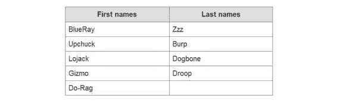

通过将每个名字与每个姓氏组合，我们可以生成 20 个不同的说唱歌手全名。

从“BlueRay”开始，我们遍历姓氏列表，生成……

BlueRay Zzz

BlueRay Burp

BlueRay Dogbone

BlueRay Droop

然后转到下一个名字“Upchuck”。再次遍历姓氏列表，生成……

Upchuck Zzz

Upchuck Burp

Upchuck Dogbone

Upchuck Droop

以此类推，将每个名字与每个姓氏组合。

但是，为什么不让我们用 JavaScript 来完成这些重复的工作呢？我们将使用嵌套的`for`语句。

```javascript
var firstNames = ["BlueRay ", "Upchuck ", "Lojack ", "Gizmo ", "Do-Rag "];
var lastNames = ["Zzz", "Burp", "Dogbone", "Droop"];
var fullNames = [];
for (var i = 0; i < firstNames.length; i++) {
  for (var j = 0; j < lastNames.length; j++) {
    fullNames.push(firstNames[i] + lastNames[j]);
  }
}
```

需要考虑的事项：

- 外层循环每迭代一次，内层循环就会完整地运行一轮。如果外层循环计数器是`i`，内层循环计数器是`j`，那么当`i`为 0 时，`j`会循环遍历 0、1、2 直到结束。然后`i`增加到 1，`j`再次遍历所有值。外层循环就像时钟的分针，内层循环就像秒针。
- 你可以根据需要设置任意多层嵌套。
- 嵌套循环相对于其外层循环缩进 2 个空格。

> 本章的交互式编程练习请访问：[`www.ASmarterWayToLearn.com/js/20.html`](http://www.ASmarterWayToLearn.com/javascript/20.html)

## 大小写转换

你让用户输入她的城市。然后你将她输入的城市与 5 个最清洁城市的列表进行比对。

如果用户输入“Cheyenne”或任何其他最清洁城市，你的代码会显示一个提示，告诉她这是最清洁的城市之一。

但如果她输入的是“cheyenne”而不是“Cheyenne”——有些用户不可避免地会这样做——那么就不会匹配。JavaScript 是字面量思维的。

人类知道在这个上下文中“cheyenne”指的是“Cheyenne”。但 JavaScript 不知道。我们需要某种方法让 JavaScript 识别出未大写版本也是匹配项。


一种方法是扩展`cleanestCities`数组，使其包含所有城市名称的小写版本：

`var cleanestCities = ["Cheyenne", "cheyenne", "Santa Fe", "santa fe", "Tucson", "tucson", "Great Falls", "great falls", "Honolulu", "honolulu"];`

这种方法在一定程度上可行，但需要大量额外的编码。此外，如果用户输入“santa Fe”、“Santa fe”或“sAnta Fe”，我们又回到了最初的问题。要涵盖所有这些可能性以及其他情况，需要编写一英里长的代码。

解决方案是将数组元素编码为小写，并将用户的输入（无论是什么）转换为小写，这样我们就能始终用苹果来比较苹果。

```javascript
var cityToCheck = prompt("Enter your city");
cityToCheck = cityToCheck.toLowerCase();
var cleanestCities = ["cheyenne", "santa fe", "tucson", "great falls", "honolulu"];
for (var i = 0; i <= 4; i++) {
  if (cityToCheck === cleanestCities[i]) {
    alert("It's one of the cleanest cities");
  }
}
```

第 2 行是这里的新内容：

`cityToCheck = cityToCheck.toLowerCase();`

转换后的字符串被赋值给一个变量。在这个例子中，它正是被转换字符串的同一个变量`cityToCheck`。注意关键字`toLowerCase`必须使用驼峰式大小写。

还要注意，`toLowerCase()`方法会将字符串中的所有字符转换为小写，而不仅仅是首字母。例如，“ChEyEnNe”会变成“cheyenne”。

你也可以反过来，将所有内容转换为大写，然后与“CHEYENNE”、“SANTA FE”等进行比对。大多数程序员更喜欢小写方法。要将字符串转换为大写，你可以这样写：

`cityToCheck = cityToCheck.toUpperCase();`

> 本章的交互式编程练习请访问：
>
> [`www.ASmarterWayToLearn.com/js/21.html`](http://www.ASmarterWayToLearn.com/javascript/21.html)

## 字符串：测量长度和提取部分

你让用户提供一个城市名称。你想将她提供的名称转换为首字母大写的名称。无论她输入的是“boston”、“BOSTON”还是“bosTon”，你都希望将输入标准化为“Boston”。你在上一章学到的`toLowerCase()`和`toUpperCase()`方法无法单独完成这项工作，因为它们会对字符串中的每个字符进行相同的全局更改。但是，如果你将字符串分成两段，就可以使用这些方法将字符串调整为你想要的形状。（目前，我忽略城市名称可能由两个或更多单词组成的情况，例如 New Orleans 或 Sault Ste. Marie。）

## 字符串：查找片段

要复制字符串的一部分，可以使用`slice`方法。假设用户输入了一个字符串，并且该字符串已赋值给变量`cityToCheck`。以下代码复制字符串的第一个字符，并将其赋值给变量`firstChar`。`cityToCheck`的原始值不会改变。如果`cityToCheck`是 "Boston"，那么`firstChar`就是 "B"。

```javascript
var firstChar = cityToCheck.slice(0, 1);
```

### 需要注意的事项

- 字符串的索引方式与数组类似。不同之处在于，每个索引号指向的不是元素，而是一个字符。
- 与数组索引一样，字符串索引也从 0 开始。
- 在`slice`方法中，括号内的第一个数字是切片中第一个字符的索引。然而，第二个数字并不是切片中的最后一个字符，而是切片之后的第一个字符。如果用第二个索引减去第一个索引，你总是能得到切片的长度。

下面是另一个例子。

```javascript
var someChars = cityToCheck.slice(2, 5);
```

再次假设字符串是 "Boston"。切片从索引 2（第三个）字符 "s" 开始，到索引 5 字符之前的那个字符 "n" 结束。`someChars`的值是 "sto"。

如果省略括号内的第二个数字，JavaScript 会包含从起始位置到字符串末尾的所有字符。

```javascript
var someChars = cityToCheck.slice(2);
```

切片从索引 2（第三个）字符 "s" 开始。由于没有指定结束位置，切片会一直取到字符串的最后一个字符。`someChars`的值是 "ston"。

现在我们有一种方法可以将字符串的第一个字符大写，并确保其余字母为小写。

```javascript
var firstChar = cityToCheck.slice(0, 1);
var otherChars = cityToCheck.slice(1);
firstChar = firstChar.toUpperCase();
otherChars = otherChars.toLowerCase();
var cappedCity = firstChar + otherChars;
```

以上代码逐行执行的操作如下：

1. 复制字符串的第一个字符，并将其赋值给变量`firstChar`。
2. 复制从第二个字符到末尾的所有字符，并将其赋值给变量`otherChars`。
3. 将第一个字符转换为大写。
4. 将其他字符转换为小写。
5. 将两部分拼接起来，重新组成完整的字符串。

有时，知道字符串中有多少个字符是很有用的。例如，假设你想从任何长度超过三个字符的字符串中截取前三个字符，比如从 "November" 中截取 "Nov"。要查找字符串中的字符数，可以使用你已经学过的用于查找数组中元素数量的相同语法。

```javascript
var month = prompt("Enter a month");
var charsInMonth = month.length;
if (charsInMonth > 3) {
  monthAbbrev = month.slice(0, 3);
}
```

第 2 行统计字符串中的字符数，并将该数字赋值给变量`charsInMonth`。

能够测量字符串中的字符数会很有用。例如，假设你想遍历一个字符串，检查其中是否有双空格。你可以将字符数用作循环限制器。以下代码检查字符串中是否有双空格，如果发现则显示一个警告。

```javascript
var str = prompt("Enter some text");
var numChars = str.length;
for (var i = 0; i < numChars; i++) {
  if (str.slice(i, i + 2) === "  ") {
    alert("No double spaces!");
    break;
  }
}
```

第 2 行统计字符串中的字符数，并将该数字赋值给变量`numChars`。在第 3 行中，这个数字被用作循环限制器。循环仅在计数器`i`小于字符串中字符数时继续运行。（记住，长度是基于 1 的，而计数器是基于 0 的，因此循环必须在长度数减 1 的位置停止。）第 4 行逐个字符地遍历字符串，检查每个由两个字符组成的片段，寻找双空格。

> 本章的交互式编程练习请访问：[`www.ASmarterWayToLearn.com/js/22.html`](http://www.ASmarterWayToLearn.com/javascript/22.html)

## 查找片段

《纽约客》杂志不允许使用短语 "World War II"。他们认为应该用 "the Second World War"。那么，让我们在下面的句子中搜索被禁止的字符，并将其替换为《纽约客》偏爱的短语。

| 令人惊讶的是，即使在第二次世界大战最黑暗的深处，J. R. R. 托尔金仍在撰写那部三部曲，其中包含（只有诗歌和神话才具有的奇特适用性）这样一个基本概念：善良的灰袍巫师能够理解邪恶的魔法师，恰恰是因为他与他们足够相似，能够以他们无法理解他的方式理解他们的思想和动机。 |
|---|

你已经知道一种查找并替换被禁止片段的方法。假设上面的段落已赋值给变量`text`。

```javascript
for (var i = 0; i < text.length; i++) {
  if (text.slice(i, i + 12) === "World War II") {
    text = text.slice(0, i) + "the Second World War" + text.slice(i + 12);
  }
}
```

代码遍历字符串，查找 "World War II"。第 2 行逐个字符地遍历字符串，检查每个由 12 个字符组成的序列。如果找到 "World War II"，第 3 行将三个片段拼接起来：所有在 "World War II" 之前的字符、替换短语 "the Second World War"，以及所有在 "World War II" 之后的字符。

但 JavaScript 有一种更高效的方法来实现这一点，即使用`indexOf`方法。

```javascript
var firstChar = text.indexOf("World War II");
```

如果该片段存在，该方法会找到该片段第一个字符的索引，并将其赋值给变量`firstChar`。如果该片段不存在，该方法会将`-1`赋值给该变量，这样你就知道它不存在。

现在我们可以用更少的代码将禁止短语替换为首选短语。

```javascript
var firstChar = text.indexOf("World War II");
if (firstChar !== -1) {
  text = text.slice(0, firstChar) + "the Second World War" + text.slice(firstChar + 12);
}
```

第 1 行检查该短语，如果找到，则将短语第一个字符的索引赋值给变量`firstChar`。如果未找到，则将`-1`赋值给该变量。如果该变量的值不是`-1`（第 2 行）——即找到了该短语——那么第 3 行的拼接操作会将违规短语替换为正确的短语。

`indexOf`方法只查找你要找的片段的第一个实例。在上面的例子中，你可以通过循环来克服这个限制。先将第一个 "World War II" 实例改为 "the Second World War"，然后在下一个循环迭代中，找到下一个幸存的实例并更改它，以此类推。

要查找字符串中某个片段的最后一个实例，请使用`lastIndexOf`。以下代码找到该片段最后一个实例的第一个字符的索引，即第二个 "be"。变量`segIndex`最终值为 16，即第二个 "be" 中 "b" 的索引。

```javascript
var text = "To be or not to be.";
var segIndex = text.lastIndexOf("be");
```

> 本章的交互式编程练习请访问：[`www.ASmarterWayToLearn.com/js/23.html`](http://www.ASmarterWayToLearn.com/javascript/23.html)

## 查找某个位置的字符

用户输入了他的名字。该字符串已赋值给变量`firstName`。你想提取第一个字符。你已经知道一种方法。

```javascript
var firstChar = firstName.slice(0, 1);
```

这里有一种更直接的方法。

```javascript
var firstChar = firstName.charAt(0);
```

上面的代码找到变量`firstName`所表示字符串中索引 0（开头）处的单个字符，并将其赋值给变量`firstChar`。

以下代码找到字符串中的最后一个字符。

```javascript
var lastChar = name.charAt(name.length - 1);
```

以下代码循环遍历一个字符串，查找感叹号。如果找到该字符，则显示一个警告框。

```javascript
for (var i = 0; i < text.length; i++) {
  if (text.charAt(i) === "!") {
    alert("找到感叹号！");
    break;
  }
}
```

注意：`indexOf`方法只能识别特定位置的字符，不能更改该位置的字符。

> 本章的交互式编程练习请访问：
>
> [`www.ASmarterWayToLearn.com/js/24.html`](http://www.ASmarterWayToLearn.com/javascript/24.html)

## 字符串：替换字符

在前面的章节中，你学习了两种不同的方法，将字符串中的 "World War II" 替换为 "the Second World War"。首先是循环加切片的方法。

```javascript
for (var i = 0; i < text.length; i++) {
  if (text.slice(i, i + 12) === "World War II") {
    text = text.slice(0, i) + "the Second World War" + text.slice(i + 12);
  }
}
```

当你学习了`indexOf`方法后，改进了这种相当粗糙的方法。

```javascript
var firstChar = text.indexOf("World War II");
if (firstChar !== -1) {
  text = text.slice(0, firstChar) + "the Second World War" + text.slice(firstChar + 12);
}
```

但 JavaScript 还提供了一种更直接的方式，即`replace`方法。

```javascript
var newText = text.replace("World War II", "the Second World War");
```

括号内的第一个字符串是要替换的片段，第二个字符串是要插入的片段。在上述代码中，变量`text`所代表的字符串中的 "World War II" 被替换为 "the Second World War"，修改后的字符串被赋值给新变量`newText`。

如果像上面的例子那样将修改后的字符串赋值给一个新变量，原始字符串会被保留。如果你希望原始字符串被修改后的字符串替换，则将修改后的字符串赋值给原始变量。

`text = text.replace("World War II", "the Second World War");`

在上面的例子中，只替换了字符串的第一个实例。如果你想替换所有实例，必须让 JavaScript 知道你要进行全局替换。

```javascript
var newText = text.replace(/World War II/g, "the Second World War");
```

在全局替换中，你要替换的片段用斜杠括起来，而不是引号，并在结束斜杠后加上`g`表示“全局”。要插入的片段则用引号括起来，与一次性替换相同。

> 本章的交互式编程练习请访问：[`www.ASmarterWayToLearn.com/js/25.html`](http://www.ASmarterWayToLearn.com/javascript/25.html)

## 数字取整

你运营一个在线音乐服务，顾客可以对每首歌进行评分。你汇总所有顾客评分并计算平均值，给歌曲打 0 到 5 星。通常，平均值会产生小数。你需要将其四舍五入到最接近的整数，以便将数字转换为星数。假设平均值已赋值给变量`scoreAvg`。以下是将其四舍五入到最接近整数的代码。

`var numberOfStars = Math.round(scoreAvg);`

需要记住的事项：

- `Math.`是所有数学函数的开头。`M`必须大写。
- 当小数为`.5`时，函数向上取整。它将`1.5`取整为`2`，`2.5`取整为`3`，以此类推。它将`-1.5`取整为`-1`，`-2.5`取整为`-2`，以此类推。

当结果赋值给一个新变量时（如上例所示），括号内未取整的数字会被保留。但你可以将取整后的数字赋值给原始变量，未取整的数字将被取整后的数字替换。

`scoreAvg = Math.round(scoreAvg);`

除了变量，你也可以在括号内放入一个字面量数字。

`var scoreAvg = Math.round(.0678437);`

要强制 JavaScript 向上取整到最接近的整数，无论小数有多小，请使用`ceil`而不是`round`。以下代码将`.000001`（通常向下取整为`0`）向上取整到最接近的整数`1`。

`var scoreAvg = Math.ceil(.000001);`

`ceil`代表“天花板”。它将`.000001`向上取整为`1`，`-.000001`向上取整为`0`，`1.00001`向上取整为`2`，以此类推。

要强制 JavaScript 向下取整到最接近的整数，无论小数有多大，请使用`floor`而不是`round`。以下代码将`.999999`（通常向上取整为`1`）向下取整为`0`。

`var scoreAvg = Math.floor(.999999);`


`floor` 将 `.999999` 向下取整为 `0`，`1.9` 向下取整为 `1`，`-.000001` 向下取整为 `-1`，以此类推。

> 本章的交互式编程练习请访问：
>
> [`www.ASmarterWayToLearn.com/js/26.html`](http://www.ASmarterWayToLearn.com/javascript/26.html)

## 生成随机数

假设你想模拟掷骰子。在模拟中，你希望随机出现 1、2、3、4、5 或 6。第一步是让 JavaScript 生成一个随机数。（嗯，它几乎是随机的，技术上称为伪随机，但对于大多数用途来说已经足够接近随机了。）

以下代码生成一个伪随机数，有 16 位小数，范围从 `0.0000000000000000` 到 `0.9999999999999999`，并将其赋值给变量 `randomNumber`。

```javascript
var randomNumber = Math.random();
```

该函数总是返回一个 16 位小数，范围从 `0.0000000000000000` 到 `0.9999999999999999`。我们可以通过乘以一亿亿（1 后面跟 17 个零）来将小数转换为整数：

- `0.0000000000000000 * 100000000000000000 = 0`
- `0.7474887706339359 * 100000000000000000 = 7474887706339359`
- `0.9999999999999999 * 100000000000000000 = 9999999999999999`

数万亿个可能的数字对于我们的虚拟掷骰子来说太多了。我们只需要 6 个可能的数字，即 1 到 6。因此，我们的第一步不是乘以一亿亿，而是将这个巨大的小数乘以 6。

- `0.0000000000000000 * 6 = 0`
- `0.7474887706339359 * 6 = 4.7474887706339359`
- `0.9999999999999999 * 6 = 5.9999999999999994`

直觉可能会告诉你，可以通过取整来完成，但数学上这行不通。因为没有任何数能向上取整为 `0`，也没有任何数能向下取整为 `6`，而中间的数字（既可以通过向上取整也可以通过向下取整得到）出现的频率几乎会是其他数字的两倍。但如果我们先将结果加 1，然后向下取整，就可以让所有数字有均等的机会。以下是我们的虚拟掷骰子的代码。

```javascript
var bigDecimal = Math.random();
var improvedNum = (bigDecimal * 6) + 1;
var numberOfStars = Math.floor(improvedNum);
```

以上代码逐行执行的操作如下：

1. 生成一个 16 位小数，并赋值给变量 `bigDecimal`。
2. 将 16 位小数转换为范围从 `0.0000000000000000` 到 `5.9999999999999999` 的数字，然后加 1，因此范围变为 `1.0000000000000000` 到 `6.9999999999999999`。该数字赋值给变量 `improvedNum`。
3. 将 `improvedNum` 表示的值向下取整到最接近的整数，范围从 1 到 6。

> 本章的交互式编程练习请访问：
>
> [`www.ASmarterWayToLearn.com/js/27.html`](http://www.ASmarterWayToLearn.com/javascript/27.html)

## 将字符串转换为整数和小数

有时 JavaScript 似乎能读懂你的心思。例如，假设你写……

```javascript
var currentAge = prompt("请输入你的年龄。");
```

……JavaScript 将用户的回答作为字符串赋值给 `currentAge`。用户输入的内容，比如 32，对你来说可能看起来像数字，但对 JavaScript 来说它是一个字符串：`"32"`。

尽管如此，假设你写……

```javascript
var currentAge = prompt("请输入你的年龄。");
var yearsEligibleToVote = currentAge - 18;
```

在上面的代码中，赋给变量 `currentAge` 的值是一个字符串，因为它来自用户的提示响应。但在第 2 行，当该变量出现在算术表达式中时，该值会自动（且临时）转换为数字，以使数学运算生效。

类似地，如果你让 JavaScript 将 `"100"` 除以 2 或将 `"2.5"` 乘以 2.5，JavaScript 似乎理解你希望将字符串视为数字，并执行数学运算。你甚至可以让 JavaScript 仅使用字符串作为操作数进行乘法、除法或减法，而 JavaScript 会正确理解你的意图并完成计算。

```javascript
var profit = "200" - "150";
```

在上面的语句中，两个字符串被视为数字，因为它们出现在数学表达式中。变量 `profit` 尽管有引号，但被赋值为数字 50。

不言而喻，你让 JavaScript 进行数学运算的字符串必须是引号内的数字，例如 `"50"`，而不能是字母字符。如果你写……

```javascript
var profit = "200" - "duck";
```

……则会显示一个警告，显示 `"NaN"`，意思是“不是一个数字”。这没什么好奇怪的。200 减去 `"duck"` 怎么可能是一个数字呢？

你可能还记得前一章的内容：当你在涉及加号的表达式中混合字符串和数字时，JavaScript 会做出与上面示例相反的操作。JavaScript 不会将字符串转换为数字，而是将数字转换为字符串。它不会进行加法，而是进行拼接。

```javascript
var result = "200" + 150;
```

在上面的语句中，JavaScript 看到字符串 `"200"` 和数字 150，通过将 150 转换为字符串 `"150"` 来解决冲突。然后它将两个字符串拼接起来。变量 `result` 被赋值为 `"200150"`。如果表达式中的 `+` 是其他算术运算符（`-`、`*` 或 `/`），JavaScript 会将字符串 `"200"` 转换为数字 200 并进行数学运算。

你可以看到以下代码会出现问题。

```javascript
1 var currentAge = prompt("Enter your age.");
2 var qualifying Age = currentAge + 1;
```

上面的代码有一个意想不到的后果。由 `currentAge` 表示的字符串与已转换为 `"1"` 的 1 拼接在一起。例如：如果用户输入 `"52"`，`qualifyingAge` 被赋值的不是 53，而是 `"521"`。

如果你想进行加法运算，必须将任何字符串转换为数字。

```javascript
1 var currentAge = prompt("Enter your age.");
2 var qualifyingAge = parseInt(currentAge) + 1;
```

第 2 行将 `currentAge` 表示的字符串转换为数字，然后加 1，并将和赋给 `qualifyingAge`。

`parseInt` 将所有字符串（包括由浮点数组成的字符串）转换为整数。但令人震惊且真实的是：它不会进行四舍五入。它只是简单地截断小数部分。在下面的语句中，`myInteger` 被赋值为 1，而不是你可能期望的 2。

```javascript
var myInteger = parseInt("1.9999");
```

要保留任何小数值，请使用 `parseFloat`。在下面的语句中，`myFractional` 被赋值为 1.9999。

```javascript
var myFractional = parseFloat("1.9999");
```

为了尽量减少混淆，程序员有时更喜欢进行显式的手动转换，即使 JavaScript 并不要求这样做，例如在乘法运算中混合字符串和数字时。

> 本章的交互式编码练习请访问：
>
> [`www.ASmarterWayToLearn.com/js/28.html`](http://www.ASmarterWayToLearn.com/javascript/28.html)

## 29 将字符串转换为数字，将数字转换为字符串

在上一章中，你学会了使用 `parseInt` 将表示数字的字符串转换为整数。你还学会了使用 `parseFloat` 将表示数字的字符串转换为浮点数。你可以通过使用 `Number` 来巧妙地处理整数和浮点数之间的区别。这个方便的转换工具可以将表示整数或浮点数的字符串转换为与括号内内容相同的数字。

以下代码将字符串 `"24"` 转换为数字 24。

```javascript
1 var integerString = "24"
2 var num = Number(integerString);
```

以下代码将字符串 `"24.9876"` 转换为数字 24.9876。

```javascript
1 var floatingNumString = "24.9876";
2 var num = Number(floatingNumString);
```

假设你的代码进行了一次算术计算，得到了一个很大的数字。现在你想将计算结果呈现给用户。但在显示数字之前，你想用逗号格式化它，使其可读。为此，你必须将数字转换为字符串。以下是操作方法。

将数字转换为字符串（也许是为了格式化它）很简单。

```javascript
1 var numberAsNumber = 1234;
2 var numberAsString = numberAsNumber.toString();
```

上面的代码将数字 1234 转换为字符串 `"1234"`，并将其赋给变量 `numberAsString`。

> 本章的交互式编码练习请访问：
>
> [`www.ASmarterWayToLearn.com/js/29.html`](http://www.ASmarterWayToLearn.com/javascript/29.html)

## 30 控制小数位数

商品的价格是 $9.95。销售税是价格的 6.5%。你将这两个数字相加得到总额。

```javascript
var total = price + (price * taxRate);
```

变量 `total` 现在的值为 10.59675。

但这并不是你要向客户收取的金额，对吧？你要向她收取四舍五入到两位小数的金额：$10.60。

以下是操作方法。

```javascript
var prettyTotal = total.toFixed(2);
```

上面的语句将 `total` 表示的数字四舍五入到 2 位小数，并将结果赋给变量 `prettyTotal`。括号内的数字告诉 JavaScript 要将小数四舍五入到多少位。

现在加上美元符号，就大功告成了。

```javascript
var currencyTotal = "$" + prettyTotal;
```

要将数字缩短到没有小数，请将括号留空。

```javascript
var prettyTotal = total.toFixed();
```

不幸的是，`toFixed` 方法有一个意外之处。如果小数以 5 结尾，它通常会像你期望的那样向上舍入。但是，根据浏览器的不同，有时它会向下舍入！例如，如果你对 1.555 应用该方法，指定 2 位小数，它可能会给出 `"1.56"`。也可能产生 `"1.55"`。

有一些复杂的方法可以解决这个问题。这里有一个不太优雅的修复方法，使用了你已经知道和理解的方法。

```javascript
1 var str = num.toString();
2 if (str.charAt(str.length - 1) === "5") {
3   str = str.slice(0, str.length - 1) + "6";
4 }
5 num = Number(str);
6 prettyNum = num.toFixed(2);
```

如果小数以 5 结尾，代码会将其改为 6，从而强制该方法在应该向上舍入时向上舍入。以下是逐行解释：

1. 将数字转换为字符串并赋给变量 `str`。
2. 检查最后一个字符是否为 `"5"`。
3. 如果是，则截掉 `"5"` 并追加 `"6"`。
4. --
5. 将其转换回数字。
6. 将其四舍五入到 2 位小数。

> 本章的交互式编程练习请访问：
>
> [`www.ASmarterWayToLearn.com/js/30.html`](http://www.ASmarterWayToLearn.com/javascript/30.html)

## 31 获取当前日期和时间

你的网页包含一条通知，告知用户其所在时区的当前本地日期和时间。但当前的日期和时间是什么？以下是 JavaScript 如何获取的。

```javascript
var rightNow = new Date();
```

上面的语句创建了一个称为 `Date` 对象的东西。它看起来像这样。

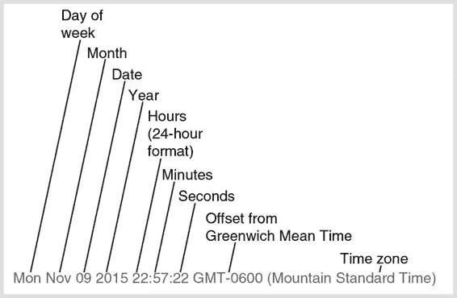

请注意，JavaScript 从用户的计算机获取此信息。它的准确性取决于计算机的日期和时间设置。例如，如果用户刚从美国西海岸搬到美国东海岸，并且没有重置计算机上的时区，那么计算机仍将使用太平洋时间。`Date` 对象也将使用太平洋时间。

`Date` 对象可能看起来像一个字符串，但它不是。例如，你不能对其使用像 `charAt`、`indexOf` 或 `slice` 这样的方法。

如果你需要将 `Date` 对象转换为字符串，可以像将数字转换为字符串一样进行转换。

```javascript
var dateString = rightNow.toString();
```

上述代码将变量 `rightNow` 所代表的 `Date` 对象转换为字符串，并将该字符串赋值给变量 `dateString`。

大多数情况下，你只想从 `Date` 对象中提取部分信息，而不将其转换为字符串。

我将向你展示如何提取 `Date` 对象的各个部分。在本章中，我将带你了解第一个部分。下一章将介绍其余部分。

以下代码创建一个新的 `Date` 对象，将其赋值给变量 `rightNow`，提取星期几，并将星期几赋值给变量 `theDay`。

```javascript
1 var rightNow = new Date();
2 var theDay = rightNow.getDay();
```

在我之前展示的 `Date` 对象示意图中，星期几表示为“Mon”。但当你从对象中提取星期几时，它是以数字形式表示的。星期几用数字表示，从 0（星期日）到 6（星期六）。这意味着你需要一些代码将其转换回像“Mon”这样的星期名称。

```javascript
1 var dayNames = ["Sun", "Mon", "Tue", "Wed", "Thu", "Fri", "Sat"];
2 var now = new Date();
3 var theDay = now.getDay();
4 var nameOfToday = dayNames[theDay];
```

以下是代码说明：

1. 创建一个以“Sun”开头的星期数组，并将其赋值给 `dayNames`。
2. 创建一个新的 `Date` 对象，并将其赋值给 `now`。
3. 以数字形式提取星期几，并将其赋值给 `theDay`。
4. 使用星期数字作为索引，指定正确的数组元素，即星期名称。

> 本章的交互式编程练习请访问：
>
> [`www.ASmarterWayToLearn.com/js/31.html`](http://www.ASmarterWayToLearn.com/javascript/31.html)

## 32 提取日期和时间的各个部分

以下是提取 `Date` 对象各部分的重要方法总结。

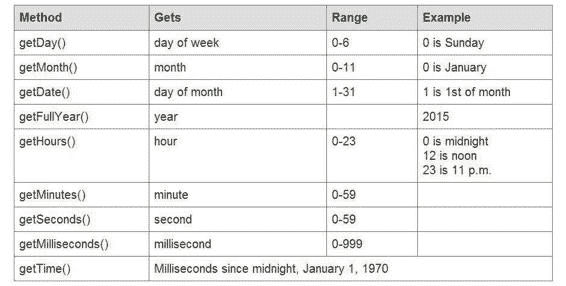

上一章我介绍了 `getDay`。现在我们来看看其余提取方法。与 `getDay` 类似，`getMonth` 返回的不是 `Date` 对象中显示的月份全名，而是一个数字。以下代码生成一个月份数字，范围从 0（一月）到 11（十二月）。

```javascript
1 var d = new Date();
2 var currentMonth = d.getMonth();
```

`getDate` 返回当月的日期数字。

```javascript
var dayOfMonth = d.getDate();
```

`getFullYear` 返回四位数的年份数字。

```javascript
var currYr = d.getFullYear();
```

`getHours` 返回一个从 0 到 23 的数字，对应午夜到晚上 11 点。

```javascript
var currentHrs = d.getHours();
```

`getMinutes` 返回一个从 0 到 59 的数字。

```javascript
var currMins = d.getMinutes();
```

`getSeconds` 返回一个从 0 到 59 的数字。

```javascript
var currSecs = d.getSeconds();
```

`getMilliseconds` 返回一个从 0 到 999 的数字。

```javascript
var currMills = d.getMilliseconds();
```

`getTime` 返回自 1970 年 1 月 1 日午夜以来经过的毫秒数。

```javascript
var millsSince = d.getTime();
```

> 本章的交互式编程练习请访问：
>
> [`www.ASmarterWayToLearn.com/js/32.html`](http://www.ASmarterWayToLearn.com/javascript/32.html)

## 33 指定日期和时间

距离美国社会保障体系破产还有多少天？

我们先从预估日期开始。根据该体系的受托人，资金将在 2035 年耗尽。他们没有确定具体日期。我们选择年中——6 月 30 日。

好了，最难的部分——确定末日——已经完成。一旦有了这个日期，构建逐日倒计时就是 JavaScript 的轻松活了。

你已经知道第一步怎么做：为当前日期和时间创建一个 `Date` 对象：

```javascript
1 var today = new Date();
```

接下来，创建第二个 `Date` 对象。但这次你要指定未来的日期，即 2035 年 6 月 30 日。


```javascript
2 var doomsday = new Date("June 30, 2035");
```

注意日期的指定方式。它被引号括起来。月份是拼写出来的。日期后面有逗号。年份用四位数字表示。

接着，从两个日期中提取自 1970 年 1 月 1 日参考日期以来经过的毫秒数。

```javascript
3 var msToday = today.getTime();
4 var msDoomsday = doomsday.getTime();
```

计算差值。

```javascript
5 var msDiff = msDoomsday - msToday;
```

通过简单的数学运算将毫秒转换为天数。

```javascript
6 var dDiff = msDiff / (1000 * 60 * 60 * 24);
```

括号内的数学运算产生的大数字将毫秒转换为秒（1000）、分钟（60）、小时（60）和天（24）。

你需要一个表示整天的数字，因此向下取整。以下语句将天数（很可能是浮点数）向下取整为整数。

```javascript
7 dDiff = Math.floor(dDiff);
```

以下是整个代码，压缩成更像生产代码的形式：

```javascript
1 var msDiff = new Date("June 30, 2035").getTime() - new Date().getTime();
2 var daysTillDoom = Math.floor(msDiff / (1000 * 60 * 60 * 24));
```

第 1 行将当前时刻自参考日期以来的毫秒数从 2035 年 6 月 30 日自参考日期以来的毫秒数中减去。第 2 行将毫秒转换为天数并向下取整。

如果时间也很重要，你也可以指定时间。

```javascript
var d = new Date("July 21, 1983 13:25:00");
```

注意指定时间的形式：日期后面没有逗号。使用 24 小时制。小时、分钟、秒之间用冒号分隔。

> 本章的交互式编程练习请访问：
>
> [`www.ASmarterWayToLearn.com/js/33.html`](http://www.ASmarterWayToLearn.com/javascript/33.html)

## 34 更改日期和时间的元素

你可以更改 `Date` 对象的各个元素。以下是总结：

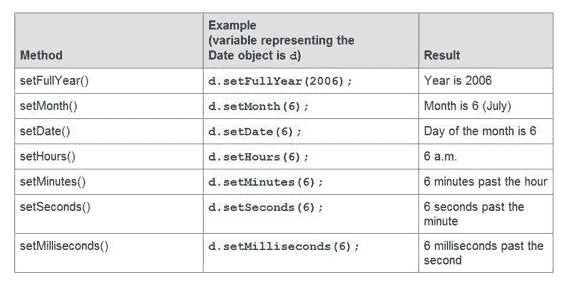

`setFullYear` 设置现有 `Date` 对象的年份，而不更改其他任何元素。

```javascript
1 var d = new Date();
2 d.setFullYear(2001);
```

第 1 行为当前时刻创建一个新的 `Date` 对象。第 2 行将 `Date` 对象的年份更改为 2001，保持 `Date` 对象的所有其他元素不变。

`setMonth` 设置现有 `Date` 对象的月份，而不更改其他任何元素。

```javascript
1 var d = new Date();
2 d.setMonth(11);
```

第 1 行为当前时刻创建一个新的 `Date` 对象。第 2 行将 `Date` 对象的月份更改为 11（十二月），保持 `Date` 对象的所有其他元素不变。

`setDate` 设置现有 `Date` 对象的当月日期，而不更改其他任何元素。

```javascript
1 var d = new Date();
2 d.setDate(15);
```

第 1 行为当前时刻创建一个新的 `Date` 对象。第 2 行将 `Date` 对象的日期更改为当月 15 日，保持 `Date` 对象的所有其他元素不变。

`setHours` 设置现有 `Date` 对象的小时数，而不更改其他任何元素。

```javascript
1 var d = new Date();
2 d.setHours(13);
```

第 1 行为当前时刻创建一个新的 `Date` 对象。第 2 行将 `Date` 对象的小时数更改为 13 时（下午 1 点），保持 `Date` 对象的所有其他元素不变。

`setMinutes` 设置现有 `Date` 对象的分钟数，而不更改其他任何元素。

```javascript
1 var d = new Date();
2 d.setMinutes(05);
```

第 1 行为当前时刻创建一个新的 `Date` 对象。第 2 行将 `Date` 对象的分钟数更改为 5 分，保持 `Date` 对象的所有其他元素不变。

`setSeconds` 设置现有 `Date` 对象的秒数，而不更改其他任何元素。

```javascript
1 var d = new Date();
2 d.setSeconds(55);
```

第 1 行为当前时刻创建一个新的 `Date` 对象。第 2 行将 `Date` 对象的秒数更改为 55 秒，保持 `Date` 对象的所有其他元素不变。

`setMilliseconds` 设置现有 `Date` 对象的毫秒数，而不更改其他任何元素。

```javascript
1 var d = new Date();
2 d.setMilliseconds(867);
```

第 1 行创建一个新的 `Date` 对象，表示当前时刻。

第 2 行将 `Date` 对象的毫秒数改为秒后的 867 毫秒，同时保持 `Date` 对象的其他元素不变。

> 查找本章的交互式编程练习，请访问：
>
> [`www.ASmarterWayToLearn.com/js/34.html`](http://www.ASmarterWayToLearn.com/javascript/34.html)

# 函数

函数是一段 JavaScript 代码块，每当调用它的名称时，它会自动重复执行相同的操作。它节省了重复编码的工作，并使代码更易于理解。

在你的网站上，假设有几个页面需要显示一个提示框，告诉用户当前时间。（为简单起见，我们使用 24 小时制，而不转换为上午和下午。）代码可能如下所示：

```javascript
1 var now = new Date();
2 var theHr = now.getHours();
3 var theMin = now.getMinutes();
4 alert("time: " + theHr + ":" + theMin);
```

你可以在每次需要时反复编写这段代码块。或者，你可以将其编写为一个函数，并给它命名，比如 `tellTime`。之后，只需以下代码即可执行整个代码块：

`tellTime();`

每当 JavaScript 看到这个简短的语句时，时间显示代码块就会执行。

以下是将上述一次性代码封装为可重复使用函数的方式：

```javascript
1 function tellTime() {
2   var now = new Date();
3   var theHr = now.getHours();
4   var theMin = now.getMinutes();
5   alert("Current time: "+ theHr + ":" + theMin);
6 }
```

时间显示代码——即创建 `Date` 对象、提取时间、格式化并显示提示框的代码——与我们开始时完全一样，但现在被封装成了一个函数。以下是各部分说明：

1. 第 1 行是一个声明语句，包含：
   - 关键字 `function`
   - 我为函数起的名称
   - 标识其为函数的括号
   - 用于包裹执行代码的左花括号
2. 第 2 至 5 行是之前见过的相同代码块，但为了清晰进行了缩进。缩进多少因人而异。我训练你缩进 2 个空格。
3. 第 6 行是单独一行的右花括号，用于包裹执行代码。

再次注意，调用代码——即调用函数的代码——只需写出函数名称及其括号。

`tellTime();`

你可以为函数指定任何合法的变量名，然后加上括号。函数命名遵循与变量命名相同的规则，因为从技术上讲，函数也是一种变量。当你后续章节了解更多关于函数的知识时，这一点会更容易理解。

函数和调用它们的语句可能相隔数千行代码。通常，函数与主代码位于同一位置——在外部 JavaScript 文件中、HTML body 部分的末尾或 HTML head 部分中。通常，所有函数应位于主代码之前，这样当主代码调用它们时，它们已经加载到内存中并准备就绪。

> 查找本章的交互式编程练习，请访问：
>
> [`www.ASmarterWayToLearn.com/js/35.html`](http://www.ASmarterWayToLearn.com/javascript/35.html)

## 函数：向它们传递数据

函数是一段代码块，每当调用其名称时，它会自动执行某些操作。例如，当你编写 `greetUser();` 时，一个同名的函数就会执行。需要明确的是：我这里讨论的函数是你自己编写并命名的。

假设当你编写 `greetUser();` 时，会调用一个函数，该函数显示一个提示框，内容为“Hello, there.”

这是该函数的代码：

```javascript
1 function greetUser() {
2   alert("Hello, there.");
3 }
```

函数的一个非常实用的特性是，调用代码中的括号不必为空。如果你在括号内放入一些数据，就可以将这些数据传递给函数，并在函数执行时使用。

假设，不写 `greetUser();`，而是写……

`greetUser("Hello, there.");`

现在，你不仅调用了函数，还向它传递了数据。括号内的字符串，即你传递的数据，被称为参数（argument）。

现在函数更加灵活了，因为它显示的消息不再硬编码在函数内部。它将显示你通过调用代码中的参数传递给它的任何消息。

为了使函数成为一个可编程的机器人，而不是一个只能做单一工作的机器人，你需要设置它来接收你传递的数据。以下是实现方法：

```javascript
1 function greetUser(greeting) {
2   alert(greeting);
3 }
```

现在，我们填充了调用代码和函数定义的括号。调用代码的括号内包含一个参数（argument）。在示例中，参数是字符串 `"Hello, there."`。并且，如上面的示例所示，函数定义的括号内包含一个变量 `greeting`。

函数语句中括号内的变量被称为参数（parameter）。参数名称由你决定。你可以给它任何合法的变量名。然后你可以在函数体中使用它来完成某些操作。在上面的示例中，第 2 行我用它来指定 `alert` 中的消息。

当变量在函数定义中用作参数时，无需声明它。当用作参数时，声明是隐式的。

调用函数语句中的参数（argument）——`"Hello, there."`——是传递给函数的数据。函数定义括号内的参数（parameter）捕获传递的数据。现在它持有 `"Hello, there."`。换句话说，函数调用中指定的字符串 `"Hello, there"` 被赋值给函数中的 `greeting`。然后该变量 `greeting` 被用于指定 `alert` 语句中的消息。

传递给函数的值在函数体中被用来完成某些操作。在这个例子中，该值用于指定 `alert` 中的消息。

在示例中，参数是一个字符串，但它也可以是一个变量。在下面的代码中，我声明了变量 `greeting` 并赋值为 `"Hello, there."`。然后，我没有在函数调用中使用字符串本身作为参数，而是使用了变量。

```javascript
1 var greeting = "Hello, there.";
2 greetUser(greeting);
```

在上面的示例中，函数名 `greetUser` 与参数名 `greeting` 部分相同，但这只是为了便于理解代码。函数名和参数名不必有任何共同之处。请记住，只要遵循变量命名规则，这些名称由你决定。

在示例中，我将调用代码中的参数命名为 `greeting`，也将函数代码中的参数命名为 `greeting`。但这也不是必须的。它们不必匹配。无论参数（argument）的名称是什么，它都会被参数（parameter）接受，无论参数（parameter）的名称是什么。在下面的代码中，变量 `whatever` 是参数（argument）。参数（parameter）`greeting` 与名称不匹配，但仍然捕获了值。

以下是函数，再次使用参数 `greeting`：

```javascript
1 function greetUser(greeting) {
2   alert(greeting);
3 }
```

以下是调用函数的语句，使用参数 `whatever`：

```javascript
1 var whatever = "Hello, there.";
2 greetUser(whatever);
```

参数（argument）的名称和参数（parameter）的名称不匹配是可以的。参数（parameter）仍然捕获了参数（argument），即字符串 `"Hello, there."`。

尽管如此，为了清晰起见，通常让参数（argument）和参数（parameter）同名是有意义的。

## 函数：传递参数与返回数据

数字，无论是字面量数字还是由变量表示的数字，都可以作为参数。在下面的代码中，我声明了变量 `almostAMil` 并将数字 999999 赋值给它。然后我在函数调用中将 `almostAMil` 作为参数使用。

```javascript
var almostAMil = 999999;
showBigNum(almostAMil);
```

或者，如果我想的话，也可以直接使用字面量数字 999999 作为参数。

```javascript
showBigNum(999999);
```

你可以向函数传递任意数量的参数，参数之间用逗号分隔。通常，函数也有相同数量的参数（同样用逗号分隔）。（特殊情况下有极少数例外。）再次强调，当你使用变量作为参数时，变量名不必与参数名匹配。JavaScript 根据参数的顺序进行匹配，而不是名称。列表中的第一个参数传递给列表中的第一个参数，第二个参数传递给第二个参数，以此类推。

作为参数，你可以使用变量、字符串和字面量数字的任意组合。在下面的示例中，调用代码向函数传递了一个变量、一个字符串和一个数字。三个参数接收这些值。函数将它们拼接起来以创建一条警告消息。

首先，这是函数。

```javascript
function showMessage(m, string, num) {
  alert(m + string + num);
}
```

现在，这是调用函数的语句。

```javascript
var month = "March";
showMessage(month, "'s winner number is ", 23);
```

参数 `month`（一个变量）被传递给参数 `m`。参数 `"'s winning number is "`（一个字符串）被传递给参数 `string`。参数 `23`（一个字面量数字）被传递给参数 `num`。

当代码执行时，会弹出一条警告，显示“March's winning number is 23”。

通常，你会将函数定义中包含的所有参数作为变量在执行的代码中使用，因为，否则你为什么要将它们放在函数定义中呢？但并没有规定你必须全部使用它们。而且你当然不必按照它们在括号中出现的顺序来使用它们。每个参数都是一个完整的变量，在函数内部，你可以像使用任何变量一样使用它。

> 本章的交互式编程练习请访问：
>
> [`www.ASmarterWayToLearn.com/js/36.html`](http://www.ASmarterWayToLearn.com/javascript/36.html)

### 从函数返回数据

正如你在上一章所学到的，当你向函数传递数据以便它能够完成定制任务时，函数会变得更加灵活。但函数还能做得更多。它可以将数据返回给调用代码。

假设你收取最低运费 5 美元，外加超过 50 美元部分的商品总额的 3%，最高不超过 100 美元。当总额达到 100 美元时，你提供免运费。以下是计算订单总额的代码。

```javascript
var orderTot;
if (merchTot >= 100) {
  orderTot = merchTot;
}
else if (merchTot < 50.01) {
  orderTot = merchTot + 5;
}
else {
  orderTot = merchTot + 5 + (.03 * (merchTot - 50));
}
```

如果商品总额至少为 100 美元，则订单总额等于商品总额。如果商品总额为 50 美元或以下，则订单总额为商品总额加 5 美元。如果订单总额在 50 美元到 100 美元之间，则订单总额为商品总额加 5 美元再加超过 50 美元部分的 3%。

- 一件价值 150 美元的商品，总价为 150 美元。
- 一件价值 15 美元的商品，总价为 20 美元。
- 一件价值 70 美元的商品，总价为 75.60 美元。

以下是我们如何将上述代码转换为函数。

```javascript
function calcTot(merchTot) {
  var orderTot;
  if (merchTot >= 100) {
    orderTot = merchTot;
  }
  else if (merchTot < 50.01) {
    orderTot = merchTot + 5;
  }
  else {
    orderTot = merchTot + 5 + (.03 * (merchTot - 50));
  }
  return orderTot;
}
```

这里需要关注的是，我们声明了一个变量 `orderTot`，然后——这是新内容——在处理完成并得知商品总额后，函数通过 `return` 语句将 `orderTot` 中保存的值返回给调用代码。它传递回了数据。

但随后调用代码需要某种东西来接收数据。除了变量，还能是什么呢？以下是调用函数的代码。

```javascript
var totalToCharge = calcTot(79.99);
```

如果你是编程新手，这条语句可能看起来很奇怪。函数怎么能赋值给变量呢？你可能习惯于看到字面量赋值给变量……

```javascript
var totalToCharge = 85.00;
```

你可能习惯于看到变量赋值给变量……


```javascript
var totalToCharge = merchTotal;
```

你可能习惯于看到算术表达式或其他表达式赋值给变量……

```javascript
var totalToCharge = merchTotal + ship + tax;
```

但是将函数赋值给变量？嗯，其实并不奇怪，因为请记住，你实际赋值给变量的是函数代码中 `return` 语句返回的值。语句 `var totalToCharge = calcTot(79.99);` 是以下操作的简写：“将函数 `calcTot` 返回的值赋值给变量 `totalToCharge`。”

因此，现在调用代码和函数之间有了双向通信。调用代码将值 `79.99` 传递给函数，该值被函数的参数 `merchTot` 接收。这个变量 `merchTot` 在函数体中被用来计算订单总额。然后，通过 `return` 语句，该订单总额被传递回调用代码中的 `totalToCharge`。这是一个完整的循环。

请注意，调用代码中接收值的变量 `totalToCharge` 与函数内部返回值的变量 `merchTot` 不同。我特意这样做，是为了让你不会认为这两个变量必须共享相同的名称。这同样适用于从函数返回的变量和调用代码中接收它的变量。它们可以共享相同的名称，但并非必须如此。

### 将函数用作表达式

任何可以使用变量的地方，都可以使用函数。（从技术上讲，函数是一种变量。）例如：

你可以使用函数来指定警告消息中的内容。

```javascript
alert(calcTot(79.99));
```

在上面的示例中，警告消息是函数 `calcTot` 在传入参数 `79.99` 时返回的值。

你可以在表达式中使用函数。

```javascript
var orderTot = merchTot + calcTax(merchTot);
```

在上面的示例中，赋值给 `orderTot` 的值是 `merchTot` 与函数 `calcTax` 在传入参数 `merchTot` 时返回的值之和。

你可以在函数调用中使用函数。

```javascript
var tot = calc(merchTot, calcTax(merchTot));
```

在上面的示例中，调用代码向函数 `calc` 传递了两个参数。第一个参数是 `merchTot`。第二个参数是函数 `calcTax`，它也接收 `merchTot` 作为参数。

在函数内部，你可以调用另一个函数。

```javascript
function calcTot(price) {
  return price + calcShip(price);
}
```

在上面的示例中，函数 `calcTot` 调用了函数 `calcShip`。它将 `price` 作为参数传递，并接收回运费。它将运费加到价格上，并将总和作为总额返回给原始调用代码。

你已经了解到，你可以向任意数量的参数传递任意数量的参数。不幸的是，在 `return` 语句中你没有这种灵活性。无论函数接收多少个参数或执行多少处理，它只能向调用它的代码返回一个值。

> 本章的交互式编程练习请访问：
>
> [`www.ASmarterWayToLearn.com/js/37.html`](http://www.ASmarterWayToLearn.com/javascript/37.html)

## 函数：局部变量与全局变量

现在我们来讨论变量作用域的问题，也就是全局变量与局部变量的区别。有些变量具有全局作用域，因此被称为全局变量；另一些变量具有局部作用域，因此被称为局部变量。这再简单不过了，但不知为何，当这个话题出现在书籍或教程中时，往往会被搞得晦涩难懂。放轻松，这其实很容易理解。

全局变量是在代码主体中声明的变量——也就是说，不在函数内部。

局部变量是在函数内部声明的变量。它可以是函数的参数（通过作为参数被隐式声明），也可以是在函数中使用 `var` 关键字显式声明的变量。

全局变量之所以是全局的，是因为它在代码的每个部分都有意义，无论这段代码是在主体中还是在任何函数中。全局作用域就像全球知名度一样——无论你走到世界哪个角落，人们都听说过比尔·克林顿。

局部变量则只在其声明的函数内部有意义。局部作用域就像地方知名度——德卢斯市长在德卢斯广为人知，但在其他地方几乎无人知晓。

因此，全局变量和局部变量有两个区别：它们声明的位置，以及它们被知晓和可被使用的位置。

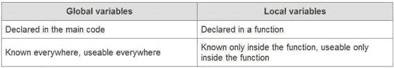

在我展示第一个例子之前，我希望你暂时放下通过参数向函数传递值、以及通过 `return` 语句将值返回给调用代码的知识。假装你对这些一无所知。我稍后会再回到这些话题。下面是一个例子。

首先，在主代码中，声明一个变量并调用一个函数：

```javascript
1 var theSum
2 addNumbers();
```

然后是函数：

```javascript
1 function addNumbers() {
2   theSum = 2 + 2;
3 }
```

在这个例子中，变量 `theSum` 在主代码中声明。函数 `addNumbers()` 被调用来为其赋值。由于该变量在主代码中声明，它具有全局作用域，因此这个函数或任何其他函数都可以使用它。主代码中的任何部分也都可以使用它。函数将 `2 + 2` 的和赋给这个全局变量。由于变量具有全局作用域，这个赋值在代码的所有部分（主代码和所有函数）中都有意义。现在，无论在函数 `addNumbers()` 中、主代码中，还是在任何其他使用它的函数中，该变量的值都是 `4`。无论我在哪里写：

`alert(theSum);`

无论我把它写在哪里——主代码中、函数 `addNumbers()` 中，还是任何其他函数中——都会弹出一个显示数字 `4` 的警告框。

但是，如果我不在主代码中声明变量，而是在函数内部声明……

```javascript
1 function addNumbers() {
2   var theSum = 2 + 2;
3 }
```

……那么该变量只在函数内部具有值 `4`。在其他任何地方，它都是未知的。在其他任何地方，它根本没有值。由于变量 `theSum` 在函数内部使用关键字 `var` 声明，而不是在主代码中，因此它的作用域是局部的。它只在函数内部有意义。在其他函数和主代码中，它是未知的。如果我写：

`alert(theSum);`

……在函数内部，会弹出一个显示数字 `4` 的警告框，因为变量 `theSum` 在其声明的函数内部是已知的。但如果我在其他地方——主代码或另一个函数中——写同样的 alert 语句，代码就会出错，因为 `theSum` 在函数外部是未知的。

**注意：** 我说当你在函数中声明变量时，该变量具有局部作用域。这里的“在函数中声明”是指你使用关键字 `var` 显式声明变量——而不是随意地在函数中引入一个没有 `var` 的变量。（例外情况是，如果你将其命名为参数，那么它会被隐式声明为函数的局部变量。）如果你变得马虎，开始在函数体中使用一个新变量，却没有在函数中用关键字 `var` 显式声明它，那么它就是全局变量——即使你在主代码中任何地方都没有声明它。

现在，为了说明一个问题，我要做一件你在实际编码中绝不会想做的事。我将在主代码和函数中都声明一个变量。

首先，在主代码中：

```javascript
1 var theSum = 1000;
2 addNumbers();
```

然后在函数中：

```javascript
1 function addNumbers() {
2   var theSum = 2 + 2;
3 }
```

通过两次声明变量——一次在主代码中，一次在函数中——我创建了两个同名但不同的变量。一个 `theSum` 是全局的，另一个 `theSum` 是局部的。这绝不是你想做的事——它会让你犯编码错误，并使代码几乎无法理解——但我这样做是为了展示全局作用域和局部作用域的区别。通过在主代码中声明一次 `theSum`，再在函数中声明一次，我创建了（1）一个几乎随处可用的全局变量，以及（2）一个同名的、仅在函数内部可用的局部变量。为什么我说全局变量几乎随处可用？因为它在函数内部无效。在函数内部，名称 `theSum` 代表一个局部变量，因此该名称不能引用全局变量。在这种情况下，程序员会说全局变量被局部变量遮蔽了。在函数内部，它不可见。在函数内部，只能看到同名的局部变量。

局部变量 `theSum` 在函数内部的值是 `4`，但函数外部的 `theSum` 的值是 `1000`。

现在，让我们继续深入这个仙境，爱丽丝。

首先，主代码中的一条语句：

```javascript
1 var theSum = addNumbers();
```

然后是一个函数：

```javascript
1 function addNumbers() {
2   var theSum = 2 + 2;
3   return theSum;
4 }
```

同样，这不是你实际会编写的代码。我仅用这个例子来演示原理。在这段代码中，你仍然有两个不同的变量——一个全局变量和一个局部变量——它们共享同一个名称 `theSum`，但现在，借助 `return` 语句，局部变量的值被赋给了全局变量。现在两个变量具有相同的名称和相同的值，但它们仍然是不同的变量。

这引出了你可能想问的一个问题：

如果一个函数可以使用全局变量，为什么还需要通过参数将值传递给形参？为什么不直接声明一个全局变量，然后让函数使用它呢？嗯，你可以这样做，但要求函数使用全局变量，就是要求它们“偷听”主代码，就像人类偷听一样，这会导致混乱和意想不到的后果。程序员们对此没有争议。最好始终通过参数显式地将值传递给函数。全局变量在函数中没有立足之地。

同样的逻辑也适用于使用 `return` 语句的理由。你可以在函数内部改变全局变量的值。当你这样做时，它的值在所有地方都会改变，包括主代码中。不需要 `return`。但更好的做法是在函数内部使用局部变量，然后通过 `return` 语句显式地将该值传递回去。

> 本章的交互式编程练习请访问：
>
> [`www.ASmarterWayToLearn.com/js/38.html`](http://www.ASmarterWayToLearn.com/javascript/38.html)

# `switch` 语句：如何开始

考虑下面这一连串的条件语句。

```javascript
1 if (dayOfWk === "Sat" || dayOfWk === "Sun") {
2   alert("Whoopee!");
3 }
4 else if (dayOfWk === "Fri") {
5   alert("TGIF!");
6 }
7 else {
8   alert("Shoot me now!");
9 }
```

## 39 `switch` 语句

如果是周末，会弹出“Whoopee！”提示。如果是周五，会弹出“TGIF”提示。如果是工作日，会弹出“Shoot me now”提示。

这段代码能工作，但笨拙且略显丑陋，尤其当你有许多条件需要测试时。现在该学习一种更优雅的替代方案，用于测试众多条件，那就是 `switch` 语句。你需要测试的条件越多，就越会喜欢 `switch` 语句。下面的 `switch` 语句实现了与上面示例相同的功能：

```javascript
switch(dayOfWk) {
case "Sat" :
  alert("Whoopee");
  break;
case "Sun" :
  alert("Whoopee");
  break;
case "Fri" :
  alert("TGIF!");
  break;
default :
  alert("Shoot me now!");
}
```

现在，我希望你只关注上面代码的前三行。

1. 以关键字 `switch` 开头。紧接着是圆括号内被测试的变量。然后是一个左花括号。

2. 第一种可能性：变量 `dayOfWeek` 的值为 "Sat"。以关键字 `case` 开头。然后是尝试的值 "Sat"。接着是一个空格和一个冒号。

3. 如果测试通过——即 `dayOfWeek` 确实等于 "Sat"——则执行该语句。该语句缩进。如果测试通过，可以执行任意数量的语句。

> 本章的交互式编程练习请访问：
>
> [`www.ASmarterWayToLearn.com/js/39.html`](http://www.ASmarterWayToLearn.com/javascript/39.html)

## 40 `switch` 语句：如何完善它们

上一章你关注了 `switch` 语句的前三行。

```javascript
switch(dayOfWk) {
case "Sat" :
  alert("Whoopee");
  break;
case "Sun" :
  alert("Whoopee");
  break;
case "Fri" :
  alert("TGIF!");
  break;
default :
  alert("Shoot me now!");
}
```

本章你将处理剩余的代码。

`if` 语句的第一行后面跟着一个（或多个）在条件为真时执行的语句。`switch` 语句的工作方式类似。在每个 `case` 子句的下一行，有一个（或多个）在该 case 为真时执行的语句。

同样，如果 case 为真，执行的代码缩进 2 个空格。（通用约定是缩进一定量。关于最佳缩进量意见不一。我统一使用 2 空格缩进，这很常见但并非通用。）

但为什么除了最后一个 case 之外，其他所有 case 都包含一个 `break` 语句？

JavaScript 有一个不方便的特性：当找到真 case 后，JavaScript 不仅会执行该 case 下方的语句，还会执行其下方所有 case 的语句。因此，在找到真 case 并执行条件代码后，你需要通过编写 `break` 语句跳出 `switch` 块。例如，如果你省略了上面代码中的 `break` 语句，会发生以下情况：

1. 弹出一个提示框显示 "Whoopee！"

2. 第二个提示框显示 "Whoopee！"

3. 第三个提示框显示 "TGIF！"

4. 第四个提示框显示 "Shoot me now。"

现在让我们看第 11 行。

```javascript
default :
  alert("Shoot me now!");
}
```

关键字 `default` 的作用类似于 `if...else` 语句中的 `else`。如果上面的条件都不满足，则执行其后的代码。因此，在上面的例子中，如果 `dayOfWk` 不是 "Sat"、"Sun" 或 "Fri"——即它不等于这三个值中的任何一个——则会弹出一个提示框显示 "Shoot me now。"

注意 `default` 后面跟一个空格和一个冒号，就像上面的 `case` 子句一样。

还要注意没有 `break` 语句。这是因为 `default` 总是在最后，这意味着它下面没有需要不当执行的语句。

在 `switch` 语句中，default 代码是可选的，就像 `if` 语句后的 `else` 代码是可选的。如果没有 default 代码，且所有 case 都不为真，则什么也不会发生。

当没有 default 代码时，细心的程序员会在最后一个条件后仍然加上 `break` 语句作为保险，即使它可能是多余的。如果你以后决定在末尾添加一个新条件，就不必记得为上面的块添加 `break` 以避免灾难性的级联语句。

> 本章的交互式编程练习请访问：
>
> [`www.ASmarterWayToLearn.com/js/40.html`](http://www.ASmarterWayToLearn.com/javascript/40.html)

## 41 `while` 循环

这个 `for` 循环在每次迭代时显示一个提示框。

```javascript
for (var i = 0; i <= 3; i++) {
  alert(i);
}
```

如你所知，该过程由圆括号内的三个项控制：

- `var i = 0` 建立一个计数器。
- `i <= 3` 表示只要 `i` 小于或等于 3，循环就继续运行。由于 `i` 初始赋值为 0，循环将运行 4 次。
- `i++` 在每次迭代时递增 `i`。

所有循环指令都打包在圆括号之间：从哪里开始计数器，循环持续多久，以及每次循环如何更新计数器。

`while` 循环做同样的事情，但组织方式不同。只有中间项（循环持续多久）放在圆括号内。计数器在 `while` 块的第一行之前定义。计数器在循环运行时执行的代码中更新。

```javascript
var i = 0;
while (i <= 3) {
  alert(i);
  i++;
}
```

在其他方面，`while` 循环的组织方式与 `for` 循环类似。

- 圆括号括住循环限制条件。
- 花括号括住要执行的代码。
- 执行的代码缩进 2 个空格。

由于任何 `for` 循环都可以转换为 `while` 循环，反之亦然，你可以使用你喜欢的任何一种。

> 本章的交互式编程练习请访问：
>
> [`www.ASmarterWayToLearn.com/js/41.html`](http://www.ASmarterWayToLearn.com/javascript/41.html)

## 42 `do...while` 循环

在 `while` 循环中，指令的顺序是：

1. 声明一个变量作为计数器，并为其赋值。
2. 开始循环，指定循环运行多长时间。
3. 执行一个或多个语句。
4. 在循环内部，作为最后一个语句，递增计数器。

```javascript
var i = 0;
while (i <= 3) {
  alert(i);
  i++;
}
```

`do...while` 循环完成与 `while` 循环几乎相同的任务。

```javascript
var i = 0;
do {
  alert(i);
  i++;
} while (i <= 3);
```

两种循环之间的区别：

- 关键字 `do` 代替 `while` 作为语句的开头。


`while` 子句（包括圆括号内的循环限制代码）移到了底部——在右花括号之后。

注意 `while` 子句以分号结尾。

在功能上，`while` 循环和 `do...while` 循环的区别在于，可以编写一个 `while` 语句，其指令块永远不会执行。考虑这个 `while` 循环。

```javascript
var i = 0;
while (i < 0) {
  alert(i);
  i++;
}
```

代码表示只要计数器小于 0，就持续显示提示框。但由于计数器从未小于 0，花括号内的代码永远不会执行。

将其与 `do...while` 循环进行比较。

```javascript
var i = 0;
do {
  alert(i);
  i++;
} while (i < 0);
```

提示框会显示一次，即使继续运行的条件——`i` 小于 0——从未发生。由于 `do...while` 循环在到达底部的循环限制条件之前就执行了花括号内的代码，因此无论循环限制条件如何，它至少会执行一次该代码。

> 本章的交互式编程练习请访问：
>
> [`www.ASmarterWayToLearn.com/js/42.html`](http://www.ASmarterWayToLearn.com/javascript/42.html)

## 43 放置脚本

JavaScript 代码并不在意它位于何处。它可以混入——即嵌入——创建网页的 HTML 中。或者，像外部 CSS 文件一样，它可以放在一个由 HTML 文件加载的独立文件中。大多数情况下，最好使用外部 JavaScript 文件，原因与最好使用外部 CSS 文件类似。但你仍然需要知道如何将 JavaScript 放置在 HTML 文件中，所以我们先从这一点开始。

如你所知，HTML 代码的顺序很重要，因为它决定了页面上元素的顺序。如果你希望标题出现在文本上方，你就在 HTML 中将标题放在文本上方。但 JavaScript 的工作方式不同。例如，你所有的 JavaScript 函数在页面加载时都会被加载到内存中。无论代码位于何处，浏览器都会在页面加载完成时找到并存储它们。一旦页面加载完成，所有 JavaScript 代码都会保留在内存中，随时准备执行，只要页面还在显示。

你可以合法地将 JavaScript 代码放在 HTML 文件中的几乎任何位置——在 head 部分、body 部分的开头、body 部分的中间某处，或者 body 部分的末尾。如果你愿意，甚至可以将不同的 JavaScript 函数分散在 HTML 文件的不同位置。浏览器会自行整理。

不过，通常脚本的最佳位置是在 body 部分的末尾。这可以确保 CSS 样式和图片显示不会因为脚本加载而延迟。

当你将 JavaScript 代码块嵌入 HTML 中（而不是使用独立的 JavaScript 文件）时，必须将 JavaScript 代码放在 `<script>` 和 `</script>` 标签之间。以下是两个放在标签之间的函数。

```html
<script>
function sayHi() {
  alert("Hello world!");
}
function sayBye() {
  alert("Buh-bye!");
}
</script>
```

你可以在 `<script>` 和 `</script>` 标签之间放置任意数量的代码——包括任意数量的函数。而且，正如我之前提到的，如果你愿意，可以将不同的代码段分散在 HTML 文件中的各个位置。但每个代码段都必须用 `<script>` 和 `</script>` 标签括起来。

大多数情况下，程序员更倾向于将所有或大部分 JavaScript 代码放在一个独立的 JavaScript 文件中，然后让浏览器在加载 HTML 文件的同时加载这个外部文件。

JavaScript 文件与 HTML 和 CSS 文件一样，是一个纯文本文件。它没有头部或任何特殊部分，甚至没有 `<script>` 和 `</script>` 标签。它只是纯粹的 JavaScript 代码。一个包含上述两个函数的 JavaScript 文件的全部内容将是：

```javascript
function sayHi() {
  alert("Hello world!");
}
function sayBye() {
  alert("Buh-bye!");
}
```

使一个文件成为 JavaScript 文件的是它的文件扩展名：`.js`。文件名的主体部分由你决定，只要合法即可。以下这些都可以。

- `scripts.js`
- `coreJS.js`
- `main-code.js`
- `main_code.js`
- `main.code.js`

将 JavaScript 文件包含到 HTML 文件中的方式与包含外部 CSS 文件相同——使用一个开始标签和一个结束标签。

```html
<script src="whatever.js"></script>
```

出于与将 JavaScript 代码放在 body 部分末尾相同的原因，最好也将包含 JavaScript 文件的标记放在 body 部分的末尾。

你可以包含任意数量的外部 JavaScript 文件。

你可以同时包含 JavaScript 文件并在 HTML 中嵌入其他 JavaScript 代码。

> 本章的交互式编程练习请访问：
>
> [`www.ASmarterWayToLearn.com/js/43.html`](http://www.ASmarterWayToLearn.com/javascript/43.html)

## 44. 注释

从你使用 HTML 和 CSS 的经验可知，注释是一种告诉浏览器忽略你在代码正文中包含的某些文本的方式。注释是为人类而非机器服务的。它们能帮助你和他人日后修改代码时理解代码。你还可以使用注释来临时屏蔽部分代码，以便进行测试和调试。由于与 HTML 或 CSS 相比，JavaScript 在日后回顾时通常更难理解，你可能需要花更多精力为 JS 代码添加注释，尤其是在团队合作或未来可能由他人维护代码的情况下。

在 HTML 中，只有一种方式将文本标记为注释：使用 `<!--` 开头，`-->` 结尾。在 CSS 中，也只有一种方式：使用 `/*` 开头，`*/` 结尾。但在 JavaScript 中，有两种方式将文本标记为注释。

第一种方式是将单行标记为注释，如下面第 1 行所示。

```javascript
// 这是一条注释，浏览器会忽略它
for (var i = 0; i < animals.length; i++) {
  if (animals[i] === "bat") {
    animals[i] = "cat";
  }
}
```

两个斜杠表示：“从这到行尾的所有内容都是注释。”在上面的例子中，由于斜杠位于行首，因此整行都是注释。但你也可以写一行既有代码又有注释的内容，像这样：

```javascript
var animals = []; // 声明一个空数组
```

你可以写任意多行的注释。每一行都必须以两个斜杠开头。

```javascript
// 每一行注释都必须以一对
// 斜杠开头，就像这样。（顺便提一下，大多数代码编辑器
// 足够智能，能够识别
// 注释并以不同颜色显示，方便你
// 与代码区分开来。）
```

当你使用斜杠注释时，没有结束标签，因为行尾会自动结束注释。

为了可读性，请在两个斜杠与注释之间加一个空格。当你在同一行中混合代码和注释时，请在代码与两个斜杠之间加一个空格。

当注释需要多行时，许多程序员更喜欢另一种方法。作为 CSS 用户，你已经熟悉这些标签了。

```javascript
/*
当注释需要多行时，
像这样的块注释，带有开始
和结束标签，是更好的选择。
*/
```

JavaScript 的多行注释标签与 CSS 注释标签相同。以 `/*` 开头，以 `*/` 结尾。

> 本章的交互式编程练习请访问：
>
> [`www.ASmarterWayToLearn.com/js/44.html`](http://www.ASmarterWayToLearn.com/javascript/44.html)

## 45. 事件：链接

一个好的网站是一个响应式的网站。用户做了一些操作——点击按钮、移动鼠标、按下按键——然后某些事情发生了。JavaScript 提供了多种方式来响应用户的需求。举几个例子：

- 用户点击一个写着“我们的承诺”的按钮，然后弹出一个提示框，详细说明承诺内容。
- 页面显示一张模特的“之前”照片。当用户将鼠标悬停在照片上时，它会被替换为她的“之后”照片。
- 用户在表单的“盎司”字段中输入一个数字。当她点击“克”字段时，会显示对应的克数。
- 用户已在表单中输入了她的电子邮件地址，正准备输入评论。当她将光标从电子邮件字段移动到评论字段时，JavaScript 会检查电子邮件地址是否有效。在这个例子中，它无效——她省略了地址末尾的“.com”。一条消息显示，告知她输入了无效的电子邮件地址。
- 在一个在线购物网站上，有一张黑色手表的图片。旁边有一个下拉列表，要求用户选择颜色。当她选择时，图片中手表的颜色会变为所选颜色。

所有这些用户操作——点击按钮、移动鼠标、在表单中从一个字段移动到另一个字段、选择不同的选项——都被称为事件。响应事件的 JavaScript 代码——例如，当指针悬停在图片上时显示承诺或交换图片——被称为事件处理程序。

### 内联事件处理

在本章及接下来的几章中，你将学习最古老、最直接的事件处理方法——内联事件处理。在编写生产代码时，这并不是处理事件的最佳方式，原因与内联 CSS 样式不是格式化 HTML 元素的最佳方式相同。但由于它是抽象程度最低的方式，因此最容易学习，并且可以作为更高级方法的垫脚石。在本书的后续部分，你将学习大多数专业人士偏好的方法——脚本方式。

内联事件处理意味着你将 JavaScript 代码片段与 HTML 标记结合起来。下面是一行代码，它显示一个链接，并在用户点击时显示一个警告框。

```html
<a href="#" onClick="alert('Hi');">Click</a>
```

作为 HTML 编码人员，你对这段标记的开头和结尾很熟悉：`<a href=` 和 `>Click</a>`

但当用户点击这个链接时，它的行为与普通超链接不同。它不会将用户带到另一个页面，也不会跳转到同一页面的命名锚点，而是显示一个显示“Hi”的警告框。

当用户点击链接时，它不会跳转到任何地方，而是执行一条 JavaScript 语句，在本例中调用了一个函数。

我们来分解一下。

- 当用户点击链接时，你并不希望加载新网页，因此，在引号内你放置了 `#` 而不是 URL。这告诉浏览器重新加载当前页面。
- `onClick=` 表示：“当按钮被点击时，执行以下 JavaScript。”`onClick` 不区分大小写。你可以写成 `onclick`、`ONCLICK` 或 `OnClIcK`，都能正常工作。但惯例是 `onClick`，所以我们沿用这个写法。
- 后面跟着一条（或多条）用引号括起来的 JavaScript 语句。当用户点击链接时，它就会执行。

还有一点需要注意：`onClick="alert('Hi');"` 括号内的消息被单引号包围，而不是我们通常用于警告字符串的双引号。在 JavaScript 代码中，不允许在双引号内嵌套双引号，也不允许在单引号内嵌套单引号。由于整个 JavaScript 语句被双引号括起来，因此你必须将警告消息用单引号括起来。

但上面的标记有一个问题。`<a href="#"` 告诉浏览器重新加载页面。这意味着如果用户已经滚动到链接位置，点击操作除了运行 JavaScript 代码外，还会将页面滚动回顶部——这通常不是你希望的行为。我之所以包含这个有缺陷的方法（使用 `<a href="#"`），是因为你会在其他人的代码中偶尔遇到它，但你可能会更喜欢这种方法：

```html
<a href="JavaScript:void(0)" onClick="alert('Hi');">Click</a>
```

现在你得到了你想要的。除了执行的 JavaScript 之外，什么都不会发生。

在上面的例子中，点击只执行了一条 JavaScript 语句。但你可以将任意数量的 JavaScript 语句放在引号内，没有数量限制。当然，除了常识的限制。正如你将看到的，有比将多条语句塞进一个内联 `onClick` 事件中更好的触发 JavaScript 的方法。但让我通过这个例子向你展示原理。当用户点击时，第一条语句将 `'hi'` 赋值给一个变量，第二条语句显示一个警告框，将变量作为消息。

```html
<a href="JavaScript:void(0)" onClick="var greet='hi'; alert(greet);">Click</a>
```

正如我所说，专业编码人员不赞成使用内联 JavaScript。但如果你确实使用这种方法，更专业的方式是调用一个函数。

这是一个函数。

```javascript
1 function popup(message) {
2   alert(message);
3 }
```

这是调用该函数的事件处理程序。

```html
<a href="JavaScript:void(0)" onClick="popup('Hi');">Click</a>
```

当用户点击链接时，事件处理程序调用该函数，并将参数 `'Hi'` 传递给它。函数显示一个显示“Hi”的警告框。

> 本章的交互式编码练习请访问：
>
> [`www.ASmarterWayToLearn.com/js/45.html`](http://www.ASmarterWayToLearn.com/javascript/45.html)

## 46 事件：按钮

在上一章中，你学习了如何重新利用链接，使其在被点击时触发事件，而不是加载新页面。你学习了使用内联事件处理，这不是最佳方式，但最容易学习。在本书的后续部分，你将学习大多数专业人士偏好的方法——脚本方式。

但即使你使用内联方法，当你想给用户提供可点击的内容时，通常更专业的方法是使用按钮而不是链接。

假设当用户点击一个按钮时，会显示一个警告框，内容为“Hello world!”。

代码如下。

```html
<input type="button" value="Click" onClick="alert('Hello world!');">
```

无论你编写的是链接还是按钮，事件处理程序都是一样的：`onClick="alert('Hello world!');"`

但代码的开头不同：`<input type="button" value="Click"`

一些专业人士可能会认为按钮代码应该包含在表单标签中，但这并非绝对必要。而且，既然我们已经通过使用内联事件处理程序违反了最佳实践，为什么不通过多次违规来让专业人士震惊呢？（你将在本书的后续部分学习更体面的替代内联事件处理程序的方法。）

作为 HTML 编码人员，你知道可以将图像用作热链接。标记看起来像这样。

```html
<a href="summary-page.html"></a>
```

你也可以使用图像来触发事件。假设当用户点击图像时，会弹出一个警告框。代码如下。请注意，内联事件处理程序的代码与之前相同。

```html

```

或者，如果你想更专业一些，可以让事件触发一个函数。

```html

```

> 本章的交互式编码练习请访问：
>
> [`www.ASmarterWayToLearn.com/js/46.html`](http://www.ASmarterWayToLearn.com/javascript/46.html)

## 47 事件：鼠标

你已经学会了如何通过内联事件处理，在用户点击链接、按钮或图像时触发操作。内联事件处理不是最佳方法，但最容易学习。在本书的后续部分，你将学习大多数专业人士偏好的方法——脚本方式。

但无论你使用内联方法还是更受青睐的脚本方法，`onClick` 事件只是你的代码可以响应的众多事件类型之一。在本章中，你将学习如何在用户将鼠标悬停在页面上的某个元素上时，以及当用户将鼠标移开时触发操作。

假设你的页面最初显示一张模特的“之前”照片。当用户将鼠标悬停在照片上时，它会被替换为“之后”照片。你可能更愿意用 CSS 来实现，但由于这是一本 JavaScript 书籍，我将向你展示如何使用事件处理程序来实现。

这是将“之前”照片替换为“之后”照片的标记。

```html

```

它以一个普通的图像标签开始：``

你可能会惊讶地发现，事件的响应并不是用 JavaScript 编写的。它是 HTML 标记。

注意：图像源必须用单引号括起来，因为整个短语被双引号括起来了。

你也可以将 `onMouseover` 事件处理用于其他 HTML 元素。下面是一段内联代码，当鼠标悬停在一个标题上时，会显示一个警告框。

```html
<h1 onMouseover="alert('Be sure to get your shopping done today.');">World Ends Tomorrow</h1>
```

当用户将鼠标悬停在标题上时，会显示一个警告框。

在上面的例子中，你可能更倾向于调用一个显示警告框的函数，而不是内联编写警告代码。

以下是首选的 CSS 悬停颜色变化方案的 JavaScript 替代方案。

```html
<a href="index.html" onMouseover="this.style.color='green';">Home Page</a>
```

当用户将鼠标悬停在链接上时，链接会变为绿色。

目前，不必担心示例中 `this.style.color` 的整体含义。现在只需记住这个序列，以便在练习中重复使用。

在下一个示例中，当用户将鼠标悬停在段落上时，段落会展开以包含更多信息。


`<p id="loris" onMouseover="expand();">Slow Loris: Mouse over for more info</p>`

现在不必担心`expand`函数如何扩展段落。你将在后面学到这一点。

在我们开始的示例中，模特的前后对比图片，当用户将鼠标悬停在图片上时，`onMouseover`事件处理程序会将“之前”的图片替换为“之后”的图片。通常，你会希望当用户将鼠标移开图片时，图片恢复为原始状态。因此，你需要将`onMouseover`事件处理程序与`onMouseout`事件处理程序结合使用。

```html

```

> 本章的交互式编程练习请访问：
>
> [`www.ASmarterWayToLearn.com/js/47.html`](http://www.ASmarterWayToLearn.com/javascript/47.html)

## 48 事件：字段

假设你有一个用于输入用户电子邮件地址的文本字段。当用户点击该字段开始输入时，字段变为黄色。

以下是实现这一效果的标记。

```html
Email:<br>
<input type="text" size="30"
onFocus="this.style.backgroundColor='yellow';">
```

再次强调，我向你展示的是不推荐的内联事件处理方式，将其作为学习本书后面更专业事件处理的垫脚石。同样，我不会解释`this.style.backgroundColor`。只需记住序列，以便在练习中使用。

这里的关键字是`onFocus`。它告诉 JavaScript 在用户点击该字段时执行某些操作。

语法与你已学会的其他事件处理程序相同：一个关键字，后跟等号，再后跟引号内的 JavaScript 或 HTML。

在用户输入电子邮件地址（或未输入）并点击字段外部或按 Tab 键移动到另一个字段后——即该字段失去焦点时——你希望它恢复为白色背景。你可以使用`onBlur`关键字来实现，它与`onFocus`相反。

以下标记同时处理`onFocus`和`onBlur`事件。

```html
Email:<br>
<input type="text" size="30" onFocus="this.style.backgroundColor='yellow';"
onBlur="this.style.backgroundColor='white';">
```

当用户点击进入该字段时，它变为黄色。当用户点击离开该字段时，它恢复为白色。

稍微专业一点的方法是调用实现相同功能的函数。

```html
Email:<br>
<input type="text" size="30"
onFocus="makeFieldYellow();" onBlur="makeFieldWhite();">
```

> 本章的交互式编程练习请访问：
>
> [`www.ASmarterWayToLearn.com/js/48.html`](http://www.ASmarterWayToLearn.com/javascript/48.html)

## 49 读取字段值

假设你在表单中包含了一个电子邮件字段，并将其设为必填字段。表单有一个提交按钮，用户点击该按钮以提交在表单中输入的信息。

以下是创建表单的标记。我对其进行了简化，省略了任何表单动作和其他属性（包括换行符），这些与当前学习内容无关。

```html
<form>
  Email:
  <input type="text">
  <input type="submit" value="Submit">
</form>
```

现在，在我们精简后的表单标记中，有以下三个元素：

1. 文本“Email”
2. 用于输入用户电子邮件地址的文本字段
3. 提交按钮

我将为电子邮件字段添加一个`id`。

```html
<form>
  Email:
  <input type="text" id="email">
  <input type="submit" value="Submit">
</form>
```

接下来，我将使用关键字`onSubmit`添加一个事件处理程序。

```html
<form onSubmit="checkAddress('email');">
  Email:
  <input type="text" id="email">
  <input type="submit" value="Submit">
</form>
```

现在，当用户点击提交按钮时，函数`checkAddress`会执行。请注意，尽管操作是点击提交按钮，但`onSubmit`事件处理程序位于`form`标签中，而不是提交按钮标签中。这是因为提交是一个适用于整个表单的事件，而不是提交按钮。

有趣的地方来了。当表单提交时，函数`checkAddress`会检查用户是否在电子邮件字段中输入了内容。如果没有，该函数会显示一个警告，提醒用户电子邮件地址是必填项。

为了实现这一点，函数需要一种读取电子邮件字段内容的方法。这就是我添加到字段中的`id`的作用。以下是函数的代码。

```javascript
function checkAddress(fieldId) {
  if (document.getElementById(fieldId).value === "") {
    alert("Email address required.");
  }
}
```

如果电子邮件字段中没有值，则会显示一个警告，告知用户需要输入电子邮件地址。

这是你需要记住的序列：

1. 关键字`document`，后跟……
2. 一个点，后跟……
3. 关键字`getElementById`，后跟……
4. 括号中的参数，即从调用代码接收到的`fieldId`，后跟……
5. 另一个点，后跟……
6. 关键字`value`

请注意，`getElementById`必须严格使用驼峰命名法。如果你按直觉写成`getElementByID`（大写“D”），它将无法工作。

有些程序员更喜欢将字段中找到的值放入变量中，如下所示。

```javascript
function checkAddress(fieldId) {
  var val = document.getElementById(fieldId).value;
  if (val === "") {
    alert("Email address required.");
  }
}
```

> 本章的交互式编程练习请访问：
>
> [`www.ASmarterWayToLearn.com/js/49.html`](http://www.ASmarterWayToLearn.com/javascript/49.html)

## 50 设置字段值

用户已在表单字段中输入了她的邮政编码。你想省去她输入城市和州的麻烦。因此，当她点击离开该字段时，你为她自动填充城市字段。

让我向你展示如何实现。为了简化，我们假设美国只有三个邮政编码。我们还假设用户会准确无误地输入其中一个代码。我们不会检查错误。在这个例子中，JavaScript 代码只会填充城市字段，而不填充州。以下是表单的相关标记。（我省略了表单动作、提交按钮以及所有与本章节无关的内容。）

```html
<form>
  ZIP:<br>
  <input type="text" id="zip" onBlur="fillCity();"><br>
  City:<br>
  <input type="text" id="city">
</form>
```

当用户点击离开邮政编码字段时，`onBlur`事件会触发`fillCity`函数。代码如下。

```javascript
function fillCity() {
  var cityName;
  var zipEntered = document.getElementById("zip").value;
  switch (zipEntered) {
    case "60608":
      cityName = "Chicago";
      break;
    case "68114":
      cityName = "Omaha";
      break;
    case "53212":
      cityName = "Milwaukee";
  }
  document.getElementById("city").value = cityName;
}
```

这个例子表明，你不仅可以使用`document.getElementById...`读取字段中的值，还可以将值“写入”字段中。

在这种情况下，函数将`ZIP`字段中找到的值赋给一个变量。然后，使用`switch`语句，将`ZIP`匹配到一个城市名称，并将该名称赋给第二个变量。接着，利用该变量，将城市名称放入`city`字段。

> 查找本章的交互式编程练习，请访问：
>
> [`www.ASmarterWayToLearn.com/js/50.html`](http://www.ASmarterWayToLearn.com/javascript/50.html)

## 51 读取和设置段落文本

你的网页最初显示一张被称为懒猴的小型哺乳动物图片，并附带一句话：

> 懒猴是构成蜂猴属的几种链猴灵长类动物。点击了解更多。

当用户点击链接时，段落展开：

> 懒猴是构成蜂猴属的几种链猴灵长类动物。它们有圆头、窄吻、大眼睛，以及多种因物种而异的独特着色模式。懒猴的手和脚有几种适应性结构，使它们能够像钳子一样抓握，并能长时间抓住树枝。懒猴具有毒性咬合，这是哺乳动物中罕见的特征。

这是标记代码。

```html
<p id="slowLoris">
Slow lorises are a group of several species of strepsirrhine primates which make up the genus Nycticebus. <a href="javascript:void(0);" onClick="expandLoris();"><em>Click for more.</em></a>
</p>
```

段落被分配了一个`id`，该`id`将被函数使用。当用户点击链接时，会调用一个名为`expandLoris`的函数。

这是函数代码。

```javascript
function expandLoris() {
  var expandedParagraph = "Slow lorises are a group of several species of trepsirrhine primates which make up the genus Nycticebus. They have a round head, narrow snout, large eyes, and a variety of distinctive coloration patterns that are species-dependent. The hands and feet of slow lorises have several adaptations that give them a pincer-like grip and enable them to grasp branches for long periods of time. Slow lorises have a toxic bite, a rare trait among mammals.";
  document.getElementById("slowLoris").innerHTML = expandedParagraph;
}
```

第 2 行将文本的长版本赋给一个变量。然后，通过其`id`识别段落，第 3 行将原始内容（即`innerHTML`）替换为存储在变量中的文本。

几乎任何内容，包括 HTML 标签，都可以通过这种方式插入到网页中。例如，你可以让以下列表出现在页面中，比如在一个`id`为`lorisList`的`div`内。

1. 懒猴
2. 快猴
3. 正好猴

这是将列表标记加载到`div`中的函数，该`div`被赋予了`id`为`lorisList`。

```javascript
function placeAList() {
  var listToPlace = "<ol><li>Slow loris</li><li>Fast loris</li><li>Just-right loris</li></ol>";
  document.getElementById("lorisList").innerHTML = listToPlace;
}
```

第 2 行将列表的所有 HTML 赋给一个变量。第 3 行将 HTML 放入被分配了`id`为`lorisList`的`div`中。

你可以使用`document.getElementById(element id).innerHTML`来读取以及“写入”元素的内容。例如，以下函数将段落、`div`或其他`id`为`content`的元素中的任何内容赋给变量`whatsThere`。

```javascript
function peekAtContent() {
  var whatsThere = document.getElementById("content").innerHTML;
}
```

第 2 行读取`id`为`content`的元素内的所有 HTML，并将其赋给变量`whatsThere`。如果该元素是一个段落，其内容为`"<em>Hello, Sailor!</em>"`，那么变量`whatsThere`将捕获`"<em>你好，水手！</em>"`。

> 查找本章的交互式编程练习，请访问：
>
> [`www.ASmarterWayToLearn.com/js/51.html`](http://www.ASmarterWayToLearn.com/javascript/51.html)

## 52 操作图像和文本

你的网页显示一张水滴鱼图片。水滴鱼是一种迷人的动物，但它太丑了，一些用户会发出“恶心”的声音。所以你给他们一个让它消失的选项。当他们点击图片时，它就会消失。

你首先给图片一个`id`。

```html

```

然后你添加一个事件处理器。

```html

```

你有一个用于隐藏的 CSS 类。

```css
.hidden {display:none;}
```

事件处理器调用的函数给图片一个`hidden`类，因此它消失。

```javascript
function makeInvisible() {
  document.getElementById("ugly").className = "hidden";
}
```

当函数被调用时，它将`hidden`类赋给`id`为`ugly`的元素。图片消失。

需要记住的一些事项：

- 这只是你已经学过的内容的变体，即`document.getElementById(theElementId).value`（用于表单字段）和`document.getElementById(theElementId).innerHTML`（用于段落、`div`和其他 HTML 元素）。
- 它是`className`，采用驼峰命名法，而不是`class`。
- 以这种方式给元素分配类会替换该元素在静态标记中已分配的任何类。

如果你想给一个元素添加一个类，同时保留其现有的类，你可以这样做。例如，假设你有一个段落，其类将其样式设置为 Verdana，大小为 1 em。当用户鼠标悬停时，你想将其大小加倍到 2 em。但你不想丢失其原始类的 Verdana 样式。与其替换设置 Verdana 样式的类，不如保留该类并添加放大字体的类。假设该元素的`id`为`p1`。这是函数代码。

```javascript
function makeBig() {
  document.getElementById("p1").className += " big";
}
```

与用新类替换所有现有类的代码相比，这段代码有两个小区别：

- 它是`+=`而不是单纯的`=`。
- 类名前面需要有一个空格。

> 查找本章的交互式编程练习，请访问：
>
> [`www.ASmarterWayToLearn.com/js/52.html`](http://www.ASmarterWayToLearn.com/javascript/52.html)

## 53 交换图像

在第 47 章中，你学习了当用户鼠标悬停在图像上时如何用另一张图像替换它。当页面首次显示时，用户看到的是“之前”的图片。当用户鼠标悬停在图片上时，它被替换为“之后”的图片。

你学习了如何通过编写一个如下所示的内联事件处理器来实现这一点。

```html

```

另一种方法是调用一个执行交换的函数。这是标记代码：

```html

```

这是函数代码。

```javascript
function swapPic() {
  document.getElementById("before").src = "after-pic.jpg";
}
```

但为什么不把这个函数做成一个通用的例程，可以交换任意图像为其他任意图像呢？为了实现这一点，标记必须将`id`和替换图像的名称作为参数传递给函数。

```html

```

函数将这些参数作为其参数接收，并使用它们来交换图像。


```javascript
1 function swapPic(eId, newPic) {
2   document.getElementById(eId).src = newPic;
3 }
```

> 查找本章的交互式编程练习，请访问：
> [`www.ASmarterWayToLearn.com/js/53.html`](http://www.ASmarterWayToLearn.com/javascript/53.html)

## 54 交换图像和设置类

你一直在学习如何读取 HTML 元素的属性，以及如何使用包含神奇词语`document.getElementById`的各种语句来更改这些属性。例如，以下函数移除`id`为"before"的原始图像，并将其替换为第二张图像"after-pic.jpg"。

```javascript
1 function swapPic() {
2 document.getElementById("before").src = "after-pic.jpg";
3 }
```

更常见的编码方式是将函数拆分为两步：首先将`document.getElementById("before")`赋值给一个变量，然后将该变量与`.src`结合。我们称之为冗长写法。

```javascript
1 function swapPic() {
2   var pic = document.getElementById("before");
3   pic.src = "after-pic.jpg";
4 }
```

下面是一个使用更冗长方式查找`id`为"link1"的链接地址的函数。

```javascript
1 function getAddress() {
2   var link = document.getElementById("link1");
3   var address = link.href;
4 }
```

该函数探测链接标签的`href`属性。例如，如果`href`等于"http://wikipedia.org"，那么该地址就会存入变量`address`中。

这个函数通过更改类名来改变`id`为"f12"的表单的格式。

```javascript
1 function enlargeForm() {
2   var frm = document.getElementById("link1");
3   frm.className = "jumbo";
4 }
```

> 本章的交互式编程练习请访问：
> [`www.ASmarterWayToLearn.com/js/54.html`](http://www.ASmarterWayToLearn.com/javascript/54.html)

## 55 设置样式

在第 52 章中，你学会了如何向任何元素添加 CSS 类来改变其样式。例如，以下函数向一个元素添加了"big"类。如果新类"big"为该元素指定的字体大小比原来更大，那么元素内的文本就会变大。

```javascript
1 function makeBig() {
2   document.getElementById("p1").className += " big";
3 }
```

还有另一种指定样式属性的方式。

```javascript
1 function makeBig() {
2   document.getElementById("p1").style.fontSize = "2em";
3 }
```

与第一个示例类似，该函数改变了`id`为"p1"的元素的默认字体大小。但与第一个示例不同的是，它不会移除分配给该元素的任何其他样式，无论这些样式是在 CSS 中指定的还是内联的。

示例：如果标题、段落或`div`的初始大小为`1em`，则该函数会将其内容大小加倍。如果元素初始样式为粗体、Georgia 斜体、12 像素边框，则所有这些格式都会被保留，只有大小发生变化。

以下语句将图片左浮动。

`document.getElementById("pic99").style.cssFloat = "left";`

以下语句使元素不可见。

`document.getElementById("div9").style.visibility = "hidden";`

以下语句为元素设置左右边距为 10 像素。

`document.getElementById("mainPic").style.margin = "0 10px 0 10px;";`

你可以用这种方式设置许多样式属性。有时属性规范的术语并不直观，因此最好查阅语言规则——是"float"还是"cssFloat"？——而不是猜测。

和往常一样，你不仅可以设置属性，还可以读取属性。不过规则并不直接。如果你写...

`var m = document.getElementById("mainPic").style.margin;`

...它只会告诉你内联指定的边距（如果有的话）。如果边距是在 CSS 中指定的，你将无法获取它们。以下语句会给出所有样式属性（包括 CSS 和内联指定的），但它有一个限制：Internet Explorer 9 之前的版本不支持它。

`var m = document.getComputedStyle("mainPic").margin;`

> 本章的交互式编程练习请访问：
> [`www.ASmarterWayToLearn.com/js/55.html`](http://www.ASmarterWayToLearn.com/javascript/55.html)

## 56 按标签名定位所有元素

假设你想让用户选择将文档中所有段落的文本大小加倍。为此，你可以给每个段落一个`id`。当用户点击"加倍文本大小"按钮时，一个函数会遍历所有段落`id`并进行更改。该函数可以通过为每个段落分配一个新类（该类指定更大的字体大小）来放大字体，也可以直接分配新的样式属性，如下所示：

`getElementById(the id).style.fontSize = "2em";`

实现相同目的的更简单方法是让函数说："找到文档中的所有段落并增大它们的大小。"

以下语句找到所有段落并将其赋值给一个变量：

`var par = document.getElementsByTagName("p");`

现在，变量`par`保存了一个类似数组的集合，包含文档中的所有段落。假设为了简单起见，文档主体只包含三个段落。

`<p>这张床太小了。</p>`

`<p>这张床太大了。</p>`

`<p>这张床刚刚好。</p>`

`par[0]`是第一个段落。`par[1]`是第二个段落。`par[2]`是第三个段落。`par.length`是 3，即集合中的项目数。

如果你写...

`var textInMiddleParagraph = par[1].innerHTML;`

...那么变量`textInMiddleParagraph`被赋值为"这张床太大了。"

如果你写...

`par[1].innerHTML = "这辆 SUV 太大了。";`

...那么段落文本变为"这辆 SUV 太大了。"

以下是一个循环，为所有段落分配字体族。

```javascript
1 for (var i = 0; i < par.length; i++) {
2   par[i].style.fontFamily = "Verdana, Geneva, sans-serif";
3 }
```

以下语句创建文档中所有图片的集合，并将其赋值给变量`pics`。

`var pics = document.getElementsByTagName("img");`

以下语句创建文档中所有`div`的集合，并将其赋值给变量`divs`。

`var divs = document.getElementsByTagName("div");`

以下语句创建文档中所有无序列表的集合，并将其赋值给变量`ulists`。

`var ulists = document.getElementsByTagName("ul");`

> 本章的交互式编程练习请访问：
> [`www.ASmarterWayToLearn.com/js/56.html`](http://www.ASmarterWayToLearn.com/javascript/56.html)

## 57 按标签名定位部分元素

在上一章中，你学会了如何创建文档中所有具有特定标签名的元素的类数组集合。例如，以下语句创建文档中所有段落的集合，并将其赋值给变量`pars`。

`var pars = document.getElementsByTagName("p");`

你还学会了使用类似数组的表示法（方括号中的数字）来读取或设置元素集合中任何元素的属性。例如，以下语句"读取"集合`pars`中第二个元素的内容，并将字符串赋值给变量`textInMiddleParagraph`。

`var textInMiddleParagraph = pars[1].innerHTML;`

但假设你不想获取文档中所有段落的集合，而只想获取某个特定`div`内所有段落的集合。没问题。假设该`div`的`id`是"rules"。代码如下。

```javascript
1 var e = document.getElementById("rules");
2 var paragraphs = e.getElementsByTagName("p");
```

第 1 行将`id`为"rules"的`div`赋值给变量`e`。

第 2 行创建该`div`中所有段落的集合，并将其赋值给变量`paragraphs`。

一旦目标`div`的`id`被赋值给变量（例如`e`），你就可以收集该`div`内所有段落的集合。不再写...

`document.getElementsByTagName("p");`

...（这会创建文档中所有段落的集合），而是写...

`e.getElementsByTagName("p");`

...这会创建该`div`中所有段落的集合。

假设你有一个白色背景的表格。当用户点击按钮时，单元格变为粉色。代码如下。

```javascript
1 var t = document.getElementById("table9");
2 var cells = t.getElementsByTagName("td");
3 for (var i = 0; i < cells.length; i++) {
4   cells[i].style.backgroundColor = "pink";
5 }
```

以下是逐行解释。

1. 通过`id`定位表格
2. 收集表格中所有带有`td`标签的元素集合
3. 遍历所有元素，更改它们的背景颜色

> 本章的交互式编程练习请访问：
> [`www.ASmarterWayToLearn.com/js/57.html`](http://www.ASmarterWayToLearn.com/javascript/57.html)

## 58 DOM

在前几章中，你学习了两种不同的方法来定位网页组件，以便读取或设置它们。你学会了`getElementById`，也学会了`getElementsByTagName`。这些通常是定位元素的最佳方法，但它们也有局限性。第一种方法`getElementById`只能让你访问那些被分配了`id`的组件。第二种方法`getElementsByTagName`适合批量修改，但对于精细的"手术式"操作则略显笨拙。这两种方法都能改变网页上的内容，但都无法处理页面上的所有元素，无法创建新元素、移动现有元素或删除它们。

幸运的是，这两种方法只是处理文档对象模型（DOM）的众多方法中的两种。DOM 是一个组织结构图，当你的网页加载时，浏览器会自动为整个网页生成它。你网页上的所有内容——标签、文本块、图片、链接、表格、样式属性等等——都在这个组织结构图中有自己的位置。这意味着你的 JavaScript 代码只需指出某个元素在图中的位置，就能获取网页上的任何内容，任何内容都可以。更重要的是，你的 JavaScript 可以通过操作这个图来添加、移动或删除元素。如果你愿意（当然你不会这么做），你甚至可以用 JavaScript 的 DOM 方法从头开始创建整个网页。

下面是一个简化的网页。我用缩进表示了层级结构中的不同级别。对于标准网页来说，DOM 的前三个级别总是相同的。文档是第一级。文档下面是第二级，即`html`。`html`下面是同级的第三级，即`head`和`body`。每个级别下面还有更多级别。

```
第 1 级：document
第 2 级：   <html>
第 3 级：     <head>
第 4 级：       <title>
第 5 级：         Simple document
                 </title>
               </head>
第 3 级      <body>
第 4 级        <p>
第 5 级          There's not much to this.
                 </p>
               </body>
             </html>
```

下面是同样的内容，以组织结构图的形式展示。请注意，这是一个理想化的图表，去掉了大多数浏览器在 DOM 中插入的垃圾元素。我将在后面的章节中向你展示如何清除这些垃圾元素。

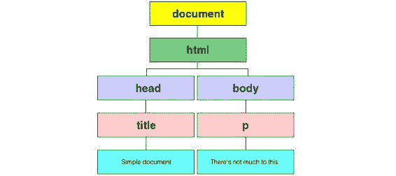

如你所见，网页上的每一个元素都被包含在内，甚至包括标题文本和段落文本。让我们通过添加一个`div`和第二个段落来让它稍微复杂一些。以下是 HTML 形式。

```
第 1 级：document
第 2 级：   <html>
第 3 级：     <head>
第 4 级：       <title>
第 5 级：         Simple document
                 </title>
               </head>
第 3 级      <body>
第 4 级        <div>
第 5 级          <p>
第 6 级            There's not much to this.
                   </p>
第 5 级          <p>
第 6 级            Nor to this.
                   </p>
                 </div>
               </body>
             </html>
```

以及组织结构图（去除了所有垃圾元素）……

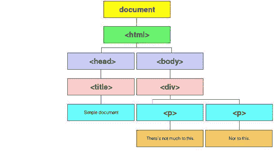

在公司组织结构图中，每个方框代表一个人。在 DOM 组织结构图中，每个方框代表一个节点。上面表示的 HTML 页面，在其清理后的 DOM 形式中，有 11 个节点：文档节点、`html`节点、`head`和`body`节点、`title`节点、`div`节点、两个段落节点，以及三个文本节点（一个用于标题，另外两个分别用于两个段落）。

在这个特定的图表中，有三种类型的节点：文档节点、元素节点和文本节点。文档节点是顶层。元素节点是`<html>`、`<head>`、`<body>`、`<title>`、`<div>`和`<p>`。文本节点是构成标题和两个段落的字符串。

> 本章的交互式编程练习请访问：
> [`www.ASmarterWayToLearn.com/js/58.html`](http://www.ASmarterWayToLearn.com/javascript/58.html)

## 59 DOM：父节点与子节点

你能说出美国第 44 任总统的第二个孩子叫什么吗？那是萨莎。那么第 43 任总统的父亲（男性）呢？没错，是乔治。

欢迎来到指定文档对象模型（DOM）节点最基本的方式。你可以通过说某个节点是特定父节点的第 x 个子节点来指定 DOM 中的任何节点。你也可以通过说某个节点是任何子节点的父节点来指定它。

看看上一章中简化的 HTML 文档。

```
第 1 级：document
第 2 级：   <html>
第 3 级：     <head>
第 4 级：       <title>
第 5 级：         Simple document
                 </title>
               </head>
第 3 级      <body>
第 4 级        <div>
第 5 级          <p>
第 6 级            There's not much to this.
                   </p>
第 5 级          <p>
第 6 级            Nor to this.
                   </p>
                 </div>
               </body>
             </html>
```


除了文档节点，每个节点都包含在另一个节点内。`<head>` 和 `<body>` 节点包含在 `<html>` 节点内。`<div>` 节点包含在 `<body>` 节点内。两个 `<p>` 节点包含在 `<div>` 节点内。每个 `<p>` 节点内包含一个文本节点。

当一个节点包含在另一个节点内时，我们说被包含的节点是包含它的节点的子节点。例如，`<div>` 节点是 `<body>` 节点的子节点。相反，`<body>` 节点是 `<div>` 节点的父节点。以下是上一章的组织结构图，同样去除了垃圾元素，显示了所有父节点及其子节点。

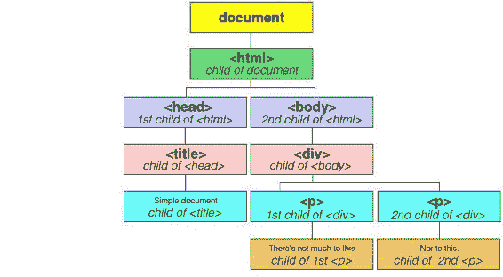

如你所见，`<html>` 是文档的子节点……`<head>` 和 `<body>` 是 `<html>` 的子节点……`<div>` 是 `<body>` 的子节点……两个 `<p>` 是 `<div>` 的子节点……每个文本节点是 `<p>` 的子节点。相反，文档是 `<html>` 的父节点，`<html>` 是 `<head>` 和 `<body>` 的父节点，`<head>` 是 `<title>` 的父节点，`<title>` 是一个文本节点的父节点，以此类推。具有相同父节点的节点称为兄弟节点。因此，`<head>` 和 `<body>` 是兄弟节点，因为 `<html>` 是它们共同的父节点。两个 `<p>` 是兄弟节点，因为 `<div>` 是它们共同的父节点。

从图表底部开始，文本 `"Nor to this."` 是 `<p>` 的子节点，`<p>` 是 `<div>` 的子节点，`<div>` 是 `<body>` 的子节点，`<body>` 是 `<html>` 的子节点，`<html>` 是文档的子节点。

现在看这个标记。

```html
<p>This is <em>important</em>!</p>
```

如果你为这个段落制作一个图表，你可能会认为所有文本都是 `<p>` 节点的子节点。但请记住，每个被另一个节点包含的节点都是包含它的节点的子节点。由于文本节点 `"important"` 被元素节点 `<em>` 包含，这个特定的文本节点是 `<em>` 的子节点，而不是 `<p>` 的子节点。文本节点 `"This is "` 和 `"!"` 以及元素节点 `<em>` 是兄弟节点，因为它们都被 `<p>` 包含。它们都是 `<p>` 的子节点。

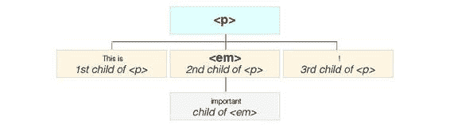

> 本章的交互式编程练习请访问：
> [`www.ASmarterWayToLearn.com/js/59.html`](http://www.ASmarterWayToLearn.com/javascript/59.html)

# 60 DOM：查找子节点

正如你在上一章所学到的，文档对象模型（DOM）是一个由父节点和子节点组成的层级结构。网页上的所有内容（除了文档本身）都是其他某个元素的子节点。那么现在，我们来谈谈你的 JavaScript 代码如何利用这种父节点和子节点的层级结构来读取或更改网页上的几乎任何内容。

我们先从你已经学过的定位网页元素的方法开始。回顾之前的章节，你可以通过指定元素的 `id` 来定位它（如果它有 `id` 的话）。

```javascript
var eField = document.getElementById("email");
```

上面的语句定位了 `id` 为 `"email"` 的元素。

你还学会了如何生成一个类似数组的集合，其中包含文档中所有特定类型的元素……

```javascript
var eField = document.getElementsByTagName("p");
```

生成了一个段落集合后，你可以定位集合中的任意段落，例如读取其内容。

```javascript
var contents = p[2].innerHTML;
```

上面的语句将文档中第三个段落包含的文本字符串赋值给变量 `contents`。

另一种方法不是列出文档中所有某种类型的元素，而是将焦点缩小到文档层级以下，例如一个 `div`，然后在该 `div` 内生成一个集合。

```javascript
var d = document.getElementById("div3");
var p = d.getElementsByTagName("p");
var contents = p[2].innerHTML;
```

在上面的例子中，你生成的集合不是文档中所有的段落元素，而只是那些位于 `id` 为 `"div3"` 的 `div` 内的段落元素。然后你定位了其中一个段落。

现在来看这个标记。

```html
<body>
  <div id="cal">
    <p>Southern Cal is sunny.</p>
    <p>Northern Cal is rainy.</p>
    <p>Eastern Cal is desert.</p>
  </div>

  <div id="ny">
    <p>Urban NY is crowded.</p>
    <p>Rural NY is sparse.</p>
  </div>
</body>
```

如果你想读取标记中最后一个段落的内容，可以这样写……

```javascript
var p = document.getElementsByTagName("p");
var contents = p[4].innerHTML;
```

第 1 行生成文档中所有 `<p>` 的集合，并将该集合赋值给变量 `p`。第 2 行“读取”文档中第五个段落包含的文本。

另一种方法：你可以将元素集合缩小到仅包含第二个 `div` 中的元素，从而定位同一个段落。

```javascript
var div = document.getElementById("ny");
var p = div.getElementsByTagName("p");
var contents = p[1].innerHTML;
```

以下是分解说明：

1. 将 `id` 为 `"ny"` 的 `div` 赋值给变量 `div`
2. 生成该 `div` 中所有 `<p>` 的集合，并将该集合赋值给变量 `p`
3. “读取”该 `div` 中第二个段落包含的文本，并将其赋值给变量 `contents`

现在我将向你展示一种定位段落的新方法，即使用 DOM 组织结构图。

```javascript
var p = document.childNodes[0].childNodes[1].childNodes[1].childNodes[1];
var contents = p.innerHTML;
```

我将高亮显示每个子层级，并告诉你它指向什么。

1. `document.childNodes[0]` 是文档的第一个子节点，即 `<html>`
2. `document.childNodes[0].childNodes[1]` 是 `<html>` 的第二个子节点，即 `<body>`
3. `document.childNodes[0].childNodes[1].childNodes[1]` 是 `<body>` 的第二个子节点，即 `id` 为 `"ny"` 的 `<div>`
4. `document.childNodes[0].childNodes[1].childNodes[1].childNodes[1]` 是 `id` 为 `"ny"` 的 `<div>` 的第二个子节点，即该 `div` 中的第二个 `<p>`

注意：上面的代码假设浏览器没有在 DOM 中包含任何垃圾伪影。我将在下一章讨论这些。

当我们沿着组织结构图向下移动时，每个父节点后面跟着一个点，然后是关键字 `childNodes`，再后面是方括号中的数字，就像数组表示法一样。与数组表示法一样，第一个子节点是编号 0。

这是再次给出的标记。上面代码中的关键元素已被高亮显示。

```html
<body>
  <div id="cal">
    <p>Southern Cal is sunny.</p>
    <p>Northern Cal is rainy.</p>
    <p>Eastern Cal is desert.</p>
  </div>

  <div id="ny">
    <p>Urban NY is crowded.</p>
    <p>Rural NY is sparse.</p>
  </div>
</body>
```

在上面的例子中，我向你展示了如何从文档层级开始向下定位到目标节点。但在实践中，你通常会从较低的层级开始。例如，你可以从第二个 `div` 开始，指定其 `id`。然后定位它的一个子节点。

```javascript
var d = document.getElementById("ny");
var p = d.childNodes[1];
var contents = p.innerHTML;
```

> 本章的交互式编程练习请访问：
> [`www.ASmarterWayToLearn.com/js/60.html`](http://www.ASmarterWayToLearn.com/javascript/60.html)

# 61 DOM：垃圾伪影与 `nodeType`

现在该谈谈 DOM 中的垃圾伪影了，也就是我在过去三章中一直提到的那些烦人的东西。让我们重新审视我们一直用作示例的简化网页。

```text
第 1 层：document

第 2 层：   <html>

第 3 层：     <head>

第 4 层：       <title>

第 5 层：         Simple document

                 </title>

               </head>

第 3 层      <body>

第 4 层        <div>

第 5 层          <p>

第 6 层            There's not much to this.

                   </p>

第 5 层          <p>

第 6 层            Nor to this.

                   </p>

                 </div>

               </body>

             </html>
```

这是我为该页面绘制的 DOM 图。


但这个图只适用于少数浏览器。大多数浏览器会将由某些回车、制表符和空格（用于格式化代码）产生的空白符解释为文本节点。当你查看标记时，你会看到 3 个文本节点，它们是 `title` 元素和两个段落元素的子节点。

```text
第 1 层：document

第 2 层：   <html>

第 3 层：     <head>

第 4 层：       <title>

第 5 层：         Simple document

                 </title>

               </head>

第 3 层      <body>

第 4 层        <div>

第 5 层          <p>

第 6 层            There's not much to this.

                   </p>

第 5 层          <p>

第 6 层            Nor to this.

                   </p>

                 </div>

               </body>

             </html>
```

Firefox 会在这个标记中看到额外的 8 个文本节点，它们只是由缩进产生的空白符。

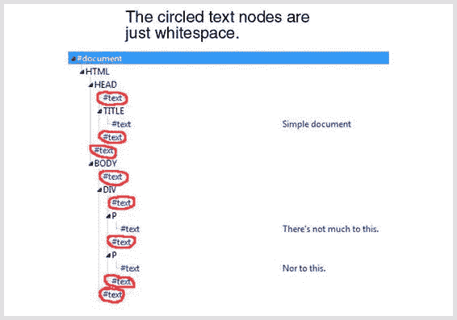

这些额外的文本节点产生了噪声，使得你的 DOM 读取代码难以找到真正的信号。在一个浏览器中，`body` 节点的第一个子节点可能是一个 `div`。在另一个浏览器中，`body` 的第一个子节点可能是一个空的文本节点。

有多种解决方案。作为一种方法，Mozilla 开发者网络建议了一种几乎可笑地绝望但确实能解决问题且无需 JavaScript 额外工作的变通方法。你可以像这样格式化标记。

```html
<html
  ><head
    ><title
      >Simple document
    </title
  ></head
  ><body
    ><div
      ><p
        >There's not much to this.
      </p
      ><p
        >Nor to this.
      </p
    ></div
  ></body
></html>
```

这种标记利用了这样一个事实：任何包含在标签的 `<` 和 `>` 之间的回车、制表符和空格都会被浏览器忽略。对于浏览器来说，`<  p  >` 等同于 `<p>`。并且……

```html
<  
div
>
```

……等同于 `<div>`。

当空白字符位于尖括号内时，浏览器不会将其视为文本节点。因此，如果你像上面的代码那样将所有回车、制表符和空格“隐藏”在尖括号内，DOM 中就不会有垃圾节点。任何可能干扰 JavaScript 读取信号的噪声都会被移除。

你也可以使用像 [`www.willpeavy.com/minifier/`](http://www.willpeavy.com/minifier/) 这样的压缩程序来清理 DOM 中的垃圾节点。当然，你需要保留文件的原始未压缩版本，以便将来能够轻松地修改页面。

```html
<html><head><title>Simple document</title></head><body><div><p>There's not much to this.</p><p>Nor to this.</p></div></body></html>
```

另一种方法是按常规方式格式化 HTML，然后让 JavaScript 嗅探出垃圾节点。JavaScript 可以检查节点以确定其类型——元素、文本、注释等。例如，以下语句检查目标节点的节点类型并将其赋值给变量 `nType`。

```javascript
var nType = targetNode.nodeType;
```

在上面的语句中，JavaScript 将一个代表节点类型的数字赋值给变量 `nType`。如果节点是像 `<div>` 或 `<p>` 这样的元素，数字为 1。如果是文本节点，数字为 3。

假设你想将某个特定 `div` 中第二个段落的文本内容替换为字符串 `"All his men."`。以下是标记，其中我们将要更改的文本高亮显示。

```html
<div id="humpty">
  <p>All the king's horses.</p>
  <p>All the dude's crew.</p>
  <p>All the town's orthopedists.</p>
</div>
```

这是代码。

```javascript
var d = document.getElementById("humpty");
var pCounter = 0;

for (var i = 0; i < d.childNodes.length; i++) {
  if (d.childNodes[i].nodeType === 1) {
    pCounter++;
  }

  if (pCounter === 2) {
    d.childNodes[i].innerHTML = "All his men.";
    break;
  }
}
```

以下是分解说明：

1. 将 `div` 赋值给变量 `d`
2. 统计段落数量
3. 遍历 `div` 的子节点，寻找下一个元素节点，即类型 1，我们假设它是一个段落
4-6. 计数器加 1。我们正在寻找第二个段落。
7-9. 当计数器达到 2 时，我们就找到了目标段落。更改文本

当然，如果你知道你可能希望 JavaScript 更改第二个段落，那么给它分配一个 `id` 并直接定位它会容易得多，就像这样。

```javascript
document.getElementById("p2").innerHTML = "All his men.";
```

你可以理解为什么 `getElementById` 方法比追踪 DOM 层级更受程序员欢迎。但有些事情如果不通过处理 DOM 的父子关系就无法完成，你将在后续章节中了解到。

> 本章的交互式编程练习请访问：
> [`www.ASmarterWayToLearn.com/js/61.html`](http://www.ASmarterWayToLearn.com/javascript/61.html)

# 62 DOM：更多定位元素的方法

到目前为止，你已经学会了使用 DOM 的父子层级，通过指定子节点在类似数组的子节点集合中的顺序来定位父节点的子节点——`childNodes[0]`、`childNodes[1]`、`childNodes[2]` 等等。但还有其他利用层级进行定位的方法。首先，你可以用 `firstChild` 代替 `childNodes[0]`。另外，例如，要定位一个有 10 个子节点的集合中的第 10 个子节点，你可以用 `lastChild` 代替 `childNodes[9]`。

```javascript
var targetNode = parentNode.childNodes[0];
```

……等同于……

```javascript
var targetNode = parentNode.firstChild;
```

如果有 3 个子节点……

```javascript
var targetNode = parentNode.childNodes[2];
```

……等同于……

```javascript
var targetNode = parentNode.lastChild;
```


你也可以反向操作，定位任何子节点的父节点。假设你有以下标记。使用 DOM，如何找到高亮 div 的父节点？

```html
<div id="div1">
  <div id="div2">
    <p>Chicago</p>
    <p>Kansas City</p>
    <p>St. Louis</p>
  </div>
</div>
```

你想知道 id 为 `"div2"` 的 div 的父节点。以下代码将 `"div2"` div 的父节点赋值给变量`pNode`。

```javascript
var kidNode = document.getElementById("div2");
var pNode = kidNode.parentNode;
```

你可以使用`nextSibling`和`previousSibling`来定位元素子节点集合中的下一个子节点和上一个子节点。在以下代码中，第一条语句定位 id 为 `"div1"` 的 div。第二条语句定位与 `"div1"` id 具有相同父节点的下一个节点。

```javascript
var firstEl = document.getElementById("div1");
secondEl = firstEl.nextSibling;
```

如果没有`nextSibling`或`previousSibling`，你会得到`null`。在以下代码中，变量`nonexistentEl`的值为`null`，因为 JavaScript 发现没有与`firstEl`具有相同父节点的上一个节点。

```javascript
var firstEl = document.getElementById("div1");
var nonexistentEl = firstEl.previousSibling;
```

计算兄弟节点可能很棘手，因为正如你所知，某些浏览器会将 HTML 格式化产生的空白字符视为文本节点，即使它们是空的且没有意义。

在上面的 HTML 示例中有两个 div 和三个段落，你可能会认为第一个段落的`nextSibling`是第二个段落。但实际上，在某些浏览器中，第一个段落的`nextSibling`是一个空文本节点。该节点的`nextSibling`才是第二个段落。

这意味着，为了使用`nextSibling`或`previousSibling`定位节点，你必须像上一章中展示的那样防御性地格式化 HTML 标记，或者像上一章中展示的那样对每个节点进行类型检查，以确保它是你正在寻找的类型。

我再次强调，最好为你可能想要“读取”或更改的任何节点分配一个 id。然后你可以使用`document.getElementById`更直接地定位该节点。

> 本章的交互式编程练习请访问：  
> [`www.ASmarterWayToLearn.com/js/62.html`](http://www.ASmarterWayToLearn.com/javascript/62.html)

# 63 DOM：获取目标的名称

在之前的章节中，你学习了如何通过如下语句获取节点的节点类型。

```javascript
var nType = targetNode.nodeType;
```

在上面的例子中，如果节点是元素，变量`nType`将被赋值为数字 1。如果节点是文本，则赋值为数字 3。

你可以使用`nodeName`获取关于节点的更多信息。在以下示例中，目标节点的节点名称被赋值给变量`nName`。

```javascript
var parent = document.getElementById("div1");
var target = parent.firstChild;
nName = target.nodeName;
```

第 1 行和第 2 行定位 id 为 `"div1"` 的元素的第一个子节点。第 3 行将目标的节点名称赋值给变量`nName`。

在上面的例子中，如果节点是元素，变量`nName`将被赋值为一个字符串，如`P`或`DIV`，对应于尖括号内标签的字符。在 HTML 中，名称通常以全大写形式给出，即使标记是小写的。

| 标签 | 节点名称 |
| --- | --- |
| `<p>` 或 `<P>` | `P` |
| `<div>` 或 `<DIV>` | `DIV` |
| `<span>` 或 `<SPAN>` | `SPAN` |
| `` 或 `` | `IMG` |
| `<a>` 或 `<A>` | `A` |
| `<em>` 或 `<EM>` | `EM` |
| `<table>` 或 `<TABLE>` | `TABLE` |
| `<li>` 或 `<LI>` | `LI` |

另一方面，如果节点是文本节点，其名称始终是`#text`——小写形式。

如果是文本节点，你可以通过以下方式获取其值（即内容）。

```javascript
var parent = document.getElementById("div1");
var target = parent.firstChild;
var nTextContent = target.nodeValue;
```

第 1 行和第 2 行定位 id 为 `"div1"` 的元素的第一个子节点。第 3 行将节点值赋值给变量`nTextContent`。

# 63 DOM：节点值

因此，如果标记如下，H2 元素的第一个子节点是一个名为`"#text"`的节点……

```html
<h2>Do <em>not</em> hit!</h2>
```

……那么节点值就是`"Do "`。

像`P`或`IMG`这样的元素节点有名称但没有值。如果你试图将一个元素节点值赋给一个变量，该变量将被赋值为`null`。

```html
<h2>Do <em>not</em> hit!</h2>
```

在上面的例子中，`<em>`是一个元素，这意味着它的值为`null`。

文本节点的节点值很容易与`innerHTML`属性混淆。两者有两个区别：

- 在上面的例子中，`innerHTML`是元素节点`<h2>`的一个属性。而节点值是文本节点本身的属性，不是父元素的属性。
- `innerHTML`包含元素的所有后代，包括像`<em>`这样的内部元素节点以及文本节点。而节点值只包含构成单个文本节点的字符。

在下面的代码中，H2 元素的`innerHTML`被高亮显示。

```html
<h2>Do <em>not</em> hit!</h2>
```

在下面的代码中，H2 元素的第一个子节点的节点值被高亮显示。

```html
<h2>Do <em>not</em> hit!</h2>
```

由于在某些情况下，`nodeName`可能会返回例如`"p"`而不是`"P"`，或者`"href"`而不是`"HREF"`，因此在测试名称时，最好将大小写标准化，如下所示。

```javascript
if (targetNode.nodeName.toLowerCase() === "img") {
```

如果节点名称原本是大写的，代码会将其转换为小写。如果原本就是小写，则不会造成任何影响。

如果你正在检查节点名称以确定节点是否为文本节点，则无需转换为小写，因为文本节点的名称始终是`"#text"`，而不会是`"#TEXT"`。

> 本章的交互式编程练习请访问：  
> [`www.ASmarterWayToLearn.com/js/63.html`](http://www.ASmarterWayToLearn.com/javascript/63.html)

# 64 DOM：计数元素

在之前的章节中，你学习了如何创建一个类似数组的集合，其中包含所有共享特定标签名的元素。例如，以下代码创建了一个包含所有`<li>`元素的集合，并将该集合赋给变量`liElements`。

```javascript
var liElements = getElementsByTagName("li");
```

一旦你有了元素集合，就可以知道其中有多少个元素。在下面的代码中，`liElements`所代表的集合中`<li>`元素的数量被赋给变量`howManyLi`。

```javascript
var howManyLi = liElements.length;
```

然后，例如，你可以遍历该集合，查找没有文本的`<li>`元素，并插入一些占位文本。

```javascript
for (var i = 0; i < howManyLi; i++) {
  if (liElements[i].innerHTML === "") {
    liElements[i].innerHTML = "coming soon";
  }
}
```

我带你走了一遍这个过程，是为了向你介绍一个类似的操作，你可以使用 DOM 层级结构而不是标签名来完成。你可以创建一个目标节点的所有子节点的集合。

```javascript
var parentNode = document.getElementById("d1");
var nodeList = parentNode.childNodes;
```

第 1 行将 id 为 `"d1"` 的元素赋给变量`parentNode`。第 2 行将`parentNode`的子节点集合赋给`nodeList`。

你可以获取集合中的项目数量。以下语句将节点集合中的项目数量赋给变量`howManyKids`。

```javascript
var howManyKids = nodeList.length;
```

然后你可以定位集合中的任何项目。以下代码统计了 div 内的图片数量。

```javascript
var numberPics = 0;
for (var i = 0; i < howManyKids; i++) {
  if (nodeList[i].nodeName.toLowerCase() === "img") {
    numberPics++;
  }
}
```

分解如下：

1. 声明图片计数器并将其初始化为 0。
2. 遍历 div 的所有子节点。
3. 如果节点名称（转换为小写后）是`"img"`，则递增图片计数器。

> 本章的交互式编程练习请访问：  
> [`www.ASmarterWayToLearn.com/js/64.html`](http://www.ASmarterWayToLearn.com/javascript/64.html)

# 65 DOM：属性

看看这段标记。

```html
<a href="http://www.amazon.com">Shop</a>
```

你已经知道，在上述标记中，文本节点`"Shop"`是元素节点`<a>`的第一个（也是唯一的）子节点。但`href="http://www.amazon.com"`是什么呢？它确实是 DOM 中的一个节点，你可以说它是`<a>`的附属。但它不是`<a>`的子节点。它是`<a>`的一个属性。

每当你看到这种形式……

```html
<元素 某属性="引号内的值">
```

……你看到的就是一个带有属性的元素。等号和引号就是提示。等号左侧的词是属性名。等号右侧的词是属性值。

以下是更多示例。属性值被高亮显示。

```html
<div id="p1">
<p class="special">

<span style="font-size:24px;">
```

一个元素可以有任意数量的属性。在这个标签中，元素`img`有 4 个属性。我已将其值高亮显示。

```html

```

你可以使用`hasAttribute`来检查一个元素是否具有某个特定属性。

```javascript
var target = document.getElementById("p1");
var hasClass = target.hasAttribute("class");
```

第 1 行将元素赋给变量`target`。第 2 行检查该元素是否有一个名为`"class"`的属性。如果有，变量`hasClass`被赋值为`true`。如果没有，则被赋值为`false`。

你可以使用`getAttribute`来读取属性的值。

```javascript
var target = document.getElementById("div1");
var attVal = target.getAttribute("class");
```

第 1 行将元素赋给变量`target`。第 2 行读取属性的值并将其赋给变量`attVal`。

你可以使用`setAttribute`来设置属性的值。

```javascript
var target = document.getElementById("div1");
target.setAttribute("class", "special");
```

第 1 行将元素赋给变量`target`。第 2 行给它一个`"class"`属性（括号内的第一个参数），其值为`"special"`（括号内的第二个参数）。实际上，标记变成了：

```html
<div id="div1" class="special">
```

> 本章的交互式编程练习请访问：  
> [`www.ASmarterWayToLearn.com/js/65.html`](http://www.ASmarterWayToLearn.com/javascript/65.html)

# 66 DOM：属性名和属性值

在前面的章节中，你学习了如何通过如下语句创建一个具有相同标签名的元素集合：

```javascript
var list = document.getElementsByTagName("p");
```

以及如何通过如下语句创建一个元素的所有子节点的集合：

```javascript
var list = document.getElementById("p1").childNodes;
```

类似地，你可以通过如下语句创建一个元素的所有属性的集合：

```javascript
var list = document.getElementById("p1").attributes;
```

将集合赋给变量后，你可以获取集合中的项目数量：

```javascript
var numOfItems = list.length;
```

或者，你也可以将这些任务压缩成一条语句，而无需先将目标赋给变量。

```javascript
var numOfItems = document.getItemById("p1").attributes.length;
```

使用类似数组的表示法，你可以找出集合中任何属性的名称。以下语句定位属性集合中的第三个项目，并将其名称赋给变量`nName`。

```javascript
var nName = list[2].nodeName;
```

例如，如果标记是……

```html
<p id="p1" class="c1" onMouseover="chgColor();">
```

……那么变量`nName`被赋值为`"onMouseover"`。

你还可以获取属性的值：

```javascript
var nValue = list[2].nodeValue;
```

在上面的示例标记中，变量`nValue`被赋值为`"chgColor();"`。

> 本章的交互式编程练习请访问：  
> [`www.ASmarterWayToLearn.com/js/66.html`](http://www.ASmarterWayToLearn.com/javascript/66.html)

# 67 DOM：添加节点

利用 DOM 层级结构，你可以在文档的 head 或 body 部分的任何位置添加元素节点、属性节点和文本节点。本章你将学习如何创建一个段落节点，为其添加属性，并填充文本内容。下一章你将学习如何将该段落及其属性和文本内容插入到页面中。

第一步是创建段落节点。

```javascript
var nodeToAdd = document.createElement("p");
```

该示例创建了一个段落元素。要创建一个`div`元素，你可以在括号中放入`"div"`。要创建一个图片元素，则放入`"img"`。要创建一个链接，则放入`"a"`，以此类推。

下面是一条创建图片元素的语句。

```javascript
var imgNodeToAdd = document.createElement("img");
```

在上一章中，你学习了如何使用`setAttribute`为已存在于网页中的元素添加属性。对于已创建但尚未放入文档 body 中的元素，你也可以执行同样的操作。

```javascript
nodeToAdd.setAttribute("class", "regular");
```

上面的代码为你刚刚创建的新段落元素赋予了`"regular"`类。如果你愿意，还可以通过单独的语句为该段落元素添加更多属性——例如`span`、`style`，甚至`id`。

如果该元素是``元素，你可以添加`border`或`alt`作为属性。如果是`<a>`元素，则可以添加网址。

这条语句为图片元素添加了一个`border`属性。

```javascript
imgNodeToAdd.setAttribute("border", "1");
```

上面的代码为图片设置了 1 像素的边框。

请记住，目前我们只是在创建节点。新的属性节点已经连接到新的元素节点，但我们还没有将这些节点添加到页面中。

回到段落元素，我们已经创建了它并为其添加了`class`属性。现在让我们给它一些文本内容。同样，我们首先创建所需的节点。

```javascript
var newTxt = document.createTextNode("Hello!");
```

上面的语句创建了一个内容为`"Hello!"`的文本节点。

接下来，我们将文本放入段落元素中。

```javascript
nodeToAdd.appendChild(newTxt);
```


上面的语句将内容为 `"Hello!"` 的新文本节点添加到新的段落节点中。

现在，我们有了一个带有 `class` 属性和文本内容的新段落节点。接下来就可以将其插入到页面中了。

> 本章的交互式编程练习请访问：
>
> [`www.ASmarterWayToLearn.com/js/67.html`](http://www.ASmarterWayToLearn.com/javascript/67.html)

# 68 DOM：插入节点

在上一章中，你学习了如何通过先创建文本节点，然后使用 `appendChild` 将该节点附加到元素上来为元素添加文本内容。当然，你也可以使用同样的方法将段落元素本身（无论是否填充内容）附加到父节点上，例如 body 或某个 `div`。下面这组语句定位了一个 `div`（第 1 行），创建了一个新的段落元素（第 2 行），创建了要放入其中的文本（第 3 行），将文本放入段落中（第 4 行），然后将段落元素及其文本内容附加到目标 `div` 中（第 5 行）。

```javascript
1 var parentDiv = document.getElementById("div1");
2 var newParagraph = document.createElement("p");
3 var t = document.createTextNode("Hello world!");
4 newParagraph.appendChild(t);
5 parentDiv.appendChild(newParagraph);
```

当你像上面的示例那样通过将节点作为子节点附加到父节点来将其添加到网页中时，局限性在于你无法控制新元素在父节点的子节点中的位置。JavaScript 总是将其放在末尾。例如，如果上面的 `div` 中已经有三个段落，那么新段落将成为第四个，即使你希望将其放在更靠前的位置。

解决方案是使用 `insertBefore`。

例如，假设你希望该段落成为 `div` 中的第一个段落，而不是最后一个。

```javascript
1 var parentDiv = document.getElementById("div1");
2 var newParagraph = document.createElement("p");
3 var t = document.createTextNode("Hello world!");
4 newParagraph.appendChild(t);
5 paragraph1 = parentDiv.firstChild;
6 parentDiv.insertBefore(newParagraph, paragraph1);
```

上面的示例选择了父元素的一个子节点作为目标（第 5 行），并告诉 JavaScript 将新元素及其文本内容插入到该元素之前（第 6 行）。

并没有一个名为 `insertAfter` 的方法。但你仍然可以实现同样的效果。只需在目标节点的下一个兄弟节点之前执行 `insertBefore` 即可。

```javascript
1 var target = parentDiv.childNodes[1];
2 parentDiv.insertBefore(newE, target.nextSibling);
```

通过将新节点插入到第二个子节点的下一个兄弟节点之前，你就将新节点插入到了第二个子节点之后。

要移除节点，请使用 `removeChild`。

```javascript
1 var parentDiv = document.getElementById("div1");
2 var nodeToRemove = parentDiv.childNodes[2];
3 parentDiv.removeChild(nodeToRemove);
```

> 本章的交互式编程练习请访问：
>
> [`www.ASmarterWayToLearn.com/js/68.html`](http://www.ASmarterWayToLearn.com/javascript/68.html)

# 69 对象

我相信你见过这样的表格，它比较了某个虚拟主机提供的不同套餐。

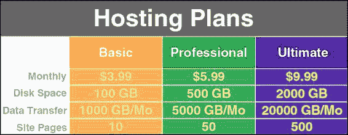

如果你想在 JavaScript 中使用这些数据，你可以将每个值赋给不同的变量，就像这样。

```javascript
1  var plan1Name = "Basic";
2  var plan1Price = 3.99;
3  var plan1Space = 100;
4  var plan1Data = 1000;
5  var plan1Pages = 10;
6  var plan2Name = "Professional";
7  var plan2Price = 5.99;
8  var plan2Space = 500;
9  var plan2Data = 5000;
10 var plan2Pages = 50;
11 var plan3Name = "Ultimate";
12 var plan3Price = 9.99;
13 var plan3Space = 2000;
14 var plan3Data = 20000;
15 var plan3Pages = 500;
```

完成所有这些变量赋值后，你就可以编写如下 JavaScript 语句：

```javascript
alert("The cost of the " + plan2Name + " package is $" + plan2Price + " per month.");
```

……然后会弹出一个提示框，显示“The cost of the Professional package is $5.99 per month.”

但是，将所有这些值赋给变量显得笨重，而且如果情况变得复杂，可能会引发问题。更好的处理方式是创建带有属性的对象。这种方案更便捷，也能更准确地反映我们最初那个主机公司表格的二维网格特性。下面的表格展示了所有选项以对象和属性的形式表示。

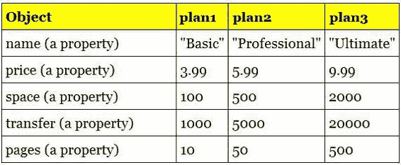

在这个例子中，每个托管计划都是一个对象——`plan1`、`plan2`、`plan3`。每个对象有 5 个属性——`name`、`cost`、`space`、`transfer` 和 `pages`。属性就是附加到对象上的变量。这里，每个对象有一个字符串属性（`name`）和四个数值属性（`price`、`space`、`transfer` 和 `pages`）。

在代码中，我们使用点表示法来引用对象及其属性。下面是创建上述提示框的语句，其中用对象-属性对替换了简单的变量。

```javascript
alert("The cost of the " + plan2.name + " package is $" + plan2.price + " per month.");
```

`plan2.name` 代表 `"Professional"`。`plan2.price` 代表 `5.99`。

定义对象及其属性最直接的方式如下：

```javascript
1 var plan1 = {
2   name: "Basic",
3   price: 3.99,
4   space: 100,
5   transfer: 1000,
6   pages: 10
7 };
```

需要注意的事项：

- 代码以变量定义开始，使用关键字 `var`，后跟对象名称，然后是等号。
- 但接下来，不是值，而是一个花括号，其另一半位于代码块的末尾。
- 每个属性以名称开头，后跟冒号，然后是值。
- 除最后一个属性定义外，每个属性定义末尾都有逗号。
- 由于第一行有等号，右花括号后跟分号。

现在让我们再添加一个属性 `discountMonths`。如果当前月份是七月、八月或十二月，客户将获得托管计划 20%的折扣。为了跟踪这些特殊月份，我们将它们分配给一个新属性。这个新属性是一个数组，而不是一个简单变量。

`plan1.discountMonths = [6, 7, 11];`

上面的语句为对象 `plan1` 创建了一个新属性 `discountMonths`，并将一个数组赋值给它，该数组表示客户获得折扣的三个月份。

引用这个数组属性的各个元素的方式与引用任何数组的元素相同，使用方括号内的数字，但使用对象-属性对的点表示法：`plan1.discountMonths`。

`var mo = plan1.discountMonths[2];`

上面的语句将数组的第三个元素（代表十二月的数字）赋值给变量 `mo`。

到目前为止，我们只定义了一个对象 `plan1` 及其属性。要完成包含 `plan2` 和 `plan3` 的对象集合，你必须重复同样的操作，然后再重复一次。你可能会想，这比我在本章开头定义 15 个简单变量要费事得多，但定义对象及其属性实际上是一种更好的方式，原因我将在后续章节中讨论。此外，还有一种更省力的方法，你也会学到。

> 本章的交互式编码练习请访问：
>
> [`www.ASmarterWayToLearn.com/js/69.html`](http://www.ASmarterWayToLearn.com/javascript/69.html)

## 70 对象：属性

要更改对象数值属性的值，使用简单的赋值语句，就像给普通变量赋值一样。

`deal3.cost = 79.95;`

无论 `deal3.cost` 之前的值是什么，现在它变成了 79.95。

当然，你也可以赋值字符串而不是数字。

`deal3.name = "Super-saver";`

无论 `deal3.name` 之前的值是什么，现在它变成了 "Super-saver"。

你也可以将数组列表赋值给一个属性。

`deal3.features = ["Guarantee", "Free Ship"];`

无论 `deal3.features` 之前的值是什么，现在它变成了一个包含元素 "Guarantee" 和 "Free Ship" 的数组。

你还可以赋值布尔值。

`deal3.membersOnly = false;`

无论 `deal3.membersOnly` 之前的值是什么，现在它变成了 `false`。

你也可以使用赋值语句为对象定义一个新属性。假设对象 `deal3` 有一些属性，但其中没有 `deal3.market`。现在你想添加它，同时给它赋值。

`deal3.market = "regional";`

就像你可以通过不赋值来创建一个未定义的变量一样，你也可以创建一个没有任何属性的对象。

`var deal4 = {};`

如果你想现在创建一个属性，稍后再赋值，你可以用 `undefined` 值创建它。

`deal3.market = undefined;`

注意，关键字 `undefined` 没有引号。它不是字符串。

你可以删除对象的一个属性。

`delete deal3.market;`

你可以检查对象的某个属性是否存在。下面的语句测试是否存在 `deal3.market`，并将结果（true 或 false）赋值给变量 `propertyExists`。

`propertyExists = "market" in deal3;`

需要注意的事项：

- 你可以使用任何合法的变量名代替 `propertyExists`。
- 关键字 `in` 询问：“属性 `market` 是否在对象 `deal3` 中——true 还是 false？”
- 属性 `market` 用引号括起来。
- 对象 `deal3` 没有用引号括起来。

> 本章的交互式编程练习请访问：
>
> [`www.ASmarterWayToLearn.com/js/70.html`](http://www.ASmarterWayToLearn.com/javascript/70.html)

## 71 对象：方法

让我们回到显示不同托管计划的图表。


我们将编写一个函数，根据此图表计算年费。请注意，如果用户在一年中的某些时间注册，他将获得全年折扣。如果他在七月或八月注册 Basic 计划，他将获得 20%的折扣。如果他在七月、八月或十二月注册 Professional 计划，他将获得 20%的折扣。如果他在七月或八月注册 Ultimate 计划，他将获得 20%的折扣。

我们首先创建三个带有属性的对象。这是代表 Basic 计划的对象及其属性。

```javascript
var plan1 = {
  name: "Basic",
  price: 3.99,
  space: 100,
  transfer: 1000,
  pages: 10,
  discountMonths: [6, 7]
};
```

该函数遍历所有折扣月份（第 5 行），检查是否有任何月份恰好是当前月份（第 6 行）。如果是，则通过将常规价格乘以 0.8 来计算 20%的折扣。然后，它将月价格（无论是否打折）乘以 12，得到年价格，并将数字返回给调用代码（第 11 行）。

```javascript
function calcAnnual() {
  var bestPrice = plan1.price;
  var currDate = new Date();
  var thisMo = currDate.getMonth();

  for (var i = 0; i < plan1.discountMonths.length; i++) {
    if (plan1.discountMonths[i] === thisMo) {
      bestPrice = plan1.price * .8;
      break;
    }
  }

  return bestPrice * 12;
}
```

这是执行该函数的调用语句。

`var annualPrice = calcAnnual();`

但现在让我们让函数更灵活，使折扣率可以根据调用语句传递给它的值而变化。以下是修订版，如果用户符合折扣条件，则将收取的百分比传递给参数 `percentIfDisc`。

```javascript
function calcAnnual(percentIfDisc) {
  var bestPrice = plan1.price;
  var currDate = new Date();
  var thisMo = currDate.getMonth();

  for (var i = 0; i < plan1.discountMonths.length; i++) {
    if (plan1.discountMonths[i] === thisMo) {
      bestPrice = plan1.price * percentIfDisc;
      break;
    }
  }

  return bestPrice * 12;
}
```

这是将值传递给函数并执行它的调用语句。在此示例中，它传递值 0.85，表示 15%的折扣。

`var annualPrice = calcAnnual(.85);`

你已经了解到可以将变量附加到对象上，该变量就成为对象的属性。现在还有更多消息。你可以将函数附加到对象上，该函数就成为该对象的方法。它执行与普通函数相同的任务，但现在它附加到了对象上。为什么要使用方法而不是普通函数的原因将在后续章节中变得清晰。现在，让我展示如何操作。

以下代码将我之前编写的函数插入到对象定义中，因此现在它是一个方法。在操作上，它与普通函数相同，但现在它附加到了对象上。

```javascript
var plan1 = {
  name: "Basic",
  price: 3.99,
  space: 100,
  transfer: 1000,
  pages: 10,
  discountMonths: [6, 7],

  calcAnnual: function(percentIfDisc) {
    var bestPrice = plan1.price;
    var currDate = new Date();
    var thisMo = currDate.getMonth();

    for (var i = 0; i < plan1.discountMonths.length; i++) {
      if (plan1.discountMonths[i] === thisMo) {
        bestPrice = plan1.price * percentIfDisc;
        break;
      }
    }

    return bestPrice * 12;
  }
};
```

需要注意的事项：

- 除了第一行，该方法的每一行都与我们开始时用来创建普通函数的代码相同。
- 方法定义的开头与属性定义相同，先写名称，后跟冒号。
- 每个属性定义和方法定义都以逗号结尾，但最后一个属性或方法除外。如果在 `calcAnnual` 方法定义下方添加属性或方法，则需要在 `calcAnnual` 定义的右花括号后插入逗号。
- 表示变量名是函数名的圆括号紧跟在关键字 `function` 之后。如果有参数，则放在圆括号内，与任何函数定义一样。

这是调用该方法的方式。

```javascript
var annualPrice = plan1.calcAnnual(.85);
```

我将对方法定义进行一些改进。在我上面编写的定义中，属性是通过对象名称来引用的，例如 `plan1.price`。这种方法可行，但更好的做法（后续章节会说明原因）是用关键字 `this` 替换对象名称。当 JavaScript 看到这个关键字时，它就知道你引用的是正在定义的对象。

```javascript
1  var plan1 = {
2    name: "Basic",
3    price: 3.99,
4    space: 100,
5    transfer: 1000,
6    pages: 10,
7    discountMonths: [6, 7],
8    calcAnnual: function(percentIfDisc) {
9      var bestPrice = this.price;
```


```javascript
var currDate = new Date();

var thisMo = currDate.getMonth();

for (var i = 0; i < this.discountMonths.length; i++) {
  if (this.discountMonths[i] === thisMo) {
    bestPrice = this.price * percentIfDisc;
    break;
  }
}

return bestPrice * 12;
```

当你编写`this.whatever`时，JavaScript 足够智能，能够理解你引用的是正在定义的对象的属性——在本例中，就是`plan1`。

> 本章的交互式编程练习请访问：  
> [`www.ASmarterWayToLearn.com/js/71.html`](http://www.ASmarterWayToLearn.com/javascript/71.html)

## 72 对象：构造函数

下面再次展示不同托管方案的图表版本。


以下是我如何将 Basic 方案的信息封装到一个对象和五个属性中。

```javascript
var plan1 = {
  name: "Basic",
  price: 3.99,
  space: 100,
  transfer: 1000,
  pages: 10
};
```

但这只得到了一个表示第一个方案的对象。对于 Professional 和 Ultimate 方案，我还得重复同样的操作。手工操作太多。我们需要一个工厂来批量生产这些东西。JavaScript 允许你构建这样一个工厂。它被称为构造函数。

```javascript
function Plan(name, price, space, transfer, pages) {
  this.name = name;
  this.price = price;
  this.space = space;
  this.transfer = transfer;
  this.pages = pages;
}
```

这是一个普通的函数定义，但有两个不同之处：

* 函数名首字母大写。JavaScript 并不在意你是否这样做，但按照惯例，这样做是为了将构造函数与普通函数区分开来。
* 每个参数值都被赋值给一个变量。但这个变量是附加到某个尚未指定名称的对象上的属性。不过别担心。就像参数值将由调用代码填充一样，对象名称也将由调用代码填充。

以下是创建 Basic 方案对象的调用代码。

```javascript
var plan1 = new Plan("Basic", 3.99, 100, 1000, 10);
```

如果没有那个`new`，这只是一个普通的函数调用。正是这个关键字告诉 JavaScript 创建一个新对象。新对象的名称是`plan1`。它的属性在圆括号内列出。

现在，使用相同的模式，你可以轻松地批量生产任意数量的对象。

```javascript
var plan1 = new Plan("Basic", 3.99, 100, 1000, 10);
var plan2 = new Plan("Premium", 5.99, 500, 5000, 50);
var plan3 = new Plan("Ultimate", 9.99, 2000, 20000, 500);
```

通常，参数和属性使用相同的名称，但并非必须如此。你可以这样写：

```javascript
function Plan(name, price, space, transfer, pages) {
  this.doc = name;
  this.grumpy = price;
  this.sleepy = space;
  this.bashful = transfer;
  this.sneezy = pages;
}
```

> 本章的交互式编程练习请访问：  
> [`www.ASmarterWayToLearn.com/js/72.html`](http://www.ASmarterWayToLearn.com/javascript/72.html)

## 73 对象：方法的构造函数

以下是包含折扣月份的托管方案图表版本。


在第 71 章中，我展示了如何将函数附加到对象上，方法与将变量附加到对象上相同。当你将变量附加到对象上时，它被称为对象的属性。当你将函数附加到对象上时，它被称为对象的方法。在下面的示例中，该方法检查当前日期是否在折扣月份内，如果是，则应用折扣。然后该方法计算年费。

如果你要创建多个具有相同属性和方法模式的对象，那么将方法以及属性都构建到构造函数中会很方便。

在以下代码中，构造函数为创建的每个对象创建相同的方法，同时也为每个对象创建所有属性。

```javascript
function Plan(name, price, space, transfer, pages, discountMonths) {
  this.name = name;
  this.price = price;
  this.space = space;
  this.transfer = transfer;
  this.pages = pages;
  this.discountMonths = discountMonths;
  this.calcAnnual = function(percentIfDisc) {
    var bestPrice = this.price;
    var currDate = new Date();
    var thisMo = currDate.getMonth();

    for (var i = 0; i < this.discountMonths.length; i++) {
      if (this.discountMonths[i] === thisMo) {
        bestPrice = this.price * percentIfDisc;
        break;
      }
    }

    return bestPrice * 12;
  };
}
```

关于第 8 行（方法定义的开始），需要注意以下几点：

* 与上面的属性定义一样，该行以关键字`this`开头，指的是当前正在构造的任何对象的名称。
* 接下来的三个部分相同：一个点、方法名称和一个等号。
* 下一个部分不同：关键字`function`。
* 在本例中，圆括号内有一个参数`percentIfDisc`。这不是构造函数的一部分参数。它是构造函数将为每个对象创建的方法的参数。该参数的值不是在通过构造函数创建新对象时传递的，而是在通过构造函数创建了对象及其方法后，调用该方法时传递的。

以下是调用构造函数来创建三个新对象（对应三个托管方案）的代码。

```javascript
var p1 = new Plan("Basic", 3.99, 100, 1000, 10, [6, 7]);
var p2 = new Plan("Premium", 5.99, 500, 5000, 50, [6, 7, 11]);
var p3 = new Plan("Ultimate", 9.99, 2000, 20000, 500, [6, 7]);
```

一旦上述代码创建了对象及其属性和方法，以下代码就可以调用，例如，Premium 方案的方法。

```javascript
var annualPrice = p2.calcAnnual(.85);
```

一次性字面量对象定义（无构造函数）中的方法定义与构造函数中的方法定义之间的主要区别在于第一行。在其他方面，两个定义是相同的。

这是在没有构造函数的情况下一次性创建对象时方法定义的第一行：

```javascript
calcAnnual: function(percentIfDisc) {
```

这是构造函数中方法定义的第一行：

```javascript
this.calcAnnual = function(percentIfDisc) {
```

还有另外两个不同之处。因为在构造函数中，方法定义以赋值语句（`something = something else`）开头，所以需要在右花括号后加上分号。如果后面还有其他属性或方法定义，则不需要逗号。

> 本章的交互式编程练习请访问：  
> [`www.ASmarterWayToLearn.com/js/73.html`](http://www.ASmarterWayToLearn.com/javascript/73.html)

## 74 对象：原型

在上一章中，你使用构造函数创建了三个对象。每个对象对应一个托管方案。每个对象有六个属性和一个方法。下面是一个表格，展示了这三个对象及其属性和方法。请看表格中最后一行（绿色标记），它代表三个对象的方法……

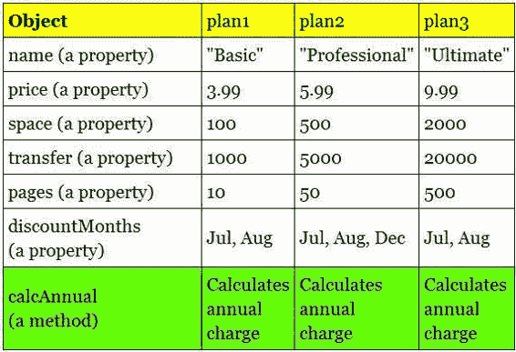

绿色的最后一行存在一些不优雅之处。上面各行显示的属性是针对每个对象定制的，但方法在不同对象之间始终相同。构造函数为每个对象重复创建相同的方法，一个接一个。如果我们使用构造函数创建 100 个对象，JavaScript 会重复创建 100 次相同的方法，每个对象一次。这样虽然能工作，但不够美观。

下面这个表格展示了所有对象共享同一个方法，这样更合理。

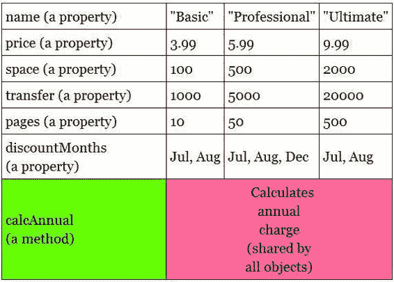

我们希望只保留一个方法副本，由构造函数创建的所有对象共享，无论创建了多少个对象。

如何实现呢？使用原型语句。

首先，我们不在构造函数中包含该方法，因为那样会为每个通过构造函数创建的对象都生成一个方法副本。

相反，我们通过以下方式将方法定义为构造函数的原型。

```javascript
Plan.prototype.calcAnnual = function(percentIfDisc) {
  var bestPrice = this.price;
  var currDate = new Date();
  var thisMo = currDate.getMonth();

  for (var i = 0; i < this.discountMonths.length; i++) {
    if (this.discountMonths[i] === thisMo) {
      bestPrice = this.price * percentIfDisc;
      break;
    }
  }

  return bestPrice * 12;
};
```

现在，所有通过构造函数`Plan`创建的对象都将共享同一个`calcAnnual`方法副本。不再有不必要的重复。

请注意，除了第一行之外，该方法的编码方式与它作为构造函数定义的一部分时完全相同。即使第一行，如果只考虑等号右侧的部分，也是一样的。等号左侧由点号连接的部分是：

* 构造函数名称，此处为`Plan`
* 关键字`prototype`
* 所有通过`Plan`创建的对象将共享的方法名称，此处为`calcAnnual`

对象不仅可以有原型方法，还可以有原型属性。假设你希望所有通过`Plan`创建的对象共享同一个属性`cancellable`，其值为`true`。你可以这样编写原型：

```javascript
Plan.prototype.cancellable = true;
```

现在，所有通过构造函数`Plan`创建的对象都共享一个属性`cancellable`，其值为`true`。

这是添加了原型方法和原型属性后的对象表格。

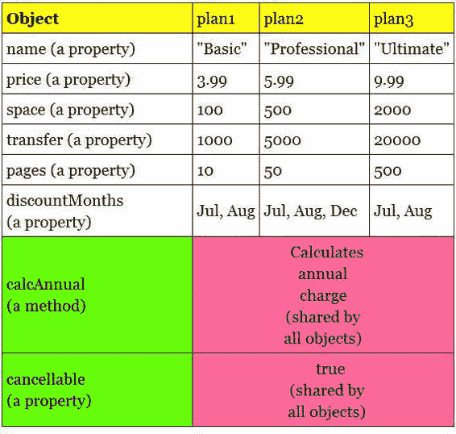

可以为任何单个对象覆盖原型。例如，假设你希望所有通过构造函数创建的对象共享同一个`cancellable`属性，但最便宜的方案`plan1`（名为“Basic”）除外。实现这一点的语句如下：

```javascript
plan1.cancellable = false;
```

所有通过构造函数创建的对象仍然共享属性`cancellable`，但现在其中一个对象的该属性值与其他所有对象不同。下面是表格。

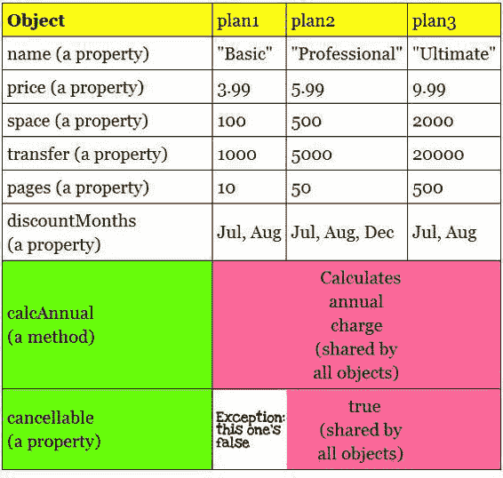

同样，你也可以为任何单个对象覆盖共享的原型方法。

> 本章的交互式编程练习请访问：  
> [`www.ASmarterWayToLearn.com/js/74.html`](http://www.ASmarterWayToLearn.com/javascript/74.html)

## 75 对象：检查属性和方法

你可以通过编写如下简单语句来检查对象是否具有特定属性：

```javascript
var gotTheProperty = "price" in plan1;
```

各部分说明如下：

* 被检查的属性，用引号括起来——此处为`price`
* 关键字`in`
* 对象，此处为`plan1`

同样，问题是：名为`plan1`的对象是否有一个名为`price`的属性？换句话说，是否存在`plan1.price`这样的东西？在我们一直使用的三个托管方案的例子中，`plan1`确实有一个价格 3.99。因此`gotTheProperty`被赋值为`true`。但`plan1`没有名为`location`的属性。所以如果我们编写……

```javascript
var gotTheProperty = "location" in plan1;
```

……变量`gotTheProperty`为`false`。

例子中的`plan1`还有一个名为`calcAnnual`的方法。方法是对象的一种属性类型，因此如果你编写……

```javascript
var gotTheProperty = "calcAnnual" in plan1;
```

……变量`gotTheProperty`为`true`。

需要注意的事项：

属性（一个变量）被放在引号内。我们不习惯将 JavaScript 变量放在引号内，所以这一点需要特别留意。

关键字是`in`——非常直观。代码询问：“`plan1`中是否有一个名为 'price' 的属性？”

如果你想要获取对象属性的列表，有一种巧妙的方法：

```javascript
var listOfProperties = [];

for (var prop in plan1) {
  listOfProperties.push(prop);
}
```

第 1 行声明了一个空数组`listOfProperties`。第 2-4 行遍历`plan1`的所有属性，将每个属性（包括任何方法）通过`push`添加到数组`listOfProperties`中。使用我们一直在用的例子，数组`listOfProperties`最终得到的值为"name,price,space,transfer,pages,discountMonths,calcAnnual"。

请注意，与常规的 for 循环不同，这个循环没有设定循环次数限制，也没有递增计数器。每次迭代后，JavaScript 会自动移动到对象的下一个属性，并在没有更多属性可枚举时停止迭代。

还要注意，你可以使用任何其他合法的变量名来代替`prop`。

在例子中，方法`calcAnnual`最初并不在对象`plan1`的定义中。它后来被添加到了用于创建该对象的构造函数的原型中，因此通过继承成为了对象的一个属性。上面的代码将继承的属性（包括方法）也包含在集合中。如果你希望将属性列表限制为对象显式声明的那些属性，而排除从原型继承的属性，则需要使用`hasOwnProperty`。

```javascript
var listOfProperties = [];

for (var prop in plan1) {
  if (plan1.hasOwnProperty(prop)) {
    listOfProperties.push(prop);
  }
}
```

在上面的例子中，每个属性依次被赋给变量`prop`。然后 if 语句测试该属性是否是对象自身拥有的属性，而不是通过原型继承的。

当然，你也可以测试字面属性名，而不是使用变量。

```javascript
var isOwnedProperty = plan1.hasOwnProperty("price");
```

> 本章的交互式编程练习请访问：  
> [`www.ASmarterWayToLearn.com/js/75.html`](http://www.ASmarterWayToLearn.com/javascript/75.html)

## 76 浏览器控制：获取和设置 URL

除了在网页上实现各种功能外，你还可以使用 JavaScript 来控制浏览器。首先，你可以让浏览器告诉你它当前的地址。

```javascript
var whereWeAt = window.location.href;
```


例如，如果浏览器当前位于 `http://www.mybeautifulsite.com/products/page33.html#humidifier`，上述语句会将字符串 `"http://www.mybeautifulsite.com/products/page33.html#humidifier"` 赋值给变量 `whereWeAt`。

你也可以获取其中的一部分。以下语句仅获取域名。

```javascript
var theDomain = window.location.hostname;
```

在这个例子中，字符串 `"www.mybeautifulwebsite.com"` 被赋值给变量 `theDomain`。`"http://"`、路径和锚点被省略。

以下是获取路径的方法。

```javascript
var thePath = window.location.pathname;
```

在这个例子中，字符串 `"/products/page33.html"` 被赋值给变量 `thePath`。如果浏览器位于首页，且 URL 仅为 `http://www.mybeautifulsite.com`，则字符串 `"/"` 会被赋值给该变量。

在这个例子中，浏览器被指向了由锚点 `#humidifier` 标记的页面部分。以下语句用于识别锚点。

```javascript
var theAnchor = window.location.hash;
```

字符串 `"#humidifier"` 被赋值给变量 `theAnchor`。如果 URL 中没有锚点，则该变量被赋值为空字符串 `""`。

和往常一样，你可以颠倒顺序，告诉浏览器要去哪里，而不是询问它当前在哪里。

```javascript
window.location.href = "http://www.me.com/1.html";
```

上述语句告诉浏览器导航到 `me.com` 站点上名为 `1.html` 的页面。

如果你希望浏览器导航到该站点的首页，可以这样写……

```javascript
window.location.href = "http://www.me.com";
```

如果你希望它定位到一个锚点……

```javascript
window.location.href = "http://www.me.com/1.html#section9";
```

如果能使用 `window.pathname = ...` 跳转到当前站点的另一个页面，或者使用 `window.hash = ...` 跳转到当前页面的某个锚点，那会很方便，但事实并非如此。不过，你可以向浏览器查询域名，然后将其与你想要前往的页面组合起来。

```javascript
var currentSite = window.location.hostname;

var destination = "http://" + currentSite + "/wow.html";

window.location.href = destination;
```

以下是逐行解析：

1. 获取域名并赋值给变量 `currentSite`。示例：`www.me.com`
2. 将字符串 `"http://"` 与域名及目标页面拼接，并将组合结果赋值给变量 `destination`
3. 将浏览器导向目标地址

以下是如何将浏览器导向当前页面上的某个锚点。

```javascript
var currentSite = window.location.hostname;

var currentPath = window.location.pathname;

var destination = "http://" + currentSite + currentPath + "#humidifier";

window.location.href = destination;
```

以下是解析：

1. 获取域名并赋值给变量 `currentSite`。示例：`www.me.com`
2. 获取路径名并赋值给变量 `currentPath`。示例：`/1.html`
3. 将字符串 `"http://"` 与域名、目标页面及所需锚点拼接，并将组合结果赋值给变量 `destination`
4. 将浏览器导向目标地址


- 你可以省略 `window.`。使用 `location.href`、`location.hostname`、`location.pathname` 和 `location.hash` 是合法的。但更常见的做法是包含 `window.`。
- 在检测 URL 时，你可以省略 `href`。使用 `window.location` 或仅用 `location` 都是合法的。（见上文。）出于某些深奥的原因，更推荐包含 `href`。
- 你可以使用 `document.URL` 作为 `window.location.href` 的替代方案。
- 还有另外两种将浏览器导向 URL 的方法，作为 `window.location.href` 的替代。你将在下一章学习如何使用它们。

> 本章的交互式编程练习请访问：  
> [`www.ASmarterWayToLearn.com/js/76.html`](http://www.ASmarterWayToLearn.com/javascript/76.html)

## 77 浏览器控制：另一种获取和设置 URL 的方法

在上一章中，你学会了通过将字符串赋值给 `window.location.href` 来将浏览器导向新的 URL。以下是实现相同功能的另一种方法。

```javascript
window.location.assign("http://www.me.com");
```

该语句将浏览器导向 `me.com` 的首页。

与 `window.location.href` 语句一样，你可以根据需要使 URL 尽可能详细。

```javascript
window.location.assign("http://www.me.com/lojack.html#guarantee");
```

该语句将浏览器导向 `me.com` 站点上 `lojack.html` 页面中的锚点 `#guarantee`。

以下是另一种效果略有不同的替代方法。

```javascript
window.location.replace("http://www.me.com/lojack.html#guarantee");
```

同样，该语句将浏览器导向一个新的 URL。但通过使用 `replace` 而不是 `assign`，你会干扰浏览器历史记录。当你使用 `assign` 时，历史记录是完整的。该语句将用户从原始页面带到新页面。如果到达新页面后，用户按下退格键或点击浏览器的后退按钮，她会返回到刚刚离开的原始页面。

但当你使用 `replace` 时，原始页面不会进入历史记录。如果用户在被带到新页面后按下退格键，她会被带到原始页面之前显示的页面，因为原始页面已不在历史记录中。如果原始页面之前没有页面，那么按下退格键时什么也不会发生。

要重新加载当前页面，请编写以下语句之一：

```javascript
window.location.reload(true);
```

```javascript
window.location.reload(false);
```

```javascript
window.location.reload();
```

这三个语句都会重新加载当前页面。如果参数是 `true`（上面的示例 1），该语句会强制浏览器从服务器加载页面。如果参数是 `false`（示例 2）或没有参数（示例 3），浏览器会从缓存加载页面（如果页面已被缓存）。


- 你可以使用 `window.location.href = window.location.href` 或任何简写替代方法来重新加载当前页面。重新加载速度更快，但它不允许你指定浏览器是从服务器还是从缓存重新加载。`document.URL = document.URL` 不起作用。

> 本章的交互式编程练习请访问：  
> [`www.ASmarterWayToLearn.com/js/77.html`](http://www.ASmarterWayToLearn.com/javascript/77.html)

## 78 浏览器控制：前进与后退

你可以让浏览器在历史记录中后退一个 URL，就像用户按下了退格键或点击了浏览器的后退按钮一样。

```javascript
history.back();
```

要让浏览器在历史记录中前进，就像用户按下了 Alt-右箭头或点击了浏览器的前进按钮一样……

```javascript
history.forward();
```

在这两种情况下，如果历史记录中没有可用的 URL 来执行该操作，浏览器将什么也不做。

你可以告诉浏览器你想在历史记录中前进或后退多少步，使用负数表示后退，正数表示前进。以下语句相当于按了三次退格键。

```javascript
history.go(-3);
```

以下语句将浏览器向前发送两个 URL。

```javascript
history.go(2);
```

如果括号内的负数大于历史记录中先前 URL 的数量，浏览器将什么也不做。如果括号内的正数大于历史记录中后续 URL 的数量，浏览器将什么也不做。

当你只想前进或后退一步时，你可以选择任何一种方法。

```javascript
history.back();
```

……等同于……

```javascript
history.go(-1);
```

以及……

```javascript
history.forward();
```

……等同于……

```javascript
history.go(1);
```

没有可靠的方法来找出历史记录中后退和前进的项目数量。

如果用户通过点击链接来到当前页面，你可以获取点击链接所在页面的 URL。

```javascript
var whereUserCameFrom = document.referrer;
```

上述语句将链接被点击时的 URL 赋值给变量 `whereUserCameFrom`。

然而，这仅在点击了链接（包括搜索结果中的链接）时才有效。如果用户通过书签或直接在地址栏输入 URL 访问你的页面，`document.referrer` 的结果将是一个空字符串 `""`。

> 本章的交互式编程练习请访问：  
> [`www.ASmarterWayToLearn.com/js/78.html`](http://www.ASmarterWayToLearn.com/javascript/78.html)

## 79 浏览器控制：用内容填充窗口

弹出窗口是浏览器功能中的“罗德尼·丹杰菲尔德”，这要归功于激进营销者对其的滥用。但它们也有合法的用途。如果你打算使用它们，就必须处理弹出窗口拦截器，你很快就会学会如何应对。本章和下一章将教你创建窗口的代码。

这是最基本的、最简化的语句。

```javascript
var monkeyWindow = window.open();
```

上面的代码打开一个最大尺寸的空白窗口，并为其分配一个句柄（即一个指向该特定窗口的变量）——在本例中是 `monkeyWindow`。根据浏览器的不同，窗口可能会覆盖在前一个窗口之上、在新标签页中打开，甚至在新打开的浏览器副本中打开。你无法控制这一点。

有三种方法可以用内容填充新窗口。你可以使用 `write` 方法将 HTML 内容放到屏幕上……

```javascript
var monkeyWindow = window.open();

var windowContent = "<h1>卷尾猴</h1><p>卷尾猴（capuchin）一词源于一群名为“嘉布遣小兄弟会”的修士，他们穿着<br>棕色长袍，头戴遮住头部的大兜帽。</p>";

monkeyWindow.document.write(windowContent);
```

以下是逐行解析：

1. 打开一个新窗口，并将其句柄赋值为 `monkeyWindow`
2. 将文本赋值给变量 `windowContent`
3. 用该文本填充窗口

需要注意的事项：

- 在包裹整个字符串的主引号内部，任何被引用的文本必须使用单引号，例如 ``。
- 使用 `document.write` 方法，你将 HTML 字符串放置到页面上。通过窗口的句柄（即打开窗口时声明的变量）来指定该窗口。
- 本例中的 `document.write` 方法用于用内容填充一个空窗口。你也可以用它向已有内容的窗口写入内容，但它会覆盖原始文档的所有 HTML，完全替换其内容。
- 除了将 HTML 字符串赋值给变量并在括号内指定该变量外，你也可以直接将 HTML 字符串放在括号内（当然要用引号括起来）。但这会比示例代码更加笨拙。

第二种填充窗口内容的方法是分配一个文档给它，正如你在前几章中学到的那样。

```javascript
monkeyWindow.location.assign("http://www.animals.com/capuchin.html");
```

……或者……

```javascript
monkeyWindow.location.href = "http://www.animals.com/capuchin.html";
```

第三种也是最常见的填充窗口内容的方法，是在打开窗口的语句中包含文档分配。

```javascript
var monkeyWindow = window.open("http://www.animals.com/capuchin.html");
```

如果你在弹出窗口中打开的文档与原始文档位于同一主机和目录下，你可以直接这样写：

```javascript
var monkeyWindow = window.open("capuchin.html");
```

这是关闭窗口的方法。

```javascript
monkeyWindow.close();
```

> 本章的交互式编程练习请访问：  
> [`www.ASmarterWayToLearn.com/js/79.html`](http://www.ASmarterWayToLearn.com/javascript/79.html)

## 80 浏览器控制：控制窗口的大小和位置

在上一章中，你学会了打开一个不带参数的新窗口——即全尺寸窗口。

你还学会了打开一个带单个参数（URL）的窗口。

可以包含的第二个参数是窗口名称。

```javascript
var monkeyWindow = window.open("monk.html", "win1");
```

在上面的语句中，括号内的第二项 `"win1"` 就是名称。

该名称在 HTML 中用于指定 `<a>` 或 `<form>` 元素的 `target` 属性。

需要了解的事项：

- 名称（用于 HTML）不是句柄。句柄用于 JavaScript 语句中，以向窗口写入内容、分配 URL 或关闭窗口。句柄是等号前面的变量。
- 名称用引号括起来。
- 名称与 URL 之间用逗号加空格分隔。
- 名称本身不能包含空格。

你可以指定 URL 参数而不指定名称参数，但不能指定名称参数而不指定 URL 参数。不过，可以指定一个空的 URL 参数，如下所示：

```javascript
var monkeyWindow = window.open("", "win1");
```

通常，你会希望指定窗口大小。

```javascript
var monkeyWindow = window.open("monk.html", "win1", "width=420,height=380");
```

需要了解的事项：

- 两个参数（`width` 和 `height`）都包含在同一组引号内。
- 引号内不能有空格，这不仅仅是风格偏好，而是硬性要求。任何空格都会导致 JavaScript 出错。
- 数字指的是像素。在上面的例子中，窗口宽度为 420 像素，高度为 380 像素。
- 宽度和高度必须至少为 100。
- 与 URL 和名称参数不同，顺序无关紧要。宽度可以在高度之前，高度也可以在宽度之前。但宽度和高度这一组必须放在第三位，即 URL 和名称之后。
- 为了指定这些参数，你必须指定 URL 和名称，即使指定的是空字符串。

比屏幕小的窗口会显示在屏幕的左上角。但你也可以选择告诉浏览器窗口的放置位置。

```javascript
var w = window.open("", "", "width=420,height=380,left=200,top=100");
```

需要了解的事项：

- 同样，数字是像素——距离屏幕左边缘的像素数和距离屏幕顶部的像素数。
- 定位参数与大小参数包含在同一组引号内，并且像大小参数一样，用逗号分隔且无空格。
- 引号内的参数顺序无关紧要。
- 你可以指定窗口大小而不指定窗口位置，但如果指定窗口位置而不指定大小，则位置参数将被忽略，因为窗口将是填满整个屏幕的全尺寸窗口。

与往常一样，部分或全部参数可以赋值给一个变量，然后在打开窗口的语句中使用该变量。由于整个内容必须是一个带引号的字符串，字符串内的引号必须改为单引号。

```javascript
var windowSpecs = "'faq.html', 'faq', 'width=420,height=380,left=200,top=100'";

var faqPage = window.open(windowSpecs);
```

> 本章的交互式编程练习请访问：  
> [`www.ASmarterWayToLearn.com/js/80.html`](http://www.ASmarterWayToLearn.com/javascript/80.html)

## 81 浏览器控制：检测弹出窗口拦截器

弹出窗口拦截器现在已成为浏览器的标准功能，通常默认内置一定程度的拦截。JavaScript 弹出窗口，尤其是那些在同一网站内打开新页面的弹出窗口，通常默认会被容忍，但你永远无法确定。如果弹出窗口是你网站的核心功能，你需要测试你的弹出窗口是否会被拦截。如果会被拦截，你可以要求用户为你的网站禁用弹出窗口拦截器。

这个测试相当不优雅。你尝试打开一个小的测试弹出窗口，然后迅速关闭它——速度快到用户可能注意不到屏幕的闪烁。如果尝试成功，窗口的句柄将有一个值。如果弹出窗口被拦截，句柄将为 `null`，然后你可以向用户发送消息。

以下是代码。

```javascript
function checkForPopBlocker() {
  var testPop = window.open("", "", "width=100,height=100");
  if (testPop === null) {
```


```javascript
4 alert("Please disable your popup blocker.");
5 }
6 testPop.close();
7 }
```

以下是逐行说明：

- 第 2 行：尝试打开一个小窗口。
- 第 3—4 行：如果句柄被赋值为 `null`，表示窗口无法打开，则显示一个警告。
- 第 6 行：关闭窗口。

上述函数适用于除 Internet Explorer 之外的所有浏览器。在 Internet Explorer 中，如果弹出窗口被阻止，句柄将是 `undefined` 而不是 `null`。因此，为了覆盖所有情况，你需要这样编写函数：

```javascript
function checkForPopBlocker() {
  var testPop = window.open("", "", "width=100,height=100");
  if (testPop === null || typeof(testPop === "undefined")) {
    alert("Please disable your popup blocker.");
  }
  testPop.close();
}
```

通常，你会在页面加载时运行这个测试。

```html
<body onLoad="checkForPopBlocker();">
```

> 本章的交互式编程练习请访问：  
> [`www.ASmarterWayToLearn.com/js/81.html`](http://www.ASmarterWayToLearn.com/javascript/81.html)

## 82 表单验证：文本字段

用户是否正确填写了你的表单？JavaScript 可以帮助你找出答案——也就是说，帮助你验证表单。通过表单验证，如果出现问题，你可以要求用户重新尝试。首先，如果你有一个必填字段，你可以检查用户是否在其中输入了内容。让我们从一个简单的表单开始，该表单要求用户输入她的姓氏。

以下是该表单的一些标记。我省略了很多东西，包括样式，以便让你专注于这里需要学习的重要内容。

```html
<form onSubmit="return checkForLastName();">
  Please enter your last name.<br>
  <input type="text" id="lastNameField">
  <input type="submit" value="Submit Form">
</form>
```

当用户点击提交按钮时，会调用函数 `checkForLastName()`。

以下是该函数：

```javascript
function checkForLastName() {
  if (document.getElementById("lastNameField").value.length === 0) {
    alert("Please enter your last name");
    return false;
  }
}
```

第 2 行询问 id 为 `"lastNameField"` 的字段中的值的长度是否为 0。也就是说，那里没有输入任何内容吗？如果是，则会显示一个警告，要求用户输入她的名字。然后在第 4 行发生了其他事情。布尔值 `false` 被返回给调用代码。这会阻止表单被提交。为了取消提交，在调用函数的标记中必须有一个匹配的关键字 `return`。如果没有这个调用代码中的 `return`，函数第 4 行的 `return` 将不会阻止表单被提交。

```html
<form onSubmit="return checkForLastName();">
```

作为一种用户友好的方式，你可以使用 `focus()` 方法将光标放在需要完成的字段中。

```javascript
function checkForLastName() {
  if (document.getElementById("lastNameField").value.length === 0) {
    alert("Please enter your last name");
    document.getElementById("lastNameField").focus();
    return false;
  }
}
```

重复 `document.getElementById(...)` 的写法相当笨拙，所以让我们把它放入一个变量中。

```javascript
function checkForLastName() {
  var targetField = document.getElementById("lastNameField");
  if (targetField.value.length === 0) {
    alert("Please enter your last name");
    targetField.focus();
    return false;
  }
}
```

让我们再添加一个功能。我们将通过将需要完成的字段的背景色设置为黄色来引导用户的注意力。

这需要两个额外的语句。如果用户没有完成该字段，第 6 行将其背景色更改为黄色。在用户完成该字段后，当函数在用户后续提交时再次运行时，第 9 行将背景色恢复为白色。

```javascript
function checkForLastName() {
  var targetField = document.getElementById("lastNameField");
  if (targetField.value.length === 0) {
    alert("Please enter your last name");
    targetField.focus();
    targetField.style.background = "yellow";
    return false;
  }
  targetField.style.background = "white";
}
```


- 本章的示例代码通过 ID 定位表单和字段，这是最直接的方法。但你也可以通过名称、标签或 DOM 层次结构中的位置来定位。
- 与其将 ID 硬编码到函数中，你可以通过将字段 ID 作为参数命名，并从调用代码中传递 ID 给它，从而使其可复用。

> 本章的交互式编程练习请访问：  
> [`www.ASmarterWayToLearn.com/js/82.html`](http://www.ASmarterWayToLearn.com/javascript/82.html)

## 83 表单验证：下拉菜单

考虑一个带有选择州字段的表单。为了简单起见，我将州列表限制为仅 4 个。当用户点击“SELECT A STATE”右侧的向上或向下箭头时，会下拉一个菜单。她从中选择一个州。

但如果她忘记选择州会发生什么？

以下是标记，为教学目的进行了简化。

```html
<form onSubmit="return checkForSelection();">
  <select id="states">
    <option value="" selected="selected">SELECT A STATE</option>
    <option value="AL">Alabama</option>
    <option value="AK">Alaska</option>
    <option value="AZ">Arizona</option>
    <option value="AR">Arkansas</option>
  </select>&nbsp;&nbsp;
  <input type="submit" value="Submit Form">
</form>
```

当点击提交按钮时，会调用函数 `checkForSelection()`。注意，关键字 `return` 再次出现在函数调用之前。

以下是该函数：

```javascript
function checkForSelection() {
  if (document.getElementById("states").selectedIndex === 0) {
    alert("Please select a state.");
    return false;
  }
}
```

在函数中，如果 `selectedIndex` 为 0（第 2 行），则表示用户尚未做出选择。第 3 行显示一个警告，要求她进行选择。第 4 行返回 `false`，取消表单提交。

以下是该函数的修订版，有两种方式。首先，它接受元素 ID 作为参数，使其能够处理多个表单。其次，元素被赋值给一个变量。

```javascript
function checkForSelection(selecID) {
  var target = document.getElementById(selecID);
  if (target.selectedIndex === 0) {
    alert("Please select a state.");
    return false;
  }
}
```

上面编码的函数需要事件处理程序将 ID 作为参数包含在内。

```html
<form onSubmit="return checkForSelection('states');">
```

> 本章的交互式编程练习请访问：  
> [`www.ASmarterWayToLearn.com/js/83.html`](http://www.ASmarterWayToLearn.com/javascript/83.html)

## 84 表单验证：单选按钮

让我们编写一个带有单选按钮组的表单。这些按钮是 Cat、Bat 和 Hat。

以下是标记，为了让你专注于这里学习的内容而进行了简化。

```html
<form onSubmit="return validateRadios();">
  <input type="radio" name="r1" value="cat"> Cat<br>
  <input type="radio" name="r1" value="bat"> Bat<br>
  <input type="radio" name="r1" value="hat"> Hat<br>
  <input type="submit" value="Submit Form">
</form>
```

注意，所有单选按钮的名称相同，都是 `"r1"`。

这是验证函数，用于检查用户是否点击了其中一个按钮。

```javascript
function validateRadios() {
  var radios = document.getElementsByName("r1");
  for (var i = 0; i < radios.length; i++) {
    if (radios[i].checked) {
      return true;
    }
  }
  alert("Please check one.");
  return false;
}
```

第 2 行将所有名称为 `"r2"` 的按钮收集到一个集合中，并将该集合赋值给变量 `radios`。这是可行的，因为虽然一个元素不能与其他元素共享其 id，但任意数量的元素可以共享相同的名称。第 3 行和第 7 行遍历集合，检查是否有任何按钮被选中。如果有，代码在第 5 行通过 `return` 关键字跳出函数，并返回布尔值 `true`，以便表单可以提交。如果循环遍历完所有按钮都没有找到被选中的，第 8 行显示一个警告，第 9 行返回 `false`，取消表单提交。

如果我们指定一个参数，允许事件处理程序将按钮组名称传递给函数，那么该函数可以用于验证任意数量表单的按钮部分。

```javascript
function validateRadios(ename) {
  var radios = document.getElementsByName(eName);
}
```

为了使用上面编写的函数，事件处理程序需要将按钮组名称作为参数传递。

```html
<form onSubmit="return validateRadios('r1');">
```

> 本章的交互式编码练习请访问：  
> [`www.ASmarterWayToLearn.com/js/84.html`](http://www.ASmarterWayToLearn.com/javascript/84.html)

## 85 表单验证：邮政编码

现在，一个单字段表单要求用户输入她的邮政编码。

你已经学会了如何确保用户没有留空字段。但是如何测试她是否输入了正确位数的邮政编码——5 位数字呢？

HTML 提供了一种方法防止她输入过多数字：`maxlength=5`。但如果你想确保她没有输入过少数字，就需要使用 JavaScript。以下是函数：

```javascript
function validateZIP() {
  var numChars = document.getElementById("zip").value.length;
  if (numChars < 5) {
    alert("请输入 5 位数字代码。");
    return false;
  }
}
```

如果字段中的字符数少于 5，则显示警告并向调用代码返回 `false`，取消表单提交。

关于邮政编码字段输入的另一个问题是用户是否只输入了数字。以下是为此添加的额外代码。

```javascript
function validateZIP() {
  var valueEntered = document.getElementById("zip").value;
  var numChars = valueEntered.length;
  if (numChars < 5) {
    alert("请输入 5 位数字代码。");
    return false;
  }
  for (var i = 0; i <= 4; i++) {
    var thisChar = parseInt(valueEntered[i]);
    if (isNaN(thisChar)) {
      alert("请只输入数字。");
      return false;
    }
  }
}
```

高亮显示的代码循环遍历已输入的五个字符，检查所有字符是否都是表示数字的字符串字符。由于字段中的五个字符是字符串字符，每个字符在测试前必须尽可能转换为数字。第 9 行执行此操作。第 10 行测试转换是否成功。如果第 9 行的 `parseInt()` 产生了数字，则没问题。但如果转换尝试后字符不是数字——即第 10 行中它是 `isNaN()`——则显示警告并返回 `false`，取消表单提交。


一种更优雅且更通用的表单验证方法是使用正则表达式。正则表达式超出了本书的范围，但我将在下一章中让你简单了解一下。

> 本章的交互式编程练习请访问：  
> [`www.ASmarterWayToLearn.com/js/85.html`](http://www.ASmarterWayToLearn.com/javascript/85.html)

## 86 表单验证：电子邮件

验证电子邮件字段包括检查是否包含非法字符（如空格），以及合法电子邮件地址的所有必要元素是否存在：一个或多个字符，后跟 `@`，后跟一个或多个字符，后跟一个点，后跟两到四个字符。测试所有这些的标准方法是将用户的输入与正则表达式进行匹配。正则表达式超出了本书的范围，但我将在本章末尾让你简单了解一下。同时，这里介绍如何使用 `indexOf()` 来避免许多用户错误。

让我们从检查空格开始，空格在电子邮件地址中是非法的。

```javascript
function validateEmail() {
  var eEntered = document.getElementById("email").value;
  if (eEntered.indexOf(" ") !== -1) {
    alert("地址中不允许有空格");
    return false;
  }
}
```

第 3 行是关键。如果非法空格字符的索引不是 `-1`，则意味着该字符存在于某处，并显示警告。

如果你愿意，可以用同样的方法测试所有其他非法字符的存在。但那样的话，最好使用正则表达式，正如我在本章末尾所示。

在电子邮件地址中，你希望 `@` 符号距离字符串开头至少一个字符，并且距离字符串结尾不超过 5 个字符。以下是将此测试添加到示例函数中的一行代码。

```javascript
function validateEmail() {
  var addressIsLegal = true;
  var eEntered = document.getElementById("address").value;
  if (eEntered.indexOf(" ") !== -1) {
    addressIsLegal = false;
  }
  if (eEntered.indexOf("@") < 1 || eEntered.indexOf("@") > eEntered.length - 5) {
    addressIsLegal = false;
  }
  if (addressIsLegal === false) {
    alert("请更正电子邮件地址");
    return false;
  }
}
```


关于第 7 行：管道左侧的第一部分测试字符是否位于地址的开头，这是非法的。管道右侧的第二部分测试`@`符号后面是否少于 4 个字符。由于域名至少需要一个字符，加上一个点，再加上至少两个字符的扩展名，因此`@`后面少于 4 个字符是非法的。

最后，我将添加一个测试，检查点号需要距离`@`至少 1 个字符，并且后面有 2 到 4 个字符。

```javascript
function validateEmail() {
  var addressIsLegal = true;
  var eEntered = document.getElementById("address").value;
  if (eEntered.indexOf(" ") !== -1) {
    addressIsLegal = false;
  }
  if (eEntered.indexOf("@") < 1 || eEntered.indexOf("@") > eEntered.length - 5) {
    addressIsLegal = false;
  }
  if (eEntered.indexOf(".") - eEntered.indexOf("@") < 2 ||
      eEntered.indexOf(".") > eEntered.length - 3) {
    addressIsLegal = false;
  }
  if (addressIsLegal === false) {
    alert("请更正电子邮件地址");
    return false;
  }
}
```

第 10 行：点号和`@`之间必须至少有一个字符。管道左侧的第一部分测试是否缺少该字符（或更多），这是非法的。点号后面还必须至少有两个字符。管道右侧的第二部分测试点号后面是否少于 2 个字符，这是非法的。


上面展示的所有测试以及其他更多测试都可以整合到一个正则表达式测试中。正则表达式表达了一种模式，在这种情况下，用户的输入必须匹配该模式才能通过验证。如果你熟悉通配符运算符`*`（表示“任意长度的任意字符组合”），那么大致就是这个概念。但正则表达式远不止通配符运算符。

正则表达式值得用一整本书来讲解，超出了本书的范围。不过，为了让你感受一下它们有多强大（而且简洁！），这里有一个例子。它测试了上面代码检查的所有非法情况，甚至更多。（本章练习中不会涉及这部分内容，所以不必试图记住示例中的任何东西。）

```javascript
function validateEmail() {
  var eEntered = document.getElementById("address").value;
  var regex = /^[\w\-\.\+]+\@[a-zA-Z0-9\. \-]+\.[a-zA-z0-9]{2,4}$/;

  if (!(eEntered.match(emailCorrectPattern))) {
    alert("Please correct email address");
    return false;
  }
}
```

> 本章的交互式编程练习请访问：  
> [`www.ASmarterWayToLearn.com/js/86.html`](http://www.ASmarterWayToLearn.com/javascript/86.html)

## 87 异常：`try` 和 `catch`

如果你运行以下代码，什么都不会发生。

```javascript
function greetWorld() {
  var greeting = "Hello world!";
  aler(greeting);
}
```

关键字`alert`被拼写成了`aler`，导致代码出错。但 JavaScript 不会告诉你哪里出了问题。就像一辆无法启动的汽车，是电池的问题？油路？还是火花塞？

当然，在上面这段小代码中，很容易发现问题。但如果函数有 40 行代码，并且调用了另外三个函数呢？如果 JavaScript 能报告具体问题而不是直接崩溃，那就太好了。这正是`try`...`catch`的作用。它的工作原理如下。

```javascript
function greetWorld() {
  try {
    var greeting = "Hello world!";
    aler(greeting);
  }
  catch(err) {
    alert(err);
  }
}
```

原始的操作代码被包裹在`try`块中。错误的`aler`导致 JavaScript 错误，该错误被传递给`catch`块。一个警告框会显示导致问题的错误。

当你将一些操作代码包裹在`try`块中时，你是在对 JavaScript 说：“尝试执行这段代码。如果出现错误，停止执行，并转到`catch`块看看该怎么做。”在上面的例子中，JavaScript 抛出的错误被赋值给参数`err`，然后该值显示在警告框中：

“ReferenceError: Can't find variable: aler”

好吧，在这个例子中，JavaScript 并没有给出你想要的精确信息。它没有告诉你漏掉了`alert`关键字中的“t”，而是告诉你遇到了一个未定义的变量。但已经足够接近了。JavaScript 为你指明了正确的方向。

请注意，`try`和`catch`总是成对出现。没有`try`，错误就不会触发`catch`。没有`catch`，JavaScript 在抛出错误时就不知道该怎么办。

还有一些需要记住的事项：

* `try`和`catch`块内的代码用花括号包裹。
* `try`块内的功能代码需要缩进。
* 错误参数（本例中为`err`）可以使用任何合法的变量名。
* 在这个例子中，当错误发生时会显示一个警告框。但你也可以做其他事情。

`try`和`catch`这对组合的用途有限。例如，在上面的例子中，如果你漏掉了一个括号、方括号或引号，或者数量过多，就不会显示任何警告框。代码只会崩溃，什么都不会发生。`try`和`catch`方法主要用于发现未定义的变量，或者像本例中这样，JavaScript 将其解释为未定义变量的错误。

> 本章的交互式编程练习请访问：  
> [`www.ASmarterWayToLearn.com/js/87.html`](http://www.ASmarterWayToLearn.com/javascript/87.html)

## 88 异常：`throw`

通过添加一个或多个`throw`语句，你可以在`try`...`catch`对中定义自己的错误。这对于处理用户的不当行为非常有用。

假设你要求用户创建一个密码。密码长度必须在 8 到 12 个字符之间，必须包含至少一个数字，并且不能包含空格。以下是创建表单的标记，为了让你专注于要点而进行了简化：

```html
<form onSubmit="return checkPassword();">
  Enter a password<br>
  (8-12 characters, at least 1 number, no spaces)<br>
  <input type="text" id="f1">
  <input type="submit" value="Submit">
</form>
```

这是测试用户输入是否满足要求的函数。如果不满足，函数会显示一个警告框。

```javascript
function checkPassword() {
  try {
    var pass = document.getElementById("f1").value;

    if (pass.length < 8) {
      throw "Please enter at least 8 characters.";
    }

    if (pass.indexOf(" ") !== -1) {
      throw "No spaces in the password, please.";
    }

    var numberSomewhere = false;

    for (var i = 0; i < pass.length; i++) {
      if (isNaN(pass(i, i+1)) === false) {
        numberSomewhere = true;
        break;
      }
    }

    if (numberSomewhere === false) {
      throw "Include at least 1 number.";
    }
  }
  catch(err) {
    alert(err);
  }
}
```

第 4 到 9 行以及第 17 到 19 行测试了三种不同的用户错误，并为每个错误抛出了一个自定义字符串。`catch`代码捕获的不是 JavaScript 生成的错误，而是`throw`发送的字符串。这个字符串被赋值给第 21 行的变量`err`，并作为第 22 行的显示消息。

请注意，任何类型的值（包括数字或布尔值）都可以通过`throw`传递给`catch`参数。你也可以传递一个变量。

> 本章的交互式编程练习请访问：  
> [`www.ASmarterWayToLearn.com/js/88.html`](http://www.ASmarterWayToLearn.com/javascript/88.html)

## 89 在 JavaScript 内部处理事件

在前面的章节中，你学习了如何使用内联事件处理程序来处理按钮点击或表单提交等事件。这是最古老、最不抽象的方式。但根据专业程序员“政教分离”的理念，JavaScript 的功能应该与 HTML 的内容分开。首先，一个不太理想的内联方法示例：

```html
<input type="button" value="Click" onClick="sayHello();">
```

我们将移除上面标记中高亮的部分，并添加一个 id。

```html
<input type="button" value="Click" id="button1">
```

以下是处理事件的 JavaScript 代码。

```javascript
var b1 = document.getElementById("button1");
b1.onclick = sayHello;
```

第 1 行将元素赋值给变量`b1`。第 2 行监听该元素的点击事件。当点击发生时，它会调用函数`sayHello`。

需要注意的事项：

* 与内联事件处理使用的驼峰命名不同，事件名称必须全部小写，否则无法工作。应该是`onclick`而不是`onClick`，`onfocus`而不是`onFocus`，`onsubmit`而不是`onSubmit`。
* 与内联事件处理不同，等号后面的函数名不加引号。
* 与内联事件处理不同，函数名后面没有括号。

如果你愿意，可以将其压缩成一条语句，写成：

```javascript
document.getElementById("button1").onclick = sayHello;
```

无论使用内联还是脚本化事件处理，函数代码都是相同的。例如：

```javascript
function sayHello() {
  alert("Hi there.");
}
```

以下代码调用一个函数，当用户鼠标悬停在原始图像上时，将一张图像替换为另一张。

```javascript
var targetImg = document.getElementById("i12");
targetImg.onmouseover = swapPic;
```

以下代码调用一个函数，在提交表单时验证电子邮件地址。

```javascript
var emailFrm = document.getElementById("form5");
emailFrm.onsubmit = valEmail;
```

> 本章的交互式编程练习请访问：  
> [`www.ASmarterWayToLearn.com/js/89.html`](http://www.ASmarterWayToLearn.com/javascript/89.html)

## 目录

我如何提议通过技术将你的努力减半

1. 警告
2. 字符串变量
3. 数字变量
4. 变量名的合法与非法
5. 数学表达式：常见运算符
6. 数学表达式：常见运算符
7. 数学表达式：消除歧义
8. 连接文本字符串
9. 提示框
10. `if`语句
11. 比较运算符
12. `if`...`else`和`else if`语句
13. 测试条件集合
14. 嵌套`if`语句
15. 数组
16. 数组：添加和删除元素
17. 数组：删除、插入和提取元素
18. `for`循环
19. `for`循环：标志、布尔值、数组长度和中断
20. 嵌套`for`循环
21. 大小写转换
22. 字符串：测量长度和提取部分
23. 字符串：查找片段
24. 字符串：查找指定位置的字符
25. 字符串：替换字符
26. 数字取整
27. 生成随机数
28. 将字符串转换为整数和小数
29. 字符串与数字的相互转换
30. 控制小数位数
31. 获取当前日期和时间
32. 提取日期和时间的部分
33. 指定日期和时间
34. 更改日期和时间的元素
35. 函数
36. 函数：向它们传递数据
37. 函数：从它们返回数据
38. 函数：局部变量与全局变量
39. `switch`语句：如何开始
40. `switch`语句：如何完成
41. `while`循环
42. `do`...`while`循环
43. 放置脚本
44. 注释
45. 事件：链接
46. 事件：按钮
47. 事件：鼠标
48. 事件：字段
49. 读取字段值
50. 设置字段值
51. 读取和设置段落文本
52. 操作图像和文本
53. 交换图像
54. 交换图像并设置类
55. 设置样式
56. 按标签名定位所有元素
57. 按标签名定位部分元素
58. DOM
59. DOM：父节点与子节点
60. DOM：查找子节点
61. DOM：垃圾伪元素与`nodeType`
62. DOM：更多定位元素的方法
63. DOM：获取目标的名称
64. DOM：计数元素
65. DOM：属性
66. DOM：属性名称和值
67. DOM：添加节点
68. DOM：插入节点
69. 对象
70. 对象：属性
71. 对象：方法
72. 对象：构造函数
73. 对象：方法的构造函数
74. 对象：原型
75. 对象：检查属性和方法
76. 浏览器控制：获取和设置 URL
77. 浏览器控制：另一种获取和设置 URL 的方式
78. 浏览器控制：前进和后退
79. 浏览器控制：用内容填充窗口
80. 浏览器控制：控制窗口的大小和位置
81. 浏览器控制：测试弹出窗口拦截器
82. 表单验证：文本字段
83. 表单验证：下拉菜单
84. 表单验证：单选按钮
85. 表单验证：邮政编码
86. 表单验证：电子邮件
87. 异常：`try`和`catch`
88. 异常：`throw`
89. 在 JavaScript 中处理事件
