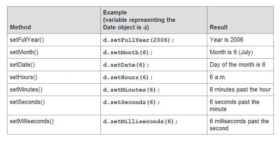
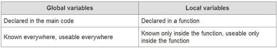
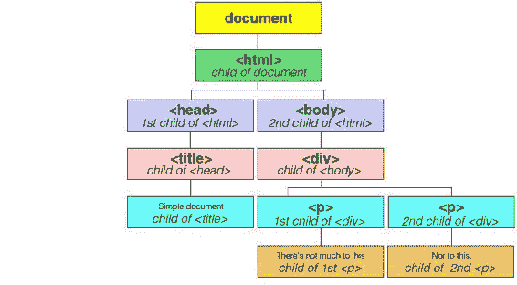
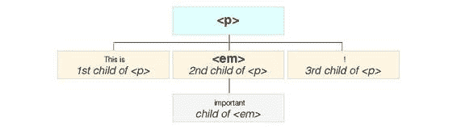
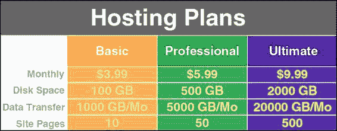
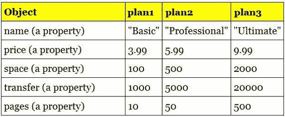
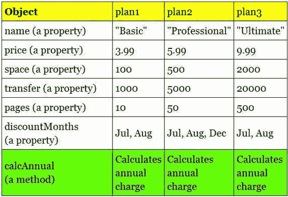
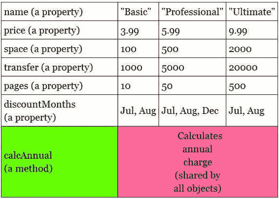
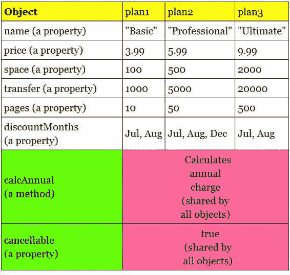
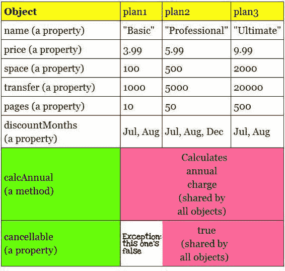

# JavaScript 智能学习法：事半功倍的新型技术辅助法

## 更聪明地学习 JavaScript

### 我如何提议利用技术将你的努力减半

当你开始学习像 `JavaScript` 这样复杂的内容时，你就要承担相当重的认知负担。如果让我猜测，我会说自学一门语言这个整体工程至少会消耗一大车脑葡萄糖。但你可能没有意识到的是：当你自学时，你的认知负荷会加倍。

是的，如果作者写得好，所有信息都在书里。但学习一门语言远不止阅读一些信息。你需要将信息牢记于心，这需要某种计划。你需要练习。你打算如何安排？当你偏离方向时，你需要某种方式来纠正自己。由于书籍并不是帮助你完成这些任务的最佳方式，大多数作者甚至不会尝试。这意味着所有为自己设计学习路径的工作都留给了你。而这种自学的元学习，这种如何掌握书中内容的挣扎，比学习本身还要费力。

传统上，现场讲师弥合了阅读和学习之间的鸿沟。如果你有时间并且负担得起，参加全面的课程或与导师一对一学习仍然是学习 `JavaScript` 的最佳方式。但是，既然很多人更喜欢自学，为什么不利用最新的技术作为替代老师呢？让书来阐述原理。然后使用交互式程序进行记忆、练习和纠正。当计算机参与进来时，你将用一半的努力，以两倍的速度学习。这是更聪明地学习 `JavaScript` 的方式。这也是更聪明地学习任何东西的方式。

既然我们拥抱新技术，为什么不利用我们能获得的所有技术来优化这本书呢？从教学角度来看，旧技术——即纸质书——有严重的局限性。新技术——即电子书——是更好的选择，原因有很多。以下是一些：

* **颜色是一种极好的信息工具。** 这就是为什么交通灯使用颜色的原因。但在纸上印刷颜色会使成本成倍增加。由于高昂的启动费用，在按需印刷的书中打印这一个词——颜色——就会使零售价增加三十美元。所以颜色通常被排除在外，否则这本书就会被定价为奢侈品。而对于电子书，颜色是免费的。

* **纸张本身很昂贵**，所以通常没有空间来容纳作者想做的所有事情。详细讨论细节？别想了。对难点的额外帮助？负担不起。数百个示例？最好删掉一些。但电子书没有这种限制。额外增加一百页数字内容要花多少钱？通常什么都不花。

* **传统出版很慢。** 当一本书以传统方式出版时，手稿可能需要长达一年的时间才能付印。这意味着没有时间对目标受众进行广泛测试，也没有时间进行测试必然建议的修订。而且一旦书印出来，发行修订版就是一件昂贵的大事。出版商会尽可能推迟。读者反馈通常需要数年才能带来改进。电子书可以在一天内从手稿变成书，留下大量时间进行测试和修订。出版后，基于读者反馈的改进版新版本可以按作者意愿随时推出，且无需成本。

有了这些优势，还有谁怀疑所有最好的教学书籍都将是电子书吗？还有谁会否认，作者能为你做的最有帮助的事情，除了以电子形式出版一本好书之外，就是承担整个教学任务，而不仅仅是部分任务，通过增加交互性来帮助你记忆、练习和纠正？

那么，以下是我提议如何利用当前技术帮助你用一半的时间、一半的努力学习 `JavaScript`：

* **认知分块控制。** 测试告诉我，在进行高强度学习时，即使是意志坚强的人也会比我预期的更快疲劳。你可能能够连续读两小时小说，但当你学习新的复杂内容时，情况就完全不同了。我的测试显示，学习新材料大约十分钟是极限，之后大多数学习者开始疲劳。但好消息是：即使你在学习十分钟后进入了疲劳区，你仍然有足够的脑力去练习长达三十分钟。设计得当的练习比学习花费更少的精力，却能教你更多。少读多练是学习最快的方式。

* **500 个编码示例**，涵盖了你所学内容的各个方面。示例使概念易于掌握，并将你的注意力集中在每章涵盖的关键材料上。代码中嵌入的颜色提示帮助你记住规则。我是不是做得过火，放了比你需要的更多的示例？好吧，如果对你来说简单了，就跳过一些。

* **在初学者身上测试过。** 本书包含多轮基于编程初学者反馈的修订。它包含额外的帮助讨论，以澄清在测试中被证明是绊脚石的概念。测试者中包括我的技术恐惧症妻子，她发现，在良好的指导下，她也能编程——并且惊讶地发现自己很喜欢。同样，我自己也有几个惊喜。一些对我来说简单的事情，对某些读者来说并不那么简单。于是进行了重写。

* **免费的交互式编码练习**，与每章配对——总共 1750 个。测试者说这是对他们帮助最大的功能。这并不意外。据《纽约时报》报道，心理学家已经证明，进行一次测试——比如写下你能记住的所有内容——比进一步学习更能加深对那段文字的记忆。”我敢说，在学习编程时，效果会加倍。阅读每章后，上网练习你学到的所有内容。每章末尾都有一个链接，指向其配套的在线练习。所有练习的索引可以在 `http://www.ASmarterWayToLearn.com/js/` 找到。

* **实时编码体验。** 在脚本编写中，最好的回报是看到你的代码完美运行。大多数练习环节包括实时编码练习，让你在浏览器中看到脚本执行。

### 如何使用本书

这本书和你以前拥有的任何书都不太一样，所以一份简短的使用说明可能会有所帮助。

## 学习指南

* **学习、练习，然后休息。** 如果想要掌握 `JavaScript` 的基础知识，而不仅仅是感受这门语言，请以 15 到 30 分钟为一个单元，配合本书和在线练习进行学习，然后休息一下。先花 5 到 10 分钟学习一个章节，然后立即前往[`www.ASmarterWayToLearn.com/js`](http://www.ASmarterWayToLearn.com/js) 在线编码 10 到 20 分钟，练习该课内容，直到你正确完成所有代码。之后去散散步。

* **使用最大、最色彩丰富的屏幕。** 本书可以在小手机屏幕和单色阅读器上阅读，但如果你能在更大的屏幕上看到彩色内容，体验会更好。我将颜色作为重要的教学工具，因此如果你在黑白模式下阅读，就会失去全彩电子书的一些额外教学价值。

* **保持代码格式。** 电子书的优势之一是你可以缩放字体大小。如果在小手机屏幕上阅读，代码可能会变得很混乱。为了确保代码的可读性，请尽可能在较大的屏幕上阅读。

* **使用分号。** 在 `JavaScript` 中，语句末尾的分号是可选的，但为了养成良好的习惯，建议在每个语句末尾加上分号。这可以避免在某些复杂情况下出现意外错误。

如果你有任何问题或疑问，请邮件至 `mark@ASmarterWayToLearn.com`。

## 1. 警告框

警告框是一个弹出窗口，用于用户显示消息。以下是代码：

```javascript
alert("Thanks for input!");
```

`alert` 是一个关键字，它的意思是在警告框中显示消息。注意 `alert` 是小写。如果你将其大写，脚本将停止。

括号 `()` 是 `JavaScript` 的特殊要求，括号内是参数。引号括起来的 `"Thanks for input!"` 被称为字符串。

由于 `JavaScript` 忽略括号内的空格（字符串除外），你可以写成：

```javascript
alert ( "Thanks for input!" );
```

但我希望你了解 JavaScript 的风格约定，所以我要求省略括号后的空格。在英语中，作者会在每个语句末尾加句号。在脚本中，作者会在每个语句末尾加分号。分号并非总是必需，但每个语句末尾加上分号比判断是否需要更容易。

有些开发者会写 `window.alert` 而不是简单的 `alert`。这是一种非常正式但完全正确的写法。大多数开发者喜欢简短形式。

在上面的例子中，有些开发者会使用单引号 `'` 而不是双引号 `"`。只要成对匹配，这是合法的。但在这种情况下，我要求你使用双引号。

## 2. 变量

变量是用于存储数据的容器。请注意，我选择将其命名为 `name`。我也可以叫它 `myName`、`xyz`、`lol` 或其他名字。在允许的范围内，如何命名变量完全由我决定。

将字符串 `"Mark"` 赋值给变量 `name`后，我的 JavaScript 代码就不必再指定 `"Mark"` 了。每当 `JavaScript` 遇到 `name` 时，它都会使用该值。

```javascript
var name = "Mark";
```

现在变量 `name` 指向文本字符串 `"Mark"`。

## 3. 字符串变量

记住以下事实：

* 我的名字是马克。
* 我的国籍是美国。

你已经记住了我的名字和国籍，我就不必再逐字重复。如果我对你说：“你可能认识和我同名的人”，你会知道我在指“马克”。

如果我问你我的国籍是否和你一样，我就不必问：“你的国籍和美国一样吗？”我会问：“你的国籍和我的国籍一样吗？”你会记得当我说“我的国籍”时，我指的是“美国”，你会将你的国籍与“美国”进行比较。

在这些例子中，“我的名字”和“我的国籍”这两个术语的工作方式与 `JavaScript` 变量相同。我的名字是一个指代特定值“马克”的术语。同样，变量是一个指代特定值的词。

当你写 `var`（表示变量）后跟着选择的名称时，就创建了一个变量。当你将值赋给它时，它就具有了特定的值。这是一个 `JavaScript` 语句，它创建了变量 `name` 并将值 `"Mark"` 赋给它。

```javascript
var name = "Mark";
```

```markdown

与字符串不同，数字不放在引号中。这样 `JavaScript` 就知道它是一个可以进行数学运算的数字，而不是像邮政编码那样作为文本处理的字符串。

但是，既然它没有放在引号中，`JavaScript` 怎么知道它不是变量呢？嗯，因为一个数字，或者任何以数字开头的字符组合，都不能用作变量名。如果是数字，`JavaScript` 会将其排除在变量之外。所以它一定是一个数字。

如果你把数字放在引号中，它就成了字符串。`JavaScript` 无法对它进行加法运算。它只能对没有放在引号中的数字进行加法运算。

现在看这段代码。

```javascript
var originalNum = 23;
var newNum = originalNum + 7;
```

在上面的代码的第二个语句中，当 `JavaScript` 遇到变量 `originalNum` 时，它会用数字 `23` 来替换。它将 `7` 加到 `23` 上。然后将结果 `30` 赋值给变量 `newNum`。

`JavaScript` 也可以处理完全由变量组成的表达式。例如...

```javascript
var originalNum = 23;
var numToBeAdded = 7;
var newNum = originalNum + numToBeAdded;
```

一个变量可以用于计算它自己的新值。

```javascript
var originalNum = 90;
originalNum = originalNum + 10;
```

如果你把数字放在引号中并加上 `7`...

```javascript
var originalNum = "23";
var newNum = originalNum + 7;
```

...这不会起作用，因为 `JavaScript` 不能对字符串和数字求和。`JavaScript` 将 `"23"` 解释为一个单词，而不是数字。在第二个语句中，它不会计算 `23 + 7` 得到 `30`。它会做一些可能让你惊讶的事情。我将在后续章节中告诉你这一点。现在，你只需要知道放在引号中的数字不是数字，而是字符串，`JavaScript` 无法对它进行加法运算。

请注意，任何一个特定的变量名都可以是数字变量或字符串变量的名称。从 `JavaScript` 的角度来看，名称中没有任何东西能表示它是哪种类型的变量。事实上，一个变量可以一开始是一种类型，然后变成另一种类型。

你注意到下面代码中的新内容了吗？

```javascript
var originalNumber = 23;
var newNumber = originalNumber + 7;
```

## 数学运算与变量

该语句将数学运算的结果赋值给变量 `newNumber`。当然，这个运算的结果是一个数值。

示例中，数学表达式混合使用了变量和字面量数字。但你也可以只使用数字或只使用变量。对 `JavaScript` 来说，这都一样。

我之前告诉过你，变量名不能以数字开头。下面的语句……

```javascript
var 1stPresident = "Washington";
```

……是非法的，因为变量名开头有一个“1”。

但变量名中可以包含数字，只要它们不在开头。下面的语句……

```javascript
var prezWhoCame1st = "Washington";
```

……是合法的。

方便的是，如果你在警告框中指定一个数字而不是字符串作为消息……

```javascript
alert(144);
```

……或者指定一个代表数字的变量作为警告消息……

```javascript
var caseQty = 144;
alert(caseQty);
```

……`JavaScript` 会自动将其转换为字符串并显示。

> 本章的交互式编程练习请访问：[`www.ASmarterWayToLearn.com/js/3.html`](http://www.ASmarterWayToLearn.com/javascript/3.html)

## 变量名的合法与非法

你已经学到了关于变量命名的三条规则：不能将其括在引号中；名称不能是数字或以数字开头；不能是 `JavaScript` 的任何关键字——那些作为编程指令的特殊词，比如 `alert` 和 `var`。

以下是其余规则：

* 变量名不能包含空格。
* 变量名只能包含字母、数字、美元符号和下划线。
* 虽然变量名不能是 `JavaScript` 的关键字，但可以包含关键字。例如，`userAlert` 和 `myVar` 是合法的。
* 大写字母没问题，但要小心。变量名区分大小写。`rose` 不是 `Rose`。如果你将字符串 `"Floribundas"` 赋值给变量 `rose`，然后向 `JavaScript` 请求 `Rose` 的值，你会得到空值。
* 我教授驼峰命名法。为什么叫“驼峰”？因为如果名称由多个单词组成，中间会有一个或两个（或三个）驼峰。驼峰名称以小写字母开头。如果名称中有多个单词，每个后续单词的首字母大写，形成一个驼峰。如果你只用一个单词构成变量名，比如 `response`，就没有驼峰。请采用驼峰命名法。它会让你的变量名更易读，并且你不太可能混淆变量名。

示例：

`userResponse`
`userResponseTime`
`userResponseTimeLimit`
`response`

* 让你的变量名具有描述性，这样当你或其他人三周或一年后回头再看代码时，更容易理解代码的含义。通常 `userName` 比 `x` 好，`faveBreed` 比 `favBrd` 好，尽管较短的名称完全合法。不过，你需要在可读性和简洁性之间取得平衡。`bestSupportingActressInADramaOrComedy` 是一个清晰的典范，但对大多数人来说可能太长，难以输入或阅读。我会缩短它。

> 本章的交互式编程练习请访问：[`www.ASmarterWayToLearn.com/js/4.html`](http://www.ASmarterWayToLearn.com/javascript/4.html)

## 数学表达式：熟悉的运算符

任何可以使用数字的地方，都可以使用数学表达式。例如，你熟悉下面语句。

```javascript
var popularNumber = 4;
```

但你也可以这样写。

```javascript
var popularNumber = 2 + 2;
```

还可以写：

```javascript
alert(2 + 2);
```

`JavaScript` 看到数学表达式时，总是会计算并返回结果。下面是一个从 12 中减去 24 的语句，将 -12 赋值给变量。

```javascript
var popularNumber = 12 - 24;
```

这个语句将 3 乘以 12 赋值给变量。`JavaScript` 看到结果结果是 16。

```javascript
var popularNumber = 3 * 12;
```

在这个语句中，10 被赋值给一个变量。然后该变量加 1，并将 10 赋值给第二个变量。和 JavaScript 一一直在使用的算术运算符 `+`、`-`、`*` 和 `/` 是你熟悉的。

```javascript
var num = 10;
var popularNumber = num + 1;
```

也可以只使用变量。

```javascript
var num = 10;
var anotherNum = 1;
var popularNumber = num + anotherNum;
```

`%` 是取模运算符。它不是返回一个除以另一个数的结果，而是返回除法后的余数。如果一个数能被另一个数整除，取模运算返回 0。在下面的语句中，0 被赋值给变量。

```javascript
var whatsLeftOver = 10 % 3;
```

> 本章的交互式编程练习请访问：[`www.ASmarterWayToLearn.com/js/5.html`](http://www.WayToLearn.com/javascript.html)

## 数学表达式：不熟悉的运算符

有几个专门的数学表达式你需要了解。这是第一个。

```javascript
num++;
```

这是下面写法的……

```javascript
num = num + 1;
```

它将变量递增 1。递减则使用减号而不是加号。

```javascript
num--;
```

你可以在赋值中使用这些表达式。但结果可能会惊讶。

```javascript
var num = 1;
var newNum = num++;
```

在上面的例子中，`num` 的原始值赋值给 `newNum`，然后 `num` 再递增。如果 `num` 在第一条语句中初始为 1，那么第二条语句将其提升为 2。`newNum` 得到原始值 1。

如果将加号放在变量前面，你会得到不同的结果。

```javascript
var num = 1;
var newNum = ++num;
```

在上面的语句中，`num` 和 `newNum` 的最终的值都是 2。如果将减号放在变量后面，新变量被赋予原始值，而第一个变量被递减。

```javascript
var num = 1;
var newNum = num--;
```

```  复杂的算术表达式可能会带来一个问题，你可能在高中代数中遇到过。看这个例子，告诉我 `totalCost` 的值是多少。

```javascript
var totalCost = 1 + 3 * 4;
```

`totalCost` 的值取决于你执行算术运算的顺序。如果你先加 1 + 3，然后将和乘以 4，`totalCost` 的值为 16。但如果你反过来，先乘 3 乘以 4，然后将乘积加 1，你会得到 13。

在 `JavaScript` 中，就像在代数中一样，歧义通过优先级规则消除。和代数一样，这里适用于规则是乘法运算在加法运算之前完成。所以 `totalCost` 的值为 13。

但你不必记住 `JavaScript` 复杂的优先级规则。你可以通过使用括号来消除歧义，从而巧妙地解决这个问题。括号会覆盖所有内置的优先级规则。它们强制 `JavaScript` 在完成任何其他运算之前，先完成括号内的运算。

当你使用括号向 `JavaScript` 明确你的意图时，这也使你的代码更容易理解，无论是对于其他程序员，还是对于一年后试图理解自己代码的你。在这个语句中，括号告诉 `JavaScript` 先乘 3 乘以 4，再加 1。结果：13。

```javascript
var totalCost = 1 + (3 * 4);
```

# 算术顺序与括号

如果移动括号，算术运算的顺序就会改变。在下面的语句中，括号的位置告诉 `JavaScript` 先计算 1 加 3，然后再乘以 4。结果是 16。

```javascript
var totalCost = (1 + 3) * 4;
```

```


> 本章的交互式编程练习请访问：[`www.ASmarterWayToLearn.com/js/9.html`](http://www.ASmarterWayToLearn.com/javascript/9.html)

## if 语句

假设你编写了一个提示框，询问“Where does the Pope live?”。如果用户回答正确，你会显示一个祝贺的警告框。

代码如下：

```javascript
var x = prompt("Where does the Pope live?");
if (x === "Vatican") {
   alert("Correct!");
}
```

如果用户在提示框中输入 `"Vatican"`，则会显示祝贺警告框。如果输入其他内容，则什么也不会发生。

### if 语句的分解

`if` 语句总是以 `if` 开头。`if` 与括号之间的空格是风格问题，但常见的风格规则允许这种与 `alert("Hi");` 不一致的写法。

在 `if` 关键字加空格之后，是正在测试的条件——即被赋予用户回答的变量是否等于 `"Vatican"`？条件被括在圆括号内。

如果条件测试为为，就会发生某些事情。在这个例子中，只执行一条语句：显示一个祝贺警告框。

`if` 语句的第一行以左花括号 `{` 结束。整个 `if` 语句以单独一行的右花括号 `}` 结束。注意，这是对“语句以分号结束”这一规则的例外。

关于三个等号 `===`：单个等号 `=` 用于给变量赋值。如果你要测试变量的值，不能使用单个等号。

如果你忘记这条规则，应该使用三等号，使用了单等号，代码将无法运行。正如所料，在示例中，你可以使用变量代替字符串。

```javascript
var correctAnswer = "Vatican";
if (x === correctAnswer) {
   alert("Correct!");
}
```

当条件满足时，你可以执行任意数量的语句。

```javascript
var correctAnswer = "Vatican";
if (x === correctAnswer) {
   score++;
   alert("Correct!");
}
```

有些程序员编写简单的 `if` 语句时不使用括号，这是合法的。有些人把左括号单独放在一行。有些人 `if` 语句很简单，就把整个 `if` 语句写在一行。我发现最省的方式按照示例中的方式统一化 `if` 语句。在练习中，我会要求你遵循这些规则来处理 `if` 语句。大多数情况下，双等号 `==` 和三等号 `===` 效果一样。不过两者在技术上有微差别，为了保持简单，我总是使用三等号。

> 本章的交互式编程练习访问：

> [`www.ASmarterWayToLearn.com/js/10.html`](http://www.ASmarterWayToLearn.com/javascript/10.html)

## 比较运算符

让我们多聊聊 `===`。它是一种比较运算符，具体来说相等运算符。正如你在上一章学的，你可以用它来比较事物是否相等。你可以用相等运算符比较变量与字符串、变量与数字、变量与数学表达式，或者变量与变量。还可以用它比较各种组合。以下都是 `if` 语句中合法的：

```javascript
if (x === "Mark") {
   alert("Correct");
}
if (x === "Vatican") {
   alert("Correct");
}
if (x === "Vatican") {
   alert("Correct");
}
if (x === "Vatican") {
   alert("Correct");
}
if (x === "Vatican") {
   alert("Correct");
}
if (x === y) {
   alert("Correct");
}
```

比较字符串时，相等运算符是区分大小写的。`"Rose"` 不等于 `"rose"`。另一个比较运算符 `!==` 是 `===` 的反义词。它表示“不等于”。

```javascript
if (x !== correctAnswer) {
   alert("Better luck time.");
}
```

与 `===` 一样，不等运算符可以比较数字、字符串、变量、数学表达式及其组合。与 `===` 一样，不等运算符进行字符串比较时也是区分大小写的。`"Rose" !== "rose"` 为真。以下是另外 4 个比较运算符，通常用于比较数字：

* `>` 大于
* `<` 小于
* `>=` 大于等于
* `<=` 小于等于

在下面的示例中，所有条件都真：

```javascript
if (1 > 0) {}
if (0 < 1) {}
if (1 >= 0) {}
if (1 >= 1) {}
if (0 <= 1) {}
if (1 <= 1) {}
```

正如双等号可以代替三等号一样，`!=` 通常可以代替 `!==`。在练习中，我会要求你坚持使用 `!==`。

> 本章的交互式编程练习访问：

> [`www.ASmarterWayToLearn.com/js/11.html`](http://www.ASmarterWayToLearn.com/javascript/11.html)

## if...else 和 else if 语句

到为止你编写的 `if` 语句都是非此即彼。如果条件测试为真，就会发生某些事情。如果条件测试为假，则什么发生。

```javascript
var x = prompt("Where does the Pope live?");
if (x === "Vatican") {
   alert("Correct!");
}
```

很多时候，你希望无论条件如何都能执行某些操作。例如：

```javascript
var x = prompt("Where does the Pope live?");
if (x === "Vatican") {
   alert("Correct!");
}
if (x !== "Vatican") {
   alert("Wrong answer");
}
```

在这个例子中，我们有两个 `if` 语句，一个测试 `"Vatican"`，另一个测试非 `"Vatican"`。这样所有情况都被覆盖了，根据用户输入的内容，会显示其中一个提示框。代码可以工作，但比必要的冗长。下面的代码更简洁，而且作为额外好处，可读性更强。

```javascript
if (x === "Vatican") {
   alert("Correct!");
} else {
   alert("Wrong answer");
}
```

在我遵循的样式约定中，`else`部分的格式与 `if` 部分完全相同。与 `if` 部分一样，`else` 部分中可以执行任意数量的语句。

```javascript
var correctAnswer = "Vatican";
if (x === correctAnswer) {
   alert("Correct!");
} else {
   alert("Wrong answer");
}
```

当上面的测试都失败，并且你想测试另一个条件时，使用 `else if`。

```javascript
var correctAnswer = "Vatican";
if (x === correctAnswer) {
   alert("Correct!");
} else if (x === "Vatican") {
   alert("Incorrect");
} else {
   alert("Incorrect");
}
```

在一系列 `if` 测试中，一旦某个条件为真，JavaScript 就会停止。

```javascript
var correctAnswer = "Vatican";
if (x === correctAnswer) {
   alert("Correct!");
} else if (x === "Vatican") {
   alert("Incorrect");
} else {
   alert("Incorrect");
}
```

## 测试组合

使用 `if` 语句，你已经学会测试一个条件。如果条件满足，就会执行一条语句。但假设成功需要两个条件，而不是一个。例如，如果体重超过 300 磅并且时间在 6 秒以内。代码如下：

```javascript
if (weight > 300 && time < 6) {
   alert("Tryout!");
}
```

你可以将任意数量的条件串起来。使用 `&&`。

```javascript
if (weight > 300 && time < 6) {
   alert("Tryout!");
}
```

也可以测试一组条件中的任意一个。这是 `||` 运算符。

```javascript
if (SAT > avg || GPA > 2.5) {
   alert("Welcome to Bubba State!");
}
```

如果第 1 行中任意一个或所有条件为真，则显示第一个提示框。如果所有条件都不真，则显示第二个框。你可以组合任意数量的“与”和“或”条件。当你这样做时，会产生歧义。以这一行为：

```javascript
if (age > 65 || age < 21 && res === "U.S.")
```

这有两种理解。

* 第一种理解：如果年龄超过 65 岁或小于 21，并且还是美国居民。在这种解释下，两列都需要通过。
* 第二种理解：如果年龄超过 65 岁且居住在任何地方，或者年龄小于 21 岁是美国居民。在这种解释下，任意一列为真即通过。

你在组合数学表达式时面临的问题相同。而解决方法一样：使用括号。

```javascript
if ((age > 65 || age < 21) && res === "U.S.")
```

在以下代码中，如果年龄超过 65 岁且居住在任何地方，则通过。或者年龄小于 21 岁且居住在美国，也通过。

```javascript
if (age > 65 || (age < 21 && res === "U.S."))
```

## If 语句嵌套

看看这段代码。

```javascript
if ((x === y || a === b) && c === d) {
   g = h;
} else {
   e = f;
}
```

在上面的代码中，如果前两个条件中的任意一个为真，并且第三条件也为真，将 `g` 赋值为 `h`。否则，将 `e` 赋值为 `f`。

另一种编码方式，使用嵌套。

```javascript
if (c === d) {
   if (x === y) {
      g = h;
   } else if (a === b) {
      g = h;
   } else {
      e = f;
   }
} else {
   e = f;
}
```

嵌套层级通过花括号的位置传达给 JavaScript。在顶层 `if` 内部嵌套了三个代码块。如果顶层 `if` 测试的条件——即 `c` 与 `d` 的值相等——为假，则不会执行任何嵌套的代码块。第 1 行的左花括号和第 11 行的右花括号括起了所有嵌套代码，告诉 JavaScript 内部所有内容都是第二层级。

为了可读性，较低层级比其上一级缩进 2 个空格。在本例所示的相对简单的测试和结果组合中，我更倾向于使用更简洁的多条件结构。但当情况变得非常复杂时，嵌套的 `if` 语句是一个好方法。

> 本章的交互式编程练习访问：

> [`www.ASmarterWayToLearn.com/js/14.html`](http://www.ASmarterWayToLearn.com/javascript/14.html)

## 数组

让我们给一些变量赋值字符串。

```javascript
var city0 = "Atlanta";
var city1 = "Baltimore";
var city2 = "Chicago";
var city3 = "Denver";
var city4 = "Los Angeles";
var city5 = "Seattle";
```

变量名都相同，只是末尾的数字不同。如果我想的话，也可以把变量命名为...

### 数组：添加和删除元素

假设数组 `pets` 已经声明。下面是如何给它赋值：

```javascript
var pets = [];
```


content]
```javascript
1 pets[0] = "dog";
2 pets[1] = "cat";
3 pets[2] = "bird";
```

在上面的例子中，我按顺序定义了数组的前三个元素。但如果你愿意，也可以合法地在数组中留下空隙（尽管通常你不会这样做）。例如，假设你从同一个空数组开始，并编写以下代码行：

```javascript
1 pets[3] = "lizard";
2 pets[6] = "snake";
```

现在，如果你引用 `pets[3]`，你会得到 "lizard"。如果你引用 `pets[6]`，你会得到 "snake"。但如果你引用 `pets[0]` 到 `pets[2]` 或 `pets[4]` 或 `pets[5]`，你会得到 `undefined`。

你可以给已有值的数组添加更多值。假设数组 `pets` 的前三个元素是 "dog"、"cat" 和 "bird"。然后你编写以下代码：

```javascript
1 pets[3] = "lizard";
2 pets[4] = "fish";
3 pets[5] = "gerbil";
4 pets[6] = "snake";
```

现在数组有 7 个元素："dog"、"cat"、"bird"、"lizard"、"fish"、"gerbil" 和 "snake"。如果你给已有值的数组赋新值，旧值会被替换。使用关键字 `pop()`，你可以移除最后一个元素。假设你有一个数组 `pets`，其元素为 "dog"、"cat" 和 "bird"。以下代码删除最后一个元素，留下两个元素的数组。

```javascript
pets.pop();
```

使用关键字 `push()`，你可以在数组末尾添加多个元素。假设你有同样的数组，包含 "dog"、"cat" 和 "bird"。以下代码在数组末尾添加两个元素。

```javascript
pets.push("fish", "ferret");
```

> 本章的交互式编程练习请访问：[`www.ASmarterWayToLearn.com/js/16.html`](...javascript/16.html)

### 数组：移除、插入和提取

使用 `shift()` 方法从开头移除一个元素。假设你有一个数组 `pets`，其元素为 "dog"、"cat" 和 "bird"。以下代码移除第一个元素 "dog"，留下两个元素的数组。

```javascript
pets.shift();
```

要在数组开头添加多个元素，使用 `unshift()` 方法。以下代码在开头添加两个元素。

```javascript
pets.unshift("fish", "ferret");
```

## 数组操作：splice 和 slice

使用 `splice` 方法可以在任意位置插入多个元素，同时删除其后的多个元素。假设你有一个元素 "dog"、"cat"、"fly"、"bug"、"ox" 的数组。以下代码在 "cat" 之后添加 "pig"、"duck"，同时删除 "fly" 和 "bug"。

```javascript
pets.splice(2, 2, "pig", "duck");
```

括号内的第一个数字是你要开始（如果要添加）或删除（如果要删除）的位置索引。第二个数字是要删除的现有数量。从插入的元素开始，上面的代码会得到由 "dog"、"cat"、"pig"、"duck" 和 "ox" 组成的数组。你也可以只添加而不删除元素。以下代码添加 "pig"、"duck" 和 "emu"，但不删除任何元素。

```javascript
pets.splice(2, 0, "pig", "emu");
```

你也可以只删除元素而不添加。如果你从元素 "dog"、"cat"、"fly"、"bug" 和 "ox" 开始，以下代码从索引 3 开始删除两个元素--"bug" 和 "ox"。这样剩下 "dog"、"cat" 和 "fly"。

```javascript
pets.splice(2, 2);
```

使用 `slice` 方法可以复制任意位置的一个多个连续元素，并将它们放入新数组。如果你从一个包含 "dog"、"cat"、"fly"、"bug" 和 "ox" 的数组 `pets` 开始，以下代码将 "fly" 和 "bug" 复制到新数组 `noPets` 中，并保持原数组 `pets` 不变。

```javascript
var noPets = pets.slice(2, 4);
```

括号内的第一个数字是要复制第一个元素的索引。第二个数字是要复制最后一个元素的之后的索引。有两件事可能会让你困惑：

* 由于括号内的第一个索引指定了要复制的第一个元素，你可能会认为第二个索引指定了要复制的最后一个元素。实际上，第二个数字指定的是要复制的最后一个元素之后的索引。
* 你必须将切片后的元素赋值给一个数组。当然，这个数组可以是切片的原数组。在这种情况下，你会将原数组缩减为仅包含被的元素。

> 本章的交互式编程练习请访问：[`www.ASmarterWayToLearn.com/js/17.html`](...javascript/17.html)

## For 循环

你知道《墙上有99瓶啤酒》这首歌吗？如果你要教别人唱这首歌，你可以给出这样的指令：

1. 唱“墙上有 99 瓶啤酒，99 瓶啤酒。”
2. 唱“拿下一瓶传一圈，墙上有 98 瓶啤酒。”
3. 唱“墙上有 98 瓶啤酒，98 瓶啤酒。”
4. 唱“拿下一瓶传一圈，墙上有 97 瓶啤酒。”
5. 唱“墙上有 97 瓶啤酒，97 瓶啤酒。”
6. 唱“拿下一瓶传一圈，墙上有 96 瓶啤酒。”
……以此类推，还有 192 行指令。

但这不是你给出指令的方式，对吧？你会更简洁。你会这样说：唱“墙上有 99 瓶啤酒，99 瓶啤酒。拿下一瓶传一圈，墙上有 98 瓶啤酒。”重复此过程，每次减 1，直到墙上没有啤酒瓶为止。

在编程中，你经常会遇到类似啤酒瓶的情况。例如，假设你主动提出要检查用户所在的城市是美国最干净的 5 个城市之一。用户输入了她的城市，你将她的城市赋值给变量 `cityToCheck`。

你已经将最干净的 5 个城市的列表赋值给了数组 `cleanestCities`。

```javascript
var cleanestCities = ["Cheyenne", "Santa Fe", "Tucson", "Great Falls", "Honolulu"];
```

现在你遍历数组，看看城市是否匹配。如果匹配，显示一个警告框，告诉用户她的城市是最干净的。如果没有匹配，显示一个警告框，告诉用户不在列表中。

```javascript
if (cityToCheck === cleanestCities[0]) {
    alert("It's one of the cleanest cities");
} else if (cityToCheck === cleanestCities[1]) {
    alert("It's one of the cleanest cities");
} else if (cityToCheck === cleanestCities[2]) {
    alert("It's one of the cleanest cities");
} else if (cityToCheck === cleanestCities[3]) {
    alert("It's one of the cleanest cities");
} else if (cityToCheck === cleanestCities[4]) {
    alert("It's one of the cleanest cities");
} else {
    alert("It's not on the list");
}
```

方便的是，JavaScript 提供了一种更简洁的编码方式。下面是一个 `for` 循环，它完成了上面的功能。

```javascript
for (var i = 0; i <= 4; i++) {
    if (cityToCheck === cleanestCities[i]) {
        alert("It's one of the cleanest cities");
    }
}
```

让我为你分解。第一行以 `for` 关键字开头，定义循环的规范位于括号内：

1. 声明一个变量用于计数次数，同时也作为数组索引，设置为起始值，本例中为 `0`。
2. 定义循环的限制。本例中只要计数器不超过 `4`，循环就继续。由于本例中计数器从 0 开始，循环运行 5 次。
3. 每次循环结束时计数器如何变化。本例中每次递增。

括号内的三个规范按顺序排列：

1. 计数器的名称（通常为 `i`）以及起始值（通常为 `0`）。
2. 循环运行的次数（本例中为元素的数量）。
3. 每次迭代后如何改变（通常加 1）。

需要记住事项：

* 在示例中，计数器 `i` 有两个作用：它跟踪迭代次数，以便循环在正确的位置停止；同时作为数组索引，使得代码可以在每次迭代递增时遍历所有元素。
* 使用 `i` 作为计数器并非不可。你可以使用任何合法的变量名。但程序员通常使用 `i`，因为它使代码保持紧凑，并且程序员理解 `i` 代表“迭代”。
* 在示例中，初始计数为 `0`，即数组第一个索引。但根据需求，它可以是任何数字。
* 在示例中，计数器每次迭代递增。但根据需求，你可以递减、每次增加 2 或其他方式改变它。
* 在示例中，我指定循环在 `i <= 4` 时运行。或者我可以指定 `i < 5`。无论哪种方式，由于计数器从 0 开始，循环运行 5 次。

> 本章的交互式编程练习访问：[`www.ASmarterWayToLearn.com/js/18.html`](...javascript/18.html)

## For 循环：标志、布尔值、数组长度和循环中断

上一章中给出的 `for` 循环示例存在几个问题。第一个问题是潜在的通信问题。如果用户所在城市与最干净列表匹配，会显示一个确认警告框。但如果没有匹配，则什么也不会发生。用户会被蒙在鼓里。如果没有匹配，我们需要显示一个警告框。但该怎么做呢？

我们使用一个标志（flag）来实现。标志只是一个变量，你给它一个默认值，然后在特定条件下将其切换为另一个值。在我们的示例中，假设标志如下：

```javascript
var matchFound = "no";
```

如果找到匹配项，标志的值就会改变。最后，如果标志没有改变——即它保持原始的“no”值——就意味着没有匹配项，因此我们会弹出一个提示，说明该城市不在列表中。

```javascript
var matchFound = "no";
for (var i = 0; i <= 4; i++) {
  if (cityToCheck === cleanestCities[i]) {
    matchFound = "yes";
    alert("It's one of the cleanest cities");
  }
}
if (matchFound === "no") {
  alert("It's not on the list");
}
```

这种方法可行，但与其给标志赋值为字符串 "no" 和 "yes"，更常规的做法是使用布尔值 `false` 和 `true`。

```javascript
var matchFound = false;
for (var i = 0; i <= 4; i++) {
  if (cityToCheck === cleanestCities[i]) {
    matchFound = true;
    alert("It's one of the cleanest cities");
  }
}
if (matchFound === false) {
  alert("It's not on the list");
}
```

布尔值只有两个：`true` 和 `false`。注意它们不需要用引号括起来。

我们示例中的另一个问题是它可能浪费计算周期。假设在第二次循环时找到了匹配项并显示了提示。按照循环的编码方式，循环会一直进行到结束。既然我们在第二次循环时已经得到了答案，这就没有必要。

```javascript
var matchFound = false;
for (var i = 0; i <= 4; i++) {
  if (cityToCheck === cleanestCities[i]) {
    matchFound = true;
    break;
  }
}
```


一种方法是扩展 `cleanestCities` 数组，使其包含所有城市名称的小写版本：

`var cleanestCities = ["Cheyenne", "cheyenne", "Santa Fe", "santa fe", "Tucson", "tucson", "Great Falls", "great falls", "Honolulu", "honolulu"];`

这种方法在一定程度上可行，但需要大量额外的编码。此外，如果用户输入`santa Fe``Santa fe`或`sAnta Fe`，我们又回到了最初的问题。要涵盖所有这些可能性以及其他情况，需要编写一英里长的代码。

解决方案是将数组元素编码为小写，并将用户的输入（无论是什么）转换为小写，这样我们就能始终用苹果来比较苹果。

```javascript
var cityToCheck = prompt("Enter your city");
cityToCheck = cityToCheck.toLowerCase();
var cleanestCities = ["cheyenne", "santa fe", "tucson", "great falls", "honolulu"];
for (var i = 0; i <= 4; i++) {
  if (cityToCheck === cleanestCities[i]) {
    alert("It's one of the cleanest cities");
  }
}
```

第 2 行是这里的新内容：

`cityToCheck = cityToCheck.toLowerCase();`

转换后的字符串被赋值给一个变量。在这个例子中，它正是被转换字符串的同一个变量 `cityToCheck`。注意关键字 `toLowerCase` 必须使用驼峰式大小写。

还要注意，`toLowerCase()` 方法会将字符串中的所有字符转换为小写，而不仅仅是首字母。例如，“ChEyEnNe”会变成`cheyenne`。

你也可以反过来，将所有内容转换为大写，然后与`CHEYENNE``SANTA FE`等进行比对。大多数程序员更喜欢小写方法。要将字符串转换为大写，你可以这样写：

`cityToCheck = cityToCheck.toUpperCase();`

> 本章的交互式编程练习请访问：

> [`www.ASmarterWayToLearn.com/js/21.html`](http://www.ASmarterWayToLearn.com/javascript/21.html)

## 字符串：测量长度和提取部分

你让用户提供一个城市名称。你想将她提供的名称转换为首字母大写的名称。无论她输入的是`boston``BOSTON`还是`bosTon`，你都希望将输入标准化为`Boston`。你在上一章学到的`toLowerCase()`和`toUpperCase()`方法无法单独完成这项工作，因为它们会对字符串中的每个字符进行相同的全局更改。但是，如果你将字符串分成两段，就可以使用这些方法将字符串调整为你想要的形状。（目前，我忽略城市名称可能由两个或更多单词组成的情况，例如 New Orleans 或 Sault Ste. Marie。）

# 字符串：查找片段

要复制字符串的一部分，可以使用`slice`方法。假设用户输入了一个字符串，并且该字符串已赋值给变量 `cityToCheck`。以下代码复制字符串的第一个字符，并将其赋值给变量 `firstChar`。`cityToCheck`的原始值不会改变。如果`cityToCheck`是`Boston`，那么`firstChar`就是`B`。

```javascript
var firstChar = cityToCheck.slice(0, 1);
```

### 需要注意的事项：

* 字符串的索引方式与数组类似。不同之处在于，每个索引号指向的不是元素，而是一个字符。

* 与数组索引一样，字符串索引也从 0 开始。

* 在`slice`方法中，括号内的第一个数字是切片中第一个字符的索引。然而，第二个数字并不是切片中的最后一个字符，而是切片之后的第一个字符。如果用第二个索引减去第一个索引，你总是能得到切片的长度。

下面是另一个例子。

```javascript
var someChars = cityToCheck.slice(2, 5);
```

再次假设字符串是`Boston`。切片从索引 2（第三个）字符`s`开始，到索引 5 字符之前的那个字符`n`结束。`someChars`的值是`sto`。

如果省略括号内的第二个数字，JavaScript会包含从起始位置到字符串末尾的所有字符。

```javascript
var someChars = cityToCheck.slice(2);
```

切片从索引 2（第三个）字符`s`开始。由于没有指定结束位置，切片会一直取到字符串的最后一个字符。`someChars`的值是`ston`。

现在我们有一种方法可以将字符串的第一个字符大写，并确保其余字母为小写。

```javascript
var firstChar = cityToCheck.slice(0, 1);
var otherChars = cityToCheck.slice(1);
firstChar = firstChar.toUpperCase();
otherChars = otherChars.toLowerCase();
var cappedCity = firstChar + otherChars;
```

以上代码逐行执行的操作如下：

1. 复制字符串的第一个字符，并将其赋值给变量 `firstChar`。
2. 复制从第二个字符到末尾的所有字符，并将其赋值给变量 `otherChars`。
3. 将第一个字符转换为大写。
4. 将其他字符转换为小写。
5. 将两部分拼接起来，重新组成完整的字符串。

有时，知道字符串中有多少个字符是很有用的。例如，假设你想从任何长度超过三个字符的字符串中截取前三个字符，比如从`November`中截取`Nov`。要查找字符串中的字符数，可以使用你已经学过的用于查找数组中元素数量的相同语法。

```javascript
var month = prompt("Enter a month");
var charsInMonth = month.length;
if (charsInMonth > 3) {
  monthAbbrev = month.slice(0, 3);
}
```

第 2 行统计字符串中的字符数，并将该数字赋值给变量 `charsInMonth`。

能够测量字符串中的字符数会很有用。例如，假设你想遍历一个字符串，检查其中是否有双空格。你可以将字符数用作循环限制器。以下代码检查字符串中是否有双空格，如果发现则显示一个警告。

```javascript
var str = prompt("Enter some text");
var numChars = str.length;
for (var i = 0; i < numChars; i++) {
  if (str.slice(i, i + 2) === "  ") {
    alert("No double spaces!");
    break;
  }
}
```

第 2 行统计字符串中的字符数，并将该数字赋值给变量 `numChars`。在第 3 行中，这个数字被用作循环限制器。循环仅在计数器 `i` 小于字符串中字符数时继续运行。（记住，长度是基于 1 的，而计数器是基于 0 的，因此循环必须在长度数减 1 的位置停止。）第 4 行逐个字符地遍历字符串，检查每个由两个字符组成的片段，寻找双空格。

> 本章的交互式编程练习请访问：[`www.ASmarterWayToLearn.com/js/22.html`](http://www.ASmarterWayToLearn.com/javascript/22.html)

## 查找片段

《纽约客》杂志不允许使用短语`World War II"。他们认为应该用`the Second World War`。那么，让我们在下面的句子中搜索被禁止的字符，并将其替换为《纽约客》偏爱的短语。

| 令人惊讶的是，即使在第二次世界大战最黑暗的深处，J. R. R. 托尔金仍在撰写那部三部曲，其中包含（只有诗歌和神话才具有的奇特适用性）这样一个基本概念：善良的灰袍巫师能够理解邪恶的魔法师，恰恰是因为他与他们足够相似，能够以他们无法理解他的方式理解他们的思想和动机。 |

你已经知道一种查找并替换被禁止片段的方法。假设上面的段落已赋值给变量 `text`。

```javascript
for (var i = 0; i < text.length; i++) {
  if (text.slice(i, i + 12) === "World War II") {
    text = text.slice(0, i) + "the Second World War" + text.slice(i + 12);
  }
}
```

代码遍历字符串，查找`World War II`。第 2 行逐个字符地遍历字符串，检查每个由 12 个字符组成的序列。如果找到`World War II`，第 3 行将三个片段拼接起来：所有在`World War II` 之前的字符、替换短语`the Second World War`，以及所有在`World War II` 之后的字符。

但 JavaScript 有一种更高效的方法来实现这一点，即使用`indexOf`方法。

```javascript
var firstChar = text.indexOf("World War II");
```

如果该片段存在，该方法会找到该片段第一个字符的索引，并将其赋值给变量 `firstChar`。如果该片段不存在，该方法会将 `-1` 赋值给该变量，这样你就知道它不存在。

现在我们可以用更少的代码将禁止短语替换为首选短语。

```javascript
var firstChar = text.indexOf("World War II");
if (firstChar != -1) {
  text = text.slice(0, firstChar) + "the Second World War" + text.slice(firstChar + 12);
}
```
*(注：原文处代码逻辑不全，此处根据描述补全了替换逻辑，以保持语义一致)*


`floor` 将 `.999999` 向下取整为 `0`，`1.9` 向下取整为 `1`，`-.000001` 向下取整为 `-1`，以此类推。

> 本章的交互式编程练习请访问：

> [`www.ASmarterWayToLearn.com/js/26.html`](http://www.ASmarterWayToLearn.com/javascript/26.html)

## 生成随机数

假设你想模拟掷骰子。在模拟中，你希望随机出现 1、2、3、4、5 或 6。第一步是让 JavaScript 生成一个随机数。（嗯，它几乎是随机的，技术上称为伪随机，但对于大多数用途来说已经足够接近随机了。）

以下代码生成一个伪随机数，有 16 位小数，范围从 `0.0000000000000000` 到 `0.9999999999999999`，并将其赋值给变量 `randomNumber`。

```javascript
var randomNumber = Math.random();
```

该函数总是返回一个 16 位小数，范围从 `0.0000000000000000` 到 `0.9999999999999999`。我们可以通过乘以一亿亿（1 后面跟 17 个零）来将小数转换为整数：

* `0.0000000000000000 * 100000000000000000 = 0`
* `0.7474887706339359 * 100000000000000000 = 7474887706339359`
* `0.9999999999999999 * 100000000000000000 = 9999999999999999`

数万亿个可能的数字对于我们的虚拟掷骰子来说太多了。我们只需要 6 个可能的数字，即 1 到 6。因此，我们的第一步不是乘以一亿亿，而是将这个巨大的小数乘以 6。

* `0.0000000000000000 * 6 = 0`
* `0.7474887706339359 * 6 = 4.7474887706339359`
* `0.9999999999999999 * 6 = 5.9999999999999994`

直觉可能会告诉你，可以通过取整来完成，但数学上这行不通。因为没有任何数能向上取整为 `0`，也没有任何数能向下取整为 `6`，而中间的数字（既可以通过向上取整也可以通过向下取整得到）出现的频率几乎会是其他数字的两倍。但如果我们先将结果加 1，然后向下取整，就可以让所有数字有均等的机会。以下是我们的虚拟掷骰子的代码。

```javascript
var bigDecimal = Math.random();
var improvedNum = (bigDecimal * 6) + 1;
var numberOfStars = Math.floor(improvedNum);
```

以上代码逐行执行的操作如下：

1. 生成一个 16 位小数，并赋值给变量 `bigDecimal`。
2. 将 16 位小数转换为范围从 `0.0000000000000000` 到 `5.9999999999999999` 的数字，然后加 1，因此范围变为 `1.0000000000000000` 到 `6.9999999999999999`。该数字赋值给变量 `improvedNum`。
3. 将 `improvedNum` 表示的值向下取整到最接近的整数，范围从 1 到 6。

> 本章的交互式编程练习请访问：

> [`www.ASmarterWayToLearn.com/js/27.html`](http://www.ASmarterWayToLearn.com/javascript/27.html)

## 将字符串转换为整数和小数

有时 JavaScript 似乎能读懂你的心思。例如，假设你写...

```javascript
var currentAge = prompt("请输入你的年龄。");
```

...JavaScript 将用户的回答作为字符串赋值给 `currentAge`。用户输入的内容，比如 32，对你来说可能看起来像数字，但对 JavaScript 来说它是一个字符串：`"32"`。

尽管如此，假设你写...

```javascript
var currentAge = prompt("请输入你的年龄。");
var yearsEligibleToVote = currentAge - 18;
```

在上面的代码中，赋给变量 `currentAge` 的值是一个字符串，因为它来自用户的提示响应。但在第 2 行，当该变量出现在算术表达式中时，该值会自动（且临时）转换为数字，以使数学运算生效。

类似地，如果你让 JavaScript 将 `"100"` 除以 2 或将 `"2.5"` 乘以 2.5，JavaScript 似乎理解你希望将字符串视为数字，并执行数学运算。你甚至可以让 JavaScript 仅使用字符串作为操作数进行乘法、除法或减法，而 JavaScript 会正确理解你的意图并完成计算。

```javascript
var profit = "200" - "150";
```

在上面的语句中，两个字符串被视为数字，因为它们出现在数学表达式中。变量 `profit` 尽管有引号，但被赋值为数字 50。

不言而喻，你让 JavaScript 进行数学运算的字符串必须是引号内的数字，例如 `"50"`，而不能是字母字符。如果你写...

```javascript
var profit = "200" - "duck";
```

...则会显示一个警告，显示 `"NaN"`，意思是 "不是一个数字"。这没什么好奇怪的。200 减去 `"duck"` 怎么可能是一个数字呢？

你可能还记得前一章的内容：当你在涉及加号的表达式中混合字符串和数字时，JavaScript 会做出与上面示例相反的操作。JavaScript 不会将字符串转换为数字，而是将数字转换为字符串。它不会进行加法，而是进行拼接。

```javascript
var result = "200" + 150;
```

在上面的语句中，字符串 `"200"` 和数字 `150` 拼接，得到 `"200150"`。变量 `result` 赋值为字符串 `"200150"`。

如果 `+` 是其他算术运算符（`-`、`*` 或 `/`），JavaScript 会将字符串 `"200"` 转换为数字 200 并进行运算。你可以看到以下代码：

```javascript
var currentAge = prompt("Enter your age.");
var qualifyingAge = currentAge + 1;
```

上面的代码有一个想不到的后果。`currentAge` 表示的字符串与 `1` 拼接在一起。例如：如果输入 `"52"`，`qualifyingAge` 被赋值不是 53，而是 `"521"`。如果你想进行加法，必须将字符串转换为数字。

```javascript
var currentAge = prompt("Enter your age.");
var qualifyingAge = parseInt(currentAge) + 1;
```

第 2 行将 `currentAge` 表示的字符串转换为数字，然后加 1，并将赋给 `qualifyingAge`。`parseInt` 将所有字符串（包括浮点数）转换为整数。但令人震惊的是：它不会进行四舍入，它简单地截断小数。

```javascript
var myInteger = parseInt("1.999");
```

`myInteger` 被赋值为 1，而不是你期望的 2。要保留任何数值，请使用 `parseFloat`。

```javascript
var myFraction = parseFloat("1.999");
```

`myFraction` 被赋值为 1.999。为了尽量混淆，程序员有时更喜欢显式转换，即使 JavaScript 并不这样做。例如在乘法运算中混合字符串和数字。

> 本章交互式编码练习请访问：

> [`www.ASmarterWayToLearn.com/js/28.html`](http://www.ASmarterWayToLearn.com/javascript/28.html)

## 29 将字符串转换为数字，数字转换为字符串

上一章中，你学会了使用 `parseInt` 将字符串转换为整数。学会了 `parseFloat` 将字符串转换为浮点数。你可以通过 `Number` 来巧妙地处理整数和浮点数之间的区别。

以下代码将字符串 `"24"` 转换为数字 24。

```javascript
var integerString = "24";
var num = Number(integerString);
```

以下代码将字符串 `"24.9876"` 转换为数字 24.9876。

```javascript
var floatingString = "24.9876";
var num = Number(floatingString);
```

假设你的代码进行了一算术计算，得到了很大的数字。现在你想将结果呈现给用户。但在显示数字之前，你想格式化它使其可读。为此，你必须将数字转换为字符串。使用 `toString()` 方法很简单。

```javascript
var numberAsNumber = 1234;
var numberAsString = numberAsNumber.toString();
```

上面的代码将数字 1234 转换为字符串 `"1234"`，并将其赋给 `numberAsString`。

> 本章交互式编码练习请访问：

> [`www.ASmarterWayToLearn.com/js/29.html`](http://www.ASmarterWayToLearn.com/javascript/29.html)

## 30 控制小数位数

商品的价格是 $9.95。销售税是 6.5%。你将这两个数字相加得到总额。

```javascript
var total = price + (price * taxRate);
```

`total` 现在的值为 10.5975。但这并不是你要向客户收取的金额，对吧？你要向客户收取四舍入到两位小数的金额。

```javascript
var prettyTotal = total.toFixed(2);
```

上面的语句将 `total` 表示的数字四舍入到 2 位小数，并将结果赋给 `prettyTotal`。括号内的数字告诉 JavaScript 要将小数四舍入到多少位。

```javascript
var currencyTotal = "$" + prettyTotal;
```

要将数字缩短到没有小数，将括号留空。

```javascript
var prettyTotal = total.toFixed();
```

不幸的是，`toFixed` 方法有一个意外之处。如果小数以 5 结尾，它通常会像你期望的那样向上舍入。但是，根据浏览器的不同，有时它会向下舍入！例如，如果你对 1.555 应用该方法，指定 2 位小数，它可能会给出 `"1.56"`。也可能产生 `"1.55"`。

有一些复杂的方法可以解决这个问题。这里有一个不太优雅的修复方法，使用了你已经知道的方法的方法。

```javascript
var str = num.toString();
if (str.charAt(str.length - 1) === "5") {
  str = str.slice(0, str.length - 1) + "6";
}
num = Number(str);
prettyNum = num.toFixed(2);
```

如果小数以 5 结尾，代码会将其改为 6，从而强制该方法在应该向上舍入时向上舍入。以下是逐行解释：

1. 将数字转换为字符串并赋给变量 `str`。
2. 检查最后一个字符是否为 `"5"`。
3. 如果是，则截掉 `"5"` 并追加 `"6"`。
4. 将其转换回数字。
5. 将其四舍入到 2 位小数。

> 本章交互式编码练习请访问：

> [`www.ASmarterWayToLearn.com/js/30.html`](http://www.ASmarterWayToLearn.com/javascript/30.html)

## 31 获取当前日期和时间

你的网页包含一条通知，告知用户其所在时区的当前本地日期和时间。但当前的日期和时间是什么？以下是 JavaScript 如何获取的。

```javascript
var rightNow = new Date();
```

上面的 `rightNow` 对象包含了当前的日期和时间。你可以使用 `Date` 的各种方法来提取其中的特定部分，例如获取年份、月份、日期、小时、分钟和秒等。


```
2 var doomsday = new Date("June 30, 2035");
```

注意日期的指定方式。它被引号括起来。月份是拼写出来的。日期后面有逗号。年份用四位数字表示。

接着，从两个日期中提取自 1970 年 1 月 1 日参考日期以来经过的毫秒数。

```
3 var msToday = today.getTime();
4 var msDoomsday = doomsday.getTime();
```

计算差值。

```
5 var msDiff = msDoomsday - msToday;
```

通过简单的数学运算将毫秒转换为天数。

```
6 var dDiff = msDiff / (1000 * 60 * 60 * 24);
```

括号内的数学运算产生的大数字将毫秒转换为秒（1000）、分钟（60）、小时（60）和天（24）。

你需要一个表示整天的数字，因此向下取整。以下语句将天数（很可能是浮点数）向下取整为整数。

```
7 dDiff = Math.floor(dDiff);
```

以下是整个代码，压缩成更像生产代码的形式：

```
1 var msDiff = new Date("June 30, 2035").getTime() - new Date().getTime();
2 var daysTillDoom = Math.floor(msDiff / (1000 * 60 * 60 * 24));
```

第 1 行将当前时刻自参考日期以来的毫秒数从 2035 年 6 月 30 日自参考日期以来的毫秒数中减去。第 2 行将毫秒转换为天数并向下取整。

如果时间也很重要，你也可以指定时间。

```
var d = new Date("July 21, 1983 13:25:00");
```

注意指定时间的形式：日期后面没有逗号。使用 24 小时制。小时、分钟、秒之间用冒号分隔。

> 本章的交互式编程练习请访问：

> [`www.ASmarterWayToLearn.com/js/33.html`](http://www.ASmarterWayToLearn.com/javascript/33.html)

## 34 更改日期和时间的元素

你可以更改 `Date` 对象的各个元素。以下是总结：



`setFullYear` 设置现有 `Date` 对象的年份，而不更改其他任何元素。

```
1 var d = new Date();
2 d.setFullYear(2001);
```

第 1 行为当前时刻创建一个新的 `Date` 对象。第 2 行将 `Date` 对象的年份更改为 2001，保持 `Date` 对象的所有其他元素不变。

`setMonth` 设置现有 `Date` 对象的月份，而不更改其他任何元素。

```
1 var d = new Date();
2 d.setMonth(11);
```

第 1 行为当前时刻创建一个新的 `Date` 对象。第 2 行将 `Date` 对象的月份更改为 11（十二月），保持 `Date` 对象的所有其他元素不变。

`setDate` 设置现有 `Date` 对象的当月日期，而不更改其他任何元素。

```
1 var d = new Date();
2 d.setDate(15);
```

第 1 行为当前时刻创建一个新的 `Date` 对象。第 2 行将 `Date` 对象的日期更改为当月 15 日，保持 `Date` 对象的所有其他元素不变。

`setHours` 设置现有 `Date` 对象的小时数，而不更改其他任何元素。

```
1 var d = new Date();
2 d.setHours(13);
```

第 1 行为当前时刻创建一个新的 `Date` 对象。第 2 行将 `Date` 对象的小时数更改为 13 时（下午 1 点），保持 `Date` 对象的所有其他元素不变。

`setMinutes` 设置现有 `Date` 对象的分钟数，而不更改其他任何元素。

```
1 var d = new Date();
2 d.setMinutes(05);
```

第 1 行为当前时刻创建一个新的 `Date` 对象。第 2 行将 `Date` 对象的分钟数更改为 5 分，保持 `Date` 对象的所有其他元素不变。

`setSeconds` 设置现有 `Date` 对象的秒数，而不更改其他任何元素。

```
1 var d = new Date();
2 d.setSeconds(55);
```

第 1 行为当前时刻创建一个新的 `Date` 对象。第 2 行将 `Date` 对象的秒数更改为 55 秒，保持 `Date` 对象的所有其他元素不变。

`setMilliseconds` 设置现有 `Date` 对象的毫秒数，而不更改其他任何元素。

```
1 var d = new Date();
2 d.setMilliseconds(867);
```

第 1 行创建一个新的`Date`对象，表示当前时刻。

第 2 行将 `Date` 对象的毫秒数改为秒后的 867 毫秒，同时保持`Date` 对象的其他元素不变。

> 查找本章的交互式编程练习，请访问：

> [`www.ASmarterWayToLearn.com/js/34.html`](http://www.ASmarterWayToLearn.com/javascript/34.html)

# 函数

函数是一段 JavaScript 代码块，每当调用它的名称时，它会自动重复执行相同的操作。它节省了重复编码的工作，并使代码更易于理解。

在你的网站上，假设有几个页面需要显示一个提示框。简单起见，我们使用 24 小时制，而不是上午和下午。代码可能所示：

```javascript
1 var now = new Date();
2 var theHr = now.getHours();
3 var theMin = now.getMinutes();
4 alert("time: " + theHr + ":" + theMin);
```

你可以在每次需要时反复编写这段代码。或者，你可以将其为一个函数，并给它命名，比如 `tellTime`。之后只需执行代码块：

`tellTime()`

每当 JavaScript 看到这个语句时，代码块就会执行。

```javascript
1 function tellTime() {
2   var now = new Date();
3   var theHr = now.getHours();
4   var theMin = now.getMinutes();
5   alert("Current time: " + theHr + ":" + theMin);
6 }
```

时间显示代码——即创建 `Date` 对象、提取时间、格式化并显示提示框——与开始完全一样，但现在封装成了函数。以下是部分：

1. 第 1 行是一个语句，包含：
   - 关键字 `function`
   - 函数的名称
   - 用于包裹执行代码的左括号
2. 第 2 至 5 行是相同的代码块，但为了清晰进行了缩进。
3. 第 6 行是单独的右括号，用于包裹执行代码。

再次注意调用代码——即调用函数——只需写出名称及其括号：`tellTime()`

你可以为函数指定任何合法的变量名，然后加上括号。函数命名遵循变量相同的规则。技术上讲，函数也是一种变量。

> 查找本章的交互式编程练习，请访问：

> [`www.ASmarterWayToLearn.com/js/35.html`](http://www.ASmarterWayToLearn.com/javascript/35.html)

## 函数：传递数据

函数是一段代码块，每当调用其名称时，它会自动执行某些操作。例如，当你编写 `greetUser()` 时，一个同名的函数就会执行。假设当你编写 `greetUser()` 时，函数显示一个提示框，内容为“Hello, there.”

这是该函数的代码：

```javascript
1 function greetUser() {
2   alert("Hello, there.");
3 }
```

函数的一个实用的特性是，调用代码中的括号不必为空。如果你在括号内放入数据，就可以将这些数据传递给函数，并在函数执行时使用。假设不写 `greetUser()`，而是写... `greetUser("Hello, there.");`

现在你不仅调用了函数，还向它传递了数据。括号内的字符串，即你传递的数据，被称为参数 `argument`。现在函数更加灵活了，因为它显示的消息不再硬编码在函数内部。它将显示通过调用代码中的参数传递它的任何消息。

为了使函数成为可编程的机器人，而不是只能做单一工作的机器人，你需要设置它来接收传递的数据。以下是实现方法：

```javascript
1 function greetUser(greeting) {
2   alert(greeting);
}
```

现在我们填充了调用代码和函数定义的括号。括号内包含一个参数 `argument`。示例中，参数是字符串 "Hello, there."。如上面的示例所示，函数定义的括号内包含一个变量 `greeting`。

函数语句括号内的变量被称为参数 `parameter`。参数名称由你决定。你可以给它任何合法的变量名。然后你可以在函数体中使用它来完成某些操作。在上面的示例中，第 2 行用它来指定 `alert` 中的消息。

当变量在函数定义中用作参数时，无需声明它。用作参数时，声明是隐式的。

调用函数语句中的参数 `argument` —— "Hello, there." 是传递给函数的数据。函数定义括号内的参数 `parameter` 捕获传递的数据。现在它持有 "Hello, there."。换句话说，函数调用中指定的字符串 "Hello, there" 被赋值给函数中的 `greeting`。然后该变量 `greeting` 被用于指定 `alert` 语句中的消息。

传递给函数的值在函数体中被用来完成某些操作。在这个例子中，该值用于指定 alert 中的消息。

在示例中，参数是一个字符串，但它也可以是一个变量。在下面的代码中，我声明了变量 `greeting` 并赋值为 "Hello, there."。然后我没有在函数调用中使用字符串本身作为参数，而是使用了变量。

```javascript
1 var greeting = "Hello, there.";
2 greetUser(greeting);
```

在上面的示例中，函数名 `greetUser` 与参数名 `greeting` 部分相同，但这只是为了便于理解代码。函数名和参数名不必有任何共同之处。请记住，只要遵循变量命名规则，这些名称由你决定。示例中，我将调用代码中的参数命名为 `greeting`，并将定义中的参数命名为 `greeting`。但这并不是必须。无论参数 `argument` 是什么，都会被参数 `parameter` 接受。

```javascript
1 function greetUser(greeting) {
2   alert(greeting);
}
```

以下是调用语句，使用 `whatever`：

```javascript
1 var whatever = "Hello, there.";
2 greetUser(whatever);
```

参数 `argument` 和参数 `parameter` 的名称是可以匹配的。尽管如此，为了清晰见，通常让参数 `argument` 和参数 `parameter` 同名是有意义的。

## 函数：传递参数与返回数据

函数可以接受任意数量的参数99999999999999999999999999999999999999999999999999999999999999999999999999999999999999999999999999999999999999999999999999999999999999999999999999999999999999999999999999999999999999999999999999999999999999999999999999999999999999999999999999999999999999999999999999999999999999999999999999999999999999999999999999999999999999999999999999999999999999999999999999999999999999999999999999999999999999999999999999999999999999999999999999999999999999999999999999999999999999999999999999999999999999999999999999999999999999999999999999999999999999999999999999999999999999999999999999999999999999999999999999999999999999999999999999999999999999999999999999999999999999999999999999999999999999999999999999999999999999999999999999999999999999999999999999999999999999999999999999999999999999999999999999999999999999999999999999999999999999999999999999999999999999999999999999999999999999999999999999999999999999999999999999999999999999999999999999999999999999999999999999999999999999999999999999999999999999999999999999999999999999999999999999999999999999999999999999999999999999999999999999999999999999999999999999999999999999999999999999999999999999999999999999999999999999999999999999999999999999999999999999999999999999999999999999999999999999999999999999999999999999999999999999999999999999999999999999999999999999999999999999999999999999999999999999999999999999999999999999999999999999999999999999999999999999999999999999999999999999999999999999999999999999999999999999999999999999999999999999999999999999999999999999999999999999999999999999999999999999999999999999999999999999999999999999999999999999999999999999999999999999999999999999999999999999999999999999999999999999999999999999999999999999999999999999999999999999999999999999999999999999999999999999999999999999999999999999999999999999999999999999999999999999999999999999999999999999999999999999999999999999999999999999999999999999999999999999999999999999999999999999999999999999999999999999999999999999999999999999999999999999999999999999999999999999999999999999999999999999999999999999999999999999999999999999999999999999999999999999999999999999999999999999999999999999999999999999999999999999999999999999999999999999999999999999999999999999999999999999999999999999999999999999999999999999999999999999999999999999999999999999999999999999999999999999999999999999999999999999999999999999999999999999999999999999999999999999999999999999999999999999999999999999999999999999999999999999999999999999999999999999999999999999999999999999999999999999999999999999999999999999999999999999999999999999999999999999999999999999999999999999999999999999999999999999999999999999999999999999999999999999999999999999999999999999999999999999999999999999999999999999999999999999999999999999999999999999999999999999999999999999999999999999999999999999999999999999999999999999999999999999999999999999999999999999999999999999999999999999999999999999999999999999999999999999999999999999999999999999999999999999999999999999999999999999999999999999999999999999999999999999999999999999999999999999999999999999999999999999999999999999999999999999999999999999999999999999999999999999999999999999999999999999999999999

```javascript
var totalToCharge = merchTotal;
```
```

你可能习惯于看到算术表达式或其他表达式赋值给变量……

```javascript
var totalToCharge = merchTotal + ship + tax;
```

但是将函数赋值给变量？嗯，其实并不奇怪，因为请记住，你实际赋值给变量的是函数代码中 `return` 语句返回的值。语句 `var totalToCharge = calcTot(79.99);` 是以下操作的简写：“将函数 `calcTot` 返回的值赋值给变量 `totalToCharge`。”

因此，现在调用代码和函数之间有了双向通信。调用代码将值 `79.99` 传递给函数，该值被函数的参数 `merchTot` 接收。这个变量 `merchTot` 在函数体中被用来计算订单总额。然后，通过 `return` 语句，该订单总额被传递回调用代码中的 `totalToCharge`。这是一个完整的循环。

请注意，调用代码中接收值的变量 `totalToCharge` 与函数内部返回值的变量 `merchTot` 不同。我特意这样做，是为了让你不会认为这两个变量必须共享相同的名称。这同样适用于从函数返回的变量和调用代码中接收它的变量。它们可以共享相同的名称，但并非必须如此。

### 将函数用作表达式

任何可以使用变量的地方，都可以使用函数。（从技术上讲，函数是一种变量。）例如：

你可以使用函数来指定警告消息中的内容。

```javascript
alert(calcTot(79.99));
```

在上面的示例中，警告消息是函数 `calcTot` 在传入参数 `79.99` 时返回的值。

你可以在表达式中使用函数。

```javascript
var orderTot = merchTot + calcTax(merchTot);
```

在上面的示例中，赋值给 `orderTot` 的值是 `merchTot` 与函数 `calcTax` 在传入参数 `merchTot` 时返回的值之和。

你可以在函数调用中使用函数。

```javascript
var tot = calc(merchTot, calcTax(merchTot));
```

在上面的示例中，调用代码向函数 `calc` 传递了两个参数。第一个参数是 `merchTot`。第二个参数是函数 `calcTax`，它也接收 `merchTot` 作为参数。

在函数内部，你可以调用另一个函数。

```javascript
function calcTot(price) {
  return price + calcShip(price);
}
```

在上面的示例中，函数 `calcTot` 调用了函数 `calcShip`。它将 `price` 作为参数传递，并接收回运费。它将运费加到价格上，并将总和作为总额返回给原始调用代码。

你已经了解到，你可以向任意数量的参数传递任意数量的参数。不幸的是，在 `return` 语句中你没有这种灵活性。无论函数接收多少个参数或执行多少处理，它只能向调用它的代码返回一个值。

> 本章的交互式编程练习请访问：

> [`www.ASmarterWayToLearn.com/js/37.html`](http://www.ASmarterWayToLearn.com/javascript/37.html)

## 函数：局部变量与全局变量

现在我们来讨论变量作用域的问题，也就是全局变量与局部变量的区别。有些变量具有全局作用域，因此被称为全局变量；另一些变量具有局部作用域，因此被称为局部变量。这再简单不过了，但不知为何，当这个话题出现在书籍或教程中时，往往会被搞得晦涩难懂。放轻松，这其实很容易理解。

全局变量是在代码主体中声明的变量——也就是说，不在函数内部。

局部变量是在函数内部声明的变量。它可以是函数的参数（通过作为参数被隐式声明），也可以是在函数中使用 `var` 关键字显式声明的变量。

全局变量之所以是全局的，是因为它在代码的每个部分都有意义，无论这段代码是在主体中还是在任何函数中。全局作用域就像全球知名度一样——无论你走到世界哪个角落，人们都听说过比尔·克林顿。

局部变量则只在其声明的函数内部有意义。局部作用域就像地方知名度——德卢斯市长在德卢斯广为人知，但在其他地方几乎无人知晓。

因此，全局变量和局部变量有两个区别：它们声明的位置，以及它们被知晓和可被使用的位置。



在我展示第一个例子之前，我希望你暂时放下通过参数向函数传递值、以及通过 `return` 语句将值返回给调用代码的知识。假装你对这些一无所知。我稍后会再回到这些话题。下面是一个例子。

首先，在主代码中，声明一个变量并调用一个函数：

```javascript
1 var theSum
2 addNumbers();
```

然后是函数：

```javascript
1 function addNumbers() {
2   theSum = 2 + 2;
3 }
```

在这个例子中，变量 `theSum` 在主代码中声明。函数 `addNumbers()` 被调用来为其赋值。由于该变量在主代码中声明，它具有全局作用域，因此这个函数或任何其他函数都可以使用它。主代码中的任何部分也都可以使用它。函数将 `2 + 2` 的和赋给这个全局变量。由于变量具有全局作用域，这个赋值在代码的所有部分（主代码和所有函数）中都有意义。现在，无论在函数 `addNumbers()` 中、主代码中，还是在任何其他使用它的函数中，该变量的值都是 `4`。无论我在哪里写：

`alert(theSum);`

无论我把它写在哪里——主代码中、函数 `addNumbers()` 中，还是任何其他函数中——都会弹出一个显示数字 `4` 的警告框。

但是，如果我不在主代码中声明变量，而是在函数内部声明……

```javascript
1 function addNumbers() {
2   var theSum = 2 + 2;
3 }
```

……那么该变量只在函数内部具有值 `4`。在其他任何地方，它都是未知的。在其他任何地方，它根本没有值。由于变量 `theSum` 在函数内部使用关键字 `var` 声明，而不是在主代码中，因此它的作用域是局部的。它只在函数内部有意义。在其他函数和主代码中，它是未知的。如果我写：

`alert(theSum);`

……在函数内部，会弹出一个显示数字 `4` 的警告框，因为变量 `theSum` 在其声明的函数内部是已知的。但如果我在其他地方——主代码或另一个函数中——写同样的 alert 语句，代码就会出错，因为 `theSum` 在函数外部是未知的。

**注意：** 我说当你在函数中声明变量时，该变量具有局部作用域。这里的“在函数中声明”是指你使用关键字 `var` 显式声明变量——而不是随意地在函数中引入一个没有 `var` 的变量。（例外情况是，如果你将其命名为参数，那么它会被隐式声明为函数的局部变量。）如果你变得马虎，开始在函数体中使用一个新变量，却没有在函数中用关键字 `var` 显式声明它，那么它就是全局变量——即使你在主代码中任何地方都没有声明它。

现在，为了说明一个问题，我要做一件你在实际编码中绝不会想做的事。我将在主代码和函数中都声明一个变量。

首先，在主代码中：

```javascript
1 var theSum = 1000;
2 addNumbers();
```

然后在函数中：

```javascript
1 function addNumbers() {
2   var theSum = 2 + 2;
3 }
```

通过两次声明变量——一次在主代码中，一次在函数中——我创建了两个同名但不同的变量。一个 `theSum` 是全局的，另一个 `theSum` 是局部的。这绝不是你想做的事——它会让你犯编码错误，并使代码几乎无法理解——但我这样做是为了展示全局作用域和局部作用域。通过主代码中声明一次 `theSum`，再在函数中声明一次，我创建了（1）一个几乎随处用的全局变量，以及（2）一个同名的、仅在函数内部用的局部变量。为什么我说全局变量随处可用？因为它在函数内部无效。在函数内部，名称 `theSum` 代表局部变量，因此该名称不能引用全局变量。在这种情况下全局变量被遮蔽了。在函数内部只能看到局部变量局部变量 `theSum` 在函数内部的值是 `4`，但函数外部的 `theSum` 的值是 `1000`。

现在，让我们继续深入这个境。

首先，主代码中的一条语句：

```javascript
1 var theSum = addNumbers();
```

然后是一个函数：

```javascript
1 function addNumbers() {
2   var theSum = 2 + 2;
3   return theSum;
4 }
```

同样，这不是你实际编写的代码。仅用这个例子演示原理。在这段代码中，你仍然有两个不同的变量——一个全局变量和一个局部变量——它们共享同一个名称 `theSum`，但现在借助 `return` 语句，局部变量的值赋给了全局变量。这引出了可能想问的问题：如果函数可以使用全局变量，为什么还需要通过参数将值传递给函数？为什么不直接在函数中声明一个全局变量然后让函数使用它？嗯，你可以这样做，但要求函数使用全局变量会导致混乱和意想不到的后果。最好的做法是在函数内部使用局部变量，然后通过 `return` 语句显式将值传递回去。

访问练习如下：`www.ASmarterWayToLearn.com/js/38.html`

## switch 语句：如何开始

考虑下面这一串语句。

```javascript
if (dayOfWeek === "Sat" || dayOfWeek === "Sun") {
  alert("Whoopee!");
} else if (dayOfWeek === "Fri") {
  alert("TGIF!");
} else {
  alert("Shoot me now!");
}
```

## 39 switch 语句

如果是周末，会弹出“Whoopee！”提示。如果是周五，会弹出“TGIF”提示。如果是工作日，会弹出“Shoot me now”提示。这段代码能工作，但笨拙且略陋，尤其你有许多条件需要测试时。现在学习一种更优雅的替代方案，用于众多条件，那就是 `switch` 语句。下面的 `switch` 语句实现了上面示例的功能：

```javascript
switch (dayOfWeek) {
  case "Sat":
    alert("Whoopee");
    break;
  case "Sun":
    alert("Whoopee");
    break;
  case "Fri":
    alert("TGIF");
    break;
  default:
    alert("Shoot me now!");
}
```

现在，我希望你只关注上面的前三行：

1. 以关键字 `switch` 开头，接着是圆括号内被测试的变量。
2. 第一种可能性：`dayOfWeek` 的值为 "Sat"。以关键字 `case` 开头然后是 "Sat"。接着一个空格和一个冒号。
3. 如果测试通过——即 `dayOfWeek` 确实等于 "Sat"——执行该语句缩进。

访问练习如下：`www.ASmarterWayToLearn.com/js/39.html`

## 40 switch 语句：如何完善它们

上一章关注了 `switch` 语句的前三行。

```javascript
switch (dayOfWeek) {
  case "Sat":
    alert("Whoopee");
    break;
  case "Sun":
    alert("Whoopee");
    break;
  case "Fri":
    alert("TGIF");
    break;
  default:
    alert("Shoot me now!");
}
```

本章将处理剩余的代码。`if` 语句的第一行后面跟着（或多个）在条件为真时执行的语句。`switch` 语句的工作类似。在每个 `case` 子句的下一行，有一个（或多个）在该 `case` 为真时执行的语句。同样，如果 `case` 为真，执行的代码缩进 2 个空格。（通用约定是缩进一定量。关于最佳缩进意见不一。我统一使用 2 空格缩进，这很常见并非通用。）

但为什么除了最后一个 `case` 之外，所有 `case` 都包含一个 `break` 语句？JavaScript 有一个不方便的特性：当找到真 `case` 后，JavaScript 不仅会执行该 `case` 下方的语句，还会执行其下方所有 `case` 的语句。因此，在找到真 `case` 并执行条件代码后，你需要编写 `break` 语句跳出 `switch` 块。例如，如果你省略了上面代码中的 `break` 语句，会发生以下情况：

1. 弹出一个提示框显示 "Whoopee!"
2. 第二个提示框显示 "Whoopee!"
3. 第三个提示框显示 "TGIF!"
4. 第四个提示框显示 "Shoot me now。"

现在让我们看第 11 行。

```javascript
default:
  alert("Shoot me now!");
```

关键字 `default` 的作用类似于 `if...else` 语句中的 `else`。如果上面的条件都不满足，则执行其后的代码。因此，在上面的例子中如果 `dayOfWeek` 不是 "Sat"、Sun" 或 "Fri"—即它不等于这三个值中的任何一个——就会弹出一个提示框显示 "Shoot me now。"

注意 `default` 后面跟一个空格和一个冒号，就像上面的 `case` 子句一样。还要注意没有 `break` 语句。因为 `default` 总是在最后，这意味着它下面没有需要不当执行的语句。

在 `switch` 语句中，`default` 代码是可选的，就像 `if` 语句后的 `else` 代码是可选的。如果没有 `default` 代码，且所有 `case` 都不为真，则什么也不会发生。当没有 `default` 代码时，细心的程序员会在最后一个条件后仍然加上 `break` 语句作为保险，即使它是多余的。如果你以后决定在末尾添加一个新条件，就不必记得为上面的块添加 `break` 以避免灾难性的级联语句。

访问练习如下：`www.ASmarterWayToLearn.com/js/40.html`

## 41 while 循环

这个 `for` 循环在每次迭代时显示一个提示框。

```javascript
for (var i = 0; i <= 3; i++) {
  alert(i);
}
```

如你所知，该过程由圆括号内的三个项控制：

* `i = 0` 建立计数器。
* `i <= 3` 表示 `i` 小于或等于 3，循环就继续。
* `i++` 在每次迭代时递增 `i`。

`while` 循环做同样的事情，但组织方式不同。只有中间项（循环持续多久）放在圆括号内。计数器在 `while` 块的第一行之前定义。计数器在循环运行时的代码中更新。

```javascript
var i = 0;
while (i <= 3) {
  alert(i);
  i++;
}
```

在其他方面，`while` 循环的组织方式与 `for` 循环类似：

* 圆括号括住循环限制条件。
* 花括号括住要执行的代码。
* 执行的代码缩进 2 个空格。

由于任何 `for` 循环都可以转换为 `while` 循环，反之亦然，你可以使用你喜欢的任何一种。

## 42 do...while 循环

在 `while` 循环中，指令的顺序是：

1. 一个变量作为计数器，并为其赋值。
2. 开始循环，指定循环运行多长时间。
3. 执行一个或多个语句。
4. 在循环内部，作为最后一个语句，递增计数器。

```javascript
var i = 0;
while (i <= 3) {
  alert(i);
  i++;
}
```

`do...while` 循环完成与 `while` 循环几乎相同的任务。

```javascript
var i = 0;
do {
  alert(i);
  i++;
} while (i <= 3);
```

两种循环之间的区别：

* 关键字 `do` 代替 `while` 作为语句的开头。

<|channel>thought
<channel|>
*   `while` 子句（包括圆括号内的循环限制代码）移到了底部——在右花括号之后。

注意 `while` 子句以分号结尾。

在功能上，`while` 循环和 `do...while` 循环的区别在于，可以编写一个 `while` 语句，其指令块永远不会执行。考虑这个 `while` 循环。

```javascript
var i = 0;
while (i < 0) {
  alert(i);
  i++;
}
```

代码表示只要计数器小于 0，就持续显示提示框。但由于计数器从未小于 0，花括号内的代码永远不会执行。

将其与 `do...while` 循环进行比较。

```javascript
var i = 0;
do {
  alert(i);
  i++;
} while (i < 0);
```

提示框会显示一次，即使继续运行的条件——`i` 小于 0——从未发生。由于 `do...while` 循环在到达底部的循环限制条件之前就执行了花括号内的代码，因此无论循环限制条件如何，它至少会执行一次该代码。

> 本章的交互式编程练习请访问：

> [`www.ASmarterWayToLearn.com/js/42.html`](http://www.ASmarterWayToLearn.com/javascript/42.html)

## 43 放置脚本

JavaScript 代码并不在意它位于何处。它可以混入——即嵌入——创建网页的 HTML 中。或者，像外部 CSS 文件一样，它可以放在一个由 HTML 文件加载的独立文件中。大多数情况下，最好使用外部 JavaScript 文件，原因与最好使用外部 CSS 文件类似。但你仍然需要知道如何将 JavaScript 放置在 HTML 文件中，所以我们先从这一点开始。

如你所知，HTML 代码的顺序很重要，因为它决定了页面上元素的顺序。如果你希望标题出现在文本上方，你就在 HTML 中将标题放在文本上方。但 JavaScript 的工作方式不同。例如，你所有的 JavaScript 函数在页面加载时都会被加载到内存中。无论代码位于何处，浏览器都会在页面加载完成时找到并存储它们。一旦页面加载完成，所有 JavaScript 代码都会保留在内存中，随时准备执行，只要页面还在显示。

你可以合法地将 JavaScript 代码放在 HTML 文件中的几乎任何位置——在 head 部分、body 部分的开头、body 部分的中间某处，或者 body 部分的末尾。如果你愿意，甚至可以将不同的 JavaScript 函数分散在 HTML 文件的不同位置。浏览器会自行整理。

不过，通常脚本的最佳位置是在 body 部分的末尾。这可以确保 CSS 样式和图片显示不会因为脚本加载而延迟。

当你将 JavaScript 代码块嵌入 HTML 中（而不是使用独立的 JavaScript 文件）时，必须将 JavaScript 代码放在 `<script>` 和 `</script>` 标签之间。以下是两个放在标签之间的函数。

```
<script>
function sayHi() {
  alert("Hello world!");
}
function sayBye() {
  alert("Buh-bye!");
}
</script>
```

你可以在 `<script>` 和 `</script>` 标签之间放置任意数量的代码——包括任意数量的函数。而且，正如我之前提到的，如果你愿意，可以将不同的代码段分散在 HTML 文件中的各个位置。浏览器会自行整理。

大多数情况下，程序员更倾向于将所有 JavaScript 代码放在独立的 JavaScript 文件中，然后让浏览器在加载 文件的同时加载这个。JavaScript 文件与 HTML 和 CSS 文件一样，是一个纯文本文件。它没有头部或特殊部分，没有 `<script>` 和 `</script>` 标签。它纯粹是 JavaScript 代码。上述函数的全部内容是：

```javascript
function sayHi() {
  alert("Hello world!");
}
function sayBye() {
  alert("Buh-bye!");
}
```

使文件成为 JavaScript 文件的是它的扩展名：`.js`。文件主体部分由你决定，以下都可以：

*   `scripts.js`
*   `core.js`
*   `main-code.js`
*   `main_code.js`
*   `code.js`

将 JavaScript 文件包含到 HTML 文件中的方式与包含外部文件相同——使用开始标签和一个结束标签。`<script src="whatever.js"></script>`

出于将 JavaScript 代码放在 body 部分末尾的原因，最好。你可以包含任意数量的 JavaScript 文件。你可以同时包含 JavaScript 文件并在 HTML 中嵌入其他代码。

> 本章的交互式编程练习请访问：

> [`www.ASmarterWayToLearn.com/js/43.html`](http://www.ASmarterWayToLearn.com/javascript/43.html)

## 44 注释

从使用 HTML 和 CSS 的经验可知，注释是一种告诉浏览器忽略代码中某些文本的方式。注释是为了人类而非服务的。它们能帮助你在修改代码时理解。还可以使用注释来临时屏蔽部分代码，以便测试和调试。由于与 HTML 或 CSS 相比，JavaScript 在回顾时通常难理解，可能需要更多精力添加注释，尤其是在团队合作的情况下。

在 HTML 中，只有一种方式将文本标记为注释：使用`<!--`开头，`-->`结尾。在 CSS 中，只有一种方式：使用`/*`开头，`*/`结尾。但在 JavaScript 中，有两种方式将文本标记为注释。第一种方式是将行标记为注释，如下：

```javascript
// 这是一注释，浏览器会忽略它
for (var i = 0; i < animals.length; i++) {
  if (animals[i] === "bat") {
    animals[i] = "cat";
  }
}
```

两个斜杠表示：“从这到行尾的所有内容都是注释。”在上面的例子中，由于斜杠位于行首，因此整行都是注释。但你也可以写一行既有代码又有注释，像这样：

`var animals = []; // 声明一个空数组`

你可以写任意多行的注释。每一行都必须以两个斜杠开头。

```
// 每一行注释都以一对
// 斜杠开头，就像这样。（顺便提一下，大多数代码编辑器
// 足够智能，能够识别
// 注释以不同颜色显示，方便你
// 与代码区分开来。）
```

当你使用斜杠注释时，没有结束标签，因为行尾会自动结束。为了可读性，请在两个斜杠与注释之间加空格。当你在同一行中混合代码和注释时，请在代码与两个斜杠之间加空格。

当注释需要多行时，许多程序员喜欢另一种方法。作为 CSS 用户，你已经熟悉这些标签了。

```
/*
当注释需要多行时，像这样的块注释注释带有开始
和结束标签，是更好的选择。
*/
```

JavaScript 的多行注释与 CSS 注释相同。以`/*`开头，以`*/`结尾。

> 本章的交互式编程练习请访问：

> [`www.ASmarterWayToLearn.com/js/44.html`](http://www.ASmarterWayToLearn.com/javascript/44.html)

## 45 事件：链接

一个好的网站是一个响应式的网站。用户做了一些操作——点击按钮、移动鼠标、按下按键——然后某些事情发生了。JavaScript 提供了多种方式来响应用户的需求。举几个例子：

*   用户点击一个写着“我们的承诺”的按钮，然后弹出一个提示框，详细说明承诺内容。
*   页面显示一张模特的“之前”照片。当用户将鼠标悬停在照片上时，它会被替换为她的“之后”照片。
*   用户在表单的“盎司”字段中输入一个数字。当她点击“克”字段时，会显示对应的克数。
*   用户已在表单中输入了她的电子邮件地址，正准备输入评论。当她将光标从电子邮件字段移动到评论字段时，JavaScript 会检查电子邮件地址是否有效。在这个例子中，它无效——她省略了地址末尾的“.com”。一条消息显示，告知她输入了无效的电子邮件地址。
*   在一个在线购物网站上，有一张黑色手表的图片。旁边有一个下拉列表，要求用户选择颜色。当她选择时，图片中手表的颜色会变为所选颜色。

所有这些用户操作——点击按钮、移动鼠标、在表单中从一个字段移动到另一个字段、选择不同的选项——都被称为事件。响应事件的 JavaScript 代码——例如，当指针悬停在图片上时显示承诺或交换图片——被称为事件处理程序。

## 46 事件：按钮

在上一章中，你学习了如何利用链接，使其在被点击时触发事件，而不是加载新页面。你学习了使用内联事件处理，这不是最佳方式，但最容易学习。在本书的后续部分，你将学习大多数人士偏好的方法——脚本方式。

但即使你使用内联方法，当你想用户提供可点击的内容时，通常更专业的方法是使用按钮而不是链接。假设当用户点击一个按钮时，会显示一个警告框，内容为“Hello world!”。代码如下：

```html
<input type="button" value="Click" onClick="alert('Hello world!');">
```

无论你编写的是链接还是按钮，事件处理程序都是一样的：`onClick="alert('Hello world!');"` 但代码的开头不同：`<input type="button" value="Click"`

一些专业人士可能会认为按钮代码应该包含在表单标签中，但这并非绝对必要。而且，既然我们已经通过使用内联事件程序违反了最佳实践，为什么不通过多次违规来让专业人士震惊呢？（你将在本书的后续部分学习更体面的替代内联事件程序的方法。）

作为 HTML 编码人员，你知道可以将图像用作热链接。标记看起来像这样：

```html
<a href="summary-page.html"></a>
```

你也可以使用图像来触发事件。假设当用户点击图像时，会弹出一个警告框。代码如下。请注意，内联事件处理程序的代码与之前相同。

```html

```

或者

```html

```

> 本章的交互式编程练习请访问：

> [`www.ASmarterWayToLearn.com/js/46.html`](http://www.ASmarterWayToLearn.com/javascript/46.html)

## 47 事件：鼠标

在上一章中，你学习了如何利用链接，使其在被点击时触发事件，而不是加载新页面。你学习了使用内联事件处理，这不是最佳方式，但最容易学习。在本书的后续部分，你将学习大多数人士偏好的方法——脚本方式。

但即使你使用内联方法，当你想用户提供可点击的内容时，通常更专业的方法是使用按钮而不是链接。假设当用户点击一个按钮时，会显示一个警告框，内容为“Hello world!”。代码如下：

```html
<input type="button" value="Click" onClick="alert('Hello world!');">
```

无论你编写的是链接还是按钮，事件处理程序都是一样的：`onClick="alert('Hello world!');"` 但代码的开头不同：`<input type="button" value="Click"`

一些专业人士可能会认为按钮代码应该包含在表单标签中，但这并非绝对必要。而且，既然我们已经通过使用内联事件程序违反了最佳实践，为什么不通过多次违规来让专业人士震惊呢？（你将在本书的后续部分学习更体面的替代内联事件程序的方法。）

作为 HTML 编码人员，你知道可以将图像用作热链接。标记看起来像这样：

```html
<a href="summary-page.html"></a>
```

你也可以使用图像来触发事件。假设当用户点击图像时，会弹出一个警告框。代码如下。请注意，内联事件处理程序的代码与之前相同。

```html

```

或者

```html

```

## 48 内联事件处理

在本章及接下来的章中，你将学习古老、直接事件方法——内联处理。在编写代码时，内联处理并不是最佳方式，原因与内联样式相同。它是抽象程度最低的方式，因此最容易学习。后续部分，你将学习大多数人士偏好的方法——脚本方式。

内联处理意味着将 JavaScript 代码与 HTML 标记结合起来。下面是一行代码，显示一个链接，并在用户点击时显示警告框：

```html
<a href="#" onClick="alert('Hi');">Click</a>
```

作为 HTML 编码人员，你对标记开头和结尾：`<a href="#"` 和 `>Click</a>`。但当用户点击链接时，它的行为与普通链接不同。它不会跳转到另一个页面，也不会跳转到同一页面的锚点，而是执行一条 JavaScript 语句。

内联处理有以下特点：

*   当用户点击链接时，你不希望加载新网页，因此在引号内放置了 `#` 而不是 URL。这告诉浏览器加载当前页面。
*   `onClick=`区分大小写。你可以写成 `onclick`、`ONCLICK` 或 `OnClIc` 都能正常工作。但惯例是 `onClick`，所以沿用这种写法。
*   后面跟着一条（或多条）用引号括起来。注意：`onClick="alert('Hi');"` 括号内的消息被单引号包围，而不是我们通常用于字符串的双引号。在 JavaScript 代码中，不允许双引号内嵌套双引号，也不允许单引号内嵌套单引号。整个语句被双引号括起来，因此你必须将单引号括起来。

但上面的标记有一个问题：`<a href="#"` 告诉浏览器重新加载页面，或者将页面滚动顶部——这通常不是你希望的行为。之所以包含这个缺陷的方法（使用 `<a href="#"`），是因为你可能会喜欢这种方法：

```html
<a href="javascript:void(0)" onClick="alert('Hi');">Click</a>
```

现在你得到了想要的。除了执行 JavaScript 之外，什么都不会发生。在上面的例子中，点击只执行了一条语句。但你可以将任意数量的 JavaScript 语句放在引号内，没有数量限制。除了常识限制。正如你看到的，比将多条语句塞进内联 `onClick` 事件中更好的方法。让我通过这个例子向你展示原理。当用户点击时，第一条语句将 `'hi'` 赋值给变量，第二条语句显示一个警告框，将变量作为消息。

```html
<a href="javascript:void(0)" onClick="var greet='hi'; alert(greet);">Click</a>
```

正如我所说，专业编码人员不使用内联 JavaScript。如果你确实使用这种方法，更专业的方式是调用一个函数。

这是一个函数：

```javascript
function popup(message) {
  alert(message);
}
```

这是调用该函数的事件处理程序：

```html
<a href="javascript:void(0)" onClick="popup('Hi');">Click</a>
```

当用户点击链接时，事件处理程序调用该函数，并将参数 `'Hi'` 传递给它。函数显示一个“Hi”的警告框。

> 本章的交互式编程练习请访问：

> [`www.ASmarterWayToLearn.com/js/45.html`](http://www.ASmarterWayToLearn.com/javascript/45.html)


```markdown
`<p id="loris" onMouseover="expand();">Slow Loris: Mouse over for more info</p>`

现在不必担心 `expand` 函数如何扩展段落。你将在后面学到这一点。

在我们开始的示例中，模特的前后对比图片，当用户将鼠标悬停在图片上时，`onMouseover` 事件处理程序会将“之前”的图片替换为“之后”的图片。通常，你会希望当用户将鼠标移开图片时，图片恢复为原始状态。因此，你需要将 `onMouseover` 事件处理程序与`onMouseout` 事件处理程序结合使用。

```html

```

> 本章的交互式编程练习请访问：

> [`www.ASmarterWayToLearn.com/js/47.html`](http://www.ASmarterWayToLearn.com/javascript/47.html)

## 48 事件：字段

假设你有一个用于输入用户电子邮件地址的文本字段。当用户点击该字段开始输入时，字段变为黄色。

以下是实现这一效果的标记。

```html
Email:<br>
<input type="text" size="30" onFocus="this.style.backgroundColor='yellow';">
```

再次强调，我向你展示的是不推荐的内联事件处理方式，将其作为学习本书后面更专业事件处理的垫脚石。同样，我不会解释 `this.style.backgroundColor`。只需记住序列，以便在练习中使用。

这里的关键字是 `onFocus`。它告诉 JavaScript 在用户点击该字段时执行某些操作。

语法与你已学会的其他事件处理程序相同：一个关键字，后跟等号，再后跟引号内的 JavaScript 或 HTML。

在用户输入电子邮件地址（或未输入）并点击字段外部或按 Tab 键移动到另一个字段后——即该字段失去焦点时——你希望它恢复为白色背景。你可以使用 `onBlur` 关键字来实现，它与 `onFocus` 相反。

以下标记同时处理 `onFocus` 和 `onBlur` 事件。

```html
Email:<br>
<input type="text" size="30" onFocus="this.style.backgroundColor='yellow';" onBlur="this.style.backgroundColor='white';">
```

当用户点击进入该字段时，它变为黄色。当用户点击离开该字段时，它恢复为白色。

稍微专业一点的方法是调用实现相同功能的函数。

```html
Email:<br>
<input type="text" size="30" onFocus="makeFieldYellow();" onBlur="makeFieldWhite();
```

> 本章的交互式编程练习请访问：

> [`www.ASmarterWayToLearn.com/js/48.html`](http://www.ASmarterWayToLearn.com/javascript/48.html)

## 49 读取字段值

假设你在表单中包含了一个电子邮件字段，并将其设为必填字段。表单有一个提交按钮，用户点击该按钮以提交在表单中输入的信息。

以下是创建表单的标记。我对其进行了简化，省略了任何表单动作和其他属性（包括换行符），这些与当前学习内容无关。

```html
<form>
  Email:
  <input type="text">
  <input type="submit" value="Submit">
</form>
```

现在，在我们精简后的表单标记中，有以下三个元素：

1. 文本“Email”
2. 用于输入用户电子邮件地址的文本字段
3. 提交按钮

我将为电子邮件字段添加一个 id。

```html
<form>
  Email:
  <input type="text" id="email">
  <input type="submit" value="Submit">
</form>
```

接下来，我将使用关键字 `onSubmit` 添加一个事件处理程序。

```html
<form onSubmit="checkAddress('email');">
  Email:
  <input type="text" id="email">
  <input type="submit" value="Submit">
</form>
```

现在，当用户点击提交按钮时，函数 `checkAddress` 会执行。请注意，尽管操作是点击提交按钮，但 `onSubmit` 事件处理程序位于 `form` 标签中，而不是提交按钮标签中。这是因为提交是一个适用于整个表单的事件，而不是提交按钮。

有趣的地方来了。当表单提交时，函数 `checkAddress` 会检查用户是否在电子邮件字段中输入了内容。如果没有，该函数会显示一个警告，提醒用户电子邮件地址是必填项。

为了实现这一点，函数需要一种读取电子邮件字段内容的方法。这就是我添加到字段中的 id 的作用。以下是函数的代码。

```javascript
function checkAddress(fieldId) {
  if (document.getElementById(fieldId).value === "") {
    alert("Email address required.");
  }
}
```

如果电子邮件字段中没有值，则会显示一个警告，告知用户需要输入电子邮件地址。

这是你需要记住的序列：

1. 关键字 `document`，后跟...
2. 一个点，后跟...
3. 关键字 `getElementById`，后跟...
4. 括号中的参数，即从调用代码接收到的 `fieldId`，后跟...
5. 另一个点，后跟...
6. 关键字 `value`

请注意，`getElementById` 必须严格使用驼峰命名法。如果你按直觉写成 `getElementByID`（大写“D”），它将无法工作。

有些程序员更喜欢将字段中找到的值放入变量中，如下所示。

```javascript
function checkAddress(fieldId) {
  var val = document.getElementById(fieldId).value;
  if (val === "") {
    alert("Email address required.");
  }
}
```

> 本章的交互式编程练习请访问：

> [`www.ASmarterWayToLearn.com/js/49.html`](http://www.ASmarterWayToLearn.com/javascript/49.html)

## 50 设置字段值

用户已在表单字段中输入了她的邮政编码。你想省去她输入城市和州的麻烦。因此，当她点击离开该字段时，你为她自动填充城市字段。

让我向你展示如何实现。为了简化，我们假设美国只有三个邮政编码。我们还假设用户会准确无误地输入其中一个代码。我们不会检查错误。在这个例子中，JavaScript 代码只会填充城市字段，而不填充州。以下是表单的相关标记。（我省略了表单动作、提交按钮以及所有与本章节无关的内容。）

```html
<form>
  ZIP:<br>
  <input type="text" id="zip" onBlur="fillCity();">
  City:<br>
  <input type="text" id="city">
</form>
```

当用户点击离开邮政编码字段时，`onBlur` 事件会触发 `fillCity` 函数。代码如下。

```javascript
function fillCity() {
  var cityName;
  var zipEntered = document.getElementById("zip").value;
  switch (zipEntered) {
    case "60608":
      cityName = "Chicago";
      break;
    case "68114":
      cityName = "Omaha";
      break;
    case "53212":
      cityName = "Milwaukee";
  }
  document.getElementById("city").value = cityName;
}
```

这个例子表明，你不仅可以使用 `document.getElementById` 读取字段中的值，还可以将值“写入”字段中。在这种情况下，函数将 `ZIP` 字段中的值赋给一个变量。然后使用 `switch` 语句，将 `ZIP` 匹配到一个名称，并将该名称赋给第二个变量。接着，利用该变量，将城市名称放入 `city` 字段。

>查找本章交互式练习，请访问：

> [`www.ASmarterWayToLearn.com/js/50.html`](http://www.ASmarterWayToLearn.com/javascript/50.html)

## 51 读取和设置段落文本

你的网页最初显示一张被称为懒猴的小型图片，并附带一句话：

懒猴是构成蜂猴属的几种灵长类动物。它们有圆头、窄吻、大眼睛，以及多种物种独特的着色模式。懒猴的手脚有几种适应性结构，使它们能够像钳子一样握，并长时间抓住树枝。懒猴具有毒性，这是哺乳动物中罕见的特征。这是标记。

```html
<p id="sloworis">
Slow lorises are a group of several species of primates which make up the genus. <a href="javascript:void(0);" onClick="expandLoris();">Click for more.</a>
</p>
```

段落被分配了一个 `id`，该 `id` 被函数使用。当用户点击链接时，调用一个名为 `expandLoris` 的函数。这是函数代码。

```javascript
function expandLoris() {
  var expandedParagraph = "Slow lorises are a group of several species of primates which make up the genus. They have a round head, narrow snout, large eyes, and a variety of coloration. The hands and feet of slow lorises have several adaptations that give them pincer-like grip and enable them to grasp branches for long periods. Slow lorises have toxic bite, a rare trait among mammals.";
  document.getElementById("sloworis").innerHTML = expandedParagraph;
}
```

第 2 行将文本的版本赋给变量。然后通过其 `id` 识别段落，第 3 行将原始内容（即 `innerHTML`）替换为存储在变量中的文本。几乎任何内容，包括 HTML 标签，都可以通过这种方式插入到网页。例如，你可以让列表出现在页面中，在一个 `id` 为 `lorisList` 的 `div` 内。

1. 懒猴
2. 快猴
3. 正好猴

这是将列表加载到 `div` 中的函数，该 `div` 被赋予了 `id` 为 `lorisList`。

```javascript
function placeList() {
  var listToPlace = "<ol><li>Slow loris</li><li>Fast loris</li><li>Just-right loris</li></ol>";
  document.getElementById("lorisList").innerHTML = listToPlace;
}
```

第 2 行将列表的所有 HTML 赋给一个变量。第 3 行将 HTML 放入分配了 `id` 为 `lorisList` 的 `div` 中。你可以使用 `document.getElementById(element).innerHTML` 来读取以及“写入”元素的内容。例如，以下函数将段落、或其他 `id` 为 `content` 的元素中的任何内容赋给变量 `whatsThere`。

```javascript
function peekAtContent() {
  var whatsThere = document.getElementById("content").innerHTML;
}
```

如果该元素是一个段落，其内容为 `<em>Hello, Sailor!</em>`，那么变量 `whatsThere` 将捕获 `<em>你好，水手！</em>`。

>查找本章交互式练习，请访问：

> [`www.ASmarterWayToLearn.com/js/51.html`](http://www.ASmarterWayToLearn.com/javascript/51.html)

## 52 操作图像和文本

你的网页显示一张水滴图片。水滴鱼是一种迷人的动物，但它太丑了，一些用户会发出“恶心”的声音。所以你给他们一个让它消失的选项。当他们点击图片时，它就会消失。

你首先给图片一个 `id`。

```html

```

你有一个用于隐藏的 CSS 类。

```css
.hidden {display:none;}
```

事件处理器调用的函数给图片一个 "hidden" 类，因此它消失。

```javascript
function makeInvisible() {
  document.getElementById("ugly").className = "hidden";
}
```

当函数被调用时，它将 "hidden" 类赋给 `id` 为 "ugly" 的元素。图片消失。

需要记住的一些事项：

- 这只是你已经学过的内容的变体，即 `document.getElementById(theElementId).value`（用于表单字段）和 `document.getElementById(theElementId).innerHTML`（用于段落、div和其他 HTML 元素）。
- 它是 `className`，采用驼峰命名法，而不是 `class`。
- 以这种方式给元素分配类会替换该元素在静态标记中已分配的任何类。

如果你想给一个元素添加一个类，同时保留其现有的类，你可以这样做。例如，假设你有一个段落，其类将其样式设置为 Verdana，大小为 1 em。当用户鼠标悬停时，你想将其大小加倍到 2 em。但你不想丢失其原始类的 Verdana 样式。与其替换设置 Verdana 样式的类，不如保留该类并添加放大字体的类。假设该元素的 `id` 为 "p1"。这是函数代码。

```javascript
function makeBig() {
  document.getElementById("p1").className += " big";
}
```

与用新类替换所有类的代码相比，这段代码有两个小区别：

- 它是 `+=`而不是 `=`。
- 类名前面有一个空格。

>查找本章交互式练习，请访问：

> [`www.ASmarterWayToLearn.com/js/52.html`](http://www.ASmarterWayToLearn.com/javascript/52.html)

## 53 交换图像

在 47 章中，你学习了当用户鼠标悬停在图像上如何用另一图像替换它。当页面首次显示时，用户看到的是“之前”的图片。当用户鼠标悬停在图片上时，它被替换为“之后”的图片。

你学习了如何通过编写如下所示的内联事件处理器来实现这一点。

```html

```

另一种方法是调用一个执行交换的函数。这是标记代码：

```html

```

这是函数代码。

```javascript
function swapPic() {
  document.getElementById("before").src = "after-pic.jpg";
}
```

但为什么不把这个函数做成一个通用的例程，可以交换任意图像为其他任意图像呢？为了实现这一点，标记必须将 `id`和替换图像的名称作为参数传递给函数。

```html

```
```

javascript
function swapPic(eId, newPic) {
  document.getElementById(eId).src = newPic;
}
```

> 查找本章的交互式编程练习，请访问：
> [`www.ASmarterWayToLearn.com/js/53.html`](http://www.ASmarterWayToLearn.com/javascript/53.html)

## 54 交换图像和设置类

你一直在学习如何读取 HTML 元素的属性，以及如何使用包含神奇词语`document.getElementById`的各种语句来更改这些属性。例如，以下函数移除`id`为"before"`的原始图像，并将其替换为第二张图像"after-pic.jpg"`。

```javascript
function swapPic() {
  document.getElementById("before").src = "after-pic.jpg";
}
```

更常见的编码方式是将函数拆分为两步：首先将 `document.getElementById("before")` 赋值给一个变量，然后将该变量与 `.src` 结合。我们称之为冗长写法。

```javascript
function swapPic() {
  var pic = document.getElementById("before");
  pic.src = "after-pic.jpg";
}
```

下面是一个使用更冗长方式查找 id 为 "link1" 的链接地址的函数。

```javascript
function getAddress() {
  var link = document.getElementById("link1");
  var address = link.href;
}
```

该函数探测链接标签的 `href` 属性。例如，如果 `href` 等于 "http://wikipedia.org"，那么该地址就会存入变量 `address` 中。

这个函数通过更改类名来改变 id 为 "f12" 的表单的格式。

```javascript
function enlargeForm() {
  var frm = document.getElementById("link1");
  frm.className = "jumbo";
}
```

> 本章的交互式编程练习请访问：
> [`www.ASmarterWayToLearn.com/js/54.html`](http://www.ASmarterWayToLearn.com/javascript/54.html)

## 55 设置样式

在第 52 章中，你学会了如何向任何元素添加 CSS 类来改变其样式。例如，以下函数向一个元素添加了 "big" 类。如果新类 "big" 为该元素指定的字体大小比原来更大，那么元素内的文本就会变大。

```javascript
function makeBig() {
  document.getElementById("p1").className += " big";
}
```

还有另一种指定样式属性的方式。

```javascript
function makeBig() {
  document.getElementById("p1").style.fontSize = "2em";
}
```

与第一个示例类似，该函数改变了 id 为 "p1" 的元素的默认字体大小。但与第一个示例不同的是，它不会移除分配给该元素的任何其他样式，无论这些样式是在 CSS 中指定的还是内联的。

示例：如果标题、段落或 div 的初始大小为 1em，则该函数会将其内容大小加倍。如果元素初始样式为粗体、Georgia 斜体、12 像素边框，则所有这些格式都会被保留，只有大小发生变化。

以下语句将图片左浮动。

`document.getElementById("pic99").style.cssFloat = "left";`

以下语句使元素不可见。

`document.getElementById("div9").style.visibility = "hidden";`

以下语句为元素设置左右边距为 10 像素。

`document.getElementById("mainPic").style.margin = "0 10px 0 10px;";`

你可以用这种方式设置许多样式属性。有时属性规范的术语并不直观，因此最好查阅语言规则——是 "float" 还是 "cssFloat"？——而不是猜测。

和往常一样，你不仅可以设置属性，还可以读取属性。不过规则并不直接。如果你写...

`var m = document.getElementById("mainPic").style.margin;`

...它只会告诉你内联指定的边距（如果有的话）。如果边距是在 CSS 中指定的，你将无法获取它们。以下语句会给出所有样式属性（包括 CSS 和内联指定的），但它有一个限制：Internet Explorer 9 之前的版本不支持它。

`var m = document.getComputedStyle("mainPic").margin;`

> 本章的交互式编程练习请访问：
> [`www.ASmarterWayToLearn.com/js/55.html`](http://www.ASmarterWayToLearn.com/javascript/55.html)

## 56 按标签名定位所有元素

假设你想让用户选择将文档中所有段落的文本大小加倍。为此，你可以给每个段落一个 id。当用户点击“加倍文本大小”按钮时，一个函数会遍历所有段落 id 并进行更改。该函数可以通过为每个段落分配一个新类（该类指定更大的字体大小）来放大字体，也可以直接分配新的样式属性，如下所示：

`getElementById(the id).style.fontSize = "2em";`

实现相同目的的更简单方法是让函数说：“找到文档中的所有段落并增大它们的大小。”

以下语句找到所有段落并将其赋值给一个变量：

`var par = document.getElementsByTagName("p");`

现在，变量 `par` 保存了一个类似数组的集合，包含文档中的所有段落。假设为了简单起见，文档主体只包含三个段落。

`<p>这张床太小了。</p>`
`<p>这张床太大了。</p>`
`<p>这张床刚刚好。</p>`

`par[0]` 是第一个段落。`par[1]` 是第二个段落。`par[2]` 是第三段落。`par.length` 是 3，即集合中的项目数。

如果你写...

`var textInMiddleParagraph = par[1].innerHTML;`

...那么变量 `textInMiddleParagraph` 被赋值为 "这张床太大了。"

如果你写...

`par[1].innerHTML = "这辆 SUV 太大了。";`

...段落文本变为 "这辆 SUV 太大了。"

以下是一个循环，为所有段落分配字体族。

```javascript
for (var i = 0; i < par.length; i++) {
  par[i].style.fontFamily = "Verdana, Geneva, sans-serif";
}
```

以下语句创建文档中所有图片的集合，并将其赋值给变量 `pics`。

`var pics = document.getElementsByTagName("img");`

以下语句创建文档中所有 div 的集合，并将其赋值给变量 `divs`。

`var divs = document.getElementsByTagName("div");`

以下语句创建文档中所有无序列表，并赋值给变量 `ulists`。

`var ulists = document.getElementsByTagName("ul");`

> 本章的交互式编程练习请访问：
> [`www.ASmarterWayToLearn.com/js/56.html`](http://www.ASmarterWayToLearn.com/javascript/56.html)

## 57 按标签名定位元素

在上一章中，你学会了如何创建文档中所有特定标签名的元素的集合。例如，以下语句创建文档中所有段落的集合，并赋值给变量 `pars`。

`var pars = document.getElementsByTagName("p");`

你还学会了使用数组表示法（方括号中的数字）来读取或设置元素中任何属性。例如，以下语句“读取”`pars` 中第二个元素的内容，并将字符串赋值给变量 `textMiddleParagraph`。

`var textMiddleParagraph = pars[1].innerHTML;`

但假设你不想获取文档中所有段落的集合，只想获取某个 div 内所有段落。没问题。假设该 id 是 "rules"。代码如下。

```javascript
var e = document.getElementById("rules");
var paragraphs = e.getElementsByTagName("p");
```

第 1 行将 id 为 "rules" 的 div 赋值给变量 `e`。第 2 行创建 `e` 中所有段落的集合，并赋值给 `paragraphs`。一旦目标 id 被赋值（例如 `e`），你就可以收集 `div` 内所有段落。不再写 `document.getElementsByTagName("p")`（这会创建文档中所有段落），而是写 `e.getElementsByTagName("p")`。

假设你有一个白色背景的表格。当用户点击按钮时，所有单元格变为粉色。代码如下。

```javascript
var t = document.getElementById("table");
var cells = t.getElementsByTagName("td");
for (var i = 0; i < cells.length; i++) {
  cells[i].style.backgroundColor = "pink";
}
```

## 58 DOM

1. 通过 id 定位表格
2. 收集表格中所有 `td` 标签的集合
3. 遍历所有元素，更改它们的背景颜色

> 本章交互式编程练习请访问：
> [`www.ASmarterWayToLearn.com/js/57.html`](http://www.ASmarterWayToLearn.com/javascript/57.html)

在前几章中，你学会了两种方法来定位网页组件，以便读取或设置它们。学会了 `getElementById`，也学会了 `getElementsByTagName`。这些通常是定位元素的最佳方法，但它们也有局限性。第一种方法 `getElementById` 只能访问带有 id 的组件。第二种方法 `getElementsByTagName` 适合批量修改，但对于精细操作则显笨拙。

幸运的是，两种方法都处理文档对象（DOM）。DOM 是一个组织图，当网页加载时，浏览器会自动生成整个网页。网页上的所有内容——标签、块、图片、表格、样式属性等等——都在组织图中有自己的位置。这意味着你的 JavaScript 代码只需某个元素在图中的位置，就能获取网页上的任何内容。更重要的是，你的 JavaScript 可以操作图来添加、移动或删除元素。如果你愿意（当然你不会做），可以用 DOM 方法从头创建整个网页。下面是一个简化的网页，我用缩进表示了层级。对于标准网页来说，DOM 的前级别总是相同的。文档是第一级。文档下面是第二级，即 `html`。`html` 下面是第三级，即 `head` 和 `body`。每个级别下面还有级别。

```text
第 1 级：document
第 2 级：html
第 3 级：head
第 4 级：title
第 5 级：Simple document
第 3 级：body
第 4 级：p
第 5 级：There's not much to this
```

下面是同样的内容，以组织图的形式展示。请注意，这是一个理想化的图，去掉了大多数 DOM 中插入的垃圾元素。我将在后面的章节向你展示如何清除这些元素。

如你见，网页上的每一个元素都被包含在内，包括标题文本和段落文本。让我们通过一个 `div` 和第二个段落让它稍微复杂一些。以下是 HTML 形式。

```text
第 1 级：document
第 2 级：html
第 3 级：head
第 4 级：title
第 5 级：Simple document
第 3 级：body
第 4 级：div
第 5 级：p
第 6 级：There's not much to this
第 5 级：p
第 6 级：Nor to this
```

以及组织结构图（去除了所有垃圾元素）。

在公司结构图中，每个方框代表一个人。在 DOM 结构图中，每个方框代表一个节点。上面表示的 HTML 页面，在其清理后的 DOM 形式中，有 11 个节点：文档节点、`html` 节点、`head` 和 `body` 节点、`title` 节点、`div` 节点、两个段落节点，以及三个文本节点（一个用于标题，另外两个用于两个段落）。

在这个特定的图表中，有三种类型的节点：文档节点、元素节点和文本节点。文档节点是顶层。元素节点是 `<<html>>`、`<head>`、`<body>`、`<title>`、`<div>` 和 `<p>`。文本节点是构成标题和两个段落的字符串。

> 本章交互式编程练习请访问：
> [`www.ASmarterWayToLearn.com/js/58.html`](http://www.ASmarterWayToLearn.com/javascript/58.html)

# 59 DOM：父节点与子节点

你能说出美国第 44 任总统的第二个孩子叫什么吗？那是萨莎。那么第 43 任总统的父亲（男性）呢？没错，是乔治。

欢迎来到指定文档对象模型（DOM）节点最基本的方式。你可以通过说某个节点是特定父节点的第 x 个子节点来指定 DOM 中的任何节点。你也可以通过说某个节点是任何子节点的父节点来指定它。

看看上一章中简化的 HTML 文档。

```text
第 1 级：document
第 2 级：html
第 3 级：head
第 4 级：title
第 5 级：Simple document
第 3 级：body
第 4 级：div
第 5 级：p
第 6 级：There's not much to this
第 5 级：p
第 6 级：Nor to this
```

```markdown
除了文档节点，每个节点都包含在另一个节点内。`<head>` 和 `<body>` 节点包含在 `<html>` 节点内。<div><div>` 节点包含在 `<body>` 节点内。两个 `<p>` 节点包含在 `<div>` 节点内。每个 `<p>` 节点内包含一个文本节点。

当一个节点包含在另一个节点内时，我们说被包含的节点是包含它的节点的子节点。例如，`<div>` 节点是 `<body>` 节点的子节点。相反，`<body>` 节点是 `<div>` 节点的父节点。以下是上一章的组织结构图，同样去除了垃圾元素，显示了所有父节点及其子节点。



如你所见，`<html>` 是文档的子节点……`<head>` 和 `<body>` 是 `<html>` 的子节点……`<div>` 是 `<body>` 的子节点……两个 `<p>` 是 `<div>` 的子节点……每个文本节点是 `<p>` 的子节点。相反，文档是 `<html>` 的父节点，`<html>` 是 `<head>` 和 `<body>` 的父节点，`<head>` 是 `<title>` 的父节点，`<title>` 是一个文本节点的父节点，以此类推。具有相同父节点的节点称为兄弟节点。因此，`<head>` 和 `<body>` 是兄弟节点，因为 `<html>` 是它们共同的父节点。两个 `<p>` 是兄弟节点，因为 `<div>` 是它们共同的父节点。

从图表底部开始，文本 "Nor to this." 是 `<p>` 的子节点，`<p>` 是 `<div>` 的子节点，`<div>` 是 `<body>` 的子节点，`<body>` 是 `<html>` 的子节点，`<html>` 是文档的子节点。

现在看这个标记。

```
<p>This is <em>important</em>!</p>
```

如果你为这个段落制作一个图表，你可能会认为所有文本都是 `<p>` 节点的子节点。但请记住，每个被另一个节点包含的节点都是包含它的节点的子节点。由于文本节点 "important" 被元素节点 `<em>` 包含，这个特定的文本节点是 `<em>` 的子节点，而不是 `<p>` 的子节点。文本节点 "This is " 和 "!" 以及元素节点 `<em>` 是兄弟节点，因为它们都被 `<p>` 包含。它们都是 `<p>` 的子节点。



> 本章的交互式编程练习请访问：
> [`www.ASmarterWayToLearn.com/js/59.html`](http://www.ASmarterWayToLearn.com/javascript/59.html)

# 60 DOM：查找子节点

正如你在上一章所学到的，文档对象模型（DOM）是一个由父节点和子节点组成的层级结构。网页上的所有内容（除了文档本身）都是其他某个元素的子节点。那么现在，我们来谈谈你的 JavaScript 代码如何利用这种父节点和子节点的层级结构来读取或更改网页上的几乎任何内容。

我们先从你已经学过的定位网页元素的方法开始。回顾之前的章节，你可以通过指定元素的 ``id` 来定位它（如果它有 id 的话）。

```javascript
var eField = document.getElementById("email");
```

上面的语句定位了 `id` 为 `"email"` 的元素。

你还学会了如何生成一个类似数组的集合，其中包含文档中所有特定类型的元素……

```javascript
var eField = document.getElementsByTagName("p");
```

生成了一个段落集合后，你可以定位集合中的任意段落，例如读取其内容。

```javascript
var contents = p[2].innerHTML;
```

上面的语句将文档中第三个段落包含的文本字符串赋值给变量 `contents`。

另一种方法不是列出文档中所有某种类型的元素，而是将焦点缩小到文档层级以下，例如一个 `<div>`，然后在该 `<div>` 内生成一个集合。

```javascript
1 var d = document.getElementById("div3");
2 var p = d.getElementsByTagName("p");
3 var contents = p[2].innerHTML;
```

在上面的例子中，你生成的集合不是文档中所有的段落元素，而只是那些位于 `id` 为 `"div3"` 的 `<div>` 内的段落元素。然后你定位了其中一个段落。

现在来看这个标记。

```html
<body>
  <div id="cal">
     <p>Southern Cal is sunny.</p>
     <p>Northern Cal is rainy.</p>
     <p>Eastern Cal is desert.</p>
  </div>
  <div id="ny">
     <p>Urban NY is crowded.</p>
     <p>Rural NY is sparse.</p>
  </div>
</body>
```

如果你想读取标记中最后一个段落的内容，可以这样写……

```javascript
1 var p = document.getElementsByTagName("p");
2 var contents = p[4].innerHTML;
```

第 1 行生成文档中所有 `<p>` 的集合，并将该集合赋值给变量 `p`。第 2 行“读取”文档中第五个段落包含的文本。

另一种方法：你可以将元素集合缩小到仅包含第二个 `<div>` 中的元素，从而定位同一个段落。

```javascript
1 var div = document.getElementById("ny");
2 var p = div.getElementsByTagName("p");
3 var contents = p[1].innerHTML;
```

以下是分解说明：

1. 将 `id` 为 `"ny"` 的 `<div>` 赋值给变量 `div`。
2. 生成该 `<div>` 中所有 `<p>` 的集合，并将该集合赋值给变量 `p`。
3. “读取”该 `<div>` 中第二个段落包含的文本，并将其赋值给变量 `contents`。

现在我向你展示一种定位段落的新方法，使用 DOM 组织图。

```javascript
var p = document.childNodes[0].childNodes[1].childNodes[1];
var contents = p.innerHTML;
```

我将高亮每个子级，并告诉你指向什么。

1. `document.childNodes[0].childNodes[1].childNodes[1]` 是文档的第一个节点，即 `<html>`。
2. `document.childNodes[0].childNodes[1].childNodes[1]` 是 `<html>` 的第二个节点，即 `<body>`。
3. `document.childNodes[0].childNodes[1].childNodes[1]` 是 `<body>` 的第二个节点，即 `id` 为 `"ny"` 的 `<div>`。
4. `document.childNodes[0].childNodes[1].childNodes[1]` 是 `id` 为 `"ny"` 的 `<div>` 的第二个节点，即该 `<div>` 中的 `<p>`。

注意：上面的代码假设浏览器在 DOM 中包含任何垃圾。我将在下一章讨论这些。当我们沿着组织图向下移动时，每个节点后面跟着一个点，是 `childNodes`，再后面是数字，就像数组表示一样。第一个节点是 0。这是再次给出的标记。上面代码中的元素已被高亮。

```html
<body>
  <div id="cal">
    <p>Southern Cal is sunny.</p>
    <p>Northern Cal is rainy.</p>
    <p>Eastern Cal is desert.</p>
  </div>
  <div id="ny">
    <p>Urban NY is crowded.</p>
    <p>Rural NY is sparse.</p>
  </div>
</body>
```

在上面的例子中，我向你展示了从文档层级开始向下定位。但在实践中，你通常从较低层级开始。例如你可以从第二个 `<div>` 开始，指定其 `id`。然后定位一个节点。

```javascript
1 var d = document.getElementById("ny");
2 var p = d.childNodes[1];
3 var contents = p.innerHTML;
```

> 本章的交互式编程请访问：
> [`www.ASmarterWayToLearn.com/js/60.html`](http://www.ASmarterWayToLearn.com/javascript/60.html)

# 61 DOM：垃圾元素与 nodeType

现在谈谈 DOM 中的垃圾元素了，也就是我在过去章中提到的烦人的东西。让我们重新审视我们用示例简化网页。

```
1 层：document
2 层：<html>
3 层：<head>
4 层：<title>
5 层：Simple document
</head>
3 层：<body>
4 层：<div>
5 层：<p>
6 层：There's not much to this.
5 层：<p>
6 层：Nor to this.
</div>
</body>
```

这是我为该页面绘制的 DOM 图。(img/00013.jpg)。但这个图只适用于少数浏览器。大多数浏览器会将某些回车、制表符和空格（用于格式化代码）产生的空白解释为文本节点。当你查看标记时，你会看到 3 个文本节点，它们是 `<title>` 元素和两个段落元素的子节点。

```
1 层：document
2 层：<html>
3 层：<head>
4 层：<title>
5 层：Simple document
</title>
3 层：<body>
4 层：<div>
5 层：<p>
6 层：There's not much to this.
5 层：<p>
6 层：Nor to this.
</div>
</body>
```

Firefox 会在这个标记中看到额外的 8 个文本节点，它们只是由缩进产生的空白。(img/0022.jpg)。这些额外的文本节点产生了噪声，使得你的 DOM 读取代码难以找到信号。在一个浏览器中，`<body>` 节点的子节点可能是一个 `<div>`。在另一个浏览器中，`<body>` 的第一个子节点可能是空的文本节点。

有多种解决方案。作为一种方法，Mozilla 开发者网络建议了一种几乎可笑地绝望但确实能解决问题且无需 JavaScript 额外工作的变通方法。你可以这样格式化标记：

```html
<html>
  <head>
    <title>
      Simple document
    </title>
  </head>
  <body>
    <div>
      <p>
        There's not much to this.
      </p>
      <p>
        Nor to this.
      </p>
    </div>
  </body>
</html>
```

这种标记利用了这样一个事实：任何包含在标签的 `<` 和 `>` 之间的回车、制表符和空格都会被浏览器忽略。对于浏览器来说，`< p >` 等于 `<p>`。并且……

```
<  div>
```

……等同于 `<div>`。当空白字符位于尖括号内时，浏览器不会将其视为文本节点。因此，如果你像上面的代码那样将所有回车、制表符和空格“隐藏”在尖括号内，DOM 中就不会有垃圾节点。任何可能干扰 JavaScript 读取信号的噪声都会被移除。你也可以使用像 [`www.willpeavy.com/minifier/`](http://www.willpeavy.com/minifier/) 这样的压缩程序来清理 DOM 中的垃圾节点。当然，你需要保留文件的原始未压缩版本，以便将来能够轻松地修改页面。

```html
<html><head><title>Simple document</title></head><body><div><p>There's not much to this.</p><p>Nor to this.</p></div></body></html>
```

另一种方法是按常规方式格式化 HTML，然后让 JavaScript 嗅探出垃圾节点。
```

# 62 DOM：查找子节点

正如你在上一章所学到的，文档对象模型（DOM）是一个由父节点和子节点组成的层级结构。网页上的所有内容（除了文档本身）都是其他某个元素的子节点。那么现在，我们来谈谈你的 JavaScript 代码如何利用这种父节点和子节点的层级结构来读取或更改网页上的几乎任何内容。

我们先从你已经学过的定位网页元素的方法开始。回顾之前的章节，你可以通过指定元素的 ``id` 来定位它（如果它有 id 的话）。

```javascript
var eField = document.getElementById("email");
```

上面的语句定位了 `id` 为 `"email"` 的元素。

你还学会了如何生成一个类似数组的集合，其中包含文档中所有特定类型的元素……

```javascript
var eField = document.getElementsByTagName("p");
```

生成了一个段落集合后，你可以定位集合中的任意段落，例如读取其内容。

```javascript
var contents = p[2].innerHTML;
```

上面的语句将文档中第三个段落包含的文本字符串赋值给变量 `contents`。

另一种方法不是列出文档中所有某种类型的元素，而是将焦点缩小到文档层级以下，例如一个 `<div>`，然后在该 `<div>` 内生成一个集合。

```javascript
1 var d = document.getElementById("div3");
2 var p = d.getElementsByTagName("p");
3 var contents = p[2].innerHTML;
```

在上面的例子中，你生成的集合不是文档中所有的段落元素，而只是那些位于 `id` 为 `"div3"` 的 `<div>` 内的段落元素。然后你定位了其中一个段落。

现在来看这个标记。

```html
<body>
  <div id="cal">
     <p>Southern Cal is sunny.</p>
     <p>Northern Cal is rainy.</p>
     <p>Eastern Cal is desert.</p>
  </div>
  <div id="ny">
     <p>Urban NY is crowded.</p>
     <p>Rural NY is sparse.</p>
  </div>
</body>
```

如果你想读取标记中最后一个段落的内容，可以这样写……

```javascript
1 var p = document.getElementsByTagName("p");
2 var contents = p[4].innerHTML;
```

第 1 行生成文档中所有 `<p>` 的集合，并将该集合赋值给变量 `p`。第 2 行“读取”文档中第五个段落包含的文本。

另一种方法：你可以将元素集合缩小到仅包含第二个 `<div>` 中的元素，从而定位同一个段落。

```javascript
1 var div = document.getElementById("ny");
2 var p = div.getElementsByTagName("p");
3 var contents = p[1].innerHTML;
```

以下是分解说明：

1. 将 `id` 为 `"ny"` 的 `<div>` 赋值给变量 `div`。
2. 生成该 `<div>` 中所有 `<p>` 的集合，并将该集合赋值给变量 `p`。
3. “读取”该 `<div>` 中第二个段落包含的文本，并将其赋值给变量 `contents`。

现在我向你展示一种定位段落的新方法，使用 DOM 组织图。

```javascript
var p = document.childNodes[0].childNodes[1].childNodes[1];
var contents = p.innerHTML;
```

我将高亮每个子级，并告诉你指向什么。

1. `document.childNodes[0].childNodes[1].childNodes[1]` 是文档的第一个节点，即 `<html>`。
2. `document.childNodes[0].childNodes[1].childNodes[1]` 是 `<html>` 的第二个节点，即 `<body>`。
3. `document.childNodes[0].childNodes[1].childNodes[1]` 是 `<body>` 的第二个节点，即 `id` 为 `"ny"` 的 `<div>`。
4. `document.childNodes[0].childNodes[1].childNodes[1]` 是 `id` 为 `"ny"` 的 `<div>` 的第二个节点，即该 `<div>` 中的 `<p>`。

注意：上面的代码假设浏览器在 DOM 中包含任何垃圾。我将在下一章讨论这些。当我们沿着组织图向下移动时，每个节点后面跟着一个点，是 `childNodes`，再后面是数字，就像数组表示一样。第一个节点是 0。这是再次给出的标记。上面代码中的元素已被高亮。

```html
<body>
  <div id="cal">
    <p>Southern Cal is sunny.</p>
    <p>Northern Cal is rainy.</p>
    <p>Eastern Cal is desert.</p>
  </div>
  <div id="ny">
    <p>Urban NY is crowded.</p>
    <p>Rural NY is sparse.</p>
  </div>
</body>
```

在上面的例子中，我向你展示了从文档层级开始向下定位。但在实践中，你通常从较低层级开始。例如你可以从第二个 `<div>` 开始，指定其 `id`。然后定位一个节点。

```javascript
1 var d = document.getElementById("ny");
2 var p = d.childNodes[1];
3 var contents = p.innerHTML;
```

# 61 DOM：垃圾元素与 nodeType

现在谈谈 DOM 中的垃圾元素了，也就是我在过去章中提到的烦人的东西。让我们重新审视我们用示例简化网页。

```
1 层：document
2 层：<html>
3 层：<head>
4 层：<title>
5 层：Simple document
</title>
3 层：<body>
4 层：<div>
5 层：<p>
6 层：There's not much to this.
5 层：<p>
6 层：Nor to this.
</div>
</body>
```

这是我为该页面绘制的 DOM 图。(img/00013.jpg)。但这个图只适用于少数浏览器。大多数浏览器会将某些回车、制表符和空格（用于格式化代码）产生的空白解释为文本节点。当你查看标记时，你会看到 3 个文本节点，它们是 `<title>` 元素和两个段落元素的子节点。

```
1 层：document
2 层：<html>
3 层：<head>
4 层：<title>
5 层：Simple document
</title>
3 层：<body>
4 层：<div>
5 层：<p>
6 层：There's not much to this.
5 层：<p>
6 层：Nor to this.
</div>
</body>
```

Firefox 会在这个标记中看到额外的 8 个文本节点，它们只是由缩进产生的空白。(img/0022.jpg)。这些额外的文本节点产生了噪声，使得你的 DOM 读取代码难以找到信号。在一个浏览器中，`<body>` 节点的子节点可能是一个 `<div>`。在另一个浏览器中，`<body>` 的第一个子节点可能是空的文本节点。

有多种解决方案。作为一种方法，Mozilla 开发者网络建议了一种几乎可笑地绝望但确实能解决问题且无需 JavaScript 额外工作的变通方法。你可以这样格式化标记：

```html
<html>
  <head>
    <title>
      Simple document
    </title>
  </head>
  <body>
    <div>
      <p>
        There's not much to this.
      </p>
      <p>
        Nor to this.
      </p>
    </div>
  </body>
</html>
```

这种标记利用了这样一个事实：任何包含在标签的 `<` 和 `>` 之间的回车、制表符和空格都会被浏览器忽略。对于浏览器来说，`< p >` 等于 `<p>`。并且……

```
<  div>
```

……等同于 `<div>`。当空白字符位于尖括号内时，浏览器不会将其视为文本节点。因此，如果你像上面的代码那样将所有回车、制表符和空格“隐藏”在尖括号内，DOM 中就不会有垃圾节点。任何可能干扰 JavaScript 读取信号的噪声都会被移除。你也可以使用像 [`www.willpeavy.com/minifier/`](http://www.willpeavy.com/minifier/) 这样的压缩程序来清理 DOM 中的垃圾节点。当然，你需要保留文件的原始未压缩版本，以便将来能够轻松地修改页面。

```html
<html><head><title>Simple document</title></head><body><div><p>There's not much to this.</p><p>Nor to this.</p></div></body></html>
```
```

```markdown
你也可以反向操作，定位任何子节点的父节点。假设你有以下标记。使用 DOM，如何找到高亮 `div` 的父节点？

```html
<div id="div1">
  <div id="div2">
    <p>Chicago</p>
    <p>Kansas City</p>
    <p>St. Louis</p>
  </div>
</div>
```

你想知道 id 为 `"div2"` 的 `div` 的父节点。以下代码将 `"div2"` `div` 的父节点赋值给变量 `pNode`。

```javascript
var kidNode = document.getElementById("div2");
var pNode = kidNode.parentNode;
```

你可以使用 `nextSibling` 和 `previousSibling` 来定位元素子节点集合中的下一个子节点和上一个子节点。在以下代码中，第一条语句定位 id 为 `"div1"` 的 `div`。第二条语句定位与 `"div1"` id 具有相同父节点的下一个节点。

```javascript
var firstEl = document.getElementById("div1");
secondEl = firstEl.nextSibling;
```

如果没有 `nextSibling` 或 `previousSibling`，你会得到 null。在以下代码中，变量 `nonexistentEl` 的值为 null，因为 JavaScript 发现没有与 `firstEl` 具有相同父节点的上一个节点。

```javascript
var firstEl = document.getElementById("div1");
var nonexistentEl = firstEl.previousSibling;
```

计算兄弟节点可能很棘手，因为正如你所知，某些浏览器会将 HTML 格式化产生的空白字符视为文本节点，即使它们是空的且没有意义。

在上面的 HTML 示例中，有两个 `div` 和三个段落，你可能会认为第一个段落的 `next sibling` 是第二个段落。但实际上，在某些浏览器中，第一个段落的 `next sibling` 是一个空文本节点。该节点的 `next sibling` 才是第二个段落。

这意味着，为了使用 `nextSibling` 或 `previousSibling` 定位节点，你必须像上一章中展示的那样防御性地格式化 HTML 标记，或者像上一章中展示的那样对每个节点进行类型检查，以确保它是你正在寻找的类型。

我再次强调，最好为你可能想要“读取”或更改的任何节点分配一个 id。然后你可以使用 `document.getElementById` 更直接地定位该节点。

> 本章的交互式编程练习请访问：
> [`www.ASmarterWayToLearn.com/js/62.html`](http://www.ASmarterWayToLearn.com/javascript/62.html)

# 63 DOM：获取目标的名称

在之前的章节中，你学习了如何通过如下语句获取节点的节点类型。

```javascript
var nType = targetNode.nodeType;
```

在上面的例子中，如果节点是元素，变量 `nType` 将被赋值为数字 1。如果节点是文本，则赋值为数字 3。

你可以使用 `nodeName` 获取关于节点的更多信息。在以下示例中，目标节点的节点名称被赋值给变量 `nName`。

```javascript
var parent = document.getElementById("div1");
var target = parent.firstChild;
nName = target.nodeName;
```

第 1 行和第 2 行定位 id 为 `"div1"` 的元素的第一个子节点。第 3 行将目标的节点名称赋值给变量 `nName`。

在上面的例子中，如果节点是元素，变量 `nName` 将被赋值为一个字符串，如 P 或 DIV，对应于尖括号内标签的字符。在 HTML 中，名称通常以全大写形式给出，即使标记是小写的。

| 标签 | 节点名称 |
| --- | --- |
| `<p>` 或 `<P>` | P |
| `<div>` 或 `<DIV>` | DIV |
| `<span>` 或 `<SPAN>` | SPAN |
| `` 或 `` | IMG |
| `<a>` 或 `<A>` | A |
| `<em>` 或 `<EM>` | EM |
| `<table>` 或 `<TABLE>` | TABLE |
| `<li>` 或 `<LI>` | LI |

另一方面，如果节点是文本节点，其名称始终是 `#text`——小写形式。

如果是文本节点，你可以通过以下方式获取其值（即内容）。

```javascript
var parent = document.getElementById("div1");
var target = parent.firstChild;
var nTextContent = target.nodeValue;
```

第 1 行和第 2 行定位 id 为 `"div1"` 的元素的第一个子节点。第 3 行将节点值赋值给变量 `nTextContent`。

# 63 DOM：节点值

因此，如果标记如下，H2 元素的第一个子节点是一个名为 `"#text"` 的节点...

`<h2>Do<em>not</em> hit!</h2>`

...那么节点值就是 `"Do "`。

像 `P` 或 `IMG` 这样的元素节点有名称但没有值。如果你试图将一个元素节点值赋给一个变量，该变量将被赋值为 null。

`<h2>Do<em>not</em> hit!</h2>`

在上面的例子中，`<em>` 是一个元素，意味着它的值为 null。

文本节点的节点值很容易与 `innerHTML` 属性混淆。两者有两个区别。

* 在上面的例子中，`innerHTML` 是元素节点 `<h2>` 的一个属性。而节点值是文本节点本身的属性，不是父元素的属性。
* `innerHTML` 包含元素的所有后代，包括像 `<em>` 这样的内部元素节点以及文本节点。而节点值只包含构成单个文本节点的字符。

在下面的代码中，H2 元素的 `innerHTML` 被高亮显示。

`<h2>Do <<em>not</em> hit!</h2>`

在下面的代码中，H2 元素的第一个子节点的节点值被高亮显示。

`<h2>Do<em>not</em> hit!</h2>`

由于在某些情况下，`nodeName` 可能会返回例如 `"p"` 而不是 `"P"`，或者 `"href"` 而不是 `"HREF"`，因此在测试名称时，最好将大小写标准化，如下所示。

`if (targetNode.nodeName.toLowerCase() === "img") {`

如果节点名称原本是大写的，代码会将其转换为小写。如果原本就是小写，则不会造成任何影响。

如果你正在检查节点名称以确定节点是否为文本节点，则无需转换为小写，因为文本节点的名称始终是 `"#text"`，而不会是 `"#TEXT"`。

> 本章的交互式编程练习请访问：
> [`www.ASmarterWayToLearn.com/js/63.html`](http://www.ASmarterWayToLearn.com/javascript/63.html)

# 64 DOM：计数元素

在之前的章节中，你学习了如何创建一个类似数组的集合，包含所有特定标签名的元素。例如，以下代码创建了所有 `<li>` 元素的集合，并将集合赋给变量 `liElements`。

```javascript
var liElements = getElementsByTagName("li");
```

一旦有了元素集合，就可以知道有多少个元素。在下面的代码中，`liElements` 的数量被赋给变量 `howMany`。

```javascript
var howMany = liElements.length;
```

然后，例如，你可以遍历集合，查找没有文本的 `<li>` 元素并插入一些占位文本。

```javascript
for (var i = 0; i < howMany; i++) {
  if (liElements[i].innerHTML === "") {
    liElements[i].innerHTML = "coming soon";
  }
}
```

带你走一遍过程是为了介绍一个类似的操作：你可以使用 DOM 层级结构而不是标签名完成。你可以创建一个目标的所有节点的集合。

```javascript
var parentNode = document.getElementById("d1");
var nodeList = parentNode.childNodes;
```

第 1 行将 id 为 `"d1"` 的元素赋给变量 `parentNode`。第 2 行将 `parentNode` 的子节点集合赋给 `nodeList`。

你可以获取集合中的数量。以下语句将集合中的数量赋给变量 `howManyKids`。

```javascript
var howManyKids = nodeList.length;
```

然后，你可以定位集合中的任何项目。以下代码统计了 `div` 内图片数量。

```javascript
var numberPics = 0;
for (var i = 0; i < howManyKids; i++) {
  if (nodeList[i].nodeName.toLowerCase() === "img") {
    numberPics++;
  }
}
```

分解如下：
1 声明图片计数器并初始化为 0
2 遍历 `div` 的所有节点
3-5 如果节点名称（转换为小写后）是 `"img"`，则递增图片计数器

> 本章交互式编程练习请访问：
> [`www.ASmarterWayToLearn.com/js/64.html`](http://www.ASmarterWayToLearn.com/javascript/64.html)

# 65 DOM：属性

看看这段标记。

`<a href="http://www.amazon.com">Shop</a>`

你已经知道在上述标记中，文本节点 `"Shop"` 是元素节点（也是唯一的）子节点。但 `href="http://www.amazon.com"` 是什么？它确实是 DOM 中的一个节点，你可以说它是附属，但不是子节点。它是一个属性。

当你看到这种形式...`元素属性="值"`...你看到的就是一个带有属性的元素。等号左侧是属性名，等号右侧是属性值。以下是更多示例。属性被高亮显示。

`<div id="p1" class="special">`
``
`<span style="font-size:24px;">`

一个元素可以任意数量的属性。在这个标签中，元素 `img` 有 4 个属性。我将其值高亮显示。

``

你可以使用 `hasAttribute` 来检查一个元素具有某个特定属性。

```javascript
var target = document.getElementById("p1");
var hasClass = target.hasAttribute("class");
```

第 1 行将元素赋给变量 `target`。第 2 行检查该元素有一个名为 `"class"` 的属性。如果有，变量 `hasClass` 被赋值为 true。如果没有，则赋值为 false。

你可以使用 `getAttribute` 来读取属性的值。

```javascript
var target = document.getElementById("div1");
var attVal = target.getAttribute("class");
```

第 1 行将元素赋给变量 `target`。第 2 行读取属性的值将其赋给变量 `attVal`。

你可以使用 `setAttribute` 来设置属性。

```javascript
var target = document.getElementById("div1");
target.setAttribute("class", "special");
```

第 1 行将元素赋给变量 `target`。第 2 行给它一个 `"class"` 属性（括号内的第一个参数），其值为 `"special"`（括号内的第二个参数）。实际上，标记变成了：

`<div id="div1" class="special">`

> 本章的交互式编程练习请访问：
> [`www.ASmarterWayToLearn.com/js/65.html`](http://www.ASmarterWayToLearn.com/javascript/65.html)

# 66 DOM：属性名和属性值

在前面的章节中，你学习了如何通过如下语句创建一个相同标签名的元素集合...

```javascript
var list = document.getElementsByTagName("p");
```

...以及如何通过如下语句创建一个元素的所有子节点的集合...

```javascript
var list = document.getElementById("p1").childNodes;
```

类似地，你可以通过如下语句创建一个元素的所有属性的集合...

```javascript
var list = document.getElementById("p1").attributes;
```

将集合赋给变量后，你可以获取集合中的项目数量...

```javascript
var numOfItems = list.length;
```

或者，你也可以将这些任务压缩成一条语句，而无需先将目标赋给变量。

```javascript
var numOfItems = document.getElementById("p1").attributes.length;
```

使用类似数组的表示法，你可以找出集合中任何属性的名称。以下语句定位属性集合中的第三个项目，并将其名称赋给变量 `nName`。

```javascript
var nName = list[2].nodeName;
```

例如，如果标记是...

`<p id="p1" class="c1" onMouseover="chgColor();">`

...那么变量 `nName` 被赋值为 `"onMouseover"`。

你还可以获取属性的值...

```javascript
var nValue = list[2].nodeValue;
```

在上面的示例标记中，变量 `nValue` 被赋值为 `"chgColor();"`。

> 本章的交互式编程练习请访问：
> [`www.ASmarterWayToLearn.com/js/66.html`](http://www.ASmarterWayToLearn.com/javascript/66.html)

# 67 DOM：添加节点

你也可以反向操作，定位任何子节点的父节点。假设你有以下标记。使用 DOM，如何找到高亮 div 的父节点？

```html
<div id="div1">
  <div id="div2">
    <p>Chicago</p>
    <p>Kansas City</p>
    <p>St. Louis</p>
  </div>
</div>
```

你想知道 id 为 "div2" 的 div 的父节点。以下代码将 "div2" div 的父节点赋值给变量 pNode。

```javascript
var kidNode = document.getElementById("div2");
var pNode = kidNode.parentNode;
```

你可以使用 nextSibling 和 previousSibling 来定位元素子节点集合中的下一个子节点和上一个子节点。在以下代码中，第一条语句定位 id 为 "div1" 的 div。第二条语句定位与 "div1" id 具有相同父节点的下一个节点。

```javascript
var firstEl = document.getElementById("div1");
secondEl = firstEl.nextSibling;
```

如果没有 nextSibling 或 previousSibling，你会得到 null。在以下代码中，变量 nonexistentEl 的值为 null，因为 JavaScript 发现没有与 firstEl 具有相同父节点的上一个节点。

```javascript
var firstEl = document.getElementById("div1");
var nonexistentEl = firstEl.previousSibling;
```

计算兄弟节点可能很棘手，因为正如你所知，某些浏览器会将 HTML 格式化产生的空白字符视为文本节点，即使它们是空的且没有意义。

在上面的 HTML 示例中，有两个 div 和三个段落，你可能会认为第一个段落的 next sibling 是第二个段落。但实际上，在某些浏览器中，第一个段落的 next sibling 是一个空文本节点。该节点的 next sibling 才是第二个段落。

这意味着，为了使用 nextSibling 或 previousSibling 定位节点，你必须像上一章中展示的那样防御性地格式化 HTML 标记，或者像上一章中展示的那样对每个节点进行类型检查，以确保它是你正在寻找的类型。

我再次强调，最好为你可能想要“读取”或更改的任何节点分配一个 id。然后你可以使用 document.getElementById 更直接地定位该节点。

> 本章的交互式编程练习请访问：
> [`www.ASmarterWayToLearn.com/js/62.html`](http://www.ASmarterWayToLearn.com/javascript/62.html)

# 63 DOM：获取目标的名称

在之前的章节中，你学习了如何通过如下语句获取节点的节点类型。

```javascript
var nType = targetNode.nodeType;
```

在上面的例子中，如果节点是元素，变量 nType 将被赋值为数字 1。如果节点是文本，则赋值为数字 3。

你可以使用 nodeName 获取关于节点的更多信息。在以下示例中，目标节点的节点名称被赋值给变量 nName。

```javascript
var parent = document.getElementById("div1");
var target = parent.firstChild;
nName = target.nodeName;
```

第 1 行和第 2 行定位 id 为 "div1" 的元素的第一个子节点。第 3 行将目标的节点名称赋值给变量 nName。

在上面的例子中，如果节点是元素，变量 nName 将被赋值为一个字符串，如 P 或 DIV，对应于尖括号内标签的字符。在 HTML 中，名称通常以全大写形式给出，即使标记是小写的。

| 标签 | 节点名称 |
| --- | --- |
| `<p>` 或 `<P>` | P |
| `<div>` 或 `<DIV>` | DIV |
| `<span>` 或 `<SPAN>` | SPAN |
| `` 或 `` | IMG |
| `<a>` 或 `<A>` | A |
| `<em>` 或 `<EM>` | EM |
| `<table>` 或 `<TABLE>` | TABLE |
| `<li>` 或 `<LI>` | LI |

另一方面，如果节点是文本节点，其名称始终是 `#text`——小写形式。

如果是文本节点，你可以通过以下方式获取其值（即内容）。

```javascript
var parent = document.getElementById("div1");
var target = parent.firstChild;
var nTextContent = target.nodeValue;
```

第 1 行和第 2 行定位 id 为 "div1" 的元素的第一个子节点。第 3 行将节点值赋值给变量 nTextContent。

# 63 DOM：节点值

因此，如果标记如下，H2 元素的第一个子节点是一个名为 `"#text"` 的节点...

`<h2>Do<em>not</em> hit!</h2>`

...那么节点值就是 `"Do "`。

像 P 或 IMG 这样的元素节点有名称但没有值。如果你试图将一个元素节点值赋给一个变量，该变量将被赋值为 null。

`<h2>Do<em>not</em> hit!</h2>`

在上面的例子中，`<em>` 是一个元素，意味着它的值为 null。

文本节点的节点值很容易与 `innerHTML` 属性混淆。两者有两个区别。

* 在上面的例子中，`innerHTML` 是元素节点 `<h2>` 的一个属性。而节点值是文本节点本身的属性，不是父元素的属性。
* `innerHTML` 包含元素的所有后代，包括像 `<em>` 这样的内部元素节点以及文本节点。而节点值只包含构成单个文本节点的字符。

在下面的代码中，H2 元素的 `innerHTML` 被高亮显示。

`<h2>Do <<em>not</em> hit!</h2>`

在下面的代码中，H2 元素的第一个子节点的节点值被高亮显示。

`<h2>Do<em>not</em> hit!</h2>`

由于在某些情况下，`nodeName` 可能会返回例如 `"p"` 而不是 `"P"`，或者 `"href"` 而不是 `"HREF"`，因此在测试名称时，最好将大小写标准化，如下所示。

`if (targetNode.nodeName.toLowerCase() === "img") {`

如果节点名称原本是大写的，代码会将其转换为小写。如果原本就是小写，则不会造成任何影响。

如果你正在检查节点名称以确定节点是否为文本节点，则无需转换为小写，因为文本节点的名称始终是 `"#text"`，而不会是 `"#TEXT"`。

> 本章的交互式编程练习请访问：
> [`www.ASmarterWayToLearn.com/js/63.html`](http://www.ASmarterWayToLearn.com/javascript/63.html)

# 64 DOM：计数元素

在之前的章节中，你学习了如何创建一个类似数组的集合，包含所有特定标签名的元素。例如，以下代码创建了所有 `<li>` 元素的集合，并将集合赋给变量 `liElements`。

```javascript
var liElements = getElementsByTagName("li");
```

一旦有了元素集合，就可以知道有多少个元素。在下面的代码中，`liElements` 的数量被赋给变量 `howMany`。

```javascript
var howMany = liElements.length;
```

然后，例如，你可以遍历集合，查找没有文本的 `<li>` 元素并插入一些占位文本。

```javascript
for (var i = 0; i < howMany; i++) {
  if (liElements[i].innerHTML === "") {
    liElements[i].innerHTML = "coming soon";
  }
}
```

带你走一遍过程是为了介绍一个类似的操作：你可以使用 DOM 层级结构而不是标签名完成。你可以创建一个目标的所有节点的集合。

```javascript
var parentNode = document.getElementById("d1");
var nodeList = parentNode.childNodes;
```

第 1 行将 id 为 `"d1"` 的元素赋给变量 `parentNode`。第 2 行将 `parentNode` 的子节点集合赋给 `nodeList`。

你可以获取集合中的数量。以下语句将集合中的数量赋给变量 `howManyKids`。

```javascript
var howManyKids = nodeList.length;
```

然后，你可以定位集合中的任何项目。以下代码统计了 `div` 内图片数量。

```javascript
var numberPics = 0;
for (var i = 0; i < howManyKids; i++) {
  if (nodeList[i].nodeName.toLowerCase() === "img") {
    numberPics++;
  }
}
```

分解如下：
1 声明图片计数器并初始化为 0
2 遍历 `div` 的所有节点
3-5 如果节点名称（转换为小写后）是 `"img"`，则递增图片计数器

> 本章交互式编程练习请访问：
> [`www.ASmarterWayToLearn.com/js/64.html`](http://www.ASmarterWayToLearn.com/javascript/64.html)

# 65 DOM：属性

看看这段标记。

`<a href="http://www.amazon.com">Shop</a>`

你已经知道在上述标记中，文本节点 `"Shop"` 是元素节点（也是唯一的）子节点。但 `href="http://www.amazon.com"` 是什么？它确实是 DOM 中的一个节点，你可以说它是附属，但不是子节点。它是一个属性。

当你看到这种形式...`元素属性="值"`...你看到的就是一个带有属性的元素。等号左侧是属性名，等号右侧是属性值。以下是更多示例。属性被高亮显示。

`<div id="p1" class="special">`
``
`<span style="font-size:24px;">`

一个元素可以任意数量的属性。在这个标签中，元素 `img` 有 4 个属性。我将其值高亮显示。

``

你可以使用 `hasAttribute` 来检查一个元素具有某个特定属性。

```javascript
var target = document.getElementById("p1");
var hasClass = target.hasAttribute("class");
```

第 1 行将元素赋给变量 `target`。第 2 行检查该元素有一个名为 `"class"` 的属性。如果有，变量 `hasClass` 被赋值为 true。如果没有，则赋值为 false。

你可以使用 `getAttribute` 来读取属性的值。

```javascript
var target = document.getElementById("div1");
var attVal = target.getAttribute("class");
```

第 1 行将元素赋给变量 `target`。第 2 行读取属性的值将其赋给变量 `attVal`。

你可以使用 `setAttribute` 来设置属性。

```javascript
var target = document.getElementById("div1");
target.setAttribute("class", "special");
```

第 1 行将元素赋给变量 `target`。第 2 行给它一个 `"class"` 属性（括号内的第一个参数），其值为 `"special"`（括号内的第二个参数）。实际上，标记变成了：

`<div id="div1" class="special">`

> 本章的交互式编程练习请访问：
> [`www.ASmarterWayToLearn.com/js/65.html`](http://www.ASmarterWayToLearn.com/javascript/65.html)

# 66 DOM：属性名和属性值

在前面的章节中，你学习了如何通过如下语句创建一个相同标签名的元素集合...

```javascript
var list = document.getElementsByTagName("p");
```

...以及如何通过如下语句创建一个元素的所有子节点的集合...

```javascript
var list = document.getElementById("p1").childNodes;
```

类似地，你可以通过如下语句创建一个元素的所有属性的集合...

```javascript
var list = document.getElementById("p1").attributes;
```

将集合赋给变量后，你可以获取集合中的项目数量...

```javascript
var numOfItems = list.length;
```

或者，你也可以将这些任务压缩成一条语句，而无需先将目标赋给变量。

```javascript
var numOfItems = document.getElementById("p1").attributes.length;
```

使用类似数组的表示法，你可以找出集合中任何属性的名称。以下语句定位属性集合中的第三个项目，并将其名称赋给变量 `nName`。

```javascript
var nName = list[2].nodeName;
```

例如，如果标记是...

`<p id="p1" class="c1" onMouseover="chgColor();">`

...那么变量 `nName` 被赋值为 `"onMouseover"`。

你还可以获取属性的值...

```javascript
var nValue = list[2].nodeValue;
```

在上面的示例标记中，变量 `nValue` 被赋值为 `"chgColor();"`。

> 本章的交互式编程练习请访问：
> [`www.ASmarterWayToLearn.com/js/66.html`](http://www.ASmarterWayToLearn.com/javascript/66.html)

# 67 DOM：添加节点

你也可以反向操作，定位任何子节点的父节点。假设你有以下标记。使用 DOM，如何找到高亮 div 的父节点？

```html
<div id="div1">
  <div id="div2">
    <p>Chicago</p>
    <p>Kansas City</p>
    <p>St. Louis</p>
  </div>
</div>
```

你想知道 id 为 "div2" 的 div 的父节点。以下代码将 "div2" div 的父节点赋值给变量 pNode。

```javascript
var kidNode = document.getElementById("div2");
var pNode = kidNode.parentNode;
```

你可以使用 nextSibling 和 previousSibling 来定位元素子节点集合中的下一个子节点和上一个子节点。在以下代码中，第一条语句定位 id 为 "div1" 的 div。第二条语句定位与 "div1" id 具有相同父节点的下一个节点。

```javascript
var firstEl = document.getElementById("div1");
secondEl = firstEl.nextSibling;
```

如果没有 nextSibling 或 previousSibling，你会得到 null。在以下代码中，变量 nonexistentEl 的值为 null，因为 JavaScript 发现没有与 firstEl 具有相同父节点的上一个节点。

```javascript
var firstEl = document.getElementById("div1");
var nonexistentEl = firstEl.previousSibling;
```

计算兄弟节点可能很棘手，因为正如你所知，某些浏览器会将 HTML 格式化产生的空白字符视为文本节点，即使它们是空的且没有意义。

在上面的 HTML 示例中，有两个 div 和三个段落，你可能会认为第一个段落的 next sibling 是第二个段落。但实际上，在某些浏览器中，第一个段落的 next sibling 是一个空文本节点。该节点的 next sibling 才是第二个段落。

这意味着，为了使用 nextSibling 或 previousSibling 定位节点，你必须像上一章中展示的那样防御性地格式化 HTML 标记，或者像上一章中展示的那样对每个节点进行类型检查，以确保它是你正在寻找的类型。

我再次强调，最好为你可能想要“读取”或更改的任何节点分配一个 id。然后你可以使用 document.getElementById 更直接地定位该节点。

> 本章的交互式编程练习请访问：
> [`www.ASmarterWayToLearn.com/js/62.html`](http://www.ASmarterWayToLearn.com/javascript/62.html)

# 63 DOM：获取目标的名称

在之前的章节中，你学习了如何通过如下语句获取节点的节点类型。

```javascript
var nType = targetNode.nodeType;
```

在上面的例子中，如果节点是元素，变量 nType 将被赋值为数字 1。如果节点是文本，则赋值为数字 3。

你可以使用 nodeName 获取关于节点的更多信息。在以下示例中，目标节点的节点名称被赋值给变量 nName。

```javascript
var parent = document.getElementById("div1");
var target = parent.firstChild;
nName = target.nodeName;
```

第 1 行和第 2 行定位 id 为 "div1" 的元素的第一个子节点。第 3 行将目标的节点名称赋值给变量 nName。

在上面的例子中，如果节点是元素，变量 nName 将被赋值为一个字符串，如 P 或 DIV，对应于尖括号内标签的字符。在 HTML 中，名称通常以全大写形式给出，即使标记是小写的。

| 标签 | 节点名称 |
| --- | --- |
| `<p>` 或 `<P>` | P |
| `<div>` 或 `<DIV>` | DIV |
| `<span>` 或 `<SPAN>` | SPAN |
| `` 或 `` | IMG |
| `<a>` 或 `<A>` | A |
| `<em>` 或 `<EM>` | EM |
| `<table>` 或 `<TABLE>` | TABLE |
| `<li>` 或 `<LI>` | LI |

另一方面，如果节点是文本节点，其名称始终是 `#text`——小写形式。

如果是文本节点，你可以通过以下方式获取其值（即内容）。

```javascript
var parent = document.getElementById("div1");
var target = parent.firstChild;
var nTextContent = target.nodeValue;
```

第 1 行和第 2 行定位 id 为 "div1" 的元素的第一个子节点。第 3 行将节点值赋值给变量 nTextContent。

# 63 DOM：节点值

因此，如果标记如下，H2 元素的第一个子节点是一个名为 `"#text"` 的节点...

`<h2>Do<em>not</em> hit!</h2>`

...那么节点值就是 `"Do "`。

像 P 或 IMG 这样的元素节点有名称但没有值。如果你试图将一个元素节点值赋给一个变量，该变量将被赋值为 null。

`<h2>Do<em>not</em> hit!</h2>`

在上面的例子中，`<em>` 是一个元素，意味着它的值为 null。

文本节点的节点值很容易与 `innerHTML` 属性混淆。两者有两个区别。

* 在上面的例子中，`innerHTML` 是元素节点 `<h2>` 的一个属性。而节点值是文本节点本身的属性，不是父元素的属性。
* `innerHTML` 包含元素的所有后代，包括像 `<em>` 这样的内部元素节点以及文本节点。而节点值只包含构成单个文本节点的字符。

在下面的代码中，H2 元素的 `innerHTML` 被高亮显示。

`<h2>Do <<em>not</em> hit!</h2>`

在下面的代码中，H2 元素的第一个子节点的节点值被高亮显示。

`<h2>Do<em>not</em> hit!</h2>`

由于在某些情况下，`nodeName` 可能会返回例如 `"p"` 而不是 `"P"`，或者 `"href"` 而不是 `"HREF"`，因此在测试名称时，最好将大小写标准化，如下所示。

`if (targetNode.nodeName.toLowerCase() === "img") {`

如果节点名称原本是大写的，代码会将其转换为小写。如果原本就是小写，则不会造成任何影响。

如果你正在检查节点名称以确定节点是否为文本节点，则无需转换为小写，因为文本节点的名称始终是 `"#text"`，而不会是 `"#TEXT"`。

> 本章的交互式编程练习请访问：
> [`www.ASmarterWayToLearn.com/js/63.html`](http://www.ASmarterWayToLearn.com/javascript/63.html)

# 64 DOM：计数元素

在之前的章节中，你学习了如何创建一个类似数组的集合，包含所有特定标签名的元素。例如，以下代码创建了所有 `<li>` 元素的集合，并将集合赋给变量 `liElements`。

```javascript
var liElements = getElementsByTagName("li");
```

一旦有了元素集合，就可以知道有多少个元素。在下面的代码中，`liElements` 的数量被赋给变量 `howMany`。

```javascript
var howMany = liElements.length;
```

然后，例如，你可以遍历集合，查找没有文本的 `<li>` 元素并插入一些占位文本。

```javascript
for (var i = 0; i < howMany; i++) {
  if (liElements[i].innerHTML === "") {
    liElements[i].innerHTML = "coming soon";
  }
}
```

带你走一遍过程是为了介绍一个类似的操作：你可以使用 DOM 层级结构而不是标签名完成。你可以创建一个目标的所有节点的集合。

```javascript
var parentNode = document.getElementById("d1");
var nodeList = parentNode.childNodes;
```

第 1 行将 id 为 `"d1"` 的元素赋给变量 `parentNode`。第 2 行将 `parentNode` 的子节点集合赋给 `nodeList`。

你可以获取集合中的数量。以下语句将集合中的数量赋给变量 `howManyKids`。

```javascript
var howManyKids = nodeList.length;
```

然后，你可以定位集合中的任何项目。以下代码统计了 `div` 内图片数量。

```javascript
var numberPics = 0;
for (var i = 0; i < howManyKids; i++) {
  if (nodeList[i].nodeName.toLowerCase() === "img") {
    numberPics++;
  }
}
```

分解如下：
1 声明图片计数器并初始化为 0
2 遍历 `div` 的所有节点
3-5 如果节点名称（转换为小写后）是 `"img"`，则递增图片计数器

> 本章交互式编程练习请访问：
> [`www.ASmarterWayToLearn.com/js/64.html`](http://www.ASmarterWayToLearn.com/javascript/64.html)

# 65 DOM：属性

看看这段标记。

`<a href="http://www.amazon.com">Shop</a>`

你已经知道在上述标记中，文本节点 `"Shop"` 是元素节点（也是唯一的）子节点。但 `href="http://www.amazon.com"` 是什么？它确实是 DOM 中的一个节点，你可以说它是附属，但不是子节点。它是一个属性。

当你看到这种形式...`元素属性="值"`...你看到的就是一个带有属性的元素。等号左侧是属性名，等号右侧是属性值。以下是更多示例。属性被高亮显示。

`<div id="p1" class="special">`
``
`<span style="font-size:24px;">`

一个元素可以任意数量的属性。在这个标签中，元素 `img` 有 4 个属性。我将其值高亮显示。

``

你可以使用 `hasAttribute` 来检查一个元素具有某个特定属性。

```javascript
var target = document.getElementById("p1");
var hasClass = target.hasAttribute("class");
```

第 1 行将元素赋给变量 `target`。第 2 行检查该元素有一个名为 `"class"` 的属性。如果有，变量 `hasClass` 被赋值为 true。如果没有，则赋值为 false。

你可以使用 `getAttribute` 来读取属性的值。

```javascript
var target = document.getElementById("div1");
var attVal = target.getAttribute("class");
```

第 1 行将元素赋给变量 `target`。第 2 行读取属性的值将其赋给变量 `attVal`。

你可以使用 `setAttribute` 来设置属性。

```javascript
var target = document.getElementById("div1");
target.setAttribute("class", "special");
```

第 1 行将元素赋给变量 `target`。第 2 行给它一个 `"class"` 属性（括号内的第一个参数），其值为 `"special"`（括号内的第二个参数）。实际上，标记变成了：

`<div id="div1" class="special">`

> 本章的交互式编程练习请访问：
> [`www.ASmarterWayToLearn.com/js/65.html`](http://www.ASmarterWayToLearn.com/javascript/65.html)

# 66 DOM：属性名和属性值

在前面的章节中，你学习了如何通过如下语句创建一个相同标签名的元素集合...

```javascript
var list = document.getElementsByTagName("p");
```

...以及如何通过如下语句创建一个元素的所有子节点的集合...

```javascript
var list = document.getElementById("p1").childNodes;
```

类似地，你可以通过如下语句创建一个元素的所有属性的集合...

```javascript
var list = document.getElementById("p1").attributes;
```

将集合赋给变量后，你可以获取集合中的项目数量...

```javascript
var numOfItems = list.length;
```

或者，你也可以将这些任务压缩成一条语句，而无需先将目标赋给变量。

```javascript
var numOfItems = document.getElementById("p1").attributes.length;
```

使用类似数组的表示法，你可以找出集合中任何属性的名称。以下语句定位属性集合中的第三个项目，并将其名称赋给变量 `nName`。

```javascript
var nName = list[2].nodeName;
```

例如，如果标记是...

`<p id="p1" class="c1" onMouseover="chgColor();">`

...那么变量 `nName` 被赋值为 `"onMouseover"`。

你还可以获取属性的值...

```javascript
var nValue = list[2].nodeValue;
```

在上面的示例标记中，变量 `nValue` 被赋值为 `"chgColor();"`。

> 本章的交互式编程练习请访问：
> [`www.ASmarterWayToLearn.com/js/66.html`](http://www.ASmarterWayToLearn.com/javascript/66.html)

# 67 DOM：添加节点

你也可以反向操作，定位任何子节点的父节点。假设你有以下标记。使用 DOM，如何找到高亮 div 的父节点？

```html
<div id="div1">
  <div id="div2">
    <p>Chicago</p>
    <p>Kansas City</p>
    <p>St. Louis</p>
  </div>
</div>
```

你想知道 id 为 "div2" 的 div 的父节点。以下代码将 "div2" div 的父节点赋值给变量 pNode。

```javascript
var kidNode = document.getElementById("div2");
var pNode = kidNode.parentNode;
```

你可以使用 nextSibling 和 previousSibling 来定位元素子节点集合中的下一个子节点和上一个子节点。在以下代码中，第一条语句定位 id 为 "div1" 的 div。第二条语句定位与 "div1" id 具有相同父节点的下一个节点。

```javascript
var firstEl = document.getElementById("div1");
secondEl = firstEl.nextSibling;
```

如果没有 nextSibling 或 previousSibling，你会得到 null。在以下代码中，变量 nonexistentEl 的值为 null，因为 JavaScript 发现没有与 firstEl 具有相同父节点的上一个节点。

```javascript
var firstEl = document.getElementById("div1");
var nonexistentEl = firstEl.previousSibling;
```

计算兄弟节点可能很棘手，因为正如你所知，某些浏览器会将 HTML 格式化产生的空白字符视为文本节点，即使它们是空的且没有意义。

在上面的 HTML 示例中，有两个 div 和三个段落，你可能会认为第一个段落的 next sibling 是第二个段落。但实际上，在某些浏览器中，第一个段落的 next sibling 是一个空文本节点。该节点的 next sibling 才是第二个段落。

这意味着，为了使用 nextSibling 或 previousSibling 定位节点，你必须像上一章中展示的那样防御性地格式化 HTML 标记，或者像上一章中展示的那样对每个节点进行类型检查，以确保它是你正在寻找的类型。

我再次强调，最好为你可能想要“读取”或更改的任何节点分配一个 id。然后你可以使用 document.getElementById 更直接地定位该节点。

> 本章的交互式编程练习请访问：
> [`www.ASmarterWayToLearn.com/js/62.html`](http://www.ASmarterWayToLearn.com/javascript/62.html)
```

```
```

上面的语句将内容为 `"Hello!"` 的新文本节点添加到新的段落节点中。
```

现在，我们有了一个带有 `class` 属性和文本内容的新段落节点。接下来就可以将其插入到页面中了。

> 本章的交互式编程练习请访问：
> 
> [`www.ASmarterWayToLearn.com/js/67.html`](http://www.ASmarterWayToLearn.com/javascript/67.html)

# 68 DOM：插入节点

在上一章中，你学习了如何通过先创建文本节点，然后使用 `appendChild` 将该节点附加到元素上来为元素添加文本内容。当然，你也可以使用同样的方法将段落元素本身（无论是否填充内容）附加到父节点上，例如 `body` 或某个 `div`。下面这组语句定位了一个 `div`（第 1 行），创建了一个新的段落元素（第 2 行），创建了要放入其中的文本（第 3 行），将文本放入段落中（第 4 行），然后将段落元素及其文本内容附加到目标 `div` 中（第 5 行）。

```
1 var parentDiv = document.getElementById("div1");
2 var newParagraph = document.createElement("p");
3 var t = document.createTextNode("Hello world!");
4 newParagraph.appendChild(t);
5 parentDiv.appendChild(newParagraph);
```

当你像上面的示例那样通过将节点作为子节点附加到父节点来将其添加到网页中时，局限性在于你无法控制新元素在父节点的子节点中的位置。`JavaScript`总是将其放在末尾。例如，如果上面的 `div` 中已经有三个段落，那么新段落将成为第四个，即使你希望将其放在更靠前的位置。

解决方案是使用 `insertBefore`。

例如，假设你希望该段落成为 `div` 中的第一个段落，而不是最后一个。

```
1 var parentDiv = document.getElementById("div1");
2 var newParagraph = document.createElement("p");
3 var t = document.createTextNode("Hello world!");
4 newParagraph.appendChild(t);
5 paragraph1 = parentDiv.firstChild;
6 parentDiv.insertBefore(newParagraph, paragraph1);
```

上面的示例选择了父元素的一个子节点作为目标（第 5 行），并告诉 `JavaScript` 将新元素及其文本内容插入到该元素之前（第 6 行）。

并没有一个名为 `insertAfter` 的方法。但你仍然可以实现同样的效果。只需在目标节点的下一个兄弟节点之前执行 `insertBefore` 即可。

```
1 var target = parentDiv.childNodes[1];
2 parentDiv.insertBefore(newE, target.nextSibling);
```

通过将新节点插入到第二个子节点的下一个兄弟节点之前，你就将新节点插入到了第二个子节点之后。

要移除节点，请使用 `removeChild`。

```
1 var parentDiv = document.getElementById("div1");
2 var nodeToRemove = parentDiv.childNodes[2];
3 parentDiv.removeChild(nodeToRemove);
```

> 本章的交互式编程练习请访问：
> 
> [`www.ASmarterWayToLearn.com/js/68.html`](http://www.ASmarterWayToLearn.com/javascript/68.html)

# 69 对象

我相信你见过这样的表格，它比较了虚拟主机提供的套餐。



如果你想在 `JavaScript` 中使用这些数据，你可以每个值赋给变量，就像这样：

```
1 var plan1Name = "Basic";
2 var plan1Price = 99;
3 var plan1Space = 100;
4 var plan1Data = 1000;
5 var plan1Pages = 10;
6 var plan2Name = "Professional";
7 var plan2Price = 99;
8 var plan2Space = 500;
9 var plan2Data = 500;
10 var plan2Pages = 50;
11 var plan3Name = "Ultimate";
12 var plan3Price = 99;
13 var plan3Space = 2000;
14 var plan3Data = 2000;
15 var plan3Pages = 500;
```

完成所有变量赋值后，你就可以编写如下：

```
alert("The cost of " + plan2Name + " package is $" + plan2Price + " month.");
```

然后会弹出一个提示框显示：“The cost of Professional package is $99 per month.”

但是将所有值赋给变量显得笨重，而且情况变得复杂可能会引发问题。更好的处理方式是创建对象。这种方案更便捷，也能准确地反映最初主机表格。



在这个例子中，每个托管计划都是对象——`plan1`、`plan2`、`plan3`。每个对象有 5 个属性——`name`、`price`、`space`、`transfer` 和 `pages`。

在 `JavaScript` 中，我们使用点法来引用对象及其属性。下面是创建上述提示框的语句，用对象属性替换了简单的变量：

```
alert("The cost of " + plan2.name + " package is $" + plan2.price + " month.");
```

`plan2.name` 代表 `"Professional"`。`plan2.price` 代表 `99`。

定义对象及其属性直接的方式如下：

```
1 var plan1 = {
2 name: "Basic",
3 price: 99,
4 space: 100,
5 transfer: 1000,
6 pages: 10
};
```

需要注意的事项：

* 代码以变量开始，使用 `var` 后跟对象名称，然后是等号。
* 接下来不是值，而是一个花括号，其位于代码末尾。
* 每个属性以名称开头，后跟冒号，然后是值。
* 除最后一个属性外，每个属性定义末尾都有逗号。
* 最后一行等号后右花括号跟分号。

现在让我们再添加一个属性 `discountMonths`。如果当前月份是六月、八月或十二月，客户将获得折扣。为了跟踪这些特殊月份，我们将它们分配给新属性。这个新属性是一个数组而不是简单变量：

`plan1.discountMonths = [6, 8, 12];`

上面的语句为对象 `plan1` 创建了一个新属性 `discountMonths`，并将数组赋值给它，该数组表示折扣的三个月份。

引用这个数组属性的各个元素的方式与引用任何数组相同，使用方括号内的数字，但使用对象属性的点表示法：`plan1.discountMonths`。

```javascript
var mo = plan1.discountMonths[2];
```

上面的语句将数组的第三个元素（代表十二月的数字）赋值给变量 `mo`。

到为止，我们只定义了一个对象 `plan1` 及其属性。要完成 `plan2` 和 `plan3` 的对象集合，你必须重复同样的操作再次一次。你可能会想，这比在本章开头定义15个简单变量要费事得多，但定义对象属性实际上是一种更好的方式，原因将在后续章节中讨论。此外，还有一种省力的方法你也会学到。

> 本章的交互式编码练习请访问：
> 
> [`www.ASmarterWayToLearn.com/js/69.html`](http://www.ASmarterWayToLearn.com/javascript/69.html)

# 70 对象：属性

要更改对象的数值属性的值，使用简单的赋值语句，就像给普通变量赋值一样。

`deal3.cost = 79.95;`

无论 `deal3.cost` 之前的值是什么，现在它变成了 79.95。

当然，你也可以赋值字符串而不是数字。

`deal3.name = "Super-saver";`

无论 `deal3.name` 之前的值是什么，现在它变成了 "Super-saver"。

你也可以将数组列表赋值给属性。

`deal3.features = ["Guarantee", "Free Ship"];`

无论 `deal3.features` 之前的值是什么，现在它变成了一个包含元素 "Guarantee" 和 "Free Ship" 的数组。

你还可以赋值布尔值。

`deal3.membersOnly = false;`

无论 `deal3.membersOnly` 之前的值是什么，现在它变成了 `false`。

你也可以使用赋值语句为对象定义一个新的属性。假设对象 `deal3` 有一些属性，但其中没有 `deal3.market`。现在你想添加它，同时给它赋值。

`deal3.market = "regional";`

就像你可以通过不赋值来创建一个未定义的变量一样，你也可以创建一个没有任何属性的对象。

`var deal4 = {};`

如果你想现在创建一个属性，稍后再赋值，你可以用 `undefined` 值创建它。

`deal3.market = undefined;`

注意，关键字 `undefined` 没有引号。它不是字符串。

你可以删除对象的一个属性。

`delete deal3.market;`

你可以检查对象的某个属性是否存在。下面的语句测试是否存在 `deal3.market`，并将结果（true 或 false）赋值给变量 `propertyExists`。

`propertyExists = "market" in deal3;`

需要注意的事项：

* 你可以使用任何合法的变量名代替 `propertyExists`。
* `propertyExists` 的结果是 `true` 或 `false`。
```

```javascript
var currDate = new Date();
var thisMo = currDate.getMonth();
for (var i = 0; i < this.discountMonths.length; i++) {
  if (this.discountMonths[i] === thisMo) {
    bestPrice = this.price * percentIfDisc;
    break;
  }
}
return bestPrice * 12;
};
```

当你编写 `this.whatever` 时，JavaScript 足够智能，能够理解你引用的是正在定义的对象的属性——在本例中，就是 `plan1`。

> 本章的交互式编程练习请访问：
> [`www.ASmarterWayToLearn.com/js/71.html`](http://www.ASmarterWayToLearn.com/javascript/71.html)

## 72 对象：构造函数

下面再次展示不同托管方案的图表版本。


以下是我如何将 `Basic` 方案的信息封装到一个对象和五个属性中。

```javascript
var plan1 = {
  name:   "Basic",
  price: 3.99,
  space: 100,
  transfer: 1000,
  pages: 10
};
```

但这只得到了一个表示第一个方案的对象。对于 `Professional` 和 `Ultimate` 方案，我还得重复同样的操作。手工操作太多。我们需要一个工厂来批量生产这些东西。JavaScript 允许你构建这样一个工厂。它被称为构造函数。

```javascript
function Plan(name, price, space, transfer, pages) {
  this.name = name;
  this.price = price;
  this.space = space;
  this.transfer = transfer;
  this.pages = pages;
}
```

这是一个普通的函数定义，但有两个不同之处：

* 函数名首字母大写。JavaScript 并不在意你是否这样做，但按照惯例，这样做是为了将构造函数与普通函数区分开来。
* 每个参数值都被赋值给一个变量。但这个变量是附加到某个尚未指定名称的对象上的属性。不过别担心。就像参数值将由调用代码填充一样，对象名称也将由调用代码填充。

以下是创建 `Basic` 方案对象的调用代码。

```javascript
var plan1 = new Plan("Basic", 3.99, 100, 1000, 10);
```

如果没有那个 `new`，这只是一个普通的函数调用。正是这个关键字告诉 JavaScript 创建一个新对象。新对象的名称是 `plan1`。它的属性在圆括号内列出。

现在，使用相同的模式，你可以轻松地批量生产任意数量的对象。

```javascript
var plan1 = new Plan("Basic", 3.99, 100, 1000, 10);
var plan2 = new Plan("Premium", 5.99, 500, 5000, 50);
var plan3 = new Plan("Ultimate", 9.99, 2000, 20000, 500);
```

通常，参数和属性使用相同的名称，但并非如此如此。你可以这样写：

```javascript
function Plan(name, price, space, transfer, pages) {
  this.doc = name;
  this.grumpy = price;
  this.sleepy = space;
  this.bashful = transfer;
  this.sneezy = pages;
}
```

> 本章的交互式编程练习请访问：
> [`www.ASmarterWayToLearn.com/js/72.html`](http://www.ASmarterWayToLearn.com/javascript/72.html)

## 73 对象：方法的构造函数

以下是包含折扣月份的托管方案图表版本。


在第 71 章中，我展示了如何将函数附加到对象上，方法与将变量附加到对象上相同。当你将变量附加到对象上时，它被称为对象的属性。当你将函数附加到对象上时，它被称为对象的方法。在下面的示例中，该方法检查当前日期是否在折扣月份内，如果是，则应用折扣。然后该方法计算年费。

如果你要创建多个具有相同属性和方法模式的对象，那么将方法以及属性都构建到构造函数中会很方便。

在以下代码中，构造函数为创建的每个对象创建相同的方法，同时也为每个对象创建所有属性。

```javascript
function Plan(name, price, space, transfer, pages, discountMonths) {
  this.name = name;
  this.price = price;
  this.space = space;
  this.transfer = transfer;
  this.pages = pages;
  this.discountMonths = discountMonths;
  this.calcAnnual = function(percentIfDisc) {
    var bestPrice = this.price;
    var currDate = new Date();
    var thisMo = currDate.getMonth();
    for (var i = 0; i < this.discountMonths.length; i++) {
      if (this.discountMonths[i] === thisMo) {
        bestPrice = this.price * percentIfDisc;
        break;
      }
    }
    return bestPrice * 12;
  };
}
```

关于第 8 行（方法定义的开始），需要注意以下几点：

* 与上面的属性定义一样，该行以关键字 `this` 开头，指的是当前正在构造的任何对象的名称。
* 接下来的三个部分相同：一个点、方法名称和一个等号。
* 下一个部分不同：关键字 `function`。
* 在本例中，圆括号内有一个参数 `percentIfDisc`。这不是构造函数的一部分参数。它是构造函数将为每个对象创建的方法的参数。该参数的值不是在通过构造函数创建新对象时传递的，而是在通过构造函数创建了对象及其方法后，调用该方法时传递的。

以下是调用构造函数来创建三个新对象（对应三个托管方案）的代码。

```javascript
var p1 = new Plan("Basic", 3.99, 100, 1000, 10, [6, 7]);
var p2 = new Plan("Premium", 5.99, 500, 5000, 50, [6, 7]);
var p3 = new Plan("Ultimate", 9.99, 2000, 20000, 500, [6, 7]);
```

一旦上述代码创建了对象及其方法，以下代码就可以调用，例如 `Premium` 方案的方法。

```javascript
var annualPrice = p2.calcAnnual(85);
```

一次字面量对象定义（无构造函数）中的方法定义与构造函数中的方法定义主要区别在于第一行。在其他方面，两个定义是相同的。在没有构造函数的情况下一次性创建对象时方法定义：

```javascript
calcAnnual: function(percentIfDisc) {
```

这是构造函数中方法定义：

```javascript
this.calcAnnual = function(percentIfDisc) {
```

另外两个不同之处。因为在构造函数中，方法定义以赋值语句开头，所以需要在右括号后加上分号。如果后面还有属性或方法定义，则不需要逗号。

> 本章的交互式编程练习请访问：
> [`Learn.com/javascript/73.html`](http://Learn.com/javascript/73.html)

## 74 对象：原型

在上一章中，你使用构造函数创建了三个对象。每个对象对应一个方案。每个对象有六个属性和一个方法。下面是一个表格，展示了三个对象的属性和方法。



绿色的最后一行存在一些优雅之处。上面行显示的属性针对每个对象定制的，但方法在不同对象之间始终相同。构造函数为每个对象重复相同的方法。如果我们使用构造函数创建 100 个对象，JavaScript 会重复 100 次相同的方法。虽然能工作，但不够美观。下面这个表格展示了所有对象共享同一个方法，这样合理。



我们希望只保留一个副本，由构造函数创建的所有对象共享，无论创建了多少对象。如何实现呢？使用原型。首先，我们不在构造函数中包含该方法，因为那样会为构造函数创建的对象生成一个副本。相反，通过以下方式将方法定义为原型：

```javascript
Plan.prototype.calcAnnual = function(percentIfDisc) {
  var bestPrice = this.price;
  var currDate = new Date();
  var thisMo = currDate.getMonth();
  for (var i = 0; i < this.discountMonths.length; i++) {
    if (this.discountMonths[i] === thisMo) {
      bestPrice = this.price * percentIfDisc;
      break;
    }
  }
  return bestPrice * 12;
};
```

现在，所有构造函数 `Plan` 创建的对象都共享同一个 `calcAnnual` 方法。不再有必要的重复。请注意，除了第一行之外，该方法的编码方式与它作为构造函数的一部分时完全相同。第一行考虑等号右侧的部分也是一样的。等号左侧由点号连接的部分：

* 构造函数名称，此处为 `Plan`
* 关键字 `prototype`
* 所有通过 `Plan` 创建的对象共享的方法名称，此处为 `calcAnnual`

对象不仅有原型方法，还可以有原型属性。假设你希望所有 `Plan` 创建的对象共享同一个属性 `cancellable`，其值为 `true`。你可以这样编写：

```javascript
Plan.prototype.cancellable = true;
```

现在，所有构造函数 `Plan` 创建的对象都共享一个属性 `cancellable`，其值为 `true`。这是添加了原型方法和原型属性后的表格。



可以为单个对象覆盖原型。例如，假设你希望所有构造函数创建的对象共享同一个 `cancellable` 属性，但最便宜的方案 `plan1`（名为“Basic”）除外。实现这一点的语句如下：

```javascript
plan1.cancellable = false;
```

所有构造函数创建的对象仍然共享属性 `cancellable`，但现在其中一个对象的属性值与其他对象不同。下面是表格。



同样，你也可以为单个对象覆盖共享的原型方法。

> 本章的交互式编程练习请访问：
> [`www.ASmarterWayToLearn.com/js/74.html`](http://www.ASmarterWayToLearn.com/javascript/74.html)

## 75 对象：检查属性和方法

你可以通过编写如下简单语句来检查对象具有特定属性：

```javascript
var gotTheProperty = "price" in plan1;
```

各部分说明如下：

* 被检查的属性，用引号括起来——此处为 `price`
* 关键字 `in`
* 对象，此处为 `plan1`

同样，问题是：名为 `plan1` 的对象是否有一个名为 `price` 的属性？换句话说是否存在 `plan1.price` 这样的东西？在我们一直在使用的三个托管方案的例子中，`plan1` 确实有一个价格 3.99。因此 `gotTheProperty` 被赋值为 `true`。但 `plan1` 没有名为 `location` 的属性。所以如果我们编写：

```javascript
var gotTheProperty = "location" in plan1;
```

变量 `gotTheProperty` 为 `false`。

例子中的 `plan1` 还有一个名为 `calcAnnual` 的方法。方法是对象的一种属性类型，因此如果你编写：

```javascript
var gotTheProperty = "calcAnnual" in plan1;
```

变量 `gotTheProperty` 为 `true`。

需要注意的事项：

* 属性（一个变量）被放在引号内。我们不习惯将 JavaScript 变量放在引号内，所以这一点需要特别留意。
* 关键字是 `in`——非常直观。代码询问：“plan1` 中是否有一个名为 'price' 的属性？”

如果你想要获取对象属性的列表，有一种巧妙的方法：

```javascript
var listOfProperties = [];
for (var prop in plan1) {
  listOfProperties.push(prop);
}
```

第 1 行声明了一个空数组 `listOfProperties`。第 2-4 行遍历 `plan1` 的所有属性，将每个属性（包括任何方法）通过 `push` 添加到数组 `listOfProperties` 中。使用我们一直在用的例子，数组 `listOfProperties` 得到的值为 "name,price,space,transfer,pages,discountMonths,calcAnnual"。

 76 浏览器控制：获取和设置 URL

除了在网页上实现各种功能外，你还可以使用 JavaScript 来控制浏览器。首先，你可以让浏览器告诉你它当前的地址。

```javascript
var whereWeAt = window.location.href;
```

```markdown
例如，如果浏览器当前位于 `http://www.mybeautifulsite.com/products/page33.html#humidifier`，上述语句会将字符串 `"http://www.mybeautifulsite.com/products/page33.html#humidifier"` 赋值给变量 `whereWeAt`。

你也可以获取其中的一部分。以下语句仅获取域名。

`var theDomain = window.location.hostname;`

在这个例子中，字符串 `"www.mybeautifulwebsite.com"` 被赋值给变量 `theDomain`。`"http://"`、路径和锚点被省略。

以下是获取路径的方法。

`var thePath = window.location.pathname;`

在这个例子中，字符串 `"/products/page33.html"` 被赋值给变量 `thePath`。如果浏览器位于首页，且 URL 仅为 `http://www.mybeautifulsite.com`，则字符串 `"/"` 会被赋值给该变量。

在这个例子中，浏览器被指向了由锚点 `#humidifier` 标记的页面部分。以下语句用于识别锚点。

`var theAnchor = window.location.hash;`

字符串 `"#humidifier"` 被赋值给变量 `theAnchor`。如果 URL 中没有锚点，则该变量被赋值为空字符串 `""`。

和往常一样，你可以颠倒顺序，告诉浏览器要去哪里，而不是询问它当前在哪里。

`window.location.href = "http://www.me.com/1.html";`

上述语句告诉浏览器导航到 `me.com` 站点上名为 `1.html` 的页面。

如果你希望浏览器导航到该站点的首页，可以这样写……

`window.location.href = "http://www.me.com";`

如果你希望它定位到一个锚点……

`window.location.href = "http://www.me.com/1.html#section9";`

如果能使用 `window.pathname = ...` 跳转到当前站点的另一个页面，或者使用 `window.hash = ...` 跳转到当前页面的某个锚点，那会很方便，但事实并非如此。不过，你可以向浏览器查询域名，然后将其与你想要前往的页面组合起来。

```
1 var currentSite = window.location.hostname;
2 var destination = "http://" + currentSite + "/wow.html";
3 window.location.href = destination;
```

以下是逐行解析：

1. 获取域名并赋值给变量 `currentSite`。示例：`www.me.com`
2. 将字符串 `"http://"` 与域名及目标页面拼接，并将组合结果赋值给变量 `destination`
3. 将浏览器导向目标地址

以下是如何将浏览器导向当前页面上的某个锚点。

```
1 var currentSite = window.location.hostname;
2 var currentPath = window.location.pathname;
3 var destination = "http://" + currentSite + currentPath + "#humidifier";
4 window.location.href = destination;
```

以下是解析：

1. 获取域名并赋值给变量 `currentSite`。示例：`www.me.com`
2. 获取路径名并赋值给变量 `currentPath`。示例：`/1.html`
3. 将字符串 `"http://"` 与域名、目标页面及所需锚点拼接，并将组合结果赋值给变量 `destination`
4. 将浏览器导向目标地址

* 你可以省略 `window.`。使用 `location.href`、`location.hostname`、`location.pathname` 和 `location.hash` 是合法的。但更常见的做法是包含 `window.`。
* 在检测 URL 时，你可以省略 `href`。使用 `window.location` 或仅用 `location` 都是合法的。（见上文。）出于某些原因，更推荐包含 `href`。
* 你可以使用 `document.URL` 作为 `window.location.href` 的替代。
* 还有另外两种浏览器导向 URL 的方法。

> 本章交互式编程练习请访问：`www.ASmarterWayToLearn.com/js/76.html`

## 77 浏览器控制：另一种获取和设置 URL 方法

在上一章中，你学会了通过字符串赋值给 `window.location.href` 将浏览器导向新的 URL。以下是相同功能的另一种方法。

`window.location.assign("http://me.com");`

该语句将浏览器导向 `me.com`。与 `window.location.href` 语句一样，你可以根据需要使 URL 尽可能详细。

`window.location.assign("http://me.com/location.html");`

该语句将浏览器导向 `me.com/location.html`。以下是效果略有不同的替代方法。

`window.location.replace("http://me.com");`

同样，该语句将浏览器导向一个新的 URL。但通过使用 `replace` 而不是 `assign`，你会干扰历史记录。当你使用 `assign` 时，历史记录是完整的。该语句将用户从原始页面带到新页面。如果到达新页面后按下退格键或点击浏览器的退按钮，她会返回到刚刚离开的原始页面。但当你使用 `replace` 时，原始页面不在历史记录。如果原始页面之前没有页面，那么按下退格键时也不会发生。

要重新加载当前页面，请编写以下语句之一：

```
1 window.location.reload(true);
2 window.location.reload(false);
3 window.location.reload();
```

这三个语句都会重新加载当前页面。如果参数是 `true`（示例 1），该语句强制浏览器从服务器加载页面。如果参数是 `false`（示例 2）或没有参数（示例 3），浏览器从缓存加载页面（如果页面已被缓存）。

* 你可以使用 `window.location.href = ...` 或任何简写替代方法来重新加载当前页面。重新加载速度更快，但它不允许你指定浏览器是从服务器还是缓存加载。`document.URL = ...` 不起作用。

> 本章交互式编程练习请访问：`www.ASmarterWayToLearn.com/js/77.html`

## 78 浏览器控制：前进与后退

你可以让浏览器在历史记录中后退一个 URL，就像用户按下了退格键或点击了浏览器的退按钮一样。

`history.back();`

要让浏览器在历史记录中前进，就像用户按下了 alt-右箭头或点击了浏览器的前进按钮一样……

`history.forward();`

在这两种情况下，如果历史记录中没有可用的 URL 执行该操作，浏览器将不做。你可以告诉浏览器你想在历史记录中前进或后退多少步，使用负数表示后退，正数表示前进。以下语句相当于按了三次退格键。

`history.go(-3);`

以下语句将浏览器向前发送两个 URL。

`history.go(2);`

括号内的负数大于历史记录中先前 URL 的数量，浏览器将不做。如果括号内的正数大于历史记录中后续 URL 的数量，浏览器将不做。当你只想前进或后退一步时，你可以选择任何一种方法。

`history.back();` ……等同于……`history.go(-1);` 以及……`history.forward();` ……等同于……`history.go(1);`

没有可靠的方法来找出历史记录中后退和前进的项目数量。如果用户通过点击链接来到当前页面，你可以获取点击链接所在页面的 URL。

`var whereUserCameFrom = document.referrer;`

上述语句将链接点击时的 URL 赋值给变量 `whereUserCameFrom`。然而，这仅在点击了链接（包括搜索结果中的链接）时才有效。如果用户通过书签或直接在地址栏输入 URL 访问你的页面，`document.referrer` 的结果将是一个空字符串 `""`。

> 本章交互式编程练习请访问：`www.ASmarterWayToLearn.com/js/78.html`

## 79 浏览器控制：用内容填充窗口

弹出窗口是浏览器功能中的“弹出窗口”，虽然经常被滥用，但它们也有合法的用途。如果你打算使用它们，必须处理弹出窗口拦截。本章将教你如何创建窗口。这是最基本的、简化的语句。

`var monkeyWindow = window.open();`

上面的代码打开一个空白窗口并为其分配一个句柄（指向特定窗口），在本例中是 `monkeyWindow`。根据浏览器的不同，窗口可能会在前窗口之上、在新标签页中打开甚至在新副本中打开。你无法控制这一点。三种方法可以用内容填充窗口。你可以使用 `write` 方法将 HTML 内容放到屏幕上

```
1 var monkeyWindow = window.open();
2 var windowContent = "<h1>Monkey</h1><p>Monkey</p>";
3 monkeyWindow.document.write(windowContent);
```

以下是逐行解析：

1. 打开一个新窗口并将其句柄赋值为 `monkeyWindow`
2. 将文本赋值给变量 `windowContent`
3. 用文本填充窗口

注意：在包裹整个字符串的主引号内部，任何引用的文本必须使用单引号，例如 ``。
* 使用 `document.write` 方法将 HTML 字符串放置到页面上。
* 在打开窗口时声明变量（即打开窗口的 `monkeyWindow`）。
* 名称（用于 HTML）不是句柄。句柄用于 JavaScript 语句中以向窗口写入内容、分配 URL 或关闭窗口。句柄是等号前面的变量。名称用引号括起来。名称与 URL 之间用逗号加空格分隔。名称本身不能包含空格。

你可以指定 URL 参数而不指定名称参数，但不能指定名称参数而不指定 URL 参数。不过，可以指定一个空的 URL 参数，如下所示：

`var monkeyWindow = window.open("", "win1");`

除了将 HTML 字符串赋值给变量外，你也可以直接将 HTML 字符串放在括号内（当然要用引号起来）。但这比示例代码更加笨拙。

第二种填充窗口的方法是分配一个文档给它，正如你在前几中学到的。

`monkeyWindow.location.assign("http://www.animals.com/cupin.html");` ……或者……`monkeyWindow.location.href = "http://www.animals.com/cupin.html";`

第三种也是最常见的填充窗口的方法，是在打开窗口的语句中包含文档。`var monkeyWindow = window.open("http://www.animals.com/cupin.html");` 如果在弹出窗口中打开的文档与原始文档位于同一主机和目录下，你可以直接写：`var monkeyWindow = window.open("cupin.html");` 这是关闭窗口的方法。

`monkeyWindow.close();`

> 本章交互式编程练习访问：`www.ASmarterWayToLearn.com/js/79.html`

## 80 浏览器控制：控制窗口的大小和位置

在上一章中，你学会了打开一个不带参数的新窗口——即全尺寸窗口。你还学会了打开带单个参数（URL）的窗口。可以包含的第二个参数是窗口名称。

`var monkeyWindow = window.open("monkey.html", "win1");`

在上面的语句中，括号内的第二个项 `"win1"` 就是名称。该名称在 HTML 中用于指定 `<a>` 或 `<form>` 元素的 `target` 属性。注意：
* 名称（用于 HTML）不是句柄。句柄用于 JavaScript 语句中以向窗口写入内容、分配 URL 或关闭窗口。句柄是等号前面的变量。名称用引号括起来。名称与 URL 之间用逗号分隔。名称本身不能包含空格。

你可以指定 URL 参数而不指定名称参数，但不能指定名称参数而不指定 URL 参数。不过，可以指定一个空的 URL 参数，如下所示：

`var monkeyWindow = window.open("", "win1");`

通常，你会希望指定窗口大小。

`var monkeyWindow = window.open("monkey.html", "win1", "width=420,height=380");`

注意：
* 两个参数（`width` 和 `height`）都包含在同一组引号内。引号内不能有空格，这不仅仅是风格偏好，而是硬性要求。任何空格都会导致 JavaScript错。
* 数字指的是像素。在上面的例子中，窗口宽度为 420 像素，高度为 380 像素。
* 宽度和高度至少为 100。
* 与 URL 和名称参数不同，顺序无关紧要。宽度可以在高度之前，高度也可以在宽度之前。但宽度和高度这一组必须放在第三位，即 URL 和名称之后。
* 为了指定这些参数，你必须指定 URL 和名称，即使指定的是空字符串。

比屏幕小的窗口会显示在屏幕的左上角。但你也可以选择浏览器窗口的放置位置。

`var w = window.open("", "", "width=420,height=380,left=200,top=100");`

注意：
* 同样，数字是像素——距离屏幕左边缘的像素数和距离屏幕顶部的像素数。
* 定位参数与大小参数包含在同一组引号内。

与往常一样，部分或全部参数可以赋值给变量，然后在打开窗口的语句中使用变量。由于整个内容是一个带引号的字符串，字符串内的引号必须改为单引号（见下方）。但这比示例代码更加笨拙。

```
1 var windowSpecs = "'monkey.html', 'win1', 'width=420,height=380,left=200,top=100'";
2 var faqPage = window.open(windowSpecs);
```

## 81 浏览器控制：检测弹出窗口拦截器

```
1 function checkForPopBlocker() {
  var testPop = window.open("", "","width=100,height=100");
  if (testPop === null) {
```


<|channel>thought
<channel|>```
4 `alert("Please disable your popup blocker.");`
5 `}`
6 `testPop.close();`
7 `}`
```

以下是逐行说明：

2 尝试打开一个小窗口
3-4 如果句柄被赋值为 `null`，表示窗口无法打开，则显示一个警告
6 关闭窗口

上述函数适用于除 Internet Explorer 之外的所有浏览器。在 Internet Explorer 中，如果弹出窗口被阻止，句柄将是 `undefined` 而不是 `null`。因此，为了覆盖所有情况，你需要这样编写函数。

```javascript
function checkForPopBlocker() {

  var testPop = window.open("", "","width=100,height=100");

  if (testPop === null || typeof(testPop === "undefined") {
    alert("Please disable your popup blocker.");
  }

  testPop.close();
}
```

通常，你会在页面加载时运行这个测试。

```html
<body onLoad ="checkForPopBlocker();">
```

> 本章的交互式编程练习请访问：
> [`www.ASmarterWayToLearn.com/js/81.html`](http://www.ASmarterWayToLearn.com/javascript/81.html)

## 82 表单验证：文本字段

用户是否正确填写了你的表单？JavaScript 可以帮助你找出答案——也就是说，帮助你验证表单。通过表单验证，如果出现问题，你可以要求用户重新尝试。首先，如果你有一个必填字段，你可以检查用户是否在其中输入了内容。让我们从一个简单的表单开始，该表单要求用户输入她的姓氏。

以下是该表单的一些标记。我省略了很多东西，包括样式，以便让你专注于这里需要学习的重要内容。

```html
<form onSubmit="return checkForLastName();">
  Please enter your last name.<br>
  <input type="text" id="lastNameField">
  <input type="submit" value="Submit Form">
</form>
```

当用户点击提交按钮时，会调用函数 `checkForLastName()`。以下是该函数。

```javascript
function checkForLastName() {
  if (document.getElementById("lastNameField").value.length === 0) {
    alert("Please enter your last name");
    return false;
  }
}
```

第 2 行询问 id 为 `"lastNameField"` 的字段中的值的长度是否为 0。也就是说，那里没有输入任何内容吗？如果是，则会显示一个警告，要求用户输入她的名字。然后在第 4 行发生了其他事情。布尔值 `false` 被返回给调用代码。这会阻止表单被提交。为了取消提交，在调用函数的标记中必须有一个匹配的关键字 `return`。如果没有这个调用代码中的 `return`，函数第 4 行的 `return` 将不会阻止表单被提交。

```html
<form onSubmit="return checkForLastName();">
```

作为一种用户友好的方式，你可以使用 `focus()` 方法将光标放在需要完成的字段中。

```javascript
function checkForLastName() {
  if (document.getElementById("lastNameField").value.length === 0) {
    alert("Please enter your last name");
    document.getElementById("lastNameField").focus();
    return false;
  }
}
```

重复 `document.getElementById...` 的写法相当笨拙，所以让我们把它放入一个变量中。

```javascript
function checkForLastName() {
  var targetField = document.getElementById("lastNameField");
  if (targetField.value.length === 0) {
    alert("Please enter your last name");
    targetField.focus();
    return false;
  }
}
```

让我们再添加一个功能。我们将通过将需要完成的字段的背景色设置为黄色来引导用户的注意力。

这需要两个额外的语句。如果用户没有完成该字段，第 6 行将其背景色更改为黄色。在用户完成该字段后，当函数在用户后续提交时再次运行时，第 9 行将背景色恢复为白色。

```javascript
function checkForLastName() {
  var targetField = document.getElementById("lastNameField");
  if (targetField.value.length === 0) {
    alert("Please enter your last name");
    targetField.focus();
    targetField.style.background = "yellow";
    return false;
  }
  targetField.style.background = "white";
}
```

* 本章的示例代码通过 ID 定位表单和字段，这是最直接的方法。但你也可以通过名称、标签或 DOM 层次结构中的位置来定位。
* 与其将 ID 硬编码到函数中，你可以通过将字段 ID 作为参数命名，并从调用代码中传递 ID 给它，从而使其可复用。

> 本章的交互式编程练习请访问：
> [`www.ASmarterWayToLearn.com/js/82.html`](http://www.ASmarterWayToLearn.com/javascript/82.html)

## 83 表单验证：下拉菜单

考虑一个带有选择州字段的表单。为了简单起见，我将州列表限制为仅 4 个。当用户点击“SELECT A STATE”右侧的向上或向下箭头时，会下拉一个菜单。她从中选择一个州。

但如果她忘记选择州会发生什么？

以下是标记，为教学目的进行了简化。

```html
<form onSubmit="return checkForSelection();">
  <select id="states">
    <option value="" selected="selected">SELECT A STATE</option>
    <option value="AL">Alabama</option>
    <option value="AK">Alaska</option>
    <option value="AZ">Arizona</option>
    <option value="AR">Arkansas</option>
  </select>&nbsp;&nbsp;
  <input type="submit" value="Submit Form">
</form>
```

当点击提交按钮时，会调用函数 `checkForSelection()`。注意，关键字 `return` 再次出现在函数调用之前。以下是该函数。

```javascript
function checkForSelection() {
  if (document.getElementById("states").selectedIndex === 0) {
    alert("Please select a state.");
    return false;
  }
}
```

在函数中，如果 `selectedIndex` 为 0（第 2 行），则表示用户尚未做出选择。第 3 行显示一个警告，要求她进行选择。第 4 行返回 `false`，取消表单提交。

以下是该函数的修订版，有两种方式。首先，它接受元素 ID 作为参数，使其能够处理多个表单。其次，元素赋值给变量。

```javascript
function checkForSelection(selecID) {
  var target = document.getElementById(selecID);
  if (target.selectedIndex === 0) {
    alert("Please select a state.");
    return false;
  }
}
```

上面编码的函数需要事件程序将 ID 作为参数包含内。

```html
<form onSubmit="return checkForSelection('states');">
```

> 本章的交互式编程练习请访问：
> [`www.ASmarterWayToLearn.com/js/83.html`](http://www.ASmarterWayToLearn.com/javascript/83.html)

## 84 表单验证：单选按钮

让我们一个带有单选按钮组的表单。这些按钮是 Cat、Bat 和 Hat。以下是标记，为了让你专注于这里而简化。

```html
<form onSubmit="return validateRadios();">
  <input type="radio" name="r1" value="cat">
  <input type="radio" name="r1" value="bat">
  <input type="radio" name="r1" value="hat">
  <input type="submit" value="Submit Form">
</form>
```

注意，所有单选按钮的名称都是 `"r1"`。这是验证函数，用于检查用户点击了其中一个按钮。

```javascript
function validateRadios() {
  var radios = document.getElementsByName("r1");
  for (var i = 0; i < radios.length; i++) {
    if (radios[i].checked) {
      return true;
    }
  }
  alert("Please check one.");
  return false;
}
```

如果我们指定一个参数，允许事件程序将按钮组传递给函数，那么函数可以验证任意数量按钮。

```javascript
function validateRadios(ename) {
  var radios = document.getElementsByName(ename);
  // ... 逻辑省略
}
```

```html
<form onSubmit="return validateRadios('r1');">
```

（注：此处根据原文逻辑补充说明）

## 85 表单验证：邮政编码

现在，一个单字段要求用户输入邮政编码。你已经学会了确保用户没有留空。但是如何测试她是否输入了正确位数的邮编码呢？HTML 提供了一种方法防止她输入过多：`maxlength=5`。但如果你想确保她没有输入过少，就需要使用 JavaScript。以下是函数。

```javascript
function validateZIP() {
  var numChars = document.getElementById("zip").value.length;
  if (numChars < 5) {
    alert("请输入 5 位数字.");
    return false;
  }
}
```

如果字段中的字符少于 5，则显示警告并向调用代码返回 `false`。邮编码字段输入的另一个问题是用户是否只输入了数字。以下为此添加的额外代码。

```javascript
function validateZIP() {
  var valueEntered = document.getElementById("zip").value;
  var numChars = valueEntered.length;
  if (numChars < 5) {
    alert("请输入 5 位数字.");
    return false;
  }
  for (var i = 0; i <= 4; i++) {
    var thisChar = parseInt(valueEntered[i]);
    if (isNaN(thisChar)) {
      alert("请只输入数字.");
      return false;
    }
  }
}
```

高亮的代码循环遍历已输入的五个字符，检查所有字符是否都是表示数字的字符串字符。由于字段中的五个字符是字符串字符，每个字符在测试前尽可能转换为数字。第 9 行执行此操作。第 10 行测试转换是否成功。如果第 9 行的 `parseInt` 产生了数字，则没问题。但如果转换尝试后字符不是数字——即第 10 行中它是 `isNaN`——则显示警告并返回 `false`，取消表单提交。一种更优雅且通用的表单验证方法是使用正则表达式。正则表达式超出了本书的范围，但我将在下一章中让你简单了解一下。

> 本章的交互式编码练习请访问：
> [`www.ASmarterWayToLearn.com/js/85.html`](http://www.ASmarterWayToLearn.com/javascript/85.html)

## 86 表单验证：电子邮件

验证电子邮件字段包括检查是否包含非法字符（如空格），以及合法电子邮件地址的所有必要元素是否存在：一个或多个字符，后跟 `@`，后跟一个或多个字符，后跟一个点，后跟两到四个字符。测试所有这些的标准方法是将用户的输入与正则表达式进行匹配。正则表达式超出了本书的范围，但我将在本章末尾让你简单了解一下。同时，这里介绍如何使用 `indexOf()` 来避免许多用户错误。让我们从检查空格开始，空格在电子邮件地址中是非法的。

```javascript
function validateEmail() {
  var eEntered = document.getElementById("email").value;
  if (eEntered.indexOf(" ") !== -1) {
    alert("地址中不允许有空格");
    return false;
  }
}
```

第 3 行是关键。如果非法空格字符的索引不是 -1，则意味着该字符存在于某处，并显示警告。如果你愿意，可以用同样的方法测试所有其他非法字符的存在。但那样的话，最好使用正则表达式，正如我在本章末尾所示。在电子邮件地址中，你希望 `@` 符号距离字符串开头至少一个字符，并且距离字符串结尾不超过 5 个字符。以下是将此测试添加到示例函数中的一行代码。

```javascript
function validateEmail() {
  var addressIsLegal = true;
  var eEntered = document.getElementById("address").value;
  if (eEntered.indexOf(" ") !== -1) {
    addressIsLegal = false;
  }
  if (eEntered.indexOf("@") < 1 || eEntered.indexOf("@") > eEntered.length - 5) {
    addressIsLegal = false;
  }
  if (addressIsLegal === false) {
    alert("请更正电子邮件地址");
    return false;
  }
}
```

```markdown
```

关于第 7 行：管道左侧的第一部分测试字符是否位于地址的开头，这是非法的。管道右侧的第二部分测试@` 符号后面是否少于 4 个字符。由于域名至少需要一个字符，加上一个点，再加上至少两个字符的扩展名，因此`@` 后面少于 4 个字符是非法的。

最后，我将添加一个测试，检查点号需要距离`@` 至少 1 个字符，并且后面有 2 到 4 个字符。

```

```javascript
function validateEmail() {
  var addressIsLegal = true;
  var eEntered = document.getElementById("address").value;
  if (eEntered.indexOf(" ") !== -1) {
    addressIsLegal = false;
  }
  if (eEntered.indexOf("@") < 1 || eEntered.indexOf("@") > eEntered.length - 5) {
    addressIsLegal = false;
  }
  if (eEntered.indexOf(".") - eEntered.indexOf("@") < 2 ||
      eEntered.indexOf(".") > eEntered.length - 3) {
    addressIsLegal = false;
  }
  if (addressIsLegal === false) {
    alert("请更正电子邮件地址");
    return false;
  }
}
```

第 10 行：点号和`@` 之间必须至少有一个字符。管道左侧的第一部分测试是否缺少该字符（或更多），这是非法的。点号后面还必须至少有两个字符。管道右侧的第二部分测试点号后面是否少于 2 个字符，这是非法的。


上面展示的所有测试以及其他更多测试都可以整合到一个正则表达式测试中。正则表达式表达了一种模式，在这种情况下，用户的输入必须匹配该模式才能通过验证。如果你熟悉通配符运算符`*`（表示"任意长度的任意字符组合"），那么大致就是这个概念。但正则表达式远不止通配符运算符。

正则表达式值得用一整本书来讲解，超出了本书的范围。不过，为了让你感受一下它们有多强大（而且简洁！），这里有一个例子。它测试了上面代码检查的所有非法情况，甚至更多。（本章练习中不会涉及这部分内容，所以不必试图记住示例中的任何东西。）

```javascript
function validateEmail() {
  var eEntered = document.getElementById("address").value;
  var regex = /^[\w\-\.\+]+\@[a-zA-Z0-9\. \-]+\.[a-zA-z0-9]{2,4}$/;
  if (!(eEntered.match(emailCorrectPattern))) {
    alert("Please correct email address");
    return false;
  }
}
```

> 本章的交互式编程练习请访问：
> [`www.ASmarterWayToLearn.com/js/86.html`](http://www.ASmarterWayToLearn.com/javascript/86.html)

## 87 异常：try 和 catch

如果你运行以下代码，什么都不会发生。

```javascript
function greetWorld() {
  var greeting = "Hello world!";
  aler(greeting);
}
```

关键字 `alert` 被拼写成了 `aler`，导致代码出错。但 JavaScript 不会告诉你哪里出了问题。就像一辆无法启动的汽车，是电池的问题？油路？还是火花塞？

当然，在上面这段小代码中，很容易发现问题。但如果函数有 40 行代码，并且调用了另外三个函数呢？如果 JavaScript 能报告具体问题而不是直接崩溃，那就太好了。这正是 `try`...`catch` 的作用。它的工作原理如下。

```javascript
function greetWorld() {
  try {
    var greeting = "Hello world!";
    aler(greeting);
  }
  catch(err) {
    alert(err);
  }
}
```

原始的操作代码被包裹在 `try` 块中。错误的 `aler` 导致 JavaScript 错误，该错误被传递给 `catch` 块。一个警告框会显示导致问题的错误。

当你将一些操作代码包裹在 `try` 块中时，你是在对 JavaScript 说：“尝试执行这段代码。如果出现错误，停止执行，并转到 `catch` 块看看该怎么做。”在上面的例子中，JavaScript 抛出的错误被赋值给参数 `err`，然后该值显示在警告中：`ReferenceError: Can't find variable: aler`。好吧，在这个例子中，JavaScript 并没有给出你精确信息。它告诉你漏掉了 `alert` 关键字而是遇到了未定义的变量。但已经足够了。JavaScript 为你指明了正确的方向。注意 `try` 和 `catch` 总是对出现。没有 `try`，错误就不会触发；没有 `catch`，JavaScript 在抛出错误时不知道怎么办。还有一些需要记住的事项：

* `try` 和 `catch` 块内的代码用括号包裹。
* `try` 块内的功能需要缩进。
* 错误参数（本例中为 `err`）可以使用任何合法的变量名。
* 在例子中，当错误发生时会显示警告框。

[`www.ASmarterWayToLearn.com/js/87.html`](http://www.ASmarterWayToLearn.com/javascript/87.html)

## 88 异常：throw

通过添加或多个 `throw` 语句，你可以在 `try...catch` 中定义自己的错误。这对于处理用户不当行为非常有用。假设你要求创建一个密码。密码长度在 8 到 12 个字符之间，必须包含至少一个数字，不能包含空格。以下是创建表单为了让你专注于点而简化的：

```html
<form onSubmit="return checkPassword();">
  Enter password (8-12 characters, at least one number, no spaces)
  <input type="text" id="f1">
  <input type="submit" value="Submit">
</form>
```

这是测试用户输入是否要求的函数。如果不满足，函数会显示警告框。

```javascript
function checkPassword() {
  try {
    var pass = document.getElementById("f1").value;
    if (pass.length < 8) {
      throw "Please enter least 8 characters.";
    }
    if (pass.indexOf(" ") !== -1) {
      throw "No spaces in the password, please.";
    }
    var numberSomewhere = false;
    for (var i = 0; i < pass.length; i++) {
      if (!isNaN(pass[i])) {
        numberSomewhere = true;
        break;
      }
    }
    if (numberSomewhere === false) {
      throw "Include at least number.";
    }
  }
  catch(err) {
    alert(err);
  }
}
```

第 4 到 19 行测试了三种用户错误。`catch` 代码捕获不是 JavaScript 生成的错误，而是 `throw` 发送的字符串。这个字符串赋值给第 21 行的变量 `err`，并在第 22 行显示。任何类型的值（包括数字或布尔值）都可以通过 `throw` 传递给 `catch` 参数。

> 本章的交互式编程练习请访问：
> [`www.ASmarterWayToLearn.com/js/88.html`](http://www.ASmarterWayToLearn.com/javascript/88.html)

## 89 JavaScript 内部事件

在前面的章节，你学习了如何使用内联事件处理按钮点击或表单提交。这是最老的方式。根据专业程序员“分离”理念，JavaScript 的功能应该与 HTML 内容分开。首先，不太理想的内联方法：

```html
<input type="button" value="Click" onclick="sayHello()">
```

我们将移除标记中高亮的部分，并添加一个 `id`。

```html
<input type="button" value="Click" id="f1">
```

以下是处理事件的 JavaScript 代码：

```javascript
var b1 = document.getElementById("f1");
b1.onclick = sayHello;
```

第 1 行将元素赋值给变量 `b1`。第 2 行监听该事件。当点击发生时，它会调用函数 `sayHello`。注意：

* 内联事件使用的驼峰命名不同，事件名称全部小写，无法工作。应该是 `onclick` 而不是 `onClick`, `onfocus` 而不是 `onFocus`, `ons` 而不是 `onSubmit`。
* 内联事件处理不同，等号后面的函数名不加引号。
* 内联事件处理不同，函数后面没有括号。

如果你愿意，可以压缩成一条语句写成：

```javascript
document.getElementById("f1").onclick = sayHello;
```

无论使用内联还是脚本事件处理，函数代码都是相同的。例如：

```javascript
function sayHello() {
  alert("Hi there.");
}
```

以下代码调用一个函数，当用户鼠标悬停在原始图像上，将一张图像替换为另一张。

```javascript
var targetImg = document.getElementById("i12");
targetImg.onmouseover = swapPic;
```

以下代码调用一个函数，在提交表单时验证电子邮件地址。

```javascript
var emailFrm = document.getElementById("form5");
emailFrm.onsubmit = valEmail;
```

> 本章的交互式编程练习请访问：
> [`www.ASmarterWayToLearn.com/js/89.html`](http://www.ASmarterWayToLearn.com/javascript/89.html)

# 目录

我如何通过技术将你的努力减半
1. 警告
2. 字符串变量
3. 数字变量
4. 变量名的合法与非法
5. 数学表达式：常见运算符
6. 数学表达式：常见运算符
7. 数学表达式：消除语义
8. 连接文本字符串
9. 提示框
10. if 语句
11. 比较运算符
12. if...else 和 else if 语句
13. 测试条件集合
14. 嵌套 if 语句
15. 数组
16. 数组：添加和删除元素
17. 数组：删除、插入和提取元素
18. for 循环
19. for 循环：标志、布尔值、数组长度和中断
20. 嵌套 for 循环
21. 大写转换
22. 字符串：测量长度和提取部分
23. 字符串：查找片段
24. 字符串：查找指定位置的字符
25. 字符串：替换字符
26. 数字取整
27. 生成随机数
28. 将字符串转换为整数和小数
29. 字符串与数字的相互转换
30. 控制小数位数
31. 获取当前日期和时间
32. 提取日期和时间的部分
33. 指定日期和时间
34. 更改日期和时间的元素
35. 函数
36. 函数：向它们传递数据
37. 函数：从它们返回数据
38. 函数：局部变量与全局变量
39. switch 语句：如何开始
40. switch 语句：如何完成
```