# 软件工程师学习 HTML5、JavaScript 和 jQuery：标准 Web 应用程序指南

## 前言

`JavaScript`（及其框架如 `jQuery`）和 `HTML`（及其样式表语言 `CSS`）已成为软件开发中无处不在的存在。由于它们在 Web 浏览器中的垄断地位，以及 Web 浏览器已从个人电脑扩展到手机、平板电脑和电视，这种普及性将持续增长。

尽管取得了成功，许多软件工程师对 `JavaScript` 和 `HTML` 仍心存疑虑。这种疑虑并非毫无根据：`JavaScript` 和 `HTML` 在早期都仓促推出，且受商业利益而非工程利益驱动。因此，许多可疑的特性悄然进入这些语言。由于向后兼容性的考虑，这些特性大多保留至今。

此外，许多软件工程师在使用这些语言时从未真正学习过它们。`JavaScript` 和 `HTML` 的入门门槛很低，加上它们与其他语言的相似性，导致许多软件工程师认为它们没什么可学的。

如果你多年未使用 `JavaScript` 和 `HTML`，你可能会对它们现在提供的功能感到惊讶。基于浏览器的 Web 应用如今已能匹敌甚至超越传统桌面应用的复杂性和规模。然而，要创建复杂的 Web 应用，学习这些语言至关重要。

本书的观点是：一旦你扎实掌握了基础知识，细节问题自然会迎刃而解。本书不会向你罗列长长的 API 列表，也不会详细讲解每个属性的细微之处——这些可以在参考手册中找到。它将聚焦于每种语言中理解其工作原理所必需的基础细节。

希望本书能帮助你发现 `JavaScript` 和 `HTML` 的优雅与美妙，并让你对这些语言所能实现的功能产生新的思考。

2013 年 10 月

## 引言

我不打算猜测你阅读本书的动机——但我想告诉你我是如何开始写这本书的。

我是一名拥有 15 年经验的软件工程师，曾编写大规模企业级 `Java` 应用。这些应用通常执行系统集成功能，而非面向最终用户的功能。

后来，我加入了一个团队，从头开始编写一个复杂的 Web 应用。这个 Web 应用有许多我之前未曾遇到的需求：

- 它必须在所有主流浏览器的最新版本中运行。
- 它必须能够在一段时间内无网络连接的情况下运行，因此需要在客户端存储相当大量的数据。
- 它必须能够在离线状态下读取用户选择的文件。
- 它需要高度动态，并允许在不刷新页面的情况下进行复杂交互。
- 它的性能需要达到或优于桌面应用。
- 它需要基于标准，且不使用浏览器插件。

多年来，我编写过简单的 `HTML` 页面和简单的 `JavaScript`，但常常感到沮丧。`JavaScript` 尤其令人沮丧：它类似于 `Java`（我很熟悉），但似乎在很多地方都做错了。我越是试图将 `Java` 的思维应用到 `JavaScript` 上，情况似乎就越糟。

至少我意识到自己从未花时间真正学习过 `JavaScript`。我对 `JavaScript` 是什么以及它如何工作做了很多假设，但从未花时间去验证这些假设。

在开始新项目之前，我决定从头开始，学习使用现有语言构建 Web 应用的最佳方法。近年来，我使用过足够多的 Web 应用，知道基于浏览器的技术所能提供的潜力，但我不知道释放这种潜力的最佳方式。

我越是了解现代浏览器为软件工程师提供的平台，就越是惊讶。被松散地归为 `HTML5` 的标准提供了广泛的功能，从数据存储到离线资源存储，再到文件管理。

此外，我越是学习 `JavaScript`，就越是印象深刻。`JavaScript` 可能表面上与 `Java` 相似，但实际上它与 `LISP` 和 `Scheme` 等函数式语言有更多共同点。最初让我困扰的 `JavaScript` 特性，结果证明是该语言的巨大优势。

最后，我遇到了 `jQuery` 库。`jQuery` 并不能让软件工程师做到原生 `JavaScript` API 做不到的事情，但它在 `JavaScript` 之上提供了如此优雅的抽象，以至于它成为我工具箱中必不可少的组件。它消除了我对基于浏览器技术的最后一丝犹豫：笨拙的 `DOM` API。

这本书正是我在旅程开始时想要读到的书。它假设你接受过软件工程师或计算机程序员的相关训练，并呈现了你需要理解的核心内容，而不试图涵盖每种语言的所有方面。一旦理解了这些基础知识，用这些语言扩展知识的过程就相对简单了。

在开始之前，有必要回顾一下 `HTML` 和 `JavaScript` 在过去几年中的崛起，以及发生这种情况的原因。

### 浏览器大战第二季

最初的浏览器大战发生在 20 世纪 90 年代末，交战双方是 Netscape 和 Microsoft。Microsoft 获胜。结果，浏览器技术停滞不前：从 2001 年到 2006 年，用户体验几乎没有进步。

## 网络技术的演进

第二次浏览器大战大约始于 2005 年，先是 Firefox，随后 Chrome 崛起。这场浏览器大战演变成了一场军备竞赛，所有主流浏览器厂商都为其浏览器添加了新颖有趣的功能。其中许多功能最终被纳入 `HTML5` 标准化流程，并被其他浏览器厂商采纳。

第二次浏览器大战的主要后果之一是 `JavaScript` 性能的显著提升。

`JavaScript` 是一种解释型语言。因此，它的性能往往不如 `C` 或 `C++` 等编译型语言。这是因为在程序执行时，需要一个中间层（解释器）负责实时获取指令并将其转换为机器特定的指令。`JavaScript` 在 Internet Explorer 中的性能非常糟糕，以至于它只适合用于表单验证等简单任务。

谷歌尤其认识到 `JavaScript` 的性能是 Web 应用程序开发的主要障碍。为了提高 `JavaScript` 的性能，谷歌于 2008 年开发了 `V8` JavaScript 引擎。

`V8` JavaScript 引擎通过将 `JavaScript` 即时编译（`JIT`）为机器语言，而不是在运行时解释执行，从而大幅提升了 `JavaScript` 的性能。

自 `V8` 发布以来，所有主流浏览器厂商都在其 `JavaScript` 引擎中实现了 `JIT` 编译。浏览器厂商也开始积极竞争，以打造最快的 `JavaScript` 引擎，并创建了多种基准测试来比较它们的相对性能。微软最终凭借 `IE9` 加入竞争，并通过 `IE10` 继续提升性能。

如今，`JavaScript` 的性能已很少成为主要问题，大型 Web 应用程序的性能可以媲美甚至超越桌面应用程序。所有主流浏览器都拥有高度优化的 `JavaScript` 引擎，性能已达到可以在浏览器之外使用 `JavaScript` 的程度：`Node.js` 成功地将 `JavaScript` 用作服务器端技术（使用 `V8` JavaScript 引擎）。

## Web 应用程序的兴起

随着浏览器技术的改进，创建完全在浏览器内运行的复杂 Web 应用程序已成为可能。

在万维网早期，网页内容大多是静态的。网站很快发展到允许与用户进行动态交互，这催生了像亚马逊这样的商业网站。用于实现网站动态操作的技术集被称为 `DHTML`（动态 HTML），它实际上是本书探讨的 `HTML5` 技术的前身。

`DHTML` 允许网页在加载后实时操作，但创建不依赖页面刷新来执行大部分操作的大型 Web 应用程序仍然困难，这主要是由于 `JavaScript` 的性能问题，以及浏览器缺乏对数据存储等相对简单功能的 API 支持。

第一个重大变革者是 Gmail，它于 2007 年向公众发布。Gmail 不仅通过提供前所未有的 1GB 存储空间加速了云计算趋势，还普及了 `AJAX` 的使用。

`AJAX` 允许网页在加载后与 Web 服务器交互，而无需刷新页面。这意味着一个 Web 应用程序可以由单个网页组成，该网页会根据用户的交互以及从服务器接收到的额外数据自行重绘。

谷歌并没有发明 `AJAX` 背后的技术（实际上微软发明了它），也不是第一个使用 `AJAX` 开发 Web 应用程序的公司，但它们将 `AJAX` 推到了聚光灯下，并向程序员展示了可以实现什么。

在过去 5 年中，`AJAX` 已成为如此主导的技术，以至于很难想象没有它的时代。

一旦人们意识到在浏览器内可以实现什么，IT 部门和最终用户都开始推动使用基于浏览器的 Web 应用程序来完成各种曾经属于桌面应用程序领域的任务。基于浏览器的 Web 应用程序为用户提供了许多好处：

- 无需在每台机器上安装应用程序。
- 可以定期发布新版本的软件，而无需用户执行升级过程。事实上，一些 Web 应用程序每天都会发布软件。
- Web 应用程序可以托管在基于云的基础设施上，从而提高可用性并降低成本。
- 同一 Web 应用程序可以在多种设备上使用，包括手机和平板电脑等手持设备。
- 用户可以在世界任何地方、任何时间访问应用程序。

如今，Web 浏览器在功能和库方面已变得类似于操作系统，为软件工程师提供了丰富的支持。现在，将浏览器视为一个成熟的软件开发平台是合理的，就像你可能将 `OSX`、`Android` 或 `Windows` 视为一个平台一样。

## 网络化的世界

过去 5 年中发生的另一个重大变化是高速网络的普及。许多人现在几乎可以永久访问高速网络，无论是有线还是无线。

网络的普及导致了云计算的兴起。云计算是多种技术的总称，但其核心是软件工程师无需考虑硬件，硬件以服务的形式提供。

对于用户来说，云计算意味着他们的应用程序和数据可以随时随地访问。

云计算是 IT 领域增长最快的趋势之一，并且随着越来越多的设备接入网络，它只会进一步更快地增长。据估计，2013 年一半的美国人拥有 3 台或更多联网设备。

虽然可以编写不在浏览器内运行的基于云的应用程序，但浏览器是基于云的应用程序的理想平台，因为所有设备共同拥有一个不变的特性——Web 浏览器，因此可以编写一个在所有平台上运行的单一版本应用程序。

## 结论

从本章可以得出的结论是，`HTML5` 和 `JavaScript` 完全有条件成为驱动大多数用户日常使用的应用程序的动力。

# 关于本书

## 你需要什么

本书假设你有一些软件开发经验，并且最好至少对 `HTML` 有基本的了解。

本书不会提供关于 `HTML` 或 `JavaScript` 基础知识的逐步教程。然而，即使没有这些语言的先前经验，编写 Web 应用程序的过程也会向你介绍这些语言的所有基本方面，只是顺序可能与传统教程不同。

如果你之前没有接触过 `JavaScript` 和/或 `HTML`，建议在开始之前先了解这些语言的基本语法（循环、条件表达式等）。像 [`www.w3schools.com/`](http://www.w3schools.com/) 这样的网站提供了 `HTML` 和 `JavaScript` 的基础介绍。

本书中的练习可以在任何具备以下条件的计算机上完成：

1. `用于编写代码的文本编辑器`。`Notepad++` ([`notepad-plus-plus.org`](http://notepad-plus-plus.org)) 是 Windows 的不错选择，`Text Wrangler` (http://www.barebones.com/products/textwrangler) 是 Mac 的好选择，`EMacs` 是 Linux 的好选择。你也可以选择使用集成开发环境（IDE），例如 `Eclipse`。

## 前提条件

### 2. Chrome 或 Firefox 网页浏览器

如果选择使用 Firefox，则需要安装 Firebug 插件才能获得完整的开发工具套件。本书中的示例和截图将使用 Chrome，但本书中没有任何内容在 Firefox、IE10 或 Safari 上无法运行。我认为 Chrome 中的开发者工具现在已优于其他浏览器提供的工具，因此如果你是从零开始，我强烈推荐使用 Chrome。

### 3. 一个 Web 服务器

这仅在本书后期才会用到，并且有一章专门解释如何安装和使用 `Mongoose` Web 服务器。你可以选择使用任何你喜欢的 Web 服务器，但本书仅提供 `Mongoose` 的安装说明。

本书中的所有示例都可以从以下网站获取：[`www.cisdal.com/publishing.html`](http://www.cisdal.com/publishing.html)。

本书的每一章（如果适用）都提供了一个 zip 文件，其中包含该章末尾的 Web 应用资源。

如上所述，本书将引导你完成开发 Web 应用的过程。在本书的前半部分，Web 应用可以直接从本地文件系统提供，而不需要 Web 服务器。

所有网页浏览器都可以直接从文件系统显示 HTML 文件：你可以直接将 HTML 文件拖放到浏览器中，或者使用浏览器菜单栏中的 `文件 -> 打开文件` 选项。

不幸的是，当网页直接从文件系统加载时，浏览器通常会缓存 JavaScript 和 CSS 文件等资源。为了在 Chrome 中避免这种情况，你可以选择以隐身模式打开新窗口：

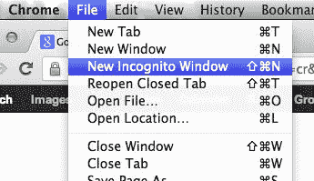

在此模式下，浏览器加载的任何资源都不会被缓存。

如果这太麻烦，你可以选择从本书一开始就使用本地 Web 服务器提供页面。第 8 章提供了在计算机上安装 `Mongoose` Web 服务器的详细说明。通过 Web 服务器提供的页面仍然可能被浏览器缓存，但使用“强制刷新”可以可靠地确保资源被刷新：

- 在 OSX 上：`Command+Shift+r`
- 在 Windows 上：`Ctrl+F5`

本书中的许多示例，尤其是前几章的示例，可以直接使用 JavaScript 解释器运行。所有主流浏览器现在都提供了开发工具，可以直接访问 JavaScript 解释器。

要访问 Chrome 解释器，只需打开 Chrome，然后输入：

- 在 OSX 上：`Command+Option+i`
- 在 Windows 上：`F12` 或 `Ctrl+Shift+I`

或者，你可以在任何网页上右键单击，然后选择“检查元素”：

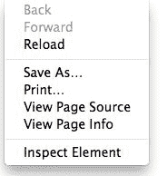

打开开发者工具后，点击 `Console` 选项卡。

为了证明这是一个真正的 JavaScript 解释器，只需在命令提示符下输入 `1+1`：

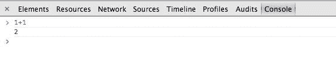

过去几年中，浏览器在开发者工具方面取得了巨大进步。浏览器厂商已经意识到，当开发者使用他们的浏览器时，他们会直接受益，因此他们通过提供的工具积极吸引开发者。本书将向你介绍 Chrome 开发者工具的许多功能，但你也值得自行探索各种功能。

## 约定

电子书的一个不幸方面是，在所有设备上有效格式化计算机代码很困难，因为屏幕宽度会因设备而异。理想情况下，代码应以独特的等宽字体呈现；然而，这在所有电子书阅读器上都是不可能的。在支持的情况下，本书中的所有代码将使用以下字体：

`这是代码`

当代码在 JavaScript 解释器中执行时，输入将以 `>` 字符为前缀：当你自己输入这些命令时，应省略该字符。此外，输入和输出之间将有一个空行：

```text
> 1+1

2
```

如果同时显示两个命令，它们之间将有一个额外的空行，位于第一个命令的结果和第二个命令的输入之间：

```text
> 1+1

2

> 2+2

4
```

如果输出与所讨论的观点无关，则可以省略。

## 反馈

我非常希望听到你对本书的反馈（正面和负面）。请发送电子邮件至 `dane@cisdal.com`。

# Web 应用简要概述

本书旨在教你如何利用 Web 浏览器原生提供的工具和技术（而非插件）编写丰富的 Web 应用。本书将仅关注以下最新版本浏览器中可用的语言和库：

- Chrome
- Firefox
- IE
- Safari
- Opera

本书中的许多示例在旧版浏览器中无法运行，而且在许多情况下没有变通方法。在编写 Web 应用时，首先要问的问题显然是：“我需要或想要支持哪些浏览器，以及这些浏览器的哪些版本？”

这涉及一个明显的权衡：

- 你支持的浏览器和浏览器版本越多，可以使用你的 Web 应用的用户就越多。请记住，有些用户（尤其是在企业环境中）无法选择他们的浏览器或浏览器版本。
- 你支持的浏览器和浏览器版本越多，在 API 的可用性和兼容性方面遇到的限制就越多。在本书后面，我们将遇到一种称为 `polyfills` 的方法，它允许你“升级”用户浏览器提供的功能，但这种方法并不总是有效。

所有主流浏览器现在都支持自动更新。尽管此功能可以关闭，但这确实意味着假设大多数用户拥有他们最喜欢的浏览器的最新版本不再是一个大胆的假设，至少在非企业环境中是这样。

主要例外是 Internet Explorer。Internet Explorer 10 在旧版 Windows 上不可用；因此许多用户将使用旧版 Internet Explorer。总的来说，本书中的大多数示例在 Internet Explorer 9 中都能运行，有些在 Internet Explorer 8 中也能运行，但支持 Internet Explorer 6 和 7 则是一个更加艰巨的任务。

网站 [`caniuse.com/`](http://caniuse.com/) 是了解各种浏览器和浏览器版本所提供功能的宝贵资源。

## 什么是 Web 应用？

一个合理的问题是：“什么是 Web 应用，它与网站有何不同？”即使是 HTML5 规范的引言部分也指出，它旨在解决“……被称为 Web 应用的模糊主题”。

这个问题没有明确的答案，但本书中开发的 Web 应用具有以下特征：

- 它使用 Web 浏览器作为用户界面。
- 它允许用户执行操作和操作数据，而无需刷新屏幕。
- 它具有交互性，并能迅速响应用户操作。
- 它代表用户存储数据，无论是在客户端还是服务器端。
- 如果需要访问 Web 服务器，它使用异步 `AJAX` 调用来实现。
- 它倾向于使用异步 API 而非同步 API。
- 即使未连接到互联网，它也可能可用。

在本书中，理解异步 API 和同步 API 之间的区别非常重要。尽管本书将提供许多示例，但两者之间的基本区别是：

- 同步 API 等待响应，并阻止应用程序中其他所有事情的发生，直到收到该响应。
- 异步 API 不等待响应，而是请求在响应可用时得到通知。因此，它不会阻止应用程序中其他功能的进行。

# Web 应用程序特性与语言

`HTML5` 规范指出，Web 应用程序还将具备以下特性：

- 它们被偶尔使用，或定期使用但来自不同地点。
- 它们对 CPU 要求较低。

这些说法有一定道理。例如，文字处理器的 Web 应用程序版本通常不会像原生文字处理器那样具有相同的可用性和功能，但如果文档需要由不同地点的多人编辑，则具有相当大的优势。


本章将简要介绍本书中用于开发 Web 应用程序的语言。

## HTML5

HTML5 可能是一个令人困惑的术语。

HTML5 包含一种标记语言的规范，用于创建可在 Web 浏览器中渲染的文档。作为一种标记语言，HTML5 扩展并合理化早期版本的 HTML 和 XHTML。

作为 HTML 扩展的一部分，HTML5 为网站开发者提供了一组新标签。其中许多标签旨在为 HTML 提供更强的描述能力。例如，HTML5 包含`header`和`footer`标签。这些标签并不会让页面在功能或外观上有所不同，它们是 HTML5 中不太有趣的一个方面；本书将考察这些新标签的一个子集。

HTML5 还包含支持音频和视频的新标签，以及用于渲染 2D 形状和位图的画布。正是 HTML5 的这些特性吸引了大量关注，尤其是这些特性使 HTML5 成为 Adobe Flash 的直接竞争对手。苹果公司拒绝在某些设备上使用 Adobe Flash，认为网站应该使用 HTML5 的等价物，因为它们符合标准且不需要插件。本书将基本忽略 HTML5 的多媒体方面，因为它们通常与 Web 应用程序无关，但了解它们的存在很重要。

作为其特别对 XHTML 合理化的一部分，HTML5 承认早期 HTML 标准版本所强制执行的严格性既无必要（浏览器仍然渲染违反规则的页面），也适得其反（因为没有标准规定浏览器应如何处理某种方式无效的页面，这由各个厂商自行决定）。HTML5 规范包含了详细的规则，说明浏览器厂商应如何根据提供的输入创建一致的`Document Object Model`。HTML5 规范的很大一部分直接涉及这些规则，同样超出了本书的范围。

如果你不熟悉`Document Object Model`（下文将解释）或 XHTML（它基本上已过时），不必担心。

HTML5 还增强了 HTML 中可用的表单组件。除了提供新类型的输入字段（如日期选择器和颜色选择器）外，HTML5 还在现有输入字段上提供了额外的属性。HTML5 还提供了表单组件的原生验证。

除了提供标记语言和一组表单组件外，HTML5 还是一套 Web 浏览器可以实现的标准 API。这些 API 范围广泛且多样，包括数据和内容的离线存储、读取文件、后台进程、服务器发送事件等等。正是 HTML5 的这些特性真正将 Web 浏览器转变为应用程序开发平台。本书在开发示例 Web 应用程序时将使用许多新的 API。

HTML5 标准制定过程本身就很有趣。许多标准实际上是从 Web 浏览器中已有的特性逆向工程而来的。例如，AJAX 背后的技术（`XMLHttpRequest`对象）最初是作为 Internet Explorer 的专有特性开发的。其他浏览器随后逆向工程了这一特性，最终，一旦主流浏览器支持它，W3C 将其标准化（事实上，它仍然是一个工作草案）。

万维网联盟（W3C）是万维网的主要标准组织。其网站可在此找到：[`www.w3.org`](http://www.w3.org)，而 HTML5 规范可在此找到：[`www.w3.org/TR/html5`](http://www.w3.org/TR/html5)。

HTML5 规范实际上由两个独立的机构制定：W3C 和 WHATWG。两个机构都在各自的许可下提供标准。实际上，WHATWG 在 HTML5 方面比 W3C 更值得称赞，W3C 最初投票决定不参与 HTML5，而是继续推动基于 XML 的标准。W3C 最终承认他们押错了马，并开始积极参与 HTML5。

还值得一提的是，W3C 和 WHATWG 版本的规范并不完全相同。从软件工程师的角度来看，这基本上无关紧要。网页设计师有句格言：“代码永远胜出”。这也适用于 HTML5：规范基本无关紧要，重要的是浏览器的实现。

在某些情况下，某个特定的浏览器厂商推动一项标准。这偶尔会导致僵局，就像`Web SQL API`那样。在其他情况下，某项规范虽然被推进但并未得到广泛支持（例如`File Writer`和`File System API`），因此前途未卜。然而，在最好的情况下，所有主流浏览器都按照商定的标准支持该 API。

HTML5 的另一个重要方面是它是一个活标准。正如你将在后续章节中看到的，HTML5 文档类型并不指定版本：它只是 HTML，并且会随着标准的进展以及浏览器采用这些标准而发生变化。

## JavaScript

JavaScript 是几乎所有现有 Web 浏览器原生支持的唯一语言。JavaScript 最早于 1995 年出现在 Netscape Navigator 浏览器的早期版本中，并迅速迁移到 Internet Explorer。JavaScript 对于为 Web 应用程序添加动态和交互功能至关重要。

尽管微软继续支持`VBScript`，但其他浏览器并未实现它，这意味着在创建 Web 应用程序时它不是一个可行的选择。

首先有必要澄清一个关于术语的小问题。JavaScript 已在`ECMAScript`语言规范中正式化。当本书提到 JavaScript 时，技术上指的是`ECMAScript version 5`。

JavaScript 以编程语言 Java 命名，但这主要是为了让 JavaScript 借助 Java 的知名度，而不是因为两种语言之间有任何内在相似性。

JavaScript 实际上是一种与 Java 截然不同的语言，具体来说：

- JavaScript 支持动态类型，而 Java 支持静态类型。这意味着你可以在 JavaScript 中声明变量而不声明其类型，该类型将在运行时才确定。
- JavaScript 拥有一等函数。可以将函数赋值给变量或将其作为参数传递给另一个函数。这听起来像是一个小特性，但它带来了巨大的可能性，并允许软件工程师使用函数式编程技术编写软件。这些技术将在后续章节中详细讨论。
- 尽管 JavaScript 支持类，但其类的实现有些令人困惑。本书建议你尽可能避免使用类，并利用原型技术来创建对象。

本书并非关于 JavaScript 语言所有特性的教程。相反，本书将概述软件工程师可以采用 JavaScript 采用的一组基本方法。

如果你以前从未花时间学习过 JavaScript，特别是如果你只使用过静态类型语言，你很可能会对 JavaScript 语法赋予用户的优雅和灵活性印象深刻。

## jQuery

`jQuery`是一个 JavaScript 库，旨在简化在 Web 浏览器中编写 JavaScript 应用程序的过程。

## JavaScript 与 jQuery

由于网页以文档为中心的特性，JavaScript 通常负责在文档中选取元素（浏览器中文档的内部表示称为文档对象模型）、操作这些元素，或响应这些元素触发的事件。JavaScript 通过文档对象模型 API 原生支持此功能，该 API 也包含在 HTML5 规范中。jQuery 本质上为文档对象模型 API 提供了一个优雅的封装。

jQuery 的核心是一个选择器引擎。jQuery 接受基于 CSS 样式选择器的选择条件，并返回文档中符合这些条件的元素集合。一旦选中一组元素，jQuery 提供了大量函数来对这些元素执行操作，或为它们附加事件监听器。

尽管 jQuery 无法做到 JavaScript 使用原生 DOM API 做不到的事情，但它因以下几个原因而变得极为流行：

- 它消除了处理不同浏览器之间怪异行为的痛苦。
- 它提供了丰富且简洁的语法，大多数人认为这比文档对象模型 API 有了巨大改进。
- 为 jQuery 编写自定义插件很简单，因此可以扩展以满足特定需求。
- 有大量开源插件可用于 jQuery，包括一个名为 jQuery UI 的流行 UI 工具包。

jQuery 有许多竞争对手，如 Dojo 和 Prototype，但 jQuery 已在市场上获得了关键规模，几乎成为 Web 应用程序的事实标准。

## 层叠样式表

层叠样式表为 HTML 提供了一种样式表语言。在 CSS 出现之前，HTML 中保留的大部分表现性特性现在已在 HTML5 中被移除，所有表现现在应完全由 CSS 完成。

CSS 提供了关注点分离，允许页面的样式独立于其内容而变化，反之亦然。HTML 负责传达网页的含义，而 CSS 负责传达其表现。

这也意味着，只需提供一个新的样式表，就可以将相同的内容重新用于不同的设备（例如手机）。

CSS 提供了一组属性，描述文档中的元素在匹配某些规则时应如何样式化，以及它们应如何相互交互。可应用于元素的样式令人难以置信，并且在 CSS3 中得到了显著扩展，CSS3 是一个与 HTML5 大致并行发展的规范。

对于软件工程师来说，通常不需要深入了解所有 CSS 特性，但理解其基础非常重要，否则可能会带来巨大的挫败感和痛苦。与本书中涉及的所有语言一样，CSS 并不像看起来那么简单，对于任何参与 Web 应用程序开发的人来说，牢固掌握其基础至关重要。

在本书的示例 Web 应用程序开发过程中，我们将在很大程度上忽略 CSS。但附录 A：层叠样式表提供了对 CSS 的深入介绍，你可以随时跳转到该部分。

## HTML5 标记语言

在本章中，我们将研究 HTML5 规范中包含的 HTML 标记语言的变化。示例 Web 应用程序将使用许多（但并非全部）新的 HTML5 标签以及一些新增的属性。

如上所述，术语 HTML5 既指一种标记语言（HTML 的新版本），也指一组 API。HTML5 API 将在本书后续章节中介绍。

### 页面结构

通常从最简单的示例开始是好的，对于 HTML5 来说，那就是：

```html
<!DOCTYPE html>
hello world!!!
```

打开你最喜欢的文本编辑器，输入上述代码，将其保存为`hello.html`，然后在你最喜欢的兼容 HTML5 的浏览器中打开它。

这可能看起来不像一个 HTML 页面。例如，没有`html`标签，也没有`body`标签？尽管如此，浏览器知道如何处理提供的极简内容。如果我们分析 Chrome 浏览器为此页面生成的文档对象模型（打开 Chrome 开发者工具并点击“Elements”选项卡），我们将看到以下内容：

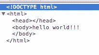

浏览器推导出了 HTML 页面的意图，并生成了一个兼容的内部文档对象模型。

与早期版本的规范相比，HTML5 规范非常宽松。多年来，HTML 的定义趋向于更严格，最明显的是 HTML 4.01 Strict（2000 年发布）和 XHTML。这些标准强调严格的标记规则，例如始终关闭标签，始终在属性值周围加引号。这种对严格性的追求是由多种原因驱动的：

- 早期版本的 HTML 和 XHTML 基于其他标记语言（分别是 SGML 和 XML），这给 HTML 带来了限制。
- 浏览器更容易从遵循严格规则编写的文档中推导出意图，这有助于跨浏览器的兼容性。
- 如果文档符合严格规则，其他工具处理文档也更容易。

尽管 HTML 和 XHTML 规范越来越严格，但浏览器从未真正强制执行这些规则。浏览器供应商很久以前就意识到，无论标记是否符合相关标准，尽可能利用提供给他们的任何标记符合他们的最佳利益。从浏览器供应商的角度来看，理由显而易见：用户会对因技术细节而拒绝渲染页面的浏览器失去耐心，并选择能渲染的浏览器。

浏览器供应商与制定技术规范的团队之间出现了巨大的分歧。这毫无意义，因为技术规范只有被浏览器供应商采用才有价值。HTML5 以强烈的实用主义彻底扭转了这种局面。

如上所述，HTML5 规范的大部分内容详细说明了浏览器应如何处理以前被认为无效的标记。这就是为什么 Chrome 可以从“hello world”示例生成文档对象模型。这也是为什么 Firefox 会生成完全相同的文档对象模型。

尽管上面的示例有效，但以下可能是开发符合 HTML5 的文档时最合适的骨架：

```html
<!DOCTYPE html>
<html lang="en">
<head>
 <meta charset="utf-8">
</head>
<body>
</body>
</html>
```

我将在下面解释每个部分的含义，但在此之前，我们将向`tasks.html`文档添加一些内容，以开始示例 Web 应用程序的开发。

在本书中，我们将开发一个任务列表应用程序。任务列表将包括以下功能：

- 用户可以创建新任务：包括截止日期和任务类别。
- 用户可以编辑任务。
- 用户可以删除任务。
- 用户可以查看他们的任务列表。
- 逾期任务会向用户突出显示。
- 用户可以将任务设置为完成。

虽然这看起来是一个相对简单的 Web 应用程序，但它包含了足够的复杂性来展示每种语言的重要特性，但又不会过于复杂，以至于本书变得重复或专注于需求。

我们将从编写构成任务列表屏幕基础的标记开始。在本章中，所有内容都是静态的：在后续章节中，我们将通过使用 JavaScript 和 jQuery 使其动态化。

要开始示例项目，请在文件系统的任意位置创建一个新文件夹，并向其中添加一个名为`tasks.html`的文件。该文件应包含以下内容：

`//`

请记住，这些示例可以从本书的网站`cisdal.com/publishing.htm`下载。每章都有一个包含所有示例的 zip 文件。

## 任务列表实现

```html
<!DOCTYPE html>
<html lang="en">
<head>
<meta charset="utf-8">
<title>Task list</title>
<link rel="stylesheet" type="text/css" href="styles/tasks.css" media="screen" />
</head>
<body>
 <header>
 <span>Task list</span>
 </header>
 <main>
    <section>
 <form>
 <div>
 <label>Task</label> <input type="text" required="required"
 name="task" class="large" placeholder="Breakfast at Tiffanys" />
 </div>
 <div>
 <label>Required by</label> <input type="date" required="required"
 name="requiredBy" />
  </div>
 <div>
 <label>Category</label> <select name="category">
 <option value="Personal">Personal</option>
 <option value="Work">Work
</option>
 </select>
 </div>
 <nav>
 <a href="#">Save task</a> <a href="#">Clear task</a>
 </nav>
 </form>
 </section>
 <section>
 <table id="tblTasks">
 <colgroup>
 <col width="50%">
 <col width="25%">
 <col width="25%">
 </colgroup>
 <thead>
 <tr>
 <th>Name</th>
 <th>Due</th>
 <th>Category</th>
 </tr>
 </thead>
 <tbody>
 <tr>
 <td>Return library books</td>
  <td><time datetime="2013-10-14">2013-10-14</time></td>
 <td>Personal</td>
 </tr>
 <tr class="even">
 <td>Perform project demo to stakeholders</td>
 <td><time datetime="2013-10-14">2013-10-14</time></td>
 <td>Work</td>
 </tr>
 <tr>
 <td>Meet friends for dinner</td>
 <td><time datetime="2013-10-14">2013-10-14</time></td>
 <td>Personal</td>
 </tr>
 </tbody>
 </table>
 <nav>
 <a href="#">Add task</a>
 </nav>
 </section>
 </main>
 <footer>You have 3 tasks</footer>
</body>
</html>
```

正如`head`部分所述，该文件附带了一个 CSS 文件。该文件应放置在名为`styles`的子文件夹中，并命名为`tasks.css`。


```css
@CHARSET "UTF-8";
body, h1, h2, h3, h4, h5, h6, p, ul, dl, ol, form, fieldset, input, label, table, tbody, tfoot, th, tr, td, textarea, select {
 font-family: "helvetica neue", helvetica, "lucinda sans unicode", "sans serif";
 font-weight: normal;
 color: #333;
 padding: 0;
 border: 0;
 margin: 0;
 font-size: 12px;
}
header {
 width:100%;
 height:80px;
 background:#d1e0e1;
 color: #333;
 font-weight: bold;
 font-size: 20px;
 text-align:center;
 line-height: 80px;
}
footer {
 width:100%;
 height:60px;
 background:#d1e0e1;
 font-size: 12px;
 text-align:center;
 line-height: 80px;
 margin-top:30px;
}
table, th, td
{
border: 1px solid #888;
}
section {
 margin:20px 0 0 20px;
}
table {
 width:90%;
 border-collapse:collapse;
}
thead {
 line-height: 30px;
}
thead th {
 background: #53777a;
 color: #fff;
 font-size: 12px;
 font-weight: bold;
 text-align:center;
}
td {
 font-size: 11px;
 line-height: 25px;
 padding-left: 10px;
}
.even {
 background-color: #f8f8f8;
}
nav {
 margin:15px 0 10px 0;
}
nav a {
 background: #53777a;
 color: #fff;
 width: 80px;
 text-decoration: none;
 border: 1px solid #5b5b5b;
 font-size: 13px;
 text-align: center;
 padding:5px 10px;
}
label {
 display: block;
 padding: 8px 0 8px 0;
 color: #333;
}
input {
 border-radius: 3px;
 height: 24px;
 border: 1px solid #AAA;
 padding: 0 7px;
}
input.large {
 width: 400px;
}
select {
 border: 1px solid #AAA;
 overflow: hidden;
 margin-right: 15px;
 width: 200px;
}
.required {
 color: red;
}
.not {
 display:none;   
}
.rowHighlight {
 font-weight:bold;
}
label.error {
 color: red;
 font-weight:bold;
}
.overdue {
 background: #F7DCE5;
}
.warning {
 background: #F7F7DC;
}
.taskCompleted {
 text-decoration: line-through;
}
```

在 Web 浏览器中打开时，HTML 文档将显示如下：

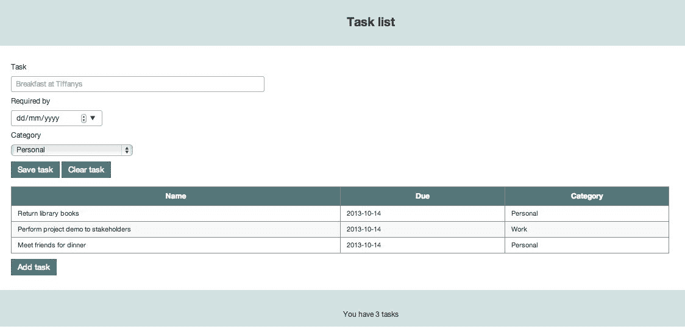

这里有一些特性值得我们停下来讨论。

## 文档类型定义

首先，在网页的最顶部，`DOCTYPE` 仅仅是：

```html
<!DOCTYPE html>
```

`DOCTYPE` 是向浏览器发出的重要信号，允许浏览器根据与文档类型关联的规则来解释文档内容。如果省略此声明，浏览器将回退到其传统规则集，这可能会产生截然不同的结果。

你还会注意到，`DOCTYPE` 中的 `html` 没有附带版本号。HTML 现在应被视为一种活标准，而非带有官方发布的版本化标准，这一点在 `DOCTYPE` 中得到了体现。因此，许多人完全反对使用 HTML5 这个术语：它只是 HTML。

关于 `DOCTYPE` 声明，你可能注意到的另一件事是，它不包含指向定义标记语言规则的文档类型定义（DTD）文档的引用。对于可能习惯于复制粘贴如下 `DOCTYPE` 声明的开发者来说，这是一个令人愉快的改变：

```html
<!DOCTYPE HTML PUBLIC "-//W3C//DTD HTML 4.01//EN" "http://www.w3.org/TR/html4/strict.dtd">
```

或：

```html
<!DOCTYPE html PUBLIC "-//W3C//DTD XHTML 1.1//EN" "http://www.w3.org/TR/xhtml11/DTD/xhtml11.dtd">
```

其原因已经有所提及：HTML5 不像早期版本的 HTML 那样基于 SGML；事实上，它不基于任何东西。

标准通用标记语言（SGML）是一种用于定义标记语言（如 XML 或 HTML）规则的技术。

尽管 HTML5 不基于任何其他标准，但可以用 XML 序列化模式编写 HTML5。以下是一个序列化为 XML 的 HTML5 页面的骨架（这相当于 XHTML）：

```html
<!DOCTYPE html>
<html xmlns="http://www.w3.org/1999/xhtml">
  <head>
    <meta charset="utf-8" />
  </head>
  <body>
  </body>
</html>
```

此外，使用“XML 模式”的 HTML5 文档应具有 `application/xhtml+xml` 的文档类型（而非 `text/html`）。

本书不会使用 XML 模式。实际上，除非你需要用 XML 解析器处理页面，否则使用符合 XML 的 HTML 版本并没有真正的优势，但了解这种模式的存在是有用的。

在上面的示例中，下一行你还会注意到 `html` 标签（可选）包含了语言：

```html
<html lang="en">
```

规范并未规定语言属性的用途，但显然浏览器可以出于多种原因使用该语言，包括提供其他语言的翻译。

除此之外，你应该在每个页面中添加的唯一其他特性是 `head` 部分中的以下行，用于指定字符编码：

```html
<meta charset="utf-8">
```

除非有充分的理由，否则建议选择 UTF-8 作为编码。同样重要的是，你必须添加这一行，否则你的 Web 应用程序可能会遭受使用 UTF-7 的跨站脚本攻击。

对于 Internet Explorer，设置以下 meta 值可能也很有用：

```html
<meta http-equiv="X-UA-Compatible" content="IE=edge" />
```

Internet Explorer 允许用户指定文档的兼容模式（因为它支持向后兼容）。这将保证 IE 使用最新的 HTML5 模式。

## 标签

自 CSS 出现以来，Web 设计师一直依赖 `div` 和 `span` 标签来布局内容。这些标签没有视觉含义；它们只是作为其他元素的容器。然后可以使用 CSS 将这些容器放置在屏幕上的任何位置。

`span` 和 `div` 之间的唯一区别是，`span` 是内联元素（它们可以垂直相邻放置在其他元素旁边），而 `div` 是块级元素，因此在文档中独占一行。

如果这听起来不太清楚，你可能想跳到附录 A：层叠样式表，以更好地理解 CSS。

尽管 `div` 和 `span` 元素足以（在 CSS 的帮助下）布局复杂的网站，但它们缺乏语义含义。例如，文档自然包含页眉和页脚，但历史上这些必须用 `div` 元素来表示。

## HTML5 语义元素

`div` 和 `span` 元素缺乏语义含义，这在过去一直备受批评。有一种观点认为，如果浏览器意识到某个部分是页眉或页脚，它可能会选择修改文档的呈现方式，或重新利用内容，尤其是在手机等非传统设备上。随着越来越多的设备支持基于 HTML 的浏览器，重新利用内容的需求可能会增长。

此外，`div` 和 `span` 标签缺乏语义含义，这可能会使软件工程师难以修改现有文档。不仅难以匹配深层嵌套的 `div` 标签（因此很容易遗漏一个），而且文档中每个部分的用途也可能不明确。

因此，HTML5 提供了一系列新标签，为 HTML 文档添加语义含义。浏览器并不一定需要为这些标签提供任何视觉实现；例如，没有任何东西能阻止 `header` 出现在页面底部，而 `footer` 出现在页面顶部。实际上，这些标签在视觉上等同于 `div` 和 `span` 标签——要么是内联容器，要么是块级容器，没有其他视觉属性。

## 主要的新语义标签

以下是已添加的主要新语义标签（大致按实用性排序）：

- `section`：表示应用程序中的通用文档或章节。正确使用 `section` 既是艺术，也是科学。一个 `section` 应该是自包含的，并且能够独立于文档中的其他章节存在。示例见 `tasks.html`。
- `header`：表示 HTML 文档或文档章节的引言部分：一个文档中可以有多个 `header`。示例见 `tasks.html`。
- `footer`：表示应出现在 HTML 文档或章节底部的信息。同样，文档中可以有多个 `footer`。示例见 `tasks.html`。
- `aside`：用于与周围其他内容松散关联但可视为独立的内容。`aside` 通常通过边框或字体与周围内容在视觉上分离。
- `article`：用于分隔可以独立于文档中其他内容分发的内容。例如博客文章或评论。这与 `section` 类似，但 `article` 仅用于分隔内容，而非文档的通用章节。
- `details`：包含用户可以选择显示或隐藏的附加详细信息。
- `summary`：包含 `details` 标签中内容的摘要。其背后的理念是，在文档加载时可以向用户显示 `summary`，用户可以选择查看 `details`。
- `main`：用于包围文档的主要部分，去除所有 `header`、`footer`、`aside` 和 `menu`。与其他标签不同，每个页面只能使用一次。该标签应包围构成文档核心功能或内容的部分。示例见 `tasks.html`。
- `nav`：包含一组导航链接，例如通常出现在网页页眉部分的链接。
- `dialog`：用于对话框和窗口。此元素支持一个名为 `open` 的属性，指示对话框是否对用户激活。
- `wbr`：用作向浏览器提示可以添加换行符的提示。如果浏览器因长单词而在错误位置添加换行符，这可能会很有用。
- `mark`：可用于指示文本被高亮。浏览器会为文本添加背景色，可通过 CSS 覆盖。
- `figure`：此元素可用于包围自包含的内容，如照片和插图。此元素使用 `block` 显示类型，而不是 `inline-block` 显示类型（如图像所用）。
- `figcaption`：用于为 `figure` 提供图例。
- `address`：定义描述联系信息的章节。

重要的是不要过度使用这些新标签。新标签具有特定含义，如果你出于其他目的（包括通过 CSS 实现样式目的）需要分隔内容，使用 `div` 和 `span` 标签完全没有问题。

此外，不要指望这些标签能彻底改变你的生活。实际上，它们是 HTML5 中最无趣的特性之一。即使是这些标签经常被引用的好处——“重新利用内容”，也可能更多的是炒作而非现实。

以重新利用内容为例，考虑 Safari 的“阅读器”模式。它会从包含文章内容的页面中剔除所有多余内容，从而使文章更易于阅读。如果每个人都使用 `article` 标签，苹果实现这一功能可能会更容易：但苹果仍然在没有它的情况下实现了这一功能。此外，苹果不太可能简单地信任页面提供的语义标签，因为网站很快就会学会将广告材料放在 `article` 元素内的好处，尽管规范暗示它们应该放在外面。

还有其他一些与页面功能方面直接相关的新标签（例如 `video` 和 `audio`）：这些将单独讨论。

## 微格式

如果你查看文档中的 `time` 标签，你会看到以下内容：

```html
<time datetime="2013-10-14">2013-10-14</time>
```

也可以写成：

```html
<time datetime="2013-10-14">14^(th) October</time>
```

或者：

```html
<time datetime="2013-10-14">October 2014</time>
```

此标签的重要方面是它包含相同的信息两次。日期的第一个版本以属性形式呈现，并符合 ISO 日期（以及需要时的时间）标准。第二个版本出现在标签之间，是向用户显示的版本。

此功能的目的是提供同一信息的机器可读和人类可读版本。此类功能被称为“微格式”，并在互联网上广泛使用，为搜索引擎和其他自动化客户端提供语义含义，同时向人类提供同一数据的人类友好版本。

微格式尚未正式包含在 HTML5 规范中，尽管 `time` 标签是微格式的一个示例。还有其他几种微格式标准，并且 HTML5 很可能会随着时间的推移扩展以支持这些标准。

## HTML5 表单

HTML5 对表单及其包含的输入字段进行了多项补充。自 HTML 早期版本以来，输入字段和选择框等表单元素实际上没有变化。HTML5 不仅引入了一组新的输入类型，还包括大量用于自定义表单输入的属性，以及表单字段的原生验证。

### 新的输入类型

如果你查看名为 `requiredBy` 的字段的输入类型，你会注意到其类型设置为 `date`：

```html
<input type="date" required="required" name="requiredBy"/>
```

也可以（并且可能更可取）写成：

```html
<input type="date" required name="requiredBy"/>
```

HTML5 不要求所有属性都有值。这些属性被称为布尔属性，因为它们的出现表示 `true`，而缺失表示 `false`。

可以说，省略值更可取，因为它避免了认为以下写法有效的可能性：

`required="false"`

HTML5 规范的期望是，当用户点击此类字段时，浏览器会提供某种方式让用户选择日期，尽管具体机制由浏览器厂商决定。

## HTML5 输入类型与特性

某些浏览器目前不支持 `date` 输入类型，在这种情况下，它的行为与 `text` 输入类型相同。

当浏览器选择实现某种新的输入类型时，它们可以根据所运行设备的具体情况，决定最佳的实现方式。例如，iPad 上的 `date` 输入类型会显示如下日历：

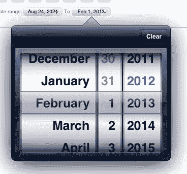

这与桌面版 Chrome 呈现的 `date` 输入类型截然不同：

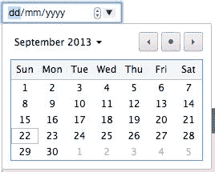

除了 `date` 输入类型，HTML5 还提供了其他几种新的输入类型。其中许多类型，例如：

- `email`
- `url`
- `tel`（电话）
- `number`

对于使用软件键盘的设备来说，优势最为明显。在这些设备上，浏览器可以为用户提供一组最适合该输入类型的按键。例如，如果类型是 `email`，键盘可能会显示字母字符、“@”符号、“.”以及一个特殊的“.com”键。

移动设备尤其为 `tel` 和 `email` 等输入类型提供了有趣的可能性，因为浏览器有可能根据手机通讯录中的详细信息自动补全这些字段。

HTML5 验证（将在下文介绍）还可以验证这些字段是否包含其指定类型的有效值。

此外，HTML5 还提供了以下输入类型，与 `date` 输入类型类似，它们预期会向用户呈现一个小部件，以简化值的选择：

- `color`
- `datedatetime`
- `datetime-local`
- `month`
- `range`
- `search`
- `time`
- `week`

实际上，在大多数浏览器中，这些类型大多不可靠。这是 Web 应用程序开发者熟悉的问题，因此有必要停下来讨论一下“polyfill”的概念，这是解决该问题的常见方案。

Polyfill 是一种优雅的解决方案，用于解决某些功能仅被部分浏览器支持的问题。如果某个功能在特定浏览器中原生支持，polyfill 不会做任何事。如果该功能不被支持，polyfill 则会提供一个实现，通常通过 JavaScript 库来完成。

为了使用 polyfill，需要具备以下两个特性：

1. 检测浏览器是否支持特定功能的能力。
2. 使用 JavaScript 动态为该功能提供实现的能力。即使能够检测到某个功能缺失，也可能无法提供实现。

虽然在自己的代码中提供这两个特性通常很简单，但尽可能使用经过充分测试的现有库总是更好的选择。最流行的功能检测库是 `Modernizr`，可以在 [`modernizr.com/`](http://modernizr.com/) 找到。

有了 `Modernizr`，功能检测变得非常简单：

```javascript
if (Modernizr.canvas) {
 // 不做任何事  
} else {
 // 提供实现  
}
```

除了功能检测，`Modernizr` 还包含大量可用的 polyfill 实现，你也可以自己编写。

HTML5 还为两个全新的表单元素提供了原生支持：

- `Progress`：提供进度条的原生实现，可以通过更改进度条属性来更新。
- `Meter`：在定义范围内提供标量测量。


这些新元素在完全实现后将非常有用，但在此之前，你可能需要依赖诸如 `jQuery UI` 等库提供的替代方案。

## 输入类型的新属性

除了新的输入类型，输入类型还支持大量新属性。属性用于控制元素的工作方式。

其中许多属性用于支持原生 HTML 验证，包括：

- `required`：表示该字段必须填写值才能提交表单。
- `maxlength`：用于基于 `text` 的输入字段，指定输入的最大长度。
- `min` 和 `max`：用于基于 `number`、`date` 和 `range` 的输入字段，指定最小值和最大值。
- `pattern`：用于输入必须符合正则表达式模式的情况。大多数浏览器为 `email` 等类型提供了默认实现。
- `formnovalidate`：可以应用于提交按钮以禁用验证。此外，`novalidate` 属性可以应用于表单本身以达到相同效果。

表单元素的验证将在后续章节中介绍。

还添加了许多其他属性，以提供常见的请求功能：

- `placeholder`：在输入字段中提供灰色占位符。可用于向用户提供上下文，并作为字段用途的提示。
- `autocomplete`：添加 `autocomplete` 后，浏览器会在用户输入时建议值。
- `autofocus`：可用于在文档加载时自动将焦点赋予特定字段。以前这只能通过 JavaScript 实现。
- `form`：可以将输入字段指定为表单的一部分，即使它没有嵌套在表单内。这也允许一个输入字段包含在多个表单中。
- `formaction`：可以在提交按钮上提供 `formaction` 属性，以覆盖表单本身设置的 `action`。当同一表单中有多个提交按钮时，这特别有用。属性 `formenctype` 可与之一同使用，以覆盖表单本身设置的内容类型（`enctype`），而 `formmethod` 可用于覆盖表单的默认方法（例如 `POST`）。
- `step`：可用于 `number`、`date` 或 `range` 输入字段。其目的是输入字段将提供向上和向下箭头，按下这些箭头将按步长增加或减少当前值。

## 其他新特性

HTML5 标记语言还包含许多其他新特性，这些特性超出了本书的范围。本节将对这些特性进行非常简要的介绍，以便你知道它们的存在，但不会深入介绍它们的工作原理。

HTML5 提供了一个 `canvas` 元素，支持 2D 绘图和动画。这是 HTML5 旨在替代 Adobe Flash 的特性之一。互联网上有许多有趣的演示展示了这一特性的强大之处。

`canvas` 元素与可缩放矢量图形（SVG）覆盖了部分相同的范围，SVG 在技术上并非 HTML5 的一部分，但它仍然是 Web 浏览器中一个相对较新且有用的特性。

`WebGL` 提供了与 `Canvas` 类似的功能，但支持 3D 渲染。`WebGL` 的主要缺点是支持它的浏览器不如 `Canvas` 多，而 `Canvas` 在主流浏览器厂商中得到了普遍支持。即使支持，也往往是部分支持。

HTML5 另一个备受关注的特性是 `audio` 和 `video` 标签。目前，Adobe Flash 尤其是视频领域的事实标准，主要是因为它的普及性以及 YouTube 使用了它。`audio` 和 `video` 元素旨在让网站开发者无需插件即可在网站中嵌入音频和视频。

自网站开发早期以来，返回按钮就一直引发问题。在现代 Web 应用中，即使当用户认为他们已切换页面时，应用通常也不依赖页面刷新，这使得问题更加明显。默认情况下，这意味着返回按钮在大量场景中往往无法按用户预期工作。会话历史管理 API 允许开发者更精细地控制标签页的历史记录，从而使“后退”和“前进”按钮的行为更加直观。

# JavaScript 基础

## JavaScript 概述

本节将深入概述 JavaScript，包括其优点和缺点。本章旨在让你扎实理解 JavaScript 的基础知识，并重点关注这门语言应该如何使用，而不是可以如何使用。

JavaScript 是一种特别灵活的语言，对使用者没有太多约束或结构要求。此外，JavaScript 包含一些只能被视为缺陷的特性。这些特性之所以保留在语言中，主要是出于向后兼容的考虑。

为了编写大规模 Web 应用程序，有必要利用 JavaScript 的优势，同时避免那些不了解语言基础、且未以与代码库增长兼容的方式构建应用程序的软件工程师和程序员容易遇到的陷阱。

正如引言中提到的，本章不会作为 JavaScript 语法（如循环和分支）的教程，不过任何熟悉类似语法（C、C++、Java 等）的人都能从下面的示例中快速掌握这些细节。

要跟随本书的示例，只需打开 Chrome 或 Firefox 的控制台，直接输入命令即可（如本书前面所示）。

## 类型

理解 JavaScript 首先要理解其数据类型以及这些类型的使用方式。

JavaScript 有以下数据类型：

- `String`
- `Number`
- `Boolean`
- `Null`
- `Undefined`
- `Object`

下面各节将分别介绍这些类型。

### 字符串

字符串是用单引号或双引号括起来的字符序列：

```javascript
"hello world"
```

```text
"hello world"
```

```javascript
'hello world'
```

```text
"hello world"
```

上面的示例称为字符串字面量。我们也可以将字符串赋值给变量：

```javascript
s = 'Hello world'
```

```text
"Hello world"
```

在使用控制台时，变量不会用 `var` 关键字声明。如下文所示，在编写实际 JavaScript 代码时，大多数情况下使用 `var` 至关重要。

然后我们可以使用 `typeof` 运算符检查这个变量的类型：

```javascript
typeof s
```

```text
"string"
```

尽管字符串是独立的数据类型，但我们可以像下面看到对象上可以调用方法一样，在字符串上调用方法。

```javascript
s.charAt(1)
```

```text
"e"
```

```javascript
s.substr(6)
```

```text
"world"
```

```javascript
s.toUpperCase()
```

```text
"HELLO WORLD"
```

此外，字符串具有可访问的属性，就像下面示例中对象一样：

```javascript
s.length
```

```text
11
```

JavaScript 字符串在很大程度上与 Java 中的字符串等价。其后果之一是字符串是不可变的。

不可变对象是指在首次创建后无法更改的对象。即使它们看起来发生了变化（如下面的示例），实际上也是在创建新对象。

为了观察不可变性，声明一个新变量 `t`，并将其赋值为 `s`：

```javascript
t = s
```

```text
"Hello world"
```

现在我们可以打印出 `t` 的值，并确认 `t` 和 `s` 相等：

```javascript
t
```

```text
"Hello world"
```

```javascript
s == t
```

```text
true
```

如果我们现在修改变量 `s` 所持有的字符串，会发生什么？我们可以使用 `+=` 运算符追加字符串值：

```javascript
s += 'test'
```

```text
"Hello worldtest"
```

如果现在打印出 `s` 的值，你会看到字符串的值似乎发生了变化：

```javascript
s
```

```text
"Hello worldtest"
```

尽管如此，如果你打印出 `t` 的值，它仍然保留着旧值：

```javascript
t
```

```text
"Hello world"
```

当我们向变量 `s` 所持有的字符串追加“test”时，底层字符串并未被修改；而是创建了一个新字符串并赋值给变量 `s`。由于 `t` 仍然引用原始字符串，因此它不受修改的影响。

### 数字

数字类型用于表示整数和浮点值；实际上，JavaScript 中所有数字都是 64 位浮点数：

```javascript
n = 6.827
```

```text
6.827
```

```javascript
typeof n
```

```text
"number"
```

```javascript
n2 = 6
```

```text
6
```

```javascript
typeof n2
```

```text
"number"
```

由于所有数字都是浮点数，两个整数之间的运算可能返回浮点结果（与 Java 不同）。

```javascript
1/3
```

```text
0.3333333333333333
```

除了实数，JavaScript 还支持一些特殊值。

“非数字”用于算术运算产生的结果不是数字的情况。令人困惑的是，这种类型仍然是 `number`。

```javascript
a = 9/undefined
```

```text
NaN
```

```javascript
typeof a
```

```text
"number"
```

在这种情况下，如果 JavaScript 能生成错误可能会更有用。

还支持正无穷和负无穷，通常由除以 0 产生：

```javascript
b = 6/0
```

```text
Infinity
```

```javascript
b == Number.POSITIVE_INFINITY
```

```text
true
```

```javascript
c = -6/0
```

```text
-Infinity
```

```javascript
c == Number.NEGATIVE_INFINITY
```

```text
true
```

同样，大多数编程语言在遇到整数 0 时会在这些情况下生成错误，但由于 JavaScript 中所有数字都是浮点数，它遵循 IEEE 浮点数约定并返回无穷大。

JavaScript 还原生支持一个 `Math` 库，其模型几乎与 Java 中的相同。该库提供了大多数常见的数学函数。

```javascript
Math.pow(3, 2)
```

```text
9
```

```javascript
Math.round(3.22)
```

```text
3
```

### 布尔值

JavaScript 支持布尔类型，包含字面值 `true` 和 `false`：

```javascript
t = true
```

```text
true
```

```javascript
typeof t
```

```text
"boolean"
```

```javascript
f = false
```

```text
false
```

JavaScript 中的相等运算符（`>`、`<`、`==`、`!=`、`>=`、`<=`）也会返回布尔值作为结果：

```javascript
f != t
```

```text
true
```

### Null

Null 是一种只有一个值的数据类型：`null`。

```javascript
n = null
```

```text
null
```

令人困惑的是，`null` 被认为是对象类型：

```javascript
typeof n
```

```text
"object"
```

这是 JavaScript 语言中另一个为了向后兼容而保留的缺陷。尽管如此，`null` 在 JavaScript 中确实是一种独特的数据类型。

可以在变量被赋值后将其设置为 `null`，从而移除对其当前值的引用（并更改其数据类型）：

```javascript
q = 2
```

```text
2
```

```javascript
typeof q
```

```text
"number"
```

```javascript
q = null
```

```text
null
```

```javascript
typeof q
```

```text
"object"
```

### Undefined

当你访问对象上不存在的属性，或者在使用变量之前未声明或未赋值时，会返回 `undefined` 数据类型。

```javascript
typeof g
```

```text
"undefined"
```

### 对象

除了上述类型，JavaScript 中的所有数据类型都是对象：包括数组、函数、日期和用户定义的对象。对象将在下面的章节中详细讨论。

### 真值（Truthy）和假值（Falsey）

现在你已经了解了 JavaScript 的数据类型，接下来需要理解的是，这些类型的某些值会被求值为 `true`，某些会被求值为 `false`。例如，以下值在 JavaScript 中都被视为假值：

- `false`
- `0`（零）
- `""`（空字符串）
- `null`
- `undefined`
- `NaN`

要观察这一点，只需在控制台中询问它们是否等于 `false`：

```javascript
0 == false
```

```text
true
```

所有其他值都代表真值。

因此，在条件语句中评估变量的值时，可以使用一种快捷方式。不必编写以下代码：

```javascript
if (a == undefined || a == null) {
 a = 1;
}
```

可以直接写成：

```javascript
if (!a) {
 a = 10
}
```

同样，如果你只想在变量有值时使用它，可以编写以下代码：

```javascript
if (s) {
 console.log(s)
}
```

这种快捷方式非常有用，并在 JavaScript 代码中广泛使用。

最后需要理解的是哪些值彼此相等；以下结果可能会让你感到惊讶：

```javascript
null == undefined
```

```text
true
```

```javascript
5 == "5"
```

```text
true
```

```javascript
"true" == true
```

```text
false
```

```javascript
"1" == true
```

```text
true
```

```javascript
"2" == true
```

```text
false
```

上述示例中存在许多不一致之处，而且这些通常属于缺陷而非特性。`null` 不应被视为等于 `undefined`，尽管它们都是假值，但它们代表截然不同的数据类型和含义。

幸运的是，JavaScript 提供了另一对相等运算符：

- `===`
- `!==`

这些运算符基于变量的值和数据类型进行比较，因此能提供更符合预期的结果：

```javascript
null === undefined
false

5 === "5"
false

"true" === true
false

"1" === true
false
```

最佳实践是始终使用这些相等运算符，除非你有意比较两个已知数据类型不同的值。

如果你想了解某个值在布尔意义上是否为真或假，可以通过在其前面加上 `!!` 来输出。单个 `!` 会取反布尔值，而 `!!` 则是双重否定，因此会输出任意值的布尔值：

```javascript
!!""
false

!!"hello"
true
```

## 动态类型

最后，值得重申的是，JavaScript 是一种动态类型语言。

Java 和 C++ 等语言是静态类型语言。在静态类型语言中，所有变量在编译时都会被分配一个类型，并且该类型无法更改。

强类型和弱类型这两个术语有时分别用于指代静态类型语言和动态类型语言。

在静态类型语言中，编译器可以执行类型检查：如果一个变量被定义为存储整数，编译器可以检查它是否被赋值为字符串。这能在许多错误在运行时成为问题之前就将其捕获。

正如我们所看到的，JavaScript 变量根据其在运行时被赋予的值来推导类型，并且变量在赋予新值时可以改变其类型。因此，在 JavaScript 中无法执行静态类型检查，例如确保在期望数字的地方不会传入字符串。

考虑以下将两个数相加的函数：

```javascript
function add(v1, v2) {
 return v1+v2;
}
```

如果你用两个数字调用这个函数，结果符合预期：

```javascript
add(1,1)
```

```text
2
```

但如果你不小心将字符串作为参数之一传入，结果则截然不同：

```javascript
add(1,"1")
```

```text
"11"
```

JavaScript 没有执行加法，而是对数字和字符串进行了字符串拼接。这很可能不是期望的结果。这就是为什么 `typeof` 运算符在 JavaScript 中如此重要，它允许将上述函数重写如下：

```javascript
function add(v1, v2) {
 if (typeof v1 === "number" && typeof v2 === "number") {
 return v1+v2;
 } else {
 throw "both arguments must be numbers";
 }
}
```

这至少能确保数据类型问题在运行时被识别，尽管它不会向编写代码并允许函数被错误调用的程序员突出显示这些问题。

在 JavaScript 中，对不同数据类型使用 `+` 运算符会产生各种随机结果：

```javascript
{} + [] = 0
[] + {} = Object
```

即使对相同数据类型使用 `+` 运算符，也可能产生无意义的结果：

```javascript
[] + [] = empty string
{} + {} = NaN
```

这些结果都很难理解。

此外，`-` 运算符应仅用于数字：

```javascript
“a” + 1 = “a1”
“a” – 1 = NaN
```

关于动态类型语言的利弊有很多争论。本书不会讨论这些争论，但可以稳妥地得出结论：动态类型有其优势，但这些优势伴随着运行时错误的风险。

## 对象

JavaScript 也支持对象；事实上，JavaScript 应用程序中的大多数值都是对象。JavaScript 还支持定义类的语法，对象可以从类中实例化。这可能会让你认为 JavaScript 是一种传统的面向对象语言——但这种想法是错误的。

在 Java 和 C# 等经典面向对象语言中，必须先定义类，然后才能从中实例化对象。永远不可能存在一个不属于某个特定类类型的对象。

类是静态模板，包含对象将拥有的属性和方法的定义。在程序执行期间，会创建这些类的实例：这些实例称为对象。从同一个类实例化的所有对象都具有相同的属性和方法，尽管分配给属性的值会因实例而异。

在使用经典面向对象语言设计应用程序时，你可能会遇到这样的情况：希望某些对象包含额外的属性或方法，即使它们在其他方面与现有类创建的对象相似。例如，你可能从一个名为 `Vehicle` 的类开始，该类包含以下属性：

1. 注册号
2. 初始注册年份
3. 车辆品牌
4. 车辆型号

可以从这个类实例化对象，这些对象将包含四个属性，可以为其赋值。

本书将使用术语“属性”来指代对象的状态。其他语言可能称其为字段或特性。

随后，你可能决定要捕获更多关于卡车的信息，例如：

1. 车轴数量
2. 牵引能力

你不能简单地将这些新属性添加到从 `Vehicle` 类创建的对象中；你必须先创建一个新类（称为 `Truck`），并扩展 `Vehicle` 类。只有在类结构就绪后，才能开始创建 `Truck` 的实例。

类的另一个特点是它们必须在应用程序编译时定义；不能在运行时动态定义。不可能在程序执行中途决定开始为某些对象捕获额外的属性。

JavaScript 对类和对象的态度要灵活得多，事实上，类对于 JavaScript 编程来说根本不是必需的。

在 JavaScript 中创建新对象的最简单方式如下：

```javascript
obj = {}
```

`typeof` 运算符确认 `obj` 变量确实是一个对象：

```javascript
typeof obj
```

```text
"object"
```


如果你熟悉经典面向对象语言，你可能会好奇 `obj` 是什么类型？这个对象不属于任何类型；它只是一个对象。

在不了解类型的情况下编写代码听起来可能很困难。例如，如果一个函数接收了一个对象却不知道它的类型，它如何知道该对它做什么？

JavaScript 使用一种俗称“鸭子类型”的方法。有句老话说：“如果它走路像鸭子，游泳像鸭子，叫声像鸭子，那它很可能就是一只鸭子。”同样，在 JavaScript 中，我们可以说：“如果它有一个注册号属性，并且有一个注册年份属性，那它很可能是一辆车。”

一个没有属性和方法的空对象并不是很有用。然而，在 JavaScript 中，可以动态添加属性和方法：

```javascript
obj.firstName = 'John';
obj.lastName = 'Smith';
obj.age = 32;
obj.increaseAge = function() {
 this.age++;
}
```

对象内部的函数被称为方法。它们与函数完全相同，除了它们处理一个名为 `this` 的重要变量的方式不同。你可能已经注意到上面方法中使用了 `this`：这将在后面详细解释。

如果你现在在 JavaScript 控制台中查看该对象，你会看到它有一组带有赋值的属性：

```javascript
obj
Object {firstName: "John", lastName: "Smith", age: 32, increaseAge: function}
```

之所以能做到这一点，是因为 JavaScript 中的对象实际上就是关联数组（在其他语言中也称为哈希映射）。大多数编程语言都原生支持关联数组，它们由一组名称/值对组成。

# JavaScript 对象与 JSON

## 访问对象属性

要访问 JavaScript 对象上的属性，只需使用以下表示法：

`obj.firstName`

"John"

JavaScript 支持另一种访问和设置属性的语法，这种语法更类似于其他语言中的关联数组：

`obj['firstName']`

"John"

这两种方法并不完全等价。当属性名不是有效的变量名时，第二种方法仍然有效。而点表示法在以下情况下会失效：

- 属性以数字开头。
- 属性包含空格或其他特殊字符（下划线或 `$` 符号除外）。
- 属性名是语言的关键字。

如果你编写的代码需要处理任意属性名（包括那些你无法定义的属性名），则应优先使用方括号表示法。

## 对象方法与 `this` 关键字

除了属性之外，上面的示例还展示了如何向对象添加方法。方法 `increaseAge` 将 `age` 属性增加 1，可以按如下方式调用：

`obj.increaseAge()`

`obj.age`

33

我在方法中提到了 `this` 变量的使用：

```javascript
obj.increaseAge = function() {
    this.age++;
}
```

这是区分函数与方法的关键：在方法中，特殊变量 `this` 指向对象本身，因此：

`this.age`

是访问对象上 `age` 属性的方式。正如我们将在后续章节中看到的，`this` 根据上下文有多种不同的含义。理解 `this` 在不同上下文中的含义是理解 JavaScript 的关键之一。

## 对象的创建与克隆

虽然可以在不依赖类的情况下构造对象，但显然我们也失去了类带来的好处。

如果你想创建一个新对象来表示另一个人，你需要重新添加这些属性和方法。对于对象的属性来说，这还不是大问题，因为你无论如何都需要为这些属性提供值，但对于方法来说，这非常不便。例如，你需要编写以下代码：

```javascript
obj2 = {}
obj2.firstName = 'Albert'
obj2.lastName = 'Jones'
obj2.age = 28
obj2.increaseAge = function() {
    this.age++;
}
```

另一种方法是将属性和方法包含在 `{}` 中，用逗号分隔属性和方法，并用冒号分隔属性和方法与其值：

```javascript
obj2 = {
    firstName: 'Albert',
    lastName: 'Jones',
    age: 28,
    increaseAge: function() {
        this.age++;
    }
}
```

这很快就会变得非常不便，尤其是当你的对象上有大量方法时。

有一个解决方案不依赖于回归类：你可以直接克隆现有对象，并根据需要更改其属性。被克隆的对象可以作为其他对象的原型。

我们将在后续章节中看到，jQuery 包含一个用于克隆对象的辅助函数，但现在我们将自己编写一个克隆实现。该函数将对对象执行深克隆：如果对象上的某个属性包含一个对象值，该对象也会被克隆。

```javascript
function clone(obj) {
    if (obj == null || typeof obj != 'object') {
        return obj;
    }
    var newObj = {}
    for (var key in obj) {
        newObj[key] = clone(obj[key]);
    }
    return newObj;
}
```

该函数使用 `for (var key in obj)` 循环遍历对象的所有属性。这是 JavaScript 专门提供的一种特殊循环，用于遍历对象中的属性。如果属性的值是对象，则递归地传递给 `clone` 函数。如果是简单类型（如数字或字符串），则立即返回，以便直接设置到对象的新实例上。你之前应该记得，字符串和数字是不可变的，因此它们不需要克隆。

这个实现应该能让你更深刻地理解 JavaScript 对象的简单性。

这个实现存在一些潜在问题，为了简单起见我们忽略了它们。这个实现不应在实际应用中使用：请使用 jQuery 或 Underscore 库中提供的版本。

现在你可以使用这个函数来构造一个新对象，用于存储人员信息：

`obj3 = clone(obj2)`

`obj3.firstName = 'Jim'`

"Jim"

`obj3.firstName = 'Duffey'`

"Duffey"

`obj3.age = 42`

`obj3.increaseAge()`

43

如你所见，我们保留了在其原型上已经定义的方法。

本节并非暗示类在 JavaScript 中没有价值，而是旨在展示 JavaScript 中对象的真实本质，并说明存在不利用类的可行 JavaScript 编写方式。

这个实现存在一些潜在陷阱。例如，如果你忘记在新克隆的对象上设置某个属性，它将保留从原始对象克隆而来的值：这可能是正确的，也可能不正确，并可能成为 bug 的来源。

尽管我们将在下面探讨更高级的对象创建方法，但本节中讨论的对象方法仍有很多值得推荐之处。

## JavaScript 对象表示法（JSON）

上一节展示了 JavaScript 对象是多么简单。本质上，JavaScript 对象就是简单的关联数组。对象中的每个属性都可以有一个简单类型（如数字或字符串）、函数、数组或其他对象类型的值。

在编写基于 Web 的应用程序时，通常需要将数据从客户端发送到服务器，或从服务器发送到客户端。为了通过网络传输数据，必须按照发送方和接收方都同意的数据格式进行编码。

有许多数据格式可用于发送和接收数据；其中 XML 可能是最常见的。一个用于表示人员的 XML 文档示例如下：

```xml
<person>
    <firstName>John</firstName>
    <lastName>Smith</lastName>
    <age>32</age>
    <address>
        <city>Los Angeles</city>
        <postCode>90245</postCode>
    </address>
</person>
```

XML 是一种广泛使用的数据格式，尤其是在企业应用中。它有许多优点，包括支持它的广泛库以及 IT 部门的广泛接受。然而，XML 是一种特别冗长的数据格式，在上面的示例中，超过 75% 的文本由标签而非内容组成。

在理解 JSON 之前，首先考虑一个包含相同数据的 JavaScript 对象可能是什么样子：

```javascript
person = {};
person.firstName = 'John';
person.lastName = 'Smith';
person.age = 32;
person.address = {};
person.address.city = 'Los Angeles';
person.address.postCode = 90245;
```

上面的示例包含两个对象。第一个对象是 `person`；它包含第二个对象，用于捕获地址信息。

从 XML 结构创建对象并不困难。然而，有一种与 JavaScript 更紧密相关的数据格式，称为 JavaScript 对象表示法（JSON），它使这个过程变得非常简单。

你可以按如下方式将此对象转换为 JSON 编码的字符串：

`JSON.stringify(person)`

`"{"firstName":"John","lastName":"Smith","age":32,"address":{"city":"Los Angeles","postCode":90245}}"`

此函数调用的输出是一个字符串，可以赋值给一个变量：

`s = JSON.stringify(person)`

然后可以将字符串转换回对象，如下所示：

`person2 = JSON.parse(s)`

在字符串和对象之间转换的过程称为序列化和反序列化：字符串是对象的序列化形式。

此过程仅适用于属性：当对象被序列化时，方法不会被保留。

JSON 是一种极其简单的数据格式。整个数据格式在以下网站的几个段落中进行了描述：

[`www.json.org/`](http://www.json.org/)

## JSON 与原型

JSON 中有三种类型的值：

1. `对象`，用我们熟悉的花括号表示。
2. `数组`，用 `[]` 方括号表示，包含逗号分隔的值，就像 JavaScript 数组一样。
3. `字面量值`（字符串、数字、布尔值）。

对象或数组又可以包含这三种类型中的任意一种。例如，数组可以包含对象，对象可以包含数组，对象可以包含另一个对象，等等。

JavaScript 之所以能够将字符串化版本转换为对象表示，纯粹是因为该语言不依赖于类。对象的字符串化版本不包含其类型信息：它只是根据 JSON 规范格式化的一组属性。同样，JavaScript 在反序列化时也不需要知道需要创建什么类型的对象：它只需将适当的属性添加到一个原本为空的对象上即可。

JSON 已成为一种广泛使用的数据格式，甚至用于不使用 JavaScript 的应用程序。例如，Java 包含用于与 JSON 相互转换的库。在 Java 这类语言中，唯一的区别是你必须告诉库该文本字符串代表什么类型的类。

实际上，Java 可以在不知道类型的情况下将字符串反序列化为对象，但它需要使用哈希映射而不是程序员定义的类型。

JSON 被广泛采用的一个原因（除了其简单性之外）是它比 XML 简洁得多——上面的示例大约只有 XML 版本的一半大小。尽管体积小得多，但人类仍然容易阅读和理解 JSON 编码的消息（这曾是 XML 相对于其他数据格式，特别是二进制数据格式的传统优势）。

随着本书的深入，我们将探讨几个案例，其中这种从对象到文本字符串的简单转换能力非常有用。

## 原型

现在我们将回到 JavaScript 中关于对象的讨论。

我们之前编写的 `clone` 函数是我们对代码复用的第一次尝试。它允许我们复用或扩展已经编写好的对象。`clone` 函数的一个问题是，它会从被克隆的对象中获取所有属性，包括特定于克隆实例的属性，例如 `firstName` 和 `lastName`。

JavaScript 提供了一种更优雅的机制来扩展对象，称为原型。事实上，JavaScript 本身被认为是一种基于原型的语言。

如果你声明一个空对象，你可能会认为它不包含任何属性：

```javascript
obj = {}
```

然而，你可以在该对象上执行以下方法：

```javascript
obj.toString()
```

`"[object Object]"`

`toString` 方法是从哪里来的？

所有 JavaScript 对象都有一个原型对象（在极少数情况下可以是 `null`，但这种情况基本可以忽略）。原型对象本身就是一个对象，可以封装属性和方法。如果我们访问对象上的属性或方法，JavaScript 会首先尝试在该对象本身上访问该属性或方法。如果该对象没有该名称的属性或方法，它就会在原型对象上查找。

实际上，由于作为我们原型的对象本身也可能有原型，因此可能存在一整个原型链。如果原型链中没有对象具有与指定名称匹配的属性，则 JavaScript 返回一个称为 `undefined` 的特殊类型。

我们空对象的原型由 `Object.prototype` 提供。这是唯一一个没有自身原型的对象，因此它是原型链的末端。

为了观察原型链的实际作用，我们可以在空对象上定义自己的 `toString` 实现：

```javascript
obj.toString = function() {
  return "I am an object"
};
```

现在，如果我们在这个对象上执行 `toString`，将使用新定义的版本：

```javascript
obj.toString()
```

`"I am an object"`

在这种情况下，你并没有修改原型上的 `toString` 实现；它只是在这个特定实例上被覆盖了。为了证明这一点，你可以创建一个新的空对象，并对其执行 `toString` 方法：

```javascript
obj2 = {}
obj2.toString()
```

`"[object Object]"`

原型上的属性是不可变的，就像字符串是不可变的一样。尽管具有相同原型的所有对象共享原型上的属性，但它们不能更改原型；它们只是在自己身上覆盖这些属性。

使用对象字面量表示法创建的对象所分配到的特定原型是 `Object.prototype`。然而，不同的对象可以有不同的原型。例如，如果我们使用数组字面量表示法创建一个数组，该变量仍然是一个对象：

```javascript
a = [1,2,3,4,5];
typeof a
```

`"object"`

由于这是一个对象，它的原型链中某处会包含 `Object` 原型，因此我们可以调用 `toString` 方法。你会注意到 `toString` 的实现已经针对数组进行了特殊定制：

```javascript
a.toString()
```

`"1,2,3,4,5"`

数组实例还可以访问一组其他属性，这些属性对于使用对象字面量表示法创建的对象是不可用的：

```javascript
a.reverse()
[5, 4, 3, 2, 1]

a.pop()
1

a.push(6)
5
```

这些方法源自数组的原型对象，称为 `Array.prototype`（而 `Array.prototype` 又以 `Object.prototype` 作为其原型）。

由于所有数组都基于同一个原型，如果我们向这个原型添加方法，它们会立即对所有数组可用。请记住，原型本身只是对象；因此它们可以像任何其他对象一样被修改。

例如，数组没有 `contains` 方法。实现一个接受单个参数，并在数组包含该值时返回 `true` 的方法可能会很有用。可以这样编写：

```javascript
Array.prototype.contains = function (val) {
  for (var i = 0; i < this.length; i++) {
    if (this[i] === val) {
      return true;
    }
  }
  return false;
}
```

现在我们可以执行以下操作：

```javascript
[1,2,3,4,5].contains(3)
true

a.contains(6)
false
```

向原型添加功能是一种非常有效的代码复用模式。一旦功能被添加到该原型，它就会立即对所有在其原型链中包含该原型的对象可用：即使这些对象是在该功能被添加到原型之前创建的。

如果你想知道如何为对象指定特定的原型，下面将更详细地解释。

原型提供了一种机制来整理我们之前使用的代码复用模式。`clone` 的新实现（我们将重命名为 `extends`）仍然接受一个对象，但现在返回一个新的空对象，并将该对象设置为其原型。

我们将首先编写将作为原型的对象。它将包含两个方法：我们之前看到的增加年龄的方法，以及一个返回人员全名（名字和姓氏的拼接）的新方法。此外，此实现将对象创建和向对象添加方法合并为一步：

```javascript
person = {
  getFullName: function() {
    return this.firstName+" "+this.lastName;
  },
  increaseAge: function() {
    this.age++;
  }
}
```

请注意，此对象引用的属性是 `undefined`。它不包含 `lastName`、`firstName` 或 `age` 属性，因此调用这些方法不会产生非常有用的结果：

```javascript
person.getFullName()
```

`"undefined undefined"`

现在我们将编写一个 `extends` 函数，它接受此对象作为参数，并返回一个新对象，该对象将此对象设置为其原型：

```javascript
function extend(obj) {
  function E(){};
  E.prototype = obj;
  return new E();
}
```

这段代码可能看起来陌生或神秘。这是因为该函数利用了一种我们之前没见过特殊类型的函数，称为构造函数。

### 构造函数

该函数的第一行声明了一个名为 `E` 的函数：

```javascript
function E(){};
```


按照惯例，构造函数总是以大写字母开头。这是因为普通函数、方法和构造函数之间除了（你猜对了）特殊变量`this`的含义不同，以及构造函数会隐式返回一个新对象之外，没有任何区别。

在下一行，我们为`E`构造函数设置了原型：

`E.prototype = obj;`

这意味着每当我们使用`E`构造函数创建新对象时，它都会隐式地将传入的对象设置为其原型，因此该对象将能够访问该原型中定义的所有功能。

构造函数是 JavaScript 中最接近类的概念。它们必须使用`new`关键字调用，并且会构造一个对象，该对象在构造函数执行完毕时被隐式返回。在结束对`extends`函数的探讨之前，值得多了解一些关于构造函数的知识。

在构造函数内部，你可以使用特殊的`this`变量来设置隐式创建对象的属性。例如，如果我们编写了以下构造函数：

```javascript
function Person(firstName, lastName) {
  this.firstName = firstName;
  this.lastName = lastName;
}
```

那么你可以像这样构造一个人：

`p = new Person('John', 'Smith');`

即使没有`return`语句，构造函数也会隐式返回新创建的对象。因此，变量`p`将包含一个对具有相应名称属性的对象的引用。

如果在调用构造函数时省略了`new`关键字，它就会像其他普通函数一样运行。这就是为什么构造函数默认以大写字母开头：为了提醒你添加`new`关键字。

省略`new`关键字实际上比看起来要糟糕得多。在构造函数内部，你可以访问一个`this`变量，它指向新构造的对象。如果省略了`new`关键字，`this`将指向它在普通函数中的行为：即`window`对象。

`window`对象是浏览器中的一个全局对象，包含有关文档的信息。当 JavaScript 在浏览器之外使用时，会提供一个替代的全局对象来代替`window`。

这是一个巨大的 bug 来源，因为代码看起来能正常工作，但类的所有实例都会覆盖全局命名空间中的相同变量。

`p = Person('John', 'Smith');`

现在`p`的值是`undefined`，因为该函数没有返回值，但`window`对象被添加了两个新属性：

`window.firstName` -> John

`window.lastName` -> Smith

这就是我建议不要在受控环境（如`extends`函数）之外使用构造函数的原因之一。

有其他面向对象语言经验的程序员最初总是会被构造函数吸引。它们提供了一种熟悉感，并且似乎提供了一种基于类的类型系统。然后，当这些类不能提供与其他语言中类相同的特性时，程序员们总是会感到恼火。

最后，我们可以看看`extends`函数的最后一行：

`return new E();`

这仅仅是返回由`E`构造函数创建的一个新对象。不过，由于我们只需要编写一次`extends`函数，所以我们不会忘记`new`关键字。

现在你可以使用`extends`函数来创建一些对象：

`p1 = extend(person)`

`p1.firstName = 'John'`

`p1.lastName = 'Smith'`

`p1.age = 34`

如上例所示，分号在 JavaScript 中实际上是可选的。然而，强烈建议所有语句都以分号结尾，因为 JavaScript 会在缺少分号时自动添加，但在某些情况下，它们可能不会在预期的地方被添加。这是另一个难以发现的常见 bug 来源，例如，以下函数返回`undefined`：

```javascript
function a() {
  return
  {a:1};
}
```

一旦实例被填充了适当的属性，你就可以使用原型上定义的方法：

`p1.getFullName()` -> "John Smith"

注意，原型内部的`this`引用现在指向对象本身，并返回人的全名。

### 基于原型的语言

JavaScript 是一种面向对象语言，被称为“基于原型的语言”。原型语言使用现有对象作为新对象的基础，然后对这些新对象进行修改以满足特定需求。JavaScript 也支持创建类似类结构的语法，这一事实有时会掩盖这一点。

对于大多数使用过其他经典面向对象语言（如 C++ 或 Java）的人来说，基于原型的语言看起来并不熟悉。然而，这种方法非常强大，本书中的示例将倾向于使用原型而非类作为代码复用的基本方法。

基于原型的面向对象语言相对较少，这就是它们如此陌生的原因。除了基于 JavaScript 的语言之外，大多数软件工程师不太可能遇到另一种基于原型的语言。为了成功使用 JavaScript，了解其基本性质并拥抱它而不是与之对抗是非常重要的。

## 函数式编程

理解 JavaScript 始于认识到它是一种基于原型的面向对象语言。理解 JavaScript 的下一步则来自于认识到它也是一种面向函数式编程的语言。

对于什么使一种编程语言成为“函数式编程语言”，并没有标准的定义。本节将重点介绍 JavaScript 中使其成为函数式编程语言的方面，而不讨论反对将其视为函数式语言的观点。

JavaScript 拥有头等函数。这意味着变量可以包含对函数的引用，并且函数可以作为参数传递给其他函数。

以下是将函数赋值给变量的示例：

```javascript
f = function() {
  console.log('Hello World');
}
```

变量`f`现在包含一个对函数的引用。如果我们执行：

`typeof f`

结果将是`"function"`。严格来说这是不正确的：函数是对象，并且像其他对象一样拥有方法。正如我们之前所见，函数不被视为一种独立的数据类型。

按照这个先例，你可能会认为数组的`typeof`结果是`array`：但并非如此，它会返回`object`。

一旦你有了对函数的引用，就可以通过在函数名后附加`()`来执行它：

`f()` -> Hello World

头等函数是一个强大的概念。作为另一个例子，考虑以下作为独立函数赋值给变量的情况：

```javascript
f2 = function(i) {
  return i % 2 == 0;
}
```

这个函数接受一个数字，如果数字是偶数则返回 true，如果是奇数则返回 false：

`f2(9)` -> false

`f2(10)` -> true

现在，创建一个包含 1 到 10 之间所有数字的数组，并将其赋值给变量`a`：

`a = [1,2,3,4,5,6,7,8,9,10]`

如前所述，JavaScript 数组是对象，因此它们包含方法。数组支持的方法之一是`filter`。该方法接受一个函数作为参数；然后`filter`方法会依次将数组的每个成员传递给提供的函数，最后返回一个新数组，其中包含所有在该函数中求值为 true 的值。这意味着我们可以像这样创建一个包含所有偶数的数组：

`a.filter(f2)` -> [2, 4, 6, 8, 10]

# JavaScript 函数式方法与闭包

这些示例中提到的`filter`、`map`和`reduce`方法是在 ECMAScript 5 版本中才被添加到 JavaScript 中的。因此，它们在较旧的浏览器（包括 IE8）中并不原生支持。不过，它们可以很容易地作为 polyfill 添加。

当然，我们不需要先声明函数，也可以直接编写如下相同的功能：

```javascript
a.filter(function(i) {return i % 2 == 0})
```

`[2, 4, 6, 8, 10]`

这里传递给`filter`方法的函数是一个匿名函数（即没有名称的函数）。这个函数只在`filter`调用期间存在，无法重复使用。

现在让我们想象一个更复杂的例子。假设我们想要对一个数组进行操作，将每个元素乘以自身，然后返回结果为偶数的元素。

JavaScript 数组还有一个名为`map`的方法。与`filter`类似，`map`将数组的每个成员传递给一个函数，然后返回一个由这些函数调用结果组成的新数组。

需要注意的是，这些方法不会修改原始数组；它们会创建一个包含相应条目的新数组。这是一个重要的范式，因为这意味着方法调用不会影响任何其他引用原始数组的代码。

为了将每个成员乘以自身，我们可以执行：

```javascript
a.map(function(i) {return i*i})
```

`[1, 4, 9, 16, 25, 36, 49, 64, 81, 100]`

为了从中返回偶数，我们可以对`map`调用返回的数组执行`filter`方法：

```javascript
a.map(function(i) {return i*i}).filter(function(i) {return i % 2 == 0})
```

`[4, 16, 36, 64, 100]`

最后，假设我们想要对最终数组中的值求和。`Arrays.prototype`为此支持一个`reduce`方法。这个方法比`map`和`filter`稍微复杂一些，因为该方法必须跟踪当前的累计值。该方法会为数组中的每个成员向我们的函数传递以下参数：

1. 当前结果。
2. 当前数组成员的值。
3. 该成员在数组中的索引（从 0 开始）。
4. 数组本身。

`filter`、`map`和`reduce`方法并非 JavaScript 独有。它们是许多语言中处理数据集的重要操作符，并且因 Google 用于索引网页的 map/reduce 算法而流行起来。

[`static.googleusercontent.com/external_content/untrusted_dlcp/research.google.com/en//archive/mapreduce-osdi04.pdf`](http://static.googleusercontent.com/external_content/untrusted_dlcp/research.google.com/en/archive/mapreduce-osdi04.pdf)

为了查看其工作原理，请执行以下代码：

```javascript
[1,2,3,4,5].reduce(function(total, currentValue, index, array) {
    console.log('Current value is ' + currentValue);
    console.log('Total is ' + total);
    return total += currentValue;
});
```

这将输出以下内容：

```text
Current value is 2
Total is 1
Current value is 3
Total is 3
Current value is 4
Total is 6
Current value is 5
Total is 10
15
```

初始的总值被设置为数组中第一个元素的值。然后每个成员被传递给函数，我们将其加到总数中。最后，总数为 15，并从`reduce`方法返回。

现在我们可以编写最终版本的代码，将`map`、`filter`和`reduce`链式调用，每个方法都使用前一个方法的结果作为输入：

```javascript
a.map(function(i) {return i*i})
 .filter(function(i) {return i % 2 == 0})
 .reduce(function(total, currentValue, index, array) { return total += currentValue; })
```

`220`

接受其他函数的函数使软件工程师能够编写极其简洁的代码。在许多强类型面向对象语言（如 Java）中，函数并不是一等语言构造。要编写一个函数（或方法），你必须先构造一个类来包含它，然后从该类创建一个对象。尽管 Java 允许匿名类，但执行上述示例的语法远没有那么简洁。

## 函数参数

JavaScript 不会检查传递给函数的参数是否与函数的签名匹配。例如：

- 你可以向函数传递比预期更多的参数；在这种情况下，多余的参数将被忽略。
- 你可以向函数传递比预期更少的参数；在这种情况下，参数将被赋值为`undefined`。

这带来的一个副作用是，在 JavaScript 中无法重载函数或方法。在许多语言中，可以定义同一函数的多个版本，但具有不同的参数列表（或签名）。然后编译器根据提供的参数确定要调用的正确版本。

为了在 JavaScript 中实现这一点，函数必须具有不同的名称，否则 JavaScript 无法确定要调用的正确版本。

向函数传递比预期更少的参数是有正当理由的。你可能对这些参数为`undefined`感到满意。

向函数传递比其签名指定的更多参数也有正当理由。例如，考虑一个接受任意数量参数并将它们全部相加的函数。

每当调用一个函数时，函数内部都会有一个名为`arguments`的变量可用。这是一个包含传递给函数的所有变量的数组。这意味着我们可以将`add`函数定义为一个不接受参数，而是使用`arguments`数组的函数：

```javascript
function add() {
    var result = 0;
    for (var i = 0; i < arguments.length; i++) {
        result += arguments[i];
    }
    return result;
}
```

这个函数使用标准的 for 循环遍历所有参数，并将它们简单地加到一个`result`变量中，最后返回该变量。

然后可以这样调用它：

```javascript
add(6,2,9,20)
```

`37`

当然，对于接受可变数量参数的函数，添加注释尤为重要；否则可能很难弄清楚如何调用它们。

## 闭包

闭包是 JavaScript 最重要的特性之一。当我们继续开发示例 Web 应用程序时，我们将大量使用闭包。

闭包可能是一个难以解释的概念，因此通过示例来学习它们会很有帮助。

考虑以下代码：

```javascript
function f() {
    var i = 0;
    return ++i;
}
```

这个示例使用了`++i`而不是`i++`。这意味着在返回值之前，值会先递增（使用`++`运算符加 1）。如果这里使用了`i++`，则会先返回值，然后再递增 1——这并不相同。

这段代码定义了一个函数`f`。在这个函数内部，声明了一个私有变量并初始化为 0。然后该变量递增 1 并返回。

如果我们重复调用这个函数，它总是返回 1，这并不奇怪：

```javascript
f() // 1
f() // 1
f() // 1
```

每次执行这个函数时，它都会声明一个新变量，该变量的作用域限定在函数内部。关键字`var`用于指示该变量是函数作用域而非全局作用域。新创建的变量加 1，然后返回值。当函数结束时，该变量被销毁。

如果我们尝试在函数外部访问变量`i`，将会产生一个错误：

```javascript
i
```

`ReferenceError: i is not defined`

这个错误并不是因为变量在函数外部被访问；而是因为它已经不存在了。函数变量在函数开始执行时被压入栈中，当函数完成时，它们被弹出栈并销毁。

编程语言采用这种方法是有充分理由的。这确保了函数内部分配给变量的内存在函数完成时自动回收。这可以防止内存不足错误。

# 闭包与数据隐藏

表面上看，这一切似乎都说得通。然而，我们有充分的理由希望在函数执行完毕后仍能访问函数作用域内的变量。但我们并不希望将这些变量设为全局变量（就像在变量声明中省略`var`关键字那样）。这可以通过闭包来实现。

考虑以下代码：

```javascript
function f2() {
  var i = 0;
  return function() {
    return ++i;
  };
}
```

这个函数做了以下事情：

1. 声明一个函数作用域内的变量`i`，初始化为 0。
2. 返回一个函数，该函数在被调用时会递增这个变量。

因此，我们可以调用这个函数并将结果（也是一个函数）赋值给一个变量：

`incrementer = f2()`

根据我们之前对函数作用域变量的解释，你可能会认为当函数调用`f2`完成后，`f2`内部声明的变量会被销毁。因此，当我们调用从`f2`返回的函数时，它将无法访问`i`变量（因为它已被销毁）。但事实并非如此：

`incrementer()`

1

`incrementer()`

2

`incrementer()`

3

当匿名函数在函数`f2`内部被定义时，它“闭合”了当时存在的环境，并保留了该环境的一个副本。由于变量`i`在函数声明时是可访问的，因此在函数被调用时它仍然可用。JavaScript 意识到匿名函数引用了变量`i`，并且这个函数没有被销毁，因此它也没有销毁它所依赖的`i`变量。

如果我们使用相同的机制构造另一个函数：

`incrementer2 = f2()`

这个函数也将能够访问一个名为`i`的变量，该变量在函数创建时存在，但它是该变量的一个新版本：

`incrementer2()`

1

`incrementer2()`

2

`incrementer2()`

3

这看起来像是语言的一个小特性，但它是一个非常强大的功能。

## 数据隐藏与封装

JavaScript 默认情况下并不擅长隐藏数据。无法在对象内部将属性声明为私有。例如，考虑以下提供相同基本“递增器”功能的对象：

```javascript
obj1 = {
  i: 0,
  increment: function() {
    return ++this.i;
  }
}
```

这看起来工作正常：

`obj1.increment()`

1

`obj1.increment()`

2

`obj1.increment()`

3


但这里有一个潜在问题。任何拥有该对象引用的人都可以更改 `i` 的当前值：

`obj1.i = 20`

一旦这样做了，下一次调用 `increment` 将导致数字跳到 21：

`obj1.increment()`

21

这可能是一个大问题；如果发生以下情况，问题可能更严重：

`obj1.i = "hello world"`

现在下一次调用将返回：

`obj1.increment()`

NaN

基于闭包的实现解决了这个问题。无法修改 `i` 的值，也无法影响函数返回的值。如果一次调用返回 5，那么下一次调用保证返回 6。

在编写大型应用程序时，数据隐藏（或封装）是一个极其重要的概念。它允许我们编写具有明确定义的公共接口（或 API）的代码模块，同时向调用者隐藏（或封装）内部逻辑和状态。这减少了错误，因为代码不会意外地破坏模块的状态。

## 模块设计模式

用于实现基于闭包的递增器的方法是一种设计模式的体现。设计模式是一种常用的、可复用的解决常见问题的方法。这种方法被称为`模块`设计模式。

模块设计模式通常也通过返回一个对象而不是一个函数来实现。这允许对象对其私有属性和函数使用私有变量，同时仍然暴露一系列公共属性和方法。上述功能可以重写如下：

```javascript
function createIncrementer() {
  var i = 0;
  return {
    increment: function() {
      return ++i;
    }
  };
}
```

现在我们可以创建一个递增器对象：

`obj2 = createIncrementer();`

创建后，我们调用 `increment` 方法，并持续收到递增 1 的值：

`obj2.increment()`

1

`obj2.increment()`

2

`obj2.increment()`

3

我们可以尝试通过以下方式更改对象的内部状态：

`obj2.i = 10`

但这只会创建一个新的对象属性：

`obj2.i`

10

这个属性与用作对象递增状态的属性不是同一个：

`obj2.increment()`

4

`obj2.increment()`

5

`obj2.increment()`

6

## 作用域与 `this`

为了完全理解一门语言，你必须理解其变量作用域的处理方式。理解作用域告诉我们程序中各种变量何时可用，以及当存在多个同名变量时使用哪个变量。

让我们从一个简单的例子开始：

```javascript
function getNumber() {
  num = 10;
  return num;
}
```

这是一个总是返回相同数字 10 的函数。

`getNumber()`

10

`getNumber()`

10

根据本章前面关于函数作用域变量的讨论，当这个函数执行完毕时，变量 `num` 似乎不再可用。但事实并非如此：

`num`

10

这是因为我们在声明变量时忘记使用 `var`。如果我们这样做，变量在函数完成后就不会存在：

```javascript
function getNumber() {
  var num = 10;
  return num;
}
```

由于省略了 `var`，`num` 变量被添加为一个属性，该属性属于一个由特殊变量 `this` 表示的对象。在函数内部，`this` 指向一个名为 `window` 的特殊对象。你可以通过在控制台中输入 `this` 来看到这一点：

`this`

`Window {top: Window, window: Window, location: Location, external: Object, chrome: Object…}`

严格来说，这并不完全正确：这只适用于在浏览器环境中执行的函数。在服务器端应用程序中编写的 JavaScript 将使用不同于 `window` 的对象作为全局作用域。

事实上，这个函数也可以写成如下形式：

```javascript
function getNumber() {
  this.num = 10;
  return this.num;
}
```

`window` 对象是一个全局对象，包含有关浏览器环境的信息，同时也是函数内部默认添加属性的对象。`window` 对象对网页中的任何代码（包括外部库）都可用，因此它被称为全局作用域。

在任何中等规模的应用程序中，向 `window` 对象添加属性都是危险的。由于全局属性可以被任何代码读写，其他代码意外覆盖你的变量的可能性很大。

如果你确实需要创建全局变量（示例应用程序会创建几个），通常一个好主意是在 `window` 中创建一个单一对象来保存应用程序的所有变量：

`window.THEAPP = {};`

`window.THEAPP.myproperty = 'myvalue ';`

如前所述，`this` 变量在对象的方法内部具有不同的含义：

```javascript
obj = { 
  num: 10,
  add: function(num2) {
    this.num += num2;
    return this.num;
  }
}
```

这是一个非常简单的对象，包含一个初始化为 10 的 `num` 属性。它还暴露了一个 `add` 方法，该方法将传入的参数加到该属性上并返回结果：

`obj.add(10)`

20

`obj.add(10)`

30

你会注意到，在对象方法内部，`this` 指向的不是全局 `window` 对象，而是对象本身。

让我们更进一步：

```javascript
obj = { 
  num: 10,
  add: function(num2) {
    helper = function(num2) {
      this.num += num2;
      return this.num;
    }
    return helper(num2);
  }
}
```

# JavaScript 作用域与 `this` 关键字

在本例中，我们在对象的方法内部声明了一个函数。虽然这是一个刻意构造的例子，但这里使用的方法很常见（尤其是用于事件监听器）。

直观上看，这段代码应该能正常工作：辅助函数使用 `this.num` 来访问对象上的 `num` 属性。遗憾的是，这段代码并未按预期工作：

`obj.add(20)`

NaN

如果我们向代码中添加一些日志输出，就能发现问题所在：

```javascript
obj = { 
  nums: 10,
  add: function(num2) {
    console.log('外部 this ' + this)
    helper = function(num2) {
      console.log('内部 this ' + this)
      this.num += num2;
      return this.num;
    }
    return helper(num2);
  }
}
```

如果现在执行这段代码，你会看到以下输出：

`obj.add(20)`

外部 this [object Object]

内部 this [object Window]

NaN

令人惊讶的是，内部函数中的 `this` 从对象变回了 `window`。大多数人认为这是语言的一个缺陷，但这个缺陷不会被修复，因为修复它会破坏遗留代码。

## 处理 `this` 上下文

避免此问题的常见方法如下：

```javascript
obj = { 
  num: 10,
  add: function(num2) {
    var that = this;
    helper = function(num2) {
      that.num += num2;
      return that.num;
    }
    return helper(num2);
  }
}
```

在进入内部函数之前，我们声明了一个名为 `that` 的变量，并将其设置为引用 `this` 对象（即对象本身）。然后在内部函数中，我们访问 `that` 变量而不是 `this` 变量。

到目前为止，我们已经看到了 `this` 变量的两种不同定义。在这两种情况下，`this` 都是由编程环境隐式定义的。我们也可以显式指定用于表示 `this` 的对象。为了演示这一点，我们将定义一个将两个属性相加的新对象：

```javascript
adder = {
  num1: 10,
  num2: 20,
  add: function() {
    return this.num1 + this.num2;
  }
}
```

如果我们调用 `add` 方法，两个属性将被相加并返回：

`adder.add()`

30

### 使用 `apply` 和 `bind`

如前所述，函数和方法在 JavaScript 中实际上是对象，因此它们支持自己的方法。这些方法定义在 `Function.prototype` 上（因此你自然也可以向函数添加自己的方法）。`Function.prototype` 支持的方法之一是 `apply`，它允许为 `this` 变量提供替代环境：

`adder.add.apply({num1:30, num2:40})`

70

传递给 `apply` 的参数是一个包含函数所需属性的对象。这种方法可用于替换独立函数和对象方法中的 `this` 值。

`Function.prototype` 提供的另一个方法是 `bind`。`bind` 不会使用传入的对象作为环境来执行函数，而是返回一个新函数，该函数永久地将传入的对象绑定为函数的 `this` 变量：

`add2 = adder.add.bind({num1:30, num2:40})`

现在可以按如下方式执行该函数：

`add2()`

70

我们可以使用这种方法来解决本例中遇到的内部函数问题：

```javascript
obj = { 
  nums: 10,
  add: function(num2) {
    console.log('外部 this ' + this)
    helper = function(num2) {
      console.log('内部 this ' + this)
      this.num += num2;
      return this.num;
    }
    return helper(num2);
  }
}
```

可以重写为：

```javascript
obj = { 
  num: 10,
  add: function(num2) {
    console.log('外部 this ' + this)
    helper = function(num2) {
      console.log('内部 this ' + this)
      this.num += num2;
      return this.num;
    }.bind(this);
    return helper(num2);
  }
}
```

现在执行这段代码会得到正确的结果：

`obj.add(20)`

外部 this [object Object]

内部 this [object Object]

30

在本书前面，我提到了 `this` 的第四种定义方式：在构造函数内部。在构造函数中，`this` 指向隐式创建的对象，前提是该函数是使用 `new` 修饰符调用的。如果没有 `new` 修饰符，`this` 又会变成全局对象。

## 作用域与提升

在结束本节之前，有必要再提一下 JavaScript 的另一个限制。JavaScript 不支持块级作用域。这可以从下面的例子中看出：

```javascript
function test() {
  var a = [1,2,3,4];
  for (var i = 0; i < a.length; i++) {
    var a = i;
    console.log(a);
  } 
  console.log(a);
}
```

这里的内部块使用了与外部块相同的变量名 `a`。在大多数编程语言中，两个名为 `a` 的变量是不同的，因为它们定义在不同的代码块中。JavaScript 不支持块级作用域：它只支持函数级作用域，因此 `var a = i;` 这一行覆盖了之前定义的 `var a = [1,2,3,4];`。

除了仅限于函数作用域之外，JavaScript 还对函数内定义的所有变量采用了一种称为“提升”的技术。在解释“提升”之前，请先思考为什么下面两个函数中只有一个在执行时会报错：

```javascript
function testLocal() {
  console.log(j);
  var j = 10;
}

function testGlobal() {
  console.log(j);
  j = 10;
}
```

直观上看，这两个函数都会失败，因为它们试图在变量声明之前访问变量。实际上，当 JavaScript 函数执行时，它会首先查找函数中所有将要声明的函数作用域变量。这些变量会被“提升”到函数的顶部。

这些函数变量在显式赋值之前保持为 `undefined`，但它们确实作为未定义的变量存在。全局定义的变量不会被提升，因此这两个函数产生不同的结果：

`testLocal()`

undefined

`testGlobal()`

ReferenceError: j is not defined

因此，最佳实践始终是将函数作用域的变量声明在函数的顶部，因为语言本身也会自动这样做。

## 异常处理

我们将在本书后面讨论实现应用程序级异常处理的方法。目前，值得强调的是 JavaScript 确实支持“Java 风格”的异常处理，但没有静态类型带来的好处。

任何代码都可以抛出异常，而无需声明它将抛出该异常。任何数据类型都可以作为异常抛出，尽管通常的做法是抛出一个包含代码和消息的对象。如果传入偶数，以下函数会抛出异常：

```javascript
function dontLikeEven(num) {
  if (num % 2 == 0) {
    throw {
      code: 'even_number',
      message: '此函数不能使用偶数调用'
    };
  }
}
```

也可以捕获异常，并提供处理失败场景的逻辑：

```javascript
function passNumber(num) {
  try {
    dontLikeEven(num);
  } catch(e) {
    console.log(e.code + ':' + e.message);
    console.log('用 ' + (num + 1) + ' 重试');
    dontLikeEven(num + 1);
  }
}
```

为了捕获异常，必须在代码中声明一个 `try` 块。只有该块中发生的错误才会被捕获。`try` 块末尾必须提供一个 `catch` 块，该块将接收块中发生的任何异常。

如果使用偶数调用上述函数，会产生以下输出：

`passNumber(2)`

even_number:此函数不能使用偶数调用

用 3 重试

与 Java 不同，只能提供一个 `catch` 块，并且该块必须确定异常的原因。如果需要，`catch` 块可以抛出另一个异常。

应该提供 `try/catch` 块来捕获应用程序逻辑异常，而不是隐藏编码错误。我们将在本书后面进一步探讨这个主题。

## 线程

与大多数语言不同，JavaScript 没有为程序员提供利用多线程的方法。

# JavaScript 线程模型

在浏览器环境中，所有 JavaScript 代码都在单线程上执行，而浏览器也使用该线程来更新窗口。这意味着，如果你对 DOM 进行了更改，然后继续使用该线程执行任何计算，那么你的 DOM 更改将直到你完成此处理后才被应用。

浏览器确实允许不同标签页中的文档使用不同的线程：这是可能的，因为标签页之间互不交互。

浏览器通过事件队列来管理单线程。每次发生事件时，无论是浏览器发起的事件（如调整窗口大小）、用户发起的事件（如点击按钮），还是 JavaScript 发起的事件（如定时器执行函数），该事件都会被添加到队列中。然后浏览器按顺序处理这些事件，并且直到它前面所有事件都处理完毕后，才会开始处理新事件。

这种线程模型可能会引发问题，因为它不会根据事件来源来优先处理事件。在实际应用中，快速响应用户事件通常更为重要，即使这意味着要暂时中断当前正在执行的计算过程。

HTML5 通过一个名为 Web Workers 的 API 在一定程度上解决了这个问题。这些将在本书后面介绍，但它们并不是线程问题的通用解决方案，因为它们包含许多限制。

## 使用 `setTimeout` 实现异步执行

JavaScript 确实提供了一种机制，通过语言中定义的 `setTimeout` 函数来缓解单线程模型固有的一些问题。`setTimeout` 函数允许代码在延迟一段时间后执行。

为了演示 `setTimeout` 的实际应用，我们首先定义一个我们希望延迟执行的函数：

```javascript
writer = function() {
  for (var i = 0; i < 10; i++) {
    console.log('Row ' + i);
  }
}
```

接下来，我们让浏览器线程以 5000 毫秒的延迟执行此函数：

```javascript
setTimeout(writer, 5000)
```

如果你执行这段代码，你应该会在大约 5 秒后看到执行开始。JavaScript 通过将函数调用封装在一个事件中，并在 5 秒后将该事件添加到事件队列中来执行此操作。只有当它到达事件队列的前端时才会执行。

### 将控制权交还给浏览器

在执行长时间运行的计算之前，有时将控制权交还给浏览器以确保其他等待的事件（尤其是用户驱动的事件）能够先被处理是很有用的，这样可以防止应用程序看起来“卡死”。


你可以将处理过程封装在对 `setTimeout` 的调用中，并设置一个非常小的延迟（例如 10 毫秒）。这将保证你回到事件队列的末尾（并且任何待处理的事件都会发生），但如果没有其他事件等待运行，也不会造成不必要的延迟。

`setTimeout` 函数还可以用于在长时间运行的任务期间将控制权交还给浏览器。如果你要执行一个需要 10 秒的计算，默认情况下在此期间你不会被中断，因此所有其他事件都会在你后面排队。相反，如果有办法将计算分解，你可以选择一个希望让出控制权的点，并通过调用延迟为 10 毫秒的 `setTimeout` 来请求运行算法的下一部分。

如果每 100 毫秒执行一次这样的操作，用户不太可能注意到同一线程上正在执行一个长时间运行的计算过程。

实现这一目标的主要挑战在于暂停和恢复计算。通常需要存储算法的当前状态，并将其传递给将继续处理的函数。

## 使用 `setInterval` 实现周期性执行

`setTimeout` 有一个配套函数叫做 `setInterval`。与 `setTimeout` 只执行一次函数不同，`setInterval` 会以给定的执行间隔无限期地执行一个函数。以下是一个简单示例：

```javascript
setInterval(function() {
  console.log('hello world');
}, 1000)
```

这将导致每隔一秒在控制台打印一次“hello world”，无限持续。`setInterval` 对于实现需要定期执行操作的后台任务非常有用。

与 `setTimeout` 一样，`setInterval` 生成的事件会被放入事件队列中。因此，它们只有在到达事件队列前端时才能运行。

尽管与大多数编程语言中常见的线程库相比，`setTimeout` 和 `setInterval` 较为基础，但深入理解它们的功能以及何时使用它们仍然非常重要。它们确实能够缓解与单线程模型相关的许多问题（尤其是 GUI 无响应和对用户事件反应缓慢的问题）。

## 结论

JavaScript 最好被描述为一种多范式语言：它支持以下编程范式：

- 函数式编程
- 命令式编程
- 经典面向对象编程
- 基于原型的编程

由于其多范式的特性，JavaScript 极其灵活。JavaScript 多范式特性的危险在于，它允许程序员在其中看到他们想要的东西，而不考虑这些范式中哪些才是 JavaScript 真正的优势。

本章提出了一个观点：JavaScript 最好被视为一种基于原型的函数式编程语言。

JavaScript 对函数的处理方式是一个特别的优势。一等函数是一个强大的概念，允许编写简洁、可重用的代码。

JavaScript 的原型方法可能是其最不被理解的功能，虽然作为语言设计选择显得不寻常，但却是该语言的另一个关键优势。

最后，JavaScript 有相当多的怪癖和设计缺陷。规避这些问题的关键在于了解它们的存在。理解这些怪癖的人可以轻松绕过它们，但不懂的人可能会因此遇到令人烦恼的 bug。

# jQuery

理解 jQuery 始于理解 JavaScript。有时 jQuery 被当作一种可以替代 JavaScript 的独立语言。尽管 jQuery 包含许多与编程语言相关的特性，但它最好被视为一个在特定情况下增强 JavaScript 的库。因此，JavaScript 在 jQuery 之前被介绍。

然而，在理解 jQuery 之前，值得简要了解一下文档对象模型（DOM），因为 jQuery 主要是一个用于以浏览器无关方式处理 DOM 的库。

## 文档对象模型

HTML（包括 XML 和 XHTML）文档在内存中使用一种称为文档对象模型的树形结构进行建模。

每个文档都有一个单一的父节点，该节点可以有子节点。这些节点反过来又可以成为其他子节点的父节点。树中的每个节点（除了根节点）都有一个且只有一个父节点。树中的所有节点可以有零个或多个子节点。

DOM 树包含几种类型的节点，其中最常见的是元素节点（代表标签）和文本节点（代表标签内的内容）。

为了查看文档固有的树形结构，请打开第 4 章的 `tasks.html` 文档，并在 Chrome 开发者工具的“Elements”标签中查看它。任何有子节点的父节点旁边都有一个可以展开的箭头。整个文档的总父节点是文档开头的 `html` 标签。它有两个子节点：`head` 和 `body`，而每个子节点又有自己的子节点。即使在这个相对简单的文档中，也有一些元素距离 `html` 元素有八代之远：

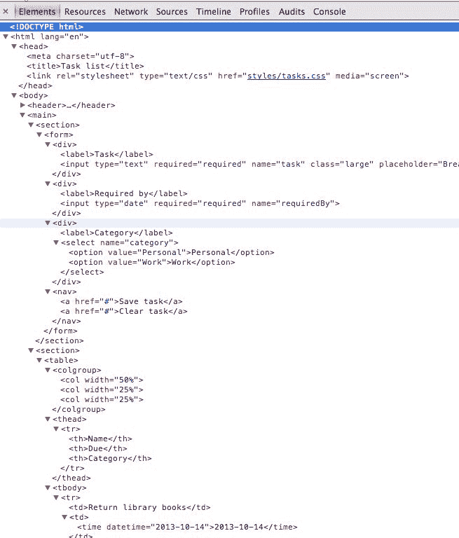

文档对象模型（DOM）是一种与技术和语言无关的 API，用于与 HTML 文档进行交互。该 API 允许开发者访问文档中的节点、遍历文档以及操作文档中的元素。

DOM 树中的每个元素都由一个对象表示。这些对象支持一个允许对其进行操作的 API。正如你在开始使用 jQuery 时会看到的，有时我们仍然会遇到原生 DOM 对象，但通常它们会被包装在 jQuery 特定版本的对象中，并暴露额外的功能。

所有支持 JavaScript 的 Web 浏览器都支持 DOM API 的 JavaScript 实现。然而，它们所支持的 API 的具体版本取决于浏览器，并且这一点加上实现中的不一致性，可能会导致 JavaScript 程序员遇到问题。

为了实际查看 DOM API，打开 Chrome 控制台并输入以下内容：

`> document`

这将返回 HTML 文档的 DOM 表示，这与我们之前在开发者工具的 Elements 选项卡中看到的表示完全相同。这可能与字面文档有所不同：例如，如果 HTML 文档格式不正确（例如缺少闭合标签），浏览器将尝试根据 HTML5 规范中指定的规则构建一个格式良好的文档表示。

DOM API 允许我们根据元素的特征来访问它们；例如，我们可以通过以下方式访问 `table` 元素：

`> document.getElementsByTagName('table')`

除了查询、遍历和操作文档之外，DOM API 还允许向文档中的节点添加事件监听器。这些监听器可用于检测用户点击按钮、在输入字段中输入文本以及许多其他类型的事件。

jQuery 并不能让你用原生 JavaScript API 无法做到的事情来操作 DOM，事实上，jQuery 是使用原生 DOM API 实现的，因此本质上是对 DOM API 的抽象或包装。

由于 jQuery 并不能做原生 DOM API 无法做到的事情，你可能会问学习 jQuery 有什么用。一方面，jQuery 提供了真正的跨浏览器 DOM API 实现，并缓解了许多浏览器实现中存在的怪异行为。

我不打算给出使用 jQuery 的全部理由，而是鼓励你完成下面的示例。它们突出了 jQuery API 的优雅和简洁，一旦你开始使用 jQuery，就很难再回到原生 DOM API。

## 开始使用 jQuery

为了使用 jQuery，你必须在 HTML 页面中包含 jQuery 库。这可以通过提供你自己的 jQuery 库副本，或者使用来自内容分发网络（CDN）的托管版本来实现，最著名的是 Google。

一般来说，对于生产部署，你应该优先选择 CDN 托管的选项。这些选项通常比托管你自己的副本为用户提供更好的性能。对于开发，我通常更喜欢下载自己的副本，因为这样就不需要网络连接来运行应用程序。

如果你希望使用 Google 托管的 jQuery 版本，只需将其包含在 HTML 文件的 head 中：

`<script src="http://ajax.googleapis.com/ajax/libs/jquery/2.0.3/jquery.min.js"></script>`

要提供你自己的副本，请从此处下载最新版本的 jQuery：

[`jquery.com/download/`](http://jquery.com/download/)

本书中的示例使用的是 2.0.3 版本，但任何较新的版本都是兼容的。

jQuery 由一个单一的 JavaScript 文件组成，可以以压缩或非压缩形式下载。非压缩形式对于调试很有用，但两种版本都适用。下载后，将该文件保存在主文件夹（包含 HTML 文件的文件夹）的一个名为 `scripts` 的子目录中。

你的目录结构现在应该如下所示：

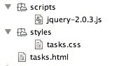

现在将以下内容添加到 HTML 文件的 head 部分：

`<script src="scripts/jquery-2.0.3.js"></script>`

## 选择

我们要用 jQuery 做的第一件事是从文档中选择元素。

选择元素本身显然没有内在价值；我们最终要对这些元素进行操作。jQuery 选择会从文档中返回零个或多个元素。更具体地说，选择会从文档中返回零个或多个 jQuery 包装的 DOM 元素。这个区别在后面的章节中会很重要。

要执行选择，只需将选择条件包含在以下结构中：

`$('<选择条件>')`

`$` 是名为 `jQuery` 的函数的别名，因此我们也可以使用以下结构：

`jQuery('<选择条件>')`

`$` 别名往往能带来更好的可读性，因此我们将在下面的章节中使用这个约定。唯一需要避免使用这个别名的情况是，如果你正在使用任何其他使用 `$` 全局变量的库：jQuery 在这种情况下确实支持无冲突模式，并允许你创建一个新的别名。

jQuery 使用的选择条件实际上与 CSS 使用的选择条件基本相同。这非常有帮助，因为这意味着你只需要学习一次选择语言，就可以同时使用 CSS 和 jQuery。

有五种核心的选择元素方式：

- 元素类型
- 元素属性
- 元素类
- 元素 ID
- 伪类

下面将简要概述所有五种方法。

选择元素的第一种方式是按类型选择。例如，如果我们想选择文档中所有的 `table` 元素，可以使用以下语法：

`> $('table')`

这个命令以及本章中的所有其他命令，都可以在加载 `tasks.html` 页面后直接在控制台中运行。该命令将返回一个包含一个元素的数组，该元素就是包含任务的表格。

如果我们想选择文档中所有的 `td` 元素，可以使用以下命令：

`> $('td')`

这将返回一个包含 9 个元素的数组。

第二种核心选择元素的方式是基于它们的某个属性。如果我们想选择所有具有 `placeholder` 属性的元素，可以使用以下选择：

`> $('[placeholder]')`

注意属性名周围使用了 `[]` 方括号。这将找到所有具有 `placeholder` 属性的元素，无论其值是什么。

此外，我们可能希望指定元素具有特定值的属性，在这种情况下，可以使用以下语法：

`> $('[datetime="2013-10-14"]')`

在这种情况下，我们混合使用了单引号和双引号，因为我们希望将值表示为选择条件字符串内部的字符串。

基于属性选择元素变得更加有用，因为可以向 HTML 元素添加自定义属性。向元素添加自定义属性允许你将数据与元素关联起来，然后以任何需要的方式使用这些数据。

例如，我们可能希望表示表格中的某个单元格代表任务的名称；因此我们可以向元素添加以下属性：

`<td data-name-field="true">`

为了快速找到所有名称字段节点，我们可以执行以下选择：

`> $('[data-name-field]')`

或者，我们可能希望将优先级与任务关联起来，因此每个 `tr` 元素可以包含以下内容：

`<tr data-priority="high">`

或

`<tr data-priority="medium">`

然后我们可以通过以下选择来选择表格中所有高优先级的行：

`> $('[data-priority="high"]')`

下面我们将看到，添加到该属性前的 `data-` 前缀不仅仅是一种约定，还带来了其他可能性。将数据直接绑定到元素上，实际上是一个非常强大的概念。它提供了一种方式，能够以代码易于理解和处理的方式为元素添加上下文，从而使同一个元素既能面向用户，又能面向计算机。

数据属性应仅使用小写字符指定，单词之间用连字符分隔。

这是 HTML 的一个良好通用规则，因为在 DOM 中所有属性都会被转换为小写。

正如我们将在下文看到的，这些属性可以通过 DOM 元素上的 `data()` 方法以对象形式返回。该方法会按如下方式转换属性名：

`data-this-is-long="true"`

会被转换为数据对象上的以下属性：

`thisIsLong=true`

在文档中选择元素的另一种方式是通过类。元素可以通过 `class` 属性被赋予一个或多个类。所有 HTML 元素都支持 `class` 属性（HTML4 中对某些元素的限制已被移除）。在 `tasks.html` 中，你会看到以下示例：

`<input type="text" required="required" name="task" class="large">`

`<tr class="even">`

类只是一个任意的名称：它是一种将原本无关的元素分组的方法，用以表示它们共享某些特征。它们通常共有的特征是应该通过 CSS 应用相同的样式，因此 `class` 属性通常纯粹与 CSS 关联。

实际上，类可以出于任何原因用于分组元素。在使用 jQuery 时，通常只为元素分配类，以便 jQuery 选择器能够高效地找到相关元素。

例如，在 `tasks.html` 中，表格的每一偶数行都被赋予了 `even` 类。所有偶数行可以通过以下选择条件选中：

> `$('.even')`

（注意选择条件开头的 `"."`。）

也可以仅通过 CSS 为每一偶数行应用特定样式：

```css
tr:nth-child(even) {
  background-color: #f8f8f8;
}
```

将类用于 CSS 匹配之外的目的并不违背 HTML5 规范的精神。规范指出，类是扩展元素的一种方式，从而有效地创建一种新类型的元素。

第四种基本选择元素的方式是基于它们的 ID。任何元素都可以通过 `id` 属性被赋予一个 ID。

ID 名称是任意的，就像类名一样，但 ID 名称在文档中必须是唯一的。

HTML5 放宽了可用于 ID 的值的规则。现在唯一的规则是：它们在文档中必须唯一，不能是空字符串，也不能包含空格。类名的规则与此相同。

元素可以按如下方式赋予 ID：

`<table id='tblTasks'>`

一旦元素被赋予 ID，就可以通过以下条件选中：

> `$('#tblTasks')`

（注意选择条件开头的 `"#"` 符号。）

最后一种选择元素的方式是通过 jQuery 过滤器。如果你熟悉 CSS，这些过滤器看起来可能与 CSS 伪类相同，并且它们本质上服务于相同的目的。

假设我们想找到 `table` 中的第一行。我们可以为该行添加一个类，但如果表格重新排序，我们需要确保更新这个类。我们也可以从表格中选择所有行放入数组，然后选取第一个元素，但这效率低下。使用过滤器，我们可以使用以下选择条件：

> `$('tr:first')`

（过滤器总是以冒号开头；因此这是组合两个选择器，一个用于选择 `tr` 元素，另一个将选择限制为在其兄弟元素中处于第一个位置的 `tr` 元素。）

过滤器也可以接受参数；因此我们可以使用以下过滤器找到表格中的任意行：

> `$('tr:eq(1)')`

这将找到表格中的第二行（计数从 0 开始）。

或者，我们可能希望找到除第一行之外的任何行，因此可以使用以下过滤器：

> `$('tr:gt(0)')`

其他有用的过滤器如下：

- `:even` 查找选择中所有偶数编号的元素。
- `:odd` 查找选择中所有奇数编号的元素。
- `:not(selection)` 查找所有不匹配选择条件的元素。
- `:checked` 查找被选中的单选按钮或复选框。
- `:selected` 查找选择框中被选中的选项。
- `:contains(text)` 查找包含给定文本的元素。
- `:empty` 查找所有没有子元素的元素。
- `:focus` 查找当前获得焦点的元素。
- `:last` 查找集合中的最后一个元素。

此外，过滤器可以简化选择输入元素的过程。由于大多数输入字段使用 `input` 元素类型，因此还需要查询 `type` 属性。jQuery 包含以下用于查找特定类型输入字段的过滤器：

- `:hidden`
- `:text`
- `:checkbox`
- `:password`
- `:radio`
- `:checkbox`
- `:file`
- `:button`

例如，以下代码选择所有 `text` 输入字段：

> `$(':text')`

jQuery 过滤器的一个优点是你实际上可以编写自己的过滤器。例如，jQuery 没有提供用于查找所有 `date` 输入类型的过滤器。因此，我们可以按如下方式向代码库添加自定义过滤器：

```javascript
jQuery.expr[':'].date = function(elem) {
  return jQuery(elem).is("input") && $(elem).attr("type") === "date";
}
```

（如果这段代码看起来不熟悉，不用担心，到本章结束时你就会熟悉了。）

执行时，文档中的所有元素（或文档的指定子树）都会被传递给该函数，并根据指定元素是否满足选择条件返回 `true` 或 `false`。调用者得到的结果是所有评估为 `true` 的元素。

该函数利用了 jQuery 的 `is` 函数。`is` 函数有点特殊，因为它返回 `true` 或 `false`，而不是一组元素。

一旦将其添加到代码库中，就可以使用以下伪类：

> `$(':date')`

现在我们已经研究了五种主要的选择机制，下一步是理解如何组合这些机制。我们已经在伪类中简要介绍了这个概念。

组合过滤器的最简单方式是当元素需要满足两个或更多选择条件时。例如，如果 `:text` 过滤器不存在，可以通过组合两个选择条件来编写它。首先，我们需要确保元素是 `input` 类型：

> `$('input')`

此外，元素必须有一个名为 `type` 的属性，其值为 `text`：

> `$('[type="text"]')`

为了连接这两个条件，可以编写一个单一的选择条件如下：

> `$('input[type="text"]')`


注意，一个条件与下一个条件之间没有空格——如果在这里放置空格，含义会不同，我们将在下文看到。

我们可以使用相同的方法同时匹配元素 `type` 和 `class`：

> `$('input.large')`

这将返回所有 `type` 为 `"input"` 且 `class` 为 `"large"` 的元素。

永远不需要将基于 ID 的选择器与其他类型的选择器组合，因为 ID 在文档中是唯一的。

除了为单个元素组合选择条件外，通常还需要选择文档特定子树内所有匹配选择条件的元素。

考虑这样一种情况：同一文档中有多个表格，但我们希望返回特定表格（例如 ID 为 `tblTasks` 的表格）的第一行。为了实现这一点，我们首先需要找到名为 `tblTasks` 的表格，然后在其子树中找到第一行。

jQuery 支持多种实现方式。最常见的方法如下：

`$('#tblTasks tr:first')`

空格表示这是两个不同的选择。jQuery 通过先选择匹配第一个选择器的元素：

`$('#tblTasks')`

然后在这些元素的子树上执行第二个选择：

`$('tr:first')`

实际上，jQuery 还提供了一种更显式的替代机制：

`$('#tblTasks').find('tr:first')`

另一种实现相同选择的方法是使用 jQuery 选择器的可选第二个参数：

`$('tr:first', '#tblTasks')`

第二个参数用于指定选择应在其内部进行的子树的根。当你确定正在处理文档的某个子树时，这种方法很有用，因为你可以将上下文赋值给一个变量，然后在所有选择中使用它：

```javascript
documentContext = $('#tblTasks');
$('tr:first()', documentContext);
```

可以在单个选择条件中指定两个以上的选择层级。例如，我们可能希望找到文档中第二个 `section` 内所有 `table` 的最后一行中的所有 `td` 元素。可以这样实现：

`$('section:eq(1) table tr:last td')`

有时我们可能需要对元素之间的关系更加精确。例如，我们可能希望选择另一个元素的直接子元素（而不仅仅是后代元素）。这可以通过使用 `>` 符号来实现，例如：

`$('select[name="category"] > option')`

这将找到特定 `select` 元素内的所有 `option` 元素，但仅当它们是选择框的直接子元素时。例如，以下选择不会返回任何结果：

`$('form > option')`

## 遍历

从 DOM 中选择一组元素是重要的一步，但只是过程中的第一步。一旦确定了一组元素，常见的第二步就是从这些元素遍历到另一组元素。

遍历函数总是从选择结果开始，然后对这些元素执行遍历操作，返回一组新的元素。

一个常见的遍历需求是从一个元素或一组元素遍历到它们的兄弟元素。例如，在 `tasks.html` 中，输入字段及其标签是兄弟元素，因为它们共享同一个父元素。

基于兄弟元素的查询可以通过 `siblings` 函数实现。如果我们想找到名为 `category` 的选择框的所有兄弟元素，可以执行以下查询：

`$('select[name="category"]').siblings()`

如果我们希望将兄弟元素限制为 `label` 类型的元素，可以向 `siblings` 函数添加一个选择器：

`$('select[name="category"]').siblings('label')`

另外两个类似的函数是 `next` 和 `prev`。它们分别返回所选元素的下一个和上一个兄弟元素。例如，以下代码返回文档中所有标签的下一个兄弟元素：

`$('label').next()`

而以下代码返回文档中所有输入字段的上一个兄弟元素：

`$('input').prev()`

同样，这些函数在必要时也接受选择条件。

另一个常见的遍历需求是找到给定元素或元素组的特定父元素。例如，我们可能希望找到所有输入字段的父元素。这可以通过 `parent` 函数实现：

`$('input').parent()`

我们也可以将其限制为父元素是 `div` 的输入字段：

`$('input').parent('div')`

该函数的一个轻微变体是 `parents` 函数。它不返回直接父元素，而是返回所有满足选择条件的祖先元素。例如，以下代码返回每个输入字段的祖先 `section` 元素：

`$('input').parents('section')`

同一主题的另一个变体是 `closest` 函数。它允许我们找到与给定选择条件匹配的最近祖先，从初始选择中的特定节点集开始。它首先检查所选节点是否符合条件，然后沿着 DOM 树向上查找，直到找到匹配项。例如，如果我们想找到每个 `label` 最近的 `div`，可以使用以下选择：

`$('label').closest('div')`

遍历函数的另一个例子是返回 `last` 元素。正如我们所见，选择器本身也支持伪类来实现这一点。例如，以下代码返回任务表的最后一行：

`$('#tblTasks tr').last()`

与所有遍历函数一样，`last` 函数也支持一个表示选择条件的参数，允许你找到满足特定条件的最后一个元素。

到目前为止，我们研究的遍历函数都返回一组新的元素，通常不包含原始选择中的任何元素。在某些情况下，保留原始选择同时包含遍历过程中找到的额外元素是很有用的。例如，假设我们返回了一组输入字段，现在希望结果集中也包含所有标签。可以通过以下方式实现：

`$('input').add('label')`

实现这一点的类似机制是，在上述任何遍历函数中添加一个请求，要求同时添加原始元素。例如，以下调用将返回所有标签及其最近的 `div` 元素：

`$('label').closest('div').andSelf()`

这行代码是引入另一个重要主题的好时机：链式调用。由于大多数 jQuery 函数调用返回一个元素数组，并且大多数 jQuery 函数调用可以在元素数组上调用，因此很容易将一组函数调用链接在一起，每个函数作用于前一个调用返回的元素。这个过程几乎可以无限继续，例如：

`$('input').parents('div').last().siblings().children()`

如果我们追踪这个过程，它执行了以下操作：

1. 找到所有 `input` 元素。
2. 找到这些元素的 `parents` 中的任何 `div` 元素。
3. 将结果集限制为最后一个 `div` 元素。
4. 找到它的兄弟元素。
5. 找到它们的子元素。

链式调用允许非常简洁的代码，但也有变得密集且难以阅读的风险。

---

这与 UNIX 管道类似。管道允许将多个应用程序链接在一起，一个应用程序的输出成为另一个应用程序的输入。在 UNIX 中，实现这一点的关键设计决策是应用程序在标准输出上返回文本，并在标准输入上接受文本。在 jQuery 中，实现这一点的关键设计决策是函数可以在元素数组上调用，并且这些函数返回元素数组。

## 操作

前两节关于选择和遍历的内容向你展示了如何从文档中选择一组元素。本节将介绍一旦你获得了一组要操作的元素，如何操作文档。

如果你查看 `tasks.html` 文档，你会看到表格的第二行有一个名为 `even` 的类。基本思想是表格中的每隔一行将被赋予 `even` 类，这将改变行的背景颜色，使表格更易于阅读。

如前所述，实际应用程序最好使用 CSS 来实现此功能，但使用 jQuery 来实现它是对 DOM 操作的一个很好的介绍。

在开始本节之前，请从 `table` 的第二行中移除 `even` 类。之后，在浏览器中刷新 `tasks.html` 页面，确保所有行都具有白色背景。

为了操作元素，我们必须先选中它们。现在选择标准应该相当熟悉了。我们首先找到 `table` 主体中的所有 `even` 行（这确保我们不会更改标题行的背景）：

```javascript
$('tbody tr:even')
```

这实际上会返回两行，因为 jQuery 从 0 开始计数，所以表格的第一行和第三行会被返回。这仍然符合我们的需求，因为我们真正关心的只是每隔一行有阴影。

然后我们可以按如下方式操作这些行：

```javascript
$('tbody tr:even').addClass('even')
```

一旦执行这段代码，你就会看到 DOM 更新，表格的相关行会以新的背景色显示阴影。

除了添加类，我们还可以使用 `removeClass` 移除类，以及使用 `toggleClass` 切换类。切换是一种特别有用的技术，因为如果元素已有该类则移除它，如果元素没有该类则添加它。这将在本书后面的示例中使用。

我们可能希望实现的另一个需求是，在所有必填字段的标签旁边添加一个红色的 *。我们知道如何找到所有必填字段：它们就是带有 `required` 属性的字段（无论该属性被赋予什么值）：

```javascript
$('[required]')
```

我们还可以按如下方式找到它们的标签：

```javascript
$('[required="required"]').prev('label')
```

文件 `tasks.css` 中还包含一个名为 `required` 的类，定义如下：

```css
.required {
  color: red;
}
```

为了将 * 追加到 `label` 中，我们将 * 包含在一个 `span` 内，并将该 `span` 放入 `label` 中。这确保了它与标签本身分离。我们可以按如下方式动态地将 `span` 追加到 `label`：

```javascript
$('[required="required"]').prev('label').append('<span>*</span>')
```

如果执行此操作，你会注意到屏幕上的两个标签末尾出现了一个 *。

这还不是最终结果，我们还需要将适当的类添加到新的 `span` 上；因此刷新屏幕以移除这些更改。

你可能已经注意到，上述调用的结果是已被修改的标签（而不是追加到它们上面的 `span`）。因此，我们需要选中这些元素的子 `span`，并将 `required` 类添加到它们：

```javascript
$('[required="required"]').prev('label').append('<span>*</span>').children('span').addClass('required')
```

再次强调，通过链式调用，我们成功地在单行代码中完成了整个操作。

需要理解的一个重要方面是，这些更改实时更新了文档对象模型。为了看到这一点，高亮其中一个红色的 *，然后从右键菜单中选择“检查元素”（这是快速在开发者工具的“元素”选项卡中找到特定元素的快捷方式）。你将看到以下内容：

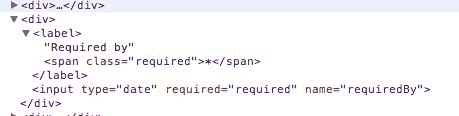

jQuery 的许多操作函数都可以用于在现有内容之前或之后插入新内容。`append` 用于在特定元素内部插入内容，但其他示例包括：

- `after`：在每个元素之后添加内容，使新内容成为原始元素的下一个兄弟元素。如果我们在上面的示例中使用它，`span` 将出现在结束的 `label` 标签之后。
- `before`：与 `after` 类似，只是新元素会出现在原始元素之前。如果我们在上面的示例中使用它，`span` 将立即出现在 `label` 元素之前。
- `prepend`：在元素的开头创建一个新的子元素（与 `append` 在元素末尾创建子元素相反）。如果我们在上面的示例中使用它，* 将出现在 `label` 文本的左侧，但 `span` 仍然是 `label` 的子元素。
- `remove`：从文档中完全移除一个元素。你可以用它来移除新添加的 `span` 元素。
- `replaceWith`：用一个新元素或一组元素替换一个元素或一组元素。

在上面的示例中，我们一直在向现有元素添加内容。除了向元素添加内容，还可以创建内容并将其添加到元素中。例如，以下是一个有效的 jQuery 调用：

```javascript
$('<span>*</span>')
```

这会返回由 HTML 指定的元素，尽管该元素此时显然不是 DOM 的一部分。然后可以调用操作函数将该元素添加到文档中：

```javascript
$('<span>*</span>').appendTo('label')
```

这会将一个 * 作为子元素追加到文档中的每个 `label` 中。这种方法也可以与以下函数一起使用：

- `insertBefore`：该函数将新元素作为指定元素或元素组的兄弟元素，但将它们放在 DOM 中的指定元素之前。
- `insertAfter`：该函数将新元素作为指定元素或元素组的兄弟元素，但将它们放在 DOM 中的指定元素之后。
- `prependTo`：该函数将新元素作为指定元素或元素组的子元素，但将它们放在元素的开头，使它们成为第一个子元素。

以这种方式插入的元素可以是任何 HTML 元素或元素组，包括从文档中选中的元素。

除了向 DOM 添加新内容外，一些操作函数还作用于单个元素的特性，要么返回关于它们的信息，要么操作这些信息。例如，要查找文档中 `select` 元素的值，我们可以执行：

```javascript
$('select').val()
```

如果我们想更改当前值，可以向同一个函数传递一个值。如果执行以下操作，`select` 字段的值将立即更改：

```javascript
$('select').val('Work')
```

关于此调用需要注意的重要一点是，如果注册了任何事件监听器来检测此元素的更改，它们不会通过此调用得到通知。

为了通知任何监听器元素已更改，可以使用以下调用：

```javascript
$('select').val('Work').change()
```

事件监听器将在本章后面详细介绍。

其他类似的函数有：

- `html`：返回或操作元素的 HTML。
- `text`：返回元素的文本（或内容）。`text` 是元素标签之间的内容。
- `attr`：返回或操作元素上某个属性的值。

这些函数与我们之前研究的一些函数略有不同，因为它们只作用于单个元素。例如，如果你执行以下操作：

```javascript
$('div').html()
```

只会返回匹配元素集合中第一个元素的 HTML，而不是所有元素的 HTML。一些 jQuery 函数本质上就受到这种限制。为了在多个元素上执行这些函数，需要遍历这些元素。这将在本章后面展示。

## 事件

接下来要理解的 jQuery 方面是事件。在编写 Web 应用程序时，应用程序需要响应用户发起的事件。

这些事件可以是以下任何一种：

- 点击链接或按钮。
- 双击按钮或链接。
- 更改文本字段中的值。
- 在输入字段中按下特定键。
- 在选择列表中选择一个选项。
- 聚焦于输入字段。
- 鼠标悬停在一个元素上。

除了这些用户发起的事件外，应用程序可能还希望响应浏览器发起的事件，例如：

- 文档加载完成。
- 浏览器窗口大小改变。
- 发生错误。

本节将首先解释事件监听器的注册方式，然后详细探讨其中一些事件。

在开始之前，我们将把上述示例永久添加到 `tasks.html` 页面中。为此，请在结束的 `</html>` 标签之前立即添加以下代码块：

```html
<script>
 $('[required="required"]').prev('label').append('<span>*</span>').children('span').addClass('required');

 $('tbody tr:even').addClass('even');
</script>
```

这是一段内联 JavaScript 代码。我们最终会为 Web 应用提供更完善的结构，并将此类代码从 HTML 页面中移除，但目前这是将 JavaScript 代码包含在网页中的简单方式。

现在，我们将开始为正在开发的示例 Web 应用添加一个简单的事件。首先，我们将屏幕的任务创建部分（位于第一个 `section` 元素内）定义为在首次进入屏幕时隐藏。

我们还会为其提供一个 `id`，以便轻松引用：

```html
<section id="taskCreation" class="not">
```

`not` 类在 `tasks.css` 中定义，提供了一种隐藏元素的简单机制。其定义如下：

```css
.not {
  display: none;
}
```

接下来，我们将修改带有文本“Add Task”的链接，为其添加一个 `id`。这样我们就可以更方便地使用 jQuery 选择它：

```html
<a href="#" id="btnAddTask">Add task</a>
```

最后，我们将以下代码添加到 `tasks.html` 的脚本部分：

```javascript
$('#btnAddTask').click(function(evt) {
  evt.preventDefault();
  $('#taskCreation').removeClass('not');
});
```

这段代码将在下面详细解释。

整个页面现在应如下所示（更改部分以粗体突出显示）：


```html
<!DOCTYPE html>

<html lang="en">

<head>

<meta charset="utf-8">

<title>Task list</title>

<link rel="stylesheet" type="text/css" href="styles/tasks.css"

 media="screen" />

<script src="scripts/jquery-2.0.3.js"></script>

</head>

<body>

 <header>

 <span>Task list</span>

 </header>

 <main>

 <section id="taskCreation" class="not">           <form>

 <div>

 <label>Task</label> <input type="text" required="required"

 name="task" class="large" placeholder="Breakfast at Tiffanys" />

 </div>

 <div>

 <label>Required by</label> <input type="date" required="required"

         name="requiredBy" />

 </div>

 <div>

 <label>Category</label> <select name="category">

 <option value="Personal">Personal</option>

 <option value="Work">Work</option>

 </select>

 </div>

 <nav>

 <a href="#">Save task</a> <a href="#">Clear task</a>

 </nav>

 </form>

 </section>

 <section>

 <table id="tblTasks">

 <colgroup>

 <col width="50%">

 <col width="25%">

 <col width="25%">

 </colgroup>

 <thead>

 <tr>

 <th>Name</th>

 <th>Due</th>

 <th>Category</th>

 </tr>

 </thead>

 <tbody>

 <tr>

 <td>Return library books</td>

 <td><time datetime="2013-10-14">2013-10-14</time></td>

 <td>Personal</td>

 </tr>

 <tr>

 <td>Perform project demo to stakeholders</td>

 <td><time datetime="2013-10-14">2013-10-14</time></td>

 <td>Work</td>

 </tr>

 <tr>

 <td>Meet friends for dinner</td>

 <td><time datetime="2013-10-14">2013-10-14</time></td>

 <td>Personal</td>

 </tr>

 </tbody>

 </table>

 <nav>

 <a href="#" id="btnAddTask">Add task</a>

 </nav>

 </section>

 </main>

 <footer>You have 3 tasks</footer>

</body>

<script>

 $('[required="required"]').prev('label').append( '<span>*</span>').children( 'span').addClass('required');

 $('tbody tr:even').addClass('even');

 $('#btnAddTask').click(function(evt) {

 evt.preventDefault();

 $('#taskCreation').removeClass('not');

 });

</script>

</html>
```

如果重新加载页面，您应该会看到任务创建部分（包含所有输入字段）在页面初始加载时不会显示。但是，如果您单击“Add task”按钮，该部分将立即出现。

查看事件处理代码，您会发现一些熟悉的特性。首先，我们使用标准的 jQuery 选择条件来选择要添加事件监听器的元素：

> `$('#btnAddTask')`

接着，我们在此元素上调用相应的 jQuery 函数来添加点击监听器；该函数名为 `click`，它接受一个 JavaScript 函数作为参数。在此示例中，传递给 `click` 函数的 JavaScript 函数是即时创建的匿名函数。也可以写成如下形式：

```javascript
function btnAddClicked(evt) {

 $(evt.target).preventDefault();

 $('#taskCreation').removeClass('not');

}

$('#btnAddTask').click(btnAddClicked);
```

我们传递给 `click` 函数的技术术语是**回调**。这是因为该函数不会立即执行，而是在特定事件发生时（用户点击按钮）才执行。与许多其他 JavaScript 库一样，jQuery 广泛使用回调，我们将在后续章节中看到更多示例。

您还会注意到我们的函数接受一个名为 `evt` 的参数。当 jQuery 调用我们传递给它的函数时，它会提供一个表示已发生事件的对象作为参数。

从事件对象中获取的最有用的特性是触发事件的元素。同一个事件监听器可能被添加到多个元素上，因此我们经常需要找出是哪个元素触发了事件。可以通过以下方式从事件对象中提取：

`evt.target`

可能不是立即显而易见，但作为目标返回的对象是一个普通的 DOM 对象，而不是 jQuery 包装的 DOM 对象。这听起来像是一个小细节，但意味着无法在此元素上调用 jQuery 函数。例如，如果我们尝试在此元素上调用 `html` 函数，将会出现以下错误：

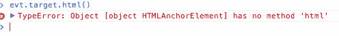

每当您遇到原生 DOM 对象时，可以通过选择它轻松地将其转换为 jQuery 包装对象：

`$(evt.target)`

这样做的结果将暴露所有标准的 jQuery 功能：

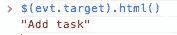

您还会注意到点击处理程序中的以下代码行：

`evt.preventDefault();`

单个元素可以附加多个事件监听器。其中一些由应用程序显式添加，但浏览器可能会隐式添加其自身的操作。这些隐式的事件监听器称为元素的默认操作；例如，超链接有一个默认操作，即在被点击时调用其指定的 URL。

在此 Web 应用中，我们不希望超链接表现出这种默认行为，否则每次用户点击按钮时页面都会刷新。因此，我们在事件上调用 `preventDefault`，以指示应抑制元素的默认操作。

使用超链接而不是按钮元素是个人偏好。历史上许多设计师更喜欢超链接，因为它们通常更容易设置样式，使用起来也更灵活。然而，在这些情况下，有强有力的论据支持使用按钮元素。

此事件处理程序的最后一个方面是移除导致该元素隐藏的类，现在这应该是熟悉的代码：

`$('#taskCreation').removeClass('not');`

可以为任何 HTML 元素添加点击监听器。例如，我们可以为 `table` 添加一个功能，使得当用户点击某一行时，该行会以粗体突出显示。如果再次点击该行，则恢复正常。

`tasks.css` 文件中已经包含一个可以将元素文本设置为粗体的类：

```css
.rowHighlight {

 font-weight:bold;

}
```

作为此代码的首次尝试，我们将尝试将以下内容添加到 `tasks.html` 的脚本块中：

```javascript
$('tbody tr').click(function(evt) {

 $(evt.target).toggleClass('rowHighlight');

});
```

这将为 `table` 主体中的所有行添加一个点击监听器。当被调用时，它会将 `rowHighlighted` 类添加到被点击的元素上。

如果你调试这段代码，你会注意到 `evt.target` 的值实际上是被点击的元素（`td` 元素），而不是 `tr` 元素，因此只有单个单元格会以粗体高亮显示。

下一章将讨论调试 JavaScript 代码。如果你不熟悉 Chrome 调试器，并希望亲自查看效果，可以跳转到那一章。

作为第二次尝试，我们可以尝试找到被点击元素的父级 `tr` 元素，并将该类添加到该元素上。这同样行不通，因为 `td` 元素在 `tasks.css` 中被定义为普通字体样式，因此它们不会从父元素继承字体样式。

我们想要做的是将此类添加到所选行中的所有 `td` 元素。我们可以尝试如下操作：

```javascript
$('tbody tr').click(function(evt) {
 $(evt.target).siblings( ).toggleClass( 'rowHighlight');
});
```

这里还有两个问题。`siblings` 函数返回所有兄弟元素的集合，但排除了被点击的元素，因此除了被点击的单元格之外的所有单元格都会高亮显示。我们可以通过以下方式解决：

```javascript
$('tbody tr').click(function(evt) {
 $(evt.target).siblings() .andSelf( ).toggleClass( 'rowHighlight');
});
```

下一个问题是包含 `time` 元素的 `td` 元素。如果点击了 `time` 元素，兄弟元素列表将为空，因为 `time` 元素没有任何兄弟元素。因此，在查找兄弟元素之前，我们需要先找到离被点击元素最近的 `td` 元素。

如前所述，`closest` 函数首先检查所选元素，如果不符合要求，则向上遍历 DOM 树。因此，离 `td` 最近的 `td` 就是它本身，但离 `time` 元素最近的 `td` 是其父元素。

因此，以下代码满足我们的需求：

```javascript
$('tbody tr').click(function(evt) {
 $(evt.target).closest( 'td').siblings( ).andSelf( ).toggleClass( 'rowHighlight');
});
```

最后，请注意我们使用了 `toggleClass` 函数。与其检查元素是否具有 `rowHighlight` 类，然后根据情况添加或移除，不如让 jQuery 为我们处理。

在上面的示例中，我们在页面加载时为文档中的元素添加了事件监听器。事件监听器的一个复杂之处在于，我们可能希望将它们添加到尚未出现在文档中的元素上。由于我们可以动态地向 DOM 添加元素，因此我们可能希望当这些元素满足特定选择条件时，自动为它们添加事件监听器。

考虑一下高亮显示表格中选中行的事件监听器，我们可能希望即使在页面加载后动态添加行，该功能也能正常工作。

幸运的是，jQuery 通过 `on` 函数提供了一个优雅的解决方案。解决方案的第一部分涉及指定文档中可能包含新元素的部分，在我们的例子中可能是：

```javascript
$('#tblTasks tbody')
```

或者，我们可以说希望将事件监听器添加到文档中任何位置的新元素上：

```javascript
$(document)
```

接下来，我们指定要附加的事件监听器类型、要添加事件监听器的元素类型以及要执行的回调函数。

为了演示这一点，我们将添加一个点击监听器，以便能够删除表格中的每一行。

在开始之前，我们需要在表格主体的每一行中添加导航按钮。在 `tbody` 中的每一行 `</tr>` 之前立即添加以下内容（共有 3 行）：

```html
<td>
 <nav>   
 <a href="#" class="editRow">编辑</a>
 <a href="#" class="completeRow">完成</a>
 <a href="#" class="deleteRow" >删除</a>
 </nav>
</td>
```

此外，在表格标题的 `</tr>` 之前立即添加一个新的标题单元格：

```html
<th>操作</th>
```

最后，为了确保列宽正确，按如下方式更改表格的列组：

```html
<colgroup>
 <col width="40%">
 <col width="15%">
 <col width="15%">
 <col width="30%">
</colgroup>
```

为了验证更改，执行以下代码应返回三个元素：

```javascript
$('.deleteRow')
```

现在我们可以按如下方式添加事件监听器：

```javascript
$('#tblTasks tbody').on('click', '.deleteRow',   function(evt) {
 evt.preventDefault();
 $(evt.target).parents('tr').remove();
});
```

当点击具有 `deleteRow` 类的元素时，此事件监听器将找到该元素的父级 `tr` 元素：

```javascript
$(evt.target).parents('tr')
```

然后使用 `remove` 函数从文档中移除该元素。

当然，这适用于页面加载时表格中已有的三行。如果你想证明这种方法也适用于直接添加到 DOM 的行，可以使用以下代码向表格添加新行：

```javascript
$('#tblTasks tbody tr:first' ).clone().insertAfter('#tblTasks tbody tr:last')
```

此代码将选择表格的第一行，克隆它以创建新行，然后将其插入表格的最后一行之后。然后，你可以使用其删除按钮从表格中删除该行，而无需显式地向该按钮添加事件监听器。

早期版本的 jQuery 使用名为 `live` 的函数来添加动态事件监听器。该函数已被弃用，不应再使用。

到目前为止，我们主要关注点击事件。jQuery 还可以监听许多其他事件。以下是其他常见事件，它们的工作方式基本相同：

- `dblclick`：当元素被快速连续点击两次时触发。
- `hover`：当鼠标悬停在元素上时触发。
- `mousedown`：当鼠标按钮被按下时触发，在按钮释放之前。
- `mouseup`：当鼠标按钮被释放时触发。
- `keypress`：每次用户在元素（如文本字段）中键入一个键时触发。
- `keydown`：当用户按下键时触发，但在输出反映到屏幕之前。这允许你使用 `preventDefault` 阻止该操作。
- `blur`：当焦点离开表单字段时触发。当你希望在用户完成输入后验证内容时，这很有用。
- `change`：当表单字段的值发生变化时触发。
- `focus`：当表单字段获得焦点时触发。

有关事件的完整列表，请参阅 jQuery 文档。

在结束本节之前，我们将进行一个小改动，以确保我们的事件处理程序不会在 DOM 完全构建之前添加。理想情况下，我们希望在所有资源（如图像）尚未加载的情况下，在 DOM 构建完成后开始处理脚本。由于 JavaScript 的工作方式，它可能在 DOM 加载完成之前就开始处理，在这种情况下，选择元素时元素可能不可用：

严格来说，在我们的例子中，我们不需要担心这一点，因为我们的脚本声明在页面底部。但即使在这种情况下，使用下面建议的方法也是一个好习惯。

为了检测 DOM 是否已完全加载，我们可以监听 `ready` 事件：

```javascript
$(document).ready()
```

与所有事件监听器一样，它接受一个回调函数，因此我们将代码更改如下：

```javascript
$(document).ready(function() {
 $('[required="required"]').prev('label').append( '<span>*</span>').children( 'span').addClass('required');
 $('tbody tr:even').addClass('even');
 $('#btnAddTask').click(function(evt) {
 evt.preventDefault();
 $('#taskCreation').removeClass('not');
 });
 $('tbody tr').click(function(evt) {
```

```javascript
 $(evt.target).closest('td').siblings( ).andSelf( ).toggleClass( 'rowHighlight' );

 });

 $('#tblTasks tbody').on('click', '.deleteRow', function(evt) {

     evt.preventDefault();

 $(evt.target).parents('tr').remove();

 });

});
```

如果需要延迟代码执行直到所有资源加载完毕，可以使用 `load` 事件：

```javascript
$(document).load()
```

## 编写 jQuery 插件

jQuery 之所以如此流行，原因之一就是编写与 jQuery 集成的插件非常简单。这导致了大量在 MIT 许可下免费提供的插件，同时也允许你编写自己的自定义插件。

jQuery 插件通常通过对一个元素或一组从 jQuery 选择返回的元素执行操作来工作。就像标准的 jQuery 函数一样，根据插件的编写方式，它可能能够作用于整个元素集，也可能只作用于单个元素。

在本节中，我们将编写一个插件，该插件可以在使用 jQuery 选择的 `form` 元素上执行。这个插件将返回一个对象，其中对象的属性名是表单字段名，值是字段的值。实际上，这个插件将把表单上的值序列化为一个对象。我们还将允许这个插件以相反的方向操作：将对象反序列化到 `form` 上。

这个插件将利用约定编程（programming by convention）。我们将假设对象名称和表单字段名称始终匹配，尽管代码中没有任何内容强制要求这一点。


约定编程确实有缺点。例如，如果有人更改了字段的名称，这将导致从该表单序列化的对象上的属性发生变化，进而可能破坏其他期望这些属性是什么的代码。然而，约定编程可以显著减少实现功能所需的代码量。

在`jQuery`中，插件通过将`jQuery`函数传递给插件函数来工作，插件函数随后通过创建一个包含一组新函数的对象来扩展`jQuery`函数。

理解这个过程并不是特别重要，但向`jQuery`添加新函数的样板代码如下所示：

```javascript
(function($) {

 $.fn.extend({

 action: function() {}

 });

})(jQuery);
```

在这种情况下，我们添加了一个名为`action`的新`jQuery`函数。然后可以像这样调用它：

```javascript
> $('div').action()
```

在函数内部，我们可以使用`this`变量来访问函数执行所针对的元素或元素集，例如在上面的例子中，就是所有的`div`元素。这要么表示一个`jQuery`元素数组，要么表示一个单独的`jQuery`元素。在我们的示例中，我们总是假设`this`是一个单独的元素。

首先，我们将编写一个基本版本的序列化函数，它只是将`form`的内容写入控制台日志：

```javascript
(function($) {

 $.fn.extend({

 toObject: function() {

 console.log(this.serialize());

 }

 });

})(jQuery);
```

这个实现向`jQuery`添加了一个名为`toObject`的新函数，并将利用`jQuery`中已有的一个函数，该函数将表单序列化为字符串。

将此代码添加到网页的脚本部分，刷新网页，然后点击“添加任务”。在所有字段中输入值，然后调用：

```javascript
> $('form').toObject()
```

这应该会打印出一个包含表单内容的文本字符串。

现在我们有了一个基本实现，可以开始编写返回一个包含从表单填充的属性的对象所需的代码了。

虽然`jQuery`没有将表单序列化为对象的函数，但它确实有一个将表单序列化为数组的函数。这个函数返回一个数组，其中每个表单字段由数组中的一个元素表示，并包含一个名称和一个值。要查看这个函数的实际效果，请执行以下操作：

```javascript
> $('form').serializeArray()
```

我们将以此作为实现的基础，并使用一个名为`each`的`jQuery`辅助函数来遍历数组：

```javascript
$.each($('form').serializeArray(), function(i, v) {

});
```

`jQuery`有许多以“`$.`”为前缀的实用函数。与其他`jQuery`函数不同，这些函数不用于选择元素，也不能在元素集上调用。

这个特定的函数将遍历一个数组，并将每个索引和值传递给提供的回调函数。要查看实际效果，请尝试执行以下操作：

```javascript
> $.each([1,4,8,16,32], function(i, v) {

 console.log('index: '+i);

 console.log('value: '+v)

});
```

这应该会打印出：

```text
index: 0

value: 1

index: 1

value: 4

index: 2

value: 8

index: 3

value: 16

index: 4

value: 32
```

与标准的`JavaScript` `for`和`while`循环不同，`$.each`辅助函数能够遍历数组和对象。

现在`toObject`的骨架已经就位，我们可以按如下方式完成实现：

```javascript
(function($) {

 $.fn.extend({

 toObject: function() {

 var result = {}

 $.each(this.serializeArray(), function(i, v) {

 result[v.name] = v.value;

 });

 return result;

 }

 });

})(jQuery);
```

如果你现在执行以下操作：

```javascript
> o = $('form').toObject()
```

变量`o`将包含一个对象，其属性反映了表单中字段的名称。因此，可以执行以下操作：

```javascript
> o.task
```

你会注意到，实现开始时创建了一个空对象。然后为每个表单元素向对象添加属性。实现使用`[]`括号方式添加属性，而不是使用“`.`”符号。这一点很重要，因为字段的名称在使用“`.`”符号时可能不符合`JavaScript`所需的标准。

现在我们有了一个`toObject`函数，我们可以添加第二个函数来将对象反序列化回表单。为了添加第二个函数，我们只需在创建用于扩展`jQuery`的对象中创建一个新属性。这个函数将被称为`fromObject`，并接受一个对象作为参数：

```javascript
(function($) {

 $.fn.extend({

 toObject: function() {

 var result = {}

 $.each(this.serializeArray(), function(i, v) {

 result[v.name] = v.value;

 });

 return result;

 },

 fromObject: function(obj) {

 }

 });

})(jQuery);
```

这个函数的第一个任务是从调用该函数的`form`中提取所有表单字段（同样，这将由`this`变量表示）。我们可以通过以下方式提取输入字段：

```javascript
this.find('input')
```

唯一的问题是这不会包括选择框，因为它们不被视为输入字段类型。幸运的是，`jQuery`提供了一个选择器，可以返回所有输入字段，包括选择字段：

```javascript
this.find(':input')
```

一旦找到所有表单字段，实现将遍历所有字段并提取它们的`name`属性。然后它会在对象中查找具有该名称的属性，如果存在，则根据属性的值设置字段的值：

```javascript
fromObject: function(obj) {

 $.each(this.find(':input'), function(i,v) {

 var name = $(v).attr('name');

 if (obj[name]) {

 $(v).val(obj[name]);

 } else {

 $(v).val('');

 }

 });

}
```

你会注意到我们在对`v`的引用周围添加了`$()`结构。这是因为返回的值是一个原生`DOM`对象；因此，为了使用`attr`方法，有必要将它们转换为`jQuery`对象。

有了这个实现，你应该能够更改表单中的值，然后调用以下命令将其重新填充回存储在`o`变量中的原始值：

```javascript
> $('form').fromObject(o)
```

`jQuery`插件的最终版本如下：

```javascript
(function($) {

 $.fn.extend({

 toObject: function() {

 var result = {}

 $.each(this.serializeArray(), function(i, v) {

   result[v.name] = v.value;

 });

 return result;

 },

 fromObject: function(obj) {

 $.each(this.find(':input'), function(i,v) {

  var name = $(v).attr('name');

 if (obj[name]) {

   $(v).val(obj[name]);

 } else {

 $(v).val('');

 }

   });

 }

 });

})(jQuery);
```

## 使用现有插件

在编写自己的插件之前，最好先检查是否有现成的插件能满足你的需求。互联网上有大量的插件库可供使用。有些插件得到了良好的支持并被广泛使用；另一些则无人维护，或只有少数人使用。

大多数插件都采用`MIT`许可证发布，这意味着你可以根据需要以任何方式修改它们。

在本节中，我们将使用一个用于从模板生成`HTML`的插件。我们将使用的插件是`jQuery Template`，可在此处获取：

[`github.com/BorisMoore/jquery-tmpl`](https://github.com/BorisMoore/jquery-tmpl)

你可以选择下载`jquery.tmpl.js`或`jquery.tmpl.min.js`。

或者，你也可以使用以下`CDN`版本：

[`ajax.aspnetcdn.com/ajax/jquery.templates/beta1/jquery.tmpl.js`](http://ajax.aspnetcdn.com/ajax/jquery.templates/beta1/jquery.tmpl.js)

当库的名称中包含`.min`时，它实际上与不带`.min`的版本完全相同，只是经过了压缩。压缩`JavaScript`文件以提高下载速度是很常见的做法，但有些人（错误地）也将其视为一种混淆代码以防止复制的手段。

如果你想进一步研究这个主题，或者压缩自己的文件，请访问以下网站：

[`developers.google.com/speed/articles/compressing-javascript`](https://developers.google.com/speed/articles/compressing-javascript)

这个插件最初计划成为`jQuery`核心库的一部分，但这些计划并未实现。该库现在基本上已无人维护，但仍然是一个有用的模板库，这里主要用它来演示`jQuery`插件的使用。

如果你希望在项目中使用一个受支持的模板库，我推荐`Underscore`库，它提供了功能类似的模板功能。

要使用下载版的`jQuery Template`，首先将其复制到项目的`scripts`文件夹中。放置好后，在页面的`head`部分添加以下内容，但要放在主`jQuery`导入之后：

```html
<head>
<meta charset="utf-8">
<title>任务列表</title>
<link rel="stylesheet" type="text/css" href="styles/tasks.css" media="screen" />
<script src="http://ajax.googleapis.com/ajax/libs/jquery/2.0.3/jquery.min.js"></script>
<script src="scripts/jquery-tmpl.js"></script>
</head>
```

你可能注意到，不再需要指定脚本文件的语言为`"text/javascript"`。`HTML5`默认假设脚本是`JavaScript`。

这就是开始使用`jQuery Template`插件所需的全部操作。当脚本加载时，它会自动向`jQuery`添加新功能，就像我们自己的自定义插件向`jQuery`添加新功能一样。

当通过表单创建新任务时，我们需要动态地将它们添加到`table`中；这意味着要在表格中创建一个新的`tr`元素，并添加相应的`td`列。

我们可以直接使用`jQuery`来实现这一点：生成一个表示`HTML`的字符串，然后将其追加到表格中。正如本章前面所见，可以直接从`HTML`生成元素并将其添加到`DOM`中。

然而，在代码中构建`HTML`容易出错，如果我们能将行的基本结构写成`HTML`，并为动态内容留下占位符，那将更加方便。

模板库在软件开发中被广泛使用。与`jQuery template`类似，它们提供了基本的控制结构，如循环和分支，并允许为参数设置占位符。

`jQuery template`允许我们在`HTML`页面中定义以下模板：

```html
<script id="taskRow" type="text/x-jQuery-tmpl">
<tr>
 <td>${task}</td>
 <td><time datetime="${requiredBy}"> ${requiredBy} </time></td>
 <td>${category}</td>
 <td>
 <nav>
 <a href="#">编辑</a>
  <a href="#">完成</a>
  <a href="#" class="deleteRow">删除</a>
 </nav>
 </td>
</tr>
</script>
```

这可以添加到页面的最底部，在`</html>`之前（不要放在其他`script`块内部）。注意，这本质上只是一个`HTML`块，只是其中包含了值的占位符。占位符位于`${}`结构中。

另外请注意，这不是一个标准的`JavaScript`块，因为它被定义为`text/x-jQuery-tmpl`类型。该块还包含一个`ID`，这在标准脚本块中通常是不需要的。

现在我们将实现一个基本版本的保存功能。首先，为保存按钮添加一个`ID`：

```html
<a href="#" id="saveTask">保存任务</a>
```

接下来，为保存任务按钮添加一个`click`事件监听器。它将使用我们在上一节开发的插件将表单数据转换为一个对象。然后，它将把这个对象传递给上面构建的模板。注意，模板中的占位符名称与任务对象上出现的属性名称相匹配。

模板将生成一个`HTML`块，然后我们将其追加到表格主体中。将以下代码添加到`tasks.html`的`script`部分，与其他事件处理程序放在一起：

```javascript
$('#saveTask').click(function(evt) {
 evt.preventDefault();
 var task = $('form').toObject();
 $('#taskRow').tmpl(task).appendTo($('#tblTasks tbody'));
});
```

如你所见，两行代码就足以将表单转换为对象，并将内容包含到`table`中，而且可以相对轻松地将其压缩为一行。

如上所述，这是一个基本版本的保存功能。例如，它不包含任何验证；因此你可以向表格中添加无效数据。这个问题以及其他一些小问题，将在几章后我们开始将其转变为真正的`Web`应用程序时得到修复。

现在保存功能已经实现，我们可以移除每次页面加载时默认添加到表格中的三行，并使用“添加任务”和“保存任务”功能来添加行。此外，添加的行应该能够通过“删除任务”选项进行删除。

`tasks.html`页面现在应包含以下标记：

```html
<!DOCTYPE html>
<html lang="zh">
<head>
<meta charset="utf-8">
<title>任务列表</title>
<link rel="stylesheet" type="text/css" href="styles/tasks.css"
 media="screen" />
<script src="scripts/jquery-2.0.3.js"></script>
<script src="scripts/jquery-tmpl.js"></script>
</head>
<body>
 <header>
 <span>任务列表</span>
 </header>
 <main>
 <section id="taskCreation" class="not">
 <form>
 <div>
 <label>任务</label>
 <input type="text" required="required"
 name="task" class="large"
 placeholder="蒂凡尼的早餐" />
 </div>
 <div>
 <label>截止日期</label>
 <input type="date" required="required"
 name="requiredBy" />
 </div>
 <div>
 <label>类别</label>
 <select name="category">
 <option value="Personal">个人</option>
 <option value="Work">工作</option>
 </select>
 </div>
 <nav>
 <a href="#" id="saveTask">保存任务</a>
 <a href="#">清除任务</a>
 </nav>
 </form>
 </section>
 <section>
 <table id="tblTasks">
 <colgroup>
 <col width="40%">
 <col width="15%">
 <col width="15%">
 <col width="30%">
 </colgroup>
 <thead>
 <tr>
 <th>名称</th>
 <th>截止日期</th>
 <th>类别</th>
 <th>操作</th>
 </tr>
 </thead>
 <tbody>
 </tbody>
 </table>
 <nav>
 <a href="#" id="btnAddTask">添加任务</a>
 </nav>
 </section>
 </main>
 <footer>你有 3 个任务</footer>
</body>
<script>
$(document).ready(function() {
```


```javascript
$('[required="required"]').prev('label').append('<span>*</span>').children('span').addClass('required');

$('tbody tr:even').addClass('even');

$('#btnAddTask').click(function(evt) {
  evt.preventDefault();
  $('#taskCreation').removeClass('not');
});

$('tbody tr').click(function(evt) {
  $(evt.target).closest('td').siblings().andSelf().toggleClass('rowHighlight');
});

$('#tblTasks tbody').on('click', '.deleteRow', function(evt) {
  evt.preventDefault();
  $(evt.target).parents('tr').remove();
});

$('#saveTask').click(function(evt) {
  evt.preventDefault();

  var task = $('form').toObject();

  $('#taskRow').tmpl(task).appendTo($('#tblTasks tbody'));
});

});

(function($) {
  $.fn.extend({
    toObject: function() {
      var result = {};

      $.each(this.serializeArray(), function(i, v) {
        result[v.name] = v.value;
      });

      return result;
    },

    fromObject: function(obj) {
      $.each(this.find(':input'), function(i, v) {
        var name = $(v).attr('name');

        if (obj[name]) {
          $(v).val(obj[name]);
        } else {
          $(v).val('');
        }
      });
    }
  });
})(jQuery);
```

```html
</script>

<script id="taskRow" type="text/x-jQuery-tmpl">
<tr>
  <td>${task}</td>
  <td><time datetime="${requiredBy}">${requiredBy}</time></td>
  <td>${category}</td>
  <td>
    <nav>
      <a href="#">编辑</a>
      <a href="#">完成</a>
      <a href="#" class="deleteRow">删除</a>
    </nav>
  </td>
</tr>
</script>

</html>
```

## 结论

本章介绍了 jQuery 中与 DOM 操作相关的所有重要方面。正如所展示的，jQuery 提供了一套优雅而简洁的函数调用，用于选择、遍历和操作 DOM，以及添加事件监听器。

虽然 jQuery 并没有做任何原生 DOM API（或其他库如 Dojo）无法做到的事情，但它提供了以下优势：

- 它处理了不同浏览器版本中可能存在的各种怪异行为。
- 它使用与 CSS 相同的基本选择器集，这意味着任何理解 CSS 的人都能快速适应 jQuery。
- 它提供了一套简洁直观的函数调用，易于学习，并且易于相互配合使用。
- 扩展 jQuery 以解决新问题非常容易。
- jQuery 被广泛使用，因此网上有大量的信息和帮助资源。

jQuery 还有一些方面尚未探讨。其中最重要的是 AJAX API，将在本书后面介绍。其他几个 jQuery 主题将在书中适当的位置介绍。

# 调试

现在我们已经有了一些可运行的代码，值得退一步看看那些在编写基于 JavaScript 的 Web 应用程序时能提供帮助的开发工具。

开发过程中最重要的工具可能就是调试器。调试器允许软件工程师在应用程序运行时对其进行检查，从而分析任何问题的原因。

要启动调试器，首先在 Chrome 中打开 `tasks.html` 页面。然后使用以下方法之一打开开发者工具：

- 在 OSX 上按 Command+Option+i
- 在 Windows 上按 F12 或 Ctrl+Shift+I

当熟悉的控制台打开后，点击“源代码”选项卡：

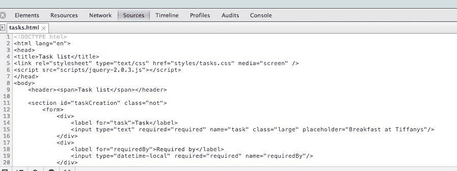

如果你滚动到 `tasks.html` 页面底部，会看到上一章添加的 JavaScript。

在文件中找到以下代码片段：

```javascript
$('#btnAddTask').click(function(evt) {
  evt.preventDefault();
  $('#taskCreation').removeClass('not');
});
```

然后点击左侧边缘的 `evt.preventDefault();` 这一行。该行应高亮为蓝色；你会在下面的截图中看到第 88 行，但你版本中的行号可能不同：

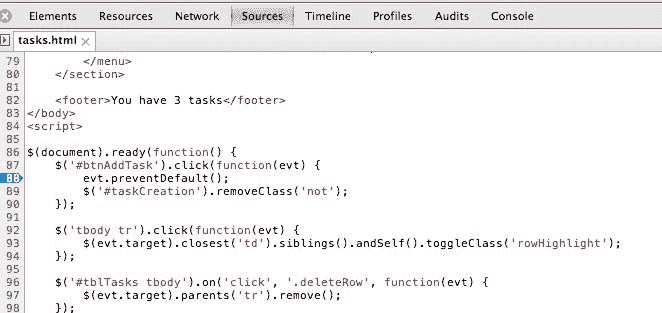

这是一个断点，表示调试器在到达这一行时应停止执行。

现在，保持开发者工具打开，点击主网页上的“添加任务”按钮。当你点击时，Chrome 会在断点处停止执行。

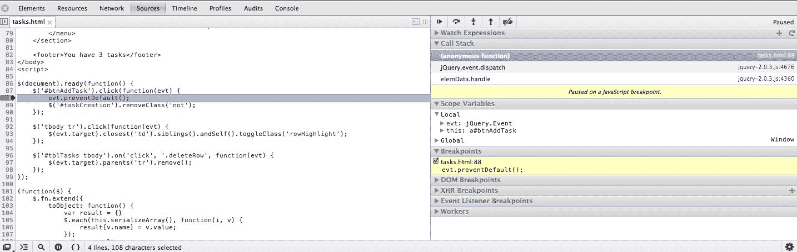

现在调试器已在断点处停止，我们有几个选择。

首先，我们可以与 JavaScript 环境交互，包括作用域内的任何局部变量。你可以在右侧看到 Chrome 告诉我们有两个局部变量在作用域内：

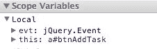

要与它们交互，点击控制台选项卡并输入：

> `evt`

这将显示事件对象，可以展开以查看其属性：

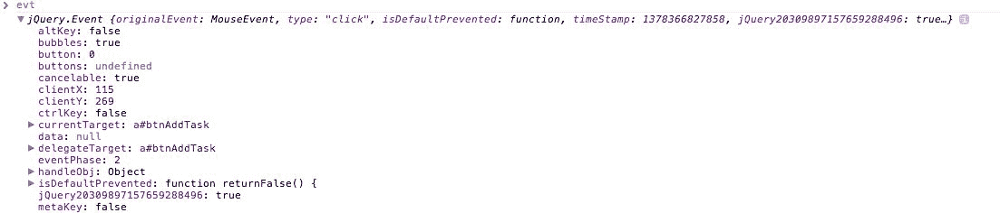

此外，如果我们想尝试一些东西，可以在这里执行自己的代码。我们输入的任何代码都将使用当前作用域内的局部变量。例如，我们可以执行以下代码来获取被点击元素的 `id`：

> `$(evt.target).attr("id")`

我们甚至可以修改作用域内的对象，例如，我们可以为元素添加一个新属性：

> `$(evt.target).attr("data-test", "test")`

这提供了一个极好的环境来编写代码片段，因为你可以从浏览器获得每行代码的即时反馈。

我们还可以检查当前的调用堆栈。这是导致当前代码行被调用的调用列表：

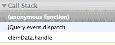

然后你可以点击堆栈中的任何函数调用，Chrome 会带你到那一行代码。一旦你到达那一行代码，你就可以访问该行所能访问的环境，包括所有局部变量（这些变量可能与断点所在行的变量不同）。

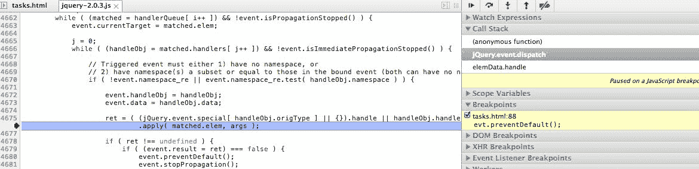

除了与 JavaScript 环境交互之外，调试器的另一个主要用途是单步执行代码。这允许你实时逐行观察程序的执行，并更容易理解可能遇到的任何问题或缺陷。

单步执行代码可以通过以下控件实现：


你可以将鼠标悬停在每个按钮上查看其用途：

- “恢复脚本执行”将重新开始执行。
- “单步跳过下一个函数调用”将跳到当前停止行正下方的下一行。
- “单步进入下一个函数调用”将使调试器进入当前行上将要执行的任何函数调用，按执行顺序。
- “单步跳出当前函数”在你进入一个函数后，想要返回到代码进入该函数调用的位置时非常有用。

如果你的代码分布在多个文件中，可以点击调试器右上角的“显示导航器”按钮，然后选择包含你想要添加断点的代码的文件：

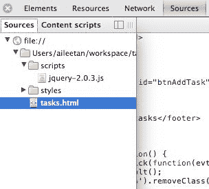

调试器的另一个非常有用的功能是菜单底部的暂停按钮：


如果你点击一次，它会变成蓝色。这将使调试器在任何异常（包括已处理的异常）上自动暂停。

如果你再点击一次，它会变成紫色。这将使调试器在所有未处理的异常上自动暂停。这非常有用，因为 JavaScript 错误的发生并不总是显而易见的。只要保持此设置，并且始终在打开开发者工具的情况下运行应用程序，你就不会错过任何错误，并能在错误发生时进行调试。

为了看到实际效果，移除现有的断点，并将代码：

```javascript
$('#btnAddTask').click(function(evt) {
  evt.preventDefault();
  $('#taskCreation').removeClass('not');
});
```

改为：

```javascript
$('#btnAddTask').click(function(evt) {
  evt.callUnknownFunction();
  $('#taskCreation').removeClass('not');
});
```

由于 JavaScript 不是类型检查语言，直到运行时这一行才会引发异常。如果你现在刷新屏幕并点击“添加任务”按钮，你会看到调试器自动停在这一行：

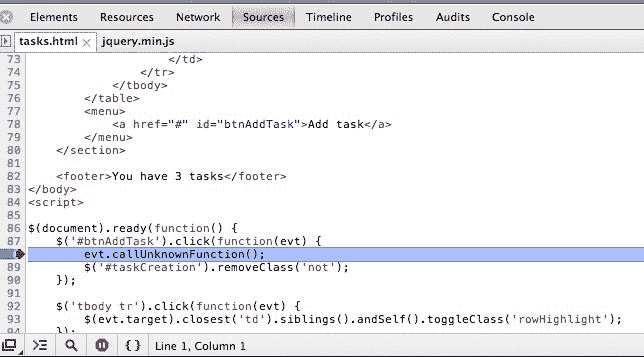

现在你可以在控制台中与环境交互。例如，你可以执行这行代码来查看问题所在：

> `evt.callUnknownFunction();`

`TypeError: Object #<Object> has no method 'callUnknownFunction'`

最后，你可以使用调试器左下角的按钮将调试器分离到单独的窗口中。如果你有双屏，这非常有用，因为调试器可以在一个窗口中运行，而浏览器在另一个窗口中。

在结束之前，记得将你的 `add task` 事件监听器改回正确的实现。

# 迁移到 Web 服务器

到目前为止，我们一直直接从文件系统加载 `tasks.html` 页面。现在我们需要迁移到从 Web 服务器提供页面。在接下来的几章中，我们将使用的几个 API 依赖于页面从特定域名提供——即使该域名是“localhost”而不是“yourserver.com”。

例如，如果网站想要在客户端存储数据，浏览器必须能够区分一个网站创建的数据和另一个网站创建的数据。诸如此类的规则被称为“同源策略”。浏览器使用域名和端口（通常默认为 80 或 443——但在我们的例子中将是 8080）来确定网页的来源，并限制不同来源页面之间的交互（除非另有规定）。

本章将帮助你开始使用 Mongoose 网络服务器。这是最小的可用网络服务器之一，并且只需要极少的配置。

## OSX

从以下地址下载 OSX 安装程序：

[`cesanta.com/downloads.html`](http://cesanta.com/downloads.html)

下载完成后，执行以下步骤：

1. 双击 DMG 文件并将其拖到应用程序文件夹。
2. 打开访达，进入“应用程序”文件夹。
3. 双击 Mongoose。

现在可以通过屏幕顶部任务栏中的图标配置 Mongoose 应用程序：

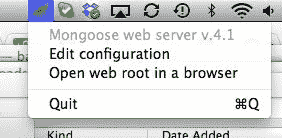

点击“编辑配置”。这将在文本编辑器中打开。找到以下行：

```text
# document_root /Applications/Mongoose.app/Contents/MacOS
```

将目录更改为包含 `tasks.html` 文件的目录。此外，删除该行开头的 `#`，例如：

```text
document_root /html5/tasks
```

使用此菜单退出 Mongoose 网络服务器，然后重新启动它（通过双击“应用程序”文件夹中的应用程序）。

打开 Chrome，输入：

[`localhost:8080/tasks.html`](http://localhost:8080/tasks.html)

这应该会显示主任务网页。

## Windows

从以下地址下载 Windows 可执行文件（无需安装）：

[`cesanta.com/downloads.html`](http://cesanta.com/downloads.html)

下载完成后，执行以下步骤：

1. 将 exe 文件复制到包含 `tasks.html` 的同一目录中。
2. 双击可执行文件启动 Mongoose。

现在可以通过屏幕底部任务栏中的图标配置 Mongoose 应用程序（尽管在这种情况下不需要配置）：

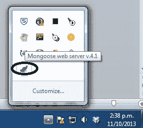

打开 Chrome，输入：

[`localhost:8080/tasks.html`](http://localhost:8080/tasks.html)

这应该会显示主任务网页。

# 构建 Web 应用程序

现在你已经学习了创建示例 Web 应用程序所需的基本技术。虽然我们在现有网页上有一些可用的代码，但其结构不足以扩展为大型 Web 应用程序。

在本章的第一部分，我们将把已创建的代码重构为遵循更严格设计的结构。这将使我们能够向 Web 应用程序添加额外的功能。

作为第一步，我们将提取我们编写的用于将对象序列化和反序列化为表单的 jQuery 插件，并将其放在 `scripts` 文件夹中名为 `jquery-serialization.js` 的文件中。

我们还将把 `tasks.html` 中的大部分 JavaScript 代码移动到一个名为 `tasks-controller.js` 的 JavaScript 文件中。首先，我们将在 `scripts` 文件夹中创建一个名为 `tasks-controller.js` 的空文件。

然后，我们将在 HTML 页面的 `head` 部分导入这两个脚本文件。（确保它们是在 jQuery 导入之后添加的。）

```html
<script src="scripts/jquery-serialization.js"></script>
<script src="scripts/tasks-controller.js"></script>
```

除了这个更改之外，我们还将为其他几个元素添加 `id` 属性。这些将在下面以粗体突出显示。

其中一个将被赋予 `id` 的元素是一个 `main` 元素，我们将为其赋予 id `taskPage`。添加这个元素的原因是为了封装所有与任务相关的功能。这确保了它可以与其他功能共存于同一个文档对象模型中，并且这些功能区域保持分离。

例如，我们可能有一个用于管理日历的第二个页面，但如果需要，它可以存在于同一个 HTML 页面中。然后我们只需将 header、footer 和 main 元素替换为新页面的相应元素。

这种方法允许我们在不刷新浏览器的情况下更改页面，并支持单页 Web 应用程序（SPA）。对于单页应用程序，整个 Web 应用程序所需的所有内容都在初始请求（或通过后续的 AJAX 调用）时加载，然后内容在 DOM 中交换进出以模拟页面更改。

整个 HTML 页面现在应该如下所示：


```html
<!DOCTYPE html>
<html lang="en">
<head>
  <meta charset="utf-8">
  <title>任务列表</title>
  <link rel="stylesheet" type="text/css" href="styles/tasks.css" media="screen" />
  <script src="scripts/jquery-2.0.3.js"></script>
  <script src="scripts/jquery-tmpl.js"></script>
  <script src="scripts/jquery-serialization.js"></script>
  <script src="scripts/tasks-controller.js"></script>
</head>
<body>
  <header>
    <span>任务列表</span>
  </header>

  <main id="taskPage">
    <section id="taskCreation" class="not">
      <form id="taskForm">
        <div>
          <label>任务</label>
          <input type="text" required="required" name="task" class="large" placeholder="蒂凡尼的早餐" />
        </div>
        <div>
          <label>截止日期</label>
          <input type="date" required="required" name="requiredBy" />
        </div>
        <div>
          <label>类别</label>
          <select name="category">
            <option value="Personal">个人</option>
            <option value="Work">工作</option>
          </select>
        </div>
        <nav>
          <a href="#" id="saveTask">保存任务</a>
          <a href="#" id="clearTask">清除任务</a>
        </nav>
      </form>
    </section>

    <section>
      <table id="tblTasks">
        <colgroup>
          <col width="40%">
          <col width="15%">
          <col width="15%">
          <col width="30%">
        </colgroup>
        <thead>
          <tr>
            <th>名称</th>
            <th>截止日期</th>
            <th>类别</th>
            <th>操作</th>
          </tr>
        </thead>
        <tbody>
        </tbody>
      </table>
      <nav>
        <a href="#" id="btnAddTask">添加任务</a>
      </nav>
    </section>
  </main>

  <footer>你有 3 个任务</footer>
</body>

<script>
$(document).ready(function() {
  $('[required="required"]')
    .prev('label')
    .append('<span>*</span>')
    .children('span')
    .addClass('required');

  $('tbody tr:even').addClass('even');

  $('#btnAddTask').click(function(evt) {
    evt.preventDefault();
    $('#taskCreation').removeClass('not');
  });

  $('tbody tr').click(function(evt) {
    $(evt.target)
      .closest('td')
      .siblings()
      .andSelf()
      .toggleClass('rowHighlight');
  });

  $('#tblTasks tbody').on('click', '.deleteRow', function(evt) {
    evt.preventDefault();
    $(evt.target).parents('tr').remove();
  });

  $('#saveTask').click(function(evt) {
    evt.preventDefault();
    var task = $('form').toObject();

    $('#taskRow').tmpl(task).appendTo($('#tblTasks tbody'));
  });
});
</script>

<script id="taskRow" type="text/x-jQuery-tmpl">
<tr>
  <td>${task}</td>
  <td><time datetime="${requiredBy}">${requiredBy}</time></td>
  <td>${category}</td>
  <td>
    <nav>
      <a href="#">Edit</a>
      <a href="#">Complete</a>
      <a href="#" class="deleteRow">Delete</a>
    </nav>
  </td>
</tr>
</script>
</html>
```

项目结构如下所示：

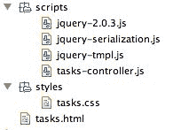

现在我们要开始编写 `tasks-controller.js` 的代码。这将利用 JavaScript 章节前面介绍的模块模式。这样可以确保控制器能够封装数据，并向应用程序的其余部分公开公共 API。

控制器将负责初始化表单、处理事件以及管理页面所需的任何状态。我们的任务控制器的基本结构如下：

```javascript
tasksController = function() {
  return {
    init: function(page) {
    }
  };
}();
```

这段代码实现的是与之前 `createIncrementer` 函数完全相同的模式。唯一的区别在于，这里我们没有为返回对象的函数命名：它是一个匿名函数，我们通过在行末添加 `()` 来立即执行它。

理解这段代码末尾 `()` 的重要性至关重要。它意味着 `tasksController` 变量被设置为匿名函数返回的对象，而不是函数本身。

这种方法的主要优点是，没有其他代码可以构造另一个 `tasksController`，因为没有可调用的函数。因此，`tasksController` 变量是一个单例。单例是另一种设计模式，用于确保应用程序中只存在一个对象类型的实例（在传统的面向对象语言中，只存在一个类的实例）。

我们的 `tasksController` 必须是单例，这一点很重要，因为它将管理状态。如果创建了多个 `tasksController`，它们可能具有不同的状态，因此在尝试用此状态更新 DOM 时会相互干扰。

控制器将有一个名为 `init` 的方法，负责执行 `tasks.html` 加载时需要进行的任何初始化任务，但这将在 `tasks.html` 中显式调用，而不是在脚本加载时隐式调用。这是因为我们可能为不同的功能区域设置多个控制器，并且只希望在用户选择使用它们时进行初始化。

初始化控制器时，我们将把 `tasks.html` 页面中的 `main` 元素作为参数传递给它。该控制器将负责 DOM 的这一特定部分，因此它执行的任何 jQuery 选择都应在该元素的上下文中进行。

在本应用程序中，这一点并不重要，因为它只包含一组独立的功能，但在一个具有许多功能区域的大型单页应用程序中，每个功能区域都将拥有自己的控制器，以及它负责的自己的 `main` 元素。

以下是我们的控制器实现：

```javascript
tasksController = function() {
  var taskPage;
  var initialised = false;

  return {
    init: function(page) {
      if (!initialised) {
        taskPage = page;

        $(taskPage)
          .find('[required="required"]')
          .prev('label')
          .append('<span>*</span>')
          .children('span')
          .addClass('required');

        $(taskPage).find('tbody tr:even').addClass('even');

        $(taskPage).find('#btnAddTask').click(function(evt) {
          evt.preventDefault();
          $(taskPage).find('#taskCreation').removeClass('not');
        });

        $(taskPage).find('tbody tr').click(function(evt) {
          $(evt.target)
            .closest('td')
            .siblings()
            .andSelf()
            .toggleClass('rowHighlight');
        });

        $(taskPage).find('#tblTasks tbody').on('click', '.deleteRow', function(evt) {
          evt.preventDefault();
          $(evt.target).parents('tr').remove();
        });

        $(taskPage).find('#saveTask').click(function(evt) {
          evt.preventDefault();

          var task = $('form').toObject();

          $('#taskRow')
            .tmpl(task)
            .appendTo($(taskPage).find('#tblTasks tbody'));
        });

        initialised = true;
      }
    }
  };
}();
```

关于这个控制器，有几个特性需要解释。

首先，控制器将页面参数存储在一个名为 `taskPage` 的局部变量中。这个变量通过前面章节讨论的数据隐藏方法对外部世界隐藏。这意味着其他任何代码都无法更改此控制器工作的上下文。

每当控制器需要访问 HTML 元素时，它都会在此页面的上下文中使用以下方法进行访问：

`$(taskPage).find(..)`

这确保了即使 HTML 页面包含与我们页面元素具有相同属性的其他元素，它们也不会出现在任何 jQuery 选择结果中。

其次，`taskController` 通过一个名为 `initialised` 的局部变量来记住它是否已被初始化。这确保了无论 `init` 方法被调用多少次，它实际上只会初始化控制器一次。

有了控制器之后，需要修改 `tasks.html`，以便在页面加载时调用 `init` 方法。`tasks.html` 中的脚本块现在应包含以下内容：

```html
<script>
$(document).ready(function() {
  tasksController.init($('#taskPage'));
});
</script>
```

## 验证

接下来要添加的功能是任何基于表单的 Web 应用程序的基本功能：表单验证。

自 JavaScript 首次出现在浏览器中以来，它就被用于执行字段验证；事实上，在早期，这可能是 JavaScript 最常用的功能。

客户端验证仍然是 JavaScript 的一个重要用途，但正如本书前面提到的，HTML5 现在包含了一种基于表单属性的表单验证规范。这种验证旨在消除对 JavaScript 验证的需求。

虽然可能不明显，但通过向输入字段添加 `required` 属性，实际上已经默认实现了这一点。如果在“任务”字段中按回车键而不输入任何内容，您应该会看到以下内容：

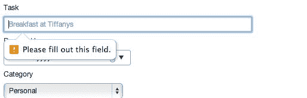

“请填写此字段”的消息是由 HTML5 验证生成的。

尽管存在 HTML5 验证，但我们不会在此 Web 应用程序中使用它，主要有两个原因：

1. 并非所有浏览器都支持 HTML5 验证；因此，对于不提供支持的浏览器，有必要依赖 polyfill。
2. HTML5 验证与 JavaScript 的配合并不像您期望的那样好。例如，我们无法通过在 JavaScript 中调用 `submit()` 来触发 HTML5 验证器，它们只会在用户单击提交按钮将数据发布到服务器时触发，或者在用户按回车键时逐个字段触发。由于我们永远不会将数据发布到服务器，这没有帮助。

出于这些原因，我们将在此应用程序中使用 jQuery Validation 库。可以从以下位置下载：

[`jqueryvalidation.org/`](http://jqueryvalidation.org/)

或者从以下 CDN 获取：

[`ajax.aspnetcdn.com/ajax/jquery.validate/1.11.1/jquery.validate.js`](http://ajax.aspnetcdn.com/ajax/jquery.validate/1.11.1/jquery.validate.js)

我已下载版本 1.11.1，并将其添加到我的脚本文件夹中，命名为 `jquery.validate.js`。我还将其添加到了网页的 head 部分：

```html
<head>
  <meta charset="utf-8">
  <title>任务列表</title>
  <link rel="stylesheet" type="text/css" href="styles/tasks.css" media="screen" />

  <script src="scripts/jquery-2.0.3.js"></script>
  <script src="scripts/jquery-tmpl.js"></script>
  <script src="scripts/jquery.validate.js"></script>
  <script src="scripts/jquery-serialization.js"></script>
  <script src="scripts/tasks-controller.js"></script>
</head>
```

幸运的是，jQuery 验证尽可能依赖与 HTML5 相同的属性，因此 `required` 属性对 HTML5 和 jQuery 验证都有效。

jQuery 验证包含大量内置验证器，这些验证器允许你表达以下规则：

- 验证必填字段是否有值。
- 验证字段是否包含数字。
- 验证输入数据的长度。
- 验证数字是否在某个范围内。
- 验证字段是否包含电子邮件地址。
- 验证字段是否包含可能有效的信用卡号。

除了这些默认验证器之外，你还可以添加自己的验证器。

为了实现 jQuery 验证，我们首先将名为“task”的输入字段修改为包含最大长度：

```html
<input type="text" required="required" maxlength="200" name="task" class="large" placeholder="Breakfast at Tiffanys"/>
```

接下来，我们将修改在调用“保存任务”时触发的事件监听器。它将通过调用表单的 `valid` 函数来检查表单是否有效。你可能已经猜到，这是 jQuery Validation 插件添加到 jQuery 的一个函数。只有当表单有效时，才会实际保存任务：

```javascript
$(taskPage).find('#saveTask').click(function(evt) {
  evt.preventDefault();

  if ($(taskPage).find('form').valid()) {
    var task = $('form').toObject();

    $('#taskRow')
      .tmpl(task)
      .appendTo($(taskPage).find('#tblTasks tbody'));
  }
});
```

如果你现在尝试保存一个没有包含必填字段的任务，将会生成错误消息：

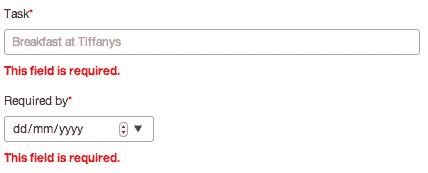

为了查看 jQuery Validation 添加的元素，请高亮显示“此字段为必填项”文本，右键单击该文本，然后选择“检查元素”：你应该会看到以下内容：

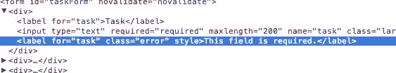

jQuery Validation 添加了一个带有 `error` 类的标签。然后，tasks.css 中的以下类将其渲染为粗体红色文本：

```css
label.error {
  color: red;
  font-weight: bold;
}
```

## 结论

目前，这个 Web 应用还远未完成，但基本的项目结构已经就位。在添加额外功能之前，我们将暂停一下，开始实现将应用的数据和资源存储在浏览器中的功能。

# 管理客户端数据

尽管我们拥有一个可运行的 Web 应用的各个方面，但当前实现显然存在一个重大缺陷：每次用户刷新 `tasks.html` 页面时，所有任务都会丢失。

在本节中，我们将探讨在不使用服务器端存储的情况下，如何在页面刷新之间维护应用状态（即任务）的方法。

传统上，唯一能够在页面刷新后保留客户端数据的机制是 cookie。Cookie 是存储在客户端上的基于文本的简单名称/值对。服务器可以通过在 HTTP 响应中包含 cookie 来在客户端上设置 cookie。

此后，每当浏览器向该域中的页面发送 HTTP 请求时，该 cookie（包括其名称和值）都会包含在请求中。

Cookie 也可以使用 JavaScript 创建和交互（有一些限制）。


Cookie 非常适合管理某些数据。例如，网站通常会在 cookie 中存储会话 ID 来表示每个用户的单独会话。这使得服务器能够区分每个唯一的会话，并将它们保持独立。这一点至关重要，因为 HTTP 是一种无状态协议，没有其他固有方式可以知道两个 HTTP 请求实际上来自同一个浏览器会话。

虽然 cookie 非常适合在客户端存储简单数据，但它们并不适合存储大量数据，例如我们的任务列表。Cookie 有显著的局限性，使其不适合存储大量数据：

1. 它们会包含在每个对服务器的请求中，因此除非你希望整个任务列表都包含在每个请求中，否则 cookie 不是一个好的解决方案。
2. 每个 cookie 的最大大小约为 5 KB。
3. 单个域可以存储的 cookie 最大数量为 20（这可能取决于浏览器）。这意味着一个域可用的 cookie 总存储量小于 100 KB。

因此，很明显，如果 HTML 要支持能够独立于 Web 服务器存在的丰富动态 Web 应用，就需要某种形式的离线数据存储。即使是持续连接到 Web 服务器的应用，如果能够在浏览器中缓存更多数据，也能显著改善用户体验。

现在有三种不同的 API 用于在客户端存储数据，它们都属于 HTML5 的范畴：

- **Web 存储**：这是最简单的离线存储形式，支持名称/值对，其中名称和值都必须是字符串。尽管这是一种相对简单的存储机制，并且确实有一些限制，但所有主流 Web 浏览器都支持它。
- **Web SQL 数据库 API**：该 API 在浏览器中支持关系数据库（类似于 MySQL）。尽管这有很多优点，特别是对于已经熟悉关系数据库和 SQL 的开发人员来说，但 Chrome 和 IE 已宣布它们永远不会支持此 API，因此它实际上已经死亡。
- **IndexedDB**：（以前称为 WebSimpleDB）该 API 公开了一个对象存储。对象（或简单数据类型）可以按键存储，并通过此键或添加到记录中的其他索引进行检索。IndexedDB 支持数据库开发人员熟悉的事务模型，但不包括通用查询语言（如 SQL）。这是一个很有前途的 API，但尚未得到所有浏览器的支持。特别是 Safari 和一些移动浏览器不支持此 API。

在本章中，我们将创建一个存储 API，使我们能够从 Web 应用中抽象出底层存储 API。这意味着 Web 应用将不知道它正在使用哪个底层 API，从而允许使用最合适的 API（取决于浏览器支持）。

这种方法是另一种设计模式——桥接模式——的示例。

本章将提供 Web 存储和 IndexedDB 的实现。我们将这种抽象称为“存储引擎”。

## 存储引擎 API

我们的存储引擎 API 将能够执行所有基本的 CRUD 操作：

- 创建
- 读取
- 更新
- 删除

该 API 将操作 JavaScript 对象。对可存储对象的唯一约束是它必须具有一个名为 `id` 的属性，该属性在特定对象类型（例如任务）内是唯一的。

所有对象都将根据其定义的类型进行存储；例如，任务将存储在“task”类型下。如果数据存储没有对象类型的概念，它将无法区分相关和不相关的对象，并且所有对象都需要存储在一起。例如，如果 Web 应用支持日历事件和任务，我们希望有一种方法可以检索所有日历事件而不检索任务。因此，将它们分开存储是有意义的。

最后，该 API 将使用回调函数而不是直接返回值。当调用 API 方法时，调用者将传递一个成功回调函数和一个错误回调函数。当处理完成时，将调用其中一个回调函数，并传递处理结果。

使用回调函数将使我们能够同时支持同步和异步存储机制。同步存储机制会在浏览器主线程上执行存储操作，并阻塞直到操作完成。而异步存储机制则可以利用 `Web Worker API`（将在后续章节介绍）的后台线程，或通过 `AJAX` 调用服务器来实现。

如果你不熟悉回调函数，下面的示例将提供一个简单的介绍。在后续章节中，回调函数也会被用于其他几个 API。

以下部分提供了将要实现的 API 的文档。到目前为止，我们很大程度上忽略了良好文档化代码的重要性。因此，下面的部分也作为 API 文档化的一个示例，展示如何使其对创建者之外的受众可用：

```javascript
/**
 * 客户端在使用存储引擎之前必须调用此方法进行初始化。
 *
 * 如果存储引擎初始化成功，将调用 successCallback，并传入 null 对象。
 *
 * 如果调用了 errorCallback，则存储引擎无法使用。
 *
 * 此方法应可多次调用，且每次返回相同的结果。
 *
 * @param {Function} successCallback 存储引擎初始化成功时调用的回调。
 * @param {Function} errorCallback 错误场景下调用的回调。
 */
function init(successCallback, errorCallback)
```

```javascript
/**
 * 客户端必须调用此方法以在存储引擎中初始化特定的对象类型。
 *
 * 如果存储引擎支持该对象类型，将调用 successCallback，并传入 null 值。
 *
 * 此方法应可多次调用，且每次返回相同的结果。
 *
 * 如果调用了 errorCallback，则该对象类型无法存储。
 *
 * @param {String} type 将要存储的对象类型。
 * @param {Function} successCallback 存储引擎初始化成功时调用的回调。
 * @param {Function} errorCallback 错误场景下调用的回调。
 */
function initObjectStore(type, successCallback, errorCallback)
```

```javascript
/**
 * 此方法可用于查找特定类型的所有对象。
 *
 * 如果未找到该类型的任何对象，将返回一个空数组。
 *
 * @param {String} type 要搜索的对象类型。
 * @param {Function} successCallback 查询完成后调用的回调。将传入一个符合请求类型的对象数组。
 * @param {Function} errorCallback 错误场景下调用的回调。
 */
function findAll(type, successCallback, errorCallback)
```

```javascript
/**
 * 此方法将返回特定类型中具有特定 id 的对象。
 *
 * 如果未找到对象，则返回 null。
 *
 * @param {String} type 要搜索的对象类型。
 * @param {String|number} id 对象的唯一 ID。
 * @param {Function} successCallback 查询完成后调用的回调。将传入一个符合请求类型的对象或 null。
 * @param {Function} errorCallback 错误场景下调用的回调。
 */
function findById(type, id, successCallback, errorCallback)
```

```javascript
/**
 * 此方法将处理特定类型对象的添加和编辑。
 *
 * 如果传入对象的 id 属性为 null 或 undefined，将为该对象分配一个 id 并保存。
 *
 * 如果 id 属性非 null，则更新该对象。
 *
 * 如果找不到该 id，将调用错误回调。
 *
 * 成功时，新保存的对象将返回给 successCallback。
 *
 * @param {String} type 将要存储的对象类型。
 * @param {Object} obj 将要存储的对象。
 * @param {Function} successCallback 对象提交到存储引擎后调用的回调。将传入已存储的对象（包含 id 属性）。
 * @param {Function} errorCallback 错误场景下调用的回调。
 */
function save(type, obj, successCallback, errorCallback)
```

```javascript
/*
 * 此方法将删除特定类型中具有特定 id 的对象。
 *
 * 如果不存在具有该 id 的对象，将调用错误回调。
 *
 * 如果对象被删除，此函数将把被删除对象的 id 返回给 successCallback。
 *
 * @param {String} type 将要删除的对象类型。
 * @param {String|number} id 对象的唯一 id。
 * @param {Function} successCallback 对象从存储引擎中删除后调用的回调。将传入被删除对象的唯一 id。
 * @param {Function} errorCallback 错误场景下调用的回调。
 */
function delete(type, id, successCallback, errorCallback)
```

```javascript
/**
 * 此方法可用于基于属性值查询对象。
 *
 * 可以传入单个属性名称以及匹配的值。将返回所有具有该属性值的对象。
 *
 * @param {String} type 将要搜索的对象类型。
 * @param {String} propertyName 要匹配的属性名称。
 * @param {String|number} propertyValue 属性应具有的值。
 * @param {Function} successCallback 查询完成后调用的回调。将传入一个包含 0 个或多个指定类型对象的数组。
 * @param {Function} errorCallback 错误场景下调用的回调。
 */
function findByProperty(type, propertyName, propertyValue, successCallback, errorCallback)
```

最后，我们需要定义成功和错误回调的 API。这些应该是函数，并符合以下签名：

```javascript
/*
 * 此方法将在所有成功场景下被调用。
 *
 * @param {any} result 成功结果，如各个方法调用文档所述。
 */
function succssCallback(result)
```

```javascript
/*
 * 此方法将在所有失败场景下被调用。
 *
 * @param {String} errorCode 异常类型。
 * @param {String} errorMessage 人类可读的错误消息版本。
 */
function errorCallback(errorCode, errorMessage)
```

这个简单的 API 足以满足我们所有的数据存储需求。

## Web 存储实现

为了了解 Web 存储 API 的简单性，请打开 Chrome 控制台（在任何网页上），然后输入以下内容：

```javascript
> localStorage.setItem('item1', 'This is item 1')
```

这行代码将值 `'This is item 1'` 保存在键 `'item1'` 下。现在该值将无限期持久化，并且对该页面同源的所有页面可用。

为了证明它已被持久化，请打开 Chrome 开发者工具的“Resources”选项卡，并在左侧找到“Local Storage”。你应该会看到以下内容：

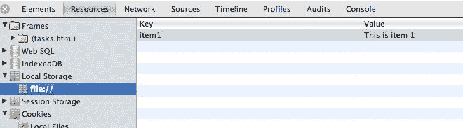

如果你想检索这个值，可以通过以下调用实现：

```javascript
> localStorage.getItem('item1')
```

如果你想删除该值，可以通过以下调用实现：

```javascript
> localStorage.removeItem('item1')
```

或者你可以通过以下调用完全清除该源存储的所有数据：

```javascript
> localStorage.clear()
```

除了 `localStorage` 对象之外，一个名为 `sessionStorage` 的对象上也存在完全相同的 API。它的作用与 `localStorage` 相同，但数据会在浏览器关闭时自动清除。而 `localStorage` 中的数据则无限期持久化，尽管用户可以随时清除它。

Web 存储是一个简单的 API，但也有局限性。例如，如果你尝试将一个对象插入 `localStorage`，它看起来会成功：

```javascript
> localStorage.setItem('item1', {})
```

然而，如果你检索回该值，你会看到持久化的值是一个字符串：即对对象调用 `toString` 的结果：

```javascript
> localStorage.getItem('item1')
```

`"[object Object]"`

Web 存储只能用于存储字符串。由于我们可以使用 `JSON.stringify()` 函数轻松地将对象序列化为字符串，并使用 `JSON.parse()` 反序列化，因此这实际上并不是一个大问题。

Web 存储 API 的另一个限制是，在大多数浏览器中，存储空间限制为 5MB。如果这个限制还不够小，那么 JavaScript 对所有字符串使用 UTF-16 作为字符编码。UTF-16 将所有字符表示为至少 2 字节（16 位）的序列。这对大多数西方语言来说是一个限制，因为其他 UTF 编码（尤其是 UTF-8）用单个字节表示拉丁字母表中的字符。

JavaScript 规范允许使用 UTF-16 或 UCS-2。UCS-2 是 UTF-16 的前身，是一种固定长度的 2 字节编码。随着 Unicode 码空间中码点数量的增加，这种编码被取代了。

由于 JavaScript 使用 UTF-16，它在 5MB 中可以存储的字符数据量大约只有使用 UTF-8 时的一半（假设我们主要使用拉丁字母表中的字符）。这实际上将 Web 存储的大小减少到了 2.5MB：这仍然比 cookie 好得多，但在开发 Web 应用程序时，我们需要记住这个限制。

在一个项目中，我通过使用 LZW 压缩算法压缩所有数据，成功绕过了这个限制。在这个特定案例中，这实际上将可存储的数据量增加到了 50MB（结果会因数据的重复程度而异）。

该页面提供了包括 JavaScript 在内的多种语言的 LZW 算法实现：

[`rosettacode.org/wiki/LZW_compression`](http://rosettacode.org/wiki/LZW_compression)

我们使用 Web 存储实现的存储引擎会将每种类型的对象存储在一个称为“对象存储”（object store）的独立对象中（如果你熟悉关系数据库，可以将这个对象视为一张表）。对象存储的属性将是该类型中每个对象的 `id` 属性（表中的行），而值则是持久化的对象。这种方法依赖于每个对象的 `id` 属性在其类型内必须是唯一的。

存储引擎需要为对象生成唯一的 ID。我们将使用 Web 存储 API 的方法是利用当前时间的毫秒数。这对于 `id` 来说并不是一个很好的选择，因为如果两个对象创建的时间足够接近，它们会得到相同的 `id`。更好的方法是使用 UUID（通用唯一标识符），但我们现在先避免这种复杂性。

最常用的 JavaScript UUID 实现可以在这里找到：

[`www.broofa.com/2008/09/javascript-uuid-function`](http://www.broofa.com/2008/09/javascript-uuid-function)

为了获取当前时间的毫秒数，我们可以使用 jQuery 辅助函数：

> `$.now()`

存储引擎将由一个模块表示。该模块不依赖于为任务屏幕开发的其他代码，因此如果需要，它可以完全被其他功能重用。该模块将存储在一个名为 `storageEngine` 的变量中。

`storageEngine` 将在 `tasks.html` 页面加载时初始化，并可供 `tasksController` 或任何其他 JavaScript 代码使用，因为 `storageEngine` 变量绑定到了全局的 `window` 对象。

首先，在 `scripts` 文件夹中创建一个名为 `tasks-webstorage.js` 的 JavaScript 文件。然后，将其导入到 `tasks.html` 中：

```html
<script src="scripts/tasks-webstorage.js"></script>
```

下面的代码是 `storageEngine` 模块的初始版本。它提供了模块的基本结构，以及 `init` 和 `initObjectStore` 的实现：


```javascript
storageEngine = function() {
 var initialized = false;
 var initializedObjectStores = {};

 return {

 init : function(successCallback, errorCallback) {

 if (window.localStorage) {

 initialized = true;

 successCallback(null);

 } else {

 errorCallback('storage_api_not_supported', 'The web storage api is not supported');

 }

 },

 initObjectStore : function(type, successCallback, errorCallback) {

    if (!initialized) {

 errorCallback('storage_api_not_initialized', 'The storage engine has not been initialized');

  } else if (!localStorage.getItem(type)) {

      localStorage.setItem(type, JSON.stringify({}));

    }

    initializedObjectStores[type] = true;

      successCallback(null);

    },

 save : function(type, obj, successCallback, errorCallback) {

 },

     findAll : function(type, successCallback, errorCallback) {

 },

    delete : function(type, id, successCallback, errorCallback) {

 },

 findByProperty : function(type, propertyName, propertyValue, successCallback, errorCallback) {   

 },

 findById : function (type, id, successCallback, errorCallback) {

 }

 }     

}();
```

与`tasksController`类似，这个控制器隐式地创建了一个新对象。在这种情况下，该对象将存储在一个名为`storageEngine`的全局变量中。

上面的初始实现包含了`init`和`initObjectStore`方法的实现。从技术上讲，Web 存储实现并不需要`init`方法，因为使用`localStorage`对象并不需要特别初始化。然而，这个方法被添加到了 API 中，因为其他存储 API 通常需要在使用前进行初始化。

`init`方法只是检查浏览器中是否存在`localStorage`对象。如果存在，它将存储引擎中的一个名为`initialised`的变量设置为`true`。根据 API 的规范，除非调用了此方法，否则 Web 存储实现的其他方法将无法被调用。

`initObjectStore`方法检查`localStorage`对象当前是否包含传入的`type`（例如“tasks”）对应的项。如果没有，它会在`localStorage`中使用`type`作为该项的键创建一个空对象。它还会记录我们已经初始化了这个对象存储。

如果你重新加载`tasks.html`，可以在命令行中执行以下命令来初始化存储引擎：

```javascript
> storageEngine.init(function(){

 console.log('Storage is initialised');

 },

 function(errorCode, errorMessage) {

 console.log(errorCode+':'+errorMessage);

 }

);
```

`init`方法分别接收两个函数作为成功回调和错误回调。当被调用时，这些函数只是记录它们已被调用。此调用应导致在控制台中打印以下内容：

“Storage is initialized”

同样，`initObjectStore`方法可以如下调用：

```javascript
> storageEngine.initObjectStore('testing',

 function(){

 console.log('New type added');

 },

 function(errorCode, errorMessage) {

 console.log(errorCode+':'+errorMessage);

 }

);
```

New type added

此调用将创建一个名为`testing`的新对象存储，然后调用成功回调，该回调将在控制台中记录成功。调用后，`testing`项将在`localStorage`中可用。可以使用`getItem()`的快捷方式验证：

```javascript
> localStorage.testing

"{}"
```

`localStorage`只是一个普通对象，因此它的项可以使用点符号作为常规属性访问（前提是它们符合 JavaScript 变量名的限制）。

`init`和`initObjectStore`方法的一个重要特性是它们可以被多次调用，并且对于相同的输入总是返回相同的输出。这是一个重要的特性，因为客户端可能不知道这些方法是否已被其他代码调用过。客户端无需先查明初始化是否已经发生，再决定是否调用`init`，而是可以直接调用`init`，由它自行处理判断需要做什么的逻辑。

`tasksController`将负责调用`init`和`initObjectStore`。在提供调用初始化方法的实现之前，值得考虑一下错误回调。每次调用存储引擎方法时，都必须提供一个错误回调。

因此，我们将创建一个可用于`errorCallback`的通用函数，并将其作为私有变量存储在`tasksController`中。这个函数所做的只是记录错误发生的事实，但如果我们想改变行为，只需在一个地方修改，而不必修改所有错误回调。

该函数可以作为`tasksController`内的私有函数添加：

```javascript
tasksController = function() {
 function errorLogger(errorCode, errorMessage) {
 console.log(errorCode +':'+ errorMessage);
 }
```

接下来，在`tasksController`的`init`方法开头，添加以下代码：

```javascript
storageEngine.init(function() {
 storageEngine.initObjectStore('task', function() {
 }, errorLogger)
}, errorLogger);
```

这段代码调用存储引擎的`init`方法，当成功时，会调用成功回调，该回调进而调用`initObjectStore`方法。这满足了一个重要需求：由于在此 API 的其他实现中（即那些异步执行处理的实现），`init`成功回调可能不会立即被调用，因此有必要确保在调用`initObjectStore`方法之前`init`已经成功。如果不这样做，我们可能会在`init`仍在处理时调用`initObjectStore`。

这凸显了与能够执行异步处理的接口协作的挑战。通常需要将一整套函数调用串联起来，每个调用都嵌套在前一个的回调中。这使得代码不如我们在 jQuery 中看到的“链式”方法优雅。

接下来，我们将实现存储引擎的第一个有趣方法：`save`方法。将以下代码作为新的公共方法添加到`storageEngine`模块中：

```javascript
save: function(type, obj, successCallback, errorCallback) {
 if (!initialized) {
 errorCallback('storage_api_not_initialized', 'The storage engine has not been initialized');
 } else if (!initializedObjectStores[type]) {
 errorCallback('store_not_initialized', 'The object store '+type+' has not been initialized');
 }   
 if (!obj.id) {
 obj.id = $.now();
 }
 var savedTypeString = localStorage.getItem(type);
 var storageItem = JSON.parse(savedTypeString);
 storageItem[obj.id] = obj;
 localStorage.setItem(type, JSON.stringify(storageItem));
 successCallback(obj);
}
```

如上所述，这个函数接受四个参数。当我们在任务应用程序中调用它时，第一个参数始终是`"task"`，第二个参数是一个表示任务的对象。第三和第四个参数分别是成功回调和错误回调。

让我们逐行分析这个实现。

第一段代码只是检查`init`和`initObjectStore`是否已被调用。如果尚未调用，则调用错误回调：

```javascript
if (!initialized) {
 errorCallback('storage_api_not_initialized', 'The storage engine has not been initialized');
} else if (!initializedObjectStores[type]) {
 errorCallback('store_not_initialized', 'The object store '+type+' has not been initialized');
}   
```

方法的下一部分检查要保存的对象是否具有`id`：如果没有`id`，则分配一个唯一的`id`。

```javascript
if (!obj.id) {
 obj.id = $.now();
}
```

接下来，我们查询`localStorage`中相关的对象存储（例如`"task"`）。由于`initObjectStore`已被调用，我们可以保证指定`type`的对象存在：

```javascript
var savedTypeString = localStorage.getItem(type);
```

然后，我们将对象存储的“字符串化”版本反序列化回对象：

```javascript
var storageItem = JSON.parse(savedTypeString);
```

接着，我们将要保存的对象添加到对象存储中，使用对象的`id`属性作为属性名。如果该属性已存在，则会覆盖其值，这意味着相同的代码同时处理创建和更新：

```javascript
storageItem[obj.id] = obj;
```

另外请注意，我们没有使用点号表示法。由于`id`以数字开头，它不是有效的 JavaScript 变量名，因此点号表示法无法工作。

然后，我们将`storedItem`序列化回字符串，并将其放回`localStorage`：

```javascript
localStorage.setItem(type, JSON.stringify(storageItem));
```

这将自动更新存储在此键下的项。

最后，使用新保存的对象调用成功回调：

```javascript
successCallback(obj);
```

实现了`save`方法后，我们可以修改`tasks-controller.js`中的保存任务事件监听器，以使用该方法：

```javascript
$(taskPage).find('#saveTask').click(function(evt) {
 evt.preventDefault();
 if ($(taskPage).find('form').valid()) {
 var task = $('form').toObject();
 storageEngine.save('task', task,
   function(savedTask) {
    $('#taskRow').tmpl( savedTask).appendTo( $(taskPage).find( '#tblTasks tbody'));          
 }, errorLogger);
 }
});
```

请注意，我们只在`successCallback`中更新表格。这确保只有在实际保存成功时才会更新屏幕。

如果你现在创建一个任务，你应该在 Chrome 资源中看到以下内容：

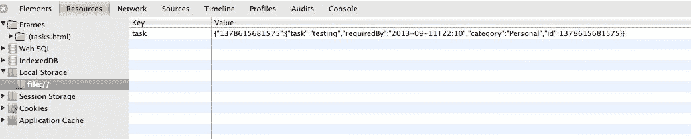

接下来我们要实现的方法是`findAll`。在添加这个方法之前，我们将提供一个辅助函数，用于获取指定类型的反序列化对象。这将为我们执行反序列化逻辑。可以将其作为私有函数添加到`storageEngine`的顶部。

```javascript
storageEngine = function() {
 var initialized = false;
 var initializedObjectStores = {};
 function getStorageObject(type) {
 var item = localStorage.getItem(type);
 var parsedItem = JSON.parse(item);
 return parsedItem;
 }
```

`save`方法中的以下代码行：

```javascript
var savedTypeString = localStorage.getItem(type);
var storageItem = JSON.parse(savedTypeString);
storageItem[obj.id] = obj;
localStorage.setItem(type, JSON.stringify(storageItem));
successCallback(obj);
```

现在可以改为：

```javascript
var storageItem = getStorageObject(type);
storageItem[obj.id] = obj;
localStorage.setItem(type, JSON.stringify(storageItem));
successCallback(obj);
```

`findAll`方法将允许我们在页面刷新时，将保存的任务从`localStorage`重新填充回`table`中。以下是`findAll`的实现：

```javascript
findAll : function(type, successCallback, errorCallback) {
 if (!initialized) {
   errorCallback('storage_api_not_initialized', 'The storage engine has not been initialized');
 } else if (!initializedObjectStores[type]) {
  errorCallback(store_not_initialized', 'The object store '+type+' has not been initialized');
 }
 var result = [];
 var storageItem = getStorageObject(type);
  $.each(storageItem, function(i, v) {
  result.push(v);
 });
 successCallback(result);
}
```

同样，我们将逐行分析这个实现。

方法的第一部分执行与`save`方法相同的检查，以确保`init`和`initObjectStore`都已被调用。

接下来，我们初始化一个数组，用于返回指定类型可用的对象。这确保即使没有保存的对象，也会返回一个空数组：

```javascript
var result = [];
```

然后我们使用辅助函数返回指定类型的对象存储：

```javascript
var storageItem = getStorageObject(type);
```

对象存储将包含一组属性，代表该类型所有已保存的对象，因此我们遍历它们，并使用`push`方法将每个值添加到结果数组中：

```javascript
$.each(storageItem, function(i, v) {
 result.push(v);
});
```

然后将结果返回给成功回调函数：

```javascript
successCallback(result);
```

现在可以从`tasks-controller.js`文件中调用`findAll`方法。调用`findAll`并将所有结果添加到表格中的功能将包含在一个名为`loadTasks`的新公共方法中，该方法位于`init`方法之后：

```javascript
loadTasks : function() {
 storageEngine.findAll('task', function(tasks) {
 $.each(tasks, function(index, task) {
 $('#taskRow').tmpl(task ).appendTo( $(taskPage ).find( '#tblTasks tbody' ));
 });
 }, errorLogger);
}       
```

这会执行对`findAll`的调用，然后在成功回调中逐个遍历结果，并使用模板将它们添加到表格中。

现在，在`tasks.html`页面中，在调用`init`之后添加对该方法的调用。


`$(document).ready(function() {
 tasksController.init($('#taskPage'));   
 tasksController.loadTasks();
})`

如果重新加载`tasks.html`，任何已保存的任务都应加载到表格中。

现在我们可以向存储引擎添加`delete`方法。

```
delete : function(type, id, successCallback, errorCallback) {
 if (!initialized) {
 errorCallback('storage_api_not_initialized', 'The storage engine has not been initialized');
 } else if (!initializeObjectStores[type]) {
 errorCallback('store_not_initialized', 'The object store '+type+' has not been initialized');
  }
  var storageItem = getStorageObject(type);
 if (storageItem[id]) {
   delete storageItem[id];
 localStorage.setItem(type, JSON.stringify(storageItem));
  successCallback(id);
 } else {
 errorCallback("object_not_found","The object requested could not be found");
 }
}
```

删除的实现很直接；可能新出现的一行是：`delete storageItem[id];`

可以使用`delete`关键字从对象中删除属性（及其值）。由于我们将每个项存储为对象的一个属性，因此可以使用此技术删除单个项。调用此方法后，指定的属性变为`undefined`。

当点击删除按钮时，我们需要知道要删除哪个任务。因此，我们需要更新删除按钮，使其知道它关联的是哪个任务。将模板中的以下行：

```
<a href="#" class="deleteRow">Delete</a>
```

改为：

```
<a href="#" class="deleteRow" data-task-id="${id}">Delete</a>
```

这使用自定义数据属性来跟踪每个删除按钮负责的任务。

现在将`tasks-controller.js`中的删除实现从：

```
$(taskPage).find('#tblTasks tbody').on('click', '.deleteRow',
 function(evt) {
 $(evt.target).parents('tr').remove();
});
```

改为：

```
$(taskPage).find('#tblTasks tbody').on('click', '.deleteRow',
 function(evt) {                      
 storageEngine.delete('task', $(evt.target).data().taskId, function() {
 $(evt.target).parents('tr').remove();
 }, errorLogger);
 }
);
```

当点击任何删除按钮时，被点击的元素可通过`$(evt.target)`获取。然后我们使用 HTML5 的`data()`函数获取与该元素关联的所有数据属性。这会提取所有以“data-”开头的属性，并将它们放入一个对象中，其中对象的每个属性代表一个数据属性。

你可能已经注意到，属性`data-task-id`可以通过`data().taskId`获取。由于属性名称在 DOM 中会转换为小写，因此通常使用连字符来分隔属性名称中的单词。在 JavaScript 中，常见的约定是通过大写字母来分隔单词。因此，`data()`对象会将属性名称转换为更适合 JavaScript 使用的形式。

也可以使用以下调用获取数据属性：

```
$(evt.target).attr('data-task-id');
```

还要注意，我们只在确认存储引擎已成功删除该行后才更新表格。这确保了如果在处理过程中出现错误，屏幕不会与存储引擎不同步。

如果现在删除一行并刷新页面，你将看到该任务已被永久删除。

最后，我们将向`storageEngine`添加剩余的两个函数：

```
findByProperty : function(type, propertyName, propertyValue, successCallback, errorCallback) {
 if (!initialized) {
  errorCallback('storage_api_not_initialized', 'The storage engine has not been initialized');
 } else if (!initializedObjectStores[type]) {
   errorCallback('store_not_initialized', 'The object store '+type+' has not been initialized');
 }
 var result = [];
 var storageItem = getStorageObject(type);
 $.each(storageItem, function(i, v) {
   if (v[propertyName] === propertyValue) {
 result.push(v);
 }
 });
 successCallback(result);
},

findById : function (type, id, successCallback, errorCallback) {
 if (!initialized) {
 errorCallback('storage_api_not_initialized', 'The storage engine has not been initialized');
 } else if (!initializedObjectStores[type]) {
 errorCallback('store_not_initialized', 'The object store '+type+' has not been initialized');
 }   
 var storageItem = getStorageObject(type);
 var result = storageItem[id];
 successCallback(result);
}
```

这些方法的实现现在应该看起来相当直接。它们延续了相同的模式：获取对象存储，并从中访问相关项以返回给客户端。

所有存储引擎的组件都已就位，我们可以向应用程序添加“编辑”功能。这将允许在任务创建后对其进行更新。这将使用与添加任务相同的表单，因此表单需要包含一个隐藏字段，用于捕获对象的现有 ID（如果有的话）：

```
<form id="taskForm">
 <input type="hidden" name="id"/>
```

这将允许我们序列化和反序列化任务的所有属性，而不仅仅是可见属性。

接下来，将模板中的编辑按钮从：

```
<a href="#">Edit</a>
```

改为：

```
<a href="#" class="editRow" data-task-id="${id}">Edit</a>
```

这遵循了与删除按钮相同的模式。

有了这个，我们可以在`tasks-controller.js`的`init`方法中添加一个事件监听器。当用户点击表格中的任务进行编辑时，将使用`findById`方法从存储引擎中检索该任务。然后使用我们在本书前面编写的序列化插件将其加载到表单中：

```
$(taskPage).find('#tblTasks tbody').on('click', '.editRow',
 function(evt) {
 $(taskPage).find('#taskCreation' ).removeClass( 'not');
 storageEngine.findById('task', $(evt.target ).data( ).taskId, function(task) {
  $(taskPage).find('form').fromObject(task);
 }, errorLogger);
 }
);
```

有了这个，现有的`save`方法可以保持不变，因为它已经设计为处理更新。在编辑时传递给`save`方法的任务将包含一个`id`属性，因此将执行更新。

然而，我们还没有代码在编辑后更新表格——当前的功能只是在编辑后添加一个新行。因此，我们将将其改为：

```
$(taskPage).find('#saveTask').click(function(evt) {
 evt.preventDefault();
 if ($(taskPage).find('form').valid()) {
 var task = $(taskPage).find('form').toObject();   
 storageEngine.save('task', task, function() {
 $(taskPage).find('#tblTasks tbody' ).empty();
 tasksController.loadTasks();
 $(':input').val('');
```

```
$(taskPage).find('#taskCreation' ).addClass( 'not');
}, errorLogger);
}
});
```

现在，当保存任务时，这将清空并重新创建任务表格。如果任务数量很大，我们可能会考虑生成一个更优化的实现，只更新正确的行，但最好从简单开始，必要时再进行优化。

//

唐纳德·克努特有一句名言：

“我们应该忘记小的效率提升，比如 97%的情况下：过早优化是万恶之源”

此功能还会清空输入字段并隐藏屏幕的编辑部分。这确保了如果用户点击“添加任务”按钮，字段不会预先填充上一次编辑的数据。

基于 Web 存储的存储引擎的最终版本应如下所示：


```javascript
storageEngine = function() {
  var initialized = false;
  var initializedObjectStores = {};

  function getStorageObject(type) {
    var item = localStorage.getItem(type);
    var parsedItem = JSON.parse(item);
    return parsedItem;
  }

  return {
    init: function(successCallback, errorCallback) {
      if (window.localStorage) {
        initialized = true;
        successCallback(null);
      } else {
        errorCallback('storage_api_not_supported', 'The web storage api is not supported');
      }
    },

    initObjectStore: function(type, successCallback, errorCallback) {
      if (!initialized) {
        errorCallback('storage_api_not_initialized', 'The storage engine has not been initialized');
      } else if (!localStorage.getItem(type)) {
        localStorage.setItem(type, JSON.stringify({}));
      }

      initializedObjectStores[type] = true;
      successCallback(null);
    },

    save: function(type, obj, successCallback, errorCallback) {
      if (!initialized) {
        errorCallback('storage_api_not_initialized', 'The storage engine has not been initialized');
      } else if (!initializedObjectStores[type]) {
        errorCallback('store_not_initialized', 'The object store ' + type + ' has not been initialized');
      }

      if (!obj.id) {
        obj.id = $.now();
      }

      var storageItem = getStorageObject(type);
      storageItem[obj.id] = obj;
      localStorage.setItem(type, JSON.stringify(storageItem));
      successCallback(obj);
    },

    findAll: function(type, successCallback, errorCallback) {
      if (!initialized) {
        errorCallback('storage_api_not_initialized', 'The storage engine has not been initialized');
      } else if (!initializedObjectStores[type]) {
        errorCallback('store_not_initialized', 'The object store ' + type + ' has not been initialized');
      }

      var result = [];
      var storageItem = getStorageObject(type);

      $.each(storageItem, function(i, v) {
        result.push(v);
      });

      successCallback(result);
    },

    delete: function(type, id, successCallback, errorCallback) {
      if (!initialized) {
        errorCallback('storage_api_not_initialized', 'The storage engine has not been initialized');
      } else if (!initializedObjectStores[type]) {
        errorCallback('store_not_initialized', 'The object store ' + type + ' has not been initialized');
      }

      var storageItem = getStorageObject(type);

      if (storageItem[id]) {
        delete storageItem[id];
        localStorage.setItem(type, JSON.stringify(storageItem));
        successCallback(id);
      } else {
        errorCallback('object_not_found', 'The object requested could not be found');
      }
    },

    findByProperty: function(type, propertyName, propertyValue, successCallback, errorCallback) {
      if (!initialized) {
        errorCallback('storage_api_not_initialized', 'The storage engine has not been initialized');
      } else if (!initializedObjectStores[type]) {
        errorCallback('store_not_initialized', 'The object store ' + type + ' has not been initialized');
      }

      var result = [];
      var storageItem = getStorageObject(type);

      $.each(storageItem, function(i, v) {
        if (v[propertyName] === propertyValue) {
          result.push(v);
        }
      });

      successCallback(result);
    },

    findById: function(type, id, successCallback, errorCallback) {
      if (!initialized) {
        errorCallback('storage_api_not_initialized', 'The storage engine has not been initialized');
      } else if (!initializedObjectStores[type]) {
        errorCallback('store_not_initialized', 'The object store ' + type + ' has not been initialized');
      }

      var storageItem = getStorageObject(type);
      var result = storageItem[id];
      successCallback(result);
    }
  };
}();
```

使用 Web 存储 API 有明显的优点和缺点。主要优点是它受到所有主流浏览器的支持，并且使用起来非常简单。

Web 存储 API 的主要缺点只有在需要支持大量数据时才会显现。不仅在某些浏览器中 Web 存储仅支持最多 5MB 数据，即使支持更大的限制，从大数据集中访问最小数据集也可能耗时，因为没有用于访问数据的查询 API。基于项的键访问数据很快，但在其他任何场景下都很慢。

Web 存储 API 还有另外两个缺点。

首先，它不支持事务。在我们的简单案例中这不是问题，但如果我们要能够保存多个任务，并让它们全部成功（提交）或全部失败（回滚），我们需要编写自己的自定义代码来处理。这将需要使用“补偿事务”：如果某个更改在其他更改成功后失败，我们需要编写自定义代码来撤销之前的更改。

其次，Web 存储 API 是一个同步 API，并在主浏览器线程上运行。同样，对于小数据集这不是问题，但对于大数据集可能会成为问题。

我们将在下一节中介绍的 API 解决了这些问题，但代价是增加了额外的复杂性。

## IndexedDB 实现

现在我们将使用 `IndexedDB` API 实现存储引擎。由于我们使用的是相同的 API，因此无需在应用程序中更改任何其他内容。`tasks-controller.js` 不关心存储引擎是如何实现的，只关心 API 的行为是否符合预期。

`IndexedDB` 是一个比 Web 存储更复杂的 API。虽然它是一个对象数据库而不是经典的关系数据库，但它包含了那些使用过关系数据库的人所熟悉的概念，例如事务和索引。

`IndexedDB` 始终使用异步回调，但默认情况下它仍然使用主浏览器线程。浏览器厂商也可以使用 Web Workers（将在后续章节中介绍的主题）来实现 `IndexedDB` API，这允许在单独的线程上进行处理。

目前并非所有主流浏览器都支持 `IndexedDB`。此外，有些浏览器不支持通过 `indexedDB` 对象访问，只能通过厂商命名的对象（例如 Firefox 中的 `mozIndexedDB`，IE 中的 `msIndexedDB`）。这用于表示浏览器未完全符合规范。下面的实现将忽略这些替代命名的实现。

开始实现 API，在 `scripts` 文件夹中创建一个名为 `tasks-indexeddb.js` 的新文件。在其中添加我们的 API 骨架：

```javascript
storageEngine = function() {
  return {
    init: function(successCallback, errorCallback) {
    },

    initObjectStore: function(type, successCallback, errorCallback) {
    },

    save: function(type, obj, successCallback, errorCallback) {
    },

    findAll: function(type, successCallback, errorCallback) {
    },

    delete: function(type, id, successCallback, errorCallback) {
    },

    findByProperty: function(type, propertyName, propertyValue, successCallback, errorCallback) {
    },

    findById: function(type, id, successCallback, errorCallback) {
    }
  };
}();
```

此外，请从 `tasks.html` 页面中注释掉 `tasks-webstorage.js`，并添加 `tasks-indexeddb.js` 来替代它。我们最终将转向一种模型，由浏览器选择最佳实现，但目前我们将专注于让 `IndexedDB` 实现正常工作。

```html
<!--script src="scripts/tasks-webstorage.js"></script-->
<script src="scripts/tasks-indexeddb.js"></script>
```

首先，我们将实现 `init` 方法。与 Web 存储实现一样，该方法将检查浏览器是否支持 `IndexedDB`，但与 Web 存储不同，这里需要执行一个特定操作：打开数据库。

以下是实现代码：

```javascript
storageEngine = function() {
  var database;
  var objectStores;

  return {
    init: function(successCallback, errorCallback) {
      if (window.indexedDB) {
        var request = indexedDB.open(window.location.hostname + 'DB', 1);

        request.onsuccess = function(event) {
          database = request.result;
          successCallback(null);
        };

        request.onerror = function(event) {
          errorCallback('storage_not_initalized', 'It is not possible to initialized storage');
        };
      } else {
        errorCallback('storage_api_not_supported', 'The web storage api is not supported');
      }
    },

    initObjectStore: function(type, successCallback, errorCallback) {
    },

    save: function(type, obj, successCallback, errorCallback) {
    },

    findAll: function(type, successCallback, errorCallback) {
    },

    delete: function(type, id, successCallback, errorCallback) {
    },

    findByProperty: function(type, propertyName, propertyValue, successCallback, errorCallback) {
    },

    findById: function(type, id, successCallback, errorCallback) {
    }
  };
}();
```

这里涉及多个要点。首先，看这行代码：

```javascript
var request = indexedDB.open(window.location.hostname + 'DB');
```

这是打开数据库的请求。在此调用之前，数据库可能存在也可能不存在。我们的实现将创建一个以当前运行域命名的数据库，因此如果我们在主机名 `localhost` 上运行，数据库将命名为 `localhostDB`；而如果我们在域名 [www.testing.com](http://www.testing.com) 上运行，数据库将命名为 [www.testing.comDB](http://www.testing.comDB)。

接下来要注意的是，这返回一个同步响应。然而，该响应并不意味着操作已完成，我们需要在返回的对象上添加 `onsuccess` 和 `onerror` 回调。这些回调将在成功或失败时触发：你可以在接下来的几行中看到这一点。

在上面的实现中，`onsuccess` 回调还将函数调用的结果存储在一个名为 `database` 的私有变量中。

如果你设置断点并检查该对象的属性，你将看到以下内容：

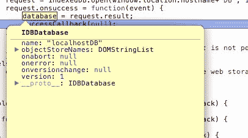

这表明数据库有一个名称和一个版本，但此时没有其他信息。版本已经为我们隐式创建，但我们将在本章后面看到，可以显式设置它。

接下来，我们将实现 `initObjectStore` 方法，以便数据库知道如何存储特定类型的对象。与 Web 存储 API 不同，`IndexedDB` 将直接存储我们的对象，而不是作为序列化字符串。`IndexedDB` 实际上可以存储任何数据类型，包括文字字符串和数字，但我们只对存储对象感兴趣。

`IndexedDB` 在存储对象时还依赖于主键的概念。我们可以告诉 `IndexedDB` 保存主键的属性名称，甚至可以要求 `IndexedDB` 为我们生成这些主键。在存储引擎中，对象的 `id` 属性始终代表主键。

在关系数据库中，所有表通常都需要一个主键。主键可以由一个或多个列组成，并且主键的值在表中必须是唯一的。

以下是在 `IndexedDB` 中创建对象存储的实现。


```javascript
initObjectStore : function(type, successCallback, errorCallback) {
  if (!database) {
    errorCallback('storage_api_not_initialized', 'The storage engine has not been initialized');
  }
  var exists = false;
  $.each(database.objectStoreNames, function(i, v) {
    if (v == type) {
      exists = true;
    }
  });
  if (exists) {
    successCallback(null);
  } else {
    var version = database.version+1;
    database.close();
    var request = indexedDB.open(window.location.hostname+'DB', version);
    request.onsuccess = function(event) {
      successCallback(null);
    }
    request.onerror = function(event) {
      errorCallback('storage_not_initalized', 'It is not possible to initialized storage');
    }
    request.onupgradeneeded = function(event) {
      database = event.target.result;
      var objectStore = database.createObjectStore(type, { keyPath: "id", autoIncrement: true });
    }
  }
},
```

这个方法的实现可能看起来难以理解。该方法的第一部分检查数据库中是否已存在该`type`的对象存储：

```javascript
$.each(database.objectStoreNames, function(i, v) {
  if (v == type) {
    exists = true;
  }
});
```

如果存在（即这不是页面第一次加载），则无需执行任何操作，可以直接调用成功回调。

如果我们需要为该`type`创建对象存储，那么我们就需要修改数据库的结构。使用`IndexedDB`更改数据库结构有非常严格的规则，具体来说，只能在打开数据库的过程中进行。

为了满足这一要求，我们需要`close`数据库，但在关闭之前，我们还要记录当前使用的数据库版本：

```javascript
var version = database.version+1;
database.close();
```

现在，可以重新打开数据库，但我们要告诉`IndexedDB`数据库的版本号已更改。我们可以请求任何版本号，但递增 1 是一个自然的选择。

```javascript
indexedDB.open(window.location.hostname+'DB', version);
```

由于指定了新的版本号，不仅会触发请求的`onsuccess`和`onerror`函数，还会触发第三个名为`onupgradeneeded`的函数。这个函数是唯一允许我们更改数据库结构的地方，我们通过以下调用来实现：

```javascript
request.onupgradeneeded = function(event) {
  database = event.target.result;
  var objectStore = database.createObjectStore(type, { keyPath: "id", autoIncrement: true });
}
```

在第一行，我们重新存储了数据库的本地引用。

接下来，我们请求为`type`创建一个`objectStore`。我们还指定对象存储的主键包含在持久化对象的`id`属性中，并且我们希望由`IndexedDB`自动递增。这意味着我们不再需要担心为对象生成 ID。注意，我们仍然依赖`onsuccess`回调来调用我们的回调方法，否则我们可能会在对象存储创建之前就开始使用它。

我们提供的 API 在一定程度上复杂化了对象存储的创建过程。如果我们在`init`方法中就知道所有对象存储的名称，那么就不需要关闭并重新打开数据库。然而，这给了我们更大的灵活性，因为应用程序的每个功能区域都可以负责自身的初始化，而无需担心应用程序的其他部分。

## 修改 `tasks.html` 中的代码

在继续编写代码之前，我们需要对`tasks.html`中的代码做一个小改动：

```javascript
$(document).ready(function() {
  tasksController.init($('#taskPage'));
  tasksController.loadTasks();
});
```

对`tasksController.init`的调用将负责初始化存储引擎；因此它需要在返回之前知道自己已完全初始化。在当前实现中，应用程序可能在存储引擎完全初始化之前就开始使用它，就像在调用`tasksController.loadTasks`时那样。

为了解决这个问题，我们将让`tasks-controller.js`中的`init`方法使用回调来通知其客户端它何时真正完成初始化。以下是对`init`方法的修改：

```javascript
init : function(page, callback) {

 if (initialised) {

 callback()

 } else {

 taskPage = page;

 storageEngine.init(function() {

   storageEngine.initObjectStore('task', function() {

 callback();

 }, errorLogger)

 }, errorLogger);
```

`init`方法现在接受一个`callback`参数（应该是一个函数）。如果模块已经初始化，它只需执行该函数来调用回调。如果模块尚未初始化，则直到`initObjectStore`方法成功时才会调用回调。

有了这个改动，我们现在可以按如下方式修改`tasks.html`中的代码：

```javascript
tasksController.init($('#taskPage'), function() {

 tasksController.loadTasks();

});
```

页面将不会尝试将任务加载到其表格中，直到回调被调用以通知它存储引擎已完全初始化。

这是一个重要的教训：一旦你开始开发异步 API，就需要意识到函数将控制权返回给调用者与函数完成处理之间的区别。通常，只有在函数完成处理后才能执行后续操作。这些情况很容易被忽视，并且可能成为恼人错误的根源。

## 实现 `save` 方法

接下来的步骤是实现`save`方法。这将向你介绍 IndexedDB 事务的概念：

```javascript
save : function(type, obj, successCallback, errorCallback) {

 if (!database) {

 errorCallback('storage_api_not_initialized', 'The storage engine has not been initialized');

 }

 if (!obj.id) {

 delete obj.id ;

 } else {

 obj.id = parseInt(obj.id)

 }

 var tx = database.transaction([type], "readwrite");

 tx.oncomplete = function(event) {

 successCallback(obj);

 };

 tx.onerror = function(event) {

 errorCallback('transaction_error', 'It is not possible to store the object');

 };

 var objectStore = tx.objectStore(type);

 var request = objectStore.put(obj);

 request.onsuccess = function(event) {

 obj.id = event.target.result

 }

 request.onerror = function(event) {

 errorCallback('object_not_stored', 'It is not possible to store the object');

 };

}
```

在确认存在可操作的数据库后，我们检查传入对象的`id`。如果它是一个假值（例如`null`或`""`），我们就删除`id`属性本身，使其变为`undefined`。由于 IndexedDB 负责生成键，它不希望在一个未保存的对象上找到任何`id`属性，即使是值为`null`的也不行。我们的`toObject`实现会对空属性生成空字符串。

如果该属性确实存在，我们使用`parseInt`函数确保它是一个整数。例如，如果传入的是一个字符串形式的数字，我们就将其转换为数字。这是另一个重要的考虑因素，因为当前的`toObject`实现总是生成字符串。

//

这是我们第一次看到原生 JavaScript 的`parseInt`函数。虽然这是一个有用的函数，但它确实存在一些问题。为了直观地了解这些问题，请尝试以下调用：

> `parseInt(010)`

留给读者去发现为什么这会返回 8 而不是 10。

接下来，我们在数据库中创建一个事务，并为其添加`onerror`和`onsuccess`回调：

```javascript
var tx = database.transaction([type], "readwrite");

tx.oncomplete = function(event) {

 successCallback(obj);

};

tx.onerror = function(event) {

 errorCallback('transaction_error', 'It is not possible to store the object');

};
```

我们只能在事务的上下文中访问对象存储。事务将一组操作分组到一个或多个对象存储上。一旦针对事务的所有请求完成，事务将自动提交。

直到事务完成，我们才会通知客户端成功。如果我们在请求提交后就通知客户端，他们可能会遇到无法查询对象存储中的对象的情况。这是因为对对象存储的所有更改在事务提交之前对所有客户端都是隐藏的。

//

该事务被指定为“readwrite”事务：如果你想修改对象存储中的对象，必须指定此类型。默认的事务类型是“read”。即使只是读取对象也需要事务，这看起来可能有些奇怪。

接下来，我们执行将对象保存到对象存储的请求。

```javascript
var objectStore = tx.objectStore(type);

var request = objectStore.put(obj);

request.onsuccess = function(event) {

 obj.id = event.target.result

}

request.onerror = function(event) {

 errorCallback('object_not_stored', 'It is not possible to store the object');

};
```

从事务中获取对象存储后，使用`put`方法来持久化对象。该方法支持更新和插入。如果我们只想处理插入，可以使用`add`方法代替。

与事务有回调一样，代码也为`request`添加了`onsuccess`和`onerror`回调。在`onsuccess`回调中，我们将提取分配给对象的 ID，以便将其返回给客户端。请求的`onsuccess`总是在事务的`onsuccess`之前被调用。

## 实现 `findAll` 方法

接下来，我们将实现`findAll`方法。以下是 IndexedDB 的实现。这将向你介绍另一个重要的 IndexedDB 概念：游标。对于使用过关系数据库的人来说，游标应该很熟悉；游标代表一个结果集，可以导航以访问结果集中的所有记录。

```javascript
findAll : function(type, successCallback, errorCallback) {

 if (!database) {

 errorCallback('storage_api_not_initialized', 'The storage engine has not been initialized');

 }

 var result = [];

 var tx = database.transaction(type);

 var objectStore = tx.objectStore(type);

 objectStore.openCursor().onsuccess = function(event) {

 var cursor = event.target.result;

 if (cursor) {

 result.push(cursor.value);

 cursor.continue();

 } else {

 successCallback(result);

 }

 };

}
```

这部分的开头应该非常熟悉。我们创建一个事务（尽管这次没有指定“readwrite”）。

```javascript
var tx = database.transaction(type);

var objectStore = tx.objectStore(type);
```

一旦有了事务，我们指定要访问的对象存储，并在其上打开一个游标。`openCursor`方法会隐式创建一个游标，其结果集中包含对象存储中的所有对象。

也可以将`openCursor`返回的结果集限制为特定的键范围。

为了遍历游标的内容，我们为`openCursor`方法的`onsuccess`事件注册了一个回调。当游标打开并准备好交互时，该回调将被调用。

```javascript
objectStore.openCursor().onsuccess = function(event) {

var cursor = event.target.result;

if (cursor) {

result.push(cursor.value);

cursor.continue();

 } else {

 successCallback(result);

 }

};
```

在这个函数中，我们可以访问一个`cursor`对象。如果它为`null`，则表示结果集中没有更多条目。如果不为`null`，我们可以调用`cursor.value`获取当前游标位置的对象，然后调用`cursor.continue`将游标移动到结果集中的下一个位置。

当游标最终变为`null`时，我们就知道可以将从游标收集到的任何结果返回给客户端。无需等待事务完成再返回结果给客户端，因为事务并未修改数据库的状态。

## 实现 `findById` 方法

接下来我们要实现的方法是`findById`。这将突出 IndexedDB 的另一个特性：在对象存储中访问具有特定 ID 的对象非常简单，无需遍历所有对象。这是因为 IndexedDB 在`id`属性上建立了索引：

```javascript
findById : function (type, id, successCallback, errorCallback) {

 if (!database) {

 errorCallback('storage_api_not_initialized', 'The storage engine has not been initialized');

 }

 var tx = database.transaction([type]);

 var objectStore = tx.objectStore(type);

 var request = objectStore.get(id);

 request.onsuccess = function(event) {

 successCallback(event.target.result);

 }

 request.onerror = function(event) {

 errorCallback('object_not_stored', 'It is not possible to locate the requested object');

 };

}
```

这个方法与`findAll`方法非常相似，区别在于我们不需要打开游标来查找要访问的对象，而是可以直接在对象存储上调用`get`并传入相应的`id`。

与所有 IndexedDB 方法一样，这仍然是一个异步调用，因此我们仍然需要添加事件监听器来获取返回的对象。如果没有匹配的键，`get`将返回`null`结果，这也符合我们的存储引擎 API 的预期。

删除操作的实现与我们之前看到的几个方法类似：


```javascript
delete : function(type, id, successCallback, errorCallback) {

  var obj = {};

  obj.id = id;

  var tx = database.transaction([type], "readwrite");

  tx.oncomplete = function(event) {

    successCallback(id);

  };

  tx.onerror = function(event) {

    console.log(event);

    errorCallback('transaction_error', 'It is not possible to store the object');

  };

  var objectStore = tx.objectStore(type);

  var request = objectStore.delete(id);

  request.onsuccess = function(event) {

  }

  request.onerror = function(event) {

    errorCallback('object_not_stored', 'It is not possible to delete the object');

  };

}
```

与`save`方法一样，我们确保使用`"readwrite"`参数打开事务。同时，我们注意在事务（而非请求）完成之前，不要告知客户端删除已成功执行。

`delete`方法利用了`objectStore`上的`delete`方法，该方法方便地接受一个 ID。

最后，我们将实现`findByProperty`方法。这是你可能期望 IndexedDB 大放异彩的地方，因为它能够直接查询相关结果，而不是在 JavaScript 代码中遍历所有结果。

实际上，IndexedDB 可以对具有特定值的属性执行查询，但前提是该属性上已创建了索引。如果任何属性都可以作为查询的基础，那就意味着需要为对象的所有属性添加索引。

在我们的示例中不会添加索引，但了解它们的工作原理是值得的。为了创建索引，我们需要在`onupgradeneeded`回调中添加以下内容：

```javascript
objectStore.createIndex("category", " category ", { unique: false });
```

索引可以是唯一的，也可以是非唯一的。任务对象上`category`属性的索引需要是非唯一的，因为许多任务可以具有相同的`category`。

有了这个索引后，我们可以通过首先从对象存储中获取索引的引用来搜索具有特定类别的所有任务：

```javascript
var index = objectStore.index("category");
```

接下来，指定要搜索的范围（例如索引值）：

```javascript
var range = IDBKeyRange.only("Work");
```

然后在该范围上打开一个游标，就像我们在`findAll`示例中看到的那样，只是范围会作为参数传递：

```javascript
index.openCursor(range).onsuccess = function(event) {
```

由于我们不打算为任务上的属性添加索引，因此别无选择，只能自己遍历对象并找出匹配的那些：

```javascript
findByProperty : function(type, propertyName, propertyValue, successCallback, errorCallback) {

  if (!database) {

    errorCallback('storage_api_not_initialized', 'The storage engine has not been initialized');

  }

  var result = [];

  var tx = database.transaction(type);

  var objectStore = tx.objectStore(type);

  objectStore.openCursor().onsuccess = function(event) {

    var cursor = event.target.result;

    if (cursor) {

      if (cursor.value[propertyName] == propertyValue) {

        result.push(cursor.value);

      }

      cursor.continue();

    } else {

      successCallback(result);

    }

  };

}
```

IndexedDB 存储引擎的完整实现现在应该如下所示：

```javascript
storageEngine = function() {

  var database;

  var objectStores;

  return {

    init : function(successCallback, errorCallback) {

      if (window.indexedDB) {

        var request = indexedDB.open(window.location.hostname+'DB');

        request.onsuccess = function(event) {

          database = request.result;

          successCallback(null);

        }

        request.onerror = function(event) {

          errorCallback('storage_not_initalized', 'It is not possible to initialized storage');

        }

      } else {

        errorCallback('storage_api_not_supported', 'The web storage api is not supported');

      }

    },

    initObjectStore : function(type, successCallback, errorCallback) {

      if (!database) {

        errorCallback('storage_api_not_initialized', 'The storage engine has not been initialized');

      }

      var exists = false;

      $.each(database.objectStoreNames, function(i, v) {

        if (v == type) {

          exists = true;

        }

      });

      if (exists) {

        successCallback(null);

      } else {

        var version = database.version+1;

        database.close();

        var request = indexedDB.open(window.location.hostname+'DB', version);

        request.onsuccess = function(event) {

          successCallback(null);

        }

        request.onerror = function(event) {

          errorCallback('storage_not_initalized', 'It is not possible to initialized storage');

        }

        request.onupgradeneeded = function(event) {

          database = event.target.result;

          var objectStore = database.createObjectStore(type, { keyPath: "id", autoIncrement: true });

        }

      }

    },

    save : function(type, obj, successCallback, errorCallback) {

      if (!database) {

        errorCallback('storage_api_not_initialized', 'The storage engine has not been initialized');

      }

      if (!obj.id) {

        delete obj.id ;

      } else {

        obj.id = parseInt(obj.id)

      }

      var tx = database.transaction([type], "readwrite");

      tx.oncomplete = function(event) {

        successCallback(obj);

      };

      tx.onerror = function(event) {

        errorCallback('transaction_error', 'It is not possible to store the object');

      };

      var objectStore = tx.objectStore(type);

      var request = objectStore.put(obj);

      request.onsuccess = function(event) {

        obj.id = event.target.result

      }

      request.onerror = function(event) {

        errorCallback('object_not_stored', 'It is not possible to store the object');

      };

    },

    findAll : function(type, successCallback, errorCallback) {

      if (!database) {

        errorCallback('storage_api_not_initialized', 'The storage engine has not been initialized');

      }

      var result = [];

      var tx = database.transaction(type);

      var objectStore = tx.objectStore(type);

      objectStore.openCursor().onsuccess = function(event) {

        var cursor = event.target.result;

        if (cursor) {

          result.push(cursor.value);

          cursor.continue();

        } else {

          successCallback(result);

        }

      };

    },

    delete : function(type, id, successCallback, errorCallback) {

      var obj = {};

      obj.id = id;

      var tx = database.transaction([type], "readwrite");

      tx.oncomplete = function(event) {

        successCallback(id);

      };

      tx.onerror = function(event) {

        console.log(event);

        errorCallback('transaction_error', '无法存储对象');

      };

      var objectStore = tx.objectStore(type);

      var request = objectStore.delete(id);

      request.onsuccess = function(event) {

      }

      request.onerror = function(event) {

        errorCallback('object_not_stored', '无法删除对象');

      };

    },

    findByProperty : function(type, propertyName, propertyValue, successCallback, errorCallback) {

      if (!database) {

        errorCallback('storage_api_not_initialized', '存储引擎尚未初始化');

      }

      var result = [];

      var tx = database.transaction(type);

      var objectStore = tx.objectStore(type);

      objectStore.openCursor().onsuccess = function(event) {

        var cursor = event.target.result;

        if (cursor) {

          if (cursor.value[propertyName] == propertyValue) {

            result.push(cursor.value);

          }

          cursor.continue();

        } else {

          successCallback(result);

        }

      };

    },

    findById : function (type, id, successCallback, errorCallback) {

      if (!database) {

        errorCallback('storage_api_not_initialized', '存储引擎尚未初始化');

      }

      var tx = database.transaction([type]);

      var objectStore = tx.objectStore(type);

      var request = objectStore.get(id);

      request.onsuccess = function(event) {

        successCallback(event.target.result);

      }

      request.onerror = function(event) {

        errorCallback('object_not_stored', '无法定位请求的对象');

      };

    }

  }

}();
```

## 动态选择存储引擎

我们现在有两个符合 API 要求的存储引擎，它们可以完全互换使用（假设浏览器支持底层 API）。我们的首选方法是：如果浏览器支持 IndexedDB，则使用 IndexedDB 存储引擎；如果不支持，则回退到 Web Storage API。

为了加载正确的存储引擎，我们需要完成两个不同的任务。第一是决定我们希望使用哪个存储引擎；第二是强制加载该存储引擎而不是另一个。

为了确定是否可以使用某个特定的存储引擎，我们可以使用以下代码：

```javascript
if (window.localStorage) {
```

和：

```javascript
if (window.indexedDB) {
```

如果浏览器支持这些 API，那么`window`对象上就会存在该 API 的全局属性，因此`if`语句将求值为`true`。

这种方法并非万无一失，因为没有什么能阻止我们在`window`对象上创建自己的名为`localStorage`的全局属性，但如果我们遵循良好的编码标准，这是一种快速且方便的机制，我们可以依赖它。

现在我们已经有了判断特定存储引擎是否可用的方法，接下来有几种在运行时加载正确存储引擎的方案。我们将通过 AJAX 来实现这一点。这将根据浏览器的能力在运行时动态加载相应的 JavaScript 文件。

如果你不熟悉 AJAX，在本章中你无需关心它的工作原理。AJAX 将在本书后面的章节中深入介绍。

为了了解其工作原理，请删除两个存储引擎的导入：

```html
<!--script src="scripts/tasks-webstorage.js"></script-->
<script src="scripts/tasks-indexeddb.js"></script>
```

然后在`tasks.html`中将以下代码：

```javascript
$(document).ready(function() {
  tasksController.init($('#taskPage'), function() {
    tasksController.loadTasks();
  });       
});
```

替换为：


```javascript
if (window.indexedDB) {
  $.getScript("scripts/tasks-indexeddb.js")
    .done(function(script, textStatus) {
      $(document).ready(function() {
        tasksController.init($('#taskPage'), function() {
          tasksController.loadTasks();
        });
      });
    })
    .fail(function(jqxhr, settings, exception) {
      console.log('加载 indexed db 脚本失败');
    });
} else if (window.localStorage) {
  $.getScript("scripts/tasks-webstorage.js")
    .done(function(script, textStatus) {
      $(document).ready(function() {
        tasksController.init($('#taskPage'), function() {
          tasksController.loadTasks();
        });
      });
    })
    .fail(function(jqxhr, settings, exception) {
      console.log('加载 web storage 脚本失败');
    });
}
```

这里利用了 jQuery 中的 `$.getScript` 辅助方法，通过异步 AJAX 调用加载相应的 JavaScript。AJAX 调用的结果是我们希望加载的脚本，然后 jQuery 会将其动态添加到 DOM 中。

由于现在 JavaScript 在运行时动态加载合适的存储引擎，我们还需要确保在脚本处理完成之前不要开始使用存储引擎。因此，我们在 AJAX 调用的成功（`done`）回调中初始化屏幕。

当前的实现为每个尝试加载的脚本重复了初始化逻辑；因此我们可以将其重写如下：

```javascript
function initScreen() {
  $(document).ready(function() {
    tasksController.init($('#taskPage'), function() {
      tasksController.loadTasks();
    });
  });
}

if (window.indexedDB) {
  $.getScript("scripts/tasks-indexeddb.js")
    .done(function(script, textStatus) {
      initScreen();
    })
    .fail(function(jqxhr, settings, exception) {
      console.log('加载 indexed db 脚本失败');
    });
} else if (window.localStorage) {
  $.getScript("scripts/tasks-webstorage.js")
    .done(function(script, textStatus) {
      initScreen();
    })
    .fail(function(jqxhr, settings, exception) {
      console.log('加载 web storage 脚本失败');
    });
}
```

另一种可行的方法是同时下载两个脚本作为传统导入，但按顺序加载。然后我们可以添加逻辑，仅在以下情况下创建存储引擎：

1. 浏览器支持底层 API。
2. 尚未创建存储引擎。

使用这种方法也能达到同样的效果。唯一的缺点是会多加载一个不需要的脚本。

# 整理应用程序

现在应用程序的大部分组件已经就位，但在继续之前，我们还需要添加一些功能。这些功能将有助于巩固你在前面章节中学到的知识。你可以根据每个功能的简短介绍尝试自行实现。

## 更新计数

每当任务数量发生变化时，我们需要更新屏幕底部的计数：


为此，我们将把这个元素：

```html
<footer>You have 3 tasks</footer>
```

改为：

```html
<footer>You have <span id="taskCount"></span> tasks</footer>
```

将数字包裹在 `span` 中不会改变显示效果，但允许我们在 DOM 中找到该元素，并在需要时更新它。

现在，我们想在 `tasks-controller.js` 中添加一个函数，用于计算表格中的行数并相应地更新元素：

```javascript
tasksController = function() {
  function errorLogger(errorCode, errorMessage) {
    console.log(errorCode + ':' + errorMessage);
  }

  var taskPage;
  var initialised = false;

  function taskCountChanged() {
    var count = $(taskPage).find('#tblTasks tbody tr').length;
    $('footer').find('#taskCount').text(count);
  }
```

最后，我们希望在 `loadTasks` 方法中调用这个函数：

```javascript
loadTasks: function() {
  storageEngine.findAll('task', function(tasks) {
    $.each(tasks, function(index, task) {
      $('#taskRow').tmpl(task).appendTo($(taskPage).find('#tblTasks tbody'));
    });
    taskCountChanged();
  }, errorLogger);
}
```

并且在删除任务后也需要调用它——因为在这种情况下我们不会调用 `loadTasks`：

```javascript
$(taskPage).find('#tblTasks tbody').on('click', '.deleteRow',
```

```javascript
function(evt) {
  storageEngine.delete(
    'task',
    $(evt.target).data().taskId,
    function() {
      $(evt.target).parents('tr').remove();
      taskCountChanged();
    },
    errorLogger
  );
});
```

关于此实现，唯一需要注意的是 `footer` 并非任务页面的一部分：因此我们无法在 `$(taskPage)` 的上下文中访问 `footer`。

## 清除任务

接下来我们要实现清除任务的功能。该功能应在点击“清除任务”按钮时触发，同时也应在执行 `save` 之后触发。

有一种非常便捷的方式来实现清除任务功能。将以下代码添加到 `tasks-controller.js` 的私有部分：

```javascript
function clearTask() {
  $(taskPage).find('form').fromObject({});
}
```

我们可以简单地将一个空对象反序列化到表单中。这将确保所有表单元素的内容被清空，因为它们无法在传入的对象中找到对应的值。

现在，我们可以将以下代码添加到 `tasks-controller.js` 的 `init` 方法中，即其他事件监听器注册的位置：

```javascript
$(taskPage).find('#clearTask').click(function(evt) {
  evt.preventDefault();
  clearTask();
});
```

我们还希望在保存后调用清除任务功能（之前我们添加了相关代码，但值得改为使用新的实现）。将以下代码行：

`$(':input').val('');`

替换为：

`clearTask();`

## 逾期任务

接下来我们要添加的功能是渲染行的背景色，以显示未来 2 天内到期的任务（橙色）和已逾期的任务（浅红色）。

在此之前，你可能已经注意到，用于高亮行的功能不再生效：

```javascript
$(taskPage).find('tbody tr').click(function(evt) {
  $(evt.target).closest('td').siblings().andSelf().toggleClass('rowHighlight');
});
```

原因现在应该很明显了：我们在页面加载时添加了监听器，但此时任务尚未加载到表格中。我们需要使用 jQuery 章节中介绍的方法，将这些监听器改为“实时”事件监听器：

```javascript
$(taskPage).find('#tblTasks tbody').on('click', 'tr', function(evt) {
  $(evt.target).closest('td').siblings().andSelf().toggleClass('rowHighlight');
});
```

现在，我们将添加功能来渲染任务的背景色。这将使用 `tasks.css` 中定义的以下类：

```css
.overdue {
  background: #F7DCE5;
}

.warning {
  background: #F7F7DC;
}
```

我们有两种选择来为表格行分配正确的类：可以在模板中完成，也可以在 JavaScript 中所有行加载完成后进行。我们将选择后者。

为了实现此功能，需要将任务中的日期与当前日期进行比较。JavaScript 提供了一组基本的日期处理函数，但如果需要进行大量的日期操作或计算，通常建议使用专门的日期库。本应用将使用以下库：

[`www.datejs.com/`](http://www.datejs.com/)

JavaScript 的日期对象是模仿 Java 中的 `Date` 类创建的。它几乎是直接复制，甚至包含了与 Y2K 相关的相同错误。幸运的是，这些问题早已被解决。

下载最新版本，将其添加到 `scripts` 文件夹，然后导入到 `tasks.html` 页面中：

```html
<script src="scripts/date.js"></script>
```

现在，在浏览器中刷新 `tasks.html` 页面并打开控制台，你就可以使用如下函数调用：

```javascript
> Date.today()
> (2).months().ago()
> (3).days().fromNow();
```

如你所见，这是一个非常直观的日期库，远优于内置库。

现在，我们可以在 `tasks-controller.js` 中刚刚添加的 `clearTasks` 函数之后立即添加以下函数：

```javascript
function renderTable() {
  $.each($(taskPage).find('#tblTasks tbody tr'), function(idx, row) {
    var due = Date.parse($(row).find('[datetime]').text());
    if (due.compareTo(Date.today()) < 0) {
      $(row).addClass('overdue');
    } else if (due.compareTo((2).days().fromNow()) <= 0) {
      $(row).addClass('warning');
    }
  });
}
```

这将遍历表格中的所有行，并从名为 `datetime` 的属性中提取日期（你可能还记得，这符合 ISO 日期标准，因此可以直接解析，无需指定格式）。

一旦识别出日期，就会使用日期库将其从字符串解析为日期对象。然后我们将该日期与今天进行比较：如果结果小于 0，说明日期已过去，我们添加 `overdue` 类。

如果日期不是过去，我们检查它是否小于或等于未来 2 天。如果是，则添加 `warning` 类。

我们本可以编写 JavaScript 代码来执行这些操作，而无需导入日期库，但代码会不够简洁，且容易出错。使用库的优势在于它已经过所有使用者的测试，因此质量水平往往较高。

现在，我们需要在表格加载时调用此函数：

```javascript
loadTasks: function() {
  storageEngine.findAll('task', function(tasks) {
    $.each(tasks, function(index, task) {
      $('#taskRow').tmpl(task).appendTo($(taskPage).find('#tblTasks tbody'));
    });
    taskCountChanged();
    renderTable();
  }, errorLogger);
}
```

如果你现在添加已逾期或未来 2 天内到期的任务，它们应该会以相应的样式显示。

## 完成任务

接下来我们将实现“完成任务”功能。如果任务已完成，我们希望以删除线显示文本。这将通过 `tasks.css` 中的以下类实现：

```css
.taskCompleted {
  text-decoration: line-through;
}
```

我们还需要在任务本身中存储已完成的事实，因此我们将为已完成的任务添加一个名为 `complete` 的新属性，并在完成时将其设置为 `true`。

此过程的第一步是修改完成按钮，使其具有我们可以识别的类，并让任务 `id` 可被访问：

```html
<script id="taskRow" type="text/x-jQuery-tmpl">
<tr>
  <td>${task}</td>
  <td><time datetime="${requiredBy}"> ${requiredBy}</time></td>
  <td>${category}</td>
  <td>
    <nav>
      <a href="#" class="editRow" data-task-id="${id}">编辑</a>
      <a href="#" class="completeRow" data-task-id="${id}">完成</a>
      <a href="#" class="deleteRow" data-task-id="${id}">删除</a>
    </nav>
  </td>
</tr>
</script>
```

接下来，为这些按钮添加监听器。它将找到需要完成的任务，将其保存为 `complete` 属性设置为 `true`，并重新绘制表格：

```javascript
$(taskPage).find('#tblTasks tbody').on('click', '.completeRow', function(evt) {
  storageEngine.findById('task', $(evt.target).data().taskId, function(task) {
    task.complete = true;
    storageEngine.save('task', task, function() {
      tasksController.loadTasks();
    }, errorLogger);
  }, errorLogger);
});
```

我们还将对 `tasks-controller.js` 中的 `loadTasks` 方法进行小幅修改，以确保在表格加载时未完成的任务的 `complete` 属性设置为 `false`：

```javascript
loadTasks: function() {
  $(taskPage).find('#tblTasks tbody').empty();
  storageEngine.findAll('task', function(tasks) {
    $.each(tasks, function(index, task) {
      if (!task.complete) {
        task.complete = false;
      }
      $('#taskRow').tmpl(task).appendTo($(taskPage).find('#tblTasks tbody'));
      taskCountChanged();
      renderTable();
    });
  }, errorLogger);
}
```

下一步是让模板检查已完成的任务。如果任务已完成，`td` 元素将被赋予 `taskCompleted` 类，并且完成和编辑按钮将不显示。这就是为什么我们需要在所有任务上设置 `complete` 属性——如果访问未定义的属性，模板引擎会报错：


```html
<script id="taskRow" type="text/x-jQuery-tmpl">
<tr>
  <td {{if complete == true}}class="taskCompleted"{{/if}}>${task}</td>
  <td {{if complete == true}}class="taskCompleted"{{/if}}><time datetime="${requiredBy}">${requiredBy}</time></td>
  <td {{if complete == true}}class="taskCompleted"{{/if}}>${category}</td>
  <td>
    <nav>
      {{if complete != true}}
      <a href="#" class="editRow" data-task-id="${id}">编辑</a>
      <a href="#" class="completeRow" data-task-id="${id}">完成</a>
      {{/if}}
      <a href="#" class="deleteRow" data-task-id="${id}">删除</a>
    </nav>
  </td>
</tr>
</script>
```

这是我们第一次在模板中使用条件结构，这再次展示了使用模板引擎的优势。

有了这个功能，你应该能够完成一个任务，并使其显示如下：

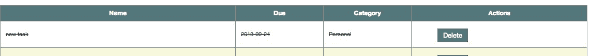

我们仍然可以删除已完成的任务，但不能再编辑或完成它们。

## 排序任务

我们要做的最后一项更改是对任务进行排序，使截止日期最早的任务排在前面。

我们将再次使用日期库来解析和比较日期，但我们将使用数组上可用的标准`sort`方法来执行排序。

`sort`方法接受一个比较器作为参数。比较器是一个函数，可以比较数组中的任意两个元素，并确定哪个排名更高。比较器应返回一个小于 1 的值表示第一个元素排名更高，返回 0 表示两者相等，返回大于 1 的数表示第二个元素排名更高。`Date`对象已经有一个`compareTo`方法来执行此任务。

`sort`方法会比较数组中的相关项以确定它们的相对顺序。这并不意味着将所有项相互比较，因为它可以依赖传递性：

如果 A > B 且 B > C，则 A > C。

我们可以在`loadTasks`方法中添加一行代码来实现排序：

```javascript
loadTasks : function() {
  $(taskPage).find('#tblTasks tbody').empty();

  storageEngine.findAll('task', function(tasks) {
    tasks.sort(function(o1, o2) {
      return Date.parse(o1.requiredBy).compareTo(Date.parse(o2.requiredBy));
    });

    $.each(tasks, function(index, task) {
      if (!task.complete) {
        task.complete = false;
      }

      $('#taskRow').tmpl(task).appendTo($(taskPage).find('#tblTasks tbody'));

      taskCountChanged();
      renderTable();
    });
  }, errorLogger);
}
```

## 结论

至此，任务 Web 应用程序的基本需求已经完成。在接下来的几章中，我们将整合更高级的 HTML5 API 的功能，以实现 Web 应用程序的离线存储，以及在应用程序中使用文件。

# 离线 Web 应用程序

我们现在已经创建了一个能够在浏览器中存储其内容的 Web 应用程序，但与传统的桌面应用程序不同，该应用程序仍然依赖互联网连接来加载 HTML、CSS 和 JavaScript 资源。

如果我们在本地运行 Web 服务器，这不成问题，因为访问 localhost 不依赖互联网连接，但显然真正的应用程序会远程托管，有时我们希望允许用户即使在断开互联网连接时也能继续使用 Web 应用程序。

在本章中，我们将编写功能来将应用程序资源存储在客户端，这样在首次加载文档后，客户端就不再依赖互联网连接来提供网页。这将通过另一个名为“应用缓存”的 HTML5 规范来实现。

应用缓存规范允许你指定一组应存储在客户端的资源。一旦这些资源持久化到客户端，客户端在后续页面加载时将不会尝试从服务器访问这些资源，而是使用客户端应用缓存中的版本。

这个功能听起来可能类似于浏览器多年来原生支持的缓存功能。浏览器通常会缓存所有下载的资源，然后在下次请求时使用这些版本，除非它们发生了变化。

然而，这种缓存形式并不旨在支持离线网页，因为这种缓存功能仍然依赖互联网连接来确定资源是否已更改。而应用缓存规范则专门设计用于离线存储资源，并且只使用这些版本，直到请求更新。

在开始本节之前，值得一提的是，本章中的示例不会使用基于 CDN 的脚本：它们假设所有需要的 JavaScript 资源都来自`scripts`文件夹。如果你一直在使用 CDN 提供 jQuery 资源，你可能需要下载它们并将其添加到`scripts`文件夹中，以便示例保持一致。这不是应用缓存的要求（只要正确设置了`NETWORK`属性，更多内容见下文），但它能保证示例的一致性。

为了实现应用缓存，我们首先在与`tasks.html`页面相同的目录中创建一个名为`tasks.appcache`的文件。

应用缓存将包含 3 个部分，因此首先将以下骨架添加到新创建的文件中。各部分之间必须用空行分隔。

```
CACHE MANIFEST

FALLBACK:

NETWORK:
```

文件的第一部分是我们列出所有希望离线存储的资源的地方。资源的列出顺序并不重要（请检查路径是否与你开发环境中的文件一致）：

```
CACHE MANIFEST

tasks.html

scripts/date.js

scripts/jquery-2.0.3.js

scripts/jquery-serialization.js

scripts/jquery-tmpl.js

scripts/jquery.validate.js

scripts/tasks-controller.js

scripts/tasks-indexeddb.js

scripts/tasks-webstorage.js

styles/tasks.css

FALLBACK:

NETWORK:
```

这些路径都是相对于应用缓存文件的，但也可以使用绝对路径。所有路径必须正确，这一点非常重要，因为即使有一个资源不可用，也不会将任何文件添加到浏览器应用缓存中，应用程序将无法离线使用。

这是应用缓存规范的一部分，尽管这似乎有悖常理。因此，如果从应用程序中移除了某个资源，也必须从该清单中移除它，这一点也至关重要。

`FALLBACK`部分的目的是指定离线时应使用的文件替代版本。例如，我们可能有一个名为`online.png`的图片，在线时显示在屏幕顶部，但离线时我们希望显示名为`offline.png`的图片。为了实现这一点，我们首先将`offline.png`添加到`CACHE MANIFEST`部分的缓存文件列表中；然后在`FALLBACK`部分添加以下内容：

```
FALLBACK:

online.png offline.png
```

我们还会在下面找到该部分的另一种用法。

最后一部分是网络部分。这是一个特别重要的部分，因为它指定了浏览器可以访问的网络地址。如果我们输入以下内容：

```
NETWORK:

/
```

那么浏览器将只能访问该服务器上的资源，无法访问任何其他服务器，例如 Google Analytics 或来自 CDN 的文件。

该部分最常见的设置如下：

```
NETWORK:

*
```

这确保了 Web 应用程序对网络具有无限制的访问权限。

文件的下一版本将如下所示：

```
CACHE MANIFEST

tasks.html

scripts/date.js

scripts/jquery-2.0.3.js

scripts/jquery-serialization.js

scripts/jquery-tmpl.js

scripts/jquery.validate.js

scripts/tasks-controller.js

scripts/tasks-indexeddb.js

scripts/tasks-webstorage.js

styles/tasks.css

FALLBACK:

NETWORK:

*
```

我们现在需要告诉`tasks.html`文件，在加载时下载这个清单文件，这反过来会使浏览器下载清单中的所有文件，无论它们是否立即需要。为此，我们在`tasks.html`的`html`标签中添加一个新属性：

```html
<html lang="en" manifest="tasks.appcache">
```

添加完成后，从 Web 服务器请求`tasks.html`页面。你应该不会注意到任何不同，因为你与 Web 服务器有连接。然而，如果你在 Chrome 中导航到以下 URL：

`chrome://appcache-internals/`

你会看到应用程序已被缓存；同时还有应用程序大小的摘要，以及缓存创建、最后更新和最后访问的日期：

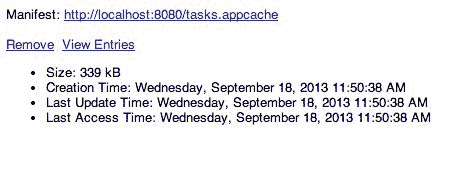

你可以选择查看此缓存中的条目；这将显示所有已离线缓存的文件。

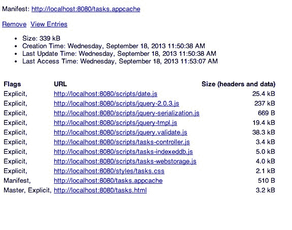

如果在加载页面时打开了控制台，你还会看到它正在下载所有资源。这是排查应用程序缓存是否未能缓存资源的好方法，因为它会告诉你哪个资源失败了：

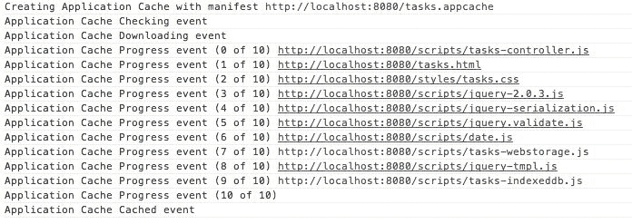

如果你使用 localhost 作为 Web 服务器域名，则需要关闭 Web 服务器来模拟离线模式，因为即使没有网络连接，你的浏览器也可以访问 localhost 域。

不幸的是，如果你关闭 Web 服务器并尝试加载应用程序，你会发现加载应用程序时出现问题：

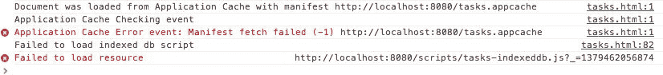

当我们尝试使用 jQuery 方法`$.getScript`有条件地加载文件时，它会在请求中附加当前时间戳，这是为了防止浏览器缓存脚本。这意味着浏览器没有意识到它有这个文件的缓存版本，因此加载失败。

我们可以通过要求 jQuery 抑制这种行为来解决这个问题，但我们将改用 Application Cache API 中可用的功能来解决这个问题。

你可能会认为应该可以通过在`FALLBACK`部分使用通配符来解决这个问题：

```
FALLBACK:

scripts/tasks-webstorage.js* scripts/tasks-webstorage.js

scripts/tasks-indexeddb.js* scripts/tasks-indexeddb.js
```

不幸的是，fallback 部分不允许使用通配符。幸运的是，FALLBACK 中每行的第一个 URL 仍然表示一种模式：任何以该 URL 中的文本开头的 URL 都会匹配 FALLBACK 中的那一行。因此，你可以简单地添加以下内容：

```
FALLBACK:

scripts/tasks-webstorage.js scripts/tasks-webstorage.js

scripts/tasks-indexeddb.js scripts/tasks-indexeddb.js
```

这将声明任何以以下内容开头的 URL：

`scripts/tasks-webstorage.js`

例如：

`scripts/tasks-indexeddb.js?_=1379463013652`

都应替换为资源：

`scripts/tasks-indexeddb.js`

（该资源已离线存储）。

完成此操作后，你应该能够重新加载`tasks.html`页面，这反过来将确保加载清单的修订版本。然后你应该能够关闭 Web 服务器，点击重新加载，页面就会显示。即使你在服务器关闭的情况下重启 Chrome，你仍然可以加载`tasks.html`页面。

关于 Application Cache，我们需要解决的最后一个问题是：当资源发生变化时，如何重新加载它们？浏览器无论在线还是离线都会使用文件的缓存版本，因此更改应用程序中的任何资源都不会反映在客户端上，即使客户端可以访问服务器。

只有当清单文件本身发生变化时，浏览器才会下载资源的新副本。这听起来有问题，因为你可能不需要更改清单文件中的任何内容，但仍然希望加载新版本的资源。解决方案是在清单文件中添加注释，并在每次资源更改时更改此注释，例如：

```
## version 1
```

任何以`#`开头的行都是注释，但注释的更改足以强制应用程序缓存刷新。因此，每次我们希望缓存重新加载资源时，都可以继续递增此版本号。

如果你保存此更改并重新加载页面，Chrome 应该会通知你缓存现在的“最后更新时间”是当前时间，即使“创建时间”是过去的：

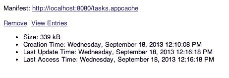

如果你打开了控制台，你还会看到资源正在被下载。

Application Cache API 的许多功能似乎违反直觉。关于更新过程，另一个可能让你惊讶的方面是：用户第一次加载页面时不会看到任何更新的资源。应用程序缓存的工作方式是首先向用户呈现网页（使用资源的缓存版本），然后开始更新并将新版本的应用程序存储在应用缓存中。因此，直到用户第二次加载页面时，他们才会看到任何更新的内容。

这带来的一个副作用是，第一次加载`tasks.html`页面时，浏览器会访问所有资源两次。第一次是为了加载所有资源以显示给用户；第二次是为了将它们下载到缓存中。

如果这是一个问题，可以监听应用程序缓存事件，以便在浏览器发现需要下载新版本的应用程序时得到通知：

```javascript
window.applicationCache.addEventListener('downloading', function(e) {});
```

要添加一个在每个资源下载时触发的事件监听器，可以添加以下内容：

```javascript
window.applicationCache.addEventListener('progress', function(e) {});
```

最后，要注册一个事件监听器，以便在所有资源完成更新时得到通知，请添加以下内容：

```javascript
window.applicationCache.addEventListener('updateready', function(e) {});
```

在此函数中，如果你希望客户端立即访问修订后的应用程序，可以调用以下代码：

```javascript
window.location.reload();
```

在开发阶段，Application Cache 可能会非常烦人，因为除非清单发生变化，否则资源不会在客户端刷新，即使如此，也要等到第二次请求页面时才会刷新。因此，建议在本书的其余练习中，移除`html`标签中对清单的引用。

## 处理文件

在编写桌面应用程序时，从用户文件系统读取和写入文件的能力是理所当然的。一旦客户端应用程序安装在计算机上，它基本上可以完全访问用户能够访问的所有文件。

在 Web 浏览器中运行的 Web 应用程序在访问用户文件系统方面自然受到限制。如果任何网站都能读取其文件系统上的文件，用户自然会非常紧张。

从早期开始，HTML 就支持一个文件表单元素，允许用户从其文件系统中选择一个文件，并将其内容提交到服务器。即使这样也受到严格限制：无法通过 JavaScript 以任何方式与此字段交互，包括访问用户已选择的文件内容。

HTML5 包含多个用于与用户文件系统交互的 API。其中最具雄心的是 File System 和 File Writer API。这些规范由 Google 提出，目前仅在 Chrome 中支持。它们允许 Web 应用程序在虚拟文件系统中读取文件、创建目录和写入文件。

这里的核心词是“虚拟”。每个源（origin）都将拥有自己完全控制的虚拟文件系统，但这个文件系统会与用户的真实文件系统以及从任何其他源加载的页面的文件系统隔离开来。此外，根据 API 的实现方式，虚拟文件系统可能不会以用户文件系统上的文件和目录集合的形式存在（它可能以二进制数据库的形式实现）。

由于我们在前面章节中考察过的其他存储选项，这些 API 的用途有限，建议你继续使用我们讨论过的其他存储选项。

另一个主要的文件相关 API 是`FileReader` API。这个 API 更简单，但在很多方面也更有趣。它依赖于 HTML 文件表单字段，但一旦选择了文件，它就能让开发者通过 JavaScript 访问文件内容。这意味着可以在不将文件提交到 Web 服务器的情况下，对文件进行本地解析。

这有几个优点：

1. 用户可以在离线时加载文件（前提是 Web 应用程序已使用本书中概述的其他技术实现了离线工作）。
2. 文件内容可以通过 AJAX 调用提交到服务器，而不是通过服务器 POST 提交。
3. 客户端可以选择只向服务器发送文件的一部分，而不是整个文件，从而减少带宽需求。

所有主流 Web 浏览器现在都支持`FileReader` API。

为了演示`FileReader` API，我们将允许用户从逗号分隔（CSV）文件中导入一组任务。CSV 文件将包含三列：

1. 任务描述。
2. 截止日期。
3. 任务类别。

CSV 文件将包含一个单行标题，其余所有行都包含任务。

以下是一个 CSV 文件示例（该文件可在本书网站的`chapter13`压缩包中找到）：

```csv
Task,Required By,Category
Prepare slide show,2013-11-20,Work
Attend Product Lanuch,2013-11-21,Work
```

作为第一步，我们将在主屏幕上提供一个导入选项。在`tasks.html`中，在结束的`main`标签之前立即添加以下代码：


```html
<section id="csvImport">
<div>
 <label for="task">从 CSV 文件导入任务</label>
 <input type="file" id="importFile" name="importFile"/>
 </div>   
</section>
```

接下来，我们将在 `tasks-controller.js` 中添加一个函数，该函数将监听文件输入字段的 `change` 事件，然后读取文件内容。将其添加到 `tasks-controller.js` 文件的私有部分：

```javascript
function loadFromCSV(event) {
 var reader = new FileReader();
 reader.onload = function(evt) {
 console.log(evt.target.result);
 };
 reader.onerror = function(evt) {
 errorLogger('cannot_read_file', '无法读取指定的文件');
 };
 reader.readAsText(event.target.files[0]);
}
```

当文件被选中时，该函数将接收到一个事件。它首先会创建一个新的 `FileReader` 对象。`FileReader` 被要求读取指定的文件，然后异步提供文件内容，因此我们还需要添加成功和失败时的监听器。`onload` 监听器将在文件内容可用时被调用；`onerror` 将在任何失败后被调用。

用户可能同时选择多个文件；因此事件的目标将指向一个文件数组。在我们的例子中，我们将忽略这是一个数组的事实，直接选择第一个文件：

`event.target.files[0]`

现在，在 `tasks-controller.js` 的 `init` 方法中添加以下代码，以监听用户选择文件：

```javascript
$('#importFile').change(loadFromCSV);
```

添加监听器后，尝试使用文件选择器加载文件。（目前代码只会将文件内容记录到控制台。）

如果你在调试器中检查事件的目标，你会看到它提供了关于文件的信息，包括文件名、类型和修改日期：

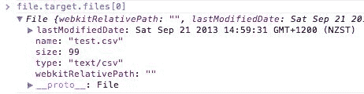

确定已加载文件的类型可能很重要，因为 `FileReader` 提供了多种不同的机制来读取不同类型的文件。在我们的例子中，我们使用了 `readAsText`，它将文件内容作为 JavaScript 字符串提供，但 `FileReader` 还支持以下方法：

- `readAsBinaryString`：文件内容以字符串形式提供，但每个字节由一个数字表示。如果数据是文本，这将与 `readAsText` 相同。
- `readAsDataURL`：文件内容以编码后的 URL 形式提供。如果我们加载一个文本文档，内容将以 Base 64 编码进行编码。
- `readAsArrayBuffer`：如果你想访问文件的特定部分，可以使用此方法。

现在我们有了一个能够将文件内容提取为字符串的事件处理程序，下一步是将其分解为行数组，这样我们就可以逐行处理这些行。我们使用 JavaScript 字符串支持的 `split` 方法，在每次遇到换行符时拆分字符串。这将返回一个字符串数组。

```javascript
function loadFromCSV(event) {
 var reader = new FileReader();
 reader.onload = function(evt) {
 var contents = evt.target.result;
 var lines = contents.split('\n');
 };
 reader.onerror = function(evt) {
 errorLogger('cannot_read_file', '无法读取指定的文件');
 };
 reader.readAsText(event.target.files[0]);
}
```

有了行数组后，我们需要将每一行分解为一组标记（token），我们知道每个标记由逗号分隔。这听起来相对简单，例如以下实现可以满足我们大部分需求：

`line.split(',')`

不幸的是，CSV 文件可能比我们使用的简单示例更复杂。例如，单个标记可能包含逗号；因此 CSV 文件可以将标记用双引号括起来，以确保这些逗号被当作字面量处理，而不是标记分隔符。

每当你遇到一个看起来常见的问题（例如解析 CSV 文件中的一行）时，值得寻找已经编写好的库。这些库的作者已经考虑到了大多数可能出现的问题，并且任何拥有大量用户的库很可能已经在大量场景中经过测试，因此应该更加稳定。

在这个场景中，我们将使用这个库：

`https://code.google.com/p/jquery-csv/`

下载最新版本并将其添加到应用程序的 `scripts` 文件夹中。我使用的是 0.71 版本。

接下来，记得在 `tasks.html` 的 `head` 部分末尾包含该导入，并且还要记得在 `tasks.appcache` 中添加对该文件的引用，因为我们希望这个库在离线时可用。

```html
<script src="scripts/jquery.csv-0.71.js"></script>
```

你可以通过在控制台中执行以下调用并检查返回的对象来确认是否正确安装了脚本：

`$.csv`

现在我们可以编写代码来解析和创建任务：

```javascript
function loadTask(csvTask) {
 var tokens = $.csv.toArray(csvTask);
 if (tokens.length == 3) {
 var task = {};
 task.task = tokens[0];
 task.requiredBy = tokens[1];
 task.category = tokens[2];
 return task;
 }
 return null;
}

function loadFromCSV(event) {
 var reader = new FileReader();
 reader.onload = function(evt) {
 var contents = evt.target.result;
 var lines = contents.split('\n');
 var tasks = [];
 $.each(lines, function(indx, val) {
 if (indx >= 1 && val) {
 var task = loadTask(val);
 if (task) {
 tasks.push(task);
 }
 }
 });
 };
 reader.onerror = function(evt) {
 errorLogger('cannot_read_file', '无法读取指定的文件');
 };
 reader.readAsText(event.target.files[0]);
}
```

在从 CSV 中读取每一行后，我们将其发送给另一个名为 `loadTask` 的函数，该函数使用 CSV 库对其进行标记化，并构造一个任务。

请注意，我们还跳过了文件中的第一行（因为它是标题行），以及所有空行，通过使用以下代码：

```javascript
if (indx >= 1 && val) {
```

现在我们有了一个想要保存的任务数组。此时，或许值得在我们的存储引擎中添加另一个方法，用于执行 `saveAll` 操作。这样我们就可以利用底层存储 API 中的事务支持（如果可用），以确保要么所有任务都被持久化，要么一个都不被持久化。`saveAll` 方法将返回事务中保存的所有对象。

以下是 `tasks-webstorage.js` 中 `saveAll` 的实现（它不提供事务支持）：

```javascript
saveAll : function(type, objs, successCallback, errorCallback) {

 if (!initialized) {

 errorCallback('storage_api_not_initialized', 'The storage engine has not been initialized');

 } else if (!initializedTables[type]) {

 errorCallback('table_not_initialized', 'The table '+type+' has not been initialized');

 }

 var storageItem = getStorageObject(type);

 $.each(objs, function(indx, obj) {

 if (!obj.id) {

 obj.id = $.now();

 }    

 storageItem[obj.id] = obj;

 localStorage.setItem(type, JSON.stringify(storageItem));

 });

 successCallback(objs);

}
```

以下是 `tasks-indexeddb.js` 中的实现：

```javascript
saveAll : function(type, objs, successCallback, errorCallback) {

 if (!database) {

 errorCallback('storage_api_not_initialized', 'The storage engine has not been initialized');

 }   

 var tx = database.transaction([type], "readwrite");

 tx.oncomplete = function(event) {

 successCallback(objs);

 };

 tx.onerror = function(event) {

 errorCallback('transaction_error', 'It is not possible to store the object');

 };

 var objectStore = tx.objectStore(type);

 $.each(objs, function(indx, obj) {

  if (!obj.id) {

 delete obj.id ;

 } else {

 obj.id = parseInt(obj.id)

 }

 var request = objectStore.put(obj);

 request.onsuccess = function(event) {

 obj.id = event.target.result

 }

 request.onerror = function(event) {

     errorCallback('object_not_stored', 'It is not possible to store the object');

 };

 });

}
```

请注意，我们只创建了一个事务，然后向其中添加多个请求：每个任务对应一个请求。只有当所有这些请求都完成后，事务才被视为完成，并通知客户端操作成功。

最后，让我们在代码中添加对 `saveAll` 的调用：

```javascript
function loadFromCSV(event) {

 var reader = new FileReader();

 reader.onload = function(evt) {

 var contents = evt.target.result;

 var lines = contents.split('\n');

 var tasks = [];

 $.each(lines, function(indx, val) {

 if (indx >= 1 && val) {

 var task = loadTask(val);

 if (task) {

 tasks.push(task);

 }

 }

 });

 storageEngine.saveAll('task', tasks, function() {

 tasksController.loadTasks();

 },errorLogger);

 };

 reader.onerror = function(evt) {

 errorLogger('cannot_read_file', 'The file specified cannot be read');

 };

 reader.readAsText(event.target.files[0]);

}
```

有了这些，你应该能够加载一个 CSV 文件，并且其内容会立即反映在任务表中。此外，即使没有连接到 Web 服务器，也可以使用此功能，因为所有处理都完全在客户端进行。

# Web Workers

在本书的前面部分，我们讨论了 JavaScript 如何利用单个线程来执行所有处理，并且浏览器也使用同一个线程来渲染网页。虽然有一些基本的方法可以通过 `setTimeout` 来控制代码的执行时机，但无法在单独的线程上或同时多个线程上执行 JavaScript。

大多数现代计算机，甚至大多数智能手机，都能够同时执行多个线程，因为现在大多数设备都包含多个处理器或多个核心。此外，大多数软件工程师期望现代语言内置多线程库。

JavaScript 被限制为单线程是有充分理由的，例如，为了防止多个线程同时尝试更新文档对象模型的同一部分。然而，还有许多其他计算任务，多个线程同时执行并不会产生问题。

例如，考虑上一章中处理的 CSV 文件。将 JavaScript 字符串转换为一组对象是一个独立操作，与 DOM 无关（至少在处理结束刷新表格之前是如此）。因此，理论上应该可以在单独的线程上执行此处理，只有在需要更新 HTML 表格时才回到主浏览器线程。

HTML5 包含一个名为 Web Workers 的 API，它允许在 HTML 应用程序中实现一定程度的多线程。本章将介绍 Web Worker API，并探讨一些可能适用的用例。

Web Worker 是位于其自身 JavaScript 文件中的一段代码。Web Worker 通常监听来自主浏览器线程的消息。当它收到消息时，它会执行所需的任何计算，但最大的区别在于，浏览器会在单独的线程上执行此计算，因此如果底层硬件支持，此处理可以与主浏览器线程上的处理同时进行。

当 Web Worker 完成处理后，它可以向主浏览器线程发送一条消息，主线程将使用此结果执行所需的操作，例如更新 DOM。

在了解 Web Workers 能做什么之前，我们首先来看一下它们的限制。Web Workers 无法访问以下任何对象：

- `window` 对象
- 文档对象模型
- `localstorage` 对象
- `document` 对象

然而，Web Workers 可以调用 AJAX 请求，并且它们可以访问我们在本书 JavaScript 部分讨论的所有 JavaScript 特性。

由于这些限制，Web Workers 的用例是有限的。不过，仍然有一些场景是相关的。如果我们设想一个在 Web 浏览器中的文字处理应用程序，我们可能希望在后台定期执行一些活动，这些活动可能包括：

1. 检查文档中哪些单词拼写错误。
2. 根据一组规则检查文档的语法。
3. 检查文档中分页符应放置的位置。
4. 收集文档中单词数和页数的统计信息。

所有这些活动相关的处理都可以在 Web Worker 中完成。可以定期将文字处理文档发送给 Web Worker，它执行这些可能密集的活动，然后将结果发送回主线程，以便更新 DOM 以反映结果。

如果所有这些活动都在主浏览器线程上执行，那么每次执行这些活动时，用户很可能会遇到卡顿和延迟，并且随着文档大小的增加，这些卡顿可能会变得更严重。

我们将实现一个 Web Worker，它接收一个表示一组任务的 CSV 版本的 JavaScript 字符串。然后它将处理这些数据并返回一个任务数组。

此过程的第一步是为 Web Worker 创建一个新的 JavaScript 文件：该代码不能与任何其他代码存在于同一个 JavaScript 文件中，并且每个 Web Worker 必须拥有自己的 JavaScript 文件。在 `scripts` 文件夹中创建一个名为 `tasks-csvparser.js` 的新文件。

以下是我们的 Web Worker 的基本结构：

```javascript
self.addEventListener('message', function(msg) {

 var data = msg.data;   

 self.postMessage(null);

}, false);
```

它使用对 `self` 对象的引用来添加一个监听消息的事件监听器。当收到消息时，第二个参数传入的函数将被调用（同时传入消息）。第三个参数指定事件是否需要捕获，如果不确定，请使用 `false`。

现在，我们将相关代码从 `tasks-controller.js` 移动到 Web Worker 中：


```javascript
self.addEventListener('message', function(msg) {

 var data = msg.data; 

 var lines = data.split('\n');

 var tasks = [];

 jQuery.each(lines, function(indx, val) {

 if (indx >= 1 && val) {

 var task = loadTask(val);

 if (task) {

 tasks.push(task);

 }

 }

 });

 self.postMessage(tasks);

}, false);

function loadTask(csvTask) {

 var tokens = $.csv.toArray(csvTask);

 if (tokens.length == 3) {

 var task = {};

 task.task = tokens[0];

 task.requiredBy = tokens[1];

 task.category = tokens[2];

 return task;

 }

 return null;

}
```

不幸的是，我们立即遇到了一个问题：这段代码中有两处引用了 jQuery 函数`$`。这个对象注册在`window`对象上，因此无法从 Web Worker 中访问。

第一个引用（`$.each`）可以很容易地替换为 for 循环：

```javascript
for (var indx = 0; indx < lines.length; indx++) {

 var val = lines[indx];

 if (indx >= 1 && val) {

 var task = loadTask(val);

 if (task) {

 tasks.push(task);

 }

 }

 };
```

不幸的是，在 csv 函数的使用上我们陷入了困境：

`$.csv.toArray(csvTask);`

甚至无法将 jQuery 对象传入 Web Worker。最终我们别无选择，只能寻找另一个用于解析 CSV 文件的库。

虽然这不会成为问题，但并非本章的主题，因此我们将简单地用每次遇到逗号时分割行的简化代码替换那一行。如上所述，这段代码在实际应用中存在许多问题：

```javascript
function loadTask(csvTask) {

 var tokens = csvTask.split(',');

 if (tokens.length == 3) {

 var task = {};

 task.task = tokens[0];

 task.requiredBy = tokens[1];

 task.category = tokens[2];

 return task;

 }

 return null;

}
```

包含 Web Worker 的 JavaScript 文件不需要在`tasks.html`中显式导入。然而，由于我们希望 worker 在离线时也可用，我们需要将其添加到`tasks.appcache`中。这将确保 Web Worker 存储在客户端，而不是在创建 Web Worker 时按需从服务器读取。

你会注意到，当 Web Worker 完成时，它会向监听器回传一个任务对象数组。现在我们需要编写代码来初始化 Web Worker，向其发送消息，并监听响应消息。这段代码将在主浏览器线程上执行。

为了实例化一个 Web Worker，我们使用以下代码：

```javascript
var worker = new Worker('scripts/tasks-csvparser.js');
```

注意，这包含了构成 Web Worker 的 JavaScript 文件的 URL。

一旦创建了 Web Worker，我们需要为其添加一个事件监听器，以便能够接收它向主浏览器线程回传的消息。在我们的例子中，这个事件监听器将接收一个任务数组，然后将其保存：

```javascript
worker.addEventListener('message', function(e) {

 var tasks = e.data;

 storageEngine.saveAll('task', tasks, function() {

 tasksController.loadTasks();

 },errorLogger);

}, false);
```

最后，我们需要向 Web Worker 发送一条消息：

`worker.postMessage(contents);`

如果我们将所有这些整合在一起，`loadFromCSV` 函数现在应该如下所示：

```javascript
function loadFromCSV(event) {

 var reader = new FileReader();

 reader.onload = function(evt) {

 var contents = evt.target.result;

 var worker = new Worker('scripts/tasks-csvparser.js');

 worker.addEventListener('message', function(e) {

 var tasks = e.data;

 storageEngine.saveAll('task', tasks, function() {

 tasksController.loadTasks();

 },errorLogger);

 }, false);

 worker.postMessage(contents);    

 };

 reader.onerror = function(evt) {

 errorLogger('cannot_read_file', 'The file specified cannot be read');

 };

 reader.readAsText(event.target.files[0]);

}
```

如果你现在执行从 CSV 加载的功能，你不会注意到任何不同（除非你加载了一个巨大的文件）。尽管如此，CSV 文件的解析现在是在后台线程上进行的，而不是在主浏览器线程上。

Web Worker 在处理完我们的消息后仍会保持打开状态，并且如果我们发送更多消息，它也会接受。Web Worker 可以通过调用以下代码自行关闭：

`self.close()`

或者在我们的例子中，当`loadFromCSV`函数结束且`worker`变量超出作用域时，Web Worker 将关闭。

## 访问浏览器功能

Web Worker 对象唯一可以访问的主浏览器对象是`navigator`对象。该对象可用于获取有关浏览器的信息，例如浏览器供应商和版本。

由于 Web Worker 在与主浏览器线程不同的环境中执行，它们无法访问任何导入脚本创建的对象或函数。然而，Web Worker 可以在需要时加载额外的 JavaScript 文件。这可以通过以下函数调用完成：

`importScripts('foo.js');`

## 共享 Web Worker 与专用 Web Worker

到目前为止我们使用的 Web Worker 被称为专用 Web Worker。唯一允许向 Web Worker 发送消息的脚本文件是加载它的那个脚本文件。而共享 Web Worker 则可以从同一源加载的任何脚本进行交互。如果你需要从多个脚本文件访问一个 Web Worker，这可能会节省操作系统资源。

并非所有当前支持 Web Worker 的浏览器都支持共享 Web Worker，因此在实现共享 Web Worker 之前，有必要检查浏览器支持情况。

共享 Web Worker 的实例化方式与专用 Web Worker 类似，只是类名不同：

`var worker = new SharedWorker('scripts/tasks-csvparser.js');`

客户端与共享 Web Worker 的交互也与专用 Web Worker 类似，只是多了一个端口的抽象。事件监听器添加到端口上：

`worker.port.addEventListener`

消息发送到端口：

`worker.port.postMessage`

此外，在向端口发送任何消息之前，必须显式打开端口：

`worker.port.start();`

最后，Web Worker 本身的实现需要考虑不同的端口。以下是实现骨架：

```javascript
self.addEventListener("connect", function (e) {

 var port = e.ports[0];

 port.addEventListener("message", function (e) {

 var data = e.data;

 port.postMessage(data);

 }, false);

 port.start();

}, false);
```

注意，我们创建的第一个事件监听器允许对 Web Worker 进行一般连接。当收到新端口的连接时，我们为该端口添加一个单独的事件监听器，并启动该端口。

共享 Web Worker 背后的理念是，它们向应用程序暴露一个服务，就像应用服务器可能暴露一个服务一样。多个客户端可以与此服务交互，并且它们的消息将保持分离。

## 结论

Web Worker 为 Web 应用程序提供了有趣的潜力：关键在于找到合适的用例。

最可行的用例是那些前台线程可以继续被利用，同时后台线程执行额外代码的场景。前台线程可能只是在做更新用户进度条这样简单的事情：但 Web Worker 的好处是它们不会阻止这种情况发生，因为它们不会占用前台线程。

Web Worker 的另一个主要用途是那些可以自然实现多线程的算法。在这种情况下，我们可以创建多个 Web Worker，让每个 Worker 完成算法的一部分。在拥有多核或多处理器的设备上，这很可能会带来性能提升。例如，在拥有 4 个核心的设备上，单个线程最多只能使用 25% 的处理能力。如果创建 4 个 Web Worker，理论上我们可以使用 100% 的处理能力，并将操作速度提升 4 倍。

# AJAX

我们在本书中编写的 Web 应用在很大程度上独立于其 Web 服务器。Web 服务器负责提供资源，并为实现同源策略的 API 提供源（origin），但除此之外，它并没有扮演任何有意义的角色。事实上，一旦应用加载完成，它就可以独立于 Web 服务器运行。

大多数真实的 Web 应用在其生命周期中的某个时刻需要向 Web 服务器发送或接收数据。例如，用户可能希望在我们的应用中同步多个设备上的任务列表。

Web 应用与 Web 服务器交互的方式有两种。最常见的方法是向服务器执行 HTTP POST 或 GET 请求，并将 HTTP 响应加载到浏览器中。

HTTP GET 请求是最常见的请求类型，当从浏览器地址栏请求页面或用户点击超链接时就会发生。GET 请求指定一个特定的资源，但它也可以通过 URL 中编码的名称/值对向服务器传递数据，例如：

[`localhost/viewprofile?username=dane`](http://localhost/viewprofile?username=dane)

这个 GET 请求包含一个参数（`username`），其值被设置为“dane”。

为了向服务器发送大量数据，通常使用 POST 请求。POST 请求将 HTTP 表单中的数据序列化为一组键/值对。每个输入字段的名称成为键，而输入字段的当前值成为值。

传统 HTTP GET 和 POST 请求的一个副作用是，它们会导致加载一个新页面（即 HTTP 响应）。即使 URL 没有改变，并且只有页面的一小部分发生了变化，在发送 HTTP 请求并接收和渲染响应的过程中也会出现延迟。

传统 HTTP GET 和 POST 请求的第二个限制是它们是同步的。在请求进行期间，无法继续使用 Web 应用：用户必须等待响应被接收并在浏览器中更新。

考虑我们开发的 Web 应用，传统网站在用户选择编辑任务时会导致页面刷新。会向服务器发送一个 GET 请求，例如：

[`localhost/tasks.html?edit=122`](http://localhost/tasks.html?edit=122)

而响应将包含`tasks.html`页面，其中填充了编辑部分。对用户来说，看起来就像所有页面内容消失了，然后一两秒后又重新出现。

另一种方法是 AJAX（异步 [JavaScript](http://en.wikipedia.org/wiki/JavaScript "JavaScript") 和 [XML](http://en.wikipedia.org/wiki/XML "XML")）。

AJAX 最初是一种方法，而非标准。1998 年，微软实现了一个名为`XMLHTTP`的组件。这使得可以动态地从服务器请求内容，并将其合并到当前页面中，而无需刷新页面。后来，其他浏览器也采用了这一功能，即`XMLHttpRequest`对象。`XMLHttpRequest`目前正在标准化过程中，被认为是`HTML5`的一部分。

`XMLHttpRequest`对象允许网页向服务器发送 HTTP POST 和 GET 请求，并接收响应数据，而无需刷新整个网页。例如，请求可能返回页面的一部分，然后动态地添加到 DOM 中。

值得审视 AJAX 的关键方面：

- **异步**：AJAX 请求是异步的，因为主浏览器线程在请求进行期间不会阻塞。对请求的响应通过回调处理。这意味着用户无需知道请求正在进行，他们可以继续使用 Web 应用，就像什么都没发生一样。

- **JavaScript**：请求使用 JavaScript 对象执行，响应也以 JavaScript 对象的形式提供。

- **XML**：最初`XMLHttpRequest`使用 XML 作为数据交换格式。实际上，`XMLHttpRequest`允许使用任何数据格式，现在通常与 JSON 一起使用，而不是 XML。从 AJAX 调用返回 HTML 也很常见，因此可以直接插入到 DOM 中。

事实上，`XMLHttpRequest`也不依赖于 HTTP；它支持其他协议，如 FTP。从很多方面来看，`XMLHttpRequest`是 JavaScript 历史上命名最差的对象。

本质上，AJAX 是一种使用 JavaScript 异步向 Web 服务器发送和/或接收数据而无需刷新页面的机制。

可以使用内置的 JavaScript 对象执行 AJAX 调用，但 jQuery 提供了一个 AJAX 包装器，为执行 AJAX 调用提供了更方便的机制。

为了尝试一些 AJAX 示例，我们将让服务器在请求特定 URL 时返回静态 JSON。

在包含`tasks.html`的目录中创建一个名为`server`的新目录。

在其中添加一个名为`tasks.json`的文件，并添加以下内容：

```json
[{"id":100,"task":"first task","requiredBy":"2013-09-03","category":"Personal"},
 {"id":101,"task":"second task","requiredBy":"2013-10-03","category":"Work"},
 {"id":102,"task":"third task","requiredBy":"2013-09-05","category":"Work"},
 {"id":103,"task":"last task","requiredBy":"2013-09-08","category":"Personal"}]
```

这个 JSON 包含一个数组，其中包含 4 个任务对象。每个任务对象都具有与 Web 应用创建的对象相同的属性。

为了使用 AJAX 请求这个文件，首先浏览到`tasks.html`页面。AJAX 调用只能发送到与浏览器中加载的页面相同的服务器名称和端口：这被称为同源策略。如果有必要，有一些方法可以绕过同源策略，但这些方法往往依赖于 hack：如果你感兴趣，`JSONP`是最常用的方法。

接下来打开控制台，输入以下内容：

```javascript
$.ajax({
 type : "GET",
 dataType: "json",
 url : "/server/tasks.json",
 cache : false,
 success : function(data) { 
  console.log(data);    
 }
});
```

这个请求利用了 jQuery 的静态函数`$.ajax`。虽然这相对简单，但其中有很多内容需要解释：

- 请求是 HTTP GET 请求：这是默认方式，因此可以省略。
- 我们指定返回的数据类型为`json`。jQuery 使用它来决定如何解析结果。如果省略，jQuery 也能很好地猜测，因此通常不需要指定。其他可接受的值有`xml`、`script`或`html`。
- 接下来我们指定要访问的资源的 URL：可以是绝对 URL（如此处所示）或相对 URL。这里没有指定服务器的主机和端口，因为同源策略规定这必须是浏览器中加载的文档的主机和端口。
- 我们指示浏览器不要缓存结果。jQuery 会通过在请求中附加当前时间戳来确保资源不被缓存，就像我们之前在动态加载 JavaScript 脚本时看到的那样。这是一个有用的特性，因为通常不希望缓存数据请求。
- 为成功场景提供了一个回调函数。当收到 HTTP 响应时，该函数会被异步调用，并传入从请求中接收到的数据。

jQuery 提供了一组简写方法，可以进一步减少所需的代码。我们之前已经见过这些方法用于从服务器请求 JavaScript 脚本。例如，上面的示例可以写成如下形式：

```javascript
$.getJSON( "/server/tasks.json", function( data ) {
 console.log(data);
});
```


由于我们使用的是 JSON 数据格式，传递给回调函数的`data`对象将是一个 JavaScript 对象，它会自动从接收到的数据中反序列化而来。在这种情况下，该对象是一个包含四个任务对象的数组。因此，无需将结果转换为适用于我们应用程序的格式。

在继续之前，值得注意的是，从 jQuery 1.5 开始，有一种更好的方式来注册回调函数，即使用一种称为“promises”的技术。

对`$.ajax`的调用实际上会同步返回一种称为“promise”的对象。任何异步（或潜在异步）的 API 都可以使用 jQuery promises，并且它们在 jQuery 内部及外部都得到了广泛使用。

如果你在调试器中检查这个对象，它看起来像这样：

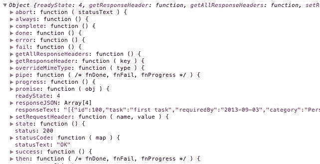

一个 promise 具有生命周期。在任何时刻，它可能处于三种状态之一：“未完成”、“已完成”或“失败”。promise 只能从“未完成”变为“已完成”，或从“未完成”变为“失败”。一旦 promise 被“已完成”或“失败”，其值就不能再改变。

以下代码展示了使用 promises 的相同示例。

```javascript
promise = $.ajax({
 type : "GET",
 url : "/server/tasks.json",
 cache : false   
});

promise.done(function(data) {
 console.log(data);
});

promise.fail(function() {
 console.log('A failure occurred');
});
```

当 promise 最初创建时，它处于“未完成”状态。一旦成功收到响应，promise 被设置为“已完成”，并调用相应的回调函数（`done`）。如果发生错误，promise 将被设置为“失败”状态，并调用相应的回调函数（`fail`）。

无论是在这个 AJAX 示例中，还是在你自己的库中，使用 promises 相比传统回调函数有几个优点。首先，可以添加多个成功或失败的回调函数：

```javascript
promise = $.ajax({
 type : "GET",
 url : "/server/tasks.json",
 cache : false   
});

promise.done(function(data) {
 console.log(data);
});

promise.done(function(data) {
 console.log('Also do this');
});

promise.fail(function() {
 console.log('A failure occurred');
});
```

其次，即使在 AJAX 调用完成后，你仍然可以调用`done`和`fail`来注册回调函数，并且这些回调函数会立即执行。这听起来可能没什么用，但考虑一种情况：我们不知道一个调用是同步还是异步的。

这种情况可能发生在我们在客户端缓存数据时：如果数据已缓存，它将同步可用；否则，它将异步可用。这意味着当我们添加回调函数时，结果可能立即可用，并且当我们注册回调函数时，promise 实际上已经完成了。下面将提供一个示例。

promises 的第三个主要好处是，可以延迟回调函数直到多个 promises 都完成。如果你需要执行多个 AJAX 调用、聚合数据并更新 DOM，这会很有用：

```javascript
promise1 = $.ajax({
 url : "/server/tasks.json",
});

promise2= $.ajax({
 url : "/server/tasks.json",
});

$.when(promise1, promise2).done(function(data1, data2) {
 console.log(data1[0]);
 console.log(data2[0]);
 console.log("Both requests have completed");
});

promise.fail(function() {
 console.log('A failure occurred');
});
```

关于 promises 的好消息是，你可以在自己的代码 API 中使用它们。让我们考虑一个执行上述缓存场景的函数：

```javascript
cachedTasks = function() {
 var tasks = null;
 return {
 getTasks : function() {
 var deferred = $.Deferred();
 if (tasks) {
 deferred.resolve(tasks);
 return deferred.promise();
 } else {
 var promise1 = $.ajax({
 url : "/server/tasks.json",   
 });
 promise1.done(function(data) {
 tasks = data;
 setTimeout(function() {deferred.resolve(tasks)}, 5000);
 })
 return deferred.promise();
 }
 }
 }
}();
```

这个函数使用闭包将任务的缓存版本保存在一个名为`tasks`的变量中。如果该变量不为`null`，则任务已被缓存，并且对客户端可用。如果`tasks`为`null`，则需要一个 AJAX 调用来获取任务：这既会填充缓存，也会返回任务。

你可以看到，无论哪种情况，都会从`$.Deferred()`的实例同步返回一个 promise 给客户端。你还可以看到，在这两种情况下，当结果对客户端可用时，这个对象被设置为已解决。这个调用会自动将 promise 移动到“已完成”状态，并确保所有通过`done`注册的回调函数被调用。

你还会看到，在调用服务器的情况下，这个 promise 依赖于从`$.ajax`调用返回的 promise。为了让你更容易看到结果，这段代码还在执行 AJAX 调用时添加了 5 秒的延迟。

为了获取任务，我们调用这个模块上的`getTasks`方法。就像 AJAX 调用一样，我们为`getTasks`返回的 promise 添加一个回调函数：

```javascript
promise = cachedTasks.getTasks();
promise.done(function(data) {
 console.log('I have finished')
});
```

如果你执行这段代码，应该会在大约 5 秒后看到控制台打印出“I have finished”。

现在，再次运行完全相同的代码。你应该会看到“I have finished”立即打印到控制台，因为这次将使用缓存版本的任务，因此当通过`done`方法注册回调函数时，结果立即可用。

如果你跟踪代码，你会发现当我们调用`done`方法添加回调函数时，promise 实际上已经完成了，因此我们的回调函数会立即执行。事实上，即使在回调函数执行之后，仍然可以为 promise 添加第二个回调函数：

```javascript
promise.done(function(data) {
 console.log('I have finished again')
});
```

这会立即执行，因为 promise 已经完成。

使用 promises 为基于回调的编程增加了一个额外的维度。在从头开始编写异步库时，强烈建议考虑基于 promises 来设计。

现在我们将回到 AJAX。到目前为止，我们只研究了 AJAX GET 请求。也可以使用 AJAX 执行 HTTP POST。最常见的用途是将表单内容 POST 到服务器，但 POST 足够灵活，可以发送任何数据结构。

发送结构化数据通常比发送原始表单数据更方便。这是因为服务器组件通常能够将结构化数据（如 JSON 或 XML）反序列化为丰富的对象层次结构，而表单数据则由名称/值对组成。

以下是一个函数的示例，它将一个任务对象发送到服务器，并向调用者返回一个 promise：

```javascript
function sendTask(task) {
 return $.ajax({
 type : "POST",
 url : "/submittask",
 contentType : "application/json",
  data : JSON.stringify(task)
 })
}
```

你会注意到我们将内容类型设置为`application/json`。默认的内容类型是`application/x-www-form-urlencoded`，这是 HTML 表单提交的适当内容类型。

实际上，使用 jQuery 的一个简写方法可以显著简化这段代码：

```javascript
return $.post( "/submittask", task );
```

jQuery 会推断出适当的选项，并隐式地将提供的任务对象序列化为字符串。

使用`$.ajax()`方法时，还可以提供许多其他选项。在大多数场景下，这些选项并非必需，但以下选项值得了解：

- `async`：AJAX 调用不一定是异步的（尽管 AJAX 中的“A”代表异步）。通过将`async`设置为`false`，可以执行同步 AJAX 调用。但除非有非常充分的理由，否则不建议这样做，因为主浏览器线程会阻塞，直到收到响应。
- `beforeSend`：这是一个请求前回调函数，允许你在请求发送之前对其进行修改，例如向请求添加特定的标头。
- `timeout`：设置 AJAX 调用的超时时间（以毫秒为单位）。这可以确保在合理时间内未返回的调用会向错误回调函数生成错误。

# 服务器发送事件与 WebSocket

AJAX 在创建丰富且动态的 Web 应用程序方面一直是一项极其重要的技术。然而，值得停下来思考的是，AJAX 仍然使用自万维网诞生以来就一直使用的基本底层通信协议：客户端（Web 浏览器）向服务器（Web 服务器）发送 HTTP 请求。Web 服务器以同步 HTTP 响应进行回复。一旦收到响应，通信即被视为完成。

尽管这种技术在大多数场景下运行良好，但它并不适用于两个关键场景：

1. 服务器希望向客户端推送信息。例如，服务器可能有需要发送给客户端的通知。
2. 客户端和服务器希望进行长时间对话，来回传输许多小消息。例如，考虑一个实时多玩家游戏：当每个用户执行影响其他用户的操作时，数据必须定期来回传输给每个客户端。

尽管这两种用例都可以通过 HTTP 支持，但由于 HTTP 的开销及其无状态特性，它并不是这两种场景的最佳协议。在本章中，我们将探讨 HTTP 在适应这些用例时遇到的问题，以及 HTML5 提供的解决方案。

然而，在继续之前，值得注意的是，本章中讨论的 API 与之前讨论的所有 API 都不同。它们不仅依赖于浏览器采用这些 API，还依赖于服务器实现这些 API，因为它们与大多数现有的 Web 服务器或 Web 基础设施（如防火墙和代理服务器）不太兼容。

由于无法提供简单的服务器端示例，本章将不提供可运行的示例。

## 服务器发送事件

我们要处理的第一个问题是服务器向客户端发送未经请求的通知。这在 Web 应用程序中是一个非常常见的问题，例如，考虑 Gmail 应用程序。它需要提醒用户有新邮件到达。

服务器无法打开到客户端的连接来发送通知。为了实现这一点，客户端需要充当服务器，并打开一个端口供服务器连接。这将使客户端面临严重的安全漏洞，并且会被防火墙禁止。

相反，可以通过轮询来实现该功能。在 Gmail 场景中，客户端可以每隔几秒向服务器发送一条消息，询问是否有新邮件到达。

轮询有两个主要问题：

1. 它非常浪费网络资源，因为大多数时候不会有新邮件。假设用户每小时收到 2 封邮件，每 5 秒轮询一次意味着每 1 次通知用户有新邮件，就有 359 次请求告知用户没有新邮件。
2. 它涉及延迟，因为平均需要半个轮询间隔才能通知用户有新邮件。例如，如果将轮询周期增加到每 10 秒一次，则平均需要 5 秒才能通知用户新邮件已到达（不包括网络延迟）。

软件工程师曾尝试使用一种称为 COMET 的技术（或一系列技术）来解决这些问题。

COMET 通常通过让客户端使用标准 HTTP 请求轮询服务器来实现。如果服务器有通知要发送给客户端，它会立即返回。如果服务器没有通知要发送给客户端，它会在服务器端阻塞连接，直到有通知可用，此时会返回 HTTP 响应。这种技术有时也被称为“长轮询”。

这种方法存在一些问题，使其对大多数网站缺乏吸引力：

1. 由于大多数 Web 服务器实现连接管理的方式，当请求在服务器端被阻塞时，它会占用一个操作系统线程。这显著减少了单个服务器可以支持的客户端数量，因为活动线程的数量是有限的。
2. 许多客户端位于防火墙后面，而防火墙通常对长时间保持打开的连接持怀疑态度。为了规避这一点，COMET 实现通常只让请求保持打开一段有限的时间（可能 20 秒）。在此之后，请求超时，客户端会发送一个新请求。因此，这减少了接收通知的延迟，但并没有真正减少网络流量。

本质上，COMET 是一种权宜之计。它是一系列用于实现一个缺乏良好解决方案的常见问题的技术。而服务器发送事件 API 则是解决根本问题的方案。

从客户端的角度来看，服务器发送事件 API 相对简单。浏览器通过创建一个`EventSource`来表示希望接收服务器发送事件，该`EventSource`会向服务器发送一个 HTTP 请求。HTTP 请求被发送到`EventSource`中指定的 URL：该 URL 必须是一个能够处理服务器发送事件的服务：

```javascript
var eventSource = new EventSource("/newtasks.php");
```

服务器将用 MIME 类型为`text/event-stream`的 HTTP 响应来回复此 HTTP 请求。然后，服务器可以开始使用该连接向客户端发送消息。客户端通过有效负载中的两个空换行符来识别一条消息的结束和下一条消息的开始，不过作为 JavaScript 程序员，这个细节对你来说是隐藏的；相反，你需要将一个监听器附加到事件源上，以访问服务器发送的事件：

```javascript
eventSource.onmessage = function(event) {
  console.log(event.data)
}
```

服务器发送事件发送的数据只是纯文本，使用 UTF-8 字符编码进行编码。消息当然可以符合数据格式标准，如 XML 或 JSON，但这并非必需。

如果服务器发送事件实现起来如此简单，你可能会好奇为什么没有听说过更多关于它们的信息。不幸的是，服务器发送事件与 COMET 存在相同的问题：

1. 许多 Web 服务器（包括 Apache）无法在不消耗服务器资源的情况下长时间保持连接打开（这是服务器发送事件所要求的）。许多服务器需要改变其连接管理方式，才能有效支持服务器发送事件。
2. 许多客户端位于防火墙后面，防火墙会阻止连接长时间保持打开状态。

一种新型服务器已经开始出现，专门设计用于适应这种新范式；这正在解决第一个问题。其中最著名的服务器可能是 Node.js。Node.js 使用 JavaScript 作为其编程语言，证明了 JavaScript 可以在浏览器之外生存。

Node.js 只是解决此问题的一种方案，但前提是客户端直接连接到它。许多 IT 基础设施会通过位于网络较不安全区域（通常称为 DMZ）的代理服务器代理所有请求，因此如果该代理服务器无法处理长连接，使用服务器发送事件仍可能引发问题。

第二个问题可以通过错误处理来缓解。如果底层连接被防火墙关闭，客户端可以监听到异常：

```javascript
eventSource.onerror = function(e) {
  console.log("EventSource error occurred");
};
```

当发生错误时，可以重新与服务器建立`EventSource`连接。

由于服务器发送事件基于 HTTP，因此可以为不支持该功能的浏览器提供基于 COMET 技术的 Polyfill，但显然这些 Polyfill 会面临与当前基于 COMET 技术相同的限制。

## Web Socket

如上所述，服务器发送事件仍然使用标准的 HTTP 请求和响应，但允许服务器（而非客户端）发起请求。

而 Web Socket 则是一种用于客户端与服务器之间实时双向通信的 API，它基于 TCP 协议。HTTP 确实使用 TCP 作为底层传输协议，但 HTTP 是为较大数据负载设计的，并不适用于对话式通信。

Web Socket 的设计目的是让客户端和服务器能够随心所欲地频繁通信，对每条发送和接收的消息施加最小的开销。此外，Web Socket 连接是全双工的：因此可以在同一连接上同时发送和接收数据。

尽管 Web Socket 使用的协议与 HTTP 不同，但它们仍然使用相同的 HTTP 端口（通常是 80 和 443）。这确保了使用 Web Socket 时无需打开额外的端口。

客户端与服务器之间建立连接的初始握手看起来像是一个普通的 HTTP GET 请求，只是它包含一个升级 HTTP 连接的请求：

```http
GET /tasklist HTTP/1.1
Host: testing.com
Upgrade: websocket
Connection: Upgrade
Sec-WebSocket-Key: f4JUFGdKI3ReHYt8JHETuo==
Sec-WebSocket-Protocol: chat
Sec-WebSocket-Version: 13
```

然后服务器会响应一个 HTTP 请求，确认 HTTP 连接已升级为 Web Socket 连接：

```http
HTTP/1.1 101 Switching Protocols
Upgrade: websocket
Connection: Upgrade
Sec-WebSocket-Accept: HjGT6d6YJHyyERmm5HY5TreKjWk=
Sec-WebSocket-Protocol: chat
```

一旦连接建立，客户端或服务器都可以向对方发起文本数据的传输，这种通信将使用 Web Socket（基于 TCP）协议。

从程序员的角度来看，HTTP 握手的复杂性基本无关紧要。以下代码将建立一个 Web Socket 连接：


```
var connection = new WebSocket('ws://localhost/tasklist', ['json']);
```

注意，URL 没有以 HTTP 开头：

`ws://localhost/tasklist`

也可以设置为 `"wss"` 以使用安全连接。

第二个参数包含客户端接受的子协议（或数据格式）列表。这用于确保客户端和服务器在 Web Socket 协议之上使用相同的语言。例如，某些应用程序可能希望使用 JSON 数据格式，而其他应用程序则使用 XML，而服务器可能同时支持这两种数据格式。如果指定了多个子协议，服务器可以确定首选协议。甚至可以为你正在编写的应用程序使用自定义协议。

可以为 `connection` 附加一个回调，以监听连接已建立：

```
connection.onopen = function () {
  console.log('The connection is open');
};
```

如果客户端指定了接受多种协议，它还可以在 `onopen` 方法中确定服务器选择了哪一种：

```
connection.onopen = function () {
  if (ws.protocol == 'json') {
    console.log('Json was selected');
  }
}
```

一旦连接声明完成，你还可以添加常用的回调来监听消息或错误：

```
connection.onerror = function (error) {
  console.log('Error ' + error);
};

connection.onmessage = function (event) {
  console.log(event.data);
};
```

此外，一旦连接建立，客户端可以随时向服务器发送消息：

```
connection.send('this is a message');
```

Web Socket 的另一个主要优势是它们可以用于执行跨源调用。正如我们之前所见，AJAX 调用受到同源策略的限制：而 Web Socket 没有此类限制。由服务器决定是否接受来自所有源的请求，还是将请求限制在特定源。

Web Socket 是一项新兴技术，目前大多数 Web 服务器对其支持不足。此外，尽管协议方面做出了努力，但它可能无法与代理服务器或防火墙配合使用。不过，Node.js 通过各种库提供了对 Web Socket 的支持。也有使用 Python、Ruby、PHP 和 Java 的服务器可用。

Web Socket 可能需要数年时间才能得到广泛应用，但它是一项值得关注的技术。一旦实现障碍得到解决，并且常见的 Web 服务器开始提供支持，它们很可能会得到大量使用。

# 错误处理

在本书中，我们开发了一个 Web 应用程序。然而，在开发过程中我们遗漏了一个重要的步骤：错误处理策略。

Web 应用程序中可能因多种原因出现错误，但值得将错误分为两类：

1. 可预见的错误。例如，由于用户未连接到互联网而失败的 AJAX 调用。我们将这些称为异常，因为它们是规则之外的例外情况。

2. 不可预见的错误。这些错误通常源于编程错误，例如访问数组中不存在的元素，或访问未定义对象上的属性。我们将这些称为错误，因为它们是软件实现中的错误，而非运行时条件。

## 检测错误

实施错误处理策略的第一步是检测错误的发生。第一类错误可以通过函数内的 `try/catch` 块或通过异步 API 上注册的回调来处理。所有使用异步回调的 API 都会区分成功和失败场景，我们也看到 jQuery 的 `promises` 直接支持这一点。

第二类异常可以通过 `try/catch` 块处理，但通常不应该这样做。根据定义，这些错误不应该发生，因此你应该防止它们发生，而不是处理它们。

例如，考虑一个场景：我们被传递了一个可能为 `undefined` 的对象，并且我们希望访问它的一个属性。我们可以这样写：

```
function accept(obj) {
  try {
    console.log(obj.property1);
  } catch (e){}
}
```

更好的写法如下：

```
function accept(obj) {
  if (obj) {
    console.log(obj.property1);
  }
}
```

了解意外错误的发生仍然很重要，否则你将无法知道代码中存在错误。与其在所有函数中添加 `try/catch` 块，一种更有效的了解意外错误发生的策略是向 `window` 添加一个 `onerror` 监听器：

```
window.onerror=function(message, url, lineNumber) {
  console.log('Message:'+message);
  console.log('URL:'+url);
  console.log('Line:'+lineNumber);
}
```

将以下内容添加到 `tasks.html` 页面。

现在，我们将以下有 bug 的函数添加到 `tasks-controller.js` 的公共部分：

```
printProperty: function(obj, property) {
  console.log(obj[property]);
}
```

回到 `tasks.html` 中，我们将在初始化之后调用以下代码：

```
tasksController.init($('#taskPage'), function() {
    tasksController.loadTasks();
    tasksController.printProperty(undefined, 'test');
});
```

如果运行这个示例，你应该会在控制台中看到如下输出：

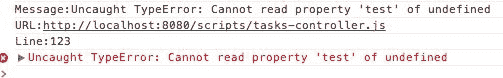

## 处理错误

既然我们已经检测到了错误，下一步就是决定如何处理它们。作为应用程序开发者，了解这些错误的发生非常重要。然而，与服务器不同，这里并没有一个集中式的日志文件来记录所有发生的错误。

对于异常情况，需求文档应明确说明当异常发生时应该怎么做。例如，如果某个 AJAX 调用无法执行：

· 是否应该通知用户？

· 是否应该在没有 AJAX 调用返回数据的情况下尽力继续运行？

· 是否应该阻止用户在网页上执行任何其他操作？

这些问题的答案取决于具体需求。检测异常是第一步，但检测本身并不能帮助你决定如何处理异常。

当检测到错误时，通常除了记录错误发生的事实之外，别无他法。由于错误是不可预料的，它们不应该由代码来处理，但除非你记录了它们发生的事实，否则你很可能永远不会注意到它们，因为你无法查看用户控制台的日志。

我处理错误的首选方法是使用 `log4js` 库进行记录。该库的链接见附录 B。这个库允许你定义错误处理策略，例如通过 AJAX 将错误发送到服务器，以便集中记录到文件中。

# 结论

在评估新项目的技术时，我喜欢应用“10 年法则”：“10 年后人们会如何看待这项技术？”

• 该软件是否能在 10 年后普遍使用的设备上“原样”运行？

• 该软件是否能在现有设备上继续运行，但需要为新设备重写？

• 该软件是否需要升级（甚至重写）以保持其相关性？

• 该软件是否会过时并被淘汰？

• 还有人会记得这项技术吗？

对我来说，10 年的视野是合理的。供应商在开发的软件上投入巨大，期望软件至少保持相关性 10 年是一个合理的时间段。此外，供应商需要长期支持和维护他们的应用程序，而当技术变得过时或“生命周期结束”时，这会变得具有挑战性。

我们无法确切知道任何技术的未来。当 Java 首次推出时，人们认为 Java Applet（在浏览器内运行的应用程序）将成为供应商的巨大卖点，并成为互联网上无处不在的存在。尽管偶尔还能看到它们，但 Applet 几乎已经过时，而 Java 作为服务器端语言却日益强大。

我坚信本书中介绍的语言能够经受住 10 年法则的考验。基于这些语言的 Web 应用程序可能需要修改以支持新设备，但这些底层语言处于强势地位，能够维持或加强其主导地位。本章将探讨我这样认为的原因。

## 向后兼容的历史

HTML 和 JavaScript 在向后兼容方面都有着卓越的记录。20 世纪 90 年代末编写的、依赖 CGI 脚本和早期 HTML 版本的网站，至今仍能基本不变地运行。它们的外观通常没有比 90 年代更好，但确实仍然能工作。

浏览器厂商对向后兼容性极为重视。他们知道，如果破坏了用户在一个流行网站上的浏览体验，用户会追究他们的责任。因此，每次发布新版本浏览器时，浏览器厂商都会投入大量资源进行兼容性和回归测试。

这个过程并非完美无缺。随着浏览器厂商发布周期的不断加快，现有 Web 应用程序中偶尔会出现错误。虽然这令人烦恼，但至少 Web 应用程序供应商可以在不要求用户执行任何升级步骤的情况下为其应用程序提供补丁。

因此，尽管有时会出现错误，但一旦所有主流浏览器都实现了底层 API 和功能集，它们就会保持非常稳定。

结果，Web 标准往往是一个扩展而非改变的过程，而且这一过程似乎会持续下去。如前所述，HTML5 被视为一个活标准，它将随着时间的推移逐渐变化，而永远不会被彻底替换。

## 垄断力量

HTML 和 JavaScript 因其在 Web 浏览器中的垄断地位而处于特别强势的位置，而且 Web 浏览器几乎存在于所有消费类计算设备上（从手机到游戏机，再到平板电脑、笔记本电脑和个人电脑）。

直到最近，微软 Windows 在操作系统领域占据主导地位，以至于供应商为仅能在微软 Windows 上运行的应用程序进行生产是合理的。得益于手持设备的爆发和苹果的复兴，情况已不再如此。现在许多人每天使用 2 到 3 种不同的操作系统：

• 工作时使用微软 Windows 电脑

• 使用安卓手机

• 在家使用 OSX 笔记本电脑

• 使用基于 iOS 的 iPad

用户越来越期望在所有设备上使用相同的应用程序，并且数据能在设备之间同步。

为 Web 浏览器编写的 Web 应用程序在这一领域提供了巨大的潜力。使用本书中介绍的语言，编写一个能在所有这些平台上运行并通过中央服务器与每个设备同步的应用程序相对简单。

具有讽刺意味的是，除非某个供应商像微软在 1995-2005 年期间那样在设备上建立垄断力量，否则 JavaScript 和 HTML 不太可能失去其垄断地位。这 partly 是因为 HTML5 和 JavaScript 的优势，partly 是因为多个供应商很难就一套新的替代技术达成一致。

## HTML 作为活标准

我对 HTML5 的未来前景充满信心的另一个原因是它是一个活标准。正如我们在本书前面看到的，甚至 HTML5 的 DOCTYPE 也没有与之关联的版本号，原因就在于此。基于 Web 的技术将随着时间的推移不断演进，新的标准将会发布，一些较旧的功能可能会被弃用。尽管如此，绝大多数 HTML5 在 10 年后仍将存在，就像绝大多数 HTML4 仍然得到支持一样。

活标准确实有其问题。浏览器厂商会按照自己的时间表实现新标准，因此 polyfill 的需求在短期内不太可能消失。然而，浏览器厂商之间为支持这些功能而进行的竞争最终对浏览器技术是有利的。

Web 标准的演进很可能会集中在添加越来越多的 API 上，这些 API 最终将使 Web 应用程序与桌面应用程序一样强大。

以手机应用程序为例：绝大多数手机应用程序都是使用原生 SDK 为 iPhone 和 Android 编写的。这很大程度上是因为这些 SDK 提供了以下功能的 API：

• 访问摄像头

• 使用蓝牙

• 访问电话簿

• 访问文件

• 访问指南针

原生 SDK 对软件工程师和生产商业软件的公司来说是一个挑战，因为同一个应用程序需要编写多次以支持每个 SDK。此外，每次发布新操作系统时，应用程序都需要进行验证并可能进行修改。

理想情况下，手机和平板电脑应该提供一个统一的开发平台，包含一套在所有移动操作系统上都受支持的 API。

HTML5 很可能会随着时间的推移而发展，以满足这一需求。移动电话的这些功能没有理由不能通过跨平台的 JavaScript API 得到支持，并在浏览器内部提供。

几年前开始了一个有趣的项目，名为 PhoneGap（底层软件现在称为 Apache Cordoba）。它允许使用 HTML5 功能为多种移动电话平台编写应用程序。对于 HTML5 不支持的功能（如蓝牙），则通过自定义 JavaScript 库提供。

PhoneGap 应用程序被打包为原生应用程序，但底层使用的是 HTML、JavaScript 和 CSS。

PhoneGap 的目标是随着时间的推移让自己变得过时。这已经开始发生，例如 GeoLocation API 现在已原生内置于浏览器中。要使 PhoneGap 过时，需要克服的主要障碍是安全性。基于 HTML 的应用程序在浏览器沙箱中运行，无法访问文件系统和操作系统的其他方面。

移动电话应用程序也在沙箱中运行，并在执行受限任务时向用户请求权限。因此，没有理由认为网络浏览器不能采用相同的模式，事实上，一些浏览器已经在使用存储 API 之前请求用户许可。

## 结束语

我希望这本书不仅让你相信 HTML5、JavaScript 和 jQuery 的价值和实用性，也让你看到它们内在的美感和优雅。这些语言以及掌握它们力量的软件工程师的未来非常光明。祝你在努力中一切顺利，希望这本书为你编写自己的 Web 应用程序提供了所需的基础。

感谢你选择阅读这本书。作为软件工程书籍的独立出版商，读者的评论是改进我们书籍以及向新读者传播信息的重要工具。如果可能，请花时间在亚马逊上评论这本书，或直接给我发邮件至 dane@cisdal.com。

# 附录 A：层叠样式表

到目前为止，我们还没有探讨 HTML 文档在浏览器中如何被样式化。HTML 本身不应包含呈现信息（颜色、字体、边框等），事实上，HTML 中剩余的大部分呈现方面已在 HTML5 中被移除。文档的呈现由层叠样式表（CSS）样式表语言负责。

这实现了关注点分离：HTML 页面提供内容，而 CSS 提供呈现信息。这确保了两者可以独立更改。

CSS3 是 CSS 规范的最新版本，并且与 HTML5 规范并行推进。

本附录将简要介绍使用 CSS 进行布局，而不侧重于 CSS3 中新增的最新功能，也不侧重于单个元素如何被样式化。因此，本介绍面向软件工程师和程序员，而非设计师。

要理解 CSS 达到足以布局复杂页面的程度，有四个关键点。

第一个方面是理解 CSS 如何选择元素以应用样式。如前所述，jQuery 使用与 CSS 相同的选择语法，因此即使你之前没有使用过 CSS，这也应该很直观。

第二个是理解盒模型。这是描述渲染文档树中每个元素的矩形的模型。如果你查看构成 HTML 文档的元素，每个可见元素都由一个矩形表示。当一个元素是另一个元素的子元素时，其矩形位于其父元素的矩形内部。

//

这有点过于简单化，矩形可以重叠在其他矩形上，并位于其他矩形之上，而不是内部，但我们将从这个简单的模型开始。

第三个是理解元素如何在屏幕上定位，以及它们如何相互交互。有几种方法可以在屏幕上定位元素，以及不同类型元素之间相互交互的几种不同方式。

第四个是理解样式如何（或不如何）从其父元素继承样式。例如，如果一个 `table` 元素有蓝色背景，那么它的 `tr` 和 `td` 子元素是否应该继承此样式？有些样式会层叠，而有些（出于充分理由）则不会。

## 选择元素

CSS 由一组应应用于一组元素的样式属性组成。以下是将两个属性应用于所有类型为 `footer` 的元素的示例：

```
footer {
 font-size: 12px;
 text-align:center;
}
```

与 jQuery 一样，你可以为具有特定类的元素指定规则：

```
.classname {
}
```

具有特定 ID 的元素：

```
#idvalue {
}
```

或者使用伪类（相当于 jQuery 中的过滤器）：

```
a:visited {
}
```

与 jQuery 一样，你也可以在同一选择器中组合多个规则。这将匹配 ID 为 `tblOne` 的 `table` 内的所有 `td` 元素：

```
#tblOne td {
}
```

而以下规则将匹配所有具有类 `underlined` 的 `td` 元素：

```
.underlined.td {
}
```

所有匹配的元素都将应用指定的样式，并且正如我们将在下面看到的，这些样式有时会被其子元素继承。

元素可以被多组规则样式化。例如，如果我们有一个如下定义的 `footer`：

`<footer class="myfooter" id="footer1">`

以及以下规则：

```
footer {
 color:black;
}
.myfooter {
 background:blue;
}
# footer1 {
 font-size:12pt;
}
```

那么该 footer 将应用所有三种样式：

```
font-size:12pt;
background:blue;
color:black;
```

当属性唯一时，这不会产生问题，但如果样式定义如下：

```
footer {
 color:black;
}
.myfooter {
 color:blue;
}
# footer1 {
 color:red;
}
```

在这种情况下，CSS 需要找到最精确的规则，并据此选择适当的颜色。有几种方法可以实现这一点。

首先，CSS 使用优先级系统来确定哪个规则具有最大的权重：

- 如果匹配基于元素类型，则规则分配 1 分。

- 如果匹配基于类，则规则分配 10 分。

- 如果匹配基于 ID，则规则分配 100 分。

这意味着匹配以下规则将分配 11 分（它有一个元素匹配和一个类匹配）：

```
footer .myclass
```

得分最高的规则获胜。这意味着在我们的例子中，选择的颜色将是红色，因为基于 ID 的规则获得 100 分。这个过程称为“特异性”。

这已经变得复杂，但不幸的是，它还会变得更复杂。

规则可以通过三种不同的方式指定：

1. 我们可以创建一个外部 CSS 文件，并将其导入 HTML 文件。

2. 我们可以通过在 HTML 文档中将样式放在 `<style></style>` 标签之间来“内联”创建样式。


3. 我们可以直接在元素上指定样式，例如，`<footer style="color:blue;font-size:12pt">`

任何直接在元素上指定的样式都会被额外奖励 1000 分，这意味着它们几乎总是会覆盖任何其他样式。

即使应用了所有这些规则，仍有可能出现两条规则具有相同特异性的情况。在这种情况下，最后定义的那条规则会胜出。这意味着 `<style></style>` 块内的规则会覆盖外部 CSS 文件中定义的规则，而如果同一个 CSS 文件中有多条规则具有相同的特异性，那么最后列出的文件中的最后一条规则将胜出。

最后，如果你无法将某条规则的优先级提高到足以压倒另一条规则，但又有一个或多个样式绝不应被覆盖，你可以使用 `!important` 标志。一旦使用了它，只有内联样式才能覆盖该样式：

```css
.myfooter {
 color:blue !important;
}
```

通常来说，最好不要依赖这个设置。

## 盒模型

盒模型决定了元素在屏幕上占据的区域，因此也会影响需要围绕它定位的其他元素的位置。

文档树中的每个元素在屏幕上都由一个矩形框表示。这包括 `div` 元素、`span` 元素、`a` 元素以及文档树中任何具有视觉表现的其他元素。

要理解 CSS 布局，就必须了解影响盒子大小的各种样式属性。

- 首先，每个盒子都需要一个区域来显示其内容。
- 其次，你可以指定内容与边框之间的内边距。
- 第三，你可以指定边框的大小。
- 第四，你可以指定该组件边框与相邻组件之间的外边距。

此外，你还需要考虑设置元素背景颜色的含义：是填充整个空间，仅填充内容，还是介于两者之间？

这四个属性构成了盒模型，如下图所示：

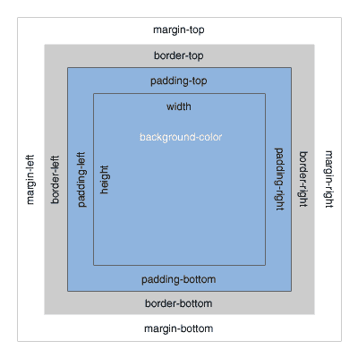

应用于元素的 `height` 和 `width` 属性决定了内容的大小，而内边距、边框和外边距的组合则决定了盒子在屏幕上的整体大小。

如图所示，背景颜色填充了盒子的内容和内边距部分。边框通常有自己的颜色，而外边距则会继承元素父级的背景颜色。

盒模型的所有这些方面都可以通过 CSS 进行控制。例如，考虑以下一组属性：

```css
.element {
border: 1px solid #AAA;
padding: 10 0 10 0px;
margin-right: 15px;
width: 200px;
height: 100px;
}
```

在这个例子中，元素的内容总共占用 200x100 像素。

然后，内边距被声明为一个包含 4 个值的单一属性（而不是分别声明 `padding-left`、`padding-right` 等）。这表示上下各应用 10 像素，左右各应用 0 像素。记住这 4 个值顺序的方法是 TRouBLe（上、右、下、左）。

接着，边框又增加了 1 像素，元素右侧增加了 15 像素的外边距。

这意味着元素的高度将为 100 + 10 + 10 + 1 + 1 = 122 像素，而宽度将为 200 + 1 + 1 + 15 = 217 像素。

值得一提的是，元素的外边距可以是负数。这会使元素占据的空间比正常情况下更小。

## 定位元素

为了完全理解元素在屏幕上的位置以及它与相邻元素的交互方式，还需要考虑 `display` 属性的值。

该属性可以是以下 4 个主要值之一：

- `inline`：这是 `span`、`a` 和 `td` 元素的默认值。
- `block`：这是大多数其他元素的默认值，包括 `div`、`p` 以及大多数其他元素。
- `inline-block`：这仅对 `img` 元素是默认值，但在 CSS 中常被分配给其他元素。
- `none`：元素应被隐藏，不显示。

可以按如下方式覆盖任何元素的 `display` 属性：

```css
.myclass {
 display:inline-block;
}
```

这些显示类型的主要区别如下：

- 内联元素前后没有换行，可以与其他元素垂直相邻。此外，你不能为内联元素设置 `height` 或 `width` 属性，但可以设置 `line-height`（该属性决定了第一行文本顶部到第二行顶部的距离）。
- 内联块级元素类似于内联元素，不会强制换行（因此元素可以与其他元素垂直相邻），但可以设置 `height` 和 `width`。
- 块级元素会在元素前后强制换行，因此默认情况下，两个块级元素不能垂直相邻。
- 显示值设置为 `none` 的元素在屏幕上不占据任何空间，甚至不占据它可见时会占用的空间。

在布局屏幕时，元素的默认显示类型并不总是合适的。考虑一个具有以下布局的屏幕：


菜单和内容都是块级元素，但我们希望它们并排显示。为了实现这一点，我们可以使用 `float` 属性：它告诉元素浮动到前一个元素的左侧或右侧，而不是在其上方或下方。

以下是生成所需结果的示例代码：

```html
<!DOCTYPE html>
<html>
<head>
<style>
header {
 height:100px;
 background: blue;
}
.menu {
 float:left;
 width:20%;
 height:400px;
 background: red;
}
.content {
 float:right;
 height:400px;
 width:80%;
 background: green;
}
footer {
 clear:both;
 height: 100px;
 background: orange;
}
</style>
</head>
<body>
<header>
Header
</header>
<div class="menu">
This is the menu
</div>
<div class="content">
This is the content
</div>
<footer>
Footer
</footer>
</body>
</html>
```

`header` 是一个 `header` 元素，其类型为 `display:block`。这意味着默认情况下它占据 100% 的宽度，并在其后创建一个新行。因此我们只需要设置 `height`。

菜单和内容需要并排显示；为了实现这一点，我们将菜单设置为 `float:left`，内容设置为 `float:right`，并为它们各自分配总宽度的一个百分比。

现在你可能会认为页脚元素只需要设置一个 `height`（就像页眉元素一样）。实际上，一旦我们开始浮动元素，页面会一直浮动块级元素，直到被告知停止，因此我们需要添加 `clear:both` 属性（both 指左和右，它们可以独立清除）。

这个简单的例子展示了在屏幕上布局元素所需的大部分知识。

我们也可以通过将菜单和内容设置为 `inline-block` 来达到类似的效果，但缺点是如果内容无法与菜单并排显示，它会换行到下一行。

浏览器有一个默认样式表，它指定了 `body` 周围应有 8 像素的外边距。这会导致我们出现溢出。通常，在开始一个项目时会移除浏览器默认样式。这通常在一个名为 `reset.css` 的文件中完成——互联网上有很多示例。

到目前为止，当元素通过与其他元素的交互进行定位时，如何将它们放置在屏幕上应该相对清晰了。这被称为静态定位。

也可以将元素定位指定为相对定位：

```css
position:relative
```

仅此一项不会产生任何效果，但它使得可以通过 `left`、`right`、`top` 和 `bottom` 属性移动元素，使其偏离原本在流中的位置。

也可以使用绝对定位。这会将元素从主文档流中移除，并明确放置在由 `left`、`right`、`top`、`bottom` 属性指定的位置。绝对定位的元素不会与页面上的其他元素交互：它们可以位于其他元素的上方或后方。为了控制哪个元素在上层，可以使用 `z-index` 属性：`z-index` 值最高的元素将位于其他元素之上。

最后一种定位类型是固定定位：

```css
position:fixed
```

这可用于将元素固定在浏览器中，即使主页面滚动时也不会移动。这种定位方式并不常见，但确实有其用途。

## 继承

理解 CSS 的最后一个基本方面是了解父元素的样式何时会被子元素继承，何时不会。例如，考虑以下 HTML：

```html
<div>
<span>this is text</span>
<span>this is more text</span>
</div>
```

如果我们对 `div` 应用样式，那么是否应该将该样式也应用到 `span` 元素上，这需要根据情况判断。例如，字体样式是合理的继承对象，因为可以合理地假设父元素和子元素会使用相同的字体。这意味着我们可以为文档的 `body` 设置字体，并自动应用到所有元素，除非被覆盖。

但考虑边框的情况。如果我们为 `div` 指定了边框，我们通常不希望它继承到 `span`，因为那样会导致 `span` 元素周围也渲染出边框。同样，定位和间距样式（如 `padding`、`margin`、`top` 和 `left`）也不会被继承。

有些样式是否应该继承则存在争议。背景颜色就是一个例子，它不会被继承，尽管在很多情况下继承是有意义的。不过，子元素可以通过以下方式主动继承：

```css
background-color: inherit;
```

## 调试

Chrome 使得调试元素和动态添加样式相对简单。可以右键单击任何元素并选择“检查元素”。这会将元素加载到开发者工具的“元素”选项卡中，并显示已应用于该元素的 CSS 属性。

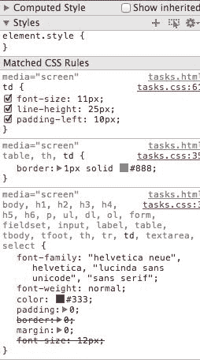

任何被覆盖的样式都会显示为带删除线，表示它们对元素的视觉样式没有影响。

还可以在此窗口的顶部区域动态添加 CSS 属性，从而实时尝试各种可能性。

## 结论

本章的目标是为你提供 CSS 的基础知识。与本书中的许多其他 Web 语言一样，CSS 看起来很简单，但如果不理解其基本原理，可能会非常令人沮丧。

# 附录 B：推荐库

本章将简要介绍一些我在开发 Web 应用程序时发现有用的 JavaScript 库。

## Underscore

如果你曾经问过“为什么 JavaScript 没有实现 x 的函数？”，那么很可能在 Underscore 库中就能找到。Underscore 包含大量用于管理数组、对象和函数的实用函数，以及类似于 jQuery Template 的模板功能。

该库及其 API 可在此处找到：

[`underscorejs.org/`](http://underscorejs.org/)

## jQuery UI

jQuery UI 包含大量 UI 小部件，从进度条、对话框到基于拖放的列表。该库本身相当庞大，但小部件的功能非常丰富。

还可以在应用程序中选择性地包含库中的小部件。

该项目可在此处找到：

[`jqueryui.com/`](http://jqueryui.com/)

## Datatable

jQuery UI 中未包含的一个重要小部件是表格。Web 应用程序通常需要支持排序、过滤和分页的表格。

Datatable 库在常规 HTML 表格之上提供了一个封装，将其转换为程序员在桌面 GUI 工具包中习惯使用的丰富动态表格：

[`datatables.net/`](https://datatables.net/)

## D3

D3 是一个用于生成数据驱动文档的库。图表和图形是数据驱动文档的示例，但 D3 可以生成极其复杂和优雅的数据绑定文档。

完整的演示可在项目主页找到：

[`d3js.org/`](http://d3js.org/)

## Log4j JS

该库为 JavaScript 提供了一个日志记录 API，类似于 Java 中流行的 `log4j`（及相关）库。此 API 允许你编写自定义追加器来指定日志记录策略，并提供了一个 AJAX 追加器用于将日志发送到服务器。

[`log4js.berlios.de/`](http://log4js.berlios.de/)
