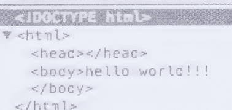
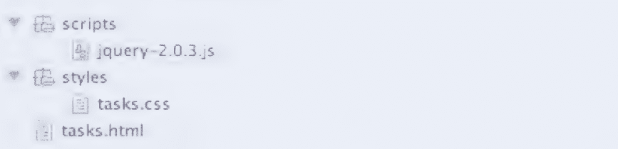
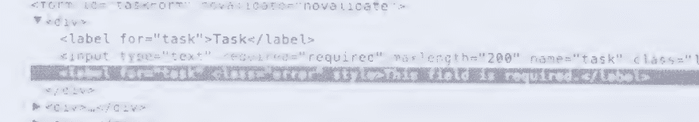
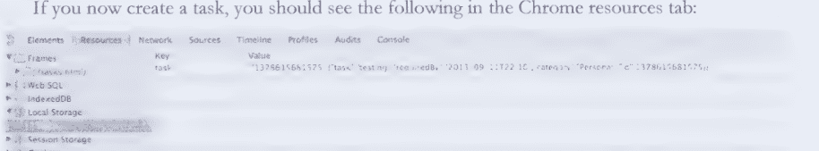
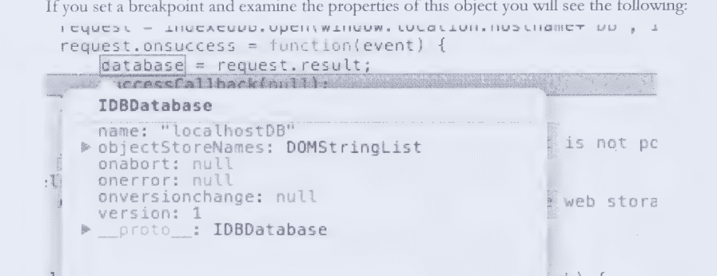
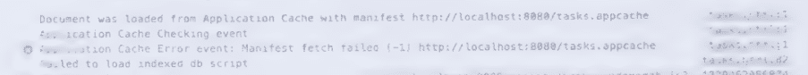
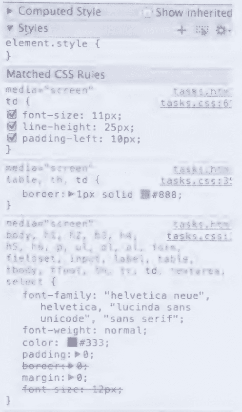

# 软件工程师学习 HTML5、JavaScript 与 jQuery：基于标准的 Web 应用开发指南

DANE CAMERON

## 前言

JavaScript（及其框架如`jQuery`）和`HTML`（连同样式表语言`CSS`）在软件开发中已变得无处不在。由于它们在Web浏览器中的垄断地位，并且Web浏览器已从PC扩展到手机、平板电脑和电视；这种普及性将继续增长。

尽管取得了成功，但许多软件工程师对JavaScript和HTML仍感到忧虑。这种忧虑并非完全没有根据；JavaScript和HTML在早期发展都较为仓促，并且受商业利益而非工程利益驱动。因此，许多可疑的特性潜入了这些语言中。由于向后兼容性的考虑，这些特性大部分至今仍然存在。

此外，许多软件工程师在没有系统学习的情况下就使用了这些语言。JavaScript和HTML的入门门槛较低，加上它们与其他语言的相似性，使得许多软件工程师得出结论：这些语言没什么好学的。

如果你多年未使用JavaScript和HTML，可能会对它们现在所提供的功能感到惊讶。基于浏览器的Web应用现在能够匹敌甚至超越传统桌面应用的复杂度和规模。然而，为了创建复杂的Web应用，必须学习这些语言。

本书的观点是，一旦你掌握了基础，细节问题便会迎刃而解。它不会向你展示冗长的API列表或每个属性的复杂细节，这些可以在参考手册中找到。它将专注于每种语言中对理解其工作原理至关重要的核心细节。

我希望本书能帮助你发现JavaScript和HTML的优雅与美妙，并让你对这些语言所能实现的功能产生新的认识。

2013年10月

### 1 引言

我不会猜测你阅读本书的动机——但我想告诉你我为何撰写此书。

我曾一名拥有15年经验的软件工程师，专注于编写大型企业级Java应用。这些应用通常执行系统集成功能，而非面向终端用户的功能。

随后，我加入了一个团队，从头开始编写一个复杂的Web应用。这个Web应用有一些我之前从未遇到过的需求：

- 必须能在所有主流浏览器的最新版本中运行。
- 必须能在没有网络连接的情况下运行一段时间，因此需要在客户端存储相当大量的数据。
- 必须能在离线状态下读取用户选择的文件。
- 需要高度动态，允许复杂的交互而无需刷新页面。
- 性能需要与桌面应用相当或更好。
- 必须基于标准，不使用浏览器插件。

多年来我编写过简单的HTML页面和JavaScript，但常常因此感到沮丧。JavaScript尤其令人沮丧：它类似于`Java`（我很熟悉），但似乎有很多地方都做错了。我越是试图将`Java`的思维方式应用于JavaScript，情况似乎就越糟。

我至少意识到自己没有花时间去学习JavaScript。我对JavaScript是什么以及它如何工作做了许多假设，但从未花时间去验证这些假设。

在开始新项目之前，我决定从头开始学习用现有语言构建Web应用的最佳方法。近年来我使用过足够多的Web应用，了解浏览器技术提供的潜力，但我不知道如何最好地释放这种潜力。

我对现代浏览器为软件工程师提供的平台了解得越多，就越感到惊讶。被统称为`HTML5`的标准提供了一系列广泛的功能，从数据存储到离线资源存储再到文件管理。

此外，我对JavaScript了解得越多，就越印象深刻。JavaScript表面上可能与`Java`相似，但实际上它与`LISP`和`Scheme`等函数式语言有更多之处。那些让我困扰的JavaScript特性，最终被证明是语言的巨大优势。

最后，我发现了`jQuery`库。`jQuery`让软件工程师做到原生`JavaScript API`做不到的事情，但它在`JavaScript`之上提供了如此优雅的抽象，使其成为工具箱中不可缺的组件。

本书是我希望在开始这段旅程时读到的。假定你具备一定的软件工程师或程序员基础，只介绍你需要理解的核心内容，而不试图涵盖语言的所有方面。在开始之前，值得回顾一下过去几年`HTML`和`JavaScript`的崛起，以及发生的原因。

#### 浏览器战争第二回合

最初的浏览器战争发生在上世纪9年代末，双方是`Netscape`和`Microsoft`。结果是浏览器技术停滞：从2001年到2006年，用户体验几乎没有进步。

第二场浏览器战争始于2005年左右，先是`Firefox`，然后是`Chrome`。这场战争变成了一场军备竞赛，所有浏览器厂商都为其添加了新颖的功能，其中许多功能作为`HTML5`标准化的一部分被其他浏览器采用。

第二场浏览器战争的主要后果之一是性能的显著提升。JavaScript是一种解释型语言，因此它的性能往往比`C`或`C++`等编译语言差。这是因为需要一个中间层（解释器）接收指令，并在执行时将其转换为机器指令。

为了提高JavaScript性能，谷歌在2008年开发了`V8`引擎。`V8`引擎通过即时编译（`JIT`）将JavaScript编译为机器语言，而不是在执行时解释，从而极大地提升了性能。自`V8`发布以来，所有浏览器厂商都开始积极竞争，试图打造最快的JavaScript引擎。微软最终在`IE9`中加入了竞赛，并在`IE10`中持续提升了性能。

性能很少成为主要问题的阶段，大规模Web应用程序的性能可以媲美甚至超越桌面应用程序。所有主要浏览器拥有高度优化的JavaScript引擎，`Node.js`的成功将JavaScript作为服务器端技术使用。

#### Web应用程序的兴起

由于浏览器技术的进步，创建在浏览器内运行的复杂Web应用程序已可能。万维网早期，网页内容大多是静态的。网站迅速演变为允许用户进行动态交互，这为电子商务网站（如亚马逊）的出现创造了可能。

用于动态操作网页的技术被称为`DHTML`（动态HTML），它实际上是本书探讨的`HTML5`技术的前身。`DHTML`允许在网页加载后操作网页，但创建大型Web应用程序仍然困难，这主要是由于JavaScript的性能问题，以及缺乏用于简单功能（如数据存储）的浏览器API。

第一个大的变革者是`Gmail`，它于2007年向公众发布。Gmail不仅向用户提供前所未有的1GB存储空间加速了云计算的趋势，还普及了`AJAX`的使用。

`AJAX`允许网页在加载后与服务器交互，而无需刷新网页。这意味着Web应用程序可以由单个网页组成，该网页在用户交互以及从服务器接收额外数据时重新绘制自身。

Google并未发明`AJAX`背后的技术（实际上是微软发明的），他们也不是第一个使用`AJAX`开发Web应用程序的公司，但他们让`AJAX`走向了聚光灯下，并向程序员展示了可以实现什么。AJAX已成为如此主导的技术，以至于很难想象没有它的时代。一旦人们意识到在浏览器内可以实现什么，IT部门和最终用户都开始推动使用基于浏览器的Web应用程序来完成曾经由桌面应用程序主导的任务。

基于浏览器的Web应用程序为其用户提供了诸多益处：

- 无需在每台机器上安装应用程序。
- 可以定期发布软件的新版本，无需用户遵循升级过程。事实上，一些Web应用程序每天都会发布软件更新。
- Web应用程序可以托管在基于云的基础设施上，从而实现更高的可用性和低的成本。
- 同一个Web应用程序可以在多种设备上使用，包括手机和平电脑等手持设备。
- 用户可以在世界任何地方、一天中的任何时间访问应用程序。

Web浏览器现在在功能和库方面已与操作系统类似，为软件工程师提供服务。现在将浏览器视为一个成熟的软件开发平台是合理的，就像你可能认为`OSX`、`Android`或`Windows`是一个平台一样。

#### 网络化的世界

过去5年发生的另一个重大变化是高速网络的无处不在。如今，许多人通过有线或无线方式几乎永久性地接入高速网络。

网络的普及催生了云计算的兴起。云计算是许多技术的总称，但其核心意味着软件工程师无需考虑硬件，硬件以服务的形式提供。

对于用户而言，云计算意味着他们的应用程序和数据可以随时随地访问。

云计算是IT领域增长最快的趋势之一，并且随着越来越多的设备具备网络功能，它只会在未来增长得更快。据估计，到2013年，一半的美国人拥有3台或更多具备网络功能的设备。

虽然可以编写不在浏览器内运行的程序，但浏览器是完美的平台，因为所有设备共有的一个恒定特征是浏览器。

#### 结论

从本章得出的结论是，`HTML5`和`JavaScript`的完美驱动了大多数用户的日常交互。本书是我希望在开始这段旅程时读到的。希望本书能帮助你发现JavaScript和HTML的优雅与美妙，并让你对这些语言所能实现的功能产生新的认识。

#### 所需条件

本书假设你有一些软件开发经验，至少对`HTML`有基本的了解。如果你之前没有接触过`JavaScript`或`HTML`，建议在开始之前了解这些语言的基本语法（循环、表达式等）。网站如`http://www.w3schools.com`提供了基础。在计算机上：

1. 用于编写代码的文本编辑器。Windows上`Notepad++`（`http://notepad-plus-plus.org`）是一个不错的选择，Mac上`Text Wrangler`（`http://www.barebones.com/products/textangler`）是一个不错的选择，Linux上`Emacs`是一个不错的选择。你也可以选择集成开发环境（IDE），如`Eclipse`。
2. `Chrome`或`Firefox`网页浏览器。如果你选择`Firefox`，你需要安装`Firebug`插件以获得完整的开发工具。我相信`Chrome`的开发工具优于其他浏览器，因此如果你是初学者，我强烈推荐`Chrome`。
3. Web 服务器。这将在本书后面部分需要，`Mongoose`。你可以选择任何喜欢的服务器，但本书只会说明如何安装和使用`Mongoose`。本书中的示例均从网站访问：`www.cisdl.com/publishing.html`。每一章（当时）都提供了一个zip文件，其中包含了章结束时的资源。

#### 直接从文件运行

虽然可以从文件系统运行Web应用程序，不需要Web服务器，但浏览器通常会缓存。如果这很麻烦，你可以将HTML文件拖浏览器中，或使用浏览器菜单中的“文件 -> 打开”选项。为了确保资源被刷新，可以使用强制刷新：

- `OSX`上按`Command+Shift+R`
- `Windows`上按`Ctrl+F5`

在此模式下浏览器加载的任何资源都不会被缓存。

#### 开发者工具

所有主要浏览器现在都提供了开发工具。一旦开发者工具打开，请点击“Console”标签页。为了证明这是一个真正的JavaScript解释器，只需在提示符处输入`1+1`：

- `OSX`上按`Command+Option+I`
- `Windows`上按`Ctrl+Shift+I`

#### 什么是Web应用程序？

一个合理的问题是“什么是Web应用程序，它与网站有何不同？”即使是HTML5规范的开篇部分也指出，它旨在解决“……被称为Web应用程序的模糊主题”。这个问题没有明确的答案，但本书中开发的Web应用程序具有以下特征：

- 它使用Web浏览器作为用户界面。
- 它允许用户执行操作和操作数据，而无需执行屏幕刷新。
- 它是交互式的，并能迅速响应用户操作。
- 它代表用户存储数据，无论是在客户端还是服务器端。

#### 约定

本书中的代码将使用以下字体：

```
This is code
```

当代码在JavaScript解释器中执行时，输入将以`>`字符为前缀：输入这些命令时应此字符。此外，输入和输出之间将有一个空行分隔：

```
> 1
```

如果同时显示两个命令，它们将在第一个命令的结果和第二个命令的输入之间用额外的空行分隔：

```
> 1+1

>2
```

如果输出与所讨论的要点无关，则省略。

#### 反馈

我非常希望听到您对本书的反馈（正面和负面）。请通过`dane@cisdal.com`给我发送电子邮件。

### 3 Web应用程序概述

本书旨在教你如何利用浏览器中本地提供的工具和技术（而非插件）编写丰富的Web应用程序。本书将关注以下浏览器最新版本中可用的语言和库：

- `Chrome`
- `Firefox`
- `IE`
- `Safari`
- `Opera`

许多示例在旧版浏览器中将无法工作，并在许多情况下没有解决方法。编写Web应用程序时，显而易见的问题是“我需要或想要支持哪些浏览器，以及这些浏览器的哪些版本？”这涉及到一个明显的权衡：

- 你支持的浏览器和版本越多，可以使用你的Web应用程序的用户越多。请记住，有些用户（特别是在企业环境中）并非选择浏览器或其版本。
- 你支持的浏览器和版本越多，在API的可用性和兼容性方面遇到的限制越多。在本书后面，我们将遇到一种称为`polyfill`的方法，它允许你“升级”用户浏览器提供的功能，但这种方法并非总是有效。

所有主要浏览器现在都支持自动更新。虽然此功能可以关闭，但这确实意味着假设大多数用户将拥有其喜爱浏览器的最新版本（至少在企业环境之外）不再是一个轻率的假设。

主要的例外是`Internet Explorer`。`IE10`和`11`在旧版本的Windows上不可用；因此许多用户将拥有较版本的`Internet Explorer`。大多数示例在`IE9`中有效，有些在`IE8`中有效，但支持`6`和`7`则变得更加艰巨。

网站`http://caniuse.com`是了解各种浏览器和版本所提供功能的宝贵资源。


HTML5还包含支持音频和视频的新标签，以及一个用于渲染2D形状和位图的`canvas`。正是HTML5的这些特性引起了很多关注，特别是这些特性将HTML5定位为Adobe Flash的直接竞争对手。苹果公司拒绝在某些设备上允许使用Adobe Flash，辩称网站应使用HTML5等效功能，因为它们符合标准，且不需要插件。本书将在很大程度上忽略HTML5的多媒体方面，因为它们通常与Web应用程序无关，但了解它们的存在很重要。

作为对XHTML规范的一部分，HTML5承认早期版本HTML标准所强制的严格性是不必要的（浏览器仍然渲染了违反规则的页面），并且适得其反（因为没有标准规定浏览器应如何处理以某种方式无效的页面，这留给了每个厂商）。HTML5规范包含详细的规则，说明浏览器厂商应如何从提供的输入创建一致的文档对象模型。HTML5规范的很大一部分直接涉及这些规则，同样超出了本书的范围。

> 如果你熟悉文档对象模型（`DOM`）（下面将进行解释）或XHTML（它在很大程度上已过时），请不要担心。

HTML5还增强了HTML中可用的表单组件。除了提供新的输入字段类型（如日期选择器和颜色选择器）之外，HTML5还为现有的输入字段提供了额外的属性。HTML5还提供对表单组件的本地验证。

除了提供标记语言和一组表单组件外，HTML5还是一组Web浏览器可以实现的API标准。这些API范围广泛，种类繁多，涵盖数据和内容的离线存储、文件读取、后台进程、服务器发送事件等等。正是HTML5的这些特性真正将Web浏览器转变为应用程序开发的平台。本书在开发过程中将使用许多新的API。

## HTML5

HTML5标准化进程本身就很有趣。许多标准实际上是从网络浏览器中已存在的特性逆向工程而来。例如，AJAX 背后的技术（`XMLHttpRequest`对象）最初是作为 Internet Explorer 的一项专有功能开发的。其他浏览器随后对此功能进行了逆向工程，最终，在主流浏览器都支持后，它被W3C标准化（事实上，它仍然是一个工作草案）。

万维网联盟（`W3C`）是万维网的主要标准组织。其网站可在此找到：`http://www.w3.org`，而 HTML5规范可在此找到：`http://www.w3.org/TR/html5`

HTML5规范实际上由两个独立的机构制定：`W3C`和`WHATWG`。两个机构都以自己的许可证提供标准。对于HTML5，`WHATWG`实际上比`W3C`值得更多赞誉。`W3C`最初投票决定不参与HTML5，而是继续推进基于 XML的标准。`W3C`最终承认自己押错了宝，并开始积极参与HTML5。

同样值得一提的是，`W3C`和`WHATWG`版本的规范并不完全相同。从软件工程师的角度来看，这在很大程度上无关紧要。网页设计师有句谚语“代码总是赢家”。这对HTML5也同样适用：规范在很大程度上无关紧要；重要的是浏览器的实现。

在某些情况下，某个特定的浏览器供应商会主导一个标准。这偶尔会导致僵局，就像 Web SQL API所发生的那样。在其他情况下，一个规范被推进但并未得到广泛支持（例如`File Writer`和`File System API`），因此其未来充满不确定性。然而，在最好的情况下，所有主流浏览器都按照标准支持。

### JavaScript

JavaScript是目前所有网络浏览器中唯一原生支持的语言。JavaScript于1995年出现在Netscape Navigator中，迅速迁移到Internet Explorer。为网络应用程序添加动态和交互功能，JavaScript至关重要。尽管Microsoft继续支持VBScript，但其他浏览器并未实现它。

首先澄清一个术语问题。JavaScript在`ECMAScript`语言规范中正式化。当本书提到JavaScript时，严格来说指的是`ECMAScript`第5版。事实上，JavaScript是一种与Java不同的语言，具体的：

- `JavaScript`支持动态类型，而`Java`支持静态类型。这意味着你可以在`JavaScript`中声明变量而在运行时确定类型。
- `JavaScript`具有一等公民，可以将函数赋值给变量或传递给另一个函数。这听起来可能是小功能，但带来了巨大的可能性，允许软件工程师使用函数式编程。
- 尽管`JavaScript`支持类，但其实现有些困惑。本书建议尽可能避免类，利用原型技术创建对象。

### jQuery

jQuery是一个JavaScript库，旨在简化在浏览器中编写应用程序的过程。由于网页以文档为中心，JavaScript通常负责文档中的元素（被称为文档对象模型`DOM`）、操作这些元素或对元素做出反应。jQuery通过文档对象模型API原生支持此功能，它在HTML5规范中提供了一个优雅的包装器。

jQuery的核心是一个器引擎。jQuery接受基于CSS的选择器，从文档中返回满足条件的组元素。一旦选定了组元素，jQuery就提供了大量的函数对这些元素执行操作或向它们附加事件。尽管原生DOM API无法做到事情，但它变得非常流行，原因如下：

- 它消除了处理浏览器之间怪异行为的痛苦。
- 它提供了丰富而简洁的语法，大多数人认为是对文档模型API的巨大改进。
- 编写自定义插件很简单，可以扩展以满足特定需求。
- 有大量的开源插件，包括一个名为`jQuery UI`的流行工具包。

jQuery有一些竞争对手，如`Dojo`和`Prototype`，但jQuery在市场上获得了足够的规模，几乎成为网络应用程序的标准。

### CSS

层叠样式表为HTML提供了一种样式语言。HTML中从CSS时代遗来的大多数表现特性现在在HTML5中被移除，所有表现现在都完全通过CSS执行。CSS提供了关注点分离，允许页面的样式独立于其内容进行更改，反之亦然。HTML负责传达网页的含义，而CSS传达其表现形式。这也意味着相同的内容可以通过提供一个新的样式表来用于不同的设备（如手机）。

CSS提供了一组属性，描述文档中的元素在匹配某些规则时如何设置样式，以及这些样式如何相互作用。应用于元素的样式可能令人花乱，并且在CSS3中得到了显著扩展，CSS3是一个与HTML5并行的规范。

通常，软件工程师不需要了解所有CSS功能，但理解基础知识很重要，否则会导致大量的挫折和痛苦。与本书涉及的所有语言一样，CSS并不像看起来那么简单，扎实掌握其基础知识对于任何参与Web应用程序开发的人来说都很重要。在本书的示例过程中，我将基本上忽略CSS。附录A提供了CSS的深入介绍，你可以根据需要跳到该章节。

## HTML5标记语言

在本章中，我们将探讨HTML标记语言在HTML5规范中包含的更改。示例网络应用程序将使用许多但不是全部的新的HTML5标签，以及许多新增的属性。如上所述，术语HTML5既指一种标记语言（HTML的新版本），也指一组API。HTML5 API将在本书的后续章节中介绍。

### 页面结构

从最简单的例子开始通常是好的，对于HTML5来说，那就是：

```html
<!DOCTYPE html>
hello world!!!
```

打开你最喜欢的文本编辑器，输入上面的代码，将其保存为`hello.html`，然后在你喜欢的兼容HTML5的浏览器中打开它。这可能看起来不像一个HTML页面。例如，没有`html`标签，也没有`body`标签。尽管如此，浏览器知道如何处理提供的最小内容。如果我们分析在Chrome浏览器中为该页面生成的文档模型（打开开发者工具并点击“Elements”标签），我们将看到以下内容：



浏览器推出了HTML页面的意图，并生成了符合标准的内部文档对象模型。

### 达恩·卡梅隆

与早期版本的规范相比，HTML5规范宽松得多。多年来，定义趋向更严格，最显著的是HTML4.0 Strict（发布于2000年）和XHTML。这些标准强调，例如始终关闭标签，以及属性值周围放置引号。这种对严格性的追求源于多种原因：

- HTML和XHTML的早期版本基于其他语言（SGML和XML），这对HTML施加了限制。
- 对于浏览器来说，从文档中推断意图有助于提高兼容性。
- 如果文档遵守规则，其他工具处理起来更容易。

尽管HTML5规范越来越严格，但浏览器从未真正执行这些规则。浏览器供应商早就意识到，无论标记是否相关，尽可能利用任何标记。

HTML5规范的很大一部分说明了浏览器如何处理以前视为无效的标记。这就是为什么Chrome可以从"hello world"生成文档模型，这也是Firefox生成相同的文档模型。上述示例有效，当开发符合HTML5时，可能是合适的骨架：

```html
<!DOCTYPE html>
<html lang="en">
<head>
    <meta charset="utf-8">
</head>
<body>
```

我们将构建任务应用程序。任务列表包含以下功能：

- 用户可以创建任务：包括截止日期和类别。
- 用户可以编辑任务。
- 用户可以删除任务。
- 用户可以查看他们的列表。
- 逾期任务会突出显示。
- 用户可以将任务完成。

虽然这看起来是一个简单的Web应用程序，但它包含了足够的复杂性来展示语言的重要特性，但不会复杂到过于关注。我们将首先构成任务列表的基础标记。在本章中，所有内容都是静态的：在章节中，我们将通过JavaScript使其动态化。

要开始这个项目，请在系统的任何位置创建一个新文件夹，并在其中添加一个名为`tasks.html`的文件。该文件包含以下内容：

```html
<!DOCTYPE html>
<html lang="en">
<head>
    <meta charset="utf-8">
    <title>Task List</title>
    <link rel="stylesheet" type="text/css" href="styles/tasks.css" media="screen" />
</head>
<body>
    <header>
        <span>Task List</span>
    </header>
    <main>
        <section>
            <form>
                <div>
                    <label>Task</label>
                    <input type="text" required="required" name="task" class="large" placeholder="Breakfast at Tiffys" />
                </div>
                <div>
                    <label>Required by</label>
                    <input type="date" required="required" name="requiredBy" />
                </div>
                <div>
                    <label>Category</label>
                    <select name="category">
                        <option value="Personal">Personal</option>
                        <option value="Work">Work</option>
                    </select>
                </div>
                <nav>
                    <a href="#">Save task</a>
                    <a href="#">Clear</a>
                </nav>
            </form>
        </section>
        <section>
            <table id="tblTasks">
                <colgroup>
                    <col width="50%">
                    <col width="25%">
                    <col width="25%">
                </colgroup>
                <thead>
                    <tr>
                        <th>Name</th>
                        <th>Due</th>
                        <th>Category</th>
                    </tr>
                </thead>
                <tbody>
                  <tr>
                    <td>Return library books</td>
                    <time datetime="2013-10-14">2013-10-14</time>
                    <td>Personal</td>
                  </tr>
                  <tr class="even">
                    <td>Perform project demo to stakeholders</td>
                    <time datetime="2013-10-14">2013-10-14</time>
                    <td>Work</td>
                  </tr>
                  <tr>
                    <td>Meet friends for dinner</td>
                    <time datetime="2013-10-14">2013-10-14</time>
                    <td>Personal</td>
                  </tr>
                </tbody>
            </table>
            <nav>
              <a href="#">Add task</a>
            </nav>
        </section>
    </main>
    <footer>
        You have 3 tasks
    </footer>
</body>
</html>
```

请记住，这些示例可以从网站 cisdal.com/publishing.html下载。每一章都包含所有示例的zip文件。


```css
@CHARSET "UTF-8";

body, h1, h2, h3, h4, h5, h6, p, ul, dl, ol, form, fieldset, input, label, table, tbody, tfoot, th, tr, td, textarea, select {
  font-family: "helvetica neue", helvetica, "lucinda sans unicode", "sans serif";
  font-weight: normal;
  color: #333;
  padding: 0;
  border: 0;
  margin: 0;
  font-size: 12px;
}

header {
    width:100%;
    height:80px;
    background:#d1e0e1;
    color: #333;
    font-weight: bold;
    font-size: 20px;
    text-align:center;
    line-height: 80px;
}

footer {
    width:100%;
    height:60px;
    background:#d1e0e1;
    font-size: 12px;
    text-align:center;
    line-height: 80px;
    margin-top:30px;
}

table, th, td
{
    border: 1px solid #888;
}

section {
    margin: 20px 0 0 20px;
}

table {
    width: 90%;
    border-collapse: collapse;
}

thead {
    line-height: 30px;
}

thead th {
    background: #53777a;
    color: #fff;
    font-size: 12px;
    font-weight: bold;
    text-align: center;
}

td {
    font-size: 11px;
    line-height: 25px;
    padding-left: 10px;
}

.even {
    background-color: #f8f8f8;
}

nav {
    margin: 15px 0 10px 0;
}

nav a {
    background: #53777a;
    color: #fff;
    width: 80px;
    text-decoration: none;
    border: 1px solid #5b5b5b;
    font-size: 13px;
    text-align: center;
    padding: 5px 10px;
}

label {
    display: block;
    padding: 8px 0 8px 0;
    color: #333;
}

input {
    border-radius: 3px;
    height: 24px;
    border: 1px solid #AAA;
    padding: 0 7px;
}

input.large {
    width: 400px;
}

select {
    border: 1px solid #AAA;
    overflow: hidden;
    margin-right: 15px;
    width: 200px;
}

.required {
    color: red;
}

.not {
    display:none;
}

.rowHighlight {
    font-weight:bold;
}

label.error {
    color: red;
    font-weight: bold;
}

.overdue {
    background: #F7DCE;
}

.warning {
    background: #F7DC;
}

.taskCompleted {
    text-decoration: line-through;
}
```

在Web浏览器中打开时，HTML文档将显示如下。

这里有一些我们应该讨论的特性。首先，在网页的最顶部，`DOCTYPE`很简单：

```html
<!DOCTYPE html>
```

`DOCTYPE`向浏览器发出的重要信号，允许它们在文档类型的上下文中解释内容。如果省略内容，浏览器将恢复传统的规则，可能会产生不同的结果。您还会注意到，在`DOCTYPE`中没有附加号。HTML现在应被视为活标准，因此许多人完全反对使用HTML5：它就是HTML。

`DOCTYPE`声明是另一件事，它包含对文档类型的定义。开发者来说，这是一个快的改变，例如：

```html
<!DOCTYPE HTML PUBLIC "-//W3C//HTML 4.0//EN" "http://www.w3.org/TR/html/strict.dtd">
```

或

```html
<!DOCTYPE html PUBLIC "-//W3C//XHTML 1.0//EN" "http://www.w3.org/TR/xhtml1/dtd">
```

HTML5不像早期版本的HTML那样基于SGML：实际上它基于任何东西。标准通用标记语言（SGML）是一种用于定义XML或HTML语言的技术。虽然HTML5不基于其他标准，但可以使用XML序列化HTML。以下是一个序列化为XML的HTML5页面骨架（相当于XHTML）：

```html
<!DOCTYPE html>
<html xmlns="http://www.w3.org/1999/xhtml">
<head><meta charset="utf-8" /></head><body></body></html>
```

此外，使用“XML模式”的HTML5文档应使用`application/xhtml+xml`而非`text/html`。本书中我们将不使用XML模式。实际上，除非你需要XML解析器处理页面，否则符合XML标准的版本无真正的优势，但了解这种模式的存在是有用的。在上面的示例中，你还会注意到`html`标签（可选）包含了语言属性：

```html
<html lang="en">
```

规范并未规定语言属性的具体用途，但浏览器显然可以利用语言信息做多种事情，包括提供语言翻译。除此之外，你应该添加到每个页面的唯一功能是，在`head`部分添加以下行以指定字符编码：

```html
<meta charset="utf-8">
```

除非有充分的理由，否则选择UTF-8作为编码。此外，这一点很重要，否则你的Web应用程序可能遭受跨站攻击。对于Internet Explorer，设置以下meta值可能有用：

```html
<meta http-equiv="X-UA-Compatible" content="IE=edge" />
```

Internet Explorer允许用户为文档指定兼容模式（因为它支持向后兼容）。这将保证IE使用HTML5最新模式。

自CSS出现以来，网页设计师一直依赖`div`和`span`标签来布局内容。这些标签没有视觉意义；它们充当其他元素的容器。然后可以使用CSS将这些容器定位在屏幕上的任何位置。

`span`和`div`之间的唯一区别是`span`是内联元素（它们可以垂直相邻），而`div`是块级元素，因此在文档中占据自己的行。如果这一点不清楚，你可能需要跳转到附录A以更好地理解CSS。

尽管`div`和`span`元素足以（在CSS的帮助下）布局复杂的网站，但它们缺乏语义意义。例如，文档自然包含页眉和页脚，但历史上它们只能用`div`元素表示。

`div`和`span`元素固有的语义缺失一直是许多批评的主题。有一种观点认为，如果浏览器意识到某个部分是页眉或页脚，它可能会选择修改文档的呈现方式或重新利用内容，尤其是在移动电话等非传统设备上。随着越来越多的设备支持基于HTML的浏览器，重新利用内容的需求可能会增长。

此外，`div`和`span`标签缺乏语义意义可能使软件工程师难以修改现有文档。不仅难以匹配深层嵌套的`div`标签（因此很容易漏掉一个），而且可能不清楚文档中每个部分的目的。因此，HTML5提供了一系列新的标签，为HTML文档添加语义意义。浏览器并不一定会为这些标签提供任何视觉实现；例如，没有什么能阻止`header`出现在页面底部而`footer`出现在页面顶部。实际上，这些标签是`div`和`span`标签的视觉等物——内联或块级容器，没有其他视觉属性。

以下是添加的主要新语义标签（大致按有用性排序）：

- `section`：表示文档或应用程序中的通用文档或章节。正确使用section部分是艺术，部分是科学。一个section应该是自包含的，并且能够独立于文档中的其他section存在。示例可在`tasks.html`中看到。
- `header`：表示HTML文档或文档章节的介绍性部分；文档中可以有多个。
- `footer`：表示HTML文档或章节的底部信息。同样文档中可以有多个。
- `aside`：用于周围内容松散但被视为独立的内容。通常通过边框或字体在视觉上与其周围分开。
- `article`：应用于独立于文档的其他内容。例如博客或评论。这与section类似，但article仅分隔内容，而不是章节。
- `details`：用户可以通过summary标签显示或隐藏附加信息。
- `summary`：包含details标签中显示的摘要。其背后的理念是，文档加载时可以向用户显示摘要。如果他们愿意，可以选择查看详细。
- `main`：应用于文档的主要部分，包括所有页眉、页脚和菜单。
- `nav`：包含一组链接，通常出现在网页头部。
- `dialog`：用于对话框和窗口。支持名为`open`的属性指示对话框是否活动状态。
- `wbr`：用作长单词提示，如果在错误的位置添加换符。
- `mark`：用于指示文本被高亮。浏览器可以通过CSS配置背景。
- `figure`：用于包围内容，如照片和插图。此元素使用块级显示，而不是内联。
- `figcaption`：为figure提供图例。
- `address`：定义描述联系信息的章节。

不要过度使用这些新标签。如果你需要其他目的（包括CSS样式），使用`div`和`span`标签并没有错。

#### 微格式

如果你查看文档中的`time`标签，你会看到内容：

```html
<time datetime="2013-10-14">2013-10-14</time>
```

也可以写成：

```html
<time datetime="2013-10-14">14<sup>th</sup> October</time>
```

或者

```html
<time datetime="2013-10-14">October 2014</time>
```

此标签的重要方面在于它包含相同信息两次。日期的第一个版本在属性中呈现，符合ISO日期标准。第二个版本出现在标签之间，是将用户显示的版本。此功能的目的是提供机器可读和人类可读的相同信息版本。此类功能被称为微格式，在互联网上广泛使用，为搜索引擎和其他自动化客户端提供语义意义，同时为人类提供相同数据。微格式尚未正式包含在HTML5规范中，尽管`time`标签是微格式的一个例子。有几种附加微格式的标准，HTML5可能会在适时扩展以支持这些标准。

#### HTML5表单

HTML5对表单及其包含的输入字段进行了补充。表单元素（如输入字段和选择框）自HTML早期版本以来并未真正改变。HTML5不仅引入了一套新的输入类型，还包括一组用于自定义表单输入的大量属性，以及表单字段的原生验证。

#### 新的输入类型

这种写法也是有效的，甚至可能更可取，例如：

```html
<input type="date" required name="requiredBy"/>
```

HTML5并不要求所有属性都有值。这些属性被称为布尔属性，因为它们的存在表示`true`，不存在则表示`false`。认为省略属性值更可取，因为这避免了让人误以为以下写法是有效的：`required="false"`。HTML5规范期望浏览器在用户点击此类字段时提供某种选择日期的方式，尽管具体机制由浏览器厂商自行决定。目前某些浏览器尚不支持`date`输入类型，在这种情况下，它的表现与`text`输入类型相同。当浏览器决定实现某种新输入类型时，它们可以根据所运行设备的特性来决定最佳的实现方式。例如，iPad上的`date`输入类型会显示日历。这与Chrome浏览器在桌面设备上呈现的`date`输入类型看起来非常不同。

#### Polyfill

针对某些功能仅部分浏览器支持这一问题，polyfill（垫片）是一种优雅解决方案。如果特定浏览器原生支持某功能，polyfill则不起作用。如果不支持，polyfill会提供一种实现，通常是通过JavaScript库。

为了使用polyfill，需要以下两个特性：

1. 检测浏览器是否支持特定功能的能力。
2. 使用JavaScript动态提供功能实现的能力。

尽管在自己的代码中提供这两个特性通常很简单，但尽可能使用经过测试的现有库总是更取的。最流行的功能检测库是Modernizr，可以在 http://modernizr.com/ 找到。有了Modernizr，功能检测就变得如此简单：

```javascript
if (Modernizr.canvas) {
    // 什么都不做
} else {
    // 提供实现
}
```

除了功能检测，Modernizr还包含大量供使用的polyfill实现，你也可以编写自己的。

HTML5还为两个全新的表单元素提供了原生支持：

- **Progress**：提供了一个进度条的原生实现，可以通过更改进度条属性来更新。
- **Meter**：提供了一个在定义范围内的标量测量。它允许通过滑块拖动旋钮来选择一个范围内的数字。


其中许多属性是为了支持原生HTML验证而提供的，这些属性包括：

- `required`：这表示该字段必须有值才能提交表单。
- `maxlength`：用于基于文本的输入字段，指定输入的最大长度。
- `min` 和 `max`：用于数字、日期和范围类型的输入字段，指定最小值和最大值。
- `pattern`：当输入必须符合正则表达式模式时使用。大多数浏览器为email等类型提供了默认实现。
- `formnovalidate`：可以应用于提交按钮以禁用验证。此外，`novalidate`属性可以应用于表单以达到相同效果。

表单元素的验证将在后面的章节中介绍。

还添加了许多其他属性以提供常用的功能：

- `placeholder`：在输入字段中提供一个灰色的占位符。这可以用来向用户提供上下文，并作为字段用途的提示。
- `autocomplete`：当添加了`autocomplete`时，浏览器将在用户输入时向其建议值。
- `autofocus`：可用于在文档加载时自动将焦点赋予特定字段。以前这只能通过JavaScript实现。
- `form`：可以指定一个输入字段是某个表单的一部分，即使它不在该表单内部嵌套。这也允许一个输入字段被包含在多个表单中。
- `formaction`：可以在提交按钮上提供`formaction`属性以覆盖表单本身设置的`action`。当同一表单中有多个提交按钮时，这尤其有用。属性`formenctype`可以与此结合使用以覆盖表单本身设置的内容类型（`enctype`），而`formmethod`可以用来覆盖表单的默认方法（例如POST）。
- `step`：可用于数字、日期或范围输入字段。其意图是输入字段将提供上下箭头，按此箭头将按步长量递增或递减当前值。

### 其他新特性

HTML5标记语言包含许多超出本书范围的新特性。本节将对这些特性进行非常简要的介绍，让你知道它们的存在，而不深入探讨它们的工作原理。

HTML5提供了一个`canvas`元素，允许进行2D绘图和动画。这是HTML5旨在为Adobe Flash提供替代方案的特性之一。互联网上有很多有趣的演示展示了这一特性的强大功能。

`canvas`元素涵盖了一些与可缩放矢量图形（SVG）重叠的范围，SVG在技术上不属于HTML5，但它仍然是Web浏览器一个相对较新且有用的特性。

`WebGL`提供了与Canvas类似的功能，但允许进行3D渲染。WebGL的主要缺点是，支持它的浏览器没有支持Canvas的多，Canvas在主要浏览器厂商中得到了普遍支持。即使在支持WebGL的地方，支持通常也是部分的。

HTML5的另一个备受关注的特性是`audio`和`video`标签。目前，Adobe Flash是视频的事实标准，这主要是因为它无处不在以及YouTube使用了它。`audio`和`video`元素旨在允许网站开发者在网站中嵌入音频和视频，而无需插件。

自网站开发早期以来，后退按钮一直引起问题。这在现代Web应用程序中变得更加明显，这些应用通常不依赖页面刷新，即使用户认为他们已经切换了页面。默认情况下，这意味着在许多场景中，后退按钮往往无法执行用户预期的操作。会话历史管理API允许开发者对标签页的历史记录进行更细粒度的控制，从而允许后退和前进按钮提供更直观的行为。

### 5 JavaScript 基础

本节将深入介绍 JavaScript，包括其优点和缺点。本章旨在让你对 JavaScript 基础知识有扎实的理解，并重点讲解这门语言*应该*如何使用，而不是它*能够*如何使用。

JavaScript 是一门特别灵活的语言，并不对用户施加太多纪律或结构。此外，JavaScript包含许多只能被视为缺陷的特性。这些特性主要由于向后兼容性考虑而保留在语言中。

为了编写大规模的 Web 应用程序，有必要利用 JavaScript 的优势，同时避免那些可能轻易困扰不理解语言基础、且未以代码库增长相兼容的方式组织应用程序的软件工程师和程序员的陷阱。

如导言所述，本章不会作为 JavaScript 语法（如循环和分支）的教程，尽管任何熟悉使用类似语法（C、C++、Java 等）语言的人都将从下面的示例中快速掌握这些细节。

要遵循本书中的示例，只需打开 Chrome 或 Firefox 控制台，并直接输入命令（如本书前面所示）。

#### 类型

对 JavaScript 的任何理解都始于对其数据类型以及这些类型如何使用的理解。

JavaScript 具有以下数据类型：

- 字符串
- 数字
- 布尔值
- Null
- Undefined
- 对象

这些类型将在下面的部分中概述。

#### 字符串

字符串是用单引号或双引号括起来的字符序列：

```
> "hello world"
"hello world"

> 'hello world'
"hello world"
```

上面的例子称为字符串字面量。我们也可以将字符串赋值给一个变量：

```
> s = 'Hello world'
"Hello world"
```

在使用控制台时，变量不会使用`var` 关键字声明。正如你将在下面看到的，在编写实际的 JavaScript 代码时，大多数情况下使用它是至关重要的。

然后我们可以使用`typeof` 运算符检查这个变量的类型：

```
> typeof s
"string"
```

虽然字符串是独立的数据类型，但可以像我们将在下面看到的在对象上调用方法一样，在字符串上调用方法。

```
> s.charAt(1)
"e"

> s.substr(6)
"world"

> s.toUpperCase()
"HELLO WORLD"
```

此外，字符串具有访问属性，就像我们将在下面的示例中看到的那样：

```
> s.length
11
```

JavaScript字符串在很大程度上等同于Java中的不可变。为了了解不变性的实际表现，声明一个名为`t`的变量，并赋值为`s`：

```
> t = "Hello world"
> s = t
```

``` 确认`t` 和`s` 相等：

```
> t === s
true
```

#### 数字

数字类型用于表示整数和浮点数值；实际上，JavaScript中所有数字都是64位点数：

```
> n = 627
627

> typeof n
"number"

> n2 = 6
> typeof n2
"number"
```

由于所有数字都是浮点数，整数之间的运算可能返回结果（与 Java 不同）。

```
> 1/3
0.3333333333333333
```

除了实数，JavaScript还支持一些特殊值。非数字困惑的是，这个值的类型仍然是`number`。

```
> a = 9/0
NaN

> typeof a
"number"
```

在这种情况下，JavaScript 生成可能会更有用。也支持正负无穷，最常除以0时生成：

```
> b = 6/0
Infinity

> b == Number.POSITIVE_INFINITY
true

> c = -6/0
-Infinity

> c == Number.NEGATIVE_INFINITY
true
```

同样，大多数编程语言在除以0时会生成错误。常见的数学函数都在此库中可用。

```
> Math.pow(3, 2)
9

> Math.round(3.2)
3
```

#### 布尔值

JavaScript支持一种布尔类型，包含字面值`true` 和`false`：

```
> t = true
true

> typeof t
"boolean"

> f = false
false
```

JavaScript中的相等运算符（>`, `<`, `!=`, `>=`, `<=`）也返回布尔值作为结果：

```
> f != t
true
```

#### Null

Null 是一种只有一个值的数据类型：`null`。

```
> n = null
null
```

令人困惑的是，`null`认为是 object 类型：

```
> typeof n
"object"
```

这是为向后兼容性而保留的JavaScript语言中的另一个缺陷。尽管如此，`null`在JavaScript中是一种独特的数据类型。可以在变量被赋值后将其设置为`null`，从而移除对其当前值的引用（并更改数据类型）。

```
> q = 2

> typeof q
"number"

> q = null
null

> typeof q
"object"
```

#### Undefined

当你访问对象上不存在的属性，或在变量声明前或赋值前使用它时，会返回`undefined`数据类型。

```
> typeof g
"undefined"
```

#### 对象

除了上面概述的类型外，JavaScript中的所有数据类型都是对象：这包括数组、函数、日期和用户对象。对象将在下面的部分中详细讨论。

#### 真值和假值

现在你对 JavaScript 数据类型有了了解，接下来需要的是，这些类型的某些值求值为`true`，某些值求值为`false`。例如，以下各项在JavaScript中都被视为 false：

- `false`
- `0` (零)
- `""` (空字符串)
- `null`
- `undefined`
- `NaN`

为了实际了解这一点，只需在控制台中询问它们是否等于`false`：

```
> 0 == false
true
```

所有其他值代表`true`值。因此，在条件语句中求值变量时，可以利用快捷方式。而不是写下面的内容：

```
> if (a == undefined || a == null) {
    a = 1;
}
```

可以简单地写：

```
> if (!a) {
    a = 10
}
```

同样，如果你只想在变量有值时才使用它，可以写以下内容：

```
> if (s) {
    console.log(s)
}
```

这种方式非常有用，并在JavaScript中广泛使用。最后应该理解的是哪些值相等；以下内容可能会让你惊讶：

```
> null == undefined
true

> 5 == "5"
true
```

#### 动态类型

最后，有必要申JavaScript是一种动态类型语言。Java和C++等语言是静态语言。在静态语言中，所有变量在编译时就被分配类型，并且类型无法更改。

静态类型和动态类型这两个术语有时用来指代静态类型和动态类型。在静态语言中，编译器可以执行类型检查：如果变量被定义为整数，编译器可以检查它是否为字符串。

动态类型语言在运行时出现问题。你不能在程序执行中途决定开始在某些对象上捕获额外的属性。JavaScript对类和对象的态度要灵活得多，事实上，类对于JavaScript编程来说根本不是必需的。在JavaScript中创建新对象的最简单方法如下：

```
> var obj = {}
```

`typeof`运算符确认`obj`变量确实是一个对象：

```
> typeof obj
"object"
```

如果你熟悉经典的面向对象语言，你可能会想知道*obj是什么类型*？这个对象不属于任何类型；它只是一个对象。不知道类型编写代码听起来可能很困难。例如，如果一个函数接收到一个对象而不知道它的类型，它怎么知道该怎么做呢？JavaScript使用一种通俗称为“鸭子类型”的方法。有句老话说，“如果它走起来像鸭子，游泳像鸭子，叫声像鸭子，那它很可能就是鸭子”。同样，在JavaScript中我们可能会说“如果它有一个车牌号属性，并且有一个注册年份属性，那它很可能就是一辆车”。一个没有属性和方法的空对象用处不大。然而，在JavaScript中，可以动态添加属性和方法：

```
> obj.firstName = 'John';
> obj.lastName = 'Smith';
> obj.age = 32;
> obj.increaseAge = function() {
      this.age++;
  }
```

> 要输入跨越多行的命令，请在按 Enter 键时按住 Shift 键。

对象内的函数称为方法。它们与函数完全相同，只是它们处理一个名为`this`的重要变量的方式不同。你可能也注意到了上面方法中`this`的使用：这将在下面详细解释。

如果你现在查看 JavaScript 控制台中的对象，你会看到它有一组属性及其分配的值：

```
> obj
Object {firstName: "John", lastName: "Smith", age: 32, increaseAge: function}
```


之所以可能，是因为 JavaScript 中的对象实际上只是关联数组（在其他语言中也称为哈希映射）。大多数编程语言都原生支持关联数组，它们由名称/值对的集合组成。

为了访问 JavaScript 对象上的属性，只需使用以下表示法：

```
> obj.firstName
"John"
```

JavaScript 支持另一种访问和设置属性的语法，这种语法在其他语言中更能唤起关联数组的联想。

```
> obj['firstName']
"John"
```

这两种方法并不完全等同。第二种方法在属性名称不是有效的变量名称时也能工作。另一方面，点表示法在以下情况下不起作用：

- 属性以数字开头。
- 属性包含空格或其他特殊字符（下划线或 `$` 符号除外）。
- 属性名是语言关键字之一。

如果你编写的代码需要处理任何属性名，包括那些你无法控制的名称，应该优先使用方括号表示法。

### 方法示例

除了属性之外，上面的示例还提供了一个向对象添加方法的例子。方法 `increaseAge` 将 `age` 属性增加 1：可以如下调用：

```
> obj.increaseAge()
> obj.age
33
```

## JavaScript 对象

我在方法内部提到了使用这个 `this` 变量：

```
obj.increaseAge = function() {
    this.age++;
};
```

这就是将函数与方法区分开来的唯一要素：在一个方法中，特殊的变量 `this` 指向对象本身，因此：

```
this.age
```

是访问对象上 `age` 属性的一种方式。正如我们将在后续章节中看到的，`this` 在不同的上下文中具有不同的含义。理解 `this` 在这些不同上下文中的含义是理解 JavaScript 的关键之一。

虽然在不依赖类的情况下构造对象是可能的，但很明显，我们也错过了类所能带来的好处。如果你想创建一个新的对象来引用另一个人，你需要重新添加所有这些属性和方法。这对于对象的属性来说不是一个大问题，因为你无论如何都需要为这些属性提供值，但对于方法来说，这非常不方便。例如，你需要编写以下代码：

```
> obj2 = {}
> obj2.firstName = 'Albert'
> obj2.lastName = 'Jones'
> obj2.age = 28
> obj2.increaseAge = function() {
    this.age++;
}
```

一种替代方法是在 `{}` 内包含属性和方法，用逗号分隔属性/方法，用冒号分隔属性/方法与其值：

```
obj2 = {
    firstName: 'Albert',
    lastName: 'Jones',
    age: 28,
    increaseAge: function() {
        this.age++;
    }
}
```

这将变得非常不方便，尤其是当你的对象上有大量方法时。

有一个解决方案可以解决这个问题，而无需回到类：你可以简单地克隆一个现有对象，并根据需要更改其属性。被克隆的对象可以被称为其他对象的原型。

我们将在后面的章节中看到 jQuery 包含一个用于克隆对象的辅助函数，但现在我们将编写自己的克隆实现。这个函数将对对象执行深克隆：如果对象上的属性包含一个对象类型的值，该对象也将被克隆。

```javascript
function clone(obj) {
    if (obj == null || typeof obj != 'object') {
        return obj;
    }

    var newObj = {}
    for (var key in obj) {
        newObj[key] = clone(obj[key]);
    }

    return newObj;
}
```

这个函数使用 `for (var key in obj)` 循环来遍历对象上的所有属性。这是一种专门提供的特殊 JavaScript 循环，用于遍历对象中的属性。如果属性的值是一个对象，它将递归传递给 `clone` 函数。如果它是一个简单类型（如数字或字符串），则会立即返回，以便可以直接设置在对象的新实例上。你从前面的章节中应该记得，字符串和数字是不可变的；因此它们不需要被克隆。

这个实现应该向你强化 JavaScript 对象是多么简单。

[img/ad2df2c1c954f3d6add98e0ad925bc53_58_0.png]

这个实现存在一些被忽略的潜在问题。这个实现不应用于实际应用程序：请使用 jQuery 或 Underscore 库中提供的版本。

你现在可以使用这个函数来构造一个新对象，用于存储人员信息：

```
> obj3 = clone(obj2)
> obj3.firstName = 'Jim'

"Jim"

> obj3.firstName = 'Duffey'

"Duffey"

> obj3.age = 42

> obj3.increaseAge()

43
```

如你所见，我们保留了在其原型上已经定义的方法。

本节无意暗示类在 JavaScript 中没有价值，相反，它旨在演示 JavaScript 中对象的真正本质，并建议存在可行的方法来编写不使用类的 JavaScript。

这个实现存在潜在的陷阱。例如，如果你忘记在新克隆的对象上设置某个属性，它将保留从其克隆而来的对象的值：这可能正确也可能不正确，并可能成为错误的来源。虽然我们将在下面研究更高级的对象创建方法，但本节中研究的对象方法有很多值得推荐的地方。

### JavaScript 对象表示法

上一节演示了 JavaScript 对象有多简单。本质上，JavaScript 对象是简单的关联数组。对象中的每个属性都可以有一个值，这个值可以是简单类型（如数字或字符串）、函数、数组或其他类型的对象。

在编写基于 Web 的应用程序时，通常需要将数据从客户端发送到服务器，或从服务器发送到客户端。为了通过网络传输数据，必须将其编码为发送方和接收方都同意的数据格式。

有许多数据格式可用于发送和接收数据；其中 XML 可能是最常见的。一个用于表示人的示例 XML 文档可能如下所示：

```xml
<person>
    <firstName>John</firstName>
    <lastName>Smith</lastName>
    <age>32</age>
    <address>
        <city>Los Angeles</city>
        <postCode>90245</postCode>
    </address>
</person>
```

XML 是一种广泛使用的数据格式，特别是在企业应用程序中。它有许多好处，包括支持它的广泛库以及在 IT 部门的普遍接受。然而，XML 是一种特别冗长的数据格式，在上面的示例中，超过 75% 的文本由标签而非内容组成。

在了解 JSON 之前，首先考虑一个包含相同数据的 JavaScript 对象可能是什么样子：

```
> person = {};
> person.firstName = 'John';
> person.lastName = 'Smith';
> person.age = 32;
> person.address = {};
> person.address.city = 'Los Angeles';
> person.address.postCode = '90245';
```

上面的示例由两个对象组成。第一个对象是一个人；然后包含第二个对象来捕获地址。

为了通过网络传输数据，必须将其编码为发送方和接收方都同意的数据格式。你可以按照如下方式将对象转换为字符串：

```
> JSON.stringify(person)
"{"firstName":"John","lastName":"Smith","age":32,"address":{"city":"Los Angeles","postCode":"90245}}"
```

此函数输出是一个字符串，然后可以将字符串转换回对象，如下：

```
> person2 = JSON.parse(s)
```

JSON 是一种简单的数据格式。整个数据格式包含以下几种类型：

1. **对象**，用熟悉的花括号 `{}` 表示。
2. **数组**，用方括号 `[]` 表示，包含逗号分隔的值。
3. **字面量**（字符串、数字、布尔值）。

JSON 属性是不可变的，就像字符串是不可变的一样。尽管所有相同原型的对象共享原型上的属性，但它们无法更改原型；它们在自身上覆盖这些属性。JSON 采用的一个优势是它比 XML 大小得多，且仍然很容易阅读。

### 原型

我们现在回到关于 JavaScript 中对象的讨论。之前编写的 `clone` 函数相关的一个问题是，它克隆了对象的所有属性，包括特定实例的属性。JavaScript 提供了一种更优雅的扩展机制，称为原型。如果你声明一个空对象，可能认为它根本包含任何属性：

```
> obj = {}
```

然而，你可以在该对象上执行方法：

```
> obj.toString()
"[object Object]"
```

`toString` 方法是从哪里来的？如果原型链中没有任何对象具有指定名称匹配的属性，JavaScript 返回 `undefined`。空对象的原型由 `Object.prototype` 提供。为了查看原型链的实际作用，我们可以在空对象上定义自己的 `toString` 实现：

```
obj.toString = function() {
    return "I am an object"
};
```

如果我们现在在此对象上执行 `toString`，将使用新定义的版本：

```
> obj.toString()
"I am an object"
```

在这种情况下，你没有修改原型上的 `toString` 实现：它已在此特定实例上覆盖。为了证明这一点，你可以创建一个新的空对象，并在其上执行 `toString` 方法：

```
> obj2 = {}
> obj2.toString()
"[object Object]"
```

原型上的属性是不可变的。通过对象字量符号创建的对象被分配的特定原型是 `Object.prototype`。然而，不同的对象可以有不同的原型。例如，如果我们使用数组字量符号创建一个数组，变量仍然是一个对象：

```javascript
> a = [1,2,3,4,5];
> typeof a
"object"
```

因为这是一个对象，它将它将在其层次结构中的某处包含 `Object` 原型，因此我们可以调用 `toString` 方法。你会注意到 `toString` 实现已针对数组进行了特别定制：

```
> a.toString()
"1,2,3,4,5"
```

数组实例还可以访问许多其他属性，这些属性对于使用对象字量符号创建的对象不可用：

```
> a.reverse()
[5, 4, 3, 2, 1]
> a.pop()
1
> a.push(6)
5
```

这些方法源自数组的原型对象 `Array.prototype`（其本身又有 `Object.prototype` 作为其原型）。由于所有数组都基于相同的原型，如果我们向该原型添加方法，它们会立即对所有数组可用。请记住，原型本身就是对象；因此，它们可以像任何其他对象一样被修改。例如，数组没有 “contains” 方法。实现一个接受单个参数，然后在数组包含该值时返回 `true` 的方法可能很有用。可以这样写：

```javascript
Array.prototype.contains = function (val) {
    for (var i = 0; i < this.length; i++) {
        if (this[i] === val) {
            return true;
        }
    }
    return false;
}
```

我们现在可以执行以下操作：

```
> [1,2,3,4,5].contains(3)
true
> [1,2,3,4,5].contains(6)
false
```

### 扩展

我们现在编写一个 `extend` 函数，它接受一个对象，并返回一个新对象，将该对象设置为原型：

```javascript
function extend(obj) {
    function E(){};
    E.prototype = obj;
    return new E();
}
```

我们现在可以使用 `extend` 函数来创建一个新对象：

```
> person = extend({
    firstName: "John",
    lastName: "Smith",
    age: 32,
    address: {
        city: "Los Angeles",
        postCode: "90245"
    }
});
> person.firstName
"John"
```

我们可以通过 `extend` 函数向对象添加新属性：

```
> person.age = 43;
> person.age
43
```


```javascript
function Person(firstName, lastName) {
    this.firstName = firstName;
    this.lastName = lastName;
}
```

你可以这样构造一个人：

```javascript
p = new Person('John', 'Smith');
```

构造函数隐式返回新创建的对象，即使它没有返回语句。因此，此 `p` 变量将包含对具有适当名称属性的对象的引用。

如果你在调用构造函数时省略 `new` 关键字，它将像任何其他函数一样工作。这就是为什么构造函数默认以大写字母开头：提醒你添加 `new` 关键字。

省略 `new` 关键字实际上比它看起来更糟糕。在构造函数内部，你可以访问 `this` 变量，该变量引用新构造的对象。如果你省略 `new` 关键字，`this` 将引用普通函数中的含义：`window` 对象。

`window` 对象是浏览器中的一个全局对象，包含有关文档的信息。当 JavaScript 在浏览器外使用时，将提供一个替代的全局对象来代替 `window`。

这是一个巨大的错误来源，因为代码似乎可以工作，但类的所有实例都会覆盖全局命名空间中的相同变量。

```javascript
p = Person('John', 'Smith');
```

`p` 的值现在是 `undefined`，因为函数没有返回值，但 `window` 对象已添加了两个新属性：

```javascript
window.firstName
```
John

```javascript
window.lastName
```
Smith

丹·卡梅隆

这是我建议除非在受控环境（如 `extends` 函数）中，否则不要使用构造函数的原因之一。

有其他面向对象语言经验的程序员最初总是会被构造函数所吸引。它们提供了一定的熟悉感，并且似乎提供了一个基于类的类型系统。然后，当这些类不能提供他们在其他语言中习惯的类的相同特性时，程序员们总是会感到恼火。

最后，我们可以看看 `extends` 函数的最后一行：

```javascript
return new E();
```

这仅仅是返回由 `E` 构造函数创建的新对象。由于我们只需要编写一次 `extends` 函数，因此我们不会忘记 `new` 关键字。

现在你可以使用 `extends` 函数来创建一些对象：

```javascript
p1 = extend(person)
p1.firstName = 'John'
p1.lastName = 'Smith'
p1.age = 34
```

如上所示，在 JavaScript 中，分号实际上是可选的。然而，强烈建议所有语句都以分号结尾，因为当分号缺失时，JavaScript 会自动添加它们，而在某些情况下，它们不会在预期的地方被添加。这是另一个难以发现的错误的常见来源，例如，以下函数返回 undefined 的：

```javascript
function a() {
    return
    {a:1};
}
```

一旦实例被填充了适当的属性，你就可以使用在原型上定义的方法：

```javascript
p1.getFullName()
```
"John Smith."

请注意，原型内部对 `this` 的引用现在指的是对象本身，并返回该人的全名。

JavaScript 是一种面向对象的语言，称为“基于原型的语言”。原型语言使用现有对象作为新对象的基础，然后修改它们以满足特定需求。JavaScript 也支持创建类似类的结构的语法这一事实有时会模糊了这一点。

对于大多数使用过其他经典面向对象语言（如 C++ 或 Java）来说，基于原型的语言并不熟悉。然而，这种方法非常强大。

### 函数式编程

理解 JavaScript 始于认识到它是一种基于原型的语言。理解 JavaScript 的下一阶段是认识到它也是函数式编程。

函数式编程没有标准定义。本节重点介绍 JavaScript 成为函数式编程的方面。以下是一个示例：

```javascript
f = function() {
    console.log("Hello World");
}
```

`f` 现在包含一个函数的引用。如果我们执行：

```javascript
typeof f
```
"function"

一旦有了对函数的引用，你可以通过附加 `()` 来执行它：

```javascript
f()
```
Hello World

最后，让我们假设我们想要对最终数组中的值求和。`Arrays.prototype` 支持一个 `reduce` 方法来实现此目的。此方法比 `map` 和 `filter` 稍微复杂一些，因为该方法必须跟踪当前计数。此方法将为数组中的每个成员向函数传递以下内容：

1. 当前结果。
2. 当前成员的值。
3. 该成员在数组中的索引（从 0 开始）。
4. 数组本身。

`filter`、`map` 和 `reduce` 方法并非 JavaScript 独有。这些是处理许多语言中数据集的重要运算符，并因 Google 用于网页索引的 map/reduce 算法而普及。为了查看其工作原理，请执行以下操作：

```javascript
[1,2,3,4,5].reduce(function(total, currentValue, index, array) {
    console.log('Current value is ' + currentValue);
    console.log('Total is ' + total);
    return total += currentValue;
});
```

这将打印以下内容：
Current value is 2
Total is 1
Current value is 3
Total is 3
Current value is 4
Total is 6
Current value is 5
Total is 10
15

总值最初设置为数组中第一个元素的值。然后将每个成员传递给函数，我们将其添加到总数中。最后，总数为 15，这是从 `reduce` 方法返回的。我们现在可以编写最终版本的代码，将 `map`、`filter` 和 `reduce` 链接在一起。每个操作都使用前一个操作的结果作为输入：

```javascript
.map(function(i) {return i})
.filter(function(i) {return i % 2 == 0})
.reduce(function(total, currentValue, index, array) {
    return total + currentValue;
})
```

能够接受其他函数作为参数的函数，使得软件工程师能够编写极其简洁的代码。

### 函数参数

JavaScript 不检查传递函数的参数是否与签名匹配。例如：

- 你可以传递更多的参数；在这种情况下，额外的参数将被忽略。
- 你可以传递更少的参数；在这种情况下，缺失的参数赋值为 `undefined`。

接受任意数量参数可以使用 `arguments` 对象：

```javascript
function add() {
    var result = 0;
    for (var i = 0; i < arguments.length; i++) {
        result += arguments[i];
    }
    return result;
}
```

`add(6, 2)` 返回 8。`add(9)` 返回 9。`add(10)` 返回 10。

### 闭包

闭包是 JavaScript 中最重要的特性之一。闭包允许函数访问其外部层作用域中的变量，即使该外部作用域函数已经执行完毕。

当匿名函数在函数内部被定义时，它“闭合”了其在那一刻的环境，并保留了该环境的副本。由于变量 `i` 在函数声明时是可访问的，因此在函数调用时仍然可用。JavaScript 意识到匿名函数引用了变量 `i`，并且该函数尚未被销毁，因此它没有销毁它依赖的 `i` 变量。

如果我们使用相同的机制构造另一个函数：

```javascript
incrementer2 = f2()
```

它也可以访问函数创建时存在的名为 `i` 的变量，但将是该变量的一个版本。

JavaScript 默认不太擅长隐藏数据。无法在对象内部将属性声明为私有。例如，考虑以下提供相同“incrementer”功能的对象：

```javascript
obj1 = {i: 0,
  increment: function() {
    return ++this.i;
  }
}
```

但这里存在一个潜在问题。任何拥有该对象引用的人都可以更改 `i` 的当前值。


用于实现基于闭包的 `incrementer` 的方法是一种设计模式的表示。设计模式是一种常用的、可重用的解决常见问题的方法。这种方法被称为 `模块` 设计模式。

模块设计模式也通常通过返回一个对象而不是一个函数来实现。这允许对象使用私有变量作为其私有属性和函数，同时仍然暴露一系列公共属性和方法。上述功能可以重写如下：

```javascript
function createIncrementer() {
    var i = 0;
    return {
        increment: function() {
            return ++i;
        }
    };
}
```

我们现在可以创建一个 `incrementer` 对象：

```javascript
obj2 = createIncrementer();
```

一旦创建，我们现在调用 `increment` 方法，并始终收到递增1的值：

```javascript
obj2.increment()
1
obj2.increment()
2
obj2.increment()
3
```

我们可以通过调用以下代码尝试改变对象的内部状态：

```javascript
obj2.i = 10
```

但这只会为对象创建一个新属性：

```javascript
obj2.i
10

```

这与用作对象递增状态的变量并非同一个：

```javascript
obj2.increment()
4

```

```javascript
obj2.increment()
5

```

```javascript
obj2.increment()
6
```

### 作用域与 `this`

为了完全理解一门语言，必须理解其处理变量作用域的方式。理解作用域能告诉我们程序中各种变量何时可用，以及在多个同名变量可用时使用哪一个。

让我们从一个简单的例子开始：

```javascript
function getNumber() {
    num = 10;
    return num;
}
```

这是一个总是返回相同数字10的函数。

```javascript
getNumber()
10
getNumber()
10
```

当此函数执行完毕时，根据本章前面关于函数作用域变量的讨论，变量 `num` 似乎将不再可用。事实并非如此：

```javascript
num
10
```

这是因为我们在声明变量时忘记使用 `var`。如果我们做了如下操作，变量在函数完成后将不存在：

```javascript
function getNumber() {
    var num = 10;
    return num;
}
```

由于省略了 `var`，`num` 变量被作为属性添加到了一个由特殊变量 `this` 表示的对象上。在函数内部，`this` 指向一个名为 `window` 的特殊对象。你可以通过在控制台中输入 `this` 来查看：

```javascript
this
Window {top: Window, window: Window, location: Location, external: Object, chrome: Object...}
```

严格来说这并不准确：这只对在浏览器环境中执行的函数成立。在服务器端应用中编写的 JavaScript 会使用与 `window` 不同的对象作为全局作用域。

事实上，这个函数 也可以写成如下形式：

```javascript
function getNumber() {
    this.num = 10;
    return this.num;
}
```

`window` 对象是一个包含浏览器环境信息的全局对象，但也是函数内部默认添加属性的对象。`window` 对象对网页中的任何代码（包括外部库）都可用，因此被称为全局作用域。

在任何中等规模的应用程序中向 `window` 对象添加属性都是危险的。由于全局属性可以被任何代码读取和写入，其他代码很可能会意外覆盖你的变量。


 如果你确实需要创建全局变量（示例应用程序将会创建几个），一个好主意是在 `window` 上创建一个单独的对象来保存应用程序的所有变量：

```javascript
window.THEAPP = {};
window.THEAPP.myproperty = 'myvalue';
```

如前所述，`this` 变量在对象的方法内部具有不同的含义：

```javascript
obj = {
    num: 10,
    add: function(num2) {
        this.num += num2;
        return this.num;
    }
}
```

这是一个非常简单的对象，包含一个初始化为10的 `num` 属性。它还公开了一个 `add` 方法，该方法将传入的参数加到此属性上并返回结果：

```javascript
obj.add(10)
20
obj.add(10)
30
```

你会注意到对象方法内部的 `this` 不是指全局 `window` 对象，而是指对象本身。

让我们进一步探讨：

```javascript
obj = {
    num: 10,
    add: function(num2) {
        helper = function(num2) {
            this.num += num2;
            return this.num;
        }
        return helper(num2);
    }
}
```

在这个例子中，我们在对象的方法内部声明了一个函数。尽管这是一个特意构造的例子，但这里使用的方法很常见（尤其是在事件监听器中）。

直观地看，这段代码应该能工作：`helper` 函数使用 `this.num` 来访问对象的 `num` 属性。不幸的是，这段代码并不能按预期工作：

```javascript
obj.add(20)
NaN
```

如果我们向代码中添加一些日志，就能看到问题所在：

```javascript
obj = {
    num: 10,
    add: function(num2) {
        console.log('Outer this ' + this)
        helper = function(num2) {
            console.log('Inner this ' + this)
            this.num += num2;
            return this.num;
        }
        return helper(num2);
    }
}
```

如果现在执行它，你会看到输出：

```javascript
obj.add(20)
Outer this [object Object]
Inner this [Window]
NaN
```

令人惊讶的是，内部函数中的 `this` 从对象变回了 `window`。被大多数认为是语言中的缺陷，但由于会破坏原有代码，这个缺陷将被修复。避免此问题的常用方法如下：

```javascript
obj = {
    num: 10,
    add: function(num2) {
        var that = this;
        helper = function(num2) {
            that.num += num2;
            return that.num;
        }
        return helper(num2);
    }
}
```

在进入内部函数之前，声明了一个名为 `that` 的变量，并将其设置为 `this`（对象本身）。然后在内部函数内部，访问 `that` 变量而不是 `this`。到目前为止，我们看到了 `this` 变量的两种定义。在这两种情况下，`this` 都是由隐式定义的。

也可以显式指定哪个对象来表示 `this`。为了看看实际应用：

```javascript
adder = {
    num1: 10,
    num2: 20,
    add: function() {
        return this.num1 + this.num2;
    }
}
```

如果我们调用 `add` 方法，两个属性将被相加并返回：

```javascript
adder.add()
30
```

`Function.prototype` 支持的方法之一是 `apply`，它允许为 `this` 提供一个替代环境：

```javascript
adder.apply({num1:30, num2:40})
70
```

传递给 `apply` 的参数是一个对象。这种方法用于替换独立函数中 `this`的值。`Function.prototype` 提供的另一个方法是 `bind`。`bind` 不是传入的对象作为环境执行函数，而是返回一个新函数，该函数永久地传入的对象绑定为函数的 `this`：

```javascript
add2 = adder.bind({num1:30, num2:40})
```

现在可以如下执行函数：

```javascript
add2()
```

我们可以使用此方法解决本例中遇到的内部函数问题：

```javascript
obj = {
    num: 10,
    add: function(num2) {
        console.log('Outer this ' + this)
        helper = function(num2) {
            console.log('Inner this ' + this)
            this.num += num2;
            return this.num;
        }
        return helper(num2);
    }
}
```

这可以重写为：

```javascript
obj = {
    num: 10,
    add: function(num2) {
        console.log('Outer this ' + this)
        var helper = function(num2) {
            console.log('Inner this ' + this)
            this.num += num2;
            return this.num;
        }.bind(this);
        return helper(num2);
    }
}
```

现在执行会产生正确的结果：

```javascript
obj.add(20)
Outer this [object Object]
Inner this [object Object]
30
```

在本节前面，我提到了 `this` 可以被定义的第四种方式：在构造函数内部。在构造函数内部，`this` 指向隐式创建的对象，前提是使用 `new` 修饰符调用函数。如果没有 `new` 修饰符，`this` 将再次变成全局对象。

在完成本节之前，值得提及 JavaScript 的另一个限制。JavaScript 不支持块作用域。这可以从以下例子中看出：

```javascript
function test() {
    var a = [1,2,3,4];
    for (var i = 0; i < a.length; i++) {
        var a = i;
        console.log(a);
    }
    console.log(a);
}
```

这里的内部块使用了外部块相同的变量名 `a`。在大多数编程语言中，两个名为 `a` 的变量将是不同的，因为它们在不同的代码块中定义。JavaScript 不支持块作用域；它只支持函数作用域，因此这一行：

```javascript
var a = i;
```

覆盖了这里定义的变量：

```javascript
var a = [1,2,3,4];
```

除了仅限于函数作用域外，JavaScript 对函数内定义的所有变量还采用了另一种技术，称为“变量提升”。在解释“变量提升”之前，试着弄清楚为什么这两个函数中只有一个在执行时会产生错误：

```javascript
function testLocal() {
    console.log(j);
    var j = 10;
}

function testGlobal() {
    console.log(j);
}
```

直观上看，这两个函数似乎都会失败，因为它们试图在变量声明之前访问该变量。事实上，当 JavaScript 函数被执行时，它们首先会查找函数内各处声明的所有函数作用域。这些执行结果如下：

```javascript
testLocal() // ReferenceError: j is not defined
testGlobal() // undefined
```


实现这一点的主要挑战是暂停和恢复计算。通常需要存储算法的当前状态，并将其传递给将继续处理的函数。

`setTimeout` 有一个配套函数 `setInterval`。与只执行一次函数的 `setTimeout` 不同，`setInterval` 会使函数无限期地执行，每次执行之间有给定的延迟。以下是一个简单示例：

```
> setInterval(function() {
    console.log('hello world');
  }, 1000)
```

这将导致“hello world”每秒无限次地打印到控制台。`setInterval` 对于实现需要定期执行操作的后台任务非常有用。

与 `setTimeout` 一样，`setInterval` 生成的事件会被放置在事件队列上。因此，它们只能在到达事件队列前端时才能运行。

尽管与大多数编程语言中常见的线程库相比，`setTimeout` 和 `setInterval` 是基础的，但重要的是牢固掌握它们的作用以及何时应该使用它们。它们确实允许缓解与单线程模型相关的许多问题（特别是无响应的 GUI 和对用户事件的反应缓慢）。

## 结论

JavaScript 最好被描述为一种多范式语言：它支持以下编程范式：

- 函数式编程
- 命令式编程
- 经典面向对象编程
- 基于原型的编程

由于其多范式性质，JavaScript 具有巨大的灵活性。JavaScript 多范式性质的危险在于，它允许程序员看到他们想要的，而不考虑这些范式中哪些是 JavaScript 真正的优势。

本章提出 JavaScript 应被视为一种基于原型的函数式编程语言。

JavaScript 处理函数的方式是一个特别的优势。一等函数是一个强大的概念，允许编写简洁、可重用的代码。

JavaScript 处理原型的方式也许是其最不被理解的特性，尽管作为一种设计选择在语言中不常，但也是语言的另一个关键优势。

最后，JavaScript 有超出其应有份额的怪癖和设计缺陷。规避这些的关键在于了解它们的存在。理解这些怪癖的人可以轻松地绕过它们，但对于不理解的人来说，它们可能会导致恼人的错误。

## 6 JQUERY

理解 jQuery 从理解 JavaScript 开始。有时 jQuery 被当作一种独立的语言，可以用来替代 JavaScript。尽管 jQuery 包含许多与编程语言相关的特性，但最好将其视为在特定情况下增强 JavaScript 功能的库。因此，在介绍 jQuery 之前，我们先介绍了 JavaScript。

然而，在理解 jQuery 之前，值得简要了解一下文档对象模型（DOM），因为 jQuery 主要是一个以浏览器无关的方式处理 DOM 的库。

### 文档对象模型

HTML（包括 XML 和 XHTML）文档在内存中使用一种称为文档对象模型的树状结构进行建模。

每个文档都有一个单一的父节点，这个节点可以拥有子节点。这些子节点又可以作为其他子节点的父节点。树中的每个节点（除了头节点）都有一个且仅有一个父节点。树中的所有节点都可以拥有零个或多个子节点。

DOM 树包含几种类型的节点，其中最常见的是元素节点（代表标签）和文本节点（代表标签内的内容）。

为了查看文档固有的树状结构，请打开第 4 章的 `tasks.html` 文档，并在 Chrome 开发者工具的“Elements”标签页中查看它。任何有子节点的父节点旁边都有一个可以展开的箭头。整个文档的总体父节点是文档开头的 `html` 标签。它有两个子节点：`head` 和 `body`，每个子节点又有自己的子节点。即使在这个简单的文档中，也有一些元素与 `html` 元素相隔：

```
<!DOCTYPE html>
<html lang="en">
  <head>
    <meta charset="utf-8">
    <title>Task</title>
    <link rel="stylesheet" href="styles/css" media="screen">
  </head>
  <body>
    <header></header>
    <main>
      <section>
        <form>
          <div>
            <label>Task</label>
            <input type="text" required="required" name="task" placeholder="...">
          </div>
          <div>
            <label>Required by</label>
            <input type="date" required="required" name="requiredBy">
          </div>
          <div>
            <label>Category</label>
            <select name="category">
              <option value="Personal">Personal</option>
              <option value="Work">Work</option>
            </select>
          </div>
          <nav>
            <a href="#">Save task</a>
            <a href="#">Clear task</a>
          </nav>
        </form>
      </section>
      <section>
        <table>
          <colgroup>
            <col width="50%">
            <col width="25%">
            <col width="25%">
          </colgroup>
          <thead>
            <tr>
              <th>Name</th>
              <th>Due</th>
              <th>Category</th>
            </tr>
          </thead>
          <tbody>
            <tr>
              <td>Return library</td>
              <td><time datetime="2013-10-14">2013-10-14</time></td>
            </tr>
          </tbody>
        </table>
      </section>
    </main>
  </body>
</html>
```

文档对象模型是一个技术无关、语言无关的 API，与 HTML 文档交互。该 API 允许开发者访问文档中的节点、遍历文档并操作元素。

DOM 树中的每个元素由对象表示。这些对象支持一个 API 对其进行操作。我们在开始使用 jQuery 时会遇到原生的 对象，但通常会被包装在 jQuery 特定的对象中，暴露额外的功能。所有支持 JavaScript 的浏览器都支持 DOM API。然而，它们的具体版本取决于浏览器，以及实现中的不一致性可能会给程序员带来问题。

为了查看 DOM API 的实际应用，请打开控制台并输入以下内容：

```
document
```

这将返回 HTML 文档的 DOM 表示，这与我们在开发者工具 Elements 标签页中看到的完全相同。这可能与字面不同：如果 HTML 文档格式不正确（例如缺少结束标签），浏览器将尝试构建一个格式正确的表示（根据 HTML5 规范指定的规则）。

DOM API 允许我们根据元素的特征来访问它们；例如，我们可以通过以下方式访问表格：

```
document.getElementsByTagName('table')
```

除了查询、遍历和操作文档外，DOM API 还允许将事件监听器添加到文档中的节点。这些监听器用于检测用户点击按钮、在输入字段中输入文本以及许多类型的事件。

jQuery 并没有让你做任何原生 JavaScript API 无法的事情；事实上，jQuery 是使用原生 DOM API 实现，本质上是对 DOM API 的抽象或封装。

既然没有特殊功能，你可能会学习 jQuery 有什么用。一方面，jQuery 提供了真正的跨浏览器 DOM 实现，并减轻了许多浏览器实现中的怪异行为。我不打算提供使用 jQuery 的全部理由，而是鼓励你亲自尝试下面的示例。它们突出了 jQuery API 的优雅和简洁，一旦你开始使用 jQuery，就很难再回到原生 API 了。

### jQuery 入门

使用 jQuery，你必须在 HTML 页面中包含 jQuery 库。这可以通过提供自己的 jQuery 库副本，或者使用内容分发网络（CDN）上的托管版本来实现，其中最著名的是 Google。

通常，对于生产部署，你应该优先选择 CDN 托管的选项。这些选项通常能为用户提供比自己托管副本更好的性能。对于开发，我通常倾向于下载自己的副本，因为这样不需要网络连接来运行示例。

如果你想使用 Google 托管的 jQuery 版本，只需将其包含在 HTML 文件的 head 部分：

```
<script src="http://ajax.googleapis.com/ajax/libs/jquery/2.0.3/jquery.min.js"></script>
```

要自己的副本，请从这里下载最新版本的 jQuery：[http://jquery.com/download/](http://jquery.com/download/)

本书中的示例使用的是 2.0.3 版本，但任何较新的版本都兼容。jQuery 由单个 JavaScript 文件组成，可以以压缩或非压缩形式下载。非压缩形式对调试很有用，但任何版本都是合适的。下载后，将文件保存在主文件夹（包含 HTML 文件的那个文件夹）中名为 `scripts` 的子目录中。

你的目录结构现在如下所示：



现在将以下内容添加到 HTML 文件的 head 部分：

```html
<script src="scripts/jquery-2.0.3.js"></script>
```

为了验证是否正确执行了步骤，请打开页面，然后在控制台中输入：

```
jQuery
```

如果没有生成错误，说明已准备绪。

### 选择

我们要用 jQuery 做的第一件事是从文档中选择元素。选择元素本身没有价值；最终是要对这些元素进行操作。jQuery 选择器从文档中返回零或多个元素。`$` 是名为 jQuery 的函数名，因此也可以使用以下构造：

```
$('selection')
```

### HTML5、JavaScript 与 jQuery

jQuery 选择器选择元素主要有五种核心方式：

- 元素类型
- 元素属性
- 元素类
- 元素 ID
- 伪类

以下将要介绍这五种方法。

第一种选择元素的方式是基于其类型。例如，若要选择文档中所有表格元素，使用如下语法：

```
$('table')
```

此命令在加载 `tasks.html` 页面后直接运行，返回一个包含元素的数组。要选择文档中所有 `td` 元素，可使用：

```
$('td')
```

第二种选择元素的方式是基于其属性。要选择所有带有 `placeholder` 属性的元素，使用如下选择器：

```
$('[placeholder]')
```

注意属性名两侧有 `[]` 方括号。这找到所有具备 `placeholder` 属性的元素。此外，若需指定元素的属性具有特定值，则使用如下语法：

```
$('[placeholder="value"]')
```

此处混合使用了单引号和双引号，因为我们需要该值作为字符串，嵌入选择条件的内部。基于属性选择的方式尤其有用，因为我们可以为 HTML 元素添加自定义属性。添加自定义属性能够将数据与元素关联，随后你便能以任意的方式使用这些数据。例如，我们可能标识表格中的某个单元格代表名称；因此为该元素添加如下属性：

```html
<td data-name-field="true">
```

为了快速找到所有名称字段，我们可以执行如下选择：

```
$('[data-name-field]')
```

或者我们可能希望为任务关联优先级，那么每个 `tr` 元素包含如下属性：

```html
<tr data-priority="high">
```

或

```html
<tr data-priority="medium">
```

随后，我们可以可通过选择器选中表格中所有高优先级行：

```
$('[data-priority="high"]')
```

将在下文看到，为此属性添加的前缀 `data-` 不仅是一种惯例，它还带来了其他可能性。将数据直接绑定到元素上是一个极其强大的概念。它提供了一种为元素添加上下文的方式，这种上下文易于代码理解和处理，使得同一个元素既能面向用户展示，又能面向计算机表达。

数据属性应仅使用小字母指定，单词之间需用连字符分隔。这是 HTML 中的一条通用规则，因为在 DOM 中所有属性最终都会转换为小写。如下，这些属性可通过 DOM 元素上的 `data()` 方法以对象的形式从元素中返回。此转换过程会将属性名更改如下：

```javascript
data-this-is-long="true"
```

会被转换为数据对象上的以下属性：

```javascript
thisIsLong=true
```

我们选择文档中元素的另一种方式是基于类（class）。通过 `class` 属性为元素分配一个或多个类。所有 HTML 元素都支持 `class` 属性（HTML4 中某些元素的限制已被移除）。在 `tasks.html` 中，你会看到以下示例：

```html
<input type="text" required="required" name="task" class="large">
<tr class="even">
```

类只是一个任意名称：它是一种将原本不相关的元素分组的方式，用以表示它们共享某些特征。它们通常共有的特征是可以通过 CSS 应用相同的样式，因此 `class` 属性通常与 CSS 关联。实际上，类可用于基于任何原因对元素进行分组。使用 jQuery 时，常见做法是为元素分配类，仅为了让 jQuery 选择器能高效地找到相关元素。例如，在 `tasks.html` 中，表格的每隔一行都被赋予了 `even` 类。所有偶数行可通过以下选择器选中：

```
$('.even')
```

（注意选择器开头的“.”号）

完全可以通过 CSS 为每隔一行应用特定样式：

```css
tr:nth-child(even) {
    background-color: #f8f8f8;
}
```

选择元素的第四种方式是基于其 ID。ID 名称与类名一样是任意的，但 ID 名称在文档中必须是唯一的。类名的规则与此相同。可通过以下方式为元素赋予 ID：

```html
<table id="tblTasks">
```

一旦元素被赋予 ID，即可通过以下选择器选中：

```
$('#tblTasks')
```

（注意选择器开头的“#”号。）

最后一种选择元素的方式是使用 jQuery过滤器。如果你熟悉 CSS，这些过滤器可能看起来与 CSS 伪类相同，它们本质上也服务于相同的目的。假设我们想要找到表格中的第一行。我们可以为该行添加一个类，但如果表格顺序被重新排列，我们就需要确保此信息得到更新。我们也可以将表格的所有行选择到一个数组中并选取第一个元素，但这效率不高。使用过滤器，我们可以使用如下选择器：


```markdown
```javascript
> $('tr:first')
```

（过滤器总是以冒号开头：实际上是组合了两个选择器，一个用于选择 `tr` 元素，另一个则将选择限制在它们兄弟元素中处于第一个位置的 `tr` 元素。）

过滤器也可以接受参数；因此我们可以使用如下过滤器找到表格中的任意行：

```javascript
> $('tr:eq(1)')
```

这将找到表格中的第二行（计数从0开始）。

或者，我们可能希望找到除第一行以外的所有行，可以使用如下过滤器：

```javascript
> $('tr:gt(0)')
```

这将选择所有位置大于0的行。

其他有用的过滤器如下：

- `:even` 在选择集中找到所有偶数位置的元素。
- `:odd` 在选择集中找到所有奇数位置的元素。
- `:not(selection)` 找到所有与选择条件不匹配的元素。
- `:checked` 找到被选中的单选按钮或复选框。
- `:selected` 找到下拉框中被选中的选项。
- `:contains(text)` 找到包含给定文本的元素。
- `:empty` 找到所有没有子元素的元素。
- `:focus` 找到当前获得焦点的元素。
- `:last` 找到集合中的最后一个元素。

此外，过滤器可以简化选择输入元素的过程。由于大多数输入字段使用 `input` 元素类型，因此通常还需要查询 `type` 属性。jQuery 包含以下用于查找特定类型输入框的过滤器：

- `:hidden`
- `:text`
- `:checkbox`
- `:password`
- `:radio`
- `:checkbox`
- `:file`
- `:button`

例如，以下选择器选中所有 `text` 类型的输入框：

```javascript
> $(':text')
```

jQuery 筛选器的一个很棒的特性是你可以实际编写自己的筛选器。例如，jQuery 没有提供查找所有 `date` 输入类型的筛选器。因此，我们可以像这样向我们的代码库添加一个自定义筛选器：

```javascript
jQuery.expr[':'].date = function(elem) {
    return jQuery(elem).is("input") && $(elem).attr("type") === "date";
}
```

（如果这段代码看起来不熟悉，请不要担心，在本章结束时它就会变得熟悉。）

执行时，此函数将接收文档中的所有元素（或我们正在处理的指定文档子树），并根据指定元素是否满足选择条件返回 `true` 或 `false`。返回给调用者的结果是所有求值为 `true` 的元素。

> **注意：** 此函数利用了 jQuery 的 `is` 函数。`is` 函数有些特别，因为它返回 `true` 或 `false`，而不是一个元素集。

一旦将其添加到代码库中，就可以使用以下伪类：

```javascript
$(':date')
```

既然我们已经研究了五种主要的选择机制，下一步就是理解这些机制如何组合使用。我们已经通过伪类简要介绍了这个概念。

组合筛选器最简单的方式是当元素需要满足两个或更多选择条件时。例如，如果 `:text` 筛选器不存在，可以通过组合两个选择条件来编写它。首先，我们需要确保元素是 `input` 类型：

```javascript
$('input')
```

此外，该元素必须有一个名为 `type` 的属性设置为值 `text`：

```javascript
$('[type="text"]')
```

为了将这两个条件连接起来，可以将单个选择编写如下：

```javascript
$('input[type="text"]')
```

请注意，一个条件和下一个条件之间没有空格——如果放一个空格意思就会不同。我们可以使用相同的方法匹配元素的 `type` 和 `class`：

```javascript
$('input.large')
```

这将返回所有 `type` 为 `input` 且具有 `large` `class` 的元素。

基于 ID 的选择器组合，因为 ID 在文档中是唯一的。除了组合单个元素的选择外，通常还需要选择特定子树中匹配条件的元素。考虑一种情况，我们在同一个文档中有多个表格，但想返回特定表格（例如）：

```javascript
$('#tblTasks')
```

然后在其子树中找到第一行。jQuery 支持多种实现方式：

```javascript
$('#tblTasks tr:first')
```

空格表示两个不同的选择。jQuery 通过选择匹配第一个元素来执行：

```javascript
$('#tblTasks')
```

然后针对这些元素的子树执行第二个选择：

```javascript
$('tr:first')
```

或者使用 `find` 替代方法：

```javascript
$('#tblTasks').find('first')
```

事实上，jQuery 支持一种更明确的机制：

```javascript
$('tr:first', '#tblTasks')
```

第二个参数用于指定选择所在的子树的根。当你知道正在处理文档子树时，这可能是有用的方法，你可以将上下文赋值给变量，然后在所有选择中使用：

```javascript
var documentContext = $('#tblTasks');
$('tr:first', documentContext);
```

在单个选择条件中指定级别。例如，我们可能希望在文档 `section` 中所有 `tables` 的最后一行找到所有 `td` 元素。可以这样执行：

```javascript
$('section:eq(1) table:last td')
```

有时我们可能希望精确地指定元素之间的关系。例如，我们可能希望选择直接子元素（而不仅仅是后代）。可以通过使用 `>` 符号来实现，例如：

```javascript
$('select[name="category"] > option')
```

这将找到特定 `select` 元素，但仅限于它们的直接子元素。例如，以下不会返回结果：

```javascript
$('form > option')
```

#### 遍历

从 DOM 中选择一组元素是一个重要步骤，但这只是过程的第一步。一旦确定了一组元素，常见的第二步是从这些元素遍历到另一组元素。遍历函数总是以选择的结果开始，然后对元素执行操作，返回一组元素。

常见的遍历需求是从一个元素或一组元素遍历到兄弟元素。例如，在 `tasks.html` 中，输入字段和标签是兄弟关系，因为它们共享相同的父元素。基于兄弟的查询可以通过 `siblings` 函数执行。如果我们想找到名为 `category` 的所有兄弟元素，可以执行查询：

```javascript
$('select[name="category"]').siblings()
```

如果我们想将兄弟元素限制为 `label` 类型元素，可以向 `siblings` 函数添加选择器：

```javascript
$('select[name="category"]').siblings('label')
```

另外两个类似的函数是 `next` 和 `prev`。它们分别返回所选元素的下一个和上一个兄弟。例如，以下代码返回文档中所有标签的下一个兄弟：

```javascript
$('label').next()
```

而以下代码返回文档中所有输入字段的上一个兄弟：

```javascript
$('input').prev()
```

同样，这些函数在必要时也接受选择条件。

另一个常见的遍历需求是找到给定元素或一组元素的特定父元素。例如，我们可能希望找到所有输入字段的父元素。可以使用 `parent` 函数来实现：

```javascript
$('input').parent()
```

我们可能也希望将其限制为父元素是 `div` 元素的输入字段：

```javascript
$('input').parent('div')
```

这个函数的一个轻微变体是 `parents` 函数。它不是返回直接父元素，而是返回所有满足选择条件的祖先。例如，以下代码返回每个输入字段祖先的 `section` 元素：

```javascript
$('input').parents('section')
```

同一主题的另一个变体是 `closest` 函数。它允许从初始选择中的特定节点集开始，找到匹配给定选择条件的最近先。它首先根据条件检查选定的节点，然后沿 DOM 树向上查找，直到找到匹配项。例如，如果我们想找到每个 `label` 最近的 `div`，可以使用选择：

```javascript
$('label').closest('div')
```

与所有遍历函数一样，`closest` 函数也支持表示选择条件的参数，允许你找到特定条件的最近元素。

我们目前为止研究的所有遍历函数都返回一组新元素，这些元素通常不包括原始选择中的任何元素。在某些情况下，在包含遍历过程中找到额外元素的同时保留原始选择是有用的。例如，假设我们返回了一组输入字段，现在希望结果集中也包含所有标签。这可以通过以下方式实现：

```javascript
$('input').add('label')
```

实现这一点的一个类似机制是在任何遍历函数的基础上添加一个请求，以同时添加原始元素。例如，以下调用将返回所有标签及其最近的 `div` 元素：

```javascript
$('label').closest('div').andSelf()
```

这行代码是一个介绍另一个重要主题的好时机：链式调用。由于大多数 jQuery 函数返回元素数组，并且大多数 jQuery 函数都可以在元素上调用，因此很容易将函数链接在一起。链式调用允许非常简洁的代码，我们可以继续，例如：

```javascript
$('input').parents('div').last().siblings().children()
```

如果我们跟踪这个过程，执行的是以下操作：

1. 找到所有 `input` 元素。
2. 找到匹配条件的 `div` 元素。
3. 找到最后一个 `div` 元素。
4. 找到它的兄弟元素。
5. 找到它的子元素。

#### DOM 操作

一旦获得一组元素，就可以对文档进行操作。前面的选择和遍历两个部分已经展示了如何从 DOM 中选择一组元素。通过操作，这些更改实时更新了文档对象模型。你将看到以下内容：

```html
<div>...</div>
<div>
   <label>
       "Required by"
       <span class="required">*</span>
   </label>
   <input type="date" required="required" name="requiredBy">
</div>
...
```

许多 jQuery 的操作函数可用于在现有内容之前或之后插入新内容。`append` 用于在特定元素内部插入内容，但其他示例包括：

- `after`：这会在每个元素之后添加内容，使新内容成为原始元素的下一个兄弟元素。
- `before`：这与 `after` 类似，只是新元素将出现在原始元素之前。
- `prepend`：这会在元素的开头创建一个新的子元素（与 `append` 在元素末尾创建子元素相反）。

除了添加类，我们还可以使用 `removeClass` 移除类，使用 `toggleClass` 切换类。切换是一种特别用的技术，因为如果元素已经该类，它会移除类；如果元素没有该类，它会添加类。

我们希望实现的另一个需求是，为所有必填字段的标签添加红色的 `*`。我们知道如何找到必填字段；它们具有 `required` 属性（无论分配给此属性的值）：

```javascript
$('[required]')
```

我们也可以找到它们的标签：

```javascript
$('[required="required"]').prev('label')
```

文件 `tasks.css` 还包含一个名为 `required` 的类，其定义如下：

```css
.required {
    color: red;
}
```

为了将 `*` 附加到 `label` 上，我们将 `*` 放入一个 `span` 中，并将 `span` 包含在 `label` 中。这确保了它与标签本身分开。我们可以动态将 `span` 附加到 `label`：如果你执行此操作，你会注意到屏幕上标签的末尾出现了一个 `*`。这还不是最终结果，我们还需要为新的 `span` 添加相应的类；因此，请刷新屏幕以这些更改。你已经注意到，上面调用的结果是已经被修改的标签（而不是附加到它们的 `span`）。因此，我们需要选择这些元素的子元素 `span`，并为它们添加 `required` 类：

```javascript
$('[required="required"]').prev('label').append('<span>*</span>').children('span').addClass('required')
```

同样，通过使用链式调用，我们设法在单行中完成了整个操作。
```


- `text`：这会返回元素的文本（或内容）。`text` 是元素标签之间的内容。
- `attr`：这会返回或操作元素上属性的值。

这些函数与我们研究过的其他一些函数也有些不同，因为它们只作用于单个元素。例如，如果你执行以下操作：

```
> $('div').html()
```

它将只返回匹配元素集中第一个元素的 HTML，而不是所有元素的 HTML。一些 `jQuery` 函数本质上在这方面是有限的。为了在多个元素上执行这些函数，需要遍历这些元素。这将在本章后面展示。

## 事件

接下来要理解的 `jQuery` 方面是事件。编写 Web 应用程序时，应用程序需要响应用户发起的事件。

这些事件可以是以下任何一种：

- 点击链接或按钮。
- 双击按钮或链接。
- 更改文本字段中的值。
- 在输入字段中按下特定按键。
- 在选择列表中选择一个选项。
- 聚焦到输入字段。
- 将鼠标悬停在元素上。

除了这些用户发起的事件外，应用程序可能还希望响应浏览器发起的事件，例如：

- 文档已完成加载。
- Web 浏览器窗口调整大小。
- 发生错误。

本节将首先解释可以注册事件监听器的方式，然后详细查看其中一些事件。

在开始之前，我们将把上面的示例永久添加到 `tasks.html` 页面。为此，请在结束的 `</html>` 标记之前立即添加以下代码块：

```
<script>
    $('[required="required"]').prev('label').append('<span>*</span>').children('span').addClass('required');
    $('tbody tr:even').addClass('even');
</script>
```

这是一个内联 JavaScript 代码块。我们最终将为 Web 应用程序提供更多结构，并从 HTML 页面中移除此类代码，但目前这是在网页中包含 JavaScript 代码的一种简单方式。

我们现在将开始为一直使用的示例 Web 应用程序添加一个简单的事件。我们将着手处理。首先，我们来定义屏幕上任务创建的部分（位于第一个 `<section>` 元素内部），该部分在初次进入屏幕时应被隐藏。

我们还会为其添加一个 `id`，以便于后续引用：

```html
<section id="taskCreation" class="not">
```

`not` 类定义在 `tasks.css` 中，提供了一种隐藏元素的简单机制。其定义如下：

```css
.not {
  display:none;
}
```

接下来，我们将修改文本为 "Add Task" 的链接，为其添加一个 `id`。这将使我们能够更方便地使用 `jQuery` 选中它：

```html
<a href="#" id="btnAddTask">Add task</a>
```

最后，我们将以下代码添加到 `tasks.html` 的脚本部分：

```javascript
$('#btnAddTask').click(function(evt) {
  evt.preventDefault();
  $('#taskCreation').removeClass('not');
});
```

这段代码将在下文详细解释。

现在整个页面应该如下所示（更改之处以粗体高亮显示）：

```html
<!DOCTYPE html>
<html lang="en">
<head>
<meta charset="utf-8">
<title>Task list</title>
<link rel="stylesheet" type="text/css" href="styles/tasks.css"
  media="screen" />
<script src="scripts/jquery-2.0.3.js"></script>
</head>
<body>
  <header>
    <span>Task list</span>
  </header>
  <main>
    <section id="taskCreation" class="not">
      <form>
        <div>
          <label>Task</label> <input type="text" required="required" name="task" class="large" placeholder="Breakfast at Tiffany's" />
        </div>
        <div>
          <label>Required by</label> <input type="date" required="required" name="requiredBy" />
        </div>
        <div>
          <label>Category</label> <select name="category">
            <option value="Personal">Personal</option>
            <option value="Work">Work</option>
          </select>
        </div>
        <nav>
          <a href="#">Save task</a> <a href="#">Clear task</a>
        </nav>
      </form>
    </section>
    <section>
      <table id="tblTasks">
        <colgroup>
          <col width="50%">
          <col width="25%">
          <col width="25%">
        </colgroup>
        <thead>
          <tr>
            <th>Name</th>
            <th>Due</th>
            <th>Category</th>
          </tr>
        </thead>
        <tbody>
          <tr>
            <td>Return library books</td>
            <td><time datetime="2013-10-14">2013-10-14</time></td>
            <td>Personal</td>
          </tr>
          <tr>
            <td>Perform project demo to stakeholders</td>
            <td><time datetime="2013-10-14">2013-10-14</time></td>
            <td>Work</td>
          </tr>
          <tr>
            <td>Meet friends for dinner</td>
            <td><time datetime="2013-10-14">2013-10-14</time></td>
            <td>Personal</td>
          </tr>
        </tbody>
      </table>
      <nav>
        <a href="#" id="btnAddTask">Add task</a>
      </nav>
    </section>
  </main>
  <script>
    $('[required="required"]').prev('label').append('<span>*</span>').children('span').addClass('required');
    $('tbody tr:even').addClass('even');
    $('#btnAddTask').click(function(evt) {
      evt.preventDefault();
      $('#taskCreation').removeClass('not');
    });
  </script>
</body>
</html>
```

如果你重新加载页面，你应该能看到任务创建部分（包含输入字段）在页面加载时并未显示。然而，如果你点击“Add task”按钮，部分将出现。如果你查看事件程序，会看到一些特征。首先，我们使用标准的 `jQuery` 选择选中元素：

```javascript
$('#btnAddTask')
```

接下来，我们在这个元素上调用相应的 `jQuery` 函数来添加监听器；这个函数叫做 `click`，它接受一个函数作为参数。也可以写成如下形式：

```javascript
function btnAddClicked(evt) {
    evt.preventDefault();
    $('#taskCreation').removeClass('not');
}
$('#btnAddTask').click(btnAddClicked);
```

传递给 `click` 函数的术语是回调。这是因为该函数不是立即执行，而是在特定事件发生时（用户点击时）才执行。`jQuery` 和许多其他库一样，使用回调，我们将在后面的章节中看到例子。

传递给 `click` 函数的参数名为 `evt`。当 `jQuery` 调用传递给它的函数时，它会提供一个代表发生事件的对象。从事件对象中获取的最有用的特性是 `target`。同一个事件监听器可能会添加到多个元素上，因此我们经常需要找出元素中哪一个触发了事件。从事件对象中提取如下：

```javascript
evt.target
```

可能一开始不明显，但目标是一个普通的 DOM 对象，而不是经过 `jQuery` 包装的对象。听起来可能是小问题，但它的意思是不能对元素调用 `jQuery` 函数。例如，如果我们尝试在该元素上调用 `html`，会发生错误：

```
> evt.target.html()
TypeError: evt.target.html is not a function
```

无论何时得到一个原生 DOM 对象，都可以通过选择来轻松转换为包装对象：

```javascript
$(evt.target)
```

这样操作将暴露所有标准的 `jQuery` 功能：

```
> $(evt.target).html()
"Add task"
```

```还会注意到处理程序中的以下行：

```javascript
evt.preventDefault();
```

单个元素可以附加多个事件监听器。其中一些是显式添加的，但浏览器可能会隐式添加。这些隐式的事件监听器称为默认行为，例如超链接有一个默认行为，即在被点击时访问指定的 URL。在这个 Web 应用程序中，我们不希望超链接表现这种默认行为，否则每次点击按钮时页面都会刷新。因此我们对事件调用 `preventDefault`，以抑制元素的默认行为。

> 使用超链接而不是按钮元素是个偏好。许多设计师在历史上更喜欢超链接，因为它们通常更容易样式，并且使用起来更灵活。然而，在这种情况下使用按钮元素有强的支持。

这个事件处理程序的最后一个方面是移除导致元素被隐藏的类，这代码应该很熟悉了：

```javascript
$('#taskCreation').removeClass('not');
```

可以为任何 HTML 元素添加监听器。例如，我们可以为表格添加一个功能：当用户点击一行时，该行会以粗体高显示。如果他们再次点击该行，则会恢复正常。`tasks.css` 文件已经包含一个可以将元素文本设置为粗体的类：

```css
.rowHighlight {
  font-weight:bold;
}
```

作为此代码的首次尝试，我们将在 `tasks.html` 的脚本块中添加以下内容：

```javascript
$('tbody tr').click(function(evt) {
  $(evt.target).toggleClass('rowHighlight');
});
```

这是为 `table` 主体中的所有行添加一个监听器。当被调用时，这将把 `rowHighlight` 类添加到被点击的元素上。如果你调试这个，你会发现 `evt.target` 的值实际上就是被点击的元素（`td` 元素），而不是 `tr` 元素，因此只有单个单元格会以粗体显示。

> 下一章将讨论 JavaScript 代码。如果你不熟悉 Chrome 调试器，并想亲自查看这一点，你可能需要提前跳转到那一章。

作为第二次尝试，我们可以尝试找到被点击元素的父元素 `tr`，并将类添加到这个元素上。这也不会奏效，因为 `td` 元素在 `tasks.css` 中被定义为普通字体样式，因此它们不会从其父元素继承字体样式。我们想要做的是将这个类添加到所选行中的所有 `td` 元素。我们可以尝试如下操作：

```javascript
$('tbody tr').click(function(evt) {
    $(evt.target).siblings().toggleClass('rowHighlight');
});
```

这里仍然存在两个问题。`siblings` 函数返回所有兄弟元素的集合，但会排除被点击的元素，因此除了被点击的那个单元格外，所有单元格都会高亮。我们可以通过方式解决：

```javascript
$('tbody tr').click(function(evt) {
    $(evt.target).closest('tr').siblings().toggleClass('rowHighlight');
});
```


然后，它将使用 `remove` 函数从文档中移除此元素。

当然，这对于页面加载时就存在于表格中的三行也有效。如果你想证明这种方法对直接添加到 `DOM` 的行也有效，可以使用以下代码向表格添加新行：

```
$('#tblTasks tbody tr:first').clone().insertAfter('#tblTasks tbody tr:last')
```

此代码将选择表格中的第一行，克隆它以创建新行，然后将其插入到表格的最后一行之后。然后，你将能够使用其删除按钮从表格中删除此行，而无需显式地为该按钮添加事件监听器。

> 早期版本的 `jQuery` 使用名为 `live` 的函数来添加动态事件监听器。此函数已被弃用，不应再使用。

到目前为止，我们主要关注点击事件。`jQuery` 还可以监听许多其他事件。以下是其他常见事件，所有这些事件的基本工作方式相同：

- `dblclick`：当元素被快速连续单击两次时调用。
- `hover`：当鼠标悬停在元素上时调用。
- `mousedown`：当鼠标按钮被按下，并且在按钮释放之前调用。
- `mouseup`：当鼠标按钮被释放时调用。
- `keypress`：当用户每次在元素（如文本字段）中按下键时调用。
- `keydown`：当用户按下键时调用，但在输出反映在屏幕上之前。这允许你使用 `preventDefault` 来否决该操作。
- `blur`：当焦点离开表单字段时调用。当你希望在用户完成输入后验证内容时，这这很有用。
- `change`：当表单字段的值发生变化时调用。
- `focus`：当表单字段获得焦点时调用。

有关完整事件列表，请参阅 `jQuery` 文档。

在结束本节之前，我们将进行一个小的更改，以确保我们的事件处理程序不会在 `DOM` 完全构建之前添加。理想情况下，我们希望在 `DOM` 构建之后开始处理脚本，即使所有资源（如图像）尚未加载。由于 `JavaScript` 的工作方式，它可能会在 `DOM` 加载之前开始处理，这种情况下，选择元素时元素将不可用：

> 从技术上讲，在我们的案例中我们不需要担心这一点，因为我们的脚本是在页面底部声明的。但即使在这种情况下，使用下面建议的方法也是一个好习惯。

为了检测 `DOM` 是否已完全加载，我们可以监听 `ready` 事件：

```
$(document).ready()
```

与所有事件监听器一样，它接受一个回调函数，因此我们将按如下方式更改代码：

```
$(document).ready(function() {
    $('[required="required"]').prev('label').append(
        '<span>*</span>').children('span').addClass('required');
    $('tbody tr:even').addClass('even');

    $('#btnAddTask').click(function(evt) {
        evt.preventDefault();
        $('#taskCreation').removeClass('not');
    });

    $('tbody tr').click(function(evt) {
        $(evt.target).closest('td').siblings()
            .andSelf().toggleClass('rowHighlight');
    });

    $('#tblTasks tbody').on('click', '.deleteRow', function(evt) {
        evt.preventDefault();
        $(evt.target).parents('tr').remove();
    });
});
```

如果你需要延迟代码执行直到所有资源加载完毕，可以使用 `load` 事件：

```
$(document).load()
```

### 编写 jQuery 插件

`jQuery` 如此流行的原因之一是编写与之集成的插件非常简单。这导致了大量的插件在 `MIT` 许可下免费提供，也允许你编写自己的自定义插件。

`jQuery` 插件通常通过在通过 `jQuery` 选择返回的元素或元素集上执行操作来工作。就像标准的 `jQuery` 函数一样，根据插件的编写方式，它可能能够作用于整套元素，也可能只作用于`单个`元素。

在本节中，我们将编写一个插件，该插件可以在使用 `jQuery` 选择的 `form` 元素上执行。然后，此插件将返回一个对象，其中对象的属性名称是表单字段名称，而值则是该字段的值。实际上，此插件将把表单上的值序列化为一个对象。我们还将允许此插件以相反的方向操作：将一个对象反序列化到一个 `form` 上。

此插件将利用约定编程。我们将假设对象名称和表单字段名称应始终匹配，尽管代码中没有任何强制要求这一点。

约定编程确实有缺点。例如，如果有人更改了字段的名称，这将导致从该表单序列化的对象属性发生变化，这可能反过来破坏其他对该属性有预期的代码。然而，约定编程可以显著减少实现功能所需的代码量。

在 `jQuery` 中，插件通过将 `jQuery` 函数传递给插件函数来工作，插件函数然后通过创建一个包含一组新函数的对象来扩展 `jQuery` 函数。

理解这个过程并不是特别重要，但向 `jQuery` 添加新函数的样板代码如下所示：

```
(function($) {
    $.fn.extend({
        action: function() {}
    });
})(jQuery);
```

在本例中，我们添加了一个名为 `action` 的新 `jQuery` 函数。然后可以这样调用它：

我们总是假设 `this` 是一个单独的元素。

首先，我们将编写一个 `serialize` 函数的初步版本，该函数仅将`表单`的内容写入控制台日志：

```javascript
$.fn.extend({
  toObject: function() {
    console.log(this.serialize());
  }
});
 (jQuery);
```

这个实现向 `jQuery` 添加了一个名为 `toObject` 的新函数，它将利用 `jQuery` 中已有的一个函数，该函数可以将表单序列化为字符串。

将其添加到网页部分，刷新网页，然后点击“添加任务”。在控制台中调用命令：

```
$('form').toObject()
```

这应该打印出一个表单内容的。既然我们有了一个基本实现，就可以编写需要的代码来返回一个对象，该对象的属性从表单中填充。虽然 `jQuery` 没有表单序列化为对象的函数，但它确实将表单序列化为数组。该函数返回一个数组，其中每个表单字段由数组中的元素表示，包含一个名称和一个值。为了查看此函数的实际操作，请执行以下命令：

```
$('form').serializeArray()
```

我们将以此作为实现的基础，并使用名为 `each` 的 `jQuery` 辅助函数来遍历数组：

```
$.each(function(i, v) {
```

`jQuery` 有许多以`.` 前缀的实用函数。与其他 `jQuery` 函数不同，这些函数用于选择元素，也不能在元素集上调用。这个特定的函数将遍历数组，并将每个索引和值传递给我们回调函数。为了查看其实操作，尝试执行以下命令：

```
$.each([1, 4, 8, 16, 32], function(i, v) {
  console.log('index: ' + i);
  console.log('value: '+v)
});
```

这应该打印出：

index: 0
value: 1
index: 1
value: 4
index: 2
value: 8
index: 3
value: 16
index: 4
value: 32

与标准的 JavaScript `for` 和 `while` 循环不同，`$.each` 辅助函数能够遍历数组和对象。既然 `toObject` 的框架已经到位，我们可以完成其实现：

```javascript
(function($) {
  $.fn.extend({
    toObject: function() {
      var result = {}
      $.each(this.serializeArray(), function(i, v) {
        result[v.name] = v.value;
      });
      return result;
    }
  });
})(jQuery);
```

如果你现在执行以下命令：

```
o = $('form').toObject()
```

变量 `o` 将包含一个对象，其属性反映了表单中字段的名称。因此，你可以执行以下命令：

```
o

你会注意到，该实现首先创建一个空对象。然后为表单元素添加属性。该实现使用`[]` 方式来添加属性，而不是使用`.` 表示法。这很重要，因为字段的名称可能符合 JavaScript 使用`.` 表示法的标准。现在我们有了 `toObject` 函数，我们可以添加第二个函数将对象反序列化回表单。为了添加第二个函数，我们只需在创建用于扩展 `jQuery` 的对象中添加一个属性。这个函数将被命名为 `fromObject`，并接受一个对象作为参数：

```javascript
(function($) {
    $.fn.extend({
        toObject: function() {
            var result = {};
            $.each(this.serializeArray(), function(i, v) {
                result[v.name] = v.value;
            });
            return result;
        },
        fromObject: function(obj) {
            
        }
    });
})(jQuery);
```

这个函数的第一个任务是从调用该函数的`表单`中提取所有表单字段（同样，这将由`this`变量表示）。我们可以使用以下代码提取输入字段：

```
this.find('input')
```

唯一的问题是不包括选择框，因为它们被视为输入字段的类型。幸运的是，`jQuery` 提供了一个选择器，可以返回所有输入字段，包括选择字段：

```
this.find(':input')
```

一旦找到所有表单字段，实现将遍历所有字段并提取它们的 `name` 属性。然后它会在对象中查找该名称的属性，如果有，它将根据属性的值设置字段的值：

```javascript
fromObject: function(obj) {
    $.each(this.find(':input'), function(i, v) {
        var name = $(v).attr('name');
        if (obj[name]) {
            $(v).val(obj[name]);
        }

你会注意到我们在 `v` 的引用周围添加了 `$()` 结构。这是因为返回的值是一个原生 DOM 对象；因此需要将其转换为 `jQuery` 对象才能使用 `attr` 方法。

有了这个实现，你应该能够更改表单中的值，然后调用以下命令将其重新填充为存储在 `o` 变量中的原始值：

```
$('form').fromObject(o)
```

`jQuery` 插件的最终版本如下：

```javascript
(function($) {
  $.fn.extend({
    toObject: function() {
      var result = {}
      $.each(this.serializeArray(), function(i, v) {
        result[v.name] = v.value;
      });
      return result;
    },
    fromObject: function(obj) {
      $.each(this.find(':input'), function(i,v) {
        var name = $(v).attr('name');
        if (obj[name]) {
          $(v).val(obj[name]);
        } else {
          $(v).val('');
        }
      });
    }
  });
})(jQuery);
```

### 使用现有插件

在编写自己的插件之前，最好先检查是否已有满足您需求的插件可用。互联网上有大量的插件库。有些得到了良好的支持。

`jQuery` 模板允许我们在 HTML 页面中定义模板：

```
<script id="taskRow" type="text/x-jquery-tmpl">
<tr>
<td>${task}</td>
<td><time datetime="${requiredBy}"> ${requiredBy}</time></td>
<td>${category}</td>
<td>
<nav>
<a href="#">Edit</a>
<a href="#" onclick="deleteRow">Delete</a>
</nav>
</td>
</tr>
</script>
```

这可以添加到页面的最底部，在 `</html>` 标签之前（不在其他脚本块内）。请注意，这不是一个标准的 JavaScript 块，因为它被定义为 `text/x-jquery-tmpl` 类型。该块还包含一个 ID，这在标准脚本块中通常不需要。


接下来，为保存任务按钮添加一个 `click` 事件监听器。这将使用我们在上一节中开发的插件将表单数据转换为一个对象。然后，它将这个对象传递给我们上面构建的模板。请注意，在模板中，占位符的名称与我们任务对象上将出现的属性名称匹配。

模板将生成一个 HTML 块，然后我们将把它附加到表格主体中。将以下代码添加到 `tasks.html` 的 `script` 部分，与其他事件处理程序并列：

```javascript
$('#saveTask').click(function(evt) {
  evt.preventDefault();
  var task = $('form').toObject();
  $('#taskRow').tmpl(task).appendTo($('#tblTasks tbody'));
});
```

如你所见，两行代码足以将表单转换为一个对象，并将内容包含在表格中，而且这可以相对容易地简化为为行代码。

如上所述，这是保存功能的一个基本版本。例如，它不包含任何验证；因此你可以向表格添加无效数据。如果我们刷新页面，任务也会消失。这个问题以及其他小问题将在几章后我们开始将其转变为真正的 Web 应用程序时得到修复。

既然保存功能已经实现，我们可以移除每次页面加载时默认添加到表格中的三行，并使用“添加任务”和“保存任务”功能来添加行。此外，添加的行应该能够使用“删除任务”选项进行删除。

`tasks.html` 页面现在应包含以下标记：

```html
<!DOCTYPE html>
<html lang="en">
<head>
<meta charset="utf-8">
<title>Task list</title>
<link rel="stylesheet" type="text/css" href="styles/tasks.css" media="screen" />
<script src="scripts/jquery-2.0.3.js"></script>
<script src="scripts/jquery-tmpl.js"></script>
</head>
<body>
  <header>
    <span>Task list</span>
  </header>
  <main>
    <section id="taskCreation" class="not">
      <form>
        <div>
          <label>Task</label>
          <input type="text" required="required"
                 name="task" class="large"
                 placeholder="Breakfast at Tiffanys" />
        </div>
        <div>
          <label>Required by</label>
          <input type="date" required="required"
                 name="requiredBy" />
        </div>
        <div>
          <label>Category</label>
          <select name="category">
            <option value="Personal">Personal</option>
            <option value="Work">Work</option>
          </select>
        </div>
        <nav>
          <a href="#" id="saveTask">Save task</a>
          <a href="#">Clear task</a>
        </nav>
      </form>
    </section>
    <section>
      <table id="tblTasks">
        <colgroup>
          <col width="40%">
          <col width="15%">
          <col width="15%">
          <col width="30%">
        </colgroup>
        <thead>
            <tr>
                <th>Name</th>
                <th>Due</th>
                <th>Category</th>
                <th>Actions</th>
            </tr>
        </thead>
        <tbody>
        </tbody>
      </table>
      <nav>
          <a href="#" id="btnAddTask">Add task</a>
      </nav>
    </section>
  </main>
  <footer>You have 3 tasks</footer>
</body>
</html>
```

```javascript
<script>
$(document).ready(function() {
    $('[required="required"]').prev('label').
        append('<span>*</</span>').children('span').
        addClass('required');
    $('tbody tr:even').addClass('even');
    $('#btnAddTask').click(function(evt) {
        evt.preventDefault();
        $('#taskCreation').removeClass('not');
    });
    $('tbody tr').click(function(evt) {
        $(evt.target).closest('td').siblings().andSelf().toggleClass('rowHighlight');
    });
    $('#tblTasks tbody').on('click', '.deleteRow', function(evt) {
        evt.preventDefault();
        $(evt.target).parents('tr').remove();
    });
    $('#saveTask').click(function(evt) {
        evt.preventDefault();
        var task = $('form').toObject();
        $('#taskRow').tmpl(task).appendTo($('#tblTasks tbody'));
    });
});

(function($) {
    $.fn.extend({
        toObject: function() {
            var result = {}
            $.each(this.serializeArray(), function(i, v) {
                result[v.name] = v.value;
            });
            return result;
        },
        fromObject: function(obj) {
            $.each(this.find(':input'), function(i, v) {
                var name = $(v).attr('name');
                if (obj[name]) {
                    $(v).val(obj[name]);
                } else {
                    $(v).val('');
                }
            });
        }
    });
})(jQuery);
</script>

<script id="taskRow" type="text/x-jQuery-tmpl">
<tr>
  <td>${task}</td>
  <td><time datetime="${requiredBy}">${requiredBy}</time></td>
  <td>${category}</td>
  <td>
    <nav>
      <a href="#">Edit</a>
      <a href="#">Complete</a>
      <a href class="deleteRow">Delete</a>
    </nav>
  </td>
</tr>
</script>
```

#### 结论

本章介绍了 `jQuery` 中处理 DOM 操作的所有方面。如所述，`jQuery` 为选择、操作 DOM 以及添加事件监听提供了一套优雅而简洁的方法。虽然 `jQuery` 并不是原生 DOM API 无法做到的事情，但 `jQuery` 提供了以下好处：

- 它处理了不同浏览器中可能存在的差异。
- 它使用与 CSS 相同的选择器，这意味着任何 CSS 都可以快速适应。
- 它提供了一套直观的方法，易于学习并且易于使用。
- 可以轻松扩展 `jQuery` 以解决问题。

`jQuery` 被广泛使用，因此有大量的信息供参考。`jQuery` 还有一些方面尚未探讨，其中重要的是 AJAX，稍后会介绍。

### 7 调试

既然我们已经有了运行的代码，现在回顾一下，了解在开发 JavaScript 时，有哪些开发工具可以帮助。对而言最重要的工具就是调试器，调试器允许工程师在运行时对其检查，从而分析问题。要启动调试器，首先在 Chrome 中打开 `tasks.html` 页面然后使用以下方法之一打开开发工具：

- 在 OSX 上使用 `Command+Option+I`
- 在 Windows 上使用 `F12` 或 `Ctrl+Shift+I`

打开控制台后，点击“Sources”页：

img/ad2df1c954f3d6add98e0bc53_127_0

如果向下滚动到 `tasks.html` 页面底部，你会看到上一章添加的 JavaScript 代码。在文件中找到以下片段：

```javascript
$('#btnAddTask').click(function(evt) {
  evt.preventDefault();
  $('#taskCreation').removeClass('not');
});
```

然后在 `evt.preventDefault();` 左侧点击。该行应高亮显示为蓝色；你可以在截图中看到第 88 行（版本中的行号可能不同）：

img/ad2df1c954f3d6add98e0bc53_128_0

这是一个断点，表示调试器执行到此处应该停止。现在，保持开发工具打开，点击网页上的“Add Task”按钮。当你点击此按钮时，Chrome 将在断点处执行。

img/ad2df1c954f3d6add98e0bc53_128_1

既然调试器已经在点处停止，我们有几个选择。第一步，我们可以与 JavaScript 环境进行交互，包括任何作用域内的局部变量。你可以看到右侧 Chrome 告诉我们作用域内有两个局部变量：

### 作用域变量

- Local
  - `evt`: `jQuery.Event`
  - `this`: `a#btnAddTask`

为了与这些变量交互，点击“Console”页并输入：

```
evt
```

这将显示事件对象，可以展开查看其属性：

img/ad2df1c954f3d6add98e0bc53_29_0

此外，如果我们想尝试一些东西，可以在这里执行自己的代码。我们输入的任何代码都将使用作用域内的局部变量。例如，我们可以执行以下代码来获取点击元素的 `id`：

```
$(evt.target).attr("id")
```

我们甚至可以更改作用域内的对象，例如，我们可以为元素添加一个新属性：

```
$(evt.target).attr("data-test", "test")
```

这提供了一个极佳的环境来编写代码片段，因为对于你编写的每一行代码，都能从浏览器获得即时反馈。我们还可以检查当前的调用栈。这是导致此行代码被调用的调用列表：

img/ad2df1c954f3d6add98e0bc53_29_1

然后，你可以点击栈中的任何函数调用，Chrome 会带你到对应的代码行。一旦你进入该代码行，你将可以访问该行代码所能访问的环境，包括所有局部变量（这可能与断点所在行可用的变量不同）。

img/ad2df1c954f3d6add98e0bc53_130_0

除了与 JavaScript 环境交互，调试器的另一个主要目的是单步执行代码。这允许你实时逐行观察程序执行，使理解可能遇到的任何问题或缺陷变得更容易。单步执行代码可以通过这些控件实现：

img/ad2df1c954f3d6add98e0bc53_130_1

你可以将鼠标悬停在每个按钮上查看其用途：

- “Resume script execution”（恢复脚本执行）将使执行重新开始。
- “Step over”（跳过）将执行到下一行。
- “Step into”（步入）将进入函数。
- “Step out”（步出）将执行完当前函数并返回。


下载完成后，执行以下步骤：

1. 双击 `DMG` 文件并将其拖到“应用程序”文件夹。
2. 打开 `Finder`，进入“应用程序”文件夹。
3. 双击 `Mongoose`。

现在可以通过屏幕顶部任务栏中的图标来配置 `Mongoose` 应用程序：

点击“Edit configuration”。这将在文本编辑器中打开。找到以下行：

```
# document_root /Applications/Mongoose.app/Contents/MacOS
```

将目录更改为包含 `tasks.html` 文件的目录。此外，删除行首的 `#`，例如：

```
document_root /html5/tasks
```

使用此菜单退出 `Mongoose` 网络服务器并重新启动它（通过双击“Applications”文件夹中的应用程序）。

打开 Chrome，输入：

```
http://localhost:8080/tasks.html
```

这应该会显示主要的任务网页。

## Windows

从以下位置下载 Windows 可执行文件（无需安装）安装程序：

```
http://cesanta.com/downloads.html
```

下载完成后，执行以下步骤：

1. 将 `exe` 文件复制到与 `tasks.html` 相同的目录中。
2. 双击可执行文件以启动 `Mongoose`。

现在可以通过屏幕底部任务栏中的图标配置 `Mongoose` 应用程序（尽管在这种情况下不需要配置）：

打开 Chrome，输入：

```
http://localhost:8080/tasks.html
```

这应该会显示主要的任务网页。

## 9 构建 Web 应用程序

您现在已经了解了创建示例 Web 应用程序所需的基本技术。尽管现有网页上有一些可运行的代码，但它的结构方式并不适合扩展成为大型 Web 应用程序。

本章的第一节将把我们创建的代码重构为更严格设计的结构。这将使我们能够向 Web 应用程序添加额外的功能。

作为第一步，我们将提取我们编写的用于将对象序列化和反序列化为表单的 `jQuery` 插件，并将其放入 `scripts` 文件夹中名为 `jquery-serialization.js` 的文件中。

我们还希望将 `tasks.html` 中的大部分 JavaScript 代码移动到名为 `tasks-controller.js` 的 JavaScript 文件中。首先，我们将在 `scripts` 文件夹中创建一个名为 `tasks-controller.js` 的空文件。

然后我们将在 HTML 页面的 `head` 部分导入这两个脚本文件。（确保这些文件在 `jQuery` 导入之后添加）。

```
<script src="scripts/jquery-serialization.js"></script>
<script src="scripts/tasks-controller.js"></script>
```

除了这个更改之外，我们还将向其他一些元素添加 `id` 属性。这些将在下面以粗体突出显示。

将被赋予 `id` 的元素之一是 `main` 元素，我们将为其分配 `id` `taskPage`。我们添加这个的原因是为了封装所有与任务相关的功能。这确保了它可以在与其它功能相同的文档对象模型中共存，并且功能区域保持分离。

例如，我们可能有一个用于管理日历的第二个页面，但如果需要，它可以存在于同一个 HTML 页面中。然后我们只需用新页面的相应元素替换页眉、页脚和 `main` 元素。

这种方法允许我们在不刷新浏览器的情况下更改页面，并允许构建单页 Web 应用程序（SPA）。对于单页应用程序，整个 Web 应用程序所需的所有内容都在初始请求时加载（或通过后续的 `AJAX` 调用），从那时起，内容被交换进出 DOM 以模拟页面更改。

整个 HTML 页面现在应该如下所示：

```html
<!DOCTYPE html>
<html lang="en">
<head>
    <meta charset="utf-8">
    <title>Task list</title>
    <link rel="stylesheet" type="text/css" href="styles/tasks.css"
          media="screen" />
    <script src="scripts/jquery-2.0.3.js"></script>
    <script src="scripts/jquery-tmpl.js"></script>
    <script src="scripts/jquery-serialization.js"></script>
    <script src="scripts/tasks-controller.js"></script>
</head>
<body>
    <header>
        <span>Task list</span>
    </header>
    <main id="taskPage">
        <section id="taskCreation" class="not">
            <form id="taskForm">
                <div>
                    <label>Task</label> <input type="text" required="required"
                        name="task" class="large" placeholder="Breakfast at Tiffanys" />
                </div>
                <div>
                    <label>Required by</label> <input type="date" required="required"
                        name="requiredBy" />
                </div>
                <div>
                    <label>Category</label> <select name="category">
                        <option value="Personal">Personal</option>
                        <option value="Work">Work</option>
                    </select>
                </div>
                <nav>
                    <a href="#" id="saveTask">Save task</a>
                    <a href="#" id="clearTask">Clear task</a>
                </nav>
            </form>
        </section>
        <section>
            <table id="tblTasks">
                <colgroup>
                    <col width="40%">
                    <col width="15%">
                    <col width="15%">
                    <col width="30%">
                </colgroup>
                <thead>
                    <tr>
                        <th>Name</th>
                        <th>Due</th>
                        <th>Category</th>
                        <th>Actions</th>
                    </tr>
                </thead>
                <tbody>
                </tbody>
            </table>
            <nav>
                <a href="#" id="btnAddTask">Add task</a>
            </nav>
        </section>
    </main>
    <footer>You have 3 tasks</footer>
</body>
<script>
$(document).ready(function() {
    [required="required"]').prev('label').
        append('<span>*</span>).
        children('span').addClass('required');
    $('tbody tr:even').addClass('even');

    $('#btnAddTask').click(function(evt) {
        evt.preventDefault();
        $('#taskCreation').removeClass('not');
    });

    $('tbody tr').click(function(evt) {
        $(evt.target).closest('td').siblings().
            andSelf().toggleClass('rowHighlight');
    });

    $('#tblTasks tbody').on('click',
    '.deleteRow', function(evt) {
        evt.preventDefault();
        $(evt.target).parents('tr').remove();
    });

    $('#saveTask').click(function(evt) {
        evt.preventDefault();
        var task = $('form').toObject();
        $('#taskRow').tmpl(task).appendTo(
            $('#tblTasks tbody'));
    });
});
</script>
<script id="taskRow" type="text/x-tmpl">
<tr>
    <td>${task}</td>
    <td><time>${requiredBy}</time></td>
    <td>${category}</td>
    <td>
      <nav>
        <a href="#">Edit</a>
        <a href="#">Complete</a>
        <a href="#" class="deleteRow">Delete</a>
      </nav>
    </td>
</tr>
</script>
</html>
```

项目结构将如下：


我们现在要开始编写 `tasks-controller.js` 的代码。这将利用 JavaScript 章节介绍的模块模式。这将确保控制器可以封装数据，并向应用程序的其余部分公开 API。

控制器将负责初始化表单、处理事件以及管理页面所需的状态。我们的任务控制器的基本结构如下：

```javascript
tasksController = function() {
  return {
    init: function(page) {

    }
  }
}
```

这段代码实现的模式与之前实现的模式相同。唯一的区别是，我们没有命名返回对象的函数：它是一个匿名函数，我们通过行末添加 `()` 立即执行它。

理解此代码块末尾 `()` 的影响非常重要。这意味着变量 `tasksController` 被设置为匿名返回的对象，而不是函数本身。

这种方法的主要优点是，其他代码无法构造另一个 `tasksController`，因为没有调用的函数。因此，变量 `tasksController` 是一个单例。单例是另一种设计模式，用于确保应用程序中只存在一个实例（在传统的面向对象语言中，只存在类的实例）。

我们的 `tasksController` 是单例非常重要，因为它将状态。如果创建了多个 `tasksController`，它们可能不同的状态，因此在尝试使用此状态更新 DOM 时会干扰。

控制器将有一个名为 `init` 的方法，负责在 `tasks.html` 加载时执行任何初始化任务，但它将在 `tasks.html` 中显式调用，而不是在脚本加载时隐式调用。因为我们可能为不同的功能区域有多个控制器，我们只想在用户选择时才初始化它们。

初始化控制器时，我们将 `tasks.html` 页面中的 `main` 元素作为参数传递给它。该控制器将负责 DOM 的特定部分，因此它执行的任何 `jQuery` 选择都在该元素的上下文中进行。

这在这个应用程序中并不重要，因为它只包含单个的功能集，但在单页应用程序中，许多功能区域，每个功能区域都会有自己的控制器和负责的 `main` 元素。

以下是我们的控制器实现：

```javascript
tasksController = function() {
    var taskPage;
    var initialised = false;

    return {
        init : function(page) {
            if (!initialised) {
                taskPage = page;
                $(taskPage).find( [required="required"] ).
                    prev('label').append( '<<span>*</span> ).
                    children('span').addClass('required');
                $(taskPage).find('tbody tr:even').addClass('even');

                $(taskPage).find('#btnAddTask').click(function(evt) {
                    evt.preventDefault();
                    $(taskPage).find('#taskCreation').removeClass('not');
                });

                $(taskPage).find('tbody tr').click(function(evt) {
                    $(evt.target).closest('td').siblings().
                        andSelf().toggleClass('rowHighlight');
                });

                $(taskPage).find('#tblTasks tbody').on('click',
                    '.deleteRow', function(evt) {
                        evt.preventDefault();
                        $(evt.target).parents('tr').remove();
                    });

                $(taskPage).find('#saveTask').click(function(evt) {
                    evt.preventDefault();
                    var task = $('form').toObject();
                    $('#taskRow').tmpl(task).appendTo(
                        $(taskPage).find('#tblTasks tbody'));
                });

                initialised = true;
            }
        }
    };
}();
```

```markdown
JavaScript 自从首次出现在浏览器中以来就被用于执行字段验证；事实上，在 JavaScript 的早期，这可能是它被使用最多的功能。

客户端验证仍然是 JavaScript 的一个重要用途，但正如本书前面提到的，HTML5 现在包含基于表单属性进行表单验证的规范。这种验证旨在消除对 JavaScript 验证的需求。

尽管可能不明显，但通过向我们的输入字段添加 `required` 属性，这实际上已经默认实现了。如果在“任务”字段中按回车键而未输入任何内容，您应该会看到以下内容：


“请填写此字段”消息由 HTML5 验证生成。

尽管存在 HTML5 验证，但我们将不会在此 Web 应用程序中使用它，主要有两个原因：

1. 并非所有浏览器都支持 HTML5 验证；因此，对于不提供支持的浏览器，需要依赖 `polyfill`。
2. HTML5 验证与 JavaScript 的配合不如预期那样好。例如，我们无法通过在 JavaScript 中调用 `submit()` 来触发 HTML5 验证器，它们只会在用户单击提交按钮将数据发送到服务器时触发，或者在用户按回车键时逐个字段触发。由于我们永远不会将数据发送到服务器，这没有帮助。

由于这些原因，我们将在此应用程序中使用 `jQuery Validation` 库。可以从这里下载：

```
http://jqueryvalidation.org/
```

或者从以下 CDN 获取：

```
http://ajax.aspnetcdn.com/ajax/jquery.validate/1.11.1/jquery.validate.js
```

我已经下载了 1.11.1 版本，并将其以 `jquery.validate.js` 的名称添加到我的脚本文件夹中。我还将其添加到网页的 `head` 部分：

```html
<head>
<meta charset="utf-8">
<title>任务列表</title>
<link rel="stylesheet" type="text/css" href="styles/tasks.css"
    media="screen" />
<script src="scripts/jquery-2.0.3.js"></script>
<script src="scripts/jquery-tmpl.js"></script>
<script src="scripts/jquery.validate.js"></script>
<script src="scripts/jquery-serialization.js"></script>
<script src="scripts/tasks-controller.js"></script>
</head>
```

幸运的是，jQuery validation 尽可能依赖与 HTML5 相同的属性，因此 `required` 属性对 HTML5 和 `jQuery validation` 都有效。

`jQuery validation` 包含大量内置验证器，允许您表达以下规则：

- 验证必填字段是否有值。
- 验证字段是否包含数字。
- 验证输入数据的长度。
- 验证数字是否在范围内。
- 验证字段是否包含电子邮件地址。
- 验证字段是否包含可能有效的信用卡号码。

除了这些默认验证器；您还可以添加自己的验证器。

为了实现 `jQuery validation`，我们首先将更改名为 "task" 的输入字段以包含最大长度：

```html
<input type="text" required="required" maxlength="200" name="task"
class="large" placeholder="Breakfast at Tiffanys"/>
```

接下来，我们将更改调用“保存任务”时触发的事件监听器。这将通过在其上调用 `valid()` 函数来检查表单是否有效。正如您可能猜到的，这是 `jQuery Validation` 插件添加到 jQuery 中的一个函数。只有当表单有效时，才会实际保存任务：

```javascript
$(taskPage).find('#saveTask').click(function(evt) {

    evt.preventDefault();

    if ($(taskPage).find('form').valid()) {
        var task = $('form').toObject();
        $('#taskRow').tmpl(task).appendTo($(taskPage).find('#tblTasks tbody'));
    }

});
```

如果您现在尝试在不包含必填字段的情况下保存任务，将会生成错误消息：


为了查看 `jQuery Validation` 添加的元素，请突出显示显示“This field is required”的文本，右键单击该文本，然后选择“检查元素”：您应该会看到以下内容：



`jQuery Validation` 添加了一个具有 `error` 类的 label。然后，通过 `tasks.css` 中的以下类将其渲染为粗红色文本：

```css
label.error {
    color: red;
    font-weight: bold;
}
```

### 结论

到此阶段，该 Web 应用程序仍远未完成，但基本项目结构现已就位。在添加其他功能之前，我们将暂停并开始实现将应用程序的数据和资源存储在浏览器内部的功能。

## 10 管理客户端数据

尽管我们有了一个可运行的 Web 应用程序的各个方面，但很明显，当前的实现存在一个主要缺陷：每次用户刷新 `tasks.html` 页面时，所有任务都会丢失。

在本节中，我们将研究在不利用服务器端存储的情况下，如何在页面刷新之间维护应用程序的状态（任务）。

传统上，唯一能在客户端以能够在页面刷新后保留的方式存储数据的机制是 `cookie`。`cookie` 是一个简单的基于文本的名称/值对，存储在客户端。服务器可以通过在 HTTP 响应中包含它来在客户端设置 `cookie`。

从此刻起，每次浏览器向该域发送 HTTP 请求时，`cookie`（包括其名称和值）都包含在请求中。`cookie` 也可以使用 JavaScript 创建并交互。虽然 `cookie` 非常适合管理某些数据，但它具有局限性：

1. 它们包含在每次请求中，除非您希望整个任务列表都包含在每次请求中。
2. 每个 `cookie` 的最大大小约为 4KB。
3. 单个域可以存储的最大 `cookie` 数小于 100。

因此，很明显，HTML 需要某种形式的离线存储，以便支持丰富且动态的 Web 应用程序，即使不持续连接到服务器，这也能显著改善用户体验。

## 软件工程师学习 HTML5、JavaScript 和 jQuery

现在有三个不同的 API 用于客户端存储：

- **Web 存储**：这是最简单的离线存储，支持名称/值对，其中名称和值必须是字符串。虽然是一种相对简单的存储机制，并且存在许多限制，但所有主流浏览器都支持。
- **Web SQL 数据库**：在浏览器内支持关系数据库（类似于 MySQL）。尽管有许多优点，特别是对于熟悉关系数据库的开发者，但 Chrome 和 IE 宣布它们不支持。
- **IndexedDB**：暴露了一个对象存储。对象可以存储在一个键下，并通过键或索引进行检索。IndexedDB 支持开发者熟悉的事务模型，但不包括 SQL 这样的通用查询。特别是 Safari 和一些移动浏览器不支持。

在本章中，我们将创建一个存储 API，允许我们将底层存储从应用程序中抽象出来。这意味着应用程序将不会意识到正在使用哪个 API，从而允许使用合适的 API（取决于浏览器支持）。这种方法是另一种**桥接模式**的设计模式。本章将提供 Web 存储和 IndexedDB 的实现。我们将持久层称为“存储引擎”。

### 存储引擎 API

我们的存储引擎 API 将执行所有 CRUD 操作：

- 创建
- 读取
- 更新
- 删除

该 API 将对 JavaScript 对象操作。对存储对象施加的唯一约束是，它有一个名为 `id` 的属性，该属性在特定类型（例如任务）中是唯一的。所有对象将根据其类型进行存储；例如，任务将存储在 `task` 类型下。如果数据没有对象类型的概念，它将无法相关和不相关的对象，并且所有对象都需要存储在一起。例如，如果应用程序支持日历事件和任务，我们希望有一种方法来检索所有日历事件而不检索任务。因此，将彼此分开存储是有意义的。

最后，该 API 将使用回调函数而不是直接返回值。调用 API 方法时，调用者将传递一个成功回调函数和一个错误回调函数。当处理完成时，其中一个回调函数将被调用。回调的使用允许我们同时支持同步和异步存储机制。同步机制在主浏览器线程上执行操作并阻塞直到完成。另一方面，异步机制可以使用后台线程（后面章节将介绍的 Web Worker API）或通过 AJAX 调用服务器。

如果你熟悉回调，下面的示例将提供一个简单的介绍。接下来的章节中，回调也将在其他 API 中使用。以下提供了要实现的 API 的文档：

```javascript
/**
 * 客户端必须调用此函数在使用存储引擎之前对其初始化。
 * 
 * 如果存储引擎初始化成功，将使用 null 对象调用 successCallback。
 * 
 * 如果调用 errorCallback，则无法使用存储引擎。
 * 
 * 应该可以多次调用此方法，并且都会返回相同的结果。
 * 
 * @param {Function} successCallback 如果存储引擎初始化成功，将调用此回调函数。
 * @param {Function} errorCallback 如果发生错误场景，将调用此回调函数。
 */
function init(successCallback, errorCallback)
```

```javascript
/**
 * 客户端必须调用此函数来初始化存储引擎中的特定对象类型。
 * 
 * 如果存储引擎支持该对象类型，将使用 null 值调用 successCallback。
 * 
 * 应该可以多次调用此方法，并且都会返回相同的结果。
 * 
 * 如果调用 errorCallback，则无法存储该对象类型。
 * 
 * @param {String} type 将要存储的对象类型。
 * @param {Function} successCallback 如果存储引擎初始化成功，将调用此回调函数。
 * @param {Function} errorCallback 如果发生错误场景，将调用此回调函数。
 */
function initObjectStore(type, successCallback, errorCallback)
```

```javascript
/**
 * 这可用于查找特定类型的所有对象。
 * 如果未找到该类型的对象，则返回一个空数组。
 */
function findAll(type, successCallback, errorCallback)
```

```javascript
/**
 * 根据 ID 查找对象。
 */
function findById(id, successCallback, errorCallback)
```

```javascript
/**
 * 更新特定对象。
 */
function update(id, data, successCallback, errorCallback)
```

```javascript
/**
 * 删除特定对象。
 */
function delete(id, successCallback, errorCallback)
```
```

content]
Web 存储只能用于存储字符串。但这并不是一个大问题，因为我们可以通过`JSON.stringify()` 函数轻松地将对象序列化为字符串，再通过`JSON.parse()` 反序列化。

Web 存储 API 的另一个限制是，在大多数浏览器中，其存储容量限制为 5MB。如果这个限制还不够小，JavaScript 对所有字符串使用 UTF-16 作为字符编码。UTF-16 将所有字符表示为至少 2 字节（16 位）的序列。这对大多数西方语言来说是一个限制，因为其他 UTF 编码（最著名的是 UTF-8）可以用单个字节表示拉丁字母表中的字符。

> JavaScript 规范允许使用 UTF-16 或 `UCS-2``UCS-2` 是 `UTF-16` 的前身，是一种固定长度的 2 字节编码。随着 Unicode 码空间中码点数量的增长，它已被取代。

由于 JavaScript 使用 UTF-16，在 5MB 中它能存储的字符数据量大约是使用 UTF-8 时能存储量的一半（假设我们主要使用拉丁字母表中的字符）。实际上，这将 Web 存储的容量减少到了 2.5MB：虽然这仍然比 cookie 好得多，但我们在开发 Web 应用程序时需要牢记这个限制。

> 我在一个项目中通过使用 LZW 压缩算法成功绕过了这个限制。在这种特定情况下，这有效地将可存储的数据量增加到了 50MB（结果会因数据的重复程度而异）。

> 该页面提供了多种语言（包括 JavaScript）的 LZW 算法实现：

> http://rosettacode.org/wiki/LZW_compression

我们使用 Web 存储实现的存储引擎会将每种类型的对象存储在各自的“对象存储”对象中（如果你熟悉关系数据库，可以将此对象视为一张表）。对象存储的属性将是该类型所持有的每个对象的`id`属性（表中的行），而值则是被持久化的对象。这种方法依赖于每个对象的`id`属性在其类型内必须是唯一的这一事实。

存储引擎需要为对象生成唯一的 ID。我们将使用 Web 存储 API 采用的方法是使用当前的毫秒级时间戳。这不是一个好的 `id` 选择，因为如果两个对象被连续快速创建，它们可能会获得相同的 `id`。更好的方法是使用 UUID（通用唯一标识符），但我们暂时避免这种复杂性。

> 最常用的 JavaScript UUID 实现可以在这里找到：

> http://www.broofa.com/2008/09/javascript-uuid-function

为了获取当前的毫秒级时间戳，我们可以使用 jQuery 的辅助函数：

> `$.now()`

存储引擎将由一个模块表示。它不会依赖于为任务屏幕开发的其他代码，因此如果需要，它可以被其他功能完全重用。该模块将存储在一个名为`storageEngine`的变量中。

`storageEngine` 将在`tasks.html`页面加载时初始化，并可供`tasksController` 或任何其他 JavaScript 代码使用，因为`storageEngine` 变量被绑定到全局`window` 对象。

首先在`scripts` 文件夹中创建一个名为`tasks-webstorage.js`的 JavaScript 文件。然后，将其导入到`tasks.html` 中：

```html
<script src="scripts/tasks-webstorage.js"></script>
```

以下代码是 `storageEngine` 模块的初始版本。它提供了模块的基本结构，以及`init` 和`initObjectStore`的实现：

```javascript
storageEngine = function() {
    var initialized = false;
    var initializedObjectStores = {};
    return {
        init : function(successCallback, errorCallback) {
            if (window.localStorage) {
                initialized = true;
                successCallback(null);
            } else {
                errorCallback('storage_api_not_supported',
                    'The web storage api is not supported');
            }
        },
        initObjectStore : function(type, successCallback, errorCallback) {
            if (!initialized) {
                errorCallback('storage_api_not_initialized',
                    'The storage engine has not been initialized');
            } else if (!localStorage.getItem(type)) {
                localStorage.setItem(type, JSON.stringify({}));
            }
            initializedObjectStores[type] = true;
            successCallback(null);
        },
        save : function(type, obj, successCallback, errorCallback) {
        },
        findAll : function(type, successCallback, errorCallback) {
        },
        delete : function(type, id, successCallback, errorCallback) {
        },
        findByProperty : function(type, propertyName, propertyValue,
            successCallback, errorCallback) {
        },
        findById : function (type, id, successCallback, errorCallback){
        }
    }
}();
```

与`tasksController` 类似，该控制器隐式地创建了一个新对象。本例中的对象将存储在名为`storageEngine`的全局变量中。

上面的初始实现包含了`init` 和`initObjectStore` 方法的实现。从技术上讲，Web 存储实现并不需要`init`方法，因为使用`localStorage`对象不需要进行任何特定的初始化。然而，该方法已被添加到 API 中，因为其他存储 API 通常需要在使用前初始化。

`init` 方法只是检查浏览器中是否有`localStorage`对象可用。如果可用，它会将存储引擎中名为`initialized`的变量设置为`true`。由于 API 的规范，在调用此方法之前，Web 存储实现的其他方法将无法被调用。

`initObjectStore` 方法检查`localStorage`对象当前是否包含传入的`type`（例如“tasks”）对应的项。如果没有，它会使用`type`作为键在`localStorage` 中创建一个空对象。它还会跟踪我们已经初始化了对象这一事实。

如果你重新加载`tasks.html`，可以从命令行执行以下代码来初始化：

```javascript
> storageEngine.init(function(){
    console.log('Storage is initialised');
},
function(errorCode, errorMessage) {
    console.log(errorCode+':errorMessage);
}
```

***

传入属性名以及匹配的值。任何具有属性值的对象将被返回。

```javascript
/*
* @param {String} type 要搜索的对象类型。
* @param {String} propertyName 要匹配的属性。
* @param {String|number} propertyValue 该属性应有的值。
* @param {Function} successCallback 查询完成后将调用的函数。它是一个包含或多个指定类型的数组。
* @param {Function} errorCallback 发生错误时将调用的函数。
*/
function findByProperty(type, propertyName, propertyValue, successCallback, errorCallback)
```

最后，我们需要定义成功和错误回调。它们应该是函数，符合以下签名：

```javascript
/*
* 这将在所有成功场景中调用。
* @param {any} result 成功结果，如单个方法中所述。
*/
function successCallback(result)
```

```javascript
/*
* 这将在所有失败场景中调用。
* @param {String} errorCode 异常类型。
* @param {String} errorMessage 可读错误消息。
*/
function errorCallback(errorCode, errorMessage)
```

这个简单的 API 足以满足所有数据需求。

## HTML5 和 JavaScript

`init` 方法会传入两个函数，分别作为成功和错误回调。当这些函数调用时，它们只需记录调用的事实。这个调用会在控制台中打印出以下内容："Storage is initialized"。类似地，`initObjectStore` 方法可以这样调用：

```javascript
> storageEngine.initObjectStore('testing',
    function() {
        console.log('New type added');
    },
    function(errorCode, errorMessage) {
        console.log(errorCode+':errorMessage);
    }
);
```

New type added 这个调用会创建一个名为`testing` 的对象存储，然后调用成功回调，该回调会将成功信息记录到控制台。调用之后，`testing` 项将用于`localStorage`。可以使用快捷方式来验证这一点：

```javascript
> localStorage.testing
```

"{; }" `localStorage`只是一个普通对象，因此可以使用点表示法（假设符合 JavaScript 变量限制）像访问属性一样访问其项目。

`init` 和 `initObjectStore` 方法的一个特性是它们可以多次调用，并且对于相同的输入总是返回输出。这是一个重要的特性，因为客户端可能不知道这些方法已被其他代码调用。与其要求客户端检查初始化是否发生，如果未发生再调用`init`，客户端只需调用`init`，让它负责执行逻辑。

`tasksController` 将负责调用`init` 和`initObjectStore`。在提供初始化方法的实现之前，值得思考一下错误回调。每次调用存储引擎方法时，都必须提供错误回调。因此，我们将创建一个通用函数，用于`errorCallback`并将其作为私有变量存储在`tasksController` 中。这个函数所做的只是记录错误发生事实，但如果我们想更改行为，可以在一个地方更改，而不必修改所有的错误回调。可以将此函数作为`tasksController` 内的私有函数添加：

```javascript
tasksController = function() {
    function errorLogger(errorCode, errorMessage) {
        console.log(errorCode + ':' + errorMessage);
    }
```

接下来，在`tasksController` 的`init` 方法开头添加以下代码：

```javascript
storageEngine.init(function() {
    storageEngine.initObjectStore('task', function() {

    }, errorLogger)
}, errorLogger);
```

这段代码调用存储引擎的`init` 方法，当它成功时，会调用成功回调，该回调又会调用`initObjectStore` 方法。这满足了一个重要的需求：由于`init`的成功回调在其他 API 实现中可能不会立即调用（即那些异步处理的实现），有必要在调用`initObjectStore` 方法之前确保`init` 成功。如果不这样做，可能会在`init`仍在处理时调用`initObjectStore`。这突出了处理异步接口时的挑战。通常需要将一整套函数调用链式连接在一起，每个调用都位于其前一个调用的回调中。这使得代码不如我们在 jQuery 中看到的“链式”方法那样优雅。

接下来我们将实现存储引擎的第一个有趣方法：`save` 方法。将以下内容作为`storageEngine` 模块的一个新公共方法添加：

```javascript
save: function(type, obj, successCallback, errorCallback) {
    if (!initialized) {
        errorCallback('storage_api_not_initialized',
            'The storage engine has not been initialized');
    } else if (!initializedObjectStores[type]) {
        errorCallback('store_not_initialized',
            'The object store ' + type + ' has not been initialized');
    }
    if (!obj.id) {
        obj.id = $.now();
    }
    var savedTypeString = localStorage.getItem(type);
    var storageItem = JSON.parse(savedTypeString);
    storageItem[obj.id] = obj;
    localStorage.setItem(type, JSON.stringify(storageItem));
    successCallback(obj);
}
```

如上所述，此函数接受四个参数。当我们从任务中调用此函数时，第一个参数将是“task”，第二个参数将代表任务的对象。第三个和第四个参数分别是成功和错误回调。让我们逐行分析这个实现。第一段代码块只是检查`init` 和`initObjectStore` 是否已被调用。如果这些未被调用，则调用错误回调：

```javascript
if (!initialized) {
    errorCallback('storage_api_not_initialized',
        'The storage engine has not been initialized');
} else if (!initializedObjectStores[type]) {
    errorCallback('store_not_initialized',
        'The object store ' + type + ' has not been initialized');
}
```

该方法的下一部分检查要保存的对象是否具有`id`：如果没有`id`，则分配一个唯一的 `id`。

```javascript
if (!obj.id) {
    obj.id = $.now();
}
```

接下来，我们查询`localStorage` 中相关的对象存储（例如“task”）。由于已调用`initObjectStore`，我们可以保证指定`type` 会有一个对象：

```javascript
var savedTypeString = localStorage.getItem(type);
```

接下来，我们将对象存储的“字符串化”版本反序列化回对象：

```javascript
var storageItem = JSON.parse(savedTypeString);
```

然后我们将要保存的对象添加到对象存储中，使用对象的`id` 属性作为属性名。如果该值已存在，这将覆盖该值，这意味着相同的代码处理创建和更新：

```javascript
storageItem[obj.id] = obj;
localStorage.setItem(type, JSON.stringify(storageItem));
successCallback(obj);
```

然后我们将 `storedItem` 序列化回字符串并将其添加回 `localStorage`：

```javascript
localStorage.setItem(type, JSON.stringify(storageItem));
```

这将自动更新存储在此键下的项目。

最后，使用新保存的对象调用成功回调：

```javascript
successCallback(obj);
```

实现了 `save` 方法后，我们可以修改 `tasks-controller.js` 中的保存任务事件监听器以利用该方法：

```javascript
$(taskPage).find('#saveTask').click(function(evt) {
  evt.preventDefault();
  if ($(taskPage).find('form').valid()) {
    var task = $('form').toObject();
    storageEngine.save('task', task,
      function(savedTask) {
        $('#taskRow').tmpl( savedTask).appendTo(
          $(taskPage).find( '#tblTasks tbody'));
      }, errorLogger);
  }
});
```

注意，我们只在 `successCallback` 中更新表格。这确保了只有在实际保存成功时才会更新屏幕。

如果你现在创建一个任务，你应该会在 Chrome 资源标签页中看到以下内容：



接下来我们将实现 `findAll` 方法。在添加此方法之前，我们将提供一个辅助函数，用于获取指定类型的反序列化对象。它将为我们执行反序列化逻辑。这可以作为 `storageEngine` 顶部的一个私有函数添加。

```javascript
storageEngine = function() {
  var initialized = false;
  var initializedObjectStores = {};
  function getStorageObject(type) {
    var item = localStorage.getItem(type);
    var parsedItem = JSON.parse(item);
    return parsedItem;
  }
```

`save` 方法中的以下几行：

```javascript
var savedTypeString = localStorage.getItem(type);
var storageItem = JSON.parse(savedTypeString);
storageItem[obj.id] = obj;
localStorage.setItem(type, JSON.stringify(storageItem));
successCallback(obj);
```

现在可以更改为：

```javascript
var storageItem = getStorageObject(type);
storageItem[obj.id] = obj;
localStorage.setItem(type, JSON.stringify(storageItem));
successCallback(obj);
```

`findAll` 方法将允许我们在页面刷新时将保存的任务从 `localStorage` 重新填充到 `table` 中。以下是 `findAll` 的实现：

```javascript
findAll : function(type, successCallback, errorCallback) {
  if (!initialized) {
    errorCallback('storage_api_not_initialized',
        'The storage engine has not been initialized');
  } else if (!initializedObjectStores[type]) {
    errorCallback('store_not_initialized',
        'The object store '+type+' has not been initialized');
  }

  var result = [];
  var storageItem = getStorageObject(type);
  $.each(storageItem, function(i, v) {
    result.push(v);
  });

  successCallback(result);
}
```

同样，我们将逐行分析实现。

该方法的第一部分执行与 `save` 方法相同的检查，以检查 `init` 和 `initObjectStore` 是否都已被调用。

接下来，我们初始化一个数组，用于返回指定类型可用的对象。这确保了即使没有保存的对象，也会返回一个空数组：

## 一位软件工程师学习 HTML5、JavaScript 和 jQuery

```javascript
var result = [];
```

然后，我们使用辅助函数来返回指定类型的对象存储：

```javascript
var storageItem = getStorageObject(type);
```

对象存储将包含一组属性，代表此类型所有已保存的对象。因此，我们遍历它们，并使用 `push` 方法将每个值添加到结果数组中：

```javascript
$.each(storageItem, function(i, v) {
  result.push(v);
});
```

然后将结果返回给成功回调函数：

```javascript
successCallback(result);
```

现在可以从 `tasks-controller.js` 文件中调用 `findAll` 方法了。调用 `findAll` 并将所有结果添加到表格的功能，将被包含在 `init` 方法之后的一个名为 `loadTasks` 的新公共方法中：

```javascript
loadTasks : function() {
  storageEngine.findAll('task', function(tasks) {
    $.each(tasks, function(index, task) {
      $('#taskRow').tmpl(task).appendTo($(taskPage).find('#tblTasks tbody'));
    });
  }, errorLogger);
}
```

这执行了对 `findAll` 的调用，然后在成功回调中，逐一遍历结果并使用模板将它们添加到表格。

现在，在 `tasks.html` 页面内，在调用 `init` 之后添加对这个方法的调用：

```javascript
$(document).ready(function() {
  tasksController.init($('#taskPage'));
  tasksController.loadTasks();
})
```

如果你重新加载 `tasks.html`，任何已保存的任务都应该加载到表格中。

我们现在可以将 `delete` 方法添加到存储引擎中。

```javascript
delete : function(type, id, successCallback, errorCallback) {
  if (!initialized) {
    errorCallback('storage_api_not_initialized', 'The storage engine has not been initialized');
  } else if (!initializeObjectStores[type]) {
    errorCallback('store_not_initialized',
        'The object store ' + type + ' has not been initialized');
  }

  var storageItem = getStorageObject(type);
  if (storageItem[id]) {
      delete storageItem[id];
      localStorage.setItem(type, JSON.stringify(storageItem));
      successCallback(id);
  }
  errorCallback("object_not_found",
      "The object requested could not be found");
}```

`delete` 的实现很直接；可能有点意的是这一行：`delete storageItem[id];` 使用 `delete` 关键字从对象中删除一个属性（及其值）。由于我们将每个项目作为属性来存储，因此可以使用技术删除单个项目。调用后，指定的属性变为 `undefined`。当点击删除按钮时，我们需要知道哪个任务需要删除。因此我们需要更新屏幕上的按钮，使其知道对应哪个任务，将模板中的：

```html
<a href="#" class="deleteRow">Delete</a>
```

改为：

```html
<a href="#" class="deleteRow" data-task-id="${id}">Delete</a>
```

这使用了一个自定义属性来跟踪每个按钮。现在将 `tasks-controller.js` 中的删除实现从：

```javascript
$(taskPage).find('#tblTasks tbody').on('click', '.deleteRow',
    function(evt) {
        $(evt.target).parents('tr').remove();
    });
```

改为：

```javascript
$(taskPage).find('#tblTasks tbody').on('click', '.deleteRow',
    function(evt) {
        storageEngine.delete('task', $(evt.target).data().taskId,
            function() {
                $(evt.target).parents('tr').remove();
            }, errorLogger);
    });
```

当点击任何按钮时，被点击的元素在 `$(evt.target)` 中可用。我们使用 HTML5 的 `data()` 函数获取与元素关联的所有属性。这提取了所有以 `data-` 开头的属性并使它们在一个对象中可用。你可能注意到，属性 `data-task-id` 可以通过 `taskId` 获得。由于属性名称在 DOM 中转换为小写，通常使用连字符分隔属性名称。在 JavaScript 中常见的约定是使用大驼峰分隔，因此 `data()` 将属性转换为更适合 JavaScript 使用的形式。也可以通过以下调用检索属性：

```javascript
$(evt.target).attr('data-task-id');
```

另外请注意，我们只在存储引擎已成功删除行之后更新表格。这确保了在处理过程中出现错误，屏幕与存储同步。如果你现在删除一行并刷新页面，你将看到该任务已被永久删除。

最后，我们将向 `storageEngine` 添加剩余的两个函数：

```javascript
findByProperty : function(type, propertyName, propertyValue,
    successCallback, errorCallback) {
    if (!initialized) {
        errorCallback('storage_api_not_initialized',
            'The storage engine has not been initialized');
    } else if (!initializedObjectStores[type]) {
        errorCallback('store_not_initialized',
            'The object store ' + type + ' has not been initialized');
    }

    var result = [];
    var storageItem = getStorageObject(type);
    $.each(storageItem, function(i, v) {
        if (v[propertyName] === propertyValue) {
            result.push(v);
        }
    });
    successCallback(result);
},
findById : function (type, id, successCallback, errorCallback) {
    if (!initialized) {
        errorCallback('storage_api_not_initialized',
            'The storage engine has not been initialized');
    } else if (!initializedObjectStores[type]) {
        errorCallback('store_not_initialized',
            'The object store '+type+' has not been initialized');
    }

    var storageItem = getStorageObject(type);
    var result = storageItem[id];
    successCallback(result);
}
```

这些方法的实现现在应该相当直接。它们延续了相同的模式：获取对象存储，并从中访问相关项目以返回给客户端。

随着存储引擎的所有部分就位，我们可以向应用程序添加“编辑”功能。这将允许在任务创建后对其进行更新。这将使用与添加任务相同的表单，因此表单需要包含一个隐藏字段以便在存在现有 `id` 时捕获现有 `id`：

```html
<form id="taskForm">
    <input type="hidden" name="id"/>
</form>
```

这将允许我们序列化和反序列化任务的所有属性，而不仅仅是可见属性。

接下来，将模板中的编辑按钮从：

```html
<a href="#">Edit</a>
```

改为：

```html
<a href="#" class="editRow" data-task-id="${id}">Edit</a>
```

这遵循了与删除按钮相同的模式。

有了这个，我们可以在 `tasks-controller.js` 的 `init` 方法中添加一个事件监听器。当用户点击表格中编辑任务时，将使用 `findById` 方法从存储引擎中检索该任务。然后使用我们在本书前面编写的序列化插件将其加载到表单中：

```javascript
$(taskPage).find('#tblTasks tbody').on('click', '.editRow',
    function(evt) {
        $(taskPage).find('#taskCreation').removeClass('not');
        storageEngine.findById('task', $(evt.target).data().taskId,
            function(task) {
                $(taskPage).find('form').fromObject(task);
            }, errorLogger);
    });
```

有了这个，现有的 `save` 方法可以保持不变，因为它已经被设计为处理更新。在编辑时传递给 `save` 方法的任务将包含一个 `id` 属性，因此将执行更新。

然而，我们目前没有在编辑后更新表格的代码——当前功能只是在编辑后添加一个新行。因此，我们将它改为这个：

```javascript
$(taskPage).find('#saveTask').click(function(evt) {
    evt.preventDefault();
    if ($(taskPage).find('form').valid()) {
        var task = $(taskPage).find('form').toObject();
        storageEngine.save('task', task, function() {
            $(taskPage).find('#tblTasks tbody').empty();
            tasksController.loadTasks();
            $(':input').val('');
            $(taskPage).find('#taskCreation').addClass('not');
        }, errorLogger);
    }
});
```

现在，当保存任务时，这将清空并重新创建任务表格。如果将来会有大量任务，我们可能需要考虑生成一个更优化的实现，只更新正确的行，但最好从简单开始，并在需要时进行优化。

> 唐纳德·克努特有一句名言：

> “我们应该忘记小的效率问题，大约 97% 的时间是这样：过早优化是万恶之源。”

此功能还将清空输入字段并隐藏屏幕的编辑部分。这确保了如果用户点击“添加任务”按钮，字段不会被前一次编辑的数据预先填充。

基于 Web 存储的存储引擎的最终版本应如下所示：

```javascript
storageEngine = function() {
```

DANE CAMERON

```javascript
var initialized = false;
var initializedObjectStores = {};

function getStorageObject(type) {
    var item = localStorage.getItem(type);
    var parsedItem = JSON.parse(item);
    return parsedItem;
}

return {
    init: function (successCallback, errorCallback) {
        if (window.localStorage) {
            initialized = true;
            successCallback(null);
        } else {
            errorCallback('storage_api_not_supported', 'The web storage api is not supported');
        }
    },

    initObjectStore: function (type, successCallback, errorCallback) {
        if (!initialized) {
            errorCallback('storage_api_not_initialized', 'The storage engine has not been initialized');
        } else if (!localStorage.getItem(type)) {
            localStorage.setItem(type, JSON.stringify({}));
        }
        initializedObjectStores[type] = true;
        successCallback(null);
    },

    save: function (type, obj, successCallback, errorCallback) {
        if (!initialized) {
            errorCallback('storage_api_not_initialized', 'The storage engine has not been initialized');
        } else if (!initializedObjectStores[type]) {
            errorCallback('store_not_initialized', 'The object store ' + type + ' has not been initialized');
        }

        if (!obj.id) {
            obj.id = $.now();
        }

        var storageItem = getStorageObject(type);
        storageItem[obj.id] = obj;
        localStorage.setItem(type, JSON.stringify(storageItem));
        successCallback(obj);
    },

    findAll: function (type, successCallback, errorCallback) {
        if (!initialized) {
            errorCallback('storage_api_not_initialized',
                'The storage engine has not been initialized');
        } else if (!initializedObjectStores[type]) {
            errorCallback('store_not_initialized',
                'The object store ' + type + ' has not been initialized');
        }
        var result = [];
        var storageItem = getStorageObject(type);
        $.each(storageItem, function (i, v) {
            result.push(v);
        });
        successCallback(result);
    },

    delete: function (type, id, successCallback, errorCallback) {
        if (!initialized) {
            errorCallback('storage_api_not_initialized',
                'The storage engine has not been initialized');
        } else if (!initializedObjectStores[type]) {
            errorCallback('store_not_initialized',
                'The object store ' + type + ' has not been initialized');
        }
        var storageItem = getStorageObject(type);
        if (storageItem[id]) {
            delete storageItem[id];
            localStorage.setItem(type, JSON.stringify(storageItem));
            successCallback(id);
        } else {
            errorCallback("object_not_found",
                "The object requested could not be found");
        }
    },

    findByProperty: function (type, propertyName, propertyValue,
        successCallback, errorCallback) {
        if (!initialized) {
            errorCallback('storage_api_not_initialized',
                'The storage engine has not been initialized');
        } else if (!initializedObjectStores[type]) {
            errorCallback('store_not_initialized',
                'The object store ' + type + ' has not been initialized');
        }
        var result = [];
        var storageItem = getStorageObject(type);
        $.each(storageItem, function (i, v) {
            if (v[propertyName] === propertyValue) {
                result.push(v);
            }
        });
        successCallback(result);
    },

    findById: function (type, id, successCallback, errorCallback) {
        if (!initialized) {
            errorCallback('storage_api_not_initialized',
                'The storage engine has not been initialized');
        } else if (!initializedObjectStores[type]) {
            errorCallback('store_not_initialized',
                'The object store ' + type + ' has not been initialized');
        }
        var storageItem = getStorageObject(type);
        var result = storageItem[id];
        successCallback(result);
    }
}
```

#### IndexedDB 实现

由于使用的是相同的 API，因此 `tasks-controller.js` 不需应用程序中的任何内容。IndexedDB 是一个比 Web 存储更复杂的 API。尽管它是一个对象数据库，而不是经典的关系型数据库，但包含了使用关系型数据库的人熟悉的概念，例如事务和索引。IndexedDB 始终使用异步回调进行操作，但默认情况下仍然使用浏览器的主线程。目前并非主流浏览器都支持 IndexedDB。此外，某些浏览器不支持通过 `indexedDB` 对象使用它，而是特定于供应商的命名对象（例如 Firefox 中的 `mozIndexedDB`，IE 中的 `msIndexedDB`）来支持。这表明浏览器未符合规范。

要开始实现 API，请在 `scripts` 文件夹中创建一个名为 `tasks-indexeddb.js` 的文件。在其中添加我们 API 的骨架：

```
storageEngine = function() {
    return {
        init: function (successCallback, errorCallback) {
        },
        initObjectStore: function (type, successCallback, errorCallback) {
        },
        save: function (type, obj, successCallback, errorCallback) {
        },
        findAll: function (type, successCallback, errorCallback) {
        },
        delete: function (type, id, successCallback, errorCallback) {
        },
        findByProperty: function (type, propertyName, propertyValue,
                                successCallback, errorCallback) {
        },
        findById: function (type, id, successCallback, errorCallback) {
        }
    }
}();
```

此外，从 `tasks.html` 页面中注释掉 `tasks-webstorage.js`，并在其位置添加 `tasks-indexeddb.js`。我们最终将转向由浏览器选择最佳实现的模式，但现在我们将专注于使 **IndexedDB** 实现工作。

```html
<!--script src="scripts/tasks-webstorage.js"></script-->
<script src="scripts/tasks-indexeddb.js"></script>
```

首先，我们将实现 **init** 方法。与 Web 存储实现一样，这将检查浏览器是否支持 **IndexedDB**，但与 Web 存储不同，有一个特定的操作需要执行：打开数据库。

以下是实现：

```javascript
storageEngine = function() {
    var database;
    var objectStores;
    return {
```

```javascript
init : function(successCallback, errorCallback) {
    if (window.indexedDB) {
        var request = indexedDB.open(window.location.hostname+'DB', 1)
        request.onsuccess = function(event) {
            database = request.result;
            successCallback(null);
        }
        request.onerror = function(event) {
            errorCallback('storage_not_initialized',
                'It is not possible to initialize storage');
        }
    } else {
        errorCallback('storage_api_not_supported',
            'The web storage api is not supported');
    }
},
initObjectStore : function(type, successCallback, errorCallback) {
},
save : function(type, obj, successCallback, errorCallback) {
},
findAll : function(type, successCallback, errorCallback) {
},
delete : function(type, id, successCallback, errorCallback) {
},
findByProperty : function(type, propertyName, propertyValue,
successCallback, errorCallback) {
},
findById : function (type, id, successCallback, errorCallback) {
}
}
})();
```

这里发生了许多事情。首先，看这行代码：

DANE CAMERON

```javascript
var request = indexedDB.open(window.location.hostname+'DB')
```

这是打开数据库的请求。在这次调用之前，数据库可能存在也可能不存在。我们的实现将创建一个以我们运行的域命名的数据库，所以如果我们在主机名 `localhost` 上运行，数据库将是 `localhostDB`，而如果我们在域 `www.testing.com` 上运行，数据库将被被称为 `www.testing.comDB`。

下一个需要注意的点是，这返回的是一个同步响应。然而，响应并不意味着操作已经完成，有必要向返回的对象添加 `onsuccess` 和 `onerror` 回调函数。这些回调函数随后会在成功或失败时被触发：你可以看到在接下来的几行中发生的情况。

在上面的实现中，`onsuccess` 回调函数还将函数调用的结果存储在一个名为 `database` 的私有变量中。

如果你设置一个断点并检查这个对象的属性，你将看到以下内容：



这表明数据库有一个名称和一个版本，但除此之外没有太多信息。版本是为我们隐式创建的，但我们在本章后面会看到，可以显式地设置它。

接下来，我们将实现 `initObjectStore` 方法，以便数据库知道如何存储特定类型的对象。与 Web 存储 API 不同，IndexedDB 将直接存储我们的对象，而不是作为序列化的字符串。事实上，IndexedDB 可以存储任何数据类型，包括文字字符串和数字，但我们只对存储对象感兴趣。

IndexedDB 在存储对象时还依赖于主键的概念。我们可以告诉 IndexedDB 哪个属性名包含主键，我们甚至可以请求 IndexedDB 为我们生成这些主键。在存储引擎中，对象的 `id` 属性始终代表主键。

> 在关系型数据库中，所有表通常都需要一个主键。这可以由一列或多列组成，主键的值在表中必须是唯一的。

以下是在 IndexedDB 中创建对象存储的实现。

```javascript
initObjectStore : function(type, successCallback, errorCallback) {
    if (!database) {
        errorCallback( 'storage_api_not_initialized',
            'The storage engine has not been initialized');
    }
    var exists = false;
    $.each(database.objectStoreNames, function(i, v) {
        if (v == type) {
            exists = true;
        }
    });
    if (exists) {
        successCallback(null);
    } else {
        var version = database.version+1;
        database.close();
        var request = indexedDB.open(window.location.hostname+'DB',
            version);
        request.onsuccess = function(event) {
            successCallback(null);
        }
        request.onerror = function(event) {
            errorCallback( 'storage_not_initialized',
                'It is not possible to initialize storage');
        }
        request.onupgradeneeded = function(event) {
            database = event.target.result;
            var objectStore = database.createObjectStore(type,
                {keyPath: "id", autoIncrement: true });
```

这个方法的实现可能看起来难以理解。这个方法的第一部分检查此 `type` 的对象存储是否已经存在于数据库结构中：

```javascript
$.each(database.objectStoreNames, function(i, v) {
    if (v == type) {
        exists = true;
    }
});
```

如果存在（即，这不是页面第一次加载），那么我们无需做任何事情，可以调用成功回调函数。

如果我们确实需要为此 `type` 创建一个对象存储，那么我们就是在更改数据库的结构。使用 IndexedDB 更改数据库结构有非常严格的规则，具体来说，它只能在打开数据库的过程中发生。

为了适应这个要求，我们需要 **关闭** 数据库，但在这样做之前，我们还将记录我们正在使用哪个版本的数据库：

```javascript
var version = database.version+1;
database.close();
```

现在，数据库可以重新打开，但我们将告诉 IndexedDB 数据库的版本号已经改变。我们可以为数据库请求任何版本号，但递增一是一个自然的选择。

```javascript
indexedDB.open(window.location.hostname+'DB', version);
```

由于指定了新的版本号，不仅 `onsuccess` 和 `onerror` 函数会被调用，而且一个名为 `onupgradeneeded` 的第三个函数也会被调用。这个函数是我们唯一允许更改数据库结构的地方，我们通过以下调用来实现：

```javascript
request.onupgradeneeded = function(event) {
    database = event.target.result;
    var objectStore = database.createObjectStore(type,
        {keyPath: "id", autoIncrement: true });
}
```

在第一行，我们重新存储了对数据库的本地引用。

接下来，我们请求为我们的 `type` 创建一个 `objectStore`。我们还将指定对象存储的主键包含在持久化对象的 `id` 属性中，并且我们希望它由 IndexedDB 自动递增。这意味着我们不再需要担心为对象生成 ID。

我们提供的 API 在某种程度上使对象存储创建过程变得复杂。如果我们知道 `init` 方法中所有的对象存储名称，我们就不需要关闭并重新打开数据库。然而，它给了我们更多的灵活性，因为应用程序的每个功能区域都可以负责初始化自己，而不用担心应用程序的其余部分。

在继续中，由于 `init` 方法中所有的对象存储名称，我们就不需要关闭并重新打开数据库。然而，它给了我们更多的灵活性，因为应用程序的每个功能区域都可以负责初始化自己，而不用担心应用程序的其余部分。

在继续中，由于 `init` 方法中所有的对象存储名称，我们就不需要关闭并重新打开数据库。然而，它给了我们更多的灵活性，因为应用程序的每个功能区域都可以负责初始化自己，而不用担心应用程序的其余部分。

在继续中，由于 `init` 方法中所有的对象存储名称，我们就不需要关闭并重新打开数据库。然而，它给了我们更多的灵活性，因为应用程序的每个功能区域都可以负责初始化自己，而不用担心应用程序的其余部分。

在继续中，由于 `init` 方法中所有的对象存储名称，我们就不需要关闭并重新打开数据库。然而，它给了我们更多的灵活性，因为应用程序的每个功能区域都可以负责初始化自己，而不用担心应用程序的其余部分。

在继续中，由于 `init` 方法中所有的对象存储名称，我们就不需要关闭并重新打开数据库。然而，它给了我们更多的灵活性，因为应用程序的每个功能区域都可以负责初始化自己，而不用担心应用程序的其余部分。

在继续中，由于 `init` 方法中所有的对象存储名称，我们就不需要关闭并重新打开数据库。然而，它给了我们更多的灵活性，因为应用程序的每个功能区域都可以负责初始化自己，而不用担心应用程序的其余部分。

在继续中，由于 `init` 方法中所有的对象存储名称，我们就不需要关闭并重新打开数据库。然而，它给了我们更多的灵活性，因为应用程序的每个功能区域都可以负责初始化自己，而不用担心应用程序的其余部分。

在继续中，由于 `init` 方法中所有的对象存储名称，我们就不需要关闭并重新打开数据库。然而，它给了我们更多的灵活性，因为应用程序的每个功能区域都可以负责初始化自己，而不用担心应用程序的其余部分。

在继续中，由于 `init` 方法中所有的对象存储名称，我们就不需要关闭并重新打开数据库。然而，它给了我们更多的灵活性，因为应用程序的每个功能区域都可以负责初始化自己，而不用担心应用程序的其余部分。

在继续中，由于 `init` 方法中所有的对象存储名称，我们就不需要关闭并重新打开数据库。然而，它给了我们更多的灵活性，因为应用程序的每个功能区域都可以负责初始化自己，而不用担心应用程序的其余部分。

在继续中，由于 `init` 方法中所有的对象存储名称，我们就不需要关闭并重新打开数据库。然而，它给了我们更多的灵活性，因为应用程序的每个功能区域都可以负责初始化自己，而不用担心应用程序的其余部分。

在继续中，由于 `init` 方法中所有的对象存储名称，我们就不需要关闭并重新打开数据库。然而，它给了我们更多的灵活性，因为应用程序的每个功能区域都可以负责初始化自己，而不用担心应用程序的其余部分。

在继续中，由于 `init` 方法中所有的对象存储名称，我们就不需要关闭并重新打开数据库。然而，它给了我们更多的灵活性，因为应用程序的每个功能区域都可以负责初始化自己，而不用担心应用程序的其余部分。

在继续中，由于 `init` 方法中所有的对象存储名称，我们就不需要关闭并重新打开数据库。然而，它给了我们更多的灵活性，因为应用程序的每个功能区域都可以负责初始化自己，而不用担心应用程序的其余部分。

在继续中，由于 `init` 方法中所有的对象存储名称，我们就不需要关闭并重新打开数据库。然而，它给了我们更多的灵活性，因为应用程序的每个功能区域都可以负责初始化自己，而不用担心应用程序的其余部分。

在继续中，由于 `init` 方法中所有的对象存储名称，我们就不需要关闭并重新打开数据库。然而，它给了我们更多的灵活性，因为应用程序的每个功能区域都可以负责初始化自己，而不用担心应用程序的其余部分。

在继续中，由于 `init` 方法中所有的对象存储名称，我们就不需要关闭并重新打开数据库。然而，它给了我们更多的灵活性，因为应用程序的每个功能区域都可以负责初始化自己，而不用担心应用程序的其余部分。

在继续中，由于 `init` 方法中所有的对象存储名称，我们就不需要关闭并重新打开数据库。然而，它给了我们更多的灵活性，因为应用程序的每个功能区域都可以负责初始化自己，而不用担心应用程序的其余部分。


```
findAll : function(type, successCallback, errorCallback) {
    if (!database) {
        errorCallback('storage_api_not_initialized',
                      'The storage engine has not been initialized');
    }

    var result = [];
    var tx = database.transaction(type);
    var objectStore = tx.objectStore(type);
    objectStore.openCursor().onsuccess = function(event) {
        var cursor = event.target.result;
        if (cursor) {
            result.push(cursor.value);
            cursor.continue();
        } else {
            successCallback(result);
        }
    };
}
```

这部分的开头应该非常熟悉。我们创建一个事务（尽管这次我们没有指定 “readwrite”）。

```
var tx = database.transaction(type);
var objectStore = tx.objectStore(type);
```

一旦我们有了事务，就指定要访问的对象存储，并在其上打开一个游标。`openCursor` 方法将隐式地创建一个游标，其结果集中包含对象存储中的所有对象。

也可以将 `openCursor` 返回的结果集限制为特定的键范围。

为了遍历游标的内容，我们在 `openCursor` 方法的 `onsuccess` 事件上注册了一个回调。当游标打开并准备好交互时，将调用此回调。

```
objectStore.openCursor().onsuccess = function(event) {
    var cursor = event.target.result;
    if (cursor) {
        result.push(cursor.value);
        cursor.continue();
    } else {
        successCallback(result);
    }
};
```

在此函数内，我们可以访问一个 `cursor` 对象。如果它为 `null`，则表示结果集中没有更多条目。如果不为 `null$，我们可以调用 `cursor.value` 来获取当前游标位置的对象，然后调用 `cursor.continue` 将游标移动到结果集中的下一个位置。

当游标最终变为 `null` 时，我们知道可以将从游标收集到的任何结果返回给客户端。无需等待事务完成再将结果返回给客户端，因为该事务并未修改数据库的状态。

下一个要实现的方法是 `findById`。这将突出显示 IndexedDB 的另一个特性；在对象存储中访问具有特定 ID 的对象非常简单，无需遍历所有对象。这是因为 IndexedDB 在 `id` 属性上有一个索引：

```
findById : function (type, id, successCallback, errorCallback) {
    if (!database) {
        errorCallback('storage_api_not_initialized',
            'The storage engine has not been initialized');
    }
    var tx = database.transaction([type]);
    var objectStore = tx.objectStore(type);
    var request = objectStore.get(id);
    request.onsuccess = function(event) {
        successCallback(event.target.result);
    }

    request.onerror = function(event) {
        errorCallback('object_not_stored',
            'It is not possible to locate the requested object');
    };
}
```

此方法与 `findAll` 方法非常相似，只是我们不需要打开游标来查找要访问的对象，而是可以在对象存储上调用 `get` 并传入相关的 `id`。

与所有 IndexedDB 方法一样，这仍然是一个异步调用，因此我们仍然需要添加事件监听器来检索返回的对象。如果没有匹配的键，`get` 将返回一个 null 结果，这也是我们的存储引擎 API 所期望的。

`delete` 实现与我们之前见过的几个方法相似：

```
delete : function(type, id, successCallback, errorCallback) {
    var obj = {};
    obj.id = id;

    var tx = database.transaction([type], "readwrite");
    tx.oncomplete = function(event) {
        successCallback(id);
    };

    tx.onerror = function(event) {
        console.log(event);
        errorCallback('transaction_error',
            'It is not possible to store the object');
    };

    var objectStore = tx.objectStore(type);
    var request = objectStore.delete(id);
    request.onsuccess = function(event) {
    }

    request.onerror = function(event) {
        errorCallback('object_not_stored',
            'It is not possible to delete the object');
    };
};
```

与 `save` 方法一样，我们确保事务是以"readwrite" 参数开启的。我们也格外注意，直到事务（而非请求）完成之后，才向客户端确认删除操作已成功执行。

`delete` 方法利用了 `objectStore` 上的 `delete` 方法，该方法可便捷地接受一个 ID 参数。

最后，我们将实现 `findByProperty` 方法。你可能预期 IndexedDB 在此处能大放异彩，因为它能直接查询相关结果，而无需在 JavaScript 代码中遍历所有结果。

事实上，IndexedDB 可以对具有特定值的属性执行查询，但前提是该属性上已创建了索引。在任何属性都可能作为查询依据的场景下，这意味着需要为对象上的所有属性添加索引。

在我们的示例中不会添加索引，但了解其工作原理是值得的。为了创建一个索引，我们需要在 `onupgradeneeded` 回调函数中添加以下代码：

```
objectStore.createIndex("category", "category", { unique: false });
```

索引可以是唯一的或非唯一的。任务对象上 `category` 属性的索引需要是非唯一的，因为许多任务可能具有相同的 `category`。

设置好之后，我们可以通过首先从对象存储中获取对索引的引用来搜索所有具有特定类别的任务：

```
var index = objectStore.index("category");
```

接下来，你需要指定希望搜索的范围（例如，索引值）：

```
var range = IDBKeyRange.only("Work");
```

然后就像我们在 `findAll` 示例中看到的那样在该索引上打开一个游标，只不过范围将作为参数传入：

```
index.openCursor(range).onsuccess = function(event) {
```

由于我们不会为任务属性添加索引，因此别无选择，只能自己遍历对象并确定哪些匹配：

```
findByProperty : function(type, propertyName, propertyValue,
    successCallback, errorCallback) {

    if (!database) {
        errorCallback('storage_api_not_initialized',
            'The storage engine has not been initialized');
    }

    var result = [];
    var tx = database.transaction(type);
    var objectStore = tx.objectStore(type);
    objectStore.openCursor().onsuccess = function(event) {
        var cursor = event.target.result;
        if (cursor) {
            if (cursor.value[propertyName] == propertyValue) {
                result.push(cursor.value);
            }
            cursor.continue();
        } else {
            successCallback(result);
        }
    };
```

IndexedDB存储引擎的完整实现现在应该如下所示：


```
storageEngine = function() {
    var database;
    var objectStores;
    return {
        init : function(successCallback, errorCallback) {
            if (window.indexedDB) {
                var request = indexedDB.open(window.location.hostname+'DB');
                request.onsuccess = function(event) {
                    database = request.result;
                    successCallback(null);
                };
                request.onerror = function(event) {
                    errorCallback('storage_not_initialized',
                        'It is not possible to initialized storage');
                };
            } else {
                errorCallback('storage_api_not_supported',
                    'The web storage api is not supported');
            }
        },
        initObjectStore : function(type, successCallback, errorCallback) {
            if (!database) {
                errorCallback('storage_api_not_initialized',
                    'The storage engine has not been initialized');
            }

            var exists = false;
            $.each(database.objectStoreNames, function(i, v) {
                if (v == type) {
                    exists = true;
                }
            });

            if (exists) {
                successCallback(null);
            } else {
                var version = database.version+1;
                database.close();
                var request = indexedDB.open(
                    window.location.hostname+'DB', version);
                request.onsuccess = function(event) {
                    successCallback(null);
                };
                request.onerror = function(event) {
                    errorCallback('storage_not_initalized',
                        'It is not possible to initialized storage');
                };
                request.onupgradeneeded = function(event) {
                    database = event.target.result;
                    var objectStore = database.createObjectStore(type,
                        {keyPath: "id", autoIncrement: true });
                };
            }
        },
        save : function(type, obj, successCallback, errorCallback) {
            if (!database) {
                errorCallback('storage_api_not_initialized',
                    'The storage engine has not been initialized');
            }
            if (!obj.id) {
                delete obj.id;
            } else {
                obj.id = parseInt(obj.id);
            }
            var tx = database.transaction([type], "readwrite");
            tx.oncomplete = function(event) {
                successCallback(obj);
            };
            tx.onerror = function(event) {
                errorCallback('transaction_error',
                    'It is not possible to store the object');
            };
            var objectStore = tx.objectStore(type);
            var request = objectStore.put(obj);
            request.onsuccess = function(event) {
                obj.id = event.target.result;
            };
            request.onerror = function(event) {
                errorCallback('object_not_stored',
                    'It is not possible to store the object');
            };
        },
        findAll : function(type, successCallback, errorCallback) {
            if (!database) {
                errorCallback('storage_api_not_initialized',
                    'The storage engine has not been initialized');
            }
            var result = [];
            var tx = database.transaction(type);
            var objectStore = tx.objectStore(type);
            objectStore.openCursor().onsuccess = function(event) {
                var cursor = event.target.result;
                if (cursor) {
                    result.push(cursor.value);
                    cursor.continue();
                } else {
                    successCallback(result);
                }
            };
        },
        delete : function(type, id, successCallback, errorCallback) {
            var obj = {};
            obj.id = id;
            var tx = database.transaction([type], "readwrite");
            tx.oncomplete = function(event) {
                successCallback(id);
            };
            tx.onerror = function(event) {
                console.log(event);
                errorCallback('transaction_error',
                    'It is not possible to store the object');
            };
            var objectStore = tx.objectStore(type);
            var request = objectStore.delete(id);
            request.onsuccess = function(event) {
            };
            request.onerror = function(event) {
                errorCallback('object_not_stored',
                    'It is not possible to delete the object');
            };
        },
        findByProperty : function(type, propertyName, propertyValue,
                          successCallback, errorCallback) {
            if (!database) {
                errorCallback('storage_api_not_initialized',
                    'The storage engine has not been initialized');
            }
            var result = [];
            var tx = database.transaction(type);
            var objectStore = tx.objectStore(type);
            objectStore.openCursor().onsuccess = function(event) {
                var cursor = event.target.result;
                if (cursor) {
                    if (cursor.value[propertyName] == propertyValue) {
                        result.push(cursor.value);
                    }
                    cursor.continue();
                } else {
                    successCallback(result);
                }
            };
        },
        findById : function (type, id, successCallback, errorCallback) {
            if (!database) {
                errorCallback('storage_api_not_initialized',
                    'The storage engine has not been initialized');
            }
            var tx = database.transaction([type]);
            var objectStore = tx.objectStore(type);
            var request = objectStore.get(id);
            request.onsuccess = function(event) {
                successCallback(event.target.result);
            };
            request.onerror = function(event) {
                errorCallback('object_not_stored',
                    'It is not possible to locate the requested object');
            };
        }
    }
}()
```

#### 动态选择存储引擎

我们现在有两个存储引擎符合我们的API要求；它们可以完全互换使用（假设浏览器支持底层的API）。我们的首选方案是：如果浏览器支持IndexedDB存储引擎，则使用它；如果不支持，则回退到Web存储API。

为了确定是否可以使用特定的存储引擎，我们可以使用以下代码：

`if (window.localStorage)`

和

`if (window.indexedDB)`

如果浏览器支持这些API，那么**window**对象上就会有该API的全局属性，因此**if**语句将求值为**true**。

这种方法并非万无一失，因为没有任何东西能阻止我们在**window**对象上创建一个名为**localStorage**的自定义全局属性，但如果我们遵循良好的编码标准，这是一个快速且便捷的机制，可以依赖。

既然我们有了确定特定存储引擎可用的方法，我们有几个选项可以在运行时加载正确的存储引擎。我们将通过使用AJAX来实现。它将根据浏览器的功能在运行时动态加载相应的JavaScript文件。

如果你不熟悉AJAX，在本章中你不需要关心它的工作原理。AJAX将在本书后面深入介绍。

为了了解这是如何工作的，删除两个存储引擎导入：

```
<!--script src="scripts/tasks-webstorage.js"></script-->
<script src="scripts/tasks-indexeddb.js"></script>
```

然后在tasks.html中替换以下内容：

```javascript
$(document).ready(function() {
    tasksController.init($('#taskPage'), function() {
        tasksController.loadTasks();
    });
});
```


```
if (window.indexedDB) {
    $.getScript( "scripts/tasks-indexeddb.js" )
        .done(function( script, textStatus ) {
            $(document).ready(function() {
                tasksController.init($("#taskPage"), function() {
                    tasksController.loadTasks();
                });
            })
        })
        .fail(function( jqxhr, settings, exception ) {
            console.log( "Failed to load indexed db script" );
        });
} else if (window.localStorage) {
    $.getScript( "scripts/tasks-webstorage.js" )
        .done(function( script, textStatus ) {
            $(document).ready(function() {
                tasksController.init($("#taskPage"), function() {
                    tasksController.loadTasks();
                });
            })
        })
        .fail(function( jqxhr, settings, exception ) {
            console.log( "Failed to load web storage script" );
        });
}
```

这是利用了`jQuery`中的`$.getScript`辅助函数，通过异步`AJAX`调用加载适当的JavaScript。`AJAX`调用的结果是我们希望加载的脚本，`jQuery`随后将其动态添加到DOM中。

由于`JavaScript`现在在运行时动态加载适当的存储引擎，我们还需要确保在脚本加载完成之前不开始使用该存储引擎。因此，我们在`AJAX`调用的成功（`done`）回调函数中初始化屏幕。

当前的实现为每个我们尝试加载的脚本都重复了初始化逻辑；因此我们可以将其重写如下：

```
function initScreen() {
    $(document).ready(function() {
        tasksController.init($('#taskPage'), function() {
            tasksController.loadTasks();
        });
    })
}

if (window.indexedDB) {
    $.getScript("scripts/tasks-indexeddb.js")
    .done(function(script, textStatus) {
        initScreen();
    })
    .fail(function(jqxhr, settings, exception) {
        console.log('Failed to load indexed script');
    });
} else if (window.localStorage) {
    $.getScript("scripts/tasks-webstorage.js")
    .done(function(script, textStatus) {
        initScreen();
    })
    .fail(function(jqxhr, settings, exception) {
        console.log('Failed to load storage script');
    });
}
```

我们可以采用另一种方法：将两个脚本都导入，但按顺序加载。然后我们可以添加逻辑，仅在以下情况下创建引擎：

1. 浏览器支持API。
2. 尚未创建存储引擎。

这种方法可以达到相同的效果。唯一的缺点是，我们将加载一个额外的脚本。

### 整理应用程序

我们已经完成了应用程序的大部分，但在继续之前，我们还需要添加功能。这些功能将帮助巩固你在前面中获得的知识。你可以根据每个功能的简单介绍，尝试实现这些功能。

#### 更新计数

每次任务数量变化时，我们需要更新底部的计数：为此我们将更改元素：

```html
<footer>You have tasks</footer>
```

为：

```html
<footer>You have <span id="taskCount"></span> tasks</footer>
```

将数字包裹在`span`中不会改变效果，但它允许我们在DOM中找到该元素，并在需要时更新它。现在我们在`tasks-controller.js`中添加一个函数，用于计算表格中的行并相应地更新元素：

```javascript
tasksController = function() {
  function errorLogger(errorCode, errorMessage) {
    console.log(errorCode + ':' + errorMessage);
  }
  var taskPage;
  var initialized = false;

  function taskCountChanged() {
    var count = $(taskPage).find('#tblTasks tbody tr').length;
    $('footer').find('#taskCount').text(count);
  }
}
```

最后，我们想在`loadTasks`方法中调用此函数：

```javascript
loadTasks: function() {
    storageEngine.findAll('task', function(tasks) {
        $.each(tasks, function(index, task) {
            $('#taskRow').tmpl(task).appendTo($(taskPage).find('#tblTasks tbody')));
        });
        taskCountChanged();
    }, errorLogger);
}
```

并且在删除任务后也需要调用它——因为在那种情况下不会调用`loadTasks`：

```javascript
$(taskPage).find('#tblTasks tbody').on('click', '.deleteRow',
function(evt) {
    storageEngine.delete('task', $(evt.target).data().taskId,
    function() {
        $(evt.target).parents('tr').remove();
        taskCountChanged();
    }, errorLogger);
});
```

关于此实现需要注意的一点是，`footer`不是任务页面的一部分：因此我们不能在`taskPage`的上下文中访问`footer`。

#### 清除任务

接下来我们想实现清除任务的功能。点击“清除任务”按钮时应调用此功能，但也应在之后调用。有一种非常方便的方法来实现清除任务。将以下代码添加到`tasks-controller.js`的私有部分：

```javascript
function clearTask() {
    $(taskPage).find('form').from({});
}
```

我们可以简单地将一个空对象序列化到表单中。这将确保所有表单元素的内容都被清除，因为它们不会在传入的对象中找到的值。现在我们可以将以下内容添加到`tasks-controller.js`的`init`方法中，与其他事件监听器一起注册：

```javascript
$(taskPage).find('#clearTask').click(function(evt) {
    evt.preventDefault();
    clearTask();
});
```

我们也想在保存后调用清除任务（我们之前为此添加了代码，但值得更改以利用新的实现）。更改这行代码：

```javascript
$(':input').val('');
```

为以下内容：

```javascript
clearTask();
```

#### 过期任务

我们要添加的下一个功能是渲染行的背景色，以显示未来2天内到期的任务为橙色，已过期的任务为浅红色。在此之前，你可能已经注意到高亮行的功能不再工作了：

```javascript
$(taskPage).find('tbody tr').click(function(evt) {
    $(evt.target).closest('td').siblings().andSelf().
        toggleClass('rowHighlight');
});
```

现在原因应该很明显：我们在屏幕加载时添加了监听器，但此时任务尚未加载到表中。我们需要将它们更改为使用jQuery中记录的方法来实现“实时”事件监听器：

```javascript
$(taskPage).find('#tblTasks tbody').on('click', 'tr', function(evt) {
    $(evt.target).closest('td').siblings().andSelf().
        toggleClass('rowHighlight');
});
```

现在我们将添加渲染任务背景的功能。这将利用`tasks.css`中定义了以下类别：

```css
.overdue {
    background: #F7DCE5;
}

.warning {
    background: #FFF3CD;
}
```


```
loadTasks : function() {
    $(taskPage).find('#tblTasks tbody').empty();
    storageEngine.findAll('task', function(tasks) {
        $.each(tasks, function(index, task) {
            if (!task.complete) {
                task.complete = false;
            }
            $('#taskRow').tmpl(task).appendTo( $(taskPage).
                find('#tblTasks tbody'));
            taskCountChanged();
            renderTable();
        });
    }, errorLogger);
}
```

下一步是让模板检查已完成的任务。如果任务已完成，`td` 元素将被赋予 `taskCompleted` 类，并且 `complete` 和 `edit` 按钮将不会显示。这就是为什么我们需要在所有任务上设置 `complete` 属性——如果访问未定义的属性，模板引擎将会报错：

```
<script id="taskRow" type="text/x-jQuery-tmpl">
<tr>
    <td {{if complete == true}}class="taskCompleted"{{/if}}>${task}</td>
    <td {{if complete == true}}class="taskCompleted"{{/if}}><time
        datetime="${requiredBy}">${requiredBy}</time></td>
    <td {{if complete == true}}class="taskCompleted"{{/if}}>${category}</td>
    <td>
        <nav>
            {{if complete != true}}
                <a href="#" class="editRow" data-task-
                    id="${id}">Edit</a>
                <a href="#" class="completeRow" data-task-
                    id="${id}">Complete</a>
            {{/if}}
            <a href="#" class="deleteRow" data-task-
                id="${id}">Delete</a>
        </nav>
    </td>
</tr>
</script>
```

这是我们第一次在模板中使用条件结构，这再次展示了使用模板引擎的优势。

有了这个功能，你应该能够完成一个任务，并使其显示如下：


我们仍然可以删除已完成的任务，但不能再编辑或完成它们。

## 任务排序

我们将进行的最终更改是对任务进行排序，以便最早到期的任务排在最前面。

我们将再次使用日期库来解析和比较日期，但我们将使用数组上可用的标准 `sort` 方法来执行排序。

`sort` 方法接受一个比较器作为参数。比较器是一个函数，可以比较数组中的任意两个元素并确定哪个排名更高。比较器应返回小于 1 的值以表示第一个元素排名更高，如果它们相等则返回 0，或者如果第二个元素排名更高则返回大于 1 的值。`Date` 对象已经有一个 `compareTo` 方法来执行此任务。

`sort` 方法将比较数组中的相关项目以确定它们的相对顺序。这并不意味着要比较所有项目，因为它可以依赖于传递性：

如果 `A > B` 且 `B > C`，那么 `A > C`。

我们可以在 `loadTasks` 方法中用一行代码添加排序：

```
loadTasks : function() {
    $(taskPage).find('#tblTasks tbody').empty();
    storageEngine.findAll('task', function(tasks) {
        tasks.sort(function(o1, o2) {
            return Date.parse(o1.requiredBy).compareTo(
                Date.parse(o2.requiredBy));
        });
        $.each(tasks, function(index, task) {
            if (!task.complete) {
                task.complete = false;
            }
            $('#taskRow').tmpl(task).appendTo($(taskPage).find('#tblTasks tbody'));
        });
    });
}
```

# 总结

至此，任务Web应用的基本要求已全部完成。在接下来的几章中，我们将融入更多高级HTML5 API的功能，以实现Web应用的离线存储和应用中文件的使用。

## 12 离线Web应用

我们现在已经创建了一个能够在浏览器中存储其内容的Web应用，但与传统的桌面应用程序不同，此应用仍然依赖于互联网连接来加载HTML、CSS和JavaScript资源。

如果我们在本地运行Web服务器，这并不是问题，因为访问 `localhost`并不依赖于互联网连接。但显然，一个真正的应用会托管在远程服务器上，有时我们希望允许用户即使在与互联网断开连接时也能继续使用Web应用。

在本章中，我们将编写功能，将应用资源存储在客户端，这样在首次加载文档后，客户端就不再依赖于互联网连接来提供网页服务。这将通过另一个名为应用缓存的HTML5规范来实现。

应用缓存规范允许你指定一组应在客户端存储的资源。一旦这些资源在客户端被持久化，客户端在未来的页面加载中将不会尝试从服务器访问这些资源：它将转而使用客户端应用程序缓存中的版本。

此功能听起来可能类似于浏览器多年来原生支持的缓存功能。浏览器通常会缓存任何已下载的资源，然后在下次请求时使用这些版本，除非这些资源已发生变化。

然而，这种形式的缓存并不旨在支持离线网页，因为这种缓存功能仍然依赖于互联网连接来确定资源是否已更改。而另一方面，应用程序缓存规范专门设计用于离线存储资源，并且仅在收到获取更新的请求之前一直使用这些版本。

在开始本节之前，值得一提的是，本章中的示例将不使用基于CDN的脚本：它们将假定所有必需的JavaScript资源都从`scripts` 文件夹提供服务。如果你一直使用CDN来提供jQuery资源，你可能需要下载它们并将其添加到`scripts` 文件夹中，以便示例保持一致。这不是应用程序缓存的要求（前提是正确设置了`NETWORK`属性：下文将详细说明），但它允许示例保持一致性。

# DANE CAMERON

为了实现应用程序缓存，我们将首先在`tasks.html` 页面相同的目录中创建一个名为`tasks.appcache`的文件。

应用程序缓存将包含3个部分，因此首先向新创建的文件添加以下骨架。各部分之间必须用空行分隔。

```
CACHE MANIFEST

FALLBACK:

NETWORK:
```

文件的第一部分是我们希望离线存储的所有资源的列表。资源列出的顺序并不重要（请检查路径对于你开发环境中的文件是否正确）：

```
CACHE MANIFEST
tasks.html
scripts/date.js
scripts/jquery-2.0.3.js
scripts/jquery-serialization.js
scripts/jquery-tmpl.js
scripts/jquery.validate.js
scripts/tasks-controller.js
scripts/tasks-indexeddb.js
scripts/tasks-webstorage.js
styles/tasks.css

FALLBACK:

NETWORK:
```

这些路径都是相对于应用程序缓存文件的，但也可以使用绝对路径。所有路径必须正确，这一点非常重要，因为如果其中任何一个资源不可用，就不会有任何文件被添加到浏览器的应用缓存中，应用程序将无法离线使用。

这是应用程序缓存规范的一部分，尽管这似乎违反直觉。因此，同样至关重要的是，如果从应用程序中删除了资源，也必须从清单中删除它。

## HTML5、JAVASCRIPT和QUERY

`FALLBACK`部分的目的是指定离线时使用的文件的备用版本。例如，我们可能有一个`online.png`的图片，在在线时显示顶部，但我们希望离线时显示名为`offline.png`的图片。为了实现这一点，我们会将`offline.png`添加到`CACHE MANIFEST`列表中；然后我们将以下内容添加到`FALLBACK`部分：

```
FALLBACK:
online.png offline.png
```

稍后发现该部分的另一种用途。最后一个部分是网络。这是一个特别重要的部分，因为它指定了浏览器可以访问的网络。如果我们输入以下内容：

```
NETWORK:
/
```

那么浏览器只能从服务器访问资源，它无法访问其他服务器，例如Google Analytics，或CDN提供的文件。该部分常见的设置如下：

```
NETWORK:
*
```

这确保了Web应用程序对网络有限制。文件的下一个版本如下：

```
CACHE MANIFEST
tasks.html
scripts/date.js
scripts/jquery-2.0.3.js
scripts/jquery-serialization.js
scripts/jquery-tmpl.js
scripts/jquery.validate.js
scripts/tasks-controller.js
scripts/tasks-indexeddb.js
scripts/tasks-webstorage.js
styles/tasks.css

FALLBACK:

NETWORK:
*
```

现在我们需要告诉`tasks.html`在加载时下载清单，这将浏览器下载清单中的所有文件，无论它们是否立即需要。为此我们在`tasks.html`中的`html`标签上添加一个属性：

```
<html lang="en" manifest="tasks.appcache">
```

添加此属性后，从服务器请求`tasks.html`页面。你不会注意到任何不同，除非你在Chrome浏览器中导航到以下URL：：

```
chrome://appcache/
```

你将看到应用程序已被缓存；以及应用程序摘要、缓存创建、最后访问的日期：清单：`http://localhost:8080/tasks.appcache`

删除条目：
+ 大小：339 kB
- 创建：2013年9月18日上午11:50
- 最后更新：2013年9月18日上午11:50
- 最后访问：2013年9月18日上午11:50

你可以查看此缓存中的条目；这将为你显示离线缓存的文件。清单：`http://localhost:8080/tasks.appcache`

删除条目：
+ 大小：339 kB
- 创建：2013年9月18日上午11:50
- 最后更新：2013年9月18日上午11:50
- 最后访问：2013年9月18日上午11:50

如果在加载页面时打开控制台，你还应该看到它正在下载所有资源。如果应用程序未能缓存资源，这是排查问题的好方法，因为它会告诉你是哪个资源失败了：

```
Creating Application Cache with manifest http://localhost:8080/tasks.appcache
Application Cache Checking event
Application Cache Downloading event
Application Cache Progress event (0 of 10) http://localhost:8080/scripts/tasks-controller.js
Application Cache Progress event (1 of 10) http://localhost:8080/tasks.html
Application Cache Progress event (2 of 10) http://localhost:8080/scripts/tasks.css
Application Cache Progress event (3 of 10) http://localhost:8080/scripts/jquery-2.0.3.js
Application Cache Progress event (4 of 10) http://localhost:8080/scripts/jquery-serialization.js
Application Cache Progress event (5 of 10) http://localhost:8080/scripts/jquery.validate.js
Application Cache Progress event (6 of 10) http://localhost:8080/scripts/date.js
Application Cache Progress event (7 of 10) http://localhost:8080/scripts/tasks-webstorage.js
Application Cache Progress event (8 of 10) http://localhost:8080/scripts/jquery-tmpl.js
Application Cache Progress event (9 of 10) http://localhost:8080/scripts/tasks-indexeddb.js
Application Cache Progress event (10 of 10)
Application Cache Cached event
```

如果你使用`localhost`作为Web服务器域名，你需要关闭Web服务器以模拟离线模式，因为即使没有网络连接，你的浏览器也可以访问`localhost`域名。

不幸的是，如果你关闭Web服务器并尝试加载该应用程序，你会发现加载时会出现问题：



当我们尝试使用jQuery方法`$.getScript`按条件加载文件时，它会向请求附加当前时间戳，这是为了阻止浏览器缓存脚本。这意味着浏览器没有意识到它有一个该缓存版本，因此加载失败。

我们可以通过要求jQuery抑制此行为来解决这个问题，但我们改用Application Cache API中的可用功能来解决。

看起来你应该能够通过在FALLBACK部分使用通配符来解决这个问题：

```
FALLBACK:
scripts/tasks-webstorage.js* scripts/tasks-webstorage.js
scripts/tasks-indexeddb.js* scripts/tasks-indexeddb.js
```

不幸的是，fallback部分不允许使用通配符。幸运的是，FALLBACK中每行的第一个URI仍然代表一个模式：任何以该URI文本开头的URI都会匹配FALLBACK中的该行。因此，你只需添加以下内容：


```
FALLBACK:
scripts/tasks-webstorage.js scripts/tasks-webstorage.js
scripts/tasks-indexeddb.js scripts/tasks-indexeddb.js
```

这将声明任何以以下内容开头的URL：

`scripts/tasks-webstorage.js`

例如：

`scripts/tasks-indexeddb.js?_=1379463013652`

应使用资源：

`scripts/tasks-indexeddb.js`

（该资源已离线存储）。

设置好之后，你应该能够重新加载 `tasks.html` 页面，这将确保加载修订版的 `manifest`。然后你应该能够关闭Web服务器，点击刷新，页面将正常显示。即使在服务器关闭的情况下重启Chrome，你你仍然可以加载 `tasks.html` 页面。

我们需要处理的 `Application Cache` 的最后一个主题是：当资源更改时，如何重新加载它们？无论在线还是离线，浏览器都会使用文件的缓存版本，因此更改应用程序中的任何资源都不会在客户端反映出来，即使客户端可以访问服务器。

只有当 `manifest` 文件本身更改时，浏览器才会下载资源的新副本。这听起来可能有问题，因为你可能没有需要更改 `manifest` 文件中的任何内容，却仍然希望加载资源的新版本。解决方案是在 `manifest` 文件中添加一个注释，并在每次资源更改时更改此注释，例如：

```
# version 1
```

任何以 # 开头的行都是注释，但注释的更改足以强制应用程序缓存刷新。因此，每次我们希望缓存重新加载资源时，我们都可以继续递增此版本号。

如果你保存此更改并重新加载页面，Chrome应该会通知你缓存的“最后更新时间”是现在，即使“创建时间”是在过去：

Manifest: http://localhost:8080/tasks.appcache

Remove View Entries

- Size: 339 kB
- Creation Time: Wednesday, September 18, 2013 12:10:08 PM
- Last Update Time: Wednesday, September 18, 2013 12:16:18 PM
- Last Access Time: Wednesday, September 18, 2013 12:16:18 PM

如果你打开控制台，你也会看到资源正在被下载。

`Application Cache API` 的许多特性似乎有悖常理。关于更新过程，另一个可能让你惊讶的方面是，用户第一次加载页面时不会看到任何更新的资源。应用程序缓存的工作方式是首先向用户呈现网页（使用资源的缓存版本），然后开始在应用缓存中更新和存储新版本的应用程序。因此，直到用户第二次加载页面时，才会看到任何更新的内容。

这会产生一个副作用：第一次加载 `tasks.html` 页面时，浏览器会访问所有资源两次。第一次是加载所有资源以向用户显示；第二次是将它们下载到缓存中。

如果这是一个问题，可以监听应用程序缓存事件，以便在浏览器发现需要下载新版本的应用程序时收到通知：

```javascript
window.applicationCache.addEventListener('downloading', function(e) {});
```

为了在每个资源下载时触发监听器，可以添加以下内容：

```javascript
window.applicationCache.addEventListener('progress', function(e) {});
```

最后，要注册一个事件监听器以在所有资源更新完成后收到通知，请添加以下内容：

```javascript
window.applicationCache.addEventListener('updateready', function(e) {});
```

在此函数中，如果你想让客户端立即访问修订后的应用程序，可以调用以下内容：

```javascript
window.location.reload();
```

### 13 处理文件

编写桌面应用程序时，从用户文件系统读写文件的能力被视为理所当然。一旦客户端应用程序安装在计算机上，它基本上可以完全访问用户可以访问的所有文件。

在Web浏览器中运行的Web应用程序在访问用户文件系统方面自然受到限制。如果任何网站可以读取他们文件系统上的文件，用户自然会非常紧张。

自早期以来，HTML就支持文件表单元素，允许用户从其文件系统中选择文件并将其内容发送到服务器。即使这样也受到严格限制：无法通过 `JavaScript` 以任何方式与此字段交互，包括访问用户选择的文件内容。

HTML5包含几个用于与用户文件系统交互的API。其中最具野心的是`File System` 和 `File Writer API`。这些规范由Google提出，目前仅受Chrome支持。它们允许Web应用程序在虚拟文件系统中读取文件、创建目录和写入文件。

这里的关键词是“虚拟”。每个源（origin）都将被赋予自己的虚拟文件系统，并拥有完全控制权，但这将与用户的真实文件系统以及从任何其他源加载的页面的文件系统隔离开来。此外，根据API的实现方式，虚拟文件系统可能不会以用户文件系统上的一组文件和目录的形式存在（它可能实现为二进制数据库）。

由于我们在前面章节中研究的其他存储选项，这些API的用途有限，建议你继续使用我们讨论过的其他存储选项。

另一个主要的文件相关API是`FileReader API`。这是一个更简单、但在许多方面更有趣的API。它依赖于HTML文件表单字段，但一旦选择文件，它就为开发人员提供了通过`JavaScript`访问文件内容的能力。这意味着可以在不将文件提交到Web服务器的情况下执行本地文件解析。

这有几个优点：

1. 用户可以在离线时加载文件（前提是Web应用程序已使用本书中概述的其他技术实现离线工作）。
2. 文件的内容可以使用AJAX调用而不是服务器post提交到服务器。
3. 客户端可以选择只将文件的子集而不是整个文件发送到服务器，从而减少带宽要求。

现在所有主要的Web浏览器都支持`FileReader API`。

为了演示`FileReader API`，我们将允许用户从逗号分隔值（CSV）文件导入一组任务。CSV文件将包含三列：

1. 任务描述。
2. 要求的日期。
3. 任务类别。

CSV文件将包含单行标题，其他行将包含任务。以下是CSV示例（从chapter13获取）：

```
Task,Required By,Category
Prepare show,2013-20,Work
Attend Launch,2013-21,Work
```

第一步，我们将在主屏幕上提供一个导入。在`tasks.html`中`main`标签之前添加以下代码：

```html
<section id="csvImport">
    <div>
        <label for="task">Import tasks from a CSV file</label>
        <input type="file" id="importFile" name="importFile"/>
    </div>
</section>
```

接下来，我们将在`tasks-controller.js`中添加一个函数，该函数将监听文件输入字段`change`事件，然后读取文件内容。`tasks-controller.js`私有部分添加此：

```javascript
function loadFromCSV(event) {
    var reader = new FileReader();
    reader.onload = function(evt) {
        console.log(evt.target.result);
    };
    reader.onerror = function(evt) {
        errorLogger('cannot_read_file', 'The file specified cannot be read');
    };
    reader.readAsText(event.target.files[0]);
}
```

此函数将在文件选择时接收事件。该函数首先创建一个新的`FileReader`对象。读取指定的文件并以异步方式提供文件内容，因此我们还需要为成功和失败情况添加监听器。`onload`将在文件内容就绪时调用；`onerror`将在任何失败发生后调用。用户有可能同时选择多个文件；因此事件的目标引用一个数组。在我们的案例中我们将忽略这是一个数组，直接选择第一个文件：

```javascript
event.target.files[0]
```

现在，在`tasks-controller.js`的`init`方法中添加以下代码，以监听用户选择操作：

```javascript
$('#importFile').change(loadFromCSV);
```

监听器完成后，尝试加载文件。如果你在调试器中检查事件的目标，你会看到它提供了关于文件的信息，包括文件名、类型和修改日期：

```
> event.target.files[0]
    ▶ File {webkitPath: "", lastModifiedDate: Sat Sep 21 2013 14:59:31 GMT+1200 (NZST), name: "test.csv", size: 99, type: "text/csv", __proto__: File}
```

确定已加载文件的类型很重要，因为`FileReader`提供了不同的机制来读取不同类型的文件。在我们的案例中我们`readAsText`，它以`JavaScript`字符串的形式提供文件内容，但`FileReader`还支持以下方法：

- `readBinaryString`：文件内容以字符串形式提供，但每个字节由一个数字表示。如果数据是文本形式，与`readAsText`相同。
- `readDataURL`：文件内容以编码后的URL形式提供。如果我们加载的是文档，内容将以Base64编码。
- `readArrayBuffer`：如果你希望访问文件的特定部分，可以使用此方法。

既然我们有了一个能够将文件内容提取为字符串的事件处理器，下一步就是将其分解为行数组：这将我们能够逐行处理。我们使用`JavaScript`字符串支持的`split`方法，每次遇到换行符时分割字符串。这将返回一个字符串数组。

```javascript
function loadFromCSV(event) {
    var reader = new FileReader();
    reader.onload = function(evt) {
        var contents = evt.target.result;
        var lines = contents.split('\n');
    };
    reader.onerror = function(evt) {
        errorLogger('cannot_read_file', 'The file specified cannot be read');
    };
    reader.readAsText(event.target.files[0]);
}
```

得到行数组后，我们需要将每一行分解为一组标记，我们知道每个标记之间由逗号分隔。这听起来可能相对简单，例如，以下实现将满足我们大部分的需求：

```javascript
line.split(',')
```

不幸的是，CSV文件可能比我们使用的示例更复杂。例如，单个标记可能包含逗号；因此，CSV文件可以用双引号将标记括起来，以确保这些逗号当作字面字符处理，而不是作为标记分隔符。

当你遇到一个看起来很常见的问题（例如解析CSV文件中的一行）时，值得去寻找已经编写好的库。这些库的作者会考虑到可能出现的大多数问题，并且任何拥有大量用户的库都已经在大量场景中经过测试，因此应该更加稳定。

在本例中，我们将使用这个库：

```
https://code.google.com/p/jquery-csv/
```

下载最新版本并将其添加到应用程序的`scripts`文件夹中。我使用的是0.71版本。

接下来，记得在`tasks.html`的`head`部分末尾引入该脚本，并记得在`tasks.appcache`中添加对该文件的引用，因为我们希望这个库可以离线使用。

```html
<script src="scripts/jquery.csv-0.71.js"></script>
```

你可以通过在控制台中执行以下调用并检查返回的对象来验证脚本是否正确安装：

```javascript
$.csv
```

我们现在可以编写代码来解析并创建任务：

```javascript
function loadTask(csvTask) {
    var tokens = $.toArray(csvTask);
    if (tokens.length == 3) {
        var task = {};
        task.task = tokens[0];
        task.requiredBy = tokens[1];
        task.category = tokens[2];
        return task;
    }
    return null;
}
```

```javascript
saveAll : function(type, objs, successCallback, errorCallback) {
    if (!database) {
        errorCallback('storage_api_not_initialized',
            'The storage engine has not been initialized');
    }
    var tx = database.transaction([type], "readwrite");
    tx.oncomplete = function(event) {
        successCallback(objs);
    };
    tx.onerror = function(event) {
        errorCallback('transaction error',
            'It is not possible to store the object');
    };
    var objectStore = tx.objectStore(type);
    $.each(objs, function(indx, obj) {
        if (!obj.id) {
            delete obj.id ;
        } else {
            obj.id = parseInt(obj.id)
        }
        var request = objectStore.put(obj);
        request.onsuccess = function(event) {
            obj.id = event.target.result
        }
        request.onerror = function(event) {
            errorCallback('object_not_stored',
                'It is not possible to store the object');
        };
    });
}
```

请注意，我们只创建了一个事务，然后向其添加多个请求：每个任务一个请求。只有当所有这些请求完成后，事务才被视为完成，并且客户端才会收到成功通知。

最后，我们将在代码中添加对 `saveAll` 的调用：

```javascript
function loadFromCSV(event) {
    var reader = new FileReader();
    reader.onload = function(evt) {
        var contents = evt.target.result;
        var lines = contents.split('\n');
```

var tasks = [];

$.each(lines, function(indx, val) {

    if (indx >= 1 && val) {

        var task = loadTask(val);

        if (task) {

            tasks.push(task);

        }

    }

});

storageEngine.saveAll('task', tasks, function() {

    tasksController.loadTasks();

}, errorLogger);

};

reader.onerror = function(evt) {

    errorLogger('cannot_read_file', '无法读取指定文件');

};

reader.readAsText(event.target.files[0]);

```

有了这个功能，你应该能够加载一个 CSV 文件，并且其内容会立即反映在任务表格中。此外，此功能也可以在无法连接到网络服务器的情况下使用，因为所有处理完全在客户端进行。

# 14 WEB WORKERS

本书前面我们讨论了 JavaScript 如何利用单线程执行所有处理，而这个线程与浏览器用于渲染网页的是同一个线程。虽然有诸如 `setTimeout` 这样的基本方法控制代码片段的执行时机，但没有办法在单独的线程上执行 JavaScript，或者并发地在多个线程上执行。

大多数现代计算机，甚至大多数智能手机，都能够并发执行多个线程，因为大多数设备现在包含多个处理器或多个核心。此外，大多数软件工程师都期望现代语言内置多线程库。

JavaScript 被限制在单线程上有非常充分的理由，例如，防止多个线程同时尝试更新文档对象模型（DOM）的同一部分。然而，在其他许多计算场景中，同时执行多个线程不会有问题。

举个例子，考虑上一章处理过的 CSV 文件。将 JavaScript 字符串转换为一组对象的过程是一个独立的操作，与 DOM 无关（至少在处理结束刷新表格之前是这样）。因此，理论上可以在单独的线程上执行此处理，只在需要更新 HTML 表格时才切回主浏览器线程。

HTML5 包含一个名为 Web Workers 的 API，它允许在 HTML 应用程序中实现一定程度的多线程。本章将介绍 Web Worker API，并探讨一些适合使用它的场景。

Web Worker 是一个独立 JavaScript 文件中的代码块。Web Worker 通常监听从主浏览器线程发送给它的消息。当它收到消息时，会执行所需的计算，但最大的区别在于，浏览器将在单独的线程上执行这个计算，因此，如果底层硬件支持，此处理可以与主浏览器线程上的处理并发进行。

当 Web Worker 完成处理后，它可以向主浏览器线程发送回一条消息，主浏览器线程将根据需要处理这个结果，例如更新 DOM。

在了解 Web Worker 的功能之前，我们先看看它们的限制。Web Worker 无法访问以下任何对象：

- `window` 对象
- 文档对象模型（DOM）
- `localstorage` 对象
- `document` 对象

然而，Web Worker 可以调用 AJAX 请求，并且它们可以访问我们在本书 JavaScript 部分讨论过的所有 JavaScript 特性。

由于它们的限制，Web Worker 的使用场景是有限的。不过，仍有一些相关的案例。如果我们设想一个在网页浏览器中的文字处理应用程序，可能有许多活动我们希望定期在后台执行，这些可能包括：

1. 检查文档中哪些单词拼写错误。
2. 根据一组规则检查文档的语法。
3. 检查文档中应在何处设置分页符。
4. 统计文档中的单词数和页数。

与所有这些活动相关的处理都可以在 Web Worker 中完成。可以定期将文字处理文档发送给 Web Worker，它执行这些潜在耗时的活动，然后将结果发回主线程，以便更新 DOM 以反映结果。

如果所有这些活动都在主浏览器线程上执行，用户很可能在每次执行这些活动时都会遇到卡顿和延迟，并且随着文档大小的增加，这些卡顿可能会变得更严重。

我们将实现一个 Web Worker，它接收一个表示任务集 CSV 版本的 JavaScript 字符串。然后它将处理这些数据，并发送回一个任务数组。

此过程的第一步是为 Web Worker 创建一个新的 JavaScript 文件：代码不能存在与其他代码相同的文件中，每个 Web Worker 必须有自己的文件。在 `scripts` 文件夹中创建一个文件名为 `tasks-csvparser.js`。

以下是 Web Worker 的基本结构：

```
self.addEventListener('message', function(msg) {
    var data = msg.data;
    self.postMessage(null);
}, false);
```

它使用 `self` 对象的引用来添加一个监听器。当收到消息时，将第二个参数传入函数（同消息一起）。第三个参数是否被捕获，使用 `false`。现在，我们将相关代码从 `tasks-controller.js` 移动到 Web Worker：

```javascript
self.addEventListener('message', function(msg) {
    var data = msg.data;
    var lines = data.split('\n');
    var tasks = [];

    $.each(lines, function(indx, val) {
        if (indx >= 1 && val) {
            var task = loadTask(val);
            if (task) {
                tasks.push(task);
            }
        }
    });

    self.postMessage(tasks);
}, false);
```

```javascript
function loadTask(csvTask) {
    var tokens = $.toArray(csvTask);
    if (tokens.length == 3) {
        var task = {};
        task.task = tokens[0];
        task.requiredBy = tokens[1];
        task.category = tokens[2];
        return task;
    }
    return null;
}
```

不幸的是，我们立刻遇到了问题：此代码中有两处引用了 `$.each`。此对象在 `window` 对象上，因此无法从 Web Worker 中访问。第一个 `$.each` 可以很容易用 `for` 循环替换：

```javascript
for (var indx = 0; indx < lines.length; indx++) {
    var val = lines[indx];
    if (indx >= 1 && val) {
        var task = loadTask(val);
        if (task) {
            tasks.push(task);
        }
    }
}
```

不幸的是，当涉及到 `csv` 函数时，我们遇到了困难：

```
$.toArray(csvTask);
```

甚至将 jQuery 对象传递给 Web Worker。我们我们无选择，只能寻找另一个库来解析 CSV 文件。虽然这本身不是问题，但这并非本章的主题，因此我们将用简化的代码替换该行，每次遇到逗号时分割行。如上所述，此代码存在实际问题：

```javascript
function loadTask(csvTask) {
    var tokens = csvTask.split(',');
    if (tokens.length == 3) {
        var task = {};
        task.task = tokens[0];
        task.requiredBy = tokens[1];
        task.category = tokens[2];
        return task;
    }
    return null;
}
```

包含 Web Worker 的 JavaScript 文件不需要在 `tasks.html` 中显式导入。然而，因为我们希望 Worker 可以在离线状态下使用，所以确实需要将其添加到 `tasks.appcache`。这将确保 Web Worker 存储在客户端，而不是在创建 Web Worker 时按需从服务器读取。你会注意到，当 Web Worker 完成时，它会向监听器发送回一个任务数组。现在我们需要编写初始化 Web Worker、向其发送消息并监听响应的代码。这段代码将在主浏览器线程执行。

为了实例化一个 Web Worker，我们使用以下代码：

```javascript
var worker = new Worker('scripts/tasks-csvparser.js');
```

注意，这里包含的是构成 Web Worker 的 JavaScript文件的 URL。一旦 Web Worker 被创建，我们需要向它添加一个监听器，以便我们听到它何时主浏览器线程发送消息。在我们的例子中，这个监听器将接收一个任务数组，然后将其保存：

#### Web Workers

最后我们需要向 Web Worker 发送消息：

```javascript
worker.postMessage(contents);
```

如果我们所有部分组合起来，`loadFromCSV` 函数现在应该像这样：

```javascript
function loadFromCSV(event) {
  var reader = new FileReader();
  reader.onload = function(evt) {
    var contents = evt.target.result;
    var worker = new Worker('scripts/tasks-csvparser.js');
    worker.addEventListener('message', function(e) {
      var tasks = e.data;
      storageEngine.saveAll('task', tasks, function() {
        tasksController.loadTasks();
      }, errorLogger);
    }, false);
    worker.postMessage(contents);
  };
  reader.onerror = function(evt) {
    errorLogger('cannot_read_file',
      'The file specified cannot be read');
  };
  reader.readAsText(event.target.files[0]);
}
```

如果你现在执行从 CSV 加载的功能，你不会注意到任何不同（除非你加载了一个巨大的文件）。尽管如此，CSV 文件的解析现在是在后台线程而不是主浏览器线程上进行的。

即使 Web Worker 处理完我们的消息后，它也会保持打开状态，并且如果我们发送额外消息，它将会接受。Web Worker 可以通过调用以下命令自行关闭：

```javascript
self.close()
```

或者在我们的例子中，当 `loadFromCSV` 函数结束并且 `worker` 变量超出作用域时，Web Worker 将关闭。

##### 访问浏览器功能

Web Worker 对象可以访问的主要浏览器对象是 `navigator` 对象。这个对象可用于获取有关浏览器的信息，例如浏览器供应商和版本。由于 Web Worker 在与主浏览器线程不同的环境中执行，它们无法访问任何脚本创建的对象或函数。但是，Web Worker 在需要时加载额外的 JavaScript 文件。这可以通过以下函数完成：

```javascript
importScripts('foo.js');
```

##### 共享 Web Workers 与专用 Web Workers

到为止我们使用的 Web Workers 被称为专用 Web Workers。唯一允许向 Web Worker 发送消息的脚本文件是加载它的那个文件。另一方面，共享 Web Worker 可以从同一源的任何脚本进行交互。如果你需要从多个脚本文件访问 Web Worker，这可以节省资源。并非所有支持 Web Workers 的浏览器都支持共享 Web Workers，因此在实现共享 Web Workers 之前值得检查浏览器支持。

共享 Web Workers 的实例化方式与专用 Web Workers 类似，只是类名不同：

```javascript
var worker = new SharedWorker('scripts/tasks-csvparser.js');
```

```
注意我们创建的第一个事件监听器允许与 `Web Worker` 建立一般连接。当收到新端口的连接时，我们为该端口添加一个单独的事件监听器，并启动该端口。

共享 `Web Workers` 的核心思想是它们向你的应用程序公开一个服务，就像应用程序服务器可能公开一个服务一样。多个客户端可以与此服务交互，并且它们的消息将保持分离。

## 结论

`Web Workers` 为 Web 应用程序提供了有趣的潜力：关键是找到合适的用例。

最可行的用例是前台线程可以在后台线程执行额外代码的同时继续被利用的场景。前台线程可能正在做一些琐碎的事情，比如为用户更新进度条：但 `Web Workers` 的好处在于它们不会阻止这种情况发生，因为它们不会垄断前台线程。

`Web Workers` 的另一个主要用例是自然可以多线程执行的算法。在这些情况下，我们可以生成多个 `Web Workers`，让每个 `Worker` 完成算法的一部分。在具有多个核心或处理器的设备上，这可能会提高性能。例如，在具有 4 个核心的设备上，单个线程最多只能使用 25% 的处理能力。如果生成 4 个 `Web Workers`，理论上我们可以使用 100% 的处理能力，并将操作速度提高 4 倍。

## 15 AJAX

我们在本书中编写的 Web 应用程序在很大程度上独立于其 Web 服务器。Web 服务器负责提供资源并为实现单源策略的 `API` 提供源，但除此之外它不扮演任何有意义的角色，事实上，一旦应用程序加载完成，它可以独立于 Web 服务器存在。

大多数真实的 Web 应用程序在其生命周期中需要在某个时刻向 Web 服务器发送或接收数据。例如，用户可能希望在多个设备之间同步他们的任务列表。

Web 应用程序可以通过两种方式与 Web 服务器交互。最常见的方式是向服务器执行 `HTTP POST` 或 `GET`，并将 `HTTP` 响应加载到浏览器中。

`HTTP GET` 请求是最常见的请求类型，当在浏览器地址栏中请求页面或用户单击超链接时发生。`GET` 请求指定特定资源，但它也可以使用编码在 `URI` 中的名称/值对向服务器传递数据，例如：

`http://localhost/viewprofile?username=dane`

此 `GET` 请求包含一个参数（`username`）；其值被设置为（"dane"）。

为了向服务器发送更大量的数据，通常使用 `POST` 请求。`POST` 请求将 `HTTP` 表单中的数据序列化为一组键/值对。每个输入字段的名称成为键，而输入字段的当前值成为值。

传统 `HTTP GET` 和 `POST` 请求的一个副作用是作为结果会加载一个新的网页（`HTTP` 响应）。即使 `URI` 没有改变，并且页面只有次要部分发生变化，在发送 `HTTP` 请求和接收并渲染响应时也会出现延迟。

传统 `HTTP GET` 和 `POST` 请求的第二个限制是它们是同步的。在请求进行时无法继续使用 Web 应用程序：用户必须等待响应被接收并在浏览器中更新。

如果你考虑我们已经开发的 Web 应用程序，当用户选择编辑任务时，传统的网站会导致页面刷新。会向服务器发送一个 `GET` 请求，可能是：

`http://localhost/tasks.html?edit=122`

响应将包含 `tasks.html` 页面，其中编辑部分已填充。对于用户来说，看起来像是所有页面内容消失了，然后一两秒后重新出现。

另一种方法是 `AJAX`（Asynchronous JavaScript and XML）。

`AJAX` 起初是一种方法而不是标准。1998 年，微软实现了一个名为 `XMLHTTP` 的组件。这允许动态地从服务器请求内容并将其合并到当前页面中，而无需刷新页面。此功能后来被其他 Web 浏览器采用为 `XMLHttpRequest` 对象。`XMLHttpRequest` 目前正在进行标准化过程，被认为是 `HTML5` 的一部分。

`XMLHttpRequest` 对象允许网页向服务器发送 `HTTP POST` 和 `GET` 请求，并接收响应数据，而无需刷新整个网页。例如，请求可能返回页面的一个片段，然后动态添加到 `DOM` 中。

值得研究 `AJAX` 的关键方面：

- **异步**：`AJAX` 请求是异步的，因为在请求进行时主线程不会阻塞。对请求的响应通过回调处理。这意味着用户不需要知道请求正在进行中，他们可以继续使用 Web 应用程序，就好像什么都没发生一样。
- **JavaScript**：请求使用 `JavaScript` 对象执行，响应作为 `JavaScript` 对象提供。
- **XML**：最初 `XMLHttpRequest` 使用 `XML` 作为数据交换格式。实际上，`XMLHttpRequest` 允许使用任何数据格式，现在通常与 `JSON` 而不是 `XML` 一起使用。从 `AJAX` 调用返回 HTML 也很常见，从而将其直接插入到 `DOM` 中。

> 实际上，`XMLHttpRequest` 也不依赖于 `HTTP`；它也支持其他协议，如 `FTP`。在许多方面，`XMLHttpRequest` 是 JavaScript 历史上命名最糟糕的对象。

本质上，`AJAX` 是一种使用 `JavaScript` 从 Web 服务器异步发送和/或接收数据的数据的机制，而无需刷新页面。

可以使用内置的 `JavaScript` 对象执行 `AJAX` 调用，然而 `jQuery` 提供了一个 `AJAX` 包装器，为执行 `AJAX` 调用提供了更方便的机制。

为了尝试一些 `AJAX` 示例，我们将让我们的服务器在请求特定 `URL` 时返回静态 `JSON`。

在包含 `tasks.html` 的目录中创建一个名为“server”的新目录。

在此目录中添加一个名为 `tasks.json` 的文件，并添加以下内容：

```json
[{"id": 100, "task": "First task", "requiredBy": "2013-09-03", "category": "Personal"},
```

**DANE CAMERON**

```json
[
    {
        "id": 101,
        "task": "second task",
        "requiredBy": "2013-10-03",
        "category": "Work"
    },
    {
        "id": 102,
        "task": "third task",
        "requiredBy": "2013-09-05",
        "category": "Work"
    },
    {
        "id": 103,
        "task": "last task",
        "requiredBy": "2013-09-08",
        "category": "Personal"
    }
]
```

这个 `JSON` 包含一个数组，数组中包含四个任务对象。这些任务对象的属性与应用程序创建相同。通过`AJAX`请求这些数据，首先浏览到`tasks.html`页面。`AJAX`调用只能发送到服务器和端口：

```javascript
$.ajax({
    type： "GET",
    dataType: "json",
    url : "/server/tasks.json",
    cache : false,
    success : function(data) {
        console.log(data);
    }
});
```

这个请求利用了`jQuery`的静态函数`$.ajax`。虽然相对简单，但这里有很多内容解释：

- 请求是一个`GET` 请求：这是默认值，可以省略。
- 指定返回类型是`json`。`jQuery`用它来确定如何解析结果。如果省略，通常也能接受的值是`xml`、`script`或`html`。
- 接下来指定访问资源的`URL`：可以是绝对URL，也可以是相对URL。这里没有指定服务器的主机，因为同源策略规定必须加载到浏览器的文档主机和端口。
- 表示缓存。`jQuery`将向请求附加当前戳来确保资源被缓存。
- 提供了一个成功场景的回调函数。它将在收到响应时异步调用，传递从请求收到的数据。

## HTML5、JavaScript和jQuery

`jQuery`提供了一组简写方法，可以减少代码。我们已经遇到这些方法用于从服务器请求脚本。例如，上面的示例可以写如下形式：

```javascript
$.getJSON( "/server/tasks.json", function( data ) {
    console.log(data);
});
```

由于我们使用的是`JSON`格式，传递给回调的数据对象是一个`JavaScript`对象，该对象是从接收到的数据中自动序列化的。在这种情况下，该对象包含了任务对象的数组。因此，没有必要将结果转换为应用程序格式。

在继续之前，注意的是，从jQuery 1.5开始，有一种称为“promises”的技术来注册回调更好的方法。`$.ajax`的调用实际上同步返回一种“promise”的对象。

以下代码展示了使用`promises`编写的相同示例：

```javascript
promise = $.ajax({
    type : "GET",
    url : "/server/tasks.json",
    cache : false
});

promise.done(function(data) {
    console.log(data);
});

promise.fail(function() {
    console.log('A failure occurred');
});
```

当`promise`最初创建时，它处于“未完成”状态。一旦响应成功收到，`promise`就被设置为“已完成”，并调用相关的回调函数（`done`）。如果发生错误，`promise`将被设置为“失败”状态，并调用相关的回调函数（`fail`）。

使用`promises`相比传统回调有几个优点，不仅在这个`AJAX`示例中，在你自己的库中也是如此。首先，可以添加多个成功或失败回调：

```javascript
promise = $.ajax({
    type : "GET",
    url : "/server/tasks.json",
    cache : false
});

promise.done(function(data) {
    console.log(data);
});

promise.done(function(data) {
    console.log('Also do this');
});

promise.fail(function() {
    console.log('A failure occurred');
});
```

一个`promise`有一个生命周期。在任何时间点，它可能处于三种状态之一：“未完成”、“已完成”或“失败”。`promise`只能从“未完成”变为“已完成”，或从“未完成”变为“失败”。一旦`promise`被“已完成”或“失败”，它的值就不能再改变。

如果你在调试器中检查这个对象，它看起来这样：

```
Object {
  readyState: 4,
  getResponseHeader: function,
  getAllHeaders: function,
  abort: function ( statusText ),
  always: function () {},
  complete: function () {},
  done: function () {},
  error: function () {},
  fail: function () {},
  getAllResponseHeaders: function {},
  getResponseHeader: function ( key ),
  overrideMimeType: function ( type ),
  pipe: function ( /* fnDone, fnFail, fnProgress */ ),
  progress: function () {},
  promise: function ( obj ),
  responseJSON: Array(4),
  responseText: "[{\"id\":100,\"task\":\"first task\",\"requiredBy\":\"2013-09-03\",\"category\":\"Per",
  setRequestHeader: function ( name, value ),
  state: function () {},
  status: 200,
  statusCode: function ( map ),
  statusText: "OK",
  success: function () {},
  then: function ( /* fnDone, fnFail, fnProgress */ )
}
```

## 软件工程师学习

```javascript
cachedTasks = (function() {
    var tasks = null;
    return {
        getTasks : function() {
            var deferred = $.Deferred();

            if (tasks) {
                deferred.resolve(tasks);
                return deferred.promise();
            } else {
                var promise1 = $.ajax({
                    url : "/server/tasks.json",
                });

                promise1.done(function(data) {
                    tasks = data;
                    setTimeout(function() {deferred.resolve(tasks)}, 5000);
                })

                return deferred.promise();
            }
        }
    };
})()
```

为了获取任务，我们调用此模块上的`getTasks`方法。就像`AJAX`调用一样，我们将一个回调添加到`getTasks`返回的`promise`：

```javascript
promise = cachedTasks.getTasks();

promise.done(function(data) {
    console.log('I have finished')
});
```
```

```markdown
如果你执行这个，你应该会在大约 5 秒后看到控制台打印出“I have finished”。

现在，再次运行完全相同的代码。你应该会立即在控制台看到“I have finished”被打印出来，因为这将使用任务的缓存版本，因此结果在回调注册到 `done` 方法时就可用了。

如果你跟踪代码，你会看到当我们调用 `done` 方法添加回调时，promise 实际上已经完成了，因此我们的回调会立即执行。事实上，即使在回调执行之后，仍然可以向 promise 添加第二个回调：

```javascript
promise.done(function(data) {
    console.log('I have finished again')
});
```

这将立即执行，因为 promise 已经完成了。

promises 的使用为基于回调的编程增加了一个额外的维度。当从头开始编写异步库时，强烈建议考虑将它们基于承诺（promises）。

### 16 服务器发送事件与 WebSockets

我们现在将回到 AJAX。到目前为止，我们已经研究了 AJAX GET 请求。使用 AJAX 也可以执行 HTTP `POST` 操作。最常见的用法是将表单内容 POST 到服务器，但 `POST` 足够灵活，允许发布任何数据结构。

通常，发布结构化数据比原始表单数据更方便。这是因为服务器组件通常能够将结构化数据（如 JSON 或 XML）反序列化为丰富的对象层次结构，而表单数据由名称/值对组成。

以下是一个向服务器发送任务对象并向调用者返回一个 promise 的函数示例：

```javascript
function sendTask(task) {
  return $.ajax({
    type : "POST",
    url : "/submittask",
    contentType : "application/json",
    data : JSON.stringify(task)
  })
}
```

你会注意到我们已将内容类型设置为 `application/json`。默认的内容类型是 `application/x-www-form-urlencoded`，这是 HTML 表单提交的适当内容类型。

实际上，使用 jQuery 的一个速记方法可以显著简化此代码：`return $.post( "/submittask", task );`

jQuery 将推断适当的选项，并隐式地对提供的 `task` 对象进行序列化。

使用 `$.ajax()` 方法时可以提供许多其他选项。大多数在大多数情况下都不是必需的，但以下选项值得了解：

- `async`：AJAX 调用不必是异步的（尽管 AJAX 中有 "A"）。通过将 `async` 设置为 `false` 可以执行同步 AJAX 调用。但是，除非有非常好的理由，否则不建议这样做，因为主浏览器线程将阻塞，直到收到响应。
- `beforeSend`：这是一个请求前回调，允许你在发送请求之前修改请求，例如，向请求添加特定的头部。
- `timeout`：以毫秒为单位设置 AJAX 调用的超时时间。这确保了在合理时间内未返回的调用会向错误回调生成错误。

AJAX 在创建丰富且动态的 Web 应用程序方面一直是一项极其重要的技术。然而，值得停下来思考一下，AJAX 仍然使用自万网诞生以来就使用的基本底层通信协议：客户端（Web 浏览器）向服务器（Web 服务器）发送 HTTP 请求。Web 服务器以同步 HTTP 响应进行回复。一旦收到响应，通信就被视为完成。

尽管这种技术在大多数场景下运行良好，但它并不适合两个关键场景：

1. 服务器希望向客户端推送信息。例如，服务器可能有一个需要发送给客户端的通知。
2. 客户端和服务器希望进行长时间运行的对话，传输许多小消息。例如，考虑一个实时多人游戏：每个用户执行影响其他用户的活动时，必须定期向每个客户端来回传输数据。

尽管这两种用例都可以通过 HTTP 支持，但由于其开销和无状态特性，HTTP 对这两种场景都不是最优协议。在本章中，我们将探讨 HTTP 在适应这些用例时存在的问题，以及 HTML5 提供的解决方案。

然而，在继续之前，值得注意的是，本章中研究的 API 与迄今为止研究的所有 API 都不同。它们不仅依赖于浏览器采用这些 API，还依赖于服务器实现这些 API，因为它们与大多数现有 Web 服务器或 Web 基础设施（如防火墙和代理服务器）配合不佳。

由于无法提供简单的服务器端示例，本章将不提供实际示例。

#### 服务器发送事件

我们要处理的第一个问题是服务器向客户端发送未经请求的通知。这是 Web 应用程序中一个非常常见的问题，例如，考虑 Gmail 应用程序：它需要提醒用户已收到新邮件。

服务器无法打开到客户端的连接来发送通知。为了实现这一点，客户端需要充当服务器，并打开一个端口供服务器连接。这将使客户端面临重大安全漏洞，并会被防火墙禁止。

相反，可以通过轮询来实现此功能。在 Gmail 场景中，客户端可以每隔几秒向服务器发送一条消息，询问是否有新邮件到达。

轮询存在两个主要问题：
1. 它非常浪费网络资源，因为大多数时候没有新邮件。如果我们设想一个用户每小时收到 2 封邮件，每 5 秒轮询一次意味着对于每 1 次通知用户有新邮件，就有 359 次请求通知用户没有新邮件。
2. 它涉及延迟，因为通知用户有新邮件平均需要轮询间隔的一半时间。例如，如果我们把轮询周期增加到每 10 秒，通知用户有新邮件到达平均需要 5 秒（不包括网络延迟）。

软件工程师尝试使用一种称为 COMET 的技术（或者更确切地说是一组技术）来解决这些问题。

COMET 通常通过让客户端使用标准 HTTP 请求轮询服务器来实现。如果服务器有给客户端的通知，它会立即返回。如果服务器没有给客户端的通知，它会阻塞服务器上的连接，直到有通知可用，此时会返回一个 HTTP 响应。这种技术有时也称为“长轮询”。

这种方法存在问题，使其对大多数网站没有吸引力：
1. 由于大多数 Web 服务器实现连接的方式，当请求在服务器上阻塞时，操作系统线程显著减少了单个服务器支持的客户端数量，因为活动线程的数量有限。
2. 许多客户端位于防火墙后面，连接通常保持状态长时间。为了规避这个问题，COMET 实现通常将请求保持状态有限（大约 20 秒）。在此时间之后，请求超时，因此降低了延迟，但并没有减少网络流量。

本质上，COMET 是一种 hack。另一方面，服务器事件 API 是解决问题的方案。从客户端来看，服务器事件 API 相对简单。浏览器通过创建 `EventSource` 来指示它希望接收服务器事件，HTTP 请求发送到指定的 URI：

```javascript
var eventSource = new EventSource("/tasks.php");
```

服务器将以 MIME 类型为 `text/event-stream` 的响应来响应。服务器事件发送的数据只是纯文本，使用 UTF-8 编码。消息当然符合数据格式，如 XML 或 JSON，但这不是必需的。

可以向事件源附加一个监听器：

```javascript
eventSource.onmessage = function(event) {
    console.log(event.data)
}
```

如果服务器事件如此简单，你可能会奇怪。不幸的是，服务器事件存在与 COMET 相同的问题：
1. 许多 Web 服务器（包括 Apache）无法在利用资源的情况下保持连接（这是服务器事件所需的）。许多服务器需要更改其连接的方式，才能有效地支持服务器事件。
2. 许多客户端位于防火墙后面，防火墙会阻止连接。

第二个问题可以通过错误处理来缓解：

```javascript
eventSource.onerror = function(e) {
    console.log("EventSource error");
};
```

当发生错误时，EventSource 可以重新建立。由于服务器事件是基于 HTTP 的，因此为缺乏支持的浏览器提供基于 COMET 技术的 Polyfill，但显然这些技术存在相同的限制。

#### WebSockets

如上所述，服务器事件继续利用标准的 HTTP 请求和响应，但允许服务器（而不是客户端）发起请求。另一方面，WebSockets 是一个用于客户端和服务器之间实时、双向通信的 API。

### 17 错误处理

在本书中，我们开发了一个 Web 应用程序。然而，在开发过程中我们忽略了一个重要的步骤：错误处理策略。

Web 应用程序中的错误可能由多种原因引起，值得将错误细分为两类：
1. **可见的错误**：例如，由于用户未连接到互联网而导致 AJAX 调用失败。我们将这些错误称为“异常”，因为它们是规则的例外。
2. **不可见的错误**：这些错误通常源于编程错误，例如访问数组中不存在的元素，或访问未定义对象的属性。我们将这些错误称为“错误”，因为它们是软件实现中的错误，而非运行时状况。

#### 检测错误

实施错误处理策略的第一步是检测错误的发生。第一错误可以通过函数内的 `try/catch` 块处理，或通过在异步 API 上注册回调来处理。所有使用异步回调的 API 都区分成功和失败场景，我们也看到 jQuery `Promises` 直接提供了对此的支持。

第二异常可以用 `try/catch` 块处理，但通常不应该这样做。根据定义，这些错误不应该发生，因此你应该阻止它们发生，而不是处理它们。

例如，考虑一个场景：我们接收到一个可能是 `undefined` 的对象，并希望访问其属性。我们可以这样写：

```javascript
function accept(obj) {
    try {
        console.log(obj.property1);
    } catch (e) {}
}
```

更好的写法是：

```javascript
function accept(obj) {
    if (obj) {
        console.log(obj.property1);
    }
}
```

了解发生了意外错误仍然重要，否则你将无法知道代码中存在错误。相比于在所有函数中添加 `try/catch` 块，一种更有效的了解未见错误发生的方法是向 `window` 添加 `onerror` 监听器：

```javascript
window.onerror = function(message, url, lineNumber) {
    console.log('Message:' + message);
    console.log('URL:' + url);
    console.log('Line:' + lineNumber);
}
```

将以下内容添加到 `tasks.html` 页面。

现在，我们将在 `tasks-controller.js` 的公共部分添加以下有缺陷的函数：

```javascript
printProperty: function(obj) {
    console.log(obj);
}
```
```

```markdown
};

connection.onmessage = function(event) {
    console.log(event.data);
};
```

此外，一旦连接建立，客户端可以随时向服务器发送消息：

```javascript
connection.send('this is a message');
```

Web Sockets 的另一个主要好处是它们可以用来执行跨源调用。正如我们上面看到的，AJAX 调用受到同源策略的限制：Web Sockets 没有这样的限制。由服务器决定是否接受来自所有来源的请求，还是将请求限制为特定来源。

Web Sockets 是一项年轻的技术，目前在大多数 Web 服务器中缺乏支持。此外，尽管协议做出了努力，但它可能无法与代理服务器或防火墙协同工作。然而，Node.js 通过各种库提供了对 Web Sockets 的。也有使用 Python、Ruby、PHP 和 Java 的服务器可用。

Web Sockets 可能还需要几年时间才能广泛使用，但它是值得关注的一项技术。一旦实施障碍得到解决，并且常见的 Web 服务器开始提供支持，它们就可能得到显著的应用。

### 18 结论

在评估新技术用于新项目时，我喜欢应用一个10年法则：“10年后人们会如何评价这项技术？”

- 该软件在10年后常用的设备上还能“照常运行”吗？
- 该软件能否在现有设备上运行，但需要为新设备重写？
- 该软件是否需要升级（甚至可能重写）以保持其相关性？
- 该软件是否会过时并需要被淘汰？
- 甚至还有人会记得这项技术吗？

对我来说，10年的时间跨度似乎很合理。供应商在他们开发的软件上投入了巨大资金，而10年似乎是期望软件至少能保持相关性的一个合理期限。此外，供应商需要长期支持和维护他们的应用程序，当技术变得过时或“生命周期结束”时，这就会变得具有挑战性。

我们无法确切知道任何技术的未来会怎样。当`Java`首次推出时，人们曾以为`Java`小程序（在浏览器内运行的应用程序）将成为供应商的巨大卖点，并在互联网上无处不在。虽然偶尔还能找到，但小程序几乎已经过时，尽管`Java` 作为服务端语言已经变得越来越强大。

我坚信本书中介绍的这些语言将经受住10年法则的考验。基于这些语言的Web应用程序可能需要修改以支持新设备，但底层语言在保持或加强其主导地位方面处于有利地位。本章将探讨我这样认为的原因。

#### 向后兼容的历史

HTML和JavaScript在向后兼容性方面有着出色的记录。在1990年代末编写的、依赖`CGI`脚本和早期`HTML`版本的网站，至今仍基本基本照常运行。它们看起来通常不会比1990年代更好，但确实还能使用。

浏览器厂商对向后兼容性极为重视。他们知道，如果他们在某个热门网站上搞砸了用户的浏览体验，用户会追究他们的责任。因此，每次发布新版浏览器时，浏览器厂商都会投入大量资源进行兼容性和回归测试。

这个过程并不完美。随着浏览器厂商转向越来越快的发布周期，现有Web应用程序中偶尔确实会出现缺陷。虽然这很烦人，但至少Web应用程序供应商可以为其应用程序提供补丁，而无需用户执行任何升级步骤。

尽管有时确实会出现缺陷，但一旦底层`API`和功能集在所有主流浏览器中得以实现，它们就保持了惊人的稳定性。

因此，Web标准往往是一个扩展而非改变的过程，而且这个过程看起来会持续下去。如前所述，`HTML5`被认为是一个“活的标准”，它将随着时间的推移逐步变化，而永远不会被彻底取代。

#### 垄断地位

HTML和JavaScript由于其在Web浏览器中的垄断地位，以及Web浏览器几乎存在于所有消费类计算设备（从手机到游戏机，再到平板电脑和笔记本电脑，乃至台式机）上的事实，处于特别有利的地位。

直到最近，微软`Windows`在操作系统领域占据着主导地位，因此对于供应商来说，开发仅适用于微软`Windows`的应用程序是合理的。得益于手持设备的爆炸式增长和苹果公司的复兴，情况已不再如此。现在许多人每天使用2或3个不同的操作系统：

- 工作时使用微软`Windows`台式机
- 使用安卓手机
- 在家使用`OSX`笔记本电脑
- 使用基于`iOS`的`iPad`

用户越来越期望在所有这些设备上使用相同的应用程序，并且数据能在设备之间同步。

为Web浏览器编写的Web应用程序在这方面提供了巨大的潜力。使用本书中概述的语言，编写一个能在所有这些平台上运行并通过中央服务器与每台设备同步的应用程序相对简单。

具有讽刺意味的是，除非有任何厂商能像微软在1995-2005年期间在设备上确立垄断地位，否则`JavaScript`和`HTML`不太可能失去其垄断地位。这部分是由于`HTML5`和`JavaScript`的优势，也部分是因为多个厂商很难就一套新的替代技术达成一致。

#### HTML作为一种活的标准

我对`HTML5`未来前景充满信心的另一个原因是它是一个活的标准。正如我们之前在本书中所看到的，甚至`HTML5 DOYPE`都没有关联的版本号。基于Web的技术将继续随时间演变，新的标准将发布，一些较旧的功能可能会被弃用。尽管如此，`HTML5`的绝大部分在10年后仍将存在，正如`HTML4`的绝大多数目前仍受支持一样。

活的标准确实有其问题。浏览器厂商将根据自己的时间表实现新标准，因此对于`polyfills`的需求不太可能很快消失。然而，浏览器厂商之间在支持这些功能方面的竞争，最终对浏览器技术是有益的。

Web标准的演变可能会集中在添加越来越多的`API`上，这些`API`最终将使Web应用程序像桌面应用程序一样强大。
```

```html
<style>
    height: 400px;
    background: red;
}

.content {
    float: right;
    height: 400px;
    width: 80%;
    background: green;
}

footer {
    clear: both;
    height: 100px;
    background: orange;
}
</style>
</head>
<body>
<header>
    Header
</header>
<div class="menu">
    This is the menu
</div>
<div class="content">
    This is the content
</div>
<footer>
    Footer
</footer>
</body>
</html>
```

`header` 是一个 `header` 元素，其类型为 `display:block`。这意味着默认情况下它占据 `100%` 的宽度并在其后创建一个新行。因此我们只需要设置高度。

# 一个软件工程师学习 HTML5、JAVASCRIPT 和 JQUERY

菜单和内容需要并排坐；为了实现这一点，我们将菜单设置为 `float:left`，内容设置为 `float:right`，并分别为它们分配整体宽度的百分比。

你现在可能会认为 footer 元素只需要被赋予一个 `height`（就像 header 元素一样）。事实上，一旦我们开始浮动元素，页面将一直浮动块元素，直到被告知停止，因此我们需要添加 `clear:both` 属性（`both` 指的是左侧和右侧，它们可以独立清除）。

这个简单的示例展示了在屏幕上布局元素需要了解的许多知识。

我们本可以通过将菜单和内容的 `display` 设置为 `inline block` 来实现类似的结果，但缺点是如果内容不适合在菜单旁边，它会换行到下一行。


> 浏览器有一个默认的样式表，它指定 `body` 周围应该有 `8px` 的边距。这会导致我们出现溢出。在开始一个项目时，通常会移除浏览器的默认样式。这通常在一个名为 `reset.css` 的文件中完成——互联网上有很多例子。

到现在，当元素通过与其他元素的交互来定位时，如何定位屏幕上的元素应该相对明显了。这被称为静态定位。

可以将元素定位指定为相对定位：

```css
position:relative
```

这本身没有任何作用，但它使得通过 `left`、`right`、`top` 和 `bottom` 属性来移动元素成为可能，并将其从它在正常流中应有的位置移动开。

也可以使用绝对定位。这会将元素从主元素流中移除，并将其显式放置在由 `left`、`right`、`top`、`bottom` 属性指定的位置。绝对定位的元素不会与页面上的其他元素交互：它们可以位于其他元素的上方或下方。为了控制哪个元素在顶部，可以使用 `z-index` 属性：`z-index` 最高的元素位于其他元素的顶部。

最后一种定位类型是固定定位：

```css
position:fixed
```
这可用于在浏览器中固定元素，即使主页面滚动时也是如此。这不是一种特别常见的模式，但确实有其用途。

## 继承

理解 CSS 的最后一个基本方面是理解何时父元素的样式会被其子元素继承，何时不会。例如，考虑以下 HTML：

```html
<div>
    <span>this is text</span>
    <span>this is more text</span>
</div>
```

如果我们为 `div` 应用一个样式，那么是否将该样式应用于 `span` 元素可能有意义，也可能没有意义。例如，级联字体样式是有意义的，因为假设父元素和子元素将使用相同的字体是合理的。这意味着我们可以为文档的正文设置字体，并自动将其应用于所有元素，除非被覆盖。

但是考虑边框的情况。如果我们为 `div` 指定了一个边框，我们不会希望这个边框级联到 `span`，因为这会导致 `span` 元素周围呈现边框。同样，定位和间距样式（如 `padding`、`margin`、`top` 和 `left`）不会被继承。

有些样式是否应该继承是值得商榷的。背景色就是一个例子：它不会被继承，尽管在许多情况下这样做是有意义的。然而，如果子元素希望，它可以通过以下方式继承：

```css
background-color: inherit;
```

## 调试

Chrome 使得调试元素和动态添加样式变得相对简单。可以右键单击任何元素并选择“检查元素”。这将把元素加载到开发者工具的“Elements”标签中，并显示应用于该元素的 CSS 属性。

一个软件工程师学习 HTML5、JAVASCRIPT 和 JQUERY



任何被覆盖的样式都会以删除线显示，表明它们对元素的视觉样式没有影响。

也可以在此窗口的顶部区域动态添加 CSS 属性，允许你实时尝试各种可能性。

## 结论

本章的目标是教你 CSS 的基础知识。和本书中的许多其他 Web 语言一样，CSS 似乎很简单，但如果不理解基础知识，它可能会非常令人沮丧。

### 附录 B：推荐的库

本章将简要介绍我在开发 Web 应用程序时发现的一些有用的 JavaScript 库。

### Underscore

如果你曾自问“为什么 JavaScript 没有一个函数来做 x？”，那么它很可能存在于 Underscore 库中。Underscore 包含了大量的实用函数，用于管理数组、对象和函数，以及与 jQuery 类似的功能。

### jQuery UI

jQuery UI 包含了一系列 UI 小部件，从进度条到对话框到拖放列表。jQuery UI 本身相当庞大，但其小部件的功能非常强大。

### Datatable

Datatable 为常规 HTML 表格提供了封装，并转换为丰富的而动态表格。

### D3

D3 是一个用于创建数据驱动文档的库。图表和图形是数据驱动文档的示例，但 D3 可以创建复杂性与优雅性兼备的数据绑定。

### Log4j JS

这个库为 JavaScript 提供了一个类似于 Java 中流行的 log4j（及相关）库的日志 API。该 API 允许你编写自定义的 `appender` 来指定日志策略，并提供了一个 AJAX `appender` 将日志发送到服务器。