# JavaScript 极简入门指南：附练习与谜题


## 第八章：更多决策技巧

    组合两个条件（使用“且”）
    组合两个条件（使用“或”）
    动手试试！预测未来
    switch 语句
    动手试试！地精骰子赌局

## 第九章：用循环重复执行

    最简单的循环
    一个能计数的循环
    动手试试！预测未来
    动手试试！倒带播放
    把条件放在循环末尾
    没有计数器的循环
    动手试试！百万美元披萨
    动手试试！百万美元披萨 II
    可选的 For 循环：内置计数器的循环

## 第十章：用函数组织代码

    添加新函数
    调用一个函数
    动手试试！追踪函数足迹
    获取数据的函数
    使用多个参数
    动手试试！外星语言翻译器

## 第十一章：回答问题的函数

    返回答案的函数
    动手试试！预测未来
    动手试试！外星语言翻译器 II

## 第十二章：数学运算进阶

- 数学快捷方式
- 动手试试！预测未来
- JavaScript 在处理小数时会犯的荒谬错误
- 动手试试！坏掉的硬币加法器
- 探索 Math 对象
- 动手试试！这个蛋糕有多大？
- 数字的四舍五入
- 动手试试！这个蛋糕有多大？（II）

## 第十三章：随机数的魔力

- 随机数与伪随机数
- 生成随机数
- 动手试试！数字猜猜猜之末日版
- 动手试试！冰、匕首、岩浆
- 接下来是什么

# 欢迎

如今，你随便一转身，就会有人试图教你如何编程。这个世界充斥着网站、课程、书籍和游戏，它们都承诺将带你进入计算机编程的神奇艺术殿堂。

那么，为什么我还要写自己的书呢？

当我的女儿们开始学习编程时，我发现大多数教程都枯燥得要命。如果你想要更有趣的东西，可以去玩编程游戏，输入命令来移动迷宫中的角色（比如公主、僵尸、乌龟，随便什么都行）。但与真正的编程不同，那里没有创造的机会，没有自由，也没有邀请你去构建*你自己的*程序。

我想要些不一样的东西。一些……

- **动手实践。** 如果你想学习一项新技能，就需要不断练习。否则，它就只是一堆在你脑子里漂浮的理论。
- **对初学者友好。** 如果你是初学者，只学习像 JavaScript 这样的编程语言基础知识是不够的。你还需要同时学习编程的概念。
- **无需安装。** 这个世界充满了令人惊叹的框架、工具和代码编辑器。但谁愿意在开始之前就安装一大堆软件呢？
- **短小精悍。** 我是个编程迷，所以我*喜欢*讨论像大 O 表示法这样的东西。但在你刚开始学习时，没人需要被理论淹没。在这本书中，每一章都是一小段课程，通常你坐下来一次就能学完。
- **有点意思。** 不是每个人都有动力去啃一本老式的教科书。但谁不想和一个作弊的地精掷骰子玩呢？

所以我决定自己动手做一些东西，然后把它用在我的家人身上。这就是那些实验的结果。

# 使用本指南你需要什么

你需要一台电脑。任何类型都可以。（请不要试图用智能手机学习编程。）你不需要安装任何软件，因为所有示例都将在免费的 CodePen 网站上编写。

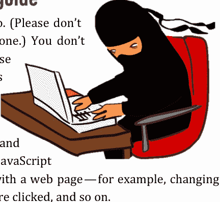

你确实需要对 HTML 有一点了解。网页是用 HTML 编写的，而 JavaScript 就存在于网页之中。大多数 JavaScript 代码都花很多时间与网页进行交互——例如，更改页面上的文本，响应按钮点击等等。

同时尝试学习 JavaScript 和 HTML 会有点让人头疼。但如果你以前从未接触过 HTML，我们有一个解决方案。你可以通过一个非常简短的教程 *Messing Up the Web*（可从 [http://tiny.cc/webmess](http://tiny.cc/webmess) 获取）来学习足够的 HTML 知识。在开始本指南之前，请先完成那个教程。

# 为什么选择 JavaScript？

对于学习编程的人来说，JavaScript 是一门极好的入门语言。这并不是因为 JavaScript 是一门优秀的教学语言（它大多不是），而是因为 JavaScript *无处不在*——它存在于每个操作系统、每个浏览器，以及几乎每台比烤面包机更复杂的电子设备上。

这意味着你可以轻松地与朋友分享你的 JavaScript 程序。与所有其他计算历史不同，它不需要下载、安装或配置。而且，JavaScript 的语法与许多其他专业语言（如 Java 和 C#）相似，这也不会让你感到不适。这意味着你为学习 JavaScript 所付出的努力永远不会白费。


# 为何选择 CodePen？

CodePen 是一个你可以在浏览器中使用的免费 JavaScript 沙盒之一。通过 CodePen，你可以编写 JavaScript 代码、进行测试并保存以备后用，无需进行任何设置。你解决方案的所有部分——创建页面的 HTML、使其美观的 CSS 以及驱动它的 JavaScript——都汇聚在一处。无需费心管理单独的文件。

本指南的所有练习都将使用 CodePen。通常，你会从一个已经构建好的项目开始，然后修改它。也许你需要进行功能增强或修复问题。完成后，你只需发送一个链接，就可以向他人展示你的作品。

# 如果我其实是个成年人怎么办？

请放心，情况并非全是坏处。但如果问题是“即使我不是孩子，我能用这本书吗？”那么答案很简单——是的！

不过，本书假设你是初次学习 JavaScript 和编程。如果你已经对编程有所了解，你可能更喜欢一本专注于 JavaScript 语言本身，而不会重新介绍你已知概念的指南。


# 关于我

我曾为 O'Reilly、Apress、No Starch 和 McGraw Hill 等出版社撰写过数十本计算机书籍。其中一些至今仍在我家发挥着顶门的作用。

如今，我大部分时间都在尝试各种有趣的项目，并在 Young Coder (http://medium.com/young-coder) 上撰写关于软件构建艺术的文章。欢迎在那里或 Twitter (http://twitter.com/prosetech) 上关注我，或者访问我的网站，如果你对我过去写的东西感兴趣的话 (http://prosetech.com)。


# 如何支持“微简介”项目？

请无负担地享受这本书吧！与家人分享它！把它送给朋友！只要你不更改它或将它冒充为你自己的作品，分享是不受限制的。

如果你发现错误，请告诉我。指出我遗漏的问题对我帮助很大，这样它们就不会困扰其他读者。请将你的投诉、评论、问题和建议发送到 matthew@prosetech.com。什么内容有效？什么问题仍然让你夜不能寐？请尽管开口！

如果你对“微简介”项目特别热衷，并想表示感谢（或只是鼓励我撰写更多系列书籍），你可以购买一本《JavaScript 微简介》。它在 Amazon 上有印刷版可购（那样我会获得一小部分收益），或者在 Gumroad 上提供可自由付费的 PDF 版本。非常感谢！

## 第零章

# CodePen：你的新家

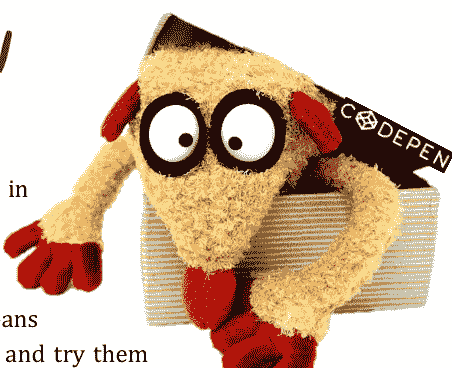

本指南中你所有的操作都将在 CodePen 中进行。所以在开始之前，是时候熟悉你的新家了。

CodePen 是一个 JavaScript *沙盒*。这意味着你可以在其中编写网页并进行测试。CodePen 并非唯一的 JavaScript 沙盒，但它是我最喜爱的一个。它易于使用。你可以从他人的示例开始，修改它，然后将其保存到你自己的账户中。所有基本功能都是免费的。

# 在 CodePen 上注册

你无需账户即可使用 CodePen。但拥有账户是个好主意，因为它可以让你保存作品。CodePen 账户是免费的（尽管你可以付费购买具有额外功能的专业账户）。

要创建 CodePen 账户，请访问 [http://codepen.io](http://codepen.io) 并点击 **Sign Up** 按钮。你需要提供电子邮件地址、选择密码并选取一个 CodePen 名称。你知道的，就是那些常规信息。或者，你可以使用你已有的社交媒体账户进行注册，比如 Twitter 或 Facebook。

# 在 CodePen 上查看示例

在本指南中，你会收到指向每个示例的链接。现在就通过访问 *世界上最美妙的按钮* 来试一试吧：

[https://codepen.io/prosetech/pen/PoNqRbq](https://codepen.io/prosetech/pen/PoNqRbq)

如果你正在浏览器中阅读本指南，这里有一个有用的技巧。点击链接时按住 **Ctrl** 键。这样示例会在新标签页中打开，不会让你离开当前正在阅读的这个标签页。

> **注意** 如果你正在纸质书上阅读这本书，你显然无法点击链接。为了省去一些输入，可以访问 [http://prosetech.com/tiny](http://prosetech.com/tiny)，那里有一个按章节组织的所有示例列表。

当你在 CodePen 中打开一个示例时，你会看到一个被分成几个部分的窗口。

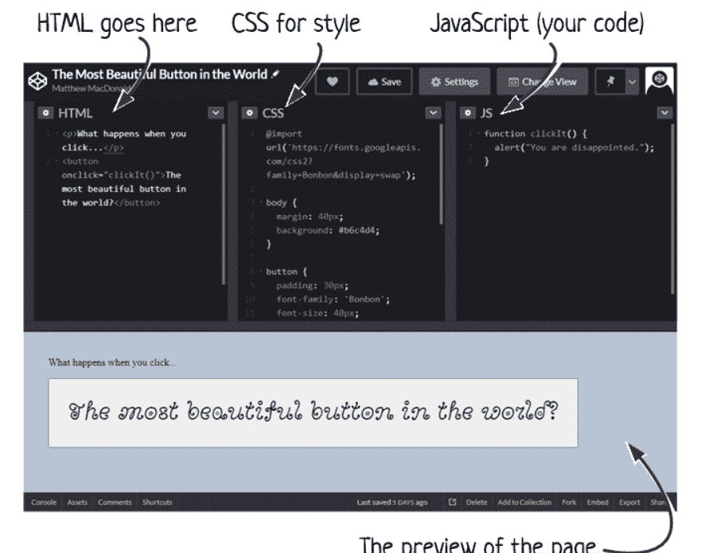

CodePen 窗口中有四个区域：

- **HTML。** 这是你的网页内容（元素和文本）。
- **CSS。** 这些是设定网页外观的样式。
- **JavaScript。** 这是你将要学习编写的代码。你会在这个区域花费大量时间。
- **预览。** 这是你正在构建的页面的实际样子（目前为止）。

通常，HTML、CSS 和 JavaScript 部分排列在顶部，而预览则位于下方。

如果你的浏览器窗口太小，CodePen 会重新排列自身，将预览放在右侧，并将 HTML、CSS 和 JavaScript 部分合并到左侧。

你可以立即开始修改 CodePen 示例。就用 *世界上最美妙的按钮* 来试试吧。在 HTML 区域中点击，更改按钮上的文本。（现在它写着“世界上最美的按钮？”）你的更改后，预览会立即更新。如果你注意到延迟，随时可以点击预览区域来加快更新。

> **注意** 记住，如果你对 HTML 一无所知，还不太习惯编辑它，你可以阅读《弄乱网页》教程来入门 ([http://tiny.cc/webmess](http://tiny.cc/webmess))。

# 隐藏 CSS

CSS（层叠样式表）是用于格式化网页外观的标准。你在本指南中看到的所有示例都有一些格式。但如果你不想被这些信息分心（并且想留出更多空间来阅读 JavaScript 代码），你可以暂时在 CodePen 中隐藏 CSS 部分。

为此，请点击 CSS 区域顶部的小下箭头按钮，然后选择 **Minimize CSS Editor**。

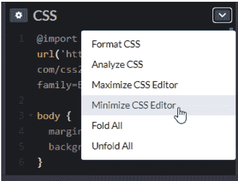

你也可以隐藏其他 CodePen 区域，但你可能不会想这样做。你需要保持 HTML 和 JavaScript 熟手以便完成每个示例。

# 查看更大的预览

有时 CodePen 试图在你的浏览器窗口中塞入太多东西。网页预览（在底部）可能特别不方便。它不是很高，所以你可能需要上下滚动才能看到整个预览。

为了改善这种情况，你可以调整 CodePen 窗口的不同部分。诀窍是在分隔每个区域的黑色条之间的区域点击。然后你可以拖动它们来使某个区域变小或变大。

有时，无论你怎么做，都无法一次容纳所有内容。在这种情况下，是时候使用 **Change View** 按钮（位于 CodePen 窗口右上角）来切换视图了。点击它并选择另一个选项，以不同的方式查看你的示例。点击 **Full Page View** 可以暂时展开网页预览，使其填满整个窗口。或者，在 **Editor Layout** 标题下选择其他框布局之一，将预览窗口放在侧面。

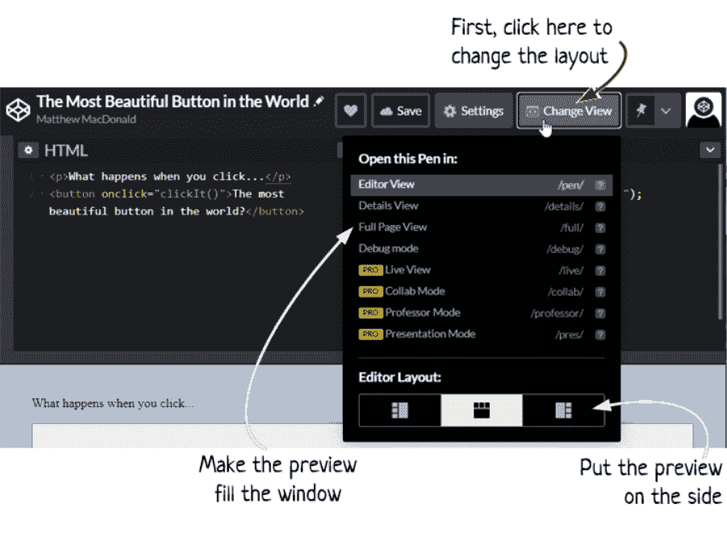

当你处于全页视图时，你看不到其他内容，比如你的 HTML 和 JavaScript。当需要切换回正常模式以便编辑示例时，再次点击 **Change View** 按钮并选择 **Editor View**。你很快就会习惯来回切换。

# 分叉示例

当你访问像 *世界上最美妙的按钮* 这样的示例时，你看到的是我创建的版本。你可以进行更改，但你的更改是临时的。它们不会替换我的版本。

通常，你会想保存你的作品。也许你想稍后查看它。或者你可能正在进行一个大改动。也许你想把它展示给别人。在所有这些情况下，解决方案是*分叉*这个示例，这意味着创建你自己的副本。（“fork”一词源自道路的分叉口——路径分开的地方。你将把代码分开，走上自己的道路。）

要分叉一个示例，你需要有一个 CodePen 账户。假设你已经有了，你所要做的就是点击窗口底部的 **Fork** 按钮。现在这个示例就归你了，你可以随意修改并为未来保存。

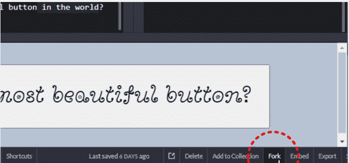

非常小的分叉按钮。


当你 Fork 一个示例时，你的名字会出现在示例名称下方，表明你是这个新副本的所有者。你也可以根据需要重命名该示例。（要重命名，请点击名称旁边的铅笔图标。）

更重要的是，你的新副本也会获得一个新的网络地址。


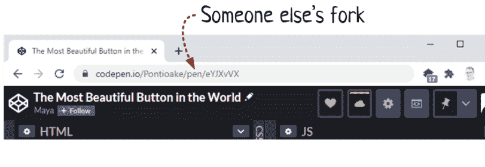

当你需要查看自己的示例版本时，就使用这个新地址。你可以在 CodePen 的仪表盘中查看所有保存的示例（它们被称为 *pens*），地址是 [https://codepen.io/dashboard](https://codepen.io/dashboard)。

Fork 并不是制作示例的唯一方式。你也可以从头开始编写一个示例。你可能这样做是为了跟随本指南中的某些课程，或者只是为了尝试你自己的随机想法。要创建一个新的空白示例，请点击 CodePen 网站右上角的个人头像图片，然后选择 **New Pen**。

## 开启自动补全功能

CodePen 有一个很棒的 *自动补全* 功能，可以在你输入时提供建议。例如，CodePen 的自动补全可以建议某些代码成分的名称。（一旦你开始学习 JavaScript，这就会更有意义。）

自动补全的唯一问题是，你需要自己手动开启它。你肯定应该在开始学习 JavaScript 之前就做好这件事。以下是方法：

1.  点击 CodePen 网站右上角的小人物头像图片。
2.  点击 **Settings**（设置）。
3.  向下滚动页面，直到找到 **Editor Options**（编辑器选项）框。
4.  确保 **Autocomplete**（自动补全）设置已勾选。

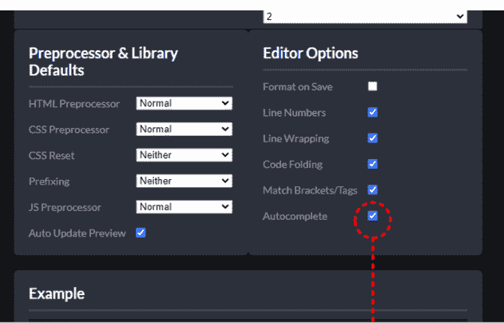

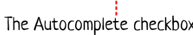

## CodePen 之后是什么

当然，从 CodePen 开始并不意味着你必须一直待在 CodePen。最终，你可以将编写的代码保存在电脑上，并使用专业的（但仍然是免费的）编辑器，如 Visual Studio Code。

当你准备好走这条路时，CodePen 有一个导出功能可以帮到你。以下是使用方法：

1.  点击 **Export**（导出）按钮。（它在窗口的右下角，靠近微小的 **Fork** 按钮。）
2.  点击 **Export .zip**（导出为 .zip）以创建一个包含你所需所有文件（包括 HTML、CSS 和 JavaScript）的压缩包。
3.  点击 **Download .zip**（下载 .zip）将 ZIP 文件复制到你的计算机。现在你可以打开它，获取文件，并在不同的编辑器中进行编辑。

但现在不用着急，有的是时间做这些。目前，CodePen 是开始学习 JavaScript 的完美场所。

第一章

# JavaScript 长什么样

你即将花大量时间查看代码。为了帮助你理清思路，你需要更熟悉 JavaScript 代码的编写方式。

这些神秘的规则被 JavaScript 向导们称为 *语法*。一旦你了解了一些 JavaScript 语法规则，代码就会开始看起来更像魔法指令，而不再像天书了。

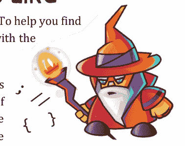

## 语句

当你看到一段 JavaScript 代码时，你会看到一系列 *语句* ——基本上，就是告诉你的网页浏览器做某事的命令。这里有一个：

```
alert("Hi there!");
```

alert() 命令很简单。它显示一个带有你想要的任何消息的小弹出窗口。（你将消息——例如 *Hi there!* ——放在引号内。）弹出框不是获取注意力的最礼貌方式，但它很管用。

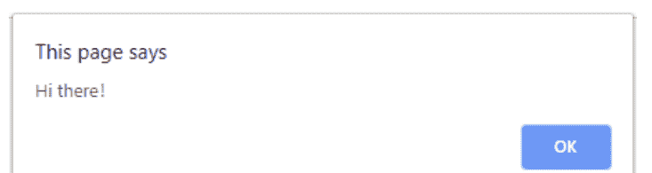

如果你是 JavaScript 的初学者，你不会完全理解这个命令是如何工作的，这没关系。但你应该注意，这个命令末尾有一个分号（ ; ）。虽然 JavaScript 中并非绝对需要分号，但认真的程序员总会使用它们。它们标明了每个代码语句的结束。

如果你没有足够的空间将一个语句舒适地放在一行中，你几乎可以在任何地方拆分它，只要记得以分号结尾。这里有一个例子，显示了与之前相同的消息，但现在将语句分成了两行：

```
alert(
"Hi there!");
```

你还可以添加空格来排列代码：

```
alert(
    "Hi there!");
```

这仍然是同一个命令。JavaScript 会忽略额外的空格，就像它忽略换行符一样。

当然，只用一个语句做不了什么。即使是一个小程序也包含一系列语句，一个接一个。当一段 JavaScript 代码运行时，浏览器会逐一处理这些语句，按顺序触发每个命令。

## 注释

以两个正斜杠 // 开头的语句是注释。JavaScript 会忽略所有注释。

```
// I don't do anything at all!
```

你可以在任何地方添加注释。通常，你使用注释来解释下一个代码语句将要发生的事情：

```
// Show a message.
alert("Hi there!");
```

你也可以使用注释来指出代码的重要部分。本指南中的许多教程都有注释，告诉你需要注意哪里或需要更改什么：

```
// This is where things go wrong.
```

你也可以将注释斜杠放在代码语句前面，以暂时将其关闭。例如，这个 alert() 命令不会执行任何操作，因为它已被更改为注释：

```
//alert("Hi there!");
```

这个技巧被称为 *注释掉* 代码。如果你认为以后会需要这段代码，可以使用它来代替删除一行代码。

> **提示** 在 CodePen（以及大多数其他代码编辑器）中，注释的显示颜色与语句不同。这使得更容易发现代码。

## 块和函数

JavaScript 使用花括号，称为 *大括号*，来将包含一个或多个语句的代码段组合在一起。每个部分以一个左大括号开始：

```
{
```

以一个右大括号结束：

```
}
```

（如果你在键盘上找不到这些符号，通常可以通过按住 **Shift** 键并输入方括号 **[ ]** 来得到它们，它们就在 **P** 键的右边。）

在学习 JavaScript 的过程中，你会看到这些大括号用在不同的地方。你首先看到它们的地方是在 *函数* 中。你可以将函数视为完成一项任务的小段代码。你可以通过它以 `function` 这个词开头来识别一个函数。这里有一个简单的例子：

```
function showMessage() {
    alert("Hi there!");
}
```

每个函数都有一个名称，它出现在 `function` 一词之后，括号 () 之前。创建函数的人选择名称。这个函数名为 `showMessage`，它只包含一个语句。

这是 showMessage() 函数的一个稍长版本。它包含两个注释和两个语句：

```
function showMessage() {
  // Show the first message.
  alert("Hi there!");

  // After you click OK, you get to see this bonus message.
  alert("It's me again!");
}
```

当这个函数中的代码运行时，具体发生的事情如下：

1.  JavaScript 跳过第一个注释（`// Show the first ...`）
2.  alert() 函数在弹出框中显示第一条消息。
3.  现在代码停止。它正在等待有人关闭弹出框。
4.  当你点击 **OK** 时，JavaScript 继续执行。
5.  JavaScript 跳过第二个注释（`// After you click ...`）
6.  alert() 函数显示第二条消息。
7.  当你点击 **OK** 时，JavaScript 继续执行，函数结束。目前就这些。

你可能还会注意到一些其他细节。例如，这个函数中的每一行都缩进了两个空格。这些空格完全是可选的，但它们是人们使代码更易于阅读和理解的众多方式之一。随着你的程序变得更加复杂，使代码更易于理解变得至关重要。

> **注意** 目前，你编写的每个代码语句都属于一个函数内部。不要将代码放在函数块的上方、函数块之后或两个函数块之间。（不过，你可以把注释放在那里。）


## 亲手试试！

> ▶ 你好，巫师？（挑战等级：简单）

[https://codepen.io/prosetech/pen/wvMjPbM](https://codepen.io/prosetech/pen/wvMjPbM)

以所谓的 *Hello World* 程序开始学习一门新的编程语言是常见的传统。*Hello World* 程序所做的事情就是显示一条消息。它证明了你的代码在运行——仅此而已。

*你好，巫师？* 这个例子是这个想法的一个小变体。目前，当你点击 **向我问好** 按钮时，它会显示一条相当不友好的消息。

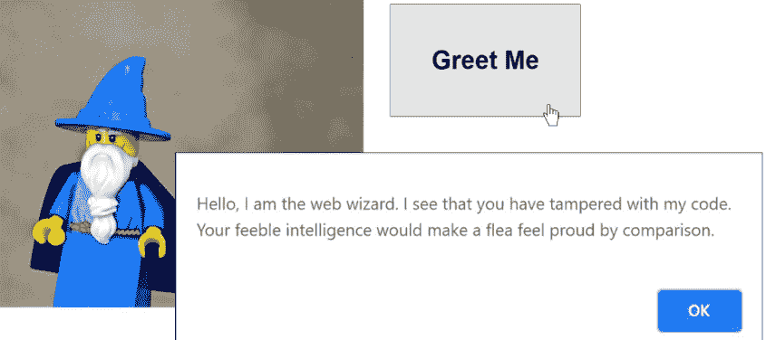

你需要做以下事情来纠正它：

- 找到 `showMessage()` 函数。这就是当你点击按钮时运行的代码。它也是这个例子中唯一的代码。
- 在正确的位置添加注释斜杠 `//` 来禁用那条粗鲁的消息。换句话说，你要将那个糟糕的 `alert()` 命令变成一个无害的注释。
- 找到代码中那条友好的消息。目前它被注释掉了，所以 JavaScript 忽略了它。移除注释斜杠来让它重新生效。

> 提示 记住，你可以在 CodePen 中调整 JavaScript 框的大小，以便更容易地查看你的代码。只需点击 JavaScript 框的左边缘并向左拖动即可。当 JavaScript 框较小时，CodePen 会将长代码语句和长注释换行显示。

## 可选 真正长的注释

JavaScript 还有另一种类型的注释，称为 *多行注释*。它以 `/*` 开始，以 `*/` 结束。这些注释标记有一种特殊的能力。你可以将它们放在任意远的位置。它们之间的所有内容都成为一个巨大注释的一部分。

```
/* 在开始和结束标记之间的一切都属于一个大注释。
*/
```

如果你想要临时禁用一大段代码，或者你想在一个地方写下大量关于程序的信息，多行注释就非常有用。

要尝试多行注释，回到 *你好，巫师！* 例子，并移除两个 `alert()` 语句前的注释斜杠（`//`）。现在，只用一个 `/*` 标记和一个 `*/` 标记来禁用两个警告框。如果你点击按钮什么也没发生，你就知道你成功了。记住，CodePen 会改变文本颜色，这样你就能看到你的注释在哪里了！

## 第 2 章

## 事件如何工作

学习 JavaScript 的棘手之处之一在于它完全与网页绑定在一起。即使要让最简单的程序运行，你也需要了解一些 HTML 以及 HTML 元素如何触发所谓的 *事件*。让我们来研究一下。

## 极简 HTML 复习

如果你了解 HTML，你就知道每个网页都是由元素组成的。例如，`<p>` 元素用于段落，`` 元素用于图片，`<h1>` 元素用于大标题，`<button>` 元素用于按钮，等等。

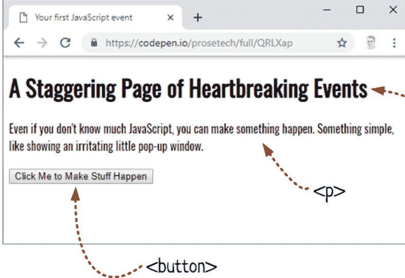

当你编写网页时，所有这些元素似乎都是你网页中永不改变的普通部分。但在 JavaScript 的眼中，它们要有趣得多。每个元素都在关注你正在做的事情。如果你将鼠标移到图片上，点击一个按钮，或者开始在文本框中输入，JavaScript 都会注意到。

这就是事件登场的地方。

## 事件如何工作

JavaScript 使用事件来告诉你代码何时发生了某些事情。例如，如果你想在有人点击按钮时知道，你可以关注一个 JavaScript 称为 `onclick` 的事件。

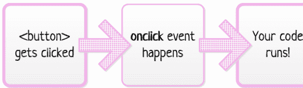

换句话说，事件是将 HTML 元素连接到你的代码的胶水。那么你如何使用它们呢？你需要三个要素：

1. 你需要一个 *触发* 事件的元素。例如，如果你想在有人点击按钮时运行你的代码，你需要一个 `<button>` 元素。
2. 你想要运行的代码需要在一个函数中，比如你之前看到的 `showMessage()` 函数。
3. 你需要将元素连接到函数。你通过向元素添加一个特殊的事件属性来做到这一点。这就是秘诀。

例如，假设你的 HTML 中有这样的按钮：

```
<button>Click Me</button>
```

这是一个普通的按钮，上面写着“Click Me”。

你希望它做点什么。所以你写一个包含一些代码的 JavaScript 函数，像这样：

```
function showMessage() {
  alert("You clicked me.");
}
```

现在你将两者连接起来。如果你想关注 onclick 事件，你就在按钮上添加一个 onclick 属性，像这样：

```
<button onclick>Click Me</button>
```

但这还不够！你还需要告诉 JavaScript 运行哪个函数。所以如果你的函数名为 showMessage()，你就这样写：

```
<button onclick="showMessage()">Click Me</button>
```

以下是这段代码对 JavaScript 的“计算机语言到人类语言”翻译：“关注 onclick 事件。当它发生时，运行 showMessage 函数中的代码。”

> **注意** 这部分必须完美。你需要精确匹配函数名的拼写和大小写，并且你需要在函数名后包含空的括号。（这是你告诉 JavaScript “这是一个函数”的方式。）

## 亲手试试！

▶ **令人心碎事件的惊人页面（挑战等级：简单）**

https://codepen.io/prosetech/pen/eYZZarw

*令人心碎事件的惊人页面* 有一个按钮。点击它，应该会发生一些事情。

但现在什么也没发生。你需要的代码就在那里，在一个名为 `doThatThing()` 的函数中。问题是按钮没有连接。你能用你在本课中学到的技能修复它吗？如果你做对了，当你点击按钮时，你会看到一条消息。

> **提示** 要连接你的按钮，你需要在 `<button>` 元素上添加 `onclick` 属性，并将其设置为 `doThatThing()` 函数。

试一试。这令人兴奋吗？并不真正！但一旦你有了这个基本设置，它就为你的探索打开了许多新的大门。你可以尝试的一个挑战是让点击 `<h1>` 元素（标题）触发显示警告框的代码。要做到这一点，你需要将 `onclick` 事件添加到 `<h1>` 元素而不是 `<button>` 元素上。

## 亲手试试！

▶ **损坏的按钮（挑战等级：简单）**

[https://codepen.io/prosetech/pen/xxVVNBV](https://codepen.io/prosetech/pen/xxVVNBV)

*损坏的按钮* 给你一个略有不同的按钮事件挑战版本。这个例子中的 **Click Me** 按钮连接到了 doSomethingAmazing() 函数，但出了点问题。当你点击按钮时，什么也没发生。CodePen 甚至没有显示一个小的红色错误图标来告诉你有问题。哪里出错了？

花点时间调查网页 HTML 和 JavaScript 代码。记住，计算机不会容忍小错误。如果你仍然找不到问题，请继续阅读寻找答案。

错误在 HTML 中。`onclick` 属性在那里，函数名也正确。但它缺少函数名后的括号。没有它，JavaScript 将不会承认你试图使用一个函数。

当你在制作程序时（在 JavaScript 或任何编程语言中），即使一个微小的拼写错误也会导致代码能运行或不能运行的区别。如果你的 JavaScript 有错误，网页浏览器一遇到问题就会悄悄放弃。编程问题通常很容易修复——麻烦在于找到它们。

## 第 3 章

## 在变量中存储信息

每个程序——无论大小——都需要跟踪信息。用户的名字是什么？你卖的袜子价格是多少？每分钟有多少僵尸攻击玩家？

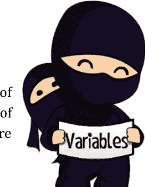

要存储一条信息，你需要使用一个 *变量*。

## 声明一个变量

变量是一个带名字的容器。当你创建变量时，你可以选择名字。这称为 *声明* 变量。一旦你声明了它，你就可以把你想要的东西放进去。

声明变量最简单的方法是使用 JavaScript 的 `let` 关键字，像这样：

```
let NumberOfZombies;
```

这创建了一个名为 `NumberOfZombies` 的变量。注意，你不能在变量名中使用空格，但你可以使用大写字母来让变量名 *看起来* 像是由多个单词组成的。只需记住 JavaScript 会注意大小写，所以 `NumberOfZombies` 和 `numberOfZombies` 实际上是两个完全不同的名字。这也意味着它们是两个完全独立的存储信息的容器。


## 将值存入变量

要将信息存入变量，你需要使用等号。下面这个示例创建了一个名为 `age` 的变量，并将数字 12 存入其中。这被称为*赋值*。

```
let age;
age = 12;
```

你可以把等号想象成一个箭头，它从右侧取一个值，并将其塞入（语句左侧的）变量中。

```
age ← 12
```

你甚至可以在一行内使用 `let` 创建变量并赋值，像这样：

```
let age = 12;
```

每个变量都只能保存一个值。当你给一个变量赋值时，它会替换掉之前存储的内容。看这个例子：

```
let mysteryNumber = 5;
mysteryNumber = 1;
mysteryNumber = 15;
mysteryNumber = 20;
```

这段代码执行完毕后，`mysteryNumber` 变量里存储的是什么？当然是数字 20。所有其他数字在替换时都被丢弃了。

> **注意** 记住，你只需要声明一次变量（使用 `let`）。但你可以按需多次给变量赋值。桶也是一样——买一次桶，你随时可以更换里面的东西。

## 使用数字和文本

JavaScript 能理解多种不同类型的信息。最基本的两种类型是数字和文本。

让我们看看三个存储了不同数字的变量：

```
let ageOfDad = 42;
let costOfSocks = 24.99;
let temperatureInSiberia = -30;
```

注意，你可以使用负数和小数值。不需要使用单位或其他符号（比如美元符号、逗号或百分号 %）。

现在来看一个存储文本的变量：

```
let messageToMyEnemy = "Despair! You have coded your last variable!";
```

这段文本（在本例中是 *Despair! You have coded your last variable!*）被称为*字符串*。字符串可以包含单个字母、一些随机单词或整个段落。

创建字符串时，你使用引号来标示文本的开始和结束。你可以在引号之间放入任意多的文本。

> **注意** 你可能会好奇，如何区分存储了数字的变量和存储了字符串的变量。答案是，你不需要区分。你只需要记住自己在做什么并保持一致。（其他编程语言对此要求更严格，会强制你说明每个变量存储的数据类型。这种严格性有助于程序员避免痛苦的错误。）

## 亲手试试！

▶ **预测未来（挑战等级：简单）**

[https://codepen.io/prosetech/pen/KKzgzWQ](https://codepen.io/prosetech/pen/KKzgzWQ)

你可以在任何需要输入普通数字或文本的地方使用变量。例如，你已经这样使用过 `alert()` 函数：

```
alert("Welcome.");
```

在这个例子中，文本 "Welcome" 是一个普通值——也称为字面量值（因为它就是它本身）。但你也可以将 `alert()` 与变量一起使用，像这样：

```
let welcomeMessage = "I am not at all happy to see you.";
alert(welcomeMessage);

welcomeMessage = "Please leave.";
alert(welcomeMessage);
```

有个问题：这两个警告框会显示什么内容？如果你猜它们都会显示 "welcomeMessage"，那你最好亲自尝试一下这个例子。

## 可选内容：在字符串中放入引号

引号标示每个文本值的开始和结束。但如果你想在字符串中放入一个真正的引号字符呢？例如，如果你想创建一个包含文本 The movie "Titanic" is my favorite 的字符串？

这样不行：

```
let favoriteMovie = "The movie "Titanic" is my favorite";
```

问题在于，JavaScript 会认为 *Titanic* 之前的那个引号结束了字符串，使得字符串只剩下 *The movie*。

解决方案是，当你想在字符串中包含引号时，用 \\" 代替单独的 "。反斜杠是一种秘密代码，用来引起 JavaScript 的注意。你可以在大多数键盘的 **Enter** 键上方找到它。

下面是修正后的示例：

```
let favoriteMovie = "The movie \"Titanic\" is my favorite";
```

这样可以了，但现在又有了另一个潜在问题。如果你想创建一个包含反斜杠的字符串怎么办？JavaScript 会认为反斜杠是秘密代码的开始，于是你又回到了最初的问题。幸运的是，有个逃生舱口。使用两个连续的反斜杠，像 \\\\。奇怪的是，这是一个特殊的 JavaScript 代码，意思是“插入一个反斜杠”。

## 好的变量名

很多灾难的发生，是因为程序员给变量起了糟糕或随意的名字。例如，你可能想用 `Number` 或 `num` 代替 `numberOfZombies`。如果你这样做了，代码仍然能运行，但其他人会更难理解它。（如果你几个月后回过头来看，可能连*你自己*都很难理解。）

保持一致性也很重要。同一个变量有很多种命名方式。例如，`AgeOfPetDog`、`ageOfPetDog`、`DogAge`、`age` 和 `DogAgeInYears` 都是指代同一信息的不同名称。

在本书中，变量和函数名通常以小写字母开头。这是 JavaScript 中最常见的风格，但并非普遍适用。如果你与程序员团队合作，可能需要遵循不同的命名准则。否则，保持整洁就取决于你自己了。

## 亲手试试！

▶ **你好，忍者！（挑战等级：简单）**

[https://codepen.io/prosetech/pen/rNeMewQ](https://codepen.io/prosetech/pen/rNeMewQ)

*你好，忍者！*程序可能无聊到了极点。它在你点击按钮时显示一条消息。但现在它没有使用任何变量。你将要改变这一点。

你需要做的是：

- 为问候消息声明一个变量（我们叫它 `ninjaMessage`）。
- 将问候消息放入该变量。
- 在调用 `alert()` 时使用你的变量。

完成后，程序的运行方式将完全相同。这个例子的目标是让你在深入学习之前，先练习一下使用变量。

你能使用一个不存在的变量吗？这要看情况。

这是使用变量的正确方式：

## 不存在的变量

```
let welcomeText;
welcomeText = "Hello there.";
```

你也可以在一个语句中结合*声明*变量和*赋值*变量。所以这段代码同样有效：

```
let welcomeText = "Hello there.";
```

但这样单独写，就不行：

```
welcomeText = "Hello there.";
```

问题很简单：在使用变量之前，从未用 `let` 关键字声明过它，这是绝对不可以的。

接下来事情变得有点奇怪。JavaScript 最初被创建时，没人想到它会变得如此流行和重要。JavaScript 的设计初衷是随意的，并容忍一些马虎。所以，如果你试图使用一个你没有创建的变量，JavaScript 会*自动*为你创建它。不错，对吧？

不，一点也不好。

问题在于，自动创建变量会让你犯各种可能破坏代码的错误。比如，你在程序的一个部分使用了名为 `welcomeText` 的变量，而在另一个地方又使用了名为 `WelcomeText` 的变量，却没有意识到你不小心创建了两个不同的变量，它们包含不同的信息。哎呀！

要真正理解这个问题，你需要在下一个练习中仔细研究。

## 亲手试试！

▶ **找出冒名顶替者（挑战等级：中等）**

[https://codepen.io/prosetech/pen/yLOaOxR](https://codepen.io/prosetech/pen/yLOaOxR)

在*找出冒名顶替者*示例中，有三个友好的忍者准备迎接你，每个都有自己的按钮。但在点击之前，先看看代码，因为一切并非表面所见那样。

变量名可以使用字母、数字（但不能在开头）、下划线 _ 字符和连字符 - 字符。但为了简单起见，你大概应该像大多数其他程序员一样，只使用字母。

你可能想知道为什么 JavaScript 的变量创建关键字叫 `let`。简而言之，`let` 借用了数学符号，在数学中人们说“令此变量取此值”。（另外，`var` 关键字在老式的 JavaScript 中已被使用。它和 `let` 功能相同，但有一些奇怪的怪癖，所以现在人们更喜欢用 `let`。）你可以把 `let` 想象成你的个人命令，一种召唤变量来执行你意愿的方式！


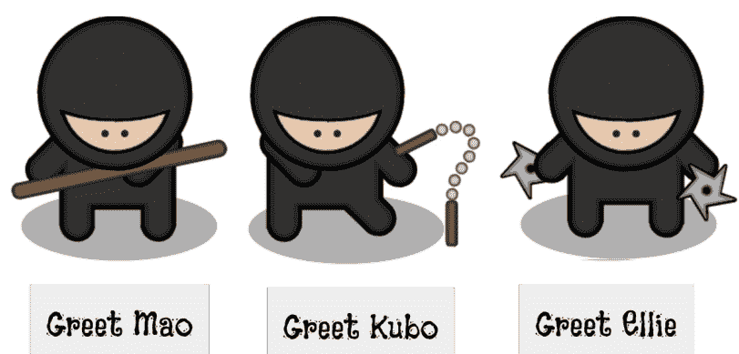

现在，每个忍者都使用自己的函数。例如，如果你点击久保的按钮，它会调用一个名为 `greetKubo()` 的函数。而这个函数执行的操作，你在 *Hello, Ninja!* 练习中已经见过了。它创建一个变量，在其中放入一些文本，然后与 `alert()` 函数一起使用。

但其中一个忍者是个冒牌货，他的问候语不起作用。问题正是你在前一节刚学过的变量错误。看看你能否通过查看代码猜出谁是冒牌货。然后，你就可以开始点击按钮了。

现在就试一试，在继续阅读之前。

一旦你找到了冒牌货，你知道出了什么问题吗？你能在代码中找出问题并修正它吗？

> **提示** CodePen 尝试通过颜色编码来帮助你发现这个问题。当你用 `let` 关键字以正确的方式声明一个变量时，该变量名在代码中所有使用的地方都会变成蓝色。但未声明的变量则保持黄色。再看一遍代码，你应该能发现艾莉问候语中颜色不同的变量。

这个错误是一个小拼写错误，意外地创建了两个变量：`ellieMessage` 和 `elliseMessage`。你可能会忽略这个差异，但 JavaScript 不会。代码将文本放入了 `elliseMessage`，但在警报框中显示的是空的 `ellieMessage`。你会在警报框中看到一个奇怪的 "undefined" 消息，因为你从未给 `ellieMessage` 变量赋值过。

一旦你发现了这个问题，修复起来很容易。但更好的情况是，你能让 CodePen 在错误导致任何麻烦之前就帮你发现它。

一种避免这个问题的方法是在你的 JavaScript 代码顶部添加这行神奇的命令：

```
"use strict";
```

这会开启 *严格模式*。要尝试严格模式，在 *找出冒牌货* 示例的 JavaScript 框顶部输入这一行。然后点击 **Greet Ellie**。

现在，一旦你的代码试图使用你未声明的变量（`elliseMessage`），CodePen 就会阻止它。你的其余代码不会运行，警报框也不会出现。取而代之的是，在 JavaScript 框的右下角会出现一个小小的红色感叹号图标。

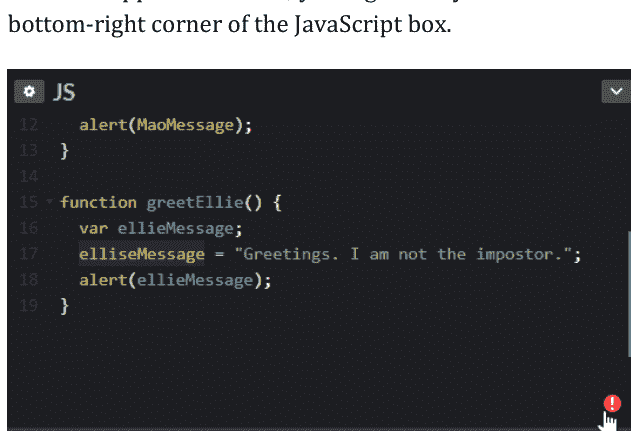

如果你点击这个红色图标，CodePen 会显示一条消息，用程序员的语言解释问题所在。它会告诉你 “elliseMessage is not defined”。

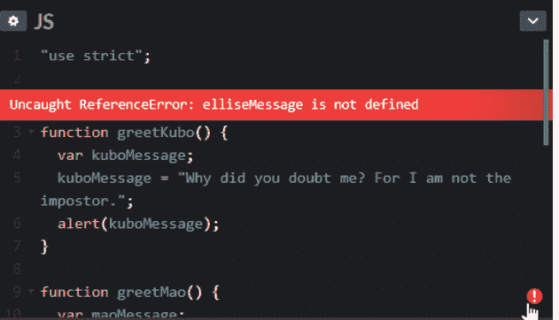

既然 CodePen 已经对你的错误提出了警告，它就不太可能成为一个令人费解、让人挠头的问题了。

## 可选：使用 TypeScript 错误检查

你不需要将 `"use strict"` 命令复制到你所有的 JavaScript 程序中。许多代码编辑器都有在设置中开启严格模式的方法。在 CodePen 中，你可以通过开启 TypeScript 模式实现类似的功能。

TypeScript 是 JavaScript 语言的一个更严格的版本。你目前没有使用它，但你仍然可以利用它的自动错误检查功能。方法如下：

1. 点击窗口顶部的 **Settings** 按钮。一个新窗口弹出，显示当前示例的设置。
2. 点击左侧的 **JS** 部分。
3. 点击 **JavaScript Preprocessor** 框，然后选择 **TypeScript**。
4. 点击底部的 **Save & Close** 按钮。

现在，每当你试图使用一个未声明的变量时，你都会得到 CodePen 的红色错误图标，而且不需要 "use strict" 命令。

## 复制变量

你已经看到了如何将一个值放入变量。但这只是开始。你也可以将一个值从一个变量复制到另一个变量。这里有一个例子：

```
let myFavoriteColor = "green";
let yourFavoriteColor = "orange";

yourFavoriteColor = myFavoriteColor;

// What is your favorite color now?
```

以下是具体过程的分解：

1. 第一条语句创建了一个新的 `myFavoriteColor` 变量，并将一个值（"green"）放入其中。
2. 下一条语句创建了一个新的 `yourFavoriteColor` 变量，并将一个不同的值（"orange"）放入其中。
3. 第三条语句将 `myFavoriteColor` 的内容（文本 "green"）复制到 `yourFavoriteColor` 中。我们俩最终有了相同的最爱颜色。

你可以随意多次复制一个值。但请记住，当你给一个变量赋新值时，它之前的内容就会被丢弃。

## 自己动手试试！

### ▶ 礼物交换器（挑战等级：棘手）

https://codepen.io/prosetech/pen/bGEWjXN

本课的最终挑战，你将尝试一些稍微棘手的东西。

*礼物交换器* 想要帮助两位朋友毛和久保交换礼物盒。代码已经存在，用于获取礼物并将它们放入两个变量中。（你现在可以忽略这段代码。）

然后进行交换。看起来是这样的：

```
maoGiftContents = kuboGiftContents;
kuboGiftContents = maoGiftContents;
```

但交换并没有成功。你能找出问题所在吗？你能修复它吗？

> 注意 查找注释 // FIX THIS PART 以找到你需要修改的礼物交换代码。此示例中还有一些使用网页上文本框的代码，但我们还没有讲到那个技术。

问题很简单就能找到。礼物交换中的第一条语句将一个礼物盒（久保的）的内容复制到了另一个礼物盒（毛的）中。从这以后，两个盒子里的礼物就 *一样* 了。这意味着没有办法再找回毛原来礼物盒里的东西了。

> **提示** 要解决这个问题，你需要创建第三个变量来帮助你。这个变量可以在你进行交换的第一部分时，暂时存放毛的礼物。

还是觉得难？我们告诉过你它可能很棘手。以下是解决这个问题的具体步骤分解：

1. 创建一个新变量。这就是那个额外的盒子。
2. 将一个礼物盒中的值复制到额外的盒子中。从哪个盒子开始并不重要，但我们决定把毛的礼物移到额外的盒子里。
3. 将另一个礼物盒（久保的）中的值复制到毛的盒子里。
4. 现在可以安全地将礼物从额外的盒子中取出，并复制到久保的盒子里。

这张图展示了步骤 2 到 4。

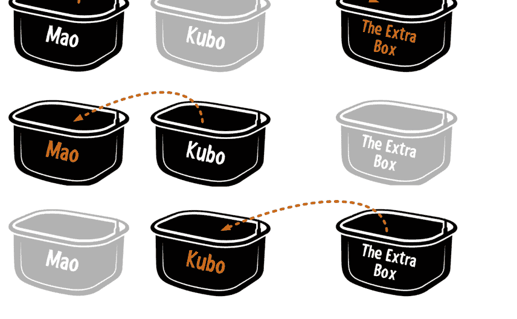

如果这看起来仍然奇怪，请查看 CodePen 中的解决方案。

# 第四章：改变变量

变量之所以被称为变量，是因为它们的内容是可变的。换句话说，你可以随意更改存储在变量中的内容。你可以重新排列文本片段、统计发生的事件以及执行数学计算。这些操作是让代码变得更智能的第一步。

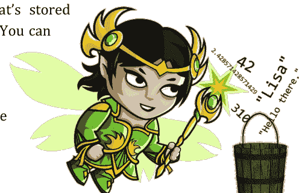

## 非常简单的数学运算

改变变量中存储的值有很多种方法。如果你的变量是一个数字，你可以使用简单的数学运算。

例如，看看加号 + 运算符。它允许你将两个数字相加：

```
age = 12 + 9;
```

当你运行这段代码时，JavaScript 首先执行等号右侧的所有数学运算。在这个例子中，这意味着它将 12 和 9 相加，得到结果（21）。然后它将这个结果放入 age 变量中。

```
age ← 21
```

当然，你也可以用减号 – 运算符来减去一个数字：

```
age = 400 – 9;

// Now age holds the number 391.
```

这两个例子都包含额外的空格，以使代码更易于阅读。但如果你愿意，你可以把所有内容都挤得更紧凑一些：

```
age=400-9;
```

## 稍微花哨一点的数学运算

+ 和 - 号被称为 *运算符*。JavaScript 还识别：

- * 运算符用于乘法（JavaScript 中 3×2 是 3*2）
- / 运算符用于除法（JavaScript 中 6÷2 是 6/2）
- ** 运算符用于指数运算（JavaScript 中 6² 是 6**2）

你还可以使用括号 ( ) 来控制 JavaScript 执行计算的顺序。通常，JavaScript 遵循传统的运算顺序，这意味着它先计算指数，然后进行乘法和除法，最后进行加法和减法。所以，如果你有这样一个语句：

```
total = 2+6/2;
```

JavaScript 会先执行 6/2 部分（结果是 3），然后将 2 和 3 相加得到 5。与带括号的版本比较一下：

```
total = (2+6)/2;
```

现在 JavaScript 先将 (2+6) 相加得到 8，然后除以 2，最终得到 4。

如果你想做更复杂的操作——比如四舍五入或计算指数——你需要使用 JavaScript 的 Math 对象，这将在后面的课程中学习。


## 亲手试试吧！

### 口袋计算器（挑战等级：简单）

https://codepen.io/prosetech/pen/dyGqNGO

有一个问题。如果你以每小时50英里（mph）的速度开车行驶3小时，你能开多远？但是等等——别自己回答这个问题。相反，请在口袋计算器程序中编写一条语句来计算结果，并将其放入名为 `distanceTraveled` 的变量中。

当你用代码完成计算后，运行程序。你应该会看到一个弹出警告框，显示正确的数字。（如果1小时开50英里，那么3小时就是3×50，即150英里。）你可以尝试用不同的数字计算，看看结果如何变化。

## 使用变量进行计算

这里有一个实用的技巧：你可以在计算中*使用*一个变量。例如，假设你将你的年龄设置为一个起始数字：

```
age = 16;
```

现在你想将年龄增加一岁。为此，你需要获取 `age` 变量的当前值并加上1：

```
age = age + 1;
// 现在 age 的值是 17。
```

其工作原理如下。当 JavaScript 看到这样的语句：

```
age = age + 1;
```

它首先将右侧的所有变量替换为其当前值。因此语句变为：

```
age ← 16 + 1
```

最后，JavaScript 计算右侧的结果（得到17），然后将其赋回 `age` 变量。

这是另一个使用除法计算你相当于多少“狗年”年龄的例子：

```
ageInDogYears = age/7
```

所以如果 `age` 变量是 17，JavaScript 会计算：

```
ageInDogYears ← 17/7
```

执行17÷7的除法运算后，它存储结果，结果大约是2.4年：

```
ageInDogYears ← 2.428571428571429
```

> **提示** 你可以在计算中使用任意数量的变量，没有限制。但有时作为单条语句的计算看起来过于复杂，将其分解为几个步骤会更简单。

## 亲手试试吧！

### 口袋计算器 II（挑战等级：中等）

https://codepen.io/prosetech/pen/dyGqNGO

在这个练习中，你将执行与原始 *口袋计算器* 示例中完全相同的计算，只是现在你将使用变量。创建一个 `speed` 变量和一个 `time` 变量。将它们都设置为适当的值（`speed` 为 50，`time` 为 3）。然后，使用 `speed` 和 `time` 变量来计算 `distanceTraveled`。

这看起来可能是一个无意义的改变——毕竟，你的程序仍然要做同样的事情。但是一旦你开始使用变量，你就开启了新的可能性。例如，也许你不再通过将数字键入代码来设置值，而是从网页上的某些文本框获取它们。

并且使用命名良好的变量可以使复杂的公式更容易理解。比较一下这个：

```
distanceTraveled = time*speed;
```

和这个：

```
distanceTraveled = 3*50;
```

在继续之前，尝试在 *口袋计算器* 示例中玩得更花哨一点。创建第二个变量，名为 `enemyDistanceTraveled`。计算敌人的行驶距离，假设他们行驶的时间相同但速度是每小时80英里。然后，计算他们领先多远，并将结果放入一个名为 `gapDistance` 的变量中。最后，在第二个警告框中显示 `gapDistance`。

## 计算可以出现在任何地方

这里有一个有趣的事实。在任何你可以放置变量的地方，你也可以放置一个计算。

这是什么意思？想想 `alert()` 函数。你习惯这样调用它：

```
alert("Hi there");
```

或者使用变量，像这样：

```
alert(distanceTraveled);
```

但你也可以使用计算来调用它，像这样：

```
alert(3*50);
```

当你这样做时，JavaScript 会首先执行你的所有操作。在这个例子中，这意味着它先计算 3×50 得到 150，然后将 150 传递给 `alert()` 函数，后者在警告框中显示150。

一如既往，你的任务是编写有意义的代码。如果你的代码在一步一步操作时看起来更清晰，那就坚持这种方法。但如果你的代码因为额外的变量而显得有点杂乱，这种捷径可以帮到你。

## 用文本进行非常简单的“数学”运算

显然，你不能对字母进行加减运算。但 JavaScript 允许你做一些同样有用的事情。你可以将两个独立的字符串连接起来形成一个新的字符串。为此，你可以使用 `+` 运算符，就像你加数字一样。这是一个例子：

```
let firstName = "Elphaba";
let lastName = "Smith";

let fullName = firstName + lastName;
```

在代码的末尾，`fullName` 变量中包含了组合的文本“ElphabaSmith”。是的，这里你真正需要的是一个额外的空格。这是一个更好的尝试：

```
 fullName = firstName + " " + lastName;
```

这连接了三个字符串：名字、一个额外的空格，然后是姓氏。结果（“Elphaba Smith”）被放入 `fullName` 变量中。

这个操作被称为字符串*拼接*，它在许多情况下都很有用。例如，你现在就可以用它来为警告框创建更好、更详细的消息。这是一个例子：

```
let message = "It's so nice to meet you " + personName;
```

这只有在你将人的名字放入 `personName` 变量时才有效。（你将在未来的很多练习中做这类事情。）结果是一个很好的、个性化的欢迎问候，比如“It's so nice to meet you Leopold”。

## 将数字和文本加在一起

这里有一个有趣的困境。你知道如果你把两个数字相加，JavaScript 会将它们求和。你也知道如果你用相同的 `+` 运算符将两段文本相加，JavaScript 会将它们连接起来形成一段长文本。但是如果你试图将一个数字加到一段文本上会发生什么？

```
let number = 2;
let text = "4";

let combination = number + text;
```

在许多其他编程语言中，这会导致错误，因为这没有意义。但 JavaScript 非常宽容。它假设你想将你的数字转换成一段文本（从 2 变成“2”）。然后它进行文本连接。结果是更长的字符串（“24”）。

这看起来很奇怪，但这真的是 JavaScript 唯一能采取的方法。JavaScript 不会尝试将你的字符串转换为数字，因为这可能行不通，这取决于字符串中的内容。（例如，也许你的字符串包含的是一个单词或一个句子，而不是一个数字。那将是毫无意义的！）但是将数字转换为文本*永远不会*失败。

> **注意** 如果你想将一个字符串（如“4”）转换为一个数字（如4）以便进行计算，你需要使用便捷的 `Number()` 函数执行转换。你将在第5章学习这个技巧。

## 亲手试试吧！

### 坚定的爱丽丝（挑战等级：棘手）

https://codepen.io/prosetech/pen/YzwjZoz

认识一下爱丽丝。她非常健谈。只需点击一次 **跟我说话** 按钮，她就会一个警告框接一个警告框地告诉你她的人生故事。

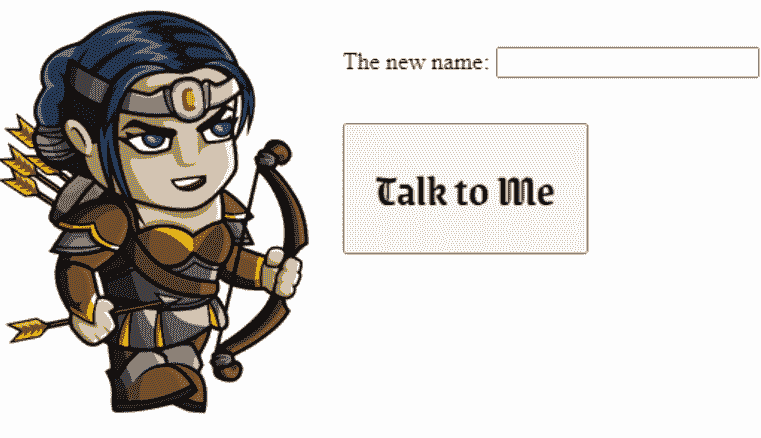

但是爱丽丝想要一个新名字。（原因很复杂。也许她会在她的故事里解释。）很简单，对吧？你需要做的就是在代码中找到正确的字符串，并将所有出现的“Alice”一词替换成其他内容。

但是等等。这个挑战有点更难。爱丽丝的新名字在一个名为 `newName` 的变量中。（你将从页面上的一个文本框获取新名字，但你不需要担心那部分，因为它已经可以工作了。）

要修正爱丽丝的故事，你需要使用字符串拼接和 `newName` 变量。每次她说“Alice”时，你都需要添加 `newName` 变量。使用 `+` 运算符，并仔细注意你的引号放在哪里！

如果你编码正确，这里有一个简单的测试。在文本框中更改爱丽丝的新名字，然后点击 **跟我说话** 按钮。现在爱丽丝的故事会自动使用文本框中的任何名字。很棒！

如果你在理解这个练习时遇到困难，这里有一行代码演示了你需要采取的方法：

```
alert("My name is " + newName);
```

如果你仍然卡住了，只需点击解决方案链接查看完整答案。

完成后，是时候反思一下了。你不仅在这个练习中学会了使用字符串拼接，还看到了程序如何从文本框中获取文本。你将在下一章学习这个技巧是如何工作的。

## 永不改变的可选变量

到目前为止，每次你需要一个变量时，你都使用可靠的 `let` 关键字来创建它。但还有另一个选择。你可以使用 `const` 来创建一个*常量*。这是一个你不允许更改的变量。你在创建它时设置一次，它就会保持不变，直到函数结束。

这是一个创建三个常量的例子：

```
const firstName = "Elphaba";
const lastName = "Smith";

const fullName = firstName + lastName;

// 从这里开始，你不能更改 firstName、lastName
// 或 fullName。

// 这会导致错误。
lastName = "Singh";
```

乍一看，常量似乎限制太多了。但如果你回顾一下自己写过的代码，就会意识到很多时候其实不需要改变变量。例如，在之前的例子*不屈不挠的爱丽丝*中，你可以为`newName`使用常量，因为你只设置了一次（从文本框中复制名字时），之后就不再改变了。

许多人认为，当每个不会改变的变量都声明为常量时，JavaScript代码会更清晰。这样，你从一开始就知道自己不打算修改这些数据。但在本指南中，大多数情况下你将坚持使用普通变量和`let`关键字。

## 第五章

## 与页面交互

JavaScript诞生于网页之中。人们厌倦了盯着普通的HTML页面，有人说："让我们添加一种编程语言，让事情变得不那么无聊吧！"

你已经看到网页如何通过事件（如按钮点击）运行你的代码。但这并不是JavaScript和HTML交互的唯一方式。你的代码可以*读取*页面中的信息，甚至*修改*页面。


## 介绍DOM

JavaScript有一个强大的内置功能。它会检查你的网页，找到每一个HTML元素，并自动创建匹配的对象。（对象是一种特殊的编程元素，你可以在代码中使用它们。）例如，如果你有一个包含段落和按钮的页面，JavaScript会自动创建一个段落对象和一个按钮对象。这个特性被称为DOM，即*文档对象模型*。

你使用这些DOM对象与页面进行交互。例如，你可以找出文本框中的文本是什么，或者修改图片，或者在页面上写一条消息。你将在本章学习如何完成所有这些任务。

## 从文本框中获取信息

在许多程序中，你在文本框中输入信息，然后程序会对这些信息进行处理。你已经在之前的练习中（如*不屈不挠的爱丽丝*）见过这种技术。

你可能已经知道，使用`<input type="text">`元素可以创建一个文本框。这里有一个例子：

```
Put your name here: <input type="text">
```

这个文本框看起来像这样：

**Put your name here:** <input type="text">

现在假设你在文本框里输入了一些内容。你的代码如何获取这些信息呢？

首先，你需要给你的文本框一个唯一的名称。这个名称叫做`id`。这是一个名为`nameBox`的文本框：

```
Put your name here: <input type="text" id="nameBox">
```

`id`不会改变你页面的外观。但它为你的代码提供了一种方式来找到文本框对应的JavaScript对象，并获取它。一旦你获得了这个对象，你就可以做更多的事情——包括获取文本框内的文本。

以下是实现这一点的神奇JavaScript命令。它找到文本框并将其文本复制到一个名为`firstName`的变量中。

```
let firstName;
firstName = document.getElementById("nameBox").value;
```

第一条语句很明显（它创建了`firstName`变量）。但第二条语句需要一些解释。

让我们将其分解为几个部分：

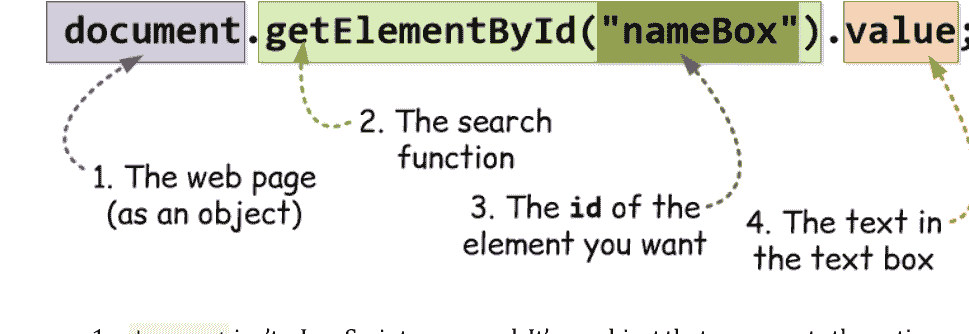

1.  `document`不是JavaScript命令。它是一个对象，代表整个网页文档。这意味着`document`是一个容器，包含了页面上的所有对象，包括文本框。
2.  `getElementById()`是文档对象内置的一个函数。你使用这个函数来搜索具有特定id的对象。这个点号将`getElementById()`函数与文档对象关联起来。
3.  `nameBox`是你正在寻找的id。具体的名称并不重要，但必须与你在HTML中编写的名称完全匹配，包括大小写。
4.  如果你正确地输入了所有部分，`getElementById()`函数就会找到文本框的对象。这条语句的最后一步是从文本框对象中获取一条信息——在这个例子中，就是`value`，它包含了文本内容。

`getElementById()`函数很挑剔。首先，你需要确保在调用它时大小写完全正确。如果你在CodePen中开启了自动补全功能（如第零章所述），它会在你输入时列出文档对象的所有函数来帮助你。如果你看到匹配的选项，只需点击它即可。

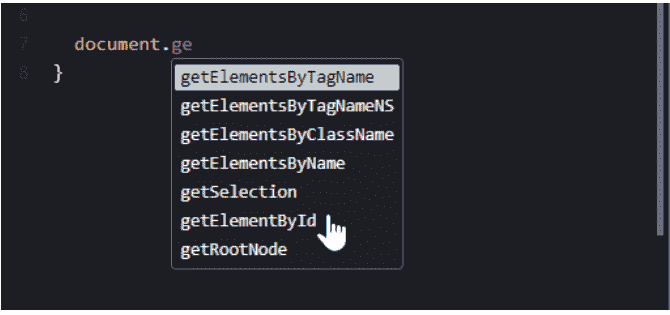

如你所见，文档对象还有更多函数可以帮助你找到网页中的对象。但你现在不需要学习它们。

当你使用`document.getElementById()`时，你需要确保完全正确地输入id。如果你犯了错误，你将得不到想要的文本框对象。相反，你会得到一个名为`null`的空值。而当你尝试下一步获取`null`的值时，你会遇到一个奇怪的错误，像这样：

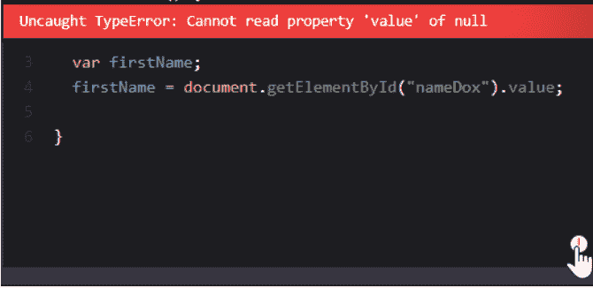

随着你使用JavaScript的时间越来越多，你会学会识别null错误，并记住检查你的变量和id名称。

> 提示 避免这类问题的一个方法是将你的id从HTML框中复制并粘贴到JavaScript框的代码中。这样，你就不会有犯错的机会了。

## 亲自试一试！

- 国王的问候（挑战等级：中等）

[https://codepen.io/prosetech/pen/LYGMEQy](https://codepen.io/prosetech/pen/LYGMEQy)

这个例子有三个文本框需要你填写。

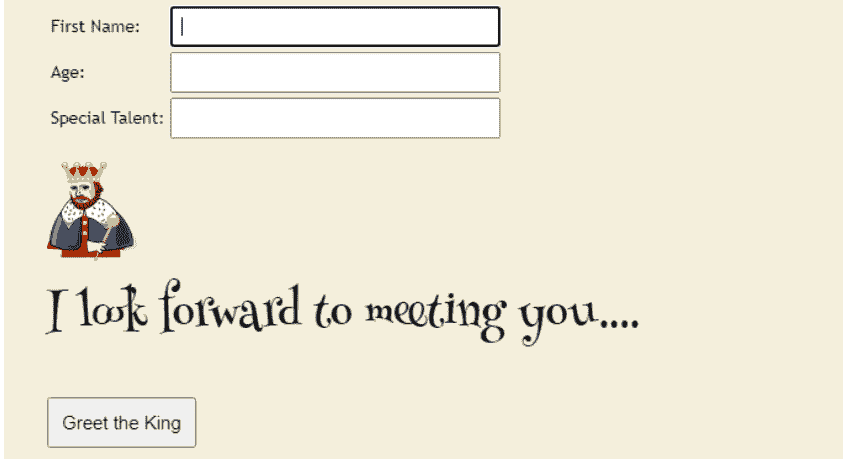

这个程序的任务是获取这些信息（姓名、年龄和特殊才能），并将它们组合起来，为国王制作一个个性化的问候语。（例如，如果有人填写了Wendy，20，和躲在浴缸里，问候语可能是“向您致敬，我优秀的侍从Wendy。我听说您在20岁的盛年就已经是躲在浴缸里的大师了。”）

要让这个例子运行起来，你需要做以下几步：

1.  给你的文本框设置id名称，这样你的代码才能找到它们。
2.  使用神奇的`document.getElementById()`命令获取每个文本框的值，并将它们放入三个单独的变量中。
3.  使用`+`运算符构建问候消息。
4.  使用`alert()`显示完成的消息。

完成这个例子后，请确保保留它（或fork它以保存到你的CodePen账户中）。因为稍后你会回来对它进行修改。

## 将字符串转换为数字

文本框中的所有内容都被视为文本。即使你输入的是像43298这样的数字，在JavaScript看来，它也只是一个包含五个字符的字符串，只是碰巧是数字而已。

有时，这是一个问题。例如，如果你想从文本框中提取一个数字并进行计算，它将无法工作。记住，你不能用文本进行数学运算！

解决方案是将你的字符串转换为适当的数字变量。在JavaScript中有几种不同的方法可以做到这一点，但最直接的方法是使用一个名为`Number()`的函数。以下是它的使用方法：

```javascript
let someText = "42";
let myNumber = Number(someText);

// 你不能用 someText 进行数学运算，但可以用 myNumber 进行。
```

在这个例子中，第一条语句创建了一个变量（`someText`），它将"42"作为字符串存储。第二条语句将其转换为数字（42），并放入第二个变量（`myNumber`）中。

重要的是要认识到，`Number()`只有在你有一串普通数字时才有效。如果你的字符串中包含其他内容，比如逗号（"42,000"）、美元符号（"$4.14"）或一些单词（"84 kites"），`Number()`就无法转换它。相反，JavaScript会将你的变量设置为`NaN`，这是一个无用的JavaScript代码词，意思是"不是一个数字"。

## 亲自试一试！

- 坏掉的加法器（挑战等级：简单）

[https://codepen.io/prosetech/pen/BajvyEb](https://codepen.io/prosetech/pen/BajvyEb)

还有什么比1+1更容易的呢？事实证明，当你的数字在文本框中时，事情就没那么简单了。

在这个简单的例子中，代码应该将两个文本框的内容相加。但它总是得到错误的答案。试一试，然后解释为什么代码会给你这样一个奇怪的结果。然后，使用`Number()`函数来修复它。

## 在页面中显示消息

到目前为止，你看到的大多数例子都使用了方便的`alert()`函数来显示消息。这在编写简单的测试程序时很有用，但在现实生活中几乎毫无意义。毕竟，谁愿意访问一个不断弹出烦人对话框的网页呢？

相反，大多数网页通过改变页面来与你沟通。它们可能会在页面底部写一条消息，或者改变某些东西的颜色，或者显示一张图片。要做任何这些事情，你需要使用DOM中的对象。

最常见的页面更改技术之一是在页面中编写消息。要实现这一点，你需要一个可以

更改，就像一个 `<p>` 段落一样。同样，你需要为该元素设置一个 id，以便你的代码能够找到它。

这是一个普通的 `<p>` 段落，其名称为 message。

```html
<p id="message"></p>
```

目前这个段落是空的。这没问题，因为你打算用代码来填充它。但如果你在段落中预先放入一些内容，然后稍后用代码替换成其他内容，效果也是一样的：

```html
<p id="message">在适当的时候，这里会出现一条消息。</p>
```

你不一定需要使用段落。相反，你可以使用任何包含文本的 HTML 元素。如果你想更改段落内部的一小段文本，使用 `<span>` 是合适的。如果你想更改页面上的整个部分，你可能会使用 `<div>`。如果你对 HTML 了解不多，还不认识这些元素，别担心——重点是，只要你为页面上的任何元素设置了 id，你就可以更改它。

同样，你将使用 document 对象及其内置的 `getElementById()` 函数。但这次，你做的与之前相反。你不是从页面中读取信息并放入变量，而是将信息从变量中复制并放入页面。

```javascript
let newMessage = "Hello there.";

// 将消息放入 <p> 元素中。
document.getElementById("message").textContent = newMessage;
```

文本框示例和段落示例之间还有一个不同之处。对于文本框，你需要使用 `value` 属性。对于段落，你使用的是 `textContent` 属性。这是一个小细节，但很重要。要使用一个对象，你需要知道它是如何命名其属性的。（属性只是附加到对象上的一个变量。）

## 自己试试看！

-   [国王的新问候（挑战级别：中等）](https://codepen.io/prosetech/pen/LYGMEQy)

返回你在本节第一个练习中创建的示例。你将对其进行更改，使国王的问候显示在页面上，而不是在警告框中。这是一种更好的方法。

要进行此更改，首先添加一个用于容纳消息的元素。`<p>` 是合适的，但如果你想使用其他元素也可以。别忘了 id！

使用 `document.getElementById()` 函数，找到你的元素。通过设置 `textContent` 属性，将消息放入你的元素中。非常简单！

## 可选：更改图片

如果你成了 DOM 专家，你就可以更改网页上的任何东西。让我们再看一个有用的技巧——更换图片。

如果你了解一些 HTML，你就知道你使用 `` 元素来添加图片。`` 元素非常简单。你通过设置 `src` 属性（一个网页地址）来告诉它使用哪张图片，像这样：

```html

```

当然，如果你想用代码更改图片，你也需要给它一个 id：

```html

```

现在你可以使用本章中一直使用的相同技巧。你使用 `document.getElementById()` 搜索 `` 对象。然后你更改图片。这次，你通过设置 `src` 属性来指向一个新地址进行更改，像这样：

```javascript
document.getElementById("ogreImage").src = "http://prosetech.com/tinyjs/mad-ogre.gif"
```

如果你好奇，可以自己尝试一下。或者，继续前往下一章，你将看到一个使用此技巧的示例 *友好的愤怒食人魔*。

# 第六章：变量的生命周期

创建一个变量并立即使用它很容易。但如果你想创建一个变量，向其中放入一些内容，并确保在下一次有人点击按钮时它仍然存在呢？

保持变量存活是编程中的一项重要技术。想象一下，如果你试图构建一个游戏，但每次点击按钮时所有变量都会重置自己！但在你能够控制变量并长期存储信息之前，你需要更多地了解它们如何存在……以及何时消亡。

## 局部变量

当你在函数内部定义一个变量时，它被称为 *局部变量*。它一直存活到函数结束。这是一个名为 `welcomeMessage` 的字符串的示例：

```javascript
function sayHello() {
  let welcomeMessage = "Hi, fancy pants";
  alert(welcomeMessage);
}
```

一旦代码运行并且 `sayHello()` 函数结束，`welcomeMessage` 就会被丢弃，连同变量内部的所有信息一起。没有办法再找回这些信息。

在程序中，同一段代码可以运行多次。例如，也许 `sayHello()` 函数连接到按钮的 `onclick` 事件。在这种情况下，每次点击按钮时都会发生以下情况：

1.  `sayHello()` 函数开始执行。
2.  它创建一个新的、空白的 `welcomeMessage` 变量副本。
3.  它将 “Hi, fancy pants” 文本放入 `welcomeMessage` 变量中。
4.  它使用 `alert()` 显示消息。
5.  `sayHello()` 函数结束，`welcomeMessage` 函数变量再次消失，带走其内容。

显然，你不能使用 `welcomeMessage` 来存储更长时间的信息，因为该变量只存活几秒钟。在这个例子中这不是问题，因为 `welcomeMessage` 从未改变。但还有 *另一种* 方式。

## 全局变量

有时你有一段信息需要保留更长时间，甚至可能只要程序在运行就一直保留。

> **注意** 在网页中，“只要程序在运行”意味着只要网页在浏览器中打开。一旦你关闭浏览器标签页或转到其他页面，你的程序就结束了。（在 CodePen 中，还有一条规则——当你编辑你的示例时，程序会重启。）

要存储更长时间的数据，你需要使用 *全局变量*。局部变量停留在一个 *位置*（你创建它们的那个函数）。全局变量在你的代码中任何地方都可用。

要定义全局变量，你使用相同的 `let` 关键字，但你把它放在不同的地方。你不在函数内部创建变量，而是将其声明在函数 *外部*。

这是一个示例：

```javascript
let welcomeMessage = "Hi, fancy pants";

function sayHello() {
    alert(welcomeMessage);
}
```

如果你记得第 1 章的规则（不要在函数外部放置代码），你可能会怀疑这段代码。但创建变量的代码是可接受的。它会立即运行，并为你的函数设置好一切以供使用。

> **提示** 你可以将变量放在使用它们的函数之前——或者实际上放在任何你想放的地方。但通常，组织代码最简单的方法是将所有全局变量放在代码文件的开头（JavaScript 框的顶部），位于所有函数之上。

这个例子中的代码（使用全局 `welcomeMessage` 变量）仍然与早期版本（使用局部 `welcomeMessage` 变量）的工作方式相同。但在稍复杂的例子中，情况会迅速改变，就像你接下来将看到的示例。

## 不同函数共享同一个变量

以下是全局变量和局部变量之间两个区别的快速回顾：

-   局部变量存活到函数结束。全局变量存活到程序结束——比如说，当你关闭浏览器（或在 CodePen 中编辑代码时）。
-   局部变量只能在一个函数中使用。但你可以在 *每个* 函数中使用全局变量。

第二个概念叫做 *作用域*，这就是我们接下来要探索的。

到目前为止，你已经看过很多只有一个按钮和一个函数的例子。但大多数 JavaScript 程序会有很多函数，在不同事情发生时运行。例如，想象你有一个像这样的三按钮程序：

-   变友好
-   变粗鲁
-   说你好

当你点击 **变友好** 时，它将 `welcomeMessage` 设置为友好的内容：

```javascript
function beNice() {
  welcomeMessage = "我非常高兴你能来和我喝茶。";
}
```

当你点击 **变粗鲁** 时，它将 `welcomeMessage` 设置为其他内容：

```javascript
function beMean() {
  welcomeMessage = "我计划吃掉你和你养的宠物金鱼。";
}
```

当你点击 **说你好** 时，你会得到你上次选择的问候语：

```javascript
function sayHello() {
  alert(welcomeMessage);
}
```

在下一个练习中，你可以尝试创建这个示例。


# 亲手试试看！

## 友好的愤怒食人魔（挑战等级：中等）

https://codepen.io/prosetech/pen/mdVzpNg

在这个示例中，你开始时有三个按钮（变得友善、变得刻薄、打招呼）。还有一小段代码会根据食人魔的心情改变图片。

缺失的部分是你将要显示的信息。要使这个示例正常工作，你需要根据食人魔的心情设置正确的信息。然后你需要在正确的时间显示这条信息。

你需要做以下几点：

- 1. 创建 `welcomeMessage` 变量。记住，它需要是一个全局变量，而且你只需要定义一次。
- 2. 添加在点击 **变得友善** 或 **变得刻薄** 时设置 `welcomeMessage` 的代码。你需要两条不同的信息，取决于你让食人魔处于什么心情。
- 3. 在 `sayHello()` 函数中添加显示信息的代码。

如果你不先点击 **变得刻薄** 或 **变得友善**，而是直接点击 **打招呼** 会发生什么？你能给 `welcomeMessage` 一个初始值来避免这种情况吗？（对于一个没有心情的食人魔来说，一个好的初始值是类似“我真不知道该如何表现。”这样的信息。）

## 坏掉的果冻豆计数器（挑战等级：中等）

[https://codepen.io/prosetech/pen/PoZyQPo](https://codepen.io/prosetech/pen/PoZyQPo)

如果说程序员喜欢做的一件事，那就是计数。（如果说程序员喜欢做的两件事，那就是计数和吃果冻豆。）这使得下一个示例成为绝佳的练习。

坏掉的果冻豆计数器让你想吃多少果冻豆就吃多少——每次想吃的时候点一下按钮即可。它会计算你迄今为止吃掉的果冻豆数量。

[ 吃一颗果豆 ] [ 重置计数器 ]

你吃了 0 颗果豆。

不幸的是，程序中有两个灾难性的错误。你能修复它们吗？

> **提示** 现在，豆子计数器使用的是局部变量。但你需要将 `beanCount` 变成一个全局变量，这样你才能在任何地方使用它。做出这个改变，你就朝着解决问题迈进了一大步。

## 花括号的秘密

我有一个坦白要说。之前，我说过局部变量存在于函数结束为止。这是事实，但并非全部。

从技术上讲，局部变量存在于包含它们的代码块中。你可能还记得第 1 章的内容，代码块是 JavaScript 代码中的一种常见结构。它是任何位于一对花括号 { } 之间的代码段。

到目前为止，你看到的所有花括号都是用于函数的。然而，在接下来的章节中，你将了解到你也使用花括号来出于不同的目的对代码进行分组。例如，你使用花括号在循环中重复代码，或者使其具有条件性。如果你在这些部分中的任何一个内部创建一个变量，它不会在整个函数生命周期内存在。它只存在于该*代码块*完成之前。

当你看到我们使用花括号的其他方式的示例时，这一切都会变得更加清晰。但这里有一个总是有效的速成规则——当你创建一个局部变量时，当你到达下一个闭合花括号 `}` 时，它就会从存在中消失。

## 关于全局变量的明智建议

你使用的全局变量越多，就越难弄清楚代码中正在发生什么。想象一下你第一次看到一个新的 JavaScript 程序，它有一堆全局变量。你怎么知道哪些函数使用哪些变量？不阅读所有代码就无法确定，这意味着有很大的犯错空间。

为了使你的代码尽可能简单，并减少未来犯错的机会，你应该只在需要共享信息时才使用全局变量。

有时，你可能会在程序中注意到不同的函数正在使用相同的局部变量来执行相同的任务。例如，也许你有三个函数，每个函数都创建自己的局部 `welcomeMessage` 变量。你可能会想到可以用一个全局 `welcomeMessage` 变量来替换这三个局部变量。不要这样做！最好让你的函数尽可能独立。

# 做出决策

到目前为止，你的程序在智力方面有点欠缺。它们缺少的关键成分是*做出决策*的能力——换句话说，就是评估信息然后设定路线的能力。

要添加这个能力，你需要学习一个称为*条件逻辑*的编程概念。这是提问的艺术，然后选择做什么。

## 介绍条件

条件是一个有两种可能答案的问题：真或假。

例如，看看这个包含两个变量的条件：

```
a > b
```

这个条件提出了一个简单的主张：*a 大于 b*。如果 `a` 存储数字 12，`b` 存储数字 3，这个条件为真。但如果 `a` 存储数字 3，`b` 存储数字 12，这个条件为假。（这个条件假设 `a` 和 `b` 是数字。如果它们不是，这个条件就没有意义。）

这里是另一个条件示例：

```
a == b
```

这个条件询问 *a 是否等于 b*？在这种情况下，变量 `a` 持有什么类型的数据并不重要——它可以是一个数字或一段文本。重要的是变量 `b` 的内容与 `a` 完全相同。所以如果它们都存储相同的数字（比如 42）或匹配的文本（比如“blunderstone”），条件就为真。

你可能想知道为什么有两个等号（==）。这正是 JavaScript 的工作方式，因为它想要区分 =（用于设置变量）和 ==（用于在条件中比较值）。其他一些编程语言对这两种用途都使用普通的 =。

## if 语句

要让条件实际做点什么，你需要将它与 `if` 关键字配对。这是一个例子：

```
if (a > b) {
  // （在这里做点什么。）
}
```

`if` 语句告诉 JavaScript 查看一个条件，并在条件为真时运行一段代码。以下是它的分解：

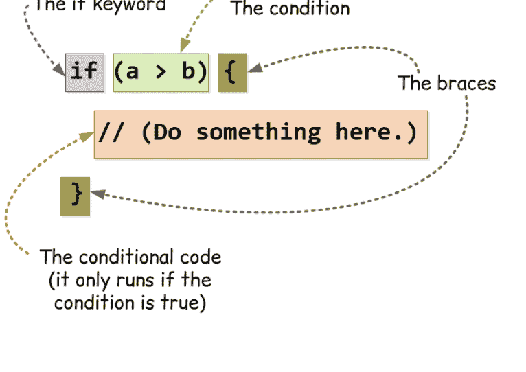

记住，条件只能有两种可能的结果：

- 如果条件为真（在这个例子中，a 大于 b），JavaScript 会运行两个花括号之间的代码。
- 如果条件为假（a 小于或等于 b），JavaScript 会跳过花括号中的代码并继续执行。

你可以在花括号之间放入任意多行代码。它们都成为同一个条件块的一部分。如果你只需要在条件块中放一条代码语句，可以去掉花括号。但我们建议始终保留花括号，以使你的代码更清晰。

你能看出下面这个例子中会发生什么吗？

```
alert("Hi");

if (a == b) {
    alert("They match");
}

alert("Bye");
```

这个例子中的条件检查两个变量是否具有相同的值。如果是，你将得到一系列警告框（*Hi*，然后是 *They match*，最后是 *Bye*）。如果 a 和 b 存储不同的值，你仍然会得到 *Hi* 和 *Bye* 框，但 if 块中的代码会被跳过。

当你写一个 `if` 块时，一定要记住条件周围的括号，否则它将不起作用。这是一个常见的错误：

```
// 我的括号在哪儿？
if a == b {
```

也不要犯这个错误：

```
// 这是错误的等号。
if (a = b) {
```

单个等号只适用于*设置*变量。所以这段代码实际上是将 `b` 的值复制到 `a`，这绝对不是你想要的。

## 更多的逻辑运算符

符号 `<` 和 `>` 和 `==` 被称为*逻辑运算符*，因为你在条件中使用它们来比较值。它们是最常见的逻辑运算符，但还有一些需要学习。

除了询问两个变量是否相等，你还可以询问它们是否*不相等*。这恰好是相反的问题。你通过将条件中的 `==` 改为 `!=` 来做到这一点。

```
if (a != b) {
    alert("Nope, no match");
}
```

这个条件问“这些变量具有不同的值吗？”如果它们不同，条件为真，警告框出现。否则，没有消息。

你还可以使用 `>=`（大于或等于）和 `<=`（小于或等于）运算符，它们的工作方式与 `>` 和 `<` 类似，只是当两个数字相同时，它们也为真。


## 逻辑运算符

以下是所有逻辑运算符的快速回顾，每个都附有示例：

| 运算符 | 名称 | 示例条件 | 当 a=10 时的结果 |
| :--- | :--- | :--- | :--- |
| == | 等于 | (a == 10) | true |
| != | 不等于 | (a != 10) | false |
| < | 小于 | (a < 10) | false |
| <= | 小于或等于 | (a <= 10) | true |
| > | 大于 | (a > 10) | false |
| >= | 大于或等于 | (a >= 10) | true |
| === | 值和类型都相等（不允许变量转换） | (a === "10") | false |
| !== | 值或类型不相等 | (a !== "10") | true |

`===` 和 `!==` 是两个更专门的运算符。它们被包含进来是为了给你完整的列表，但你暂时不会用到它们。

> **注意** 你已经知道 `<=` 是 `<` 和 `=` 的组合，表示*小于或等于*。你可能认为可以反过来写，把等号放在前面，比如 `=<`。但 JavaScript 不这样识别，如果你尝试，会得到一个错误。

## 自己动手试试！

▶ **一碗豆子（挑战难度：中等）**

[https://codepen.io/prosetech/pen/OJMrEXq](https://codepen.io/prosetech/pen/OJMrEXq)

谁会不喜欢一碗果冻豆呢？

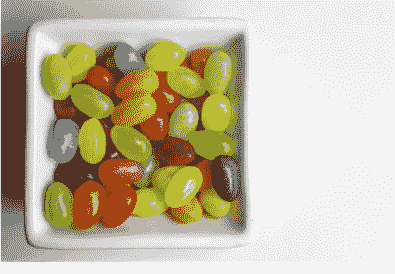

你还剩下 19 颗果冻豆。

- 吃一颗
- 装满碗

这个示例允许你从碗中一颗一颗地取出果冻豆，或者（当然是通过点击按钮）把碗重新装满。代码会追踪碗里有多少颗果冻豆。但有个问题：没人阻止你在豆子已经没有的时候再拿一颗。这会导致一个尴尬的问题——运行程序足够久，你的碗里会出现负数颗果冻豆。

为了避免这个问题，你需要添加一个 `if` 代码块。思路是：只有当碗里至少还有一颗豆子时，才允许取出一颗。否则，什么也不做。

> **提示** 如果你卡住了，首先写下你想要测试的条件。你怎么知道碗是空的？你可以使用条件 `jellybeanCount >= 1`，它检查碗里是否有一颗或更多豆子。或者，你可以使用条件 `jellybeanCount != 0`，意思是碗*没有*减少到 0 颗果冻豆。无论哪种方式，将该条件与一个 `if` 代码块一起使用，并将吃豆子的代码放在里面。

把这段程序留好。你很快会用到它。

## else 代码块

`if` 语句有一个可靠的伙伴叫做 `else`。如果你使用 `if` 来设置一个条件代码块，你可以使用 `else` 来告诉程序当条件*不*匹配时该做什么。

理解 `if` 和 `else` 最简单的方法是看一个例子：

```javascript
if (a == b) {
    alert("They match");
}
else {
    alert("They don't match");
}
```

你的程序在 `if else` 代码块中只能走*一条*路径。在这个例子中，如果第一个条件匹配，你会得到第一个警报框消息。如果不匹配，你会得到第二个警报框消息。不可能同时看到两条消息，也不可能同时跳过它们。

这种安排看起来很复杂，但它非常有用。它允许你的代码在不同的结果之间进行选择，这在检查信息或玩概率游戏时很重要。

> **注意** 之前，你用大括号做一件事——函数。现在你用它们来做函数和条件逻辑。确保你记住在每块条件逻辑的开头和结尾放置大括号，以及在整个函数的开头和结尾放置大括号。忘记一个大括号相当常见，那时你的代码就会停止工作。为了帮助发现问题，请在代码块中使用缩进。

## 自己动手试试！

▶ **改进的一碗豆子（挑战难度：简单）**

https://codepen.io/prosetech/pen/OJMrEXq

你可以通过添加一个 `else` 语句来改进“一碗豆子”示例。目前，有一个非此即彼的测试来检查碗是否为空。但这里有一个更好的方法来分配果冻豆：

- 如果碗里有豆子，就分一颗出来（像往常一样）。
- 如果碗里没有豆子了，就显示一个警报框说明问题。

## 无限可能的条件逻辑

首先你从一个条件代码块开始。然后你用 `else` 来组合两个代码块。现在你将学习一种技术，让你可以堆叠无限数量的条件，一个接一个。

秘诀是一个叫做 `else if` 的组合。你用 `else if` 来考虑另一个条件。但这里的诀窍是：`else if` 只有在之前的条件不匹配时才会检查它的条件。

理解其工作原理最简单的方法是看几个例子。首先，考虑这段有两个独立条件的代码：

```javascript
if (moneyInWallet > 0) {
    alert("You are carrying some money.");
}

if (moneyInBank > 0) {
    alert("You have money in the bank.");
}
```

这段代码有几种可能的结果。

- 如果你完全破产（任何地方都没有钱），你不会看到任何警报消息。
- 如果你的钱包和银行里都有钱，你会得到两条消息。
- 如果你只有一个地方有钱（钱包或银行），你会得到一条消息。

但是当你使用 `else if` 时，你可以链接你的条件，像这样：

```javascript
if (moneyInWallet > 0) {
    alert("You can buy something!");
}
else if (moneyInBank > 0) {
    alert("You can buy something, if you go to the bank first.");
}
else {
    alert("Maybe ask your parents for some bills?");
}
```

当 JavaScript 运行这段代码时，它按顺序检查条件。一旦找到一个为真的条件，它就运行相应代码块中的代码。然后它跳过所有其他的 `else` 语句，直接到最后的 `}`。

这个系统意味着在这个例子中你总会看到恰好一条消息：

- 如果你的钱包里有钱，你会得到第一条消息。
- 如果你的钱包里没钱，但银行里有钱，你会得到第二条消息。
- 如果你任何地方都没有钱，你会得到第三条消息。

你可以根据需要使用任意多的 `else if` 代码块。它们的条件可以使用相同的变量或不同的变量（如钱包和银行的例子）。只需记住，一旦一个条件匹配，其他的条件就会被忽略。

你不需要在最后有一个最终的 `else` 代码块。但如果有的话，当其他所有条件都不匹配时，那段代码会运行。

## 自己动手试试！

▶ 预测未来（挑战难度：简单）

https://codepen.io/prosetech/pen/mdVvdxV

看看这段条件逻辑代码，它有三个独立的条件和一个最终的 `else`。

```javascript
if (a == b) {
  alert("They match");
}
else if (a < b) {
  alert("A is smaller than B");
}
else if (a > b) {
  alert("A is bigger than B");
}
else {
  alert("I can't compare them. They aren't numbers.");
}
```

你的目标是在脑子里运行代码。尝试预测当 `a` 和 `b` 取以下值时会发生什么：

| a 的值 | b 的值 | 结果 |
|---|---|---|
| 42 | 5 | |
| 239.12 | 239.12 | |
| 0 | 100.5 | |
| 4 | “dog” | |

一旦你做出了预测，尝试运行实际的程序，看看你是否正确。如果不正确，你的错误是什么？

## 自己动手试试！

▶ 豆子非免费（挑战难度：高）

https://codepen.io/prosetech/pen/jOWXKwb

这是果冻豆碗计数器的一个更高级版本。现在代码追踪两个变化的数字：碗中的果冻豆数量（`jellybeanCount`）和你拥有的金钱数量（`moneyInWallet`）。每当你装满碗时，果冻豆的成本会自动从你的钱包中扣除。

问题在于没有代码来检查你是否确实有你要花的钱。这意味着太多的按钮点击会让你深陷债务，出现负数金额。果冻豆可能很好，但它们不值得一生的财务困难。

要修复这段代码，请将其修改为当你点击 **Fill Bowl** 按钮时执行以下操作：

1. 检查你的碗是否已满。如果满了，无论如何也装不下更多豆子了，所以显示一条消息解释问题。
2. 如果你的碗有空间，看看你是否有钱装满碗。如果你没有，显示一条消息解释*那个*问题。
3. 如果碗有空间并且你有钱，将碗装满至最多 20 颗果冻豆，并扣除通常的费用。

> **提示** 要解决这个难题，你需要在 `fillBowl()` 函数中创建一个多部分的 `if` 代码块。首先检查上面列表中的条件 1 是否失败（或者条件 2，因为顺序无关紧要）。然后，使用一个 `else if` 来检查另一个条件是否失败。最后，使用一个 `else` 来告诉程序如果两个条件都没有失败该怎么做。（这就是你放置当前购买更多豆子代码的地方。）


## 更多决策技巧

`if` 和 `else` 关键字为你提供了在代码中做出决策所需的一切。但有时条件逻辑可能会变得混乱。你决定检查一个变量，然后是另一个，结果不知不觉中，你的代码就淹没在一堵大括号 `{ }` 的墙里。


别慌。你可以学会编写既能让代码做出决策，又能控制混乱的代码。这里有一些可以提供帮助的工具。

## 合并两个条件（使用 'and'）

一个条件代码块就像任何其他代码块一样。在其中，你可以创建变量、显示警告框以及与页面交互。你甚至可以将一个 `if` 块放在*另一个* `if` 块内部，像这样：

```
// I don't want to spend more than $10 for a pineapple.
if (costOfPineapples <= 9.99) {

    // But wait, do I even have enough money?
    if (moneyInWallet >= costOfPineapples) {
        // Everything checks out. Time to buy one.
    }

}
```

这个例子首先检查菠萝的价格。如果价格超过 9.99 美元，程序会跳过整个条件块，示例结束。但如果价格低于 9.99 美元，程序会进入条件块，并在那里执行*第二次*测试。这次测试检查你是否有足够的钱来购买你想要的水果。如果这也成立，程序会进入第二个条件块。

这个例子工作正常，但还有另一种更简洁的方式来编写相同的例子。它看起来像这样：

```
if (costOfPineapples <= 9.99 && moneyInWallet >= costOfPineapples) {

    // Everything checks out. Time to buy one.

}
```

现在，两个条件通过 && 符号融合成一个测试，这个符号表示 *and*。换句话说，只有当菠萝的价格足够低*并且*你有足够的钱时，这个代码块中的代码才会执行。

那么这个例子比第一个版本更好吗？这取决于情况。如果你想编写一些代码，只要菠萝便宜就运行，*无论你钱包里有什么*，那么你需要使用第一种方法。（例如，也许你想告诉某人低价信息，然后再决定是否购买。）但如果你只需要在两个条件都成立时（菠萝便宜*并且*钱包满满）运行的代码，那么使用 && 可以让你的代码更紧凑、更易读。

> **注意** 你可能想知道为什么 JavaScript 使用 && 符号来表示 *and*。事实是，这仅仅是 JavaScript 语言的设计方式。它与其他对语法要求严格的语言（如 C、C# 和 Java）相匹配。但其他一些语言，如 Visual Basic 和 Python，使用的是实际的单词 *and* 而不是符号。（如果你在键盘上找不到 & 键，可以按住 **Shift** 键并按 7。）

你可以使用 && 来组合两个以上的条件。事实上，你可以组合任意多个条件，只需在末尾不断添加 &&，后跟你的新条件。只需记住将所有内容都放在括号内。

```
if (a != 0 && b != 0 && a > b && b < c) {
    // a is not 0, b is not 0, a is greater than b,
    // and b is less than c.
}
```

## 合并两个条件（使用 'or'）

当你使用 && 时，你是在问 *这两个条件都为真吗？* 你也可以问 *这些条件中至少有一个为真吗？* 这需要用到 || 符号，它表示 *or*。

```
if (costOfPineapples < 9.99 || costOfMangoes < 0.99) {
    // As long as one of these fruits is cheap enough,
    // it's worth a trip to the store.
}
```

当你使用 || 时，只需要其中一个条件为真，就会运行条件块。

不要把 | 和字母 L 或 I 混淆。技术上说，| 是管道符号。在大多数键盘上，你可以按住 **Shift** 键并输入反斜杠 \（在退格键下方靠右的位置）来输入它。

下表总结了如何用 *and* 和 *or* 组合条件：

| 运算符 | 如果第一个条件是... | 并且第二个条件是... | 结果 |
| :--- | :--- | :--- | :--- |
| **&&** | true | true | true |
| | true | false | false |
| | false | true | false |
| | false | false | false |
| **\|\|** | true | true | true |
| | true | false | true |
| | false | true | true |
| | false | false | false |

## 亲自试试看！

### ▶ **预测未来（挑战难度：中等）**

[https://codepen.io/prosetech/pen/WNrmQzR](https://codepen.io/prosetech/pen/WNrmQzR)

是时候把自己变成 JavaScript 引擎，在脑海中运行一些代码了。看看这段使用 `&&` 和 `||` 的条件逻辑代码块。它比看起来要复杂一些。

```
if (a == b && a > 0) {
  alert("You reached door 1");
}
else if (a != 0) {
  alert("You reached door 2");
}
else if (a > b || b == 0) {
    alert("You reached door 3");
}
else {
    alert("You reached door 4");
}
```

尝试预测当 a 和 b 为以下值时会发生什么。

| a 的值 | b 的值 | 结果（你看到的消息） |
| :--- | :--- | :--- |
| 42 | 5 | |
| 5 | 5 | |
| 0 | 0 | |
| 0 | 42 | |

一旦你做出了预测，试着运行实际程序，看看你是否正确。你还记得 else if 的规则吗——你只会得到*第一个*匹配的条件？这意味着你只会看到一个警告框。

这个例子旨在锻炼你的大脑。当你编写条件逻辑时，不应该看起来像这样。相反，你应该努力让你的条件清晰可预测。如果把条件拆开来写更多的 if 块更简单，那就这样做。

## switch 语句

当你使用 if 语句时，你的代码可能会变得有点冗长。JavaScript 有另一种编写条件逻辑的方式，更简洁。这就是 switch 语句。

switch 语句是 if 的一个功能更有限的版本。它只在你想检查单个变量时有效。例如，如果你计划问“今天星期几？”这个问题，并且想为每一天编写条件代码，那么 switch 语句就非常适用。但如果你想比较不同的变量组合，就像前面的例子那样，switch 就没多大帮助了。

> **注意** switch 能做的事情，if 都能做。那为什么还要使用 switch 呢？这其实是个个人品味的问题，但如果 switch 适合你，通常你得到的代码会比使用 if 更简短、更整洁。

要使用 switch，你首先要给出你想检查的变量，像这样：

```
switch (dayOfTheWeek) {
```

现在你为不同的值编写条件代码。每一个都是一个单独的 case，你用 case 关键字来标识它们。

```
case "Saturday":
```

在 dayOfTheWeek 的例子中，你期望七种不同的星期名称中的一个。每个值都用引号括起来，因为它是一个字符串。如果你对一个存储数字的变量使用 switch，就不需要引号。

在你写好 case 并放入你要查找的值（比如 “Saturday” 或 478）之后，你需要添加一个冒号 : 来开始你的条件代码。

```
case "Saturday":
  alert("It's Saturday. Time to write some JavaScript!");
```

你可以为每个 case 编写任意多行代码，但你需要在末尾写上 break。

```
case "Saturday":
  alert("It's Saturday. Time to write some JavaScript!");
  break;
```

这与 JavaScript 通常的组织方式不同。你不是把条件代码放在大括号之间，而是用 : 开始它，用 break 结束它。

你也可以编写一段处理多个 case 的代码。为此，你将这些 case 堆叠在一起，像这样：

```
case "Tuesday":
case "Wednesday":
case "Thursday":
  alert("It's the middle of the week. Keep waiting");
  break;
```

下面是使用 switch 的完整的星期示例：

```
switch (dayOfTheWeek) {
  case "Saturday":
    alert("It's Saturday. Time to write some JavaScript!");
    break;
  case "Sunday":
    alert("It's Sunday. Last day to write some JavaScript!");
    break;
  case "Tuesday":
  case "Wednesday":
  case "Thursday":
    alert("It's the middle of the week. Keep waiting.");
    break;
  case "Friday":
    alert("Almost there...");
    break;
}
```


## 亲自试一试！

### 哥布林骰子赌徒（挑战难度：中等）

https://codepen.io/prosetech/pen/pogGGOg

我们是否让你相信使用 `switch` 可能比使用 `if` 更快？在这个练习中，你将亲眼看到其中的差异。你将接手一个关于一个赌博哥布林的预写游戏，并将其 `if` 代码块重写为使用 `switch`。

在运气游戏中，你赢不了*我*！

掷出好运！

再试一次

你输了 $150。你现在有 $4。

在开始之前，花点时间弄清楚代码的组织方式。你会发现这个例子中有不止一个条件代码块。第一段条件代码检查你掷出的数字。这是你需要修改的部分。（另一段条件代码判断你是赢了还是输了游戏。）

完成工作后，你就可以享受程序的其余部分了。谁知道呢，也许你甚至会自己做些修改！

如果你仔细观察，你会发现一些你以前没见过的技巧。

首先，代码通过获取一个随机数来“掷”骰子。这需要一个叫做 Math 的特殊对象的帮助，你将在第 13 章全面了解它。

其次，代码使用第 5 章中图片切换技巧的一个变体，将骰子图片设置为与你掷出的数字匹配。例如，如果你掷出 3，代码会将该数字转换为图片文件 *dice3.png*。将其放入 `` 元素中，你就得到了显示骰子点数的图片。相当不错！

## 第 9 章
## 用循环重复执行

计算机永远不会疲倦。如果你交给它们一项工作，它们会一直做下去直到完成。如果你想计算一个公式，它们才不在乎是计算一次还是连续计算一千次。在本章中，你将看到让代码连续执行一千次是多么容易。你只需要一个循环。

## 最简单的循环

JavaScript 有几种不同类型的循环。它们都有一个共同点——你将想要重复的代码放在花括号 { } 之间。

这是一个使用所谓 while 循环的简单示例：

```
// Don't try this at home.
while (true) {

    alert("Welcome to Groundhog Day.");

}
```

`while` 关键字开始循环：

```
while
```

紧接着是你可以放置条件的圆括号 ()。该条件告诉循环何时结束。

```
while ()
```

在这个例子中，条件就是 `true`，这意味着循环永远不会结束。

```
while (true)
```

条件之后是花括号 { }，其中包含你要重复的代码。

```
while (true) {
}
```

那么当 JavaScript 遇到这样的循环时它会怎么做呢？以下是分解步骤：

1.  JavaScript 检查循环条件。
2.  如果条件评估为 `true`，JavaScript 开始执行循环中的代码。
3.  JavaScript 从上到下运行花括号中的所有代码语句。在这个例子中，循环中只有一个代码语句。它显示一个带有关于土拨鼠日消息的警报框。
4.  JavaScript 返回到第一步并重新开始该过程。

只要条件为 `true`，JavaScript 就会持续重新运行循环中的代码。在这个例子中，条件*永远*保持 `true`，这意味着每次你关闭上一个警报框时，都会出现一个新的警报框。（但请记住，`alert()` 命令会暂停你的代码，直到你点击确定。这意味着你永远不会看到同时弹出多个警报框。）

这个永无止境的警报框序列会一直持续，直到你关闭浏览器标签页或刷新页面来结束程序。

## 一个计数的循环

一个永远持续下去的循环被称为 *无限循环*。在真实的程序中，你永远不会故意创建一个无限循环。相反，你会使用一个最终会变为 `false` 的条件，结束循环并让 JavaScript 继续执行代码的其余部分。

最简单的方法是制作一个精确运行指定次数的循环。你决定循环应该重复多少次代码，并使用一个变量来强制执行。

例如，你可以创建一个名为 `counter` 的变量：

```
let counter = 0;
```

重要的是你要在循环*之前*创建这个变量，而不是*在*循环内部。

你使用计数器来跟踪正在发生的事情。每次循环运行其代码时，你就将计数器加一。基本上，你是在计算循环重复的次数。

计数代码放在循环中：

```
counter = counter + 1;
```

最后一个要素是一个条件，告诉循环何时停止。例如，你可以告诉 JavaScript 在计数器小于 10 时重复循环：

```
while (counter < 10)
```

当循环结束时，JavaScript 继续运行循环之后的任何代码。

正确的计数很重要。人们有时会因为大多数计数器从 0 开始而搞错，或者不确定是使用 `<` 还是 `<=`。但你不需要听我的。尝试下一个例子，亲眼看看循环会重复多少次。

## 亲自试一试！

> 预测未来（挑战难度：简单）

https://codepen.io/prosetech/pen/qBNygyg

这是一个显示警报框的循环。它创建一个名为 `counter` 的变量来跟踪它循环了多少次：

```
let counter = 0;

while (counter < 10) {
    counter = counter + 1;
    alert(counter);
}
```

你的挑战是在脑海中运行代码。逐行进行，一次一个循环，弄清楚会发生什么。在代码结束之前，你将看到什么顺序的警报框？

现在尝试将 `<` 改为 `<=`。有什么变化？

## 亲自试一试！

> 倒序执行（挑战难度：中等）

https://codepen.io/prosetech/pen/qBNygyg

最常见的计数器类型是从 0 开始并持续向上增加。但 JavaScript 不限制你。例如，你可以创建一个每次增加 5 的计数器。或者，你可以创建一个从最大值开始倒数的计数器。

你的下一个挑战是重新审视你在前一个练习中看到的普通循环，并将其反转。让它从 10 倒数到 1。然而，确保你看到的警报框数量与之前相同。（显然，警报框的顺序会被颠倒。）

解决这个问题的方法不止一种，但所有解决方案都相似。

> **提示** 要创建一个倒数循环，你需要做两处更改。你需要更改更改变量的语句。你需要将其*减少* 1，而不是增加 1。你还需要更改条件，使其在计数器高于 0 时持续运行。

## 将条件放在末尾

大多数编程语言都有不止一种循环类型，JavaScript 也不例外。你刚刚学习了 `while` 循环，现在是告诉你关于非常相似但略有不同的 `do while` 循环的绝佳时机。

这是你之前看到的 1 到 10 计数循环的 `do while` 版本：

```
let counter = 0;

do {
    counter = counter + 1;
    alert(counter);
} while (counter < 10);
```

如你所见，`do while` 循环将条件放在循环的*末尾*。它还在条件后添加了一个分号 (;)，这是另一个你需要记住的奇怪细节。

尽管 `do while` 循环看起来与前面的示例有些不同，但它具有相同的效果。这可能让你想知道——为什么有另一种方法来编写相同的循环？答案是有时 `do while` 循环的结果确实与 `while` 循环不同。原因如下。

当你使用 `do while` 时，JavaScript 运行你的代码并在每次循环*结束*时检查条件。这意味着无论你使用什么条件，你的循环代码至少会运行一次。与之相比，普通的 `while` 循环会预先检查其条件。如果条件一开始就是 `false`，`while` 循环会完全跳过循环。它甚至一次也不会运行。

以下是这种差异的演示：

```
let data = 0;

while (data == 1) {
  // This code never runs, because
  // the condition starts out false.
}

do {
  // This code runs one time, even though
  // the condition is false.
} while (data == 1);
```

这种差异很容易看出——但重点是什么？

事实证明，在没有计数器的循环中，有时使用 `do while` 结构更方便。你将在本章后面的百万美元披萨练习中看到一个例子。


## 没有计数器的循环

到目前为止，你已经看到了几个使用计数器的循环示例。带计数器的循环会跟踪它们重复的次数，并在恰当时刻终止循环。

但有时你并不知道循环应该执行多少次。例如，也许你正在使用循环创建动画，希望经过一段时间后停止。或者你正在使用循环运行一个游戏，当有人达到特定分数时游戏结束。又或者你正在执行一系列计算，直到找到某个特定值才会停止。在这些情况下，你需要为循环编写不同类型的条件。

为了启发你的思考，这里有一个游戏中代码如何工作的粗略示例，省略了所有杂乱的细节：

```
do {

    // (在此处进行一轮游戏……)

    // (在此处增加获胜者的分数……)

    // 使用条件，当有人获得50分时停止。

} while (playerOneScore < 50 && playerTwoScore < 50);

// 好耶，我们有赢家了！
// 如果你执行到这里，说明有人已经得到50分或更多。
// 现在你可以用if语句块来判断谁赢了。
```

准备好尝试一些实际代码了吗？试试下一个练习，在那里你将使用循环让自己成为百万富翁。

## 亲自试试！

> **百万美元披萨（挑战等级：中等）**

[https://codepen.io/prosetech/pen/XWKlQYz](https://codepen.io/prosetech/pen/XWKlQYz)

你是不是讨厌这种事情发生？你借了50万美元来开一家披萨店。（梦想，对吧？）但你能在此之前还清贷款吗？

还有一件事。这笔钱（50万美元现金）来自一位心情不太好的黑帮老大……

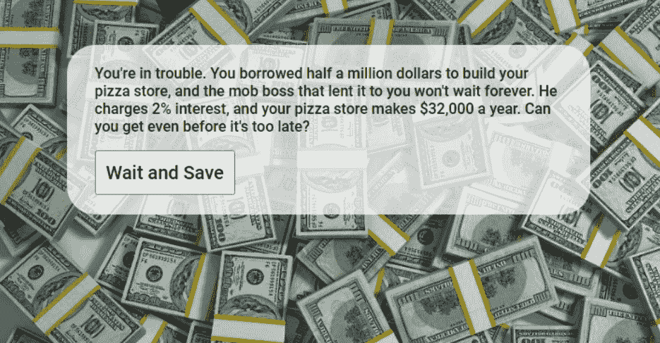

要解决这个问题，你需要一个循环，每年计算你欠的钱和你赚的钱。如果你攒够了钱来偿还债务，你就可以结束循环，还清贷款，然后驶向夕阳。

以下是计算方法。你每年需支付2%的利息。你可以用它来计算欠款金额：

```
amountOwed = amountOwed * 1.02;
```

所以如果`amountOwed`初始为500000，第一年后会增长到510000。以此类推。

但与此同时，你的披萨店也在赚钱，每年能赚到可观的32,000美元。你可以用这样的公式来追踪你不断增长的存款：

```
amountEarned = amountEarned + 32000;
```

循环的每一次遍历代表一年的时间流逝。在循环结束时，你必须使用一个条件来测试你赚的钱是否足够还清欠款。如果够了，就结束循环，并告诉我们花了多少年。很简单，对吧？

> **提示** 你的条件需要比较`amountOwed`和`amountEarned`。你需要在循环中跟踪年份数（每次循环运行时加1），但循环条件中并不使用年份变量。

## 亲自试试！

## 百万美元披萨 II（挑战等级：困难）

https://codepen.io/prosetech/pen/NWrBZWg

如果你想炫耀，这里有一个基于“百万美元披萨”第一版的另一个挑战。

首先，尝试使用不同的金额或利息运行原始程序（你在上个练习中编写的那个）。玩一会儿，你会注意到一个大问题。如果你欠款金额的增长速度比你赚钱的速度快，你编写的循环就会变成一个无限循环。这是因为无论你花多少个世纪，都无法还清贷款。但计算机可能会忽略这样明显的事实，你的页面就会因为试图拯救你的商店而永远循环，导致页面卡住。

你的下一个挑战是调整代码以设置一个超时时间。换句话说，过了若干年后，黑帮老大就会来收钱。如果到那时你没有足够的钱，你就输了。

以下是构建此解决方案的方法：

- 1. 你需要一个新的条件，当达到一定年数（比如30年）时结束循环。
- 2. 使用&&符号（即“与”，如第8章所述）将新条件与第一个条件连接起来。这样，只要你还缺钱*并且*还没到截止日期，你的循环就会继续运行。
- 3. 循环结束后，使用if语句块来判断发生了什么。检查你是否有足够的钱。如果没有，那一定是到了截止日期，所以显示不同的消息。

如果需要，完整解决方案在示例项目中。

## 可选：for，一个内置计数器的循环

如果你对循环的用法还不够过瘾，JavaScript还有另一个工具给你。它叫做for循环。

for循环基本上是一个内置计数器的循环。如果那是你需要的，你会发现for比while更紧凑，尽管它没有增加任何新功能。

这是一个例子。你可能还记得本章第一个练习中的这个消息循环：

```
let counter = 0;

while (counter < 10) {
  counter = counter + 1;
  alert(counter);
}
```

使用for循环，它看起来像这样：

```
for (let counter = 0; counter < 10; counter++) {
  alert(counter);
}
```

在`for`这个词后面是一组括号，包含三个重要的部分，用分号分隔。第一部分创建计数器：

```
for (let counter = 0;
```

第二部分设置每次遍历前测试的条件：

```
for (let counter = 0; counter < 10;
```

第三部分修改计数器，在本例中是使用++运算符将其加1：

```
for (let counter = 0; counter < 10; counter++)
```

当你使用for循环时，很明显括号里的变量就是计数器。所以，与其将其命名为`counter`，懒惰的程序员通常会给它一个短得多的名字。传统上，他们选择`i`，尽管确切的名字并不重要：

```
for (let i = 0; i < 10; i++) {
  alert(counter);
}
```

你能用for做的任何事情，也可以用while完成。但在现实生活中，当人们需要一个计数器时，他们几乎总是使用for循环。

## 第10章：用函数组织代码

在你目前看到的所有示例中，都存在一个模式。你点击一个按钮，一个函数就会被激活。偶尔你给页面添加*另一个*按钮，然后使用另一个函数来处理它的点击事件。

随着你的程序变得越来越复杂，组织你的代码变得非常重要。其中一种方法就是创建更多函数，将你的逻辑分解成更小的部分。


## 添加新函数

到目前为止，你看到的大多数程序都只有一个函数，当你点击按钮时运行。但没有什么能阻止你创建更多。

要添加一个函数，你只需要`function`关键字，后跟函数名、空括号`()`和一组花括号`{ }`。

```
function doSomething() {
}
```

函数名遵循与变量名相同的规则，不允许使用空格和特殊字符（除了下划线`_`和短横线`-`）。通常，函数名的首字母是小写的。并且永远不能给两个函数起相同的名字。

看看这个包含三个函数的例子：

```
function doSomething() {
    // 这里现在什么都没有。
}

function showMessage() {
    alert("Greetings from the showMessage() function.");
}

function showAnotherMessage() {
    alert("Welcome to the showAnotherMessage() function.");
}
```

你可以按任何顺序放置函数。你编写它们的顺序对它们在程序中使用的顺序没有影响。但始终记住你的花括号很重要。一个常见的错误是忘记用闭合的`}`来结束函数，导致两个函数混在一起，JavaScript无法理解的一堆代码。

## 调用函数

你已经知道可以将事件连接到一个函数。为此，你在HTML中设置一个事件属性。例如，如果你想处理按钮的onclick事件，你可能会这样设置：

```
<button onclick="doSomething()">Click Me</button>
```

这之所以有效，是因为`doSomething()`实际上是一行有效的JavaScript。所以当onclick事件发生时，它需要做的就是运行这条语句，它会调用`doSomething()`函数。

如果你理解了这一点，那么发现你可以使用同样的技术在你自己的代码中调用函数也就不足为奇了。

例如，看看这个修改过的`doSomething()`函数版本，它调用了*另一个*函数：


function doSomething() {
  showMessage();
}

现在当有人点击**Click Me**按钮时，它会触发`doSomething()`函数，而`doSomething()`函数又会调用`showMessage()`函数。`showMessage()`函数使用`alert()`来显示一条消息，让你了解发生了什么。

这个过程被称为*调用*函数。当你点击**Click Me**按钮时，会发生以下情况：

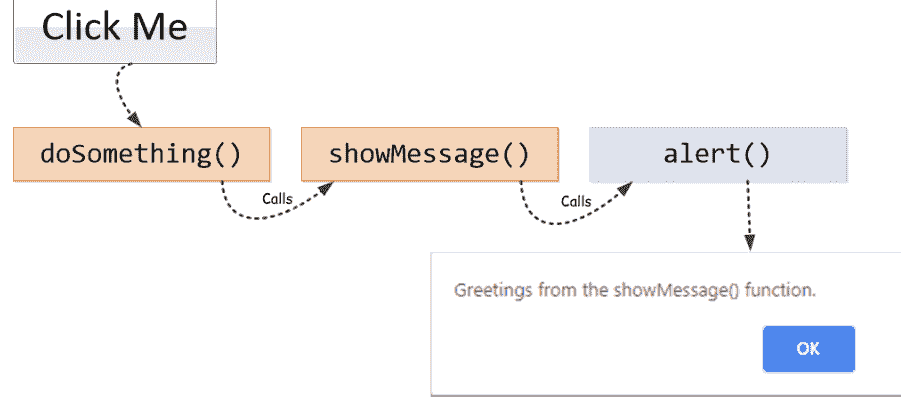

很容易识别代码何时在调用一个函数，因为函数名后面总有一对`()`括号。你不能这样调用`showMessage()`函数：

```
showMessage;    // 这到底是什么意思？
```

你可以随时调用函数。你甚至可以连续调用多个：

```
function doSomething() {
  showMessage();
  showAnotherMessage();
}
```

当你调用一个函数时，JavaScript会先让该函数完成所有工作，然后才继续执行。在这个例子中，这意味着JavaScript会运行`showMessage()`中的所有代码，然后运行`showAnotherMessage()`中的代码。

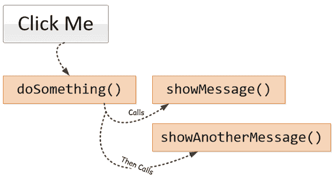

如果连续调用多个函数还不够有趣，你还可以创建一个调用另一个函数的函数，而后者又可以调用另一个函数，依此类推。这并不像听起来那么复杂。在一个设计良好的程序中，每个函数只执行一项独立的任务，而函数名通常会告诉你这个任务是什么。

想象你读到这样的代码：

```
function doSomething() {
  checkPassword();
  saveOrder();
  goToCheckoutPage();
}
```

`doSomething()`函数的功能已经相当清晰，即使不去深究它调用的另外三个函数中的所有代码。

## 自己动手试试！

> ▶ 追踪函数调用（挑战难度：易）

https://codepen.io/prosetech/pen/WNrYyYR

在一个真实的程序中，你会发现大量的函数。当程序运行时，JavaScript会从一个函数跳到另一个函数，你需要能够跟上这个流程。

这个练习让你有机会像一个引擎一样，通过追踪一系列函数调用来思考。先看看代码（但不要运行它）。程序有两个按钮，每个按钮都调用相同函数的不同组合。在一张纸上，写下你期望每个按钮显示的消息顺序。这比看起来要复杂，因为一些函数会调用其他函数，等等。然后，运行程序看看你的猜测是否正确。

这个练习的目的只是为了了解函数是如何工作的。在现实生活中，你的函数不会是只显示消息的一行代码。但一旦你知道如何调用一个超级短的函数，你就知道如何调用一个更长的函数，因为它们的工作原理完全相同。

另外，验证你对代码的假设是一项程序员必备技能。奇怪的错误常常发生，因为你的代码并没有按照你认为的方式在运行。

最后，你可能想试试这个测试。如果你调用一个调用自身的函数会发生什么？或者如果函数A()调用B()，而B()又调用A()呢？

## 获取数据的函数

正如你已经看到的，每次调用函数时，你都会在函数名后加上一对括号（）。它们不仅仅是为了装饰。它们还允许你向函数发送一个或多个数据块。每个数据块被称为一个*参数*。

为了让这项技术起作用，你的函数必须设计为接受参数。很多函数都是如此。一个例子就是你已经使用了很多次的alert()函数。你用字符串发送你想要显示的消息：

```
alert("Hello from the alert function.");
```

要创建一个接受参数的函数，你需要声明它们。例如，看看这个不带参数的showMessage()函数的简单版本：

```
function showMessage() {
    alert("Greetings from the showMessage() function.");
}
```

要添加一个参数，你需要把它放在函数名后的括号之间：

```
function showMessage(guestName) {
    alert("Greetings from the showMessage() function.");
}
```

添加参数就像定义一个变量。事实上，guestName参数*就是*一个变量——它是一个容器，将保存发送给showMessage()函数的数据。唯一的区别是你不使用let关键字。

现在，当你在程序的其他地方调用showMessage()时，你可以提供guestName数据：

```
function doSomething() {
    showMessage("Alexa");
}
```

这个例子将一个包含“Alexa”的字符串发送给showMessage()。如果你有一个保存字符串的变量，效果也是一样的：

```
function doSomething() {
  let name = "Alexa";
  showMessage(name);
}
```

当然，你需要知道函数需要什么类型的数据。是数字吗？字符串吗？是否有不允许的值？这是一个在你开始制作更大的程序和与其他程序员合作时变得更加重要的话题。通常，你可以在函数声明之前添加注释来解释这些细节。但那是以后的话题。

这个例子中还缺少一些东西。现在，doSomething()函数将字符串发送给showMessage()函数，后者成功接收并将其放入guestName变量中。但showMessage()函数并没有真正使用这段信息。这很容易改变：

```
// showMessage() 在警告框中显示一条个性化的消息。
// guestName 是使用程序的人的姓名。
function showMessage(guestName) {
  alert("Greetings, " + guestName +
    ", from the showMessage() function.");
}
```

现在，如果你用名字“Alexa”调用这个增强后的函数，你会得到消息“Greetings, Alexa, from the showMessage() function.”

## 使用多个参数

可靠的alert()函数只接受一个参数，你刚刚看到的修改版showMessage()函数也是如此。但如果你想制作一个有两个参数的函数，这很容易。你只需要添加两个参数名，并用逗号分隔它们：

```
function showMessage(firstName, lastName) {
  alert("Hello Dr. " + lastName + ". Can I call you " +
    firstName + "?");
}
```

现在当你调用这个版本的`showMessage()`函数时，你需要提供两段信息：

```
showMessage("Alexa", "Chen");
```

`showMessage()`函数会显示什么消息？

你可以继续添加任意多个逗号和参数。只需记住顺序很重要。你在函数声明中列出参数的顺序，与调用函数时需要遵循的顺序相同。

```
showMessage("Alexa", "Chen");

function showMessage(firstName, lastName) {
  alert("Hello Dr. " + lastName + ". Can I call you " + firstName + "?");
}
```

## 自己动手试试！

▶ 外星语翻译器（挑战难度：中）

https://codepen.io/prosetech/pen/rNLQmgw

一个新外星种族已经抵达地球。他们看起来很友好，但彼此理解却很困难。你认为你可以让自己被理解，但你需要一个JavaScript函数来帮助你交流。

## 请用我的语言和我说话


要翻译的消息：[This is a test message.]

[Translate the Message]

你的第一项任务是将一个普通的文本字符串翻译成外星语言。你将消息输入到文本框中。然后，当你点击按钮时，就该翻译它了。

目前，点击按钮会调用speakToAlien()函数，但该函数什么也不做（因为里面没有代码）。你的任务是从文本框中获取文本，然后翻译它。

如果你还记得如何操作，获取文本很容易。首先，检查HTML以找出文本框使用的id（在这个例子中，它是message）。然后，创建一个变量并使用可靠的document.getElementById()函数，像这样：

```
let messageToTranslate;
messageToTranslate = document.getElementById("message").value;
```

一旦你有了文本，你需要将其转换为外星语。但你不需要自己翻译。相反，页面中还有*另一个*已经写好的名为convertEnglishToAlien()的函数可以完成这项工作。

`convertEnglishToAlien()` 函数使用一个名为 `message` 的参数。这样你就可以将要翻译的文本发送给该函数。如果你操作正确，`convertEnglishToAlien()` 会将超级怪异的翻译结果显示在提示框中。试试看吧！

在下一章中，你将使用一个更好的外星语翻译函数。

## 第11章

# 回答问题的函数

在上一章中，你了解了函数就像建筑积木。你（或其他人）编写它们。然后当你需要时，就可以调用你的函数。

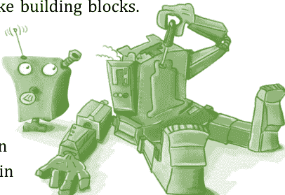

现在是时候构建更智能的函数，让它们能为你提供信息了。借助它们，你可以组织代码，甚至在不同的程序中重用最好的部分。

## 提供答案的函数

函数的一项常见工作是为你提供一条信息。例如，你可能会调用一个执行特殊计算并给你答案的函数。函数发送回给你的信息称为 *返回值*。

每个函数可以有一个返回值。你使用 `return` 命令来提供返回值。例如，如果你想让你的函数发送数字10回来，你可以在你的函数中添加这条语句：

```
return 10;
```

但有一个问题。一旦你使用 `return`，函数就结束了。JavaScript 不会运行函数其余的代码（如果有的话）。

这里有一个更实际的例子。`addTwoNumbers()` 函数接受两个数字（通过参数），将它们相加，然后返回结果。

```
function addTwoNumbers(firstNumber, secondNumber) {
    let sum = firstNumber + secondNumber;
    return sum;
}
```

显然，你实际上并*需要*一个函数来完成这项工作，但如果你制作一个更复杂的函数，概念是相同的。例如，这是 `addTwoNumbers()` 的一个添加了点花样的版本。如果你给它字符串形式的数字（比如 "3" 和 "5"），它仍然有效，因为它会将文本转换为真正的数字：

```
function addTwoNumbers(firstNumber, secondNumber) {
    let sum = Number(firstNumber) + Number(secondNumber);
    return sum;
}
```

在下一章中，你将使用 `Math` 对象，它有许多能给你答案的函数。例如，`Math.sqrt()` 函数可以获取一个数字的平方根。

那么，如何使用一个有返回值的函数呢？你可以像平常一样调用它：

```
addTwoNumbers(42, 6);
```

但如果你这样做，你将永远看不到返回值。对于某些函数，这可能有意义，但对于 `addTwoNumbers()` 来说，这违背了其目的。如果你想将返回值存储在一个变量中，你需要使用等号进行赋值。这是一个例子：

```
let sum;
sum = addTwoNumbers(42, 6);
// 现在 sum 的值是 48。
```

当 JavaScript 运行这条语句时，它会调用 `addTwoNumbers()`，发送两个参数（42 和 6），获取结果，最后将和复制到 `sum` 变量中。

# # 自己试试！

▶ 预测未来（挑战等级：简单）

https://codepen.io/prosetech/pen/mdEaIJq

你可以在通常放置变量的任何地方使用返回值。例如，你可以在计算中使用它：

```
result = addTwoNumbers(42, 6) + 10;
```

执行这条语句后，`result` 的值会是多少？如果你不确定，请在示例页面上检查你的答案。

你也可以在条件中使用返回值：

```
if (addTwoNumbers(4, 6) > 10) {
}
```

这个条件会成立吗？

你甚至可以将返回值作为另一个函数调用的参数：

```
alert(addTwoNumbers(450, 1));
```

运行这段代码时，你期望看到什么？

# # 自己试试！

▶ **外星语翻译器 II（挑战等级：困难）**

[https://codepen.io/prosetech/pen/MWedawx](https://codepen.io/prosetech/pen/MWedawx)

在外星语翻译器的第一个版本中，你学会了调用 `convertEnglishToAlien()` 函数并发送两个参数。但有一个小缺陷。

目前，`convertEnglishToAlien()` 函数接收你的消息，执行其外星语转换，并在提示框中显示结果。但如果你的外星消息想用于其他用途呢？也许你想在页面上显示它，或者传递给另一个函数。

一个完美的 `convertEnglishToAlien()` 版本会让你来决定。它会专注于自己的任务：将英语翻译成外星语。你会向它发送一些信息（通过参数），它会将结果发送回来（通过返回值），*然后*你的代码会决定如何处理这条消息。

这是你的新任务——修改 `convertEnglishToAlien()` 以使用返回值。你需要做以下事情：

-   1. 删除在提示框中显示 `scrambledMessage` 的代码。
-   2. 在 `convertEnglishToAlien()` 的末尾添加一条使用 `return` 关键字返回 `scrambledMessage` 的语句。
-   3. 现在修改调用 `convertEnglishToAlien()` 的代码，使其获取返回值并赋值给一个新变量（可以命名为 `translation` 之类的）。
-   4. 最后，添加一些新代码在页面上显示翻译结果。记住，这段代码不在 `convertEnglishToAlien()` 函数内部。而是在调用 `convertEnglishToAlien()` 之后，当你获得返回值时使用它。（在示例代码中，你会看到逻辑已经部分存在，并用注释标记出来了。）

一旦你解决了这个问题，你还可以对外星语翻译器进行另一个改进。

到目前为止，你一直在修改 **Translate To Alien** 按钮的代码。但这个练习还有一个 **Translate To English** 按钮和一个匹配的函数叫做 `convertAlienToEnglish()`。目前，**Translate To English** 按钮什么都不做。你需要编写代码，从外星语文本框中获取文本，将其传递给 `convertAlienToEnglish()`，然后在英语文本框中显示结果。你需要自己编写这段代码，但它与 **Translate To Alien** 按钮的代码非常相似。

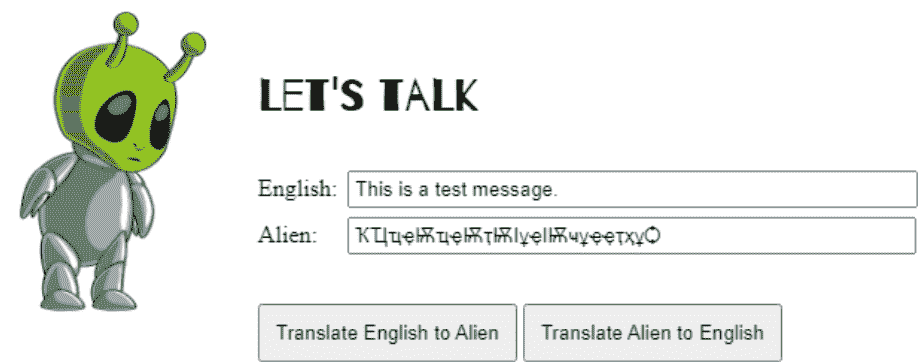

作为奖励，如果你成功完成任务，你将能够解码外星人神秘的第一句话。

## 第12章

## 认真对待数学

你已经知道如何用数字进行基本计算，比如加法和减法。但随着你的程序变得更加雄心勃勃，你将需要更多的数学技能。

例如，如果你的代码处理十进制值，你需要知道如何在将它们显示在页面之前将其四舍五入到合适的大小。或者你想使用指数和平方根进行计算，使用三角函数（如正弦、余弦和正切），或者使用数学常数圆周率 (π)。JavaScript 内置了所有这些数学魔法的功能。

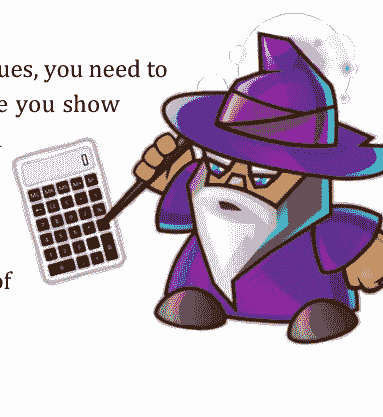

## 数学捷径

程序中最常见的数学操作之一是改变一个变量。这是一个例子：

```
counter = counter + 1;
```

正如你可能看到的，这条语句获取 `counter` 变量，加上 1，并将结果赋值给新的 `counter` 变量。

这种操作非常流行，所以 JavaScript 使用 `+=` 运算符为你提供了一个捷径：

```
counter += 1;
```

你注意到了吗？`+=` 运算符告诉 JavaScript 获取语句右侧的变量（在这个例子中是 1），并将其加到左侧的任何变量上。

如果你想在字符串末尾附加一些文本，这个技巧也适用：

```
let message = "Let's eat";
message += "  some pancakes";

// 现在 message 的值是 "Let's eat some pancakes."
```

JavaScript 对于减法、乘法和除法有类似的捷径。
它们的工作方式相同，只是 `+=` 运算符中的 `+` 部分被替换为你想要进行的数学运算类型：

```
let counter = 12;

counter -= 2;
// （现在 counter = 12 - 2，即 10。）

counter /= 5;
// （现在 counter = 10 / 5，即 2。）

counter *= 3;
// （现在 counter = 6。你知道为什么。）
```

使用像 `+=` 这样的捷径与使用 `=` 和 `+` 编写完整语句相比，实际上没有什么特别之处。但它确实让懒惰的程序员节省了几次按键。你*不*需要使用它，但你会在其他人的程序中看到它。


你可能还会遇到另一种快捷方式：`++` 和 `--` 运算符。它们通过加 1 或减 1 来调整一个变量的值，并且不需要等号。

```
let counter = 10;

counter++;
// （现在 counter 的值是 11。）

counter--;
// （现在 counter 的值又变回 10。）
```

`--` 和 `++` 运算符的存在，是因为在代码中将一个变量的值增减 1 是非常常见的操作。这个快捷方式如此著名，以至于 C++ 语言就是以它命名的。（尽管 C++ 让你可以用它来在内存中跳转，那是一种更棘手也更危险的操作。）

## 亲自试试看！

▶ 预测未来（挑战等级：简单）

https://codepen.io/prosetech/pen/pobKJLV

如果你理解了 `+`、`++` 和 `+=` 运算符的工作原理，你应该能很快解决这个谜题。

```
let a = 10;
let b = 10;
b = a + b;
b -= b/2;
b++;
b += a;
b *= 10;
b--;
```

这段代码不会改变 `a`。但是，当你执行到最后时，`b` 的值是多少？

## JavaScript 在处理小数时的古怪错误

现在要说个坏消息了。计算机处理小数的方式有点奇怪。

你已经知道 JavaScript 的数字非常灵活。你可以用一个数字变量来存储一个整数（比如 -342），或者一个更大的数（比如 8093411059），或者一个更精确的数（比如 0.00000345908）。这被称为*浮点数*，因为小数点可以“浮动”，从而表示你需要的任何大小或小数位数的数字。

计算机有快速高效的方法来存储浮点数并进行计算。然而，这里有个问题。某些小数的值无法被精确地存储。因此，你的计算中可能会出现奇怪的舍入误差。这些舍入误差非常小，但仍然会造成混乱。

要看到这个问题，可以试试这个“加一角硬币”的示例：https://codepen.io/prosetech/pen/JjGVBVa。每次你点击，它都会在页面显示的总额上加 $0.10。这在前几次点击时工作正常，但当你期望达到 $0.30 时，你却会得到数字 0.30000000000000004。再加一些硬币，一切又恢复正常——直到你达到 0.7999999999999999，而你本应有 $0.80。显然有些地方不对劲。

**你的零钱袋里有：$0.30000000000000004**

[添加一角硬币]

问题在于，某些小数的值无法精确地转换为浮点数。（这类似于你试图将 1/3 写成小数时遇到的问题。你可以在纸上写出尽可能多的 0.33333，但它仍然不能完美地表示三分之一。）

这个问题不仅限于 JavaScript。它在每种编程语言的浮点数处理中都会发生。区别在于，有些语言提供了十进制数据类型来专门避免这个问题。JavaScript 没有，所以你需要自己来修正这个错误。

如何修复它呢？如果你正在编写一个涉及大量小数位的科学计算程序，那么不需要做任何改变。但如果你编写的是一个涉及精确金额的程序，看到几分钱的微小误差会让人很困惑。

有两个解决方案。你可以使用舍入，你马上就会学到如何做。这样你就可以去掉任何没有意义的额外小数位。但更简单的方法是完全避免使用小数。因此，不要跟踪美元金额（比如 $4.30），而是计算总共有多少美分（比如 430）。

## 亲自试试看！

▶ 失灵的一角硬币加法器（挑战等级：中等）

https://codepen.io/prosetech/pen/JjGVBVa

当你在金额中看到微小的舍入误差时，会很困惑。试试这个程序，确认一下当你加上几分钱后问题是否存在。然后，通过将 `dollars` 变量替换为一个计算总美分（cent）数的 `cents` 变量来修复这个问题（这个变量不需要小数）。记得在将数字显示在页面上之前，把美分数量换算回美元数量。

## 探索 Math 对象

如果你有一台普通的科学计算器，你知道它不仅仅能做加、减、乘、除。很多功能都挤在特殊的按钮里。JavaScript 也是这样。基本的数学函数已经内置于 JavaScript 语言中，并使用你已经学过的运算符（`+ - * / ^`）。但当你需要更多计算能力时，就需要求助于一个叫做 `Math` 对象的特殊功能。

`Math` 对象将一系列执行专业数学计算的函数打包在一起。在编写代码时，你可以查看所有这些函数。输入 `Math`，后面跟一个点（`.`），你就会看到 `Math` 对象提供的所有功能列表。

所有这些函数都接受一个或多个参数，并以返回值的形式给你结果。

例如，如果你想计算一个数的平方根，可以使用 `Math.sqrt()` 函数。（这里，`Math` 是对象，`sqrt()` 是它的函数之一。）

```
let number = 9;
number = Math.sqrt(number);

// 现在 number 的值是 3（因为 9 的平方根是 3）。
```

`Math` 对象不仅仅关于平方根。如果你想计算一个角的正切值（在高中三角函数中很重要，也用于计算空中抛射物的游戏），你可以使用 `Math.tan()`。依此类推。

## 亲自试试看！

▶ 这个蛋糕有多大？（挑战等级：中等）

https://codepen.io/prosetech/pen/QWyRYjQ

很少有问题比你在这个挑战中要解决的问题更重要——准确测量你即将吃掉的蛋糕有多大。

如果你还记得一点几何知识，你可能知道如何计算一个形状的面积。对于一个简单的矩形，你需要用它的长乘以宽。对于一个圆形，你需要进行一个类似但更复杂的计算，看起来像这样：

```
π (d/2)²
```

在这个等式中，*d* 是圆的直径，*pi* (π) 是一个神奇的数学常数，它从 3.14 开始并无限延续下去。但你不需要记住 *pi* 的每一位数字，因为 `Math` 对象有一个内置变量已经为你存储好了它。

花点时间看看你是否能在 `Math` 对象中找到 *pi*。然后用它来计算你的蛋糕的面积。你需要编写一条语句，将直径除以 2，对结果求平方，然后再乘以 *pi*。你可以在一行代码中完成所有这些，或者如果你觉得更容易，可以分解成单独的步骤。记住，你需要使用 `**` 运算符来进行指数运算（`4**2` 表示 4²）。

**注意** `Math.PI` 的行为就像一个变量。这意味着你不需要像使用其他内置 `Math` 函数那样使用括号。

## 数字舍入

如果有人问你的蛋糕有多大，说 8 英寸是合理的。但如果你告诉他们是 8.045840982 英寸，就没那么有帮助了。但 JavaScript 就是这样。

在你的代码中，如果数字有一个很长的小数部分，比如 8.045840982，这并不重要。你可以像使用变量中的任何其他值一样继续使用它进行计算。但如果你想在某处*显示*你的数字，比如在一个警告框或网页上，你可能希望把它修剪成一个更整洁的大小。

`Math` 对象有一个 `round()` 函数可以完成这项工作。下面它演示了如何去掉数字的所有小数部分：

```
let longNumber = 4.349;
let roundedNumber = Math.round(longNumber);

// 现在 roundedNumber 是 4
```

`round()` 函数总是四舍五入到最接近的整数。所以 4.349 变成 4，而 4.931 变成 5。但如果你想舍入到不同的位数呢？

例如，假设你想保留正好两位小数，这样 4.349 就会变成 4.35。你可能期望 `round()` 函数能为你做到这一点，但它没那么有帮助。你需要自己动手。

在这种情况下，你需要用一些乘法和除法来调整你的数字。下面是一个演示：

```
let longNumber = 4.349;

// 将小数点向右移动两位。
longNumber = longNumber * 100          // longNumber=434.9

// 对数字进行舍入。
let roundedNumber = Math.round(longNumber);   // roundedNumber=435

// 将小数点移回原来的位置。
roundedNumber = roundedNumber / 100       // roundedNumber=4.35
```

这个例子将小数点移动到正确的位置，对数字进行舍入，然后将小数点移回原来的位置。一旦你习惯了这种模式，你可以在一条语句中完成所有这些操作：

```
let longNumber = 4.349;
let roundedNumber = Math.round(longNumber*100) / 100;
```


## 自己试试看！

> ▶ 这个蛋糕有多大？（挑战等级：简单）

https://codepen.io/prosetech/pen/QWyRYjQ

蛋糕计算器没有省略任何小数位，这让它的测量结果看起来有点吓人。但你可以使用 `Math.round()` 函数来解决这个问题。你不需要保留任何小数位，所以甚至不需要在将蛋糕总面积四舍五入为一个更易处理的整数之前对其进行乘法运算。很简单吧！

第13章

## 随机数的魔力

如果你曾经掷过一对骰子、抛过硬币、或者（闭着眼睛！）从帽子里摸出一张纸条，你就理解了随机的概念。当你玩这些简单的游戏时，结果取决于运气。你无法预测会发生什么。


在编程中，你可以使用随机数来达到同样的效果。随机数让你可以模拟机会游戏，比如掷骰子和抽牌。你也可以用它们来控制其他类型的游戏——比如说，决定一场龙与食人魔之间的战斗谁获胜，生成一张随机地图（例如，在《我的世界》中），或者从一个形容词列表中随机生成一句侮辱性的话。

在本课中，你将使用随机数来制作两个基本游戏。

## 随机与伪随机

让计算机做到随机并不容易。（这就像让机器人笑一样困难。）当你要求计算机给你一个随机数时，它实际上是遵循某种不太随机的公式来创建一个“假的”随机数（技术上称为*伪随机*数）。例如，它可能会查看计算机时钟，获取那一刻的毫秒数，然后将其输入某种数学公式中。

这种方法的一个好处是你的计算机可以相当快地挑选假的随机数。在你的程序中，这些数字仍然*看起来*完全随机，因为你永远不知道你的计算机将选择哪个数字。但是，如果你试图在计算机安全中使用随机数——例如，编码敏感信息或为下一次千万美元彩票挑选赢家——这就是一个问题。黑客可以弄清楚你如何生成你的假的随机数，猜出它们，并破解你的数据（或为自己弄到中奖彩票）。

幸运的是，如果你用JavaScript构建一个普通游戏，你不需要担心这个问题。

## 生成随机数

和大多数编程语言一样，JavaScript有一种创建随机数的方法。你使用 `Math.random()` 函数：

```
let randomNumber = Math.random();
alert("You random number is " + randomNumber);
```

如果你运行这段代码，你会发现随机数可能不是你所期望的。也许你想要一个1到6之间的随机数（代表掷一次骰子）。你实际得到的是一个很大的小数值，它大于0但小于1，像这样：

0.43085308054

它是随机的，但不太有用。你需要将这个小数值转换为一个在你想要的范围内的数字。

好消息是，有一个公式可以用来选择一个随机的整数。这个公式看起来像这样：

```
randomNumber = Math.floor(Math.random() * (max - min + 1) ) + min;
```

乍一看很复杂，但很容易分解。首先，你需要理解所有的要素。`min` 是你允许的最小数字，`max` 是最大数字。所以，如果你想选一个1到6之间的数字，公式就变成：

```
randomNumber = Math.floor(Math.random() * (6 - 1 + 1) ) + 1;
```

现在我们可以稍微简化一下：

```
randomNumber = Math.floor(Math.random() * 6) + 1;
```

这个计算使用了两个新的数学函数：Math.random() 和 Math.floor()。

Math.floor() 是一个专门的舍入函数，它总是向下舍入，截断数字的小数部分。例如，如果你对数字 4.839424982 使用 Math.floor()，它会变成 4。（JavaScript 还有一个配套的 Math.ceil() 函数，它总是向上舍入。）

你不需要理解这条语句是如何施展其魔力的就可以使用它。但如果你想了解发生了什么，让我们再看一下最终公式：

```
randomNumber = Math.floor(Math.random() * 6) + 1;
```

以下是 JavaScript 执行这条语句时的逐步分解：

1. Math.random() 获取一个大于0且小于1的随机值。
2. 你将该值乘以6，将其转换为一个大于0且小于6的随机数。然而，小数部分仍然存在，所以你会得到一个像 4.839424982 这样的数字。
3. Math.floor() 切掉小数部分，给你一个整数。这个数字可能是 0、1、2、3、4 或 5。
4. 你加1，将数字范围上移一位。现在你得到一个从1到6的整数，这正是你想要的！

## 自己试试看！

▶ **末日数字猜猜乐**（挑战等级：中等）

[https://codepen.io/prosetech/pen/JjXPWIr](https://codepen.io/prosetech/pen/JjXPWIr)

在这个练习中，你需要完成数字猜猜游戏。你拥有所需的所有概念，但有不少细节需要填充。


首先，看看代码。你会在顶部看到两个全局变量：

```
let secretNumber;
let numberOfGuesses = 0;
```

你的第一个任务是选择一个1到10之间的秘密数字。你想只选择一次这个数字，将其存储在 `secretNumber` 中，并在所有猜测中保持相同的数字。

选择秘密数字的最佳时间是页面首次加载时。为此，你可以编写一个响应 `onload` 事件的函数。数字猜猜游戏已经有一个连接到 `<body>` 元素的 `onload` 事件的函数：

```
<body onload="pickNumber()">
```

目前，`pickNumber()` 函数中没有代码。你的第一个任务是使用 `Math.random()` 在这里选择一个随机数，并将其存储在 `secretNumber` 中以备后用。

一旦你控制了数字选择，下一个任务就是处理猜测。要猜测，你在一个文本框中填入一个数字并点击 **Guess** 按钮。这会触发 `guess()` 函数。

`guess()` 函数已经有代码从文本框中获取猜测值。现在你需要使用条件逻辑来测试猜测是否与秘密数字匹配。然后你可以显示一条祝贺消息（表示成功），或者一条嘲弄的侮辱（表示失败）。你可以在页面上显示你的消息——实际上，代码已经在那里了。你需要做的就是用正确的文本设置 `message` 变量。

一旦你到了这一步，试试例子并确保它能正常工作。当一切就绪，是时候用一些重要的额外细节来完成你的示例了：

1. 使用全局变量 `numberOfGuesses` 跟踪猜测次数。
2. 在错误猜测后，检查是否已达到最大猜测次数（4次）。如果是，显示“游戏结束”消息（并告诉猜测者数字是什么）。
3. 在每次猜测后，说明还剩多少次猜测。你可以将此信息添加到你显示的消息末尾。
4. 在输掉游戏后，将 `numberOfGuesses` 重置为0，并选择一个新的随机数。你不需要再次编写随机逻辑——只需调用 `pickNumber()` 函数即可。

如果你完成了所有这些任务，你将拥有一个真正史诗级的数字猜谜游戏。

## 自己试试看！

▶ **冰、匕首、岩浆**（挑战等级：棘手）

https://codepen.io/prosetech/pen/rNeByow

如果你玩过石头、剪刀、布，你将毫不费力地理解哥布林王国中最受欢迎的游戏：*冰、匕首、岩浆*。每一轮，你和你的对手选择使用冰、匕首或火山喷发的岩浆。以下是决定胜负的方式：

1. 岩浆融化匕首。（赢家：岩浆）
2. 匕首击碎冰。（赢家：匕首）
3. 冰将岩浆硬化成石头。（赢家：冰）

如果你们选择相同的攻击，则无人获胜。

**我们来玩吧。**

**现在做出你的选择！**


*冰、匕首、熔岩*代码已经预设好了大部分你需要的内容。你点击三张图片中的一张来选择你的攻击方式。然后，`playIceDaggerOrLava()`函数会决定谁赢。你的任务就是编写这个函数的代码。

你的对手是一个电脑地精，它会随机选择攻击方式。在三个选项中选择，等同于从1到3中随机抽取一个数字。例如，你可以将冰设为1，匕首设为2，熔岩设为3。为了让这个系统更容易记住，代码使用了三个常量：

```
const ice = 1;
const dagger = 2;
const lava = 3;
```

记住，常量就是永远不会改变的变量。

按钮点击的代码已经存在。例如，如果你点击冰图片，就会发生以下情况：

```
function pickIce() {
  playIceDaggerOrLava(ice);
}
```

调用`playIceDaggerOrLava(ice)`就等同于调用`playIceDaggerOrLava(1)`。但如果你在代码中使用常量名而不是魔法数字，你的代码会更容易理解，也更不容易混淆数字。

现在轮到你的贡献了。你需要在`playIceDaggerOrLava()`中编写代码。首先，你需要从1到3中抽取一个随机数字，代表冰、匕首或熔岩。这是简单的部分。

现在你需要编写一个**if**语句块来判断谁赢了。这部分很棘手，因为有很多种赢法和输法。最好的方法是采用两步策略。首先，你判断是赢还是输，*然后*你决定对此做些什么。

解决这个问题有很多不同的方法。有些比其他的更简短，有些看起来更复杂。一个选择是使用一个变量来存储结果：

```
let result;
```

如果赢了，你在`result`中存储某个值（比如数字1）。如果输了，你存储一个不同的值。在你尝试了所有不同的冰、匕首、熔岩组合之后，你可以检查`result`来决定下一步做什么。

最后一步是更简单的部分。如果玩家赢了，显示一个愉快的胜利信息。如果没有，就显示一些不那么友好的信息。

有很多方法可以让这个示例变得更好。何不用几个变量来跟踪你赢了多少局、输了多少局呢？然后你可以在页面的其他地方显示这些信息，甚至可以用它来计算胜率。

## 接下来是什么

如果你喜欢这个JavaScript入门介绍，旅程并不需要在这里结束。我们计划了续集。

隆重介绍*《面向对象JavaScript极简入门》*。它将带你踏上新的冒险——学习构建你自己的对象。你可能会问，什么是对象？它不亚于有史以来最实用的编程工具之一，也是你会在许多其他编程语言中用到的东西。

要了解新书发布的时间（以及这本书的更新内容），请在[http://tiny.cc/tinyintro](http://tiny.cc/tinyintro)注册订阅Tiny Introductions新闻。你也可以在Twitter上关注我（[http://twitter.com/prosetech](http://twitter.com/prosetech)），或者直接通过[matthew@prosetech.com](mailto:matthew@prosetech.com)向我打招呼！

祝你旅途愉快，

马修


