# About.com 网页设计指南：使用 HTML、CSS 和 JavaScript 构建与维护动态、用户友好的网站（About.com 指南系列）

## 本书特色

- 向您的指南提问
- 必备工具
- 热门趋势
- 网络其他资源

## 关于 About.com

About.com 是一个强大的网络，拥有超过 600 位指南作者——他们是聪明、热情且在其领域有所成就的专家。About.com 指南作者生活和工作在二十多个国家，并在数千个主题上展现他们的兴趣。他们撰写了著作，出现在全国性电视节目中，并在各自领域赢得了众多奖项。指南作者的遴选标准是其为用户提供最有趣信息的能力以及对其主题和网络的热情。遴选过程十分严格——只有 2% 的申请者能最终成为指南作者。以下是他们被选中的最重要的标准：

- 具备高水平的知识和对主题的热情
- 拥有适当的资质
- 对网络体验有敏锐的理解
- 致力于创作信息丰富、鼓舞人心的专题内容

每月有超过 4800 万人访问 About.com。无论你需要家庭维修和装饰创意、食谱、电影预告片还是购车建议，About.com 指南作者都为日常生活提供实用的建议和解决方案。例如，如果你正在寻找翻新露台的操作指南，About.com 会向你展示完成这项工作所需的工具。无论你在 About.com 的哪个位置，或者如何到达那里，你总能找到你正在寻找的内容！

## 关于您的指南作者

詹妮弗·基尔宁担任专业网页开发者、设计师和网站管理员已超过 12 年。她曾参与从小型个人网站到大型企业网站的各种项目。詹妮弗于 1997 年加入 About.com，担任 About.com HTML 指南。她的网站随后扩展到涵盖 HTML 和 XML，并于 2000 年接管了网站设计板块，开始运营 About.com 网页设计/HTML 站点。她的网站涵盖了网站开发者规划、构建和维护网站所需的一切知识。

构建网站并帮助他人构建网站，几乎是詹妮弗自万维网诞生以来就一直热衷的事业。詹妮弗在 1990 年代初期在 NETCOM 在线通信公司工作，在那里她帮助创建了最早的基于网络的技术支持知识库之一。当她加入网络团队担任网络撰稿人时，她的职责是撰写内容和 HTML，而团队成员则开发支持该网站的程序。此后，她继续为小企业构建了一些营销网站，然后加入赛门铁克公司，在那里她帮助构建和维护赛门铁克网站近九年。

詹妮弗热爱网络和互联网，并希望让任何想制作网页的人都能从中获得乐趣。

## 致谢

我要感谢贝琪，即使她并不知道，她的帮助也让我想出了许多点子——在我本该写作的时候，和她聊聊马匹让我受益匪浅。感谢我的父母和兄弟的支持，也感谢沙斯塔和麦金利，在我确信自己无法构建任何网页时给了我灵感。还要感谢马克为我所做的一切。没有你，我无法完成这一切！

### ABOUT.COM

首席执行官兼总裁

斯科特·迈耶

首席运营官

安德鲁·潘瑟

高级副总裁（内容）

迈克尔·戴彻

运营总监

克里斯·墨菲

市场营销传播经理

丽莎·朗斯多夫

### ADAMS MEDIA

#### 编辑部

创新总监

保拉·穆尼尔

编辑总监

劳拉·M·戴利

执行编辑

布里尔·K·马特森

开发编辑

凯蒂·麦克多诺

#### 市场营销部

市场营销总监

凯伦·库珀

助理艺术总监

弗兰克·里韦拉

#### 制作部

制作总监

苏珊·比尔

制作项目经理

米歇尔·罗伊·凯利

高级图书设计师

科琳·坎宁安

## 如何使用本书

每本 About.com 图书均由 About.com 指南作者撰写——他们是具有专业知识的专家。虽然本书可以作为独立资源使用，但也可以与其对应的 About.com 网站结合使用，以获取更多提示、工具和建议。每本书不仅将您引回 About.com，还指引您前往其他有用的网络资源和印刷资料。

所有 About.com 图书在每章末尾都包含一个名为“获取链接”的特殊部分。在那里，您会找到几个指向 About.com 网站的链接，以获取有关该章节讨论主题的更多有用信息。根据主题，您将找到指向照片、乐谱、测验、食谱或产品评论等资源的链接。

About.com 图书还包括四种类型的旁注栏：

- **向您的指南提问：** 以问答形式提供的详细信息
- **必备工具：** 关于为您的项目研究、购买和使用各种工具的建议
- **热门趋势：** 关于当前最热门趋势和技巧您需要知道的一切
- **网络其他资源：** 引用其他有用的网络资源

每本 About.com 图书都带您对某个主题进行个人探索，为您提供可靠的建议，并让您掌握实现目标所需的知识。

## 您的向导导语

自 1995 年我开始构建网站以来，网页设计和 HTML 已经走过了很长的路。那时，能在页面上放置图片已经是大新闻了。我们迫切地希望客户摆脱 Lynx 浏览器，这样他们才能看到我们辛辛苦苦制作的图片。

那是彩虹色水平线、所有内容都居中、黑色背景配红色或其他同样难以阅读字体颜色的时代，如果你能让一个听起来很可怕的 WAV 文件在页面加载时播放，大家都会认为你是个热门的网页开发者。图片下载需要很长时间，而且大多数时候都是动画的。而 Ajax 那时还被称为 DHTML 或 JavaScript，运行起来效果并不好。

很多事情已经发生了变化。大公司已强势进入万维网；普通人运营博客、发布播客；在 YouTube 上看视频已成为家常便饭，而不再仅仅是通过办公室的高速网络连接。

但很多事情也保持不变。黑色背景配红色或其他同样难以阅读字体颜色的网站在网上比比皆是。虽然我们可能听不到那么多可怕的 WAV 文件了，但很多网站的图片仍然大到即使在 DSL 或有线网络线路上也需要很长时间才能下载。

其实不必如此。网络是一个令人兴奋的商业场所，每家企业，无论大小，都应该有兴趣参与其中。我希望这本书能成为您学习如何为企业和兴趣创建网站的地方。

制作网站很容易，构建具有色彩、风格和魅力的网站可以非常有趣。这不是一本手把手教您学习 HTML 或 CSS 的书。这方面有很多优秀的书籍和网站；我的网站上甚至有您可以学习这两种语言的课程。我将做的是带您逐步了解规划、设计、构建和维护网站的步骤。您将使用基于标准的技术，这样您的网站将经受住时间的考验。您还会了解到许多其他资源，以便继续您的学习。

一旦您开始制作网页，很可能您会停不下来。这本书和 About.com 网页设计/HTML 网站旨在引领您走上构建具有现代设计的精彩网站的道路。

我热爱构建网页，也热爱帮助他人构建网页。我在我的网页设计/HTML 网站上为这本书设立了一个特别区域（`http://about.com/webdesign/book`）。这里找到的所有链接也可以在我的网站上按章节查看。您还可以看到章节中的示例和示例代码。如果您对本书或构建网页有任何问题，请随时通过电子邮件联系我：`webdesign.guide@about.com`。我很乐意收到您的来信！

# 第 1 章：全局概览

## 开始构建网站

无论您是想为企业构建网站，还是只想创建一个个人博客或照片网站，您都将体验到一段激动人心的旅程。如今大多数企业都有网站；这是推广产品、向世界展示您所提供服务的绝佳方式。越来越多的人也使用网站与朋友和家人保持联系、结识新人，以及展示艺术、音乐等。

如果您从未创建过网站，您可能会有点紧张。幸运的是，构建网站的挑战程度取决于您自己。许多成功的网站只使用少量的 `HTML` 标签，但看起来依然不错，并满足客户的需求。

您可能会惊讶于网站能够如此快速地启动并运行。我曾教过学生在一两天内就构建出一个可以运行的网站。当您读完本书时，您将理解构建网站所需的基础 HTML 知识，并拥有实现目标所需的所有工具。

## About.com

### 主题

- #### 开始构建网站
  - 第 1 页
- #### 合适的工具
  - 第 2 页
- #### 所见即所得编辑器与纯 HTML
  - 第 4 页
- #### 为您的网站设定目标
  - 第 9 页
- #### 在纸上而非屏幕上开始设计
  - 第 12 页
- #### 在拥有网站之前就为网站测试做准备
  - 第 13 页

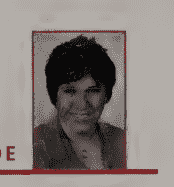

### 咨询您的向导

#### 我真的可以自己构建网站吗？

如果您知道如何使用计算机，您就可以构建网站。我并不是说这很容易，但我曾帮助过七十岁的老人和十岁的孩子构建他们的第一个网站。如果您愿意花时间，您当然可以实现目标。

要开始，有几件事是您需要的：好的软件、一个出色的计划，以及必胜的态度。态度是最重要的。如果您有积极的心态，那么您的网站会顺利建成，您也将拥有使其更进一步的能力。我现在能给您的最好建议是：从简单开始。您随时可以在以后让网站变得更复杂。以宏伟的想法和简单的计划开始，比以宏伟的计划开始却不知如何实施要好。请记住，您总是可以为网站添加更多内容，但试图一步到位只会得到一个只完成了一半的网站。

### 合适的工具

对于任何工作，正确工具的重要性都不容过分强调。在设计网站时，有些工具是您需要的，有些工具是最好拥有的。很容易沉迷于各种工具和应用程序的炫目功能中，但如果您连网站都还没有，真的需要 Flash 吗？购买一个图像悬停效果生成器是至关重要的吗？万一您决定不使用图像悬停效果呢？

选择一个好的 HTML 编辑器很重要。除了计算机本身，您的编辑器将是您使用最多的工具。HTML 编辑器可以功能丰富，也可以非常基础；它们可以帮助您构建图形，或者在您的 HTML 正确时给予提示。一些最受欢迎的网页编辑器如下：

- **Dreamweaver：** 这是最流行的 HTML 编辑器，但也是价格较高的之一。它有适用于 Windows 和 Macintosh 的版本。
- **FrontPage：** 微软的所见即所得编辑器仅适用于 Windows，但如果您习惯于 Word 的界面，您可能会喜欢这款 HTML 编辑器。

### 所见即所得与纯 HTML

在本书中，你将学习基础 HTML，因此我建议使用一款同时具备 HTML 编辑能力和所见即所得（WYSIWYG）功能的编辑器，即使你现在还不熟悉 HTML。

WYSIWYG 实际上有些名不副实，因为很难确切知道在网页上最终会“得到”什么效果。每个访问你网页的人，都会使用不同操作系统上的不同软件，并且这些软件设置各异，而所有这些都可能改变你的网页最终呈现的样子。如果你使用 WYSIWYG 编辑器，可能会产生一种自满情绪。你的网页在编辑器中看起来不错，但在某些网页浏览器中却效果糟糕。我甚至在使用最流行的编辑器 Dreamweaver 时也遇到过这种情况。一些 WYSIWYG 编辑器还存在另一个问题：生成不好的 HTML 代码。你的页面看起来没问题，但生成它们的 HTML 代码臃肿，会导致页面下载变慢。在极端情况下，页面在某些浏览器中可能无法正确加载或根本无法加载。

HTML 并不难学。如果你确实需要一款 WYSIWYG 编辑器，很多此类编辑器也内置了代码编辑器。要熟练使用 HTML 构建网页，最好的方式是使用没有 WYSIWYG 功能的纯代码编辑器来构建它们。你可以在构建过程中随时测试你的页面，确保它们看起来正确。刚开始学习时可能会慢一点，但与完全依赖 WYSIWYG 编辑器相比，你后期遇到的问题会少得多。

**集成图形编辑功能会增加成本。** 许多提供集成图形编辑功能的、不太知名的编辑器，其灵活性不如独立的图形处理程序。

我发现，最好坚持使用只处理 HTML 的 HTML 编辑器，而将图形编辑工作交给另一个程序。如果你的网站不会有大量图形，你可能不需要昂贵的图形编辑器。我将在本章后面更详细地介绍图形编辑器。

**始终计划使用先进技术。** 目前你的网站可能只有简单的图片和文字。但如果它发展起来了，你可能希望集成一个博客工具或一个数据库。如果你的编辑器无法轻松处理 HTML 以外的语言，你将需要额外花钱购买能处理这些语言的编辑器。拥有一个支持其他技术的网页编辑器是个好主意。

**人们常常忘记国际化。** 这很容易被遗忘，但如果你的公司走向全球，能够编辑其他语言的网站就变得至关重要。

如果你的网页编辑器无法处理像“à”这样的特殊字符，那么即使翻译由他人提供，你也无法将你的网站翻译成西班牙语或法语等拉丁-1 语言。我已经发布过西班牙语、法语、葡萄牙语、俄语、意大利语、韩语、简体中文以及其他语言的页面。我不会说也不会读这些语言中的大部分，但因为我的网页编辑器可以处理这些字符编码，所以我无需会这些语言。

### 热门推荐

> 我在 About.com 网站上提供一个免费的十周 HTML 课程：[`http://about.com/webdesign/htmlcourse`](http://about.com/webdesign/htmlcourse)。如果十周看起来时间太长，你可以申请加快课程进度，或者你可以自己在线完成这个课程的在线教程版本（[`http://about.com/webdesign/htmltutorial`](http://about.com/webdesign/htmltutorial)）。

**最后，决定你愿意付多少钱。** 价格不应该成为你的首要或唯一标准，但除非你财务自由，否则它确实是一个影响因素。幸运的是，网页设计编辑器有很多选择，价格各不相同——从免费到几百美元，中间价位也有很多。而且，软件贵并不意味着它好用。我最不喜欢的编辑器之一价格大约 40 美元，而我最喜欢的 Windows WYSIWYG 编辑器之一却是免费的。

**我推荐什么？** 我个人偏好 HomeSite。这是一款纯文本 HTML 编辑器，随 Dreamweaver 一起提供。我已经使用 HomeSite 九年了，所以对它非常熟悉。我喜欢 HomeSite，因为它让我可以直接访问 HTML，没有太多额外的花哨功能。

然而，Dreamweaver 是我通常推荐给新客户的软件。它是一个 WYSIWYG 程序，但也允许你直接编辑 HTML。当我使用 Dreamweaver 时，我会使用拆分视图，这样我就可以一边编写代码，一边直接查看它对设计的效果。

你不必购买 Dreamweaver 才能获得 HomeSite。Adobe 在其网站上出售 HomeSite，甚至提供免费的 30 天试用版（[`www.adobe.com/products/homesite`](http://www.adobe.com/products/homesite)）。如果你决定使用 HomeSite，你将比使用其他工具更快地学到更多关于 HTML 的知识。

**图形编辑器也很重要。** 如果你的网站将包含大量原创图形（而不是未经编辑的库存照片或剪贴画），你需要一个图形编辑器（[`http://about.com/graphicsoft/graphicseditor`](http://about.com/graphicsoft/graphicseditor)）。我个人偏爱 Adobe Photoshop，但许多人对 Corel 的 Paint Shop Pro 赞不绝口。我在网站上有一篇关于为网页设计师选择图形软件工具的文章（[`http://about.com/webdesign/graphicstools`](http://about.com/webdesign/graphicstools)）。

但即使你使用库存照片或剪贴画，你可能也需要一个图形编辑器。当你在网站上使用图片时，你可以用图形编辑器调整它们的大小，或者让查看页面的网页浏览器来调整图片大小。让网页浏览器调整图片大小的问题在于，它们下载所需的时间与下载原始大小图片所需的时间相同。此外，浏览器通常调整图片大小的效果很差，导致图片在网页上看起来不美观。

例如，如果你想为产品页面拍摄产品照片，你的数码相机拍摄的照片至少是 640 x 480 像素，大小在 18KB 到 32KB 或更大（对于现代数码相机来说已经非常小了）。但在网页上，图片越小越好。产品图片不应超过 200 到 300 像素见方，大小仅为 5 到 10KB。如果你让网页浏览器调整图片大小，它必须先下载大的 18KB 图片，然后将其压缩到你指定的大小。但网页浏览器不是图形编辑器。因为网页浏览器不知道如何调整图片大小才能让它们看起来依然美观，所以你的客户会看到边缘锯齿化、难看的图片。第 12 章将更详细地介绍图片编辑。

除非你打算雇人来管理和维护你的图像，否则最好投资一个优秀的网页图形编辑器。除了 HTML 编辑器，图形编辑器是你应该购买的第二重要工具。

**通过 FTP 将你的网页发布到网络上。** 许多网页编辑器内置了 FTP 功能。如果你的网页编辑器没有，你需要一个 FTP 客户端将你的网页文件从硬盘传输到网站服务器。

我使用 FTP Voyager 或 Putty，因为它具有安全的 FTP 功能，可以访问不允许标准 FTP 连接的网站。Putty 是一个免费的 telnet/ssh 客户端，但你可以下载一个带有安全 FTP 功能的版本。了解更多关于 FTP 程序的信息，请访问我的 About.com 网站（[`http://about.com/webdesign/ftpprograms`](http://about.com/webdesign/ftpprograms)）。

**但这还不是你可能需要的全部软件。** 网页设计师使用大量工具来构建网站，包括以下这些：

- **网页浏览器：** 大多数网页设计师使用多种浏览器。在我的 Windows 机器上，我有 Firefox、Internet Explorer（IE）、Mozilla、Netscape 和 Opera。在我的 Mac 上，我有 Firefox、Internet Explorer、Netscape 和 Safari。像 Netscape 这样的编辑器我有多个版本。不幸的是，IE 不允许在同一台计算机上安装多个版本。
- **验证器：** 链接检查器、HTML 验证器和 CSS 验证器都可以检查你的代码以确保其正确性。我使用 HomeSite 中内置的验证器，但我也使用 W3C 的在线验证器（[`http://validator.w3.org`](http://validator.w3.org)）来对照标准检查我的页面。
- **日志分析器：** 一旦你的网站开始获得大量页面浏览量，你会希望使用一个工具来审查它们，以便你可以持续改进你的网站。我目前使用一个自建的日志分析工具来审查网站统计数据，但 Google Analytics 是一个免费的应用程序，正变得非常流行。Web-Trends 是市面上更流行的离线工具之一。
- **Flash：** 如果你希望你的网站有更高级的应用程序，Flash 是一个很好的工具，但它非常复杂且难以学习。Flash 既指软件也指其在你网站上的生成应用程序。最常用于创建 Flash 文件的软件是 Adobe Flash，但你也可以使用其他程序来创建 Flash 应用程序。


- `XML`编辑器：`XML`是另一种可以通过数据库连接和其他功能帮助你改进网站的技术。我最喜欢的`XML`编辑工具是`XMLSpy`。它提供给网页团队的授权版本。

## 为你的网站设定目标

令人惊讶的是，许多构建网站的人只是坐在电脑前，打开`HTML`编辑器，就开始埋头苦干。这对个人网站可能很有效，但对商业网站来说，规划至关重要。一个网站规划将确保你涵盖业务所需的一切，并建立合理的网站区域，使你的客户更容易找到所需内容。

坐下来规划你的网站时，需要考虑几件事：

- 你希望你的网站做什么？
- 你的客户希望从网站获得什么？
- 人们将如何浏览你的网站？
- 你希望网站包含哪些类型的内容？

**规划网站时首先要弄清楚的是你希望它完成什么。** 有些人称之为网站的业务需求。如果你知道你的网站需要做什么才能成功，你就可以根据这个目标进行衡量，并更好地确保你的成功。例如，你可能希望在线销售产品或服务，提供某个主题的信息，或者两者的结合。

> **网络上的其他资源**
>
> 我最喜欢的但知名度较低的网页设计软件供应商之一是`CoffeeCup`（`www.coffeecup.com`），它提供几乎所有类型的工具来构建网站。例如，有`HTML`编辑器、图形调整器、网络摄像头、样式表制作器等等。大多数都提供试用版下载，有些甚至免费提供。

我在`About.com`上的网站目标是为我的读者提供关于网页设计、`HTML`和`XML`的准确且最新的信息。我知道这一点，源于我最初的网站规划，并且每当我添加新功能时，我都能牢记这个重点。

我也建立过更以产品为中心的网站。这些网站的目标是销售产品或服务。产品网站的所有者可能希望网站能引导客户找到产品或产品信息，以便他们可以在实体店购买。每当这些网站添加新功能时，其目的都是引导客户找到待售商品。

你的网站目标可能是产品和内容的结合。大多数网站都是两者的结合。例如，我在我的`About.com`网站上进行书评，我很希望人们能在那里发现并购买这些书籍。但这次于提供内容。始终牢记你网站的主要目标，不要让次要目标压过网站。

**你的客户想要什么？** 如果客户希望从网站获得的东西与设计师相同，那就太好了，但事实并非如此。例如，你可能计划建立一个销售自制宠物玩具的网站。你网站的目标是宣传你的宠物玩具并让人们购买它们。大多数网络客户的目标并不是购买任何东西。他们来到你的网站是为了寻找宠物玩具信息或腊肠犬可能喜欢的玩具建议。如果你不能满足客户的目标，他们就不会帮助你实现你的目标。

**网站结构，或者说网站的呈现方式，对你的网站至关重要。** 结构不是网站的外观，而是信息如何在网站中流动。这被称为信息架构。规划你的网站结构非常重要，因为它为你挂载设计和内容提供了框架。你将在第2章中读到更多关于网站结构的内容。

网站结构帮助你的客户浏览你的网站并找到满足他们目标所需的内容，从而让你也能实现你的目标。这一点如此重要，我专门用整个第2章来阐述这个概念。

### 你需要的工具

如果你对我评论过的书籍感兴趣，可以在网上找到它们：`http://about.com/webdesign/bookreviews`。我还在网站`http://about.com/webdesign/softwarereviews`上评论网页设计软件。在那里你可以找到关于`HTML`编辑器、浏览器、`FTP`客户端和其他相关软件的评论。

**最后，规划网站内容。** 其中一些是显而易见的。如果你建立的是一个以产品为中心的网站，你需要产品页面；如果你建立的是一个以内容为中心的网站，你需要内容页面。

现在你可能没有太多文章要推广或产品要销售，但最终你会有。不可能知道你将来想要的一切，但如果你认为最终可能会有趣的东西，那么在你的网页设计中就要为它们做好规划。

例如，你最终可能希望你的网站具有以下功能：

- 一个或多个**博客**，你可以在其中谈论你的产品
- 关于你主题的**播客**文章，供人们收听
- `Flash`电影或游戏
- 指向其他网站的链接
- 产品、服务或文章的数据库
- 在线技术或客户支持
- 论坛、聊天室或其他社区门户

大多数这些元素超出了新网站的范围，但最终构建它们并非不合理。如果你没有为它们做好规划，以后添加它们会很困难。或者，如果你添加了它们，客户也很难找到。

> **热门趋势**
>
> 过去，网页设计师负责网站上的一切，但现在出现了许多新领域——从可用性专家到用户体验经理再到信息架构师。在我关于网页设计头衔的持续投票中（`http://about.com/webdesign/titlespoll`），信息架构师正变得越来越受欢迎——并且比网页设计师更具体。谁知道明年的工作头衔会是什么。

这里的关键是灵活性。虽然你可能不知道你的网站将需要哪些新元素，但如果你有一个足够灵活的设计来满足你的需求，那就无关紧要了。例如，我`About.com`网站上的所有新文章都归入类别。但如果我写的文章不符合现有类别，我总是可以创建一个新类别。这种结构设置得使我无需提前决定我将涵盖的确切主题。当`Ajax`在网站上流行起来时，我并不担心我没有一个`Ajax`区域，因为我的网站设计足够灵活，我可以添加一个。

## 从纸上开始设计，而不是在屏幕上

我发现，如果你远离电脑开始规划，更容易思考一个网站。当你坐在电脑前时，很容易开始构建网页，这违背了提前规划的目的。如果你从纸上开始，你就不会太担心页面应该是什么样子，而会更专注于你正在规划的内容。但你应该规划什么呢？

**确定你的网站将托管在哪里，以及使用什么软件来托管你的网站。** 关于后端软件，最大的考虑因素是网站服务器的操作系统。网站服务器有三种选择：`Unix`或`Linux`（简称`*nix`）、`Windows`和`Macintosh`。

对于你的初始规划，决定在服务器上使用哪种操作系统。最常用于网站服务器的操作系统是`Linux`。每种操作系统都有其优势，在第3章中，我将介绍如何选择托管服务提供商。

12 《About.com网页设计指南》

## 在网站建成前就开始为网站测试做准备

如果你在网站建成前就开始测试，就能在投入大量工作之前规避问题。以下是一些需要谨记的要点：

- 你可能会对用户对网站的期望感到惊讶。你的客户想要的可能与你准备构建的完全不同。
- 即使在规划阶段使用的措辞也会影响网站的最终呈现效果。如果早点开始测试术语，你可能会找到与目标受众产生共鸣的词汇。
- 客户能提供绝佳的创意。测试会带来你可能从未想过的新点子。

当你刚开始着手网站构想时，应计划在焦点小组中进行可用性测试，并进行市场测试。如果从一开始就有一家公司协助你完成测试，你的网站效果将会显著提升。

你完全可以独立开展可用性测试。哪怕只有网页概念的打印稿，你也可以拿给朋友，请他们提出批评意见。更好的测试方式是尝试找到一些潜在客户，询问他们对你构想的看法。

测试是构建网站的关键。但你必须保持开放的心态。如果你愿意倾听朋友和潜在客户对你的构想的看法，你从一开始就能打造出更好的网站。

## 网络其他资源

可用性测试最好由该领域的专业人士完成，幸运的是，网络已经存在了足够长的时间，许多公司专门从事此项工作。美国卫生与公众服务部提供了一个专门用于创建可用网站的网站（[www.usability.gov](http://www.usability.gov)）。顶级网络可用性专家雅各布·尼尔森在其网站（[www.useit.com](http://www.useit.com)）上提供了关于网络可用性的文章和信息。

## 获取链接

创建一个网站可能令人望而生畏，但成功打造一个对你有效的网站是完全可能的。以下指向我的`About.com`网站的链接将帮助你入门。

**`HTML`编辑器** 选择编辑器是开始构建网站时最重要的任务。此页面上的链接涵盖了众多最受欢迎的`HTML`编辑器，并提供了选择和使用它们的技巧与窍门。

`http://about.com/webdesign/htmleditors`

**打造优质网页的十大技巧** 构建网页不仅仅是了解`HTML`和良好设计。在规划网站以及构建和维护网站时，这些技巧值得牢记。

`http://about.com/webdesign/webpagetips`

**如果你构建了它，他们会来吗？** 了解你的受众对于创建网站至关重要，本文将帮助你创建一个人们愿意访问的网站。

`http://about.com/webdesign/sitepromotion`

## 第二章

## 构建网站结构

### 网站目标有助于确定结构

在第一章中，你已经确定了网站的目标。这些目标将帮助你建立最佳的网站结构，以便客户能找到所需内容。你可以选择两种结构：窄而深，或宽而浅。这两种结构非常适合我们在第一章讨论的两种网站类型：产品导向型和内容导向型网站。

**内容导向型网站有许多共同点。** 首要目标是向客户提供信息性内容。这些网站通过出售内容访问权或在包含内容的页面上投放广告来盈利。因此，网站的目标是让客户尽快找到她想要的内容。一个典型的次要目标是引导客户在网站中持续浏览和查阅更多内容。内容导向型网站的结构是窄而深的，因为它们希望客户找到感兴趣的主题并深入钻研。这些网站通常会在首页定义一个清晰的分类结构，以帮助客户深入探索网站。

**产品导向型网站专注于销售产品。** 它们希望尽快将人们引导至待售产品。这些网站通过销售产品盈利，因此不太强调将客户引向信息，而更侧重于展示产品和提供购买理由。

产品导向型网站的结构通常是宽而浅的。除非有大量产品可供销售，否则最好将尽可能多的产品展示在客户面前。产品导向型网站的首页可能比内容导向型网站有更多链接，但内部页面的子部分不会很多。

**最具挑战性的是混合型网站。**

在继续之前，请进行一些用户测试。如果你专注于一种类型而不是试图兼顾两者，你将取得更大的成功。了解你的客户想要什么，并提供相应内容。

一旦了解了客户的需求，就完善你的目标。采用混合型网站是可以的，但要明确你的客户（或你的业务）最适合支持哪种类型的网站。使你的网站设计符合主要焦点，同时为次要焦点留出空间。

例如，我丈夫经营`About.com`的`PC`硬件网站（`http://compreviews.about.com`），这主要是一个产品网站。他提供计算机硬件和系统的评测，并希望客户能一次性看到所有不同的产品。但他也提供信息，例如如何安装主板或组装新计算机。他的主要焦点是产品，其结构比纯信息网站更宽更浅。与之相比，我在`About.com`的网站主要是信息网站，具有更窄更深的架构。我们两人的网站都略有混合焦点，但我们理解客户的主要目标，并基于此构建网站结构，而不是试图将两者混合。

### 热点话题

- 最好的网站是客户想做的事情也是你希望他们做的事情的网站。创建一个让人们想要购买的网站看似理所当然，但令人惊讶的是，很少有人记得这样做。我研究了几个流行的电子商务网站，并评估了它们如此成功的原因（`http://about.com/webdesign/successfulsites`）。你可以参考这些案例来改进你自己的网站。

## 宽而浅的网站

宽而浅的网站的大部分链接都直接放在首页上。这种网站结构假设大多数人会从首页开始，然后转向感兴趣的主题或产品。对于宽而浅的网站来说，访问者在网站中四处浏览不如他们快速轻松地找到所需内容重要。

这些网站的结构在第一层或第二层就提供尽可能多的信息。大多数子页面下没有很多页面，因为它们在那里提供了客户需要的所有信息。宽而浅的网站结构大致如下：

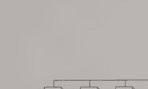

当你以销售少量产品或服务为目标时，可以使用宽而浅的网站结构。例如，专注于销售少量产品的网站，提供有限主题（五到六个）信息的网站，或者

## 咨询你的导师


### 为什么我现在就需要担心网站结构？

- 让网站有机增长似乎很有诱惑力，但这会让你的客户更难使用。它也会使网站更以公司为中心，而非以客户为中心。我曾参与过一个网站项目，所有网站区域都以代码命名，这些名称对客户毫无意义。当我们调整网站结构，并重新命名网站区域以匹配客户需求后，更多客户找到了他们想要的产品，我们也看到了销售额的增长。网站结构确实举足轻重。

## 狭深型网站

狭深型网站比宽浅型网站规模更大、分类更细。这类网站需要重点展示其信息的深度。这种网站结构假设用户可能会访问网站的几乎任何页面，而不仅仅是首页。因此，二级页面的导航变得比首页更为重要。

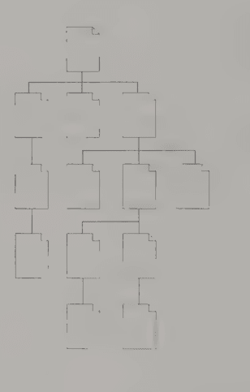

狭深型网站需要更多的思考，因为需要更多的分类。在我的`About.com`网站上，我为分类问题挣扎的时间几乎和运营网站的时间一样长。你可能会认为像学习`HTML`和网页设计这样的类别会有标准的名称，但我不得不测试了几个不同的类别，才找到一个似乎有效的：

- `HTML`入门
- 学习`HTML`和网页设计
- `HTML/XHTML`教程
- 网页设计/`HTML`教程
- 网页设计/`HTML`入门指南

狭深型网站的结构大致如下所示：

**对狭深型网站进行分类至关重要。** 如果没有分类，你的用户将无法找到他们需要的内容。有几种方法可以确定狭深型网站的分类：

- **猜测。** 这是效率最低的方法，但如果你没有时间或资源用于分类，它也能起作用。
- **猜测并测试。** 一旦你对合适的类别有了初步猜测，就让用户来测试。给用户一个任务，问他们会点击什么来完成它。例如，在一个狗狗玩具网站上，你可以问他们点击哪里能找到贵宾犬玩具，看看他们建议什么。
- **利用搜索日志。** 一旦你的网站运营了一段时间，查看用户使用哪些搜索词在你的网站上查找内容。常用词应该作为分类。
- **聘请图书馆员。** 图书馆学是研究组织系统的学科，聘请专人帮助你确定网站的分类方案是一个很好的起点。第15章可以帮助你找到外部帮助。

狭深型网站结构用于拥有大量信息的网站。它们最适合主题广泛、子类别众多的网站，比如`About.com`的网页设计/`HTML`站点，或者拥有大量不同类型产品的商品站点，如像亚马逊这样的大型在线商店。

狭深型网站很容易从宽浅型网站演变而来。如果你的网站最初只有十到二十个页面，应该从宽浅型结构开始。随着你添加越来越多的产品、服务或信息，你可以添加更多类别并加深覆盖范围。

**避免过度分类。** 很容易陷入想要看起来比实际规模更大的陷阱，许多网站通过过度分类内容来实现这一点。分类越多，用户要找到他们想要的东西就需要付出更多努力。如果你能让他们一键获取所需信息，他们会更满意，并更愿意再次光临。

### 标准页面类型

大多数网站有五种类型的网页：

1. 内容页面，包含信息
2. 产品页面，定义你销售的产品
3. 信息页面，提供关于你的网站、公司或你自己的信息
4. 导航页面，引导用户从一个地方到另一个地方
5. 首页，具有多种用途，如展示产品和文章，以及提供指向新闻发布和公关材料的链接

以下部分将更详细地介绍这些不同类型的页面。

**内容页面的目标是向用户提供关于某个主题的信息。** 这可以是从小说到非虚构文章的任何内容。如果你的网站专注于信息传递，那么它将拥有提供这些信息的内容页面。内容页面具有以下特征：

- 信息传递是页面的目标。
- 包含大量文本或描述性图像。
- 广告非常显眼。
- 会有大量指向相关页面和其他感兴趣类别的链接。

内容页面旨在向你的用户提供信息。页面的目标不是销售东西，而是向客户提供信息，以便他能采取行动。内容页面在以内容为中心的网站上最为常见，因为它们提供了这些网站传递的信息。在我的`About.com`网站上，我写的每篇文章都是一个内容页面。

内容页面传递文本或图像。有些内容页面会比其他的短。例如，一个术语表页面可能只有一两句话。页面的重点在于定义——页面的内容。

内容页面上的广告非常显眼。因为页面的目标是提供信息，广告覆盖了开发和提供这些信息的成本。

相关链接和信息几乎可以在任何页面类型上找到，但在内容页面上，它们还有一个次要目的，即引导读者获取同类别的更多信息。内容网站的目标是让人们阅读内容，因此你需要大量指向内容页面的链接。

### 你需要的工具

我在`About.com`网站上有一个展示不同页面类型的游戏。请访问`http://about.com/webdesign/pagetypes`并查看截图。这些是互联网上实际页面的截图。选择你认为它属于哪种页面类型，然后点击查看你是否正确。理解网页在网站上的使用方式非常重要。一旦你能识别它们，你就能修改设计，在你自己的网站上创建更好的版本。

**如果你的网站专注于销售产品或服务，那么它将拥有产品页面来提供有关销售内容的信息。** 产品页面具有以下特征：

- 项目符号列表和简短的文本块提供关于产品的信息。
- 一张大的产品图片展示你正在销售的商品。
- 页面上的链接指向额外的产品信息。
- 行动号召在页面的突出位置促进销售。

与内容页面不同，产品页面不会很冗长。页面上只有足够的信息来告知客户关于产品的信息，并帮助他们做出购买决定。因为页面的目的是促进销售，所以文本会很短且易于阅读，通常采用项目符号列表或非常短的段落。我网站上的一个产品页面看起来像这样：`http://about.com/webdesign/headrushajax`。

图片在产品页面上很重要。它们帮助客户识别他们正在购买的东西。即使是销售没有视觉组成部分的商品，页面也会包含一张图片来传达关于该产品或服务的某些信息。图片的目的是帮助客户决定购买销售的商品。

产品页面上的链接非常少。让客户留在页面上很重要。在某些情况下，产品页面只有购买产品或获取更多信息的链接。

产品页面必须有一个行动号召。这是一个链接、表单字段或电话号码，提示客户采取行动。在产品照片之后，这应该是页面上最显眼的元素。它吸引客户购买你销售的商品。

在第六章中，你将学习如何构建一个用于销售产品的页面。

**信息页面与内容页面类似，因为它们包含大量信息。** 然而，信息页面以公司为中心，而非以客户为中心。信息页面具有以下特点：

- 内容专注于公司而非客户。
- 包含公司的表单和联系信息。
- 使用法律术语撰写。

信息页面和内容页面的区别在于侧重点。它们旨在推广整个公司，而非特定的产品或信息。

“联系我们”页面是信息页面的一种，它允许你的客户直接与公司互动。你在信息页面上找到的表单是用来请求更多信息，而非促进销售的。


许多公司有法律要求必须在线发布的文件。隐私政策、新闻稿和用户协议都可以在网上找到。它们是政府法规或你的法律部门所要求的。这些页面的访问量可能不高，但对你的网站很重要。第七章将解释如何创建有效的信息页面。

**除非你能从主页链接到所有页面，否则你至少需要一两个导航页面。** 导航页面的目的是引导客户到网站上的其他位置。导航页面具有以下特点：

- 链接是主要内容。
- 图像仅限于图标和小图片。
- 文本仅限于短段落。
- 广告和行动号召不太突出。

链接是导航页面的目的。链接将客户从网站的一个部分带到另一个部分。一些导航页面使用长链接列表，而另一些则使用较短的列表并附带描述。

图像在导航页面上不太重要，除非它们用于帮助人们找到他们正在寻找的内容。大多数照片库的第一页就是一个导航页面，它允许你一次查看所有照片，然后进入看起来最有趣的那些。

导航页面上的文本（链接之外）仅限于描述链接及其指向的位置。页面上任何附加文本的目的都是鼓励读者点击链接。

导航页面的目标不是赚钱，因此它们不需要大量的广告或购买链接。在靠广告资助的网站上，将广告放在导航页面上是很常见的；这些广告是次要的，导航链接才是主要的。

第八章解释了如何创建导航页面，包括错误消息页面，例如“404：页面未找到”页面。

**主页很特别，因为它必须实现多个目标。** 内容页面、产品页面和导航页面只有一个目标。以下是一些主页的目标：

- 展示产品和文章。
- 提供新闻稿和公关材料的链接。
- 引导客户参与促销和特价活动。
- 包含关于你的公司和网站的信息。

在许多情况下，你的主页的目标可能会相互冲突，这使得主页设计成为一个挑战。如果你的公司有多个类别或产品线，相关负责人会希望他们的类别出现在主页上，并且尽可能靠上。由于主页如此重要且难以构建，我用整个第九章来帮助你为你的网站构建一个出色的主页。

# 现在就决定命名约定

网站结构的最后部分是用于文件、文件夹和URL的命名约定。不幸的是，这是许多公司从未考虑过的事情，或者他们在网站建成后才考虑它。如果你等到要决定命名约定时，你会有很多命名错误的文件、目录和图像。

当我构建我的HTML标签库（`http://about.com/webdesign/htmltags`）时，我决定在文件名中加入“tags”这个词。我这样做是为了便于将这些页面作为一个组来跟踪。我把它们都命名为类似“bltags-a.htm”的名字。但随着About.com系统的更改，我遇到了两个问题：

- 文件名中不允许使用连字符。
- 文件名长度不能超过15个字符。

我不得不重命名所有文件以移除连字符，并且不得不将像“bltags-blockquote.htm”这样超过15个字符限制的文件名缩短。这花了我近三个月的时间才完成。如果一开始就指定了命名约定，我就不会有这些额外的工作了。

在阅读这本书的过程中，你将与我一起构建一个网站。我正在为我的狗构建一个网站。该网站的目标是提供更多关于狗的信息，并销售我的狗喜欢的玩具和设备。该网站将包含内容页面、产品页面以及信息页面和类别页面。它将是一个小型网站，因此它将具有宽而浅的网站结构。我已经在我的About.com网站上放了一些关于它外观的模拟图：`http://about.com/webdesign/mockups`。在本书的其余部分，我将继续引用这个示例网站。

## 你需要的工具

网站上可能有太多不同的文件类型，无法全部列出。许多Web服务器有一个名为`mime.types`的文件，列出了服务器识别的文件类型，这个文件可能非常庞大。幸运的是，只有少数几种文件类型和扩展名需要你理解。这些在“Web文件类型”一文中列出，地址为`http://about.com/webdesign/filetypes`。

**从目录开始。** 目录是你的文件在网站上的存储位置。参考你在第一章的计划。你想要拥有哪些网站元素？命名目录最简单的方法是使用这些计划中的网站元素作为目录名称。例如，在我的示例网站中，我将有以下目录：

**类别**

- `/breeds`
- `/health`
- `/photos`

**关于本站**

- `/about`

**全站共享内容**

- `/images`
- `/styles`
- `/scripts`

在我的示例网站中，我将销售狗玩具。由于它比信息网站小，所以目录较少：

**待售产品**

- `/products`

**关于本站**

- `/about`

**全站共享内容**

- `/images`
- `/styles`
- `/scripts`

两个网站的共享内容和信息页面的目录名称相似。区别在于类别和产品部分。信息网站有更多类别，因为它将包含广泛的狗的信息。产品网站较浅，因为页面较少，其目标是销售狗玩具而非提供内容。

**合理命名你的文件。** 我在About.com遇到的命名约定问题是我们从一个自由格式系统迁移到一个数据库驱动系统，在这种系统中，扩展文件名的空间不那么大。你可以采取一些简单的措施来防止文件名出现问题：

- 文件名不应包含任何特殊字符。将文件名限制为字母、数字和下划线（`_`）。
- 始终为你的文件添加扩展名。对于你的网页，应该是`.htm`或`.html`。对于图像，使用`.gif`或`.jpg`。对于脚本和样式，分别使用`.js`和`.css`。
- 保持文件名简短。十五到二十个字符（包括扩展名）是一个好的经验法则。
- 使用有意义的词语。维护一个所有页面都带有计算机生成名称的网站是不可能的。

**记录你的命名约定。** 拥有命名约定很重要，但它只有在你写下来时才有效。你的文档应包括以下内容：

**项目**

- 目录
- HTML文件
- 图像
- 多媒体文件

# 命名约定

- 可接受的字符
- 长度
- 特殊编码，如日期戳或首尾字符

# 位置

- 在网站上
- 备份

**谁可以更改命名约定**

我在我的About.com网站设计/HTML网站上的文件中使用了多种命名约定。例如：

| 文件类型 | 命名约定 | 示例 |
| :--- | :--- | :--- |
| 文章 | 以“aa”开头，后跟首次发布的日期（MMDDYY）。不允许特殊字符。全部小写。最大长度为15个字符。 | `aa102797.htm` |
| 词汇表条目 | 以“bldef”开头，后跟尽可能多的单词。不允许特殊字符。全部小写。最大长度为15个字符。 | `bldefagent.htm` |
| HTML标签 | 以“bltags_”开头，后跟尽可能多的标签名称。除下划线外，不允许特殊字符。全部小写。最大长度为15个字符。 | `bltags_var.htm` |

## 获取链接

网站结构是网站的重要组成部分。这些指向About.com网站的链接将帮助您进一步构建网站结构并规划网站架构。

- **信息架构链接**
  - 关于信息架构的学习有很多资源和帮助，我已在我网站上收集了一些较优质的资源。
  - `http://about.com/webdesign/infoarchitecture`
- **赶走读者的十大禁忌**
  - 在思考网站结构时，请牢记这些技巧。如果您知道不该做什么，就能专注于应该做的一切。
  - `http://about.com/webdesign/whatnottodo`
- **网站结构链接**
  - 构建网站结构对于制作对客户有用且有趣的网页至关重要。
  - `http://about.com/webdesign/sitestructure`

## 托管您的网站

### 为什么托管很重要

理解网站托管的方式是将网页视为一个实际场所，比如您的房子。它有一个地址，即URL；它由构建模块组成，即HTML；它还有一个物理位置，即托管服务提供商。

大多数初学者面临的问题是，网页是在您的计算机上查看的，而当您开始构建它们时，也是在同样的计算机上构建。许多初学网页设计师认为他们在浏览器中查看的网页就在计算机上。但事实并非如此。当您访问一个网页时，您并非将该URL的网页复制到您的计算机；相反，您是在访问那个网页的房子——位于一个完全不同的位置。您的计算机是载您从一个地址（URL）前往另一个地址的交通工具。构建网页时，您需要将其放置在其他浏览器可以访问到的地方。那个地方就是您的网站托管。

**主题：**

- 为什么托管很重要 - 第31页
- 选择托管服务提供商 - 第32页
- 获取域名 - 第40页
- 经济实惠和免费的网站托管 - 第42页

**您需要网站托管才能向其他人展示您的网页。** 您完全可以在计算机上创建一个网页甚至整个网站，而不将其放在托管服务提供商上。但这样唯一能看到它的人，就是那些可以来看您计算机的人。（被称为信息亭的网站就是这样构建的，但它们超出了本书的范围。）网站托管服务提供商会为您的网页提供一个地址或URL，以及一个物理位置。

**选择正确的网站托管很重要。** 可以将网站从一个托管服务提供商迁移到另一个，但这可能非常困难。除非您的网站非常小，只有五个或更少的页面和一些图片，否则迁移网站可能非常费力。为您的业务找到正确的网站托管服务提供商并将网站留在那里要容易得多。

我从经验中得知这一点。在找到最适合我的平台之前，我将一个中型小型企业网站（约500页）迁移到了三个不同的托管平台。每次迁移都导致网站至少下线一天，而且内容或程序（或两者）在新主机上总是缺失，必须重新构建。

### 选择托管服务提供商

与网页设计软件一样，价格并非托管服务中最重要的特性。您需要考虑更大的图景。您不会仅仅基于价格购买房子，您也不应该以此为基础为您的网站购买“房子”。如果幸运，您的网站将在您现在选择的托管服务提供商那里存活很多年。

**易用性非常重要。** 这个标准的问题在于，除非您使用过，否则很难知道托管服务提供商是否难以使用。

为了测试一个托管服务提供商，最好的解决方案是要求试用期。然后您可以尝试构建和维护一两个页面，找出您喜欢的提供商对您来说使用起来有多容易。

在决定之前，请问自己以下问题：

- 将文件上传到Web服务器有多容易？
- 我的网页设计软件能连接到他们的服务器吗？
- 是否有二十四小时技术支持热线供我拨打？
- 该热线是免费电话还是本地通话区？
- 如果我需要，提供商是否提供额外服务，例如`CGI`安装、服务器补丁或模块？
- 这些额外服务在我的预算内吗？
- 在线工具对我来说直观易用吗？
- 是否有工具的文档，是否易于理解？
- 是否有使用相同托管服务提供商的用户支持小组或其他兴趣小组？
- 是否有我可以访问的在线论坛寻求帮助？

虽然并非所有这些选项都是托管服务提供商易于使用的必要条件，但提供的越多越好。我发现从使用相同系统的其他人那里获得帮助比尝试通过公司的帮助页面要容易得多。但如果帮助唾手可得，这就不是问题了。

二十四小时技术支持很有用，尤其是在开始时。如果您弄不清楚如何将网站放到托管服务器上，有人向您展示如何操作就很重要。而且当您第一次在晚上11点遇到访问问题时，您会感激有可用的技术支持人员。

## 您需要的工具

如果您正在考虑测试一个托管服务提供商，并且无法确定它是否易于使用，您可以随时在`http://about.com/webdesign/forums`的网页设计/HTML论坛上询问人们。在那里发布问题很容易，而且很多人会阅读页面。那里可能有人使用您正在考虑的托管服务提供商。此外，他们可能对满足您标准的其他托管服务提供商提出建议。

## 网络其他资源

> 保持安全对小企业来说可能是一个挑战，而让您的网站既安全又易于管理可能更加困难。这篇来自Symantec关于网络安全预防技巧的文章（`www.symantec.com/avcenter/cybercrime/prevention.html`）应该有所帮助。它解释了如何创建强密码、保持补丁更新以及配置系统以确保安全。

**对网站的访问包括虚拟访问和物理访问。** 网站访问是您发布页面和进行更改的方式。如果您使用的是服务器托管服务提供商，您将需要物理访问您的Web服务器。（术语“colocation”指由公司拥有的Web服务器，但由提供Internet访问的其他公司托管。）

在某些公司中，出于安全原因，您可以访问网站的唯一地方是在公司防火墙后面。但其他企业需要让其网站在网页开发人员所在的地方都可访问。这在小型企业中尤其如此，因为网页开发人员可能也是主要销售人员，甚至是首席执行官。

安全很重要，在您决定希望从任何地方访问网站之前，您应该评估公司的需求。如果您可以访问，那么黑客也可以。不要假设因为网站小就是安全的。大多数小公司没有做足够的事情来保护他们的网站免受黑客攻击。

大多数情况下，网站的安全只需要创建强密码并定期（每1到3个月）更改。强密码由至少八个字符组成，并且不是字典中会包含的单词——它包括字母、数字和符号的组合。它不是基于您的个人信息。

如果您为访问网站的帐户创建了强密码，您就可以在防火墙或其他安全设备之外更大程度地访问您的网站。这使得当您是唯一所有者或需要在办公室外编辑网站时，访问更加容易。

我喜欢设置我的网站，以便我可以从几乎任何地方访问它们。如果我在度假时发现网站有问题，我不会等到回来再修复它。我会立即处理安全问题。

### 热门话题

- Web托管服务器上的空间与您个人硬盘驱动器上的空间不同。Web服务器全天候24小时、每周7天运行，大部分时间都有人在访问Web服务器硬盘。您的个人或工作计算机可能一直开着，但即使您是个工作狂，您也不会持续地对硬盘进行操作。（每个人总要睡觉的。）即使您的网站没有那么大的流量，如果您使用的是共享托管系统，系统的其余部分仍有流量——因此您需要一个能承受这种负载的硬盘驱动器。

其次，Web服务器硬盘通常不是一个硬盘。大多数托管提供商使用所谓的驱动器阵列，即多个磁盘，以确保数据安全和冗余。如果阵列中某部分的数据出现问题，Web服务器不会宕机超过几秒钟，直到阵列能将数据恢复在线。一些托管服务也提供多个磁盘阵列，以此来平衡Web服务器的负载。如果很多人访问第一个磁盘，第二个磁盘就会上线，以确保网站对所有人都保持快速。

注意您的网站需要多少空间。请记住，如果您今天使用10GB，明年可能需要100GB，或者只需要15GB。看看您的网站计划，并估算一下您认为在一两年内需要多少空间。这里有一些好的衡量标准：

- 一些提供商根据您的平均使用量收费。如果您的网站页面浏览量突然激增，这可能会给托管提供商带来很多问题。因此，他们可能不是按月带宽收费，而是按您的流量峰值收费，即使您整个月的流量低于您的限额。这在我关于“主机托管带宽计费”的文章（`http://about.com/webdesign/bandwidthbilling`）中有解释。

| 网站元素 | 所需空间 | 典型数量* | 每年增长量 |
| --- | --- | --- | --- |
| HTML | 每页20–30KB | 20–30页 | 24页（每月2页） |
| CSS | 每个文档20–50KB | 2–5个文档 |  |
| 图像 | 每张图片30–50KB | 每个网页2–5张图片 | 48–60张新图片 |
| 多媒体 | 每个文档40–50KB | 取决于网站** | 取决于网站** |
| 脚本 | 每个脚本10–20KB | 5–10个脚本 | 6–12个新脚本 |

\* 大多数小企业的网页、CSS、图像和脚本都是从这个范围开始的。

\** 多媒体占用大量空间，但并非所有网站都需要它。如果您的网站需要为每个产品提供一个PDF，您将需要比只有一个Flash演示的网站更多的空间。

明智地规划您的空间需求。一开始就使用大量空间是更困难的。我发现许多Web开发人员在面对大量空间时，会将其视为一个挑战，看看他们能多快填满它。仅仅因为您现在有10或100GB的空间，并不意味着您应该创建10或100MB的图像来填充它。如果您节省使用空间，您的客户会感谢您，因为您的网页下载会很快。您的利润线也会感谢您，因为您不会为网站的空间和**带宽**费用花费越来越多的钱。

**留意带宽限制。** 这些可能是您托管提供商收入的重要来源，也是您的一大笔现金流出。非常重要的是，您需要知道您的托管提供商是否对超出的带宽收费，或者是否有带宽限制。

带宽是衡量您的网站获得多少流量的指标，乘以发送出去的数据量。例如，如果您的一个网页大小为1KB，没有关联的图像、脚本或外部CSS文件，那么每次有人访问该页面，您将看到1KB的带宽传输量。大多数托管提供商都有带宽限制，一旦您达到最大带宽，就会收取更多费用。

请记住，带宽不仅仅是您的网页和图像的大小。它还包括您网站的访问量。如果上面示例网站有足够的访问量，其每月带宽使用量可能达到1GB。因此，即使您的网站很小，如果它变得受欢迎，也可能需要大量的带宽。对于一个新网站来说，带宽限制不会太重要，但要注意您提供商的政策，这样当您的网站大受欢迎时，您才不会收到巨额账单。

**不要忽视托管工具。** 了解您将来可能需要哪些可用工具来管理您的网站是件好事。您会发现的一些最常见的工具包括：

- FTP和文件管理软件，用于将文件传输到您的网站
- CGI访问，用于在Web服务器上编写程序
- 预构建的Web程序，如博客、日历、论坛和聊天室
- 日志分析工具，帮助您跟踪页面浏览量

很容易被托管提供商的文件管理系统（它能为您处理一切）的宣传所吸引，但如果您有FTP软件，您可能不需要那个工具，它甚至可能妨碍您维护网站。对于CGI或预构建程序等项目也是如此。如果您认为自己不会在网站上使用它们，那么为什么要为这些功能额外付费呢？

当我在考察托管提供商时，我需要几个特定的工具：

- 获得我网站的Shell访问权限是最重要的。这样我就可以在服务器上直接测试程序和进行更改（如果需要）。
- 获得我网站的FTP访问权限也非常重要。我不想被迫使用基于Web的文件传输工具，因为那可能会拖慢速度。
- 网站的CGI支持让我可以使用程序。我可以自己编写程序，也可以从网上的其他网站获取预构建的程序。

**服务器操作系统在选择托管提供商时很重要。** 它不必与您计算机的操作系统匹配，但应该是一个能为您的网站提供所需功能的操作系统。

| 操作系统 | 优点 | 缺点 |
| --- | --- | --- |


| 操作系统 | 优点 | 缺点 |
| :--- | :--- | :--- |
| `Linux` | 最常见的服务器操作系统。提供`CGI`脚本。在`Linux`服务器上维护网站有大量的帮助资源。 | 如果您不熟悉`Unix`文件系统，学习起来可能很难。例如，`Linux`文件名区分大小写，而`Windows`中则不区分。 |
| `Macintosh` | 良好的`Java`支持。`Macintosh`操作系统是`Unix`，拥有与`*nix`系统相同的所有功能。 | 非常难找到。 |
| `Unix` | 非常安全。 | 使用困难，类似于`Linux`系统。可能昂贵且难以找到。 |
| `Windows` | 支持`ASP`。熟悉的界面。 | 不如`Linux`常见。存在许多安全问题。 |

**托管提供商的类型也很重要。** 最常见的托管提供商是基本的Web托管提供商。他们提供以下内容：

- 服务器上的空间
- 指向您网站的特定URL
- 对Web服务器的访问，通常通过`FTP`或`shell`

要构建一个网站，您只需要一个基本的Web托管提供商。您可能会发现您的互联网服务提供商（`ISP`）可以提供满足您业务需求的托管服务。`ISP`托管计划的最大好处是，它们通常随您的互联网服务免费提供。缺点是它们的空间和带宽限制非常小，而且您的URL会是又长又难记的东西。

如果您打算使用您的`ISP`作为托管提供商，那么也请考虑使用域名主机。域名主机将您购买的域名指向您的`ISP` URL。

主机托管（Collocation）是Web托管的另一种选择。您不是依赖托管提供商在服务器上为您提供空间，而是自己提供服务器（和空间）。您付费的是将您的硬件连接到他们的互联网接入。主机托管是希望完全控制其网站的公司的绝佳选择。通过主机托管，您可以控制服务器硬件、操作系统、Web服务器软件以及任何其他内容。

## 您需要的工具

为Web服务器决定使用什么操作系统可能很困难。`Linux`是目前最常见的Web托管服务器操作系统，但这并不意味着它是最适合您需求的系统。我的文章“Windows与Linux用于网页托管”（[`http://about.com/webdesign/windowsvslinux`](http://about.com/webdesign/windowsvslinux)）解释了各种操作系统之间的区别以及如何为您选择正确的系统。

### 网上其他资源

- 如果您对用于Web服务器的`CGI`脚本感兴趣，我最喜欢的地方之一是CGI资源索引（[`http://cgi.resourceindex.com`](http://cgi.resourceindex.com)）。该网站提供许多不同类别的程序。它甚至列出了可以为您构建`CGI`脚本的开发人员。

## 获取域名

域名对网络业务至关重要。虽然使用带有难看网址的免费网站来开展网络业务是可行的，但最成功的业务都拥有与其业务或品牌相关的域名。

### 热点提示

- 如果你考虑使用你的互联网服务提供商（`ISP`）作为托管服务提供商，并且不确定你的网址会是什么样子，可以看看你的`ISP`托管的其他网页。通常，它们会在开头使用`ISP`的名称，然后是一个波浪号，接着是登录名。例如，我在Netcom上的个人网站的网址是`www.netcom.com/~jkyrnin`（现已不存在）。我的文章《我的网址是什么？》（[`http://about.com/webdesign/myurl`](http://about.com/webdesign/myurl)）描述了如何弄清楚你现在的或未来的网址是什么。

### 步骤1：选择你的域名注册商

有很多域名注册商可供选择，你可以根据价格或可用性来选择。一些比较受欢迎的域名注册商如下：

| 注册商 | 网站 |
| :--- | :--- |
| GoDaddy | [`www.godaddy.com`](http://www.godaddy.com) |
| Network Solutions | [`www.networksolutions.com`](http://www.networksolutions.com) |
| Register.com | [`www.register.com`](http://www.register.com) |
| Whois.com | [`www.whois.com`](http://www.whois.com) |
| directNIC | [`www.directnic.com`](http://www.directnic.com) |

我使用Network Solutions，这是最古老且最知名的域名注册商。一年期的注册费用比其他服务要贵一些，但对于更长的期限，它们具有竞争力。我喜欢他们的服务，而且他们让寻找可用域名变得很容易。

### 步骤2：选择你的域名

很可能别人已经注册了你的首选域名。域名注册商会帮助你选择另一个名字，可以使用相似的措辞或不同的后缀（例如，除了`.com`，你可以选择`.net`或`.org`）。你需要一个能够代表你的公司、易于记忆和输入，并且不会与其他事物混淆的域名。

### 购买你的域名

我会购买十年期的域名，这样我就可以在很长时间内不用担心它。十年的费用大约是每年10到25美元，对于大多数企业来说这是一笔很小的开支。从低成本的域名托管商那里购买域名似乎是省钱的好方法，但从长远来看可能会让你付出代价。域名注册商可能会倒闭，导致他们注册的域名处于无人管理的状态。如果你选择低成本的注册商，请确保你购买的是域名的完整所有权，而不仅仅是计费信息。这包括域名的技术联系人和管理联系人。确保如果你以后决定更换注册商，可以自由更换。

我从不购买“无限期”或100年期的域名注册。虽然每年的费用可能低很多，但没有多少企业能存在超过100年。

### 向你的顾问请教

> **主机托管听起来很贵。为什么我会选择它？**

我使用主机托管服务已经快三年了，我非常喜欢它。主机托管比任何其他托管类型都能让你对Web服务器及其内容有更大的控制权。我喜欢我可以控制谁能看到我的网站，他们看到什么，以及什么内容被托管在那里，而无需与任何支持人员打交道。而且我的Web服务器使用T3连接提供服务，速度非常快。

> **购买域名很难吗？**
>
> - 在我的网站上查看我的分步教程：[`http://about.com/webdesign/buydomainname`](http://about.com/webdesign/buydomainname)。你会惊讶地发现，为你的公司购买域名是多么容易，以及Network Solutions提供的所有额外功能。
> - 你可以获得年费折扣。
> - 只要你拥有该域名，其他人就无法使用它。
> - 你可以在该时间段内将其出售给他人。
> - 你不必每年续订域名。

## 经济实惠和免费的Web托管

与Web设计软件不同，你可以在托管选项上更节俭一些，同时仍然为你的业务维护一个出色的网站。关键在于知道要保留什么。

### 使用你的ISP

尤其是在你刚起步的时候，你的网站不需要太多空间，因此使用`ISP`是一种在不花费大量托管费用的情况下让业务上网的好方法。咨询你的互联网服务提供商；许多套餐都包括在他们的服务器上为你提供空间来建立网站。

如果你的`ISP`不提供免费的Web托管，那么可以去像GeoCities或Tripod这样的免费网站托管站点。我在我的网站上列出了一些更好的选择（[`http://about.com/webdesign/freewebhosting`](http://about.com/webdesign/freewebhosting)）。这些免费网站的问题在于，你实际上是通过放置在你的网站上的广告来支付费用的。这会影响你网站的布局和设计，并分散客户的注意力。

### 购买十年或更长时间的域名

从长远来看，150到250美元对于一个企业来说，无论大小，都不是一大笔钱。如果你购买更长期限的域名，大多数域名注册商会给你年费折扣。这样做你会获得几个好处。

### 转发你的域名

一旦你的网站在`ISP`上建立起来，就买一个域名。但不要使用他们提供的托管选项，而是将域名转发到你的免费网站（例如你`ISP`上的网站）。域名转发会告诉互联网，当有人请求你购买的域名时，应该显示托管在你免费URL上的页面。

### 研究并为未来做规划

很可能，你最终需要将网站从`ISP`迁移到更传统的托管方案。理想情况下，迁移你的网站意味着在旧服务器上压缩站点，然后在新服务器上解压。但这几乎从来都不是那么简单。一些托管服务不提供压缩文件（或解压文件）的访问权限。如果你是从一个操作系统迁移到另一个，传输可能会出现额外的问题。提前规划，采取以下步骤：

- 保持你的网站是最新的。如果你必须迁移，在迁移期间你将无法维护网站。如果它是最新的，中断就不会那么明显。
- 删除你不再链接或使用的文件。
- 在本地硬盘上保留网站的备份。
- 跟踪依赖于服务器的文件，如`CGI`和`PHP`脚本。
- 记录你的文件系统（命名约定、文件夹名称和位置，以及网站的任何特殊功能）。

为你的网站找到合适的托管解决方案可以在未来为你省去很多麻烦。

> **网络其他信息**
>
> 在购买域名之前，一定要和其他人测试一下你的域名创意。虽然它对你来说可能很有意义，但域名的书写方式可能会导致一些无意中好笑的误解。文章《十大最糟糕的公司网址》([`http://independentsources.com/2006/07/12/worst-company-urls`](http://independentsources.com/2006/07/12/worst-company-urls))列出了一些糟糕的域名。

---

### 关于“获取域名”部分之前的托管解决方案

你可能想在网站上运行的应用程序。你的托管服务提供商为你提供机架空间，将你的服务器放置在网络上，并提供互联网连接。一些主机托管提供商还提供服务器和机架的租赁。这被称为托管式主机托管。他们维护硬件和软件，你将你的网站放在上面。如果你不想维护服务器，但又不想让你的网站托管在共享托管提供商上，这是一个不错的选择。

**很难决定使用哪种托管解决方案。** 但这一切都回到了你对网站的原始计划。根据你对网站的计划回答以下问题，然后你就可以比较不同的托管解决方案了：

- 我预计我的网站现在有多大（在空间使用上）？一年后？五年后？
- 我需要在我的网站上运行特殊的程序吗，比如`PHP`、`CGI`、`ASP`、`JSP`或`ColdFusion`？
- 我预计我的网站会出现大的流量高峰，还是每周的页面浏览量都很稳定？
- 我需要对我的网站硬件和软件有多大的控制权？
- 我愿意为网站托管支付多少费用？

一旦你知道了这些问题的答案，就可以去看看Web托管公司。一个很好的起点是我About.com网站上的Web托管列表，地址是[`http://about.com/webdesign/webhosting`](http://about.com/webdesign/webhosting)。

## 获取链接

托管可能是一个非常复杂的话题，而且有很多资源可以帮助你找到完美的托管服务提供商。

## 什么是托管以及为什么你会选择它作为网站托管？

许多小企业没有意识到，如果他们选择使用托管服务而不是外部托管解决方案，他们可以拥有与大企业相同的网站服务器选择。这个关于托管的系列文章涵盖了你需要知道的所有内容，以便做出决定。

[`http://about.com/webdesign/colocation`](http://about.com/webdesign/colocation)

## 购买网站托管之前

如果你想快速了解网站托管和你的选择，这篇文章应该有所帮助。它涵盖了网站托管的基础知识，并提供了一些建议，帮助你获得适合你的托管服务。

[`http://about.com/webdesign/bybwebhosting`](http://about.com/webdesign/bybwebhosting)

# 第4章：代码全解


## 主题

- 决定你需要什么代码（第45页）
- 从HTML开始（第47页）
- 用`CSS`添加样式（第61页）
- 一些简单的`JavaScript`（第65页）

## 决定你需要什么代码

网页设计师至少需要对构建网页所需的`HTML`代码有最基本的了解，这一点很重要。虽然现在有一些网页编辑器不允许你查看代码，更不用说编辑了，但大多数专业网站都不是用它们构建的。在工具和标准更加同步之前，你了解一点`HTML`是很重要的。

幸运的是，`HTML`并不难。不幸的是，还有许多其他语言你可以学习，以构建顶级的网站。其中一些相当难学。

**HTML只是Web代码的一种类型。** 虽然网页的基础是`HTML`，但还有其他几种语言也用于构建网页，包括：

- `(X)HTML`
- `ASP`
- `ColdFusion`
- `JSP`
- `PHP`

`HTML`（也称为`XHTML`）代表超文本标记语言（`XHTML`中的`X`代表可扩展）。它是网页的基本构建块。

如果你想在你的网站中添加一些`PHP`、`JSP`或`ASP`，About.com上有网站更详细地涵盖这些主题。有一个完整的`PHP`和`mySQL`指南网站（[`http://php.about.com`](http://php.about.com)）。About.com的`Java`指南有一个专门介绍`JSP`和`Java Web`编程的部分（[`http://about.com/java/javawebprogram`](http://about.com/java/javawebprogram)）。

**纯HTML就是你所需要的。** 所有这些其他语言都很有用且有其目的，但它们可能非常高级且难以学习。很容易为数据库驱动、包含大量编程和动态操作的网站的想法感到兴奋，但你只需要`HTML`（和一些`CSS`）。阅读完本书后，你将学到足够的`HTML`和`CSS`来构建一个网站，而无需使用任何其他高级语言。

**JavaScript呢？** `JavaScript`是一个特例。它是一种客户端编程语言，允许你在网页上执行令人兴奋的操作。这种语言非常强大，有很多关于编写优秀`JavaScript`的书籍。About.com `JavaScript`指南在他的网站上提供了大量关于该主题的信息（[`http://javascript.about.com`](http://javascript.about.com)）。在本书中，我将为你的网站提供一些简单的脚本，但如需更高级的培训，请参阅About.com `JavaScript`网站。

**当有意义时使用其他语言。** 初级网页设计师可能会对技术过于着迷，以至于他们的网页变成了样式、设计、脚本、动画和混乱的混合体。Web技术遵循一个层次结构。如果你可以使用层次结构的最低一级来解决问题，就不要向上攀登：

- **第1级：HTML**——`HTML`是所有网页的基础。你可能会对仅用几个`HTML`标签就能做什么感到惊讶。当解决Web问题时，从这里开始。
- **第2级：CSS**——`CSS`或层叠样式表创建了网页的外观和感觉。如果`HTML`是你页面的结构，那么`CSS`就是平面图和配色方案。当解决Web问题时，第二个考虑`CSS`。
- **第3级：客户端脚本**——`JavaScript`、`ActiveX`和其他客户端脚本为你提供了在网页上的大量灵活性。这些不直接与Web服务器交互，侵入性较小。`JavaScript`是解决Web问题的第三步。
- **第4级：Web应用程序**——`Flash`、小程序和对象都为你的网页增加了更多功能，但以可用性和可访问性为代价。它们对服务器和系统要求更高，在解决Web问题时应第四个考虑。
- **第5级：服务器端脚本**——这些是像`JSP`、`ASP`、`Perl`和`PHP`这样的编程语言。它们在Web服务器上运行。它们需要更多的知识来开发，在解决Web问题时应最后考虑。

我将在第14章更详细地介绍高级技术。

## 从HTML开始

有数百种`HTML`标签可用于构建网页，但你可能会惊讶地发现，大多数网站只使用了可用标签中的一小部分。你可以只用六种类型的标签构建一个网站：

### 你需要的工具

*如果你仍然决心使用最新和最好的Web技术，那么请阅读我的文章“设计前沿网站”([`http://about.com/webdesign/cuttingedge`](http://about.com/webdesign/cuttingedge))。它提出了四个关于技术的问题，让你自己思考，以确定它是为你的客户还是仅仅为你的自我而设的。*


### 向你的指南提问

**我正在使用一个WYSIWYG编辑器。为什么我需要了解HTML？**

你可能会惊讶于学习`HTML`是多么容易。你可以只用大约20个标签构建一个高质量的网站。如果你能学会这些标签，那么你就可以把你的`WYSIWYG`编辑器用于它擅长的地方：帮助你可视化应用于`HTML`的样式。

- 结构标签
- 文本标签
- 列表标签
- 图像标签
- 链接标签
- 布局标签

许多这些标签类别只有一个`HTML`**元素**，你应该学习使用。

**但在我们学习具体标签之前，让我们先谈谈HTML。** 在本书中，我将教你有效的`XHTML`，它是`HTML`的一个高级版本。在接下来的文本中，我将交替使用`XHTML`和`HTML`这两个术语。编写`HTML`时，请确保遵守以下规则：

- `HTML`是一种文本语言。你不能使用像Microsoft Word这样的程序来编写`HTML`。只使用`HTML`编辑器或文本编辑器。
- 有效的`XHTML`都是小写的。
- `HTML`由元素（也称为标签）和这些元素的**属性**组成。
- 元素被尖括号`<`和`>`包围。
- 初始尖括号后的第一个单词是标签。例如，`<strong>`——`strong`是元素名称。
- 属性包含在标签后的空格之后。属性的名称首先给出，然后是等号，然后是引号中的属性值。例如，属性`href`将这样编码：`<a href="http://webdesign.about.com/">`——`href="http://webdesign.about.com/"`是属性。
- 元素总是有一个开始标签和一个结束标签。
- 结束标签与开始标签匹配，但在第一个尖括号后有一个斜杠，如下所示：`</strong>`。
- 两个标签之间包含的文本受该元素影响。例如，被`<a>`标签包围的文本将被链接。在`<a href="http://webdesign.about.com/">About.com Web Design/HTML</a>`中——“About.com Web Design/HTML”是链接文本。
- 一些标签不包含任何文本，因此结束标签可以折叠到开始标签中。例如，换行符写成：`<br/>`。

结构标签是`HTML`文档的骨干。这些标签告诉Web浏览器它正在显示的是一个网页，而不是PDF或其他文档。每个网页都应在文档中包含结构元素。


```html
<html> . . . </html>
```

这是 HTML 文档中最外层的元素。`<html>` 标签应该是你网页上的第一个标签，而 `</html>` 标签应该是最后一个。

```html
<head> . . . </head>
```

HTML 文档的头部包含关于网页的信息，这些信息不会显示在页面上。这包括标题、指向 CSS 和脚本的链接以及元数据等。

```html
<title> . . . </title>
```

此标签标识网页的标题。这是在搜索引擎结果、书签和 Web 浏览器标题栏中显示的内容。

## 热点

> 你可能认为你知道什么是文本，但如果你只熟悉 Word 文档，那你就错了。对计算机来说，文本与屏幕上的字母不同，大多数允许你在计算机上写文本的程序（不是 Web 编辑器）都在写富文本。富文本是带有内置格式的文本。网页是没有格式的文本。我的文章“什么是文本和什么是文本编辑器？”（http://about.com/webdesign/whatistext）解释了其中的区别。

## 文本标签是用于定义内容的标签

这些标签用于段落、换行、标题、加粗和强调。它们为文本提供一些定义。在有效的 XHTML 中，HTML 标签不用于描述页面外观。相反，文本的外观是从语义上定义的。例如，你正在阅读的这段文字位于一个段落中，因此它会被包含在一个段落元素中。我会使用 CSS（而非 HTML）来使段落变大、变红并加粗。

我们将使用以下 HTML 文本标签：

```html
<p> . . . </p>
```

段落标签：所有位于段落中的文本都应包含在此元素中，每个段落一个元素。

```html
<br />
```

换行标签：此元素在网页上将文本分成两行，一行在元素前，一行在元素后。

```html
<h1> . . . </h1> <h2> . . . </h2> <h3> . . . </h3>
```

标题标签：`h1` 标签是页面上最重要的标题，`h2` 是第二重要的标题，`h3` 是第三重要的标题。HTML 允许最多六级标题。

```html
<strong> . . . </strong> <em> . . . </em>
```

加粗和强调标签：这些标签告诉浏览器，被包含的文本具有更强或更强调的语气。虽然浏览器有标准的方式来显示加粗和强调的文本（通常是加粗和斜体），但我们将使用 CSS 来确切地定义我们希望这些标签的显示效果。

```html
<blockquote> . . . </blockquote>
```

用于定义引用的标签：`blockquote` 标签用于标出被引用的文本。

我们可以将这些标签添加到我们的网站中——这正是我们向网页添加内容的地方。所有文本元素都包含在 `<body>` 元素中，如下所示。

```html
<!DOCTYPE html PUBLIC "-//W3C//DTD XHTML 1.0 Transitional//EN"
"http://www.w3.org/TR/xhtml1/DTD/xhtml1-transitional.dtd">
<html>
<head>
<title>Dogs and Their Toys</title>
<meta name="description" content="Great dog toys that your dogs will love and information about dogs." />
<meta name="keywords" content="dogs, dog toys, canines, information about dogs, dog help" />
</head>
<body>
<h1>Dogs and Their Toys</h1>
<p>
My two dogs would like to share their special knowledge of dog toys. In the course of their life they have tried out numerous dog toys and found that some work better than others.
</p>
<h2>Who Are the Dogs?</h2>
<p>
<strong>Shasta</strong> - a 6-year-old <em>mutt</em><br />
<strong>McKinley</strong> - a 1-year-old <em>Border collie</em>
</p>
<p>McKinley says:</p>
<blockquote>I like dog toys that are soft and easy to rip up. They call me the Doctor, because I like to surgically remove the squeakers.</blockquote>
<p>Shasta says:</p>
<blockquote>My favorite dog toy is McKinley, because any toy I play with he steals from me. But if I had to choose, I'd pick the big fluffy balls.</blockquote>
</body>
</html>
```

如你所见，我已经在 `<body>` 和 `</body>` 标签之间添加了所有这些新标签（及其对应的文本）。当您在网页浏览器中查看页面时，虽然页面看起来不太美观，但所有内容都显示出来了。

尝试在你的网页上添加自己的段落、标题和引用。HTML 代码可在线获取（[http://about.com/webdesign/example4-2code](http://about.com/webdesign/example4-2code)）。

## 列表标签用于项目列表

列表很重要，因为尽管它们并不总是（使用 CSS）被格式化为带项目符号的列表，但我们在网页上处理的大多数内容都是列表。一个网站可能包含以下列表：

- 网站导航
- 可供销售的产品
- 联系方式和邮寄地址
- 站内文章
- 相关网站链接

在许多网站上，你会看到设计师将列表写成段落、表格、区块或用 `<br />` 分隔的文本行。这是不正确的。应使用列表元素：

```html
<li> . . . </li>
```

此标签用于列表项本身。列表中的每个项目都应包含在此元素中。

```html
<ul> . . . </ul>
```

此标签用于无序列表，其中元素没有固有顺序。这是标准的项目符号列表。`<ul>` 元素内部只允许包含 `<li>` 列表元素本身。

```html
<ol> . . . </ol>
```

此标签用于有序（或编号）列表，其中元素按特定顺序排列。与 `<ul>` 元素一样，其内部只允许包含 `<li>` 元素。

我的示例页面确实包含一个列表：我的狗的名字。在页面的第一个版本中，我使用了 `<p>` 和 `<br />` 标签来显示列表，但为了更准确，我应该将它们转换为列表：

```html
<ul>
<li><strong>Shasta</strong> - a 6-year-old <em>mutt</em></li>
<li><strong>McKinley</strong> - a 1-year-old <em>Border collie</em></li>
</ul>
```

我可以为狗最喜欢的玩具使用有序列表（[http://about.com/webdesign/example4-3](http://about.com/webdesign/example4-3)）：

```html
<ol>
<li>Soft squeak toys</li>
<li>Any toy Shasta has</li>
<li>Squeaky tennis balls</li>
</ol>
```

另一种列表形式是定义列表。定义列表有三个元素：`<dl>`、`<dt>` 和 `<dd>`。当你有一个由单词或短语以及其定义组成的项目时，请使用定义列表。对于狗的列表，我可以使用定义列表：

## 热门内容

我的短文《网页图片应小巧精悍》（http://about.com/webdesign/smallimages）能帮你开始制作体积小、加载快的图片。我在第 12 章中也对此进行了更详细的阐述。

```html
<dl>
<dt><strong>沙斯塔</strong></dt>
<dd>一只6岁的<em>混血犬</em></dd>
<dt><strong>麦金利</strong></dt>
<dd>一只1岁的<em>边境牧羊犬</em></dd>
</dl>
```

使用图片标签为你的页面添加图形。图片在网页上非常受欢迎。当你计划在网页中使用图形时，请记住以下几点：

- **保持图片小巧。** 大型图片会导致页面下载时间过长。
- **能用文本或 CSS 的地方就不要用图形。** 图形应被视为你网页工具箱中的一种工具，而非唯一工具。这对于文本尤其如此。如果你必须在图片中输入某些内容，考虑将其改为 HTML 并使用 CSS 进行样式设置。这样不仅能加快页面加载速度，文本还可以被搜索引擎读取，而图片则不能。
- **不要使用图形进行布局。** 过去，间隔 GIF（spacer GIF）是精确放置页面元素的流行方法。但 CSS 能让你对布局有更精确的控制。

在示例网站上，我将添加两张（JPG 格式的）狗狗照片。我添加的 HTML 代码如下所示：

```html
<p>

麦金利说：</p>
<blockquote>我喜欢柔软且容易撕破的狗狗玩具。他们叫我“外科医生”，因为我喜欢像做手术一样移除发声器。</blockquote>
<p>

沙斯塔说：</p>
```

从 HTML 中可以看出，`img` 标签既是一个单标签，也拥有多个属性。

```html

```

我的图片元素有四个属性，其中两个是必需的，两个是推荐使用的：

## `src`

`src` 属性定义了图片的来源位置。这是图片在网络服务器上的 URL 地址。此属性是必需的。

## `alt`

`alt` 属性定义了备用文本，当图片无法显示时应显示此文本。这对于有效的 XHTML 也是必需的，并且是提升网站可访问性和搜索引擎友好性的好方法。

## `width`

`width` 属性定义图片的宽度，以便浏览器能更快地渲染页面。你可以使用它来调整图片大小，但不建议这样做，因为它会减慢页面加载时间，而且浏览器调整图片大小的效果并不好。

## `height`

`height` 属性定义图片的高度，以便浏览器能更快地渲染页面。与 `width` 属性一样，你可以使用它来调整图片大小，但这也不是一个好主意。

## 网络上的其他资源

当我用图形编辑器打开原始图片时，它们的宽度都超过了 1000 像素。因此，我裁剪了图片，只保留狗狗的脸部，然后调整了它们的大小，以便更好地适应网页。每张图片大小仅为 2.7KB 和 3.3KB，不会对页面下载产生显著影响。

但如果你没有图像编辑软件来调整图片大小怎么办？毕竟，我说过建立网页并非绝对需要这些工具。嗯，拥有自己的图像编辑工具是个好主意，但如果没有，你仍然可以使用在线图片调整工具（Online Image Resizer，www.resize2mail.com）在线调整和裁剪图片。

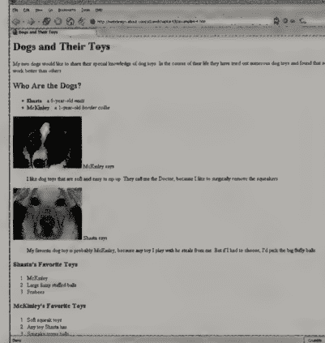

链接标签让你的读者在不同页面间跳转。链接或锚点标签将你的读者引导至其他位置。制定一个链接策略是个好主意。你的链接策略决定了你将链接到哪些类型的网站、从你网站的哪些页面进行链接，以及在链接到外部网站或文档类型（如 PDF 文件或电子邮件链接）时是否有特殊标识。例如，我在 About.com 网站上使用的链接策略大致如下：

- 我链接到与网页设计、HTML 或 XML 概念直接相关的页面。
- 我进行深度链接。我直接链接到读者感兴趣的具体内容，而不是指向网站的主页。
- 我仅从主页博客或分类页面链接到外部页面。
- 在分类页面上，外部链接的显示方式与内部链接不同。
- 我更倾向于链接到 HTML 文档，而不是 PDF 或纯文本文件。

现在就去为你的网站撰写链接策略吧。既然我们要构建一个小型商业网站，最好将你的外部链接限制在网站的一两个页面上，甚至完全禁止外部链接。目前，你不需要区分链接类型或它们是内部还是外部链接。一旦你有了链接策略，就准备好学习如何在网页中添加链接了。

要向 HTML 中添加链接，你只需要学习一个标签及其一个属性：

```html
<a href="http://webdesign.about.com/"> . . . </a>
```

`<a>` 标签内的所有内容都将成为链接的一部分，你可以在 HTML 文档中链接图片或文本。

对于我的网页，我添加了一些导航。由于网站的其他部分尚不存在，我将 `href` 属性留空，但链接仍会显示在网页上。这是我添加的 HTML 代码：

```html
<ul>
<li><a href="">主页</a></li>
<li><a href="">狗狗玩具销售</a></li>
<li><a href="">狗狗信息</a></li>
<li><a href="">关于本站</a></li>
</ul>
```

一旦我确定了主页、狗狗玩具分类页面、狗狗文章分类页面和我的信息页面的 URL 是什么，我就可以将它们添加到网站中。

你网站需要的最后一种标签是**分区标签**。分区标签用于将页面划分成多个部分，以便更容易地进行样式设置。使用分区标签要小心。只在文档中真正需要的地方使用它们。多余的分区会增加页面的下载长度。分区标签如下所示：

```html
<div> . . . </div>
```

当你在没有添加任何样式的网页中添加一个分区时，它似乎不会产生什么效果。页面上可能会（也可能不会）出现一个额外的空格，但除此之外，你的网页浏览器可能会忽略 `<div>` 标签。这没关系。我们将其放入文档中，是为了在开始构建页面时，样式表有内容可供设置样式。

我的狗狗玩具网站上的页面将有三个部分：

- 顶部的品牌部分，包括标题，但不包括导航
- 页面中间当前的正文部分，包含我所有的文本
- 底部新增的信息部分，包括版权声明等

因为我想要为这些部分设置样式，所以我会在 HTML 中使用 `id` 属性为它们命名。`id` 在页面中只能使用一次。如果我有一个 `main` `id`，就不能在另一个元素上再次使用它。由于我为我的分区设置了 `id`，我也会为我的导航列表设置 `id`，以便它可以通过 CSS 与页面上的其他列表区分开来。

以下是我的品牌分区和导航列表的 HTML 代码：

```html
<div id="branding"><h1>狗狗与它们的玩具</h1></div>
<ul id="navigation">
<li><a href="">主页</a></li>
<li><a href="">狗狗玩具销售</a></li>
<li><a href="">狗狗信息</a></li>
<li><a href="">关于本站</a></li>
</ul>
```

如你所见，我所做的一切就是用 `<div>` 标签包围我的 `<h1>` 标签，并在 `<ul>` 标签上添加了 `id="navigation"` 属性。

你可以在我的网站（http://about.com/webdesign/example4-6）的 HTML 中看到额外的 `div` 标签。

## 使用 CSS 添加样式

好吧，我承认：这个页面很丑。那么，我怎么会在一本网页设计书籍中推崇一个看起来如此丑陋、单调和乏味的网页呢？

嗯，一个网页有三个部分：

### 你需要的工具

还有很多其他 HTML 元素你可以学习，以增强你的网站。本章只是触及了可用 HTML 标签的皮毛。如果你想学习更多 HTML，最好的方法是参加我的免费 HTML 课程（[http://about.com/webdesign/html课程](http://about.com/webdesign/html%20course)）。在课程中，你将学习以上所有 HTML 标签以及许多其他标签，并且即使你从未使用过所见即所得（WYSIWYG）编辑器，也能将它们全部应用起来。

- 网页的结构
- 网页的外观或样式
- 网页的行为

网页的结构就是我们目前所构建的内容。它包含内容和 HTML 标签，但样式完全取决于查看该页面的 Web 浏览器。

**CSS 前来救场。** 层叠样式表（Cascading Style Sheets）是让我们的网页看起来美观的东西。许多人只将其视为改变字体的一种方式，但你也可以用它来调整布局、修改特定元素的显示方式，甚至在你不想让某些元素可见时隐藏它们。

**使用样式表最有效的方式是通过外部样式表。** 这样，你就可以在网站的所有网页上使用相同的样式（如果你想这样做的话）。以下是如何链接到你的样式表的方法：

1. 在你的 HTML 编辑器中打开一个新的空白文档。如果你有打开新 CSS 文件的选项，请这样做。
2. 将文件保存在与 HTML 文件相同的目录中。
3. 将文件命名为 `styles.css`。
4. 在你的编辑器中打开你的 HTML 文件。
5. 在网页的 `<head>` `</head>` 元素内的任何位置添加以下代码行：

```html
<link type="text/css" href="styles.css" rel="stylesheet" />
```

**一些适用于你页面的基础样式。** 我们可以用样式表做很多事情，我们将在后面更详细地讨论。

## 第四章

在书里，但现在让我们先清理网页上的一些布局问题，让字体和图片看起来更美观。

**页面太宽了。**

目前页面没有设置任何宽度，所以文字会占据整个浏览器的宽度。如果你的浏览器窗口较窄，这没什么问题，但在更宽的显示器和窗口上，页面会难以阅读。要解决这个问题，我们需要为整个页面设置一些边距，并为 `body` 标签设置宽度。（注意，有些浏览器对 `body` 标签的宽度处理不佳；我们将在第五章中解决这个问题。）

*在你的 `styles.css` 文件中，输入：*

```css
html, body { margin: 10px; }
body { width : 600px; }
```

**整个页面的字体很丑。**


现在我们将编辑`body`样式以添加一些字体信息。（别担心如果这讲得太快。我们将在后面的章节中详细介绍CSS的具体内容。）

*将`body`行修改为：*

```css
body { width : 600px; font: normal 1em Geneva, Arial, Helvetica; }
```

**图片在文档中的嵌套效果不佳。**

将它们向左浮动，让文字环绕它们流动。

*在你的样式表中添加这一行：*

```css
img { float : left; clear: both; margin: 0 10px 10px 0; }
```

**现在图片右侧的文本比我期望的还要多。**

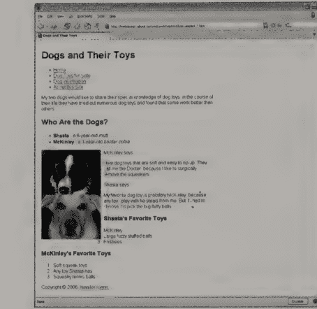

图4-3：`<h3>`标题位于图片右侧

为了修复这个问题，我添加了以下行：

```css
h1,h2,h3 { clear : both; }
```

## 页面上没有颜色

我创建了一个彩色背景来突出我们通过第一个样式创建的700像素宽的文本列。

```css
html { background-color : #3c6; }
```

## 我想让信息部分不那么显眼

我把字体稍微调小了一些。

```css
#information { font-size: .8em; }
```

你可以在About.com Web Design网站上看到最终页面（[http://about.com/webdesign/example4-8page](http://about.com/webdesign/example4-8page)）。我们仍然可以对它做很多处理，但它现在看起来比我们刚开始时吸引人多了。最终的HTML和CSS代码也在线列出（[http://about.com/webdesign/example4-8code](http://about.com/webdesign/example4-8code)）。如果你一直在按照自己的样式表操作，你的网页现在也应该看起来好多了。

## 一些简单的JavaScript

JavaScript是构建网页的最后一个部分——网页行为。你将脚本添加到文档头部的方式类似于添加CSS。例如，如果你有一个名为`script.js`的脚本，你需要在文档的`<head>`中添加以下行，使其在你的页面上运行：

```html
<script type="text/javascript" src="script.js"></script>
```

与页面上的其他技术一样，在转向JavaScript或其他客户端脚本之前，总是考虑你是否可以使用层次结构中更高层的项目做同样的事情。例如，JavaScript最受欢迎的用途之一是图像翻滚——当你将鼠标悬停在图像上时，图像会发生变化。About.com JavaScript站点解释了如何使用JavaScript实现这一点（[http://about.com/javascript/mouseover](http://about.com/javascript/mouseover)），但这是现在可以通过CSS和HTML操作完成的事情。

如果你有兴趣为当前的页面添加一些JavaScript，那么请查看About.com JavaScript脚本库（[http://about.com/javascript/scriptlibrary](http://about.com/javascript/scriptlibrary)）以获取想法。在我的网站上，我现在将暂时不使用JavaScript。在第七章中，我们将更详细地介绍如何有效地在网页上使用JavaScript。然后在第十四章中，你将了解到我们可以用JavaScript实现的一些令人兴奋的领域。

### 你需要的工具

这是关于级联样式表的速成课程，但幸运的是，你可以更悠闲地学习CSS。在我的网站上，我提供了一个免费的五天CSS课程（[http://about.com/webdesign/csscourse](http://about.com/webdesign/csscourse)）。完成课程后，我们上面讨论的CSS内容就会显得微不足道。如果你想比五天更快，你总可以在完成最后一课后立即请求下一课（[http://about.com/webdesign/csscoursefast](http://about.com/webdesign/csscoursefast)）。

## 获取链接

以下链接将帮助你更好地了解用于构建网站的HTML和CSS代码。

1. **仍然完全迷失？**

   不要害怕。即使你仍然认为自己无法学习HTML或理解如何进行网页设计，我也能提供帮助。这个五页的指南将通过循序渐进的方式指导你构建一个网页。你能行的。

   [http://about.com/webdesign/stilllost](http://about.com/webdesign/stilllost)

2. **学习HTML**

   网上有很多学习HTML的资源，很难知道从哪里开始。我将我的初级HTML资源整理到一处，这样你就可以按照适合自己的节奏学习HTML。

   [http://about.com/webdesign/learnhtml](http://about.com/webdesign/learnhtml)

3. **从哪里开始学习CSS**

   级联样式表非常复杂，但本网站上列出的资源将帮助你学习CSS并理解我们在本书中涵盖的内容。

   [http://about.com/webdesign/startcss](http://about.com/webdesign/startcss)

# 第五章：创建内容或文章页面

## 为什么从这里开始，而不是首页？

大多数设计师在开始构建网站时，都是从首页开始，然后逐步向下构建网站。问题在于，首页非常复杂，可能涉及公司各个层级的人员。你会发现，你在第一、二章制定的所有计划都随着首页的“演变”而化为泡影。问题是，如果你不知道网站上还会有哪些其他页面，就很难知道你的首页上应该放什么内容。

**举个例子。** 在我参与的一个项目中，我们被要求重新设计网站的首页。市场部、销售部、支持部、我们的副总裁和首席执行官都对页面上应该有什么内容有各自的意见。到我们完成时，首页被要求链接到大约三十个不同的版块。我们获得了设计批准，然后去找市场、销售、支持和我们的副总裁，索要内容来构建他们的网站版块。在每种情况下，我们都得到一个茫然的表情，然后是，“嗯，我想我们启动时不需要在首页上放那个网站版块。等我们有了内容再放上去。”首页最终上线时只有五六个版块，而不是我们最初设计的三十个。从那以后，我都是先完成网站内容，再构建首页。

**内容页面是信息型网站的基础。** 如果你的网站将专注于为客户提供信息，你将需要大量的内容页面来提供这些信息。我的About.com网站主要是一个信息型网站，十年后，我为读者提供了数百篇文章和信息。

在你担心需要一次性提供如此深度的信息之前，请记住我并非一夜之间创建了一千篇文章。当我开设我的网站时，我大约有十篇文章上线，并且有很多指向其他网站上其他文章的链接。

推进信息网站的最好方法是从小处着手，逐步发展。总有更多东西你可以写；九年后，我的文章创意文件夹的增长速度仍然比我写文章的速度快。关键是发布网站时只有几篇文章（五到十篇），然后制定一个时间表来添加更多内容。我最初的时间表是每到两周发布一篇新文章。

### 你需要的工具

- 信息网站的重要部分是信息。如果你的网站上只有十篇文章，最终人们会全部读完，不再需要回来。有时，即使我有创意文件夹，我也无法获得写作的灵感。当这种情况发生时，我会回溯到故事板寻找灵感。我的文章“写什么”（[http://about.com/webdesign/contentideas](http://about.com/webdesign/contentideas)）讨论了如何为网络项目创意制作故事板。

## 内容页面的组成部分

内容页面有三个基本部分：内容、导航以及广告和促销。如果你的网站要成功提供客户所需的信息以及业务所需的收入，这三者都很重要。

**内容是内容页面最重要的部分。** 你的首席执行官或销售部门可能会争辩说广告和促销对公司更重要，但归根结底，如果客户在内容页面上找不到她想要的信息，广告就是多余的。正因为内容是内容页面最重要的部分，你既需要关注它在页面上的呈现方式，也需要关注内容的实际质量。

大多数网页提供的内容主要有两种类型：文字内容和视觉内容。文字内容是大多数人想到信息页面时所想到的，但网页上的信息可以通过图片有效地展示。照片库和视觉操作指南只是两种你可以用照片而非文字提供信息的方式。

**为网络写作不同于线下写作。** 这是大多数网络写手首先需要理解的事情。但记住这一点非常重要。仅仅因为你写过营销简报、白皮书，甚至文章和小说，并不能保证你的文字在网络上会受到好评。在为网络写作时，有一些规则需要注意：

- **保持简洁。** 网页难以阅读，因为显示器质量和分辨率尚未达到纸张标准。短小精悍的文章比冗长拖沓的文章更易于阅读。

- **以列表形式思考。** 在线列表比文字段落更易于阅读，因为项目符号或数字标出了新的部分，并在视觉上分隔了文本。如果你在列表项下添加了解释性文本，那么请用加粗或不同颜色来突出标题。

## 网络其他位置

除了网页写作的规则外，还有一些编写有趣网页的准则。文章《编写活跃网络的十大技巧》（[http://alistapart.com/articles/writeliving](http://alistapart.com/articles/writeliving)）是我最喜欢的之一。它专注于编写更易于变化的页面，如网络日志，但这些技巧对于让主题更具冲击力非常有帮助。

- **使用主动动词。** 用行动词保持节奏，并告诉你的读者该做什么。除非绝对必要，否则避免使用被动语态。

- **细分你的文本。** HTML包含六个级别的标题是有原因的。为你的网页添加视觉层次结构，使其更容易扫描并找到相关信息。

- **在段落中链接文本。** 链接是另一个表明某事物重要的视觉提示。当你链接段落内的实际文本，而不是在页面其他地方创建链接列表时，它能将读者拉回他们正在阅读的页面，并使段落更容易浏览。

- **不要链接每个单词。** 凡事都要适度，这是关键。谨慎选择你要链接的词语，就像谨慎选择你要链接到哪里一样。

- **链接到你的读者想要的东西。** 当你的读者在你的页面上看到一个链接时，他们会认为它很重要。如果它足够有趣，他们就会点击它。如果他们以为会得到另一篇文章，结果却进入了一个术语表页面，这可能会非常令人失望。

- **如果你什么也不做，至少要校对你的页面。** 网络读者可能不比杂志和书籍读者更挑剔，但他们更快地会发出一封尖刻的电子邮件指出你的错误。最好是尽量从一开始就避免错误。当你收到一封指出错误的尖刻邮件时，只需修复错误，而不要以尖刻回应。

**让我们谈谈链接。** 链接是人们在你的网页上浏览的方式，但它们也是人们找到关于你的网页信息的方式——什么是重要的，你提供了什么信息，以及可能缺少什么。

网页设计师认为，来到网页的客户是从顶部开始，从左到右一直阅读到页面底部。但事实并非如此。大多数来到网页的人会扫描页面并四处跳转。他们看到页面内容的一小段片段，最后停留在他们感兴趣的东西上并点击离开。你可以在史蒂夫·克鲁格（Steve Krug）优秀的著作《点石成金》（*Don't Make Me Think*）或在线章节（[www.sensible.com/chapter.html](www.sensible.com/chapter.html)）中看到这一点的直观展示。

标题和链接是你的客户在浏览你的页面、寻找他们需要的信息时看到的东西。链接比标题更突出，因为它们暗示了某种交互性，并且通常与周围文本的颜色不同。因此，创建有效的链接对于创建读者认为有用的内容至关重要。以下规则将帮助你让你的链接变得有用：

- **不要创建写着“点击这里”的链接。** “点击这里”在你的文本上下文中完全没有意义。一个更好的链接能让读者知道点击后会得到什么，或者与结果页面的标题相匹配。

- **保持你的链接信息丰富。** 避免“点击这里”的精神，你要提供能提供信息的链接。

- **在内容中内联编写链接。** 在文档文本中找到的链接比链接列表让人们感觉更真实。

- **不要解释你的链接。** 当你写一个类似“去这个页面购买狗玩具”的链接时，你是在引起对网页机制的注意——换句话说，就是那段文字是一个链接。文字通常颜色不同并带有下划线这一简单事实应该能为你做到这一点。一个更好的链接应该是“购买狗玩具”。它信息丰富，并让客户知道他们将得到什么。

**但内容不止于文字。** 照片和图片也是有用的网络内容形式。无论你是专注于将图像作为页面的唯一内容（如在照片库中），还是作为页面文字内容的补充，图像对于使网页有趣都至关重要。但很容易做出有损你网站的图像。

**小图像是好的网络图像。** 我怎么强调都不为过。大的网络图像会使你的网页体积变大、下载变慢，并且看起来很糟糕。你可以做一些事情来为网页减小图像尺寸：

## 热门内容

因为链接提供了关于你网页的信息，创建有助于提供这些信息的链接将改善你的网站。关键是理解读者如何使用信息网站，然后调整链接以匹配。我的文章《创建更好的链接》（[http://about.com/webdesign/betterlinks](http://about.com/webdesign/betterlinks)）可以提供帮助。

- **裁剪你的图像。** 确保图像只包含相关信息。这并不意味着你需要裁剪得那么紧凑以至于难以辨认，但要删除多余的东西。

- **检查分辨率。** 虽然这不会改变下载大小，但如果你的图像要显示在网页上，则不需要达到300 dpi。72 dpi或96 dpi的分辨率就很好，而且可以阻止人们窃取你的照片去打印。

- **为你的图像使用正确的格式。** 照片最好保存为JPEG文件，而平面彩色图像（如剪贴画）最好保存为GIF。如果不确定，可以使用编辑软件更改格式并比较生成的文件大小。

- **不要在GIF图像上使用超过所需的颜色。** 对于GIF图像，你可以将文件索引为仅使用图像中实际存在的颜色数量。这将在不影响质量的情况下减小文件大小——如果你的图像没有使用红色，那么它的调色板中就不需要红色。

- **使用高质量的图像编辑工具**，如`Photoshop`或`Paint Shop Pro`。这些工具可以让你在不影响质量的情况下，对图像尺寸进行更多调整。

**只在需要图像的地方使用图像。** 这个概念在内容页面上尤其重要。用于首字下沉、引文和注释框的图像可能看起来花哨漂亮，但它们只会增加你网页的下载时间。搜索引擎无法读取图像中写的文本，因此在进行搜索优化时，你会失去该文本的价值。此外，如果你的读者禁用了图像或无法查看图像，他们就看不到这些文本。如果该文本对内容特别重要，可能会使页面无法阅读。图形化的首字下沉也可能使你的页面看起来有拼写错误。即使你使用了`alt`文本，搜索引擎和屏幕阅读器也不会将图像识别为后续文本的一部分。

**内容页面第二重要的部分是导航。** 同样，你的市场或销售部门可能不同意，但导航是人们在你的网站上浏览的方式，而在一个靠广告资助的内容网站上，你希望你的页面被看到。我将在第8章详细讨论如何构建出色的导航结构，但这里有一些技巧：

- **保持你的导航简单。** 如果它易于理解，人们就会使用它。如果人们使用搜索功能比在你网站上导航更多，那么很可能导航太难了。

- **保持你的导航一致。** 你会发现一些设计师现在提倡上下文敏感导航，或者`navigation that changes depending upon where you are`。不一致的导航会使人们感到困惑。

- **测试你的导航想法。** 保留你网站上有效的内容，但不要害怕改变无效的内容。当你进行测试时，你可能会发现上下文敏感的导航对你的网站很有效，或者无论我说了什么，复杂的导航更好。

## 你需要的工具

理解你的客户对于良好的导航至关重要。如果你在导航中使用客户不理解的术语，他们就无法在你的网站上顺利浏览。设计有效的导航与其说是科学，不如说是一门艺术。如果你现在需要更多帮助，可以阅读我的文章《导航网页》（[http://about.com/webdesign/navigation](http://about.com/webdesign/navigation)）。

**还有广告。** 为你的内容页面找到放置广告的位置，如果网站要盈利，这可能非常重要。需要记住的是，在一个以客户为中心的网站上，广告不应该是主要焦点。人们访问你的网页不是为了广告；他们是为了内容而来。

这是对About.com网页设计/HTML网站设计方式的一个抱怨。我不是About.com的设计师，所以我不能说它为什么这样设计，但广告对于About.com的持续存在非常重要，网站也反映了这一点。在我的网站上，内容页面在首屏以上只有大约三四个广告，而且只有两个特别靠近页面内容。

大多数内容网页将广告放置在以下位置：

- 横幅广告，横跨屏幕顶部
- 左侧栏中的小方块广告，位于导航上方或下方
- 右侧栏中的塔式广告
- 与内容混合放置的大方块广告
- 页面加载时出现的弹出式广告和插页式广告

当你在规划内容页面的页面设计和布局时，你需要确保为广告分配了空间。

## 从内容页面赚钱

大多数内容页面通过广告赚钱。但也有几种方法可以从内容页面赚钱：

- 捐赠
- 订阅
- 联盟计划
- 相关文本广告
- 标准横幅广告

捐赠似乎不太可能是网页赚钱的方式，但这是可能的。许多博客网站在其网站上放置了`PayPal`捐赠链接以收集一些额外的现金。这看起来可能像乞讨，但捐赠以维持一个有趣的网站运行，与为使用共享软件付费没有太大区别。

订阅是另一种让你的网页内容赚钱的方式。这里的挑战在于，你需要确保你提供的内容是人们想要并且愿意为之付费的。许多新闻网站通过提供免费的当前文章，但将访问其往期内容设置为付费，通常通过订阅，来利用订阅模式。

为了建立一个订阅网站，你需要拥有人们想要购买的内容或很难在其他来源找到的内容。对于刚开始一个以信息为中心的网站的小企业来说，订阅模式很难实施，但如果你的客户想要你的内容，这可能是赚钱的好方法。订阅的另一种运作方式是当有一个相关的线下来源，网站订阅可以对其进行增强。你在许多杂志中看到这种情况，它们只向付费订阅者提供在线版本。

联盟计划是一种非常流行的内容页面赚钱方式。有许多类型的联盟计划，从你链接到其他网站的系统，到你链接到待售产品的计划。


最成功的联盟链接是那些融入你网站上下文中的链接。在我示例的狗玩具网站上，我可以建立的最成功的联盟计划将是那些销售狗产品或为狗主人提供帮助的项目。使用Commission Junction（[`www.cj.com`](http://www.cj.com)），我可以建立到Petco.com和PetCareRX的联盟链接。

定向文本广告是从网站获得更多收入的好方法。与页面内容焦点匹配的文本广告比针对性较弱的横幅和视觉广告表现好得多。这是因为文本广告中的内容与页面上的内容相关。例如，在我的狗玩具网站上，我可能有一篇关于狗牵引绳的文章。如果我注册了在该网站上显示的定向文本广告，我的写作会专注于“狗、牵引绳、狗玩具”等关键词，我会得到与这些关键词相关的广告。

标准横幅广告是内容网站最公认的收入来源。添加横幅广告活动的最佳方式是加入一个提供横幅广告的联盟计划，比如LinkShare（[`www.linkshare.com`](http://www.linkshare.com)）。否则，刚起步的小型网站没有广告商所要求的页面浏览量。

## Designing a Content Page in a Single-Column Layout

既然我们知道了良好内容页面的组成部分，是时候构建一个了。首先，在你的本地计算机上设置你的网站副本，以便你可以添加内容页面。回到你的计划，确定你希望如何组织目录结构。我将构建一个宽而浅的网站，一个名为“articles”的目录将存放我所有的文章。

我要确保我的本地硬盘驱动器文件和文件夹名称与我网站上将要使用的文件和文件夹名称完全匹配。这样，我可以将它们全部作为一个批次上传，而无需重命名任何内容。我将在`articles`目录内创建我的新页面，使用我在第2章中提出的命名约定。

你的所有内容页面应该看起来大致相同。这可能看起来很无聊或缺乏独创性，但内容，而非设计，才是内容页面的重点。一个设计良好的页面不是引人注目地展示设计，而是促进客户从该页面获取信息的需求。

著名的网页设计师和作家Robin Williams写道，网站的一个好的设计特征是“网站中的每个网页看起来都属于同一个网站”（[`www.ratz.com/featuresgood.html`](http://www.ratz.com/featuresgood.html)）。而杰出的网页可用性专家Jakob Nielsen说，“一致性是最强大的可用性原则之一：当事物总是以相同的方式运作时，用户就不必担心会发生什么”（[`www.useit.com/alertbox/9605.html`](http://www.useit.com/alertbox/9605.html)）。

以下是开始编辑你的新内容页面的步骤：

1. 在你的硬盘驱动器上为你的网站创建一个新目录。这将是你的网站在硬盘上的根目录，所以给它起一个你会记住的名字。这是唯一的目录。

> **WHAT'S HOT**
>
> 你可能认为弹出式广告、插页式广告和其他侵入性广告都是不好的。但在你的网站上使用它们也有一些好处（[`http://about.com/webdesign/popupads`](http://about.com/webdesign/popupads)）。人们可能会抱怨弹出式广告，但他们仍然会点击它们。如果广告没用，它们早就消失了。

> **ELSEWHERE ON THE WEB**
>
> 在网上赚钱并不是建个网页就能坐等收钱。你必须付出努力。幸运的是，About.com上还有其他指南来解释如何做到这一点。在线商业指南展示了如何通过联盟计划赚钱（[`http://about.com/onlinebusiness/affiliateprograms`](http://about.com/onlinebusiness/affiliateprograms)），而企业家指南则探讨了成为亚马逊联盟成员的方法（[`http://about.com/entrepreneurs/amazonaffiliate`](http://about.com/entrepreneurs/amazonaffiliate)）。

> **ELSEWHERE ON THE WEB**
>
> 最热门的定向广告网站之一是Google AdSense（[`https://www.google.com/adsense`](https://www.google.com/adsense)）。有了AdSense，你就拥有了Google的强大支持——所以你可以为你的网站获得一个强大的关键词分析引擎。虽然Google广告在大多数网站上看起来都一样，但你可以自定义它，使其更好地适应你网站的风格。

### 热门话题

如果广告商主动提出为你的网站空间付费，那当然很好，但通常情况并非如此。相反，你需要主动吸引广告商来到你的网站。请专注于你的目标，你就会吸引到所需的广告商。如果你仍需帮助，可以阅读我的文章《吸引广告商》（[`http://about.com/webdesign/attractadvertisers`](http://about.com/webdesign/attractadvertisers)）。

它不会完全按照你在网络主机上看到的名称来镜像，因为在这个网络主机上，这个目录将是你自己的域名。

2. 切换到你的新网站目录，并创建一个`articles`目录。
3. 打开你的网页编辑器。
4. 在`articles`目录中开始一个新的网页。按照你网站的命名规范为它命名。我将写一篇关于狗绳的文章，我会把文件命名为`dogleashes.html`。

我们所有的页面都将使用CSS进行布局。如果你在过去五到十年里构建过任何网页，你可能习惯于使用表格来进行所有的网页布局，但这并不是好的做法，事实上是无效的XHTML。我网站上的一位评论者说：“表格就是定位元素！！接受现实吧。”但这是不正确的。HTML中的表格是用于呈现表格数据的，而不是用于在页面上定位内容。本书的其余部分将讨论你可以用于网页的各种布局，所有这些布局都将使用层叠样式表而不是表格来实现。

现在开始编辑文章。与我们的第一个页面一样，你需要创建一个包含HTML和内容的页面。因为我们知道我们正在处理一个文章页面，所以页面上实际要显示的内容并不那么重要，使用占位符文本是可以的。我将使用被称为“lorem ipsum”的文本——一种拉丁文本，它能让我们关注设计本身而不是文字内容。你可以在About.com桌面出版网站上获取该文本的副本（[`http://about.com/desktpub/loremipsum`](http://about.com/desktpub/loremipsum)）。使用这样的占位符文本被称为“希腊化”。

对于初始页面设计，“希腊化”是完全可以接受的。然而，请记住，在许多情况下，这样做并不是一个好主意。在我的文章《使用真实文本测试页面设计》（[`http://about.com/webdesign/userealtext`](http://about.com/webdesign/userealtext)）中，我解释了一些在不使用真实文本的情况下进行页面设计所带来的问题。

对于我们的内容页面，我们将创建一个包含第四章中所学的许多元素的页面。在我们担心布局之前，我们需要先搭建好网站。我的HTML代码如下所示：

```html
<!DOCTYPE html PUBLIC "-//W3C//DTD XHTML 1.0 Transitional//EN" "http://www.w3.org/TR/xhtml1/DTD/xhtml1-transitional.dtd">
<html>
<head>
<title>Dog Leashes - Dogs and Their Toys</title>
<meta name="description" content="Dog leashes restraint devices dog leashes" />
<meta name="keywords" content="dog leashes, dogs, dog toys, canines, information about dogs, dog help" />
</head>
<body>
<h1 id="branding">Dogs and Their Toys</h1>
<ul id="navigation">
<li><a href="../index.html">Home</a></li>
<li><a href="../products/index.html">Dog Toys for Sale</a></li>
<li><a href="../articles/index.html">Dog Information</a></li>
<li><a href="../about/index.html">About This Site</a></li>
</ul>
<div id="body">
<h2>Dog Leashes</h2>
<p>Lorem ipsum dolor sit amet, consectetuer adipiscing elit, sed diam nonummy.</p>
<p>Ut wisi enim ad minim veniam, quis nostrud exerci tation ullamcorper suscipit.</p>
<h3>My Favorite Leashes</h3>
<ol>
<li>Ut wisi enim ad minim veniam</li>
<li>Ut wisi enim ad minim veniam</li>
</ol>
</div>
</body>
</html>
```

## 向你的向导提问

**为什么对表格和CSS有这么大的争论？CSS很难学吗？**

> 使用CSS进行布局是一种关于网页布局的新思维方式，正因如此，它可能很难学，特别是如果你习惯于用表格来思考。回到第一章，我说过态度在网页设计中非常重要，这一点在这里也适用。CSS有趣、好玩且富有挑战性，但如果你有正确的态度，它并不难。

```html
<li>quis nostrud exerci tation ullamcorper</li>
</ol>
<p>Duis autem vel eum iriure dolor in hendrerit
in vulputate velit esse molestie</p>
<h3>My Least Favorite Leashes</h3>
<ol>
<li>Ut wisi enim ad minim veniam</li>
<li>quis nostrud exerci tation ullamcorper</li>
</ol>
</div>
<div id="information">
<p>Copyright &copy; 2006 <a href="http://webdesign.about.com/mpremail.htm">Jennifer Kyrnin</a></p>
</div>
</body>
</html>
```

由于页面没有任何样式，我们又回到了朴素的外观。根据我的网站规划，我在导航中添加了一些链接。注意：我添加的链接不是**完整路径**链接，而是**相对路径**链接。如果你的网页编辑器没有自动完成此操作，你可以在我的网站（[`http://about.com/webdesign/absoluterelative`](http://about.com/webdesign/absoluterelative)）上了解更多关于完整（绝对）路径和相对路径链接的知识。我还移除了标题周围的额外`div`标签。如果需要，我可以把它加回来。我打算重新添加一些我们在第一个页面（如[`http://about.com/webdesign/example5-2`](http://about.com/webdesign/example5-2)所示）上使用过的简单样式。

```css
html, body { margin: 0px 20px; }
html { background-color : #3c6; }
body {
    width : 600px;
    font: normal 1em Geneva, Arial, Helvetica;
    background-color:#fff;
    padding: 0px 5px 5px 5px;
}
#information { font-size: .8em; }
```

这个页面对于一个基础网站来说是可以工作的，但我们还需要其他东西。

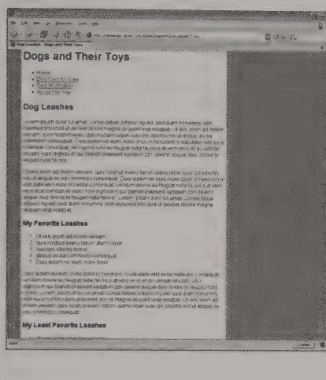

图5-1：一个基础的文章页面

美化品牌标识和标题将是改进这个页面的一个很好的开始。因为这将是我整个网站的品牌标识，我需要创建一些能代表网站的东西。我决定使用一张我狗狗的照片；毕竟，这个网站是为它们而建的。

这张原始照片的尺寸大约是2200 × 1700像素，下载大小为11MB，对于网页来说太大了。我裁剪了它，去掉了多余的物品，并且需要缩小尺寸。对于高度，200像素大约是我想要的最小尺寸。（再小的话，麦金利就只是一个黑色的污点了。）最后，因为这将成为我标志的一部分，我想只保留狗狗，去掉其他所有东西。我使用了About.com图形软件网站上的提示，使用Photoshop移除了背景（[`http://about.com/graphicsoft/removebackground`](http://about.com/graphicsoft/removebackground)）。如果你感兴趣，我已经在网站上放了原始图片和品牌图片的较小（但仍未优化）版本：[`http://about.com/webdesign/example5-4`](http://about.com/webdesign/example5-4)。

但仅有图片是不够的。我还需要调整CSS，以便显示图片，并使文本更像页面标题，而不是一大块黑色文本。因此，我添加了一些额外的CSS来设置标题样式，并修改了现有的CSS来调整页面上的间距。

```css
html, body { margin: 0px 20px; }
html { background-color : #3c6; }
body {
    width : 600px;
    font: normal 1em Geneva, Arial, Helvetica;
    background-color:#fff;
}
#information { font-size: .8em; }
#branding {
    height: 200px;
    background: #fff url(dogs _ and _ toys _ logo.jpg) no-repeat;
    margin: 0;
    padding: 0 0 0 100px;
    font-size: 3em;
    color: #3c6;
}
```

如你所见，CSS在构建页面时会发生很多变化。在添加新功能时要进行测试，并确保其他所有内容都保持你想要的状态。

对于这个页面的最终版本，我使用相同的配色方案（绿色和白色）在页面顶部创建了一个简单的导航菜单。我还将页面在浏览器窗口中居中，并给内部文本留出了更多空间。

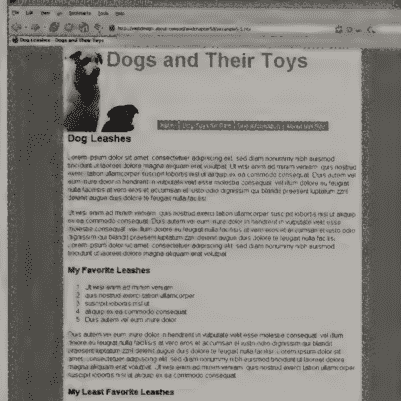

如你所见，页面开始初具雏形。如果你跟着自己的网站一起操作，那么你的页面也应该进展顺利。这可能是一个相当简单的单栏布局，但它展示了CSS的一些基础以及你如何影响你的页面。

## 第六章

### 创建产品页面

#### 产品页面与内容页面有何不同？

我们在第五章构建的内容页面，其主要目标是向读者传递信息。这类页面通常是文章、常见问题解答以及您的客户可能在网上搜索的信息。

产品页面的目标则不同。产品页面的目标是向某人销售某物。产品页面可以利用信息来帮助销售产品，但信息本身并非页面的最终目的。

在许多方面，产品页面的成功与否更容易判断。测试内容页面唯一现成的指标是计算页面浏览量。其假设是，如果一个内容页面获得大量浏览量，那么它就提供了人们想要的信息。

但因为很难判断人们在一个页面上停留了多久，所以很难知道他们是阅读了内容还是立刻点击了“后退”。

**About.com**

**主题：**

- 产品页面与内容页面有何不同？（第85页）
- 产品页面的组成部分（第88页）
- 通过产品页面盈利（第91页）
- 设计双栏产品页面布局（第96页）

产品页面同样有页面浏览量指标，但更强大、更可衡量的指标是那些在浏览页面后购买产品的人数。

在开始设计产品页面时，请考虑以下几件事：

## 您需要的工具

- 社区可以成为您网站的绝佳补充。它能吸引人们反复访问网站。在我的文章《为何要创建在线社区》（[`http://about.com/webdesign/createcommunity`](http://about.com/webdesign/createcommunity)）中，我阐述了在网站上创建社区的诸多好处。所有这些好处同样适用于参与社区——只要您不将自己的参与变成销售推销。
- 了解您的客户。他们的兴趣是什么？他们如何度过线上和线下的时间？如果您的客户经常访问某些热门论坛或博客，那么您也应该出现在那里，了解他们在寻找什么。这也可以帮助您发现新的产品线和客户。

您网站的风格和外观应与您的产品和公司相匹配。它也应与您的客户相匹配。例如，如果您向二十多岁的男性消费者销售极限运动装备，您需要的是粗犷、前卫的风格，以符合客户的自我形象以及他们经常访问的其他网站。

如果可以，允许您的客户与网站互动。这可以简单到一个反馈表单，也可以复杂到像Amazon.com那样的系统，包含客户评论和“购买此商品的用户也购买了”选项。您也可以通过参与客户使用的论坛来与客户互动。请确保是真正的互动，而不仅仅是您产品的广告。

确保您链接到网站外部。外部链接向您的客户表明，您愿意接受外部意见，并且不害怕让您的产品被互联网水域中巡逻的“鲨鱼”看到和评估。

最后，确保您的店面或购物车功能运行良好。如果没有良好且安全的方式来销售您的产品，那么所有其他事项最终都无关紧要。

**衡量页面浏览量存在问题。** 如我之前所述，没有非常复杂（即昂贵）的日志分析软件，很难判断人们在一个网页上停留了多久。这一点对于内容页面至关重要。

例如，我有一篇非常受欢迎的关于`SPAN`和`DIV`标签的两页文章（[`http://about.com/webdesign/spandiv`](http://about.com/webdesign/spandiv)）。它定期出现在我的最受欢迎列表（[`http://about.com/webdesign/mostpopular`](http://about.com/webdesign/mostpopular)）中，而我完全没有推广过这篇文章。第一页大约500字，普通人在网上阅读大约需要五分钟。但因为我只知道页面被浏览了多少次，我完全不知道是否有人真的留下来阅读了。我不知道他们是否只是快速浏览了十秒钟就因为没用而离开，还是阅读了全部内容然后点击了所有链接寻找更多信息。


这使得评估内容页面的成功变得非常困难。

产品页面的重点是销售。您可以追踪有多少销售是由网页产品页面产生的。当您试图改进网站使其更好地为客户服务时，这能为您节省大量时间。如果您做出更改后销售额下降，您就知道应该改回去。如果您做出更改后销售额飙升，请确保您所有的产品页面都使用了这个新功能。

追踪销售为您提供了比单纯的页面浏览量更切实的结果。您也能准确知道您的努力将如何影响公司的利润。有些公司会追踪每个网页的每个元素，以便准确知道每个页面、每个部分甚至每个链接创造了多少收入。

## 网络其他资源

- 要在网上销售产品，您需要一种销售方式。诚然，可以使用简单的订购表或让客户致电您，但如果您想实现真正的销售，就需要某种电子商务解决方案。About.com 在线商业指南将引导您完成判断是否需要购物车解决方案还是整个店面（`http://about.com/onlinebusiness/cartorstorefront`）的步骤。

## 您需要的工具

指标或网络分析可能非常棘手。对于产品网页来说，因为涉及真金白银，情况变得更加复杂。我的文章《网络分析基础》（`http://about.com/webdesign/analytics`）将帮助您开始学习如何衡量您的网站。您能衡量的东西，才能改变，所以尽可能多地衡量。

如果您研究典型的 Amazon.com 网页源代码，您会发现每个链接上都有代码，表明该链接在页面上的位置。一个指向特定书籍的链接可能出现在两三个位置，每个链接都会略有不同。这种差异为 Amazon.com 提供了额外信息，表明您是点击了导航栏中的链接还是页面其他位置的链接。

这种程度的分析超出了大多数小型企业网站的范围，但它向您展示了您可以追求的指标水平。您衡量得越多，您能控制和改变的就越多。如果您是 Amazon.com，并且知道页面第一部分的第三个链接获得最多点击，您就可以将需要促进销售的产品放在那里，而将其他更畅销的产品放在不太受欢迎的位置。

### 产品页面的组成部分

产品页面有三个基本组成部分：产品信息、导航和品牌，以及内容和广告。这些部分协同工作的方式与内容页面略有不同。

因为产品页面的主要重点是向客户销售某物，您需要确保您的导航、品牌、内容和广告不会压倒页面的其余部分。在我工作过的一家公司，我们通过在内容页面上投放广告赚了很多钱。但我们也通过网站销售一些产品。很早就做出决定：虽然我们会在内容页面上放置广告，但任何专门用于销售产品的页面都不会有广告。

您试图销售什么？这就是您的产品信息。在线销售的关键在于提供足够关于您产品的信息，让您的客户想要购买，但又不能过多……

#### 获取链接

为以内容为中心的网站写作可能是一项挑战。这些链接应该能帮助您写出更好的内容，并创建更有趣的内容聚焦型网站。

##### 为网络写作

除了语法和拼写，为网络写作与为印刷品写作非常不同。这些链接将教您如何为网页写好内容。

`http://about.com/webdesign/writing`

##### 了解更多关于 CSS 布局

如果您仍然不确定为什么要构建 CSS 布局，本页上的文章和信息可以帮助向您解释这一点以及如何操作。

`http://about.com/webdesign/csslayouts`

信息量过大，以至于他们不堪重负。问题在于，这两者所呈现的信息量可能差异很大。你的产品页面信息部分应包含以下元素：

- **多种购买方式**：这是产品页面的关键。你需要让购买过程尽可能简单。既然我们是在构建网站，你肯定需要提供一个链接到在线商店或购物车，但优秀的网站不止于此。如果可以，还应包含销售电话号码、实体店铺地址等信息。
- **产品或服务的照片（如果可能）**：图片比文字更能有效地推销产品。如果你的产品外观精美，照片就能传达这一点，从而让人更想拥有它。
- **一两段关于产品的简短描述性段落**：在初始产品页面上，应避免冗长的营销吹嘘，夸耀你的产品有多好。是的，要务必推销产品，但首页内容应保持简短。
- **指向更多信息的链接**：链接到产品说明单、产品手册、可下载的 PDF 文件、竞品信息，或你拥有的任何相关资料。
- **展示你的产品在公司之外的反响**：在产品页面上实现这一点的最简单方法是提供评论链接。如果你没有任何评论，可以让你的公关团队发送产品评论副本，并请求对方提供可链接的评论。你还应在页面上包含任何关于你产品的媒体报道。
- **提供社区协作的机会**：Amazon.com 如此成功的原因之一是客户也可以充当评论者。如果你的产品适合这样做，你可能想链接到一个论坛，让使用你产品的人可以讨论交流。

## 导航和品牌标识需要出现在你的产品页面上

但你要确保它们不会喧宾夺主，掩盖产品本身。在内容导向的网站上，你可能会有一个横跨页面顶部的品牌图像，类似于我们在上一章（`http://about.com/webdesign/example5-6`）构建的那样。而在产品网站上，你的品牌和导航应只占据页面较小的部分。

你可以不必将一个大的标题行专门用于导航和品牌标识，而是为整个网站使用一个简单的徽标和左侧导航，将整个右侧列留给产品信息。这样做的另一个好处是能让产品内容在页面上位置更高，即出现在“首屏”。

在产品页面上，你的导航必须强化你能为客户提供什么。如果你有很多不同类型的产品在售，你需要在导航中有所体现。这样，当客户在产品页面上时，他知道他是在与一个完整的公司打交道，而不是一个昙花一现的企业。

如果你只销售一种产品，你希望你的导航能反映出你对客户的承诺。你的导航应包含“帮助”或“支持”之类的元素，这样你的客户才会认识到你会长期经营下去。没有什么比在网上买了东西，刚遇到问题公司就倒闭更令人沮丧的了。如果你的网站不能让客户确信你是长期经营，你将很难从同行业的老牌公司那里吸引客户。

## 咨询你的指南

**我听说现在人们滚动页面更多了。让内容出现在首屏仍然那么重要吗？**

尽管客户现在确实比五年前或十年前滚动页面更多，但将重要内容显示在页面顶部附近仍然是一个好主意。大多数设计师面临的挑战是，对于页面上什么是重要，有很多不同的定义。公司里每个不同部门对此都会有不同的看法。最好的要记住的是，你不可能总是让所有人满意。构建每个页面时，要忠于该页面的目标。

不要忘记其他内容。虽然产品页面专注于销售产品，但你需要在这些页面上添加其他元素以保持其趣味性。如果你的网站既关注内容又关注产品，你可能想在产品页面上包含指向相关文章的链接。例如，如果该页面在销售牵引绳，你可能想链接到相关文章，并在那些文章页面上链接你的牵引绳产品。

许多网站通过广告赚钱，即使产品尚未售出。如果你在产品页面上有广告，请确保它们不是最突出的特征。将其放在侧边栏或页面底部，比放在首屏上方抢走页面焦点更有效。在设计你的网站时，应考虑单独设计每种页面类型，并为每种类型独立决定内容放置位置。将广告放在网站每个页面的顶部可能对你的广告团队有意义，但如果它们与实际产品的销售竞争，那就不合适了。

## 从产品页面赚钱

如何从产品页面赚钱似乎是显而易见的：让人们购买你销售的产品。但具体怎么做呢？

## “购买”链接是产品页面上最重要的元素

营销人员称之为行动号召。这是网页上告诉客户该做什么的部分，在产品页面上，那就是“立即购买”。

因为它最重要，并不意味着它必须是巨大的字体、亮红色、加粗且闪烁的。你希望客户到达产品页面时知道该做什么，并且也想让他们愿意去做。

在构建产品页面的行动号召时，请考虑以下几点：

- **“立即购买”链接在页面上应易于找到。** 它应该在首屏之上，并且靠近产品图片。
- **它应该表明点击后会将客户带往何处。** 例如，“加入购物车”链接意味着他们将把产品添加到在线购物车中，并有机会继续购物。“立即购买”链接可能会将他们带到在线商店或联盟网站，也可能只是将商品添加到购物车。
- **让你的客户尽可能提前决定所有细节。** 例如，如果你在销售软件，提供一个“购买 CD 版”和另一个“购买下载版”的链接是个好主意。购物车应自动反映他们的选择。如果你无法将客户信息传递给商店，那么就不要要求他们输入信息。没有什么比必须输入两次信息更令人沮丧的了，当这种情况发生时，在线客户会变得多疑并失去对网站的信任。当你失去他们的信任时，你就失去了他们的业务。
- **最后，不要忘记标出价格。** 价格不应该是国家机密，尤其是消费品。如果你在运行拍卖，如果无法在产品页面上实时显示当前价格，至少显示底价。如果价格因选项不同而变化，请显示最低价（选项最少的）作为起始价，或者显示一个价格范围。隐藏价格除了惹恼客户外毫无作用。

不要忘记你的产品信息页面。这些页面为想要深入研究的客户提供额外信息。它们都应包含一张产品图片，并且上面带有“购买”链接。即使页面的目标是提供产品的附加内容，但每个产品页面的目标都是销售产品。

让我惊讶的是，有多少公司忘记了这一点。在我工作过的一家公司，销售团队不得不复制市场团队的工作，为所有产品页面创建一个完全新的版本，以便将销售链接作为每个页面的重要组成部分包含在内。销售团队又花了三年时间，才将所有重要的行动号召添加到所有常见问题解答、资料单和系统信息页面中。

利用社区优势。在销售产品时，你有很多方法可以做到这一点。但你必须小心。网络上对垃圾邮件或被感知为垃圾邮件的东西有着强烈的反感，如果一个社区认为你只是来打广告，你会很快变得不受欢迎。

如果你足够小心，有一些很好的方法可以通过在线社区来加强你的品牌和销售产品：

- **创建企业博客。** 这些流行的网络日志由公司内部的某人撰写。最好的企业博客是由那些写作风格有趣、对公司或产品有深刻见解的人撰写的。
- **参与与你的产品相关的论坛。** 论坛成员如果意识到他们在“现代 Vespa 论坛”上提出的问题是由 Vespa 的工作人员回答的，可能会感到非常兴奋。这既为品牌也为公司增添了可信度。但要非常小心不要做得过火。在外部论坛上发帖最终可能看起来像一个巨大的广告活动，这最终会适得其反。

> 像论坛和聊天室这样的社区可以是网站的一个有趣且有趣的部分，但请记住，并非所有产品都适合建立社区。我的文章《社区对你有用吗？》（`http://about.com/webdesign/community`）讨论了社区的一些陷阱以及如何决定是否尝试它。

- **在与你的产品相关的博客上发表评论。** 与论坛一样，记住你需要避免看起来太像广告。许多博客软件程序现在能够识别出类似“我同意。<URL>”或“好网站。<URL>”这样的帖子是垃圾邮件，并会阻止它们被发布。一些公司曾试图雇佣人在博客评论中发布链接，但随着读者变得越来越精明，这也开始适得其反。最好是参与对话，并将你的 URL 作为评论登录信息的一部分。
- **为你的客户提供聊天论坛。** 这给了他们在其他产品用户中解决问题的机会，也为你提供了关于是什么给你的客户带来问题的见解。在你的公司主办的论坛中，你也不必那么小心；你的客户会期望你推广自己的产品。

**联盟商店是在线销售产品的好方法。** 我建立的第一个在线商店是一个通过 Amazon.com 销售书籍的书店。联盟计划可以成为在线赚钱的好方法。你不需要任何电子商务编程、服务器或后端来构建和维护它们。你也不需要存储或运输任何产品——所有这些都由你所属的公司处理。

通过联盟计划赚钱的关键是拥有能够吸引人们访问你的网站的内容，然后是与这些内容相关的产品。最明显的内容就是评论。如果你正在评论一个产品，如视频、CD、书籍或计算机部件，拥有一个购买该产品的链接是有意义的，特别是如果你给了它一个好评。

一些比较好的联盟计划包括：

### Amazon.com

Amazon.com 是现存最古老的联盟计划之一，而且效果很好。成为 Amazon.com 联盟的好处在于，你可以销售如此多不同的东西。

`http://affiliate-program.amazon.com/gp/associates/join`

### Commission Junction

Commission Junction（CJ）提供数百个不同类别的广告和联盟机会。如果你想销售它，CJ 很可能有一个适用于它的联盟计划。

`www.cj.com`

### LinkShare

LinkShare 是一个庞大的网站汇编，而不仅仅是它的名字所暗示的链接。许多 About.com 指南都使用 LinkShare。

`www.linkshare.com/affiliates/index.shtml`

**你也可以设置一个店面。** 如果你不想销售别人的产品，仍然有很多选择可以让你设置一个店面，即使你不想自己托管你的商店。

许多人已经建立了非常有利可图的 eBay 业务。设置一个 eBay 商店很容易，并且在那里拥有一个店面比链接到拍卖列表更能给你带来可信度。你也可以在亚马逊上开设商店来销售你的产品。使用由另一家公司维护的购物车解决方案或商店，可以让你专注于销售产品，而无需担心安全和在线交易。

**安全对于在线商店至关重要。** 在线失去客户的最快方法就是没有一个安全的网站。至少，这意味着当你的客户开始向网站输入任何数据时，你的购物车或在线商店必须位于安全（SSL）连接上。你可以判断一个网站是否安全，因为浏览器会显示某种锁形图标，并且 URL 应该以 `https` 而不是 `http` 开头。如果你自己托管购物车，你需要为你的 Web 服务器投资购买安全服务器证书。一些托管提供商将此作为服务的一部分提供；请与你的托管提供商联系以获取更多信息。

你网站的安全还包括你将如何接受付款。大多数在线网站接受信用卡，这可能是一项额外的开支。你也可以设置你的商店接受 PayPal（`www.paypal.com`），它提供商业账户和信用卡处理选项。

最后，在考虑网站安全时，请始终为你的客户提供隐私政策供他们阅读。始终告诉你的客户你将如何使用收集到的信息。如果你想让客户更加放心，可以让 TrustE（`www.truste.com`）审查你的隐私政策。

## 设计两列产品页面布局

现在你已经知道了产品页面上应该有哪些内容和不应该有哪些内容，让我们来构建一个页面。网页上的两列布局给你提供了更多的灵活性。我们可以做这样的事情：在一列放置导航，另一列放置主要内容。我们也可以将产品内容放在主列，而博客或其他辅助内容放在第二列。在本书中，我将向你展示如何创建一个两列布局，然后你可以根据你网站的需求进行调整。

从你的产品页面的 HTML 开始。创建两个 `div`，每列一个，这很诱人，但对于这个基本页面，我将使用导航作为一列，`div` 作为另一列。由于我的导航是一个无序列表，我不需要另一个 `div` 来包围它。我可以直接对列表本身进行样式设置。页面的 HTML 如下所示：

```html
<!DOCTYPE html PUBLIC "-//W3C//DTD XHTML 1.0 Transitional//EN" "http://www.w3.org/TR/xhtml1/DTD/xhtml1-transitional.dtd">
<html>
<head>
<title>购买狗链 - 狗与它们的玩具</title>
<meta name="description" content="狗链 约束装置 狗链" />
<meta name="keywords" content="狗链, 狗, 狗玩具, 犬, 狗的信息, 狗的帮助" />
</head>
<body>
<ul id="navigation">
<li><a href="../index.html">首页</a></li>
<li><a href="../products/index.html">出售狗玩具</a></li>
<li><a href="../articles/index.html">狗的信息</a></li>
<li><a href="../about/index.html">关于本站</a></li>
</ul>
<div id="body">
<h1 id="branding">狗与它们的玩具</h1>
<h2>购买狗链</h2>
<p>
Lorem ipsum dolor sit amet, consectetuer adipiscing elit, sed diam nonummy nibh.
</p>
<p>
Ut wisi enim ad minim veniam, quis nostrud exerci tation ullamcorper suscipit.
</p>
<p id="information">
版权所有 &copy; 2006 <a href="http://webdesign.about.com/mpremail.htm">Jennifer Kyrnin</a>
</p>
</div>
</body>
</html>
```

我将使用 `float` 样式属性来创建两列布局。这样做的好处是，我只需改变浮动方向就能轻松调整列的位置。在线查看示例即可。示例 6-1（`http://about.com/webdesign/example6-1code`）将导航栏放在左列，而示例 6-2（`http://about.com/webdesign/example6-2code`）则将其放在右列。

示例 6-1 的 CSS 如下：

```css
html, body { margin: 0; padding: 0; }
#body { width: 800px; }
#navigation {
  width: 160px;
  float: left;
}
#main {
  float: right;
  width: 600px;
}
```

示例 6-2 的 CSS 如下：

```css
html, body { margin: 0; padding: 0; }
#body { width: 800px; }
#navigation {
  width: 160px;
  float: right;
}
#main {
  float: left;
  width: 600px;
}
```

但是，这些页面还不具备一个优秀产品页面的任何特征。在示例 6-3 中，我添加了一张产品图片、一些指向产品详细信息的链接，以及一个用于从购物车购买产品的按钮。“添加到购物车”按钮看起来像一张图片，但我运用了 CSS 样式使其在页面上突出显示。你可以在示例 6-3 的在线示例中查看我为实现此效果所使用的 HTML 和 CSS（`http://about.com/webdesign/example6-3code`）。


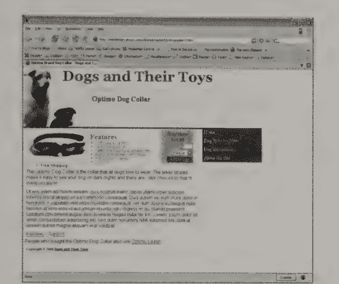

两列布局为你在页面上安排内容提供了很大的灵活性。如果你不想将导航栏作为一列，可以将其更改为一个单独的`div`，并在页面上将博客、新闻链接、相关产品链接甚至短文与导航栏放在不同的列中。另一个想法是创建等宽的列。有成千上万的网站使用窄列作为导航栏或侧边栏元素，宽列作为主要内容，但并没有规定你必须这样做。调整列宽可以为你的网页设计增添一些趣味。尝试不同的做法；不要只是简单地复制我的 HTML 和 CSS 到你的网站上。

## 获取链接

在线销售产品是增加销量或开展新业务的好方法，但其中有很多方法和需要学习的地方。这些链接将引导你深入了解在线产品销售。

- **电子商务**：这些链接将帮助你开始搭建在线商店前台，并协助你完成在线销售产品所需的所有步骤。
  
  `http://about.com/webdesign/ecommerce`

- **联盟计划**：即使你没有自己的产品可以销售，你也可以通过联盟计划销售其他产品并获利。
  
  `http://about.com/webdesign/affiliateprograms`

# 第 7 章

## 联系我们与信息页面

### 所有网站都有信息

网站上的信息页面可能是最难制作的部分，因为它们往往包含一点所有内容。信息页面与内容页面很相似，都提供信息。但由于它们不是你网站的核心，在设计网站时，信息页面常常被遗忘。

信息页面是你网站上不属于内容、产品、导航或主页的那些页面。这些页面提供关于你的公司和/或你自己的信息、如何联系你，或关于你业务的一般信息。

如果你像我一样，创建了一次信息页面后就忘记了它们。但这些页面很重要。信息页面为你的客户提供了至关重要的背景信息。联系页面让客户能够提供反馈。而信息页面则向客户保证你会长期经营，因此他们会信任你所提供的内容。以下是 About.com 网页设计/HTML 站点上的一些信息页面示例：

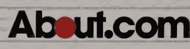

主题：

- **所有网站都有信息**（第 101 页）
- **满足客户需求**（第 103 页）
- **在网站上放置电子邮件地址**（第 108 页）
- **用于联系页面的 Web 表单**（第 111 页）
- **三列信息页面**（第 115 页）

### 我的个人简介页面

我在 About.com 上的个人简介并没有太大变化，但它确实提供了关于我的信息，这些信息可能对那些想判断我在网页设计和 HTML 方面是否专业的人有所帮助。

`http://about.com/webdesign/biopage`

### 联系向导

这个页面不仅仅是一个联系页面；在我展示电子邮件地址之前，我提供了在哪里可以获得帮助以及如何找到帮助的建议。

`http://about.com/webdesign/contactpage`

### 隐私政策

这是另一种典型的信息页面：大多数网站要求的法律文件。我无法控制这类文件；它们由 About.com 发布和维护。

`http://about.com/webdesign/privacypolicy`

信息页面是任何网站的生命线。它们为客户提供重要信息，以便他们对你做出明智的判断。但许多公司要么把他们的信息页面做得花哨或杂乱，要么省略了客户想要的信息。

### 满足客户需求

这是你网站上任何页面的关键，但对于信息页面来说尤其重要。这些页面在任何一天的浏览量可能都不高，但累积起来，它们的浏览量很大。而且，如果你不提供客户想要的信息，他们也不会相信你能提供核心内容和产品页面上他们想要的信息。

在“联系我们”页面上，你的客户想要的是联系信息。这看起来是显而易见的事情，但你会惊讶地发现有多少网站要么不提供这些信息，要么将其隐藏得难以找到。

如果你的“联系我们”页面没有在明显位置包含以下信息，请重新考虑这个页面：

- **支持电子邮件：** 当你的客户想联系你时，是因为他们需要某种支持。即使你没有专门的支持部门，也请包含一个用于获取支持的电子邮件地址或联系表单。你的客户也会感激一个支持电话号码，但如果它不是免费电话号码，或者他们需要长时间等待，他们会变得烦躁。

- **销售电话号码：** 你也可以包含一个电子邮件地址，但你的销售人员会希望直接与客户交谈。请记住，如果电话号码是免费的，你也会在那条线路上接到大量的支持电话。

- **网站管理员电子邮件：** 当你的客户访问“联系我们”页面时，他们可能想报告你网站的问题。如果你没有为这些评论提供一个单独的发送地址，它们都会被发送到页面上的任何邮箱地址。

- **实体店地址：** 如果你的公司完全基于网络运营，这并不那么重要。但拥有某种邮寄地址总是好的，即使只是一个邮政信箱。有些人觉得发送电子邮件比发送纸质邮件更安心。

**“关于我们”页面应包含关于你公司的基本信息。** 再次强调，这似乎是显而易见的，但很容易偏离主题，将其变成一个大杂烩。“关于我们”页面应包含关于公司本身而非网站本身的信息。如果你的网站超过几个页面，一个站点地图是个好主意，但站点地图与“关于我们”网页是不同的。以下是“关于我们”页面的一些更常见的元素：

- **至少一段描述公司的文字：** 如果你的“关于我们”页面内容很多，那么一段文字就足够了。如果你的内容较少，你可以花更多时间谈论你的公司历史。

- **指向你产品或信息类别的链接：** 如果你公司的收入主要来自网站，这一点尤其重要。你需要确保你的客户知道你提供什么。

- **投资者或股东信息：** 对于上市公司，这是投资者信息的发布位置。许多网站会包含当前股价或来自最新财务报告的简明信息。“About IBM”页面（[`www.ibm.com/ibm/us`](http://www.ibm.com/ibm/us)）在这方面做得很好。

- **新闻和媒体信息：** 有些网站将新闻稿放在完全独立的位置，而另一些网站则在主页上发布最新的新闻稿。如果你的公司

确保您的法律页面不令人望而生畏。这对于诸如隐私政策、用户协议、版权信息页面以及您可能希望在网站上拥有的其他重要法律页面来说是一个挑战。通常，您无法在不请回律师的情况下更改措辞，但您可以采取一些措施来确保这些页面对您的客户有用，而不会显得信息过载：

- 使用 HTML 和 CSS 为页面添加标记。当我开始在赛门铁克工作时，分配给我的第一项工作就是维护法律声明页面。在此之前，法律声明页面一直由法律部门撰写。网站团队会获取该 Word 文档，将其粘贴到 Dreamweaver 中添加段落标签，然后发布到网站上。由于所有部分都是大写字母，没有任何段落标题或样式，该页面几乎无法阅读。添加样式有助于我们的客户理解我们正在应用哪些声明，添加导航链接也帮助他们直接找到对他们重要的部分。

- 将不同的声明放在不同的页面上。如果有人对您的隐私政策感兴趣，他可能对您的版权信息或您持有的专利不那么感兴趣。如果您只想维护一个法律页面，那没问题；但您应该在该页面上提供导航，链接到各个部分，以便您的客户能够立即看到您提供的内容，而不必费力去理解法律术语。

- 保持页面更新。您的法律部门可能拥有所有最新版本的法律声明，但如果它们不在线，这对您的客户没有帮助。

我喜欢在每年的二月份左右玩“寻找版权”的游戏。您可以在一月份玩，但我喜欢给网站一个公平的机会。这个游戏是访问网站，看看他们是否已将版权通知更新为当前年份。诚然，如果他们没有更新网站，他们不应该更改年份，但您会惊讶于有多少网站在全新内容上使用了过时的版权通知。

法律页面是您网站的重要组成部分。它们告诉您的读者，您认真对待您的内容，并将保护您的权利。您不必深入太多细节，但您应该至少在网站上包含以下两个法律通知：如果您从客户那里收集任何信息，则需要隐私政策；以及版权通知。

您可能还想拥有许多其他类型的法律通知，例如专利通知页面、商标信息和投资者通知。About.com 还有一个道德准则，我们用它来定义您可以对向导和我们的内容抱有何种期望，我们还有一个用户协议，定义了我们将在任何与我们网站互动的客户身上执行的规则。

**招聘信息是一个重要的信息页面。** 您网站的工作页面或部分可能非常复杂或非常简单。最好的工作页面首先会明确列出可用的工作机会。虽然找工作的人对您提供的福利待遇、是否有日托服务或包含牙科的健康计划感兴趣，但他们通常是在寻找工作，并且想知道您是否有适合他们的工作。一旦他们找到了那份工作，他们就会想了解福利情况。不要将可用工作隐藏在第二页。如果您有迫切需要填补的工作，请将它们放在页面的最顶部。

让潜在的申请人能够轻松申请工作。对于招聘经理来说，没有什么比有职位空缺却没有申请人更令人沮丧的了。如果您有在线申请表单，请确保它能正常工作，并在每次更改时进行测试。

在一次可怕的失误中，我和我的团队在对一份求职申请表进行微小更改时，无意中更改了一个表单字段。我们的团队测试了表单是否发送了数据，但负责数据的人员没有想到要测试数据是否成功接收。我们大约一个月后才发现没有工作申请进入数据库。我们现在会测试每个流程的每一步！

**您的新闻稿可以成为一个重要的信息来源。** 一旦您的公司规模足够大，可以定期发布新闻稿，您就会希望将它们发布在网上。如果您是美国上市公司，您必须向股东提供这些信息。为新闻稿和媒体设立一个信息版块是个好主意。它应包括以下内容：

- **新闻稿：** 如果您的新闻页面信息繁多，您可以将新闻稿按日期分到子页面上。但如果您每年只发布几次新闻稿，您可以从您的新闻页面链接到所有这些稿件。

- **媒体联系人：** 您希望媒体成员与您的公关部门联系。您可以将此信息放在“联系我们”页面上，但这通常会导致来自寻求任何来源支持的客户的垃圾邮件。

- **媒体资源：** 媒体资源包括从可打印的标志或您或您产品的照片，到关于您产品或公司的资料表和宣传册等任何内容。当我在我的 About.com 网站设计/HTML 站点上审查产品时，我发现当公司直接在网站上提供供媒体使用的产品图片时，这非常有用。

## 在网站上放置电子邮件地址

联系页面完全是为了帮助您的客户与您取得联系，而您的客户联系您最简单的方式之一就是通过电子邮件。但电子邮件的问题在于，您收到的不仅仅是与客户的联系——您还会收到垃圾邮件发送者的联系。

**在您的网站上添加电子邮件链接很容易。** 这些被称为`mailto`链接，因为这是您用来告诉浏览器该链接是电子邮件的代码。例如，如果我想在我的网站上建立一个指向我的网站设计/HTML 电子邮件地址的链接，我会这样写：

```
<a href="mailto:webdesign.guide@about.com">Send mail to Jennifer Kyrnin, the Web Design/HTML Guide</a>
```

`mailto`链接与我们在第 4 章学习的常规锚点链接完全一样。它们之间唯一的区别是在`href=""`部分，您不是写一个 Web URL，而是写`mailto:`加上电子邮件地址。

使用`mailto:webdesign.guide@about.com`将导致浏览器打开一个电子邮件客户端的新消息窗口，然后您的客户就可以开始输入邮件了。但您还可以做更多事情来自定义消息。

如果您想定义消息的主题，您可以将其添加到您的`mailto`行中：`href="mailto:webdesign.guide@about.com?subject=Web Design Help"`。如您所见，您只需要在电子邮件地址后加一个问号，然后是“subject=”加上您的主题。当您的客户点击链接时，主题将用您的默认消息填充。

**避免垃圾邮件和病毒也很重要。** 在网站上发布电子邮件地址的缺点是，您最终会从该链接收到垃圾邮件。有许多方法可以保护您的电子邮件地址免受垃圾邮件，从您如何在网页上发布地址，到使用电子邮件客户端的垃圾邮件阻止器。

不幸的是，鉴于如今垃圾邮件的数量，您会希望使用尽可能多的不同垃圾邮件阻止工具。以下是我使用的一些：

- **使用网页表单而不是`mailto`链接。** 当我有需要收集的结构化信息时，我经常使用这种方法。

## 您需要的工具

您还可以在`mailto`链接中添加抄送（cc）、密送（bcc）和其他收件人行电子邮件地址。我在关于`mailto`的文章中介绍了这一点（[`http://about.com/webdesign/mailto`](http://about.com/webdesign/mailto)）。使用`mailto`可以做的另一件有趣的事情是用它来让您的表单工作（[`http://about.com/webdesign/forms`](http://about.com/webdesign/forms)）。请小心。`mailto`表单并非在所有浏览器/电子邮件客户端组合中都有效，并且可能会导致问题（[`http://about.com/webdesign/formproblems`](http://about.com/webdesign/formproblems)）。

### 询问您的向导

*我以为如果我把东西放在网上，那就是公共领域，不受版权保护。这是真的吗？*

▸ 网络版权对人们来说似乎是一件棘手的事情。将您的内容发布在网上的行为并不会使其成为公共领域的一部分。我无法告诉您我有多少次发现我写的文章被发布在其他网站上。当我联系网站所有者时，他们几乎总是回应说他们在网络上找到了这篇文章。链接到他人的网络内容是可以的，但复制它就不对了。我写了一篇关于网络版权的文章来帮助解释这一点（[`http://about.com/webdesign/copyright`](http://about.com/webdesign/copyright)）。

**联系信息或指向“联系我们”页面的链接：** 我喜欢网站在“关于我们”网页上包含他们的地址、电话和电子邮件地址，因为这意味着如果我决定需要与他们交谈，可以少一次点击。

有新闻稿，您应该在“关于我们”网页上提供指向它们的链接。

### 热门话题

垃圾邮件可能很烦人，但如果你的电子邮箱地址发布在网站上，因此感染了病毒，那可就不仅仅是烦人了。有些计算机病毒会扫描网页，寻找更多的电子邮箱地址作为传播病毒的目标。一些恶意病毒在传播完毕后，甚至还会搞垮你的电脑。当我写下《别从你的网页感染病毒》（[`http://about.com/webdesign/virusprotection`](http://about.com/webdesign/virusprotection)）一文时，有些人似乎觉得我反应过度了，但考虑到像“超级网络美女”（SirCam）等病毒的出现，保护好自己和网站就显得尤为重要了。

例如，如果你想将网站提交到“网页设计画廊”（[`http://about.com/webdesign/designgallery`](http://about.com/webdesign/designgallery)），你需要提供网站的具体信息。你可能会放置一个`mailto`链接，但人们几乎肯定会遗漏你需要的信息。因此，你可以放置一个能发送电子邮件给你的表单（[`http://about.com/webdesign/gallerysubmit`](http://about.com/webdesign/gallerysubmit)）。

- **为你的电子邮箱地址添加防垃圾邮件信息。** 如果你假设给你写信的人在点击发送前会查看电子邮箱地址，那么这是一个绝佳的解决方案。与其使用你真实的邮箱地址，你可以附加一些人类能识别出不属于地址部分并会删除的额外文本，例如`mailto:webdesign.guideNOSPAMDELETETHISPART@about.com`。问题是，许多人在点击发送前并不查看邮箱地址，他们的邮件就会被退回。

- **将你的电子邮箱地址转换成图片。** 防止垃圾邮件发送者和机器人获取你邮箱地址的唯一方法，就是不将其放在图片的替代文本（alt text）中。我不喜欢以这种方式使用图片，因为它会使图片无法访问（更多关于可访问性的细节请参见第 13 章）。

- **使用一次性电子邮箱地址**（[`http://about.com/email/disposableemail`](http://about.com/email/disposableemail)）。你可以更快地筛选出垃圾邮件发送者，并确保合法客户在需要时能获得你的真实地址。

- **获取一个优秀的反垃圾邮件程序。** 市面上有很多此类程序，大多数都能在垃圾邮件到达你的邮箱时进行处理。About.com 的电子邮件指南建议你获取一个能在垃圾邮件下载到邮箱之前就将其清除的程序（[`http://about.com/email/antispam`](http://about.com/email/antispam)）。

# 用于联系页面的网页表单

使用网站上的联系表单似乎是规避`mailto`链接所有问题最安全的做法。但使用网页表单作为“联系我们”页面，其利弊同样显著。

**使用网页表单作为联系页面有很多好处。** 除了避免垃圾邮件和病毒，网页表单还能让你的联系页面看起来更专业。

网页表单还能鼓励客户提供有用的信息。我曾与一位客户通过电子邮件交流了三天。他发来了他的问题，我回复并请求他提供一个网址，以便我能看到他遇到问题的页面。他回复了更多关于问题的信息，但没有提供网址。我们就这样来回沟通了好一段时间。如果我当时有一个网页表单，我本可以将网址设置为必填字段。

**请注意网页表单的缺点。** 其中最大的缺点之一是表单难以构建和维护。除了用 HTML 构建表单页面外，当点击提交按钮时，你还需要运行某种类型的程序。如果你的主机服务提供商没有提供表单转电子邮件脚本，你就必须为你的网站获取一个。

你以为表单能保护你免受垃圾邮件的侵扰吗？唉，现在已经不行了。许多垃圾邮件发送者专门研究如何自动发送垃圾邮件到表单。

**让我们来构建一个网页联系表单。** 你需要做的第一件事是为表单创建一个页面。目前，让我们先用`<html>`、`<head>`和`<body>`标签创建一个基本的网页。（我们暂时不关心样式。）

### 你需要的工具

制作既实用又显得专业的表单，诀窍在于确保它们易于使用。表单的可用性主要取决于它们的外观，而不是点击提交按钮时的表现。

我的文章《如何创建用户友好的表单》（[`http://about.com/webdesign/userfriendlyforms`](http://about.com/webdesign/userfriendlyforms)）涵盖了友好表单设计的基础知识，并提供了如何实现的示例。

# 问你的向导

## 但是`mailto`表单呢？

创建一个发送邮件的表单不需要脚本。你可以在表单的`action`属性中使用`mailto`命令，其作用类似于锚点链接中的`mailto`。但事情远不止于此（[`http://about.com/webdesign/htmlformstutorial`](http://about.com/webdesign/htmlformstutorial)）。此外，`mailto`表单并不总是按你的意图工作，可能会带来更多的挫败感。但如果你愿意处理这些问题，你可以使用`mailto`作为“联系我们”表单的表单操作（`action`）。


第一个你需要的表单标签，毫不意外地，是`<form> ... </form>`。表单标签有几个属性，我们主要关注其中三个：

### `action`

这是表单被激活时运行的命令。表单通常是通过点击提交按钮来激活的。在这个例子中，我们将创建一个`mailto`表单，所以`action`里面会有`mailto:电子邮箱地址`。

### `method`

这告诉浏览器如何发送数据。你的选择是`GET`或`POST`。因为我们创建的是`mailto`表单，所以最好使用`GET`方法。某些浏览器在处理`mailto`表单的`POST`方法时会遇到问题。

### `enctype`

`enctype`属性告诉浏览器如何对发送的数据进行编码。`mailto`数据应始终编码为`text/plain`，以避免添加意外的代码。

我们表单页面的 HTML 应该类似于这样：

```html
<!DOCTYPE html PUBLIC "-//W3C//DTD XHTML 1.0 Transitional//EN" "http://www.w3.org/TR/xhtml1/DTD/xhtml1-transitional.dtd">
<html>
<head>
    <title>联系 Dogs and Their Toys</title>
    <meta name="description" content="将您的问题发送给 Dogs and Their Toys 团队。" />
    <meta name="keywords" content="狗, 狗玩具, 犬类, 狗的信息, 狗狗帮助, 联系我们" />
</head>
<body>
<h1>Dogs and Their Toys</h1>
<h2>联系我们</h2>
```

```html
<form action="mailto:webdesign.guide@about.com"
method="get" enctype="text/plain">
</form>
</body>
</html>
```

你可以在[http://about.com/webdesign/example7-1code](http://about.com/webdesign/example7-1code)在线查看此表单的 HTML。

表单中没有任何内容，所以页面上只会显示标题和副标题。在接下来的 HTML 示例中，我将假设你知道如何保留基本的 HTML 元素，如`<html>`、`<head>`和`<body>`，因此我只显示表单的 HTML。

下一步是填充表单。因为这是一个联系表单，我们会想要询问诸如客户姓名、电子邮箱地址、是否需要回复以及他/她的留言内容等信息。为此，我们将使用一系列不同的表单标签（[http://about.com/webdesign/formtags](http://about.com/webdesign/formtags)）。我将使用的一个你可能不太熟悉的标签是`<label>`标签。此标签有助于让你的表单更易于访问。我已经在我的 About.com 站点上写了一篇关于它的文章（[http://about.com/webdesign/labeltag](http://about.com/webdesign/labeltag)）。

首先我将询问人的姓名。为简单起见，我将创建一个用于全名的表单字段。电子邮箱地址和姓名一样，是一个文本字段，所以现在我也一并编写出来（参见在线示例 7-2，[http://about.com/webdesign/example7-2code](http://about.com/webdesign/example7-2code)）。

```html
<form action="mailto:webdesign.guide@about.com"
method="get" enctype="text/plain">
<label accesskey="n" for="name">姓名：
<input type="text" name="name" id="name"
value="" size="40" /></label><br />
<label accesskey="e" for="email">邮箱：
<input type="text" name="email" id="email"
value="" size="40" /></label>
</form>
```

询问是否需要回复是一个“是或否”的问题，所以我将使用单选按钮而不是文本字段。对于留言字段，我希望客户能根据需要写尽可能多的内容，所以我会把它做成一个多行文本框（textarea）。（参见在线示例 7-3，[http://about.com/webdesign/example7-3code](http://about.com/webdesign/example7-3code)。）

```html
<form action="mailto:webdesign.guide@about.com"
method="get" enctype="text/plain">
<label accesskey="n" for="name">姓名：<input
type="text" name="name" id="name" value=""
size="40" /></label><br />
<label accesskey="e" for="email">邮箱：<input
type="text" name="email" id="email" value=""
size="40" /></label><br />
是否需要回复？
<label accesskey="y"><input type="radio"
name="reply" id="reply" value="yes" /> 是</label>
<label accesskey="n"><input type="radio"
name="reply" id="reply" value="no" /> 否</label><br />
您的留言是什么？<br />
<textarea name="message" id="message" rows="10"
cols="35"></textarea>
</form>
```

现在我们的表单唯一缺少的是提交数据的方式。最好还能包含一个重置按钮，以防客户想清空表单以书写新留言。（参见在线示例 7-4，[http://about.com/webdesign/example7-4code](http://about.com/webdesign/example7-4code)。）

```html
<form action="mailto:webdesign.guide@about.com"
method="get" enctype="text/plain">
<label accesskey="n" for="name">姓名：
<input type="text" name="name" id="name"
value="" size="40" /></label><br />
<label accesskey="e" for="email">邮箱：
<input type="text" name="email" id="email"
value="" size="40" /></label><br />
```

您希望收到回复吗？

```html
<label accesskey="y"><input type="radio" name="reply" id="reply" value="yes" /> 是</label>
```

```html
<label accesskey="n"><input type="radio" name="reply" id="reply" value="no" /> 否</label><br />
```

您的留言是什么？<br />

```html
<textarea name="message" id="message" rows="10" cols="35"></textarea><br />
```

```html
<input type="submit" value="发送消息" />
```

```html
<input type="reset" value="清除表单" />
```

```html
</form>
```

一旦表单编写完成，您可以将电子邮件地址更改为自己的电子邮箱并进行测试。将页面上传到您的网站，填写表单详情。您的浏览器将使用关联的电子邮件客户端发送表单数据。

## 三栏信息页

信息页通常比标准页面需要更多内容。采用额外的栏目布局可以帮助您在页面上方展示更多信息，效果优于其他布局方式。

要构建三栏布局，首先创建两栏布局，然后在其中一个栏目中嵌套另外两个栏目。正如我们在第6章所学，两栏布局易于构建。

如果我们以示例7-4中的“联系我们”页面为基础，添加一些`div`标签和样式表，就可以开始构建布局。我在主内容区域前添加了一个`div`，并用一个`div`包裹主内容区域，同时为它们设置了id（参见在线示例7-5，[http://about.com/webdesign/example7-5code](http://about.com/webdesign/example7-5code)）。

```html
<body>
<div id="subcol"></div>
<div id="maincol">
<h1>Dogs and Their Toys</h1>
<h2>Contact Us</h2>
<form action="mailto:webdesign.guide@about.com"
method="get" enctype="text/plain">
. . .
</form>
</div>
</body>
```

但仅在文档中添加`div`对设计并无帮助，因此我在左栏添加了内容，并将“联系我们”表单保留在中间位置。由于示例7-6是三栏布局，我额外添加了三个`div`：一个用于容纳整个网站，命名为`whole`（本可直接在`body`属性上设置宽度，但 IE 6 不支持，因此我添加了额外的`div`），一个用于右侧栏信息，最后一个`div`用于中间的表单。您可以在线查看 HTML 代码（示例7-6：[http://about.com/webdesign/example7-6code](http://about.com/webdesign/example7-6code)）。构建此两栏布局的 CSS 如下：

```css
html, body { margin: 0px; }
html { background-color : #fff; }
body { font: normal 1em Geneva, Arial,
Helvetica; }
#whole { width: 800px; }
#subcol { float: left; width: 180px; }
#maincol { float: right; width: 610px; }
```

要让设计正常工作，最后一步是在外层栏目中添加内容，并在浏览器中测试以确保显示正确。我添加了一些 CSS 使两个内层栏目正确对齐，还添加了额外的样式为栏目添加边框以便查看。HTML 代码已在线（示例7-7：[http://about.com/webdesign/example7-7code](http://about.com/webdesign/example7-7code)），CSS 如下：

```css
html, body { margin: 0px; }
html { background-color : #fff; }
body { font: normal 1em Geneva, Arial,
Helvetica; }
#whole { width: 800px; }
#subcol { float: left; width: 180px; border:
solid 1px red; }
#maincol { float: right; width: 610px; border:
dotted 1px red; }
#innercol { float: left; width: 400px; border:
solid 1px blue; }
#outercol { float: right; width: 200px; border:
dashed 1px blue; }
```

现在基本布局已就绪，我可以开始调整设计。我会将列表放在右侧，并应在页面中添加一些基础的网站导航，以便用户浏览。

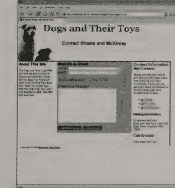

图7-2：“联系我们”页面的最终设计

您可以在线查看最终设计的 HTML 和 CSS（示例7-8，[http://about.com/webdesign/example7-8code](http://about.com/webdesign/example7-8code)）。如果外侧两栏都用于内容，遗憾的是就没有太多空间放置导航了。但各栏目中有充足空间可以在不同位置添加导航。

## 获取链接

信息页的编写可能颇具挑战，但我在 About.com Web 设计/HTML 网站上的以下资源将帮助您获取所需内容。

- **HTML 表单：** HTML 表单是高级 HTML 技能，因为您不仅需要构建网页和样式，还需要设计表单的行为方式。这些文章将帮助您掌握这两方面。

  [http://about.com/webdesign/htmlforms](http://about.com/webdesign/htmlforms)

- **免费 CGI：** 将表单添加到网站最简单的方法是使用免费 CGI 来填充它。这里列出的 CGI 不全是表单转邮件功能，但都能为您的网站添加实用功能。

  [http://about.com/webdesign/cgiscrscripts](http://about.com/webdesign/cgiscrscripts)

- **法律问题：** 构建网站时总会遇到需要处理的法律问题。版权只是开端。

  [http://about.com/webdesign/legal](http://about.com/webdesign/legal)

- **自动化您的隐私政策：** 您可以用 XML 编写隐私政策，并使其自动检查和验证。甚至有些网站可以在您将隐私政策以此格式上线后，验证您是否遵循了该政策。

  [http://about.com/webdesign/p3p](http://about.com/webdesign/p3p)

# 第8章

## 网站导航

### 审视您的网站规划

我刚开始设计页面时，曾构建过一个导航包含十到十五个项目的网站。每个导航元素对应一个页面，没有子页面。我认为这样能让网站更易于理解，某些方面确实如此。毕竟网站的每个页面都包含在导航中。但后来我开始让客户测试。通过测试我发现，由于导航菜单中项目太多，用户误以为网站内容比实际多得多。他们会点击导航中的某个项目，然后快速浏览该页面。当我询问他们的想法时，他们常说：“其他内容在哪里？”

**导航在与用户对话。** 眼动追踪测试发现，网站读者往往忽略页面最顶部以及左右两侧的元素——这些正是导航和广告的常见位置。相反，读者会关注页面中间三分之一的区域，这里通常是内容所在。但这并不意味着他们没意识到导航的存在。

导航对用户而言如同安全毯。它是页面边缘的舒适区域，告知用户能找到所需内容。网页中常见三种导航类型：

- **访问点：** 这些是导航中将用户带往其他位置的元素。大多数人想到导航时，指的就是页面顶部或左侧的菜单，它将读者带到网站的新位置。我的 About.com 网站上的访问点包括每页左侧列出的“必备内容”和“主题”、文章右侧的页面链接，以及每篇文章底部的其他相关文章。

- **路标：** 这些页面元素告诉读者在网站中的位置。可以简单到与标题栏中页面标题匹配的标题或副标题，也可以是复杂的**面包屑导航**，在用户点击链接时跟踪其在网站中的路径。在我的 About.com 网站上，路标包括顶部的面包屑导航、每篇文章上方的页面标题和网站标题，以及 About.com 标志。

- **地图：** 地图是网站的概览，帮助用户查找内容。包括网站地图和分类列表等元素。在我的 About.com 网站上，我有网站地图、所涵盖主题的分类列表、撰写的文章列表等。我的网站有超过 5,000 个页面，因此需要大量地图来保持条理清晰。

**导航不应过于复杂。** 最优秀的网站都采用相当简单的导航。但这可能给构建带来挑战。

特别是如果你的网站提供各种各样的内容。以 3M 为例。他们生产几乎所有你能想象到的东西，但其主要的访问入口包括五个元素：“产品与服务”、“品牌”、“技术”、“我们的公司”以及“合作伙伴与供应商”（[http://solutions.3m.com/en_US](http://solutions.3m.com/en_US)）。每个入口都会带你到一个包含更多信息和链接的索引页面，但顶层导航是有限的。

创建如此简洁优雅的导航是一项非常困难的工作。有些人专门帮助公司完成这件事。他们被称为图书馆学家或信息架构师。信息架构师专门研究信息本身以及人类如何处理信息。他们需要既理解你的受众，也理解你所在行业中常用的术语。

这对于你的导航至关重要。你需要使用客户能直观理解的术语和短语。只要在你的网站上下文中清晰明了，这个术语在网站之外是什么意思并不重要。例如，如果你在我示例的狗玩具网站上看到一个“床与床上用品”链接，却把你带到了谈论花园花坛和如何种植花坛植物的页面，你会非常惊讶。你期望这个页面是关于狗窝的。

**导航中有一部分是大多数人会忘记的：错误页面。** 错误页面是公司员工和网页设计师通常看不到的导航。为什么？因为你知道你的页面在哪里，也知道如何到达它们。你不太可能在自己的网站上输入 URL，因为你知道三下点击就能到达那个页面。即使你输入了 URL，如果你输入错误，你关注的也是你想去的地方，所以错误页面完全被忽略了。

但在规划和构建导航时，不要忘记错误页面。计划三种类型的错误页面：

### 你需要的工具

> ▶ 网页导航的一个好的起点是查看你公司的组织结构。我的文章“让你的组织结构反映你的网站布局”（[http://about.com/webdesign/organization](http://about.com/webdesign/organization)）讨论了一些常见的导航元素，你可以将其作为网站的起点。一旦网站运行了一段时间，就和你的客户交流。如果他们觉得导航易于使用，那么就没有必要更改。否则，你就应该开始调整。

- **404 页面未找到：** 当链接失效或 URL 输入错误时会出现。
- **500 内部服务器错误：** 当你的服务器运行程序并崩溃时会发生。
- **401 未授权页面：** 这些页面告诉你的客户，他们在密码保护页面上输入了无效的用户名或密码。

### 你需要的工具


- 如果你想快速概览你的服务器可以发送到网页浏览器的所有不同状态代码，请查看我的“HTTP状态代码”页面（`http://about.com/webdesign/httpstatuscodes`）。大多数时候，网页会返回状态代码“200 OK”，然后你就能看到网页。但如果它没有返回那个状态，你可以找出更多关于不同代码含义的信息。

## 导航方案

每个网站都需要访问入口、路标和索引，但每种元素的数量取决于你网站的规模和结构。

像我这样拥有数千个页面的网站，比只有二十个页面的网站需要更多的访问入口和索引。但这些都是相对的。当我刚开始在About.com时，我的网站只有几百个页面。那时我的大部分访问入口都在左栏，但不是十八到二十个独立的类别，而是大约十个。随着网站规模和复杂性的增长，我在访问入口中添加了更多项目，我的索引也变得越来越复杂。

**顶层导航是你网站上最重要的导航。** 顶层导航元素应该出现在你网站的每个页面上。大多数人更喜欢命名和页面位置保持一致的导航。

顶层导航包括网站的主要部分。通常，最好将其限制在不超过七到十个链接。你希望各个部分有足够的信息，这样你的客户就能快速找到他们想要的内容，而无需花太多时间寻找。

将你的顶层导航精简到少数几个链接可能非常具有挑战性。这是About.com多年来一直在努力解决的问题。我有十八个顶层类别，我大部分的文章和信息都存储在那里，这已经很多了。

**二级导航可以用多种方式处理。** 一种更流行的方法是创建一个动态菜单，当你将鼠标悬停在顶层导航上时出现。基于标准的设计可以实现这一点。只要你谨慎，这种类型的导航可以在网站上很好地工作。当你有很多类别且彼此之间关系非常清晰时，这种风格的二级导航效果很好。

二级导航的另一个选择是让它在页面上始终可见，就像About.com所做的那样。这可能导致页面混乱，但如果你的网站有海量信息，这可能是让它可见的唯一方式。你最常见到这种风格的网站，要么有数量巨大的类别，要么主题有几个行话术语，但它们意思都一样。例如，在一个计算机网站上，寻找显示器的人可能会搜索“CRT”、“显示器”或“平板屏幕”——这些术语中的任何一个都可能用于导航。

许多大型企业网站的二级导航会根据你在网站上的位置而变化。如果你的网站有非常独立的模块，这种方法效果很好。例如，一个公司可能有一个面向企业客户的网站部分，另一个面向消费者的部分。消费者不会关心网站授权，但这可能是以企业为重点的网站最重要的部分。

**面包屑导航告诉人们他们身在何处。** 网页的挑战在于，与物理位置不同，在更广泛的网站上下文中很难知道你身在何处。随着网络变得越来越多样化，这一点变得更加真实。在许多情况下，主页不再是人们访问网站的唯一地方。

如果有人通过搜索来到你网站上的文章或产品页面，他们会知道自己身在何处吗？这种识别不仅仅包括你的公司标志。他们能找到相关的产品、服务或文章吗？是否清楚这篇文章或产品是一个更大类别或网站的一部分？

网站路标为你的读者提供信息，让他们知道自己身在何处。最基本的层面上，路标可以是你的公司标志和页面标题。但一个好的路标系统不仅仅包含大多数商场地图上的“您在此处”。你还想告诉人们他们在网站结构中的位置，以及这与你网站上的其他文章和信息有何关系。这就是面包屑导航的用途。

我About.com网页设计/HTML网站的每个页面都有面包屑导航。在一个典型文章页面的最顶部，写着“您在此处”。紧接着是面包屑，它在我的网页设计网站和整个About.com层次结构中为你定位。例如，在我的文章“CSS大纲样式”（`http://about.com/webdesign/cssoutlines`）中，面包屑导航显示：“您在此处：About > 计算机与技术 > 网页设计/HTML > CSS > 高级CSS > CSS大纲——它们不仅仅是另一个边框。”这告诉你这篇文章属于高级CSS类别，它是CSS类别的子类别，而CSS类别属于我的网页设计/HTML网站，该网站位于About.com的计算机与技术频道下。

如果你点击面包屑进入高级CSS类别（`http://about.com/webdesign/advancedcss`），你会看到About.com使用第二条面包屑导航的例子。在这种情况下，第二条面包屑出现在页面内容区域的About.com标志和网站标题下方。对于高级CSS页面，它显示为“> CSS > 高级CSS > 高级层叠”。

## 热门内容

你网站上的每个页面都有潜力成为你网站的使者；将每个页面视为一个潜在的入口页面。如果你的路标和顶层导航没有告诉你的客户他们身在何处以及如何到达网站的其他地方，你就会失去他们。在我的文章“每个页面都是入口页面”（`http://about.com/webdesign/entrypage`）中，我谈到了如何确保你所有的网页都能帮助客户留在你的网站上并感到舒适，而不是邀请他们进来后又把他们送走。

## 网络上的其他地方

> ▶ 如果你有兴趣看看我的网站或许多其他网站多年前的样子，你可以使用互联网档案馆时光机（[`www.archive.org/web/web.php`](http://www.archive.org/web/web.php)）。不过，如果你想查看我的网站，有两点需要注意。首先，它最初只是一个HTML网站；Jean Kaiser经营着网页设计网站。其次，我的网站档案只有追溯到1999年的图片，那时我的类别链接已经不止十个了。

## 样式表（CSS）

这是添加到类别和子类别中的，旨在为我们的地图页面提供额外的导航功能。我们的类别可能变得非常复杂。任何顶级类别下最多可以有九个子类别，因此拥有第二种形式的面包屑导航可以让页面更易于遵循。

为网站上的每个页面构建面包屑导航可能是一项繁重的工作，特别是如果你的网站没有数据库或**内容管理**系统（CMS）。许多博客工具会根据你的类别自动构建面包屑并将其放置在页面上。我发现手动构建带有面包屑导航的网站很快会变得乏味。如果你没有数据库或CMS来帮助你维护类别和面包屑导航，我建议保持你的导航路径简单，只链接到与每个子页面相关的顶级导航页面。一旦你开始需要在面包屑中包含多个层级，你的网站规模也大到需要数据库了。

一种更简单的构建路标导航的方法是在顶级导航中使用“你在这里”类型的标记。这是通过在你处于属于该类别的页面时改变导航元素的颜色来实现的。在本章后面，我将展示如何使用`CSS`和基于标准的设计来实现这一点。

**地图是网站导航的瑞士军刀。** 它们可以按你需要的大小缩放。我有一些地图页面只有两三个链接，还有一个“网站地图”页面链接到我网站上的每个页面。

地图页面的关键在于确保它们提供客户在特定主题上正在寻找的信息。例如，你可能有一个导航页面列出你所有的产品或所有关于特定主题的文章。About.com称这些为“类别”页面；我们可以链接到我们自己的文章和网站外部的文章。


> **问问你的向导**

### 为什么它被称为面包屑或面包屑导航？

在大多数网站上，面包屑导航的目的是向读者展示返回主页的路径。就像汉塞尔和格莱特童话故事中的面包屑小路一样，导航路径中的链接显示了返回的路。虽然这个术语暗示网站知道你是如何到达的，但大多数面包屑导航是静态的，并引用了到达你当前页面的最常见路径。

## 其他网络资源

- 网上有很多Web设计师空闲时间太多。他们不仅编写外观精美的网站，还开发有趣、好玩且有用的404页面。404研究实验室（`www.404lab.com/404`）为我们收集了404错误信息页面供我们阅读和欣赏。404页面上的俳句只是个开始。

## 错误页面

许多Web设计师忘记编辑他们的错误信息页面。因此，他们错失了一个巨大的机会，即帮助客户更好地在他们的网站上导航。

**404错误或页面未找到是最常见的错误。** 比较以下两个错误页面。你觉得哪个更有用？

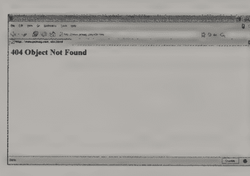

图8-1：PC Magazine（`www.pcmag.com`）的页面未找到

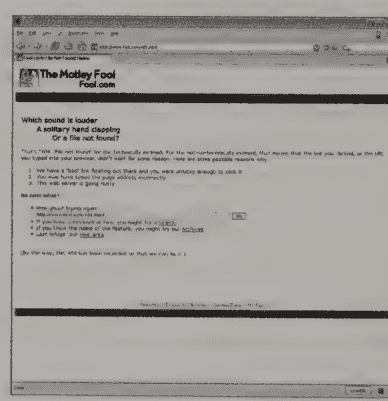

图8-2：The Motley Fool（`www.fool.com`）的页面未找到

`www.pcmag.com`上的页面显示了一个非常简单的404错误信息页面。在Motley Fool网站上输入错误URL的客户获得了更多的信息和帮助。

虽然你的老板、CEO、同事和员工不经常看到404页面，但你的客户会经常看到它。确保它包含有用的信息。以下是一些编写良好404错误页面的技巧：

- **保持错误页面的语气与网站的其他部分相似。** 如果内容（如笑话）在你正常的网站页面上不合适，它也不应该出现在404错误页面上。

- **为客户提供选项来找到他们想要的东西。** 但不要忘记，他们可能并不确切知道他们在寻找什么。如果他们点击了来自另一个网站的链接，他们不会知道将会得到什么。请记住，无论你的404页面多么吸引人，大多数人都会因为链接失效而离开。

- **在页面上放置一个搜索框**，以便你的客户可以搜索他们想要的东西。

- **包含指向你网站主要部分的链接。** 如果你有一个小型网站，请在404页面上包含整个网站地图，但不要忘记随着网站的发展进行维护。

- **不要期望你的客户报告错误。** 是的，有一些好心人会报告，但大多数人不会有时间或意愿。另外，如果你可以访问错误日志，你应该能够看出他们从哪里来（引用者）以及他们没有找到哪个页面。

- **如果你想让用户报告错误，请让这个过程尽可能简单。** 在404页面上包含一个表单。为他们填写引用者和错误URL，这样他们就不必自己填写了。并且一定要根据这些报告采取行动。我有几个读者自愿花时间检查我网站上的链接，都是因为我在他们第一次这样做时回复了感谢。

### 你需要的工具

自定义你的404页面很大程度上取决于你使用的Web服务器。如果你使用的是Apache Web服务器，请按照我的文章“如何在Apache上创建自定义404页面”（[`http://about.com/webdesign/404apache`](http://about.com/webdesign/404apache)）中的说明操作。关于使你的404页面更有用的更多技巧，请查看我的文章“你的404页面有多有用？”（[`http://about.com/webdesign/useful404`](http://about.com/webdesign/useful404)）。

你可能还需要一个**500错误页面和一个401未授权错误页面。** 当你的Web服务器上的程序以某种方式失败时，会出现500错误。如果你在网站上使用CGI或其他服务器端脚本，它们中的一个可能会出现执行问题。500服务器错误页面应该给客户提供建议，告诉他们如果程序崩溃了可以做什么。

401未授权错误页面用于当你的网站有密码保护时。如果你的客户多次输入无效的用户名或密码，服务器将响应401未授权消息。你可以使用此页面提供有关如何获取新密码或如何获得重新授权的建议。

## 基于标准的导航编码

随着设计师越来越熟练地使用`CSS`构建网页，许多做事方法变得更加自然。Web导航传统上是一系列段落或表格单元格，构成了顶级导航的HTML。但什么是标准的导航部分？它是一个列表。因此，对于基于标准的导航，我们应该使用列表元素，具体来说是无序列表。

我的示例网站将在导航中包含以下项目：

- **首页：** 带你返回主页
- **狗玩具销售：** 链接到我的产品页面
- **狗狗信息：** 指向文章
- **关于本站：** 包含所有站点信息页面（如第7章所述）

我将使用的HTML如下所示：

```html
<ul id="navigation">
<li><a href="/index.html">首页</a></li>
<li><a href="/products/index.html">狗玩具销售</a></li>
<li><a href="/articles/index.html">狗狗信息</a></li>
<li><a href="/about/index.html">关于本站</a></li>
</ul>
```

使用该HTML，我可以创建一个尽可能花哨的导航系统。

首先让我们创建一个垂直导航系统。如果你查看上面没有任何样式的HTML，它看起来像一个项目符号列表，所以我们应该做的第一件事是去掉项目符号。请注意，在`CSS`中，我只设置了被标识为“navigation”的无序列表（`ul#navigation`）的样式。如果我使用“ul”作为选择器，那么页面上的每个列表看起来都会像我的导航。我还想去掉浏览器在列表周围留下的间距，所以我也会清除标签上的边距和内边距。在我的CSS文档（如示例8-1所示，`http://about.com/webdesign/example8-1code`）中，我写道：

```css
ul#navigation {
  list-style: none;
  margin: 0;
  padding: 0;
}
```

垂直菜单的好处在于UL元素是垂直堆叠的。因此，接下来我要做的是让每个列表元素看起来像一个框。我将把这个CSS放入我的文档（在线示例8-2，`http://about.com/webdesign/example8-2code`）：

```css
ul#navigation li { margin: .1em 0; }
```

### 你需要的工具

如果你使用Apache Web服务器来运行你的网站，设置受密码保护的目录很容易。诀窍在于密码保护是通过一个单独的程序完成的；你需要使用`htaccess`。我关于htaccess的操作指南文件（`http://about.com/webdesign/htaccess`）将引导你完成在其网站上设置和运行它的步骤。在不到十五分钟的时间里，你就可以拥有一个受密码保护的Apache网站区域。

## 其他网络资源

▶ 如果你不知道如何在图形软件中创建渐变，About.com 图形软件指南解释了如何使用 Photoshop 创建渐变（[`http://about.com/graphicsoft/photoshopgradient`](http://about.com/graphicsoft/photoshopgradient)）。她还有一个关于使用 PhotoImpact 创建有趣渐变的教程（[`http://about.com/graphicssoft/photoimpactgradient`](http://about.com/graphicssoft/photoimpactgradient)）。

```css
ul#navigation li a {
    display: block;
    width: 175px;
    height: 20px;
    border: .1em solid #3c6;
    text-decoration: none;
    color: #63c;
    font-weight: bold;
    text-align: center;
}
```

`display: block;` 告诉浏览器，我们导航列表中的锚点是一个块级元素，而不是内联元素。这使得整个框可点击，而不仅仅是文本。当你制作看起来像按钮的导航时，你需要确保整个框是可点击的。`width`、`height` 和 `border` 属性设置了列表项的宽度、高度和边框。然后`text-decoration`移除了锚点标签的下划线。最后，`color`、`font-weight` 和 `text-align` 调整了导航中的文本样式，使其符合我们的要求。

但它看起来还不像导航。在线示例8-3（[`http://about.com/webdesign/example8-3code`](http://about.com/webdesign/example8-3code)）中，我为导航框添加了一些颜色。当你将鼠标悬停在框上时，它们会改变颜色。你可以在在线示例中查看对应的CSS。

为了使这个导航更有趣，我使用了一个带有颜色渐变的小图像作为背景色。就像在示例8-3中一样，我在示例8-4中使用了第二个渐变图像，当你将鼠标悬停在导航按钮上时。

示例8-4的CSS在线可查（[`http://about.com/webdesign/example8-4code`](http://about.com/webdesign/example8-4code)）。我用以下几行添加了渐变图像：

```css
ul#navigation li a { background: #fff url(navbg.gif); }
ul#navigation li a:hover { background: #fff url(navbg_over.gif); }
```

然后我将两个图像（`navbg.gif`和`navbg_over.gif`）上传到服务器上与网页相同的目录中。

**但是水平导航菜单呢？** 垂直菜单相当容易，因为列表是一个垂直项目。但水平菜单也很容易。你可以使用与前面示例完全相同的HTML，只需对CSS做一些更改即可创建水平菜单。要创建水平菜单在线示例8-5（[`http://about.com/webdesign/example8-5code`](http://about.com/webdesign/example8-5code)），我所做的一切就是将`float: left;`添加到`ul#navigation li`属性中。我还更改了同一属性上的边距，使按钮左右有间距，而不是上下。

**为CSS导航添加指示标也很容易。** 使用导航帮助客户知道他们所在的位置是个好主意。最常见的方法是更改当前导航项的颜色以突出显示。为了给我的示例站点导航添加指示标，我们需要稍微修改一下HTML，以告诉Web浏览器当前页面位于哪个标签页。例如，如果你的当前页面在文章部分，你会将HTML更改为如下内容：

```html
<ul id="navigation">
<li><a href="/index.html">首页</a></li>
<li><a href="/products/index.html">狗玩具销售</a></li>
<li id="youarehere"><a href="/articles/index.html">狗狗信息</a></li>
<li><a href="/about/index.html">关于本站</a></li>
</ul>
```

注意，在“狗狗信息”列表项中现在有了一个`id="youarehere"`属性。


要设置高亮效果，需要为选择器`ul#navigation li#youarehere a`更改背景色。我决定从悬停状态中移除颜色变化，而是将其作为高亮颜色。但为了明确这些是链接，我在鼠标悬停时添加了下划线。你可以在在线示例 8-6（http://about.com/webdesign/example8-6code）中查看结果。请务必点击不同的链接，看看高亮颜色如何跟随你在网站上的位置（因为在每个页面上，我都更改了`id="youarehere"`属性的位置）。最终的 CSS 如下：

```css
ul#navigation {
  list-style: none;
  margin: 0;
  padding: 0;
}
ul#navigation li { margin: 0 .1em; float: left; }
ul#navigation li a {
  display: block;
  width: 175px;
  height: 20px;
  text-decoration: none;
  color: #63c;
  font-weight: bold;
  text-align: center;
  background: #fff url(navbg.gif);
}
ul#navigation li a:hover { text-decoration: underline; color: #000; }
ul#navigation li#youarehere a { background: #fff url(navbg_over.gif); color: #000; }
```

## 使用客户测试你的导航

一旦你有了想要的导航，就用你的客户来测试它。如果某个导航元素、样式或术语不起作用，请毫不犹豫地进行更改。与印刷品不同，你可以犯错并修复它们，而且大多数读者永远不会知道。

**进行 A/B 测试是个好主意。** 通过 A/B 测试，你可以看到两个或多个设计方案的相对效果。其中一个设计是你的对照组——可能是你网站当前在线的导航。第二个设计是你想要测试的。你设置你的网站，使一半的客户看到设计 A，另一半看到设计 B。有很多种方法可以做到这一点，但最简单的是雇佣一家公司来帮你做。

为了让 A/B 测试有效，你需要确定你在测试什么。你需要想出衡量的指标，以便确定设计 B 是否比设计 A 更好。例如，在测试导航时，你可能会跟踪每个设计中有多少人使用搜索，而不是点击你的导航。如果你相信你的新导航应该比搜索更有效、更易用，那么新设计应该比旧设计有更多的导航点击，而不是搜索点击。

A/B 测试的优势在于，它让你有机会测试新设计，而不会完全破坏你的网站。此外，如果事实证明新设计不如旧设计有效，你可以随时将其关闭。

**如果你不能做 A/B 测试，那就做一些测试。** 测试新导航的另一种方法是将其添加到网站的一些页面，但不是全部。这不能让你很好地了解它整体的表现，但它更容易实施。

调查你的客户，找出他们对新导航的看法。调查是了解读者脉搏的好方法，而且有了免费的 CGI 脚本，它们可以成为确定你的新导航是否有效的廉价方式。

## 网络上的其他资源

▶ **一旦你有了带有指示标的顶级标准导航，转向扩展菜单就不难了。这些菜单是当你将鼠标悬停在上面时，第二层（以及第三、第四层等）会滑出的菜单。** 一个获取菜单想法和帮助的好网站是“CSS Showcase”（[www.alvit.de/css-showcase/css-navigation-techniques-showcase.php](http://www.alvit.de/css-showcase/css-navigation-techniques-showcase.php)）。大多数扩展菜单需要一些 JavaScript 才能在 IE 6 中工作，但它们确实创造了很好的效果。

## 获取链接

导航是网站非常重要的一部分。我网站上的这些链接涵盖了你关于构建和维护 Web 导航需要了解的更多信息。

- **编写 Web 导航**

  Web 导航很有趣！有很多方法可以实现。你选择了一种方法并不意味着你不能选择其他方法。这些链接涵盖了如何为你的网站构建和维护一个有效的 Web 导航系统。

  http://about.com/webdesign/navigationindex

- **HTTP**

  超文本传输协议，或 HTTP，是使网络工作并将其与电子邮件或 FTP 区分开来的东西。这些链接将帮助你更好地理解 HTTP，包括状态和错误代码。

  http://about.com/webdesign/httpindex

- **免费菜单模板**

  这些免费菜单模板向你展示了如何构建基于标准的 CSS Web 导航菜单。

  http://about.com/webdesign/menutemplates

# 第九章：构建你的主页

## About.com

### 主题：

## 第一印象至关重要

这句格言在主页设计上与在生活中同样重要。你的主页是向客户推销公司的窗口。当潜在的合作伙伴和投资者评估你的公司时，他们会看到主页。你所有的营销和公关宣传册也都在为它打广告。

## 你的客户并不关心你或你的产品

这听起来可能很刺耳，但却是事实。人们上网的原因多种多样：为了娱乐，寻找参考资料和对比信息，或者购物。除非他们正在参加焦点小组（或为该公司工作），否则大多数人除了问这个问题——“这个网站是否满足我当前的需求？”之外，并不会过多思考他们正在浏览的网页。他们当下的需求可能是以下任何一种：

- 寻找出售厨房计时器的链接
- 查找厨房计时器的评测
- 阅读他人对他们所购买的厨房计时器的评价
- 查找退回厨房计时器的退货政策
- 阅读如何使用厨房计时器的说明
- 为他们的厨房计时器建议新用途
- 参与一个使用厨房计时器的游戏

## 你需要的工具

在构建主页时，你需要始终进行分析性思考。我的文章“构建你的主页”（[http://about.com/webdesign/build homepage](http://about.com/webdesign/build homepage)）解释了如何通过几个企业主页的例子来分析主页。要始终观察其他设计师如何构建他们的页面，这样才能借鉴他们的优点，避免他们的缺点。

其中一些例子可能有些幼稚，但如果你的网站销售厨房计时器，你就应该把最有用的选项直接放在主页上。至少，要明确表明你的网站是为厨房计时器爱好者服务的。

**你的主页上应该有什么？** 这可能是一个挑战，尤其是对于销售大量产品或拥有大量不同主题文章的公司来说。所有主页至少应完成几项基本功能：

- **概括网站的目的。** 许多公司会省略这一点，因为他们有太多其他想说或想推销的东西。但不要假设每个访问你主页的人都会自动知道你的公司是做什么的。你的摘要不必很长，甚至不必是文本。Google 用一个搜索框就概括了其网站。

- **放置指向你网站上可用的产品、服务或文章的链接。** 如果你有很多文章或产品，那么你的主页上就会有更多的链接。你需要从主页传达你网站的范围。此外，确保在页面的某个位置链接到你最受欢迎的产品或文章。如果你运营一个名为`www.kitchentimersforsale.com`的网站，却没有指向出售厨房计时器的链接，你会让你的客户感到困惑。

- **从主页链接到信息页面。** 这些是联系页面、法律页面等（如第 7 章所述）。但不要陷入公关部门的泥潭。这就是像公关、法律或投资者关系等部门希望你主页上有多条指向他们内容的链接的地方。是的，链接到你网站的这些区域，但不要把你的主页变成新闻中心。访问你网站的大多数访客不是媒体成员、投资者，或者对你的版权和其他法律声明感兴趣的人。放上一两个指向这些区域的链接就足够了。

## 许多人从未见过的页面

有趣的是，当一个人着手构建一个网站时，她想到的是主页。在我的设计画廊（http://about.com/webdesign/designgallery）中，我总是被引导到主页而不是内页。主页通常是设计公司投入精力最多的页面，获得的页面浏览量最多，也最受营销部门关注，并且是如果你的 CEO 要打电话给你，唯一会提到的页面。主页是你网站上最重要的页面。

**但它真的是最重要的吗？** 在我们开始思考主页之前，让我们先审视一下这个前提。主页是代表你公司的页面。它向你的客户提供关于你产品、服务、文章、新闻稿和股价的信息。在许多方面，主页试图代表你网站各个部分的一个缩影。你的主页必须对所有人来说都是所有东西，或者至少对大多数人来说是大部分东西。

**你的一些客户从不看你的主页。** 虽然它可能是所有单个页面中页面浏览量最高的，但这并不意味着每个人都看到了它。在我管理的两个不同网站上都观察到了这种情况。在第一个网站上，我们跟踪了每次访问的平均页面浏览量。我们发现大多数访客来到网站，阅读一篇文章，然后离开——每次访问只有一次页面浏览。虽然主页获得了很多页面浏览量，但网站上的其他页面也获得了很多。在第二个网站上，我们跟踪了客户从主页出发的路径以及他们在主页上停留的时间。在这种情况下，大约 70% 的人到达主页，寻找一个特定的链接，找到后就点击离开了。他们停留在主页上的时间，仅仅够浏览页面找到链接并点击离开。

在第一个网站上，客户根本没见过主页。他们是通过搜索引擎来到网站，寻找特定问题的答案的。一旦他们阅读了页面，他们就离开了，没有浏览网站的其余部分。在第二个网站上，客户会来到主页，但分析数据（和焦点小组）显示，他们停留在页面上的时间刚好够找到他们想要的链接然后点击离开。他们可能落在了主页上，但他们从未真正看过主页的内容。

**你的主页服务于多种目的和多个主顾。** 尽管主页的目标难以用一个来概括，但一些比较常见的目标包括：

- 详细列出可用的产品或服务
- 推广公司的不同领域
- 提供投资者信息
- 包含有趣的内容
- 突出销售和促销活动
- 提供在网站上查找更多内容的方法
- 提供到其他语言或地区版本网站的导航
- 展示公司的酷炫或创新之处

主页功能繁多，因为要做的事情也很多。

## 主页内容应有所选择

选择性是优秀主页的关键。这既适用于内容，也适用于设计元素。除非你销售的是技术本身，否则不要过于关注技术。

**仅仅因为你的公司有这个部门，并不意味着它应该出现在主页上。** 这是公司的通病。每个部门团队都希望在主页上有一个链接和简短的描述，这样人们就会访问他们的页面并购买他们的产品。我在只卖两样东西的公司和拥有 700 多个类别可供选择的公司里都见过这种情况。（About.com 就存在这个问题。）

**你需要思考你的客户在寻找什么。** 帮助你的客户找到除了他们正在寻找的东西之外的其他东西总是有必要的，但这是次要的。你的主页有两个目标：向客户简要介绍你的公司，并提供导航，让客户能找到他们想要的东西。第二个目标比第一个更重要。

Google 在构建他们的主页时做得最好。作为 Google 的客户，我很清楚该做什么——我去那里，输入我的搜索词，然后找到我想要的东西。有一些页面上还有其他链接，但主要焦点是标志和其下方的搜索框。Google 的设计师们认识到，他们的客户对搜索以外的其他服务并不那么关心。因此，Google 将其单独提出，其余内容则留到网站的子页面上。

然而，Google 是例外，而非规则。大多数网站设计似乎故意隐藏了客户最想从网站获得的东西。例如，如果你查看麦考菲安全网站（[www.mcafee.com/us](http://www.mcafee.com/us)），页面的焦点是什么？

显然，设计师希望我们更多地关注公司的图形和简短描述，而不是你可以在网站上做什么或去哪里。客户必须自行分类为“家庭与家庭办公室”用户、“小型企业”客户等。当你将鼠标悬停在这些分类上时，它们会展开显示针对特定客户类型的链接。但客户仍然必须阅读分类标题，决定哪个适用于他们，然后点击相应的链接。与 Google 相比，这需要做很多工作。

现在，我不知道麦考菲的客户在访问该网站时在找什么，但在我写这一章时，我确实有需要续订的防病毒软件。因此，我访问了麦考菲网站，看看他们的防病毒软件价格如何，并与我目前使用的软件进行比较。不幸的是，在我快速浏览页面时，我没有看到任何“防病毒”一词的迹象，于是我回到 Google，在搜索框中输入了这个词。对于典型的麦考菲客户来说，访问该公司主页的这趟旅程可能会相当令人沮丧。

**如果你正在重新设计网站，请查看你的网站日志。** 在许多方面，重新设计主页比从头开始构建主页容易得多。你可以查看当前主页上哪些内容有效，哪些无效，保留好的，去除坏的。

在我的网站上，我以两种方式使用网站日志。第一是查看人们点击了哪些文本。我会更改链接的文本，看看这是否会导致该页面的点击量上升或下降。例如，在我关于 About.com 网页设计/HTML 网站的主页导航中，我确定人们更可能点击“HTML 教程”而不是“入门 HTML”，所以我现在使用“HTML/网页设计教程”（尽管我正考虑用另一个短语来测试它）。使用统计数据的另一种方式是查看网站上哪些页面最受欢迎。如果这些页面也与你在统计数据中看到的特定搜索词相关联，那么就使用那个词链接到该页面。为什么要与之对抗？如果你的客户想要那些信息，试图隐藏只会激怒他们或使他们离开你的网站。

## 热点话题

- 你的主页代表公司以最佳形象面向客户固然重要。但请记住，虽然你想很酷，但你的主页不应只有酷。正如可用性专家贾里德·斯普尔所说，“酷是不够的。”我在文章《酷是不够的》（[http://about.com/webdesign/coolsite](http://about.com/webdesign/coolsite)）中讨论了如何打造既酷又有效的网站。如果读者无法使用，一个外观精美的网站是不够的。

**只保留必要的内容。** 主页只有三样东西是必要的：

- 解释你的公司是做什么的
- 帮助客户找到他们想要的东西
- 展示可用的内容

解释你的公司不应该超过一两句话和一个品牌标志。你需要能够将你公司提供的服务提炼成十五个字或更少。在你的主页可见部分包含这段话，但也要确保你的标题标签包含相同的信息。一个好的标题标签将标题放在前面，然后是网站的简短描述。

## 网络上的其他资源

如果你有兴趣创建一个好的主页，可以从糟糕的主页中吸取教训。文森特·弗兰德斯的网站“糟糕的网页”（www.webpagesthatsuck.com）涵盖了所有你想知道的关于如何创建一个糟糕、丑陋、不可用的网页的内容。

```html
<title>Dogs and Their Toys-Buy Dog Toys Online and Get Information About Dogs-Dogs and Their Toys</title>
```

确保你的主页包含一个搜索框。这样，访客可以进行搜索以找到网站上他们需要的具体内容。突出显示网站上最受欢迎或最常使用的内容，以便客户可以直接访问。

最后，你需要确保读者知道你的网站上有哪些内容。最好的方法是在主页上放置一些内容小片段。但如果你没有足够的空间，或者你有很多内容，请确保你有链接，以便他们可以在网站上导航。

注意你在主页上使用的图片。许多人自动假设所有图片都是广告，甚至看都不看。如果你的内容或导航隐藏在图片中，客户可能看不到它。确保你的主页图片有其目的。

## 你只有七到十秒钟

你的主页是网站上访问量最大的页面，但除非你像 Google 一样极简主义，否则它不会总是有客户想要的东西。你必须吸引他们进入你的网页，让他们想要浏览它以找到他们想要的东西。如果你在他们访问网站后十秒钟内没有吸引他们，他们就会点击“后退”按钮，去别处寻找。

比网站上的任何其他网页，你的主页必须尽快加载。吸引客户的七到十秒钟是从他们点击指向你的网站的链接那一刻开始的。如果你的主页需要六秒才能加载可用内容，那么你只剩下几秒钟了。

第 12 章更详细地解释了如何帮助你的网站更快地下载，但这里有一些建议：

- 使你的图片和多媒体尽可能小。我喜欢将图片限制在不超过 5 到 10KB，每页总计不超过 30KB。
- 避免在主页上使用外部网站的广告。你无法控制另一个服务器提供内容的速度，而且你不想让广告拖慢你的页面。
- 将你的 HTML 分段编写，这样即使页面的下部还在加载，上部也已完成并可读。

## 主页布局类型

网络上只有三种主页布局。除非你正在做一些极其新颖和突破性的东西，否则你的网站很可能会采用其中一种：

- 引导页是客户在被引导（自动或点击）到网站主要内容之前，先看到某种视觉媒体的页面。
- 以信息为中心的主页专注于立即将内容提供给客户。
- 以导航为中心的主页专注于通过链接和其他导航展示网站的广度。

**我不喜欢引导页。** 引导页被放置只有一个目的：炫耀。除了极少数情况，引导页不提供关于网站的任何信息；相反，它们只是网站的一个花哨广告。如果我想看广告，我会打开电视，而不是点击链接。

但有一些好的、不那么情绪化的理由要避免它们：

- 引导页主页的可用性完全有缺陷。访客决定访问你的主页。关于该页面的广告除了激怒他们并让他们再次点击（最好的情况）或激怒他们并赶走他们（最坏的情况）之外，没有任何作用。
- 如果你必须使用引导页，请务必与你的客户进行测试。在一些研究中，16% 到 71% 的客户在看到引导页后会离开，不会访问网站上的任何其他页面。
- 搜索引擎不喜欢引导页。虽然可以设计搜索引擎可以读取的引导页，但现实是，你不会从引导页获得与内容丰富的主页相同的 SEO 水平。
- 引导页可能显得自负。它们不是以对读者有效的方式提供信息，而是为了炫耀和满足设计师的自尊。
- 引导页使整个网站看起来更慢。请注意，一个引导页不会影响你网站其他部分的实际下载时间。但引导页的运行时间可能比下载和查看标准网页更长。这是因为虽然页面本身可能加载很快，但你的客户必须费力地完成整个动画过程或寻找“跳过”链接。他们没有立即做他们想做的事情，所以整个网站对他们来说似乎更慢。

**以信息为中心的主页非常适合小型网站。** 当你没有很多内容时，无论是刚开始还是只销售一种产品，以信息为中心的主页是完美的起点。在这种情况下，信息应该是页面的主要焦点。以信息为中心的页面上会有链接，但你将满足这三个

### 你需要的工具


> 如果你正在寻找更多关于如何加快主页速度的建议，我在文章“加快网页速度的技巧”（[http://about.com/web design/quicktipsspeed](http://about.com/web design/quicktipsspeed)）中提供了一些建议。网页有如此多的元素，提高下载速度可能需要大量努力。但如果你专注于这些建议并阅读第12章，你可以确保你的主页是一个快速加载器。

### 热点话题

如果你仍然决心构建一个引导页，我在文章《引导页——优点和缺点》（`http://about.com/webdesign/splashpages`）中更详细地讨论了它们。在那里，你可以了解引导页的一些潜在好处以及构建它们的技巧。

## 指南（解释你的公司是关于什么的，帮助你的客户找到他们想要的东西，并通过在主页上提供更多内容来展示你的内容）

对于我的狗玩具主页，我将在顶部使用一个大标志，并在顶部放置网站标题和一个简短的段落来解释公司。HTML相当简单；文档的头部比标题和推广文本要长。

```html
<!DOCTYPE html PUBLIC "-//W3C//DTD XHTML 1.0 Transitional//EN"
  "http://www.w3.org/TR/xhtml1/DTD/xhtml1-transitional.dtd">
<html>
<head>
<title>Dogs and Their Toys - Buy Dog Toys and Get Dog Info at Dogs and Their Toys</title>
<meta name="keywords" content="dog toys, dog information, help with dogs, dog collars, dog equipment" />
<meta name="description" content="Find the best dog toys and dog information at Dogs and Their Toys" />
<link type="text/css" href="zexample9-1.css" rel="stylesheet" />
</head>
<body>
<div id="container">
<h1>Dogs and Their Toys</h1>
<h2>Find the best dog toys and dog information at Dogs and Their Toys.</h2>
</div>
</body>
</html>
```

CSS定义了它的外观。你可以在在线示例9-1（`http://about.com/webdesign/example9-1code`）中看到这个主页的第一部分以及CSS。

接下来，我想添加导航和一些内容空间。我希望页面的其余部分有两列。HTML看起来很像第145页上的内容：

```html
<!DOCTYPE html PUBLIC "-//W3C//DTD XHTML 1.0 Transitional//EN"
  "http://www.w3.org/TR/xhtml1/DTD/xhtml1-transitional.dtd">
<html>
<head>
<title>Dogs and Their Toys - Buy Dog Toys and Get Dog Info at Dogs and Their Toys</title>
<meta name="keywords" content="dog toys, dog information, help with dogs, dog collars, dog equipment" />
<meta name="description" content="Find the best dog toys and dog information at Dogs and Their Toys" />
<link type="text/css" href="zexample9-2.css" rel="stylesheet" />
</head>
<body>
<div id="container">
<div id="header">
<h1>Dogs and Their Toys</h1>
<h2>Find the best dog toys and dog information at Dogs and Their Toys.</h2>
</div>
<ul id="navigation">
<li><a href="/" class="here">Home</a></li>
<li><a href="/products/">Dog Toys for Sale</a></li>
<li><a href="/articles/">Dog Information</a></li>
<li><a href="/about/">About This Site</a></li>
</ul>
<div id="main">
<div id="primary">
<h3>Headline 2</h3>
<p>Text goes here</p>
</div>
<div id="secondary">
<h3>Headline 3</h3>
<ul>
<li>bulleted list</li>
<li>bulleted list</li>
<li>bulleted list</li>
</ul>
</div>
</div>
</div>
</body>
</html>
```

配合CSS，页面最终看起来像这样：

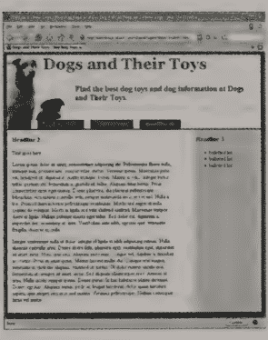

图9-1：主页正在成型

## 热点

我在主页上使用了一个特殊的HTML技巧来获得我生成的效果。CSS列的一个挑战是它们只延伸到其内容的长度，这使得获得等高的列非常困难。你必须使用一种叫做“伪列”的效果来伪造列（[http://about.com/webdesign/faux columns](http://about.com/webdesign/faux columns)）。

你可以在在线示例9-2（[http://about.com/webdesign/example9-2code](http://about.com/webdesign/example9-2code)）中看到HTML和CSS代码。

然后，我在在线示例9-3（[http://about.com/webdesign/example9-3code](http://about.com/webdesign/example9-3code)）中创建了所示的页面，并添加了一些实际内容，以便你看到网页在包含真实文本和图像时的样子。如你所见，有一个产品推广以及一个文章，其中包含指向文章索引和产品页面的链接。

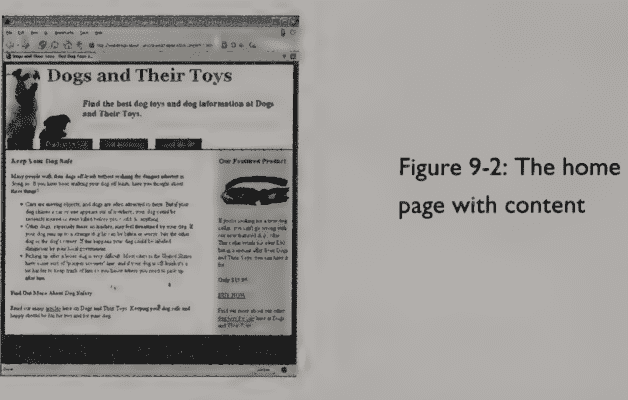

当你有大量内容需要推广时，使用导航主页。主页的一个关键功能是展示你的内容供读者查找。对于我们的导航重点主页，我将创建一个带有页眉和页脚的三列布局。这将为你提供更多的空间来放置导航链接、内容链接以及主页上的一些内容。HTML基于我免费的Web模板中的三列页眉和页脚布局（`http://about.com/webdesign/3colheadfoot`）。

```html
<!DOCTYPE html PUBLIC "-//W3C//DTD XHTML 1.0 Transitional//EN"
"http://www.w3.org/TR/xhtml1/DTD/xhtml1-transitional.dtd">
<html>
<head>
<title>Dogs and Their Toys - Buy Dog Toys and Get Dog Info at Dogs and Their Toys</title>
<meta name="keywords" content="dog toys, dog information, help with dogs, dog collars, dog equipment" />
<meta name="description" content="Find the best dog toys and dog information at Dogs and Their Toys" />
<link type="text/css" href="zexample9-4.css" rel="stylesheet" />
</head>
<body>
<div id="header">
<h1>Dogs and Their Toys</h1>
<ul id="navigation">
<li><a href="/" class="here">Home</a></li>
<li><a href="/products/">Dog Toys for Sale</a></li>
<li><a href="/articles/">Dog Information</a></li>
<li><a href="/about/">About This Site</a></li>
</ul>
</div>
<div id="container">
<div id="main-holder">
<div id="main">
<p>main column</p>
</div>
<div id="subnav">
<p>left column</p>
</div>
</div>
<div id="extra">
<p>right column</p>
</div>
</div>
<div id="footer">
<p>footer</p>
</div>
</body>
</html>
```

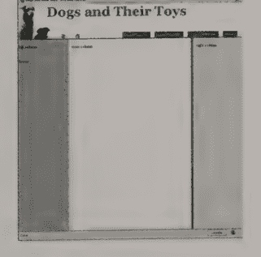

图9-3：看一看导航

如果你查看页面，你会注意到导航与你预期的相反。这是因为我在导航列表上使用了`float: right;`来使其位于页面的右侧。完整的CSS可以在在线示例9-4（`http://about.com/webdesign/example9-4code`）中查看。

浏览器会查看列表中的所有元素，并按照从右到左的顺序一个接一个地浮动它们。现在，一个简单的解决方法是改变导航列表的顺序，使“Home”放在最后，“About This Site”放在最前面。但如果你在下一次重新设计中决定将导航定位到左侧，你必须进入并更改HTML。

为了解决这个问题，我决定放弃导航栏的精确定位，而是使用内边距来定位它。这种方法的缺点是在较小的窗口上会出现水平滚动条，尽管如果你向右滚动，似乎没有任何东西出现。虽然这不是理想的情况，但目前还不是主要问题。如果网站最终需要第四列（例如用于广告），那条延伸的线和滚动条看起来完全不会显得格格不入。我修改后的CSS如下所示：

```css
#header #navigation {
    float: left;
    background: transparent url(paws.gif) no-repeat 150px;
    color: #fff;
    width: 800px;
    font-size: 0.75em;
    /* for IE 6 and 5 */
    margin: 48px 0 0 180px;
}
/* IE 6 and 5 can't read this property */
#header > #navigation {
    padding: 0 0 0 350px;
    margin: 48px 0 0 0px;
}
#header ul#navigation li a {
    padding: .25em 1em;
    margin: 0 1em 0 .25em;
    background-color: #183;
    color: #fff;
    text-decoration: none;
    float: left;
}
```

可以在在线示例9-5（[http://about.com/webdesign/example9-5code](http://about.com/webdesign/example9-5code)）中获取完整的HTML和CSS。

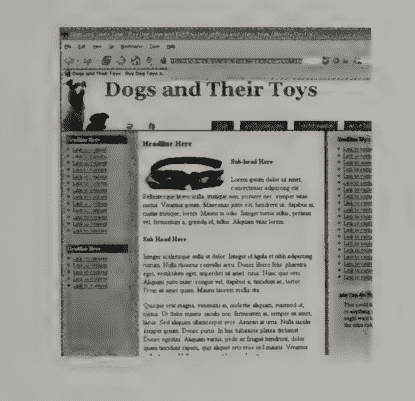

图9-4：主页的最终版本

这种布局更注重链接和可用内容，但它也为你提供了一个大的中心部分来推广产品或宣布新文章。

**关于设计你的主页，最后一件事是。** 永远不要停止修改它。一旦你的主页上线，就开始查看你的日志文件。更新链接文本或颜色，或修改页面上元素的位置。Web设计的魅力在于你永远不必满足于不起作用的东西。一切都可以改变。既然你已经构建了一个完整的网站，你可能会想：“为什么这本书还有六章？”本书的其余部分将带你了解如何改进你的主页和网站的其余部分。

## 网络上的其他地方

- 使用CSS设计你的网站使得在整个网站上持续进行重新设计变得容易。用户界面工程的Jared Spool写了一篇关于CSS和迭代设计的有趣文章（[www.uie.com/events/uiconf/articles/iterative_design_css](http://www.uie.com/events/uiconf/articles/iterative_design_css)），解释了如何使用CSS对你的网站进行小的更改。

## 获取链接

创建主页是构建网站最重要的部分。切勿掉以轻心。以下来自我的 About.com 网页设计/HTML 站点的链接将帮助你构建最佳主页。

## 网页设计基础

首先，从学习网页设计的基础开始。

[http://about.com/webdesign/webdesignbasics](http://about.com/webdesign/webdesignbasics)

## CSS 入门

了解网页设计后，学习 CSS。虽然大多数 HTML 编辑器能很好地处理 HTML，但手动编写 CSS 效果更佳。

[http://about.com/webdesign/beginningcss](http://about.com/webdesign/beginningcss)

## 撰写符合客户目标的网页

如果你的主页符合客户的目标，他们会购买你的产品、阅读你的文章，并向朋友推荐你。如果不符合，他们甚至不会停留足够长的时间来记住你的公司名称。

[http://about.com/webdesign/customer](http://about.com/webdesign/customer)

# 第10章

# 搜索引擎优化（SEO）与网站推广

## 为何要针对搜索引擎进行优化？

许多人误以为针对搜索引擎优化网站是欺骗搜索引擎以获得更高排名的方法。他们将 SEO 这一工具等同于贿赂警察或贿选。但 SEO 的目的并非获取不应得的东西，而是撰写关键词、内容和元数据最佳组合的页面。当有人想学习如何建造新的狗屋时，SEO 是让他们访问你关于建造狗屋的网页，而非其他内容页面的途径。

**搜索引擎看似聪明。** 实际上，搜索引擎的智能程度取决于为其编程的人员。当人们思考计算机时，他们会想到“逻辑性”和“有条理性”。这没错，但计算机也非常死板。过去的搜索系统非常死板，如果你输入“computer”，搜索只会匹配这个词。包含“computers”的页面不会匹配该搜索。

当我在 NETCOM 工作时，我们的搜索引擎就非常死板。如果你在搜索引擎中输入一个短语，比如“netscape browser crashes”，它会返回站内包含这三个词中任何一个的所有文章列表。在搜索引擎的第一个版本中，它甚至不会对结果进行排名——如果一篇关于金鱼的文章在搜索索引中排在第一位，并且提到了崩溃或 Netscape，那么这将是页面上的第一个结果。我们做了很多工作来修复搜索引擎，但我们不是程序员；我们所能做的只是调整索引中的排名，并在输入多个术语时更改设置，例如使用“AND”而不是“OR”。

自 1995 年以来，搜索引擎已经取得了长足的进步，但它们仍然是计算机。而计算机目前还没有大多数人类聪明。因此，即使 Google 拥有许多复杂的算法，如果你不知道搜索时使用的正确词汇，查找特定主题的信息仍然可能很困难。

前一段时间，我正在撰写一篇关于 URL 参数的文章。这些是某些 URL 末尾的标记；它们以问号（`?`）开头，并用与号（`&`）分隔。出于某种原因，我一时想不起“parameter”这个术语。我最终花了三十分钟或更长时间使用诸如“question mark in URL”之类的术语进行搜索。我也经常在我的读者中看到这种情况——许多人想知道如何将一个文档中的 HTML 包含到另一个 HTML 文档中。但他们使用诸如“use one page many times”和“write HTML once”之类的术语搜索我的站点。如果你不知道“include”这个术语，就很难获得能解决问题的有意义的搜索结果。

**SEO 试图解决这个问题。** 是的，SEO 的目标是让你的页面在搜索引擎中获得更高的排名。但你不可能为任何人可能输入的每个搜索词都获得高排名。我丈夫 Mark 的网站在搜索“computer reviews”时可能在 Google 上排名第一，但如果你搜索“dressage saddles”，他的网站根本不会出现。

这是合理的。Mark 撰写 About.com PC 硬件/评测站点（[http://compreviews.about.com/index.htm](http://compreviews.about.com/index.htm)）。他没有任何关于马、马术或马鞍的信息，他也不希望有人为了这些内容来到他的站点。另一方面，他的站点确实有大量的计算机评测和 PC 硬件信息，因此针对搜索词“computer reviews”进行优化对他的站点来说是理想的。

## 如何针对搜索引擎进行优化

SEO 的难度取决于你想要达到的程度。我每篇文章只花大约三十分钟进行 SEO。其他 About.com 指南则更专注于使其页面尽可能地对搜索引擎友好。一位指南每周审查一次他的搜索词，并每天修改他的页面，包括类别、页面标题、链接标题等。他会更频繁地审查这些词，但我们只收到周报。他的站点是网络上最受欢迎的站点之一，所以我希望我能效仿他。


以下部分涵盖了针对搜索引擎优化网站的六个基本步骤。

## 单独优化每个页面

SEO 的关键在于记住你网站的每个页面都是一个入口页面。无论你多么希望每个人都从你的主页开始，并通过点击你的类别来找到他们想要阅读的产品或文章，当有人通过搜索引擎到达时，情况并非如此。

在任意一周内，用于访问我网站的前十个最受欢迎的搜索词产生了 4% 的流量。这听起来可能不多，但考虑到我有成千上万的搜索请求，加起来流量就很大了。在同一周内，我的主页占网站流量的 8%。这意味着通过搜索请求访问我的站点几乎和通过主页一样常见。访问我网站的前三十六个引荐来源来自搜索引擎。通过多年查看我的统计数据，我知道这并非偶然——大多数人是通过搜索引擎来到我的网站的，而其中大多数搜索引擎的点击会将他们带到文章页面，而不是我的主页。

## 针对特定目标短语进行优化

SEO 的关键在于选择一个（最多两到三个）你希望为其优化页面的目标短语。你不可能为某人搜索该主题的所有可能方式都优化网页，因此你需要找到一两个可以融入页面的短语，然后在这些术语上占据优势。

例如，我写了一个关于如何让网页定期刷新的网页（`http://about.com/webdesign/metarefresh`）。有很多术语我本可以选择：“http refresh”、“meta redirect”或“automatic redirect”。我决定专注于“meta refresh”这个术语。因为我没有用其他搜索术语稀释我的页面，所以我能够让该页面在搜索“meta refresh”时在 Google 上排名第一。

以下是关于 SEO 的一些建议：

- **短语比单个单词效果更好。** 如果在搜索该主题时频繁使用某个单词（比如我上面例子中的“refresh”），请将其包含在你的短语中。但单个单词限制很大，且难以优化。

## 分析你的竞争对手

除非你发明了全新的东西，并且你的网页就是关于这个的，否则很可能你已拥有竞争对手。虽然你的整个网站可能与某个特定网站竞争，但你的逐页竞争格局可能变化。例如，我的 About.com 网站设计/HTML 网站的竞争对手包括 W3Schools 和 WebReference 等网站，但我关于 meta refresh 的文章也与 `www.submitcorner.com` 和 Dan's Web Tips（`http://webtips.dan.info`）上的文章竞争。

### 确保你的目标短语很重要

我的大多数文章页面针对“About.com”和“Jennifer Kyrnin”等术语都优化得很好，但除了我的个人资料页面或网站的“关于我们”页面外，这些都不是值得优化的术语，因为它们并非页面的主题。

### 你的目标短语必须准确反映页面内容

正如我们稍后将看到的，为了让你的页面出现在与页面内容无关的热门关键词短语中而采取的做法，可能会损害你的排名。你可能会获得页面浏览量，但你不会获得客户。

### 你的目标短语应该是受欢迎的

你想找到一个人们正在搜索的短语。在我的网站上，当我将目标短语定为“Beginning HTML”用于我的 Beginning HTML 教程类别（`http://about.com/webdesign/beginninghtml`）时，在我将标题和目标短语改为“HTML tutorials”之前，我没有获得很多页面浏览量。在这个例子中，标题仍然包含“Beginning HTML”，所以我不会丢失那个搜索短语，但“HTML tutorials”获得的搜索量要多得多。

### 热点话题

找出流行的搜索词可能具有挑战性。我的文章“搜索引擎优化简易指南”（`http://about.com/webdesign/seopt`）涵盖了我们此处将讨论的步骤，以及你可以用来查找热门搜索词的一些工具。

## 所需工具

如果你仍然决心在网站上使用元标签，这完全没问题。我在网站上使用关键词和描述来帮助生成搜索结果描述，并为我的页面添加更多关键词。我的文章“元标签的魔力”（`http://about.com/webdesign/magicwithmeta`）应该能帮助你构建最适合你网站的元标签。

一旦你有了一个目标短语，就在雅虎、谷歌或其他搜索引擎中使用它，看看哪些页面出现。看看你的竞争对手并分析他们的页面：

- 与该搜索词匹配的页面是否与你的页面主题相似？如果不相似，你可能需要考虑一个更有针对性的其他短语。
- 他们如何以及在何处使用目标短语？你可以使用谷歌的缓存版本来查看突出显示的你的短语词。要查看你的谷歌缓存：在谷歌中搜索你的网站，然后点击你结果下方的“缓存”链接。如果没有“缓存”链接，则谷歌没有你网站的缓存副本。
- 查看他们的页面标题和元数据。那里是否提到了该短语？

## 撰写页面

或重写页面。无论别人曾告诉你什么，SEO（搜索引擎优化）不仅仅是关于元标签。是的，你可以在网站上包含元标签，是的，一些搜索引擎会稍微使用它们来确定页面内容和排名。但像谷歌和雅虎这样的大多数现代搜索引擎会使用整个页面内容，加上页面排名和链接文本等因素，来确定你的页面将在哪些关键词上获得高分。

在撰写或重写你的页面时，请记住以下提示以提高你的搜索引擎排名：

- 在你的页面标题中至少包含两次你的目标短语。
- 在元描述中包含两次你的目标短语。
- 在元关键词中包含你的目标短语。
- 使用标题标签（header tag）来定义你的页面标题，并在该标题中使用你的目标短语。
- 为你的副标题使用标题标签，并在此处也使用你的目标短语。
- 在你的网页第一段中至少包含两次你的目标短语。
- 如果页面上有相关图片，请在图片的替代文本（alt text）中使用一次目标短语（确保你的替代文本仍然可读且易于访问，如第 13 章所述）。
- 将目标短语分散在文档的其余部分。尽可能在链接和标题中使用它。

我撰写搜索引擎优化网页已有八年左右，即使拥有如此多的经验，训练有素的作家看到这些说明也可能会感到畏缩。感觉用这种方式写出来的任何页面最终都会变成关键词短语的无尽重复，几乎没有其他内容。

但事实并非如此。这种写作风格使客户更容易理解内容。人们在网上的阅读方式与阅读书籍不同；他们是浏览。在一个页面上多次重复关键词短语使得浏览页面内容更容易。

## 推广页面

推广你的网页可能是使其针对目标短语获得优化的关键方式。确保你使用该短语链接到它，并鼓励其他人也使用该短语链接到它。链接流行度是在谷歌上获得更好位置的秘诀之一。如果有人用链接文本“美味的猫粮”链接到你关于猫粮的文章，并且这个短语被其他也以同样方式链接到你网站的人拾取，谷歌就会将你的页面与该短语关联起来。这不是谷歌确定你页面排名的唯一方式，但它很重要。

## 向你的指南提问

### 我应该用逗号分隔我的关键词吗？


这方面有很多争议。反对的理由说，如果你使用逗号，你就将网站设置为只匹配完全相同的短语，例如“红色狗绳”。但如果你不使用逗号，就有风险让同一个词在一个看起来像是一个长关键词短语中重复出现，而这种重复可能会让你受到惩罚。最好的办法是用逗号分隔关键词，不要使用太多关键词，也不必过于担心。大多数搜索引擎现在不太使用元关键词了。


## 向你的指南提问

### 你经常提到谷歌，但我不也应该关注其他搜索引擎吗？

关注其他搜索引擎绝对没有坏处，但如果你能在最受欢迎的搜索引擎中获得良好的位置，那么这也会帮助你在其他搜索引擎中的位置。在我的文章“对谷歌狂热”（`http://about.com/webdesign/gagagoogle`）中，我提供了一些关于如何提高你在谷歌排名的技巧。这些技巧的优势在于，虽然它们是针对谷歌的，但最终会帮助你提高在所有搜索引擎中的排名。

### 检查你的结果并重新优化

一旦你完成了一个页面的优化，你的工作并没有结束。你必须进行测试，以确保该页面的页面排名有所提高。

从实施更改到搜索引擎生效，可能需要几周到几个月的时间。我保留着一个我正在处理的页面列表，并每两周检查一次它们的谷歌排名。最便宜的方法是用你的关键词短语在谷歌上搜索，并记下你的页面出现的位置。你可以使用搜索引擎跟踪程序来在结果中找到你的页面并为你跟踪它。

为搜索引擎优化页面的挑战在于，你永远无法完成。是的，你可以说让我的 meta refresh 文章在谷歌排名第一已经是我能做的极限了，但我不能自满。一方面，谷歌会定期重新索引，当他们这样做时，排名会变化，有时变化剧烈。如果在谷歌重新索引时你有机会进入 About.com 的幕后，你会看到这让我们多么抓狂。我们的网站生死取决于在搜索引擎中的位置，从谷歌第一页掉到第二页可能意味着下周晚餐是吃鸡肉拉面还是炸鸡的区别。

## 避免被搜索引擎封禁

许多人认为 SEO（搜索引擎优化）在某种程度上是邪恶的，认为你是在欺骗搜索引擎让它们给你页面更高的排名。如果你按照我的指示操作，你应该会没事，因为这种风格的 SEO 并不邪恶。

但确实可能做出被认为是违规的事情。根据搜索引擎的不同，这些方法可能导致的结果范围很广，从该页面排名降低到你所有网页在该引擎中被完全封禁。其中许多是 SEO 公司过去使用的策略，但大多数已被认为是不恰当的搜索引擎操作。同时请记住，搜索引擎公司会不断更改其规则。今天可能被接受（或至少未被察觉）的做法，明天就可能因违规而被自动封禁。

在为搜索引擎优化时，请始终考虑搜索引擎的目标。它们希望提供客户正在搜索的相关信息。如果你使用的策略似乎损害了信息的相关性，或夸大了与页面内容不成比例的价值，那么它很可能最终会被视为不可接受，你应该避免这样做。运用常识，避免以下策略，你就应该没问题。

### 关键词堆砌是个坏主意

关键词堆砌是指过度使用关键词，使其淹没了网页的实际内容。现在，你可能在想“但她告诉我要在标题中使用两次，在第一段中使用两次等等。”的确，我告诉过你这些。但如果你同时有其他内容，这就不算关键词堆砌。关键词堆砌看起来像下面这样。看看你能否猜出我的目标短语是什么。

```html
<html>
<head>
<title>Dog leashes! Dog leashes! Dog leashes!</title>
<meta name="keywords" content="dog leashes, big dog leashes, small dog leashes, expensive dog leashes, dog leashes for dogs" />
<meta name="description" content="Dog leashes are important dog apparel. Dog leashes can be used for every occasion, including taking dog leashes to dog leash formals and dog leash outings. Your dog leashes will be valuable beyond the life of your ordinary dog leash and you want to buy our dog leashes. " />
</head>
<body>
<h1>Dog Leashes</h1>
<h2>Dog Leashes for All Dogs</h2>
<p>Dog leashes. Dog leashes. Dog leashes. Dog leashes. Dog leashes. Dog leashes. </p>
<p>Get all the dog leashes you could ever want on this site.</p>
</body>
</html>
```

如果你猜的是“dog leashes（狗牵引绳）”，那么你猜对了。当然，当这个页面上线并被搜索引擎爬取时，它很可能会出现在大多数以关键词为中心的搜索引擎的顶部附近。（谷歌使用的算法会考虑其他网站如何链接到你，而不仅仅关注关键词。）但随后，它可能会被该引擎的愤怒用户举报，或者更可能的是，引擎本身会将该页面标记为关键词过多，完全不给它排名，或者如果它已有排名，则会将其移除。

一个好的经验法则是，在任何一部分或元素中，目标短语的使用不超过两次。在元数据中要格外小心。传统上，关键词堆砌正是从这里开始的，因为文本不会显示给网页读者。与其重复多次关键词短语，不如使用关键词来让其他同义短语出现在你的页面上。

### 网上其他资源

- 我多年来一直使用 Position-Pro（`www.positionpro.com`）来跟踪我的搜索引擎优化效果。PositionPro 通过分析你的页面并查看当前页面上出现了哪些关键词来提供帮助。因此，你可以轻松比较你的优化工作在网络机器人眼中是否取得了成效。另一个不错的位置跟踪器是 NetMechanic Search Engine Tracker（`www.netmechanic.com/products/tracker.shtml`）。

### 不要向读者隐藏文本

几年前，一种流行的策略是编写具有正常内容的网页，比如我的狗牵引绳示例，但在底部添加与主题完全无关但能获得大量浏览量的关键词文本段落（例如“sex”）。设计者随后会通过添加字体或 CSS 样式将文本颜色更改为与背景相同，从而对读者隐藏该文本。

当时的搜索引擎并未识别出文本不可读，并因所使用的关键词而给予该页面更高的排名。今天这样做不仅会受到批评，而且搜索引擎的爬虫很容易检查到，而且它们确实会检查。请记住，虽然你可能有正当理由将文本颜色设置为与背景相同（请参阅我关于构建网络复活节彩蛋的文章，网址为 `http://about.com/webdesign/hidelinks`），但大多数搜索引擎会因你在页面上使用超过一个或两个单词这样做而对你进行惩罚。网页的重点是传递信息，而不是隐藏信息。

### 链接农场和自由链接页面会损害你的排名

链接农场是一个自动化的网站，页面上的每个文本项都是一个链接。目标是通过向该网站添加大量链接（通常使用相同的文本）来提高其排名。

自由链接（FFA）页面与链接农场类似，但它们允许任何人在页面上发布自己的链接。这是互联网上最无用的网站之一。

大多数搜索引擎都重视相关的链接，无论是你网站上的链接还是指向你网站的链接。FFA 和链接农场从不提供相关链接。它们是为了 `<a>` 标签而存在的链接，这纯粹是浪费你的时间。请记住，虽然谷歌或雅虎！可能不会因为你出现在 FFA 网站上而在今天封禁你的网站，但这并不意味着明天不会。

### 一些有效的 HTML 和 Web 设计技术也可能扰乱搜索引擎

在某种程度上，搜索引擎机器人就像五六年前的网页浏览器；它们无法读取我们今天放在网页上的花哨内容。而搜索引擎机器人无法读取的内容，就无法索引。

下面列出了一些搜索引擎通常无法很好优化的流行技术。这并不意味着你不能使用它们，但请记住，如果你的目标是排名第一，这些技术会损害你的排名：

- **框架（Frames）：** 许多搜索引擎不喜欢框架，但如果你打算使用它们，请务必包含 `<noframes>` 标签和相关内容，以便机器人可以索引你的网站。
- **元刷新（Meta refreshes）：** 这些看起来像伪装，搜索引擎会惩罚使用它们的网站。请改用 301 永久重定向。
- **闪屏页（Splash pages）和 Flash：** 搜索引擎仍然不擅长索引 Flash。如果你的网站以全 Flash 页面开头，网站的其余部分将不会被索引。如果必须使用 Flash，请为搜索引擎提供文本链接进行索引。
- **动态内容（Dynamic content）：** 动态内容网站由数据库驱动。它们可能导致数千个虚假页面，因为搜索引擎在 URL 末尾递增一个数字，就会出现另一个页面。确保你的动态页面在传递错误参数时显示错误。
- **Ajax 和其他新技术（Ajax and other new technologies）：** 新技术可能无法被访问。如果一项技术无法被访问，那么搜索引擎也不会喜欢它。

### 热点话题

- **伪装（Cloaking）** 是另一种更复杂的方式来隐藏信息。根据谷歌的定义，伪装是“向爬取网站的搜索引擎返回篡改后的网页的网站”。这意味着访问你网站的人类读者会看到与爬取网站的搜索引擎机器人不同的内容。与更改文本颜色一样，你可能有正当理由对你的网站进行伪装，但如果谷歌和其他搜索引擎发现你这样做，很可能会将你的网站列入黑名单。有关伪装的更多信息，请阅读我的文章《伪装：它是什么以及为什么你不应该这样做》（`http://about.com/webdesign/cloaking`）。

## 其他推广机会

搜索引擎优化并不是让你的网页被客户找到的唯一途径。推广网站需要与其他任何营销活动相同的技巧。十年前，很少看到电视广告中列出网址。现在，如果看不到网址，你可能会想知道出了什么问题。许多推广技术非常适合网页，而且其中大多数并不像电视广告那么昂贵。

### 网络机器人是你的朋友

你想创建一个欢迎搜索引擎机器人并使其易于阅读和索引你的网站。但这不仅仅在于你的页面在机器人看来是否良好；你还需要确保你的网站设置好以处理它们。通过 `robots.txt` 文件来实现。

在你的 Web 服务器根目录下有一个名为“robots.txt”的文件。这个文件告诉爬虫哪些部分可以访问，哪些部分不能访问。你可能有多种原因不希望机器人访问你网站的某些部分。这些部分可能是私有的，甚至受访问控制，你可能没有很多带宽，或者你可能只想屏蔽“Joe's SearchBot”而让 GoogleBot 不受限制地访问。我的文章《控制网络机器人》（`http://about.com/webdesign/controlwebrobots`）解释了如何做到这一点。

### 将你的网站提交给搜索引擎

但不要过度提交。提交页面的频率不要超过每六到八周一次。提交次数超过这个并不会让你获得更好的排名，但可能会让你被标记为垃圾邮件发送者并被列入黑名单。

提交网站的最佳解决方案是使用主要搜索引擎的“添加网址”页面（你可以在我的网站 `http://about.com/webdesign/addurlpages` 上找到许多）。市面上有一些不错的提交服务，但要警惕那些向你保证获得首位排名或将你的网站提交到数千个搜索引擎的公司。无法保证在主要引擎中获得首位排名，任何允许你付费获得首位排名的引擎，如果你直接联系它会更便宜。至于数千次提交，嗯，实际上并没有数千个搜索引擎。在许多情况下，较小的搜索引擎使用其他引擎的搜索结果；寻找像“Powered by Yahoo!”之类的标志。

> **你需要的工具**


> 有很多种不同类型的网络机器人。搜索引擎爬虫是其中一种。我的文章《什么是网络机器人？》（http://about.com/webdesign/webrobot）解释了什么是网络机器人以及它们在你的网站上做什么。

**获取一个好的网址。** 一些很棒的网站因其网址要么过长，客户难以记住，要么看起来不够专业，而被淘汰。投资购买一个好的域名，对你的营销和推广大有裨益。

**使用廉价和免费的广告技巧。** 例如，将你的网址印在名片上。发送电子邮件时，在签名栏中包含你的网址。如果在博客上发布相关评论，并且有相应字段，请附上你的网站网址。参与在线论坛时，同样在签名中包含你的网址。总之，尽一切可能提及你的网址。

**为你的网站做广告。** 广告机会众多，且适合各种预算。这里有一些建议：

- 按点击付费广告是一种只需支付你愿意支付费用的好方法。最流行的是谷歌 AdWords。
- 横幅共享计划允许你在其他也展示你网站广告的网站上投放广告。
- 发挥创意。我见过网站广告出现在广告牌、汽车、电视、广播上，甚至印在一头牛身上（[www.paintedcows.com/specs.html](http://www.paintedcows.com/specs.html)）。

很简单：为网站做广告，就是将信息传递给需要它的人。

## 获取链接

推广网页、使其被发现并在搜索引擎中获得高排名，本身可能就是一份全职工作。我的网站上有很多链接可以帮助你将推广和搜索引擎优化工作提升到新的水平，但我不能保证你获得第一名的排名。

- **搜索引擎优化：** 无论搜索引擎如何变化，这些链接都将帮助你优化网站。

  http://about.com/webdesign/seoptindex

- **谷歌优化：** 谷歌是一个非常受欢迎的搜索引擎，如果你优化你的页面以在那里获得良好排名，你的推广工作就完成了一半。

  http://about.com/webdesign/googleopt

- **推广——获取更多页面浏览量：** 无论你运营的是产品网站还是内容网站，页面浏览量最终都意味着更多的收入。而推广正是你让人们访问网站的方式。

  http://about.com/webdesign/promoindex

# 第11章：通过广告和电子商务赚钱

## 如何在网络上赚钱

在网络上有多种赚钱方式。有些比其他的更困难。在本章中，我将讨论通过网站赚钱的以下几种方式：

- 按点击付费广告
- 横幅广告
- 通过电子商务销售产品
- 捐赠和“共享软件”网站

在启动电子商务系统或在网站上放置广告之前，你需要了解你的客户是谁以及他们在寻找什么。任何网站都可以放置广告或电子商务链接，但如果你没有链接到读者想要的产品，你将无法销售任何东西。

这是我见过的初级网页设计师最常犯的错误之一。不顾及潜在的买家或点击者，用广告和待售产品铺满你的网页，这可能非常诱人。你可能会在这种页面上获得一两次点击，但你无法长期维持客户群。人们访问网站不是为了点击跳转到其他网站。他们想要获取信息或购买产品。

如果你专注于某个主题，就会获得读者。当你的读者看到你也有相关的广告或待售产品时，他们更有可能点击它们，这样你和你的广告商都会满意。

## 你的网站对广告商有吸引力吗？

在网络上有多种赚钱方式，从在线销售产品或服务，到创建吸引其他公司广告的内容。在本章中，我将概述一些你可以通过网站赚钱的方式，并讨论每种方法的益处和潜在问题。

广告是人们建站时首先想到的东西。毕竟，这听起来相当简单：只需建立一个网页，然后在上面出售广告位。但虽然听起来容易，要找到愿意花钱在你的网站上投放广告的广告商却可能非常困难。

**你的网站浏览量足够吗？** 网站难以获得广告投放的最常见原因是网站规模太小。网站获得的页面浏览量越多，对广告商就越有吸引力。如果我的网站每天获得10万次页面浏览，而你的只有1千次，广告商就会知道他们的广告在我的网站上展示的次数会比你的多得多。

但页面浏览量并非唯一因素。广告商也关心有多少人看到该网站。假设你的网站从1千个不同的人那里获得了1千次页面浏览。如果我的网站虽然有10万次浏览，但只有100人访问，那么你的网站可能比我的更有吸引力。对广告商来说，接触1千人可能就足以产生他们想要的广告效果。

但这还不是全部。即使你拥有浏览量和访问者，这些数字也必须稳定。许多网站的访问量会经历大幅波动。在 About.com 上，六月、七月和八月对许多网站来说都是一个巨大的低谷期。我们的读者主要在北半球，他们显然会在夏季从事不涉及上网的活动（尽管我们希望他们多上网）。但有些网站的波动甚至更加随机。比如说，你被“Slashdotted”，意思是说热门科技网站 Slashdot（[http://slashdot.org](http://slashdot.org)）链接到了你，甚至可能因为访问量激增而使你的网站崩溃。你的网站在那一周可能获得一百万次页面浏览。虽然这很棒，但你不能拿着这些数字去找广告商说“我每周有100万次页面浏览”。

**不要忘记利基市场。** 即使你的网站没有达到大型广告商可能要求的浏览量，如果你的网站有一个有针对性的利基市场，你或许也能找到有针对性的利基广告商。例如，可能没有很多人对模型飞机有狂热的兴趣，但现有的粉丝却极其感兴趣。如果你的网站专注于模型飞机，你就可以让经销商和商店在你的网站上投放广告。对他们的好处是，他们可以接触到目标受众，并且广告费用比在每周有100万次浏览量的网站上更便宜。对你的好处显而易见：赚钱。

但为了对这些广告商有吸引力，你需要确保你的主题适合他们的利基。你还需要确保当人们搜索与你主题相关的物品时，你的页面出现在搜索结果的前列。广告商和你我一样，他们也会上网搜索。如果他们看到一个为他们的受众写作的网站，他们就会想在你这里投放广告。但他们不会主动找上门来。

**提供广告商可用的信息。** 出售广告位与销售产品非常相似——你需要吸引客户，向他们展示你能提供什么，提供价格信息，然后让他们轻松购买。如果你在网站上出售广告，请包含以下信息：

- **读者的人口统计数据：** 广告商想知道他们的广告是投放在服务于他们目标受众的网站上。
- **页面浏览量，包括独立访客数量：** 你不会在不了解油耗的情况下买车。你凭什么期望广告商在不了解你网站数据的情况下就购买广告位？
- **关于你展示的横幅的规则：** 如果你有尺寸或内容限制，请在指南中明确说明。
- **你展示广告的位置和持续时间：** 这会影响价格。在主页显眼位置展示的横幅可能比放置在其他地方的小图标更有价值。
- **在你的网站上投放广告的费用：** 这由每千次展示费用（称为 CPM）来定义。

**让广告商更容易操作。** 你让任何事情变得越容易，你的目标受众就越有可能去做。而最好的方法是

让广告投放变得简单的方法是使用广告软件或聘请广告代理机构来处理您的广告。广告软件可帮助您在网站上投放广告，然后为客户跟踪这些广告。一些功能更强大的程序还能协助您进行报告撰写，并帮助管理网站广告的所有相关事宜。

拥有能为您代劳的软件是一回事，而广告代理机构则可能意味着成功投放广告与失败之间的差别。广告代理机构与公司合作，帮助他们在网站上制作广告，并协助将这些广告投放到相应网站上。About.com 广告指南列出了许多专门从事互联网广告业务的广告代理机构（[http://about.com/advertising/agencies](http://about.com/advertising/agencies)）。

## 文本广告非常有效

如今，您在网上看到的最常见的广告形式是文本广告。研究表明，与传统的横幅广告相比，这类广告在推销产品和产生点击率方面更为有效。文本广告通常是所谓的按点击付费（PPC）广告，它们由自动化系统生成，与您网站上的关键词相关联。它们是在您网站上投放广告最简单的方式，因为您只需在网页中插入一些 JavaScript 代码，广告就会自动显示。

## 按点击付费广告更具成本效益

广告主喜欢 PPC 广告，因为它们更具成本效益。他们不是为展示次数（广告被某人看到的次数）付费，而只在广告被点击时才付费。而且，由于大多数人只点击他们感兴趣的内容，他们在点击链接后更有可能进行购买。

大多数 PPC 引擎允许广告主执行以下操作，调整若干变量以影响其广告的展示方式：

## 您需要的工具

- 网络上有数百种广告软件工具可供选择。找到一款适合您的可能非常困难。我 About.com 网站上的“广告软件”类别（[http://about.com/webdesign/advsoft](http://about.com/webdesign/advsoft)）列出了一些可供您用来管理网站广告的可用软件包。

第 11 章：通过广告和电子商务赚钱

173

- 选择特定的目标关键词，使广告展示在与主题相关的页面上。
- 选择他们愿意为每次点击支付的价格。
- 调整广告的展示频率。
- 决定一次广告活动的总预算。

## 网络上的其他资源

最受欢迎且最知名的按点击付费解决方案之一是 Google AdWords (https://adwords.google.com/select/Login)，供广告主为其网站做广告；以及 AdSense (https://www.google.com/adsense)，供网页设计者在其网站上托管广告。如果您想在自己的网站上托管文本广告，我建议您从 AdSense 开始。它易于使用，而且人们对其生成的广告非常熟悉。

当广告主针对您网站优化的某个关键词或关键词短语时，该广告就更有可能出现在您的网站上。这使双方都受益：它有助于提高您的关键词排名，并让您的客户满意。您的页面看起来更专业，因为其中包含与您主题相关的广告。

当广告主表明她愿意为针对特定关键词的广告每次点击支付多少费用时，这决定了您的网站的价值。例如，如果您写了一篇关于狗的文章，而今天“狗”这个关键词的点击价格是 10 美元，那么您的网站将比针对其他点击价格更低的关键词的网站更有价值。

我并非建议您去寻找最昂贵的关键词，然后围绕它来建站。相反，应专注于为您熟悉的主题获取尽可能多的页面浏览量。这样，即使您的 PPC 费率只有 10 美分左右，您仍然能赚钱。所有人都盯着每次点击 10 美元的关键词，但如果您坚持选择中等价格的关键词，您将更容易在您的网站上获得广告。而且，投放精准的广告将有助于提升您的排名，从而获得更多页面浏览量，进而获得更多的广告点击。

一个拥有大量页面浏览量网站的缺点是，您可能会把广告赶出您的网站。许多每次点击价格较高的关键词，其广告活动的总价值却很低。换句话说，一个预算为 100 美元的广告主，在点击十次每次点击 10 美元的广告后，预算就会用完。一旦资金耗尽，广告也就消失了。

**您的客户对文本广告的接受度更高。** 虽然确实有人不喜欢任何形式的广告，但大多数客户更喜欢阅读文本广告，而不是横幅广告和大型图形广告。这并不是说文本广告给广告主带来的效果更好，只是说您的客户会更喜欢它们。

文本广告的一个好处是，它们比横幅广告活动更具针对性。这是因为运行横幅广告的成本要高得多，因此出现了所谓的“网络投放”或通用广告。在横幅广告交换中，您会看到这些作为推广横幅广告交换的横幅。您甚至会在电视上看到类似情况，当电视台在同一频道或网络上宣传另一档节目时。虽然这些广告有用，但实际付费的广告能为公司带来更多收入，因此他们总是希望用付费广告替换通用广告。

大多数 PPC 公司没有通用广告（除了广告块顶部的标准“由 [公司] 提供的广告”链接）。相反，当没有针对某个关键词的广告时，就不会显示任何广告。这种情况并不常发生。毕竟，PPC 公司是靠展示可点击的广告来盈利的。空的广告位对他们没有任何好处，对您也一样。

## 考虑更烦人的广告形式

虽然文本广告最受客户欢迎，但弹出窗口、弹出下层窗口、滑动窗口、霸占屏幕的烦人横幅广告却更受广告主青睐。它们之所以受欢迎，是因为它们确实能吸引广告主想要的注意力。而且广告主愿意为此付费。如果您的网站规模足够大，文本广告的收入可能不足以支付账单，那时您就会希望考虑其他广告形式。主要有以下几种：

- **横幅广告：** 这是您在许多网站上看到的标准图形横幅广告。它们通常为 468 × 60 像素，位于页面的顶部和底部。它们可以是动画或静态图像，但通常不具备 Flash 等特殊效果。
- **摩天大楼或塔式广告：** 这些是高而窄的广告。它们与横幅广告非常相似，只是在网页上垂直排列，位于网站的左右栏中。
- **方形广告：** 它们的尺寸通常为 336 × 280 像素（所以并非严格意义上的方形），通常位于网页的内容区域内。内容会围绕广告排版。（About.com 的指南将这些称为“BHA”（大型、显眼的广告），但我认为这不是公认的术语。）
- **弹出式广告：** 如果您不知道这些是什么，那说明您从未浏览过网页，或者只是最近一两年才开始使用 Firefox 浏览网页。这些广告会在新窗口中打开，通常由 JavaScript 等脚本生成。
- **弹出下层广告：** 这些与弹出式广告类似，但它们不是出现在您正在浏览的窗口之上，而是出现在其下方。广告主似乎喜欢它们，因为人们并不总是意识到它们已打开，因此不会那么快关闭它们。
- **插播式广告：** 这些是在您点击链接时打开的广告。您可以通过出现的“继续浏览内容”或跳过链接来识别插播式广告。
- **富媒体广告：** 这些可以以任何上述广告形式出现，但它们不仅仅是图像——它们是 Flash，并直接在页面上提供与广告的更多互动。
- **覆盖广告（也称为 eyeblasters 或 shoshkeles）：** 这些使用 Flash 将广告直接放置在您当前所在的页面上。它们通常会滑入页面，覆盖在任何现有内容之上。

这类广告有许多好处。虽然这些好处大多对你而非你的客户有利，但它们可能意味着你的网站能否继续运营。

更烦人的广告比标准广告拥有更高的点击率。与电视和广播等其他类型的广告不同，网络广告的支付基于非常可衡量的数据：广告被查看的次数或被点击的次数。在你的网站上投放广告的公司希望确保其广告会被那些可能采取行动的人看到，并且被看到的频率足以提升熟悉度和信任度，同时也会被点击。

广告越有趣，被点击的可能性就越大。像 eyeblasters 和 shoshkeles 这样的广告被点击得更多，因为它们更刺激、视觉上更吸引人。人们可能会点击它们的一个原因是它们遮挡了内容，人们点击它们是为了让其消失。

即使是弹出式广告，其点击率也优于标准的横幅广告。许多眼动追踪研究发现，人们不会看到页面顶部或侧边的广告。横幅广告能获得良好流量的页面位置之一是在页面底部。如果客户阅读完整个页面，他就准备好点击一个广告了。

许多网站使用富媒体广告（如 eyeblasters）来强化其品牌。在某些情况下，广告是否被点击并不重要。这些广告的目标是提升知名度。我在电影宣传中看到很多这种情况。在相关的网站上放置一个覆盖式广告来宣传这部电影。虽然可以点击广告进入电影网站，但这对广告商来说并不真正重要。电影公司希望你做的是去电影院看电影。点击进入他们的电影网站可能会带来一些收入，但他们的真正收入来自之后的票房和 DVD 销售。这意味着他们需要为其广告建立品牌，以便你日后认出这部电影是你想看的。

富媒体广告比文本或横幅广告更昂贵，但因为它们能产生更多兴趣和点击，所以更具成本效益。现在有更多 Flash 设计师可以构建富媒体广告，因此开发广告的成本正在下降，这使得它们更加物有所值。

但富媒体广告不仅对广告商有益；它们也可能对你的客户有益。富媒体广告比那些更乏味的横幅和文本广告更有趣、更赏心悦目。我不喜欢屏幕被广告占据，但当它是一个很酷的约翰尼·德普宣传他新电影的覆盖广告时，我就不那么介意了。对大多数网页所有者来说，挑战在于别人控制着广告内容。随着富媒体广告在广告商中越来越受欢迎，其质量将会下降，这个优势也会减少。

侵入式广告也有许多缺点。最明显的缺点之一是许多人讨厌它们。我发现，如果你问一个人她对在线广告的看法，她会立刻告诉你她讨厌它，然后讲述一个她见过的最烦人的广告的故事。但它们到底有什么糟糕之处？毕竟，有些广告我们是喜欢的。例如，大多数人都记得看过或至少听说过20世纪80年代播出的 Mac 1984 风格广告：http://en.wikipedia.org/wiki/1984_(television_commercial)。虽然网站上的广告并非都达到那种水准，但有些至少是有趣的或看/听起来有趣的。

大多数人讨厌占据整个网站的广告。大多数人对占据式广告反应非常负面。我质疑这些广告点击率的有效性，因为让它们消失可能很困难；为了回到我想要的页面，我曾点击过许多占据式广告。

播放音频（或带音频的视频）的广告也非常烦人。这些广告没有考虑到我们大多数人已经被自己选择的声音所包围。当广告开始说话或播放音乐时，它具有干扰性，并且可能盖过我们正在听的环境音乐。在某些情况下，如果在工作时浏览，甚至可能给人们带来麻烦。我发现那些鼠标悬停时会发出噪音的广告尤其烦人。我的 About.com 网站上曾有一个广告，当你将鼠标移过它时，就会用电脑合成的声音开始说话。由于该广告要么在顶部的横幅中，要么在右侧的塔形广告中，我经常将鼠标移过它。我达到了这样的地步：如果我看到那个广告在我的网站上加载，我会刷新页面直到它消失，而不是冒着随时听到它的风险。

在网站上销售广告时要记住的一点是，客户通常不会将烦人的广告与广告商联系起来：他们会将其与你联系起来。这是烦人广告最大的缺点。一个新客户可能会因为某个过于急切的广告经理在我网站上放置了烦人广告而离开我的网站，再也不回来。

你很少会听到有人说：“我不会买 X 产品，因为那些广告很烦人。”但我收到过大量邮件说：“我永远不会回到你的网站，因为那些烦人广告。”从网站赚钱很重要，但如果你没有任何客户，你反正也赚不到钱。试着找到一个平衡点。

## 网上其他内容

- 人们讨厌的不仅是广告本身，还有它们呈现的方式。在 Jakob Nielsen（[www.useit.com/alertbox/20041206.html](http://www.useit.com/alertbox/20041206.html)）进行的一项研究中，弹出式广告是最令人讨厌的，但加载缓慢或试图诱骗你点击的广告也几乎同样不受欢迎。播放音频、闪烁或没有关闭按钮的广告同样令人烦恼。

### 你需要的工具

表单是网站上最棘手的项目之一，但你可以比想象中更快地学会如何构建它们。我的免费 HTML 表单课程（http://about.com/webdesign/htmlformscourse）教你构建网络表单的基础知识，并深入讲解如何在服务器上设置脚本以使用这些表单。

## 在线销售


在网站上赚钱的另一种方式是在线销售产品或服务。在第六章中，我介绍了构建产品网页的细节。这是第一步，但在你有了产品页面之后，你需要有一种方式来销售这些产品。

**你需要购物车还是店面？** 如果你只销售一两件商品，购物车或店面可能有些大材小用。在这种情况下，设置一个简单的订单表单让客户订购商品会更容易。请记住，即使你打算使用简单的订单表单，你也必须确保其安全性。这意味着你应该使用支持安全网站（`http://about.com/webdesign/secureServers`）的服务器，并在该服务器上启用`SSL`，以便所有交易都经过加密。

**购物车在你现有的网站内运行。** 当你没有太多产品可卖且已有网站时，购物车效果很好。但它们需要一些`HTML`知识和你网站服务器上的某种编程引擎（如`PHP`、`Perl`或`Python`）。有些购物车托管在另一台`Web`服务器上，但这就进入了店面的范畴。当你设置购物车时，在开始销售之前需要考虑几件事：

- **安全服务器对在线购物者非常重要。** 如果你不能在浏览器窗口中提供`https`和锁形图标，你的客户就不愿意从你这里购买。

- **你接受信用卡还是其他支付方式？** 你为客户提供的便利越多，你就越有可能达成销售，但你提供的支付方式越多，构建和维护的成本就越高。

你需要知道如何交付产品。如果你销售的是实体商品，需要包含运费和处理费。如果能将你的网站与`FedEx`或`UPS`等物流服务商集成，体验会更好。如果你销售的是可下载的数字产品，同样需要确保能够顺利交付。

- 税务始终是个问题。美国许多州会对在线销售征税，无论销售发生地或发货地点在哪里。一个能协助处理税务问题的购物车工具会非常有用。

购物车比独立网店所需的工作量更少，因为它更紧密地集成在你的网站中。确保购物车易于使用，并且没有任何因素阻碍交易。即使是托管型购物车，客户与之互动最多的环节也只是确认订单和提交购买信息。只要这个过程简单快捷，购物车就能正常运作。

**使用独立网店或托管型购物车站点可以轻松搭建在线商店。** 像亚马逊、`eBay`和雅虎这样的网站都为小企业提供在线店面服务。这类网站的优势在于其强大的品牌背书，代表着安全可靠的在线交易。当你将店铺接入这些平台时，客户不会担心将信用卡信息输入你的表单，因为他们很可能本身也是这些母平台的用户。

独立网店合作模式让在线销售变得简单，因为它们处理了所有复杂环节。你的店铺将支持多种支付方式，甚至可能支持其他货币；此外，你还能获得大量数据来追踪店铺运营情况。你或许还能从母平台获得一些推广机会（但不会太多，所以别指望这个）。而且大多数平台允许你自定义店铺外观，使其与你现有的网站风格保持一致。

在搭建在线店面时，请确保其易用性与你网站的其余部分一样。由于大多数独立网店托管在不同的服务器上，你应特别注意图片大小和托管位置，避免因加载缓慢或图片缺失让客户感到沮丧。

> 很难决定使用哪种购物车或独立网店模式。你有什么工具推荐？

> 在谷歌搜索“购物车”会返回数百万个页面。找到一个完全符合你需求的购物车可能很困难。在我搭建购物车时，我发现寻找一个全方位的解决方案比自己动手尝试更有帮助。我倾向于选择像雅虎商店（`http://smallbusiness.yahoo.com/ecommerce`）和`eBay`（`http://pages.ebay.com/storefronts/start.html`）这样的平台，因为它们让你能轻松建立一个安全可靠的在线店面。

# 请求捐赠

在网站上赚钱的另一种方式是直接请求捐赠。虽然大多数人确实希望免费获得东西，但许多人也明白我们大多数人并非独立富裕。内容创作者需要资金来持续提供大家喜爱的文章、信息或服务。

**读者只关心自己，不会主动关心你。** 没人会认为一个产品可以永远免费。但大多数人不会进一步想到“我喜欢这个网站，怎样才能帮助它维持运营？”因此，你需要确保你的读者和潜在捐赠者理解捐赠如何使他们受益。

人们更愿意捐赠时间而非金钱。让你的网站获得帮助的一种方式是请求时间捐赠。让他们能轻松添加你希望看到的内容。

我以亲身经历告诉你，这确实有效。在我的`About.com`网页设计/`HTML`站点上，我曾发布文章和评论征集请求，甚至提供报酬。但收到的回复要么是垃圾信息，要么写得太差无法使用。然而，当`About.com`为我们的博客文章添加评论功能后，我开始收到很多有趣的内容。

虽然新内容不是现金，但原理相同。尽可能让你的读者轻松成为贡献者。并为那些真正捐赠的人提供一些好处。也许他们比其他人早一天看到通讯，也许他们能访问你`CEO`的私人博客，或者有一个仅限会员的论坛。好处不必很大，但为捐赠提供回馈很重要。在我浏览的一个网站上，捐赠`5`美元就能让你在论坛的名字旁获得一颗星形图标，为期一个月。这很容易做到，而且人们显然喜欢它，因为他们每月都会捐赠`5`美元。

**小额支付可能不受欢迎，但确实有效。** 小额支付是对程序或网站中元素的微小收费。小额支付的问题在于被滥用。客户不喜欢在你的网站上每读一篇文章就要付`10`美分，尤其是每次访问都要付费时。这种反应类似于要求登录才能阅读文章的网站。许多人即使免费也拒绝登录。

当小额支付有效时，是因为它们为网站、游戏或程序增加了内容，而不是阻碍访问。例如，如果你有一个在线游戏，希望人们来玩。你可以让游戏免费，甚至对初始访问收费。小额支付的应用在于购买游戏内的额外物品。但如果用户不想付费，他们仍然可以参与。

**开口请求并无坏处，对吗？** `Paypal`（`www.paypal.com`）提供了一个简单的表格，你可以填写后在你的网站上接受捐赠。如果你请求捐赠而无人捐赠，你的情况不会比之前更糟。注意不要暗示你的信息或产品 somehow 劣等。要让捐赠请求看起来优雅，并与你的网站融为一体。

## 获取链接

在网上赚钱很困难。有很多人在争夺你所追求的同一批资金。以下链接将为你提供更多信息，帮助你在网站上赚钱。

# 网络广告

如果你想通过广告赚钱，请学习如何创建有效的网络广告以及如何善用它们。

`http://about.com/webdesign/advertising`

# 网络服务器

如果你打算自己托管购物车，你需要确保拥有一个能满足你需求的网络服务器。这些链接和文章将教你更多关于网络服务器及有效使用它们的知识。

`http://about.com/webdesign/webservers`

第12章

# 优化你的网站速度

## 考虑客户的连接速度

我认识的几乎每一位网页设计师都使用某种高速互联网来构建网站：有线调制解调器、`DSL`、部分`T1`线路或全`T1`线路。为了完成工作，我们需要高速访问来快速传输文件并上传页面进行测试和审核。但虽然我们可能拥有高速接入，我们的客户可能没有。

**你在不同的浏览器中测试过，但你在拨号连接上测试过吗？** 有一天我住在父母家，需要连接到我们公司网站修复某个问题。我父母没有高速接入，我被迫使用拨号连接。我连接到我们的主页，加载速度之慢让我震惊。我们做过评估并使用工具计算过下载时间，但当我实际尝试时，几乎感到痛苦。

主题：

- **考虑客户的连接速度** - 第185页

- **优化你的图片和多媒体** - 第186页

- **只使用必要的`HTML`** - 第192页

- **外部样式表和`JavaScript`** - 第197页

- **让一切快速加载** - 第198页

**你只有七到十秒的时间。** 让一个页面尽可能快地加载非常重要。但在你开始针对这个时间进行优化之前，请测试你的页面，看看它们加载有多快。对于大多数网页来说，七秒钟是相当长的等待时间。如果你的主页加载时间在十秒范围内，那就接近人们愿意等待的上限了。

以下是网站优化的基础知识：

### 你需要的工具

- 如果你正在学习如何优化网站速度，我的系列文章“网站优化：构建下载快速的网页”（`http://about.com/webdesign/siteopt`）提供了改进你的网站并使其下载更快的提示。

- 创建小而下载快的图像。

- 只使用传达要点所需的`HTML`。

- 尽可能使用外部资源。

- 最小化`HTML`代码中的空白。

- 确保任何外部内容也能快速加载。

## 优化你的图像和多媒体

图像和多媒体是下载时间长的最大来源。如果你不做其他任何事，请确保你的图像、`Flash`和声音文件尽可能小。

调整图像和多媒体文件大小时最重要的事情是记住，你无法用网页浏览器或`HTML`编辑器完成它。例如，如果你有一张`4000 × 4000`像素大小的图像，网页浏览器可以通过像这样更改`HTML`中的高度和宽度来调整其大小：

```

```

图像在浏览器中显示时就好像它只有`400 × 400`像素一样。但下载时间将与它以`4000 × 4000`像素显示时相同，因为它是同一个文件。始终使用图形编辑器调整图像大小，使文件大小和尺寸都很小。

优化图像和多媒体的最简单方法是**完全不使用它们**。在网页中为所有内容使用图像可能非常诱人。如果你使用图像，你知道无论谁查看页面，它看起来都会一样。但完全由图像和`Flash`构建的页面比类似的`HTML`和文本页面下载慢得多。此外，搜索引擎无法索引图像中的文本，也难以读取`Flash`。因此，一个全是多媒体而没有文本的网站在搜索引擎中的排名不会像有文本的网站那么高。

以下是一些使用文本、`CSS`或`HTML`可以让页面看起来同样好但下载快得多的情况：

- **不要用图形作为文本标题。** 改用`CSS`。可以创建看起来和图形替代品一样好的`CSS`标题，这样你既能优化搜索引擎，也能提升下载速度。

- **不要使用图形线条。** 用图形线条装饰网页可能很诱人。但除非线条有非常复杂的图形元素，否则你通常可以用`CSS`在`<hr/>`标签或元素的边框属性上复制它。

- **圆角不需要图像。** 你可以使用`CSS`为网页的许多元素创建圆角。我在我的网站（`http://about.com/webdesign/rounded`）上解释了如何操作。

- **首字下沉不需要图像。** 使用`CSS`。甚至有一个用于首字下沉的`CSS`伪元素（`http://about.com/webdesign/cssdropcaps`）。

- **不要使用间隔`GIF`。** 代替间隔`GIF`文件，使用`CSS`的`padding`和`margin`属性来调整你希望元素显示的位置（`http://about.com/webdesign/paddingmargin`）。

记住，图形可以改进你的网页，但太多会毁掉它。一些最受欢迎的网站，比如`Google`，几乎不使用任何图形。

**使用正确的图像类型以保持文件大小小。** 网页上使用的标准图像类型有五种：`GIF`、`JPEG`、`PNG`、`JP2`和`SVG`。使用每种类型都有原因，使用错误的类型会使你的图像下载更慢。

当你的图像颜色有限时，使用`GIF`格式。我喜欢把它们想象成网页的卡通，因为它们不是照片般的逼真。`GIF`文件最多可以有`256`种颜色，较小的`GIF`文件使用更少的颜色。将`GIF`文件用于以下情况：

- 标志

- 图标

- 简单的动画

- 需要透明区域的图像

`JPEG`或`JPG`文件用于具有数百万种颜色的图像，例如照片或渐变。始终将照片保存为`JPEG`，因为颜色将更接近原色。`JPEG`使用一种压缩算法，使其比保存为`GIF`时更小。将`JPEG`文件用于以下情况：

- 照片

- 渐变

- 复杂或褪色的背景图像

`PNG`（可移植网络图形）格式被设计为`GIF`和`JPEG`文件的替代品。`PNG`文件处理具有数百万种颜色的图像，就像处理具有纯色板的图像一样好。但`PNG`提供了一些`GIF`和`JPEG`文件所没有的额外功能：

- `PNG`文件的压缩率比`GIF`更好。如果你将相同的文件保存为`GIF`或`PNG`，`PNG`将会小`5%`到`25%`。

- `PNG`文件使用无损压缩，不像`JPEG`。当你将文件调整为`JPEG`时，可能会丢失数据。当你将照片保存为`PNG`时，所有数据都保留在文件中。

- `Alpha`透明度创建可变的透明区域。使用`GIF`文件，你可以创建图像的透明部分，但它是`100%`透明的。`PNG`文件允许你显示具有可变透明度的图像，根据其在页面上的位置为图像添加色调。

虽然你可以将`PNG`文件用于照片，但请务必检查图像质量和与`JPEG`格式相比的文件大小。在原本使用`GIF`文件的地方使用`PNG`文件，以利用更好的压缩。仅在动画中使用`GIF`文件。

`JP2`或`JPEG 2000`是一种新的图形格式，为照片图像提供有损和无损压缩。这导致文件比标准`JPEG`文件小得多。问题是，大多数流行的浏览器仍然不支持`JP2`文件。

`SVG`（可缩放矢量图形）基于`XML`。`SVG`文件在更改大小（可缩放性）和编程方面非常灵活。图像非常紧凑，它们在移动设备上越来越受欢迎。`SVG`文件仅在某些浏览器中受支持。

多媒体文件同样受益于使用正确的格式。为你的网站创建声音文件时，你可以选择使用`MP3`、`WAV`甚至`AUD`文件。`MP3`文件比其他格式小，但它们并不总是在网页浏览器中受支持。`MP3`文件最适合播客和其他你期望听众想要高质量声音并愿意使用外部程序来收听的应用。如果你想让顾客在你的网站上时播放声音，请使用`WAV`或`AUD`格式。与图像一样，以多种格式保存文件，以确定你是否达到了最佳质量和可能的最小尺寸。

`Flash`因视频文件而流行，但你也可以将文件保存为`MPEG`、`WMV`或`QuickTime`。使用`Flash`的优势在于，几乎每个网页浏览器都有`Flash`插件，而且它不像`QuickTime`（在`Windows`和`Macintosh`上都能播放，但被认为是`Macintosh`产品）或`WMV`（仅限`Windows`）那样依赖于操作系统。

### 裁剪掉不需要的部分。

优化图像时，请务必裁剪它们，使其尽可能小。这会让重要的部分成为焦点。

虽然裁剪是指图像，但考虑对你的声音和视频文件做类似的事情。编辑网络视频，只包含传达信息所需的场景。许多初学者的电影制作人不想遗漏任何内容，但编辑视频使其更紧凑，并有助于更快下载。

声音文件也是如此。除非你在网站上进行现场直播，否则大多数声音文件都可以编辑，并且仍然保留采访或声音片段的意义。如果是采访，请在关联的网页上以文本形式提供介绍。如果是音乐文件，你可能只需要一小段，而不是整首歌。

### 针对文件格式也有一些技巧。

优化`JPEG`文件时，请注意`JPEG`压缩模糊区域比清晰区域更甚。你可以利用这一点。

### 你需要的工具

我不喜欢在网页上嵌入声音的网站，但在某些情况下这是有意义的。如果你想学习如何在网页中包含声音，请阅读我的文章“学习如何在网页中包含声音”（`http://about.com/webdesign/sound`）。你将了解到可以使用的两个标签，以及如何以及何时使用它们。

## 您需要的工具

- 如果不小心，`Flash`文件可能会变得很大。但有一些方法可以优化它们，使其尽可能保持小巧。始终优化您使用的字体（`http://about.com/webdesign/fontssopt`），并学习如何优化文件中的形状（`http://about.com/webdesign/shapesopt`）。`Flash`有一个内置的优化器，但只有在您知道如何使用它的情况下才有效。

另一个处理`GIF`和`PNG`文件的技巧是避免垂直线条。由于压缩算法的工作方式，如果您的图像主要是垂直色带，它将比类似但主要是水平色带的图像更大。在这个在线示例中，有垂直线条的图像大了三倍（`http://about.com/webdesign/gifopt`）。

抖动（`Dithering`）是处理`GIF`和`PNG`文件时另一个占用空间的大户。抖动允许您创建带有渐变的图像，但它会大大增加文件大小。这里有一个测试，展示了保存文件时使用抖动和不使用抖动的文件大小差异：（`http://about.com/webdesign/giftest`）。如果您必须将带有渐变的文件保存为`GIF`，请务必测试所有选项，以使您的文件尽可能小。

动画`GIF`增加了优化的复杂性，但只要努力，还是可以让它们变得相当小。如果您使用大量动画`GIF`，请投资购买高质量的图形软件工具，如`Fireworks`或`ImageReady`。该工具将为您分担大量优化任务，并为您创建更小的`GIF`。创建动画`GIF`时，请记住以下几点：

- 遵循创建优化`GIF`文件的所有说明，包括裁剪、颜色管理等。

- 在帧与帧之间使用相同的颜色。您做的更改越少，您的文件就越小。

- 避免使用冗余帧。与视频一样，如果不需要，您就不希望有额外的帧。

## 网络上的其他资源

- 虽然您可以使用大多数照片编辑工具来压缩`JPEG`，但请使用`JPEG`压缩工具，以在最小质量损失的情况下获得最佳压缩效果。`About.com`图形软件指南列出了许多工具，可帮助您改进`JPEG`（`http://about.com/graphicssoft/improvejpegs`）。

**最后一个提高图像下载速度的技巧。** 始终为网页浏览器定义图像的高度和宽度。您可以在图像标签本身或每个图像的`CSS`标识符中定义它。虽然这不会改变图像的下载时间，但它会加快网页浏览器的渲染时间，因为它不必再计算图像的高度和宽度。

**只使用必需的`HTML`**

优化网页速度不仅仅是关于图像和多媒体；还关于您页面上的`HTML`。许多网页使用了超出创建页面所需的`HTML`。删除多余的标签并重新排列保留的元素将有助于您的网页尽可能快地加载。

**首先，查看您的内容长度。** 这可能是最容易缩减的，因为它不需要更改您的页面设计或`HTML`。非常长的页面需要更多的下载时间。

您必须在下载时间和网站可用性之间取得平衡。当人们意识到有东西值得滚动查看时，他们更有可能在网页上滚动。通过向下滚动阅读长网页文档比点击多个文本屏幕更容易。这是因为滚动时您不会失去心理上下文，但点击行为会导致该上下文消失。较长页面的另一个好处是它们更容易浏览，而浏览是人们在网络上的阅读方式。


如果您需要写 3000 字来表达您的观点，那么您就应该写那么多。但如果其中有 2000 字是多余的，请删除它们。为网页编辑内容应与印刷品一样严格。正如斯特伦克和怀特在他们的《风格要素》中所说：“有力的写作是简洁的。一个句子不应包含不必要的词语，一个段落不应包含不必要的句子，理由同理于一幅画不应有不必要的线条，一台机器不应有不必要的零件。”让您网页中的每一个词都发挥作用。

## 不要使用冗余的 HTML

您认为布局或设计所需的额外 HTML 标签甚至可能拖累最小的页面。以下是一些最常用的过度使用标签及其处理建议。

应完全废除字体标签，转而使用 CSS。如果您一直在按照本书构建网页，您就没有使用过字体标签。那些仍在使用字体标签的人是在浪费下载时间。使用 CSS，您只需一行代码即可定义整个文档所需的精确字体（[http://about.com/webdesign/usecss](http://about.com/webdesign/usecss)），然后使用样式类或 ID 来定义例外情况（[http://about.com/webdesign/styleclassesids](http://about.com/webdesign/styleclassesids)）。

`<div>` 标签在现代网站上也被过度使用。问题源于网站模板。由于模板构建者不知道您将在该部分放置什么内容，他们使用 `<div>` 而不是标题、列表或其他块级元素来创建它。构建页面时请考虑语义，使用反映内容本身的标签，而不是其在页面上的位置。

我经常看到的另一件事是，一个带有 ID 的 `<div>` 包围了另一个块级元素，如 `<h1>`。与其使用额外的 `<div>`，不如将 ID 放在 `<h1>` 上？您也可以在网上阅读更多关于如何避免“div 炎”的内容（[http://about.com/webdesign/divoveruse](http://about.com/webdesign/divoveruse)）。

### 热门话题

- 编辑您的内容使其精炼，是网页内容制作者的一项关键技能。Avram Piltch（About.com 高级执行编辑）在文章“Web Writing Rules to Live By”（[http://about.com/webdesign/writingrules](http://about.com/webdesign/writingrules)）中列出的技巧，解释了如何撰写简短而切中要害的文档。这意味着内容不会占用太多空间。


## 咨询您的指南

### 您说的语义网是什么意思？

当您构建一个网页时，您是在构建它的三个部分：结构（HTML）、样式（CSS）和行为（JavaScript）。构建一个语义化的网页意味着您查看内容并让结构来定义它。

例如，使用 CSS 我们可以将网页标题定义为红色、粗体和 1.5ems 大小。为了达到这种效果，无论我们使用 `<div>`、`<p>` 还是 `<h1>` 标签都无关紧要。但因为内容本应是标题，所以我们必须使用 `<h1>` 以符合语义。在我的文章“什么是语义网？”（http://about.com/webdesign/semanticweb）中，

嵌套表格会导致 HTML 标签膨胀。与同等大小但没有嵌套表格的页面相比，嵌套表格需要网页浏览器更长的时间来渲染。保持表格简单，您的页面加载速度就会更快。

框架（Frames）会拖慢您的网页速度，因为需要下载更多内容。如果您的网页有两个框架，浏览器将请求并下载三个 HTML 文档——每个框架一个，再加上框架集定义一个。解决此问题的唯一方法是不使用框架。

网页臃肿的另一个地方是注释。注释告诉开发人员页面是如何构建的，并使其更易于维护。如果您认真地想创建尽可能小的页面，请从您的页面中删除注释。

**即使是空白也会影响页面下载时间。** 每一个字节都算数。如果您的托管服务提供商按带宽收费，额外的空白可能会对您的网站成本产生巨大影响。如果您有成千上万甚至数百万个页面，每个字节都会迅速累积。

检查您的 HTML 中是否有大量额外空白：

1. 在网页浏览器中打开您的网页。
2. 查看您网页的源代码。
3. 检查以下内容：
   - 缩进
   - 元素之间的多个回车符
   - 单词或标签之间的额外空格

缩进在您需要手动编辑代码时很有用，因为它使内容更易于阅读。但它可能会失控，特别是如果您倾向于缩进（并换行）任何

## 外部样式表与 JavaScript

样式表和 JavaScript 会占用你网页的空间，它们确实会影响下载时间。但你需要为页面设置样式并提供交互行为。

**使用外部 CSS 文件。** 外部 CSS 文件存储在 HTML 文档之外，然后在 HTML 的 `<head>` 部分进行引用。

外部样式表对网站非常有用，因为它们将所有样式集中管理。如果你的网站所有页面都引用同一个样式表，你就可以一次性更改整个站点，并利用缓存优势。这意味着读者在首次下载样式表后，浏览器在加载后续页面时就无需再次下载它。

**为整个网站只使用一个 CSS 文件。** 文档中链接或导入的样式表越多，为构建文档而发送到服务器的请求就越多。如果你想优化网站的下载速度，可以考虑将你的 CSS 文件合并为一个大样式表。对服务器的请求越少，你的页面加载就越快。

**使用外部脚本文件。** 外部脚本与 CSS 文件类似。如果你有一个在所有网页中都引用的 JavaScript 文件，你就可以利用缓存来加快下载速度。About.com 的 JavaScript 指南有一篇解释如何编写外部脚本的优秀文章（[http://about.com/javascript/learnjavascript](http://about.com/javascript/learnjavascript)）。

如果你不想使用外部脚本，或者它们必须加载在文档的 `<body>` 中，请将它们尽可能靠近结束的 `</body>` 标签放置。这可以确保内容首先加载，让读者有机会看到页面上的内容。

## 让一切快速加载

网页优化的关键是让一切尽可能快地加载。为此，你需要使用最小的标签、样式属性和脚本；减少图片数量；减少对 Web 服务器的请求；并确保你外部加载的元素也能快速加载。

**使用简写 CSS 标签来加速样式表。** CSS 简写样式是将多个样式合并为一个样式属性的属性。你可能会用到六种主要的 CSS 简写属性：

- `font` 属性定义字体样式、变体、粗细、大小、行高和字体族（[http://about.com/webdesign/font](http://about.com/webdesign/font)）。
- `margin` 和 `padding` 属性定义元素周围上、右、下、左四个方向的空间（[http://about.com/webdesign/margin](http://about.com/webdesign/margin) 和 [http://about.com/webdesign/padding](http://about.com/webdesign/padding)）。
- `border` 属性定义元素四周的边框，并指定边框宽度、样式和颜色（[http://about.com/webdesign/border](http://about.com/webdesign/border)）。
- `list-style` 属性定义列表元素的位置、列表类型和图像（[http://about.com/webdesign/liststyle](http://about.com/webdesign/liststyle)）。
- `background` 属性定义背景颜色、图像、重复方式、附件方式和位置（[http://about.com/webdesign/background](http://about.com/webdesign/background)）。

**不要向服务器发送大量请求。** 编写 HTML 时，每当你的元素指向服务器上的其他内容（如图片、视频或声音文件），Web 浏览器就必须与服务器交互来获取该元素。每次查询服务器都需要时间，无论是发送请求、服务器解析请求，还是浏览器显示请求结果。页面上的 HTTP 请求越多，浏览器需要等待的时间就越长。

**确保你的广告和外部元素加载迅速。** 一个注重速度的 Web 开发者可能犯的最大错误之一就是忽略了广告。大多数广告是由与你网站托管服务器不同的 Web 服务器提供的。如果那个服务器变慢或出现故障，就会影响你整个网站的速度。解决这个问题的一个方法是将广告加载在行内框架中。这样，Web 浏览器可以为广告显示一个方框，如果广告服务器出现问题，方框将保持空白。

### 网上其他资源

- 那些认真想要加速网页的人可能想研究一下 HTTP 压缩（[www.webreference.com/internet/software/servers/http/compression/index.html](http://www.webreference.com/internet/software/servers/http/compression/index.html)）。大多数 Web 浏览器都支持 HTTP 压缩。如果你运行 Apache 服务器或你的网站托管在上面，可以询问你的管理员服务器上是否安装了 mod_gzip（[http://sourceforge.net/projects/mod-gzip/index.html](http://sourceforge.net/projects/mod-gzip/index.html)）。这可用于发送压缩的 HTML。

空白符可能会在你没有意识到的情况下出现，特别是如果你使用服务器技术（如 JSP 或 PHP）来构建页面。我曾见过一个数据库驱动的网站，实际的 HTML 内容直到第五十行才开始。文档的前五十行都是 JSP 代码，Web 浏览器不会渲染它们；相反，服务器为每行 JSP 传递一个回车符。五十个回车符看起来可能不多，但这是一个每天有 50,000 次页面浏览量的主页。五十字节乘以五万，仅回车符就消耗了大量带宽。如果你使用 PHP、ASP 或 JSP 等服务器代码，请确保它没有为你的网页添加额外的字符。

**调整你的文档顺序，让重要内容优先加载。** 一旦你清除了额外的内容和标签，就看看你的网页文档结构。在可能的情况下，将网页最重要的元素放在顶部。Web 浏览器从上到下读取 HTML 文档，并会尽快开始渲染页面。如果你将有趣的内容放在顶部，你的客户在等待其余页面加载时，更有可能留下来阅读这些内容。这被称为渐进式下载。

如果你的网页有多媒体内容，请确保页面上有其他内容能在客户等待项目下载时保持他们的参与度。不要假设你的内容非常有趣，以至于他们会等待它。

### 网上其他资源

如果你有兴趣创建一个能尽快下载的网页，可以考虑学习极致 HTML 优化（Extreme HTML Optimization, EHO）。EHO 是一套指导方针，帮助你创建尽可能精简的功能性 HTML 代码。其中一些建议违反了 XHTML 和 HTML 标准，但如果速度更重要，那么就做你需要做的事。基本技巧在文章“极致 HTML 优化”（[www.webreference.com/authoring/languages/html/optimize/8.html](http://www.webreference.com/authoring/languages/html/optimize/8.html)）中列出。

像图层和图像映射这样的元素应尽可能靠近结束的 `</body>` 标签放置，而不破坏网页。许多浏览器不理解图层，所以会忽略它们。

**让你的不可见内容尽可能简短。** 每个网页都有对普通读者不可见的内容。像 CSS 钩子（ID 属性和类）、文件名和元数据等，都是网页所需并占用下载空间的内容。以下是一些让你的隐藏数据下载更快的方法：

- 使用简短的文件名、类名和 ID。
- 保持元标题、关键词和描述简短。
- 使用相对路径的图像和链接 URL。

相对路径 URL 定义了一个与当前页面在同一域名上的 URL。因此，你可以省略协议标识符和域名，仍然能访问文件或图像。你只能用这种方式链接到自己服务器上的页面。我可以用锚标签像这样链接到一个 URL：`<a href="/od/beginningtutorials/a/aa040502a.htm">`。

**你可以通过链接方式来加速其他文档。** 注意你如何链接到其他网页。始终在 URL 末尾包含斜杠。当你省略它们时，Web 服务器需要进行两次检查：一次是确定它是查找文件还是目录，另一次是确定显示哪个文件。末尾斜杠告诉服务器这是一个目录，以便它知道要查找默认文件。

如果可能，包含你想链接到的文件名，而不是依赖默认服务器名称。所以，不要链接到 `http://webdesign.about.com` 或 `http://webdesign.about.com/`，而应链接到 `http://webdesign.about.com/index.htm`。这告诉 Web 服务器确切应该交付哪个文件。

**我不建议编写无效的 XHTML。** 一些 EHO 的支持者建议做一些事情，比如删除所有引号和结束标签。虽然这会节省你网页的一些空间，但它也保证了你的网页无法通过 XHTML 验证。如果你的页面编写不正确，你就无法确定 Web 浏览器将如何渲染页面。

此外，CSS 依赖于结束标签来知道在哪里开始和停止为你的元素应用样式。如果你没有结束标签，那么你的文档树将是不正确的，你的 CSS 将无法按预期工作。

结束标签和带引号的属性都是有效 XHTML 的必需元素。为了下载速度而移除它们不是一个好主意。

## 获取链接

快速网页始终很重要。虽然我们的客户不断升级到更快的连接速度，但我们设计师也在持续添加需要更快连接才能加载的内容。

### 优化你的网站

有更多技巧和窍门可以加速你的网页，本页上的链接将让你保持更新。

`http://about.com/webdesign/optforspeed`

### 优化图像以提升速度

加速网站时，首先要关注的是图像。如果你的图像加载速度慢，网站其他部分的加载速度也不会快。

`http://about.com/webdesign/imageopt`

## 第 13 章

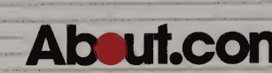

**主题：**

- **为何要构建无障碍网页？** ▶ 第 201 页
- **无障碍不仅意味着盲人** ▶ 第 202 页
- **编写无障碍网页** ▶ 第 205 页
- **全球化网页** ▶ 第 210 页
- **验证无障碍性** ▶ 第 213 页

## 让你的网站具备无障碍性

### 为何要构建无障碍网页？

在我开始讲解网页设计的无障碍性这一章之前，你必须理解我所说的无障碍性是什么意思，以及我将要讨论的内容。我是美国人，对美国法律有所了解，但我不是律师。法律会变化，如果你生活在非美国的国家，或者你的网站将服务于该国以外的人（鉴于网络的全球性，这种可能性比你想象的要大），那么管辖你或你网站的法律可能不同。本章不是关于法律。本章是关于确保你没有建立一个在人们进入之前就把他们拒之门外的网站。

无障碍性正如其名：为你的网站提供访问途径，并确保人们能够获取你试图提供的信息。不幸的是，许多网页设计师在考虑无障碍性时会想到两件事：“丑陋、无聊的网站”和“为盲人服务”。

好消息是，你在本书中构建的网页在编写时就考虑了无障碍性。你可能认为它们很丑（那是你的看法）；那不是因为它们具有无障碍性，而是因为你不认同我的设计审美（这恰好表明了你糟糕的品味）。说真的，使用 CSS 来设计既无障碍又美观的网页是非常容易的。将设计元素（在 CSS 中）与内容元素（在 HTML 中）分离的行为，是使你的网页具备无障碍性的第一步。

使你的网页具备无障碍性的另一个好处是，搜索引擎喜欢无障碍的网页。

### 无障碍不仅意味着盲人

关于编写无障碍网页的第一个误解是，它指的是为使用屏幕阅读器的盲人编写网页。实际上，编写一个无障碍的网页对许多不同的人群（以及技术）都很重要：

#### 你需要的工具

在你开始担心无障碍性将成为维护网站的另一项困难任务之前，请查看我的文章《无障碍 HTML》（http://about.com/webdesign/accessiblehtml）。这是我为 About.com 网页设计/HTML 网站写的第一批文章之一，但它仍然有效。如果你只遵循这些指导，你就已经朝着建立无障碍网站迈出了坚实的步伐。这并不难！

- **视力障碍者：** 包括失明者以及视力低于 20/20 的人。
- **听力障碍者：** 那些在网站上听声音有困难的人。
- **行动障碍者：** 那些有颤抖或难以握持、使用鼠标的人。
- **非英语使用者：** 那些访问面向单一语言受众的网站时遇到障碍的人。
- **搜索引擎和其他机器人：** 搜索引擎派遣蜘蛛爬取网站，如果你的网站对它们有吸引力，这可以帮助你找到更多客户。

**盲人也阅读网页。** 网页通过屏幕阅读器被朗读给他们。最著名的屏幕阅读器是 JAWS（[www.freedomscientific.com/fs_products/software_jaws.asp](http://www.freedomscientific.com/fs_products/software_jaws.asp)），一个可以朗读屏幕上信息的 Windows 应用程序。尽管屏幕阅读器一直在改进，但在处理屏幕上看到的内容方面，它们不如人脑。因此，编写无障碍网页的网页设计师需要意识到，屏幕上所有可视的内容都应该有一个文本对应物。这包括图像、Flash 动画，甚至图标和布局，所有这些都可能影响屏幕阅读器呈现网页的方式。

你可能没有意识到，失明并不总是意味着什么都看不见。我有一个亲戚是法定盲人，但他能看清距离，足以获得驾照。另一个法定盲人的朋友是一位非常出色的技术撰稿人。她使用放大镜来阅读或写作。一个认识到视力障碍程度各异，并据此构建网页的设计师，比一个设计“一刀切”网站的设计师要具备更好的无障碍性。

**但如果你听不见呢？** 许多网站上的声音并不多，所以这似乎不是问题。但在你跳过本节之前，问问自己你的网站是否包含任何声音。在你说没有之前，请考虑以下情况：

- 你是否有任何带声音的视频，或者你计划包含任何视频吗？
- 你使用或计划使用 Flash 动画吗？（大多数 Flash 动画都有一些相关的声音。）


- 是否有任何用于点缀的声音？
- 你是否拥有或计划发布播客？

### 网上的其他资源

▶ 听力障碍可能很难理解。WebAIM 听力障碍网站（`www.webaim.org/articles/auditory`）是一个很好的资源。它帮助你理解你的网页何时可能对有听力问题的人不可访问，并提供改善网站的解决方案。

当我 1995 年开始构建网页时，声音很难使用。一些页面有声音，但通常是烦人的 MIDI 音乐，你更关心如何关闭它而不是聆听。如今，播客和视频如此容易添加和使用，以至于创建一个对听力障碍者不可访问的网站变得容易得多。

**如果你不能移动鼠标呢？** 坦白说，我讨厌需要使用鼠标的网页，而我没有任何行动障碍。我不喜欢把手从键盘上移开。当我能把双手放在一个地方并从那里完成所有工作时，我的速度会快得多。我还发现，当我大量使用鼠标时，手腕开始疼痛。由于我不想患上重复性劳损，所以我避免使用鼠标。

有些人无法使用鼠标或发现它非常困难。确保你的网页可以通过替代设备（如键盘）访问，将有助于改善网站对行动障碍者的可用性。

**语言和文化也可能成为访问障碍。** 网络的全球性是件好事。但如果你想让你的网站向尽可能多的人开放，你应该意识到，那些不会说你网站语言的人仍然会访问它。我收到来自世界各地客户的电子邮件。我妈妈关于囊性纤维化症的网站也收到了来自世界各地的访客，而且她的网站比我的小得多。

About.com 仅提供英语网站，不提供翻译，所以我的客户需要一些英语才能访问我的网站。但我仍然需要注意其他文化和语言。当我构建一个新页面时，我会牢记某些颜色、措辞或图像可能冒犯其他文化。

## 编写无障碍网页

编写无障碍网页并不需要我们在本书中已构建网页的基础上做太多事情。编写无障碍网页时，你需要做的主要事情是思考你的网页对于有无障碍问题的人来说可能是什么样子。开发人员在构建网页时常犯一些常见错误。请考虑以下几点：

- **图像需要替代文本。** 除了 XHTML 验证的要求外，`alt` 属性是图像对屏幕阅读器和视障人士可访问的主要方式。屏幕阅读器会在有替代文本时朗读它。确保你始终在网页文档的上下文中有意义的替代文本。编写 `alt` 文本很容易。只需确保始终在图像标签上使用 `alt` 属性，如下所示：

  ```html
  
  ```

- **图像映射也需要 `alt` 文本。** 许多网页设计师忘记在图像映射中使用 `alt` 文本以使其可访问。但给图像映射添加 `alt` 文本很容易：

  ```html
  <area shape="rect" coords="0,0,20,30" href="http://webdesign.about.com/cs/imagemaps/a/aabg051899a.htm" alt="Help Building Image Maps" />
  ```

- **为你的网站创建低视力布局。** 低视力布局是你的网页的重新设计版本，旨在让视力较差的人更容易访问。这些布局是理想的选择，因为它们提供了一个替代方案，视力低下的人可以根据需要自由选择或不选择。

- **注意色盲人士的颜色问题。** 请记住，如果你使用颜色来区分内容，色盲人士可能会在你的页面上遇到问题。请注意：

### 热点话题

颜色是巨大的象征来源，和所有视觉媒体一样，网站使用大量颜色来传达他们的观点。你选择的颜色可能传递了你无意传达的信息。我关于颜色象征意义的文章（`http://about.com/webdesign/colorsymbolism`）将帮助你避免像给亚洲男性戴绿帽子（在中国暗示妻子出轨）这样的事件以及其他尴尬情况。

## 使用红色和绿色时请注意，当颜色是网页上唯一突出显示某元素的方式时

- **在使用框架的页面中包含 `<noframes>` 选项。** 框架可能会导致严重的可访问性问题。因此，如果您使用框架，请务必为无法读取框架的屏幕阅读器和搜索引擎提供 `<noframes>` 选项。

- **图片密集型页面应提供纯文本替代页面。** 在页面顶部附近放置指向网页文本版本的链接，以便屏幕阅读器可以快速找到它们。

- **音频和视频文件应包含文字记录，或者更好的是字幕。** 文字记录或字幕使音频和视频文件变得可访问，否则它们将完全无法使用。

- **使用 `accesskey` 属性帮助访问表单字段和链接。** `accesskey` 属性（`http://about.com/webdesign/accesskey`）使得链接和表单字段可以通过鼠标点击访问，类似于计算机程序中的快捷键。

**处理视觉问题是实现可访问性的第一步。** 您可能会惊讶地发现，许多访问您网站的人都有一些视力问题。视力问题的范围很广，从视力模糊、偏头痛、视力低下或盲点到实际失明。

网页设计师通常很年轻，或者至少还没有老到需要戴老花镜。但猜猜看？即使您不需要戴眼镜，您的观众中至少有一半可能需要。互联网上增长最快的群体是退休人员，他们中的大多数人都需要某种形式的辅助来阅读小字体。我还没有老到需要戴老花镜，但网上流行的小如蚂蚁的字体让我感到惊讶。我经常在 Firefox 中使用 `Ctrl-+` 键来放大字体，而我的视力是 20/20。

首先，确保字体可以调整大小。这并不意味着您需要将它们变得很大；保持您喜欢的字体大小，即使那是蚂蚁般的小字体。相反，请确保您的网站布局足够灵活以处理更大的字体大小。最简单的方法是构建您的页面，然后在 Firefox 中查看。进入后，点击一次或两次 `Ctrl-+`，看看字体变大后会发生什么。（如果您使用的是固定宽度布局，文本最终会移动到旁边图片的上方或下方。这是固定宽度布局的一个缺点。）

一旦您设计出了足够大但可调整大小的文本，请查看您的图片。首先检查所有图片是否都有符合页面上下文的替代文本，并且这些文本也提供了关于图片的信息。关闭图片，以这种方式查看您的网页。按照以下步骤在 Firefox 中关闭图片：

1. 打开“工具”菜单。
2. 点击“选项...”。
3. 切换到“内容”选项卡。
4. 取消选中名为“加载图片”的框。
5. 点击“确定”并重新加载您的网页。

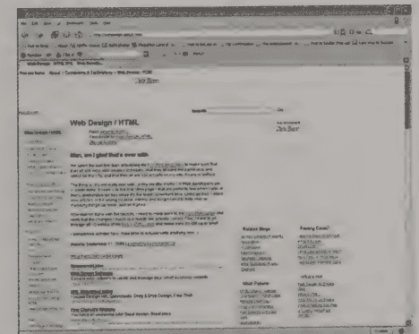

图 13-1：我的主页在没有图片的情况下：效果不佳，但仍可工作

## 您需要的工具

- 编写不依赖于颜色的网页不仅仅是添加图标。我的文章《您的网页是否对颜色敏感？》（`http://about.com/webdesign/colorblindness`）更详细地介绍了如何创建和维护不会给色盲人群带来问题的页面。这不需要大量工作，只需在设计时稍加思考。

如果页面仍然可以正常工作，那么您的替代文本就提供了足够的信息。如果不行，您应该重新考虑这些图片。

如您所见，About.com 网页设计/HTML 主页在关闭图片后仍然可以工作。许多图片没有替代文本，因为页面的设计和 HTML 由 About.com 设计团队控制，而不是我。但由于这些图片大多是广告、图标或背景，它们不需要替代文本。我唯一希望有替代文本的是我的照片，但由于我的名字就印在旁边，情况也还算可以。

修复图片后，请查看页面上的颜色选择。色盲影响着 8% 到 12% 的欧洲裔男性。但经常看到类似“请填写下面用红色标记的表单字段”的错误信息。根据色盲的类型，您页面上的红色文本看起来可能与周围的黑色文本几乎相同。解决这个问题最简单的方法是始终将颜色与其他提示结合使用来突出显示重点。这可以很简单，比如在红色文字旁边添加加粗或图标。

许多网站设计师似乎忽略的另一个视觉问题是偏头痛。我会患视觉偏头痛，这会将我的视力从正常的 20/20 变成视线中一条模糊的色彩带。如果我非常幸运（并且迅速服药），这不会演变成令人衰弱的头痛。挑战在于闪烁的灯光可能引发偏头痛，这包括网页上闪烁的图片。我曾访问过一些网页，明亮的颜色和闪烁的动画 GIF 效果非常糟糕，以至于我真的开始出现偏头痛的征兆。每次，我都立即离开了。您可能喜欢构建和查看明亮、闪烁的网页，但如果 18% 的女性和 6% 到 8% 的男性会因此立即离开您的网站，这值得吗？

**确保您的网站对有听力障碍的人可访问。** 就像我们的视力一样，我们的听力也会随着年龄增长而变差。在为网站添加更多多媒体内容时，我们需要意识到这一点。视频、播客和音频文件对于有听力障碍的人来说可能完全无法使用。而字幕是解决这个问题的简便方法。

通过字幕，您可以将视频或 Flash 动画中所说内容的实时文本版本呈现出来。有许多工具可以帮助您完成，其中最流行的是 MAGpie（[`http://ncam.wgbh.org/webaccess/magpie`](http://ncam.wgbh.org/webaccess/magpie)）。MAGpie 允许网页作者为保存为 QuickTime、Windows Media Player 或 RealPlayer 格式的视频添加字幕。

**确保您的页面对运动障碍人士可访问。** 这涵盖了从因震颤而无法精细控制鼠标的人，到因瘫痪或其他问题只能通过口棒或语音操作计算机的人。当网页包含需要人们点击非常小区域的图像映射，或者表单和链接没有设置快捷键以便于定位和开始输入时，它们可能会变得极具挑战性。

以下是一些使您的页面更易于运动障碍人士使用的简单解决方案：

- 使用 `tabindex` 属性（[`http://about.com/webdesign/tabindex`](http://about.com/webdesign/tabindex)）。此属性定义了网页上链接应按 Tab 键切换的顺序。这允许您使用一次按键跳过导航。
- 避免使用图像映射。小区域可能很难点击，甚至很难判断它们是链接。
- 如果必须使用图像映射，请使链接区域变大。此外，始终包含一个默认区域，该区域指向一个文本导航页面。如果用户点击了错误的位置，他们可以轻松地找到正确的位置。

  ```html
  <area shape="default" href="http://webdesign.about.com/od/htmltags/p/bltags_area.htm" alt="关于area标签的更多信息" />
  ```

- 将图片设置为链接。与其使用图像映射，不如让您的图片成为指向一个位置的单一链接。它们更容易看到，并且通常更大，因此更容易点击。

# 全球化网页

当您编写一个将发布在万维网上的网页时，根据定义，您是在为全球受众写作。即使您从未打算翻译您的页面，并且您的公司对在当前区域之外销售没有任何兴趣，这也适用。

在构建您的网站时，有许多事项需要注意，以确保尽可能广泛的受众能够访问和使用。

**您的主题是什么？** 文化在您的网站是否会在您的国家或地区以外大受欢迎方面扮演着重要角色。这甚至适用于同一个国家的不同地区。举一个非网络的例子，我曾听到一个广播故事，讲的是一个社区的邻居们经常在晚上聚在街中间聊天。不幸的是，警察来自该县的不同地区，他们将这种行为视为帮派活动。如果您的网站是关于与邻居会面的，您肯定不希望警察因怀疑犯罪意图而将其关闭。

这意味着，如果您的主题可能具有地域特殊性，请明确说明。特别是当您处理涉及在某个国家合法而在另一个国家非法的事情。例如，几年前我的一位朋友计划去新加坡时，发现当地要求男性将头发剪到领口以上。由于他的头发远长于此，他改变了计划。因为新加坡公布了相关法律，他得以做出这个决定，而没有给自己带来任何负面影响。

**语言是一个明显的障碍。** 您的网站可能被来自其他国家、不懂英语（或网站语言）的人访问。更棘手的是，即使您使用英语撰写内容，您的网站也可能被世界各地的英语使用者浏览。使用俚语是一种让您的网站变得完全令人费解的好方法，即使对英语母语者来说也是如此。如果他们不熟悉您使用的俚语术语，无论他们来自加拿大、澳大利亚还是新加坡，结果都一样。俚语对非英语母语者来说也可能非常难以理解。

如果您决定翻译您的网站，您将遇到更多问题。首先，始终使用专业翻译人员，而不是自动翻译程序。自动翻译系统对于短文本块效果尚可，但最终通常会产生非常奇怪的、逐字逐字直译的文本。

**注意通用术语。** 许多看似通用的术语对全球受众来说可能毫无意义：

- **地区称谓：** “东海岸”对我来说意味着纽约，对澳大利亚人来说则意味着昆士兰州。
- **将某事物指定为“国外的”或“国内的”：** 我住在乌兹别克斯坦时，我就是外国人，而我的朋友 Muhayo 才是本地人。
- **地名：** 莫斯科可能指俄罗斯的莫斯科，也可能指爱达荷州的莫斯科，而且美国几乎每个州都有一个波特兰。

## 您需要的工具

> 为国际受众撰写网页需要一些思考，我的网站上还有其他一些页面可以提供帮助。如果您想用非英语语言撰写内容，您需要知道如何向网页添加特殊字符（[`http://about.com/webdesign/characters`](http://about.com/webdesign/characters)）以及使用哪些代码（[`http://about.com/webdesign/characterhtml`](http://about.com/webdesign/characterhtml)）。

**日期代码在世界各地各不相同。** 如果我将日期写为 `12-09-1971`，我指的是 9 月 12 日还是 12 月 9 日？这取决于您所在的世界位置。书写日期的最佳方式是使用月份的名称。

**地址格式可能对国际用户构成挑战。** 您可能会在网页订单表单上看到一个常见的地址部分。许多表单有一个下拉菜单列出各州，有些还包括加拿大的省份。但如果您的网站面向全球，有些国家并没有州或省的划分。我住在乌兹别克斯坦的塔什干时，我的地址没有州；它是“塔什干，乌兹别克斯坦”。如果您将州字段设为可选，这将导致来自爱达荷州莫斯科的人忘记在订单中包含她的州，而您无法确定这是俄罗斯的莫斯科，还是爱达荷州，或是其他某个名为莫斯科的地方。

有些表单要求邮政编码，但如果您接受来自加拿大的订单（加拿大使用邮政编码），您将会遇到问题。如果您将表单验证设置为仅需要数字，加拿大人会遇到更多麻烦，因为他们的邮政编码包含字母。如果您将订单表单开放给更多国家，您的表单需要更加通用。

最佳解决方案是为您运送到的国家创建多个表单。这样，您可以将最常用的国家设为默认表单，其他国家作为表单顶部的选项。例如，Amazon.com 为其英国客户提供了完全不同的网站。该网站仍然是英语，但在您下单时不会要求提供州或邮政编码，也看不到美国各州的列表。

# 验证可访问性

您如何真正知道您的网站是否可访问？您可以在关闭图像或声音的情况下查看您的网站；或者，如果预算允许，购买屏幕阅读器来测试您的页面。但这超出了大多数小企业为使网站可访问所能承担的范围。然而，如果您的网站属于法律要求必须符合可访问性指南的类别，那么您将不得不承担这笔费用。在美国，这通常意味着政府和政府资助的网站。

**理解第 508 条及其含义非常重要。** 第 508 条（[`www.section508.gov`](http://www.section508.gov)）是美国的一项法律，要求所有联邦机构使电子信息可供残疾人使用和访问。如果您的网站是为联邦机构服务或与其相关，则必须符合第 508 条标准。确保这一点的最佳方法是使用可访问性验证工具，例如 WebXACT（[`http://webxact.watchfire.com`](http://webxact.watchfire.com)）。

**了解 W3C 网页内容可访问性指南（WCAG）。** 如果您了解 WCAG（[`www.w3.org/TR/WAI-WEBCONTENT`](http://www.w3.org/TR/WAI-WEBCONTENT)），您就离创建可访问性内容更近了一步。因为创建可访问的网页内容不仅仅是编写正确的 HTML 标签，您还需要考虑人们将如何访问您的网页，并为可能使用不同方法的人留出余地。我整理了一份 WCAG 指南列表，以帮助您检查并查看您的网站是否可访问。

- **为听觉和视觉内容提供等效的替代方案。** 这是最基本的要求。您网页上任何非实际文本的内容都应通过替代文本或标题进行解释。

## 您需要的工具

> 如果您想验证网站的可访问性，您需要做的工作比使用标准验证器更多。这是因为一些可访问性标准无法自动评估。我的文章“验证可访问性”（[`http://about.com/webdesign/accessvalidate`](http://about.com/webdesign/accessvalidate)）将指导您使用 WebXACT 等验证器来检查您的网站是否可访问。

- **不要仅依赖颜色。** 确保您在文本或图像上使用的任何颜色代码仅用于装饰。如果它们用于表示其他内容，请确保有其他区分方式，例如图标、粗体文本或下划线，以使其突出显示。

- **使用标记和样式表，并正确使用。** 避免使用已弃用的 HTML 标签和样式。如果您遵循本书中的说明，您将正确使用 CSS 和 HTML。

- **明确自然语言的使用。** 始终确保使用 HTML 标签上的 `lang` 属性定义页面使用的语言。例如，`<html lang="en">` 表示英语。

- **创建优雅转换的表格。** 表格可能难以实现可访问性。但这是可能的。使用所有可用的表格标签（[`http://about.com/webdesign/tabletag`](http://about.com/webdesign/tabletag)），如 `caption`、`tbody`、`thead` 和 `tfoot`，来区分表格的不同部分。仅将表格用于数据，而非页面布局。

- **确保采用新技术的页面能够优雅转换。** 某些技术（如 Flash 和 Ajax）对您来说可能不新，但它们在许多辅助设备上并未得到可靠支持。我的经验法则是，除非我在屏幕阅读器或其他辅助设备上测试过，否则我总是为我网站上超越纯 HTML 和 CSS 的任何技术提供替代方案。

- **确保用户控制时间敏感的内容更改。** 如果您的网页将在特定时间后发生变化，请确保您的读者可以停止或减慢这一过程。例如，一个两分钟后自动刷新的页面对您来说可能足够阅读内容，但对其他人来说可能在读完几句话后就被中断了。

- **确保嵌入式用户界面的直接可访问性。** 如果您在网页中使用任何其他应用程序，如 PDF、视频或 Flash，这些也应遵循所有可访问性指南。

- **为设备无关性而设计。** 无论您的客户使用什么类型的设备查看您的网页，它都应该是可用的。例如，您是否尝试过在支持网络的手机或移动设备上访问您的网站？那可能是一次糟糕的体验。

- **使用临时解决方案。了解浏览器和屏幕阅读器存在的问题。** 例如，有些屏幕阅读器不允许读者导航到空文本框，而其他一些则不会自动阻止弹出窗口。有一些临时解决方案：不要使用弹出窗口；在表单元素之前立即编写表单标签；为表格提供线性文本替代方案；使用默认（`accesskey`）字符用于可编辑文本区域；在相邻链接之间放置非链接文本字符。


- **使用 W3C 技术和指南。** 不要使用不是 W3C 标准的 HTML 标签（如 `marquee`）。也不要使用尚未被 W3C 制定为推荐标准的内容。例如，在撰写本文时，CSS 3 尚未成为推荐标准，但一些网页浏览器支持其部分内容。为了可访问性，在 CSS 3 成为公认标准之前，请勿使用其属性。

- **提供上下文和方向信息。** 为您的页面、框架和表格添加标题。如果合适，请在页面的 `head` 部分使用关系标签来定义哪个页面在当前页面之前，哪个在当前页面之后，等等。

## 获取链接

无障碍访问旨在让您的网页以大多数人能够使用的方式提供服务。以下链接将提供更多信息，并帮助您使网页实现无障碍访问。

- **提供清晰的导航机制。** 确保您的导航在页面之间保持一致。页面中其他链接的指向，应在脱离页面其余内容上下文的情况下依然清晰明了。

- **确保文档清晰简洁。** 始终力求网页内容清晰易懂。对于几乎所有人来说，网络阅读都很困难，至少比阅读平装书更难。您的页面越简洁，客户就能越快获取他们所需的信息。这对所有人都有利。

无障碍访问不必困难重重，也不意味着您的网站会变得丑陋。但是，让网站具有无障碍性可以让所有人都能更轻松地访问，而愉快的读者意味着更多的读者。

### 无障碍访问链接

关于无障碍访问和可用性的新文章和信息层出不穷。这些链接将帮助您及时了解无障碍访问的动态，以及如何保持网站的无障碍性。

[http://about.com/webdesign/accessusability](http://about.com/webdesign/accessusability)

### 网站本地化

为国际受众创建网站是一个无障碍访问问题，即使法律上并不强制要求无障碍访问。这些链接将帮助您为英语以外的受众创建页面。

[http://about.com/webdesign/localization](http://about.com/webdesign/localization)

### 无障碍访问验证工具

WebXACT 是一个很棒的验证工具，但还有其他工具可供选择。甚至有一个工具可以向您展示色盲人士看到的页面效果。

[http://about.com/webdesign/accessvalidators](http://about.com/webdesign/accessvalidators)

# 第 14 章

## 增加动态效果：Flash、DHTML、Ajax 及更多技术

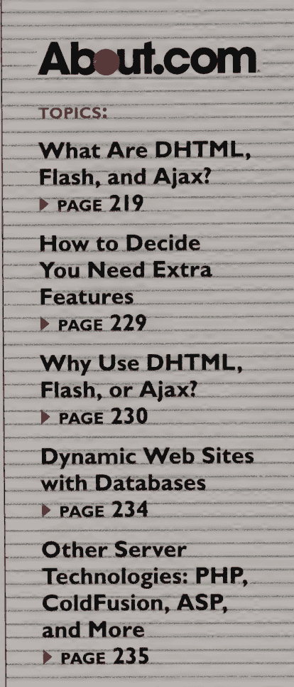

## 什么是 DHTML、Flash 和 Ajax？

有些人会认为这些技术是 Web 开发中最有趣的部分。这些程序运行网站的行为层。

我已经讨论了结构层（页面的 HTML 和内容）和样式层（CSS 以及页面的外观），但到目前为止，我们只在 JavaScript 的范畴内涉及了行为层。

JavaScript 和其他客户端脚本语言是创建网页行为最简单的方式，因为它们不需要与 Web 服务器进行任何交互。JavaScript 被称为客户端脚本语言，因为所有功能都在 Web 浏览器或客户端内部执行。这意味着您无需 Web 服务器的支持即可在网站上创建行为。但是，如果客户的 Web 浏览器不支持您使用的脚本语言，他们将看不到任何行为效果。

**那么 DHTML 呢？** 动态 HTML（DHTML）是一种使用 JavaScript 操作文档对象模型（DOM）以在网站上创建行为的方法。DHTML 菜单就是实现这一点的一种方式，并且完全可以在不使用任何 JavaScript 的情况下创建鼠标悬停菜单。我们的导航 HTML 是创建具有附加下拉选项的菜单的一个绝佳起点。

```html
<ul id="navigation">
<li><a href="/index.html">Home</a></li>
<li><a href="/products/index.html">Dog Toys for Sale</a></li>
<li><a href="/articles/index.html">Dog Information</a></li>
<li><a href="/about/index.html">About This Site</a></li>
</ul>
```

这个导航菜单只包含顶层元素。但导航的每个下级层次只是其内部的另一个无序列表。以下是我最终导航的样子：

```html
<ul id="navigation">
<li><a href="/index.html">Home</a></li>
<li><a href="/products/index.html">Dog Toys for Sale &gt;&gt;</a>
  <ul>
    <li><a href="/products/stuffed.html">Stuffed Toys</a></li>
    <li><a href="/products/balls.html">Balls</a></li>
    <li><a href="/products/tugs.html">Tug Toys</a></li>
    <li><a href="/products/entertain.html">Boredom Reducers</a></li>
  </ul>
</li>
<li><a href="/articles/index.html">Dog Information &gt;&gt;</a>
    <ul>
        <li><a href="/articles/health.html">Health</a></li>
        <li><a href="/articles/breeds/index.html">Breeds &gt;&gt;</a>
            <ul>
                <li><a href="/articles/breeds/bordercollie.html">Border Collie</a></li>
                <li><a href="/articles/breeds/labrador.html">Labrador</a></li>
            </ul>
        </li>
        <li><a href="/articles/training.html">Training</a></li>
    </ul>
</li>
<li><a href="/about/index.html">About This Site &gt;&gt;</a>
    <ul>
        <li><a href="/about/copyright.html">Copyright</a></li>
        <li><a href="/about/privacy.html">Privacy Policy</a></li>
        <li><about/contact.html">Contact Us</a></li>
    </ul>
</li>
</ul>
```

如您所见，只有“首页”链接没有第二级，“品种”链接有第三级。如果您将第 8 章中使用的样式表应用到上述 HTML，您最终会得到一个列表和子列表的奇怪混合体。但通过稍微修改 CSS，您可以创建一个下拉导航列表。

## 您需要的工具

创建 CSS 菜单很容易。此处描述的方法在 IE 7、Mozilla 1、Opera 7 和 Safari 1 中运行良好。只有 IE 6 和 5 不能正确处理 `:hover` 伪类。如果您想了解更多关于如何使用 CSS 创建 DHTML 菜单的信息，请查看我的文章“基于标准的 DHTML 菜单”（http://about.com/webdesign/dhtmlmenus）。您也可以在线查看上述示例（示例 14-1，http://about.com/webdesign/example14-1code）以及带有水平菜单的示例 14-2（http://about.com/webdesign/example14-2code）。

```css
ul#navigation, ul#navigation ul {
    width: 175px;
    background: #fff url(navbg.gif);
    padding-left: 0px;
    margin-left: 0px;
    border-left: 1px solid black;
}
ul#navigation li {
    list-style-type: none;
    margin: 0px;
    padding-left: 5px;
    position: relative;
    color: #63c;
    font-weight: bold;
    height: 20px;
}
ul#navigation li ul { display: none; } /* hide from IE 6/5 */
ul#navigation li > ul {
    display: none;
    position: absolute;
    top: 2px;
    left: 170px;
}
ul#navigation li > ul li { height: 20px; }
ul#navigation li:hover{ background: #fff url(navbg_over.gif); color: #000; }
ul#navigation li:hover > ul { display: block; }
ul#navigation li a {
    color: #63c;
    display: block;
    width: 100%;
    text-decoration: none;
}
ul#navigation li a:hover { color: #000; }
ul#navigation li:hover > a { color: #000; }
```

另一个简单的 JavaScript 可以将日期写入您的网页。它只有一行代码：

```javascript
<script type="text/javascript">document.write(new Date());</script>
```

这将显示当前日期、时间（精确到秒）和时区。相反，我们可以使用 JavaScript 以更友好的格式写出当前日期，例如“December 16, 2007”。

```javascript
<script type="text/javascript">
var date = new Date();
var month = new Array(7);
month[0] = "January";
month[1] = "February";
month[2] = "March";
month[3] = "April";
month[4] = "May";
month[5] = "June";
month[6] = "July";
month[7] = "August";
month[8] = "September";
month[9] = "October";
month[10] = "November";
month[11] = "December";
var year = date.getYear();
if (year < 2000) { year+=1900; }
document.write(month[date.getMonth()] + " " +
date.getDate() + ", " + year);
</script>
```

在网页上使用日期脚本的一种方式在线示例 14-3（[http://about.com/webdesign/example14-3code](http://about.com/webdesign/example14-3code)）中展示。

一种使用 JavaScript 和 DOM 直接与网页交互的绝佳方式是使用 JavaScript 改进您的 Web 表单。两种有助于 Web 表单的行为是：将光标置于第一个字段中，以及在字段填写时进行验证。

将光标置于第一个字段很容易。您需要为表单设置一个 `id`，以便在 JavaScript 中引用它。

```html
<form action="mailto:webdesign.guide@about.com"
method="get" enctype="text/plain" id="contactus"
name="contactus">
```

在我们的“联系我们”表单中，第一个表单字段是“姓名”字段，其 ID 为 `name`。为了聚焦于该行，您可以在 `body` 标签中添加一行代码，告诉浏览器在页面加载完成后查找“姓名”表单字段并将光标置于其中。

```html
<body onload="document.contactus.name.focus();">
```

正如您可以在示例 14-4（http://about.com/webdesign/example14-4code）中在线看到的那样，这使您的客户可以更轻松地开始填写 Web 表单。他们无需先点击字段，就可以直接开始输入。

作为我最后一个 JavaScript 示例，我将向您展示如何制作一个非常简单的验证器，它在您的读者使用表单时检查必填字段是否已填写。如果缺少必需内容，页面会自动显示一条错误消息。

首先，您需要构建表单，并为每个必填字段添加一个 `onblur` 属性。

```html
<form action="mailto:webdesign.guide@about.com" method="get" enctype="text/plain" id="contactus" name="contactus">
  <label accesskey="f" for="first name">First Name:
    <input type="text" name="first name" id="first name" value="" size="40" onblur="validateForm(this); " /></label><br />
  <label accesskey="l" for="last name">Last Name:
    <input type="text" name="last name" id="last name" value="" size="40" onblur="validateForm(this); " /></label><br />
  <label accesskey="e" for="email">Email:
    <input type="text" name="email" id="email" value="" size="40" onblur="validateForm(this); " /></label><br />
Do you want a reply?
<label accesskey="y"><input type="radio" name="reply" id="reply" value="yes" /> Yes</label>
<label accesskey="n"><input type="radio" name="reply" id="reply" value="no" checked="checked" /> No</label><br />
What is your message?<br />
<textarea name="message" id="message" rows="10" cols="35" onblur="validateForm(this);"></textarea><br />
<input type="submit" value="Send Message" />
<input type="reset" value="Clear Form" />
</form>
```

我表单中的每个字段都是必填的，因此它们都包含了代码 `onblur="validateForm(this); "`。唯一的例外是单选按钮。我在“否”选项上添加了 `checked="checked"` 属性。如果他们想要回复，必须将其更改为“是”。`onblur` 属性告诉浏览器在焦点从该元素移除时运行一个 JavaScript 函数。

然后，脚本将在表单字段右侧显示一条错误消息，表明该字段是必填的。但为了实现这一点，我们需要为脚本提供一个添加内容的区域。我通过在 `<form>` 标签上方添加一个空的 `<div>` 容器来实现这一点：

`<div id="check"></div>`

然后我将其样式设置为向右浮动，宽度为 250 像素。由于在默认 HTML 中它是空的，因此不会显示任何内容。但是当 `validateForm` 函数运行时，如果字段为空，错误消息将显示在该 `div` 中。

`validateForm` 函数如下所示：

```javascript
function validateForm(checkMe) {
  // check that the field is filled in
  var checkElement = document.getElementById("check");
  var br = document.createElement("br");
  if (checkMe.value == "") {
    // it's empty so display an error message
    var gotitText = document.createTextNode("Please fill in the " + checkMe.name + " field.");
    checkElement.appendChild(gotitText);
    checkElement.appendChild(br);
  }
}
```

它保存在一个脚本文件中，该文件通过 `<script>` 标签附加到我的 Web 页面 的 `head` 中：

```html
<script type="text/javascript" src="zexample14-5.js"></script>
```


您可以在示例14-5（http://about.com/webdesign/example14-5code）中在线查看表单。此页面包含整个 JavaScript 文件、XHTML 以及我用于设置页面样式的 CSS。

**Flash 添加起来更难，但它能做的要多得多。** Flash 是一个非常复杂的程序，可以为您的网站创建动画、应用程序和表单。与 JavaScript 不同，Flash 不是基于文本的，因此我无法在本书中键入示例。Flash 是向您的网站添加音频和视频的绝佳工具。由于它是交互式的，您可以将其用于普通 HTML 和 JavaScript 无法实现的表单或应用程序。

您必须学习 Flash 才能为您的网站构建 Flash 应用程序。首先从 Adobe 网站（www.adobe.com）下载免费试用版。使用其他程序（称为 Flash 创作工具）创建 SWF 文件（Flash 文件类型）是可能的，但我不推荐这样做。Flash 为您提供了大量的灵活性和功能。此外，如果您拥有最新版本的 Flash，您将拥有 Flash 应用程序中可用的最新功能。第三方应用程序并不总是能立即拥有这些功能。

将 Flash 添加到您的网站时，请考虑逐步添加。将其添加在会增加价值的地方，而不是因为您觉得构建它很有趣。以下是一些非常适合 Flash 的应用程序：

- Flash 中的视频对您的客户来说很容易。既然 Flash 如此普遍，将您的视频放入 Flash 中就更有意义了。
- Flash 中的动画比 GIF 动画更美观。因为 Flash 使用矢量图形，所以图像质量更好，并且更长的动画序列作为 Flash 应用程序会比动画 GIF 更小。
- 独立应用程序使用 Flash 比使用其他编程语言效果更好。这对于游戏尤其如此。

**Ajax 使我们回到 JavaScript，但有所不同。** Ajax 将 JavaScript 与服务器端编程相结合，创建的 Web 页面更像是应用程序，而不是我们习惯的传统静态 Web 页面。

在传统的 Web 应用程序中，客户阅读页面并与表单或其他元素交互。最终她点击某处。然后浏览器将该点击信息和其他输入信息发送到服务器。服务器审查信息，对其进行处理，并向浏览器发回一个新页面。然后浏览器向客户显示新的 Web 页面。整个过程重新开始。

在 Ajax 应用程序中，浏览器和 Web 服务器之间仍然存在交互，但这是在后台发生的。当您的客户访问网页时，她开始与之交互。一旦数据输入到表单中，JavaScript 脚本就开始向 Web 服务器发送数据。它通过使用 `XMLHttpRequest` 或其他方法向 Web 服务器请求数据的异步请求来完成此操作。然后 Web 服务器在后台处理请求并将其发送回 Web 浏览器。在此期间，客户仍在填写表单或以其他方式与网页交互。当数据到达时，页面会在不重新加载的情况下更新，因此客户没有中断。

您可能想知道这与 JavaScript 有何不同。请记住 JavaScript 在网页上的典型工作方式。JavaScript 只能将数据保存在查看网页的本地机器上的临时内存位置中。当您的客户转到另一个页面或关闭浏览器时，JavaScript 拥有的数据就会消失。许多 Web 开发人员通过使用 Web cookies 来存储数据来解决这个问题，但 cookies 因侵犯隐私而声誉不佳，因此使用较少。cookies 的另一个问题是，它们存储数据的方式在客户离开网站后对 Web 开发人员不可用。唯一的解决方法是让网页使用服务器端程序（如 PHP、Perl 或 JSP）与服务器交互。

Ajax 也使用服务器端程序，但不是让 Web 服务器发回整个 Web 页面，而是以 XML 形式发送数据。网页上的 JavaScript 接收该数据并使用它与 DOM 交互来更改网页的部分内容。因此，客户无需等待整个页面加载，而是几乎可以立即获得反馈。

## 您需要的工具

- 如果您想构建 Flash 网站，您可以雇用其他人为您构建（有关更多详细信息，请参见第 15 章），或者您可以学习 Flash 并自己构建。我的网站上有很多学习 Flash 的资源（http://about.com/webdesign/flashindex），以及使您的 Flash 应用程序更好的教程和工具。

## 热门内容

- 关于使用 Flash 创建 Flash 应用程序，我的规则的一个例外涉及外部 Flash 工具。这些工具为 Flash 添加了额外功能，或使现有功能更易于使用。例如，使用我的 Flash 工具页面（http://about.com/webdesign/flashtoolsindex）上列出的一些屏幕保护程序工具，在 Flash 中创建屏幕保护程序很容易。

# 第 14 章 添加戏剧效果：Flash、DHTML、Ajax 等

## 如何决定您需要额外功能

所有这些高级功能在构思和构建时都可以带来很多乐趣。但您始终需要考虑是否真的需要它们。拥有一个非常依赖 Flash 或完全启用 Ajax 的网站可能会让您感觉自己是一个强大的开发人员，但如果您没有内容作为支撑，就不会有人访问您的网站。

## 热门内容

- 如果您要开始在网站上使用 Ajax，首先要理解的是文档对象模型（DOM）（http://about.com/webdesign/dom）。DOM 使您能够引用页面的部分内容以添加新内容或将其删除。在线示例 14-5 中的验证脚本使用 DOM 在读者点击表单时添加错误消息。

当开发者对新功能过于热衷时，另一个问题是网站会变成一个毫无重点的功能展示场。在我的文章《何时使用 Ajax 及何时不应使用》（[http://about.com/webdesign/useajax](http://about.com/webdesign/useajax)）中，我提到过一个我编写的 Ajax 脚本。该脚本用于更新网页以显示某个电子邮件账户有新邮件。同时，我会在桌面上后台保持该邮件账户开启。当新消息到达时，我会立即回复并删除它。因此，当有人开始使用该网页时，出现新邮件的可能性极低，导致这个功能毫无用处。

除非你完全是为自己构建网站，否则请始终考虑客户在寻找什么。可以肯定地说，他们并非为了技术而追求技术。你的戏剧性元素应服务于明确目的。当我倾向于构建一个运用大量技术的网站时，首先我会尝试看看是否能用其他方式实现。还记得我们在第 4 章讨论过的技术层级吗？

1. HTML
2. CSS
3. 客户端脚本
4. Web 应用程序
5. 服务器端脚本

我们在这里讨论的技术属于第三层（JavaScript 和部分 Flash）、第四层（Ajax 和部分 Flash）或第五层（Ajax 和 CGI 脚本）。如果能用第一层或第二层技术解决问题，那么你的网站将加载更快，也更易于维护。

我发现，要理解新技术，最简单的方法是先思考如果没有它们我会如何处理问题。例如，在构建一个需要发送电子邮件的表单时，最基础的技术选择是对表单不进行任何验证，因为 HTML 和 CSS 无法单独验证表单数据。由于这降低了表单的实用性，我随后会使用 JavaScript 来验证表单数据。如果在填写表单时需要更多交互，我可能会考虑将表单转换为 Flash 或 Ajax，但这仅在我确定无法用 HTML、CSS 或 JavaScript 实现之后。

### 网络其他资源

> ▸ 当你开始使用先进技术构建网站时，请采用称为渐进增强（[www.adobe.com/devnet/flash/articles/progressive_enhancement.html](http://www.adobe.com/devnet/flash/articles/progressive_enhancement.html)）的模式来构建。渐进增强是指构建一个以 HTML 和 CSS 为基础的网站，然后逐步添加少量 JavaScript、Flash、Ajax 或其他技术。你需要确保始终为 HTML 和 CSS 层进行设计。其余技术只为网站增添价值。

## 为何使用 DHTML、Flash 或 Ajax？

现在有如此多的技术，很难决定该使用哪一种。如果你打算自己构建它们，可能会不知从何入手。需要学习的内容太多了。如果你计划在网站中使用 DHTML、Flash 或 Ajax，你应该了解各自最擅长的领域，以便为工作选择最合适的技术。

**使用 DHTML 处理浏览器窗口内的情景。** DHTML 是这里讨论的所有技术选项中最不复杂的。但这并不意味着它简单。DHTML 之所以不那么复杂，是因为你只需要关注 Web 浏览器内部发生的事情以及客户当时使用的 Web 浏览器。编写 DHTML 不需要任何特殊的服务器应用程序或程序；你只需要了解 XHTML、JavaScript 和 DOM。

DHTML 不需要与 Web 服务器进行任何交互。当你考虑添加 DHTML 时，需要确保你的需求不涉及任何服务器交互。以下是 DHTML 的一些常见用途：

- **修改网页样式：** 你可以为客户提供一个按钮，用于调整文本大小或更改网站颜色，以提高可读性。
- **构建导航系统：** 现在常见的菜单只使用 CSS 和少量 JavaScript。
- **创建动画：** 你只需要一两张图像就能创建基本动画。
- **实时验证表单：** 前面的例子说明了 DHTML 如何用于此目的。

如果你的客户不使用现代浏览器（如 Internet Explorer 6 及以上版本，或 Mozilla、Safari 1 及以上版本），则不要使用 DHTML。在这些 Web 浏览器普及之前，编写 DHTML 非常困难，因为标准极少。如果你的网站面向旧版浏览器用户，那么应该避免使用 DHTML，或者在发布任何页面之前对你的目标浏览器进行大量测试。即使你面向的是较新浏览器，也请务必在旧版浏览器中测试你的页面。这些客户应该能看到*一些内容*，即使不是你创建的流畅 DHTML 界面。

**Flash 最适合高质量动画。** Flash 使用基于矢量的图形，其缩放效果优于位图图形（GIF、JPEG 和 PNG），不会出现像素化或卡顿。当你在 Flash 中对矢形图形进行动画处理时，你可以更精确地控制其外观，因为你能够控制从一个形状变化到另一个形状所需的帧数。

在网站中使用 Flash 的另一个巨大好处是，你可以更精确地控制图形和字体的尺寸与形状。可以将字体嵌入 Flash 文档中，这样无论在哪里查看，它们都会完全按照你创建的方式显示。网页不具备此能力。如果查看你页面的机器没有你指定的字体，你的文本将以不同字体显示。如果你的公司品牌依赖于你使用的字体，这一点尤为重要。

Flash 在网站上的一些流行用途包括：

- 网络上流行的动画卡通常使用 Flash 制作。我经常阅读 StrongBad 电子邮件（[www.homestarrunner.com/main2.html](http://www.homestarrunner.com/main2.html)），整个网站都使用 Flash。
- Flash 可以用于制作网站的欢迎页面（Splash pages）。但正如第 9 章所讨论的，要小心不要因此疏远客户。
- 使用 Flash 可以轻松引入音频和视频文件。虽然可以使用 `object` 标签在网站上放置音频和视频，但使用 Flash 能提供更多的控制权。
- 许多网页游戏都是用 Flash 制作的。

我不建议将 Flash 用于所有场景。如果没有包含文本的底层 HTML，你的 Flash 网页可能会让搜索引擎难以甚至无法索引。将 Flash 用于导航可能会导致许多可访问性问题。Flash 应用程序的另一个问题是缺少“后退”按钮（[http://about.com/webdesign/backbutton](http://about.com/webdesign/backbutton)）。人们经常在 Web 浏览器中使用这个按钮，但 Flash 不支持它。因此，当你在 Flash 页面中点击后退时，你会被带到上一个网页，即使该 Flash 应用程序包含多个内容页面。最后，Flash 在国际化方面也可能面临挑战。

**你接到“Ajax 需求”电话了吗？** 这指的是你的老板打电话给你说：“我们需要在网站上用些新技术，Ajax。你什么时候能做出点东西？”如果你构建的网站是以客户为中心的，你不会挂掉电话就开始写代码。相反，你应该思考迄今为止讨论过的所有问题。你的场景是否需要 Ajax？Ajax 是这个问题的正确解决方案吗？你能用某种更简单的方式解决这个问题吗？

Ajax 擅长很多事情。使用 Ajax 时，请专注于需要发生的行为或操作。如果你打算用 Ajax 来展示内容，请考虑其他技术（如 DHTML）。将 Ajax 用于操作。Ajax 专门用于网站中涉及 Web 浏览器（使用 DHTML）和 Web 服务器（使用 PHP 或 JSP 等服务器端编程语言）的操作。Ajax 的一些良好用途包括：

- **更新数据库中的联系信息。** 你可以在字段填写时进行验证，如果数据库字段有要求，可以在数据发送到数据库之前根据这些要求进行验证。
- **帮助处理持续更新的页面**，如 Web 电子邮件客户端和活动日历。当客户阅读收件箱中当前的内容时，Ajax 脚本会查找新条目并将其添加到列表中。
- **创建新闻滚动条**，将 Ajax 连接到 RSS 源。

如上所述，不要使用 Ajax 来隐藏或显示内容。这样做带来的问题与搜索引擎和可访问性有关。如果内容不在网页上（无论是隐藏层还是可见层），搜索引擎和屏幕阅读器都无法看到它。如果搜索引擎看不到，它就不会根据该内容对你的页面进行排名。此外，编写完全无障碍的 Ajax 应用程序非常容易。这部分是因为屏幕阅读器不处理 JavaScript，也因为在不需要时很容易忘记使用 `noscript` 和替代文本等选项。当你构建 Ajax 应用程序时，请务必尽可能在多种不同的浏览器、操作系统和计算机上进行测试，以便了解你的应用程序是否能优雅降级。

**热点关注**

我参与过一个项目，其中我们使用 Flash 在网页上显示两个词。根据你如何到达该网页，你会以二十一中不同语言之一看到该部分。当我们最初构建 Flash 元素时，它只有两个词，大小却大约为两兆字节。是的，兆字节。我们花了一段时间才意识到问题在于所有不同语言所需的字符集数量。我们设法将其优化到更小的体积（[http://about.com/webdesign/flashfontopt](http://about.com/webdesign/flashfontopt)），但很难实现相同的功能。

## 使用数据库的动态网站

如果 DHTML、Flash 和 Ajax 还不够，你还可以通过在后端加入数据库来提升你的网站。数据库是信息的存储库，而网页的设计是为了展示信息，因此它们往往是绝配。

**有几种好方法可以判断你的网站是否需要使用数据库。** 数据库驱动的网站通常有一些共同点：

- 它们拥有大量的数据或内容。这些内容可以是产品、文章或图片等任何东西。
- 内容非常相似。产品都拥有相同类型的信息，文章和照片库也是如此。
- 内容可以分割成独立的段落。每个产品、文章或照片都是独一无二的。

第一点是关键。如果你没有大量内容，设置数据库可能会大量消耗你的资源，却只带来很少的收益。当内容多到没有数据库就难以维护时，数据库驱动的网站效果最好。对我来说，这可能是 100 个产品页面；对你来说，可能是 1000 张图片。

**但如果你的主机提供商不提供数据库服务怎么办？** 虽然像 MySQL 这样的数据库在网站托管服务中越来越普遍，但并非所有主机都向客户提供数据库访问权限。即使你的主机不提供数据库访问，也有可能在没有数据库的情况下建立一个准数据驱动的网站。你可以使用文本来完成。

我运营过几个网站，其数据库就存放在我的本地硬盘上。每次更新数据库时，我都会运行一个命令，将数据库导出为文本文件，然后加载到网络服务器上。一旦上传到服务器，就可以通过 CGI 或 PHP 脚本访问该文本文件，读取数据并将其显示在相应的网页上。

## 其他服务器技术：PHP、ColdFusion、ASP 等

你的网站可以使用很多其他技术，远比一本关于网站设计的书所能涵盖的要多。有些技术在网站托管服务商那里比其他的更常见。如果你决定将来会需要某种服务器技术，请确保你的托管提供商能够支持它。

**PHP 是网上最常用的语言之一。** 使用 PHP 的一个巨大好处是它非常普及。有成千上万的现成脚本可供你使用，而且网上到处都是教程。PHP 与 MySQL 数据库连接非常容易，编写动态网页变得轻而易举。

PHP 是一种编程或脚本语言，可以在我们习惯编写的 HTML 内部工作。我发现这使得它很容易上手和理解，因为你可以写一个 HTML 页面，然后在其中插入一个 PHP 调用。随着你越来越自信，你可以用越来越多的 PHP 替换 HTML。

**ColdFusion 与 Dreamweaver 连接非常容易。** 当 Macromedia（Dreamweaver 的原始制造商）收购 Allaire（ColdFusion 的原始制造商）时，他们首先做的事情之一就是整合了这两个程序。这意味着虽然用 Dreamweaver 制作 PHP、JSP 或 ASP 网页很容易，但制作 ColdFusion 页面更是易如反掌。如果你是 Dreamweaver 开发者，这非常好，因为这意味着你不需要单独的创作工具来创建你的 CFM 网页。

### 网上的其他资源

- 学习如何构建数据库驱动的网站远超出了本书的范围，但幸运的是，有很多网站可以让你入门，并且在附录 C 中，你也会找到几本关于这个主题的书。如果你想开始学习数据库，可以查看 About.com 数据库指南的文章，标题是“什么是数据库？”（http://about.com/databases/whatisadatabase）。而 About.com 的 PHP/MySQL 指南有一个教程（http://about.com/php/phpmysql），可以帮助你将数据库连接到你的网站。

ColdFusion 是一种服务器端编程语言，它与网页和服务器交互，帮助你将网页构建成应用程序。它的流行程度远不如 PHP，因此没有那么多现成的脚本或教程，但它确实为你的网站提供了强大的功能和灵活性。如果你正在考虑使用 ColdFusion，请阅读我的文章“从 CGI 到 ColdFusion”（http://about.com/webdesign/coldfusion）。

**ASP 是微软对服务器技术的回应。** 它在微软网络服务器上非常流行。如果你的托管提供商运行的是 Windows 或 IIS 网络服务器，那么很可能也安装了 ASP。ASP 代表 Active Server Pages，与 PHP 和 ColdFusion 一样，它使用服务器端脚本来创建动态和交互式的网页。学习 ASP 网页的一个好地方是我网站上的 ASP 分类（http://about.com/webdesign/aspindex）。

**但我们还没说完。** 网页上使用的编程语言太多了，不可能一一列举。以下是一些开始流行的：

- JSP，或 Java 服务器页面，是基于 Java 的服务器端脚本（http://about.com/java/j2eeprogramming）。


- Ruby 是一门新兴的编程语言，许多人开始在网站上使用它（http://about.com/ruby/whatisruby），尤其是与 Web 框架 Rails 一起使用。

- Python 是一种解释型的、面向对象的编程语言。许多人正转向使用 Python 进行服务器端脚本编程（http://about.com/python/pythonforbeginners）。

- Delphi 是一个面向对象的编程环境，用于在 Microsoft .NET 框架中构建应用程序（http://about.com/delphi/aboutdelphi）。

无论你决定在网站上使用何种类型的脚本环境，或者你决定不使用任何脚本，你都会在学习和提升网站的过程中找到很多乐趣。如果你不想学习另一种语言，但确实想在网站上使用数据库或脚本语言，不要灰心。第 15 章将帮助你找到可以协助你继续构建网站的人。

## 获取链接

有很多方法可以提升你的网站并增加交互性。以下链接是进一步学习本章所触及内容的起点。

1. **网络编程**

   有很多不同的语言可以用来进行网络编程。我的网站上有许多相关资源。

   http://about.com/webdesign/programming

2. **Ajax**

   Ajax 在许多方面是对 JavaScript 的正名。你在这里找到的文章和资源将帮助你理解如何使用 Ajax，以及 JavaScript 如何与它协同工作。

   http://about.com/webdesign/ajaxindex

## 第 15 章：何时寻求帮助

### 评估你的技能和弱点

如果你已经读完了整本书，你可能会想：“哇！关于网站设计需要了解的东西真多！”确实如此。虽然你学到了很多，但没有任何一本书能教你构建和维护网站所需的一切。我读过数百本关于这个主题的书和其他网站，我仍然不知道所有关于网站设计的知识（尽管我喜欢认为自己知道一点）。但我并不需要完全依赖我所知道的，因为我知道我总是可以从其他来源获得帮助。

**确定你的技能和弱点。** 首先要看的是你的技能是什么。但这可能很难。很容易认为自己样样精通。但如果你开始思考你的工作习惯，你的技能可能会变得清晰起来。当你试图确定自己的弱点时，不要对自己太苛刻。如果这是你第一次构建网站，


**主题：**

- 评估你的技能和弱点 ▶ 第 239 页
- 美术家和平面设计师 ▶ 第 241 页
- 程序员 ▶ 第 242 页
- 作家和营销专家 ▶ 第 246 页
- 信息架构师 ▶ 第 248 页
- 用户体验设计师 ▶ 第 250 页
- 祝你的网站好运！ ▶ 第 251 页

有些事情你需要改进，但这并不是弱点。当你试图判断是否需要雇佣他人来帮助你时，你需要弄清楚你们都不喜欢做、也不擅长做的事情有哪些。如果你乐于做某事，你就会越来越擅长。如果你不清楚自己的技能和弱点，可以问自己这些问题：

- 构建网站时，我最喜欢哪个部分？
- 在构建或维护网站时，我总是把哪些任务留到最后？
- 本书中哪些章节让我最难集中注意力？

如果你和大多数人一样，你会喜欢做自己最擅长的事。这是判断你技能所在最简单的方法。我喜欢编程和编写网站代码。我热爱思考整个网站整合后将如何运作。这意味着我最终设计出的页面会非常简洁（读起来就是“无聊”）。如果我不在做编程工作，那我就是在为网站准备内容。我并不特别喜欢拍照或看照片。基于此，我的技能在于编程和写作，弱点在于图形和设计。

**然后弄清楚你需要哪些帮助。** 一旦你了解了自身的优势和劣势，你就可以开始评估哪些地方需要帮助，哪些地方只需要多加练习。总有改进的空间，即使是在你擅长的事情上。有时寻求帮助更多是关于确定你希望在哪里得到帮助，而不是你实际需要帮助的地方。关于网站和网页设计的一点是，有很多不同形式的帮助可供获取。

## 网络其他资源

> 我最喜欢的用于分析几乎任何事物的工具之一是 SWOT 分析。这代表优势、劣势、机会和威胁。About.com 的创业者网站有一篇关于 SWOT 分析的优秀文章（http://about.com/entrepreneurs/swot），它将帮助你学习如何使用 SWOT 来评估和构建你的网站，以及如何决定哪些事情自己做，哪些事情外包出去。

## 图形艺术家与平面设计师

外面有很多人从事网站平面设计工作。根据 About.com 的平面设计指南，平面设计师是“理解字体、颜色、图像和声音，以创造视觉解决方案来解决沟通问题”的人。

**平面设计师做什么？**平面设计师可以为网站做很多事情。我曾在以下方面使用过平面设计师：

- **网站规划：**设计师创建了网站运作方式的视觉图，我们用它来与客户对网站设计进行预测试。在某些情况下，图片很简单，但它们比文字更能传达要点。
- **网站布局设计：**设计师创建了页面外观的图形模型，以便 HTML 程序员（我和我的团队）能够构建网站。
- **情境设计：**设计师通过视觉提示为网站内容提供了撰稿人未曾想到的想法。一旦图片完成，撰稿人就有了更多可以为网站撰写的内容。
- **网站图形：**这是网页图形设计师最常见的用途，要求设计师创建图片来补充网站、文章或产品。
- **维护图形：**可能要求平面设计师做任何事情，从以不同语言重新创建图形，到在图形上线后修正发现的问题。我曾请平面设计师编辑过背景颜色错误的图形，以及公司名称拼写错误的图形。

## 网络其他资源

> 找到一位设计师可能颇具挑战性，但 About.com 的平面设计指南撰写了一篇精彩的分步教程，帮助你提出正确的问题并找到你需要的设计师（http://about.com/graphicdesign/hiredesigner）。马克·赖特也在他的文章《寻找平面设计师》（www.markwright.com/design.htm）中给出了一些选择设计师的好建议。

**如何找到一位优秀的图形艺术家？**在你雇佣图形艺术家来帮助你处理网站之前，确保你知道你在寻找什么样的人。如果你雇佣某人来为你的设计和布局制作模型，你需要的人才技能将与管理网站图像的人不同。

请记住，大多数平面设计师都是艺术家。他们更愿意从事有创意的工作，而不仅仅是修正拼写错误和调整颜色问题。公司雇佣初级平面设计师进行网页图形维护并不罕见。这些设计师通常不会为网站创作原创图像。相反，他们采用库存照片甚至剪贴画，添加文字或为网站进行处理。这是平面设计师非常合理的用途，但如果你没有其他更有创意的工作给他们做，你可能会不断雇佣和重新雇佣这个职位。

由于我的技能不适合图形设计，我喜欢在构建的网站中与一位图形人员合作。我通常会与客户一起构思网站的初步想法和范围，然后与设计师合作制作几个网站样本模型。模型构建完成后，我通常不需要平面设计师，直到我有页面需要实际的图形。对于这些页面，我要么使用库存照片，要么雇佣某人来完成我需要的工作。对于我维护过的网站，我不需要全职平面设计师在岗，但对于我参与过的企业网站，我们始终至少有一名，通常是两到三名设计师在岗。

## 程序员

网站编程对不同的人来说可能意味着许多不同的事情。当我刚开始从事网页开发时，我觉得 HTML 不是编程，因为它不被编译。但后来我开始编写 Perl，虽然 Perl 不被编译，但它仍然是编程。过了一段时间，我做的许多事情与我以前用 CGI 脚本做的事情相同，只是使用了像 SSI、PHP 或 ColdFusion 这样的 HTML 扩展。所以它开始感觉像编程了。

**程序员在网站上做什么？**根据 Dictionary.com，程序（指计算机时）是“计算机自动解决问题的系统计划”或“使计算机能够解决问题的一系列精确指令”。这个定义的挑战在于你如何解读它。如果你关注“自动”这个词，并认为这意味着“动态”，那么 HTML 可能不符合标准。但当你看第二个定义时，HTML 确实符合，因为它是一套精确的指令，允许计算机通过网页浏览器解决如何显示网页内容的问题。无论你是否同意 HTML 是编程，还有很多其他语言确实符合编程的标准，你可能还没有准备好自己在网站上处理它们，例如：

- 用于运行表单到电子邮件脚本和其他表单的 CGI 脚本
- 高级 JavaScript，如用于更交互式网站的 Ajax
- ASP、ColdFusion、JSP 或 PHP 与数据库的连接
- Flash 应用程序和动画

网页程序员几乎可以像整个网页设计领域一样多样化。你很快就会发现的一件事是，虽然编程技能可以从一种语言转换到另一种语言（换句话说，懂 C++ 的人可以学习……

### 热门话题

许多人认为 HTML 是一种编程语言，但从技术上讲它是一种标记语言。在我进行的关于人们是否认为 HTML 是编程的调查中（http://about.com/webdesign/htmlpoll），近 50% 的受访者表示他们认为它是一种编程语言。这在调查评论中引发了一些激烈的辩论。

（比如编写 Java），许多程序员就没那么灵活了。在很多情况下，ASP 程序员甚至从未看过 PHP 网站，也绝不会梦想去写一个。我在这方面也有些固步自封。我更喜欢我熟悉的语言，比如 Perl、PHP 和 JSP。

## 选择优秀的 Web 程序员

当你试图为你的网站寻找一名优秀的 Web 程序员时，你需要知道你的网站需要什么。你还需要了解你的服务器能支持什么。你可以花大量时间面试，并找到一位在 ASP 方面知识渊博的完美程序员，但如果你的 Web 服务器不支持 ASP，你们双方都会感到沮丧。在一个案例中，程序员入职后的头三个月都在试图说服我们将系统从 Perl 换成 PHP。当他明显看出我们无法进行这种切换时，便辞职了。

当你试图寻找一名优秀的 Web 程序员时，请考虑以下关于你需要完成的工作以及你想雇佣的人的方面：

- **工作是什么？**
  - 是长期的还是短期的？
  - 是否需要创建多个程序？
  - 你期望你的程序员在程序构建完成后进行维护吗？

许多网站不需要全职的 Web 程序员。我在赛门铁克工作了八年，在此期间，我完成的编程工作有 80% 是表单到电子邮件的脚本。我只是修改我的第一个脚本，以满足下一个被要求的表单的需求。如果我当时雇佣了一名全职 Web 程序员来做这件事，她在完成第一个脚本后就会感到非常无聊。

相反，最有效的方法是雇佣某人作为承包商来构建你需要的脚本或程序，然后教你如何维护它。确保你找到一个愿意帮助你学习维护脚本的人，否则每次你的 Web 服务器出现小故障导致电子邮件无法发送时，你都得花钱。

在考虑雇佣承包商时，你应该考虑以下事项：

### 环境是什么？

- 你需要程序员在现场吗？
- 程序员需要按照标准工作时间工作吗？

如果你愿意让程序员按照他们觉得舒适的时间工作，那么找到承包程序员会更容易。根据我的经验，许多程序员是夜猫子，他们大部分最好的工作都是在世界其他人都入睡后完成的。如果你需要快速编写一个程序，最好在程序员能够完成时编写，而不是期望他们进入办公室朝九晚五地工作。

另一方面，如果你正在寻找一名程序员加入你的团队，要确保她准备好在你需要她可用的时间工作。虽然她可能在午夜到凌晨两点工作效果最好，但市场团队成员通常那时都不醒着，他们也会希望有机会与你的程序员交流。

### 你想要编写什么程序？

- 你的服务器支持什么语言？
- 你希望你的程序用什么语言编写？
- 程序员需要了解 HTML 或其他 Web 设计程序吗？

## 你所需要的工具

- 为一项工作找到合适的承包商可能很困难，但有许多 Web 程序员阅读 About.com Web 设计/HTML 论坛（http://about.com/webdesign/forums）。如果你在那里发布你的需求，你会得到很多具备构建脚本和其他程序所需技能的人的回复。另一个发布工作机会的好地方是 Web 开发工作银行（http://about.com/webdesign/jobbanks）。这些招聘信息可以帮助你了解对程序员的期望以及可能需要花费多少。

这是选择程序员最重要的部分。你需要知道你想要构建什么。对于承包程序员来说，没有什么比项目最初的几周都花在规划工作上更令人沮丧的了。大多数程序员主要收取他们编写代码的时间费用，但如果你事先没有把计划弄清楚，你可能会对包含许多规划时间的账单感到惊讶，而这些规划你本可以自己完成，无需程序员。

在第二章中，我们讨论了规划你的网站，并且应该已经为你网站上需要的脚本和程序制定了初步计划。你应该知道你的托管服务（第 3 章）提供哪些程序，以及你是否想使用它们。所有编程语言都有优缺点，在做出决定之前，你应该评估所有的选择。否则，你雇佣的程序员就会替你做决定。在一个我参与的项目中，我们完全将我们的 Windows Web 服务器切换到了 Linux，因为一位新程序员足够有说服力，促使我们做出了这个改变。

## 撰稿人和营销专家

你可能认为你的网站不需要专业的撰稿人或营销人员，但你可能会感到惊讶。写作是在网页上传达信息给客户的主要方式，雇佣专业人士来帮助你用词得当，可以在一个好网站和一个优秀网站之间产生天壤之别。

### 网页撰稿人是做什么的？

你可能会惊讶地发现，网页撰稿人在很多方面与印刷品撰稿人不同。记住，人们阅读网页的方式与阅读印刷品不同。想想你手中的这本书。你可能根本没拿在手里；你可能在海滩上休息时，把它放在毛巾上。或者你可能躺在床上，背景里开着收音机，用它来帮助你入睡。（希望不是这样。）或者你可能坐在电脑前，用一杯半满的、特浓奶泡的玛奇朵咖啡支撑着书，试图在网上跟着阅读。

网页是不同的。首先，如果你把你的玛奇朵咖啡洒在网页上，你就再也不能用那台电脑阅读另一个网页了。你也不能在沙滩上阅读网页。即使你有无线网络和防沙笔记本电脑，我可以证明，太阳和水面的眩光让你几乎不可能看清屏幕。而且腿上放着电脑入睡也没那么舒服。

当你为网站雇佣撰稿人时，要确保他知道如何为网络写作，并且理解为网页写作和为印刷出版物写作之间的区别。（如果你需要回顾这些区别，请参阅第 6 章。）

为网站雇佣撰稿人与雇佣任何类型的撰稿人都类似。寻找写作技能和作品集，以证明这个人在撰写网页时知道自己在做什么。如果你正在寻找内容撰稿人，要专注于了解你主题并在该领域有一定资历的人。不要错误地认为你能以稿费或署名的方式雇佣到人。有些网站不为写作付费，但大多数网站至少会为他们使用的文章和信息支付少量费用。许多付费网站不会在文章上署名。如果你不愿意为网页内容付费，又不能自己提供，那么你应该重新考虑你的网站目标。

**营销在网页上也很重要。**许多小公司在这方面也不愿意花任何钱。如果你没有很多营销专业知识，或者你的公司没有营销部门，那么让你的网站和资料接受营销评估并不是个坏主意。在寻找营销顾问时，请记住以下一些事项：

### 什么最热门

当你寻找网页撰稿人时，一定要看到潜在雇员的一些作品集样本。然后，在审视他们的作品时，确保你雇佣的人遵循标准的网页写作技巧。如果你的候选人善于使用链接，拥有可以适应你网站的风格，并且表现出对网页写作的理解，那么你将招到一名优秀的员工。

- 这个人的经验是什么？你需要一个理解你网站需求的人。如果你的网站以产品为中心，寻找做过产品营销的顾问。如果你的网站以内容为中心，寻找有文案和内容经验的顾问。
- 这个人专注于哪种媒体？如果你没有大量预算，那么雇佣一个更多做电视广告而不是广播或互联网广告的人不是一个好主意。
- 这个人愿意尝试新想法吗？一家新公司可能比一家老牌、成熟的公司更愿意尝试新事物。但一定要核查推荐信。

## 信息架构师

信息架构师和图书馆科学家在 Web 设计领域是一个不断发展的领域。在许多方面，网站就像一个巨大的信息仓库。信息架构师帮助你分类和组织这些信息，这样你和你的客户都能找到它。许多小企业网站面临的挑战是，他们认为自己的网站不需要图书馆科学家或信息架构师。很容易认为你可以自己维护结构，但在尝试之前，问问自己以下问题：

- 我天生有条理吗？
- 我的组织系统是其他人能理解的吗？

老实说，我喜欢把自己看作是天生就有条理的人。我的有条理体现在喜欢把东西堆成一堆。我知道右边那堆东西往下大约三分之二的地方，放着我信用卡公司的账单（已经付过了），而左边那堆是我需要在周二前阅读的文件。

为自己辩护一下，我确实觉得整理信息很有趣。我喜欢把东西分类、打标签，然后能够再次找到它们。尽管我乐在其中，但我仍然发现我的网站变得一团糟，充斥着相互矛盾的术语和分类。即使在我 About.com 的网站上，也有这个问题。我的“CSS 布局模板”分类和“网站模板”分类有什么区别？当我最初创建它们时，我并不真正清楚。直到我注意到我的一些免费网页模板被放在一个分类里，另一些被放在另一个分类里，我才想起来我有这些分类。

信息架构师会帮你理清所有这些。她会告诉你什么时候应该合并两个分类，什么时候应该将它们分开。

她还会帮你找到合适的术语来命名你的分类。例如，我网站上最受欢迎的分类之一是“HTML 和网站设计教程”。我的编辑曾想让我把它叫做“HTML 入门”或“网站设计入门”，或者两者结合。这个标题的问题在于，虽然它听起来不错，但不利于搜索引擎优化；换句话说，这不是人们在网上搜索的内容。“HTML 入门”可能是你在书店或大学目录中看到的名称。但当人们来到一个网站想学习 HTML 时，他们倾向于寻找“HTML 教程”，因为这才是他们想要的。

## 用户体验设计师

用户体验设计师从整体上审视网站，并从客户需求出发提出解决方案。其理念是，你需要为客户创建一个有用、可用且易于发现的网站，这样他们才会觉得它更有价值、更可信。

**用户体验（UX）设计师做什么？** UX 设计师关注的不仅仅是网站的信息架构。他们审视网站的各个方面，从界面的设计和布局，到开发端的交互连接。我曾与一些主要专注于网站界面的 UX 设计师合作过，也与一些更专注于交互元素的 UX 设计师合作过。最优秀的 UX 设计师是那些理解所有网站都是多种因素相互作用、共同为客户创造体验的人。

**找到一个优秀的 UX 设计师很难。**这不是一个已经存在了很多年的工作岗位，任何声称拥有超过三到五年 UX 设计师经验的人，往好了说也是在夸大其词。很可能他们将之前作为网页设计师或信息架构师的工作归入了用户体验这个大范畴下。

从某种意义上说，这种说法是正确的，因为一个优秀的 UX 设计师在许多网站设计和开发领域都具备技能。当我寻找一个优秀的 UX 设计师时，我会看以下几点：

- 对网站以及如何构建 Web 应用的了解


- 对用户测试及其结果运用的理解
- 为网站设定清晰目标的能力
- 对构建和维护网站所需的编码工具的实际操作知识
- 良好的性格，因为这个人将需要与你团队的所有成员合作

如果你正试图决定是否需要一个 UX 设计师，不如转而考虑你的网站在多个领域是否需要更多帮助。例如，如果你既需要信息架构方面的帮助，也需要内容方面的帮助，UX 设计师可能能为你提供其中一部分。在某些方面，UX 设计师就像打了兴奋剂的网页设计师。他们不仅知道如何构建外观精美的网站，还知道如何构建客户喜欢并愿意使用的网站。

## 祝你的网站好运！

无论你是自己独立构建网站，还是雇佣外部人员来帮忙，你都是在开启业务的一个激动人心的新阶段。我希望你的网站表现出色。

请记住，构建网站是一个持续的过程。网站设计最令人兴奋也最令人沮丧的方面之一就是它永远不会完工。你总是可以对你的网站进行更多改进。重新设计只是个开始。你可以添加新产品或文章，通过客户调查和网站统计数据回顾来评估网站的表现，并持续改进你的搜索引擎优化和下载速度。此外，一旦你熟练掌握了一项技术，还有大量其他技术可供你开始学习。

现在你的网站已经上线运行，走出去，开始计划你将如何改进它，或者你将如何创建你的下一个网站。这才是有趣的部分！

## 获取链接

以下网站将为你提供更多关于寻求外部帮助构建网站的信息。

### 图形

理解图形是判断你是否需要平面设计师的第一步。这些链接将帮助你开始接触图形，并帮助你识别是否需要专业人士。

`http://about.com/webdesign/graphics`

### 专业网站程序员资源

专业的网站程序员可以在很多方面帮助你。这些资源展示了各种可能性以及你可能想雇佣某人为你的网站完成的事情。

`http://about.com/webdesign/proresources`

## 附录 A：HTML 和 CSS 库

### HTML

以下是可用于 Web 文档的有效 XHTML 标签。所有这些及更多标签都列在我在线的 XHTML 标签库中（[`http://about.com/webdesign/htmltags`](http://about.com/webdesign/htmltags)）。

#### A 标签

`<a> . . . </a>`

锚标签用于创建指向其他文档的链接。

`<abbr> . . . </abbr>`

缩写标签将包含的文本定义为缩写。

`<acronym> . . . </acronym>`

首字母缩略词标签将包含的文本定义为首字母缩略词。

`<address> . . . </address>`

地址标签提供有关网页或网站作者的信息。

`<area />`

此标签定义图像地图中可点击的区域以及点击后会跳转到的位置。

#### B 标签

`<b> . . . </b>`

粗体标签使包含的文本加粗。

`<base />`

基础标签设置文档中相对路径的基础 URI。它还可以定义框架集中使用的基础目标。

`<bdo> . . . </bdo>`

双向文本标签指示包含的文本应使用的方向。

`<big> . . . </big>`

此标签以更大的字体渲染包含的文本。

`<blockquote> . . . </blockquote>`

块引用标签用于指定一个长的引用文本块。它通常用于需要段落分隔的长篇引用。

`<body> . . . </body>`

主体标签定义网页的内容。如果一个元素出现在此标签内，它将显示在网页上。

`<br />`

此标签在文档中强制换行。

`<button> . . . </button>`

此标签为 HTML 表单创建一个多功能的按钮。

#### C 标签

`<!-- . . . --> HTML 注释`

包含在这些代码中的文本不会出现在网页上，但会作为 HTML 代码中的注释显示。

`<caption> . . . </caption>`

此标签用于标题，描述 HTML 表格及其内容。

`<cite> . . . </cite>`

使用引用标签来表示引用或参考来源。

`<code> . . . </code>`

代码标签内的文本是计算机代码。

`<col />`

此标签定义 Web 表格中的列及其外观。

`<colgroup> . . . </colgroup>`

此标签定义 HTML 表格中的列组。

#### D 标签

`<!DOCTYPE>`

不是 XHTML 标签，而是一个 XML 标签，定义网页将使用哪个文档类型定义。

`<dd> . . . </dd>`

dd 标签定义定义列表中的术语。

`<del> . . . </del>`

此标签表示已从文档先前版本中删除的文本。

`<dfn> . . . </dfn>`

使用此标签在 Web 文档中首次使用时定义术语。

`<div> . . . </div>`

此标签定义 Web 文档中的逻辑分区。

`<dl> . . . </dl>`

dl 标签表示包含的元素是一个定义列表。

`<dt> . . . </dt>`

包含在此标签中的文本是定义列表中的术语部分。

#### E 标签

`<em> . . . </em>`

包含的文本应以某种强调方式显示（通常是斜体）。

#### F 标签

`<fieldset> . . . </fieldset>`

字段集在 HTML 表单中用于将主题相关的表单字段和标签分组。

`<form> . . . </form>`

使用表单标签在网页上创建 HTML 表单。

`<frame> . . . </frame>`

使用框架标签在框架集中创建一个框架。

`<frameset> . . . </frameset>`

框架集是框架网页的容器标签。

#### G 标签

没有以 G 开头的 XHTML 元素。

#### H 标签

`<h1> . . . </h1>, <h2> . . . </h2>, <h3> . . . </h3>, <h4> . . . </h4>, <h5> . . . </h5>, <h6> . . . </h6>`

这些元素定义 HTML 文档中的逻辑标题。H1 最重要，H6 最不重要。

`<head> . . . </head>`

头部标签包含有关文档的信息，包括元数据、样式和关联脚本。

`<hr />`

此标签在文档中创建一条水平线。

`<html> . . . </html>`

这是每个 XHTML 文档的容器元素。

#### I 标签

`<i> . . . </i>`

此标签将包含的文本转换为斜体。

`<iframe> . . . </iframe>`

此标签在文档中创建一个内联框架。

``

此标签向文档添加图像。

`<input />`

此标签为 HTML 表单创建一个输入字段。

`<ins> . . . </ins>`

此标签表示其中包含的文本已被插入到已编辑的文档中。

#### J 标签

没有以 J 开头的 XHTML 元素。

#### K 标签

`<kbd> . . . </kbd>`

此标签将其中包含的文本定义为应由用户输入的文本，例如通过键盘。

#### L 标签

`<label> . . . </label>`

此标签为表单字段或控件分配一个信息性的标签。

`<legend> . . . </legend>`

此标签为 HTML 表单字段集分配一个标题。

`<li> . . . </li>`

此标签将其中包含的内容定义为列表项。

`<link />`

此标签将当前文档链接到相关文档和样式表。

#### M 标签

`<map> . . . </map>`

此标签定义一个客户端图像映射。

`<meta />`

此标签提供有关文档的附加信息。

#### N 标签

`<noframes> . . . </noframes>`

此标签定义应显示给不识别 HTML 框架的用户代理的内容。

`<noscript> . . . </noscript>`

此标签定义应显示给不渲染脚本的用户代理的内容。

#### O 标签

`<object> . . . </object>`

此标签用于将非标准元素（如小程序或视频）插入文档。

`<ol> . . . </ol>`

此标签定义一个有序或编号列表。

`<optgroup> . . . </optgroup>`

此标签定义选择列表中的一个选项组。

`<option> . . . </option>`

此标签定义选择或下拉列表中的一个元素。

#### P 标签

`<p> . . . </p>`

此标签将其中包含的内容定义为一个段落。

`<param />`

参数标签指示对象应使用的一个值。

`<pre> . . . </pre>`

此标签将其中包含的内容定义为预格式化文本。

#### Q 标签

`<q> . . . </q>`

此标签定义短引用。

#### R 标签

没有以 R 开头的 XHTML 元素。

#### S 标签

`<samp> . . . </samp>`

此标签将其中包含的内容定义为脚本或程序的示例输出。

`<script> . . . </script>`

此标签将脚本插入文档。

`<select> . . . </select>`

此标签在 HTML 表单中创建一个选择或下拉列表。

`<small> . . . </small>`

此标签使其中包含的文本比基本字体大小更小地渲染。

`<span> . . . </span>`

此标签为其中包含的内容提供内联格式。

`<strong> . . . </strong>`

此标签表示其中包含的内容应以强强调显示（通常为粗体）。

`<style> . . . </style>`

此标签在页面上放置样式属性。

`<sub> . . . </sub>`

此标签将其中包含的内容定义为下标。

`<sup> . . . </sup>`

此标签将其中包含的内容定义为上标。

#### T 标签

`<table> . . . </table>`

此标签定义一个 HTML 表格。

`<tbody> . . . </tbody>`

此标签定义 HTML 表格的主体行。

`<td> . . . </td>`

此标签在 HTML 表格中定义表格单元格。

`<textarea> . . . </textarea>`

此标签在 HTML 表单中定义一个大型多行文本输入框。

`<tfoot> . . . </tfoot>`

此标签在 HTML 表格中定义页脚行。

`<th> . . . </th>`

此标签在 HTML 表格中定义标题单元格。

`<thead> . . . </thead>`

此标签在 HTML 表格中定义标题行。

`<title> . . . </title>`

此标签定义文档的标题。

`<tr> . . . </tr>`

此标签在 HTML 表格中定义一行。

`<tt> . . . </tt>`

此标签将其中包含的内容定义为等宽或电传打字机字体。

#### U 标签

`<ul> . . . </ul>`

此标签定义一个无序或项目符号列表。

#### V 标签

`<var> . . . </var>`

此标签将其中包含的内容定义为变量。

#### W、X、Y、Z 标签

没有以 W 开头的 XHTML 元素。

没有以 X 开头的 XHTML 元素。

没有以 Y 开头的 XHTML 元素。

没有以 Z 开头的 XHTML 元素。

### CSS 样式属性

一旦你写好了 HTML，你就会想用这些 CSS 样式属性来为它设置样式。这里列出了 CSS 1 和 CSS 2 的属性。所有这些属性以及更多属性都列在在线 CSS 样式属性库中（[`http://about.com/web design/cssstylelibrary`](http://about.com/web design/cssstylelibrary)）。

#### A 属性

`:active`

活动伪类。在链接被点击时匹配。

`:after`

`:after` 伪元素。定义要放置在元素之后的生成内容。

`azimuth`

定义元素被朗读时声音的位置。

#### B 属性

`:before`

`:before` 伪元素。定义要放置在元素之前的生成内容。

`background`

定义元素背景的所有方面。

`background-attachment`

定义背景是附加到画布上还是随内容滚动。

`background-color`

定义背景的颜色。

`background-image`

定义背景中使用的图像。

`background-position`

定义背景图像的位置（x，y）。

`background-repeat`

定义背景图像是否应该平铺以及如何平铺。

`border`

定义元素的边框属性。

`border-bottom`

定义元素的底部边框属性。

`border-bottom-color`

定义底部边框的颜色。

`border-bottom-style`

定义底部边框的样式。

`border-bottom-width`

定义底部边框的宽度。

`border-collapse`

定义应使用两种方法中的哪一种来显示 HTML 表格边框。

`border-color`

定义边框的颜色。

`border-left`

定义元素左侧边框的属性。

`border-left-color`

定义左侧边框的颜色。

`border-left-style`

定义左侧边框的样式。

`border-left-width`

定义左侧边框的宽度。

`border-right`

定义右侧边框的属性。

`border-right-color`

定义右侧边框的颜色。

`border-right-style`

定义右侧边框的样式。

`border-right-width`

定义右侧边框的宽度。

`border-spacing`

定义分隔相邻表格单元格边框的距离。

`border-style`

定义元素边框的样式。

`border-top`

定义顶部边框的属性。

`border-top-color`

定义顶部边框的颜色。

`border-top-style`

定义顶部边框的样式。

`border-top-width`

定义顶部边框的宽度。

`border-width`

定义元素边框的宽度。

#### C 属性

`caption-side`

定义表格标题将显示在哪里。

`clear`

定义元素的哪些侧不应该浮动。

`clip`

定义元素内容的可见部分。

`color`

定义元素的前景色。

`content`

定义与 `:before` 和 `:after` 伪元素一起使用的生成内容。

`counter-increment`

定义计数器的名称以及它们的增量。

`counter-reset`

定义计数器应重置为的值。

`cue`

定义用于区分和界定元素的听觉图标。

`cue-after`

定义要在元素之后播放的听觉图标。

`cue-before`

定义要在元素之前播放的听觉图标。

`cursor`

定义要显示的光标类型。

#### D 属性

`direction`

定义文本将显示的方向。

#### E 属性

`elevation`

定义元素被朗读时声音的高度。

`empty-cells`

定义没有内容的表格单元格周围边框和背景的渲染方式。

#### F 属性

`:first-child`

`:first-child` 伪类。匹配作为父元素第一个子元素的元素。

`:first-letter`

`:first-letter` 伪元素。定义元素第一个字母的样式。

`:first-line`

`:first-line` 伪元素。定义元素第一行的样式。

`float`

定义其他元素将围绕其流动的侧面。

`:focus`

`:focus` 伪类。在元素获得焦点时匹配元素。

`font`

定义字体样式、变体、粗细、大小、行高和系列的简写属性。

`font-family`

定义字体系列。

`font-size`

定义字体大小。

`font-style`

定义字体的样式。

字体变体（`font-variant`）

定义字体是正常还是小型大写字母。

字重（`font-weight`）

定义字体应显示为浅色还是深色。

#### G 属性

没有以 G 开头的 CSS 属性。

#### H 属性

高度（`height`）

定义元素的高度。

`:hover`（悬停）

`:hover` 伪类。当鼠标悬停在元素上时进行匹配。

列表样式（`list-style`）

一个简写属性，用于定义列表类型、位置和图像。

列表样式图像（`list-style-image`）

定义列表中使用的图像。

列表样式位置（`list-style-position`）

定义列表中项目符号或编号的位置。

列表样式类型（`list-style-type`）

定义列表中项目符号或编号的类型。

#### I 属性

没有以 I 开头的 CSS 属性。

#### M 属性

外边距（`margin`）

一个简写属性，定义上、右、下、左外边距。

#### J 属性

没有以 J 开头的 CSS 属性。

下外边距（`margin-bottom`）

定义元素的下外边距。

#### K 属性

没有以 K 开头的 CSS 属性。

左外边距（`margin-left`）

定义元素的左外边距。

#### L 属性

`:lang`（语言）

`:lang` 伪类。根据文档中定义的语言进行匹配。

右外边距（`margin-right`）

定义元素的右外边距。

左侧定位（`left`）

定义元素左侧相对于容器元素的偏移距离。

上外边距（`margin-top`）

定义元素的上外边距。

字间距（`letter-spacing`）

定义字母之间的空间量。

最大高度（`max-height`）

定义元素应有的最大高度。

行高（`line-height`）

定义每行的高度。

最大宽度（`max-width`）

定义元素应有的最大宽度。

`:link`（链接）

`:link` 伪类。匹配未访问过的链接。

最小高度（`min-height`）

定义元素应有的最小高度。

最小宽度（`min-width`）

定义元素应有的最小宽度。

#### N 属性

没有以 N 开头的 CSS 属性。


## O 属性

### 段落内不分页（orphans）

定义页面底部应保留的最小行数。

### 轮廓（`outline`）

一个简写属性，定义轮廓的颜色、样式和宽度。

### 轮廓颜色（`outline-color`）

定义轮廓的颜色。

### 轮廓样式（`outline-style`）

定义轮廓的样式。

### 轮廓宽度（`outline-width`）

定义轮廓的宽度。

### 溢出（`overflow`）

定义当内容超出元素定义大小时应如何处理。

## P 属性

### 内边距（`padding`）

一个简写属性，定义上、右、下、左内边距。

### 下内边距（`padding-bottom`）

定义元素的下内边距。

### 左内边距（`padding-left`）

定义元素的左内边距。

### 右内边距（`padding-right`）

定义元素的右内边距。

### 上内边距（`padding-top`）

定义元素的上内边距。

### 页后分页（`page-break-after`）

定义强制分页应出现的位置。

### 页前分页（`page-break-before`）

定义强制分页应出现的位置。

### 页内分页（`page-break-inside`）

定义元素内部是否应出现分页。

### 后暂停（`pause-after`）

定义朗读元素内容后应暂停的时间。

### 前暂停（`pause-before`）

定义朗读元素内容前应暂停的时间。

### 暂停（`pause`）

一个简写属性，定义朗读元素内容前后的暂停时间。

### 音高（`pitch`）

定义朗读元素时语音的平均音高。

### 音高范围（`pitch-range`）

定义朗读元素时音高的变化范围。

### 播放背景音（`play-during`）

定义朗读元素时在后台播放的声音。

### 定位（`position`）

定义元素将如何定位。

## Q 属性

### 引号（`quotes`）

定义嵌套引号的引号样式。

## R 属性

### 丰富度（`richness`）

定义朗读元素时语音的丰富度或明亮度。

### 右侧定位（`right`）

定义元素右侧相对于容器的偏移距离。

## S 属性

### 语音（`speak`）

定义文本是否应被语音化以及如何语音化。

### 朗读表头（`speak-header`）

定义何时应朗读表头。

### 朗读数字（`speak-numeral`）

定义数字的朗读方式。

### 朗读标点（`speak-punctuation`）

定义标点符号的朗读方式。

### 语速（`speech-rate`）

定义朗读元素的速度。

### 重音（`stress`）

定义朗读元素时语调的局部峰值高度。

## T 属性

### 表格布局（`table-layout`）

定义用于布局表格的算法。

### 文本对齐（`text-align`）

定义元素内容的水平对齐方式。

### 文本装饰（`text-decoration`）

定义文本效果，如上划线、下划线、删除线、无下划线和闪烁。

### 首行缩进（`text-indent`）

定义元素首行的缩进。

### 文本阴影（`text-shadow`）

定义文本周围或旁边的阴影。

### 文本转换（`text-transform`）

定义元素文本的大小写。

## U 属性

### Unicode 双向（`unicode-bidi`）

定义文本方向是否可以更改。

## V 属性

### 垂直对齐（`vertical-align`）

定义元素在行上的垂直对齐方式。

### 可见性（`visibility`）

定义元素框是否显示。

### `:visited`（已访问）

已访问伪类。匹配已访问过的链接。

### 语音族（`voice-family`）

定义朗读内容时使用的语音族名称列表。

### 音量（`volume`）

定义朗读元素时的中等音量。

### 顶部定位（`top`）

定义元素顶部相对于容器的偏移距离。

## W 属性

### 段首不分页（`widows`）

定义页面顶部必须保留的最小行数。

### 空白处理（`white-space`）

定义元素内空白的处理方式。

### 宽度（`width`）

定义元素的宽度。

### 词间距（`word-spacing`）

定义单词之间的空间量。

## X 属性

没有以 X 开头的 CSS 属性。

## Y 属性

没有以 Y 开头的 CSS 属性。

## Z 属性

### 层叠顺序（`z-index`）

定义框在当前上下文中的层叠级别以及是否存在局部层叠上下文。

## 附录 B

## 术语表

- **A/B 测试（A/B testing）**

  A/B 测试是一种同时测试两种设计以确定哪种对测试目标有更好影响的过程。

- **无障碍访问（Accessibility）**

  无障碍访问是指网页对残疾人可用的程度。

- **Ajax**

  Ajax 是一种脚本技术，它使用异步 JavaScript 和像 Perl 这样的服务器端脚本语言来生成网页，这些网页在浏览器窗口内更新，而无需完全刷新页面。这使得网页感觉更像桌面应用程序。

- **小应用程序（Applet）**

  小应用程序是一种在网页内运行的 Java 应用程序。

- **ASP**

  ASP 代表动态服务器页面（active server pages）。它是一种供 Web 开发人员创建动态的、数据库驱动的网页的编程语言。它通常存在于 Windows 服务器上。

- **属性（Attribute）**

  属性是 HTML 元素中包含的信息，它提供有关该元素的更多信息。例如，`` 元素需要源属性才能显示图像 ``。

- **带宽（Bandwidth）**

  带宽是在一段时间内可以通过网络连接传递的信息量。带宽通常以每秒比特数（bps）或每秒千比特数（kbps）来衡量。

- **博客（Blog）**

  博客（Weblog 的缩写）是一个网页，它以反向时间顺序（最近的优先）发布简短且频繁的更新。

- **博客工具（Blogging tool）**

  博客工具是允许你撰写博客的软件。一些例子是 Blogger、TypePad 和 WordPress。

- **面包屑导航（Breadcrumb trail）**

  网页上的面包屑导航是一种分层导航形式，它向用户显示通过网站到达该页面所采取的路径。

- **层叠样式表（Cascading style sheets）**

  层叠样式表，或 CSS，是 Web 上用于定义网页和 Web 文档外观和感觉的语言。

- **CGI**

  CGI 代表通用网关接口（common gateway interface）。CGI 是在服务器上运行的脚本和程序，用于在网页上添加动态交互。

- **剪贴画（Clip art）**

  剪贴画是图像的集合，通常是图形而非照片，可用于各种文档。虽然一些剪贴画是免费的或免费用于非商业用途并非完全免费。不要仅因为某物被标注为剪贴画就认为它可以免费用于任何用途。

## 内容管理系统

参见内容管理系统。

## 托管服务

托管服务是指购买另一家公司数据中心的空间来托管你的 Web 服务器硬件。购买托管服务时，你可以购买机架空间和互联网骨干网访问权限，或选择完全托管的系统。

## 内容管理系统

内容管理系统（CMS）是一种用于控制和管理网页内容的系统。

## 层叠样式表

参见层叠样式表。

## 文档类型

文档类型指明当前文档中使用的 HTML 版本。

## 文档对象模型

文档对象模型（DOM）是将 JavaScript 与网页中的 HTML 绑定在一起的协议。

## 文档对象模型

参见文档对象模型。

## 数字用户线路

数字用户线路（DSL）是一种高速互联网连接。

## 元素

在 Web 设计和 HTML 中，元素是 HTML 文档的基本构建块。一个元素可以有开始标签和结束标签，如 `<a></a>` 锚元素，也可以是只有单个标签的单例元素，如 `` 图像标签。

## 入口页面

入口页面是用户访问你网站时首先到达的任何页面。

## Flash

Flash 是一种在网页内部运行的动态应用程序。它使用矢量图形来创建动画和表单。

## 字体

字体是一组字形构成的字体族。在 CSS 中，字体属性控制字体族、字号和字重。

## 文件传输协议

文件传输协议（FTP）是你将文件从本地计算机传输到 Web 服务器以及反向传输的方式。

## 完整路径

完整路径是到任何服务器上文档的完整路径。完整路径可以从域名后的第一个斜杠开始引用同一服务器上的文档，也可以通过包含域名和资源路径来引用其他服务器上的文档。

## 图形交换格式

图形交换格式（GIF）是一种适合纯色图像的图形格式。

## 托管服务提供商

托管服务提供商在 Web 服务器上提供空间供人们放置网页。

## `.htaccess` 文件

通常称为 `.htaccess`，htaccess 是指在 Apache Web 服务器上保护目录和访问权限的一种方法。

## 超文本标记语言

超文本标记语言（HTML）是网页编写的语言。

## HTML 编辑器

HTML 编辑器是用于编辑网页的软件工具。它有所见即所得版本和文本编辑器版本。

## 国际化

国际化是将网页或其他文档从一种语言和文化本地化为另一种语言和文化的过程。缩写为 i18n。

## 互联网服务提供商

互联网服务提供商（ISP）是向公司和个人出售互联网访问权限的公司。

## 联合图像专家组

联合图像专家组（JPEG）是最适合照片的图形格式。也拼写为 JPG。

## 邮件链接

邮件链接是网页上的一个锚点，它会打开电子邮件客户端来发送电子邮件消息。

## 操作系统

操作系统是使计算机运行的软件。

## 孤立页面

孤立页面是网站上没有任何地方链接到的页面。

## 操作系统

操作系统（OS）是使计算机运行的软件。

## 超文本预处理器

超文本预处理器（PHP）是一种编程语言，供 Web 开发人员创建动态的、数据库驱动的网页。

## 像素

像素是计算机屏幕上的单个点。计算机上的图像由微小的方形点或像素组成。

## 便携式网络图形

便携式网络图形（PNG）是一种类似于 GIF 的图形格式，最适合纯色图像。

## 播客

播客是将音频文件发布到互联网上的一种方法，以便使用 MP3 播放器下载和收听。

## 属性

CSS 属性是 CSS 中定义元素应如何设置样式的命令。

## 来源页面

网页上的来源页面是指客户在到达当前页面之前来自的网站。

## 相对路径

相对路径是到引用文档同一服务器上文档的部分路径。路径是相对于引用文档定义的。

## 富文本

富文本是包含格式的 ASCII 文本。这意味着字体族、粗体或斜体以及字号都包含在富文本中，而不包含在 ASCII 文本中。

## 鼠标悬停效果

鼠标悬停效果是指当鼠标悬停在图像上时图像发生变化。将鼠标悬停图像和文本添加到网页中以使其更具交互性。

## 选择器

CSS 选择器是将应用 CSS 样式的元素。

## 搜索引擎优化

搜索引擎优化（SEO）是优化网页以便在搜索引擎中排名更高的过程。

## 服务器

Web 服务器是托管网页的计算机。它连接到互联网，并运行 Web 服务器程序（如 Apache 或 iPlanet）来显示网页。

## 统一资源定位符

统一资源定位符（URL）是互联网上文档或其他资源的地址。Web URL 通常如下所示：`http://webdesign.about.com/index.htm`。

## 安全外壳

安全外壳（SSH）是一种安全的 shell 协议，允许你以安全的方式连接到远程计算机系统。它提供与 telnet 会话类似的访问权限，但通过加密连接实现。

## Web 托管

Web 托管提供商在 Web 服务器上提供空间供人们放置网页。术语 Web 托管是指在 Web 服务器上使用该空间。

## 安全套接层

安全套接层（SSL）是一种用于加密 Web 数据传输的互联网协议。使用 SSL 的网页的 URL 以 `https://` 开头而不是 `http://`。

## 网站

网站是通过 Internet Explorer 或 Firefox 等 Web 浏览器在互联网上访问的一组网页。

## 图库照片

图库照片是出售用于商业设计目的的重复使用的照片。它们通常是可以在各种应用中重复使用的常见地标、创意或事件的照片。

## 博客

参见博客。

## 标签

HTML 中的标签是包围在 `<` 和 `>` 字符中的字符组，表示 HTML 元素的开始和结束。`<a>` 标签是链接元素的开始，`</a>` 标签是链接元素的结束。

## 所见即所得

发音类似“whizzy-wig”，这是“所见即所得”的缩写。它是一种 HTML 编辑器，允许你在视觉模式下编辑网页，而不是仅依赖 HTML 代码。

## 远程登录

远程登录是访问远程计算机系统的标准协议。也称为 shell 访问。

## 可扩展超文本标记语言

可扩展超文本标记语言（XHTML）是 HTML 4.01 重写为有效 XML 的版本。

## 文本编辑器

HTML 文本编辑器是直接在 HTML 中编辑网页的软件工具。

## 可扩展标记语言

可扩展标记语言（XML）是一种用于定义其他标记语言结构和语义的标记语言。

## T1 线路

T1 线路是一种非常高速的互联网连接（每秒 1.544 兆比特）。

## 附录 C

## 其他网站和延伸阅读

### 其他网站

## 第 1 章：全景

- **FTP Voyager**

  `www.ftpvoyager.com`

  这是我最喜欢的 FTP 客户端。我一直在使用它。

- **Dreamweaver**

  `www.adobe.com/products/dreamweaver`

  Dreamweaver 是面向专业 Web 设计师的最佳 HTML 编辑器之一。

- **HomeSite**

  `www.adobe.com/products/homesite`

  HomeSite 是我首选的 HTML 编辑器。它是一个非常易于使用的文本编辑器。

- **BBEdit**

  `www.barebones.com/products/bbedit`

  BBEdit 是 Macintosh 上最受欢迎的 Web 编辑器之一。

- **nVu**

  `www.nvu.com`

  如果你不想为 Web 编辑器支付任何费用，那么可以查看 nVu。它绝对是我见过的最好的免费 HTML 编辑器。

- **PuTTY**

  `www.chiark.greenend.org.uk/~sgtatham/putty`

  PuTTY 是一个免费的 SSH 客户端。

- **Photoshop**

  `www.adobe.com/products/photoshop`

  Adobe 的 Photoshop 是我最喜欢的图形编辑器。

- **XML Spy**

  `www.altova.com/products/xmlspy/xml_editor.html`

  XML Spy 是编辑 XML 文档的优秀程序。

## 第 2 章：构建网站结构

### 规划你的网站

`http://skdesigns.com/faq/plan`

SKDesigns 构建网页，这份文档解释了他们将帮助你做什么。这是思考如何规划你网站的良好起点。

### 来自 Adobe 的网站设计规划

`www.adobe.com/support/dreamweaver/layout/site_planning`

了解如何为你的网站创建目标并在规划阶段构建其结构。

### 规划可用的网站

`www.webcredible.co.uk/user-friendly-resources/web-usability/plan-usable-website.shtml`

该网站介绍了创建可用网站的三个步骤。

# 第三章：托管您的网站

### 主机分析师

[www.webhostinganalyst.com](http://www.webhostinganalyst.com)

这是一个很棒的研究网站，可以帮助您找到最适合您的网络主机。

### 免费网络托管的抉择

[http://personalweb.about.com/cs/homepage-hosting/a/402hosting.htm](http://personalweb.about.com/cs/homepage-hosting/a/402hosting.htm)

要决定使用哪个托管服务提供商已经足够困难了，再加上成本因素，可能会让人抓狂。About.com 的个人网页指南有一篇文章，可以帮助您决定是否使用免费托管。

# 第四章：关于代码的一切

### W3Schools

[www.w3schools.com](http://www.w3schools.com)

该网站提供了大量关于构建网页的资源和信息。

# 第五章：创建内容页或文章页

### A List Apart：写作

[http://alistapart.com/topics/content/writing](http://alistapart.com/topics/content/writing)

A List Apart 是关于构建网页的顶级网络杂志之一，其关于写作的部分涵盖了创建优质网页内容所需了解的所有知识。

### 为网络写作

[www.useit.com/papers/webwriting](http://www.useit.com/papers/webwriting)

Jakob Nielsen 提供了许多关于如何为网络写作的文章和信息。

# 第六章：创建产品页

### Café Press

[www.cafepress.com](http://www.cafepress.com)

Café Press 是将您的产品推向网络的绝佳方式，因为它能帮助您创建产品。

# 第七章：“联系我们”页和信息页

### 电子邮件

[http://email.about.com](http://email.about.com)

About.com 电子邮件指南拥有您能找到的关于在互联网上保持联系的最多信息。

# 第八章：网站导航

### Listamatic

[http://css.maxdesign.com.au/listamatic](http://css.maxdesign.com.au/listamatic)

这里有数百个使用 CSS 和简单 HTML 实现截然不同设计效果的列表。

# 第九章：构建您的主页

### Joe Burns 关于构建主页的思考


[www.htmlgoodies.com/beyond/reference/article.php/3472871](http://www.htmlgoodies.com/beyond/reference/article.php/3472871)

Joe Burns 对构建主页只有四条基本原则。但如果您遵循它们，您的主页将会好得多。

## 如何说服客户他们不需要“闪屏”页

[www.dci.in/portfolio/web_design_splash.asp](http://www.dci.in/portfolio/web_design_splash.asp)

本文探讨了支持使用“闪屏”页的一些常见理由，并揭穿了它们。

# 第十章：搜索引擎优化（SEO）和网站推广

## Search Engine Watch

[http://searchenginewatch.com](http://searchenginewatch.com)

如果您有兴趣了解更多关于 SEO 的知识，那么 Search Engine Watch 是您的起点。该网站拥有您希望了解的关于搜索引擎的一切。

# 第十一章：通过广告和电子商务赚钱

## 电子商务解决方案

[http://onlinebusiness.about.com/od/shopping-carts](http://onlinebusiness.about.com/od/shopping-carts)

如果您想知道如何通过电子商务赚钱，可以从 About.com 在线商业指南开始。

## 电子商务时报

[www.ecommercetimes.com](http://www.ecommercetimes.com)

该网站提供了大量关于在线发展业务的文章和信息。

# 第十二章：优化网站速度

## 网站优化

[www.websiteoptimization.com](http://www.websiteoptimization.com)

这是《*加速您的网站*》一书的配套网站。这里有数百个关于如何提高网站下载速度的想法和建议，其工具对于分析您的页面很有帮助。

# 第十三章：使您的网站可访问

## 网络无障碍倡议（WAI）

[www.w3.org/WAI](http://www.w3.org/WAI)

这里是获取关于网络无障碍性最新思想和信息的地方。

## WebAIM

[www.webaim.org](http://www.webaim.org)

在这里，您可以找到更多关于网络无障碍性的文章和信息，且技术门槛较低。

# 第十四章：增添戏剧性：Flash、DHTML、Ajax 等

## Flash

[www.adobe.com/products/flash/flashpro](http://www.adobe.com/products/flash/flashpro)

如果您想构建 Flash 应用程序和网站，那么您最好的工具就是 Flash 本身。

## Ajax：网络应用程序的新方法

[www.adaptivepath.com/publications/essays/archives/000385.php](http://www.adaptivepath.com/publications/essays/archives/000385.php)

正是这篇文章引发了 Ajax 革命。

# 第十五章：何时寻求帮助

## Web Design Plaza

[www.webdesignplaza.com](http://www.webdesignplaza.com)

这个很棒的搜索引擎让您填写所需帮助类型的细节，然后将您与设计师进行匹配。

# 延伸阅读

开始创建您的网站可能颇具挑战性。规划网站、制定战略以及寻找可用工具都是过程的一部分。这些书籍和资源将帮助您开始构建网站。

> *《CSS禅意花园》*  
> **作者：Molly Holzschlag**

Molly 将引导您轻松学习 CSS，同时注重创造出色的设计。

**《网络音频设计》**，作者：Josh Beggs 和 Dylan Thede

网络上的音频制作与制作图形或 Flash 一样棘手，但大多数人对此知之甚少。这本书将帮助您创建出色的音频文件，且下载速度不会太慢。

**《能卖货的网站设计》**，作者：Shayne Bowman 和 Chris Willis

市面上有很多教授 HTML 的书，但这本书将帮助您打造更好的电子商务网站。

**《点石成金：访客至上的Web和移动可用性设计》**，作者：Steve Krug

让可用性变得简单，这就是本书的主旨。其秘诀在于确保您的客户在访问您的网站时永远不必费力思考。

**《用户体验的要素》**，作者：Jesse James Garrett

如果您想更多地了解主要与网站相关的用户体验，这本书是绝佳选择。您将从用户中心的视角学习网页设计的基础知识。

**《Head Rush Ajax》**，作者：Brett McLaughlin

我阅读这本书的乐趣几乎超过了运用它所教我的 Ajax 进行写作的乐趣。

**《HTML权威指南》**，作者：Bill Kennedy 和 Chuck Musciano

这是您编写 HTML 所需的唯一一本书。

**《学习网页设计》**，作者：Jennifer Niederst

如果您想学习网页设计，选择这本书准没错。

**《出版与繁荣：为您的企业写博客》**，作者：D. L. Byron

本书将带您完成所有步骤，让您的企业开始写博客，并了解如何从中获利。

**《加速您的网站：网站优化》**，作者：Andrew B. King

网站优化的关键在于速度和下载时间。如果您拥有一个优化良好的网站，即使在较慢的连接上，您的网站也能快速下载。

**《网络导航：设计用户体验》**，作者：Jennifer Fleming

如果您需要帮助构建网络导航，这本书应该是您的首选。

**《网站度量技术》**，作者：Eric T. Peterson

这是关于网络分析的一本绝佳入门读物。

**《CSS禅意花园：CSS设计之道》**，作者：Dave Shea 和 Molly Holzschlag

如果您有一些 CSS 经验，这本书将帮助您通过了解 CSS 设计的可能性来进一步提升技能。

# 索引

注意：**粗体**页码引用表示 ABOUT.com Get Linked 信息。

- **A**
  - 关于我们页面，104–105
  - 可访问页面，201–**217**
    - 需考虑的障碍，202–204, 211
    - 定义，201–202
    - 全球页面，210–213
    - 验证，213–216, **217**
    - WCAG 指南，213–216
    - 写作，205–210
  - 广告，74–75, 170–179, 199
  - 广告网站，166
  - 联盟计划，76, 94–95, **100**
  - Ajax，12, 227–228, 229, 233–234, **238**
  - ASP，236

- **B**
  - 个人简介页面，102
  - 为盲人写作。**参见** 可访问页面
  - 面包屑导航，123–125

- **C**
  - 代码，45–**66**。**另见** Ajax；DHTML；Flash；HTML
    - 技术层次结构，46–47, 229–230
    - JavaScript，46, 65
    - 语言选项，235–237, **238**
    - 需求确定，45–47
  - ColdFusion，236
  - 主机托管，**44**
  - 社区，86, 93–94
  - 竞争分析，157–158
  - “联系我们”页面，103–104, 111–115
  - 内容聚焦型网站，11, 15–16, 21, **84**, 90
  - 内容页面，67–**84**
    - 广告，74–75, 170–179
    - 作为网站基础，67–68
    - 定义，20
    - 编辑示例，78–83
    - 目标，21
    - 图像尺寸，72–73
    - 链接，70–72
    - 如何从中赚钱，75–77, 170–179
    - 导航，73–74
    - 组成部分，68–75
    - 单列布局，77–83
    - 写作，69–70, **84**
  - 版权，105, 106–107, 118
  - CSS（层叠样式表），36, 47, 56
    - 基本样式，61–65
    - 用于提升速度的外部样式表，197–198
    - 入门，**66**, **152**
    - 用于布局，78–83
    - 布局，77–83, **84**
    - 样式属性，259–264
    - 用于提升速度的标签，198–199
  - 满足客户期望，10, **14**, 16, 103–108, 139–140, **152**

- **D**
  - 带有数据库的网站，234–235
  - Delphi，237
  - DHTML，220–226，230–231
  - 目录，26–27
  - `Division`标签，60–61
  - 域名，40–43
  - 捐款，75，182–183
  - 网站目标，9–12，15–17。另见具体页面类型
  - 图形艺术家/设计师，241–242，253
  - 图形编辑器，7–8
  - 重要性，135–136，137–138
  - 以信息为中心，144–147
  - 布局选项，143–151
  - 加载时间，142–143，186。另见速度，优化
  - 导航，148–151
  - 要求，136–137
  - 引导页，143–144

- **E**
  - 电子商务，100，169–170。另见赚钱
  - 电子邮件地址，108–110
  - 招聘页面，107
  - 错误页面，121–122，126–128
  - 雇佣帮助，239–253
    - 评估你的技能/弱点和需求，239–240
    - 图形艺术家/设计师，241–242，253
    - 信息架构师，248–250
    - 营销，247–248
    - 程序员，242–246，253
    - 用户体验（UX）设计师，250–251
    - 撰稿人，246–247
  - 托管，31–44
    - 选择提供商，32–40，44
    - 主机托管，44
    - 重要性，31–32
    - 廉价和免费，42–43
    - 提供商类型，39–40
    - 页面空间，35–36
    - 工具，37–39
    - 虚拟和物理访问，34
  - HTML，45–46，47–61
    - 关于，47–49，66
    - `division`标签，60–61
    - 表单，111–115，118
    - 图像标签，56–58
    - 链接标签，58–60
    - 列表标签，54–56
    - 为提高速度而最小化，192–197
    - 冗余，193–194
    - 结构标签，49–51
    - 文本标签，52–54
    - A到Z标签，254–259
  - HTML编辑器功能与选项，2–8，14
  - HTTP，134
  - HTTP压缩，199

- **F**
  - Flash，9，28，164，190，191，226–227，230，231–232，233
  - FTP，8，37–38

- **G**
  - 入门，1–2，12–13。另见HTML编辑器功能与选项
  - 全局页面，5–6，210–213
  - 词汇表，265–268
  - 主页，135–152
    - 客户看不到，137–138
    - 决定包含什么，139–142
    - 定义，20
    - 目标，24–25，138–139

- **H**
  - 隐藏文本，162–163
  - 技术层次，46–47，229–230

- **I**
  - 图像，72–73，186–192，200。另见Flash
  - 图像标签，56–58
  - 信息架构师，248–250
  - 信息页面
    - 关于，101–102
    - 特点，23
    - 定义，20
    - 电子邮件地址，108–110
    - 示例，102
    - 三栏页面，115–117
    - 类型，103–108
  - 集成图形，5
  - 国际化，5–6，210–213

- **J**
  - JavaScript，46，65，198，219–220，227–228
  - JSP（Java服务器页面），236

- **K**
  - 关键词，76，77，157，158，159，161–163，173，174

- **L**
  - 法律页面，105–107
  - 链接农场/自由链接页面，163
  - 链接，70–72，196–197
  - 列表标签，54–56
  - 网站本地化，217
  - 日志分析器，8–9，37，87

- **M**
  - 营销帮助，247–248
  - 免费菜单模板，134
  - 内容页面，75–77
  - 产品页面，91–96

- **N**
  - 命名约定，25–29
  - 窄而深的网站，18–20
  - 导航页面，73–74，90，119–134
    - 访问点，120，121，122
    - 特点，23–24
    - 基于编码标准，128–132
    - 定义，20
    - 错误页面，121–122，126–128
    - 主页，148–151
    - 水平系统，131
    - 重要性，119–120
    - 地图，120，125
    - 方案，122–125
    - 标志牌，120，131–132
    - 简单，120–121
    - 测试，132–133
    - 类型，120
    - 垂直系统，129–131
    - 撰写，134

- **O**
  - 在线商店，95–96，100，104，180–182

- **P**
  - 页面类型，20–25。另见具体类型
  - PHP，235
  - 网站规划，12
  - 新闻发布，23，24，104–105，108
  - 隐私政策，96，102，105，107，118
  - 产品聚焦网站，10，11，16
  - 产品页面，85–100
    - 品牌，90
    - 购买链接，91–92
    - 特点，22
    - 社区创意，93–94
    - 与内容页面相比，85–86
    - 定义，20
    - 起步基础，86–87
    - 信息部分，88–90，92–93
    - 从中赚钱，91–96
    - 导航，90
    - 非产品信息，91
    - 部分，88–91
    - 销售重点，87–88
    - 两栏页面布局，96–99
  - 程序员，242–246，253
  - 推广网站，164–167。另见搜索引擎优化（SEO）
  - Python，237

- **R**
  - 机器人，165
  - Ruby，237

- **S**
  - 搜索引擎优化（SEO），153–164，167
    - 目标，155
    - 搜索引擎工作原理，153–154
    - 流程，155–160
    - 将网站提交给搜索引擎，165
    - 需要避免的事项，160–164
  - 安全性，34，39，95–96，180
  - 语义网，194
  - 购物车，86–87，92，95–96，180–182，184
  - 单栏布局，77–83
  - 网站内容，11–12
  - 网站结构，11，15–30。另见导航
    - 目标与，9–12，15–17
    - 命名约定，25–29
    - 窄而深，18–20
    - 宽而浅，17–18
  - 空间要求，页面，35–36
  - 垃圾邮件和病毒控制，109–110
  - 速度，优化，185–200
    - 外部CSS和JavaScript用于，197–198
    - 主页加载时间，142–143，186
    - 图像和多媒体，186–192，200
    - 使一切快速加载，198–199
    - 最小化HTML，192–197
    - 空白空间与，194–195
  - 店面。见在线商店
  - 结构标签，49–51
  - 订阅，75–76

- **T**
  - 目标短语，156–159
  - 技术级别，46–47，229–230
  - 测试网站，13，132–133，185–186
  - 文本广告，173–175
  - 文本标签，52–54
  - 三栏布局，115–117
  - 制作出色页面的技巧，14，30
  - 工具
    - 网站设计基础，2–9
    - 托管，37–39
  - 两栏页面布局，96–99
  - 宽而浅的网站，17–18
  - 撰稿人，246–247
  - 撰写无障碍页面，205–210
  - 为网络写作，69–70，84
  - 所见即所得 vs. 纯HTML，3，4–7

- **U**
  - URL选择，166
  - 用户体验（UX）
    - 设计师，250–251

- **V**
  - 验证器，8

- **W**
  - WCAG（网页内容可访问性指南），213–216
  - 网络分析，88
  - 网络浏览器，8
  - 网络表单，111–115，118

- **X**
  - XHTML，46，48，50，78，195，197，254–258
  - XML，3，9，10，255
  - XML编辑器，9

# About.com

## 以革命性新方式传递的信息。

**互联网。书籍。专家。** 这就是我们今天获取信息的方式和来源。现在，这些资源中的精华通过 **About.com** 和 Adams Media 的革命性新手指南系列汇聚一堂。

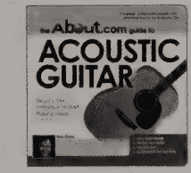

《About.com原声吉他指南》

ISBN 10: 1-59869-098-1

ISBN 13: 978-1-59869-098-9

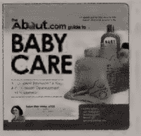

《About.com婴儿护理指南》

ISBN 10: 1-59869-274-7

ISBN 13: 978-1-59869-274-7

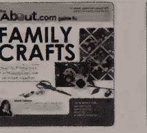

《About.com家庭手工指南》

ISBN 10: 1-59869-346-8

ISBN 13: 978-1-59869-346-1

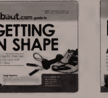

《About.com塑身指南》

ISBN 10: 1-59869-278-X

ISBN 13: 978-1-59869-278-5

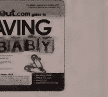

《About.com怀孕指南》

ISBN 10: 1-59869-095-7

ISBN 13: 978-1-59869-095-8

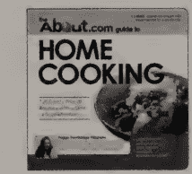

《About.com家庭烹饪指南》

ISBN 10: 1-59869-396-4

ISBN 13: 978-1-59869-396-6

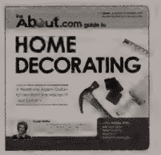

《About.com家居装饰指南》

ISBN 10: 1-59869-347-6


ISBN 13: 978-1-59869-347-8

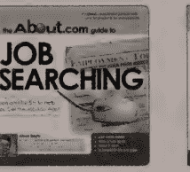

《About.com求职指南》

ISBN 10: 1-59869-097-3

ISBN 13: 978-1-59869-097-2

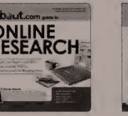

《About.com在线研究指南》

ISBN 10: 1-59869-503-2

ISBN 13: 978-1-59869-503-8

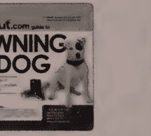

《About.com养狗指南》

ISBN 10: 1-59869-279-8

ISBN 13: 978-1-59869-279-2

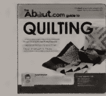

《About.com绗缝指南》

ISBN 10: 1-59869-344-1

ISBN 13: 978-1-59869-344-2

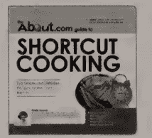

《About.com快捷烹饪指南》

ISBN 10: 1-59869-273-9

ISBN 13: 978-1-59869-273-0

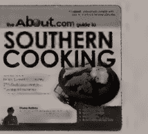

《About.com南方烹饪指南》

ISBN 10: 1-59869-096-5

ISBN 13: 978-1-59869-096-5

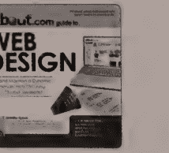

《About.com网页设计指南》

ISBN 10: 1-59869-378-6

ISBN 13: 978-1-59869-378-2

各大书店有售！或致电`1-800-258-0929`或访问`www.adamsmedia.com`。

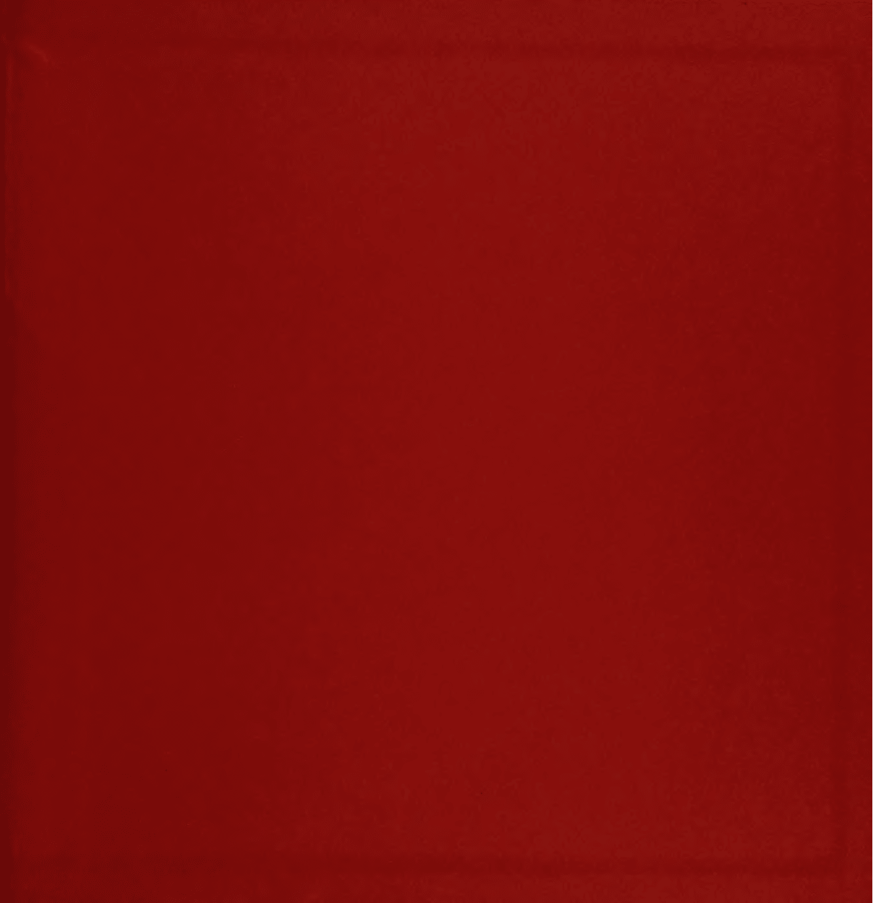

互联网的**即时性**、书籍的**易得性**以及About.com指南的**丰富经验**，都汇聚于这套充满活力的实用指南系列之中！

# 它是关于……从头到尾打造一个出色的网站！

《About.com网页设计指南》还包含四种类型的特别栏目，提供富有见地的提示和建议：

- **咨询你的指南**：精选Jennifer对你最常提出的网络问题的专家解答。
- **你需要的工具**：关于哪些工具和功能能为你的网站增添最多个性的信息。
- **热门推荐**：当下最流行的潮流和技巧。
- **网络其他资源**：Jennifer喜爱的网页设计网站。

此外，你可以登录About.com网页设计网站获取更多信息：

- 每章末尾的独特**获取链接**部分列出了指向About.com的有用链接。
- Jennifer的**About.com论坛**为你提供提问、获取答案以及与其他网页设计师交流的机会。
- 访问Jennifer按章节划分的书籍论坛，你会找到教程、程序更新和设计技巧。

网站不再是技术高手和电脑极客的专利。在当今在线商业、名人博客和网络约会的时代，网络为每个人提供了空间！《About.com网页设计指南》是你创建自己网站的完美指南——无论是用于商业、爱好，还是纯粹为了乐趣！

跟随Jennifer Kyrnin——About.com网页设计/HTML指南，她将一步步指导你构建自己的网页、添加功能，并编写简单高效的HTML代码。（然后在她的About.com网站上查看结果，你会发现相应的屏幕截图和按章节划分的教程。）你还将学习如何：

- 决定在哪里托管你的网站——以及为什么
- 通过基本代码提升功能性
- 使用特殊的导航工具和策略使浏览更轻松
- 使用`Flash`、`DHTML`、`Ajax`等增加趣味性

有了《About.com网页设计指南》，你卓越的网站将很快上线运行！

**Jennifer Kyrnin**，About.com网页设计/HTML指南，自1995年起设计网页。她维护着一个大型企业网站（包括Symantec公司的主页以及几个内网和外网站点）超过5000页的内容。她几乎使用过所有网络技术，包括`XML`、`CMS`、`HTML`、`PHP`、`Perl`、`C`和`Java`。她居住在华盛顿州斯诺霍米什。

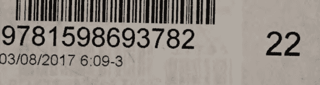


