 算法初学者指南：JavaScript 数据结构与算法实用入门指南

## 20. 第 20 章 深度优先搜索（DFS）与广度优先搜索（BFS）

### 1. 两种探索方法的对比

### 2. 示例时间

### 3. 何时使用 DFS？何时使用 BFS？

### 4. JavaScript 实现

### 5. 性能细节

### 6. 结论

## 21. 第 21 章 快速排序

### 1. 快速排序的工作原理

### 2. 另一个简单视角

### 3. 实现时间

### 4. 性能特征

### 5. 结论

## 22. 第 22 章 冒泡排序

### 1. 冒泡排序的工作原理

### 2. 逐步演示

### 3. 代码实现

### 4. 结论

## 23. 第 23 章 插入排序

### 1. 插入排序的工作原理

### 2. 再举一个例子

### 3. 算法概述与实现

### 4. 性能分析

### 5. 结论

## 24. 第 24 章 选择排序

### 1. 选择排序逐步演示

### 2. 算法深入探讨

### 3. JavaScript 实现

### 4. 结论

## 25. 第 25 章 归并排序

### 1. 归并排序的工作原理

### 2. 归并排序：算法细节

### 3. 查看代码

### 4. 结论

## 26. 作者简介

## 1. 数据结构简介

编程的核心就是获取数据并以各种有趣的方式对其进行操作。根据我们所做的事情，数据需要以一种便于实际使用的形式来表示。这种形式就是我们常说的`数据结构`。稍后我们将看到，数据结构为我们处理的数据提供了高度的组织和支撑。这使得操作数据更加容易且（通常）更高效。在接接的章节中，我们将了解这是如何实现的！

继续前进！

### 合适的工具用于合适的工作

为了更好地理解数据结构的重要性，让我们看一个例子。场景如下：我们有一堆工具和相关的小物件（图 1-1）。

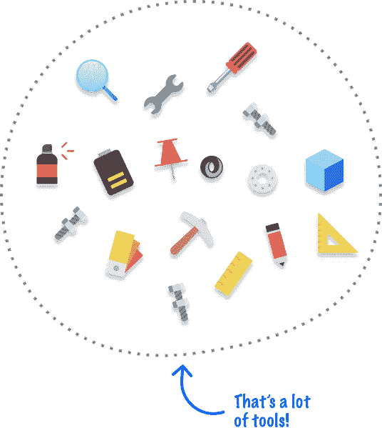

**图 1-1** *工具，工具，还是工具*

我们要做的是存储这些工具，以便日后轻松取用。一种解决方案是简单地将所有工具扔进一个大纸箱里，然后收工（图 1-2）。

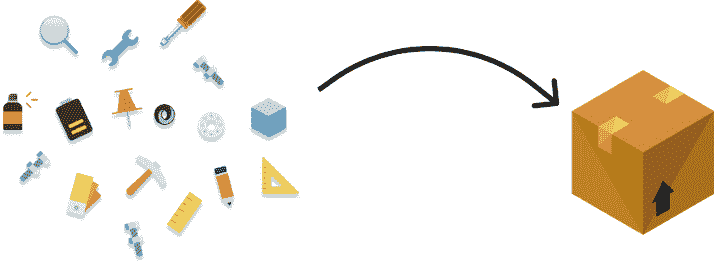

**图 1-2** *工具，遇见纸箱！*

如果我们想找某个特定的工具，可以在箱子里翻找。如果我们要找的工具恰好埋在箱子底部，那也没关系。只要翻找足够久（图 1-3）——可能再摇晃箱子几次——我们最终会找到的。


**图 1-3** *一个翻找者！*

现在，我们可以采用另一种方法。与其把东西扔进箱子，不如把它们存放在一个便于整理的地方。我们可以把所有工具存放在一个工具箱里（图 1-4）。


**图 1-4** *我们的隐喻工具箱*

工具箱通常有许多隔层，帮助我们整理工具。虽然最初存放物品需要多花一点功夫，但这种整理使得日后取用工具更加容易。我们不再需要像毛茸茸的蒙面强盗一样在一堆东西里翻找，而是可以直接去存放所需工具的合适口袋或隔层。

我们刚刚看到了解决工具存储问题的两种方法。如果要对这两种方法进行总结，结果如下：

 **将工具存放在纸箱中**

 添加物品非常快。我们只需扔进去就行。生活很美好。

 查找物品很慢。如果我们我们要的东西恰好在顶部，可以轻松拿到。如果恰好在底部，我们得翻遍几乎所有物品。

 移除物品也很慢。它面临与查找物品相同的挑战。顶部的物品可以轻松移除。底部的物品可能需要额外摇晃和整理才能安全取出。

 **将工具存放在工具箱中**

 向工具箱添加物品较慢。不同工具对应不同隔层，因此需要确保正确的工具放入正确的位置。

 查找物品很快。我们前往合适的隔层，从中取出工具。

 移除物品也很快。由于工具被整齐地放置在合适的位置，我们可以毫不费力地取出它们。

我们可以看到，纸箱和工具箱各有其适用和不适用的情况。没有放之四海而皆准的正确答案。如果我们只关心存放工具而不再查看它们，那么把工具塞进纸箱是正确的选择。如果我们经常需要取用工具，那么将工具存放在工具箱中更为合适。

### 回到数据结构

在编程和计算机领域，决定使用哪种数据结构类似于决定将工具存放在纸箱还是工具箱。我们遇到的每一种数据结构都有适用和适用的情况（图 1-5）。

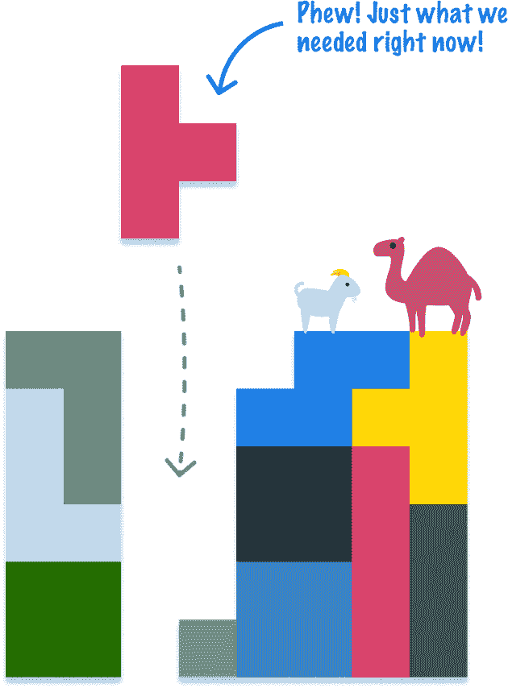

**图 1-5** *在这种情况下合适*

了解哪种数据结构以及何时使用，成为高效开发者的重要部分。我们需要深入的数据结构包括：

- `数组`
- `链表`
- `栈`
- `队列`
- `树`
- `二叉树`
- `哈希表`
- `字典树`

### 结论

接下来的章节中，我们将进一步了解每种数据结构擅长什么，将正确的数据结构与场景联系起来。一些额外资源：

-  提问：`forum.upa.com`
-  错误/问题：`bit.ly/algorithms_errata`
-  源代码：`bit.ly/algorithms_source`

## 2. 大 O 符号

在分析代码执行时，我们关注两个点：时间复杂度和空间复杂度。时间复杂度指代码运行所需，空间复杂度指运行所需的额外内存。理想情况下，我们希望代码运行尽可能快，同时占用尽可能少的内存。现实情况更为复杂，因此我们需要一种统一的方式来描述运行时间以及占用空间。这就是大 O 符号（读作 `Big Oh`）。

### 示例时间

为了更好地理解大 O 符号，我们来看一个例子。一段代码接收一个数字作为输入，告诉我们这个数字有多少位。如果输入是 `3415`，位数就是 `4`（图 2-1）。

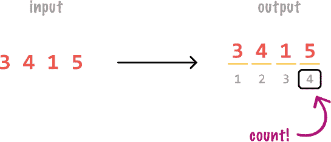

**图 2-1** *数字的位数*

如果输入是 `241539`，位数就是 `6`（图 2-2）。

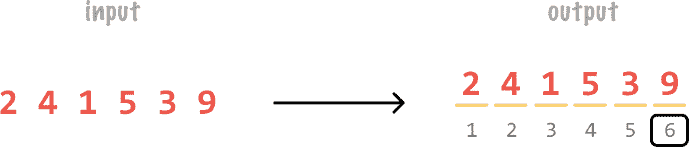

**图 2-2** *对于更大的数字，位数更多*

计算位数所需的工作量与输入的大小呈`线性`关系（图 2-3）。

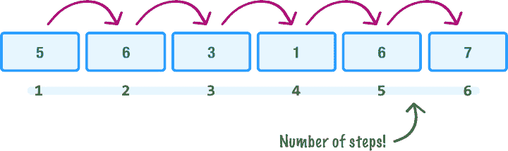

**图 2-3** *步骤数量线性增长*

提供的输入数字越大，需要计数的位数越多，才能得到最终答案。关键在于每增加一位数字，计算步骤不会异常变大。我们可以通过绘制`输入大小`与`所需步骤数`的关系图来直观地看到（图 2-4）。

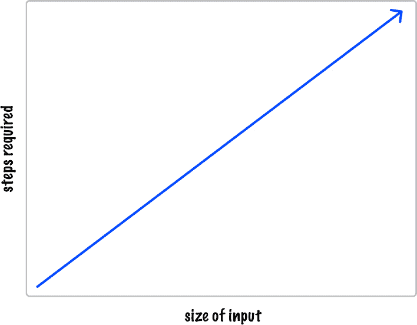

**图 2-4** *工作量与输入大小呈线性关系*

这是线性增长的可视化。线性增长只是增长率之一。假设我们还有一段代码，用来判断输入数字是`奇数`还是`偶数`。判断一个数字偶性的方法很简单，只需看最后一位数字，然后快速计算（图 2-5）。

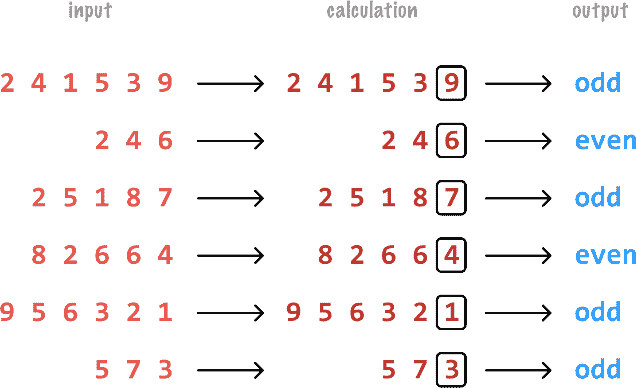

**图 2-5** *只需看最后一位数字就能判断偶性*

在这种情况下，输入数字的大小并不重要。我们的工作量始终不变。我们总是检查最后一位数字，然后快速判断整个数字是奇数还是偶数。我们可以简化地说，这里的计算工作量是`恒定`的（图 2-6）。

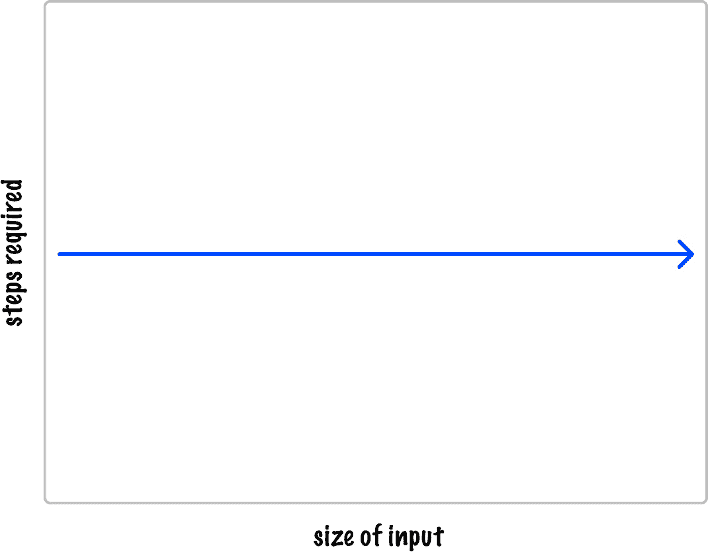

**图 2-6** *工作量是恒定的*

注意，在这张步骤数与输入大小的关系图中，工作量不会随输入大小而改变。它保持不变……恒定不变！

### 大 O 符号时间

在分析代码性能时，我们很容易纠结于各种细节。重要的是代码的工作量与输入大小之间的关系。这就是大 O 符号的用武之地。大 O 符号是一种数学表达方式，用于描述代码在不同输入大小下运行的`上界`或`最坏情况`。它关注的是随着输入规模增大，影响算法性能的最主要因素。如果我们要描述之前的线性情况，大 O 符号会像图 2-7。

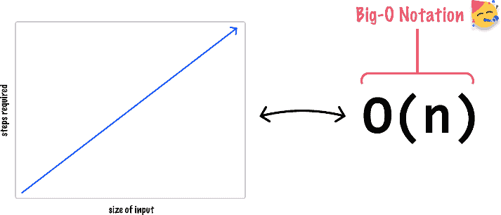

**图 2-7** *线性关系的大 O 符号*

大 O 符号看起来有点像函数，但我们要理解它的分解，如下：

- `O(1)`：常数复杂度
- `O(log n)`：对数复杂度
- `O(n)`：线性复杂度
- `O(n log n)`：线性对数复杂度
- `O(n²)`：平方复杂度
- `O(2^n)`：指数复杂度
- `O(n!)`：阶乘复杂度

这些代表了算法在最坏情况下的增长率。理解这些值代表什么对我们来说非常重要。这些资源：

- 提问：`forum.upa.com`
- 错误/问题：`bit.ly/algorithms_errata`
- 源代码：`bit.ly/algorithms_source`

### 结论

大 O 表示法是一种数学表示法，用于描述代码时间或空间复杂度的上界或最坏情况。从数学角度来说，它为代码的增长率提供了一个参考。


**图 3-6** *我们需要确保被删除元素之后的所有数组元素都正确定位并编号。*

例如，我们从数组中删除了第一个元素。现在数组中的其他每个元素都必须移动并重新计数以适应这一变化。呼！

## 搜索元素

除了添加和删除元素，我们还会花大量时间搜索元素。最常见的方法是线性搜索，即从数组开头开始，逐个元素查找，直到找到目标（图 3-7）。

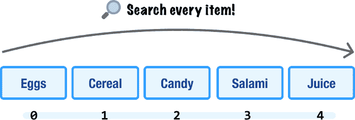

**图 3-7** *线性搜索*

根据数据的具体形态，我们可能可以进行一些优化。例如，如果我们知道数组的数据以某种方式排序（按字母顺序、数字顺序等），我们可以采用二分搜索来加快搜索速度（图 3-8）。

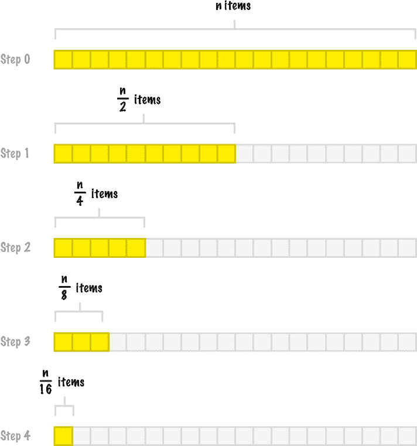

**图 3-8** *二分搜索速度更快。*

我们稍后会详细介绍二分搜索、线性搜索以及其他搜索算法。

## 访问元素

到目前为止，我们已经多次提到索引位置，现在是时候深入探讨一下了。索引位置充当标识符。如果我们要访问特定的数组元素（通过搜索或其他方式），我们通过其索引位置以 `array[index_position]` 的形式引用它，如图 3-9 所示。

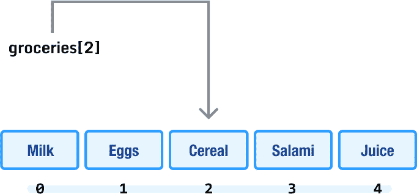

**图 3-9** *数组索引位置*

需要记住的几个技巧是：第一个元素的索引位置始终为 0。最后一个元素的索引位置始终比数组元素总数少 1。如果我们尝试提供一个无效的索引位置，将会出现错误！

## 数组实现/使用场景

数组是一种基本的数据结构，几乎所有编程语言（如 `JavaScript`！）都内置提供。以下是一些常见示例，展示如何使用数组执行我们在购物清单示例中提到的操作：

```
// 创建数组！
let groceries = ["Milk", "Eggs", "Cereal", "Salami", "Juice"];
// 访问第一个元素
let first = groceries[0];

// 访问最后一个元素
let last = groceries[groceries.length - 1];

// 访问第三个元素
let cereal = groceries[2];

// 在末尾插入元素
groceries.push("Potatoes");

// 在开头插入元素
groceries.unshift("Ice Cream");

// 在第三个元素之后插入元素
groceries.splice(3, 0, "Cheese");

// 删除最后一个元素
groceries.pop();

// 删除第一个元素
groceries.shift();

// 删除第三个元素
groceries.splice(2, 1);

// 查找特定元素
let foundIndex = groceries.indexOf("Eggs"); // 1
let itemToFind = -1;
// 遍历每个元素
for (let i = 0; i < groceries.length; i++) {
let currentItem = groceries[i];
// 返回找到的元素的索引
if (currentItem == "Salami") {
itemToFind = i;
  }
}
```

如需深入了解数组的所有细节，参阅我在 [www.kirupa.com/javascript/learn_arrays.htm](http://www.kirupa.com/javascript/learn_arrays.htm) 上的全面数组指南。如果你对数组还不够熟练，请花点时间真正熟悉它们。我们后续将要学习的许多数据结构和算法在底层都大量使用了数组。

## 数组与内存

在使用像 `JavaScript` 这样的现代高级编程语言时，我们无需主动考虑内存管理。所有的内存处理都由系统自动完成。接下来我们要探讨的内容会稍微深入到计算机的内部工作原理，了解这些原理将极大地提升我们对事物（这里指数组）运作方式的理解。

当我们考虑内存时，可以将其简化为一系列可以存储数据的区域（图 3-10）。

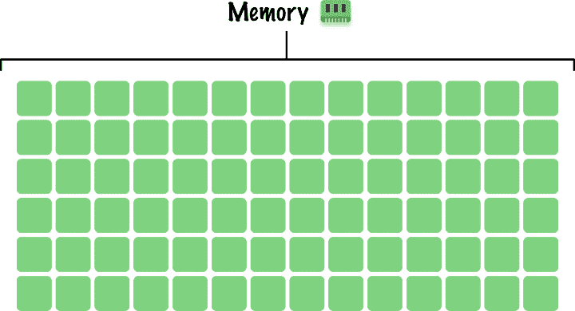

**图 3-10** *内存视为一系列区域*

实际上，我们的内存永远不会像图中那样整洁。计算机同时处理着许多其他占用空间的事情（图 3-11）。

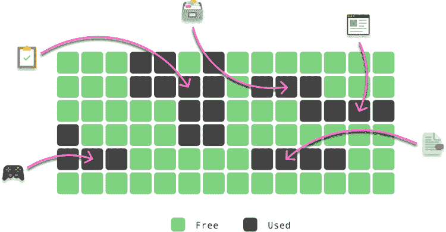

**图 3-11** *工作中的内存*

任何添加到内存中的新元素都需要放入可用的空闲区域。这让我们回到数组的话题。当我们创建数组时，首先需要在内存中分配一些空间供其存放。数组的特点是它们必须将元素存储在相邻（即连续）的内存区域中。它们不能分散在空闲和已用区域之间。

当我们初始化数组时，会在内存中分配一个固定大小的空间，并随着数组的增长不断增大这个固定大小。假设我们创建一个空数组。即使现在数组是空的，我们也会分配额外的内存区域（图 3-12）。

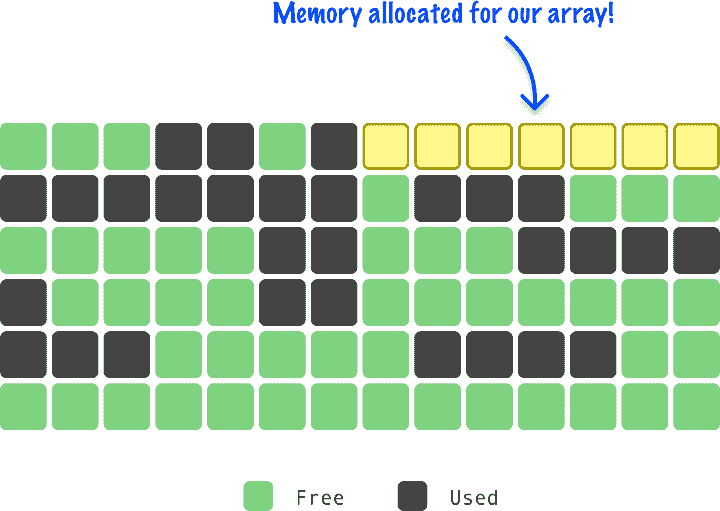

**图 3-12** *为数组分配内存*

在我们的示例中，分配了七个内存区域。随着我们向数组添加元素，它们逐渐填满已分配的内存（图 3-13）。

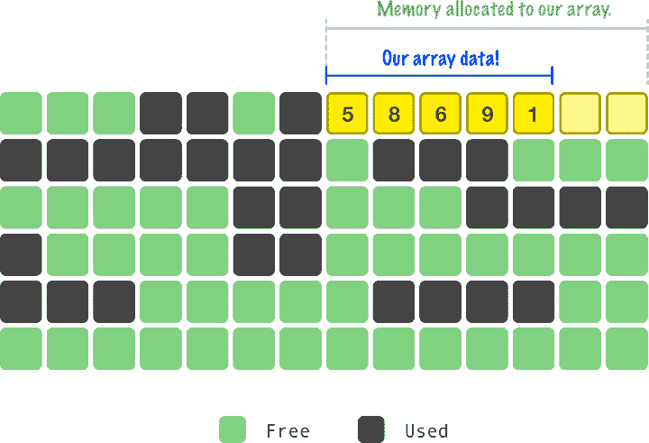

**图 3-13** *用数据填充数组*

我们不断向数组添加数据，直到填满所有分配的空间（图 14）。

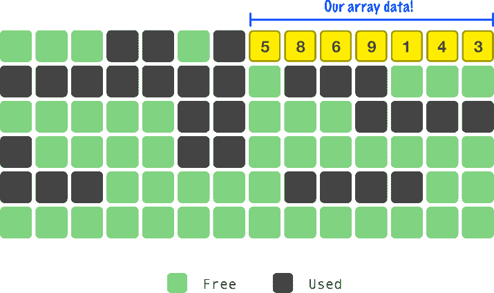

**图 3-14** *数组已填满*

如果添加额外的元素，接下来会发生什么？没有相邻内存可以扩展数组。操作系统（或虚拟机）会找到一段连续的内存，将数组移动到那里（图 15）。

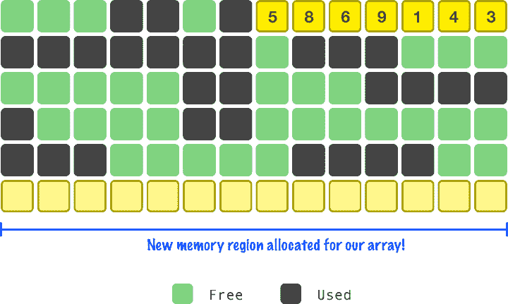

**图 3-15** *寻找连续的内存*

一旦找到这段内存，就需要整个数组移动到新位置（图 16）。

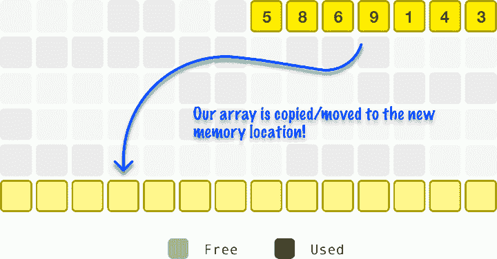

**图 3-16** *数组数据被移动到新位置*

数组完全移动之后不是廉价的操作，因为每个元素都需要移动。我们可以添加更多元素，而原来的内存位置变成空闲空间供数据使用（图 17）。

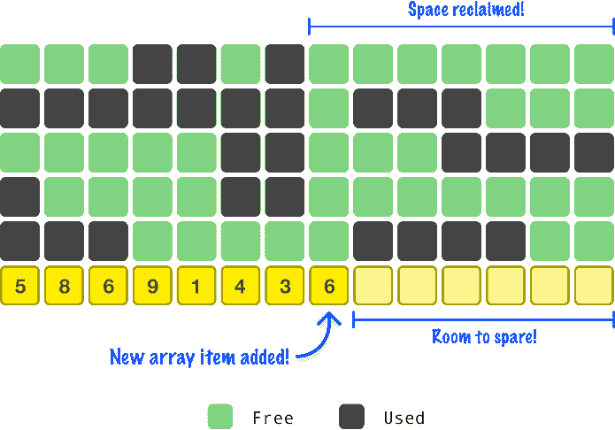

**图 3-17** *新数据现在可以移动后释放内存。*

传统的编程语言要求我们仔细思考内存以及如何超出限制。像 `JavaScript` 这样的现代语言为我们处理了这一切，但超出内存并将数组移动到更大区域带来的性能影响存在。

### 性能考量

在前面的章节中，我们初步了解了数组擅长和不擅长的操作。表 3 总结了性能和空间方面的考量。

**表 3** *数组性能与空间考量*

![img/03tab01]

让我们查看每一类主要操作：

#### 访问

数组访问效率极高，具有常数时间复杂度 `O(1)`。这意味着无论数组大小如何，访问特定索引的时间都是相同的。数组通过将元素存储在连续的位置来实现这种性能，允许使用索引访问。

#### 插入

在开头插入一个元素效率低下，因为需要移动现有元素为新元素腾出空间。此操作的时间复杂度为 `O(n)`，其中 `n` 是数组中的元素数量。

![img/sq.jpg] 在末尾插入一个元素效率更高，特别是数组有足够的内存容量时。这可以在常数时间 `O(1)` 内完成。

![img/sq.jpg] 在数组的特定索引处插入元素也需要移动后续元素来腾出空间。因此，其时间复杂度为 `O(n)`，其中 `n` 是数组中的元素数量。

![img/sq.jpg] 正如之前所见，有时数组没有相邻内存来添加新项。在这种情况下，时间总是上升到 `O(n)`，因为数组需要将其所有内容移动到一个更大的区域。

#### 删除

从开头删除一个元素需要移动所有后续元素来填补空缺，导致时间复杂度为 `O(n)`，其中 `n` 是数组中的元素数量。

![img/sq.jpg] 从末尾删除一个元素效率很高，可以在常数时间 `O(1)` 内完成。

![img/sq.jpg] 从特定索引处删除一个元素需要移动所有后续元素来填补空缺，导致时间复杂度为 `O(n)`，其中 `n` 是数组中的元素数量。

#### 搜索

我们可以采用两类搜索方法：

![img/sq.jpg] **线性搜索**：在未排序的数组中搜索一个元素需要遍历每个元素，直到找到匹配项或到达末尾。在最坏情况下，此操作的时间复杂度为 `O(n)`，其中 `n` 是数组中的元素数量。

![img/sq.jpg] **二分搜索**：在已排序的数组中搜索一个元素可以使用二分搜索，它反复将搜索空间对半分割。此操作的时间复杂度为 `O(log n)`，其中 `n` 是数组中的元素数量。然而，二分搜索要求数组已排序，因此如果数组未排序，可能需要额外的排序操作，从而导致更高的时间复杂度。

我们将在后面介绍算法时更详细地讨论线性搜索和二分搜索，在此之前请记住这些信息。

### 结论

数组是我们使用的最基本的数据结构之一。几乎所有编程语言，无论层次多低，都提供了对数组的内置支持。这有几个原因。在编程中，我们经常处理数据集合。如果每个项目都要重新创建数组，那会很奇怪。另一个原因与数组的工作方式有关。它们紧密映射连续的内存区域，而我们（尤其是高级语言）很难从头重新创建数组数据结构并保持原生实现提供的性能。这就是为什么，正如我们很快会看到的，数组实际上是我们将要研究的其他数据结构的一部分。

一些额外资源：

![img/sq1.jpg] 提问：[`forum.kirupa.com`](https://forum.kirupa.com)

![img/sq1.jpg] 错误/已知问题：[`bit.ly/algorithms_errata`](https://bit.ly/algorithms_errata)

![img/sq1.jpg] 源代码仓库：[`bit.ly/algorithms_source`](https://bit.ly/algorithms_source)

## 4. 链表

链表非常棒。它们为处理不断的数据提供了一种解决方案，并且有一些巧妙的方法可以快速完成所有处理。在本章中我们将探讨链表的方面，例如其基本结构、性能、代码实现等等！很有趣。

### 认识链表

链表和数组一样，都是为了存储数据集合。在图 4-1 中，有一个链表的示例，用于存储 A 到 E。

![img/04fig01.jpg] **图 4-1** *一个链表*

通过相互连接的单个节点工作。每个节点负责两件事：存储数据和指向下一个节点的 `next` 指针（也称为引用）。

![img/04fig02.jpg] **图 4-2** *一个节点由值和指向下一个指针或引用组成。*

链表是如何成为链表的？当我们获取数据，通过 `next` 指针将节点连接在一起。

#### 查找值

我们有一个大量数据的链表，想要某个值。这是最常见的操作之一。从第一个节点（也称为 `head` 节点）开始遍历。

![img/04fig03.jpg] **图 4-3** *遍历节点*

从一个节点跳到下一个节点，直到到达标记的最后一个节点（也称为 `tail` 节点）。如果你觉得这听起来像线性搜索，那你是对的。它包含了性能特征。如果你这么认为，也没关系。我们将在第 17 章中详细研究。

#### 添加节点

现在，让我们看看向链表中添加节点。添加节点的核心思想与其说是添加，不如说是“创建”一个新节点并“更新”几个 `next` 指针。我们将通过示例来了解。假设我们在末尾添加一个节点 F。

![img/04fig04.jpg] **图 4-4** *我们想添加一个节点 F。*

我们需要做的是将最后一个节点 `E` 节点的 `next` 指针更新为我们添加的新节点 F。

![img/04fig05.jpg] **图 4-5** *更新 E 的指针*

无论我们在链表的哪个位置添加节点，行为基本一致。假设我们在现有节点 C 和 D 之间添加一个节点 Q。

![img/04fig06.jpg] **图 4-6** *我们想在 C 和 D 之间添加一个节点 Q。*

要实现这一点，我们需要执行的步骤：

1. 将 `C` 的 `next` 指针替换为指向 `Q`。
2. 将 `Q` 的 `next` 指针替换为指向 `D`。

这将得到图 4-7 所示的排列，这正是我们想要的。

![img/04fig07.jpg] **图 4-7** *Q 被添加。*

需要记住的一个重要细节是，无论我们在链表的哪个位置添加节点，链表的主要任务都是确保更新 `next` 指针以容纳新添加的节点。虽然听起来复杂，但工作量很小。如果我们在链表的开头或末尾添加节点，只需进行一次指针相关的更新。如果我们在链表开头或末尾以外的任何位置添加节点，则需要两次指针相关的更新。这相当高效！

#### 删除节点

当我们要删除节点时，步骤与添加节点类似。假设我们要删除链表中的节点 D（图 4-8）。

![img/04fig08.jpg] **图 4-8** *我们想删除节点 D。*

我们要做的是更新节点 `C` 上的 `next` 指针，使其直接引用节点 `E`，绕过节点 `D`（图 4-9）。

![img/04fig09.jpg] **图 4-9** *更新指针以引用 E，绕过 D*

我们还会清除 `D` 节点上的 `next` 指针。所有这些操作使得节点 `D` 在遍历中不可达，并移除了该节点与链表中其他节点的所有连接。不过，不可达并不意味着已删除。节点 D 究竟何时被真正删除？具体时机因情况而异，它是作为**垃圾回收**的一部分自动发生的。

### 链表：时间与空间复杂度

是时候来点更有趣的内容了！我们一开始讨论链表时，就提到了它们的速度和效率。表 4-1 总结了链表的性能。

**表 4-1** *链表性能*

![img/04tab01]

该表忽略了一些细微但非常重要的细节，因此我们指出相关要点：链表的具体实现方式对某些操作的速度有重要影响。我们将采用的一种实现选择是，链表会直接引用第一个（头）节点和最后一个（尾）节点。

#### 运行时间深入分析

**访问**：数组访问效率极高，具有常数时间复杂度 `O(1)`。这意味着无论数组大小如何，访问特定索引的时间都是相同的。数组通过将元素存储在连续的位置来实现这种性能，允许使用索引访问。

**插入**：在开头插入一个元素效率低下，因为需要移动现有元素。此时间复杂度为 `O(n)`。在末尾插入一个元素效率更高，特别是数组有足够的内存容量时。这可以在常数时间 `O(1)` 内完成。在特定索引处插入一个元素也需要移动后续元素来腾出空间。因此，其时间复杂度为 `O(n)`。

**删除**：从开头删除一个元素需要移动所有后续元素，时间复杂度为 `O(n)`。从末尾删除一个元素效率很高，可以在常数时间 `O(1)` 内完成。从特定索引处删除一个元素需要移动所有后续元素，时间复杂度为 `O(n)`。

**搜索**：
- **线性搜索**：在未排序的数组中搜索一个元素需要遍历每个元素。时间复杂度为 `O(n)`。
- **二分搜索**：在已排序的数组中搜索一个元素可以使用二分搜索。时间复杂度为 `O(log n)`。


 如果我们要找的恰好是第一个元素，那么我们在 `O(1)` 时间内就能返回找到的节点。

 **添加/插入**

 在单向链表的开头或末尾插入一个元素需要 `O(1)` 时间，因为我们只需更新新节点的引用，使其指向链表的当前头节点或尾节点。

 在链表中的特定位置插入一个元素，平均和最坏情况下需要 `O(n)` 时间，因为我们必须遍历链表才能找到该位置。

 **删除**

 与添加情况类似，从单向链表的开头或末尾删除一个元素需要 `O(1)` 时间，因为我们只需更新第一个或最后一个节点的引用。

 从链表中的特定位置删除一个元素，平均和最坏情况下需要 `O(n)` 时间，因为我们必须遍历链表才能找到该元素，然后将其删除。

#### 空间复杂度

从内存/空间角度来看，链表需要 `O(n)` 空间。对于链表要存储的每一条数据，我们将其包装成一个节点。节点本身是一个非常轻量级的结构：它只包含一个用于存储数据的薄包装器和一个指向下一个节点的引用。

### 链表的变体

事实证明，链表并非一种通用的解决方案。我们需要了解几种流行的变体，并讨论它们为何有用。

#### 单向链表

剧透警告：单向链表正是我们到目前为止深入探讨的链表类型（图 4-10）。

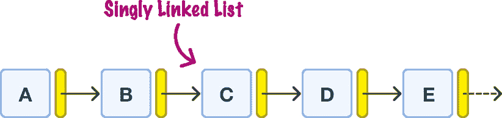

**图 4-10** *我们的单向链表*

在单向链表中，每个节点只有一个指向下一个节点的指针。对于许多情况，这种单向行为已经足够。

#### 双向链表

在双向链表中，每个节点有两个指针，一个指向前一个节点，一个指向下一个节点（图 4-11）。

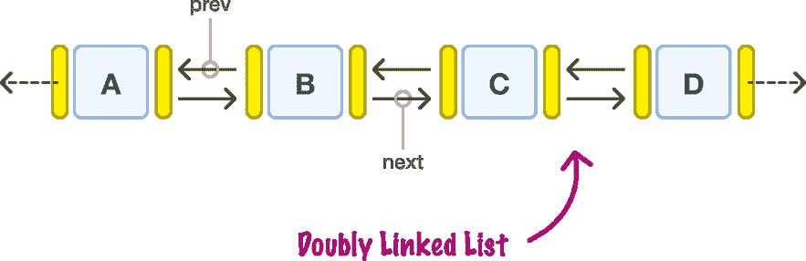

**图 4-11** *双向链表*

使用双向链接可以更方便地在两个方向上进行遍历，类似于从单车道变为双车道。我们通常会在关联数组和其他复杂数据结构的实现中看到双向链表。

#### 循环链表

在循环链表中，最后一个节点的 `next` 指针指向第一个节点，形成一个循环结构（图 4-12）。

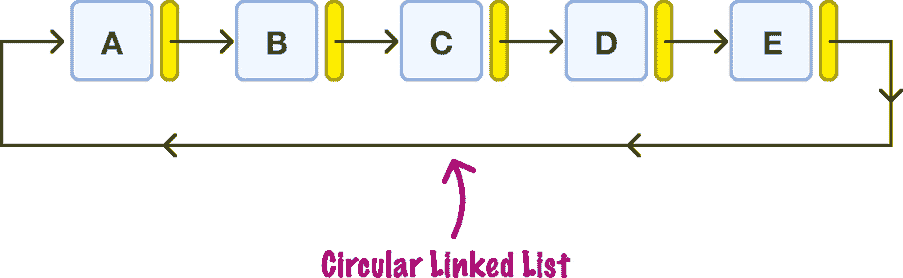

**图 4-12** *循环链表*

这种链表可用于需要以循环方式访问项目的场景，例如调度算法、在扑克游戏中选取下一名玩家等。说到扑克，请看 图 4-13。


**图 4-13** *扑克是一种循环活动。*

抱歉，我忍不住。如果你提到扑克，我就有义务分享这张图片。

#### 跳跃表

我们之前看到链表的速度很快。而跳表让速度上一层。跳表是一种包含额外“跳跃”链接的链表，这些链接就像快捷方式，可以更快地跳转到链表中的特定位置（图 4-14）。

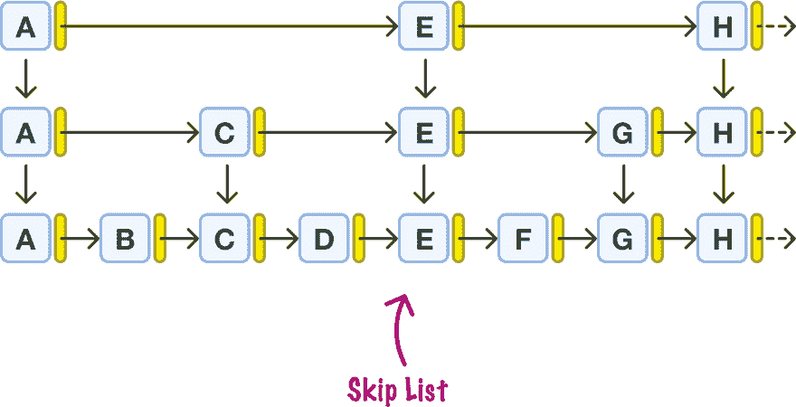

**图 4-14** 跳跃

跳表的每一层让我们更快访问某些元素。根据查找的数据，我们会在每一层中水平遍历，同时上下移动，以减少检查的节点数量。跳表通常用于大型数据集进行频繁查找或搜索的场景。通过向链表添加链接，我们可以保持常数时间的插入和删除。

### 实现

以下是支持所有操作的实现：

```
class LinkedListNode {
  constructor(data, next = null) {
    this.data = data;
    this.next = next;
  }
}

class LinkedList {
  constructor() {
    this.head = null;
    this.tail = null;
    this.size = 0;
  }

  addFirst(data) {
    const newNode = new LinkedListNode(data, this.head);
    this.head = newNode;
    if (!this.tail) {
      this.tail = newNode;
    }
    this.size++;
  }

  addLast(data) {
    const newNode = new LinkedListNode(data);
    if (!this.head) {
      this.head = newNode;
      this.tail = newNode;
    } else {
      this.tail.next = newNode;
      this.tail = newNode;
    }
    this.size++;
  }

  addBefore(beforeData, data) {
    const newNode = new LinkedListNode(data);
    if (this.size === 0) {
      this.head = newNode;
      this.size++;
      return;
    }
    if (this.head.data === beforeData) {
      newNode.next = this.head;
      this.head = newNode;
      this.size++;
      return;
    }

    let current = this.head.next;
    let prev = this.head;

    while (current) {
      if (current.data === beforeData) {
        newNode.next = current;
        prev.next = newNode;
        this.size++;
        return;
      }
      prev = current;
      current = current.next;
    }

    throw new Error(`Node with data '${beforeData}' not in list`);
  }

  addAfter(afterData, data) {
    const newNode = new LinkedListNode(data);
    if (this.size === 0) {
      this.head = newNode;
      this.size++;
      return;
    }

    let current = this.head;

    while (current) {
      if (current.data === afterData) {
        newNode.next = current.next;
        current.next = newNode;
        this.size++;
        return;
      }
      current = current.next;
    }

    throw new Error(`Node with data '${afterData}' not in list!`);
  }

  contains(data) {
    let current = this.head;

    while (current) {
      if (current.data === data) {
        return true;
      }
      current = current.next;
    }

    return false;
  }

  removeFirst() {
    if (!this.head) {
      throw new Error('List is empty');
    }

    this.head = this.head.next;
    if (!this.head) {
      this.tail = null;
    }
    this.size--;
  }

  removeLast() {
    if (!this.tail) {
      throw new Error('List is empty');
    }

    if (this.head === this.tail) {
      this.head = null;
      this.tail = null;
      this.size--;
      return;
    }

    let current = this.head;
    let prev = null;

    while (current.next) {
      prev = current;
      current = current.next;
    }

    prev.next = null;
    this.tail = prev;
    this.size--;
  }

  remove(data) {
    if (this.size === 0) {
      throw new Error("List is empty");
    }

    if (this.head.data === data) {
      this.head = this.head.next;
      this.size--;
      return;
    }

    let current = this.head;

    while (current.next) {
      if (current.next.data === data) {
        current.next = current.next.next;
        this.size--;
        return;
      }
      current = current.next;
    }

    throw new Error(`Node with data '${data}' not found!`);
  }

  toArray() {
    const arr = [];
    let current = this.head;

    while (current) {
      arr.push(current.data);
      current = current.next;
    }

    return arr;
  }

  get length() {
    return this.size;
  }
}
```

以下是代码运行的一些示例：

```
let letters = new LinkedList();
letters.addLast("A");
letters.addLast("B");
letters.addLast("C");
letters.addLast("D");
letters.addLast("E");
console.log(letters.toArray()); // ['A', 'B', 'C', 'D', 'E']

letters.addFirst("AA");
letters.addLast("Z");
console.log(letters.toArray()); // ['AA', 'A', 'B', 'C', 'D', 'E', 'Z']

letters.remove("C");
letters.removeFirst();
console.log(letters.toArray()); // ['A', 'B', 'D', 'E', 'Z']

letters.addAfter("D", "Q");
letters.addBefore("A", "5");
console.log(letters.toArray()); // ['5', 'A', 'B', 'D', 'Q', 'E', 'Z']

console.log(letters.length); // 7
```

要查看所有代码的在线演示，请访问 Codepen：`bit.ly/kirupa_linkedlist`。将来需要在代码中使用 `LinkedList`，我们可以直接粘贴所有代码，或者通过以下标签：

```
<script src="https://www.kirupa.com/js/linkedlist_v1.js"></script>
```

稍后我们会看到，链表在多种数据结构和实现中扮演关键角色。

### 结论

呼！通过大量的文字和图示，我们看到链表提供了一种高效存储和操作的方式。它们支持常时间的插入和删除，并且可以轻松遍历执行搜索等操作。虽然它们并非最高的数据结构，但在简洁性方面可以稳居首。正如我们将在下一章看到的，用 JavaScript 构建链表的过程与对其工作原理的解释一样优雅。

额外资源：

 提问：`forum.kirupa.com`

 错误/已知问题：`bit.ly/algorithms_errata`

 源代码仓库：`bit.ly/algorithms_source`

## 5. 栈

你是否曾在处理某些操作时过撤销或重做（图 5-1）？


**图 5-1** *撤销/重做*

你是否曾好奇过，你喜欢的编程语言是如何将你编写的内容转化为一系列顺序步骤，让计算机知道该做的？你是否曾在浏览器中前进或后退？你喜欢煎饼吗？

如果你对以上一个问题的回答是肯定的，那么你可能已经遇到了教程的主角——`stack`（栈）数据结构。在接下来的章节中，我们将进一步了解栈以及如何在 JavaScript 中使用它。开始吧！

### 认识栈

在生活的某个时刻，我们几乎都见过一堆东西叠在一起……比如煎饼，如图 5-2 所示。

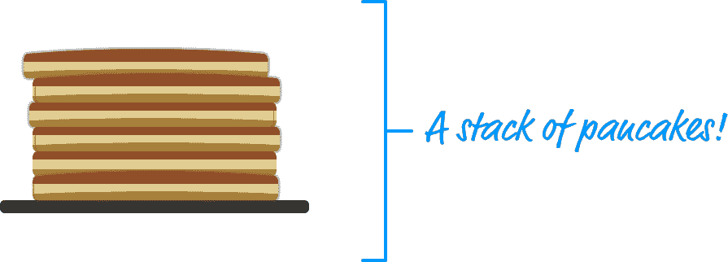

**图 5-2** *一堆东西*

关于堆叠的东西，我们总是把新物品添加到顶部，也从顶部移除物品（图 5-3）。

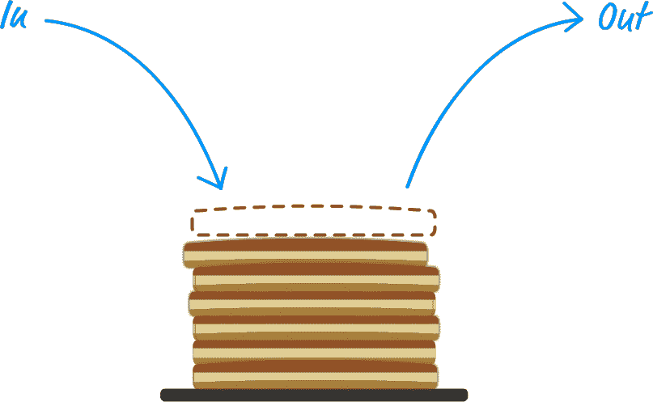

**图 5-3** *从栈顶添加和移除*

这个概念同样适用于计算机世界中的事物。栈是一种常见的数据结构，我们会经常遇到它。就像我们的煎饼一样，我们按顺序不断添加数据（图 5-4）。

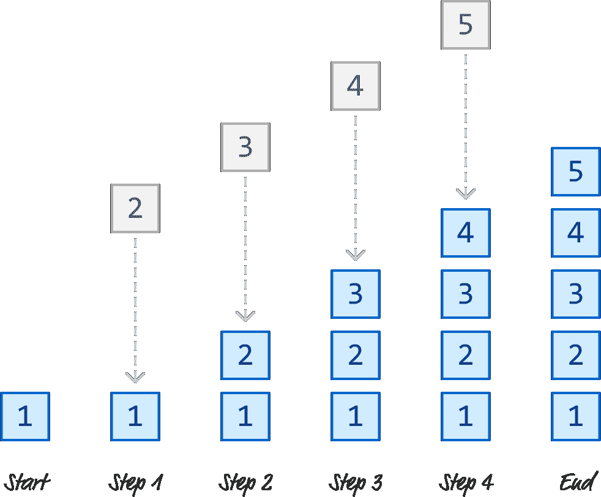

**图 5-4** *数据按顺序添加到栈中*

我们按照添加的顺序从栈的末尾移除数据（图 5-5）。

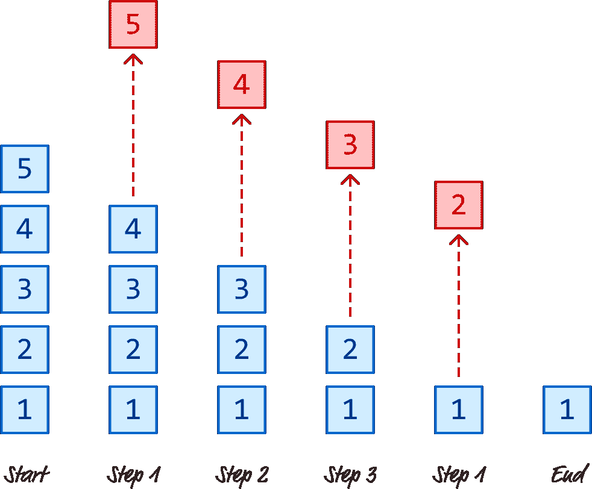

**图 5-5** *数据按添加顺序从栈的末尾移除*

用计算机术语来说，这被称为“后进先出”系统——通常缩写为 `LIFO`。你最终访问（即移除）的数据是最后添加的那个。关于栈，这就是你需要了解的全部内容，至少在概念上是这样。

### JavaScript 实现

现在我们已经了解了栈是什么以及它们如何工作，让我们再深入一层。下面是用 JavaScript 实现的一个 `Stack`：

```
class Stack {
  constructor() {
    this.items = [];
  }

  push(element) {
    this.items.push(element);
  }

  pop() {
    if (this.isEmpty()) {
      return "Stack is empty";
    }
    return this.items.pop();
  }

  peek() {
    if (this.isEmpty()) {
      return "Stack is empty";
    }
    return this.items[this.items.length - 1];
  }

  isEmpty() {
    return this.items.length === 0;
  }

  size() {
    return this.items.length;
  }

  print() {
    console.log(this.items);
  }
}
```

以下是代码运行的一些示例：

```
let stack = new Stack();
stack.push("First");
stack.push("Second");
stack.push("Third");
stack.print(); // ["First", "Second", "Third"]
console.log(stack.pop()); // "Third"
console.log(stack.peek()); // "Second"
console.log(stack.size()); // 2
console.log(stack.isEmpty()); // false
```


```
class Stack {
  constructor(...items) {
    this.items = items;
  }
  clear() {
    this.items.length = 0;
  }
  clone() {
    return new Stack(...this.items);
  }
  contains(item) {
    return this.items.includes(item);
  }
  peek() {
    let itemsLength = this.items.length;
    let item = this.items[itemsLength - 1];

    return item;
  }
  pop() {
    let removedItem = this.items.pop();
    return removedItem;
  }
  push(item) {
    this.items.push(item);
    return item;
  }
}
```

这段代码定义了我们的 `Stack` 对象以及我们可以用来添加、移除、查看最后一个元素等的各种方法。要使用它，我们可以执行如下操作：

```
let myStack = new Stack();

// 添加元素
myStack.push("One");
myStack.push("Two");
myStack.push("Three!");

// 预览最后一个元素
myStack.peek(); // Three

// 移除元素
let lastItem = myStack.pop();
console.log(lastItem) // Three

myStack.peek(); // Two

// 创建栈的副本
let newStack = myStack.clone();

// 检查元素是否在栈中
newStack.contains("Three")  // false
```

首先我们需要创建一个新的 `Stack` 对象。我们可以创建一个空栈（如上所示），或者预先填充一些元素，如下所示：

```
let stuffStack = new Stack("One", "Two", "Three");
```

要向栈中添加元素，使用 `push` 方法并传入你想要添加的内容。要移除元素，使用 `pop` 方法。如果你想预览最后一个元素而不移除它，`peek` 方法可以帮到你。`clone` 方法返回栈的副本，`contains` 方法允许你检查某个元素是否存在于栈中。

栈数据结构在本书后续章节中遇到的其他数据结构和算法中会经常用到。我们可以每次复制/粘贴这段代码，或者通过 [`www.kirupa.com/js/stack_v1.js`](http://www.kirupa.com/js/stack_v1.js) 引用相同的实现。

### 栈：时间与空间复杂度

栈的运行时和内存性能相当不错。对于最常见的操作（例如我们在实现中支持的那些），下表总结了我们的链表表现如何：

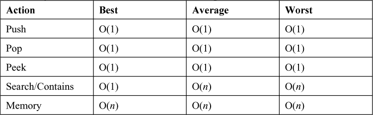

栈可以用数组或链表来实现，但这两种实现方式在性能上的差异很小。让我们更深入的探讨一下为什么我们的栈性能数据是这样的。

#### 运行时性能

- **Push 操作：** 向栈顶添加元素（`push` 操作）的时间复杂度为常数 $O(1)$。无论栈有多大，`push` 操作所需的时间总是相同的。
- **Pop 操作：** 从栈顶移除元素（`pop` 操作）的时间复杂度也是常数 $O(1)$。与 `push` 操作类似，它不依赖于栈的大小。
- **Peek 操作：** 查看栈顶元素（`peek` 操作）同样是常数时间操作 $O(1)$。
- **Search/Contains 操作：** 在栈中搜索元素（例如检查元素是否存在于栈中）需要线性时间 $O(n)$。在最坏情况下，该操作需要遍历整个栈及其所有元素。

#### 内存性能

JavaScript 中栈的内存性能相当高效，增长为 $O(n)$，并且无论栈是使用数组还是链表实现，这一点都不会改变。正如我们之前所见，JavaScript 中的数组是动态大小的，因此它们可以随着元素的添加或移除而增长或收缩。然而，这种动态调整大小可能会导致偶尔的内存重新分配，从而引发一些性能波动。

当使用链表实现栈时，内存分配是增量进行的。不会出现像数组那样的大规模重新分配，因此在处理大型栈时，链表方法有其优势。

### 结论

如果你看一下代码，我们的栈实现只是对 `Array` 对象的一个包装（关于 JavaScript 中数组的更多信息，请访问 [`https://bit.ly/kirupaArrays`](https://bit.ly/kirupaArrays)）。由于元素是从末尾添加和移除的，因此使用数组的 `push` 和 `pop` 方法无需任何额外修改。从数组末尾添加和移除元素的性能非常好——如果你留意的话，是常数时间，即 $O(1)$。

一些额外资源：

 提问：[`https://forum.kirupa.com`](https://forum.kirupa.com)

 错误/已知问题：[`https://bit.ly/algorithms_errata`](https://bit.ly/algorithms_errata)

 源代码仓库：[`https://bit.ly/algorithms_source`](https://bit.ly/algorithms_source)

## 6. 队列

在第 5 章中，我们看到栈是一种后进先出（LIFO）的数据结构，元素从末尾添加和移除。与之相对，我们有另一种流行的数据结构——`queue`（队列）。这是一个有趣的结构，我们将在接下来的章节中进一步了解它。

开始吧！

### 认识队列

顾名思义，队列非常类似于排队等候某物（图 6-1）。

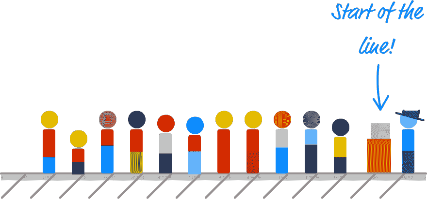

**图 6-1** 人们排队

排在队伍最前面的人是最先到达的，也是最先离开的。新来的人站在队伍的末尾，他们只有等前面的人到达队伍开头并离开后，才能离开（图 6-2）。

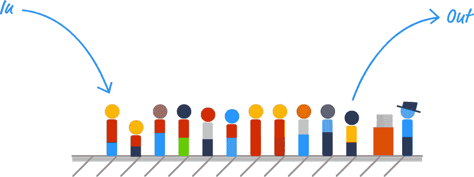

**图 6-2** 人们从队列开头离开，并在末尾加入。

基于这种行为，队列遵循**先进先出**原则，通常简称为 **FIFO**。除了关于哪些元素先被移除这一重要细节外，队列和栈在其他方面非常相似。

添加元素时，栈的行为与队列相同（图 6-3）。


**图 6-3** 元素被添加到顶部。

元素被添加到队列的末尾。移除元素时，它们按顺序被移除，从队列结构中第一个进入的数据元素开始（图 6-4）。

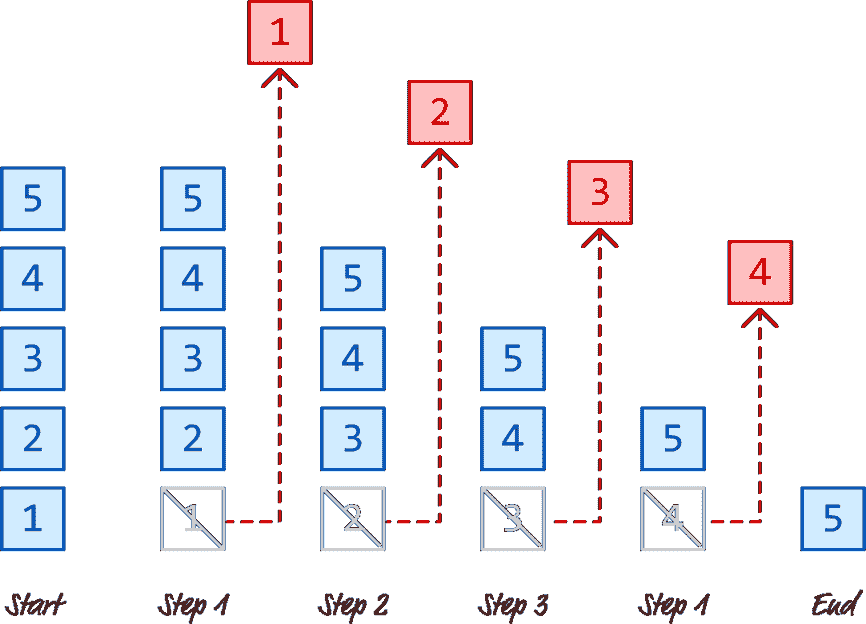

**图 6-4** 元素从底部移除。

现在，你可能会好奇什么时候会用到队列。除了帮助理解排队之外，队列在数字世界中有很多实际用途。如旅行订、邮件服务器、优先级排序等，都是使用队列的情况。所以队列会存在！与算法友好。

### JavaScript 实现

为了将所有文字转化为工作的代码，请看下面的 `Queue` 实现：

```javascript
class Queue {
  constructor() {
    this.items = new LinkedList();
  }
  clear() {
    this.items = new LinkedList();
  }
  contains(item) {
    return this.items.contains(item);
  }
  peek() {
    return this.items.head.data;
  }
  dequeue() {
    let removedItem = this.items.removeFirst();
    return removedItem;
  }
  enqueue(item) {
    this.items.addLast(item);
  }
  get length() {
    return this.items.length;
  }
}
```

我们的实现依赖于链表，使某些操作更快（而不是仅仅使用数组）。我们需要通过 [`www.kirupa.com/js/linkedlist_v1.js`](https://www.kirupa.com/js/linkedlist_v1.js）引用它。使用队列的方式创建一个 `Queue` 对象，使用 `enqueue` 方法向队列添加，使用 `dequeue` 方法从队列移除：

```
// 创建新的 Queue
let myQ = new Queue();

// 添加元素
myQ.enqueue("Item 1");
myQ.enqueue("Item 2");

// 移除元素
let removedItem = myQ.dequeue();
```

我们可以通过 `clone` 方法轻松创建副本，使用 `contains` 方法检查元素是否存在，以及使用 `peek` 查看。与栈实现相似，但重要的细节是我们使用了链表。

### 队列：时间与空间复杂度

对于常见的队列操作，下表总结了队列在各种操作中的表现：

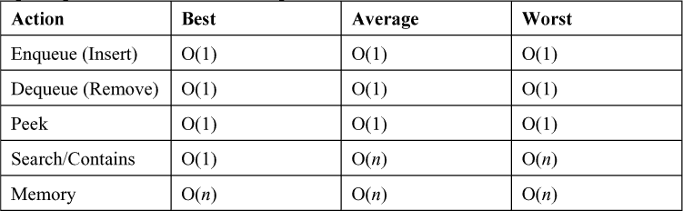

这些性能的关键细节在于使用了链表。如果我们使用数组之类的结构，修改前端的操作将花费 $O(n)$ 时间，而链表则为 $O(1)$ 时间。让我们更深入的探讨一下为什么队列性能是这样的。

#### 运行时性能

- **入队（插入）：** 基于链表的队列 `enqueue` 操作具有常数时间 $O(1)$，因为元素添加到链表的尾部，无需移动现有元素。
- **出队（删除）：** 基于链表的队列 `dequeue` 操作同样具有常数时间 $O(1)$。元素从链表头部移除，无需移动。
- **查看队首：** 查看队首允许访问前端而不移除，也是 $O(1)$ 操作。直接从链表头部获取值。
- **搜索：** 基于链表的队列中搜索元素比插入或删除效率低。搜索操作需要从前端遍历到后端，导致线性时间 $O(n)$，其中 $n$ 是队列中的元素数量。

#### 内存性能

队列的整体内存使用量为 $O(n)$，其中队列中的每个元素由一个节点表示，该节点包含数据以及下一个节点的指针/引用。因此，所需空间随元素数量线性增长。还有额外的细节需要：

- **动态内存分配：** 链表是动态分配的，意味着随着元素添加到队列，会为每个节点分配内存。这使得队列能够动态调整大小，并有效处理不同数量的元素。
- **内存开销：** 链表需要额外内存来维护节点之间的指针。我们已经这一点！与数组的实现相比，这种开销在处理大量元素时可能是一个劣势。
- **缓存性能：** 链表可能会遇到缓存问题，因为元素不存储在连续的内存位置。这可能导致更多的缓存命中，影响某些操作的整体性能。

不错，对吧？使用链表实现的队列提供了高效的插入和删除操作，时间复杂度为常数 $O(1)$。在队列中搜索元素较慢，时间复杂度为线性 $O(n)$。在内存方面，情况相当一致，随着队列存储元素数量线性增长 $O(n)$。

### 结论

结合我们之前看到的栈和刚刚看到的队列，我们涵盖了两种流行的数据结构，它们模拟了数据进入和离开的方式。队列被称为 FIFO 数据结构，元素添加到末尾，但从开头移除。这个“从开头移除”的部分正是我们依赖链表数据结构的原因。正如我们多次看到的，数组在移除或添加前端元素时效率。

一些额外资源：

 提问：[`forum.kirupa.com`](https://forum.kirupa.com)

 错误/已知问题：[`bit.ly/algorithms_errata`](https://bit.ly/algorithms_errata)

 源代码仓库：[`bit.ly/algorithms_source`](https://bit.ly/algorithms_source)

## 7. 树

当我们环顾四周时，我们处理的大量数据都是层次化的，父子关系清晰。常见的例子包括家谱、组织结构图、流程图等。图 7-1 是一个由 xkcd 推广的著名例子（[`xkcd.com/518/`](https://xkcd.com/518/)）。

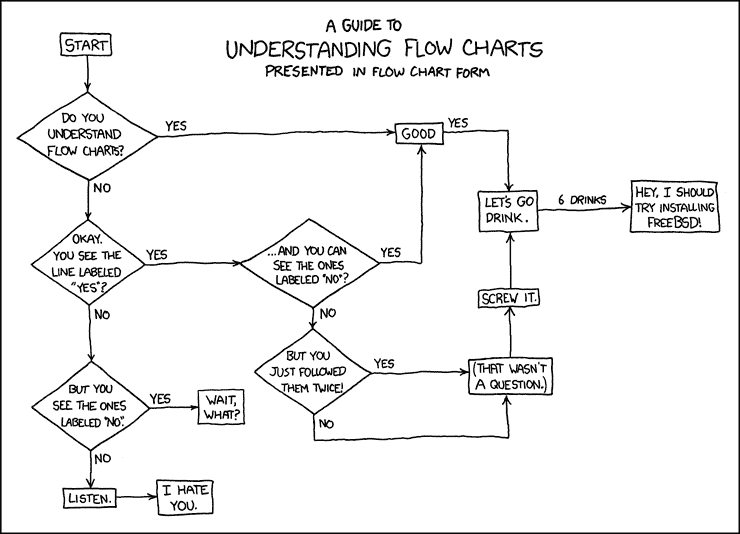

**图 7-1** 很好地可视化了我们编程生活的古怪之处！

虽然我们确实可以使用数组或链表等线性数据结构来表示层次数据，就像确实可以用盘子和叉子喝汤一样，但这并非最优选择。有更好的方法。其中之一就是**树**数据数据结构。

在接下来的章节中，我们将深入学习树的相关知识，为将来深入探讨树相关主题打下良好基础。

开始吧！

### 树入门

回顾一下，树数据结构是一种以层次方式组织数据的方法。就像自然界中的树一样，计算机世界中的树也有多种形状和大小。为了便于理解，让我们想象一棵如图 7-2 所示的树。


*(注：此处示例中图片编号为 06fig02.jpg，原文为 7-2，保持原样)*


 错误/已知问题：[`bit.ly/algorithms_errata`](https://bit.ly/algorithms_errata)

 源代码仓库：[`bit.ly/algorithms_source`](https://bit.ly/algorithms_source)

# 8. 二叉树

之前，我们学习了树数据结构，了解了各种节点和边的含义。现在是时候分支出去（哈！）并深入了。我们将在此基础上，研究树数据结构的一种具体实现——`二叉树`。

开始吧！

### 认识二叉树

从表面上看，二叉树看起来就像一棵普通的树，允许我们以层次方式存储数据。图 8-1 是一个二叉树的示例。

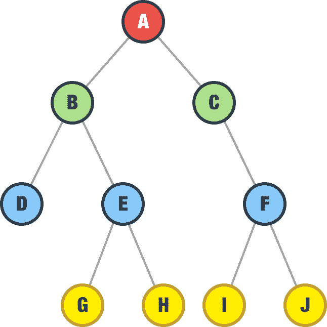

**图 8-1** *二叉树的示例*

二叉树的不同之处在于，与普通树不同（普通树没有严格限制），二叉树必须遵守三条严格规则才能被归类为二叉树：

1. 每个节点只能有零个、一个或两个子节点。
2. 树只能有一个根节点。
3. 从根节点到任意节点只能有一条路径。

让我们更深入地探讨这些规则，因为它们对于理解二叉树至关重要。它们有助于解释二叉树为何以这种方式运作，并为我们学习其他树变体（如二叉搜索树）奠定基础。

#### 规则详解

第一条规则是，二叉树中的每个节点只能有零个、一个或两个子节点。如果某个节点恰好有两个以上的子节点，那就有问题了（图 8-2）。

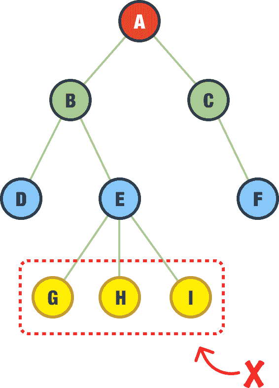

**图 8-2** *最多允许两个子节点*

第二条规则是，二叉树必须只有一个根节点（图 8-3）。

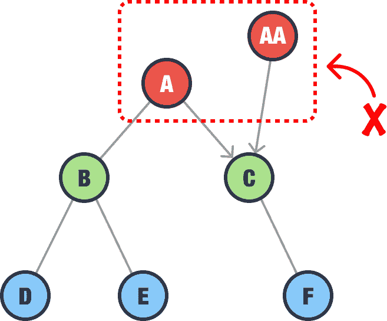

**图 8-3** *不能有多个根节点*

在这个例子中，`A` 节点和 `AA` 节点都在争夺成为主根节点。虽然在某些其他基于树的数据结构中允许多个根节点，但二叉树不允许。

现在，我们来看最后一条规则。最后一条规则是，从根节点到树中任意节点只能有一条路径（图 8-4）。

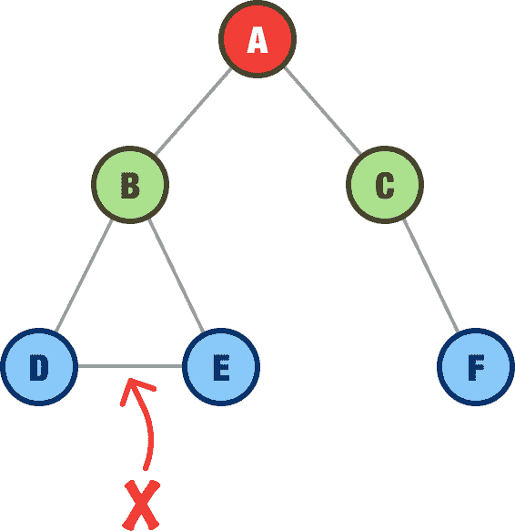

**图 8-4** *根节点与节点之间不能有多条路径*

正如这个例子所示，以节点 `D` 为目标，我们可以从根节点通过两种方式到达。一种方式是 `A - B - D`。另一种方式是 `A - B - E - D`。我们不能允许这种情况，否则就不能称之为二叉树。

#### 二叉树的变体

即使有更严格的规则，二叉树仍然以几种流行的变体形式出现。这些变体对我们友好的二叉树在常见数据操作中的性能、占用空间等方面起着重要作用。现在，我们暂时避开数学，专注于高层次细节。

##### 满二叉树

满二叉树，有时也称为`严格二叉树`或`真二叉树`，是一种所有非叶子节点都有两个子节点的树（图 8-5）。

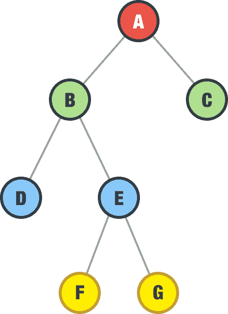

**图 8-5** *满二叉树示例*

在这个例子中，我们可以看到非叶子节点 `A`、`B` 和 `E` 各有两个子节点。

##### 完全二叉树

完全二叉树是一种除了最后一层节点外，所有层的节点都被填满（每个父节点都有两个子节点）的树（图 8-6）。

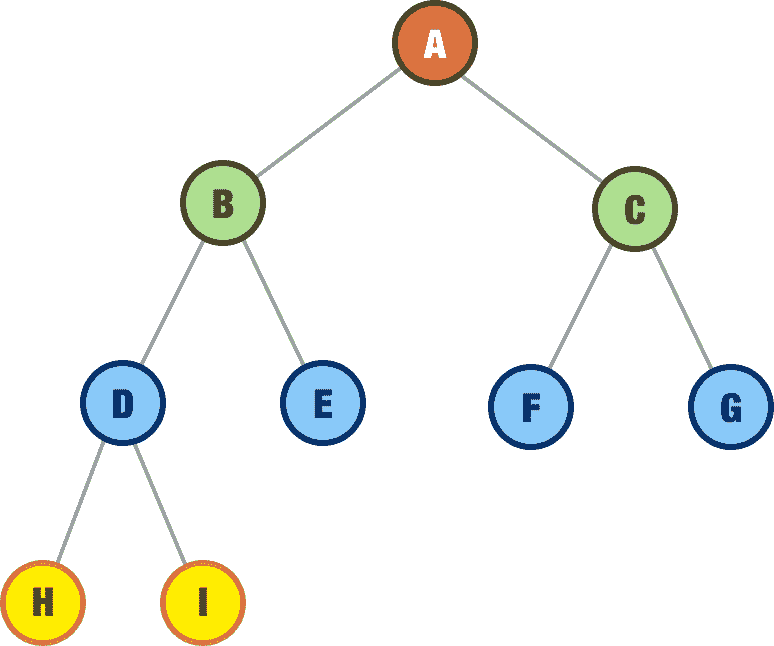

**图 8-6** *每个父节点都有两个子节点*

对于最后一层，节点的排列有一些规则。**如果最后一层有节点，这些节点必须从左到右连续填充，不能有空缺。** 例如，图 8-7 中的情况是不可接受的。

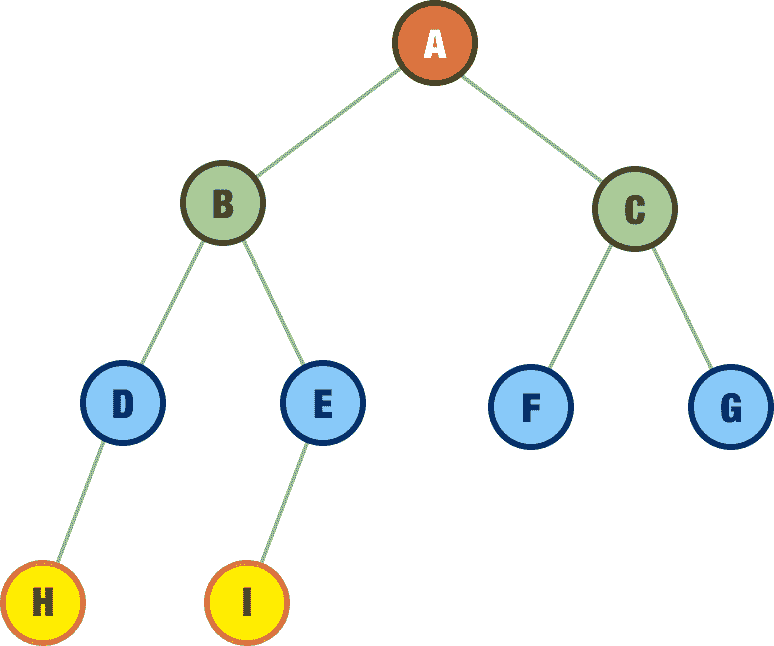

**图 8-7** *一棵不完全二叉树*

这里有一个空缺：`D` 节点缺少其右子节点，而 `I` 节点却作为 `E` 节点的子节点存在。这意味着我们没有从左到右连续填充最后一层的节点。如果 `I` 节点被插入为 `D` 节点的右子节点，那就没问题了。

##### 完美二叉树

完美二叉树是一种每一层都完全填满节点的树（图 8-8）。

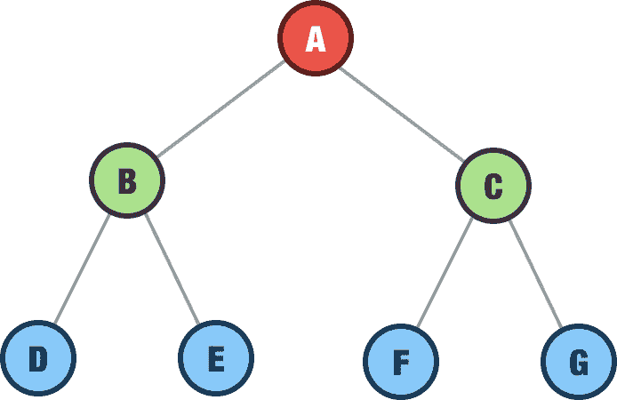

**图 8-8** *完美的样子！*

由于这一要求，所有叶子节点也都在同一层。

##### 平衡二叉树

平衡二叉树是一种每个节点的左右子树高度差不超过一的二叉树。图 8-9 是一个平衡二叉树的例子。

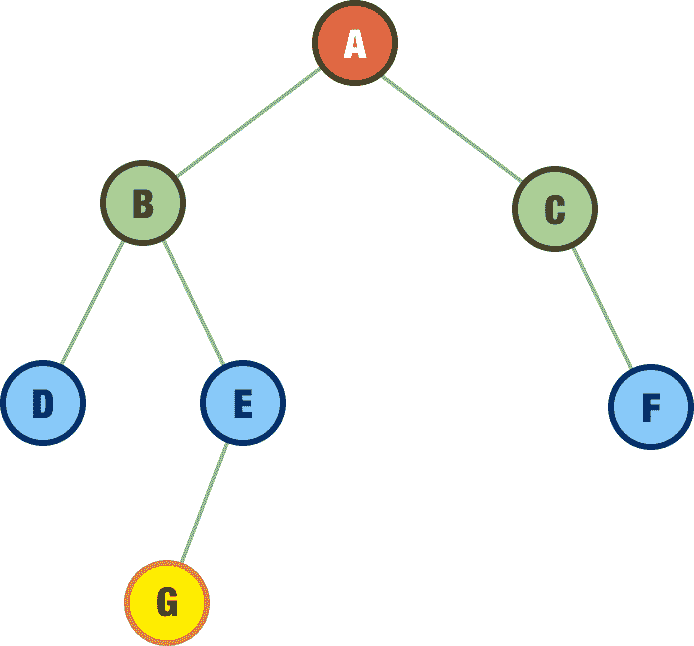

**图 8-9** *一棵平衡二叉树*

换句话说，这意味着树不会倾斜。所有节点都可以高效访问。

##### 退化叉树

退化叉树中，每个父节点只有一个子节点（图 8-10）。

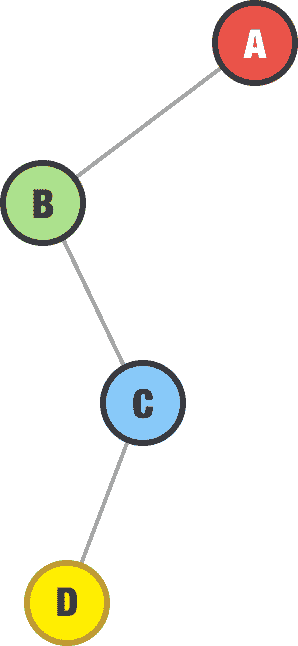

**图 8-10** *退化叉树*

这棵树本质上是一个线性结构，类似于数组，所有节点通过单一路径连接。

#### 添加、删除和查找

与任何数据结构一样，我们常见的操作是添加节点、删除节点以及查找特定节点。在二叉树中，这些操作并不是高效的。学习如何执行这些操作，有助于理解更高效的二叉树——`二叉搜索树`。

### 一个简单的二叉树实现

在之前，让我们看一个简单的二叉树实现。实现的核心是节点，以下是在 JavaScript 中的表示方式：

```javascript
class Node {
  constructor(data) {
    this.data = data;
    this.left = null;
    this.right = null;
  }
}
```

我们有一个 `Node` 类，它接受一个 `data` 值作为参数，将其存储为 `data` 属性。我们的节点还存储了 `left` 和 `right` 两个属性。让我们用现有的代码创建二叉树（图 8-11）。

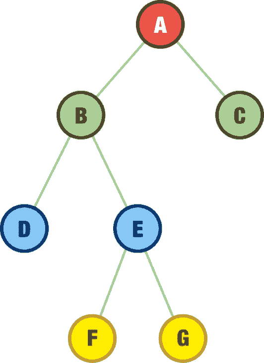

**图 8-11** *创建二叉树示例*

使用我们的 `Node` 类创建二叉树如下：

```javascript
class Node {
  constructor(data) {
    this.data = data;
    this.left = null;
    this.right = null;
  }
}

const rootNodeA = new Node("A");
const nodeB = new Node("B");
const nodeC = new Node("C");
const nodeD = new Node("D");
const nodeE = new Node("E");
const nodeF = new Node("F");
const nodeG = new Node("G");

rootNodeA.left = nodeB;
rootNodeA.right = nodeC;

nodeB.left = nodeD;
nodeB.right = nodeE;

nodeE.left = nodeF;
nodeE.right = nodeG;
```

注意，我们为树中的每个节点创建了一个新的 `Node` 对象。对 `Node` 对象的实现从简单（如字母）到非常复杂。在某些情况下，我们的节点由数字组成。在其他情况下，我们的节点由复杂对象组成。我们将在后续章节中看到更复杂的例子。一旦创建了节点，我们将每个节点的 `left` 和 `right` 属性设置为相应的子节点：

```javascript
rootNodeA.left = nodeB;
rootNodeA.right = nodeC;

nodeB.left = nodeD;
nodeB.right = nodeE;

nodeE.left = nodeF;
nodeE.right = nodeG;
```

如果一个节点恰好是叶子节点，我们不需要做额外操作。可以安全地说，如果一个节点的 `left` 或 `right` 属性没有任何值，那么它就是叶子节点，没有子节点。

### 结论

在本章中，通过大量的文字和无数图表，我们学习了二叉树！核心要点是：二叉树是一种由节点组成的数据结构，并有一个有一个约束：**每个节点最多有两个子节点。**二叉树的这一独特约束使我们能够高效地搜索、排序和存储数据。不过，我们在这里并没有涉及这些内容，原因是二叉树本身过于通用。二叉树更有用的变体是`二叉搜索树`，我们将在第 9 章中学习它。

一些额外资源：

 提问：<https://forum.kirupa.com>

 错误/已知问题：<https://bit.ly/algorithms_errata>

 源代码仓库：<https://bit.ly/algorithms_source>

# 9. 二叉搜索树

现在来学习另一种很棒的数据结构——`二叉搜索树`。如果我们从远处眯着眼看一棵二叉搜索树，它看起来和二叉树非常相似（图 9-1）。

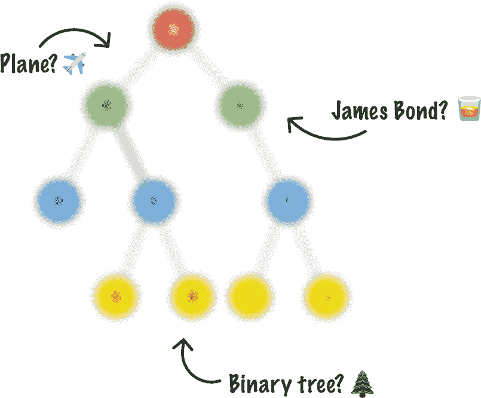

**图 9-1** *这可以是任何东西！*

这是有意为之。二叉树以其节点/边规则和理想的分支行为奠定了坚实的基础。二叉搜索树在普通二叉树的基础上进行了改进，增加了关于如何存储数据的额外逻辑，正是这个额外逻辑使得它在处理我们可能抛出的各种数据操作时非常高效。

从高层来看，二叉搜索树的设计使得每个节点的位置由其值决定。值小的节点放在左边，值较大的节点放在右边。看图 9-2。

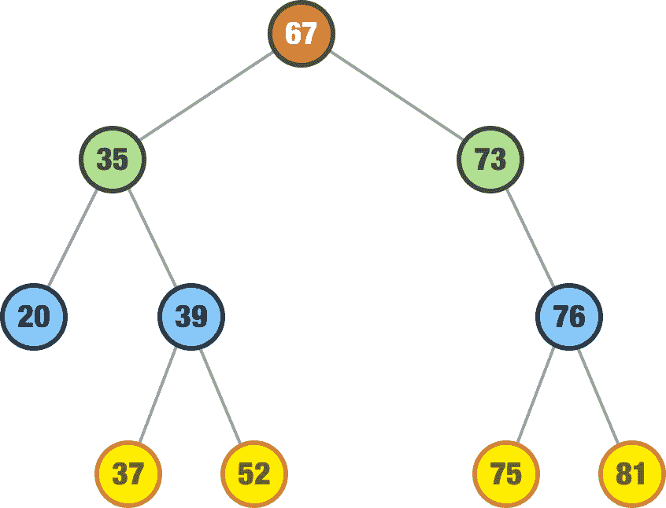

**图 9-2** *二叉搜索树示例*

从根节点开始，在每个节点处密切关注值：
- 如果值小于父节点，放在左边。
- 如果值大于父节点，放在右边。

这两个额外规则在普通二叉树之上为我们提供了思考。接下来我们将研究如何执行常见的添加和删除操作，深入了解二叉搜索树的工作。

### 它只是一种结构

观察二叉搜索树的独特属性很容易。它就像数组一样，结构。为了理解，让我们看看图 9-3。


**图 9-3** *二叉搜索树*

#### 添加节点

我们将让二叉搜索树存储一些数字。第一个数字是 42（图 9-4）。


**图 9-4** *二叉搜索树的起点*

从空的二叉树开始，逐步添加。下一个数字是 24（图 9-5）。

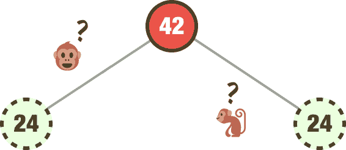

**图 9-5** *第一个节点会去哪里？*

答案正是二叉搜索树的核心：如果值小于父节点，放在左边；如果值大于父节点，放在右边。24 小于 42，所以作为左节点（图 9-6）。

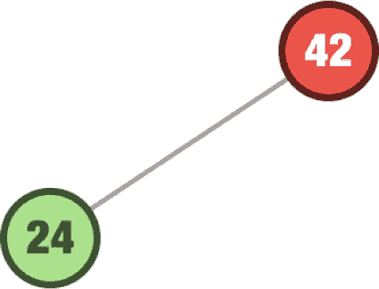

**图 9-6** *相对于父节点较小的节点放在左边。*

再添加一个数字。这次添加的数字是 99。按照相同的步骤操作。从根节点 42 开始，99 大于根节点，所以放在右边（图 9-7）。


**图 9-7** *99 节点放在右边。*

我们还没有完成。添加更多数字。下一个要添加的数字是 15。从根节点 42 开始，15 小于 42，所以向左看。42 的左边是 24 节点。现在检查 15 是否小于 24。是的，所以再次向左看。24 的左边没有更多节点，因此我们可以安全地将 15 放在那里（图 9-8）。


**图 9-8** *我们新添加的节点*

你应该开始看到一种模式了。添加新节点时，在每个遇到的节点处询问：该值大于还是小于当前节点？

加快速度。下一个要添加的值是 50。从根节点 42 开始，50 大于 42，向右看。右边有 99 节点。99 大于 50，向左看。99 的左边没有节点，因此我们将 50 值放在那里（图 9-9）。


**图 9-9** *该节点放在根节点的右分支上。*

我们要添加的下一个值是 120。按照我们已经多次看到的相同步骤，120 大于 42，向右看。120 大于 99，向右看。99 的右边没有节点，我们将 120 放在那里（图 9-10）。


**图 9-10** *120 节点的位置*

最后，我们要添加 64。从根节点 42 开始，64 大于 42，向右看。右边有 99 节点，64 小于 99，向左看。99 的左边是 50 节点，64 大于 50，向右看。50 的右边没有节点，我们将 64 放在那里（图 9-11）。


**图 9-11** *64 节点的位置*


我们要删除 24 节点，它有一个子节点 15。15 节点本身有两个子节点，但这个细节并不改变我们描述的行为。只要被删除的父节点只有一个直接子节点，这个直接子节点就会取代父节点的位置，并带上它可能拥有的任何子节点（图 9-17）。


**图 9-17** 呼！24 节点已被删除。

如果我们遍历这次调整后的树中所有节点，会再次发现树的完整性仍然保持。没有节点错位。

## 删除有两个子节点的节点

现在我们来看最后一种情况。当我们删除一个恰好有两个子节点的节点时会发生什么？请看图 9-18 中的例子，我们要删除 99 节点。


**图 9-18** 删除一个包含两个子节点的节点

当删除一个有两个子节点的节点时，我们不能简单地选择其中一个子节点并认为操作成功。如果那样做，可能会发现树不再有效。有些节点可能会出现在错误的位置。

在这种情况下，我们要在右子树中寻找下一个最大值的节点，也称为**中序后继**。对于我们要删除值为 99 的节点的情况，右子树如（图 9-19）所示。


**图 9-19** 右子树

我们子树中哪个节点的值比 99 大且是下一个最大值？换一种说法，当我们查看 99 节点右侧的所有子节点时，哪个节点的值最小？这两个问题的答案都是值为 104 的节点。接下来我们要删除 99 节点，并用 104 节点替换它（图 9-20）。


**图 9-20** 这次删除需要交换节点值。

当我们查看这次删除和交换后的二叉搜索树时，所有节点的完整性都得到了保持。当然，这并非偶然。中序后继节点的值总能确保它可以安全地放入被删除节点的位置。我们的 104 节点取代 99 节点就是这种情况。对于其他要删除的节点也是如此。

### 实现二叉搜索树

如果我们要把所有的文字和图示总结成几条添加和删除节点的简单规则，那就是：

**添加节点时，执行以下操作：**

1. 如果树为空，创建一个新节点并将其设为根节点。
2. 将新节点的值与根节点的值进行比较。
3. 如果新节点的值小于根节点的值，对根节点的左子树重复步骤 2 和 3。
4. 如果新节点的值大于根节点的值，则对根节点的右子树重复步骤 2 和 3。
5. 如果新节点的值与树中现有节点的值相等，则返回一条消息，指示该节点未被添加。
6. 创建一个新节点，并将其添加为应插入新节点的父节点的左子节点或右子节点。
7. 如有必要，重新平衡树以保持二叉搜索树的性质。

**删除节点时，执行以下操作：**

1. 找到要删除的节点。如果在树中找不到该节点，则返回一条消息，指示无法删除该节点。
2. 如果要删除的节点没有子节点，则直接将其从树中移除。
3. 如果要删除的节点有一个子节点，则用该子节点替换它。
4. 如果要删除的节点有两个子节点，则找到它的中序后继节点：
    a. 要找到中序后继节点，先向右走一次，然后尽可能向左走。
    b. 用中序后继节点替换要删除的节点。
5. 如有必要，重新平衡树以保持二叉搜索树的性质。

仔细阅读上述步骤，确保没有令人意外的地方。它们几乎就是我们在前面章节中看到的内容的 TL;DR 版本。我们的代码主要会模仿前面的步骤。事实上，现在让我们看看代码！我们的二叉搜索树实现由我们熟悉的 `Node` 类和 `BinarySearchTree` 类组成：

```
class Node {
  constructor(data) {
    this.data = data;
    this.left = null;
    this.right = null;
  }
}

class BinarySearchTree {
  constructor() {
    this.root = null;
  }

  insert(value) {
    const newNode = new Node(value);
    if (!this.root) {
      this.root = newNode;
      return;
    }
    let currentNode = this.root;
    while (true) {
      if (value < currentNode.data) {
        if (!currentNode.left) {
          currentNode.left = newNode;
          return;
        }
        currentNode = currentNode.left;
      } else if (value > currentNode.data) {
        if (!currentNode.right) {
          currentNode.right = newNode;
          return;
        }
        currentNode = currentNode.right;
      } else {
        return;
      }
    }
  }

  remove(value) {
    let currentNode = this.root;
    let parentNode = null;

    while (currentNode) {
      if (value === currentNode.data) {
        if (!currentNode.left && !currentNode.right) {
          if (!parentNode) {
            this.root = null;
          } else if (parentNode.left === currentNode) {
            parentNode.left = null;
          } else {
            parentNode.right = null;
          }
        } else if (!currentNode.left) {
          if (!parentNode) {
            this.root = currentNode.right;
          } else if (parentNode.left === currentNode) {
            parentNode.left = currentNode.right;
          } else {
            parentNode.right = currentNode.right;
          }
        } else if (!currentNode.right) {
          if (!parentNode) {
            this.root = currentNode.left;
          } else if (parentNode.left === currentNode) {
            parentNode.left = currentNode.left;
          } else {
            parentNode.right = currentNode.left;
          }
        } else {
          let successor = currentNode.right;
          let successorParent = currentNode;
          while (successor.left) {
            successorParent = successor;
            successor = successor.left;
          }
          if (successorParent === currentNode) {
            currentNode.right = successor.right;
          } else {
            successorParent.left = successor.right;
          }
          currentNode.data = successor.data;
        }
        return true;
      } else if (value < currentNode.data) {
        parentNode = currentNode;
        currentNode = currentNode.left;
      } else {
        parentNode = currentNode;
        currentNode = currentNode.right;
      }
    }
    return false;
  }
}
```

快速浏览一下上面的代码。注释标出了重要的里程碑，特别是我们一直在研究的二叉搜索树行为相关的内容。要查看这段代码的实际效果，这里有一个示例：

```let myBST = new BinarySearchTree();

myBST.insert(10);
myBST.insert(5);
myBST.insert(15);
myBST.insert(3);
myBST.insert(7);
myBST.insert(13);
myBST.insert(18);
myBST.insert(20);
myBST.insert(12);
myBST.insert(14);
myBST.insert(19);
myBST.insert(30);
```

我们正在创建一个新的二叉搜索树，并向其中添加一些节点。这棵树将如图 9-21 所示。


**图 9-21** 我们的新二叉树

假设我们要删除节点 15：

```
myBST.remove(15);
```

我们的树将重新排列，如图 9-22 所示。


**图 9-22** 删除节点 15 后的二叉树

节点 15 消失了，但节点 18 作为合法的中序后继节点取代了它的位置。你可以随意添加和删除更多节点，看看树会变成什么样子。要轻松查看所有节点之间的关联，最简单的方法是在控制台中检查你的二叉搜索树，并展开每个左节点和右节点，直到你对树的结构有了清晰的认识（图 9-17）。


content]
## 10. 堆

如果你和我一样，你可能有很多想法，但时间太少，无法付诸行动。为了帮助理清头绪，我们可以借助一种旨在帮助我们确定任务优先级的工具（图 10-1）。


**图 10-1** *任务看板示例*

市面上有无数用于管理项目的工具，它们都做了以下几件事的变体：

 允许我们列出所有想要处理的项目

 赋予我们确定优先级的能力

 提供一种帮助我们轻松查看最高优先级项目的方法

 允许我们在保持优先级顺序的同时添加和删除项目

自己构建一个能完成所有这些功能的工具听起来很有趣，但我们将专注于数据结构方面。有一种非常高效的数据结构可以用来表示我们想要做的所有事情，那就是**堆**。我们将在接下来的章节中全面了解它。

继续！

### 认识堆

这个听起来有趣的堆数据结构允许我们在常数时间 `O(n)` 内检索最高优先级的项目，并在对数时间 `O(log n)` 内快速插入和删除项目。这使得堆非常棒。在我们深入探讨其工作原理之前，图 8-2 展示了一个典型的堆的样子。


**图 10-2** *一个脉动、颤抖的堆。来源：哈维·库兹曼（作者），威尔·埃尔德（插画师），“外部圣殿！”，《疯狂》杂志第 5 期，1953 年 6/7 月，第 5 页。*

哎呀！放错图了。图 10-3才是堆更合适的表示。


**图 10-3** *堆的示例*

这种特定的堆变体更正式地称为**最大堆**，其中优先级基于我们处理的数字的大小。优先级最高的项目将是数字最大的那个，并且这个项目始终位于树的根节点。树的其余部分由其他较小的数字组成——所有这些数字都根据其值适当地分层。

堆的另一种变体是**最小堆**，其中较小的数字具有更高的优先级（图 10-4）。


**图 10-4** *认识最小堆*

今天我们不会讨论最小堆。当我们谈论堆时，默认指的是最大堆变体，因为最小堆只是最大堆决定项目优先级方式的反面。这种默认堆为最大堆的偏向与广泛讨论堆的方式一致，但为了避免混淆，我们可能会在一些书籍和在线资源中看到堆被明确称为*最大堆*或*最小堆*。

回到观察我们的堆，有两个细节很快就能注意到：

 我们的堆是一棵二叉树，每个节点最多有两个子节点。

 每个节点的值都大于或等于其子节点的值。

当我们谈论**堆属性**时，意思是我们的堆完美体现了这两个细节。稍后会详细介绍。

现在，关键点来了，这让堆变得非常棒。我们处理的不仅仅是任何二叉树。它是一棵**完全二叉树**，其中所有行的节点从左到右填满，没有空隙。这导致了一棵看起来非常平衡的树（图 10-5）。


**图 10-5** *平衡树的示例*

这是一个我们稍后讨论性能时会强调的细节，因为平衡二叉树避免了出现长链节点导致性能不佳的问题。在平衡二叉树中，树的高度是 `O(log n)`，这对于许多类型的数据操作来说是理想的。

#### 常见堆操作

我们的堆的目标，除了看起来很酷之外，是允许我们快速移除优先级最高的项目。为了实现这一点，我们还需要能够向堆中添加项目。这是我们需要堆支持的两个主要操作，因此我们将在接下来的几节中详细描述这两个操作的样子。

##### 插入节点

让我们从插入节点开始，这也是当我们从零开始构建堆时的起点。我们要添加的第一个项目是值为 13 的项目（图 10-6）。


**图 10-6** *我们的第一个节点*

这是我们的第一个项目，它默认成为根节点。这是简单的情况。对于所有后续要添加的项目，我们需要遵循以下规则：

1. 我们将新节点添加到堆的底层，最左边的可用位置，不留空隙。这确保了树保持完全。
2. 我们将新节点的值与其父节点的值进行比较。如果新节点的值大于其父节点的值，我们将新节点与其父节点交换。我们重复这个过程，直到新节点的值不大于其父节点的值，或者我们到达了根节点。
3. 交换后，我们重复步骤 2，将新的父节点与其父节点进行比较，直到堆属性恢复。

需要注意的重要细节是，我们在父节点和子节点之间检查仅仅是父节点的值是否大于子节点。与二叉树相比，这种约束要得多，二叉树有限制当我们继续插入更多节点时，这一切会变得更加清晰。现在我们想要插入节点 10。我们将其添加到堆的最底层最左边的可用位置（图 10-7）。


**图 10-7** *添加节点 10*

我们的值 10 小于父节点值 13，因此这是一个有效的堆结构，保持了堆属性。下一个要添加的数字是 5。我们将其添加到堆底部最左边的可用位置（图 10-8）。


**图 10-8** *添加节点 5*

新插入的值 5 小于父节点值 13，因此堆属性仍然保持。下一个要添加的数字是 24。我们将其插入到底层左边的位置（图 10-9）。


**图 10-9** *新节点添加到树的最左边*

现在，24 是否小于节点值 10？不是。因此我们交换父节点和子节点，确保子节点始终小于父节点（图 10-10）。


**图 10-10** *交换节点值*

我们再次对新节点 24 及其父节点进行检查。24 是否小于 13？答案是的，因此我们再次交换（图 10-1）。


**图 10-1** *再次交换节点*

此时，我们的 24 节点到达了根节点。它没有父节点可以比较，因此堆现在处于良好状态。我们刚才的操作有一个叫做 `bubbling up`，我们将节点插入到底部，并在必要时交换父节点，以确保堆属性得以维持。现在我们将加快速度。下一个要添加的节点是 1。我们将其添加到底层最左边的位置（图 10-12）。


**图 10-12** *重复之前的步骤添加节点 1*

这是有效的，无需进一步调整。下一个要添加的值是 15。我们将其插入为 5 节点的左节点（图 10-13）。


**图 10-13** *看看添加节点 15 时发生什么*

父节点（5）小于新添加的子节点（15），因此我们交换 15 和 5（图 10-14）。


**图 10-14** *交换节点值*

新交换的 15 节点正确地小于其父节点（值为 24），因此我们重新保持了堆属性。下一个要添加的数字是 36。我们的 36 最初是 15 节点的右子节点。这个位置只是临时的！为了保持堆属性，36 节点将与 15 节点交换，然后与 24 节点交换（图 10-15）。


**图 10-15** *通过进一步交换保持堆属性*

包含新添加的 36 的节点现在是堆中最大的数字，位于根节点。干得好，36！让我们添加最后一个元素——数字 3（图 10-16）。


**图 10-16** *将数字 3 添加到堆中*

我们将其添加到底层最左边的位置，包含值 3 的节点是 10 节点的子节点。这保持了堆属性，因此我们不需要做任何额外操作。我们的堆处于良好状态，我们刚刚看到了向堆中插入节点的过程，以及 `bubbling up` 在确保节点正确定位中的作用。

##### 移除根节点

接下来我们要看的堆操作是如何移除根节点，也就是堆中最大且最重要的值。稍后我们会看到，移除根节点有一些有趣的行为，与我们之前向堆添加元素时看到的非常不同。让我们开始吧，继续使用我们之前的堆示例。

我们要做的是移除值为 36 的根节点（图 10-17）。


**图 10-17** *移除根节点*

从堆中移除根节点时，我们仍然需要确保堆属性维持。这意味着根节点应该是堆中最大的值，并且二叉树应该重新构建。以下是从堆中移除节点的步骤：

1. 我们从堆中移除节点，用堆中的最后一个节点替换它。
2. 我们将新根节点的值与其子节点进行比较。如果新节点的值小于子节点，我们将新节点与其较大的节点交换。重复此过程，直到新节点的值大于或等于子节点，或者它没有子节点。这个过程称为 `bubbling down`。
3. 交换后，我们重复步骤 2，将新的节点与其子节点进行比较，直到堆属性恢复。

让我们通过实际移除根节点 36 的过程来实现这些步骤。我们首先要做的是移除 36 节点，并与最后一个节点交换（图 10-18）。


**图 10-18** *移除根节点后重新平衡*

当我们移除 36 节点并将其交换后，堆如图 10-19 所示。


**图 10-19** *根节点已被节点替换*

接下来我们开始 `bubbling down` 操作，将新根节点与其子节点进行比较，看它是否小于子节点。如果它小于子节点，将其与最大的节点交换。在我们的例子中，根节点值 3 小于两个节点（5 和 24）。我们将其与最大的节点（24）交换（图 10-20）。


**图 10-20** *是时候重新平衡了*

我们还没有完成。现在我们在3 号节点所在的位置重复父子检查。在这种情况下，3 号节点小于两个节点（5 和 15）的值。因此我们将其与其较大的节点（15）交换（图 10-21）。


**图 10-21** *再进行一次交换*

此时，3 号节点是一个叶节点，没有子节点可以比较。这意味着它位于预期位置，堆属性已恢复。让我们再走一遍移除步骤，确保所有细节都准确。我们的新节点值为 24，我们要移除它（图 10-22）。


**图 10-22** *让我们移除节点 24*

我们首先要做的是移除它，用最后一个节点（再次是 3 号节点）替换它（图 10-23）。


**图 10-23** *最后一个节点取代了移除的根节点*

完成此操作后，我们将3 号节点与其子节点进行比较。它小于两者，因此我们将其与较大的节点（15）交换（图 10-24）。


**图 10-24** *是时候维护堆属性了*

这次交换后，我们还没有完成。现在检查3 号节点是否小于任何子节点。它唯一的子节点是 5 号节点，而 3 不小于 5。我们再进行一次交换（图 10-25）。


**图 10-25** *堆一切正常*

此时，3 号节点回到了它应该的位置，根节点包含堆中最大的值，所有子节点都安全地位于各自的位置。世界又恢复了正常。

### 堆的实现

现在我们已经对堆在添加元素或移除根节点的工作原理有了很好的了解，是时候看看我们究竟如何构建它了。

#### 堆作为数组

一个有趣且重要的细节是堆在底层是如何表示的。是的，我们一直把它当作二叉树来讨论。但在实现中，我们不会将其表示为二叉树。我们将把它表示为一个数组，其中每个元素代表堆中的一个节点。我们先看一个可视化图（图 10-26），然后讨论这种映射具体是如何工作的。


**图 10-26** *堆与数组之间的关系*

注意每个数组元素如何表示树中每个节点的父子关系。我们可以使用一系列计算来映射树中的节点与数组中的扁平列表元素：

 要查找索引为 `i` 的节点的父节点，可以使用公式 `Math.floor(i-1)/2` 计算其父节点索引。请注意，此公式仅适用于根节点以外的节点，因为根节点没有父节点。

 要查找索引为 `i` 的节点的左子节点，可以使用公式 `2i+1` 计算其左子节点索引。请注意，此公式仅在左子节点索引在数组范围内适用。

 要查找索引为 `i` 的节点的右子节点，可以使用公式 `2i+2` 计算其右子节点索引。请注意，此公式仅在右子节点索引在数组范围内适用。

当我们查看数组中的元素（及其子节点和父节点）时，这些计算应该能很好地对应。

#### 代码

以下 JavaScript 代码将我们迄今为止看到的所有文字和图表转化为可工作的代码：

```javascript
class Heap {
  constructor() {
    // The heap is stored as an array
    this.heap = [];
  }

  // Add a new element to the heap
  insert(value) {
    // Add the new element to the end of the array
    this.heap.push(value);
    // Restore the heap property by bubbling up the new element
    this.#bubbleUp(this.heap.length - 1);
  }

  // Remove the maximum element from the heap
  extractMax() {
    // If the heap is empty, return null
    if (this.heap.length === 0) {
      return null;
    }
    // If the heap has only one element, remove and return it
    if (this.heap.length === 1) {
      return this.heap.pop();
    }
    // Otherwise, remove the root element (maximum value) and replace it
    // with the last element in the array
    const max = this.heap[0];
    const end = this.heap.pop();
    this.heap[0] = end;
    // Restore the heap property by bubbling down the new root element
    this.#bubbleDown(0);
    return max;
  }

  // Restore the heap property by bubbling up the element
  // at the given index
  #bubbleUp(index) {
    // If the element is already at the root, return
    if (index === 0) {
      return;
    }
    // Find the index of the parent element
    const parentIndex = Math.floor((index - 1) / 2);
    // If the element is greater than its parent, swap them
    if (this.heap[index] > this.heap[parentIndex]) {
      [this.heap[index], this.heap[parentIndex]] = [this.heap[parentIndex], this.heap[index]];
      // Continue bubbling up the element from its new index
      this.#bubbleUp(parentIndex);
    }
  }

  // Restore the heap property by bubbling down the element
  // at the given index
  #bubbleDown(index) {
    // Find the indices of the left and right child elements
    const leftChildIndex = 2 * index + 1;
    const rightChildIndex = 2 * index + 2;
    // Initialize the index of the largest element to be
    // the current index
    let largestIndex = index;
    // If the left child element is larger than the current element,
    // update the largest index
    if (leftChildIndex < this.heap.length &&
        this.heap[leftChildIndex] > this.heap[largestIndex]) {
      largestIndex = leftChildIndex;
    }
    // If the right child element is larger than the current element,
    // update the largest index
    if (rightChildIndex < this.heap.length &&
        this.heap[rightChildIndex] > this.heap[largestIndex]) {
      largestIndex = rightChildIndex;
    }
    // If the largest element is not the current element, swap them and
    // continue bubbling down the element from its new index
    if (largestIndex !== index) {
      [this.heap[index], this.heap[largestIndex]] =
                [this.heap[largestIndex], this.heap[index]];
      this.#bubbleDown(largestIndex);
    }
  }

  // Return the maximum element in the heap without removing it
  getMax() {
    return this.heap[0];
  }

  // Return the size of the heap
  size() {
    return this.heap.length;
  }

  // Check whether the heap is empty
  isEmpty() {
    return this.heap.length === 0;
  }
}
```

我们的堆实现支持以下操作：

 `insert`：向堆中添加新元素

 `extractMax`：从堆中移除包含最高优先级（即最大值）的根节点并返回它

 `getMax`：返回根节点中具有最高优先级（即最大值）的值，但不将其从堆中移除

 `size`：返回堆中节点的数量

 `isEmpty`：判断堆是否为空

我们使用这段代码以及许多前述操作的方式如下：

```javascript
let myHeap = new Heap();
myHeap.insert(14);
myHeap.insert(18);
myHeap.insert(50);
myHeap.insert(1);
myHeap.insert(3);
myHeap.insert(15);
myHeap.insert(2);
myHeap.insert(2);
myHeap.insert(0);
myHeap.insert(13);

console.log("Size of heap: " + myHeap.size()); // 10

console.log(myHeap.getMax()); // 50

console.log("Size of heap: " + myHeap.size()); // 10

console.log(myHeap.extractMax()); // 50

console.log("Size of heap: " + myHeap.size()); // 9

console.log(myHeap.extractMax()); // 18
console.log(myHeap.extractMax()); // 15
console.log(myHeap.extractMax()); // 14

console.log("Size of heap: " + myHeap.size()); // 6
```

我们正在重新创建之前看到的示例堆，并将我们提到的许多操作付诸实践。

### 性能特征

在堆中，我们之前提到，移除根节点和向堆中插入元素是我们关心的两个基本操作。让我们从性能角度看看它们表现如何。

#### 移除根节点

与移除根节点相关的两个概念：

 时间复杂度：$O(\log n)$，其中 $n$ 是堆中的元素数量

 空间复杂度：$O(1)$

在堆中移除根节点涉及两个主要步骤：将根节点与堆中的最后一个叶节点交换，然后通过将新根节点向下筛选（通过代码中的 `#bubbleDown` 方法）重新堆化，直到堆属性恢复。

第一步交换根节点和最后一个叶节点需要常数时间，因为我们只是更新两个数组元素。例如，图 10-27 展示了这一过程。


**图 10-27** *我们之前移除根节点时的示例*

第二步重新堆化需要对数时间，因为我们必须将新根节点与其子节点比较，并与较大的子节点交换，直到堆属性恢复。由于完全二叉树的高度为 $O(\log n)$，其中 $n$ 是树中的节点，因此堆中移除根节点的最坏复杂度为 $O(\log n)$。

#### 插入元素

向堆插入元素相关的两个概念：

 时间复杂度：$O(\log n)$，其中 $n$ 是堆中的元素

 空间复杂度：$O(1)$

向堆插入元素涉及两个主要步骤：将新元素插入到堆末尾，然后通过将新元素向上筛选（通过代码中的 `#bubbleUp` 方法）重新堆化，直到堆属性恢复。

第一步将新元素插入到堆末尾需要常数时间，因为我们只是将一个元素追加到数组末尾，就像图 10-28 一样。


**图 10-28** *添加元素*

由于我们使用数组来实现堆，向末尾添加元素也非常快。第二步重新堆化需要对数时间，因为我们必须将新元素与其父节点比较，如果它更大则交换，重复此过程直到堆属性恢复。由于完全二叉树的高度为 $O(\log n)$，其中 $n$ 是树中的节点，因此堆中插入元素的最坏复杂度也是 $O(\log n)$。

#### 性能总结

综合来看，移除根节点和向堆插入元素的最坏复杂度均为 $O(\log n)$，其中 $n$ 是堆中的元素。这些操作的空间复杂度为 $O(1)$，因为在重新堆化过程中只需要临时变量。

### 结论

总而言之，堆是一种极其实用的结构，它极大地简化了各种算法。通过树结构组织元素，堆实现了两件事：

 在常数时间内获取最大元素

 在对数时间内插入和移除

由于其高效，堆被广泛应用于场景，例如排序、优先队列以及寻找最短路径。

### 1. 哈希表（又称哈希映射或字典）

在数据结构中，哈希表占据着特殊的位置。它将存储和检索值提升到了全新的水平。我们还会看到其他数据结构利用哈希表。在本章，我们将深入探讨哈希表（通常称为哈希映射或字典）为何如此出色。

#### 一个非常高效的机器人

下面的设定将帮助我们解释哈希表的工作。我们有一堆食物需要存储（图 11-1）。


**图 11-1** *我们来谈谈食物！*

我们有一堆盒子来存放这些食物（图 11-2）。


**图 11-2** *盒子*

我们的目标是将一些食物放入这些盒子中妥善保管。为此，我们将依赖一个可靠的机器人助手。


**图 11-3** *一个乐于助人（且可靠）的机器人*

作为第一个动作，我们决定存放西瓜。我们的机器人走到西瓜前并对其分析（图 11-4）。


**图 11-4** *我们的机器人正在分析西瓜*

这次分析告诉机器人应该把西瓜放进哪个盒子。机器人使用的具体逻辑不是我们关注的重点。重要的是，分析结束后，机器人清楚地知道该把西瓜存放在哪里（图 11-5）。


**图 11-5** *存储一个物品*

接下来，我们要存储汉堡。机器人重复相同的步骤：分析它，确定将其存入哪个箱子，然后存入合适的箱子（图 11-6）。


**图 11-6** *存储另一个物品*

我们对要存储的不同类型食物再重复几次过程，机器人会分析并将食物存入合适的箱子（图 11-7）。


**图 11-7** *现在所有物品都已存储完毕。*

现在，我们要稍微转换思路。我们想要取回之前存储的一个食物。我们想吃鱼，于是告诉机器人去取鱼。我们有一个它的精确副本（可能是一张图片！），机器人做的第一件事就是分析这个副本。这个分析帮助机器人确定我们实际可用的鱼存储在哪个箱子里（图 11-8）。


**图 11-8** *是时候取回一个物品了*

一旦它确定了鱼的位置，就会直接走到正确的箱子前，把鱼带回来给我们（图 11-9）。


**图 11-9** *我们的机器人确切知道哪里。*

#### 从哈希函数到哈希表

哈希函数不过是一段代码。它将一个值作为输入，并返回一个唯一的值（称为哈希码）作为输出。需要注意的是，对于相同的输入，输出*永远不会改变*。

那么，哈希函数到底是什么？一些额外资源：

- `https://forum.upa.com`
- `https://bit.ly/errata`
- `https://bit.ly/source`

哈希函数将输入映射到数组索引。例如，我们将一盘煎饼扔给哈希函数，输出可能是存储位置 #5，这取决于函数的实现（图 11-10）。

#### 从哈希函数到哈希表

那么，用于存储的通用箱子现在被一个更正式的结构取代，该结构带有索引位置，看起来有点像数组。这里的输出表示从 0 到 5 的数字，但也可以是任何值。这完全取决于我们的哈希函数是如何实现的，稍后我们将看一个哈希函数的示例。

content]
是时候了！现在我们终于可以讨论那个建立在之前所有内容之上的明星——`哈希表`（又称`散列表、哈希映射`或`字典`）。从一开始，哈希表就是一种数据结构，能够以闪电般的速度存储和检索键值对。它使用哈希函数将键映射到底层数组数据结构中特定位置的值（图 11-14）。


**图 11-14** *不知怎的，我们总是以数组收尾，不是吗？*

这意味着我们的哈希表可以实现常数时间（即 `O(1)`）的查找和插入操作。这种高速能力使其非常适合我们经常进行的许多数据缓存和索引相关活动。我们将通过查看一些常见操作来了解它们的工作原理。

## 向哈希表添加元素

要向哈希表添加元素，我们需要指定两样东西：

1. **键：** 作为标识符，我们以后可以用它来引用数据
2. **值：** 指定我们要存储的数据

假设我们要以 `[键, 值]` 对的形式添加以下数据，其中键是人的名字，值是他们的电话号码：

 林克，(555) 123-4567
 塞尔达，(555) 987-6543
 马里奥，(555) 555-1212
 洛克人，(555) 867-5309
 隆，(555) 246-8135
 科沃，(555) 369-1472

如果我们将这些数据可视化为存在于哈希表中，它看起来就像图 11-15。


**图 11-15** *哈希工作原理的另一种视角*

输入是我们的键和值。键被发送到哈希函数以确定存储位置。一旦确定了存储位置，值就被放置在那里。

## 从哈希表读取元素

继续我们之前的例子，假设我们要从哈希表中读取一个值。我们想获取洛克人的电话号码。我们要做的是向哈希表提供键“洛克人”。哈希函数会快速计算出电话号码所在的存储位置，并将正确的值返回给我们（图 11-16）。


**图 11-16** *高效检索电话号码*

如果我们提供一个不存在的键（例如“蝙蝠侠”），哈希表会返回一条消息，比如 `undefined`，因为哈希函数会指向一个不存在的存储位置。

## JavaScript 实现/用法

几乎所有现代编程语言都提供了哈希表的实现，因此我们不会在这里尝试重新创建一个。在 JavaScript 中，我们有 `Map` 对象，它支持添加、检索和删除元素等常见操作。我们可以像下面这样使用 `Map`：

```javascript
let characterInfo = new Map();

// set values
characterInfo.set("Link", "(555) 123-4567");
characterInfo.set("Zelda", "(555) 987-6543");
characterInfo.set("Mario", "(555) 555-1212");
characterInfo.set("Mega Man", "(555) 867-5309");
characterInfo.set("Ryu", "(555) 246-8135");
characterInfo.set("Corvo", "(555) 369-1472");

// get values
console.log(characterInfo.get("Ryu")); // (555) 246-8135
console.log(characterInfo.get("Batman")); // undefined

// get size
console.log(characterInfo.size()); // 6

// delete item
console.log(characterInfo.delete("Corvo")); // true
console.log(characterInfo.size()); // 5

// delete all items
characterInfo.clear();
console.log(characterInfo.size()); // 0
```

在幕后，哈希函数用于确保当我们提供关联的键时，能够快速访问对应的值。我们可以假设这个哈希函数质量良好。如果你好奇一个基本的哈希函数长什么样，请看下面的例子：

```javascript
function hash(key, arraySize) {
  let hashValue = 0;

  for (let i = 0; i < key.length; i++) {
    // 将键中每个字符的 Unicode 值相加
    hashValue += key.charCodeAt(i);
  }

  // 取模运算，确保哈希值在数组范围内
  return hashValue % arraySize;
}
```

## 处理冲突

在理想世界中，哈希函数会为每个键返回一个唯一的存储位置。但在现实世界中，这两个条件都不成立：
1. 我们的哈希函数设计为每个输入生成唯一键。
2. 我们有足够的存储空间使得每个值都有自己的位置。

对于某些类型的输入，哈希函数会返回相同的哈希，指向相同的存储位置。当我们存储大量元素时，可能会耗尽实际存储位置。这两种情况会导致所谓的`冲突`。


**图 11-17** *冲突示例*

## 性能与内存

冲突不影响功能，但它们可能会影响性能。当存储位置只存储一个元素时，我们拥有最佳常数时间 `O(1)` 性能。在最坏情况下（存储所有元素时），性能下降到 `O(n)`。


**图 11-18** *最坏情况：所有元素都存储在一个盒子中*

这种行为使得特定的哈希表并不比线性搜索的数组或链表好多少。所有元素位于同一个存储位置的情况很少见，这通常表明哈希函数定义不佳，现代哈希表使用了许多技术避免这种困境。

至于哈希表占用的空间，它是线性的。我们存储的每个元素都需要哈希表中表示。如果单个存储位置有多个值，会有额外的开销来处理哈希函数并提供扫描能力，但这不会改变线性增长的特性。

如果我们要用一张漂亮的表格来总结，就会看到表 11-1 所示的内容。


**表 11-1** *哈希表性能与内存*

## 哈希表是字典吗？

多次提到哈希表有时被称为`哈希映射`或`字典`。不同的编程语言使用这些名称来提供哈希表功能。这里存在争议：如果严格解释，字典不是哈希表。它是一种允许存储键值对的数据结构，但通常不实现哈希函数。

更复杂的是，某些字典可以在底层使用哈希表。例如，Python 中的 `dict` 对象就是一个字典，但它底层使用了哈希表，从而获得了我们了解的所有效率优势。

**直接我们的问题：哈希表也是字典吗？取决于具体情况！**

## 结论

哈希表的美妙在于它们能够为基于键的操作（如插入、检索和删除）提供常数时间性能。通过使用哈希函数计算每个元素的索引，哈希表消除了线性搜索的需要，实现了对数据的直接访问，使操作极其快速。即使对于大量信息，这一点仍然成立。

这种性能优势使得哈希表在需要快速访问数据的场景中特别有用，例如实现缓存、符号表或字典。此外，哈希表内置了处理冲突的机制（两个键产生相同哈希码）。哈希表就像是数据结构世界中的独角兽！

## 12. 字典树（又称前缀树）

我们在某个网页上，遇到一个输入框，开始输入。随着我们输入，基于已经输入的几个字符，我们会看到部分结果（如图 12-1 所示）。


**图 12-1** *自动补全示例*

随着我们不断输入，部分结果不断优化，直到几乎能预测我们想要输入的单词或短语。这种自动补全的交互方式如今被视为常见。这种能力的数据结构就是主角——`字典树`（有时称为`前缀树`）。

### 什么是字典树？

字典树是一种基于树的数据结构，非常适合添加、删除或查找字符串序列。


**图 12-2** *什么是字典树？*

### 插入单词

我们要的是将单词 `apple` 存储到字典树中。首先，我们将单词拆分为单个字符：`a`、`p`、`p`、`l`、`e`。字典树的起点是一个空根节点。


**图 12-3** *根节点*

下一步，从单词 `apple` 中取出第一个字母 `a`，将其作为根节点的子节点。


**图 12-4** *子节点*

对下一个字母 `p` 重复步骤，将其添加为 `a` 节点的子节点。


**图 12-5** *字母继续作为子节点*

继续取出单词的每个字母，将其添加为子节点。对于 `apple`，最终的字典树结构如图 12-6 所示。


**图 12-6** *apple 存储在字典树中*

当整个单词在树中表示完成后，我们需要做一件事：标记单词的最后一个字母，表示该单词已完整。


**图 12-7** *标记结尾*

稍后会看到标记结尾很重要。现在，让我们继续向字典树添加更多单词：我们将 `cat`、`dog`、`duck` 和 `monkey`。添加 `cat` 和 `dog` 后，字典树将如图 12-8 所示。


**图 12-8** *字典树中存储了更多单词*

接下来要添加单词 `duck`。注意，该单词的第一个字母是 `d`，而我们已经有一个 `d` 节点作为根节点的子节点。因此，我们从现有的 `d` 节点开始，而不是创建一个新的 `d` 节点。下一个字母是 `u`，但 `d` 节点下没有 `u` 的子节点。于是，我们创建一个值为 `u` 的新节点，并继续处理单词中剩余的字母。这里需要强调的是，字母 `d` 现在成为了 `dog` 和 `duck` 两个单词的公共前缀。


**图 12-9** *字母 d 有两个单词以它开头*

接下来要添加单词 `monkey`，将其添加到树中后，表示如下（图 12-10）。


**图 12-10** *我们的字典树变得相当大了！*

由于起始字母 `m` 还不是根节点的子节点，我们为 `m` 创建一个新节点。`monkey` 中的每个后续字母都从它开始延伸。下一个要表示的单词是 `dune`。我们知道字母 `d` 和 `u` 已经在字典树中，因此我们添加 `n` 和 `e`，它们建立在公共前缀 `du` 之上（图 12-11）。


**图 12-11** *我们在公共前缀的基础上构建*

接下来要添加的两个单词是 `app` 和 `monk`。这两个单词分别包含在更大的单词 `apple` 和 `monkey` 中，因此我们只需将 `app` 和 `monk` 的最后一个字母标记为单词的结尾即可。

markdown


**图 12-17** *删除项目稍微复杂一些。*

我们不能仅仅遍历这棵树并删除所有字符，因为：

-  首先，我们需要确保要删除的单词确实存在于树中。

-  其次，我们需要确保如果某个字母被其他单词共享，我们不会删除它。以`鸭子`为例，字母`d`与`狗`和`沙丘`共享，字母`u`与`沙丘`共享。

-  最后，我们需要确保要删除的字母不是另一个单词的一部分。

那么，我们该怎么做呢？我们需要执行三项检查。首先，检查要删除的单词是否存在于树中，并通过确认最后一个节点被标记为单词结尾来检查它。如果一切正常，此时我们位于要删除单词的最后一个字符处（图 12-18）。


**图 12-18** *删除从最后一个字母开始。*

接下来，我们以相反的顺序向上遍历树。对于遇到的每个字母，我们检查当前节点是否没有其他子节点，并且不是另一个单词的结尾。如果遇到的节点通过了这些检查，我们就删除该节点，并继续向上移动。这个过程一直持续到我们遇到一个有其他子节点或作为另一个单词结尾的节点。此时，删除过程停止。

在我们的示例中，要从字典树中删除`鸭子`，我们从末尾的字母`k`开始。这个节点可以安全删除，所以我们删除它。然后我们向上移动到字母`c`。这个节点也可以安全删除，所以现在的字典树如图图 12-19 所示。


**图 12-19** *鸭子值已不在字典树中。*

我们遇到的下一个字母是`u`，而`u`有其他子节点。它是一个共享前缀，位于通往字母`n`的路径上，而`n`是单词`沙丘`的一部分。此时，我们可以停止删除操作。此后的情况无关紧要，因为其他单词依赖于前面的字母`d`和`u`的存在。

### 深入探讨字典树

在上一节开始研究字典树时，我们有以下定义：

字典树是一种基于树的数据结构，非常适合检索字符串或字符序列。

让我们从显而易见的一点开始。我们的字典树是一种基于树的数据结构。我们可以看到确实如此（图 12-20）。


**图 12-20** *字典树是基于树的数据结构。*

当我们检查数据的结构时，树的相似性仍然成立。我们有一系列节点，每个节点的值都是更大数据片段中的单个部分。在我们的示例中，单个部分是字母，更大的片段是单词。

现在，让我们谈谈房间里的大象：是什么让字典树在检索字符串或字符序列时如此高效？答案与我们试图做的事情有很大关系。字典树在非常特定的用例中很有帮助。**这些用例涉及根据不完整的输入搜索单词。** 回到我们的示例，我们提供字符`d`，字典树可以快速返回`狗`、`鸭子`和`沙丘`作为可能的目标（图 12-21）。


**图 12-21** *所有以字母 d 开头的值都会很快返回。*

相反，如果我们正在检查输入字符（即`d-o-g`）是否是一个单词，那么字典树就是错误的数据结构。我们可能需要像哈希表这样的东西，它可以快速告诉我们`完整`输入是否在一组存储的值中。

那么，在哪些情况下我们可能有不完整的输入，但仍然有足够的细节来快速找到最终值呢？让我们看看其中几个：

-  自动补全和预测文本：重申我们在研究字典树时一开始就提到的观点，当我们在搜索引擎、电子邮件客户端或消息应用中开始输入单词或短语时，我们经常看到补全我们输入的提示（图 12-22）。

  

  **图 12-22** *自动补全的另一个示例*

  字典树可以非常高效地实现自动补全功能。字典树中的每个节点代表一个字符，从该节点出发的每个分支代表可能的下一个字符。通过根据用户输入遍历字典树，我们可以快速找到并建议最可能的补全，例如当输入为`m`时，建议`猴子`和`僧侣`。

-  拼写检查和纠正：拼写检查器依赖词典来识别和纠正拼写错误的单词。字典树可以高效地存储词典，实现快速查找和建议替代单词（图 12-23）。

  

  **图 12-23** *拼写检查进行中*

  正如我们多次看到的，`trie` 在许多场景中都非常有用。

-  路由与网络：在计算机网络中，`trie` 用于标识。通过 `trie`，路由器可以高效地确定数据包路由的下一跳（图 12-24）。


**图 12-24** *路由表*

`trie` 中的每个节点代表 IP 地址的一部分，边则对应可能的值。通过 IP 地址遍历 `trie`，我们可以快速路由。

-  文字游戏与谜题：`trie` 在 Scrabble 或 Wordle 这类游戏中非常实用，玩家需要根据特定的字母找出有效单词（图 12-25）。


**图 12-25** *文字游戏通常使用 trie。*

通过构建表示字典的`trie`，玩家可以高效地检查给定字母序列是否构成有效单词——只需遍历`trie`即可。

### 更多示例不胜枚举！

以上只是 `trie` 能发挥巨大作用的众多用例中的几个例子。核心思想在于，`trie` 允许我们高效地存储、检索和操作单词或字符序列，使其非常适合涉及基于前缀的匹配、搜索或建议的任务。

### 注意

为什么 Trie 有时被称为前缀树？

 Trie 有时被称为前缀树，因为其全部功能都围绕前缀展开！`trie` 以树状结构存储单词，强调共同字母。`trie` 中的每个节点代表一个字符，从根到某个节点的路径构成一个前缀。我们甚至可以更进一步，将一个完整单词视为一个前缀，只是其最后一个字符带有一个标记，表明它是一个单词。基于这些原因以及更多原因，我们经常会在其他书籍和在线资源中看到 tri 被称为前缀树。

### 实现时刻

现在我们能用语言描述 tri 的工作原理，接下来将文字和图示转化为代码。我们的 `trie` 实现将支持以下操作：

 插入单词

 搜索单词是否存在

 检查是否存在匹配给定前缀的单词

 返回所有匹配给定前缀的单词

那么……不再赘述，以下是我们的代码：

```

```javascript
class TrieNode {
  constructor() {
    // Each TrieNode has a map of children nodes,
    // where the key is the character and the value is the
    // child TrieNode
    this.children = new Map();

    // Flag to indicate if the current TrieNode represents the
    // end of a word
    this.isEndOfWord = false;
  }
}

class Trie {
  constructor() {
    // The root of the Trie is an empty TrieNode
    this.root = new TrieNode();
  }

  // Adds the word to trie
  insert(word) {
    let current = this.root;

    for (let i = 0; i < word.length; i++) {
      const char = word[i];

      // If the character doesn't exist as a child node,
      // create a new TrieNode for it
      if (!current.children.get(char)) {
        current.children.set(char, new TrieNode());
      }

      // Move to the next TrieNode.
      current = current.children.get(char);
    }

    // Mark the end of the word by setting isEndOfWord to true
    current.isEndOfWord = true;
  }

  // Returns true if the word exists in the trie
  search(word) {
    let current = this.root;

    for (let i = 0; i < word.length; i++) {
      const char = word[i];

      // If the character doesn't exist as a child node,
      // the word doesn't exist in the Trie
      if (!current.children.get(char)) {
        return false;
      }

      // Move to the next TrieNode.
      current = current.children.get(char);
    }

    // Return true if the last TrieNode represents the end of a word
    return current.isEndOfWord;
  }

  // Returns a true if the prefix exists in the trie
  startsWith(prefix) {
    let current = this.root;

    for (let i = 0; i < prefix.length; i++) {
      const char = prefix[i];

      // If the character doesn't exist as a child node,
      // the prefix doesn't exist in the Trie
      if (!current.children.get(char)) {
        return false;
      }

      // Move to the next TrieNode.
      current = current.children.get(char);
    }

    // The prefix exists in the Trie.
    return true;
  }

  // Returns all words in the trie that match a prefix
  getAllWords(prefix = '') {
    const words = [];

    // Find the node corresponding to the given prefix
    const current = this.#findNode(prefix);

    if (current) {
      // If the node exists, traverse the Trie starting from that node
      // to find all words and add them to the `words` array
      this.#traverse(current, prefix, words);
    }

    return words;
  }

  delete(word) {
    let current = this.root;

    const stack = [];

    let index = 0;

    // Find the last node of the word in the Trie
    while (index < word.length) {
      const char = word[index];

      if (!current.children.get(char)) {
        // Word doesn't exist in the Trie, nothing to delete
        return;
      }

      stack.push({ node: current, char });

      current = current.children.get(char);
      index++;
    }

    if (!current.isEndOfWord) {
      // Word doesn't exist in the Trie, nothing to delete
      return;
    }

    // Mark the last node as not representing the end of a word
    current.isEndOfWord = false;

    // Remove nodes in reverse order until reaching a node
    // that has other children or is the end of another word
    while (stack.length > 0) {
      const { node, char } = stack.pop();

      if (current.children.size === 0 && !current.isEndOfWord) {
        node.children.delete(char);
        current = node;
      } else {
        break;
      }
    }
  }

  #findNode(prefix) {
    let current = this.root;
    for (let i = 0; i < prefix.length; i++) {
      const char = prefix[i];

      // If the character doesn't exist as a child node, the
      // prefix doesn't exist in the Trie
      if (!current.children.get(char)) {
        return null;
      }

      // Move to the next TrieNode
      current = current.children.get(char);
    }

    // Return the node corresponding to the given prefix
    return current;
  }

  #traverse(node, prefix, words) {
    const stack = [];

    stack.push({ node, prefix });

    while (stack.length > 0) {
      const { node, prefix } = stack.pop();

      // If the current node represents the end of a word,
      // add the word to the `words` array
      if (node.isEndOfWord) {
        words.push(prefix);
      }

      // Push all child nodes to the stack to continue traversal
      for (const char of node.children.keys()) {
        const childNode = node.children.get(char);
        stack.push({ node: childNode, prefix: prefix + char });
      }
    }
}
```

要查看`trie` 代码的实际效果，添加以下代码：

```javascript
const trie = new Trie();

trie.insert("apple");
trie.insert("app");
trie.insert("monkey");
trie.insert("monk");
trie.insert("cat");
trie.insert("duck");
trie.insert("dune");

console.log(trie.search("apple")); // true
console.log(trie.search("app")); // true
console.log(trie.search("monk")); // true
console.log(trie.search("elephant")); // false

console.log(trie.getAllWords("ap")); // ['apple', 'app']
console.log(trie.getAllWords("b")); // []
console.log(trie.getAllWords("c")); // ['cat']
console.log(trie.getAllWords("m")); // ['monkey', 'monk']

trie.delete("monkey");

console.log(trie.getAllWords("m")); // ['monk']
```

我们的`trie` 实现执行了之前讨论的所有操作，并且使用 `hashmap` 作为底层结构，以高效将每个节点上的字符映射到子节点。许多 `trie` 实现也可能使用数组，这也是一个不错的结构。在我们结束本节之前，花时间读代码，想象每一行是如何为我们的字典树贡献的。

### 性能

接下来讨论一下字典树的性能，关注底层使用哈希映射的字典树实现。从层次来看，所有的字典树操作都受两个因素影响：

1. 我们处理单词或前缀的长度
2. 给定的子节点数量

字典树中的插入、搜索和删除操作通常具有线性复杂度 `k`，其中 `k` 是输入单词的字符数。例如，我们将单词 `duck` 添加到字典树中，我们会分别处理 `d`、`u`、`c` 和 `k`（图12-26）。


### 图12-26 深入观察插入行为

对于涉及大量字符的较长输入，需要更多的工作。较短的输入所需的工作较少。不过，工作量与输入的大小成比，使得这种情况成为完美的线性关系。

还有一点需要记住。字典树实现使用哈希表（参见 [www.kirupa.com/data_structures/algorithms/hashtable_dictionary.htm](http://www.kirupa.com/data_structures/algorithms/hashtable_dictionary.htm)），之前刚刚学过跟踪字符和节点的映射。检查一个字符是否作为子节点，平均复杂度为 `O(1)`。在最坏的情况下，如果特定节点有异常多的子节点，时间复杂度可能达到 `O(N)`。我们的哈希实现使用了 JavaScript 内置的 `Map` 对象，因此性能得到了保障。如果你使用自己的哈希实现或使用数组这样的替代数据结构，性能可能会下降。

### 为什么是 O(k) 而不是 O(n)？

为什么不直接用 O(n) 来描述时间复杂度？这并没有强的理由。参数 `N` 通常指我们处理的总项目数以及与之相关的次数。对于我们的插入、搜索和删除操作，字典树中 `N` 个项目的总大小并不重要。唯一重要的是我们的输入大小，因此使用不同的符号似乎是合理的。

最后，我们来谈谈内存。字典树的内存使用通常是 `O(N)`。我们占用的内存量与字典树中的条目有关。使用哈希映射来跟踪子节点也会增加一些开销，但不足以让我们偏离 `O(N)` 的上限。

简而言之，字典树是非常高效的数据结构。你可以放心！

### 结论

字典树数据结构，也称为前缀树，为处理单词及其前缀提供了高效的解决方案。字典树就像特殊的树，允许我们根据单词的共同开头来存储和搜索单词。通过将单词表示为从根节点到特定节点的路径，字典树以一种易于查找给定前缀的所有单词的方式组织信息。

字典树的真正魅力在于它们的高效性。正如我们在前面的一些例子中强调的那样，在很多情况下我们需要处理单词。在这些情况下，字典树将成为你最好的朋友。

一些额外资源：

 提问：[forum.kirupa.com](https://forum.kirupa.com)

 错误/已知问题：[bit.ly/algorithms_errata](https://bit.ly/algorithms_errata)

 源代码仓库：[bit.ly/algorithms_source](https://bit.ly/algorithms_source)

## 13. 图

是时候学习图数据结构了。这种特殊的数据结构在众多应用中都有使用，并且具有如此多的优点，以至于存在一个名为图论的完整研究领域。每年都有聪明的人获得该领域的高级学位。有整面墙的书籍专门讨论这个主题。著名歌手还为此创作歌曲……好吧，也许没有。

需要强调的是，关于图有很多东西要学。我们当然不会在有限的时间内涵盖所有。

### 什么是图？

图是一种组织信息并理解不同事物如何相互连接的方式。图帮助我们找到事物之间的关系。开始吧！


让我们继续详细说明杰瑞、伊莱恩、克莱默、乔治和纽曼之间的关系（图 13-7）。


**图 13-7** *我们的图建模的各种关系*

我们现在可以看到，杰瑞、伊莱恩、克莱默和乔治彼此之间是相互的朋友。纽曼是克莱默的相互朋友，并且他与杰瑞之间是单向友谊。

图论中还有一个与**环**相关的细节。当存在一条起点和终点在同一节点的路径时，就形成了环。例如，我们之前展示杰瑞朋友关系的图就包含许多环，这些环的路径起点和终点都是同一个节点。如果只列出杰瑞相关的所有环，可以识别出以下路径：

 杰瑞 → 乔治 → 伊莱恩 → 杰瑞

 杰瑞 → 乔治 → 伊莱恩 → 克莱默 → 杰瑞

 杰瑞 → 乔治 → 伊莱恩 → 克莱默 → 纽曼 → 杰瑞

 杰瑞 → 乔治 → 克莱默 → 杰瑞

 杰瑞 → 伊莱恩 → 乔治 → 杰瑞

 杰瑞 → 伊莱恩 → 克莱默 → 乔治 → 杰瑞

 杰瑞 → 伊莱恩 → 克莱默 → 纽曼 → 杰瑞

 杰瑞 → 克莱默 → 伊莱恩 → 杰瑞

 杰瑞 → 克莱默 → 伊莱恩 → 乔治 → 杰瑞

 杰瑞 → 克莱默 → 纽曼 → 杰瑞

包含环的图通常被称为**环图**。我们也会遇到完全不包含环的图（图 13-8）。


**图 13-8** *一个环图*

这些图被称为**无环图**，而图中展示的是一种更具体的变体，称为**有向无环图**（简称**dag**），因为边具有方向性。此外，也存在无向的无环图。你能猜出这类图更常见的名称是什么吗？剧透警告！请看图 13-9。


**图 13-9** *我看到的是一棵树吗？*

它们被称为**树**，这是我们之前花了不少时间研究的一种数据结构。没错，树是一种非常特殊的图。它们是无环的，因为不存在多条起点和终点相同的路径；它们是无向的，因为边是双向的。还有一点：表示树的图是**连通**的。连通意味着每对节点之间都存在一条路径。

理解连通图的最佳方式是观察一个**不连通**的图（图 13-10）。


**图 13-10** *一个不太连通的图*

注意，节点 B 和 C 漂浮在一个孤岛上，无法从其他任何节点到达 B 或 C。例如，从 F 到 B 或 C 有路径吗？没有。连通图则不会有这个问题（图 13-11）。


**图 13-11** *一个完全连通的图*

由 A 和 B 创建的路径将 B 和 C 重新连接起来。现在，图中的每对节点都可以通过某条路径到达。

### 图的实现

现在我们已经对图是什么以及它的各种变体有了很好的了解，是时候转换思路，看看如何实际实现一个图了。如果退一步思考，我们对图最常见的操作包括：

 添加节点

 定义节点之间的边

 识别邻居：

 如果图是有向的，确保尊重边的方向

 如果图是无向的，所有与特定节点直接相连的节点都算作邻居

 删除节点

#### 表示节点

在深入实现之前，有一个有趣的细节：我们究竟如何表示节点及其与邻居的关系？假设我们有一个图，其中节点 A 的连接如图 13-12 所示。


**图 13-12** *另一个图的示例*

节点为 A、B、C、D。存在连接 A-B、A-C、A-D 的边。由于图是无向的，边的方向是双向的，因此也存在连接 B-A、C-A、D-A 的边。

回到节点 A，它的邻居是节点 B、C、D。有些节点邻居较少，有些则可能非常多这取决于图表示。那么，我们如何表示一个节点的邻居？一种非常的方法是使用**邻接表**。使用邻接表时，每个节点都与一个相邻列表相关。当前示例可视化如下：

```
A: [B, C, D]
B: [A]
C: [A]
D: [A]
```

在图的实现中可以采取多种形式。列表可以是数组、哈希表或其他结构。我们需要选择能快速查找节点的数据结构。这就是我们用映射（即哈希表）结构来表示邻接表。通过映射我们可以将键设为节点，值是一个集合结构，因为它不允许重复添加节点的情况。

#### 代码

```javascript
class Graph {
  constructor() {
    // Map to store nodes and their adjacent nodes
    this.nodes = new Map();

    // Flag to indicate if the graph is directed or undirected
    this.isDirected = false;
  }

  // Add a new node to the graph
  addNode(node) {
    if (!this.nodes.has(node)) {
      this.nodes.set(node, new Set());
    }
  }

  // Add an edge between two nodes
  addEdge(node1, node2) {
    // Check if the nodes exist
    if (!this.nodes.has(node1) || !this.nodes.has(node2)) {
      throw new Error('Nodes not exist in the graph.');
    }

    // Add edge between node1 and node2
    this.nodes.get(node1).add(node2);

    // If the graph is undirected, add edge the opposite direction as well
    if (!this.isDirected) {
      this.nodes.get(node2).add(node1);
    }
  }

  // Remove a node and all its edges from the graph
  removeNode(node) {
    if (this.nodes.has(node)) {
      // Remove the node and its edges from the graph
      this.nodes.delete(node);

      // Remove any incident edges in other nodes
      for (const [n, adjacentNodes] of this.nodes) {
        adjacentNodes.delete(node);
      }
    }
  }

  // Remove an edge between two nodes
  removeEdge(node1, node2) {
    if (this.nodes.has(node1) && this.nodes.has(node2)) {
      // Remove edge between node1 and node2
      this.nodes.get(node1).delete(node2);

      // If the graph is undirected, remove edge the opposite direction as well
      if (!this.isDirected) {
        this.nodes.get(node2).delete(node1);
      }
    }
  }

  // Check if an edge exists between two nodes
  hasEdge(node1, node2) {
    if (this.nodes.has(node1) && this.nodes.has(node2)) {
      return this.nodes.get(node1).has(node2);
    }
    return false;
  }

  // Get the adjacent nodes of a given node
  getNeighbors(node) {
    if (this.nodes.has(node)) {
      return Array.from(this.nodes.get(node));
    }
    return [];
  }

  // Get all nodes in the graph
  getAllNodes() {
    return Array.from(this.nodes.keys());
  }

  // Set the graph as directed
  setDirected() {
    this.isDirected = true;
  }

  // Set the graph as undirected
  setUndirected() {
    this.isDirected = false;
  }

  // Check if the graph is directed
  isGraphDirected() {
    return this.isDirected;
  }
}
```

以下是一个示例，展示如何使用上述图实现来执行常见的图操作：

```
// Create a new graph
const characters = new Graph();
characters.setDirected();

// Add nodes
characters.addNode('Jerry');
characters.addNode('Elaine');
characters.addNode('Kramer');
characters.addNode('George');
characters.addNode('Newman');

// Add edges
characters.addEdge('Jerry', 'Elaine');
characters.addEdge('Jerry', 'George');
characters.addEdge('Jerry', 'Kramer');
characters.addEdge('Elaine', 'Jerry');
characters.addEdge('Elaine', 'George');
characters.addEdge('Elaine', 'Kramer');
characters.addEdge('George', 'Elaine');
characters.addEdge('George', 'Jerry');
characters.addEdge('George', 'Kramer');
characters.addEdge('Kramer', 'Elaine');
characters.addEdge('Kramer', 'George');
characters.addEdge('Kramer', 'Jerry');
characters.addEdge('Kramer', 'Newman');
characters.addEdge('Newman', 'Kramer');
characters.addEdge('Newman', 'Jerry');

// Get the adjacent nodes of a node
characters.getNeighbors('Jerry'); // ['Elaine', 'George', 'Kramer']

// Check if an edge exists
characters.hasEdge('Jerry', 'Elaine'); // true

// Remove an edge
characters.removeEdge('Jerry', 'Elaine');

// Remove a node
characters.removeNode('Newman');
```


思考递归的一种方式如下：我们从一个大问题开始，然后将这个大问题分解成越来越小的部分，直到达到一个可以直接解决的简单问题。用一个例子来说明会更清楚，所以让我们想象一下，我们的任务是吃掉一块巨大的饼干（图 14-1）。


**图 14-1** 一块巨型饼干！

由于它的大小，大多数人无法一口吃掉整块饼干。我们可以做的是把它掰成更小的块（图 14-2）。


**图 14-2** 把饼干掰成更小的块

正如我们所见，这些小块仍然太大，无法一口吃掉。我们需要继续把块掰成更小的块。最终，我们会把饼干分解成一口就能轻松吃掉的小块（图 14-3）。


**图 14-3** 进一步把饼干分解成更小的块

需要注意的一点是，现在我们有许多小份的饼干需要吃掉。我们既不是只有一块大饼干，也不是只有一块小饼干。我们吃掉的饼干总量保持不变，唯一的区别是总量现在分散在许多饼干上。这种将大块东西分解成越来越小块的过程，与递归在编程问题中的工作方式非常相似。

## 编程中的递归

虽然以饼干的形式思考递归既美好又美味，但当我们用递归解决棘手的编程问题时，才会发现它最大的威力。呼应我们一开始提到的，递归的教科书定义包含两个部分：一个反复调用自身的函数，以及一个阻止函数无限调用自身的条件。我们来详细看看这两个部分的作用。

### 递归函数调用

第一部分涉及所谓的递归函数调用，即函数反复调用自身。从字面上看，它看起来有点像这样：

```
function hello() {
  console.log("我是一个小函数，短小精悍！");

  hello();
}
```

我们有一个名为 `hello` 的函数，在函数体内，我们又调用了 `hello`。现在，如果我们尝试运行这段代码，它实际上不会运行。它会引发无限循环，因为代码永远不会停止运行。更具体地说，我们的代码会导致栈溢出错误（图 14-4）。


**图 14-4** 栈溢出可能的样子示例

避免这个问题的方法引出了我们讨论的第二部分。

### 终止条件

第二部分是一个条件，用于阻止函数永远调用自身，这个听起来有点吓人的条件叫做终止条件。借用我们饼干的例子，我们不断将饼干分成更小的块，直到它变成一口大小。终止条件就是检查饼干的大小是否是一口大小。如果是一口大小，就吃掉饼干；如果不是，就进一步将饼干分成更小的块。

把这些话转换成代码，假设我们希望 `hello` 函数作为一个累加器，我们传入一个数字，它返回从 1 到该数字的所有数字之和。例如，如果传入数字 5，我们的代码将累加所有直到 5 的数字，即计算 `5 + 4 + 3 + 2 + 1`，并返回最终值 15。如果我们这样做，修改后的 `hello` 函数如下所示：

```
function hello(num) {
  if (num <= 1) {
    // 终止条件
    return num;
  } else {
    // 递归函数调用
    return num + hello(num - 1);
  }
}

console.log(hello(5)); // 15
```

花点时间看看我们的代码在做什么。如果我们要可视化这段代码的运行过程，它会像图 14-5 那样，顶部是我们最初的 `hello(5)` 调用，后面跟着 `return` 语句的结果。


**图 14-5** 可视化我们的代码

在每一行中，当我们的 `num` 参数大于 1 时，展示 `num + hello(num - 1)` 的结果（图 14-6）。


**图 14-6** 递归调用

我们不断重复这个过程，直到 `num` 值达到 1。当发生时，我们触发了终止条件（`num <= 1`），并返回 `num` 本身，在例子中就是 1（图 14-7）。


**图 14-7** 代码运行时

## 15. 斐波契数列与递归

如果有一个流行的“斐波契数列”，绝对会提到递归。斐波契数列是一系列数字，其中每个数字都是前两个数字之和。依次为 0, 1, 1, 2, 3, 5, 8, 13, 21，以此类推。为了更深入地了解，以下是计算：

```
fibonacci(0) = 0
fibonacci(1) = 1
fibonacci(2) = 1 // 即 fibonacci(1) + fibonacci(0)
fibonacci(3) = 2 // 即 fibonacci(2) + fibonacci(1)
fibonacci(4) = 3 // 即 fibonacci(3) + fibonacci(2)
fibonacci(n) = fibonacci(n-1) + fibonacci(n-2)
```

这很酷……吧？为什么关心它？除了它的实际用途之外，斐波契数列可以用递归解决算法的绝佳例子（图 15-1）。


**图 15-1** 这里有人递归！

斐波契数列也是很好的例子，它突出了递归的局限性（图 15-2）。


**图 15-2** 递归并不适合所有人。它为我们提供了一个完美的跳板，让我们计算斐波契数列的替代（非递归！）方法，并将我们所学的知识应用于未来遇到的其他类型的问题。

### 递归求解斐波契数列

正如我们之前看到的，斐波契数列中的数字是前两个数字之和。我们知道前两个数字总是 0 和 1。所有后续数字都可以使用公式计算：

```
fibonacci(n) = fibonacci(n-1) + fibonacci(n-2)
```

如果我们将这些转换成 JavaScript，下面是一种递归方式来确定斐波契数列中的任意数字：

```
function fibonacci(n) {
  if (n == 0) {
    return 0;
  } else if (n == 1) {
    return 1;
  } else {
    return fibonacci(n - 1) + fibonacci(n - 2);
  }
}

console.log('结果是', fibonacci(10));
```

该函数接收一个数字 `n`，并返回斐波契数列中的第 `n` 个数。该函数通过递归方式工作，不断用更小的 `n` 值调用自身，直到达到终止条件（即 `n` 为 0 或 1）。

例如，如果我们调用 `fibonacci(3)`，函数会先以 `n` 等于 2 调用自身，然后以 `n` 等于 1 调用自身（图 15-3）。


**图 15-3** 我们的初始斐波契数列调用

这引出了下一步，其中 `fibonacci(1)` 触发了终止条件并返回 1。`fibonacci(2)` 调用会进一步展开（图 15-4）。


**图 15-4** 深入斐波那契

在此阶段，`fibonacci(1)` 和 `fibonacci(0)` 都会触发各自的终止条件，分别返回 0 和 1（图 15-5）。


**图 15-5** 我们的终止条件

在我们的代码中，我们将每次递归调用的结果相加：

```
function fibonacci(n) {
  if (n == 0) {
    return 0;
  } else if (n == 1) {
    return 1;
  } else {
    return fibonacci(n - 1) + fibonacci(n - 2);
  }
}
```

这意味着我们最终将 `1 + 0` 相加，得到 2。递归方法中的 `fibonacci(5)` 视化是正确的。递归递归递归递归递归递归递归调用的次数（图 15-6）。

```
function fibonacci(n) {
  if (n == 0) {
    return 0;
  } else if (n == 1) {
    return 1;
  } else {
    return fibonacci(n - 1) + fibonacci(n - 2);
  }
}
```

### 带记忆化的递归

当前递归方法成本高昂的主要原因是它做了重复工作。在我们的递归调用经过许多路径中，我们都在重新计算某个操作，尽管我们可能已经计算过它。图 15-7 中，`fibonacci(5)` 的调用树视出了我们执行的重复计算。


**图 15-8** 存在重复计算

忽略大量的 `fib(1)` 和 `fib(0)` 调用，如果我们有办法记住之前计算中 `fibonacci(3)` 或 `fibonacci(2)` 的结果，我们就可以消除整个重复工作。我们可以在这里使用的技术称为记忆化。定义是：记忆化是一种编程技术，涉及存储昂贵函数调用的结果，以便以后可以重用。换句话说，它是一种减少函数被调用的次数来优化的方法。

如果我们将记忆化应用于斐波契数列问题，我们的代码可以修改如下：

```
function fibonacci(index, cache = []) {
  if (cache[index]) {
    return cache[index];
  } else {
    if (index <= 2) {
      return 1;
    } else {
      cache[index] = fibonacci(index - 1, cache) +
                         fibonacci(index - 2);
    }
  }
  return cache[index];
}

console.log('Result is', fibonacci(10));
```

注意，我们有一个名为 `cache` 的数组，用于存储每次计算的结果。每次我们即将递归调用时，都会检查 `cache` 数组中已经存储了结果：

```
function fibonacci(index, cache = []) {
  if (cache[index]) {
    return cache[index];
  } else {
    if (index <= 2) {
      return 1;
    } else {
      cache[index] = fibonacci(index - 1, cache) +
                                   fibonacci(index - 2, cache);
    }
  }
  return cache[index];
}

console.log('Result is', fibonacci(10));
```

如果我们没有存储结果，我们会进行完整的递归调用，但将结果存储起来以备将来使用：

```
function fibonacci(index, cache = []) {
  if (cache[index]) {
    return cache[index];
  } else {
    if (index <= 2) {
      return 1;
    } else {
      cache[index] = fibonacci(index - 1, cache) +
                         fibonacci(index - 2, cache);
    }
  }
  return cache[index];
}

console.log('Result is', fibonacci(10));
```

通过依赖记忆化（即存储我们已经完成的计算结果），我们大大减少了代码所做的不必要工作。我们之前看到，在纯递归方法中，计算第 20 个斐波契数需要 21,891 次调用。而将递归方法与记忆化结合后，我们总共只进行了 37 次调用。相当于我们完成的工作量惊人地减少了 99.8%。

### 采用基于迭代的方法

我们最后要探讨的方法（最快的方法！）是完全告别递归，采用基于迭代的方式。在基于迭代的方法中，我们通常使用循环，例如 `for` 循环或 `while` 循环。将其应用到我们的斐波契数列问题上，选择迭代方法有几个原因：

 **快速：** 迭代方法通常比递归方法更快，尤其是当 `n` 的值很大时，因为迭代方法不需要构建函数调用栈，而函数调用栈会消耗内存并拖慢程序。

 **简单：** 迭代方法通常比递归方法更容易理解和实现，尤其是对于初学者。

 **清晰：** 迭代方法比递归方法更容易阅读和理解，尤其是对于复杂问题。下面是一个示例，展示了如何编写我们一直在讨论的斐波契函数的迭代版本：

```
function fibonacci(n) {
  if (n == 0) {
    return 0;
  } else if (n == 1) {
    return 1;
  } else {
    let a = 0;
    let b = 1;
    for (let i = 2; i <= n; i++) {
      let c = a + b;
      a = b;
      b = c;
    }
    return b;
  }
}

console.log('Result is', fibonacci(10));
```


如我们所见，这个版本的函数使用循环来遍历序列中的数字，并利用前两个数字计算序列中的下一个数字。它完全没有使用递归，并且 `fibonacci` 函数只被调用了一次。

### 深入探讨速度

从我们目前看到的情况来看，计算斐波那契数列最快的方法是迭代方法。第二快的是带记忆化的递归方法。最慢的是我们一开始讨论的纯递归方法。让我们更精确地分析一下。每种方法有多快？请看图 15-9 中的图表，它绘制了计算从 0 到 30 的斐波那契数列所需的时间（以毫秒为单位）。


**图 15-9** 这张图中（真的！）显示了三条不同的线。我们只“看到”两条，因为迭代和递归+记忆化的数值几乎相同且重叠。

你在这里看到的并不是故障。对于前 30 个斐波那契数，递归+记忆化和基于迭代的方法的计算时间几乎为 0。纯递归方法大约在第 17 个斐波那契数时开始花费越来越多的时间，并且从此呈指数级增长。图表只包含斐波那契数列的前 30 个数是有原因的。**纯递归方法无法处理更大的数字，否则会出现巨大的延迟，并最终导致栈溢出错误**。

如果我们忽略纯递归方法，将注意力集中在记忆化和迭代方法上，图 15-10 显示了计算前 300（！！！）个斐波那契数所需的时间。


**图 15-10** 迭代效率高得多！

在这里，我们可以看到，与带记忆化的递归方法相比，我们的基于迭代的方法要快得多。原因是，无论我们的记忆化策略多么有效，递归函数调用都是昂贵的操作。如果我们能像在基于迭代的方法中那样完全避免它们，我们将获得最佳结果。

### 结论

我们在这里覆盖了非常多的内容。斐波那契数列是计算机科学（以及涉及算法的家庭晚餐对话！）中的一个重要概念，因为它说明了递归的基本思想，即函数调用自身来解决问题。递归的问题在于它可能很慢。当我们处理大量输入或导致许多递归函数调用的复杂计算时，尤其如此。为了解决这个缺点，我们研究了另外两种大大加速斐波那契计算的方法：

 **带记忆化的递归：** 这涉及存储昂贵函数调用的结果，以便以后重用。

 **迭代：** 这涉及使用循环来遍历序列中的数字，并利用前两个数字计算序列中的下一个数字。

虽然我们是在计算斐波那契数列中某个数字的背景下研究所有这些内容，但我们在本章中看到的概念将继续延续到后续章节中我们将遇到的其他问题。这将是一段有趣的旅程！

一些额外资源：

 提问：[`forum.kirupa.com`](https://forum.kirupa.com)

 错误/已知问题：[`bit.ly/algorithms_errata`](https://bit.ly/algorithms_errata)

 源代码仓库：[`bit.ly/algorithms_source`](https://bit.ly/algorithms_source)

## 16. 汉诺塔

在谜题方面，没有人比发明了我们即将学习的**汉诺塔**的僧侣们做得更好。除了是一个非常酷的谜题之外，它在我们学习递归时还具有很多实际（和历史！）意义。

开始吧！

### 汉诺塔的玩法

在我们进入编程方面之前，首先让我们很好地理解僧侣们试图做什么。这个谜题的目标非常简单。你有一系列圆盘和三个柱子（图 16-1）。


**图 16-1** 谜题的起始状态

开始时，所有圆盘都堆叠在一起，并位于第一个柱子上。结束时，圆盘堆被移动到最后一个柱子上（图 16-2）。


**图 16-2** 谜题的结束状态

这看起来很简单，但有几个条件使得事情变得令人沮丧地复杂：

 一次只能移动一个圆盘。

 每次移动时，你从任意一堆的顶部取下一个圆盘，并将其放在另一个柱子上。

 你只能将较小的圆盘放在较大的圆盘上面。

 当所有起始圆盘以相同的起始顺序排列在目标柱子上时，即获得胜利。你可以使用除起始柱子之外的任何柱子作为目标。我们将使用柱子 3。

这些条件可能不太容易理解。为了解决这个问题，让我们通过几个示例来了解在这种条件下如何玩一个典型的游戏。

### 单个圆盘的情况

玩这个游戏最简单的方法是使用单个圆盘（图 16-3）。


**图 16-3** 从圆盘开始

开始时有一个圆盘。因为没有其他圆盘，我们只需一步就能获（图 16-4）。


**图 16-4** 我们只需一步就能获。我们可以直接将单个圆盘移动到目标位置，无需额外操作。只有一个圆盘时，这个谜题毫无挑战。

### 现在是两个圆盘

这次，从两个圆盘开始（图 16-5）。


**图 16-5** 从两个圆盘开始。我们的目标相同。我们希望将这些圆盘移动到目标位置——第三座塔，同时保持堆叠顺序并且确保每一步移动中，较小的圆盘放在。我们需要做的第一件事为较大的圆盘清除路径。首先将最上面的圆盘移动到临时塔（图 16-6）。


**图 16-6** 进行我们的谜题。完成这一步后，较大的圆盘就有了目标路径。下一步，我们将该圆盘移动到塔 3（图 16-7）。


**图 16-7** 较大的圆盘到达目标位置。最后一步，将较小的圆盘从临时塔移动到目标位置（图 16-8）。


**图 16-8** 游戏结束。至此，我们成功地将所有圆盘从起点移动到了目标位置，同时遵守了各项条件。现在，通过两个圆盘，我们稍微清楚地看到了这个挑战。为了了解汉诺塔的挑战有多大，我们再详细看例子。

### 三个圆盘

好了。有了三个圆盘，我们真正看到了挑战。从所有圆盘都在起点开始（图 16-9）。


**图 16-9** 三圆盘重复谜题。首先将最大的圆盘移动到目标位置。为此，我们必须先将最小的圆盘移开（图 16-10）。


**图 16-10** 将最上面的移动到末端。等等，为什么我们的最小圆盘在目标位置而不是临时塔？这有一个技术原因。我们只需要说明：如果开始时圆盘数量为偶数，最小圆盘会先移动到临时塔。如果开始时圆盘数量为奇数，最小圆盘会先移动到目标塔。接下来，将第二个圆盘移动到临时塔的空位上（图 16-11）。


**图 16-11** 中间塔。这样，第三个最大的圆盘就几乎可以移动到目标塔了。目前最小的圆盘挡在路上，但我们可以将它移动到临时塔（图 16-12）。


**图 16-12** 为最大的圆盘清除路径。清空路径后，我们将第三个圆盘移动到目标位置（图 16-13）。


**图 16-13** 最大圆盘到达目标位置。此时，只剩下两个圆盘需要移动。它们都在临时塔中。我们现在要做的与之前开始做的无不同。我们需要最大的圆盘移动到目标塔。这次，那个圆盘是第二个，因为第三个圆盘已经安全地待在目标塔了。你可能开始看到一种模式出现了。为了推进，让我们将最上面的（也是第一个……最小！）圆盘从临时塔移动到起始塔（图 16-14）。


**图 16-14** 每个圆盘现在都在自己的塔中。接下来，将第二个圆盘移动到目标塔（图 16-15）。


**图 16-15** 谜题接近尾声。剩下的步骤很简单。我们的第一个圆盘在起始塔耐心等待。让我们将它移动到目标位置（图 16-16）。


**图 16-16** 所有圆盘都移动完毕！现在，我们已经完成了三个圆盘从起始塔移动到塔。对于更多的圆盘，我们可以重复所有步骤，但至此我们已经看到了这个问题的有趣细节。

### 算法

作为人类，大声说出解决问题对我们来说完全可行。但计算机远没有进化。对于它们，我们需要用它们能理解的方式。现在，让我们更正式地审视这个谜题的所有内容。正式地表述，如下所示：

1. 将顶部`n-1`圆盘从起始塔移动到临时塔。
2. 将底部（即`n`圆盘）从起始塔移动到目标。
3. 将剩余的`n-1`圆盘从临时塔移动到目标。

还有一个细微细节需要指出：在解决谜题的过程中，塔扮演的角色是变化的。虽然我们给塔起了`起始塔`、`临时塔`和`目标塔`的名字，但这些名称只是为了帮助我们理解什么。例如，假设有一个圆盘从临时塔移动到目标。在这种情况下，起始塔实际上就是临时塔。使得代码变得容易得多。

### 代码解决方案

```
var numberOfDisks = 3;

var hanoi = function(n, a, b) {
  if (n > 0) {
    hanoi(n - 1, a, b);
    console.log("Move disk " + n + " from " + a + " to " + b + "!");
    hanoi(n - 1, b, a);
  }
}
hanoi(numberOfDisks, "starting", "destination");
```

如果你针对三个圆盘运行这段代码，控制台将显示为图 16-18。


**图 16-18** 三圆盘输出示例。如果你按照输出路径，你会看到代码最终是如何解决三个圆盘的。将`numberOfDisks`的值从 3改为另一个（更大的）数字，你会看到控制台打印出更多内容。如果你绘制控制台中路径，你又看到解决方案以及每个圆盘到达这里的路径。我们刚刚做的是解决汉诺塔所需的完整代码。不过，我们还没有完成。让我们花时间详细地看看解决方案。

### 看看递归性

如果你快速浏览一下代码，你会发现解决方案是递归的：

```
var numberOfDisks = 3;

var hanoi = function(n, a, b) {
  if (n > 0) {
    hanoi(n - 1, a, b);
    console.log("Move disk " + n + " from " + a + " to " + b + "!");
    hanoi(n - 1, b, a);
  }
}
hanoi(numberOfDisks, "starting", "destination");
```

我们的`hanoi`函数实际上是在解决将 N-1圆盘从一个位置移动到另一个位置的子问题。这个函数会一直被调用，直到你处理最后一个圆盘（即`n > 0`）。如果我们画出三个圆盘的完整递归调用，它将如下所示：

```
hanoi(3, starting, temporary, destination)
    hanoi(2, starting, temporary, destination)
        hanoi(1, starting, temporary, destination)
            hanoi(0, starting, temporary, destination)
            // Move disk 1 from starting to destination!
            hanoi(0, temporary, starting, destination)
        // Move disk 2 from starting to temporary!
        hanoi(1, destination, starting, temporary)
            hanoi(0, destination, temporary, starting)
            // Move disk 1 from destination to temporary!
            hanoi(0, starting, destination, temporary)
    // Move disk 3 from starting to destination!
    hanoi(2, temporary, starting, destination)
        hanoi(1, temporary, destination, starting)
            hanoi(0, temporary, destination, starting)
            // Move disk 1 from temporary to starting!
            hanoi(0, destination, temporary, starting)
        // Move disk 2 from temporary to destination!
        hanoi(1, starting, temporary, destination)
            hanoi(0, starting, destination, temporary)
            // Move disk 1 from starting to destination!
            hanoi(0, temporary, starting, destination)
```

我知道这看起来不太美观，但请花时间跟随一下发生了什么。特别注意我们是如何通过在起始塔、临时塔和目标塔之间跳转来交换圆盘最终位置的值。所有这些最终结果仍然相同：我们的圆盘从起点移动到终点，而没有违反那些烦人的规则。

### 数学时间

根据传说，僧侣们移动的不是几个圆盘。他们移动了 64 个，并且每移动一次需要一秒钟。我猜那些僧侣相当强壮。现在，让我们算算，一队现代（且有点书呆子气）的僧侣移动所有 64 个圆盘需要多少步。要弄清楚这一点，我们必须加入一些数学计算。


对于一个圆盘，完成谜题所需的步数是 `1`。对于两个圆盘，步数是 `3`。对于三个圆盘，步数是 `7`。对于零个圆盘，答案当然是 `0`。如果你用四个圆盘测试，完成所有圆盘移动所需的步数（也许你可以数一下控制台输出）是 `15`。

你应该开始看到给定圆盘数量下完成谜题所需步数的模式：

- 0 个圆盘：0 步
- 1 个圆盘：1 步
- 2 个圆盘：3 步
- 3 个圆盘：7 步
- 4 个圆盘：15 步

要找出任意数量圆盘的步数，经过几次猜测实验后，公式将是 `2n - 1`。如果你不喜欢通过寻找输出中的模式来得出公式，我们可以在分析中更详细地讨论。

从我们的代码（以及我们的规则）中，我们知道有三个不同的步骤：

1. 将顶部的 `N-1` 个圆盘从起始塔移动到临时塔。
2. 将最底部的（即第 `N` 个）圆盘从起始塔移动到目标塔。
3. 将剩余的 `N-1` 个圆盘从临时塔移动到目标塔。

步骤 1 和 3 各需要 `T[n-1]` 步。步骤 2 只需要 `1` 步。我们可以将其表述为：

`T[n] = 2T[n-1] + 1`

这是解决谜题所需的总步数，其中 `n` 代表圆盘数量。对于 `T[0]`，我们知道步数是 `0`。对于 `T[1]`，我们知道步数是 `1`。将其扩展到我们的公式，我们可以做如下操作：

```
T[0] = 0
T[1] = 2T[0] + 1 = 2(0) + 1 = 1
T[2] = 2T[1] + 1 = 2(1) + 1 = 3
T[3] = 2T[2] + 1 = 2(3) + 1 = 7
```

这似乎没问题，那么让我们证明这种形式映射到之前得出的 `T[n] = 2^n - 1` 方程。假设这个公式对 `n-1` 成立。这意味着我们的方程可以重写为 `T[n-1] = 2^(n-1) - 1`。

让我们将其我们之前看到的内容结合起来：

```
T[n] = 2T[n-1] + 1
T[n] = 2(2^(n-1) - 1) + 1
T[n] = 2(2^(n-1)) - 2 + 1
T[n] = 2(2^(n-1)) - 2 + 1
T[n] = 2^(n-1+1) - 1
T[n] = 2^n - 1
```

这证明了我们之前得出的答案对所有 `n`（其中 `n` 大于等于 1）都成立。这是一种不太严谨的归纳证明形式，没有做到滴水不漏，所以如果你被要求正式证明它，请不要将其用作证明。

### 结论

你知道圆盘数量下完成谜题所需步数的模式吗？如果你想移动 64 个圆盘，需要多长时间？使用 `2^n - 1` 公式，结果是 `2^64 - 1` 步。这是一个极其巨大的数字，即使每秒移动一次，也需要数亿年才能完成。

总结来说，线性搜索算法是一种简单直接的方法，用于在数据集合中查找某个项目。由于我们需要遍历集合中的每个项目，线性搜索并不是一种快速的算法。对于大型数据集来说，它的效率相当低下。但这意味着它没有实际用途。当我们的数据集较小、或者我们要查找的项目位于集合开头时，线性搜索就有用。

资源：
- `en.wikipedia.org/wiki/Tower_of_Hanoi`
- `forum.kirupa.com`
- `bit.ly/algorithms_errata`
- `bit.ly/algorithms_source`

## 17. 搜索

在现实世界中，当我们谈论搜索或查找时，我们是在试图找到某东西。关键在于，我们要找的东西存在集合中，比如数组或树。根据我们要找什么以及数据的样子，我们会采用多种方法。

#### 线性搜索

在搜索中，线性搜索很容易解释。它的工作原理是遍历集合中的每一项，并检查当前项与我们要找的项匹配。这种搜索会一直进行，直到我们找到该项或者到达集合末尾。

 线性搜索实战

这是我们的设置。我们有一个存储在数组中的集合。我们要的是找到值为 `3` 的项。使用线性搜索，我们从第一个项（即索引位置 `0`）开始，问自己一个问题：位置的值与我要找的值相同？在我们的例子中，我们检查第一个项 `5` 是否等于 `3`——显然不是。因为没有匹配，我们移动到数组中的下一个项并重复相同的过程。我们问：位置的值与我们要找的值相同？我们知道第二个项的值是 `8`，`8` 也不等于 `3`。这种模式不断重复。我们继续遍历数组中的每一项，直到最终到达存储值 `3` 的项。此时，我们找到了匹配。我们找到了要找的东西，它位于数组索引位置 `6`。

##### JavaScript 实现

如果我们将所有的文字和图表转换成代码，以下是线性搜索算法的一种实现方式：

```javascript
function linear_search(collection, item) {
  for (let i = 0; i < collection.length; i++) {
    if (collection[i] === item) {
      // 返回找到项的索引位置
      return i;
    }
  }
  // 未找到项
  return -1;
}
```

我们有一个名为 `linear_search` 的函数，它接受两个参数。第一个参数是我们的数组，第二个参数是我们正在寻找的项。如果找到了我们要找的项，代码会返回该找到项的索引位置：

```javascript
let data = [5, 8, 6, 9, 1, 7, 3, 2, 4];
let result = linear_search(data, 3);
console.log(result); // 6
```

如果没有找到我们要找的项，我们会检查数组中的每一项，并在到达最后一项时返回相当于“未找到”的结果：

```javascript
let data = [5, 8, 6, 9, 1, 7, 3, 2, 4];
let result = linear_search(data, "koala");
console.log(result); // -1
```

`-1` 是 JavaScript 和其他编程语言中表示找不到的常见约定。如果你喜欢，也可以改为字符串 `"Not found"`。

#### 运行时特性

线性搜索运行时间为 `O(n)`。最佳情况是我们要找的项恰好是集合中的第一项，在这种情况下可以在到达第一项后立即停止。最坏情况发生在以下两种之一：我们要找的项位于集合中的最后一个位置，或者根本不存在于集合中。在这两种情况下，都必须检查数组中的每一项。

##### 全局搜索

有一种线性搜索的变体。在普通搜索中，一旦找到匹配我们就停止。而在全局搜索中，会返回集合中所有匹配项。这意味着返回的是一个数组，包含每个匹配的位置。

```javascript
function global_linear_search(collection, item) {
  let foundPositions = [];

  for (let i = 0; i < collection.length; i++) {
    if (collection[i] === item) {
      // 存储找到项的位置
      foundPositions.push(i);
    }
  }

  if (foundPositions.length > 0) {
    return foundPositions;
  } else {
    // 未找到项
    return -1;
  }
}
```

使用 `global_linear_search` 函数的方式与之前的 `linear_search` 相同：

```javascript
let data = [5, 8, 3, 9, 1, 7, 3, 2, 4, 3, 6];
let result = global_linear_search(data, 3);
console.log(result); // [2, 6, 9]
```

## 18. 使用二分查找实现更快的搜索

学习了线性搜索，这是一种简单的算法，通过扫描集合中的每个项目直到找到目标。虽然简单是好事，但线性方法速度较慢。项目越多，查找所需的时间就越长。它的运行时间是 `O(n)`。有一种更快的搜索方法，那就是本章的主角：二分查找。

在接下来的章节中，我们将全面了解二分查找，包括它的实现方式、性能特点以及更多内容。

### 二分查找的实际应用

二分查找的起点与许多优秀的搜索算法相同从一个项目集合开始。在这个集合中，我们要找到数字 `60` 并返回其索引位置。接下来的步骤将展示如何使用二分查找来实现这一目标。

#### 仅限已排序的项目

在迈出第一步之前，有一个重要的前提条件需要满足。我们的项目集合必须已经排序，让我们先完成这一步。稍后，我们将探讨如何将未排序的集合正确排序的各种方法。现在，我们保持简单，确保输入二分查找算法的项目已经排序。

#### 处理中间元素

在完成这些准备工作后，我们要做的第一件事是找到整个集合的中间元素，并检查它的值是否是我们正在寻找的目标。对于我们的集合，中间元素是 `32`。

```markdown

40 不等于 60。由于当前中间点值 40 小于 60，我们关注右半部分（图 18-13）。


**图 18-13** *我们快结束了。*

此时只剩下一个元素，这个元素也将是下一步的中间元素（图 18-14）。


**图 18-14** *我们找到了答案！*

中间元素的值将是 60。当我们问自己中间元素值 60 是否就是我们要找的值时，答案是响亮的“是”。这正是我们一直在寻找的，我们将返回 60 所在位置的索引。

### JavaScript 实现

如果我们把上一节中所有的文字和图示简化成二分查找的工作原理，可以归结为以下步骤：

1. 查看已排序集合中的中间值。
   a. 如果中间值就是我们要找的目标值，停止搜索并返回其索引位置。
   b. 如果中间值大于目标值，忽略集合的右半部分，在左半部分重复步骤 1。
   c. 如果中间值小于目标值，忽略集合的左半部分，在右半部分重复步骤 1。
2. 重复步骤 1 到 4，直到找到目标数字或确定它不在集合中。

剩下的就是将这些步骤转化为代码。

#### 迭代方法

高效的迭代方法如下：

```
// Iterative Approach
function binarySearch(arr, val) {
  let start = 0;
  let end = arr.length - 1;

  while (start <= right) {
    let middleIndex = Math.floor((start + end) / 2);

    if (arr[middleIndex] === val) {
      return middleIndex;
    } else if (arr[middleIndex] < val) {
      start = middleIndex + 1;
    } else {
      end = middleIndex - 1;
    }
  }

  return -1;
}
```

出于我们在第 15 章中看到的原因，这种方法不会膨胀函数调用栈。我们将大部分繁重的工作局限在循环本身。

#### 递归方法

为完整起见，这里也提供一种效率较低的递归方法：

```
// Recursive Approach
function binarySearch(arr, val, start = 0, end = arr.length - 1) {
  const middleIndex = Math.floor((start + end) / 2);

  if (val === arr[middleIndex]) {
    return middleIndex;
  }

  if (start >= end) {
    return -1;
  }

  if (val < arr[middleIndex]) {
    binarySearch(arr, val, start, middleIndex - 1);
  } else {
    binarySearch(arr, val, middleIndex + 1, end);
  }
}
```

使用这种方法，当我们要进行分割时，会递归调用 `binarySearch`。调用 `binarySearch` 的次数以及调用栈的膨胀程度直接取决于我们需要搜索的深度。这正是迭代方法效率高的原因。

#### 代码运行示例

使用 `binarySearch` 函数的方式是传入两个参数：

 我们预排序的数组

 我们要查找的目标值

以下是如何调用 `binarySearch` 的示例：

```
let numbers = [1, 3, 5, 10, 32, 40, 60, 71, 80, 99];

let foundIndex = binarySearch(numbers, 60);
console.log(foundIndex) // 6
```

在我们的示例中，`numbers` 数组就是本章大部分时间在分解的同一个集合，因此应该看起来很熟悉。`binarySearch` 函数返回的值是找到元素的索引位置，如果未找到则返回 `-1`。在我们的例子中，60 存在且位于索引位置 6。此外，除了我们简要讨论过的运行时行为外，迭代和递归二分查找实现返回的值是相同的。

#### 查找中间元素

之前，我们讨论了一种非常粗略的查找中间元素的方法。关于完整内容，[www.kirupa.com/javascript/finding_middle_element_array.htm](http://www.kirupa.com/javascript/finding_middle_element_array.htm) 上的文章对此进行了详细讨论。我们简要总结那篇文章，并阐明我们的代码如何查找中间元素，尤其是在数组子集的情况下。

计算中间元素索引位置的表达式如下：

```
let middleIndex = Math.floor((left + right) / 2);
```

我们取起始和结束索引位置的平均值，然后向下取整（通过 `Math.floor`）以确保结果始终为整数。如果要用图示表示，图 18-15 展示了如何计算之前演练中某个中间步骤的高亮区域的中间点。


**图 18-15** *聚焦于一个区域*

`left` 和 `right` 的值对应数组中的索引位置 **5** 和 **9**，因此代入这些值并计算中间点后，之前的表达式将如图 18-16 所示。


**图 18-16** *查找中间元素*

#### 性能

一开始就讨论了二分查找有多快，尤其是与线性查找相比。二分查找的运行复杂度为 O(log n)，它之所以做到这一点，是因为它遵循分而治的方法。正如我们在演练中看到的，逐步逼近目标值的阶段，二分查找都会忽略剩余元素。泛地讨论，假设我们从包含 `n` 个元素的排序集合开始（图 18-17）。


**图 18-17** *我们的数组有 n 个元素*

第一步，我们处理全部 `n` 个元素。下一步，我们处理 `n/2` 元素（图 18-18）。


**图 18-18** *处理 n/2 元素*

二分查找中的每一步用 `k` 表示，那么总步数可以用 `n/2` 表示。这一切如何得出二分查找运行时间为 `log n` 的结论？经过 `k` 次迭代，当我们到达集合中的最后一个元素时，剩余的元素数量只有 1。我们可以像图 18-21 所示那样求解 `k`。


**图 18-21** *如何求解 k 并得到运行时间*

### 结论

我们刚刚涵盖了很多内容。我们学习了二分查找的工作原理、如何在代码中使用、它的运行时行为是什么，以及更多内容。二分查找之所以有趣，是因为其核心方法——将问题空间划分为更小的部分——是一种常见的模式，我们将在后续反复看到，尤其是在那些称为分治法的算法中。我们很快就会讲到这些算法，但现在你可以放松一下。这是你应得！

一些额外资源：

 提问：[forum.kirupa.com](https://forum.kirupa.com)

 错误/已知问题：[bit.ly/algorithms_errata](https://bit.ly/algorithms_errata)

 源代码仓库：[bit.ly/algorithms_source](https://bit.ly/algorithms_source)

## 19. 二叉树遍历

对于像数组或链表这样的线性数据结构，遍历所有元素相当直接。我们从开头开始，一直移动到下一个元素，直到到达末尾，没有更多元素为止（图 19-1）。


**图 19-1** *处理线性数据结构很愉快*

这种简单易行的方法不适用于树（图 19-2）。


**图 19-2** *处理像树这样的非线性结构可能会很有压力*

树是层次化数据结构，因此遍历它们的方式必须不同。我们可以使用两种遍历方法。一种是广度优先，另一种是深度优先。在接下来的章节中，我们将更广泛和更深入地（哈！）探讨这一切的含义。

前进！

### 广度优先遍历

回顾我们第一次看树时的一个细节，我们的树有一个深度或层级，表示它们离根有多远（图 19-3）。


**图 19-3** *树的层级*

第 0 层（或深度 0）始终是根。从那里开始的所有子节点将根据它们离根的距离位于各自的层级上。

在广度优先方法中，这些层级在我们遍历树时起着重要作用。我们逐层遍历树，从根节点开始，在进入下一层之前访问当前层的所有节点。通过一个例子，这个过程会更清晰。所以，我们从根节点 A 开始（图 19-4）。


**图 19-4** *我们的根节点*

此时我们对树知道很少，也不知道它什么样。我们知道有一个根。发现根节点 B 和 C（图 19-5）。


**图 19-5** *我们的根节点*

这里有一个微妙但重要的细节：发现不等于探索。当我们发现节点时，知道它们存在。当我们探索它们时，主动检查它们是否有子节点。在接下来的图中，当节点被发现时，它用虚线轮廓显示。一旦节点被探索过，它用实线轮廓显示。从我们发现的节点 B 和 C 开始，我们先探索（图 19-6）。


**图 19-6** *我们继续探索*

暂时忽略这些新发现的节点。相反，我们继续探索 C，发现它也有两个节点（图 19-7）。


**图 19-7** *接下来探索 C*

我们完成了 B 和 C 组成的当前行，现在对下一行重复过程。我们从左侧的 D 节点开始，探索它是否有子节点。D 节点确实有两个子节点（图 19-8）。


**图 19-8** *我们首先逐行探索*

然后我们移动到 E 节点和 G 节点，探索它们是否有子节点。它们没有子节点（图 19-9）。


**图 19-9** *节点 E 和 G 没有子节点*

此时我们又完成了一行的探索。现在是时候进入下一行，看看 H 和 I 节点的情况。我们发现 H 和 I 都没有子节点。没有更多节点需要发现和探索，因此我们到达了终点，并完全探索了树（图 19-10）。


**图 19-10** *我们的树现在已被完全探索*

我们探索节点的顺序由图 19-11 可视化。


**图 19-11** *我们探索树的顺序*

我们探索节点的顺序是 A-B-C-D-E-F-G-H-I。广度优先方法有点像一种非常有组织、有条理的方式探索树。这与我们的下一种遍历方法很大不同。

### 深度优先遍历

另一种流行的树遍历方式是深度优先方法。与广度优先方法逐层探索树不同，在深度优先中，我们会沿着左侧路径尽可能深地探索，然后回溯并探索另一条路径。让我们看看具体过程。顶部是根节点（图 19-12）。


**图 19-12** *再次从根节点开始*

我们探索它，看看它有多少个子节点，发现它有两个子节点：B 和 C（图 19-13）。


**图 19-13** *我们发现两个子节点*

接下来，我们探索 B 节点，看看它是否有子节点。结果发现它有两个子节点（图 19-14）。


**图 19-14** *我们继续探索*

到目前为止，我们所看到的与之前广度优先方法的前几步一致。现在，情况开始不同了。接下来我们不探索 C 节点，而是深入探索 B 的子节点，从最左侧的第一个节点开始。那就是 D 节点，所以我们接下来探索它（图 19-15）。


**图 19-15** *我们先深入探索*

D 的子节点是 H 和 I，但（根据深度优先规则）我们接下来探索 H，因为它是最左侧的第一个子节点（图 19-16）。


**图 19-16** *我们完全探索了左分支*

H 没有子节点，于是我们回溯到最近的未探索节点。如图 19-17 所示。


**图 19-17** *回溯*

我们

，，，，，，，，。。。。。1节点（图 19-18）。


**图 19-18** *我们下一个*


####   优先方法节点节点


我们我们，，，，，，，，，，，，，。imgimg1111img1


如果我们明确列出已探索和已发现的节点，会发现已探索的节点是 A 和 B。已发现的节点是 C、D 和 E。是时候去探索了！在广度优先方法中，我们接下来要探索的节点将是已发现节点集合中的第一个项。那就是 C 节点，所以我们接下来探索它（图 19-23）。


**图 19-23** 按行探索，BFS 风格！*

注意当我们决定探索 `C` 节点时发生了什么。我们将 `C` 从已发现集合中移除，并将其添加到已探索集合的末尾。`C` 节点有两个子节点 `F` 和 `G`，所以我们把它们添加到已发现集合的末尾，以便后续处理。接下来的过程都遵循这个模式。下一步，我们从已发现集合的开头取出 `D` 节点，并将其添加到已探索集合的末尾。如果 `D` 有子节点被发现，我们就把它们添加到已发现集合的末尾。以此类推。

如果要用一句话概括我们在广度优先遍历方法中所做的一切，那就是：将新发现的节点添加到已发现集合的末尾。接下来要探索的节点则从已发现节点集合的开头取出。**我们刚才描述的行为本质上就是一个队列。** 元素从前面移除，从后面添加。

## 深度优先方法中的节点探索

为了了解深度优先遍历方法中的情况，让我们看另一个部分探索过的树的例子（图 19-24）。


**图 19-24** 部分探索过的树

注意已发现节点集合中的顺序。它们并不是从左到右，就像节点在树中视觉上出现的那样。而是相反。它们是从右到左。这是有原因的。我们接下来要探索的节点取自已发现节点的末尾。那就是 `D` 节点（图 19-25）。


**图 19-25** 使用 `DFS` 时，我们探索的顺序不同，这反映在我们的总体方法中。

我们的 `D` 节点最后进入已探索集合，我们发现它有两个子节点：`H` 和 `I`。由于我们从右到左添加子节点，我们先将 `I` 节点添加到已发现集合的末尾。接着我们将 `H` 节点添加到已发现集合的末尾，这结束了遍历的这一步。下一步是继续探索，我们（你猜对了）选择已发现集合中的最后一个项。这个过程不断重复，直到没有更多节点需要发现。

如果要总结深度优先方法的行为，我们会将新发现的节点添加到已发现集合的末尾。我们探索的下一个节点也将来自已发现集合的末尾。**这就是栈的行为。** 项从后端移除。项也从后端添加。

## 查看代码

现在我们已经更深入地了解了广度优先和深度优先方法的区别，我们可以开始查看代码了。

### 构建我们的树

我们首先要构建一个示例树，其节点排列与本章中一直看到的示例完全相同：

```javascript
class Node {
  constructor(data) {
    this.data = data;
    this.left = null;
    this.right = null;
  }
}

const rootNodeA = new Node("A");
const nodeB = new Node("B");
const nodeC = new Node("C");
const nodeD = new Node("D");
const nodeE = new Node("E");
const nodeF = new Node("F");
const nodeG = new Node("G");
const nodeH = new Node("H");
const nodeI = new Node("I");

rootNodeA.left = nodeB;
rootNodeA.right = nodeC;

nodeB.left = nodeD;
nodeB.right = nodeE;

nodeC.left = nodeF;
nodeC.right = nodeG;

nodeD.left = nodeH;
nodeD.right = nodeI;
```

我们在测试广度优先和深度优先实现时，都使用这棵树作为示例。重要的一点是，树根节点由 `rootNodeA` 引用。所有子节点都从那里开始。

### 广度优先实现

广度优先实现的代码如下：

```javascript
function breadthFirstTraversal(root) {
  if (!root) {
    return;
  }

  let explored = [];

  // Create queue and add the root to it
  const discovered = new Queue();
  discovered.enqueue(root);

  while (discovered.length > 0) {
    // Remove (dequeue) the first item from our
    // queue of observed nodes
    const current = discovered.dequeue();

    // Process the current node
    explored.push(current);

    // Store all unvisited children of the current node
    if (current.left) {
      discovered.enqueue(current.left);
    }

    if (current.right) {
      discovered.enqueue(current.right);
    }
  }

  return explored;
}
```

这段代码使用了第 6 章的队列实现。你可以从该章复制/粘贴实现，或者通过以下 `script` 标签直接引用：

```html<script src="https://www.kirupa.com/js/queue_v1.js"></script>
```

我们可以通过让 `breadthFirstTraversal` 函数对我们刚才创建的树运行来查看效果：

```javascript
let fullTree = breadthFirstTraversal(rootNodeA);
console.log(fullTree);
```

你能猜到当我们检查这段代码输出时会看到什么？它将是我们树的所有节点，按照广度优先遍历时探索的序列（图 19-26）。


**图 19-26** 我们的代码输出

输出将是节点 A、B、C、D、E、F、G、H 和 I。这与我们之前通过视觉演示这个示例时看到的一致。

现在，你可能想知道为什么我们使用队列来处理观察节点。原因与性能有关。重复我们之前关于广度优先遍历如何工作的内容，在每个阶段，我们**探索并移除已发现集合中的第一个项**。移除第一个项对于数组来说是一个昂贵的操作，但对于我们的队列来说是一个快速的操作，因为队列内部基于链表构建。

### 深度优先实现

深度优先实现的代码如下：

```javascript
function depthFirstTraversal(root) {
  if (!root) {
    return;
  }

  let explored = [];

  // Create a stack and add the root to it
  const discovered = new Stack();
  discovered.push(root);

  while (discovered.length > 0) {
    // Remove the last item from our list of observed nodes
    const current = discovered.pop();

    // Process the current node
    explored.push(current);

    // Store all unvisited children of the current
    // node in reverse order
    if (current.right) {
      discovered.push(current.right);
    }

    if (current.left) {
      discovered.push(current.left);
    }
  }

  return explored;
}
```

我们的深度优先遍历使用了第 5 章的栈实现。你可以从该章复制/粘贴实现，或者通过以下 `script` 标签直接引用：

```html<script src="https://www.kirupa.com/js/stack_v1.js"></script>
```

为了查看 `depthFirstTraversal` 函数的实际效果，让我们传入我们创建的同一棵树——由 `rootNodeA` 表示：

```javascript
let fullTreeTwo = depthFirstTraversal(rootNodeA);
console.log(fullTreeTwo);
```

运行此示例时，我们在控制台中看到的输出如图 19-27 所示。


**图 19-27** 我们的 DFS 输出

这完全符合预期，与我们之前通过树的视觉表示看到的输出一致。

我们的深度优先遍历实现使用栈来处理已发现节点。原因是，正如我们之前看到的，对于深度优先遍历，**我们检查并移除已发现节点集合中的最后一个节点**。从栈中移除最后一个项是一个快速操作，这就是我们使用栈的原因。当然，如果你愿意，也可以使用数组代替栈，但我们的栈实现底层实际上也使用了数组。

## 遍历方法的性能

在我们即将结束对广度优先和深度优先遍历的讨论之际，让我们谈谈运行时间和内存消耗。我们的遍历方法的目标是提供树中每个节点的表示。运行时性能为 `O(n)`，其中 `n` 是树中节点的数。内存消耗也是 `O(n)`。通过查看情况、平均情况和最坏情况，我们无法区分。结果都是 `O(n)`。

## 结论

好了，就这些。我们在使用广度优先和深度优先遍历方面已经涵盖了很多内容。这里还有很多介绍，但将在后续研究时讨论。现在记住的主要事项：

1. 使用广度优先遍历时，我们在进入下一层之前访问树中每一层。
2. 使用深度优先遍历时，我们沿着一个分支访问直到到达节点，然后回溯访问其他分支。

一些额外资源：

 提问：[`forum.kirupa.com`](https://forum.kirupa.com)

 ：[`bit.ly/algorithms-errata`](https://bit.ly/algorithms-errata)

 源：[`bit.ly/algorithms-source`](https://bit.ly/algorithms-source)

## 20. 深度优先搜索 (DFS) 与广度优先搜索 (BFS)

当我们观察图（或树）时，常常看到一组排列的齐，整个结构被完整描绘出来（图 20-1）。


**图 20-1** 我们的示例图

在现实场景中，这种完整描绘是我们最终结果。当我们第一次遇到图时，图 20-2 展示的是：


**图 20-2** 探索初始阶段

这是一张空白未知的画布。我们必须主动逐个节点探索图，才能绘制出所有节点和边。如何执行这种探索既是一门艺术，也是一门科学。这正是本章主角——深度优先搜索（DFS）和广度优先搜索（BFS）——登场的地方。在接下来的章节中，我们将了解它们如何帮助我们全面探索图。

### 两种探索方法

DFS 和 BFS 是用于探索图的两种方法。我们将深入探讨它们的具体原理，但先保持层次概述。假设我们有一张地图，上面有不同地点，如图 20-3 所示。


**图 20-3** 我们的地图

我们的目标是从起点出发，探索图中所有地点。分别使用 DFS 和 BFS 方法进行探索。完成后，我们将清楚地看到两种方法的区别！

#### 深度优先搜索概述

DFS 就像探索地图时，先选择一个地点，沿着一条路径尽可能远地前进，然后回溯并尝试另一路径（图 20-4）。


**图 20-4** DFS 如何探索地图

这就像沿着一条路走，直到无法继续，然后返回并尝试另一条路。我们一直这样做，直到探索完可能的路径。

#### 广度优先搜索概述

相比之下，BFS 就像从某个地点开始，逐渐向外扩展（图 20-5）。


**图 20-5** BFS 如何探索地图

这类似于我们寻找某物时，先检查附近所有地方，然后再将搜索范围扩大其他地方。

#### 是的，它们不同！

如你所见，使用 DFS 或 BFS 的最终结果都是探索所有地点。巨大的差异在于我们如何进行这种探索。DFS 和 BFS 在这方面截然不同，我们将在下一节中超越一般性描述，更具体地了解工作原理。

### 示例时间

为了更深入地理解 DFS 和 BFS 的工作原理，让我们使用一个更真实的图示例。示例图如图 20-6 所示。


**图 20-6** 一个更真实的图

这个图相当简单。它是无向的、有环的，并且包含一组节点。在接下来的章节中，我们将逐步讲解如何探索其中的所有节点。

#### 使用 DFS 进行探索

DFS 的原理是：从选定的节点开始，沿着每个分支尽可能远地探索，直到遇到死胡同，然后回溯（即*回溯*），再尝试下一个未探索的节点。对于图，我们可以从任意节点开始探索。为简单起见，我们从节点 `A` 开始（图 20-7）。


**图 20-7** 从节点 A 开始

让我们暂停一下，指出两点：

 *探索*到底是什么意思？这是一种花哨的说法，表示我们正在发现从当前节点可以到达的任何直接相邻节点。

 当我们开始探索时，我们的代码对图的其余部分一无所知。我们使用 `DFS` 和 `BFS` 来帮助我们绘制完整的图景。这就是为什么如图 20-7 所示，我们只看到节点 `A`，而其他节点都是未探索的。

 探索 `A` 节点，发现 `B`。

 探索 `B` 节点，发现 `C`。

   ` `` 节点节点，发现 `D`。

    `F` 节点，发现 `G`。

 探索 `G` 节点，发现 `H`。

 探索 `H` 节点，发现 `I`。

 探索 `I` 节点，发现 `img20-2` 探索初始阶段。

 探索 `A` 节点，发现 `B`。

 探索 `B` 节点，发现 `C`。

 探索 `C` 节点，发现 `D`。

 探索 `D` 节点，发现 `E`。

 探索 `E`。

 探索 `E` 节点，发现 `F`。

 探索 `F` 节点，发现 `G`。

 探索 `G` 节点，发现 `H`。

 探索 `H` 节点，发现 `I`。

 探索 `I` 节点，发现 `img20-2` 探索初始阶段。

 探索 `A` 节点，发现 `B`。

 探索 `B` 节点，发现 `C`。

 探索 `C` 节点，发现 `D`。

 探索 `D` 节点，发现 `E`。

 探索 `E` 节点，发现 `F`。

 探索 `F` 节点，发现 `G`。

 探索 `G` 节点，发现 `H`。

 探索 `H` 节点，节点，发现 `I`。

 探索 `I` 节点，发现 `img20-2` 探索初始阶段。

 探索 `A` 节点，发现 `B`。

 探索 `B` 节点，发现 `C`。

 探索 `C` 节点，发现 `D`。

 探索 `D` 节点，发现 `E`。

 探索 `E` 节点，发现 `F`。

 探索 `F` 节点，发现 `G`。

 探索 `G` 节点，发现 `H`。

 探索 `H` 节点，节点，发现 `I`。

 探索 `I` 节点，发现 `img20-2` 探索初始阶段。

 探索 `A` 节点，发现 `B`。

 探索 `B` 节点，发现 `C`。

 探索 `C` 节点，发现 `D`。

 探索 `D` 节点，发现 `E`。

 探索 `E` 节点，发现 `F`。

 探索 `F` 节点，发现 `G`。

 探索 `G` 节点，发现 `H`。

 img](img/sq.jpg)   `H`  ，，，发现 ` `I。。

imgimg](img/sq.jpg   ` `I` 节点，发现 `img20-2`  img阶段。

imgimgimgimg/2.    阶段。

 探索 `A` 节点，发现 `B`。

 探索 `B` 节点，发现 `C`。

 探索 `C` 节点，发现 `D`。

 探索 `D` 节点，发现 `E`。

 探索 `E` 节点，发现 `F`。

 探索 `F` 节点，发现 `G`。

 探索 `G` 节点，发现 `H`。

 探索 `H` 节点，节点，发现 `I`。

 探索 `I` 节点，发现 `img20-2` 探索初始阶段。

 探索 `A` 节点，发现 `B`。

 探索 `B` 节点，发现 `C`。

 探索 `C` 节点，发现 `D`。

 探索 `D` 节点，发现 `E`。

 探索 `E` 节点，发现 `F`。

 探索 `F` 节点，发现 `G`。

 探索 `G` 节点，发现 `H`。

 探索 `H` 节点，节点，发现 `I`。

 探索 `I` 节点，发现 `img20-2`   阶段。

      。 

.img](img/sq.jpg) 探索 `A` 节点，发现 `B`。

 img](img/sq...   B ` ` 发现，发现 `C`

 

.img](img/sq.jpg    `C`  ，发现 ` ``。。

 探索 `D` 节点，发现 `E`。

 img](img//.jpg) 探索 `E` 节点，发现 `F`。

 探索 `F` 节点，发现 `G`。

 探索 `G` 节点，发现 `H`。

 探索 `H` 节点，节点，发现 `I`。

 探索 `I` 节点，发现 `img20-2` 探索初始阶段。

 探索 `A` 节点，发现 `B`。

 探索 `B` 节点，发现 `C`。

 探索 `C` 节点，发现 `D`。

 探索 `D` 节点，发现 `E`。

 探索 `E` 节点，发现 `F`。

 探索 `F` 节点，发现 `G`。

 探索 `G` 节点，发现 `H`。

 探索 `H` 节点，节点，发现 `I`。

 探索 `I` 节点，发现 `img20-2` 探索初始阶段。

 探索 `A` 节点，发现 `B`。

 img](img/sq..)                          

 img](img/sq.jpg)   ` `      img](img/sq.jpg)   img](img/sq.jpg)   ` `     阶段阶段。

 探索 `A` 节点，发现 `B`。

 img](img/sq..)    ``      ` ``。

      ..         

  img](img/sq.jpg) 探索 `A` 节点，发现 `B`。

 

](img//...                

 

  

                                阶段。 

 探索 `A` 节点，发现 `B`。

 

](img//...)                                                                                                                                                                                                                          img  0          阶段。 

 探索 `A` 节点，发现 `B`。

 

](img//...)                                                                                                                        0 0     0     0 0                                                                                                                                                                                                                                            0 0 0 0 0 0 0 0 0 0 0 0 0 0 0 0 0 0 0 0 0 0 0 0 0 0 0 0 0 0 0 0 0 0 0 0 0 0 0 0 0 0 0 0 0 0 0 0 0 0 0 0 0   0                                                                                                                                                   0 0 0 0 0 0 0 0 0 0 0 0 0 0 0 0 0 0 0 0 0 0 0 0 0 0 0 0 0 0 0 0 0 0 0 0 0 0 0 0 0 0 0 0 0 0 0 0 0 0 0 0 0 0 0 0 0 0 0 0 0 0 0 0 0 0 0 0 0 0 0 0 0 0 0 0 0 0 0 0 0 0 0     0 0     0                                                                              0 0 0 0 0 0 0 0 0 0 0 0 0 0 0 0 0 0 0 0 0 0 0 0 0 0 0 0 0 0 0 0 0 0 0 0 0 0 0 0 0 0 0 0 0 0 0 0 0 0 0 0 0 0 0 0 0 0 0 0 0 0 0 0 0 0 0 0 0 0 0 0 0 0 0 0 0 0 0 0 0 0 0 0 0 0 0 0 0 0 0 0 0 0 0 0 0 0 0 0 0 0 0 0 0 0 0 0 0 0 0 0 0 0 0 0 0 0 0   0               0 0 0 0 0 0 0 0 0 0 0 0 0 0 0 0 0 0 0 0 0 0 0 0 0 0 0 0 0 0 0 0 0 0 0 0 0 0 0 0 0 0 0 0 0 0 0 0 0 0 0 0 0 0 0 0 0 0 0 0 0 0 0 0 0 0 0 0 0 0 0 0 0 0 0 0 0 0 0 0 0 0 0 0 0 0 0 0 0 0 0 0 0 0 0 0 0 0 0 0 0 0 0 0 0 0 0 0 0 0 0 0 0 0 0 0 0 0 0 0 0   0 0        0 0 0 0 0 0 0 0 0 0 0 0 0 0 0 0 0 0 0 0 0 0 0 0 0 0 0 0 0 0 0 0 0 0 0 0 0 0 0 0 0 0 0 0 0 0 0 0 0 0 0 0 0 0 0 0 0 0 0 0 0 0 0 0 0 0 0 0 0 0 0 0 0 0 0 0 0 0 0 0 0 0 0 0 0 0 0 0 0 0 0 0 0 0 0 0 0   0 0 0 0           0 0     0   0 0           0                0 0 0 0 0 0 0 0 0 0 0 0 0 0 0 0 0 0 0 0 0 0 0 0 0 0 0 0 0 0 0 0 0 0 0 0 0 0 0 0 0 0 0 0 0 0 0 0 0 0 0 0 0 0 0 0 0 0 0 0 0 0 0 0 0 0 0 0 0 0 0 0 0 0 0 0 0 0 0 0 0 0 0 0 0 0 0 0 0 0 0 0 0 0 0 0 0 0 0 0 0 0 0 0 0 0 0 0 0 0 0 0 0 0 0 0 0 0 0 0 0 0 0 0 0 0 0 0 0 0 0 0 0 0 0 0 0 0 0 0 0 0 0 0 0 0 0 0 0 0 0 0 0 0 0 0 0 0 0 0 0 0 0 0 0 0 0 0 0 0 0 0 0 0 0 0 0 0 0 0 0 0 0 0 0 0 0 0 0 0 0 0 0 0 0 0 0 0 0 0 0 0 0 0 0 0 0 0 0 0 0 0 0 0 0 0 0 0 0 0 0 0 0 0 0 0 0 0 0 0 0 0 0 0 0 0 0 0 0 0 0 0 0 0 0 0 0 0 0 0 0 0 0 0 0 0 0 0 0 0 0 0 0 0 0 0 0 0 0 0 0 0 0 0 0 0 0 0 0 0 0 0 0 0 0 0 0 0 0 0 0 0 0 0 0 0 0 0 0 0 0 0 0 0 0 0 0 0 0 0 0 0 0 0 0 0 0 0 0 0 0 0 0 0 0 0 0 0 0 0 0 0 0 0 0 0 0 0 0 0 0 0 0 0 0 0 0 0 0 0 0 0 0 0 0 0 0 0 0 0 0 0 0 0 0 0 0 0 0 0 0 0 0 0 0 0 0 0 0 0 0 0 0  0 0 0 0 0 0 0 0 0 0                                                                                                                                                                                                                                                                                                                                                                                                                                                                                                                                                                                                                                                                                                                                                                               0 0 0 0 0 0 0 0 0 0 0 0 0 0 0 0 0 0 0 0 0 0 0 0 0 0 0 0 0 0 0 0 0 0 0 0 0 0 0 0 0 0 0 0 0 0 0 0 0 0 0 0 0 0   0 0   0 0   0   0 0 0 0 0 0 0 0     0 0                                       0                                   0                              0 0 0 0 0 0 0 0 0 0 0 0 0 0 0 0 0 0 0                                                                                                                                                                                                                                                                                                                                                                                                                                                                                            0 0 0 0 0 0 0 0 0 0 0 0 0 0 0 0 0 0 0 0 0 0 0                                                                                                                                                                                                                 0 0 0 0 0 0 0 0 0 0 0 0 0 0 0 0 0 0 0 0 0 0 0 0 0 0 0 0 0 0 0 0 0 0 0 0 0 0 0 0 0 0 0 0 0 0 0 0 0 0 0 0 0 0 0 0 0 0 0 0 0 0 0 0 0 0 0 0 0 0 0 0 0 0 0 0 0 0 0 0 0 0 0 0 0 0 0 0 0 0 0 0 0 0 0 0 0 0 0 0 0 0 0 0 0 0 0 0 0 0 0 0 0 0 0 0 0 0 0 0 0 0 0 0 0 0 0 0 0 0 0 0 0 0 0 0 0 0 0 0 0 0 0 0 0 0 0 0 0 0 0 0 0 0 0 0 0 0 0 0 0 0 0 0 0 0 0 0 0 0 0 0 0 0 0 0 0 0 0 0 0 0 0 0 0 0 0 0 0 0 0 0 0 0 0 0 0 0 0 0 0 0 0 0 0 0 0 0 0 0 0 0 0 0 0 0 0 0 0 0 0 0 0 0 0 0 0 0 0 0 0 0 0 0 0 0 0 0 0 0 0 0 0 0 0 0 0 0 0 0 0 0 0 0 0 0 0 0 0 0 0 0 0 0 0 0 0 0 0 0 0 0 0 0 0 0 0 0 0 0 0 0 0 0 0 0 0 0 0 0 0 0 0 0 0 0 0 0 0 0 0 0 0 0 0 0 0 0 0 0 0 0 0 0 0 0 0 0 0 0 0 0 0 0 0 0 0 0 0 0 0 0 0 0 0 0 0 0 0 0 0 0 0 0 0 0 0 0 0 0 0 0 0 0 0 0 0 0 0 0 0 0 0 0 0 0 0 0 0 0 0 0 0 0 0 0 0 0 0 0 0   0 0 0 0 0 0 0 0 0 0 0 0 0 0 0 0 0 0 0 0 0 0 0 0 0 0 0 0 0 0 0 0 0 0 0 0 0 0 0 0 0 0 0 0 0 0 0 0 0 0 0 0 0 0 0 0 0 0 0 0 0 0 0 0 0 0 0 0 0 0 0 0 0 0 0 0 0 0 0 0 0 0 0 0 0 0 0 0 0 0 0 0 0 0 0 0 0 0 0 0 0 0 0 0 0 0 0 0 0 0 0 0 0 0 0 0 0 0 0 0 0 0 0 0 0 0 0 0 0 0 0 0 0 0 0 0 0 0 0 0 0 0 0 0 0 0 0 0 0 0 0 0 0 0 0 0 0 0 0 0 0 0 0 0 0 0 0 0 0 0 0 0 0 0 0 0 0 0 0 0 0 0 0 0 0 0 0 0 0 0 0 0 0 0 0 0 0 0 0 0 0 0 0 0 0 0 0 0 0 0 0 0 0 0 0 0 0 0 0 0 0 0 0 0 0 0 0 0 0 0 0 0 0 0 0 0 0 0 0 0 0 0 0 0 0 0 0 0 0 0 0 0 0 0 0 0 0    0 0 0 0 0 0 0 0 0 0 0 0 0 0 0 0 0 0 0 0 0 0 0 0 0 0 0 0 0 0 0 0 0 0 0 0 0 0 0 0 0 0 0 0 0 0 0 0 0 0 0 0 0 0 0 0 0 0 0 0 0 0 0 0 0 0 0 0 0 0 0 0 0                                                                                                                                                                                                                                                                                                                                                                              0 0 0 0 0 0 0 0 0 0 0 0 0 0 0 0 0 0 0 0 0 0 0 0 0 0 0 0 0 0 0 0 0 0 0 0 0 0 0 0 0 0 0 0 0 0 0 0 0 0 0 0 0 0 0 0 0 0 0 0 0 0 0 0 0 0 0 0 0 0 0 0 0 0 0 0 0 0 0 0 0 0 0 0 0 0 0 0 0 0 0 0 0 0 0 0 0 0 0 0 0 0 0 0 0 0 0 0 0 0 0 0 0 0 0 0 0 0 0 0 0 0 0 0 0 0 0 0 0 0 0 0 0 0 0 0 0 0 0 0 0 0 0 0 0 0 0 0 0 0 0 0 0 0 0 0 0 0 0 0 0 0 0 0 0 0 0 0 0 0 0 0 0 0 0 0 0 0 0 0 0 0 0 0 0 0 0 0 0 0 0 0 0 0 0 0 0 0 0 0 0 0 0 0 0 0 0 0 0 0 0 0 0 0 0 0 0 0 0 0 0 0 0 0 0 0 0 0 0 0 0 0 0 0 0 0 0 0 0 0 0 0 0 0 0 0 0 0 0 0 0 0 0 0 0    0 0 0 0 0 0 0 0 0 0 0 0 0 0 0 0 0 0 0 0 0 0 0 0 0 0 0 0 0 0 0 0 0 0 0 0 0 0 0 0 0 0 0 0 0 0 0 0 0 0 0 0 0 0 0 0 0 0 0 0 0 0 0 0 0 0 0 0 0 0 0 0 0 0 0 0 0 0 0 0 0 0 0 0 0 0 0 0 0 0 0 0 0 0 0 0 0 0 0 0 0 0 0 0 0 0 0 0 0 0 0 0 0   0 0             0     0     0 0 0 0 0 0 0 0 0 0 0 0 0 0 0 0 0 0 0 0 0 0 0 0 0 0 0 0 0 0 0 0 0 0 0 0 0 0 0 0 0 0   0 0     0 0 0 0 0   0 0     0         0                                                                                                                                     0                                                                                                                                                                                                                                                             0 0 0 0 0 0 0 0 0 0 0 0 0 0 0 0 0 0 0 0 0 0 0 0 0 0 0 0 0 0 0 0 0 0 0 0 0 0 0 0 0 0 0 0 0       0   0                                                                                                                                                             0 0                                                                                                                                                                                                                                                           0 0 0                                                                                                                                                                                                                                                           0 0 0 0 0 0                                                                                                                                                                                                                                                     0 0 0 0 0 0 0                                                                                                                                                                                                                                                   0 0 0 0 0 0 0 0           0                                                                                                                                                                                                                                     0 0 0 0 0 0 0 0                                                                                                                                                                                                                                                 0 0 0 0 0 0 0 0 0                                                                                                                                                                                                                                               0 0 0 0 0 0 0 0 0                                                                                                                                                                                                                                               0 0 0 0 0 0 0 0 0 0                                                                                                                                                                                                                                             0 0 0 0 0 0 0 0 0 0                                                                                                                                                                                                                                             0 0 0 0 0 0 0 0 0 0                                                                                                                                                                                                                                             0 0 0 0 0 0 0 0 0 0 0                                                                                                                                                                                                                                           0 0 0 0 0 0 0 0 0 0                                                                                                                                                                                                                                             0 0 0 0 0 0 0 0 0 0                                                                                                                                                                                                                                             0 0 0 0 0 0 0 0 0 0                                                                                                                                                                                                                                             0 0 0 0 0 0 0 0 0 0                                                                                                                                                                                                                                             0 0 0 0 0 0 0 0 0 0                                                                                                                                                                                                                                             0 0 0 0 0 0 0 0 0 0                                                                                                                                                                                                                                             0 0 0 0 0 0 0 0 0 0                                                                                                                                                                                                                                             0 0 0 0 0 0 0 0 0 0                                                                                                                                                                                                                                             0 0 0 0 0 0 0 0 0 0                                                                                                                                                                                                                                             0 0 0 0 0 0 0 0 0 0                                                                                                                                                                                                                                             0 0 0 0   0 0 0 0 0                                                                                                                                                                                                                                             0 0                                                                                                                                                                                                                                                             0 0 0 0                                                                                                                                                                                                                                                         0 0 0 0 0 0 0 0 0 0 0                                                                                                                                                                                                                                           0 0 0 0 0 0 0 0 0 0 0                                                                                                                                                                                                                                           0 0 0 0   0                                                                                                                                                                                                                                                     0 0 0 0 0 0                                                                                                                                                                                                                                                     0 0 0 0 0 0 0 0 0 0 0                                                                                                                                                                                                                                           0 0 0 0 0 0 0 0 0 0 0                                                                                                                                                                                                                                           0 0 0 0 0 0 0 0 0 0 0                                                                                                                                                                                                                                           0 0 0 0 0 0 0 0   0 0                                                                                                                                                                                                                                          00 0                                                                                                                                                                                                                                                             0 0 0 0 0 0 0 0 0 0 0                                                                                                                                                                                                                                           0 0 0 0 0 0 0 0 0 0 0                                                                                                                                                                                                                                           0 0 0 0 0 0 0 0 0 0 0                                                                                                                                                                                                                                           0 0 0 0 0 0 0 0 0 0 0                                                                                                                                                                                                                                           0 0 0 0 0 0 0 0     0                                                                                                                                                                                                                                           0 0                                                                                                                                                                                                                                                             0 0 0 0   0 0                                                                                                                                                                                                                                                   0 0                                                                                                                                                                                                                                                             0 0 0 0 0 0 0 0                                                                                                                                                                                                                                                 0 0 0 0 0 0 0 0 0 0                                                                                                                                                                                                                                             0 0 0 0 0 0 0     0                                                                                                                                                                                                                                             0 0 0 0 0 0 0 0 0 0 0 0                                                                                                                                                                                                                                         0 0 0 0 0 0 0 0 0 0 0                                                                                                                                                                                                                                           0 0 0 0 0 0 0 0 0 0 0                                                                                                                                                                                                                                           0 0 0 0   0 0   0 0                                                                                                                                                                                                                                             0 0 0 0                                                                                                                                                                                                                                                         0 0 0 0 0 0 0 0 0 0 0                                                                                                                                                                                                                                           0 0 0 0 0 0 0 0 0 0 0                                                                                                                                                                                                                                           0 0 0 0 0 0 0 0   0                                                                                                                                                                                                                                             0  0                                                                                                                                                                                                                                                            0 0                                                                                                                                                                                                                                                             0 0 0 0 0 0                                                                                                                                                                                                                                                     0 0 0 0 0 0 0                                                                                                                                                                                                                                                   0 0 0 0 0 0 0                                                                                                                                                                                                                                                   0 0 0 0   0                                                                                                                                                                                                                                                     0   0                                                                                                                                                                                                                                                           0 0 0 0 0 0 0 0 0 0 0                                                                                                                                                                                                                                           0 0 0 0 0 0 0 0 0 0 0                                                                                                                                                                                                                                           0 0 0 0 0 0                                                                                                                                                                                                                                                     0 0 0                                                                                                                                                                                                                                                           0                                                                                                                                                                                                                                                               0 0 0 0 0 0 0                                                                                                                                                                                                                                                   0 0 0 0 0 0 0 0   0                                                                                                                                                                                                                                             0  0                                                                                                                                                                                                                                                            0 0 0 0                                                                                                                                                                                                                                                         0 0 0 0 0 0 0 0                                                                                                                                                                                                                                                 0 0 0 0                                                                                                                                                                                                  0 0                                                                                                                                                                                                                                                                                                                                                                                                                                                                                                                                                                                                                                                                                                                                                                                                                                                      0                                                                                                                                                                                                                                                             0 0 0                                                                                                                                                                                        0 0 0 0 0 0 0 0 0 0 0 0 0 0 0 0 0 0 0 0 0 0 0 0 0 0 0 0   0 0                                                                                                                                                     0     0               0 0 0 0 0 0 0 0 0     0                                                                     0 0 0 0        0 0     0 0 0 0 0 0 0 0 0 0 0 0 0 0 0 0 0 0 0 0 0 0 0 0 0 0 0 0 0 0 0 0 0 0 0 0 0 0 0 0 0 0 0 0 0 0 0 0 0 0 0 0 0 0 0 0 0 0 0 0 0 0 0 0 0 0 0 0 0 0 0 0 0 0 0 0 0 0 0 0 0 0 0 0 0 0 0 0 0 0 0 0 0 0 0 0                                        0 0 0 0 0 0 0 0 0 0 0 0 0 0 0 0 0 0 0 0 0 0 0 0 0 0 0 0 0 0 0 0 0 0 0 0 0 0 0 0 0 0 0 0 0 0 0 0 0 0 0 0 0 0 0 0 0 0 0 0 0 0 0 0 0 0 0 0 0 0 0 0 0 0 0 0 0 0 0 0 0 0 0 0 0 0 0 0 0 0 0 0 0 0 0 0 0 0 0 0 0 0 0 0 0 0 0 0 0 0 0 0 0 0 0 0 0 0 0 0 0 0 0 0 0 0 0 0 0 0 0 0 0 0 0 0 0 0 0 0 0 0 0                                   0 0 0 0 0 0 0 0 0 0 0 0 0 0 0 0 0 0 0 0 0 0 0 0 0 0 0 0 0 0 0 0 0 0 0 0 0 0 0 0 0 0 0 0 0 0 0 0 0 0 0 0 0 0 0 0 0 0 0 0 0 0 0 0 0 0 0 0 0 0 0 0 0 0 0 0 0 0 0 0 0 0 0 0 0 0 0 0 0 0 0 0 0 0 0 0 0 0 0                                                                                                                                                                                                                                                              0   0                                                                                                                       0     0 0 0 0 0 0 0 0 0 0 0 0 0 0 0 0 0 0 0 0 0 0 0 0 0 0 0 0 0 0 0 0 0 0 0 0 0   0                                                0 0 0 0 0 0 0 0 0 0 0 0 0 0 0 0 0 0 0 0 0 0 0 0 0 0 0 0 0 0 0 0 0 0 0 0 0 0 0 0 0 0 0 0 0 0 0 0 0 0 0 0   0                             0                                                                                                                                                                                                                      0 0 0 0 0 0 0 0 0 0 0 0 0 0 0                                                                                                                                   0 0                                                                                                                                                                                    

```markdown


图 20-15 只剩下节点 `G` 了。

节点 `H` 没有邻居，因此我们回溯到下一个未探索的节点，也就是……幸运的节点 `G`（图 20-16）。


图 20-16 完全探索的图！

节点 `G` 没有邻居。此时，我们再也没有需要进一步探索的节点了。我们的已发现列表为空。遇到这种情况时，我们可以肯定地说，我们已经完全探索了图中所有可达的部分。我们的 `DFS` 方法发现所有节点所经过的路径记录在已探索列表中：`A-B-C-E-D-F-H-G`。

### 使用 BFS 进行探索

在 `BFS` 方法中，我们从给定节点开始，探索该节点的所有邻居，然后进入下一层节点。这与我们看到的 `DFS` 非常不同，这些差异将在我们逐步分析示例时变得清晰。

我们从节点 `A` 开始探索（图 20-17）。


图 20-17 再次从节点 `A` 开始

我们首先要做的是发现节点 `A` 是否有邻居。结果发现，它确实有（图 20-18）。


图 20-18 探索邻居

节点 `A` 有三个邻居，我们将它们记录在已发现列表中，以便稍后探索。接下来要探索的节点是已发现列表中的第一个节点：节点 `B`。节点 `B` 没有邻居，因此我们将其从已发现列表移至已探索列表（图 20-19）。


图 20-19 探索节点 `B`

到目前为止，我们早期的探索与之前 `DFS` 的探索非常相似。但这种情况很快就会改变。

接下来要探索的节点是节点 `C`。节点 `C` 有一个邻居：节点 `E`（图 20-20）。


图 20-20 探索节点 `C`

由于我们已经探索了节点 `C`，因此将其从已发现列表移至已探索列表。然后，我们将新发现的节点 `E` 添加到已发现列表中。注意我们添加的位置。我们不像 `DFS` 那样将其添加到列表的前面。不。我们将其添加到已发现列表的末尾。**在 `BFS` 方法中，任何新发现的节点总是追加到末尾。这确保了之前发现的节点在后续探索中保持更高的优先级。

这引出了我们即将探索的下一个节点：节点 `D`。节点 `D` 有两个邻居，节点 `F` 和 `G`（图 20-21）。


图 20-21 我们在这里走了一条与之前 `DFS` 不同的路径。

此时，节点 `D` 移入已探索列表，而我们的已发现列表现在包含节点 `E`、`F` 和 `G`。

接下来要探索的节点是节点 `E`（图 20-22）。


图 20-22 是时候探索节点 `E` 了

节点 `E` 没有新的未探索邻居，因此我们只需将其移入已探索列表并继续。让我们加快一点速度。

下一个要探索的节点是节点 `F`，它的邻居是节点 `D` 和 `H`（图 20-23）。


图 20-23 接下来探索节点 `F`

节点 `D` 已经被探索过，但节点 `H` 是新的。我们将其添加到已发现列表的末尾，然后继续到节点 `G`（图 20-24）。


图 20-24 我们的图即将被完全探索！

节点 `G` 没有未探索的邻居，因此我们将其标记为已探索，然后继续到节点 `H`（图 20-25）。


图 20-25 我们最后探索节点 `H`。

节点 `H` 没有新的未探索邻居，因此我们将其移入已探索列表。此时，我们的已发现列表为空，没有更多节点需要发现。已探索列表记录了 `BFS` 方法探索所有节点的顺序：`A-B-C-D-E-F-G-H`。

### 何时使用 DFS？何时使用 BFS？

我们已经看到了两种探索图中所有连通节点的方法。我们首先研究了 `DFS` 及其探索节点的方式，即沿着每个分支尽可能深入，然后回溯（图 20-26）。


图 20-26 DFS 所走的路径

第二种方法 `BFS` 逐层探索节点，从初始节点开始向外扩展，在进入下一层之前访问所有邻居（图 20-27）。


图 20-27 BFS 所走的路径

这两种探索节点的方法导致了以下状态：`BFS` 以谨慎检查直接邻居的方式保证能找到两个节点之间的最短路径，或帮助逐层探索；`DFS` 更适合查找两个节点之间的路径、检测环或搜索中的特定条件，因为它在回溯前穷举单个分支，从而深入并探索更多节点。根据探索图的目的，我们将使用 `DFS` 或 `BFS`。

#### JavaScript 实现

现在我们已经详细了解了 `Graph` 类是如何实现的：

```javascript
class Graph {
  constructor() {
    // Map to store nodes and their adjacent nodes
    this.nodes = new Map();
    // Flag to indicate if the graph is directed or undirected
    this.isDirected = false;
  }

  // Add a new node to the graph
  addNode(node) {
    if (!this.nodes.has(node)) {
      this.nodes.set(node, new Set());
    }
  }

  // Add an edge between two nodes
  addEdge(node1, node2) {
    if (!this.nodes.has(node1) || !this.nodes.has(node2)) {
      throw new Error('Nodes do not exist in the graph.');
    }
    // Add edge between node1 and node2
    this.nodes.get(node1).add(node2);
    // If the graph is undirected, add edge in the opposite direction
    if (!this.isDirected) {
      this.nodes.get(node2).add(node1);
    }
  }

  // Remove a node and all its edges from the graph
  removeNode(node) {
    if (this.nodes.has(node)) {
      // Remove the node and its edges
      this.nodes.delete(node);
      // Remove any incident edges in other nodes
      for (const [n, adjacentNodes] of this.nodes) {
        adjacentNodes.delete(node);
      }
    }
  }

  // Remove an edge between two nodes
  removeEdge(node1, node2) {
    if (this.nodes.has(node1) && this.nodes.has(node2)) {
      // Remove edge between node1 and node2
      this.nodes.get(node1).delete(node2);
      // If the graph is undirected, remove edge in the opposite direction
      if (!this.isDirected) {
        this.nodes.get(node2).delete(node1);
      }
    }
  }

  // Check if an edge exists between two nodes
  hasEdge(node1, node2) {
    if (this.nodes.has(node1) && this.nodes.has(node2)) {
      return this.nodes.get(node1).has(node2);
    }
    return false;
  }

  // Get the adjacent nodes of a given node
  getNeighbors(node) {
    if (this.nodes.has(node)) {
      return Array.from(this.nodes.get(node));
    }
    return [];
  }

  // Get all nodes in the graph
  getAllNodes() {
    return Array.from(this.nodes.keys());
  }

  // Set the graph as directed
  setDirected() {
    this.isDirected = true;
  }

  // Set the graph as undirected
  setUndirected() {
    this.isDirected = false;
  }

  // Check if the graph is directed
  isGraphDirected() {
    return this.isDirected;
  }

  // Class variable for storing explored nodes
  #explored = new Set();

  getExploredNodes() {
    return this.#explored;
  }

  // Depth First Search (DFS)
  dfs(startingNode) {
    // Reset to keep track of explored nodes
    this.#explored = new Set();
    // Call the recursive helper function to start DFS
    this.#dfsHelper(startingNode, this.#explored);
  }

  #dfsHelper(node, explored) {
    // Mark the current node as explored
    explored.add(node);
    // Get neighbors to explore in the future
    const neighbors = this.getNeighbors(node);

    for (const neighbor of neighbors) {
      if (!explored.has(neighbor)) {
        // Recursively call the helper function for unexplored neighbors
        this.#dfsHelper(neighbor, explored);
      }
    }
  }

  // Breadth First Search (BFS)
  bfs(startingNode) {
    // Reset to keep track of explored nodes
    this.#explored = new Set();
    // Queue to store nodes to be explored
    const queue = new Queue();
    // Mark the starting node as explored
    this.#explored.add(startingNode);
    // Enqueue the starting node
    queue.enqueue(startingNode);

    while (queue.length > 0) {
      // Dequeue a node from the queue
      const node = queue.dequeue();
      const neighbors = this.getNeighbors(node);

      for (const neighbor of neighbors) {
        if (!this.#explored.has(neighbor)) {
          // Mark the neighbor as explored
          this.#explored.add(neighbor);
          // Enqueue the neighbor
          queue.enqueue(neighbor);
        }
      }
    }
  }
}
```

```

```
for (const neighbor of neighbors) {
  if (!explored.has(neighbor)) {
    // Mark the neighbor as explored
    explored.add(neighbor);

    // Enqueue the neighbor to be explored
    queue.enqueue(neighbor);
  }
}
```

这使我们能够高效地将项添加到末尾，并从开头移除项，以便进行更深入的探索。

### 性能细节

在结束之前还有一点，那就是 DFS 和 BFS 在探索图时的效率问题。

 DFS：

 运行时复杂度：DFS 的运行时复杂度取决于图的表示方式和实现。在最坏情况下，每个节点和边都被访问，DFS 的时间复杂度为`O(|N| + |E|)`，其中`|N|表示图中的节点数，`|E|表示图的边数。

 内存复杂度：DFS 的内存复杂度由递归的最大深度决定，这也是我们此处实现所采用的方法。在最坏情况下，当图形成一条长路径时，DFS 可能需要`O(|N|)`的调用栈空间。

 BFS：

 **运行时复杂度：** BFS 的运行时复杂度与 DFS 一样，也受图表示和实现方式的影响。在最坏情况下，当每个节点和边都被探索时，BFS 的时间复杂度为 **O(|N| + |E|)** **。

 **内存复杂度：** BFS 的内存复杂度主要取决于存储已访问节点和用于遍历的队列所需的空间。在最坏情况下，当需要探索整个图时，BFS 可能需要 **O(|N|)** ** 的空间。

总体而言，如果我们要总结性能，可以稳妥地说 DFS 和 BFS 都以线性时间运行，并占用线性空间。这已经很不错了。

### 结论

嗯，这真是太棒了！在前面的许多章节中，我们学习了如何使用 DFS 和 BFS 探索图中的所有节点！从表面上看，DFS 和 BFS 很相似。你向它们抛出一个起始节点和一个待探索的图，两种方法都会探索它们遇到的所有节点。它们的区别在于探索的方式。DFS 沿着找到的第一条路径深入，直到遇到死胡同，然后回溯到最后一个未探索的节点，继续深入。BFS 则采用广度优先的方式。它首先探索所有直接相邻的节点，然后进入下一层，再探索该层的所有节点。这是一种逐步向外扩展的方法。

最终，通过学习 DFS 和 BFS，我们获得了处理各种图问题的宝贵工具。稍后我们会发现，DFS 和 BFS 是路径查找算法以及其他更有趣的图操作的基础构件。祝探索愉快！

一些额外资源：

 提问：[`forum.kirupa.com`](https://forum.kirupa.com)

 错误/已知问题：[`bit.ly/algorithms_errata`](https://bit.ly/algorithms_errata)

 源代码仓库：[`bit.ly/algorithms_source`](https://bit.ly/algorithms_source)

## 21. 快速排序

在排序领域，最流行的算法之一就是**快速排序**。它之所以流行，是因为它很快——真的很快——与类算法相比。其速度在于快速排序是一种**分治算法**。之所以这样称呼，是因为它分解的方式。快速排序不会像其他那样一口吞下大块，而是将数据分解成较小的部分，然后处理每个小部分。在本章中，我们将更精确地理解快速排序的工作。在本章结束时，你将利用这些知识改进快速排序的所有之处。开始吧！

### 快速排序的工作原理

快速排序将输入分成几个小的部分来工作。在这些较小的部分上通过进一步划分和排序剩余部分的组合。一次性解释相当复杂，因此我们从快速排序简单概述，然后再深入一个详细的、完全工作的快速排序实现，该实现将你看到。

#### 简单概述

首先，想象一下图21-1 中的方格。

 图21-1 未排序的数字

我们想用快速排序对这些数字排序的做法如下：

1. 选择一个`pivot`
2. 根据`pivot`的大小重新排序：
   a. 小于`pivot`的元素移到左侧
   b. 大于`pivot`的元素移到右侧
3. 对部分排序重复步骤 1 和 2

乍一看，这三个步骤如何帮助我们排序数据可能奇怪，但稍后我们将看到这一切联系起来。从顶部开始，这是第一步，我们要排序的区域是整个范围。首先要做的是选择`pivot`，即中间的位置。

![img/21fig02.jpg) 图21-2 选择`pivot`

我们可以从任何位置选择`pivot`，但出于各种充分理由，我们都会选择中点作为`pivot`。

![img/21fig03.jpg) 图21-3 查看`pivot` 划分的两个半区

这相当于把东西扔到另一边，而`pivot`就是边界。当我们进行重新排列时，图21-4 显示了我们将看到的结果。

![img/21fig04.jpg) 图21-4 小于`pivot`的元素和大于`pivot`的元素

这里需要注意几点：首先，`pivot`左侧的所有元素都小于`pivot`。`pivot`右侧的所有元素都大于`pivot`。其次，这些元素也没有排序。它们只是相对于`pivot`值更小或更大，但并没有按任何有序排列。一旦`pivot`左右两侧的所有值都正确放置，我们的`pivot`就被视为已排序。我们刚才做的是确定一个`pivot`，并将值重新排列到它的左侧或右侧。最终结果是我们得到了已排序的值。还有值需要排序，因此我们在未排序的区域重复刚才的步骤。此时，我们在初始`pivot`值的两侧有两个数据部分，它们根据是否小于或大于`pivot`进行了部分排序。接下来我们要做的是在这两个未排序的部分上重复选择`pivot`和重新排列的过程，如图21-5所示。

![img/21fig05.jpg) 图21-5 两个`pivot`！

在每个未排序的部分中，我们首先选择`pivot`。这将是该部分值的中点处的值。选择`pivot`后，就会进行一些重新排列，如图21-6所示。

![img/21fig06.jpg) 图21-6 重新排列值

我们将小于`pivot`的元素移到了左侧。大于`pivot`的元素被扔到了右侧。现在我们又有了一些处于最终排序位置的`pivot`，还有一些未排序的区域需要应用经典的快速排序处理。如果我们加快一点速度，图21-7 展示了每一步最终将如何展开。

![img/21fig07.jpg) 图21-7 排序过程的每一步

我们不断重复在每个部分进行`pivot`选择和排序，直到没有足够的值来选取`pivot`并进行划分。一旦达到无法再划分的地步，猜怎么着？我们就完成了！最初无序的数据集合已从小到大排序完毕，如果我们从左到右读取`pivot`项，就会看到如图21-8所示的结果。

![img/21fig08.jpg) 图21-8 完全排序后的列表

如果退后一步看，我们在这里所做的是选取一个`pivot`，然后根据项是小于还是大于当前`pivot`值来围绕它排列项。我们对出现的每个未排序部分重复这个过程，直到没有项需要处理为止。

### 另一个简单示例

在深入代码和相关实现之前，让我们再看一个例子，从不同角度解释快速排序的工作。与之前处理数字不同，这里的主要变化是使用高度来表示排序的值。

![img/21fig09.jpg) 图21-9 另一个示例

值（或幅度）由高度表示。较高的部分表示较大的值，矮的部分表示小的值。让我们运用上一节学到的知识，看看快速排序如何帮助我们对其排序。希望部分大多是复习。如既往，第一步是选取一个`pivot`位于中间的值。

![img/21fig10.jpg) 图21-10 选取`pivot`

选取`pivot`后，下一步是将较小的项移到左侧，较大的项移到右侧。

![img/21fig11.jpg) 图21-11 在`pivot`划分的两半之间

此时，`pivot`值被认为已排序并处于正确位置。它正好出现在其前后的项中间。下一步是对项的左半部分进行排序。

![img/21fig12.jpg) 图21-12 聚焦较小的项

这是对左半部分递归调用快速排序来完成。之前看到的所有步骤，如选取`pivot`和交换值，再次发生。

![img/21fig13.jpg) 图21-13 重复操作

最终结果是左半部分现在有序，并且剩下一个较小的值需要排列。让我们跳到第一轮重排留下的右部分。

![img/21fig14.jpg) 图21-14 现在对右侧重复

让我们在这一侧重复`pivot`选取和重排步骤。

![img/21fig15.jpg) 图21-15 继续重排项

至此，我们应该更清晰地看到模式。为了节省时间，让我们完成剩余步骤，使整个输入正确排序。得到一个完全列表。

![img/21fig16.jpg) 图21-16 完全排序我们的高度

### 实现时间

所有这些文字和图表对你这样有帮助。计算机不知道如何处理这些，因此我们需要将一切转换成计算机理解的形式。在全力之前，让我们先看一些伪代码（既不是真正的代码，也不是英语）来折中一下。快速排序的伪代码如图21-17所示。

![img/21fig17.jpg) 图21-17 代码的高层概览

每个彩色区域代表快速排序中的一个重要步骤。不过，这里有一个超级快速的指南，说明每段代码的作用。

![img/21fig18.jpg) 图21-18 代码中的有趣部分

花时间思考这段代码如何工作，以及它如何帮助你排序一个未排序的数据。将所有伪代码转换为真实代码，我们得到以下内容：

```javascript
function quickSortHelper(arrayInput, left, right) {
  let i = left;
  let j = right;
  let pivotPoint = arrayInput[Math.round((left + right) * .5)];

  // 循环
  while (i <= j) {
    while (arrayInput[i] < pivotPoint) {
      i++;
    }

    while (arrayInput[j] > pivotPoint) {
      j--;
    }

    if (i <= j) {
      let tempStore = arrayInput[i];

      arrayInput[i] = arrayInput[j];
      i++;

      arrayInput[j] = tempStore;
      j--;
    }
  }

  // 交换
  if (left < j) {
    quickSortHelper(arrayInput, left, j);
  }

  if (i < right) {
    quickSortHelper(arrayInput, i, right);
  }

  return arrayInput;
}

function quickSort(input) {
    return quickSortHelper(input, 0, input.length - 1);
}
```

我们在这里看到的代码与之前看到的伪代码基本相同。最大的变化是我们有一个`quickSortHelper` 函数来处理指定数组、`left` 和 `right` 值。这使得对`quickSort` 函数的调用非常简洁，只需指定数组即可。以下是使用此代码的示例：

```javascript
let myData = [24, 10, 17, 9, 5, 9, 1, 23];
quickSort(myData);
```


 错误/已知问题： [`bit.ly/algorithms_errata`](https://bit.ly/algorithms_errata)

 源代码仓库： [`bit.ly/algorithms_source`](https://bit.ly/algorithms_source)

## 22. 冒泡排序

在排序方面，你能用到的最糟糕的算法之一被亲切地称为`冒泡排序`。它太糟糕了，以至于人们都不再用它来给孩子命名了。尽管它很糟糕，但学习冒泡排序的工作原理对你来说仍然很重要。主要原因是要理解它做了什么，并避免在你的代码中做任何哪怕稍微类似的事情。另一个原因纯粹是为了消遣。你永远不知道哪一天它会不会成为《危险边缘》的最终答案。

开始吧！

### 冒泡排序的工作原理

假设你有一组未排序的数字（图 22-1）。


**图 22-1** *我们未排序的数字列表*

冒泡排序的工作方式有点不起眼，就像那些慢得可怕的排序算法一样。它从开头开始，缓慢地遍历每个数字，直到到达末尾。在每个数字处，它会比较当前数字与紧邻的下一个数字的大小。这可能不太容易理解，所以请看 图 22-2 中的示意图。


**图 22-2** *比较！*

前两个数字被比较。然后比较接下来的两个数字。再然后比较接下来的两个，依此类推。你明白了吧。它执行的比较是检查第一个数字是否小于第二个数字。如果第一个数字恰好更大，那么第一个和第二个数字就会交换。让我们简要地走一遍这个过程。

在我们的例子中，第一次比较将在 6 和 2 之间进行（图 22-3）。


**图 22-3** *第一次比较*

第一个数字并不小于第二个数字——也就是说，6 不小于 2。在这种情况下，你要做的是交换这两个数字，使得第一个数字总是小于第二个数字（图 22-4）。


**图 22-4** *对前两个数字进行排序*

耶！你刚刚完成了一步，扮演冒泡排序的人类角色。接下来，你向右移动一个数字，比较你面前的新两个数字（图 22-5）。


**图 22-5** *比较接下来的两个数字*

6 不小于 0，所以再次发生交换（图 22-6）。


**图 22-6** *交换以确保正确顺序*

你重复这个过程：向右滑动一个位置，比较面前的两个数字，如果需要就交换它们，直到没有更多数字为止（图 22-7）。


**图 22-7** *检查每一对数字的过程*

当你到达最后一个数字时，你回到开头，再次重复整个过程。这是因为，正如你所看到的，你的数字仍然没有完全排序。你一遍又一遍地重复这个极其耗时的过程，直到所有数字都完美排序（图 22-8）。


**图 22-8** *数字终于排序完成。*

从冒泡排序的角度来看，当你遍历一遍数字而没有进行任何交换时，你的数字就被认为是完全排序的。换句话说，这意味着你看到的每一对连续数字都正确地从小到大排列。

### 逐步演示

在上一节中，你了解了冒泡排序的一些工作原理。在本节中，让我们通过一个完整的逐步演示来澄清你到目前为止看到的所有内容。为了避免让你感到无聊，我将把我们的例子缩减到只有四个数字（图 22-9）。


**图 22-9** *简化我们的例子*

别担心。因为我们处理的是冒泡排序，这四个数字将确保你需要大量滚动（或翻页或手势）才能到达完全排序的版本。你已经大致（哈！）看到了前几个数字，但为了完整起见，我们将更详细地再走一遍。

冒泡排序对四个数字的第一轮运行如 图 22-10 所示。


**图 22-10** *第一轮排序*

现在，我们从头开始，再次进行我们的老一套（图 22-11）。


**图 22-11** *第二轮排序*

此时，如果你查看上一步的结果，我们的数字已经完全排序好了。对我们人类来说，我们会收工休息。但冒泡排序还不知道数字已经排好序了。它需要再遍历一次数字，当没有发生交换时，它才意识到任务完成了（图 22-12）。


**图 22-12** *遍历剩余数字*

当没有交换时，意味着每个数字都排列正确。冒泡排序发出信号，让它别再扰这些数字，可以了。

### 代码

现在你已经了解了冒泡排序的工作，让我们看看它的实现：

```
function bubbleSort(input) {
  let swapSignal = true;

  while (swapSignal) {
    swapSignal = false;

    for (let i = 0; i < input.length - 1; i++) {
      if (input[i] > input[i + 1]) {
        let temp = input[i];
        input[i] = input[i + 1];
        input[i + 1] = temp;
        swapSignal = true;
      }
    }
  }
}

let myData = [6, 2, 0, 9, 1, 7, 4, 8, 5];
bubbleSort(myData);

console.log(myData);
```

如果你仔细阅读这段代码，你会发现所有内容与之前讨论的。主要需要的是`swapSignal`变量，它用于指示冒泡排序在遍历数字时没有交换。其他都是数组和`for`循环。

### 结论

从刚才的演示中可以看出，冒泡排序效率并不高。对于四个数字，将移位和比较视为独立操作，大约需要8步。其中几个数字已经不需要排序。当你的列表已经是有序时，冒泡排序最快，它遍历一次。如果你的列表是逆序的，冒泡排序耗时最长，每个数字都需要交换并移动到末尾。在我们收工之前，表 22-1（方便见，从第21章重复）列出了各种排序算法及其性能和内存。

一些额外资源：

 提问：[`forum.kirupa.com`](https://forum.kirupa.com)

 错误/已知问题：[`bit.ly/algorithms_errata`](https://bit.ly/algorithms_errata)

 源代码仓库：[`bit.ly/algorithms_source`](https://bit.ly/algorithms_source)

## 23. 插入排序

一种有趣的排序算法是插入排序。你曾经玩过纸牌并需要对手中的牌进行排序吗（图 23-1）？


**图 23-1** *经典的传统！*

将一张牌从手牌的一部分移动到另一部分的方法，与插入排序的工作原理几乎相同。实际上，这比听起来要激动人心一些，让我们来看看插入排序是如何工作的。

开始吧！

### 插入排序的工作原理

插入排序的工作方式有点酷。理解它的最好方法是通过一个例子来演练。稍后会正式描述算法的行为。在我们的例子中，如图 23-2所示，我们的目标是将这些条形（也就是我们的值）从最短到最高排序。


**图 23-2** *我们的例子*

在一切开始之前，我们现在拥有的是一组未排序的值（图 23-3）。


我们的目标是将这些未排序的值变成已排序。我们从第一个元素开始，如果把这些条形看作数组（或类似集合）中的值，我们从最左边开始。我们选择第一个元素进行处理。当我们选择一个元素时，它被称为`活动元素`或`活动值`（图 23-4）。


**图 23-4** *从第一个元素开始*

当我们有了活动值后，我们问自己以下问题：**当我查看已排序的元素时，我是否在正确的位置？**

对于集合中的第一个元素，这个问题不适用。还没有已经排序的元素，所以我们直接认为第一个元素已经排好序了（图 23-5）。


**图 23-5** *我们的第一个元素被假定为已排序……暂时如此！*

现在该处理下一个元素了，所以向右移动一个元素，并将其标记为活动（图 23-6）。这恰好也是我们未排序区域中的第一个元素，所以这也是另一种称呼方式。


**图 23-6** *移动到下一个元素*

我们重复之前问过的问题：**当我查看已排序的元素时，我是否在正确的位置？** 当我们查看已排序区域时，只有一个元素。将其大小与活动值比较，活动值更大。符合从短到高的目标，我们可以回答“是”，并将活动值标记为排序（图 23-7）。


**图 23-7** *我们有两个（临时）已排序元素。*

我们继续处理下一个元素，并重复步骤。我们将第三个元素（或当前未排序元素）标记为活动（图 23-8）。


**图 23-8** *继续处理第三个元素*

当我们查看已排序的元素时，这个活动元素应该放在？我们需要遍历每个排序元素，比较，并继续找到正确的位置（图 23-9）。


**图 23-9** *移动到正确的位置*

对于这个活动元素，将其一直移动到已排序区域的开头（图 23-10）。


**图 23-10** *我们有了三个排好序的元素。*

到现在我们应该看到一种模式出现：

1. 从未排序区域选取第一个元素。
2. 将此元素标记为活动。
3. 将其值与已排序区域中的元素比较，以确定将其放置在哪里。
4. 将我们的活动放置在已排序区域中的正确位置。

继续并加快速度，展示了下一个项以及它应处的位置（图 23-11）。


**图 23-11** *确保我们的第四项放置到正确位置*

已排序区域中的项数逐渐增加（图 23-12）。


**图 23-12** *我们的已排序区域正在变大*

继续处理下一个活动项并跳过几个步骤，这是一个直接的比较：由于该活动项现在是排序项中最大的，它已经正确位置（图 23-13）。


**图 23-13** *我们的下一个项恰好排好序*

在结束这个例子之前，我们还要再看一个项。下一个活动项如图 23-14所示。


**图 23-14** *将下一个项移动到合适的顺序*

当我们与其他已排序项比较时，正如上一张图强调的那样，我们需要向左移动两个位置，以确保它处于合适的排序位置（图 23-15）。


**图 23-15** *我们的已排序区域开始成形*

至此，我们不再继续这个例子。对剩余项进行排序的步骤与我们之前做的完全相同。最后，我们将得到一个完美排序的数组，如图 23-16所示。


**图 23-16** *现在所有数据都已排序*

我们在这里看到的`已排序区域`、`未排序区域`和`活动数字`的方法都是插入排序工作的核心。现在我们已经了解了这些，让我们再看一个例子，更详细地展示插入排序的工作原理。

### 另一个例子

在现实生活中，我们可能不会对条形图进行排序。我们会对数字进行排序，因此让我们利用目前所学知识，使用插入排序对一组数字进行完整排序（图 23-17）。


**图 23-17** 

由于你对插入排序的工作原理有了很好的理解，我们将快速浏览这个例子。首先，我们跳过第一个数字（默认认为它已排序），专注于第二个数字。这个`活动数字`（我们当前试图排序的数字）是数字 3（图 23-18）。


**图 23-18**

一旦我们有了活动数字，我们就遵循插入排序的“向左看”方法。在这种方法中，它将活动数字与其左侧的每个数字进行比较，直到遇到一个比它小的数字。

我们左边只有一个数字，所以让我们将 3 与 5 进行比较。活动数字（3）是否大于 5？答案是否定的，所以我们向左移动。由于左边没有其他数字，活动数字被插入到开头的新位置（图 23-19）。


```
function insertionSort(input) {
   // 用于存储当前正在比较的元素的变量
  let activeNumber;

   // 从第二个元素（索引 1）开始遍历数组
  for (let i = 1; i < input.length; i++) {
     // 将当前元素存储在 activeNumber 变量中
    activeNumber = input[i];

     // 内层循环，将 activeNumber 与它前面的元素进行比较
    for (let j = i - 1; j >= 0; j--) {
      if (input[j] > activeNumber) {
         // 将较大的元素向前移动一个位置，为 activeNumber 腾出空间
        input[j + 1] = input[j];
      } else {
         // 如果找到一个小于或等于 activeNumber 的元素，则退出内层循环
        break;
      }
    }
     // 将 activeNumber 放置到其正确的排序位置
    input[j + 1] = activeNumber;
  }
}

let myinput = [24, 10, 17, 9, 5, 9, 1, 23, 300];
insertionSort(myinput);

alert(myinput);
```

这个实现几乎是我们之前看到的英文解释和图表直接翻译的结果。主要需要注意的是，我们有两个循环并行工作。首先，外层循环负责遍历整个数据。其次，内层循环负责获取每个活动数字，向左查看已排序的数据，并指定活动数字将被插入的位置。

### 性能分析

插入排序的性能特征并不值得大书特书。它对于大型数据集来说效率不高，表 23-1 突出了其性能特征。

**表 23-1** *插入排序的性能特征*


深入探讨，至少需要 `n` 次操作才能从数据的一端走到另一端（图 23-23）。


**图 23-23** *共有 n 个元素*

当我们从左向右移动时，取出当前活动数字，并尝试在已排序区域中找到正确的位置将其插入。平均而言，这也需要大约 `n` 次操作（图 23-24）。


**图 23-24** *每一步我们几乎都要进行 n 次比较。*

综合起来，平均运行时间为 `n²`，其中遍历数字的线性时间与每一步向左插入的线性查找相结合，使得该算法相当缓慢。如果我们在一个已经排序的列表上运行插入排序，运行时间为 O(`n`)，因为我们的内层循环（平均运行约 `n` 次）将只运行一次。它比较的第一个元素就会表明当前活动元素已经处于正确位置，因此大部分工作只是从左向右移动。这就是为什么插入排序在对部分排序的元素进行排序时并非糟糕的选择，在处理小规模数值列表时也并非糟糕的选择。

不过，对于所有插入排序爱好者来说，也并非全是坏消息！它完全不占用大量内存。插入排序只占用常量内存，因此如果你需要排序数字（速度较慢）但内存受限，请将插入排序放在首位。

### 结论

从速度角度来看，插入排序效率不高。然而，从内存角度来看，它非常高效。要了解插入排序与其他排序算法的对比，请查看表 23-2。

**表 23-2** *插入排序与其他排序算法在速度和内存特性上的对比*


总体而言，有更好的排序算法可供使用。除非你要排序少量数字，或者确实需要利用其出色的常量内存占用，否则最好尽可能远离插入排序。

一些额外资源：

 提问：[`forum.kirupa.com`](https://forum.kirupa.com)

 错误/已知问题：[`bit.ly/algorithms_errata`](https://bit.ly/algorithms_errata)

 源代码仓库：[`bit.ly/algorithms_source`](https://bit.ly/algorithms_source)

## 24. 选择排序

一种缓慢但非常易于理解的排序算法是**选择排序**。它的方法非常简单。假设我们有一个需要排序的值列表（图 24-1）。


**图 24-1** *我们起始的未排序值*

选择排序的工作原理是找到（即选择）整个列表中最小的元素。一旦找到最小的元素，它就会对其倍加关爱和赞美，并将其作为第一个已排序元素放入一个称为**已排序区域**的区域中。然后，选择排序会继续寻找列表中下一个最小的元素。找到该元素后，将其放置在已排序区域中前一个最小元素的后面。整个寻找下一个最小元素并将其塞入已排序区域的过程不断重复，直到没有未排序的元素剩余。

这一切可能听起来不太容易理解。而且也很无聊，所以让我们在下一节中用一些图片和内容来改善一下。

继续！

### 选择排序详解

由于我非常懒惰，我们就继续使用之前看到的条形图输入。我们的目标是使用选择排序将条形图从最短到最高排序。在此过程中，我们也会学到一些关于选择排序实际工作原理的知识。希望如此。

首先，戴上选择排序的面具，我们假设第一个元素是列表中最小的元素（图 24-2）。


**图 24-2** *让我们从第一个元素开始。*


**图 24-2** *让我们第一个第一个第一个****

，，，，，，，，，，选择排序会遍历整个，，每个元素我们当前最小的（元素）） 2  24-3


描述描述：更小？](img/24fig03.jpg)

**图 24-3** *检查下一个值*

通常，第一个元素很少能保持最小。当选择排序遇到一个更小的元素，**这个新元素就成为最小元素。**正如你见，在我们的例子中发生了，因为下一个元素比第一个小（图 24-4）。


**图 24-4** *当前我们的最小元素*

此时，我们有了一个最小元素。和之前一样，现在宣布结束还为早，因为我们只检查了两个值。寻找最小数字的任务继续，因此最新的最小值与列表中剩余的元素进行比较，看看其他元素是否最小（图 24-5）。


**图 24-5** *继续向下列表找到最小元素*

当这种情况发生时，我们跳过它，继续下一个元素并比较（图 24-6）。


**图 24-6** *出现了一个最小元素。*

选择排序会遍历整个列表，直到选出最小元素。对于这个例子，那就是图 24-7所示的条形图。


**图 24-7** *我们找到了最小元素。*

剩下的就是这个数字移动到之前提到的已排序区域，我们假设从列表的开头。下一步是将我们的最小元素与起始的元素（即未排序区域的第一个元素）交换（图 24-8）。


**图 24-8** *将最小元素交换到第一位。*

一旦完成，**我们的列表部分排序了，最小元素排在前面。**不过，列表其余部分仍然未排序（图 24-9）。


**图 24-9** *我们有一个已排序区域和一个未排序区域。*

已排序区域包含一个元素。未排序区域包含其余元素。现在，事情开始重复……对计算机而言。我们对未排序部分中第一个元素重复所有步骤。在未排序的世界里，现在出现了一个最小数字（图 24-10）。


**图 24-10** *与下一个数字进行比较*

和之前一样，新的最小数字就是第一个元素。当选择排序遍历未排序元素找到最小元素时，这个情况会发生。准确地说，检查完所有未排序元素后，它会变成图 24-11所示的条形图。


**图 24-11** *寻找下一个最小元素*

下一步是将该元素与第一个未排序元素交换，这样列表的已排序区域增加了一个条目（图 24-12）。


**图 24-12** *交换，使第二小的元素处于正确位置*

这种寻找新最小数字将其交换到已排序区域的过程重复进行，直到没有未排序的元素为止（图 24-13）。


**图 24-13** *完全排序的列表*

### 算法深度剖析

接下来，我通常会使用实际数字而不是不同高度的条形图进行详细讲解。鉴于这个算法非常直观，我们直接跳过这些，进入枯燥的部分。

选择排序的运行非常预测。它会遍历数据列表，找到最小的数字、第二小的数字，依此类推。一旦找到最小的数字，就将其放入已排序区域。在实现这个已排序区域时，我们有很大的灵活性。

已排序区域可以像我们之前看到的示例那样放在开头（图 24-14）。


**图 24-14** *两个区域*

也可以放在末尾（图 24-15）。


**图 24-15** *组织列表没有绝对正确或错误的方式。*

如果我们想与众不同，还可以使用一个全新的列表来存储已排序的元素（图 24-16）。


**图 24-16** *维护两个列表也很常见。*大多数情况下，考虑到语言中列表数据类型的工作方式，将已排序元素放在开头很简单。将放在末尾或创建一个全新的列表需要多一点功夫。说到性能和内存，选择排序并不是一种快速的数据算法。因为我们选择一个未排序元素并将其与所有未排序元素进行比较，所以它的运行时间基本上是 `n²`。从内存角度来看，选择排序非常出色。除了存储输入的额外对象外，几乎所有排序操作都是原地进行的。

### JavaScript 实现

```javascript
function insertionSort(input) {
   // 用于存储当前正在比较的元素的变量
  let activeNumber;

   // 从第二个元素（索引 1）开始遍历数组
  for (let i = 1; i < input.length; i++) {
     // 将当前元素存储在 activeNumber 变量中
    activeNumber = input[i];

     // 内层循环，将 activeNumber 与它前面的元素进行比较
    for (let j = i - 1; j >= 0; j--) {
      if (input[j] > activeNumber) {
         // 将较大的元素向前移动一个位置，为 activeNumber 腾出空间
        input[j + 1] = input[j];
      } else {
         // 如果找到一个小于或等于 activeNumber 的元素，则退出内层循环
        break;
      }
    }
     // 将 activeNumber 放置到其正确的排序位置
    input[j + 1] = activeNumber;
  }
}

let myinput = [24, 10, 17, 9, 5, 9, 1, 23, 300];
insertionSort(myinput);

alert(myinput);
```

最后一步是看一个选择排序的示例：

```javascript
function selectionSort(input) {
  for (let i = 0; i < input.length; i++) {
    // 假设第一个元素是最小
    let smallestPosition = i;

    // 遍历未排序区域
    for (let j = i + 1; j < input.length; j++) {
      if (input[j] < input[smallestPosition]) {
        // 找到了新的数字
        smallestPosition = j;
      }
    }

    // 如果最小值发生了，交换
    if (smallestPosition != i) {
      let temp = input[smallestPosition];
      input[smallestPosition] = input[i];
      input[i] = temp;
    }
  }
}

let myinput = [24, 10, 17, 9, 5, 9, 1, 23, 300];
selectionSort(myinput);

alert(myinput);
```

这段 JavaScript 代码与之前看到的英文描述相远。由`i`表示的外层循环负责遍历列表中的每个元素，标记了输入中排序区域和未排序区域（图 24-17）。


**图 24-17** *i划分了输入中排序和未排序区域。*

由`j`表示的内层循环将外层循环的元素与列表中剩余元素进行比较。图 24-18 展示了选择排序耗时且缓慢的部分。


**图 24-18** *查看两个循环*

代码中另一个值得注意的地方，`smallestPosition`变量存储了最小元素的位置。它初始化为未排序区域的第一个元素，然后（可能）在内层循环对未排序部分的所有剩余元素进行检查时发生变化。一旦找到最小元素，该元素就会与`i`位置的元素交换。相关代码如下：

```
if (smallestPosition != i) {
  var temp = input[smallestPosition];
  input[smallestPosition] = input[i];
  input[i] = temp;
}
```

因为我喜欢优化一些细节来轻松收益，所以我检查一下，只有当最小元素与我们最初开始的元素不同时进行交换。虽然这种情况不常发生，但添加这个检查以避免一些必要的操作是值得的。如果你没有这个`if`语句也能安然睡，那么可以安全地跳过它。

### 结论

选择排序属于那种容易理解但速度不快的排序算法。要了解选择排序与其他排序算法的比较，请查看表 24-1。

**表 24-1** *选择排序与其他类型算法在速度和内存特性上的对比*


如果我是你，正在寻找一种于实现但速度较慢的排序算法，我可能会在任何一天选择插入排序而不是选择排序。

一些额外资源：

 提问：[`forum.kirupa.com`](https://forum.kirupa.com)

 错误/已知问题：[`bit.ly/algorithms_errata`](https://bit.ly/algorithms_errata)

 源代码仓库：[`bit.ly/algorithms_source`](https://bit.ly/algorithms_source)

## 25. 归并排序

你会遇到的最流行的排序算法之一是归并排序。它设计于20世纪40年代，那时恐龙还在丛林中漫步（图 25-1）。


**图 25-1** *恐龙在做恐龙的事情。（来源：Winsor McCay，《恐龙葛蒂》，动画短片，1914 年。[`en.wikipedia.org/wiki/Gertie_the_Dinosaur#`](https://en.wikipedia.org/wiki/Gertie_the_Dinosaur#）。）*

从那时起，归并排序（及其变体）就随处可见——从 Perl、Python 和 Java语言中的排序实现，到磁带驱动器上的数据排序。好吧，磁带驱动器这一点今天可能不再相关，但归并排序因其高效性而在许多地方出现。

在本章中，我们将详细探讨归并排序的工作原理，并通过一个简单的 JavaScript 实现来让它活起来。

开始吧！

### 归并排序原理

试图理解归并排序起初可能让人所措，但让我们通过一个示例来轻松学习。归并排序是一种**分治**算法。它首先将列表分成两个部分，直到每个部分都只有一个元素。然后，它会将这些部分合并成有序的列表。假设我们有一个需要排序的值列表（图 25-2）。


**图 25-2** *我们起始的未排序值*

归并排序的工作原理是递归地将列表拆分。例如，对于`[8, 27, 43, 3, 9, 82, 21, 19]`，它首先将其拆分为`[8, 27, 43, 3]`和`[9, 82, 21, 19]`。然后，它继续拆分为`[8, 27]`、`[43, 3]`、`[9, 82]`和`[21, 19]`。最后，它们被分成`[8]`、`[27]`、`[43]`、`[3]`、`[9]`、`[82]`、`[21]`和`[19]`。

现在，算法开始合并。首先，它将`[8]`和`[27]`合并为`[8, 27]`，将`[43]`和`[3]`合并为`[3, 43]`，将`[9]`和`[82]`合并为`[9, 82]`，将`[21]`和`[19]`合并为`[19, 21]`。接着，它将`[8, 27]`和`[3, 43]`合并为`[3, 8, 27, 43]`，将`[9, 82]`和`[19, 21]`合并为`[9, 19, 21, 82]`。最后，它将这两个有序部分合并成最终的排序列表：`[3, 8, 9, 19, 21, 27, 43, 82]`。


**图 25-3** *合并并排序的过程*

### JavaScript 实现

这是一个归并排序的实现：

```javascript
function mergeSort(array) {
  if (array.length <= 1) {
    return array;
  }

  const mid = Math.floor(array.length / 2);
  const left = mergeSort(array.slice(0, mid));
  const right = mergeSort(array.slice(mid));

  return merge(left, right);
}

function merge(left, right) {
  let result = [];
  let i = 0;
  let j = 0;

  while (i < left.length && j < right.length) {
    if (left[i] < right[j]) {
      result.push(left[i]);
      i++;
    } else {
      result.push(right[j]);
      j++;
    }
  }

  return result.concat(left.slice(i)).concat(right.slice(j));
}

let myArray = [24, 10, 17, 9, 5, 9, 1, 23, 300];
let sortedArray = mergeSort(myArray);
console.log(sortedArray);
```

### 分析

归并排序的时间复杂度是 O(`n log n`)，其中`log n` 是列表被拆分的次数，而`n` 是每一层合并时需要处理的元素数量。这在所有情况下（最好、平均、最坏情况）都是一致的。

**表 25-1** *归并排序的性能特征*


归并排序需要额外的内存，因为它在合并过程中需要创建新的数组来存储元素。它的空间复杂度是 O(`n`)。

### 结论

归并排序是一种快速且稳定的排序算法，特别是在处理大型数据集时。然而，它的内存开销是一个缺点。如果内存受限，选择排序可能是更好的选择。


现在我们对由数字 `4` 和 `1` 组成的下两个部分重复这个过程（图 25-8）。


**图 25-8** 对每个分割的部分重复此过程。

和之前一样，我们将两个部分合并成一个部分。这次排序更加明显，因为原始排列并非有序。我们从 `4` 和 `1` 开始，合并后的排列是 `1` 和 `4`。到目前为止很简单，对吧？

现在，我们继续对每一对部分重复合并和排序操作，直到所有部分都用完（图 25-9）。


**图 25-9** 我们的第一轮合并和排序完成了。

如果有一个数字是落单的，无法参与合并和排序……比如这里的数字 `10`，那也没关系。别取笑它了。我们只是把它带到下一轮合并和排序中，希望它的运气能好转！

之前，我们合并的是由单个数字组成的成对部分。那很简单。这一次，我们将继续合并成对的部分，但每个部分将包含两个数字。请看（图 25-10）。


**图 25-10** 我们继续合并（并排序）各部分。

合并后的部分不再包含两个数字，而是包含四个数字，全部完美有序。我们对剩余的部分也重复这个过程（图 25-11）。


**图 25-11** 我们的部分不断被合并。

数字 `10` 仍然没有处于合适的位置以便排序和合并，所以我们把它拖到下一轮（图 25-12）。


**图 25-12** 10 这个数字很特殊。

到现在，你应该开始看到一种模式出现了。我们接近尾声了，所以让我们继续下一行的合并和排序（图 25-13）。


**图 25-13** 更多的合并正在进行。

这看起来几乎完全有序了！我们只剩最后一轮了，对于那些深深担心数字 `10` 的人……这次它终于入选了（图 25-14）。


**图 25-14** 我们最终排序后的列表

呜呼！我们现在有了一个排序好的数字列表。没有更多的部分需要合并和排序了，所以我们完成了。作为快速回顾（并回味我们度过的美好时光），请看我们对初始数字集合进行排序所执行的全部步骤列表（图 25-15）。


**图 25-15** 归并排序

### 归并算法的实现

现在，我们用代码来实现这个归并排序算法。

```javascript
function mergeSort(input) {
  if (input.length < 2) {
    return input;
  }

  const mid = Math.ceil(input.length / 2);
  const left = mergeSort(input.slice(0, mid));
  const right = mergeSort(input.slice(mid));

  return merge(left, right);
}

function merge(left, right) {
  let result = [];
  let i = 0;
  let j = 0;

  while (i < left.length && j < right.length) {
    if (left[i] <= right[j]) {
      result.push(left[i]);
      i++;
    } else {
      result.push(right[j]);
      j++;
    }
  }

  return result.concat(left.slice(i)).concat(right.slice(j));
}
```

### 如何测试代码

你可以使用以下代码来测试我们的函数：

```javascript
const array = [4, 1, 10, 3, 2, 8, 5];
const sorted = mergeSort(array);
console.log(sorted);
```

### 复杂度分析

#### 时间复杂度
归并排序的时间复杂度始终为 `O(n log n)`。这是因为数组被不断对分（`log n` 层），而每一层的合并操作都需要 `O(n)` 的时间。

#### 空间复杂度
归并排序的空间复杂度是 `O(n)`，因为在合并过程中需要额外的空间来存储中间结果。

#### 稳定性
归并排序是**稳定**的。这意味着当两个元素相相同时，它们在输出中的相对顺序将保持不变。这在处理复杂对象排序时非常有用。