# 自适应网页设计：渐进增强打造丰富体验

## 致谢

若无众多业内友人与同仁的指导与协助，本书不仅无法问世，我亦无缘提笔撰写。谨致以最诚挚的谢意：

感谢 Molly Holzschlag 与 Jeffrey Zeldman 收我于门下，助我锤炼演讲与写作之能。亦感谢众多会议组织者与出版机构给予我施展这些技能的机会。

感谢 Carolyn Wood 协助雕琢部分初稿，感谢 Krista Stevens 把握论述核心、精炼文稿，并驯服我内心的顽劣之念。

感谢 Craig Cook 与 Derek Featherstone 确保我的代码规范严谨，感谢少数早期审阅者给予的深思熟虑的建议（及纠正）：Dan Cederholm、Simon Collison、Kristina Halvorson、Christian Heilmann、Whitney Hess、Jeremy Keith、Dan Rubin 与 Jonathan Snook。

感谢 Easy Designs 团队在细节上的专注与对本书编撰的宝贵协助：Jessica Martin、Daniel Ryan、Jessi Taylor、Matthew Turnure 与 Laura Helen Winn。

感谢 Veerle Pieters 在百忙之中为我设计了绝美的封面。

当然，更要感谢 Kelly，为我挤出写作时间，助我理清思路，并督促我最终完成此书。

## 前言

2016年3月某个明媚的午后，当一位友人与我匆匆赶往奥斯汀市中心希尔顿酒店，准备参加西南偏南互动节的下一场活动时，一位年轻的陌生人拦住了我们。未经介绍或寒暄，他便宣布自己愿意在“Apart事件”——由 Eric Meyer 与我三个月前创立的网页设计师大会——上发表演讲。我转向同伴，模仿“辛普森一家”中 Burns 先生的腔调（模仿得并不像）问道：“这位狂妄的年轻人是谁，Smithers？”

这位狂妄的年轻人很快成为了不可或缺的同事。在随后的岁月里，Aaron Gustafson 为我们公司最挑剔的客户创作了令人眼花缭乱的前后端代码。同样重要的是，他出色地担任了《网站标准设计（第三版）》的技术编辑。这份工作主要包括提醒 Ethan Marcotte 和我，我们对网页标准尚有哪些未知。关于这一点，我留待你们自行体会。五年来，Aaron 也一直是《A List Apart》杂志一位严格而公正的技术编辑，他帮助作者们取得成功，同时确保他们真正具有创新性，其方法具备可访问性与语义性，并且（凭借他近乎百科全书式的知识）对所有先前的相关成果给予应有的尊重。此外，Aaron 为该杂志撰写过开创性的文章，并且，是的，他曾在“Apart事件”上演讲过。

鉴于我对这个人的亲身经历以及对他知识与能力的钦佩，当 Aaron 告诉我这本书的构思并开始让我审阅章节时，我激动不已。这不仅仅是又一本网页设计书籍。它是经典文库中不可或缺却又缺失的一环。我们的行业长期以来一直需要一本关于自适应、基于标准的设计最佳实践汇编。随着移动设备的兴起、桌面及手机浏览器近期的显著改进，以及 HTML5、CSS3 和手势界面带来的新功能，对于我们这些构建网站的人来说，拥有一份可靠的资源，指导我们如何利用这些新功能，同时创建能在各种尺寸、能力差异巨大的浏览器和设备上正常工作的内容，就显得尤为重要。这本书正是这样的资源。

这些新元素与机遇的融合，正促使网络专业人士终于能够按照网络本应有的方式进行设计。自适应设计是正道，而在如何做好此事的思维与技巧方面，没有人比 Aaron 掌握得更全面。在这本书中，你将找到所有这些思考与方法。你再也不必为如何进行优秀的网页设计（并创造优秀的代码）以服务所有人而浪费一天时间来争论了。我打算将这本书赠予我所有的学生，以及所有与我共事的人。我鼓励你也这样做。现在，序言到此为止。请尽情投入其中，享受阅读吧！

Jeffrey Zeldman

《网站标准设计（第三版）》作者


# 第一章：以用户为中心，而非浏览器

如果你在互联网领域工作过一段时间，你可能已经（甚至经常）听到“渐进增强”这个词。如你所知，这是进行网页设计的黄金标准。但渐进增强究竟是什么？它意味着什么？它是如何运作的？在语言和浏览器快速发展的今天，它又如何融入我们的工作流程？

这些都是很好的问题，也是本书全文要解答的问题。正如你很快会看到的，渐进增强与浏览器无关，也与你使用的 HTML 或 CSS 版本无关。渐进增强是一种旨在打造体验的哲学，它通过消除技术限制来为用户提供内容访问，从而服务于用户。

唱起《Kumbaya》颂歌了吧？这听起来相当惊人，但也像是很多工作。实际上并非如此。一旦你理解了渐进增强是如何运作的，或者更重要的是它为何有效，你会看到它其实相当简单。

## 适应或淘汰

随着本书的深入，我们将看到许多实用的方法，可以结合 HTML、CSS 和 JavaScript 运用渐进增强来创建自适应网站。这些网站不仅能满足用户的需求，还能提供卓越的体验，无论他们使用何种浏览器或设备访问。

但在深入探讨应用的具体细节之前，我们需要讨论渐进增强的方法与原因，以及这一哲学的基础。

归根结底，渐进增强依赖于一个原则：容错性。

容错性是系统在遇到意外错误时继续运行的能力。这种特性使得蜥蜴能够重新长出尾巴，大脑在创伤后能够重新建立神经连接。大自然已证明自己非常擅长容错，而遵循她的榜样，我们将这个概念融入了我们自己的创造中。例如，备受赞誉的“智能电网”可以通过感知（在某些情况下甚至能预测）系统问题，自动避免或减轻停电影响。

无论你是将网络作为专业画布，还是仅仅作为普通消费者，你都在持续受益于容错性。它不仅内置于将请求从你的网页浏览器路由到你试图访问的服务器的协议中，而且被缝入构成今日网络基础的语言结构中：HTML 和 CSS。根据这两种语言的规范要求，浏览器必须忽略任何它们不理解的内容。这个简单的要求使得渐进增强成为可能。但更多细节稍后再说。

## 容错性与进化

容错性还有一个有趣的方面，就是它如何允许进化。同样，看看自然界，你会在那些气候或其他环境因素导致足够变化，使得生物被迫适应、迁移或死亡的区域看到这一点。

1977年，加拉帕戈斯群岛经历了一场干旱，导致支撑群岛雀鸟种群的小种子 availability 大幅减少。<sup>1</sup> 群岛上百分之八十五的雀鸟因饥饿而死亡。奇怪的是，存活下来的是那些体型较大的鸟。为什么？因为它们拥有能够敲开那些 available 的更大、更坚硬种子的大喙。在没有干旱的情况下，较大的雀鸟相对于它们较小的亲戚并没有明显优势，但当环境改变时，它们 perfectly positioned to take advantage of the situation 并 not only survived the drought, but passed their genes along to the next generation of finches which, as you'd expect, tended to be larger.


*图1.1：加拉帕戈斯雀鸟（又名达尔文雀，`Geospiza fortis`）各异的喙，见于 John Gould 的《小猎犬号航行期间的动物学》。*

HTML 和 CSS 与加拉帕戈斯雀鸟有很多共同之处。它们的设计都旨在“向前兼容”，这意味着我们今天编写的 everything will work tomorrow and next year and in ten years。在某种意义上，它们是 perfect finch： designed to thrive no matter how the browsing environment itself changes.

这些语言被设计为随时间进化，因此网络浏览器被指示 play by the rules of fault tolerance and ignore anything they didn’t understand。这为这些语言提供了成长和适应的空间，而不会达到一个 point where the content they ensconce and style would no longer be readable or run the risk of causing a browser to crash。容错性使得 us possible to browse an HTML5-driven website in `Lynx` 并 allows us to experiment with CSS3 features without worrying about breaking Internet Explorer 6.

理解容错性是理解渐进增强的关键。容错性是渐进增强能够 work 并 makes it possible to ensure all content delivered on the web is accessible and available to everyone 的原因。

由于容错性自 HTML 和 CSS 诞生之初就已存在，你可能会认为我们（作为网络专业人士）在构建网站时会 recognize their importance and value。不幸的是，情况并非总是如此。

## “优雅”的失误

在网络诞生后的近十年里，这个媒介 rapidly evolved。首先，伊利诺伊大学国家超级计算应用中心（简称 NCSA）给了我们 Mosaic，第一个图形浏览器，HTML 也有了 `img` 元素。然后是音频。然后是视频。然后是交互。仅仅跟上 rapidly-evolving technology 就是一个挑战，而在我们 rushing to keep up 的过程中，我们 lost sight of fault tolerance and began building according to the latest fashion。我们的一些网站完全由覆盖在 elegantly designed JPEGs 上的全页图像映射组成。其他网站则成为了 Macromedia's Flash and Director 的神殿。Few were usable and even fewer were accessible.

这个时代催生了被称为“优雅降级”的开发哲学。

优雅降级在哲学上是容错性那个 superficial, image-obsessed sister，她专注于最新的时尚，只和 cool kids 一起玩。应用到网络上，优雅降级意味着给 latest and greatest browsers 一顿 full-course meal，而给那些 unfortunate enough to be using an older or less-capable browser 的 sad folk 几口残羹冷炙。

在优雅降级的鼎盛时期，我们专注于确保我们的网站在 market share 最大的现代浏览器中工作。对旧浏览器的支持测试，即使我们做了，也被 relegated to the end of the list of priorities。

我们的推理很简单：HTML 和 CSS 具有容错性，所以用户至少会得到一些东西，which (of course) ignored the fact that JavaScript, like other programming languages, is not fault tolerant (i.e., if you try to use a method that doesn't exist, it throws an error)；相反，使用 JavaScript 的脚本和应用程序必须被 written such that they can either recover from an error (perhaps by trying an alternate method of execution) or predict the potential for an error and exit before it's experienced.

但几乎没有人这样做，因为我们的焦点始终是 forward，我们 looking for the next shiny toy we could play with。我们假设旧浏览器会有 inferior experience，所以我们 made the justification that it wasn't worth spending the time to ensure it was at least a decent, error-free one。当然，我们会 address the most egregious errors，但 beyond that, users were left to fend for themselves。（可悲的是，我们中的一些人甚至 went so far as to actively block browsers we didn't want to bother supporting。）

## 容错性的兴起

随着时间的推移，网络上的聪明人 began to realize that graceful degradation's emphasis on image over substance was all wrong。他们看到优雅降级 directly undermining both content availability and accessibility。这些设计师和开发者 understood that the web was intended for the distribution and consumption of content—words, images, video, etc.—and began basing all of their markup, style, and interaction decisions on how each choice would affect the availability of that content.

通过 refocusing their efforts，开发者开始 embrace the fault tolerant nature of HTML and CSS as well as JavaScript-based feature detection to enrich a user's experience。他们开始 realize that a great experience needn't be an all-or-almost-nothing proposition (as was the case under graceful degradation)，而是 web technologies could be applied as layers that would build upon one another to create richer experiences and interactions；Steve Champeon of the Web Standards Project perfectly captured the essence of this philosophy when he christened it "progressive enhancement."¹

## 在任何层面都美味

我喜欢用花生 M&M 来类比渐进增强。花生 M&M 的中心，well，是花生。花生本身就是 a rich source of protein and fat；a great food that everyone can enjoy (except those with an allergy, of course)。similarly，我们网站的内容应该 able to be enjoyed without embellishment。

用巧克力覆盖那颗花生，你就 creates a mouthwatering treat that, like the peanut, also tastes great。同样，content beautifully organized and arranged using CSS is often easier to understand and certainly more fun to consume。

通过 coating our nutty confection with a sugary candy shell，这种零食的体验 yet again improved。similarly，we can cap off our beautiful designs with engaging JavaScript-driven interactions that ease our movement through the content or bring it to life in unique and entertaining ways.

这，of course，是对渐进增强的 oversimplification，但它 gives you a general sense of how it works。Technologies applied as layers—HTML, then HTML & CSS, then HTML, CSS & JavaScript—can create different experiences, each one equally valid (and tasty)。而这一切的核心是 the nut: great content。

## 内容优先的方法

网络是关于信息的。每一天，每一个网站，信息被 disseminated, requested, and collected。信息交换对 web 的 growth 至关重要，并且毫无疑问将继续 drive its continued expansion into just about every facet of our daily lives。


作为网络如此重要的一个方面，`fostering the exchange of information` 应该是我们在构建任何网络界面时的 `primary focus`。渐进增强确保所有内容（即网站包含的信息）对任何人都是 `available to and usable by`，无论 `her location`、`the device she is using to access that information`，或 `the capabilities of the program she is using to access that content`。同样，内容收集机制——网络表单、调查等——也从渐进增强中获益良多，因为它确保这些机制能够被普遍使用，从而更好地完成其工作。

从根本上说，渐进增强是关于无障碍性的，但不是通常使用该术语时所指的有限含义。术语“无障碍性”传统上用于表示让内容能够被“有特殊需求”的人使用（行动不便、认知障碍或视力受损的人）；渐进增强将这一点更进一步，认识到我们所有人都有特殊需求。我们的特殊需求也可能随时间推移以及所处环境的不同而变化。当我用手机加载一个网站时，例如，我会受到屏幕分辨率的视觉限制（尤其是当我使用鼓励缩放的浏览器时）；同时，由于我使用指尖浏览，我与按钮和链接交互的能力也受到限制，因为指尖比鼠标光标大得多，也不够精确。

正如我们已经介绍过的，以优雅降级为指导原则构建的网站在现代浏览器中可能运行良好，但在构建时所针对的最新、最先进浏览器之外的任何环境中查看时，就会显得不足。从非网络的角度来看，它使用户处于这样一种境地：就像游乐场里的小孩一样，因为身高不够，无法乘坐“旋转咖啡杯”，从而错过了一次很棒的体验。同样，使用“不合适”浏览器的用户在访问网站内容时，很可能也会遇到问题（甚至报错），如果他们还能访问的话。

相比之下，按照渐进增强理念构建的网站，将可以在任何设备上、使用任何浏览器被任何人访问。使用像 `Lynx` 这样的纯文本浏览器的用户，其体验可能无法与使用最新版 `Safari` 浏览器的用户完全相同，但关键在于她将获得积极的体验，而非毫无体验。网站的内容对她来说将是可用的，尽管可能缺少一些花哨的功能——这在优雅降级方案中是无法保证的。

虽然理念不同，但从实际角度来看，渐进增强和优雅降级可能看起来非常相似，这容易让人困惑。为了厘清两者的区别，我喜欢将这两种理念的关系简化为某种类似标准化测试的逻辑：所有使用渐进增强创建的体验，在旧版浏览器中都会优雅降级；但并非所有按照优雅降级理念构建的体验都经过了渐进增强。

### 极限？没有极限。

在优雅降级的鼎盛时期，网站变得非常像我之前提到的游乐场：“你必须达到这个高度才能乘坐。”网络上（而且遗憾的是，至今仍然）充斥着“建议在 `Netscape Navigator 4` 中浏览”之类的网站。随着渐进增强以及整个 Web 标准的兴起，我们逐渐摒弃了这种做法。但随着越来越多的网站开始采用一种名为 `Ajax` 的 JavaScript 技术，这种现象再次抬头，许多网站开始要求启用 JavaScript，甚至要求特定的浏览器（及浏览器版本）才能查看其内容。这堪称网络自身的 B 级电影续集：那些我们以为已经抛弃的、会破坏浏览器、对用户不友好的方法，又卷土重来了。

随着时间的推移，对 `Ajax` 的狂热逐渐消退，我们开始按照渐进增强的理念构建（在某些情况下是重建）基于 `Ajax` 的网站。接着，苹果公司的 `HTML5` 展示平台横空出世，带来了炫酷的 `CSS` 过渡和动画效果。² 当我们擦干桌上（因兴奋而流下）的口水后，许多人开始将这些闪亮的新玩具融入我们的工作，要么是因为我们渴望尝试这些新特性，要么是应客户的要求。结果，开始出现一些网站，它们要求用户必须拥有现代 `Webkit` 变体³ 才能运行。（该死，那近 80% 不包含此技术的浏览器就被排除在外了。）

当意识到要求使用并非普遍可用的技术与渐进增强背道而驰后，一些网页设计师和开发者宣称这种理念“具有局限性”，并开始重新倒向优雅降级。他们觉得，渐进增强迫使他们专注于服务于旧版浏览器，坦率地说，与这些浏览器打交道一点也不有趣。然而，他们未能意识到的是，限制他们的并非渐进增强理念本身；而是他们自己对该理念的理解。

> 2. <http://www.apple.com/html5/>
>
> 3. `Webkit` 是驱动许多浏览器和应用程序的引擎。它具有出色的 `CSS` 支持，并且支持许多其他浏览器尚未匹敌的炫酷 `CSS` 功能（例如基于 `CSS` 的动画）。`Webkit` 可用于 Apple 的 `Safari`、Google 的 `Chrome` 和 Android 浏览器、Symbian S60 浏览器、Shiira、iCab、OmniWeb、Epiphany 以及其他众多浏览器。它构成了 Palm 的 `WebOS` 操作系统的基础，并已集成到众多 Adobe 产品中，包括其 Adobe Integrated Runtime (`AIR`) 和 `CS5` 应用程序套件。

渐进增强与浏览器无关。它关乎于通过让用户在没有技术限制的情况下访问内容，来精心打造体验。渐进增强并不要求你在不同浏览器中提供完全相同的体验，也不禁止你使用最新最好的技术；它只是要求你以智能的方式、逐层应用技术，来精心打造出色的体验，以此尊重你的内容（和你的用户）。浏览器和技术会来来去去。只要你对自己的选择保持明智，并且不忽视你的用户，将渐进增强与你渴望创新并在浏览器中实现非凡创意的雄心结合起来是完全可能的。

### 渐进增强 = 卓越的客户服务

想象一下，你是一家高档餐厅的服务员。你的工作（和你的小费）取决于你对细节的关注以及你服务顾客的水平。衡量你专注度的一个标准是，你在为顾客的水杯续水前，会让水杯空到什么程度。一个不够专注的服务员可能会让杯子空上几分钟才去续水。稍微上心一点的，可能会等到水位降到一半才去添满。而一个擅长满足顾客饮品需求的优秀服务员，不仅会确保水位永远不会降得那么低，甚至能在顾客毫无察觉的情况下完成续水。你认为哪位顾客会最满意地离开？而且，如果仅仅从饮水满足度来评判，你认为谁最可能得到最高小费？

作为网页设计师和开发者，我们应该努力像那位专注、体贴的服务员一样出色地完成工作，但这并非易事。就像服务员无法预知进门的顾客是否需要频繁续水一样，当用户来到我们的网站时，我们也无法确知他们的特定需求。相反，我们必须主动去满足这些需求。如果我们真的做得好，甚至可以做到让顾客意识不到我们为他们做了特别考虑。值得庆幸的是，通过渐进增强的以用户和内容为中心的方法（与优雅降级的以最新浏览器为中心的方法相对），这一点很容易实现。

### 迎难而上

从渐进增强的角度处理项目时，你的核心焦点是内容，一切都建立在此基础之上。这是一种分层的方法，它通过关注页面被访问时的上下文（结合浏览器的能力，以及在较小程度上，其运行的媒介），并相应地调整用户体验，来满足用户的“需求”。

基准体验始终以文本形式呈现。没有特定技术塑造这一层，其成功与否完全依赖于文案撰写者的技能。清晰、优质的文案具有广泛的设备支持，对于改善用户对内容的可访问性大有裨益。此外，无论 `HTML` 语言如何随时间演变，浏览器必须容错处理 `HTML` 语法的这一要求确保了，无论如何，它所描述的内容始终以其最基本的形式（即文本）可用。

第二层体验来自 `HTML` 语言本身的语义。页面上使用的各种元素和属性为文字内容提供了额外的意义和上下文。它们标示了诸如强调等重要概念，并提供补充信息，例如引用的出处或陌生短语的含义。

### 为用户着想，而非为浏览器着想 14

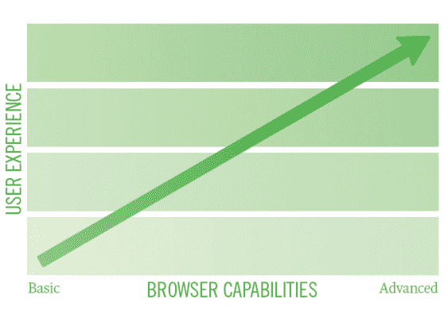

第三层体验是视听体验，通过使用 `CSS` 以及内联图像、音频和视频来表达。与 `HTML` 一样，浏览器对 `CSS` 的实现也必然是容错的，因此浏览器会忽略它们不理解的内容；这一事实使得 `CSS` 的渐进增强成为可能。

第四层体验是交互体验。在标准世界中，这一层几乎完全依赖于 JavaScript，尽管网络上的交互也可以通过其他技术实现，例如 `Flash` 甚至 `Java Applet`。

最后一层体验是通过增强语义以及 Web 无障碍倡议 (`WAI`) 的无障碍富互联网应用 (`WAI-ARIA`) 规范中包含的最佳实践来实现的。这些对页面的增强，承接了 `HTML` 规范传统上留下的空白（尽管 `HTML5` 确实包含了一些增强的 `ARIA` 语义在其词汇表中）。

这些经验层次（也可以理解为支持层次）相互叠加，创造出一种随每一步而愈发丰富的体验，但它们绝非用户将获得的全部体验。事实上，它们只是从最基本体验到最卓越体验这条道路上可识别的里程碑。用户在实际路径中的一个或多个节点上的体验可能有所不同，这很正常；只要我们始终牢记渐进增强，我们的用户就能得到妥善的服务。

## 让我们深入探讨

本书的剩余部分将带你游览渐进增强高速公路上的各种里程碑，从标记语言开始，依次介绍 `CSS`、JavaScript，最后是 `ARIA`。在此过程中，我们将考察渐进增强技术在 `Retreats4Geeks.com` 活动页面上的应用。本书并非旨在成为一部详尽无遗的渐进增强技术大全，因此示例将简明扼要、重点突出，旨在让你了解当前的最佳实践，并帮助你在自己的工作中快速启动渐进增强的应用。

## 想着用户，而不是浏览器

16

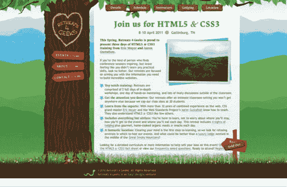

图 1.4：我们将贯穿本书剖析的 `Retreats4Geeks.com` 活动页面。

> “意义存在于文本的内容中，而非字体中。”
>
> — 维姆·克劳威尔

# 第 2 章：使用标记语言实现渐进增强

谈到网络，标记语言掌控着一切。它是构建每一个精美设计和每一次惊艳体验的基石。无论你偏好的形式是 `HTML` 还是其更严谨的兄弟 `XHTML`，每个元素都有其用途，并且根据你如何使用（或滥用）它，都可能极大地改善或恶化用户体验。

## 从粗放起步到正确之道™

当我们最初开始构建网页时，许多人误解了良好标记的重要性。我们这些从编程背景转战网络的人，常常认为学习 `HTML` 不够“高级”，因此从未投入时间去掌握它所提供的语义。而那些从设计背景转战网络的人，也不理解语义的重要性。我们只关注网页的呈现方面，将 `table` 元素奉为在网格上布局页面的法宝，然后肆无忌惮地为 `table` 元素发掘出数百种其他用途，其中许多用途取代了已有的（且支持良好的）语义元素（如列表）。

在全球许多办公室里，倡导正确应用 `HTML` 语义的呼声都无人理睬；这一论点被视为很大程度上是理想主义的，因为：1）事实是旧式网站在现代浏览器中看起来也还可以；2）关于增强网络可访问性的论证，对于许多没有亲身体验过使用残障辅助设备上网的人来说，毫无意义。接着，谷歌出现了，改变了一切。突然之间，语义标记变得至关重要。

谷歌是第一个在网页索引时考虑语义的搜索引擎。从最基础的锚点（`a`）元素——其原始 PageRank 算法的基石——开始，谷歌率先使用语义标记来推断含义和相关性。其他搜索引擎很快纷纷效仿，随着搜索引擎爬虫开始在网页上寻找其他有意义的 `HTML` 元素（例如，表示页面最重要内容的 `h1`），语义标记对商业世界变得更加重要，因为正确使用它意味着在搜索引擎中获得更好的排名，从而有更大的机会吸引新客户。

## 语义基础

如果内容是土壤，那么语义标记就是你为了确保花园多产而添加的堆肥。它丰富了内容，为你的用户提供关于意图和上下文的线索，以及关于内容本身的补充信息。

例如，缩写元素（`abbr`）。它用于表示缩写（以及首字母缩略词，因为它已正式取代了 `acronym` 元素）：

`Gatlinburg, <abbr title="Tennessee">TN</abbr>`

在这个简单的 `HTML` 代码片段中，你可以看到缩写如何通过告知用户 "TN" 代表 "Tennessee" 来增强这些字母的含义。

随着 `HTML` 的发展，其词汇量稳步扩大，为描述其封装的内容提供了更多选择。`HTML5` 的出现引入了一系列新的语义选项（例如 `header`），甚至增强了一些现有的选项（例如前面提到的 `abbr` 接管了被淘汰的 `acronym`）。在本章的后续内容中，我们将使用其中一些新的/修订的元素，并提供一些背景信息，说明为什么它们是标记内容的合适选择。

让我们开始吧。

## 表达我们的本意

查看 `Retreats 4 Geeks` 网页¹，可能很难确定从何处入手，但我们将从最重要的内容开始：网站的名称和指向页面各个部分的链接（因为就我们的目的而言，这是一个单页网站）。

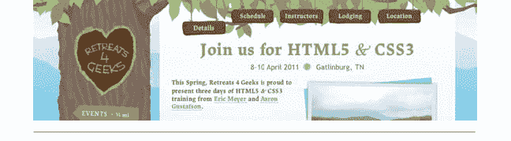

1. 如果你尚未下载示例文件，可以访问 [adaptivewebdesign.info](http://adaptivewebdesign.info) 进行下载。

让我们从语义学家的角度来考虑这个组件，从 logo 开始。`Retreats 4 Geeks` 的 logo 是一个图像，所以我们应该使用 `img` 元素来标记它。² 它也相当重要，因为它为整个页面提供了上下文，因此应该用 `h1` 包裹起来，`h1` 是为页面上最重要的内容保留的元素：

```html
<h1></h1>
```

尽管示例页是使用 `HTML5` 编写的，但我一直更习惯于该语言的 XML 序列化格式，因此我选择坚持使用该语法（如 `img` 元素末尾的斜杠所示）。这更多是偏好问题，而非强制要求。

接下来是导航部分，我们呈现的是一个链接列表，因此应该将其标记为列表。由于链接的顺序对应于页面上各个部分的顺序，该列表很可能是有序列表（`ol`）。每个链接放置在一个列表项（`li`）中，并用一个锚点元素（`a`）包裹：

```html
<ol>
  <li><a href="#details">Details</a></li>
  <li><a href="#schedule">Schedule</a></li>
  <li><a href="#instructors">Instructors</a></li>
  <li><a href="#lodging">Lodging</a></li>
  <li><a href="#location">Location</a></li>
</ol>
```

到目前为止，我们在标记方面做出了显而易见的选择，使用了 `HTML` 自诞生以来就有的语义。就在一年多以前，我们可能到此为止，认为页头部分已经完成，但 `HTML5` 让我们有机会提高这部分内容的语义价值和可访问性。

> ² 是的，我知道，你也可以使用 `object` 元素，或者将其设为文本并用 `CSS` 替换为图像，但这里我们追求的是简单性。

传统上，我们可能会使用一个带有语义标识符（id）为“header”的页面分区（`div`）来容纳这两个元素。如你所知，分区（divisions）用于分组内容，但它们不提供关于该分组的目的或功能的上下文（这就是为什么我们将其标识为“页头”）。然而，`HTML5` 引入了一个元素，为该分区提供了明确的语义含义：`header`。

从语义上讲，`header` 用于界定任何对页面或页面部分至关重要的内容。它可以用于封装标题或标题组（包含在新的 `hgroup` 元素中）、相关的导航辅助工具以及介绍性内容。因此，它非常适合作为页面标题和指向页面内各文章的锚点列表的容器。

`HTML5` 还在导航方面为我们提供了另一个更合适的选择。传统上，我们可能会将有序列表标识为“nav”或“main-nav”，而 `HTML5` 的 `nav` 元素通过提供那个语义 id，更直接地表达了我们试图赋予 `ol` 的语义。`nav` 元素可用于包裹任何一组导航链接，其功能等同于 ARIA 地标角色中的“navigation”（我们将在第 5 章进一步讨论）。

有了这些补充，此部分的标记现在变为：

```html
<header>
    <h1></h1>
    <nav>
        <ol>
            <li><a href="#details">Details</a></li>
            <li><a href="#schedule">Schedule</a></li>
            <li><a href="#instructors">Instructors</a></li>
```

## 不可见的与建议性的

而且，由于它们会忽略任何无法理解的内容，我们所使用的标记将在所有浏览器中正常运行，无论其版本新旧。当然，现代浏览器可能会以不同方式处理较新的元素，但即使是基于文本的浏览器（如 `Lynx`）也能访问内容。剥离了样式和基于 JavaScript 的交互性后，标记依然能够工作，这为我们提供了渐进增强连续体中的第二级支持。（请记住：内容本身构成了至关重要的第一级）。

尽管这种标记已经很好了，但我们忽略了一个主要的无障碍性需求：没有为我们的徽标图像（通过 `alt` 属性表示）提供任何替代文本。通常被称为“替代文本”的内容³，为关闭了图像显示的用户提供了基于文本的备份；它也是屏幕阅读软件（如面向视障人士的软件）向用户朗读的内容，因此包含它至关重要。


回到之前的例子，我已经添加了一个简单的 `alt` 属性：

```html
<h1></h1>
```

### 3. 替代文本与替代属性

有些人听到“替代标签”这个术语会非常生气，因为标签和属性是截然不同的东西（属性应用于元素的开始标签）。如果你发现自己刚说完“alt”就要发出“t”的音，赶紧打住，直接接上“text”。“替代属性”这个说法本身就有点拗口。

当图像是徽标或传达了理解页面或完成关键任务所需的信息时，`alt` 文本应始终提供。对于所有其他图像，将 `alt` 文本留空（`alt=""`）是完全合理的。我甚至想说，在任何图像不提供必要信息的情况下使用空的 `alt` 属性是可取的。我这么说有两个原因：

1. 没有人真的想读诸如“微笑的男人向跳跃的金毛猎犬扔飞盘”这样空洞的文字，就像没多少人愿意写它一样。
2. 屏幕阅读器会朗读 `alt` 属性的内容，但会跳过任何具有空 `alt` 属性的图像。⁴

`alt` 属性用于提供替代内容，而 `title` 属性用于提供关于元素的建议性信息。在上面示例的导航链接中，我们可以使用 `title` 来向用户告知每个链接将带她前往何处：

```html
<li><a href="#location" title="Get the 411 on Gatlinburg, Tennessee">Location</a></li>
```

同样，在页面下方的“位置”部分，`title` 为包裹地图的链接提供了上下文信息：

```html
<a href="http://maps.google.com/..." title="View Gatlinburg, Tennessee on Google Maps">
  
</a>
```

> 4. 屏幕阅读器实际上会在每次遇到缺少 `alt` 属性的 `img` 时说出“image”，所以请善待屏幕阅读器用户，别忘了包含它们。

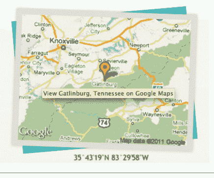

## 特设语义

HTML 中充满了可用于丰富其修饰元素的属性。它规定了一些“固定用途”的属性，如 `alt` 和 `title`，但也提供了一些属性，可以用一种不太正式的方式来扩展语言的原始语义。我当然指的是 `id` 和 `class`。

当戴夫·拉吉特（Dave Raggett）起草 HTML 3.0 规范⁵ 时，其中包含两个新概念：分类和标识，分别通过 `class` 和 `id` 属性来表示。⁶

> 5. HTML 3.0 是一个雄心勃勃的规范，引入了许多标签和属性。其中许多新构造在成为 HTML 3.2 推荐标准的过程中被舍弃，但 `class` 和 `id` 属性得以保留。有趣的是，HTML 3.0 中提出的一些完全相同的构造又重新回到了 HTML 词汇表中，要么作为 HTML5 的一部分正式回归，要么以微格式等准正式形式回归。

> 6. 值得注意的是，`class` 和 `id` 在 HTML 2 规范（[http://www.ietf.org/rfc/rfc1866.txt](http://www.ietf.org/rfc/rfc1866.txt)）中（非常）简短地出现过，但并非正式定义的属性。它们仅用于演示浏览器应如何以容错方式处理未知属性。

这两个属性直到 HTML 4.0 才正式引入 HTML 词汇表，但它们的实现时间大约与级联样式表（CSS）支持的添加同步。当然，CSS 为我们带来了两个明确针对这些属性的选择器，这从一开始就对 `class` 和 `id` 的预期用法造成了一些不幸的混淆。

多年来，几乎所有使用 CSS 的网页开发者都认为属性与选择器之间的这种关联是有意为之的，相信 `id` 和 `class` 纯粹是为了与样式表配合使用。不过你很难责怪我们，CSS 第一级规范并未提供太多选择元素的机制，因此 `class` 选择器（例如 `.ul.menu`）和 `id` 选择器（例如 `div#content`）（连同它们对应的属性）被引入，分别用于样式的通用和特定应用，这似乎是合理的。⁷

值得庆幸的是，我们现在明白了 `class` 和 `id` 属性的设计意图。`class` 属性的引入是专门为了应对 HTML 词汇表中有限的元素集合：

> 随着时间的推移，人们的期望会发生变化，对 HTML 的要求也会更多。其中一个表现就是要求添加更多标签的压力。HTML 3.0 引入了一种以开放式方式对元素进行子类化的方法。这可以用来区分段落元素在诗节 [原文如此] 中作为对句的角色，或者数学项作为张量的角色。这种做出新区分的能力可以被用来赋予独特的渲染样式或支持更丰富的搜索机制，而无需进一步使 HTML 文档格式本身复杂化。⁸

> 7. 而 HTML 3 草案确实允许这种用法以及其他用法。草案可在 http://www.w3.org/MarkUp/html3/html3.txt 获取。

> 8. 摘自 HTML 3 草案的“可扩展性”部分（见脚注 7）。

其意图是该属性包含应用于特定元素的子类列表，列表按从最通用到最具体的顺序排列：⁹

```html
<a href="..." title="...">
    
</a>
```

规范引入 `id` 属性是为了标识页面上的特定元素（这就是为什么页面上的每个 `id` 都需要唯一的原因）。实际上，这个标识符将用作样式规则（`#details { ... }`）、脚本（`document.getElementById('details')`）和锚点（`<a href="#details">`）的引用点。你可能还记得，我们在本章前面介绍的导航中实际使用了最后一种机制。

由于 Retreats 4 Geeks 活动的所有信息都包含在单个页面上，我已将每个内容块分组到单独的 `article` 元素中¹⁰，每个元素都有一个唯一的 `id`。`article` 元素作为 HTML5 的一部分被引入，它划定构成文档独立部分的内容，例如报纸文章、博客文章，或在我们的情况下，一个独特的主题。页面上的每个文章然后使用其 `id` 作为锚点引用，被导航链接所指向。点击这些链接之一将直接将用户跳转到相应的内容。

> 9. 你将在整个 HTML 3 草案中看到这一点，只要为某个元素定义了 `class`。

> 10. 为免混淆，HTML5 也引入了 `section` 元素（在上述代码示例中也可见）。用 HTML5 的术语来说，`section` 元素表示*一个内容部分*（懂了吧？）。就整体组织而言，我可以将整个页面声明为一个 `article`，将每个不同的块作为该 `article` 的一个 `section`，但我认为单个 `article` 元素更有意义，因为每个内容块足够独立，可以轻松存在于自己的页面上。两者之间的语义差异充其量是微小的，选择哪一个实际上由作者自行决定。

## 规范化的约定

微格式是一套由社区驱动的规范，用于标记内容以揭示 HTML（或 XHTML）中未提供的语义（和元数据）。从本质上讲，微格式将有机发展的编码规范正式化为一种规范，以解决 HTML 中的疏漏或限制。例如，HTML 没有提供健壮的方式来标记联系信息或事件，因此社区创建了微格式来满足这些需求。

第一个微格式源于表达网络上个体之间关联的愿望，被称为 XHTML 朋友网络（简称“XFN”）。虽然它并非作为“微格式”开发（该术语后来才出现），但 XFN 是一个在特定目标下扩展 HTML 语义的完美范例。

XFN 由 Tantek Çelik、Matthew Mullenweg 和 Eric Meyer 开发，它利用了经常被忽视的 `rel` 属性。`rel` 的目的——你可能在 `link` 元素包含外部样式表的上下文中熟悉它（`rel="stylesheet"`）——是指示锚点目标与当前页面的关系。这个想法很简单：如果我想从我的博客链接到同事的博客，我可以使用 XFN 并在链接中添加 `rel="colleague"`。类似地，如果我链接到我妻子的博客，我会使用 `rel="friend co-resident spouse muse sweetheart co-worker"`，因为她兼具所有这些身份。¹¹

就其本身而言，这种额外的标记除了提供更多关于我们关系的信息以及我为什么可能链接到另一个网站之外，几乎没什么作用，但如果我在博客列表中的每个链接上都使用它，并且这些人反过来也在他们的链接上使用它，突然间我们就创建了一个可编程导航的网络，为数据挖掘和再利用创造了无数机会。而事实也正是如此：XFN 如野火般迅速传播。软件开发人员将其集成到流行的博客工具中（例如 WordPress、Movable Type），“社交网络”上几乎每个网站的开发人员（例如 Twitter、Flickr、Last.fm）都开始使用特殊情况 `rel="me"`（用于从你控制的一个网页链接到另一个网页）来装饰用户个人资料页面，这使得像 Google Social Graph 这样的工具能够从单个 URL 开始快速构建用户的完整资料。¹²

Retreats 4 Geeks 页面中 XFN 的一个示例可以在 `footer`¹³ 中找到：

```html
<footer>
  <p id="copyright">&copy;2010 Retreats 4 Geeks. All
    Rights Reserved.</p>

  <p>Retreats 4 Geeks is an <a rel="me"
    href="http://easy-designs.net/">Easy! Designs
    </a> venture.</p>
</footer>
```

从这个简单（但强大）的起点开始，微格式的数量不断增加，以满足从标记个人资料（hCard）、事件列表（hCalendar）、用于联合的内容（hAtom）和简历（hResume），到指示许可信息（rel-license）、控制搜索引擎蜘蛛抓取（rel-nofollow）和方便标签标注（rel-tag）等常见且多样化的需求。¹⁴

几乎与这些微格式的开发并行，涌现出了大量利用它们的工具。你可能从我提到 Google Social Graph 猜到，搜索引擎已开始关注微格式，在某些情况下，甚至将微格式化内容的排名置于非微格式化内容之上。浏览器插件——如 Operator¹⁵ 和 Oomph¹⁶——使用户能够提取和再利用微格式化内容。几乎每种编程语言都有微格式解析器可用，甚至还有基于网络的服务，如 Optimus¹⁷ 和 H2VX¹⁸，为用户提供更直接访问其网站上使用的微格式的途径。

如你所见，微格式是渐进增强连续体中的又一个层次，使我们能够为用户使我们的网站更加有用。毕竟，使用像 Operator 这样的工具或像 Optimus 这样的服务，我们能让用户直接从我们的网页导入事件到他们的日历或名片到他们的地址簿，这不是很酷吗？我认为这非常棒。

## 随时联系我

由于我们的演示网站是用于一个活动的，因此 hCalendar 微格式是一个显而易见的起点，但让我们暂时搁置它，先看看如何将 hCard 微格式应用到我的简介[部分](link)中的“讲师”[文章](link)。不过，在查看标记之前，让我们先回顾一下 hCard 的关键分类。

| 类 | 用途 |
| :--- | :--- |
| `vcard` | 表示正在使用 hCard。（这应该是包含 hCard 信息的根元素的类。） |
| `fn` | “formatted name”（格式化名称）的缩写，用于包装拥有 hCard 的人的姓名 |
| `url` | 指示给定链接将用户带到关于此人的网页 |
| `photo` | 表示此人的照片 |
| `org` | 标识此人所属的公司或组织 |
| `role` | 表达此人在组织中的角色 |

表 2.1：关键 hCard 分类

hCard 微格式提供了许多其他选项来标记个人资料，但这些是我们在 Retreats 4 Geeks 网站上下文中要关注的关键分类。而且，在这五个[类](link)中，只有“vcard”和“fn”是实际必需的。

现在让我们看看我们可用的内容：

```html
<section id="aaron-gustafson">
    <figure>
        
    </figure>
    <h1>Aaron Gustafson</h1>
```

Aaron 从事网络工作近 15 年，在此期间，他对网络标准产生了浓厚的兴趣，并深入了解网站策略与架构、界面设计以及多种语言（包括 XHTML、CSS、JavaScript 和 PHP）。Aaron 和他的妻子 Kelly 拥有 `<a rel="external" href="http://easy-designs.net">Easy! Designs</a>`，这是一家位于田纳西州查塔努加市的精品网络咨询公司。当 Aaron 没有埋首于代码中时，通常你会发现他在宣扬他的发现，并与该领域的其他人分享他的知识和热情。

Aaron 曾在 `<cite>The New York Times</cite>`、Gartner 和美国环境保护署（以及其他机构）培训专业人士，并在世界一流的网络会议上发表演讲，例如 An Event Apart 和 Web Directions。他是 `<a rel="external" href="http://webstandards.org">网络标准项目 (WaSP)</a>` 的集团经理，并担任万维网联盟 `<a rel="external" href="http://www.w3.org/2005/Incubator/owea/">开放网络教育联盟 (OWEA)</a>` 的特邀专家。他创建了 `<a rel="external" href="http://ecsstender.org">eCSStender</a>`，担任 `<a rel="external" href="http://alistapart.com"><cite>A List Apart</cite></a>` 的技术编辑，是 `<a rel="external" href="http://netmag.co.uk"><cite>.net Magazine</cite></a>` 的特约撰稿人，并且凭借其技术写作和编辑工作积累了一个小型图书馆。他的下一本书 `<cite>Adaptive Web Design: Crafting Rich Experiences with Progressive Enhancement</cite>` 预计于 2011 年初出版。

## 脚注

<sup>11</sup> *[注：原始脚注文本 11 在提供的 OCR 页面中未出现。]*

<sup>12</sup> 关于 Social Graph API 的更多信息可以在 http://code.google.com/apis/socialgraph/ 找到。Glenn Jones 在出色的 JavaScript 库 Ident Engine（http://identengine.com/）中使用了这个 API，他在 A List Apart（http://www.alistapart.com/articles/discovering-magic/）的页面中介绍了它。

<sup>13</sup> `footer` 元素是 HTML5 规范的另一个产物，旨在封装关于 `article`、`section` 或页面的“元”信息，例如作者、版权信息等。

<sup>14</sup> 微格式维基（http://microformats.org/wiki/）维护着所有微格式的列表以及如何使用它们的文档。

<sup>15</sup> http://kaply.com/weblog/operator/

<sup>16</sup> http://visitmix.com/labs/oomph/

<sup>17</sup> http://microformatique.com/optimus/

<sup>18</sup> http://h2vx.com/

你可能已经注意到，`section` 的标题是 `h1`。别担心：在 HTML5 中，每个 `section` 都会创建一个新的上下文，在此上下文中可以重新从 `h1` 开始使用标题。我知道，一开始可能需要一点时间适应，但这很有道理，并且很好地解决了标题级别数量有限的问题。¹

如果你眼尖，可能已经准确识别出每个 hCard `class` 应该应用到哪里，但我还是会逐一讲解，以确保万无一失，从最简单的“vcard”开始。这个分类需要应用到包含元素上，在这个例子中就是 `section`：

```html
<section id="aaron-gustafson" class="vcard">
```

下一个很明显是“fn”，它应该包裹我的名字。由于我的名字已经被 `h1` 包裹，我们可以给那个元素添加一个“fn”的 `class`，以表明该元素包含的文本是我的名字。

```html
<h1 class="fn">Aaron Gustafson</h1>
```

接下来，我们可以给“Easy! Designs”链接添加一个“url”的 `class`，表示它指向一个我控制的网站：

```html
... <a class="url" rel="external" href="http://easy-designs.net">Easy! Designs</a>, ...
```

继续往下看，我们可以将“photo”应用到我的照片上，这张照片包含在一个 `figure` 元素中。HTML5 引入了 `figure` 元素来包含一块独立的内容——通常是一个带可选标题（`figcaption`）的图片或图表——它可以独立存在，也可以从文档中移除而不改变其含义。


```html
<figure>
  
</figure>
```

1. <http://www.whatwg.org/specs/web-apps/current-work/multipage/content-models.html#sectioning-content>

我们需要在简介的最后一段添加最后的两个类：`org` 和 `role`，但内容给我们带来了一点小小的困境，因为其中提到了几个职位和组织。我们应该使用哪一个？可以包含多个组织和职位吗？

hCard 规范中并没有限制一个 hCard 只能有一个组织和职位，但实际上，大多数微格式解析器只会提取遇到的第一个，因为地址簿软件通常不允许有多个组织和职位。因此，我们只需将分类添加到我的主要职能上：Web 标准项目组经理。

`org` 部分很简单，因为“Web 标准项目”已经包含在一个元素中。然而，我的职位是更大文本字符串的一部分，并未包含在自己的元素中。为了只将分类应用到我的职位上，我们必须使用一个没有语义含义的元素，比如 `<b>`²⁰：

```html
... He is <b class="role">Group Manager</b> of the <a class="org" href="http://webstandards.org">Web Standards Project (WaSP)</a> ...
```

从整体来看，你会发现整合 hCard 微格式的调整非常小：

```html
<section id="aaron-gustafson" class="vcard">
  <figure>
    
  </figure>
```

20. 什么？`<b>`？真的吗？为什么不用 `span`？嗯，在 HTML5 中，`b` 元素被重新引入，专门用于表示“一段在视觉上与普通文本区分开来，但不传达任何额外重要性的文本。”虽然你当然可以使用 `span` 元素，但 `b` 是一个更合适（也更短）的替代方案。

## 通过标记实现渐进增强

36

```html
<h1 class="fn">Aaron Gustafson</h1>

<p>... Aaron and his wife, Kelly, own <a class="url" rel="external" href="http://easy-designs.net">Easy! Designs</a> ...</p>

<p>... He is <b class="role">Group Manager</b> of the <a class="org" rel="external" href="http://webstandards.org">Web Standards Project (WaSP)</a> ...</p>

</section>
```

但这些简单的更改就能让微格式解析器轻松地构建出我的个人资料。

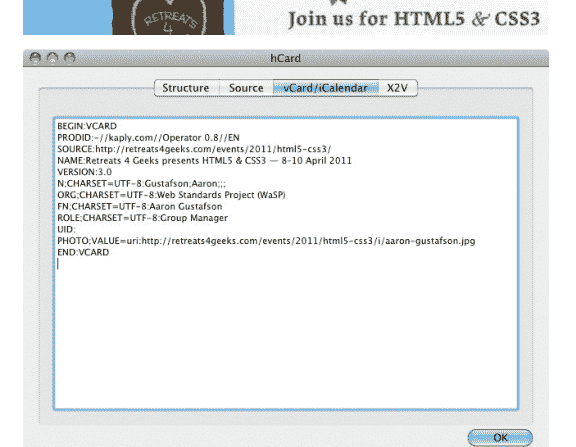

*图 2.3：通过 Operator 工具从该代码中提取的信息的屏幕截图。*

微格式真正有趣的地方在于你可以随心所欲地使用它们。`class` 名称不需要以任何特定的顺序出现（只要它们出现在具有适当类名的父元素内即可），并且它们不需要内容以任何方式匹配预期的导出格式。而且，正如这个例子所展示的，hCard 不需要像名片条目那样进行标记；相反，你可以自由地使用适当的 `class` 名称将各个组件分散到你的散文中。

## 标记你的日历

掌握了 hCard 后，我们可以看看前面提到的 hCalendar 事件微格式。同样，在查看标记之前，让我们先看看一些更重要的 hCalendar 分类。

| 类名 | 用途 |
| --- | --- |
| `vevent` | 表示正在使用一个 hCalendar 事件。（这应该是包含 hCalendar 事件信息的根元素的 `class`。） |
| `dtstart` | 表示事件的开始日期 |
| `dtend` | 表示事件的结束日期 |
| `summary` | 标识事件的名称 |
| `location` | 说明事件的位置 |
| `description` | 提供有关事件的额外细节 |

*表 2.2：重要的 hCalendar 分类*

由于整个演示页面都是为该事件服务的，`class` 应用过程需要从 DOM 树的更高层开始。我决定从内容容器（`div#content`）开始，我将根级 `vevent` `class` 分配给了它。虽然在下面的示例中，hCalendar 内容包含在 `article#details` 内，但以这种方式将 `class` 应用到祖先元素，为我们提供了在其他 `article` 中也包含更多 hCalendar 属性的灵活性：

```html
<div id="content" class="vevent">
```

正如我所提到的，第一篇文章（`article#details`）包含了有关该事件的大部分信息。在查看 hCalendar 类的应用之前，让我们先看看这段标记：

```html
<article id="details">
  <header>
    <h1>Join us for HTML5 &amp; CSS3</h1>
    <p>–10 April 2011</p>
    <p>Gatlinburg, <abbr title="Tennessee">TN</abbr></p>
  </header>
  <figure>
    
  </figure>
  <section class="main">
    <!-- event overview -->
  </section>
</article><!-- / #details -->
```

浏览一下标记，你可能已经弄清楚了大多数 hCalendar 分类应该应用到哪里。首先，你有了事件的名称，或者说 hCalendar 术语中的 `summary`：

```html
<h1>Join us for <b class="summary">HTML5 &amp; CSS3</b></h1>
```

按照源代码顺序，我们遇到的下一部分是日期范围“8-10 April 2011”。传统上，我们会使用缩写元素（`abbr`）来标记这些数据，但 HTML5 引入了一个专门用于表示时间信息的新元素：`time` 元素。有一个问题：为了提供事件的开始和结束日期，我们需要将内容分成两个日期，然后将每个日期包裹在一个 `time` 元素中。

虽然一开始可能显得有些奇怪，但最合理的做法是将“8”包裹在一个 `time` 元素中，将“10 April 2011”包裹在另一个中。我们这样做是因为“8”实际上暗示着“8 April 2011”，只是以缩写形式呈现（这就是为什么以前使用 `abbr` 很合理）。`time` 元素允许使用 `datetime` 属性进一步澄清日期，这就是我用来表达完整开始日期的方式：

```html
<p><time datetime="2011-04-08">8</time>–<time datetime="2011-04-10">10 April 2011</time></p>
```

hCalendar 只需要一个摘要和一个开始日期，因此我们只需要将 `dtstart` 分类应用到第一个 `time` 元素上，微格式就是有效的。但既然我们有结束日期，应用那个分类也是有意义的：21

```html
<p><time class="dtstart" datetime="2011-04-08">8</time>–<time class="dtend" datetime="2011-04-10">10 April 2011</time></p>
```

继续浏览文章，`location` 就很明显了：Gatlinburg, TN：

```html
<p class="location">Gatlinburg, <abbr title="Tennessee">TN</abbr></p>
```

> 21. 截至撰写本文时，一些微格式解析器在处理较新的 HTML5 元素和属性时存在问题。因此，将 `datetime` 属性的值复制到 `time` 元素的 `title` 属性中，或者改用 `abbr` 的 `title` 属性可能是有意义的。

我们 hCalendar 拼图的最后一块是“description”，而该属性最显而易见的内容选择是文章的“main”部分：

```html
<section class="main description">
  <!-- 事件概述 -->
</section>
```

就是这样。有了微格式内容，用户现在可以相当简单地将事件直接导出到他们的日历中。

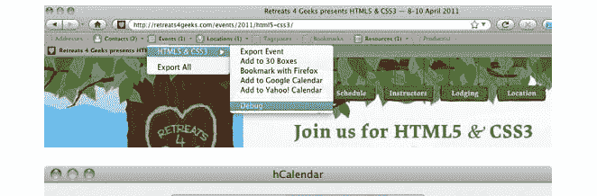

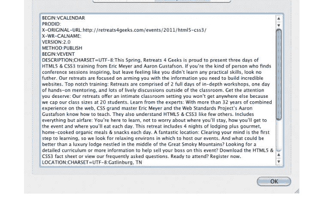

> 图 2.4：此代码通过 Operator 暴露的信息的屏幕截图。

再次，我们看到了微格式如何直接增强已有意义标记的含义，从而改善用户体验。完美的渐进增强！

### 这是基础

虽然渐进增强通常从 CSS 和 JavaScript 的角度讨论，但它同样适用于标记。正如我们在本章中所看到的，每当我们选择一个有意义的元素时，我们都通过增强可访问性和通过有机搜索增加其对潜在用户的可见性，使页面更容易完成其工作。我们还看到了分类和标识如何反馈给 HTML，帮助它成为更具表达力的语言。而且，正如微格式的情况一样，我们甚至看到了我们选择的名称如何能够增强它们所应用内容的语义和可用性。

语义标记是渐进增强连续体中至关重要的一步；它与精心撰写的内容相结合，构成了整个用户体验的基础。

> “设计是人造创造物的根本灵魂，它最终在产品或服务连续的外部层次中表达自己。”
>
> — 史蒂夫·乔布斯

# 第 3 章：CSS 的渐进增强

可能除了少数仍在用它们的 `font` 元素和 spacer GIF 勉强维持的网站外，网络设计主要使用层叠样式表（CSS）完成。当然，还有 Flash、SVG 和 `canvas`，但如果你关心内容的可用性和可访问性，你将使用 HTML 来标记你的内容，并使用 CSS 来设置其样式。

与 HTML 一样，CSS 被设计为容错的。浏览器会忽略任何它们不理解的语法<sup>1, 2</sup>，并且通过关注语言如何随时间演变，我们可以轻松地通过利用这种“无知”来根据给定浏览器的能力构建设计层，从而拥抱渐进增强。

1. <http://www.w3.org/TR/2009/CR-CSS2-20090908/syndata.html#parsing-errors>
2. <http://www.w3.org/TR/2009/CR-CSS2-20090908/syndata.html#unsupported-values>

## 有时错误可能是件好事

这不是一本 CSS 书，所以我不会带你了解 CSS 中可用的所有选项。然而，我确实想做的是给你一个关于 CSS 如何工作的简要回顾，因为我认为它将为你如何构建渐进式设计提供宝贵的见解。

从最基本的层面来看，CSS 是一系列人类可读的规则集，每个规则集由一个选择器和一个声明块组成，声明块包含一组应用于选择器匹配的任何元素的属性-值对（声明）。

```css
p {
    color: red;
    font-weight: bold;
}
```

上面的例子是 CSS 最基础的用法。任何以前使用过 CSS 的人（甚至可能没使用过的人）看到它都能很快理解它选择了段落并使其文本加粗和变红。然而，从容错的角度来看这个例子，你会看到一些不同的东西。

在解析 CSS 文件以确定如何渲染页面时，浏览器会读取每个规则集并对其进行检查。如果遇到它不理解的东西，它会经历我们称之为“解析错误”的情况。解析错误通常是错误 CSS 语法（例如，属性名称或值的拼写错误，缺少冒号或分号等）的结果，但当完全有效的 CSS 语法超出解析器的理解范围时，也会导致解析错误。

假设我们所有的花括号、冒号和分号都放在了正确的位置，我们刚刚看到的示例包含五个可能发生解析错误的点：

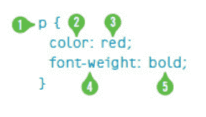

1. 选择器：`p`；
2. 第一个属性名称：`color`；
3. 第一个属性的值：“red”；
4. 第二个属性名称：`font-weight`；以及
5. 分配给第二个属性的值：“bold。”

根据规范，如果浏览器遇到此规则集并且不理解其中的一部分（即，遇到解析错误），它必须忽略解析错误所在的较大组件（规则集或声明）。

因此，例如，如果浏览器不理解 CSS 颜色关键字“red”，它会忽略声明 `color: red`，但仍然会应用剩余的声明。`font-weight` 关键字“bold”也是如此。然而，如果浏览器无法理解选择器（`p`），它会忽略整个规则集，无论浏览器是否理解其中包含的各个声明。

这背后的推理很简单：我们不知道 CSS 的未来会怎样，因此浏览器必须忽略它不知道如何处理的声明和选择器。这促进了语言的进步（就像 HTML 一样），也使得使用 CSS 渐进增强页面成为可能。

对于属性，利用解析错误相当直接，并且它开启了一些很棒的可能性。这里是使用 CSS3 RGBa 颜色方案的一个快速示例：

```css
p {
  background-color: rgb(137, 224, 160);
  background-color: rgba(180, 246, 248, .43);
}
```

解析此规则集的浏览器很可能会理解选择器（毕竟，没有比元素选择器更简单的了），因此它会继续处理第一个 `background-color` 声明。`background-color` 属性自 CSS 版本 1 以来一直是 CSS 的一部分，所以浏览器应该没有问题，然后会处理分配的值。同样，基于 RGB 的颜色值自 CSS 诞生以来也是其一部分，所以浏览器会理解该值。第一个声明通过了解析器的检查，浏览器将 `background-color: rgb(137, 224, 160);` 应用于所有段落，解析器继续处理第二个声明。

在第二个声明中，`background-color` 使用新值（根据层叠规则）重新定义。显然，正如我们讨论过的，浏览器理解该属性，因此它会继续处理声明的值，该值使用 RGBa。如果浏览器理解 RGBa，则没有问题，RGBa 值将分配给 `background-color` 属性，覆盖原始的 RGB 值。但是，如果浏览器不支持 RGBa，它会遇到解析错误并忽略整个声明，使所有段落的 `background-color` 保留为 RGB 值。

在这个例子中，理解 RGBa 值的浏览器会根据“层叠”（如在层叠样式表中）的规则覆盖 `background-color` 值。我将在本章后面更深入地讨论层叠，但这里有一个简要总结：层叠规定，对于等效的属性，最后定义的那个会被渲染。

这是一个相当简单的例子，说明我们如何利用 CSS 的容错特性为功能更强大的浏览器提供增强体验。它不仅在声明级别有效；你也可以使用同样的技术，通过使用更高级的选择器来向特定浏览器隐藏整个规则集：

```css
html[lang] p {
    /* 这里放一些高级的东西 */
}
```

任何遇到此规则集的浏览器都会解析它，从选择器开始。如果浏览器理解基于属性的选择（在这种情况下，针对任何作为具有语言属性的 `html` 元素后代的段落），它将继续解析规则集并应用它理解的声明。另一方面，如果上述浏览器不理解属性选择器，它会遇到解析错误并忽略整个规则集。

使用这种技术向一个浏览器而不是另一个浏览器选择性地传递规则（更多是为了效果而非实用性）最著名的例子可能是 Egor Kloos 的 CSS Zen Garden 作品，标题为“Gemination”。³

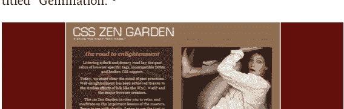


*图 3.1：Gemination 在 IE6（上）和 IE7（下）中。*

3. <http://www.csszengarden.com/062/>

在这个概念验证案例中，Kloos 创建了一个针对 Internet Explorer（当时版本为 6）的基础布局，并采用了一种名为 MOSe（“Mozilla/Opera/Safari 增强”）⁴ 的技术，为更先进的浏览器提供了完全不同的体验。Kloos 使用简单选择器实现基础布局，并使用高级选择器实现增强样式。以下是一个展示其方法的代码片段：

```css
#intro {
  margin: 0;
  padding: 0;
  width: 660px;
  height: 80px;
  background: transparent url(introkop.gif) no-repeat right top;
}

/* ... */

body[id=css-zen-garden] #intro {
  position: absolute;
  top: 0;
  left: 0;
  float: none;
  margin: 0;
  width: 100%;
  height: 350px;
  background: none;
}
```


遵循 CSS 级联顺序，浏览器首先解析第一个规则集来渲染 `#intro` 布局。稍后，浏览器会解析 `#intro` 的“增强”规则集。如果浏览器理解属性选择器，它将为 `#intro` 渲染一个完全不同的布局；如果不理解，它将完全忽略新的规则集。

> 4. CSS 策划者 Dave Shea 在 2003 年创造了这个术语，但当 Internet Explorer 7 发布后，由于它没有像 IE6 那样基于选择器的限制，该术语便不再使用。你可以在 http://www.mezzoblue.com/archives/2003/06/25/mose/ 阅读他的原始文章。

基于选择器的筛选可能是一种有用的技术，但它常常让许多 CSS 作者感到困惑，因为他们没有意识到复合选择器（由两个或更多选择器语句组成，用逗号分隔）中的选择器失败是完全的，而非离散的：

```css
p,
p:not([title]) {
  color: red;
  font-style: bold;
}
```

这个示例与本章开头的示例一样，在五个位置可能存在解析错误，但它在第二个选择器 `p:not([title])` 中还有第六个潜在错误。只理解这两个选择器中一个的浏览器会忽略整个规则集，而不仅仅是忽略高级选择器（如果你好奇，这个高级选择器用于查找没有 `title` 属性的段落）。

尽管这可能看起来违反直觉，但 CSS 2.1 规范非常明确地指出这就是应有的方式：“如果选择器的任何部分存在错误，即使其余部分看起来合理，也应该忽略整个语句。”⁵ 知道了这一点，我们就能更好地决定如何以及何时组合选择器。一般规则是，最好避免将高级选择器与简单选择器组合（如示例所示），除非你希望将整个规则集对旧浏览器隐藏。

我们稍后会回到这个技术，但首先让我们快速了解一下特异性的世界。

特异性是 CSS 中的另一个核心概念。它衡量一个给定选择器可以选择多少个元素，是唯一可用于覆盖级联机制（稍后详述）的机制。有些选择器比其他选择器更具特异性。例如，一个 ID 选择器（例如 `#intro`）的特异性是一个类选择器（例如 `.vcard`）的 10 倍，而后者又是一个元素选择器（例如 `p`）的 10 倍。⁶

给定选择器的特异性是通过将其所有组成部分的特异性相加来计算的。通过非常具体的选择器应用的规则将优先于通过不太具体的选择器应用的规则，无论它们在级联中的顺序如何。回顾 Egor 的属性选择戏法，值得注意的是，即使示例中的第一个规则集在 CSS 文件中排在第二位，浏览器仍然会将其优先级设置得低于另一个规则集，因为其选择器的特异性值低于第二个规则集。

选择器的特异性需要时间来掌握，并可能导致各种问题，因为如果你使用大量选择器（例如，每个都包含一个 ID 选择器）来应用所有样式，你最终将不得不创建更具特异性的选择器来覆盖它们（例如，两个 ID 选择器）。为了避免特异性不断升级的军备竞赛，我建议你避免不必要地使选择器过于具体。

让我们重新审视 Kloos 的作品，并应用我们在复合选择器解析错误中学到的知识；通过这样做，我们可以降低 Egor 高级规则集的特异性，同时仍保持其原始工作的精髓：

```css
#intro {
    /* Old Layout */
}

/* ... */
```

> 6. 如果你不完全理解特异性的计算方式，请务必查看 Andy Clarke 的 "CSS Specificity Wars" http://www.stuffandnonsense.co.uk/archives/css_specificity_wars.html。

```css
[foo], #intro {
  /* Advanced Layout */
}
```

在这个修改版本中，我将第二个规则集改成了一个复合选择器，针对一个具有名为 “foo” 属性的元素和另一个 ID 为 “intro” 的元素。这种方法的诀窍在于，初始的属性选择器是个幌子。`foo` 属性不仅不是标准属性，而且在 CSS Zen Garden 的 HTML 中任何地方都没有使用，因此将该选择器添加到规则集中除了对理解属性选择器的浏览器隐藏该规则集之外毫无作用。并且，最重要的是，它保持了 `#intro` 选择器的纯粹性，使其特异性与之前的规则相等，从而让级联来决定样式的应用。

虽然这可能不是你在实现 CSS 时立即想到的技术，但当你想在不改变选择器特异性的情况下使用规则集过滤时，这是一个值得记住的好方法。从可维护性的角度来看，这种方法对于单个或少数几个规则集来说并不理想；要大规模应用规则集过滤的概念，有更好的选择可用，我们马上就会介绍到。

## 概念分述

“级联”是 CSS 中一个极其重要的概念；事实上，它就是 CSS 的第一个词。从字面上看。再次说明，这本小书的范围有限，无法详细探讨级联概念，但有一个方面可以帮助你迅速成为渐进增强专家：顺序。

顺序非常重要。非常重要。

在 CSS 中，当其他所有条件相等（即特异性）时，样式声明与其目标元素之间的接近程度决定了结果。我们在前面的示例中看到了这一点，有两个 `background-color` 赋值，对于独立的规则集，同样适用。

```css
h1 {
  font-size: 2em;
}

h1 {
  font-size: 3em;
}
```

在这种情况下，`h1` 元素将被分配 `font-size` 值为 `3em`。虽然你不太可能在两个连续的规则集中看到相同的选择器，但看到类似的情况并不罕见。例如，以“Retreats 4 Geeks”网站上“住宿”文章中的图片为例：

### 你将下榻之处

这里远离工业地毯和折叠椅。

我们的豪华小屋位于田纳西州 Sevierville 的山坡上，就在 Gatlinburg 郊外。小屋配备了 4x8 英尺的影院屏幕、无线网络、热水浴缸、台球桌、飞镖盘、酒吧，以及周围山脉的壮丽景色，是逃离日常琐事、学习新知识的完美氛围。

小屋的十二间套房每间都配有一张特大号床、带按摩浴缸的私人浴室和私人阳台，让你可以放松并欣赏周围的景色。你甚至可以支付少量额外费用带一位客人同行（请参阅注册表）。

除了让你的头脑充满知识，我们还将用美味的有机餐点（以及你在饥饿时享用的大量零食）填饱你的肚子，所有这些都由我们的私人厨师在店内准备。如果你有饮食限制或偏好，我们将尽一切努力满足并提供美味的选择。

需要详细的课程大纲或更多信息来说服你的老板参加这个活动吗？下载 HTML5 & CSS3 情况说明书或查看我们的常见问题解答。准备好参加了吗？立即注册。


图 3.2：住宿文章。

## 自适应网页设计

### 您的下榻之处


这与工业地毯和折叠椅几乎有天壤之别。

我们的豪华旅馆坐落在田纳西州塞维尔市的山坡上，就在加特林堡郊外。这里配备了一块 4x8 英尺的影院屏幕、无线互联网、一个热水浴缸、一张台球桌、一个飞镖靶、一个吧台，以及周围山峦的壮丽景色，是逃离日常琐事、学习新知识的完美氛围。

旅馆的十二间套房每间都配有一张特大号床、一间带按摩浴缸的私人浴室和一个独立阳台，让您能够放松身心，尽情享受周围的环境。您甚至可以支付少量额外费用携带一位客人（请参阅[注册表](https://example.com/registration-form)）。

除了用知识充实您的头脑，我们还将用美味的有机餐食（以及在您感到饥饿时供应的大量零食）来填饱您的肚子，所有这些都由我们的私人厨师在内部精心准备。如果您有饮食限制或偏好，我们将尽力满足并提供美味的选择。

需要一份详细的课程大纲或更多信息来说服您的老板参加这个活动吗？[下载 HTML5 与 CSS3 情况说明书](https://example.com/fact-sheet)，或查看我们的[常见问题解答](https://example.com/faq)。准备好参加了吗？[立即注册](https://example.com/register)。

- 
- 

*图 3.3：无 CSS 的"住宿"页面。*

### 您的下榻之处


这与工业地毯和折叠椅几乎有天壤之别。

我们的豪华旅馆坐落在田纳西州塞维尔市的山坡上，就在加特林堡郊外。这里配备了一块 4x8 英尺的影院屏幕、无线互联网、一个热水浴缸、一张台球桌、一个飞镖靶、一个吧台，以及周围山峦的壮丽景色，是逃离日常琐事、学习新知识的完美氛围。

旅馆的十二间套房每间都配有一张特大号床、一间带按摩浴缸的私人浴室和一个独立阳台，让您能够放松身心，尽情享受周围的环境。您甚至可以支付少量额外费用携带一位客人（请参阅[注册表](https://example.com/registration-form)）。

除了用知识充实您的头脑，我们还将用美味的有机餐食（以及在您感到饥饿时供应的大量零食）来填饱您的肚子，所有这些都由我们的私人厨师在内部精心准备。如果您有饮食限制或偏好，我们将尽力满足并提供美味的选择。

需要一份详细的课程大纲或更多信息来说服您的老板参加这个活动吗？[下载 HTML5 与 CSS3 情况说明书](https://example.com/fact-sheet)，或查看我们的[常见问题解答](https://example.com/faq)。准备好参加了吗？[立即注册](https://example.com/register)。

- 
- 
- 

*图 3.4：应用了排版样式的"住宿"页面。*

改进虽然细微，但确实是改进。对于那些在处理基于 CSS 的布局方面存在问题的浏览器来说，这实际上可能比试图强制它们使用超出其处理能力的更高级布局，为用户带来更好的体验。

接下来要提供的一层样式支持——并且很可能与基本排版一起为用户所用——是颜色（在某些情况下，可能包括背景图像）。图 3.5 展示了颜色为这篇文章的设计带来的微小变化。

### 您的下榻之处


**这与工业地毯和折叠椅几乎有天壤之别。**

我们的豪华旅馆坐落在田纳西州塞维尔市的山坡上，就在加特林堡郊外。这里配备了一块 4x8 英尺的影院屏幕、无线互联网、一个热水浴缸、一张台球桌、一个飞镖靶、一个吧台，以及周围山峦的壮丽景色，是逃离日常琐事、学习新知识的完美氛围。

旅馆的十二间套房每间都配有一张特大号床、一间带按摩浴缸的私人浴室和一个独立阳台，让您能够放松身心，尽情享受周围的环境。您甚至可以支付少量额外费用携带一位客人（请参阅注册表）。

除了用知识充实您的头脑，我们还将用美味的有机餐食（以及在您感到饥饿时供应的大量零食）来填饱您的肚子，所有这些都由我们的私人厨师在内部精心准备。如果您有饮食限制或偏好，我们将尽力满足并提供美味的选择。

需要一份详细的课程大纲或更多信息来说服您的老板参加这个活动吗？下载 HTML5 与 CSS3 情况说明书，或查看我们的常见问题解答。准备好参加了吗？立即注册。

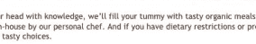

*图 3.5：上色后的"住宿"页面。*

显然，我们这里看到的是逐步的改进，但仍然是改进。

这篇文章的基础标记如下：

```html
<article id="lodging">
  <header>
    <h1>Where You’ll Stay</h1>
  </header>

  <figure class="frame focal">
    
  </figure>

  <section class="main">
    <!-- description of accommodations -->
  </section>

  <aside class="extra">
    <ul class="gallery">
      <li>
        <figure class="frame">
          
        </figure>
      </li>
      <!-- ... -->
    </ul>
  </aside>
</article>
```

您会注意到，相关的 `article` 为每个 `figure` 元素使用了相同的 `class`：“frame”；这使我们能够在明信片带衬边的外观方面实现一致性。我为焦点 `figure` 额外添加了一个 `class`，嗯，就是“focal”。这种设置允许我使用两个具有相同特异性的不同 CSS 规则，将相应的样式应用于 `figure.focal`。这里是一个应用示例，后面是一个覆盖：

```css
.frame {
  margin: 0 auto 40px;
}

.focal {
  margin: 0 20px 25px 30px;
}
```

这些规则集中的每一个都应用于本文中的焦点图形（以及页面上的所有其他图形），并且两个规则集都具有相同特异性的选择器。由于第二个规则集定义了与第一个相同的属性，因此“focal”图形的边距值将是“0 20px 25px 30px”，而不是“0 auto 40px”。

当然，大多数样式表由数百个规则集组成，很容易无意中成为邻近性问题的受害者。但值得庆幸的是，我们可以通过采用分层设计 CSS 的方法来缓解其中的一些问题。

退一步看，你可以看到一个网站的设计包含三个核心方面：排版、颜色和布局。每个方面都为整体设计增添更多内容，逐步构建，直至完全实现。当谈到使用 CSS 进行渐进增强时，我们可以使用同样的分解来创建基于浏览器能力的离散支持级别：排版；排版和颜色；以及排版、颜色和布局。

正如我们讨论过的，规则顺序很重要，因此在构建渐进式设计时，我们必须调和我们分离设计方面的愿望与层叠规定规则解释的方式。实际上，这意味着您需要按特定顺序交付按方面分组的声明：排版，然后是布局，最后是颜色。为什么是这个顺序？我们稍后会讲到。

您可以将这些规则组作为单独的样式表（链接或导入）交付，也可以放在一个样式表中。^[7] 多样式表路线相当直接且易于管理，但它会损害性能，因为每个样式表都必须通过单独的 HTTP 请求获取。除此之外，一些浏览器不会缓存超过一层深度的样式表（例如，导入到另一个样式表中的样式表）。基于这些原因，单个样式表的方法对我来说最有意义，也是我在“程序员静修”网站上采用的方法。

为了说明分层样式的概念，也许最好从头开始：不应用任何样式。在下一页中，图 3.3 展示了在 Safari 中仅应用了默认浏览器样式的住宿文章。

如您所见，使用浏览器的默认样式，内容完全可用。它远不如我们希望的那样吸引人，但内容完全可访问。应用一层通用的排版样式后，我们得到了图 3.4。

> [7] 您的 CSS 以一个样式表交付并不意味着必须以这种方式维护。有许多服务器端工具可以将 CSS 文件组合成一个，因此您可以通过物理地将单独的样式表导入到单个骨架 CSS 文件的对应位置，然后再交付给用户，从而轻松兼得两者之长。例如：http://www.easy-reader.net/archives/2010/07/11/template-based-asset-munging-in-expressionengine。

我们现在要关注的最后一层样式应用是基于屏幕的布局。本章前面的图 3.2 展示了“住宿”文章在其全部 glory 中的样貌。

你可能还记得我曾提到过，我选择将所有这些层定义在单个文件中。为了实现这一点，我将文件分成了三个不同的部分，如下所示，这个摘录重点展示了应用于“住宿”文章图片的样式：

```css
/* =Typography */
img {
  display: block;
}

/* =Layout */
@media screen {
  .frame .inner {
    border: 10px solid;
  }
}

/* =Color */
.frame .inner {
  background-color: rgb(227, 222, 215);
  border-color: rgb(227, 222, 215);
}
```

你可能很快注意到了包含屏幕布局规则的 `@media` 块。这里使用 `@media` 并非偶然：它确保每种媒体类型都能访问排版和颜色规则，而布局规则仅限于实现了“screen”媒体类型的用户代理。遵循此设置，你可以轻松地为打印或任何其他媒体类型做同样的事情，不过稍后会详细讨论。

使用 `@media` 还有另一个好处：非常古老的浏览器（例如 Netscape 4）无法理解它。并且，根据容错规则，浏览器会忽略它们不理解的任何内容，因此我们的布局样式对旧版浏览器和设备巧妙地隐藏起来，使它们只能体验到纯粹的排版，或者更可能是一种色彩丰富的排版体验。

现在，回到之前的一个问题，为什么颜色规则放在最后？嗯，我的理由很简单：我喜欢 CSS 简写属性。CSS 简写属性允许我们将多个声明合并为一个。我们之前已经见过 CSS 简写属性的例子：`border: 10px solid`。这个声明是以下内容的简写：

```css
border-top: 10px solid;
border-right: 10px solid;
border-bottom: 10px solid;
border-left: 10px solid;
```

顺便说一句，每个这样的声明本身也是简写。例如，`border-top: 10px solid` 是以下内容的简写：


```css
border-top-width: 10px;
border-top-style: solid;
border-top-color: inherit;
```

如你所见，CSS 简写属性极大地降低了样式表的复杂性。

回顾之前的例子，想象一下如果颜色规则集被移到布局规则之前会怎样。`border-color` 会被设置为浅灰色。然后，在布局规则中，使用了 `border` 简写属性，它会覆盖之前规则中的 `border-color` 声明。它这样做是因为规则集的特异性相同，并且 `border` 简写属性总是会设置 `border-color`，即使你没有明确定义它（“inherit”是默认值，意思是使用文本颜色）。这就是为什么我建议最后定义颜色规则。简写属性对于简化和压缩样式表非常有用，但你需要注意应用它们的顺序。

既然我们谈到了颜色，我还要提到在某些情况下，你可能需要在特定于布局的上下文中使用颜色（例如，背景色）。在这些情况下，使用 `@media` 来划分子区域是有意义的，就像我们处理整体布局时所做的那样：

```css
/* =Color */
.frame .inner {
  /* 每种媒体的颜色 */
}

@media screen {
  .frame .inner {
    /* 仅限屏幕的颜色 */
  }
}
```

随着我们分面框架的建立，根据需要引入额外的模块变得相当简单。例如，效果：

```css
/* =Color */
a:link, a:visited {
  color: rgb(180, 49, 25);
}

a:hover {
  color: rgb(235, 123, 35);
}
/* ... */

/* =Effects */
@media screen {
  a {
    transition-duration: .5s;
  }
}
```

现在你已经对如何利用 CSS 固有的容错性来改善浏览体验有了相当扎实的理解，让我们更深入地探讨一下，并添加一些额外的增强功能。

## 一点点误解就能产生深远影响

作为一种容错性语言，CSS 是渐进式增强工具箱中近乎完美的补充。在许多方面，无知是福，因为我们可以可靠地使用新特性和语法，而不必担心浏览器在遇到不理解的内容时会崩溃。但是，如果一个浏览器*认为*它理解某些东西，但其理解却存在严重缺陷呢？是的，当然，我指的是 Internet Explorer。

IE9 在本书制作过程中发布。根据我目前所见，看起来该团队兑现了他们的承诺，以完全互操作的方式支持标准（包括 CSS）。IE8 在 CSS 方面也不逊色，但当你开始回顾 IE7 和（令人战栗的）IE6 时，情况就变得糟糕起来。

值得庆幸的是，微软的聪明人给了我们一个工具，可以轻松地将针对浏览器的补丁（包括 CSS、JavaScript 甚至标记）隔离起来：条件注释。<sup>8</sup> 条件注释正如你所期望的：一种特定格式的 HTML 注释，IE 会解释它，但所有其他浏览器都会忽略它（因为它是注释）。

条件注释对渐进式增强世界来说是一大福音，因为尽管渐进式增强本身与浏览器无关，但在实际应用中，某些浏览器需要一点特别关照才能满足我们用户的需求。条件注释使我们这些开发者能够针对特定版本（或版本集）的 IE。以下是一个快速示例，说明如何使用它们：

```html
<link rel="stylesheet" href="c/main.css"/>
<!--[if IE 9]><link rel="stylesheet"
  href="c/ie9.css"/><![endif]-->
<!--[if lte IE 8]><link rel="stylesheet"
  href="c/ie8.css"/><![endif]-->
<!--[if lte IE 7]><link rel="stylesheet"
  href="c/ie7.css"/><![endif]-->
<!--[if lte IE 6]><link rel="stylesheet"
  href="c/ie6.css"/><![endif]-->
```

在这个特定的代码片段中，你可以看到我们在第一行包含了核心 CSS 文件（`main.css`）。之后，我们有一个针对 IE9 的条件注释样式表，使用 `if IE 9` 语法。先跳过这个，关注下面的三行：第一行针对 IE8 及以下版本（`if lte IE 8` 意思是“如果小于或等于 IE8”），第二行针对 IE7 及以下版本（`if lte IE 7`），最后一行针对 IE6 及以下版本。结合使用并按照此特定顺序，这三个条件注释样式表简化了 CSS 补丁过程，允许你为较新版本的 IE 应用的补丁向下传递到早期版本。原因何在？嗯，如果一个问题存在于 IE7 中，那么 IE6 很可能也有同样的问题。

相比之下，IE9 的条件注释仅针对该特定浏览器。它本可以像后续的条件注释一样，采用“小于或等于”的方式设置，但 IE9 在许多层面上与 IE8 存在显著差异，包括其 CSS 支持。它遇到的任何问题都不太可能是早期浏览器遇到的问题，因此没有必要让那些旧浏览器读取和解析额外的规则。对于 IE8 也可以采用相同的设置，因为定义其 CSS 支持的机制与 IE7 完全不同，并且它与 IE7 及更早版本共享的问题即使有也很少，但由于设计要求我们使用一些 IE 特定的过滤器，因此只编写一次是有意义的。

## 超越基础

网络不同于我们迄今为止遇到的任何其他媒体。它不是印刷品、电视、广播、视频游戏、信息亭或应用程序，但它作为所有这些东西以及更多东西的混合体发挥着作用。意识到这一点后，W3C 增加了将样式定向到特定媒体的能力。我们之前在 `@media` 块中利用了这种能力，但你可能更熟悉将媒体声明与链接或嵌入式样式表一起使用（使用 `media` 属性），或者，也可能是作为 `@import` 语句的后缀。

W3C 维护着批准的媒体类型列表，但对随着技术发展而增加内容持开放态度。目前，该列表涵盖了 CSS 在计算机屏幕、打印、电视、手持设备以及屏幕阅读器、盲文打印机和触觉反馈设备等辅助上下文中的应用。如果没有指定特定的媒体类型，浏览器会假定媒体类型为 `screen`。

在最基本的形式下，媒体赋值使用单个媒体指定，但与选择器一样，多个媒体赋值可以使用逗号（充当隐式的“或”）组合。在以下示例中，`main.css` 将应用于 `print` 和 `screen` 两种媒体类型：

```html
<link rel="stylesheet" href="main.css" media="screen, print"/>
```

媒体赋值是容错的，尽管容错在媒体赋值中的应用与应用于选择器的容错方式完全不同（这不是说那很混乱）：如果在逗号分隔的系列中存在未知的媒体类型，当遇到无法识别的媒体类型时，它们会被简单忽略，而已知的媒体类型仍然会被正常处理。

不幸的是，在处理 `@import` 的媒体声明时，即使是 IE 8 之前的版本，即使媒体类型是它们所理解的，也会破坏兼容性。这是另一个最好坚持使用 `@media` 的理由，除非你确实想对该浏览器隐藏某些规则：

```css
@import 'not-for-IE7-or-below.css' screen;
@media screen, print, refrigerator {
  /* IE 将应用这些规则 */
}
```

媒体赋值功能非常强大，因为它们允许我们创建能够适应其呈现介质的布局。这项技术最早的实践之一来自 Eric Meyer 在 2000 年的展示，他向我们展示了如何舍弃“打印友好”页面，并使用特定于媒体的样式表为任何网页提供打印友好的视图。

两年后，他在此概念的基础上，进一步向我们展示了如何使用高级 CSS（例如生成内容）来逐步增强同样的体验。

回到我们的主样式表，我们可以相当容易地在我们的分面框架内添加对备用媒体的支持：

> 9. CSS 2.1 规范 (http://www.w3.org/TR/2009/CR-CSS2-20090908/media.html#media-types) 在 `@media` 和 `@import` 的情况下明确说明了这一点，但对于将相同行为应用于链接和嵌入式样式，其规定却出人意料地模糊。尽管如此，所有现代浏览器都以相同的方式处理基于 HTML 的媒体指定。  
> 10. http://meyerweb.com/eric/articles/webrev/200001.html  
> 11. http://www.alistapart.com/articles/goingtoprint/

```css
/* =Typography */
/* typography for every medium */
@media screen {
  /* screen-only typography */
}
@media print {
  /* print-only typography */
}

/* =Layout */
/* layout for every medium */
@media screen {
  /* screen-only layout */
}
@media print {
  /* print-only layout */
}

/* =Color */
/* colors for every medium */
@media screen {
  /* screen-only colors */
}
@media print {
  /* print-only colors */
}
```

或者，所有打印样式可以打包成一个位于底部的 `@media` 声明：

```css
/* =Typography */
/* typography for every medium */
@media screen {
  /* screen-only typography */
}

/* =Layout */
/* layout for every medium */
@media screen {
  /* screen-only layout */
}
```

```css
/* =Color */
/* colors for every medium */
@media screen {
    /* screen-only colors */
}

/* =Print */
@media print {
    /* global print-only overrides */
}
```

对于打印样式，将所有内容放在一个 `@media` 声明中来处理可能是最合理的，但对于其他媒体类型，将其拆分开来可能是可取的。每个项目都是不同的，因此你需要亲自尝试，看看哪种方式感觉最合适。

## 非传统的媒体声明

在独立媒体支持引入几年后，W3C 更进一步，引入了媒体查询。媒体查询就像是媒体指定的强化版：它们提供有关用户环境的详细信息，例如浏览器窗口的宽度甚至其方向（如纵向或横向）。媒体查询功能极其强大，允许你为特定设备精细调整设计。因此，它们正迅速成为渐进增强中不可或缺的工具。

使用媒体查询（可以放在任何放置标准媒体指定的地方），你可以根据用户代理的功能为页面添加一组规则。让我们看一个例子：

```css
@media (min-width:1025px) {
    /* ... */
}
```

在这个例子中，我们指定了一组规则集，仅在浏览器宽度为 1025px 或更大时才使用。

定义媒体查询的 CSS3 模块在 2009 年中期达到了候选推荐阶段，并规定了如何获取浏览器尺寸以及其运行设备的许多其他方面，如其尺寸、方向、颜色能力、分辨率等。并非所有属性目前都得到支持，但已有足够多的属性使其值得考虑。

媒体查询在标准媒体指定语法的基础上，引入了 `and` 组合符和使用 `not` 关键字的否定。这些添加为你提供了更多的灵活性，可以针对浏览器宽度超过 `1024px` 的屏幕媒体 (`screen and (min-width:1025px)`)，或除打印之外的任何媒体 (`not print`)，但它们没有添加显式的 `or`，因此你无法像在实际编程语言中那样执行更复杂的查询（例如，A and B 或 B and C，但不是 A and C）。然而，你可以使用逗号来隐含 `or`。

下面是一个相当详尽的复合媒体查询，并在注释中解释了它的作用：

```css
@media
    screen and (min-device-width:1024px) and
        (max-width:989px),
    screen and (max-device-width:480px),
    screen and (max-device-width:480px) and
        (orientation:landscape),
    screen and (min-device-width:481px) and
        (orientation:portrait) {
    /* Layout for narrower desktop browser window
        (below 990px) or
        iPhone running iOS 3 (or equivalent) or
        iPhone running iOS 4 (or equivalent) in
        "landscape" view or
        iPad (or equivalent) in "portrait" view */
}
```

回顾我们的示例样式表，我使用了媒体查询来逐步增强页面，首先创建一个针对旧版浏览器和平板电脑的基线布局。然后，我为更宽的桌面浏览器和更窄的智能手机调整布局：

```css
/* =Basic Layout */
@media screen {
  /* ... */
}

/* =Full Layout */
@media screen and (min-width:1025px) {
  /* ... */
}

/* =Narrow Layout  */
@media screen and (max-width:765px) {
  /* ... */
}
```

图 3.6 显示了可用的替代布局。在某些情况下，版本之间的变化相当剧烈（例如，每个版本都有不同的导航处理），而其他变化则更微妙（例如，基于明信片的联系表单会调整以适应更窄的屏幕）。抛开这些布局之间的具体差异不谈，重要的是要认识到，媒体查询可以仅用 CSS 来创建真正自适应的布局。有关自适应布局的更多信息，请查阅第 6 章的“扩展阅读”部分。

### 窄屏

### 常规/平板

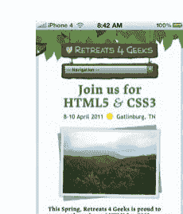

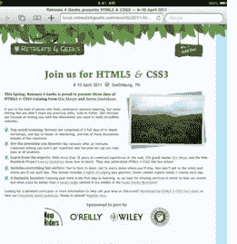

```css
@media screen and (max-width:765px) {
  /* ... */
}
```

```css
@media screen {
  /* ... */
}
```

### 宽屏

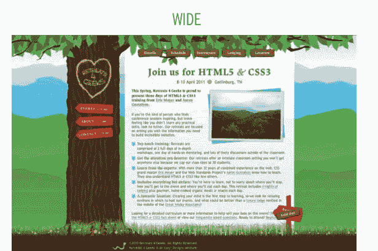

```css
@media screen and (min-width:1025px) {
  /* ... */
}
```

图 3.6：使用媒体查询的替代布局。

## 丰富的层次

如你所见，我们可以使用多种方法来利用 CSS 逐步增强我们的网页。一些技术，例如利用解析错误，如此简单且普遍，以至于你现在可能正在使用它们。其他技术，例如分面样式分离，可能会为你的当前实践提供略微不同的视角，或者对你来说完全陌生。然而，当这些技术结合使用时，它们会相互交织，层层叠加，为每个用户提供量身定制的体验，无论她的浏览器或设备支持什么。

> “除非我能非常熟练地使用一个工具，否则我不想用它。半心半意地做这些事情比完全不做更糟糕。人们不想要平庸的交互。”

— SETH GODIN

# 第四章：使用 JavaScript 进行渐进增强

2011 年 2 月 7 日，在 Gawker Media 推出其旗下各种博客（Lifehacker、Gizmodo 等）的统一重新设计后不久，访问这些网站的用户看到的只是一片空白（见图 4.1）。新平台完全依赖 JavaScript 将内容加载到页面中，而 JavaScript 代码中的一个错误导致任何页面请求都空手而归。¹ 这个单一的错误导致了所有 Gawker 网站长时间的“停机”（我之所以这样称呼是因为服务器仍在运行），使他们失去了大量的页面浏览量和广告印象。如果他们使用渐进增强来设计新平台，这一切本可以避免。

1. 关于此故障的简短提及：http://blogs.wsj.com/digits/2011/02/07/gawker-outage-causing-twitter-stir/。Jeremy Keith 和 Mike Isolani 就 Gawker 平台对 JavaScript 的依赖提供了有价值的评论（分别见 http://adactio.com/journal/4346/ 和 http://isolani.co.uk/blog/javascript/BreakingTheWebWithHashBangs）。我也在 http://easy-reader.net/archives/2011/02/09/you-cant-rely-on-javascript/ 上发表了看法。

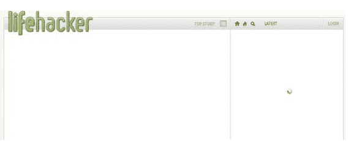

图 4.1：Lifehacker。空白页面。

没有什么比 JavaScript 更能让一个网页“活”起来了。借助它，你可以创建丰富的交互效果，构建动态界面等等。Web 开发者们很早就意识到了这一点。他们抓住机会，利用这个强大的工具来打造更具吸引力的网页、验证表单数据等等。对于今天的 JavaScript 开发者来说，制作出令人惊叹的作品并遵循渐进增强原则很容易，但情况并非一直如此。


回到 90 年代中后期，编写 JavaScript 就像在实践一种黑暗艺术。我们在 HTML 中的每一丁点“意大利面条式代码”，到了 JavaScript 里通常会糟糕十倍，因为当时两大主流浏览器——Netscape 和 Internet Explorer——各自实现了该语言²，而它们之间的差异足以让真正有趣的东西变得极难编写。例如，在文档（技术上称为文档对象模型或 DOM）中查找同一个元素（例如 `#location`）需要两种截然不同的语法：

```
document.layers['location'];   // Netscape
document.all['location'];      // IE
```

2. JavaScript 语言本身由 Brendan Eich 设计，于 1995 年底作为 Netscape 2 的一项功能首次亮相。微软开发了自己的 JavaScript 方言（出于商标原因命名为“JScript”），并于 1996 年中将其作为 Internet Explorer 3 的一部分发布（巧合的是，这也是第一款提供 CSS 支持的浏览器）。

## 突破阻碍

这种不幸的现实要求我们基本上为每个脚本编写两次，或者至少在其中填满“分支”（根据浏览器为脚本选择的不同路径），而这些分支最终往往会反过来“坑”了我们。

正如我们在第 2 章所讨论的，90 年代后期是网络上动荡不安的时期：浏览器大战。随着每一次新版本的发布，Netscape 和微软都为开发者提供了新的功能，希望能占据更大的浏览器市场份额。这种相互攀比给开发者带来了许多问题；由于 JavaScript 的两种竞争性实现，我们花了太多时间试图弥合差异，以至于没有关注这门语言本身的功能，也没有学习将其与 HTML 和 CSS 集成的最佳方式。

当欧洲计算机制造商协会（ECMA）国际标准化了 JavaScript³，W3C 发布了其 DOM 规范时，我们脚下流动的沙子终于被坚实的基础所取代，我们得以开始探索更好的方法：

```
document.getElementById('location'); // 统一的 DOM
```

尘埃落定后，我们学到的第一课是，JavaScript 并不是解决网络交互问题的万能药。事实上，它甚至不那么可靠。

首先，即使在 W3C 标准化了 DOM，浏览器也普遍同意支持 Web 标准之后，大家也并非都在遵循同一套规则；实现之间的差异仍然很大，以至于我们根本无法假设某些方法（例如作为 DOM 遍历基石的 `document.getElementById()`，它通过 id 访问元素，或者 `document.getElementsByTagName()`，顾名思义，通过名称查找元素）的可用性。其次，即使浏览器完全支持 JavaScript，用户（或其 IT 管理员）仍然对是否允许 JavaScript 运行拥有最终决定权。⁴

随着时间的推移，我们意识到 JavaScript 的支持并非理所当然，于是我们开始重构代码，使其更简洁、更易于维护、更灵活，以应对 JavaScript 的可用（或缺失）情况。让我们审视一下那个时期的思考，以更好地理解如何渐进式地使用 JavaScript。

> 警告：从这里开始，我们将深入到实际的 JavaScript 代码。如果你之前没有太多 JavaScript 的开发经验，请不要担心，我会尽我所能解释每一步发生的事情，这样你就能跟上，即使代码对你来说如同天书。

## 100% 依赖

在 JavaScript 的早期，将 `onclick` 事件处理程序（当有人点击页面上的某个元素时执行的脚本）应用于原本无用的链接⁵，这种情况并不少见。

```
<a href="#" onclick="newWin( 'http://easy-designs.net/' );">Easy! Designs</a>
```

当 JavaScript 启用时，此链接会调用一个名为 `newWin` 的自定义函数，并传递一个值 `"http://easy-designs.net/"`。该函数继而会在新窗口中打开该 URL。然而，如果没有 JavaScript，该链接将不起任何作用，因为正如我们在第 2 章关于标识符的讨论中所回忆的，`href` 指向一个空的 `id`。一个没有 JavaScript 就无法工作的链接有什么意义？

这引出了我关于 JavaScript 渐进增强的第一个准则：

1. 确保所有内容都可以访问，并且所有必要的任务都可以在未启用 JavaScript 的情况下完成。

这个链接显然违反了这一点（我之前提到的 Gawker 平台也是如此），但在 90 年代末，网络上使用的绝大多数 JavaScript 也是如此。当时，网络上充斥着需要 JavaScript 的网站，以及 JavaScript 妨碍用户的地方；换句话说，JavaScript 是侵入式的。意识到这个问题，Web 开发者开始推动“非侵入式” JavaScript。

> 注意：我并非提倡使用弹出窗口或使用 JavaScript 打开新窗口，因为它们会引入许多无障碍性和易用性问题。然而，我选择这个例子是因为它以一种相对容易理解的方式说明了我们 JavaScript 代码的演变过程。请放心，通过跟随这个例子学到的经验，普遍适用于你可能进行的任何其他 JavaScript 开发。

4. 然而，对于 IT 管理员来说，选择禁用 JavaScript 根本上是出于安全考虑，但在很长一段时间里，有无障碍访问需求的用户也被鼓励禁用 JavaScript。一些用户也会禁用 JavaScript 以移除烦人的广告和弹出窗口。在浏览器首选项中最容易禁用 JavaScript，但也可以通过防火墙阻止，或由 IT 管理员在应用层面禁用。

5. 这种老派技术的变体包括 `javascript` 伪协议（例如 `<a href="javascript:myFunction();">`），以及我个人最喜欢的，将 `javascript` 伪协议与内联事件处理程序结合使用（例如 `<a href="javascript:void(null)" onclick="myFunction();">`）。

## 走向非侵入

非侵入式 JavaScript 是指以不依赖 JavaScript 的方式进行编程的统称。在这种范式下，用户可以访问所有页面内容，并可以使用网络的基本构建块（HTML 和 HTTP 协议）在页面上完成每个必要的任务。然后，通过叠加 JavaScript 来增强页面。

听起来很熟悉？非侵入式 JavaScript 的理念与渐进增强哲学完美契合，因为它迫使 JavaScript 扮演功能增强的角色，而不是绝对要求。

考虑到非侵入式 JavaScript，我们重构了我们的链接，使其无论 JavaScript 是否可用都能工作：

```
<a href="http://easy-designs.net/" onclick="newWin( this.href ); return false;">Easy! Designs</a>
```

在这个修订版中，链接实际上指向一个 URL，因此它在没有 JavaScript 的情况下也能工作。然而，当 JavaScript 可用时，点击链接将调用 `newWin`，该函数接收链接 `href` 属性的值（DOM 值 `this.href`）。此版本与上一个版本链接的另一个关键区别在于，`onclick` 事件处理程序也设置为“return false”，这会取消点击事件的默认操作（在这种情况下，是跟随链接跳转到新页面）。

这是解决 JavaScript 可能缺失问题的一大步，但我们很快意识到，管理此类场景还有更好的方法。

## 更易维护

这段代码演进的下一步是使用由来已久的 `rel` 属性（你可能从第 2 章就记住了）将我们的内联 JavaScript 代码迁移到外部文件。这带来了两个好处：1）它赋予了链接额外的语义含义；2）它使网站维护变得容易得多，因为开发者只需修改一个 JavaScript 文件就能影响整个网站（这正是我们之前论证外部样式表优于内联使用 `style` 属性时提出的论点）。以下是新的 HTML：

```
<a rel="external" href="http://easy-designs.net/">
    Easy! Designs</a>
```

从这里开始，将点击事件应用到这个和任何其他“外部”链接上就相当简单了：

```
var links = document.getElementsByTagName( 'a' ),
    rel, i = links.length;
while ( i-- ) {
    rel = links[i].getAttribute('rel');
    if ( rel && rel.match( /\bexternal\b/ ) ) {
        links[i].onclick = function(){
            newWin( this.href );
            return false;
        };
    }
}
```

如果那些“if”和“while”对你来说如同天书，这里有一个脚本功能的简要总结：它收集页面上的所有链接并循环遍历它们（以逆序方式，这奇怪地比正向遍历稍快一些）；如果链接具有 `rel` 属性且其值包含文本“external”，则该链接的 `onclick` 事件会被分配一个匿名函数，该函数调用一个名为 `newWin` 的函数（像前面的例子一样，传递链接的 `href` 属性值），然后通过返回 false 来取消点击的默认操作。

最终，我们找到了一个相当不错的解决方案，它几乎是能做到的最不显眼的方式。在 2006 年，Jeremy Keith 为我们提出了一个可爱的小名称：Hijax，这是“劫持”（hijack，指链接的正常行为被接管的事实）和“Ajax”（一种基于 JavaScript 的机制，使网页无需刷新浏览器即可与服务器交互）的巧妙结合。我们当时不知道，当时正流行的 Ajax 将向我们表明，在 JavaScript 事件管理方面，我们还有待学习。

## 真正的灵活性

随着 Ajax 技术⁶和其他动态修改页面内容的方法被广泛接受和实现，我们分配事件处理程序的陈旧方法表现得就不那么好了。毕竟，如果页面中注入了带有 `rel="external"` 标记的新内容，它就不会有我们的自定义函数作为 `onclick` 事件处理程序被分配。这是因为我们的脚本很可能是在页面加载时（`window.onload()`）运行的，早于通过 Ajax 注入的新链接。

这无疑提出了一个棘手的问题。在这种情况下，两个本应表现相同的链接实际上可能表现得完全不同。你能说出这是一个可用性问题吗？

6. `XMLHttpRequest` 是我们用来向服务器发起请求并接收信息的技术，无需刷新或重新加载浏览器页面。它由微软为 Outlook Web Access 发明，并在 IE5 中首次亮相，但已被其他所有浏览器采用，目前正在 W3C 进行标准化。`XMLHttpRequest` 是 Ajax（异步 JavaScript 和 XML）的支柱，但尽管有其名，它可以通过 XML 以外的方式进行通信。Ajax 中的“A”代表“异步”，因为这种通信方式不需要用户等待响应；当脚本从服务器加载更多信息时，她可以继续与页面交互。

为了解决这个问题，一些人在每次基于 Ajax 的 HTML 注入完成时都会重新执行脚本。这似乎是个好主意，但反复调用同一个函数会显著拖慢浏览器速度，因为它每次都需要遍历页面上的所有链接。

然后 Christian Heilmann 提醒我们，任何在特定元素上触发的事件实际上都会在事件捕获和冒泡阶段分别从根节点（html）遍历 DOM 树到该元素，然后再返回。⁷ 这意味着链接上的“click”事件实际上在根节点和链接本身之间的每个元素上执行……两次⁸（见图 4.2）。在 DOM 树更上层的元素上监听事件不仅更高效（因为你可以分配单个事件处理程序而不是数百个），而且使得在动态内容上触发操作成为可能，从而帮助我们克服了相似链接行为不同的潜在可用性问题。

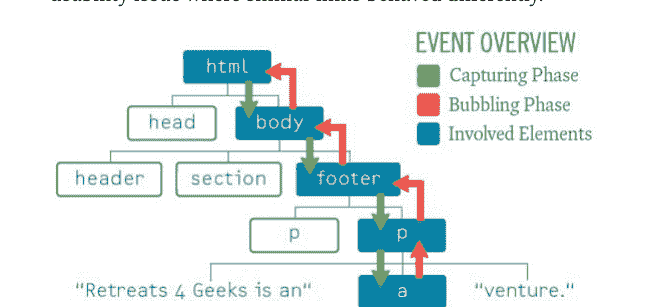

图 4.2：事件捕获和冒泡。

7. <http://icant.co.uk/sandbox/eventdelegation/>

8. 好吧，技术上并非在每个浏览器中都是两次。微软事件模型，在 IE9 之前的所有版本中实现，仅支持事件的冒泡阶段。标准的 W3C 事件模型同时支持事件捕获和事件冒泡。

这个概念被称为“事件委托”，因为单个事件处理程序可以解释事件并根据触发该事件的元素发出指令。以下是使用事件委托重写的前面示例的简洁版本：

```javascript
document.body.onclick = function( e ) {
  // even out the event models
  e = ( e ) ? e : event;
  var el = e.target || e.srcElement, rel;
  // external links
  rel = el.getAttribute( 'rel' );
  if ( el.nodeName.toLowerCase() == 'a' &&
       rel && rel.match( /\bexternal\b/ ) ) {
    newWin( el.href );
    // cancel the default action
    if (e.preventDefault) {
      e.preventDefault();
    } else {
      e.returnValue = false;
    }
  }
};
```

这段代码将事件处理程序分配给 `body` 元素的 `onclick` 事件，建立监听器；在监听器内，它确定目标元素（被点击的元素），然后检查以确保它是一个具有 `rel` 属性且包含字符串“external”的锚点元素（a）；如果元素满足所有这些要求，则调用 `newWin` 函数并取消事件的默认操作。

这个例子虽然具体，但它展示了为什么我们必须继续演进我们基于 JavaScript 交互的方法。提高我们对 JavaScript 的理解通过帮助我们使代码更智能、更不显眼，为渐进增强带来了直接益处，但也有助于我们在可维护性和性能方面提升。

## 构建我们所需

到现在你可能已经掌握了不显眼 JavaScript 的要点，但我们只是从文档的角度审视了用户体验。基于 JavaScript 的交互在许多方面都远胜于没有它的交互。例如，客户端表单验证提供了在用户提交表单之前就向其提供潜在错误即时反馈的机会。

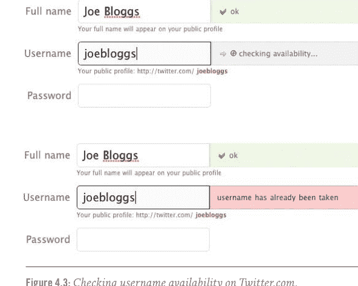

图 4.3：在 Twitter.com 上检查用户名可用性。

正如我们所见，我们需要小心确保每个界面都能在没有 JavaScript 的情况下工作，但是当 JavaScript 需要额外的标记来实现其目标时怎么办？嗯，这引出了我关于使用 JavaScript 进行渐进增强的第二条准则：

2. 使用 JavaScript 生成其需要的任何额外标记。

JavaScript 非常擅长动态生成和修改标记。因此，当你需要用 JavaScript 增强界面时，首先从语义化、可用的标记和基础样式开始。然后，在脚本确定它可以无错误地运行后，指导它进行新界面所需的必要 HTML 和 CSS 更改。

要查看此方法的实际示例，让我们回到 Retreats 4 Geeks 页面。

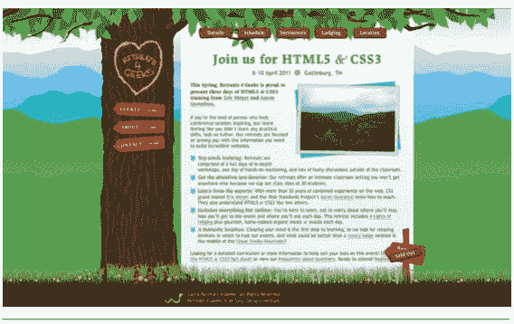

图 4.4：Retreats 4 Geeks 网页。

我希望在移动设备上尽可能高效地利用空间。水平导航在小浏览器上也能工作，但点击目标区域会太小，不容易点击。当然，我可以将网站切换为使用垂直导航，允许更大的链接，但那会占用宝贵的屏幕空间。

这两种方法的替代方案是使用 CSS 或 `select` 元素创建一个下拉菜单。虽然纯 CSS 下拉菜单选项很诱人，但后一种方法更有优势，因为它为用户提供了熟悉的用户界面。出于这个原因，我选择了 `select` 路线。

基于第 2 章引入的标记，我将引导你创建一个脚本，将

## 保持和谐

正如我们已经讨论过的，HTML 和 CSS 中许多渐进式增强技术都相当直观，甚至可能在你阅读本书之前就已经是你技能库的一部分。另一方面，JavaScript 的渐进式增强则更为复杂一些；JavaScript 无法像其他技术那样具备容错性，因为它是一种编程语言。

与分别用于描述内容和向浏览器提供设计指令的 HTML 和 CSS 不同，JavaScript 实际上是向浏览器执行命令。由于它们确实做了某些事情，JavaScript 程序在遇到错误时会停止运行。这些错误的潜在原因多种多样，从拼写错误到缺失的依赖项，再到意外编写的无限循环。无论原因是什么，如果你编写的代码与浏览器的 JavaScript 解释器配合得不好，它很可能会在你（或你的客户）面前抛出一个巨大的错误。而没人愿意看到这种情况。

正如我们所看到的，在渐进式增强的每个阶段，实现方式并非是拥有或不拥有某项技术的二元选择。相反，用户在每个层级的体验是根据浏览器的功能而变化的。因此，如果用户的浏览器原生支持 RGBa，但不支持圆角边框，这也没什么大问题；用户得到的就是她得到的。

我们需要以同样的方式对待 JavaScript；它不应该是一个全有或全无的选择。并非要一次又一次地回到食物比喻，但我们应该以点菜式的方式提供技术，将功能划分为离散的、自包含的包。一旦分离，这些脚本就可以测试自身的依赖项，并根据浏览环境和它们要交互的页面来判断是否应该运行。

我们刚刚讲解的基于 `select` 的导航脚本就是这一概念第一部分的绝佳实践案例；它完全自包含。然而，它并没有正确测试其众多的依赖项，其中第一个就是 jQuery 的可用性。要做到这一点，我们需要将整个代码包裹在一个条件语句中：

```javascript
if ( typeof( jQuery ) != 'undefined' ) {
    // 现有代码放在这里
}
```


当浏览器窗口缩小到特定尺寸以下时，将`nav`元素转换为`select`。为了保持示例简短且易于理解，我使用了 jQuery JavaScript 库。⁹ 库是很好的工具，因为它们由数十甚至数百个函数组成，可以解决常见问题（如添加和删除类名）。如果你不能完全理解代码，别担心，我会解释发生了什么，这样你就不用自己去解读了。

我们将首先把脚本隔离在一个匿名函数¹⁰中，这个函数在 DOM 可用后立即运行，但在图像、CSS 文件和视频等资源下载完成之前（即所谓的 onDOMReady）。这比在窗口加载（即`window.onload`）时运行脚本使页面响应更快。在本例的剩余部分，所有代码都将被封装在此函数内：

```javascript
$(function(){
  // 令人兴奋的内容将放在这里
});
```

接下来，我们创建此脚本运行所需的变量。通过一次性实例化所有变量，我们将减少`var`语句的数量（这有助于代码压缩）。¹¹

```javascript
var
$window   = $(window),        // 引用窗口
$old_nav  = $('#top nav > *'), // 获取导航
$links    = $old_nav.find('a'),   // 获取链接
showing   = 'old',            // 跟踪当前显示的内容
trigger   = 765,              // 触发变更的浏览器宽度
                              //
$new_nav, $option,            // 我们稍后会用到这些
timer     = null;             // 我们也需要一个定时器
```

注释应该能让你很好地了解每个变量的用途。

如果你熟悉 jQuery，但困惑于为什么我们将元素赋值给局部变量，而不是每次需要时都引用基于 jQuery 的查找（例如`$('#top nav > *')`），请放心，我的做法是有章法的：创建本地引用可以减少运行脚本时的性能损耗，因为查找只发生一次，而不是每次使用`$()`时都发生。另外，为了便于区分 jQuery 结果和其他变量，我在每个相关变量名前加上了美元符号（`$`）。你会在本脚本中看到这些技巧的使用，因为养成这些习惯很有帮助。

所有变量就位后，你*可能*认为我们可以进入脚本的核心部分了，但我们还没完全准备好。在尝试对页面执行代码之前，我们应该确保所需的元素确实存在：

```javascript
if ( $old_nav.length && $links.length ) {
  // 我们知道所需的 DOM 元素存在
  // 并且可以对它们执行一些操作
}
```

测试依赖项非常重要，我将在下一节更全面地介绍这一点。现在进入正题（或者如果你是素食主义者，可以说是“坚果馅”）。我们将正式开始脚本，生成新的基于`select`的导航，创建`select`以及它将包含的第一个`option`元素：

```javascript
$new_nav = $('<select></select>');
$option = $('<option>-- 导航 --</option>')
  .appendTo($new_nav);
```

有了新的标记可用，我们现在可以循环遍历我们收集到的链接（存储为`$links`），并通过反复克隆我们刚刚创建的`option`来为每个链接构建一个新的`option`：

```javascript
$links.each(function(){
  var $a = $(this);
  $option.clone()
    .attr( 'value', $a.attr('href') )
    .text( $a.text() )
    .appendTo( $new_nav );
});
```

`options`创建完毕并追加到`select`后，我们可以继续添加最终的标记细节，并设置`select`的`onchange`事件处理程序：

```javascript
$new_nav = $new_nav
  .wrap('<div id="mobile-nav"/>')
  .parent()
  .delegate('select', 'change', function(){
    window.location = $(this).val();
  });
```

这是在实际的 Retreats 4 Geeks 网站上找到的代码的一个略微简化版本（我删除了一些 URL 哈希技巧），但我想确保你能不受干扰地理解它。这里发生的是：前三行将我们的`select`（`$new_nav`）包裹在一个`div`中，然后将该`div`重新赋值给变量`$new_nav`，这样整个结构在 JavaScript 看来就是一个整洁的小包裹；下一行使用事件委托（我们之前讨论过）从 DOM 树的更上层（实际上是从`div`）监听`select`的`onchange`事件，并将一个匿名函数赋值给该事件，该函数将新的位置推送到浏览器的地址栏（导致浏览器跳转到新的部分或加载新页面，具体取决于链接类型）。

搞定！功能性的基于`select`的导航。现在需要在条件合适时将其添加到页面中。为此，我们将创建一个名为`toggleDisplay`的新函数，该函数将监视浏览器窗口大小并处理一种导航样式与另一种的切换：

```javascript
function toggleDisplay() {
    var width = $window.width();
    if ( showing == 'old' && width <= trigger ) {
        $old_nav.replaceWith($new_nav);
        showing = 'new';
    } else if ( showing == 'new' && width > trigger ) {
        $new_nav.replaceWith($old_nav);
        showing = 'old';
    }
}
```

同样，这是最终脚本的一个略微简化版本，但它突出了重要的部分：只有在满足相应的浏览器宽度阈值（`trigger`）*并且*另一种导航样式正在显示时（使用`showing`跟踪），导航才会被切换。有了这个函数，我们只需运行一次（初始化所有内容并确保从一开始就显示正确的导航），然后将其分配给窗口的`onresize`事件：

```javascript
toggleDisplay(); // 初始化正确的视图
$window.resize(function(){
    if ( timer ) { clearTimeout(timer); }
    timer = setTimeout( toggleDisplay, 100 );
});
```

如果你想知道为什么`toggleDisplay()`没有作为实际的事件处理程序传入，那是因为这样做会导致函数在用户调整浏览器大小时被执行多次（可能数百次）。为了将执行次数保持在最低限度（并减少脚本对用户 CPU 的负担），事件处理程序使用一个定时器在 0.1 秒后调用`toggleDisplay()`。当该函数在 resize 事件期间被反复触发时，它会销毁现有定时器（如果存在），然后重新创建一个。这种设置确保当用户调整浏览器大小时（除非调整得*非常*慢），`toggleDisplay()`只被调用一次。

就这样：一个使用 JavaScript 进行渐进式增强的完美示例。

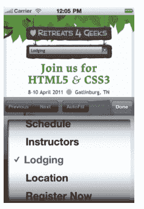

图 4.5：iPhone 上基于 select 的导航。

正如这个简单示例所展示的，JavaScript 完全能够生成它需要的一切，并丢弃它不需要的东西。你甚至可以更进一步，让这个特定函数更加标记无关，允许根起点（在我们的例子中，是`nav`的子元素）动态传递给函数。但我把这个留给你去实验。继续前进！

---

⁹ http://jQuery.com

¹⁰ 匿名函数是指没有被赋予名称的函数。

¹¹ http://www.alistapart.com/articles/javascript-minification-part-II/

## 依赖检测

在这段简短的代码中，我们正在检查 jQuery 对象的存在性，当 jQuery（该库）存在时，该对象会被创建，通过检查其类型是否为“undefined”。依赖检测是一个有用的策略，因为它有助于避免浏览器中抛出错误，并且可以通过避免不必要地执行代码来加快用户的浏览速度。

这里还有另一个你可能更熟悉的简单例子：

```
if ( document.getElementById ) {
  // Code using document.getElementById() goes here
}
```

在这种情况下，我们在执行使用 DOM 遍历方法`document.getElementById`的代码之前，先确保它存在。你可能还记得我们在事件委托示例中使用这种策略来测试`event.preventDefault`。

回到 jQuery 测试，我们可以更进一步，检查 jQuery 的特定版本。如果你的脚本使用了早期版本库中不可用的方法，这种测试形式会很有用。在许多情况下，测试特定方法的存在性更为明智，但当库的新版本实质上改变了现有方法的 API 时，版本检查会非常有帮助：

```
if ( typeof( jQuery ) != 'undefined' &&
     parseFloat( jQuery.fn.jquery ) >= 1.4 ) {
  /* Existing code that requires jQuery 1.4 or higher
     goes here */
}
```

测试依赖性是确保你不会执行可能抛出错误代码的好方法，而且，你测试得越早，就能为那些从脚本中无法获益的用户节省越多的内存和处理时间。

不过，jQuery 并不是脚本唯一的依赖项；正如你可能回忆起的，当我们在测试`$old_nav`和`$links`集合的长度时，我们已经考虑了它的标记依赖：

```
if ( $old_nav.length && $links.length ) {
```

有了这个测试，当脚本无事可做时，它会悄然退出，不会费心创建任何注定不会被使用的新元素或分配任何事件处理程序。

基于这个例子，你可能能看到无数种场景，其中对浏览环境和页面设置的调查可以帮助脚本确定是否应该运行。对象存在性、标记依赖、方法可用性、Cookie 可用性和 Ajax 支持都是唾手可得的。添加允许脚本在依赖项不可用时悄然关闭的代码是微不足道的，所以真的没有理由不去做。

仔细想想，依赖测试的概念与在 CSS 中使用媒体查询非常相似。说到 CSS，我们应该谈谈如何最好地管理脚本和样式之间的交互。

## 处理样式

我们尚未讨论的一个脚本依赖项是 CSS。十有八九，如果你正在编写与 DOM 交互的 JavaScript，你也会以某种方式使用 CSS。在进行渐进增强开发时，确定从 JavaScript 内部应用和控制样式的最佳方式非常重要，这样你就不会通过创建实际不起作用的界面来迷惑你的用户。不过，稍后会详细讨论这一点。

多年来，我们对 JavaScript 和 CSS 应该如何交互的理解已经发生了很大演变。在 JavaScript 的早期，脚本中的样式管理几乎不存在；我们只是通过操作元素的`style`属性来内联编写所有内容：

```
function highlight() {
  var el = document.getElementById( 'message' );
  el.style.color = '#f00';
  el.style.backgroundColor = '#fffcfc';
}
```

从维护的角度来看，以这种方式编写的代码是个噩梦。这意味着任何设计变更都需要让懂 JavaScript 的人参与进来。这效率低下，且违反了层分离原则；将表现和行为混在一起会使两者都更难处理。

演变的下一步是将可变部分提取到变量中，要么在脚本本身内部，要么作为配置对象的一部分传入（在跳过配置时保留合理的默认值）：

```
function highlight( config ) {
  var el = document.getElementById( 'message' );
  el.style.color = config.color || '#f00';
  el.style.backgroundColor = config.backgroundColor
                              || '#fffcfc';
}

highlight({
  color: '#ebebeb',
  backgroundColor: 'black'
});
```

这仍然需要至少对 JavaScript 有基本的了解才能更新字符串，但希望所有的样式规则都集中在一个地方，这样维护应该会容易一些。

然而，最终我们意识到，在外部样式表中维护样式信息，并通过操作页面上的元素类来触发它，效率要高得多：

```
function highlight() {
    document.getElementById( 'message' )
        .className += ' highlight';
}
```

这不仅减少了实现所需效果的代码量，还意味着更少的 DOM 操作（这极大地提高了性能），并且意味着 CSS 可以在不修改与这些样式交互的 JavaScript 的情况下进行维护。

我将放弃讨论将脚本和样式打包在一起的不同方式，同时仍然保持相当程度的分离，转而花一些时间讨论何时以及如何最好地使用脚本应用样式。虽然前者无疑是一个有趣的话题，¹² 但你选择的路径更多地与你的工作流程和整体项目需求有关。然而，脚本何时以及如何应用样式至关重要，这也是我关于使用 JavaScript 进行渐进增强的最后一条准则的主题：

### 3. 样式未到，时机未到

正如我们已经讨论过的，大多数 DOM 脚本也需要一些样式修改——无论是展开和折叠页面上的元素、突出显示新添加的内容，还是为拖放界面提供视觉修饰。以这种方式使用样式完全合理，但开发者通常在确定部件能否运行之前就应用了与该部件对应的样式。

例如，以一个手风琴部件为例。在典型的手风琴界面中，内容块是隐藏的，只有相关的标题是可见的。如果用于隐藏内容部分的样式被默认应用，而脚本无法运行，用户将无法单击标题来揭示隐藏的内容。样式会过早应用，从而破坏了界面的实用性。

另一方面，如果脚本本身在知道它将能够运行时才触发初始状态样式的应用，那就不会有任何问题。如果脚本不运行，部件相关的样式就不会被应用，内容仍然可见，因此也是可用的。通过这种方式实现样式应用，当部件无法运行为内容提供一种布局，当它可以运行时提供另一套样式，从而优化了两种使用情况。

可能是这样吗？是的，我认为是的。渐进增强的完美境界。

管理这种触发界面样式效果的最佳方式之一是在部件的根元素上使用一个“激活器”`class`。以下是一些快速示例：

| 策略 | “静息”类 | “激活”类 |
| :--- | :--- | :--- |
| 在基础`class`后添加“-on”后缀 | `.accordion` | `.accordion-on` |
| 添加另一个`class` | `.auto-submit` | `.auto-submit.active` |
| 改变`class`的形式 | `.replace-me` | `.replaced` |

表 4.1：使用“激活器”`class`。

通过遵循此实践，你可以保证在需要之前不会应用任何样式。

通过 JavaScript 应用样式的另一个问题是潜在的冲突。正如将脚本彼此隔离以避免变量、函数或方法命名冲突很重要一样，建议你也将与脚本相关的样式与其他样式隔离。毕竟，你可能无法控制给定页面上可能使用的其他`class`名称（尤其是当你为他人使用发布脚本时），如果你不仔细隔离你的样式，它们可能会无意中“渗透”到页面的其余部分（即它们可能被应用到你未曾打算应用的元素上）。

为了规范你的样式，最好在每个选择器开头使用一个标识性标记，该标记不太可能与页面上的另一个`class`或`id`冲突。我喜欢以 JavaScript 对象的名称开头。因此，例如，如果我构建了一个（聪明地）命名为`AccordionWidget`的手风琴部件，我可能会将其分类为...

## 规划与约束

请务必明确，使用 JavaScript 实现渐进增强所投入的精力，远比 CSS 或 HTML 要多得多。然而，只要稍加深入思考，并全面考量影响网页体验的诸多因素，这种理念很快就会成为你的本能。况且，若有疑虑，你总可以回归以下三条箴言：

1. 确保所有内容均可访问，且无需 JavaScript 即可完成所有必要任务。
2. 使用 JavaScript 来生成它所需的任何额外标记。
3. 适度应用样式，切忌过早。

掌握了如何高效运用 JavaScript 力量的坚实理解，你定能做出明智的决策，并构建出更具可用性的网站。

> “良好的声誉需要无数善行来建立，而一次劣行就足以将其毁于一旦。”
>
> —— 本杰明·富兰克林

# 第五章：面向可访问性的渐进增强

2006 年 2 月，美国全国盲人联合会就网站无障碍问题对 Target 提起了诉讼。一个月后，案件移交至联邦法院（应 Target 要求）。Target 试图驳回此案，但未能成功，最终演变为集体诉讼，并于 2008 年以 Target 支付超过 600 万美元（不包括律师费）达成和解。考虑到诉讼的起因仅仅是 Target 未修复他们早已被告知的可访问性问题——图片缺少替代文本、过度使用图像映射以及提交表单时依赖鼠标——这一金额相当可观。所有这些问题本可以快速、轻松地解决，成本远低于 600 万美元。天哪，我只需几千美元就能搞定。


如果你对可访问性——就本章而言，它衡量的是网站在多大程度上能被残障人士及其所依赖的辅助技术¹使用——缺乏了解，作为一项设计考量，它可能显得极其令人畏惧，因为需要考虑的因素实在太多。即使你自己属于“有特殊需求”的用户群体，你的经验和能力也可能与有类似需求的他人不同。例如，你可能患有绿色弱（一种红绿色盲），但程度或许不如他人严重。你也可能不太会意识到黄色蓝色盲人群可能面临的潜在问题。

如果你是那种关心可访问性问题的人，无论你是出于将信息尽可能广泛传播的立场，还是出于不想让任何人感到被遗漏的初心，那种“必须做对”的自我施压感可能会如此强烈，以至于你不禁会带着忧虑去面对它。

值得庆幸的是，采用渐进增强进行设计和开发能提升可访问性。渐进增强鼓励你以服务内容为核心来构建网站，而这往往能在可访问性方面引导你做出正确的决策。当然，总有改进的空间，因此有了这一章。

> ¹辅助技术有多种形式。例如使用屏幕阅读软件的盲人，通过浏览器放大文字的部分视力受损者，以及经常依赖字幕来轻松理解视频内容的聋人。

## 现在你看见我了……

基于 JavaScript 的页面操作模式中，最常见的一种或许是内容的显示与隐藏。标签式界面、可折叠元素、手风琴小部件……它几乎无处不在。这种模式本身并非坏事，但很少有人意识到，你选择的隐藏机制会如何深刻地影响辅助技术（如屏幕阅读器）对你内容的可访问性。

当涉及隐藏内容时，有几种机制可供选择，每种对页面的影响各不相同，如下表总结所示。

| CSS 规则 | 显示效果 | 可访问性影响 |
| :--- | :--- | :--- |
| `visibility: hidden;` | 元素在视觉上隐藏，但不从正常文档流中移除（即它仍占据其通常占据的空间） | 屏幕阅读器忽略该内容 |
| `display: none;` | 元素从正常文档流中移除并隐藏；其占据的空间被折叠 | 屏幕阅读器忽略该内容 |
| `height: 0; width: 0; overflow: hidden;` | 元素被折叠，内容被隐藏 | 屏幕阅读器忽略该内容 |
| `text-indent: -999em;` | 内容被移出屏幕并从视图中隐藏，但链接可能“焦点”异常，且负缩进可能不足以完全隐藏内容 | 屏幕阅读器可以访问内容，但内容仅限于文本和内联元素 |
| `position: absolute; left: -999em;` | 内容从正常文档流中移除并向左偏移出屏幕；其占据的空间被折叠 | 屏幕阅读器可以访问内容 |

表 5.1：隐藏内容的机制。

前两种机制可能是最受欢迎的，其中 `display: none;` 几乎是所有 JavaScript 库和大部分现成 JavaScript 小部件的首选方案。如果你不希望屏幕阅读器读取隐藏内容，这些默认值可能适用；但如果你想确保用户能够访问内容（即使它在当前界面中没有视觉显示），那么最后一种方案才是真正可行的途径。

如果你自己编写 JavaScript 库，将内容定位在屏幕外以隐藏它实现起来相当容易。然而，如果你使用的是第三方 JavaScript 库，如 jQuery 或 Prototype，这项任务就变得困难得多，因为做出更改需要重写或修改库的内部机制。当然，除非你懂得巧妙地处理。

大多数库在其动画套件中都包含了一种称为“回调函数”的机制。回调函数是你提供给另一个函数（或对象方法）的函数，以便在预定时间被调用。如果你曾使用 JavaScript 通过 Ajax 加载内容，你可能熟悉这个概念：回调函数用于处理从服务器返回的数据。

在大多数情况下，JavaScript 库只提供一个在特定活动完成时运行的回调函数，但有些库还提供了在执行过程的不同阶段（例如，例程开始前）的钩子。然而，即使没有额外的回调钩子，也有可能创建更具可访问性的显示/隐藏操作。请看以下基于 jQuery 的代码片段：

```javascript
(function(){
    var $button = $('#myButton'),
        $text   = $('#myText'),
        visible = true;

    $button.click(function(){
        if ( visible ) {
            $text.slideUp('fast');
        } else {
            $text.slideDown('fast');
        }
        visible = ! visible;
    });
})();
```

这段脚本找到两个元素（`#myButton` 和 `#myText`），并将它们分别赋给两个局部变量（`$button` 和 `$text`），然后设置第三个局部变量（`visible`）来跟踪当前状态。接着，它为 `#myButton` 分配了一个点击事件处理程序，通过调整高度来切换 `#myText` 的可见性。相当直接，对吧？

这段脚本按预期工作，但 jQuery 在调用 `slideUp()` 时目前使用的是 `display: none`，因此 `#myText` 是通过一种禁止屏幕阅读器读取隐藏文本的方法来隐藏的。然而，通过对代码进行细微调整，我们可以触发添加一个我们控制的类，从而提供一种更具可访问性的内容隐藏方式：

```javascript
(function(){
    var $button = $('#myButton'),
        $text   = $('#myText'),
        visible = true;

    $button.click(function(){
        if ( visible ) {
            $text.slideUp('fast',function(){
                $text.addClass('accessibly-hidden')
                     .slideDown(0);
            });
        } else {
            $text.slideUp(0,function(){
                $text.removeClass('accessibly-hidden')
                     .slideDown('fast');
            });
        }
        visible = ! visible;
    });
})();
```

这个脚本与前一个几乎相同，区别在于当内容被隐藏时，允许库来管理动画，但脚本会将默认的完成状态替换为我们自定义的 `class`“accessibly-hidden”，从而使内容对辅助技术保持可用。当脚本显示内容时，步骤相反：脚本会先隐藏内容，然后移除该 `class`，再执行实际的动画。

这种方法的额外好处在于，你可以完全控制隐藏内容的方式，而不是依赖 JavaScript 库。这意味着，如果未来出现更好的技术，你可以升级你的“accessibly-hidden” `class` 来采用不同的方法，而无需等待库更新其隐藏机制（如果它真的会更新的话）。

当然，所有这些都假设你想隐藏内容的显示，但仍希望它对旧的辅助技术可用。然而，如果你不希望屏幕阅读器读取该内容，你*可以*使用 `display: none`，但这仍然不是最佳途径，因为一旦你想显示该内容，就很难让用户知道有新内容可用。为了真正为用户提供最佳体验，你需要采用 Web 无障碍倡议（Web Accessibility Initiative）的无障碍富互联网应用规范（WAI-ARIA，简称 ARIA）中定义的角色和状态。²

> ² <http://www.w3.org/TR/wai-aria/>

使用 ARIA 隐藏内容非常简单：你只需使用 `aria-hidden` 属性。

```html
<p aria-hidden="true">猜猜看？我正使用 ARIA 进行无障碍隐藏。</p>
```

ARIA 提供了大量预定义的角色、状态和属性，在构建 JavaScript 密集型网站时极具价值。其中一些即使你不是在构建高度交互式的应用，也同样有用。我们将首先介绍这些。

### 引导导航

ARIA 提升网页无障碍性的众多方式之一是通过使用“地标”（landmark）和“结构性”（structural）角色。其中许多角色正式定义了我们多年来一直试图通过应用语义分类和标识符（如我们在第 2 章讨论的）赋予元素的意义。ARIA 的地标和结构性角色（以及我们稍后会讲到的部件角色）通过 `role` 属性分配给元素。

我知道，我知道：`role` 在 HTML 4.x 或 XHTML 1.x 中不是一个有效的属性。这是事实。ARIA 为 HTML 词汇表添加了许多新属性，这意味着你无法再使用你一直使用的那些旧的文档类型定义（DTD）来验证你的页面。如果你想在用这两种语言编写的页面中验证包含 ARIA 的内容，你需要使用另一套 DTD³ 或直接升级到支持 `role` 等属性的 HTML5。

> ³ HTML 4.01 加 WAI-ARIA 的 DOCTYPE 是 `<!DOCTYPE html PUBLIC "-//W3C//DTD HTML+ARIA 1.0//EN" "http://www.w3.org/WAI/ARIA/schemata/html4-aria-1.dtd">`。XHTML 加 WAI-ARIA 的 DOCTYPE 是 `<!DOCTYPE html PUBLIC "-//W3C//DTD XHTML+ARIA 1.0//EN" "http://www.w3.org/WAI/ARIA/schemata/xhtml-aria-1.dtd">`。

这是一个 ARIA 实际应用的快速示例：

```html
<ol role="navigation">
  <li><a href="#details">详情</a></li>
  <li><a href="#schedule">日程</a></li>
  <li><a href="#instructors">讲师</a></li>
  <li><a href="#lodging">住宿</a></li>
  <li><a href="#location">地点</a></li>
</ol>
```

你应该认出这段标记来自第 2 章；它是“极客静修所”（Retreats 4 Geeks）页面的导航部分。这与我们原始标记的唯一区别在于，`ol` 现在有一个值为“navigation”的 `role` 属性。正如你所料，ARIA 的地标“navigation”角色表示该元素正在充当导航机制。

所有 ARIA 的地标角色都传达了页面本身各区域的信息，对于整体页面导航非常有用。一些辅助技术会将这些地标暴露给用户，允许他们通过按键或其他方式直接从一个区域移动到另一个区域。它们是大量“跳转到”链接的合乎逻辑的继任者。另一方面，结构性角色则充当组织工具，类似于 HTML5 的 `section` 和 `article` 等元素。

你可能还记得，在最初的示例中，我们将导航 `ol` 包裹在一个新的 HTML5 元素 `nav` 中。如果你思维敏捷，你还会记得使用 `nav` 元素在语义上等同于使用地标角色“navigation”。而这并不是 HTML5 和 ARIA 之间唯一的重叠领域。

> ⁴“跳转到”链接是通过锚点提供对页面区域访问的链接。常见的实现包括“跳转到内容”和“跳转到导航”。它们曾是 Web 标准领域的多年主流，但 ARIA 的地标角色使这些链接变得冗余。

### 冗余与合理性

这两个规范在大致相同的时间段内独立发展，各自都试图解决他们看到的 HTML 当前状态的迫切问题。（因此，重叠是不可避免的。）ARIA 规范目前比 HTML5 更接近成为正式推荐标准，因此，随着 HTML5 规范的持续发展，其许多独特功能正被整合到 HTML5 中。当 HTML5 最终达到“候选推荐标准”阶段时，可以相当安全地假设这两个规范将成功合并，冗余也将被消除。

然而，目前 ARIA 和 HTML5 之间仍有相当大的重叠，尤其是在结构性角色和（程度稍轻的）地标角色方面。表 5.2 提供了一些我们传统的即兴语义、其等效的 ARIA 角色，以及执行相同目的的 HTML5 元素（如果有的话）的示例。

| 即兴语义 | ARIA 角色 | HTML5 元素 | 语义含义 |
| :--- | :--- | :--- | :--- |
| `#header`, `#top` | `banner` | `header`（部分） | 页面中以站点为中心而非以页面为中心的区域 |
| `#main`, `#content` | `main` | 无 | 文档中的焦点内容 |
| `#extra`, `.sidebar` | `complementary`, `note` | `aside` | 文档中与主要内容相关的支持性部分（“补充”内容在与主要内容分离后仍有意义） |
| `#footer`, `#bottom` | `contentinfo` | `footer` | 包含文档相关信息的区域 |
| `#nav` | `navigation` | `nav` | 包含导航链接的页面区域 |
| `.hentry` | `article` | `article` | 构成文档独立部分的页面区域 |

表 5.2：*传统的即兴语义、其等效的 ARIA 角色，以及执行相同目的的 HTML5 元素（如果有的话）。*

目前，HTML5 社区和无障碍倡导者之间对于如何处理这种冗余还存在一些争论。从实际角度看，即使你正在使用 HTML5 中与 ARIA 等效的语义，通常也认为最好同时使用 ARIA 地标角色，因为并非所有辅助技术都已意识到 HTML5 的存在。然而，结构性角色可以根据你的自行决定进行分配，因为它们纯粹是组织性的，并且目前不会通过辅助技术暴露给用户。

快速浏览“极客静修所”的源代码会发现 `nav` 和 `footer` 元素上的这种冗余。不过，随着辅助技术更新以支持 HTML5，我们将能够去掉不必要的 `role` 属性，使我们的标记更加精简。

除了与 HTML5 的重叠外，还有相当多的角色复制了 HTML 中早已存在的语义。考虑以下 ARIA 地标和结构性角色：`columnheader`、`definition`、`form`、`heading`、`img`、`list`、`listitem`、`row`、`rowheader` 和 `separator`。其中一些与 HTML 中的元素有一一对应的关系（例如，“form”），而另一些则是 HTML 中已有内容的更通用的形式（例如，“list”）。

虽然可以理解 ARIA 和 HTML5 的并行发展会产生一些重叠，但你可能也会疑惑，为什么 ARIA 似乎要重新创建 HTML 中已存在十多年 的语义。简单的答案是，出于某种原因，一些公司（<cough>谷歌</cough>）喜欢使用非语义标记（例如 `div`）作为界面的基础，然后使用 JavaScript 使其功能像原生 HTML 控件。仅仅因为这个原因，ARIA 就提供了重叠的角色。你不会看到我跑出去给一个 `div` 分配一个“form”的角色（我会直接使用 `form`，谢谢），但我猜各有所好吧。

正如我们之前讨论的，“极客静修所”网站实现了几个在语义上与 ARIA 的地标和结构性角色等效的 HTML5 元素——`nav`、`footer`、`article`——但为了服务于尽可能多的用户（毕竟，这就是渐进增强的意义所在，对吧？），我们选择包含了等效的 ARIA 角色。不过我们还没完。正如我们在表 5.2 中看到的，ARIA 的“banner”角色与 HTML5 的 `header` 的语义等效性有些争议，因此，为了绝对清晰地服务于我们的用户，我也添加了那个角色：

```html
<header role="banner">
```

我们尚未讨论的唯一其他角色（因为它目前在 HTML5 中尚未涉及）是“main”，它

## 兄弟，能给点线索吗？

这表示文档的核心内容。你可能从第二章中回忆起，我选择了一个 `section` 元素来包含页面上的各种文章，并且它也是我选择作为 hCalendar 根节点的元素；那个 `section` 就在我脑海中强烈地呼应着“main”这个角色：

```html
<section id="content" class="vevent" role="main">
```

通过这两处小小的调整，我们已经为 Retreats 4 Geeks 网站应用了所有看似合理的地标性角色（landmark roles）。不仅如此，我们还通过为辅助技术用户提供便捷的文档导航方式，提升了页面的整体可访问性。

除了为用户提供文档导航手段外，ARIA 规范还规定了其他有用的工具，其中最重要的当属其控件角色和状态集合。

控件角色正如你所期望的那样：描述给定元素的作用。这些角色通常分为两大类：提供定义结构的角色，以及不提供结构的角色。或者更简单地说，容器和组件。容器是容纳给定控件组件的元素。

考虑图 5.1 所示的标签页界面（tabbed interface）。一个标签页界面由两个组件部分构成：一个标签页列表（list of tabs）和这些标签页所显示的一组面板（collection of panels）。在 ARIA 规范中，这些部分分解为三个独立的角色：标签页本身具有 `tab` 角色，标签页列表具有 `tablist` 角色，每个面板被分配 `tabpanel` 角色。就命名而言，“tab”和“tabpanel”都被视为组件角色，而“tablist”则被视为容器角色（因为它包含标签页）。

## 南瓜派

概述 成分 做法 营养信息

无论您是举办节日派对还是与朋友进行休闲聚会，我们的南瓜派都将让待客变得轻松简单！

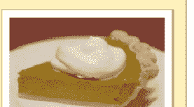

原始食谱产量：1 个 9 英寸深盘馅饼

**准备时间：** 10 分钟  
**烹饪时间：** 1 小时  
**完成时间：** 1 小时 10 分钟

照片由 Paul Goyette 提供，采用 Creative Commons 授权。

图 5.1：一个标签页界面。

ARIA 规范定义了多种控件角色，使得构建从复杂表单控件（如滑块和微调框）到树状菜单、模态对话框以及拖放界面等各种功能成为可能，同时还能保持可访问性。并且，与我们之前讨论的结构角色一样，ARIA 甚至提供了重新定义无意义标记为功能性内容的机制：

```html
<div role="button">I&#8217;m not a real button, but I play one on the web</div>
```


当然，所有这一切都很美好，但任何控件要工作都需要 JavaScript，而传统上，这一直是可访问性的无人区。Ajax 等技术与可访问性无法良好结合的主要原因是，HTML 语言没有提供让 JavaScript 实时更新用户（或其选择的辅助技术）的机制，除了`alert()`和`confirm()`（让我们面对现实，它们就像是用户界面教室里的捣蛋鬼）。

ARIA 规范通过所谓的“状态”来解决上下文问题。ARIA 状态是一组可以应用于几乎所有元素的属性。其中一些是全局范围的（即可以应用于任何元素），而另一些则特定于某些控件上下文。所有状态都以“aria-”为前缀，它们向用户提供有关给定元素状态的有价值信息。

猜猜怎么着？你已经熟悉其中一个：`aria-hidden`。我们之前在本章讨论过的`aria-hidden`属性接受一个布尔值（“true”或“false”），让用户代理或辅助技术知道其中的内容是否应呈现给用户。其他 ARIA 状态示例包括`aria-disabled`、`aria-expanded`、`aria-invalid`、`aria-pressed`和`aria-selected`。

就图 5.1 中的标签页界面而言，我们可能希望采用的状态是`aria-hidden`用于标签页面板的状态，`aria-selected`用于标签页本身的状态。

但 ARIA 规范并未止步于此。除了状态指示属性外，它还定义了许多可在元素上设置的属性。示例包括`aria-autocomplete`、`aria-controls`、`aria-label`、`aria-labelledby`、`aria-readonly`和`aria-required`。如你所见，大多数属性适用于表单控件，但少数（如`aria-controls`）可以应用于我们的标签页界面。

正如你可能猜测的那样，`aria-controls`接受一个 id 引用作为值，该 id 应属于其内容或存在被应用该属性的元素所控制的元素。在标签页界面的情况下，标签页将“控制”其关联的标签页面板（如图 5.2 所示）。建立了标签页到标签页面板的关系后，在反方向建立关系似乎也很公平；这正是`aria-labelledby`可以发挥作用的地方。它的工作方式与`aria-controls`完全相同。

```html
role="tab" id="recipe-0-tab"

aria-describedby="recipe-0"
```

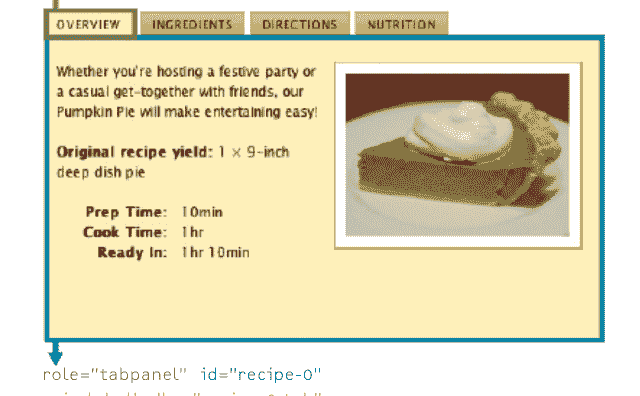

```html
role="tabpanel" id="recipe-0"

aria-labelledby="recipe-0-tab"
```

图 5.2：使用 ARIA 属性，我们可以将界面的不同部分相互关联起来。

ARIA 的状态和属性在让用户保持知情方面大有帮助，但 ARIA 中很少有概念能像实时区域（Live Regions）那样简单且立即有用。

## 它是活的！

随着 Ajax 的出现和 JavaScript 的全面复兴，没有比页面上的实时更新区域更能成为用户体验的噩梦了。可用性问题众多，但两个主要问题是：1）辅助设备不知道页面发生了变化，无法引导用户关注这些变化；2）利用页面缩放或在移动设备上浏览的用户，会忽略发生在屏幕外的内容更新。值得庆幸的是，ARIA 规范包含一个直接解决这个严重问题的属性：`aria-live`。

`aria-live`最令人兴奋的是它的简洁性。只需将这个单一属性应用于一个元素，你就可以控制其中的内容更新如何以及何时呈现给你的用户。`aria-live`属性接受以下三个值之一：

1. “off”，用于更新频繁且对用户不重要的情况，例如来自你 Twitter 帐户的实时流（哎呀！）；
2. “polite”，用于更新仅在用户没有执行任何操作时才值得宣布的情况，例如更新的新闻标题；或
3. “assertive”，用于更新非常重要需要立即宣布的情况，例如表单验证消息。

在 Retreats 4 Geeks 网站中，将`aria-live`应用于联系表单是有意义的：

```html
<article id="contact" aria-live="assertive">
```

有了这个设置，用户将在填写详细信息时随时获知遇到的任何错误，并且也会在提交成功时收到通知。

## 支持与绊脚石

自推出以来，ARIA 获得了网络社区的广泛支持。截至本文撰写时，所有主流浏览器都提供了一定程度的 ARIA 支持，并且已经在流行的屏幕阅读工具（如 JAWS、Windows Eyes、NVDA 和 Orca）中得到实施。像 IBM、Sun Microsystems、Adobe、Yahoo! 和 Google 这样有影响力的公司都在努力提高 ARIA 的有效性和影响力。甚至 JavaScript 社区也接纳了 ARIA，Dojo Dijits⁵ 和 jQuery UI⁶ 都将 ARIA 的角色、状态和属性集成到了它们的组件中。当然，规范仍在发展中，因此没有哪个实现是完整的，但进展正在取得。

如果不提及一个主要问题，我将是有失职守，这个问题阻碍了 ARIA 完美融入渐进增强（progressive enhancement）体系，至少在涉及控件相关的角色和状态时：我们无法测试浏览器或辅助技术中的 ARIA 支持，因此无法就如何最好地实施给定控件做出明智的决定。Derek Featherstone 在他为《*A List Apart*》撰写的优秀文章《ARIA and Progressive Enhancement》⁷ 中提出了这个问题。我强烈推荐阅读它以更好地理解这个问题。截至本文撰写时尚未提出可行的解决方案，但我仍然抱有希望。

## 按键不是脏话

在我结束这本小书的最后一章之前，我想讨论的最后一个主题是键盘访问和控件。随着鼠标的普及以及对 iPad 等基于触摸设备的依赖增加，很容易忽略不起眼的键盘，但这将是一个严重的错误。键盘是一个极其有用的工具，是所有非视觉用户和大多数高级用户的标准接口。

关于键盘，我们在过去几年学到了很多。首先，我们意识到访问键在理论上是个好主意，但在实践中效果不佳。⁸ 其次，我们意识到，过度使用`tabindex`属性可能会让用户陷入困境（而且并非有益的那种）。⁹ 但我们发现的最重要的事情是，我们可以利用 JavaScript 来“调度”`tabindex`属性，从而简化用户在复杂界面组件（如选项卡式界面或手风琴式表单）中的操作路径。

那么，究竟什么是`tabindex`调度呢？大约在2005年（确切起源难以考证），人们发现为元素的`tabindex`属性赋值"-1"，可以将该元素从文档的默认制表符顺序中移除。¹⁰ 有趣的是，尽管被移出了文档的制表符顺序，该元素仍然可以通过 JavaScript（`element.focus()`）获得焦点，这为控制用户体验开辟了诸多可能性。

让我们通过一个场景来回顾一下之前的选项卡式界面：

1. 用户访问选项卡式界面，按下键盘上的`tab`键，焦点移动到第一个选项卡（该选项卡与当前可见的选项卡面板相关联）。
2. 再次按下`tab`键，焦点会从选项卡界面移出，进入下一个可聚焦的内容，而不是跳转到列表中的下一个选项卡。
3. 按住`shift`键的同时按下`tab`键，会将用户带回选项卡列表，并将焦点恢复到当前活动的选项卡上。
4. 使用方向键，用户可以在选项卡列表中向前或向后移动，焦点移动时，相应的选项卡面板也会随之显示。
5. 在浏览选项卡列表时，按下`enter`键，会将焦点带到与该选项卡相关的选项卡面板上。

⁹ http://webaim.org/techniques/keyboard/tabindex

¹⁰ 这尤其有趣，因为根据 W3C 规范，`tabindex`应仅接受0到32767之间的值。

我知道这有很多“选项卡”（而且要求有点高），但通过`tabindex`调度和一点 JavaScript，实现起来就变得相当简单了。方法如下：

1. 为每个选项卡和选项卡面板分配一个值为"-1"的`tabindex`，可以将它们从页面的制表符顺序中移除。
2. 重新为当前活动的选项卡分配一个值为"0"的`tabindex`，可以恢复其在制表符顺序中的默认位置。
3. 使用 JavaScript，你可以在用户执行键盘命令（如左/右、上/下方向键）时，动态调整每个选项卡的`tabindex`属性，使用户能够快速轻松地浏览界面。

以下是`TabInterface`的`swap`方法中的一段代码片段，展示了`tabindex`调度的实际应用（同时涉及一些 ARIA 属性操作和`class`切换）：

```javascript
function swap( e ) {

  // ...

  // De-activating the current tab & tab panel

  removeClassName( old_tab, 'active' );

  old_tab.setAttribute( 'aria-selected', 'false' );

  old_tab.setAttribute( 'tabindex', '-1' );

  removeClassName( old_folder, 'visible' );

  old_folder.setAttribute( 'aria-hidden', 'true' );

  // Activating the new tab & tab panel

  addClassName( tab, 'active' );

  tab.setAttribute( 'aria-selected', 'true' );

  tab.setAttribute( 'tabindex', '0' );

  addClassName( new_folder, 'visible' );

  new_folder.setAttribute( 'aria-hidden', 'false' );

  // ...

}
```

1. http://dojotoolkit.org/widgets
2. http://jqueryui.com/
3. http://alistapart.com/articles/aria-and-progressive-enhancement/
4. http://www.wats.ca/show.php?contentid=32


如果你想看看这项技术的实际效果，可以查看 Github 上的 `TabInterface.js`。<sup>11</sup>

### 立即行动……无障碍地

无障碍性很复杂，可能难以完全理解，但如果你一点一点地去攻克，它就会成为一种本能。并且，正如本书中的所有其他内容一样，无障碍性最容易通过分层应用来实现，逐步构建界面，创造出满足用户需求（无论需求是什么）的东西。

> “如果你想造一艘船，不要敲锣打鼓召集人们来收集木材、分配工作和发号施令。相反，要教会他们向往浩瀚无垠的海洋。”
>
> — 安托万·德·圣-埃克苏佩里

# 第六章：开始行动

在我们短暂的相处中，我们涵盖了大量内容。我们目睹了渐进增强的实践过程，追踪了一个简单文本文档如何发展成为一个美观、功能齐全且无障碍的网页。这无疑是一段旋风般的旅程，但希望你能从中更好地理解什么是渐进增强、它为何有效，以及如何将其融入你的设计和开发流程。或许你甚至已经掌握了一些有用的技巧，能够应用到你自己的项目中。

## 渐进增强清单

### 内容与 HTML

- 编写良好且朗读时清晰易懂的文案。  
  这是每个用户的基础体验，非常重要。
- 选择语义上合适的元素。  
  利用 HTML 现有的语义对无障碍性（以及搜索引擎优化）大有裨益。
- 使用微格式来弥补 HTML 的不足。  
  微格式是 HTML 词汇表的扩展，受到众多浏览器和搜索引擎的支持。
- 使用分类来将具有相同功能的元素分组。  
  当 HTML 固有语义不足且没有合适的微格式时，分类（即使用 `class` 属性）有助于传达元素的含义。
- 标识地标元素。  
  标识（即使用 `id` 属性）是为页面特定区域或特定分类实例提供上下文的好方法。

### CSS

- 仔细检查你的复合选择器。  
  混合复杂程度差异巨大的选择器可能会在浏览器无法理解其中一个选择器时导致问题：整个规则集将被忽略。然而，如果你的意图是从旧浏览器中隐藏该规则集，这可能是一种有用的策略。
- 组织你的 CSS 规则时要考虑到层叠。  
  顺序很重要，正确组织样式规则可以帮助你创建渐进式设计，并使你的 CSS 更易于维护。
- 从旧浏览器中隐藏成组的高级 CSS 规则集。  
  CSS 中用于批量隐藏规则集的最强大工具之一是使用 `@media` 块。
- 使用条件注释处理 IE 问题。  
  旧版 IE 的 bug 是出了名的，条件注释是为特定版本的 IE 提供 CSS 和 JavaScript 补丁的最佳方式。它们在“自上而下”模式中效果最好。
- 确保你已考虑到替代媒体和上下文。  
  媒体赋值和媒体查询可用于根据用户的上下文提供定制的布局和体验。

### JavaScript

- 确保所有 JavaScript 都是“非侵入式”的。  
  脚本应尽可能远离标记语言，并尽可能通用。这使你能够独立地重构它们。你的 JavaScript 不应与特定标记绑定，而应足够灵活，以便随着页面的演变而适应。
- 确保所有内容都是可访问的，并且在没有开启 JavaScript 的情况下所有必要任务都能完成。  
  你不能依赖 JavaScript。这是底线。如果你想用 JavaScript 进行增强，请遵循 Hijax 模式。
- 使用 JavaScript 生成其所需的任何额外标记。  
  JavaScript 非常擅长操作 DOM，因此没有理由将仅为脚本服务的标记硬编码到页面中。
- 使用 JavaScript 启用与脚本相关的样式。  
  没有什么比内容被组织成一个控件，却因 JavaScript 被关闭或脚本出错而无法工作更烦人的了。使用一个开关让 JavaScript 能够开启与控件相关的样式。
- 尽可能按需提供脚本。  
  任何可以独立运行的脚本都应设计为如此，并配备一套测试来判断它是否可以运行。

### 无障碍性

- 在适当的地方使用 ARIA 地标。  
  如果你使用 HTML5，一些 ARIA 地标可能看起来是多余的，但最好还是覆盖到，以防万一。使用它们很简单，却能极大地提升页面的无障碍性。
- 使用 ARIA 角色和状态为用户提供关于控件的更多细节。  
  当你使用 JavaScript 创建控件时，几乎没有方法向用户提供有关他们与控件交互时正在发生什么的有价值信息。角色和状态填补了这些空白。
- 使用 `tabindex` 控制用户在页面中的导航路径。  
  使用 `tabindex` 属性，你可以为用户在页面中的导航划定路径，将他们快速轻松地引导至重要的地标。更进一步，JavaScript 可用于在用户与页面各种组件交互时，调整哪些元素可以获得焦点，哪些不能。

## 延伸阅读

### 内容与文案

Erin Kissane 所著的《内容策略要素》，A Book Apart 出版社，2011 年

Kristina Halvorson 所著的《网页内容策略》，New Riders 出版社，2009 年

Erin Kissane 撰写的《为谋生而写作》，发表于《A List Apart》  
http://www.alistapart.com/articles/writingcontentthatworksforaliving/

Amber Simmons 撰写的《挽救厌食症式的网页写作》，发表于《A List Apart》  
http://www.alistapart.com/articles/revivinganorexicwebwriting/

Bronwyn Jones 撰写的《通过设计实现更好的写作》  
http://www.alistapart.com/articles/betterwritingthroughdesign/

Derek Powazek 撰写的《召唤所有设计师：学习写作！》，发表于《A List Apart》  
http://www.alistapart.com/articles/learntowrite/

Erin Kissane 撰写的《僵尸文案的袭击》，发表于《A List Apart》  
http://www.alistapart.com/articles/zombiecopy/

### 标记语言

Jeremy Keith 所著的《面向网页设计师的 HTML5》，A Book Apart 出版社，2010 年

Jeffrey Zeldman 与 Ethan Marcotte 合著的《使用网页标准设计，第 3 版》，New Riders 出版社，2009 年

John Allsopp 所著的《使用网页标准开发》，New Riders 出版社，2009 年

John Allsopp 所著的《微格式：增强你的 Web 2.0 标记》，Friends of ED 出版社，2007 年

Dan Cederholm 所著的《网页标准解决方案：标记与样式手册，特别版》，Friends of ED 出版社，2009 年

Ethan Marcotte 撰写的《我们的标准在何处出错》，《A List Apart》  
[http://www.alistapart.com/articles/whereourstandardswentwrong/](http://www.alistapart.com/articles/whereourstandardswentwrong/)

Craig Cook 撰写的《如何领悟网页标准》，《A List Apart》  
[http://www.alistapart.com/articles/grokwebstandards/](http://www.alistapart.com/articles/grokwebstandards/)

Brandon Olejniczak 撰写的《使用 XHTML/CSS 进行有效的 SEO 活动》，《A List Apart》  
[http://www.alistapart.com/articles/seo/](http://www.alistapart.com/articles/seo/)

### CSS

Dan Cederholm 所著的《面向网页设计师的 CSS3》，A Book Apart 出版社，2010 年

Dan Cederholm 与 Ethan Marcotte 合著的《手工打造的 CSS：更健壮的网页设计》，New Riders 出版社，2009 年

Simon Collison、Andy Budd 与 Cameron Moll 合著的《精通 CSS：高级网页标准解决方案，第 2 版》，Friends of ED 出版社，2009 年

Dan Cederholm 所著的《健壮的网页设计：使用 XHTML 和 CSS 提升灵活性并防范最坏情况（第 2 版）》，New Riders 出版社，2007 年

Eric Meyer 所著的《Eric Meyer 论 CSS 更多》，New Riders 出版社，2004 年

Eric Meyer 所著的《Eric Meyer 论 CSS：精通网页设计语言》，New Riders 出版社，2002 年

Aaron Gustafson 撰写的《使用媒体查询实现自适应布局》，《.net 杂志》第 205 期

Ethan Marcotte 撰写的《响应式网页设计》，发表于《A List Apart》  
http://www.alistapart.com/articles/responsive-web-design/

Wilson Miner 撰写的《使用网页标准实现可访问的数据可视化》，发表于《A List Apart》  
http://www.alistapart.com/articles/accessibledatavisualization/

Joe Clark 撰写的《大、醒目且厚实》，发表于《A List Apart》  
http://www.alistapart.com/articles/lowvision/

Patrick Griffiths 撰写的《弹性设计》，发表于《A List Apart》  
http://www.alistapart.com/articles/elastic/

Eric Meyer 撰写的《CSS 设计：走向打印》，发表于《A List Apart》  
http://www.alistapart.com/articles/goingtoprint/

### JavaScript

Jeremy Keith 所著的《健壮的 Ajax》，New Riders 出版社，2007 年

Jeremy Keith 所著的《DOM 脚本》，Friends of ED 出版社，2006 年

Scott Jehl 撰写的《测试驱动的渐进增强》，发表于《A List Apart》  
http://www.alistapart.com/articles/testdriven/

Jeremy Keith 撰写的《行为分离》，发表于《A List Apart》  
http://www.alistapart.com/articles/behavioralseparation/

Peter Paul Koch 撰写的《JavaScript 触发器》，发表于《A List Apart》  
http://www.alistapart.com/articles/scripttriggers/

### 可访问性与 ARIA

Todd Parker、Scott Jehl、Maggie Costello Wachs 与 Patty Toland 合著的《使用渐进增强设计：为所有人构建有效的网页》，New Riders 出版社，2010 年

Shawn Lawton Henry 所著的《就请提问：将可访问性贯穿于设计全程》，Lulu 出版社，2007 年

Jeremy Sydik 所著的《设计可访问的网站：为所有受众和平台创建内容的 36 把钥匙》，Pragmatic Bookshelf 出版社，2007 年

Martin Kliehm 撰写的《使用 WAI-ARIA 实现可访问的 Web 2.0 应用》，发表于《A List Apart》  
http://www.alistapart.com/articles/waiaria/

Steve Faulkner 撰写的《HTML5 与 WAI-ARIA 冗余神话》，发表于《The Paciello Group Blog》  
http://www.paciellogroup.com/blog/?p=585

AOL 开发者网络撰写的《DHTML 样式指南》  
http://dev.aol.com/dhtml_style_guide

Mike Brittain 撰写的《让紧凑表单更易于访问》，发表于《A List Apart》  
http://www.alistapart.com/articles/makingcompactformsmoreaccessible/

Andy Hagans 撰写的《高可访问性是有效的搜索引擎优化》，发表于《A List Apart》  
http://www.alistapart.com/articles/accessibilityseo/

Trenton Moss 撰写的《什么是网页可访问性？》，发表于《A List Apart》  
http://www.alistapart.com/articles/wiwa/

# 关于作者


Aaron 在互联网领域工作了近 15 年，在此期间，他培养了对网页标准的热爱，并对网站策略与架构、界面设计以及多种语言（包括 XHTML、CSS、JavaScript 和 PHP）有了深入的了解。Aaron 和他的妻子 Kelly McCarthy 拥有 Easy! Designs，这是一家位于田纳西州查塔努加的精品网络咨询公司。当不埋首于代码时，Aaron 通常会宣扬他的发现，并与该领域的其他人分享他的知识和热情。

Aaron 曾在《纽约时报》、Gartner 和美国环境保护署（以及其他机构）培训过专业人员，并在世界级的网络会议上发表演讲，如 An Event Apart 和 Web Directions。他是网页标准项目（WaSP）的集团经理，并担任万维网联盟开放网络教育联盟（OWEA）的受邀专家。他创建了 `eCSSStender`，担任《A List Apart》的技术编辑，是《.net Magazine》的特约撰稿人，并通过他的技术写作和编辑工作贡献了大量内容。

# 关于 EASY READERS

Easy! Readers 书籍是精心编撰的出版物，探索了资深和有抱负的网络专业人士的最佳实践和网页标准。由权威的网络从业者 Aaron Gustafson 和同行专家撰写的一系列书籍，探讨了打造顶级网站的整体方法。

Easy! Readers 专注于可用性和可访问性，其使命是引导读者了解各种主题的起源、哲学及其在网页标准中的实际应用。因为网络是一个不断变化的媒介，其范围、受众和平台持续发展和增长，我们致力于为您提供动态且相关的内容。

Easy Readers 书籍可批量购买用于教育用途。如需更多信息，请联系我们的教育销售部门：education@easy-readers.net。

# 版权页

正文采用 Fred Smeijers 设计的 Fresco Plus 及其配套字体 Fresco Sans Plus。书籍和章节标题采用 Jackson Burke 设计的 Trade Gothic。代码采用 Albert-Jan Pool 设计的 FF OCR F。

我们支持本地企业与可持续实践。本书由田纳西州查塔努加的 Starkey Printing Company 印刷。所用纸张——100 磅 Chorus Art Silk 封面纸和 80 磅 Chorus Art Silk 内页纸——经过 FSC 认证，由 50% 回收材料（30% 为消费后回收）制成。

在这本简短的书中，Aaron Gustafson 记录了渐进增强的起源、哲学和机制，并揭示了您可以运用 HTML、CSS 和 JavaScript 应用渐进增强原理的无数实用方法。通过理解渐进增强及其正确应用方法，网络从业者可以打造服务于用户（而非浏览器）的体验，使用户能够不受技术限制地获取内容。

> “《自适应网页设计》不仅提供了我所读过的关于渐进增强最清晰、最优美的解释，还通过 Aaron 温暖友好的写作风格，将大量实用知识直接灌输到你的大脑皮层。”
>
> — Jeremy Keith，《面向网页设计师的 HTML5》作者

> “终于。一本以完美的理论与实践平衡来解释渐进增强的著作。”
>
> — Dan Cederholm，《面向网页设计师的 CSS3》作者


