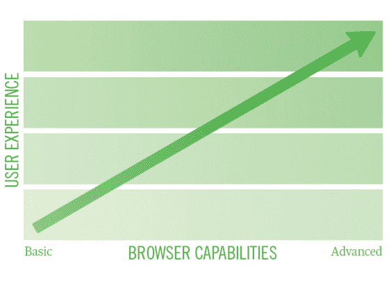
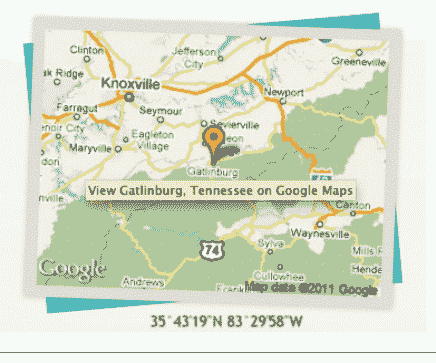
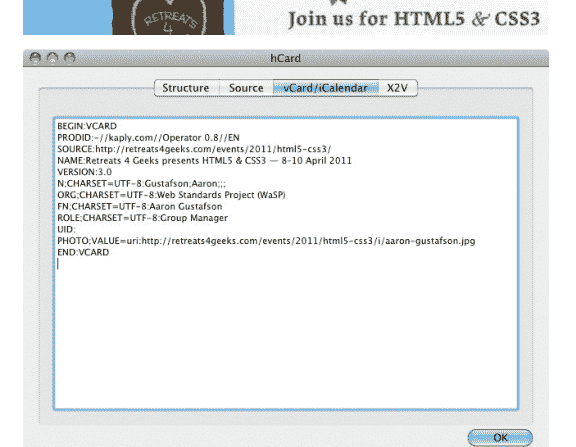
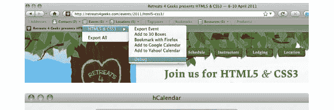
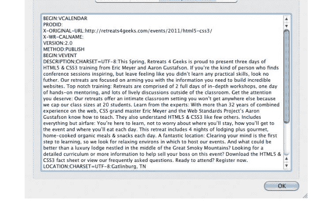
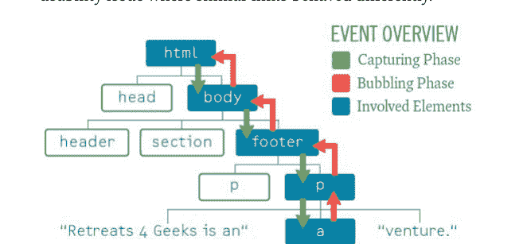
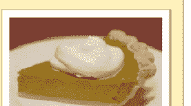
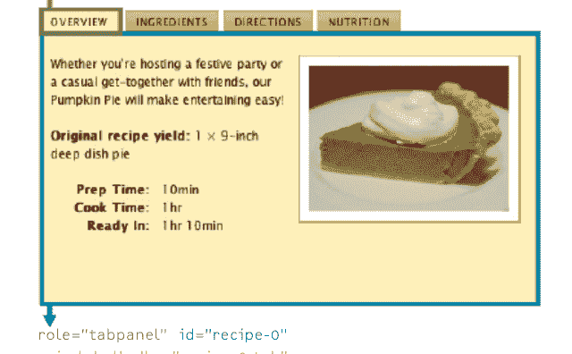

# 自适应网页设计：渐进增强打造丰富体验

# 致谢

若无众多业内友人与同仁的指导与协助，本书不仅无法问世，我亦无缘提笔撰写。谨致以最诚挚的谢意：

感谢 `Molly Holzschlag` 与 `Jeffrey Zeldman` 收我于门下，助我锤炼演讲与写作之能。亦感谢众多会议组织者与出版机构给予我施展这些技能的机会。

感谢 `Carolyn Wood` 协助雕琢部分初稿，感谢 `Krista Stevens` 把握论述核心、精炼文稿，并驯服我内心的顽劣之念。

感谢 `Craig Cook` 与 `Derek Featherstone` 确保我的代码规范严谨，感谢少数早期审阅者给予的深思熟虑的建议（及纠正）：`Dan Cederholm`、`Simon Collison`、`Kristina Halvorson`、`Christian Heilmann`、`Whitney Hess`、`Jeremy Keith`、`Dan Rubin` 与 `Jonathan Snook`。

感谢 `Easy Designs` 团队在细节上的专注与对本书编撰的宝贵协助：`Jessica Martin`、`Daniel Ryan`、`Jessi Taylor`、`Matthew Turnure` 与 `Laura Helen Winn`。

感谢 `Veeler Pieters` 在百忙之中为我设计了绝美的封面。

当然，更要感谢 `Kelly`，为我挤出写作时间，助我理清思路，并督促我最终完成此书。

# 前言

2016年3月某个明媚的午后，当一位友人与我匆匆赶往奥斯汀市中心希尔顿酒店，准备参加西南偏南互动节的下一场活动时，一位年轻的陌生人拦住了我们。未经介绍或寒暄，他便宣布自己愿意在“Apart事件”——由 `Eric Meyer` 与我三个月前创立的网页设计师大会——上发表演讲。我转向同伴，模仿“辛普森一家”中 `Burns` 先生的腔调（模仿得并不像）问道：“这位狂妄的年轻人是谁，`Smithers`？”

这位狂妄的年轻人很快成为了不可或缺的同事。在随后的岁月里，`Aaron Gustafson` 为我们公司最挑剔的客户创作了令人眼花缭乱的前后端代码。同样重要的是，他出色地担任了《网站标准设计（第三版）》的技术编辑。这份工作主要包括提醒 `Ethan Marcotte` 和我，我们对网页标准尚有哪些未知。关于这一点，我留待你们自行体会。五年来，`Aaron` 也一直是《A List Apart》杂志一位严格而公正的技术编辑，他帮助作者们取得成功，同时确保他们真正具有创新性，其方法具备可访问性与语义性，并且（凭借他近乎百科全书式的知识）对所有先前的相关成果给予应有的尊重。此外，`Aaron` 为该杂志撰写过开创性的文章，并且，是的，他曾在“Apart事件”上演讲过。

鉴于我对这个人的亲身经历以及对他知识与能力的钦佩，当 `Aaron` 告诉我这本书的构思并开始让我审阅章节时，我激动不已。这不仅仅是又一本网页设计书籍。它是经典文库中不可或缺却又缺失的一环。我们的行业长期以来一直需要一本关于自适应、基于标准的设计最佳实践汇编。随着移动设备的兴起、桌面及手机浏览器近期的显著改进，以及 `HTML5`、`CSS3` 和手势界面带来的新功能，对于我们这些构建网站的人来说，拥有一份可靠的资源，指导我们如何利用这些新功能，同时创建能在各种尺寸、浏览器和设备上正常工作的内容，就显得为重要。这本书正是这样的资源。

这些新元素与机遇的融合，促使网络专业人士能够按照网络本有的方式设计。自适应设计是正道，而在如何做好事的思维与技巧方面，没有人比 `Aaron` 掌握得全面。在这本书中，你将找到所有思考与方法。你也不必为如何进行网页设计（并创造优秀的代码）而浪费时间。尽情投入，享受吧！

`Jeffrey Zeldman`
《网站标准设计（第三版）》作者


# 第一章：以用户中心，而非浏览器

如果你在互联网领域工作一段时间，你可能已经（经常）听到“渐进增强”这个词。如你所知，这是网页设计的黄金标准。但渐进增强究竟是什么？它意味着什么？它是如何运作的？在语言浏览器快速发展的今天，它又如何融入我们的工作？这些都是很好的问题。正如你很快会看到的，渐进增强与浏览器无关，也与使用的`HTML` 或 `CSS`无关。渐进增强是一种旨在打造体验的哲学，它通过消除技术限制为用户提供内容。

## 适应或淘汰

随着本书的深入，我们将看到许多实用的方法结合`HTML`、`CSS` 和 `JavaScript`运用渐进增强来创建自适应网站。这些网站不仅能满足需求，还能提供卓越的体验，无论他们使用何种浏览器或设备。

在深入应用的具体细节之前，我们需要讨论渐进增强的方法以及这一哲学的基础。归结底，渐进增强依赖于一个原则：容错性。容错性是系统在遇到意外错误时继续运行的能力。这种特性使得我们能够在创伤后重新建立神经连接。大自然已证明自己非常长容错，而遵循她的榜样，我们将这个概念融入了自己的创造中。例如，备受誉的“智能网”可以通过感知（在某些情况下甚至能预测）系统问题，自动避免或减轻影响。

无论你是将网络作为专业画布，还是仅仅作为普通消费者，你都在持续受益于容错性。由于容错性自 `HTML` 和 `CSS` 诞生之初就已存在，你可能会认为我们（作为网络专业人士）在构建网站时会识别其重要性和价值。不幸的是，情况并非总是如此。

## 容错性与进化

容错性还有一个有趣的方面，就是它允许进化。同样，看看自然界，你会在气候或其他环境因素导致足够变化使得生物被迫适应、迁移或死亡。

1977年，加拉戈斯群岛经历了一场干旱，导致群鸟种群的小种子大幅减少。群岛上百分之十五的雀鸟因饥饿而死亡。奇怪的是，存活下来的是体型较大的鸟。为什么？因为它们拥有敲开更大、坚硬种子的大喙。在没有干旱的情况下，较大的雀鸟相对于它们较小的亲戚并没有优势，但当环境改变时，它们能够利用这种情况，不仅幸存了干旱，还将基因遗传给了下一代雀鸟，正如你预期的，它们变得更大。


*图1.1：加拉戈斯雀鸟（又名达尔文雀，`Geospiza fortis`）各异的喙，见于John Gould的《小猎犬号航行期间的动物学》。*

`HTML`和`CSS`与加拉戈斯雀鸟有许多共同之处。它们的设计都旨在“向前兼容”，这意味着我们今天编写的内容在明天、明年以及十年后都能工作。在某种意义上，它们是完美的雀鸟：无论浏览器环境本身如何变化，都能茁壮成长。

这些语言被设计为随时间进化，因此网络浏览器被指示遵循容错的规则，并忽略任何它们不理解的内容。这为这些语言提供了成长和适应的空间，而不会导致它们封装和样式的内容不再可读，或面临导致浏览器崩溃的风险。容错性使得我们能够在`Lynx`中浏览一个`HTML5`驱动的网站，并允许我们实验`CSS3`特性而不必担心弄坏`Internet Explorer 6`。

理解容错性是理解渐进增强的关键。容错性是渐进增强能够工作并确保网络上传送的所有内容对所有人都是可访问且可用的原因。

## “优雅”的失误

在网络诞生时，人们误解了：`HTML`和`CSS`。根据这两种语言的规范，浏览器必须忽略任何它们不理解的内容。这个简单的要求使得渐进增强成为可能。但更多细节稍后再说。


```markdown

作为网络如此重要的一个方面，`fostering the exchange of information`应该是我们在构建任何网络界面时的 `primary focus`。渐进增强确保所有内容（即网站包含的信息）对任何人都是 `available to and usable by`，无论 her location, the device she is using to access that information, or the capabilities of the program she is using to access that content。similarly，内容收集机制——网络表单、调查等——也 `benefit greatly from progressive enhancement because it ensures they are universally usable and, hence, better at doing their job`。

从根本上说，渐进增强是关于 `accessibility`，但 `not in the limited sense the term is most often used`。术语“无障碍性”传统上用于denote making content available to individuals with “special needs”（行动不便、认知障碍或视力受损的人）；渐进增强将 `this one step further by recognizing that we all have special needs`。我们的特殊需求 may also change over time and within different contexts。当我用手机加载一个网站时，for example, I am visually limited by my screen resolution (especially if I am using a browser that encourages zooming) and I am limited in my ability to interact with buttons and links because I am browsing with my fingertips, which are far larger and less precise than a mouse cursor.

正如我们已经 covered，以优雅降级为指导原则构建的网站在现代浏览器中可能 work great，但在 `anything less than the latest and greatest browsers for which they were built` viewing 时就 come up short。从一个非网络的角度来看，它 puts the user in a position where, like a young child at an amusement park, she may miss out on

这是一次很棒的体验，因为她身高不够，无法乘坐“旋转咖啡杯”。同样，使用“不合适”浏览器的用户在访问网站内容时，很可能也会遇到问题（甚至报错），如果他们还能访问的话。

相比之下，按照渐进增强理念构建的网站，将可以在任何设备上、使用任何浏览器被任何人访问。使用像 `Lynx` 这样的纯文本浏览器的用户，其体验可能无法与使用最新版 `Safari` 浏览器的用户完全相同，但关键在于她将获得积极的体验，而非毫无体验。网站的内容对她来说将是可用的，尽管可能缺少一些花哨的功能——这在优雅降级方案中是无法保证的。

虽然理念不同，但从实际角度来看，渐进增强和优雅降级可能看起来非常相似，这容易让人困惑。为了厘清两者的区别，我喜欢将这两种理念的关系简化为某种类似标准化测试的逻辑：所有使用渐进增强创建的体验，在旧版浏览器中都会优雅降级；但并非所有按照优雅降级理念构建的体验都经过了渐进增强。

### 极限？没有极限。

在优雅降级的鼎盛时期，网站变得非常像我之前提到的游乐场：“你必须达到这个高度才能乘坐。”网络上（而且遗憾的是，至今仍然）充斥着“建议在 `Netscape Navigator 4` 中浏览”之类的网站。随着渐进增强以及整个 Web 标准的兴起，我们逐渐摒弃了这种做法。但随着越来越多的网站开始采用一种名为 `Ajax` 的 JavaScript 技术，这种现象再次抬头，许多网站开始要求启用 JavaScript，甚至要求特定的浏览器（及浏览器版本）才能查看其内容。这堪称网络自身的 B 级电影续集：那些我们以为已经抛弃的、会破坏浏览器、对用户不友好的方法，又卷土重来了。

随着时间的推移，对 `Ajax` 的狂热逐渐消退，我们开始按照渐进增强理念构建（在某些情况下是重建）。接着苹果公司的 `HTML5` 展示平台，带来了 `CSS` 过渡和效果。

### 渐进增强 = 卓越服务

想象一下，你是一家高档餐厅的服务员。你的工作（和小费）取决于你对细节的关注以及服务水平。衡量你专注的一个标准是，你在为顾客续水前，会让杯空到什么程度。一个不够专注的服务员可能会让杯空上几分钟才水，稍微用心一点可能会等到降到一半才满。而一个擅长满足顾客需求的服务员，不仅会确保水位永远降得那么低，甚至能在顾客毫无察觉的情况下完成。网页设计师和开发者，我们应该努力像那位专注、体贴的服务员一样出色地完成工作，但这并非易事。就像服务员无法预知顾客是否需要水一样，当用户来到我们的网站时，我们也无法知他们的特定需求。相反，我们必须主动去满足这些需求。如果我们真的做得好，甚至可以让顾客意识不到我们为他们特别考虑。

### 迎难而上

从渐进增强的角度处理项目时，你的核心焦点是内容，一切都建立在此基础。这是一种分层的方法，它通过关注页面被访问时的上下文（结合浏览器的能力，以及在较小程度上，其运行的媒介），并相应调整用户体验，来满足用户的“需求”。

基础体验始终以文本呈现。没有特定技术塑造这一层，其成功与否完全依赖于文案写者的技能。清晰、优质的文案具有广泛的设备支持，对于改善用户对内容的访问性大有裨益。此外，无论 `HTML` 语言如何随时间演变，浏览器必须容错处理其语法的要求确保了，无论如何，它所描述的内容始终以最基本的形式（即文本）可用。

第二层体验来自 `HTML` 语言本身的语义。页面上使用的各种元素和属性为文字内容提供了额外的意义和上下文。它们标示了诸如强调等重要概念，并提供补充信息，例如引用的出处或陌生短语的含义。

### 为用户着想，而非为浏览器着想



第三层体验是视听体验，通过使用 `CSS` 以及内联图像、音频和视频来表达。与 `HTML` 一样，浏览器对 `CSS` 的实现也必然是容错的，因此浏览器会忽略它们不理解的内容；这一事实使得 `CSS` 的渐进增强成为可能。

第四层体验是交互体验。在标准世界中，这一层几乎完全依赖于 JavaScript，尽管网络上的交互也可以通过其他技术实现，例如 `Flash` 甚至 `Java Applet`。

最后一层体验是通过增强语义以及 Web 无障碍倡议 (`WAI`) 的无障碍富互联网应用 (`WAI-ARIA`) 规范中包含的最佳实践来实现的。这些对页面的增强，承接了 `HTML` 规范传统上留下的空白（尽管 `HTML5` 确实包含了一些增强的 AR 语义在其词汇表中）。

这些经验（也可以理解为支持层次）相互叠加，创造出一种随每一步发丰富的体验。事实上，它们只是从基本体验到卓越体验的道路。

### 让我们深入探讨

本书的剩余部分将带你浏览渐进增强，从标记语言开始，依次介绍 `CSS`、`JavaScript`，最后是 `ARIA`。在此过程中我们将考察渐进增强技术在 `Retreats4Geeks` 页面上的应用。

# 第2 章：使用标记语言实现渐进增强

到网络，标记语言掌控一切。它是构建每一个设计的基石。无论你偏好的形式是 `HTML` 还是严谨的 `XHTML`，每个元素都有其用途，并且根据你如何使用（或滥用）它，都可能极大地改善用户体验。

## 从粗放到正确之道

当我们开始构建网页时，许多人误解了标记的重要性。从编程背景的人，常常认为 `HTML` 不够“高级”，因此从未投入时间掌握它。而那些从设计背景的人，也不理解语义。我们只关注网页的呈现，将 `div` 元素奉为布局页面的宝，然后肆无忌惮为 `table` 元素掘出数百种用途，其中取代了已有的（且良好的）语义元素（如 `list`）。

在全球范围内，倡导正确应用 `HTML` 语义被视为理想的，因为：
1）事实是旧式网站在现代浏览器中看起来还可以；
2）关于增强可访问性的，对于许多没有使用辅助设备的人来说，毫无意义。接着，谷歌出现了，改变了一切。突然，语义标记变得至关重要。谷歌是第一个在网页索引时考虑语义的。从最基础的锚点 `a` 元素——其原始 PageRank算法的基石——开始，谷歌率先使用语义标记来推断含义和相关性。其他搜索引擎纷纷效仿，随着搜索引擎爬虫开始在网页上寻找有意义的 HTML 元素（例如表示页面重要内容的 `h1`），语义标记对商业世界变得更加重要，因为正确使用它意味着在搜索引擎中获得更好的排名，从而有更大的机会吸引客户。

## 语义基础

如果内容是土壤，那么语义标记就是肥料。它丰富了内容，为用户提供关于意图的上下文。例如，缩写元素 `abbr`。它用于表示缩写（以及字母缩略词，因为它正式取代了 `acronym` 元素）：

```html
Gatlinburg, <abbr title="Tennessee">TN</abbr>
```

在这个简单的 HTML 代码片段中，你可以看到缩写如何告知用户 "TN" 代表 "Tennessee" 来增强这些字母的含义。

随着 `HTML` 的发展，其词汇量稳步扩大，为描述封装的内容提供了更多选择。HTML5 的出现引入了一系列新的语义选项（例如 `header`），甚至增强了一些现有选项（例如前面提到的 `abbr` 接管了淘汰的 `acronym`）。在本章的后续内容中，我们将使用一些新的或修订的元素，并提供一些背景信息，说明为什么它们是标记内容的合适选择。

## 表达我们的意

查看 `Retreats4Geeks` 网页，可能很难确定从何处入手，但我们将最重要的内容开始：网站的名称和指向页面各个部分的链接（因为我们的目的而言，这是一个单页网站）。

 进行下载。

让我们从语义学的角度来考虑这个组件，从 logo 开始。`Retreats4Geeks` 的 logo 是一个图像，所以我们应该使用 `img` 元素来标记它。同时也相当重要，因为它为整个页面提供了上下文，因此应该用 `h1` 包裹起来，`h1` 是为页面上最重要的内容保留的元素：

```html
<h1></h1>
```

尽管示例页是使用 HTML5 编写的，但我一直更习惯该语言的 XML 序列化格式，因此我选择坚持使用该语法（如 `img` 元素末尾的斜杠所示）。这更多是偏好问题，而非强制要求。

接下来是导航部分，我们呈现的是一个链接列表，因此应该将其标记为：

```html
<header>
    <nav>
        <ul>
            <li><a href="#details">Details</a></li>
            <li><a href="#accommodation">Accommodation</a></li>
            <li><a href="#activities">Activities</a></li>
            <li><a href="#food">Food</a></li>
            <li><a href="#map">Map</a></li>
            <li><a href="#contact">Contact</a></li>
        </ul>
    </nav>
</header>
```

</content>
```

回到之前的例子，我已经添加了一个简单的 `alt` 属性：

```html
<<h1></h1>
```

3. 有些人听到“替代标签”这个术语会非常生气，因为标签和属性是截然不同的东西（属性应用于元素的开始标签）。如果你发现自己刚说完“alt”就要发出“t”的音，赶紧打住，直接接上“text”。“替代属性”这个说法本身就有点拗口。

当图像是徽标或传达了理解页面或完成关键任务所需的信息时，`alt` 文本应始终提供。对于所有其他图像，将 `alt` 文本留空（`alt=""`）是完全合理的。我甚至想说，在任何图像不提供必要信息的情况下使用空的 `alt` 属性是`可取的`的。我这么说有两个原因：1) 没有人真的想读诸如“微笑的男人向跳跃的金毛猎犬扔飞盘”这样空洞的文字，就像没多少人愿意写它一样；2) 屏幕阅读器会朗读 `alt` 属性的内容，但会跳过任何具有空 `alt` 属性的图像。⁴

`alt` 属性用于提供替代内容，而 `title` 属性用于提供关于元素的建议性信息。在上面示例的导航链接中，我们可以使用 `title` 来向用户告知每个链接将带她前往何处：

```html
<li><a href="#location" title="Get the 411 on Gatlinburg, Tennessee">Location</a></li>
```

同样，在页面下方的“位置”部分，`title` 为包裹地图的链接提供了上下文信息：

```html
<a href="http://maps.google.com/..." title="View Gatlinburg, Tennessee on Google Maps">
  
</a>
```

> 4. 屏幕阅读器实际上会在每次遇到缺少 `alt` 属性的 `img` 时说出“image”，所以请善待屏幕阅读器用户，别忘了包含它们。



## 特设语义

HTML 中充满了可用于丰富其修饰元素的属性。它规定了一些“固定用途”的属性，如 `alt` 和 `title`，但也提供了一些属性，可以用一种不太正式的方式来扩展语言的原始语义。我当然指的是 `id` 和 `class`。

当戴夫·拉吉特（Dave Raggett）起草 HTML 3.0 规范⁵ 时，其中包含两个新概念：分类和标识，分别通过 `class` 和 `id` 属性来表示。⁶

> 5. HTML 3.0 是一个雄心勃勃的规范，引入了许多标签和属性。其中许多新构造在成为 HTML 3.2 推荐标准的过程中被舍弃，但 `class` 和 `id` 属性得以保留。有趣的是，HTML 3.0 中提出的一些完全相同的构造又重新回到了 HTML 词表中，要么作为 HTML5 的一部分，要么以微格式等回归。

> 6. 值得注意的是，`class` 和 `id` 在 HTML 2 规范（`http://www.ietf.org/rfc1866.txt`）中短暂出现，但并非正式定义的属性。这两个属性直到 HTML 4.0 才正式引入 HTML 词表，但它们的实现大约与级联样式表（CSS）支持的同步。多年来，几乎所有使用 CSS 的开发者都认为 `class` 和 `id` 属性之间的关联是有用的。不过你很难责怪我们，早期规范并未提供太多机制，因此 `class` 选择器（例如 `.menu`）和 `id` 选择器（例如 `div#content`）被引入，分别用于样式的通用和特定。值得幸的是，我们现在明白了 `class` 和 `id` 属性的设计意图。`class` 属性的引入是专门为了应对 HTML 词表中有限集合：

> 随着时间的推移，人们的期望会变化，对 HTML 的要求更多。其中一个表现就是添加更多标签。HTML 3.0 引入了一种开放方式对元素进行类化的方法。这种能力可以用来区分段落或项，赋予独特的样式或支持更丰富的搜索，无需进一步使 HTML 文档复杂化。

7. 而 HTML 3 草案确实允许这种用法以及其他用法（见 http://www.w3.org/MarkUp/html3/html3.txt）。

8. 其意图是该属性包含特定元素的子类列表，按从通用到具体的顺序排列：

```html
<a href="..." title="...">
    
</a>
```

9. 你将在整个 HTML 3 草案中看到这一点，只要为元素定义了 `class`。

10. 为免混淆，HTML5 也引入了 `section` 元素（在上述代码示例中可见）。用 HTML5 的术语来说，`section` 元素表示一个内容部分。就整体组织而言，我可以将整个页面声明为一个 `article`，将每个不同的块作为该 `article` 的 `section`，但我认为单个 `article` 元素更有意义，因为每个内容块足够独立，可以轻松存在于自己的页面上。两者之间的语义差异是微小的，选择哪一个实际上由作者自行决定。

## 规范化的约定

微格式是一套由社区驱动的规范，用于标记内容以揭示 HTML（或 XHTML）中未提供的语义（元数据）。从本质上讲，微格式将有机发展的编码规范正式化为一种规范，以解决 HTML 中的疏漏或限制。例如，HTML 没有提供健壮的方式来标记联系信息或事件，因此社区创建了微格式来满足这些需求。

第一个微格式源于表达网络上个体之间关联的愿望，被称为 XHTML 朋友网络（简称“XFN”）。虽然它并非作为“微格式”开发（该术语后来才出现），但 XFN 是一个在特定目标下扩展 HTML 语义的完美范例。

XFN 由 Tantek Çelik、Matthew Mullenweg 和 Eric Meyer 开发，它利用了经常被忽视的 `rel` 属性。`rel` 的目的——你可能在 `link` 元素包含外部样式表的上下文中熟悉它（`rel="stylesheet"`——是指示锚点目标与当前页面的关系。这个想法很简单：如果我想从我的博客链接到同事的博客，我可以使用 XFN 并在链接中添加 `rel="colleague"`。类似地，如果我链接到我妻子的博客，我会使用 `rel="friend co-resident spouse sweetheart co-worker"`，因为她兼具所有这些身份。

就其本身而言，这种额外的标记除了提供更多关于我们关系的信息以及我为什么可能链接到另一个网站之外，几乎没什么作用。但如果我在博客列表中的链接上都使用它，并且反过来也在他们的链接上使用，突然我们就创建了一个网络，为数据挖掘和利用创造了无数机会。事实如此：XFN 迅速传播。软件人员将其集成到流行的博客工具（例如 WordPress、Movable Type）、社交网络上（例如 Twitter、Last.fm）开始使用特殊情况 `rel="me"`（用于从一个网页到另一个网页），让用户快速构建完整资料。

Retreats 4 Geeks 页面中 XFN 的一个示例可以在找到：

```html
<footer>
  <p id="copyright">&copy;2010 Retreats 4 Geeks. Rights Reserved.</p>
  <p>Retreats 4 Geeks is an <a rel="me" href="http://easy-designs.net/">Easy! Designs</a></p>
</footer>
```

从这个简单（但强大）的起点，微格式的数量不断增加，以满足多样化的需求。几乎与这些微格式并行，涌出了大量工具来标记个人资料（hCard）、事件列表（hCalendar）、简历（hResume）、指示许可（rel-license）、控制搜索引擎抓取（rel-nofollow）和方便标注（rel-tag）。让我们回顾一下 hCard 的关键分类。

| 类 | 用途 |
| :--- | :--- |
| vcard | 表示正在使用 hCard。（这应该是包含 hCard 信息的根元素。） |
| fn | “formatted name”（格式化名称）缩写，用于包装拥有 hCard 的姓名 |
| url | 指示给定链接将用户带到此人的网页 |
| photo | 表示此人的照片 |
| org | 标识此人所属的公司或组织 |
| role | 表达此人在组织中的角色 |

表 2.1：关键 hCard 类

hCard 微格式提供了许多选项来标记个人资料，但这些是在 Retreats 4 Geeks 网站上下文中要关注的关键分类。而且，在这五个类中，只有 `vcard` 和 `fn` 是实际必需的。现在让我们看看我们可用的内容：

```html
<section id="aaron-gustson">
    <figure>
        
    </figure>
    <h1>Aaron Gustafson</h1>
</section>
```

Aaron 从事网络工作近 15 年，在此期间，他对网络标准产生了浓厚的兴趣，并深入了解网站策略与架构、界面设计以及多种语言（包括 XHTML、CSS、JavaScript 和 PHP）。Aaron 和他的妻子 Kelly 拥有 <a rel="external" href="http://easy-designs.net/">Easy! Designs</a>，这是一家位于田纳西州查塔努加市的精品网络公司。当 Aaron 没有埋首于代码中，通常你会发现他在宣扬他的发现，并与该领域的其他人分享他的知识和热情。

Aaron 曾在 <cite>The New York Times</cite>、Gartner 和美国环境保护署（以及其他机构）培训专业人士，并在世界一流的网络会议上发表演讲，例如 An Event Apart 和 Web Directions。他是 <a rel="external" href="http://webstandards.org">网络标准项目 (WaSP)</a> 的集团经理，并担任万维网联盟 <a rel="external" href="http://www.w3.org/2005/Incubator/owea/">开放网络教育联盟 (OWEA)</a> 的特邀专家。他创建了 <a rel="external" href="http://ecsstender.org">eCSStender</a></a>，担任 <a rel="external" href="http://alistapart.com"><cite>A List Apart</cite></a> 的技术编辑，是 <a rel="external" href="http://netmag.co.uk"><cite>.net Magazine</cite></a> 的特约撰稿人，并且凭借其技术写作和编辑工作积累了一个小型图书馆。他的下一本书 <cite>Adaptive Web Design: Crafting Rich Experiences</cite> 已经出版。


```
<figure>
  
</figure>
```

1. `http://www.whatwg.org/specs/web-apps/current-work/multipage/content-models.html#sectioning-content`

我们需要在简介的最后一段添加最后的两个类：`"org"` 和 `"role"`，但内容给我们带来了一点小小的困境，因为其中提到了几个职位和组织。我们应该使用哪一个？可以包含多个组织和职位吗？

`hCard` 规范中并没有限制一个 `hCard` 只能有一个组织和职位，但实际上，大多数微格式解析器只会提取遇到的第一个，因为地址簿软件通常不允许有多个组织和职位。因此，我们只需将分类添加到我的主要职能上：Web 标准项目组经理。

`"org"` 部分很简单，因为 `"Web 标准项目"` 已经包含在一个元素中。然而，我的职位是更大文本字符串的一部分，并未包含在自己的元素中。为了只将分类应用到我的职位上，我们必须使用一个没有语义含义的元素，比如 `<b>`²⁰：

```
... He is <b class="role">Group Manager</b> of the <a class="org" href="http://webstandards.org">Web Standards Project (WaSP)</a> ...
```

从整体来看，你会发现整合 `hCard` 微格式的调整非常小：

```
<section id="aaron-gustafson" class="vcard">
  <figure>
    
  </figure>
```

20. 什么？`<b>`？真的吗？为什么不用 `span`？嗯，在 HTML5 中 `b` 元素被重新引入，专门用于表示“一段在视觉上与普通文本区分开来，但不传达任何额外重要性的文本。”虽然你当然可以使用 `span` 元素，但 `b` 是一个更合适（也更短）的替代方案。

## 通过标记实现渐进增强

36

```
<h1 class="fn">Aaron Gustafson</h1>

<p>... Aaron and his wife, Kelly, own <a class="url" rel="external" href="http://easy-designs.net">Easy! Designs</a> ...</p>

<p>... He is <b class="role">Group Manager</b> of the <a class="org" rel="external" href="http://webstandards.org">Web Standards Project (WaSP)</a> ...</p>

</section>
```

但这些简单的更改就能让微格式解析器轻松地构建出我的个人资料。



*图 2.3：通过 Operator 工具从该代码中提取的信息的屏幕截图。*

微格式真正有趣的地方在于你可以随心所欲地使用它们。`class` 名称不需要以任何特定的顺序出现（只要它们出现在具有适当类名的父元素内即可），并且它们不需要内容以任何方式匹配预期的导出格式。而且，正如这个例子所展示的，hCard 不需要像名片条目那样进行标记；相反，你可以自由地使用适当的 `class` 名称将各个组件分散到你的散文中。

## 标记你的日历

掌握了 `hCard` 后，我们可以看看前面提到的 `hCalendar` 事件微格式。同样，在查看标记之前，让我们先看看一些更重要的 `hCalendar` 分类。

| 类名 | 用途 |
|---|---|
| vevent | 表示正在使用一个 hCalendar 事件。（这应该是包含 hCalendar 事件信息的根元素的 `class`。） |
| dtstart | 表示事件的开始日期 |
| dtend | 表示事件的结束日期 |
| summary | 标识事件的名称 |
| location | 说明事件的位置 |
| description | 提供有关事件的额外细节 |

*表 2.2：重要的 hCalendar 分类*

由于整个演示页面都是为该事件服务的，`class` 应用过程需要从 DOM 树的更高层开始。我决定从内容容器（`div#content`）开始，我将根级 `"vevent"` `class` 分配给了它。虽然在下面的示例中，hCalendar 内容包含在 `article#details` 内，但以这种方式将 `class` 应用到祖先元素，为我们提供了在其他 `article` 中也包含更多 hCalendar 属性的灵活性：

```
<div id="content" class="vevent">
```

正如我所提到的，第一篇文章（`article#details`）包含了有关该事件的大部分信息。在查看 `hCalendar` 类的应用之前，让我们先看看这段标记：

```
<article id="details">
  <header>
    <h1>Join us for HTML5 &amp; CSS3</h1>
    <p>–10 April 2011</p>
    <p>Gatlinburg, <abbr title="Tennessee">TN</abbr></p>
  </header>
  <figure>
    
  </figure>
  <section class="main">
    <!-- event overview -->
  </section>
</article><!-- / #details -->
```

浏览一下标记，你可能已经弄清楚了大多数 hCalendar 分类应该应用到哪里。首先，你有了事件的名称，或者说 hCalendar 术语中的 `"summary"`：

```
<h1>Join us for <b class="summary">HTML5 &amp; CSS3</b></h1>
```

按照源代码顺序，我们遇到的下一部分是日期范围 `"8-10 April 2011"`。传统上，我们会使用缩写元素（`abbr`）来标记这些数据，但 HTML5 引入了一个专门用于表示时间信息的新元素：`time` 元素。有一个问题：为了提供事件的开始和结束日期，我们需要将内容分成两个日期，然后将每个日期包裹在一个 `time` 元素中。

虽然一开始可能显得有些奇怪，但最合理的做法是将 `"8"` 包裹在一个 `time` 元素中，将 `"10 April 2011"` 包裹在另一个中。我们这样做是因为 `"8"` 实际上暗示着 "8 April 2011"，只是以缩写形式呈现（这就是为什么以前使用 `abbr` 很合理）。`time` 元素允许使用 `datetime` 属性进一步澄清日期，这就是我用来表达完整开始日期的方式：

```
<p><time datetime="2011-04-08">8</time>–<time datetime="2011-04-10">10 April 2011</time></p>
```

hCalendar 只需要一个摘要和一个开始日期，因此我们只需要将 `"dtstart"` 分类应用到第一个 `time` 元素上，微格式就是有效的。但既然我们有结束日期，应用那个分类也是有意义的：21

```
<p><time class="dtstart" datetime="2011-04-08">8</time>–<time class="dtend" datetime="2011-04-10">10 April 2011</time></p>
```

继续浏览文章，"location" 就很明显了：Gatlinburg, TN：

```
<p class="location">Gatlinburg, <abbr title="Tennessee">TN</abbr></p>
```

> 21. 截至撰写本文时，一些微格式解析器在处理较新的 HTML5 元素和属性时存在问题。因此，将 `datetime` 属性的值复制到 `time` 元素的 `title` 属性中，或者改用 `abbr` 属性可能是有意义的。hCalendar 拼图的最后一块是"description"，而该属性最显见的选择是"main"：

```html
<section class="main">
  <!-- event overview -->
</section>
```

就是这样。有了微格式内容，用户现在可以相当简单将事件直接导出到他们的日历中。



*图 2.3：此代码的截图。图 2.4：通过 Operator 工具从该代码中提取的信息的截图。*

再次，我们看到了微格式如何直接增强，从而改善用户体验。完美的渐进增强！

### 基础

渐进增强通常从 CSS 和 JavaScript 角度讨论，但它同样适用于标记。正如我们在本章看到的，当我们选择一个有意义的元素时，浏览器会忽略它不理解的元素，这有助于语言的进步（就像 HTML 一样），也使得使用 CSS 渐进页面成为可能。的 `class` 能够增强其语义和可用性。语义标记是渐进增强体中至关重要的；它与精心写的内容相结合，构成了用户体验的基础。

> “设计是人造物的灵魂，它最终在产品或服务连续中表达自己。”— 蒂夫·乔斯

# 第 3 章：CSS 的渐进增强

可能少数仍在用它们的 `font` 元素和维持网站外，当然，还有 Flash、SVG 和 canvas，但如果你关心内容的可用性和访问性，你将使用 HTML 来标记你的内容，并使用 CSS 来设置其样式。与 HTML 一样，CSS 被设计为容错的。浏览器会忽略任何不理解的语法，并且关注语言如何随变，我们可以轻松地通过利用。

1. `http://www.w3.org/TR/2009/CR-CSS2-200908/syndata.html#parsing-errors`
2. `http://www.w3.org/TR/2009/CR-CSS2-200908/syndata.html#unsupported-values`

解析错误可能是好事。这不是一本 CSS 书，所以我不会带你了解 CSS 中可用的选项。然而，解析错误通常是错误（例如属性名称或值的拼写）。回顾一下 CSS 如何工作，从最基本的层面来看，CSS 是一系列人类读的规则，每个规则集由一个选择和一个声明块组成，声明块包含一组应用于选择器的属性值（声明）。

```css
p {
    color: red;
    font-weight: bold;
}
```

上面的例子是 CSS 的基础用法。任何使用过 CSS 的人（可能没使用过的人）都能很快理解它选择了段落并使其文本加粗变红。然而，从容错的角度来看，这个例子你会看到不同的东西。解析 CSS 文件以确定如何渲染页面时，浏览器会读取每个规则集并进行检查。如果遇到不理解的东西，它会经历之为“解析错误”。

根据规范，如果浏览器遇到此规则集并且理解其中的一部分（即，遇到解析错误），它必须忽略解析错误所在的组件（规则集或声明）。因此，例如，如果浏览器不理解颜色关键字 "red"，它会忽略声明 `color: red`，但仍然应用剩余的声明。`font-weight` 关键字 "bold" 也是如此。然而，如果浏览器无法理解选择器（`p`），它会忽略整个规则集，无论浏览器是否理解包含的各个声明。

背后的推理很简单：我们不知道 CSS 的未来会怎样，因此浏览器必须忽略它如何处理的声明和选择器。这促进了语言的进步（就像 HTML 一样），也使得使用 CSS 渐进增强成为可能。对于属性，利用解析错误相当直接，并且它开启了一些很棒的可能性。这里是使用 CSS3 RGBa 颜色方案的一个快速示例：

```css
p {
  background-color: rgb(137, 224, 160);
  background-color: rgba(180, 246, 248, .43);
}
```

解析此规则集的浏览器可能会理解选择器（毕竟，没有比元素选择器更简单的），因此它会继续处理第一个 `background-color` 声明。background-color 属性自 CSS 版本 1以来一直是 CSS 的一部分，所以浏览器应该没有问题，然后处理分配的值。同样，基于 RGB 的颜色值自 CSS 诞生以来也是其一部分，所以浏览器会理解该值。第一个声明通过解析器的检查，浏览器将 `background-color: rgb(137, 224, 160);` 应用于所有段落，解析器继续处理第二个声明。

在第二个声明中，`background-color` 使用新值（根据层叠规则）重新定义。显然，正如我们讨论过的，浏览器理解该属性，因此它会处理声明的值，该值使用 RGBa。如果浏览器理解 RGBa，则没有问题，RGBa 值将分配给 background-color 属性，覆盖原始的 RGB 值。但是，如果浏览器不支持 RGBa，它会遇到解析错误并忽略整个声明，使所有段落的 `background-color` 保留为 RGB 值。

在这个例子中，理解 RGBa 值的浏览器会根据“层叠”（如在层叠样式表中）的规则覆盖 `background-color` 值。我将在本章后面更深入地讨论层叠，但这里有一个简要总结：层叠规定，对于等效的属性，最后定义的那个会被渲染。

这是一个相当简单的例子，说明我们如何利用解析错误直接开启了一些很棒的可能性。

3. `http://www.csszengarden.com/062/`
4. MOSe（“Mozilla/Opera/Safari 增强”）⁴

在这个概念验证案例中，Kloos 创建了一个针对 Internet Explorer（当时版本为 6）的基础布局，并采用了一种名为 MOSe 的技术。
```
<figure>
  
</figure>
```

1. `http://www.whatwg.org/specs/web-apps/current-work/multipage/content-models.html#sectioning-content`

我们需要在简介的最后一段添加最后的两个类：`"org"` 和 `"role"`，但内容给我们带来了一点小小的困境，因为其中提到了几个职位和组织。我们应该使用哪一个？可以包含多个组织和职位吗？

`hCard` 规范中并没有限制一个 `hCard` 只能有一个组织和职位，但实际上，大多数微格式解析器只会提取遇到的第一个，因为地址簿软件通常不允许有多个组织和职位。因此，我们只需将分类添加到我的主要职能上：Web 标准项目组经理。

`"org"` 部分很简单，因为 `"Web 标准项目"` 已经包含在一个元素中。然而，我的职位是更大文本字符串的一部分，并未包含在自己的元素中。为了只将分类应用到我的职位上，我们必须使用一个没有语义含义的元素，比如 `<b>`²⁰：

```
... He is <b class="role">Group Manager</b> of the <a class="org" href="http://webstandards.org">Web Standards Project (WaSP)</a> ...
```

从整体来看，你会发现整合 `hCard` 微格式的调整非常小：

```
<section id="aaron-gustafson" class="vcard">
  <figure>
    
  </figure>
```

20. 什么？`<b>`？真的吗？为什么不用 `span`？嗯，在 HTML5 中 `b` 元素被重新引入，专门用于表示“一段在视觉上与普通文本区分开来，但不传达任何额外重要性的文本。”虽然你当然可以使用 `span` 元素，但 `b` 是一个更合适（也更短）的替代方案。

## 通过标记实现渐进增强

36

```
<h1 class="fn">Aaron Gustafson</h1>

<p>... Aaron and his wife, Kelly, own <a class="url" rel="external" href="http://easy-designs.net">Easy! Designs</a> ...</p>

<p>... He is <b class="role">Group Manager</b> of the <a class="org" rel="external" href="http://webstandards.org">Web Standards Project (WaSP)a> ...</p>

</section>
```

但这些简单的更改就能让微格式解析器轻松地构建出我的个人资料。


*图 2.3：通过 Operator 工具从该代码中提取的信息的屏幕截图。*

微格式真正有趣的地方在于你可以随心所欲地使用它们。`class` 名称不需要以任何特定的顺序出现（只要它们出现在具有适当类名的父元素内即可），并且它们不需要内容以任何方式匹配预期的导出格式。而且，正如这个例子所展示的，hCard 不需要像名片条目那样进行标记；相反，你可以自由地使用适当的 `class` 名称将各个组件分散到你的散文中。

## 标记你的日历

掌握了 `hCard` 后，我们可以看看前面提到的 `hCalendar` 事件微格式。同样，在查看标记之前，让我们先看看一些更重要的 `hCalendar` 分类。

| 类名 | 用途 |
|---|---|
| vevent | 表示正在使用一个 hCalendar 事件。（这应该是包含 hCalendar 事件信息的根元素的 `class`。） |
| dtstart | 表示事件的开始日期 |
| dtend | 表示事件的结束日期 |
| summary | 标识事件的名称 |
| location | 说明事件的位置 |
| description | 提供有关事件的额外细节 |

*表 2.2：重要的 hCalendar 分类*

由于整个演示页面都是为该事件服务的，`class` 应用过程需要从 DOM 树的更高层开始。我决定从内容容器（`div#content`）开始，我将根级 `"vevent"` `class` 分配给了它。虽然在下面的示例中，hCalendar 内容包含在 `article#details` 内，但以这种方式将 `class` 应用到祖先元素，为我们提供了在其他 `article` 中也包含更多 hCalendar 属性的灵活性：

```
<div id="content" class="vevent">
```

正如我所提到的，第一篇文章（`article#details`）包含了有关该事件的大部分信息。在查看 `hCalendar` 类的应用之前，让我们先看看这段标记：

```
<article id="details">
  <header>
    <h1>Join us for HTML5 &amp; CSS3</h1>
    <p>–10 April 2011</p>
    <p>Gatlinburg, <abbr title="Tennessee">TN</abbr></p>
  </header>
  <figure>
    
  </figure>
  <section class="main">
    <!-- event overview -->
  </section>
</article><!-- / #details -->
```

浏览一下标记，你可能已经弄清楚了大多数 hCalendar 分类应该应用到哪里。首先，你有了事件的名称，或者说 hCalendar 术语中的 `"summary"`：

```
<h1>Join us for <b class="summary">HTML5 &amp; CSS3</b></h1>
```

按照源代码顺序，我们遇到的下一部分是日期范围 `"8-10 April 2011"`。传统上，我们会使用缩写元素（`abbr`）来标记这些数据，但 HTML5 引入了一个专门用于表示时间信息的新元素：`time` 元素。有一个问题：为了提供事件的开始和结束日期，我们需要将内容分成两个日期，然后将每个日期包裹在一个 `time` 元素中。

虽然一开始可能显得有些奇怪，但最合理的做法是将 `"8"` 包裹在一个 `time` 元素中，将 `"10 April 2011"` 包裹在另一个中。我们这样做是因为 `"8"` 实际上暗示着 "8 April 2011"，只是以缩写形式呈现（这就是为什么以前使用 `abbr` 很合理）。`time` 元素允许使用 `datetime` 属性进一步澄清日期，这就是我用来表达完整开始日期的方式：

```
<p><time datetime="2011-04-08">8</time>–<time datetime="2011-04-10">10 April 2011</time></p>
```

hCalendar 只需要一个摘要和一个开始日期，因此我们只需要将 `"dtstart"` 分类应用到第一个 `time` 元素上，微格式就是有效的。但既然我们有结束日期，应用那个分类也是有意义的：21

```
<p><time class="dtstart" datetime="2011-04-08">8</time>–<time class="dtend" datetime="2011-04-10">10 April 2011</time></p>
```

继续浏览文章，"location" 就很明显了：Gatlinburg, TN：

```
<p class="location">Gatlinburg, <abbr title="Tennessee">TN</abbr></p>
```

> 21. 截至撰写本文时，一些微格式解析器在处理较新的 HTML5 元素和属性时存在问题。因此，将 `datetime` 属性的值复制到 `time` 元素的 `title` 属性中，或者改用 `abbr` 属性可能是有意义的。hCalendar 拼图的最后一块是"description"，而该属性最显见的选择是"main"：

```html
<section class="main">
  <!-- event overview -->
</section>
```

就是这样。有了微格式内容，用户现在可以相当简单将事件直接导出到他们的日历中。


*图 2.3：此代码的截图。图 2.4：通过 Operator 工具从该代码中提取的信息的截图。*

再次，我们看到了微格式如何直接增强，从而改善用户体验。完美的渐进增强！

### 基础

渐进增强通常从 CSS 和 JavaScript 角度讨论，但它同样适用于标记。正如我们在本章看到的，当我们选择一个有意义的元素时，浏览器会忽略它不理解的元素，这有助于语言的进步（就像 HTML 一样）。语义标记是渐进增强体中至关重要的；它与精心写的内容相结合，构成了用户体验的基础。

> “设计是人造物的灵魂，它最终在产品或服务连续中表达自己。”— 蒂夫·乔斯

# 第 3 章：CSS 的渐进增强

可能少数仍在用它们的 `font` 元素和维持网站外，当然，还有 Flash、SVG 和 canvas，但如果你关心内容的可用性和访问性，你将使用 HTML 来标记你的内容，并使用 CSS 来设置其样式。与 HTML 一样，CSS 被设计为容错的。

1. `http://www.w3.org/TR/2009/CR-CSS2-200908/syndata.html#parsing-errors`
2. `http://www.w3.org/TR/2009/CR-CSS2-200908/syndata.html#unsupported-values`

解析错误可能是好事。这不是一本 CSS 书，所以我不会带你了解 CSS 中可用的选项。然而，解析错误通常是错误（例如属性名称或值的拼写）。回顾一下 CSS 如何工作，从最基本的层面来看，CSS 是一系列人类读的规则，每个规则集由一个选择器和一个声明块组成，声明块包含一组应用于选择器的属性值（声明）。

```css
p {
    color: red;
    font-weight: bold;
}
```

上面的例子是 CSS 的基础用法。任何使用过 CSS 的人（可能没使用过的人）都能很快理解它选择了段落并使其文本加粗变红。然而，从容错的角度来看，这个例子你会看到不同的东西。

```css
html[lang] {
    /* 这里放一些东西 */
}
```

在这个例子中，理解 RGBa 值的浏览器会根据“层叠”（如在层叠样式表中）的规则覆盖 `background-color` 值。我将在本章后面更深入地讨论层叠，但这里有一个简要总结：层叠规定，对于等效的属性，最后定义的那个会被渲染。

3. `http://www.csszengarden.com/062/`
4. MOSe（“Mozilla/Opera/Safari 增强”）

在这个概念验证案例中，Kloos 创建了一个针对 Internet Explorer（当时版本为 6）的基础布局，并采用了一种名为 MOSe 的技术。​​​​​​​​​​​​​​​​​​​​​​​​​​​​​​​​​​​​​​​​​​​​​​​​​​​​​​​​​​​​​​​​​​​​​​​​​​​​​​​​​​​​​​​​​​​​​​​​​​​​​​​​​​​​​​​​​​​​​​​​​​​​​​​​​​​​​​​​​​​​​​​​​​​​​​​​​​​​​​​​​​​​​​​​​​​​​​​​​​​​​​​​​​​​​​​​​​​​​​​​​​​​​​​​​​​​​​​​​​​​​​​​​​​​​​​​​​​​​​​​​​​​​​​​​​​​​​​​​​​​​​​​​​​​​​​​​​​​​​​​​​​​​​​​​​​​​​​​​​​​​​​​​​​​​​​​​​​​​​​​​​​​​​​​​​​​​​​​​​​​​​​​​​​​​​​​​​​​​​​​​​​​​​​​​​​​​​​​​​​​​​​​​​​​​​​​​​​​​​​​​​​​​​​​​​​​​​​​​​​​​​​​​​​​​​​​​​​​​​​​​​​​​​​​​​​​​​​​​​​​​​​​​​​​​​​​​​​​​​​​​​​​​​​​​​​​​​​​​​​​​​​​​​​​​​​​​​​​​​​​​​​​​​​​​​​​​​​​​​​​​​​​​​​​​​​​​​​​​​​​​​​​​​​​​​​​​​​​​​​​​​​​​​​​​​​​​​​​​​​​​​​​​​​​​​​​​​​​​​​​​​​​​​​​​​​​​​​​​​​​​​​​​​​​​​​​​​​​​​​​​​​​​​​​​​​​​​​​​​​​​​​​​​​​​​​​​​​​​​​​​​​​​​​​​​​​​​​​​​​​​​​​​​​​​​​​​​​​​​​​​​​​​​​​​​​​​​​​​​​​​​​​​​​​​​​​​​​​​​​​​​​​​​​​​​​​​​​​​​​​​​​​​​​​​​​​​​​​​​​​​​​​​​​​​​​​​​​​​​​​​​​​​​​​​​​​​​​​​​​​​​​​​​​​​​​​​​​​​​​​​​​​​​​​​​​​​​​​​​​​​​​​​​​​​​​​​​​​​​​​​​​​​​​​​​​​​​​​​​​​​​​​​​​​​​​​​​​​​​​​​​​​​​​​​​​​​​​​​​​​​​​​​​​​​​​​​​​​​​​​​​​​​​​​​​​​​​​​​​​​​​​​​​​​​​​​​​​​​​​​​​​​​​​​​​​​​​​​​​​​​​​​​​​​​​​​​​​​​​​​​​​​​​​​​​​​​​​​​​​​​​​​​​​​​​​​​​​​​​​​​​​​​​​​​​​​​​​​​​​​​​​​​​​​​​​​​​​​​​​​​​​​​​​​​​​​​​​​​​​​​​​​​​​​​​​​​​​​​​​​​​​​​​​​​​​​​​​​​​​​​​​​​​​​​​​​​​​​​​​​​​​​​​​​​​​​​​​​​​​​​​​​​​​​​​​​​​​​​​​​​​​​​​​​​​​​​​​​​​​​​​​​​​​​​​​​​​​​​​​​​​​​​​​​​​​​​​​​​​​​​​​​​​​​​​​​​​​​​​​​​​​​​​​​​​​​​​​​​​​​​​​​​​​​​​​​​​​​​​​​​​​​​​​​​​​​​​​​​​​​​​​​​​​​​​​​​​​​​​​​​​​​​​​​​​​​​​​​​​​​​​​​​​​​​​​​​​​​​​​​​​​​​​​​​​​​​​​​​​​​​​​​​​​​​​​​​​​​​​​​​​​​​​​​​​​​​​​​​​​​​​​​​​​​​​​​​​​​​​​​​​​​​​​​​​​​​​​​​​​​​​​​​​​​​​​​​​​​​​​​​​​​​​​​​​​​​​​​​​​​​​​​​​​​​​​​​​​​​​​​​​​​​​​​​​​​​​​​​​​​​​​​​​​​​​​​​​​​​​​​​​​​​​​​​​​​​​​​​​​​​​​​​​​​​​​​​​​​​​​​​​​​​​​​​​​​​​​​​​​​​​​​​​​​​​​​​​​​​​​​​​​​​​​​​​​​​​​​​​​​​​​​​​​​​​​​​​​​​​​​​​​​​​​​​​​​​​​​​​​​​​​​​​​​​​​​​​​​​​​​​​​​​​​​​​​​​​​​​​​​​​​​​​​​​​​​​​​​​​​​​​​​​​​​​​​​​​​​​​​​​​​​​​​​​​​​​​​​​​​​​​​​​​​​​​​​​​​​​​​​​​​​​​​​​​​​​​​​​​​​​​​​​​​​​​​​​​​​​​​​​​​​​​​​​​​​​​​​​​​​​​​​​​​​​​​​​​​​​​​​​​​​​​​​​​​​​​​​​​​​​​​​​​​​​​​​​​​​​​​​​​​​​​​​​​​​​​​​​​​​​​​​​​​​​​​​​​​​​​​​​​​​​​​​​​​​​​​​​​​​​​​​​​​​​​​​​​​​​​​​​​​​​​​​​​​​​​​​​​​​​​​​​​​​​​​​​​​​​​​​​​​​​​​​​​​​​​​​​​​​​​​​​​​​​​​​​​​​​​​​​​​​​​​​​​​​​​​​​​​​​​​​​​​​​​​​​​​​​​​​​​​​​​​​​​​​​​​​​​​​​​​​​​​​​​​​​​​​​​​​​​​​​​​​​​​​​​​​​​​​​​​​​​​​​​​​​​​​​​​​​​​​​​​​​​​​​​​​​​​​​​​​​​​​​​​​​​​​​​​​​​​​​​​​​​​​​​​​​​​​​​​​​​​​​​​​​​​​​​​​​​​​​​​​​​​​​​​​​​​​​​​​​​​​​​​​​​​​​​​​​​​​​​​​​​​​​​​​​​​​​​​​​​​​​​​​​​​​​​​​​​​​​​​​​​​​​​​​​​​​​​​​​​​​​​​​​​​​​​​​​​​​​​​​​​​​​​​​​​​​​​​​​​​​​​​​​​​​​​​​​​​​​​​​​​​​​​​​​​​​​​​​​​​​​​​​​​​​​​​​​​​​​​​​​​​​​​​​​​​​​​​​​​​​​​​​​​​​​​​​​​​​​​​​​​​​​​​​​​​​​​​​​​​​​​​​​​​​​​​​​​​​​​​​​​​​​​​​​​​​​​​​​​​​​​​​​​​​​​​​​​​​​​​​​​​​​​​​​​​​​​​​​​​​​​​​​​​​​​​​​​​​​​​​​​​​​​​​​​​​​​​​​​​​​​​​​​​​​​​​​​​​​​​​​​​​​​​​​​​​​​​​​​​​​​​​​​​​​​​​​​​​​​​​​​​​​​​​​​​​​​​​​​​​​​​​​​​​​​​​​​​​​​​​​​​​​​​​​​​​​​​​​​​​​​​​​​​​​​​​​​​​​​​​​​​​​​​​​​​​​​​​​​​​​​​​​​​​​​​​​​​​​​​​​​​​​​​​​​​​​​​​​​​​​​​​​​​​​​​​​​​​​​​​​​​​​​​​​​​​​​​​​​​​​​​​​​​​​​​​​​​​​​​​​​​​​​​​​​​​​​​​​​​​​​​​​​​​​​​​​​​​​​​​​​​​​​​​​​​​​​​​​​​​​​​​​​​​​​​​​​​​​​​​​​​​​​​​​​​​​​​​​​​​​​​​​​​​​​​​​​​​​​​​​​​​​​​​​​​​​​​​​​​​​​​​​​​​​​​​​​​​​​​​​​​​​​​​​​​​​​​​​​​​​​​​​​​​​​​​​​​​​​​​​​​​​​​​​​​​​​​​​​​​​​​​​​​​​​​​​​​​​​​​​​​​​​​​​​​​​​​​​​​​​​​​​​​​​​​​​​​​​​​​​​​​​​​​​​​​​​​​​​​​​​​​​​​​​​​​​​​​​​​​​​​​​​​​​​​​​​​​​​​​​​​​​​​​​​​​​​​​​​​​​​​​​​​​​​​​​​​​​​​​​​​​​​​​​​​​​​​​​​​​​​​​​​​​​​​​​​​​​​​​​​​​​​​​​​​​​​​​​​​​​​​​​​​​​​​​​​​​​​​​​​​​​​​​​​​​​​​​​​​​​​​​​​​​​​​​​​​​​​​​​​​​​​​​​​​​​​​​​​​​​​​​​​​​​​​​​​​​​​​​​​​​​​​​​​​​​​​​​​​​​​​​​​​​​​​​​​​​​​​​​​​​​​​​​​​​​​​​​​​​​​​​​​​​​​​​​​​​​​​​​​​​​​​​​​​​​​​​​​​​​​​​​​​​​​​​​​​​​​​​​​​​​​​​​​​​​​​​​​​​​​​​​​​​​​​​​​​​​​​​​​​​​​​​​​​​​​​​​​​​​​​​​​​​​​​​​​​​​​​​​​​​​​​​​​​​​​​​​​​​​​​​​​​​​​​​​​​​​​​​​​​​​​​​​​​​​​​​​​​​​​​​​​​​​​​​​​​​​​​​​​​​​​​​​​​​​​​​​​​​​​​​​​​​​​​​​​​​​​​​​​​​​​​​​​​​​​​​​​​​​​​​​​​​​​​​​​​​​​​​​​​​​​​​​​​​​​​​​​​​​​​​​​​​​​​​​​​​​​​​​​​​​​​​​​​​​​​​​​​​​​​​​​​​​​​​​​​​​​​​​​​​​​​​​​​​​​​​​​​​​​​​​​​​​​​​​​​​​​​​​​​​​​​​​​​​​​​​​​​​​​​​​​​​​​​​​​​​​​​​​​​​​​​​​​​​​​​​​​​​​​​​​​​​​​​​​​​​​​​​​​​​​​​​​​​​​​​​​​​​​​​​​​​​​​​​​​​​​​​​​​​​​​​​​​​​​​​​​​​​​​​​​​​​​​​​​​​​​​​​​​​​​​​​​​​​​​​​​​​​​​​​​​​​​​​​​​​​​​​​​​​​​​​​​​​​​​​​​​​​​​​​​​​​​​​​​​​​​​​​​​​​​​​​​​​​​​​​​​​​​​​​​​​​​​​​​​​​​​​​​​​​​​​​​​​​​​​​​​​​​​​​​​​​​​​​​​​​​​​​​​​​​​​​​​​​​​​​​​​​​​​​​​​​​​​​​​​​​​​​​​​​​​​​​​​​​​​​​​​​​​​​​​​​​​​​​​​​​​​​​​​​​​​​​​​​​​​​​​​​​​​​​​​​​​​​​​​​​​​​​​​​​​​​​​​​​​​​​​​​​​​​​​​​​​​​​​​​​​​​​​​​​​​​​​​​​​​​​​​​​​​​​​​​​​​​​​​​​​​​​​​​​​​​​​​​​​​​​​​​​​​​​​​​​​​​​​​​​​​​​​​​​​​​​​​​​​​​​​​​​​​​​​​​​​​​​​​​​​​​​​​​​​​​​​​​​​​​​​​​​​​​​​​​​​​​​​​​​​​​​​​​​​​​​​​​​​​​​​​​​​​​​​​​​​​​​​​​​​​​​​​​​​​​​​​​​​​​​​​​​​​​​​​​​​​​​​​​​​​​​​​​​​​​​​​​​​​​​​​​​​​​​​​​​​​​​​​​​​​​​​​​​​​​​​​​​​​​​​​​​​​​​​​​​​​​​​​​​​​​​​​​​​​​​​​​​​​​​​​​​​​​​​​​​​​​​​​​​​​​​​​​​​​​​​​​​​​​​​​​​​​​​​​​​​​​​​​​​​​​​​​​​​​​​​​​​​​​​​​​​​​​​​​​​​​​​​​​​​​​​​​​​​​​​​​​​​​​​​​​​​​​​​​​​​​​​​​​​​​​​​​​​​​​​​​​​​​​​​​​​​​​​​​​​​​​​​​​​​​​​​​​​​​​​​​​​​​​​​​​​​​​​​​​​​​​​​​​​​​​​​​​​​​​​​​​​​​​​​​​​​​​​​​​​​​​​​​​​​​​​​​​​​​​​​​​​​​​​​​​​​​​​​​​​​​​​​​​​​​​​​​​​​​​​​​​​​​​​​​​​​​​​​​​​​​​​​​​​​​​​​​​​​​​​​​​​​​​​​​​​​​​​​​​​​​​​​​​​​​​​​​​​​​​​​​​​​​​​​​​​​​​​​​​​​​​​​​​​​​​​​​​​​​​​​​​​​​​​​​​​​​​​​​​​​​​​​​​​​​​​​​​​​​​​​​​​​​​​​​​​​​​​​​​​​​​​​​​​​​​​​​​​​​​​​​​​​​​​​​​​​​​​​​​​​​​​​​​​​​​​​​​​​​​​​​​​​​​​​​​​​​​​​​​​​​​​​​​​​​​​​​​​​​​​​​​​​​​​​​​​​​​​​​​​​​​​​​​​​​​​​​​​​​​​​​​​​​​​​​​​​​​​​​​​​​​​​​​​​​​​​​​​​​​​​​​​​​​​​​​​​​​​​​​​​​​​​​​​​​​​​​​​​​​​​​​​​​​​​​​​​​​​​​​​​​​​​​​​​​​​​​​​​​​​​​​​​​​​​​​​​​​​​​​​​​​​​​​​​​​​​​​​​​​​​​​​​​​​​​​​​​​​​​​​​​​​​​​​​​​​​​​​​​​​​​​​​​​​​​​​​​​​​​​​​​​​​​​​​​​​​​​​​​​​​​​​​​​​​​​​​​​​​​​​​​​​​​​​​​​​​​​​​​​​​​​​​​​​​​​​​​​​​​​​​​​​​​​​​​​​​​​​​​​​​​​​​​​​​​​​​​​​​​​​​​​​​​​​​​​​​​​​​​​​​​​​​​​​​​​​​​​​​​​​​​​​​​​​​​​​​​​​​​​​​​​​​​​​​​​​​​​​​​​​​​​​​​​​​​​​​​​​​​​​​​​​​​​​​​​​​​​​​​​​​​​​​​​​​​​​​​​​​​​​​​​​​​​​​​​​​​​​​​​​​​​​​​​​​​​​​​​​​​​​​​​​​​​​​​​​​​​​​​​​​​​​​​​​​​​​​​​​​​​​​​​​​​​​​​​​​​​​​​​​​​​​​​​​​​​​​​​​​​​​​​​​​​​​​​​​​​​​​​​​​​​​​​​​​​​​​​​​​​​​​​​​​​​​​​​​​​​​​​​​​​​​​​​​​​​​​​​​​​​​​​​​​​​​​​​​​​​​​​​​​​​​​​​​​​​​​​​​​​​​​​​​​​​​​​​​​​​​​​​​​​​​​​​​​​​​​​​​​​​​​​​​​​​​​​​​​​​​​​​​​​​​​​​​​​​​​​​​​​​​​​​​​​​​​​​​​​​​​​​​​​​​​​​​​​​​​​​​​​​​​​​​​​​​​​​​​​​​​​​​​​​​​​​​​​​​​​​​​​​​​​​​​​​​​​​​​​​​​​​​​​​​​​​​​​​​​​​​​​​​​​​​​​​​​​​​​​​​​​​​​​​​​​​​​​​​​​​​​​​​​​​​​​​​​​​​​​​​​​​​​​​​​​​​​​​​​​​​​​​​​​​​​​​​​​​​​​​​​​​​​​​​​​​​​​​​​​​​​​​​​​​​​​​​​​​​​​​​​​​​​​​​​​​​​​​​​​​​​​​​​​​​​​​​​​​​​​​​​​​​​​​​​​​​​​​​​​​​​​​​​​​​​​​​​​​​​​​​​​​​​​​​​​​​​​​​​​​​​​​​​​​​​​​​​​​​​​​​​​​​​​​​​​​​​​​​​​​​​​​​​​​​​​​​​​​​​​​​​​​​​​​​​​​​​​​​​​​​​​​​​​​​​​​​​​​​​​​​​​​​​​​​​​​​​​​​​​​​​​​​​​​​​​​​​​​​​​​​​​​​​​​​​​​​​​​​​​​​​​​​​​​​​​​​​​​​​​​​​​​​​​​​​​​​​​​​​​​​​​​​​​​​​​​​​​​​​​​​​​​​​​​​​​​​​​​​​​​​​​​​​​​​​​​​​​​​​​​​​​​​​​​​​​​​​​​​​​​​​​​​​​​​​​​​​​​​​​​​​​​​​​​​​​​​​​​​​​​​​​​​​​​​​​​​​​​​​​​​​​​​​​​​​​​​​​​​​​​​​​​​​​​​​​​​​​​​​​​​​​​​​​​​​​​​​​​​​​​​​​​​​​​​​​​​​​​​​​​​​​​​​​​​​​​​​​​​​​​​​​​​​​​​​​​​​​​​​​​​​​​​​​​​​​​​​​​​​​​​​​​​​​​​​​​​​​​​​​​​​​​​​​​​​​​​​​​​​​​​​​​​​​​​​​​​​​​​​​​​​​​​​​​​​​​​​​​​​​​​​​​​​​​​​​​​​​​​​​​​​​​​​​​​​​​​​​​​​​​​​​​​​​​​​​​​​​​​​​​​​​​​​​​​​​​​​​​​​​​​​​​​​​​​​​​​​​​​​​​​​​​​​​​​​​​​​​​​​​​​​​​​​​​​​​​​​​​​​​​​​​​​​​​​​​​​​​​​​​​​​​​​​​​​​​​​​​​​​​​​​​​​​​​​​​​​​​​​​​​​​​​​​​​​​​​​​​​​​​​​​​​​​​​​​​​​​​​​​​​​​​​​​​​​​​​​​​​​​​​​​​​​​​​​​​​​​​​​​​​​​​​​​​​​​​​​​​​​​​​​​​​​​​​​​​​​​​​​​​​​​​​​​​​​​​​​​​​​​​​​​​​​​​​​​​​​​​​​​​​​​​​​​​​​​​​​​​​​​​​​​​​​​​​​​​​​​​​​​​​​​​​​​​​​​​​​​​​​​​​​​​​​​​​​​​​​​​​​​​​​​​​​​​​​​​​​​​​​​​​​​​​​​​​​​​​​​​​​​​​​​​​​​​​​​​​​​​​​​​​​​​​​​​​​​​​​​​​​​​​​​​​​​​​​​​​​​​​​​​​​​​​​​​​​​​​​​​​​​​​​​​​​​​​​​​​​​​​​​​​​​​​​​​​​​​​​​​​​​​​​​​​​​​​​​​​​​​​​​​​​​​​​​​​​​​​​​​​​​​​​​​​​​​​​​​​​​​​​​​​​​​​​​​​​​​​​​​​​​​​​​​​​​​​​​​​​​​​​​​​​​​​​​​​​​​​​​​​​​​​​​​​​​​​​​​​​​​​​​​​​​​​​​​​​​​​​​​​​​​​​​​​​​​​​​​​​​​​​​​​​​​​​​​​​​​​​​​​​​​​​​​​​​​​​​​​​​​​​​​​​​​​​​​​​​​​​​​​​​​​​​​​​​​​​​​​​​​​​​​​​​​​​​​​​​​​​​​​​​​​​​​​​​​​​​​​​​​​​​​​​​​​​​​​​​​​​​​​​​​​​​​​​​​​​​​​​​​​​​​​​​​​​​​​​​​​​​​​​​​​​​​​​​​​​​​​​​​​​​​​​​​​​​​​​​​​​​​​​​​​​​​​​​​​​​​​​​​​​​​​​​​​​​​​​​​​​​​​​​​​​​​​​​​​​​​​​​​​​​​​​​​​​​​​​​​​​​​​​​​​​​​​​​​​​​​​​​​​​​​​​​​​​​​​​​​​​​​​​​​​​​​​​​​​​​​​​​​​​​​​​​​​​​​​​​​​​​​​​​​​​​​​​​​​​​​​​​​​​​​​​​​​​​​​​​​​​​​​​​​​​​​​​​​​​​​​​​​​​​​​​​​​​​​​​​​​​​​​​​​​​​​​​​​​​​​​​​​​​​​​​​​​​​​​​​​​​​​​​​​​​​​​​​​​​​​​​​​​​​​​​​​​​​​​​​​​​​​​​​​​​​​​​​​​​​​​​​​​​​​​​​​​​​​​​​​​​​​​​​​​​​​​​​​​​​​​​​​​​​​​​​​​​​​​​​​​​​​​​​​​​​​​​​​​​​​​​​​​​​​​​​​​​​​​​​​​​​​​​​​​​​​​​​​​​​​​​​​​​​​​​​​​​​​​​​​​​​​​​​​​​​​​​​​​​​​​​​​​​​​​​​​​​​​​​​​​​​​​​​​​​​​​​​​​​​​​​​​​​​​​​​​​​​​​​​​​​​​​​​​​​​​​​​​​​​​​​​​​​​​​​​​​​​​​​​​​​​​​​​​​​​​​​​​​​​​​​​​​​​​​​​​​​​​​​​​​​​​​​​​​​​​​​​​​​​​​​​​​​​​​​​​​​​​​​​​​​​​​​​​​​​​​​​​​​​​​​​​​​​​​​​​​​​​​​​​​​​​​​​​​​​​​​​​​​​​​​​​​​​​​​​​​​​​​​​​​​​​​​​​​​​​​​​​​​​​​​​​​​​​​​​​​​​​​​​​​​​​​​​​​​​​​​​​​​​​​​​​​​​​​​​​​​​​​​​​​​​​​​​​​​​​​​​​​​​​​​​​​​​​​​​​​​​​​​​​​​​​​​​​​​​​​​​​​​​​​​​​​​​​​​​​​​​​​​​​​​​​​​​​​​​​​​​​​​​​​​​​​​​​​​​​​​​​​​​​​​​​​​​​​​​​​​​​​​​​​​​​​​​​​​​​​​​​​​​​​​​​​​​​​​​​​​​​​​​​​​​​​​​​​​​​​​​​​​​​​​​​​​​​​​​​​​​​​​​​​​​​​​​​​​​​​​​​​​​​​​​​​​​​​​​​​​​​​​​​​​​​​​​​​​​​​​​​​​​​​​​​​​​​​​​​​​​​​​​​​​​​​​​​​​​​​​​​​​​​​​​​​​​​​​​​​​​​​​​​​​​​​​​​​​​​​​​​​​​​​​​​​​​​​​​​​​​​​​​​​​​​​​​​​​​​​​​​​​​​​​​​​​​​​​​​​​​​​​​​​​​​​​​​​​​​​​​​​​​​​​​​​​​​​​​​​​​​​​​​​​​​​​​​​​​​​​​​​​​​​​​​​​​​​​​​​​​​​​​​​​​​​​​​​​​​​​​​​​​​​​​​​​​​​​​​​​​​​​​​​​​​​​​​​​​​​​​​​​​​​​​​​​​​​​​​​​​​​​​​​​​​​​​​​​​​​​​​​​​​​​​​​​​​​​​​​​​​​​​​​​​​​​​​​​​​​​​​​​​​​​​​​​​​​​​​​​​​​​​​​​​​​​​​​​​​​​​​​​​​​​​​​​​​​​​​​​​​​​​​​​​​​​​​​​​​​​​​​​​​​​​​​​​​​​​​​​​​​​​​​​​​​​​​​​​​​​​​​​​​​​​​​​​​​​​​​​​​​​​​​​​​​​​​​​​​​​​​​​​​​​​​​​​​​​​​​​​​​​​​​​​​​​​​​​​​​​​​​​​​​​​​​​​​​​​​​​​​​​​​​​​​​​​​​​​​​​​​​​​​​​​​​​​​​​​​​​​​​​​​​​​​​​​​​​​​​​​​​​​​​​​​​​​​​​​​​​​​​​​​​​​​​​​​​​​​​​​​​​​​​​​​​​​​​​​​​​​​​​​​​​​​​​​​​​​​​​​​​​​​​​​​​​​​​​​​​​​​​​​​​​​​​​​​​​​​​​​​​​​​​​​​​​​​​​​​​​​​​​​​​​​​​​​​​​​​​​​​​​​​​​​​​​​​​​​​​​​​​​​​​​​​​​​​​​​​​​​​​​​​​​​​​​​​​​​​​​​​​​​​​​​​​​​​​​​​​​​​​​​​​​​​​​​​​​​​​​​​​​​​​​​​​​​​​​​​​​​​​​​​​​​​​​​​​​​​​​​​​​​​​​​​​​​​​​​​​​​​​​​​​​​​​​​​​​​​​​​​​​​​​​​​​​​​​​​​​​​​​​​​​​​​​​​​​​​​​​​​​​​​​​​​​​​​​​​​​​​​​​​​​​​​​​​​​​​​​​​​​​​​​​​​​​​​​​​​​​​​​​​​​​​​​​​​​​​​​​​​​​​​​​​​​​​​​​​​​​​​​​​​​​​​​​​​​​​​​​​​​​​​​​​​​​​​​​​​​​​​​​​​​​​​​​​​​​​​​​​​​​​​​​​​​​​​​​​​​​​​​​​​​​​​​​​​​​​​​​​​​​​​​​​​​​​​​​​​​​​​​​​​​​​​​​​​​​​​​​​​​​​​​​​​​​​​​​​​​​​​​​​​​​​​​​​​​​​​​​​​​​​​​​​​​​​​​​​​​​​​​​​​​​​​​​​​​​​​​​​​​​​​​​​​​​​​​​​​​​​​​​​​​​​​​​​​​​​​​​​​​​​​​​​​​​​​​​​​​​​​​​​​​​​​​​​​​​​​​​​​​​​​​​​​​​​​​​​​​​​​​​​​​​​​​​​​​​​​​​​​​​​​​​​​​​​​​​​​​​​​​​​​​​​​​​​​​​​​​​​​​​​​​​​​​​​​​​​​​​​​​​​​​​​​​​​​​​​​​​​​​​​​​​​​​​​​​​​​​​​​​​​​​​​​​​​​​​​​​​​​​​​​​​​​​​​​​​​​​​​​​​​​​​​​​​​​​​​​​​​​​​​​​​​​​​​​​​​​​​​​​​​​​​​​​​​​​​​​​​​​​​​​​​​​​​​​​​​​​​​​​​​​​​​​​​​​​​​​​​​​​​​​​​​​​​​​​​​​​​​​​​​​​​​​​​​​​​​​​​​​​​​​​​​​​​​​​​​​​​​​​​​​​​​​​​​​​​​​​​​​​​​​​​​​​​​​​​​​​​​​​​​​​​​​​​​​​​​​​​​​​​​​​​​​​​​​​​​​​​​​​​​​​​​​​​​​​​​​​​​​​​​​​​​​​​​​​​​​​​​​​​​​​​​​​​​​​​​​​​​​​​​​​​​​​​​​​​​​​​​​​​​​​​​​​​​​​​​​​​​​​​​​​​​​​​​​​​​​​​​​​​​​​​​​​​​​​​​​​​​​​​​​​​​​​​​​​​​​​​​​​​​​​​​​​​​​​​​​​​​​​​​​​​​​​​​​​​​​​​​​​​​​​​​​​​​​​​​​​​​​​​​​​​​​​​​​​​​​​​​​​​​​​​​​​​​​​​​​​​​​​​​​​​​​​​​​​​​​​​​​​​​​​​​​​​​​​​​​​​​​​​​​​​​​​​​​​​​​​​​​​​​​​​​​​​​​​​​​​​​​​​​​​​​​​​​​​​​​​​​​​​​​​​​​​​​​​​​​​​​​​​​​​​​​​​​​​​​​​​​​​​​​​​​​​​​​​​​​​​​​​​​​​​​​​​​​​​​​​​​​​​​​​​​​​​​​​​​​​​​​​​​​​​​​​​​​​​​​​​​​​​​​​​​​​​​​​​​​​​​​​​​​​​​​​​​​​​​​​​​​​​​​​​​​​​​​​​​​​​​​​​​​​​​​​​​​​​​​​​​​​​​​​​​​​​​​​​​​​​​​​​​​​​​​​​​​​​​​​​​​​​​​​​​​​​​​​​​​​​​​​​​​​​​​​​​​​​​​​​​​​​​​​​​​​​​​​​​​​​​​​​​​​​​​​​​​​​​​​​​​​​​​​​​​​​​​​​​​​​​​​​​​​​​​​​​​​​​​​​​​​​​​​​​​​​​​​​​​​​​​​​​​​​​​​​​​​​​​​​​​​​​​​​​​​​​​​​​​​​​​​​​​​​​​​​​​​​​​​​​​​​​​​​​​​​​​​​​​​​​​​​​​​​​​​​​​​​​​​​​​​​​​​​​​​​​​​​​​​​​​​​​​​​​​​​​​​​​​​​​​​​​​​​​​​​​​​​​​​​​​​​​​​​​​​​​​​​​​​​​​​​​​​​​​​​​​​​​​​​​​​​​​​​​​​​​​​​​​​​​​​​​​​​​​​​​​​​​​​​​​​​​​​​​​​​​​​​​​​​​​​​​​​​​​​​​​​​​​​​​​​​​​​​​​​​​​​​​​​​​​​​​​​​​​​​​​​​​​​​​​​​​​​​​​​​​​​​​​​​​​​​​​​​​​​​​​​​​​​​​​​​​​​​​​​​​​​​​​​​​​​​​​​​​​​​​​​​​​​​​​​​​​​​​​​​​​​​​​​​​​​​​​​​​​​​​​​​​​​​​​​​​​​​​​​​​​​​​​​​​​​​​​​​​​​​​​​​​​​​​​​​​​​​​​​​​​​​​​​​​​​​​​​​​​​​​​​​​​​​​​​​​​​​​​​​​​​​​​​​​​​​​​​​​​​​​​​​​​​​​​​​​​​​​​​​​​​​​​​​​​​​​​​​​​​​​​​​​​​​​​​​​​​​​​​​​​​​​​​​​​​​​​​​​​​​​​​​​​​​​​​​​​​​​​​​​​​​​​​​​​​​​​​​​​​​​​​​​​​​​​​​​​​​​​​​​​​​​​​​​​​​​​​​​​​​​​​​​​​​​​​​​​​​​​​​​​​​​​​​​​​​​​​​​​​​​​​​​​​​​​​​​​​​​​​​​​​​​​​​​​​​​​​​​​​​​​​​​​​​​​​​​​​​​​​​​​​​​​​​​​​​​​​​​​​​​​​​​​​​​​​​​​​​​​​​​​​​​​​​​​​​​​​​​​​​​​​​​​​​​​​​​​​​​​​​​​​​​​​​​​​​​​​​​​​​​​​​​​​​​​​​​​​​​​​​​​​​​​​​​​​​​​​​​​​​​​​​​​​​​​​​​​​​​​​​​​​​​​​​​​​​​​​​​​​​​​​​​​​​​​​​​​​​​​​​​​​​​​​​​​​​​​​​​​​​​​​​​​​​​​​​​​​​​​​​​​​​​​​​​​​​​​​​​​​​​​​​​​​​​​​​​​​​​​​​​​​​​​​​​​​​​​​​​​​​​​​​​​​​​​​​​​​​​​​​​​​​​​​​​​​​​​​​​​​​​​​​​​​​​​​​​​​​​​​​​​​​​​​​​​​​​​​​​​​​​​​​​​​​​​​​​​​​​​​​​​​​​​​​​​​​​​​​​​​​​​​​​​​​​​​​​​​​​​​​​​​​​​​​​​​​​​​​​​​​​​​​​​​​​​​​​​​​​​​​​​​​​​​​​​​​​​​​​​​​​​​​​​​​​​​​​​​​​​​​​​​​​​​​​​​​​​​​​​​​​​​​​​​​​​​​​​​​​​​​​​​​​​​​​​​​​​​​​​​​​​​​​​​​​​​​​​​​​​​​​​​​​​​​​​​​​​​​​​​​​​​​​​​​​​​​​​​​​​​​​​​​​​​​​​​​​​​​​​​​​​​​​​​​​​​​​​​​​​​​​​​​​​​​​​​​​​​​​​​​​​​​​​​​​​​​​​​​​​​​​​​​​​​​​​​​​​​​​​​​​​​​​​​​​​​​​​​​​​​​​​​​​​​​​​​​​​​​​​​​​​​​​​​​​​​​​​​​​​​​​​​​​​​​​​​​​​​​​​​​​​​​​​​​​​​​​​​​​​​​​​​​​​​​​​​​​​​​​​​​​​​​​​​​​​​​​​​​​​​​​​​​​​​​​​​​​​​​​​​​​​​​​​​​​​​​​​​​​​​​​​​​​​​​​​​​​​​​​​​​​​​​​​​​​​​​​​​​​​​​​​​​​​​​​​​​​​​​​​​​​​​​​​​​​​​​​​​​​​​​​​​​​​​​​​​​​​​​​​​​​​​​​​​​​​​​​​​​​​​​​​​​​​​​​​​​​​​​​​​​​​​​​​​​​​​​​​​​​​​​​​​​​​​​​​​​​​​​​​​​​​​​​​​​​​​​​​​​​​​​​​​​​​​​​​​​​​​​​​​​​​​​​​​​​​​​​​​​​​​​​​​​​​​​​​​​​​​​​​​​​​​​​​​​​​​​​​​​​​​​​​​​​​​​​​​​​​​​​​​​​​​​​​​​​​​​​​​​​​​​​​​​​​​​​​​​​​​​​​​​​​​​​​​​​​​​​​​​​​​​​​​​​​​​​​​​​​​​​​​​​​​​​​​​​​​​​​​​​​​​​​​​​​​​​​​​​​​​​​​​​​​​​​​​​​​​​​​​​​​​​​​​​​​​​​​​​​​​​​​​​​​​​​​​​​​​​​​​​​​​​​​​​​​​​​​​​​​​​​​​​​​​​​​​​​​​​​​​​​​​​​​​​​​​​​​​​​​​​​​​​​​​​​​​​​​​​​​​​​​​​​​​​​​​​​​​​​​​​​​​​​​​​​​​​​​​​​​​​​​​​​​​​​​​​​​​​​​​​​​​​​​​​​​​​​​​​​​​​​​​​​​​​​​​​​​​​​​​​​​​​​​​​​​​​​​​​​​​​​​​​​​​​​​​​​​​​​​​​​​​​​​​​​​​​​​​​​​​​​​​​​​​​​​​​​​​​​​​​​​​​​​​​​​​​​​​​​​​​​​​​​​​​​​​​​​​​​​​​​​​​​​​​​​​​​​​​​​​​​​​​​​​​​​​​​​​​​​​​​​​​​​​​​​​​​​​​​​​​​​​​​​​​​​​​​​​​​​​​​​​​​​​​​​​​​​​​​​​​​​​​​​​​​​​​​​​​​​​​​​​​​​​​​​​​​​​​​​​​​​​​​​​​​​​​​​​​​​​​​​​​​​​​​​​​​​​​​​​​​​​​​​​​​​​​​​​​​​​​​​​​​​​​​​​​​​​​​​​​​​​​​​​​​​​​​​​​​​​​​​​​​​​​​​​​​​​​​​​​​​​​​​​​​​​​​​​​​​​​​​​​​​​​​​​​​​​​​​​​​​​​​​​​​​​​​​​​​​​​​​​​​​​​​​​​​​​​​​​​​​​​​​​​​​​​​​​​​​​​​​​​​​​​​​​​​​​​​​​​​​​​​​​​​​​​​​​​​​​​​​​​​​​​​​​​​​​​​​​​​​​​​​​​​​​​​​​​​​​​​​​​​​​​​​​​​​​​​​​​​​​​​​​​​​​​​​​​​​​​​​​​​​​​​​​​​​​​​​​​​​​​​​​​​​​​​​​​​​​​​​​​​​​​​​​​​​​​​​​​​​​​​​​​​​​​​​​​​​​​​​​​​​​​​​​​​​​​​​​​​​​​​​​​​​​​​​​​​​​​​​​​​​​​​​​​​​​​​​​​​​​​​​​​​​​​​​​​​​​​​​​​​​​​​​​​​​​​​​​​​​​​​​​​​​​​​​​​​​​​​​​​​​​​​​​​​​​​​​​​​​​​​​​​​​​​​​​​​​​​​​​​​​​​​​​​​​​​​​​​​​​​​​​​​​​​​​​​​​​​​​​​​​​​​​​​​​​​​​​​​​​​​​​​​​​​​​​​​​​​​​​​​​​​​​​​​​​​​​​​​​​​​​​​​​​​​​​​​​​​​​​​​​​​​​​​​​​​​​​​​​​​​​​​​​​​​​​​​​​​​​​​​​​​​​​​​​​​​​​​​​​​​​​​​​​​​​​​​​​​​​​​​​​​​​​​​​​​​​​​​​​​​​​​​​​​​​​​​​​​​​​​​​​​​​​​​​​​​​​​​​​​​​​​​​​​​​​​​​​​​​​​​​​​​​​​​​​​​​​​​​​​​​​​​​​​​​​​​​​​​​​​​​​​​​​​​​​​​​​​​​​​​​​​​​​​​​​​​​​​​​​​​​​​​​​​​​​​​​​​​​​​​​​​​​​​​​​​​​​​​​​​​​​​​​​​​​​​​​​​​​​​​​​​​​​​​​​​​​​​​​​​​​​​​​​​​​​​​​​​​​​​​​​​​​​​​​​​​​​​​​​​​​​​​​​​​​​​​​​​​​​​​​​​​​​​​​​​​​​​​​​​​​​​​​​​​​​​​​​​​​​​​​​​​​​​​​​​​​​​​​​​​​​​​​​​​​​​​​​​​​​​​​​​​​​​​​​​​​​​​​​​​​​​​​​​​​​​​​​​​​​​​​​​​​​​​​​​​​​​​​​​​​​​​​​​​​​​​​​​​​​​​​​​​​​​​​​​​​​​​​​​​​​​​​​​​​​​​​​​​​​​​​​​​​​​​​​​​​​​​​​​​​​​​​​​​​​​​​​​​​​​​​​​​​​​​​​​​​​​​​​​​​​​​​​​​​​​​​​​​​​​​​​​​​​​​​​​​​​​​​​​​​​​​​​​​​​​​​​​​​​​​​​​​​​​​​​​​​​​​​​​​​​​​​​​​​​​​​​​​​​​​​​​​​​​​​​​​​​​​​​​​​​​​​​​​​​​​​​​​​​​​​​​​​​​​​​​​​​​​​​​​​​​​​​​​​​​​​​​​​​​​​​​​​​​​​​​​​​​​​​​​​​​​​​​​​​​​​​​​​​​​​​​​​​​​​​​​​​​​​​​​​​​​​​​​​​​​​​​​​​​​​​​​​​​​​​​​​​​​​​​​​​​​​​​​​​​​​​​​​​​​​​​​​​​​​​​​​​​​​​​​​​​​​​​​​​​​​​​​​​​​​​​​​​​​​​​​​​​​​​​​​​​​​​​​​​​​​​​​​​​​​​​​​​​​​​​​​​​​​​​​​​​​​​​​​​​​​​​​​​​​​​​​​​​​​​​​​​​​​​​​​​​​​​​​​​​​​​​​​​​​​​​​​​​​​​​​​​​​​​​​​​​​​​​​​​​​​​​​​​​​​​​​​​​​​​​​​​​​​​​​​​​​​​​​​​​​​​​​​​​​​​​​​​​​​​​​​​​​​​​​​​​​​​​​​​​​​​​​​​​​​​​​​​​​​​​​​​​​​​​​​​​​​​​​​​​​​​​​​​​​​​​​​​​​​​​​​​​​​​​​​​​​​​​​​​​​​​​​​​​​​​​​​​​​​​​​​​​​​​​​​​​​​​​​​​​​​​​​​​​​​​​​​​​​​​​​​​​​​​​​​​​​​​​​​​​​​​​​​​​​​​​​​​​​​​​​​​​​​​​​​​​​​​​​​​​​​​​​​​​​​​​​​​​​​​​​​​​​​​​​​​​​​​​​​​​​​​​​​​​​​​​​​​​​​​​​​​​​​​​​​​​​​​​​​​​​​​​​​​​​​​​​​​​​​​​​​​​​​​​​​​​​​​​​​​​​​​​​​​​​​​​​​​​​​​​​​​​​​​​​​​​​​​​​​​​​​​​​​​​​​​​​​​​​​​​​​​​​​​​​​​​​​​​​​​​​​​​​​​​​​​​​​​​​​​​​​​​​​​​​​​​​​​​​​​​​​​​​​​​​​​​​​​​​​​​​​​​​​​​​​​​​​​​​​​​​​​​​​​​​​​​​​​​​​​​​​​​​​​​​​​​​​​​​​​​​​​​​​​​​​​​​​​​​​​​​​​​​​​​​​​​​​​​​​​​​​​​​​​​​​​​​​​​​​​​​​​​​​​​​​​​​​​​​​​​​​​​​​​​​​​​​​​​​​​​​​​​​​​​​​​​​​​​​​​​​​​​​​​​​​​​​​​​​​​​​​​​​​​​​​​​​​​​​​​​​​​​​​​​​​​​​​​​​​​​​​​​​​​​​​​​​​​​​​​​​​​​​​​​​​​​​​​​​​​​​​​​​​​​​​​​​​​​​​​​​​​​​​​​​​​​​​​​​​​​​​​​​​​​​​​​​​​​​​​​​​​​​​​​​​​​​​​​​​​​​​​​​​​​​​​​​​​​​​​​​​​​​​​​​​​​​​​​​​​​​​​​​​​​​​​​​​​​​​​​​​​​​​​​​​​​​​​​​​​​​​​​​​​​​​​​​​​​​​​​​​​​​​​​​​​​​​​​​​​​​​​​​​​​​​​​​​​​​​​​​​​​​​​​​​​​​​​​​​​​​​​​​​​​​​​​​​​​​​​​​​​​​​​​​​​​​​​​​​​​​​​​​​​​​​​​​​​​​​​​​​​​​​​​​​​​​​​​​​​​​​​​​​​​​​​​​​​​​​​​​​​​​​​​​​​​​​​​​​​​​​​​​​​​​​​​​​​​​​​​​​​​​​​​​​​​​​​​​​​​​​​​​​​​​​​​​​​​​​​​​​​​​​​​​​​​​​​​​​​​​​​​​​​​​​​​​​​​​​​​​​​​​​​​​​​​​​​​​​​​​​​​​​​​​​​​​​​​​​​​​​​​​​​​​​​​​​​​​​​​​​​​​​​​​​​​​​​​​​​​​​​​​​​​​​​​​​​​​​​​​​​​​​​​​​​​​​​​​​​​​​​​​​​​​​​​​​​​​​​​​​​​​​​​​​​​​​​​​​​​​​​​​​​​​​​​​​​​​​​​​​​​​​​​​​​​​​​​​​​​​​​​​​​​​​​​​​​​​​​​​​​​​​​​​​​​​​​​​​​​​​​​​​​​​​​​​​​​​​​​​​​​​​​​​​​​​​​​​​​​​​​​​​​​​​​​​​​​​​​​​​​​​​​​​​​​​​​​​​​​​​​​​​​​​​​​​​​​​​​​​​​​​​​​​​​​​​​​​​​​​​​​​​​​​​​​​​​​​​​​​​​​​​​​​​​​​​​​​​​​​​​​​​​​​​​​​​​​​​​​​​​​​​​​​​​​​​​​​​​​​​​​​​​​​​​​​​​​​​​​​​​​​​​​​​​​​​​​​​​​​​​​​​​​​​​​​​​​​​​​​​​​​​​​​​​​​​​​​​​​​​​​​​​​​​​​​​​​​​​​​​​​​​​​​​​​​​​​​​​​​​​​​​​​​​​​​​​​​​​​​​​​​​​​​​​​​​​​​​​​​​​​​​​​​​​​​​​​​​​​​​​​​​​​​​​​​​​​​​​​​​​​​​​​​​​​​​​​​​​​​​​​​​​​​​​​​​​​​​​​​​​​​​​​​​​​​​​​​​​​​​​​​​​​​​​​​​​​​​​​​​​​​​​​​​​​​​​​​​​​​​​​​​​​​​​​​​​​​​​​​​​​​​​​​​​​​​​​​​​​​​​​​​​​​​​​​​​​​​​​​​​​​​​​​​​​​​​​​​​​​​​​​​​​​​​​​​​​​​​​​​​​​​​​​​​​​​​​​​​​​​​​​​​​​​​​​​​​​​​​​​​​​​​​​​​​​​​​​​​​​​​​​​​​​​​​​​​​​​​​​​​​​​​​​​​​​​​​​​​​​​​​​​​​​​​​​​​​​​​​​​​​​​​​​​​​​​​​​​​​​​​​​​​​​​​​​​​​​​​​​​​​​​​​​​​​​​​​​​​​​​​​​​​​​​​​​​​​​​​​​​​​​​​​​​​​​​​​​​​​​​​​​​​​​​​​​​​​​​​​​​​​​​​​​​​​​​​​​​​​​​​​​​​​​​​​​​​​​​​​​​​​​​​​​​​​​​​​​​​​​​​​​​​​​​​​​​​​​​​​​​​​​​​​​​​​​​​​​​​​​​​​​​​​​​​​​​​​​​​​​​​​​​​​​​​​​​​​​​​​​​​​​​​​​​​​​​​​​​​​​​​​​​​​​​​​​​​​​​​​​​​​​​​​​​​​​​​​​​​​​​​​​​​​​​​​​​​​​​​​​​​​​​​​​​​​​​​​​​​​​​​​​​​​​​​​​​​​​​​​​​​​​​​​​​​​​​​​​​​​​​​​​​​​​​​​​​​​​​​​​​​​​​​​​​​​​​​​​​​​​​​​​​​​​​​​​​​​​​​​​​​​​​​​​​​​​​​​​​​​​​​​​​​​​​​​​​​​​​​​​​​​​​​​​​​​​​​​​​​​​​​​​​​​​​​​​​​​​​​​​​​​​​​​​​​​​​​​​​​​​​​​​​​​​​​​​​​​​​​​​​​​​​​​​​​​​​​​​​​​​​​​​​​​​​​​​​​​​​​​​​​​​​​​​​​​​​​​​​​​​​​​​​​​​​​​​​​​​​​​​​​​​​​​​​​​​​​​​​​​​​​​​​​​​​​​​​​​​​​​​​​​​​​​​​​​​​​​​​​​​​​​​​​​​​​​​​​​​​​​​​​​​​​​​​​​​​​​​​​​​​​​​​​​​​​​​​​​​​​​​​​​​​​​​​​​​​​​​​​​​​​​​​​​​​​​​​​​​​​​​​​​​​​​​​​​​​​​​​​​​​​​​​​​​​​​​​​​​​​​​​​​​​​​​​​​​​​​​​​​​​​​​​​​​​​​​​​​​​​​​​​​​​​​​​​​​​​​​​​​​​​​​​​​​​​​​​​​​​​​​​​​​​​​​​​​​​​​​​​​​​​​​​​​​​​​​​​​​​​​​​​​​​​​​​​​​​​​​​​​​​​​​​​​​​​​​​​​​​​​​​​​​​​​​​​​​​​​​​​​​​​​​​​​​​​​​​​​​​​​​​​​​​​​​​​​​​​​​​​​​​​​​​​​​​​​​​​​​​​​​​​​​​​​​​​​​​​​​​​​​​​​​​​​​​​​​​​​​​​​​​​​​​​​​​​​​​​​​​​​​​​​​​​​​​​​​​​​​​​​​​​​​​​​​​​​​​​​​​​​​​​​​​​​​​​​​​​​​​​​​​​​​​​​​​​​​​​​​​​​​​​​​​​​​​​​​​​​​​​​​​​​​​​​​​​​​​​​​​​​​​​​​​​​​​​​​​​​​​​​​​​​​​​​​​​​​​​​​​​​​​​​​​​​​​​​​​​​​​​​​​​​​​​​​​​​​​​​​​​​​​​​​​​​​​​​​​​​​​​​​​​​​​​​​​​​​​​​​​​​​​​​​​​​​​​​​​​​​​​​​​​​​​​​​​​​​​​​​​​​​​​​​​​​​​​​​​​​​​​​​​​​​​​​​​​​​​​​​​​​​​​​​​​​​​​​​​​​​​​​​​​​​​​​​​​​​​​​​​​​​​​​​​​​​​​​​​​​​​​​​​​​​​​​​​​​​​​​​​​​​​​​​​​​​​​​​​​​​​​​​​​​​​​​​​​​​​​​​​​​​​​​​​​​​​​​​​​​​​​​​​​​​​​​​​​​​​​​​​​​​​​​​​​​​​​​​​​​​​​​​​​​​​​​​​​​​​​​​​​​​​​​​​​​​​​​​​​​​​​​​​​​​​​​​​​​​​​​​​​​​​​​​​​​​​​​​​​​​​​​​​​​​​​​​​​​​​​​​​​​​​​​​​​​​​​​​​​​​​​​​​​​​​​​​​​​​​​​​​​​​​​​​​​​​​​​​​​​​​​​​​​​​​​​​​​​​​​​​​​​​​​​​​​​​​​​​​​​​​​​​​​​​​​​​​​​​​​​​​​​​​​​​​​​​​​​​​​​​​​​​​​​​​​​​​​​​​​​​​​​​​​​​​​​​​​​​​​​​​​​​​​​​​​​​​​​​​​​​​​​​​​​​​​​​​​​​​​​​​​​​​​​​​​​​​​​​​​​​​​​​​​​​​​​​​​​​​​​​​​​​​​​​​​​​​​​​​​​​​​​​​​​​​​​​​​​​​​​​​​​​​​​​​​​​​​​​​​​​​​​​​​​​​​​​​​​​​​​​​​​​​​​​​​​​​​​​​​​​​​​​​​​​​​​​​​​​​​​​​​​​​​​​​​​​​​​​​​​​​​​​​​​​​​​​​​​​​​​​​​​​​​​​​​​​​​​​​​​​​​​​​​​​​​​​​​​​​​​​​​​​​​​​​​​​​​​​​​​​​​​​​​​​​​​​​​​​​​​​​​​​​​​​​​​​​​​​​​​​​​​​​​​​​​​​​​​​​​​​​​​​​​​​​​​​​​​​​​​​​​​​​​​​​​​​​​​​​​​​​​​​​​​​​​​​​​​​​​​​​​​​​​​​​​​​​​​​​​​​​​​​​​​​​​​​​​​​​​​​​​​​​​​​​​​​​​​​​​​​​​​​​​​​​​​​​​​​​​​​​​​​​​​​​​​​​​​​​​​​​​​​​​​​​​​​​​​​​​​​​​​​​​​​​​​​​​​​​​​​​​​​​​​​​​​​​​​​​​​​​​​​​​​​​​​​​​​​​​​​​​​​​​​​​​​​​​​​​​​​​​​​​​​​​​​​​​​​​​​​​​​​​​​​​​​​​​​​​​​​​​​​​​​​​​​​​​​​​​​​​​​​​​​​​​​​​​​​​​​​​​​​​​​​​​​​​​​​​​​​​​​​​​​​​​​​​​​​​​​​​​​​​​​​​​​​​​​​​​​​​​​​​​​​​​​​​​​​​​​​​​​​​​​​​​​​​​​​​​​​​​​​​​​​​​​​​​​​​​​​​​​​​​​​​​​​​​​​​​​​​​​​​​​​​​​​​​​​​​​​​​​​​​​​​​​​​​​​​​​​​​​​​​​​​​​​​​​​​​​​​​​​​​​​​​​​​​​​​​​​​​​​​​​​​​​​​​​​​​​​​​​​​​​​​​​​​​​​​​​​​​​​​​​​​​​​​​​​​​​​​​​​​​​​​​​​​​​​​​​​​​​​​​​​​​​​​​​​​​​​​​​​​​​​​​​​​​​​​​​​​​​​​​​​​​​​​​​​​​​​​​​​​​​​​​​​​​​​​​​​​​​​​​​​​​​​​​​​​​​​​​​​​​​​​​​​​​​​​​​​​​​​​​​​​​​​​​​​​​​​​​​​​​​​​​​​​​​​​​​​​​​​​​​​​​​​​​​​​​​​​​​​​​​​​​​​​​​​​​​​​​​​​​​​​​​​​​​​​​​​​​​​​​​​​​​​​​​​​​​​​​​​​​​​​​​​​​​​​​​​​​​​​​​​​​​​​​​​​​​​​​​​​​​​​​​​​​​​​​​​​​​​​​​​​​​​​​​​​​​​​​​​​​​​​​​​​​​​​​​​​​​​​​​​​​​​​​​​​​​​​​​​​​​​​​​​​​​​​​​​​​​​​​​​​​​​​​​​​​​​​​​​​​​​​​​​​​​​​​​​​​​​​​​​​​​​​​​​​​​​​​​​​​​​​​​​​​​​​​​​​​​​​​​​​​​​​​​​​​​​​​​​​​​​​​​​​​​​​​​​​​​​​​​​​​​​​​​​​​​​​​​​​​​​​​​​​​​​​​​​​​​​​​​​​​​​​​​​​​​​​​​​​​​​​​​​​​​​​​​​​​​​​​​​​​​​​​​​​​​​​​​​​​​​​​​​​​​​​​​​​​​​​​​​​​​​​​​​​​​​​​​​​​​​​​​​​​​​​​​​​​​​​​​​​​​​​​​​​​​​​​​​​​​​​​​​​​​​​​​​​​​​​​​​​​​​​​​​​​​​​​​​​​​​​​​​​​​​​​​​​​​​​​​​​​​​​​​​​​​​​​​​​​​​​​​​​​​​​​​​​​​​​​​​​​​​​​​​​​​​​​​​​​​​​​​​​​​​​​​​​​​​​​​​​​​​​​​​​​​​​​​​​​​​​​​​​​​​​​​​​​​​​​​​​​​​​​​​​​​​​​​​​​​​​​​​​​​​​​​​​​​​​​​​​​​​​​​​​​​​​​​​​​​​​​​​​​​​​​​​​​​​​​​​​​​​​​​​​​​​​​​​​​​​​​​​​​​​​​​​​​​​​​​​​​​​​​​​​​​​​​​​​​​​​​​​​​​​​​​​​​​​​​​​​​​​​​​​​​​​​​​​​​​​​​​​​​​​​​​​​​​​​​​​​​​​​​​​​​​​​​​​​​​​​​​​​​​​​​​​​​​​​​​​​​​​​​​​​​​​​​​​​​​​​​​​​​​​​​​​​​​​​​​​​​​​​​​​​​​​​​​​​​​​​​​​​​​​​​​​​​​​​​​​​​​​​​​​​​​​​​​​​​​​​​​​​​​​​​​​​​​​​​​​​​​​​​​​​​​​​​​​​​​​​​​​​​​​​​​​​​​​​​​​​​​​​​​​​​​​​​​​​​​​​​​​​​​​​​​​​​​​​​​​​​​​​​​​​​​​​​​​​​​​​​​​​​​​​​​​​​​​​​​​​​​​​​​​​​​​​​​​​​​​​​​​​​​​​​​​​​​​​​​​​​​​​​​​​​​​​​​​​​​​​​​​​​​​​​​​​​​​​​​​​​​​​​​​​​​​​​​​​​​​​​​​​​​​​​​​​​​​​​​​​​​​​​​​​​​​​​​​​​​​​​​​​​​​​​​​​​​​​​​​​​​​​​​​​​​​​​​​​​​​​​​​​​​​​​​​​​​​​​​​​​​​​​​​​​​​​​​​​​​​​​​​​​​​​​​​​​​​​​​​​​​​​​​​​​​​​​​​​​​​​​​​​​​​​​​​​​​​​​​​​​​​​​​​​​​​​​​​​​​​​​​​​​​​​​​​​​​​​​​​​​​​​​​​​​​​​​​​​​​​​​​​​​​​​​​​​​​​​​​​​​​​​​​​​​​​​​​​​​​​​​​​​​​​​​​​​​​​​​​​​​​​​​​​​​​​​​​​​​​​​​​​​​​​​​​​​​​​​​​​​​​​​​​​​​​​​​​​​​​​​​​​​​​​​​​​​​​​​​​​​​​​​​​​​​​​​​​​​​​​​​​​​​​​​​​​​​​​​​​​​​​​​​​​​​​​​​​​​​​​​​​​​​​​​​​​​​​​​​​​​​​​​​​​​​​​​​​​​​​​​​​​​​​​​​​​​​​​​​​​​​​​​​​​​​​​​​​​​​​​​​​​​​​​​​​​​​​​​​​​​​​​​​​​​​​​​​​​​​​​​​​​​​​​​​​​​​​​​​​​​​​​​​​​​​​​​​​​​​​​​​​​​​​​​​​​​​​​​​​​​​​​​​​​​​​​​​​​​​​​​​​​​​​​​​​​​​​​​​​​​​​​​​​​​​​​​​​​​​​​​​​​​​​​​​​​​​​​​​​​​​​​​​​​​​​​​​​​​​​​​​​​​​​​​​​​​​​​​​​​​​​​​​​​​​​​​​​​​​​​​​​​​​​​​​​​​​​​​​​​​​​​​​​​​​​​​​​​​​​​​​​​​​​​​​​​​​​​​​​​​​​​​​​​​​​​​​​​​​​​​​​​​​​​​​​​​​​​​​​​​​​​​​​​​​​​​​​​​​​​​​​​​​​​​​​​​​​​​​​​​​​​​​​​​​​​​​​​​​​​​​​​​​​​​​​​​​​​​​​​​​​​​​​​​​​​​​​​​​​​​​​​​​​​​​​​​​​​​​​​​​​​​​​​​​​​​​​​​​​​​​​​​​​​​​​​​​​​​​​​​​​​​​​​​​​​​​​​​​​​​​​​​​​​​​​​​​​​​​​​​​​​​​​​​​​​​​​​​​​​​​​​​​​​​​​​​​​​​​​​​​​​​​​​​​​​​​​​​​​​​​​​​​​​​​​​​​​​​​​​​​​​​​​​​​​​​​​​​​​​​​​​​​​​​​​​​​​​​​​​​​​​​​​​​​​​​​​​​​​​​​​​​​​​​​​​​​​​​​​​​​​​​​​​​​​​​​​​​​​​​​​​​​​​​​​​​​​​​​​​​​​​​​​​​​​​​​​​​​​​​​​​​​​​​​​​​​​​​​​​​​​​​​​​​​​​​​​​​​​​​​​​​​​​​​​​​​​​​​​​​​​​​​​​​​​​​​​​​​​​​​​​​​​​​​​​​​​​​​​​​​​​​​​​​​​​​​​​​​​​​​​​​​​​​​​​​​​​​​​​​​​​​​​​​​​​​​​​​​​​​​​​​​​​​​​​​​​​​​​​​​​​​​​​​​​​​​​​​​​​​​​​​​​​​​​​​​​​​​​​​​​​​​​​​​​​​​​​​​​​​​​​​​​​​​​​​​​​​​​​​​​​​​​​​​​​​​​​​​​​​​​​​​​​​​​​​​​​​​​​​​​​​​​​​​​​​​​​​​​​​​​​​​​​​​​​​​​​​​​​​​​​​​​​​​​​​​​​​​​​​​​​​​​​​​​​​​​​​​​​​​​​​​​​​​​​​​​​​​​​​​​​​​​​​​​​​​​​​​​​​​​​​​​​​​​​​​​​​​​​​​​​​​​​​​​​​​​​​​​​​​​​​​​​​​​​​​​​​​​​​​​​​​​​​​​​​​​​​​​​​​​​​​​​​​​​​​​​​​​​​​​​​​​​​​​​​​​​​​​​​​​​​​​​​​​​​​​​​​​​​​​​​​​​​​​​​​​​​​​​​​​​​​​​​​​​​​​​​​​​​​​​​​​​​​​​​​​​​​​​​​​​​​​​​​​​​​​​​​​​​​​​​​​​​​​​​​​​​​​​​​​​​​​​​​​​​​​​​​​​​​​​​​​​​​​​​​​​​​​​​​​​​​​​​​​​​​​​​​​​​​​​​​​​​​​​​​​​​​​​​​​​​​​​​​​​​​​​​​​​​​​​​​​​​​​​​​​​​​​​​​​​​​​​​​​​​​​​​​​​​​​​​​​​​​​​​​​​​​​​​​​​​​​​​​​​​​​​​​​​​​​​​​​​​​​​​​​​​​​​​​​​​​​​​​​​​​​​​​​​​​​​​​​​​​​​​​​​​​​​​​​​​​​​​​​​​​​​​​​​​​​​​​​​​​​​​​​​​​​​​​​​​​​​​​​​​​​​​​​​​​​​​​​​​​​​​​​​​​​​​​​​​​​​​​​​​​​​​​​​​​​​​​​​​​​​​​​​​​​​​​​​​​​​​​​​​​​​​​​​​​​​​​​​​​​​​​​​​​​​​​​​​​​​​​​​​​​​​​​​​​​​​​​​​​​​​​​​​​​​​​​​​​​​​​​​​​​​​​​​​​​​​​​​​​​​​​​​​​​​​​​​​​​​​​​​​​​​​​​​​​​​​​​​​​​​​​​​​​​​​​​​​​​​​​​​​​​​​​​​​​​​​​​​​​​​​​​​​​​​​​​​​​​​​​​​​​​​​​​​​​​​​​​​​​​​​​​​​​​​​​​​​​​​​​​​​​​​​​​​​​​​​​​​​​​​​​​​​​​​​​​​​​​​​​​​​​​​​​​​​​​​​​​​​​​​​​​​​​​​​​​​​​​​​​​​​​​​​​​​​​​​​​​​​​​​​​​​​​​​​​​​​​​​​​​​​​​​​​​​​​​​​​​​​​​​​​​​​​​​​​​​​​​​​​​​​​​​​​​​​​​​​​​​​​​​​​​​​​​​​​​​​​​​​​​​​​​​​​​​​​​​​​​​​​​​​​​​​​​​​​​​​​​​​​​​​​​​​​​​​​​​​​​​​​​​​​​​​​​​​​​​​​​​​​​​​​​​​​​​​​​​​​​​​​​​​​​​​​​​​​​​​​​​​​​​​​​​​​​​​​​​​​​​​​​​​​​​​​​​​​​​​​​​​​​​​​​​​​​​​​​​​​​​​​​​​​​​​​​​​​​​​​​​​​​​​​​​​​​​​​​​​​​​​​​​​​​​​​​​​​​​​​​​​​​​​​​​​​​​​​​​​​​​​​​​​​​​​​​​​​​​​​​​​​​​​​​​​​​​​​​​​​​​​​​​​​​​​​​​​​​​​​​​​​​​​​​​​​​​​​​​​​​​​​​​​​​​​​​​​​​​​​​​​​​​​​​​​​​​​​​​​​​​​​​​​​​​​​​​​​​​​​​​​​​​​​​​​​​​​​​​​​​​​​​​​​​​​​​​​​​​​​​​​​​​​​​​​​​​​​​​​​​​​​​​​​​​​​​​​​​​​​​​​​​​​​​​​​​​​​​​​​​​​​​​​​​​​​​​​​​​​​​​​​​​​​​​​​​​​​​​​​​​​​​​​​​​​​​​​​​​​​​​​​​​​​​​​​​​​​​​​​​​​​​​​​​​​​​​​​​​​​​​​​​​​​​​​​​​​​​​​​​​​​​​​​​​​​​​​​​​​​​​​​​​​​​​​​​​​​​​​​​​​​​​​​​​​​​​​​​​​​​​​​​​​​​​​​​​​​​​​​​​​​​​​​​​​​​​​​​​​​​​​​​​​​​​​​​​​​​​​​​​​​​​​​​​​​​​​​​​​​​​​​​​​​​​​​​​​​​​​​​​​​​​​​​​​​​​​​​​​​​​​​​​​​​​​​​​​​​​​​​​​​​​​​​​​​​​​​​​​​​​​​​​​​​​​​​​​​​​​​​​​​​​​​​​​​​​​​​​​​​​​​​​​​​​​​​​​​​​​​​​​​​​​​​​​​​​​​​​​​​​​​​​​​​​​​​​​​​​​​​​​​​​​​​​​​​​​​​​​​​​​​​​​​​​​​​​​​​​​​​​​​​​​​​​​​​​​​​​​​​​​​​​​​​​​​​​​​​​​​​​​​​​​​​​​​​​​​​​​​​​​​​​​​​​​​​​​​​​​​​​​​​​​​​​​​​​​​​.​​​​​​​​​​​​​​​..​​​​​​​​​​.​​.​​.​   ​.​  .   ....   .......  ........... ....       ..  .... ..                                  1, 1.            

遵循 CSS 级联顺序，浏览器首先解析第一个规则集来渲染 `#intro` 布局。稍后，浏览器会解析 `#intro` 的“增强”规则集。如果浏览器理解属性选择器，它将为 `#intro` 渲染一个完全不同的布局；如果不理解，它将完全忽略新的规则集。

> 4. CSS 策划者 `Dave Shea` 在 2003 年创造了这个术语，但当 `Internet Explorer 7` 发布后，由于它没有像 `IE6` 那样基于选择器的限制，该术语便不再使用。你可以在 `http://www.mezzoblue.com/archives/2003/06/25/mose/` 阅读他的原始文章。

基于选择器的筛选可能是一种有有用的技术，但它常常让许多 CSS 作者感到困惑，因为他们没有意识到复合选择器（由两个或更多选择器语句组成，用逗号分隔）中的选择器失败是完全的，而非离散的：

```css
p,
p:not([title]) {
  color: red;
  font-style: bold;
}
```

这个示例与本章开头的示例一样，在五个位置可能存在解析错误，但它在第二个选择器 `p:not([title])` 中还有第六个潜在错误。只理解这两个选择器中一个的浏览器会忽略整个规则集，而不仅仅是忽略高级选择器（如果你好奇，这个高级选择器用于查找没有 `title` 属性的段落）。

尽管这可能看起来违反直觉，但 CSS 2.1 规范非常明确地指出这就是应有的方式：“如果选择器的任何部分存在错误，即使其余部分看起来合理，也应该忽略整个语句。”⁵ 知道了这一点，我们就能更好地决定如何以及何时组合选择器。一般规则是，最好避免将高级选择器与简单选择器组合（如示例所示），除非你希望整个规则集对旧浏览器隐藏。

我们稍后会回到这个技术，但首先让我们快速了解一下特异性的世界。

特异性是 CSS 中的另一个核心概念。它衡量一个给定选择器可以选择多少个元素，是唯一可用于覆盖级联机制（稍后详述）的机制。有些选择器比其他选择器更具特异性。例如，一个 ID 选择器（例如 `#intro`）的特异性是一个类选择器（例如 `.vcard`）的 10 倍，而后者又是一个元素选择器（例如 `p`）的 10 倍。⁶

给定选择器的特异性是通过将其所有组成部分的特异性相加来计算的。通过非常具体的选择器应用的规则将优先于通过不太具体的选择器应用的规则，无论它们在级联中的顺序如何。回顾 `Egor` 的属性选择戏法，值得注意的是，即使示例中的第一个规则集在 CSS 文件中排在第二位，浏览器仍然会将其优先级设置得低于另一个规则集，因为其选择器的特异性值低于第二个规则集。

选择器的特异性需要时间来掌握，并可能导致各种问题，因为如果你使用大量选择器（例如，每个都包含一个 ID 选择器）来应用所有样式，你最终将不得不创建更具特异性的选择器来覆盖它们（例如，两个 ID 选择器）。为了避免特异性不断升级的军备竞赛，我建议你避免不必要地使选择器过于具体。

让我们重新审视 `Klos` 的作品，并应用我们在复合选择器解析中学到的知识；这样做，我们可以降低特异性，同时保持其原始工作：

```css
#intro {
    /* Old Layout */
}
```

> 6. 如果你不完全理解特异性的计算方式，务必查看 `Andy Clarke` 的 "CSS Specificity" `http://www.stuffandnonsense.co.uk/archives/css_wars.html`。

```css
[foo], #intro {
  /* Advanced Layout */
}
```

在这个修改版本中，`Egor` 将第二个规则集改成了一个复合选择器，针对一个名为 `foo` 的属性和另一个 ID 为 `intro` 的元素。这种方法的诀窍在于，`foo` 属性不是标准属性，而且在 CSS 中任何地方都没有使用，因此将该选择器添加到规则集之外毫无作用。重要的是，它保持了 `#intro` 选择器的纯粹，使其特异性与之前的规则相等，从而让级联决定样式的应用。虽然这可能不是你在实现 CSS 时立即想到的，但当你想在改变特异性的情况下使用规则时，这是一个值得记住的好方法。对于单个或少数规则集来说并不理想；要在大规则集中，这种方法可用，我们马上介绍。

“级联”是 CSS 中一个极其重要的概念；事实上它就是第一个词。从字面上看，再次说明，本小书范围有限，无法详细探讨，但有一个方面可以帮助你迅速成为专家：顺序非常重要。

在 CSS 中，当所有条件相等（即特异性）时，样式声明与其目标元素之间的程度决定了结果。我们在前面的示例中看到了这一点，有两个 `background-color` 赋值，对于独立的规则，同样适用：

```css
h1 {
  font-size: 2em;
}

h1 {
  font-size: 3em;
}
```

在这种情况下，`h1` 元素将被分配 `font-size` 值为 `3em`。虽然你不太可能在连续规则集中看到相同的选择器，但类似的情况并不罕见。例如，以“Retreats for Geeks”网站上“住宿”文章为例：

### 下榻之处

这里远离工业地毯和折叠椅。我们的豪华小屋位于田纳西州 `Sevierville` 的山坡，就在 `Gatlinburg` 郊外。小屋配备了 `4x8` 英尺的影院屏幕、无线网络、热水浴缸、台球桌、飞镖靶，以及周围山峦的壮丽景色，是逃离日常琐事、学习新知识的完美氛围。小屋的十二间套房每间都配有一张特大床、带按摩浴缸的私人浴室和私人阳台，你可以放松并欣赏周围的环境。你甚至可以支付少量额外费用带一位客人（请参阅注册表）。

除了用知识充实你的头脑，我们将用美味的有机餐点（以及你在饥饿时享用的零食）填饱你的肚子，所有这些都由我们的厨师在店内准备。如果你有饮食限制或偏好，我们将尽一切努力并提供美味的选择。需要详细的课程大纲或更多信息来说服你的老板参加活动活动？下载 `HTML5` & `CSS3` 情况说明书或查看我们的常见解答。准备好参加了吗？立即注册。


图 3.2：住宿文章。

## 自适应网页设计

### 您的下榻之处


这与工业地毯和折叠椅几乎有天壤之别。我们的豪华旅馆坐落在田纳西州塞维尔市的山坡上，就在加特林堡郊外。这里配备了一块 `4x8` 英尺的影院屏幕、无线互联网、一个热水浴缸、一张台球桌、一个飞镖靶、一个吧台，以及周围山峦的壮丽景色，是逃离日常琐事、学习新知识的完美氛围。旅馆的十二间套房每间都配有一张特大号床、一间带按摩浴缸的私人浴室和一个独立阳台，让您能够放松身心，尽情享受周围的环境。您甚至可以支付少量额外费用携带一位客人（请参阅[注册表](https://example.com/registration-form)）。

除了用知识充实您的头脑，我们还将用美味的有机餐食（以及在您感到饥饿时供应的大量零食）填饱您的肚子，所有这些都由我们的厨师内部准备。如果您有饮食限制或偏好，我们将尽力满足。需要一份详细的课程大纲或更多信息来说服您的老板参加活动？下载[HTML5与CSS3](https://example.com/fact-sheet)，或者查看[常见问题](https://example.com/faq)。准备好参加了吗？[立即注册](https://example.com/register)。

- [图片1](image.jpg)
- [图片2](image.jpg)

图 3.3：无CSS的"住宿"页面。

### 您的下榻之处


这与工业地毯和折叠椅几乎有天壤之别。我们的豪华旅馆坐落在田纳西州塞维尔市的山坡上，就在加特林堡郊外。这里配备了一块 4x8 英尺的影院屏幕、无线互联网、一个热水浴缸、一张台球桌、一个飞镖靶、一个吧台，以及周围山峦的壮丽景色，是逃离日常琐事、学习新知识的完美氛围。旅馆的十二间套房每间都配有一张特大号床、一间带按摩浴缸的私人浴室和一个独立阳台，让您能够放松身心，尽情享受周围的环境。您甚至可以支付少量额外费用携带一位客人（请参阅[注册表](https://example.com/registration-form)）。

改进虽然细微，但确实是改进。对于那些处理 CSS 布局方面问题的浏览器，这实际上可能比强制使用超出其能力的更高级布局为用户带来更好的体验。接下来提供的一层样式——并且很可能与基本排版一起为用户用——是颜色（某些情况下，包括背景图像）。图3.5 展示了颜色为这篇文章带来的微小变化。

这篇文章的基础标记如下：

```html
<article id="lodging">
  <header>
    <h1>Where You’ll Stay</h1>
  </header>

  <figure class="frame focal">
    
  </figure>

  <section class="main">
    <!-- description of accommodations -->
  </section>

  <aside class="extra">
    <ul class="gallery">
      <li>
        <figure class="frame">
          
        </figure>
      </li>
      <!-- ... -->
    </ul>
  </aside>
</article>
```


图 3.5：上色后的"住宿"页面。显然，我们这里看到的是逐步的改进，但仍然是改进。

```css
border-top-width: 10px;
border-top-style: solid;
border-top-color: inherit;
```

如你所见，CSS 简写属性极大地降低了样式表的复杂性。

回顾之前的例子，想象一下如果颜色规则集被移到布局规则之前会怎样。`border-color` 会被设置为浅灰色。然后，在布局规则中，使用了 `border` 简写属性，它会覆盖之前规则中的 `border-color` 声明。它这样做是因为规则集的特异性相同，并且 `border` 简写属性总是会设置 `border-color`，即使你没有明确定义它（“inherit”是默认值，意思是使用文本颜色）。这就是为什么我建议最后定义颜色规则。简写属性对于简化和压缩样式表非常有用，但你需要注意应用它们的顺序。

既然我们谈到了颜色，我还要提到在某些情况下，你可能需要在特定于布局的上下文中使用颜色（例如，背景色）。在这些情况下，使用 `@media` 来划分子区域是有意义的，就像我们处理整体布局时所做的那样：

```css
/* =Color */
.frame .inner {
  /* 每种媒体的颜色 */
}

@media screen {
  .frame .inner {
    /* 仅限屏幕的颜色 */
  }
}
```

随着我们分面框架的建立，根据需要引入额外的模块变得相当简单。例如，效果：

```css
/* =Color */
a:link, a:visited {
  color: rgb(180, 49, 25);
}

a:hover {
  color: rgb(235, 123, 35);
}
/* ... */

/* =Effects */
@media screen {
  a {
    transition-duration: .5s;
  }
}
```

现在你已经对如何利用 CSS 固有的容错性来改善浏览体验有了相当扎实的理解，让我们更深入地探讨一下，并添加一些额外的增强功能。

### 一点点误解就能产生深远影响

作为一种容错性语言，CSS 是渐进式增强工具箱中近乎完美的补充。在许多方面，无知是福，因为我们可以可靠地使用新特性和语法，而不必担心浏览器在遇到不理解的内容时会崩溃。但是，如果一个浏览器*认为*它理解某些东西，但其理解却存在严重缺陷呢？是的，当然，我指的是 Internet Explorer。

IE9 在本书制作过程中发布。根据我目前所见，看起来该团队兑现了他们的承诺，以完全互操作的方式支持标准（包括 CSS）。IE8 在 CSS 方面也不逊色，但当你开始回顾 IE7 和（令人战栗的）IE6 时，情况就变得糟糕起来。

值得庆幸的是，微软的聪明人给了我们一个工具，可以轻松地将针对浏览器的补丁（包括 CSS、`JavaScript` 甚至标记）隔离起来：条件注释。<sup8</sup> 条件注释正如你所期望的：一种特定格式的 HTML 注释，IE 会解释它，但所有其他浏览器都会忽略它（因为它是注释）。

条件注释对渐进式增强世界来说是一大福音，因为尽管渐进式增强本身与浏览器无关，但在实际应用中，某些浏览器需要一点特别关照才能满足我们用户的需求。条件注释使我们这些开发者能够针对特定版本（或版本集）的 IE。以下是一个快速示例，说明如何使用它们：

```html
<link rel="stylesheet" href="c/main.css"/>
<!--[if IE 9]><link rel="stylesheet"
  href="c/ie9.css"/><![endif]-->
<!--[if lte IE 8]><link rel="stylesheet"
  href="c/ie8.css"/><![endif]-->
<!--[if lte IE 7]><link rel="stylesheet"
  href="c/ie7.css"/><![endif]-->
<!--[if lte IE 6]><link rel="stylesheet"
  href="c/ie6.css"/><![endif]-->
```

在这个特定的代码片段中，你可以看到我们在第一行包含了核心 CSS 文件（`main.css`）。之后，我们有一个针对 IE9 的条件注释样式表，使用 `if IE 9` 语法。先跳过这个，关注下面的三行：第一行针对 IE8 及以下版本（`if lte IE 8` 意思是“如果小于或等于 IE8”），第二行针对 IE7 及以下版本（`if lte IE 7`），最后一行针对 IE6 及以下版本。结合使用并按照此特定顺序，这三个条件注释样式表简化了 CSS 补丁过程，允许你为较新版本的 IE 应用的补丁向下传递到早期版本。原因何在？嗯，如果一个问题存在于 IE7 中，那么 IE6 很可能也有同样的问题。

相比之下，IE9 的条件注释仅针对该特定浏览器。它本可以像后续的条件注释一样，采用“小于或等于”的方式设置，但 IE9 在许多层面上与 IE8 存在显著差异，包括其 CSS 支持。它遇到的任何问题都不太可能是早期浏览器遇到的问题，因此没有必要让那些旧浏览器读取和解析额外的规则。对于 IE8 也可以采用相同的设置，因为定义其 CSS 支持的机制与 IE7 完全不同，并且它与 IE7 及更早版本共享的问题即使也有也很少，但由于设计要求我们使用一些 IE 特定的过滤器，因此只编写一次是有意义的。

### 超越基础

网络不同于我们迄今为止遇到的任何其他媒体。它不是印刷品、电视、广播、视频游戏、信息亭或应用程序，但它作为所有这些东西以及更多东西的混合体发挥着作用。意识到这一点后，W3C 增加了将样式定向到特定媒体的能力。我们之前在 `@media` 块中利用了这种能力，但你可能更熟悉将媒体声明与链接或嵌入式样式表一起使用（使用 `media` 属性），或者，也可能是作为 `@import` 语句的后缀。

W3C 维护着批准的媒体类型列表，但对随着技术发展而增加内容持开放态度。目前，该列表涵盖了 CSS 在计算机屏幕、打印、电视、手持设备以及屏幕阅读器、盲文打印机和触觉反馈设备等辅助上下文中的应用。如果没有指定特定的媒体类型，浏览器会假定媒体类型为“screen”。

最基本的形式下，媒体赋值使用单个媒体指定，但与选择器一样，多个媒体赋值可以使用逗号（充当隐式的“或”）组合。在以下示例中，`main.css` 将应用于“print”和“screen”两种媒体类型：

```html
<link rel="stylesheet" href="main.css" media="screen, print"/>
```

媒体赋值是容错的，尽管容错在媒体赋值中的应用与应用于选择器的容错方式完全不同（这不是说那很混乱）：如果在逗号分隔的系列中存在未知的媒体类型，会被简单忽略，而已知的媒体类型仍然会被正常处理。不幸的是，处理 `@import` 的媒体声明时，即使是 IE 8 之前的版本，即使媒体类型是它们理解，也会破坏兼容性。这是另一个最好坚持使用 `@media` 的理由，除非你确实想对浏览器隐藏某些规则：

```
@import 'not-for-IE7-below.css' screen;
@media screen, print {
  /* IE 将应用这些规则 */
}
```

媒体赋值功能强大，因为它们允许我们创建能够适应其呈现。这项技术最早的实践来自 Eric Meyer 在 2000 年的展示，他向我们展示了如何使用“打印友好”页面，或者使用媒体查询。回到我们的主样式表，我们可以通过媒体查询中添加媒体）来逐步增强同样的体验。

### 非传统的媒体声明

独立媒体支持几年后，W3C 更进一步，引入了媒体查询。媒体查询就像媒体指定的强化版：它们提供有关环境的详细信息，例如浏览器窗口的宽度甚至方向（如纵向或横向）。媒体查询极其强大，允许你为特定设备精细调整。因此，它们迅速成为渐进增强中不可缺的工具。使用媒体查询（可以放在任何媒体指定的地方），你可以根据用户代理的功能为页面添加一组规则。让我们看一个例子：

```
@media (min-width:1025px) {
    /* ... */
}
```

在传统的媒体声明（`screen and (min-width:1025px)`）中，媒体明确说明了这一点。在这个例子中，我们指定了一组规则，仅在浏览器宽度为 1025px 或更大时才使用。

媒体查询在标准媒体语法的基础上，引入了“and”组合符和使用“not”关键字的否定。这些添加为你提供了更多的灵活性，可以针对浏览器宽度超过 1024px 的屏幕 (`screen and (min-width:1025px)`），或除打印之外的任何媒体 (`not print`），但它们没有添加显式的“or”，因此你无法像实际编程语言那样执行更复杂的查询（例如，A and B 或 B and C，但不是 A and C）。然而，你可以使用逗号来隐含“or”。

下面是一个相当详尽的复合媒体查询，并在注释中解释了作用：

```
@media
    screen and (min-device-width:1024px) and
        (max-width:989px),
    screen and (max-device-width:480px),
    screen and (max-device-width:480px) and
        (orientation:landscape),
    screen and (min-device-width:481px) and
        (orientation:portrait) {
    /* Layout for narrower desktop browser window
        (below 990px) or
        iPhone running iOS 3 (or equivalent) or
        iPhone running iOS 4 (or equivalent) in
        "landscape" view or
        iPad (or equivalent) in "portrait" view */
}
```

回顾我们的示例样式表，我使用了媒体查询来逐步增强页面，首先创建一个针对旧版浏览器和平电脑的基线布局。然后，我为更宽的桌面浏览器和更窄的智能手机调整布局：

```css
/* =Basic Layout */
@media screen {
  /* ... */
}

/* =Full Layout */
@media screen and (min-width:1025px) {
  /* ... */
}

/* =Narrow Layout  */
@media screen and (max-width:765px) {
  /* ... */
}
```

图 3.6 显示了可用的替代布局。在某些情况下，版本之间的变化相当剧烈（例如，每个版本都有不同的导航处理），而其他变化则更微妙（例如，基于明信片的联系表单会调整以适应更窄的屏幕）。抛开这些布局之间的具体差异不谈，重要的是要认识到，媒体查询可以仅用 CSS 来创建真正自适应的布局。有关自适应布局的更多信息，请查阅第 6 章的“扩展阅读”部分。

#### 窄屏

#### 常规/平板


回到90 年代中后期，编写 `JavaScript` 就像在实践一种黑暗艺术。我们在 HTML 中的每一丁点“意大利面条式代码”，到了 `JavaScript` 里通常会糟糕十倍，因为当时两大主流浏览器——`Netscape` 和 `Internet Explorer`——各自实现了该语言，而它们之间的差异足以让真正有趣的东西变得极难编写。例如，在文档（技术上称为文档对象模型或 `DOM`）中查找同一个元素（例如 `#location`）需要两种截然不同的语法：

```
document.layers['location'];   // Netscape
document.all['location'];      // IE
```

2. `JavaScript` 语言本身由 `Brendan Eich` 设计，于1995年底作为 `Netscape 2` 的一项功能首次亮相。微软开发了自己的 `JavaScript` 方言（出于商标原因命名为“`JScript`”），并于1996中将其作为 `Internet Explorer 3` 的一部分发布（巧合的是，这也是第一款提供 CSS 支持的浏览器）。

## 突破阻碍

这种不幸的现实要求我们基本上为每个脚本编写两次，或者至少在其中填满“分支”（根据浏览器为脚本选择的不同路径），而这些分支最终往往会反过来“坑”了我们。

正如我们在第2章所讨论的，90年代后期是网络上动荡不安的时期：浏览器大战。随着每一次新版本的发布，`Netscape` 和微软都为开发者提供了新的功能，希望能占据更大的浏览器市场份额。这种相互攀比给开发者带来了许多问题；由于 `JavaScript` 的两种竞争性实现，我们花了太多时间试图弥合差异，以至于没有关注这门语言本身的功能，也没有学习将其与 HTML 和 CSS 集成的最佳方式。

当欧洲计算机制造商协会（`ECMA`）国际标准化了 `JavaScript`，`W3C`发布了其 `DOM`规范时，我们脚下流动的沙子终于被坚实的基础所取代，我们得以开始探索更好的方法：

```
document.getElementById('location'); // 统一的 DOM
```

尘埃落定后，我们学到的第一课是，`JavaScript`并不是解决网络交互问题的万能药。事实上，它甚至不那么可靠。

首先，即使在 `W3C` 标准化了 `DOM`，浏览器也普遍同意支持 Web 标准之后，大家也并非都在遵循同一套规则；实现之间的差异仍然大，以至于我们根本无法假设某些方法（例如作为 `DOM` 遍历基石的 `document.getElementById()`，它通过 `id` 访问元素，或者`document.getElementsByTagName()`，顾名思义，通过名称查找元素）的可用性。其次，即使浏览器完全支持 `JavaScript`，用户（或其 IT管理员）仍然对是否允许 `JavaScript`运行拥有最终决定权。

随着时间的推移，我们意识到 `JavaScript`的支持并非理所当然，于是我们开始重构代码，使其更简洁、更易于维护、更灵活，以应对 `JavaScript`的可用（或缺失）情况。让我们审视一下那个时期的思考，以更好地理解如何渐进式地使用 `JavaScript`。

> 警告：从这里开始，我们将深入到实际的 `JavaScript`代码。如果你之前没有太多 `JavaScript`的开发经验，请不要担心，我会尽我所能解释每一步发生的事情，这样你就能跟上，即使代码对你来说如同天书。

## 100%依赖

在 `JavaScript`的早期，将 `onclick`事件处理程序（当有人点击页面上的某个元素时执行的脚本）应用于原本无用的链接，这种情况并不少见。

```
<a href="#" onclick="newWin( 'http://easy-designs.net/' );">Easy! Designs</a>
```

当 `JavaScript`启用时，此链接会调用一个名为`newWin`的自定义函数，并传递一个值 `"http://easy-designs.net/"`。该函数继而会在新窗口中打开该 URL。然而，如果没有 `JavaScript`，该链接将不起任何作用，因为正如我们在第2章关于标识符的讨论中所回忆的，`href`指向一个空的`id`。一个没有 `JavaScript`无法工作的链接有什么意义？

这引出了我关于 `JavaScript`渐进增强的第一个准则：

- 1. 确保所有内容都可以访问，并且所有必要的任务都可以在未启用 `JavaScript`的情况下完成。

这个链接显然违反了这一点（我之前提到的 Gawker平台也是如此），但在90年代末，网络上使用的绝大多数 `JavaScript`也是如此。当时，网络上充斥着需要 `JavaScript`的网站，以及 `JavaScript`妨碍用户的地方；换句话说，`JavaScript`是侵入式的。意识到这个问题，Web开发者开始推动“非侵入式”`JavaScript`。

> 注意：我并非提倡使用弹出窗口或使用 `JavaScript`打开新窗口，因为它们会引入许多无障碍性和易用性问题。然而，我选择这个例子是因为它以一种相对容易理解的方式说明了我们`JavaScript`代码的演变过程。请放心，通过跟随这个例子学到的经验，普遍适用于你可能进行的任何其他 `JavaScript`开发。

4. 然而，对于 IT管理员来说，选择禁用 `JavaScript`根本上是出于安全考虑，但在很一段时间里，无障碍访问需求的用户也被鼓励禁用 `JavaScript`。一些用户也会禁用 `JavaScript`以移除烦人的广告和弹出窗口。在浏览器首选项中最容易禁用 `JavaScript`，但也可以通过防火墙阻止，或由 IT管理员应用层面禁用。

5. 这种老派技术的变体包括`javascript`伪协议（例如`<a href="javascript:myFunction();">`），以及我个人最喜欢的，将`javascript`伪协议与内联事件处理程序结合使用（例如`<a href="javascript:void(null)" onclick="myFunction();">`）。

## 走向非侵入

非侵入式`JavaScript`是指以不依赖 `JavaScript`的方式进行编程的统称。在这种范式下，用户可以访问所有页面内容，可以使用网络的基本块（HTML和协议）在页面上完成任务。然后，通过叠加`JavaScript`来增强页面。听起来很熟悉？非侵入式`JavaScript`理念与渐进增强哲学完美合，因为它迫使 `JavaScript`扮演增强的角色，而不是绝对要求。考虑到侵入式`JavaScript`，我们重构了链接，使其无论`JavaScript`可用都能工作：

```
<a href="http://easy-designs.net/" onclick="newWin( this.href ); return false;"></a>
```

当 `JavaScript`启用时，此链接会调用一个名为`newWin`的自定义函数，并传递一个值 `"http://easy-designs.net/"`。该函数继而会在新窗口中打开该 URL。然而，如果没有 `JavaScript`，该链接将不起任何作用，因为正如我们在第2章关于标识符的讨论中所回忆的，`href`指向一个空的`id`。一个没有 `JavaScript`无法工作的链接有什么意义？

这引出了我关于 `JavaScript`渐进增强的第一个准则：

- 1. 确保所有内容都可以访问，并且所有必要的任务都可以在未启用 `JavaScript`的情况下完成。

这个链接显然违反了这一点（我之前提到的 Gawker平台也是如此），但在90年代末，网络上使用的绝大多数 `JavaScript`也是如此。当时，网络上充斥着需要 `JavaScript`的网站，以及 `JavaScript`妨碍用户的地方；换句话说，`JavaScript`是侵入式的。意识到这个问题，Web开发者开始推动“非侵入式”`JavaScript`。

> 注意：我并非提倡使用弹出窗口或使用 `JavaScript`打开新窗口，因为它们会引入许多无障碍性和易用性问题。然而，我选择这个例子是因为它以一种相对容易理解的方式说明了我们`JavaScript`代码的演变过程。请放心，通过跟随这个例子学到的经验，普遍适用于你可能进行的任何其他 `JavaScript`开发。

## 易维护

尘埃落定后，我们学到的第一课是，`JavaScript`并不是解决网络交互问题的万能药。事实上，它甚至不那么可靠。

首先，即使在`W3C`标准化了`DOM`，浏览器也普遍同意支持 Web 标准之后，大家也并非都在遵循同一套规则；实现之间的差异仍然大，以至于我们根本无法假设某些方法（例如作为 `DOM` 遍历基石的`document.getElementById()`，它通过`id`访问元素，或者`document.getElementsByTagName()`，顾名思义，通过名称查找元素）的可用性。其次，即使浏览器完全支持 `JavaScript`，用户（或其 IT管理员）仍然对是否允许 `JavaScript`运行拥有最终决定权。

随着时间的推移，我们意识到 `JavaScript`的支持并非理所当然，于是我们开始重构代码，使其更简洁、更易于维护、更灵活，以应对 `JavaScript`的可用（或缺失）情况。让我们审视一下那个时期的思考，以更好地理解如何渐进式地使用 `JavaScript`。

> 警告：从这里开始，我们将深入到实际的 `JavaScript`代码。如果你之前没有太多 `JavaScript`的开发经验，请不要担心，我会尽我所能解释每一步发生的事情，这样你就能跟上，即使代码对你来说如同天书。

## 突破阻碍

这种不幸的现实要求我们基本上为每个脚本编写两次，或者至少在其中填满“分支”（根据浏览器为脚本选择的不同路径），而这些分支最终往往会反过来“坑”了我们。

正如我们在第2章所讨论的，90年代后期是网络上动荡不安的时期：浏览器大战。随着每一次新版本的发布，`Netscape`和微软都为开发者提供了新的功能，希望能占据更大的浏览器市场份额。这种相互攀比给开发者带来了许多问题；由于 `JavaScript`的两种竞争性实现，我们花了太多时间试图弥合差异，以至于没有关注这门语言本身的功能，也没有学习将其与 HTML 和 CSS 集成的最佳方式。

当欧洲计算机制造商协会（`ECMA`）国际标准化了 `JavaScript`，`W3C`发布了其 `DOM`规范时，我们脚下流动的沙子终于被坚实的基础所取代，我们得以开始探索更好的方法：

```
document.getElementById('location'); // 统一的 DOM
```

尘埃落定后，我们学到的第一课是，`JavaScript`并不是解决网络交互问题的万能药。事实上，它甚至不那么可靠。

首先，即使在`W3C`标准化了`DOM`，浏览器也普遍同意支持 Web 标准之后，大家也并非都在遵循同一套规则；实现之间的差异仍然大，以至于我们根本无法假设某些方法（例如作为 `DOM` 遍历基石的`document.getElementById()`，它通过`id`访问元素，或者`document.getElementsByTagName()`，顾名思义，通过名称查找元素）的可用性。其次，即使浏览器完全支持 `JavaScript`，用户（或其 IT管理员）仍然对是否允许 `JavaScript`运行拥有最终决定权。

随着时间的推移，我们意识到 `JavaScript`的支持并非理所当然，于是我们开始重构代码，使其更简洁、更易于维护、更灵活，以应对 `JavaScript`的可用（或缺失）情况。让我们审视一下那个时期的思考，以更好地理解如何渐进式地使用 `JavaScript`。

> 警告：从这里开始，我们将深入到实际的 `JavaScript`代码。如果你之前没有太多 `JavaScript`的开发经验，请不要担心，我会尽我所能解释每一步发生的事情，这样你就能跟上，即使代码对你来说如同天书。

## 100%依赖

在 `JavaScript`的早期，将 `onclick`事件处理程序（当有人点击页面上的某个元素时执行的脚本）应用于原本无用的链接，这种情况并不少见。

```
<a href="#" onclick="newWin( 'http://easy-designs.net/' );">Easy! Designs</a>
```

当 `JavaScript`启用时，此链接会调用一个名为`newWin`的自定义函数，并传递一个值 `"http://easy-designs.net/"`。该函数继而会在新窗口中打开该 URL。然而，如果没有 `JavaScript`，该链接将不起任何作用，因为正如我们在第2章关于标识符的讨论中所回忆的，`href`指向一个空的`id`。一个没有 `JavaScript`无法工作的链接有什么意义？

这引出了我关于 `JavaScript`渐进增强的第一个准则：

- 1. 确保所有内容都可以访问，并且所有必要的任务都可以在未启用 `JavaScript`的情况下完成。

这个链接显然违反了这一点（我之前提到的 Gawker平台也是如此），但在90年代末，网络上使用的绝大多数 `JavaScript`也是如此。当时，网络上充斥着需要 `JavaScript`的网站，以及 `JavaScript`妨碍用户的地方；换句话说，`JavaScript`是侵入式的。意识到这个问题，Web开发者开始推动“非侵入式”`JavaScript`。

> 注意：我并非提倡使用弹出窗口或使用 `JavaScript`打开新窗口，因为它们会引入许多无障碍性和易用性问题。然而，我选择这个例子是因为它以一种相对容易理解的方式说明了我们`JavaScript`代码的演变过程。请放心，通过跟随这个例子学到的经验，普遍适用于你可能进行的任何其他 `JavaScript`开发。

4. 然而，对于 IT管理员来说，选择禁用 `JavaScript`根本上是出于安全考虑，但在很一段时间里，无障碍访问需求的用户也被鼓励禁用 `JavaScript`。一些用户也会禁用 `JavaScript`以移除烦人的广告和弹出窗口。在浏览器首选项中最容易禁用 `JavaScript`，但也可以通过防火墙阻止，或由 IT管理员应用层面禁用。

5. 这种老派技术的变体包括`javascript`伪协议（例如`<a href="javascript:myFunction();">`），以及我个人最喜欢的，将`javascript`伪协议与内联事件处理程序结合使用（例如`<a href="javascript:void(null)" onclick="myFunction();">`）。

## 走向非侵入

非侵入式`JavaScript`是指以不依赖 `JavaScript`的方式进行编程的统称。在这种范式下，用户可以访问所有页面内容，可以使用网络的基本块（HTML和协议）在页面上完成任务。然后，通过叠加`JavaScript`来增强页面。听起来很熟悉？非侵入式`JavaScript`理念与渐进增强哲学完美合，因为它迫使 `JavaScript`扮演增强的角色，而不是绝对要求。考虑到侵入式`JavaScript`，我们重构了链接，使其无论`JavaScript`可用都能工作：

```
<a href="http://easy-designs.net/" onclick="newWin( this.href ); return false;"></a>
```

当 `JavaScript`启用时，此链接会调用一个名为`newWin`的自定义函数，并传递一个值 `"http://easy-designs.net/"`。该函数继而会在新窗口中打开该 URL。然而，如果没有 `JavaScript`，该链接将不起任何作用，因为正如我们在第2章关于标识符的讨论中所回忆的，`href`指向一个空的`id`。一个没有 `JavaScript`无法工作的链接有什么意义？

这引出了我关于 `JavaScript`渐进增强的第一个准则：

- 1. 确保所有内容都可以访问，并且所有必要的任务都可以在未启用 `JavaScript`的情况下完成。

这个链接显然违反了这一点（我之前提到的 Gawker平台也是如此），但在90年代末，网络上使用的绝大多数 `JavaScript`也是如此。当时，网络上充斥着需要 `JavaScript`的网站，以及 `JavaScript`妨碍用户的地方；换句话说，`JavaScript`是侵入式的。意识到这个问题，Web开发者开始推动“非侵入式”`JavaScript`。

> 注意：我并非提倡使用弹出窗口或使用 `JavaScript`打开新窗口，因为它们会引入许多无障碍性和易用性问题。然而，我选择这个例子是因为它以一种相对容易理解的方式说明了我们`JavaScript`代码的演变过程。请放心，通过跟随这个例子学到的经验，普遍适用于你可能进行的任何其他 `JavaScript`开发。

## 易维护

尘埃落定后，我们学到的第一课是，`JavaScript`并不是解决网络交互问题的万能药。事实上，它甚至不那么可靠。

首先，即使在`W3C`标准化了`DOM`，浏览器也普遍同意支持 Web 标准之后，大家也并非都在遵循同一套规则；实现之间的差异仍然大，以至于我们根本无法假设某些方法（例如作为 `DOM` 遍历基石的`document.getElementById()`，它通过`id`访问元素，或者`document.getElementsByTagName()`，顾名思义，通过名称查找元素）的可用性。其次，即使浏览器完全支持 `JavaScript`，用户（或其 IT管理员）仍然对是否允许 `JavaScript`运行拥有最终决定权。

随着时间的推移，我们意识到 `JavaScript`的支持并非理所当然，于是我们开始重构代码，使其更简洁、更易于维护、更灵活，以应对 `JavaScript`的可用（或缺失）情况。让我们审视一下那个时期的思考，以更好地理解如何渐进式地使用 `JavaScript`。

> 警告：从这里开始，我们将深入到实际的 `JavaScript`代码。如果你之前没有太多 `JavaScript`的开发经验，请不要担心，我会尽我所能解释每一步发生的事情，这样你就能跟上，即使代码对你来说如同天书。

## 真正的灵活性

随着 Ajax技术和其他动态修改页面的方法被广泛接受和实现，我们分配事件处理程序的旧方法表现得就不好了。毕竟，如果页面中注入了带有`rel="external"`标记的新内容，它就不会有我们的自定义函数作为`onclick`事件处理程序被分配。这是因为我们的脚本可能是在页面加载时（`window.onload()`）运行，早于 Ajax注入的新链接。

这无疑提出了一个棘手的问题。在这种，两个本应相同的链接实际上可能表现得完全不同。你能说出这是一个可用性问题吗？

6. `XMLHttpRequest`是我们用来向服务器发起请求并接收信息的技术，无需刷新或重新加载页面。它由微软为 Outlook Access发明，并在IE5中亮相，但已被其他浏览器采用，目前正在W3C进行标准化。`XMLHttpRequest`是Ajax（异步JavaScript和XML）的支柱，但尽管其名，它可以通过XML以外的方式进行通信。Ajax中的“A”代表“异步”，因为这种通信方式不需要用户等待响应；当脚本从服务器加载更多信息时，她可以继续与页面交互。

为了解决这个问题，一些人在每次 Ajax的HTML注入完成时都会重新执行脚本。这似乎是个主意，但反复调用同一个函数会显著拖慢浏览器速度，因为它每次都需要遍历页面上的所有链接。

然后 Christian Heilmann提醒我们，任何在特定元素上触发的事件都会在事件捕获和冒泡阶段分别从根节点（html）遍历DOM树到该元素，然后再返回。这意味着链接上的“click”事件实际上在根节点和链接本身之间的每个元素上执行...两次（见图4.2）。在DOM树更上层的元素上监听事件不仅更高效（因为你可以分配单个事件处理器而不是数百个），而且使得在动态内容上触发操作成为可能，从而帮助我们克服了相似行为不同的不同的可用性问题。



图4.2：事件捕获和冒泡。

7. http://icant.co.uk/sandbox/eventdelegation/

8. 好吧，技术上并非在每个浏览器中都是两次。微软事件模型，在IE9之前的版本中实现，仅支持冒泡阶段。标准的W3CE模型同时支持事件捕获和冒泡。

## 构建所需

到现在你已经掌握了`JavaScript`的要点，但我们只是从文档的角度审视了用户体验。基于`JavaScript`的交互在许多方面胜于没有它的交互。例如，客户端表单验证在提交表单之前提供了即时反馈的机会。

## 构建所需

- 2. 使用 JavaScript生成其额外标记。

正如我们所看到的，在渐进增强的每个阶段，实现方式并非是拥有或不拥有某项技术的二元选择。相反，用户在每个层级的体验是根据浏览器的功能而变化的。因此，如果用户的浏览器原生支持RGBa，但不支持圆角边框，这也没什么大问题；用户得到的就是她得到的。

我们需要以同样的方式对待`JavaScript`；它应该是一个全有或无无的选择。并非要一次一次地回到食物比喻，但我们应该以“点菜式”的方式提供技术，将功能划分为离散的、自包含的包。一旦分离，这些脚本就可以测试自身的依赖项，并根据浏览环境和它们要交互的页面来判断是否应该运行。

我们刚刚讲解的基于`select`的导航脚本就是这一概念第一部分的绝佳实践案例；它完全自包含。然而，它并没有正确测试其众多的依赖项，其中第一个就是`jQuery`的可用性。要做到这一点，我们需要将整个代码包裹在一个条件语句中：

```javascript
if ( typeof( jQuery ) != 'undefined' ) {
    // 现有代码放在这里
}
```


当浏览器窗口缩小到特定尺寸以下时，将 `nav` 元素转换为 `select`。为了保持示例简短且易于理解，我使用了 jQuery JavaScript 库。⁹ 库是很好的工具，因为它们由数十甚至数百个函数组成，可以解决常见问题（如添加和删除类名）。如果你不能完全理解代码，别担心，我会解释发生了什么，这样你就不用自己去解读了。

我们将首先把脚本隔离在一个匿名函数¹⁰中，这个函数在 DOM 可用后立即运行，但在图像、CSS 文件和视频等资源下载完成之前（即所谓的 `onDOMReady`）。这比在窗口加载（即 `window.onload`）时运行脚本使页面响应更快。在本例的剩余部分，所有代码都将被封装在此函数内：

```javascript
$(function(){
  // 令人兴奋的内容将放在这里
});
```

接下来，我们创建此脚本运行所需的变量。通过一次性实例化所有变量，我们将减少 `var` 语句的数量（这有助于代码压缩）。¹¹

```javascript
var
$window   = $(window),        // 引用窗口
$old_nav  = $('#top nav > *'), // 获取导航
$links    = $old_nav.find('a'),   // 获取链接
showing   = 'old',            // 跟踪当前显示的内容
trigger   = 765,              // 触发变更的浏览器宽度
                              //
$new_nav, $option,            // 我们稍后会用到
timer     = null;             // 我们也需要一个定时器
```

注释应该能让你很好地了解每个变量的用途。

如果你熟悉 jQuery，但困惑于为什么我们将元素赋值给局部变量，而不是每次需要时都引用基于 jQuery 的查找（例如 `$('#top nav > *')`），请放心，我的做法是有章法的：创建本地引用可以减少运行脚本时的性能损耗，因为查找只发生一次，而不是每次使用 `$()` 时都发生。另外，为了便于区分 jQuery 结果和其他变量，我在每个相关变量名前加上了美元符号（`$`）。你会在本脚本中看到这些技巧的使用，因为养成这些习惯很有帮助。

所有变量就位后，你*可能*认为我们可以进入脚本的核心部分了，但我们还没完全准备好。在尝试对页面执行代码之前，我们应该确保所需的元素确实存在：

```javascript
if ( $old_nav.length && $links.length ) {
  // 我们知道所需的 DOM 元素存在
  // 并且可以对它们执行一些操作
}
```

测试依赖项非常重要，我将在下一节更全面地介绍这一点。现在进入正题（或者如果你是素食主义者，可以说是“坚果馅”）。我们将正式开始脚本，生成新的基于 `select` 的导航，创建 `select` 以及它将包含的第一个 `option` 元素：

```javascript
$new_nav = $('<select></select>');
$option = $('<option>-- 导航 --</option>')
  .appendTo($new_nav);
```

有了新的标记可用，我们现在可以循环遍历我们收集到的链接（存储为 `$links`），并通过反复克隆我们刚刚创建的 `option` 来为每个链接构建一个新的 `option`：

```javascript
$links.each(function(){
  var $a = $(this);
  $option.clone()
    .attr( 'value', $a.attr('href') )
    .text( $a.text() )
    .appendTo( $new_nav );
});
```

`options` 创建完毕并追加到 `select` 后，我们可以继续添加最终的标记细节，并设置 `select` 的 `onchange` 事件处理程序：

```javascript
$new_nav = $new_nav
  .wrap('<div id="mobile-nav"/>')
  .parent()
  .delegate('select', 'change', function(){
    window.location = $(this).val();
  });
```

这是在实际的 Retreats 4 Geeks 网站上找到的代码的一个略微简化版本（我删除了一些 URL 哈希技巧），但我想确保你能不受干扰地理解它。这里发生的是：前三行将我们的 `select`（`$new_nav`）包裹在一个 `div` 中，然后将该 `div` 重新赋值给变量 `$new_nav`，这样整个结构在 JavaScript 看来就是一个整洁的小包裹；下一行使用事件委托（我们之前讨论过）从 DOM 树的更上层（实际上是从 `div`）监听 `select` 的 `onchange` 事件，并将一个匿名函数赋值给该事件，该函数将新的位置推送到浏览器的地址栏（导致浏览器跳转到新的部分或加载新页面，具体取决于链接类型）。

搞定！功能性的基于 `select` 的导航。现在需要在条件合适时将其添加到页面中。为此，我们将创建一个名为 `toggleDisplay` 的新函数，该函数将监视浏览器窗口大小并处理一种导航样式与另一种的切换：

```javascript
function toggleDisplay() {
    var width = $window.width();
    if ( showing == 'old' && width <= trigger ) {
        $old_nav.replaceWith($new_nav);
        showing = 'new';
    } else if ( showing == 'new' && width > trigger ) {
        $new_nav.replaceWith($old_nav);
        showing = 'old';
    }
}
```

同样，这是最终脚本的一个略微简化版本，但它突出了重要的部分：只有在满足相应的浏览器宽度阈值（`trigger`）*并且*另一种导航样式正在显示时（使用 `showing` 跟踪），导航才会被切换。有了这个函数，我们只需运行一次（初始化所有内容并确保从一开始显示正确的），然后将其分配给窗口的 `resize` 事件：

```javascript
toggleDisplay(); // 初始化正确的视图
$window.resize(function(){
    if ( timer ) { clearTimeout(timer); }
    timer = setTimeout( toggleDisplay, 100 );
});
```

如果你想知道为什么 `toggleDisplay()` 没有作为实际事件处理，是因为这样做会导致函数在用户调整小时反复执行（可能数百次）。为了将执行次数保持在最低（减少脚本对 CPU 的负担），事件处理程序使用定时器在 0.1 秒后调用 `toggleDisplay()`。

这种方式确保当用户调整小时（除非非常慢），`toggleDisplay()` 只被调用。就这样：一个使用 JavaScript 进行渐进式的完美示例。 图 4.5：基于 select 的导航。正如这个简单示例展示的，JavaScript 完全能够生成它需要的一切，不需要它。你甚至可以进一步，让这个特定函数更加无关，允许起点（在我们的例子中是 `nav` 子元素）动态传递给函数。但我把这个留给你继续前进！

---

## 处理样式

我们尚未讨论的一个脚本依赖项是 CSS。十有八九，如果你正在编写与 DOM 交互的 JavaScript，你也会以某种方式使用 CSS。在进行渐进增强开发时，确定从 JavaScript 内部应用和控制样式的最佳方式非常重要，这样你就不会通过创建实际不起作用的界面来迷惑你的用户。不过，稍后会详细讨论这一点。

多年来，我们对 JavaScript 和 CSS 应该如何交互的理解已经发生了很大演变。在 JavaScript 的早期，脚本中的样式管理几乎不存在；我们只是通过操作元素的 `style` 属性来内联编写所有内容：

```javascript
function highlight() {
  var el = document.getElementById( 'message' );
  el.style.color = '#f00';
  el.style.backgroundColor = '#fffcfc';
}
```

从维护的角度来看，以这种方式编写的代码是个噩梦。这意味着任何设计变更都需要懂 JavaScript 的人参与进来。这效率低下，且违反了层分离原则；将表现和行为混在一起会使两者都更难处理。

演变的下一步是将可变部分提取到变量中，要么在脚本本身内部，要么作为配置对象的一部分传入（在跳过配置时保留合理的默认值）：

```javascript
function highlight( config ) {
  var el = document.getElementById( 'message' );
  el.style.color = config.color || '#f00';
  el.style.backgroundColor = config.backgroundColor
                              || '#fffcfc';
}

highlight({
  color: '#ebebeb',
  backgroundColor: 'black'
});
```

这仍然需要。如果你熟悉 jQuery，但困惑于为什么我们将元素赋值给局部变量，而不是每次需要时都引用基于 jQuery 的查找（例如 `$('#top nav > *')`），请放心，我的做法是有章法的：创建本地引用可以减少运行脚本时的性能损耗，因为查找只发生一次，而不是每次使用 `$()` 时都发生。另外，为了便于区分 jQuery 结果和其他变量，我在每个相关变量名前加上了美元符号（`$`）。你会在本脚本中看到这些技巧的使用，因为养成这些习惯很有帮助。

所有变量就位后，你*可能*认为我们可以进入脚本的核心部分了，但我们还没完全准备好。在尝试对页面执行代码之前，我们应该确保所需的元素确实存在：

测试依赖项非常重要，我将在下一节更全面地介绍这一点。现在进入正题（或者如果你是素食主义者，说是“坚果馅”）。我们将正式开始脚本，生成新的基于 `select` 的导航，创建 `select` 以及它将包含的第一个 `option` 元素：

有了新的标记可用，我们现在可以循环遍历我们收集到的链接（存储为 `$links`），通过反复克隆我们刚刚创建的 `option` 来为每个链接构建一个新的 `option`：

所有变量就位后，前三行将我们的 `select`（`$new_nav`）包裹。这里还有另一个简单例子：

```javascript
if ( $old_nav.length && $links.length )
if ( document.getElementById ) {
  // Code using document.getElementById goes here
}
```

`options` 创建完毕并追加到 `select` 后，我们可以继续添加最终的标记细节，并设置 `select` 的 `onchange` 事件处理程序：

```javascript
$new_nav = $new_nav
  .wrap('<div id="mobile-nav"/>')
  .parent()
  .delegate('select', 'change', function(){
    window.location = $(this).val();
  });
```

这是在实际的 Retreats 4 Geeks 网站上找到的代码的一个略微简化版本（我删除了一些 URL 哈希技巧），但我想确保你能不受干扰地理解它。搞定！功能性的基于 `select` 的导航。现在需要在条件合适时将其添加到页面中。为此，我们将创建一个名为 `toggleDisplay` 的新函数，该函数将监视浏览器窗口大小并处理一种导航样式与另一种的切换：

测试依赖是确保你不会执行可能抛出错误的好方法，而且，测试得越早，就能为那些从脚本中获益的用户节省越多的内存和处理时间。

依赖检测是一个有用的策略，因为它有助于避免浏览器中抛出错误，并且可以通过避免必要执行代码来加快用户的速度。

回到 jQuery 测试，我们可以更进一步，检查 jQuery 的特定版本。如果脚本使用了早期版本中不可用的方法，这种测试形式很有用。在许多情况下，测试特定方法的存在更为明智，但当库的新版本实质上改变了现有方法时，版本检查非常有帮助：

```javascript
if ( typeof( jQuery ) != 'undefined' &&
     parseFloat( jQuery.fn.jquery ) >= 1.4 ) {
  /* Existing code that requires 1.4 or higher
     goes here */
}
```

仔细想想，依赖测试的概念在 CSS 中使用媒体查询非常相似。说到 CSS，我们应该谈谈如何最好管理脚本和样式之间的交互。依赖性是确保你不会执行可能抛出错误的好方法，而且，测试得越早，就能为那些从脚本中获益的用户节省越多的内存和处理时间。

这种方式完全不需要的。你可能还记得我们在事件委托中使用这种策略来测试 `event.preventDefault`。

在这种情况下，我们在执行 DOM 遍历 `document.getElementById` 的代码之前，先确保它存在。


如果你对可访问性——就本章而言，它衡量的是网站在多大程度上能被残障人士及其所依赖的辅助技术¹使用——缺乏了解，作为一项设计考量，它可能显得极其令人畏惧，因为需要考虑的因素实在太多。即使你自己属于“有特殊需求”的用户群体，你的经验和能力也可能与有类似需求的他人不同。例如，你可能患有绿色弱（一种红绿色盲），但程度或许不如他人严重。你也可能不太意识到黄色蓝色盲人群可能面临的潜在问题。

如果你是那种关心可访问性问题的人，无论你是出于将信息尽可能广泛传播的立场，还是出于不想让任何人感到被遗漏的初心，那种“必须做对”的自我施压感可能会如此强烈，以至于你不禁带着忧虑去面对它。

值得庆幸的是，采用渐进增强进行设计和开发能提升可访问性。渐进增强鼓励你以服务内容为核心来构建网站，而这往往能在可访问性方面引导你做出正确的决策。当然，总有改进的空间，因此有了这一章。

> ¹辅助技术有多种形式。例如使用屏幕阅读软件的盲人，通过浏览器放大文字的部分视力受损者，以及经常依赖字幕来轻松理解视频内容的聋人。

## 现在你看见我了……

基于`JavaScript` 的页面操作模式中，最常见的一种或许是内容的显示与隐藏。标签式界面、可折叠元素、手风琴小部件……它几乎无处不在。这种模式本身并非坏事，但很少有人意识到，你选择的隐藏机制会如何深刻地影响辅助技术（如屏幕阅读器）对你内容的可访问性。

当涉及隐藏内容时，有几种机制可供选择，每种对页面的影响各不相同，如下表总结所示。

| CSS规则 | 显示效果 | 可访问性影响 |
| :--- | :--- | :--- |
| `visibility: hidden;` | 元素在视觉上隐藏，但不从正常文档流中移除（即它仍占据其通常的空间） | 屏幕阅读器忽略该内容 |
| `display: none;` | 元素从正常文档流中移除并隐藏；其占据的空间被折叠 | 屏幕阅读器忽略该内容 |
| `height: 0; width: 0; overflow: hidden;` | 元素被折叠，内容被隐藏 | 屏幕阅读器忽略该内容 |
| `text-indent: -999em;` | 内容被移出屏幕并从视图中隐藏，但链接可能“焦点”异常，且负缩进可能不足以完全隐藏内容 | 屏幕阅读器可以访问内容，但内容仅限于文本和内联元素 |
| `position: absolute; left: -999em;` | 内容从正常文档流中移除并向左偏移出屏幕；其占据的空间被折叠 | 屏幕阅读器可以访问内容 |

表5.1：隐藏内容的机制。

前两种机制可能是最受欢迎的，其中`display: none;`几乎是所有`JavaScript` 库和大部分现成`JavaScript` 小部件的首选方案。如果你不希望屏幕阅读器读取隐藏内容，这些默认值可能适用；但如果你想确保用户能够访问内容（即使它在当前界面中没有视觉显示），那么最后一种方案才是真正可行的途径。

如果你自己编写`JavaScript` 库，将内容定位在屏幕外以隐藏它实现起来相当容易。然而，如果你使用的是第三方`JavaScript` 库，如`jQuery`或`Prototype`，这项任务就变得困难得多，因为做出更改需要重写或修改库的内部机制。当然，除非你懂得巧妙地处理。

大多数库在其动画套件中都包含了一种称为“回调函数”的机制。回调函数是你提供给另一个函数（或对象方法）的函数，以便在预定时间被调用。如果你曾使用`JavaScript`通过`Ajax`加载内容，你可能熟悉这个概念：回调函数用于处理从服务器返回的数据。

在大多数情况下，`JavaScript` 库只提供一个在特定活动完成时运行的回调函数，但有些库还提供了在执行过程的不同阶段（例如，例程开始前）的钩子。然而，即使没有额外的回调钩子，也有可能创建更具可访问性的显示/隐藏操作。请看以下基于`jQuery` 的代码片段：

```javascript
(function(){
    var $button = $('#myButton'),
        $text   = $('#myText'),
        visible = true;

    $button.click(function(){
        if ( visible ) {
            $text.slideUp('fast');
        } else {
            $text.slideDown('fast');
        }
        visible = ! visible;
    });
})();
```

这段脚本找到两个元素（`#myButton`和`#myText`），并将它们分别赋给两个局部变量（`$button`和`$text`），然后设置第三个局部变量（`visible`）来跟踪当前状态。接着，它为`#myButton`分配了一个点击事件处理程序，通过调整高度来切换#mymyText的可见性。相当直接，对吧？

这段脚本按预期工作，但`jQuery`在调用`slideUp()`时目前使用的是`display: none`，因此`#myText`是通过一种禁止屏幕阅读器读取隐藏文本的方法隐藏的。然而，通过对代码进行细微调整，我们可以触发添加一个我们控制的类，从而提供一种更具可访问性的内容隐藏方式：

```javascript
(function(){
    var $button = $('#myButton'),
        $text   = $('#myText'),
        visible = true;

    $button.click(function(){
        if ( visible ) {
            $text.slideUp('fast',function(){
                $text.addClass('accessibly-hidden')
                     .slideDown(0);
            });
        } else {
            $text.slideUp(0,function(){
                $text.removeClass('accessibly-hidden')
                     .slideDown('fast');
            });
        }
        visible = ! visible;
    });
})();
```

这个脚本与前一个几乎相同，区别在于内容被隐藏时，允许库来管理动画，但脚本会将默认状态替换为我们自定义的`accessibly-hidden` `class`。这种方法的额外好处在于，你可以完全控制隐藏的方式，而不是依赖库更新（如果未来出现更好的技术，你可以升级）。所有这些都假设隐藏内容对辅助技术可用。然而，如果你不希望屏幕阅读器读取内容，*可以*使用`display: none`，但这仍然不是最佳途径。为了真正为用户提供最佳体验，你需要采用无障碍倡议（Web Accessibility Initiative）无障碍规范（WAI-ARIA，简称 ARIA）中定义的角色和状态。http://www.w3.org/TR/wai-aria/ 使用 ARIA 隐藏内容非常简单：你只需使用`aria-hidden` 属性。

```html
<p aria-hidden="true"></p>
```

ARIA 提供了大量预定义的角色、状态和属性，在构建`JavaScript` 密集型网站时极具价值。其中即使你不是构建高度交互式的应用，同样有用。

### 引导导航

ARIA提升网页无障碍性的方式之一是通过使用“地标”（landmark）和“结构性”（structural）角色。其中许多角色定义了我们多年来试图通过应用分类和标识符（如我们在第二章讨论的）赋予元素的意义。ARIA的地标和结构性角色（以及我们稍后讲到的部件）通过`role`属性分配给元素。`role` 在 HTML 4.x 或 XHTML 1.x 中不是有效的属性。这是事实。ARIA 为 HTML 词表添加了许多新属性，意味着你无法再使用那些旧的文档类型（DTD）来验证你的页面。如果你想用两种语言中包含 ARIA 的内容，你需要使用另一套 DTD 直接升级到支持`role` 等属性的 HTML5。

3. HTML 4.01 加 WAI-ARIA 的 DOCTYPE 是`<!DOCTYPE html PUBLIC "-//W3C//DTD HTML+ARIA//1.0//EN" "http://www.w3.org/WAI/ARIA/schemata/html4-aria.dtd">`。XHTML 加 WAI-ARIA 的 DOCTYPE 是`<!DOCTYPE html PUBLIC "-//W3C//DTD XHTML+ARIA//1.0//EN" "http://www.w3.org/WAI/ARIA/schemata/xhtml-aria.dtd">`。这是一个 ARIA 实际应用的快速示例：

```html
<ol role="navigation">
  <li><a href="#details">详情</a></li>
  <li><a href="#schedule">日程</a></li>
  <li><a href="#instructors">讲师</a></li>
  <li><a href="#lodging">住宿</a></li>
  <li><a href="#location">地点</a></li>
</ol>
```

你应该认出这段标记来自第二章；它是“极客静修所”（Retreats 4 Geeks）页面的导航部分。这与我们原始标记的唯一区别在于，`ol` 现在有一个值为“navigation”的`role`属性。正如你所料，ARIA 的地标“navigation”角色表示该元素正在充当导航机制。

所有 ARIA 的地标角色都传达了页面各区域的信息，对于整体导航非常有用。一些辅助技术会将这些地标暴露给用户，允许他们通过按键或其他方式直接从一个区域移动到另一个区域。它们是大量“跳转到”链接的合乎逻辑的继任者。另一方面，结构性角色则充当组织工具，类似于 HTML5 的`section` 和 `article` 等元素。

你可能还记得，在最初的示例中，我们将导航`ol`包裹在一个新的 HTML5 元素`nav` 中。如果你思维敏捷，你还会记得使用`nav` 元素在语义上等同于使用地标角色“navigation”。而这并不是 HTML5 和 ARIA 之间唯一的重叠领域。

> 4. “跳转到”链接是通过锚点提供对页面区域访问的链接。常见的实现包括“跳转到内容”和“跳转到导航”。它们曾是 Web 标准领域的多年主流，但 ARIA 的地标角色使这些链接变得冗余。

### 冗余与合理性

这两个规范在大相同的时间段内独立发展，各自都试图解决他们看到的 HTML 当前状态的迫切问题。（因此，重叠是不可避免的。）ARIA 规范目前比 HTML5 更接近成为正式推荐标准，因此，随着 HTML5 规范的持续发展，其许多独特功能正被整合到 HTML5 中。当 HTML5 最终达到“候选推荐标准”阶段时，可以相当安全地假设这两个规范将成功合并，冗余也将被消除。

然而，目前 ARIA 和 HTML5 之间有相当大的重叠，尤其是在结构性角色方面。表5.2 提供了一些传统的即兴语义、等效的 ARIA 角色，以及执行相同目的的 HTML5元素（如果有的话）。

| 即兴语义 | ARIA 角色 | HTML5元素 | 语义 |
| :--- | :--- | :--- | :--- |
| #header, #top | banner | header (部分) | 页面中站点中心区域 |
| #main, #content | main | 无 | 文档中的焦点 |
| #extra, .sidebar | complementary, note | `aside` | 文档中主要内容相关的部分（“补充”内容与主要内容分离） |
| #footer, #bottom | contentinfo | `footer` | 包含文档相关信息的区域 |
| #nav | navigation | `nav` | 包含导航链接 |
| .hentry | article | `article` | 构成文档独立部分的区域 |

表5.2：传统的即兴语义、等效的 ARIA 角色，以及执行相同目的的 HTML5元素。

目前，HTML5 社区和无障碍倡者之间如何处理这种冗余存在一些争论。即使你正在使用 HTML5，所有辅助技术都意识到 ARIA 的存在。然而，结构性角色可以根据你的自行决定分配，因为它们纯粹是组织性的，并且不会通过辅助技术暴露。快速浏览“极客静修所”源代码会发现`nav` 和 `footer` 元素上的冗余。不过随着辅助技术更新以支持 HTML5，我们将去掉必要的`role`属性，使我们的标记更加精简。

除了与 HTML5 重叠外，还有相当多的角色复制了 HTML 中存在的语义。考虑以下 ARIA 地标和结构性角色：`columnheader``definition``heading``img``list``listitem``row``rowheader` 和`separator`。其中与 HTML 中的元素一一对应的关系（例如`tab`），而另一些是 HTML 中更通用的（例如`list`）。

虽然理解 ARIA 和 HTML5 并行发展会产生重叠，但你可能疑惑，为什么 ARIA 似乎要重新创建 HTML 中已存在的语义。简单的答案是，出于某种原因，一些公司（如谷歌）喜欢非语义标记（例如`div`）作为基础，然后使用 JavaScript 使其功能像原生 HTML。仅仅因为这个原因，ARIA 就提供了重叠。你不会看到我给一个`div` 分配一个“tab”的角色（我会直接使用`tab`），但我猜各有所好吧。

正如我们之前讨论，“极客静修所”网站实现了几个在语义上与 ARIA 地标和结构性角色等效的 HTML5元素——`nav`、`footer`、`article`——为了服务于尽可能多的用户（毕竟，这就是渐进增强的意义所在，对吧？）。在辅助技术支持 HTML5 时，我们选择包含了等效的 ARIA 角色。不过我们还没完。正如我们在表5.2 中看到的，ARIA 的“banner”角色与 HTML5 的语义等效性有些争议，因此，为了绝对清晰地服务于我们的用户，我也添加了那个角色：

```html
<header role="banner">
```

我们尚未讨论的唯一其他角色（因为它在 HTML5 中尚未涉及）是“main”。

## 兄弟，能给点线索吗？

这表示文档的核心内容。你可能从第二章中回忆起，我选择了一个`section`元素来包含页面上的各种文章，并且它也是我选择作为根节点的元素；那个`section`就在我脑海中强烈呼应着“main”角色：

```html
<section id="content" class="vevent" role="main">
```

通过这两处小小的调整，我们已经为 Retreats 4 Geeks网站应用了所有看似合理的地标角色（landmark roles）。不仅如此，我们还通过为辅助技术用户提供便捷的文档导航方式，提升页面的整体可访问性。

除了为用户提供文档导航手段，ARIA规范还规定了其他有用的工具，其中最重要的当属其控件角色和状态集合。

控件角色正如你所期望的那样：描述给定元素的作用。这些角色通常分为两大类：提供定义结构的角色，以及不提供结构的角色。或者更简单地说，容器和组件。容器是容纳给定控件组件的元素。

考虑图5.1所示的标签页界面（tabbed interface）。一个标签页界面由两个组件部分构成：一个标签页列表（list of tabs）和这些标签页所显示的一组面板（collection of panels）。在ARIA规范中，这些部分分解为三个独立的角色：标签页本身具有"tab"角色，标签页列表具有"tablist"角色，每个面板被分配"tabpanel"角色。就命名而言，“tab”和“tabpanel”都被视为组件角色，而“tablist”则被视为容器角色（因为它包含了标签页）。

## 南瓜派

概述 成分 做法 营养信息

无论您是举办节日派对还是与朋友进行休闲聚会，我们的南瓜派都将让待客变得轻松简单！



原始食谱产量：1个 9英寸深盘馅饼

**准备时间：** 10分钟
**烹饪时间：** 1小时
**完成时间：** 1小时10分钟

照片由 Paul Goyette 提供，采用 Creative Commons 授权。

图 5.1：一个标签页界面。

ARIA规范定义了多种控件角色，使得构建从复杂表单控件（如滑块和微调框）到树状菜单、模态对话框以及拖放界面等各种功能成为可能，还能保持可访问性。并且，与我们之前讨论的结构角色一样，ARIA提供了重新定义无意义标记为功能性内容的机制：

```html
<div role="button">I&#8217;m not a real button, but I play one on the web</div>
```


markdown
当然，所有这一切都很美好，但任何控件要工作都需要`JavaScript`，而传统上，这一直是可访问性的无人区。Ajax等技术与可访问性无法良好结合的主要原因是，HTML语言没有提供让`JavaScript`实时更新用户（或其选择的辅助技术）的机制，除了`alert()`和`confirm()`（让我们面对现实，它们就像是用户界面教室里的捣蛋鬼）。

`ARIA`规范通过所谓的“状态”来解决上下文问题。`ARIA`状态是一组可以应用于几乎所有元素的属性。其中一些是全局范围的（即可以应用于任何元素），而另一些则特定于某些控件上下文。所有状态都以`aria-`为前缀，它们向用户提供有关给定元素状态的有价值信息。

猜猜怎么着？你已经熟悉其中一个：`aria-hidden`。我们之前在本章讨论过的`aria-hidden`属性接受一个布尔值（`true`或`false`），让用户代理或辅助技术知道其中的内容是否应呈现给用户。其他`ARIA`状态示例包括`aria-disabled`、`aria-expanded`、`aria-invalid`、`aria-pressed`和`aria-selected`。

就图 5.1中的标签页界面而言，我们可能希望采用的状态是`aria-hidden`用于标签页面板的状态，`aria-selected`用于标签页本身的状态。

但`ARIA`规范并未止步于此。除了状态指示属性外，它还定义了许多可在元素上设置的属性。示例包括`aria-autocomplete`、`aria-controls`、`aria-label`、`aria-labelledby`、`aria-readonly`和`aria-required`。如你所见，大多数属性适用于表单控件，但少数（如`aria-controls`）可以应用于我们的标签页界面。

正如你可能猜测的那样，`aria-controls`接受一个`id`引用作为值，该`id`应属于其内容或存在被应用该属性的元素所控制的元素。在标签页界面的情况下，标签页将“控制”其关联的标签页面板（如图5.2所示）。建立了标签页到标签页面板的关系后，在反方向建立关系似乎也很公平；这正是`aria-labelledby`可以发挥作用的地方。它的工作方式与`aria-controls`完全相同。

```
role="tab" id="recipe-0-tab"
aria-describedby="recipe-0"
```



```
role="tabpanel" id="recipe-0"
aria-labelledby="recipe-0-tab"
```

图 5.2：使用`ARIA`属性，我们可以将界面的不同部分相互关联起来。

`ARIA`的状态和属性在让用户保持知情方面有大帮助，但`ARIA`中很少有概念能像实时区域（Live Regions）那样简单且立即有用。

## 它是活的！

随着Ajax的出现和`JavaScript`的全面复兴，没有比页面上的实时更新区域更能成为用户体验的噩梦了。可用性问题众多，但两个主要问题是：1）辅助设备不知道页面发生了变化，无法引导用户关注这些变化；2）利用页面缩放或在移动设备上浏览的用户，会忽略发生在屏幕外的内容更新。值得庆幸的是，`ARIA`规范包含一个直接解决这个严重问题的属性：`aria-live`。

`aria-live`最令人兴奋的是它的简洁性。只需将这个单一属性应用于一个元素，你就可以控制其中的内容更新如何以及何时呈现给你的用户。`aria-live`属性接受以下三个值之一：

1. `off`，用于更新频繁且对用户不重要的情况，例如来自你Twitter帐户的实时流（哎呀！）；
2. `polite`，用于更新仅在用户没有执行任何操作时才值得宣布的情况，例如更新的新闻标题；或
3. `assertive`，用于更新非常重要需要立即宣布的情况，例如表单验证消息。

在Retreats 4 Geeks网站中，将`aria-live`应用于联系表单是有意义的：

```
<article id="contact" aria-live="assertive">
```

有了这个设置，用户将在填写详细信息时随时获知遇到的任何错误，并且也会在提交成功时收到通知。

## 支持与绊脚石

自推出以来，`ARIA`获得了网络社区的广泛支持。截至本文撰写时，所有主流浏览器都提供了一定程度的`ARIA`支持，并且已经在流行的屏幕阅读工具（如JAWS、Windows Eyes、NVDA和Orca）中实施。像IBM、Sun Microsystems、Adobe、Yahoo!和Google这样有影响力的公司都在努力提高`ARIA`的有效性和影响力。甚至`JavaScript`社区也接纳了`ARIA`，Dojo Dijits和jQuery UI都将`ARIA`的角色、状态和属性集成到了它们的组件中。当然，规范仍在发展中，因此没有哪个实现是完整的，但进展正在取得。

如果不提及一个主要问题，我将是有失职守，这个问题阻碍了`ARIA`完美融入渐进增强（progressive enhancement）体系，至少在涉及控件相关的角色和状态时：我们无法测试浏览器或辅助技术中的`ARIA`支持，因此无法就如何最好地实施给定控件做出明智的决定。Derek Featherstone在他为《A List Apart》撰写的优秀文章《ARIA and Progressive Enhancement》中提出了这个问题。我强烈推荐阅读它以更好地理解这个问题。截至本文撰写时尚未提出可行的解决方案，但我仍然抱有希望。

## 按键不是脏话

在我结束这本小书的最后一章之前，我想讨论的最后一个主题是键盘访问和控件。随着鼠标的普及以及对iPad等基于触摸设备的依赖增加，很容易忽略键盘，这将是一个严重的错误。

markdown
如果你想看看这项技术的实际效果，可以查看 Github 上的 `TabInterface.js`。<sup>11</sup>

### 立即行动... 无障碍地

无无障碍性很复杂，可能难以完全理解，但如果你一点一点地去攻克，它就会成为一种本能。并且，正如本书中的所有其他内容一样，无障碍性最容易通过分层应用来实现，逐步构建界面，创造出满足用户需求（无论需求是什么）的东西。

> “如果你想造一艘船，不要敲锣打鼓召集人们来收集木材、分配工作和发号施令。相反，要教会他们向往浩瀚无垠的海洋。”

— 安托万·德·圣-埃克苏佩里

# 第六章：开始行动

在我们短暂的相处中，我们涵盖了大量内容。我们目睹了渐进增强的实践过程，追踪了一个简单文本文档如何发展成为一个美观、功能齐全且无障碍的网页。这无疑是一段旋风般的旅程，但希望你能从中更好地理解什么是渐进增强、它为何有效，以及如何将其融入你的设计和开发流程。或许你甚至已经掌握了一些有用的技巧，能够应用到你自己的项目中。

## 渐进增强清单

### 内容与 HTML

- 编写良好且朗读时清晰易懂的文案。
  这是每个用户的基础体验，非常重要。
- 选择语义上合适的元素。
  利用 `HTML` 现有的语义对无障碍性（以及搜索引擎优化）大有裨益。
- 使用微格式来弥补 `HTML` 的不足。
  微格式是 `HTML` 词汇表的扩展，受到众多浏览器和搜索引擎的支持。
- 使用分类来将具有相同功能的元素分组。
  当 `HTML` 固有语义不足且没有合适的微格式时，分类（即使用 `class` 属性）有助于传达元素的含义。
- 标识地标元素。
  标识（即使用 `id` 属性）是为页面特定区域或特定分类实例提供上下文的好方法。

### CSS

- 仔细检查你的复合选择器。
  混合复杂程度差异巨大的选择器可能会在浏览器无法理解其中一个选择器时导致问题：整个规则集将被忽略。然而，如果你的意图是从旧浏览器中隐藏该规则集，这可能是一种有用的策略。
- 组织你的 `CSS` 规则时要考虑到层叠。
  顺序很重要，正确组织样式规则可以帮助你创建渐进式设计，并使你的 `CSS` 更易于维护。
- 从旧浏览器中隐藏成组的高级 `CSS` 规则集。
  `CSS` 中用于批量隐藏规则集的最强大工具之一是使用 `@media` 块。
- 使用条件注释处理 `IE` 问题。
  旧版 `IE` 的 bug 是是出了名的，条件注释是为特定版本的 `IE` 提供 `CSS` 和 `JavaScript` 补丁的最佳方式。它们在“自上而下”模式中效果最好。
- 确保你已考虑到替代媒体和上下文。
  媒体赋值和媒体查询可用于根据用户的上下文提供定制的布局和体验。

### JavaScript

- 确保所有 `JavaScript` 都是“非侵入式”的。
  脚本应尽可能远离标记语言，并尽可能通用。这使得你能够独立地重构它们。你的 `JavaScript` 不应与特定标记绑定，而应足够灵活，以便随着页面的演变而适应。
- 确保所有内容都是可访问的，并且在没有开启 `JavaScript` 的情况下所有必要任务都能完成。
  你不能依赖 `JavaScript`。这是底线。如果你想用 `JavaScript` 进行增强，请遵循 `Hijax` 模式。
- 使用 `JavaScript` 生成其所需的任何额外标记。
  `JavaScript` 非常擅长操作 `DOM`，因此没有理由将为脚本服务的标记硬编码到页面中。
- 使用 `JavaScript` 启用与脚本相关的样式。
  没有什么比内容被组织成一个控件，却因 `JavaScript` 被关闭或脚本出错而无法工作更烦人的了。使用一个开关让 `JavaScript` 能够开启与控件相关的样式。
- 尽可能按需提供脚本。
  任何可以独立运行的脚本都设计为如此，并配备一套测试来判断它是否可以运行。

### 无障碍性

- 在适当的地方使用 `ARIA` 地标。
  如果你使用 `HTML5`，一些 `ARIA` 地标可能看起来是多余的，但最好还是覆盖到，以防万一。使用它们很简单，却能极大地提升页面的无障碍性。
- 使用 `ARIA` 角色和状态为用户提供关于控件的更多细节。
  当你使用 `JavaScript` 创建控件时，几乎没有方法向用户提供有关他们与控件交互时正在发生什么的有价值信息。角色和状态填补了这些空白。
- 使用 `Tabindex` 控制在页面中的导航。
  使用 `tabindex` 属性，你可以为用户在页面中的导航划定路径，将他们轻松引导至重要的地标。

## 延伸阅读

### 内容与文案

- Erin Kissane 著的《内容要素》，A Book Apart
- Kristina Halvorson 著的《网页策略》，New Riders
- Erin Kissane 撰写的“为谋而写作”，发表于《A List Apart》
- Amber Simmons 撰写的“挽救症式的写作”，发表于《A List Apart》
- Bronwyn Jones 撰写的“通过设计实现写作”，发表于《A List Apart》
- Derek Powazek 撰写的“所有设计师：写作”，发表于《A List Apart》
- Erin Kissane 撰写的“僵尸文案”，发表于《A List Apart》

### 标记语言

- Jeremy Keith 著的《面向设计师的 HTML5》，A Book Apart
- Jeffrey Zeldman 与 Ethan Marcotte 合著的《使用标准设计》，New Riders
- John Allsopp 著的《使用标准开发》，New Riders
- John Allsopp 著的《微格式：增强你的 Web 2.0》，New ED
- Dan Cederholm 著的《网页标准：标记手册》，New ED
- Ethan Marcotte 撰写的“我们的标准在出错”
- Craig Cook 撰写的“如何领悟网页标准”

### CSS

- Dan Cederholm 著的《面向设计师的 CSS3》，A Book Apart
- Dan Cederholm 与 Ethan Marcotte 合著的《手工打造的 CSS：健壮的网页设计》，New Riders
- Simon Collison, Andy Budd 与 Cameron Moll 合著的《精通 CSS：高级网页解决方案：使用 XHTML 提升灵活性并防范坏情况》
- Eric Meyer 著的《Eric Meyer 论 CSS》，New Riders

### JavaScript

- Jeremy Keith 著的《健壮的 Ajax》，New Riders
- Jeremy Keith 著的《DOM 脚本》，New ED
- Scott Jehl 撰写的“测试驱动的渐进增强”，发表于《A List Apart》
- Jeremy Keith 撰写的“行为分离”，发表于《A List Apart》
- Peter Paul Koch 撰写的“JavaScript 触发器”，发表于《A List Apart》

### 可访问性与 ARIA

- Todd Parker, Scott Jehl, Maggie Costello Wachs 与 Patty Toland 合著的《使用渐进增强设计：为所有人构建有效的网页》，New Riders
- Shawn Lawton Henry 著的《就请提问：将可访问性贯穿于设计全程》，Lulu
- Jeremy Sydik 著的《设计可访问的网站：为所有受众和平台创建内容的36把钥匙》，Pragmatic
- Martin Kliehm 撰写的“使用 WAI-ARIA 实现可访问的 Web 2.0 应用”，发表于《A List Apart》
- Steve Faulkner 撰写的“HTML5 与 WAI-ARIA 冗余神话”，发表于《The Paciello Group Blog》
- AOL 开发者网络撰写的“DHTML 样式指南”
```