# Adobe Acrobat 7：Acrobat JavaScript 脚本指南

**索引：271**

## 前言

### 简介

欢迎阅读 Adobe® Acrobat® JavaScript 脚本指南。本脚本指南旨在为您提供一个概览，介绍如何使用 Acrobat JavaScript 来开发和增强标准工作流程，例如：

- 打印和查看
- 拼写检查
- 盖章和水印
- 管理文档安全性和权限
- 访问元数据
- 促进在线协作
- 创建交互式表单
- 自定义与 Web 服务的交互
- 与数据库交互

在此您将找到有关 Acrobat JavaScript 功能及其访问方法的详细信息和示例，以及有关 SDK 工具使用方法的说明。Acrobat JavaScript 是一种强大的工具，可用于增强和扩展 Acrobat 以及 PDF 文档的功能。

### 什么是 Acrobat JavaScript？

Acrobat JavaScript 是一种基于 ISO-16262（前身为 ECMAScript）JavaScript 1.5 版核心的语言。ECMAScript 是由 Netscape Communications 开发的面向对象的脚本语言。JavaScript 的创建旨在将基于 Web 的应用程序中的网页处理从服务器转移到客户端。

Acrobat JavaScript 以新对象及其附带的方法和属性的形式，为 JavaScript 语言实现了扩展。这些 Acrobat 特定的对象使开发人员能够管理文档安全性、与数据库通信、处理文件附件、操作 PDF 文件使其表现为交互式的、支持 Web 的表单等等。由于 Acrobat 特定的对象是在核心 JavaScript 的基础上添加的，因此您仍然可以访问其标准类，包括 `Math`、`String`、`Date`、`Array` 和 `RegExp`。

PDF 文档具有很高的通用性，因为它们既可以在 Acrobat 软件中显示，也可以在 Web 浏览器中显示。因此，了解 Acrobat JavaScript 与在 Web 浏览器中使用的 JavaScript（也称为 HTML JavaScript）之间的差异非常重要：

- Acrobat JavaScript 无法访问 HTML 页面中的对象。同样，HTML JavaScript 无法访问 PDF 文件中的对象。
- HTML JavaScript 能够操作 `Window` 等对象。Acrobat JavaScript 无法访问此特定对象，但可以操作 PDF 特定的对象。

如果您使用过以前版本的 Acrobat JavaScript，请注意版本 7 中有许多新的 JavaScript 特性和增强功能：

- JavaScript 字节码
- Adobe PDF 文档创建
- 附加使用权限
- 工程功能
- 文件附件
- 附加语言支持
- 表单创作和管理
- 审阅、标记和批准
- 文档安全性和数字签名
- 无障碍功能
- 印刷生产
- XML 功能

### 目标读者

假设您是 Acrobat 解决方案提供商或高级用户，并且具备 JavaScript 基本能力。如果您还想充分利用 Acrobat 的基于 Web 的功能，您会发现了解 XML、XSLT、SOAP 和 Web 服务非常有用。最后，如果您想利用 Acrobat 的数据库功能，则需要对 SQL 有基本的了解。

### 目的和范围

本指南的目的是：

- 描述如何使用 Acrobat JavaScript 语言作为开发和部署 Acrobat 工作流程解决方案的主要工具。
- 为您提供易于理解的、详细的 Acrobat JavaScript 脚本功能信息和示例。
- 为您提供指向其他资源的参考，以便您了解更多关于 Acrobat JavaScript 和相关技术的知识。

阅读完本指南并完成练习后，您应该已准备好开始使用 Acrobat JavaScript。在开发过程中，您会发现本指南中的描述和示例将为您提供足够的方向和背景知识，使您能够成功完成项目。

### 假设

本指南假设您熟悉 Acrobat 7 用户界面的非脚本元素，这些内容在 Acrobat 随附的在线帮助文档中有所描述。要完成本指南中的练习，您需要使用 Acrobat 7 Professional。

### 如何使用本指南

本指南包含练习，让您有机会直接使用 Acrobat JavaScript。如果您计划练习其中任何一项，请执行以下操作：

1. 确保您在 Windows® 或 Macintosh® 工作站上安装了 Acrobat Professional。除非另有说明，这些练习旨在适用于 Windows 和 Macintosh 版本的 Acrobat。
2. 在您的计算机上创建并使用同一个目录来存放所有您想尝试的 JavaScript 练习。您将使用此目录来存储练习中使用的 PDF 文档和其他文件。
3. Acrobat SDK 包含一组 `.zip` 文件，您需要它们来完成练习。您应该将这些文件的内容解压缩到本地目录中。

### 本书使用的字体约定

Acrobat 文档使用文本样式遵循以下约定。

| 字体 | 用途 | 示例 |
|---|---|---|
| 等宽字体 | 路径和文件名 | `C:\templates\mytmpl.fm` |
| 等宽字体 | 与纯文本分开的代码示例 | 这些是变量声明：`AVMenu commandMenu,helpMenu;` |
| 等宽粗体 | 纯文本中的代码项 | `GetExtensionID` 方法 ... |
| 等宽粗体 | 参考文档中的参数名和文字值 | 如果 `proc` 返回 `false`，则枚举终止。 |
| 等宽斜体 | 伪代码 | `ACCB1 void ACCB2 ExeProc(void) { do something }` |
| 等宽斜体 | 代码示例中的占位符 | `AFSimple_Calculate(cFunction, cFields)` |
| 蓝色 | 指向网页的实时链接 | Adobe Solutions Network 的 URL 是：<http://partners.adobe.com/asn/> |
| 蓝色 | 指向本文档中章节的实时链接 | 请参阅**使用 SDK**。 |
| 蓝色 | 指向本文档中代码项的实时链接 | 测试 `ASAtom` 是否存在。 |
| 粗体 | PostScript 语言和 PDF 运算符、关键字、字典键名 | `setpagedevice` 运算符 |
| 粗体 | 用户界面名称 | **文件**菜单 |
| 斜体 | 不是实时链接的文档标题 | `AcrobatCoreAPIOverview` |
| 斜体 | 新术语 | *用户空间* 指定了...的坐标 |
| 斜体 | PostScript 变量 | `filename` `deletefile` |

### 相关文档

本指南参考了以下来源，以获取有关 Acrobat JavaScript 和相关技术的更多信息：

- *Acrobat JavaScript 脚本参考*
  
  本文档是本脚本指南的配套参考。它详细描述了所有 Acrobat JavaScript 对象。

- *Adobe Acrobat 帮助*
  
  此在线文档随 Acrobat 一起提供。

- Acrobat Solutions Network
  
  <http://partners.adobe.com/asn/>

- *PDF 参考*
- *SDK 示例指南*
- *为 Adobe Reader 开发*

如果由于某些原因，您没有安装整个 Acrobat SDK 且没有所有文档，请访问 Adobe Solutions Network 网站查找所需的文档。

## 相关文档

# 1. Acrobat JavaScript 概览

### 简介

本章介绍 Acrobat JavaScript 对象及其包含层次结构，以及与 Acrobat JavaScript 使用相关的 Acrobat 和 PDF 主要功能。

### 本章目标

学完本章后，你将能够：

- 列出 Acrobat JavaScript 对象并描述其用途。
- 描述如何使用 Acrobat JavaScript 来扩展 Acrobat 的功能。
- 确定可以使用 Acrobat JavaScript 实现的主要工作流程。

### 目录

| 主题 |
|---|
| Acrobat JavaScript 简介 |
| Acrobat JavaScript 对象概述 |
| 使用 Acrobat JavaScript 能做什么？ |

## Acrobat JavaScript 简介

大多数人知道 Acrobat 是一个轻松可靠地交换和查看电子文档的工具，与创建文档的环境无关。然而，Acrobat 提供的能力远不止是一个简单的文档查看器。

你可以增强 PDF 文档，使其包含表单字段以捕获用户输入的数据，以及按钮来启动用户操作。这种类型的 PDF 文档可以替代现有的纸质表格，允许公司内的员工填写表格并通过 PDF 文件提交，并通过其基于 XML 的结构和配套的基于 SOAP 的 Web 服务支持，将其解决方案与企业工作流程连接起来。

Acrobat 还包含支持*在线团队评审*的功能。准备进行评审的文档被转换为 PDF。当评审者在 Acrobat 中查看 PDF 文档并添加注释时，这些注释（或*批注*）构成了基础文档之上的附加信息层。Acrobat 支持多种标准注释类型，例如便笺、图形、声音或影片。为了与其他人员（如作者和其他评审者）共享文档上的注释，评审者可以将仅注释“层”导出到单独的注释存储库中。

在这两种场景中，以及此处未提及的其他场景中，你可以使用 Acrobat JavaScript 自定义特定 PDF 文档的行为、实施安全策略、与数据库和 Web 服务交互，并动态更改 PDF 文档的外观。你可以将 Acrobat JavaScript 代码绑定到特定的 PDF 文档、PDF 文档中的特定页面，或 PDF 文件中的表单字段或按钮。当最终用户与 Acrobat 或 Acrobat 中显示的包含 JavaScript 的 PDF 文件交互时，Acrobat 会监控交互并执行相应的 JavaScript 代码。

你不仅可以自定义 Acrobat 中 PDF 文档的行为，还可以自定义 Acrobat 本身。在早期版本的 Acrobat（Acrobat 5 之前），这种自定义只能通过使用像 C 或 C++ 这样的高级语言编写 Acrobat 插件来完成。现在，许多相同的功能都可以通过 Acrobat JavaScript 扩展来实现。你会发现，使用 Acrobat JavaScript 执行诸如向 Acrobat 用户界面添加菜单之类的任务，比编写插件要容易得多。

Acrobat JavaScript 可以创建用于批量处理多个文档、单个文档内的处理、给定页面的处理以及单个表单字段的处理。对于批量处理，可以在一组 PDF 文件上执行 JavaScript，这使得诸如从注释存储库提取注释、识别拼写错误和自动打印 PDF 文件等任务成为可能。

## Acrobat JavaScript 对象概述

Acrobat JavaScript 定义了几个对象，允许你的代码与 Acrobat、PDF 文档或 PDF 文档中的表单字段进行交互。本节向你介绍用于访问和控制应用程序及文档本身、开发环境本身以及通用 JavaScript 功能的主要对象。

最重要的对象用于控制 Acrobat、Acrobat JavaScript 调试器、Acrobat JavaScript 控制台、PDF 文档、Adobe 对话框管理器®、Web 服务、数据库、安全性、搜索和 JavaScript 事件。

### 表 1.1 主要 Acrobat JavaScript 对象

| 对象 | 用途 |
|---|---|
| `app` | Acrobat |
| `doc` | PDF 文档 |
| `dbg` | JavaScript 调试器 |
| `console` | JavaScript 控制台 |
| `global` | 持久化和跨文档信息 |
| `util` | JavaScript 实用工具方法 |
| `dialog` | Adobe 对话框管理器 (ADM) |
| `security` | 加密和数字签名 |
| `SOAP` | Web 服务 |
| `search` | 搜索和索引 |
| `ADBC` | 数据库连接和查询 |
| `event` | JavaScript 事件 |

# 1. Acrobat JavaScript 概览

## Acrobat JavaScript 对象概述

### app

`app` 对象是一个静态对象，代表 Acrobat 应用程序本身。除了各种实用例程和便利函数外，它还提供了许多 Acrobat 特定的函数。通过与 `app` 对象交互，你可以打开或创建 PDF 和 FDF 文档，并通过设置其查看模式、显示弹出菜单、警报和进度条、显示模态对话框、控制时间间隔、控制是否执行计算、执行电子邮件操作以及修改其工具栏按钮、菜单和菜单项集合来自定义 Acrobat 界面。你还可以查询 `app` 以确定最终用户正在使用哪个 Adobe 产品和版本（例如 Reader 6.0 或 Acrobat Professional 7.0），以及哪些打印机名称和色彩空间可用。

### doc

`doc` 对象是 PDF 文档的主要接口，可用于访问和操作其内容。`doc` 对象提供了在查看器中打开的 PDF 文档与 JavaScript 解释器之间的接口。通过与 `doc` 对象交互，你可以获取有关文档的一般信息、在文档中导航、控制其结构、行为和格式、在文档内创建新内容，以及访问文档中包含的对象，包括书签、表单字段、模板、批注和声音。

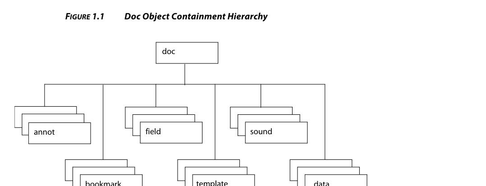

图 1.1 表示了与 `doc` 对象相关的对象的包含层次结构。从 JavaScript 访问 `doc` 对象可以通过多种方式完成。最常用的方法是使用 `this` 对象，它通常等同于当前底层文档的 `doc` 对象。

### dbg

你可以使用 `dbg` 对象（仅在 Acrobat Professional 中可用），在应用程序未执行模态对话框时，选择从命令行角度控制 JavaScript 调试器。`dbg` 对象的方法提供了与 JavaScript 调试器对话框工具栏中按钮相同的功能，允许逐步执行、设置、移除和检查断点，以及退出调试器。

### console

`console` 对象是 Acrobat Professional 中可用的静态对象，用于访问 JavaScript 控制台以显示调试消息和执行 JavaScript。它在 Adobe Reader 或 Acrobat Standard 中不起作用。它作为调试辅助工具和交互式测试代码的方法非常有用。

### global

`global` 对象用于存储在 Acrobat 多次调用之间持久化或由多个文档共享的数据。跨多个文档的全局数据共享和通知是通过订阅机制完成的，该机制允许监控全局变量并将其值报告给所有订阅的文档。

此外，`global` 可用于存储与一组文档相关的信息，这种情况发生在批量序列运行时。例如，批量序列代码通常将待处理文档的总数存储为 `global` 的属性。如果需要将有关文档的信息存储在 `report` 对象中，则将其分配给 `global` 中的一组属性，以便 `report` 对象可以访问它。

### Util

`Util` 对象是一个静态 JavaScript 对象，定义了许多用于数字和日期格式化及解析的实用方法和便利函数。它也可用于在富内容和 XML 表示形式之间转换信息。

### dialog

`dialog` 对象是一个对象字面量，由 `app` 对象的 `execDialog()` 方法使用，用于呈现一个模态对话框，其外观和行为与所有 Adobe 应用程序中使用的对话框相同。

`dialog` 对象字面量由一组事件处理程序和属性组成，这些属性决定了对话框的行为和内容，可以包含以下元素：按钮、复选框、单选按钮、列表框、文本框、弹出控件以及用于控件集的容器和框架。

## Acrobat JavaScript 对象摘要

### security

`security` 对象是一个静态的 JavaScript 对象，在所有 Acrobat 应用程序（包括 Adobe Reader）中均可无限制地使用。它采用基于令牌的安全模型，旨在促进 PDF 文档中数字签名和加密的创建与管理，从而为用户提供身份验证和目录管理手段。

其方法和属性在批处理、控制台、菜单或应用程序初始化事件期间均可访问。`security` 对象可用于添加密码和设置安全选项、为文档添加使用权限、为收件人列表加密 PDF 文件、应用和分配安全策略、创建自定义安全策略、为文档附件添加安全性、使用证书创建和管理数字 ID、构建可信身份列表，以及检查证书信息。

### SOAP

`SOAP` 对象可用于向服务器进行远程过程调用，并调用由 Web 服务描述语言 (WSDL) 描述的 Web 服务，支持 SOAP 1.1 和 1.2 编码。其方法在 Acrobat Professional、Acrobat Standard 中可用，也适用于在 Adobe Reader 6.0 或更高版本中打开的具有表单导出权限的文档。

`SOAP` 对象使得远程共享批注以及在表单字段事件中调用 Web 服务成为可能。它支持富文本响应和查询、HTTP 身份验证和 WS-Security、SOAP 头、错误处理、发送或转换文件附件、交换压缩二进制数据、文档字面量编码、对象序列化、XML 流，以及应用 DNS 服务发现在 Intranet 上查找协作存储库。

此外，`XMLData` 对象可用于评估 XPath 表达式和对 XML 文档执行 XSLT 转换。

### search


`search` 对象是一个静态对象，可用于在一个或多个 PDF 文档或索引文件中执行简单和高级文本搜索、为一个或多个 PDF 文档创建、更新、重建或清除索引，以及搜索文档级和对象级元数据。`search` 对象具有可用于微调查询的属性，例如同义词库、发音相似的词、区分大小写，以及用于在批注和 JPEG 图像中包含的 EXIF 元数据中搜索文本的设置。

### `ADBC`

`ADBC` 对象与 `connection` 和 `statement` 对象结合使用，以与数据库进行接口。这些 Acrobat JavaScript 对象构成了 Acrobat 数据库连接（ADBC），并提供了一种简化的利用 ODBC 调用连接数据库并访问其数据的方法。SQL 语句传递给 `statement` 对象的 `execute()` 方法，以便插入、更新、检索和删除数据。

### `event`

所有 JavaScript 操作都在特定事件发生时执行。对于每个事件，Acrobat JavaScript 都会创建一个 `event` 对象。当事件发生时，`event` 对象可用于获取和管理与该特定事件状态相关的任何信息。以下每种类型的事件都会创建一个 `event` 对象：Acrobat 查看器初始化、批处理序列、书签上的鼠标事件、JavaScript 控制台操作、文档打印、保存、打开或关闭操作、页面打开和关闭事件、表单字段鼠标、击键、计算、格式和验证事件，以及菜单项选择事件。

## 使用 Acrobat JavaScript 可以做什么？

Acrobat JavaScript 使你能够在 Acrobat 和 Adobe Reader 内部以及 PDF 文档中执行各种操作。Acrobat JavaScript 可用于辅助以下工作流程：

- 创建 PDF 文档
  - 创建新的 PDF 文件
  - 控制 PDF 文件的外观和行为
  - 将 PDF 文件转换为 XML 格式
  - 创建和生成模板
  - 将文件附加到 PDF 文档

- 创建 Acrobat 表单
  - 创建、修改和填写动态变化的交互式表单
  - 导入和导出表单、附件和图像数据
  - 将表单数据保存为 XML、XDP 或 Microsoft Excel® 格式
  - 通过电子邮件发送填写好的表单
  - 使表单便于视觉障碍用户使用
  - 使表单适应 Web 环境
  - 将旧版表单迁移到动态 XFA
  - 保护表单安全

- 促进审阅、标记和批准
  - 设置批注库首选项
  - 创建和管理批注
  - 使用图章批准文档

- 将数字媒体集成到文档中
  - 控制和管理媒体播放器和监视器
  - 添加影片和声音剪辑
  - 添加和管理呈现方式
  - 设置多媒体首选项

- 修改用户界面
  - 使用 Adobe 对话框管理器（ADM）
  - 为 PDF 文档添加导航
  - 管理 PDF 图层
  - 管理印刷制作

- 文档和文档元数据的搜索与索引
  - 在一个或多个文档中搜索文本
  - 创建、更新、重建和清除索引
  - 搜索文档元数据

- 保护文档安全
  - 创建和管理数字签名
  - 添加和管理密码
  - 添加使用权限
  - 加密文件
  - 管理数字证书

- 管理使用权限
  - 为 Adobe Reader 编写 JavaScript
  - 启用协作
  - 安全权限
  - 特定图层的权限

- 与数据库交互
  - 建立 ADBC 连接
  - 执行 SQL 语句
  - 支持 ADO®（仅限 Windows）

- 与 Web 服务交互
  - 连接和方法调用
  - HTTP 身份验证和 WS-Security®
  - SOAP 头支持
  - 错误处理
  - 处理文件附件
  - 交换压缩二进制数据
  - 文档字面量编码
  - 对象序列化
  - XML 流
  - 应用 DNS 服务发现在 Intranet 上查找协作存储库

- XML
  - 对 XML 文档执行 XSLT 转换
  - 评估 XPath 表达式

# Acrobat JavaScript 工具

## 简介

Acrobat 提供了一个集成开发环境，其中包含多种用于开发和测试 Acrobat JavaScript 功能的工具。这些工具是 JavaScript 编辑器、控制台和调试器。此外，Acrobat 支持使用第三方编辑器进行代码开发。

在本章中，你将有机会练习使用编辑器、控制台和调试器来评估脚本。

## 章节目标

在本章结束时，你将能够：

- 调用 JavaScript 控制台，并利用它交互式地执行代码和显示打印语句。
- 使用编辑器创建和修改 Acrobat JavaScript 代码。
- 指定你在开发工作中使用的默认编辑器。
- 识别 Acrobat 在某些外部编辑器上支持的额外功能。
- 识别并理解如何使用以下调试器控件和功能：
  - 在脚本中的任意点启动调试器。
  - 交互式执行代码并将输出显示到控制台窗口。
  - 设置和管理自定义监视点和断点。
  - 检查变量的详细信息。
  - 在不退出调试器的情况下启动新的调试会话。

## 内容

| 主题 |
| --- |
| 使用 Acrobat JavaScript 控制台 |
| 使用 JavaScript 编辑器 |
| 指定默认 JavaScript 编辑器 |
| 使用内置的 Acrobat JavaScript 编辑器 |
| 使用外部编辑器 |
| 使用 Acrobat JavaScript 调试器 |
| 总结 |

## 使用 Acrobat JavaScript 控制台

Acrobat JavaScript 控制台提供了一个交互式且便捷的界面，用于测试部分 JavaScript 代码以及试验对象属性和方法。由于其交互特性，控制台的行为类似于一个允许执行单行或代码块的编辑器。

有两种方法可以激活 Acrobat JavaScript 控制台：通过 Acrobat 菜单命令，或通过在 Acrobat JavaScript 代码中使用静态 `console` 对象。无论哪种情况，它都会作为 Acrobat JavaScript 调试器的一个组件出现，而显示值和结果的主要方法是通过 `console.println()` 方法。

### 打开 JavaScript 控制台

要从 Acrobat 内部打开 Acrobat JavaScript 控制台：

1. 使用以下方法之一打开调试器窗口：
   - 选择**高级 > JavaScript > 调试器**，或
   - 键入 **Ctrl-j**（Windows）或 **Command-j**（Macintosh）。
2. 从调试器的**视图**列表中选择**控制台**或**脚本和控制台**。

要使用 Acrobat JavaScript 代码打开和关闭控制台，请分别使用 `console.show()` 和 `console.hide()`。

### 执行 JavaScript

Acrobat JavaScript 控制台允许你评估单行或多行代码。在使用交互式控制台时，有三种评估 JavaScript 代码的方法：

- 要评估一行代码的一部分，请突出显示该部分，然后按数字键盘上的 **Enter** 键或常规键盘上的 **Ctrl+Enter** 键。
- 要评估单行代码，请确保光标位于该行，然后按数字键盘上的 **Enter** 键或常规键盘上的 **Ctrl+Enter** 键。
- 要评估多行代码，请突出显示这些行，然后按数字键盘上的 **Enter** 键或常规键盘上的 **Ctrl+Enter** 键。

在所有情况下，最近执行的单个 JavaScript 语句的结果都会显示在控制台中。

## Acrobat JavaScript 工具

### 练习：使用 JavaScript 控制台

#### 格式化代码

要在 JavaScript 控制台中缩进代码，请使用 Tab 键。

- 要向右缩进四个空格，请将光标置于单行开头或高亮选中代码块，然后按 Tab 键。
- 要向左缩进四个空格，请将光标置于单行开头或高亮选中代码块，然后按 Shift+Tab。

### 练习：使用 JavaScript 控制台

> 注意：要完成此练习，您需要在计算机上安装 Acrobat Professional。

在此练习中，您将验证 Acrobat 是否已启用 JavaScript，并开始使用 Acrobat JavaScript 控制台来编辑和评估代码。

在练习结束时，您将能够：

- 启用或禁用 Acrobat JavaScript。
- 启用或禁用 JavaScript 调试器。
- 打开 Acrobat 控制台。
- 在控制台窗口中评估代码。

### 启用 JavaScript

为了使用 Acrobat JavaScript，您必须首先验证 JavaScript 已启用。为了从 Acrobat 控制台执行代码，您还需要确保启用了 JavaScript 调试器，因为控制台窗口是 JavaScript 调试器界面的一个组件。

通过执行以下步骤启用 JavaScript、调试器和控制台（参见下图 2.1）：

1. 启动 Acrobat。
2. 选择**编辑 > 首选项**以打开**首选项**对话框。
3. 从对话框左侧的选项列表中选择**JavaScript**。
4. 如果尚未选中，请选择**启用 Acrobat JavaScript**。
5. 在**首选项**对话框中，从 JavaScript 调试器选项中选择**Acrobat 重启后启用 JavaScript 调试器**。
6. 选择**启用交互式控制台**。此选项允许您评估在控制台窗口中编写的代码。
7. 选择**在错误和消息时显示控制台**。这可确保每当您犯错时，控制台都会显示有用的信息。
8. 单击**确定**关闭首选项对话框。
9. 关闭并重新启动 Acrobat。

图 2.1 启用 JavaScript、控制台和调试器

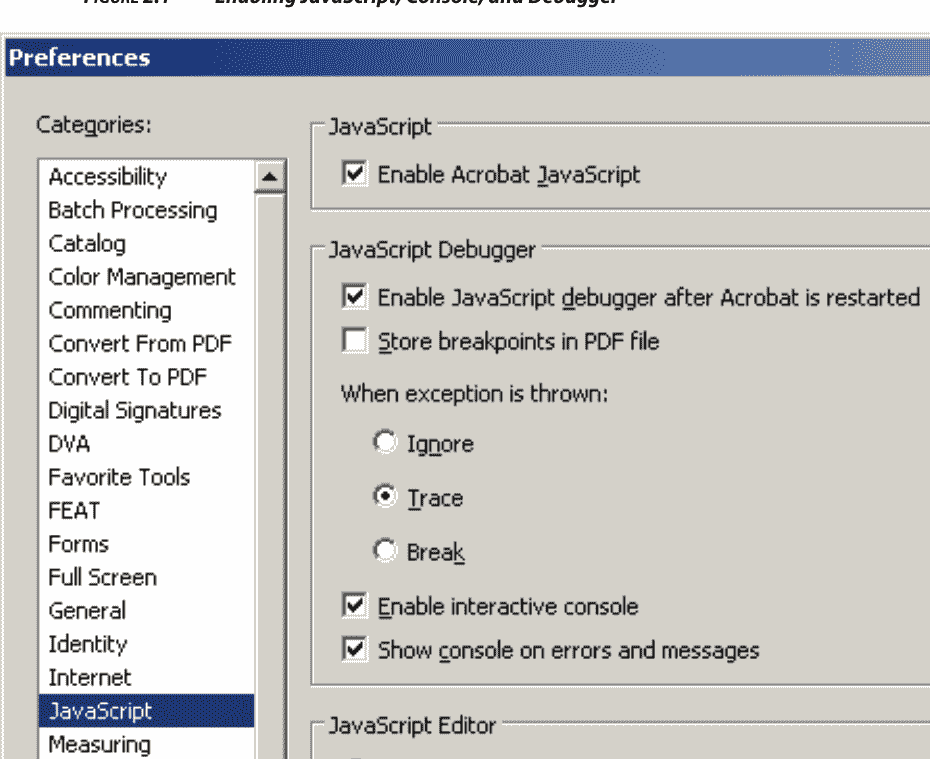

### 尝试 JavaScript 控制台

1. 选择**高级 > JavaScript > 调试器（Ctrl+j）**以打开 JavaScript 调试器。
2. 在调试器中，从**视图**窗口中选择**控制台**。

控制台窗口应出现，如图 2.2 所示。

**图 2.2** JavaScript 调试器中的控制台窗口

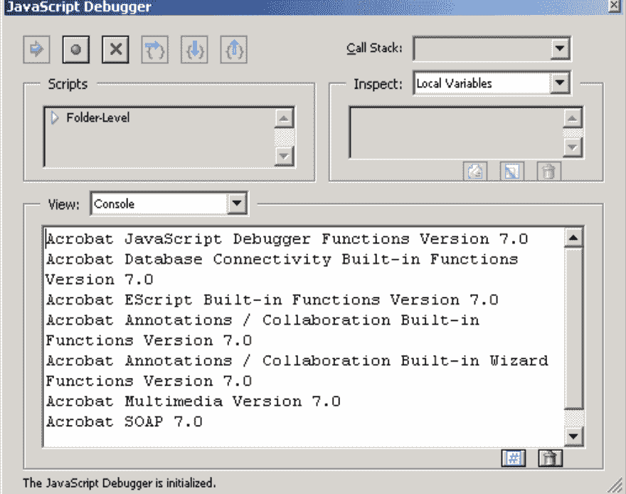

3. 单击位于控制台右下角的**清除**（垃圾桶图标），以删除窗口中出现的任何内容。
4. 在控制台中键入以下代码：

```javascript
var jsNum = 10;
```

5. 将鼠标光标置于此行代码中的某个位置，按数字小键盘上的 **Enter** 键或普通键盘上的 **Ctrl+Enter** 来评估代码。您应该会看到下图 2.3 所示的结果。

# Acrobat JavaScript 工具

图 2.3 评估变量声明

```text
View: Console
var jsNum = 10;
undefined
console.println("\nThe value is " + jsNum);
The value is 10
undefined
Ln 4, Col 44
```

每个 Acrobat JavaScript 语句执行后，控制台窗口会打印 `undefined`，这是该语句的返回值。请注意，语句的结果与该语句中表达式的值不同。在这种情况下，返回值 `undefined` 并不意味着 `jsNum` 的值未定义；它只是意味着整个 JavaScript 语句的值是 `undefined`。

6. 评估 `jsNum` 变量的一种更便捷的方法是高亮选中变量名称并将其作为 JavaScript 表达式执行，如下图 2.4 所示。

图 2.4 评估 `jsNum`

```text
View: Console
var jsNum = 3;
undefined
3
Ln 1, Col 11
```

7. 单击**关闭**按钮退出控制台和调试器，如下图 2.5 所示：

**图 2.5** 控制台和调试器关闭按钮


### 使用 JavaScript 编辑器

有多种方法可以调用 Acrobat JavaScript 编辑器。首先，可以从**高级**菜单中选择**JavaScript**，然后选择以下选项之一：

- 编辑所有 JavaScript ...
- 文档 JavaScript ...
- 设置文档操作 ...

然而，更基本的方法是将 JavaScript 视为与文档某部分（例如页面、书签或表单域）关联的操作。那么，选择感兴趣的对象并编辑其特定的 JavaScript 就显得合理了。

例如，以下为书签编写 JavaScript 的步骤：

1. 右键单击书签。这会触发一个上下文菜单。
2. 选择**属性**并选择**操作**选项卡，如下图 2.6 所示。

**图 2.6** 书签属性

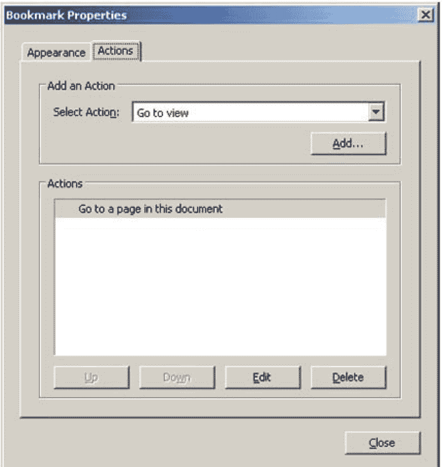

3. **选择操作**下拉列表包含可以与该对象关联的所有可能操作，例如**运行 JavaScript**、**转到视图**或**执行菜单项**。
4. 从**选择操作**下拉列表中选择**运行 JavaScript**。
5. 单击**添加**打开 JavaScript 编辑器。
6. 在编辑器窗口中，编写用户打开页面时要运行的 JavaScript 代码。
7. 代码完成后，单击**关闭**关闭编辑器。

如果您的代码中有错误，JavaScript 编辑器会高亮显示有问题的代码行并显示错误消息，如下图 2.7 所示。

**图 2.7** JavaScript 编辑器检测到的错误

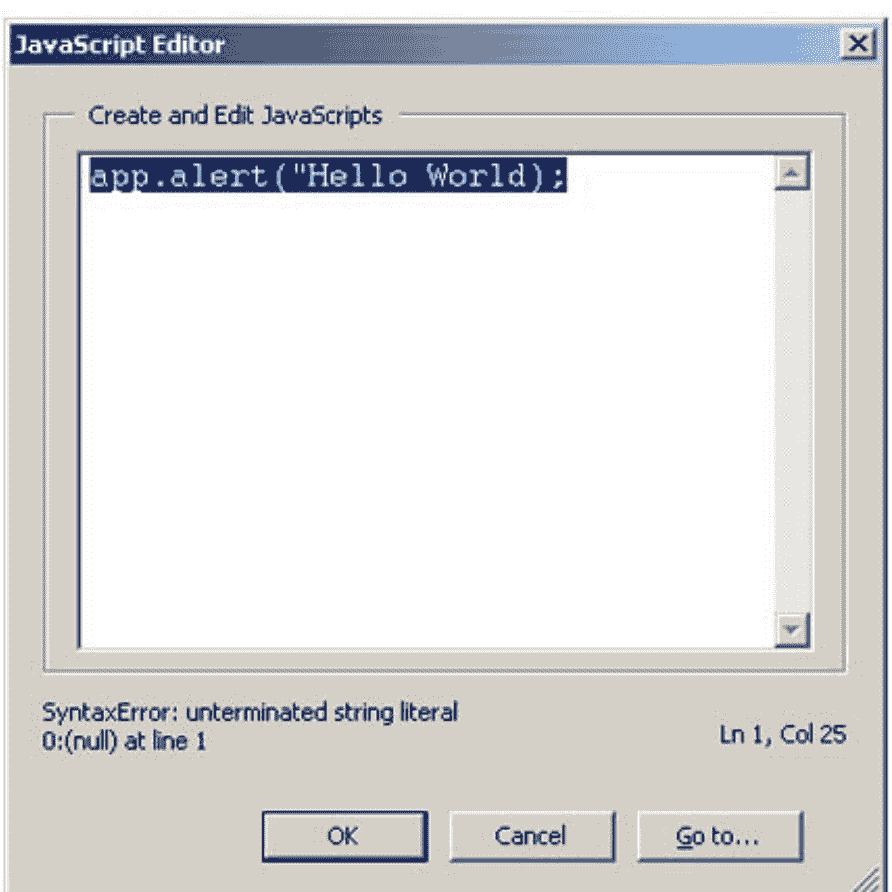

在图 2.7 中，字符串右侧的引号缺失。

> 注意：JavaScript 操作具有与 PDF 文档中各种对象级别相关的范围，例如表单域、页面或整个文档。例如，文档级别的脚本将从文档内所有其他可编写脚本的位置可用。

### 指定默认 JavaScript 编辑器

您可以选择使用 Acrobat 附带的内置 JavaScript 编辑器，或您选择的外部 JavaScript 编辑器。要设置默认编辑器，请调用**首选项**对话框，如上图 2.1 和下图 2.8 所示：

1. 选择**编辑 > 首选项**以打开**首选项**对话框。
2. 从对话框左侧的选项列表中选择**JavaScript**。这将打开**JavaScript**首选项部分。
3. 在**JavaScript 编辑器**部分，选择您要使用的编辑器。

**图 2.8** 在首选项中选择编辑器

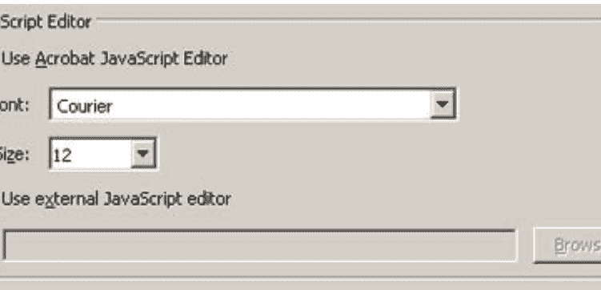

**Acrobat JavaScript 编辑器**选项将内置的 Acrobat JavaScript 编辑器设置为默认。

**外部 JavaScript 编辑器**选项将外部编辑器设置为默认。要选择此选项，请单击**浏览...**以指定所需 JavaScript 编辑器的路径。

> **注意：** 对于某些外部编辑器，Acrobat 提供了额外的命令行选项来调用编辑器。有关详细信息，请参阅[附加编辑器功能]。

### 使用内置 Acrobat JavaScript 编辑器

与 Acrobat JavaScript 控制台类似，内置的 Acrobat JavaScript 编辑器可用于评估部分 JavaScript 代码。选择要评估的行或代码块，然后按数字小键盘上的 **Enter** 键或普通键盘上的 **Ctrl+Enter**。

在这种情况下，JavaScript 表达式或语句的结果显示在控制台窗口中，因此您还需要打开 Acrobat JavaScript 控制台才能看到它们。这是您将结果与 Acrobat JavaScript 代码分开的方式。

Acrobat JavaScript 编辑器提供与控制台窗口相同的格式选项。有关详细信息，请参阅[格式化代码](#)。

### 使用外部编辑器

如果外部编辑器程序已被指定为在 Acrobat 中编辑 JavaScript 的默认应用程序，Acrobat 会生成一个临时文件并在外部编辑器程序中打开它。在外部编辑器中编辑文件时，请注意以下限制：

- 您必须保存文件，Acrobat 才能检测到更改。
- 在外部编辑器使用期间，Acrobat 无法访问。
- 无法在外部编辑器内评估 Acrobat JavaScript 代码。

### 附加编辑器功能

Acrobat 支持某些适用于基于 Windows 应用程序的附加命令行编辑器功能，并特别提供对两个参数的支持：文件名（`%f`）和目标行号（`%n`）。不支持基于 Macintosh 的编辑器的参数。

请注意，Acrobat 会为每个新的编辑会话启动编辑器的新实例。某些编辑器（如果已在运行）会将新文件加载到同一会话中，并可能关闭其他打开的文件而不保存它们。因此，请务必记住采取以下措施之一：在开始新的编辑会话之前保存您的更改，在开始新的编辑会话之前关闭编辑器应用程序，或调整其默认首选项以使其始终启动新的编辑器实例（如果可用，这是最佳做法）。


如果您能够将编辑器首选项设置为每次编辑会话都启动一个新实例，并且如果编辑器需要一个命令行参数才能调用新的编辑器实例，则可以将该参数添加到在“编辑 > 首选项 > JavaScript”对话框中指定的编辑器命令行中。

如果您的编辑器接受命令行上的起始行号，Acrobat 可以通过将行号作为命令行参数`%n`插入，来在包含语法错误的行上启动编辑器。

## Acrobat JavaScript 工具

### 使用外部编辑器

为方便您使用，Acrobat 为许多当前流行的外部编辑器提供了预定义的命令行模板。外部编辑器的设置在“编辑 > 首选项 > JavaScript”中定义。如果您使用“浏览”按钮来指定外部编辑器，且该编辑器有一个预定义的命令行模板，那么命令行参数和选项将出现在编辑器应用程序路径名的右侧，您可以对其进行编辑。如果您的编辑器没有可用的预定义模板，您仍然可以指定相应的命令行参数。

#### 为您的编辑器指定附加功能

Acrobat 在少数编辑器（如 CodeWrite、Emacs 和 SlickEdit）中，为上述两个命令提供了内部支持（见下表 2.1）。

如果您的编辑器不是 Acrobat 当前支持的编辑器，则需要查阅该编辑器的文档。您需要查找以下信息：

- 告诉编辑器始终打开新实例的命令开关是什么？

  开关因编辑器而异，包括`/NI`和`+new`等参数，后跟文件名`"%f"`。请注意需要引号，因为 Acrobat 发送给编辑器的文件名可能包含空格。

- 是否有办法指示编辑器打开文件并跳转到特定行号？

  一些行号命令开关是`-#`、`-I`、`+`和`-1`，每个开关后跟行号`%n`。对于大多数编辑器，行号开关和`%n`应括在方括号`[...]`内。方括号内的文本仅在 Acrobat 要求编辑器跳转到特定行以更正 Acrobat JavaScript 语法错误时使用。您可以使用不支持行号开关的编辑器；在这种情况下，当发生语法错误时，您需要手动滚动到相应的行。

例如，Acrobat 将 Visual SlickEdit 编辑器识别为`vs.exe`，并自动提供以下命令行模板：

`"C:\Program Files\vslick\win\vs.exe" "%f" +new [-#%n]`

当 Acrobat 打开默认的 JavaScript 编辑器时，它会在命令行中进行相应的替换，并使用操作系统 shell 执行该命令。在上面的情况下，如果语法错误在第 43 行，生成的命令行将如下所示：

`"C:\Program Files\vslick\win\vs.exe" "C:\Temp\jsedit.js" +new -#43`

**注意：** 要在命令行中插入字符`%`、`[`或`]`，请在每个字符前加上`%`转义字符，即分别使用`%%`、`%[`或`%]`。

## 表 2.1 支持命令行模板的外部 JavaScript 编辑器

| 编辑器 | 网站 | 模板命令行参数 |
|---|---|---|
| Boxer | http://www.boxersoftware.com | `-G -2 "%f" [-L%N]` |
| ConTEXT | http://fixedsys.com/context | `"%f" [/gl:%N]` |
| CodeWright | http://www.codewright.com | `-M -N -NOSPLASH "%f" [-G%N]` |
| Emacs | http://www.gnu software.com/Emacs | `[+%N] "%f"` |
| Epsilon | http://www.lugaru.com | `[+%N] "%f"` |
| Multi-Edit | http://www.multiedit.com | `/NI /NS /NV [/L%N] "%f"` |
| TextPad | http://www.textpad.com | `-m -q "%f"` |
| UltraEdit | http://www.ultraedit.com | `"%f" [-1%N]` |
| VEDIT | http://www.vedit.com | `-s2 "%f" [-1 %N]` |
| Visual SlickEdit | http://www.slickedit.com | `+new "%f" [-#%N]` |

### 测试您的编辑器是否会在语法错误位置打开

要确定 Acrobat 是否可以在特定行号打开您的编辑器，请执行以下操作：

1. 在您的编辑器中打开一个脚本。
2. 添加一个语法错误。
3. 将光标移动到包含语法错误的行以外的行。
4. 关闭并保存文件。

如果自动弹出一个对话框提示您修复语法错误，请检查它是否正确指定了包含错误的行。

### 保存并关闭包含语法错误的文件

如果您保存并关闭一个包含语法错误的文件，Acrobat 会显示一个对话框，询问您是否要修复该错误。例如，如果错误在第 123 行，将显示以下消息：

> JavaScript 错误位于第 123 行。
>
> 是否要修复此错误？

**注意：** 如果您点击**否**，Acrobat 将丢弃您的文件。

请始终点击**是**。Acrobat 会扩展编辑器的路径以包含指定语法中的行号。编辑器将打开，并将光标置于第 123 行。

## 使用 Acrobat JavaScript 调试器

Acrobat JavaScript 调试器是一个功能齐全的 JavaScript 调试器，允许您在单步执行代码时设置断点和检查变量值。虽然通常从 Acrobat Professional 用户界面访问它，但当发生异常时，也可以在 Adobe Reader 中触发显示它。

虽然完整的 Acrobat JavaScript 调试功能仅在 Acrobat Professional 中可用，但以下说明是为了方便您在 Windows 和 Macintosh 平台上的 Adobe Reader 中启用完整的调试器功能。请注意，此过程涉及编辑注册表。Adobe Systems Incorporated 不提供关于编辑注册表的支持，因为它包含关键的系统和应用程序信息。建议在修改注册表之前对其进行备份。

1. 必须将文件`debugger.js`（可从[http://partners.adobe.com/asn/acrobat/docs.jsp](http://partners.adobe.com/asn/acrobat/docs.jsp)获取，或在 SDK 安装目录中：`Acrobat 7.0 SDK/JavaScriptSupport/Debugger/debugger.js`）复制到`Acrobat 7.0/Reader/JavaScripts`文件夹。
2. 在 Windows 的注册表设置中创建键/值对，起始位置为**`HKEY_CURRENT_USER\Software\Adobe\Acrobat Reader\7.0\JSPrefs\`**，如下表 2.2 所示；或在 Macintosh 的属性列表文件**`<user>:Library:Preferences:com.adobe.Reader7.0.plist`**中创建。对于 Macintosh，请使用合适的编辑器编辑属性列表文件，并在**JSPrefs**下添加以下子项，每个子项的类型均为**Type : Array**：**Console Open**、**Console Input**、**Enable Debugger**和**Exceptions**。在每个子项下，添加以下子项：**0**（数字）和**1**（布尔值）。
3. 关闭并重新启动 Adobe Reader。此时调试器将可用。

## 表 2.2 Windows 注册表键/值对

| 键 | 类型 | 值 |
|---|---|---|
| `bConsoleInput` | `REG_DWORD` | `0x00000001` |
| `bEnableDebugger` | `REG_DWORD` | `0x00000001` |
| `iExceptions` | `REG_DWORD` | `0x00000002`（当发生异常时将中断到调试器） |

**注意：** 由于 Adobe Reader 不通过其菜单项或**Ctrl+j**键序列提供对调试器的访问，访问调试器的唯一方法是执行 JavaScript、引发错误或自定义用户界面（例如，您可以添加一个运行 JavaScript 的按钮，以使调试器出现）。

## 使用 Acrobat JavaScript 调试器

正如您之前在打开 Acrobat JavaScript 控制台（该控制台与调试器对话框集成）时所了解的，可以通过在 Acrobat Professional 中选择“高级 > JavaScript > 调试器”来激活调试器。此外，如果正在运行的脚本抛出异常或遇到先前设置的断点，调试器会自动打开。

**注意：** Acrobat JavaScript 调试器不能用于分析在 Web 浏览器（如 NetScape 或 Internet Explorer）中查看的 HTML 页面中存储的 JavaScript，或任何其他类型的脚本语言。

为了使调试器可用，您需要启用 JavaScript 和调试器。与之前一样，使用“编辑 > 首选项”对话框来控制 Acrobat JavaScript 开发环境的行为。启用 JavaScript 和 JavaScript 编辑器的说明在*启用 JavaScript*中。要启用调试器，请在**首选项**对话框左侧的列表中选择 JavaScript，并确保选中**启用 JavaScript 调试器...**选项。请注意，您必须重新启动 Acrobat 才能使此选项生效。

调试器选项位于**首选项**对话框的**JavaScript Debugger**部分，如上文*图 2.1*所示，并在下文*表 2.3*中进行解释。

## 表 2.3 JavaScript 调试器选项

| 选项 | 含义 |
|---|---|
| **重启 Acrobat 后启用 JavaScript 调试器** | 要启用调试器，请选中此选项，这将使所有调试器功能在下次启动 Acrobat 时可用。 |
| **在 PDF 文件中存储断点** | 此选项允许你存储断点，以便在下次启动 Acrobat 或打开 PDF 文件时这些断点仍然可用。要移除断点，请执行以下操作：<br>• 关闭此选项。<br>• 选择**高级 > JavaScript > 文档 JavaScript**并删除**ACRO_Breakpoints**脚本。<br>• 保存文件。 |
| **当抛出异常时** | 此选项为抛出异常时的操作提供了三种选择：<br>• **忽略**：忽略异常。<br>• **跟踪**：显示堆栈跟踪。<br>• **中断**：停止执行并显示一个消息窗口，为你提供在异常发生的行启动调试器的选项。 |
| **启用交互式控制台** | 此选项允许你在控制台窗口中输入 JavaScript 命令。如果未选中此选项并且你点击控制台窗口，将出现以下对话框：<br>交互式控制台未启用。你现在要启用它吗？<br>点击**是**以从调试器内部启用此选项。在**首选项**中你将看到此选项已被选中。 |
| **在错误和消息时显示控制台** | 此选项在调试器对话框中打开控制台窗口。无论调试器是否启用，此选项都会在发生错误时打开调试器对话框，并将错误消息显示到控制台窗口。 |

## Acrobat JavaScript 调试器

你可以随时通过选择 Acrobat 菜单项“高级 > JavaScript > 调试器”来打开 Acrobat JavaScript 调试器。在尝试交互式调试脚本之前，请先熟悉此处描述的窗口部分和控件。

[在脚本窗口中访问脚本]一节概述了可调试脚本的类型和位置。[启动调试器]一节描述了如何自动为脚本启动调试器。

**重要提示：** 在 Windows 上，当调试器打开且调试会话正在进行时，Acrobat 将不可用。

## 主要控件组

如下图[图 2.9]所示的调试器对话框由三个主要的控件组组成。左上角的工具栏包含六个按钮控件，提供基本的调试会话功能。详情请参阅下面的[图 2.10]。

工具栏正下方，一个**脚本**窗口显示可用于调试的脚本名称。这些脚本以树状层次结构组织，例如下面[图 2.9]中所示的那样，并且可能伴随下方的**脚本**窗口，该窗口显示与**脚本**窗口中突出显示的脚本相对应的单个脚本代码。

**调用堆栈**和**检查**下拉列表位于调试器对话框的右上角。在这些列表中选择条目，使你能够查看函数调用的嵌套顺序，并使你能够在**检查**详细信息窗口中检查变量、监视点和断点的详细信息。

## 调试器视图窗口

在主要控件组下方，调试器提供了一个**视图**下拉列表，其中包含以下选择：

- **脚本：** 查看从脚本层次结构窗口中选择的单个 JavaScript 脚本。
- **控制台：** 在 JavaScript 控制台窗口中查看选定脚本执行时的输出。控制台也可用于运行脚本或单个命令。请参阅[使用 Acrobat JavaScript 控制台]。
- **脚本和控制台：** 同时查看控制台和脚本窗口。脚本窗口显示在控制台窗口上方，如[图 2.9]所示。

## Acrobat JavaScript 工具

### Acrobat JavaScript 调试器

## 图 2.9 调试器对话框

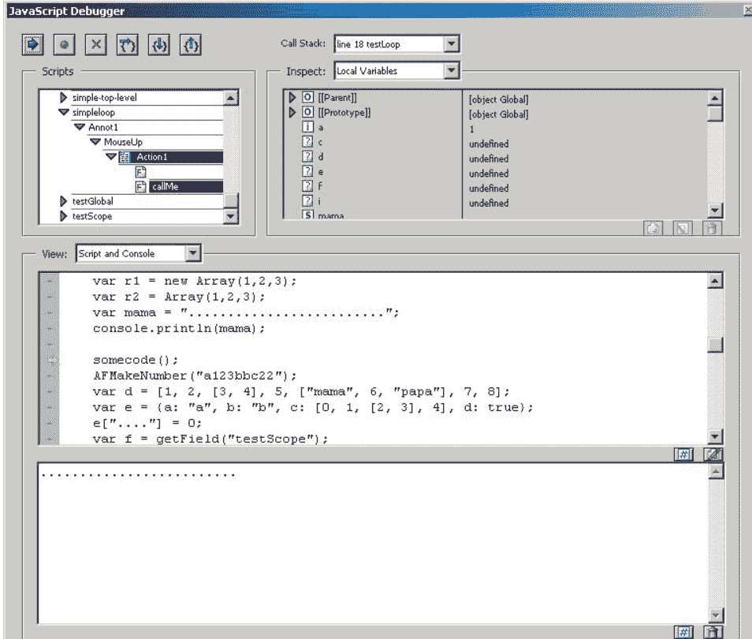

## 调试器按钮

图 2.10 显示了工具栏上的调试器按钮，表 2.4 总结了每个按钮的功能，随后是下面的详细描述。它们的用法概述在练习：计算器中提供。


## 表 2.4 调试器按钮摘要

| 按钮 | 描述 |
|---|---|
| **恢复执行** | 运行在调试器中停止的脚本。 |
| **中断** | 中止执行。 |
| **退出** | 关闭调试器并终止脚本执行。 |
| **单步跳过** | 执行下一条指令，但如果遇到函数调用则不进入该函数。 |
| **单步进入** | 执行下一条指令，如果遇到函数调用则进入该函数。 |
| **单步跳出** | 执行函数调用中的剩余代码，并在调用脚本中的下一条指令处停止。 |

### 恢复执行

当脚本停止时，**恢复执行**按钮使脚本继续执行，直到遇到以下情况之一：

- 下一个要执行的脚本
- 遇到的下一个断点
- 遇到的下一个错误
- 脚本结束

### 中断

**中断**按钮中止当前脚本的执行。点击时，它显示为红色，表示它已被激活，并导致执行在下一个运行的脚本开始时停止。如果发生这种情况，**中断**按钮会自动停用并恢复为绿色。要中断另一个脚本，必须再次激活它。

### 退出

**退出**按钮终止调试会话并关闭调试器。

### 单步跳过

**单步跳过**按钮执行单条指令，如果该指令是函数调用，则会在单步中执行整个函数，而不是进入该函数。例如，调试器中的位置指示器（黄色箭头）位于一个函数调用的左侧，如下图 2.11 所示：

图 2.11 **位于函数调用处的位置指示器**

```javascript
callMe();
```

执行当前在调用`callMe()`之前停止。假设`callMe()`中没有错误或断点，点击**单步跳过**将执行整个`callMe()`函数，并将位置指示器前进到函数调用之后的下一条脚本指令。

如果位置指示器处的语句不包含函数调用，**单步跳过**只是执行该语句。

### 单步进入

**单步进入**按钮执行下一条语句，如果该语句是函数调用，则进入函数中的第一条语句。请再次参考图 2.11。在此处点击**单步进入**将位置指示器前进到`callMe()`函数中的第一条语句。

**注意：** 请注意，无法进入原生函数，因为它们没有 JavaScript 实现。这适用于 Acrobat 原生函数以及核心 JavaScript 函数。

### 单步跳出

**单步跳出**按钮执行当前函数调用中的剩余代码，并在调用之后的下一条指令处停止。此按钮提供了一种便捷的方法，用于消除不包含错误的函数的繁琐、逐步执行。如果你不在函数调用内部且没有错误，**单步跳出**按钮将继续执行代码，直到当前脚本结束或遇到断点。

## 调试器脚本窗口

所有与 PDF 文件关联的脚本在调试器对话框中均可用。调试器在**脚本**窗口中显示这些脚本（示例请参见下图 2.12）。

*图 2.12* 脚本窗口

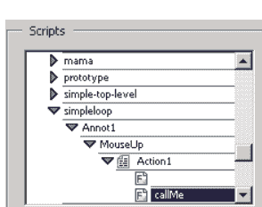

### 在脚本窗口中访问脚本

要显示脚本的内容，请点击**脚本**窗口中其左侧的三角形。每个三角形打开包含层次结构中的下一级。脚本图标表示最低级别，这意味着给定函数的代码可用。如上图 2.12 所示，已为名为**Button1**的按钮的鼠标弹起操作定义了一个函数。点击脚本图标可显示其代码。

Acrobat JavaScript 可以存储在多个位置，这些位置可以在 PDF 文件内部或外部。以下各节描述了它们的可能位置。

## PDF 文件中的脚本

下表（表 2.5）列出了 PDF 文件中包含的脚本类型。这些脚本可以从调试器对话框中的“脚本”窗口访问。你可以在调试器内编辑它们，并按照第 58 页“断点”部分的描述设置断点。

> 注意：对脚本的修改直到脚本重新运行后才会生效；这些更改无法应用于正在运行的脚本。

## 表 2.5 PDF 文件中的脚本

| 位置 | 访问方式 |
|---|---|
| 文档级 | 高级 > JavaScript > 文档 JavaScript |
| 文档操作 | 高级 > JavaScript > 设置文档操作 |
| 页面操作 | 在“页面”选项卡上点击页面；选择选项 > 页面属性 |
| 表单 | 在表单编辑模式下（见下文）双击表单对象以打开“表单属性”对话框 |


| 书签 | 在“书签”选项卡上点击书签；选择选项 > 书签属性 |
|---|---|
| 链接 | 在表单编辑模式下双击链接对象以打开“链接属性”对话框 |

表单编辑模式 — 要切换到表单编辑模式，请使用 Acrobat 的“高级编辑”工具栏。如果该工具栏不可见，请选择工具 > 高级编辑 > 显示高级编辑工具栏。你可能希望停靠此工具栏，因为你将频繁使用它。

## PDF 文件外的脚本

Acrobat 外部的脚本也会列在“脚本”窗口中，并可在 Acrobat 中进行调试。表2.6列出了这些脚本类型及其访问方式。

**表 2.6** PDF 文件外的脚本

| 位置 | 访问方式 |
|---|---|
| 文件夹级 | 存储为位于 App 或 User 文件夹区域中的 JavaScript (`.js`) 文件 |
| 控制台 | 在控制台窗口中键入并求值 |
| 批处理 | 选择 **高级 > 批处理** |

文件夹级脚本通常可以在 Acrobat 中查看和调试，但不能编辑。控制台和批处理脚本在执行之前对调试器不可见。因此，你无法在执行这些脚本之前设置断点。你可以使用 **从头开始调试** 选项或使用 `debugger` 关键字来访问这些脚本。详情请参阅“启动调试器”。

## 调用堆栈列表

在调试器控制按钮的右侧是 **调用堆栈** 下拉列表，它显示了当前执行的函数及其在当前嵌套调用集中的关联状态。下方的图2.13显示了一个示例。当调试器用于在特定语句处暂停执行时，调用堆栈会显示指示当前函数调用（堆栈帧）的文本。每个条目显示当前的行号和函数名。最近的堆栈帧显示在 **调用堆栈** 下拉列表的顶部。要检查堆栈中特定帧的局部变量，请点击该条目。它们将显示在调用堆栈列表正下方的 **检查** 详情窗口中，如下图2.13所示。

*图 2.13* 调用堆栈

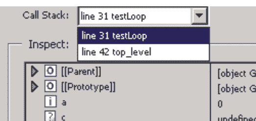

你可以选择调用堆栈中的任何函数。这样做将选择该堆栈帧，其位置将显示在 **检查** 详情窗口中。当在 **检查** 下拉列表中选择 **局部变量** 时，该活动帧特定的变量将显示在 **检查** 详情窗口中。

## 检查详情窗口

**检查** 详情窗口位于 **脚本** 窗口的右侧和 **调用堆栈** 的下方。它的目的是帮助你检查变量的值，自定义变量的检查方式（设置监视点），并获取有关断点的详细信息。

### 检查详情窗口控件

**检查** 详情窗口右下角的三个按钮（如下方图2.14所示）可用于编辑、创建或删除项目。当 **检查** 下拉列表中的项目被选中时，**编辑**、**新建** 和 **删除** 按钮会变为活动状态。

**图 2.14** *检查详情窗口按钮控件*

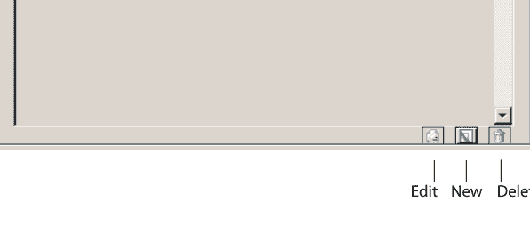

### 检查变量

**检查** 详情窗口是一个强大的工具，你可以用它来检查 JavaScript 对象和变量的当前状态。它使你能够在调试会话中的当前堆栈帧内以递归方式检查任何对象和属性。

要检查一个变量，请从 **检查** 下拉列表中选择 **局部变量**，这将在 **检查** 详情窗口中显示一个变量和值对的列表。要更改变量中的值，请在详情窗口中高亮显示该变量（这会激活 **编辑** 按钮）。点击 **编辑** 按钮。会出现一个 **编辑变量** 对话框，允许你为该变量输入新值，如下方图2.15所示。

名称旁边的三角形表示有一个可供检查的对象。如果你想查看其属性，请点击三角形以展开该对象。

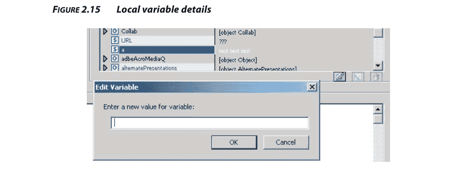

### 监视点

**监视点** 列表使你能够自定义变量的检查方式。监视点是在调试器遇到断点或执行步骤时求值的 JavaScript 表达式。**监视点** 列表为你提供了使用 **检查** 详情窗口正下方的三个按钮来编辑、添加或删除监视点的能力。所有结果都按创建顺序显示在 **检查** 详情窗口中。

要设置监视点，请从 **检查** 下拉列表中选择 **监视点**。点击 **新建** 按钮，一个对话框会提示你输入要进行求值的 JavaScript 变量或表达式。

要更改监视点的值，请从列表中选择该监视点。点击 **编辑** 按钮，会显示一个对话框，提示你指定要进行求值的新表达式。要删除一个监视点，请从 **检查** 下拉列表中选择它，然后点击 **删除** 按钮。

### 断点

检查下拉列表中的断点选项使你能够管理程序断点，这反过来使得在执行暂停后检查局部变量的值成为可能。可以定义一个断点，使执行在特定的代码行暂停，并且可以为它们关联条件（参见使用条件断点）。

当遇到断点时，JavaScript 执行暂停，调试器显示当前代码行。

要添加一个断点，请点击脚本视图中代码左侧的灰色条带，这应该会导致一个红点出现。允许设置断点的行在其左侧的灰色条带中立即有小的水平线。要移除断点，请点击红点，它随后应该会消失。

#### 编码风格与断点

函数定义中左花括号（`{`）的放置位置是风格问题。

风格 1：将左花括号放在与函数名同一行，例如：

```javascript
function callMe() { // 花括号与函数名在同一行
    var a = 0;
}
```

风格 2：将左花括号放在单独的一行，例如：

```javascript
function callMe()
{ // 花括号在单独的一行
    var a = 0;
}
```

如果你想在函数头部设置断点，请使用风格 1。请注意，Acrobat JavaScript 调试器不会为风格 2 在函数头部设置断点。只能从包含左花括号的代码行开始设置断点。这在下面的图2.16中进行了说明。可以为 `callMe()` 在函数头部下方的行设置断点，以及为 `testLoop()` 在包含函数头部的行设置断点。在函数头部设置断点会导致执行在函数内的第一条语句处停止。

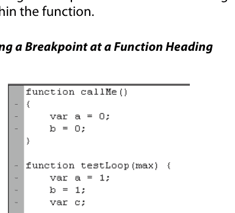

### 列出断点

要查看为调试会话设置的所有断点的列表，请从 **检查** 下拉列表中选择 **断点** 选项。你可以使用 **检查** 详情窗口正下方的按钮控件来编辑和删除断点，如上图2.14所示。

### 使用条件断点

条件断点仅在指定条件为真时才导致解释器停止程序并激活调试器。条件断点在需要时停止执行非常有用，并通过消除不必要的逐步执行来简化调试过程。例如，如果你只对循环中的100次迭代之后的调试感兴趣，你可以设置一个仅当循环索引达到100时才激活的断点。

条件是一个 JavaScript 表达式。如果表达式求值为 `true`，解释器将在该断点处停止程序。否则，解释器不会停止程序。无条件断点（默认设置）在到达断点时总是导致解释器停止程序并激活调试器，因为其条件始终设置为 `true`。

要更改断点条件，请从 **检查** 下拉列表中选择 **断点** 并点击 **编辑**。会出现一个对话框，提示你更改断点条件。

### 启动调试器

有四种方式可以调用 Acrobat JavaScript 调试器。其中两种方式从执行开始时开始调试会话，另外两种方式从指定的代码行开始会话。

#### 从执行开始调试

有两种方式可以从执行开始时启动调试器。在任何一种情况下，请使用“单步进入”按钮继续调试会话。

##### 从头开始调试

选择 **高级 > JavaScript**，如果该选项尚未选中，请点击 **从头开始调试**。

此选项使调试会话从任何新脚本的执行开始。

**注意：** **从头开始调试** 不会自动关闭。调试完成后，请务必关闭此选项，否则它会继续在你在 Acrobat 中执行的每个新脚本上停止。

## Acrobat JavaScript 工具

### 练习：计算器

#### 点击中断

打开调试器窗口，然后点击红色的 **中断** 按钮。此时，执行任何运行脚本的操作都会导致脚本在开头处停止执行。

与 **从头开始调试** 不同，**中断** 按钮在使用后会自动停用。要再次在新脚本的开头处停止，你必须通过再次点击来重新激活它。

#### 从脚本中的任意点开始调试

##### 定义断点

要从脚本中的特定点开始调试，你可以设置一个断点。有关如何设置断点的详细信息，请参见 **断点**。

##### 使用 `debugger` 关键字

你也可以在代码的任意一行插入 `debugger` 关键字，以便在该特定行被访问时停止执行并进入调试器。

> **注意：** 使用 `debugger` 关键字创建的断点不会在你从 **检查** 下拉列表中选择“断点”时，列在 **检查** 详细信息窗口中。

#### 练习：计算器

> **注意：** 要完成以下练习，请解压文件 `TestDebugger.zip` 并打开 `Calc.pdf`。

在本练习中，你将在脚本中设置断点并创建监视，以查看变量在脚本执行过程中如何变化。在本练习结束时，你将能够：

- 从脚本中的某个位置启动调试器。
- 解释 **检查** 详细信息窗口的内容。
- 创建、编辑和删除监视。
- 设置和清除断点。
- 使用调试器按钮控制解释器执行脚本中代码的方式。

##### 计算器

`Calc.pdf` 使用文档级和表单字段级脚本来模拟简单计算器的行为。键盘由数字和功能键、句点（`.`）、等号（`=`）以及取消（**C**）和取消输入（**CE**）键组成。

## 计算器如何显示输出

`Calc.pdf` 使用 Acrobat Doc 对象的 `getField()` 方法将值放置在计算器显示窗口（即文本字段显示）中。在此语句中，`getField()` 将变量 `display` 绑定到此字段：

```javascript
var display = this.getField("Display");
```

每次点击数字键时，其值都应显示在计算器显示窗口中。为此，我们为每个数字键定义一个鼠标松开动作，在该动作中将键上显示的数字分配给计算器显示窗口。例如，当用户点击 7 按钮时，与该按钮关联的鼠标松开动作可以将 `digit_button(7)` 返回的值分配给计算器窗口，如下所示：

```javascript
display.value = digit_button(7);
```

`Calc.pdf` 使用类似的机制将表示算术运算的字符串显示到 `func` 文本字段，该字段用于显示运算（PLUS、MINUS、MULT、DIV）。在此语句中，`getField()` 将变量 `func` 绑定到此字段：

```javascript
var func = this.getField("Func");
```

下面的代码包含在除法（`/`）键的鼠标松开动作中，并表示对 `func_button()` 脚本的调用：

```javascript
func_button("DIV");
```

该动作将字符串 `"DIV"` 传递给 `func_button()` 函数的名为 `req_func` 的参数，因此该参数与该值绑定。

在函数后面，会遇到此语句：

```javascript
func.value = req_func
```

因为 `getField()` 已将 `func` 变量绑定到 `"Func"` 字段，所以此语句在该字段中显示字符串 `"DIV"`。

## 值超过 1 位数字

为了调整大于或等于 10 的值，计算器将当前值乘以 10 并加上所选数字键的值。例如，如果当前值是 2，用户点击 3 按钮，则新的当前值为 23（10 乘以 2 加 3）。

对于十进制值，鼠标松开动作与 `.` 按钮相关联。在此动作中，计算器将除数乘以 10。随后，当选择其他数字键时，计算器将所选值除以除数，并将该量加到当前值。例如，如果当前除数是 1，用户分别按下 2、`.` 和 4 按钮，则当前值首先更新为 2，除数变为 10，然后 4 除以除数得到 0.4，将其加到 2 得到 2.4，该值被分配给新的当前值并在显示区域中显示。

## 测试计算器

为了熟悉基本的计算器操作，请在 Acrobat 中打开 `Calc.pdf`，并尝试输入表达式并评估其结果。

当您熟悉计算器的操作后，请关闭此文件。

## 总结

在浏览器内部调试 Acrobat 中的脚本存在局限性，因为如果 PDF 文件尚未完全下载，可能无法访问其中包含的所有脚本。

如果模态对话框正在运行，则无法进行调试。这可能在调试批处理序列时发生。如果在调试会话期间模态对话框正在运行且程序停止响应，请按 **Esc** 键。

使用 `app.setInterval()` 或 `app.setTimeOut()` 方法启动的事件调试脚本可能会触发一系列重复出现的警报消息。如果发生这种情况，请在模态对话框退出后按 **Esc** 键。

Acrobat JavaScript 调试器是用于解决 Acrobat JavaScript 脚本中问题的功能齐全的工具。结合 **编辑 > 首选项** 对话框，调试器使您能够决定如何控制 Acrobat JavaScript 开发环境的行为，该环境包含用于选择和执行脚本的三个主要控制组。这六个按钮提供对执行的基本控制，**脚本**窗口使您可以选择要调试的脚本，**调用堆栈**和**检查**列表，结合**检查**详细信息窗口，提供了嵌套函数调用（堆栈帧）以及与对象、变量、监视和断点相关的详细信息视图。您可以使用 **检查** 详细信息窗口控件来设置和清除断点，在单步执行 JavaScript 代码时检查变量值，以及管理在脚本执行期间用于检查的自定义监视。

# 3 Acrobat JavaScript 上下文

### 简介

Acrobat JavaScript 可用于创建用于批处理序列和文档内各种级别的脚本。本章讨论如何确定 JavaScript 的适当级别，以及如何在所有级别创建和访问 Acrobat JavaScript。

### 本章目标

在本章结束时，您将能够：

- 列出 Acrobat JavaScript 上下文并描述其目的。
- 描述如何在所有级别创建和编辑脚本。

### 内容

| 主题 |
|---|
| [Acrobat JavaScript 上下文简介](#) |
| [文件夹级别 JavaScript](#) |
| [文档级别 JavaScript](#) |
| [字段级别 JavaScript](#) |
| [批处理级别 JavaScript](#) |

### Acrobat JavaScript 上下文简介

Acrobat JavaScript 可以应用于多个级别：

- 文件夹级别
- 文档级别
- 字段级别
- 批处理级别。

每个级别都代表一个发生处理的上下文，这会影响脚本的加载时机及其在文档内外的可访问性。

此外，JavaScript 在给定级别的放置决定了其可重用性。文件夹级别脚本在所有文档中都可用，文档级别脚本对给定文档中的所有表单字段可用，字段级别脚本仅对与之关联的表单字段可见。

> 注意：有关如何禁止更改脚本或隐藏脚本的说明，请参阅如何禁止更改我文档中包含的脚本？以及如何隐藏我文档中包含的脚本？

### 文件夹级别 JavaScript

文件夹级别 JavaScript 包含可能对 Acrobat 通用有用的变量和函数，并且从所有文档中可见。有两种文件夹级别脚本：*App* 和 *User*。例如，如果您希望向在 Acrobat 中打开的所有文档添加专用菜单和菜单项，您可以将这些脚本创建并存储在文件夹级别 JavaScript 中。

文件夹级别 JavaScript 放在具有 `.js` 扩展名的单独文件中。App 文件夹级别脚本存储在 Acrobat 应用程序的 `JavaScripts` 文件夹中，而 User 文件夹级别脚本存储在用户的 `JavaScripts` 文件夹中。这些脚本在 Acrobat 开始执行时加载，并与 `event` 对象的 *应用程序初始化（App/Init）* 事件相关联。

当 Acrobat 安装在您的计算机上时，它会提供几个标准的文件夹级别 JavaScript 文件，包括 `Aform.js`、`Annots.js` 和 `ADBC.js`。此外，您的 User 文件夹还可能包含 `glob.js`（程序生成的，包含使用 `global` 对象的 `setPersistent()` 方法设置的跨会话应用程序首选项）和 `Config.js`（用于通过调整其工具栏按钮和菜单项来自定义查看器的外观）。例如，`app.addMenuItem()` 调用将位于 `Config.js` 中。

要创建文件夹级别 JavaScript，请使用在 Acrobat 并行运行的外部编辑器。请注意，无法从 Acrobat 调用外部编辑器。

## 文档级 JavaScript

文档级 JavaScript 是对给定文档普遍有用，但不适用于文档外部的函数和变量定义。

要在 Acrobat 中创建或访问文档级 JavaScript，请选择 **高级 > JavaScript > 文档 JavaScript...**，这使您可以添加、修改或删除文档级脚本。文档级脚本在文档打开后执行，并存储在 PDF 文档内部。

## 字段级 JavaScript

您可以将 JavaScript 与文档内的任何组件关联。对于动态 XML 表单，此类脚本仅对该组件可见，并作为动作或事件执行。例如，您可以将动作关联到页面打开或页面关闭事件，以及书签、页面或表单字段的 MouseUp 事件。字段级脚本在事件发生时执行，通常用于验证、格式化或计算表单字段的值。与文档级脚本一样，字段级脚本也存储在 PDF 文档内部。

有多种方法可以创建或编辑字段级 JavaScript。最直接的方法是右键单击表单字段，从上下文菜单中选择 **属性**，然后选择 **动作** 选项卡，如上图 2.6 所示。此外，您也可以选择 **高级 > JavaScript > 编辑所有 JavaScript...**

## 批处理级 JavaScript

批处理级 JavaScript 是可以应用于文档集合并在应用程序级别运行的脚本。例如，您可以定义一个批处理脚本来打印一系列文档或对其应用安全限制。

要在 Acrobat 中创建或编辑批处理级 JavaScript，请选择 **高级 > 批处理处理...**

## 总结


Acrobat JavaScript 既可以应用于文档内部，也可以应用于文档外部。在文档内部，可以创建在文档全局可见的脚本（文档级 JavaScript），或者仅对文档内给定表单字段可见的脚本（字段级 JavaScript）。在文档外部，可以创建提供对所有文档通用的函数或变量（文件夹级 JavaScript），或者可以为处理文档集合的目的而创建（批处理级 JavaScript）。

将 JavaScript 放置在特定级别的决定基于其通用性。如果脚本具有适用于文档内单个组件的专用功能，则适合创建字段级 JavaScript。如果脚本对文档内的多个表单字段普遍有用，则适合创建文档级 JavaScript。如果函数或变量可以在许多文档的各种情况下使用，则适合创建文件夹级 JavaScript。

# 4 创建和修改 PDF 文档

## 简介

本章详细概述了如何应用 Acrobat JavaScript 以动态创建 PDF 文件、修改它们，以及将 PDF 文件转换为 XML 格式。

## 章节目标

在本章结束时，您将能够：

- 描述如何使用 Acrobat JavaScript 创建和修改 PDF 文件。
- 将 PDF 文档转换为 XML 格式。

## 内容

| 主题 |
|---|
| 创建和修改 PDF 文件 |
| 从多个文件创建 PDF 文件 |
| 将 PDF 文档转换为 XML 格式 |

## 创建和修改 PDF 文件

Acrobat JavaScript 为动态 PDF 文件创建和内容生成提供支持。这意味着可以动态创建新的 PDF 文件并以自动化方式修改其内容。这有助于使文档响应用户输入并增强工作流程。

要创建新的 PDF 文件，请调用`app`对象的`newDoc()`方法，如下例所示：

```
var myDoc = app.newDoc();
```

执行此语句后，您可以通过调用`doc`对象中包含的方法来添加内容，如下表 4.1 所示：

| 内容 | 对象 | 方法 |
|---|---|---|
| 页面 | `doc` | `newPage`, `insertPages`, `replacePages` |
| 页面 | `template` | `spawn` |
| 注释 | `doc` | `addAnnot` |
| 字段 | `doc` | `addField` |
| 图标 | `doc` | `addIcon` |
| 链接 | `doc` | `addLink` |
| 文档级 JavaScript | `doc` | `addScript` |
| 缩略图 | `doc` | `addThumbnails` |
| 书签 | `doc.bookmarkRoot` | `createChild`, `insertChild` |
| 网页链接 | `doc` | `addWebLinks` |
| 模板 | `doc` | `createTemplate` |

您可以利用 Acrobat JavaScript 来自定义和自动化组合 PDF 文档的过程。

如果您想将多个 PDF 文件合并为单个 PDF 文档，您可以通过一系列调用`doc`对象的`insertPages`方法来完成。例如，以下代码创建一个由两个其他文档组成的新文档：

```
// 创建一个新的 PDF 文档：
var newDoc = app.newDoc();

// 插入 doc1.pdf：
newDoc.insertPages({
    nPage : -1,
    cPath : "/c/doc1.pdf",
});

// 插入 doc2.pdf：
newDoc.insertPages({
    nPage : newDoc.numPages,
    cPath : "/c/doc2.pdf",
});

// 保存新文档：
newDoc.saveAs({
    "/c/myNewDoc.pdf"
});

// 在不通知用户的情况下关闭新文档：
newDoc.closeDoc(true);
```

可以将来自其他源的内容动态添加到新的 PDF 文件中。源可以包括类型符合多用途互联网邮件扩展 (MIME®) 类型定义的文件。一种简单的方法是调用`app`对象的`openDoc`方法来转换和打开支持格式的其他文件，然后将文件保存或组合为 PDF 文档。

另一种将外部文件导入 PDF 文档的方法是调用`doc`对象的`importDataObject`方法。执行此操作后，可以从外部文件中提取信息，以便在 PDF 文档中放置和呈现。例如，以下代码演示了如何导入 XML 文件并提取其内容：

```
this.importDataObject("myFile", "/c/myFile.xml");
var myData = this.getDataObject("myFile");
for (var i in myData)
    console.println(myData[i]);
```

如果您想自动化地将多个 PDF 文件插入单个 PDF 文档，您可以通过一系列调用`doc`对象的`insertPages`和`replacePages`方法来完成。例如，以下代码在当前文档的开头插入一个封面页：

```
this.insertPages({
    nPage: -1,
    cPath: "/c/myCoverPage.pdf",
    nStart: 0
});
```

最后，如果您想使用当前文档的一部分来创建新文档，您可以通过调用`doc`对象的`extractPages`方法来完成。例如，假设文档由一系列发票组成，每张发票占一页。以下代码创建单独的 PDF 文件，每张发票一个：

```
var filename = "invoice";
for (var i = 0; i < this.numPages; i++)
    this.extractPages({
        nStart: i,
        cPath : filename + i + ".pdf"
    });
```

## 裁剪和旋转页面

### 裁剪页面

Acrobat JavaScript 的`doc`对象提供了设置和检索页面布局尺寸的方法。这些是`setPageBoxes`和`getPageBox`方法。有五种可用的框类型：

- 作品框 (Art)
- 出血框 (Bleed)
- 裁剪框 (Crop)
- 媒体框 (Media)
- 修剪框 (Trim)

`setPageBoxes`方法接受以下参数：

- `cBox`：框类型
- `nStart`：起始页的零基索引
- `nEnd`：最后一页的零基索引
- `rBox`：旋转用户空间中的矩形

例如，以下代码将文档的第 2-5 页裁剪到 400 x 500 像素的区域：

```
this.setPageBoxes({
    cBox: "Crop",
    nStart: 2,
    nEnd: 5,
    rBox: [100,100,500,600]
});
```

`getPageBox`方法接受以下参数：

- `cBox`：框类型
- `nPage`：页面的零基索引

例如，以下代码检索第 3 页的裁剪框：

```
var rect = this.getPageBox("Crop", 3);
```

### 旋转页面

您可以使用 Acrobat JavaScript 以 90 度为增量，相对于正常位置顺时针旋转页面。这意味着，如果您指定 90 度旋转，无论当前方向如何，页面的顶部都会放置在屏幕的右侧。

`doc`对象的`setPageRotations`和`getPageRotation`方法用于设置和检索页面旋转。

`setPageRotations`方法接受三个参数：

- `nStart`：起始页的零基索引
- `nEnd`：最后一页的零基索引
- `nRotate`：顺时针旋转的可能值为 0、90、180 或 270

在以下示例中，第 2 页和第 5 页顺时针旋转 90 度：

```
this.setPageRotations(2, 5, 90);
```

要检索给定页面的旋转角度，请调用`doc`对象的`getPageRotation`方法，该方法仅需要页码作为参数。以下代码检索并显示文档第 3 页的旋转角度（以度为单位）：

```
var rotation = this.getPageRotation(3);
console.println("第 3 页已旋转 " + rotation + " 度。");
```

# 4 创建与修改 PDF 文档

## 创建与修改 PDF 文件

## 提取、移动、删除、替换和复制页面

Acrobat JavaScript 的`doc`对象与`app`对象结合使用，可以将页面从一个文档中提取出来并放置到另一个文档中，也可以在文档内部或文档之间移动或复制页面。

`app`对象可用于创建或打开任何文档。要创建新文档，请调用其`newDoc`方法；要打开现有文档，请调用其`openDoc`方法。

`doc`对象提供了三个用于处理页面的实用方法：

- `insertPages`：将源文档中的页面插入到当前文档
- `deletePages`：从文档中删除页面
- `replacePages`：用源文档中的页面替换当前文档中的页面

这些方法使你能够自定义文档内部和文档之间的页面内容。

假设你想删除文档内的页面。请调用`doc`对象的`deletePages`方法，它接受两个参数：

- `nStart`：起始页的从零开始的索引
- `nEnd`：最后一页的从零开始的索引

例如，以下代码删除当前文档的第 2 页到第 5 页：

```
this.deletePages({nStart: 2, nEnd: 5});
```

假设你想将页面从一个文档复制到另一个文档。请调用`doc`对象的`insertPages`方法，它接受四个参数：

- `nPage`：要插入新页面之后的那一页的从零开始的索引
- `cPath`：源文件的设备无关路径名
- `nStart`：起始页的从零开始的索引
- `nEnd`：最后一页的从零开始的索引

例如，以下代码将`mySource.pdf`的第 2 页到第 5 页插入到当前文档的开头：

```
this.insertPages({
    nPage: -1,
    cPath: "/C/mySource.pdf",
    nStart: 2,
    nEnd: 5
});
```

你可以组合这些操作，从一个文档中提取页面并移动到另一个文档（页面将从第一个文档中删除）。以下代码将`mySource.pdf`中的第 2 页到第 5 页提取出来，并将它们移动到`myTarget.pdf`中：

```
// this 代表 myTarget.pdf
//
// 首先将页面从源文档复制到目标文档
this.insertPages({
    nPage: -1,
    cPath: "/C/mySource.pdf",
    nStart: 2,
    nEnd: 5
});
//
// 现在从源文档中删除这些页面
var source = app.openDoc("/C/mySource.pdf");
source.deletePages({nStart: 2, nEnd: 5});
```

要将一个文档中的页面替换为另一个文档中的页面，请调用目标文档的`replacePages`方法，它接受四个参数：

- `nPage`：开始替换页面的从零开始的索引
- `cPath`：源文件的设备无关路径名
- `nStart`：起始页的从零开始的索引
- `nEnd`：最后一页的从零开始的索引

在以下示例中，`mySource.pdf`的第 2 页到第 5 页替换了`myTarget.pdf`的第 30 页到第 33 页：

```
// this 代表 myTarget.pdf
this.replacePages({
    nPage: 30,
    cPath: "/C/mySource.pdf",
    nStart: 2,
    nEnd: 5
});
```

要在同一文档内安全地移动页面，建议按以下顺序操作：

1. 将源页面复制到一个临时文件。
2. 将临时文件中的页面插入到原始文档中所需的新位置。
3. 从原始文档中删除源页面。

以下示例将文档中的第 2-5 页移动到第 30 页之后：

```
// 首先创建临时文档：
var tempDoc = app.newDoc("/C/temp.pdf");

// 将第 2-5 页复制到临时文件
tempDoc.insertPages({
    cPath: "/C/mySource.pdf",
    nStart: 2,
    nEnd: 5
});

// 将所有临时文件页面复制回原始文档：
this.insertPages({
    nPage: 30,
    cPath: "/C/temp.pdf"
});

// 现在从源文档中删除第 2-5 页
this.deletePages({nStart: 2, nEnd: 5});
```

## 添加水印和背景

`doc`对象的`addWatermarkFromText`和`addWatermarkFromFile`方法可在文档内创建水印，并将其放置在可选内容组（OCG）中。

`addWatermarkFromFile`方法将一个页面作为水印添加到文档的指定页面。以下示例将`watermark.pdf`的第一页作为水印添加到当前文档所有页面的中心：

```
this.addWatermarkFromFile("/C/watermark.pdf");
```

在下一个示例中，使用`addWatermarkFromFile`方法将`watermark.pdf`的第二页作为水印添加到当前文档的前 10 页。它逆时针旋转 45 度，并从每页的左上角向下移动一英寸、向右移动两英寸：

```
this.addWatermarkFromFile({
    cDIPath: "/C/watermark.pdf",
    nSourcePage: 1,
    nEnd: 9,
    nHorizAlign: 0,
    nVertAlign: 0,
    nHorizValue: 144,
    nVertValue: -72,
    nRotation: 45
});
```

也可以使用`addWatermarkFromText`方法创建水印。在下面的示例中，单词`Confidential`被放置在文档所有页面的中心，并且其字体使其格外醒目：

```
this.addWatermarkFromText(
    "Confidential",
    0,
    font.Helv,
    24,
    color.red
);
```

## 添加页眉和页脚

正如你在[添加水印和背景](adding_watermarks)中所学，你可以使用 Acrobat JavaScript 的水印功能为文档添加页眉和页脚，方法是调用`doc`对象的`addWatermarkFromText`方法。通过指定文本位于页面顶部或底部的位置，可以将其用作页眉或页脚。以下示例在当前文档所有页面的右上角向下移动一英寸、向右移动一英寸的位置放置一个多行页眉：

```
this.addWatermarkFromText({
    cText: "Confidential Document",
    nTextAlign: 2,
    nHorizAlign: 2,
    nVertAlign: 0,
    nHorizValue: -72,
    nVertValue: -72
});
```

## 将 PDF 文档转换为 XML 格式

由于 XML 通常是 Web 服务和企业基础设施内信息交换的基础，因此将 PDF 文档转换为 XML 格式可能经常很有用。使用`doc`对象的`saveAs`方法可以轻松完成此操作，该方法不仅可以执行到 XML 的转换，还可以转换为许多其他格式。要将你的 PDF 文档转换为给定格式，你需要确定保存文件的设备无关路径，以及用于以所需格式保存的转换 ID。所有格式的转换 ID 列表在 ASN 文档中提供。对于 XML，转换 ID 是`com.adobe.acrobat.xml-1-00`。以下代码将当前 PDF 文件转换为 C:\test.xml：

```
this.saveAs("/c/test.xml", "com.adobe.acrobat.xml-1-00");
```

# 5 打印生产

## 简介

本章将让你深入了解管理 PDF 文档打印生产工作流的方法。

## 章节目标

在本章结束时，你将能够：

- 使用 Acrobat JavaScript 自动化和控制打印质量。
- 确定文件是发送到打印机还是 PostScript 文件。
- 控制 PDF 图层的打印方式。

## 内容

| 主题 |
|:---|
| 打印 PDF 文档 |
| 打印带有图层的文档 |
| 设置高级打印选项 |

## 打印生产

由于打印涉及将页面发送到输出设备，因此有许多选项会影响打印质量。Acrobat JavaScript 可用于增强和自动化打印生产工作流中这些选项的使用，主要通过使用`printParams`对象，其属性和方法在下表 5.1 中描述：

### 表 5.1 PrintParams 属性

| 属性 | 描述 |
|---|---|
| `binaryOK` | 支持二进制打印机通道 |
| `bitmapDPI` | 用于位图或光栅化透明度的 DPI |
| `colorOverride` | 使用颜色覆盖设置 |
| `colorProfile` | 基于可用颜色空间的颜色配置文件 |
| `constants` | `printParams`常量的包装对象 |


| `downloadFarEastFonts` | 将远东字体发送到打印机 |
| `fileName` | 打印到文件而非打印机时使用的文件名 |
| `firstPage` | 要打印的第一个从零开始的页面 |
| `flags` | 用于控制打印选项的位标志字段 |
| `fontPolicy` | 用于确定何时发射字体 |
| `gradientDPI` | 用于光栅化渐变的 DPI |
| `interactive` | 设置用户交互级别 |
| `lastPage` | 要打印的最后一个从零开始的页面 |
| `pageHandling` | 页面的处理方式（适合、缩小或平铺） |
| `pageSubset` | 打印偶数页、奇数页或所有页面 |
| `printAsImage` | 将页面作为大型位图发送 |
| `printContent` | 确定是否打印表单字段和注释 |
| `printerName` | 目标打印机的名称 |
| `psLevel` | 发送到打印机的 PostScript 级别 |
| `rasterFlags` | 用于轮廓、裁剪和叠印的位标志字段 |

# 5 打印生产

| 属性 | 描述 |
| :--- | :--- |
| `reversePages` | 按逆序打印页面 |
| `tileLabel` | 为拼接输出的每个页面添加标签 |
| `tileMark` | 输出用于裁切页面和重叠区域的标记 |
| `tileOverlap` | 拼接页面之间共有的点数 |
| `tileScale` | 拼接页面的缩放量 |
| `transparencyLevel` | 保留高级绘图操作符的程度 |
| `userPrinterCRD` | 确定是否使用打印机的颜色渲染字典 |
| `useT1Conversion` | 确定是否转换 Type 1 字体 |

除了 `printParams` 对象的属性外，`app` 对象的 `printColorProfiles` 和 `printerNames` 属性分别提供了可用的颜色配置文件和打印机名称列表。此外，`field` 对象的 `print` 方法可用于确定单个字段是否将被打印。

## 打印 PDF 文档

可以使用 Acrobat JavaScript 来指定是将 PDF 文档发送到打印机还是 PostScript 文件。无论哪种情况，要打印 PDF 文档，请调用 `doc` 对象的 `print` 方法。其参数在下面的表 5.2 中描述。

### 表 5.2 打印方法参数

| 参数 | 描述 |
| :--- | :--- |
| `bUI` | 确定是否向用户显示用户界面 |
| `nStart` | 起始页的从零开始的索引 |
| `nEnd` | 结束页的从零开始的索引 |
| `bSilent` | 在文档打印时抑制取消对话框 |
| `bShrinkToFit` | 确定是否将页面缩小以适合打印页面的可打印区域 |
| `bPrintAsImage` | 确定是否将每页作为图像打印 |
| `bReverse` | 确定是否按逆序打印页面 |
| `bAnnotations` | 确定是否打印注释 |
| `printParams` | 包含打印设置的 `printParams` 对象 |

在下面的第一个示例中，文档的第 1～10 页将被发送到默认打印机，静默打印无需用户交互，并缩小以适合页面的可打印区域：

```javascript
this.print({
    bUI: false,
    bSilent: true,
    bShrinkToFit: true,
    nStart: 1,
    nEnd: 10
});
```

要将文档打印到 PostScript 文件，请通过调用 `doc` 对象的 `getPrintParams` 方法获取 `printParams` 对象。将其 `printerName` 属性设置为空字符串，并将其 `fileName` 属性设置为包含要打印到的 PostScript 文件的设备无关路径的字符串，如下面的示例所示：

```javascript
var pp = this.getPrintParams();
pp.printerName = "";
pp.fileName = "/C/myPSDoc.ps";
this.print(pp);
```

如果您想将文件发送到特定打印机，可以通过设置 `printParams` 对象的 `printerName` 属性来指定打印机，如下面的示例所示：

```javascript
var pp = this.getPrintParams();
pp.interactive = pp.constants.interactionLevel.automatic;
pp.printerName = "hp officejet d series";
this.print(pp);
```

## 打印包含图层的文档

`printParams` 对象的 `printContent` 属性可用于控制是否打印文档内容、表单字段和注释。在下面的示例中，将仅打印表单字段内容（这在将数据发送到预印表单时很有用）：

```javascript
var pp = this.getPrintParams();
pp.interactive = pp.constants.interactionLevel.silent;
pp.printContent = pp.constants.printContent.formFieldsOnly;
this.print(pp);
```

## 设置高级打印选项

您可以设置 `printParams` 对象的属性来指定高级选项，包括输出、标记和出血、透明度拼合、PostScript 选项和字体选项。

### 指定输出设置

您可以通过调用 `app` 对象的 `printColorProfiles` 方法获取可用打印机颜色配置文件的列表。然后，您可以将其中一个值分配给 `printParams` 对象的 `colorProfile` 属性。

此外，您可以设置 `printParams` 对象的 `flags` 属性来指定高级输出设置，例如应用校样设置，如下面的示例所示：

```javascript
var pp = this.getPrintParams();
var fv = pp.constants.flagValues;
pp.flags |= fv.applySoftProofSettings;
this.print(pp);
```

### 指定标记和出血

您可以通过设置 `printParams` 对象的 `tileMark` 属性来指定拼接标记的类型和重叠发生的位置。例如，在下面的代码中，将打印西式拼接标记：

```javascript
var pp = this.getPrintParams();
pp.tileMark = pp.constants.tileMarks.west;
this.print(pp);
```

### 设置 PostScript 选项

您可以设置 `printParams` 对象的 `flags` 属性来指定高级 PostScript 设置，例如输出底色去除/黑版生成，如下面的示例所示：

```javascript
var pp = this.getPrintParams();
var fv = pp.constants.flagValues;
pp.flags &= ~(fv.suppressBG | fv.suppressUCR);
this.print(pp);
```

此外，您可以设置 `printParams` 对象的 `psLevel` 属性来指定输出到 PostScript 打印机的 PostScript 级别。另外，如果打印机仅支持 PostScript 1 级，请将 `printParams` 对象的 `printAsImage` 属性设置为 `true`。

### 设置字体选项

您可以通过设置 `printParams` 对象的 `fontPolicy` 属性来控制字体策略。可以使用三个值：

- `everyPage`：为每一页发出所需字体，释放前一页的字体。这对于内存较小的打印机很有用。
- `jobStart`：在打印作业开始时发出所有字体，在打印作业结束时释放它们。这对于内存较大的打印机很有用。
- `pageRange`：发出给定页面范围所需的字体，一旦这些页面打印完毕即释放它们。这可用于优化内存和速度限制之间的平衡。

在下面的示例中，所有字体在打印作业开始时发出，作业完成后即释放：

```javascript
var pp = this.getPrintParams();
pp.fontPolicy = pp.constants.fontPolicy.jobStart;
this.print(pp);
```

您还可以通过设置 `printParams` 对象的 `useT1Conversion` 属性来控制是否将 Type 1 字体转换为替代字体表示形式。可以使用三个值：

- `auto`：让 Acrobat 根据其内部的有问题的打印机列表来决定是否禁用转换。
- `use`：允许转换 Type 1 字体。
- `noUse`：不允许转换 Type 1 字体。

在下面的示例中，Type 1 字体的转换设置为自动：

```javascript
var pp = this.getPrintParams();
pp.useT1Conversion = pp.usages.useT1Conversion.auto;
this.print(pp);
```

最后，可以通过将 `printParams` 对象的 `downloadFarEastFonts` 属性设置为 `true` 将东亚字体发送到打印机。

# 6 在表单中使用 Acrobat JavaScript

## 介绍

在本章中，您将学习如何通过应用 Acrobat JavaScript 来扩展 Acrobat 表单的功能。您将学习如何生成、修改和增强所有类型的 PDF 表单及其包含的元素，并确保以适合您工作流程需求的各种格式正确收集和导出信息。此外，您将了解如何利用 XML 表单架构（XFA），使您的呈现格式不仅响应用户输入，还能确保信息可以与 Web 服务和企业基础设施进行交换。

## 章节目标

在本章结束时，您将能够：

- 使用 Acrobat JavaScript 创建和增强所有类型的 PDF 表单。
- 创建和修改表单字段及其属性。
- 使用 Acrobat JavaScript 使您的表单安全、无障碍且适合 Web 使用。
- 创建 XML 表单并将旧表单迁移到 XFA 格式。
- 自动化表单数据的收集和导出。
- 使表单无障碍、安全且适合 Web 使用。

## 目录

| 主题 |
| :--- |
| 表单基础 |
| 填写 PDF 表单 |
| 使表单无障碍 |
| 使用 JavaScript 保护表单安全 |

## 表单基础

### 简介

Acrobat JavaScript 可以集成到您的表单中，以增强其交互功能。您可以利用 Acrobat JavaScript 扩展表单的能力，实现格式化、计算和数据验证的自动化。此外，您可以开发针对用户事件的自定义操作。最终，您的表单能够与数据库和 Web 服务进行交互。

### 表单基础主题

- 关于 PDF 表单
- 创建 Acrobat 表单字段
- 设置 Acrobat 表单字段属性
- 使表单可填写
- 设置表单字段的层级结构
- 从零开始创建表单
- 在表单中使用自定义 JavaScript
- XML 表单架构（XFA）简介
- 表单迁移：处理在 Acrobat 6.0 或更早版本中创建的表单

## 关于 PDF 表单

### PDF 表单的类型

PDF 表单有两种类型：Acrobat 表单和 XML 表单。Acrobat 表单使用表单字段呈现信息。它们为用户提供结构化的格式，用于查看或打印信息非常有用。表单允许用户填写信息、选择选项并对文档进行数字签名。用户输入数据后，PDF 中的信息可以发送到工作流程的下一步进行提取，或者在基于浏览器的表单中，立即传输到数据库。

如果您正在创建新表单，最推荐的类型是 XML 表单，因为其格式便于进行 Web 服务交互，并能与企业级架构内的文档处理需求兼容。新的 Adobe XML 表单模型使用文档对象模型（DOM）架构来管理构成表单的组件。这些组件包括基础模板、表单本身以及表单字段中包含的数据。此外，所有的计算、验证和格式化都在 DOM 和 XML 流程中指定和管理。

Acrobat 6.0 支持*静态 XML 表单*，而 Acrobat 7.0 现在支持*动态 XML 表单*。两种类型都使用 Adobe LiveCycle Designer 创建。静态 XML 表单在所有时间都呈现固定的文本、图形和字段区域集。动态 XML 表单通过将表单划分为一系列子表单和重复子表单来创建。它们支持动态变化的字段，这些字段可以根据内容增长或收缩，支持可变大小的行和表格，以及智能的数据导入/导出功能。

### Acrobat 表单的元素

Acrobat 表单中使用的表单字段是与用户交互的基础。它们包括按钮、复选框、组合框、列表框、单选按钮、文本字段和数字签名字段。此外，您可以通过使用表格、模板、水印以及其他用户界面元素（如书签、缩略图和对话框）来增强表单的外观和价值。

最后，您为响应事件而定义的 Acrobat JavaScript 方法将有助于在工作流程上下文中自定义表单的实用性和行为。文本字段可用于呈现信息或收集用户输入的数据，例如地址或电话号码。数字签名字段可用于确保文档的安全性。当向用户提供决策或选择时，对于相对较少的选项集，您可以使用复选框和单选按钮；对于较大的、动态变化的选项集，则可以使用列表框和组合框。

## 创建新表单的准则

设计 PDF 表单时，请首先考虑其目的和必须管理的数据。根据用户交互和决策，同一页面可能在多个上下文中使用。在这种情况下，可能存在多组表单字段。当出现这种情况时，将每组表单字段视为不同的问题，就像每组都有自己的页面一样。这还需要对可见性设置应用额外的逻辑。

您的表单设计可能具有动态变化的特性，例如当前日期，以及便捷选项，例如自动生成电子邮件。它甚至可能具有响应用户交互的动态变化的外观和布局。

可用性是表单设计中的一个主要因素，因为它们是至关重要的图形用户界面，因此布局和清晰度将是主要考虑因素。最后，考虑表单将呈现的媒介：分辨率有限的屏幕可能会影响您的决策，打印特性也可能相关。

以编程方式创建表单时，考虑给定区域所需的表单元素。声明与表单字段关联的变量，并对属于同一集合（例如单选按钮或复选框）的元素应用逻辑分组。这将简化为每个单独的表单字段分配属性、格式化选项、验证脚本、计算脚本和制表键顺序的任务。

创建新表单，无论是通过 Acrobat 布局工具或 LiveCycle Designer 完成，还是通过 Acrobat JavaScript 以编程方式完成，都需要您考虑以下事项：

- 表单字段将如何定位。
- 哪些表单字段将关联到集合中，以便可以一致且高效地设置它们的属性。
- 如何确定文档内表单字段的大小、对齐和分布。
- 何时以及如何设置重复的表单字段，以便用户在一个表单字段中输入信息时，该信息会自动出现在重复的表单字段中。
- 何时创建多个表单字段以用于基于数组的访问和算法。
- 表单字段的制表键顺序。

## 创建 Acrobat 表单字段

有七种类型的 Acrobat 表单字段，每种类型都与一个字段类型值相关联，如下表 6.1 所示：

| 表单字段 | 字段类型值 |
| :--- | :--- |
| 按钮 | `button` |
| 复选框 | `checkbox` |
| 组合框 | `combobox` |
| 列表框 | `listbox` |
| 单选按钮 | `radiobutton` |
| 文本字段 | `text` |
| 数字签名 | `signature` |

您可以使用 Acrobat JavaScript 通过调用 `doc` 对象的 `addField()` 方法来创建表单字段，该方法返回一个 `field` 对象。此方法允许您指定以下信息：

1. 字段名称。这可以包含层级语法以方便逻辑分组。例如，名称 `myGroup.firstField` 暗示表单字段 `firstField` 属于名为 `myGroup` 的字段组。创建逻辑层级的优势在于，您可以通过设置组的属性来强制相关表单字段之间的一致性，这些属性会自动传播到组内的所有表单字段。
2. 上述七种字段类型值之一，用引号括起来。
3. 表单字段放置的页码，对应于从零开始的索引方案。因此，第一页被视为第 0 页。
4. 表单字段在页面上放置的位置，使用旋转后的用户空间指定（原点位于页面的左下角）。位置通过一个包含 4 个值的数组指定。前两个值代表左上角的坐标，后两个值代表右下角的坐标：`[左上 x, 左上 y, 右下 x, 右下 y]`。

## 在表单中使用 Acrobat JavaScript

例如，假设您希望在文档的第一页上放置一个名为 `myButton` 的按钮。假设按钮宽度为一英寸，高度为一英寸，位于距页面左侧 100 点、距页面底部 400 点的位置（1 英寸等于 72 点）。创建此按钮的代码如下所示：

```javascript
var name = "myButton";
var type = "button";
var page = 0;
var location = [100, 472, 172, 400];
var myField = this.addField(name, type, page, location);
```

这种创建表单字段的方法适用于所有字段，但应注意单选按钮需要特殊处理。由于一组单选按钮代表一组互斥的选择，它们属于同一个组。因此，同一组中所有单选按钮的名称必须相同。此外，一组单选按钮的导出值必须通过单个语句设置，其中通过调用单选按钮集合的 `setExportValues` 方法分配一个值数组。


例如，假设我们希望创建一组三个单选按钮，每个宽 12 点、高 12 点，都命名为`myRadio`。我们将把它们放在文档的第 5 页，它们的导出值分别为 "Yes"、"No" 和 "Cancel"。它们可以按下面代码所示创建：

```javascript
var name = "myRadio";
var type = "radiobutton";
var page = 5;
this.addField(name, type, page, [400, 442, 412, 430]);
this.addField(name, type, page, [400, 427, 412, 415]);
var rb = this.addField(name, type, page, [400, 412, 412, 400]);
rb.setExportValues(["Yes", "No", "Cancel"]);
```

这段代码实际上创建了一个包含 3 个单选按钮的数组，分别命名为`myRadio.0`、`myRadio.1`和`myRadio.2`。

# 设置 Acrobat 表单字段属性

Acrobat JavaScript 提供了大量属性和方法，用于确定表单字段的外观和相关操作。在本节中，你将了解有哪些可用的属性和方法，以及如何编写 JavaScript 代码来控制表单字段的外观和行为。

## 表单字段属性主题

- 格式选项
- 按钮属性
- 复选框属性
- 组合框属性
- 列表框属性
- 单选按钮属性
- 签名属性
- 文本字段属性
- 验证选项
- 计算选项
- 突出显示必填表单字段
- 自动提醒用户必填表单字段

## 表单基础

### 格式选项

适用于表单字段的格式选项应用于外观、数据验证和结果计算，并根据字段类型而有所不同。`field`类包含许多可用于设置给定表单字段格式的属性。每个表单字段最基本的属性是其`name`，它为后续的访问和修改提供了必要的引用。

适用于所有表单字段的通用格式选项包括显示矩形、边框样式、边框线粗细、描边颜色、方向、背景颜色和工具提示。此外，你可以选择其是否应为只读、是否具有滚动能力以及是否在屏幕或打印时可见。

你还可以将特定设置应用于文本特征、按钮和图标大小及位置关系、按钮按下时的外观、复选框和单选按钮字形外观，以及组合框和列表框项目的数量和选择选项。

所有格式选项及其描述如下表 6.2 所列。

### 表 6.2 格式选项

| 格式 | 描述 | 字段属性 |
| :--- | :--- | :--- |
| 显示矩形 | 字段在页面上的位置和大小 | `rect` |
| 边框样式 | 矩形边框的外观 | `borderStyle` |
| 描边颜色 | 应用于周围矩形边缘的颜色 | `strokeColor` |
| 边框粗细 | 周围矩形边缘的宽度 | `lineWidth` |
| 方向 | 字段以 90 度为增量进行旋转 | `rotation` |
| 背景颜色 | 字段的背景颜色（灰色、透明、RGB 或 CMYK） | `fillColor` |
| 工具提示 | 鼠标悬停时显示的字段简短描述 | `userName` |
| 只读 | 用户是否可以更改字段内容 | `readonly` |
| 滚动 | 文本字段是否可以滚动 | `doNotScroll` |
| 显示 | 在屏幕或打印时可见或隐藏 | `display` |
| 文本 | 字体、颜色、大小、富文本、梳状格式、多行、字符数限制、文件选择格式或密码格式 | `textFont`, `textColor`, `textSize`, `richText`, `richValue`, `comb`, `multiline`, `charLimit`, `fileSelect`, `password` |
| 文本对齐 | 控制文本字段中的文本布局 | `alignment` |
| 按钮对齐 | 控制图标在按钮面上的对齐方式 | `buttonAlignX`, `buttonAlignY` |
| 按钮图标缩放 | 图标相对于按钮面的缩放，以适应按钮 | `buttonFitBounds`, `buttonScaleHow`, `buttonScaleWhen` |
| 高亮模式 | 指示按钮被按下时的外观 | `highlight` |
| 字形样式 | 用于复选框和单选按钮 | `style` |
| 项目数量 | 组合框或列表框中的项目数 | `numItems` |
| 可编辑 | 用户是否可以在组合框中输入内容 | `editable` |
| 多选 | 是否可以选择多个列表框项目 | `multipleSelection` |

### 按钮属性

我们将从创建一个名为`myButton`的按钮开始：

```javascript
var f = this.addField("myButton", "button", 0, [200, 250, 250, 400]);
```

要沿着其周围矩形的边缘创建蓝色边框，我们将设置其`strokeColor`属性：

```javascript
f.strokeColor = color.blue;
```

此外，你可以从以下选项中选择来指定其边框样式：实线（`border.s`）、斜面（`border.b`）、虚线（`border.d`）、内嵌（`border.i`）或下划线（`border.u`）。在本例中，我们将通过设置`borderStyle`属性使边框呈现斜面效果：

```javascript
f.borderStyle = border.b;
```

要设置边框的线粗细（以磅为单位），请设置其`lineWidth`属性：

```javascript
f.lineWidth = 1;
```

要将其背景颜色设置为黄色，我们将设置其`fillColor`属性：

```javascript
f.fillColor = color.yellow;
```

要指定按钮上显示的文本，请调用其`buttonSetCaption`方法：

```javascript
f.buttonSetCaption("Click Here");
```

你可以设置文本大小、颜色和字体：

```javascript
f.textSize = 16;
f.textColor = color.red;
f.textFont = font.Times;
```

要创建鼠标悬停在按钮上时显示的工具提示，请设置其`userName`属性：

```javascript
f.userName = "This is a button tooltip for myButton.";
```

除了文本，还可以指定按钮面上图标和文本的相对位置。在本例中，我们将设置布局，使图标出现在文本的左侧：

```javascript
f.buttonPosition = position.iconTextH;
```

要指定按钮在屏幕或打印时是否可见，请设置其`display`属性：

```javascript
f.display = display.visible;
```

要设置按钮对用户交互的响应外观，请将其`highlight`属性设置为以下值之一：无（`highlight.n`）、反转（`highlight.i`）、按下（`highlight.p`）或轮廓（`highlight.o`）。在此示例中，我们将指定按钮在按下时出现：

```javascript
f.highlight = highlight.p;
```

可以指定按钮面内图标的缩放特性。你可以通过将按钮的`buttonScaleWhen`属性设置为以下值之一来确定缩放发生的时间：始终（`scaleWhen.always`）、从不（`scaleWhen.never`）、如果图标太大（`scaleWhen.tooBig`）或太小（`scaleWhen.tooSmall`）。在本例中，我们将指定按钮始终缩放：

```javascript
f.buttonScaleWhen = scaleWhen.always;
```

你还可以通过将`buttonScaleHow`属性设置为以下值之一来确定缩放是否按比例进行：`buttonScaleHow.proportional`（按比例）或`buttonScaleHow.anamorphic`（变形）。在本例中，我们将指定按钮按比例缩放：

```javascript
f.buttonScaleHow = buttonScaleHow.proportional;
```

为确保图标在按钮的矩形区域内缩放，请设置`buttonFitBounds`属性：

```javascript
f.buttonFitBounds = true;
```

你可以通过设置`buttonAlignX`和`buttonAlignY`属性来指定图标的对齐特性。这是通过指定未使用水平空间从左或垂直空间从底部分配的百分比来完成的。值为 50 意味着未使用空间的 50% 将分配到图标的左侧或底部（居中）。我们将在两个维度上居中图标：

```javascript
f.buttonAlignX = 50;
f.buttonAlignY = 50;
```

现在你已经为按钮内的图标准备好了空间，你可以将图标导入文档并放置在按钮的区域内。要导入图标，请调用`doc`对象的`importIcon`方法。要将图标放置在按钮中，请调用按钮对象的`setIcon`方法。假设你已将图标导入文档且其变量名为`myIcon`，以下代码将使图标出现在按钮面上：

```javascript
f.setIcon(myIcon);
```

要将按钮逆时针旋转，请设置其`rotation`属性：

```javascript
f.rotation = 90;
```

最后，你无疑希望在按钮被单击时执行一个关联操作。你可以通过调用按钮的`setAction`方法来实现，该方法需要一个触发器（鼠标事件类型的指示）和一个关联的脚本。可能的触发器有`MouseUp`、`MouseDown`、`MouseEnter`、`MouseExit`、`OnFocus`和`OnBlur`。以下代码在按钮被单击时显示问候语：

```javascript
f.setAction("MouseUp", "app.alert('Hello');" );
```

## 在表单中使用 Acrobat JavaScript

表单基础

## 复选框属性

复选框字段支持与按钮相同的许多属性，操作方式也相同。两种表单字段共有的属性包括：

- `userName`
- `readonly`
- `display`
- `rotation`
- `strokeColor`
- `fillColor`
- `lineWidth`
- `borderStyle`
- `textSize`
- `textColor`

然而，对于`textFont`，字体始终设置为 Adobe Pi。

你可以从六种不同的字形样式中进行选择（即用户点击复选框时出现的勾选符号的外观）：check（`style.ch`）、cross（`style.cr`）、diamond（`style.di`）、circle（`style.ci`）、star（`style.st`）和 square（`style.sq`）。例如，以下代码会导致用户在复选框中点击时出现一个勾号：

```javascript
f.style = style.ch;
```

当用户选择一个复选框时，可以将一个导出值与该选项关联，方法是调用字段对象的`setExportValues`属性。例如，下面的代码将导出值 "buy" 与该复选框关联：

```javascript
f.setExportValues(["buy"]);
```

如果有多个复选框字段，你可能希望表明某个特定的表单字段在默认情况下始终是选中的。为此，你需要做两件事：

1. 调用该字段的`defaultIsChecked`方法。请注意，由于可能存在属于同一组的多个复选框，因此该方法要求你指定特定复选框的从零开始的索引。
2. 重置字段以确保应用默认值，方法是调用`doc`对象的`resetForm`方法。

此过程在以下代码中展示：

```javascript
f.defaultIsChecked(0); // 0 表示复选框 #0 被选中
this.resetForm([f.name]);
```

## 组合框属性

组合框具有与按钮和复选框字段相同的属性。其主要区别在于其性质。由于组合框维护一个项目列表，用户可能被允许在其中输入自定义文本，因此它提供了几个支持其格式化选项的属性。

如果你希望允许用户输入自定义文本，请设置字段的`editable`属性，如以下代码所示：

```javascript
f.editable = true;
```

你可以通过设置其`doNotSpellCheck`属性来决定是否检查用户自定义文本的拼写。以下代码表示不检查拼写：

```javascript
f.doNotSpellCheck = true;
```

组合框可以通过两种方式之一与用户交互：要么选择自动产生响应，要么用户先做出选择，然后执行后续操作，例如点击`Submit`按钮。

在第一种情况下，一旦用户点击组合框中的某个项目，就可能自动触发一个操作。如果你希望以这种方式设计组合框，请将其`commitOnSelChange`属性设置为`true`。否则，将该值设置为`false`。以下代码会立即提交所选值：

```javascript
f.commitOnSelChange = true;
```

要设置组合框项目的导出值，请调用其`setItems`方法，该方法可用于同时设置用户值和导出值。在这种情况下，用户值（显示在组合框中的值）是每对值中的第一个值，而导出值是第二个。以下代码的结果是，完整的州名称显示在组合框中，而缩写的州名称作为其对应的导出值：

```javascript
f.setItems( ["Ohio", "OH"], ["Oregon", "OR"], ["Arizona", "AZ"] );
```

在许多情况下，最好在组合框中维护一个排序的值集合。为此，你需要编写自己的排序脚本。回顾一下，JavaScript`Array`对象有一个`sort`方法，它接受一个可选参数，该参数可以是一个比较函数。

这意味着你必须首先定义一个`compare`函数，该函数接受两个参数。当第一个参数小于第二个参数时，该函数必须返回一个负值；如果两个参数相等，则返回 0；如果第一个参数大于第二个参数，则返回一个正值。

在以下示例中，我们定义了一个`compare`函数，该函数接受两个参数，这两个参数都是用户值/导出值对，并比较它们的用户值。例如，如果第一个参数是`["Ohio", "OH"]`，第二个参数是`["Arizona", "AZ"]`，则`compare`函数返回`1`，因为 "Ohio" 大于 "Arizona"：

```javascript
function compare (a,b)
{
    if (a[0] < b[0]) return -1; // 索引 0 表示用户值
    if (a[0] > b[0]) return 1;
    return 0;
}
```

创建一个临时值数组，并用组合框字段中的用户值/导出值对填充它。以下代码创建数组，遍历组合框项目，并将它们复制到数组中：

```javascript
var arr = new Array();
var f = this.getField("myCombobox");
for (var i = 0; i < f.numItems; i++)
    arr[i] = [f.getItemAt(i,false), f.getItemAt(i)];
```

此时，你可以调用`Array`对象的`sort`方法并替换组合框字段中的项目：

```javascript
arr.sort(compare); // 使用你的 compare 方法对数组进行排序
f.clearItems();
f.setItems(arr);
```

要指定组合框是否自动将其条目格式化为数字、百分比值或其他专用格式，你可以使用下面表 6.3 中所示的函数。它们的定义位于文件`Javascripts\aform.js`中：

### 表 6.3 组合框格式化函数

| 格式 | 函数 |
| :--- | :--- |
| 数字 | `AFNumber_Format` |
| 百分比 | `AFPercent_Format` |
| 日期 | `AFDate_FormatEx` |
| 时间 | `AFTime_Format` |
| 特殊 | `AFSpecialFormat` |

在所有情况下，调用该方法，并将`"Format"`触发器名称作为第一个参数传入，后跟一个包含对其中一个函数调用的脚本。例如，下面的代码设置了数字格式：

```javascript
f.setAction("Format", `AFNumberFormat(2,0,0,0,"\u20ac",true)`);
```

**注意：**你也可以创建自定义格式化。

## 列表框属性

列表框具有与按钮和组合框相同的许多属性，但用户不能输入自定义文本，因此拼写检查不可用。

但是，用户可以选择多个条目。要启用此功能，请将其`multipleSelection`属性设置为`true`，如下面的代码所示：

```javascript
f.multipleSelection = true;
```

要设置与所选项目关联的操作，请调用其`setAction`方法，并将`"Keystroke"`触发器名称作为第一个参数传入，如下面的代码所示：

```javascript
f.setAction( "Keystroke", "myListboxJavascript();" );
```

## 单选按钮属性

单选按钮的独特性质在于，它们总是成组创建，并且表示一组互斥的选择。这意味着当你创建一组单选按钮时，必须给它们所有相同的名称，并通过从零开始的数字索引来访问它们，正如你之前在[创建 Acrobat 表单字段](https://example.com/creating-acrobat-form-fields)中所学的那样。


单选按钮具有与按钮和复选框相同的许多属性。

## 签名属性

签名字段具有与按钮相同的许多属性。你可以通过调用其 `setAction` 方法并将 `"Format"` 触发器名称作为第一个参数传入来设置签名字段的操作。当用户签署表单时，你可以使用传入 `setAction` 方法的脚本重新格式化其他表单字段。

文档签署后，你可能希望锁定文档内的某些表单字段。你可以通过创建一个包含对签名字段的 `setLock` 方法调用的脚本，并将该脚本作为第二个参数传递给签名字段的 `setAction` 方法来实现这一点。

`setLock` 方法需要一个 `Lock` 对象，该对象将通过调用表单字段的 `getLock` 方法获得。一旦获得 `Lock` 对象，设置其 `action` 和 `fields` 属性。`action` 属性可以设置为以下 3 个值之一：`"All"`（锁定所有字段）、`"exclude"`（锁定除这些之外的所有字段）或 `"include"`（仅锁定这些字段）。`fields` 属性是一个字段数组。

例如，假设你创建了一个签名，并希望在用户签署文档后锁定名为 `myField` 的表单字段。以下代码将锁定 `myField`：

```javascript
var oLock = f.getLock();
oLock.action = "include";
oLock.fields = new Array("myField");
f.setLock(oLock);
```

要实际签署文档，你必须做两件事：选择一个安全处理程序，然后调用签名字段的 `signatureSign` 方法。以下代码是如何选择处理程序并实际签署文档的示例：

## 文本框属性

文本框与按钮和组合框具有许多相同的属性。此外，它还提供了以下专门属性，如表 6.4 所示：

| 属性 | 描述 | 示例 |
| --- | --- | --- |
| `alignment` | 文本对齐方式 | `f.alignment = "center";` |
| `defaultValue` | 设置默认文本字符串 | `f.defaultValue = "Name: ";` |
| `multiline` | 允许区域内有多行 | `f.multiline = true;` |
| `doNotScroll` | 允许长文本滚动 | `f.doNotScroll = true;` |
| `richText` | 设置富文本格式 | `f.richText = true;` |
| `charLimit` | 限制区域内字符数量 | `f.charLimit = 40;` |
| `password` | 使用特殊格式保护用户密码 | `f.password = true;` |
| `fileSelect` | 将字段格式化为文件路径名 | `f.fileSelect = true;` |
| `doNotSpellCheck` | 设置拼写检查 | `f.doNotSpellCheck = true;` |
| `comb` | 受 `charLimit` 设置限制的字符组合 | `f.comb = true;` |

## 验证选项

您可以使用验证来强制执行表单字段中输入的有效范围、值或字符。使用验证的主要目的是确保用户只能在表单字段中输入有效数据。

要为字段操作应用验证，请调用字段的 `setAction` 方法，将 `"Validate"` 作为第一个参数传递，并将包含对 `AFRange_Validate` 调用的脚本作为第二个参数传递。函数 `AFRange_Validate` 位于 `Javascripts\aform.js` 中，需要 4 个参数：`bGreaterThan`（布尔值）、`nGreaterThan`（范围中的第一个值）、`bLessThan`（布尔值）和 `nLessThan`（范围中的最后一个值）。

例如，以下代码确保表单字段中输入的所有值都在 0 到 100 之间（包含）：

```javascript
f.setAction(
    "Validate",
    `AFRange_Validate(true, 0, true, 100)`
);
```

## 计算选项

计算选项使得自动化与表单字段相关的数学计算成为可能。要将计算应用于表单字段操作，请调用表单字段的 `setAction` 方法，将 `"Calculate"` 作为第一个参数传递，并将包含对计算脚本调用的脚本作为第二个参数传递。

如果您想对表单字段值数组执行简单的计算，可以在第二个参数中使用一个为您编写的便捷脚本 `AFSimple_Calculate`。函数 `AFSimple_Calculate` 位于 `Javascripts\aform.js` 中，需要 2 个参数：`cFunction`（要执行的计算类型）和 `cFields`（字段列表，可以用逗号或空格分隔，也可以是数组）。第一个参数指定计算类型，可以是求和（`"SUM"`）、求积（`"PRD"`）、平均值（`"AVG"`）、最小值（`"MIN"`）或最大值（`"MAX"`）。

例如，以下代码计算表单上两个文本区域中输入值的总和：

```javascript
var arr = new Array("line.1", "line.2");
f.setAction(
    "Calculate",
    `AFSimple_Calculate("SUM",arr)`
);
```

## 在表单中使用 Acrobat JavaScript

### 表单基础

## 高亮显示必填表单字段

表单上的某些文本字段不能留空：这些被称为必填表单字段。将它们高亮显示以便用户轻松识别会很有帮助。要执行此操作，请创建一个高亮注释，如下例所示：

```javascript
this.addAnnot({
    page: 2,
    strokeColor: color.yellow,
    type: "Highlight",
    quads: this.getPageNthWordQuads(2, 3),
});
```

## 自动提醒用户必填表单字段

用户操作（如点击 `提交` 按钮或离开页面）可能会触发验证脚本，这些脚本会检测到错误的输入或空白的表单字段，并提醒用户某些必填表单字段需要他们注意。

例如，假设用户忘记填写文本字段 `myText` 并点击了 `提交` 按钮。以下脚本会提醒用户该问题，并可后接高亮显示文本的代码：

```javascript
app.alert("You forgot the field shown in yellow.");
```

## 使表单可填写

为了使表单可填写，其文本字段或组合框必须进行格式化，以便用户可以编辑它们。

### 启用输入

如果您希望一个文本区域可以输入，请将其 `readonly` 属性设置为 `false`，如以下代码所示：

```javascript
f.readonly = false;
```

如果您希望一个组合框可以输入，请将其 `editable` 属性设置为 `true`，如以下代码所示：

```javascript
f.editable = true;
```

# Acrobat JavaScript 脚本指南

## 设置表单字段的层次结构

表单字段的层次结构是根据使用“点”表示法的命名策略确定的。例如，假设您有 4 个单选按钮，它们都属于同一个组。该组可以命名为 `myGroup`。那么这 4 个单选按钮将分别命名为 `myGroup.0`、`myGroup.1`、`myGroup.2` 和 `myGroup.3`。这种命名系统的便利性在您决定组的所有成员应具有相同的属性特征时变得最为明显。例如，要设置所有 4 个单选按钮的字形样式，您可以用一行代码完成，如下所示：

```javascript
var f = this.getField("myGroup");
f.style = style.ch; // 所有单选按钮的字形样式
```

这种表示法当然比输入 4 行几乎相同的代码更方便。

假设您有 3 个不同的组，每个组都有几个单选按钮。您也可以将分层命名扩展到这种情况。假设您希望能够为所有 3 个组分配共同的属性值。为此，您可以为所有组创建一个父名称，例如 `mySet`。这 3 个组将命名为 `mySet.0`、`mySet.1` 和 `mySet.2`。假设第一组 `mySet.0` 中有 2 个单选按钮。它们将被命名为 `mySet.0.0` 和 `mySet.0.1`。要为所有 3 组单选按钮设置字形样式，您同样可以只用一行代码完成，如下所示：

```javascript
var f = this.getField("mySet");
f.style = style.ch; // 所有 3 组的字形样式
```

您还可以在层次结构内区分各组。假设您希望为第三组指定黄色背景颜色。您可以使用以下语句来实现：

```javascript
var f = this.getField("mySet.2");
f.fillColor = color.yellow; // 仅影响第 3 组
```

## 从零开始创建表单

### 定位表单字段

请记住，表单字段的定位发生在*旋转用户空间*中，其中页面的原点位于左下角。这与*信息空间*不同，可能需要您偶尔进行转换。

例如，假设您使用**信息**面板获取给定矩形的坐标。使用 `doc` 对象的 `getPageBox` 方法获取页面在旋转用户空间中的坐标，然后从 `getPageBox` 方法提供的页面高度中减去信息空间 y 坐标。

如果您习惯于从页面的左上角计算表单字段的位置，以下示例将作为获取正确位置的模板。在此示例中，我们将一个 1 英寸乘 2 英寸的表单字段定位在距页面顶部 0.5 英寸、距左侧 1 英寸处：

```javascript
// 1 inch = 72 points
var inch = 72;

// 获取旋转用户空间中的页面坐标
var aRect = this.getPageBox({nPage: 2});

// 将左上角定位在距左侧1英寸处
aRect[0] += 1 * inch;

// 使矩形宽度为1英寸
aRect[2] = aRect[0] + 1*inch;

// 左上角在页面顶部下方0.5英寸处
aRect[1] -= 0.5*inch;

// 使矩形高度为2英寸
aRect[3] = aRect[1] - 2*inch;

// 绘制按钮
var f = this.addField("myButton", "button", 2, aRect);
```

### 复制表单字段

有时可能需要将用户输入的信息复制到文档的其他页面中。例如，您可能希望在文档的每一页上显示用户的姓名。

要实现自动化，请为所有此类表单字段赋予相同的名称和操作。这样，每当用户触发相关操作时，包含该名称的所有表单字段都会显示相同的信息。

要复制表单字段，请为每个字段分配相同的名称和操作。在下面的示例中，我们将在文档的第 2 页上创建重复的文本字段，每个字段命名为 `myField`，并将每个实例的背景颜色设置为黄色：

```javascript
for (var i = 0; i < 5; p++)
{
    var aRect = [36, 36+100*i, 72, 144+100*i];
    var f = this.addField("myField", "text", 2, aRect);
    f.fillColor = yellow;
}
```

## 创建多个表单字段

创建一行、一列或一个网格表单字段的最佳方法是使用数组表示法结合层级命名。

例如，以下代码创建了一个包含 3 个文本字段的列：

```javascript
var myColumn = new Array(3);
myColumn[0] = "myFieldCol.name";
myColumn[1] = "myFieldCol.birthday";
myColumn[2] = "myFieldCol.ssn";
var aRect = [36, 36, 72, 144];
for (var i=0; i<myColumn.length; i++)
{
    aRect[1] += 100; // 将下一个字段向下移动100点
    aRect[3] += 100; // 将下一个字段向下移动100点
    var f = this.addField(myColumn[i], "text", 0, aRect);
}
```

## 创建跨多个页面的表单字段

从编程角度来看，跨多个页面复制表单字段所需的步骤与一般复制表单字段相同（参见复制表单字段）。唯一的区别在于指定页码。

要一般性地复制表单字段，需为每个字段分配相同的名称和操作。在下面的示例中，我们将在文档的每一页上创建重复的文本字段，每个字段都命名为 `myField`，并将每个实例的背景色设置为黄色：

```javascript
for (var p = 0; p < this.numPages; p++)
{
    var aRect = [36, 36, 72, 144];
    var f = this.addField("myField", "text", p, aRect);
    f.fillColor = yellow;
}
```

## 定义制表符顺序

您可以通过调用 `doc` 对象的 `setPageTabOrder` 方法来指定给定页面的制表符顺序，该方法需要两个参数：页码和要使用的顺序。

制表符顺序有三种选项：您可以按行（`"rows"`）、列（`"columns"`）或文档结构（`"structure"`）指定制表符。

例如，以下代码为文档的第 2 页按行设置制表符：

```javascript
this.setPageTabOrder(2, "rows");
```

## 在表单中使用 Acrobat JavaScript

### 表单基础

#### 定义表单字段计算顺序

当您将带有计算脚本的文本字段或组合框添加到文档时，新表单字段的名称会附加到*计算顺序数组*中。当计算事件发生时，数组中每个表单字段的计算脚本都会运行，从数组的第一个元素（数组索引 `0`）开始，依次进行直到数组末尾。

如果您希望一个表单字段的计算优先于另一个，可以更改其计算索引，通过 `field` 对象的 `calcOrderIndex` 属性访问。计算索引较低的表单字段脚本先执行。以下代码保证表单字段 `a` 的计算脚本将在表单字段 `b` 的脚本之前运行：

```javascript
b.calcOrderIndex = a.calcOrderIndex + 1;
```

## 使 PDF 表单适用于 Web

PDF 表单可用于需要通过网络交换信息的工作流程中。您可以创建在 Web 浏览器中运行的表单，并通过在表单中提供**提交**按钮来在客户端和服务器之间提交和检索信息。该按钮可以执行与 HTML 脚本宏类似的任务。

您需要在 Web 服务器上设置一个 CGI 应用程序，该应用程序能够促进表单信息与数据库之间的交换。CGI 应用程序必须能够从 HTML、FDF 或 XML 格式的表单中检索信息。

为了使您的 PDF 表单支持通过网络进行数据交换，请确保您的表单字段命名与 CGI 应用程序中的命名相匹配。此外，请确保为单选按钮和复选框指定导出值。

客户端表单数据可以使用 HTML、FDF、XFDF 或 PDF 格式发布到服务器。请注意，使用 XFDF 格式会导致将 XML 格式的数据提交给服务器，服务器将需要 XML 解析器或库来读取 XFDF 数据。所有已发布表单数据的等效 MIME 类型如下表 6.5 所示。

**表 6.5 数据格式的 MIME 类型**

| 数据格式 | MIME 类型 |
| --- | --- |
| HTML | `application/x-www-form-urlencoded` |
| FDF | `application/vnd.fdf` |
| XFDF | `application/vnd.adobe.xfdf` |
| PDF | `application/pdf` |
| XML | `application/xml` |

### 创建提交按钮

当您使用按钮工具时，使用 `MouseUp` 触发器并选择**提交表单**。您可以在选择**导出格式**选项时指定使用哪种数据格式。如果服务器需要能够识别和重建数字签名，建议您选择**对 PDF 的增量更改**选项。

### 创建重置表单按钮

在这种情况下，当您创建 `MouseUp` 触发器时，选择**重置表单**。现在您将能够指定哪些表单字段被重置。

### 创建导入数据按钮

首先设置一个包含公共数据的 FDF 文件。在这种情况下，当您创建 `MouseUp` 触发器时，选择**导入表单数据**。

## 定义 CGI 导出值

如果您正在将表单数据存储在数据库中，并且数据与表单字段指定的项目不同（例如组合框或列表框中的项目），或者表单字段是单选按钮或复选框（所有这些都必须有不同的导出值），那么您将需要定义 CGI 导出值，这表示有关表单字段的识别信息，供 CGI 应用程序使用。

## 在表单中使用自定义 JavaScript

Acrobat JavaScript 在增强表单交互行为方面最常见的用途是格式化、计算和验证数据。此外，您可以为不同类型的鼠标操作编写自定义脚本，以及数据库连接。

## XML 表单体系结构简介

XML 表单体系结构是一种基于 XML 的体系结构，支持通过使用基于 XML 语言的模板来制作业务表单文档。其功能满足各种工作流程需求，包括动态重排、基于用户交互或自动化服务器事件的动态操作、页眉、页脚以及能够进行大规模数据处理的复杂表单表示。

XFA 可以从两个主要组成部分来理解：模板和内容。模板定义了表示、计算和交互规则，并基于 XML。内容是存储在文档中的静态或动态数据，这些数据绑定到模板。

动态 XFA 表示内容将在绑定到模板之后定义。这也意味着以下情况是可能的：

- 表单字段可以被移动或调整大小。
- 表单字段根据添加或移除的文本量自动增长或收缩。
- 随着表单字段的增长，它可以跨越多个页面。
- 可以根据需要生成重复的子表单，并且页面内容会相应地移动。
- 页面上的元素根据需要显示或隐藏。

要利用 XFA 插件提供的丰富表单功能，请使用 Adobe LiveCycle Designer® 创建或编辑模板，并将表单保存为 XML 数据包格式或 PDF 文档。如果数据由服务器应用程序处理，请使用 XDP；如果数据由 Acrobat 处理，请使用 PDF。

### 启用动态布局和呈现

为了启用表单的动态布局和呈现，请从 LiveCycle Designer 将表单保存为“动态 PDF 表单文件”。

### 可增长的表单字段


包括字段、子表单、区域、内容区域和排除组在内的元素会扩展以适应它们包含的数据。它们可能会根据其包含元素的位置或范围的变化，或者如果它们与同一容器中的其他元素一起流动，而重新定位。

如果元素达到了包含页面的标称内容区域，那么它会拆分，以便可以跨两个页面包含。

### 可变大小的行和表

子表单可以重复以适应传入的数据。例如，当导入包含姓名、地址和电话号码条目的可变数量的子表单时，需要根据数据量添加或删除表单字段。这意味着表中的行数可能会增加。

### 根据用户输入在表单中创建多个自定义表单

子表单也可以受条件约束。例如，如果用户勾选表示有受抚养子女的复选框，则受抚养子女的表单字段将变得可见。此外，XFA 允许同名的多个表单字段和同一表单的多个副本。

### 处理图像数据

图像作为数据处理，并被认为有自己的字段类型。自动支持浏览所有标准光栅图像格式的图像。

### 动态工具提示

XFA 表单支持动态工具提示，包括对组中单个单选按钮的支持。

### XFA 特定的 JavaScript 方法

Acrobat JavaScript 提供对 XFA `appModel` 容器的访问，该容器提供表 6.6 和表 6.7 中所示的属性和方法。

#### 表 6.6 `appModel` 属性

| `appModel` 属性 | 描述 |
|---|---|
| `aliasNode` | 由该模型的别名表示的节点 |
| `all` | 返回所有具有相同名称或类的节点 |
| `appModelName` | 返回 `xfa` |

# 在表单中使用 Acrobat JavaScript

## 表单基础

### `appModel` 属性

| `appModel` 属性 | 描述 |
|---|---|
| `classAll` | 返回所有具有相同类名的节点 |
| `classIndex` | 返回此节点在具有相同类名的节点集合中的位置 |
| `className` | 返回对象的类名 |
| `context` | 当前节点（用于 `resolveNode` 和 `resolveNodes`） |
| `id` | 当前节点的 ID |
| `index` | 返回此节点在具有相同名称的节点集合中的位置 |
| `isContainer` | 如果这是一个容器对象，则返回 `true` |
| `isNull` | 如果节点具有空值，则返回 `true` |
| `model` | 返回此节点的 XFA 模型 |
| `name` | 此节点的名称 |
| `nodes` | 此节点的子节点列表 |
| `ns` | 此节点（或 `XFAModel`）的命名空间 |
| `oneOfChild` | 检索或设置与其父节点具有 XFA::oneOfChild 关系的子节点 |
| `parent` | 检索此节点的父节点 |
| `somExpression` | 检索此节点的 SOM 表达式 |
| `this` | 检索当前节点（`resolveNode` 和 `resolveNodes` 的起始节点） |

### `appModel` 方法

| `appModel` 方法 | 描述 |
|---|---|
| `applyXSL` | 对当前节点执行 XSL 转换 |
| `assignNode` | 设置节点的值，如果需要则创建一个新节点 |
| `clearErrorList` | 清除当前的错误列表 |
| `clone` | 克隆一个节点（如果指定，则包括其子树） |
| `createNode` | 基于有效的类名创建一个新的 XFA 节点 |
| `getAttribute` | 检索指定的属性值 |
| `getElement` | 检索指定的属性元素 |
| `isCompatibleNS` | 确定两个命名空间是否等价 |
| `isPropertySpecified` | 检查是否已为节点定义了特定属性 |
| `loadXML` | 加载并附加当前 XML 文档到节点 |
| `resolveNode` | 获取与 SOM 表达式对应的节点 |
| `resolveNodes` | 获取与 SOM 表达式对应的 `XFATreeList` |
| `saveXML` | 将当前节点保存为字符串 |
| `setAttribute` | 设置指定的属性值 |
| `setElement` | 设置指定的属性元素 |

## 表单基础

XFA DOM 模型包含一个根对象，该对象由一个 `treeList` 或一个 `Tree` 组成。`treeList` 由节点列表组成（这就是为什么它有时被称为 `NodeList`）。`Tree` 由节点的层级结构组成，每个节点可以包含内容、模型或 `textNode`。`treeList` 对象提供以下属性和方法：

- 属性：
  - `length`
- 方法：
  - `append`、`insert`、`item`、`namedItem` 和 `remove`

`Tree` 对象提供以下属性和方法：

- 属性：
  - `all`、`classAll`、`classIndex`、`index`、`name`、`nodes`、`parent`、`somExpression`
- 方法：
  - `resolveNode`、`resolveNodes`

每个 `Node` 元素代表 XML DOM 中的一个元素及其子元素。要获取该节点的字符串表示形式，请调用其 `saveXML` 方法。要将 XSL 转换（XSLT）应用于该节点及其子元素，请调用其 `applyXSL` 方法。`Node` 对象提供以下属性和方法：

- 属性：
  - `id`、`isContainer`、`isNull`、`model`、`ns`、`oneOfChild`
- 方法：
  - `applyXSL`、`assignNode`、`clone`、`getAttribute`、`getElement`、`isPropertySpecified`、`loadXML`、`saveXML`、`setAttribute`、`setElement`

有两种方法可以访问 XML 流中的内容。第一种方法，可以使用 XFA 语法来操作 XML DOM。第二种方法，可以使用标准的 XPath 语法。

Acrobat JavaScript `XML` 对象提供了两种用于操作 XML 文档的有用方法：`applyXPath` 和 `parse`。`applyXPath` 允许通过 XPath 操作 XML 文档，而 `parse` 方法创建一个表示 XML 文档树的对象。两者都返回一个 `XFA` 对象。

第一种方法涉及使用 `XFL` 对象的 `parse` 方法来访问和操作 XML 流。第二种方法涉及使用 `XFL` 对象的 `applyXPath` 方法。下面将演示这两种方法。

# 在表单中使用 Acrobat JavaScript

## 表单基础

### 6

在这个第一个示例中，下面演示了 `parse` 方法的使用：

```javascript
// Create the XML stream
var parseString = "<purchase>";
parseString += "<product>";
parseString += "<price>299.00</price>";
parseString += "<name>iPod</name>";
parseString += "</product>";
parseString += "<product>";
parseString += "<price>49.95</price>";
parseString += "<name>case</name>";
parseString += "</product>";
parseString += "</purchase>";

// Now create the DOM:
var x = XML.parse(parseString);

// Use the XFA API to obtain the XFA tree list for products:
var products = x.resolveNodes("product");

// Obtain the iPod product:
var iPod = products.item(0);

// Obtain the iPod price:
var price = iPod.getElement("price").value;

// Convert the price to a string:
var priceString = price.saveXML();
```

下一个示例通过使用 `applyXPath` 方法完成相同的任务：

```javascript
// Create the XML stream
var parseString = "<purchase>";
parseString += "<product>";
parseString += "<price>299.00</price>";
parseString += "<name>iPod</name>";
parseString += "</product>";
parseString += "<product>";
parseString += "<price>49.95</price>";
parseString += "<name>case</name>";
parseString += "</product>";
parseString += "</purchase>";

// Now create the DOM:
var x = XMLData.parse(parseString, false);

// Set up the XPath expression:
var xPathExpr = "//purchase/product/[name='iPod']/price";

// Now get the iPod price:
var price = XMLData.applyXPath(x, xPathExpr);
```

Acrobat JavaScript 脚本指南

## 6 在表单中使用 Acrobat JavaScript

### 填写 PDF 表单

#### 在 XML 表单中未启用的 JavaScript 方法

以下 Acrobat JavaScript 文档方法在 XML 表单中不可用：

- `getField`
- `getNthFieldName`
- `addNewField`
- `addField`
- `removeField`
- `setPageTabOrder`

#### Windows 的 ADO 支持

现在可以访问单条和多条记录。表单可以通过 ADO 支持来启用更直接的数据库交互。

#### 表单迁移：处理在 Acrobat 6.0 或更早版本中创建的表单

##### 检测 XML 表单和早期表单类型

要确定文档是否为 XML 表单，请调用 `doc` 对象的 `dynamicXFAForm` 方法，该方法返回一个布尔值结果。请注意，Acrobat 表单没有 `xfa` 对象。

#### 填写 PDF 表单

##### 完成表单字段

##### 自动完成表单字段

在许多情况下，您可能希望为文本字段分配字符限制。例如，在收集信用卡或社会安全号码时，您可能需要将号码拆分到多个文本字段中。例如，社会安全号码 555-55-5555 将需要三个长度分别为 3、2 和 4 的文本字段。

##### 检查表单中的文本拼写

您可以检查注释和表单字段中输入的文本拼写，但无法检查底层 PDF 文档的拼写。

Acrobat JavaScript 脚本指南

# 在表单中使用 Acrobat JavaScript

## 填写 PDF 表单

### 6

#### 导入和导出表单数据

表单数据可以导出到单独的文件中，然后可以通过电子邮件或 Web 发送。执行此操作时，请保存为表单数据格式（FDF）或基于 XML 的 FDF（XFDF）。这将创建一个比原始 PDF 文件小得多的导出文件。

导入 XFDF 数据时，您将需要 XML 解析器或库来读取 XFDF 数据。

请注意，Acrobat 表单支持 FDF、XFDF、制表符分隔文本和 XML 格式，而 XML 表单支持 XML 和 XDP 格式。

#### 将表单数据保存为 XML 或 XML 数据包（XDP）

要以 XML 格式保存表单数据，请使用 XML 的转换 ID 调用 `doc` 对象的 `saveAs` 方法，如下面的代码所示：

```javascript
this.saveAs("myDoc.xml", "com.adobe.acrobat.xml-1-00");
```

要利用 XFA 功能，您可以将表单保存为 XML 数据包格式（XDP）。这只需要使用 XDP 的转换 ID，如下面的代码所示：

```javascript
this.saveAs("myDoc.xml", "com.adobe.acrobat.xdp");
```

#### 通过电子邮件发送已完成的表单

要以 FDF 格式通过电子邮件发送已完成的表单，请调用 `doc` 对象的 `mailForm` 方法，该方法将数据导出为 FDF 并通过电子邮件发送。

要进行交互式电子邮件会话，请向第一个参数传递 `true`，该参数指定是否应使用用户界面，如下面的代码所示：

```javascript
this.mailForm(true);
```

要自动发送导出的 FDF 数据，请向第一个参数传递 `false`，并指定 `cTO`、`cCc`、`cBcc`、`cSubject` 和 `cMsg` 字段（所有这些都是可选的），如下面的代码所示：

```javascript
this.mailForm(false, "recipient@adobe.com");
```

#### 全局提交

假设您有一个包含多个附件的文档，您希望从中汇编信息并以 XML 格式提交到服务器。您可以创建一个**全局提交**按钮，其 `MouseUp` 操作包含一个脚本，该脚本收集每个附件中的数据，并以 XML 格式创建一个统一的集合。

为此，您需要调用 `doc` 对象的 `openDataObject` 方法来打开附件，然后调用其 `submitForm` 方法将组合的 XML 数据上传到服务器。

Acrobat JavaScript 脚本指南

# 6 在表单中使用 Acrobat JavaScript

### 填写 PDF 表单

以下示例合并来自多个 XML 表单附件的数据并将其提交到服务器：

```javascript
var oParent = event.target;

// Get the list of attachments:
var oDataObjects = oParent.dataObjects;
if (oDataObjects == null)
    app.alert("This form has no attachments!");
else {
    // Create the root node for the global submit:
    var oSubmitData = oParent.xfa.dataSets.createNode(
        "dataGroup",
        "globalSubmitRootNode"
    );

    // Iterate through all the attachments:
    var nChildren = oDataObjects.length;
    for (var iChild = 0; iChild < nChildren; i++) {

        // Open the next attachment:
        var oNextChild = oParent.openDataObject(
            oDataObjects[iChild].name
        );
        // Transfer its data to the XML collection:
        oSubmitData.nodes.append(
            oNextChild.xfa.data.nodes.item(0)
        );

        // Close the attachment
        oNextChild.closeDoc();
    }

    // Submit the XML data collection to the server
    oParent.submitForm({
        cURL: "http://theserver.com/cgi-bin/thescript.cgi",
        cSubmitAs: "XML",
        oXML: oSubmitData
    });
}
```

### 使表单易于访问

要使 PDF 表单对于运动或视力受损的用户易于访问，需要对文档进行结构化，这意味着文档中存在的 PDF 标签可确保内容按照逻辑结构树进行组织。这意味着您将向文档添加标签。完成此操作后，您可以在标签内指定替代文本。

您可以使用文本转语音引擎和包含替代文本的带标签注释使表单易于访问。

文本转语音引擎可以将 PDF 文档中的结构化文本转换为可听到的声音，而包含替代文本的带标签注释可以为图形表示提供替代内容，因为屏幕阅读器无法读取这些内容。考虑在链接和书签中嵌入替代文本，以及指定文档的语言，这很有用。

使文档易于访问无需牺牲安全性。选择**“文档属性”>“安全性”>“启用屏幕阅读器设备（针对视觉障碍者）的文本访问权限”**。

### 文本转语音

为了使文本转语音引擎能够处理您的文档，该文档必须是结构化的。您可以使用在**“结构化”**模式下运行的 Adobe FrameMaker® 7.0 或 Adobe FrameMaker SGML 6.0 创建结构化文档。

要从 Acrobat JavaScript 访问文本转语音引擎，请使用 `tts` 对象，该对象提供了将文本渲染为数字音频并以口语形式呈现给用户的方法。

例如，以下代码显示一条消息，说明 TTS 引擎是否可用：


```javascript
console.println("TTS available: " + tts.available);
```

下一个代码示例说明了如何遍历所有可用的扬声器，为每个扬声器将问候语排入 TTS 对象队列，并向用户呈现其数字音频版本：

```javascript
for (var i=0; i<tts.numSpeakers; i++) {
    var cSpeaker = tts.getNthSpeakerName(i);
    console.println("Speaker[" + i + "] = " + cSpeaker);
    tts.speaker = cSpeaker;
    tts.qText("Hello");
    tts.talk();
}
```

`TTS` 对象的属性和方法在表 6.8 和表 6.9 中总结。

**表 6.8** TTS 属性

| 属性 | 描述 |
| :--- | :--- |
| `available` | 如果文本转语音引擎可用则返回 `true` |
| `numSpeakers` | 返回引擎中的扬声器数量 |
| `pitch` | 基准音调，在 0 到 10 之间 |
| `speaker` | 具有所需音质的扬声器 |
| `speechRate` | 以每分钟单词数表示的速率 |
| `volume` | 音量，在 0 到 10 之间 |

**表 6.9** TTS 方法

| 方法 | 描述 |
| :--- | :--- |
| `getNthSpeakerName` | 检索当前文本转语音引擎中的第 N 个扬声器 |
| `pause` | 暂停音频输出 |
| `qSilence` | 在文本中排入一段静音 |
| `qSound` | 使用 `.wav` 文件插入声音提示 |
| `qText` | 将文本插入队列 |
| `reset` | 停止播放，清空队列，重置所有文本转语音属性 |
| `resume` | 在暂停的 TTS 对象上恢复播放 |
| `stop` | 停止播放并清空队列 |
| `talk` | 将队列内容发送到文本转语音引擎 |

### 标记注释

带标签的文件提供了最大程度的可访问性，并与支持内容的逻辑结构树相关联。注释可以动态地与一个新的结构树关联，该结构树独立于文档的原始内容，因此无需修改原始内容即可支持可访问性。支持可访问性的注释类型包括：

`Text`、`FreeText`、`Line`、`Square`、`Circle`、`Polygon`、`Polyline`、`Highlight`、`Underline`、`Squiggly`、`Strikeout`、`Stamp`、`Caret`、`Ink`、`Popup`、`FileAttachment`、`Sound`

要添加可访问标签，请选择**“高级”>“辅助工具”**，然后选择**“为文档添加标签”**。

### 使用 JavaScript 保护表单

正如您之前在[签名属性]中所了解的，一旦文档被签名，您就可以锁定您认为合适的任何表单字段。此外，您还可以对文档进行加密。

Acrobat JavaScript 提供了多个支持安全性的对象。这些对象由 `security` 和 `securityHandler` 对象管理，用于构建证书和签名，以及 `certificate`、`directory`、`signatureInfo` 和 `dirConnection` 对象，用于访问用户证书（`certificate` 对象提供对 X.509 公钥证书的只读访问）。

这些对象结合在一起，为您提供了对文档进行数字签名或加密的手段。一旦建立了授权收件人列表，您就可以使用 `doc` 对象的 `encryptForRecipients` 方法对文档进行加密，保存文档以提交加密，然后通过电子邮件将其发送给他们。

例如，您可以获取有权访问加密文档的收件人列表，然后对文档进行加密：

```javascript
// Invoke the recipients dialog to select which recipients
// will be authorized to view the encrypted document:
var oOptions = {
    bAllowPermGroups: false,
    cNote: "Recipients with email and certificates",
    bRequireEmail: true,
    bUserCert: true
};
var oGroups = security.chooseRecipientsDialog(oOptions);

// Build the mailing list
var numCerts = oGroups[0].userEntities.length;
var cMsg = "Encrypted for these recipients:\n";
var mailList = new Array;
for (var i=0; i<numCerts; i++) {
    var ue = oGroups[0].userEntities[i];
    var oCert = ue.defaultEncryptCert;
    if (oCert == null) oCert = ue.certificates[0];
    cMsg += oCert.subjectCN + ", " + ue.email + "\n";
    var oRDN = oCert.subjectDN;
    if (ue.email) mailList[i] = ue.email;
    else if (oRDN.e) mailList[i] = oRDN.e;
}
// Now encrypt the document
this.encryptForRecipients(oGroups);
```

`security` 对象的属性和方法在表 6.10 和表 6.11 中描述。

**表 6.10** Security 属性

| 属性 | 描述 |
| :--- | :--- |
| `handlers` | 返回安全处理程序名称的数组 |
| `validateSignaturesOnOpen` | 文档打开时自动验证的用户首选项 |

**表 6.11** Security 方法

| 方法 | 描述 |
| :--- | :--- |
| `chooseRecipientsDialog` | 打开一个对话框以选择收件人列表 |
| `getHandler` | 获取安全处理程序对象 |
| `exportToFile` | 将 `Certificate` 对象保存到本地磁盘 |
| `importFromFile` | 从本地磁盘读入 `Certificate` 对象 |

## 审阅、标记和批准

### 简介

在本章中，您将学习如何利用 Acrobat 的能力，为多种类型的内容促进在线协作审阅。此过程的核心是可供审阅者使用的评论、标记和批准工具集，以及发起者可用于管理审阅的工具。您将能够使用 Acrobat JavaScript 功能来自定义审阅过程及评论的处理方式、添加额外的注释，以及配置基于 SOAP 的在线存储库。

### 本章目标

在本章结束时，您将能够：

- 指定不同类型的审阅工作流程。
- 发起文档审阅。
- 参与文档审阅。
- 使用评论、标记和批准工具。
- 管理评论。

### 内容

| 主题 |
| :--- |
| 在线协作基础 |
| 使用评论工具 |
| 管理评论 |
| 使用图章批准文档（日本工作流程） |

## 在线协作基础

### 简介

您可以为 PDF 文档发起多种类型的审阅工作流：

- 将文档通过电子邮件发送给所有审阅者，并将返回的注释导入到原始文档中。
- 设置基于电子邮件的自动审阅。
- 通过使用共享服务器设置基于浏览器的自动审阅。
- 发起基于电子邮件的审批工作流。
- 发起基于 Acrobat JavaScript 的审阅。

| 在线协作基础主题 |
| :--- |
| [使用额外使用权限审阅文档](#) |
| [通过电子邮件发送 PDF 文档](#) |
| [基于 Acrobat JavaScript 的协作驱动程序](#) |

## 使用额外使用权限审阅文档

对于基于电子邮件的审阅，在文档中指定额外使用权限可以在 Adobe Reader 中启用额外功能。这使审阅者能够添加注释、导入和导出表单相关内容、保存文档或应用数字签名。

例如，当使用 `doc` 对象的 `encryptForRecipients` 方法时，您可以为审阅者指定以下权限：

- `allowAll`：允许对整个文档进行完全且不受限制的访问。
- `allowAccessibility`：允许为有视觉或运动障碍的读者访问内容。
- `allowContentExtraction`：允许复制和提取内容。
- `allowChanges`：允许不更改，或更改文档组合、内容、表单、签名和注释的部分或全部。
- `allowPrinting`：允许不打印、低质量打印或高质量打印。

以下代码允许一组用户（`importantUsers`）对整个文档进行完全且不受限制的访问，并允许另一组用户（`otherUsers`）进行高质量打印：

```javascript
var sh = security.getHandler("Adobe.PPKMS");
var dir = sh.directories[0];
var dc = dir.connect();
dc.setOutputFields({oFields:["certificates"]});
var importantUsers = dc.search({oParams:{lastName:"Smith"}});
var otherUsers = dc.search({oParams:{lastName:"Jones"}});
this.encryptForRecipients({
    oGroups: [
        {
            oCerts: importantUsers,
            oPermissions: { allowAll: true }
        },
        {
            oCerts: otherUsers,
            oPermissions: { allowPrinting: "highQuality" }
        }
    ],
    bMetaData: true
});
```

## 通过电子邮件发送 PDF 文档

除了 Acrobat 菜单和工具栏中可用的**电子邮件**选项外，还可以使用 Acrobat JavaScript 设置自动电子邮件审阅工作流。这可以通过 `doc` 对象的 `mailDoc` 方法完成。在下面显示的代码中，文档会自动发送到 `recipient@adobe.com`：

```javascript
this.mailDoc(
    false,
    "recipient@adobe.com", "", "",
    "Review",
    "Please review this document and return. Thank you."
);
```

**注意：** 对于 Windows 系统，默认邮件程序必须启用 MAPI。

## 基于 Acrobat JavaScript 的协作驱动程序

Acrobat JavaScript 可用于描述给定文档审阅的工作流，并可用于审阅管理。这是通过指定审阅者可能使用的注释类型的状态模型，并在服务器上为基于浏览器的自定义注释和审阅工作流创建注释存储来实现的。`Collab` 对象为您提供了对 `annot` 对象可能具有的状态的控制，并可与 `SOAP` 对象结合使用来创建注释存储。

`Collab` 对象中有几种方法可用于描述审阅的状态模型：包括 `addStateModel`、`getStateInModel`、`transitionToState` 和 `removeStateModel`。

`addStateModel` 方法用于向 Acrobat 添加新的状态模型，描述使用该模型的 `annot` 对象的可能状态，`removeStateModel` 方法移除该模型，但不影响先前创建的 `annot` 对象。它们的用法如下代码所示：

```javascript
// Add a state model
try {
    var myStates = new Object;
    myStates["initial"] = {cUIName: "Haven't reviewed it"};
    myStates["approved"] = {cUIName: "I approve"};
    myStates["rejected"] = {cUIName: "Forget it"};
    myStates["resubmit"] = {cUIName: "Make some changes"};
    Collab.addStateModel({
        cName: "ReviewStates",
        cUIName: "My Review",
        oStates: myStates,
        cDefault: "initial"
    });

    // Now transition myAnnot to the "approved" state:
    myAnnot.transitionToState("ReviewStates", "approved");
}
catch(e) {console.println(e);}

// Now remove the state model
try {Collab.removeStateModel("ReviewStates");}
catch(e) {console.println(e);}
```

## 审阅、标记和批准

您也可以使用 `SOAP` 对象的 `connect`、`request` 和 `response` 方法在基于浏览器的自定义工作流中创建自定义注释和审阅。您可以通过使用 `Collab` 对象的 `addAnnotStore` 和 `setStoreSettings` 方法在服务器上设置基于 SOAP 的注释存储来实现这一点。

`Collab` 对象的 `addAnnotStore` 方法需要三个参数：

- `cIntName`：注释存储的内部名称。
- `cDispName`：注释存储的显示名称。
- `cStore`：新的 `Collab` 存储类的定义。

新的 `Collab` 存储类必须包含以下用于添加、删除、更新和枚举注释数组的函数的定义：

- `enumerate`：与 Web 服务通信以请求存储在服务器上的注释数组。当 PDF 文档被加载用于在线审阅，或用户单击**注释工具栏**上的**上传**或**发送**时使用。
- `complete`：将注释数据传递给协作服务器以便进行更新。
- `update`：将新的和修改的注释上传到服务器。

类 `SDKSampleSOAPAnnotStore`（如下方示例代码所示）在 Acrobat SDK 的 `sdkSOAPCollabSample.js` 中定义，包含了上述三个函数的完整定义。

以下示例代码提供了如何使用 `SOAP` 和 `Collab` 对象自定义在线协作审阅的标准示例。请注意，所有审阅者必须拥有 JavaScript 协作存储代码的副本。在 Acrobat 7.0 中，*自定义*协作存储类型允许您将 JavaScript 放在服务器上。使用的存储类型是 `CUSTOM`，设置是指向 JavaScript 文件的 URL：

```javascript
// Here is the URL for a SOAP HTTP service:
var mySetting = "http://sampleSite/comments.asmx?WSDL";

// Here is the internal name for the collaborative store:
var myType = "mySOAPCollabSample";

// Set the connection settings for the SOAP collab store:
Collab.setStoreSettings(mySetting, myType);

// Set the default collab store:
Collab.defaultStore = myType;
```

```javascript
// Add the collab store to the Acrobat Collab servers:
if (typeof SOAPFileSys == "undefined")
    Collab.addAnnotStore(
        myType,
        "SOAP Sample",
        {
            // Annot store instantiation function is required:
            create: function(doc, user, settings)
            {
                if (settings && settings != "")
                    return new SDKSampleSOAPAnnotStore(
                        doc, user, settings
                    );
                else
                    return null;
            }
        }
    );
```

## 使用注释工具


**注释**和**高级注释**工具栏为审阅者提供了创建注释所需的工具，这些注释可以以便笺、高亮显示和其他标记的形式放置在文档中。

## 主题

- [添加便笺注释](#)
- [进行文本编辑](#)
- [高亮显示、删除线和下划线文本](#)
- [添加和删除自定义图章](#)
- [在文本框中添加注释](#)
- [添加附件](#)
- [在注释和表单中进行拼写检查](#)
- [添加注释首选项](#)
- [更改颜色、图标和其他注释属性](#)
- [添加水印](#)
- [批准](#)

## 添加注释评论

Acrobat JavaScript 对注释评论的支持通过`annot`对象的`Text`和`FreeText`类型提供。

## 进行文本编辑

文本编辑评论，也称为标记，用于指示需要删除或插入的文本。应删除的文本显示为带删除线，而应插入的文本则通过文本中插入符（caret）触发的弹出窗口显示。Acrobat JavaScript 对文本编辑的支持通过`annot`对象的`Text`和`StrikeOut`类型提供。

## 高亮、删除线和下划线文本

Acrobat JavaScript 对高亮、删除线和下划线文本的支持通过`annot`对象的`HighLight`、`StrikeOut`和`Underline`类型提供。

## 添加和删除自定义图章

可以从一组预定义图章创建图章，使用系统和身份信息动态创建，或从 PDF 文件或常用图形格式自定义。通过`annot`对象的`AP`方法可以使用许多预定义图章。

## 在文本框中添加评论

你可以在文档中包含文本框评论，并控制其边框、背景色、对齐方式、字体和大小特性。Acrobat JavaScript 对文本框评论的支持通过`annot`对象的`Square`和`Line`类型提供，如下例所示：

```
this.addAnnot({
    page: 0,
    type: "Square",
    rect: [0,0,100,100],
    name: "OnMarketShare",
    author: "A.C. Robat",
    contents: "This section needs revision"
});
```

## 添加附件

你可以使用 Acrobat JavaScript 在评论中嵌入音频片段、图像和文件。Acrobat 对评论中音频和文件附件的支持通过`annot`对象的`Sound`和`FileAttachment`类型提供。此外，你可以将一个`Icon Stream Generic Object`作为可选属性（`oIcon`）传递给`Collab`对象的`addStateModel`方法中使用的`oStates`对象字面量。

## 音频附件

要使用 Acrobat JavaScript 添加音频附件，请调用`doc`对象的`importSound`方法将音频文件附加到 PDF。然后使用`doc`对象的`addAnnot`方法创建注释，并通过将`Sound`对象的名称分配给`annot`对象的`soundIcon`属性，将`Sound`对象与注释关联。示例如下：

```
// 将音频文件附加到 PDF 文件
this.importSound("mySound", "/C/mySound.wav");

// 创建注释并分配其 soundIcon 属性
this.addAnnot({
    page: 0,
    type: "Sound",
    rect: [0,0,100,100],
    name: "mySoundAnnot",
    soundIcon: "mySound"
});
```

## 文件附件

要向文档添加文件附件，请调用`doc`对象的某个`import`方法，例如`importDataObject`。一旦文件内容被导入，就可以使用诸如`getDataObject`等方法访问，将其与文档内容合并或保存到磁盘位置。例如，以下代码导入`myFile.xml`的内容并显示其内容：

```
// 打开名为 myFile.xml 的文件附件
this.importDataObject(myData, "/C/myFile.xml");

// 访问其内容：
var contents = this.getDataObject("myData");

// 显示其内容：
for (var i in contents) console.println(contents[i]);
```

要创建附件注释，请设置`annot`对象的`attachIcon`属性。此时，你可以决定如何将附件的名称与图标关联。

## 使用描述个性化附件

要向任何注释添加描述，请设置其`contents`属性。对于文件或音频附件，该属性应用于描述附件的内容，如以下代码所示：

```
this.addAnnot({
    page: 0,
    type: "Sound",
    rect: [0,0,100,100],
    name: "mySoundAnnot",
    soundIcon: "mySound",
    contents: "This is a sound file."
});
```

## 打开和保存附件

你可以使用 Acrobat JavaScript 打开任何附件。通用方法是调用`doc`对象的`getDataObjectContents`方法。以下代码打开一个附件并在控制台显示其内容：

```
var oFile = this.getDataObjectContents("MyAttachment");
var cFile = util.stringFromStream(oFile);
console.println(cFile);
```

要保存并可能打开附件，请调用`doc`对象的`exportDataObject`方法。该方法有一个可选参数`nLaunch`，可设置为三个值之一：`0`（不打开，默认）、`1`（提示用户选择保存路径并打开）、`2`（不提示用户选择保存路径并打开）。当使用扩展名不是 PDF 的文档时，请在文件名中包含扩展名。方法用法如下例所示：

```
// 仅保存不打开
this.exportDataObject("MyAttachment");

// 保存并打开
this.exportDataObject({
    cName: "MyComments.xls", nLaunch: 1
});
```

## 将修改后的文件保存到主文档

一旦附加文件被修改，可以再次保存。要将内容嵌入主文档，请调用`doc`对象的`getDataObjectContents`方法开始访问其内容，并调用`setDataObjectContents`保存修改后的内容，如以下代码示例所示：

```
// 打开文件：
this.importDataObject("myFile.txt", "/C/myFile.txt");

// 访问 FileStream（之后你可以修改它）：
var oFile = this.getDataObjectContents("myFile.txt");
var cFile = util.stringFromStream(oFile, "utf-8");

// 现在修改字符串 cFile
// ...

// 将修改后的字符串转换回 FileStream：
oFile = util.streamFromString(cFile, "utf-8");

// 保存修改后的 FileStream 内容：
this.setDataObjectContents("myFile.txt", oFile);
```

## 在文件间建立链接

你可以通过设置链接注释的 "转到视图" 操作来在文件间建立链接。对于嵌套 PDF 文档，中间文档会自动打开。要使用 Acrobat JavaScript 创建链接，请调用`doc`对象的`addLink`方法。要使链接打开文件，请将`MouseUp`操作设置为打开文件。

## 删除附件

你可以使用 Acrobat JavaScript 通过调用`doc`对象的`removeDataObject`方法从文档中删除文件附件，如以下代码所示：

```
this.removeDataObject("myAttachment");
```

## 在评论和表单中进行拼写检查

你可以使用`spell`对象的`checkWord`方法检查任何单词的拼写。这可以应用于任何表单字段或注释。首先检索内容，然后将每个单词提交给该方法。

## 设置拼写首选项

要设置字典顺序，首先使用`doc`对象的`spellDictionaryOrder`属性检索字典数组。然后修改数组条目的顺序，并将数组赋值给同一属性。可以使用`spell`对象的`dictionaryNames`属性获取当前可用字典的数组。

要设置语言顺序，请使用`doc`对象的`spellLanguageOrder`属性执行类似的算法。可以使用`spell`对象的`languages`属性获取当前可用字典的数组。

## 向字典中添加单词

你可以使用 Acrobat JavaScript 通过调用`spell`对象的`addWord`方法向字典中添加单词，如以下代码示例所示：

```
spell.addWord(myDictionary, "myNewWord");
```

## 添加评论首选项

要使用 Acrobat JavaScript 设置评论首选项，请创建一个包含要应用于评论的通用属性的对象字面量。然后对于每个注释，将该对象字面量传递给其`annot`对象的`setProps`方法，如以下代码示例所示：

```
// 在对象字面量中创建通用属性：
var myProps = {
    strokeColor: color.red,
    popupOpen: true,
    arrowBegin: "Diamond",
    arrowEnd: "OpenArrow"
};

// 将通用属性分配给先前创建的注释：
myAnnot.setProps(myProps);
```

## 更改颜色、图标和其他评论属性

你可以使用 Acrobat JavaScript 更改任何类型注释的属性。要更改评论的背景色，请为其`fillColor`属性分配一个新值。要更改图标，请为其`attachIcon`、`noteIcon`或`soundIcon`属性分配一个值。所有评论属性都可通过`annot`对象获取，并可通过调用其`setProps`方法进行设置。

## 审阅、标注与批准

### 使用批注工具

### 添加水印

水印是打印文档时显示在现有文档内容下方或上方的包含文本或图形的区域。这通常被称为分层内容，在打印时可能与屏幕上显示的外观不同。例如，单词“Confidential”可以作为文档中的水印显示。

您可以通过调用`doc`对象的`addWatermarkFromFile`或`addWatermarkFromText`方法，使用 Acrobat JavaScript 添加水印，也可以创建图章注释。`addWatermarkFromFile`方法可以将任何 Acrobat 可转换为 PDF 的文档格式（如 JPEG、PNG、TIFF、Word 或 AutoCAD）的单页内容，放置到指定位置，并按特定的比例因子和旋转角度显示。

#### 图章用户界面

您可以使用`Stamp`类型创建注释，并调用`annot`对象的`AP`属性来确定图章在文档中的外观。图章注释有以下可用的外观选项：

- 已批准
- 按原样
- 机密
- 部门
- 草稿
- 实验性
- 已过期
- 最终版
- 供评论
- 供公开发布
- 未批准
- 非供公开发布
- 已售
- 绝密

例如，以下代码向文档添加了一个“已批准”图章：

```
var annot = this.addAnnot ({
    page: 0,
    type: "Stamp",
    author: "Me",
    name: "myStamp",
    rect: [400,400,550,500],
    contents: "Good work!",
    AP: "Approved"
});
```

### 页眉和页脚功能

您可以使用 Acrobat JavaScript 为文档添加页眉和页脚。例如，您可以使用`doc`对象的`addWatermarkFromText`方法，它包含几个对此特定用途非常有用的属性：

- `cText`：页眉或页脚中显示的实际文本。
- `nTextAlign`：文本在页眉或页脚中的对齐方式。
- `vTextAlign`：水印的垂直对齐方式：值`0`表示对齐在页面顶部（页眉），值`2`表示对齐在页面底部（页脚）。
- `nStart`：水印的起始页。值`-1`会导致生成的页眉或页脚出现在文档的每一页上。

### 控制字体、大小、位置、旋转和不透明度

`doc`对象的水印添加方法有几个属性，可用于控制字体、大小、位置、旋转和不透明度。这些属性如下所列：

- `cFont`：字体名称。
- `cFontSize`：字体大小（以磅为单位）。
- `nTextAlign`：文本对齐方式。
- `nRotation`：旋转角度（以度为单位）。
- `nOpacity`：不透明度，范围从 0.0 到 1.0，其中 0 表示透明，1 表示不透明。

### 批准

批准工作流可能包括一个自动化过程，其中 PDF 文档会通过电子邮件自动发送给收件人以获得其批准。例如，这可以通过使用`doc`对象的`mailDoc`方法来完成。用户随后可以使用标准的批准图章（通过`annot`对象的`AP`属性设置）、使用自定义图章，或使用 Hanko 图章来创建安全的数字签名。

## 管理批注

- 选择、移动和删除批注
- 使用批注列表
- 导出和导入批注
- 比较两个 PDF 文档中的批注
- 汇总批注以在 Excel 中使用
- 在批处理过程中提取批注

### 选择、移动和删除批注

就像您可以在 Acrobat 用户界面中访问**批注列表**一样，您也可以同样通过 Acrobat JavaScript 使用`doc`对象的`syncAnnotScan`和`getAnnots`方法来实现。`syncAnnotScan`方法确保扫描文档中的所有注释，而`getAnnots`方法返回满足指定条件的注释列表。

例如，以下代码扫描文档第 2 页上的所有注释，并将它们全部捕获到变量`myAnnotList`中：

```
this.syncAnnotScan();
var myAnnotList = this.getAnnots({nPage: 2});
```

要移动批注，请使用相应`annot`对象的`setProps`方法指定新的位置或页面。要删除批注，请调用相应`annot`对象的`destroy`方法。在下面的代码示例中，文档第 2 页上的所有自由文本批注都被删除：

```
for (var i=0; i<myAnnotList.length; i++)
    if (myAnnotList[i].type == "FreeText")
        myAnnotList[i].destroy();
```

### 使用批注列表

一旦您通过`doc`对象的`syncAnnotScan`和`getAnnots`方法获取了批注列表，您就可以更改它们的状态、外观、顺序和可见性。此外，您将能够搜索具有某些特征的批注。

### 更改批注的状态

要使用 Acrobat JavaScript 更改批注的状态，请调用相应`annot`对象的`transitionToState`方法，如下代码所示：

```
// 将 myAnnot 转换为“已批准”状态：
myAnnot.transitionToState("ReviewStates", "approved");
```

### 更改批注的外观

您可以通过多种方式更改批注的外观。如果批注是图章注释，您可以通过设置其`AP`属性来更改其外观。通常，任何批注的外观都可以通过调用`annot`对象的`setProps`方法来更改，如下代码所示：

```
myAnnot.setProps({
    page: 0,
    points: [[10,40], [200,200]],
    strokeColor: color.red,
    popupOpen: true,
    popupRect: [200,100,400,200],
    arrowBegin: "Diamond",
    arrowEnd: "OpenArrow"
});
```

### 用对勾标记批注

您可以使用 Acrobat 用户界面在批注旁边放置对勾，或使用 Acrobat JavaScript 通过更改批注的状态（参见[更改批注的状态](#)）来实现等效操作。

## 审阅、标注与批准（续）

### 管理批注（续）

### 对批注排序

如果您想使用 Acrobat JavaScript 对批注排序，可以通过向`doc`对象的`getAnnots`方法提交一个可选参数来实现。`nSortBy`参数可以分配以下值之一：

- `ANSB_None`：不排序。
- `ANSB_Page`：按页码排序。
- `ANSB_Author`：按作者排序。
- `ANSB_ModDate`：按修改日期排序。
- `ANSB_Type`：按注释类型排序。


此外，您可以通过向该方法提交可选的 `bReverse` 参数来指定以相反顺序进行排序。

下面的代码示例展示了如何从文档第 2 页获取批注列表，并按作者逆序排列：

```javascript
this.syncAnnotScan();
var myAnnotList = this.getAnnots({
    nPage: 2,
    nSortBy: ANSB_Author,
    bReverse: true
});
```

### 显示和隐藏批注

要使用 Acrobat JavaScript 显示或隐藏批注，请设置其相应 `annot` 对象的 `hidden` 属性。例如，以下代码隐藏 `myAnnot`：

```javascript
myAnnot.hidden = true;
```

### 查找批注

有两种方法可以使用 Acrobat JavaScript 查找批注。如果您知道批注的名称，可以调用 `doc` 对象的 `getAnnot` 方法。否则，您可以调用 `doc` 对象的 `getAnnots` 方法获取所有批注，然后遍历列表。

`getAnnot` 方法需要两个参数：页码和注释的名称。以下代码示例展示了如何获取第 2 页上名为 `knownName` 的批注：

```javascript
var comment = this.getAnnot(2, "knownName");
```

### 导出和导入批注

要使用 Acrobat JavaScript 导出文件中的所有批注，请调用 `doc` 对象的 `exportAsFDF` 或 `exportAsXFDF` 方法。在这两种情况下，都将 `bAnnotations` 参数设置为 `true`，如下代码示例所示，它仅导出批注而不导出其他内容：

```javascript
this.exportAsFDF({bAnnotations: true});
```

要使用 Acrobat JavaScript 从 FDF 或 XFDF 文件导入批注，请调用 `doc` 对象的 `importAnFDF` 或 `importAnXFDF` 方法。

### 比较两个 PDF 文档中的批注

虽然 Acrobat 用户界面为您提供了比较两个文档的菜单选项，但使用 Acrobat JavaScript 可以自定义您的比较。要访问多个文档，请为每个您想要分析的文档调用 `app` 对象的 `openDoc` 方法。每个 `doc` 对象都公开了每个文档的内容，例如注释数组。然后您可以使用自定义算法进行比较并报告任何信息。例如，下面的代码报告两个文档中存在多少注释：

```javascript
var doc2 = app.openDoc("/C/secondDoc.pdf");
var annotsDoc1 = this.getAnnots();
var annotsDoc2 = doc2.getAnnots();
console.println("Doc 1: " + annotsDoc1.length + " annots.");
console.println("Doc 2: " + annotsDoc2.length + " annots.");
```

### 汇总批注以在 Excel 中使用

`doc` 对象的 `exportDataObject` 方法可用于创建制表符分隔的文本文件，然后可以在 Excel 中使用。要使用 Acrobat JavaScript 汇总批注以在 Excel 中使用，请使用 `doc` 对象的 `getAnnots` 方法收集所有批注，遍历它们并将它们保存到制表符分隔的字符串中，使用 `doc` 对象的 `createDataObject` 方法创建一个文本文件附件对象，并将字符串传递给 `exportDataObject` 方法中的 `cValue` 参数。

### 在批处理过程中提取批注

在批处理过程中，您可以使用 `app` 对象的 `openDoc` 方法打开任意数量的 `doc` 对象。对于每个打开的文档，您可以调用其相应的 `doc` 对象的 `getAnnots` 方法来收集该文件中的批注。如果您想将所有批注放在一个文件中，可以通过创建一个新文档并将各种批注数组保存到该新文件中来实现。

# 审阅、批注与批准

## 使用印章批准文档（日式工作流）

批准工作流类似于其他基于电子邮件的协作审阅，它使您能够设置联系参与者的顺序。这意味着，根据参与者的批准意见，文档可能会被发送给下一位参与者，同时可能会向发起人发送一封电子邮件。

### 主题

- [设置判批印章批准工作流](Setting up a Hanko Approval Workflow)
- [参与判批印章批准工作流](Participating in a Hanko Approval Workflow)

### 设置判批印章批准工作流

已注册的判批印章是在日本文档工作流中使用的印章，可用于签署正式合同。每个已注册的判批印章都是唯一的，并被视为合法的身份识别形式。

个人判批印章未经注册，用于更常见的签名类型，例如会议记录或预算提案中的签名。组织内所有参与文档审阅的人员都必须在文档上加盖其判批印章，文档才能获得最终批准。

#### 添加说明

Acrobat 提供了一个助手来帮助您设置批准工作流。您也可以通过向文档中添加包含供参与者选择的收件人列表的表单字段来自定义工作流。这样，如果工作流中某个分支有多个方向，参与者可以调用自动功能，将文档发送给正确的参与者，并向发起人发送包含活动记录的电子邮件。

#### 通过电子邮件发送文档以供批准

您可以使用 Acrobat JavaScript 通过 `doc` 对象的 `mailDoc` 方法，以电子邮件方式发送文档和其他信息，从而自动执行工作流中的各种步骤。

### 参与判批印章批准工作流

参与者会收到一封电子邮件，其中包含打开文档并完成其批准流程部分的说明。如上所述，如果工作流复杂，可以通过使用表单字段进行自定义和自动化。

#### 应用判批印章或印鉴印章

判批印章是批准工作流中使用的批注工具，而印鉴印章是代表个人身份的独特图像，可用作签名替代品。两者都通过 Acrobat 用户界面创建、自定义和管理。

要使用判批印章或印鉴印章，您需要创建自定义印章并添加数字签名信息。创建印章后，您可以在工作流中应用它。

#### 使用其他印章和批注

您可以使用 Acrobat JavaScript 通过创建印章批注并设置其对应的 `annot` 对象的 `AP` 属性来创建其他印章。您可以通过访问 `doc` 对象的 `icons` 属性来获取文档中可用的印章名称列表。

#### 安装和自定义判批印章

创建自定义判批印章信息涉及用户信息和数字签名的组合。设置完成后，可以将其保存在存储在 `Stamps` 文件夹中的 PDF 文件中。

#### 创建自定义印鉴印章

要创建印鉴印章，请添加您的姓名、职称、部门和公司，选择布局，并提供印章名称。您还可以导入 PDF 表单以添加自定义功能和包含个人信息的其他字段。此外，还可以向印鉴印章添加安全的数字签名信息。

#### 删除自定义印章

您可以删除任何您创建的判批印章和印鉴印章，但无法删除 `Stamps` 调色板中的任何预定义印章。

# 在 PDF 文档中处理数字媒体

## 简介

在本章中，您将学习如何使用 Acrobat JavaScript 扩展 Acrobat 将数字媒体集成到 PDF 文档中的能力。您将学习如何设置、控制和自定义媒体播放器和监视器的属性和首选项，如何将影片和声音剪辑集成到文档中，以及如何添加、编辑和控制其呈现的设置。

## 本章目标

学完本章后，您将能够：

- 自定义与媒体播放器相关的设置、呈现和事件。
- 访问和控制连接到系统的所有监视器的属性。
- 添加影片和声音剪辑。
- 添加和编辑呈现。
- 控制呈现设置。
- 设置适用于整个文档的多媒体首选项。

## 目录

| 主题 |
| :--- |
| 媒体播放器：控制、设置、呈现和事件 |
| 监视器 |
| 将媒体集成到文档中 |
| 设置多媒体首选项 |

# 媒体播放器：控制、设置、呈现和事件

## 简介

Acrobat JavaScript 中提供了几个对象，为您提供了自定义与媒体播放器相关的控制、设置、呈现和事件的方法。这些对象如下所示[表 8.1](#)。

**表 8.1** 媒体播放器对象

| 对象 | 描述 |
| :--- | :--- |
| `App.media` | 用于媒体控制、设置和呈现的主对象 |
| `MediaOffset` | 媒体剪辑内的时间或帧位置 |
| `Event` | 由 `Rendition` 对象触发的多媒体事件 |
| `Events` | 多媒体事件对象的集合 |
| `MediaPlayer` | 多媒体播放器的实例 |
| `Marker` | 表示媒体剪辑中帧或时间值的位置 |
| `Markers` | 当前加载的媒体剪辑中的所有标记 |
| `MediaReject` | 包含 `Rendition` 对象被拒绝时的错误信息 |
| `MediaSelection` | 用于创建 `MediaSettings` 对象的媒体选择对象 |
| `MediaSettings` | 包含用于创建 `MediaPlayer` 对象设置的对象 |
| `Monitor` | 用于播放的显示监视器 |
| `Monitors` | 连接到用户系统的显示监视器数组 |
| `PlayerInfo` | 可用的媒体播放器 |
| `PlayerInfoList` | `PlayerInfo` 对象的数组 |
| `Rendition` | 包含播放媒体剪辑所需的信息 |
| `ScreenAnnot` | 用于媒体播放的显示区域 |

## 媒体播放器主题

- [访问活动播放器列表](#Accessing a List of Active Players)
- [指定播放设置](#Specifying Playback Settings)

### 访问活动播放器列表

要获取可用播放器的列表，请调用 `app.media` 对象的 `getPlayers` 方法，该方法接受一个可选参数（指定 MIME 类型），并返回一个 `PlayerInfoList` 对象。`PlayerInfoList` 对象是 `PlayerInfo` 对象的数组，可以使用其 `select` 方法进行过滤。

以下代码示例展示了如何获取所有可用播放器的列表：

```javascript
var mp = app.media.getPlayers();
```

以下代码示例展示了如何获取所有可用的 MP3 播放器列表并将其打印到控制台：

```javascript
var mp = app.media.getPlayers("audio/MP3");
for (var i = 0; i < mp.length; i++) {
    console.println("\nmp[" + i + "] Properties");
    for (var p in mp[i])
        console.println(p + ": " + mp[i][p]);
}
```

要使用 `PlayerInfoList` 对象的 `select` 方法过滤播放器列表，您可以提供一个可选的 `object` 参数，该参数可以包含 `id`、`name` 和 `version` 属性的任意组合，每个属性可以是字符串或正则表达式。例如，以下代码获取 QuickTime 媒体播放器：

```javascript
var mp = app.media.getPlayers().select({id: /quicktime/i});
```

此外，`doc.media` 对象的 `getOpenPlayers` 方法返回所有当前打开的 `MediaPlayer` 对象的数组。通过这个数组，您可以停止或关闭所有播放器，并操作任何打开的播放器子集。以下示例停止文档中所有正在运行的播放器：

```javascript
var players = doc.media.getOpenPlayers(oDoc);
for (var i in players)
    players[i].stop();
```

## 在 PDF 文档中处理数字媒体

### 媒体播放器：控制、设置、呈现与事件

### 指定播放设置

你可以使用 Acrobat JavaScript 来获取和调整播放器提供的媒体设置。为此，请调用 `Rendition` 对象的 `getPlaySettings` 方法，该方法返回一个 `MediaSettings` 对象，如下方代码所示：

```javascript
var settings = myRendition.getPlaySettings();
```

除了 `App.media` 的属性和方法外，用于创建 `MediaPlayer` 对象的 `MediaSettings` 对象还包含许多与播放器功能相关的属性。这些属性在**表 8.2**中描述如下：

#### 表 8.2 MediaSettings 对象属性

| 属性 | 描述 |
| :--- | :--- |
| `autoPlay` | 决定播放器打开时是否自动播放媒体片段 |
| `baseURL` | 用于解析媒体片段中使用的任何相对 URL |
| `bgColor` | 指定媒体播放器窗口的背景颜色 |
| `bgOpacity` | 指定媒体播放器窗口的背景不透明度 |
| `endAt` | 定义播放的结束时间或帧 |
| `data` | 媒体片段的内容（`MediaData` 对象） |
| `duration` | 播放所需的秒数 |
| `floating` | 一个对象，包含用于播放的浮动窗口的位置和大小属性 |
| `layout` | 一个值，指示是否以及如何调整内容大小以适应窗口 |
| `monitor` | 定义用于播放的显示监视器所在的矩形区域 |
| `monitorType` | 用于播放的显示监视器类别（例如，主监视器、副监视器、最佳色深等） |
| `page` | 在使用停靠式媒体播放器时使用的文档页码 |
| `palindrome` | 表示媒体可以从头到尾播放，然后从尾到头反向播放 |
| `players` | 此呈现方式可用的播放器列表 |
| `rate` | 播放速度 |
| `repeat` | 播放重复的次数 |
| `showUI` | 指示媒体播放器控件是否可见 |
| `startAt` | 定义播放的起始时间或帧 |
| `visible` | 指示媒体播放器是否可见 |
| `volume` | 播放音量 |
| `windowType` | 一个枚举值，从 `App.media.WindowType` 获取，指示媒体播放器窗口是停靠式还是浮动式 |

以下示例说明如何自定义播放的重复次数：

```javascript
// 获取 MediaSettings 对象，并存储其 repeat 值
var nRepeat = event.action.rendition.getPlaySettings().repeat;

if (nRepeat == 1)
    nRepeat = 2;
else
    nRepeat = 1;

// 在打开媒体播放器时设置新的 repeat 值
var args = { settings: {repeat: nRepeat} };
app.media.openPlayer(args);
```

以下示例说明如何在 `Screen` 批注中播放停靠的媒体片段：

```javascript
app.media.openPlayer({
    rendition: this.media.getRendition("myClip"),
    annot: this.media.getAnnot({
        nPage: 0,
        cAnnotTitle: "myScreen"
    }),
    settings: {
        windowType: app.media.WindowType.docked
    }
});
```

下一个示例说明如何在浮动窗口中播放呈现方式的替代文本：

```javascript
// 设置替代文本
var rendition = this.media.getRendition("myClip");
var settings = rendition.getPlaySettings();
var args = {
    settings: settings,
    showAltText: true,
    showEmptyAltText: true
};

var selection = rendition.select();
settings = app.media.getAltTextSettings(args, selection);
settings.data = "A.C. Robat";

// 设置浮动窗口
settings.windowType = app.media.WindowType.floating;
settings.floating = {
    canResize: app.media.canResize.keepRatio,
    hasClose: true,
    width: 400,
    height: 100
};

// 在浮动窗口中播放替代文本
args = {
    rendition: rendition,
    annot: this.media.getAnnot({
        nPage: 0,
        cAnnotTitle: "myScreen"
    }),
    settings: settings
};
app.media.openPlayer(args);
```

## 显示器


Acrobat JavaScript 的 `Monitors` 对象是一个只读的 `Monitor` 对象数组，每个对象代表连接到用户系统的一个显示监视器。它作为 `app` 对象的属性可用，你可以编写自定义的 Acrobat JavaScript 代码来遍历此数组，以获取有关可用显示器的信息，并选择一个用于全屏或弹出式媒体播放器。

可以应用过滤条件来选择显示器。例如，你可以选择颜色最佳的显示器，或者如果有多个实例，还可以选择色深最大的显示器。这些条件是 `Monitor` 对象的方法，列在下方的表 8.3 中。

### 表 8.3 显示器过滤条件方法

| 方法 | 描述 |
| :--- | :--- |
| `bestColor` | 返回色深最大的显示器 |
| `bestFit` | 返回满足最小指定尺寸的最小显示器 |
| `desktop` | 创建一个代表整个虚拟桌面的新显示器 |
| `document` | 返回包含最多文档内容的显示器 |
| `filter` | 返回根据作为参数提供的排序函数排名最高的显示器 |
| `largest` | 返回像素面积最大的显示器 |
| `leastOverlap` | 返回与给定矩形重叠最少的显示器 |
| `mostOverlap` | 返回与给定矩形重叠最多的显示器 |
| `nonDocument` | 返回显示文档内容最少（或没有）的显示器 |
| `primary` | 返回主显示器 |
| `secondary` | 返回除主显示器外的所有显示器 |
| `select` | 返回按监视器类型过滤的显示器 |
| `tallest` | 返回像素高度最大的显示器 |
| `widest` | 返回像素宽度最大的显示器 |

除了 `Monitors` 对象内的功能外，`Monitor` 对象还提供下表 8.4 所示的属性：

### 表 8.4 Monitor 对象属性

| 属性 | 描述 |
| :--- | :--- |
| `colorDepth` | 显示器的色深，单位为每像素位数 |
| `isPrimary` | 如果显示器是主显示器，则返回 `true` |
| `rect` | 显示器在虚拟桌面坐标中的边界 |
| `workRect` | 显示器在虚拟桌面坐标中的工作区边界 |

以下示例说明如何获取主显示器并检查其色深：

```javascript
var monitors = app.monitors.primary();
if (monitors.length > 0)
    console.println("色深：" + monitors[0].colorDepth);
```

下一个示例说明如何获取色深最大的显示器，指定最小色深为 32：

```javascript
var monitors = app.monitors.bestColor(32);
if (monitors.length > 0)
    console.println("找到色深超过 32 的最佳显示器！");
```

下一个示例说明如何获取像素宽度最大的显示器，并确定它是否为主显示器：

```javascript
var monitors = app.monitors.widest();
var isIsNot = (monitors[0].isPrimary) ? " 是 " : " 不是 ";
console.println("最宽的显示器" + isIsNot + "主显示器。");
```

## 将媒体集成到文档中

你可以使用 Acrobat JavaScript 将媒体集成到文档中，媒体可以在 `Screen Annot` 对象或浮动窗口中播放。`doc.media` 对象对于访问可以播放媒体片段的 `Screen Annot` 对象非常有用。

主题：

- [添加影片片段](Adding Movie Clips)
- [添加声音片段](Adding Sound Clips)
- [添加和编辑呈现方式](Adding and Editing Renditions)
- [设置多媒体首选项](Setting Multimedia Preferences)

### 添加影片片段

可以将影片嵌入文档或创建指向影片的链接。要向文档添加影片片段，你必须首先获取一个能够播放它的媒体播放器。为此，请调用 `app.media` 对象的 `getPlayers` 方法，该方法接受一个可选参数，用于指定 MIME 类型。例如，下面的代码展示了如何获取一个可以播放影片的播放器：

```javascript
// 创建媒体播放器对象
var player = app.media.createPlayer();

// 过滤出可以播放影片的播放器（指定 MIME 类型）
player.settings.players = app.media.getPlayers("video/x-mpg");

// 选择要播放的文件
player.settings.data = "myClip.mpg";

// 打开播放器
player.open();
```

## 在 PDF 文档中处理数字媒体

### 添加声音片段

添加声音片段的过程与添加影片片段类似。需要指定 MIME 类型和要播放的声音数据。在下面的示例中，一个声音片段从 URL 加载并在浮动窗口中播放：

```javascript
var myURLClip = "http://myWebSite.com/mySoundClip.mp3";
var args = {
    URL: myURLClip,
    mimeType: "audio/mp3",
    doc: this,
    settings: {
        players: app.media.getPlayers("audio/mp3"),
        windowType: app.media.windowType.floating,
        data: app.media.getURLData(myURLClip, "audio/mp3"),
        floating: {height: 400, width: 600}
    },
};
app.media.openPlayer(args);
```

### 添加和编辑演示文稿

`演示文稿`对象包含播放媒体片段所需的信息，包括嵌入的媒体数据（或 URL）和播放设置，它对应于 Acrobat 用户界面中的 `Rendition`。当您将影片或声音片段添加到文档时，`多媒体属性`对话框中会列出一个默认的演示文稿，并将其分配给`鼠标松开`操作。如果无法播放该演示文稿，您可以添加其他演示文稿或编辑现有的演示文稿。

如果您添加了媒体片段的替代版本，这些将成为新的演示文稿，在默认选择无法播放时可以作为替代方案。然后，可以调用`演示文稿`对象的 `select` 方法来获取每个演示文稿的可用媒体播放器。

对于给定的演示文稿，可以指定多种类型的设置：媒体设置、播放设置、播放位置、系统要求和播放要求。您可以使用 Acrobat JavaScript 通过`演示文稿`对象自定义其中一些设置。在编辑演示文稿时，有几个属性您只有只读访问权限。这些列在下面的表 8.5 中。

### 表 8.5 演示文稿对象属性

| 属性 | 描述 |
| --- | --- |
| `altText` | 演示文稿的替代文本字符串 |
| `doc` | 包含演示文稿的文档 |
| `fileName` | 返回外部媒体片段的文件名或 URL |
| `type` | `MediaRendition` 对象或演示文稿列表 |
| `uiName` | 演示文稿的名称 |

除了这些属性之外，您还可以调用`演示文稿`对象的 `getPlaySettings` 方法，该方法返回一个 `MediaSettings` 对象。正如您之前在[指定播放设置](Specifying%20Playback%20Settings)中学到的，您可以使用该对象调整设置。您还可以调用其 `testCriteria` 方法，使用该方法可以根据 PDF 文件中指定的任何标准（如最小带宽）来测试演示文稿。

### 设置多媒体偏好设置

通常，您可以选择用于播放给定片段的媒体播放器，确定是否显示“播放器查找器”对话框，并为残障用户设置辅助功能选项（这些包括字幕、配音音频或补充文字说明）。此外，您可以使用 Acrobat JavaScript 访问或自定义多媒体偏好设置。例如，`doc.media` 对象的 `canPlay` 属性可用于指示是否允许对文档进行多媒体播放。`MediaSettings` 对象的 `bgColor` 属性可用于指定媒体播放器窗口的背景颜色。以下是每个的示例：

```javascript
var canPlay = doc.media.canPlay;

if (canPlay.no) {
    // determine whether security settings prohibit playback:
    if (canPlay.no.security) {
        if (canPlay.canShowUI)
            app.alert("Security prohibits playback.");
        else
            console.println("Security prohibits playback.");
    }
}

// Set the background color to red:
settings.bgColor = ["RGB", 1, 0, 0];
```

# 9 Acrobat 模板

## 简介

本章将帮助您更深入地了解模板的目的和用途。您将理解模板在 PDF 表单结构中的作用，以及与它们的使用相关的选项和含义。最后，您将学习与正确使用为 `template` 对象方法定义的参数相关的详细信息。

## 章节目标

在本章结束时，您将能够：

- 理解模板在 PDF 表单架构中的作用。
- 理解生成模板的含义。
- 理解模板在动态页面生成中如何处理表单字段的详细信息。
- 指定 `template` 对象方法中所有可用参数的正确语法和用法。
- 创建模板并使用它们在文档中动态创建内容。

## 内容

| 主题 |
|---|
| 模板在 PDF 表单架构中的作用 |
| 生成模板 |

## 模板在 PDF 表单架构中的作用

### 简介

Acrobat JavaScript 定义了一个 `template` 对象，用于支持交互式表单架构。在此上下文中，`template` 是 PDF 文档中的一个命名页面，它提供了一种方便的格式，用于自动生成和操作大量表单字段。这些页面包含可见性设置，可用于生成包含与模板内定义的相同表单控件集的新页面。

正如您之前学到的，可以使用模板在文档中动态生成新内容。模板可用于确保您的内容可重复使用，并可用于复制您之前创建的逻辑。

模板用于在文档的任何新位置重现给定页面上的逻辑。此逻辑可能包括表单字段（如文本字段和按钮）、数字签名以及嵌入的逻辑（如将表单数据通过电子邮件发送给其他用户的 JavaScript）。要基于页面创建模板，请调用 `doc` 对象的 `createTemplate` 方法，在其中您将命名模板并指定从中创建模板的页面。下面的代码基于当前文档的第 5 页创建一个名为 `myTemplate` 的模板：

```javascript
this.createTemplate({cName: "myTemplate", nPage: 5});
```

生成基于文档中包含的模板的页面需要两个步骤：

1. 从 `doc` 对象的 `templates` 属性中选择一个模板，该属性是一个 `template` 对象数组。
2. 调用 `template` 对象的 `spawn` 方法来生成页面。

以下代码在当前文档的末尾添加一个新页面，该页面基于文档中包含的第一个模板：

```javascript
var myTemplateArray = this.templates;
var myTemplate = myTemplateArray[0];
myTemplate.spawn(this.numPages, false, false);
```

## 生成模板

### 动态表单字段生成

在生成模板时，您可以指定新页面上的表单字段是重命名还是保留与模板中指定的相同名称。这是通过可选的 `bRename` 参数完成的。如果您将参数值设置为 `true`，则每个生成页面上的表单字段都有唯一的名称，输入到任何这些字段中的值不会影响其他页面上对应字段中的值。例如，这在包含费用报告项目的表单中很有用。如果您将参数值设置为 `false`，则每个生成页面上的表单字段与所有其他生成页面上的对应字段具有相同的名称。例如，如果您希望复制一个按钮或在每个页面上显示日期，这可能会很有用，因为输入一次会导致其在所有生成的页面中复制。

假设 `bRename` 参数为 `true`，且模板上的字段名为 `myField`。如果模板名为 `myTemplate` 并生成到第 4 页，则新的对应字段名为 `P.4.myTemplate.myField`。嵌入在新字段中的页面编号保证了其唯一性。

### 动态页面生成

当使用模板生成新页面时，这些页面包含与模板中定义的相同的一组表单字段。根据使用的参数，此过程可能导致大小膨胀问题。这是因为有两种指定页面生成的方式：一种选项是重复生成同一页，这会导致 `XObject` 对象（外部图形对象）的复制；另一种是将页面内容生成为 `XObject` 对象，这只需要重新定位这些对象。

`nPage` 参数用于指定用于创建页面的页码（从零开始的索引）。如果 `bOverlay` 值设置为 `true`，则新页面会叠加到 `nPage` 参数中指定的页面上。如果 `bOverlay` 值设置为 `false`，则新页面将作为新页面插入到指定页面之前。要在文档末尾附加页面，请将 `bOverlay` 值设置为 `false`，并将 `nPage` 参数设置为文档中的总页数。

## Acrobat 模板

### 生成模板

### 模板语法与用法

在第一个示例中，所有模板都将被生成一次，每个生成的页面中的字段名称将不唯一（`bRename` 将为 `false`），生成的页面将附加到文档末尾（`bOverlay` 将为 `false`）。`oXObject` 参数将用于防止文件大小膨胀：

```javascript
// 获取模板集合：
var t = this.templates;

// 将每个模板作为一页生成并附加到末尾：
for (var i = 0; i < t.length; i++)
    t[i].spawn(this.numPages, false, false);
```

在下一个示例中，同一个模板将被生成 10 次，将覆盖在第 0 页到第 9 页上（`bOverlay` 将为 `true`），并且每个页面上的字段名称将是唯一的（`bRename` 将为 `true`）：

```javascript
// 获取模板：
var t = this.templates;
var T = t[0];

// 通过使用 XObject 来防止文件大小膨胀。方法是：
// 先生成一次，保存结果（一个 XObject），然后将
// 生成的 XObject 传递给后续调用 spawn 方法时的
// oXObject 参数：
var XO = T.spawn(0, true, true);
for (var i = 1; i < 10; i++)
    T.spawn(i, true, true, XO);
```

在下一个示例中，我们将检索名为 `myTemplate` 的模板，将其覆盖在第 5 页到第 10 页上（`bOverlay` 将为 `true`），并在每个页面上使用相同的字段名称（`bRename` 将为 `false`）：

```javascript
// 获取模板名称 "myTemplate"：
var t = this.getTemplate("myTemplate");

// 防止文件大小膨胀：
var XO = t.spawn(5, true, false);

// 生成剩余页面：
for (var i = 6; i <= 10; i++)
    t.spawn(i, true, false, XO);
```

# 10 修改用户界面

## 简介

本章将深入介绍您如何呈现和修改用户界面。您将学习如何使用 Acrobat JavaScript 访问 Adobe 对话框管理器 (ADM)、自定义 PDF 文档中的导航、自定义 PDF 图层以及管理印刷生产。

## 章节目标

在本章结束时，您将能够：

- 通过 Acrobat JavaScript 访问 ADM 创建模态对话框。
- 在 PDF 文档中添加和自定义导航。
- 自定义 PDF 图层的属性和行为。
- 了解如何管理 PDF 文档的印刷生产。

## 内容

| 主题 |
|---|
| 在 Acrobat JavaScript 中使用 Adobe 对话框管理器 (ADM) |
| 为 PDF 文档添加导航 |
| 处理 PDF 图层 |

## 在 Acrobat JavaScript 中使用 Adobe 对话框管理器 (ADM)

### 简介

Adobe 对话框管理器 (ADM) 是一个跨平台 API，用于以统一的方式为 Adobe 应用程序（如 Acrobat、Photoshop、Illustrator 和 After Effects）实现基于对话框的用户界面。Acrobat JavaScript 提供了访问 ADM 的便捷接口，通过该接口，您可以实现包含列表对象和通常包含在图形用户界面中的其他控件的模态对话框，包括按钮、文本、文本框、复选框、单选按钮、进度条、滚动条和滑块。这些内容总结在下面的表 10.1 中。

### 表 10.1 ADM 对话框元素

| 元素类型 | 描述 |
|---|---|
| `button` | 下压按钮 |
| `check_box` | 复选框 |
| `radio` | 单选按钮 |


| `list_box` | 列表框 |
|---|---|
| `hier_list_box` | 层级列表框 |
| `static_text` | 静态文本框 |
| `edit_text` | 可编辑文本框 |
| `popup` | 弹出控件 |
| `ok` | 确定按钮 |
| `ok_cancel` | 确定和取消按钮 |
| `ok_cancel_other` | 确定、取消和其他按钮 |
| `view` | 一组控件的容器 |
| `cluster` | 一组控件的框架 |
| `gap` | 占位符 |

## ADM 对象层次结构

ADM 用户界面由对话框对象及其包含的项组成。所有项都具有属性和事件，这些属性和事件决定了它们的默认行为，并允许对其进行修改或扩展。因此，当创建一个 ADM 对话框对象时，它包含一系列方法和实用程序。ADM 对话框项分为三类：

- ADM 层级列表
  - 层级列表框
- ADM 列表
  - 列表框
  - 弹出列表
  - 弹出菜单
  - 滚动弹出列表
  - 旋转编辑弹出
  - 旋转编辑滚动弹出
  - 文本编辑弹出
  - 文本编辑滚动弹出
- 非列表项
  - 框架
  - 图片下压按钮
  - 图片单选按钮
  - 图片静态控件
  - 图片复选框
  - 调整大小
  - 滚动条
  - 滑块
  - 旋转编辑
  - 文本复选框
  - 文本编辑
  - 文本编辑（只读）
  - 文本编辑（多行）
  - 文本编辑（多行，只读）
  - 文本下压按钮
  - 文本单选按钮
  - 文本静态控件
  - 文本静态控件（多行）
  - 进度条
  - 追踪箭头
  - 表盘
  - 项目组
  - 弹出控件
  - 弹出控件按钮
  - 弹出旋转编辑控件
  - 密码文本编辑

### 通过 JavaScript 访问 ADM

`app` 对象的 `execDialog` 方法是用于执行 ADM 对话框的 Acrobat JavaScript 方法。该方法需要一个参数：一个被称为“对话框描述符”的对象字面量，它包含所有对话框元素的属性和方法处理程序。

`Dialog` 对象的一个实例被传递给方法处理程序。`Dialog` 对象有两个重要方法：`load` 方法用于初始化对话框元素，`store` 方法检索存储在对话框元素中的值。

对话框处理程序如下表 10.2 所述。

**表 10.2 对话框处理程序**

| 处理程序 | 描述 |
|---|---|
| `initialize` | 对话框创建时运行的方法 |
| `validate` | 验证字段值时调用的方法 |
| `commit` | 选择“确定”按钮时调用的方法 |
| `destroy` | 对话框销毁时运行的方法 |
| `itemID` | 当元素的 `itemID` 属性被修改时调用的方法 |

对话框描述符是一个由根节点和子节点组成的树。根节点是一个包含如下表 10.4 所示属性的对象字面量，每个子节点是一个包含如下表 10.5 所示属性的对话框元素。除了表 10.5 中描述的对话框元素标准属性外，`static_text`、`edit_text`、`ok`、`ok_cancel` 和 `ok_cancel_other` 元素还有一组可用的属性。这些列在下面的表 10.3 中。

**表 10.3 对话框描述符元素属性**

| 元素 | 属性 |
|---|---|
| `static_text` | `multiline` |
| `edit_text` | `multiline`、`readonly`、`password`、`numeric`、`PopupEdit`、`SpinEdit` |
| `ok` | `ok_name`、`cancel_name`、`other_name` |
| `ok_cancel` | `ok_name`、`cancel_name`、`other_name` |
| `ok_cancel_other` | `ok_name`、`cancel_name`、`other_name` |

**表 10.4 对话框描述符的根节点**

| 属性 | 描述 |
|---|---|
| `name` | 标题栏 |
| `target_id` | 对话框创建时活动对话框项的 `itemID` 值 |
| `first_tab` | Tab 顺序中第一个对话框项的 `itemID` 值 |
| `width` | 对话框宽度（以像素为单位） |
| `height` | 对话框高度（以像素为单位） |
| `char_width` | 对话框宽度（以字符为单位） |
| `char_height` | 对话框高度（以字符为单位） |
| `align_children` | 所有后代的对齐方式 |
| `elements` | 对话框包含的元素数组 |

**表 10.5 对话框元素属性**

| 属性 | 描述 |
|---|---|
| `name` | 对话框元素的显示名称 |
| `item_id` | 对话框的 `itemID` 值 |
| `type` | 对话框元素类型 |
| `next_tab` | Tab 顺序中下一个对话框项的 `itemID` 值 |
| `width` | 元素宽度（以像素为单位） |
| `height` | 元素高度（以像素为单位） |
| `char_width` | 元素宽度（以字符为单位） |
| `char_height` | 元素高度（以字符为单位） |
| `font` | 元素的字体：`default`、`dialog` 或 `palette` |
| `bold` | 粗体 |
| `italic` | 斜体 |
| `alignment` | 元素的对齐方式 |
| `align_children` | 所有后代的对齐方式 |
| `elements` | 此元素包含的元素数组 |

## 修改用户界面

在 Acrobat JavaScript 中使用 Adobe 对话框管理器 (ADM)。

以下示例创建如图 10.1 所示的模态对话框。

### 图 10.1 包含项目簇的 ADM 对话框

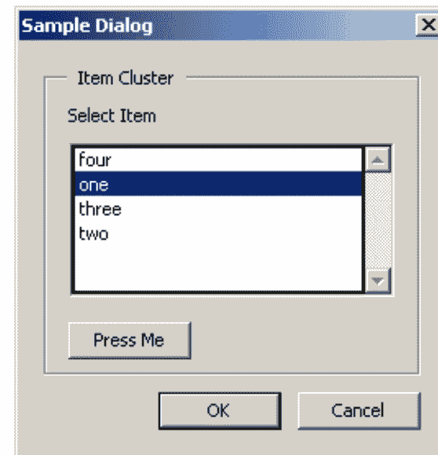

要创建如图 10.1 所示的对话框，首先需要创建一个包含对话框描述符的对象字面量，并将其作为参数传递给 `app` 对象的 `execDialog` 方法。该对象字面量可以包含表 10.2 中描述的一个或多个处理函数、一个根对话框元素，以及作为根节点子项的对话框项层次结构。

我们将从创建对话框描述符的处理函数开始。`initialize` 处理函数在对话框创建时被调用，而 `commit` 处理函数在选择“确定”时被调用。`initialize` 处理函数设置列表项，`commit` 处理函数则处理这些项。

### `initialize` 处理函数

以下 `initialize` 处理函数初始化 `list_box` 中使用的项。注意它接收 `dialog` 对象作为参数：

```javascript
// 用于初始化 list_box 的事件处理函数
initialize: function(dialog)
{
    // 创建名为 sub1 的 list_box 并设置 4 个选项：
    dialog.load({
    "sub1":
        {
            "one": -1,
            "two": -2,
            "three": +3,
            "four": -4
        }
    });
}
```

### `commit` 处理函数

以下 `commit` 处理函数在点击 `OK` 时被调用，它检索 `list_box` 中使用的项的值，并可以根据这些值执行操作。注意它接收 `dialog` 对象作为参数：

```javascript
commit: function(dialog)
{
    // 检索存储在 list_box sub1 中的值：
    var elements = dialog.store()["sub1"];

    // 遍历各项并根据需要执行操作
    for (var e in elements)
    {
        // 执行操作
    }
}
```

也可以为对话框中选择的特定项编写事件处理函数。以下处理函数在点击标有 `butn` 的按钮时被调用：

```javascript
"butn": function(dialog)
{
    app.alert("butn was clicked.");
}
```

最后，要创建根节点，我们必须创建 `description` 对象字面量，即 `dialog` 描述符。这在下面的完整示例代码中有所展示：

```javascript
var myDialog =
{
    initialize: function(dialog)
    {
        // 设置并存储 list_box sub1 中的值：
        dialog.load({
            "sub1":
            {
                // 注意：正值表示被选中的项
                "one": -1,
                "two": -2,
                "three": +3, // 当前选中的项
                "four": -4
            }
        });
    },
    commit: function(dialog)
    {
        // 检索存储在 list_box sub1 中的值：
        var elements = dialog.store();

        // 遍历各项并根据需要执行操作
        for (var e in elements["sub1"])
        {
            // 如果值为正，则表示该项被选中：
            if (elements["sub1"][e] > 0)
            {
                // 显示选中的列表值：
                app.alert("You chose:\n" + e);

                // 为该选择调用相关函数
                rc = elements["sub1"][e];
                ListHandler(rc);
            }
        }
    },

    // butn 按钮点击的事件处理函数
    "butn": function(dialog)
    {
        app.alert("JavaScript ADM Dialog in Acrobat 7.");
    },
```

### 对话框对象描述符（根节点）

```javascript
// 对话框对象描述符（根节点）
description:
{
    name: "Sample Dialog",
    elements:
    [
        {
            type: "view",
            align_children: "align_left",
            elements:
            [
                {
                    type: "cluster",
                    name: "Item Cluster",
                    elements:
                    [
                        {
                            type: "static_text",
                            name: "Select Item",
                            font: "default"
                        },
                        {
                            type: "list_box",
                            item_id: "sub1",
                            width: 200,
                            height: 100
                        },
                        {
                            type: "button",
                            item_id: "butn",
                            name: "Press Me"
                        }
                    ]
                },
                {
                    type: "ok_cancel"
                }
            ]
        }
    ]
};
```

### 处理用户列表选择的函数

```javascript
// 处理用户列表选择的函数：
function ListHandler(rc)
{
    switch (rc) {
        case 1:
            app.alert("ListHandler response for 1 - one");
            break;
        case 2:
            app.alert("ListHandler response for 2 - two");
            break;
        case 3:
            app.alert("ListHandler response for 3 - three");
            break;
        case 4:
            app.alert("ListHandler response for 4 - four");
            break;
        default:
            app.alert("Invalid selection");
            break;
    }
}

rc = app.execDialog(myDialog);
```

# 10 修改用户界面

在 Acrobat JavaScript 中使用 Adobe 对话框管理器 (ADM)。

## 为 PDF 文档添加导航

Acrobat JavaScript 提供了许多构建模块，使您能够向 PDF 文档中添加和自定义导航功能。这些功能使用户能够方便地查看和访问文档中的感兴趣区域，并且您可以将各种操作与导航事件关联。此外，您还可以自定义表单字段和页面的外观、操作多个文档、添加和删除页面，以及添加页眉、页脚、水印、背景和按钮。

主题：

- 缩略图
- 书签
- 链接
- 使用操作实现特殊效果
- 高亮显示表单字段和导航组件
- 设置演示文稿
- 页面编号
- 创建按钮

## 缩略图

### 创建页面缩略图

`doc` 对象提供了在文档中添加和删除缩略图的方法。要添加一组缩略图，请调用 `doc` 对象的 `addThumbnails` 方法，该方法会为文档中指定的页面集创建缩略图。它接受两个可选参数：`nStart` 和 `nEnd` 代表包含在内的一组连续页码的起始和结束。

例如，要为第 2 页到第 5 页添加缩略图，请使用以下命令：

```javascript
this.addThumbnails({nStart: 2, nEnd: 5});
```

要仅为一页添加缩略图，只需提供 `nStart` 的值。以下示例为第 7 页添加缩略图：

```javascript
this.addThumbnails({nStart: 7});
```

要为从第 0 页到指定页面添加缩略图，只需提供 `nEnd` 的值。以下示例为第 0-7 页添加缩略图：

```javascript
this.addThumbnails({nEnd: 7});
```

要为文档中的所有页面添加缩略图，请省略两个参数：

```javascript
this.addThumbnails();
```

要删除一组缩略图，请调用 `doc` 对象的 `removeThumbnails` 方法，该方法接受与 `addThumbnails` 方法相同的参数。例如，要删除第 2 页到第 5 页，请使用以下代码：

```javascript
this.removeThumbnails({nStart: 2, nEnd: 5});
```

### 使用页面缩略图添加页面操作

您可以将 **Page Open** 事件与页面缩略图关联。最直接的方法是在 **Page Properties** 对话框中指定一个 **Page Open** 操作。

要使用 Acrobat JavaScript 自定义页面操作，请为要打开的页面调用 `doc` 对象的 `setPageAction` 方法。在以下示例中，当用户点击第 2 页的缩略图时，会显示一条问候语：


```javascript
this.setPageAction(2, "Open", "app.alert('Hello');");
```

这种方法的优势在于，您可以动态构建用于方法调用的 JavaScript 字符串。

## 书签

您可以使用 Acrobat JavaScript 自定义出现在 `Bookmarks` 导航面板中的书签的外观和行为。每个 PDF 文档都有一个名为 `bookmarkRoot` 的对象，它是文档书签树的根节点。可以在根节点下递归地添加和修改各级书签。每个节点都是一个 `bookmark` 对象，它可以拥有任意数量的子节点。

## 修改用户界面

### 为 PDF 文档添加导航

Acrobat JavaScript 通过 `doc` 对象提供了 `bookmarkRoot` 对象的访问。这个根节点包含一个名为 `children` 的属性，它是一个 `bookmark` 对象的数组。`bookmark` 对象具有如下表 10.6 所示的属性和表 10.7 所示的方法：

**表 10.6** 书签属性

| 属性 | 描述 |
|---|---|
| `children` | 返回当前节点的子对象数组 |
| `color` | 指定书签的颜色 |
| `doc` | 书签所属的文档对象 |
| `name` | 出现在导航面板中的文本字符串 |
| `open` | 确定是否显示子书签 |
| `parent` | 父书签 |
| `style` | 字体样式 |

**表 10.7** 书签方法

| 方法 | 描述 |
|---|---|
| `createChild` | 创建一个新的子书签 |
| `execute` | 执行书签的“鼠标松开”操作 |
| `insertChild` | 将一个书签作为此书签的新子项插入（这可以用来移动现有的书签） |
| `remove` | 移除该书签及其所有子书签 |
| `setAction` | 为书签设置“鼠标松开”操作 |

## 创建书签

要创建一个书签，需要遍历书签树并确定新节点的父节点。首先访问 `bookmarkRoot`，它是当前文档的一个属性，代表书签树中的顶层节点：

```
var myRoot = this.bookmarkRoot;
```

假设文档中没有任何书签。要创建一个新书签，需调用 `bookmarkRoot` 对象的 `createChild` 方法，您可以提交以下参数：`cName`（出现在导航面板中的名称）、`cExpr`（点击书签时执行的可选 JavaScript 代码）和 `nIndex`（在 `children` 数组中的可选的从零开始的索引）。

以下代码创建了一个书签，点击时会显示问候语。请注意，省略 `nIndex` 值意味着它被放置在 `children` 数组的索引 0 位置：

```
myRoot.createChild("myBookmark", "app.alert('Hello!');");
```

以下代码添加了一个名为 `grandChild` 的书签作为 `myBookmark` 的子项：

```
var current = myRoot.children[0];
current.createChild("grandChild");
```

假设您想将 `grandChild` 移动为根节点的子项。调用根书签的 `insertChild` 方法，并提供对 `grandChild` 的引用作为参数：

```
var grandChild = myRoot.children[0].children[0];
myRoot.insertChild(grandChild, 1);
```

## 管理书签

您可以使用 Acrobat JavaScript 来更改书签的 `name`、`color` 和 `style` 属性。请注意，`style` 属性是一个整数：`0` 表示正常，`1` 表示斜体，`2` 表示粗体，`3` 表示粗斜体。以下代码将名称更改为 `New Name`，颜色更改为红色，字体样式更改为粗体：

```
var myRoot = this.bookmarkRoot;
var myChild = myRoot.children[0];
myChild.name = "New Name";
myChild.color = color.red;
myChild.style = 2;
```

除了在“创建书签”部分学到的添加新书签或现有书签外，您还可以通过调用其 `remove` 方法来删除一个书签及其子书签。以下代码行将从文档中移除所有书签：

```
this.bookmarkRoot.remove();
```

## 创建书签层次结构

由于书签具有相关的树状结构，因此可以构建书签的层次结构；一个书签的子项代表该书签所表示部分的子部分。要创建层次结构，首先向根节点添加书签，然后向根的子节点添加，递归地向它们的子节点添加。

以下代码创建了书签 `A`、`B`、`C`。每个部分有 3 个子项。子项 `A` 有子项 `A0`、`A1` 和 `A2`。子项 `B` 有子项 `B0`、`B1` 和 `B2`。子项 `C` 有子项 `C0`、`C1` 和 `C2`：

```
var myRoot = this.bookmarkRoot;
myRoot.createChild("A");
myRoot.createChild({cName: "B", nIndex: 1});
myRoot.createChild({cName: "C", nIndex: 2});
for (var i = 0; i < myRoot.children.length; i++) {
    var child = myRoot.children[i];
    for (var j = 0; j < 3; j++) {
        var name = child.name + j;
        child.createChild({cName: name, nIndex: j});
    }
}
```

要将层次结构打印到控制台，您可以像以下代码那样跟踪层级。注意其递归特性：

```
function DumpBookmark(bm, nLevel){
    // 构建缩进以表示层级
    var s = "";
    for (var i = 0; i < nLevel; i++) s += " ";

    // 打印书签的名称：
    console.println(s + "+-" + bm.name);

    // 递归打印书签的子项：
    if (bm.children != null)
        for (var i = 0; i < bm.children.length; i++)
            DumpBookmark(bm.children[i], nLevel+1);
}

// 打开控制台开始：
console.clear(); console.show();

// 递归打印书签树
DumpBookmark(this.bookmarkRoot, 0);
```

## 链接

Acrobat JavaScript 支持在 PDF 文档中添加、自定义或移除链接。这些链接可用于访问 URL、文件附件或文档内的目标位置。

`doc` 对象包含用于添加、检索和移除链接的方法。这些包括下表 10.8 列出的方法。此对象与 `link` 对象结合使用，后者包含属性以及用于自定义给定链接外观和行为的 `setAction` 方法。其属性列于下表 10.9。

此外，`app` 对象包含一个名为 `openInPlace` 的属性，可用于指定跨文档链接是在同一窗口打开还是在新窗口打开。

**表 10.8** `Doc` 对象链接方法

| 方法 | 描述 |
|---|---|
| `addLink` | 向页面添加一个新链接 |
| `addWeblinks` | 将文本实例转换为带有 URL 操作的 Web 链接 |
| `getLinks` | 检索页面指定区域内的链接 |
| `getURL` | 打开一个网页 |
| `gotoNamedDest` | 转到文档中的命名目标 |
| `removeLinks` | 移除页面指定区域内的链接 |
| `removeWeblinks` | 移除使用 Acrobat 用户界面创建的 Web 链接 |

**表 10.9** 链接属性

| 属性 | 描述 |
|---|---|
| `borderColor` | 边界矩形的边框颜色 |
| `borderWidth` | 周围矩形的边框宽度 |
| `highlightMode` | 用户点击链接时的视觉效果 |
| `rect` | 链接在旋转用户空间中的坐标 |

## 创建链接

如果 PDF 文档包含以 `http://` 开头的文本（例如 `http://myURL.com`），您可以通过调用 `doc` 对象的 `addWeblinks` 方法将所有此类实例转换为带有 URL 操作的链接。该方法返回一个整数，表示转换的文本实例数量，如下面的代码所示：

```
var numberOfLinks = this.addWeblinks();
console.println("Converted " + numberOfLinks + " links.");
```

要向 PDF 文档添加单个链接，首先调用 `doc` 对象的 `addLink` 方法，然后自定义返回的 `link` 对象的属性。`addLink` 方法需要两个参数：页码和边界矩形在旋转用户空间中的坐标。在以下示例中，导航链接被添加到文档每个页面的左下角和右下角。左侧链接打开上一页，右侧链接打开下一页：

```
var linkWidth = 36, linkHeight = 18;
for (var i = 0; i < this.numPages; i++)
{
    // 为左侧链接创建坐标：
    var lRect = [0, linkHeight, linkWidth, 0];

    // 为右侧链接创建坐标：
    var cropBox = this.getPageBox("Crop", i);
    var offset = cropBox[2] - cropBox[0] - linkWidth;
    var rRect = [offset, linkHeight, linkWidth + offset, 0];

    // 创建链接对象：
    var leftLink = this.addLink(i, lRect);
    var rightLink = this.addLink(i, rRect);

    // 计算上一页和下一页的页码：
    var nextPage = (i + 1) % this.numPages;
    var prevPage = i - 1;
    if (prevPage < 0) prevPage = this.numPages - 1;

    // 设置链接操作以转到相应的页面：
    leftLink.setAction("this.pageNum = " + prevPage);
    rightLink.setAction("this.pageNum = " + nextPage);

    // 自定义链接外观：
    leftLink.borderColor = color.red;
    leftLink.borderWidth = 1;
    rightLink.borderColor = color.red;
    rightLink.borderWidth = 1;
}
```

## 定义链接的外观

前面的示例包含通过链接的 `borderColor` 和 `borderWidth` 属性设置链接外接矩形外观的代码。您也可以通过将链接的 `highlightMode` 属性设置为四个值之一来指定链接被点击时的外观：`None`（无）、`Outline`（轮廓）、`Invert`（反转，默认值）或 `Push`（按下）。

例如，以下代码将 `myLink` 的边框颜色设置为蓝色，边框粗细设置为 2，并将高亮模式设置为 `Outline`：

```
myLink.borderColor = color.blue;
myLink.borderWidth = 2;
myLink.highlightMode = "Outline";
```

## 编辑链接

除了添加链接和修改其外观外，您还可以从文档中移除链接。要从给定页面移除一个已知的链接对象，请检索其外接矩形坐标并调用 `doc` 对象的 `removeLinks` 方法。在下面的示例中，`myLink` 从文档的第 2 页中被移除：

```
var linkRect = myLink.rect;
this.removeLinks(2, linkRect);
```

要从文档中移除所有链接，只需对每一页使用裁剪框，如下面的代码所示：

```
for (var page = 0; page < this.numPages; page++)
{
    var box = this.getPageBox("Crop", page);
    this.removeLinks(page, box);
}
```

## 从 URL 创建链接

要为给定链接打开一个网页，请调用 `link` 对象的 `setAction` 方法，并传入一个包含对 `doc` 对象的 `getURL` 方法调用的脚本。

例如，假设您已创建了一个名为 `myLink` 的 `link` 对象。以下代码将打开 `http://myWebPage.com`：

```
myLink.setAction("this.getURL('http://myWebPage.com')");
```

## 链接到文件附件

要打开一个文件附件，请在调用 `link` 对象的 `setAction` 方法时嵌入一个 JavaScript。该脚本包含对 `app` 对象的 `openDoc` 方法的调用。

以下示例在点击 `myLink` 时打开 `myDoc.pdf`：

```
myLink.setAction("app.openDoc('/C/myDoc.pdf');");
```

# 10 修改用户界面

### 为 PDF 文档添加导航

要移除在 Acrobat 中创建的 Web 链接，请调用 `doc` 对象的 `removeWeblinks` 方法。它接受两个可选参数：`nStart` 和 `nEnd` 代表一个包含起始和结束页码的闭区间范围。以下示例说明如何从文档的不同页面范围中移除 Web 链接：

### 移除 Web 链接

```
// 移除第 2 到 5 页的 Web 链接：
this.removeWeblinks({nStart: 2, nEnd: 5});

// 移除第 7 页的 Web 链接
this.removeWeblinks({nStart: 7});

// 移除第 0 到 7 页的 Web 链接：
this.removeWeblinks({nEnd: 7});

// 移除文档中的所有 Web 链接：
this.removeWeblinks();
```

要跳转到文档中的命名目标，请在调用 `link` 对象的 `setAction` 方法时嵌入一个 JavaScript。该脚本包含对 `doc` 对象的 `gotoNamedDest` 方法的调用。

以下示例在点击 `myLink` 时跳转到当前文档中名为 `Chapter5` 的目标：

### 使用目标

```
myLink.setAction("this.gotoNamedDest('Chapter5');");
```

缩略图、书签、链接和其他对象都有关联的操作，您可以使用 Acrobat JavaScript 来自定义它们的行为。例如，您可以使用它们来显示消息、跳转到同一文档或任何其他文档中的目标、打开附件、打开网页、执行菜单命令或执行各种其他任务。

### 使用操作实现特殊效果

正如您之前了解到的，您可以将缩略图与 `Page Open`（页面打开）事件关联，并将书签和链接与 `Mouse Up`（鼠标释放）事件关联。

您可以使用 Acrobat JavaScript 通过调用 `doc` 对象的 `setPageAction` 方法来自定义与缩略图关联的操作。要自定义与书签和链接关联的操作，请创建一个包含 Acrobat JavaScript 代码的字符串并将其传递给对象的 `setAction` 方法。在下面的示例中，当点击缩略图、书签和链接时，会显示一条问候语：

### 添加操作

```
// 缩略图的打开操作：
this.setPageAction(2, "Open", "app.alert('Hello!');");

// 书签和链接的 MouseUp 操作：
myBookmark.setAction("app.alert('Hello!');");
myLink.setAction("app.alert('Hello!');");
```

### 操作类型

应用于导航组件的操作只是可能被自定义的事件类型的一小部分。所有事件类型及其关联的操作的完整列表如下表 10.10 所示：

**表 10.10** 操作类型和关联事件

| 操作类型 | 事件名称 |
|---|---|
| App（应用程序） | Init（初始化） |
| Batch（批处理） | Exec（执行） |
| Bookmark（书签） | Mouse Up（鼠标释放） |
| Console（控制台） | Exec（执行） |
| Doc（文档） | DidPrint（已打印）、DidSave（已保存）、Open（打开）、WillClose（即将关闭）、WillPrint（即将打印）、WillSave（即将保存） |
| External（外部） | Exec（执行） |


| 字段（Field） | 失焦（Blur）、计算（Calculate）、聚焦（Focus）、格式化（Format）、按键（Keystroke）、鼠标按下（Mouse Down）、鼠标进入（Mouse Enter）、鼠标离开（Mouse Exit）、鼠标释放（Mouse Up）、验证（Validate） |
|---|---|
| 链接（Link） | 鼠标释放（Mouse Up） |
| 菜单（Menu） | 执行（Exec） |
| 页面（Page） | 打开（Open）、关闭（Close） |
| 屏幕（Screen） | 进入视图（InView）、离开视图（OutView）、打开（Open）、关闭（Close）、聚焦（Focus）、失焦（Blur）、鼠标释放（Mouse Up）、鼠标按下（Mouse Down）、鼠标进入（Mouse Enter）、鼠标离开（Mouse Exit） |

## 触发器类型

上表 10.10 中显示的事件名称代表启动与事件关联操作的触发器类型。它们在下面的表 10.11 中进行了描述。

**表 10.11 触发器描述**

| 触发器 | 描述 |
|---|---|
| 初始化（Init） | Acrobat 或 Adobe Reader 启动 |
| 执行（Exec） | 批处理序列开始 |
| 已打印（DidPrint） | 文档打印完成后 |
| 已保存（DidSave） | 文档保存完成后 |
| 打开（Open） | 文档被打开时 |
| 关闭（Close） | 新页面被打开或文档被关闭时 |
| 即将关闭（WillClose） | 文档即将关闭之前 |
| 即将打印（WillPrint） | 文档即将打印之前 |
| 即将保存（WillSave） | 文档即将保存之前 |
| 失焦（Blur） | 字段失去焦点时 |
| 计算（Calculate） | 字段需要计算时 |
| 聚焦（Focus） | 在 Mouse Down 之后和 Mouse Up 之前 |
| 格式化（Format） | 相关的 Calculate 事件发生之后 |
| 按键（Keystroke） | 在文本框或组合框中按键，或在组合框或列表框中选择项目时 |
| 鼠标按下（Mouse Down） | 鼠标按钮被按下时 |
| 鼠标释放（Mouse Up） | 鼠标按钮被释放后 |
| 鼠标进入（Mouse Enter） | 鼠标进入字段或屏幕矩形区域时 |
| 鼠标离开（Mouse Exit） | 鼠标离开字段或屏幕矩形区域时 |
| 验证（Validate） | 值已提交给字段之后 |
| 进入视图（InView） | 新页面进入视图时 |
| 离开视图（OutView） | 旧页面离开视图时 |

178

Acrobat JavaScript 脚本指南

# 突出显示表单字段和导航组件

您可以使用 Acrobat JavaScript 来自定义与按钮、链接和书签关联的操作，以便它们在用户点击后改变外观。

对于按钮（它是一个字段），您可以调用其 `highlight` 属性，该属性允许您指定按钮被点击后的外观。有四种选择，如下表 10.12 所示：

**表 10.12 按钮外观**

| 类型 | 关键字 |
|---|---|
| 无 | `highlight.n` |
| 反转 | `highlight.i` |
| 按下 | `highlight.p` |
| 轮廓 | `highlight.o` |

例如，以下代码使按钮在被点击时呈现按下状态：

```javascript
// 将高亮模式设置为按下
var f = this.getField("myButton");
f.highlight = highlight.p;
```

正如您之前了解到的，`link` 对象也有一个 `highlight` 属性。

还有其他创造性的方法来处理突出显示问题。例如，您可以通过在传入其 `setAction` 方法的脚本中添加一行代码，在点击时更改按钮的背景色。在下面的示例中，当鼠标进入按钮区域时，按钮显示问候语并将背景色更改为蓝色：

```javascript
var script = "app.alert('Hello!');";
script += "var myButton = this.getField('myButton');";
script += "myButton.fillColor = color.blue;";
f.setAction("MouseEnter", script);
```

这个想法可以应用于 `bookMark` 对象的 `color` 属性，以及 `link` 对象的 `borderColor` 属性。在这两种情况下，都可以在传入其 `setAction` 方法的脚本中使用与上面示例中类似的代码。

对于 `bookMark` 对象，您还可以考虑通过其 `name` 和 `style` 属性来更改文本或字体样式。例如，以下代码在 `myBookmark` 中添加了单词 VISITED 并将字体样式更改为粗体：

```javascript
myBookmark.name += " - VISITED";
myBookmark.style = 2;
```

# 修改用户界面

## 为 PDF 文档添加导航

# 设置演示文稿

Acrobat 和 Adobe Reader 有两种查看模式：全屏模式和常规查看模式。全屏模式通常适用于演示文稿，因为 PDF 页面可以隐藏菜单栏、工具栏和窗口控件，从而填满整个屏幕。

可以在设置演示文稿时使用 Acrobat JavaScript 来自定义查看模式。`app` 对象的 `fullScreen` 属性以及 `app.media` 对象的 `windowType` 属性可用于设置查看模式。

## 在全屏视图中定义初始视图

要使 Acrobat 和 Adobe Reader 以全屏模式显示，您可以在文档打开时触发的文档级脚本中，或在应用程序首次启动时触发的应用程序级脚本中包含以下语句：

```javascript
app.fullscreen = true;
```

## 定义初始视图

除了指定使用全屏还是常规查看模式外，您还可以使用 Acrobat JavaScript 来设置文档视图。您可以自定义初始视图的缩放比例、页面布局、应用程序和文档查看尺寸、文档打开时的初始页面，以及用户界面的某些部分是否可见。

`doc` 对象的 `layout` 属性允许您通过分配以下值之一来指定页面布局：

- `SinglePage`
- `OneColumn`
- `TwoColumnLeft`
- `TwoColumnRight`
- `TwoPageLeft`
- `TwoPageRight`

要设置各种视图窗口的尺寸，请为以下 `doc` 对象属性之一分配一个 `rect` 值：

- `innerAppWindowRect`：内部应用程序窗口（不包括标题栏、边框等）
- `innerDocWindowRect`：内部文档窗口
- `outerAppWindowRect`：外部应用程序窗口
- `outerDocWindowRect`：外部文档窗口
- `pageWindowRect`：文档内容的页面视图窗口

要设置缩放比例，请为 `doc` 对象的 `zoom` 属性分配一个值。例如，以下代码将缩放比例设置为 125%：

```javascript
this.zoom = 125;
```

您还可以通过将下表 10.13 所示的设置之一分配给 `doc` 对象的 `zoomtype` 属性来设置缩放类型：

**表 10.13 ZoomType 设置**

| 缩放类型 | 属性值 |
|---|---|
| 无变化 | `zoomtype.none` |
| 适合页面 | `zoomtype.fitP` |
| 适合宽度 | `zoomtype.fitW` |
| 适合高度 | `zoomtype.fitH` |
| 适合可见宽度 | `zoomtype.fitV` |
| 首选 | `zoomtype.pref` |
| 重排宽度 | `zoomtype.refW` |

以下示例将文档的缩放类型设置为适合宽度：

```javascript
this.zoomType = zoomtype.fitW;
```

要指定文档初始打开的页面，请设置 `doc` 对象的 `pageNum` 属性。如果在用于文档 `Open` 事件的脚本中包含以下代码，文档将自动打开到第 30 页：

```javascript
this.pageNum = 30;
```

最后，您可以通过调用 `app` 对象的以下方法来选择菜单项和工具栏按钮是否可见：

- `hideMenuItem`：移除特定菜单项
- `hideToolbarButton`：移除特定工具栏按钮

例如，如果将以下代码放在文件夹级脚本中，则在 Acrobat 或 Adobe Reader 启动时会移除“手形”图标：

```javascript
app.hideToolbarButton("Hand");
```

# 修改用户界面

## 为 PDF 文档添加导航

## 添加页面转换

您可以使用 Acrobat JavaScript 来自定义文档中任何页面的页面转换方式。这通过 `doc` 对象的 `setPageTransitions` 和 `getPageTransitions` 方法实现。

`setPageTransitions` 方法接受三个参数：

- `nStart`：起始页的从零开始的索引
- `nEnd`：最后一页的从零开始的索引
- `aTrans`：一个包含三个值的页面转换数组：
  - `nDuration`：页面在自动更改前显示的时间
  - `cTransition`：要应用的转换的名称
  - `nTransDuration`：转换效果的持续时间（以秒为单位）

要应用的转换名称可以从 `fullscreen` 对象的 `transitions` 属性提供的综合列表中选择。要获取该列表，请在 `Console` 中输入以下代码：

```javascript
console.println("[" + app.fs.transitions + "]");
```

此外，您可以通过 `fullscreen` 对象的 `defaultTransition` 属性设置默认页面转换。

在以下示例中，页面转换应用于第 2-5 页。每页显示 10 秒，然后发生持续一秒钟的自动转换：

```javascript
this.setPageTransitions({
    nStart: 2,
    nEnd: 5,
    aTrans: {
        nDuration: 10,
        cTransition: "WipeLeft",
        nTransDuration: 1
    }
});

// 将查看模式设置为全屏
app.fullScreen = true;
```

## 页码编号

您可以使用 Acrobat JavaScript 来自定义整个文档中使用的页码编号方案。有三种编号格式：

- 十进制（通常用于普通页面范围）
- 罗马数字（通常用于前言等前部材料）
- 字母数字（通常用于附录等后部材料）

`doc` 对象的 `getPageLabel` 和 `setPageLabels` 方法可用于控制和自定义 PDF 文档中编号方案的外观。

`getPageLabel` 方法接受从零开始的页面索引，并返回包含给定页面标签的字符串。

`setPageLabels` 方法接受两个参数：`nPage` 是要标记页面的从零开始的索引，`aLabel` 是一个包含三个值的数组，代表编号方案。如果未提供 `aLabel`，该方法将移除指定页面以及直到下一个指定标签之前的所有页面的页码。

`aLabel` 数组包含三个必需的值：

- `cStyle`：页面编号的样式，如下表 10.14 所示
- `cPrefix`：用于页面标签数字部分前缀的字符串
- `nStart`：开始编号页面的序数

**表 10.14 页面编号样式值**

| cStyle 值 | 描述 |
|---|---|
| `D` | 十进制编号 |
| `R` | 大写罗马数字编号 |
| `r` | 小写罗马数字编号 |
| `A` | 大写字母数字编号 |
| `a` | 小写字母数字编号 |

# 修改用户界面

## 为 PDF 文档添加导航

例如，下面的代码使用以下方案为文档中的 10 页进行标记：**i, ii, iii, 1, 2, 3, 4, 5, Appendix-A, Appendix-B：**

```javascript
// 第 0-2 页将使用小写罗马数字 i, ii, iii：
this.setPageLabels(0, ["r", "", 1]);

// 第 3-7 页将使用十进制编号 1-5：
this.setPageLabels(3, ["D", "", 1]);

// 第 8-9 页将使用字母数字编号：
this.setPageLabels(8, ["A", "Appendix-", 1]);

// 页面标签将被打印到控制台：
var labels = this.getPageLabel(0);
for (var i=1; i<this.numPages; i++)
    labels += ", " + this.getPageLabel(i);
console.println(labels);
```

也可以通过省略 `aLabel` 参数来移除页面标签，如下所示（假设上例中的标签存在）：

```javascript
// 第 3-7 页的标签将被移除：
this.setPageLabels(3);
```

## 创建按钮

虽然按钮通常被视为表单字段，但您可以将它们添加到任何文档中。按钮可用于多种目的，例如打开文件、播放声音或视频片段，或向 Web 服务器提交数据。正如您之前所了解的，您可以在按钮上放置文本和图像，使其成为文档中用户友好的交互部分。要显示或隐藏图形按钮的某些部分，请使用 Mouse Enter 和 Mouse Exit 事件或其他类型的控制机制来管理按钮字段的 `buttonSetIcon` 方法的使用。

例如，以下代码在鼠标进入按钮字段时显示一个图标，在鼠标退出时显示不同的图标：

```javascript
var script = "var f = this.getField('myButton');";
script += "f.buttonSetIcon(this.getIcon('oneIcon'))";
myButton.setAction("MouseEnter",script);

script = "var f = this.getField('myButton');";
script += "f.buttonSetIcon(this.getIcon('otherIcon'))";
myButton.setAction("MouseExit",script);
```

# 处理 PDF 图层

## 关于 PDF 图层

PDF 图层是可以在空间上与其他组件重叠的内容组件。根据设置，多个组件可以显示或隐藏，可用于支持各种应用程序对分层 PDF 内容的显示、导航和打印。可以编辑图层的属性、锁定图层、为其添加导航、合并或展平图层，以及合并 PDF 分层文档。PDF 图层通过使用 Acrobat JavaScript 可选内容组（OCG）对象来实现。

要获取文档中给定页面的 `OCG` 对象数组，请调用 `doc` 对象的 `getOCGs` 方法。以下代码获取文档第 3 页上包含的 OCG 对象数组：

```javascript
var ocgArray = this.getOCGs(3);
```

## 使用图层导航

由于信息可以存储在 PDF 文档的不同图层中，可以在不同图层中自定义导航控件，其可见性设置可以动态自定义，从而将其与上下文和用户交互关联起来。例如，如果用户选择了一个给定选项，属于相应可选内容组的一组导航链接可能会显示出来。

此外，可以通过调用 `doc` 对象的 `getOCGOrder` 和 `setOCGOrder` 方法来确定图层在用户界面中的显示顺序。在以下示例中，所有图层的显示顺序被反转：

```javascript
var ocgOrder = this.getOCGOrder();
var newOrder = new Array();
for (var i=0; i<ocgOrder.length; i++)
    newOrder[i] = ocgOrder[ocgOrder.length - i - 1];
this.setOCGOrder(newOrder);
```

## 修改用户界面

### 编辑 PDF 图层的属性

OCG 对象提供了可用于确定对象默认状态应为开或关、其意图应为查看或设计、是否应被锁定、在用户界面中看到的文本字符串以及当前状态的属性。这些属性如表 10.15 所示：

**表 10.15 OCG 属性**

| 属性 | 描述 |
|---|---|
| `initState` | 确定 OCG 对象默认是开启还是关闭 |
| `intent` | OCG 对象的意图（查看或设计） |
| `locked` | 是否可以通过用户界面切换开关状态 |
| `name` | 在用户界面中看到的用于标识 OCG 对象的文本字符串 |
| `state` | OCG 对象的当前开关状态 |

`initState` 属性可用于设置可选内容组的默认状态。在以下示例中，`myLayer` 默认设置为开：

```javascript
myLayer.initState = true;
```

`intent` 属性是一个值数组，可用于定义特定可选内容组的意图。数组中使用的两个可能值是 View 和 Design。Design 图层仅为信息目的而创建，不影响内容的可见性。其目的是表示文档设计师对图形元素的结构化组织。View 图层旨在供文档使用者交互使用。如果使用 View，则会影响图层的可见性。在以下示例中，文档中所有 OCG 对象的意图被设置为这两个值：


```javascript
var ocgs = this.getOCGs();
for (var i=0; i<ocgs.length; i++)
    ocgs[i].intent = ["View", "Design"];
```

`locked` 属性用于确定给定图层是否可以通过用户界面切换。在以下示例中，`myLayer` 被锁定，这意味着它无法通过用户界面切换：

```javascript
myLayer.locked = true;
```

`state` 属性表示给定 OCG 的当前开关状态。在以下示例中，所有 OCG 都被打开：

```javascript
var ocgs = this.getOCGs();
for (var i=0; i<ocgs.length; i++)
    ocgs[i].state = true;
```

`name` 属性表示在用户界面中看到的用于标识图层的文本字符串。在以下示例中，Watermark OCG 被切换：

```javascript
var ocgs = this.getOCGs();
for (var i=0; i<ocgs.length; i++)
    if (ocgs[i].name == "Watermark")
        ocgs[i].state = !ocgs[i].state;
```

## 合并图层

您可以使用 Acrobat JavaScript 合并 PDF 文档中的图层。合并后的图层（源图层）将获取其合并到的图层（目标图层）的属性。在以下示例中，`sourceLayer` 被合并到 `targetLayer`：

```javascript
sourceLayer.initState = targetLayer.initState;
sourceLayer.intent = targetLayer.intent;
sourceLayer.locked = targetLayer.locked;
sourceLayer.name = targetLayer.name;
sourceLayer.state = targetLayer.state;
```

## 展平 PDF 图层

展平图层意味着它们将被合并。此操作通过用户界面中的 `Layers` 选项卡完成。

## 合并 PDF 分层文档

可以将多个包含图层的 PDF 文档合并，同时保留分层信息。执行此操作时，可能需要重新排列合并后的 OCG 数组的顺序。为此，请获取每个文档的 OCG 顺序数组，并将它们合并到合并文档中的新数组中。在下面显示的示例中，`source1.pdf` 和 `source2.pdf` 被合并为 `target.pdf`。假设两个文档之间没有公共图层：

```javascript
// 打开源文档：
var source1 = app.openDoc("/C/source1.pdf");
var source2 = app.openDoc("/C/source2.pdf");

// 获取每个源文档的 OCG 顺序数组：
var mergedOCGArray = new Array();
var source1OCGArray = source1.getOCGOrder();
var source2OCGArray = source2.getOCGOrder();

// 将 OCG 顺序数组合并到目标数组中：
for (var i=0; i<source1OCGArray.length; i++)
    mergedOCGArray[i] = source1OCGArray[i];
var offset = source1OCGArray.length;
for (var j=0; j<source2OCGArray.length; j++)
    mergedOCGArray[offset + j] = source2OCGArray[j];

// 创建目标文档：
var target = app.newDoc("/C/target.pdf");

// 插入 source1.pdf：
target.insertPages({
    nPage : -1,
    cPath : "/c/source1.pdf",
});

// 插入 source2.pdf：
target.insertPages({
    nPage : target.numPages,
    cPath : "/c/source2.pdf",
});

// 在目标文档中设置 OCG 顺序数组
target.setOCGOrder(mergedOCGArray);

// 保存目标文档：
target.saveAs({
    "/c/target.pdf");
});

// 在不通知用户的情况下关闭目标文档：
target.closeDoc(true);
```

# 11 搜索与索引基础

## 简介

本章将使您能够自定义和扩展用于搜索 PDF 文档内容和元数据的操作，以及索引操作。搜索和索引中使用的主要 Acrobat JavaScript 对象是 `search`、`catalog` 和 `index` 对象。您将学习如何使用这些对象来实现下列目标。

## 章节目标

在本章结束时，您将能够：

- 使用 Acrobat JavaScript 在一个或多个 PDF 文档中搜索文本。
- 自定义搜索以执行高级查询。
- 自定义 PDF 文档的索引。
- 使用 JavaScript 读取和搜索 XMP 元数据。

## 目录

| 主题 |
|---|
| [在 PDF 文档中搜索文本](Searching for Text in PDF Documents) |
| [索引多个 PDF 文档](Indexing Multiple PDF Documents) |
| [搜索元数据](Searching Metadata) |

## 在 PDF 文档中搜索文本

### 简介

Acrobat JavaScript 提供了一个静态的 `search` 对象，它提供强大的搜索功能，可应用于 PDF 文档和索引。其属性和方法分别在表 11.1 和表 11.2 中描述。

**表 11.1 搜索属性**

| 属性 | 描述 |
|---|---|
| `attachments` | 随基础文档一起搜索 PDF 附件 |
| `available` | 确定是否可能进行搜索 |
| `docInfo` | 搜索文档元数据信息 |
| `docText` | 搜索文档文本 |
| `docXMP` | 搜索文档 XMP 元数据 |
| `bookmarks` | 搜索文档书签 |
| `ignoreAccents` | 在搜索中忽略重音符号和变音符号 |
| `ignoreAsianCharacterWidth` | 匹配查询中的假名字符 |
| `indexes` | 获取所有可访问的 `index` 对象 |
| `jpegExif` | 搜索关联 JPEG 图像中的 EXIF 数据 |
| `markup` | 搜索注释 |
| `matchCase` | 确定查询是否区分大小写 |
| `matchWholeWord` | 仅查找完整单词的出现 |
| `maxDocs` | 返回的最大文档数 |
| `proximity` | 在 `AND` 子句的结果排名中使用邻近度 |
| `proximityRange` | 邻近搜索的范围（以单词数为单位） |
| `refine` | 在查询中使用先前结果 |
| `stem` | 在搜索中使用词干提取 |

**表 11.1** *搜索属性*

| 属性 | 描述 |
|---|---|
| `wordMatching` | 决定单词的匹配方式（短语、所有单词、任意单词、布尔查询） |

**表 11.2** *搜索方法*

| 方法 | 描述 |
|---|---|
| `addIndex` | 将索引添加到可搜索索引列表中 |
| `getIndexForPath` | 根据指定路径搜索索引列表 |
| `query` | 在文档或索引中搜索指定文本 |
| `removeIndex` | 从可搜索索引列表中移除索引 |

## 在 PDF 文档中查找词语

`search` 对象的 `query` 方法用于在 PDF 文档中搜索文本。它接受三个参数：

- `cQuery`：要搜索的文本。
- `cWhere`：搜索文本的位置：
  - `ActiveDoc`：在活动文档中搜索。
  - `Folder`：在指定文件夹中搜索。
  - `Index`：在指定索引中搜索。
  - `ActiveIndexes`：在当前可用的索引集中搜索（默认）。
- `cDIPath`：用于搜索的文件夹或索引的路径。

## 执行文档的简单搜索

最简单的搜索类型应用于 PDF 文档中的文本。例如，以下代码在当前文档中执行不区分大小写的搜索，查找词语 `Acrobat`：

```javascript
search.query("Acrobat");
```

## 使用高级搜索选项

你可以设置 `search` 对象的属性以使用高级搜索选项，这些选项可用于确定如何匹配搜索字符串，以及是否使用临近搜索或词干提取。

要确定搜索字符串中的单词将如何匹配，请将 `search` 对象的 `wordMatching` 属性设置为以下值之一：

- `MatchPhrase`：匹配确切的短语。
- `MatchAllWords`：匹配所有单词，不考虑它们出现的顺序。
- `MatchAnyWord`：匹配搜索字符串中的任意单词。
- `BooleanQuery`：对多个文档搜索执行布尔查询（默认）。

例如，以下代码匹配短语 `"My Search"` 或 `"Search My"`：

```javascript
search.wordMatching = "MatchAllWords";
search.query("My Search");
```

要确定在涉及多个文档或索引定义文件的搜索中是否使用临近搜索，请将 `search` 对象的 `wordMatching` 属性设置为 `MatchAllWords`，并将其 `proximity` 属性设置为 `true`。在下面的示例中，所有 `My` 和 `Search` 这两个词之间不超过 900 个单词的实例都将列在搜索结果中：

```javascript
search.wordMatching = "MatchAllWords";
search.proximity = true;
search.query("My Search");
```

要在搜索中使用词干提取，请将 `search` 对象的 `stem` 属性设置为 `true`。例如，以下搜索列出了以 `run` 开头的单词，例如 `running` 或 `runs`：

```javascript
search.stem = true;
search.query("run");
```

## 跨多个 PDF 文档进行搜索

### 在特定位置搜索所有 PDF 文件

要搜索文件夹中的所有 PDF 文件，请将 `search` 对象 `query` 方法中的 `Where` 参数设置为 `Folder`。在以下示例中，将在 `/C/MyFolder` 中的所有文档中搜索单词 `"Acrobat"`：

```javascript
search.query("Acrobat", "Folder", "/C/MyFolder");
```

### 为多文档搜索使用高级搜索选项

除了用于匹配短语、使用词干提取和使用临近搜索的高级选项外，还可以指定搜索是否区分大小写、是否匹配整个单词、设置作为查询一部分返回的最大文档数，以及是否优化上一次查询的结果。

要指定搜索应区分大小写，请将 `search` 对象的 `matchCase` 属性设置为 `true`。例如，以下代码匹配 `"Acrobat"` 但不匹配 `"acrobat"`：

```javascript
search.matchCase = true;
search.query("Acrobat", "Folder", "/C/MyFolder");
```

要指定搜索应仅识别完整单词的出现，请将 `search` 对象的 `matchWholeWord` 属性设置为 `true`。例如，以下代码匹配 `"stick"`，但不匹配 `"tick"` 或 `"sticky"`：

```javascript
search.matchWholeWord = true;
search.query("stick", "Folder", "/C/MyFolder");
```

要设置作为查询一部分返回的最大文档数，请将 `search` 对象的 `maxDocs` 属性设置为所需数量（默认值为 100）。例如，以下代码将要搜索的文档数量限制为 5：

```javascript
search.maxDocs = 5;
```

要优化上一次查询的结果，请将 `search` 对象的 `refine` 属性设置为 `true`，如以下代码所示：

```javascript
search.refine = true;
```

## 搜索 PDF 索引文件

PDF 索引文件通常涵盖多个 PDF 文件，并且搜索索引所需的时间远少于搜索相应各个 PDF 文件所需的时间。

要搜索 PDF 索引，请将 `search` 对象 `query` 方法中的 `cWhere` 参数设置为 `Index`。在以下示例中，在 `myIndex` 中搜索单词 `"Acrobat"`：

```javascript
search.query("Acrobat", "Index", "/C/MyIndex.pdx");
```

## 在多文档搜索中使用布尔查询

布尔查询可以应用于多个 PDF 文档，使用以下运算符：

- `AND`
- `OR`
- `^`（异或）
- `NOT`

例如，在搜索中使用短语 `"Paris AND France"` 将返回所有同时包含 Paris 和 France 这两个词的文档。

在搜索中使用短语 `"Paris OR France"` 将返回所有包含 Paris 或 France 这两个词之一或两者的文档。

在搜索中使用短语 `"Paris ^ France"` 将返回所有仅包含 Paris 和 France 这两个词之一（而非两者）的文档。

在搜索中使用短语 `"Paris NOT France"` 将返回所有包含 Paris 但不包含 France 这个词的文档。

此外，可以使用括号。例如，短语 `"one AND (two OR three)"` 等同于执行两次搜索：一次使用语句 `"one AND two"`，另一次使用语句 `"one AND three"`。

要指定将使用布尔查询，请确保 `search` 对象的 `wordMatching` 属性设置为 `BooleanQuery`（这是默认设置）。

## 为多个 PDF 文档建立索引

可以使用 Acrobat JavaScript 的 `catalog`、`catalogJob` 和 `index` 对象来扩展和自定义多个 PDF 文档的索引。这些对象可用于构建、检索或移除索引。`index` 对象代表一个目录生成的索引，包含一个用于创建索引的 `build` 方法（并返回一个包含索引信息的 `catalogJob` 对象），并具有下表 11.3 所示的属性：

**表 11.3** *索引属性*

| 属性 | 描述 |
|---|---|
| `available` | 指示索引是否可用 |
| `name` | 索引的名称 |
| `path` | 索引的设备无关路径 |
| `selected` | 指示索引是否将参与搜索 |

`catalog` 对象可用于管理索引作业和检索索引。它包含一个用于检索索引的 `getIndex` 方法，一个用于移除待处理索引作业的 `remove` 方法，以及包含索引作业信息的属性。

## 创建、更新或重建索引

要确定哪些索引可用，请使用 `search` 对象的 `indexes` 属性，该属性包含一个 `index` 对象数组。对于数组中的每个对象，你可以使用其 `name` 属性来确定其名称。在下面的代码中，所有可用选定索引的名称和路径被打印到控制台：

```javascript
var arr = search.indexes;
for (var i=0; i<arr.length; i++)
{
    if (arr[i].selected)
    {
        var str = "Index[" + i + "] = " + arr[i].name;
        str += "\nPath = " + arr[i].path;
        console.println(str);
    }
}
```

## 搜索与索引基础

### 为多个 PDF 文档建立索引

要构建索引，首先调用 `catalog` 对象的 `getIndex` 方法以获取 `index` 对象。此方法接受一个包含 `index` 对象路径的参数。然后调用 `index` 对象的 `build` 方法，该方法返回一个 `catalogJob` 对象。此方法接受两个参数：

- `cExpr`：一个在构建操作完成后执行的 Acrobat JavaScript 表达式。
- `bRebuildAll`：指示是否执行完全重建（即先删除现有索引，然后从头开始完全构建）。

最后，返回的 `catalogJob` 对象包含三个属性，提供有关索引任务的有用信息：

- `path`：索引的设备无关路径。
- `type`：索引操作的类型（`Build`、`Rebuild` 或 `Delete`）。
- `status`：索引操作的状态（`Pending`、`Processing`、`Completed` 或 `CompletedWithErrors`）。

在下面显示的代码中，索引 `myIndex` 被完全重建，之后报告其状态：


```
// Retrieve the Index object
var idx = catalog.getIndex("/C/myIndex.pdx");

// Build the Index
var job = idx.build("app.alert('Index build');", true);

// Confirm the path of the rebuilt index:
console.println("Path of rebuilt index: " + job.path);

// Confirm that the index was rebuilt:
console.println("Type of operation: " + job.type);

// Report the job status
console.println("Status: " + job.status);
```

## 搜索元数据

### 使用 Acrobat JavaScript 读取和搜索 XMP 元数据

PDF 文档包含 XML 格式的文档元数据，其中包括文档标题、主题、作者姓名、关键词、版权信息、修改日期、文件大小以及文件名和位置路径等信息。

要使用 Acrobat JavaScript 搜索文档的 XMP 元数据，请将 `search` 对象的 `docXMP` 属性设置为 `true`，如以下代码所示：

```
search.docXMP = true;
```

# 11 搜索与索引基础

## 搜索元数据

# 12 安全性

## 简介

本章将向您介绍通过 Acrobat JavaScript 提供的各种安全选项。您将了解如何通过应用密码和数字签名、认证文档、加密文件、为附件添加安全性、管理数字 ID 和证书以及自定义安全策略，来自定义 PDF 文档的安全性。

## 章节目标

在本章结束时，您将能够：

- 理解支持 PDF 文档的 Acrobat JavaScript 安全模型。
- 使用 Acrobat JavaScript 在 PDF 文档中添加、移除和验证数字签名。
- 使用 Acrobat JavaScript 为 PDF 文档和附件应用密码、安全选项、使用权限和加密。
- 使用 Acrobat JavaScript 创建、使用和管理数字 ID 和证书。

## 内容

| 主题 |
| :--- |
| 安全性基础 |
| 为 PDF 文档进行数字签名 |
| 为 PDF 文档添加安全性 |
| 数字 ID 与认证方法 |

## 安全性基础

Acrobat JavaScript 提供了许多支持安全性的对象。这些对象由 `security`、`securityPolicy` 和 `securityHandler` 对象管理，用于管理证书、安全策略和签名。`certificate`、`directory`、`signatureInfo` 和 `dirConnection` 对象用于管理数字签名和访问用户证书。

### 为 PDF 文档添加安全性的方法

下面描述了为 PDF 文档应用各种类型安全性的通用流程。本章后续部分提供了详细信息和示例。

### 密码与限制

保护文档免受未经授权访问的基本方法是使用 `doc` 对象的 `encryptForRecipients` 方法，为授权收件人列表加密文档。这本质上要求授权收件人使用私钥或凭据才能访问它。可以应用限制，以便控制收件人对文档的访问。

### 认证文档

文档的作者签名使得修改检测和阻止（mdp）成为可能。当应用此类签名时，可以认证文档，这意味着您将指定有关其内容以及允许的更改类型的信息，以使文档保持认证状态。

要将作者签名应用于文档，请使用 `doc` 对象的 `addField` 方法创建作者签名字段。然后使用 `field` 对象的 `signatureSign` 方法对该字段进行签名，在该方法中，您将提供包含安全处理程序、一个包含 `mdp` 属性值（该值不能是 `allowAll`）的 `signatureInfo` 对象以及解释为何在文档中嵌入某些法律警告的法律声明的参数。`signatureInfo` 对象具有所有安全处理程序通用的属性。这些属性在下面的表 12.1 中描述。

### 表 12.1 SignatureInfo 属性

| 属性 | 描述 |
| :--- | :--- |
| `buildInfo` | 签名的软件构建版本和版本号 |
| `date` | 签名的日期和时间 |
| `handlerName` | 签名字典中 `Filter` 属性指定的安全处理程序名称 |
| `handlerUserName` | 由 `handlerName` 指定的安全处理程序名称 |
| `handlerUIName` | 由 `handlerName` 指定的安全处理程序名称 |
| `location` | 物理位置或主机名 |
| `mdp` | 修改检测和阻止设置（allowNone、allowAll、default、defaultAndComments） |
| `name` | 用户姓名 |
| `numFieldsAltered` | 自上次签名以来更改的字段数量 |
| `numFieldsFilledIn` | 自上次签名以来填充的字段数量 |
| `numPagesAltered` | 自上次签名以来更改的页面数量 |
| `numRevisions` | 文档中的修订次数 |
| `reason` | 签名原因 |
| `revision` | 签名修订版本 |
| `status` | 有效性状态（4 表示完全有效的签名） |
| `statusText` | 签名状态的字符串表示 |
| `subFilter` | 公钥签名使用的格式 |
| `verifyHandlerName` | 用于验证签名的安全处理程序 |
| `verifyHandlerUIName` | 由 `verifyHandlerName` 指定的处理程序 |

### 使用证书加密文件

当您调用 `doc` 对象的 `encryptForRecipients` 方法时，它会使用每个收件人的公钥证书来加密文档。收件人组在 `oGroups` 参数中指定，该参数是一个 `Group` 对象数组，每个对象包含两个属性：`permissions` 和 `userEntities`。`userEntities` 属性是一个 `UserEntity` 对象数组（在下面的表 12.2 中描述），每个对象描述一个用户及其关联的证书，并通过调用 `dirConnection` 对象的 `search` 方法返回。关联的证书在一个包含 `Certificate` 对象数组（在下面的表 12.3 中描述）的属性中表示，每个对象提供对 X.509 公钥证书属性的只读访问。

要获取收件人组（上面提到的 `oGroups` 参数），您可以调用 `security` 对象的 `chooseRecipientsDialog` 方法，该方法会打开一个对话框，提示用户选择收件人列表。

### 表 12.2 UserEntity 对象属性

| 属性 | 描述 |
| :--- | :--- |
| `firstName` | 用户的名字 |
| `lastName` | 用户的姓氏 |
| `fullName` | 用户的全名 |
| `certificates` | 用户的 `Certificate` 对象数组 |
| `defaultEncryptCert` | 首选的 `Certificate` |

### 表 12.3 Certificate 对象属性

| 属性 | 描述 |
| :--- | :--- |
| `binary` | 证书的原始字节 |
| `issuerDN` | 用户的可分辨名称 |
| `keyUsage` | 证书密钥用途扩展的值 |
| `MD5Hash` | 证书的 MD5 摘要 |
| `SHA1Hash` | 证书的 SHA1 摘要 |
| `serialNumber` | 证书的唯一标识符 |
| `subjectCN` | 签名者的通用名称 |
| `subjectDN` | 签名者的可分辨名称 |
| `usage` | 用途：终端用户签名或加密 |
| `ubrights` | 应用程序 `Rights` 对象 |

## 通过数字签名保护 PDF 文档安全

### 安全策略

安全策略是通用规范，包含加密类型、权限设置以及要使用的密码或公钥。您可以创建文件夹级别的脚本，其中包含反映这些策略的对象。可以通过使用 `securityPolicy` 对象来自定义安全策略，这些对象可通过 `security` 对象的 `getSecurityPolicies` 和 `chooseSecurityPolicy` 方法，以及 `doc` 对象的 `encryptUsingPolicy` 和 `encryptForAPS` 方法进行访问和管理。

### 安全表单

您可以通过创建一个脚本来锁定表单字段，该脚本调用 `signature` 字段的 `setLock` 方法，并将该脚本作为第二个参数传递给 `signature` 字段的 `setAction` 方法。

此外，您可以通过调用嵌入式 FDF 数据对象的 `signatureSign` 方法对其进行签名，然后通过调用其 `signatureValidate` 方法来验证签名。

### 通过数字签名保护 PDF 文档安全

数字签名包含有关签署文档人员的识别信息。当应用作者签名（首次对文档应用签名）时，也可以对文档进行认证。这涉及提供有关文档内容的合法证明，并指定允许对文档进行的更改类型，以便文档保持认证状态。

### 签署 PDF 文档

要签署文档，请创建一个签名字段，选择一个安全处理程序，然后调用该字段的 `signatureSign` 方法，该方法接受以下参数：

- `oSig`：安全处理程序对象。
- `oInfo`：`signatureInfo` 对象。
- `cDIPath`：随后文件将保存到的设备无关路径。
- `bUI`：安全处理程序在签名时是否显示用户界面。
- `cLegalAttest`：解释法律警告的字符串（仅用于作者签名）。

这些参数的创建和使用将在以下部分中说明：安全处理程序对象、SignatureInfo 对象以及应用签名。

### 安全处理程序对象

要获取安全处理程序（即 `oSig` 参数），请调用 `security` 对象的 `getHandler` 方法，该方法创建一个新的安全处理程序引擎，并接受以下参数：

- `cName`：安全处理程序的名称（包含在 `security` 对象的 `handlers` 属性中）。
- `bUIEngine`：与 Acrobat 用户界面关联的现有引擎。

以下代码展示了如何在文档打开时设置签名验证、列出所有可用的安全处理程序，并选择与 Acrobat 用户界面关联的 `Adobe.PPKLite` 引擎：

```
// 文档打开时验证签名：
security.validateSignaturesOnOpen = true;

// 列出所有可用的签名处理程序
for (var i=0; i<security.handlers.length; i++)
    console.println(security.handlers[i]);

// 选择带有 Acrobat 用户界面的 Adobe.PPKLite 引擎：
var ppklite = security.getHandler("Adobe.PPKLite", true);
```

获得安全处理程序后，调用 `securityHandler` 对象的 `login` 方法，以便访问和选择您的数字 ID，如以下代码所示：

```
var oParams = {
    password: "myPassword",
    cDIPath: "/C/signatures/myName.pfx" // 数字签名配置文件
};
ppklite.login(oParams);
```

### SignatureInfo 对象

要为签名字段的 `signatureSign` 方法创建 `oInfo` 参数，请创建一个通用对象，其中包含上表 12.1 中描述的属性。下面给出了创建作者签名时使用该对象的一个示例：

```
var myInfo = {
    password: "myPassword",
    location: "San Jose, CA",
    reason: "I am approving this document",
    contactInfo: "userName@adobe.com",
    appearance: "Fancy",
    mdp: "allowNone" // 作者签名需要一个 mdp 值
};
```

### 应用签名

既然安全处理程序和签名信息已创建，您可以调用签名字段的 `signatureSign` 方法，如下面的代码所示：

```
// 获取签名字段对象：
var f = this.getField("myAuthorSignatureField");

// 对字段进行签名：
f.signatureSign(
    oSig: ppklite,
    oInfo: myInfo,
    cDIPath: "/C/mySignedFile.pdf",
    bUI: true,
    cLegalAttest: "Fonts are not embedded to reduce file size"
); // 签名结束
```

### 创建新的签名外观

您可以通过 Acrobat 用户界面创建新的签名外观，通过 `securityHandler` 对象的 `appearances` 属性访问签名外观，并使用签名字段的 `signatureSetSeedValue` 方法，该方法接受一个用于控制签名属性的 `SeedValue` 对象。

`SeedValue` 的其中一个属性称为 `subFilter`，它是一个可用于签名的可接受格式的数组。在以下示例中，签名处理程序设置为 `PPKMS`，格式设置为 `adbe.pkcs7.sha1`：

```
var f = this.getField("mySignatureField");

f.signatureSetSeedValue({
    filter: "Adobe.PPKMS",
    subFilter: ["adbe.pkcs7.sha1"],
    flags: 0x03
});
```

### 清除签名字段中的数字签名

要清除签名，请调用 `doc` 对象的 `resetForm` 方法。在下面的示例中，清除了 `mySignatureField`：

```
var f = this.getField("mySignatureField");
this.resetForm(f);
```

## 12 安全

### 通过数字签名保护 PDF 文档安全

#### 从其他用户获取签名信息

您可以通过添加其他用户发送给您的 FDF 文件中包含的证书，来维护受信任的用户身份列表。您还可以通过调用 `FDF` 对象的 `signatureValidate` 方法从 FDF 文件获取签名信息，该方法返回一个 `signatureInfo` 对象，如下面的示例所示：

```
// 打开其他用户发送给您的 FDF 文件：
var fdf = app.openFDF("/C/myDoc.fdf");

// 获取安全处理程序：
var engine = security.getHandler("Adobe.PPKLite");

// 检查 FDF 是否已签名：
if (fdf.isSigned)
{
    // 获取其他用户的签名信息：
    sigInfo = fdf.signatureValidate({
        oSig: engine,
        bUI: true
    });

    // 显示签名状态和描述：
    console.println("Signature Status: " + sigInfo.status);
    console.println("Description: " + sigInfo.statusText);
}
else
    console.println("This FDF was not signed.");
```

#### 移除签名

要移除签名字段，请调用 `doc` 对象的 `removeField` 方法。在下面的示例中，移除了 `mySignatureField`：

```
var f = this.getField("mySignatureField");
this.removeField(f);
```

#### 认证文档

当应用作者签名以认证文档时，请检查 `trustFlags`，它是 `signatureInfo` 对象的一个只读属性。如果其值为 2，则签署者受信任以认证文档。

#### 验证签名

要验证签名，请调用签名字段的 `signatureValidate` 方法，该方法返回以下整数有效性状态值之一：

- `-1`：不是签名字段。
- `0`：签名为空。
- `1`：状态未知。
- `2`：签名无效。
- `3`：签名有效，但无法验证签署者身份。
- `4`：签名和签署者身份均有效。

该方法接受两个参数：

- `oSig`：用于验证签名的安全处理程序（一个 `securityHandler` 或 `SignatureParameters` 对象）。
- `bUI`：在验证数据文件时是否显示用户界面。

`SignatureParameters` 对象包含两个属性：

- `oSecHdlr`：安全处理程序对象。
- `bAltSecHdlr`：确定是否可以使用替代的安全处理程序。

在以下示例中，分析了 `mySignatureField` 的有效性：


```javascript
// 获取签名字段：
var f = this.getField("mySignatureField");

// 验证签名字段：
var status = f.signatureValidate();

// 获取签名信息
var sigInfo = f.signatureInfo();

// 检查验证返回的状态：
if (status < 3)
    var msg = "Signature is not valid: " + sigInfo.statusText;
else
    var msg = "Signature is valid: " + sigInfo.statusText;

// 显示状态消息：
app.alert(msg);
```

### 使用批准印章

您可以将图章注释应用于文档，以指示是否已批准。为此，请将注释的`AP`属性设置为`Approved`或`NotApproved`，如下面的示例所示：

## 设置数字签名偏好

在应用数字签名时，您可以指定签名的外观和默认的签名方法。此外，您可以设置`安全`对象的`validateSignaturesOnOpen`属性，以便在文档打开时验证签名，并设置策略来检查签名信息。可以通过调用签名字段的`signatureInfo`方法来获取签名信息。此时，您可以根据`signatureInfo`对象中的信息来自定义行为。

以下示例展示了如何访问签名信息：

```javascript
// 获取签名字段：
var f = this.getField("mySignatureField");

// 验证签名字段：
var status = f.signatureValidate();

// 获取签名信息
var sigInfo = f.signatureInfo();

console.println("Name: " + sigInfo.name);
console.println("Reason: " + sigInfo.reason);
console.println("Date: " + sigInfo.date);
console.println("Contact Info: " + sigInfo.contactInfo);
```

## 为 PDF 文档添加安全性

### 添加密码并设置安全选项

由于用于文档密码加密的`标准`安全处理程序不支持 JavaScript，因此添加密码最直接的方式是在 Acrobat 用户界面中创建用户密码或主密码。

正如您在前面《使用证书加密文件》一节所了解的，您可以使用证书为多个收件人加密文档，并可以通过应用作者签名配合所需的修改、检测和预防设置（如上表 12.1 所示）来设置安全策略。

### 为文档添加使用权限

您可以决定允许一组用户使用哪些权限。您可以指定对文档的完全、无限制访问权，或者指定涉及辅助功能、内容提取、允许修改和打印的权限。当为一系列收件人加密文档时，您可以使用 Acrobat JavaScript 来定制这些权限。更多信息请参见[启用权限的 PDF 文件](Rights-Enabled PDF Files)。

### 为一系列收件人加密 PDF 文件

正如您在本章所见，`doc`对象的`encryptForRecipients`方法是使用 Acrobat JavaScript 为一系列收件人加密 PDF 文件的主要手段。在前面的示例中，使用的证书是通过连接到一个`directory`（用户信息库）来收集的。`directory`对象包含一个`info`属性，通过该属性可以创建并激活新的目录，它可以通过`directories`属性或`securityHandler`对象的`newDirectory`方法来访问。

`info`对象是一个`DirectoryInformation`对象，它可能包含与目录名称相关的标准属性，以及特定于某个目录处理程序的附加属性（可能包括服务器和端口信息）。

要创建新目录，需创建一个`DirectoryInformation`对象，获取一个`securityHandler`对象并调用其`newDirectory`方法，然后将`DirectoryInformation`对象赋值给新目录的`info`属性。示例如下：

```javascript
// 创建并激活一个新目录：
var newDirInfo = {
    dirStdEntryID: "dir0",
    dirStdEntryName: "Employee LDAP Directory",
    dirStdEntryPrefDirHandlerID: "Adobe.PPKMS.ADSI",
    dirStdEntryDirType: "LDAP",
    server: "ldap0.acme.com",
    port: 389
};

// 获取安全处理程序：
var sh = security.getHandler("Adobe.PPKMS");

// 创建新的目录对象：
var newDir = sh.newDirectory();

// 将目录信息存储到新目录中：
newDir.info = newDirInfo;
```

要从目录获取证书，您必须首先使用`directory`对象的`connect`方法连接到该目录，该方法返回一个`DirConnection`对象。示例如下：

```javascript
// 获取安全处理程序：
var sh = security.getHandler("Adobe.PPKMS");
var dc = sh.directories[0].connect();
```

然后可以使用`DirConnection`对象搜索证书。您可以通过调用`DirConnection`对象的`setOutputFields`方法来指定用于搜索的属性列表，该方法接受两个参数：

- `oFields`：用于搜索的属性数组
- `bCustom`：属性是否为标准输出属性名称

例如，以下代码指定了标准输出属性（`certificates`和`email`）：

```javascript
dc.setOutputAttributes({oFields: ["certificates", "email"]});
```

要执行搜索，请调用`DirConnection`对象的`search`方法，该方法接受以下参数：

- `oParams`：由搜索属性名称及其对应字符串组成的键值对数组
- `cGroupName`：用于限制搜索的组名称
- `bCustom`：`oParams`是否包含标准属性名称
- `bUI`：是否使用用户界面来收集搜索参数

在以下示例中，在目录中搜索姓氏为 `"Smith"` 的用户的证书，并显示该用户的电子邮件地址：

```javascript
var retval = dc.search({oParams: {lastName: "Smith"}});
if (retval.length > 0)
    console.println(retval[0].email);
```

## 使用安全策略加密 PDF 文件

可以为 PDF 文档定义安全策略。该策略可以包含能够打开文档的人员列表、限制其修改、打印或复制文档的权限限制，以及文档的过期日期（到期后文档将无法打开）。

有两种类型的安全策略：自定义策略是由用户创建并存储在本地计算机上的策略，而公司策略是由组织开发并存储在策略服务器（如 LiveCycle™ Policy Server®）上的策略。

自定义策略有三种类型。您可以为密码安全、证书安全以及在 LiveCycle Policy Server 上使用的策略创建策略。

Acrobat JavaScript 定义了一个`securityPolicy`对象，包含以下属性：

- `id`：机器可读的策略 ID 字符串
- `name`：策略名称
- `description`：策略描述
- `lastModified`：策略最后修改的日期
- `handler`：实现策略的处理程序（`Adobe.APS`、`Adobe.PubSec`和`Adobe.Standard`）
- `target`：策略涵盖的目标数据（`document`或`attachments`）

要获取当前可用的安全策略列表，请调用`security`对象的`getSecurityPolicies`方法，该方法接受两个参数：

- `oOptions`：一个`securityPolicyOptions`对象，包含用于过滤列表的参数
- `bUI`：决定是否显示用户界面（影响`oOptions`参数中的`bCheckOnline`）

`securityPolicyOptions`对象是一个通用对象，用于过滤方法将返回的安全策略列表，包含以下属性：

- `bCheckOnline`：决定是否在线检查更新的安全策略
- `bFavorites`：决定是否返回收藏的策略
- `cFilter`：返回使用指定 `PDCrypt` 过滤器的策略（`Adobe.APS`、`Adobe.PubSec`和`Adobe.Standard`）
- `cTarget`：返回使用指定`target`的策略（`document`或`attachments`）

以下示例展示了如何请求并显示收藏的安全策略列表：

```javascript
// 设置过滤选项（SecurityOptionsPolicy对象）：
var options = {
    bFavorites: true,
    cFilter: "Adobe.PubSec"
};

// 获取过滤后的安全策略列表：
var policyArray = security.getSecurityPolicies(options);

// 按名称显示安全策略列表：
for (var i=0; i<policyArray.length; i++)
    console.println(policyArray[i].name);
```

要使用安全策略加密 PDF 文件，您必须首先通过调用`security`对象的`chooseSecurityPolicy`方法选择一个安全策略，然后通过调用`doc`对象的`encryptUsingPolicy`或`encryptForAPS`方法来加密文件。

`security`对象的`chooseSecurityPolicy`方法会打开一个对话框，允许用户从按`securityPolicyOptions`对象过滤后的安全策略列表中进行选择。

`doc`对象的`encryptUsingPolicy`方法接受三个参数：

- `cPolicyID`：加密文档时要使用的策略 ID
- `oRecipients`：包含收件人列表的`Group`对象
- `bIgnoreUnknowns`：决定未知或不完整的收件人是否会导致抛出异常

## 安全

### 为 PDF 文档添加安全性

在以下示例中，使用`encryptUsingPolicy`方法，通过选择并应用安全策略，对一个新创建的文档进行加密，使其仅对指定收件人列表可读：

```javascript
// 创建新文档
var myDoc = app.newDoc();
```

```javascript
// 设置过滤选项（SecurityOptionsPolicy 对象）：
var options = {
    bCheckOnline: true,
    cFilter: "Adobe.APS"
};
```

```javascript
// 选择安全策略：
var policy = security.chooseSecurityPolicy(options);
```

```javascript
// 选择收件人列表
var recipients = {
    userEntities: [
        {email: "user1@adobe.com"},
        {email: "user2@adobe.com"},
        {email: "user3@adobe.com"}
    ]
};
```

```javascript
// 使用安全策略加密文档：
var policyID = myDoc.encryptUsingPolicy({
    cPolicyId: "adobe_secure_for_recipients",
    oRecipients: [recipients]
});
```

```javascript
// 显示策略 ID：
console.println("Policy ID = " + policyID);
```

`doc`对象的`encryptForAPS`方法接受四个参数：

- `cPolicyID`：加密文档时要使用的策略 ID
- `bUI`：确定在进行身份验证时是否显示用户界面
- `oHandler`：应用策略时要使用的处理程序
- `aRecipients`：预期收件人的电子邮件地址数组（仅当模板策略 ID 为`adobe_secure_for_recipients`时使用）

在以下示例中，使用模板策略对一个新创建的文档进行加密：

```javascript
// 获取 APS 安全处理程序：
var aps = security.getHandler("Adobe.APS");

// 访问数字 ID：
aps.login({
    oParams: {
        cURI: "http://adobe.com/guardian",
        cUserId: "test",
        cPassword: "test"
    }
});

// 指定收件人：
var recipients = [
    "user1@adobe.com",
    "user2@adobe.com",
    "user3@adobe.com"
];

// 创建新文档
var myDoc = app.newDoc();

// 加密文档：
myDoc.encryptForAPS({
    cPolicyId: "adobe_secure_for_recipients",
    aRecipients: recipients,
    oHandler: aps,
    bUI: false
});
```

## 为文档附件添加安全性

您可以通过加密文档的附件并将其封装在`eEnvelope`中来为文档添加安全性。要使用 Acrobat JavaScript 实现此功能，请调用`doc`对象的`addRecipientListCryptFilter`方法，该方法用于加密数据对象并接受两个参数：

- `oCryptFilter`：加密过滤器的名称
- `oGroup`：表示预期收件人的`Group`对象数组

因此，eEnvelope 是一个包含加密附件的 PDF 文件。代表收件人列表的加密过滤器的名称在导入附件时定义和使用。示例如下：

```javascript
// 创建用于收件人对话框的说明：
var note = "选择收件人。每位收件人必须拥有 ";
note += "一个电子邮件地址和一个证书。";

// 指定收件人对话框中使用的其他选项：
var options = {
    bAllowPermGroups: false,
    cNote: note,
    bRequireEmail: true
};

// 获取预期收件人的 Group 对象：
var groupArray = security.chooseRecipientsDialog(options);

// 打开 eEnvelope 文档：
var env = app.openDoc("/C/myeEnvelope.pdf");

// 设置加密过滤器：
env.addRecipientListCryptFilter("myFilter", groupArray);

// 将当前文档附加到 eEnvelope：
env.importDataObject("secureMail0", this.path, "myFilter");

// 保存 eEnvelope：
env.saveAs("/C/outmail.pdf");
```

## 数字 ID 和认证方法

可以使用 Acrobat JavaScript 自定义和扩展数字 ID 的管理与使用。此外，还可以共享数字 ID 证书、构建可信身份列表，并分析证书中包含的信息。

### 数字 ID

如前所述，数字 ID 由`signatureInfo`对象表示，该对象包含数字签名在所有处理程序中通用的属性，以及公钥安全处理程序定义的其他属性。这些其他属性在下面的表 12.4 中描述：

**表 12.4** SignatureInfo 公钥安全处理程序属性

| 属性 | 描述 |
| :--- | :--- |
| `appearance` | 用户配置的外观名称 |
| `certificates` | 从签名者到证书颁发机构的证书链 |
| `contactInfo` | 用户指定的用于确定信任关系的联系信息 |
| `byteRange` | 此签名覆盖的字节范围 |
| `docValidity` | 文档字节范围摘要的有效性状态 |
| `idPrivValidity` | 签名者身份的有效性 |
| `idValidity` | 签名者身份的数值有效性 |
| `objValidity` | 对象摘要的有效性状态 |
| `trustFlags` | 签名者被信任的范围 |
| `password` | 用于访问签名私钥的密码 |

### 关于数字 ID 提供者

数字 ID 提供者是一个受信任的第三方，通常称为*证书颁发机构*或*签名处理程序*，它负责验证身份、颁发私钥并保护公钥。`signatureInfo`对象的`certificates`属性包含一个证书数组，反映了从签名者证书到证书颁发机构颁发证书的层级关系。因此，您可以检查数字 ID 提供者颁发的证书的详细信息，例如其`usage`属性。

例如，以下代码为通讯簿中的所有人加密当前文档。它通过创建一组适合加密文档的证书来实现这一点，这些证书是从整体集合中过滤出来的。这是通过检查通讯簿中的所有证书并排除那些仅包含签名证书、CA 证书、无证书或不适合加密的证书条目来完成的：


```javascript
// 获取安全处理程序：
var eng = security.getHandler("Adobe.AAB");

// 连接到包含证书的目录：
var dc = eng.directories[0].connect();

// 获取目录中所有收件人的列表：
var rcp = dc.search();

// 创建过滤后的收件人列表：
var fRcp = new Array();

// 填充过滤后的收件人列表：
for (var i=0; i<rcp.length; i++) {
    if (rcp[i].defaultEncryptCert &&
        rcp[i].defaultEncryptCert.usage.endUserEncryption)
        fRcp[fRcp.length] = rcp[i];
    if (rcp[i].certificates) {
        for (var j=0; j<rcp[i].certificates.length; j++)
            if (rcp[i].certificates[j].usage.endUserEncryption)
                fRcp[fRcp.length] = rcp[i];
    }
}

// 现在为过滤后的收件人列表加密：
this.encryptForRecipients({userEntities: fRcp});
```

## 创建数字 ID（默认证书安全）

如果您想为新用户创建证书，请调用`securityHandler`对象的`newUser`方法，该方法支持通过创建新的自签名凭据向`Adobe.PPKLite`和`Adobe.PPKMS`安全处理程序注册，并防止用户覆盖文件。它接受以下参数：

- `cPassword`：访问数字 ID 文件所需的密码
- `cDIPath`：数字 ID 文件的位置
- `oRDN`：包含证书颁发者或主题名称的相对可分辨名称（表示为`RDN`对象）
- `oCPS`：证书策略信息，这是一个包含以下属性的通用对象：
  - `oid`：证书策略对象标识符
  - `url`：指向详细策略信息的 URL
  - `notice`：详细策略信息的简短版本
- `bUI`：确定是否使用用户界面来注册新用户

相对可分辨名称是一个通用对象，包含下面表 12.5 所示的属性：

**表 12.5** RDN 对象

| 属性 | 描述 |
| :--- | :--- |
| `c` | 国家或地区 |
| `cn` | 通用名称 |
| `o` | 组织名称 |
| `ou` | 组织单位 |
| `e` | 电子邮件地址 |

下面给出一个示例：

```javascript
// 获取安全处理器：
var ppklite = security.getHandler("Adobe.PPKLite");

// 创建相对判别名：
var newRDN = {
    cn: "newUser",
    c: "US"
};

// 创建证书策略信息：
var newCPS = {
    oid: "1.2.3.4.5",
    url: "http://newca.com/newCPS.html",
    notice: "This is a self-generated certificate"
};

// 创建新用户的证书：
security.newUser({
    cPassword: "newUserPassword",
    cDIDPath: "/C/newUser.pfx",
    oRDN: newRDN,
    oCPS: newCPS,
    bUI: false
});
```

`securityHandler`对象具有`DigitalIDs`属性，其中包含与当前为安全处理器选定的数字身份关联的证书。`DigitalIDs`属性是一个通用对象，包含以下属性：

- `oEndUserSignCert`：用于签名的证书
- `oEndUserCryptCert`：用于加密的证书
- `certs`：对应所有数字身份的证书数组
- `stores`：一个字符串数组（每个`certificate`对象对应一个），指示数字身份的存储位置

你可以使用`security`对象的`exportToFile`方法将证书文件保存到磁盘。在以下示例中，签名证书被写入磁盘：

```javascript
// 获取安全处理器：
var sh = security.getHandler("Adobe.PPKMS");

// 获取证书：
var ids = sh.DigitalIDs;

// 将签名证书写入磁盘：
security.exportToFile(ids.oEndUserSignCert, "/C/mySignCert.cer");
```

## 安全

### 数字身份与认证方法

## 使用数字身份（默认证书安全）

正如你之前所学，你可以通过调用签名字段的`signatureInfo`方法来获取签名信息。除此之外，你还可以使用现有证书来创建数字身份。为此，你需要从现有已签名的字段中获取证书，并使用其包含的信息创建相对判别名，如下例所示：

```javascript
// 获取安全处理器：
var ppklite = security.getHandler("Adobe.PPKLite");

// 获取签名字段：
var f = this.getField("existingSignature");

// 验证签名：
f.signatureValidate();

// 获取签名信息：
var sigInfo = f.signatureInfo();

// 获取证书和判别名信息
var certs = sigInfo.certificates;
var rdn = certs[0].subjectDN;

// 现在创建数字签名：
ppklite.newUser({
    cPassword: "newUserPassword",
    cDIPath: "/C/newUser.pfx",
    oRDN: rdn,
});
```

## 安全

### 数字身份与认证方法

## 管理数字身份（Windows 证书安全）

`directory`对象是用户信息的存储库，包括公钥证书。在 Windows 上，`Adobe.PPKMS`安全处理器通过`Microsoft Active Directory Script Interface (ADSI)`提供对用户创建的目录的访问。这些目录按顺序创建，名称为`Adobe.PPKMS.ADSI.dir0`、`Adobe.PPKMS.ADSI.dir1`等。在这种情况下，`Adobe.PPKMS.ADSI`目录处理器包含下表 12.6 中所示的目录信息对象属性：

表 12.6 Adobe.PPKMS.ADSI 目录处理器对象属性

| 属性 | 描述 |
| :--- | :--- |
| `server` | 托管数据的服务器 |
| `port` | 端口号（标准 LDAP 端口为 389） |
| `searchBase` | 用于将搜索范围缩小到目录的特定部分 |
| `maxNumEntries` | 从搜索中检索的最大条目数 |
| `timeout` | 允许搜索的最大时间 |

例如，以下代码显示现有目录的信息：

```javascript
// 获取安全处理器：
var ppkms = security.getHandler("Adobe.PPKMS");

// 获取目录信息对象：
var info = ppkms.directories[0].info;

// 显示部分目录信息：
console.println("Directory: " + info.dirStdEntryName);
console.println("Address: " + info.server + ":" + info.port);
```

## 管理数字身份证书

## 共享数字身份证书

你可以通过将自签名数字身份证书导出为 FDF 文件来共享它。为此，你需要通过调用`FDF`对象的`signatureSign`方法对 FDF 文件进行签名，该方法的工作方式与`doc`对象类似。其用法在以下示例中进行了说明：

```javascript
// 获取安全处理器：
var eng = security.getHandler("Adobe.PPKLite");

// 访问数字身份：
eng.login("myPassword", "/C/myID.pfx");

// 打开 FDF：
var myFDF = app.openFDF("/C/myFDF.fdf");

// 对 FDF 进行签名：
if (!myFDF.isSigned) {
    // 对 FDF 进行签名
    myFDF.signatureSign({
        oSig: eng,
        nUI: 1,
        cUISignTitle: "Sign Embedded File FDF",
        cUISelectMsg: "Please select a digital ID"
    });

    // 保存 FDF
    myFDF.save("/C/myFDF.fdf");
}
```

## 构建受信任身份列表

与数字身份关联的信任级别存储在`signatureInfo`对象公钥安全处理器属性中定义的`trustFlags`属性中。此数字中的位表示与签名者关联的信任级别，仅当`status`属性的值为`4`时有效。这些信任设置源自收件人信任数据库中的设置，例如`Acrobat Address Book`（`Adobe.AAB`）。以下位分配如下所述：

- 1：用于签名的受信任身份
- 2：用于认证文档的受信任身份
- 3：用于动态内容（如多媒体）的受信任身份
- 4：Adobe 内部使用
- 5：PDF 文件中的 JavaScript 被信任在正常 PDF 限制之外运行

### 检查证书信息

正如你之前所学，你可以通过`signatureInfo`对象的`certificates`属性获取证书，该对象由调用签名字段的`signatureInfo`方法返回。证书属性在上表 12.3 中描述，相对判别名属性在表 12.5 中定义。

在以下示例中，显示了签名者的通用名、证书的序列号和判别名信息：

```javascript
// 获取签名字段：
var f = this.getField("mySignatureField");

// 验证签名字段：
var status = f.signatureValidate();

// 获取签名信息
var sigInfo = f.signatureInfo();

// 获取证书：
var cert = sigInfo.certificates[0];

console.println("signer's common name: " + cert.subjectCN);
console.println("serial number: " + cert.serialNumber);

// 判别名信息：
console.println("distinguished common name: " + cert.subjectDN.cn);
console.println("distinguished organization: " + cert.subjectDN.o);
```

## 安全

### 数字身份与认证方法

## 基于令牌的 Acrobat JavaScript 安全模型

为了在 Acrobat JavaScript 在无用户交互的情况下连接到当前文档外部的数据源（不包括控制台和批处理序列）时保持安全性，使用基于令牌的安全方案来匹配和验证 JavaScript 资源和操作（资源定义为协议和主机的组合）。每个 JavaScript 都会临时获得一个令牌，该令牌与资源进行匹配。下表 12.7 中所示的方法和属性使用此基于令牌的安全模型：

表 12.7 使用基于令牌安全模型的方法和属性

| 方法/属性 | 描述 |
| :--- | :--- |
| `doc.submitForm` | 获取/发送 |
| `doc.getURL` | 发送 |
| `doc.mailDoc` | 当`bUI`为`false`时发送 |
| `doc.mailForm` | 当`bUI`为`false`时发送 |
| `doc.save` | 可能标记带有数据源的文档 |
| `doc.saveAs` | 可能标记带有数据源的文档 |
| `soap.connect` | 获取/发送 |
| `soap.request` | 获取/发送 |
| `soap.response` | 获取/发送 |
| `ADBC.newConnection` | 获取/发送 |
| `app.activeDocs` | 获取 |
| `app.openDoc` | 获取 |
| `app.global` | 获取 |

# 13 权限启用的 PDF 文件

## 简介

创建 PDF 文档时，可以通过为其分配特殊权限来创建经认证的文档，这些权限允许 Adobe Reader 用户填写表单、参与在线审阅和附加文件。LiveCycle Reader Extensions® 可用于为特定文档激活 Adobe Reader 中的附加功能，从而使用户能够保存、填写、注释、签名、认证、验证和提交文档，从而简化文档审阅的协作流程，并通过电子表单实现数据捕获的自动化。此外，Acrobat Professional 用户也可以启用 Reader 协作功能。

## 章节目标

在本章结束时，你将能够：

- 列出可在 PDF 文档中启用的附加使用权限。
- 理解 Adobe Document Server 和 LiveCycle Reader Extensions 的作用。
- 理解启用 Reader 的 PDF 文档如何影响 Acrobat JavaScript 的使用。
- 理解如何启用协作。
- 理解安全模型与附加使用权限之间的关系。

## 内容

| 主题 |
| :--- |
| 附加使用权限 |
| LiveCycle Reader Extensions |
| 为 Reader 编写 Acrobat JavaScript |
| 启用协作 |

## 附加使用权限

LiveCycle Reader Extensions 在 PDF 文档中设置权限，这些权限通常通过使用由 Adobe Reader-Extension 根证书颁发机构颁发的证书来禁用。启用 Reader 的 PDF 文件（也称为经认证的 PDF 文档）的权限由 PDF 文件中的用户权限设置和嵌入在证书中的特定对象标识符（OID）共同决定，该 OID 指定了要启用的附加权限。权限如下所列：

- 表单：填写和文档完整保存
- 表单：导入和导出
- 表单：添加和删除
- 表单：独立提交
- 表单：生成模板
- 签名：修改
- 注释：创建、删除、修改和复制
- 注释：导入和导出
- 表单：条形码纯文本
- 注释：在线
- 表单：在线
- 嵌入文件：创建、删除、修改、复制和导入

## LiveCycle Reader Extensions

在设计过程中，PDF 文档可能通过使用 LiveCycle Designer®、LiveCycle Forms® 或 Adobe Document Server® 创建。然后，文档创建者可以使用 LiveCycle Reader Extensions 分配适当的使用权限。PDF 文档被发布在 Web 上，用户可以在网站上填写表单，或者将其保存到本地，随后进行填写、注释、数字签名、添加附件并返回。

实际上，LiveCycle Reader Extensions 会为给定文档启用 Adobe Reader 中通常不可用的功能。用户完成文档处理后，这些功能将被禁用，直到用户收到另一个权限启用的 PDF 文件。

LiveCycle Reader Extensions 的一个主要优势是，它支持通过基于 XML 的表示和通过 SOAP 进行传输来实现数据自动化，从而确保与业务逻辑和企业应用程序中可用的先进数据传输能力无缝集成。

## 为 Reader 编写 Acrobat JavaScript

可以通过使用 LiveCycle Reader Extensions API 或其 Web 用户界面来访问或分配 PDF 文件中的附加使用权限。

> **注意：** 对于权限启用的文档，Acrobat Standard 和 Professional 产品中通常可用的某些编辑功能将被禁用。这将确保用户在将文档传递给 Adobe Reader 用户进行进一步批注之前，不会无意中使处于受控审阅状态下的文档中的附加使用权限失效。

表 13.1 中所示的方法将被 LiveCycle Reader Extensions 禁用：

**表 13.1 LiveCycle Reader Extensions 禁用的功能**

| 功能 | 方法 |
| :--- | :--- |
| 删除、添加、替换和移动页面 | `doc.deletePages`, `doc.newPage`, `doc.replacePages`, `doc.movePage`, `doc.insertPage` |
| 修改页面内容 | `doc.addWatermarkFromText`, `doc.addWatermarkFromFile`, `doc.flattenPages`, `doc.deleteSound` |


| 添加或修改 JavaScript | `doc.setAction`, `doc.setPageAction`, `field.setAction`, `link.setAction`, `ocg.setAction`, `bookmark.setAction`, `this.importAnFDF` |

在 Acrobat Standard 和 Professional 中，对于权限启用的文档，以下控件将被禁用：

- **高级 > JavaScript** 下的菜单项，允许添加或修改 JavaScript（**调试器**除外）。
- **高级 > 表单** 下的菜单项，允许创建、修改或删除表单域（**导入**和**导出**菜单项除外）。
- **文档属性 > 安全性面板** 中的某些操作将被标记为**不允许**。

此外，由于 Acrobat Standard 和 Professional 中的以下菜单操作将受到影响，其对应的 JavaScript 方法（如表 13.2 所示）也将受到影响：

**表 13.2 LiveCycle Reader Extensions 在 Acrobat Standard 和 Professional 中影响的控件**

| 菜单操作 | 等效 JavaScript 方法 |
| :--- | :--- |
| 文件 > 减小文件大小 | `app.execMenuItem` |
| 文档 > 页面 > 插入 | `doc.insertPage` |
| 文档 > 页面 > 替换 | `doc.replacePages` |
| 文档 > 页面 > 删除 | `doc.deletePages` |
| 文档 > 页面 > 裁剪 | `doc.setPageBoxes` |
| 文档 > 页面 > 旋转 | `doc.setPageRotations` |
| 文档 > 页面 > 设置页面过渡 | `app.defaultTransitions`（只读）、`doc.setPageTransitions` |
| 文档 > 页面 > 编号页面 | `doc.setPageLabels` |
| 文档 > 添加水印和背景 | `doc.addWatermarkFromText`、`doc.addWatermarkFromFile` |
| 编辑 > 添加书签 | `bookmark.createChild` |

当你调用对象的 `encryptForRecipients` 方法时，`oGroups` 参数是一个 `Group` 对象数组，每个对象都包含一个 `permissions` 属性。`permissions` 属性是一个对象，包含表 13.3 中描述的属性：

**表 13.3 权限对象**

| 属性 | 描述 |
| :--- | :--- |
| `allowAll` | 完全、无限制的访问 |
| `allowAccessibility` | 为视障人士提供的内容访问 |
| `allowContentExtraction` | 内容复制和提取 |
| `allowChanges` | 允许的更改（无、`documentAssembly`、`fillAndSign`、`editNotesFillAndSign`、全部） |
| `allowPrinting` | 打印安全级别（`none`、`lowQuality`、`highQuality`） |

以下代码为一组用户（`importantUsers`）提供对整个文档的完全、无限制访问，并允许另一组用户（`otherUsers`）进行高质量打印：

```javascript
// 获取安全处理程序：
var sh = security.getHandler("Adobe.PPKMS");

// 连接到包含用户证书的目录：
var dir = sh.directories[0];
var dc = dir.connect();

// 在目录中搜索证书：
dc.setOutputFields({oFields:["certificates"]});
var importantUsers = dc.search({oParams:{lastName:"Smith"}});
var otherUsers = dc.search({oParams:{lastName:"Jones"}});

// 允许重要用户完全、无限制访问：
var importantGroup = {
    oCerts: importantUsers,
    oPermissions: {allowAll: true}
};

// 允许其他用户高质量打印：
var otherGroup = {
    oCerts: otherUsers,
    oPermissions: {allowPrinting: "highQuality"}
};

// 为指定的收件人加密文档：
this.encryptForRecipients({
    oGroups:[importantGroup, otherGroup],
    bMetaData: true
});
```

如果文档启用了权限但不允许批注，那么表 13.4 中所示的 JavaScript 方法将被禁用：

**表 13.4 在启用 Reader 的文档中不允许批注时**

| 功能 | 方法 |
| :--- | :--- |
| 添加批注 | `doc.addAnnot` |
| 导入批注 | `doc.importAnFDF` |
| 导出批注 | `doc.exportAsFDF`（当 `bAnnotations` 设置为 `true` 时） |

如果文档启用了权限但不允许文件附件，那么以下 JavaScript 方法将被禁用：

- `doc.createDataObject`
- `doc.importDataObject`
- `doc.setDataObjectContents`
- `doc.removeDataObject`

如果文档启用了权限但不允许数字签名，那么以下 JavaScript 方法将被禁用：

- `doc.getField`（对于签名域）
- `doc.addField`（当 `cFieldType = "signature"` 时）
- `field.removeField`（当 `cFieldType = "signature"` 时）
- `field.signatureSign`

## 启用协作

通过使用简易信息聚合（RSS），协作服务器可以直接在 Acrobat 内部提供基于 XML 的自定义用户界面，从而提供更动态和个性化的工具，并为 JavaScript 开发者提供扩展协作的手段，包括完整的用户界面。

此外，现在可以轻松地将注释从一个文档迁移到另一个文档，跨多个文档版本携带注释，以及将注释锚定到内容，这样即使内容发生变化，注释也能保留在正确的位置。

这样做的好处在于，可以实现协作服务器、启动工作流和 RSS 源的自动发现，这些内容可用于填充 Adobe Reader 内部的内容。

值得注意的是，Acrobat Professional 用户可以启用协作，从而邀请 Adobe Reader 用户参与审阅流程。

启用协作后，以下 JavaScript 方法将在 Adobe Reader 中可用：

- `doc.addAnnot`
- `doc.importAnFDF`
- `doc.exportAnFDF`

# 13 权限启用的 PDF 文件

## 启用协作

# 14 与数据库交互

## 介绍

可以使用 Acrobat JavaScript 通过开放数据库连接（ODBC）连接与数据库进行交互。这意味着您可以使用 Acrobat JavaScript 对象连接到数据库、检索表和执行查询。与数据库交互的对象模型以 `ADBC` 对象为中心，它提供了与 ODBC 连接的接口。`ADBC` 对象与其他对象交互以促进数据库连接和交互：`DataSourceInfo`、`connection`、`statement`、`Column`、`ColumnInfo`、`row` 和 `TableInfo`。这些对象可在文档级脚本中用于执行数据库查询。

## 本章目标

在本章结束时，您将能够：

- 获取可访问数据库的列表。
- 连接到数据库。
- 执行 SQL 查询。
- 访问表、行和列的属性和数据。

## 内容

| 主题 |
| :--- |
| ADBC 简介 |
| 建立 ADBC 连接 |
| 执行 SQL 语句 |

## ADBC 简介

Acrobat JavaScript 提供了一个符合 ODBC 标准的对象模型，称为 Acrobat 数据库连接（ADBC），它可以在文档级脚本中使用，用于连接数据库以插入新信息、更新现有信息和删除数据库条目。ADBC 提供了一个简化的 ODBC 接口，用于建立与数据库的连接并访问其数据，并支持使用 SQL 语句进行数据访问、更新、删除和检索。

因此，使用 ADBC 的一个必要条件是，在运行 Microsoft Windows 操作系统的客户端机器上必须安装 ODBC。此外，ADBC 不提供关于数据库访问的安全措施；假设数据库管理员将建立和维护所有数据的安全性。

Acrobat JavaScript `ADBC` 对象因此提供了以下方法，您可以使用它们获取可访问数据库的列表并与其中之一建立连接。这些方法称为 `getDataSourceList` 和 `newConnection`。此外，`ADBC` 对象提供了许多对应于所有支持的 SQL 和 Acrobat JavaScript 数据类型的属性，包括数字、字符、时间和日期格式的表示。

## 建立 ADBC 连接

建立 ADBC 连接通常需要两个步骤。首先，通过调用 `ADBC` 对象的 `getDataSourceList` 方法获取可访问数据库的列表。然后，通过将列表中一个数据库的数据源名称（DSN）传递给 `ADBC` 对象的 `newConnection` 方法来建立连接。

`getDataSourceList` 方法返回一个 `DataSourceInfo` 泛型对象数组，每个对象包含以下属性：

- `name`：标识数据库的字符串。
- `description`：包含数据库特定信息的描述。

在下面的示例中，检索所有可用数据库的列表，并识别出代表 `Q32000Data` 的 `DataSourceInfo` 对象的 DSN 并将其存储在变量 `DB` 中：

```javascript
// 获取可访问数据库的列表：
var databaseList = ADBC.getDataSourceList();

// 在DataSourceInfo对象中搜索“Q32000Data”数据库：
if (databaseList != null) {
    var DB = "";
    for (var i=0; i<databaseList.length; i++)
        if (databaseList[i].name == "Q32000Data") {
            DB = databaseList[i].name;
            break;
        }
}
```

要建立数据库连接，请调用 `ADBC` 对象的 `newConnection` 方法，该方法接受以下参数：

- `cDSN`：数据库的数据源名称（DSN）。
- `cUID`：用户 ID。
- `cPWD`：密码。

`newConnection` 方法返回一个 `connection` 对象，它通过提供允许您创建 `statement` 对象、获取关于数据库中表列表或表中列的信息以及关闭连接的方法来封装连接。

在下面的示例中，与 `Q32000Data` 数据库建立连接：

```javascript
if (DB != "") {
    // 连接到数据库并获取Connection对象：
    var myConnection = ADBC.newConnection(DB.name);
}
```

`connection` 对象提供表 14.1 中所示的方法：

| 方法 | 描述 |
| :--- | :--- |
| `close` | 关闭数据库连接 |
| `newStatement` | 创建用于执行 SQL 语句的 `statement` 对象 |
| `getTableList` | 检索数据库中表的信息 |
| `getColumnList` | 检索表中各列的信息 |

`connection` 对象的 `getTableList` 方法返回一个 `TableInfo` 泛型对象数组，每个对象对应数据库中的一个表，并包含以下属性：

- `name`：表名。
- `description`：关于该表的数据库相关描述。

在下面的示例中，将数据库中每个表的名称和描述打印到控制台：

```javascript
// 获取代表数据库表的TableInfo对象数组：
var tableArray = myConnection.getTableList();

// 将每个表的名称和描述打印到控制台：
for (var i=0; i<tableArray.length; i++) {
    console.println("Table Name: " + tableArray[i].name);
    console.println("Table Description: " + tableArray[i].description);
}
```

`connection` 对象的 `getColumnList` 方法接受一个参数（包含数据库表之一的名称），并返回一个 `ColumnInfo` 泛型对象数组，每个对象对应表中的一列，并包含以下属性：

- `name`：列名。
- `description`：关于该列的数据库相关描述。
- `type`：代表 `ADBC SQL 类型` 的数字标识符。
- `typeName`：代表数据类型的数据库相关字符串。

在下面的示例中，将 `Q32000Data` 数据库中名为 `Sales` 的表中每一列的完整描述打印到控制台：

```javascript
// 获取代表Sales表的ColumnInfo对象数组：
var columnArray = myConnection.getColumnList("Sales");

// 将每一列的完整描述打印到控制台：
for (var i=0; i<columnArray.length; i++) {
    console.println("Column Name: " + columnArray[i].name);
    console.println("Column Description: " + columnArray[i].description);
    console.println("Column SQL Type: " + columnArray[i].type);
    console.println("Column Type Name: " + columnArray[i].typeName);
}
```

## 执行 SQL 语句

要执行 SQL 语句，首先需要通过调用 `connection` 对象的 `newStatement` 方法来创建一个 `statement` 对象。新创建的 `statement` 对象可用于访问数据库表中的任何行或列，并执行 SQL 命令。

在下面的示例中，为前面章节中创建的 `Q32000Data` 数据库创建了一个 `statement` 对象：

```javascript
myStatement = myConnection.newStatement();
```

`statement` 对象提供了表 14.2 中所示的方法：

| 方法 | 描述 |
| :--- | :--- |
| `execute` | 执行一条 SQL 语句 |
| `getColumn` | 获取表中的一个列 |
| `getColumnArray` | 获取表中的一个列数组 |
| `getRow` | 获取表中的当前行 |
| `nextRow` | 迭代到表中的下一行 |

除了表 14.2 中所示的方法外，`statement` 对象还提供了两个有用的属性：

- `columnCount`：查询返回的结果集中每一行的列数。
- `rowCount`：受更新操作影响的行数。

要执行 SQL 语句，需调用 `statement` 对象的 `execute` 方法，该方法接受一个包含 SQL 语句的字符串参数。请注意，任何包含空格的名称都必须用转义引号括起来，如以下示例所示：

```javascript
// 创建 SQL 语句：
var SQLStatement = `Select * from \"Client Data\"`;

// 执行 SQL 语句：
myStatement.execute(SQLStatement);
```

# 14 与数据库交互

## 执行 SQL 语句

获取一行数据需要两个步骤。首先，调用 `statement` 对象的 `nextRow` 方法；这使得检索该行的信息成为可能。然后，调用 `statement` 对象的 `getRow` 方法，该方法返回一个表示当前行的 `Row` 泛型对象。

在下面显示的示例中，第一行信息将显示在控制台中。请注意，由于列名中没有空格，此处的语法被简化了：


```javascript
// 创建 SQL 语句：
var st = 'Select firstName, lastName, ssn from \"Employee Info\"';

// 执行 SQL 语句：
myStatement.execute(st);

// 使下一行（此处为第一行）可用：
myStatement.nextRow();

// 获取第一行包含的信息（一个 Row 对象）：
var firstRow = myStatement.getRow();

// 显示检索到的信息：
console.println("First name: " + firstRow.firstName.value);
console.println("Last name: " + firstRow.lastName.value);
console.println("Social Security Number: " + firstRow.ssn.value);
```

如果列名包含空格，则可以修改语法，如下所示：

```javascript
// 创建 SQL 语句：
var st = 'Select \"First Name\", \"Last Name\" from \"Employee Info\"';

// 执行 SQL 语句：
myStatement.execute(st);

// 使下一行（此处为第一行）可用：
myStatement.nextRow();

// 获取第一行包含的信息（一个 Row 对象）：
var firstRow = myStatement.getRow();

// 显示检索到的信息：
console.println("First name: " + firstRow["First Name"].value);
console.println("Last name: " + firstRow["Last Name"].value);
```

# 15 SOAP 与 Web 服务

## 简介

当前大多数 Web 服务模型的基础是可扩展标记语言（XML），它通过允许以基于文本的方式在应用程序和平台之间交换信息，从而促进了互操作性。简单对象访问协议（SOAP）是一种基于 XML 的消息传递协议，用作 Web 服务之间信息和指令交换的媒介。使用 SOAP 标准发送的信息被放置在称为 SOAP 信封的文件中。Web 服务描述语言（WSDL）是一种基于 XML 的标准，用于描述 Web 服务及其功能。Acrobat 对这些标准的支持使得 PDF 文档能够定位服务、理解其功能并与之交互。

为了保证各种平台和应用程序之间的互操作性，需要交换符合标准化数据类型格式的信息。为了满足这一需求，XML 架构定义语言（XSD）提供了一组标准定义，用于在 SOAP 信封中交换的各种数据类型。

Acrobat 7.0 提供了对 SOAP 1.1 和 1.2 标准的支持，以使 PDF 表单能够与 Web 服务通信。这种支持使得包含 SOAP 头部和正文信息、更高效地发送二进制数据、使用文档/字面量编码以及促进经过身份验证或加密的通信成为可能。此外，它还提供了使用 DNS 服务发现定位网络服务的能力。所有这些都使得通过将 XML 表单绑定到架构、数据库和 Web 服务，将 PDF 文件集成到现有工作流中成为可能。这些工作流包括远程共享注释或通过表单字段操作调用 Web 服务的能力。

## 章节目标

学完本章后，你将能够：

- 了解对 SOAP 标准的支持情况。
- 连接到 Web 服务。
- 与 Web 服务交换信息。
- 搜索和管理基于 XML 的信息。
- 使用 DNS 服务发现定位网络服务。
- 了解如何将 Acrobat 的 SOAP 支持应用于各种工作流。

## 目录

| 主题 |
| --- |
| 使用 SOAP 和 Web 服务 |
| DNS 服务发现 |
| 管理基于 XML 的信息 |
| 工作流应用 |

## 使用 SOAP 和 Web 服务

Acrobat JavaScript 提供了一个 `SOAP` 对象，该对象封装了对 Web 服务和服务发现的支持。通过使用此对象，你可以通过与远程服务器进行基于 XML 的通信来扩展和自定义你的工作流。

`SOAP` 对象具有一个 `wireDump` 属性，该属性将所有 XML 请求和响应发送到 JavaScript 控制台以用于调试目的。此外，`SOAP` 对象提供了表 15.1 中描述的方法：

### 表 15.1 SOAP 对象

| 方法 | 描述 |
| --- | --- |
| `connect` | 获取一个用于调用 Web 服务的 WSDL 代理对象 |
| `queryServices` | 使用 DNS 服务发现定位网络服务 |
| `resolveService` | 将服务名称绑定到网络地址和端口 |
| `request` | 调用 Web 服务的主要方法 |
| `response` | 在异步 Web 方法调用中使用的回调方法 |
| `streamDecode` | 解码 Base64 或 Hex 流对象 |
| `streamEncode` | 对流对象应用 Base64 或 Hex 编码 |
| `streamFromString` | 将字符串转换为流对象 |
| `stringFromStream` | 将流对象转换为字符串 |

### SOAP 和 Web 服务主题

- 使用 WSDL 代理调用 Web 服务
- 同步和异步信息交换
- 使用文档/字面量编码
- 交换文件附件和二进制数据
- 在字符串和 `ReadStream` 信息之间转换
- 访问 SOAP 版本信息
- 访问 SOAP 头部信息
- 身份验证
- 错误处理

## 使用 WSDL 代理调用 Web 服务

连接到 Web 服务时，你的 Acrobat JavaScript 代码可能会使用 WSDL 代理对象来生成 SOAP 信封。该信封包含一个请求，要求服务器代表客户端运行 Web 方法。要获取 WSDL 代理对象，需调用 `SOAP` 对象的 `connect` 方法，该方法接受一个包含 WSDL 文档的 HTTP 或 HTTPS URL 的参数。

返回的代理对象包含 WSDL 文档所描述的 Web 服务中可用的 Web 方法。如果 Web 服务使用 SOAP/RPC 编码，则代理对象方法中的参数将与 WSDL 文档中指定的顺序匹配。如果 Web 服务使用文档/字面量编码，则这些方法将接受一个描述请求消息的单一参数。

在下面显示的示例中，将建立与 Web 服务的连接，并调用其 RPC 编码的 Web 方法。假设 `myURL` 包含 WSDL 文档的地址：

```javascript
// 获取 WSDL 代理对象：
var myProxy = SOAP.connect(myURL);

// 调用 echoString Web 服务，该服务需要一个字符串参数：
var testString = "This is a test string.";
var result = myProxy.echoString(testString);

// 在控制台中显示响应：
console.println("Result is " + result);

// 调用 echoInteger Web 服务，该服务需要一个整数参数：
// 由于 JavaScript 不支持符合 XSD 的整数值，
```

## 使用 SOAP 和 Web 服务

```javascript
// We will create an integer object compliant with the XSD standard:
var myIntegerObject = {
    soapType: "xsd:int",
    soapValue: "10"
};
var result = myProxy.echoInteger(myIntegerObject);

// Display the response in the console:
console.println("Result is " + result);
```

请注意，每次对 Web 方法的调用都会生成一个 SOAP 信封并发送到 Web 服务，并且返回值是从 Web 服务返回的相应信封中提取的。此外，由于 XML 依赖于文本，因此将字符串发送到 Web 服务没有问题。然而，对于整数，则需要创建一个符合 XSD 标准的对象来表示整数值。Acrobat JavaScript 确实支持 XSD 中指定的一些标准数据类型。这些类型如下表 15.2 所示：

### 表 15.2 JavaScript 中支持的符合 XSD 的数据类型

| JavaScript 类型 | 等效的 XSD 兼容类型 |
| --- | --- |
| `String` | `xsd:string` |
| `Number` | `xsd:float` |
| `Date` | `xsd:dateTime` |
| `Boolean` | `xsd:boolean` |
| `ReadStream` | `SOAP-ENC:base64` |
| `Array` | `SOAP-ENC:Array` |

## 同步和异步信息交换

`SOAP` 对象的 `request` 方法可用于与 Web 服务建立同步或异步通信，并为 SOAP 头信息、防火墙支持、使用的编码类型、命名空间限定名、压缩或未压缩的附件、要使用的 SOAP 协议版本、认证方案、响应样式和异常处理提供广泛支持。`request` 方法接受如下表 15.3 所示的参数：

### 表 15.3 请求方法参数

| 参数 | 描述 |
| --- | --- |
| `cURL` | SOAP HTTP 端点的 URL |
| `oRequest` | 包含 RPC 信息的对象 |
| `oAsync` | 用于异步方法调用的对象 |
| `cAction` | 防火墙和服务器用于过滤请求的 SOAPAction 头 |
| `bEncoded` | 指示是否使用 SOAP 编码 |
| `cNamespace` | 未使用 SOAP 编码时的消息模式命名空间 |
| `oReqHeader` | 要包含在请求中的 SOAP 头 |
| `oRespHeader` | 要包含在响应中的 SOAP 头 |
| `cVersion` | 要使用的 SOAP 协议版本（1.1 或 1.2） |
| `oAuthenticate` | 认证方案 |
| `cResponseStyle` | 响应信息的类型和结构（JS, XML, Message） |

## 建立同步连接

`SOAP` 对象的 `request` 方法可用于与 Web 服务建立同步连接。要建立连接并调用 Web 方法，需要提供 `cURL`、`oRequest` 和 `cAction` 参数。下面的示例演示了如何调用与前面示例中使用的相同 Web 服务。

与 `connect` 方法中使用的参数类似，`cURL` 参数包含 WSDL 文档的 URL。在我们的示例中，假设 `myURL` 代表 WSDL 文档的位置。

`oRequest` 参数是一个完全限定的对象字面量，指定了 Web 方法名称及其参数，其中命名空间与方法名称用冒号分隔。它还可能包含以下属性：

- `soapType`：用于该值的 SOAP 类型。
- `soapValue`：生成消息时使用的 SOAP 值。
- `soapName`：生成 SOAP 消息时使用的元素名称。
- `soapAttributes`：包含请求节点中 XML 属性的对象。
- `soapQName`：请求节点的命名空间限定名。
- `soapAttachment`：根据 SwA/MTOM® 规范确定 `soapValue` 是否编码为附件。在这种情况下，`soapValue` 将是一个流。

假设命名空间为 `http://mydomain/methods`，方法名为 `echoString`，它接受一个名为 `inputString` 的字符串参数。以下代码表示 `oRequest` 参数：

```javascript
var echoStringRequest = {
	"http://mydomain/methods:echoString" {
		inputString: "This is a test."
	}
};
```

`cAction` 参数包含 WSDL 文档描述的头信息，防火墙使用该信息过滤 SOAP 请求。在我们的示例中，我们将提供 WSDL 文档的位置：

```javascript
var mySOAPAction = "http://mydomain/methods";
```

现在我们可以调用 `echoString` Web 方法：

```javascript
var response = SOAP.request ({
	cURL: myURL,
	oRequest: echoStringRequest,
	cAction: mySOAPAction
});
```

对于像这样的同步请求，`request` 方法返回的值（在此示例中为 `response`）是一个包含 Web 方法结果的对象，该对象将是对应于 XSD 类型的 Acrobat JavaScript 类型之一。响应值的默认格式是一个描述返回消息的 SOAP 体（或头）的对象。

**注意：** 对于二进制信息的 Base64 或十六进制编码，返回的类型将是一个 `ReadStream` 对象。

现在我们可以通过使用对应于 Web 方法返回的 SOAP 体的语法来获取返回值：

```javascript
var responseString = "http://mydomain/methods:echoStringResponse";
var result = response[responseString]["return"];

// Display the response in the console:
console.println("Result is " + result);
```

类似地，我们可以调用 `echoInteger` 方法。为此，我们将对 `cURL` 和 `cAction` 参数使用相同的值，并像我们为 `echoString` 方法使用的那样开发一个 `oRequest` 参数。但是，在这种情况下，我们必须提供一个符合 XSD 标准的对象来表示整数值：

```javascript
var myIntegerObject = {
    soapType: "xsd:int",
    soapValue: "10"
};

var echoIntegerRequest = {
    "http://mydomain/methods:echoInteger" {
        inputInteger: myIntegerObject
    }
};
```

现在我们可以调用 `echoInteger` Web 方法并显示其结果：

```javascript
var response = SOAP.request ({
    cURL: myURL,
    oRequest: echoIntegerRequest,
    cAction: mySOAPAction
});

var responseString = "http://mydomain/methods:echoIntegerResponse";
var result = response[responseString]["return"];

// Display the response in the console:
console.println("Result is " + result);
```

Acrobat JavaScript Scripting Guide 246

## 异步 Web 服务调用

`SOAP` 对象的 `request` 方法可与 `response` 方法结合使用，以与 Web 服务建立异步通信。在这种情况下，`request` 方法调用通知对象上的一个方法，并且不返回值。

通过为 `request` 方法的 `aSync` 参数赋值，可以实现异步通信。该参数是一个对象字面量，必须包含一个名为 `response` 的函数，该函数接受两个参数：`oResult`（结果对象）和 `cURI`（请求的 HTTP 端点的 URI）。

在下面的示例中，名为 `mySync` 的 `aSync` 参数包含一个名为 `isDone` 的属性，用于监视 Web 服务调用的状态，以及一个名为 `val` 的属性，该属性将包含 Web 服务调用的结果。当 Web 服务调用 `response` 函数时，它将 `isDone` 设置为 `true`，表示异步调用已完成：


```javascript
// Create the aSync parameter:
var mySync = {
    isDone: false,
    val: null,

    // Generates the result of the web method:
    result: function(cMethod)
    {
        this.isDone = false;
        var name = "http://mydomain/methods/:" + cMethod + "Response";

        if (typeof this.val[name] == "undefined")
            return null;
        else
            return this.val[name]["return"];
    },

    // The method called by the web service after completion:
    response: function(oResult, cURI)
    {
        this.val = oResult;
        this.isDone = true;
    },

    // While the web service is not done, do something else:
    wait: function()
    {
        while (!this.isDone) doSomethingElse();
    }
};
```

# 使用文档/字面量编码

你可以通过为`request`方法的以下参数赋值，在 SOAP 消息中使用文档/字面量编码：

- `bEncoded`：为此参数赋值为`false`。
- `cNamespace`：为消息模式指定命名空间。
- `cResponseStyle`：为此参数赋值为`SOAPMessageStyle.JS`、`SOAPMessageStyle.XML`或`SOAPMessageStyle.Message`。

完成上述操作后，将`oRequest`参数填充为包含数据的对象字面量。以下是一个示例：

```javascript
// 设置两个整数值，用于在网络方法调用中相加：
var aInt = {soapType: "xsd:int", soapValue: "10"};
var bInt = {soapType: "xsd:int", soapValue: "4"};

// 设置文档字面量：
var req = {};
req["Add"] = {a: aInt, b: bInt};

// 调用 Web 服务：
var response = SOAP.request({
    cURL: myURL,
    oRequest: req,
    cAction: mySOAPAction,
    bEncoded: false,
    cNamespace: myNamespace,
    cResponseStyle: SOAPMessageStyle.Message
});

// 在控制台显示响应：
var value = response[0].soapValue[0].soapValue;
console.println("ADD(10 + 4) = " + value);
```

```javascript
// 调用 Web 服务：
SOAP.request({
    cURL: myURL,
    oRequest: echoIntegerRequest,
    oAsync: mySync,
    cAction: mySOAPAction
});

// 响应回调函数可能包含以下代码：

// 处理异步响应：
var result = mySync.result("echoInteger");

// 在控制台显示响应：
console.println("Result is " + result);
```

# 交换文件附件和二进制数据

正如你之前所学，`oRequest`参数为发送二进制编码数据提供了替代选项。这对于发送序列化对象数据或嵌入图像等信息可能非常有用。你可以通过使用 base64 编码，将二进制信息以文本格式嵌入到 SOAP 信封中，或者利用 Soap With Attachments® (SwA) 标准或消息传输优化机制® (MTOM) 以更高效的格式发送二进制数据。SwA 和 MTOM 都可以显著减少网络传输时间、文件大小和 XML 解析时间。

可以通过将`oRequest`参数的`soapAttachment`值设置为`true`来使用 SwA，如下例所示。假设`myStream`是一个包含二进制数据的`readStream`对象：

```javascript
// 使用 SwA 标准：
var SwARequest = {
    "http://mydomain/methods:echoAttachment": {
        dh:
        {
            soapAttachment: true,
            soapValue: myStream
        }
    }
};

var response = SOAP.request({
    cURL: myURL,
    oRequest: SwARequest
});

var responseString = "http://mydomain/methods:echoAttachmentResponse";
var result = response[responseString]["return"];
```

通过将`request`方法的`bEncoded`参数设置为`false`并将`cNamespace`参数设置为适当的值，可以使用 MTOM。以下创建`oRequest`对象的代码演示了这一点：

```javascript
// 使用 MTOM 标准：
var MTOMRequest = {
    "echoAttachmentDL": {
        dh:
        {
            inclusion:
            {
                soapAttachment: true,
                soapValue: myStream
            }
        }
    }
};

var response = SOAP.request({
    cURL: myURL,
    oRequest: MTOMRequest,
    bEncoded: false,
    cNamespace: myNamespace
});
```

# 在字符串和 ReadStream 信息之间转换

SOAP 对象的`streamFromString`和`stringFromStream`方法对于格式转换非常有用。`streamFromString`方法对于在 Web 服务调用中提交数据很有用，而`stringFromStream`方法对于检查 Web 服务调用返回的响应内容很有用。示例如下：

```javascript
// 从 XML 字符串创建 ReadStream 对象：
var myStream = streamFromString("<mom name = 'Mary'></mom>");

// 将信息放入附件中：
this.setDataObjectContents("org.xml", myStream);

// 将 ReadStream 对象转换回字符串并显示在控制台：
console.println(stringFromStream(myStream));
```

# 15 SOAP 和 Web 服务

使用 SOAP 和 Web 服务。

## 访问 SOAP 版本信息

Acrobat 7.0 提供了对 SOAP 版本 1.1 的改进支持以及对版本 1.2 的支持。要使用特定版本对消息进行编码，请为请求方法的`cVersion`参数赋以下值之一：`SOAPVersion.version_1_1`（SOAP 版本 1.1）或`SOAPVersion.version_1_2`（SOAP 版本 1.2）。其用法如下例所示：

```javascript
var response = SOAP.request({
    cURL: myURL,
    oRequest: myRequest,
    cVersion: SOAPVersion.version_1_2
});
```

## 访问 SOAP 头信息

你可以使用请求方法的`oReqHeader`参数向 Web 服务发送 SOAP 头信息，并使用`oRespHeader`参数访问返回的头信息。`oReqHeader`与`oRequest`对象相同，只是增加了两个属性：

- `soapActor`：应解释该头的 SOAP 角色。
- `soapMustUnderstand`：确定 SOAP 角色是否必须理解头内容。

它们的用法如下例所示：

```javascript
// 设置要使用的命名空间：
var myNamespace = "http://mydomain/methods/:";

// 创建 oReqHeader 参数：
var sendHeader = {};
sendHeader[myNamespace + "testSession"] = {
    soapType: "xsd:string",
    soapValue: "Header Test String"
};

// 创建初始为空的 oRespHeader 参数：
var responseHeader = {};
responseHeader[myNamespace + "echoHeader"] = {};

// 与 Web 服务交换头信息：
var response = SOAP.request({
    cURL: myURL,
    oRequest: {},
    cAction: "http://mydomain/methods",
    oReqHeader: sendHeader,
    oRespHeader: responseHeader
});
```

## 身份验证

你可以使用`request`方法的`oAuthenticate`参数来指定如何处理 HTTP 身份验证，或提供在 Web 服务安全 (WS-Security) 中使用的凭据。通常，如果需要身份验证，一个接口将使用 SOAP 头处理 BASIC 和 DIGEST 身份验证的 HTTP 身份验证挑战，从而使得与 Web 服务进行加密或经过身份验证的通信成为可能。此参数有助于实现身份验证过程的自动化。

`oAuthenticate`参数包含两个属性：

- `Username`：包含用户名的字符串。
- `Password`：包含身份验证凭据的字符串。

其用法如下例所示：

```javascript
// 创建 oAuthenticate 对象：
var myAuthentication = {
    Username: "myUsername",
    Password: "myPassword"
};

// 使用用户名和密码调用 Web 服务：
var response = SOAP.request({
    cURL: myURL,
    oRequest: echoStringRequest,
    cAction: mySOAPAction,
    oAuthenticate: myAuthentication
});
```

## 错误处理

`SOAP`对象在其方法中提供了广泛的错误处理能力。除了标准的 Acrobat JavaScript 异常外，`SOAP`对象还提供`SOAPError`和`NetworkError`异常。

当 SOAP 端点返回 SOAPFault 时，会抛出`SOAPError`异常。`SOAPError`异常对象将包含有关 SOAP Fault 代码、SOAP Actor 以及与该故障相关的详细信息。`SOAP`对象的`connect`和`request`方法支持此异常类型。

当底层 HTTP 传输层出现问题或无法获取网络连接时，会抛出`NetworkError`异常。`NetworkError`异常对象将包含一个状态码，指示问题的性质。`SOAP`对象的`connect`、`request`和`response`方法支持此异常类型。

## DNS 服务发现

假设某个给定服务的确切 URL 未知，但它在本地可用，因为它已通过 DNS 服务发现 (DNS-SD) 发布。你可以使用`SOAP`对象的`queryServices`和`resolveService`方法在网络中定位该服务并将其绑定以进行通信。

`queryServices`方法可以定位已通过多播 DNS (mDNS) 注册以在本地网络链路上定位的服务，或通过单播 DNS 在企业内部定位的服务。该方法执行异步搜索，所得的服务名称随后可以通过`SOAP`对象的`resolveService`方法绑定到网络位置或 URL。

`queryServices`方法接受以下参数：

- `cType`：DNS SRV 服务名称（例如 `"http"`或`"ftp"`）。
- `oAsync`：在服务被定位或移除时使用的通知对象（实现`addServices`和`removeServices`方法）。通知方法接受一个包含以下属性的参数：
  - `name`：服务的 Unicode 显示名称。
  - `domain`：服务的 DNS 域。
  - `type`：DNS SRV 服务名称（与`cType`相同）。
- `aDomains`：用于查询的域名数组。有效的域是`ServiceDiscovery.local`（使用 mDNS 搜索本地网络链路）和`ServiceDiscovery.default`（使用单播 DNS 搜索默认 DNS 域）。

以下是其使用方法的示例：

```javascript
// 创建 oAsync 通知对象：
var myNotifications = {
    // 每当添加一个服务时，都会调用此方法：
    addServices: function(services)
    {
        for (var i = 0; i < services.length; i++) {
            var str = "ADD: ";
            str += services[i].name;
            str += " in domain ";
            str += services[i].domain;
            console.println(str);
        }
    },

    // 每当移除一个服务时，都会调用此方法：
    removeServices: function(services)
    {
        for (var i = 0; i < services.length; i++) {
            var str = "DEL: ";
            str += services[i].name;
            str += " in domain ";
            str += services[i].domain;
            console.println(str);
        }
    }
};
```

```javascript
// 执行服务发现：
SOAP.requestServices({
    cType: "http",
    oAsync: myNotifications,
    aDomains: [ServiceDiscovery.local, ServiceDiscovery.default]
});
```

一旦发现服务，就可以通过`SOAP`对象的`resolveService`方法将其绑定到一个网络地址和端口，以便建立连接。`resolveService`方法接受以下参数：

- `cType`：DNS SRV 服务名称（例如 `"http"`或`"ftp"`）。
- `cDomain`：服务所在的域。
- `cService`：要解析的服务名称。
- `oAsync`：服务被解析时使用的通知对象。它实现了一个`resolve`方法，该方法接受参数`nStatus`（如果成功则为 0）和`oInfo`（如果成功时使用，包含一个`serviceInfo`对象）。`serviceInfo`对象包含以下属性：
  - `target`：提供服务的机器的 IP 地址或 DNS 名称。
  - `port`：机器上的端口。
  - `info`：由服务提供的名称/值对对象。

## SOAP 与 Web 服务

管理基于 XML 的信息。

其用法在以下示例中说明：


```javascript
// 创建 oAsync 通知对象：
var myNotification = {
    // 当服务被绑定时调用此方法：
    resolve: function(nStatus, oInfo)
    {
        // 如果服务已绑定，则打印其位置：
        if (nStatus == 0){
            var str = "RESOLVE: http://";
            str += oInfo.target;
            str += ":";
            str += oInfo.port;
            str += "/";
            str += oInfo.info.path;
            console.println(str);
        }

        // 如果服务未绑定，则显示错误代码：
        else
            console.println("ERROR: " + nStatus);
    }
};

// 尝试绑定到该服务：
SOAP.resolveService({
    cType: "http",
    cDomain: "local.",
    cService: "My Web Server",
    oAsync: myNotification
});
```

## 管理基于 XML 的信息

Acrobat JavaScript 通过提供一个 `XMLData` 对象来支持您工作流中生成的基于 XML 的信息，该对象表示一个 XML 文档树，可以通过 XFA 数据 DOM 进行操作。（例如，可以使用 `XFA` 对象对节点及其子节点应用 XSL 转换（XSLT）。）`XMLData` 对象提供了两种操作 XML 文档的方法：

- `parse`：创建一个表示 XML 文档树的对象。
- `applyXPath`：允许通过 XPath 表达式操作和查询 XML 文档。

您可以使用 XML 对象的 `parse` 方法将包含 XML 信息的字符串转换为文档树，然后使用其 `applyXPath` 方法来操作和查询该树。

`XML` 对象的 `parse` 方法接受两个参数：

- `param1`：包含 XML 文档中文本的字符串。
- `param2`：一个布尔值，用于确定是否应忽略根节点。

其用法如下所示：

```javascript
// 要转换为文档树的 XML 字符串：
myXML = "<family name = 'Robat'>\
    <mom id = 'm1' name = 'Mary' gender = 'F'>\
        <child> m2 </child>\
        <personal>\
            <income>75000</income>\
        </personal>\
    </mom>\
    <son id = 'm2' name = 'Bob' gender = 'M'>\
        <parent> m1 </parent>\
        <personal>\
            <income>35000</income>\
        </personal>\
    </son>\
</family>";

// 生成文档树：
var myTree = XML.parse(myXML, false);

// 打印妈妈的名字：
console.println("Mom: " + myXML.family.mom.value);

// 修改儿子的收入：
myXML.family.son.personal.income.value = 40000;
```

`XML` 对象的 `applyXPath` 方法接受两个参数：

- `oXML`：表示 XML 文档树的对象。
- `cXPath`：包含要对文档树执行的 XPath 查询的字符串。

在下面的示例中，假设 `myXML` 是上一个示例中获得的文档树：

```javascript
// 获取妈妈的信息：
var momInfo = XML.applyXPath(myXML, "//family/mom");

// 将信息保存到字符串：
momInfo.saveXML('pretty');

// 给妈妈加薪：
momInfo.personal.income.value = "80000";
```

## 工作流应用

Acrobat JavaScript 对 SOAP 的一个主要影响在于协作工作流。基于 SOAP 的协作服务器可用于通过基于 Web 的评论存储库远程共享评论。借助 DNS 服务发现支持，可以实现协作服务器的动态发现、启动工作流以及 RSS 订阅源，这些可以通过 XML 直接在 Acrobat 7.0 内提供定制的用户界面。

此外，还可以部署始终维护最新信息和流程的基于 Web 的 JavaScript 脚本，并通过调用 Web 服务的表单字段操作连接到这些脚本。

在以下示例中，表单使用基于 SOAP 的调用提交到服务器：

```javascript
// 用表单和 SOAP 信息填充 content 对象：
var location = "http://adobe.com/Acrobat/Form/submit/"
var formtype = location + "encodedTypes:FormData";
var content = new Array();

for(var i = 0; i < document.numFields; i++) {
    var name = document.getNthFieldName(i);
    var field = document.getField(name);
    content[i] = new Object();
    content[i].soapType = formtype;
    content[i].name = field.name;
    content[i].val = field.value;
}

// 将表单发送到服务器：
SOAP.request({
    cURL: cURL,
    oRequest: {
        location + ":submitForm": {
            content: content
        }
    },
    cAction: location + "submitForm"
})
```

# 简明 Acrobat JavaScript 常见问题解答¹

## 可以在哪里找到 JavaScript 脚本，以及如何使用它们？

JavaScript 脚本在多个层面上与 Acrobat 协同工作：*文件夹*层、*文档*层、*字段*层和*批处理*层。这些层级限制了可以进行的处理类型，并在不同的时间加载。

## 应该如何为 Acrobat 表单字段命名？

Acrobat 表单字段通常使用像 `FirstName`、`LastName` 等名称。这种命名约定被称为扁平名称。对于许多表单应用程序，这种扁平的名称层次结构已经足够并且运行良好。使用扁平名称的问题在于字段之间没有关联。

通过创建层次结构，Acrobat 表单字段名称可以更有用。例如，如果我们把 `FirstName` 改为 `Name.First`，把 `LastName` 改为 `Name.Last`，我们就形成了一个字段树。句点（`.`）分隔符在 Acrobat Forms 中使用，表示层次结构的变化。这些字段的 `Name` 部分是父级，而 `First` 和 `Last` 成为子级。虽然分层名称的深度没有限制，但保持层次结构易于管理很重要。

这种层次结构可以在多种方式下发挥作用。它可以加速创作过程，并简化 JavaScript 中对字段组的操作。此外，当文档中存在大量字段时，表单字段层次结构可以提高表单应用程序的性能。

使用我们最初的扁平名称 `FirstName`、`MiddleName` 和 `LastName`，您可以将这些字段的背景色更改为黄色（例如，以指示缺失数据或强调重要点）。在这种情况下，每个字段需要两行 JavaScript 代码：

```javascript
var name = this.getField("FirstName");
name.fillColor = color.yellow;
name = this.getField("MiddleName");
name.fillColor = color.yellow;
name = this.getField("LastName");
name.fillColor = color.yellow;
```

## Acrobat JavaScript 简要常见问题解答

我应该如何命名 Acrobat 表单字段？

按照上述建议的 `Name.First`、`Name.Middle` 和 `Name.Last` 层级结构，你只需两行代码即可更改这些字段的背景颜色，而无需六行：

```javascript
var name = this.getField("Name");
name.fillColor = color.yellow
```

在 JavaScript 中使用此层级结构时，你只能更改父字段的外观相关属性，这些更改将传播到其所有子字段。但是，你无法更改字段的值。例如，如果你尝试以下脚本：

```javascript
var name = this.getField("Name");
name.value = "Lincoln";
```

脚本将会失败。`Name` 被视为父字段。你只能更改终端字段（即没有子字段的字段，如 `Last` 或 `First`）的值。以下脚本可以正确执行：

```javascript
var first = this.getField("Name.First");
var last = this.getField("Name.Last");
first.value = "Abraham";
last.value = "Lincoln";
```

## 如何使用日期对象？

本节讨论在 Acrobat 中使用 `Date` 对象。读者应熟悉 JavaScript 的 `Date` 对象以及处理日期的 `Util` 方法。JavaScript 的 `Date` 对象实际上同时包含日期和时间。本节中所有对 `Date` 的引用均指日期和时间的组合。

> **注意：** JavaScript 中的所有日期操作，包括本规范中已记录的方法，均符合 2000 年（Y2K）标准。

> **注意：** 使用 `Date` 对象时，不要使用 `getYear()` 方法（它返回当前年份减去 1900），而应使用始终返回四位数年份的 `getFullYear()` 方法。例如：

```javascript
var d = new Date();

d.getFullYear();
```

### 从日期转换为字符串

除了 JavaScript `Date` 对象提供的方法外，Acrobat 还提供了几个与日期相关的方法。这些是在 `Date` 对象和字符串之间进行转换的首选方法。由于 Acrobat 能够处理多种格式的日期，`Date` 对象并不总是能正确处理这些转换。

要将 `Date` 对象转换为字符串，请使用 `Util` 对象的 `printd` 方法。与 `Date` 对象内置的字符串转换不同，`printd` 允许精确指定日期应显示的格式。

```javascript
/* util.printd 示例 */
var d = new Date(); // 创建一个包含当前日期的 Date 对象

/* 使用 util.printd 从 Date 对象创建各种格式的字符串 */
var s = [ "mm/dd/yy", "yy/m/d", "mmmm dd, yyyy", "dd-mmm-yyyy" ];

for (var i = 0; i < s.length; i++) {
    /* 将这些字符串打印到控制台 */
    console.println("Format " + s[i] + " looks like: "
            + util.printd(s[i], d));
}
```

此脚本的输出将如下所示：

```text
Format mm/dd/yy looks like: 01/15/05
Format yy/mm/dd looks like: 05/1/15
Format mmmm dd, yyyy looks like: January 15, 2005
Format dd-mmm-yyyy looks like: 15-Jan-2005
```

> **注意：** 建议使用四位数年份输出日期以避免歧义。

### 从字符串转换为日期

要将字符串转换为 `Date` 对象，请使用 `Util` 对象的 `scand` 方法。它接受一个格式字符串，作为输入字符串中年、月、日顺序的提示。

```javascript
/* util.scand 示例 */
/* 创建包含相同日期但格式不同的字符串。 */
var s1 = "03/12/97";
var s2 = "80/06/01";
var s3 = "December 6, 1948";
var s4 = "Saturday 04/11/76";
var s5 = "Tue. 02/01/30";
var s6 = "Friday, Jan. the 15th, 1999";

/* 使用 util.scand 将字符串转换为 Date 对象 */
var d1 = util.scand("mm/dd/yy", s1);
var d2 = util.scand("yy/mm/dd", s2);
var d3 = util.scand("mmmm dd, yyyy", s3);
var d4 = util.scand("mm/dd/yy", s4);
var d5 = util.scand("yy/mm/dd", s5);
var d6 = util.scand("mmmm dd, yyyy", s6);

/* 使用 util.printd 将日期打印到控制台 */
console.println(util.printd("mm/dd/yyyy", d1));
console.println(util.printd("mm/dd/yyyy", d2));
console.println(util.printd("mm/dd/yyyy", d3));
console.println(util.printd("mm/dd/yyyy", d4));
console.println(util.printd("mm/dd/yyyy", d5));
console.println(util.printd("mm/dd/yyyy", d6));
```

此脚本的输出将如下所示：

```text
03/12/1997
06/01/1980
12/06/1948
04/11/1976
01/30/2002
01/15/1999
```

与日期构造函数（`new Date(...)`）不同，`scand` 对传入的字符串相当宽容。

**注意：** 对于输入的两位数年份，`scand` 按如下方式解决歧义：如果年份小于 50，则假定其在 21 世纪（即加上 2000）；如果大于或等于 50，则假定其在 20 世纪（加上 1900）。这种启发式方法通常被称为*日期阈值*。

Acrobat JavaScript 脚本指南

### 日期运算

进行日期运算通常很有用，例如确定两个日期之间的时间间隔，或者计算几天或几周后的日期。JavaScript 的 `Date` 对象提供了多种方法来实现这一点。最简单且可能最容易理解的方法是通过其数值表示来操作日期。在内部，JavaScript 日期存储为自某个固定日期和时间以来的毫秒数（一千毫秒等于一秒）。这个数值可以通过 `Date` 对象的 `valueOf` 方法获取。`Date` 构造函数允许使用这个数值构造一个新的日期。

```javascript
/* 日期运算示例。 */
/* 使用确定的日期创建 Date 对象。 */
var d1 = util.scand("mm/dd/yy", "4/11/76");

/* 创建包含当前日期的 Date 对象。 */
var d2 = new Date();

/* 计算秒数差值。 */
var diff = (d2.valueOf() - d1.valueOf()) / 1000;

/* 将一些有趣的信息打印到控制台。 */
console.println("It has been " + diff + " seconds since 4/11/1976");
console.println("It has been " + diff / 60 + " minutes since 4/11/1976");
console.println("It has been " + (diff / 60) / 60 + " hours since 4/11/1976");
console.println("It has been " + ((diff / 60) / 60) / 24 + " days since 4/11/1976");
console.println("It has been " + (((diff / 60) / 60) / 24) / 365 + " years since 4/11/1976");
```

此脚本的输出大致如下：

```text
It has been 718329600 seconds since 4/11/1976
It has been 11972160 minutes since 4/11/1976
It has been 199536 hours since 4/11/1976
It has been 8314 days since 4/11/1976
It has been 22.7780821917808 years since 4/11/1976
```

以下示例展示了日期的加法运算。


```javascript
/* 日期运算示例。 */
/* 创建包含当前日期的 Date 对象。 */
var d1 = new Date();
/* num 包含当前日期的数值表示。 */
var num = d1.valueOf();
/* 向当前日期添加十三天，以毫秒为单位。 */
/* 1000 毫秒/秒，60 秒/分钟，60 分钟/小时，24 小时/天，13 天 */
num += 1000 * 60 * 60 * 24 * 13;
/* 创建我们的新日期，比当前日期晚 13 天。 */
var d2 = new Date(num);
/* 使用 util.printd 打印当前日期和新日期 */
console.println("It is currently: "
    + util.printd("mm/dd/yyyy", d1));
console.println("In 13 days, it will be: "
    + util.printd("mm/dd/yyyy", d2));
```

此脚本的输出大致如下：

```text
It is currently: 01/15/1999
In 13 days, it will be: 01/28/1999
```

## 如何让受限制的 Acrobat JavaScript 方法对用户可用？

出于安全原因，Acrobat JavaScript 中的许多方法是受限制的，仅允许在批处理、控制台或菜单事件期间执行。*Acrobat JavaScript 脚本参考* 通过快速工具栏中的挂锁符号标识这些方法。当企业客户试图开发需要这些方法的解决方案并确信其环境是安全的时，此限制就成为了一个障碍。

必须满足三个要求才能使受限制的 Acrobat JavaScript 方法对用户可用：

- 你必须获得一个数字 ID。
- 你必须使用该数字 ID 签署包含受限制 JavaScript 方法的 PDF 文档。

  有关在哪里可以获得数字 ID 以及使用它们签署文档的程序的详细信息，请参阅 Acrobat 帮助。
- 收件人应信任经认证文档和 JavaScript 的签名者。

  有关详细信息，请参阅 Acrobat 帮助。

所有受信任的证书都可以通过在 Acrobat 主菜单中选择**高级 > 管理数字身份证 > 可信任身份**下的证书来访问。

## 如何让我的文档更易于访问？

电子信息的可访问性是一个日益重要的问题。创建符合以下无障碍提示的表单，将使您的表单更容易被所有用户使用。以下是一套指南，遵循这些指南可以使表单达到最低限度的可访问性。

### 文档元数据

可以使用**文件 > 文档属性 > 描述**或**高级 > 文档元数据**来指定文档的元数据。

当文档被打开、保存、打印或关闭时，文档标题会朗读给用户。如果在**文档元数据**中未指定标题，则会使用文件名。通常，文件名是缩写或修改过的，因此建议文档作者为文档指定一个标题。例如，如果一个文档的文件名是`IRS1040.pdf`，一个好的文档标题可以是 "Form 1040: U.S. Individual Income Tax Return for 2004"。

此外，第三方屏幕阅读器通常会读取窗口标题栏中的标题。您可以使用**文件 > 文档属性 > 初始视图**来指定窗口标题栏中显示的内容，并在窗口选项中选择显示**文件名**或**文档标题**。

填写与文档相关的所有额外元数据（**作者**、**主题**、**关键词**）也能使其更容易使用**Acrobat 搜索**和互联网搜索引擎进行搜索。

#### 简短描述

每个未隐藏的字段都必须包含一个用户友好的名称（工具提示）。当用户将焦点移到该字段时，会朗读此名称，并且应该表明该字段的用途。例如，如果一个字段被命名为`name.first`，一个好的简短描述可以是**名**。此名称不应依赖于周围的上下文。例如，如果文档的主要部分和配偶部分都包含一个**名**字段，配偶部分中的字段可以命名为**配偶的名**。当用户将鼠标悬停在字段上时，此描述也会显示为工具提示。

#### 设置标签顺序

为了以合理的方式遍历文档，必须以逻辑方式设置字段的标签顺序。这很重要，因为大多数用户使用 Tab 键在文档中移动。对于视力障碍用户来说，这是必需的，因为他们无法依赖鼠标移动或视觉提示。

### 阅读顺序

文档的阅读顺序由标签树决定。为了使视力障碍用户能够有效使用表单，页面的内容和字段必须包含在标签树中。标签树还可以指示页面上字段的标签顺序。

## Acrobat JavaScript 简短常见问题解答

### 如何在 JavaScript 中定义全局变量？

Acrobat 对 JavaScript 的扩展定义了一个`Global`对象，您可以将全局变量作为其属性附加到该对象。要定义一个名为`myVariable`的新全局变量并将其设置为空字符串，请输入：

```javascript
global.myVariable = "";
```

现在，您所有的脚本，无论它们位于文档中的何处，都将能够引用此变量。

#### 使全局变量持久化

全局数据在不同用户会话之间不会持久存在，除非您专门使全局变量持久化。预定义的`Global`对象有一个为此目的设计的方法。要使名为`myVariable`的变量在会话之间持久存在，请使用以下语法：

```javascript
global.setPersistent("myVariable", true);
```

在未来的会话中，该变量仍将存在，且其先前的值保持不变。

### 如何根据另一个字段的值隐藏 Acrobat 表单字段？

使用`Global`对象的`display`方法：

```javascript
var title = this.getField("title");
if (this.getField("showTitle").value == "Off")
    title.display = display.hidden;
else
    title.display = display.visible;
```

### 如何在另一个打开的表单中查询 Acrobat 表单字段的值？

一种方法是使用`Global`对象的`subscribe`方法，在运行时使感兴趣的字段可供其他人使用。例如，一个表单可能包含一个文档级脚本（在该文档首次打开时调用），该脚本定义了一个感兴趣的全局字段值：

```javascript
function PublishValue(xyzForm_fieldValue_of_interest) {
    global.xyz_value = xyzForm_fieldValue_of_interest;
}
```

然后，当您的文档（文档 A）想要从另一个表单（文档 B）访问感兴趣的值时，它可以订阅相关变量：

```javascript
global.subscribe("xyz_value", ValueUpdate);
```

在这种情况下，`ValueUpdate`指的是一个用户定义的函数，每当`xyz_value`发生变化时，该函数会自动被调用。如果您在文档 A 中将`xyz_value`用作名为`MyField`的字段的一部分，您可能会这样定义回调函数：

```javascript
function ValueUpdate(newValue) {
    this.getField("MyField").value = newValue;
}
```

### 如何在 Acrobat 表单中逐个拦截按键？

创建一个自定义按键过滤器脚本（参见任何文本字段或组合框的**属性**对话框中的“格式”选项卡），在其中您检查`event.change`的值。通过更改此值，您可以在用户输入发生时修改其输入。

### 如何构建我自己的颜色？

颜色是`Array`对象，其中数组中的第一个项目是一个描述颜色空间的字符串（`'G'`表示灰度，`'RGB'`表示 RGB，`'CMYK'`表示 CMYK），后面的项目是颜色空间相应分量的数值。因此：

```javascript
color.blue = new Array("RGB", 0, 0, 1);
color.cyan = new Array("CMYK", 1, 0, 0, 0);
```

要创建自定义颜色，只需声明一个包含您要使用的颜色空间类型和通道值的数组。

### 如何在对话框中提示用户响应？

使用`App`对象中定义的`response`方法。此方法显示一个包含问题和供用户回复问题的输入框的对话框。（可选地，对话框可以有一个标题或问题的默认答案。）返回值是一个包含用户响应的字符串。如果用户点击**取消**，响应是空对象。

```javascript
var dialogTitle = "Please Confirm";
var defaultAnswer = "No.";
var reply = app.response("Did you really mean to type that?",
                       dialogTitle, defaultAnswer);
```

### 如何从 JavaScript 中获取 URL？

使用`doc`对象的`getURL`方法。此方法通过互联网使用 GET 检索指定的 URL。如果当前文档正在浏览器中查看，或者 Acrobat Web Capture 不可用，它会使用 Weblink 插件来检索请求的 URL。

### 如何确定鼠标是否进入/离开了 Acrobat 表单上的某个区域？

在您想要检测鼠标进入或退出的位置创建一个不可见、只读的文本字段。然后将 JavaScript 附加到该字段的 mouse-enter 和/或 mouse-exit 动作上。

*Acrobat JavaScript 脚本指南*

## 如何禁止对文档中包含的脚本进行更改？

请转到**文件 > 文档属性**并选择**安全性**选项卡。通过点击**安全方法**并选择**密码安全**或**证书安全**，为文档设置密码或证书安全。在弹出的对话框的**权限**区域，点击**允许的更改**并选择除**除提取页面外的任何操作**之外的任何选项。您可以通过返回到**安全性**选项卡来验证对脚本的更改已被禁用。在**文档限制摘要**部分，**更改文档**应设置为**不允许**。

## 如何隐藏文档中包含的脚本？

请转到**文件 > 文档属性**并选择**安全性**选项卡。通过点击**安全方法**并选择**密码安全**或**证书安全**，为文档设置密码或证书安全。在弹出的对话框的**权限**区域，确保**允许复制文本、图像和其他内容**未被选中。您可以通过返回到**安全性**选项卡来验证对脚本的更改已被禁用。在**文档限制摘要**部分，**更改文档**应设置为**不允许**。

## Acrobat JavaScript 常见问题简答

### 如何隐藏文档中包含的脚本？

# 索引

## A

### Acrobat

- 插件 14

### Acrobat 数据库连接

24, 236

### Acrobat 表单

85

- Acrobat 表单字段 87

### 操作类型

177

### ADBC

24, 235, 236

- `getDataSourceList` 236
- `newConnection` 236, 237

### 为附件添加安全性

215

### 额外的使用权限

122, 225

### ADM

26, 157, 158

### ADO

27, 112

### Adobe 对话框管理器

26, 157

### Adobe 文档服务器

226

### Adobe LiveCycle Designer

85, 106, 107

### Adobe LiveCycle Policy Server

211

### Adobe Reader-Extension 根证书颁发机构

226

### Adobe.PPKLite

218

### Adobe.PPKMS

218, 221

### Adobe.PPKMS.ADSI

221

### ADSI

221

### 高级编辑工具栏

53

### 高级搜索选项

191

### 注释

- `AP` 127, 132, 135
- `attachIcon` 128
- `destroy` 134
- `hidden` 136
- `setProps` 131, 134, 135
- `soundIcon` 128
- `transitionToState` 135
- 注释 20

### `app`

22

- `execDialog` 160
- `fullscreen` 180
- `hideMenuItem` 181
- `hideToolbarButton` 181
- `newDoc` 72
- `openDoc` 69, 72, 137
- `openInPlace` 173
- `printColorProfiles` 79, 81
- `printerNames` 79

### `app.media`

143, 149, 180

- `getPlayers` 143, 149
- `windowType` 180

### 审批

133, 138

### 审批印章

207

### 数组

95

- `sort` 95

### 异步通信

248

## B

### base64 编码

250

### BASIC

253

### 批处理

137

### 二进制数据

250

### 书签

- 颜色 179
- 层级结构 171

### 布尔查询

194

### 断点

58

- 条件 59
- 定义 60

### 按钮

184

- `buttonAlignX` 93
- `buttonAlignY` 93
- `buttonScaleHow` 93
- `buttonScaleWhen` 93
- `buttonSetIcon` 184
- 高亮 92, 179
- `setIcon` 93

## C

### 计算

99, 104

- 调用堆栈 55

### 编目

189, 195

- `getIndex` 196

### 编目作业

195

### 证书

117, 200, 201

- 默认安全 218, 220
- 公钥 221

### 证书颁发机构

217

### 认证文档

206

### 复选框

94

- `defaultIsChecked` 94

### 代码

- 格式化 32

### Collab

124, 125

- `addAnnotStore` 125
- `addStateModel` 124
- `getStateInModel` 124
- `removeStateModel` 124
- `setStoreSettings` 125
- `transitionToState` 124

### 列

235

### 列信息

235, 238

### 合并 PDF 文档

69

### 组合框

95

- `commitOnSelChange` 95
- `doNotSpellCheck` 95
- `editable` 95
- `setItems` 95

### 注释

- 汇总以在 Excel 中使用 137
- 更改外观 135
- 更改状态 135
- 比较 137
- 查找 136
- 导入和导出 137
- 列表 134, 135
- 放置复选标记 135
- 首选项 131
- 存储库 20
- 显示或隐藏 136
- 排序 136

### 连接

24, 235, 237

- `getColumnList` 238
- `getTableList` 238
- `newStatement` 239

### 控制台

23, 29, 31, 46

### 核心 JavaScript

13

### 创建数字 ID

218

### 裁剪页面

70

## D

### 数据库

20, 24, 84, 235

### DataSourceInfo

235, 236

### dbg

23

### 调试器

23, 29, 45, 48

- 按钮 50
- 从开始调试 59

### 对话框

23, 160

- 加载 160
- 存储 160

### 字典

130

- 添加词语 131

### DIGEST

253

### 数字 ID

216

- 提供程序 217

### 数字签名首选项

208

### dirConnection

117, 200, 201, 210

- 搜索 201, 210
- `setOutputFields` 210

### 目录

117, 200, 209, 221

- `connect` 210

### DirectoryInformation

209

### DNS

24

- DNS 服务发现 254
- DNS-SD 254
- mDNS 254
- 多播 DNS 254
- 服务发现 241
- 单播 DNS 254

### `doc`

22

- `addField` 87
- `addLink` 130, 174
- `addRecipientListCryptFilter` 215
- `addThumbnails` 169
- `addWatermarkFromFile` 74, 132
- `addWatermarkFromText` 74, 75, 132, 133
- `addWeblinks` 174
- `bookmarkRoot` 169
- `bookmark` 169
  - `children` 170
  - `createChild` 170
- `createDataObject` 137
- `createTemplate` 154
- `deletePages` 72
- `dynamicXFAForm` 112
- `encryptForAPS` 203, 212, 214
- `encryptForRecipients` 118, 122, 200, 201, 209
- `encryptUsingPolicy` 203, 212
- `exportAsFDF` 137
- `exportAsXFDF` 137


- `exportDataObject` 129, 137
- `getAnnot` 136
- `getAnnots` 134, 136, 137
- `getDataObjectContents` 129, 130
- `getOCGOrder` 185
- `getOCGs` 185
- `getPageBox` 70
- `getPageLabel` 183
- `getPageRotation` 71
- `getPageTransitions` 182
- `getPrintParams` 80
- `gotoNamedDest` 176
- `icons` 139
- `importAnFDF` 137
- `importAnXFDF` 137
- `importDataObject` 69
- `importIcon` 93
- `importSound` 128
- `insertPages` 69, 70, 72
- `layout` 180
- `mailDoc` 123
- `mailForm` 113
- `openDataObject` 113
- `pageNum` 181
- `print` 79
- `removeDataObject` 130
- `removeField` 206
- `removeLinks` 175
- `removeThumbnails` 169
- `replacePages` 70, 72
- `resetForm` 94
- `saveAs` 75, 113
- `setDataObjectContents` 130
- `setOCGOrder` 185
- `setPageAction` 169, 176
- `setPageBoxes` 70
- `setPageLabels` 183
- `setPageRotations` 71
- `setPageTransitions` 182
- `spellDictionaryOrder` 130
- `spellLanguageOrder` 131
- `syncAnnotScan` 134
- `templates` 154
- `zoom` 180
- `zoomType` 181
- `doc` 对象 22

`doc.media` 143

- `canPlay` 151
- `getOpenPlayers` 143

文档/字面量编码 249

文档

- 操作 22

动态 XML 表单架构 106

## E

`ECMAScript` 13

编辑工具栏，高级 53

编辑器 29, 38, 42

`eEnvelope` 215

启用 JavaScript 33

加密 200

- 文档 201
- 为收件人列表加密 209

事件 25

`Excel` 137

执行 31

`EXIF` 24

导出值 88

可扩展标记语言 241

外部编辑器 42

## F

`FDF` 113, 206

- `signatureValidate` 206

字段 90

- 边框样式 92
- 按钮 92
- 字符限制 112
- 显示 92
- 层级结构 101
- 名称 90
- 打印 79
- 旋转 93
- `setAction` 93
- `setExportValues` 88
- `signatureSign` 200

文件附件 128

文件创建 68

展平图层 187

字体选项 82

页脚 75

表单 26, 83, 86

- 无障碍 115
- 创建 86
- 电子邮件 113
- 导出 113
- 保存 113
- 加固 203
- 拼写检查 112
- Web 就绪 105

格式选项 90

格式化

- 代码 32

全屏 182

- 默认过渡 182
- 过渡 182

## G

全局 23

全局提交 113

组 201

- 权限 201, 229
- `userEntities` 201

## H

印章 138, 139

页眉 75

高亮注释 100

HTML JavaScript 14

HTTP 24, 243

- 身份验证 253

HTTPS 243

## I

索引 189, 195

- 构建 196
- 文件 194

初始视图 180

印章 139

检查详情窗口 55, 56, 57

中断 60

## J

JavaScript

- 核心 13
- 创建简单脚本 67, 77, 83, 121, 141, 153, 157, 189, 199
- 启用 33
- 外部编辑器 41
- 格式化 32
- 对象 21

JavaScript 对象

- `doc` 22

## L

语言 131

链接 173

- 添加 174
- 注释 130
- `borderColor` 179
- 删除 175
- `setAction` 175

列表框 97

- `multipleSelection` 97
- `setAction` 97

LiveCycle

- Designer 226
- Forms 226
- Reader Extensions 225, 226

锁定 97

- 操作 97
- 字段 97

## M

放大倍数 180

`mdp` 200

媒体 141

媒体播放器 142

`MediaPlayer` 144

`MediaSettings` 144, 151

- `bgColor` 151

合并图层 187

消息传输优化机制 250

元数据 197

Microsoft Active Directory 脚本接口 221

MIME 69, 143

修改检测和预防 200

监视器 147, 148

监视器 147

影片 141, 149

`MTOM` 250, 251

多媒体首选项 151

多用途互联网邮件扩展 69

## N

命名目标 176

导航 168

- 使用图层 185

`NetworkError` 253

## O

对象标识符 226

`OCG` 74, 185, 186

`ODBC` 24, 235, 236

`OID` 226

在线协作评审 121

在线团队评审 20

开放数据库连接 235

可选内容组 74

## P

页面 72

- 操作 169
- 删除 72
- 插入 72
- 布局 180
- 页码 183
- 替换 72
- 过渡 182

密码 200, 208

PDF 文档。参见文档

播放设置 144

`PlayerInfo` 143

`PlayerInfoList` 143

- `select` 143

插件 20

PostScript 选项 81

前言 13

打印

- 文档 79
- 选项 81
- 生产 78

`printParams` 78, 80, 81

私钥 217

公钥 217

## R

单选按钮 88, 97

`readStream` 247

简易信息聚合 231

相对区别名 218

`Rendition` 144

- `getPlaySettings` 144, 151
- `select` 150

呈现 150

评审、标记和批准 26, 121

`RMA` 121

Acrobat JavaScript 脚本指南

275

# 索引

- 基于电子邮件的 122
- 旋转用户空间 87, 101
- 旋转页面 71
- 行 235, 240
- `RSS` 231

## S

- 屏幕注释 149
- 脚本
  - 批次级 65
  - 文档级 65
  - 字段级 65
  - 文件夹级 54, 64
- 搜索 24, 189, 190
  - 查询 191
  - 单词匹配 191
- 安全 20, 24, 117, 119, 200, 201
  - `chooseRecipientsDialog` 201
  - `chooseSecurityPolicy` 203, 212
  - `getHandler` 204
  - `getSecurityPolicies` 203, 211
  - `handler` 204
  - 策略 203, 211
    - 公司策略 211
    - 自定义策略 211
  - 基于令牌的安全 224
  - 基于令牌的 Acrobat JavaScript 安全模型 224
  - `validateSignaturesOnOpen` 208
- `securityHandler` 117
- `securityHandler` 200, 204, 209, 218, 219
  - `DigitalIDs` 219
  - `login` 204
  - `newUser` 218
- `securityPolicy` 200, 203, 211
- `securityPolicyOptions` 211
- `SeedValue` 205
- 自签名凭据 218
- 共享数字ID证书 222
- 签名 97, 203
  - `remove` 206
  - `setAction` 97
  - `setLock` 97, 203
  - `signatureSign` 97
- 签名处理程序 217
- `signatureInfo` 117, 200, 216, 217
  - 证书 217, 223
  - `trustFlags` 222
- `SignatureParameters` 207
- 简单对象访问协议 241
- `SOAP` 24, 124, 125, 241, 242
  - 协作服务器 258
  - `connect` 125, 243
  - 信封 241, 243
  - 头部 245, 252
  - `queryServices` 254
  - 请求 125, 245
  - `resolveService` 254
  - 响应 125
  - `Soap With Attachments` 250
  - `SOAPError` 253
  - `streamFromString` 251
  - `stringFromStream` 251
  - 版本 252
  - `wireDump` 242
- 声音 141, 150
- 声音附件 128
- 拼写 130
  - `addWord` 131
  - `checkWord` 130
  - `dictionaryNames` 130
  - 语言 131
- `SQL` 24, 235, 236, 239
- 印章 132
- 语句 24, 235, 237, 239
  - `execute` 239
  - `getRow` 240
  - `nextRow` 240
- 同步连接 246

## T

- 制表符顺序 103
- `TableInfo` 235, 238
- 带标签的注释 115, 117
- 模板 153, 154
  - `spawn` 154, 155
- 文本 115
- `this` 22
- 缩略图 169
- 平铺标记 81
- 工具栏
  - 高级编辑 53
- 触发器 178
- 信任级别 222
- 可信用户身份 206
- `TTS` 115

## U

- 使用权限 27, 209
- `UserEntity` 201
- `Util` 23

## V

- 验证 99
- 查看模式 180
  - 全屏 180
  - 常规 180

## W

- 监视列表 57
- 水印 132
- Web 方法 244
- Web 服务 20, 24, 75, 84, 85, 241, 242
- Web 服务安全 253
- Web 服务描述语言 241
- 使用 Acrobat JavaScript 能做什么？ 19
- Windows 证书安全 221
- 工作流 26
- `WSDL` 24, 241
  - 代理 243

## X

- `XDP` 113
- `XFA` 107
  - `appModel` 107
  - `DOM` 110
  - `Tree` 110
  - `treeList` 110
- `XFDF` 113
- `XML` 24, 67, 75, 110, 241
  - `applyXPath` 256
  - `DOM` 110
  - 表单 83, 85
  - `Node` 110
  - `parse` 256
  - 模式定义语言 241
  - `XMLData` 256
- XMP 元数据 197
- `XPath` 24, 110
- XSL 转换 110

## Z

- 缩放类型 181
