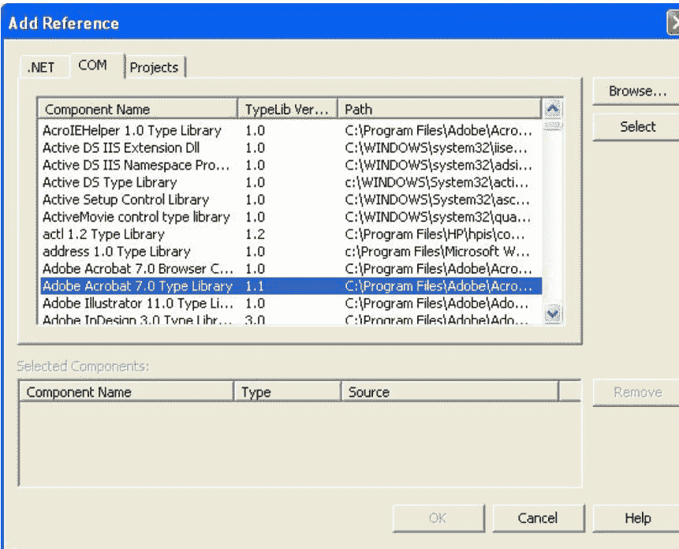
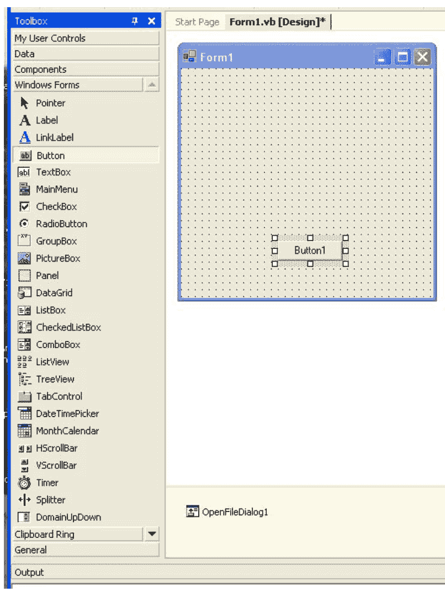

# Adobe Acrobat 7 - 通过 Visual Basic 进行 Acrobat JavaScript 编程


Acrobat 7.0 提供了一套丰富的 JavaScript 编程接口，旨在从 Acrobat 环境中使用。它还提供了一种机制（称为 *JSObject*），允许外部客户端从 Visual Basic 等环境中访问相同的功能。

本文档提供了您需要的信息，以便开始从 Visual Basic 编程环境中使用 JavaScript 的扩展功能。它提供了一组示例来说明关键概念。

## 什么是 JSObject？

准确地说，JSObject 是在 OLE 自动化客户端（如 Visual Basic 应用程序）与 Acrobat 提供的 JavaScript 功能之间的一个解释层。从程序员的角度来看，最终结果是从 Visual Basic 环境中对 JSObject 进行编程，与使用 Acrobat 控制台在 JavaScript 中编程非常相似。

## 入门

以下步骤将帮助您设置运行示例：

- 1. 安装 Acrobat 7.0 和 Visual Basic .NET，因为本文档中的示例需要两者。
- 2. 打开一个新的 Visual Basic .NET 项目。这将使您从一个空白窗体和项目工作区开始。
- 3. 要访问 Acrobat 自动化 API（包括 JSObject），您需要添加对 Acrobat 类型库的引用。在用户界面中，选择 **项目 > 添加引用**，然后选择 **COM** 选项卡，从可用引用列表中，单击标记为“Adobe Acrobat 7.0 Type Library”的项目。单击 **选择**。单击 **确定**。



## 一个简单的示例

此示例描述了在 Acrobat 的 JavaScript 控制台中显示“Hello, Acrobat!”所需的最低要求。

- 1. 通过从用户界面选择 **视图 > 代码** 来打开此窗体的源代码窗口。
- 2. 从该窗口左上角的下拉框中选择 **(Form1 Events)**。右上角的下拉框显示了 Form 对象可用的所有函数。
- 3. 从该框中选择 **Load**，这将创建一个空的函数存根。当窗体首次显示时，会调用窗体的 **Load** 函数，因此它是添加初始化代码的好地方。

此程序使用一些全局变量来存储其生命周期所需的数据，并在 **Form1_Load** 例程中初始化它们。

**示例 1 *“Hello, Acrobat!”***

```
Dim gApp As Acrobat.CAcroApp
Dim gPDDoc As Acrobat.CAcroPDDoc
Dim jso As Object

Private Sub Form1_Load(ByVal sender As Object, ByVal e As System.EventArgs) Handles MyBase.Load
    Set gApp = CreateObject("AcroExch.App")
    Set gPDDoc = CreateObject("AcroExch.PDDoc")
    If gPDDoc.Open("c:\adobe.pdf") Then
        Set jso = gPDDoc.GetJSObject
        jso.console.Show
        jso.console.Clear
        jso.console.println ("Hello, Acrobat!")
        gApp.Show
    End If
End Sub
```

请注意，您需要在 C: 驱动器的根目录下有一个名为 `adobe.pdf` 的文件。

有了这段代码，Visual Basic 程序使用 `CreateObject` 调用连接到 Acrobat 的自动化接口，然后使用 App 对象的 `Show` 命令显示主窗口。

研究完代码片段后，您可能有几个问题。例如，为什么 `jso` 声明为 Object，而 `gApp` 和 `gPDDoc` 声明为在 Acrobat 类型库中找到的类型？JSObject 是否有真正的类型？

答案是否定的，除了在 `CAcroPDDoc.GetJSObject` 调用的上下文中，JSObject 不会出现在类型库中。用于通过 JSObject 导出 JavaScript 功能的 COM 接口称为 IDispatch 接口，在 Visual Basic 中通常简称为“对象”类型。由此得出的结果是，程序员可用的方法并不像我们希望的那样定义良好。例如，您可能会惊讶地发现，如果将对

```
jso.console.clear
```

的调用替换为

```
jso.ThisCantPossiblyCompileCanIt("Yes it can!")
```

编译器会愉快地编译代码，但在运行时会粗暴地失败。由于 Visual Basic 没有 JSObject 的类型信息，Visual Basic 不知道特定的调用在语法上是否有效，直到运行时才会知道，并且会编译对 JSObject 的任何函数调用。因此，程序员必须依赖文档来了解通过 JSObject 接口可用哪些功能。当您深入研究 JSObject 的奥秘时，可从 http://partners.adobe.com/links/acrobat 获取的 *Acrobat JavaScript Scripting Reference* 是不可或缺的。

您可能还会想知道为什么在创建 JSObject 之前需要打开一个 PDDoc。运行程序后，屏幕上没有出现任何文档，并且在没有 PDDoc 的情况下显示 JavaScript 控制台应该是可能的。答案是 JSObject 被设计为与特定文档紧密工作，因为大多数可用功能都在文档级别操作。JavaScript（因此在 JSObject 中）中有一些应用程序级别的功能，但它们是次要的。在实践中，JSObject 始终与特定文档相关联。当处理大量文档时，您必须构建代码，以便为每个文档获取一个新的 JSObject，而不是创建一个单一的 JSObject 来处理每个文档。

下一个示例更有趣：一个允许用户选择 PDF、添加预定义注释并将文件保存回磁盘的程序。

- 1. 像在第一个示例中那样创建一个新的 Visual Basic .NET 项目；确保也将 Adobe Acrobat 7.0 Type Library 添加到此项目中。
- 2. 对于此示例，您使用 Windows **文件 > 打开** 对话框，因此从用户界面选择 **项目 > 添加组件**。这允许您在开发环境的左侧打开 **工具箱**。从 **工具箱** 中选择 **Windows 窗体**，向下滚动并选择 **OpenFileDialog**。将其拖到您的窗体上。
- 3. 使用相同的技术将 **Button** 添加到您的窗体。




4.  现在，最小用户界面已设置完成，请从主菜单中选择 **视图 > 代码**，并添加以下源代码：

*示例 2* **处理批注**

```vb
Dim gApp As Acrobat.CAcroApp

Private Sub Form_Load()
    Set gApp = CreateObject("AcroExch.App")
End Sub

Private Sub Form_Unload(Cancel As Integer)
    If Not gApp Is Nothing Then
        gApp.Exit
    End If
    Set gApp = Nothing
End Sub

Private Sub Command1_Click()
    Dim pdDoc As Acrobat.CAcroPDDoc
    Dim page As Acrobat.CAcroPDPage
    Dim jso As Object
    Dim path As String
    Dim point(1) As Integer
    Dim popupRect(3) As Integer
    Dim pageRect As Object
    Dim annot As Object
    Dim props As Object

    OpenFileDialog1.ShowDialog()
    path = OpenFileDialog1.FileName

    Set pdDoc = CreateObject("AcroExch.PDDoc")
    If pdDoc.Open(path) Then
        Set jso = pdDoc.GetJSObject
        If Not jso Is Nothing Then

            ' 获取第 0 页的大小并设置数组
            Set page = pdDoc.AcquirePage(0)
            Set pageRect = page.GetSize
            point(0) = 0
            point(1) = pageRect.y
            popupRect(0) = 0
            popupRect(1) = pageRect.y - 100
            popupRect(2) = 200
            popupRect(3) = pageRect.y

            ' 创建新的文本批注
            Set annot = jso.AddAnnot
            Set props = annot.getProps
            props.Type = "Text"
            annot.setProps props

            ' 填写一些字段
            Set props = annot.getProps
            props.page = 0
            props.point = point
            props.popupRect = popupRect
            props.author = "Rob McAfee"
            props.noteIcon = "Comment"
            props.strokeColor = jso.Color.red
            props.Contents = "I added this comment from Visual Basic!"
            annot.setProps props
        End If
        pdDoc.Close
        MsgBox "Annotation added to " & path
    Else
        MsgBox "Failed to open " & path
    End If

    Set pdDoc = Nothing
End Sub
```

**Form_Load** 和 **Form_Unload** 例程中的代码仅用于初始化和关闭 Acrobat 自动化主接口。所有有趣的工作都在命令按钮的单击例程中进行。前几行声明局部变量并显示 Windows **打开** 对话框，允许用户选择要添加批注的文件。此时，代码打开 PDF 的 **PDDoc** 对象，并获取该文档的 JSObject 接口。

一些标准的 Acrobat 自动化方法用于确定文档中第一页的大小。这些数字对于实现正确的布局至关重要，因为 PDF 坐标系基于页面的左下角，但批注将锚定在页面的左上角。

**“创建新的文本批注”** 注释之后的代码行正是这样做的，但这部分代码需要额外解释。首先，**addAnnot** 看起来像是 JSObject 的一个方法，但 JavaScript 参考资料显示该方法与 **doc** 对象相关联。在这种情况下，你可能期望语法是 **jso.doc.addAnnot** —— 然而，**jso** 是 **Doc** 对象，所以 **jso.addAnnot** 是正确的。**Doc** 对象中的所有属性和方法都以这种方式使用。

第二个需要注意的点是使用 **annot.getProps** 和 **annot.setProps**。Annot 对象是通过一个单独的属性对象实现的，这意味着你不能直接设置属性。例如，你不能执行以下操作：

```vb
Set annot = jso.AddAnnot
annot.Type = "Text"
annot.page = 0
...
```

相反，你必须使用 **annot.getProps** 获取 Annot 的属性对象，并使用该对象进行读取或写入访问。要将更改保存回原始的 **Annot**，请使用修改后的属性对象调用 **annot.setProps**，如原始示例所示。

最后，注意 JSObject 颜色属性的使用。该对象定义了几种简单的颜色，如红色、绿色和蓝色。在处理颜色时，你可能需要比该对象提供的更广的颜色范围。此外，每次调用 JSObject 都会带来性能开销。要更高效地设置颜色，你可以使用如下代码，它直接将批注的 **strokeColor** 设置为红色，绕过颜色对象。

```vb
dim color(0 to 3) as Variant
color(0) = "RGB"
color(1) = 1#
color(2) = 0#
color(3) = 0#
annot.strokeColor = color
```

你可以在任何需要颜色数组作为 JSObject 例程参数的地方使用此技术。该示例将颜色空间设置为 RGB，并为红色、绿色和蓝色指定 0 到 1 范围内的浮点值。请注意颜色值后使用的 # 字符。这些是必需的，因为它们告诉 Visual Basic 数组元素应设置为浮点值，而不是整数。将数组声明为包含 Variants 也很重要，因为它同时包含字符串和浮点值。其他颜色空间（“T”、“G”、“CMYK”）对数组长度有不同的要求。有关更多详细信息，请参阅 *Acrobat JavaScript Scripting Reference* 中的 **Color** 对象。

Acrobat 7.0 包含一个可以扫描文档以检查拼写错误的插件。该插件还提供可通过 JSObject 访问的 JavaScript 方法。在本示例中，你将从 [示例 2] 的源代码开始，并进行以下更改：

- 向主窗体添加一个列表视图控件。保持控件的默认名称 **List1**。
- 用以下内容替换现有 **Command1_Click** 例程中的代码：

*示例 3* **拼写检查文档**

```vb
Private Sub Command1_Click()
    Dim pdDoc As Acrobat.CAcroPDDoc
    Dim jso As Object
    Dim path As String
    Dim count As Integer
    Dim i As Integer, j As Integer
    Dim word As Variant
    Dim result As Variant
    Dim foundErr As Boolean

    OpenFileDialog1.ShowDialog()
    path = OpenFileDialog1.FileName
    foundErr = False
    Set pdDoc = CreateObject("AcroExch.PDDoc")

    If pdDoc.Open(path) Then
        Set jso = pdDoc.GetJSObject
        If Not jso Is Nothing Then
            count = jso.getPageNumWords(0)
            For i = 0 To count - 1
                word = jso.getPageNthWord(0, i)
                If VarType(word) = vbString Then
                    result = jso.spell.checkWord(word)
                    If IsArray(result) Then
                        foundErr = True
                        ListView1.Items.Add (word & " is misspelled.")
                        ListView1.Items.Add ("Suggestions:")
                        For j = LBound(result) To UBound(result)
                            ListView1.Items.Add (result(j))
                        Next j
                        ListView1.Items.Add ("")
                    End If
                End If
            Next i
            Set jso = Nothing
            pdDoc.Close

            If Not foundErr Then
                ListView1.Items.Add ("No spelling errors found in " & path)
            End If
        End If
    Else
        MsgBox "Failed to open " & path
    End If

    Set pdDoc = Nothing
End Sub
```

在本示例中，请注意 Spell 对象 **check** 方法的使用。根据 *Acrobat JavaScript Scripting Reference*，此方法接受一个单词作为输入，如果在字典中找到该单词，则返回 null 对象；如果未找到，则返回建议单词的数组。与以往一样，存储 JSObject 方法调用返回值时最安全的方法是使用 Variant。你可以使用 **IsArray** 函数来确定 Variant 是否为数组，并相应地采取操作。在这个简单的示例中，如果程序看到一组建议单词，它会将它们输出到 **ListView** 控件中。

涵盖 JSObject 可用的每种方法超出了本文档的范围。但是，*Acrobat JavaScript Scripting Reference* 详细介绍了该主题，并且记住一些基本事实可以推断出很多信息：

- 参考资料中的大多数对象和方法在 Visual Basic 中可用，但并非全部。特别是，任何需要 `new` 运算符构造的 JavaScript 对象都无法在 Visual Basic 中创建。这包括 `Report` 对象。
- `Annots` 对象不同寻常，它需要 JSObject 通过 `getProps` 和 `setProps` 方法使用单独的对象来设置和获取其属性。
- 如果不确定使用什么类型来声明变量，请将其声明为 Variant。这为 Visual Basic 提供了更灵活的类型转换，并有助于防止运行时错误。
- JSObject 无法向 JavaScript 添加新的属性、方法或对象。由于此限制，`global.setPersistent` 属性没有意义。
- JSObject 不区分大小写。Visual Basic 通常将标识符的首字符大写，并阻止你更改其大小写。不必担心这一点，因为 JSObject 在将标识符与其 JavaScript 等效项匹配时不区分大小写。
- JSObject 总是将值作为 Variants 返回。这包括属性获取以及方法调用的返回值。当预期返回值为 null 时，使用空的 Variant。当 JSObject 返回数组时，数组中的每个元素都是 Variant。要确定 Variant 的实际数据类型，请使用 VBA 库 Information 模块中的实用程序函数 `IsArray`、`IsNumeric`、`IsEmpty`、`IsObject` 和 `VarType`。
- JSObject 可以处理大多数基本的 Visual Basic 类型，用于属性放置和方法调用的输入参数，包括 Variant、Array、Boolean、String、Date、Double、Long、Integer 和 Byte。JSObject 可以接受 Object 参数，但仅当该 Object 是属性获取或对 JSObject 的方法调用的结果时。JSObject 无法接受 Error 和 Currency 类型的值。
