# Adobe AIR： 创作 - 修改 - 复用（程序员实用指南）


更新、源代码和 Wrox 技术支持请访问 www.wrox.com

Marc Leuchner
Todd Anderson
Matt Wright


## 关于作者

**Marc Leuchner** 是波士顿广告集团 Almighty 的高级 Flash 开发人员。他在公司内的角色和才能主要围绕 Flash 开发和交互设计。多年来，他与 New Balance、ABC、Condé Nast、PUMA、BMW/Mini、Comcast 和 GAP, Inc. 等客户合作过。Marc 持有罗切斯特理工学院新媒体/设计美术学士学位。业余时间，他与合著者 Matt Wright 共同撰写技术博客 www.nobien.net/。

**Todd Anderson** 是 Infrared5 的高级软件工程师。在 Flash 平台开发领域拥有超过五年的经验，专注于 RIA 和游戏开发，Todd 为出版和娱乐行业提供了网络和桌面解决方案，客户包括 McGraw-Hill、Thomson、Motorola 和 Condé Nast。他运营 www.custardbelly.com/blog，专注于 Flash 平台开发和游戏开发。

**Matthew Wright** 是纽约市全服务数字机构 ROKKAN 的高级 Flash 开发人员。自 2005 年以来，他主要为众多客户交付了消费体验 Flash 网站和应用程序，包括 Virgin America、The Coca-Cola Company、Atlantic Records、Time Warner、NBA 和 2K Games。在加入 ROKKAN 之前，他在纽约州锡拉丘兹市名为 2ndNature 的交互机构开始职业生涯。正是在那里，他发现了对 Flash 平台的热爱。工作之余，Matthew 与朋友、同事和合著者 Marc Leuchner 共同参与 Flash 和技术博客 www.nobien.net。他还曾在 FlashForward 上发表演讲。Matthew 与他美丽的女友 Chewy 住在纽约布鲁克林。

## 致谢

- 执行编辑：Chris Webb
- 开发编辑：Brian Herrmann
- 技术编辑：Ashley Atkins
- 生产编辑：Daniel Scribner
- 文本编辑：Luann Rouff
- 编辑经理：Mary Beth Wakefield
- 生产经理：Tim Tate
- 副总裁兼执行组出版人：Richard Swadley
- 副总裁兼执行出版人：Joseph B. Wikert
- 项目协调员，封面：Lynsey Stanford
- 校对：Nancy Bell
- 索引：Ron Strauss

## 致谢

### Marc Leuchner

我要感谢合著者 Todd Anderson 和 Matt Wright 在撰写本书时的卓越和奉献，以及成为很棒的朋友。我很高兴你们俩主导并让这本书成为你们自己的。对于 Ash Atkins，你的编辑和知识非常必要且被欣然接受。对于 Wiley 的人们、Chris Webb，特别是 Brian Herrmann，我感谢你们提供撰写这本优秀书籍的机会。Brian，我知道有时从我们这里逼出章节很困难，但我们真心感谢你过去一年的编辑、支持和幽默。我要感谢 Joey Lott 和 Matt Sutton 帮助我进入写作世界。感谢我的家人和朋友在过去一年的支持和鼓励，特别是我的父母，他们在我的职业生涯中一直给予支持。最后，我要特别感谢我的女友 Courtney。你的理解和承诺对我意义重大，尤其是在那些忙碌的周末和不眠之夜。

### Todd Anderson

我要感谢 Marc Leuchner 和 Matt Wright 在这次合作中成为优秀的合著者，并在撰写本书时提供专业知识和幽默。对于我的家人，我无法用言语表达对你们巨大支持和爱的感谢——我可爱的妻子 Carrie，妈妈，爸爸，Brian，Krissa，Emma，Kelsea 和 Cayuga。我还要感谢我的朋友们以及我从 Flash 社区获得的巨大支持。向 Ash Atkins 表达深深的感谢和握拳致意，他在技术编辑过程中提供了宝贵的智慧。最后，我要感谢 Brian Herrmann、Chris Webb 和 Wiley 团队的耐心、理解和辛勤工作。

### Matt Wright

首先，我要感谢 Wiley 的人们给我机会撰写一本关于我真正喜欢的主题的书。特别感谢 Chris Webb 信任我撰写我的第一本关于全新技术的书。这样的机会并不常见。其次，我要感谢 Brian Herrmann 和 Ash Atkins 成为如此出色和乐于助人的编辑。没有他们，这本书将无法立足。我还要向我的合著者 Todd Anderson 和 Marc Leuchner 表达许多感谢。这两位既聪明又鼓舞人心。我只希望我们能更经常地合作。我也要感谢我的家人，最重要的是我的母亲和父亲，支持我和我的事业。没有他们，我不会有今天的成就。最后，我要向我的女友 Chewy 表达巨大的感谢，感谢她在撰写本书期间的所有支持和耐心。


# 引言

Adobe Flex 3 的发布（包含 AIR SDK，即软件开发工具包）标志着 Adobe Flash 技术发展的最新进展。Flash 的最初版本（当时称为 FutureSplash）是一个能够为网络创建动画的程序。随着后来 ActionScript 语言的加入和修订，Flash 转变为了一个强大的开发工具，并催生了 Flex 框架的创建。Flex 的前两个版本使开发者能够独立于 Flash IDE 相对轻松地创建富互联网应用。Flex 版本 3 引入了专门为 Adobe AIR 运行时创建应用的能力，从而将 Flash 家族从基于网络的应用转向了基于桌面的应用。

每发布一项新的 Flash 技术，都会涌现大量的学习材料——书籍、视频、博客文章等等。Adobe AIR 和 Flex 3 也不例外。事实上，由于 Adobe 发布了其软件的公开测试版，这种效应被放大了。人们对 Flex 3 中的新功能感到兴奋，特别是它与 AIR SDK 的集成。这种兴奋使得人们更容易发现*如何*使用 Adobe AIR，但如果你已经过了这个阶段，想要开始构建应用了呢？同样，有些人通过拆解示例应用学得最好。毕竟，兴奋感驱使着人们需要用 Flex 3 和 Adobe AIR 构建一些有用的东西。本书试图将这种兴奋感和知识传递给你。

# 本书读者对象

本书是为 Flex 开发者撰写的——使用过 Flex 2 构建网络应用的人会发现本书中的示例易于理解。然而，如果你熟悉面向对象的 ActionScript，并且对 Flex 的工作原理有基本的了解，本书也将有助于你通过示例进一步学习 Flex 和 ActionScript 3。

那些刚接触或正在熟悉 Adobe AIR SDK 的人应该阅读第一章，因为它解释了一个基本的 Flex/AIR 项目是如何开发、编译和部署的。如果你通过示例学习效果更好，第 2 章将直接跳入创建 AIR 应用，并介绍一些中等难度的技术。

高级用户可能希望直接浏览代码库。每个示例的所有代码都在配套网站上提供。请随意尝试一个应用，并将本书用作参考指南或蓝图。

总的来说，本书的每一章都是一个独立的示例。因此，你可以随意跳转阅读。每一章的撰写意图是为你创建一个可以扩展的基础，通过定制和改造将每个应用提升到新的水平。它们都以易于你将部分代码库应用到本书之外的项目中的方式构建。我们鼓励你选择一个示例应用，修改它，修复它，添加新功能，并从中学习。


## 简介

### 本书涵盖的内容

本书包含11个应用程序，旨在展示Adobe AIR和Flex 3 SDK提供的各项功能。每章涉及几个关键特性，共同涵盖了AIR SDK的大部分功能。通过跟随示例操作，你将运用面向对象的概念和实践，创建功能强大的应用程序。

### 本书的结构

本书的结构设计使其可作为可复用应用程序的教学参考手册来阅读。每章包含代码集合和代码片段，并附有简要说明。所有应用程序的设计都考虑到了可扩展性，这意味着每个示例都应被视为一个基础，你可以在此基础上构建更大、更好的应用程序。毕竟，本书的创作初衷是为了那些可能有一个想法但不知如何着手，或需要一种方法来快速启动项目的开发者。

每章的结构如下：

- 引言与概述：将涵盖哪些AIR和Flex特性
- 设计：应用程序的主要技术概念和目标
- 代码与代码解释
- 构建与部署：如何编译和打包应用程序
- 总结与修改建议

本书各章内容、包含的应用程序以及AIR功能简介如下：

- 第1章，“开发环境”，概述了设置和命令行工具。
- 第2章，“简单文本编辑器”，涵盖了基本的文件系统功能，包括浏览、读取和写入文件。
- 第3章，“简单RSS阅读器”，涵盖了间歇性连接和“吐司”风格的警报。
- 第4章，“音乐播放器”，涵盖了递归文件搜索、浏览、复制、读取、写入文件以及无边框应用程序。
- 第5章，“迷你CMS”，涵盖了处理XML、文件上传、写入文件和保存设置。
- 第6章，“图片查看器与编辑器”，涵盖了创建图像文件、使用Flex 3 SDK中可用的编解码器以及原生拖放操作。
- 第7章，“HTML和CSS编辑器”，涵盖了编辑已加载页面的HTML和CSS，以及HTML控件（包括JavaScript集成）。
- 第8章，“天气小部件”，涵盖了上下文菜单、无边框应用、自定义图标以及系统托盘/停靠栏交互。
- 第9章，“地图应用”，涵盖了使用HTML控件中的JavaScript与在线API通信，以及与本地数据库通信。
- 第10章，“博客代理”，涵盖了将文章发布到你的Blogger账户或在连接时保存以便稍后发布。还介绍了用于存储敏感信息的SQLite数据库和LocalEncryptedStore。
- 第11章，“幻灯片制作工具”，涵盖了自定义文件类型的序列化和窗口API。
- 第12章，“视频播放器”，涵盖了Flash 9和AIR对H.264及FLV播放的支持、拖放、上下文和窗口菜单以及全屏视频。

对于Flex新手，建议阅读第2、3、7、8和12章。

## 使用本书所需条件

由于Adobe Flex 3和AIR SDK是开源的，你只需要下载包含编译器的SDK和一个文本编辑器。不过，强烈推荐使用Flex Builder 3。Flex 3和AIR适用于Windows、Mac OS X和Linux平台。Flex Builder 3的试用版以及开源的Flex 3和AIR SDK可在www.adobe.com获取。如果你需要一个好的ActionScript编辑器，并且没有Flex Builder或Eclipse，可以尝试FlashDevelop，这是一个免费的ActionScript编辑器（www.flashdevelop.org）。

## 本书约定

为了帮助你从文本中获得最大收益并跟踪进度，我们在全书中使用了一些约定。

> 像这样的框体包含重要的、不可遗忘且与周围文本直接相关的信息。

*对当前讨论的注释、提示、建议、技巧和旁注以斜体显示并偏移放置。*

至于文本中的样式：

- 新术语和重要词汇在引入时会*斜体显示*。
- 键盘按键显示方式如下：Ctrl+A。
- 文件名、URL和代码在文本中显示为这样：`persistence.properties`。
- 代码以两种不同的方式呈现：

大多数代码示例使用无高亮的等宽字体。

灰色高亮用于强调在当前上下文中特别重要的代码。

## 源代码

当你在学习本书中的示例时，你可以选择手动输入所有代码，或使用随书附带的源代码文件。本书中使用的所有源代码均可在www.wrox.com下载。进入网站后，只需定位本书标题（使用搜索框或通过标题列表），然后点击书籍详情页上的“下载代码”链接，即可获取本书的所有源代码。

> 由于许多书名相似，按ISBN搜索可能最方便；本书的ISBN是978-0-470-18207-9。

下载代码后，只需用你喜欢的压缩工具解压即可。或者，你也可以访问www.wrox.com/dynamic/books/download.aspx的主代码下载页面，查看本书及所有其他Wrox书籍的可用代码。

## 勘误

我们竭尽全力确保文本和代码中没有错误。然而，人无完人，错误确实会发生。如果你在我们的任何一本书中发现了错误，例如拼写错误或错误的代码片段，我们将非常感激你的反馈。通过提交勘误，你可能会为其他读者节省数小时的困扰，同时也有助于我们提供更高质量的信息。

要查找本书的勘误页，请访问www.wrox.com，使用搜索框或标题列表定位书名。然后，在书籍详情页上，点击“书籍勘误”链接。在此页面，你可以查看为本书提交并由Wrox编辑发布的所有勘误。完整的书籍列表（包括每本书的勘误链接）也可在www.wrox.com/misc-pages/booklist.shtml获取。

如果你在“书籍勘误”页面上没有发现“你的”错误，请访问www.wrox.com/contact/techsupport.shtml并填写表单，向我们发送你发现的错误。我们会核实信息，如果合适，会在本书的勘误页面发布信息，并在后续版本中修正问题。

## p2p.wrox.com

如需作者和同行讨论，请加入p2p.wrox.com的P2P论坛。该论坛是一个基于Web的系统，你可以发布与Wrox书籍及相关技术相关的消息，并与其他读者和技术用户互动。论坛提供订阅功能，当有新帖子发布时，可以按你选择的兴趣主题通过电子邮件通知你。Wrox作者、编辑、其他行业专家以及你的读者同伴都会在这些论坛上。

在http://p2p.wrox.com，你会发现许多不同的论坛，这些论坛不仅在你阅读本书时对你有所帮助，在开发自己的应用程序时也同样如此。要加入论坛，只需按照以下步骤操作：

1.  访问p2p.wrox.com并点击“注册”链接。
2.  阅读使用条款并点击“同意”。
3.  填写必要的注册信息以及你希望提供的任何可选信息，然后点击“提交”。
4.  你将收到一封电子邮件，其中包含如何验证你的帐户并完成加入过程的信息。

> 你可以在不加入P2P的情况下阅读论坛中的消息，但要发布自己的消息，你必须加入。

一旦加入，你就可以发布新消息并回复其他用户发布的消息。你可以随时在Web上阅读消息。如果你想通过电子邮件接收特定论坛的新消息，请在论坛列表中该论坛名称旁点击“订阅此论坛”图标。

有关如何使用Wrox P2P的更多信息，请务必阅读P2P常见问题解答（FAQ），其中包含关于论坛软件如何工作的问题答案，以及许多关于P2P和Wrox书籍的具体常见问题。要阅读常见问题解答，请点击任何P2P页面上的“常见问题解答”链接。


## 开发环境

一个可靠的开发环境将在您准备调试和部署应用程序时为您节省大量时间。本章将介绍如何安装和使用命令行工具来构建 AIR（Adobe 集成运行时）应用程序。本章的格式与后续章节略有不同，因为它概述了在 AIR 中构建应用程序的开发过程，并介绍了常用工具。

下一节“SDK 安装”将说明从何处下载以及如何安装 Flex 3 SDK，该 SDK 包含构建 Flex 和 AIR 应用程序所需的所有工具和 API（应用程序编程接口）。本节涵盖开发环境的基础知识，并简要介绍了本书中用于部署 AIR 应用程序的命令行工具。

“构建您的第一个应用程序”部分将引导您完成构建第一个 AIR 应用程序的过程，重点介绍如何使用命令行工具来部署、调试和打包应用程序以供安装。

“安装与卸载”部分探讨了 AIR 应用程序的安装过程以及应用程序文件在用户计算机上的存储方式。

最后，“其他工具”部分介绍了两种帮助开发者简化开发流程的额外方法：一种用于自动化构建过程的 Apache Ant 构建方案，以及一个用于从 AIR 应用程序接收基本跟踪语句的简单调试面板。

## SDK 安装

Adobe AIR 是一个跨平台运行时，用于运行在 AIR 框架下编译的桌面应用程序。通过包含两种主要的 Web 技术（Flash 和 HTML），Adobe AIR 使开发者能够将相同的富互联网应用程序（RIA）体验交付到桌面环境。本书不假设您已拥有集成开发环境（IDE），例如将文本编辑器、必要的编译器、调试器和其他用于 AIR 应用程序的有用工具组合在一起的 Adobe FlexBuilder。虽然欢迎您选择任何 IDE 来协助开发应用程序，但本书中的所有示例都是使用本节讨论的软件开发工具包（SDK）和命令行进行部署和打包的。在本章稍后部分，您将学习如何通过使用 Apache Ant 构建方案来使此过程更加顺畅，同时构建您的第一个 AIR 应用程序——那个无处不在的 *Hello World*。

## 必需文件

首先，您需要安装 AIR（Adobe 集成运行时）。如果您的计算机上尚未安装，请访问 [www.adobe.com/go/air](http://www.adobe.com/go/air) 并下载 AIR 运行时。由于本书是关于开发 AIR 应用程序的，而不是 AIR 运行时或 Flash 软件本身的概述，因此建议您遵循 Adobe 提供的安装运行时文档，如果您决定自定义 AIR 运行时的安装，请参考制造商的指南。

安装 AIR 运行时后，是时候开始建立一个可靠的环境，使您能够在开发过程中无需考虑该方面的交付应用程序问题。您可以自由地编码，当需要调试或部署时，系统将能够处理这些阶段的所有方面。

对于此开发环境，您需要下载 Flex 3 SDK，它包含 AIR API 和所有必需的命令行工具。使用 HTML 或 AJAX 创建应用程序的开发者也可以使用 AIR SDK，尽管本书中的示例主要使用 Flex 构建。

## SDK 安装

本节解释如何从 Adobe 下载和安装软件开发工具包（SDK），以及如何配置设置以使用其中的命令行工具。

### Flex 3 SDK

从 http://opensource.adobe.com/wiki/display/flexsdk/Flex+SDK 下载 Adobe Flex 3 SDK。下载完成后，一个名为 `flex_sdk_3`（或类似名称）的文件将出现在您下载文件的目录中。本例中是桌面。将 `flex_sdk_3` 的内容解压缩到一个目录中，该目录的位置应反映您的工作和文件组织方式。在以下示例中，Flex 3 SDK 在 Windows 上安装在 `C:/flex_sdk_3`，在 Mac OS X 上安装在 `/Applications/flex_sdk_3`。如果您的安装目录不同，请将所有对此安装目录的引用更改为安装 Flex SDK 的位置。

将路径添加到系统属性中，以便在开发过程中能够调用一些有价值的可执行文件。您主要关心的文件——因为它们与调试和部署相关——可以在 Flex SDK 安装目录中的 `/bin` 文件夹中找到。编译器的可执行文件调用 Java 程序，这些程序可以在目录中的 `/lib` 文件夹中找到。您可以选择将 Java 程序本身添加到您的 `CLASSPATH` 变量中，但您将直接访问这些原生可执行文件——即 `adt.bat`、`adl.exe`、`mxmlc.exe` 和 `amxmlc.bat`。为了能够直接从命令行调用它们，而无需每次都提供完整路径（例如 `C:/flex_sdk_3/bin/fdb`），请将 `/bin` 目录添加到 `Path` 变量中。

在 Windows 上：

1.  从控制面板打开系统。
2.  从菜单中单击高级选项卡。
3.  单击环境变量。
4.  在系统变量网格中，导航并双击 Path。
5.  在变量值字段中，如果最后一个字符不是分号（;），请输入一个分号，然后输入 Flex SDK 安装目录中 /bin 文件夹的路径。在本例中，该路径为 `;C:\flex_sdk_3\bin`。

在 Mac OS X 上：

1.  打开终端并输入 `> open -e .profile`。
2.  如果您没有设置 PATH 变量，请添加以下行：

```
export PATH:$PATH:/Applications/flex_sdk_3/bin/
```

如果您已有 PATH 变量设置，请在输入冒号（:）以分隔路径后，添加到 bin 文件夹的路径。

现在您可以直接访问命令行工具了。这些工具也要求您的计算机上安装了 Java。您可能已经安装了 Java；如果没有，请从 http://java.sun.com 下载 JRE 并将其安装到您选择的目录中。尝试获取最新的稳定版本，但请注意，本书中的所有代码——包括 Apache Ant 构建方案——都已在 Java 1.5 + 版本上进行过测试。记住您安装 JRE 的位置，或提醒自己它已安装的位置，因为在准备调试您的 Hello World 应用程序时，您可能需要该目录路径。

## 命令行工具概述

在 Flex SDK 安装目录的 /bin 文件夹中，是用于调试、部署和打包 AIR 应用程序的命令行工具。带有 Flex 徽标图标（一个带有 fx 文本的黑色圆圈）的 .exe 文件是 Flex SDK 软件包中包含的可执行文件。.bat 文件和 adl.exe（带有 AIR 徽标图标）是随 AIR SDK 提供的可执行文件。

mxmlc 可执行文件是负责从 MXML 和 ActionScript 代码生成 Shockwave Flash（SWF）文件的编译器。它的 AIR "姐妹"文件——amxmlc.bat 文件——使用在 /frameworks 文件夹中找到的 air-config.xml 文件来为 AIR 配置编译器。运行 mxmlc 本身会使用同样位于 /frameworks 文件夹中的 flex-config.xml 文件。amxmlc 编译器用于部署和调试将要打包在 AIR 应用程序安装程序中的 SWF 文件。AIR 应用程序安装程序文件是通过调用安装目录 /bin 文件夹中的 ADT 批处理文件（adt.bat）创建的。

在此上下文中，术语"部署"指的是创建将与 AIR 应用程序一起打包的 SWF 文件。通过以您的主 .mxml 文件作为参数调用 amxmlc 编译器，会生成一个 SWF 文件。但是，在此操作期间不会启动 SWF 文件，并且仅使用 amxmlc 编译器将无法让您预览在 AIR 运行时环境中运行的 Flash 影片。运行 AIR 调试启动器（ADL）将启动由 amxmlc 编译器生成的 SWF 文件。


此外，如果在编译 SWF 文件时将 `amxmlc` 设置为调试模式，你将有机会通过运行 ADL 和 Flash Debugger 来调试你的应用程序。

当你为 AIR 应用程序创建安装文件时，需要使用 AIR 开发工具（ADT）。AIR 安装文件必须进行代码签名。建议你通过关联来自证书颁发机构（如 VeriSign 和 Thawte）的证书来签署你的 AIR 应用程序，因为它能验证你（发布者）是签署人，并且应用程序未被恶意篡改——确保最终用户不会安装到伪造版本。你也可以使用 ADT 工具创建自签名证书。请注意，使用自签名证书时，你的发布者身份在安装过程中无法被验证。此外，如果你后续为已使用自签名证书的应用程序发布更新，则在创建安装文件时需要使用原始证书。本书中的示例包含了创建自签名证书的过程。

在下一节中，你将直接开始构建，以了解通过安装 SDK 并将系统路径设置到命令行工具所建立的开发环境，将如何帮助你调试、部署和交付你的第一个 AIR 应用程序——熟悉的 *Hello World*。

## 构建你的第一个应用程序

既然你已经拥有了部署和打包 AIR 应用程序所需的文件，你应该仔细考虑如何开发你的应用程序。创建一个开发目录同样重要，因为这是你大部分时间将花费在交付产品的地方。

> 尽管本书中的示例使用了后续章节概述的项目目录结构，但它并非旨在取代你可能已有的任何组织技巧。如果这里使用的结构与你的工作流程不符，建议你采用自己的方法并相应地进行编辑。

一些 IDE 实际上会在你计算机上的 `Documents` 目录中创建一个开发目录——在 Windows 上是 `User` -> `My Documents`，在 Mac 上是 `User` -> `Documents`。虽然这对你的开发环境来说是一个可行的解决方案，但出于本书的目的，请在你计算机的根驱动器上创建一个名为 `Development` 的文件夹——在 Windows 上是 `C:/`，在 Mac 上是硬盘驱动器名称。在此文件夹内，将存放你用于开发应用程序的软件类型的目录，包括其中任何项目的子目录。

在 Windows 上：

- 1. 导航到 `C:/` 驱动器的根目录。
- 2. 创建一个名为 `Development` 的文件夹。
- 3. 在该 `Development` 文件夹内，创建一个名为 `AIR` 的文件夹。

在 Mac 上：

- 1. 导航到硬盘驱动器。
- 2. 创建一个名为 `Development` 的文件夹。
- 3. 在该 `Development` 文件夹内，创建一个名为 `AIR` 的文件夹。

在此目录——`C:/Development/AIR` 或 `/Development/AIR`——中，将存放你的 AIR 项目子目录。从现在起，这被称为“开发目录”。

你的第一个项目将创建一个简单的 *Hello World* 应用程序。这个应用程序没有什么特别之处，除了 `WindowedApplication` 容器外，它不会涉及太多 AIR API。它旨在向你介绍编译、调试和打包应用程序的过程。

在你的开发目录中，创建一个名为 `HelloWorld` 的文件夹。你需要至少两个文件来编译和部署 AIR 应用程序：

- 一个主文件——这可以是 MXML（`.mxml`）或 ActionScript（`.as`）文件。
- 一个使用 XML 标记的应用程序描述符文件。

本书中的大多数（如果不是全部）示例都使用 MXML 文件作为应用程序的主文件。当需要编译时，你将把这个文件作为主文件参数提供给 `amxmlc` 编译器。在 *Hello World* 应用程序的情况下，这将是 `HelloWorld.mxml`。

本书中使用的项目应用程序描述符文件的命名约定是在项目名称后附加字符串 `-app`，但你可以按自己的意愿命名文件。在 *Hello World* 应用程序的情况下，应用程序描述符文件名为 `HelloWorld-app.xml`。生成的 SWF 文件和应用程序描述符将用于在打包之前部署和预览你的应用程序。要创建 AIR 安装程序，你需要一个签名证书、生成的 SWF、应用程序描述符文件以及所需的任何辅助文件（如图形文件）。

因为 Flex 和 AIR 命令行工具在你已安装的 SDK 中可用，所以你并不依赖于 IDE，可以继续使用你最喜欢的文本编辑器进行开发。

## 代码与代码解释

打开你最喜欢的编辑器，创建一个新文档。然后，完成以下步骤：

- 1. 输入以下标记（或者，你可以在随附网站的本章代码文件中找到此示例）：

```xml
<?xml version="1.0" encoding="UTF-8"?>
<application xmlns="http://ns.adobe.com/air/application/1.0">
    <id>com.aircmr.HelloWorld</id>
    <version>0.1</version>
    <filename>HelloWorld</filename>
    <name>Hello World</name>
    <description>An AIR app to say Hello</description>

    <initialWindow>
        <content>HelloWorld.swf</content>
        <title>Hello World</title>
        <systemChrome>standard</systemChrome>
        <transparent>false</transparent>
        <visible>true</visible>
    </initialWindow>

    <installFolder>AIRCMR/HelloWorld</installFolder>
    <programMenuFolder>AIRCMR</programMenuFolder>
</application>
```

- 2. 将文件保存为 `HelloWorld-app.xml`，放在你之前设置的项目目录中——`C:\Development\AIR\HelloWorld` 或 `/Development/AIR/HelloWorld`，分别对应 Windows 和 Mac。创建一个新文档并输入以下内容：

```xml
<?xml version="1.0" encoding="utf-8"?>
<mx:WindowedApplication
    xmlns:mx="http://www.adobe.com/2006/mxml"
    layout="vertical"
    windowComplete="completeHandler();">

    <mx:Script>
        <![CDATA[
            // window has completed initial layout and is made visible.
            private function completeHandler():void
            {
            }
        ]]>
    </mx:Script>

    <mx:Label text="Hello World" />

</mx:WindowedApplication>
```

- 3. 将文件保存为 `HelloWorld.mxml`，与 `HelloWorld-app.xml` 一起放在项目目录中。

第一个代码片段，保存为 `HelloWorld-app.xml`，是 *Hello World* 应用程序的描述符文件。虽然描述符文件对于使用 `amxmlc` 编译器编译 SWF 并非必需，但对于调试、预览以及将应用程序打包以供安装是必要的。描述符文件指定了与 AIR 应用程序相关的属性。它包含在安装期间显示的值，以及安装后操作系统要显示的数据。描述符文件还允许你在 `<initialWindow>` 元素节点内自定义 AIR 应用程序的外观或视觉显示窗口。此示例中定义的属性只是可用属性的一个子集。许多是可选的，并且已被省略。后续章节将在构建特定应用程序时使用它们。

`application` 标签是应用程序描述符文件的根标签。`xmlns` 属性是 AIR 命名空间的 URI 引用。命名空间的最后一段（1.0）是运行 AIR 应用程序所需的运行时版本。根 application 标签的必需子元素是 `id`、`filename`、`version` 和父级 `initialWindow`。`id` 元素的值必须是唯一的——这意味着你计算机上安装的两个 AIR 应用程序不能共享相同的应用程序 ID。因此，最佳实践是使用点分隔的反向 DNS 风格的字符串作为标识符。`id` 支持的字符包括 0-9、a-z、A-Z、点和连字符。任何特殊字符（除了点和连字符），包括空格，都将在启动 AIR 应用程序时引发“应用程序无效”错误。在本例中，唯一 ID 被赋予值 `com.aircmr.HelloWorld`，因为它与随附网站本章代码中的示例相关。


`filename` 元素反映了赋予应用程序的名称，并在安装程序窗口中显示为“应用程序名称”的值。通过在描述符文件中设置可选的 `programMenuFolder` 属性，文件名还将显示在 Windows “开始”程序菜单的子路径中。

`version` 属性是一个由应用程序定义的标识符，与 AIR 的版本无关。它的值由开发人员指定，通常遵循标准的 `MajorVersion.MinorVersion` 格式。在本示例中，`version` 值为 0.1。

`initialWindow` 元素具有各种可选的子元素，这些子元素涉及应用于初始应用程序窗口的属性。诸如定位和大小之类的属性作为 `initialWindow` 节点的子项应用，但大多数属性都有默认值，被视为可选属性。`title`、`systemChrome`、`transparent` 和 `visible` 属性都是可选的，但在此示例中包含了它们的默认值，因为它们经常用于自定义应用程序的视觉方面。`initialWindow` 唯一必需的属性是 `content` 元素。`content` 的值是编译应用程序时生成的 SWF 文件的 URL。

`name`、`description`、`installationFolder` 和 `programMenuFolder` 属性都是可选的。`description` 的值显示在安装窗口中。`name` 值出现在安装窗口的标题中；它是卸载面板中可用的应用程序名称，也是赋予安装文件夹的名称。`installFolder` 元素的值指定应用程序在操作系统应用程序目录中的安装位置——在 Windows 上为 `C:\Program Files`，在 Mac OS X 上为 `HD:name/Applications`。`programMenuFolder` 是在 Windows “开始”程序菜单中显示的子路径，应用程序可在 `filename` 的值下找到。Windows 以外的任何操作系统都会忽略此设置。`installFolder` 和 `programMenuFolder` 属性值遵循与操作系统文件和文件夹命名约定相同的字符限制。

在应用程序描述符文件中可以设置更多特定于操作系统（例如关联的文件类型）和 AIR 应用程序外观（例如图标）的属性。这些属性是可选的，将在本书各处的应用程序中加以介绍。

你保存为 `HelloWorld.mxml` 的第二个代码片段是你的主应用程序文件。本书不涵盖 Flex 语言和 MXML 标记，但它确实描述了与 AIR 相关的应用程序编程接口（API）的补充和更改。一个很好的起点是 `WindowedApplication` 容器：

```
<mx:WindowedApplication
    xmlns:mx="http://www.adobe.com/2006/mxml"
    layout="vertical"
    windowComplete="completeHandler();">
```

`WindowedApplication` 标签定义了应用程序的容器。熟悉 Flex 语言的人习惯于将 `Application` 定义为其应用程序容器。实际上，`WindowedApplication` 扩展了 `Application` 组件。它具有可以在描述符文件中设置并在此标签中覆盖的额外属性，以及特定于 `WindowedApplication` 的指定事件和样式。`windowComplete` 事件就是这样一个独特的事件，当窗口的初始布局完成并可见时会触发该事件。`<mx:Script>` 标签内的 `completeHandler()` 方法是此事件的处理程序。目前，此方法不执行任何操作，但将在下一节讨论 ADL 工具时添加一个操作。

为了为这杯神奇的魔法增添点缀，包含了一个 `Label` 组件，其 `text` 属性设置为“Hello World”：

```
<mx:Label text="Hello World" />
```

由于 `WindowedApplication` 标签的 `layout` 属性设置为“vertical”，此标签在启动的应用程序中居中显示在容器顶部。到目前为止，讨论集中在应用程序安装并运行后会发生什么。现在是时候启动它了。

## 编译、调试和打包

在上一节中，你创建了编译和预览应用程序所需的文件。在本节中，你将使用 Flex 3 SDK 中提供的命令行工具来编译、预览和打包你的第一个 AIR 应用程序。

## 编译

要编译 AIR 应用程序，请使用位于你安装 Flex 3 SDK 的 `/bin` 文件夹中的 `amxmlc` 编译器——对于本示例，在 Windows 上为 `C:\flex_sdk_3\bin`，在 Mac OS X 上为 `/Applications/flex_sdk_3/bin`。`amxmlc` 编译器调用 `mxmlc` 编译器，并附加一个指向安装目录 `/frameworks` 文件夹中 `air-config.xml` 文件的参数。使用 `mxmlc` 实用程序编译 Flex 应用程序将加载 `flex-config.xml` 配置文件。两个配置文件之间的区别在于添加了与 AIR 相关的 SWC 文件，包括 `airframework.swc` 和 `airoglobal.swc`。查看 SDK 安装目录 `/frameworks` 文件夹中的 `air_config.xml` 文件。`amxmlc` 编译器工具默认使用 `air-config.xml`，但你也可以使用 `-load-config` 编译器选项指定自己的配置文件。

要生成应用程序 SWF 文件，首先打开命令提示符。将目录更改为 `HelloWorld` 项目目录——对于本示例，在 Windows 上该位置为 `C:\Development\AIR\HelloWorld`，在 Mac 上为 `/Development/AIR/HelloWorld`。输入以下内容。

在 Windows 上：

```
> amxmlc -load-config "C:\flex_sdk_3\frameworks\air-config.xml" -output HelloWorld.swf HelloWorld.mxml
```

在 Mac 上：

```
> amxmlc -load-config "/Applications/flex_sdk_3/frameworks/air-config.xml" -output HelloWorld.swf HelloWorld.mxml
```

`air-config.xml` 选项指向你安装 Flex 3 SDK 的位置。使用 `amxmlc` 编译应用程序会生成一个 SWF 文件，但不会在你的系统上启动应用程序。如果你单击创建的 SWF 文件，除了默认的背景色外，你不会看到任何内容。这是因为它在 Flash Player 中运行，而不是在 AIR 运行时中。你将在本节后面使用 ADL 可执行文件启动应用程序，以及使用 ADT 打包应用程序进行安装。但是，要执行这些操作，你首先需要使用 `amxmlc` 生成应用程序的 SWF 文件。

输入的命令中特意包含了基本选项，实际上你可以输入 > amxmlc HelloWorld.mxml 来获得相同的结果。出于本示例的目的，包含了 -load-config 和 -output 选项，因为它们是你在编译应用程序时可能会覆盖的常见设置。

> 可以添加 -benchmark 选项来显示从 amxmlc 编译器生成 SWF 文件时发生的操作，以及每个操作所需的时间。

-load-config 选项指向 amxmlc 编译器要读取的配置文件。此处包含它是为了表明你可以为项目指定不同的配置文件。你也可以通过指定以下内容来有机会向 air-config.xml 文件添加自定义配置：

```
> -load-config+=myConfig.xml
```

-output 选项指定应用程序编译到的 SWF 文件。省略此选项时，编译器默认将 SWF 文件命名为作为文件参数提供的主 MXML 或 ActionScript 文件。出于本示例的目的，生成的 SWF 为 HelloWorld.swf。请注意，生成的 SWF 文件的名称必须与应用程序描述符文件中 content 元素给出的值匹配。因此，如果你覆盖了默认输出，请确保名称与将在 AIR 运行时中为你的应用程序运行的 SWF 匹配。

还有一些其他可用选项，主要涉及向库路径添加 SWC 文件和包含运行时共享库（RSL）文件。这些将在本书后面与项目相关时进行讨论，但在本简单示例中已被省略。

## 预览和调试

SWF 文件是使用 amxmlc 编译器生成的，但你已经看到在该命令完成后应用程序并未启动，并且在 Flash Player 中打开 SWF 文件除了显示影片的背景色外不会显示任何内容。要启动和预览应用程序，请运行位于安装目录 /bin 文件夹中的 AIR 调试启动器（ADL）工具。运行 ADL 需要一个应用程序描述符文件参数。如果你查看描述符文件（HelloWorld-app.xml），你会注意到 initialWindow 元素的 content 值设置为你先前编译的 SWF。

打开命令提示符，将目录更改为项目开发目录，输入以下命令，然后按 Enter：

```
> adl HelloWorld-app.xml
```


```xml
<mx:WindowedApplication xmlns:mx="http://www.adobe.com/2006/mxml"
    layout="vertical"
    windowComplete="completeHandler();">

    <mx:Script>
        <![CDATA[

            // 窗口已完成初始布局并可见。
            private function completeHandler():void
            {
                trace( "Hello World!" );
            }

        ]]>
    </mx:Script>

    <mx:Label text="Hello World" />

</mx:WindowedApplication>
```

**2.** 将文件保存为 HelloWorld.mxml。打开命令提示符并切换到项目开发目录——在本例中，Windows 系统下是 `C:\Development\AIR\HelloWorld`，Mac 系统下是 `/Development/AIR/HelloWorld`。输入以下命令并按回车：

```
> amxmlc -debug HelloWorld.mxml
```

与之前的 `amxmlc` 命令相比，省略了 `-load-config` 和 `-output` 选项，但生成的结果相同。新增的 `-debug` 选项用于生成一个启用了调试功能的 SWF 文件。启用调试功能的 SWF 文件允许应用程序与 Flash Debugger 工具之间进行通信。

**3.** 在再次运行 ADL 之前，你需要运行 Flash Debugger (FDB)，以查看你在主文件（HelloWorld.mxml）中添加的 `trace` 语句。FDB 命令行工具可以在你安装的 Flex 3 SDK 的 `/bin` 目录中找到。由于你在本章前面已经将路径添加到系统的 `/bin` 文件夹环境变量中，因此你只需在命令提示符中输入 `> fdb` 即可启动调试器。

**4.** 打开一个新的命令提示符窗口，通过输入以下命令并按回车来启动 Flash Debugger：

```
> fdb
```

输出结果将以 FDB 显示提示符 `<fdb>` 结尾，这意味着你已启动 Flash Debugger，并且它已准备好运行并与启动的调试 SWF 文件连接。运行调试器使你能够看到 ActionScript 代码中的任何 `trace` 语句输出在控制台中。FDB 还可以执行许多其他命令，包括设置断点和处理故障；在命令提示符后输入 `help` 以查看这些选项。

> 如果前面的操作在控制台产生了以下输出：

```
Error: could not find a JVM
```

那么你需要手动输入 Java 在你机器上的安装目录。为此，请打开位于 Flex 3 SDK 安装目录 `/bin` 文件夹中的 `jvm.config` 文件。列出的第一个变量 `java.home` 需要指向你安装的 Java 虚拟机的位置。在等号（=）之后，输入该位置。例如，JRE 目录可能是 `C:/Program Files/Java/jre`。

Windows 用户必须使用正斜杠或双反斜杠作为路径分隔符。如果操作不当，当你尝试启动 FDB 时，将会再次抛出错误。

5. 要运行调试器，在控制台中输入命令 **run** 并按回车：

```
<fdb> run
```

如果出现安全警告，请求协助运行 FDB，请从选项中选择“取消阻止”。控制台将显示“Waiting for Player to Connect.”

6. 打开一个新的命令提示符窗口，并切换到项目开发环境目录。在本例中，Windows 系统下是 `C:\Development\AIR\HelloWorld`，Mac 系统下是 `/Development/AIR/HelloWorld`。输入以下命令并按回车：

```
> adl HelloWorld-app.xml
```

7. 切换到启动 Flash Debugger 的控制台窗口。你会看到 Flash Player 已连接，调试器正在等待执行其他命令。输入以下内容并按回车：

```
<fdb> continue
```

这将启动“Hello World”应用程序，并在运行 FDB 的控制台中显示以下内容：

```
Additional ActionScript code has been loaded from a SWF or a frame.
Set additional breakpoints as desired, and then type 'continue'.
```

8. 再次输入 **continue** 命令并按回车。控制台将打印出你添加到 `HelloWorld.mxml` 中的 `trace` 语句：

```
[trace] Hello World!
```

通过使用 ADL 启动应用程序的调试版本，你可以使用 `trace` 语句进行简单调试，并有机会通过设置断点和故障处理来构建更强大的调试平台（如果需要）。要停止 Flash Debugger，请切换到其运行所在的命令提示符窗口，然后在 Windows 上按 Ctrl+C，在 Mac 上按 Q。

## 打包

此时，SWF 文件已为你的 AIR 应用程序编译完毕，你也有了描述符文件。你已经通过 FDB 运行了一个调试版本以确保一切正常。在继续打包应用程序之前，如果你创建的是调试版的 SWF，你可能需要重新运行 `amxmlc` 编译器（不带调试选项）以生成将包含在安装程序文件中的 SWF 文件。

现在剩下的就是使用 AIR 开发者工具（ADT）将应用程序打包成一个 AIR 文件用于安装。ADT 批处理文件可以在 `/bin` 文件夹或 AIR 安装目录中找到，它提供了创建和签署证书以及创建 AIR 应用程序安装文件的命令。

准备 AIR 安装文件是一个多步骤的过程，因为每个应用程序都必须使用数字证书进行签名。如前所述，你可以通过链接证书颁发机构（如 VeriSign 或 Thawte）的证书来签署你的 AIR 应用程序，或者你可以使用 ADT 创建一个自签名证书。使用来自受认可提供商的证书可以向用户保证他们安装的不是你 AIR 应用程序的欺诈副本。使用自签名证书不提供验证签署者身份的信息，但出于本书示例的目的，你构建的应用程序将使用自签名证书。

要创建一个用于在将应用程序打包成 AIR 安装文件时签名的证书，请打开命令提示符并切换到 Hello World 项目的开发文件夹。输入以下命令并按回车：

```
>adt -certificate -cn HelloWorld 1024-RSA certificate.pfx password
```

此命令中包含生成证书及关联私钥所需的信息：通用名称（common name）、用于证书的密钥类型（1024-RSA 或 2048-RSA）、生成的证书文件路径（使用 `.pfx` 或 `.p12` 扩展名）以及在签署 AIR 文件时使用的密码。要了解使用 ADT `-certificate` 命令时可以添加的其他操作参数（例如你的组织名称），请参阅 AIR 文档或在命令提示符下输入 `> adt -help`。

证书和私钥存储在 PKCS12 类型的密钥库文件中，该文件用于通过 ADT 工具的 `-package` 命令来签署和打包 AIR 文件。

在一个指向 HelloWorld 项目开发文件夹的命令提示符窗口中，输入以下命令并按回车：

```
> adt -package -storetype pkcs12 -keystore certificate.pfx HelloWorld.air
  HelloWorld-app.xml HelloWorld.swf
```

`-storetype` 参数值是 PKCS（公钥密码标准）标准的版本，用于存储私钥和证书。在前一个 `-certificate` 命令中创建并在此处作为 `-keystore` 参数提供的容器或密钥库（`certificate.pfx`）使用密码加密。当你运行 `-package` 命令时，系统将提示你输入创建证书时提供的密码。

在 `-package` 命令的签名选项之后是生成的 AIR 文件名称、应用程序描述符文件和应用程序 SWF 文件。除了应用程序 SWF 文件，你还可以指定额外的空格分隔的文件和目录来添加到你的构建中。其他值（以空格分隔）可以包括任何需要随应用程序打包的图标文件或嵌入式媒体。但是，这些文件和目录必须位于 ADT 运行时的当前目录或任何子目录中。因此，你可以使用 `-c` 选项来更改包含文件的目录。

例如，你的 HelloWorld 项目中可能具有以下文件夹结构：


```
/assets
  /images
    HelloWorld.png
/bin
  HelloWorld.swf
```

通过使用 `-c` 选项执行以下命令，你可以将这些文件包含在你的构建中：

```
>adt -package -storetype pkcs12 -keystore certificate.pfx HelloWorld.air HelloWorld-app.xml -C ./bin HelloWorld.swf -C ./assets/images HelloWorld.png
```

使用 `-c` 选项时，当前目录与目录路径中指定文件之间的相对路径将保持其在安装文件夹内的结构。例如，指定 `-C modules/module.swf` 会将 `module.swf` 文件放置在应用程序目录中名为 `modules` 的子目录中。所有未使用相对路径指定的文件都将包含在包目录的根目录中。如果你希望在应用程序目录内拥有特定的目录结构，则可以使用 `-e` 命令行选项，该选项允许你将文件放置在指定的目录中。

无论你选择是否使用 `-c` 选项指定包文件，如果一切顺利，在运行此命令并输入密码后，一个名为 `HelloWorld.air` 的 AIR 安装文件将在你的项目目录中生成。

## 安装与卸载

安装 AIR 应用程序就像双击 AIR 安装文件一样简单。本节将向你展示如何安装 Hello World 应用程序，并解释应用程序安装时在系统层面发生了什么。你还将学习如何卸载 AIR 应用程序以及这样做的结果。

## 安装 Hello World 应用程序

双击你之前生成的 `HelloWorld.air` 文件，它通常位于其默认位置。双击 AIR 文件后，将显示如图 1-1 所示的对话框。

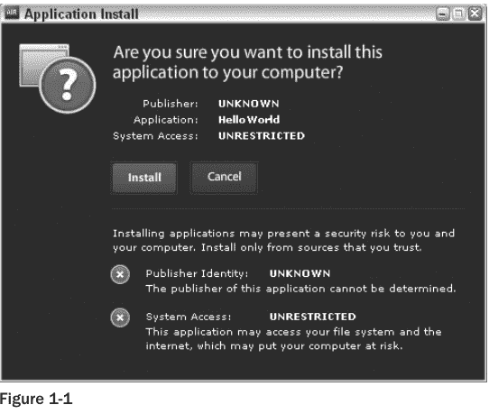

图 1-1

在图 1-1 所示的安装程序窗口中，你将看到你在 `HelloWorld-app.xml` 描述文件中 `filename` 元素指定的应用程序名称。你还将看到“安装”或“取消”的选项。通过点击“安装”按钮，将显示如图 1-2 所示的对话框。

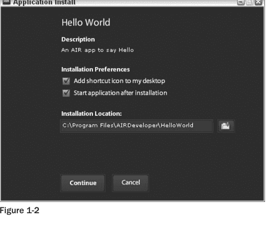

图 1-2

图 1-2 中显示的标题和描述分别是应用程序描述文件中 `name` 元素和 `description` 元素指定的值。

你将再次看到取消安装的选项，但不妨冒险点击“继续”。窗口将短暂显示一个进度条，指示安装过程。如果你选择了安装后启动应用程序，那么当安装完成后，你将看到如图 1-3 所示的屏幕。

在等待资金滚滚而来的同时，请阅读下一节，该节涵盖了在你的机器上安装 AIR 应用程序时发生的情况。

在 Windows 和 Mac OS 上：

+   - 将应用程序安装在操作系统的程序目录中。一个目录将使用 `installFolder` 指定的路径创建，应用程序文件夹将以应用程序描述符中指定的 `name` 值命名。这被称为*应用程序目录*，并通过 AIR API 的 `File` 类访问，正如你将在本书的示例中看到的。对于本章中的示例，你将在 Windows 上的 `C:\Program Files\AIRCMR\HelloWorld\HelloWorld` 和 Mac OS X 上的 `/Applications/AIRCMR/HelloWorld` 找到应用程序安装位置。

+   - 创建一个以应用程序描述符文件中 `id` 元素的值命名的应用程序存储目录。在此目录内创建一个名为 `Local Store` 的文件夹。这被称为*应用程序存储目录*，并通过 AIR API 的 `File` 类访问。对于本章中的示例，你将在 Windows 上的 `C:\Documents and Settings\<user>\Application Data\com.aircmr.HelloWorld` 和 Mac OS 上的 `Users/<user>/Library/Preferences/com.aircmr.HelloWorld` 找到存储目录。

+   - 如果你在安装窗口中选择创建快捷方式，将在桌面上添加一个以描述符文件中 `filename` 元素命名的快捷方式。

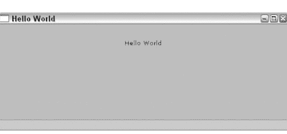

图 1-3

仅在 Windows 上：

+   - 将应用程序添加到“开始”菜单的 `AIRCMR/HelloWorld` 下——这分别是 `programMenuFolder` 和 `filename` 提供的值。

+   - 将标题为 Hello World 的应用程序（即描述符文件中 `name` 提供的值）添加到控制面板中的“添加或删除程序”列表中。

导航到安装文件夹。在 Mac 上，按住 Control 键单击 Hello World 应用程序，然后从菜单中选择“显示包内容”。在此目录的根目录中是打包 AIR 文件时在 ADT 参数中指定的文件。此目录中还包含应用程序的可执行文件和应用程序描述符文件，该文件已重命名为 `application.xml` 并放置在 `META_INF/AIR` 子目录中。

*应用程序目录*和*应用程序存储目录*可以使用 AIR API 的 `File` 类引用。这些目录在运行时为应用程序创建和访问资源方面各有其用途，这是本书稍后讨论的主题。

## 卸载 Hello World 应用程序

为什么要卸载 Hello World 应用程序？因为你生活在边缘，并且想为更宏大的事情节省磁盘空间。幸运的是，如果你想重新安装它，AIR 文件在项目的开发目录中仍然可用。

要在 Windows 上卸载 AIR 应用程序，请按照以下步骤操作：

1.  单击“开始”、“控制面板”、“添加或删除程序”。
2.  在条目列表中，滚动到你要卸载的 AIR 应用程序，然后单击一次以选择它。
3.  单击“删除”按钮。这样将从程序文件中删除安装目录，并删除你可能在安装过程中选择创建的桌面和“开始”菜单快捷方式。

要在 Mac 上卸载 AIR 应用程序，你只需将安装文件夹拖到废纸篓，然后清空废纸篓。

卸载应用程序会删除应用程序目录以及你通过安装窗口选择创建的任何辅助文件。但是，使用这些过程卸载不会删除应用程序存储目录或在安装后创建并与应用程序关联的任何文件。

再见了，Hello World！你现在拥有了构建和分发 AIR 应用程序的工具和知识。你还拥有了一个结构化的开发环境，使该过程顺利运行。

下一节将讨论通过引入 Apache ANT 构建方案和一个简单的调试面板来改进开发过程，该调试面板可从本书附带网站的本章代码示例中获取。

## 额外工具

有些开发者实在太忙，没时间在命令行中输入多个选项。为了自动化本章前面讨论的部署、调试和打包过程，请考虑使用 Apache ANT，这是为此目的而流行的一个工具，并且非常适合你的构建过程，因为它是跨平台的，并且需要 Java，而你的机器上已经安装了 Java。如果你更习惯使用其他工具来自动化构建过程，我们鼓励你这样做。但是，如果你有兴趣通过 ANT 设置构建过程，以下部分将引导你完成该过程。

你可能还会发现，每次启动应用程序以调试代码时运行 Flash 调试器，可能会在你的开发中造成一个耗时的障碍。因此，本节讨论了一个简单的调试面板的概念，该面板使用 API 的 `LocalConnection` 类与 AIR 应用程序通信。简单的调试面板的代码和 ANT 构建文件可以在本书附带网站的本章代码示例中找到。

## ANT 构建

仅 ANT 就可以轻松占用几章的篇幅，但为了符合 AIR 应用程序开发，本节提供了 ANT 构建标记的简要概述，而不一定是该工具的复杂工作原理。虽然此解决方案为你提供是为了方便开发，但这可能不是你最喜欢的。因此，本书中的所有示例都使用本章前面描述的命令行工具运行。


Apache ANT（以下简称 ANT）是一款使用 XML 标记来描述自动化软件构建过程中的任务和依赖关系的 Java 工具。如果你的电脑上目前没有安装 ANT，那么你需要安装它。请从 http://ant.apache.org/bindownload.cgi 下载最新发行版。

将 ANT 安装在一个符合你工作流程的目录中——例如，在 Windows 系统上为 `C:\ant-`。你还需要在环境变量中添加你的 ANT 安装路径。

> 如果你使用的是 Mac，那么你可能已经安装了 ANT。打开终端并输入 `> ant -version`。如果显示“command not found”消息，则说明你的机器上没有安装 ANT，或者你没有设置指向安装目录 `/bin` 的路径。如果是这种情况，请将 ANT 安装在 `/usr/local` 目录并执行以下步骤。

要在 Windows 上添加 ANT 安装路径，请按照以下步骤操作：

+   1. 依次点击 开始 ➚ 控制面板 ➚ 系统。
    2. 从菜单中选择高级选项卡。
    3. 点击环境变量。
    4. 在系统变量网格中，找到并双击 Path。
    5. 在变量值字段中，添加一个分号（`;`），然后是你的 ANT 安装目录中 `/bin` 文件夹的路径。本例中为 `;C:\ant\bin`。

要在 Mac 上添加 ANT 安装路径，请按照以下步骤操作：

+   1. 打开终端并输入 `open -e .profile`。
    2. 添加一个冒号（`:`）和你的 ANT 安装目录中 `/bin` 文件夹的路径。本例中为 `/usr/local/ant/bin`。

从命令行运行 ANT 需要在其调用的目录内有一个构建文件。ANT 构建文件是一个 XML 标记文件，描述了构建过程的任务和依赖关系。属性值也可以在构建文件中设置，使你能够在任务中使用 `${propertyname}` 结构来引用属性值。构建文件中也可以设置一个属性文件，将属性值对与构建标记分开。

首先，创建与你本章之前构建的 Hello World 应用相关的构建文件：

1. 在任意文本编辑器中输入以下标记：

```
<?xml version="1.0" encoding="utf-8"?>
<!-- ============================================================ -->
<!-- AIR Application Build File (Ant)                             -->
<!-- ============================================================ -->

<project name="AIR Application" default="main" basedir=".">

    <property name="app.name" value="HelloWorld" />
    <property name="desc.name" value="HelloWorld-app" />
    <property name="store.type" value="pkcs12" />
    <property name="cert.type" value="1024-RSA" />
    <property name="cert.name" value="certificate.pfx" />
    <property name="cert.pass" value="password" />

    <property name="src.dir" value="." />
    <property name="deploy.dir" value="." />

    <target name="main" depends="init,taskInput,compile,launch,package" />

    <target name="init" description="Sets properties based on OS.">
        <condition property="amxmlc.exec" value="amxmlc.bat">
            <os family="windows" />
        </condition>
        <condition property="amxmlc.exec" value="amxmlc">
            <os family="mac" />
        </condition>
        <condition property="adt.jar" value="C:/flex_sdk_3/lib/adt.jar">
            <os family="windows" />
        </condition>
        <condition property="adt.jar" value="/Applications/flex_sdk_3/lib/adt.jar">
            <os family="mac" />
        </condition>
    </target>

    <target name="taskInput" description="Presents task options.">
        <input message="Please select a task..." validargs="compile,launch,package"
            addproperty="task.action" />
        <condition property="do.compile" value="true">
            <or>
                <equals arg1="${task.action}" arg2="compile" />
                <equals arg1="${task.action}" arg2="launch" />
                <equals arg1="${task.action}" arg2="package" />
            </or>
        </condition>
        <condition property="do.launch" value="true">
            <equals arg1="${task.action}" arg2="launch" />
        </condition>
        <condition property="do.package" value="true">
            <equals arg1="${task.action}" arg2="package" />
        </condition>
    </target>

    <target name="compile" depends="taskInput" description="Generates SWF.">
        <exec executable="${amxmlc.exec}">
            <arg line="-output ${deploy.dir}/${app.name}.swf" />
            <arg line="${src.dir}/${app.name}.mxml" />
        </exec>
    </target>

    <target name="launch" if="do.launch" depends="compile"
        description="Launches application.">
        <exec executable="adl">
            <arg line="${deploy.dir}/${desc.name}.xml"/>
        </exec>
    </target>

    <target name="package" if="do.package" depends="compile"
        description="Packages AIR application.">
        <antcall target="create.certificate" />
        <java jar="${adt.jar}" fork="true" failonerror="true"
            inputstring="${cert.pass}">
            <arg value="-package" />
            <arg value="-storetype" />
            <arg value="${store.type}" />
            <arg value="-keystore" />
            <arg value="${cert.name}" />
            <arg value="${app.name}.air" />
            <arg value="${desc.name}.xml" />
            <arg value="${app.name}.swf" />
        </java>
    </target>

    <target name="create.certificate" if="do.package"
        description="Creates self signed certificate.">
        <java jar="${adt.jar}" fork="true" failonerror="true">
            <arg value="-certificate" />
            <arg value="-cn" />
            <arg value="${app.name}" />
            <arg value="${cert.type}" />
            <arg value="${cert.name}" />
            <arg value="${cert.pass}" />
        </java>
    </target>

</project>
```

2. 将文件保存为 `build.xml`，放在 Hello World 项目的开发目录中。

ANT 构建文件关联三个主要执行任务：`compile`（编译）、`launch`（启动）和 `package`（打包）。要运行的任务类型取决于用户输入的 `taskInput` 任务。`compile` 任务总是会被调用，因为 `launch` 和 `package` 任务的成功取决于生成的 SWF 文件的存在。

除了这三个可以根据输入运行的主要任务外，还有一个在打包前创建自签名证书的任务，以及一个根据操作系统设置属性值的任务。`init` 任务的运行是为了设置运行 Flex 3 SDK 命令行工具所需的操作系统特定属性。在 Windows 上，要在 `exec` ANT 任务中运行 `.bat` 文件，需要包含扩展名。在 Mac OS X 上，文件名就足够了。为了使用 `java` 指令运行 ADT，需要 `.jar` 文件的路径。因此，会运行一个 `condition` 任务来根据你的操作系统评估正确的路径。

要运行此构建，请打开命令提示符，导航到开发目录，然后输入以下命令：

```
>ant
```

运行此命令后，系统将提示你输入希望执行的任务——`compile`、`launch` 或 `package`。每个任务都会生成一个 SWF 文件。如果你选择 `launch` 任务，则 AIR 应用程序将使用 AIR 调试启动器（ADL）运行。如果你选择打包你的 AIR 应用程序，那么在 `package` 任务完成后，你会在开发目录中找到一个 `certificate.pfx` 文件和一个 `HelloWorld.air` 文件。

此构建文件中的属性设置非常基础，可能不适用于更大的项目。根据每个项目的需要，尝试使用你自己的构建文件。这些文件可以从一个开发目录移动到另一个开发目录，而不会影响自动化流程，但建议你更改任何特定于应用程序的属性值。

### 简单调试面板

如果你的调试任务只是与日志记录或跟踪相关，而不依赖于单步执行断点或处理故障，那么你可能会觉得很难抽出时间打开单独的命令提示符来启动 Flash Debugger。创建一个简单的调试面板来处理你所有的 `trace` 语句，将是一个优秀的 AIR 应用程序示例，它创建迅速，并且在调试任何其他 AIR 应用程序时极其方便。

运用你在本章学到的知识，制作你自己的简单调试面板——事实上，随附网站上本章的代码示例中就有一个可用的面板。源代码已包含在内，你可以根据需要修改代码。如果你有冒险精神，一个可能的扩展是添加一个写入日志的功能。SimpleDebugPanel 应用程序没有使用任何特定于 AIR API 的功能，而是使用 `LocalConnection` 将日志记录语句从你的应用程序传递到在 AIR 运行时下运行的调试面板。目录中包含的 `README` 文件概述了在你的应用程序中的正确用法，因为你需要向你的项目中添加一些类文件，以便调试面板能够接收日志语句。

## 总结

在本章中，你构建了你的第一个 AIR 项目——一个简单的 Hello World 应用程序，并了解了 AIR SDK 安装中提供的命令行工具。本章还包含了一些用于构建和调试应用程序的省时解决方案。在接下来的章节中，你将构建在现实场景中实用的应用程序——并且，希望在这个过程中能获得一些乐趣。


对于任何具有文件系统API的新技术，你可能都想知道如何读写硬盘上的文件。学习这一点的最佳方式，莫过于编写史上最通用的程序：全能文本编辑器。诚然，每个人都有自己多年来一直使用的、最喜爱的文本编辑程序，尤其是如果你是某种开发者的话。你将在本章开发的文本编辑器绝非一个能取代你现有文本编辑器的程序，但它或许是你打造个人定制文本编辑器的起点，未来你可以用所有你当前文本编辑器缺失的强大功能来扩展它！

这个程序展示了AIR文件系统API的几个重要方面。首先，你将使用`File`对象来指向硬盘上的文件。然后，本章将介绍如何使用`FileStream`和`FileMode`类来读写文件（在此例中是文本文件）。最后，你将学习如何使用`FileFilter`类来限制用户可以打开的文件类型。

## 文本编辑器

文本编辑器是你能编写的最简单的程序之一，尤其是在Flex和AIR框架内。它之所以如此简单，是因为它本质上只执行两项任务：打开或读取文件，以及保存或写入文件。除了这些任务，你只需为它添加一个简洁的界面和一些辅助方法，就可以执行诸如“新建文档”和“另存为”等操作。程序的视图或显示部分非常简单，就是一个能让你执行这些方法的菜单，以及一个用于编辑文本的区域。它真的就这么简单。


### 视图

在你的开发目录中创建一个名为“Simple Text Editor”的文件夹。这将是该程序的工作目录。由于此应用程序非常简单，我们先从视图开始，以快速完成这部分工作：

- 1. 打开你的编辑器，创建一个新文档，并输入以下内容：

```xml
<?xml version="1.0" encoding="UTF-8"?>
<application xmlns="http://ns.adobe.com/air/application/1.0">
    <id>com.aircmr.simpletexteditor</id>
    <name>SimpleTextEditor</name>
    <filename>SimpleTextEditor</filename>
    <version>v1</version>
    <initialWindow>
        <content>SimpleTextEditor.swf</content>
        <title>Text Editor</title>
    </initialWindow>
</application>
```

- 2. 将文件保存为工作目录下的SimpleTextEditor-app.xml。再创建一个新文档，并输入以下内容：

```xml
<?xml version="1.0" encoding="utf-8"?>
<mx:WindowedApplication xmlns:mx="http://www.adobe.com/2006/mxml"
    layout="absolute" width="800" height="600" title="Text Editor"
    applicationComplete="onAppInit();" >

    <mx:Script><![CDATA[

    public function onAppInit():void
    {
        title = "Text Editor - Untitled.txt";
        defaultFile = File.documentsDirectory.resolvePath( "untitled.txt" );
        textChanged = false;

        application.addEventListener( KeyboardEvent.KEY_UP, onKeyUp );
    }

    ]]></mx:Script>
    <mx:MenuBar id="myMenuBar" labelField="@label"
                left="0" top="0" right="0" tabEnabled="false"
                itemClick="onItemClick(event);" >
        <mx:XMLList>
            <menuitem label="File" >
                <menuitem label="New"/>
                <menuitem label="Open"/>
                <menuitem label="Save"/>
                <menuitem label="Save As..."/>
            </menuitem>
        </mx:XMLList>
    </mx:MenuBar>

    <mx:TextArea id="fileTextArea"
        top="21" left="0" right="0" bottom="0"
        focusThickness="0" fontFamily="Arial"
        fontSize="14" tabEnabled="false"
        change="textChanged=true;" />
</mx:WindowedApplication>
```

- 3. 将文件保存为工作目录下的`SimpleTextEditor.mxml`。

在第一步中，你创建了`SimpleTextEditor-app.xml`，即你的应用程序描述符文件。你应该熟悉这个文件的用途。如果不熟悉，可以参考第1章的Hello World示例。

你还创建了现在成为主应用程序文件的开始部分。这当然是指保存为`SimpleTextEditor.mxml`的文件。与Hello World示例一样，你从`Apollo-Application`组件开始。这里唯一的区别是你设置了`width`和`height`属性，使应用程序窗口能以稍大的尺寸初始化。

你还通过使用两个Flex组件设置了应用程序的可视部分：`MenuBar`和`TextArea`。具体来说，你设置了一个位于顶部并横跨应用程序窗口宽度的`MenuBar`，类似于Windows应用程序。`MenuBar`中填充了一个菜单集，其中包含了文本编辑器所需基本命令的文本表示。除了菜单，你还添加了一个`TextArea`组件，它位于菜单下方，横跨应用程序窗口的宽度并占据剩余的高度。此组件使你可以填充文本并输入文本，从而编辑文本文件。

此时你可以编译代码，看看组件的样子以及它们如何运作。为此，打开命令提示符并切换到应用程序的工作目录。输入以下命令并按回车：

```
> amxmlc SimpleTextEditor.mxml
```

现在应用程序被编译为`.swf`文件。要运行它，输入以下命令并按回车：

```
> adl SimpleTextEditor-app.xml
```

应用程序将启动，其外观应如图2-1所示。

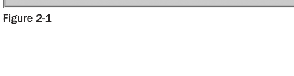

组件的某些属性已被设置，使应用程序的行为更像桌面应用而非Web应用。你会注意到每个组件的`tabEnabled`属性都设置为`false`。这样做是为了防止用户通过按Tab键获取任一组件的焦点。这可能会带来不便，特别是当有人想在其文本文件中插入Tab字符时。还要注意，TextArea组件的`focusThickness`已设置为0。默认情况下，TextArea组件会因轻微的外部发光而被高亮显示。在这种情况下，显示这种效果没有意义，而且当组件拉伸到窗口边缘时，你甚至无法看到整个发光效果。

### 逻辑

如前所述，该程序应执行两个基本任务：保存和读取文本文件。你可能最初认为你需要一种方法来浏览硬盘以打开文件，并浏览硬盘以找到保存文件的位置。幸运的是，AIR提供了一种非常简单的方法来与用户操作系统集成以执行此类任务。因此，你不必创建任何特殊组件；所有内容都可以在一个.mxml文件中处理。

### 基础

如果尚未打开，请在编辑器中打开SimpleTextEditor.mxml。对标记进行以下更改和添加：

```xml
<?xml version="1.0" encoding="utf-8"?>
<mx:WindowedApplication xmlns:mx="http://www.adobe.com/2006/mxml"
    layout="absolute" width="800" height="600" title="Text Editor"
    applicationComplete="onAppInit();" >

    <mx:Script><![CDATA[

import flash.events.KeyboardEvent;
import flash.filesystem.File;
import flash.filesystem.FileMode;
import flash.filesystem.FileStream;
import flash.net.FileFilter;
import mx.controls.Alert;
import mx.events.CloseEvent;
import mx.events.MenuEvent;

private var browseHolder:File;
private var currentFile:File;
private var defaultFile:File;
private var fileStream:FileStream;
private var fileToOpen:File;
private var fileToSave:File;
private var textChanged:Boolean;
public function onAppInit():void
{
    title = "Text Editor - Untitled.txt";
    defaultFile = File.documentsDirectory.resolvePath( "untitled.txt" );
    textChanged = false;

    application.addEventListener( KeyboardEvent.KEY_UP, onKeyUp );
}

private function onKeyUp( event:KeyboardEvent ):void
{
    if( event.keyCode == Keyboard.TAB && !event.altKey &&
        !event.shiftKey && !event.ctrlKey )
    {
        var sb:Number = fileTextArea.selectionBeginIndex;
        var se:Number = fileTextArea.selectionEndIndex;

        var firstPart:String = fileTextArea.text.slice(0, sb);
        var secondPart:String = fileTextArea.text.slice( se );

        fileTextArea.text = firstPart + "\t" + secondPart;
    }
}

private function onItemClick( event:MenuEvent ):void
{

}
    ]]></mx:Script>
    <mx:MenuBar id="myMenuBar" labelField="@label" left="0" top="0" right="0"
        tabEnabled="false" itemClick="onItemClick(event);" >
        <mx:XMLList>
            <menuitem label="File" >
                <menuitem label="New"/>
                <menuitem label="Open"/>
                <menuitem label="Save"/>
                <menuitem label="Save As..."/>
            </menuitem>
        </mx:XMLList>
    </mx:MenuBar>
    <mx:TextArea id="fileTextArea"
        top="21" left="0" right="0" bottom="0"
        focusThickness="0" fontFamily="Arial"
        fontSize="14" tabEnabled="false"
        change="textChanged=true;" />
</mx:WindowedApplication>
```

这一步为应用程序做了几件事。首先，它导入了你将需要的所有类，最重要的是来自AIR文件系统包的File、FileMode和FileStream类。更重要的是，紧随其后，设置了一些应用程序变量：

```actionscript
import flash.events.KeyboardEvent;
import flash.filesystem.File;
import flash.filesystem.FileMode;
import flash.filesystem.FileStream;
import mx.controls.Alert;
import mx.events.CloseEvent;
```


```
import mx.events.FileEvent;
import mx.events.MenuEvent;

private var currentFile:File;
private var defaultFile:File;
private var fileStream:FileStream;
private var textChanged:Boolean;
```

首先，创建一个名为 `currentFile` 的变量，其类型为 `File`。`File` 对象代表一个文件或文件夹的路径。在此例中，`currentFile` 将代表用户在文本编辑器中当前打开的文件路径。`File` 对象非常有用，因为它们也可以代表一个尚不存在的文件或文件夹的路径。换言之，它可以代表你稍后想要创建的文件或文件夹。例如，还创建了一个名为 `defaultFile` 的变量，其类型也是 `File`。如果用户尚未打开文本文件，此变量将代表系统提示用户保存的默认文件。

你还需要一个 `FileStream` 对象，它使你能够读写数据。最后，为了防止用户丢弃更改，你创建了一个简单的 `Boolean` 类型变量，名为 `textChanged`。现在应用程序变量已设置完毕，你可以继续编写 `onAppInit` 函数：

```
public function onAppInit():void
{
    title = "Text Editor - Untitled.txt";
    defaultFile = File.documentsDirectory.resolvePath( "untitled.txt" );
    textChanged = false;
    application.addEventListener( KeyboardEvent.KEY_UP, onKeyUp );
}
```

这段代码片段做了一件有点意思的事情，至少对于第一次使用 AIR 来说。`defaultFile` 被设置为用户文档目录中一个名为 `untitled.txt` 的文件的引用。`File` 类有一些静态变量，在开发 AIR 应用程序时非常方便。在这里，你使用的静态变量名为 `documentsDirectory`。这个变量类型是 `File`，保存了用户文档目录的引用。在 Windows 机器上，它很可能指向文件夹 `C:\Documents and Settings\User_Name\My Documents`，而在 OS X 机器上，它会指向文件夹 `/Users/User_Name/Documents`。你还利用了 `File` 对象的 `resolvePath` 方法——具体来说，是 `documentsDirectory` 的。`resolvePath` 方法创建了一个新的 `File` 对象，其路径是相对于它自身的。这多么方便（因此也很有趣）啊？

接下来的几行代码相当简单。首先，`textChanged` 被设置为 `false`，因为目前还没有文本被更改。其次，添加了一个事件监听器来处理键盘输入。如前所述，Flex 组件的 `tabEnabled` 属性被设置为 `false`，以防止用户能够通过 Tab 键跳出文本区域。不得不这样编写代码是一件不幸的事情，但文本编辑器应该表现得像一个文本编辑器，而不是一个 Web 应用程序。因此，在 `onKeyUp()` 事件处理程序中，当用户按下 Tab 键时，会有一些代码手动将制表符插入到文本区域中。

最后一些添加是针对 Flex 组件的。为 `MenuBar` 组件添加了一个事件监听器来处理其 `itemClick` 事件，并且当 `TextArea` 组件的文本被更改时，`textChanged` 变量被设置为 `false`。你现在可以编译代码了，但接下来的部分将继续介绍更精彩的内容。

## 读写文件

在你的编辑器中，对 SimpleTextEditor.mxml 进行以下添加：

```
<?xml version="1.0" encoding="utf-8"?>
<mx:WindowedApplication xmlns:mx="http://www.adobe.com/2006/mxml"
    layout="absolute" width="800" height="600" title="Text Editor"
    applicationComplete="onAppInit();" >

    <mx:Script><![CDATA[

        import flash.events.KeyboardEvent;
        import flash.filesystem.File;
        import flash.filesystem.FileMode;
        import flash.filesystem.FileStream;
        import flash.net.FileFilter;
        import mx.controls.Alert;
        import mx.events.CloseEvent;
        import mx.events.MenuEvent;

        private var browseHolder:File;
        private var currentFile:File;
        private var defaultFile:File;
        private var fileStream:FileStream;
        private var fileToOpen:File;
        private var fileToSave:File;
        private var textChanged:Boolean;

        public function onAppInit():void
        {
            title = "Text Editor - Untitled.txt";
            defaultFile = File.documentsDirectory.resolvePath( "untitled.txt" );
            textChanged = false;
            application.addEventListener( KeyboardEvent.KEY_UP, onKeyUp );
        }

        private function onKeyUp( event:KeyboardEvent ):void
        {
            if( event.keyCode == Keyboard.TAB && !event.altKey && !event.shiftKey &&
                !event.ctrlKey )
            {
                var sb:Number = fileTextArea.selectionBeginIndex;
                var se:Number = fileTextArea.selectionEndIndex;

                var firstPart:String = fileTextArea.text.slice(0, sb);
                var secondPart:String = fileTextArea.text.slice( se );

                fileTextArea.text = firstPart + "\t" + secondPart;
            }
        }
        private function onItemClick( event:MenuEvent ):void
        {
        }

        private function onOpenComplete( event:Event ):void
        {
            var theText:String = fileStream.readUTFBytes( fileStream.bytesAvailable );
            var lineEndPattern:RegExp = new RegExp( File.lineEnding, "g" );

            fileTextArea.text = theText.replace( lineEndPattern, "\n" );
            textChanged = false;
            title = "Text Editor - " + currentFile.name;
            fileStream.close();
        }

        private function onReadIOError( event:IOErrorEvent ):void
        {
            Alert.show("The specified file cannot be opened.", "Error", Alert.OK, this);
        }

        private function onWriteIOError( event:IOErrorEvent ):void
        {
            Alert.show("The specified file cannot be saved.", "Error", Alert.OK, this);
        }

        private function openFile():void
        {
            if( fileStream != null )
            {
                fileStream.close();
            }

            fileStream = new FileStream();
            fileStream.addEventListener( Event.COMPLETE, onOpenComplete );
            fileStream.addEventListener( IOErrorEvent.IO_ERROR, onReadIOError );
            fileStream.openAsync( currentFile, FileMode.READ );
        }
        private function saveFile():void
        {
            if( currentFile )
            {
                if( fileStream != null )
                {
                    fileStream.close();
                }

                var theText:String = fileTextArea.text;
                theText = theText.replace( /\r/g, "\n" );
                theText = theText.replace( /\n/g, File.lineEnding );

                fileStream = new FileStream();
                fileStream.openAsync( currentFile, FileMode.WRITE );
                fileStream.addEventListener( IOErrorEvent.IO_ERROR,
                    onWriteIOError );
                fileStream.writeUTFBytes( theText );
                fileStream.close();
                textChanged = false;
            }
            else
            {
                promptUserToSaveFile();
            }
        }
    ]]></mx:Script>
    <mx:MenuBar id="myMenuBar" labelField="@label"
             left="0" top="0" right="0" tabEnabled="false"
             itemClick="onItemClick(event);" >
        <mx:XMLList>
            <menuitem label="File" >
                <menuitem label="New"/>
                <menuitem label="Open"/>
                <menuitem label="Save"/>
                <menuitem label="Save As..."/>
            </menuitem>
        </mx:XMLList>
    </mx:MenuBar>
    <mx:TextArea id="fileTextArea"
             top="21" left="0" right="0" bottom="0"
             focusThickness="0" fontFamily="Arial"
             fontSize="14" tabEnabled="false"
             change="textChanged=true;" />\</mx:WindowedApplication>
```


真正的乐趣从这里开始！查看你刚刚添加的内容，注意应用程序中包含了五个新函数。这些函数是应用程序的核心，因为它们处理了所有繁琐的工作（实际上，这些工作也并非那么困难）。我们来仔细研究第一个函数 `openFile()`：

```actionscript
private function openFile():void
{
    if( fileStream != null )
    {
        fileStream.close();
    }

    fileStream = new FileStream();
    fileStream.addEventListener( Event.COMPLETE, onOpenComplete );
    fileStream.addEventListener( IOErrorEvent.IO_ERROR, onReadIOError );
    fileStream.openAsync( currentFile, FileMode.READ );
}
```

`openFile()` 函数用于打开 `currentFile`。首先，第一个条件语句检查 `fileStream` 对象是否已定义。如果已定义，则调用 `fileStream` 对象的 `close()` 方法来关闭与当前文件的连接。这只是一个安全措施。

通过此条件后，`fileStream` 对象被重新创建。然后，新实例配置了两个事件监听器。第一个事件监听器监听 `Event` 类型的 `COMPLETE` 事件。此事件表示文件中的所有数据已读取到输入缓冲区。当此事件被触发时，将调用 `onOpenComplete()` 函数。稍后我们将详细研究此函数。第二个事件监听器监听 `IOErrorEvent` 类型的 `IO_ERROR` 事件。`IOErrorEvent` 由 `fileStream` 对象在读取或写入操作因错误失败时触发。如果此事件被触发，将调用 `onReadIOError()` 函数。`onReadIOError()` 函数会向用户发出一条消息，提示读取文件时出现了问题。

事件监听器设置完成后，就可以调用 `fileStream` 对象的 `openAsync()` 方法。`openAsync()` 方法需要两个参数：一个 `File` 对象和一个字符串，该字符串指定你希望 `fileStream` 对象运行的模式——在本例中，传递 `currentFile` 变量，并使用 `FileMode` 类的公共静态变量 `READ` 来指定模式。`openAsync()` 方法异步打开指定的文件，这意味着文件的数据会立即读取到输入缓冲区，而后续代码将继续执行。

`openFile()` 函数现已完成，现在是时候处理你真正想要的内容：文本。让我们看看当输入缓冲区接收到所有文件数据时调用的 `onOpenComplete()` 函数：

```actionscript
private function onOpenComplete( event:Event ):void
{
    var theText:String = fileStream.readUTFBytes( fileStream.bytesAvailable );
    var lineEndPattern:RegExp = new RegExp( File.lineEnding, "g" );

    fileTextArea.text = theText.replace( lineEndPattern, "\n" );
    textChanged = false;
    title = "Text Editor - " + currentFile.name;

    fileStream.close();
}
```

`onOpenComplete()` 函数非常简单。首先，调用 `fileStream` 对象的 `readUTFBytes()` 方法。此方法将读取文件的字节数组并返回符合 UTF-8（8位 UCS/Unicode 转换格式）的字符串。该方法只需要一个参数，指定应读取的字节数；由于你知道整个文件已缓冲，因此可以使用 `fileStream` 对象的 `bytesAvailable` 属性。现在，临时变量 `theText` 充满了各种字符。

现在需要将文件的行尾字符转换为能在 `TextArea` 组件中正确显示换行的字符。正如你可能已经知道的，行尾字符会因应用程序运行的操作系统而异。简单的正则表达式是解决此问题的最佳方法。创建新的 `RegExp` 对象时，向构造函数的第一个参数提供 `File` 类的公共静态变量 `lineEnding`。此属性将告诉你应用程序运行的操作系统的行尾字符序列。真是一个救星！现在你有了模式，可以在 `theText` 上调用 `replace` 方法，然后将文本放入 `TextArea` 组件的 `text` 属性中。

现在文件中的文本已显示给用户，剩下的只是一些简单的清理工作。首先，将 `textChanged` 设置为 `false`。其次，使用用户打开的文件名更新应用程序的 `title` 属性。第三，关闭 `fileStream` 对象。应用程序现在已设置为可以打开文本文件，因此你可以继续处理应用程序所需的另一个基本功能：保存文件的能力。`saveFile()` 函数如下：

```actionscript
private function saveFile():void
{
    if( currentFile )
    {
        if( fileStream != null )
        {
            fileStream.close();
        }

        fileStream = new FileStream();
        fileStream.openAsync( currentFile, FileMode.WRITE );
        fileStream.addEventListener( IOErrorEvent.IO_ERROR, onWriteIOError );
        var str:String = fileTextArea.text;
        str = str.replace( /\r/g, "\n" );
        str = str.replace( /\n/g, File.lineEnding );
        fileStream.writeUTFBytes(str);
        textChanged = false;
    }
    else
    {
        promptUserToSaveFile();
    }
}
```

`saveFile()` 函数将从 `TextArea` 组件获取文本，并将数据写入用户硬盘上的文本文件。此函数中的第一个任务是一个条件判断，用于处理用户是否已打开文件。这通过检查 `currentFile` 变量是否已定义来确定。如果变量非空或已定义，则文件将被保存（从而替换或覆盖旧文件）；如果变量为空，则调用 `promptUserToSaveFile()` 函数（稍后将添加）来提示用户将文件保存到硬盘上的某个位置。

例如，假设用户打开了一个文件并进行了一些更改，然后想要保存文件。首先，与 `openFile()` 函数一样，你需要检查 `fileStream` 变量是否已定义。如果已定义，则调用 `FileStream` 对象的 `close()` 方法（同样，这只是为了安全）。通过此条件后，你将创建一个新的 `FileStream` 对象；并且，像在 `openFile()` 函数中一样，调用 `openAsync()` 方法，为其提供 `currentFile` 和你希望 `FileStream` 运行的模式。在本例中，使用 `FileMode` 类的静态属性 `WRITE` 来指定你将向文件写入数据。`openAsync()` 方法异步打开 `FileStream` 对象。

接下来，向 `fileStream` 添加一个事件监听器，以在文件写入过程中检查 I/O 错误。当 `IO_ERROR` 事件被触发时，只需调用 `onWriteIOError()` 函数。希望这种情况永远不会发生，但你永远无法预料用户是否会有损坏的磁盘扇区！此函数会向用户提示一条消息，说明出现了错误。

请注意，在进行一些更改之前，此文件将无法编译。但是，现在剩下的唯一任务是从 `TextArea` 组件获取文本并将其放入文件。这就像调用 `FileStream` 对象的 `writeUTFBytes()` 方法并传递文本字符串一样简单。`writeUTFBytes()` 方法将表示字符串字符的字节写入文件。没有比这更简单的了！

## 用户提示

核心功能现已就位，现在需要设置一些提示，以给用户提供愉快的文本编辑体验。具体来说，你需要使用户能够浏览硬盘以查找要打开的文件，以及浏览以查找保存文件的位置。除此之外，如果用户能够创建新文档也会很好。将以下标记添加到 `SimpleTextEditor.mxml`：

```xml
<?xml version="1.0" encoding="utf-8"?>
<mx:WindowedApplication xmlns:mx="http://www.adobe.com/2006/mxml"
    layout="absolute" width="800" height="600" title="Text Editor"
    applicationComplete="onAppInit();" >

    <mx:Script><![CDATA[

import flash.events.KeyboardEvent;
import flash.filesystem.File;
import flash.filesystem.FileMode;
import flash.filesystem.FileStream;
import flash.net.FileFilter;
import mx.controls.Alert;
import mx.events.CloseEvent;
import mx.events.MenuEvent;

private var browseHolder:File;
private var currentFile:File;
```


```actionscript
private var defaultFile:File;
private var fileStream:FileStream;
private var fileToOpen:File;
private var fileToSave:File;
private var textChanged:Boolean;

public function onAppInit():void
{
    title = "Text Editor - Untitled.txt";
    defaultFile = File.documentsDirectory.resolvePath( "untitled.txt" );
    textChanged = false;
    application.addEventListener( KeyboardEvent.KEY_UP, onKeyUp );
}

private function onKeyUp( event:KeyboardEvent ):void
{
    if( event.keyCode == Keyboard.TAB && !event.altKey && !event.shiftKey &&
        !event.ctrlKey )
    {
        var sb:Number = fileTextArea.selectionBeginIndex;
        var se:Number = fileTextArea.selectionEndIndex;

        var firstPart:String = fileTextArea.text.slice(0, sb);
        var secondPart:String = fileTextArea.text.slice( se );

        fileTextArea.text = firstPart + "\t" + secondPart;
    }
}

private function onItemClick( event:MenuEvent ):void
{
}

private function onAlertClose( event:CloseEvent ):void
{
    switch( event.detail )
    {
        case Alert.YES:
            saveFile();
            break;
        case Alert.NO:
            textChanged = false;
            newDocument();
            break;
    }
}

private function onFileOpenPanelSelect( event:FileEvent ):void
{
    currentFile = event.file as File;
    openFile();
}

private function onFileSavePanelSelect( event:FileEvent ):void
{
    currentFile = event.file as File;
    textChanged = false;
    title = "Text Editor - " + currentFile.name;
    saveFile();
}

private function onOpenComplete( event:Event ):void
{
    var theText:String = fileStream.readUTFBytes( fileStream
        .bytesAvailable );
    var lineEndPattern:RegExp = new RegExp( File.lineEnding, "g" );

    fileTextArea.text = theText.replace( lineEndPattern, "\n" );

    textChanged = false;
    title = "Text Editor - " + currentFile.name;

    fileStream.close();
}

private function onReadIOError( event:IOErrorEvent ):void
{
    Alert.show("The specified file cannot be opened.", "Error", Alert.OK,
        this);
}

private function onWriteIOError( event:IOErrorEvent ):void
{
    Alert.show("The specified file cannot be saved.", "Error", Alert.OK,
        this);
}

private function openFile():void
{
    if( fileStream != null )
    {
        fileStream.close();
    }

    fileStream = new FileStream();
    fileStream.addEventListener( Event.COMPLETE, onOpenComplete );
    fileStream.addEventListener( IOErrorEvent.IO_ERROR, onReadIOError );
    fileStream.openAsync( currentFile, FileMode.READ );
}

private function saveFile():void
{
    if( currentFile )
    {
        if( fileStream != null )
        {
            fileStream.close();
        }

        var theText:String = fileTextArea.text;
        theText = theText.replace( /\r/g, "\n" );
        theText = theText.replace( /\n/g, File.lineEnding );

        fileStream = new FileStream();
        fileStream.openAsync( currentFile, FileMode.WRITE );
        fileStream.addEventListener( IOErrorEvent.IO_ERROR, onWriteIOError );
        fileStream.writeUTFBytes( theText );
        fileStream.close();

        textChanged = false;
    }
    else
    {
        promptUserToSaveFile();
    }
}

private function promptUserToOpenFile():void
{
    fileToOpen = ( currentFile != null ) ? currentFile.parent : 
        File.documentsDirectory;
    fileToOpen.removeEventListener( Event.SELECT, onFileSaveSelect );

    var textFilter:FileFilter = new FileFilter( "Text",
        "*.as;*.css;*.html;*.txt;*.xml" );
    var allFilter:FileFilter = new FileFilter( "All Files", "*.*" );

    try
    {
        fileToOpen.browseForOpen( "Open", [textFilter, allFilter] );
        fileToOpen.addEventListener( Event.SELECT, onFileOpenSelect );
    }
    catch( error:Error )
    {
        trace("Failed:", error.message);
    }
}

private function promptUserToSaveFile():void
{
    fileToSave = ( currentFile ) ? currentFile : defaultFile;
    fileToSave.removeEventListener( Event.SELECT, onFileOpenSelect );

    var typeFilter:FileFilter = new FileFilter( "Text",
        "*.as;*.css;*.html;*.txt;*.xml" );

    try
    {
        fileToSave.browseForSave("Save");
        fileToSave.addEventListener( Event.SELECT, onFileSaveSelect );
    }
    catch( error:Error )
    {
        trace("Failed:", error.message);
    }
}

private function newDocument():void
{
    if( textChanged )
    {
        Alert.show("The text in your current document has changed.\nDo you want to save your changes?", "Alert", (Alert.YES | Alert.NO | Alert.CANCEL), this, onAlertClose);
    }
    else
    {
        currentFile = undefined;
        textChanged = false;
        fileTextArea.text = "";
    }
}
]]>
</mx:Script>

<mx:MenuBar id="myMenuBar" labelField="@label"
    left="0" top="0" right="0" tabEnabled="false"
    itemClick="onItemClick(event);" >
    <mx:XMLList>
        <menuitem label="File" >
            <menuitem label="New"/>
            <menuitem label="Open"/>
            <menuitem label="Save"/>
            <menuitem label="Save As..."/>
        </menuitem>
    </mx:XMLList>
</mx:MenuBar>
<mx:TextArea id="fileTextArea"
    top="21" left="0" right="0" bottom="0"
    focusThickness="0" fontFamily="Arial"
    fontSize="14" tabEnabled="false"
    change="textChanged=true;" />
</mx:WindowedApplication>
```

如你所见，这里添加了六个新函数。前三个函数是事件处理程序，将被后三个函数使用。让我们看看名为 `promptUserToOpenFile()` 的函数：

```actionscript
private function promptUserToOpenFile():void
{
    fileToOpen = ( currentFile != null ) ? currentFile.parent :
        File.documentsDirectory;
    fileToOpen.removeEventListener( Event.SELECT, onFileSaveSelect );
    var textFilter:FileFilter = new FileFilter( "Text",
        "*.as;*.css;*.html;*.txt;*.xml" );
    var allFilter:FileFilter = new FileFilter( "All Files", "*.*" );

    try
    {
        fileToOpen.browseForOpen( "Open", [textFilter, allFilter] );
        fileToOpen.addEventListener( Event.SELECT, onFileOpenSelect );
    }
    catch( error:Error )
    {
        trace("Failed:", error.message);
    }
}
```

这个函数会弹出一个对话框，提示用户选择要打开的文件（参见图 2-2）。请注意，对话框的外观会因用户使用的操作系统而异。图 2-2 显示了对话框在 Windows 上的样子。然而，在对话框出现之前，该函数会确定从用户计算机的哪个目录开始浏览。一个简单的条件判断会检查用户是否已经打开了一个文件。如果是，则从该文件所在的目录开始浏览。否则，用户将从他的或她的文档目录开始浏览。

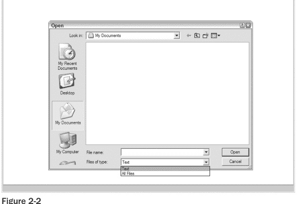

图 2-2

遵循此过程，请注意 `FileFilter` 类的使用。`FileFilter` 类用于限制用户在对话框中允许打开的文件类型。这里，创建了该类的两个实例。`FileFilter` 类的构造函数接受两个参数：第一个是文件列表的描述，第二个是以分号分隔的文件类型字符串。文件类型必须由其文件扩展名表示。创建了 `FileFilter` 对象后，应用程序尝试通过调用 `fileToOpen` 对象（恰好是 `File` 类型）的 `browseForOpen()` 方法向用户呈现对话框。此方法接受两个参数：第一个是应出现在对话框标题栏中的文本，第二个是 `FileFilter` 对象的数组。

最后要做的是在 `fileToOpen` 对象上添加一个事件监听器，以便应用程序知道用户何时选择了要打开的文件。它监听 `Event` 类型的 `SELECT` 事件，并调用 `onFileOpenPanelSelect()` 函数。当用户单击“打开”按钮或在对话框的文件列表中双击文件时，将触发此事件。以下代码显示了该事件处理程序：

```actionscript
private function onFileOpenPanelSelect( event:Event ):void
{
    currentFile = event.file as File;
    openFile();
}
```

显然，这个函数里做的事情非常少，这是因为大部分工作已经完成了。你需要在这个函数中做的只是将 `currentFile` 设置为事件对象的 `file` 属性。当然，这就是用户在对话框中选择的文件。你现在需要做的就是调用 `openFile()` 函数。如前所述，然后选中的文件中的文本将出现在 `TextArea` 组件中。就这么简单！

接下来，看看 `promptUserToSaveFile()`：

```actionscript
private function promptUserToSaveFile():void
{
    fileToSave = ( currentFile ) ? currentFile : defaultFile;
    fileToSave.removeEventListener( Event.SELECT, onFileOpenSelect );

    var typeFilter:FileFilter = new FileFilter( "Text",
        "*.as;*.css;*.html;*.txt;*.xml" );

    try
    {
        fileToSave.browseForSave("Save");
        fileToSave.addEventListener( Event.SELECT, onFileSaveSelect );
    }
    catch( error:Error )
    {
        trace("Failed:", error.message);
    }
}
```


在本功能中，用户会看到一个对话框，从中可以选择保存其正在处理的文件的位置（参见图2-3）。此功能与`promptUserToOpen()`函数类似，有两处细微差别。第一处差别是使用了`fileToSave`对象及其赋值条件。如果用户当前正在处理文件，则将其设置为等于`currentFile`对象；否则，将其设置为等于`defaultFile`对象。第二处差别是使用了`browseForSave()`方法。与`browseForOpen()`方法类似，该方法向用户显示一个对话框，但用于保存文件。

与“打开”对话框一样，你需要监听正在使用的`File`对象的`SELECT`事件。当此事件被分派时，`onFileSavePanelSelect()`函数将被调用：

```
private function onFileSavePanelSelect( event:Event ):void
{
    currentFile = event.file as File;
    textChanged = false;
    title = "Text Editor - " + currentFile.name;
    saveFile();
}
```

同样，这里没有太多操作，但这是因为大部分工作已经完成。首先，将`currentFile`设置为等于事件对象的`file`属性（用户在对话框中选择的文件）。接下来是一些清理工作。`textChanged`标志被重置为`false`，并且应用程序的`title`属性被更新以反映用户正在处理的文件。最后，调用`saveFile()`函数来保存文件。你几乎完成了。接下来是`newDocument()`函数：

```
private function newDocument():void
{
    if( textChanged )
    {
        Alert.show("The text in your current document has changed.\nDo you want to save your changes?", "Alert", (Alert.YES | Alert.NO | Alert.CANCEL), this, onAlertClose);
    }
    else
    {
        currentFile = undefined;
        textChanged = false;
        fileTextArea.text = "";
    }
}
```

此函数为用户提供创建新文档的选项——每个文本编辑器都应该有的选项，对吧？首先，检查`textChanged`标志以确定用户是否对当前文件进行了任何更改。如果文本已更改，则提示用户选择继续处理或保存他们正在处理的文件。此处，使用`Alert`组件来处理此问题，并在用户做出选择时调用`onAlertClose()`函数。反之，如果文本未更改，则可以假定用户不需要保存文件，并可以重置变量并清除`TextArea`组件中的文本。以下是`onAlertClose()`函数：

```
private function onAlertClose( event:CloseEvent ):void
{
    switch( event.detail )
    {
        case Alert.YES:
            saveFile();
            break;
        case Alert.NO:
            textChanged = false;
            newDocument();
            break;
    }
}
```

此事件处理程序仅检查用户在前一个警报中所做的选择。如果用户选择了“是”，则通过调用`saveFile()`函数保存文件。如果用户选择了“否”，则将`textChanged`标志设置为`false`。当再次调用`newDocument()`时，将不会再次提示用户。

## 界面激活

最后但同样重要的是，你需要激活界面。由于所有功能都已完成，这将是轻而易举的事。在`SimpleTextEditor.mxml`的`onItemClick()`函数中添加以下标记：

```
private function onItemClick( event:MenuEvent ):void
{
    switch( event.label )
    {
        case "New":
            newDocument();
            break;
        case "Open":
            promptUserToOpenFile();
            break;
        case "Save":
            saveFile();
            break;
        case "Save As...":
            promptUserToSaveFile();
            break;
    }
}
```

此事件处理程序检查用户从MenuBar组件中选择了哪个项目。由于所有工作都已完成，现在只需要调用相应的函数即可。你猜怎么着？你的简单文本编辑器现在完成了。

SimpleTextEditor.mxml的整个标记应如下所示：

```
<?xml version="1.0" encoding="utf-8"?>
<mx:WindowedApplication xmlns:mx="http://www.adobe.com/2006/mxml"
    layout="absolute" width="800" height="600" title="Text Editor"
    applicationComplete="onAppInit();" >

    <mx:Script><![CDATA[

    import flash.events.KeyboardEvent;
    import flash.filesystem.File;
    import flash.filesystem.FileMode;
    import flash.filesystem.FileStream;
    import flash.net.FileFilter;
    import mx.controls.Alert;
    import mx.events.CloseEvent;
    import mx.events.MenuEvent;

    private var browseHolder:File;
    private var currentFile:File;
    private var defaultFile:File;
    private var fileStream:FileStream;
    private var fileToOpen:File;
    private var fileToSave:File;
    private var textChanged:Boolean;

    public function onAppInit():void
    {
        title = "Text Editor - Untitled.txt";
        defaultFile = File.documentsDirectory.resolvePath( "untitled.txt" );
        textChanged = false;
        application.addEventListener( KeyboardEvent.KEY_UP, onKeyUp );
    }

    private function onKeyUp( event:KeyboardEvent ):void
    {
        if( event.keyCode == Keyboard.TAB && !event.altKey && !event.shiftKey &&
            !event.ctrlKey )
        {
            var sb:Number = fileTextArea.selectionBeginIndex;
            var se:Number = fileTextArea.selectionEndIndex;

            var firstPart:String = fileTextArea.text.slice(0, sb);
            var secondPart:String = fileTextArea.text.slice( se );

            fileTextArea.text = firstPart + "\t" + secondPart;
        }
    }

    private function onItemClick( event:MenuEvent ):void
    {
        switch( event.label )
        {
            case "New":
                newDocument();
                break;

            case "Open":
                promptUserToOpenFile();
                break;

            case "Save":
                saveFile();
                break;

            case "Save As...":
                promptUserToSaveFile();
                break;
        }
    }

    private function onAlertClose( event:CloseEvent ):void
    {
        switch( event.detail )
        {
            case Alert.YES:
                saveFile();
                break;

            case Alert.NO:
                textChanged = false;
                newDocument();
                break;
        }
    }

    private function onFileOpenSelect( event:Event ):void
    {
        currentFile = event.target as File;
        openFile();
    }

    private function onFileSaveSelect( event:Event ):void
    {
        currentFile = event.target as File;
        textChanged = false;
        title = "Text Editor - " + currentFile.name;
        saveFile();
    }

    private function onOpenComplete( event:Event ):void
    {
        var theText:String = fileStream.readUTFBytes( fileStream.bytesAvailable );
        var lineEndPattern:RegExp = new RegExp( File.lineEnding, "g" );

        fileTextArea.text = theText.replace( lineEndPattern, "\n" );

        textChanged = false;
        title = "Text Editor - " + currentFile.name;

        fileStream.close();
    }

    private function onReadIOError( event:IOErrorEvent ):void
    {
        Alert.show("The specified file cannot be opened.", "Error", Alert.OK, this);
    }

    private function onWriteIOError( event:IOErrorEvent ):void
    {
        Alert.show("The specified file cannot be saved.", "Error", Alert.OK, this);
    }

    private function openFile():void
    {
        if( fileStream != null )
        {
            fileStream.close();
        }
        fileStream = new FileStream();
        fileStream.addEventListener( Event.COMPLETE, onOpenComplete );
        fileStream.addEventListener( IOErrorEvent.IO_ERROR, onReadIOError );
        fileStream.openAsync( currentFile, FileMode.READ );
    }

    private function saveFile():void
    {
        if( currentFile )
        {
            if( fileStream != null )
            {
                fileStream.close();
            }
            var theText:String = fileTextArea.text;
            theText = theText.replace( /\r/g, "\n" );
            theText = theText.replace( /\n/g, File.lineEnding );

            fileStream = new FileStream();
            fileStream.openAsync( currentFile, FileMode.WRITE );
            fileStream.addEventListener( IOErrorEvent.IO_ERROR, onWriteIOError );
            fileStream.writeUTFBytes( theText );
            fileStream.close();

            textChanged = false;
        }
        else
        {
            promptUserToSaveFile();
        }
    }

    private function promptUserToOpenFile():void
    {
        fileToOpen = ( currentFile != null ) ? currentFile.parent :
            File.documentsDirectory;
        fileToOpen.removeEventListener( Event.SELECT, onFileSaveSelect );

        var textFilter:FileFilter = new FileFilter( "Text",
            "*.as;*.css;*.html;*.txt;*.xml" );
        var allFilter:FileFilter = new FileFilter( "All Files", "*.*" );

        try
        {
            fileToOpen.browseForOpen( "Open", [textFilter, allFilter] );
            fileToOpen.addEventListener( Event.SELECT, onFileOpenSelect );
        }
        catch( error:Error )
        {
            trace("Failed:", error.message);
        }
    }

    private function promptUserToSaveFile():void
    {
        fileToSave = ( currentFile ) ? currentFile : defaultFile;
        fileToSave.removeEventListener( Event.SELECT, onFileOpenSelect );

        var typeFilter:FileFilter = new FileFilter( "Text",
            "*.as;*.css;*.html;*.txt;*.xml" );

        try
        {
            fileToSave.browseForSave("Save");
            fileToSave.addEventListener( Event.SELECT, onFileSaveSelect );
        }
        catch( error:Error )
        {
            trace("Failed:", error.message);
        }
    }
    ]]></mx:Script>

    <mx:TextArea id="fileTextArea" left="0" right="0" top="0" bottom="0"
        change="textChanged = true;" />

</mx:WindowedApplication>
```


```markdown
    }
}

private function newDocument():void
{
    if( textChanged )
    {
        Alert.show("当前文档中的文本已更改。\n是否要保存更改？", "警告", (Alert.YES | Alert.NO | Alert.CANCEL), this, onAlertClose);
    }
    else
    {
        currentFile = undefined;
        textChanged = false;
        fileTextArea.text = "";
    }
}]]></mx:Script>
<mx:MenuBar id="myMenuBar" labelField="@label"
            left="0" top="0" right="0" tabEnabled="false"
            itemClick="onItemClick(event);" >
    <mx:XMLList>
        <menuitem label="文件" >
            <menuitem label="新建"/>
            <menuitem label="打开"/>
            <menuitem label="保存"/>
            <menuitem label="另存为..."/>
        </menuitem>
    </mx:XMLList>
</mx:MenuBar>
<mx:TextArea id="fileTextArea"
             top="21" left="0" right="0" bottom="0"
             focusThickness="0" fontFamily="Arial"
             fontSize="14" tabEnabled="false"
             change="textChanged=true;" />
</mx:WindowedApplication>
```

现在代码已完成，你可以随心所欲地编译、部署和自定义此应用程序。用你喜欢的图标或配色方案来美化它，或者将其转换为一个可以成为更大应用程序一部分的组件。现在没有什么能阻止你了！

你可以通过多种方式进一步改进这个简单的文本编辑器。想想你最喜欢的文本编辑器中常见的菜单项，例如“查找”或“搜索和替换”。如果你真的雄心勃勃，也许可以添加“撤销”功能或添加富文本编辑能力。如果你的用户本身是开发者，你可以添加一个代码片段管理器，让用户能够输入常用字符串并通过简单的菜单访问它们。可能性几乎是无穷无尽的。

## 总结

在本章中，你已经了解了创建一个简单的文本编辑器是多么容易，而且只用了200多行代码（你还可以稍微精简一下）。可以肯定地说，你已经完成了你的第一个真正的AIR应用程序，并对AIR文件系统API有了一些了解。具体来说，本章涵盖了`File`和`FileStream`对象，并描述了与每个对象相关的一些方法。你还学会了如何在向用户的硬盘驱动器读写文件时使用这些对象。

在学习这些文件系统基础知识的同时，你还发现了如何通过访问`File`类的一些静态属性来获取有关用户系统的一些基本信息。这些信息包括用户的文档目录位于何处，以及用户操作系统的行尾字符序列。

最后，你学习了如何通过`File`对象的可用方法来访问操作系统的标准“打开”和“保存”对话框窗口。对于你的第一个AIR应用程序来说，这已经很不错了。在下一章中，你将通过创建一个简单的RSS阅读器，进一步了解文件系统API以及AIR的其他一些强大功能。


每个人都试图了解最新消息。正如报纸是印刷文章的聚合，真正的简单联合（RSS）阅读器则以数字格式为你提供信息。RSS格式是一种XML标记，它通过元数据元素详细传递有关订阅源或已发布文章集合的信息。在线聚合器会接收来自多个RSS订阅源的更新通知，并帮助你从各种来源及时了解感兴趣的内容。

在本章中，你将构建一个简单的RSS阅读器，显示来自Adobe XML新闻聚合器（AXNA）的帖子，AXNA是一个包含各种主题的聚合器，其中包括Flash平台最新信息的详细报道。在此过程中，你将发现AIR API中更多与网络连接、系统托盘和窗口相关的宝藏。

在开始构建应用程序之前，首先要考虑对桌面RSS阅读器的期望。一般来说，RSS阅读器应具备以下特点：

- 能够感知网络资源和用户状态，并相应地处理轮询RSS订阅源。
- 在从RSS订阅源接收到帖子时，以不引人注目的方式显示它们。
- 从系统托盘提供与应用程序和RSS订阅源相关的其他选项。

下一节讨论如何实现这些目标。

## 设计

在上一节中，为RSS阅读器确定了一些主要目标。使用Flex框架消费RSS订阅源并显示帖子列表非常简单明了，你可能已经构建过在线订阅源阅读器了。但是，本章中你将构建的RSS阅读器将结合AIR API的功能，使你能够将这种体验带到桌面。以下列表详细说明了对应用程序考虑的目标：

- **感知网络资源和用户状态** — RSS阅读器应用程序的主要焦点是向用户呈现订阅源的最新帖子。应用程序将不断轮询RSS订阅源，以检索并显示任何新帖子。当用户失去互联网连接时，应用程序必须知道停止任何请求，直到连接恢复。同样的理解也适用于应用程序运行时用户的闲置状态。通过使用网络监控类和处理AIR API的事件，你可以确保获得愉快的阅读体验。

- **在从RSS订阅源接收到帖子时，以不引人注目的方式显示它们** — RSS阅读器将以“弹出窗口”形式呈现帖子。弹出窗口的呈现方式因操作系统而异，但通常指一个出现在其他原生窗口上方的显示区域，用于显示与应用程序相关的数据。在使用AIR的窗口API时，RSS阅读器将采用相同的方法，以不引人注目的方式呈现帖子，并提供控件来浏览RSS订阅源的摘要或完全关闭窗口。

- **从系统托盘提供其他选项** — 与大多数桌面应用程序不同（它们的主窗口始终存在于屏幕原生窗口的z轴顺序中），RSS阅读器在操作系统的系统托盘中运行，并在从服务接收到新帖子时呈现它们。因此，通过使用AIR的原生菜单API，应用程序将提供系统托盘选项，使你能够强制发起请求、在互联网浏览器中导航到订阅源，或退出应用程序。

考虑到这些要点，你可以开始构建满足这些需求的工具，并创建一个桌面应用程序，让你及时了解Flash平台世界中正在发生的事情。

下一节涵盖了用作模型的值对象，该对象用于在从订阅源服务接收到的帖子列表中，在弹出窗口内显示单个帖子。

### 处理数据

当应用程序接收到RSS订阅源的结果时，数据会被解析成一个对象列表，供RSS阅读器内显示。每个帖子的显示取决于你将在本节中创建的值对象的属性。

在你的开发目录中，创建一个名为`RSSReader`的文件夹。这将是你的应用程序工作目录。设置好后，你就可以开始工作了。

创建一个新文档并输入以下ActionScript：

```
package com.aircmr.rssreader.data
{
    [Bindable]
    public class PostVO
    {
        public var author:String;
        public var title:String;
        public var description:String;
        public var link:String;
        public var date:String;
        public var id:String;
        
        public function PostVO( author:String, title:String,
                                    description:String, link:String,
                                    date:String, id:String )
        {
            this.author = author;
            this.title = title;
            this.description = description;
            this.link = link;
            this.date = date;
            this.id = id;
        }
    }
}
```

将文件保存为`PostVO.as`，放在工作目录下的`com/aircmr/rssreader/data`目录中。

`PostVO`值对象具有与从订阅源服务接收到的帖子相关的公共属性。服务的结果是XML格式的项目列表。此值对象的属性用于渲染帖子显示中的文本字段，`link`和`id`除外，它们分别用于导航到原始网志帖子和保留最后阅读的项目。

为了更好地理解这些对象是如何被应用程序定义和处理的，下一节涵盖了从订阅源服务加载和解析数据的类。

## 解析RSS订阅源

当用户在线且网络资源可用时，RSS阅读器将不断轮询订阅的订阅源服务以获取XML数据。当数据被接收时，你在本节中创建的服务类将XML解析为`PostVO`值对象，用于显示每个帖子。

1.  创建一个新文档并输入以下ActionScript：

```
package com.aircmr.rssreader.services
{
    import com.aircmr.rssreader.data.PostVO;

    import flash.events.Event;
    import flash.events.EventDispatcher;
    import flash.events.HTTPStatusEvent;
    import flash.events.IOErrorEvent;
    import flash.net.URLLoader;
    import flash.net.URLRequest;

    public class AbstractFeedService extends EventDispatcher
    {
        protected var _title:String;
        protected var _loader:URLLoader;
        [ArrayType("com.aircmr.rssreader.data.PostVO")]
        protected var _postItems:Array;
        protected var _lastReadId:String;
```


```actionscript
public function AbstractFeedService()
{
    _loader = new URLLoader();
    _loader.addEventListener( Event.COMPLETE, onFeedLoad );
    _loader.addEventListener( HTTPStatusEvent.HTTP_STATUS, onHttpStatus );
    _loader.addEventListener( IOErrorEvent.IO_ERROR, onFeedLoadError );
}

protected function onHttpStatus( evt:Event ):void
{
    // 覆盖
}

protected function onFeedLoad( evt:Event ):void
{
    // 覆盖 ...
}

protected function onFeedLoadError( evt:IOErrorEvent ):void
{
    dispatchEvent( evt.clone() );
}

protected function updateLastRead():void
{
    _lastReadId = PostVO( _postItems[0] ).id;
}

protected function getItemsSince( id:String ):Array
{
    for( var i:int = 0; i < _postItems.length; i++ )
    {
        if( PostVO( _postItems[i] ).id == id ) break;
    }
    updateLastRead();
    return getItemsByAmount( i );
}

public function load( url:String ):void
{
    _postItems = new Array();
    _loader.load( new URLRequest( url ) );
}

public function getAllItems():Array
{
    updateLastRead();
    return _postItems;
}

public function getItemsByAmount( amt:int ):Array
{
    updateLastRead();
    return _postItems.slice( 0, Math.min( _postItems.length, amt ) );
}

public function getUnreadItems():Array
{
    return getItemsSince( _lastReadId );
}
[Bindable]
public function get title():String
{
    return _title;
}
public function set title( str:String ):void
{
    _title = str;
}
}
}
```

2.  将文件保存为 `AbstractFeedService.as`，放在你工作目录下的 `com/aircmr/rssreader/services` 目录中。

3.  创建一个新文档，并输入以下 ActionScript 代码：

```actionscript
package com.aircmr.rssreader.services
{
    import com.aircmr.rssreader.data.PostVO;

    import flash.events.Event;

    [Event(name="complete", event="flash.events.Event" )]
    public class AXNAFeedService extends AbstractFeedService
    {
        private var _xml:XML;

        public static const LOAD_COMPLETE:String = "complete";
        private static const DC_NS:String = "http://purl.org/dc/elements/1.1/";
        private static const RSS_NS:String = "http://purl.org/rss/1.0/";

        private function parseData():void
        {
            var chan:XMLList = getElement( _xml, RSS_NS, "channel" );
            title = getElement( XML( chan ), RSS_NS, "title" )[0];

            var children:XMLList = getElement( _xml, RSS_NS, "item" );
            for( var i:Number = 0; i < children.length(); i++ )
            {
                var post:XML = XML( children[i] );
                var title:XMLList = getElement( post, RSS_NS, "title" );
                var description:XMLList = getElement( post, RSS_NS, "description" );
                var link:XMLList = getElement( post, RSS_NS, "link" );
                var author:XMLList = getElement( post, DC_NS, "creator" );
                var date:XMLList = getElement( post, DC_NS, "date" );
                var id:XMLList = getElement( post, DC_NS, "identifier" );
                _postItems.push( new PostVO( author, title, description,
                                            link, date, id ) );
            }
        }

        private function getElement( child:XML, ns:String,
                                     type:String ):XMLList
        {
            return child.descendants( new QName( ns, type ) );
        }

        override protected function onFeedLoad( evt:Event ):void
        {
            _xml = XML( _loader.data );
            parseData();
            dispatchEvent( new Event( AXNAFeedService.LOAD_COMPLETE ) );
        }
    }
}
```

4.  将文件保存为 `AXNAFeedService.as`，放在你工作目录下的 `com/aircmr/rssreader/services` 目录中。

第一个代码片段保存为 `AbstractFeedService`，作为你可能实现的任何具体Feed服务（例如 `AXNAFeedService`）的基类。`AbstractFeedService` 处理从Feed服务请求数据，并为客户端提供方法来访问已解析为 `PostVO` 对象的数据。除了返回完整或部分文章数组的方法外，`AbstractFeedService` 类还使用 `PostVO` 的 `id` 属性来引用最后请求的文章。在初始加载返回数据后，RSS阅读器应用程序会持续轮询Feed服务，并向用户展示任何尚未展示过的项目。尚未展示给用户的项目可以使用 `getUnreadItems()` 方法来访问。

`AbstractFeedService` 定义了访问文章数据的逻辑，作为子类的基础，子类可以覆盖 `Loader` 实例的事件处理器并逻辑地解析返回的数据。`AXNAFeedService` 覆盖了 `onFeedLoad()` 事件处理器，并在私有 `parseData()` 方法中解析返回的数据。RSS阅读器应用程序将解析来自 Adobe XML News Aggregator (AXNA) 的 RSS Feed。此Feed是资源描述框架 (RDF) 的XML序列化，并遵循RDF站点摘要 (RSS) 1.0规范。`AXNAFeedService` 类中的解析逻辑知道如何处理此语法，但你可能更倾向于阅读其他联合格式，如Atom。你可以自由创建另一个 `AbstractFeedService` 的子类，该子类知道如何解析你可能感兴趣的其他Feed。

Adobe已公开发布了可以处理各种联合格式解析的代码。可以从 http://code.google.com/p/as3corelib/ 下载，并在 `xml.syndication` 包中找到。

在 `AXNAFeedService` 的 `parseData()` 方法中，每个文章项都是根据其子元素的命名空间URI进行解析的，新的 `PostVO` 值对象被添加到一个数组中：

```actionscript
private function parseData():void
{
    var chan:XMLList = getElement( _xml, RSS_NS, "channel" );
    title = getElement( XML( chan ), RSS_NS, "title" )[0];

    var children:XMLList = getElement( _xml, RSS_NS, "item" );
    for( var i:Number = 0; i < children.length(); i++ )
    {
        var post:XML = XML( children[i] );
        var title:XMLList = getElement( post, RSS_NS, "title" );
        var description:XMLList = getElement( post, RSS_NS, "description" );
        var link:XMLList = getElement( post, RSS_NS, "link" );
        var author:XMLList = getElement( post, DC_NS, "creator" );
        var date:XMLList = getElement( post, DC_NS, "date" );
        var id:XMLList = getElement( post, DC_NS, "identifier" );
        _postItems.push( new PostVO( author, title, description,
                                    link, date, id ) );
    }
}
```

PostVO对象数组是通过使用ActionScript 3.0的 `QName` 类对XML元素进行限定来组装的，其属性来自 `getElement()` 方法：

```actionscript
private function getElement( child:XML, ns:String, type:String ):XMLList
{
    return child.descendants( new QName( ns, type ) );
}
```

`getElement()` 方法的参数对应于文章项的父节点、元素所在的命名空间以及元素的名称。ActionScript 3.0 XML对象的 `descendants()` 方法返回XML节点所有后代节点的XMLList。在此示例中，该返回将是作为 `child` 参数提供的限定元素的节点值。

PostVO类的实例表示从订阅的RSS Feed返回的文章列表中的单篇文章。随着用于解析XML数据并组装表示单篇文章的数据对象的服务类已创建完成，现在是时候开始处理应用程序如何将文章数据呈现给用户了。在下一节中，你将为从Adobe XML News Aggregator接收的文章创建视图类。

## 构建用户界面

你在上一节中创建的类对RSS阅读器应用程序很有益，因为它会持续轮询RSS Feed以获取最新文章。在本节中，你将创建这些文章的显示界面，以及处理与Feed服务通信并显示与应用程序相关的系统托盘选项的主MXML文件。

回想一下，RSS阅读器的最初目标之一是以不引人注目的方式呈现文章，这意味着应用程序将在不干扰用户当前可能正在执行的操作的情况下显示数据。使用AIR的窗口API，你将在下一节创建作为类似烤面包机提示框的视图和窗口类。

## 显示文章

从RSS Feed接收的文章将以类似烤面包机提示框的形式呈现。烤面包机提示框是一个小窗口，位于原生窗口z轴顺序的底层，并占据屏幕一角的小区域。


在用户屏幕的某个象限中。本节创建的类将构成当从RSS Feed服务接收到数据时显示的吐司提示窗口。

1.  创建一个新文档，并输入以下标记：

```xml
<?xml version="1.0" encoding="utf-8"?>
<mx:VBox
    xmlns:mx="http://www.adobe.com/2006/mxml"
    width="100%" height="100%"
    backgroundColor="0xF1F1F1"
    verticalGap="2" updateComplete="{this.measure()}"
    paddingLeft="10" paddingRight="10"
    paddingTop="10" paddingBottom="10">

    <mx:Style>
        .title {
            font: 'Arial';
            font-weight: 'bold';
            font-size: 12px;
            color: #336699;
        }
        .description {
            font: 'Arial';
            font-size: 11px;
            text-align: 'left';
            color: #333333;
        }
        .meta {
            font: 'Arial';
            font-size: 10px;
            color: #999999;
        }
    </mx:Style>

    <mx:Script>
        <![CDATA[
            import com.aircmr.rssreader.data.PostVO;
            private function onTitleClick():void
            {
                navigateToURL( new URLRequest( PostVO( data ).link ) );
            }
        ]]>
    </mx:Script>

    <mx:DateFormatter id="formatter" formatString="MM-DD-YYYY" />

    <mx:Text id="titleField" width="100%"
             styleName="title"
             htmlText="{data.title}" selectable="false"
             buttonMode="true" useHandCursor="true"
             click="onTitleClick();"
             />
    <mx:HBox width="100%" height="15"
             verticalAlign="middle">
        <mx:Text id="authorField"
                 styleName="meta" maxWidth="170"
                 htmlText="{data.author}"
                 />
        <mx:VRule height="75%" />
        <mx:Text id="datField"
                 styleName="meta"
                 htmlText="{formatter.format( data.date )}"
                 />
    </mx:HBox>
    <mx:Text id="description" width="100%" height="100%"
             styleName="description" truncateToFit="true"
             htmlText="{data.description}"
             />
</mx:VBox>
```

2.  将文件保存为 `Post.mxml`，存放于您工作目录中名为 `com/aircmr/rssreader/ui` 的目录内。

3.  创建一个新文档，并输入以下标记：

```xml
<?xml version="1.0" encoding="utf-8"?>
<mx:Window
    xmlns:mx="http://www.adobe.com/2006/mxml"
    xmlns:ui="com.aircmr.rssreader.ui.*"
    systemChrome="none" showFlexChrome="false"
    transparent="true"
    alwaysInFront="true" type="lightweight"
    visible="false"
    width="300" height="200"
    closing="onClose(event);"
    creationComplete="onCreationComplete();">

    <mx:Script>
        <![CDATA[
            import mx.binding.utils.BindingUtils;
            import com.aircmr.rssreader.data.PostVO;

            [ArrayElementType("com.aircmr.rssreader.data.PostVO")]
            private var _posts:Array;
            private var _currentIndex:int = -1;
            private var _areaBounds:Rectangle;

            private var _cycleTimer:Timer;
            private static const CYCLE_DELAY:int = 5000;

            private function onCreationComplete():void
            {
                _cycleTimer = new Timer( CYCLE_DELAY );
                _cycleTimer.addEventListener( TimerEvent.TIMER, onTimer );

                var areaBounds:Rectangle = Screen.mainScreen.bounds;
                nativeWindow.x = areaBounds.width - width - 10;
                nativeWindow.y = areaBounds.height - height - 30;
            }

            private function onClose( evt:Event ):void
            {
                evt.preventDefault();
                stopDisplay();
            }

            private function onTimer( evt:TimerEvent ):void
            {
                if( currentIndex < posts.length - 1 )
                    currentIndex++;
                else
                    stopDisplay();
            }

            private function stopDisplay():void
            {
                _cycleTimer.reset();
                visible = false;
            }

            private function startDisplay():void
            {
                currentIndex = 0;
                visible = true;
            }

            private function updatePost():void
            {
                if( _posts == null ) return;
                post.data = _posts[_currentIndex];
                _cycleTimer.reset();
                _cycleTimer.start();
            }

            [Bindable]
            public function get currentIndex():int
            {
                return _currentIndex;
            }
            public function set currentIndex( num:int ):void
            {
                _currentIndex = Math.max( 0, Math.min( num, posts.length - 1 ) );
                updatePost();
            }

            [Bindable]
            public function get posts():Array
            {
                return _posts;
            }
            public function set posts( arr:Array ):void
            {
                _posts = arr;
                startDisplay();
            }
        ]]>
    </mx:Script>

    <mx:VBox width="100%" height="100%"
             borderStyle="solid" backgroundColor="0x336699" cornerRadius="5"
             paddingLeft="5" paddingRight="5" paddingTop="5" paddingBottom="5">

        <mx:Label text="{this.title}" color="0xFFFFFF" />
        <ui:Post id="post"
                 width="100%" height="100%"
                 mouseOver="{_cycleTimer.reset();}"
                 mouseOut="{_cycleTimer.start();}"
                 />
        <mx:HBox width="100%" height="20">
            <mx:Label text="&lt;&lt;"
                      color="0xFFFFFF"
                      click="{currentIndex--}"
                      />
            <mx:Text text="{( currentIndex + 1 ) + '/' + posts.length}"
                     color="0xFFFFFF"
                     />
            <mx:Label text="&gt;&gt;"
                      color="0xFFFFFF"
                      click="{currentIndex++}"
                      />
            <mx:Spacer width="100%" />
            <mx:Label text="close"
                      color="0xFFFFFF"
                      click="{stopDisplay();}"
                      />
        </mx:HBox>

    </mx:VBox>

</mx:Window>
```

4.  将文件保存为 `DigestToaster.mxml`，存放于您工作目录中名为 `com/aircmr/rssreader/windows` 的目录内。

第一个代码片段（保存为 `Post.mxml`）是一个简单的组件，其字段用于显示 `PostVO` 对象的数据。通过继承的 `data` 属性，将 `PostVO` 对象的实例提供给 `Post` 类。利用 Flex 数据绑定系统，当数据更新时，子字段的文本属性也会随之更新。

`Post` 类的布局相当直观，它用作第二个代码片段——`DigestToaster.mxml` 的显示界面。`DigestToaster` 类扩展了 AIR 窗口 API 的 `mx.core.Window` 类，是一个吐司风格的警报窗口，当从 RSS Feed 返回新帖时就会显示。`Window` 类充当操作系统上应用程序原生窗口的容器——具体来说，是 `flash.display.NativeWindow` 的一个实例。虽然 `NativeWindow` 类是原生窗口的接口，但组件不能直接添加到 `NativeWindow` 的显示列表中。

使用 `Window` 类，您可以通过 `nativeWindow` 属性添加组件并控制原生窗口的其他属性。

在 `Window` 对象的 `NativeWindow` 实例初始化后，某些属性将变为只读。因此，与系统外观和窗口类型相关的属性在 `<mx:Window>` 标签中声明：

```xml
<mx:Window
    xmlns:mx="http://www.adobe.com/2006/mxml"
    xmlns:ui="com.aircmr.rssreader.ui.*"
    systemChrome="none" showFlexChrome="false"
    transparent="true"
    alwaysInFront="true" type="lightweight"
    visible="false"
    width="300" height="200"
    closing="onClose(event);"
    creationComplete="onCreationComplete();">
```

正如您可以在声明标签内或 AIR 应用程序的描述符文件中为 `<mx:WindowedApplication>` 标签赋值一样，您也可以在 `<mx:Window>` 标签中为原生窗口赋值。为了将 `DigestToaster` 呈现为吐司窗口，设置了 `systemChrome`、`showFlexChrome` 和 `transparent` 属性，以赋予窗口其外观和感觉。

除了窗口的外观，`alwaysInFront` 被设置为 `true`，使窗口始终出现在用户屏幕的 z 轴顺序顶部，窗口 `type` 被设置为 `lightweight`。您可以为 Window 的 type 属性提供三个主要值：`normal`、`utility` 和 `lightweight`。`DigestToaster` 是一个 `lightweight` 窗口，这意味着它不会出现在 Windows 任务栏或 Mac OS X 菜单中，并且在 Windows 上通过 Alt+Tab 键命令访问的系统菜单中也不可用。因为 RSS 阅读器应用程序被设计为不显眼，所以它将在系统托盘内运行，并在帖子可用时呈现这个 `lightweight` 窗口。

帖子通过 `posts` 属性传递给 `DigestWindow`。当收到帖子时，`Post` 显示会根据 `currentIndex` 属性进行更新，并启动一个 `Timer` 实例：

```actionscript
private function updatePost():void
{
    if( _posts == null ) return;
    post.data = _posts[_currentIndex];
    _cycleTimer.reset();
    _cycleTimer.start();
}
```

用户可以手动浏览帖子，或允许 `DigestToaster` 使用计时器循环遍历 `PostVO` 对象数组。当所有帖子都已显示或用户明确决定关闭窗口时，窗口将从屏幕上消失。请注意，此时窗口并未完全移除，也未从应用程序的显示列表中移除。`DigestToaster` 的显示由其 `visible` 属性控制。

至此，您已经创建了帖子的显示界面，以及当数据从 Adobe XML 新闻聚合器返回时显示的不显眼的吐司风格窗口。在下一节中，您将创建


主应用程序文件，它不仅管理DigestWindow，还要处理之前讨论的RSS阅读器的其他易用性目标。

## 整合所有功能

RSS阅读器应用程序将在后台运行，并在收到文章数据时弹出一个提示窗口。因此，应用程序的主窗口是DigestToaster，它并非始终显示。为了使用户能够退出并执行与应用程序相关的其他操作，需要从Windows系统托盘或Mac OS X程序坞访问一个菜单。虽然主应用程序将解决此问题，但它还需要了解网络资源和用户状态，以便有效地轮询RSS feed并向用户呈现可阅读的文章。

创建一个新文档并输入以下标记：

```xml
<?xml version="1.0" encoding="utf-8"?>
<mx:WindowedApplication
    xmlns:mx="http://www.adobe.com/2006/mxml"
    xmlns:ui="com.aircmr.rssreader.ui.*"
    layout="absolute" visible="false"
    backgroundColor="0xFFFFFF"
    applicationComplete="onAppComplete();"
    closing="onAppClosing();"
    networkChange="onNetworkChange();" >

    <mx:Script>
        <![CDATA[
            import com.aircmr.rssreader.windows.DigestToaster;
            import com.aircmr.rssreader.services.AbstractFeedService;
            import com.aircmr.rssreader.services.AXNAFeedService;

            import air.net.URLMonitor;
            import mx.binding.utils.BindingUtils;
            import mx.collections.ArrayCollection;
            import mx.events.FlexEvent;

            private var _feedTimer:Timer;
            private var _feedMonitor:URLMonitor;
            private var _feedService:AbstractFeedService;
            private var _isAvailable:Boolean = false;

            private var _toaster:DigestToaster;

            [Embed(source='/assets/AIRApp_16.png')]
            private var dockIcon:Class;

            private static const IDLE_THRESHOLD:int = 300; // 5 minutes
            private static const POLL_DELAY:int = 30000; // 30 seconds
            private static const MAX_AMOUNT:int = 10;
            private static const FEED:String = 'http://weblogs.macromedia.com/mxna/xml/rss.cfm';

            private function onAppComplete():void
            {
                this.includeInLayout = false;

                NativeApplication.nativeApplication.idleThreshold = IDLE_THRESHOLD;
                NativeApplication.nativeApplication.addEventListener(
                    Event.USER_IDLE, onUserIdle);
                NativeApplication.nativeApplication.addEventListener(
                    Event.USER_PRESENT, onUserPresent);

                BindingUtils.bindSetter(invalidateAvailability,
                    this, "isAvailable", true);

                _feedTimer = new Timer(POLL_DELAY, 1);
                _feedTimer.addEventListener(TimerEvent.TIMER_COMPLETE,
                    onFeedTimer);

                _feedService = new AXNAFeedService();
                _feedService.addEventListener(AXNAFeedService.LOAD_COMPLETE,
                    onFeedLoad);

                _feedMonitor = new URLMonitor(new URLRequest(FEED), [200,202]);
                _feedMonitor.addEventListener(StatusEvent.STATUS, onStatus);
                _feedMonitor.start();

                setToasterWindow();
            }

            private function onAppClosing():void
            {
                NativeApplication.nativeApplication.exit();
            }

            private function setToasterWindow():void
            {
                _toaster = new DigestToaster();
                _toaster.addEventListener(FlexEvent.HIDE, onToasterHide);
                _toaster.open();
            }
            private function setAvailableMenu():void
            {
                var tip:String = "MXNA Reader - available";
                var shellMenu:NativeMenu = new NativeMenu();
                shellMenu.addItem(new NativeMenuItem("Go to MXNA"));
                shellMenu.addItem(new NativeMenuItem("Read Recent Posts"));
                shellMenu.addItem(new NativeMenuItem("Quit MXNA Reader"));
                shellMenu.addEventListener(Event.SELECT, onShellMenuSelect);
                setMenu(shellMenu, tip);
            }

            private function setUnavailableMenu():void
            {
                var tip:String = "MXNA Reader - unavailable";
                var shellMenu:NativeMenu = new NativeMenu();
                shellMenu.addItem(new NativeMenuItem("Quit MXNA Reader"));
                shellMenu.addEventListener( Event.SELECT, onShellMenuSelect );
                setMenu( shellMenu, tip );
            }
            private function setMenu( menu:NativeMenu, tip:String ):void
            {
                var app:NativeApplication = NativeApplication.nativeApplication;
                if( NativeApplication.supportsDockIcon )
                {
                    // Mac OSX
                    ( app.icon as DockIcon ).menu = menu;
                }
                else
                {
                    ( app.icon as SystemTrayIcon ).menu = menu;
                    ( app.icon as SystemTrayIcon ).tooltip = tip;
                }
                app.icon.bitmaps = [( new dockIcon() ).bitmapData];
            }

            private function invalidateAvailability( args:* = null ):void
            {
                if( _isAvailable )
                {
                    invokeService();
                    setAvailableMenu();
                }
                else
                {
                    setUnavailableMenu();
                }
            }

            private function invokeService( evt:Event = null ):void
            {
                _feedService.load( FEED );
            }

            private function onUserIdle( evt:Event ):void
            {
                _feedTimer.reset();
            }
            private function onUserPresent( evt:Event ):void
            {
                _feedTimer.start();
            }

            private function onFeedTimer( evt:TimerEvent ):void
            {
                invokeService();
            }

            private function onToasterHide( evt:FlexEvent ):void
            {
                _feedTimer.start();
            }
            private function onFeedLoad( evt:Event ):void
            {
                var items:Array = _feedService.getUnreadItems();
                if( items.length > 0 )
                {
                    _toaster.title = _feedService.title;
                    _toaster.posts = items;
                }
                else _feedTimer.start();
            }

            private function onStatus( evt:StatusEvent ):void
            {
                isAvailable = _feedMonitor.available;
            }

            private function onNetworkChange():void
            {
                _feedMonitor.start();
            }

            private function onShellMenuSelect( evt:Event ):void
            {
                var coll:ArrayCollection =
                    new ArrayCollection( evt.target.menu.items );
                var index:int = coll.getItemIndex( evt.target );
                switch( index )
                {
                    case 0:
                        navigateToURL( new URLRequest(
                            "http://weblogs.macromedia.com/mxna/" ) );
                        break;
                    case 1:
                        _toaster.title = _feedService.title;
                        _toaster.posts = _feedService.getItemsByAmount(MAX_AMOUNT);
                        _feedTimer.reset();
                        break;
                    case 2:
                        _feedTimer.stop();
                        _feedMonitor.stop();
                        _toaster.close();
                        close();
                        break;
                }
            }

            [Bindable]
            public function get isAvailable():Boolean
            {
                return _isAvailable;
            }
            public function set isAvailable( bool:Boolean ):void
            {
                _isAvailable = bool;
            }
        ]]>
    </mx:Script>
</mx:WindowedApplication>
```

将文件保存为RSSReader.mxml，放在RSS阅读器应用程序工作目录的根目录下。

RSSReader类中有很多内容，它利用了AIR API中一些在前几章未介绍的有趣部分。首先，看看应用程序如何在`<mx:WindowedApplication>`的applicationComplete事件处理函数中监视用户状态：

```actionscript
NativeApplication.nativeApplication.idleThreshold = IDLE_THRESHOLD;
NativeApplication.nativeApplication.addEventListener(
    Event.USER_IDLE , onUserIdle );
NativeApplication.nativeApplication.addEventListener(
    Event.USER_PRESENT, onUserPresent );
```

applicationComplete事件在应用程序初始化并添加到显示列表后触发。在onAppComplete事件处理函数中，设置了处理由`flash.desktop.NativeApplication`单例分发的与用户状态相关事件的处理函数。NativeApplication实例代表AIR应用程序，在启动时创建。在NativeApplication的idleThreshold属性中，你可以设置允许无用户输入的秒数。超过该时间后，应用程序将触发一个空闲事件，其处理函数在此设置为onUserIdle()方法。当应用程序再次检测到用户出现时，将调用onUserPresent事件处理函数。这些方法简单地控制用于轮询feed服务的Timer对象。如果用户不在，则停止请求，当应用程序检测到用户出现时恢复。

同样在onAppComplete()方法中，应用程序建立了一个`air.net.URLMonitor`实例来处理与网络资源可用性相关的状态事件：

```actionscript
_feedMonitor = new URLMonitor( new URLRequest( FEED ), [200,202] );
_feedMonitor.addEventListener( StatusEvent.STATUS, onStatus );
_feedMonitor.start();
```

URLMonitor监视服务的可用性。URLMonitor构造函数中的第一个参数是你要监视的URL。RSS阅读器从AXNA请求数据，连接是否可用基于返回的HTTP状态——构造函数中的第二个参数。URLMonitor的available属性（在onStatus()处理函数中检查）改变了RSSReader类的isAvailable属性的值。通过绑定，当isAvailable属性更改时，将调用invalidateAvailability()方法。URLMonitor被指令在onAppComplete()方法中开始监视服务，也在`<mx:WindowedApplication>`的networkChange事件处理函数中。

根据isAvailable属性的值，应用程序被指令开始或恢复轮询RSS feed，并调用两个方法之一来构建在Windows系统托盘或Mac OSX程序坞中显示的本机菜单：

```actionscript
private function setAvailableMenu():void
{
```


```actionscript
var tip:String = "MXNA Reader - available";
var shellMenu:NativeMenu = new NativeMenu();
shellMenu.addItem( new NativeMenuItem( "Go to MXNA" ) );
shellMenu.addItem( new NativeMenuItem( "Read Recent Posts" ) );
shellMenu.addItem( new NativeMenuItem( "Quit MXNA Reader" ) );
shellMenu.addEventListener( Event.SELECT, onShellMenuSelect );
setMenu( shellMenu, tip );
}

private function setUnavailableMenu():void
{
    var tip:String = "MXNA Reader - unavailable";
    var shellMenu:NativeMenu = new NativeMenu();
    shellMenu.addItem( new NativeMenuItem( "Quit MXNA Reader" ) );
    shellMenu.addEventListener( Event.SELECT, onShellMenuSelect );
    setMenu( shellMenu, tip );
}
```

`flash.display.NativeMenu`类使你能够构建一个项目列表，这些项目关联到应用程序将在`select`事件处理程序中运行的任何命令。当网络资源可用时，RSS阅读器会提供选项：导航到Adobe XML新闻聚合器站点、指示`DigestWindow`打开并显示最新接收的文章，或者完全退出应用程序——这是在网络资源不可用时创建的NativeMenu所创建的唯一选项。尽管NativeMenu对象的构建独立于操作系统，但将菜单应用于系统托盘或停靠图标的方式在Windows和Mac OS X之间有所不同：

```actionscript
private function setMenu( menu:NativeMenu, tip:String ):void
{
    var app:NativeApplication = NativeApplication.nativeApplication;
    if( NativeApplication.supportsDockIcon )
    {
        // Mac OSX
        ( app.icon as DockIcon ).menu = menu;
    }
    else
    {
        ( app.icon as SystemTrayIcon ).menu = menu;
        ( app.icon as SystemTrayIcon ).tooltip = tip;
    }
    app.icon.bitmaps = [( new dockIcon() ).bitmapData];
}
```

NativeApplication单例的`icon`属性代表出现在Windows系统托盘和Mac OS X停靠区的应用程序图标。根据AIR运行时所在的操作系统，图标类型有所不同——在Windows上，`icon`属性的类型是`flash.desktop.SystemTrayIcon`，而在Mac OS X上是`flash.desktop.DockIcon`。要确定应用程序运行在哪个操作系统上，你可以检查NativeApplication的`supportsDockIcon`属性。如果AIR应用程序支持停靠图标，那么操作系统就是Mac OS X。除了不同的图标类型，系统之间也存在不同的属性。如果RSS阅读器在Windows中运行，那么当鼠标悬停在系统托盘中的图标上时，会显示工具提示。

图像数据并非固有地应用于图标。在Mac OS X上，当图标在停靠区时，会为其提供默认图形，而在Windows上，除非使用`InteractiveIcon`实例的`bitmaps`属性明确设置，否则系统托盘中不会出现任何图标。本示例使用了本书附带CD-ROM中本章代码的`/assets`文件夹中找到的嵌入式图形，但你可以自由使用任何你希望的图形或图形数组。

当用户选择从原生菜单退出应用程序，并且调用`onShellMenuSelect()`方法时，应用程序会执行一些清理工作，以确保应用程序的所有进程都已正确停止，任何窗口都已关闭：

```actionscript
_feedTimer.stop();
_feedMonitor.stop();
toaster.close();
close();
```

用于持续轮询服务的`Timer`实例被停止；指示`URLMonitor`实例停止轮询成功；`DigestWindow`被关闭；并且显式地关闭了应用程序。因为主应用程序窗口在运行时不会有显示，所以关闭应用程序的命令是从系统托盘图标发出的，而不是典型的chrome窗口按钮。然后，`RSSReader`的`closing`事件处理程序会调用NativeApplication实例的`exit()`方法，这会终止应用程序。

由于应用程序的界面是以显示文章的toaster风格警报呈现的，因此需要设置主`WindowedApplication`的属性，使其不出现在系统菜单中，并使其能够执行你在本节中定义的任务。在下一节中，你将创建应用程序描述符文件并为RSS阅读器定义相关的系统chrome属性。

## 部署应用程序

是时候部署RSS阅读器应用程序，并开始阅读所有你可能在跟随本章示例期间从Adobe XML新闻阅读器错过的文章了。在本节中，你将创建描述符文件并部署应用程序以进行安装。用于将主`WindowedApplication`设置为不可见且无法从系统菜单访问的系统chrome属性将在描述符文件中声明，以及与应用程序在用户计算机上出现相关的属性。

### 描述符文件

打开你最喜欢的文本编辑器，创建一个新文件，并输入以下标记：

```xml
<?xml version="1.0" encoding="UTF-8"?>
<application xmlns="http://ns.adobe.com/air/application/1.0">
    
    <id>com.aircmr.RSSReader</id>
    <filename>RSSReader</filename>
    <version>0.1</version>
    <name>RSS Reader</name>
    <description>A Reader for RSS feeds</description>
    <copyright>2007</copyright>

    <initialWindow>
        <content>RSSReader.swf</content>
        <systemChrome>none</systemChrome>
        <transparent>true</transparent>
        <visible>false</visible>
    </initialWindow>

    <installFolder>AIRCMR/RSSReader</installFolder>
    <programMenuFolder>AIRCMR</programMenuFolder>

</application>
```

将文件保存为RSSReader-app.xml，与RSSReader.mxml文件一起放在你的工作目录的根目录中。

这个文件将作为应用程序描述符文件。在`<initialWindow>`标签中声明的元素值对于隐藏主应用程序窗口并允许系统和停靠图标作为RSS阅读器的访问点非常重要。系统chrome将不会绘制并设为透明，RSSReader窗口将在显示列表中设为不可见。

除了为RSS阅读器chrome设置的属性外，当应用程序安装时，它将被命名为RSSReader，并在操作系统的应用程序目录的AIRCMR文件夹中可用。

有了描述符文件，你就可以编译和打包RSS阅读器AIR可执行文件了。

### 编译与打包

打包AIR应用程序需要两个文件：主SWF文件和XML应用程序描述符文件。在本节中，你将使用命令行工具生成SWF文件并打包AIR应用程序。

> 示例中用于停靠和系统托盘图标的图形资源可以在CD-ROM中找到，或者你可以创建自己的。如果你正在跟随本章的示例，这些图形资源位于工作目录中名为assets的文件夹中。

打开命令提示符，导航到RSS阅读器的工作目录，输入以下命令，然后按Enter：

```bash
> amxmlc RSSReader.mxml
```

如果你已从证书颁发机构（如VeriSign或Thawte）购买了证书，那么你可以使用该证书，而不是创建自签名证书，并跳过以下操作。要在工作目录中创建自签名证书，请输入以下命令：

```bash
> adt -certificate -cn RSSReader 1024-RSA certificate.pfx password
```

命令提示符仍然指向工作目录，输入以下命令来打包RSS阅读器应用程序：

```bash
> adt -package -storetype pkcs12 -keystore certificate.pfx RSSReader.air RSSReader-app.xml RSSReader.swf
```

系统将提示你输入证书密码。如果你是从第二个命令创建的自签名证书，请输入 **password**。运行这些命令后，你的工作目录中会生成一个`RSSReader.swf`文件、一个`certificate.pfx`文件和一个`RSSReader.air`安装程序文件。

一旦通过运行最后一个命令成功创建了安装程序，导航到你的工作目录并双击AIR安装程序以安装并运行RSS阅读器。如果一切顺利，一个toaster窗口将出现，并向你展示来自Adobe XML新闻聚合器订阅源的最新文章。当那个toaster窗口打开时，应用程序的状态看起来会有点像图3-1所示。

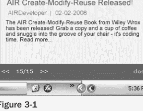

**图3-1**

开始阅读那些你可能错过的文章，并让应用程序在后台运行，以在新的文章从服务接收时通过toaster警报呈现给你。

## 总结

本章涵盖了监控在线服务和用户状态的可用性，同时开发一个在后台运行并可通过系统托盘或停靠图标的原生菜单访问的应用程序。介绍了使用`NativeApplication`类的`supportsDockIcon`属性来检测操作系统，以确定应用程序可用的`InteractiveIcon`类类型。介绍了`NativeMenu`类并将其应用于应用程序图标，以便在主应用程序窗口在后台执行任务时能够访问命令。

在将这些技术融入开发桌面RSS阅读器的过程中，你还被介绍了一些与系统chrome属性和原生窗口类型相关的窗口API的附加功能。通过使用轻量级的`NativeWindowType`，当应用程序接收到新的文章时，会显示一个不引人注目的toaster风格警报，从而在你跟进最新消息时创造愉快的阅读体验。

你可以利用从构建RSS阅读器中学到的知识来针对另一个订阅源甚至多个订阅源。本章介绍的概念也适用于任何其他旨在在后台运行并向用户呈现特定应用程序窗口的应用程序。


## 音乐播放器

让我们面对现实：市场上有很多音乐播放器。像苹果iTunes和Windows Media Player这样的程序占据了市场的大部分份额。然而，这并不意味着没有另一个产品的空间。每个现有的播放器都有使其与其他播放器相比脱颖而出的功能，但你可能想要一个目前任何单一播放器都无法提供的功能组合。这是你创建下一个杀手级音乐应用的机会。

在本章中，你将创建一个名为airAMP的音乐播放器，其名称源于最早广泛使用的MP3程序之一。本练习的意图是创建一个具有基本播放功能的播放器，你可以用它来构建一个更强大、功能更全的音乐播放器。airAMP将利用AIR API搜索选定的目录以查找MP3文件，从而填充播放列表。它会将播放列表作为XML文件写回用户的硬盘驱动器。此外，它还将利用AIR API的能力创建一个样式适中且无边框的应用程序。

通过构建这个应用程序，你将学习如何在Flex和AIR API中使用几个功能，包括以下内容：

-   利用File类选择一个目录
-   递归搜索目录及其子目录中的文件类型（MP3）
-   利用FileStream类读写XML文件
-   创建一个不依赖AIR边框窗口控件的应用程序
-   使用ActionScript加载、播放和读取MP3的ID3标签

下一节将讨论开发airAMP背后的设计概念。

## 设计

你可以构建到音乐播放器中的功能似乎是无穷无尽的。虽然你可以开始写下你认为理想音乐播放器中应该有的一切，但最好从基础开始，添加一些小亮点，然后从那里开始向上发展。然而，不要放弃你所有的好主意——把它们写下来，等到应用程序可以播放音乐时再回头看看它们。在此之前，开始思考airAMP音乐播放器将如何工作。

首先需要考虑的是音乐从哪里来。传统的基于互联网的Flex音乐播放器应该能够读取XML文件或通过动态馈送接收包含MP3文件URL的数据。然而，AIR API使你能够播放硬盘驱动器上的文件。此外，AIR使你能够递归搜索目录。这一特性将是快速为airAMP填充音乐的理想方式。为此，应用程序将使用`File`类中的`getDirectoryListingAsync()`方法。结果将是一个代表MP3的`File`对象列表。

当搜索完成并收到结果列表时，准备数据以供播放的一种方法是为每个返回的条目创建一个`Sound`对象，并通过传递`File`的`nativePath`属性来使用`Sound`对象的`load()`方法。但是，一次加载多个MP3会拖慢系统速度，甚至可能导致音乐播放器崩溃。

解决方案是为每个返回的条目创建一个新的值对象。值对象将包含诸如文件位置、是否已加载以及一些基本的音轨数据（如音乐专辑标题、歌曲标题和艺术家标题）等信息。不是通过`Sound`对象一次性加载所有MP3，而是每次只执行一个MP3，并且仅在引用该对象时才执行。为了实现这一点，一个应用程序数据模型将存储一个`ArrayCollection`，其中包含代表每个MP3位置的值对象。

数据填充后，将使用声音管理器类来访问数据模型中的任何MP3。声音管理器将管理所有播放功能，如播放、暂停、停止、下一曲、上一曲、音量和时间轴位置。当用户从列表中选择一个音轨时，声音管理器将加载相应的MP3并开始播放，触发影响应用程序视图的事件。

airAMP音乐播放器的视图将具有以下功能：

-   **播放控件**：所有播放控件将被分组到一个单独的组件中。该组件将具有上一曲、播放、暂停、停止和下一曲按钮。它还将有一个区域来显示艺术家的姓名和歌曲标题。最后，它将有一个由`HSlider`组件创建的时间轴滑块。`HSlider`组件的标签将被重新利用以显示音频文件的运行时间。
-   **播放列表视图**：所有代表每个MP3的值对象将在一个修改过的`DataGrid`组件中被引用。当用户选择一个条目时，`DataGrid`将向`SoundManager`类触发一个事件，该类将准备播放选定的内容。
-   **设置面板**：设置面板为用户提供了一种在其硬盘驱动器上选择音乐目录的方法。除此之外，音乐播放器将为用户提供选择，是在每次打开应用程序时使用相同的音乐数据库，还是通过重新查询音乐目录来刷新数据库。
-   **自定义外观**：音乐播放器的外观将比大多数开箱即用的Flex应用程序稍好一些。为此，它将拥有自己的样式表和自定义按钮皮肤，并且不会使用本机系统窗口边框。虽然所有这些对于应用程序的功能来说都不是必需的，但自定义外观总能提升用户体验。

既然基本设计和功能已经定义，你就可以开始构建airAMP音乐播放器了。在下一节中，你将学习如何设置目录结构并收集相关文件。

## 构建目录结构

在讨论音乐播放器*如何*构建之前，重要的是为本章正确设置目录结构：

1.  首先在你的本地开发目录中创建一个名为“MusicPlayer”的新目录。此目录将是你用于此应用程序的工作目录。
2.  通过在工作目录中创建新目录——*com*、*aircmr*和*musicplayer*——来创建此应用程序的包结构。音乐播放器包结构应如下所示：`working directory/com/aircmr/musicplayer`。
3.  从配套网站的*MusicPlayer*部分下载相应的*assets*目录，并将其放在工作目录的根目录中。这些文件将在音乐播放器的整个开发过程中使用。

目录结构设置完成后，你就可以开始构建airAMP了。下一节将通过讨论应用程序数据的来源以及应用程序将如何利用这些数据来启动开发过程。

### 处理数据

大多数（如果不是全部）能够播放MP3的软件都有播放列表功能，airAMP也不例外。如果你从数据的角度考虑播放列表，它是一个指向用户硬盘驱动器上音乐文件的引用数组。音乐播放器搜索指定目录并返回一个包含MP3文件位置的XML列表。此目录在用户的设置中指定。设置和播放列表数据都从应用程序存储目录中包含的相应XML文件中读取和写入。以下部分将描述这些文件。

### 外部XML

在音乐播放器可以查询目录中的MP3之前，它首先需要加载一些基本设置信息供用户编辑。此应用程序的所有XML都通过`XMLFileService`类访问。加载后，它由`XMLParserUtil`实用工具类解析。这两个类将在本节后面讨论。现在，开始构建XML。

### settings.xml

打开一个文本编辑器并输入以下代码：

```xml
<?xml version='1.0' encoding='utf-8'?>
<settings>
    <defaultMusicDirectory></defaultMusicDirectory>
    <refreshOnStartup>false</refreshOnStartup>
    <musicDataBaseLocation>xml/musicdatabase.xml</musicDataBaseLocation>
</settings>
```

将文件保存为`settings.xml`，放在你的工作目录的根目录中。


# 第四章：音乐播放器

设置文件简洁明了。`<defaultMusicDirectory>` 节点将是用户选择的音乐目录位置。该位置将在用户选择目录后分配。`<refreshOnStartup>` 节点是一个开关，用于告知应用程序在启动时是否应查询 `defaultMusicDirectory` 中的 MP3 文件，还是仅使用 `musicdatabase.xml` 文件中提供的数据。`<musicDataBaseLocation>` 节点指定了音乐数据库的位置和名称。此 XML 将在下一节讨论。

## musicdatabase.xml

音乐数据库不是手动创建的，这意味着你无需在文本编辑器中创建一个名为 `musicdatabase.xml` 的新 XML 文档。当音乐播放器首次将文件搜索 XML 写入磁盘时，此 XML 文件将被创建。不过，提前查看你正在读写的数据会很有帮助：

```
<database>
    <fileItem>
        <name></name>
        <url></url>
        <songName></songName>
        <artist></artist>
        <album></album>
    </fileItem>
</database>
```

音乐数据库不过是一个由 `<fileItem>` 节点构成的节点树。每个 `<fileItem>` 包含每首曲目的保存属性。`XMLParserUtil` 将每个节点解析为一个 `TrackVO` 值对象，该对象代表播放列表中的一首曲目。`TrackVO` 对象和支持类将在以下章节讨论。

### 数据对象

应用程序将读取和管理的数据解析为两种独立类型的对象：`SettingsVO` 和 `TrackVO`。这两个对象都由 `ApplicationDataModel` 引用和控制。稍后将讨论应用程序的数据模型。首先，让我们仔细看看数据对象。

### SettingsVO

`SettingsVO` 对象是一个基本的值对象，包含四个属性的 getter 和 setter，这些属性将在整个音乐播放器中使用：

- `settingFileLocation (String)`：设置文件的位置（很可能是 `xml/settings.xml`）。
- `musicDatabaseLocation (String)`：你希望保存数据库的文件名。这是相对于默认的 AIR 用户资源目录。
- `defaultMusicDirectory (String)`：用户在设置面板中指定的默认音乐目录的位置。
- `refreshOnStartup (Boolean)`：一个由用户在设置面板下指定的 `true/false` 变量，用于切换音乐播放器在应用启动时搜索 MP3 的功能。

通过打开一个文档并插入以下代码来创建 `SettingsVO` 类：

```
package com.aircmr.musicplayer.data
{
	public class SettingsVO
	{
		private var _defaultMusicDirectory:String;
		private var _refreshOnStartup:Boolean;
		private var _musicDatabaseLocation:String;

		public function SettingsVO():void
		{
		}

		public function get defaultMusicDirectory():String
		{
			return _defaultMusicDirectory;
		}

		public function set defaultMusicDirectory( val:String ):void
		{
			_defaultMusicDirectory = val;
		}

		public function get refreshOnStartup():Boolean
		{
			return _refreshOnStartup;
		}

		public function set refreshOnStartup( val:Boolean ):void
		{
			_refreshOnStartup = val;
		}

		public function get musicDatabaseLocation():String
		{
			return _musicDatabaseLocation;
		}

		public function set musicDatabaseLocation( val:String ):void
		{
			_musicDatabaseLocation = val;
		}
	}
}
```

将该文件保存为 `SettingsVO.as`，放在你的工作目录下的 `com/aircmr/musicplayer/data/` 目录中。

## TrackVO

`TrackVO` 对象稍微复杂一些，主要是因为每个 `TrackVO` 对象都代表用户硬盘上的一个 MP3 文件。因此，每个 `TrackVO` 对象都必须包含一个 `Sound` 对象，该对象将代表可播放的数据。

创建一个新文档并插入以下代码：

```
package com.aircmr.musicplayer.data
{
    import flash.events.Event;
    import flash.events.EventDispatcher;
    import flash.events.IOErrorEvent;
    import flash.filesystem.File;
    import flash.media.Sound;
    import flash.net.URLRequest;

    public class TrackVO extends EventDispatcher
    {
        public static const SONG_LOADED:String = "songLoaded";

        private var _file:File;
        private var _trackURL:String;
        private var _sound:Sound;
        private var _album:String;
        private var _trackTitle:String;
        private var _artist:String;
        private var _track:String;
        private var _loaded:Boolean = false;

        public function TrackVO( file:File=null , arg_trackURL:String = "" ,
            arg_album:String = "" , arg_artist:String = "" ,
            arg_trackTitle:String = "" , arg_track:String = "" ):void
        {
            _trackURL = arg_trackURL;
            _album = arg_album;
            _artist = arg_artist;
            _trackTitle = arg_trackTitle;
            _track = arg_track;

            _sound = new Sound();
            _sound.addEventListener( Event.COMPLETE, soundLoadCompleteHandler );
            _sound.addEventListener( Event.ID3, id3AvailableHandler );
            _sound.addEventListener( IOErrorEvent.IO_ERROR, songFileErrorHandler );
            if( file ) loadSong( file.nativePath );
        }

        public function loadSong( url:String = null ):void
        {
            if( !url ) url = _trackURL;

            var urlRequest:URLRequest = new URLRequest( url );
            _sound.load( urlRequest );
        }

        private function id3AvailableHandler( event:Event ) :void
        {
            _album = _sound.id3.album;
            _artist = _sound.id3.artist;
            _trackTitle = _sound.id3.songName;
            _track = _sound.id3.track;
        }

        private function soundLoadCompleteHandler( event:Event ):void
        {
            dispatchEvent( new Event(TrackVO.SONG_LOADED) );
            _loaded = true;
        }

        private function songFileErrorHandler( event:IOErrorEvent ):void
        {
            trace( "error:"+event.errorID +" : file not found" );
        }

        public function get album():String
        {
            return _album;
        }

        public function set album(val:String):void
        {
            _album = val;
        }

        public function get artist():String
        {
            return _artist;
        }

        public function set artist(val:String):void
        {
            _artist = val;
        }

        public function get trackTitle():String
        {
            return _trackTitle;
        }

        public function set trackTitle(val:String):void
        {
            _trackTitle = val;
        }

        public function get track():String
        {
            return _track;
        }

        public function set trackURL( val:String ):void
        {
            _trackURL = val;
        }

        public function get trackURL():String
        {
            return _trackURL;
        }

        public function get sound():Sound
        {
            return _sound;
        }

        public function get loaded():Boolean
        {
            return _loaded;
        }
    }
}
```

将该文件保存为 `TrackVO.as`，放在你的工作目录下的 `com/aircmr/musicplayer/data/` 目录中。

首次实例化时，`TrackVO` 对象将被分配 MP3 信息，如 URL、专辑标题、艺术家姓名和歌曲标题。因此，此数据对象与任何值对象一样，主要包含 getter 和 setter。但是，当 `SoundManager` 调用 `TrackVO` 对象时，它将用于存储指定加载的 MP3 的 `Sound` 对象信息。`SoundManager` 类将在本章后面更详细地解释。

在 `TrackVO` 的构造函数方法中声明了对 `Sound` 对象的引用，但并未加载任何内容。相反，向 `Sound` 对象实例添加了适当的事件处理程序，以检查加载完成情况（`Event.COMPLETE`）、ID3 信息可用性（`Event.ID3`）和加载错误（`IOErrorEvent.IO_ERROR`）。

为了加载 MP3 文件，`SoundManager` 访问 `TrackVO` 对象的 `loadSong` 方法。`loadSong` 方法将接受一个 URL 作为参数，但如果不存在，则会加载对象的 `_trackURL` 属性。调用时，使用 MP3 文件的 URL 实例化一个 `URLRequest` 对象，并在 `Sound` 对象上调用 `load` 方法。一旦 `Sound` 对象检测到 ID3 信息，`id3AvailableHandler` 将被调用。当 `Sound` 对象完成加载 MP3 文件后，`soundLoadCompleteHandler` 将被调用，该方法将公共属性 `loaded` 设置为 `true`，并派发一个 `TrackVO.SONG_LOADED` 事件。

以下列表描述了 `TrackVO` 对象的可用属性：

- `album` (String)：MP3 的 ID3 信息中定义的专辑标题。
- `artist` (String)：MP3 的 ID3 信息中定义的艺术家姓名。
- `trackTitle` (String)：MP3 的 ID3 信息中定义的歌曲名称。
- `track` (Number)：MP3 的 ID3 信息中定义的曲目编号。
- `trackURL` (String)：MP3 文件的 URL。
- `sound` (Sound)：与 `TrackVO` 对象相关的 `Sound` 对象的引用。
- `loaded` (Boolean)：一个 `Boolean` 值，指示 `Sound` 对象是否已加载 MP3。

76


# 第四章：音乐播放器

既然你已经了解了正在加载的内容以及加载的目标位置，现在是时候看看如何进行加载了。下一节将讨论 `ApplicationDataModel` 类。

## ApplicationDataModel

`ApplicationDataModel` 类是一种控制所有加载到应用程序中的数据的方法，并确保不会出现重复数据。它是一个单例，这意味着它只能被实例化一次。如果你尝试调用 `new ApplicationDataModel()`，调试器会抛出一个错误。因此，你需要通过调用其 `getInstance()` 方法来引用 `ApplicationDataModel`。当你调用 `ApplicationDataModel.getInstance()` 时，它会返回对该类的引用。如果这是第一次调用该方法，则会创建并返回该类的一个新实例，但这是唯一一次创建实例。

在这种情况下，单例的好处是什么？通过只拥有一个 `ApplicationDataModel` 实例，无论你身在何处，都可以完全访问应用程序数据。你在某个类中更改的任何数据都会影响所有其他类。如果你与一组开发人员合作，并希望确保每个人负责的应用程序部分都引用相同的数据源，这一点尤其有用。

音乐播放器中的数据几乎完全通过主应用程序类进行控制，但是一旦你开始为应用程序添加自己的功能，使用单例将更加方便。

创建一个新文档并插入以下代码：

```actionscript
package com.aircmr.musicplayer.data
{
    import flash.events.Event;
    import flash.events.EventDispatcher;
    import mx.collections.ArrayCollection;

    public class ApplicationDataModel extends EventDispatcher
    {
        private static var _instance:ApplicationDataModel;

        public static const SETTINGS_CHANGE:String = "settingsChange";
        public static const TRACKLIST_CHANGE:String = "tracklistChange";

        private var _settingsFileLocation:String;
        private var _trackCollection:ArrayCollection;
        private var _settings:SettingsVO;

        public function ApplicationDataModel()
        {
            _trackCollection = new ArrayCollection();
            _settings = new SettingsVO();
        }

        public static function getInstance():ApplicationDataModel
        {
            if(_instance == null)
            {
                _instance = new ApplicationDataModel();
            }
            return _instance;
        }

        public function set trackCollection( val:ArrayCollection):void
        {
            _trackCollection = val;
            dispatchEvent( new Event( ApplicationDataModel.TRACKLIST_CHANGE ) );
        }

        public function get trackCollection():ArrayCollection
        {
            return _trackCollection;
        }

        public function set settings( val:SettingsVO ):void
        {
            _settings = val;
            dispatchEvent( new Event( ApplicationDataModel.SETTINGS_CHANGE ) );
        }

        public function get settings():SettingsVO
        {
            return _settings;
        }

        public function get settingsFileLocation():String
        {
            return _settingsFileLocation;
        }

        public function set settingsFileLocation( val:String ):void
        {
            _settingsFileLocation = val;
        }
    }
}
```

将文件保存为 `ApplicationDataModel.as`，放在工作目录的 `com/aircmr/musicplayer/data` 目录下。

`ApplicationDataModel` 存储三个变量：`settings`、`trackCollection` 和 `settingsLocation`。`settingsLocation` 字符串是硬编码在主应用程序类中的。`settings` 和 `trackCollection` 是在相应的 XML 被解析后赋值的。下面是一个示例：

```actionscript
ApplicationDataModel.getInstance().settings =
    XMLParserUtil.parseSettingsXML( event.xml );
```

一旦 `XMLFileService` 读取了 `settings.xml` 文件，`XMLParserUtil` 就会解析 XML 对象并将其赋值给 `ApplicationDataModel` 上的 `settings` 属性。`XMLFileService` 和 `XMLParserUtil` 都将在下一节中讨论。

78

## 配套服务与工具

上一节介绍了用于存储音乐播放器设置和音乐曲目数据的共享数据模型。它提到了通过查询用户硬盘驱动器中的 MP3 来构建 `TrackVO` 对象的概念。本节讨论应用程序数据的访问和解析方式，以及它如何填充 `ApplicationDataModel` 类。首先看看 `XMLFileService` 类。

### XMLFileService

`XMLFileService` 服务是一个有助于从用户的计算机读取、写入和复制 XML 的类。特别是，它用于读写设置和音乐数据库 XML 文件。

创建一个新文档并插入以下代码：

```actionscript
package com.aircmr.musicplayer.services
{
    import com.aircmr.musicplayer.events.XMLFileServiceEvent;
    import flash.events.Event;
    import flash.events.EventDispatcher;
    import flash.events.IOErrorEvent;
    import flash.filesystem.File;
    import flash.filesystem.FileMode;
    import flash.filesystem.FileStream;
    import mx.controls.Alert;

    public class XMLFileService extends EventDispatcher
    {
        private var _file:File;
        private var _fileStream:FileStream;
        private var _fileName:String;

        public function XMLFileService():void
        {
        }

        public function loadXMLFileFromStorage( fileName:String ):void
        {
            _file = File.applicationStorageDirectory.resolvePath( fileName );

            if( !_file.exists )
            {
                dispatchEvent( new XMLFileServiceEvent(
                    XMLFileServiceEvent.XML_FILE_NOT_FOUND ) );
                return;
            }

            _fileStream = new FileStream();
            _fileStream.addEventListener( Event.COMPLETE, onXMLFileLoadComplete );
            _fileStream.addEventListener( IOErrorEvent.IO_ERROR, errorHandler );
            _fileStream.openAsync( _file, FileMode.READ );
        }

        public function saveXMLFileToStorage( fileName:String , data:XML ):void
        {
            var xml_encoding:String = "<?xml version='1.0' encoding='utf-8'?>\n";
            var xml_toWrite:String = xml_encoding + data.toXMLString();

            _file = File.applicationStorageDirectory.resolvePath( fileName );

            _fileStream = new FileStream();
            _fileStream.addEventListener( Event.CLOSE, onXMLFileWriteComplete );
            _fileStream.openAsync( _file, FileMode.WRITE );
            _fileStream.writeUTFBytes( xml_toWrite );
            _fileStream.close();
        }

        public function copyXMLFileFromApplicationDirectoryToStorage(
            fileName:String ):void
        {
            var sourceFile:File =
                File.applicationDirectory.resolvePath( fileName );

            if( !sourceFile.exists )
            {
                dispatchEvent( new XMLFileServiceEvent(
                    XMLFileServiceEvent.XML_FILE_NOT_FOUND ) );
                return;
            }

            var resultsFile:File =
                File.applicationStorageDirectory.resolvePath( fileName );

            sourceFile.addEventListener( IOErrorEvent.IO_ERROR , errorHandler );
            sourceFile.addEventListener( Event.COMPLETE , onXMLFileCopyComplete );
            sourceFile.copyToAsync( resultsFile , true );
        }

        private function onXMLFileCopyComplete( event:Event ):void
        {
            dispatchEvent(
                new XMLFileServiceEvent(XMLFileServiceEvent.XML_FILE_COPIED) );
        }

        private function onXMLFileLoadComplete( event:Event ):void
        {
            var xml:XML = XML(
                _fileStream.readUTFBytes( _fileStream.bytesAvailable ) );
            _fileStream.removeEventListener( Event.COMPLETE,
                onXMLFileLoadComplete );
            _fileStream.removeEventListener( IOErrorEvent.IO_ERROR, errorHandler );
            _fileStream.close();

            var xmlEvent:XMLFileServiceEvent =
                new XMLFileServiceEvent( XMLFileServiceEvent.XML_LOADED );
            xmlEvent.xml = xml;
            dispatchEvent( xmlEvent );
        }

        private function onXMLFileWriteComplete( event:Event ):void
        {
            dispatchEvent( new
                XMLFileServiceEvent(XMLFileServiceEvent.XML_FILE_WRITTEN) );
        }

        private function errorHandler( event:IOErrorEvent ):void
        {
            var errorMessage:String =
                "Error Loading File "+event.text+" FILE ERROR";
            var xmlEvent:XMLFileServiceEvent =
                new XMLFileServiceEvent( XMLFileServiceEvent.XML_ERROR );
            xmlEvent.message = errorMessage;
            dispatchEvent( xmlEvent );

            Alert.show( errorMessage );
        }

        public function get file():File
        {
            return _file;
        }

        public function set file( val:File ):void
        {
            _file = val;
        }
    }
}
```

将文档保存为 `XMLFileService.as`，放在应用程序的 services 包中（工作目录/com/aircmr/musicplayer/services）。

`XMLFileService` 类本质上是一个 `File` 实例和一个 `FileStream` 实例，以及一些让应用程序知道打开或保存操作是否成功的事件监听器。以下代码片段演示了应用程序如何首先实例化 `XMLFileService` 并传递一个表示本地 URL 的字符串：

```actionscript
var settingsXMLLoader:XMLFileService = new XMLFileService();
settingsXMLLoader.addEventListener( XMLFileServiceEvent.XML_FILE_NOT_FOUND,
    onSettingsNotFound );
settingsXMLLoader.addEventListener(XMLFileServiceEvent.XML_LOADED,
    settingsLoadedHandler );
settingsXMLLoader.loadXMLFileFromStorage(
    ApplicationDataModel.getInstance().settingFileLocation );
```

在这个例子中，`XMLFileService` 被实例化并立即分配了事件监听器。XML 文件加载后，将调用 `settingsLoadedHandler()`。`settingsLoadedHandler()` 方法接收一个包含未解析的 `settings.xml` XML 对象的 `XMLServiceEvent` 对象。它使用 `XMLParserUtil` 工具将 XML 解析为 `SettingsVO` 对象，并填充数据模型中的 `settings` 属性。`XMLServiceEvent` 和 `XMLParserUtil` 类稍后将进行讨论。


## 第4章：音乐播放器

复制本地文件

首先，确认文件是否存在及其时间点至关重要。在 `XMLFileService` 类中，你正在检查 `settings.xml` 文件是否通过 `resolvePath()` 和 `File` 类的 `exists` 布尔属性存在于 `applicationStorageDirectory`：

```
var sourceFile:File = File.applicationStorageDirectory.resolvePath( fileName );
if( !sourceFile.exists )
{
    dispatchEvent( new Event( XMLFileService.FILE_NOT_FOUND ));
    return;
}
```

当用户首次运行音乐播放器时，`settings.xml` 文件不会存在于他们的应用存储目录中。该类实例将派发一个 `FILE_NOT_FOUND` 事件，接下来的行动则由控制器 `MusicPlayer.MXML` 决定。如果文件在存储目录中不存在，则需要创建它。

在应用程序目录中有一个包含一些基本设置数据的 `settings.xml` 文件。你可以通过引用 `File` 类的 `applicationDirectory` 属性（而不是 `applicationStorageDirectory`）从应用程序目录读取该文件。

由于 AIR 内部的安全特性，你将无法写回应用程序目录。该目录仅用于存储你希望只读访问的数据和资源。写入限制是一个相当大的问题，因为应用程序需要将用户的偏好设置写回 `settings.xml`。`XMLFileService` 不应尝试写回应用程序目录，而应在存储目录中找不到文件时，将该文件从此目录复制到存储目录。下一次实例化应用程序时，`settings.xml` 文件将被找到。这通过 `copyXMLFromApplicationDirectoryToStorage()` 方法使用 `File` 类的 `copyToAsync()` 方法实现：

```
sourceFile.copyToAsync( resultsFile , true );
```

在这种情况下，`sourceFile` 是应用程序目录中包含的 `settings.xml` 文件，而 `resultsFile` 是将要写入存储目录的 `settings.xml` 文件路径。因为此方法是异步的，监听器将监控复制是否成功或是否发生错误。如果复制成功，`XMLFileService` 随后将尝试从存储目录加载 XML。XML 加载后，将抛出一个 `XMLFileServiceEvent` 实例。

将 XML 数据写入文件

音乐播放器应用程序在存储目录中存储 `settings.xml` 和 `musicdatabase.xml` 文件。如果用户接受了新设置，或者为音乐查询了新文件夹，这些文件将被重写。就 `musicdatabase.xml` 文件而言，如果它不存在，AIR 将创建一个。在任何情况下，首先需要发生的是声明编码头：

```
var xml_encoding:String = "<?xml version='1.0' encoding='utf-8'?>\n";
```

此字符串确保 XML 格式良好。然而，如果文件实际上并未以 UTF 编码文档写入，写入 `encoding = 'utf-8'` 并没有任何意义。要编写一个 UTF 编码的文档，请异步打开一个新的 `FileStream` 并使用 `writeUTFBytes()` 方法：

```
_fileStream.openAsync( _file, FileMode.WRITE );
_fileStream.writeUTFBytes( xml_toWrite );
_fileStream.close();
```

在此示例中，`_file` 可以是 `settings.xml` 或 `musicdatabase.xml` 的路径。`xml_toWrite` 是附加了 `xml_encoding` 字符串到 XML 对象开头的 XML。最后，务必在写入后关闭文件。如果文件未关闭，则 `FileStream` 对象未准备好进行垃圾回收。此外，你不希望额外的数据意外写入你的文件。在读取文件后也要确保关闭 `FileStream`。

## XMLFileServiceEvent

音乐应用程序读取、写入或复制 XML 文件后，会抛出相应的 `XMLFileServiceEvent`。读取数据时，会派发 `XMLFileServiceEvent.XML_LOADED` 事件，并传递包含加载的 XML 作为事件对象 `xml` 属性的 `XMLFileServiceEvent` 对象。此类仅与 `XMLFileService` 类一起使用。

创建一个新文档并插入以下代码：

```
package com.aircmr.musicplayer.events
{
    import flash.events.Event;

    public class XMLFileServiceEvent extends Event
    {
        public static const XML_FILE_COPIED:String = "xmlFileCopied";
        public static const XML_FILE_NOT_FOUND:String = "xmlFileNotFound";
        public static const XML_FILE_WRITTEN:String = "xmlFileWritten";
        public static const XML_LOADED:String = "xmlLoaded";
        public static const XML_ERROR:String = "xmlError";

        private var _xmlResults:XML;
        private var _message:String;

        public function XMLFileServiceEvent( type:String,
            bubbles:Boolean=false, cancelable:Boolean=false )
        {
            super( type, bubbles, cancelable );
        }

        public function get xml():XML
        {
            return _xmlResults;
        }

        public function set xml( val:XML ):void
        {
            _xmlResults = val;
        }

        public function get message():String
        {
            return _message;
        }

        public function set message( val:String ):void
        {
            _message = val;
        }
    }
}
```

将文件保存为 `XMLFileServiceEvent.as`，置于你的工作目录下的 `com/aircmr/musicplayer/events` 目录中。

下一节将解释音乐播放器的 XML 如何被解析。

### XMLParserUtil

XML 加载并派发 `XMLFileServiceEvent.XML_LOADED` 事件后，需要对其进行解析。创建一个解析 XML 的实用工具将有助于保持你的类整洁有序。`XMLParserUtil` 类包含两个公共静态方法：`parseSettingsXML()` 和 `parseSongDatabaseXML()`。`parseSettingsXML()` 将 XML 解析为一个 `SettingsVO` 对象并将该对象返回给调用者。`parseSongDatabaseXML()` 为 XML 中的每个项目创建一个新的 `TrackVO` 对象，将 `TrackVO` 添加到 `ArrayCollection`，并将 `ArrayCollection` 返回给调用者。在这两种情况下，返回的对象都被添加到 `ApplicationDataModel`。

创建一个新文档并插入以下代码：

```
package com.aircmr.musicplayer.utils
{
    import com.aircmr.musicplayer.data.SettingsVO;
    import com.aircmr.musicplayer.data.TrackVO;
    import com.aircmr.musicplayer.events.XMLFileServiceEvent;
    import mx.collections.ArrayCollection;

    public class XMLParserUtil
    {
        public static function parseSettingsXML( xml:XML ):SettingsVO
        {
            var settingsVO:SettingsVO = new SettingsVO();
            settingsVO.refreshOnStartup = (xml.refreshOnStartup.toString());
            settingsVO.musicDatabaseLocation = xml.musicDatabaseLocation;
            settingsVO.defaultMusicDirectory = xml.defaultMusicDirectory;

            return settingsVO;
        }

        public static function parseSongDatabaseXML(
            musicDataBase:XML ):ArrayCollection
        {
            var trackCollection:ArrayCollection = new ArrayCollection();

            for(var i:Number = 0 ; i < musicDataBase.children().length(); i++)
            {
                var track:TrackVO = new TrackVO()
                track.trackURL = musicDataBase..url[i];
                track.album = musicDataBase..album[i];
                track.artist = musicDataBase..artist[i];
                track.trackTitle = musicDataBase..songName[i];

                trackCollection.addItem( track );
            }

            return trackCollection;
        }
    }
}
```

将文件保存为 `XMLParserUtil.as`，置于你的工作目录下的 `com/aircmr/musicplayer/utils` 目录中。

下一节将介绍一个有助于查询用户计算机中音乐文件的服务。

## FileSearch

音乐播放器应用程序的关键功能之一是其能够搜索指定目录和子目录以查找特定文件类型的能力。要添加此行为，你将创建一个搜索服务，该服务以 XML 对象形式返回数据。

创建一个新文档并插入以下代码：

```
package com.aircmr.musicplayer.services
{
    import com.aircmr.musicplayer.events.FileSearchEvent;
    import flash.events.EventDispatcher;
    import flash.events.FileListEvent;
    import flash.events.IOErrorEvent;
    import flash.filesystem.File;

    public class FileSearch extends EventDispatcher
    {
        private var _file:File;
        private var _includeSubDirectories:Boolean = false;
        private var _fileTypeArray:Array;
        private var _xml:XML;
        private var _subDirectoryQueryList:Array;
        private var _returnValue:*;

        public function FileSearch(){}

        public function queryDirectoryListToXML( directoryName:String ,
            includeSubDirectories:Boolean = false, fileTypeArray:Array = null):void
        {
            // 方法实现...
        }
    }
}
```


# 第四章：音乐播放器

```actionscript
_subDirectoryQueryList = new Array();

_xml = new XML( "<database></database>" );
_fileTypeArray = fileTypeArray;
_includeSubDirectories = includeSubDirectories;

_file = new File( directoryName );
_file.addEventListener( IOErrorEvent.IO_ERROR , errorHandler );
_file.addEventListener( FileListEvent.DIRECTORY_LISTING,
    queryDirectoryResults );
_file.getDirectoryListingAsync();
}

private function queryDirectoryResults( event:FileListEvent ):void
{
    var directoryList:Array = event.files;
    var subDirectoryList:Array = new Array();

    for ( var i:String in directoryList )
    {
        var file:File = directoryList[i];
        if ( file.isDirectory && _includeSubDirectories )
        {
            _subDirectoryQueryList.push( file );
        }
        else
        {
            if( _fileTypeArray.length > 0 )
            {
                if( checkFileType(file) )
                    _xml.appendChild( xmlNodeStructure(file) );
            }
            else
            {
                _xml.appendChild( xmlNodeStructure(file) );
            }
        }
    }

    var searchDirectory:File = _subDirectoryQueryList.pop();
    if ( searchDirectory == null )
    {
        var searchEvent:FileSearchEvent =
            new FileSearchEvent( FileSearchEvent.SEARCH_FINISHED );
        searchEvent.searchResults = _xml;
        dispatchEvent( searchEvent );
    }
    else
    {
        searchDirectory.addEventListener(
            FileListEvent.DIRECTORY_LISTING, queryDirectoryResults );
        searchDirectory.getDirectoryListingAsync();
    }
}
```

```actionscript
private function checkFileType( file:File ):Boolean
{
    for( var i:Number = 0 ; i < _fileTypeArray.length ; i++ )
    {
        if( file.extension == _fileTypeArray[i] )
        {
            return true;
            break;
        }
        else if ( i == _fileTypeArray.length - 1 )
        {
            return false;
            break;
        }
    }
    
    return false;
}

private function errorHandler( event:IOErrorEvent ):void
{
    dispatchEvent( new FileSearchEvent( FileSearchEvent.SEARCH_FAILED ));
}

protected function xmlNodeStructure( file:File ):XML
{
    var newNode:XML = new XML( "<fileItem></fileItem>" );
    newNode.name = file.name;
    newNode.url = file.url;
    
    return newNode;
}
}
```

将文件保存为 `FileSearch.as`，位于你的工作目录下的 `com/aircmr/musicplayer/services` 目录中。

`FileSearch` 类的目的是创建一个可扩展的抽象类，因为你可能希望检索到的数据以不同的数据类型返回。音乐播放器应用程序实现了 `MP3FileSearch` 类，该类扩展了 `FileSearch`，并确保返回的数据被解析为 XML 对象，随后写入 `musicdatabase.xml` 文件。稍后将讨论 `MP3FileSearch` 类。

`FileSearch` 服务有一个公共方法：`queryDirectoryListToXML()`。此方法接受三个参数：你正在搜索的目录、一个布尔值表示是否希望搜索子目录，以及一个包含你正在搜索的文件类型扩展名的数组。请查看以下示例：

```actionscript
var fileSearch:FileSearch = new FileSearch();
fileSearch.addEventListener(FileSearchEvent.SEARCH_FINISHED, 
    fileSearchResultHandler);
fileSearch.queryDirectoryListToXML( pathToDirectory , true, ["mp3"] );
```

在实例化新的 `FileSearch` 后，会添加一个 `FileSearchEvent.SEARCH_FINISHED` 事件来监听搜索结果。`FileSearchEvent` 将在下一节讨论。添加监听器后，调用 `queryDirectoryListToXML()` 并传入参数。

对于音乐播放器，一旦搜索完成，就会调用 `fileSearchResultHandler()`，结果（以 XML 形式）由 `XMLParserUtil` 解析，然后输入到 `ApplicationDataModel` 中。

## 搜索如何执行

当实例化 `FileSearch` 的类调用 `queryDirectoryListToXML()` 时，会创建一个新的 `File` 对象，其 `path` 属性定义为要搜索的目录。添加一个监听器来监听 `FileListEvent.DIRECTORY_LISTING` 事件。分配监听器后，调用 `getDirectoryListingAsync()` 方法：

```actionscript
_file = new File( directoryName );
_file.addEventListener( FileListEvent.DIRECTORY_LISTING, queryDirectoryResults );
_file.getDirectoryListingAsync();
```

`getDirectoryListingAsync()` 返回一个代表目录内容的 `File` 对象数组。搜索执行后，`FileListEvent` 对象被传递给 `queryDirectoryResults()` 方法。`FileListEvent` 包含 `File` 对象的结果数组，可通过事件的 `files` 属性访问。

`queryDirectoryResults()` 方法遍历结果数组，检查 `File` 对象是否表示一个目录。如果是，并且你允许搜索子目录，则将该 `File` 对象添加到 `_subDirectoryQueryList` 数组中。如果不是，该方法检查 `File` 对象的 `extension` 属性，以确定是否与所需的查询匹配。如果搜索成功，则将文件的路径添加到 XML 对象中。

检查完 `File` 后，`queryDirectoryResults()` 方法检查 `_subDirectoryQueryList` 是否包含子目录。如果包含，则对子目录 `File` 对象执行 `getDirectoryListingAsync()`，从而递归搜索每个子目录。如果 `_subDirectoryQueryList` 没有任何子目录，则分派一个 `FileSearchEvent` 事件，作为 `FileSearchEvent.SEARCH_FINISHED`。所有搜索结果都存储在分派的 `FileSearchEvent` 对象的 `searchResults` 属性中。下一节将讨论此对象。

### FileSearchEvent

`FileSearchEvent` 仅由 `FileSearch` 服务分派。它扩展了 `Event` 类，由事件类型字符串和搜索结果组成。搜索结果被分配给 `searchResults` 属性，可以是任何类类型，如星号 (*) 通配符所示。

创建一个新文档并插入以下代码：

```actionscript
package com.aircmr.musicplayer.events
{
    import flash.events.Event;

    public class FileSearchEvent extends Event
    {
        static public const SEARCH_FINISHED:String = "searchFinished";
        static public const SEARCH_FAILED:String = "searchFailed";

        private var _searchResults:*;

        public function FileSearchEvent( type:String,
            bubbles:Boolean=false, cancelable:Boolean=false )
        {
            super( type, bubbles, cancelable );
        }

        public function get searchResults():*
        {
            return _searchResults;
        }

        public function set searchResults( val:* ):void
        {
            _searchResults = val;
        }
    }
}
```

将文件保存为 `FileSearchEvent.as`，位于你的工作目录下的 `com/aircmr/musicplayer/events` 目录中。

对于音乐播放器，`FileSearchEvent` 对象被传递给应用程序控制器的 `fileSearchResultHandler()` 方法，该方法又将返回的 XML（包含在 `FileSearchEvent.searchResults` 中）传递给 `XMLParserUtil` 工具，该工具将结果解析为 `TrackVO` 对象。此外，结果会以 `musicdatabase.xml` 的形式保存到存储目录中。

下一节将讨论音乐播放器的 `FileSearch` 类实现的进一步定制。

### MP3FileSearch

如前所述，`FileSearch` 类旨在被扩展。这样做的目的是自定义你希望结果 XML 的结构方式。

创建一个新文档并插入以下代码：

```actionscript
package com.aircmr.musicplayer.services
{
    import flash.filesystem.File;
    import com.aircmr.musicplayer.utils.ID3Parser;

    public class MP3FileSearch extends FileSearch
    {
        public function MP3FileSearch():void
        {
            super();
        }
```


# 第四章：音乐播放器

```actionscript
override protected function xmlNodeStructure( file:File ):XML
{
    var id3Information:Object = ID3Parser.returnID3Information( file );
    var newNode:XML = new XML( "<fileItem></fileItem>" );
    newNode.name = file.name;
    newNode.url = file.url;

    if( file.extension == "mp3" )
    {
        newNode.songName = id3Information.songName;
        newNode.artist = id3Information.artist;
        newNode.album = id3Information.album;
    }

    return newNode;
}
}
```

将文件保存为 `MP3FileSearch.as`，放置在你的工作目录下 `com/aircmr/musicplayer/services` 目录中。

唯一需要自定义的方法是 `xmlNodeStructure()`。如果你回顾 `FileSearch` 类的 `xmlNodeStructure()` 方法，会发现它只创建了一个包含文件名及其路径的 `<fileItem>` 节点。如果 airAMP 能够检索到额外的文件数据，例如曲目名称、艺术家和专辑标题，从而在加载 MP3 之前显示这些信息，那就太好了。毕竟，在播放 MP3 之前，你只是引用了硬盘上的 MP3 文件，而不是实际加载它。这是通过 `ID3Parser` 实用工具完成的。下一节将更详细地讨论这个类。

在按照你希望的方式构建好 XML 节点后，它会被返回给 `FileSearch` 类的 `queryDirectoryResults()` 方法，并附加到结果 XML 对象（`_xml`）中。

目前，`FileSearch` 类及其相关类被设置为搜索返回的 MP3。然而，你完全可以尝试调整这个类，使其按文件名而非扩展名进行搜索，并以不同的配置返回结果。无论这个类在 airAMP 中如何使用，它都是你代码库中一个非常棒的工具类。

## ID3Parser

`ID3Parser` 实用工具是一个小型类，包含一个静态函数：`returnID3Information()`。它用于在文件被定位并引用在硬盘上时，检索 MP3 ID3v1（版本 1）曲目信息。或者，你也可以在 MP3 文件加载后读取 `Sound` 对象的 ID3 信息。然而，对于 airAMP 而言，能够获取 MP3 的歌曲、艺术家和专辑标题的完整列表是非常有益的。如果你为了获取这些信息而将每个 MP3 文件加载到 `Sound` 对象中，应用程序很可能会变得极其缓慢，甚至崩溃。使用这个解析器工具可以防止这种情况发生，同时返回曲目信息。

*本节不详细讨论 ID3 信息或处理二进制数据。要了解有关这两个主题的更多信息，请参阅 Ben Stucki 在 Adobe Labs 网站上的文章“使用二进制数据”(http://labs.adobe.com/wiki/index.php/AIR:Articles:Working_with_Binary_Data)。*

创建一个新文档并插入以下代码：

```actionscript
package com.aircmr.musicplayer.utils
{
    import flash.filesystem.File;
    import flash.filesystem.FileMode;
    import flash.filesystem.FileStream;

    public class ID3Parser
    {
        public static function returnID3Information( file:File ):Object
        {
            var id3Info:Object = new Object();

            var fileStream:FileStream = new FileStream();
            fileStream.open( file, FileMode.READ );
            fileStream.position = file.size - 128;

            if( fileStream.readMultiByte(3, "iso-8859-1").match(/tag/i) )
            {
                id3Info.songName = fileStream.readMultiByte(30,"iso-8859-1");
                id3Info.artist = fileStream.readMultiByte(30,"iso-8859-1");
                id3Info.album = fileStream.readMultiByte(30,"iso-8859-1");
            }

            if( !id3Info.songName )
            {
                id3Info.songName = file.name;
            }

            if( !id3Info.artist )
            {
                id3Info.artist = "";
            }

            if( !id3Info.album )
            {
                id3Info.album = "";
            }

            fileStream.close();
            return id3Info;
        }
    }
}
```

将文件保存为 `ID3Parser.as`，放置在你的工作目录下 `com/aircmr/musicplayer/utils` 目录中。

当调用 `returnID3Information()` 时，会创建一个新的 `FileStream` 实例，并打开被引用的 `File` 对象（作为参数传入）。文件中的读取位置会立即设置为距离文件末尾 128 字节处。此位置将流设置为读取 ID3v1 信息。

文件通过 `FileStream` 类的 `readMultiByte()` 方法进行读取。前三个字节被检查以确定它们是否是单词“tag”。如果这些字节确实是单词“tag”，则文件包含 ID3v1 信息，位置将继续在文件中移动。然后，以 30 字节为增量读取字节。前 30 字节代表歌曲名称，因此，`id3info` 对象的 `songName` 属性被设置。接下来的 30 字节代表艺术家姓名。最后的 30 字节代表专辑名称。如果你一直在计算，会发现文件中还剩下 35 个字节。这里包含可选信息，如年份、评论和流派。但是，对于此应用程序，你只需要必要的信息。读取完 ID3v1 信息后，`FileStream` 被关闭，`id3info` 对象被返回给调用者，在本例中就是 `MP3FileSearch` 类。

有不止一种方法可以读取 ID3 信息，因为 ID3 信息有不止一个版本。例如，ID3v2 包含更多信息，但解析起来更困难。此外，ID3v1 信息并非总是已定义的——在这种情况下，`ID3Parser` 将文件名指定为歌曲名称，并将艺术家姓名和专辑标题留空。要了解更多关于 ID3 信息的内容，请查看 www.id3.org。

现在数据已经定义好，并且知道了 MP3 的文件位置，下一步是构建一种方法来管理音频文件。在下一节中，你将构建一个类来做到这一点。

## 声音管理器

`ApplicationDataModel` 已经被填充，UI 也即将构建完成。确保数据被正确处理的最后一个步骤是构建一个 `SoundManager` 类，该类控制选定的 `Sound` 对象，并确保播放器一次只播放一个 MP3 文件。它将包含与 MP3 交互的所有功能，如播放、暂停、停止、音量和播放头定位。UI 将直接通过公共方法与 `SoundManager` 通信，管理器将使用自定义事件进行响应。首先构建这个类。

创建一个新文档并插入以下代码：

```actionscript
package com.aircmr.musicplayer.managers
{
    import com.aircmr.musicplayer.data.TrackVO;

    import flash.events.Event;
    import flash.events.EventDispatcher;
    import flash.events.TimerEvent;
    import flash.media.Sound;
    import flash.media.SoundChannel;
    import flash.media.SoundTransform;
    import flash.utils.Timer;

    public class SoundManager extends EventDispatcher
    {
        public static const NO_SELECTED_TRACK:String = "noSelectedTrack";
        public static const TRACK_COMPLETE:String = "trackComplete";

        private var _volume:Number = 1;
        private var _channel:SoundChannel;
        private var _soundTransformer:SoundTransform;
        private var _durationTimer:Timer;
        private var _selectedTrack:TrackVO;
        private var _currentSound:Sound;
        private var _playing:Boolean = false;
        private var _paused:Boolean = false;
        private var _trackPosition:Number = 0;
        private var _trackLength:Number = 0;
        private var _artistTitle:String = "NO SONG CURRENTLY SELECTED";
        private var _trackTitle:String = "----";
        private var _albumTitle:String = "----";

        public function SoundManager()
        {
            _durationTimer = new Timer( 100 );
            _durationTimer.addEventListener( TimerEvent.TIMER, durationHandler );
            _soundTransformer = new SoundTransform();
            _channel = new SoundChannel();
        }

        public function selectTrack( track:TrackVO ):void
        {
            _selectedTrack = track;
            _trackPosition = 0;
            if( playing ) playTrack( _selectedTrack );
        }

        public function play( event:Event=null ):void
        {
            if( !_selectedTrack )
            {
                dispatchEvent( new Event( SoundManager.NO_SELECTED_TRACK ));
                return;
            }

            if( playing ) return;

            if( _paused )
            {
                pause();
                return;
            }

            playTrack( _selectedTrack );
        }

        public function stop( event:Event=null ):void
        {
            _trackPosition = 0;
            _channel.stop();
            playing = false;
        }

        public function pause( event:Event=null ):void
        {
            if( !_selectedTrack || (!playing && !_paused) ) return;

            if( playing )
            {
```


# 第四章：音乐播放器

```actionscript
_trackPosition = _channel.position;
_channel.stop();
playing = false;
_paused = true;
}
else
{
playCurrentTrack( _trackPosition );
}
}

public function playTrack( song:TrackVO ):void
{
stop();

_selectedTrack = song;

if( !song.loaded )
{
song.addEventListener( TrackVO.SONG_LOADED, songLoadEvent );
song.loadSong();
}
else
{
currentSound = song.sound;
}
}

public function setPlayheadPosition( val:Number ):void
{
playCurrentTrack( val );
}

private function songLoadEvent( event:Event ):void
{
if( _selectedTrack != event.target ) return;

currentSound = event.target.sound as Sound;
}

private function durationHandler( event:TimerEvent ):void
{
trackPosition = _channel.position;
}

private function playCurrentTrack( position:Number = 0 ):void
{
_channel.stop();
_channel = _currentSound.play( position );
_channel.addEventListener( Event.SOUND_COMPLETE, onTrackComplete );
_channel.soundTransform = _soundTransformer;

_paused = false;
playing = true;
}

private function onTrackComplete( event:Event ):void
{
    dispatchEvent( new Event( SoundManager.TRACK_COMPLETE ));
}

public function set currentSound( sound:Sound ):void
{
    _currentSound = sound;

    playCurrentTrack();

    trackTitle = _currentSound.id3.songName;
    artistTitle = _currentSound.id3.artist;
    trackLength = _currentSound.length;
}

public function get currentSound():Sound
{
    return _currentSound;
}

[Bindable]
public function set trackTitle( value:String ):void
{
    if( value == null ) value = "UNKNOWN";
    _trackTitle = value;
}

public function get trackTitle():String
{
    return _trackTitle;
}

[Bindable]
public function set artistTitle( value:String ):void
{
    if( value == null ) value = "UNKNOWN ARTIST";
    _artistTitle = value;
}

public function get artistTitle():String
{
    return _artistTitle;
}

[Bindable]
public function set albumTitle( value:String ):void
{
    _albumTitle = value;
}

public function get albumTitle():String
{
    return _albumTitle;
}

[Bindable]
public function set trackLength( value:Number ):void
{
    _trackLength = value;
}

public function get trackLength():Number
{
    return _trackLength;
}

[Bindable]
public function set trackPosition( value:Number ):void
{
    _trackPosition = value;
}

public function get trackPosition():Number
{
    return _trackPosition;
}

[Bindable]
public function set playing( value:Boolean ):void
{
    _playing = value;
    value ? _durationTimer.start() : _durationTimer.stop();
}

public function get playing():Boolean
{
    return _playing;
}

[Bindable]
public function set volume( val:Number ):void
{
    _volume = val;

    _soundTransformer.volume = val;
    if( _channel ) _channel.soundTransform = _soundTransformer;
}

public function get volume():Number
{
    return _volume;
}
}
```

将文件保存为 `SoundManager.as`，存放在你的工作目录下的 `com/aircmr/musicplayer/managers` 目录中。

`SoundManager` 最初由音乐播放器的应用程序控制器类 `MusicPlayer.mxml` 实例化。UI组件通过控制器类访问它，以使每个类尽可能保持松散耦合。以下是稍后将在本章创建的 `MusicPlayer.mxml` 文件中的一个小片段：

```actionscript
<ui:BottomControls id="bottomControls"
    volumeChange="{_soundManager.volume = bottomControls.volume}"
    volume="{_soundManager.volume}" />
```

在这个例子中，`BottomControls` 组件有一个公共属性 `volume`，它被绑定到 `SoundManager` 的 `volume` 属性。此外，这个特定组件有一个事件 `volumeChange`，当音量通过组件的界面控件专门被改变时，它就会被触发。每当 `volumeChange` 被触发时，内联代码就会被执行。在此过程中，`SoundManager` 的 `volume` 属性被设置为 `BottomControls` 的 `volume` 属性。

## 加载歌曲

当 `SoundManager` 被请求播放一首歌曲时，它会接收一个 `TrackVO` 对象。因为 `Sound` 对象存在于 `TrackVO` 对象中，`SoundManager` 只需调用 `TrackVO` 的 `loadSong()` 方法并监听 `SONG_LOADED` 事件的抛出：

```actionscript
_selectedTrack = song as TrackVO;
if( !song.loaded )
{
    song.addEventListener( TrackVO.SONG_LOADED, songLoadEvent );
    song.loadSong();
}
else
{
    currentSound = song.sound;
}
```

一旦 `Sound` 对象加载完成，`TrackVO` 的引用就被赋值给 `_currentTrack`，而 `_currentTrack` 又被赋值给 `_channel` 的 `SoundChannel` 对象。

## 监控播放头时间

与 `VideoDisplay` 组件不同，`SoundChannel` 没有用于监控MP3中播放头位置的事件。然而，向用户显示时间非常重要。要监控时间，最好的解决方案是使用 `Timer` 类。

在 `SoundManager` 类的构造方法中，实例化了一个新的 `Timer`，并将 `durationHandler()` 方法分配给 `TimerEvent.TIMER` 事件。`durationHandler()` 方法更新 `trackPosition` 属性。`Timer` 类在 `playing` 属性改变时启动和停止：

```actionscript
public function set playing( value:Boolean ):void
{
    _playing = value;
    value ? _durationTimer.start() : _durationTimer.stop();
}
```

这确保了 `trackPosition` 只在歌曲播放时被更新。`PlaybackControls` 组件使用 `trackPosition` 属性来更新其显示。这将在下一节中进一步讨论。

## 构建用户界面

现在airAMP音乐播放器的数据和辅助类都已就绪，下一步是构建视图。音乐播放器的所有界面元素被分为四个MXML组件。它们包括设置面板、播放控制、播放列表视图和底部控件。本节将讨论如何构建每个元素。

## SettingsPanel

因为它是用户看到的第一个图形元素，所以 `SettingsPanel` 组件是一个极好的起点。这个组件允许用户选择他们的音乐目录并设置他们的音乐播放器偏好。

打开一个新文档并插入以下ActionScript和MXML标记：

```actionscript
<?xml version="1.0" encoding="utf-8"?>
<mx:TitleWindow xmlns:mx="http://www.adobe.com/2006/mxml"
    width="400"
    title="Settings"
    showCloseButton="true"
    paddingLeft="10" paddingTop="10"
    paddingRight="10" paddingBottom="10"
    close="closeHandler( event )">

<mx:Script>
<![CDATA[
    import com.aircmr.musicplayer.events.XMLFileServiceEvent;
    import com.aircmr.musicplayer.services.XMLFileService;
    import com.aircmr.musicplayer.data.ApplicationDataModel;
    import mx.events.FlexEvent;
    import mx.controls.Alert;
    import mx.events.FileEvent;
    import flash.filesystem.File;
    import mx.managers.PopUpManager;

    public static const SETTINGS_UPDATED:String = "settingsUpdated";

    private var _file:File;

    [Bindable] private var _directoryPath:String = "";
    [Bindable] private var _refreshBoolean:Boolean;

    public static function show():SettingsPanel
    {
        var panel:SettingsPanel =
            SettingsPanel( PopUpManager.createPopUp(
                DisplayObject( mx.core.Application.application ),
                SettingsPanel, true ) );

        PopUpManager.centerPopUp(panel);
        panel.init();
        return panel;
    }

    private function init():void
    {
        _file = new File();
        _refreshBoolean =
            ApplicationDataModel.getInstance().settings.refreshOnStartup;
        _directoryPath =
            ApplicationDataModel.getInstance().settings.defaultMusicDirectory.toString();

        if( _directoryPath != "" ) _file.nativePath = _directoryPath;
        refreshButton.selected = _refreshBoolean;
        setWelcomeMessage();
    }

    private function closeHandler( event:Event ):void
    {
        dispatchEvent( new Event(Event.CANCEL) );
        PopUpManager.removePopUp( this );
    }

    private function browseHandler( event:Event ):void
    {
        _file.addEventListener( Event.SELECT , onDirectorySelect );
        _file.browseForDirectory( "SELECT YOUR MUSIC DIRECTORY " );
    }

    private function onDirectorySelect( event:Event ):void
    {
        var results:File = event.target as File;
        _directoryPath = results.nativePath;

        results.removeEventListener( Event.SELECT , onDirectorySelect );
    }

    private function applyHandler( event:Event ):void
    {
        _directoryPath = directoryInput.text;

        try
        {
            var _dirTest:File = new File();
            _dirTest.nativePath = _directoryPath;
        }
        catch( error:Error)
        {
            Alert.show( "Directory Path is Invalid.", "Oops..." );
            return;
        }

        if( _directoryPath != "" && _dirTest.exists )
```


# 第四章：音乐播放器

```
{
    ApplicationDataModel.getInstance().settings.defaultMusicDirectory =
        _directoryPath;
    ApplicationDataModel.getInstance().settings.refreshOnStartup =
        refreshButton.selected;

    var fileService:XMLFileService = new XMLFileService();
    fileService.addEventListener( XMLFileServiceEvent.XML_FILE_WRITTEN,
        fileWrittenHandler );
    fileService.saveXMLFileToStorage(
        ApplicationDataModel.getInstance().settingFileLocation,
        buildSettingsData() );
}
else
{
    Alert.show( "目录路径无效。", "哎呀..." );
}

private function buildSettingsData():XML
{
    var refreshData:String = (
        ApplicationDataModel.getInstance().settings.refreshOnStartup )
        ? "true" : "";

    var xml:XML = new XML("<settings></settings>");
    xml.defaultMusicDirectory =
        ApplicationDataModel.getInstance().settings.defaultMusicDirectory;
    xml.refreshOnStartup = refreshData;
    xml.musicDatabaseLocation =
        ApplicationDataModel.getInstance().settings.musicDatabaseLocation;

    return xml;
}

private function fileWrittenHandler( event:Event ):void
{
    dispatchEvent( new Event(SettingsPanel.SETTINGS_UPDATED) );
    closeHandler( null );
}

private function setWelcomeMessage():void
{
    if( _directoryPath != "" )
    {
        welcomeMessage.text = "请选择您存储 MP3 文件的目录。该目录可以包含子目录。";
    }
    else
    {
        welcomeMessage.text = "在查看设置时，" +
            "我们注意到您从未选择过默认的 MP3 "+
            "目录。 "+
            "请选择您存储 MP3 文件的目录。 "+
            "该目录可以包含子目录。";
    }
}
]]>
</mx:Script>
<mx:TextArea borderStyle="none" height="80"
    wordWrap="true" width="100%" id="welcomeMessage" />
<mx:HBox width="100%">
    <mx:Label text="目录："/>
    <mx:TextInput id="directoryInput" width="100%" text="{_directoryPath}" />
</mx:HBox>
<mx:HBox horizontalAlign="right" width="100%">
    <mx:Button label="浏览" click="browseHandler(event);" />
</mx:HBox>

<mx:Spacer height="10" />
<mx:HRule width="100%" />
<mx:TextArea borderStyle="none" width="100%"
    text="您希望音乐播放器在启动时搜索新的 MP3 文件吗？这将覆盖任何先前的音乐数据库。" />
<mx:HBox>
<mx:Label text="启动时刷新：" />
<mx:CheckBox id="refreshButton" />
</mx:HBox>

<mx:Spacer height="20" />
<mx:HBox horizontalAlign="center" width="100%">
    <mx:Button label="应用设置" click="applyHandler(event);" />
    <mx:Button label="取消" click="closeHandler(event);" />
</mx:HBox>
</mx:TitleWindow>
```

将文件保存为 `SettingsPanel.mxml`，放在您的工作目录下的 `com/aircmr/musicplayer/ui` 目录中。

### 显示 SettingsPanel

如果您回溯 `MusicPlayer` 应用程序类的 `openSettingsPopUp` 方法，您会看到 `SettingsPanel` 组件被实例化并调用了 `show()`。`show` 方法就是将这个 `<mx:TitleWindow>` 组件添加到 `DisplayList` 的方式。调用此方法时，它会依次调用 `PopUpManager` 类的 `createPopUp()` 方法，并将其包装在一个 `SettingsPanel` 对象中，以便引用 `SettingsPanel` 中的方法，例如 `init` 方法。

`PopUpManager` 类的 `createPopUp` 方法接受三个参数。第一个是弹出窗口显示的位置；在本例中，您传递的是对父应用程序的引用。第二个是要显示的对象；恰好就是 `SettingsPanel`。最后一个参数是一个布尔值，指示实例是否为模态，这意味着在关闭之前它会接收所有鼠标焦点；将其设置为 `true`，因为这肯定是您想要的操作，您希望确保用户在设置窗口中时不能点击其他任何东西。

PopUpManager 创建 SettingsPanel 实例后，使用 PopUpManager 的 centerPopUp 方法将面板移动到应用程序中心。最后，运行 SettingsPanel 的 init 方法以设置所有默认数据，并返回对弹出 SettingsPanel 实例的引用。

### 关闭设置面板

此方法分发 Event.CANCEL 事件，并使用 removePopUp() 方法从 PopUpManager 中移除 SettingsPanel 实例。

### 浏览目录

当用户点击“浏览”按钮时调用此方法。它向在 `init()` 方法中实例化的 `File` 对象添加一个事件侦听器，侦听 `Event.SELECT` 事件，该事件将调用 onDirectorySelect。向 File 对象添加侦听器后，您可以调用 File 类的 browseForDirectory 方法。browseForDirectory 方法打开一个系统目录选择窗口。当用户选择一个目录并点击“确定”时，会分发一个 Event.SELECT 事件，其中包含对调用该方法的 File 对象的引用。

### onDirectorySelect()

onDirectorySelect() 方法接受一个 Event 对象作为参数。它立即将事件的目标分配给变量 results。一旦 results 被声明，您就可以将其 nativePath 属性分配给 _directoryPath。在此实例中，nativePath 表示用户选择的目录的目录路径。_directoryPath 是将被写入数据模型中设置对象的内容。最后，从 File 对象中移除侦听器，因为您已完成目录浏览。

### applyHandler

当用户点击“应用设置”按钮时，将调用 applyHandler()。此方法运行 try/catch 并测试 File 对象 _dirTest 是否会接受 _directoryPath 作为其 nativePath。遗憾的是，除了此方法之外，无法检查格式错误的目录路径。如果成功通过，则将 nativePath 赋值为 _directoryPath；否则，将显示错误警报并中止 applyHandler。

如果 nativePath 被赋值，那么您尝试确定目录是否存在于系统中。如果数据来自 browseForDirectory() 方法，那么您应该不会有问题通过此测试。如果失败，那么您再次警告用户。

如果成功，则将数据模型中 Settings 对象的 defaultMusicDirectory 和 refreshOnStartup 属性进行赋值。然后，您创建一个新的 FileService 实例，该实例有一个事件侦听器侦听 FileService.FILE_WRITTEN 事件，该事件将访问 fileWrittenHandler 方法。设置好事件侦听器后，调用 FileService 类的 saveXMLFileToResource 方法，并传递设置文件的位置和一个由 buildSettingsData 生成的 XML 对象。

### 保存设置

buildSettingsData 方法返回一个 XML 对象，其中包含数据模型中 Settings 对象的属性值。将其传递给 FileService，以便它可以被写入用户资源目录中的 settings.xml 文件。

### fileWrittenHandler

`fileWrittenHandler` 在文件成功写入资源目录后分发 `SettingsPanel.SETTINGS_UPDATED` 事件并关闭弹出窗口。

由于此应用程序中的所有内容都依赖于其他组件来获取事件和数据，因此很难看到 `SettingsPanel` 的实际运行情况。然而，图 4-1 展示了最终成品的样子。

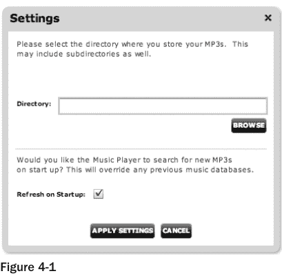

### PlaybackControls

`PlaybackControls` 组件将代表播放、暂停、停止和快进音轨的整个用户界面。为了保持布局，它扩展了 `HBox` 组件。除了播放按钮外，它还具有一个可调节的滑块，代表歌曲的播放进度，以及指示播放时间、歌曲标题和艺术家名称的标签。

打开一个新文档并插入以下 ActionScript 和 MXML：

```
<?xml version="1.0" encoding="utf-8"?>
<mx:HBox xmlns:mx="http://www.adobe.com/2006/mxml"
         width="100%"
         height="60" verticalScrollPolicy="off" horizontalScrollPolicy="off"
         xmlns:ui="com.aircmr.musicplayer.ui.*" >

    <mx:Metadata>
        [Event(name="trackPositionUpdate", type="flash.events.Event")]
        [Event(name="playClick", type="flash.events.Event")]
        [Event(name="pauseClick", type="flash.events.Event")]
        [Event(name="stopClick", type="flash.events.Event")]
        [Event(name="previousClick", type="flash.events.Event")]
        [Event(name="nextClick", type="flash.events.Event")]
    </mx:Metadata>
```


# 第四章：音乐播放器

```xml
<mx:Metadata>
</mx:Metadata>

<mx:Script>
<![CDATA[
    public static const TRACK_POSITION_UPDATE:String = "trackPositionUpdate";
    public static const PLAY_CLICK:String = "playClick";
    public static const PAUSE_CLICK:String = "pauseClick";
    public static const STOP_CLICK:String = "stopClick";
    public static const PREVIOUS_CLICK:String = "previousClick";
    public static const NEXT_CLICK:String = "nextClick";

    private var _artistTitle:String = "No track selected";
    private var _trackTitle:String = "----";
    private var _trackLength:Number;
    private var _trackPosition:Number;
    private var _newTrackPosition:Number;
    [Bindable] private var _labelArray:Array = ["00:00" , "00:00"];

    private function formatTimelineValue( num:Number ):String
    {
        return String( timeFormatter.format( new Date( num ) ));
    }

    private function handlePreviousClick( event:MouseEvent ):void
    {
        dispatchEvent( new Event( PlaybackControls.PREVIOUS_CLICK ) );
    }

    private function handlePlayClick( event:MouseEvent ):void
    {
        dispatchEvent( new Event( PlaybackControls.PLAY_CLICK ) );
    }

    private function handlePauseClick( event:MouseEvent ):void
    {
        dispatchEvent( new Event( PlaybackControls.PAUSE_CLICK ) );
    }

    private function handleStopClick( event:MouseEvent ):void
    {
        dispatchEvent( new Event( PlaybackControls.STOP_CLICK ) );
    }

    private function handleNextClick( event:MouseEvent ):void
    {
        dispatchEvent( new Event( PlaybackControls.NEXT_CLICK ) );
    }

    [Bindable]
    public function set artistTitle( val:String ):void
    {
        _artistTitle = val;
    }

    public function get artistTitle():String
    {
        return _artistTitle;
    }

    [Bindable]
    public function set trackTitle( val:String ):void
    {
        _trackTitle = val;
    }

    public function get trackTitle():String
    {
        return _trackTitle;
    }

    [Bindable]
    public function set trackLength( val:Number ):void
    {
        _trackLength = val;
    }

    public function get trackLength():Number
    {
        return _trackLength;
    }

    [Bindable]
    public function set trackPosition( val:Number ):void
    {
        _trackPosition = val;
        var timeLeft:String = String("-" +
            timeFormatter.format( new Date( trackLength - val ) ));
        var timeElapsed:String = String(
            timeFormatter.format( new Date( val ) ));
        _labelArray = [timeElapsed , timeLeft];

        if( _trackPosition == 0 && _trackLength == 0 )
            _labelArray = ["00:00" , "00:00"];
    }

    public function get trackPosition():Number
    {
        return _trackPosition;
    }

    [Bindable("trackPositionUpdate")]
    public function set newTrackPosition( val:Number ):void
    {
        if( val == trackLength ) return;
        _newTrackPosition = val;
        dispatchEvent( new Event( PlaybackControls.TRACK_POSITION_UPDATE ) );
    }

    public function get newTrackPosition():Number
    {
        return _newTrackPosition;
    }
]]>
</mx:Script>

<mx:DateFormatter id="timeFormatter" formatString="NN:SS" />

<mx:HBox id="playControls" verticalAlign="middle"
    height="100%" horizontalGap="0" x="3" y="3">
    <mx:Button styleName="previousBtn" click="handlePreviousClick(event);" />
    <mx:Button styleName="playBtn" click="handlePlayClick( event );" />
    <mx:Button styleName="pauseBtn" click="handlePauseClick( event );" />
    <mx:Button styleName="stopBtn" click="handleStopClick( event );" />
    <mx:Button styleName="nextBtn" click="handleNextClick( event );" />
</mx:HBox>
<mx:Spacer width="100%" />
<mx:VBox verticalGap="-2" y="-2" id="trackInfoDisplay"
    width="320" height="100%"
    styleName="trackInfoDisplayContainer" >
    <mx:Text width="100%" id="artistDisplay"
        textAlign="center" selectable="false"
        text="{artistTitle}" styleName="albumTextDisplay" />
    <mx:Text width="100%" id="trackDisplay"
        textAlign="center" selectable="false"
        text="{trackTitle}" styleName="albumTextDisplay" />
    <mx:HSlider id="scrubber"
        width="100%" height="20"
        dataTipFormatFunction="formatTimelineValue"
        allowTrackClick="true"
        liveDragging="true"
        tickInterval="0"
        labelOffset="0"
        labels="{_labelArray}"
        change="{newTrackPosition = scrubber.value}"
        value="{trackPosition}"
        minimum="0"
        maximum="{trackLength}"
    />
</mx:VBox>
</mx:HBox>
```

将文件保存为 PlaybackControls.mxml，放在你的工作目录下的 com/aircmr/musicplayer/ui 目录中。

在讨论 PlaybackControls 组件的功能之前，花点时间回顾一下完成后的组件将是什么样子。图 4-2 显示了该组件的显示效果。


> 本应用使用了 assets 文件夹中的样式表，以及一些自定义的按钮皮肤。如果你决定不使用这些，请注释掉每个按钮的 `styleName` 属性。

## 按钮控件

播放、暂停、停止、上一曲和下一曲等功能的按钮控件都以相同的方式工作。当用户点击其中一个按钮时，会派发一个事件，该事件由应用程序控制器中的 `SoundManager` 监听。例如，按下播放按钮会派发 `PLAY_CLICK` 事件，该事件告诉 `SoundManager` 需要播放一首歌曲。处理该事件的责任交给了 `SoundManager` 类。

## trackInfoDisplay

其中一个嵌套的组件显示是 `trackInfoDisplay`。这组组件显示诸如播放头位置、歌曲时长、艺术家姓名和歌曲标题等信息。

## 播放头进度与实时拖动

许多音乐播放器都具有的一个功能是某种进度条，用户可以拖动（scrub）它来改变播放头在歌曲中的位置。在 airAMP 中，这由一个 `HSlider` 组件表示。

第一个挑战是显示进度。这是通过将 `HSlider` 组件的 `value` 属性绑定到 `PlaybackControls` 的 `trackPosition` 属性来实现的。`trackPosition` 属性由 `SoundManager` 类更新。然而，仅更新 `value` 属性并不会使 `HSlider` 移动，除非它知道歌曲的总时长。这通过将 `HSlider` 的 `maximum` 属性绑定到 `PlaybackControls` 的 `trackLength` 属性来设置。当加载新歌曲时，`SoundManager` 通过应用程序控制器更新 `trackLength` 属性。现在，`HSlider` 的滑动轨道代表了歌曲的长度，当 `HSlider` 的 `value` 更新时，`thumb`（图 4-2 中的黑色三角形按钮）将沿着该轨道移动。

下一个挑战是实现实时拖动。实时拖动使得当用户沿着轨道拖动滑块时，可以更新歌曲中的位置。因为滑块代表了歌曲中的位置，当用户移动它时，组件只需要将新时间报告给 `SoundManager`。这是通过利用 `HSlider` 的 `CHANGE` 事件来实现的。当 `CHANGE` 事件被派发时，`PlaybackControls` 的 `newTrackPosition` 被设置为滑块的位置。设置 `newTrackPosition` 后，`PlaybackControls` 组件派发 `TRACK_POSITION_UPDATE` 事件，该事件被应用程序控制器接收。应用程序控制器类通过调用 `setPlayheadPosition()` 方法并传递来自 `PlaybackControls` 的新播放值来更新 `SoundManager` 中的播放头位置。最后，必须将 `HSlider` 的 `liveDragging` 属性设置为 `true`，以启用点击和拖动滑块。

### 处理时间戳

另一个方便的功能是能够以已用时间与总时间的形式显示 `trackPosition`。`trackPosition` 值以秒为单位表示。不幸的是，大多数视频时间戳表示为 01:30，意思是1分30秒。为了以这种方式格式化时间，可以使用 Flex 的 `DateFormatter`：

```xml
<mx:DateFormatter id="timeFormatter" formatString="NN:SS" />
```

这个 `DateFormatter` 会将 `trackPosition` 格式化为 "NN:SS"，表示分钟分钟 : 秒秒。你可以通过调用以下方式访问此格式化器：

```actionscript
timeFormatter.format( new Date( trackPosition ) )
```

`DateFormatter` 类期望通过 format 方法接收一个 `Date` 对象。通过将带有 `trackPosition` 值的新 `Date` 对象传递给 `DateFormatter`，结果是一个看起来像 01:30 的 `String`。

`HSlider` 的标签是通过将 `labels` 属性设置为 `[Bindable] _labelArray` 来更新的。当 `trackPosition` 属性由应用程序控制器更新时，`_labelArray` 会被重写为两个字符串：`timeLeft` 和 `timeElapsed`。这两个值都使用 `DateFormatter` 以 NN:SS 格式解析。效果是显示类似于 Apple iTunes 的进度显示。

## PlaylistView

`PlaylistView` 用于显示曲目列表。它是一个扩展了 `DataGrid` 组件的自定义组件。

打开一个新文档并插入以下 ActionScript 和 MXML：

```xml
<?xml version="1.0" encoding="utf-8"?>
<mx:DataGrid xmlns:mx="http://www.adobe.com/2006/mxml"
    width="100%" height="90%" rowCount="5"
    doubleClickEnabled="true"
    change="onChangeSong(event);"
    doubleClick="playSelected(event);" >
    <mx:Metadata>
        [Event(name="playSelected", type="flash.events.Event")]
        [Event(name="selectedItemChange", type="flash.events.Event")]
    </mx:Metadata>
    <mx:Script>
        <![CDATA[
            import com.aircmr.musicplayer.data.TrackVO;

            public static const PLAY_SELECTED:String = "playSelected";
            public static const SELECTED_ITEM_CHANGE:String = "selectedItemChange";

            private var _selectedTrack:TrackVO;
```


# 第四章：音乐播放器

```actionscript
public function playTrackAt( val:int = 0 ) :void
{
    selectedIndex = val;
    playSelected();
}

public function next( event:Event=null ) :void
{
    if( !_selectedTrack ) selectedIndex = 0;

    selectedIndex =
    ( selectedIndex == dataProvider.length - 1 ) ? 0 : selectedIndex+1;
    scrollToIndex( selectedIndex );

    selectedTrack = this.selectedItem as TrackVO;
    dispatchEvent( new Event( PlaylistView.SELECTED_ITEM_CHANGE ));
}

public function previous( event:Event=null ) :void
{
    if( !_selectedTrack ) selectedIndex = 0;

    selectedIndex =
    ( selectedIndex == 0 ) ? dataProvider.length : selectedIndex - 1;
    scrollToIndex( selectedIndex );

    selectedTrack = this.selectedItem as TrackVO;
    dispatchEvent( new Event( PlaylistView.SELECTED_ITEM_CHANGE ));
}

private function playSelected( event:MouseEvent = null ) :void
{
    selectedTrack = this.selectedItem as TrackVO;

    dispatchEvent( new Event( PlaylistView.PLAY_SELECTED ) );
}

private function onChangeSong( event:Event ) :void
{
    selectedTrack = this.selectedItem as TrackVO;
}

public function get selectedTrack():TrackVO
{
    return _selectedTrack;
}

public function set selectedTrack( val:TrackVO ) :void
{
    _selectedTrack = val;
}
]]>
</mx:Script>
<mx:columns>
    <mx:DataGridColumn dataField="trackTitle" headerText="Song Name" width="200" />
    <mx:DataGridColumn dataField="artist" headerText="Artist" width="150" />
    <mx:DataGridColumn dataField="album" headerText="Album" width="150" />
</mx:columns>
</mx:DataGrid>
```

将文件保存为 `PlaylistView.mxml`，放在工作目录下的 `com/aircmr/musicplayer/ui` 目录中。

### 数据提供器

`ApplicationDataModel` 的 `trackCollection` 属性是 `PlaylistView` 的 `dataProvider`。如果你还记得，`trackCollection` 这个 `ArrayCollection` 填充了表示歌曲数据的 `TrackVO` 对象。`DataGrid` 的显示内容是通过为每个 `DataGridColumn` 的 `dataField` 属性指定一个与 `TrackVO` 对象属性相对应的属性来填充的。例如，`dataField = "artist"` 将显示 `TrackVO.artist` 属性。`DataGrid` 中的每个条目都代表一个提供的 `TrackVO`。通过调用 `DataGrid` 的 `selectedItem`，你就引用了该歌曲的 `TrackVO` 对象。

### 切换曲目

`SoundManager` 依赖 `PlaylistView` 来获取选定的曲目。这甚至在用户按下播放按钮而曲目未被选定时也适用。例如，当用户点击播放按钮时，一个事件会通过控制器发送到 `SoundManager`。如果 `SoundManager` 的 `selectedTrack` 属性为 `null`，那么就会分派 `NO_SELECTED_TRACK` 事件，该事件进而调用 `PlaylistView` 的 `playTrackAt()` 方法。此时，`playTrackAt()` 方法将 `PlaylistView` 的 `selectedTrack` 属性设置为所提供索引处的 `selectedItem`。最后，`PlaylistView` 分派一个 `PLAY_SELECTED` 事件，告知 `SoundManager` 有一首歌曲已被选中并需要播放。

这可能看起来有点绕，但组件仍然是松散耦合的。换句话说，你可以将 `SoundManager` 替换为任何你希望通过 `PlaylistView` 控制的类，你只需在应用程序控制器级别更改事件监听器即可。

在本章后面，你将在 `MusicPlayer.mxml` 文件中实现这个组件。图 4-3 展示了 `PlaylistView` 组件作为 airAMP 音乐播放器中的播放列表。

### 底部控件

airAMP 音乐播放器的最后一个组件集是 `BottomControls` 组件。此组件扩展了 `BottomBar` 组件，用于与 `Panel` 组件一起使用。它由三个组件组成：设置按钮、音量控制器 `HSlider`，以及一个用于分隔两者的 `Spacer`。你可以在图 4-3 的底部查看此组件。

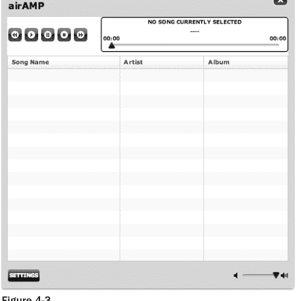

## 图 4-3

打开一个新文档，插入以下 ActionScript 和 MXML：

```xml
<?xml version="1.0" encoding="utf-8"?>
<mx:ControlBar xmlns:mx="http://www.adobe.com/2006/mxml" width="100%" height="100%">
    <mx:Metadata>
        [Event(name="volumeChange", type="flash.events.Event")]
        [Event(name="settingsClick", type="flash.events.Event")]
    </mx:Metadata>
    <mx:Script>
        <![CDATA[
            import mx.events.SliderEvent;
            public static const VOLUME_CHANGE:String = "volumeChange";
            public static const SETTINGS_CLICK:String = "settingsClick";

            private var _volume:Number = 1;

            private function settingsButtonHandler( event:MouseEvent ):void
            {
                dispatchEvent( new Event( BottomControls.SETTINGS_CLICK ) );
            }

            private function formatVolume( num:Number ):String
            {
                return String( Math.round( num * 100 ));
            }

            private function onVolumeChangeHandler( event:SliderEvent ):void
            {
                volume = event.value;
            }

            [Bindable("volumeChange")]
            public function get volume():Number
            {
                return _volume;
            }

            public function set volume( val:Number ):void
            {
                _volume = val;
                dispatchEvent( new Event( BottomControls.VOLUME_CHANGE ));
            }

]]>
</mx:Script>
<mx:Button id="settingBtn" label="SETTINGS" x="5"
           click="settingsButtonHandler( event );" />
<mx:Spacer width="100%" />
<mx:HBox horizontalGap="2" y="10">
    <mx:Image source="@Embed('/assets/images/volumeLow.png')" />
    <mx:HSlider id="volumeController"
                width="70" height="4"
                allowTrackClick="true"
                invertThumbDirection="true"
                dataTipFormatFunction="formatVolume"
                liveDragging="true"
                maximum="1"
                minimum="0"
                tickInterval="0"
                value="{volume}"
                change="onVolumeChangeHandler( event );"
                />
    <mx:Image source="@Embed('/assets/images/volumeHigh.png')" />
</mx:HBox>
</mx:ControlBar>
```

将文件保存为 `BottomControls.mxml`，放在工作目录下的 `com/aircmr/musicplayer/ui` 目录中。

### 音量控制

`BottomControls` 组件相当简单，但音量控制有点复杂。如果你阅读了 `PlaybackControls` 组件的“播放头进度与实时拖动”部分，你应该熟悉如何沿着 `HSlider` 轨道移动滑块按钮。音量控制没有什么不同。

`volumeController` HSlider 的 `value` 属性绑定到 `BottomControls` 的公共 `volume` 属性。同样，当滑块移动时，会分派一个 `CHANGE` 事件，该事件进而设置 `volume` 属性并分派一个额外的事件 `VOLUME_CHANGE` 到控制器（或任何正在监听的类）。以下代码片段是应用程序控制器 `MusicPlayer.mxml` 文件中 `BottomControls` 的实例化代码：

```xml
<ui:BottomControls id="'bottomControls'"
    volumeChange="{_soundManager.volume = bottomControls.volume}"
    volume="{_soundManager.volume}"
    settingsClick="openSettingsPopUp( event );" />
```

在这个例子中，`volumeChange` 事件被分配了一个内联代码，该代码将 `SoundManager` 的 `volume` 属性更改为 `BottomControls` 的 `volume` 属性。这会在每次拖动滑块时将 `SoundManager` 的音量设置为滑块的音量。同样，`HSlider` 的值绑定到 `BottomControls` 类的 `volume` 属性，而该属性又绑定到 `SoundManager` 的 `volume` 属性，从而在 `BottomControls` 的音量滑块和通过应用程序控制器及 `SoundManager` 播放的声音音量之间建立了一个桥梁。

## 整合所有内容

所有组件、数据和支持类都已构建完成。airAMP 音乐播放器即将完成。开发应用程序的最后一步是设置最终的 MXML 文件并将所有内容整合在一起。

打开一个新文档，插入以下 ActionScript 和 MXML：

```xml
<?xml version="1.0" encoding="utf-8"?>
<mx:Application xmlns:mx="http://www.adobe.com/2006/mxml"
    layout="absolute"
    xmlns:local="*"
    xmlns:ui="com.aircmr.musicplayer.ui.*"
    usePreloader="false"
    horizontalScrollPolicy="off"
    verticalScrollPolicy="off"
    applicationComplete="onCreationCompleteHandler(event);"
    initialize="onInitHandler(event);">

    <mx:Style source="assets/style/app.css" />

    <mx:Script>
        <![CDATA[
            import mx.controls.Alert;
            import com.aircmr.musicplayer.utils.XMLParserUtil;
            import com.aircmr.musicplayer.managers.SoundManager;
            import com.aircmr.musicplayer.events.XMLFileServiceEvent;
            import com.aircmr.musicplayer.events.FileSearchEvent;
            import com.aircmr.musicplayer.services.FileSearch;
            import com.aircmr.musicplayer.services.XMLFileService;
            import com.aircmr.musicplayer.services.MP3FileSearch;
```


# 第四章：音乐播放器

```mxml
import com.aircmr.musicplayer.ui.SettingsPanel;
import com.aircmr.musicplayer.data.SettingsVO;
import com.aircmr.musicplayer.data.ApplicationDataModel;
import mx.events.FlexEvent;
import mx.core.IFlexDisplayObject;
import mx.managers.PopUpManager;
import flash.display.NativeWindow;

public static const TITLE:String = "airAMP";
private var _nativeWindow:NativeWindow;

[Bindable]
private var _soundManager:SoundManager;

private function onInitHandler( event:Event ):void
{
    _soundManager = new SoundManager();
    _soundManager.addEventListener( SoundManager.NO_SELECTED_TRACK, handleNoSelectedTrack );
    _soundManager.addEventListener( SoundManager.TRACK_COMPLETE, handleTrackPlayComplete );

    ApplicationDataModel.getInstance().settingFileLocation="settings.xml";
    ApplicationDataModel.getInstance().addEventListener(
        ApplicationDataModel.TRACKLIST_CHANGE , onTrackListChange );

    loadSettingsXMLFile();

    topMenu.addEventListener(MouseEvent.MOUSE_DOWN, onMouseDownHandler);
}

private function onCreationCompleteHandler( event:Event ):void
{
    _nativeWindow = stage.nativeWindow;
    _nativeWindow.title = TITLE;
    _nativeWindow.width = 505;
    _nativeWindow.height = 505;
    stage.quality = StageQuality.BEST;
}

private function onSettingsNotFound( event:Event ):void
{
    var xmlFileService:XMLFileService = new XMLFileService();
    xmlFileService.addEventListener( XMLFileServiceEvent.XML_FILE_COPIED,
        loadSettingsXMLFile );
    xmlFileService.copyXMLFileFromApplicationDirectoryToStorage(
        ApplicationDataModel.getInstance().settingFileLocation );
}

private function loadSettingsXMLFile( event:Event = null ):void
{
    var settingsXMLLoader:XMLFileService = new XMLFileService();
    settingsXMLLoader.addEventListener(
        XMLFileServiceEvent.XML_FILE_NOT_FOUND , onSettingsNotFound );
    settingsXMLLoader.addEventListener( XMLFileServiceEvent.XML_LOADED,
        settingsLoadedHandler );
    settingsXMLLoader.loadXMLFileFromStorage(
        ApplicationDataModel.getInstance().settingFileLocation );
}

private function settingsLoadedHandler( event:XMLFileServiceEvent ):void
{
    ApplicationDataModel.getInstance().settings =
        XMLParserUtil.parseSettingsXML( event.xml );

    if( ApplicationDataModel.getInstance().settings.defaultMusicDirectory
        == "" )
    {
        openSettingsPopUp();
    }
    else
    {
        (ApplicationDataModel.getInstance().settings.refreshOnStartup) ?
            searchDirectoriesForMp3s(null) :
            loadMp3sFromXML(null);
    }
}

private function onCloseClickHandler( event:MouseEvent ):void
{
    _nativeWindow.close();
}

private function onMouseDownHandler( event:MouseEvent ):void
{
    _nativeWindow.startMove()
}

private function openSettingsPopUp( event:Event = null ):void
{
    var settingsPanel:SettingsPanel;
    settingsPanel = SettingsPanel.show();
    settingsPanel.addEventListener( SettingsPanel.SETTINGS_UPDATED,
        searchDirectoriesForMp3s );
}

private function searchDirectoriesForMp3s( event:Event ):void
{
    var fileSearch:MP3FileSearch = new MP3FileSearch();
    fileSearch.addEventListener(FileSearchEvent.SEARCH_FINISHED,
        fileSearchResultHandler);
    fileSearch.addEventListener(FileSearchEvent.SEARCH_FAILED,
        fileSearchFailHandler);
    fileSearch.queryDirectoryListToXML(
        ApplicationDataModel.getInstance().settings.defaultMusicDirectory,
        true, ["mp3"] );
}

private function fileSearchResultHandler( event:FileSearchEvent ):void
{
    var xmlToSave:XML = event.searchResults as XML;

    ApplicationDataModel.getInstance().trackCollection =
        XMLParserUtil.parseSongDatabaseXML( xmlToSave );

    var fsSaveResultsToXML:XMLFileService = new XMLFileService();
    fsSaveResultsToXML.addEventListener(
        XMLFileServiceEvent.XML_FILE_WRITTEN , databaseSavedHandler );
    fsSaveResultsToXML.saveXMLFileToStorage(
        ApplicationDataModel.getInstance().settings.musicDatabaseLocation,
        xmlToSave );
}

private function fileSearchFailHandler( event:FileSearchEvent ):void
{
    Alert.show( "Music search failed. Perhaps you moved the directory?", "Oops..." );
}

private function databaseSavedHandler( event:Event ):void {}

private function loadMp3sFromXML( event:Event ):void
{
    var mp3XMLLoader:XMLFileService = new XMLFileService();
    mp3XMLLoader.addEventListener(XMLFileServiceEvent.XML_LOADED,
        onMP3DatabaseLoaded );
    mp3XMLLoader.loadXMLFileFromStorage(
        ApplicationDataModel.getInstance().settings.musicDatabaseLocation);
}

private function onMP3DatabaseLoaded( event:XMLFileServiceEvent ):void
{
    ApplicationDataModel.getInstance().trackCollection =
        XMLParserUtil.parseSongDatabaseXML( event.xml );
}

private function onTrackListChange( event:Event ):void
{
    playlistView.dataProvider =
        ApplicationDataModel.getInstance().trackCollection;
}

private function handleNoSelectedTrack( event:Event ):void
{
    playlistView.playTrackAt( 0 );
}

private function handleTrackPlayComplete( event:Event ):void
{
    playlistView.next();
}
]]>
</mx:Script>

<mx:Canvas id="mainContainer">
    <mx:Panel id="mainPanel" height="500" width="500" title="{TITLE}" >
        <ui:PlaybackControls x="0" y="4" id="playbackControls"
            trackPositionUpdate="{_soundManager.setPlayheadPosition(
                playbackControls.newTrackPosition);}"
            trackPosition="{_soundManager.trackPosition}"
            trackLength="{_soundManager.trackLength}"
            artistTitle="{_soundManager.artistTitle}"
            trackTitle="{_soundManager.trackTitle}"
            playClick="{_soundManager.play();}"
            pauseClick="{_soundManager.pause();}"
            stopClick="{_soundManager.stop();}"
            nextClick="{playlistView.next();}"
            previousClick="{playlistView.previous();}" />
        <ui:PlaylistView id="playlistView"
            selectedItemChange="{_soundManager.selectTrack(
                playlistView.selectedTrack ); }"
            playSelected="{ _soundManager.playTrack(
                playlistView.selectedTrack ); }" />
        <ui:BottomControls id="bottomControls"
            volumeChange="{_soundManager.volume = bottomControls.volume}"
            volume="{_soundManager.volume}"
            settingsClick="openSettingsPopUp( event );" />
    </mx:Panel>

    <mx:Canvas id="topMenu" width="100%" height="50">
        <mx:Button id="closeBtn" click="onCloseClickHandler(event);"
            styleName="closeBtn" x="460" />
    </mx:Canvas>
</mx:Canvas>
</mx:Application>
```

将文件保存为 MusicPlayer.mxml 到您的工作目录。

MusicPlayer.mxml 是 airAMP 音乐播放器的基础。它既是该应用程序的视图，也是其控制器。本章已经解释了大部分功能，至少涉及伴随类如何相互协作的部分。音乐播放器的最后一项功能是定制化的、无外观界面的应用程序。您将在下一节中了解如何创建它。

## 应用程序和 WindowedApplication 的区别

通常，在 AIR 应用程序中，主应用程序 MXML 文件扩展自 `<mx:WindowedApplication>` 容器。然而，本应用程序演示了如何在不使用此容器的情况下创建 AIR 应用程序，而是坚持使用相当典型的默认 Flex `<mx:Application>`。

对于使用 AIR API 构建的应用程序，选择前者或后者时的主要考虑因素是，`<mx:WindowedApplication>` 允许您访问默认窗口的控件，例如 `关闭`、`最小化` 和 `还原`。能够访问这些控件也意味着您可以为 Mac 和 PC 设置系统外观的样式。它使您能够单击并拖动窗口，并监听其移动事件；并且您可以监听窗口界面抛出的事件并快速为这些事件添加效果，例如最小化和关闭。最后，因为 `WindowedApplication` 扩展了 `Application` 容器，您可以访问在为 Web 构建 Flex 应用程序时可用的所有事件、样式和方法。

这听起来相当理想，除了它也意味着您被限制在大多数应用程序都相当标准的基本外观和感觉中。这并非什么大事，但音乐播放器通常看起来与常规不同。

在这种情况下，当您认为需要对应用程序的外观和感觉有更多控制权时，请使用 `<mx:Application>`。它提供了对应用程序窗口物理形状的更多控制（在本例中是一个圆角矩形），您可以调整应用程序的不透明度，并且可以将窗口的控件放置在您想要的任何位置。除了最大化、最小化和关闭，您还可以创建自己的功能；这取决于您。

但是，上一段中提到的所有功能都必须手动实现，这意味着您必须创建自己的关闭按钮，并且必须监听 `MouseEvent.MOUSE_DOWN` 事件，以便用户能够在屏幕上移动窗口。

## 实现关闭应用程序和窗口拖动功能

从 `<mx:Application>` 构造函数开始。在构造函数内，除了命名空间声明和默认样式属性外，将方法 `onCreationCompleteHandler` 分配给 `creationComplete` 事件，并将构造函数的事件变量传递给它。一旦 `Application` 被创建，并且其子项已被正确初始化并添加到应用程序的舞台，它将触发 `creationComplete` 事件，访问以下嵌套在 `<mx:Script />` 标记中的方法：

```mxml
private function onCreationCompleteHandler( event:Event ):void
{
    _nativeWindow = stage.nativeWindow;
    _nativeWindow.title = TITLE;
    _nativeWindow.width = 505;
    _nativeWindow.height = 505;
    stage.quality = StageQuality.BEST;
}
```

调用此方法时，您将私有变量 `_nativeWindow` 分配给 `stage.nativeWindow` 的引用。通过将其分配给 `_nativeWindow`，您使此私有变量成为原生桌面窗口实例的引用。在 `onCreationCompleteHandler` 内，您还指定了窗口的标题、应用程序的宽度和高度。


# 第四章：音乐播放器

一旦`_nativeWindow`被赋值，你就能直接与应用程序窗口进行交互。大部分窗口交互发生在名为`topMenu`的嵌套画布容器中。例如，名为`closeBtn`的关闭按钮为其`click`事件分配了一个名为`onCloseClickHandler`的处理函数。`onCloseClickHandler`是在应用程序的`<mx:Script>`标签中定义的私有方法：

```
private function onCloseClickHandler( event:MouseEvent ):void
{
    _nativeWindow.close();
}
```

这段代码相当直接，但效果显著。用户点击关闭后，`onCloseClickHandler`将调用`_nativeWindow`引用的`close()`方法，从而关闭应用程序。

接下来，看看在应用程序的`<mx:Script>`标签中定义的`init()`方法。乍一看，这个方法里内容很多。毕竟，这个方法在应用程序初始化之后、`creationComplete`事件触发之前被调用。不过，目前你只需关注其中一小段代码。应用程序初始化后，`topMenu`容器应被添加到Application的舞台（stage）上。此时你只需要它作为一个引用，因此它是否触发了`creationComplete`事件并不重要。你将为`topMenu`方法添加一个监听器，监听`MouseEvent.MOUSE_DOWN`事件，届时将调用私有方法`onMouseDownHandler`：

```
topMenu.addEventListener(MouseEvent.MOUSE_DOWN, onMouseDownHandler);
```

`onMouseDownHandler`会调用`_nativeWindow`引用的`startMove()`方法。这使得用户可以点击并在桌面上拖动窗口。你本可以将这个`MouseEvent`应用于包裹整个应用程序的`<mx:Canvas>`容器，但这会屏蔽嵌套组件上的所有鼠标事件，使应用程序无法使用。不过，允许用户点击顶部区域对于这个应用程序来说功能已经足够：

```
private function onMouseDownHandler( event:MouseEvent ):void
{
    _nativeWindow.startMove();
}
```

现在用户可以关闭应用程序，并且能够在桌面上移动它。如果需要，你还可以像之前的代码一样，为你的应用程序添加最小化、最大化、恢复和调整大小的功能。请记住，你使用这些方法是为了替代通过`<mx:WindowedApplication>`容器提供的默认功能，但这当然不限制你在任何Flex/AIR应用程序中使用`close()`、`startMove()`或`NativeWindow`类中的任何其他方法。

至此，如果你编译这个应用程序，应该能够浏览你的硬盘驱动器并播放一些音乐了。图4-4和图4-5展示了最终的airAMP音乐播放器。

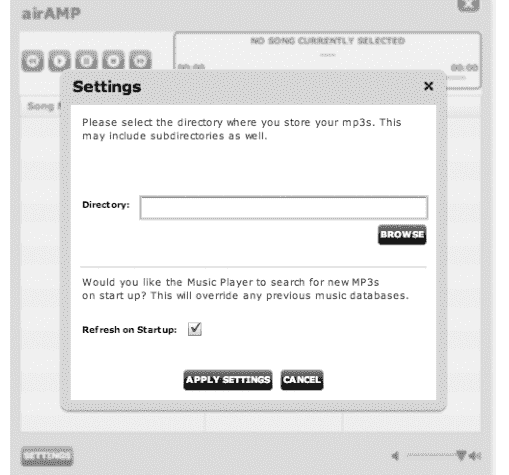

图4-4

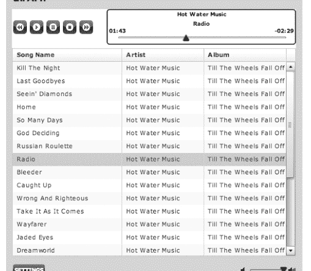

图4-5

## 部署应用程序

airAMP音乐播放器即将完成。最后一步是创建一个描述符文件，并将所有内容打包成一个可部署的AIR文件。

### 描述符文件

创建airAMP音乐播放器所需的最后一个文件是应用程序描述符文件。这个XML文件包含应用程序的各种属性，例如初始窗口设置、版权、标题和图标URL。它会与最终的可部署文件一起打包和分发。

创建一个新文档并输入以下标记：

```
<?xml version="1.0" encoding="UTF-8"?>
<application xmlns="http://ns.adobe.com/air/application/1.0">
    <id>com.aircmr.MusicPlayer</id>
    <filename>MusicPlayer</filename>
    <version>0.1</version>
    <name>AIR Amp</name>
    <description></description>
    <copyright>2008</copyright>
    
    <initialWindow>
        <title/>
        <content>MusicPlayer.swf</content>
        <systemChrome>none</systemChrome>
        <transparent>true</transparent>
        <visible>true</visible>
    </initialWindow>
    
    <installFolder>AIRCMR/MusicPlayer</installFolder>
    <programMenuFolder>AIRCMR</programMenuFolder>
</application>
```

将文件保存为`MusicPlayer-app.xml`，放在你的工作目录根目录下，与`MusicPlayer.mxml`和`settings.xml`文件一起。

这个文件将是音乐播放器的描述符文件。因为应用程序将有自己的窗口设计和界面，所以`<systemChrome>`属性设置为none，`<transparent>`设置为true。

描述符创建完成后，继续进行应用程序的编译和打包。

### 编译和打包

创建airAMP音乐播放器的最后一步是编译和打包它。一旦你在工作目录中有了`MusicPlayer.mxml`、`MusicPlayer-app.xml`、`settings.xml`和`assets`目录，就可以开始打包应用程序，首先将`MusicPlayer.mxml`编译成SWF。

打开命令提示符，导航到音乐播放器的工作目录，输入以下命令，然后按回车：

```
> amxmlc MusicPlayer.mxml
```

保持命令提示符仍指向工作目录，输入以下命令并按回车，将部件打包为AIR安装程序：

```
> adt -package MusicPlayer MusicPlayer-app.xml MusicPlayer.swf settings.xml
```

现在包已创建，导航到你的工作目录。如果部件打包正确，你应该会有一个`MusicPlayer.air`文件。执行`MusicPlayer.air`包以将应用程序安装到你的硬盘驱动器上。安装完成后，打开它，选择你的MP3目录，点击播放，尽情享受吧！

## 总结

现在你已经创建了自己的音乐播放器，你再也不会回头使用iTunes了。无论这个应用程序是否配得上互联网上的音响发烧友，它都是深入了解一些精彩的Flex和AIR概念的绝佳方式。

本章涵盖了如何使用`<mx:Application>`而不是`<mx:WindowedApplication>`。你学习了如何使用`File`对象搜索目录，以及如何使用`FileStream.readMultiByte`读取数据。你练习了使用`FileStream.writeUTFBytes`从硬盘读取和写入数据，并简要了解了如何在ActionScript 3和MXML中操作和创建自定义组件。

希望此时，你正坐在电脑前，随着你最喜欢的音乐摇摆。当然，由于篇幅限制，许多音乐播放器常见的功能并未添加。然而，我们鼓励你将此应用程序作为起点，并添加一些额外功能。以下是一些关于如何继续的建议：

- 在播放器中添加搜索任意歌曲的功能。
- 使用`SoundMixer.computeSpectrum`方法添加音频可视化，以增强显示效果。
- 添加下载当前播放歌曲专辑封面的功能。
- 添加仅打开单个文件的功能。
- 添加将文件拖放到播放器中并自动将其写入XML数据库的功能。
- 添加在播放器内创建播放列表的功能。
- 添加读取和解析iTunes音乐数据库XML文件的功能。

如你所见，有无穷无尽的想法可以用来增强和扩展你在本章创建的基础音乐播放器。最重要的是，慢慢来，享受将它打造成你自己的AIR音乐播放器的过程。

## 迷你CMS

在AIR中创建一个内容管理系统（CMS）是个绝妙的主意。还有什么比一个跨平台的桌面应用程序更能让你管理远程内容呢？好吧，有很多东西更好，但在AIR的语境下，CMS是一个非常时髦的可能性。你将在本章创建的应用程序将为你创建一个简单的CMS应用程序提供一个良好的开端。你可以用许多不同的方式来构建CMS，但在这种情况下，应用程序将保持相对简单，希望它能成为创建满足你特定需求的CMS的垫脚石。

在本章中，该应用程序将使你能够管理一个远程XML数据集及其关联的资产。该应用程序管理的数据集是一个假设的项目列表，类似于简单的文章或期刊条目列表。列表中的每个项目还包含一个关联的图像文件。该应用程序将使你能够编辑、添加和删除列表中的项目。编辑完内容后，该应用程序会将新的数据集以及你从本地硬盘选择的所有图像上传到远程存储区域。

下一节将讨论该应用程序的设计。这包括管理数据的逻辑以及用户界面所需的组件。设计完成后，你将进入代码部分，了解将所有内容联系在一起的重要类和函数。

## 设计

一如既往，列出你的应用程序应旨在实现的目标列表是个好主意。迷你CMS应用程序应使用户能够执行以下操作：

- 配置远程网关URL。
- 验证远程网关URL。
- 下载远程XML数据集并将其保存在他们的硬盘驱动器上。
- 显示数据集中所有项目的可选择列表。


## 第五章：迷你内容管理系统

-   在可编辑表单中显示所选项目的字段。
-   从列表中添加、编辑和删除项目。
-   编辑所选项目的字段。
-   浏览其硬盘以查找资产文件（图片）。
-   保存单个项目的更改。
-   恢复到原始数据。
-   将编辑后的 XML 数据集和任何本地资产上传到远程存储区域。

前面的列表应能让你对该应用程序在类和用户界面方面的需求有一个大致的了解。列表中的第一项，关于网关 URL，现在可能对你来说有点模糊，但下一节将解释这个应用程序组件。

### 远程网关

远程网关是应用程序的重要组成部分。它是一个服务器端脚本，负责处理应用程序与服务器之间的通信。该脚本还存储数据文件和资产文件夹的 URL。该脚本可以用多种脚本语言编写，包括 ASP、JSP、PHP 和 Ruby 等。在本章中，网关脚本使用 PHP 编写，因为它广泛可用，通常与 Flash 和 Flex 项目结合使用。更重要的是，网关必须处理三个操作：

-   URL 验证
-   数据文件上传
-   资产文件上传

当用户配置他们的应用程序时，特别是在配置远程项目的位置时，确保他们输入了正确的 URL 是个好主意。允许用户验证他们输入的内容也给了应用程序抓取数据集和资产文件夹路径的机会。没有这些变量，应用程序就无法运行。在用户验证网关 URL 后，应用程序应该准备好下载数据，让用户可以随心所欲地进行编辑。请记住，此脚本文件不会随应用程序一起打包。你需要负责将该脚本连同初始资产和数据文件一起上传到远程服务器，以便应用程序能够正常运行。

## 设置管理

在用户验证网关 URL 并收到远程设置后，将该信息存储起来以备后用是个好主意。设置不仅应在应用程序的其他部分可用，还应保存在用户的计算机上，这样用户下次启动应用程序时就不必重新配置。

为了使设置信息在整个应用程序中可用，你将使用强大的单例类模式创建一个数据模型。该类将被命名为 `SettingsModel`。单例模式确保在整个应用程序中只能创建一个 `Settings` 对象实例，确保应用程序中的所有组件和对象都将从唯一的设置信息源读取数据。

为了保存设置信息，使其在用户下次使用应用程序时可用，你将创建一个服务类，用于在应用程序的存储目录中加载和保存一个简单的 XML 文件。该类将被命名为 `SettingsService`。

### 数据管理

除了管理设置数据，你还需要管理主数据集。主数据集是一个 XML 文件，一旦设置得到验证，就必须从远程位置下载，然后保存到应用程序的存储目录。为了使这个过程更友好，你将创建一个名为 `XMLDataService` 的服务类。当 XML 完全加载时，将派发一个 `Complete` 事件；如果加载数据时出现问题，则会派发一个 `Error` 事件。

当数据可供应用程序使用时，它需要被解析成对显示组件友好的对象。编辑后的数据还需要序列化回 XML，以便在上传前保存到本地文件。将创建两个类来处理此要求。第一个类是另一个服务类，这次名为 `ListDataService`，它将处理数据的转换。第二个类名为 `ItemData`，是一个通用对象，将描述数据集中的每个项目。

## 文件上传

在用户完成对数据的更改后，应用程序需要上传数据集以及用户选择用于任何编辑项目的任何本地资产。这个类将是另一个名为 `UploadService` 的服务类。该类使你能够将本地文件添加到上传队列中。当上传过程结束或遇到错误时，会派发事件。

### 用户界面

该应用程序的用户界面相对简单。首先，你将创建一个组件，使用户能够编辑和验证网关 URL。该组件将被命名为 `SettingsPanel`，并将作为弹出窗口运行。在 `SettingsPanel` 组件之后，你将创建一个组件，使用户能够编辑数据集中的项目数据。该组件将包含与数据集中项目的每个属性相对应的表单字段。该组件被命名为 `ItemEditor`。最后，你将使用一个 `List` 组件来呈现数据集中的每个项目。除了零星的一些按钮，这些是应用程序的主要界面组件。

## 代码和代码说明

本节深入探讨定义应用程序每个类和组件功能的代码。在接下来的几节中，你将创建应用程序所需的每个类和组件。最后，你将通过创建主应用程序文件将它们整合在一起。但是，首先，请在你的开发目录中创建一个名为 Mini CMS 的文件夹。这将是你的应用程序的工作目录。

### 远程网关

远程网关脚本是本应用的基石。幸运的是，该脚本极其简单，即使你不懂 PHP，你可能也能一眼看出它的大致原理。

打开你的编辑器并创建一个新文档。输入以下标记：

```php
<?php

// Configuration
$GLOBALS['xmlDataURL'] = 'http://yourdomain.com/minicms/dataset.xml';
$GLOBALS['xmlDataPath'] = '/serverpath/minicms/dataset.xml';
$GLOBALS['assetsFolderURL'] = 'http://yourdomain.com/minicms/assets/';
$GLOBALS['assetsFolderPath'] = '/serverpath/minicms/assets/';

switch( $_GET['action'] )
{
    case 'validate':
        handleValidate();
        break;

    case 'uploadAsset':
        handleUploadAsset();
        break;

    case 'uploadData':
        handleUploadData();
        break;
}

function handleValidate()
{
    echo 'success=1&xmlDataURL='.$GLOBALS['xmlDataURL'].'&assetsFolderURL='.$GLOBALS['assetsFolderURL'];
}

function handleUploadData()
{
    echo "\nReceiving upload...\n";
    echo "Filename: " . $_FILES['Filedata']['name']."\n";
    echo "File Size: " . $_FILES['Filedata']['size']."\n";
    move_uploaded_file($_FILES['Filedata']['tmp_name'], $GLOBALS['xmlDataPath']);
    echo "File moved to: ".$GLOBALS['xmlDataPath']."\n";
}

function handleUploadAsset()
{
    echo "\nReceiving upload...\n";
    echo "Filename: " . $_FILES['Filedata']['name']."\n";
    echo "File Size: " . $_FILES['Filedata']['size']."\n";
    move_uploaded_file($_FILES['Filedata']['tmp_name'], $GLOBALS['assetsFolderPath'].$_FILES['Filedata']['name']);
    echo "File moved to: ".$GLOBALS['assetsFolderPath'].$_FILES['Filedata']['name']."\n";
}

?>
```

将文件保存为工作目录下的 `gateway.php`。

**126**

为了使应用程序在你自己的服务器环境中正常运行，请修改脚本开头的配置变量：

```php
// Configuration
$GLOBALS['xmlDataURL']        = 'http://yourdomain.com/minicms/dataset.xml';
$GLOBALS['xmlDataPath']        = '/serverpath/minicms/dataset.xml';
$GLOBALS['assetsFolderURL']  = 'http://yourdomain.com/minicms/assets/';
$GLOBALS['assetsFolderPath'] = '/serverpath/minicms/assets/';
```

前面的代码片段包含网关脚本所需的配置变量。当然，你必须根据你的服务器环境进行更改。URL 应配置为与你自己的域名和内部文件夹结构相匹配。路径应使用 XML 数据文件和资产文件夹的物理路径进行配置。如果你不确定磁盘路径，请在你计划上传网关脚本的文件夹内创建一个测试脚本。然后在此脚本中使用 PHP 函数 `getcwd()`。此函数输出当前工作目录的物理路径——换句话说，就是脚本所在目录的路径。请记住，当需要将此文件上传到你的服务器时，服务器必须已安装并运行 PHP。此外，服务器必须具有向其硬盘写入文件的权限。

远程网关脚本被编程为处理三个操作：验证、数据上传和资产上传。应用程序通过设置一个名为 `action` 的查询字符串变量来指定要执行的操作。例如，当用户尝试验证网关 URL 时，应用程序会获取用户输入并附加验证查询字符串。应用程序将尝试加载的 URL 如下所示：http://www.yourdomain.com/minicms/gateway.php?action=validate。

关于验证过程，请注意应用程序依赖网关脚本提供两个设置变量：

```php
function handleValidate()
{
    echo 'success=1&xmlDataURL='.$GLOBALS['xmlDataURL'].'&assetsFolderURL='.$GLOBALS['assetsFolderURL'];
}
```

这里的 `handleValidate` 函数简单地输出一条消息，如果用户为网关脚本输入了有效的 URL，应用程序将能够读取该消息。应用程序将解析该消息，以提取 XML 数据文件的 URL 和资产文件夹的 URL。

在下一节中，你将学习如何创建必要的文件来管理设置数据。

### 设置模型

为了使本应用程序的所有组件正常运行，关键信息必须在整个应用程序中的所有类和组件中可用。你将创建两个类来实现这一点。首先，`SettingsModel` 类将利用单例模式作为重要设置变量的存储库。其次，`SettingsService` 类将有助于加载和保存设置数据，无论是加载到应用程序中，还是保存到用户的硬盘供以后使用。设置将以一个简单的 XML 文件形式保存。

在你的开发目录中，创建一个名为 Mini CMS 的文件夹。这将是你的程序的工作目录。


## 第5章：迷你 CMS

1. 打开你的编辑器并创建一个新文档。输入以下标记：

```xml
<?xml version='1.0' encoding='utf-8'?>
<settings>
    <gatewayurl></gatewayurl>
    <xmldataurl></xmldataurl>
    <assetsfolderurl></assetsfolderurl>
</settings>
```

2. 将文件保存为工作目录中的 `settings.xml`。

3. 创建一个新文档并输入以下标记：

```actionscript
package com.aircmr.minicms.data
{
    import flash.errors.IllegalOperationError;
    import flash.events.Event;
    import flash.events.EventDispatcher;
    import flash.filesystem.File;

    final public class SettingsModel extends EventDispatcher
    {
        /* Static Variables */
        private static var _instance:SettingsModel = new SettingsModel();

        /* Static Methods */
        public static function getInstance():SettingsModel
        {
            return _instance;
        }

        /* Private Variables */
        private var _assetsFolderURL:String;
        private var _data:XML;
        private var _localDataFile:File;
        private var _xmlDataURL:String;
        private var _gatewayURL:String;
        private var _uploadURL:String;
        private var _validateURL:String;

        /* Constructor & Init */
        public function SettingsModel()
        {
            if( _instance != null )
            {
                throw new IllegalOperationError( "Error at :: SettingsModel. SettingsModel is a Singleton with access through SettingsModel.getInstance()." );
            }
        }

        /* Private Methods */
        private function deserialize():void
        {
            this.gatewayURL = ( String( _data.gatewayurl ).length > 0 ) ?
                _data.gatewayurl : null;
            this.xmlDataURL = ( String( _data.xmldataurl ).length > 0 ) ?
                _data.xmldataurl : null;
            this.assetsFolderURL = ( String( _data.assetsfolderurl ).length > 0 ) ?
                _data.assetsfolderurl : null;

            dispatchEvent( new Event( Event.INIT ) );
        }

        public function serialize():XML
        {
            var xml:XML = new XML( "<settings></settings>" );
            xml.addChild( <gatewayurl>{_gatewayURL}</gatewayurl> );
            xml.addChild( <xmldataurl>{_xmlDataURL}</xmldataurl> );
            xml.addChild( <assetsfolderurl>{_assetsFolderURL}</assetsfolderurl> );
            return xml;
        }

        /* Gets & Sets */
        public function set data( value:XML ):void
        {
            _data = value;
            deserialize();
        }

        public function set gatewayURL( value:String ):void
        {
            _gatewayURL = value;
        }

        public function get gatewayURL():String
        {
            return _gatewayURL;
        }

        public function set assetsFolderURL( value:String ):void
        {
            _assetsFolderURL = value;
        }

        public function get assetsFolderURL():String
        {
            return _assetsFolderURL;
        }

        public function set xmlDataURL( value:String ):void
        {
            _xmlDataURL = value;

            if( _xmlDataURL != null )
            {
                var fileName:String = _xmlDataURL.substring(
                    _xmlDataURL.lastIndexOf("/") + 1, _xmlDataURL.length );
                _localDataFile = File.applicationStorageDirectory.resolve( fileName );
            }
        }

        public function get xmlDataURL():String
        {
            return _xmlDataURL;
        }

        public function get localDataFile():File
        {
            return _localDataFile;
        }

    }
}
```

4. 将文件保存为工作目录中 `com/aircmr/minicms/data/` 目录下的 `SettingsModel.as`。

5. 创建一个新文档并输入以下标记：

```actionscript
package com.aircmr.minicms.services
{
    import flash.events.Event;
    import flash.events.EventDispatcher;
    import flash.events.IOErrorEvent;
    import flash.filesystem.File;
    import flash.filesystem.FileMode;
    import flash.filesystem.FileStream;

    public class SettingsService extends EventDispatcher
    {
        /* Constants */
        private static const UTF_ENCODING:String = "<?xml version='1.0' encoding='utf-8'?>";

        /* Private Variables */
        private var _data:XML;
        private var _file:File;
        private var _fileStream:FileStream;

        /* Constructor & Init */
        public function SettingsService()
        {

        }

        /* Private Methods */
        private function onFileReadComplete( event:Event ):void
        {
            _data = XML( _fileStream.readUTFBytes( _fileStream.bytesAvailable ) );
            _fileStream.close();
            dispatchEvent( new Event( Event.COMPLETE ) );
        }

        private function onFileWriteComplete( evt:Event ):void
        {
            trace( "Settings saved." );
        }

        private function onFileOpenError( evt:IOErrorEvent ):void
        {
            trace( "Could not load: settings.xml :: Error - " + evt.errorID );
        }

        /* Public Methods */
        public function load():void
        {
            _file = File.applicationStorageDirectory.resolve( "settings.xml" );

            _fileStream = new FileStream();
            _fileStream.addEventListener( Event.COMPLETE, onFileReadComplete );
            _fileStream.addEventListener( IOErrorEvent.IO_ERROR, onFileOpenError );
            _fileStream.openAsync( _file, FileMode.READ );
        }

        public function save( xml:XML ):void
        {
            var output:String = UTF_ENCODING + "\n" + xml.toXMLString();
            output = output.replace( /\n/g, File.lineEnding );

            _fileStream = new FileStream();
            _fileStream.openAsync( _file, FileMode.WRITE );
            _fileStream.addEventListener( Event.CLOSE, onFileWriteComplete );
            _fileStream.writeUTFBytes( output );
            _fileStream.close();
        }

        /* Gets & Sets */
        public function get data():XML
        {
            return _data;
        }
    }
}
```

6. 将文件保存为工作目录中 `com/aircmr/minicms/services/` 目录下的 `SettingsService.as`。

在前面的六个步骤中，你创建了管理应用程序设置所需的文件和类，包括 `settings.xml`、`SettingsModel.as` 和 `SettingsService.as`。

步骤1和2介绍了 `settings.xml` 文件——该文件将被存储在应用程序的存储文件夹中，用于保留用户的设置。此文件中存储了三个设置值。第一个也是最重要的，是网关 URL。这是唯一由用户设置的选项。XML 数据 URL 和资源文件夹 URL 的值将在用户验证网关 URL 时检索。

在步骤3和4中，你创建了 `SettingsModel` 类。该类使用单例模式，确保在整个应用程序中只存在该类的一个实例。单例模式非常适合用于创建存储一组数据或函数的单一位置。对于本应用程序而言，这是存储来自 XML 的设置值的完美方法。

除了某些 XML 解析方法外，请注意该类创建了一个名为 `_localDataFile` 的额外设置值。这个变量是 AIR `File` 类的一个实例，它存储了 XML 数据文件下载到用户硬盘后的保存位置引用。

以下代码片段包含 `SettingsModel` 中 `_xmlDataURL` 属性的 setter 函数：

```actionscript
public function set xmlDataURL( value:String ):void
{
    _xmlDataURL = value;

    if( _xmlDataURL != null )
    {
        var fileName:String = _xmlDataURL.substring( _xmlDataURL.lastIndexOf("/") + 1, _xmlDataURL.length );
        _localDataFile = File.applicationStorageDirectory.resolve( fileName );
    }
}
```

`_localDataFile` 属性也是在此函数中设置的。数据文件将始终存储在应用程序的存储目录中，因此通过解析 XML 数据 URL 获取文件名，你可以通过访问 `File` 类的公共静态变量 `applicationStorageDirectory` 并将文件名传递给其 `resolve` 方法，来创建一个新的 `File` 对象实例。此方法将返回一个新的 `File` 对象，该对象引用应用程序存储目录中的数据文件。

在步骤5和6中，你创建了 `SettingsService` 类。创建此类是为了处理将设置加载到用户硬盘以及从用户硬盘保存设置：

```actionscript
public function load():void
{
    _file = File.applicationStorageDirectory.resolve( "settings.xml" );

    _fileStream = new FileStream();
    _fileStream.addEventListener( Event.COMPLETE, onFileReadComplete );
    _fileStream.addEventListener( IOErrorEvent.IO_ERROR, onFileOpenError );
    _fileStream.openAsync( _file, FileMode.READ );
}

public function save( xml:XML ):void
{
    var output:String = UTF_ENCODING + "\n" + xml.toXMLString();
    output = output.replace( /\n/g, File.lineEnding );

    _fileStream = new FileStream();
    _fileStream.openAsync( _file, FileMode.WRITE );
    _fileStream.addEventListener( Event.CLOSE, onFileWriteComplete );
    _fileStream.writeUTFBytes( output );
    _fileStream.close();
}
```


前面的代码片段展示了 `SettingsService` 类的 `load` 和 `save` 方法。当 `load` 方法首次被调用时，类的 `_file` 属性会被设置——同样，这是通过使用 `File` 类名为 `applicationStorageDirectory` 的静态属性的 `resolve` 方法，并传入设置文件的文件名来完成的。

然后，通过创建一个新的 `FileStream` 对象实例、配置相应的监听器并利用其 `openAsync` 方法来打开文件。当文件读取完成后，`onFileReadComplete` 方法被调用，来自 `settings.xml` 文件的数据被转换为一个方便好用的 `XML` 对象并存储在 `_data` 属性中。接着，该类会派发一个 `COMPLETE` 事件，通知所有监听者 `settings.xml` 文件已加载完成，数据可供访问。`save` 方法本质上是相反的过程，不同之处在于它使用 `FileStream` 对象的 `writeUTFBytes` 方法将 XML 数据写入 `settings.xml` 文件。

在下一节中，你将创建管理 XML 数据所需的类。

### 数据管理

内容管理器若没有内容，还叫什么内容管理器？既然你已经有了管理应用程序设置的方法，现在是时候转向管理内容数据了。

此应用程序的数据具有特定的模式。此模式恰好看起来像一个简单的日记或博客条目列表。列表中的每个条目都有五个属性：日期、标题、副标题、正文文本和关联的图像。为了在应用程序中表示和管理这些数据，你将创建三个类文件和一个 XML 文件。

1.  打开你的编辑器并创建一个新文档。输入以下标记：

```xml
<?xml version='1.0' encoding='utf-8'?>
<data>
    <item>
        <date>2007-08-01</date>
        <title>Lorem Ipsum</title>
        <subtitle>Lorem Ipsum Dolor Sit</subtitle>
        <body>Lorem Ipsum Dolor Sit</body>
        <image></image>
    </item>
    <item>
        <date>2007-07-25</date>
        <title>Lorem Ipsum</title>
        <subtitle>Lorem Ipsum Dolor Sit</subtitle>
        <body>Lorem Ipsum Dolor Sit</body>
        <image></image>
    </item>
</data>
```

2.  将文件保存为 `dataset.xml`，放在你的工作目录中。

3.  创建一个新文档并输入以下标记：

```actionscript
package com.aircmr.minicms.data
{
    import mx.utils.StringUtil;
    import flash.filesystem.File;

    public class ItemData
    {
        private static const NEW_ITEM:String = "<item><title>Untitled</title><subtitle></subtitle><body></body><date></date><image></image></item>";

        private var _body:String;
        private var _date:String;
        private var _edited:Boolean;
        private var _image:String;
        private var _localImage:File;
        private var _originalData:XMLList;
        private var _subtitle:String;
        private var _title:String;

        public function ItemData( originalData:XMLList = null )
        {
            if( originalData == null )
            {
                originalData = new XMLList( NEW_ITEM );
            }

            _originalData = originalData;

            revert();
        }

        public function revert():void
        {
            var today:Date = new Date();
            var todayStr:String = today.getFullYear() + "-" + (today.getMonth() + 1 ) + "-" + today.getDate();

            _date = ( StringUtil.trim( _originalData.date ) != "" ) ?
                _originalData.date : todayStr;
            _body = ( StringUtil.trim( _originalData.body ) != "" ) ?
                _originalData.body : "";
            _image = ( StringUtil.trim( _originalData.image ) != "" ) ?
                _originalData.image : "";
            _subtitle = ( StringUtil.trim( _originalData.subtitle ) != "" ) ?
                _originalData.subtitle : "";
            _title = ( StringUtil.trim( _originalData.title ) != "" ) ?
                _originalData.title : "";

            _edited = false;
        }

        public function set body( value:String ):void
        {
            _body = value;
            _edited = true;
        }

        public function set date( value:String ):void
        {
            _date = value;
            _edited = true;
        }

        public function set image( value:String ):void
        {
            _image = value;
            _edited = true;
        }

        public function set localImage( value:File ):void
        {
            _localImage = value;
            _edited = true;
        }

        public function set subtitle( value:String ):void
        {
            _subtitle = value;
            _edited = true;
        }

        public function set title( value:String ):void
        {
            _title = value;
            _edited = true;
        }

        public function get body():String
        {
            return _body;
        }

        public function get date():String
        {
            return _date;
        }

        public function get edited():Boolean
        {
            return _edited;
        }

        public function get image():String
        {
            return _image;
        }

        public function get localImage():File
        {
            return _localImage;
        }

        public function get subtitle():String
        {
            return _subtitle;
        }

        public function get title():String
        {
            return _title;
        }
    }
}
```

4.  将文件保存为 `ItemData.as`，放在你工作目录中的 `com/aircmr/minicms/data/` 目录下。

5.  创建一个新文档并输入以下标记：

```actionscript
package com.aircmr.minicms.services
{
    import com.aircmr.minicms.data.ItemData;
    import com.aircmr.minicms.data.SettingsModel;

    public class ListDataService
    {
        /* Constants */
        private static const UTF_ENCODING:String = "<?xml version='1.0' encoding='utf-8'?>";

        public function ListDataService()
        {

        }

        public function serialize( listData:Array ):XML
        {
            var xmlString:String = UTF_ENCODING + "\n" + "<data>\n"

            for( var i:int = 0; i < listData.length; i++ )
            {
                xmlString += "\t<item>\n";

                var item:ItemData = listData[i].data;

                xmlString += "\t\t<date>" + item.date + "</date>\n";
                xmlString += "\t\t<title>" + item.title + "</title>\n";
                xmlString += "\t\t<subtitle>" + item.subtitle + "</subtitle>\n";
                xmlString += "\t\t<body>" + item.body + "</body>\n";

                if( item.localImage != null )
                {
                    xmlString += "\t\t<image>" + SettingsModel.getInstance().assetsFolderURL + item.localImage.name + "</image>\n";
                }
                else
                {
                    xmlString += "\t\t<image>" + item.image + "</image>\n";
                }

                xmlString += "\t</item>\n";
            }

            xmlString += "</data>";

            return new XML( xmlString );
        }

        public function deserialize( xml:XML ):Array
        {
            var result:Array = new Array();

            for( var i:int = 0; i < xml.children().length(); i++ )
            {
                var itemData:ItemData = new ItemData( XMLList(
                    xml.children()[i] ) );
                var newListItem:Object = new Object();
                newListItem.data = itemData;
                newListItem.label = itemData.title;
                result.push( newListItem );
            }

            return result;
        }

        public function getLocalFiles( listData:Array ):Array
        {
            var result:Array = new Array();

            for( var i:int = 0; i < listData.length; i++ )
            {
                var item:ItemData = listData[i].data;

                if( item.localImage != null )
                {
                    result.push( item.localImage );
                }
            }

            return result;
        }
    }
}
```

6.  将文件保存为 `ListDataService.as`，放在你工作目录中的 `com/aircmr/minicms/services/` 目录下。

7.  创建一个新文档并输入以下标记：

```actionscript
package com.aircmr.minicms.services
{
    import com.aircmr.minicms.data.SettingsModel;
    import flash.net.URLLoader;
    import flash.net.URLRequest;
    import flash.events.ErrorEvent;
    import flash.events.Event;
    import flash.events.EventDispatcher;
    import flash.events.IOErrorEvent;
    import flash.filesystem.File;
    import flash.filesystem.FileMode;
    import flash.filesystem.FileStream;
    import mx.controls.Alert;

    public class XMLDataService extends EventDispatcher
    {
        /* Constants */
        private static const UTF_ENCODING:String = "<?xml version='1.0' encoding='utf-8'?>";

        /* Private Variables */
        private var _dataLoader:URLLoader;
        private var _filename:String;
        private var _fileStream:FileStream;
        private var _listData:Array;
        private var _xmlData:XML;

        public function XMLDataService()
        {

        }

        /* Event Handlers */
        private function onDataLoadComplete( event:Event ):void
        {
            _xmlData = XML( String( _dataLoader.data ) );
            save();
        }

        private function onDataLoadError( event:IOErrorEvent ):void
        {
            dispatchEvent( new ErrorEvent( ErrorEvent.ERROR ) );
        }

        private function onFileWriteComplete( event:Event ):void
        {
            dispatchEvent( new Event( Event.COMPLETE ) );
        }


        /* Private Methods */
        private function save():void
        {
            var output:String = UTF_ENCODING + "\n" + _xmlData.toXMLString();
            output = output.replace( /\n/g, File.lineEnding );

            _fileStream = new FileStream();
```


# 第5章：迷你内容管理系统

```actionscript
_fileStream.openAsync( SettingsModel.getInstance().localDataFile, FileMode.WRITE );
_fileStream.addEventListener( Event.CLOSE, onFileWriteComplete );
_fileStream.writeUTFBytes( output );
_fileStream.close();
}

/* 公共方法 */
public function load( url:String ):void
{
    _dataLoader = new URLLoader();
    _dataLoader.addEventListener( Event.COMPLETE, onDataLoadComplete );
    _dataLoader.addEventListener( IOErrorEvent.IO_ERROR, onDataLoadError );
    _dataLoader.load( new URLRequest( url ) );
}

public function updateXMLData( xml:XML ):void
{
    _xmlData = xml;
    save()
}

/* 获取器与设置器 */
public function get xmlData():XML
{
    return _xmlData;
}
}
}
```

8.  将文件保存为 `XMLDataService.as`，并放置在你的工作目录下的 `com/aircmr/minicms/services/` 文件夹中。

在前面的八个步骤中，你已经创建了管理内容数据所需的所有文件：`dataset.xml`、`ItemData.as`、`ListDataService.as` 和 `XMLDataService.as`。

在步骤1和2中，你创建了数据集文件。该文件将存放应用程序管理的所有内容。此文件在部署时不会与应用程序一起打包。相反，它会被上传到远程服务器。当应用程序配置了有效的网关URL后，它会将当前数据集下载到用户的硬盘驱动器上。

步骤3和4中，你创建了 `ItemData` 类。此类的实例用于表示来自XML数据的一个项目。正如你所料，项目的日期、标题、副标题等每个属性都有一个对应的属性。还有一些你可能意想不到的属性。首先，`_originalData` 属性用于存储对项目原始数据的引用。当用户希望取消所做的更改并恢复原始数据时，将使用此属性。其次，`_edited` 属性仅存储一个布尔值，指示项目的数据是否已被编辑。最后，`_localImage` 属性用于存储对用户硬盘驱动器上文件的引用，当用户浏览选择与项目关联的新图像时使用。

步骤5和6介绍了 `ListDataService` 类。此类用于序列化和反序列化XML数据。换句话说，该类会将XML数据从XML对象转换为 `ItemData` 对象的数组；它也会将 `ItemData` 对象的数组转换回XML对象：

139

```actionscript
public function deserialize( xml:XML ):Array
{
    var result:Array = new Array();

    for( var i:int = 0; i < xml.children().length(); i++ )
    {
        var itemData:ItemData = new ItemData( XMLList( xml.children()[i] ) );
        var newListItem:Object = new Object();
        newListItem.data = itemData;
        newListItem.label = itemData.title;
        result.push( newListItem );
    }

    return result;
}
```

上面的代码片段包含了 `ListDataService` 类的 `deserialize` 方法。此方法简单地解析XML并创建上述的 `ItemData` 对象数组。生成的数组将在稍后用于填充Flex `List` 组件。

以下代码片段包含了 `ListDataService` 类的 `getLocalFiles` 方法：

```actionscript
public function getLocalFiles( listData:Array ):Array
{
    var result:Array = new Array();

    for( var i:int = 0; i < listData.length; i++ )
    {
        var item:ItemData = listData[i].data;

        if( item.localImage != null )
        {
            result.push( item.localImage );
        }
    }

    return result;
}
```

正如你将看到的，用户可以任意地将列表中项目的图像更改为他们在硬盘驱动器上浏览选择的文件。此方法不是在选择时将本地文件编译到数组中，而是简单地遍历 `ItemData` 对象数组并检查 `localImage` 属性是否已定义。生成的 `File` 对象数组将随后被即将创建的 `UploadService` 类使用。

在步骤7和8中，你创建了 `XMLDataService` 类。此类与 `SettingsService` 类类似，处理内容数据的加载和保存。与从用户硬盘驱动器加载的设置XML文件不同，内容数据XML是从远程服务器下载的：

```actionscript
public function load( url:String ):void
{
    _dataLoader = new URLLoader();
    _dataLoader.addEventListener( Event.COMPLETE, onDataLoadComplete );
    _dataLoader.addEventListener( IOErrorEvent.IO_ERROR, onDataLoadError );
    _dataLoader.load( new URLRequest( url ) );
}
```

上面的代码片段包含了 `XMLDataService` 类的 `load` 方法。使用提供的 `url` 参数，XML文件通过 `URLLoader` 对象从远程服务器下载。当加载过程完成时，`onDataLoadComplete` 函数被调用，该函数通过 `_xmlData` 属性使XML数据可用，并调用 `XMLDataService` 类的 `save` 方法：

```actionscript
private function save():void
{
    var output:String = UTF_ENCODING + "\n" + _xmlData.toXMLString();
    output = output.replace( /\n/g, File.lineEnding );

    _fileStream = new FileStream();
    _fileStream.openAsync( SettingsModel.getInstance().localDataFile,
                          FileMode.WRITE );
    _fileStream.addEventListener( Event.CLOSE, onFileWriteComplete );
    _fileStream.writeUTFBytes( output );
    _fileStream.close();
}
```

此方法简单地将XML数据保存到用户的硬盘驱动器上。注意这里首次使用了 `SettingsModel` 类。在这种情况下，该方法引用 `localDataFile` 属性，以便将XML数据保存到正确的位置/文件。文件写入用户硬盘驱动器后，`onFileWriteComplete` 方法被调用，然后它会调度一个 `COMPLETE` 事件，通知所有监听者该服务已完成。

在下一节中，你将创建 `UploadService` 类，该类实际上将适当的文件上传到远程服务器。

## 上传文件

此应用程序的一个关键方面是需要将文件上传到远程位置。至少，应用程序必须将一个XML文件（更新后的数据）上传到远程服务器。除此之外，用户可能已经从硬盘驱动器中选择了一些图像，这些图像也需要上传。另外，请注意，任何非XML数据的文件都被视为资源，应上传到资源文件夹。为了管理这些需求，你将创建另一个服务类。

打开你的编辑器并创建一个新文档。输入以下标记：

```actionscript
package com.aircmr.minicms.services
{
    import com.aircmr.minicms.data.SettingsModel;
    import flash.events.DataEvent;
    import flash.events.ErrorEvent;
    import flash.events.Event;
    import flash.events.EventDispatcher;
    import flash.filesystem.File;
    import flash.net.URLRequest;
    import flash.events.IOErrorEvent;

public class UploadService extends EventDispatcher
{
    private var _currentIndex:int;
    private var _filesToUpload:Array;
    private var _uploading:Boolean;

    public function UploadService()
    {
        _currentIndex = -1;
        _filesToUpload = new Array();
        _uploading = false;
    }

    /* 事件处理器 */
    private function onUploadCompleteData( event:DataEvent ):void
    {
        trace( "File Uploaded: " + File( event.target ).nativePath );
        trace( "Server Response: " + String( event.data ) );
        trace( "----------------------------------------------" );
        File( event.target ).removeEventListener( DataEvent.UPLOAD_COMPLETE_DATA, onUploadCompleteData );
        nextFile();
    }

    private function onUploadError( event:IOErrorEvent ):void
    {
        dispatchEvent( new ErrorEvent( ErrorEvent.ERROR ) );
    }

    /* 私有方法 */
    private function nextFile():void
    {
        _currentIndex++;

        if( _currentIndex != _filesToUpload.length )
        {
            var fileToUpload:File = _filesToUpload[_currentIndex];
            fileToUpload.addEventListener( IOErrorEvent.IO_ERROR, onUploadError );
            fileToUpload.addEventListener( DataEvent.UPLOAD_COMPLETE_DATA, onUploadCompleteData );

            var uploadRequst:URLRequest = new URLRequest();
            uploadRequst.method = "POST";
            uploadRequst.url = ( _currentIndex == 0 ) ?
                SettingsModel.getInstance().gatewayURL + "?action=uploadData" :
                uploadRequst.url = SettingsModel.getInstance().gatewayURL + "?action=uploadAsset";

            try
            {
                fileToUpload.upload( uploadRequst );
            }
```

142


```actionscript
catch( error:Error )
{
    dispatchEvent( new ErrorEvent( ErrorEvent.ERROR ) );
}
else
{
    _uploading = false;
    dispatchEvent( new Event( Event.COMPLETE ) );
}

/* Public Methods */
public function addFile( file:File ):void
{
    _filesToUpload.push( file );
}

public function addFiles( files:Array ):void
{
    _filesToUpload = _filesToUpload.concat( files );
}

public function startUpload():void
{
    if( !_uploading )
    {
        _uploading = true;
        nextFile();
    }
}
}
```

将文件保存为 `UploadService.as`，放置在工作目录下的 `com/aircmr/minicms/services/` 目录中。

你刚刚创建了 `UploadService` 类。该类将处理所有的上传功能。这个类的一个实例使得应用程序能够创建一个需要上传的文件队列。通过调用 `addFile` 或 `addFiles` 方法，应用程序可以将文件添加到队列中。所有需要上传的文件都存储在名为 `_filesToUpload` 的类属性数组中。当需要上传文件时，将调用 `startUpload` 方法，该方法本质上会首次调用 `nextFile` 方法：

```
private function nextFile():void
{
    _currentIndex++;

    if( _currentIndex != _filesToUpload.length )
    {
        var fileToUpload:File = _filesToUpload[_currentIndex];
        fileToUpload.addEventListener( IOErrorEvent.IO_ERROR, onUploadError );
        fileToUpload.addEventListener( DataEvent.UPLOAD_COMPLETE_DATA,
            onUploadCompleteData );

        var uploadReqest:URLRequest = new URLRequest();
        uploadReqest.method = "POST";
        uploadReqest.url = ( _currentIndex == 0 ) ?
            SettingsModel.getInstance().gatewayURL + "?action=uploadData" :
            uploadReqest.url = SettingsModel.getInstance().gatewayURL
            + "?action=uploadAsset";

        try
        {
            fileToUpload.upload( uploadReqest );
        }
        catch( error:Error )
        {
            dispatchEvent( new ErrorEvent( ErrorEvent.ERROR ) );
        }
        else
        {
            _uploading = false;
            dispatchEvent( new Event( Event.COMPLETE ) );
        }
    }
}
```

前面的代码片段包含了 `UploadService` 类的 `nextFile` 方法。正是在这个方法中，每个文件被上传到远程服务器。这是通过使用 `File` 对象的 `upload` 方法实现的。该方法需要且仅需要一个 `URLRequest` 类型的参数。自然，`URLRequest` 必须正确配置才能成功上传。在这种情况下，`method` 属性必须设置为 `POST`，而 `url` 属性必须设置为网关 URL 及其相应的动作查询字符串。考虑到这一点，假设文件上传列表中的第一个项将是数据文件，随后的文件被视为资产。然后，网关 URL 从 `SettingsModel` 类中检索，并将适当的查询字符串附加到 URL。

## 创建用户界面

在本节中，你将为应用程序创建用户界面。这通过将你在前面各节中创建的所有类组合在一起来完成应用程序。

打开你的编辑器并创建一个新文档。输入以下标记：

```
<?xml version="1.0" encoding="utf-8"?>
<mx:Panel xmlns:mx="http://www.adobe.com/2006/mxml"
          width="472"
          height="146"
          title="Settings"
          borderColor="#EAEAEA"
          borderAlpha="1"
          creationComplete="init()">
<mx:Script><![CDATA[
    import com.aircmr.minicms.data.SettingsModel;
    import flash.filesystem.File;
    import mx.controls.Alert;
    import mx.managers.PopUpManager;
    import mx.managers.CursorManager;
    import mx.utils.StringUtil;

    /* Static Methods */
    public static function show():SettingsPanel
    {
        var prompt:SettingsPanel =
            SettingsPanel( PopUpManager.createPopUp(
                DisplayObject( mx.core.Application.application ),
                SettingsPanel, true ) );

        PopUpManager.centerPopUp( prompt );
        return prompt;
    }

    /* Private Variables */
    private var _settings:SettingsModel;
    private var _testLoader:URLLoader;

    /* Init */
    private function init():void
    {
        _settings = SettingsModel.getInstance();

        gatewayURLInput.addEventListener( Event.CHANGE, onInputChange );
        saveBtn.addEventListener( MouseEvent.CLICK, onSaveBtnClick );
        cancelBtn.addEventListener( MouseEvent.CLICK, onCancelBtnClick );
        verifyBtn.addEventListener( MouseEvent.CLICK, onVerifyBtnClick );

        saveBtn.enabled = false;

        if( _settings.gatewayURL == null )
        {
            cancelBtn.enabled = false;
        }
        else
        {
            gatewayURLInput.text = _settings.gatewayURL;
        }
    }

    /* UI Event Handlers */
    private function onCancelBtnClick( event:MouseEvent ):void
    {
        close();
    }

    private function onSaveBtnClick( event:MouseEvent ):void
    {
        _settings.gatewayURL = gatewayURLInput.text;
        close();
        dispatchEvent( new Event( Event.CHANGE ) );
    }

    private function onVerifyBtnClick( event:MouseEvent ):void
    {
        this.enabled = false;
        CursorManager.setBusyCursor();

        _testLoader = new URLLoader();
        _testLoader.addEventListener( Event.COMPLETE, onTestResponse )
        _testLoader.addEventListener( IOErrorEvent.IO_ERROR, onTestError );
        _testLoader.load( new URLRequest( StringUtil.
            trim( gatewayURLInput.text ) + "?action=validate" ) );
    }

    private function onInputChange( event:Event ):void
    {
        saveBtn.enabled = false;
    }

    /* Other Event Handlers */
    private function onTestError( event:IOErrorEvent ):void
    {
        Alert.show( "无法验证网关 URL。", "错误",
            (Alert.OK), this );
        this.enabled = true;
        CursorManager.removeBusyCursor();
    }

    private function onTestResponse( event:Event ):void
    {
        var response:String = String( _testLoader.data );

        if( response.indexOf( "success=1" ) == 0 )
        {
            var responseVars:Array = response.split( "&" );

            for( var i:int = 0; i < responseVars.length; i++ )
            {
                var responseVar:Array = responseVars[i].split("=");

                switch( responseVar[0] )
                {
                    case "xmlDataURL":
                        _settings.xmlDataURL = responseVar[1];
                        break;

                    case "assetsFolderURL":
                        _settings.assetsFolderURL = responseVar[1];
                        break;
                }
            }

            saveBtn.enabled = true;
            this.enabled = true;
            CursorManager.removeBusyCursor();

            Alert.show( "网关 URL 验证成功。", "成功", (Alert.OK), this );
        }
        else
        {
            onTestError( null );
        }
    }

    /* Public Methods */
    public function close():void
    {
        PopUpManager.removePopUp( this );
    }
]]></mx:Script>

<mx:VBox width="100%" paddingTop="10" paddingLeft="10" id="container">
    <mx:Text text="网关 URL:"/>
    <mx:HBox width="100%">
        <mx:TextInput id="gatewayURLInput" width="367" />
        <mx:Button id="verifyBtn" label="验证" />
    </mx:HBox>
    <mx:HBox width="100%" paddingTop="10" horizontalAlign="center">
        <mx:Button id="saveBtn" label="保存" />
        <mx:Button id="cancelBtn" label="取消" />
    </mx:HBox>
</mx:VBox>
</mx:Panel>
```

将文件保存为 `SettingsPanel.mxml`，放置在工作目录下的 `com/aircmr/minicms/ui/` 目录中。

你刚刚创建了 `SettingsPanel` 界面组件。这个非常简单的组件将作为一个弹出窗口，使用户能够输入他们的网关 URL 并尝试验证它。在 `onVerifyBtnClick` 函数内部，使用了一个 `URLLoader` 对象，通过附加用户的输入与适当的查询字符串来从网关脚本加载响应。当 `URLLoader` 对象从网关脚本接收到响应时，将调用 `onTestResponse` 函数。应用程序使用 `URLLoader` 对象的 `data` 属性来解析响应，以检索存储在网关脚本中的设置。`SettingsModel` 用相应的值进行更新。

接下来，创建 `ItemEditor` 界面组件。打开你的编辑器并创建一个新文档。输入以下标记：

```
<?xml version="1.0" encoding="utf-8"?>
<mx:VBox xmlns:mx="http://www.adobe.com/2006/mxml"
```


## 第5章：迷你CMS

```
width="442"
height="675"
backgroundAlpha="1"
backgroundColor="#ECECEC"
creationComplete="init();"

<mx:Script><![CDATA[

    import flash.filesystem.File;
    import com.aircmr.minicms.data.ItemData;

    private var _itemData:ItemData;
    private var _localImage:File;

    private function init():void
    {
        saveBtn.enabled = false;
        revertBtn.enabled = false;

        saveBtn.addEventListener( MouseEvent.CLICK, onSaveBtnClick );
        revertBtn.addEventListener( MouseEvent.CLICK, onRevertBtnClick );
        browseBtn.addEventListener( MouseEvent.CLICK, onBrowseBtnClick );
        dateField.addEventListener( Event.CHANGE, onItemEdited );
        titleInput.addEventListener( Event.CHANGE, onItemEdited );
        subtitleInput.addEventListener( Event.CHANGE, onItemEdited );
        bodyInput.addEventListener( Event.CHANGE, onItemEdited );
        imageInput.addEventListener( Event.CHANGE, onItemEdited );

        this.enabled = false;
    }

    /* 按钮事件处理器 */
    private function onSaveBtnClick( event:MouseEvent ):void
    {
        saveBtn.enabled = false;

        var year:String = String( dateField.selectedDate.getFullYear() );
        var month:String = String( dateField.selectedDate.getMonth() + 1 );
        var date:String = String( dateField.selectedDate.getDate() );

        month = ( month.length < 2 ) ? "0" + month : month;
        date = ( date.length < 2 ) ? "0" + date : date;

        _itemData.date = year + "-" + month + "-" + date;
        _itemData.body = bodyInput.text;
        _itemData.image = imageInput.text;
        _itemData.subtitle = subtitleInput.text;
        _itemData.title = titleInput.text;

        if( _localImage.nativePath != File.documentsDirectory.nativePath )
        {
            _itemData.localImage = _localImage;
        }

        dispatchEvent( new Event( Event.CHANGE ) );
    }

    private function onRevertBtnClick( event:MouseEvent ):void
    {
        _itemData.revert();
        updateUI();
        saveBtn.enabled = false;

        dispatchEvent( new Event( Event.CHANGE ) );
    }

    private function onBrowseBtnClick( event:MouseEvent ):void
    {
        var fileFilter:FileFilter = new FileFilter( "Images",
            "*.jpg;*.gif;*.png" );

        try
        {
            _localImage.browse( [fileFilter] );
            _localImage.addEventListener( Event.SELECT, onFileBrowseSelect );
        }
        catch( error:Error )
        {
            trace("Failed:", error.message);
        }
    }

    /* UI事件处理器 */
    private function onFileBrowseSelect( event:Event ):void
    {
        imageInput.text = _localImage.nativePath;
        imgLoader.load( "file:///" + _localImage.nativePath );
        saveBtn.enabled = revertBtn.enabled = true;
    }

    private function onItemEdited( event:Event ):void
    {
        revertBtn.enabled = saveBtn.enabled = true;
    }

    /* 私有方法 */
    private function unloadImage():void
    {
        if( imgLoader.content != null )
        {
            imgLoader.content.loaderInfo.loader.unload();
        }
    }

    private function updateUI():void
    {
        revertBtn.enabled = _itemData.edited;

        var dateArr:Array = itemData.date.split("-");
        var year:Number = Number( dateArr[0] );
        var month:Number = Number( dateArr[1] ) - 1;
        var day:Number = Number( dateArr[2] );
        dateField.selectedDate = new Date( year, month, day );

        titleInput.text = _itemData.title;
        subtitleInput.text = _itemData.subtitle;
        bodyInput.text = _itemData.body;
        imageInput.text = _itemData.image;

        if( _itemData.image != null && _itemData.image != "" )
        {
            imgLoader.load( _itemData.image );
        }
        else
        {
            unloadImage();
        }
    }

    public function update( itemData:ItemData ):void
    {
        saveBtn.enabled = false;
        browseBtn.enabled = true;

        _localImage = File.documentsDirectory;
        _itemData = itemData;

        updateUI();

        this.enabled = true;
    }

    public function clear():void
    {
        _itemData = null;

        dateField.selectedDate = null;
        titleInput.text = "";
        subtitleInput.text = "";
        bodyInput.text = "";
        imageInput.text = "";

        saveBtn.enabled = false;
        revertBtn.enabled = false;
        browseBtn.enabled = false;
        this.enabled = false;

        unloadImage();
    }

    /* 获取器与设置器 */
    public function get itemData():ItemData
    {
        return _itemData;
    }
]]></mx:Script>
<mx:HBox width="100%" paddingTop="10" paddingLeft="10">
    <mx:Button id="saveBtn" x="10" y="10" label="Save Changes"/>
    <mx:Button id="revertBtn" x="122" y="10" label="Revert"/>
</mx:HBox>
<mx:Canvas id="formContainer" width="100%" height="100%">
    <mx:Canvas id="formCanvas" width="{formContainer.width - 20}" height="100%">
        <mx:DateField id="dateField" x="10" y="8" formatString="YYYY-MM-DD" />
        <mx:Text x="10" y="36" text="Title" width="82" fontSize="12"
                 fontWeight="bold"/>
        <mx:TextInput id="titleInput" y="55" minWidth="422" left="10"
                      right="10"/>
        <mx:Text x="10" y="82" text="Subtitle" width="82" fontSize="12"
                 fontWeight="bold"/>
        <mx:TextInput id="subtitleInput" y="101" minWidth="422" left="10"
                      right="10"/>
        <mx:Text x="10" y="126" text="Body" width="82" fontSize="12"
                 fontWeight="bold"/>
        <mx:TextArea id="bodyInput" y="147" height="187" borderStyle="inset"
                     minWidth="422" left="10" right="10"/>
        <mx:Text x="10" y="339" text="Image" width="82" fontSize="12"
                 fontWeight="bold"/>
        <mx:TextInput id="imageInput" minWidth="346" y="360" left="10"
                      right="86" editable="false"/>
        <mx:Button id="browseBtn" y="359" label="Browse" left="{imageInput.x + imageInput.width + 8}"/>
        <mx:Canvas left="10" right="10" bottom="10" top="389">
            <mx:SWFLoader id="imgLoader"/>
        </mx:Canvas>
    </mx:Canvas>
</mx:Canvas>
</mx:VBox>
```

将文件保存为 ItemEditor.mxml，存放于工作目录下的 com/aircrminicms/ui/ 目录中。

ItemEditor 界面组件将用于编辑当前选中的列表项。此组件大部分内容不言自明。它本质上是一个用于编辑 ItemData 对象属性的表单。

接下来，创建主应用程序文件。打开你的编辑器并创建一个新文档。输入以下标记：

```
<?xml version="1.0" encoding="utf-8"?>
<mx:WindowedApplication xmlns:mx="http://www.adobe.com/2006/mxml"
                        xmlns:ui="com.aircrminicms.ui.*"
                        layout="absolute"
                        applicationComplete="onAppInit();"
                        closing="onAppClose();">

<mx:Script><![CDATA[

import com.aircmr.minicms.data.ItemData;
import com.aircmr.minicms.data.SettingsModel;
import com.aircmr.minicms.services.ListDataService;
import com.aircmr.minicms.services.SettingsService;
import com.aircmr.minicms.services.UploadService;
import com.aircmr.minicms.services.XMLDataService;
import com.aircmr.minicms.ui.SettingsPanel;
import mx.controls.Alert;
import mx.managers.CursorManager;

private var _listDataService:ListDataService;
private var _selectedIndex:Number;
private var _settings:SettingsModel;
private var _settingsPanel:SettingsPanel;
private var _settingsService:SettingsService;
private var _uploading:Boolean;
private var _uploadService:UploadService;
private var _xmlDataService:XMLDataService;

[Bindable]
private var _listData:Array;

/* 应用程序事件处理器 */
public function onAppInit():void
{
    this.systemManager.stage.window.width = 800;
    this.systemManager.stage.window.height = 600;

    _uploading = false;

    _settings = SettingsModel.getInstance();

    _listDataService = new ListDataService();

    _xmlDataService = new XMLDataService();
    _xmlDataService.addEventListener( Event.COMPLETE, onXMLDataLoaded );
    _xmlDataService.addEventListener( ErrorEvent.ERROR, onXMLDataError );

    _settingsService = new SettingsService();
    _settingsService.addEventListener( Event.COMPLETE, onSettingsLoaded );
    _settingsService.load();

    settingsBtn.addEventListener( MouseEvent.CLICK, onSettingsBtnClick );
    uploadBtn.addEventListener( MouseEvent.CLICK, onUploadBtnClick );
    addItemBtn.addEventListener( MouseEvent.CLICK, onAddItemBtnClick );
    deleteItemBtn.addEventListener( MouseEvent.CLICK, onDeleteBtnClick );
    revertBtn.addEventListener( MouseEvent.CLICK, onRevertBtnClick );
    dataList.addEventListener( Event.CHANGE, onDataListChange );
```


# 第5章：迷你内容管理系统

```
itemEditor.addEventListener( Event.CHANGE, onItemEditorChange );
}

public function onAppClose():void
{
    _settingsService.save( _settings.serialize() );
}

/* 按钮事件处理程序 */
private function onAddItemClick( event:MouseEvent ):void
{
    addItem();
}

private function onDeleteBtnClick( event:MouseEvent ):void
{
    deleteSelectedItem();
}

private function onRevertBtnClick( event:MouseEvent ):void
{
    revertAllChanges();
}

private function onSettingsBtnClick( event:MouseEvent ):void
{
    openSettings();
}

private function onUploadBtnClick( event:MouseEvent ):void
{
    uploadChanges();
}

/* UI事件处理程序 */
private function onDataListChange( event:Event ):void
{
    if( dataList.selectedIndex > -1 )
    {
        _selectedIndex = dataList.selectedIndex;
        itemEditor.update( ItemData( dataList.selectedItem.data ) );
    }
    else
    {
        itemEditor.clear();
    }
}

private function onItemEditorChange( event:Event ):void
{
    activateButtons();
    updateListItem();
}

private function onSettingsPanelChange( event:Event ):void
{
    getData();
}

/* 服务事件处理程序 */
private function onSettingsLoaded( event:Event ):void
{
    _settings.data = _settingsService.data;

    if( _settings.gatewayURL == null || _settings.gatewayURL == "null" )
    {
        openSettings();
    }
    else
    {
        getData();
    }
}

private function onUploadComplete( event:Event ):void
{
    _uploading = false;
    this.enabled = true;
    CursorManager.removeBusyCursor();

    Alert.show( "上传完成", "成功", (Alert.OK), this,
        onSettingsPanelChange );
}

private function onUploadError( event:ErrorEvent ):void
{
    _uploading = false;
    this.enabled = true;
    CursorManager.removeBusyCursor();

    Alert.show( "上传过程中出现错误。请检查您的服务器设置。", "错误", (Alert.OK) );
}

private function onXMLDataError( event:ErrorEvent ):void
{
    Alert.show( "尝试加载XML数据时出现错误。请调整您的设置。", "错误", (Alert.OK) );
    CursorManager.removeBusyCursor();
}

private function onXMLDataLoaded( event:Event ):void
{
    if( _uploading )
    {
        _uploadService = null;
        _uploadService = new UploadService();
        _uploadService.addEventListener( Event.COMPLETE, onUploadComplete );
        _uploadService.addFile( _settings.localDataFile );
        _uploadService.addFiles( _listDataService.getLocalFiles( _listData ) );
        _uploadService.startUpload();
    }
    else
    {
        unselect();
        _listData = _listDataService.deserialize( _xmlDataService.xmlData );
        CursorManager.removeBusyCursor();
        this.enabled = true;
    }
}

/* 私有方法 */
private function activateButtons():void
{
    uploadBtn.enabled = true;
    revertBtn.enabled = true;
}

private function addItem():void
{
    var newItem:ItemData = new ItemData();

    var newListItem:Object = new Object();
    newListItem.label = newItem.title;
    newListItem.data = newItem;

    var tempList:Array = _listData;
    var toAdd:Array = [newListItem];

    _listData = null;
    _listData = toAdd.concat( tempList );

    unselect();

    activateButtons();
}

private function deleteSelectedItem():void
{
    if( dataList.selectedIndex > -1 )
    {
        var selectedIndex:Number = dataList.selectedIndex;
        var deletedItem:ItemData = dataList.selectedItem.data;

        var tempList:Array = _listData;
        tempList.splice( selectedIndex, 1 );

        _listData = null;
        _listData = tempList;

        itemEditor.clear();
        activateButtons();
    }
}

private function openSettings():void
{
    _settingsPanel = SettingsPanel.show();
    _settingsPanel.addEventListener( Event.CHANGE, onSettingsPanelChange );
}

private function getData():void
{
    this.enabled = false;
    uploadBtn.enabled = false;
    revertBtn.enabled = false;
    CursorManager.setBusyCursor();
    _xmlDataService.load( _settings.xmlDataURL );
}

private function revertAllChanges():void
{
    unselect();
    getData();
}

private function unselect():void
{
    dataList.selectedIndex = -1;
    itemEditor.clear();
}

private function updateListItem():void
{
    var temp:Array = _listData;

    temp[_selectedIndex].label = itemEditor.itemData.title;
    temp[_selectedIndex].data = itemEditor.itemData;

    _listData = null;
    _listData = temp;

    dataList.selectedIndex = _selectedIndex;
}

private function uploadChanges():void
{
    if( !_uploading )
    {
        _uploading = true;
        this.enabled = false;
        CursorManager.setBusyCursor();
        _xmlDataService.updateXMLData( _listDataService
            .serialize( _listData ) );
    }
}
]]></mx:Script>
<mx:VBox id="container" width="100%" height="100%">
    <mx:HBox width="100%" horizontalAlign="left" paddingTop="5"
        paddingLeft="10">
        <mx:Button id="settingsBtn" label="设置"/>
        <mx:Button id="uploadBtn" label="上传更改" enabled="false" />
        <mx:Button id="revertBtn" label="还原所有更改" enabled="false"/>
    </mx:HBox>
    <mx:HDividedBox width="100%" height="100%">
        <mx:Canvas width="40%" height="100%" backgroundAlpha="1"
            backgroundColor="#ECECEC">
            <mx:HBox x="10" y="10">
                <mx:Button id="addItemBtn" label="添加项目" />
                <mx:Button id="deleteItemBtn" label="删除项目"
                    enabled="{dataList.selectedIndex > -1 }"/>
            </mx:HBox>
            <mx:List id="dataList"
                top="40" bottom="0"
                width="100%" height="100%"
                alternatingItemColors="[#FFFFFF, #F6F6F6]"
                dataProvider="{_listData}"/>
        </mx:Canvas>
        <ui:ItemEditor id="itemEditor" width="60%" height="100%" />
    </mx:HDividedBox>
</mx:VBox>
</mx:WindowedApplication>
```

将文件保存为 `MiniCMS.mxml`，放在您的工作目录中。这是应用程序的最后一部分。它将所有内容整合在一起，使这个美好的应用得以运行。您之前创建的所有部分现在都可以相互交流，并根据各自的事件做出响应。

当应用程序初始化时，通过创建 `SettingsService` 类的实例并调用 `load` 方法，将 `settings.xml` 文件加载到应用程序中。设置加载后，应用程序将确定是否应向用户显示设置面板。只有当用户之前已成功验证其网关脚本 URL 时，该面板才会显示。只有在网关脚本 URL 得到验证后，应用程序才会从远程服务器检索数据。这是在本组件的 `getData` 方法中通过使用 `XMLDataService` 类的实例来执行的。

数据加载后，将使用 `ListDataService` 类的一个实例来创建名为 `dataList` 的 `List` 组件将使用的 `dataProvider` 数组。此时，用户可以通过从列表中选择一个项目并在 `ItemEditor` 组件的实例中进行编辑来自由编辑数据。最后，当用户决定上传其更改时，应用程序会将新的 XML 数据保存到硬盘驱动器，并通过创建 `UploadService` 类的实例开始上传序列。此时，剩下的唯一工作就是打包和部署应用程序。

## 部署应用程序

您的应用程序现已完成，但在它运行之前，您必须将网关脚本（gateway.php）上传到已安装 PHP 的服务器上。只要其 URL 公开可用，您可以将脚本上传到服务器上的任何位置。除此之外，您可能还需要修改数据集和资源所在文件夹的权限。如果权限不包括在文件夹内写入文件的功能，上传过程将失败。除此之外，剩下的唯一步骤就是部署和安装应用程序。

### 描述符文件

打开您的编辑器，创建一个新文档，并输入以下标记：

```
<?xml version="1.0" encoding="UTF-8"?>
<application xmlns="http://ns.adobe.com/air/application/1.0">
    <id>com.aircmr.minicms</id>
    <name>com.aircmr.MiniCMS</name>
    <filename>Mini CMS</filename>
    <version>v1</version>
    <initialWindow>
        <content>MiniCMS.swf</content>
        <title>Mini CMS</title>
    </initialWindow>
</application>
```

将文件保存为 MiniCMS-app.xml，放在您的工作目录中。

此文件将用作应用程序描述符文件。此代码片段中的元素值有些通用，应根据您的需要进行更改。有了描述符文件，您就可以编译和打包应用程序的 AIR 可执行文件了。

### 编译与打包

通常，打包 AIR 应用程序需要两个文件：主 SWF 文件和 XML 应用程序描述符文件。但是，在此应用程序的情况下，您还必须包含设置文件。在本节中，您将使用命令行工具生成 SWF 文件并打包 AIR 应用程序。

打开命令提示符，导航到此应用程序的工作目录，输入以下命令，然后按 Enter：

```
> amxmlc MiniCMS.mxml
```

如果您已从证书颁发机构（如 VeriSign 或 Thawte）购买了证书，您可以使用该证书，而不是创建自签名证书，并跳过以下操作。要在工作目录中创建自签名证书，请输入以下命令：

```
> adt -certificate -cn MiniCMS 1024-RSA certificate.pfx password
```

在命令提示符仍指向工作目录的情况下，输入以下命令并按 Enter：


# 第5章：简易内容管理系统

```
adt -package -storetype pkcs12 -keystore certificate.pfx MiniCMS.air MiniCMS-app.xml MiniCMS.swf settings.xml
```

通过运行上一条命令成功创建安装程序后，导航到您的工作目录，并双击 MiniCMS.air 文件以安装并运行该应用程序。如果一切顺利，该应用程序将启动，界面类似图5-1所示。如果您输入一个有效的网关URL，应用程序界面应如图5-2所示。

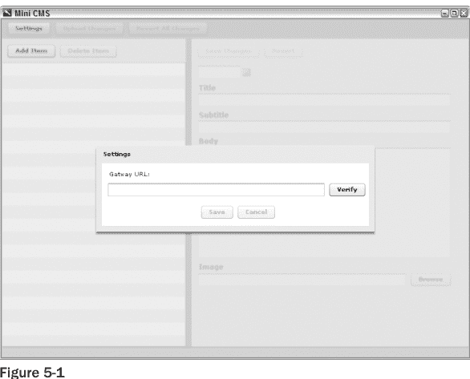

图5-1

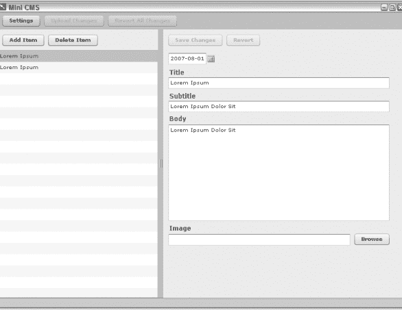

图5-2

## 总结

在本章中，您学习了如何创建一个简单的应用程序，用于管理XML数据集及其关联资源的内容管理系统。更具体地说，您学习了如何使用`File`类的`upload`方法将文件上传到远程服务器，以及如何将XML文件保存到应用程序存储目录内的用户硬盘。

您可能会想，这个应用程序管理的内容非常特定，使用的模式并不能反映您希望管理的数据类型。没问题——这个应用程序可以进行编辑以适应您自己的情况。通过对`ItemEditor`和`ItemData`类进行一些简单的更改，您可以轻松地更改数据的模式，并且理论上该应用程序仍然应该能正常工作。

在下一章中，您将继续扩展对AIR的知识和经验，学习如何构建一个图像查看器。

## 第6章：图像查看器与编辑器

如果您像我们大多数人一样，您的计算机中可能存放着数十个甚至数百个图像文件，分布在各个文件夹中。您允许这些文件占用您的磁盘空间，因为您知道总有一天您会再次查看它们，也许还会进行一些调整。通过文件浏览器查看这些图像可能是一种不太令人满意的体验。也许如果您有某种类型的图像显示装置，您就不会忘记这些艺术作品了。

您将在本章中构建的图像查看应用程序将提醒您这些珍贵的时刻，并使您能够对它们进行调整。该程序展示了AIR拖放API的一些重要功能，同时继续深入探讨前面章节中讨论的文件系统API中可用的功能。

除了显示单张图像外，该应用程序还可以显示一组导入的图像文件，使用户能够浏览多张图像并仅选择所需的内容。考虑到这一功能，图像查看器和编辑器将处理多种添加到此预览库的方式，包括以下几种：

- 导入在所选目录中找到的所有图像文件
- 从单个目录导入多个图像文件
- 导入已拖放到应用程序上的图像文件

保存已编辑图像文件的能力也是该应用程序的关键部分，包括以下方式：

- 覆盖已导入的图像文件
- 将图像保存到所选目录
- 通过将图像从查看器拖入目录来保存图像

下一节讨论实现这些目标的计划。

## 设计

在前面的章节中，您已经看到了AIR文件系统API为桌面Flash应用程序带来的强大功能。使用`FileStream`类读写文件相当直接，使用`File`对象浏览要缓冲到流中的文件也同样简单。从本书前面的示例中，您已经为不同目的打开并保存了各种文本文件格式。`File`类还提供了针对多个文件进行操作的机会——无论是来自整个目录还是从弹出的文件浏览器中选择的多个文件。

AIR API还提供了另一种方式，让您可以在应用程序中导入和保存文件。当然，这指的是AIR API的最佳功能之一：拖放。`flash.desktop`包中的类使用户能够通过鼠标的移动在目录和应用程序之间传输数据。

保存图像文件与保存文本文件的方法相对相似。具体来说，写入文件流的是一个`ByteArray`对象，而不是`String`。`FileStream`方法`writeBytes`接受一个`ByteArray`以及偏移索引和长度整数。`mx.graphics.core`包中的类（`PNGEncoder`和`JPEGEncoder`）将`BitmapData`对象编码成不同图像文件格式的`ByteArray`对象。在底层架构中，图像查看器和编辑器将加载图像文件，存储其位图数据，并在需要时将该编码数据缓冲到流中，以保存图像文件。

这一切都是令人兴奋的内容。下一节“数据处理”描述了在打开、操作和最终保存文件的过程中，如何跟踪图像及其数据。

# 数据处理

图像查看器和编辑器将支持查看多种图像文件格式。从每个加载文件中获取的图形数据在应用程序的多个视图中展示。缩略图库显示所有先前打开的文件，视图画布则显示当前选中的文件以供查看和编辑。

图像文件中的位图数据是通过单个操作（无论是通过选择浏览器还是将文件拖放到图像查看器和编辑器上）打开多个文件的请求获得的。在加载、操作和保存的各种过程中妥善处理这些数据，将使应用程序变得愉快、快速且轻量。

### 数据对象

图像查看器和编辑器的核心是查看图像的能力。在本节中，您将创建一个作为图形资源表示的类。该应用程序将有多个视图，这些视图将处理此数据对象上持有的属性，无论是文本还是图形，并且该对象将暴露与原始文件相关的属性，并提供对图形数据的访问。

在您的开发目录中，创建一个名为`ImageViewer`的文件夹。这将是您应用程序的工作目录。设置好之后，您就可以开始工作了。

创建一个新文档并输入以下ActionScript：

```actionscript
package com.aircmr.imageviewer.data
{
	import flash.display.BitmapData;
	import flash.events.EventDispatcher;

	public class ImageData extends EventDispatcher
	{
		private var _name:String;
		private var _url:String;
		private var _bitmapData:BitmapData;
		private var _thumbnail:BitmapData;

		public function ImageData( sName:String, sUrl:String,
								  bBitmapData:BitmapData, bThumbnail:BitmapData = null )
		{
			_name = sName;
			_url = sUrl;
			_bitmapData = bBitmapData;
			_thumbnail = bThumbnail;
		}

		public function clean():void
		{
			if( _thumbnail != null ) _thumbnail.dispose();
			if( _bitmapData != null ) _bitmapData.dispose();
		}

		public function clone():ImageData
		{
			return new ImageData( _name, _url, _bitmapData.clone() );
		}

		public function get fileExtension():String
		{
			return _name.substr( _name.lastIndexOf( "." ),
							 name.length ).toLowerCase();
		}

		[Bindable]
		public function set name( str:String ):void
		{
			_name = str;
		}
		public function get name():String
		{
			return _name;
		}

		[Bindable]
		public function set url( str:String ):void
		{
			_url = str;
		}
		public function get url():String
		{
			return _url;
		}

		[Bindable]
		public function set bitmapData( bmp:BitmapData ):void
		{
			_bitmapData = bmp;
		}
		public function get bitmapData():BitmapData
		{
			return _bitmapData;
		}

		[Bindable]
		public function set thumbnail( bmp:BitmapData ):void
		{
			_thumbnail = bmp;
		}
		public function get thumbnail():BitmapData
		{
			return _thumbnail;
		}
	}
}
```

将该文件保存为`ImageData.as`，位于您工作目录中的`com/aircmr/imageviewer/data`目录下。

`ImageData`对象拥有与图形文件相关的属性。`name`和`url`属性——通过构造函数以及getter/setter方法提供——与应用程序加载的原始`File`对象上持有的属性相关。

`bitmapData`和`thumbnail`属性分别允许访问在加载图像文件时缓冲的图形信息。*缩略图*——较大图像的小型图形表示——不会在图像文件加载时接收到，也不会由`File`类创建。应用程序在将图像加载到缩略图库时创建并设置这些缩略图。这样做有两个原因：首先，在滚动浏览这些图像时，将图像从较大尺寸重新渲染为较小尺寸可能会带来不愉快的用户体验。其次，图像文件的缩略图表示在启用拖出图像进行保存时非常方便。

`ImageData`对象的单个实例代表一个图像文件及其图形信息。然而，图像查看器和编辑器能够查看、编辑和保存多张图像。在下一节中，您将为应用程序中多个客户端使用的多个`ImageData`对象创建一个管理器。


# 管理数据对象

上一节创建的 `ImageData` 类是图形文件的一种表示。当图像查看器和编辑器加载图像时，它会呈现供编辑并被添加到缩略图库中，使用户能够查看任何先前导入的项目。在本节中，你将创建一个管理器来跟踪所有这些数据对象，并为任何监听客户端调度相关事件，这些事件不仅涉及可用的图像，还涉及当前选定要查看的图像。

创建一个新文档并输入以下 ActionScript：

```actionscript
package com.aircmr.imageviewer.data
{
    import flash.events.Event;
    import flash.events.EventDispatcher;
    import mx.collections.ArrayCollection;

    [Event(name="indexChange", type="flash.events.Event")]
    public class GalleryDataManager extends EventDispatcher
    {
        private static const _instance:GalleryDataManager = new GalleryDataManager();

        private var _currentIndex:int = 0;
        private var _list:ArrayCollection; //ImageData[]

        public static const INDEX_CHANGE:String = "indexChange";

        public static function getInstance():GalleryDataManager
        {
            return _instance;
        }

        public function GalleryDataManager():void
        {
            if( _instance == null )
            {
                init();
            }
            else
            {
                // throw error.
            }
        }

        private function init():void
        {
            _list = new ArrayCollection();
        }

        public function addImage( img:ImageData ):void
        {
            _list.addItem( img );
        }

        public function addMultipleImages( arr:Array ):void
        {
            list = new ArrayCollection( _list.toArray().concat( arr ) );
        }

        public function clean():void
        {
            for( var i:int = 0; i < _list.length; i++ )
            {
                ( _list.getItemAt( i ) as ImageData ).clean();
            }
            _list = new ArrayCollection();
        }

        [Bindable]
        public function set list( arr:ArrayCollection ):void
        {
            _list = arr;
        }
        public function get list():ArrayCollection
        {
            return _list;
        }

        [Bindable("indexChange")]
        public function set currentIndex( index:int ):void
        {
            if( index < 0 || index > _list.length - 1 ) return;
            _currentIndex = index;
            dispatchEvent( new Event( INDEX_CHANGE ) );
        }
        public function get currentIndex():int
        {
            return _currentIndex;
        }
    }
}
```

将文件保存为 `GalleryDataManager.as`，存放在你的工作目录中 `com/aircmr/imageviewer/data` 目录下。

供多个客户端使用的 `ImageData` 对象列表由 `GalleryDataManager` 管理。`GalleryDataManager` 采用单例模式，该模式将类的实例化限制为单个对象，并确保应用程序中任何涉及图像数据的层都使用相同的信息。通过 `list` 属性提供的图像列表变更通知，是利用 `ArrayCollection` 类的内在绑定机制实现的。对 `list` 或 `list` 中任何项目的任何更改，都将派发一个 `propertyChange` 事件——这是数据绑定的默认事件。

除了应用程序内可用的图像列表外，该列表中的索引也由 `GalleryDataManager` 管理。对 `currentIndex` 属性的更改会派发一个 `indexChange` 事件。

通过管理列表中的当前索引，你可以确保应用程序内的多个客户端使用相同的数据。

当你开始构建图像查看器和编辑器的界面时，视图将订阅 `GalleryDataManager` 的属性变更并相应地更新。然而，在你开始构建本节讨论的数据的显示之前，先了解一下图像文件是如何加载以及 `ImageData` 对象是如何创建的，将非常有用。

## 排队处理图像文件

处理位图数据可能对你的机器处理器要求相当高，尤其是当要求 Flash Player 一次性异步加载多个图像文件时。使用队列系统来加载多个文件不仅有利于在数据完全接收时传递，还有利于在过程中检查有效的文件格式。

1.  打开你最喜欢的编辑器并输入以下 ActionScript：

```actionscript
package com.aircmr.imageviewer.loaders
{
    import com.aircmr.imageviewer.data.ImageData;
    import com.aircmr.imageviewer.events.ImageLoadEvent;

    import flash.display.Bitmap;
    import flash.display.Loader;
    import flash.events.ErrorEvent;
    import flash.events.Event;
    import flash.events.EventDispatcher;
    import flash.events.IOErrorEvent;
    import flash.filesystem.File;
    import flash.net.URLRequest;

    [Event(name="load", type="flash.events.Event")]
    [Event(name="invalid", type="flash.events.Event")]
    [Event(name="complete", type="flash.events.Event")]
    public class ImageLoadQueue extends EventDispatcher
    {
        [ArrayType("flash.filesystem.File")]
        private var _queue:Array;
        private var _loader:Loader;
        private var _file:File;

        private var _filter:RegExp = /^\S+\.(jpg|jpeg|png)$/i;

        public static const INVALID:String = "invalid";
        public static const COMPLETE:String = "complete";

        public function ImageLoadQueue()
        {
            _queue = new Array();
            _loader = new Loader();
            _loader.contentLoaderInfo.addEventListener( Event.COMPLETE,
                    onLoadComplete );
            _loader.contentLoaderInfo.addEventListener( IOErrorEvent.IO_ERROR,
                    onLoadError );
        }

        private function validateFile( file:File ):Boolean
        {
            return _filter.exec( file.name ) != null;
        }

        private function onLoadError( evt:IOErrorEvent ):void
        {
            dispatchEvent( new ErrorEvent(ErrorEvent.ERROR,
                                          false, false, evt.text) );
        }

        private function onLoadComplete( evt:Event ):void
        {
            var data:ImageData = new ImageData( _file.name, _file.url,
                                               ( _loader.content as Bitmap ).bitmapData );
            dispatchEvent( new ImageLoadEvent( ImageLoadEvent.LOAD, data ) );
            if( _queue.length <= 0 )
            {
                clear();
                dispatchEvent( new Event( COMPLETE ) );
            }
            else
            {
                loadNext();
            }
        }

        private function loadFile( file:File ):void
        {
            _file = file;
            if( validateFile( _file ) )
            {
                _loader.load( new URLRequest( _file.url ) );
            }
            else
            {
                dispatchEvent( new Event( INVALID ) );
                if( _queue.length > 0 ) loadNext();
                else dispatchEvent( new Event( COMPLETE ) );
            }
        }

        public function loadNext():void
        {
            if( _queue.length > 0 )
            {
                loadFile( _queue.shift() );
            }
        }

        public function loadAll():void
        {
            if( _queue.length <= 0 ) return;
            loadFile( _queue[0] );
            _queue.shift();
        }

        public function addFile( file:File ):void
        {
            _queue.push( file );
        }

        public function addFiles( arr:Array ):void
        {
            _queue = _queue.concat( arr );
        }

        public function clear():void
        {
            _queue = new Array();
        }
    }
}
```

2.  将文件保存为 `ImageLoadQueue.as`，存放在你的工作目录中 `com/aircmr/imageviewer/loaders` 目录下。

3.  创建一个新文档并输入以下 ActionScript：

```actionscript
package com.aircmr.imageviewer.events
{
    import com.aircmr.imageviewer.data.ImageData;
    import flash.events.Event;

    public class ImageLoadEvent extends Event
    {
        private var _imageData:ImageData;

        public static const LOAD:String = "load";

        public function ImageLoadEvent(type:String, imgData:ImageData)
        {
            super( type );
            _imageData = imgData;
        }

        public function get imageData():ImageData
        {
            return _imageData;
        }
    }
}
```

4.  将文件保存为 `ImageLoadEvent.as`，存放在你的工作目录中 `com/aircmr/imageviewer/events` 目录下。


## 第六章：图像查看器与编辑器

之前的代码片段被保存为 `ImageLoadQueue`，用于处理文件的顺序加载。客户端可以将多个 `File` 对象添加到队列中以供加载，并调用 `loadAll()` 方法来启动加载过程。或者，在加载过程中，也可以根据需要添加更多文件。尽管队列持有一个 `File` 对象数组，但文件本身并不会被缓冲到 `FileStream` 中进行数据处理。相反，文件是通过一个 `Loader` 实例加载的，该实例根据 `File` 实例的 `url` 属性发起请求：

```
_loader.load( new URLRequest( _file.url ) );
```

`Loader` 实例的 `complete` 事件处理器会创建一个新的 `ImageData` 对象，并分发一个携带该数据的 `ImageLoadEvent` 类实例：

```
var data:ImageData = new ImageData( _file.name, _file.url,
    ( _loader.content as Bitmap ).bitmapData );
dispatchEvent( new ImageLoadEvent( ImageLoadEvent.LOAD, data ) );
```

当队列中的每个文件被加载并且 `load` 事件被触发时，系统会判断是否有更多文件需要加载，或者队列是否已清空。如果队列中没有剩余文件需要加载，那么 `ImageLoadQueue` 会分发一个 "complete" 事件，以通知正在监听的客户端加载过程已完成。

你可能会注意到，在此队列加载过程中会进行一些文件类型验证。由于文本文件（至少在本应用程序的上下文中）在查看图像时显得格格不入，`ImageLoadQueue` 会对请求加载的文件扩展名进行检查。为此，使用了一个正则表达式来确保文件是 JPG、JPEG 或 PNG 格式的图像文件：

```
private var _filter:RegExp = /^\S+\.(jpg|jpeg|png)$/i;
```

讨论正则表达式本身就需要一本书，但就本示例而言，只需理解该表达式匹配任何文件名后跟一个点以及三种图像文件扩展名之一的文件，且不区分大小写。如果 `File` 的 `url` 属性不符合此要求，则会分发一个 `invalid` 事件，并且队列将继续加载下一个文件。

至此，你已经拥有一个加载图像文件的机制、用于表示文件及其图形数据的数据对象，以及一个管理所有可供查看和编辑的图像的管理器。现在是时候开始显示这些数据，并深入了解 AIR API 的更多方面了。

## 构建用户界面

在本章开头，简要讨论了图像查看器与编辑器的可视化显示和用户交互。（主应用类将处理大多数加载和保存文件的调用，以及 AIR API 中的拖放功能，将在后续的“整合所有部分”一节中讨论。）在深入探讨数据的导入和保存之前，需要先解决数据的显示问题。应用程序中将包含三个主要的界面视图：

- 一个缩略图图像浏览器，它将包含所有先前打开的图像文件，并允许用户选择一个文件进行查看。
- 一个图像显示区域，它将显示选定的图像，并允许用户旋转和调整图像大小。
- 一个图像编辑面板，它将允许用户操作当前查看的图像文件。

结合你在本章前面所做的关于数据管理的工作，以下部分将介绍如何为浏览、查看和编辑显示这些数据。

### 浏览已打开的图像

除了显示可供选择查看的可用图像列表外，缩略图图像浏览器还管理加载队列 — ImageLoadQueue — 添加文件、指示其加载以及监听每个文件的加载完成。因此，浏览器还将包含一个控件，用于导入目标目录中找到的所有图像文件：

1.  打开你最喜欢的编辑器，创建一个新文档，并输入以下标记：

```
<?xml version="1.0" encoding="utf-8"?>
<mx:Canvas
    xmlns:mx="http://www.adobe.com/2006/mxml"
    creationComplete="onCreationComplete();">

    <mx:Style>
        .browseControls {
            background-color: #EEEEEE;
        }
    </mx:Style>

    <mx:Metadata>
        [Event(name="select", type="flash.events.Event")]
    </mx:Metadata>

    <mx:Script>
        <![CDATA[
            import com.aircmr.imageviewer.data.ImageData;
            import com.aircmr.imageviewer.data.GalleryDataManager;
            import com.aircmr.imageviewer.events.ImageLoadEvent;
            import com.aircmr.imageviewer.loaders.ImageLoadQueue;

            import mx.collections.ArrayCollection;
            import mx.managers.CursorManager;
            import flash.filesystem.File;

            private var _queue:ImageLoadQueue;

            private var _browseFile:File;

            private var _heldSelectedIndex:int = 0;
            private var _selectLastFileOnComplete:Boolean = false;

            [Bindable]
            private var _columnCount:int;

            private function onCreationComplete():void
            {
                _queue = new ImageLoadQueue();
                _queue.addEventListener( ImageLoadEvent.LOAD, onImageFileLoad );
                _queue.addEventListener( ImageLoadQueue.COMPLETE,
                                        onFileQueueComplete );

                _browseFile = new File();
                _browseFile.addEventListener( Event.SELECT, onDirectorySelect );

                GalleryDataManager.getInstance().addEventListener(
                    GalleryDataManager.INDEX_CHANGE, onGalleryIndexChange );

                onResize();
            }

            private function onDirectorySelect( evt:Event ):void
            {
                CursorManager.setBusyCursor();
                _queue.addFiles( _browseFile.getDirectoryListing() );
                _queue.loadAll();
            }

            private function onBrowse( evt:MouseEvent ):void
            {
                _browseFile.browseForDirectory( "Import files from directory..." );
            }

            private function onImageFileLoad( evt:ImageLoadEvent ):void
            {
                GalleryDataManager.getInstance().addImage( evt.imageData );
            }

            private function onFileQueueComplete( evt:Event ):void
            {
                if( _selectLastFileOnComplete )
                {
                    GalleryDataManager.getInstance().currentIndex =
                        thumbGallery.dataProvider.length - 1;
                    _selectLastFileOnComplete = false;
                }
                else
                {
                    GalleryDataManager.getInstance().currentIndex =
                        Math.max( 0, _heldSelectedIndex );
                }
                CursorManager.removeBusyCursor();
            }

            private function onGalleryIndexChange( evt:Event ):void
            {
                var scrollPos:int = thumbGallery.horizontalScrollPosition;
                thumbGallery.horizontalScrollPosition = 0;
                var currIndex:int = thumbGallery.selectedIndex =
                    GalleryDataManager.getInstance().currentIndex;
                if( currIndex > scrollPos + _columnCount - 1 )
                {
                    thumbGallery.horizontalScrollPosition =
                                     currIndex - _columnCount + 1;
                }
                else if( currIndex < scrollPos )
                {
                    thumbGallery.horizontalScrollPosition = currIndex;
                }
                else
                {
                    thumbGallery.horizontalScrollPosition = scrollPos;
                }
                enableControls();
                onThumbSelect();
            }

            private function onBrowseBack( evt:MouseEvent ):void
            {
                if( thumbGallery.horizontalScrollPosition > 0 )
                {
                    try
                    {
                        thumbGallery.horizontalScrollPosition =
                                                 thumbGallery.horizontalScrollPosition - 1;
                    }
                    catch( e:Error )
                    {
                        thumbGallery.horizontalScrollPosition = 0;
                        thumbGallery.horizontalScrollPosition =
                                                 thumbGallery.selectedIndex - _columnCount;
                    }
                }
                enableControls();
            }

            private function onBrowseForward( evt:MouseEvent ):void
            {
                if( thumbGallery.horizontalScrollPosition <
                        GalleryDataManager.getInstance().list.length - _columnCount )
                    thumbGallery.horizontalScrollPosition += 1;

                enableControls();
            }

            private function onResize( evt:Event = null ):void
            {
                _columnCount = Math.ceil(thumbGallery.width/thumbGallery.height);
                thumbGallery.columnWidth = thumbGallery.rowHeight =
                                 Math.min( width / _columnCount, thumbGallery.height - 2 );
                thumbGallery.horizontalScrollPosition = 0;
                enableControls();
            }
        ]]>
    </mx:Script>
</mx:Canvas>
```


## 第六章：图像查看器与编辑器

```mxml
private function onThumbSelect( evt:Event = null ):void
{
    dispatchEvent( new Event( Event.SELECT ) );
}

private function enableControls():void
{
    var scrollPos:int = thumbGallery.horizontalScrollPosition;
    var len:int = GalleryDataManager.getInstance().list.length
    prevControl.enabled = scrollPos > 0;
    nextControl.enabled = scrollPos < len - _columnCount;
}

public function addFiles( files:Array, select:Boolean = false ):void
{
    CursorManager.setBusyCursor();
    _selectLastFileOnComplete = select;
    _heldSelectedIndex = thumbGallery.selectedIndex;
    _queue.addFiles( files );
    _queue.loadAll();
}

public function get selectedImage():ImageData
{
    return ( ( thumbGallery.dataProvider as ArrayCollection ).getItemAt
        ( GalleryDataManager.getInstance().currentIndex ) as ImageData );
}

]]>
</mx:Script>

<mx:VBox width="100%" height="100%" verticalGap="0">

    <mx:HBox width="100%" height="26"
        verticalAlign="middle" horizontalAlign="right"
        paddingRight="5" paddingLeft="5"
        backgroundColor="0xEEEEEE">

        <mx:Label text="从目录导入文件..." />
        <mx:Button id="browseButton"
            label="浏览"
            click="onBrowse( event );"
        />

    </mx:HBox>

    <mx:HBox width="100%" height="100%"
        verticalAlign="middle" horizontalGap="2"
        paddingLeft="5" paddingRight="5" paddingTop="5" paddingBottom="5"
        backgroundColor="0xCCCCCC">

        <mx:Box id="prevControl" backgroundColor="0xCCCCCC">
            <mx:Image id="previousButton"
                source="@Embed(source='/assets/previous_up.png')"
                click="onBrowseBack( event );"
                />
        </mx:Box>

        <mx:HorizontalList id="thumbGallery"
            width="100%" height="100%"
            paddingLeft="5" paddingRight="5"
            horizontalScrollPolicy="off"
            itemRenderer="com.aircmr.imageviewer.ui.Thumbnail"
            dataProvider="{GalleryDataManager.getInstance().list}"
            resize="onResize( event );"
            change="{GalleryDataManager.getInstance().currentIndex =
                thumbGallery.selectedIndex}"
            />

        <mx:Box id="nextControl" backgroundColor="0xCCCCCC">
            <mx:Image id="nextButton"
                source="@Embed(source='/assets/next_up.png')"
                click="onBrowseForward( event );"
                />
        </mx:Box>

    </mx:HBox>

</mx:VBox>

</mx:Canvas>
```

2. 将该文件以 `ImageBrowser.mxml` 为名保存到您工作目录下的 `com/aircmr/imageviewer/ui` 目录中。

3. 创建一个新文档并输入以下 ActionScript：

```actionscript
package com.aircmr.imageviewer.ui
{
    import com.aircmr.imageviewer.data.ImageData;
    import com.aircmr.imageviewer.utils.BitmapUtil;

    import flash.display.Bitmap;
    import flash.display.BitmapData;
    import flash.display.Shape;
    import flash.geom.Rectangle;

    import mx.controls.listClasses.IListItemRenderer;
    import mx.core.IDataRenderer;
    import mx.core.UIComponent;
    import mx.events.FlexEvent;

    [Style(name="borderColor", type="Number")]
    [Style(name="borderWeight", type="Number")]

    public class Thumbnail extends UIComponent
        implements IDataRenderer, IListItemRenderer
    {
        protected var _data:ImageData;
        private var _holder:UIComponent;
        private var _bitmap:Bitmap;
        private var _border:Shape;
        private var _useThumbnail:Boolean = false;

        private static const PADDING:int = 4;

        public function Thumbnail()
        {
            super();
        }

        protected function doLayout():void
        {
            var bounds:Rectangle = getBoundingArea();
            _border.graphics.clear();
            _border.graphics.lineStyle( getStyle( "borderWeight" ),
                                        getStyle( "borderColor" ),
                                        1, true, "normal", "miter" );
            _border.graphics.drawRect( bounds.x, bounds.y,
                                       bounds.width, bounds.height );

            if( _data.thumbnail == null )
            {
                var bmd:BitmapData = BitmapUtil.generateThumbnail(
                                                _bitmap.bitmapData,
                                                bounds.width - ( PADDING * 2 ),
                                                bounds.height - ( PADDING * 2 ) );
                _data.thumbnail = bmd;
                _bitmap.bitmapData.dispose();
                _bitmap.bitmapData = bmd;
            }
            _bitmap.x = ( unscaledWidth / 2 ) - ( _bitmap.width / 2 );
            _bitmap.y = ( unscaledHeight / 2 ) - ( _bitmap.height / 2 );
        }

        private function getBoundingArea():Rectangle
        {
            var bw:Number = getStyle( "borderWeight" );
            var px:Number = getStyle( "paddingLeft" ) + bw;
            var py:Number = bw;
            var pw:Number = unscaledWidth -
                            ( getStyle( "paddingRight" ) + ( bw ) + px );
            var ph:Number = unscaledHeight - ( ( bw ) + py );
            return new Rectangle( px, py, pw, ph );
        }

        override protected function createChildren():void
        {
            super.createChildren();
            if( _holder == null )
            {
                _holder = new UIComponent();
                addChild( _holder );
                _border = new Shape();
                _holder.addChild( _border );
                _bitmap = new Bitmap();
                _holder.addChild( _bitmap );
            }
        }

        override protected function commitProperties():void
        {
            if( _data != null )
            {
                if( _data.thumbnail != null )
                {
                    _bitmap.bitmapData = _data.thumbnail;
                }
                else _bitmap.bitmapData = _data.bitmapData.clone();
            }
        }

        override protected function updateDisplayList(unscaledWidth:Number,
                                                     unscaledHeight:Number):void
        {
            super.updateDisplayList( unscaledWidth, unscaledHeight );
            doLayout();
        }

        [Bindable("dataChange")]
        public function set data( value:Object ):void
        {
            _data = ( value as ImageData );
            dispatchEvent( new FlexEvent( FlexEvent.DATA_CHANGE ) );
        }
        public function get data():Object
        {
            return _data;
        }
    }
}
```

4. 将该文件以 `Thumbnail.as` 为名保存到您工作目录下的 `com/aircmr/imageviewer/ui` 目录中。

5. 创建一个新文档并输入以下 ActionScript：

```actionscript
package com.aircmr.imageviewer.utils
{
    import flash.display.BitmapData;
    import flash.geom.Matrix;

    public class BitmapUtil
    {
        public static function generateThumbnail( bmp:BitmapData, w:Number,
                                                 h:Number, crop:Boolean = false ):BitmapData
        {
            var scale:Number = 1.0;
            if( bmp.width > w || bmp.height > h )
            {
                scale = Math.min( w / bmp.width, h / bmp.height );
            }

            var m:Matrix = new Matrix();
            m.scale( scale, scale );

            if( !crop )
            {
                m.tx = ( w / 2 ) - ( ( bmp.width * scale ) / 2 );
                m.ty = ( h / 2 ) - ( ( bmp.height * scale ) / 2 );
            }
            else
            {
                w = bmp.width * scale;
                h = bmp.height * scale;
            }

            var bmd:BitmapData = new BitmapData( w, h, true );
            bmd.draw( bmp, m );

            return bmd;
        }
    }
}
```

6. 将该文件以 `BitmapUtil.as` 为名保存到您工作目录下的 `com/aircmr/imageviewer/utils` 目录中。

第一个代码片段，保存为 `ImageBrowser.mxml`，是用于浏览图像的缩略图列表控件的 MXML 组件。除了用于滚动缩略图列表的控件外，还有一个按钮的点击事件处理函数被分配用于访问文件浏览器，以便从目录中导入图像文件：

```actionscript
<mx:Button id="browseButton"
    label="浏览"
    click="onBrowse( event );"
    />
private function onBrowse( evt:MouseEvent ):void
{
    _browseFile.browseForDirectory( "从目录导入文件..." );
}
```

`onBrowse()` 事件处理函数调用在 `onCreationComplete()` 方法中实例化的类本地 `File` 实例 `_browseFile` 的 `browseForDirectory()` 方法。`browseForDirectory` 的参数是一个字符串，该字符串将显示在浏览器窗口的标题栏中。从打开的浏览器窗口中选择目录后分发的 `select` 事件的事件处理函数将文件添加到 `ImageLoadQueue` 实例并指示其开始加载：

```actionscript
private function onDirectorySelect( evt:Event ):void
{
    CursorManager.setBusyCursor();
}
```


# 第6章：图像查看器与编辑器

```actionscript
_queue.addFiles( _browseFile.listDirectory() );
_queue.loadAll();
}
```

当图像文件加载完毕时，`GalleryDataManager` 的 `list` 属性通过公共的 `addImage()` 方法进行更新，该方法接收的参数是 `ImageLoadEvent` 实例中持有的 `ImageData` 对象：

```actionscript
private function onImageFileLoad( evt:ImageLoadEvent ):void
{
    GalleryDataManager.getInstance().addImage(evt.imageData);
}
```

视觉缩略图列表本身是一个 MXML 组件 `HorizontalList`。通过将 `HorizontalList` 实例的 `dataProvider` 属性绑定到 `GalleryDataManager` 的 `list` 属性，对 `ImageData` 对象列表的任何更改都会在显示中得到更新：

```xml
<mx:HorizontalList id="thumbGallery"
    width="100%" height="100%"
    paddingLeft="5" paddingRight="5"
    horizontalScrollPolicy="off"
    itemRenderer="com.apolloir.imageviewer.ui.Thumbnail"
    dataProvider="{GalleryDataManager.getInstance().list}"
    resize="onResize( event );"
    change="{GalleryDataManager.getInstance().currentIndex =
        thumbGallery.selectedIndex}"
    />
```

同样，从显示列表中进行的任何选择（触发 `change` 事件）都会更新 `GalleryDataManager` 的可绑定属性 `currentIndex`。正如你将看到的，`currentIndex` 的变化会被多个视图监听，但在 `ImageBrowser` 的情况下，`currentIndexChange` 的处理函数会更新缩略图显示列表的滚动位置。

> `ImageBrowser.mxml` 中使用了一些用于“返回”和“上一个”按钮的图形资源。你可以自由使用自己的资源，但那些图像文件可以在本书配套网站的代码示例本章的 assets 文件夹中找到。

第二段代码片段保存为 `Thumbnail.as`，是 `HorizontalList` 实例的项目渲染器。当列表的数据提供者发生更改时，列表会重绘自身，为数据提供者中的每个元素在其显示列表中添加一个新的项目渲染器实例。当 `HorizontalList` 遍历其数据提供者中的元素时，每个 `Thumbnail` 实例都通过 `data` 属性获得该数据：

```actionscript
public function set data( value:Object ):void
{
    _data = ( value as ImageData );
    invalidateProperties();
    dispatchEvent( new FlexEvent( FlexEvent.DATA_CHANGE ) );
}
```

在提供数据时，`value` 参数被重新转换为 `ImageData` 对象，并调用 `invalidateProperties()`。无需深入 Flex 框架中 `UIComponent` 的内部工作原理，`invalidateProperties()` 将导致调用 `commitProperties()` 和 `updateDisplayList()` 方法——这两个方法都在 `Thumbnail` 类中被重写。

`Thumbnail` 实例在边框内显示一个位图。`commitProperties()` 重写方法将位图数据分配给位图，而 `updateDisplayList()` 重写方法则调用 `doLayout()` 方法：

```actionscript
protected function doLayout():void
{
    var bounds:Rectangle = getBoundingArea();
    _border.graphics.clear();
    _border.graphics.lineStyle( getStyle( "borderWeight" ),
                                getStyle( "borderColor" ),
                                1, true, "normal", "miter" );
    _border.graphics.drawRect( bounds.x, bounds.y,
                               bounds.width, bounds.height );

    if( _data.thumbnail == null )
    {
        var bmd:BitmapData = BitmapUtil.generateThumbnail(
                                    _bitmap.bitmapData,
                                    bounds.width - ( PADDING * 2 ),
                                    bounds.height - ( PADDING * 2 ) );
        _data.thumbnail = bmd;
        _bitmap.bitmapData.dispose();
        _bitmap.bitmapData = bmd;
    }
    _bitmap.x = ( unscaledWidth / 2 ) - ( _bitmap.width / 2 );
    _bitmap.y = ( unscaledHeight / 2 ) - ( _bitmap.height / 2 );
}
```

在 `doLayout()` 方法中，会根据 `Thumbnail` 实例的大小重绘边框显示并更新位图位置。此方法还会检查 `ImageData` 实例上缩略图数据的可用性。如果缩略图数据不可用，则使用第三段代码片段（保存为 `BitmapUtil.as`）创建一个缩略图，并将一个缩放后的 `BitmapData` 实例分配给该属性。

为了减少随着缩略图列表增长而持续加载、调整大小和渲染任何潜在大位图所需的处理，`BitmapUtil` 的 `generateThumbnail()` 方法将根据提供的尺寸参数返回一个缩小后的 `BitmapData` 实例：

```actionscript
var scale:Number = 1.0;
if( bmp.width > w || bmp.height > h )
{
    scale = Math.min( w / bmp.width, h / bmp.height );
}
var m:Matrix = new Matrix();
m.scale( scale, scale );
```

在查看 `generateThumbnail()` 方法时，应用于位图的缩放比例是根据其当前大小确定的。然后，该缩放值被应用于一个 `Matrix` 对象，该对象用于变换所提供的 `BitmapData` 实例的绘制副本：

```actionscript
var bmd:BitmapData = new BitmapData( w, h, true );
bmd.draw( bmp, m );
```

有了返回的原始位图数据的缩小版本，你可以节省一些重绘时间，并获得一个与 `ImageData` 实例关联的缩略图。这个缩略图也将在应用程序的另一个方面发挥作用，正如你将在后续章节中看到的。

# 查看图像

你现在可以浏览缩略图尺寸的图像了，但如果不能近距离查看，浏览又有什么乐趣呢？在本节中，你将创建用于查看全尺寸图像的显示，其中包含将图像放大、缩小或侧向查看的控件。

- 1. 创建一个新文档并输入以下标记：

```xml
<?xml version="1.0" encoding="utf-8"?>
<mx:Canvas
    xmlns:mx="http://www.adobe.com/2006/mxml"
    xmlns:ui="com.aircmr.imageviewer.ui.*">

    <mx:Style>
        .controls {
            background-color: #EEEEEE;
        }
        .navControls {
            background-color: #CCCCCC;
        }
        .scaleCombo {
            background-color: #EEEEEE;
            focus-alpha: 0;
        }
    </mx:Style>

    <mx:Metadata>
        [Event( name="dragCopy", type="flash.events.Event" )]
    </mx:Metadata>

    <mx:Script>
        <![CDATA[
            import com.aircmr.imageviewer.data.ImageData;
            import com.aircmr.imageviewer.data.GalleryDataManager;

            [Bindable] private var _imageData:ImageData;
            private static const SCALE_MINIMUM:Number = 0.25;
            private static const SCALE_MAXIMUM:Number = 10;
            private static const COMBO_WIDTH:int = 80;

            private function onScaleChange( evt:Event ):void
            {
                stage.focus = this;
                var scale:Number = parseInt( sizeCombo.value.toString() ) / 100;
                var value:Number = Math.min( SCALE_MAXIMUM,
                                            Math.max( SCALE_MINIMUM, scale ) );
                imageDisplay.scale = value;
                // 重置显示文本。
                sizeCombo.text = ( value * 100 ).toString() + "%";
            }
        ]]>
    </mx:Script>

    private function onPrevious( evt:MouseEvent ) :void
    {
        GalleryDataManager.getInstance().currentIndex -= 1;
    }

    private function onNext( evt:MouseEvent ) :void
    {
        GalleryDataManager.getInstance().currentIndex += 1;
    }

    private function onRotateLeft( evt:MouseEvent ) :void
    {
        imageDisplay.rotation -= 90;
    }

    private function onRotateRight( evt:MouseEvent ) :void
    {
        imageDisplay.rotation += 90;
    }

    public function set imageData( img:ImageData ) :void
    {
        _imageData = img;
    }
]]></mx:Script>

<mx:VBox width="100%" height="100%">
    <mx:HBox width="100%" height="30"
        paddingLeft="5" paddingRight="5"
        styleName="controls"
        horizontalAlign="right" horizontalGap="5"
        verticalAlign="middle"
        enabled="{_imageData != null}">
        <mx:Label id="imageName"
            truncateToFit="true"
            maxWidth="{width - COMBO_WIDTH - 15}"
            text="{_imageData.name}"
            />
        <mx:Image id="rotateLeft"
            source="@Embed(source='/assets/rotateLeft.png')"
            buttonMode="true" useHandCursor="true"
            click="onRotateLeft( event );"
            />
        <mx:Image id="rotateRight"
            source="@Embed(source='/assets/rotateRight.png')"
            buttonMode="true" useHandCursor="true"
            click="onRotateRight( event );"
            />
        <mx:ComboBox id="sizeCombo"
            width="{COMBO_WIDTH}"
            rowCount="6"
```


## 第六章：图像查看器与编辑器

```
styleName="scaleCombo"
textAlign="left"
editable="true"
selectedIndex="2"
enter="onScaleChange( event );"
close="onScaleChange( event );">
    <mx:dataProvider>
        <mx:Object label="25%" />
        <mx:Object label="50%" />
        <mx:Object label="100%" />
        <mx:Object label="200%" />
        <mx:Object label="500%" />
        <mx:Object label="1000%" />
    </mx:dataProvider>
</mx:ComboBox>
</mx:HBox>
<mx:HBox width="100%" height="100%"
    paddingLeft="5" paddingBottom="5" paddingRight="5">
    <ui:ImageDisplay id="imageDisplay" width="100%" height="100%"
        source="{_imageData.bitmapData}"
    />
</mx:HBox>
<mx:HBox width="100%" height="30"
    paddingLeft="5" paddingRight="5"
    styleName="navControls"
    horizontalAlign="center" horizontalGap="5"
    verticalAlign="middle">
    <mx:Box enabled="{GalleryDataManager.getInstance().currentIndex &gt; 0}"
        styleName="navControls">
        <mx:Image id="previousButon"
            source="@Embed(source='/assets/previous_up.png')"
            buttonMode="true" useHandCursor="true"
            click="onPrevious( event );"
        />
    </mx:Box>
    <mx:Box enabled="{GalleryDataManager.getInstance().currentIndex &lt; GalleryDataManager.getInstance().list.length - 1}"
        styleName="navControls">
        <mx:Image id="nextButton"
            source="@Embed(source='/assets/next_up.png')"
            buttonMode="true" useHandCursor="true"
            click="onNext( event );"
        />
    </mx:Box>
</mx:HBox>
</mx:VBox>
</mx:Canvas>
```

2. 将该文件以 `ImageCanvas.mxml` 为名保存到你的工作目录中的 `com/aircmr/imageviewer/ui` 目录下。

3. 创建一个新文档并输入以下 ActionScript 代码：

```
package com.aircmr.imageviewer.ui
{
    import flash.display.Bitmap;
    import flash.display.BitmapData;
    import flash.events.Event;
    import flash.events.MouseEvent;
    import flash.geom.Rectangle;

    import mx.containers.Canvas;
    import mx.core.Container;
    import mx.core.UIComponent;

    [Event(name="dragCopy", type="flash.events.Event")]
    public class ImageDisplay extends UIComponent
    {
        private var _canvas:Container;
        private var _holder:UIComponent;
        private var _imgSource:BitmapData;
        private var _image:Bitmap;

        private var _scale:Number = 1.0;
        private var _rotation:Number = 0;

        public static const DRAG_COPY:String = "dragCopy";

        public function ImageDisplay()
        {
            addEventListener( Event.RESIZE, doLayout );
        }

        override protected function createChildren():void
        {
            super.createChildren();

            _canvas = new Canvas();
            addChild( _canvas );

            _holder = new UIComponent();
            _holder.addEventListener( MouseEvent.MOUSE_DOWN, onImageSelect );
            _canvas.addChild( _holder );

            _image = new Bitmap();
            _holder.addChild( _image );
        }

        private function doLayout( evt:Event = null ):void
        {
            if( _imgSource == null ) return;
            _image.rotation = _rotation;
            _image.scaleX = _image.scaleY = _scale;
            var bounds:Rectangle = getImageBounds();
            _image.x = bounds.x;
            _image.y = bounds.y;

            _holder.width = _image.width;
            _holder.height = _image.height;
            _holder.x = Math.max( 0, ( width - bounds.width ) / 2 );
            _holder.y = Math.max( 0, ( height - bounds.height ) / 2 );

            _canvas.width = width;
            _canvas.height = height;
            _canvas.horizontalScrollPosition =
                Math.max( 0, ( bounds.width - _canvas.width ) / 2 );
            _canvas.verticalScrollPosition =
                Math.max( 0, ( bounds.height - _canvas.height ) / 2 );
        }

        private function getImageBounds():Rectangle
        {
            var x:Number = 0;
            var y:Number = 0;
            var w:Number = _imgSource.width * _scale;
            var h:Number = _imgSource.height * _scale;

            switch( _rotation )
            {
                case 90:
                    x = h;
                    w = h ^ w;
                    h = h ^ w;
                    w = h ^ w;
                    break;
                case 180:
                    x = w;
                    y = h;
                    break;
                case 270:
                    y = w;
                    w = h ^ w;
                    h = h ^ w;
                    w = h ^ w;
                    break;
            }
            return new Rectangle( x, y, w, h );
        }

        private function onImageSelect( evt:MouseEvent ):void
        {
            dispatchEvent( new Event( ImageDisplay.DRAG_COPY, true ) );
        }

        public function get source():BitmapData
        {
            return _imgSource;
        }
        public function set source( bmp:BitmapData ):void
        {
            _imgSource = bmp;
            _rotation = 0;
            _image.bitmapData = _imgSource;
            doLayout();
        }

        public function get scale():Number
        {
            return _scale;
        }
        public function set scale( num:Number ):void
        {
            _scale = num;
            doLayout();
        }

        override public function get rotation():Number
        {
            return _rotation;
        }
        override public function set rotation( value:Number ):void
        {
            _rotation = ( value > 360 ) ? value - 360 : value;
            _rotation = ( _rotation < 0 ) ? _rotation + 360 : _rotation;
            doLayout();
        }
    }
}
```

4. 将该文件以 `ImageDisplay.as` 为名保存到你的工作目录中的 `com/aircmr/imageviewer/ui` 目录下。

第一个代码片段，保存为 `ImageCanvas.mxml`，是将被添加到应用程序显示列表的主要显示组件。它包含了用于调整大小、旋转的控件，以及通过缩略图浏览器进行选择导航的替代方式。它还将第二个保存为 `ImageDisplay.as` 的代码片段添加到显示列表中，后者仅用于显示完整尺寸的选中图像。在讨论 `ImageDisplay` 之前，需要先解释一下 `ImageCanvas` 的部分控件和属性。

> 在 `ImageCanvas.mxml` 中使用了一些用于导航和旋转按钮的图形资源。你可以自由使用自己的资源，但这些图像文件可以在随附网站上本章代码示例的 `Assets` 文件夹中找到。

`ImageCanvas` 组件的 `imageData` 属性被设置为可绑定属性，以便控件和 `ImageDisplay` 实例在更新时做出响应。位于 `ImageDisplay` 组件上方的 `HBox` 容器显示了当前查看的图像文件名以及用于调整大小和旋转的控件。以下是第一个 `HBox` 中的声明：

```
enabled="{_imageData != null}"
```

通过绑定到提供的 `ImageData` 对象的可用性，可以启用或禁用包含的控件，并更新与 `ImageData` 实例的 `name` 属性相对应的标签的 `text` 属性：

```
<mx:Label id="imageName"
    truncateToFit="true"
    maxWidth="{width - COMBO_WIDTH - 15}"
    text="{_imageData.name}"
    />
```

旋转控件，命名为 `rotateLeft` 和 `rotateRight`，具有 `click` 事件处理程序，可以按九十个度数的增量在任一方向上旋转图像显示。与旋转控件一起的还有一个启用输入的 `ComboBox` 控件，它具有固定大小，用于在视图中调整图像显示的大小：

```
<mx:ComboBox id="sizeCombo"
    width="{COMBO_WIDTH}"
    rowCount="6"
    styleName="scaleCombo"
    textAlign="left"
    editable="true"
    selectedIndex="2"
    enter="onScaleChange( event );"
    close="onScaleChange( event );"
    >
    <mx:dataProvider>
        <mx:Object label="25%" />
        <mx:Object label="50%" />
        <mx:Object label="100%" />
        <mx:Object label="200%" />
        <mx:Object label="500%" />
        <mx:Object label="1000%" />
    </mx:dataProvider>
</mx:ComboBox>
```

预设的大小从 25% 递增到 1000%，默认选择为 100%；并且由于 `editable` 属性设置为 `true`，用户可以在该范围内输入他们选择的任意大小。

在 `ImageCanvas` 中声明在 `ImageDisplay` 组件下方的 `HBox` 容器包含了用于在上一节创建的缩略图浏览器中进行导航的控件。每个控件，命名为 `previousButton` 和 `nextButton`，都会调用对 `GalleryDataManager` 实例的 `currentIndex` 属性的更新。由于 `ImageBrowser` 中监听了此属性的更改，这些控件允许你在不特别单击缩略图的情况下浏览缩略图并选择要查看的图像。

夹在这两个控制框之间的是 `ImageDisplay` 组件，即保存为 `ImageDisplay.as` 的第二个代码片段：

```
<mx:HBox width="100%" height="100%"
    paddingLeft="5" paddingBottom="5" paddingRight="5">
    <ui:ImageDisplay id="imageDisplay" width="100%" height="100%"
        source="{_imageData.bitmapData}"
        />
</mx:HBox>
```


## 第六章：图像查看器与编辑器

`ImageDisplay`实例的源数据会因所提供的`ImageData`对象发生更改而更新，这种情况发生在选择新图像进行查看时。深入观察`ImageDisplay`，了解该数据是如何渲染的：

```
public function set source( bmp:BitmapData ):void
{
    _imgSource = bmp;
    _rotation = 0;
    _image.bitmapData = _imgSource;
    doLayout();
}
```

`source`属性的更新会重置其内部旋转状态和`Image`子项的`bitmapData`属性，并调用`doLayout()`方法。`doLayout()`方法负责处理位图数据的渲染，同时考虑本节前面讨论的由`ImageCanvas`控制的缩放和旋转属性。事实上，这些属性的setter方法`scale`和`rotation`同样会调用`doLayout()`：

```
private function doLayout( evt:Event = null ):void
{
    if( _imgSource == null ) return;
    _image.rotation = _rotation;
    _image.scaleX = _image.scaleY = _scale;

    var bounds:Rectangle = getImageBounds();
    _image.x = bounds.x;
    _image.y = bounds.y;

    _holder.width = _image.width;
    _holder.height = _image.height;
    _holder.x = Math.max( 0, ( width - bounds.width ) / 2 );
    _holder.y = Math.max( 0, ( height - bounds.height ) / 2 );

    _isViewSet = false;
    invalidateDisplayList();
}
```

`doLayout()`方法主要处理缩放和旋转后的图像在显示区域内的定位。图像及其父容器（即私有成员`_holder`）的坐标定位基于`getImageBounds()`方法返回的`Rectangle`对象。该`Rectangle`对象本身的属性又取决于旋转和缩放值。你可能会注意到，在`getImageBounds()`方法中，旋转90度和270度时图像的宽高值是通过按位异或运算（或称`XOR`）确定的。这是一种无需创建第三个值存储器即可交换两个变量整数值的简便方法。

除了根据旋转和缩放设定的边界显示图像外，`ImageDisplay`还会派发一个`dragCopy`事件。`dragCopy`事件从图像容器的`mouseDown`事件处理函数中触发。主应用程序接收此事件，并触发允许用户将图像拖动并保存到目录的操作。

## 编辑图像

随着图像在应用程序中被加载和查看，编辑面板可用于对该图像应用变换操作。通过使用来自`ImageData`对象的位图数据以及ActionScript API提供的位图滤镜，你可以构建任何类型的图像编辑工具。

图像处理这个主题本身就需要一本书，甚至一套图书馆。你可以自行构建编辑器来消除红眼、压缩人脸或添加有趣的标题。尽管很想为最后一个功能提供一个编辑器，但本节中将为图像查看器和编辑器构建的编辑器工具将处理颜色变换：

1.  创建一个新文档并输入以下标记：

```
<?xml version="1.0" encoding="utf-8"?>
<mx:Panel
    xmlns:mx="http://www.adobe.com/2006/mxml"
    width="200" layout="vertical"
    paddingLeft="5" paddingRight="5" paddingBottom="5" paddingTop="5"
    creationComplete="onCreationComplete();">

    <mx:Script>
        <![CDATA[
            import com.aircmr.imageviewer.data.ImageData;

            protected var _src:ImageData;
            protected var _clone:BitmapData;

            protected function onCreationComplete():void
            {
                enabled = false;
            }

            protected function update():void
            {
                enabled = true;
                _clone = _src.bitmapData.clone();
                redChannel.value = 1;
                greenChannel.value = 1;
                blueChannel.value = 1;
                brightnessChannel.value = 0;
            }

            private function applyFilter():void
            {
                var mat:Array =
                [
                    redChannel.value, 0, 0, 0, 255*brightnessChannel.value,
                    0, greenChannel.value, 0, 0, 255*brightnessChannel.value,
                    0, 0, blueChannel.value, 0, 255*brightnessChannel.value,
                    0, 0, 0, 1, 0
                ];
                var transform:ColorMatrixFilter =
                    new ColorMatrixFilter( mat );
```

2.  将文件保存为`ColorTransformPanel.mxml`，位于工作目录中的`com/aircmr/imageviewer/ui/tools`目录下。

`ColorTransformPanel`包含滑块控件，用于改变与所显示图像的红色、绿色和蓝色颜色通道相关的值。第四个声明并添加到显示列表中的滑块控件与所显示图像的亮度有关。每次更新`imageData`属性以显示未经处理的原始图像时，滑块控件都会被重置。

所有四个滑块控件的`change`事件处理函数都是`applyFilter()`方法：

```
private function applyFilter():void
{
    var mat:Array =
    [
        redChannel.value, 0, 0, 0, 255*brightnessChannel.value,
        0, greenChannel.value, 0, 0, 255*brightnessChannel.value,
        0, 0, blueChannel.value, 0, 255*brightnessChannel.value,
        0, 0, 0, 1, 0
    ];
    var transform:ColorMatrixFilter = new ColorMatrixFilter( mat );
    _src.bitmapData.applyFilter( _clone, _src.bitmapData.rect, new Point( 0, 0 ), transform );
}
```

在`applyFilter()`方法中，将`ColorMatrixFilter`应用于所提供的`ImageData`对象的`bitmapData`属性。通过使用原始位图数据的克隆作为源图像来生成滤镜图像，通道值会应用于每次控件变化事件时的原始位图数据，而不是对数值进行累积更新。

## 整合所有功能

本节中构建的主应用程序文件将呈现先前创建的显示视图，并处理图像文件的加载和保存，包括令人兴奋的拖放操作。除了拖放API外，本节还将揭示更多与文件系统相关的功能，并介绍在保存图像文件中发挥作用的图形编解码器。事不宜迟，让我们将一切整合起来：

1.  创建一个新文档并输入以下标记：

```
<?xml version="1.0" encoding="utf-8"?>
<mx:WindowedApplication
    xmlns:mx="http://www.adobe.com/2006/mxml"
    xmlns:ui="com.aircmr.imageviewer.ui.*"
    xmlns:tools="com.aircmr.imageviewer.ui.tools.*"
    layout="absolute"
    backgroundColor="0x666666"
    applicationComplete="onAppInit();"
    closing="onAppClosing();">

    <mx:Style>
        ImageCanvas {
            background-color: #FEFEFE;
        }

        Thumbnail {
```


# 第6章：图像查看器与编辑器

```mxml
<mx:Style>
    background-color: #EEEEEE;
    border-color: #DDDDDD;
    border-weight: 2;
}
</mx:Style>

<mx:Script>
    <![CDATA[
        import com.aircmr.imageviewer.data.ImageData;
        import com.aircmr.imageviewer.data.GalleryDataManager;
        import com.aircmr.imageviewer.utils.BitmapUtil;

        import flash.filesystem.FileMode;
        import flash.filesystem.FileStream;
        import flash.filesystem.File;

        import mx.events.MenuEvent;
        import mx.graphics.codec.IImageEncoder;
        import mx.graphics.codec.PNGEncoder;
        import mx.graphics.codec.JPEGEncoder;

        private var _currentImage:ImageData;
        private var _importFile:File;
        private var _exportFile:File;
        private var _tempDir:File;
        private var _tempFile:File;
        private var _dragCopy:Boolean = false;

        private static const DRAG_WIDTH:int = 100;
        private static const DRAG_HEIGHT:int = 100;
        private static const IMG_FILTER:FileFilter = 
            new FileFilter( "Images", "*.jpg;*.jpeg;*.png;" );

        private static const MENU_OPEN:String = "Open...";
        private static const MENU_SAVE:String = "Save";
        private static const MENU_SAVE_AS:String = "Save As...";

        private function onAppInit():void
        {
            _tempDir = File.createTempDirectory();

            _importFile = new File();
            _importFile.addEventListener( FileListEvent.SELECT_MULTIPLE,
                                            onFilesSelect );

            _exportFile = new File();
            _exportFile.addEventListener( Event.SELECT, onExportSelect );

            addEventListener( NativeDragEvent.NATIVE_DRAG_ENTER, onDragEnter );
            addEventListener( NativeDragEvent.NATIVE_DRAG_DROP, onDragDrop );
            addEventListener( NativeDragEvent.NATIVE_DRAG_COMPLETE,
                                            onDragComplete );
        }

        private function dragOverCanvas( px:Number, py:Number ):Boolean
        {
            return ( ( px > canvas.x && px < canvas.x + canvas.width ) &&
                     ( py > canvas.y && py < canvas.y + canvas.height ) );
        }

        private function getBitmapFile():File
        {
            _tempFile = _tempDir.resolvePath( _currentImage.name );

            var fileStream:FileStream = new FileStream();
            fileStream.open( _tempFile, FileMode.WRITE );
            fileStream.writeBytes(getEncodedBitmap(_currentImage.bitmapData));
            fileStream.close();
            return _tempFile;
        }

        private function getEncodedBitmap( bmp:BitmapData ):ByteArray
        {
            var encoder:IImageEncoder;
            switch ( _currentImage.fileExtension )
            {
                case ".jpg":
                case ".jpeg":
                    encoder = new JPEGEncoder();
                    break;
                case ".png":
                    encoder = new PNGEncoder();
                    break;
            }
            return encoder.encode( bmp );
        }

        private function getDragPoint( bmp:BitmapData ):Point
        {
            return new Point( -bmp.width / 2, -bmp.height / 2 );
        }

        private function onDragEnter( evt:NativeDragEvent ):void
        {
            NativeDragManager.acceptDragDrop( this );
        }

        private function onDragComplete( evt:NativeDragEvent ):void
        {
            // copying to another location outside of application is
            // complete...
            _dragCopy = false;
            if( _tempFile.exists ) _tempFile.deleteFile();
        }

        private function onDragDrop( evt:NativeDragEvent ):void
        {
            if( _dragCopy ) return;
            NativeDragManager.dropAction = "copy";
            var files:Array = evt.clipboard.getData(
                            ClipboardFormats.FILE_LIST_FORMAT ) as Array;
            browser.addFiles(files, dragOverCanvas( evt.localX, evt.localY ));
        }

        private function onMenuItemClick( evt:MenuEvent ):void
        {
            switch( evt.label )
            {
                case MENU_OPEN:
                    importItem();
                    break;
                case MENU_SAVE:
                    saveItem();
                    break;
                case MENU_SAVE_AS:
                    saveItemAs();
                    break;
            }
        }

        private function onThumbnailSelect( evt:Event ):void
        {
            _currentImage = browser.selectedImage.clone();
            canvas.imageData = _currentImage;
            colorTool.imageData = _currentImage;
        }

        private function onFilesSelect( evt:FileListEvent ):void
        {
            browser.addFiles( evt.files, true );
        }

        private function onExportSelect( evt:Event ):void
        {
            var file:File = ( evt.target as File );
            _currentImage.name = file.name;
            _currentImage.url = file.url;
            saveItem( file.url );
        }

        private function onImageCanvasDragCopy( evt:Event ):void
        {
            _dragCopy = true;
            var transfer:Clipboard = new Clipboard();
            transfer.setData( ClipboardFormats.FILE_LIST_FORMAT,
                                        [getBitmapFile()], false );

            var thumb:BitmapData = BitmapUtil.generateThumbnail(
                                        _currentImage.bitmapData,
                                        DRAG_WIDTH, DRAG_HEIGHT,
                                        true );
            NativeDragManager.dropAction = "copy";
            NativeDragManager.doDrag( this, transfer, thumb,
                                        getDragPoint( thumb ) );
        }

        private function importItem():void
        {
            try
            {
                _importFile.browseForOpenMultiple("Select Files", [IMG_FILTER]);
            }
            catch( e:Error)
            {
                trace( "File:browseForOpenMultiple failed. :: " + e.message );
            }
        }

        private function saveItem( loc:String = null ):void
        {
            if( _currentImage == null ) return;
            _exportFile.url = loc == null ? _currentImage.url : loc;

            var fileStream:FileStream = new FileStream();
            fileStream.open( _exportFile, FileMode.WRITE );
            fileStream.writeBytes(getEncodedBitmap(_currentImage.bitmapData));
            fileStream.close();
        }

        private function saveItemAs():void
        {
            if( _currentImage == null ) return;
            _exportFile.url = _currentImage.url;
            _exportFile.browseForSave( "Save File As..." );
        }

        private function onAppClosing():void
        {
            GalleryDataManager.getInstance().clean();
            colorTool.clean();
            if( _currentImage != null ) _currentImage.clean();
            _tempDir.deleteDirectory( true );
        }
    ]]>
</mx:Script>

<mx:VBox width="100%" height="100%" paddingBottom="5">
    <mx:MenuBar id="menuBar"
        width="100%"
        labelField="@label"
        itemClick="onMenuItemClick( event );">
        <mx:XMLList>
            <menuitem label="File">
                <menuitem label="{MENU_OPEN}" />
                <menuitem label="{MENU_SAVE}" />
                <menuitem label="{MENU_SAVE_AS}" />
            </menuitem>
        </mx:XMLList>
    </mx:MenuBar>
    <mx:VBox width="100%" height="100%">
        <mx:HBox width="100%" height="100%"
            paddingLeft="5" paddingRight="5">
            <tools:ColorTransformPanel id="colorTool"
                title="Color Transform"
                />
            <ui:ImageCanvas id="canvas"
                width="100%" height="100%"
                dragCopy="onImageCanvasDragCopy( event );"
                />
        </mx:HBox>
        <ui:ImageBrowser id="browser"
            width="100%" height="140"
            select="onThumbnailSelect( event );"
            />
    </mx:VBox>
</mx:VBox>
</mx:WindowedApplication>
```

2.  将该文件保存为 `ImageViewer.mxml`，放置在您用于图像查看器和编辑器的工作目录根目录下。

主应用文件内容丰富，因此解释将从视图声明开始，向您展示显示组件的布局方式及其事件处理方法。

## 通过拖放API打开和保存

嵌套在父级垂直盒子容器中的 VBox 容器，由我们在前面章节创建的 `ImageBrowser`、`ImageCanvas` 和 `ColorTransformPanel` 视图组成。图像浏览器在选择缩略图进行查看时，会派发一个 `select` 事件：

```mxml
<ui:ImageBrowser id="browser"
    width="100%" height="140"
    select="onThumbnailSelect( event );"
    />
```

由 `ImageBrowser` 派发的 `select` 事件的处理函数是 `onThumbnailSelect()` 方法，它通过克隆当前选中的图像来更新本地的 `ImageData` 实例。然后，该克隆体通过各自的 `imageData` 属性传递给 `ImageCanvas` 和 `ColorTransformPanel` 实例：

```actionscript
private function onThumbnailSelect( evt:Event ):void
{
    _currentImage = browser.selectedImage.clone();
    canvas.imageData = _currentImage;
    colorTool.imageData = _currentImage;
}
```


## 第6章：图像查看器与编辑器

`ImageCanvas`视图的`ImageDisplay`组件在鼠标点击时触发一个`dragCopy`事件。该事件会向上冒泡，并被`ImageViewer`通过`onImageDragCanvas()`事件处理器捕获。此方法负责将数据添加到`Clipboard`对象并启动原生拖放手势：

```
private function onImageCanvasDragCopy( evt:Event ):void
{
    _dragCopy = true;
    var transfer:Clipboard = new Clipboard();
    transfer.setData( ClipboardFormats.FILE_LIST_FORMAT,
                     [getBitmapFile()], false );

    var thumb:BitmapData = BitmapUtil.generateThumbnail(
                     _currentImage.bitmapData,
                     DRAG_WIDTH, DRAG_HEIGHT,
                     true );
    NativeDragManager.dropAction = "copy";
    NativeDragManager.doDrag( this, transfer, thumb, getDragPoint( thumb ) );
}
```

与在单个Flex应用内拖拽数据的`mx.managers.DragManager`类似，`flash.desktop.NativeDragManager`允许你在AIR应用程序与原生操作系统之间拖拽数据。在手势初始化过程中创建的可传输数据是一个`flash.desktop.Clipboard`对象。`Clipboard`实例充当特定格式数据的容器。启动原生拖放操作时，剪贴板数据会被传递给`NativeDragManager`的静态`doDrag()`方法。

设置在`Clipboard`实例上的数据代表了拖放操作完成后将被传输的内容。将数据应用到`Clipboard`对象时，你需要指定数据格式、数据以及一个布尔标志，该标志指示数据是否应被序列化。图像查看器与编辑器允许你将编辑后的图像拖出应用程序并保存为图像文件。因此，传输格式是文件数组，尽管一次只能拖拽一张图像。数据序列化不会发生，并且数据将无法被拖放到另一个AIR应用程序上。

本质上，当进行拖放手势时，图像查看器与编辑器会创建一个临时图像文件并将其添加到剪贴板，从而使用户能够将该图像作为计算机上的文件进行传输。查看将数据放置到`Clipboard`对象时调用的`getBitmapFile()`方法，`ImageViewer`会将当前选中的`ImageData`对象的位图数据写入应用程序初始化时创建的临时目录中的一个文件：

```
private function getBitmapFile():File
{
    _tempFile = _tempDir.resolvePath( _currentImage.name );

    var fileStream:FileStream = new FileStream();
    fileStream.open( _tempFile, FileMode.WRITE );
    fileStream.writeBytes( getEncodedBitmap( _currentImage.bitmapData ) );
    fileStream.close();
    return _tempFile;
}
```

提供给文件流缓冲区的数据是一个`ByteArray`，它使用了Flex 3 SDK中可用的`JPEGEncoder`和`PNGEncoder`编解码器创建。`getEncodedBitmap()`方法根据当前查看的`ImageData`对象的`fileExtension`属性返回适当的编码数据。该临时图像文件将被保存到用户将其拖放到的目录，并在拖放手势完成后从临时目录中删除。当数据从AIR应用程序拖放到目录后，会触发`dragComplete`事件：

```
private function onDragComplete( evt:NativeDragEvent ):void
{
    // copying to another location outside of application is complete...
    _dragCopy = false;
    // remove temp file...
    if( _tempFile.exists ) _tempFile.deleteFile();
}
```

`onDragComplete()`事件处理器将`_dragCopy`标志重置为`false`，并在通过`exists`属性首先确认文件存在后，使用`File`类的`deleteFile()`方法指示删除临时文件。除了能够拖出并保存图像文件外，图像查看器与编辑器还能够打开拖放到应用程序上的图像文件。打开应用程序时，会为来自`flash.desktop.NativeDragManager`的事件创建监听器以响应拖放手势。`dragEnter`事件处理器将应用程序指定为放置目标，以接收拖拽事件中持有的任何可传输数据：

```
private function onDragEnter( evt:NativeDragEvent ):void
{
    NativeDragManager.acceptDragDrop( this );
}
```

`dragDrop`事件处理器接收`flash.events.NativeDragEvent`实例上持有的可传输数据，并将该数据提供给`ImageBrowser`：

```
private function onDragDrop( evt:NativeDragEvent ):void
{
    if( _dragCopy ) return;
    NativeDragManager.dropAction = "copy";
    var files:Array = evt.clipboard.getData(
                                       ClipboardFormats.FILE_LIST_FORMAT ) as Array;
    browser.addFiles(files, dragOverCanvas( evt.localX, evt.localY ));
}
```

当文件拖放到图像查看器与编辑器上时，来自`NativeDragEvent`的可传输数据是`File`对象的列表。会调用`ImageBrowser`的`addFiles()`方法，提供该`File`对象列表和一个标志，该标志指示文件是被拖放到`ImageCanvas`上还是应用程序中的其他位置。拖放到图像画布上将在所有文件加载完成后启动列表中最后一个文件的选取。

本节描述了图像查看器与编辑器如何使用拖放API，但如果用户不想拖入和拖出文件呢？也可以通过文件菜单进行打开和保存操作。

## 通过文件API进行打开和保存

初始VBox容器中的第一个项目是一个MenuBar组件，其菜单项用于打开和保存文件：

```
<mx:MenuBar id="menuBar"
    width="100%"
    labelField="@label"
    itemClick="onMenuItemClick( event );">
    <mx:XMLList>
        <menuitem label="File">
            <menuitem label="{MENU_OPEN}" />
            <menuitem label="{MENU_SAVE}" />
            <menuitem label="{MENU_SAVE_AS}" />
        </menuitem>
    </mx:XMLList>
</mx:MenuBar>
```

从文件菜单下拉列表中选择一个项目后，会在itemClick事件处理器onMenuItemClick()中执行相应的操作。两个File实例在ImageViewer的applicationComplete事件处理器中被实例化。_importFile实例处理导入操作，_exportFile实例处理保存操作。选择“打开”选项时，_importFile通过调用browseForOpenMultiple()方法打开一个启用了多选的文件浏览器：

```
_importFile.browseForOpenMultiple( "Select Files", [IMG_FILTER] );
```

browseForOpenMultiple()的第一个参数是在文件浏览器中显示的标题。第二个参数是FileFilter对象的数组，用于指示文件浏览器对话框中显示的文件。由于图像查看器与编辑器仅处理图像格式，因此只允许选择和显示扩展名为.jpg、.jpeg或.png的文件。

除了“打开”选项外，文件菜单中还有两个用于保存图像的选项。第一个选项将图像数据保存回最初打开的文件，第二个选项打开文件浏览器，允许用户将图像文件保存到所需目录并使用不同的名称：

```
private function saveItemAs():void
{
    if( _currentImage == null ) return;
    _exportFile.url = _currentImage.url;
    _exportFile.browseForSave( "Save File As..." );
}
```

在调用browseForSave()之前，_exportFile上的url属性被设置为当前显示图像的url属性。此操作将文件浏览器对话框打开到该目录，并允许用户选择不同的目录和/或重命名图像文件。File类上browseForSave()的参数与browseForOpenMultiple()的第一个参数相同，与在文件浏览器对话框中显示的标题相关。


## 第6章：图像查看器与编辑器

当应用程序被指示使用文件菜单选项保存图像时，`saveItem()` 方法将被调用，并将数据写入 `FileStream` 的缓冲区：

```
private function saveItem( loc:String = null ):void
{
    if( _currentImage == null ) return;
    _exportFile.url = loc == null ? _currentImage.url : loc;

    var fileStream:FileStream = new FileStream();
    fileStream.open( _exportFile, FileMode.WRITE );
    fileStream.writeBytes( getEncodedBitmap(_currentImage.bitmapData) );
    fileStream.close();
}
```

你可能还记得，当拖拽出图像时，图像编解码器会将数据缓冲到一个临时文件。`saveItem()` 方法中的操作并无不同，它们被写入到为保存图像文件而分配的 `File` 实例中。

随着图像查看器与编辑器已准备好打开、显示和保存图像文件，是时候部署应用程序并开始操作图像了。

## 部署应用程序

既然你的应用程序已就位，是时候部署它，导入一些照片，并编辑那张显示你上次度假时戴着滑稽帽子的图像了。

### 描述符文件

- 1. 打开你最喜欢的文本编辑器并输入以下标记：

```
<?xml version="1.0" encoding="UTF-8"?>
<application xmlns="http://ns.adobe.com/air/application/1.0">

    <id>com.aircmr.ImageViewer</id>
    <filename>ImageViewer</filename>
    <name>Image Viewer</name>
    <version>v0.1</version>
    <description>An image viewer to view images</description>
    <copyright>2007</copyright>

    <initialWindow>
        <title>Image Viewer</title>
        <content>ImageViewer.swf</content>
        <systemChrome>standard</systemChrome>
        <transparent>false</transparent>
        <visible>true</visible>
        <width>680</width>
        <height>630</height>
    </initialWindow>
    <installFolder>AIRCMR/ImageViewer</installFolder>
    <programMenuFolder>AIRCMR</programMenuFolder>
</application>
```

- 2. 将该文件保存为 ImageViewer-app.xml，与 ImageViewer.mxml 文件一起放在你的工作目录根目录下。

该文件将作为应用程序描述符文件。此代码片段中的元素值有些通用，你可以根据需要进行更改。当应用程序安装后，它将被命名为 ImageViewer，并可在你的操作系统应用程序目录的 AIRCMR 文件夹中使用。

有了描述符文件，你就可以编译和打包图像查看器与编辑器 AIR 可执行文件了。

### 编译与打包

打包 AIR 应用程序需要两个文件：主 SWF 文件和 XML 应用程序描述符文件。在本节中，你将使用命令行工具生成 SWF 文件，并打包 AIR 应用程序。

> 如果你不想自己创建，示例中使用的图形资产可以在随书网站上本章的代码示例的 /assets 文件夹中找到。

- 1. 打开命令提示符，导航到图像查看器与编辑器的工作目录，输入以下命令，然后按 Enter 键：

```
> amxmlc ImageViewer.mxml
```

如果你已从证书颁发机构（如 VeriSign 或 Thawte）购买了证书，那么你可以使用该证书并跳过以下操作，而不是创建自签名证书。要在工作目录中创建自签名证书，请输入以下命令：

```
> adt -certificate -cn ImageViewer 1024-RSA certificate.pfx password
```

- 2. 在命令提示符仍指向工作目录的情况下，输入以下命令来打包图像查看器与编辑器应用程序：

```
> adt -package -storetype pkcs12 -keystore certificate.pfx ImageViewer.air ImageViewer-app.xml ImageViewer.swf
```

系统将提示你输入证书的密码。如果你是使用第二个命令创建的自签名证书，那么请输入 "password"。运行这些命令后，你的工作目录中将生成一个 ImageViewer.swf 文件、一个 certificate.pfx 文件和一个 ImageViewer.air 安装程序文件。

- 3. 一旦通过运行最后一个命令成功创建了安装程序，请导航到你的工作目录并双击 AIR 安装程序以安装并运行图像查看器与编辑器。如果一切顺利，应用程序将启动并准备好接受拖放图像文件——也可能接受从文件菜单导入的图像文件。导入图像文件后，应用程序应看起来类似于图 6-1。

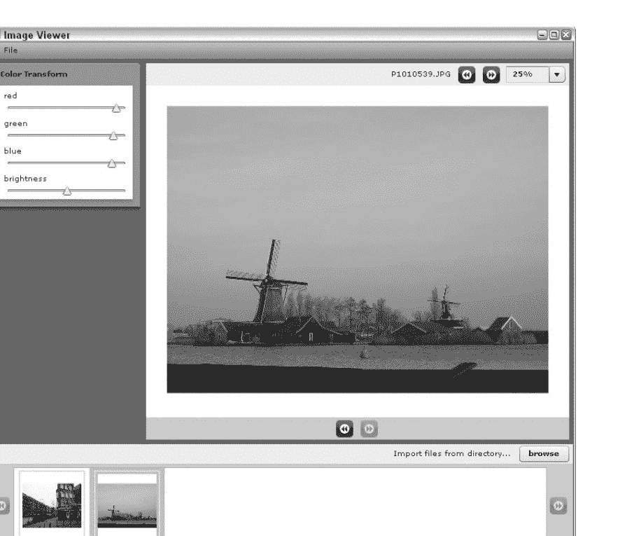

图 6-1

尝试使用色彩变换，创建你自己的图像处理工具，并享受其中吧！

## 总结

本章介绍了如何使用文件系统 API 和拖放 API 从用户的硬盘打开和保存文件，同时创建了一个用于查看和操作图像的应用程序。你在前面章节中对文件系统 API 的学习，有助于了解如何生成文件浏览器对话框以选择和打开多个文件，以及如何根据文件类型保存文件。

在查看了 `NativeDataManager` 类之后，你学习了如何使用静态方法和属性来执行拖放操作，以及如何处理从目标显示对象分派的 `NativeDragEvent` 对象。在关于保存图像的讨论中，你了解了 Flex 3.0 SDK 中可用的编解码器，并学习了如何使用 `File.writeBytes()` 方法将 `ByteArray` 数据添加到文件流缓冲区。

在下一章中，你将通过学习本地数据库来继续加深对 AIR 的理解，同时创建一个简单的日历与追踪器。

## HTML 与 CSS 编辑器

既然你已对 HTML 组件有了基本的了解，现在是时候围绕它来构建一个应用程序了，而一个完美的程序将是 HTML 和 CSS 编辑器。与第2章的文本编辑器一样，可以稳妥地假设每个人都有自己喜欢的 HTML 和 CSS 编辑器。为了使这个程序独一无二，你将在本章创建的应用程序将允许用户编辑任何网页（在线或离线）的 HTML 和 CSS。本质上，它将是一个非常基础的网络浏览器，具备编辑当前页面 HTML 和 CSS 源代码的能力。试想一下，在无需将所有资产保存到计算机上的情况下，编辑你喜爱网页源代码的可能性。

这个程序的主要目的是说明，操作加载到 AIR HTML 组件中的任何 HTML 页面的 JavaScript 文档对象模型（DOM）是多么容易。如果你的 JavaScript 技能还不够好，也不必担心，因为所有代码看起来都会非常熟悉。记住，ActionScript 和 JavaScript 都是基于 ECMAScript 的。该程序将使用与第2章相同的技术，使用户能够将编辑后的 HTML 和 CSS（它们只是纯文本文件）导出到他们的硬盘。

具体来说，该应用程序需要执行以下任务：

- 从 URL 加载并显示 HTML 页面。
- 从用户的硬盘加载并显示 HTML 页面。
- 显示已加载页面 `<BODY>` 标签内的 HTML 源代码。
- 显示来自已加载页面所有 CSS 样式的可选列表。
- 显示特定样式所有属性的可选列表。
- 使用户能够编辑当前页面的 HTML 源代码。
- 使用户能够为当前页面添加和编辑样式。
- 使用户能够为选定的样式添加、编辑和删除属性。
- 使用户能够将 HTML 和 CSS 源代码保存到他们的硬盘。
- 使用户能够恢复到原始源代码。

## 第7章：HTML 与 CSS 编辑器

既然你已经有了程序应执行的一系列清晰的操作，是时候评估你手头有哪些资源来实现这一特定功能了。

## 设计

你在前面的章节中已经学到了一些知识，这应该会使学习本章变得相对容易。具体来说，你学习了如何使用 `File` 和 `FileStream` 类将文本文件保存到用户的硬盘。你还学习了如何使用 AIR `HTML` 组件显示 HTML 格式的内容。除此之外，你现在将学习如何使用 `HTML` 组件的 `domWindow` 属性。该属性将作为你进入 JavaScript 世界的门户，进而使你能够充分利用其包含的所有方法和属性。最终，这个应用程序不仅将显示内容并允许用户在本地保存它，还将允许用户通过直接在 ActionScript 中内联访问适当的 JavaScript 方法和属性来动态编辑内容并更新显示。

根据前面列出的功能需求，该应用程序将需要以下组件：

- 应用程序外壳
- HTML 预览
- HTML 编辑器
- CSS 编辑器
- 地址栏

在抽象层面上，应用程序外壳将管理所有其他组件中所做的更改，并相应地更新 HTML 预览。它还将通过利用标签导航系统来管理显示，以便用户可以轻松地在预览、HTML 编辑器和 CSS 编辑器之间切换。

在开始任何操作之前，请在你的开发目录中创建一个名为 "HTML+CSS Editor" 的文件夹。与前面的章节一样，这将是你的应用程序的工作目录。

## 地址栏

地址栏可能是应用程序中最简单的组件，因此是一个很好的起点。该组件将允许用户输入网站 URL 或浏览其计算机硬盘以查找 HTML 文档。然后，路径或 URL 将被 AIR 的 `HTML` 组件实例用于更新其 `location` 属性。

打开你的编辑器并创建一个新文档。输入以下标记：

```
<?xml version="1.0" encoding="utf-8"?>
<mx:Canvas xmlns:mx="http://www.adobe.com/2006/mxml"
    width="800" height="42">

    <mx:Script><![CDATA[
```


# 第7章：HTML与CSS编辑器

```actionscript
import flash.filesystem.File;
import flash.net.FileFilter;
import mx.events.FlexEvent;
import mx.utils.StringUtil;
import mx.utils.URLUtil;

private var _currentFile:File;
private var _fileToOpen:File;

private function onNewLocation( $event:Event ):void
{
    if( StringUtil.trim( locationInput.text ).length == 0 )
        return;

    if( locationInput.text.search(/^http/) == -1 &&
        locationInput.text.indexOf("file:///") == -1 )
    {
        locationInput.text = "http://" + locationInput.text;
    }

    dispatchEvent( new Event( Event.CHANGE ) );
}

private function onBrowseBtnClick( event:MouseEvent ):void
{
    _fileToOpen = ( _currentFile ) ? _currentFile : File.documentsDirectory;

    var fileFilter:FileFilter = new FileFilter( "HTML", "*.htm;*.html" );

    try
    {
        _fileToOpen.browseForOpen( "Open", [fileFilter] );
        _fileToOpen.addEventListener( Event.SELECT, onFileOpenSelect );
    }
    catch( error:Error )
    {
        trace("Failed:", error.message);
    }
}

private function onFileOpenSelect( event:Event ):void
{
    _currentFile = File( event.target );
    locationInput.text = "file:///";
    locationInput.text += _currentFile.nativePath.split( "\\" ).join( "/" );
    onNewLocation( null );
}

public function get location():String
{
    return locationInput.text;
}

public function set location( v:String ):void
{
    locationInput.text = v;
}
```

```xml
]]></mx:Script>

    <mx:TextInput id="locationInput"
        left="10" top="10" right="136"
        enter="onNewLocation(event);"/>
    <mx:Button id="goBtn"
        width="42" y="10" right="86" label="Go"
        click="onNewLocation(event);"/>
    <mx:Button id="browseBtn"
        y="10" right="10" label="Browse"
        click="onBrowseBtnClick(event);"/>
</mx:Canvas>
```

将文件保存为 `AddressBar.mxml`，位于你的工作目录中的 `com/aircmr/htmlcsseditor/ui/` 目录下。

地址栏的界面非常简单。它只使用了一个 `TextInput` 组件和两个 `Button` 组件。其中一个标记为“Browse”的按钮允许用户浏览其硬盘驱动器以查找HTML文档：

```actionscript
private function onBrowseBtnClick( event:MouseEvent ):void
{
    _fileToOpen = ( _currentFile ) ? _currentFile : File.documentsDirectory;

    var fileFilter:FileFilter = new FileFilter( "HTML", "*.htm;*.html" );

    try
    {
        _fileToOpen.browseForOpen( "Open", [fileFilter] );
        _fileToOpen.addEventListener( Event.SELECT, onFileOpenSelect );
    }
    catch( error:Error )
    {
        trace("Failed:", error.message);
    }
}
```

前面的代码片段包含了“Browse”按钮 `CLICK` 事件的事件处理器。如果你读过前面的一些章节，这段代码应该看起来很熟悉。总结一下，系统会向用户呈现一个“Open”对话框，使他们能够浏览并选择一个HTML文件。选择文件后，会调用 `onFileOpenSelect` 事件处理函数。在这里，`TextInput` 组件会用所选文件的本地路径进行更新。请注意，本地路径中的反斜杠被转换为正斜杠，并且路径前添加了 `file:///`，以便该路径能与AIR的 `HTML` 组件兼容。

以下代码片段包含了 `onNewLocation` 函数：

```actionscript
private function onNewLocation( $event:Event ):void
{
    if( StringUtil.trim( locationInput.text ).length == 0 )
        return;

    if( locationInput.text.search(/^http/) == -1 &&
        locationInput.text.indexOf("file:///") == -1 )
    {
        locationInput.text = "http://" + locationInput.text;
    }

    dispatchEvent( new Event( Event.CHANGE ) );
}
```

每当用户指定新的URL或文件路径时，都会调用此函数。用户可以通过三种方式指定新的URL或文件路径：点击“Go”按钮、在 `TextInput` 组件获得焦点时按回车键，或从其硬盘驱动器中选择文件。经过一些快速且简单的错误检查后，该组件会触发一个 `CHANGE` 事件。该事件通知应用程序外壳，用户希望加载新的URL或文件。

这基本上涵盖了地址栏的重要功能。这个组件非常简单，并且可以轻松地在另一个使用HTML组件的应用程序中被重用或重新利用。在下一节中，你将学习如何创建HTML编辑器，这是本应用程序中另一个相对简单的组件。

## HTML编辑器

在这两个编辑器中，HTML编辑器是目前为止最不复杂的一个。从概念上讲，它是一个精简的文本编辑器，但你将对其进行一些自定义，以用于本应用程序的上下文中。首先，请注意HTML编辑器只允许用户编辑`<BODY>`标签内的HTML源代码，以防止用户编辑页面`<HEAD>`中的任何固有样式表代码。所有样式表编辑都将在CSS编辑器组件中处理。

编辑器不仅应该做显而易见的事情——允许用户编辑HTML源代码——它还应该执行以下操作：

- 当HTML预览应使用编辑过的源代码进行更新时，通知应用程序外壳（或任何其他组件）。
- 当用户希望恢复到原始源代码时，通知应用程序外壳。
- 允许用户将完整源代码保存到本地驱动器。
- 允许用户开启和关闭自动换行。

考虑到所有这些，现在是时候创建HTML编辑器了。

打开你的编辑器并创建一个新文档。输入以下标记：

```xml
<?xml version="1.0" encoding="utf-8"?>
<mx:Canvas xmlns:mx="http://www.adobe.com/2006/mxml">

    <mx:Script><![CDATA[
```

```actionscript
import flash.filesystem.File;
import flash.filesystem.FileMode;
import flash.filesystem.FileStream;
import flash.net.FileFilter;
import mx.controls.Alert;
import mx.utils.StringUtil;

private var _fileToSave:File;
private var _fileStream:FileStream;
private var _fullSource:String;
private var _sourceLoader:URLLoader;

private function onFileSaveSelect( event:Event ):void
{
    var temp:String = _fullSource.substring( _fullSource.indexOf("<body") );
    var iStart:int = _fullSource.indexOf("<body") + temp.indexOf( ">" ) + 1;
    var iEnd:int = _fullSource.indexOf("</body>");

    var firstPart:String = _fullSource.substring( 0, iStart );
    var endPart:String = _fullSource.substring( iEnd );

    var theSource:String = firstPart + sourceText.text + endPart;
    theSource = theSource.replace( /\r/g, "\n" );
    theSource = theSource.replace( /\n/g, File.lineEnding );

    _fileToSave = File( event.target );

    _fileStream = new FileStream();
    _fileStream.openAsync( _fileToSave, FileMode.WRITE );
    _fileStream.addEventListener( IOErrorEvent.IO_ERROR, onWriteIOError );
    _fileStream.writeUTFBytes( theSource );
    _fileStream.close();
}

private function onRevertBtnClick( event:MouseEvent ):void
{
    dispatchEvent( new Event( Event.CANCEL ) );
}

private function onSaveBtnClick( event:MouseEvent ):void
{
    _fileToSave = new File( File.documentsDirectory.nativePath + File.separator
        + "ExportedHTML.html" );

    try
    {
        _fileToSave.browseForSave("Save As..");
        _fileToSave.addEventListener( Event.SELECT, onFileSaveSelect );
    }
    catch( error:Error )
    {
        trace("Failed:", error.message);
    }
}

private function onFullSourceLoaded( event:Event ):void
{
    _fullSource = String( _sourceLoader.data );
    saveBtn.enabled = true;
}

private function onUpdateBtnClick( event:MouseEvent ):void
{
    dispatchEvent( new Event( Event.CHANGE ) );
}

private function onWriteIOError( event:IOErrorEvent ):void
{
    Alert.show("The specified file cannot be saved.", "Error", Alert.OK, this);
}

public function clear():void
{
    sourceText.text = "";
    saveBtn.enabled = false;
    updateBtn.enabled = false;
    revertBtn.enabled = false;
    wrapBtn.enabled = false;
}

public function update( jsDoc:Object, url:String ):void
{
    _sourceLoader = new URLLoader();
    _sourceLoader.addEventListener( Event.COMPLETE, onFullSourceLoaded );
    _sourceLoader.load( new URLRequest( url ) );

    sourceText.text = StringUtil.trim( jsDoc.body.innerHTML );

    updateBtn.enabled = true;
    revertBtn.enabled = true;
    wrapBtn.enabled = true;
}

public function get sourceCode():String
{
    return sourceText.text;
}
```

```xml
]]></mx:Script>

<mx:VBox width="100%" height="100%" horizontalAlign="center">
    <mx:HBox width="100%" horizontalAlign="center">
        <mx:Button id="saveBtn"
            label="Save As..." enabled="false"
            click="onSaveBtnClick(event);" />
        <mx:Button id="updateBtn"
            label="Update" enabled="false"
            click="onUpdateBtnClick(event);" />
        <mx:Button id="revertBtn"
```


# 第7章：HTML 与 CSS 编辑器

```xml
<label="Revert" enabled="false"
    click="onRevertBtnClick(event);" />
</mx:HBox>
<mx:CheckBox id="wrapBtn"
    label="Word Wrap" enabled="false"
    change="{sourceText.wordWrap = !sourceText.wordWrap}"/>
<mx:TextArea id="sourceText"
    width="100%" height="100%" fontSize="14"
    fontFamily="Courier New" wordWrap="false"/>
</mx:VBox>
</mx:Canvas>
```

将文件保存为 HTMLEditor.mxml，置于工作目录下的 `com/aircmr/htmlcsseditor/ui/` 目录中。

显然，前两个步骤已经完整地设置了 HTML 编辑器组件。请注意此组件中一些特定于 Adobe AIR 的重要功能——首先是组件的 `update` 函数：

```actionscript
public function update( jsDoc:Object, url:String ):void
{
    _sourceLoader = new URLLoader();
    _sourceLoader.addEventListener( Event.COMPLETE, onFullSourceLoaded )
    _sourceLoader.load( new URLRequest( url ) );

    sourceText.text = StringUtil.trim( jsDoc.body.innerHTML );

    updateBtn.enabled = true;
    revertBtn.enabled = true;
    wrapBtn.enabled = true;
}
```

在此函数中，提取 `<BODY>` 标签之间的 HTML 源码并将其放入可编辑的文本字段，同时从原始 URL 获取完整源码。该函数需要两个参数。第一个是 HTML 页面 JavaScript 文档对象的引用；第二个是页面的 URL。使用 JavaScript 文档对象，函数获取 DOM 的 `body.innerHTML` 属性。该属性是一个字符串，包含当前页面 `<BODY>` 标签内的所有 HTML 代码，用作在 TextArea 组件中显示的源代码。最后，由于无法通过 JavaScript 访问页面的完整 HTML 源码，当前页面的 URL 作为第二个参数发送，并使用 URLLoader 获取完整源码。

此组件中还包含一些代码，允许用户将完整源码作为 HTML 文件保存到硬盘。如果你构建过第2章中的简单文本编辑器程序，这应该看起来非常熟悉。这里唯一的区别是，在保存到文件之前，文本是通过用编辑后的源码替换原始源码来准备的。

除了已经介绍的 AIR 特定功能外，剩余的代码应该是不言自明的。注意，组件会派发两个通用事件，以便在用户想要更新 HTML 或恢复原始源码时通知最终将成为应用程序外壳的部分。这基本涵盖了 HTML 编辑器的重要部分，所以是时候转向稍微复杂一些的 CSS 编辑器了。

## CSS 编辑器

如前所述，CSS 编辑器比 HTML 编辑器稍微复杂一些，但这纯粹是出于选择。当然，CSS 编辑器可以像 HTML 编辑器一样，只是一个普通的可编辑文本区域，但那样有什么意思呢？更不用说，按样式、按属性更新 CSS 会容易得多。换句话说，编辑器不会一次性使用一个长字符串更新所有 CSS，而是会在样式或样式属性被编辑时通知应用程序外壳。最终，CSS 编辑器应执行以下任务：

-   允许用户查看和编辑当前页面的所有样式。
-   允许用户查看、编辑和删除任何给定样式的属性。
-   允许用户将 CSS 源码保存到硬盘。
-   当用户修改了样式和样式属性时，通知应用程序外壳。
-   当用户想要恢复原始源码时，通知应用程序外壳。

这与 HTML 编辑器非常相似，但 CSS 数据的管理方式会有所不同。具体来说，将使用 Flex List 组件而不是纯文本区域来显示和管理 CSS 样式，并使用 Flex DataGrid 组件来显示和管理所选样式的属性。

## 管理 CSS 数据

因为此组件使用更可视化的方法，所以有必要将 CSS 数据抽象为 ActionScript 中可管理的内容。在以下步骤中，你将创建两个数据类来帮助组织 CSS 信息：

1.  打开编辑器并创建一个新文档。输入以下标记：

```actionscript
package com.aircmr.htmlcsseditor.data
{
    public class CSSStyle
    {
        private var _styleSheetIndex:Number;
        private var _cssRuleIndex:Number;
        private var _selector:String;

        [Bindable]
        private var _properties:Array;

        public function CSSStyle( styleSheetID:Number, cssRuleID:Number,
                                  selector:String, properties:Array )
        {
            _styleSheetIndex = styleSheetID;
            _cssRuleIndex = cssRuleID;
            _selector = selector;
            _properties = properties;
        }
```

```actionscript
        public function addProperty( prop:CSSStyleProperty ):void
        {
            _properties.push( prop );
        }

        public function deleteProperty( prop:CSSStyleProperty ):void
        {
            _properties.splice( getPropertyIndex( prop ), 0 );
        }

        public function getPropertyIndex( prop:CSSStyleProperty ):Number
        {
            var result:Number = -1;
            for( var i:Number = 0; i < _properties.length; i++ )
            {
                if( prop == _properties[i] )
                {
                    result = i;
                    break;
                }
            }
            return result;
        }

        public function getStyleText( lineBreaks:Boolean = false,
                                       tabs:Boolean = false ):String
        {
            var buffer:String = _selector + " { ";
            if( lineBreaks ) buffer += "\n";
            
            for( var i:Number = 0; i < _properties.length; i++ )
            {
                if( tabs ) buffer +="\t";
                var prop:CSSStyleProperty = _properties[i];
                buffer += prop.name + ": " + prop.value + "; ";
                if( lineBreaks ) buffer += "\n";
            }
            
            buffer += "}";
            return buffer;
        }

        public function get styleSheetIndex():Number { return _styleSheetIndex; }
        public function get cssRuleIndex():Number { return _cssRuleIndex; }
        public function get selector():String { return _selector; }
        public function get properties():Array { return _properties; }

    }
}
```

2.  将文件保存为 CSSStyle.as，置于工作目录下的 `com/aircmr/htmlcsseditor/data/` 目录中。
3.  打开编辑器并创建一个新文档。输入以下标记：

```actionscript
package com.apolloir.htmlcsseditor.data
{
    public class CSSStyleProperty
    {
        private var _name:String;
        private var _value:String;

        public function CSSStyleProperty( name:String, value:String = "" )
        {
            _name = name;
            _value = value;
        }

        public function get name():String { return _name; }
        public function get value():String { return _value; }
        public function set value( v:String ):void { _value = v; }
    }
}
```

4.  将文件保存为 `CSSStyleProperty.as`，置于工作目录下的 `com/aircmr/htmlcsseditor/data/` 目录中。

在步骤 1 和 2 中，你创建了 `CSSStyle` 类。此类的目的是为应用程序抽象 CSS 样式的相关数据，以便可以在 ActionScript 中进行管理。如果你不熟悉 JavaScript 或如何通过 DOM 访问 CSS 信息，你可能会想知道此类中的属性是做什么的。简而言之，`styleSheetIndex` 和 `cssRuleIndex` 是它们在 DOM 中各自数组的索引引用。保存此信息在用户以任何方式修改或添加样式或其属性时将特别方便。类中还包括一些有用的方法，用于添加和删除样式的属性，以及仅获取样式属性的原始文本。

在步骤 3 和 4 中，你创建了 `CSSStyleProperty` 类。此类简单地表示一个 CSS 样式的属性。因此，一个 `CSSStyle` 对象还包含一个 `CSSStyleProperty` 对象数组。该数组最终将成为前述 `DataGrid` 组件的数据提供者。

现在，因为编辑器需要在用户修改或添加样式或属性时通知应用程序外壳，所以需要一个自定义事件对象。此事件对象必须包含有关修改后的样式或属性的信息。打开编辑器并创建一个新文档。输入以下标记：

```actionscript
package com.apolloir.htmlcsseditor.events
{
    import flash.events.Event;
    import com.apolloir.htmlcsseditor.data.CSSStyle;
    import com.apolloir.htmlcsseditor.data.CSSStyleProperty;

    public class CSSEditorEvent extends Event
    {
        public static const ADD_STYLE:String = "addStyle";
        public static const CHANGE_PROPERTY:String = "changeProperty";
```


## 第7章：HTML与CSS编辑器

```actionscript
public var affectedStyle:CSSStyle;
public var affectedProperty:CSSStyleProperty;

public function CSSEditorEvent( type:String, style:CSSStyle,
                                 prop:CSSStyleProperty = null )
{
    super( type );
    affectedStyle = style;
    affectedProperty = prop;
}
}
}
```

将文件保存为 `CSSEditorEvent.as`，存放在你工作目录下的 `com/a/htmlcssexitor/events/` 目录中。

`CSSEditorEvent` 类将在MXML组件（你即将构建）中，当用户修改或添加样式或属性时被使用。该类的静态属性描述了CSS编辑器将要派发的三种事件类型。每种事件类型都需要应用程序外壳执行略微不同的操作，但所有三种事件类型都只需要引用被修改的样式和/或属性，这些可以通过事件对象的 `affectedStyle` 和 `affectedProperty` 属性来访问。

随着数据类和自定义事件类的完成，现在是时候转向MXML组件并好好利用所有这些功能了。

## 用户界面与逻辑

再次与HTML编辑器相比，CSS编辑器在逻辑和用户界面（UI）方面都更为复杂。如前所述，该UI的核心部分将是一个用于样式列表的 `List` 组件和一个用于所选样式属性列表的 `DataGrid` 组件。这两者都配有一组按钮，允许用户修改相应的数据。其中一些按钮会触发提示，特别是在用户想要添加样式或属性，或查看完整CSS源代码时。

除了增强的UI之外，逻辑也稍长一些。这是因为组件不是简单地读取DOM中的某个属性，而是必须解析样式表数据并将其转换为你创建的友好的数据对象。正如你将看到的，这个组件是整合JavaScript与ActionScript的绝佳示例。

1.  打开你的编辑器并创建一个新文档。输入以下标记：

```xml
<?xml version="1.0" encoding="utf-8"?>
<mx:Panel xmlns:mx="http://www.adobe.com/2006/mxml"
    width="300" height="120" title="添加样式"
    borderColor="#EAEAEA" borderAlpha="1">

    <mx:Script><![CDATA[

    import com.aircmr.htmlcssexitor.data.CSSStyle;
    import mx.managers.PopUpManager;
    import mx.utils.StringUtil;

    private var _value:CSSStyle;
    private var _styleSheetIndex:Number;
    private var _cssRuleIndex:Number;

    public static function show():AddStylePrompt
    {
        var prompt:AddStylePrompt =
            AddStylePrompt( PopUpManager.createPopUp(
                DisplayObject( mx.core.Application.application ),
                AddStylePrompt, true ) );

        PopUpManager.centerPopUp( prompt );
        return prompt;
    }

    public function init( styleSheetIndex:Number, cssRuleIndex:Number ):void
    {
        _styleSheetIndex = styleSheetIndex;
        _cssRuleIndex = cssRuleIndex;
    }

    private function onAddBtnClick( event:MouseEvent ):void
    {
        _value = new CSSStyle( _styleSheetIndex, _cssRuleIndex,
                                 selectorInput.text, [ ] );
        dispatchEvent( new Event( Event.SELECT ) );
        PopUpManager.removePopUp(this);
    }

    private function onCancelBtnClick( event:MouseEvent ):void
    {
        dispatchEvent( new Event( Event.CANCEL ) );
        PopUpManager.removePopUp( this );
    }

    public function get value():CSSStyle
    {
        return _value;
    }

    ]]></mx:Script>

    <mx:VBox horizontalAlign="center" width="100%" height="100%" paddingTop="10">
        <mx:HBox width="100%" horizontalAlign="left" verticalAlign="middle">
            <mx:Text fontWeight="bold" text="选择器：" paddingLeft="10"/>
            <mx:TextInput id="selectorInput" width="200" />
        </mx:HBox>
        <mx:HBox width="100%" horizontalAlign="center" paddingTop="10">
            <mx:Button id="addBtn" label="添加样式"
                enabled="{(selectorInput.text.length > 0)}"
                click="onAddBtnClick(event)" />
            <mx:Button id="cancelBtn" label="取消"
                click="onCancelBtnClick(event)" />
        </mx:HBox>
    </mx:VBox>
</mx:Panel>
```

2.  将文件保存为 `AddStylePrompt.mxml`，存放在你工作目录下的 `com/aircmr/htmlcsseditor/prompts/` 目录中。

3.  创建另一个新文档并输入以下标记：

```xml
<?xml version="1.0" encoding="utf-8"?>
<mx:Panel xmlns:mx="http://www.adobe.com/2006/mxml"
    width="300" height="150" title="添加属性"
    borderColor="#EAEAEA" borderAlpha="1">

    <mx:Script><![CDATA[

        import com.aircmr.htmlcsseditor.data.CSSStyleProperty;
        import mx.managers.PopUpManager;
        import mx.utils.StringUtil;

        private var _value:CSSStyleProperty;

        public static function show():AddPropertyPrompt
        {
            var prompt:AddPropertyPrompt =
                AddPropertyPrompt( PopUpManager.createPopUp(
                    DisplayObject( mx.core.Application.application ),
                    AddPropertyPrompt, true ) );

            PopUpManager.centerPopUp( prompt );
            return prompt;
        }

        private function onAddBtnClick( event:MouseEvent ):void
        {
            var name:String = StringUtil.trim( nameInput.text );
            var value:String = StringUtil.trim( valueInput.text );
            _value = new CSSStyleProperty( name, value );
            dispatchEvent( new Event( Event.SELECT ) );
            PopUpManager.removePopUp(this);
        }

        private function onCancelBtnClick( event:MouseEvent ):void
        {
            dispatchEvent( new Event( Event.CANCEL ) );
            PopUpManager.removePopUp( this );
        }

        public function get value():CSSStyleProperty
        {
            return _value;
        }

    ]]></mx:Script>

    <mx:VBox horizontalAlign="center" width="100%" height="100%" paddingTop="10">
        <mx:HBox width="100%" horizontalAlign="left" verticalAlign="middle">
            <mx:Text fontWeight="bold" text="名称：" paddingLeft="10"/>
            <mx:TextInput id="nameInput" width="200" />
        </mx:HBox>
        <mx:HBox width="100%" horizontalAlign="left" verticalAlign="middle">
            <mx:Text fontWeight="bold" text="值：" paddingLeft="10"/>
            <mx:TextInput id="valueInput" width="200" />
        </mx:HBox>
        <mx:HBox width="100%" horizontalAlign="center" paddingTop="10">
            <mx:Button id="addBtn" label="添加属性"
                enabled="{{nameInput.text.length > 0}}"
                click="onAddBtnClick(event)" />
            <mx:Button id="cancelBtn" label="取消"
                click="onCancelBtnClick(event)" />
        </mx:HBox>
    </mx:VBox>
</mx:Panel>
```

4.  将文件保存为 `AddPropertyPrompt.mxml`，存放在你工作目录下的 `com/aircmr/htmlcsseditor/prompts/` 目录中。

5.  创建另一个新文档并输入以下标记：

```xml
<?xml version="1.0" encoding="utf-8"?>
<mx:TitleWindow xmlns:mx="http://www.adobe.com/2006/mxml"
    layout="absolute" width="800" height="600"
    title="CSS源码" showCloseButton="true"
    horizontalAlign="center" verticalAlign="middle"
    borderColor="#EAEAEA" borderAlpha="1"
    close="onClose(event)">

    <mx:Script><![CDATA[

import flash.filesystem.File;
import flash.filesystem.FileMode;
import flash.filesystem.FileStream;
import flash.net.FileFilter;
import mx.controls.Alert;
import mx.managers.PopUpManager;

private var _fileToSave:File;
private var _fileStream:FileStream;

public static function show():CSSSourceWindow
{
    var prompt:CSSSourceWindow =
        CSSSourceWindow( PopUpManager.createPopUp(
            DisplayObject( mx.core.Application.application ),
            CSSSourceWindow, true ) );

    PopUpManager.centerPopUp( prompt );
    return prompt;
}

private function onClose( event:Event ):void
{
    PopUpManager.removePopUp(this);
}

private function onFileSaveSelect( event:Event ):void
{
    var theText:String = cssSource.text;
    theText = theText.replace( /\r/g, "\n" );
    theText = theText.replace( /\n/g, File.lineEnding );

    _fileToSave = File( event.target );

    _fileStream = new FileStream();
    _fileStream.openAsync( _fileToSave, FileMode.WRITE );
    _fileStream.addEventListener( IOErrorEvent.IO_ERROR, onWriteIOError );
    _fileStream.writeUTFBytes( theText );
    _fileStream.close();
}

private function onSaveBtnClick( event:MouseEvent ):void
{
    _fileToSave = new File( File.documentsDirectory.nativePath + File.separator
        + "ExportedCSS.css" );

    try
    {
        _fileToSave.browseForSave("另存为...");
        _fileToSave.addEventListener( Event.SELECT, onFileSaveSelect );
    }
    catch( error:Error )
    {
        trace("Failed:", error.message);
    }
}

private function onWriteIOError( event:IOErrorEvent ):void
{
    Alert.show("无法保存指定的文件。", "错误", Alert.OK, this);
}

public function set source( v:String ):void
{
    cssSource.text = v;
}
]]></mx:Script>
    <mx:VBox width="100%" height="100%" paddingTop="5" horizontalAlign="left">
        <mx:Button id="saveBtn" label="另存为..."
            click="onSaveBtnClick(event)" />
        <mx:TextArea id="cssSource"
```


## 第7章：HTML 和 CSS 编辑器

```xml
            width="100%" height="100%"
            selectable="true" editable="false">
        </mx:TextArea>
    </mx:VBox>
</mx:TitleWindow>
```

6.  将文件保存为 `CSSSourceWindow.mxml`，位于你的工作目录中的 `com/aircmr/htmlcsseditor/prompts/` 路径下。

7.  创建另一个新文档并输入以下标记：

```xml
<?xml version="1.0" encoding="utf-8"?>
<mx:Canvas xmlns:mx="http://www.adobe.com/2006/mxml"
    width="400" height="600" creationComplete="init();">

    <mx:Script><![CDATA[

        import com.aircmr.htmlcsseditor.data.CSSStyle;
        import com.aircmr.htmlcsseditor.data.CSSStyleProperty;
        import com.aircmr.htmlcsseditor.events.CSSEditorEvent;
        import com.aircmr.htmlcsseditor.prompts.AddStylePrompt;
        import com.aircmr.htmlcsseditor.prompts.AddPropertyPrompt;
        import com.aircmr.htmlcsseditor.prompts.CSSSourceWindow;
        import mx.controls.TextInput;
        import mx.events.DataGridEvent;
        import mx.managers.PopUpManager;
        import mx.utils.StringUtil;

        private var _addStylePrompt:AddStylePrompt;
        private var _addPropertyPrompt:AddPropertyPrompt;
        private var _selectedStyle:CSSStyle;
        private var _selectedProperty:CSSStyleProperty;
        private var _nextCSSRuleIndex:Number;

        [Bindable]
        private var _listData:Array;

        [Bindable]
        private var _gridData:Array;

        private function init():void
        {
            clear();

            viewSourceBtn.addEventListener( MouseEvent.CLICK, onViewSourceBtnClick );
            addStyleBtn.addEventListener( MouseEvent.CLICK, onAddStyleBtnClick );
            revertBtn.addEventListener( MouseEvent.CLICK, onRevertBtnClick );
            addPropBtn.addEventListener( MouseEvent.CLICK, onAddPropBtnClick );
            delPropBtn.addEventListener( MouseEvent.CLICK, onDelPropBtnClick );
            styleList.addEventListener( Event.CHANGE, onListChange );
            propertyGrid.addEventListener( DataGridEvent.ITEM_EDIT_END, onItemEditEnd );
            propertyGrid.addEventListener( Event.CHANGE, onGridChange );
        }

        private function onAddStyleBtnClick( event:MouseEvent ):void
        {
            _addStylePrompt = AddStylePrompt.show();
            _addStylePrompt.init( 0, this._nextCSSRuleIndex );
            _addStylePrompt.addEventListener( Event.SELECT, onAddStylePromptSelect );
        }

        private function onAddPropBtnClick( event:MouseEvent ):void
        {
            _addPropertyPrompt = AddPropertyPrompt.show();
            _addPropertyPrompt.addEventListener( Event.SELECT, onAddPropPromptSelect );
        }

        private function onDelPropBtnClick( event:MouseEvent ):void
        {
            var selectedIndex:Number = propertyGrid.selectedIndex;
            var deletedProperty:CSSStyleProperty = CSSStyleProperty(
                propertyGrid.selectedItem );
            deletedProperty.value = "";

            var tempList:Array = _gridData;
            tempList.splice( selectedIndex, 1 );

            clearPropertyGrid();
            _gridData = tempList;

            dispatchEvent( new CSSEditorEvent( CSSEditorEvent.CHANGE_PROPERTY,
                _selectedStyle, deletedProperty ) );
        }

        private function onViewSourceBtnClick( event:MouseEvent ):void
        {
            var buffer:String = "";

            for( var i:Number = 0; i < _listData.length; i++ )
            {
                buffer +=  CSSStyle( _listData[i].data ).getStyleText( true, true )
                    + "\n\n";
            }

            var prompt:CSSSourceWindow = CSSSourceWindow.show();
            prompt.source = buffer;
        }

        private function onRevertBtnClick( event:MouseEvent ):void
        {
            dispatchEvent( new Event( Event.CANCEL ) );
        }

        private function onAddStylePromptSelect( event:Event ):void
        {
            var newStyle:CSSStyle = _addStylePrompt.value;
            var newListItem:Object = new Object();
            var toAdd:Array = [newListItem];
            newListItem.label = newStyle.selector;
            newListItem.data = newStyle;

            _listData = toAdd.concat( _listData );
            clearPropertyGrid();
            _nextCSSRuleIndex++

            dispatchEvent( new CSSEditorEvent( CSSEditorEvent.ADD_STYLE, newStyle ) );
        }

        private function onAddPropPromptSelect( event:Event ):void
        {
            var newProp:CSSStyleProperty = _addPropertyPrompt.value;
            _selectedStyle.addProperty( newProp );
            _gridData = null;
            _gridData = _selectedStyle.properties;
            dispatchEvent( new CSSEditorEvent( CSSEditorEvent.CHANGE_PROPERTY,
                                               _selectedStyle, newProp ) );
        }

        private function onItemEditEnd( event:DataGridEvent ):void
        {
            var newValue:String = StringUtil.trim( TextInput(
                propertyGrid.itemEditorInstance ).text );

            if( newValue.length < 1 )
            {
                propertyGrid.destroyItemEditor()
                event.preventDefault();
            }
            else
            {
                _selectedProperty.value = newValue;
            }

            dispatchEvent( new CSSEditorEvent( CSSEditorEvent.CHANGE_PROPERTY,
                                               _selectedStyle, _selectedProperty ) );
        }

        private function onGridChange( event:Event ):void
        {
            _selectedProperty = CSSStyleProperty( propertyGrid.selectedItem );
        }

        private function onListChange( event:Event ):void
        {
            if( styleList.selectedItem )
            {
                _selectedStyle = styleList.selectedItem.data;
                _gridData = _selectedStyle.properties;
            }
            else
            {
                clearPropertyGrid();
            }
        }

        private function clearPropertyGrid():void
        {
            _gridData = null;
            _selectedProperty = null;
        }

        private function clearStyleList():void
        {
            _listData = null;
            _selectedStyle = null;

        }

        public function clear():void
        {
            _nextCSSRuleIndex = 0;
            clearStyleList();
            clearPropertyGrid();
        }

        public function update( jsDoc:Object ):void
        {
            clear();

            _listData = new Array();

            if( jsDoc.styleSheets.length > 0 )
            {
                _nextCSSRuleIndex = jsDoc.styleSheets[0].cssRules.length;

                for( var i:int = 0; i < jsDoc.styleSheets.length; i++ )
                {
                    for( var j:int = 0; j < jsDoc.styleSheets[i].cssRules.length; j++ )
                    {
                        try
                        {
                            var selector:String =
                                jsDoc.styleSheets[i].cssRules[j].selectorText;
                            var styleText:String =
                                jsDoc.styleSheets[i].cssRules[j].style.cssText;
                        }
                        catch( error:Error ) { }

                        if( styleText != null && selector != null )
                        {
                            var styleProperties:Array = new Array();
                            var styleItems:Array = styleText.split( ";" );

                            for ( var k:int = 0; k < styleItems.length; ++k)
                            {
                                var prop:Array = String( styleItems[k] ).split( ":" );
                                if( prop.length == 2 )
                                {
                                    var propName:String = StringUtil.trim( prop[0] );
                                    var propValue:String = StringUtil.trim( prop[1] );

                                    var newCSSStyleProperty:CSSStyleProperty =
                                        new CSSStyleProperty( propName, propValue );
                                    styleProperties.push( newCSSStyleProperty );
                                }
                            }

                            var newCSSStyle:CSSStyle =
                                new CSSStyle( i, j, selector, styleProperties );

                            var newListItem:Object = new Object();
                            newListItem.label = selector;
                            newListItem.data = newCSSStyle;

                            _listData.push( newListItem );
                        }
                    }
                }
            }
        }

        public function get selectedProperty():CSSStyleProperty
        {
            return _selectedProperty;
        }

        public function get selectedStyle():CSSStyle
        {
            return _selectedStyle;
        }

        ]]></mx:Script>

        <mx:HDividedBox width="100%" height="100%">
            <mx:VBox width="100%" height="100%">
                <mx:HBox width="100%" horizontalAlign="center">
                    <mx:Button id="viewSourceBtn" label="查看源码"
                        enabled="{{_listData != null}}" />
                    <mx:Button id="addStyleBtn" label="添加样式"
                        enabled="{{_listData != null}}" />
                    <mx:Button id="revertBtn" label="还原"
                        enabled="{{_listData != null}}" />
                </mx:HBox>
                <mx:List id="styleList" width="100%" height="100%"
                    alternatingItemColors="[#FFFFFF, #F6F6F6]"
                    dataProvider="{_listData}">
                </mx:List>
            </mx:VBox>
            <mx:VBox width="100%" height="100%">
                <mx:HBox width="100%" horizontalAlign="center">
```


## 第7章：HTML 与 CSS 编辑器

```xml
<mx:Button id="addPropBtn" label="添加属性"
    enabled="{{_gridData != null}}" />
<mx:Button id="delPropBtn" label="删除属性"
    enabled="{{propertyGrid.selectedIndex > -1}}" />
</mx:HBox>
<mx:DataGrid id="propertyGrid"
    width="100%" height="100%" sortableColumns="false"
    editable="true" dataProvider="{_gridData}">
    <mx:columns>
        <mx:DataGridColumn headerText="属性"
            dataField="name" editable="false"/>
        <mx:DataGridColumn headerText="值"
            dataField="value" editable="true"/>
    </mx:columns>
</mx:DataGrid>
</mx:VBox>
</mx:HDividedBox>
</mx:Canvas>
```

8.  将文件保存为 `CSSEditor.mxml`，存放路径为你工作目录下的 `com/aircmr/htmlcseditor/ui/` 目录。

这是一段相当多的代码。你会很高兴地得知，并且希望你已经意识到，在前面八个步骤中，你创建了整个 CSS 编辑器及其支持组件。这包括了所有必要的逻辑和用户界面元素。在步骤1到4中，你创建了两个重要的提示框，使用户既能添加新样式，也能为选定的样式添加属性。这两个提示框使用一种特定的弹出方式显示给用户：

```actionscript
public static function show():AddStylePrompt
{
    var prompt:AddStylePrompt =
        AddStylePrompt( PopUpManager.createPopUp(
            DisplayObject( mx.core.Application.application ),
            AddStylePrompt, true ) );

    PopUpManager.centerPopUp( prompt );

    return prompt;
}
```

前面这段代码片段来自 `AddStylePrompt.mxml` 中的静态 `show` 函数。在应用程序上下文中，该提示框会在需要时出现，以便用户输入新的样式信息。此外，当提示框显示时，其下方的任何内容都会被禁用并略微模糊，以便用户能全神贯注于（非常简单的）手头任务。这是通过使用 Flex 的 `PopUpManager` 类实现的。这是一个非常方便的类，使得创建弹出窗口、警告框等变得极其简单。查阅另外两个提示框的代码，注意它们都使用了相同的显示技术。还要注意前两个提示框利用了你的 CSS 数据类：`CSSStyle` 和 `CSSStyleProperty`。

以下代码片段同样来自 `AddStylePrompt.mxml`：

```actionscript
public function init( styleSheetIndex:Number, cssRuleIndex:Number ):void
{
    _styleSheetIndex = styleSheetIndex;
    _cssRuleIndex = cssRuleIndex;
}

private function onAddBtnClick( event:MouseEvent ):void
{
    _value = new CSSStyle( _styleSheetIndex, _cssRuleIndex,
                           selectorInput.text, [] );

    dispatchEvent( new Event( Event.SELECT ) );
    PopUpManager.removePopUp(this);
}
```

在这里你可以看到一个 `init` 函数。这个函数是必需的，以便在 `onAddBtnClick` 事件处理函数中创建可能的新 `CSSStyle` 对象之前，可以指定一些数据。在这种情况下，指定样式应添加到的样式表索引以及 CSS 规则的索引非常重要，因为用户创建的任何新样式还不是 DOM 的一部分。碰巧在这个应用程序中，任何新样式都添加到 DOM 的第一个样式表。然而，有必要通过每次添加样式时递增来管理规则索引。这发生在 `CSSEditor.mxml` 中。稍后会详细说明。

`CSSSourceWindow` 提示框，尽管它可能看起来不像你常见的普通提示框，是在步骤5和6中创建的。这个提示框，或者也许我们应该说弹出窗口，使用户能够查看所有 CSS 源代码，并且如果愿意，可以将其保存到他们的计算机上。和以前一样，你应该能认出这个简单的文件保存功能。现在提示框部分已经讲完，你可以专注于 AIR 特定的功能：

```actionscript
public function update( jsDoc:Object ):void
{
    clear();

    _listData = new Array();

    if( jsDoc.styleSheets.length > 0 )
    {
        _nextCSSRuleIndex = jsDoc.styleSheets[0].cssRules.length;

        for( var i:int = 0; i < jsDoc.styleSheets.length; i++ )
        {
            for( var j:int = 0; j < jsDoc.styleSheets[i].cssRules.length; j++ )
            {
                try
                {
                    var selector:String =
                        jsDoc.styleSheets[i].cssRules[j].selectorText;
                    var styleText:String =
                        jsDoc.styleSheets[i].cssRules[j].style.cssText;
                }
                catch( error:Error ) { }

                if( styleText != null && selector != null )
                {
                    var styleProperties:Array = new Array();
                    var styleItems:Array = styleText.split( ";" );

                    for ( var k:int = 0; k < styleItems.length; ++k)
                    {
                        var prop:Array = String( styleItems[k] ).split( ":" );

                        if( prop.length == 2 )
                        {
                            var propName:String = StringUtil.trim( prop[0] );
                            var propValue:String = StringUtil.trim( prop[1] );

                            var newCSSStyleProperty:CSSStyleProperty =
                                new CSSStyleProperty( propName, propValue );

                            styleProperties.push( newCSSStyleProperty );
                        }
                    }

                    var newCSSStyle:CSSStyle =
                        new CSSStyle( i, j, selector, styleProperties );

                    var newListItem:Object = new Object();
                    newListItem.label = selector;
                    newListItem.data = newCSSStyle;

                    _listData.push( newListItem );
                }
            }
        }
    }
}
```

前面的代码片段来自 `CSSEditor.mxml`，这是你在步骤7和8中创建的。与 HTML 编辑器类似，CSS 编辑器也包含一个 `update` 函数。这个函数通过解析从提供的 DOM 中获取的所有 CSS 数据来设置编辑器的所有数据。这个函数比较复杂，因此接下来的段落将进一步分解说明。

回想一下 `AddStylePrompt` 组件需要通过几个参数进行初始化。其中一个参数用于指定样式的 CSS 规则索引。因此，在任何解析开始之前，起始索引由第一个样式表中的 CSS 规则数量决定，并存储在组件的 `_nextCSSRuleIndex` 变量中：

```actionscript
_nextCSSRuleIndex = jsDoc.styleSheets[0].cssRules.length;
```

初始的 `for` 循环遍历 DOM 的 `styleSheets` 数组属性。该数组中的每个项目对应一个不同的 JavaScript `styleSheet` 对象。接下来的循环遍历每个 `styleSheet` 对象的 `cssRules` 数组属性（记住你在这里处理的是 JavaScript）。JavaScript 中的 `cssRule` 对象包含两个你将用来获取样式数据和属性数据的属性。首先，`selectorText` 属性直接对应你的 `CSSStyle` 对象的 `selector` 属性：

```actionscript
var selector:String = jsDoc.styleSheets[i].cssRules[j].selectorText;
```

其次，因为没有一个容易访问的数组包含样式的所有属性，你必须进一步深入，使用 CSS 规则的 `style` 属性的 `cssText` 属性：

```actionscript
var styleText:String = jsDoc.styleSheets[i].cssRules[j].style.cssText;
```

知道这个字符串包含由分号分隔的样式属性（并假设该字符串不包含任何语法错误），可以使用数组的 `split` 方法将其转换为数组：

```actionscript
var styleItems:Array = styleText.split( ";" );
```

然后循环遍历这个数组，其中的每个字符串通过再次使用数组的 `split` 方法转换成一个更小的数组，其中属性名和值由冒号分隔：

```actionscript
var propName:String = StringUtil.trim( prop[0] );
var propValue:String = StringUtil.trim( prop[1] );

var newCSSStyleProperty:CSSStyleProperty =
    new CSSStyleProperty( propName, propValue );
styleProperties.push( newCSSStyleProperty );
```

生成的数组用于创建一个新的 `CSSStyleProperty` 对象，并将其推入一个临时数组。包含所有属性的最终数组用于创建 `CSSStyle` 对象：

```actionscript
var newCSSStyle:CSSStyle = new CSSStyle( i, j, selector, styleProperties );
```

最后但同样重要的是，对于这个函数，创建一个通用对象数组，用作 `List` 组件的数据提供者：

```actionscript
var newListItem:Object = new Object();
newListItem.label = selector;
newListItem.data = newCSSStyle;

_listData.push( newListItem );
```

`update` 函数是 CSS 编辑器中的一个重要函数，但事件处理函数也同样重要。事件处理函数解释用户与界面之间的交互，并在用户添加、修改或删除 CSS 样式和属性时分发事件。例如，当用户点击添加样式按钮（其适当命名为 `addStyleBtn`）时，用户会看到 `AddStylePrompt` 弹出窗口，他们输入新的样式信息，然后在点击确定按钮后，新样式被添加到显示列表，并且组件分发一个事件通知其他组件样式已被添加：

```actionscript
private function onAddStyleBtnClick( event:MouseEvent ):void
{
    _addStylePrompt = AddStylePrompt.show();
    _addStylePrompt.init( 0, this._nextCSSRuleIndex );
    _addStylePrompt.addEventListener( Event.SELECT, onAddStylePromptSelect );
}
```


## 第七章：HTML 与 CSS 编辑器

对提示框的引用保存在 `_addStylePrompt` 变量中，因此可以调用其自身的一些方法。此处，调用 `init` 函数来指定一些初始样式数据，并设置了一个事件处理程序，以便在用户点击确定按钮时执行：

```
private function onAddStylePromptSelect( event:Event ):void
{
    var newStyle:CSSStyle = _addStylePrompt.value;

    var newListItem:Object = new Object();
    newListItem.label = newStyle.selector;
    newListItem.data = newStyle;

    var toAdd:Array = [newListItem];
    _listData = toAdd.concat( _listData );

    clearPropertyGrid();

    _nextCSSRuleIndex++;

    dispatchEvent( new CSSEditorEvent( CSSEditorEvent.ADD_STYLE, newStyle ) );
}
```

上述代码片段包含前面提到的事件处理程序。新的 `CSSStyle` 对象在其从显示列表中移除之前，从提示框中检索出来。然后，它被放入一个新的通用对象中，并被添加到显示列表数据提供程序的开头。随后，CSS 规则索引递增一，这样下次添加样式时，就不会覆盖任何内容。

你现在终于用上了之前创建的自定义事件类。出于显而易见的原因，使用了 `ADD_STYLE` 事件。因此，它要求你将最近受影响的样式指定为其第三个参数。最终，此事件将在需要将样式添加到 DOM 时通知应用程序外壳。说到事件，还有两个其他地方使用了 `CSSEditorEvent` 类：

```
private function onAddPropPromptSelect( event:Event ):void
{
    var newProp:CSSStyleProperty = _addPropertyPrompt.value;

    _selectedStyle.addProperty( newProp );

    _gridData = null;
    _gridData = _selectedStyle.properties;

    dispatchEvent( new CSSEditorEvent( CSSEditorEvent.CHANGE_PROPERTY,
        _selectedStyle, newProp ) );
}
```

上述代码片段包含当用户通过 `AddPropertyPrompt` 组件添加新属性时调用的事件处理程序。新创建的 `CSSStyleProperty` 对象在其从显示列表中移除之前从提示框中检索出来，然后通过其自身的 `addProperty` 方法将其添加到当前选定 `CSSStyle` 的属性列表中。接着，`DataGrid` 组件的数据提供程序会用新的属性对象进行更新，并且触发 `CHANGE_PROPERTY` 事件以通知所有监听器属性已更改。

如果你浏览 `CSSEditor.mxml` 的其余部分，应该会注意到在其他两个事件处理程序 `onItemEditEnd` 和 `onDelPropBtnClick` 中也使用了 `CHANGE_PROPERTY` 事件。你可能想知道为什么该事件没有更具描述性或更具体地针对用户正在执行的操作，但请放心，这没有问题。对于此应用程序，每当修改样式属性时，只需使用一种类型的事件，因为一段简单的代码就可以处理这两种情况（添加和编辑）。当你构建应用程序外壳时，这一点将变得更加明显。

以上涵盖了 CSS 编辑器最重要的功能。在下一节中，你将学习如何将两个编辑器连接起来并创建应用程序外壳。

## 构建应用程序外壳

终于要构建应用程序外壳了。应用程序外壳将地址栏、HTML 编辑器、CSS 编辑器和 AIR HTML 组件实例整合到一个便捷的应用程序中。完成后，你所有的辛勤工作最终将得到回报。

打开你的编辑器并创建一个新文档。输入以下标记：

```
<?xml version="1.0" encoding="utf-8"?>
<mx:WindowedApplication xmlns:mx="http://www.adobe.com/2006/mxml"
    xmlns:ui="com.aircmr.htmlcsseditor.ui.*"
    layout="absolute" applicationComplete="onAppInit();">

    <mx:Style>
    .myTabs {
        highlightAlphas: 0.34, 0;
        fillAlphas: 0.88, 0.2;
        fillColors: #cccccc, #ffffff;
        backgroundAlpha: 0.5;
    }
    </mx:Style>

    <mx:Script><![CDATA[

import com.aircmr.htmlcsseditor.data.CSSStyleProperty;
import com.aircmr.htmlcsseditor.data.CSSStyle;
import com.aircmr.htmlcsseditor.events.CSSEditorEvent;

private var _currentJSDoc:Object;

private function onAppInit():void
{
    this.systemManager.stage.nativeWindow.width = 800;
    this.systemManager.stage.nativeWindow.height = 600;

    addressBar.addEventListener( Event.CHANGE, onAddressBarChange );

    htmlEditor.addEventListener( Event.CHANGE, onHTMLEditorChange );
    htmlEditor.addEventListener( Event.CANCEL, onAddressBarChange );

    cssEditor.addEventListener( CSSEditorEvent.ADD_STYLE, onCSSEditorAddStyle );
    cssEditor.addEventListener( CSSEditorEvent.CHANGE_PROPERTY,
        onCSSEditorChangeProperty );
    cssEditor.addEventListener( Event.CANCEL, onAddressBarChange );

    html.addEventListener( Event.COMPLETE, onHTMLLoadComplete );
    html.addEventListener( Event.LOCATION_CHANGE, onHTMLLocationChange );
}

private function onAddressBarChange( event:Event ):void
{
    html.location = addressBar.location;
}

private function onCSSEditorAddStyle( event:CSSEditorEvent ):void
{
    var newStyle:CSSStyle = event.affectedStyle;

    if( _currentJSDoc.styleSheets[0] == undefined )
    {
        var newSS:Object = _currentJSDoc.createElement("style");
        newSS.type = "text/css";
        _currentJSDoc.getElementsByTagName( "head" )[0].appendChild( newSS );
    }

    _currentJSDoc.styleSheets[0].insertRule( newStyle.getStyleText(),
        newStyle.cssRuleIndex );
}

private function onCSSEditorChangeProperty( event:CSSEditorEvent ):void
{
    var ssIndex:Number = event.affectedStyle.styleSheetIndex;
    var ruleIndex:Number = event.affectedStyle.cssRuleIndex;
    var prop:String = event.affectedProperty.name;
    var value:String = event.affectedProperty.value;
    _currentJSDoc.styleSheets[ssIndex].cssRules[ruleIndex].style.setProperty(
        prop, value );
}

private function onHTMLEditorChange( event:Event ):void
{
    _currentJSDoc.body.innerHTML = htmlEditor.sourceCode;
}

private function onHTMLLoadComplete( event:Event ):void
{
    _currentJSDoc = html.domWindow.document;
    htmlEditor.update( _currentJSDoc, html.location );
    cssEditor.update( _currentJSDoc );
}

private function onHTMLLocationChange( sevent:Event ):void
{
    addressBar.location = html.location;
    htmlEditor.clear();
    cssEditor.clear()
}
]]></mx:Script>

<mx:VBox width="100%" height="100%">
    <ui:AddressBar id="addressBar" width="100%" />
    <mx:TabNavigator id="tabNav" width="100%" height="100%"
        backgroundAlpha="0.5" creationPolicy="all"
        horizontalAlign="center" horizontalGap="1"
        tabStyleName="myTabs" tabWidth="100">
        <mx:Canvas id="previewTab" label="Preview">
            <mx:HTML id="html" width="100%" height="100%" />
        </mx:Canvas>
        <mx:Canvas id="sourceTab" label="Source">
            <ui:HTMLEditor id="htmlEditor" width="100%" height="100%" />
        </mx:Canvas>
        <mx:Canvas label="CSS">
            <ui:CSSEditor id="cssEditor" width="100%" height="100%" />
        </mx:Canvas>
    </mx:TabNavigator>
</mx:VBox>
</mx:WindowedApplication>
```

将文件保存为 HTMLCSSEditor.mxml，放在你的工作目录中。以下部分将解释你刚才创建的内容。

## 创建用户界面

首先，你需要一种以有意义的方式向用户显示组件的方法。幸运的是，Flex 有一个非常棒的组件 TabNavigator，它使用户能够随时选择他们想要使用的组件。基本上，三个主要组件（HTMLEditor、CSSEditor 和 HTML）中的每一个都将使用一个选项卡，而地址栏将保持在它们上方：

```
<mx:VBox width="100%" height="100%">
    <ui:AddressBar id="addressBar" width="100%" />
    <mx:TabNavigator id="tabNav" width="100%" height="100%"
        backgroundAlpha="0.5" creationPolicy="all"
        horizontalAlign="center" horizontalGap="1"
        tabStyleName="myTabs" tabWidth="100">
        <mx:Canvas id="previewTab" label="Preview">
            <mx:HTML id="html" width="100%" height="100%" />
        </mx:Canvas>
        <mx:Canvas id="sourceTab" label="Source">
            <ui:HTMLEditor id="htmlEditor" width="100%" height="100%" />
        </mx:Canvas>
        <mx:Canvas label="CSS">
            <ui:CSSEditor id="cssEditor" width="100%" height="100%" />
        </mx:Canvas>
    </mx:TabNavigator>
</mx:VBox>
```

如你所见，HTMLEditor、CSSEditor 和 AIR 的 HTML 组件实例被放置在 Flex Canvas 组件实例中。每个 Canvas 组件代表一个选项卡，当应用程序最终编译后将会显示。该组件为你处理所有鼠标交互，并管理每个选项卡及其内容的显示。真的就是这么简单。接下来你将学习如何管理所有组件的所有事件。


## 第七章：HTML 和 CSS 编辑器

## 添加事件处理器

本质上，应用程序外壳只需要响应所有组件的事件。接下来的事件处理器不仅能让各组件协调工作，而且其中一些最重要的，会对 DOM 进行必要的修改，以便用户能够查看他们对 HTML 和 CSS 的更改。让我们看看外壳所关注的所有事件：

```actionscript
private function onAppInit():void
{
    this.systemManager.stage.window.width = 1024;
    this.systemManager.stage.window.height = 768;

    addressBar.addEventListener( Event.CHANGE, onAddressBarChange );

    htmlEditor.addEventListener( Event.CHANGE, onHTMLEditorChange );
    htmlEditor.addEventListener( Event.CANCEL, onAddressBarChange );

    cssEditor.addEventListener( CSSEditorEvent.ADD_STYLE, onCSSEditorAddStyle );
    cssEditor.addEventListener( CSSEditorEvent.CHANGE_PROPERTY, onCSSEditorChangeProperty );

    cssEditor.addEventListener( Event.CANCEL, onAddressBarChange );

    html.addEventListener( Event.LOCATION_CHANGE, onHTMLLocationChange );
    html.addEventListener( Event.COMPLETE, onHTMLLoadComplete );
}
```

`onAppInit` 函数处理应用程序的 `APPLICATION_COMPLETE` 事件。换句话说，当应用程序被运行时完全创建后，该函数被调用。除了设置应用程序窗口的宽度和高度外，还配置了所有组件的事件处理器。你首先应该注意到使用了本章前面创建的 `CSSEditorEvent` 类。此外，注意为 HTML 组件配置的事件处理器。HTML 组件的 `LOCATION_CHANGE` 事件在组件的 `location` 属性发生变化时通知应用程序，本质上是通知它重置编辑器，为新的 DOM 做准备。另外，HTML 组件的 `COMPLETE` 事件在由设置 `location` 属性引起的最后一次加载操作完成时通知应用程序。这个事件很重要，因为它提醒应用程序一个新的 DOM 已经存在，并且可以被编辑器访问。现在你已经了解了所有事件的概况，是时候逐一介绍每个事件处理器了：

```actionscript
private function onAddressBarChange( event:Event ):void
{
    html.location = addressBar.location;
}
```

前面的代码片段包含 `onAddressBarChange` 函数，它处理 `AddressBar` 组件的 `CHANGE` 事件。这里唯一必要的操作是更新 HTML 组件的 `location` 属性：

```actionscript
private function onHTMLLocationChange( event:Event ):void
{
    addressBar.location = html.location;
    htmlEditor.clear();
    cssEditor.clear();
}
```

上面的代码片段包含 `onHTMLLocationChange` 函数，它处理 `HTML` 组件的 `LOCATION_CHANGE` 事件。非常简单，用新的位置更新地址栏，并且清空 HTML 和 CSS 编辑器的数据。

下面的代码片段包含 `onHTMLLoadComplete` 函数，它处理 `HTML` 组件的 `COMPLETE` 事件：

```actionscript
private function onHTMLLoadComplete( event:Event ):void
{
    _currentJSDoc = html.domWindow.document;
    htmlEditor.update( _currentJSDoc, html.location );
    cssEditor.update( _currentJSDoc );
}
```

同样非常简单，通过直接引用组件的 `domWindow.document` 属性，将 `HTML` 组件的 JavaScript DOM 引用存储在 `_currentJSDoc` 变量中。同时，通过调用各自编辑器的 `update` 方法来更新它们，这两个方法都需要将当前 DOM 作为参数传递。`onHTMLEditorChange` 函数处理 `HTMLEditor` 组件的 `CHANGE` 事件：

```actionscript
private function onHTMLEditorChange( event:Event ):void
{
    _currentJSDoc.body.innerHTML = htmlEditor.sourceCode;
}
```

当用户希望用他们对 HTML 源码所做的更改来更新当前 HTML 内容的 HTML 源码时，此事件会通知外壳。为此，需要使用一些 JavaScript 来动态更新 HTML 源码。这是通过将 DOM 的 `body` 属性的 `innerHTML` 属性重新赋值为 HTML 编辑器的 `sourceCode` 属性来实现的。接下来，`onCSSEditorAddStyle` 函数处理 `CSSEditor` 组件的 `ADD_STYLE` 事件：

```actionscript
private function onCSSEditorAddStyle( event:CSSEditorEvent ):void
{
    var newStyle:CSSStyle = event.affectedStyle;

    if( _currentJSDoc.styleSheets[0] == undefined )
    {
        var newSS:Object = _currentJSDoc.createElement("style");
        newSS.type = "text/css";
        _currentJSDoc.getElementsByTagName( "head" )[0].appendChild( newSS );
    }

    _currentJSDoc.styleSheets[0].insertRule( newStyle.getStyleText(),
        newStyle.cssRuleIndex );
}
```

当用户在 CSS 编辑器中添加了一个样式时，此事件会通知外壳。首先，从事件对象的 `affectedStyle` 属性中检索新的样式信息。此属性的类型是 `CSSStyle`，你在本章前面已经定义过。`CSSStyle` 对象保存在一个名为 `newStyle` 的临时变量中。接下来，应用程序检查是否有可用的样式表来添加新样式。如果没有，则使用一些 JavaScript 动态创建一个。然后，通过调用其 `insertRule` 方法，将新的样式信息添加到当前 DOM 的第一个样式表中。这个 JavaScript 函数的第一个参数是一个代表样式定义的字符串，在本例中由新样式的 `getStyleText` 方法提供。第二个参数是一个数字，代表要添加的规则的索引，由新样式的 `cssRuleIndex` 属性提供。

`onCSSEditorChangeProperty` 函数处理 `CSSEditor` 组件的 `CHANGE_PROPERTY` 事件：

```actionscript
private function onCSSEditorChangeProperty( event:CSSEditorEvent ):void
{
    var ssIndex:Number = event.affectedStyle.styleSheetIndex;
    var ruleIndex:Number = event.affectedStyle.cssRuleIndex;
    var prop:String = event.affectedProperty.name;
    var value:String = event.affectedProperty.value;
    _currentJSDoc.styleSheets[ssIndex].cssRules[ruleIndex].style.setProperty(
        prop, value );
}
```

当用户以任何方式修改了 CSS 样式的属性时，此事件会通知外壳。首先，将受影响样式的样式表索引和 CSS 规则索引保存在相应的临时变量中。其次，与之前的事件处理器不同，通过事件的 `affectedProperty` 属性，将受影响属性的名称和值保存在相应的临时变量中。然后，所有这四个变量都被用来指定要更新哪个样式表和哪个 CSS 规则，同时调用指定 JavaScript 样式对象的 `setProperty` 方法。

你的应用程序现在完成了。剩下的唯一步骤就是部署并安装它。然后你就可以开始编辑你最喜爱的网站的所有 HTML 和 CSS 了！

## 部署应用程序

打开你的编辑器，创建一个新文档——即应用程序描述文件。输入以下标记：

```xml
<?xml version="1.0" encoding="UTF-8"?>
<application xmlns="http://ns.adobe.com/air/application/1.0">
    <id>com.aircmr.htmlcsseditor</id>
    <name>HTML CSS Editor</name>
    <filename>HTML CSS Editor</filename>
    <version>v1</version>
    <initialWindow>
        <content>HTMLCSSEditor.swf</content>
        <title>HTML CSS Editor</title>
    </initialWindow>
</application>
```

将文件保存为 `HTMLCSSEditor-app.xml`，放在你的工作目录中。此代码片段中的元素值有些通用，应根据你的需要进行更改。描述文件就位后，你就可以开始编译和打包应用程序的 AIR 可执行文件了。

回想一下，打包一个 AIR 应用程序需要两个文件：主 SWF 文件和 XML 应用程序描述文件。在本节中，你将使用命令行工具生成 SWF 文件，并打包 AIR 应用程序。

打开命令提示符，导航到此应用程序的工作目录，输入以下命令，然后按回车键：

```
> amxmlc HTMLCSSEditor.mxml
```

如果你已从证书颁发机构（如 VeriSign 或 Thawte）购买了证书，那么你可以使用该证书，而不是创建自签名证书，并跳过以下操作。要在工作目录中创建自签名证书，请输入以下命令：

```
> adt -certificate -cn HTMLCSSEditor 1024-RSA certificate.pfx password
```

在命令提示符仍指向工作目录的情况下，输入以下命令并按回车键：

```
> adt -package -storetype pkcs12 -keystore certificate.pfx HTMLCSSEditor.air HTMLCSSEditor-app.xml HTMLCSSEditor.swf
```

一旦运行最后一个命令成功创建了安装程序，导航到你的工作目录并双击 `HTMLCSSEditor.air` 文件以安装并运行应用程序。如果一切顺利，应用程序将启动，其外观将类似于图 7-1。

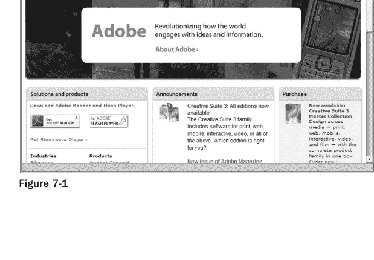


## 第7章：HTML与CSS编辑器

## 总结

在本章中，你学习了如何创建一个主要基于AIR的HTML组件的应用程序。你了解了该组件的原生事件、部分属性，以及最重要的`domWindow`属性。通过这个属性，你学会了如何访问已加载HTML内容的JavaScript DOM，从而将JavaScript与ActionScript集成起来。这种集成使你的应用程序能够执行其最重要的功能：动态修改HTML和CSS内容。最后，你运用了前几章学到的一些技术，将简单的文本文件保存到用户的硬盘驱动器中。

在下一章中，你将再次扩展你的AIR经验，并学习如何构建一个天气小部件。

## 天气小部件

小部件，即你可以与之交互的桌面小程序，无处不在。随着雅虎的Konfabulator、谷歌的桌面小工具、微软Vista的侧边栏和苹果的Dashboard等程序的出现，小部件变得越来越受欢迎。每个操作系统至少有三种不同的小部件引擎可供选择。然而，没有一个品牌看起来既简单易开发又易于分发，尤其是跨所有平台的情况下。即使某个特定的小部件易于编程，你仍然会担心最终用户的计算机上是否安装了特定的系统。最好的选择是至少为微软Vista的侧边栏和苹果的Dashboard创建相同的小部件，但你仍然会担心所有使用微软Windows XP的用户。面对这个难题，你可能会得出结论：这个利基市场一团糟。

你*可以*使用Adobe AIR API创建一个小部件——毕竟，这是本章的主题。为什么要使用AIR而不是其他可用的小部件系统来创建小部件呢？由于大型公司和独立开发者都在开发大量的AIR应用程序，最终用户的计算机上安装了Adobe AIR的可能性非常高。这对Windows、OS X和Linux平台都适用。因此，AIR使你能够使用熟悉的工具集（Flex、ActionScript和AIR API）开发一个小部件，并以最小的努力触及更广泛的受众。

本章深入探讨了创建一个能获取特定地点天气的小部件。虽然这是一种相当常见的小部件类型，但它可以作为你在AIR中开发未来小部件的基础。本章讨论了以下用于构建小部件的Flex/AIR概念：

- 创建一个始终位于其他应用程序前面的“无边框”应用程序
- 利用`minimize()`和`restore()`命令来隐藏和显示应用程序
- 为微软Windows的系统托盘和Mac OS X的Dock创建动态图标和菜单

## 第8章：天气小部件

## 设计

计算机行业的一个常见问题是，人们认为应用程序的可见尺寸反映了其复杂性。换句话说，像网页上的横幅广告这样的东西被认为是“简单”的，因此可以在最短的时间内轻松创建。如果你谈论的是像Adobe Photoshop这样的程序，那么这种看法大致准确。然而，设计上的简单并不总是意味着它容易构建。即使是一个小应用程序，比如小部件，也可能很复杂。

天气小部件就是一个小而相当复杂的应用程序的例子。因为它应该作为最终用户桌面上的功能性装饰，所以可见尺寸必须很小。然而，它仍然需要能够存储用户的信息；并且至少，它必须显示今天的天气。总的来说，天气小部件应用程序将具有以下功能：

- **多种视图：** 除了当前和四天预报视图外，小部件还将有一个在数据加载时显示的加载屏幕。还会有一个设置屏幕，包含邮政编码输入、刷新间隔、摄氏度/华氏度切换以及“始终在前”切换等选项。
- **原生菜单系统：** 为了保持小部件视图小巧紧凑，菜单系统将被隐藏，并可通过上下文菜单（右键单击小部件）或系统托盘（Dock）菜单访问。它将包含退出应用程序、在单天和四天预报之间切换、打开设置视图状态以及在最小化和还原窗口视图之间切换的选项。
- **动态系统托盘（Dock）图标：** 用户将能够在系统托盘（Windows）或Dock（OS X）中将当前温度显示为图标。如上一点所述，当用户单击动态图标时，将显示小部件的菜单。如果用户在微软Windows中最小化应用程序，小部件将完全隐藏，仅保留系统托盘图标，这意味着应用程序实例不会在任务栏中显示，但可以通过系统托盘图标访问。

最后，数据需要从外部天气系统中拉取。有几种不同的天气服务选项可供选择。本应用程序将使用谷歌公开的天气源，选择它是因为其易于解释的XML结构、多日预报集和图标图像。虽然这个小部件最初将设置为使用谷歌，但是否继续使用它由你决定。以下是一些替代方案：

- 美国国家气象局XML Web服务 (www.weather.gov/xml)
- 雅虎天气 (http://developer.yahoo.com/weather)
- AccuWeather.com RSS源 (www.accuweather.com/rss-center.asp)

## 构建目录结构

在讨论天气小部件*如何*构建之前，重要的是要正确设置本章的目录结构。

首先，在你的本地开发目录中创建一个名为`WeatherWidget`的新目录。该目录将作为你本应用程序的工作目录。

接下来，通过在工作目录中创建三个新目录——`com`、`aircmr`和`weatherwidget`——来为该应用程序创建包结构。天气小部件的包结构应如下所示：`working directory/com/aircmr/weatherwidget`。

最后，从配套网站的`WeatherWidget`部分下载相应的`assets`和`icons`目录，并将其放置在工作目录的根目录中。这些文件将在天气小部件的整个开发过程中使用。

现在目录结构已经设置好了，你可以开始构建天气小部件应用程序了。下一节将通过讨论应用程序的数据来源以及应用程序将如何使用它来启动开发过程。

### 处理数据

就功能而言，小部件在很大程度上是数据驱动的。它们驻留在用户的桌面上，以精简的形式（物理上和功能上）显示某种数据。例如，天气小部件将用于显示单日或四天预报。因此，它必须能够处理任一情况的数据。除了天气数据外，小部件还必须跟踪一些基本的用户偏好设置，例如邮政编码。

### XML

天气小部件的所有外部数据都将以XML格式接收。这适用于设置和天气信息。天气XML将通过HTTP请求从谷歌获取。设置XML将通过`FileStream`类从用户的`applicationDirectory`中访问。一旦接收到，XML将由`XMLParserUtil`类解析成`WeatherVO`和`SettingsVO`数据对象，并添加到应用程序的数据模型`WidgetDataModel`中。以下各节将详细探讨这个过程。

#### 天气XML

首先，查看来自谷歌的XML数据。首先打开一个网络浏览器，访问`www.google.com/ig/api?weather=02139`。

很有可能，你的网络浏览器已经解析了XML中的文本和图像链接。要查看原始XML，你可能需要点击`查看` `源代码`。此选项的名称因浏览器而异。

如果一切顺利，你将能够查看马萨诸塞州剑桥市的天气。（那里可能正在下雨，天气很冷。）如前所述，谷歌的天气XML数据非常直观。一个`<weather>`节点封装了天气信息。位置信息位于`<forecast_information>`节点中。当前天气信息（当天的）位于`<current_conditions>`节点中。当前天气数据之后是四天预报信息，位于四个对应的`<forecast_conditions>`节点中。浏览此XML文档并熟悉它。天气小部件如何利用这些数据将在本章中更详细地讨论。


## 第八章：天气小部件

## 设置 XML

既然天气小部件已经有了天气数据，它就需要一种方式来存储诸如邮政编码以及温度应显示为华氏度还是摄氏度等信息。`settings.xml` 文件将存储这些数据。创建一个新文档，并包含以下标记：

```xml
<?xml version='1.0' encoding='utf-8'?>
<settings>
    <zipCode></zipCode>
    <refreshInterval>1800</refreshInterval>
    <useCelsius></useCelsius>
    <alwaysInFront>true</alwaysInFront>
</settings>
```

将此文档以 `settings.xml` 为名保存在你的工作目录根目录下。

设置文件简洁明了。`<zipCode>` 节点将在用户输入后存储其邮政编码。`<refreshInterval>` 将存储应用程序向谷歌服务器请求天气数据并更新小部件的间隔。`<useCelsius>` 将存储一个布尔值，表示用户希望数据如何显示（华氏度或摄氏度）。最后，`<alwaysInFront>` 将指示用户是否希望小部件始终保持在所有打开的窗口前面。

### 数据对象

现在我们知道了数据的格式和结构，天气小部件应用程序需要一种方式在内部存储这些数据。如前所述，XML 将通过 HTTP 请求或 `FileStream` 类加载。数据加载后，将被解析成特定的对象并存储在 `WidgetDataModel` 类中。我们首先创建 `WeatherVO` 值对象类，开始构建数据模型。

### WeatherVO

`WeatherVO` 类将存储从谷歌 HTTP 请求响应中解析出的所有天气数据。它需要存储星期几的名称、当前温度、最低温度、最高温度、图标 URL、天气状况、风向和湿度。

创建一个新文档并插入以下代码：

```actionscript
package com.aircmr.weatherwidget.data
{
    public class WeatherVO
    {
        private var _dayOfWeek:String;
        private var _currentTemp:Number;
        private var _lowTemp:Number;
        private var _highTemp:Number;
        private var _iconURL:String;
        private var _condition:String;
        private var _date:Date;
        private var _wind:String;
        private var _humidity:String;

        public function WeatherVO(){};

        [Bindable]
        public function get dayOfWeek():String
        {
            return _dayOfWeek;
        }

        public function set dayOfWeek( val:String ):void
        {
            _dayOfWeek = val;
        }

        [Bindable]
        public function get currentTemp():Number
        {
            return _currentTemp;
        }

        public function set currentTemp( val:Number ):void
        {
            _currentTemp = val;
        }

        [Bindable]
        public function get lowTemp():Number
        {
            return _lowTemp;
        }

        public function set lowTemp( val:Number ):void
        {
            _lowTemp = val;
        }

        [Bindable]
        public function get highTemp():Number
        {
            return _highTemp;
        }

        public function set highTemp( val:Number ):void
        {
            _highTemp = val;
        }

        [Bindable]
        public function get iconURL():String
        {
            return _iconURL;
        }

        public function set iconURL( val:String ):void
        {
            _iconURL = val;
        }

        [Bindable]
        public function get condition():String
        {
            return _condition;
        }

        public function set condition( val:String ):void
        {
            _condition = val;
        }

        [Bindable]
        public function get date():Date
        {
            return _date;
        }

        public function set date( val:Date ):void
        {
            _date = val;
        }

        [Bindable]
        public function get wind():String
        {
            return _wind;
        }

        public function set wind( val:String ):void
        {
            _wind = val;
        }

        [Bindable]
        public function get humidity():String
        {
            return _humidity;
        }

        public function set humidity( val:String ):void
        {
            _humidity = val;
        }
    }
}
```

打开文件浏览器，在你的工作目录中天气小部件包下创建一个名为 `data` 的新目录（路径类似于 `working directory/com/aircmr/weatherwidget/data`）。将文档以 `WeatherVO.as` 为名保存在 `data` 目录下。

### SettingsVO

接下来，创建 `SettingsVO` 对象。此对象将在会话期间存储所有用户偏好设置。如果用户在任何时间点在“设置”窗口中更改了偏好设置，新数据将存储在此对象中，并同时写入 `settings.xml` 文件。`settings.xml` 文件在 `SettingsVO` 对象中存储为 `_settingsXMLLocation`。此对象中存储的其余数据与 `settings.xml` 文件中的数据直接对应。你可能还注意到引用了一个 `TemperatureUtil` 类。此类存储温度标签（如华氏度和摄氏度）的常量，将在“TemperatureUtil”部分详细讨论。在此之前，我们先创建 `SettingsVO` 类：

```actionscript
package com.aircmr.weatherwidget.data
{
    import com.aircmr.weatherwidget.utils.TemperatureUtil;

    public class SettingsVO
    {
        private var _useCelsius:Boolean = false;
        private var _zipCode:String;
        private var _refreshInterval:Number = 300;
        private var _settingsXMLLocation:String;
        private var _cityLocation:String;
        private var _alwaysInFront:Boolean = true;

        public function SettingsVO():void
        {
        }

        public function getDegreeType():String
        {
            if( _useCelsius )
            {
                return TemperatureUtil.CELSIUS;
            }

            return TemperatureUtil.FAHRENHEIT;
        }

        [Bindable]
        public function get zipCode():String
        {
            return _zipCode;
        }

        public function set zipCode( val:String ):void
        {
            _zipCode = val;
        }

        [Bindable]
        public function get refreshInterval():Number
        {
            return _refreshInterval;
        }

        public function set refreshInterval( val:Number ):void
        {
            _refreshInterval = val;
        }

        [Bindable]
        public function get settingsXMLLocation():String
        {
            return _settingsXMLLocation;
        }

        public function set settingsXMLLocation( val:String ):void
        {
            _settingsXMLLocation = val;
        }

        [Bindable]
        public function get useCelsius():Boolean
        {
            return _useCelsius;
        }

        public function set useCelsius( val:Boolean ):void
        {
            _useCelsius = val;
        }

        [Bindable]
        public function get alwaysInFront():Boolean
        {
            return _alwaysInFront;
        }

        public function set alwaysInFront( val:Boolean ):void
        {
            _alwaysInFront = val;
        }
    }
}
```

将文档以 `SettingsVO.as` 为名保存在 `working directory/com/aircmr/weatherwidget/data/` 中。

这两个数据对象的结构本质上都很简单。有用于存储数据的私有变量，以及控制对这些变量访问的 getter 和 setter。每个变量都标记了 `[Bindable]`，以允许通过 Flex 数据绑定进行访问。在下一节中，你将构建存储这些对象的单例（Singleton）。

## 数据模型

应用程序的数据模型类 `WidgetDataModel` 将作为所有数据的中心访问点。它将存储对设置和天气数据的引用。它是一个单例（Singleton），意味着每个会话只能实例化此类的一个实例。天气小部件中的所有其他类都可以通过调用公共静态函数 `getInstance()` 来引用数据模型中的数据：

```actionscript
WidgetDataModel.getInstance().settings
```

如果你尝试实例化此类的另一个实例，它将失败。这在天气小部件的上下文中特别有用，因为应用程序将有多个视图状态，但视图之间的数据应该永远不会改变。一旦数据模型中的数据发生变化，该变化将反映在整个小部件中。

创建一个新文档并输入以下代码：

```actionscript
package com.aircmr.weatherwidget.data
{
    import flash.events.Event;
    import flash.events.EventDispatcher;
    import mx.collections.ArrayCollection;

    [Event(name="settingsChange", type="flash.events.Event")]
    [Event(name="currentWeatherChange", type="flash.events.Event")]

    public class WidgetDataModel extends EventDispatcher
    {
        private static var _instance:WidgetDataModel;

        public static const CITY_CHANGE:String = "cityChange";
        public static const SETTINGS_CHANGE:String = "settingsChange";
        public static const CURRENT_FORECAST_CHANGE:String = "currentForecastChange";
        public static const FOURDAY_FORECAST_CHANGE:String = "fourdayForecastChange";
        public static const RIGHT_NOW_STRING:String = "Currently";

        private var _settings:SettingsVO;
        private var _weatherCollection:ArrayCollection;
        private var _currentWeather:WeatherVO;
        private var _cityLocation:String;

        public function WidgetDataModel()
        {
            _settings = new SettingsVO();
            _currentWeather = new WeatherVO();
            _weatherCollection = new ArrayCollection();
        }

        public static function getInstance():WidgetDataModel
        {
            if(_instance == null)
            {

            }
        }
    }
}
```


## 第8章：天气小部件

```
                _instance = new WidgetDataModel();
            }
            return _instance;
        }

        [Bindable("fourdayForecastChange")]
        public function get weatherCollection():ArrayCollection
        {
            return _weatherCollection;
        }

        public function set weatherCollection(
            val:ArrayCollection ):void
        {
            _weatherCollection = val;
            dispatchEvent(
                new Event( WidgetDataModel.FOURDAY_FORECAST_CHANGE ));
        }

        [Bindable("currentForecastChange")]
        public function get currentWeather():WeatherVO
        {
            return _currentWeather;
        }

        public function set currentWeather( val:WeatherVO ):void
        {
            _currentWeather = val;
            dispatchEvent(
                new Event( WidgetDataModel.CURRENT_FORECAST_CHANGE ));
        }

        [Bindable("settingsChange")]
        public function get settings():SettingsVO
        {
            return _settings;
        }

        public function set settings( val:SettingsVO ):void
        {
            _settings = val;
            dispatchEvent(
                new Event( WidgetDataModel.SETTINGS_CHANGE ));
        }

        [Bindable("cityChange")]
        public function get cityLocation():String
        {
            return _cityLocation;
        }

        public function set cityLocation( val:String ):void
        {
            _cityLocation = val;
            dispatchEvent( new Event( WidgetDataModel.CITY_CHANGE ));
        }
    }
```

将文档保存为 `WidgetDataModel.as`，路径为 `working directory/com/aircmr/weatherwidget/data/`。

`WidgetDataModel` 将允许访问四个主要变量：`settings`、`currentWeather`、`cityLocation` 和 `weatherCollection`。一旦数据被解析完成，这些变量就会被赋值。如果数据模型中的数据发生任何更改，相应的事件会被触发，以通知应用程序更改已发生。所有四个变量都被标记为 `[Bindable]`，以便通过 Flex 组件数据绑定进行访问。下一节将详细讨论数据是如何解析的，以及每个属性是如何被赋值的。

## 附属服务与工具

上一节介绍了正在加载的数据来源（来自 Google 和本地系统的 XML），以及数据加载的目标（数据模型）。现在是时候考虑*如何*加载数据并将其解析为正确的数据对象格式了。本节以 `XMLFileService` 开始，讨论另外四个类，它们有助于天气小部件的数据流。

### XMLFileService

天气数据的 XML 是通过 `URLLoader` 类加载的，该类是 ActionScript 3 框架的一部分。天气小部件为 `URLLoader` 分配监听器，并传递一个 `URLRequest`，该请求从 Google 加载 XML。一旦数据被接收，会触发一个 `COMPLETE` 事件，然后数据被解析。这是一个大部分自动化的过程；然而，对于设置数据，情况并非如此。

你可以在应用程序的主 MXML 类中创建一个新的 `FileStream` 实例，并传递一个包含 `settings.xml` 文件本地地址的 `File` 对象，但这个过程会变得复杂，特别是因为需要执行一些关键过程才能读取和写入 `settings.xml` 文件。如果有一个服务类能帮助处理所有与 XML 相关的事情，至少在处理本地 XML 时，那将会很有帮助。

创建一个新文档并插入以下代码：

```
package com.aircmr.weatherwidget.services
{
    import com.aircmr.weatherwidget.events.XMLServiceEvent;
    import flash.events.Event;
    import flash.events.EventDispatcher;
    import flash.events.IOErrorEvent;
    import flash.filesystem.File;
    import flash.filesystem.FileMode;
    import flash.filesystem.FileStream;
    import mx.controls.Alert;

    public class XMLFileService extends EventDispatcher
    {
        public static const FILE_NOT_FOUND:String = "fileNotFound";
        public static const FILE_COPIED:String = "fileCopied";
        public static const FILE_LOADED:String = "fileLoaded";
        public static const FILE_WRITTEN:String = "fileWritten";
        public static const FILE_ERROR:String = "fileError";

        private var _xml:XML;
        private var _file:File;
        private var _fileStream:FileStream;

        public function XMLFileService( ):void {}

        public function loadXMLFromStorageDirectory( fileName:String ):void
        {
            _file = File.applicationStorageDirectory.resolvePath( fileName );

            if( !_file.exists )
            {
                dispatchEvent( new Event( XMLFileService.FILE_NOT_FOUND ));
                return;
            }

            _fileStream = new FileStream();
            _fileStream.addEventListener( Event.COMPLETE, resultHandler );
            _fileStream.addEventListener( IOErrorEvent.IO_ERROR, errorHandler );
            _fileStream.openAsync( _file, FileMode.READ );
        }

        public function saveXMLToStorage( fileName:String , data:XML ):void
        {
            var xml_encoding:String = "<?xml version='1.0' encoding='utf-8'?>\n";
            var xml_toWrite:String = xml_encoding + data.toXMLString();

            _file = File.applicationStorageDirectory.resolvePath( fileName );

            _fileStream = new FileStream();
            _fileStream.addEventListener( Event.CLOSE, onFileWriteComplete );
            _fileStream.openAsync( _file, FileMode.WRITE );
            _fileStream.writeUTFBytes( xml_toWrite );
            _fileStream.close();
        }

        public function copyXMLFromApplicationDirectoryToStorage( fileName:String ):void
        {
            var sourceFile:File = File.applicationDirectory.resolvePath( fileName );
            if( !sourceFile.exists )
            {
                dispatchEvent( new Event( XMLFileService.FILE_NOT_FOUND ) );
                return;
            }

            var resultsFile:File = File.applicationStorageDirectory.resolvePath( fileName );
            sourceFile.addEventListener( IOErrorEvent.IO_ERROR , errorHandler );
            sourceFile.addEventListener( Event.COMPLETE , onFileCopyComplete );
            sourceFile.copyToAsync( resultsFile , true );
        }

        private function resultHandler( event:Event ):void
        {
            _xml = XML( _fileStream.readUTFBytes( _fileStream.bytesAvailable ) );
            _fileStream.removeEventListener( Event.COMPLETE, resultHandler );
            _fileStream.removeEventListener( IOErrorEvent.IO_ERROR, errorHandler );
            _fileStream.close();

            var xmlEvent:XMLServiceEvent =
                new XMLServiceEvent( XMLServiceEvent.XML_LOADED );
            xmlEvent.xml = _xml;
            dispatchEvent( xmlEvent );
        }

        private function errorHandler( event:IOErrorEvent ):void
        {
            var errorMessage:String = "Error Loading File "+event.text+" FILE ERROR";

            var xmlEvent:XMLServiceEvent =
                new XMLServiceEvent( XMLServiceEvent.XML_ERROR );
            xmlEvent.message = errorMessage;
            dispatchEvent( xmlEvent );

            Alert.show( errorMessage );
        }

        private function onFileWriteComplete( event:Event ):void
        {
            dispatchEvent( new Event(XMLFileService.FILE_WRITTEN) );
        }

        private function onFileCopyComplete( event:Event ):void
        {
            dispatchEvent( new Event(XMLFileService.FILE_COPIED) );
        }

        public function get xml():XML
        {
            return _xml;
        }
    }
}
```

将文档保存为 `XMLFileService.as`，路径为 `working directory/com/aircmr/weatherwidget/services/`。

`XMLFileService` 类不过是一个 `File` 实例和一个 `FileStream` 实例，外加一些事件监听器，用于让应用程序知道打开或保存操作是否成功。以下代码片段演示了应用程序如何首先实例化 `XMLFileService` 并传递一个代表本地 URL 的字符串：

```
var _xmlService:XMLFileService = new XMLFileService();
_xmlService.addEventListener( XMLFileService.FILE_NOT_FOUND , onSettingsNotFound );
_xmlService.addEventListener( XMLServiceEvent.XML_LOADED, onSettingsXMLLoaded );
_xmlService.loadXMLFromStorageDirectory(
    WidgetDataModel.getInstance().settings.settingsXMLLocation );
```

在此示例中，`XMLFileService` 实例被实例化并立即分配了事件监听器。一旦 XML 文件加载完成，`onSettingsXMLLoaded` 就会被调用。`onSettingsXMLLoaded` 方法接收一个 `XMLServiceEvent` 对象，该对象包含 `settings.xml` 的 XML 对象。它使用 `XMLParserUtil` 工具类将 XML 解析为一个 `SettingVO` 对象，从而填充数据模型中的 `settings` 属性。`XMLServiceEvent` 和 `XMLParserUtil` 类都将在稍后讨论。

### 复制本地文件

首先，重要的是要指出文件是否未找到。在 `XMLFileService` 类中，你使用 `resolvePath` 和 `File` 的 `exists` 方法检查 `settings.xml` 文件是否存在于 `applicationStorageDirectory` 中：

```
_file = File.applicationStorageDirectory.resolvePath( fileName );
if( !_file.exists )
{
    dispatchEvent( new Event( XMLFileService.FILE_NOT_FOUND ));
    return;
}
```

当用户首次运行天气小部件时，`settings.xml` 文件将不存在于他们的应用程序存储目录中。类实例将触发一个 `FILE_NOT_FOUND` 事件，接下来的行动由控制器 `WeatherWidget.mxml` 决定。如果文件不存在，则需要创建它。（不过幸运的是，你在本章开头已经创建了 `settings.xml`。）

无论如何，有一个包含一些基本数据的 `settings.xml` 文件。但是，此文件位于应用程序目录中。你可以通过引用 `File` 类的 `applicationDirectory`（而不是 `applicationStorageDirectory`）从应用程序目录读取文件。由于 AIR 内部的安全特性，你将无法写回应用程序目录。此目录仅用于存储你希望具有只读访问权限的数据和资源。写入限制是一个大问题，因为应用程序需要将用户的偏好设置写回 `settings.xml`。`XMLFileService` 不应尝试写回应用程序目录，而应在存储目录中找不到该文件时，将文件从应用程序目录复制到存储目录。当应用程序下次实例化时，`settings.xml` 文件将被找到。这通过 `File` 类的 `copyToAsync` 方法在 `copyXMLFromApplicationDirectoryToStorage` 方法中完成：

```
fileToCopy.copyToAsync( resultFileFromCopy , true );
```

因为此方法是异步的，监听器将监控复制是否成功或是否发生错误。如果复制成功，`XMLFileService` 将尝试从存储目录加载 XML。一旦 XML 加载完成，将触发一个 `XMLServiceEvent` 实例。


## 第八章：天气小部件

### XMLServiceEvent

XMLServiceEvent 类用于将已加载的 XML 数据从 XMLFileService 实例传输到通过应用程序类访问的解析器。新建一个文档并插入以下代码：

```
package com.aircmr.weatherwidget.events
{
    import flash.events.Event;

    public class XMLServiceEvent extends Event
    {

        static public const XML_LOADED:String = "xmlLoaded";
        static public const XML_ERROR:String = "xmlError";

        private var _xmlResults:XML;
        private var _message:String;

        public function XMLServiceEvent( type:String,
            bubbles:Boolean=false, cancelable:Boolean=false )
        {
            super( type, bubbles, cancelable );
        }

        public function get xml():XML
        {
            return _xmlResults;
        }

        public function set xml( val:XML ):void
        {
            _xmlResults = val;
        }

        public function get message():String
        {
            return _message;
        }

        public function set message( val:String ):void
        {
            _message = val;
        }
    }
}
```

将文档保存为 XMLServiceEvent.as，放置于应用程序的 events 包中（工作目录 /com/aircmr/weatherwidget/events）。

一旦应用程序类接收到 XMLServiceEvent 对象，它就会将公共的 xml 属性传递给 XMLParserUtil 工具类进行解析。下一节将讨论这是如何实现的。

### XMLParserUtil

在从 URLLoader 或 XMLFileService 实例接收到天气和设置数据后，需要将其解析为 WeatherVO 和 SettingsVO 对象，并添加到 WidgetData 模型中。XMLParserUtil 类有助于完成此过程。

新建一个文档并插入以下代码：

```
package com.aircmr.weatherwidget.utils
{
	import com.aircmr.weatherwidget.data.*;
	import mx.collections.ArrayCollection;

	public class XMLParserUtil
	{
		public static function parseWeatherXMLFeedCurrentDay(
			weatherFeed:XML ):WeatherVO
		{
			var currCondition:XMLList = weatherFeed.weather.current_conditions;

			var currentWeather:WeatherVO = new WeatherVO();
			currentWeather.dayOfWeek = WidgetDataModel.RIGHT_NOW_STRING;
			currentWeather.condition = currCondition.condition.@data;
			currentWeather.currentTemp = currCondition.temp_f.@data;
			currentWeather.humidity = currCondition.humidity.@data;
			currentWeather.iconURL = "http://www.google.com" +
				currCondition.icon.@data;
			currentWeather.wind = currCondition.wind_condition.@data;
			currentWeather.lowTemp = weatherFeed..forecast_conditions[0].low.@data;
			currentWeather.highTemp =
				weatherFeed..forecast_conditions[0].high.@data;
			currentWeather.date = new Date();

			return currentWeather;
		}

		public static function parseWeatherXMLFeedFourDay(
			weatherFeed:XML):ArrayCollection
		{
			var weatherCollection:ArrayCollection = new ArrayCollection();

			for( var i:String in weatherFeed..forecast_conditions )
			{
				var weatherObj:WeatherVO = new WeatherVO();
				weatherObj.dayOfWeek =
					weatherFeed..forecast_conditions[i].day_of_week.@data;
				weatherObj.lowTemp = weatherFeed..forecast_conditions[i].low.@data;
				weatherObj.highTemp =
					weatherFeed..forecast_conditions[i].high.@data;
				weatherObj.iconURL = "http://www.google.com" +
					weatherFeed..forecast_conditions[i].icon.@data;
				weatherObj.condition =
					weatherFeed..forecast_conditions[i].condition.@data;

				if( weatherObj.dayOfWeek.toLocaleLowerCase() == "today" )
					weatherObj.currentTemp = weatherFeed.weather.current_conditions.temp_f.@data;

				weatherCollection.addItem( weatherObj );
			}

			return weatherCollection;
		}

		public static function parseWeatherXMLFeedLocation(
			weatherFeed:XML ):String
		{
			return weatherFeed.weather.forecast_information.city.@data;
		}

		public static function parseSettingsXML( settingsXML:XML,
			currentSettings:SettingsVO = null ):SettingsVO
		{
			var settings:SettingsVO =
				currentSettings ? currentSettings : new SettingsVO();
			settings.refreshInterval = settingsXML..refreshInterval;
			settings.zipCode = settingsXML..zipCode;
			settings.useCelsius = (settingsXML..useCelsius != "") ? true : false;
			settings.alwaysInFront =
				(settingsXML..alwaysOnTop != "") ? true : false;

			return settings;
		}
	}
}
```

将文档保存为 XMLParserUtil.as，放置于你的工作目录下的 com/aircmr/weatherwidget/utils/ 中。

此类包含四个静态方法：`parseWeatherXMLFeedCurrentDay`、`parseWeatherXMLFeedFourDay`、`parseWeatherXMLFeedLocation` 和 `parseSettingsXML`。每个方法都接收一个包含要解析的 XML 对象的参数。

#### parseWeatherXMLFeedCurrentDay

`parseWeatherXMLFeedCurrentDay` 解析 `<current_conditions>` 数据，并将其赋值给一个新的 WeatherVO 实例的相应属性。

`<current_conditions>` 数据比四天预报更详尽。但是，它缺少当天的最高和最低温度。因此，你可以从第一个 `<forecast_conditions>` 节点中解析最高和最低温度，因为该节点对应于特定日期：

```
currentWeather.lowTemp = weatherFeed..forecast_conditions[0].low.@data;
currentWeather.highTemp = weatherFeed..forecast_conditions[0].high.@data
```

#### parseWeatherXMLFeedFourDay

`parseWeatherXMLFeedFourDay` 首先创建一个名为 `weatherCollection` 的新 ArrayCollection。它遍历四组 `<forecast_conditions>` 节点，在每次迭代中创建一个新的 WeatherVO 实例，并将该对象添加到 `weatherCollection` 中。当所有四个节点都被解析，并且四个 WeatherVO 对象都被创建并正确赋值后，`weatherCollection` 会被返回给调用 XMLParserUtil 的方法，并赋值给 WidgetDataModel。当数据模型接收到来自已填充的 `weatherCollection` ArrayCollection 后，它会派发一个 `FOURDAY_FORECAST_CHANGE` 事件。

#### parseWeatherXMLFeedLocation

`parseWeatherXMLFeedLocation` 解析天气订阅源中的 `<forecast_information>` 节点以获取城市名称。由于位置数据是通过邮政编码检索的，因此最好显示位置的名称。此方法由应用程序控制器调用，用于更新 WidgetDataModel 的 location 属性，并在整个小部件中显示。

#### parseSettingsXML

`parseSettings` 接收通过 XMLServiceEvent（从 XMLFileService 实例接收）传递给应用程序的 `onSettingsXMLLoaded` 方法的 XML 数据。

除了 XML，此方法还接受一个可选的 SettingsVO 对象。在这种情况下，应用程序传递一个指向 WidgetDataModel 中 settings 属性的引用，以保留诸如 `settingsXMLLocation` 之类的属性。如果在调用方法时未传递 SettingsVO 对象，则会创建一个新的 SettingsVO 对象。

在建立 SettingsVO 对象后，将解析 XML 并将其赋值给相应的属性。如果属性期望的是布尔值，一个简单的三元运算符会检查节点是否有值。如果有，则布尔值设置为 true；如果没有，则布尔值设置为 false。

一旦 XML 被解析并且数据被赋值，XMLParserUtil 将 SettingsVO 对象返回给应用程序控制器类，并将新创建的对象赋值给 WidgetDataModel。

### TemperatureUtil

冗余的编码是令人烦恼的。在整个应用程序中，你需要以华氏度和摄氏度引用温度。同样，你也需要将华氏度转换为摄氏度，反之亦然。每次你想输入度数符号时，你可以每次都搜索度数符号的键码，每次你也可以编写将一个单位转换为另一个单位的数学代码。然而，考虑到你必须在多少个类中编写多少次这样的代码，这将是非常冗余的。因此，一个基本的实用工具将在对抗冗余编码的战斗中被证明是有用的。

新建一个文档并插入以下代码：


## 第8章：天气小部件

```actionscript
public static function convertFahrenheitToCelsius( temp:Number ):Number
{
    return ( temp - 32 ) / 1.8;
}

public static function convertCelsiusToFahrenheit( temp:Number ):Number
{
    return ( temp + 32 ) * 1.8;
}

public static function returnTempAsFormedString( temp:Number,
                                              useCelsius:Boolean = false,
                                              isInFahrenheit:Boolean = true ):String
{
    var tempInC:String = String(
        Math.round( ( isInFahrenheit ) ?
            convertFahrenheitToCelsius( temp ) :
            temp) + TemperatureUtil.CELSIUS );
    var tempInF:String = String(
        Math.round( ( isInFahrenheit ) ? temp :
            convertCelsiusToFahrenheit( temp ) ) +
        TemperatureUtil.FAHRENHEIT );

    return String( ( useCelsius ) ? tempInC : tempInF );
}
}
```

将此文档保存为 `TemperatureUtil.as`，放在工作目录下的 `com/aircmr/weatherwidget/utils/` 包中。

`TemperatureUtil` 类包含用于表示华氏度和摄氏度标签的 `Strings` 公共常量。它还包含用于转换温度数据的公共方法。最后，它有一个名为 `returnTempAsFormedString` 的方法，该方法既转换数据，又将其与度数标签一起返回（例如，85°F）。在开始组装此应用程序时，你将广泛使用这个 `TemperatureUtil` 类。

## 构建用户界面

到目前为止，你已经了解了数据是如何解析的，以及天气应用程序如何填充其数据模型。由于小部件的目标之一是在用户的桌面上创建可视内容，因此你可能对这个应用程序的用户界面（UI）如何设置更感兴趣。本节将介绍每个 UI 元素，并讨论数据模型如何影响每个部分。在本节结束时，你的天气小部件应该开始成形。

### 视图状态

天气小部件将有四个视图状态：设置、加载、当前天气预报和四天预报。除加载视图外，每个状态都作为一个单独的组件包含。`SettingsWindow` 组件是用户在 `settings.xml` 文件中没有找到邮政编码时看到的第一个内容；因此，它是第一个要讨论的视图状态。

### SettingsWindow

`SettingsWindow` 是一个 MXML 组件，它将允许用户访问诸如邮政编码输入、天气数据刷新率和温度单位类型等选项。以下步骤将帮助你构建此视图状态。打开一个新文档并输入以下代码和标记：

```xml
<?xml version="1.0" encoding="utf-8"?>
<mx:Canvas xmlns:mx="http://www.adobe.com/2006/mxml"
    show="refreshWindow();"
    clipContent="false" width="320" height="210" >
    <mx:Metadata>
        [Event(name="comboOpen", type="flash.events.Event")]
        [Event(name="comboClose", type="flash.events.Event")]
        [Event(name="save", type="flash.events.Event")]
        [Event(name="cancel", type="flash.events.Event")]
    </mx:Metadata>
    <mx:Script>
        <![CDATA[
            import com.aircmr.weatherwidget.services.XMLFileService;
            import com.aircmr.weatherwidget.utils.TemperatureUtil;
            import com.aircmr.weatherwidget.data.WidgetDataModel;
            import mx.controls.Alert;

            [Bindable]
            private var _intervalArray:Array =
                [{data: 300 , label: '5 Mins' },
                {data: 900 , label: '15 Mins' },
                {data: 1800 , label: '30 Mins' },
                {data: 2700 , label: '45 Mins' }];
            public static const SAVE:String = "save";
            public static const COMBO_OPEN:String = "comboOpen";
            public static const COMBO_CLOSE:String = "comboClose";

            private function refreshWindow():void
            {
                intervalSelector.selectedIndex = getSelectedIndex();
                inFront.selected =
                    WidgetDataModel.getInstance().settings.alwaysInFront;
                toggleDegrees(
                    WidgetDataModel.getInstance().settings.useCelsius );
            }

            private function getSelectedIndex():int
            {
                var interval:Number =
                    WidgetDataModel.getInstance().settings.refreshInterval;
                for( var i:int = 0 ; i < _intervalArray.length ; i++ )
                {
                    if( interval == _intervalArray[i].data ) return i;
                }
                return 0;
            }

            private function toggleDegrees( inCelsius:Boolean ):void
            {
                if( inCelsius )
                {
                    celsius.selected = true;
                    fahrenheit.selected = false;
                }
                else
                {
                    celsius.selected = false;
                    fahrenheit.selected = true;
                }
            }

            private function saveSettingsLocally():void
            {
                WidgetDataModel.getInstance().settings.zipCode =
                    zipCodeInput.text;
                WidgetDataModel.getInstance().settings.refreshInterval =
                    intervalSelector.selectedItem.data;
                WidgetDataModel.getInstance().settings.useCelsius =
                    celsius.selected;
                WidgetDataModel.getInstance().settings.alwaysInFront =
                    inFront.selected;

                var xmlFileService:XMLFileService = new
                    XMLFileService();
                xmlFileService.addEventListener(
                    XMLFileService.FILE_WRITTEN , onSettingsSaved );
                xmlFileService.saveXMLToStorage(
                    WidgetDataModel.getInstance()
                        .settings.settingsXMLLocation ,
                    buildSettingsData() );
            }

            private function onSettingsSaved( event:Event ):void
            {
                dispatchEvent( new Event( SettingsWindow.SAVE ));
            }

            private function buildSettingsData():XML
            {
                var xml:XML = new XML("<settings></settings>");
                xml.zipCode =
                    WidgetDataModel.getInstance().settings.zipCode;
                xml.refreshInterval =
                    WidgetDataModel.getInstance()
                        .settings.refreshInterval;
                xml.useCelsius = ( celsius.selected ) ? true : "";
                xml.alwaysInFront = ( inFront.selected ) ? true : "";

                return xml;
            }

            private function onComboOpen(event:Event):void
            {
                dispatchEvent( new Event( SettingsWindow.COMBO_OPEN ) );
            }

            private function onComboClose(event:Event):void
            {
                dispatchEvent( new Event(SettingsWindow.COMBO_CLOSE) );
            }

        ]]>
    </mx:Script>
    <mx:ZipCodeValidator source="{zipCodeInput}" property="text"
        trigger="{saveBtn}" triggerEvent="click"
        valid="saveSettingsLocally()"/>

    <mx:Label text="AIR Weather Widget Settings"
        color="0xFFFFFF" fontSize="18" y="-35" />

    <mx:VBox width="100%" height="100%">
        <mx:HBox>
            <mx:Label text="Zip Code:" color="0xFFFFFF" fontSize="14" />
            <mx:TextInput id="zipCodeInput"
                width="65" fontSize="12" maxChars="5"
                text="{WidgetDataModel.getInstance().settings.zipCode}"
                restrict="0-9" />
        </mx:HBox>
        <mx:HBox>
            <mx:Label text="Refresh Interval:"
                color="0xFFFFFF" fontSize="14" />
            <mx:ComboBox id="intervalSelector" rowCount="4"
                dataProvider="{_intervalArray}"
                selectedIndex="{getSelectedIndex()}"
                open="onComboOpen(event)"
                close="onComboClose(event)"  />
        </mx:HBox>
        <mx:HBox>
            <mx:Label text="Temperature In:"
                color="0xFFFFFF" fontSize="14" />
            <mx:CheckBox id="fahrenheit"
                click="toggleDegrees(false)"
                label="{TemperatureUtil.FAHRENHEIT}"
                color="0xFFFFFF"
                textRollOverColor="0xFFFFFF"
                textSelectedColor="0xFFFFFF" />
            <mx:CheckBox id="celsius"
                click="toggleDegrees(true)"
                label="{TemperatureUtil.CELSIUS}"
                color="0xFFFFFF"
                textRollOverColor="0xFFFFFF"
                textSelectedColor="0xFFFFFF" />
        </mx:HBox>
        <mx:HBox>
            <mx:Label text="Always In Front:"
                color="0xFFFFFFFF" fontSize="14" />
            <mx:CheckBox id="inFront"
                color="0xFFFFFFFF"
                textRollOverColor="0xFFFFFFFF"
                textSelectedColor="0xFFFFFFFF" />
        </mx:HBox>
        <mx:Spacer height="10" />
        <mx:HBox width="95%" horizontalAlign="right">
            <mx:Button label="SAVE" id="saveBtn" />
            <mx:Button label="CANCEL"
                click="dispatchEvent(new Event(Event.CANCEL))" />
        </mx:HBox>
    </mx:VBox>
</mx:Canvas>
```

将此文档保存为 `SettingsWindow.mxml`，放在工作目录/com/aircmr/weatherwidget/ui/ 目录中。

既然你已经创建了 MXML 文档，快速浏览一下你刚刚编写的代码。图 8-1 展示了设置窗口的样子。

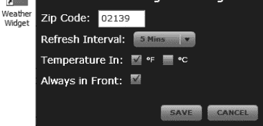

图 8-1

`SettingsWindow` 是一个 `Canvas` 容器组件，其中包含一个嵌套的 `VBox`，该 `VBox` 包含邮政编码、刷新间隔、温度显示和始终置于顶层的选项。当组件显示时，`show` 事件会调用私有 `refreshWindow` 方法，该方法更新设置属性值的视觉表示。否则，过程通过用户的交互来控制。

### 邮政编码

邮政编码 `TextInput` 组件的文本绑定到数据模型中 `SettingsVO` 对象的邮政编码属性。当用户单击“保存”按钮时，Flex `ZipCodeValidator` 组件的一个实例会对邮政编码进行验证。如果成功，则调用 `saveSettingsLocally` 方法。该方法在“保存设置”一节中有更详细的讨论。

261


## 第八章：天气小部件

### 刷新间隔

刷新间隔的 `ComboBox` 组件被分配了一个预设的时间间隔数组，这样用户就不会每五秒就向谷歌服务器请求一次天气信息。当用户打开 `设置窗口` 时，`ComboBox` 实例会通过 `getSelectedIndex()` 方法被赋予一个 `selectedIndex`。

### 温度切换

温度切换由一个标签和两个复选框组成。`refreshWindow` 方法首先调用 `toggleDegrees` 方法，并传入 `settings.useCelcius` 属性。当用户选择或取消选择其中一个 `CheckBox` 组件时，也会调用 `toggleDegrees` 方法。它接受一个布尔值，如果为 true，则将摄氏度 `CheckBox` 的 `selected` 属性设为 true，将华氏度 `CheckBox` 的 `selected` 属性设为 false。如果传入 false，则发生相反的情况。或者，你可以使用 Flex 的 `RadioButtonGroup` 控件来替代这种双 `CheckBox` 方案。

### 始终置于顶层

“始终置于顶层”的切换初始值在 `refreshWindow` 方法被调用时设置。当用户点击保存按钮并且邮政编码通过验证后，`CheckBox` 的 `selected` 值会被传递给 `SettingsVO` 对象的 `alwaysInFront` 属性。

### 保存设置

`设置窗口` 的最后一个功能是在用户点击保存按钮时将设置信息保存到 `settings.xml` 文件。这是通过 `saveSettingsLocally` 方法完成的，该方法会实例化一个新的 `XMLFileService` 对象。实例化后，会添加一个 `XMLFileService.FILE_WRITTEN` 事件监听器，并在 `XMLFileService` 实例上调用 `saveXMLToStorage` 方法。

`saveXMLToStorage` 方法接受两个参数。第一个是希望写入的文件位置。在这种情况下，`settings.xml` 文件的位置存储在 `WidgetDataModel.getInstance().settings.settingsXMLLocation` 中。第二个是希望写入的 XML 数据。然而，应用程序需要在将其发送给 `XMLFileService` 之前，将 `SettingsVO` 对象解析为 XML，这是通过 `buildSettingsData` 方法完成的。

`buildSettingsData` 方法创建一个带有父节点 `<settings>` 的新 XML 对象。XML 对象创建后，它将 `SettingsVO` 对象的属性值赋给 XML 对象中相同的属性。布尔值使用三元运算符进行检查。如果为 true，则在 XML 中插入 `true`；如果为 false，则向 XML 对象发送一个空值。XML 对象创建并正确赋值后，方法将其返回给 `XMLFileService`。

当文件写入存储后，会分派一个 `SettingsWindow.SAVE` 事件，通知应用程序设置已更改并应采取相应操作。

### 取消

当用户点击取消按钮时，会分派一个 `Event.CANCEL` 事件，提醒应用程序在不进行任何更改的情况下关闭 `设置窗口`。

一旦为天气小部件配置好设置，你就可以从谷歌加载天气数据并在解析后显示信息。下一节在展示 `当前天气项` 视图之前，将快速了解一下天气加载器视图。

### 加载视图

加载视图本身并不是一个组件。它是一个包含在光盘上的外部嵌入式 SWF 文件。它由 WeatherWidget.mxml 类文件中的 SWFLoader 类实例加载。虽然加载视图不是一个组件，但它是向用户展示的下一个视图。它在设置已更新并且天气数据正在加载后显示。图 8-2 展示了加载视图。

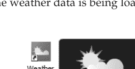

### CurrentWeatherView

设置完成后，天气数据被加载并解析，此时 CurrentWeatherView 视图会更新。CurrentWeatherView 是一个 MXML 组件，包含一个 Canvas，其中嵌套了一个 `<mx:HBox>`，用于显示当天的天气数据。

要开始创建该视图，请打开一个新文档并插入以下标记和代码：

```xml
<?xml version="1.0" encoding="utf-8"?>
<mx:Canvas xmlns:mx="http://www.adobe.com/2006/mxml"
    height="130" width="215"
    verticalScrollPolicy="off"
    horizontalScrollPolicy="off">
    <mx:Script>
    <![CDATA[
        import com.aircmr.weatherwidget.utils.TemperatureUtil;
        import com.aircmr.weatherwidget.data.*;

        private function drawBox( event:Event ):void
        {
            var box:Sprite = new Sprite();
            box.graphics.lineStyle( 1, 0xFFFFFF , .5 );
            box.graphics.drawRect( -2 , -2 ,
                weatherIcon.content.width + 3, weatherIcon.content.height + 3);
            weatherIcon.addChild( box );
        }

        [Bindable]
        private var _dataProvider:WeatherVO;

        public function get dataProvider():WeatherVO
        {
            return _dataProvider;
        }

        public function set dataProvider( val:WeatherVO ):void
        {
            _dataProvider = val;
        }
    ]]>
    </mx:Script>
    <mx:HBox paddingLeft="10">
        <mx:VBox verticalGap="0">
            <mx:Image id="weatherIcon" source="{_dataProvider.iconURL}"
                      complete="drawBox( event )" />
            <mx:Label text="{ TemperatureUtil.returnTempAsFormedString(
                           _dataProvider.currentTemp,
                           WidgetDataModel.getInstance().settings.useCelsius ) }"
                      color="#FFFFFF" fontWeight="bold" fontSize="16" />
        </mx:VBox>
        <mx:VBox verticalGap="-5">
            <mx:Label text="{_dataProvider.condition}" color="#FFFFFF"
                      fontSize="14" fontWeight="bold" />
            <mx:Label text="{_dataProvider.humidity}" color="#FFFFFF" />
            <mx:Label text="{_dataProvider.wind}" color="#FFFFFF" />
            <mx:Label text="{'High: ' + TemperatureUtil.returnTempAsFormedString(
                           _dataProvider.highTemp,
                           WidgetDataModel.getInstance().settings.useCelsius )}"
                      color="#FFFFFF" />
            <mx:Label text="{'Low: ' + TemperatureUtil.returnTempAsFormedString(
                           _dataProvider.lowTemp,
                           WidgetDataModel.getInstance().settings.useCelsius )}"
                      color="#FFFFFF" />
        </mx:VBox>
    </mx:HBox>
</mx:Canvas>
```

将文档保存为 `CurrentWeatherView.mxml`，放在工作目录下的 `com/aircmr/weatherwidget/ui/` 中。

在详细查看标记和代码之前，先看看完成后的视图是什么样子。图 8-3 展示了 `CurrentWeatherView` 组件。

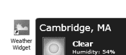

这个视图状态组件相当直观。每个子组件，比如 `Label`，都从 `WidgetDataModel` 接收数据。由于这个应用程序使用了数据绑定，如果数据模型中的任何值发生变化，该更改会反映在视图状态中。如果 `text` 属性期望一个温度值，应用程序会利用 `TemperatureUtil` 类的 `returnTempAsFormedString` 方法。结果就是温度数据被正确格式化为摄氏度或华氏度（例如，最高 74°F）。

```xml
<mx:Label
    text="{ TemperatureUtil.returnTempAsFormedString(
        _dataProvider.currentTemp ,
        WidgetDataModel.getInstance().settings.useCelsius)}"
/>
```

现在当前天气视图已经编码完成，创建一个四天预报视图应该不会太难。只要数据格式正确，它应该和创建一天的天气视图一样简单，并为每一天的天气数据重复这个过程。下一节将深入探讨这个问题。

### FourDayForecastView 和 WeatherItem

如前一节所述，四天预报的概念很简单。WidgetDataModel 中的一个天气集合属性包含四天的 WeatherVO 实例。创建四天天气视图的关键与创建一天的天气视图一样简单，只需设置一个 Repeater 类，该类将复制单日视图四次。图 8-4 阐释了这个概念。

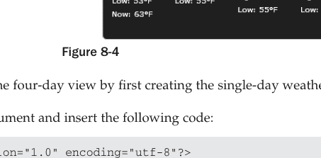

开始创建四天视图，首先创建单日天气视图。

打开一个新文档并插入以下代码：

```xml
<?xml version="1.0" encoding="utf-8"?>
<mx:VBox xmlns:mx="http://www.adobe.com/2006/mxml"
    horizontalAlign="center"
    verticalGap="0">
    <mx:Script>
        <![CDATA[
            import com.aircmr.weatherwidget.utils.TemperatureUtil;
            import com.aircmr.weatherwidget.data.*;

            private function drawBox( event:Event ):void
            {
                var box:Sprite = new Sprite();
```


## 第8章：天气小部件

```
box.graphics.lineStyle( 1, 0xFFFFFF , .5);
box.graphics.drawRect( -2 , -2 , weatherIcon.content.width + 3,
    weatherIcon.content.height + 3);
weatherIcon.addChild( box );
}

[Bindable]
private var _dataProvider:WeatherVO;

public function get dataProvider():WeatherVO
{
    return _dataProvider;
}

public function set dataProvider( val:WeatherVO ):void
{
    _dataProvider = val;
    checkForCurrentWeather();
}

private function checkForCurrentWeather():void
{
    if( !_dataProvider.currentTemp ) return;
    currentTemp.text = "Now: " +
        TemperatureUtil.returnTempAsFormattedString(
            _dataProvider.currentTemp ,
            WidgetDataModel.getInstance().settings.useCelsius )
    currentTemp.visible = true;
}
]]></mx:Script>

<mx:Label text="{_dataProvider.dayOfWeek}" color="#FFFFFF" fontSize="14"  />
<mx:Image id="weatherIcon" source="{_dataProvider.iconURL}" width="40"
    height="40" complete="drawBox( event );" />
<mx:Text text="{_dataProvider.condition}" color="#FFFFFF" selectable="false"
    width="70" textAlign="center"/>
<mx:Label text="{'High: ' + TemperatureUtil.returnTempAsFormattedString(
    _dataProvider.highTemp ,
    WidgetDataModel.getInstance().settings.useCelsius )}"
    color="#FFFFFF" />
<mx:Label text="{'Low: ' + TemperatureUtil.returnTempAsFormattedString(
    _dataProvider.lowTemp ,
    WidgetDataModel.getInstance().settings.useCelsius )}"
    color="#FFFFFF" />
<mx:Label id="currentTemp" color="#FFFFFF" visible="false"/>
</mx:VBox>
```

将文档保存为 `WeatherItem.mxml`，放置在工作目录下的 `com/aircmr/weatherwidget/ui/` 中。

`WeatherItem` 视图与 `CurrentWeatherView` 视图类似；然而，当设置了 `dataProvider` 时，它会访问 `checkForCurrentWeather` 方法。该方法会检查 `WeatherItem` 是否代表今天的天气。如果是今天的天气，它会添加一个 "Now:" 标签并显示当前温度。每个 `WeatherItem` 实例都将从 `Repeater` 接收数据。接下来的代码块将更详细地演示这个概念。

首先创建一个新文档，插入以下代码来创建 `FourDayForecastView`：

```
<?xml version="1.0" encoding="utf-8"?>
<mx:HBox xmlns:mx="http://www.adobe.com/2006/mxml"
    verticalScrollPolicy="off" horizontalGap="15"
    horizontalScrollPolicy="off" height="200"
    xmlns:ui="com.aircmr.weatherwidget.ui.*">
    <mx:Script>
        <![CDATA[
            import mx.collections.ArrayCollection;

            [Bindable]
            private var _dataProvider:ArrayCollection;

            public function get dataProvider():ArrayCollection
            {
                return _dataProvider;
            }

            public function set dataProvider( val:ArrayCollection ):void
            {
                _dataProvider = val;
            }
        ]]>
    </mx:Script>
    <mx:Repeater dataProvider="{_dataProvider}" id="fourDayRepeater"  >
        <ui:WeatherItem dataProvider="{fourDayRepeater.currentItem}" />
    </mx:Repeater>
</mx:HBox>
```

将文档保存为 `FourDayForecastView.mxml`，放置在工作目录下的 `com/aircmr/weatherwidget/ui/` 中。

`FourDayForecastItem` 接受一个 `ArrayCollection` 作为 `dataProvider`。这个特定的 `ArrayCollection` 将是数据模型中的 `weatherCollection` `ArrayCollection`。当 `dataProvider` 更新时，它会将数据传递给 `Repeater` 类。`Repeater` 将循环遍历 `weatherCollection` 的长度，并创建相应数量的 `WeatherItem` 实例，将集合中对应的 `WeatherVO` 分配给每个实例：

```
<mx:Repeater dataProvider="{_dataProvider}" id="fourDayRepeater"  >
    <ui:WeatherItem dataProvider="{fourDayRepeater.currentItem}" />
</mx:Repeater>
```

这四天的 `WeatherItems` 会排成一行显示，因为它们被嵌套在 `<mx:HBox>` 容器中。

## 整合所有部分

天气小部件应用程序几乎完成了。你目前收集的部分包括应用程序的数据和不同的视图状态。最后一个主要步骤是创建 `WeatherWidget.mxml` 文件。然而，在创建主应用程序标记和代码之前，还有一个最后的辅助UI组件需要讨论。

### 系统托盘图标

`TrayIcon` 类是一个UI元素，对于天气小部件的成功至关重要。它代表了驻留在 Windows 平台系统托盘或 OS X 平台程序坞中的图标。你可以使用以下代码为托盘图标指定任何位图：

```
NativeApplication.nativeApplication.icon.bitmaps =
    [ my16x16icon.bitmapData , my128x128icon.bitmapData ];
```

虽然示例中展示了两个图标，一个16像素平方，一个128像素平方，但只需要一个。在这个应用程序中，`TrayIcon` 类将确定哪种尺寸是必要的，因为 16x16 用于 Microsoft Windows，而 128x128 用于 Mac OS X。`NativeApplication` 类是一个单例，代表操作系统本身。你可以通过调用 `NativeApplication` 单例的 `nativeApplication` 实例来引用应用程序。

在深入代码之前，先看看系统托盘图标在每个操作系统上的外观。图 8-5 展示了天气小部件当前温度图标在 Microsoft Windows XP 系统托盘中的样子。图 8-8 展示了天气小部件当前温度图标在 Mac OS X 程序坞中的样子。

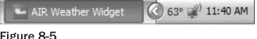

打开一个新文档，插入以下代码：

```
package com.aircmr.weatherwidget.ui
{
    import com.aircmr.weatherwidget.utils.TemperatureUtil;
    import com.aircmr.weatherwidget.data.WidgetDataModel;
    import flash.display.BitmapData;
    import flash.display.DisplayObject;
    import flash.display.MovieClip;
    import flash.display.Sprite;
    import flash.text.AntiAliasType;
    import flash.text.TextField;
    import flash.text.TextFormat;

    public class TrayIcon extends Sprite
    {
        private var _sprite:Sprite;
        private var _currentTemperature:String;
        private var _height:Number = 16;
        private var _width:Number = 16;

        public function TrayIcon( supportsDockIcon:Boolean = false )
        {
            _currentTemperature = 
                (
                !isNaN(WidgetDataModel.getInstance().currentWeather.currentTemp )
                || !WidgetDataModel.getInstance().currentWeather ) ? 
                TemperatureUtil().returnTempAsFormattedString(
                    WidgetDataModel.getInstance().currentWeather.currentTemp ,
                    WidgetDataModel.getInstance().settings.useCelsius ) : "--";

            addChild((supportsDockIcon)? OSXTrayIcon() : pcTrayIcon() );
        }

        public function getSpriteAsBitmapData():BitmapData
        {
            var bitmapData:BitmapData =
                new BitmapData( _width, _height, true, 0x00FFFFFF );
            bitmapData.draw( this );
            return bitmapData;
        }

        private function pcTrayIcon():Sprite
        {
            var pcIcon:Sprite = new Sprite();

            var textFormat:TextFormat = new TextFormat();
            textFormat.font = "Tahoma"
            textFormat.size = 11;
            textFormat.color = 0x333333;

            var textField:TextField = new TextField();

            textField.defaultTextFormat = textFormat;
            textField.antiAliasType = AntiAliasType.ADVANCED;
            textField.text = _currentTemperature;

            pcIcon.addChild( textField );

            return pcIcon;
        }

        private function OSXTrayIcon():Sprite
        {
            _height = 128;
            _width = 128;

            var OSXTrayIcon:Sprite = new Sprite();
            OSXTrayIcon.graphics.beginFill( 0x000000 , .9 );
            OSXTrayIcon.graphics
                .drawRoundRect(0, 0, _width, _height , 50 );

            var textFormat:TextFormat = new TextFormat();
            textFormat.font = "Tahoma"
            textFormat.size = 50
            textFormat.color = 0xFFFFFF;

            var textField:TextField = new TextField();

            textField.defaultTextFormat = textFormat;
            textField.antiAliasType = AntiAliasType.ADVANCED;
            textField.text = _currentTemperature;
            textField.width = 128;
            textField.x = 10;
            textField.y = 30;

            OSXTrayIcon.addChild( textField );

            return OSXTrayIcon;
        }
    }
}
```

将文档保存为 `TrayIcon.as`，放置在工作目录下的 `com/aircmr/weatherwidget/ui` 中。

`TrayIcon` 类被主应用程序类使用，并在每次查询天气数据时重新赋值。以下演示了如何在应用程序中使用 `TrayIcon` 类：

```
NativeApplication.nativeApplication.icon.bitmaps = 
    [ new TrayIcon( NativeApplication.supportsDockIcon ).getSpriteAsBitmapData() ];
```

在实例化时，应用程序传递 `NativeApplication` 类的 `supportsDockIcon` 属性值。`supportsDockIcon` 的值仅在应用程序在 OS X 中运行时为真。一旦 `TrayIcon` 类知道图标是用于 Windows 还是 OS X，它就可以调用 `pcTrayIcon` 或 `OSXTrayIcon` 方法，该方法返回正确格式化的 `Sprite`。

新的 `TrayIcon` 实例实例化的第二部分调用 `getSpriteAsBitmapData` 方法。此方法创建一个新的 `BitmapData` 实例，调用 `BitmapData.draw`，将 `Sprite` 数据绘制到该实例中，并将 `BitmapData` 实例返回给分配给 `NativeApplication.nativeApplication.icon.bitmaps` 的数组。

最后，在实例化时，`TrayIcon` 会检查当前温度是否已分配。如果已分配，则将其赋给私有变量 `_currentTemperature`；如果未分配，则将 `_currentTemperature` 赋值为两个破折号 (--)。

现在有了系统托盘（或程序坞）图标可供使用，可以构建主应用程序类了。利用这个图标，天气小部件将能够提供从托盘图标操作应用程序的菜单。下一节将讨论菜单系统和 `WeatherWidget.mxml` 文件的创建。


# WeatherWidget.mxml 应用程序类

TrayIcon 类已经介绍完毕，拼图的所有碎片都已就位，准备开始组装。数据已准备好填充 WidgetDataModel，状态已准备实例化，托盘图标也准备添加到系统托盘或 Dock 栏。

创建一个新文档，并插入以下标记和代码：

```xml
<?xml version="1.0" encoding="utf-8"?>
<mx:Application xmlns:mx="http://www.adobe.com/2006/mxml"
    layout="absolute"
    creationComplete="onCreationComplete(event)"
    horizontalScrollPolicy="off"
    verticalScrollPolicy="off"
    backgroundAlpha="0"
    xmlns:ui="com.aircmr.weatherwidget.ui.*">
    <mx:Script>
        <![CDATA[
            import com.aircmr.weatherwidget.services.*;
            import com.aircmr.weatherwidget.ui.*;
            import com.aircmr.weatherwidget.data.*;
            import com.aircmr.weatherwidget.events.XMLServiceEvent;
            import com.aircmr.weatherwidget.utils.XMLParserUtil;
            import mx.formatters.DateFormatter;
            import mx.managers.SystemManager;
            import mx.effects.easing.Quartic;

            public static const FOURDAY_FORECAST:String = "fourDayForecast";
            public static const CURRENT_FORECAST:String = "currentForecast";
            public static const LOADER:String = "loader";
            public static const SETTINGS:String = "settings";

            private var _timer:Timer;
            private var _lastUpdated:String = "N/A";
            private var _nativeWindow:NativeWindow;
            private var _lastSection:String;
            private var _xmlService:XMLFileService;
            private var _allowWindowMove:Boolean = true;

            private function onCreationComplete( event:Event ):void
            {
                WidgetDataModel.getInstance().settings.settingsXMLLocation =
                    "settings.xml";
                WidgetDataModel.getInstance().addEventListener(
                    WidgetDataModel.SETTINGS_CHANGE , onSettingsChange );
                WidgetDataModel.getInstance().addEventListener(
                    WidgetDataModel.CURRENT_FORECAST_CHANGE , onWeatherFeedLoad );

                _xmlService = new XMLFileService();
                _xmlService.addEventListener( XMLFileService.FILE_NOT_FOUND ,
                    onSettingsNotFound );
                _xmlService.addEventListener( XMLServiceEvent.XML_LOADED,
                    onSettingsXMLLoaded );
                _xmlService.loadXMLFromStorageDirectory(
                    WidgetDataModel.getInstance().settings.settingsXMLLocation );

                _timer = new Timer( 1000 );
                _timer.addEventListener( TimerEvent.TIMER , timeHandler );

                _nativeWindow =
                    SystemManager.getSWFRoot( this ).stage.nativeWindow;
                _nativeWindow.addEventListener(
                    NativeWindowDisplayStateEvent.DISPLAY_STATE_CHANGE,
                    buildNativeMenu );
                _nativeWindow.alwaysInFront =
                    WidgetDataModel.getInstance().settings.alwaysInFront;
                _nativeWindow.title = "AIR Weather Widget";

                buildNativeMenu();

                NativeApplication.nativeApplication.icon.bitmaps =
                    [ new TrayIcon(
                        NativeApplication.supportsDockIcon
                    ).getSpriteAsBitmapData() ];
            }

            private function onSettingsXMLLoaded( event:XMLServiceEvent ):void
            {
                WidgetDataModel.getInstance().settings =
                    XMLParserUtil.parseSettingsXML( event.xml,
                        WidgetDataModel.getInstance().settings );
            }

            private function onSettingsNotFound( event:Event ):void
            {
                var xmlFileService:XMLFileService = new XMLFileService();
                xmlFileService.addEventListener(
                    XMLFileService.FILE_COPIED , onSettingsFileCopiedSuccess );
                xmlFileService.copyXMLFromApplicationDirectoryToStorage(
                    WidgetDataModel.getInstance().settings.settingsXMLLocation );
            }

            private function onSettingsFileCopiedSuccess( event:Event ):void
            {
                _xmlService.loadXMLFromStorageDirectory(
                    WidgetDataModel.getInstance().settings.settingsXMLLocation );
            }

            private function timeHandler( event:TimerEvent ):void
            {
                if( _timer.currentCount ==
                    WidgetDataModel.getInstance().settings.refreshInterval )
                {
                    loadWeatherFeed();
                    _timer.reset();
                }
            }

            private function onSettingsChange( event:Event ):void
            {
                if( WidgetDataModel.getInstance().settings.zipCode == "" )
                {
                    currentState = WeatherWidget.SETTINGS;
                }
                else
                {
                    _nativeWindow.alwaysInFront =
                        WidgetDataModel.getInstance().settings.alwaysInFront;
                    loadWeatherFeed();
                }
            }

            private function onSettingsCancel():void
            {
                currentState = ( _lastSection ) ?  _lastSection :
                    WeatherWidget.LOADER;
            }

            private function loadWeatherFeed():void
            {
                currentState =  WeatherWidget.LOADER;

                var xmlLoader:URLLoader = new URLLoader();
                xmlLoader.addEventListener( Event.COMPLETE ,
                    onWeatherFeedXMLLoaded );

                var xmlURLReq:URLRequest = new URLRequest(
                    "http://www.google.com/ig/api?weather=" +
                    WidgetDataModel.getInstance().settings.zipCode );
                xmlLoader.load( xmlURLReq );
            }

            private function onWeatherFeedXMLLoaded( event:Event ):void
            {
                var loadedXML:XML = XML( event.target.data );
                WidgetDataModel.getInstance().cityLocation =
                    XMLParserUtil.parseWeatherXMLFeedLocation( loadedXML );
                WidgetDataModel.getInstance().weatherCollection =
                    XMLParserUtil.parseWeatherXMLFeedFourDay( loadedXML );
                WidgetDataModel.getInstance().currentWeather =
                    XMLParserUtil.parseWeatherXMLFeedCurrentDay( loadedXML );
            }

            private function onWeatherFeedLoad( event:Event ):void
            {
                _timer.start();

                currentState = ( _lastSection == WeatherWidget.LOADER ||
                    !_lastSection ) ? WeatherWidget.CURRENT_FORECAST : _lastSection;

                NativeApplication.nativeApplication.icon.bitmaps = [ new TrayIcon(
                    NativeApplication.supportsDockIcon ).getSpriteAsBitmapData() ];

                var dateFormat:DateFormatter = new DateFormatter();
                dateFormat.formatString = "L:NN:A";

                _lastUpdated = dateFormat.format( new Date() );

                buildNativeMenu();
            }

            private function onFourDayButtonClick( event:Event ):void
            {
                currentState = WeatherWidget.FOURDAY_FORECAST;
                buildNativeMenu();
            }

            private function onCurrentDayButtonClick( event:Event ):void
            {
                currentState = WeatherWidget.CURRENT_FORECAST;
                buildNativeMenu();
            }

            private function onSettingsClick( event:Event ):void
            {
                _lastSection = currentState;
                currentState = "settings";
                buildNativeMenu();
            }

            private function handleCloseButton( event:Event ):void
            {
                _nativeWindow.close();
            }

            private function handleMinimizeButton( event:Event ):void
            {
                _nativeWindow.minimize();
                _nativeWindow.visible = false;
            }

            private function handleRestoreButton( event:Event ):void
            {
                _nativeWindow.visible = true;
                _nativeWindow.restore();
            }

            private function checkWidgetLocation():void
            {
                if( _nativeWindow.x + backgroundContainer.width >=
                    Screen.mainScreen.bounds.width )
                {
                    _nativeWindow.x =
                        Screen.mainScreen.bounds.width - backgroundContainer.width;
                }

                if( _nativeWindow.y + backgroundContainer.height >=
                    Screen.mainScreen.bounds.height )
                {
                    _nativeWindow.y =
                        Screen.mainScreen.bounds.height-backgroundContainer.height;
                }

                if( _nativeWindow.y <= 0 ) _nativeWindow.y = 0;
                if( _nativeWindow.x <= 0 ) _nativeWindow.x = 0;
            }

            private function buildNativeMenu( event:Event = null ):void
            {
                var nativeMenu:NativeMenu = new NativeMenu();

                var title:NativeMenuItem = nativeMenu.addItem(
                    new NativeMenuItem("AIR Weather Widget" ) );
                var lastUpdated:NativeMenuItem = nativeMenu.addItem(
                    new NativeMenuItem("Last Updated: "+ _lastUpdated ) );
                nativeMenu.addItem( new NativeMenuItem("Seperator1", true ) );

                if( currentState == WeatherWidget.CURRENT_FORECAST ||
                    currentState == null )
                {
                    var fourDay:NativeMenuItem = nativeMenu.addItem(
                        new NativeMenuItem("Show Four Day Forecast") );
                    fourDay.addEventListener( Event.SELECT ,
                        onFourDayButtonClick );
                }
                else
                {
                    var currentDay:NativeMenuItem = nativeMenu.addItem(
                        new NativeMenuItem("Show Todays Forecast") );
                    currentDay.addEventListener( Event.SELECT ,
                        onCurrentDayButtonClick );
                }

                nativeMenu.addItem( new NativeMenuItem("Seperator2", true ) );
                var settingsBtn:NativeMenuItem = nativeMenu.addItem(
                    new NativeMenuItem("Settings") );
                settingsBtn.addEventListener( Event.SELECT , onSettingsClick );

                if( _nativeWindow.displayState ==
                    NativeWindowDisplayState.MINIMIZED )
                {
                    var restoreBtn:NativeMenuItem = nativeMenu.addItem(
                        new NativeMenuItem("Show Widget") );
                    restoreBtn.addEventListener(Event.SELECT, handleRestoreButton);
                }
                else
                {
                    var hideBtn:NativeMenuItem = nativeMenu.addItem(
                        new NativeMenuItem("Hide Widget") );
                    hideBtn.addEventListener(Event.SELECT, handleMinimizeButton);
                }

                var closeBtn:NativeMenuItem = nativeMenu.addItem(
                    new NativeMenuItem("Exit") );
                closeBtn.addEventListener( Event.SELECT , handleCloseButton );

                NativeApplication.nativeApplication.iconMenu = nativeMenu;
            }
        ]]>
    </mx:Script>

    <mx:Image id="backgroundContainer" source="@Embed('assets/background.png')" />

    <mx:ViewStack id="viewStack" width="100%" height="100%">
        <mx:VBox id="loader" width="100%" height="100%" horizontalAlign="center" verticalAlign="middle">
            <mx:ProgressBar mode="manual" id="probar" label="Loading..." />
        </mx:VBox>

        <mx:VBox id="currentForecast" width="100%" height="100%">
            <mx:Label text="{WidgetDataModel.getInstance().cityLocation.city}, {WidgetDataModel.getInstance().cityLocation.state}" styleName="cityLabel" />
            <mx:Label text="{WidgetDataModel.getInstance().currentWeather.condition}" styleName="conditionLabel" />
            <mx:HBox horizontalAlign="center" verticalAlign="middle">
                <mx:Label text="{WidgetDataModel.getInstance().currentWeather.temp}" styleName="tempLabel" />
                <mx:Label text="°" styleName="degreeLabel" />
            </mx:HBox>
            <mx:HBox horizontalAlign="center" verticalAlign="middle">
                <mx:Label text="H: {WidgetDataModel.getInstance().currentWeather.high}" styleName="highLabel" />
                <mx:Label text="L: {WidgetDataModel.getInstance().currentWeather.low}" styleName="lowLabel" />
            </mx:HBox>
            <mx:Button label="Four Day" click="onFourDayButtonClick(event)" styleName="buttonStyle" />
            <mx:Button label="Settings" click="onSettingsClick(event)" styleName="buttonStyle" />
        </mx:VBox>

        <mx:VBox id="fourDayForecast" width="100%" height="100%">
            <mx:Repeater dataProvider="{WidgetDataModel.getInstance().weatherCollection}">
                <mx:HBox horizontalAlign="center" verticalAlign="middle">
                    <mx:Label text="{repeaterIterator.currentItem.day}" styleName="dayLabel" />
                    <mx:Label text="{repeaterIterator.currentItem.condition}" styleName="conditionLabel" />
                    <mx:Label text="H: {repeaterIterator.currentItem.high}" styleName="highLabel" />
                    <mx:Label text="L: {repeaterIterator.currentItem.low}" styleName="lowLabel" />
                </mx:HBox>
            </mx:Repeater>
            <mx:Button label="Current" click="onCurrentDayButtonClick(event)" styleName="buttonStyle" />
            <mx:Button label="Settings" click="onSettingsClick(event)" styleName="buttonStyle" />
        </mx:VBox>

        <mx:VBox id="settings" width="100%" height="100%">
            <mx:Label text="Settings" styleName="titleLabel" />
            <mx:Label text="Zip Code:" styleName="labelStyle" />
            <mx:TextInput id="zipCodeInput" text="{WidgetDataModel.getInstance().settings.zipCode}" />
            <mx:Label text="Refresh Interval (seconds):" styleName="labelStyle" />
            <mx:NumericStepper id="refreshIntervalStepper" value="{WidgetDataModel.getInstance().settings.refreshInterval}" minimum="60" maximum="3600" stepSize="60" />
            <mx:CheckBox label="Always on Top" selected="{WidgetDataModel.getInstance().settings.alwaysInFront}" />
            <mx:Button label="Save" click="onSettingsSave()" styleName="buttonStyle" />
            <mx:Button label="Cancel" click="onSettingsCancel()" styleName="buttonStyle" />
        </mx:VBox>
    </mx:ViewStack>
</mx:Application>
```

# 第8章：天气小部件

## 第8章：天气小部件

```
new NativeMenuItem("隐藏小部件至托盘") ;
hideBtn.addEventListener(Event.SELECT, handleMinimizeButton);
}

var closeBtn:NativeMenuItem = nativeMenu.addItem(
    new NativeMenuItem("退出") );
closeBtn.addEventListener(Event.SELECT, handleCloseButton );

if( NativeApplication.supportsSystemTrayIcon )
{
    SystemTrayIcon(
        NativeApplication.nativeApplication.icon).menu= nativeMenu;
}
else
{
    DockIcon(
        NativeApplication.nativeApplication.icon).menu= nativeMenu;
}

backgroundContainer.contextMenu = nativeMenu;
}
]]></mx:Script>

<mx:Box id="backgroundContainer"
    horizontalScrollPolicy="off" verticalScrollPolicy="off"
    backgroundColor="0x000000" backgroundAlpha=".9"
    borderStyle="solid" cornerRadius="6"
    paddingBottom="5" paddingLeft="5" paddingRight="5" paddingTop="5"
    height="100" width="150" mouseDown="_nativeWindow.startMove();"
    mouseUp="checkWidgetLocation();" >
    <mx:Canvas id="holder" width="100%" height="100%"
        horizontalScrollPolicy="off" verticalScrollPolicy="off" >
        <mx:SWFLoader id="loader"
            source="@Embed(source='assets/weatherLoader.swf')"
            x="{holder.width / 2 - loader.width /2 - 10}" />
        <mx:VBox>
            <mx:Label text="{WidgetDataModel.getInstance().cityLocation}"
                color="0xFFFFFF"
                fontSize="18"
                visible="false"
                id="cityLabel" />
            <mx:Canvas>
                <ui:CurrentWeatherView
                    id="currentWeatherReport" visible="false"
                    dataProvider="{WidgetDataModel.getInstance().currentWeather}"/>
                <ui:FourDayForecastView id="fullWeatherReport" visible="false"
                    dataProvider="
                        {WidgetDataModel.getInstance().weatherCollection}"/>
                <ui:SettingsWindow id="settingsWindow" visible="false"
                    save="onSettingsChange(event);"
                    cancel="onSettingsCancel();"
                    comboOpen="{ backgroundContainer.mouseEnabled = false }"
                    comboClose="{ backgroundContainer.mouseEnabled = true }" />
            </mx:Canvas>
        </mx:VBox>
    </mx:Canvas>
</mx:Box>
<mx:states>
    <mx:State name="{WeatherWidget.FOURDAY_FORECAST}">
        <mx:SetProperty target="{loader}" name="visible" value="false" />
        <mx:SetProperty target="{cityLabel}" name="visible" value="true" />
        <mx:SetProperty target="{currentWeatherReport}"
            name="visible" value="false" />
        <mx:SetProperty target="{fullWeatherReport}"
            name="visible" value="true" />
        <mx:SetProperty target="{settingsWindow}"
            name="visible" value="false" />
        <mx:SetProperty target="{backgroundContainer}" name="width"
            value="{fullWeatherReport.width + 15}" />
        <mx:SetProperty target="{backgroundContainer}" name="height"
            value="{fullWeatherReport.height}" />
    </mx:State>
    <mx:State name="{WeatherWidget.LOADER}">
        <mx:SetProperty target="{cityLabel}" name="visible" value="false" />
        <mx:SetProperty target="{fullWeatherReport}"
            name="visible" value="false" />
        <mx:SetProperty target="{currentWeatherReport}"
            name="visible" value="false" />
        <mx:SetProperty target="{settingsWindow}"
            name="visible" value="false" />
        <mx:SetProperty target="{loader}" name="visible" value="true" />
    </mx:State>
    <mx:State name="{WeatherWidget.CURRENT_FORECAST}">
        <mx:SetProperty target="{loader}" name="visible" value="false" />
        <mx:SetProperty target="{cityLabel}" name="visible" value="true" />
        <mx:SetProperty target="{currentWeatherReport}"
            name="visible" value="true" />
        <mx:SetProperty target="{fullWeatherReport}"
            name="visible" value="false" />
        <mx:SetProperty target="{settingsWindow}"
            name="visible" value="false" />
        <mx:SetProperty target="{backgroundContainer}"
            name="width" value="{currentWeatherReport.width}" />
        <mx:SetProperty target="{backgroundContainer}"
            name="height" value="{currentWeatherReport.height}" />
    </mx:State>
    <mx:State name="{WeatherWidget.SETTINGS}">
        <mx:SetProperty target="{loader}" name="visible" value="false" />
        <mx:SetProperty target="{cityLabel}" name="visible" value="false" />
        <mx:SetProperty target="{currentWeatherReport}"
            name="visible" value="false" />
        <mx:SetProperty target="{fullWeatherReport}"
            name="visible" value="false" />
        <mx:SetProperty target="{settingsWindow}"
            name="visible" value="true" />
        <mx:SetProperty target="{backgroundContainer}"
            name="width" value="{settingsWindow.width}" />
        <mx:SetProperty target="{backgroundContainer}"
            name="height" value="{settingsWindow.height}" />
    </mx:State>
</mx:states>

<mx:transitions>
    <mx:Transition fromState="*" toState="*">
        <mx:Resize target="{backgroundContainer}" duration="350"
            easingFunction="{Quartic.easeOut}"
            effectEnd="checkWidgetLocation();" />
    </mx:Transition>
</mx:transitions>

</mx:Application>
```

将此文档保存为 `WeatherWidget.mxml`，存放在你的工作目录中。

`WeatherWidget` 是一个 `<mx:Application>` 容器，它既充当控制器，也充当小部件的视图管理器。它包含一个名为 `backgroundContainer` 的 `<mx:Box>` 组件，该组件包装了 UI 元素；一个包装 ActionScript 的 `<mx:Script>` 标签；一个包含不同视图状态的 `<mx:states>` 数组；以及一个包含小部件过渡效果定义的 `<mx:transitions>` 数组。

## 实现无边框效果

默认情况下，AIR 应用程序嵌套在 `<mx:WindowedApplication>` 容器中。`<mx:WindowedApplication>` 类是 `<mx:Application>` 类的子类，它包含了与创建匹配操作系统窗口外观（chrome）的应用程序相关的方法、属性、事件和样式。在 AIR 应用程序中使用 `<mx:WindowedApplication>` 与 `<mx:Application>` 的关键区别在于，使用 `<mx:Application>` 时，需要由开发者添加并定义监听器，以启用关闭、最小化或最大化等系统命令，或者实现窗口拖动功能。这些事件在 `<mx:WindowedApplication>` 中具有预定义的默认值。考虑到天气小部件将具有自己的外观，因此使用 `<mx:Application>` 类。为了获得完全无边框的应用程序，需要在应用程序的描述符文件中设置一些额外属性。

`backgroundContainer` 这个 `<mx:Box>` 充当天气小部件的窗口 UI。它具有黑色、半透明的背景，圆角和一个像素宽的白色边框。它包含一个嵌套的 `<mx:Canvas>` 容器，该容器封装了诸如 `loader`、`<ui:CurrentWeatherView>`、`<ui:FourDayForecastView>` 和 `<ui:SettingsWindow>` 等 UI 元素。所有用户交互事件都添加到了 `backgroundContainer`。例如，需要定义 `mouseUp` 和 `mouseDown` 事件，以允许用户在桌面上移动小部件。因此，添加事件如下：

```
<mx:Box id="backgroundContainer"
    mouseDown="_nativeWindow.startMove();"
    mouseUp="checkWidgetLocation();" >
```

请注意，此示例中省略了 `<mx:Box>` 实例的其余属性。在 `mouseDown` 事件上，`startMove` 会为 `NativeWindow` 实例实例化鼠标移动句柄。在此例中，`_nativeWindow` 在 `onCreationCompleteHandler` 中被定义为 `SystemManager.getSWFRoot(this).stage.nativeWindow`。当用户在窗口移动后释放鼠标时，`checkWidgetLocation` 方法会验证天气小部件是否仍在桌面上，如果不在，则将其移动到桌面上。


## 第8章：天气小部件

用户现在可以在桌面上自由移动小部件，而无需系统边框。然而，他们仍然无法退出或最小化小部件。如果就这样放着，用户最终可能会因沮丧而关闭计算机（尽管还有其他方式可以关闭应用程序）。无论如何，都应该有一个菜单系统，让用户能够关闭小部件。下一节将讨论如何为天气小部件添加菜单。

## 添加菜单与更多窗口交互

如果没有某种方式让用户最小化、恢复甚至退出应用程序，这个小部件将非常无用。你可以为小部件添加按钮以访问上述功能，但在小部件界面上添加一个显眼的按钮只会破坏其简洁显示的优雅性。早期版本的天气小部件有一个包含按钮的滑动托盘，但后来认为即使是一个托盘也显得笨重。解决菜单问题的方法是创建一个 `NativeMenu` 实例，并将其应用到小部件的 `contextMenu` 属性以及系统托盘图标（在 OS X 上是程序坞图标）上。图 8-6、8-7 和 8-8 展示了应用到小部件上的 `NativeMenu`。

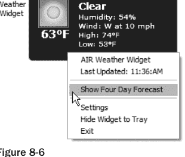

图 8-6

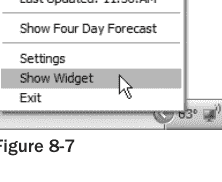

图 8-7

查看图 8-6、8-7 和 8-8，所有三个菜单几乎完全相同。这是因为只创建了一个 `NativeMenu` 类的实例并应用到了小部件上。应用程序创建完成后，会访问 `onCreationComplete`。而 `onCreationComplete` 又会激活 `buildNativeMenus` 方法。每当加载新的天气数据或小部件的当前状态发生变化时，也会调用此方法。

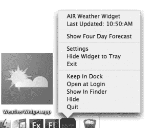

`buildNativeMenu` 方法首先创建一个新的 `NativeMenu` 实例。然后，它添加一个标签为 "AIR Weather Widget" 的新 `NativeMenuItem`。这纯粹是为了美观。它向 `NativeMenu` 添加另一个 `NativeMenuItem` 实例，该实例显示上次天气源更新的时间码。接下来，它会运行一些条件语句来检测显示状态：

```
if( currentState == WeatherWidget.CURRENT_FORECAST
    || currentState == null )
{
    var fourDay:NativeMenuItem = nativeMenu.addItem( new
        NativeMenuItem("Show Four Day Forecast") );
    fourDay.addEventListener( Event.SELECT , onFourDayButtonClick );
}
else
{
    var currentDay:NativeMenuItem = nativeMenu.addItem( new
        NativeMenuItem("Show Todays Forecast") );
    currentDay.addEventListener(Event.SELECT , onCurrentDayButtonClick);
}
```

此示例查看 `<mx:Application>` 的 `currentState` 属性。如果 `currentState` 是当前预报视图（相对于四日预报视图），则创建一个标题为 `fourDay` 的新 `NativeMenuItem`，并为 `Event.SELECT` 添加一个事件监听器。当用户在菜单中点击“显示四日预报”时，将访问 `onFourDayButtonClick`，该方法将视图状态更改为 `WeatherWidget.FOURDAY_FORECAST`。同样，如果 `currentState` 等于 `WeatherWidget.FOURDAY_FORECAST`，菜单应在其位置显示另一个标题为“显示今日预报”的 `NativeMenuItem`，并分配一个事件监听器，该监听器调用 `onCurrentDayButtonClick` 方法。

然后，`buildNativeMenu` 方法检查 `NativeWindow` 实例的 `displayState`：

```
if( _nativeWindow.displayState == NativeWindowDisplayState.MINIMIZED )
{
    var restoreBtn:NativeMenuItem = nativeMenu.addItem( new
        NativeMenuItem("Show Widget") );
    restoreBtn.addEventListener( Event.SELECT , handleRestoreButton );
}
else
{
    var hideBtn:NativeMenuItem = nativeMenu.addItem( new NativeMenuItem("Hide Widget to Tray") );
    hideBtn.addEventListener( Event.SELECT , handleMinimizeButton );
}
```

`_nativeWindow` 在 `<mx:Application>` 的 `onCreationCompleteHandler` 方法中定义。如果 `_nativeWindow.displayState` 等于 `MINIMIZED` 常量，则创建一个标签为 "Show Widget" 的新 `NativeMenuItem`，该菜单项调用 `handleRestoreButton` 方法。如果 `displayState` 属性为 `MAXIMIZED` 或 `NORMAL`，则创建一个标签为 "Hide Widget to Tray" 的 `NativeMenuItem` 实例，该实例将调用 `handleMinimizeButton` 方法。最小化和恢复将在下一节讨论。

最后一个 `NativeMenuItem` 实例标记为 "Exit"，并调用 `handleCloseButton` 方法。调用时，`handleCloseButton` 方法将调用 `_nativeWindow` 实例的 `close()` 方法，从而退出应用程序。

最后，`buildNativeMenu` 方法检查 `NativeApplication.supportsSystemTrayIcon`。如果天气小部件在 Microsoft Windows 中运行，此值将为 true。如果为 true，则将 `NativeMenu` 实例分配给 `SystemTrayIcon` 的菜单。如果为 false，则改为将 `NativeMenu` 分配给 `DockIcon` 菜单。一旦将 `NativeMenu` 分配给程序坞或系统托盘，就将其分配给 `backgroundContainer` 实例的 `contextMenu`。`contextMenu` 是用户右键单击小部件时访问的菜单。

### 最小化、恢复和设置 AlwaysInFront

最小化和恢复窗口就像调用 `NativeWindow` 实例的 `minimize` 和 `restore` 方法一样简单。然而，在 Microsoft Windows 中，这只会将应用程序最小化到系统的任务栏。如果能让应用程序完全消失，只留下系统托盘图标，那将非常有帮助。你可以通过将 `NativeWindow` 的 `visible` 属性设置为 `false` 来使命令系统任务栏实例消失。只是当小部件恢复时，请确保将其设置为 `true`；否则，用户将无法看到小部件。

`NativeWindow` 实例还有一个接受布尔值的 `alwaysInFront` 属性。每当设置发生更改时，就会分配此属性。该值来自 `WidgetDataModel.getInstance().settings.alwaysInFront`。此属性控制小部件是否位于所有打开窗口的前面。

现在小部件有了菜单系统以及最小化、恢复和更改视图状态的能力。下一节将讨论在更改视图状态时添加动画。

### 视图动画

除了加载器视图实例外，当视图状态添加到舞台时，它们的 `visible` 属性都被设置为 `false`。每个视图状态都在 `<mx:states>` 视图数组中定义。当 `<mx:Application>` 类的 `currentState` 属性被更改时，会访问指定的 `<mx:SetProperty>` 标签，更改视图状态的可见性以及背景容器的宽度和高度。例如，将 `currentState` 设置为等于 `WeatherWidget.FOURDAY_FORECAST` 将执行以下 `<mx:SetProperty>` 实例集：

```
<mx:State name="{WeatherWidget.FOURDAY_FORECAST}">
    <mx:SetProperty target="{loader}" name="visible" value="false" />
    <mx:SetProperty target="{cityLabel}" name="visible" value="true" />
    <mx:SetProperty target="{currentWeatherReport}" name="visible" value="false" />
    <mx:SetProperty target="{fullWeatherReport}" name="visible" value="true" />
    <mx:SetProperty target="{settingsWindow}" name="visible" value="false" />
    <mx:SetProperty target="{backgroundContainer}" name="width" value="{fullWeatherReport.width + 15}" />
    <mx:SetProperty target="{backgroundContainer}" name="height" value="{fullWeatherReport.height}" />
</mx:State>
```

如果你只运行带有状态更改的应用程序，窗口将立即调整大小并显示四日预报。如果能添加一点动画效果会更好。创建一个 `<mx:Transition>` 实例就能实现这一点。

`<mx:Transition>` 被分配了一个 `fromState` 和一个 `toState` 值。在这种情况下，如果小部件更改状态，则应该有动画效果。嵌套的 `<mx:Resize>` 实例设置了转换期间要执行的操作。它以 `backgroundContainer` 为目标，持续时间为 350 毫秒，缓动函数为 `Quartic.easeOut`。转换运行后，`backgroundContainer` 将按照调用的 `<mx:State>` 的 `<mx:SetProperty>` 实例中指定的新大小进行动画。转换完成后，它将访问 `effectEnd` 方法，该方法又会调用 `checkWidgetLocation` 方法，该方法检查以确保天气小部件在桌面上。结果是一个精彩的动画状态更改。

### 访问数据

天气小部件现在具备了带有动画和菜单的所有四种状态。最后的开发步骤是加载数据。数据模型类已设置并准备就绪，你只需访问它们。执行此操作的理想位置是在 `<mx:Application>` 完成实例化后调用的 `onCreationCompleteHandler` 方法中。

首先，创建一个指向 `WidgetDataModel` 实例的引用，并为数据更改事件分配事件监听器：

```
_dataModelInstance = WidgetDataModel.getInstance();
_dataModelInstance.settings.settingsXMLLocation = "settings.xml";
_dataModelInstance.addEventListener(
    WidgetDataModel.SETTINGS_CHANGE , onSettingsChange );
_dataModelInstance.addEventListener(
    WidgetDataModel.CURRENT_FORECAST_CHANGE , onWeatherFeedLoad );
```

`onSettingsChange` 方法检查是否指定了邮政编码。如果没有指定，它会将视图状态更改为 `WeatherWidget.SETTINGS`。如果指定了邮政编码，则 `onSettingsChange` 将调用 `loadWeatherFeed()` 方法。设置方法在本章前面有更详细的讨论。

`onWeatherFeedLoad` 方法开始间隔计时器，将 `currentState` 设置为上一个状态或默认的 `WeatherWidget.CURRENT_FORECAST` 状态。它还使用最新的当前温度设置 `TrayIcon`，并将私有 `_lastUpdated` 字符串设置为当前时间戳。最后，它调用 `buildNativeMenu`，该方法会更改 `NativeMenu` 以反映最新的状态和时间戳更改。


## 部署应用程序

如果此时测试应用程序，它应该能够执行、加载数据并动画显示当前天气视图。菜单应已分配，托盘图标应已显示。你的天气小部件已接近完成。最后一步是打包应用程序以便部署。下一节将讨论创建描述符文件以及打包AIR应用程序以进行分发。

### 描述符文件

创建天气小部件所需的最后一个文件是应用程序描述符文件。这个XML文件包含应用程序的属性，例如初始窗口设置、版权、标题和图标URL。它会与最终可部署文件一起打包和分发。

创建一个新文档并输入以下标记：

```
<application xmlns="http://ns.adobe.com/air/application/1.0">
    <id>com.aircmr.WeatherWidget</id>
    <filename>WeatherWidget</filename>
    <version>0.1</version>
    <name>AIR WeatherWidget</name>
    <description></description>
    <copyright>2008</copyright>
    
    <initialWindow>
        <title/>
        <content>WeatherWidget.swf</content>
        <systemChrome>none</systemChrome>
        <transparent>true</transparent>
        <visible>true</visible>
    </initialWindow>
    
    <icon>
        <image16x16>icons/16x16.png</image16x16>
        <image32x32>icons/32x32.png</image32x32>
        <image48x48>icons/48x48.png</image48x48>
        <image128x128>icons/128x128.png</image128x128>
    </icon>
    
    <installFolder>AIRCMR/WeatherWidget</installFolder>
    <programMenuFolder>AIRCMR</programMenuFolder>
</application>
```

将文件保存为WeatherWidget-app.xml，放在工作目录的根目录下，与WeatherWidget.mxml和settings.xml文件一起。

这个文件将是天气小部件的描述符文件。因为小部件将拥有自己的窗口设计和界面，所以`<systemChrome>`属性设置为none，`<transparent>`设置为true。

## 第8章：天气小部件

没有自定义图标的小部件是不完整的。本章目录的CD-ROM中包含了四个图标文件，尺寸分别为：16×16、32×32、48×48和128×128像素。如果你没有这些图标图像，请从`<icon>`节点集中移除图标URL；否则，在打包AIR应用程序时将会抛出错误。

### 编译与打包

创建天气小部件的最后一步是编译和打包它。如果你计划添加图标文件但尚未添加，请确保在继续之前将它们复制到工作目录的/icons文件夹中。你还应该确保在编辑工作目录中的原始文件后，清除settings.xml文件中的`<zipCode>`数据。一旦你在工作目录中准备好图标（可选）、WeatherWidget.mxml、WeatherWidget-app.xml、settings.xml和assets/目录，就可以开始打包应用程序，首先将WeatherWidget.mxml编译成SWF。

打开命令提示符，导航到天气小部件的工作目录，输入以下命令，然后按回车键：

```
> amxmlc WeatherWidget.mxml
```

命令提示符仍指向工作目录时，通过输入以下命令并按回车键，将小部件打包为AIR安装程序：

```
> adt -package WeatherWidget WeatherWidget-app.xml WeatherWidget.swf
settings.xml /icons/
```

创建软件包后，导航到你的工作目录。如果小部件打包正确，你应该会有一个WeatherWidget.air文件。执行WeatherWidget.air包以在硬盘上安装应用程序。安装完成后，打开它，输入你的邮政编码，然后享受天气吧。万一遇到下雨天或暴风雪，可以快速切换到四日视图，看看你的这一周是否会好转。如果所有其他方法都失败了，输入一个以90开头的邮政编码，看看阳光加州的天气如何。

## 总结

在本章中，你学习了如何创建一个功能齐全、特性丰富的天气小部件。该小部件请求用户的邮政编码，查询Google的XML天气源，并显示当前预报或四日预报。它具有极简、无边框的设计，包含多个视图状态，并与系统托盘（或程序坞）进行动态交互。尽管这个小部件执行的是一个非常具体的功能，并具有特定的外观和感觉，但构建它所涉及的概念可以应用于构建更好的小部件。

你可以将此应用程序用作开发不同小部件的跳板，或者扩展现有的功能集。例如，对于想要监控多个地点天气的人来说，能够创建天气小部件的多个实例可能会很方便。该小部件可以查询美国国家气象局，并在指定区域显示天气警告。天气小部件的品牌形象可以更改，使其根本不显示天气；相反，它可能有一个根据天气数据变化的插图。总的来说，你可以利用这个应用程序来实现你的想法，创建简化的、跨平台的杀手级小部件。

## 9

## 地图应用程序

地图应用程序在当今基于位置的在线活动中非常普遍。无论你是寻找路线、定位离目的地最近的酒店，还是仅仅想看看像鸟儿一样飞越你的城镇是什么样子，你都在向众多在线服务之一请求信息，这些服务能告诉你该转哪个弯、住在哪里以及在哪里降落。其中许多服务都有公共API，应用程序开发人员可以使用这些API将其集成到自己的应用程序中。

你将在本章中构建的地图应用程序将使你能够使用一个在线地图API搜索位置、向位置添加目的地标记，并查看和编辑已保存的目的地，而不受可用网络资源的限制。本书将继续深入探讨前面章节讨论的数据库API，并向你介绍在通过ActionScript和JavaScript与在线服务通信时进行桥接的代码。

在开始构建应用程序之前，你应该考虑你对桌面地图应用程序有何期望。为了利用在线服务检索地图信息，应解决以下目标：

- 通过JavaScript与在线API通信以搜索位置和添加目的地
- 与本地数据库通信以保存、查看和编辑目的地信息

下一节将讨论如何实现这些目标。

## 设计

你将构建的地图应用程序主要处理通信——你如何与在线API通信以收集和操作数据，以及你如何与本地数据库通信以保存和编辑这些数据。数据的呈现方式在检索和保存位置方面与数据本身起着同样重要的作用。本章的介绍针对了在构建地图应用程序之前需要考虑的一些主要目标。以下列表扩展了这些目标：

- 通过JavaScript与在线API通信以搜索位置和添加目的地——你将在本章中使用的在线地图API是雅虎地图AJAX API。在使用此服务时，你将接触HTML控件，并学习如何在你的AIR应用程序和JavaScript之间桥接代码。由于此服务依赖于Internet连接，与雅虎地图AJAX API的通信将受网络资源可用性的限制。
- 与本地数据库通信以保存、查看和编辑目的地信息——该地图应用程序将利用AIR数据库API来插入新条目，以及从本地数据库检索和更新先前保存的条目。由于保存的条目来自本地数据库，通信不受网络资源限制，并且可以在没有Internet连接的情况下访问数据。

概述这两个目标凸显了地图应用程序中需要两个不同视图模式的需求。当网络资源可用时，将提供在每种视图模式之间切换的选项，使你能够与在线地图API和本地数据库进行交互——涵盖了上面讨论的两个通信点。当没有Internet连接时，你将只能与数据库进行交互，从而能够编辑和添加任何保存的位置。

下一节涵盖了地图应用程序将用于显示和保存基于目的地位置的值对象和上层数据模型。

### 处理数据

地图应用程序将处理来自两个不同来源的数据——与在线API交互的HTML文档和一个本地数据库。重要的是要考虑到，虽然这两个服务解释的数据可能不同，但地图应用程序本身将使用单一类型的模型进行操作。考虑到这一点，你的视图类将不必费心根据数据是从哪里检索或发送到哪里来处理特定类型的数据。

与雅虎地图AJAX API和本地数据库的交互将涉及不同的控制器，但这些控制器应该知道如何处理相同类型的数据，以便在这些服务和地图应用程序之间进行解释。下一节将讨论数据的通用化。

### 值对象

地图应用程序将显示两种特定类型的数据：位置和目的地。如前所述，这些数据将来自不同的来源。应用程序必须能够抽象这些数据，这一点很重要，这样用户在查看基于目的地的位置时，无需确切知道其在地图上的坐标就能找到“那个地方”。与大多数在线地图应用程序一样，使用视觉标记来表示指定位置上的目的地。因此，AIR应用程序在在线服务和数据库之间处理两种主要类型的数据：位置和目的地标记。


## 第9章：地图应用

在你的开发目录中，创建一个名为“Locator”的文件夹。这将作为你该应用的*工作目录*。设置好后，创建以下类：

1.  打开你常用的文本编辑器，创建一个新文档，并输入以下 ActionScript：

```
package com.aircmr.locator.data
{
    public interface IDBEntry
    {
        function serialize():void;
        function deserialize():void;
    }
}
```

2.  将文件保存为 `IDBEntry.as`，位于你工作目录下的 `com/aircmr/locator/data` 目录中。

你会注意到，由下面两个值对象实现的 `serialize()` 和 `deserialize()` 方法将分别对字符串属性进行转义和反转义。为了将一条语句正确地处理到数据库中，重要的是提交的信息不包含特殊字符，例如空格或引号。序列化数据是为了使其属性值能被正确地输入到数据库。反序列化从数据库获取的数据，则是将值对象还原为用户最初输入的状态。考虑到这一点，任何需要被输入到数据库的应用数据都将实现 `IDBEntry` 接口。

3.  创建一个新文档，并输入以下 ActionScript：

```
package com.aircmr.locator.data
{
    import flash.events.EventDispatcher;

    [Bindable]
    public class LocationVO extends EventDispatcher
        implements IDBEntry
    {
        public var id:int;
        public var name:String;
        public var content:String;

        public function LocationVO( id:int = -1,
                                    name:String = "",
                                    content:String = "" )
        {
            this.id = id;
            this.name = name;
            this.content = content;
        }

        public function serialize():void
        {
            name = escape( name );
            content = escape( content );
        }

        public function deserialize():void
        {
            name = unescape( name );
            content = unescape( content );
        }
    }
}
```

4.  将文件保存为 `LocationVO.as`，与 `IDBEntry.as` 一同放在 `com/aircmr/locator/data` 目录中。

5.  创建一个新文档，并输入以下 ActionScript：

```
package com.aircmr.locator.data
{
    public class MarkerVO implements IDBEntry
    {
        public var id:int;
        public var locationId:int;
        public var jsId:String;
        public var caption:String;
        public var x:Number;
        public var y:Number;

        public function MarkerVO( id:int = -1,
                                 locationId:int = -1,
                                 jsId:String = "",
                                 caption:String = "",
                                 xpos:Number = 0, ypos:Number = 0 )
        {
            this.id = id;
            this.locationId = locationId;
            this.jsId = jsId;
            this.caption = caption;
            this.x = xpos;
            this.y = ypos;
        }

        public function serialize():void
        {
            caption = escape( caption );
        }
        public function deserialize():void
        {
            caption = unescape( caption );
        }
    }
}
```

6.  将文件保存为 `MarkerVO.as`，位于你工作目录的 `com/aircmr/locator/data` 目录中。

你刚刚创建的 `LocationVO` 和 `MarkerVO` 类将作为值对象，在地图应用与 Yahoo! Maps AJAX API 以及本地数据库交互时使用。

每个对象都实现了 `IDBEntry` 接口，以便对其字符串属性进行 URL 编码格式的编码和解码。

`LocationVO` 类保存与某个位置相关的信息。`name` 属性对应用户输入的信息，而 `content` 属性表示要显示的图形内容。

`MarkerVO` 类保存与某个目的地相关的信息。`x` 和 `y` 属性表示目的地在屏幕上的坐标。`jsId` 属性与通过 Yahoo! Maps AJAX API 添加的标记相关联，而 `caption` 属性是用户为该目的地输入的标题。

这些值对象上的 `id` 属性是对象被输入到数据库时被分配的唯一 ID。请注意，这两个数据对象上的 ID 在实例化时都默认为 `-1`。地图应用将使用此值来判断该信息是数据库的新条目还是需要更新的现有条目。

`MarkerVO` 上的 `locationId` 属性很重要。这个值与数据库中存储的某个位置所获得的 ID 值相关。从本章稍后将讨论的数据库结构角度来看，这些值对象——`LocationVO` 和 `MarkerVO`——分别对应于两个独立的数据表。通过在目的地中分配一个与某个位置唯一 ID 相关联的字段，你就可以使用关系数据库将目的地与位置链接起来。

在下一节中，你将创建供客户端交互以编辑和更新这些位置与目的地数据对象的上层模型。

## 数据模型

在上一节中，你创建了用于表示基于位置的目的地的信息对象。在本节中，你将创建访问和更新这些信息的模型。由于地图应用允许你在没有互联网连接的情况下工作，因此需要多个视图来根据网络资源的可用性呈现信息。通过在多个显示类中注册对公共模型属性更新的事件监听器，你可以确保显示的数据保持一致。地图应用使用的显示视图稍后会介绍，但首先你可以开始处理模型。

创建一个新文档，并输入以下 ActionScript：

```
package com.aircmr.locator.data
{
    import flash.events.EventDispatcher;
    
    import mx.collections.ArrayCollection;
    
    [Bindable]
    public class LocatorDataManager extends EventDispatcher
    {
        private static var _instance:LocatorDataManager = new LocatorDataManager();
        public var currentAddress:String;
        public var location:LocationVO;
        public var markers:ArrayCollection;    // MarkerVO[]

        public static function getInstance():LocatorDataManager
        {
            return _instance;
        }

        public function LocatorDataManager()
        {
            if( _instance != null )
            {
                // singleton warning...
            }
        }

        public function refresh():void
        {
            currentAddress = "";
            location = new LocationVO();
            markers = new ArrayCollection();
        }

        public function addMarker( marker:MarkerVO ):void
        {
            markers.addItem( marker );
        }
    }
}
```

将文件保存为 `LocatorDataManager.as`，位于你工作目录的 `com/aircmr/locator/data` 目录中，与之前创建的值对象放在一起。

`LocationVO` 和 `MarkerVO` 对象反映了表条目，它们各自的属性与数据库表中指定的字段相对应。`LocatorDataManager` 作为这些数据的管理器，同时采用单例模式以确保在任何给定时间所有客户端都使用相同的数据。与当前的位置和目的地数据相关的还有实际地址——这意味着像“我家”这样的位置名称，与用于地理编码的实际地址是不同的。`currentAddress` 属性将根据用户输入进行更新，并用于从在线服务或数据库中定位地图。

值对象创建并管理好之后，现在是时候构建这些数据在数据库间来回传递的逻辑了。在下一节中，你将创建用于从本地数据库发送和检索位置与目的地数据的类。

## 查询数据库

Adobe AIR 中包含的 SQL 关系数据库引擎使你能够将数据本地存储在数据库文件中。你在本节中创建的服务将创建该数据库文件和必要的表，以及运行查询来存储和检索位置与目的地信息。


## 第九章：地图应用

1.  创建一个新文档，并输入以下 ActionScript 代码：

```actionscript
package com.aircmr.locator.services
{
    import com.aircmr.locator.data.LocationVO;
    import com.aircmr.locator.data.MarkerVO;
    import com.aircmr.locator.data.QueryVO;
    import com.aircmr.locator.events.DBResultEvent;
    
    import flash.data.SQLConnection;
    import flash.data.SQLResult;
    import flash.data.SQLStatement;
    import flash.events.Event;
    import flash.events.EventDispatcher;
    import flash.events.SQLErrorEvent;
    import flash.events.SQLEvent;
    import flash.filesystem.File;
    
    [Event(name="creationComplete", type="flash.events.Event")]
    [Event(name="creationError", type="flash.events.Event")]
    final public class DBService extends EventDispatcher
    {
        private var _connection:SQLConnection;
        private var _statement:SQLStatement;
        private var _dbFile:File;
        
        private var _isOpen:Boolean;
        private var _queryQueue:Array;
        private var _currentQuery:QueryVO;
        private var _isRunningQuery:Boolean;
        
        private static const FALL_THROUGH:String = "";
        private static const CREATE_TABLE_LOC:String = "createLocations";
        private static const CREATE_TABLE_MARK:String = "createMarkers";
        
        public static const CREATION_COMPLETE:String = "creationComplete";
        public static const CREATION_ERROR:String = "creationError";
        
        private static const DB:String = "Locator.db";
        
        public function DBService()
        {
            _connection = new SQLConnection();
            _connection.addEventListener( SQLEvent.OPEN, onConnectionOpen );
            _connection.addEventListener( SQLEvent.CLOSE, onConnectionClose );
            _connection.addEventListener( SQLErrorEvent.ERROR, onConnectionError );
            
            _queryQueue = new Array();
            _dbFile = File.applicationStorageDirectory.resolvePath( DB );
            invalidate();
        }
        
        private function invalidate():void
        {
            _statement = new SQLStatement();
            _statement.sqlConnection = _connection;
            _statement.addEventListener(SQLEvent.RESULT, onCreationQueryResult);
            _statement.addEventListener(SQLErrorEvent.ERROR, onCreationQueryError);
        
            var sqlCreateLoc:String = "CREATE TABLE IF NOT EXISTS locations (" +
                                     "id    INTEGER PRIMARY KEY," +
                                     "name  TEXT NOT NULL," +
                                     "content TEXT NOT NULL);";
        
            var sqlCreateMark:String = "CREATE TABLE IF NOT EXISTS markers (" +
                                      "id INTEGER PRIMARY KEY," +
                                      "jsId TEXT NOT NULL," +
                                      "locationId TEXT NOT NULL," +
                                      "caption TEXT NOT NULL," +
                                      "x FLOAT NOT NULL," +
                                      "y FLOAT NOT NULL);";
        
            addQuery( new QueryVO( CREATE_TABLE_LOC, sqlCreateLoc ), false );
            addQuery( new QueryVO( CREATE_TABLE_MARK, sqlCreateMark ), true );
        }
        
        private function open():void
        {
            if( _isOpen ) return;
            _connection.open( _dbFile );
        }
        
        private function executeNextQuery():void
        {
            if( !_isOpen ) open();
            else
            {
                if( _queryQueue.length > 0 )
                {
                    if( !_isRunningQuery ) _isRunningQuery = true;
                    _currentQuery = _queryQueue.shift();
                    _statement.text = _currentQuery.query;
                    _statement.itemClass = _currentQuery.itemClass;
                    _statement.execute();
                }
                else
                {
                    _isRunningQuery = false;
                    _currentQuery = null;
                    _connection.close();
                }
            }
        }
        
        private function onConnectionOpen( evt:SQLEvent ):void
        {
            _isOpen = true;
            if( _queryQueue.length > 0 ) executeNextQuery();
        }
        
        private function onConnectionClose( evt:SQLEvent ):void
        {
            _isOpen = false;
            if( _queryQueue.length > 0 )
            {
                _queryQueue.splice( 0, 0, _currentQuery );
                _currentQuery = null;
                _isRunningQuery = false;
            }
        }
        
        private function onConnectionError( evt:SQLErrorEvent ):void
        {
            trace( "Database connection error!" );
        }
        
        private function onCreationQueryResult( evt:SQLEvent ):void
        {
            if( _queryQueue.length > 0 )
            {
                executeNextQuery();
            }
            else
            {
                _statement = new SQLStatement();
                _statement.sqlConnection = _connection;
                _statement.addEventListener( SQLEvent.RESULT, onQueryResult );
                _statement.addEventListener( SQLErrorEvent.ERROR, onQueryError );
                dispatchEvent( new Event( CREATION_COMPLETE ) );
                _isRunningQuery = false;
            }
        }
        
        private function onCreationQueryError( evt:SQLErrorEvent ):void
        {
            dispatchEvent( new Event( CREATION_ERROR ) );
            _isRunningQuery = false;
        }
        
        private function onQueryResult( evt:SQLEvent ):void
        {
            var result:SQLResult = _statement.getResult();
            if( _currentQuery.type != FALL_THROUGH )
                dispatchEvent( new DBResultEvent( _currentQuery.type, result ) );
            executeNextQuery();
        }
        
        private function onQueryError( evt:SQLErrorEvent ):void
        {
            dispatchEvent( evt );
            _isRunningQuery = false;
        }
        
        public function saveLocation( location:LocationVO ):void
        {
            location.serialize();
            var sqlSave:String;
            var sqlSelect:String;
            if( location.id == -1 )
            {
                // add new location...
                sqlSave = "INSERT INTO locations VALUES (" +
                                       "null," +
                                       "'" + location.name + "'," +
                                       "'" + location.content + "');";
                sqlSelect = "SELECT * FROM locations ORDER BY id DESC LIMIT 1;";
            }
            else
            {
                // update saved location...
                sqlSave = "UPDATE locations SET " +
                           "name='" + location.name + "'," +
                           "content='" + location.content + "' " +
                           "WHERE id='" + location.id + "';";
                sqlSelect = "SELECT * FROM locations WHERE id='" +
                             location.id + "';";
            }
            addQuery( new QueryVO( FALL_THROUGH, sqlSave ), false );
            addQuery( new QueryVO(DBResultEvent.LOCATION_SAVED, sqlSelect), true );
            location.deserialize();
        }
        
        public function saveMarker( marker:MarkerVO ):void
        {
            marker.serialize();
            var sqlSave:String;
            var sqlSelect:String;
            if( marker.id == -1 )
            {
                // add new marker...
                sqlSave = "INSERT INTO markers VALUES (" +
                                       "null," +
                                       "'" + marker.jsId + "'," +
                                       "'" + marker.locationId + "'," +
                                       "'" + marker.caption + "'," +
                                       "'" + marker.x + "'," +
                                       "'" + marker.y + "');";
                sqlSelect = "SELECT * FROM markers ORDER BY id DESC LIMIT 1;";
            }
            else
            {
                // update saved marker...
                sqlSave = "UPDATE markers SET " +
                           "locationId='" + marker.locationId + "'," +
                           "caption='" + marker.caption + "'," +
                           "x='" + marker.x + "'," +
                           "y='" + marker.y + "' " +
                           "WHERE id='" + marker.id + "';";
                sqlSelect = "SELECT * FROM markers WHERE id='" + marker.id + "';";
            }
            addQuery( new QueryVO( FALL_THROUGH, sqlSave ), false );
            addQuery( new QueryVO( DBResultEvent.MARKER_SAVED, sqlSelect ),true );
            marker.deserialize();
        }
        
        public function retrieveLocation( location:String ):void
        {
            var sqlSelect:String = "SELECT * FROM locations WHERE " +
                                   "name='" + escape( location ) + "' " +
                                   "LIMIT 1;";
            addQuery( new QueryVO( DBResultEvent.LOCATION_RETRIEVED, sqlSelect,
                                   LocationVO ) );
        }
        
        public function retrieveAllLocations():void
        {
            var sqlSelect:String = "SELECT DISTINCT name FROM locations;";
            addQuery( new QueryVO(DBResultEvent.LOCATION_RETRIEVED_ALL,
                                   sqlSelect, LocationVO ) );
        }
        
        public function retrieveMarkersFromLocation( id:int ):void
        {
            var sqlSelect:String = "SELECT * FROM markers WHERE " +
                                   "locationId='" + id + "';";
            addQuery( new QueryVO( DBResultEvent.MARKER_RETRIEVED_ALL, sqlSelect,
                                   MarkerVO ) );
        }
        
        public function addQuery( query:QueryVO, run:Boolean = true ):void
        {
            _queryQueue.push( query );
            if( !_isRunningQuery && run ) runQuery();
        }
        
        public function runQuery():void
        {
            if( _queryQueue.length > 0 ) executeNextQuery();
        }
        
        public function shutDown():void
        {
            if( _isRunningQuery )
            {
                _statement.removeEventListener(SQLEvent.RESULT, onQueryResult);
                _statement.removeEventListener(SQLErrorEvent.ERROR, onQueryError);
            }
            close();
        }
    }
}
```


# 第9章：地图应用

```actionscript
public function close():void
{
    if( _isOpen ) _connection.close();
}
}
```

+   2. 将文件保存为 `DBService.as`，存放在工作目录的 `com/aircmr/locator/services` 文件夹下。

+   3. 创建一个新文档并输入以下 ActionScript 代码：

```actionscript
package com.aircmr.locator.events
{
    import flash.data.SQLResult;
    import flash.events.Event;

    public class DBResultEvent extends Event
    {
        private var _result:SQLResult;

        public static const LOCATION_SAVED:String = "locationSaved";
        public static const LOCATION_RETRIEVED:String = "locationRetrieved";
        public static const LOCATION_RETRIEVED_ALL:String = "locationRetrievedAll";
        public static const MARKER_SAVED:String = "markerSaved";
        public static const MARKER_RETRIEVED:String = "markerRetrieved";
        public static const MARKER_RETRIEVED_ALL:String = "markerRetrievedAll";

        public function DBResultEvent( type:String, sqlResult:SQLResult )
        {
            super( type );
            _result = sqlResult;
        }

        public function get result():SQLResult
        {
            return _result;
        }
    }
}
```

+   4. 将文件保存为 `DBResultEvent.as`，存放在工作目录的 `com/aircmr/locator/events` 文件夹下。

+   5. 创建一个新文档并输入以下 ActionScript 代码：

```actionscript
package com.aircmr.locator.data
{
    public class QueryVO
    {
        public var type:String;
        public var query:String;
        public var itemClass:Class;

        public function QueryVO( type:String, query:String,
                                 itemClass:Class = null )
        {
            this.type = type;
            this.query = query;
            this.itemClass = itemClass;
        }
    }
}
```

+   6. 将文件保存为 `QueryVO.as`，存放在工作目录的 `com/aircmr/locator/data` 文件夹下。

第一段代码片段被保存为 `DBService.as`，这是一个服务类，它将通过执行 SQL 查询语句与数据库进行交互。该服务将从主应用程序类中实例化，主应用程序类充当视图从数据库请求指定数据的访问点。在创建 `DBService` 实例时，会创建一个 `flash.data.SQLConnection` 的实例。`SQLConnection` 实例管理与本地数据库文件的连接，并作为 `flash.data.SQLStatement` 对象的 `sqlConnection` 属性提供：

```actionscript
public function DBService()
{
    _connection = new SQLConnection();
    _connection.addEventListener( SQLEvent.OPEN, onConnectionOpen );
    _connection.addEventListener( SQLEvent.CLOSE, onConnectionClose );
    _connection.addEventListener( SQLErrorEvent.ERROR, onConnectionError );

    _queryQueue = new Array();
    _dbFile = File.applicationStorageDirectory.resolvePath( DB );
    invalidate();
}
```

在创建 `SQLConnection` 的同时，如果尚未存在，名为 `Locator.db` 的数据库文件将在应用程序存储目录中创建。与只允许应用程序读取访问的应用程序目录不同，你可以读写应用程序存储目录，该目录通过 `flash.filesystem.File` 类的静态 `applicationStorageDirectory` 属性访问。

> 在 Windows 中，你可以在 `C:\Documents and Settings\<用户名>\Application Data\<应用程序名称>\Local Store` 找到应用程序存储目录。在 Mac 上，应用程序存储目录位于 `/Users/<用户名>/Library/Preferences/<应用程序名称>/Local Store`。

有了到数据库的打开连接，就可以使用 `flash.data.SQLStatement` 对象运行 SQL 查询。`DBService` 类通过队列管理查询，可以使用公共的 `addQuery()` 方法添加查询：

```actionscript
public function addQuery( query:QueryVO, run:Boolean = true ):void
{
    _queryQueue.push( query );
    if( !_isRunningQuery && run ) runQuery();
}

public function runQuery():void
{
    if( _queryQueue.length > 0 ) executeNextQuery();
}
```

第三段代码片段被保存为 `QueryVO`，并作为 `addQuery()` 方法的第一个参数提供，它代表添加到此受管队列的查询对象。`QueryVO` 上的三个属性 `type`、`query` 和 `itemClass` 分别对应：正在进行的查询类型、要执行的查询语句字符串，以及要将结果数据映射到的类。`SQLStatement` 类能够将数据库查询的结果数据映射到指定的类，使你能够无缝地处理从数据库检索到的数据，而无需手动解析和替换属性数据。要将数据映射到指定的类，你需要使用 `SQLStatement` 类的 `itemClass` 属性。对该类的引用被传递到 `QueryVO` 对象中，该对象用于每个新查询。

所有要运行和广播的、与基于目的地的位置相关的查询类型都列在 `DBResultEvent` 类中——即保存为第二个代码片段的类。当 SQL 语句完成时，`DBService` 会分派 `DBResultEvent` 实例，其事件类型与 `QueryVO` 实例的 `type` 属性相匹配。`DBResultEvent` 的 `result` 属性是从 SQL 查询返回的数据。

查看一个添加查询到队列以运行的公共方法：

```actionscript
public function retrieveAllLocations():void
{
    var sqlSelect:String = "SELECT DISTINCT name FROM locations;";
    addQuery(new QueryVO(DBResultEvent.LOCATION_RETRIEVED_ALL, sqlSelect));
}
```

`retrieveAllLocations()` 方法调用以将一个新的 `QueryVO` 对象添加到队列，其类型值设置为 `DBResultEvent` 上的 `LOCATION_RETRIEVED_ALL` 常量，查询值设置为一条 SQL 语句，该语句将从本地数据库 `Locator.db`（在 `DBService` 初始化时创建）中标题为 `locations` 的表的所有记录中选择每个名称。在收到执行的 SQL 语句的结果后，会分派一个新的 `DBResultEvent`，其类型为传递给 `QueryVO` 的类型，结果为查询结果：

```actionscript
private function onQueryResult( evt:SQLEvent ):void
{
    var result:SQLResult = _statement.getResult();
    if( _currentQuery.type != FALL_THROUGH )
        dispatchEvent( new DBResultEvent( _currentQuery.type, result ) );
    executeNextQuery();
}
```

遗憾的是，Adobe AIR 中包含的 SQL 引擎 SQLite 中所有可能的语句、列类型和约束内容太多，无法在本章中涵盖，建议你阅读 Adobe 提供的文档。然而，尽管无法涵盖 `DBService` 运行的所有与位置和目的地数据存储和检索相关的语句，但 `invalidate()` 方法值得注意。

在从构造函数调用的 `invalidate()` 方法内，使用 `CREATE IF NOT EXISTS` 子句在本地数据库中创建了两个表（如果它们之前不存在）。这两个表——标题为 `locations` 和 `markers`——将存储应用程序可用的位置和目的地数据，并用于在数据库上执行任何后续查询。数据库的更新在公共的 `saveLocation()` 和 `saveMarker()` 方法中执行，使用 `LocationVO` 和 `MarkerVO` 对象的相应 `id` 属性来插入新条目或更新现有条目。

既然你已经有了表示位置和目的地的数据对象，以及本地存储数据的方法，现在是时候在视觉上呈现这些数据了。下一节将讨论构建用户界面，该界面将使你能够访问、操作和保存基于目的地的位置。

## 构建用户界面

地图应用程序中可用的用户界面控件基于网络资源的可用性。你有能力处理在线数据（依赖于互联网连接），也有能力处理已保存的数据（不需要互联网连接）。因此，地图应用程序有三个主要视图：

-   **模式控制视图** — 模式控制视图响应互联网连接的丢失或获得，并使用户可以选择是使用本地存储的数据还是来自在线地图 API 的数据。
-   **显示视图** — 显示视图根据模式控制更新其视图。当用户选择或被迫离线工作时，显示视图将在选择位置时渲染任何已保存的图形和标记。在线工作时，用户可以在显示视图中浏览和下载来自 API 的图形。
-   **位置控制视图** — 位置控制视图根据模式控制更新其界面控件，并使用户能够添加、搜索和编辑位置。

下一节将讨论这些主要视图列表中的模式控制，它会影响位置控制和地图图形视图的显示状态。

## 处理视图模式

地图应用程序使用户能够浏览位置和放置标记。如果互联网连接可用，则可以通过在线服务或已保存的数据访问位置。如果没有互联网连接，则只能使用存储的数据。你将在本章后面创建的主应用程序类会识别连接到在线服务的选项，因此你将在本节中创建的类会反映这一点，并提供使用存储（离线）数据或在线数据的选项：

+   1. 打开你喜欢的编辑器，创建一个新文档并输入以下 ActionScript：

2. 将文件保存为 `ModeType.as`，存放在工作目录的 `com/aircmr/locator/ui` 文件夹下。

```actionscript
package com.aircmr.locator.ui
{
    public class ModeType
    {
        public static const ONLINE:String = "online";
        public static const OFFLINE:String = "offline";
    }
}
```


## 第九章：地图应用

3.  创建一个新文档并输入以下标记：

```xml
<?xml version="1.0" encoding="utf-8"?>
<mx:HBox xmlns:mx="http://www.adobe.com/2006/mxml"
    width="100%" height="100%"
    verticalAlign="middle"
    enabled="{isAvailable}"
    creationComplete="onCreationComplete();">

    <mx:Metadata>
        [Event(name="modeChanged", type="flash.events.Event")]
    </mx:Metadata>

    <mx:Script>
        <![CDATA[
            import mx.binding.utils.BindingUtils;

            private var _mode:String;
            private var _isAvailable:Boolean;

            public static const MODE_CHANGE:String = "modeChanged";

            private function onCreationComplete():void
            {
                BindingUtils.bindSetter( invalidateAvailability,
                                        this, "isAvailable" );
            }

            private function invalidateAvailability( args:* ):void
            {
                if( !_isAvailable && _mode == ModeType.ONLINE )
                {
                    mode = ModeType.OFFLINE;
                }
                else if( !(_mode != ModeType.OFFLINE && _isAvailable ) )
                {
                    mode = _isAvailable ? ModeType.ONLINE : ModeType.OFFLINE;
                }
            }

            private function onModeSelection():void
            {
                mode = modeGroup.selectedValue.toString();
            }

            private function getModeLabel( available:Boolean ):String
            {
                var str:String = "Network resource ";
                str += available ? "available." : "unavailable.";
                return str;
            }

            [Bindable]
            public function get isAvailable():Boolean
            {
                return _isAvailable;
            }
            public function set isAvailable( bool:Boolean ):void
            {
                _isAvailable = bool;
            }

            [Bindable("modeChanged")]
            public function get mode():String
            {
                return _mode;
            }
            public function set mode( str:String ):void
            {
                _mode = str;
                dispatchEvent( new Event( ModeControls.MODE_CHANGE ) );
            }
        ]]>
    </mx:Script>

    <mx:Label id="availableField" text="{getModeLabel(isAvailable)}" />
    <mx:VRule height="100%" />
    <mx:Label text="搜索模式：" />
    <mx:RadioButtonGroup id="modeGroup"
        change="onModeSelection();"
        selectedValue="{isAvailable ? ModeType.ONLINE : ModeType.OFFLINE}"
        />
    <mx:RadioButton id="onlineRB"
        groupName="modeGroup"
        value="{ModeType.ONLINE}"
        label="{ModeType.ONLINE}"
        />
    <mx:RadioButton id="offlineRB"
        groupName="modeGroup"
        value="{ModeType.OFFLINE}"
        label="{ModeType.OFFLINE}"
        />

</mx:HBox>
```

4.  将文件保存为 `ModeControls.mxml`，放置于您工作目录下的 `com/aircmr/locator/ui` 目录中，与之前创建的 `ModeTypes.as` 类放在一起。

第一段代码片段（保存为 `ModeTypes.as`）包含地图应用可能使用的模式列表。由于该应用只关心用户是希望使用本地存储的数据还是与在线服务通信，因此可用的类型是 `offline`（离线）和 `online`（在线）。然而，这不应被误解为网络资源的可用性，因为用户可以选择在连接互联网的情况下使用已保存的（离线）数据。`ModeTypes` 类中列出的类型将用于确定由第二个代码片段（保存为 `ModeControls.mxml`）更新和控制的当前 `mode`（模式）属性。

`ModeControls` 组件显示 `RadioButton` 控件，以选择地图应用正在使用的模式。当 `mode` 属性更新时，会为任何需要了解更改的客户端分发一个事件。在连接到互联网时，用户可以选择模式，但这取决于 `isAvailable` 属性值是否为 `true`。在 `creationComplete` 事件处理函数中，`invalidateAvailability()` 函数被绑定到 `isAvailable` 属性。当 `isAvailable` 属性更新时，会调用 `invalidateAvailability()` 方法，该方法根据网络资源的可用性和当前模式来确定模式：

```actionscript
private function invalidateAvailability( args:* ):void
{
    if( !_isAvailable && _mode == ModeType.ONLINE )
    {
        mode = ModeType.OFFLINE;
    }
    else if( !(_mode != ModeType.OFFLINE && _isAvailable ) )
    {
        mode = _isAvailable ? ModeType.ONLINE : ModeType.OFFLINE;
    }
}
```

与在线服务的连接状态由另一个客户端监控，该客户端会将任何更改通知给 `ModeControls` 组件。组件的启用状态由 `isAvailable` 属性的值以及基于当前状态的视图决定。`invalidateAvailability()` 方法确保如果用户之前正在离线工作，且网络资源发生任何更改，监听客户端不会收到 `mode` 属性更新的通知。

通过 `ModeControls` 组件提供的用户模式选择控件，您可以开始开发响应所选模式类型的视图控件。

## 显示位置

与查看地理点列表不同，地图应用以图形方式呈现位置，并允许用户标记目的地。根据用户交互和网络资源确定的模式，有两种不同的地图显示方式。在线工作时，可以使用 `HTML` 控件与在线地图 API 通信，并渲染通过 HTTP 传输的图形。离线工作时，则使用 `Image` 组件显示从已保存数据加载的图形。

1.  创建一个新文档并输入以下标记：

```xml
<?xml version="1.0" encoding="utf-8"?>
<mx:Box xmlns:mx="http://www.adobe.com/2006/mxml"
    width="100%" height="100%"
    verticalAlign="middle" horizontalAlign="center"
    dragEnter="onDragEnter(event);"
    creationComplete="onCreationComplete();">

    <mx:Metadata>
        [Event(name="change", type="flash.events.Event")]
        [Event(name="complete", type="flash.events.Event")]
        [Event(name="prepared", type="flash.events.Event")]
        [Event(name="requestLocation", type="flash.events.Event")]
    </mx:Metadata>

    <mx:Script>
        <![CDATA[
            import com.aircmr.locator.data.LocatorDataManager;
            import com.aircmr.locator.data.MarkerVO;
            import com.aircmr.locator.util.ImageFileBuffer;
            import mx.binding.utils.BindingUtils;
            import mx.collections.ArrayCollection;
            import mx.events.DragEvent;
            import mx.managers.DragManager;
            import mx.managers.PopUpManager;

            [Bindable]
            private var _data:LocatorDataManager;
            private var _mode:String;
            private var _htmlLocation:String;
            private var _isMapAvailable:Boolean;

            private var _tempMarker:MarkerVO;
            private var _markerForm:MarkerForm;

            public static const MAP_HEIGHT:int = 424;
            public static const MAP_WIDTH:int = 424;
            public static const CHANGE:String = "change";
            public static const COMPLETE:String = "complete";
            public static const PREPARED:String = "prepared";
            public static const REQUEST_LOCATION:String = "requestLocation";

            private function onCreationComplete():void
            {
                _data = LocatorDataManager.getInstance();
                BindingUtils.bindSetter(invalidateAddress,_data,"currentAddress");
                BindingUtils.bindSetter(invalidateMode,this,"mode");
            }

            private function invalidateMode( arg:* ):void
            {
                switch( _mode )
                {
                    case ModeType.ONLINE:
                        if( _isMapAvailable )
                            map.domWindow.showDefault();
                        displayCtrl.selectedChild = onlineCtrl;
                        break;
                    case ModeType.OFFLINE:
                        displayCtrl.selectedChild = offlineCtrl;
                        if( image == null ) return;
                        image.source = null;
                        markerLayer.removeAllChildren();
                        break;
                }
            }
        ]]>
    </mx:Script>
```


## 第9章：地图应用

```actionscript
private function invalidateAddress( arg:* ):void
{
    switch( _mode )
    {
        case ModeType.ONLINE:
            map.domWindow.locateAddress( unescape(
                                        _data.currentAddress ) );
            map.domWindow.returnMarkers = onHTMLMarkers;
            map.domWindow.returnClean = onMapPrepared;
            break;
        case ModeType.OFFLINE:
            markerLayer.removeAllChildren();
            dispatchEvent(new Event(LocationDisplay.REQUEST_LOCATION));
            break;
    }
}

private function onMapLoadComplete():void
{
    _isMapAvailable = true;
    dispatchEvent( new Event( LocationDisplay.COMPLETE ) );
}

private function onMapLocationChange():void
{
    dispatchEvent( new Event( LocationDisplay.CHANGE ) );
}

private function onHTMLMarkers( value:Object, ...args ):void
{
    if( value == null ) return;
    var jsMarkers:* = value;
    var markers:ArrayCollection = _data.markers;
    for( var i:int = 0; i < jsMarkers.length; i++ )
    {
        var jsMarker:Object = jsMarkers[i];
        var marker:MarkerVO;
        var xyPt:Object = jsMarker._xy;
        for( var j:int = 0; j < markers.length; j++ )
        {
            marker = markers.getItemAt(j) as MarkerVO;
            if( marker.jsId == jsMarker.id )
            {
                marker.locationId = _data.location.id;
                marker.x = xyPt.x;
                marker.y = xyPt.y;
            }
        }
    }
    map.domWindow.clean();
}

private function onMapPrepared():void
{
    if( _data.location.content != "" )
    {
        // 覆盖图像文件...
        ImageFileBuffer.bufferImage( map,
            _data.location.content.replace( / .png/, '' ) );
    }
    else
    {
        // 创建新图像文件...
        _data.location.content = ImageFileBuffer.bufferImage( map,
            ( new Date().getTime() ).toString() );
    }
    map.domWindow.reset();
    dispatchEvent( new Event( LocationDisplay.PREPARED ) );
}

private function onDragEnter( evt:DragEvent ):void
{
    dropCanvas.mouseEnabled = true;
    if( mode == ModeType.ONLINE )
    {
        map.domWindow.disableDrag();
    }
    DragManager.acceptDragDrop( dropCanvas );
}

private function onDragExit( evt:DragEvent ):void
{
    dropCanvas.mouseEnabled = false;
    if( mode == ModeType.ONLINE )
    {
        map.domWindow.enableDrag();
    }
}

private function onDragDrop( evt:DragEvent ):void
{
    dropCanvas.mouseEnabled = false;
    switch( mode )
    {
        case ModeType.ONLINE:
            var jsMarker:Object =
                map.domWindow.addTempMarkerAt( evt.localX, evt.localY );
            _tempMarker = new MarkerVO( -1, -1, jsMarker.id );
            map.domWindow.enableDrag();
            break;
        case ModeType.OFFLINE:
            _tempMarker = evt.dragSource.dataForFormat("marker") as MarkerVO;
            _tempMarker.x = evt.localX;
            _tempMarker.y = evt.localY;
            addMarker( _tempMarker, true );
            break;
    }
    openMarkerForm();
}

private function openMarkerForm():void
{
    _markerForm = ( PopUpManager.createPopUp( this, MarkerForm, true ) as MarkerForm );
    _markerForm.x = x + ( width - _markerForm.width ) / 2;
    _markerForm.y = y + ( height - _markerForm.height ) / 2;
    _markerForm.data = _tempMarker;
    _markerForm.addEventListener( MarkerForm.CANCEL, onMarkerCancel );
    _markerForm.addEventListener( MarkerForm.SAVE, onMarkerSave );
}

private function closeMarkerForm():void
{
    _tempMarker = null;
    PopUpManager.removePopUp( _markerForm );
}

private function onMarkerCancel( evt:Event ):void
{
    if( mode == ModeType.ONLINE )
    {
        map.domWindow.removeMarker( _tempMarker.jsId );
    }
    else
    {
        markerLayer.removeChildAt( markerLayer.numChildren - 1 );
    }
    closeMarkerForm();
}

private function onMarkerSave( evt:Event ):void
{
    _tempMarker.caption = unescape( escape(_tempMarker.caption).split( "%0D" ).join( "<br/>" ) );
    _data.addMarker( _tempMarker );
    if( mode == ModeType.ONLINE )
    {
        map.domWindow.saveMessageToMarker( _tempMarker.caption );
    }
    closeMarkerForm();
}

public function addMarker(value:MarkerVO, isTemp:Boolean = false):void
{
    var marker:Marker = new Marker();
    marker.data = value;
    marker.x = value.x;
    marker.y = value.y - marker.height;
    markerLayer.addChild( marker );
    if( !isTemp ) _data.addMarker( value );
}

public function prepareForSave():void
{
    if( mode == ModeType.ONLINE )
    {
        map.domWindow.getAllVisibleMarkers();
    }
    else dispatchEvent( new Event( LocationDisplay.PREPARED ) );
}

[Bindable]
public function get mode():String
{
    return _mode;
}
public function set mode( str:String ):void
{
    _mode = str;
}

[Bindable]
public function get htmlLocation():String
{
    return _htmlLocation;
}
public function set htmlLocation( str:String ):void
{
    _htmlLocation = str;
    map.location = _htmlLocation;
}
}
</mx:Script>

<mx:Canvas width="{MAP_WIDTH}" height="{MAP_HEIGHT}">
    <mx:ViewStack id="displayCtrl"
        width="100%" height="100%">
        <mx:Canvas id="onlineCtrl"
            width="100%" height="100%">
            <mx:HTML id="map"
                width="{MAP_WIDTH}" height="{MAP_HEIGHT}"
                complete="onMapLoadComplete();"
                locationChange="onMapLocationChange();"
                />
        </mx:Canvas>
        <mx:Canvas id="offlineCtrl"
            width="100%" height="100%"
            borderStyle="solid" borderColor="0x999999">
            <mx:Image id="image"
                width="100%" height="100%"
                source="{_data.location.content}"
                />
            <mx:Canvas id="markerLayer"
                width="100%" height="100%"
                />
        </mx:Canvas>
    </mx:ViewStack>
    <mx:Canvas id="dropCanvas"
        width="100%" height="100%"
        alpha="0" backgroundColor="0x000000"
        dragEnter="onDragEnter(event);"
        dragDrop="onDragDrop(event);"
        dragExit="onDragExit(event);"
        mouseEnabled="false"
        />
</mx:Canvas>

</mx:Box>
```

2.  将文件保存为 `LocationDisplay.mxml`，放在你工作目录下的 `com/aircmr/locator/ui` 目录中。

3.  创建一个新文档并输入以下 ActionScript：

```actionscript
package com.aircmr.locator.util
{
    import flash.display.BitmapData;
    import flash.display.DisplayObject;
    import flash.filesystem.File;
    import flash.filesystem.FileMode;
    import flash.filesystem.FileStream;
    import flash.utils.ByteArray;

    import mx.graphics.codec.PNGEncoder;

    public class ImageFileBuffer
    {
        private static const STORAGE_DIR:String = "app-storage:/";
        public static const FILE_EXTENSION:String = ".png";

        public static function bufferImage( target:DisplayObject, name:String,
                                            w:Number = 0, h:Number = 0 ):String
        {
            var width:Number = ( w == 0 ) ? target.width : w;
            var height:Number = ( h == 0 ) ? target.height : h;
            var file:File = new File();
            file.url = STORAGE_DIR;
            file = file.resolvePath( name + FILE_EXTENSION );
            var bmp:BitmapData = new BitmapData( width, height );
            bmp.draw( target );
            var bytes:ByteArray = new PNGEncoder().encode( bmp );
            var stream:FileStream = new FileStream();
            stream.open( file, FileMode.WRITE );
            stream.writeBytes( bytes );
            stream.close();

            return STORAGE_DIR + file.name;
        }
    }
}
```

4.  将文件保存为 `ImageFileBuffer.as`，放在你工作目录下的 `com/aircmr/locator/util` 目录中。

308


## 第9章：地图应用

第一个代码片段被保存为 `LocationDisplay.mxml`，它是用于显示图形位置以及与HTML控件的DOM对象和方法进行交互的主视图类。该视图是否在ViewStack容器中显示HTML或Image控件，取决于与invalidateMode()方法绑定的mode属性。

当用户选择保存当前位置时，系统会对HTML控件中渲染的当前地图图形进行快照，并使用ImageFileBuffer类的静态bufferImage()方法将其保存到应用程序存储目录中。返回的路径将作为位置的content值存储在LocationVO对象中，该对象与Image控件的source属性绑定。

为了在位置上设置目标标记，dropCanvas容器使用Flex框架的拖放API来识别和响应图形显示区域上发生的鼠标手势。LocationDisplay组件负责将这些标记添加到显示中，并将它们的数据添加到LocatorDataManager单例中。

在htmlLocation属性设置器中，HTML控件的location属性会被更新。在离线模式下工作时，所选视图会显示与该位置相关的任何已保存图形。在线工作时，地图图形通过雅虎! Maps AJAX API返回。对该API的通信通过HTML控件加载的HTML文档中的JavaScript方法实现。通过domWindow属性，使用点表示法语法可以访问HTML控件上可用的JavaScript属性和方法。当LocatorDataManager的currentAddress属性更新时，LocationDisplay实例的invalidateAddress()方法将被调用，并根据所选模式与HTML文档对象模型（DOM）进行通信。

```
map.domWindow.locateAddress( unescape( _data.currentAddress ) );
map.domWindow.returnMarkers = onHTMLMarkers;
map.domWindow.returnClean = onMapPrepared;
```

能够在ActionScript和JavaScript之间建立通信桥梁是AIR API的一项惊人资产，这个代码片段演示了你可以直接调用JavaScript方法，甚至可以将ActionScript方法分配给来自JavaScript的方法调用！通过这种交互方式，你可以执行直接在Flash Player中渲染的AJAX操作！要完全理解地图应用如何使用雅虎! Maps AJAX API来显示图形和标记，请创建将被加载到LocationDisplay组件中的HTML文档。

## HTML文档

mx.controls.HTML控件可以在AIR应用程序中渲染HTML内容。location属性可以是服务器上HTML文档的URL，也可以是文件系统中找到的路径。地图应用将与HTML文档打包在一起，该文档将被复制并从应用程序存储目录加载，用于与雅虎! Maps AJAX API通信。

创建一个新文档并输入以下标记：

```
<html>
    <head>
        <style type="text/css">
            #mapContainer {
                height: 424px;
                width: 424px;
            }
        </style>
    </head>
    <script type="text/javascript"
    src="http://api.maps.yahoo.com/ajaxymap?v=3.7&appid=YOUR_ID_HERE"></script>
</head>
<body>
    <div id="mapContainer" />
    <script type="text/javascript">

        var tempMarker;
        var markers = new Array();
        var map = new YMap( document.getElementById( 'mapContainer' ),
                                                              YAHOO_MAP_REG );

        map.addZoomLong();
        YEvent.Capture( map, EventsList.onEndGeoCode, onGeoCodeResult );
        showDefault();

        function showDefault()
        {
            map.removeMarkersAll();
            map.drawZoomAndCenter(new YGeoPoint( 42.358028, -71.060417 ), 16);
        }

        function locateAddress( address )
        {
            map.geoCodeAddress( address );
        }

        function onGeoCodeResult( result )
        {
            map.drawZoomAndCenter( result.GeoPoint, 5 );
        }

        // update xy position of visible marker in latlon - called from
        // getAllVisibleMarkers
        function updateMarker( marker )
        {
            marker._xy = map.convertLatLonXY( new YGeoPoint(
                                                marker.YGeoPoint.Lat,
                                                marker.YGeoPoint.Lon ) );
        }

        function clean()
        {
            map.removeZoomControl();
            hideMarkers();
            setTimeout("returnClean()", 1000 );
        }

        function reset()
        {
            map.addZoomLong();
            showMarkers();
        }

        function disableDrag()
        {
            map.disableDragMap();
        }

        function enableDrag()
        {
            map.enableDragMap();
        }

        function hideMarkers()
        {
            for( var i = 0; i < markers.length; i++ )
            {
                removeMarker( markers[i].id );
            }
        }

        function showMarkers()
        {
            var marker;
            for( var i = 0; i < markers.length; i++ )
            {
                marker = markers.shift();
                updateMarker( marker );
                addTempMarkerAt( marker._xy.x, marker._xy.y, marker.id );
                saveMessageToMarker( marker.message );
            }
        }

        function convertLatLonXY( pt )
        {
            return map.convertLatLonXT( pt );
        }

        function inBounds( marker, bounds )
        {
            var pt = marker.YGeoPoint;
            return ( pt.Lat > bounds.LatMin &&
                     pt.Lat < bounds.LatMax &&
                     pt.Lon > bounds.LonMin &&
                     pt.Lon < bounds.LonMax );
        }

        function getAllVisibleMarkers()
        {
            var bounds = map.getBoundsLatLon();
            var arr = new Array();
            for( i = 0; i < markers.length; i++ )
            {
                updateMarker( markers[i] );
                if( inBounds( markers[i], bounds ) ) arr.push( markers[i] );
            }
            returnMarkers( arr );
        }

        // arr = MarkerVO[] array from AS
        function addMarkers( arr )
        {
            for( var i = 0; i < arr.length; i++ )
            {
                map.addOverlay( new YMarker( new YGeoPoint( arr[i].latitude,
                                                           arr[i].longitude ),
                                                           arr[i].jsId ) );
            }
        }

        function addTempMarkerAt( x, y, id )
        {
            var pt = map.convertXYLatLon( new YCoordPoint( x, y ) );
            tempMarker = new YMarker( pt, id );
            map.addOverlay( tempMarker );
            return tempMarker;
        }

        function saveMessageToMarker( msg )
        {
            tempMarker.message = msg;
            markers.push( tempMarker );
            var addMarker = markers[markers.length -1];
            YEvent.Capture( addMarker, EventsList.MouseClick,
                            function() { addMarker.openSmartWindow( msg ) } );
            tempMarker = null;
        }

        function removeMarker( id )
        {
            map.removeMarker( id );
        }
    </script>
</body>
</html>
```

将文件保存为 `ymap.html`，放在您的工作目录根目录下。

> *您需要注册一个应用程序ID才能使用雅虎! Maps AJAX API。为此，请访问 https://developer.yahoo.com/wsregapp/index.php。获得应用程序ID后，请将 `ymap.html` 文件 `<script>` 标签中的 "YOUR_ID_HERE" 占位符替换为您获得的ID。*

当此文件加载到LocationDisplay组件的HTML控件中时，会创建一个来自雅虎! Maps AJAX API的新YMap对象，并设置一个完全缩放的默认位置。地图应用将在在线工作时与此YMap控件进行交互，以显示位置和目标标记。

`ymap.html` 文件上可用的JavaScript方法提供了许多与雅虎! Maps AJAX API通信的访问点。对于您正在构建的地图应用，可以拖动和下载地图图形以及添加和移除标记的功能都是可用的。通过HTML控件的domWindow属性，可以访问所有这些方法和属性。正如

## 第九章：地图应用

之前，你可以将 ActionScript 方法指定为 JavaScript 方法调用的处理程序，如应用程序请求所有可见标记时所示：

```
function getAllVisibleMarkers()
{
    var bounds = map.getBoundsLatLon();
    var arr = new Array();
    for( i = 0; i < markers.length; i++ )
    {
        updateMarker( markers[i] );
        if( inBounds( markers[i], bounds ) ) arr.push( markers[i] );
    }
    returnMarkers( arr );
}
```

`returnMarkers()` 方法在 JavaScript 中被调用，并由 `LocationDisplay` 组件的 `onHTMLMarkers()` 方法处理：

```
private function onHTMLMarkers( value:Object, ...args ):void
{
    if( value == null ) return;
    var jsMarkers:* = value;
    var markers:ArrayCollection = _data.markers;
    for( var i:int = 0; i < jsMarkers.length; i++ )
    {
        var jsMarker:Object = jsMarkers[i];
        var marker:MarkerVO;
        var xyPt:Object = jsMarker._xy;
        var coord:* = jsMarker.getCoordPoint();
        for( var j:int = 0; j < markers.length; j++ )
        {
            marker = markers.getItemAt(j) as MarkerVO;
            if( marker.jsId == jsMarker.id )
            {
                marker.locationId = _data.location.id;
                marker.x = xyPt.x;
                marker.y = xyPt.y;
            }
        }
    }
    map.domWindow.clean();
}
```

JavaScript `Array` 对象作为值参数传递给 `onHTMLMarkers()` 方法。在此方法中，`LocatorDataManager` 实例上持有的任何 `MarkerVO` 对象，都会使用所提供数组中 JavaScript 对象持有的属性进行更新。

雅虎地图 AJAX API 功能丰富，内容太多，本章无法一一涵盖。如果您有兴趣了解更多，请访问雅虎地图 AJAX API 3.7 版的在线文档：http://developer.yahoo.com/maps/ajax/V3.7/reference.html。

使用在雅虎地图上为位置添加标记以表示目的地的概念，地图应用程序不仅支持在线模式，在离线模式下工作时也提供了为位置添加标记的能力。

## 显示目的地

您之前创建的 `MarkerVO` 类保存的是与屏幕上位置相关的属性，而非地理坐标。尽管您可以选择在值对象中存储这些点，但它们是您可添加注释的目的地的图形化表示，并且在检索保存的位置数据时可以显示。在本节中，您将创建标记显示，以及从 `LocationDisplay` 对象启动的、用于添加相应标题的表单。

1. 创建一个新文档并输入以下标记：

```
<?xml version="1.0" encoding="utf-8"?>
<mx:Canvas
    xmlns:mx="http://www.adobe.com/2006/mxml"
    width="27" height="28">

    <mx:Script>
        <![CDATA[
            import com.aircmr.locator.data.MarkerVO;

            import mx.core.IToolTip;
            import mx.managers.ToolTipManager;

            private var _tooltip:IToolTip;
            private var _data:MarkerVO;

            private function showCaption( evt:MouseEvent ):void
            {
                if( _data == null ) return;
                marker.addEventListener( MouseEvent.MOUSE_MOVE, updateTooltip );
                var pt:Point = localToGlobal(new Point( evt.localX, evt.localY ));
                _tooltip = ToolTipManager.createToolTip(
                    _data.caption.split("<br/>").join("\r"), pt.x, pt.y );
                _tooltip.y -= _tooltip.height;
            }

            private function hideCaption( evt:MouseEvent ):void
            {
                if( _tooltip == null ) return;
                ToolTipManager.destroyToolTip( _tooltip );
                marker.removeEventListener( MouseEvent.MOUSE_MOVE, updateTooltip );
            }

            private function updateTooltip( evt:MouseEvent ):void
            {
                var pt:Point = localToGlobal(new Point( evt.localX, evt.localY ));
                _tooltip.x = pt.x;
                _tooltip.y = pt.y - _tooltip.height;
            }

            override public function get data():Object
            {
                return _data;
            }
            override public function set data( value:Object ):void
            {
                _data = ( value as MarkerVO );
                super.data = value;
            }
        ]]>
    </mx:Script>

    <mx:Image id="marker"
        source="@Embed(source='/assets/marker_red.png')"
        mouseOver="showCaption(event);"
        mouseOut="hideCaption(event);"
    />
</mx:Canvas>
```

2. 将文件保存为 `Marker.mxml`，位于工作目录中 `com/aircmr/locator/ui` 目录下，与之前创建的 `LocationDisplay.mxml` 文件放在一起。

3. 创建一个新文档并输入以下标记：

```
<?xml version="1.0" encoding="utf-8"?>
<mx:Panel
    xmlns:mx="http://www.adobe.com/2006/mxml"
    width="300" height="300"
    title="Marker"
    creationComplete="onCreationComplete();">
    <mx:Metadata>
        [Event(name="save", type="flash.events.Event")]
        [Event(name="cancel", type="flash.events.Event")]
    </mx:Metadata>
    <mx:Script>
        <![CDATA[
        import com.aircmr.locator.data.MarkerVO;
        [Bindable]
        private var _markerData:MarkerVO;
        public static const SAVE:String = "save";
        public static const CANCEL:String = "cancel";
        private function onCreationComplete():void
        {
            stage.focus = captionField;
        }
        override public function get data():Object
        {
            return _markerData;
        }
        override public function set data(value:Object):void
        {
            _markerData = ( value as MarkerVO );
            super.data = value;
        }
        ]]>
    </mx:Script>

    <mx:VBox width="100%" height="100%"
        paddingLeft="5" paddingRight="5" paddingTop="5" paddingBottom="5">
        <mx:Label text="Add Caption:" />
        <mx:TextArea id="captionField"
            width="100%" height="100%"
            change="{_markerData.caption = captionField.text}"
        />
        <mx:HBox width="100%" height="30" horizontalAlign="center">
            <mx:Button id="saveButton"
                label="save" click="dispatchEvent( new Event( SAVE ) );"
            />
            <mx:Button id="cancelButton"
                label="cancel" click="dispatchEvent( new Event( CANCEL ) );"
            />
        </mx:HBox>
    </mx:VBox>
</mx:Panel>
```

4. 将文件保存为 `MarkerForm.mxml`，位于工作目录中 `com/aircmr/locator/ui` 目录下。

`Marker.mxml` 是用于显示目的地的标记。您可能会注意到它从您工作目录中的 assets 文件夹嵌入了图形文件 `marker_red.png`。您可以随意制作自己的图形，或从本书附带网站上本章示例代码的 `/assets` 文件夹中获取该文件。

`Marker` 对象接受 `MarkerVO` 数据类型，并在鼠标悬停时，在工具提示中显示该值对象关联的 `caption` 属性。分配该标题值的操作在 `MarkerForm` 容器内进行，当向 `LocationDisplay` 的显示中添加新标记时，该容器将以弹出窗口形式呈现。`MarkerForm` 在为标记添加标题时提供了两个选项。如果您选择将标题保存到标记，则会更新值对象，并且 `Marker` 实例将保留在显示中。如果您选择取消，则 `Marker` 将从显示中移除。

您已经创建了用于查看位置和目的地的显示类，在下一节中，您将创建控制视图，使您能够导航到位置并添加目的地标记。

## 前往各处

在前面的章节中，您已经创建了用于显示基于位置的目的地的模型和视图类。到目前为止，地图应用程序缺少的是用于导航至并保存这些位置和目的地的用户控件。请记住，可用的控件也基于应用程序的当前模式（在线或离线），现在开始着手创建将帮助您找到想去之处的类。


## 第九章：地图应用

1.  新建一个文档，并输入以下标记：

```xml
<?xml version="1.0" encoding="utf-8"?>
<mx:VBox xmlns:mx="http://www.adobe.com/2006/mxml"
         xmlns:ui="com.aircmr.locator.ui.*"
         width="100%"
         verticalAlign="middle"
         creationComplete="onCreationComplete();">

    <mx:Metadata>
        [Event(name="save", type="flash.events.Event")]
        [Event(name="requestAddress", type="flash.events.Event")]
        [Event(name="requestLocations", type="flash.events.Event")]
    </mx:Metadata>

    <mx:Script>
        <![CDATA[
            import com.aircmr.locator.data.LocatorDataManager;
            import com.aircmr.locator.services.DBService;
            import mx.binding.utils.BindingUtils;
            import mx.collections.ArrayCollection;

            [Bindable] private var _data:LocatorDataManager;
            private var _mode:String;
            private var _locations:ArrayCollection;

            public static const SAVE:String = "save";
            public static const REQUEST_ADDRESS:String = "requestAddress";
            public static const REQUEST_LOCATIONS:String = "requestLocations";

            private function onCreationComplete():void
            {
                _data = LocatorDataManager.getInstance();
                BindingUtils.bindSetter( invalidateMode, this, "mode" );
            }

            private function invalidateMode( arg:* ):void
            {
                locationCtrl.selectedChild = ( mode == ModeType.ONLINE )
                    ? onlineCtrl : offlineCtrl;
                saveField.text = "";
            }

            private function validateAddress( str:String ):Boolean
            {
                return ( str != "" && str != null && str != "Select..." );
            }

            private function requestLocations():void
            {
                dispatchEvent( new Event( LocationControls.REQUEST_LOCATIONS ) );
            }

            private function onLocationSearch():void
            {
                dispatchEvent( new Event( LocationControls.REQUEST_ADDRESS ) );
            }

            private function onLocationSave():void
            {
                // if we have changed the name, mark for new entry...
                if( saveField.text != _data.location.name )
                {
                    _data.location.id = -1;
                    _data.location.name = saveField.text;
                }
                dispatchEvent( new Event( LocationControls.SAVE ) );
            }

            private function onInputChange():void
            {
                searchButton.enabled = addressField.text != '';
            }
            private function onComboChange():void
            {
                onLocationSearch();
            }

            [Bindable]
            public function get mode():String
            {
                return _mode;
            }
            public function set mode( str:String ):void
            {
                _mode = str;
            }

            [Bindable]
            public function get locations():ArrayCollection
            {
                return _locations;
            }
            public function set locations( arr:ArrayCollection ):void
            {
                _locations = arr;
                _locations.addItemAt( "Select...", 0 );
            }

            public function get currentAddress():String
            {
                return ( _mode == ModeType.ONLINE ) ?
                       addressField.text :
                       locationCB.selectedLabel;
            }

        ]]>
    </mx:Script>

    <mx:Label text="Locate:" />
    <mx:HBox width="100%" height="30">
        <mx:ViewStack id="locationCtrl"
            width="100%" height="100%">
            <mx:HBox id="onlineCtrl"
                width="100%" height="100%"
                hide="{addressField.text = ''}">
                <mx:TextInput id="addressField"
                    width="100%"
                    change="onInputChange();"
                    />
                <mx:Button id="searchButton"
                    label="go"
                    click="onLocationSearch();"
                    />
            </mx:HBox>
            <mx:Canvas id="offlineCtrl"
                width="100%" height="100%"
                show="requestLocations();"
                hide="{locationCB.selectedIndex = 0}">
                <mx:ComboBox id="locationCB"
                    width="100%"
                    dataProvider="{locations}"
                    change="onComboChange();"
                    />
            </mx:Canvas>
        </mx:ViewStack>
    </mx:HBox>

    <mx:HRule width="100%" />
    <ui:MarkerBank id="bank"
        enabled="{validateAddress(_data.currentAddress)}"
        />
    <mx:HRule width="100%" />

    <mx:HBox width="100%" height="30">
        <mx:Label text="Save as:" />
        <mx:TextInput id="saveField"
            width="100%"
            enabled="{validateAddress(_data.currentAddress)}"
            text="{_data.location.name}"
            />
        <mx:Button label="save"
            enabled="{saveField.text != ''}"
            click="onLocationSave();"
            />
    </mx:HBox>
</mx:VBox>
```

2.  将文件保存为 `LocationControls.mxml`，并放置在您工作目录下的 `com/aircmr/locator/ui` 目录中。

3.  新建一个文档，并输入以下标记：

```xml
<?xml version="1.0" encoding="utf-8"?>
<mx:HBox
    xmlns:mx="http://www.adobe.com/2006/mxml"
    xmlns:ui="com.aircmr.locator.ui.*"
    width="100%" height="30"
    verticalAlign="middle">

    <mx:Script>
        <![CDATA[
            import com.aircmr.locator.data.MarkerVO;

            import mx.containers.Canvas;
            import mx.core.DragSource;
            import mx.managers.DragManager;

            private function onMarkerStart( evt:MouseEvent ):void
            {
                var pt:Point = marker.localToGlobal( new Point( evt.localX, 
                                                               evt.localY ) );
                var source:DragSource = new DragSource();
                source.addData( new MarkerVO(), "marker" );
                var bmp:BitmapData = new BitmapData( marker.width, marker.height );
                bmp.draw( marker );
                DragManager.doDrag( this, source, evt, marker,
                                   pt.x - 5, evt.localY - marker.height );
            }
        ]]>
    </mx:Script>

    <mx:Label text="Click and drag marker to map:" />
    <ui:Marker id="marker" mouseDown="onMarkerStart(event);" />
</mx:HBox>
```

4.  将文件保存为 `MarkerBank.mxml`，并放置在您工作目录下的 `com/aircmr/locator/ui` 目录中。

`LocationsControls` 类包含了用于导航到位置和添加目标标记的控件。根据应用程序运行的模式类型，您可以输入或选择一个地址，将请求转发至雅虎地图 AJAX API 或本地数据库。在在线模式下，会显示一个输入框和提交按钮；而在离线模式下，则会显示一个 `ComboBox`，其中包含本地数据库中的位置列表。

`LocationControls` 组件的主要目的是在用户交互时分发事件，以通知客户端关于请求的信息。该组件会根据 `addressField` 的 `text` 属性或 `locationCB` 实例的 `selectedLabel` 属性分发地址请求。当进入离线模式时，`LocationControls` 还会分发一个事件来请求本地数据库中的所有位置。

在保存按钮的 `click` 事件处理函数中，`LocationsControl` 类还会分发一个 `save` 事件，表明用户选择保存当前位置和目的地：

```actionscript
private function onLocationSave():void
{
    // if we have changed the name, mark for new entry...
    if( saveField.text != _data.location.name )
    {
        _data.location.id = -1;
        _data.location.name = saveField.text;
    }
    dispatchEvent( new Event( LocationControls.SAVE ) );
}
```

因为输入数据库的位置拥有一个由与该位置关联的正整数组成的唯一 ID，所以将当前 `LocationVO` 对象的 `id` 属性设置为 `-1`，会将该数据标记为尚未在本地保存过。`onLocationSave()` 处理函数中的 `if` 语句用于检查用户是否正在使用从数据库接收的数据，并已为该数据选择了一个新的关联名称——这将提示处理与数据库通信的客户端添加一个新条目，而不是覆盖任何现有数据。

`MarkerBank` 组件显示一个 `Marker` 实例，该实例可以被拖放到任何启用了拖放功能的显示对象上——在本应用程序中，即 `LocationDisplay` 组件的显示区域。尽管本示例中的 `MarkerBank` 组件当前只显示一个带有通用图形的标记，但可以对其进行更新，以处理可能基于目的地类型（例如吃饭的地方或住宿的地方）具有特定图形的其他标记。

有了合适的值对象以及为与基于目的地的位置交互而设置的视图类，在下一节中，您将创建主文件。该文件负责与本地数据库通信，处理来自这些控制视图的事件，并与数据库服务类进行接口交互。

## 将所有内容整合在一起

您已经取得了很大的进展！以下示例将帮助您开始管理从前面章节创建的视图类传来的事件。

新建一个文档，并输入以下标记：

```xml
<?xml version="1.0" encoding="utf-8"?>
<mx:WindowedApplication
    xmlns:mx="http://www.adobe.com/2006/mxml"
    xmlns:ui="com.aircmr.locator.ui.*"
    layout="absolute"
    applicationComplete="onAppComplete();"
    networkChange="checkConnection();">
```


## 第九章：地图应用

```
<mx:Style>
    .displayHolder {
        padding-left: 5px;
        padding-right: 5px;
        padding-top: 5px;
        padding-bottom: 5px;
        border-style: 'solid';
        border-color: #DDDDDD;
        border-thickness: 2;
        background-color: #FFFFFF;
    }
</mx:Style>

<mx:Script>
    <![CDATA[
        import com.aircmr.locator.data.MarkerVO;
        import com.aircmr.locator.data.LocationVO;
        import com.aircmr.locator.services.DBService;
        import com.aircmr.locator.events.DBResultEvent;
        import com.aircmr.locator.data.LocatorDataManager;
        import com.aircmr.locator.ui.ModeType;
        import mx.binding.utils.BindingUtils;
        import mx.collections.ArrayCollection;
        import mx.controls.ProgressBar;
        import mx.managers.PopUpManager;

        private var _service:DBService;
        private var _isAvailable:Boolean;
        private var _progressBar:ProgressBar;
        private var _markerIndex:int;

        private static const MAP_HTML:String = "ymap.html";
        private static const CONN_URL:String =
            "http://www.wiley.com/WileyCDA/WileyTitle/productCd-0470182075.html";

        private function onAppComplete():void
        {
            _service = new DBService();
            BindingUtils.bindSetter( invalidateResource, this, "isAvailable" );

            checkHTMLFile();
            checkConnection();
            createProgress();
        }

        private function invalidateResource( bool:Boolean ):void
        {
            modeControl.isAvailable = bool;
        }

        private function checkHTMLFile():void
        {
            var tFile:File = File.applicationDirectory.resolvePath( MAP_HTML );
            tFile.copyTo(
                File.applicationStorageDirectory.resolvePath( MAP_HTML ), true );
            // 应用 HTML 地图...
            locationDisplay.htmlLocation = "app-storage:/" + MAP_HTML;
        }

        private function checkConnection():void
        {
            modeControl.mode = ModeType.OFFLINE;
            var request:URLRequest = new URLRequest();
            request.method = RequestMethod.HEAD;
            request.url = CONN_URL;
            var loader:URLLoader = new URLLoader();
            loader.addEventListener( HTTPStatusEvent.HTTP_STATUS,
                                     onHttpStatus );
            loader.addEventListener( IOErrorEvent.IO_ERROR, onStatusError );
            loader.addEventListener( SecurityErrorEvent.SECURITY_ERROR,
                                     onStatusError );
            loader.load( request );
        }

        private function createProgress():void
        {
            _progressBar = new ProgressBar();
            _progressBar.indeterminate = true;
            _progressBar.labelPlacement = "top";
        }
        private function showProgress( msg:String ):void
        {
            _progressBar.label = msg;
            PopUpManager.addPopUp( _progressBar, this, true );
            PopUpManager.centerPopUp( _progressBar );
        }
        private function hideProgress():void
        {
            PopUpManager.removePopUp( _progressBar );
        }

        private function onHttpStatus( evt:HTTPStatusEvent ):void
        {
            isAvailable = evt.status < 400;
        }
        private function onStatusError( evt:IOErrorEvent ):void
        {
            isAvailable = false;
        }

        private function onDisplayChange():void
        {
            status = "正在定位地图...";
            if( modeControl.mode == ModeType.ONLINE )
                locationControl.enabled = false;
        }

        private function onDisplayComplete():void
        {
            status = "地图已定位。";
            if( modeControl.mode == ModeType.ONLINE )
                locationControl.enabled = true;
        }

        private function onModeChanged():void
        {
            LocatorDataManager.getInstance().refresh();
            locationControl.mode = modeControl.mode;
            locationDisplay.mode = modeControl.mode;
        }

        private function onAddressRequest():void
        {
            LocatorDataManager.getInstance().refresh();
            LocatorDataManager.getInstance().currentAddress = locationControl.currentAddress;
        }

        private function onLocationRequest():void
        {
            _service.addEventListener( DBResultEvent.LOCATION_RETRIEVED, onLocationResult );
            _service.retrieveLocation( LocatorDataManager.getInstance().currentAddress );
        }
        private function onLocationResult( evt:DBResultEvent ):void
        {
            _service.removeEventListener( DBResultEvent.LOCATION_RETRIEVED, onLocationResult );
            if( evt.result.data == null ) return;
            var result:LocationVO = evt.result.data[0] as LocationVO;
            result.deserialize();
            LocatorDataManager.getInstance().location = result;
            _service.addEventListener( DBResultEvent.MARKER_RETRIEVED_ALL, onMarkersResult );
            _service.retrieveMarkersFromLocation( result.id );
        }

        private function onLocationsRequest():void
        {
            _service.addEventListener( DBResultEvent.LOCATION_RETRIEVED_ALL, onLocationsResult );
            _service.retrieveAllLocations();
        }
        private function onLocationsResult( evt:DBResultEvent ):void
        {
            _service.removeEventListener( DBResultEvent.LOCATION_RETRIEVED_ALL, onLocationsResult );
            var result:Array = evt.result.data;
            var dp:ArrayCollection = new ArrayCollection();
            if( result != null )
            {
                for( var i:int = 0; i < result.length; i++ )
                {
                    dp.addItem( {label:unescape( result[i].name )} );
                }
            }
            locationControl.locations = dp;
        }

        private function onMarkersResult( evt:DBResultEvent ):void
        {
            _service.removeEventListener( DBResultEvent.MARKER_RETRIEVED_ALL,
                                            onMarkersResult );

            var result:Array = evt.result.data;
            if( result != null )
            {
                var marker:MarkerVO;
                for( var i:int = 0; i < result.length; i++ )
                {
                    marker = result[i] as MarkerVO;
                    if( marker == null ) continue;
                    marker.deserialize();
                    locationDisplay.addMarker( marker );
                }
            }
        }

        private function saveNextMarker( evt:DBResultEvent = null ):void
        {
            var markers:ArrayCollection =
                        LocatorDataManager.getInstance().markers;
            if( evt != null )
            {
                markers.getItemAt( _markerIndex ).id = evt.result.data[0].id;
                _markerIndex++;
            }

            if( _markerIndex < markers.length )
            {
                markers.getItemAt( _markerIndex ).locationId =
                            LocatorDataManager.getInstance().location.id;
                _service.saveMarker( markers.getItemAt( _markerIndex )
                                                as MarkerVO );
            }
            else
            {
                _service.removeEventListener( DBResultEvent.MARKER_SAVED,
                                                    saveNextMarker );
                hideProgress();
            }
        }

        private function onSaveLocation():void
        {
            showProgress( "正在保存位置..." );
            locationDisplay.prepareForSave();
        }
        private function onLocationSaved( evt:DBResultEvent ):void
        {
            LocatorDataManager.getInstance().location.id =
                                              evt.result.data[0].id;
            _service.addEventListener( DBResultEvent.MARKER_SAVED,
                                                         saveNextMarker );
            _markerIndex = 0;
            saveNextMarker();
        }

        public function saveLocation():void
        {
            _service.addEventListener( DBResultEvent.LOCATION_SAVED,
                                                       onLocationSaved );
            _service.saveLocation( LocatorDataManager.getInstance().location );
        }

        [Bindable]
        public function get isAvailable():Boolean
        {
            return _isAvailable;
        }
        public function set isAvailable( bool:Boolean ):void
        {
            _isAvailable = bool;
        }

        ]]>
    </mx:Script>

    <mx:VBox width="100%" height="100%">
        <mx:HBox width="100%" height="100%">
            <ui:LocationControls id="locationControl"
                                 width="300"
                                 styleName="displayHolder"
                                 requestAddress="onAddressRequest();"
                                 requestLocations="onLocationsRequest();"
                                 save="onSaveLocation();"
                                 />
            <ui:LocationDisplay id="locationDisplay"
                                width="100%" height="100%"
                                change="onDisplayChange();"
                                complete="onDisplayComplete();"
                                prepared="saveLocation();"
                                requestLocation="onLocationRequest();"
                                styleName="displayHolder"
                                />
        </mx:HBox>
        <ui:ModeControls id="modeControl"
                         width="100%" height="34"
```


## 第9章：地图应用程序

```
styleName="displayHolder"
modeChanged="onModeChanged();"
/>
</mx:VBox>
</mx:WindowedApplication>
```

将文件保存为 `Locator.mxml`，放置在您的工作目录根目录下，与之前创建的 `ymap.html` 文件并列。

主应用程序文件的布局将 `LocationControls` 和 `LocationDisplay` 视图水平并排显示，而 `ModeControls` 组件则垂直添加到显示列表中，位于下方。请注意，这些组件触发的所有事件都在 `Locator` 中处理，以更新数据模型并向您在“查询数据库”部分创建的数据库服务发送请求。

应用程序初始化并添加到显示列表后，`onAppComplete()` 事件处理器会创建一个 `DBService` 实例，如果本地数据库不存在，`DBService` 会在应用程序存储目录中创建一个。同时，应用程序资源目录中的 `ymap.html` 文件副本也会被复制到应用程序存储目录：

```
private function checkHTMLFile():void
{
    var tFile:File = File.applicationDirectory.resolvePath( MAP_HTML );
    tFile.copyTo( File.applicationStorageDirectory.resolvePath( MAP_HTML ), true );
    // 应用 html 地图...
    locationDisplay.htmlLocation = "app-storage:/" + MAP_HTML;
}
```

除了这些操作，`Locator` 还建立了一个到 `isAvailable` 属性的绑定，该绑定连接到一个更新 `ModeControls` 实例上该属性值的函数。`ModeControls` 类允许用户在有互联网连接时以离线或在线模式工作。没有连接时，用户只能访问离线可用数据。这种限制是 `ModeControls` 实例的 `isAvailable` 属性更新的结果，其值由 `checkConnection()` 事件处理器根据 `<mx:WindowedApplication>` 应用程序根标签中声明的 `networkChange` 事件来控制：

```
private function checkConnection():void
{
    modeControl.mode = ModeType.OFFLINE;
    var request:URLRequest = new URLRequest();
    request.method = URLRequestMethod.HEAD;
    request.url = CONN_URL;
    var loader:URLLoader = new URLLoader();
    loader.addEventListener( HTTPStatusEvent.HTTP_STATUS, onHttpStatus );
    loader.addEventListener( IOErrorEvent.IO_ERROR, onStatusError );
    loader.addEventListener( SecurityErrorEvent.SECURITY_ERROR, onStatusError );
    loader.load( request );
}
```

只要状态码低于 400，就会发出 HTTP HEAD 请求以确认应用程序可以连接互联网。状态码在 `onHttpStatus()` 事件处理器中检查，如果小于 400，则 `isAvailable` 属性值为 `true`；如果大于等于 400，则为 `false`。`onStatusError()` 事件处理器直接将 `isAvailable` 属性设置为 `false`。此属性驱动 `ModeControls` 组件的 `mode` 属性，进而决定其他组件的显示方式。您可以根据需要自由使用前面章节中讨论的 AIR 监控 API（`air.net.URLMonitor` 和 `air.net.ServiceMonitor`）。但是，对于本应用程序而言，`Locator` 仅关注网络连接的直接变化，而不是持续轮询以检查其可用性。

除了响应网络变化，`Locator` 在处理来自 `LocationControls` 和 `LocationDisplay` 组件的事件方面也扮演着重要角色，这些事件需要与数据库服务类通信。虽然大多数对数据库服务的调用都是带有相应 `DBService` 结果处理器的简单请求，但位置和标记的保存方式值得仔细研究。当 `save` 事件从 `LocationControls` 组件触发时，应用程序会指示 `LocationDisplay` 组件执行适合保存的操作。准备就绪后，会调用 `saveLocation()` 方法：

```
public function saveLocation():void
{
    _service.addEventListener( DBResultEvent.LOCATION_SAVED, onLocationSaved );
    _service.saveLocation( LocatorDataManager.getInstance().location );
}
private function onLocationSaved( evt:DBResultEvent ):void
{
    LocatorDataManager.getInstance().location.id = evt.result.data[0].id;
    _service.addEventListener( DBResultEvent.MARKER_SAVED, saveNextMarker );
    _markerIndex = 0;
    saveNextMarker();
}
```

`LocatorDataManager` 上持有的当前 `LocationVO` 对象会传递给 `DBService` 实例，以在数据库中添加或更新条目。成功返回后，会调用 `onLocationSaved()` 方法，该方法又会根据返回的数据更新 `LocationVO` 对象的 `id` 属性。由于数据库被设置为每个位置条目分配一个唯一 ID，因此该 ID 在 `SQLResult` 对象上可用，并更新位置上的当前属性。同样在 `onLocationSaved()` 方法中，会调用 `saveNextMarker()` 方法，开始将 `LocationDataManager` 实例上持有的每个 `MarkerVO` 对象发送到数据库服务：

```
private function saveNextMarker( evt:DBResultEvent = null ):void
{
    var markers:ArrayCollection = LocatorDataManager.getInstance().markers;
    if( evt != null )
    {
        markers.getItemAt( _markerIndex ).id = evt.result.data[0].id;
        _markerIndex++;
    }

    if( _markerIndex < markers.length )
    {
        markers.getItemAt( _markerIndex ).locationId =
                                    LocatorDataManager.getInstance().location.id;
        _service.saveMarker( markers.getItemAt( _markerIndex ) as MarkerVO );
    }
    else
    {
        _service.removeEventListener( DBResultEvent.MARKER_SAVED, saveNextMarker );
        hideProgress();
    }
}
```

每个标记成功添加到数据库后，`LocationDataManager` 上持有的每个 `MarkerVO` 对象的 `id` 属性都会根据返回的数据进行更新。正如位置的 ID 根据 `SQLResult` 中返回的 ID（对应于字段条目的 ID）进行更新一样，输入到本地数据库标记表中的每个标记的 ID 也是如此。如果在位置和标记输入到应用程序后，它们的 ID 没有得到更新，那么 `DBService` 会将每个实例视为新条目，并很快被重复数据填满。

主应用程序完成后，能够响应网络变化和来自显示组件的请求事件，您就有能力使用 Yahoo! Maps AJAX API 或存储在本地数据库中的数据来导航位置和添加目的地。看来您已经准备就绪了！下一节将介绍如何创建描述符文件并部署地图应用程序。

## 部署应用程序

既然您已经构建了地图应用程序，现在是时候创建描述符文件，以便您可以部署并开始规划您的下一次旅行了。

### 描述符文件

打开您喜欢的文本编辑器，创建一个新文档并输入以下标记：

```
<?xml version="1.0" encoding="UTF-8"?>
<application xmlns="http://ns.adobe.com/air/application/1.0">

    <id>com.aircmr.Locator</id>
    <filename>Locator</filename>
    <version>0.1</version>
    <name>Locator</name>
    <description>基于目的地的地图应用程序</description>
    <copyright>2007</copyright>

    <initialWindow>
        <title>Locator</title>
        <content>Locator.swf</content>
        <systemChrome>standard</systemChrome>
        <transparent>false</transparent>
        <visible>true</visible>
        <width>760</width>
        <height>540</height>
    </initialWindow>

    <installFolder>AIRCMR/Locator</installFolder>
    <programMenuFolder>AIRCMR</programMenuFolder>

</application>
```

将文件保存为 `Locator-app.xml`，与 `Locator.mxml` 和 `ymap.html` 文件一起放在您的工作目录根目录下。

此文件将作为应用程序描述符文件。此代码片段中的元素值有些通用，应根据需要进行更改。安装 `Locator` 应用程序时，应用程序目录将位于操作系统应用程序目录的 AIRCMR 文件夹内。当数据库创建并 `ymap.html` 文件复制到应用程序存储目录后，它们可以在名为 `com.aircmr.Locator` 的文件夹中找到，该文件夹是应用程序描述符文件中 `id` 元素的节点值。

有了描述符文件，您就可以编译和打包 `Locator` AIR 可执行文件了。

### 编译和打包

回顾一下，打包 AIR 应用程序需要两个文件——主 SWF 文件和 XML 应用程序描述符文件。在本节中，您将使用命令行工具生成 SWF 文件并打包 AIR 应用程序。

> 图形资源 `marker_red.png` 是 `Marker` 类中的嵌入式图形，可以在附带网站的本章源代码的 `/assets` 文件夹中找到，您也可以创建自己的图形。如果您正在学习本章中的示例，图形资源需要位于名为 `assets` 的文件夹中才能编译源代码。

打开命令提示符，导航到 `Locator` 地图应用程序的工作目录，输入以下命令，然后按 Enter 键：

```
> amxmlc Locator.mxml
```

如果您已经从证书颁发机构（如 VeriSign 或 Thawte）购买了证书，那么您可以使用该证书，而不是创建自签名证书，并且可以跳过以下操作。要在工作目录中创建自签名证书，请输入以下命令：

```
> adt -certificate -cn Locator 1024-RSA certificate.pfx password
```

命令提示符仍指向工作目录时，输入以下命令以打包 `Locator` 应用程序：

```
> adt -package -storetype pkcs12 -keystore certificate.pfx Locator.air Locator-app.xml Locator.swf ymap.html
```

系统将提示您输入证书密码。如果您从第二个命令创建了自签名证书，请输入 `password`。运行这些命令后，您的工作目录中将生成 `Locator.swf` 文件、`certificate.pfx` 文件和 `Locator.air` 安装程序文件。

安装程序创建后，导航到您的工作目录并双击 AIR 安装程序以安装并运行 `Locator`。如果一切顺利，应用程序将启动并准备好导航到位置并开始添加目的地标记。图 9-1 显示了应用程序在在线模式下的外观。


## 第 9 章：地图应用

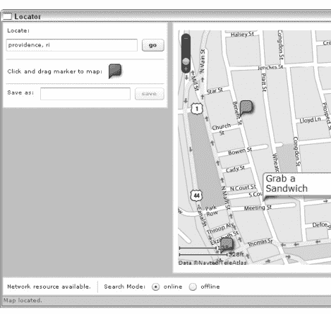

图 9-1

图 9-2 展示了应用程序在离线模式下的外观。

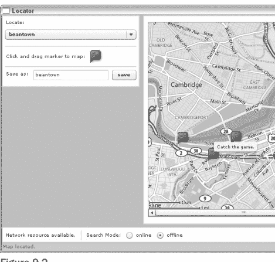

图 9-2

如果你看到的界面与这两个显示相似，那么一个本地数据库已在你的应用程序存储目录中创建并包含适当的表。要定位 Windows 中的存储目录，请导航至 `C:\Documents and Settings\<username>\Application Data\com.apolloir.Locator\Local Store`。在 Mac 上，请导航至 `/Users/<username>/Library/Preferences/com.apolloir.Locator/Local Store`。

如果你已经保存了一个位置，你会在该目录中看到一个图像文件，其名称是文件创建时的时间戳字符串。

尝试查找位置并添加标记，感叹于无需记住你将车停在纬度 42.358028、经度 -71.0060417 的强大功能！

## 总结

本章深入探讨了使用 Adobe AIR 中包含的数据库引擎，向你介绍了 HTML 控制器以及连接 ActionScript 和 JavaScript 的脚本桥接，同时构建了一个地图应用程序，用于在连接到 Yahoo! Maps AJAX API 和本地数据库的同时导航到位置。

从这里开始，你可以修改地图应用程序以整合其他在线服务，构建你自己的混合应用，甚至可以将保存的数据库条目序列化，传递给任何其他安装了 Locator 的人。世界真大！走出去，开始发现新的目的地吧。

## 第 10 章：Blogger Agent

如果你曾经想在电脑未连接互联网时写博客文章，你并不孤单。为了解决这种情况，你可能已经将文章写好并保存到某种文本文件中，以便稍后发布。当你的电脑再次连接到互联网时，你可能登录你的博客服务，导航到撰写文章页面，打开你的文本文件，然后最终将文本复制并粘贴到表单中。这当然感觉效率不高。肯定有更好的方法。

幸运的是，大多数博客服务和博客软件都提供某种 Web 服务，使第三方软件和应用程序能够与它们通信。本章将利用 Google 的 Blogger 服务 (www.blogger.com)。Blogger 是一个简单的博客服务，它有一个非常有用的数据 API，使第三方应用程序能够通过简单的 GET 和 POST 请求检索和发送各种数据。你将在本章中构建的应用程序利用了这一服务，并结合了 Adobe AIR 中可用的功能，以避免上一段描述的低效过程。如果你还没有 Blogger 账户，最好在开始本章之前创建一个。

以下部分讨论了应用程序的设计。这包括管理数据的后勤工作和用户界面所需的组件。设计完成后，你将深入了解代码，并学习将一切联系在一起的重要类和函数。

## 设计

如果你曾经使用过基于浏览器的 Flash 内容并尝试与其他服务器（不是你的内容运行所在的服务器）通信，你无疑遇到过一些安全问题。通常，为了让 Web 服务允许基于浏览器/插件的 Flash 内容访问它，必须在应用程序的域根目录下放置一个跨域文件 (crossdomain.xml)。这在开发本章中的应用程序时会成为一个问题。

然而，与基于浏览器的 Flash 内容相比，Adobe AIR 内容不需要存在跨域文件即可访问它。换句话说，你不必担心任何安全问题，本应用程序将利用这一事实。

此外，最好列出你的应用程序旨在实现的项目清单。以下列表概述了 Blogger Agent 应用程序最重要的功能：

- 允许用户管理其所有 Blogger 账户/博客。
- 允许用户撰写和发布博客文章。
- 允许用户将博客文章添加到发布队列。
- 允许用户预览他们的博客。
- 显示已保存账户的列表。
- 显示排队中的博客文章列表。
- 在本地数据库中存储账户信息。
- 在本地数据库中存储排队中的博客文章。
- 加密所有保存的账户密码。

这些是 Blogger Agent 应用程序的主要功能。该应用程序相对简单，并将利用 Adobe AIR 中可用的一些强大功能。在接下来的章节中，你将学习如何处理该应用程序以及将用于创建上述功能的具体 Adobe AIR 特性。

### 管理账户

此应用程序将使用户能够管理与其任何 Blogger 账户关联的所有博客。为了实现这一点，将利用 Blogger Data API，使用户能够根据其 Blogger 用户名和密码检索与其关联的博客列表。然后，用户可以从返回的列表中选择一个博客，并将博客信息保存到本地数据库。

你将首先创建一个名为 `BloggerService` 的服务类来管理与 Blogger Data API 的通信。此类执行用户身份验证并检索该用户凭据的博客列表。其次，为了将博客信息保存到用户的硬盘以供日后使用，你将创建另一个名为 `DBService` 的服务类。此类利用 Adobe AIR 的原生 SQLite 支持来创建和管理一个小数据库。这两个类的使用如图 10-1 所示。

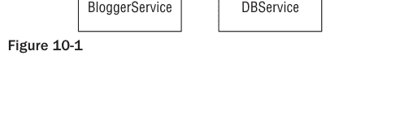

在数据库中，一个名为 `blogs` 的表保存了关于博客和用户账户的必要信息。此外，此类使用名为 `LocalEncryptedStore` 的原生 Adobe AIR 类来以加密状态存储用户的密码。`DBService` 类需要一个名为 `DBServiceEvent` 的自定义事件类。最后，你将创建一个简单的对象类，称为 `Blog`。此类作为存储在 SQLite 数据库中的信息的 ActionScript 表示。

### 管理博客文章

除了管理账户外，用户还将能够管理博客文章。博客文章由标题和正文组成，如果用户连接到互联网，则允许立即发布，或者在用户重新连接后保存到队列中稍后发布。发布博客文章将由前述的 `BloggerService` 类管理。此外，同样先前提到的 `DBService` 类将负责管理保存的博客文章。为了表示一篇博客文章，你将创建一个名为 `BlogEntry` 的简单对象类。此类作为存储在数据库中的信息的 ActionScript 表示。

最后，为了以队列方式发布保存的博客文章，你将创建两个类。`PublishQueueItem` 类持有一个 `BlogEntry` 对象和该文章对应的 `Blog` 对象的引用。你将编写的另一个类是一个名为 `QueueService` 的服务类。此类管理保存在数据库中的所有博客文章的后续发布。

### 工具类

本应用程序将使用两个工具类，第一个是 `NetworkConnection` 类。此类将利用 Adobe AIR 的 `NativeApplication` 类来检测用户的连接状态何时发生变化。这对于激活或停用特定功能很有用。例如，如果用户的电脑未连接到互联网，则不应允许其发布博客文章或启动发布队列。第二个工具类将帮助为 `BloggerService` 类格式化 XML 文档。Blogger Data API 提供并期望使用标准化的 Atom 1.0 XML 模式的 XML 文档。因此，你将创建一个名为 `AtomUtil` 的类，以帮助解析和格式化 Blogger Data API 的 XML。

### 用户界面

该应用程序的用户界面相对简单，由五个组件组成，包括主应用程序组件。用户可以选择三个屏幕中的一个。每个屏幕使用户能够执行不同的操作。用户看到的第一个屏幕是 `BlogManager` 组件。此面板显示所有当前保存的博客列表，如图 10-2 所示。从这个屏幕，用户可以添加一个博客，这将调出 `AddBlogPrompt` 组件。此提示是用户输入其用户名和密码以检索博客列表的地方。

用户可以打开的第二个屏幕是 `ComposeEntryPanel` 组件。此屏幕包括一个可供发布到的博客下拉列表和一个用于输入博客文章的表单。从这个屏幕，用户还可以发布该文章或将其添加到队列中，如图 10-3 所示。


# 第10章：博客代理

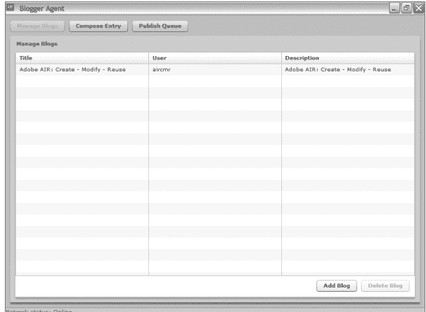

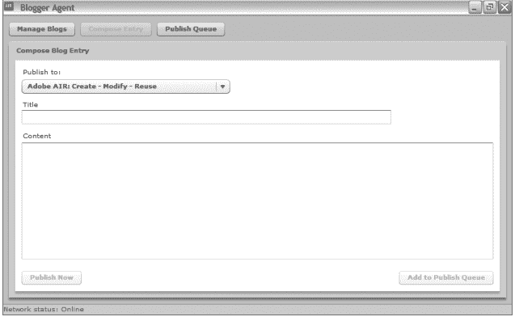

用户可能打开的第三个界面是`PublishQueuePanel`组件。此界面显示了当前队列中所有博客条目的列表，如图10-4所示。从这里，只要用户连接到互联网，就可以启动队列。

这完成了应用程序设计的概述。下一节将介绍每个类和组件的具体功能。

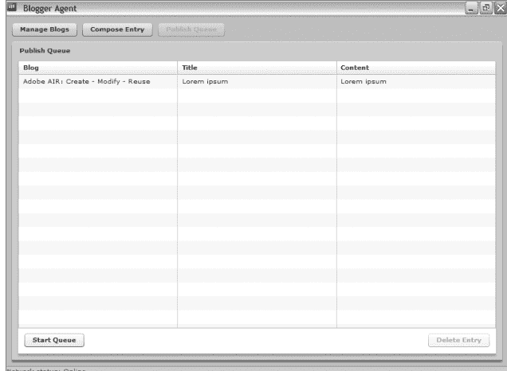

## 代码与代码解释

本节深入探讨应用程序中每个类和组件的代码。在接下来的章节中，你将创建应用程序所需的每个类和组件，并了解每个组件的重要功能，重点关注Adobe AIR的功能以及与应用程序相关的类。在本章结束时，你将通过创建主应用程序文件将所有内容整合在一起。如果尚未完成，请为此应用程序创建一个新的工作目录。

### 数据对象

此应用程序的数据对象是最简单的部分，因此何不首先处理它们呢？如上一节所述，此应用程序需要三个基本的数据对象类。

1.  创建一个新文档并输入以下标记：

```actionscript
package com.aircmr.bloggeragent.data
{
    public class Blog
    {
        public var id:int;
        public var title:String;
        public var description:String;
        public var username:String;
        public var password:String;
        public var publishURL:String;

        public function Blog()
        {

        }
    }
}
```

2.  将文件保存为`Blog.as`，位于你的工作目录中的`com/aircmr/bloggeragent/data/`目录下。

3.  创建一个新文档并输入以下标记：

```actionscript
package com.aircmr.bloggeragent.data
{
    public class BlogEntry
    {
        public var id:int;
        public var blogID:int;
        public var content:String;
        public var title:String;

        public function BlogEntry()
        {

        }
    }
}
```

4.  将文件保存为`BlogEntry.as`，位于你的工作目录中的`com/aircmr/bloggeragent/data/`目录下。

5.  创建一个新文档并输入以下标记：

```actionscript
package com.aircmr.bloggeragent.data
{
    public class PublishQueueItem
    {
        public var blog:Blog;
        public var blogEntry:BlogEntry;
        public var blogTitle:String;
        public var blogEntryTitle:String;
        public var blogEntryContent:String;

        public function PublishQueueItem()
        {

        }
    }
}
```

6.  将文件保存为`PublishQueueItem.as`，位于你的工作目录中的`com/aircmr/bloggeragent/data/`目录下。

在前面的六个步骤中，你创建了必要的数据对象类。这些类将作为存储在数据库中的信息的ActionScript表示。`Blog`和`BlogEntry`类包含需要在应用程序中传递的必要属性。属性名称应该是不言自明的。`PublishQueueItem`类将用于在管理发布队列时将一个`Blog`和一个`BlogEntry`配对。

### 事件对象

此应用程序将使用一个自定义事件类。具体来说，它将被`DBService`类使用，以通知任何监听对象几个关键事件。这个自定义事件类是必要的，因为对本地SQLite数据库执行的任何操作都是异步发生的。该事件类使应用程序能够在操作完成时将结果数据发送到任何监听对象。

创建一个新文档并输入以下标记：

```actionscript
package com.aircmr.bloggeragent.events
{
    import flash.events.Event;

    public class DBServiceEvent extends Event
    {
        public static const BLOG_ADDED:String = "blogAdded";
        public static const BLOG_DELETED:String = "blogDeleted";
        public static const BLOG_ENTRY_ADDED:String = "blogEntryAdded";
        public static const BLOG_ENTRY_DELETED:String = "blogEntryDeleted";
        public static const GET_BLOGS:String = "getBlogs";
        public static const GET_BLOG_ENTRIES:String = "getBlogEntries";

        private var _data:Object;

        public function DBServiceEvent( type:String, data:Object = null )
        {
            super( type );
            _data = data;
        }

        public function get data():Object
        {
            return _data;
        }
    }
}
```

将文件保存为`DBServiceEvent.as`，位于你的工作目录中的`com/aircmr/bloggeragent/events/`目录下。

`DBServiceEvent`类将被`DBService`类使用，以通知所有监听器特定的数据库相关事件。此事件有六种不同的类型，对应于将在数据库上执行的特定操作。例如，`BLOG_ADDED`事件将在博客信息成功存储在数据库中时通知所有监听器。此事件类也应该让你了解`DBService`类中将有哪些类型的方法可用。

### 工具类

此应用程序需要两个工具类。一个将检测用户的计算机是否连接到互联网，另一个将协助创建和解析Atom 1.0 XML提要，以便与Blogger Data API一起使用。

1.  打开你的编辑器并创建一个新文档。输入以下标记：

```actionscript
package com.aircmr.net
{
    import flash.errors.IllegalOperationError;
    import flash.events.Event;
    import flash.events.EventDispatcher;
    import flash.events.HTTPStatusEvent;
    import flash.events.IOErrorEvent;
    import flash.events.SecurityErrorEvent;
    import flash.net.URLLoader;
    import flash.net.URLRequest;
    import flash.desktop.NativeApplication;

    final public class NetworkDetection extends EventDispatcher
    {
        private static var _instance:NetworkDetection = new NetworkDetection();

        private var _loader:URLLoader;
        private var _request:URLRequest;
        private var _autoPingOnChange:Boolean = true;
        private var _httpSuccessful:Boolean = false;
        private var _connected:Boolean = false;

        private static const HTTP_SUCCESS:int = 200;
        private static const REQ_URL:String = "http://www.wrox.com";
        public static const SUCCESS:String = "success";
        public static const FAILURE:String = "failure";
        public static const PROGRESS:String = "progress";
        public static const PAGE_FAILURE:String = "pageFailure";
        public static const CONNECTION_CHANGE:String = "connectionChange";

        public static function getInstance():NetworkDetection
        {
            return _instance;
        }

        public function NetworkDetection()
        {
            if( _instance == null )
                init();
            else
            {
                throw new IllegalOperationError( "Error at NetworkDetection. " +
                    "NetworkDetection is a Singletion and should be " +
                    "accessed through NetworkDetection:getInstance." );
            }
        }

        private function init():void
        {
            _request = new URLRequest();
            _request.method = "HEAD";
            _loader = new URLLoader();
            _loader.addEventListener( HTTPStatusEvent.HTTP_STATUS, onHttpStatus );
            _loader.addEventListener( Event.COMPLETE, onComplete );
            _loader.addEventListener( IOErrorEvent.IO_ERROR, onError );
            _loader.addEventListener( SecurityErrorEvent.SECURITY_ERROR, onError );
            NativeApplication.nativeApplication.addEventListener(
                Event.NETWORK_CHANGE, onNetworkChange );
        }

        private function onNetworkChange( evt:Event ):void
        {
            dispatchEvent( new Event( Event.NETWORK_CHANGE ) );
            if( _autoPingOnChange ) checkConnection();
        }

        private function onHttpStatus( evt:HTTPStatusEvent ):void
        {
            _httpSuccessful = ( evt.status == HTTP_SUCCESS );
        }

        private function onComplete( evt:Event ):void
        {
            connected = _httpSuccessful;
            dispatchEvent( new Event( ( _connected ) ? SUCCESS : PAGE_FAILURE ) );
        }

        private function onError( evt:IOErrorEvent ):void
        {
            connected = false;
            dispatchEvent( new Event( FAILURE ) );
        }

        public function checkConnection():void
        {
            checkConnectionTo( ( _request.url != null ) ? _request.url : REQ_URL );
        }

        public function checkConnectionTo( url:String ):void
        {
            dispatchEvent( new Event( PROGRESS ) );
            _request.url = url;
            _loader.load( _request );
        }

        public function get autoPingOnChange():Boolean
        {
            return _autoPingOnChange;
        }

        public function set autoPingOnChange( bool:Boolean ):void
        {
            _autoPingOnChange = bool;
        }

        public function get connected():Boolean
        {
            return _connected;
        }

        public function set connected( bool:Boolean ):void
        {
            if( _connected == bool )
                return;

            _connected = bool;
            dispatchEvent( new Event( Event.NETWORK_CHANGE ) );
        }

        public function get url():String
        {
            return _request.url;
        }

        public function set url( str:String ):void
        {
            _request.url = str;
        }
    }
}
```


## 第十章：博客代理

```actionscript
_autoPingOnChange = bool;
}

[Bindable]
public function get connected():Boolean
{
    return _connected;
}
private function set connected( bool:Boolean ):void
{
    _connected = bool;
    dispatchEvent( new Event( CONNECTION_CHANGE ) );
}
}
}
```

- 2. 将文件保存为 `NetworkDetection.as`，存放于工作目录中的 `com/aircmr/net/` 目录下。

- 3. 创建一个新文档，并输入以下标记内容：

```actionscript
package com.aircmr.bloggeragent.utils
{
    import com.aircmr.bloggeragent.data.Blog;
    import com.aircmr.bloggeragent.data.BlogEntry;

    public class AtomUtil
    {
        namespace atom = "http://www.w3.org/2005/Atom"

        public static const CONTENT_TYPE:String = "application/atom+xml";

        public static function serializeBlogEntry( entry:BlogEntry ):XML
        {
            var result:String = new String();
            result += '<entry xmlns="http://www.w3.org/2005/Atom">';
            result += '<title type="text">' + entry.title + '</title>';
            result += '<content type="html">' + entry.content + '</content>';
            result += '</entry>';
            return new XML( result );
        }

        public static function parseBlogList( feed:XML,
            username:String, password:String ):Array
        {
            use namespace atom;
            var entries:XMLList = feed.entry;
            var result:Array = new Array();

            for each( var entryItem:XML in entries )
            {
                var blog:Blog = new Blog();
                blog.title = entryItem.title.toString();
                blog.description = entryItem.summary.toString();
                blog.publishURL = entryItem.link.(
                    @rel.indexOf("#post") > -1 ).@href;
                blog.username = username;
                blog.password = password;
                result.push( blog );
            }

            return result;
        }
    }
}
```

- 4. 将文件保存为 `AtomUtil.as`，存放于工作目录中的 `com/aircmr/bloggeragent/utils/` 目录下。

在步骤1和2中，你创建了 `NetworkDetection` 类。这个类使应用程序的各个部分能够确定用户是否连接到互联网，以及他们的连接状态是否发生变化。以下代码片段展示了 `NetworkDetection` 类中的 `init` 函数：

```actionscript
private function init():void
{
    _request = new URLRequest();
    _request.method = "HEAD";
    _loader = new URLLoader();
    _loader.addEventListener( HTTPStatusEvent.HTTP_STATUS, onHttpStatus );
    _loader.addEventListener( Event.COMPLETE, onComplete );
    _loader.addEventListener( IOErrorEvent.IO_ERROR, onError );
    _loader.addEventListener( SecurityErrorEvent.SECURITY_ERROR, onError );
    NativeApplication.nativeApplication.addEventListener( Event.NETWORK_CHANGE,
        onNetworkChange );
}
```

请注意 `NativeApplication` 类的使用。这个 Adobe AIR 的原生类提供应用程序信息、应用程序范围内的功能，并派发应用程序级事件。它派发的其中一种事件是 `NETWORK_CHANGE` 事件。当用户计算机上的网络资源变为可用或现有连接丢失时，该类的静态 `nativeApplication` 属性会派发此事件。当事件被派发时，这个实用工具类会检查远程资源是否可用，在本例中即 Wrox 网站。如果网站成功加载，`_connection` 属性将被设置，并会重新派发 `CONNECTION_CHANGE` 事件。正是这个事件，应用程序的组件将进行监听，以确定连接是否从 `true` 变为 `false` 或反之亦然。

在步骤3和4中，你创建了 `AtomUtil` 类。`BloggerService` 类将使用此类来帮助解析和创建 Atom 1.0 feeds。

## 博客服务类

在本节中，你将创建与 Blogger Data API 通信的类。虽然这个类没有利用任何 Adobe AIR 的原生功能，但它仍然是这个应用程序最重要的部分之一。这个类向 Blogger Data API 发出所需的请求并处理响应。

打开你的编辑器并创建一个新文档。输入以下标记内容：

```actionscript
package com.aircmr.bloggeragent.services
{
    import com.aircmr.bloggeragent.data.Blog;
    import com.aircmr.bloggeragent.data.BlogEntry;
    import com.aircmr.bloggeragent.utils.AtomUtil;
    import flash.errors.IllegalOperationError;
    import flash.events.ErrorEvent;
    import flash.events.Event;
    import flash.events.EventDispatcher;
    import flash.events.HTTPStatusEvent;
    import flash.events.IOErrorEvent;
    import flash.net.URLLoader;
    import flash.net.URLRequest;
    import flash.net.URLRequestHeader;
    import flash.net.URLRequestMethod;
    import flash.net.URLVariables;
    import mx.utils.StringUtil;

    public class BloggerService extends EventDispatcher
    {
        private static var _instance:BloggerService = new BloggerService();

        public static const BLOG_LIST_RETURNED:String = "blogListReturned";
        public static const BLOG_ENTRY_PUBLISHED:String = "blogEntryPublished";
        public static const HTTP_SUCCESS:int = 200;
        public static const HTTP_CREATED:int = 201;
        public static const AUTH_END_POINT:String =
            "https://www.google.com/accounts/ClientLogin";
        public static const BLOG_LIST_END_POINT:String =
            "http://www.blogger.com/feeds/default/blogs";
        public static const SERVICE_NAME:String = "blogger";

        private var _appID:String;
        private var _authCallback:Function;
        private var _authCallbackArgs:Array;
        private var _authToken:String;
        private var _authHeader:URLRequestHeader;
        private var _blogList:Array;
        private var _httpStatus:int;
        private var _username:String;
        private var _password:String;

        public static function getInstance():BloggerService
        {
            return _instance;
        }

        public function BloggerService()
        {
            if( _instance != null )
            {
                throw new IllegalOperationError( "Error at :: BloggerService. " +
                    "BloggerService is a Singleton and should be accessed " +
                    "through BloggerService.getInstance()." );
            }
        }

        private function onLoaderHTTPStatus( event:HTTPStatusEvent ):void
        {
            if( event.status != HTTP_SUCCESS && event.status != HTTP_CREATED )
            {
                dispatchEvent( new ErrorEvent( ErrorEvent.ERROR, false, false,
                    "HTTP Error: " + event.status.toString() ) );
            }
            _httpStatus = event.status;
        }

        private function onLoaderIOError( event:IOErrorEvent ):void
        {
            dispatchEvent( new ErrorEvent(
                ErrorEvent.ERROR, false, false, event.text ) );
        }

        private function onAuthResponse( event:Event ):void
        {
            if( _httpStatus == BloggerService.HTTP_SUCCESS )
            {
                var response:String = String( event.target.data );
                var authIndex:Number = response.indexOf("Auth");
                _authToken = response.substr( authIndex ).split("=")[1];
                _authToken = StringUtil.trim( _authToken );
                _authHeader = new URLRequestHeader( "Authorization",
                    "GoogleLogin auth=" + _authToken );

                if( _authCallback != null )
                {
                    if( _authCallbackArgs )
                        _authCallback.apply( null, _authCallbackArgs );
                    else
                        _authCallback();
                }
            }
        }

        private function onBlogFeedResponse( event:Event ):void
        {
            if( event.target.data != null )
            {
                var xmlData:XML = new XML( String( event.target.data ) );
                _blogList = AtomUtil.parseBlogList(
                    xmlData, _username, _password );
                dispatchEvent( new Event( BLOG_LIST_RETURNED ) );
            }
        }

        private function onPublishComplete( event:Event ):void
        {
            if( _httpStatus == BloggerService.HTTP_CREATED )
            {
                dispatchEvent( new Event( BLOG_ENTRY_PUBLISHED ) );
            }
        }

        private function createNewRequest( url:String, method:String,
            contentType:String = null ):URLRequest
        {
            var request:URLRequest = new URLRequest( url );
            request.requestHeaders.push( _authHeader );
            request.method = method;
            if( contentType != null ) request.contentType = contentType;
            return request;
        }

        private function authenticate( callback:Function,
            callbackArgs:Array = null ):void
        {
            _authCallback = callback;
            _authCallbackArgs = callbackArgs;

            var vars:URLVariables = new URLVariables();
            vars.Email = _username;
            vars.Passwd = _password;
            vars.source = _appID;
            vars.service = SERVICE_NAME;

            var request:URLRequest = new URLRequest();
            request.method = URLLRequestMethod.POST;
            request.url = AUTH_END_POINT;
            request.data = vars;

            makeRequest( request, onAuthResponse );
        }

        private function makeRequest( request:URLRequest, callback:Function ):void
        {
            var loader:URLLoader = new URLLoader();
            loader.addEventListener(
                HTTPStatusEvent.HTTP_STATUS, onLoaderHTTPStatus );
            loader.addEventListener( IOErrorEvent.IO_ERROR, onLoaderIOError );
            loader.addEventListener( Event.COMPLETE, callback );
            loader.load( request );
        }

        public function getBlogs():void
        {
            if( _authToken )
            {
```


# 第10章：博主代理

```actionscript
_blogList = new Array();
var request:URLRequest = createNewRequest( BLOG_LIST_END_POINT,
    URLRequestMethod.GET );
makeRequest( request, onBlogFeedResponse );
}
else authenticate( getBlogs, null );
}

public function publishBlogEntry( blog:Blog, blogEntry:BlogEntry ):void
{
    if( _authToken )
    {
        var request:URLRequest = createNewRequest( blog.publishURL,
            URLRequestMethod.POST, AtomUtil.CONTENT_TYPE );
        request.data = AtomUtil.serializeBlogEntry(
            blogEntry ).toXMLString();
        makeRequest( request, onPublishComplete );
    }
    else authenticate( publishBlogEntry, [blog, blogEntry] );
}

public function setCredentials( username:String,
    password:String, appID:String ):void
{
    _username = username;
    _password = password;
    _appID = appID;
    _authToken = null;
}

public function get blogList():Array { return _blogList; }
}
}
```

将文件保存为 `BloggerService.as`，放置在您的工作目录中的 `com/aircmr/bloggeragent/services/` 目录下。

`BloggerService` 类旨在获取博客列表并发布博客条目。该类中只有三个公共方法，其中两个对应于对 Blogger Data API 的方法调用。在调用这两个方法中的任何一个之前，必须先调用另一个公共方法 `setCredentials`。需要三个参数，前两个是用户的 Blogger 账户用户名和密码。第三个参数 `appID` 在应用程序与 Blogger Data API 通信时是必要的。调用时，此参数只是一个代表您应用程序的字符串，供 Blogger Data API 在用户身份验证时使用。

请注意，此方法不会立即对用户进行身份验证，而是存储身份验证信息以备后用。身份验证直到第一次方法调用时才会发生。每个方法都会检查用户是否已通过身份验证，如果没有，则尝试通过调用 `authenticate` 方法对用户进行身份验证。一旦用户通过身份验证，就会执行之前尝试的方法调用。此过程旨在简化从 Blogger Data API 获取信息的流程。

> 此类基于本书出版日期时的最新 Blogger Data API。有关 Blogger Data API 的更多信息，请访问 http://code.google.com/apis/blogger/overview.html。此类只是可用方法的一个非常有限的表示。如果您有一个相关项目，并且需要一个更全面的代码库来与 Blogger Data API 通信，请访问 http://as3bloggerlib.googlecode.com。

该类中的另外两个主要方法是 `getBlogs` 和 `publishBlogEntry`。这两个不言自明的方法将按照您预期的方式执行。每个方法随后会使类分发一个相应的事件，通知所有监听器方法调用何时完成以及是否已返回数据或博客条目已成功发布。最后但同样重要的是，请注意该类使用了先前构建的数据对象 `Blog` 和 `BlogEntry`，以及 `AtomUtil` 工具类。

## 数据库服务类

在本节中，您将创建 `DBService` 类。`DBService` 类管理应用程序的本地 SQLite 数据库。这是应用程序的另一个非常重要的组成部分，在这种情况下，它利用了 Adobe AIR 的一些出色功能。

打开您的编辑器并创建一个新文档。输入以下标记：

```actionscript
package com.aircmr.bloggeragent.services
{
    import com.aircmr.bloggeragent.data.Blog;
    import com.aircmr.bloggeragent.data.BlogEntry;
    import com.aircmr.bloggeragent.data.PublishQueueItem;
    import com.aircmr.bloggeragent.events.DBServiceEvent;
    import flash.data.EncryptedLocalStore;
    import flash.data.SQLConnection;
    import flash.data.SQLResult;
    import flash.data.SQLStatement;
    import flash.errors.IllegalOperationError;
    import flash.events.EventDispatcher;
    import flash.events.SQLErrorEvent;
    import flash.events.SQLEvent;
    import flash.filesystem.File;
    import flash.utils.ByteArray;

    public class DBService extends EventDispatcher
    {
        private static var _instance:DBService = new DBService();

        private static const DB:String = "BloggerAgent.db";

        private var _dbFile:File;
        private var _connection:SQLConnection;
        private var _initCallback:Function;
        private var _initCallbackArgs:Array;
        private var _passwordToEncrypt:String;
    }
}
```

```actionscript
public static function getInstance():DBService
{
    return _instance;
}

public function DBService()
{
    if( _instance != null )
    {
        throw new IllegalOperationError( "错误出现在 :: DBService. " +
                "DBService 是一个单例，应该通过 " +
                "DBService::getInstance 访问。" );
    }
}

private function init( callback:Function = null, callbackArgs:Array = null
):void
{
}

private function onConnectionError( event:SQLErrorEvent ):void
{
    trace( "数据库连接错误:" + event.text );
}

private function onConnectionOpen( evt:SQLEvent ):void
{
    createBlogsTable();
}

private function onBlogsTableCreation( event:SQLEvent ):void
{
    createPublishQueueTable();
}

private function onPublishQueueTableCreation( event:SQLEvent ):void
{
    if( _initCallback != null )
    {
        if( _initCallbackArgs )
            _initCallback.call( null, _initCallbackArgs );
        else
            _initCallback();
    }
}

private function onGetBlogs( event:SQLEvent ):void
{
}

private function onGetPublishQueue():void
{
}
```

```actionscript
private function onAddBlog():void
{
}

private function onAddBlogEntry( event:SQLEvent ):void
{
    dispatchEvent( new DBServiceEvent( DBServiceEvent.BLOG_ENTRY_ADDED ) );
}

private function onBlogDeleted( event:SQLEvent ):void
{
    dispatchEvent( new DBServiceEvent( DBServiceEvent.BLOG_DELETED ) );
}

private function onBlogEntryDeleted( event:SQLEvent ):void
{
    dispatchEvent(
        new DBServiceEvent( DBServiceEvent.BLOG_ENTRY_DELETED ) );
}

private function onQueryError( event:SQLErrorEvent ):void
{
    trace("SQL 错误: " + event.text );
}

private function executeStatement():void
{
}

private function createBlogsTable():void
{
    var q:String = "CREATE TABLE IF NOT EXISTS blogs ( " +
                   "id    INTEGER PRIMARY KEY," +
                   "title  TEXT  NOT NULL," +
                   "description  TEXT  NOT NULL," +
                   "publishURL  TEXT  NOT NULL," +
                   "username  TEXT  NOT NULL);";
    executeStatement( q, [], [], onBlogsTableCreation );
}

private function createPublishQueueTable():void
{
    var q:String = "CREATE TABLE IF NOT EXISTS publish_queue ( " +
                   "id   INTEGER PRIMARY KEY," +
                   "blog_id  TEXT  NOT NULL," +
                   "title  TEXT  NOT NULL," +
                   "content  TEXT  NOT NULL);";
    executeStatement( q, [], [], onPublishQueueTableCreation );
}

private function encryptPassword():void
{
}
```

```actionscript
private function unencryptPassword():void
{
}

public function addBlog():void
{
}

public function addBlogEntry( blogEntry:BlogEntry ):void
{
    if( _connection )
    {
        var q:String = "INSERT INTO publish_queue VALUES (null," +
            ":blogID, :title, :content);";
        var paramNames:Array =
            [":blogID", ":title", ":content"];
        var paramValues:Array =
            [blogEntry.blogID, blogEntry.title, blogEntry.content];
        executeStatement( q, paramNames, paramValues, onAddBlogEntry );
    }
    else init( addBlogEntry, [blogEntry] );
}

public function getBlogs():void
{
    if( _connection )
    {
        var q:String = "SELECT * FROM blogs ORDER BY id DESC;";
        executeStatement( q, [], [], onGetBlogs );
    }
    else init( getBlogs );
}

public function deleteBlog( id:int ):void
{
    if( _connection )
    {
        var q:String = "DELETE FROM blogs WHERE id='" + id + "';";
        executeStatement( q, [], [], onBlogDeleted );
    }
    else init( deleteBlog, [id] );
}

public function getPublishQueue():void
{
    if( _connection )
    {
        var q:String = "SELECT blogs.id AS blogid, " +
            "blogs.title AS blogtitle, blogs.description, " +
            "blogs.username, blogs.publishURL, " +
            "publish_queue.id, publish_queue.blog_id, " +
            "publish_queue.title, publish_queue.content " +
            "FROM blogs, publish_queue WHERE " +
            "blogs.id=publish_queue.blog_id;";
```
```

# 第10章：博客代理

```actionscript
executeStatement( q, [], [], onGetPublishQueue );
}
else init( getPublishQueue );
}

public function deleteBlogEntry( id:int ):void
{
    if( _connection )
    {
        var q:String = "DELETE FROM publish_queue WHERE id='" + id + "'";
        executeStatement( q, [], [], onBlogEntryDeleted );
    }
    else init( deleteBlogEntry, [id] );
}

public function close():void
{
    if( _connection )
        _connection.close();
}
```

将文件保存为 `DBService.as`，放在你工作目录中的 `com/aircmr/bloggeragent/services/` 目录下。

现在，你刚刚开始创建 `DBService` 类。这个类将为应用程序创建和管理本地 SQLite 数据库。该数据库将存储用户的博客信息——具体来说，包括博客的标题、描述、发布 URL 以及拥有该博客的用户名。数据库还将存储任何排队中的博客条目。请记住，这个类尚未完成。在接下来的步骤中，你将添加一些利用部分原生 AIR API 的关键功能。

对 `DBService` 类的 `init` 函数的代码进行如下修改和添加：

```actionscript
private function init( callback:Function = null, callbackArgs:Array = null ):void
{
    _initCallback = callback;
    _initCallbackArgs = callbackArgs;
    _dbFile = File.applicationStorageDirectory.resolvePath( DB );
    _connection = new SQLConnection();
    _connection.addEventListener( SQLOpenEvent.OPEN, onConnectionOpen );
    _connection.addEventListener( SQLErrorEvent.ERROR, onConnectionError );
    _connection.open( _dbFile );
}
```

`init` 函数被设置为 `private`，因为在这里它本质上等同于 `BloggerService` 类中的 `authenticate` 方法。在 `BloggerService` 类中，用户必须先进行身份验证，然后才能进行任何方法调用。类似地，`DBService` 类也必须先初始化，然后才能进行任何方法调用。初始化确保数据库被创建并打开连接。

初始化需要一个指向数据库位置的 `File` 对象。在这种情况下，数据库存储在应用程序的存储目录中。这是通过使用 Adobe AIR 的 `File` 对象的 `applicationStorageDirectory` 属性来确保的。该属性也属于 `File` 类型，它引用的是——你猜对了——应用程序的存储目录。通过利用该属性的 `resolvePath` 方法，应用程序指定一个名为 `BloggerAgent.db` 的文件，该文件名作为私有静态变量硬编码在 `DBService` 类中。数据库连接打开后，必须创建两个数据库表。两个方法分别创建这些表：`createBlogsTable` 和 `createPublishQueueTable`。一旦 `SQLConnection` 实例分派 `OPEN` 事件，这些方法就会在一个简短的事件链序列中被调用。注意使用了特定的 `SQLEvent` 和 `SQLErrorEvent` 类。这些事件将帮助你管理连接。`OPEN` 事件分派后，`onConnectionOpen` 事件处理函数会被调用。

对 `DBService` 类的 `executeStatement` 函数的代码进行如下修改和添加：

```actionscript
private function executeStatement( query:String, paramNames:Array,
    paramValues:Array, resultHandler:Function ):void
{
    var newStatement:SQLStatement = new SQLStatement();
    newStatement.sqlConnection = _connection;
    newStatement.addEventListener( SQLEvent.RESULT, resultHandler );
    newStatement.addEventListener( SQLErrorEvent.ERROR, onQueryError );
    newStatement.text = query;

    for( var i:int = 0; i < paramNames.length; i++ )
        newStatement.parameters[paramNames[i]] = paramValues[i];

    newStatement.execute();
}
```

这个方法在整个类中用于在本地 SQLite 数据库上执行语句。该函数的四个参数用于构造一个 `SQLStatement` 对象。`SQLStatement` 实例用于针对通过 `SQLConnection` 实例打开的本地 SQLite 数据库执行 SQLite 语句。在这种情况下，`connection` 属性被设置为本地类变量 `_connection`，该变量在 `init` 函数中创建。然后，语句的结果处理函数由 `resultHandler` 参数设置，`text` 属性由 `query` 参数设置。

该语句几乎准备好执行了；然而，还需要一个步骤。作为一种预防措施，通过修改语句的 `parameters` 属性来定义语句的参数。该属性作为一个关联数组，你向其中添加在语句的 `text` 属性中指定的参数的值。数组键是参数的名称。以这种方式设置语句的参数是一种防御性措施，旨在防止一种称为 *SQL 注入* 的恶意技术。在 SQL 注入攻击中，用户尝试通过用户可访问的位置插入自己的 SQL 语句。最后，要执行语句，需要调用 `execute` 方法。

对 `DBService` 类的 `addBlog` 函数的代码进行如下修改和添加：

```actionscript
public function addBlog( blog:Blog ):void
{
    if( _connection )
    {
        _passwordToEncrypt = blog.password;
        var q:String = "INSERT INTO blogs VALUES (null, " +
            ":title, :description, :publishURL, :username)";
        var paramNames:Array =
            [":title",":description",":publishURL",":username"];
        var paramValues:Array =
            [blog.title, blog.description, blog.publishURL, blog.username];
        executeStatement( q, paramNames, paramValues, onAddBlog );
    }
    else init( addBlog, [blog] );
}
```

这个方法作为一个例子，说明该类如何利用 `executeStatement` 函数在本地 SQLite 数据库上执行语句。此函数接受一个参数：一个 `Blog` 类型的对象。这个 `Blog` 对象将在此类外部创建，但提供时将提供将博客添加到数据库所需的所有相关信息。如果连接已设置，该函数会将博客的密码存储到 `_passwordToEncrypt` 类变量中。这将在其他博客数据成功存储到数据库后使用。之后，创建一个 SQLite 语句字符串。这个特定的 `INSERT` 语句的值并未在字符串中具体设置，而是使用参数键表示。所有键都以冒号开头，最终将在 `executeStatement` 函数中替换为有效值。为了实现这一点，创建了两个数组。第一个是包含键名称的数组。第二个是包含每个键对应值的数组。完成此操作后，语句字符串、数组和相应的事件处理函数将被发送到 `executeStatement` 函数进行处理。

对 `DBService` 类的 `onGetBlogs`、`onGetPublishQueue` 和 `onAddBlog` 事件处理函数的代码进行如下修改和添加：

```actionscript
private function onGetBlogs( event:SQLEvent ):void
{
    var statement:SQLStatement = event.target as SQLStatement;
    var result:SQLResult = statement.getResult();
    var typedData:Array = new Array();

    if( result.data != null )
    {
        var data:Array = result.data;
        for( var i:int = 0; i < data.length; i++ )
        {
            var blog:Blog = new Blog();
            blog.id = data[i].id;
            blog.title = data[i].title;
            blog.description = data[i].description;
            blog.publishURL = data[i].publishURL;
            blog.username = data[i].username;
            blog.password = unencryptPassword( blog.id );
            typedData.push( blog );
        }
    }

    dispatchEvent( new DBServiceEvent( DBServiceEvent.GET_BLOGS, typedData ) );
}
private function onGetPublishQueue( event:SQLEvent ):void
{
    var statement:SQLStatement = event.target as SQLStatement;
```


## 第10章：博客代理

```actionscript
var result:SQLResult = statement.getResult();
var typedData:Array = new Array();

if( result.data != null )
{
    var data:Array = result.data;
    for( var i:int = 0; i < data.length; i++ )
    {
        var blog:Blog = new Blog();
        blog.id = data[i].blogid;
        blog.title = data[i].blogtitle;
        blog.description = data[i].description;
        blog.publishURL = data[i].publishURL;
        blog.username = data[i].username;
        blog.password = unencryptPassword( blog.id );

        var blogEntry:BlogEntry = new BlogEntry();
        blogEntry.id = data[i].id;
        blogEntry.blogID = data[i].blogID;
        blogEntry.title = data[i].title;
        blogEntry.content = data[i].content;

        var publishQueueItem:PublishQueueItem = new PublishQueueItem();
        publishQueueItem.blogTitle = blog.title;
        publishQueueItem.blogEntryTitle = blogEntry.title;
        if( blogEntry.content.length > 30 )
        {
            publishQueueItem.blogEntryContent =
                blogEntry.content.substr( 0, 30 ) + "..."
        }
        else publishQueueItem.blogEntryContent = blogEntry.content;
        publishQueueItem.blog = blog;
        publishQueueItem.blogEntry = blogEntry;

        typedData.push( publishQueueItem );
    }
}

dispatchEvent(
    new DBServiceEvent( DBServiceEvent.GET_BLOG_ENTRIES, typedData ) );
}
private function onAddBlog( event:SQLEvent ):void
{
    encryptPassword( _connection.lastInsertRowID, _passwordToEncrypt );
    dispatchEvent( new DBServiceEvent( DBServiceEvent.BLOG_ADDED ) );
}
```

这些函数处理从执行 `SQLStatement` 对象派发的事件。在 `onGetBlogs` 和 `onGetPublishQueue` 函数的情况下，SELECT 查询的信息被解析并转换为应用程序特定的数据对象。然而，在 `onAddBlog` 函数的情况下，除了加密与该博客关联的密码外，没有太多其他事情要做。为此，调用 `encryptPassword` 方法，传入最后一个插入的博客记录的 ID 和博客的密码。通过访问名为 `_connection` 的 `SQLConnection` 实例的 `lastInsertRowID` 属性来检索最后插入博客的 ID。

对 `DBService` 类的 `encryptPassword` 方法和 `unencryptPassword` 方法的标记进行以下更改和添加：

```actionscript
private function encryptPassword( blogID:int, password:String ):void
{
    var data:ByteArray = new ByteArray();
    data.writeUTFBytes( password );
    EncryptedLocalStore.setItem( "blog-" + blogID, data );
}

private function unencryptPassword( blogID:int ):String
{
    var passwordData:ByteArray = EncryptedLocalStore.getItem( "blog-" + blogID );
    return passwordData.readUTFBytes( passwordData.bytesAvailable );
}
```

这些方法的功能如你所料。具体来说，在这个应用程序中，这两个函数都利用了 Adobe AIR 的 `EncryptedLocalStore` 类来加密和解密密码。`EncryptedLocalStore` 类提供了在 AIR 应用程序的加密本地数据存储中设置和获取对象的方法。加密本地数据存储中的项目通过字符串标识，所有项目都以字节数组数据的形式存储。以这种方式存储的任何内容仅对 Adobe AIR 应用程序内容可用。它是存储诸如用户 Blogger 密码等敏感信息的完美场所。

这里，每个函数中的 `blogID` 参数与数据库博客表中记录的 `id` 列相关联。此 ID 用于创建一个字符串，该字符串指定了要存储或从加密本地存储中检索的项目的名称。要检索项目，使用静态 `getItem` 方法。此方法需要一个指定要检索的项目的字符串。该方法将返回一个 `ByteArray` 对象。使用字节数组的 `readUTFBytes` 方法，从字节信息中提取密码并作为有用的 `String` 返回。要保存项目，调用静态 `setItem` 方法。保存数据到加密本地存储需要两个参数：一个 `String` 和一个 `ByteArray`。

这涵盖了 `DBService` 类的主要功能。在下一节中，你将创建一个类来管理发布队列中博客条目的发布。

## 队列服务类

在本节中，你将创建 `QueueService` 类。这是一个相对简单的类，用于管理存储在发布队列中的博客条目的后续发布。

创建一个新文档并输入以下标记：

```actionscript
package com.aircmr.bloggeragent.services
{
    import com.aircmr.bloggeragent.data.Blog;
    import com.aircmr.bloggeragent.data.BlogEntry;
    import com.aircmr.bloggeragent.data.PublishQueueItem;
    import flash.events.Event;
    import flash.events.EventDispatcher;
}

public class QueueService extends EventDispatcher
{
    private var _items:Array;
    private var _currentItem:PublishQueueItem;
    private var _dbService:DBService;
    private var _bloggerService:BloggerService;

    public function QueueService( items:Array )
    {
        _items = items;
        _dbService = DBService.getInstance();
        _bloggerService = BloggerService.getInstance();
    }

    private function onBlogEntryPublished( event:Event ):void
    {
        _dbService.deleteBlogEntry( _currentItem.blogEntry.id );
        _bloggerService.removeEventListener(
            BloggerService.BLOG_ENTRY_PUBLISHED, onBlogEntryPublished );

        if( _items.length > 0 )
            nextItem();
        else
            dispatchEvent( new Event( Event.COMPLETE ) );
    }

    private function nextItem():void
    {
        _currentItem = _items.shift() as PublishQueueItem;

        var blog:Blog = _currentItem.blog;
        var blogEntry:BlogEntry = _currentItem.blogEntry;

        _bloggerService.addEventListener(
            BloggerService.BLOG_ENTRY_PUBLISHED, onBlogEntryPublished );
        _bloggerService.setCredentials( blog.username, blog.password,
            BloggerAgent.APPLICATION_ID );
        _bloggerService.publishBlogEntry( blog, blogEntry );
    }

    public function startQueue():void
    {
        nextItem();
    }

}
}
```

将文件保存为 `QueueService.as`，放在工作目录内的 `com/aircmr/bloggeragent/services/` 目录中。

你刚刚创建了 `QueueService` 类。如前所述，此类管理存储在发布队列中的博客条目的后续发布。此类旨在接受一个 `PublishQueue` 对象数组，并将每个项目的博客条目发布到相应的博客。如你所见，此类的构造函数接受一个参数：一个 `Array`。此 `Array` 应包含一个或多个 `PublishQueueItem` 对象。`QueueService` 对象构建后，将使用 `startQueue` 函数来开始发布。

以下代码片段来自 `nextItem` 函数：

```actionscript
private function nextItem():void
{
    _currentItem = _items.shift() as PublishQueueItem;

    var blog:Blog = _currentItem.blog;
    var blogEntry:BlogEntry = _currentItem.blogEntry;

    _bloggerService.addEventListener( BloggerService.BLOG_ENTRY_PUBLISHED,
    onBlogEntryPublished );
    _bloggerService.setCredentials( blog.username, blog.password,
    BloggerAgent.APPLICATION_ID );
    _bloggerService.publishBlogEntry( blog, blogEntry );
}
```

这里你可以看到 `BloggerService` 类的使用。在此类中，`BloggerService` 类用于将博客条目发布到特定博客。`Blog` 和 `BlogEntry` 对象通过访问 `PublishQueueItem` 对象的 `blog` 和 `blogEntry` 属性从 `currentItem` 变量中提取。完成此操作后，为 `BLOG_ENTRY_PUBLISHED` 事件配置 `onBlogEntryPublished` 事件处理程序。此类通过此事件确定何时继续处理下一个 `PublishQueueItem`。

最后，通过首先调用 `BloggerService` 类的 `setCredentials` 函数，然后调用 `publishBlogEntry` 函数来发布博客条目。`setCredentials` 函数接受三个参数，前两个是博客帐户的用户名和密码。在本例中，它们取自当前 `Blog` 对象。第三个是表示访问 Blogger Data API 的应用程序的字符串。此参数取自主应用程序文件的静态属性（你将在以下部分中创建）。

设置凭据后，可以安全地调用 `publishBlogEntry` 函数，将当前 `Blog` 和 `BlogEntry` 对象作为两个参数传入。博客条目发布后，调用 `onBlogEntryPublished` 函数，并通过调用 `DBService` 类的 `deleteBlogEntry` 函数并传入要删除的博客条目的 ID 号，将其从队列中删除。

至此，你已为此应用程序创建了所有必要的 ActionScript 类。现在是时候转向用户界面了。

## 创建用户界面

在本节中，你将为应用程序创建用户界面元素。用户界面由五个组件组成。其中三个组件将用作主视图。其余两个将用作主视图的提示。通过以下代码，你将创建用户界面组件，从 `AddBlogPanel` 组件开始。


## 第10章：博主代理

创建一个新文档并输入以下标记：

```xml
<?xml version="1.0" encoding="utf-8"?>
<mx:Panel xmlns:mx="http://www.adobe.com/2006/mxml"
    width="412" height="258" title="添加账户"
    creationComplete="init();">
    <mx:Script><![CDATA[
        
        import com.aircmr.bloggeragent.data.Blog;
        import com.aircmr.bloggeragent.services.BloggerService;
        import com.aircmr.net.NetworkDetection;
        import mx.controls.Alert;
        import mx.managers.CursorManager;
        import mx.managers.PopUpManager;
        
        private static var NO_BLOGS:Array = [{title:"此用户没有可用的博客"}];
        
        private var _bloggerService:BloggerService;
        private var _netDetect:NetworkDetection;
        
        public static function show():AddBlogPanel
        {
            var prompt:AddBlogPanel = 
                AddBlogPanel( PopUpManager.createPopUp(
                    DisplayObject( mx.core.Application.application ),
                    AddBlogPanel, true ) );
            
            PopUpManager.centerPopUp( prompt );
            return prompt;
        }
        
        private function init():void
        {
            _bloggerService = BloggerService.getInstance();
            _netDetect = NetworkDetection.getInstance();
            
            _bloggerService.addEventListener( BloggerService.BLOG_LIST_RETURNED,
                onBlogListReturned );
            _bloggerService.addEventListener( ErrorEvent.ERROR,
                onBloggerError );
            _netDetect.addEventListener( NetworkDetection.CONNECTION_CHANGE,
                onConnectionChange );
            
            onConnectionChange( null );
        }
        
        private function onConnectionChange( event:Event ):void
        {
            listBlogsBtn.enabled = _netDetect.connected;
        }
        
        private function onBlogListReturned( event:Event ):void
        {
            var blogList:Array = _bloggerService.blogList;

            if( blogList.length > 0 )
            {
                blogListComboBox.dataProvider = blogList;
                addBlogBtn.enabled = true;
            }
            else
            {
                blogListComboBox.dataProvider = NO_BLOGS;
                addBlogBtn.enabled = false;
            }
            enable();
        }

        private function onBloggerError( event:ErrorEvent ):void
        {
            blogListComboBox.dataProvider = null;
            addBlogBtn.enabled = false;
            Alert.show( "登录失败。请重试。", "错误", (Alert.OK), this );
            enable();
        }

        private function getBlogs( event:Event ):void
        {
            disable();
            _bloggerService.setCredentials( usernameInput.text, passwordInput.text,
                BloggerAgent.APPLICATION_ID );
            _bloggerService.getBlogs();
        }

        private function addBlog( event:MouseEvent ):void
        {
            dispatchEvent( new Event( Event.SELECT ) );
        }

        public function enable():void
        {
            this.enabled = true;
            CursorManager.removeBusyCursor();
        }

        public function disable():void
        {
            this.enabled = false;
            CursorManager.setBusyCursor();
        }

        public function close():void { PopUpManager.removePopUp( this ); }

        public function get selectedItem():Blog
        {
            return blogListComboBox.selectedItem as Blog;
        }

        public function get username():String { return usernameInput.text; }
        public function get password():String { return passwordInput.text; }
    ]]></mx:Script>
    <mx:Canvas width="100%" height="100%">
        <mx:Text text="用户名：" x="10" y="24" width="86"
            fontWeight="bold" textAlign="right"/>
        <mx:TextInput id="usernameInput" x="113" y="22" enter="getBlogs(event)"/>
        <mx:Text text="密码：" x="10" y="58" width="86"
            fontWeight="bold" textAlign="right"/>
        <mx:TextInput id="passwordInput" x="113" y="54"
            displayAsPassword="true" enter="getBlogs(event)"/>
        <mx:Button id="listBlogsBtn" x="281" y="54"
            label="列出博客" click="getBlogs(event)"/>
        <mx:Text text="博客标题：" x="10" y="117" width="86"
            fontWeight="bold" textAlign="right"/>
        <mx:ComboBox id="blogListComboBox" x="113" y="115"
            width="248" labelField="title"/>
        <mx:Button id="cancelBtn" x="207" y="174"
            label="取消" click="close()"/>
        <mx:Button id="addBlogBtn" x="284" y="174" label="添加博客"
            enabled="false" click="addBlog(event)"/>
    </mx:Canvas>
</mx:Panel>
```

将文件保存为 `AddBlogPanel.mxml`，放在你的工作目录下的 `com/aircmr/bloggeragent/ui/` 目录中。

`AddBlogPanel` 组件充当一个提示框。当显示时，它允许用户输入其 Blogger 登录信息，检索该账户的博客列表，然后选择一个博客添加到应用程序中。以下代码片段来自 `AddBlogPanel` 组件的 `init` 函数：

```actionscript
private function init():void
{
    _bloggerService = BloggerService.getInstance();
    _netDetect = NetworkDetection.getInstance();

    _bloggerService.addEventListener( BloggerService.BLOG_LIST_RETURNED,
        onBlogListReturned );
    _bloggerService.addEventListener( ErrorEvent.ERROR, onBloggerError );

    _netDetect.addEventListener( NetworkDetection.CONNECTION_CHANGE,
        onConnectionChange );

    onConnectionChange( null );
}
```

在这里你可以看到 `BloggerService` 类和 `NetworkDetection` 类的使用。在此组件内，`BloggerService` 类将用于检索博客列表；因此，`BLOG_LIST_RETURNED` 事件被配置为由 `onBlogListReturned` 函数处理。此函数从服务类中获取博客列表，用作组合框的 `dataProvider`。此外，`NetworkDetection` 类的 `CONNECTION_CHANGE` 事件被配置为由 `onConnectionChange` 函数处理。此函数根据用户是否连接到互联网来激活或停用特定的界面元素。

此组件将在接下来创建的 `BlogManagerPanel` 组件中使用：

```xml
<?xml version="1.0" encoding="utf-8"?>
<mx:Panel xmlns:mx="http://www.adobe.com/2006/mxml"
    width="800" height="600" top="40" right="10"
    bottom="10" left="10" title="管理博客"
    creationComplete="init();">
    <mx:Script><![CDATA[

        import com.aircmr.bloggeragent.ui.AddBlogPanel;
        import com.aircmr.bloggeragent.services.DBService;
        import com.aircmr.bloggeragent.events.DBServiceEvent;
        import com.aircmr.net.NetworkDetection;
        import mx.managers.CursorManager;

        [Bindable]
        private var _blogs:Array;

        private var _addBlogPanel:AddBlogPanel;
        private var _dbService:DBService;
        private var _netDetect:NetworkDetection;

        private function init():void
        {
            _dbService = DBService.getInstance();
            _netDetect = NetworkDetection.getInstance();
            _dbService.addEventListener( DBServiceEvent.GET_BLOGS, onGetBlogs );
            _dbService.addEventListener( DBServiceEvent.BLOG_ADDED, onBlogsModified );
            _dbService.addEventListener( DBServiceEvent.BLOG_DELETED, onBlogsModified );
            _netDetect.addEventListener( NetworkDetection.CONNECTION_CHANGE, onConnectionChange );
            onConnectionChange( null );
        }

        private function onConnectionChange( event:Event ):void
        {
            addBlogBtn.enabled = _netDetect.connected;
        }

        private function onBlogsModified( event:DBServiceEvent ):void
        {
            _dbService.getBlogs();
        }

        private function onGetBlogs( event:DBServiceEvent ):void
        {
            _blogs = event.data as Array;
        }

        private function onAddBlogSelect( event:Event ):void
        {
            _dbService.addBlog( _addBlogPanel.selectedItem );
            _addBlogPanel.close();
        }

        private function openAddBlogPanel( event:MouseEvent ):void
        {
            _addBlogPanel = AddBlogPanel.show();
            _addBlogPanel.addEventListener( Event.SELECT, onAddBlogSelect );
        }

        private function deleteBlog( event:MouseEvent ):void
        {
            _dbService.deleteBlog( blogDataGrid.selectedItem.id );
        }

        public function update():void
        {
            _dbService.getBlogs();
        }
    ]]></mx:Script>
    <mx:Canvas width="100%" height="100%">
        <mx:DataGrid id="blogDataGrid" dataProvider="{_blogs}"
            top="0" bottom="40" left="0" right="0">
            <mx:columns>
                <mx:DataGridColumn headerText="标题" dataField="title"/>
                <mx:DataGridColumn headerText="用户" dataField="username"/>
                <mx:DataGridColumn headerText="描述" dataField="description"/>
            </mx:columns>
        </mx:DataGrid>
        <mx:Button id="addBlogBtn" label="添加博客"
            right="110" bottom="10" click="openAddBlogPanel(event)"/>
        <mx:Button label="删除博客" right="10" bottom="10"
            enabled="{(blogDataGrid.selectedItem != null)}"
            click="deleteBlog(event)"/>
    </mx:Canvas>
</mx:Panel>
```

将文件保存为 `BlogManagerPanel.mxml`，放在你的工作目录下的 `com/aircmr/bloggeragent/ui/` 目录中。

`BlogManagerPanel` 组件显示用户已添加到应用程序中的账户（或博客）。它还允许用户添加新博客（通过使用先前创建的 `AddBlogPrompt` 组件）或删除现有博客。在添加或删除博客时，该组件利用 `DBService` 类在本地数据库中存储或修改账户信息。

以下代码片段来自 `BlogManagerPanel` 组件的 `init` 函数。在这里你可以看到 `DBService` 类的使用，并且与 `AddBlogPrompt` 组件类似，也使用了 `NetworkDetection` 类：

```actionscript
private function init():void
{
```


## 第10章：博客代理

```
_dbService = DBService.getInstance();
_netDetect = NetworkDetection.getInstance();

_dbService.addEventListener( DBServiceEvent.GET_BLOGS, onGetBlogs );
_dbService.addEventListener( DBServiceEvent.BLOG_ADDED, onBlogsModified );
_dbService.addEventListener( DBServiceEvent.BLOG_DELETED, onBlogsModified );

_netDetect.addEventListener( NetworkDetection.CONNECTION_CHANGE, onConnectionChange );

onConnectionChange( null );
}
```

在此组件中，`DBService` 类用于从本地数据库中检索博客列表、添加博客和删除博客。每项操作完成后都会触发相应的事件。这些事件都配置了相应的处理函数。请注意，每当添加或删除博客时，都会通过调用 `getBlogs` 函数从 `DBService` 类重新获取博客列表。这确保了数据库中的数据与用户界面保持同步。

此组件与 `AddBlogPrompt` 组件配合，使用户能够管理他们的博客账户。接下来的组件则允许用户撰写博客条目。

创建一个新文档并输入以下标记：

```
<?xml version="1.0" encoding="utf-8"?>
<mx:Panel xmlns:mx="http://www.adobe.com/2006/mxml"
    width="800" height="600" top="40" right="10" bottom="10" left="10"
    title="Compose Blog Entry" creationComplete="init();">
    <mx:Script><![CDATA[

        import com.aircmr.bloggeragent.data.Blog;
        import com.aircmr.bloggeragent.data.BlogEntry;
        import com.aircmr.bloggeragent.events.DBServiceEvent;
        import com.aircmr.bloggeragent.services.BloggerService;
        import com.aircmr.bloggeragent.services.DBService;
        import com.aircmr.net.NetworkDetection;
        import mx.controls.Alert;
        import mx.managers.CursorManager;

        private static var NO_BLOGS:Array = [{title:"Add an account first!"}];

        [Bindable]
        private var _blogs:Array;

        private var _bloggerService:BloggerService;
        private var _dbService:DBService;
        private var _netDetect:NetworkDetection;

        private function init():void
        {
            _bloggerService = BloggerService.getInstance();
            _dbService = DBService.getInstance();
            _dbService.addEventListener( DBServiceEvent.GET_BLOGS, onGetBlogs );
            _netDetect = NetworkDetection.getInstance();
            _netDetect.addEventListener(
                NetworkDetection.CONNECTION_CHANGE, onConnectionChange );
            blogSelector.dataProvider = NO_BLOGS;
            updateButtons();
        }

        private function onConnectionChange( event:Event ):void
        {
            updateButtons();
        }

        private function onBloggerError( event:ErrorEvent ):void
        {
            Alert.show( event.text, "Error", (Alert.OK), this );
            enable();
        }

        private function onBlogEntryPublished( event:Event ):void
        {
            _bloggerService.removeEventListener( BloggerService.BLOG_ENTRY_PUBLISHED,
                onBlogEntryPublished );
            _bloggerService.removeEventListener( ErrorEvent.ERROR, onBloggerError );
            titleInput.text = contentInput.htmlText = "";
            Alert.show( "Entry published successfully", "Success!", (Alert.OK), this );
            enable();
        }

        private function onGetBlogs( event:DBServiceEvent ):void
        {
            var data:Array = event.data as Array;
            _blogs = ( data.length > 0 ) ? data : NO_BLOGS;
            updateButtons();
        }

        private function onTextFieldChange( event:Event ):void
        {
            updateButtons();
        }

        private function updateButtons():void
        {
            if( _blogs != NO_BLOGS )
            {
                if( titleInput.text.length > 0 && contentInput.text.length > 0 )
                {
                    addToQueueBtn.enabled = true;
                    publishBtn.enabled = _netDetect.connected;
                }
                else addToQueueBtn.enabled = publishBtn.enabled = false;
            }
            else publishBtn.enabled = addToQueueBtn.enabled = false;
        }

        private function publishNow( event:MouseEvent ):void
        {
            var blog:Blog = blogSelector.selectedItem as Blog;
            var blogEntry:BlogEntry = new BlogEntry();
            blogEntry.title = titleInput.text;
            blogEntry.content = contentInput.text;
            _bloggerService.addEventListener( BloggerService.BLOG_ENTRY_PUBLISHED,
                onBlogEntryPublished );
            _bloggerService.addEventListener( ErrorEvent.ERROR, onBloggerError );
            _bloggerService.setCredentials(
                blog.username, blog.password, BloggerAgent.APPLICATION_ID );
            _bloggerService.publishBlogEntry( blog, blogEntry );
            disable();
        }

        private function addToQueue( event:MouseEvent ):void
        {
            var blogEntry:BlogEntry = new BlogEntry();
            blogEntry.blogID = blogSelector.selectedItem.id;
            blogEntry.title = titleInput.text;
            blogEntry.content = contentInput.text;
            _dbService.addBlogEntry( blogEntry );
            titleInput.text = contentInput.text = "";
        }

        private function enable():void
        {
            this.enabled = true;
            CursorManager.removeBusyCursor();
        }

        private function disable():void
        {
            this.enabled = false;
            CursorManager.setBusyCursor();
        }

        public function update():void
        {
            _dbService.getBlogs();
        }
    ]]></mx:Script>
    <mx:Canvas width="100%" height="100%">
        <mx:Text text="Publish to:" x="10" y="10"/>
        <mx:ComboBox id="blogSelector" x="10" y="30" width="327"
            labelField="title" dataProvider="{_blogs}"/>
        <mx:Text text="Title" x="10" y="61"/>
        <mx:TextInput id="titleInput" x="10" y="78" width="580"
            change="onTextFieldChange(event)"/>
        <mx:Text text="Content" x="10" y="110"/>
        <mx:TextInput id="contentInput"
            left="10" right="10" top="129" bottom="50"
            change="onTextFieldChange(event)"/>
        <mx:Button id="publishBtn" label="Publish Now"
                  left="10" bottom="10" click="publishNow(event)"/>
        <mx:Button id="addToQueueBtn" label="Add to Publish Queue"
                  right="10" bottom="10" click="addToQueue(event)" />
    </mx:Canvas>
</mx:Panel>
```

将文件保存为 `ComposeEntryPanel.mxml`，位于你的工作目录中的 `com/aircmr/bloggeragent/ui/` 目录下。

`ComposeEntryPanel` 组件使用户能够撰写博客条目，并可以使用 `BloggerService` 类立即发布，或者使用 `DBService` 类将其放入发布队列。这里再次使用了 `NetworkDetection` 类来跟踪用户的连接状态，并相应更新用户界面元素。

以下代码片段来自 `ComposeEntryPanel` 组件的 `publishNow` 函数。在这里，你可以看到如何使用 `BloggerService` 类来发布博客条目：

```
private function publishNow( event:MouseEvent ):void
{
    var blog:Blog = blogSelector.selectedItem as Blog;
    var blogEntry:BlogEntry = new BlogEntry();
    blogEntry.title = titleInput.text;
    blogEntry.content = contentInput.text;
    _bloggerService.addEventListener( BloggerService.BLOG_ENTRY_PUBLISHED,
                                        onBlogEntryPublished );
    _bloggerService.addEventListener( ErrorEvent.ERROR, onBloggerError );
    _bloggerService.setCredentials( blog.username, blog.password,
                                     BloggerAgent.APPLICATION_ID );
    _bloggerService.publishBlogEntry( blog, blogEntry );
    disable();
}
```

首先，通过访问名为 `blogSelector` 的组合框组件的 `selectedItem` 属性来指定要发布到的博客。请注意，组合框的数据提供者是从 `DBService` 类检索到的 `Blog` 对象数组。其次，创建一个 `BlogEntry` 对象。该对象只需要设置两个属性，即 `title` 和 `content`，就可以准备好进行发布。这些属性被设置为来自相应输入组件的输入值。

现在 `BlogEntry` 对象已准备好，`BloggerService` 类配置了两个事件。`BLOG_ENTRY_PUBLISHED` 事件在博客条目成功发布时触发，而 `ERROR` 事件则在尝试发布时出现任何问题时触发。接下来，通过调用 `setCredentials` 函数并传入先前保存的 `Blog` 对象的 `username` 和 `password` 属性，为 `BloggerService` 类配置适当的登录凭证。最后，通过调用 `BloggerService` 类的 `publishBlogEntry` 函数并传入 `Blog` 和 `BlogEntry` 对象，尝试发布博客条目。

以下代码片段来自 `addToQueue` 函数。在这里，你可以看到如何使用 `DBService` 类将博客条目添加到发布队列：

```
private function addToQueue( event:MouseEvent ):void
{
    var blogEntry:BlogEntry = new BlogEntry();
    blogEntry.blogID = blogSelector.selectedItem.id;
    blogEntry.title = titleInput.text;
    blogEntry.content = contentInput.text;
    _dbService.addBlogEntry( blogEntry );
    titleInput.text = contentInput.text = "";
}
```


## 第10章：博客代理

```actionscript
var blogEntry:BlogEntry = new BlogEntry();
blogEntry.blogID = blogSelector.selectedItem.id;
blogEntry.title = titleInput.text;
blogEntry.content = contentInput.text;
_dbService.addBlogEntry( blogEntry );
titleInput.text = contentInput.text = "";
}
```

首先，创建一个新的 `BlogEntry` 对象，并以与发布准备类似的方式进行设置。唯一的区别在于，除了设置 `title`（标题）和 `content`（内容）属性外，还设置了 `blogID` 属性。该属性被设置为等于组合框中当前选中博客的 `id` 属性。现在，唯一剩下的事情就是调用 `DBService` 类的 `addBlogEntry` 函数，并将 `BlogEntry` 对象作为唯一参数传递进去。

这涵盖了 `ComposeEntryPanel` 组件的主要功能。接下来是 `PublishQueuePanel` 组件。

创建一个新文档并输入以下标记：

```xml
<?xml version="1.0" encoding="utf-8"?>
<mx:Panel xmlns:mx="http://www.adobe.com/2006/mxml"
    width="800" height="600" top="40" right="10" bottom="10" left="10"
    title="Publish Queue" creationComplete="init();">
    <mx:Script><![CDATA[
        import flash.net.navigateToURL;

        import com.aircmr.bloggeragent.services.QueueService;
        import com.aircmr.bloggeragent.events.DBServiceEvent;
        import com.aircmr.bloggeragent.services.DBService;
        import com.aircmr.net.NetworkDetection;
        import mx.controls.Alert;
        import mx.managers.CursorManager;

        [Bindable]
        private var _publishQueueItems:Array;

        private var _dbService:DBService;
        private var _netDetect:NetworkDetection;
        private var _queueService:QueueService;

        private function init():void
        {
            _dbService = DBService.getInstance();
            _netDetect = NetworkDetection.getInstance();
            _dbService.addEventListener( DBServiceEvent.GET_BLOG_ENTRIES,
                onGetBlogEntries );
            _dbService.addEventListener( DBServiceEvent.BLOG_ENTRY_DELETED,
                onBlogEntryDeleted );
            _netDetect.addEventListener( NetworkDetection.CONNECTION_CHANGE,
                onConnectionChange );
            onConnectionChange( null );
        }

        private function onConnectionChange( event:Event ):void
        {
            startQueueBtn.enabled = _netDetect.connected;
        }

        private function onGetBlogEntries( event:DBServiceEvent ):void
        {
            _publishQueueItems = event.data as Array;
        }

        private function onBlogEntryDeleted( event:DBServiceEvent ):void
        {
            _dbService.getPublishQueue();
        }

        private function onQueueServiceComplete( event:Event ):void
        {
            this.enabled = true;
            CursorManager.removeBusyCursor();
            Alert.show( "Publish queue complete!", "Success!", (Alert.OK), this );
        }

        private function startQueue( event:MouseEvent ):void
        {
            _queueService = new QueueService( _publishQueueItems );
            _queueService.addEventListener( Event.COMPLETE, onQueueServiceComplete );
            _queueService.startQueue();

            this.enabled = false;
            CursorManager.setBusyCursor();
        }

        private function deleteEntry( event:MouseEvent ):void
        {
            var blogEntryID:int = publishQueueGrid.selectedItem.blogEntry.id;
            _dbService.deleteBlogEntry( blogEntryID );
        }

        public function update():void
        {
            _dbService.getPublishQueue();
        }
    ]]></mx:Script>
    <mx:Canvas width="100%" height="100%">
        <mx:DataGrid id="publishQueueGrid" dataProvider="{_publishQueueItems}"
            top="0" right="0" left="0" bottom="40">
            <mx:columns>
                <mx:DataGridColumn headerText="Blog" dataField="blogTitle"/>
                <mx:DataGridColumn headerText="Title" dataField="blogEntryTitle"/>
                <mx:DataGridColumn headerText="Content" dataField="blogEntryContent"/>
            </mx:columns>
        </mx:DataGrid>
        <mx:Button id="startQueueBtn" click="startQueue(event)"
            label="Start Queue" left="10" bottom="10"
            enabled="{(_publishQueueItems.length > 0)}"/>
        <mx:Button id="deleteBtn" click="deleteEntry(event)"
            label="Delete Entry" right="10" bottom="10"
            enabled="{(publishQueueGrid.selectedItem != null)}"/>
    </mx:Canvas>
</mx:Panel>
```

将文件保存为 `PublishQueuePanel.mxml`，放在你工作目录下的 `com/aircmr/bloggeragent/ui/` 目录中。

`PublishQueuePanel` 组件显示当前队列中待发布的博客条目列表。在这里，用户可以从队列中删除一个条目，或者启动队列。

以下代码片段是 `PublishQueuePanel` 组件中的 `startQueue` 函数。当用户单击“启动队列”按钮时会调用此函数。这里，创建了一个 `QueueService` 对象，并将 `publishQueueItems` 属性作为唯一参数传递给构造函数。很简单，`QueueService` 对象配置了一个针对 `COMPLETE` 事件的事件处理程序，并通过调用对象的 `startQueue` 方法来启动队列：

```actionscript
private function startQueue( event:MouseEvent ):void
{
    _queueService = new QueueService( _publishQueueItems );
    _queueService.addEventListener( Event.COMPLETE, onQueueServiceComplete );
    _queueService.startQueue();

    this.enabled = false;
    CursorManager.setBusyCursor();
}
```

此组件也使用了 `DBService` 类，但考虑到你已经创建了其他组件，现在应该已经熟悉该类的用法了。`PublishQueuePanel` 组件是此应用程序所需的最后一个组件。现在是时候将所有内容整合在一起，并创建主应用程序文件了。

## 主应用程序文件

在本节中，你将创建主应用程序文件。此文件将通过创建一个简单的导航来整合所有内容，使用户能够使用上一节创建的四个主要组件。

创建一个新文档并输入以下标记：

```xml
<?xml version="1.0" encoding="utf-8"?>
<mx:WindowedApplication xmlns:mx="http://www.adobe.com/2006/mxml"
    layout="absolute" width="800" height="600"
    applicationComplete="onAppInit()" closing="onAppClosing()"
    xmlns:ui="com.aircmr.bloggeragent.ui.*">

    <mx:Script><![CDATA[
        import com.aircmr.bloggeragent.services.DBService;
        import com.aircmr.net.NetworkDetection;
        import mx.managers.CursorManager;

        public static const APPLICATION_ID:String = "com.aircmr.bloggeragent";

        private var _currentPanel:Object;
        private var _currentButton:Button;
        private var _dbService:DBService;
        private var _netDetect:NetworkDetection;

        private function onAppInit():void
        {
            this.systemManager.stage.nativeWindow.width = 800;
            this.systemManager.stage.nativeWindow.height = 600;
            _currentButton = accountManagerBtn;
            _currentPanel = accountManagerPanel;
            _dbService = DBService.getInstance();
            _netDetect = NetworkDetection.getInstance();
            _netDetect.addEventListener( NetworkDetection.CONNECTION_CHANGE,
                onConnectionChange );
            _netDetect.checkConnection();
            onConnectionChange( null );
            setSelection( accountManagerBtn, accountManagerPanel );
        }

        private function onAppClosing():void
        {
            _dbService.close();
        }

        private function onButtonClick( event:MouseEvent, panel:Object ):void
        {
            if( CursorManager.currentCursorID == 0 )
                setSelection( event.target as Button, panel );
        }

        private function onConnectionChange( event:Event ):void
        {
            var msg:String = "Network status: ";
            this.status = ( _netDetect.connected ) ? msg + "Online" : msg + "Offline";
        }

        private function setSelection( button:Button, panel:Object ):void
        {
            _currentButton.enabled = true;
            _currentButton = button;
            _currentButton.enabled = false;
            _currentPanel.visible = false;
            _currentPanel = panel;
            _currentPanel.visible = true;
            _currentPanel.update();
        }
    ]]></mx:Script>
    <mx:Button id="accountManagerBtn" x="10" y="10" label="Manage Blogs"
        click="onButtonClick(event, accountManagerPanel)"/>
    <mx:Button id="composeEntryBtn" x="122" y="10" label="Compose Entry"
        click="onButtonClick(event, composeEntryPanel)"/>
    <mx:Button id="publishQueueBtn" x="242" y="10" label="Publish Queue"
        click="onButtonClick(event, publishQueuePanel)"/>
    <ui:BlogManagerPanel id="accountManagerPanel" visible="true"/>
    <ui:ComposeEntryPanel id="composeEntryPanel" visible="false"/>
    <ui:PublishQueuePanel id="publishQueuePanel" visible="false"/>
</mx:WindowedApplication>
```

将文件保存为 `BloggerAgent.mxml`，放在你的工作目录中。

你刚刚创建了主应用程序文件。此文件利用了你在上一节创建的 `BlogManagerPanel`、`ComposeEntryPanel` 和 `PublishQueuePanel` 组件。每个面板都有一个对应的按钮，当用户单击时会调用 `onButtonClick` 函数。此函数简单地改变哪个面板对用户可见，并调用该面板的 `update` 函数。每个面板的 `update` 函数确保其自身的用户界面元素与数据库中的最新数据同步。最后，主应用程序文件利用 `NetworkDetection` 类来执行一个简单的细节：

```actionscript
private function onConnectionChange( event:Event ):void
{
    var msg:String = "Network status: ";
    this.status = ( _netDetect.connected ) ? msg + "Online" : msg + "Offline";
}
```

前面的代码片段来自主应用程序文件中的 `onConnectionChange` 函数。当 `NetworkDetection` 类触发 `CONNECTION_CHANGE` 事件时会调用此函数。在这里，唯一需要更新的用户界面元素是主应用程序窗口的状态栏。AIR 应用程序的主应用程序文件始终以 `WindowedApplication` 组件开始。此组件有一个名为 `status` 的简单属性，用于确定应在应用程序的状态栏中显示什么文本。由于状态栏始终可见，因此是显示网络连接状态的绝佳位置。

除了管理主面板的显示之外，主应用程序文件不需要做太多事情。此时，应用程序已基本完成。唯一剩下的任务就是打包和部署应用程序。

## 部署应用程序

你的应用程序即将完成。现在是时候打包并部署应用程序，以便你的用户可以安装它了。

### 描述符文件

打开你的编辑器并创建一个新文档。输入以下标记：


## 第10章：博客代理

```xml
<?xml version="1.0" encoding="UTF-8"?>
<application xmlns="http://ns.adobe.com/air/application/1.0">
    <id>com.aircmr.bloggeragent</id>
    <name>Blogger Agent</name>
    <filename>Blogger Agent</filename>
    <version>v1</version>
    <initialWindow>
        <content>BloggerAgent.swf</content>
        <title>Blogger Agent</title>
    </initialWindow>
</application>
```

将文件以 **BloggerAgent-app.xml** 为名保存在您的工作目录中。

此文件将作为应用程序描述符文件。此代码片段中的元素值大多是占位符，应根据需要进行相应更改。有了描述符文件，您就可以编译并打包应用程序的 AIR 可执行文件了。

### 编译与打包

打包一个 AIR 应用程序需要两个文件：主 SWF 文件和 XML 应用程序描述符文件。但是，对于此应用程序，还必须包含第三个文件。在本节中，您将使用命令行工具生成 SWF 文件并打包 AIR 应用程序。

打开命令提示符，导航到此应用程序的工作目录，输入以下内容，然后按回车键：

```
> amxmlc BloggerAgent.mxml
```

如果您已从证书颁发机构（如 VeriSign 或 Thawte）购买了证书，您可以使用该证书，而不是创建自签名证书，并跳过以下操作。要在工作目录内创建自签名证书，请输入以下命令：

```
> adt -certificate -cn BloggerAgent 1024-RSA certificate.pfx password
```

当命令提示符仍指向工作目录时，输入以下命令并按回车键：

```
> adt -package -storetype pkcs12 -keystore certificate.pfx BloggerAgent.air BloggerAgent-app.xml BloggerAgent.swf
```

安装程序创建后，导航到您的工作目录并双击 **BloggerAgent.air** 以安装并运行该应用程序。如果一切顺利，该应用程序将启动，并且看起来与图10-2所示非常相似。唯一的区别将是缺少一个账户，但您可以继续添加自己的账户！

## 总结

在本章中，您学习了如何创建一个允许用户将博客文章发布到 Blogger 账户的应用程序。该应用程序还允许用户保存条目以便稍后发布，也许是因为他们当前没有连接到互联网。您通过学习如何利用 AIR 的 SQLite API 来创建和使用本地 SQLite 数据库实现了这一目标。此数据库用于存储和管理博客账户以及稍后发布的博客文章。此外，您还学习了如何利用 `EncryptedLocalStore` 类在用户的计算机上安全地存储敏感信息，以便日后检索。

此应用程序使用 Blogger Data API，但这并不意味着不能对其进行修改以与其他具有公共 API 的博客服务进行交互。例如，您可以创建一个 `WordPressService` 类来发布到您的 WordPress 博客。如果您想更有创意，可以创建一个代理类，使您能够同时将一篇文章发布到多个博客服务。想想所有这些可能性！

## 第11章：幻灯片制作器

自通常所说的“投影仪时代”开始以来，度假和幻灯片就密不可分。虽然从不同角度拍摄同一物体的流行趋势与这一时期并不重合，但能够将它们单独展示并放大却是在这一时期开始的。在本章中，您将构建一个 AIR 应用程序，使您能够创建单个幻灯片并组织幻灯片放映，以按顺序捕捉那些非常特殊的时刻。（虽然创建幻灯片放映很有趣，但被迫观看它们并不总是有趣的。本章中的示例并未提供一种算法来防止人们猜测幻灯片放映是否永远不会结束。）

该应用程序将允许您保存关于那个赢得掌声的幻灯片放映的工作，以便稍后从同一台计算机继续工作，或者在另一台安装了该应用程序的计算机上继续工作。此程序介绍了如何使用关联文件类型以及操作系统级通知来调用您的应用程序。在继续学习 AIR 文件系统 API 的过程中，您还将学习如何将对象序列化到文件。

除了创建单个幻灯片和组织幻灯片放映的顺序外，该应用程序在创建和呈现幻灯片放映时具有多个显示界面。考虑到这一点，幻灯片制作器将处理以下操作：

- 在工作区和演示文稿之间切换
- 在幻灯片演示文稿中导航
- 在关闭应用程序之前，提醒用户幻灯片放映中存在未保存的更改

保存和打开单个幻灯片和幻灯片放映的能力也是该应用程序的关键部分，涉及以下操作：

- 打开和保存幻灯片放映
- 导入和导出单个幻灯片
- 调用应用程序以打开与该应用程序关联的幻灯片和幻灯片放映文件

下一节讨论实现这些目标的计划。

## 设计

生成操作系统 (OS) 原生窗口使您能够在桌面上分离不同的表示层。与基于 Web 的 Flex 应用程序不同，AIR 应用程序可以呈现任意数量的原生窗口，这些窗口不受主应用程序窗口可见边界的限制。幻灯片制作器使用 AIR 窗口 API 在主应用程序窗口中呈现*工作区*，您可以从那里启动全屏幻灯片放映演示，并在关闭工作区之前生成未保存数据的通知窗口。

使用 AIR 文件系统 API，您可以将对象写入文件流缓冲区，该缓冲区使用 ActionScript 消息格式 (AMF) 进行序列化。AMF 将对象编码为二进制格式，并将该数据写入文件流会在您的硬盘上输出一个紧凑的文件。大多数内置对象类型（如 `Boolean` 和 `String`）会自动序列化。

您将为幻灯片制作器创建的自定义数据对象不会与其关联的自定义类型一起自动序列化。虽然内置类型的公共属性可以序列化，但任何自定义类型的属性本质上不会自动序列化。因此，您需要为每个数据对象注册一个类别名，以便将从文件流读入的对象映射到自定义类型。

自定义对象的序列化将用于保存与单个幻灯片和幻灯片集（或幻灯片放映）相关的文件。幻灯片和幻灯片放映文件具有独特的文件扩展名，这些扩展名将注册幻灯片制作器为默认应用程序。这使您可以无论应用程序是否正在运行，都能在幻灯片制作器中打开幻灯片或幻灯片放映文件。此操作解决了上一节的调用目标，涉及处理来自 AIR 应用程序的 `NativeApplication` 实例的事件。

下一节涵盖了应用程序序列化到文件的数据对象，以及幻灯片制作器在打开的会话期间如何管理这些数据。

### 处理数据

幻灯片放映只是一系列幻灯片，每个幻灯片都有自己的数据。如上一节所述，数据对象将被序列化到文件中。您将公开公共属性以与对象一起序列化，并标记某些属性不进行序列化。标记为不随对象一起编码的属性被视为*与会话相关的*，仅在应用程序打开期间记住。

#### 创建可序列化的数据对象

1. 打开您最喜欢的文本编辑器并输入以下 ActionScript：

```actionscript
package com.aircmr.slideshow.data
{
	import flash.events.Event;
	import flash.events.EventDispatcher;

	[Bindable]
	[RemoteClass]
	public class Slide extends EventDispatcher
	{
		public var title:String;
		public var caption:String;
		public var backgroundColor:uint;
		public var textColor:uint;
		private var _image:SlideImage;

		public static const IMAGE_CHANGE:String = "imageChange";

		public function Slide( title:String = "Enter Title",
							caption:String = "Enter Caption",
							image:SlideImage = null,
							backgroundColor:uint = 0xFFFFFF,
							textColor:uint = 0x000000 )
		{
			this.title = title;
			this.caption = caption;
			this.image = image;
			this.backgroundColor = backgroundColor;
			this.textColor = textColor;
		}

		public function clean():void
		{
			if( _image != null ) _image.clean();
		}

		public function serialize():void
		{
			if( this.image != null ) image.serialize();
		}
		public function deserialize():void
		{
			if( this.image != null ) image.deserialize();
		}

		[Bindable("imageChange")]
		public function get image():SlideImage
		{
			return _image;
		}
	}
}
```


## 第11章：幻灯片制作器

```actionscript
public function set image( vo:SlideImage ):void
{
    if( _image != null ) _image.clean();
    _image = vo;
    dispatchEvent( new Event( Slide.IMAGE_CHANGE ) );
}
}
```

2.  将文件保存为 Slide.as，放置在工作目录下的 com/aircmr/slideshow/data 目录中。

3.  新建一个文档，并输入以下 ActionScript：

```actionscript
package com.aircmr.slideshow.data
{
    import flash.display.Bitmap;
    import flash.display.BitmapData;
    import flash.display.Loader;
    import flash.events.Event;
    import flash.events.EventDispatcher;
    import flash.filesystem.File;
    import flash.filesystem.FileMode;
    import flash.filesystem.FileStream;
    import flash.net.URLRequest;
    import flash.utils.ByteArray;

    import mx.graphics.codec.PNGEncoder;

    [RemoteClass]
    public class SlideImage extends EventDispatcher
    {
        [Bindable] public var _width:Number;
        [Bindable] public var _height:Number;

        private var _data:ByteArray;
        private var _filepath:String;
        private var _bitmapData:BitmapData;

        private var _tempFile:File;
        private var _loader:Loader;

        public static const DATA_CHANGE:String = "dataChange";
        public static const FILEPATH_CHANGE:String = "filepathChange";

        public function SlideImage( bmp:BitmapData = null,
                                   filepath:String = "" ):void
        {
            if( bmp != null ) this.bitmapData = bmp;
            this.filepath = filepath;
        }

        private function writeTempFile( byteArray:ByteArray ):void
        {
            _tempFile = File.createTempFile();
            filepath = _tempFile.url;
            var stream:FileStream = new FileStream();
            stream.open( _tempFile, FileMode.WRITE );
            stream.writeBytes( byteArray );
            stream.close();
        }

        public function clean():void
        {
            if( _tempFile != null ) _tempFile.deleteFile();
            if( bitmapData != null ) bitmapData.dispose();
        }

        public function serialize():void
        {
            _data = new ByteArray();
            if( _filepath.indexOf( "http://" ) != -1 )
                writeTempFile( new PNGEncoder().encode( bitmapData ) );

            var stream:FileStream = new FileStream();
            stream.open( new File( _filepath ), FileMode.READ );
            stream.readBytes( _data );
            _data.compress();
        }

        public function deserialize():void
        {
            _data.uncompress();
            _data.position = 0;
            writeTempFile( _data );

            _loader = new Loader();
            _loader.contentLoaderInfo.addEventListener( Event.COMPLETE,
                                                       onOpenComplete );
            _loader.load( new URLRequest( _tempFile.url ) );
        }

        private function onOpenComplete( evt:Event ):void
        {
            var bitmap:Bitmap = _loader.content as Bitmap;
            bitmapData = bitmap.bitmapData;
        }

        [Bindable]
        public function get data():ByteArray
        {
            return _data;
        }

        public function set data( barr:ByteArray ):void
        {
            _data = barr;
        }

        [Bindable("filepathChange")]
        [Transient]
        public function get filepath():String
        {
            return _filepath;
        }

        public function set filepath( str:String ):void
        {
            _filepath = str;
            dispatchEvent( new Event( SlideImage.FILEPATH_CHANGE ) );
        }

        [Bindable("dataChange")]
        [Transient]
        public function get bitmapData():BitmapData
        {
            return _bitmapData;
        }

        public function set bitmapData( bmd:BitmapData ):void
        {
            _bitmapData = bmd;
            _width = _bitmapData.width;
            _height = _bitmapData.height;
            dispatchEvent( new Event( SlideImage.DATA_CHANGE ) );
        }
    }
}
```

4.  将文件保存为 SlideImage.as，放置在工作目录下的 com/aircmr/slideshow/data 目录中。

第一段代码片段保存为 Slide.as，表示与单个幻灯片相关的数据。类定义上方的 RemoteClass 元数据标签向完全限定类名注册了一个别名。通过为类注册类别名，当编码为 AMF 时，自定义类型得以保留，并被 Flash Player 序列化器/反序列化器识别。这使你能够在应用程序中打开该对象，并将其反序列化为 Slide 实例。

Slide 对象的各种属性相当基础，与显示相关，包含背景颜色、标题字符串等属性。一个值得注意的属性是 image 属性。image 属性的类型是 SlideImage —— 本节中创建的第二个代码片段。SlideImage 也注册了一个类别名，以在序列化时保留其类型。

SlideImage 类上有两个值得注意的属性：filepath 和 bitmapData，它们被标记了 Transient 元数据标签。标记为 [Transient] 的属性不会包含在该实例的序列化过程中。这些属性的值仅在应用程序打开时对 SlideImage 实例有意义。这看起来可能有点奇怪。如果 SlideImage 实例的属性与幻灯片上图像的图形数据相关联，为什么你不想编码这些数据呢？

原因是，在幻灯片制作器中创建的幻灯片会保存为文件，这些文件可以在不同计算机之间移动，并在以后打开。SlideImage 不持有对任何单台机器上图像文件路径的引用。一种选择是存储该图像文件的 bitmapData，但该属性也被标记为 [Transient]。虽然可以从 BitmapData 实例生成像素数据的 ByteArray，但将该 ByteArray 与对象一起存储会在将该对象保存到硬盘时显著增加文件大小。为了规避使用 `ByteArray` 对象保存大型图形数据文件，应用程序实际上会序列化图像文件本身，以便在重新打开幻灯片文件时解包。这就是 `SlideImage` 的 `serialize()` 和 `deserialize()` 方法发挥作用的地方。

在编码 `Slide` 对象之前，会在 `Slide` 实例持有的 `SlideImage` 实例上调用 `serialize()` 方法：

```actionscript
public function serialize():void
{
    _data = new ByteArray();
    if( _filepath.indexOf( "http://" ) != -1 )
        writeTempFile( new PNGEncoder().encode( bitmapData ) );

    var stream:FileStream = new FileStream();
    stream.open( new File( _filepath ), FileMode.READ );
    stream.readBytes( _data );
    _data.compress();
}
```

`serialize()` 方法对 `SlideImage` 实例当前持有的 `bitmapData` 进行编码，并将该数据写入临时文件。然后，该图像文件被写入函数局部 `FileStream` 实例的缓冲区，而图像文件本身作为 `ByteArray` 存储在 `SlideImage` 实例上。

打开已保存文件时，会调用 `deserialize()` 方法，将存储的文件数据写回临时文件并加载它：

```actionscript
public function deserialize():void
{
    _data.uncompress();
    _data.position = 0;
    writeTempFile( _data );

    _loader = new Loader();
    _loader.contentLoaderInfo.addEventListener( Event.COMPLETE,
                                               onOpenComplete );
    _loader.load( new URLRequest( _tempFile.url ) );
}
```

`Loader` 实例的 `contentLoaderInfo` 分发的 `complete` 事件的处理程序会分配 `bitmapData` 属性值，这反过来会为任何侦听客户端分发 `dataChange` 事件。

`SlideImage` 数据对象不仅保存属性值，而且在保持与幻灯片制作器相关的文件相对较小方面扮演着重要角色。在下一节中，你将创建管理幻灯片序列的客户端。

## 管理幻灯片

你将在本节中创建的类有两个不同的角色。它在应用程序打开时管理幻灯片的组织，并将该组幻灯片存储以序列化为代表幻灯片的文件。

与本章之前创建的数据对象类似，表示幻灯片本身的对象也有一个注册的类别名。

新建一个文档，并输入以下 ActionScript：

```actionscript
package com.aircmr.slideshow.data
{
    import flash.events.Event;
    import flash.events.EventDispatcher;

    [Event(name="indexChange", type="flash.events.Event")]
    [Event(name="slidesChange", type="flash.events.Event")]
    [RemoteClass]
    public class SlideGallery extends EventDispatcher
    {
        [ArrayType("com.aircmr.slideshow.data.Slide")]
        private var _slides:Array = [];
        private var _currentIndex:int;

        public static const INDEX_CHANGE:String = "indexChange";
        public static const SLIDES_CHANGE:String = "slidesChange";

        public function SlideGallery() {}

        public function clean():void
        {
            while( _slides.length > 0 )
            {
                Slide( _slides.shift() ).clean();
            }
        }

        public function serialize():void
        {
            var i:int = _slides.length;
            while( --i > -1 )
            {
                Slide( _slides[i] ).serialize();
            }
        }

        public function deserialize():void
        {
            var i:int = _slides.length;
            while( --i > -1 )
            {
                Slide( _slides[i] ).deserialize();
            }
        }

        public function addSlide( slide:Slide, fromBeginning:Boolean = false ):void
        {
            slides = _slides.concat( slide );
            currentIndex = fromBeginning ? 0 : _slides.length - 1;
        }
    }
}
```


## 第十一章：幻灯片放映制作工具

```actionscript
public function removeSlide( slide:Slide ):void
{
    var arr:Array = _slides.concat();
    for( var i:int = 0; i < arr.length; i++ )
    {
        if( Slide( _slides[i] ) == slide )
        {
            arr.splice( i, 1 );
            break;
        }
    }
    if( arr.length == 0 ) arr.push( new Slide() );
    slides = arr;
    currentIndex = ( _currentIndex > arr.length - 1 ) ? 0 : _currentIndex;
}

public function get length():int
{
    return _slides.length;
}

public function get currentSlide():Slide
{
    return _slides[_currentIndex];
}

[Bindable("indexChange")]
[Transient]
public function get currentIndex():int
{
    return _currentIndex;
}
public function set currentIndex( n:int ):void
{
    _currentIndex = n;
    dispatchEvent( new Event( SlideGallery.INDEX_CHANGE ) );
}

[Bindable("slidesChange")]
public function get slides():Array
{
    return _slides;
}
public function set slides( arr:Array ):void
{
    _slides = arr;
    dispatchEvent( new Event( SlideGallery.SLIDES_CHANGE ) );
}
```

将文件保存为 `SlideGallery.as`，放入目录 `com/aircmr/slideshow/data` 中，与本节先前创建的模型类放在一起。

383

`SlideGallery` 管理一组幻灯片的顺序。可以添加和删除幻灯片实例，并且可以设置和获取幻灯片制作工具中当前正在查看的幻灯片的索引。

你会注意到 `currentIndex` 属性被标记为 `[Transient]`。与 `SlideImage` 的 `filepath` 和 `bitmapData` 属性类似，`currentIndex` 的值不会随 `AMF` 编码的 `SlideGallery` 对象一起存储。`currentIndex` 值仅涉及应用程序打开期间从 `slides` 数组中查看的当前幻灯片的基本索引，并且从工作区和演示文稿显示中均可访问。在本章示例中，保存幻灯片之前的当前索引没有关联性，但如果你打算使用它——例如，在打开幻灯片时将用户带回最后查看的幻灯片——你可以自由地取消该属性的瞬态标记。

在下一节中，你将构建允许你预览和修改幻灯片的可视化组件。

## 构建用户界面

幻灯片放映制作工具应用程序包含一个工作区和一个演示文稿显示。幻灯片放映演示文稿从工作区启动，工作区允许你创建和修改单个幻灯片及其呈现顺序。因此，工作区包含以下三个主要组件：

- **幻灯片画布**：幻灯片画布将显示当前正在修改的幻灯片的预览，并保持屏幕尺寸的纵横比。
- **属性面板**：属性面板允许你通过更新底层 `Slide` 数据对象的属性值来修改当前幻灯片。
- **幻灯片轮播**：轮播显示当前幻灯片放映中的幻灯片列表，并允许你重新排列和删除幻灯片。

在下一节中，你将构建代表幻灯片的视图类。

### 查看幻灯片

代表幻灯片的视图可在多种显示中使用。修改幻灯片时呈现的视图与在幻灯片放映期间显示幻灯片以及在库轮播中预览幻灯片时使用的视图相同。拥有一个通用的幻灯片视图使你能够对单组类进行修改，这些类在不同显示中代表相同的视图。现在你可以开始处理幻灯片视图了：

**1.** 在你喜爱的文本编辑器中创建一个新文档，并输入以下标记：

```xml
<?xml version="1.0" encoding="utf-8"?>
<mx:Box xmlns:mx="http://www.adobe.com/2006/mxml"
        xmlns:ui="com.aircmr.slideshow.ui.*"
        width="100%" height="100%"
        verticalAlign="middle" horizontalAlign="center"
        verticalScrollPolicy="off" horizontalScrollPolicy="off"
        resize="onResize();">
    <mx:Style>
        .caption {
            font-size: 20px;
        }
    </mx:Style>
    <mx:Script>
        <![CDATA[
            import com.aircmr.slideshow.data.Slide;
            import com.aircmr.slideshow.data.SlideImage;
            import com.aircmr.slideshow.util.Settings;
            import mx.binding.utils.ChangeWatcher;
            import mx.binding.utils.BindingUtils;

            private var _canvasScale:Number = 1.0;
            private var _includeView:Boolean = true;
            private var _scaleWatcher:ChangeWatcher;
            [Bindable] private var _slide:Slide;

            private static const PADDING:int = 20;

            private function onViewCreate():void
            {
                var bounds:Rectangle = Settings.getScreenSize();
                view.width = bounds.width;
                view.height = bounds.height;
                _scaleWatcher = BindingUtils.bindSetter( invalidateViewScale, this,
                                                        'canvasScale', true );
            }

            private function onResize():void
            {
                var bounds:Rectangle = Settings.getScreenSize();
                var scale:Number = Math.min( ( width - PADDING ) / bounds.width,
                                            ( height - PADDING ) / bounds.height );
                canvasScale = scale;
            }

            private function invalidateViewScale( arg:* = null ):void
            {
                view.scaleX = view.scaleY = _canvasScale;
                view.x = ( width - view.width * _canvasScale ) / 2;
                view.y = ( height - view.height * _canvasScale ) / 2;
            }

            public function clean():void
            {
                _scaleWatcher.unwatch();
            }

            [Bindable]
            public function get slideData():Slide
            {
                return _slide;
            }
            public function set slideData( slide:Slide ):void
            {
                _slide = slide;
            }
        ]]>
    </mx:Script>
    [Bindable]
    public function get canvasScale():Number
    {
        return _canvasScale;
    }
    public function set canvasScale( n:Number ):void
    {
        _canvasScale = n;
    }

    [Bindable]
    public function get includeViewInLayout():Boolean
    {
        return _includeView;
    }
    public function set includeViewInLayout( bool:Boolean ):void
    {
        _includeView = bool;
    }
    ]]>
    </mx:Script>
    <mx:Binding source="{_slide.image.bitmapData}" destination="image.source" />
    <mx:VBox id="view"
        backgroundColor="{_slide.backgroundColor}"
        creationComplete="onViewCreate();"
        includeInLayout="{includeViewInLayout}"
        paddingLeft="10" paddingRight="10"
        paddingTop="10" paddingBottom="10"
        filters="{[new DropShadowFilter()]}">
        <ui:SlideGraphic id="image"
            width="100%" height="100%"
        />
        <mx:Text id="captionField"
            width="100%" height="30"
            styleName="caption"
            text="{_slide.caption}"
            color="{_slide.textColor}"
            textAlign="center"
        />
    </mx:VBox>
</mx:Box>
```

**2.** 将文件保存为 `SlideCanvas.mxml`，放入你工作目录中的 `com/aircmr/slideshow/ui` 目录。

**3.** 创建一个新文档，并输入以下 ActionScript：

```actionscript
package com.aircmr.slideshow.ui
{
    import flash.display.Bitmap;
    import flash.display.BitmapData;
    import flash.events.Event;
    import flash.geom.Matrix;

    import mx.core.UIComponent;

    public class SlideGraphic extends UIComponent
    {
        private var _source:BitmapData;
        private var _image:Bitmap;

        public function SlideGraphic() {}

        override protected function createChildren():void
        {
            super.createChildren();
            _image = new Bitmap();
            addChild( _image );
        }

        override protected function updateDisplayList(unscaledWidth:Number,
                                                    unscaledHeight:Number):void
        {
            super.updateDisplayList( unscaledWidth, unscaledHeight );
            invalidateImage();
        }

        private function invalidateImage():void
        {
            if( _source == null ) return;
            if( unscaledWidth == 0 || unscaledHeight == 0 ) return;
            var scale:Number = 1.0;
            var matrix:Matrix = new Matrix();
            if( _source.width > unscaledWidth || _source.height > unscaledHeight )
            {
                scale = Math.min( unscaledWidth / _source.width,
                                  unscaledHeight / _source.height );
            }
            matrix.scale( scale, scale );
            _image.bitmapData = new BitmapData( _source.width * scale,
                                               _source.height * scale );
            _image.bitmapData.draw( _source, matrix );
            _image.x = ( unscaledWidth - _image.width ) / 2;
            _image.y = ( unscaledHeight - _image.height ) / 2;
        }

        public function get source():BitmapData
        {
            return _source;
        }
        public function set source( bmp:BitmapData ):void
        {
            _source = bmp;
            invalidateImage();
        }
    }
}
```


## 第十一章：幻灯片制作工具

```actionscript
_source = bmp;
if( _source == null ) _image.bitmapData = null;
else invalidateImage();
}
}
```

-   4. 将文件保存为 `SlideGraphic.as`，置于工作目录下的 `com/aircmr/slideshow/ui` 目录中。

第一段代码片段保存为 `SlideCanvas.mxml`，用于显示构成幻灯片的视觉元素。SlideCanvas 实例上的 VBox 容器包含了幻灯片的图形表示，其属性与提供的 Slide 实例绑定。容器的缩放比例会根据屏幕的当前尺寸以及来自 SlideCanvas 的调整大小事件进行更新。视图容器的 creationComplete 事件处理程序是 `onViewCreate()` 方法：

```actionscript
private function onViewCreate():void
{
    var bounds:Rectangle = Settings.getScreenSize();
    view.width = bounds.width;
    view.height = bounds.height;
    _scaleWatcher = BindingUtils.bindSetter( invalidateViewScale, this,
                                          'canvasScale', true );
}
```

```actionscript
private function onResize():void
{
    var bounds:Rectangle = Settings.getScreenSize();
    var scale:Number = Math.min( ( width - PADDING ) / bounds.width,
                                 ( height - PADDING ) / bounds.height );
    canvasScale = scale;
}
```

在 `onViewCreate()` 方法中，视图容器被设置为当前屏幕边界的尺寸，因为这将是幻灯片演示期间所显示幻灯片的尺寸。`onResize()` 方法是 SlideCanvas 分发的调整大小事件的事件处理程序。`onResize()` 方法根据当前尺寸和屏幕尺寸来评估设置视图容器的缩放比例。

`invalidateViewScale()` 方法绑定到 canvasScale 属性，并在缩放值更改后以及视图容器创建后被调用。这确保了在视图容器创建之前可能发生的任何 SlideCanvas 调整大小都被应用，并且通过实例化 ChangeWatcher 实例 `_scaleWatcher` 更新其缩放和位置。

```actionscript
private function invalidateViewScale( arg:* = null ):void
{
    view.scaleX = view.scaleY = _canvasScale;
    view.x = ( width - view.width * _canvasScale ) / 2;
    view.y = ( height - view.height * _canvasScale ) / 2;
}
```

由于 `view` 容器的缩放比例基于屏幕分辨率，你可以确信在实际幻灯片演示中，幻灯片的显示效果会准确无误。

`view` 容器持有一个 `SlideGraphic` 实例——即保存为 `SlideGraphic.as` 的代码片段。`SlideGraphic` 呈现与 `Slide` 实例图像相关的图形数据。`SlideGraphic` 上 `Bitmap` 实例的位图数据会根据 `source` 属性进行更新。当 `source` 属性的值从非 null（null 值代表没有图像的 `Slide`）变为非 null 时，`invalidateImage()` 方法会被调用：

```actionscript
private function invalidateImage():void
{
    if( _source == null ) return;
    if( unscaledWidth == 0 || unscaledHeight == 0 ) return;
    var scale:Number = 1.0;
    var matrix:Matrix = new Matrix();
    if( _source.width > unscaledWidth || _source.height > unscaledHeight )
    {
        scale = Math.min( unscaledWidth / _source.width,
                          unscaledHeight / _source.height );
    }
    matrix.scale( scale, scale );
    _image.bitmapData = new BitmapData( _source.width * scale,
                                        _source.height * scale );
    _image.bitmapData.draw( _source, matrix );
    _image.x = ( unscaledWidth - _image.width ) / 2;
    _image.y = ( unscaledHeight - _image.height ) / 2;
}
```

`invalidateImage()` 方法处理绘制提供的 `BitmapData` 的缩放表示，并根据 `SlideGraphic` 容器的未缩放尺寸居中 `Bitmap` 实例。由于 `SlideCanvas` 用于不同尺寸的多个显示，因此关联图像的位图数据是按比例绘制以适应显示，而不是缩放 `Bitmap` 实例本身。

视图设置好用于显示幻灯片后，你就可以开始构建控制视图来修改该幻灯片了。下一节将介绍这部分内容。

### 修改幻灯片

一个包含所有相同幻灯片的幻灯片演示并不十分有趣。幻灯片制作工具应用程序工作区显示中的“属性”面板使你能够修改每个幻灯片的视觉构成。在本节中，你将创建“属性”面板，该面板提供了用于修改幻灯片的控件。

创建一个新文档并输入以下标记：

```xml
<?xml version="1.0" encoding="utf-8"?>
<mx:VBox xmlns:mx="http://www.adobe.com/2006/mxml"
    width="100%" height="100%"
    creationComplete="onCreationComplete();">

    <mx:Script>
        <![CDATA[

import com.aircmr.slideshow.data.Slide;
import com.aircmr.slideshow.data.SlideImage;

private var _loader:Loader;
private var _importFile:File;
private var _url:String;
private var _hasChanged:Boolean = false;
[Bindable] private var _slide:Slide;

private function onCreationComplete():void
{
    _loader = new Loader();
    _loader.contentLoaderInfo.addEventListener( Event.COMPLETE,
                                                onImageLoad );
}

private function onBrowseForFile():void
{
    _importFile = new File();
    _importFile.addEventListener( Event.SELECT, onImageSelect );
    _importFile.browseForOpen( "Choose Image",
        [new FileFilter( "Image File", "*.jpg;*.png;*.jpeg;" )] );
}

private function onImageSelect( evt:Event ):void
{
    loadImage( _importFile.url );
}

private function onImageLoad( evt:Event ):void
{
    _slide.image = new SlideImage(
                        ( _loader.content as Bitmap ).bitmapData, _url );
    hasChanged = true;
}

private function onSlideColorChange():void
{
    _slide.backgroundColor = backgroundPicker.selectedColor
    hasChanged = true;
}
private function onSlideTitleChange():void
{
    _slide.title = titleInput.text;
    hasChanged = true;
}
private function onSlideCaptionChange():void
{
    _slide.caption = captionInput.text;
    hasChanged = true;
}
private function onSlideCaptionColorChange():void
{
    _slide.textColor = captionPicker.selectedColor;
    hasChanged = true;
}

private function loadImage( url:String ):void
{
    _url = url;
    _loader.load( new URLRequest( url ) );
}

public function get slideData():Slide
{
    return _slide;
}
public function set slideData( slide:Slide ):void
{
    _slide = slide;
}

[Bindable]
public function get hasChanged():Boolean
{
    return _hasChanged;
}
public function set hasChanged( bool:Boolean ):void
{
    _hasChanged = bool;
}

]]>
</mx:Script>

<mx:Binding source="{_slide.image.filepath}" destination="imageInput.text" />
<mx:Form paddingTop="0" paddingBottom="0">
    <mx:FormItem label="Background:">
        <mx:ColorPicker id="backgroundPicker"
            selectedColor="{_slide.backgroundColor}"
            change="onSlideColorChange();"
            />
    </mx:FormItem>
    <mx:FormItem label="Title:">
        <mx:TextInput id="titleInput" width="300"
            text="{_slide.title}" maxChars="25"
            change="onSlideTitleChange();"
            />
    </mx:FormItem>
    <mx:FormItem label="Caption:">
        <mx:HBox>
            <mx:TextInput id="captionInput" width="300"
                text="{_slide.caption}" maxChars="70"
                change="onSlideCaptionChange();"
                />
            <mx:ColorPicker id="captionPicker"
                selectedColor="{_slide.textColor}"
                change="onSlideCaptionColorChange();"
                />
        </mx:HBox>
    </mx:FormItem>
    <mx:FormItem label="Image:">
        <mx:HBox>
            <mx:TextInput id="imageInput" width="300"
                enter="{loadImage( imageInput.text )}" />
            <mx:Button label="Browse"
                click="onBrowseForFile();"/>
        </mx:HBox>
    </mx:FormItem>
</mx:Form>
</mx:VBox>
```

将文件保存为 `PropertiesPanel.mxml`，置于工作目录下的 `com/aircmr/slideshow/ui` 目录中。

`PropertiesPanel` 对象包含按列和行约束布局的控件，这些约束与提供的 `Slide` 实例上持有的属性值相关。它还通过更新 `hasChanged` 属性来跟踪对幻灯片所做的任何更改。了解幻灯片是否已更改将在用户关闭前被提醒保存更改时派上用场，这一点将在“整合所有内容”部分中介绍。

除了显示幻灯片的属性外，`PropertiesPanel` 还充当控制器，当某个控件字段发生更改时更新 `Slide` 实例的属性值。`PropertiesPanel` 上的每个事件处理程序都会更新幻灯片的关联属性值，并将 `hasChanged` 标志设置为 `true`。这些事件处理程序中值得注意的是 `onImageLoad()` 方法：

```actionscript
    private function onImageLoad( evt:Event ):void
    {
        _slide.image = new SlideImage(
            ( _loader.content as Bitmap ).bitmapData, _url );
        hasChanged = true;
    }
```

`onImageLoad()` 方法是类本地 `Loader` 实例的 `contentLoadInfo` 分发的“complete”事件的处理程序。此方法使用新的 `SlideImage` 实例更新 `Slide` 实例的 `image` 值，并在成功加载图像文件（无论是通过输入新文件路径还是浏览文件）后调用。传递给 `SlideImage` 对象构造函数的参数分别设置该实例的 `bitmapData` 和 `filepath` 属性值。由于客户端属性绑定到这些 `SlideImage` 属性，包括 `PropertiesPanel` 的 `imageInput` 字段的 `text` 属性，因此显示会刷新并在多个视图之间保持一致。

在下一节中，你将构建显示当前正在创建的幻灯片的显示部分。


## 第11章：幻灯片制作工具

### 预览幻灯片

当你积累了大量要在幻灯片放映中展示的幻灯片时，你可能会发现有些幻灯片顺序错误，或者根本不应该包含在放映中。本节中构建的幻灯片轮播控件将允许你重新排序和删除幻灯片，同时显示每张幻灯片的缩略图预览。

1.  创建一个新文档，并输入以下标记：

```xml
<?xml version="1.0" encoding="utf-8"?>
<mx:VBox xmlns:mx="http://www.adobe.com/2006/mxml"
    xmlns:ui="com.aircmr.slideshow.ui.*"
    verticalGap="0" height="130"
    horizontalScrollPolicy="off"
    creationComplete="onCreationComplete();">
    <mx:Metadata>
        [Event(name="deleteSlide", type="flash.events.Event")]
    </mx:Metadata>
    <mx:Style>
        .deleteButton {
            font-size: 8px;
        }
    </mx:Style>
    <mx:Script>
        <![CDATA[
            import com.aircmr.slideshow.data.Slide;

            [Bindable] private var _data:Slide;
            public static const DELETE:String = "deleteSlide";

            private function onCreationComplete():void
            {
                slide.invalidateProperties();
                slide.invalidateSize();
            }

            private function onDeleteSlide():void
            {
                dispatchEvent( new Event( CarouselItem.DELETE, true ) );
            }

            override public function set data(value:Object):void
            {
                _data = value as Slide;
                super.data = value;
            }
            override public function get data():Object
            {
                return _data;
            }
        ]]>
    </mx:Script>
    <mx:Binding source="{_data}" destination="slide.slideData" />
    <mx:HBox width="100%">
        <mx:Spacer width="100%" />
        <mx:Text text="delete X" mouseChildren="false"
            buttonMode="true" useHandCursor="true"
            styleName="deleteButton" toolTip="Delete Slide?"
            click="onDeleteSlide();"
            />
    </mx:HBox>
    <ui:SlideCanvas id="slide"
        width="100%" height="100%"
        backgroundColor="0x333333"
        slideData="{_data}" />
    <mx:Text id="titleField"
        width="100%" textAlign="center"
        selectable="false"
        text="{_data.title}"
        />
</mx:VBox>
```

2.  将文件保存为 CarouselItem.mxml，放在目录 com/aircmr/slideshow/ui 中，与之前创建的幻灯片视图类放在一起。
3.  创建一个新文档，并输入以下标记：

```xml
<?xml version="1.0" encoding="utf-8"?>
<mx:VBox xmlns:mx="http://www.adobe.com/2006/mxml"
    width="135" height="100%">
    <!-- bubbled -->
    <mx:Metadata>
        [Event(name="deleteSlide", type="flash.events.Event")]
    </mx:Metadata>
    <mx:Script>
        <![CDATA[
            import com.aircmr.slideshow.data.SlideGallery;

            [Bindable] private var _gallery:SlideGallery;

            private function onSlideSelect():void
            {
                _gallery.currentIndex = slideList.selectedIndex;
            }

            public function get gallery():SlideGallery
            {
                return _gallery;
            }
            public function set gallery( glry:SlideGallery ):void
            {
                _gallery = glry;
            }
        ]]>
    </mx:Script>
    <mx:List
        id="slideList"
        width="100%" height="100%"
        paddingRight="2"
        dataProvider="{_gallery.slides}"
        dragEnabled="true" dropEnabled="true"
        dragMoveEnabled="true"
        selectedIndex="{_gallery.currentIndex}"
        itemRenderer="com.aircmr.slideshow.ui.CarouselItem"
        change="onSlideSelect();"
        />
</mx:VBox>
```

4.  将文件保存为 Carousel.mxml，放在你工作目录的 com/aircmr/slideshow/ui 目录中。

第一个代码片段（保存为 CarouselItem.mxml）是幻灯片的缩略图预览，也是第二个代码片段（保存为 Carousel.mxml）实例的列表项渲染器。CarouselItem 包含一个用于删除实例的控件，并显示一个 SlideCanvas 和一个用于幻灯片标题的 Text 控件。通过将 SlideCanvas 实例的 slideData 属性绑定到提供的 Slide 实例，对 Slide 实例属性的更新会反映在 CarouselItem 的显示中。

Carousel 显示一个基于提供的幻灯片库数据渲染的 CarouselItem 列表。List 控件的两个属性绑定到了提供的 SlideGallery 实例的属性：

```xml
<mx:List
    id="slideList"
    width="100%" height="100%"
    paddingRight="2"
    dataProvider="{_gallery.slides}"
    dragEnabled="true" dropEnabled="true"
    dragMoveEnabled="true"
    selectedIndex="{_gallery.currentIndex}"
    itemRenderer="com.aircmr.slideshow.ui.CarouselItem"
    change="onSlideSelect();"
    />
```

当提供的 SlideGallery 实例上持有的幻灯片集合发生变化时，slideList 的 dataProvider 也会随之改变。selectedIndex 属性也会响应 SlideGallery 的 currentIndex 变化而更新。然而，Carousel 容器通过处理从 slideList 分派的 change 事件，充当了设置幻灯片库 currentIndex 的控制器。当发生变化时，onSlideSelect() 方法根据列表的选定索引更新 currentIndex 值：

```actionscript
private function onSlideSelect():void
{
    _gallery.currentIndex = slideList.selectedIndex;
}
```

这并不十分有趣，但是通过允许 Carousel 控制 SlideGallery 的 currentIndex 更新，而不是在 slideList 的内联“change”处理器中显式设置该值，Carousel 就可以，例如，稍后检查幻灯片是否更改，并防止用户在未先保存的情况下选择其他幻灯片。

SlideCanvas 的多功能性之前已经提到过，而 CarouselItem 是你在本章示例中第一次看到它被添加到显示中。随着本章的继续，SlideCanvas 将被添加到更多的视图中，其多功能性将体现在幻灯片显示根据主屏幕的边界进行缩放——特别是在下一节中，你将构建用于播放幻灯片的视图屏幕。

### 展示幻灯片

是时候让那些幻灯片登场并覆盖屏幕，进行盛大展示了！如前所述，幻灯片制作工具有两个主要显示区域——工作区和演示文稿。这两个显示区域是独立的容器，并且都利用了 AIR 窗口 API。在本节中，你将创建用于展示幻灯片的演示文稿显示。

创建一个新文档，并输入以下标记：

```xml
<?xml version="1.0" encoding="utf-8"?>
<mx:Window xmlns:mx="http://www.adobe.com/2006/mxml"
    xmlns:ui="com.aircmr.slideshow.ui.*"
    layout="vertical"
    backgroundColor="0x000000"
    systemChrome="none"
    transparent="true"
    type="lightweight"
    showGripper="false"
    showStatusBar="false"
    showTitleBar="false"
    creationComplete="onInit();">

<mx:Script>
    <![CDATA[
        import mx.binding.utils.ChangeWatcher;
        import mx.binding.utils.BindingUtils;
        import com.aircmr.slideshow.data.Slide;

        [ArrayElementType("com.aircmr.slideshow.data.Slide")]
        private var _slides:Array;
        private var _index:int;
        private var _slideWatcher:ChangeWatcher;
        private var _indexWatcher:ChangeWatcher;

        private function onInit():void
        {
            setFocus();
            nativeWindow.stage.addEventListener( KeyboardEvent.KEY_UP,
                                                onKeyUp );
            contextMenu = getContextMenu();
            _slideWatcher = BindingUtils.bindSetter( initiateShow, this,
                                                    "slides", true );
            _indexWatcher = BindingUtils.bindSetter( initiateSlide, this,
                                                   "index", true );
        }
        private function initiateShow( arg:* = null ):void
        {
            index = 0;
        }
        private function initiateSlide( arg:* = null ):void
        {
            slide.slideData = _slides[_index] as Slide;
        }

        private function getContextMenu():NativeMenu
        {
            var menu:NativeMenu = new NativeMenu();
            menu.addItem( new NativeMenuItem( "Close" ) );
            menu.addEventListener( Event.SELECT, onMenuItemSelect );
            return menu;
        }

        private function onMenuItemSelect( evt:Event ):void
        {
            exit();
        }

        private function onKeyUp( evt:KeyboardEvent ):void
        {
            switch( evt.keyCode )
            {
                case Keyboard.LEFT:
                    index = ( ( _index - 1 ) < 0 ) ?
                               _slides.length - 1 : _index - 1;
                    break;
                case Keyboard.RIGHT:
                    index = ( ( _index + 1 ) > _slides.length - 1 ) ?
                               0 : _index + 1;
                    break;
                case Keyboard.ESCAPE:
                    exit();
                    break;
            }
        }

        public function exit():void
        {
            _slideWatcher.unwatch();
            _indexWatcher.unwatch();
            _slides = null;
            nativeWindow.stage.removeEventListener( KeyboardEvent.KEY_UP,
                                                   onKeyUp );

            close();
        }
    ]]>
</mx:Script>
```


## 第11章：幻灯片制作工具

```actionscript
[Bindable]
public function get index():int
{
    return _index;
}
public function set index( n:int ):void
{
    _index = n;
}

[Bindable]
public function get slides():Array
{
    return _slides;
}
public function set slides( arr:Array ):void
{
    _slides = arr;
}
]]>
</mx:Script>
<ui:SlideCanvas id="slide" width="100%" height="100%" />
</mx:Window>
```

将该文件保存为 `SlideshowWindow.mxml`，并放置在你的工作目录下的 `com/aircmr/slideshow/windows` 目录中。

`SlideshowWindow` 显示类继承了 AIR 窗口 API 的 `Window` 容器。`Window` 组件充当一个容器，你可以直接向其显示列表添加组件，并且它具有与窗口特性（如边框）相关的属性，这些属性只能在创建时设置，正如在 `SlideshowWindow` 的 `<mx:Window>` 标签中所做的那样：

```xml
<mx:Window xmlns:mx="http://www.adobe.com/2006/mxml"
    xmlns:ui="com.aircmr.slideshow.ui.*"
    layout="vertical"
    backgroundColor="0x000000"
    systemChrome="none"
    transparent="true"
    type="lightweight"
    showGripper="false"
    showStatusBar="false"
    showTitleBar="false"
    show="onShow();">
```

`SlideshowWindow` 的 `type` 值为 "lightweight"，`systemChrome` 设置为 "none"，并且用于显示其他窗口特性的操作都设置为 "false"。本质上，当调用 `SlideshowWindow` 打开进行演示时，其显示列表上的 `SlideCanvas` 将是唯一可见的元素，并根据打开它的客户端设置的尺寸进行缩放。

"show" 事件处理器值得注意，因为一旦此窗口被调用并出现，就会设置一个 `Keyboard` 事件处理器并添加一个 `NativeMenu`：

```actionscript
private function onShow():void
{
    setFocus();
    nativeWindow.stage.addEventListener( KeyboardEvent.KEY_UP,
                                        onKeyUp );

    contextMenu = getContextMenu();
    _slideWatcher = BindingUtils.bindSetter( initiateShow, this,
                                             "slides", true );
    _indexWatcher = BindingUtils.bindSetter( initiateSlide, this,
                                             "index", true );
}
```

为 `SlideshowWindow` 的 `NativeWindow` 实例的舞台分发的 `keyUp` 事件设置了一个事件监听器，用于在幻灯片放映中向前、向后移动以及关闭幻灯片放映。创建了两个 `ChangeWatcher` 实例，用于根据 `SlideshowWindow` 的 `slides` 和 `index` 属性的变化来绑定方法。`slides` 属性在展示新的幻灯片放映时更新，这反过来更新了开始显示幻灯片的 `index`。除了在幻灯片放映更改时更新外，`index` 值也会响应箭头键而改变。

在 `onShow()` 方法中还为 `SlideshowWindow` 设置了原生上下文菜单。创建并分配给窗口 `contextMenu` 属性的 `NativeMenu` 包含一个操作项：

```actionscript
private function getContextMenu():NativeMenu
{
    var menu:NativeMenu = new NativeMenu();
    menu.addItem( new NativeMenuItem( "Close" ) );
    menu.addEventListener( Event.SELECT, onMenuItemSelect );
    return menu;
}
```

虽然 Esc 键已在 `keyUp` 事件处理器中设置为退出幻灯片放映，但访问 `SlideshowWindow` 的上下文菜单时也会提供退出选项。从 `getContextMenu()` 创建并返回的 `NativeMenu` 可以包含任意数量的命令项，但为了本示例的目的，它提供了一种简便的退出幻灯片放映的方式。

你已经创建了用于显示、修改和演示幻灯片的视图。在下一节中，你将创建一个工作区，通过该工作区你可以在创建和演示幻灯片时访问这些视图。

## 整合所有内容

你将在本节中创建的类将解决在主工作区中创建幻灯片、在退出应用程序前提醒用户未保存的数据，以及为多个客户端使用的文件和屏幕数据提供入口点的问题。

### 保存警告窗口

到目前为止，你已经处理了与幻灯片制作工具应用程序相关的数据对象以及用于显示和修改这些数据的视图。在本节中，你将创建一个通知窗口，该窗口将向那些指示应用程序关闭但未保存幻灯片数据的用户显示。

创建一个新文档并输入以下标记：

```xml
<?xml version="1.0" encoding="utf-8"?>
<mx:Window xmlns:mx="http://www.adobe.com/2006/mxml"
    title="Save Slideshow?"
    showStatusBar="false"
    resizable="false"
    maximizable="false" minimizable="false"
    layout="vertical"
    verticalAlign="middle" horizontalAlign="center"
    width="270" height="100"
    creationComplete="addActivationListeners();">
    <mx:Metadata>
        [Event(name="submit", type="flash.events.Event")]
        [Event(name="cancel", type="flash.events.Event")]
        [Event(name="close", type="flash.events.Event")]
    </mx:Metadata>
    <mx:Script>
        <![CDATA[
            private var _message:String;
            public static const SUBMIT:String = "submit";
            public static const CANCEL:String = "cancel";
            public static const CLOSE:String = "close";

            private function addActivationListeners():void
            {
                addEventListener( Event.CLOSING, removeActivationListeners );
                nativeWindow.addEventListener( Event.DEACTIVATE,
                                             onDeactivate );
            }
            private function removeActivationListeners( evt:Event ):void
            {
                removeEventListener( Event.CLOSING, removeActivationListeners );
                nativeWindow.removeEventListener( Event.DEACTIVATE,
                                                 onDeactivate );
            }

            private function onDeactivate( evt:Event ):void
            {
                this.activate();
                if( NativeApplication.supportsDockIcon )
                {
                    DockIcon( NativeApplication.nativeApplication.icon ).bounce(
                        NotificationType.INFORMATIONAL );
                    this.close();
                }
                else
                {
                    nativeWindow.notifyUser( NotificationType.INFORMATIONAL );
                    nativeWindow.activate();
                }
            }
        ]]>
    </mx:Script>
</mx:Window>
```

```actionscript
private function onSubmit():void
{
    dispatchEvent( new Event( SaveWindow.SUBMIT ) );
}
private function onCancel():void
{
    dispatchEvent( new Event( SaveWindow.CANCEL ) );
}
private function onClose():void
{
    dispatchEvent( new Event( SaveWindow.CLOSE ) );
}

[Bindable]
public function get message():String
{
    return _message;
}
public function set message( str:String ):void
{
    _message = str;
}
]]>
</mx:Script>
<mx:Text text="{message}" textAlign="center" />
<mx:HBox width="100%" horizontalAlign="center"
    paddingLeft="10" paddingRight="10"
    paddingTop="10" paddingBottom="10">
    <mx:Button label="yes" width="100%" click="onSubmit();" />
    <mx:Button label="no" width="100%" click="onCancel();" />
    <mx:Button label="cancel" width="100%" click="onClose();" />
</mx:HBox>
</mx:Window>
```

将该文件保存为 `SaveWindow.mxml`，并放置在你的工作目录下的 `com/aircmr/slideshow/windows` 目录中，与之前创建的 `SlideshowWindow.mxml` 文件并列。

`SaveWindow` 将作为警告，告知用户在关闭应用程序之前已对幻灯片进行了修改。正如 `SlideshowWindow` 继承 `mx.core.Window` 类以进行自定义一样，`SaveWindow` 也是如此。`SaveWindow` 和 `SlideshowWindow` 不仅在应用程序中扮演的角色不同，其窗口属性也不同。`SlideshowWindow` 隐藏所有边框并填充屏幕，而 `SaveWindow` 更像是应用程序的一个模态警告。它通过操作系统特定的通知来提醒用户信息：

```actionscript
private function onDeactivate( evt:Event ):void
{
    this.activate();
    if( NativeApplication.supportsDockIcon )
    {
        DockIcon(NativeApplication.nativeApplication.icon ).bounce(
            NotificationType.INFORMATIONAL );
```


## 第11章：幻灯片制作工具

```actionscript
this.close();
}
else
{
    nativeWindow.notifyUser( NotificationType.INFORMATIONAL );
    nativeWindow.activate();
}
}
```

`onDeactivate()` 方法是 `nativeWindow` 窗口实例所触发的“停用”事件的事件处理器。当用户将焦点从幻灯片制作工具应用程序移开，而 `SaveWindow` 处于打开并显示状态时，就会触发此事件。Max OS X 操作系统的通知操作是在 Dock 中弹跳应用程序图标。Windows 操作系统的通知操作是在应用程序托盘中闪烁应用程序图标。为了确定 AIR 应用程序在哪种系统下运行，`SaveWindow` 会检查应用程序启动时创建的 `NativeApplication` 实例的 `supportsDockIcon` 属性。

当 `SaveWindow` 实例收到通知，表明应用程序的原生窗口不再是在该系统上处于活动状态的窗口时，会向用户显示相应的通知操作。当窗口被指示关闭时，停用事件的处理器会在 `removeActivateListeners()` 方法中被移除。

只有在用户尚未处理如何处理未保存数据的情况下，才会在幻灯片制作工具应用程序中通知未保存的数据。当用户选择了一个指示应如何处理未保存数据的选项时，`SaveWindow` 会根据用户的选择分派事件。这些事件由打开 `SaveWindow` 实例的客户端处理。

在下一节中，你将创建呈现 `SaveWindow` 的客户端，并完成幻灯片制作工具应用程序。

## 主文件

现在是时候将本章之前创建的显示视图和窗口整合起来，使它们可以从主工作区访问。该工作区将是主应用程序类。不再赘述，请在你最喜欢的文本编辑器中创建一个新文档，并输入以下标记：

```xml
<?xml version="1.0" encoding="utf-8"?>
<mx:WindowedApplication
    xmlns:mx="http://www.adobe.com/2006/mxml"
    xmlns:ui="com.aircmr.slideshow.ui.*"
    layout="absolute"
    showStatusBar="false"
    initialize="onAppInit();"
    invoke="onAppInvoke(event);"
    applicationComplete="onAppComplete();"
    closing="onAppClosing(event);">

    <mx:Script>
        <![CDATA[
            import com.aircmr.slideshow.windows.SaveWindow;
            import com.aircmr.slideshow.windows.SlideshowWindow;
            import com.aircmr.slideshow.util.Settings;
            import com.aircmr.slideshow.data.SlideGallery;
            import com.aircmr.slideshow.data.Slide;

            private var _importFile:File;
            private var _exportFile:File;
            private var _saveWindow:SaveWindow;
            private var _slideshowWindow:SlideshowWindow;
            private var _invokedGallery:SlideGallery;
            private var _isInitialized:Boolean = false;
            private var _exportAsSlide:Boolean = false;
            [Bindable] private var _gallery:SlideGallery;
            [Bindable] private var _currentSlide:Slide;

            private function onAppInit():void
            {
                setGallery( new SlideGallery() );
            }

            private function onAppInvoke( evt:InvokeEvent ):void
            {
                if( evt.arguments.length <= 0 ) return;
                var file:File = new File( evt.arguments[0] );
                var ext:String = file.extension;
                if( ext == Settings.getSlideExtension()
                    || ext == Settings.getShowExtension() )
                {
                    openItem( file );
                }
            }

            private function onAppComplete():void
            {
                initializeView();
                if( _invokedGallery != null )
                {
                    setGallery( _invokedGallery );
                    _gallery.currentIndex = 0;
                    _invokedGallery = null;
                }
                if( _gallery.length == 0 ) 	addNewSlide();
                addMenu();
            }

            private function initializeView():void
            {
                visible = true;
                view.createComponentsFromDescriptors();
                _isInitialized = true;
            }

            private function addMenu():void
            {
                var fItem:NativeMenuItem = new NativeMenuItem( "File" );
                var vItem:NativeMenuItem = new NativeMenuItem( "View" );
                var fileMenu:NativeMenuItem;
                var viewMenu:NativeMenuItem;
                if( NativeWindow.supportsMenu )
                {
                    stage.nativeWindow.menu = new NativeMenu();
                    fileMenu = stage.nativeWindow.menu.addItem( fItem );
                    viewMenu = stage.nativeWindow.menu.addItem( vItem );
                }
                else if( NativeApplication.supportsMenu )
                {
                    NativeApplication.nativeApplication.menu = new NativeMenu();

                    var appMenu:NativeMenuItem = new NativeMenuItem(
                                                        "Slideshow Maker" );
                    appMenu.submenu = createAppMenu();

                    appMenu = NativeApplication.nativeApplication.menu.addItem(
                                                        appMenu );

                    fileMenu = NativeApplication.nativeApplication.menu.addItem(
                                                        fItem );
                    viewMenu = NativeApplication.nativeApplication.menu.addItem(
                                                        vItem );
                }
                fileMenu.submenu = createFileMenu();
                viewMenu.submenu = createViewMenu();
            }

            public function createFileMenu():NativeMenu
            {
                var menu:NativeMenu = new NativeMenu();
                var openSlideshowCmd:NativeMenuItem =
                        menu.addItem( new NativeMenuItem( "Open Slideshow" ) );
                openSlideshowCmd.addEventListener( Event.SELECT,
                                                    browseForSlideshow );
                var saveSlideshowCmd:NativeMenuItem =
                        menu.addItem( new NativeMenuItem( "Save Slideshow" ) );
                saveSlideshowCmd.addEventListener( Event.SELECT, saveSlideshow );
                var importSlideCmd:NativeMenuItem =
                        menu.addItem( new NativeMenuItem( "Import Slide" ) );
                importSlideCmd.addEventListener( Event.SELECT, browseForSlide );
                var exportSlideCmd:NativeMenuItem =
                        menu.addItem( new NativeMenuItem( "Export Slide" ) );
                exportSlideCmd.addEventListener( Event.SELECT, saveSlide );
                var newSlideCmd:NativeMenuItem =
                        menu.addItem( new NativeMenuItem( "New Slide" ) );
                newSlideCmd.addEventListener( Event.SELECT, addNewSlide );

                return menu;
            }

            private function createViewMenu():NativeMenu
            {
                var menu:NativeMenu = new NativeMenu();
                var viewSlideshowCmd:NativeMenuItem =
                    menu.addItem( new NativeMenuItem( "View Slideshow" ) );
                viewSlideshowCmd.addEventListener( Event.SELECT, viewSlideshow );
                var viewSlideCmd:NativeMenuItem =
                    menu.addItem( new NativeMenuItem( "View Slide" ) );
                viewSlideCmd.addEventListener( Event.SELECT, viewSlide );
                return menu;
            }

            private function createAppMenu():NativeMenu
            {
                var menu:NativeMenu = new NativeMenu();
                var quitCmd:NativeMenuItem =
                    menu.addItem( new NativeMenuItem( "Quit Slideshow Maker" ) );
                quitCmd.addEventListener( Event.SELECT, onAppClosing );
                return menu;
            }

            private function openItem( file:File ):void
            {
                var stream:FileStream = new FileStream();
                stream.open( file, FileMode.READ );
                switch( file.extension )
                {
                    case Settings.getSlideExtension():
                        openSlide( stream.readObject() as Slide );
                        break;
                    case Settings.getShowExtension():
                        openSlideshow( stream.readObject() as SlideGallery );
                        break;
                }
                stream.close();
            }
            private function openSlide( slide:Slide ):void
            {
                slide.deserialize();
                _gallery.addSlide( slide );
            }
            private function openSlideshow( gallery:SlideGallery ):void
            {
                gallery.deserialize();
                if( !_isInitialized )
                {
                    _invokedGallery = gallery;
                }
                else
                {
                    setGallery( gallery );
                    _gallery.currentIndex = 0;
                }
            }

            private function setGallery( gallery:SlideGallery ):void
            {
                _gallery = gallery;
                _gallery.addEventListener( SlideGallery.INDEX_CHANGE,
                                                       onGalleryIndexChange );
            }

            private function browseForSlideshow( evt:Event = null ):void
            {
                var ext:String = Settings.getShowExtension();
                _importFile = new File();
                _importFile.addEventListener( Event.SELECT, onImportSelect );
                _importFile.browseForOpen( "Open Slideshow", [new FileFilter(
                    "Slideshow (*." + ext + ")", "*." + ext )] );
            }
            private function browseForSlide( evt:Event = null ):void
            {
                var ext:String = Settings.getSlideExtension();
                _importFile = new File();
                _importFile.addEventListener( Event.SELECT, onImportSelect );
                _importFile.browseForOpen( "Open Slide", [new FileFilter(
                    "Slideshow Slide (*." + ext + ")" , "*." + ext )] );
            }
            private function saveSlideshow( evt:Event = null ):void
            {
                _exportFile = new File();
                _exportFile.addEventListener( Event.SELECT, onExportSelect );
                _exportFile.browseForSave( "Save Slideshow" );
            }
            private function saveSlide( evt:Event = null ):void
            {
                _exportAsSlide = true;
                _exportFile = new File();
                _exportFile.addEventListener( Event.SELECT, onExportSelect );
                _exportFile.browseForSave( "Save Slide" );
            }
            private function addNewSlide( evt:Event = null ):void
            {
                _gallery.addSlide( new Slide() );
            }
            private function viewSlideshow( evt:Event = null ):void
            {
                showSlideshowWindow( _gallery.slides );
            }
            private function viewSlide( evt:Event = null ):void
            {
                showSlideshowWindow( [_currentSlide] );
            }

            private function showSlideshowWindow( slides:Array ):void
            {
                _slideshowWindow = new SlideshowWindow();
                _slideshowWindow.width = Settings.getScreenSize().width;
                _slideshowWindow.height = Settings.getScreenSize().height;
                _slideshowWindow.alwaysInFront = true;
```


## 第11章：幻灯片制作器

```actionscript
_slideshowWindow.addEventListener( Event.CLOSING,
                                   onSlideshowWindowClosing );
_slideshowWindow.open();
_slideshowWindow.move( 0, 0 );
_slideshowWindow.slides = slides;
}
```

```actionscript
private function showSaveWindow():void
{
    if( _saveWindow != null ) _saveWindow.close();
    _saveWindow = new SaveWindow();
    _saveWindow.addEventListener( SaveWindow.SUBMIT, closeSaveWindow );
    _saveWindow.addEventListener( SaveWindow.CLOSE, closeSaveWindow );
    _saveWindow.addEventListener( SaveWindow.CANCEL, onSaveCancel );
    _saveWindow.message = "您有未保存的更改。\n" +
                          "您是否要保存您的工作？";
    _saveWindow.open();
    var cx:Number = ( nativeWindow.width - _saveWindow.width ) / 2;
    var cy:Number = ( nativeWindow.height - _saveWindow.height ) / 2;
    _saveWindow.move( nativeWindow.x + cx, nativeWindow.y + cy );
    _saveWindow.nativeWindow.orderToFront();
}
```

```actionscript
private function closeSaveWindow( evt:Event = null ):void
{
    _saveWindow.close();
    _saveWindow.removeEventListener( SaveWindow.SUBMIT,
                                     closeSaveWindow );
    _saveWindow.removeEventListener( SaveWindow.CLOSE,
                                     closeSaveWindow );
    _saveWindow.removeEventListener( SaveWindow.CANCEL, onSaveCancel );
    _saveWindow = null;
}
```

```actionscript
private function onImportSelect( evt:Event ):void
{
    openItem( _importFile );
}
```

```actionscript
private function onExportSelect( evt:Event ):void
{
    Settings.checkExtension( _exportFile, _exportAsSlide );
    var stream:FileStream = new FileStream();
    stream.open( _exportFile, FileMode.WRITE );
    switch( _exportFile.extension )
    {
        case Settings.getShowExtension():
            _gallery.serialize();
            stream.writeObject( _gallery );
            properties.hasChanged = false;
            break;
        case Settings.getSlideExtension():
            _currentSlide.serialize();
            stream.writeObject( _currentSlide );
            break;
    }
    stream.close();
    _exportAsSlide = false;
}
```

```actionscript
private function onSlideDelete():void
{
    _gallery.removeSlide( _currentSlide );
}
```

```actionscript
private function onGalleryIndexChange( evt:Event ):void
{
    _currentSlide = _gallery.currentSlide;
}
```

```actionscript
private function onSlideshowWindowClosing( evt:Event ):void
{
    _slideshowWindow.removeEventListener( Event.CLOSING,
                                          onSlideshowWindowClosing );
    _slideshowWindow = null;
}
```

```actionscript
private function onSaveCancel( evt:Event ):void
{
    closeSaveWindow();
    shutDown();
}
```

```actionscript
private function onAppClosing( evt:Event ):void
{
    evt.preventDefault();
    if( properties.hasChanged ) showSaveWindow();
    else shutDown();
}
```

```actionscript
private function shutDown():void
{
    _gallery.clean();
    NativeApplication.nativeApplication.exit();
}
```

```actionscript
]]></mx:Script>

<mx:Canvas id="view"
    width="100%" height="100%"
    creationPolicy="none">
    <mx:HBox width="100%" height="100%"
        paddingTop="10" paddingBottom="10"
        paddingLeft="10" paddingRight="10">
        <mx:VBox width="100%" height="100%">
            <ui:SlideCanvas id="canvas"
                width="100%" height="100%"
                includeViewInLayout="false"
                slideData="{_currentSlide}"
                backgroundColor="0xCDCDCD"
                borderColor="0x999999" borderStyle="solid"
                />
            <ui:PropertiesPanel id="properties"
                height="130"
                paddingLeft="10" paddingRight="10"
                paddingTop="10" paddingBottom="10"
                backgroundColor="0xDEDEDE"
                borderColor="0x999999" borderStyle="solid"
                slideData="{_currentSlide}"
                />
        </mx:VBox>
        <ui:Carousel id="carousel"
            borderColor="0x999999" borderStyle="solid"
            gallery="{_gallery}" deleteSlide="onSlideDelete();"
            />
    </mx:HBox>
</mx:Canvas>
</mx:WindowedApplication>
```

将文件保存为 `SlideshowMaker.mxml`，放在您的工作目录中。

`SlideshowMaker` 是主应用程序类。`SlideshowMaker` 负责处理单张幻灯片和整个幻灯片的导入与导出，同时向显示视图提供当前数据，并响应应用程序的调用事件。除了处理这些操作外，`SlideshowMaker` 还作为工作区显示，并提供对演示文稿显示的访问。主应用程序类中有很多内容，让我们直接看看"invoke"事件处理程序：

```actionscript
private function onAppInvoke( evt:InvokeEvent ):void
{
    if( evt.arguments.length <= 0 ) return;
    var file:File = new File( evt.arguments[0] );
    var ext:String = file.extension;
    if( ext == Settings.getSlideExtension()
        || ext == Settings.getShowExtension() )
    {
        openItem( file );
    }
}
```

`<mx:WindowedApplication>` 应用程序容器的 `invoke` 事件在应用程序被调用时分发。当您直接打开应用程序，或者无论应用程序是否已打开而请求打开一个文件时，都会分发此事件。`InvokeEvent` 的 `arguments` 属性是一个字符串值数组。当被调用以在幻灯片制作器中打开文件时，通过调用提供的该数组将是一组文件路径。

`onAppInvoke()` 方法中的第一个评估检查在应用程序调用期间是否传递了任何参数。如果在调用时提供了参数，那么应用程序将请求打开列表中的第一个文件，因为幻灯片制作器在调用时一次只打开一个文件。如果文件的扩展名对该应用程序有效，则通过调用 `openItem()` 方法来指示打开该文件：

```actionscript
private function openItem( file:File ):void
{
    var stream:FileStream = new FileStream();
    stream.open( file, FileMode.READ );
    switch( file.extension )
    {
        case Settings.getSlideExtension():
            openSlide( stream.readObject() as Slide );
            break;
        case Settings.getShowExtension():
            openSlideshow( stream.readObject() as SlideGallery );
            break;
    }
    stream.close();
}
```

在 `openItem()` 方法中，提供的文件被读入缓冲区，并被类型转换为相应的数据对象。在上一节"处理数据"中，您创建了幻灯片制作器中使用的数据对象，以便在序列化时保留其自定义类型。在此代码片段中，当调用 `FileStream` 实例的 `readObject()` 方法时，这些数据对象被反序列化，然后根据正在读取的文件的扩展名将其类型转换为关联的类。

这些数据对象如何被序列化到文件中，在 `onExportSelect()` 方法中展示：

```actionscript
private function onExportSelect( evt:Event ):void
{
    Settings.checkExtension( _exportFile, _exportAsSlide );
    var stream:FileStream = new FileStream();
    stream.open( _exportFile, FileMode.WRITE );
    switch( _exportFile.extension )
    {
        case Settings.getShowExtension():
            _gallery.serialize();
            stream.writeObject( _gallery );
            properties.hasChanged = false;
            break;
        case Settings.getSlideExtension():
            _currentSlide.serialize();
            stream.writeObject( _currentSlide );
            break;
    }
    stream.close();
    _exportAsSlide = false;
}
```

当用户选择导出一张幻灯片或整个幻灯片时，`onExportSelect()` 方法从文件浏览器的 `select` 事件调用。在此方法中，检查扩展名，并打开一个 `FileStream` 实例以将适当的数据对象（当前工作的 `SlideGallery` 或当前 `Slide`）写入文件。在写入文件流之前，需要在...


## 第11章：幻灯片制作工具

数据对象。这会导致创建一个临时文件，用于保存`Slide`对象的序列化`SlideImage`实例，正如在“处理数据”一节中所讨论的。`writeObject()`方法以AMF序列化格式写入提供的对象，并在此示例中将该对象保存到`_exportFile`上指定的路径。

虽然通过处理`SlideshowMaker`的“invoke”事件可以导入文件，但该操作也可作为主应用程序`NativeMenu`上的一个命令项使用：

```
private function addMenu():void
{
    var fItem:NativeMenuItem = new NativeMenuItem( "File" );
    var vItem:NativeMenuItem = new NativeMenuItem( "View" );
    var fileMenu:NativeMenuItem;
    var viewMenu:NativeMenuItem;
    if( NativeWindow.supportsMenu )
    {
        stage.nativeWindow.menu = new NativeMenu();
        fileMenu = stage.nativeWindow.menu.addItem( fItem );
        viewMenu = stage.nativeWindow.menu.addItem( vItem );
    }
    else if( NativeApplication.supportsMenu )
    {
        NativeApplication.nativeApplication.menu = new NativeMenu();
        var appMenu:NativeMenuItem = new NativeMenuItem( "Slideshow Maker" );
        appMenu.submenu = createAppMenu();

        appMenu = NativeApplication.nativeApplication.menu.addItem( appMenu );
        fileMenu = NativeApplication.nativeApplication.menu.addItem( fItem );
        viewMenu = NativeApplication.nativeApplication.menu.addItem( vItem );
    }
    fileMenu.submenu = createFileMenu();
    viewMenu.submenu = createViewMenu();
}
```

`addMenu()`的调用在`SlideshowMaker`派发的`creationComplete`事件的事件处理程序中进行，并根据操作系统为应用程序的本地菜单分配两个子菜单。应用程序中的本地菜单因操作系统而异。在Windows下，仅支持窗口菜单，而在Mac OS X下仅支持应用程序菜单。因此，在`addMenu()`方法中，通过`NativeWindow`类和`NativeApplication`类的`supportsMenu`属性来确定当前操作系统。在Windows中，菜单被添加到`NativeWindow`实例，并进入第一个if语句。如果`NativeWindow`实例不支持菜单而`NativeApplication`实例支持，则进入第二个语句——这将在Mac OS X环境下运行时发生。当为在Mac OS X环境下运行的应用程序提供新的`NativeMenu`对象作为应用程序菜单时，你会覆盖操作系统赋予该应用程序的默认菜单。因此，为在Windows环境下运行的应用程序添加了额外的菜单，该菜单未添加到窗口菜单中。在`addMenu()`方法中创建的`appMenu`是一个相对简单的菜单，其子菜单命令允许你退出应用程序。

添加到“文件”菜单的命令项与打开和保存单个幻灯片及幻灯片放映的操作相关。AMF序列化数据对象的导入和导出将从此子菜单调用的命令进行。添加到“视图”菜单的命令项与预览幻灯片或全屏放映幻灯片相关。每个选项都将使用相应的幻灯片数据打开幻灯片演示：

```
private function showSlideshowWindow( slides:Array ):void
{
    _slideshowWindow = new SlideshowWindow();
    _slideshowWindow.width = Settings.getScreenSize().width;
    _slideshowWindow.height = Settings.getScreenSize().height;
    _slideshowWindow.alwaysInFront = true;
    _slideshowWindow.addEventListener( Event.CLOSING,
                                      onSlideshowWindowClosing );
    _slideshowWindow.open();
    _slideshowWindow.move( 0, 0 );
    _slideshowWindow.slides = slides;
}
```

`showSlideshowWindow()`方法从“视图”菜单中菜单项的选择事件处理程序中调用。在此方法中，创建`SlideshowWindow`，将其大小调整为屏幕边界，并将其置于窗口显示z序的前面。在调用`SlideshowWindow`实例打开后，将其移动到屏幕的左上角，并提供一个`Slide`数据对象的数组。在创建`SlideshowMaker`时，设置了按键事件和上下文菜单，因此一旦提供了幻灯片数据，你就可以开始演示了。

`SlideshowMaker`的显示由`SlideCanvas`、`PropertiesPanel`和`Carousel`组成——这些是之前在“构建用户界面”一节中创建的视图类。通用的`SlideCanvas`的另一个实例出现在`SlideshowMaker`中，其`slideData`属性绑定到应用程序的`_currentSlide`。`PropertiesPanel`实例的`slideData`属性也绑定到此值，允许通过`PropertiesPanel`对幻灯片进行的任何更新都在`SlideCanvas`实例上更新。`Carousel`实例也通过数据绑定显示应用程序上当前持有的幻灯片集，并将`onSlideDelete()`方法设置为从画廊中移除`Slide`实例的事件处理程序。

在这些显示类中，对`Settings`类进行静态方法调用以获取屏幕尺寸以及与有效文件扩展名相关的操作，如本节讨论的`openItem()`和`onExportItem()`方法所示。在下一节中，你将创建用于检索和评估该数据的实用程序类。

## Settings 实用程序

你在本节中创建的实用程序类提供了对当前屏幕边界和关联文件类型的验证的访问。它还处理解析应用程序描述符文件以评估关联文件类型。

创建一个新文档并输入以下 ActionScript：

```
package com.aircmr.slideshow.util
{
    import flash.desktop.NativeApplication;
    import flash.display.Screen;
    import flash.filesystem.File;
    import flash.geom.Rectangle;

    public class Settings
    {
        private static var ns:Namespace;
        private static const SLIDE_NAME:String = "com.aircmr.slideshow.Slide";
        private static const SHOW_NAME:String = "com.aircmr.slideshow.Slideshow";

        public static function getScreenSize():Rectangle
        {
            return Screen.mainScreen.bounds;
        }

        public static function getExtensionType( typeName:String ):String
        {
            var descriptor:XML =
                NativeApplication.nativeApplication.applicationDescriptor;
            ns = new Namespace( String ( descriptor.namespace() ) );
            default xml namespace = ns;
            return descriptor..fileType.(name == typeName).extension.toString();
        }

        public static function getSlideExtension():String
        {
            return Settings.getExtensionType( SLIDE_NAME );
        }

        public static function getShowExtension():String
        {
            return Settings.getExtensionType( Settings.SHOW_NAME );
        }

        public static function checkExtension( file:File,
                                                isSlide:Boolean = false ):void
        {
            if( isSlide )
            {
                if( file.extension != Settings.getSlideExtension() )
                    file.nativePath += "." + Settings.getSlideExtension();
            }
            else
            {
                if( file.extension != Settings.getShowExtension() )
                    file.nativePath += "." + Settings.getShowExtension();
            }
        }
    }
}
```

将文件保存为 `Settings.as`，位于工作目录中的 `com/aircmr/slideshow/util` 目录。

获取当前屏幕尺寸相对容易，但已集中到 `Settings` 文件中，以便所有相对于屏幕边界显示容器的客户端都使用单一来源的数据。

```
public static function getScreenSize():Rectangle
{
    return Screen.mainScreen.bounds;
}
```

AIR API 的 `Screen` 类提供对系统屏幕信息的访问。在此示例中，`Settings` 实用程序类从静态 `getScreenSize()` 方法返回主显示屏幕的边界。遵循本章中的示例，`getScreenSize()` 的值用于缩放 `SlideCanvas` 实例的视图以及幻灯片演示的尺寸显示。

访问幻灯片和幻灯片放映文件的关联文件扩展名是通过 `getSlideExtension()` 和 `getShowExtension()` 静态方法实现的。两个方法都使用相对的文件类型名称调用 `getExtensionType()` 方法：

```
public static function getExtensionType( typeName:String ):String
{
    var descriptor:XML = NativeApplication.nativeApplication.applicationDescriptor;
    ns = new Namespace( String ( descriptor.namespace() ) );
    default xml namespace = ns;
    return descriptor..fileType.(name == typeName).extension.toString();
}
```

应用程序描述符文件的内容——它是XML格式，并在下一节“部署应用程序”中创建——从 `NativeApplication` 单例的 `applicationDescriptor` 属性获取。`NativeApplication` 实例在应用程序启动时创建，使应用程序能够与操作系统GUI shell交互——在Windows中是资源管理器，在Mac OS X中是Finder。在 `Settings` 类的 `getExtensionType()` 方法中，`default xml namespace` 指令设置默认的 `Namespace` 用于解析描述符文件，其命名空间URI来自描述符XML。返回值是相对于 `fileType` 元素的扩展字符串，其子节点 `name` 的值与提供的参数匹配。

随着 `Settings` 实用程序类作为处理屏幕边界和文件类型的多个客户端的主要访问点完成，你可以开始创建将文件类型与幻灯片制作工具关联的应用程序描述符文件。

## 部署应用程序

应用程序就位后，是时候设置应用程序描述符文件以将文件类型与幻灯片制作工具关联，并部署它以开始处理幻灯片放映。

### 描述符文件

在你最喜欢的文本编辑器中创建一个新文档并输入以下标记：

```
<?xml version="1.0" encoding="UTF-8"?>
<application xmlns="http://ns.adobe.com/air/application/1.0">
    <id>com.aircmr.SlideshowMaker</id>
```


## 第11章：幻灯片制作工具

```xml
<filename>SlideshowMaker</filename>
<version>0.1</version>
<name>Slideshow Maker</name>
<description>A way to make slideshows</description>
<copyright>2007</copyright>

<initialWindow>
    <title>SlideshowMaker</title>
    <content>SlideshowMaker.swf</content>
    <systemChrome>standard</systemChrome>
    <transparent>false</transparent>
    <visible>true</visible>
    <width>720</width>
    <height>540</height>
</initialWindow>

<installFolder>AIRCMR/SlideshowMaker</installFolder>
<programMenuFolder>AIRCMR</programMenuFolder>

<fileTypes>
    <fileType>
        <name>com.aircmr.slideshow.Slide</name>
        <extension>slide</extension>
        <description>Slideshow Maker slide file</description>
        <contentType>application/x-amf</contentType>
    </fileType>
    <fileType>
        <name>com.aircmr.slideshow.Slideshow</name>
        <extension>show</extension>
        <description>Slideshow Maker slideshow file</description>
        <contentType>application/x-amf</contentType>
    </fileType>
</fileTypes>

</application>
```

将文件与之前创建的`SlideshowMaker.mxml`文件一起保存到你的工作目录中，文件名为`SlideshowMaker-app.xml`。

虽然应用程序描述文件中的应用程序和初始窗口的属性值是本书中创建应用程序时你已熟知的通用值，但`SlideshowMaker-app.xml`文件包含一些尚未涉及的元素。本章中多次提到*关联文件类型*这个术语，但并未真正解释其含义。

在应用程序描述文件的`<fileTypes>`元素内，你可以列出任意数量的`<fileType>`元素以与你的应用程序关联。在本章的示例中，你添加了两种文件类型——一种与单个幻灯片相关，另一种与幻灯片集或一组幻灯片相关：

```xml
<fileType>
    <name>com.aircmr.slideshow.Slide</name>
    <extension>slide</extension>
    <description>Slideshow Maker slide file</description>
    <contentType>application/x-amf</contentType>
</fileType>
```

`<fileType>`声明的子元素代表了与文件关联的名称、扩展名、描述和内容类型。查看与幻灯片文件关联的值：

- `<name>`元素值代表在操作系统上标识扩展名的文件类型名称。此示例的格式是一个点分隔的反向DNS字符串，文件类型位于末尾。
- `<extension>`元素值是文件的扩展名，不包含前面的句点字符。当应用程序安装时，具有此扩展名的文件将与该应用程序关联。
- `<description>`元素值是文件类型的描述。这将显示在选定文件的属性视图中。
- `<contentType>`元素值指定文件的MIME类型。由于幻灯片制作工具使用AMF将对象序列化为文件，因此将`application/x-amf`指定为文件的已知内容类型。

扩展名为`.slide`和`.show`的文件在应用程序安装时，会将幻灯片制作工具注册为处理这些文件的默认系统应用程序。这使你能够从工作区导出幻灯片和幻灯片集，并通过选择“文件 > 打开方式”或直接双击文件本身（无论应用程序当前是否打开）来使用幻灯片制作工具打开它们——主应用程序的`invoke`事件处理器会为你处理这些。

在下一节中，你将打开命令提示符并部署幻灯片制作工具应用程序以供安装。

### 编译与打包

打包幻灯片制作工具AIR应用程序需要两个文件——主SWF文件和XML应用程序描述文件。在本节中，你将生成SWF文件并使用AIR SDK中的命令行工具打包应用程序。

打开命令提示符，导航到幻灯片制作工具地图应用程序的工作目录，输入以下命令，然后按回车：

```
> amxmlc SlideshowMaker.mxml
```

如果你已从证书颁发机构（如VeriSign或Thawte）购买了证书，你可以使用该证书，而不是创建自签名证书，并跳过以下操作。要在工作目录中创建自签名证书，请输入以下命令：

```
> adt -certificate -cn SlideshowMaker 1024-RSA certificate.pfx password
```

命令提示符仍指向工作目录时，输入以下命令来打包SlideshowMaker应用程序：

```
> adt -package -storetype pkcs12 -keystore certificate.pfx SlideshowMaker.air SlideshowMaker-app.xml SlideshowMaker.swf
```

系统会提示你输入证书密码。如果你是使用第二个命令创建的自签名证书，请输入“password”。运行这些命令后，你的工作目录中会生成一个`SlideshowMaker.swf`文件、一个`certificate.pfx`文件和一个`SlideshowMaker.air`安装程序文件。

安装程序创建后，导航到你的工作目录并启动幻灯片制作工具应用程序。如果一切顺利，你将看到工作区，可以开始创建幻灯片集。创建几个幻灯片后，应用程序应类似于图11-1所示。

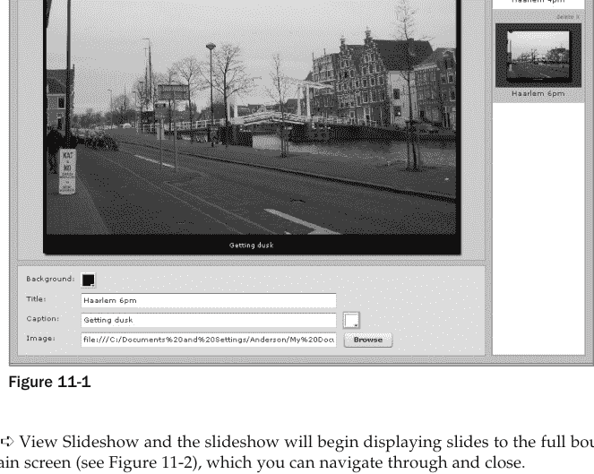

图11-1

点击“视图 > 查看幻灯片集”，幻灯片集将开始在你的系统主屏幕的完整范围内显示幻灯片（参见图11-2），你可以浏览并关闭它。

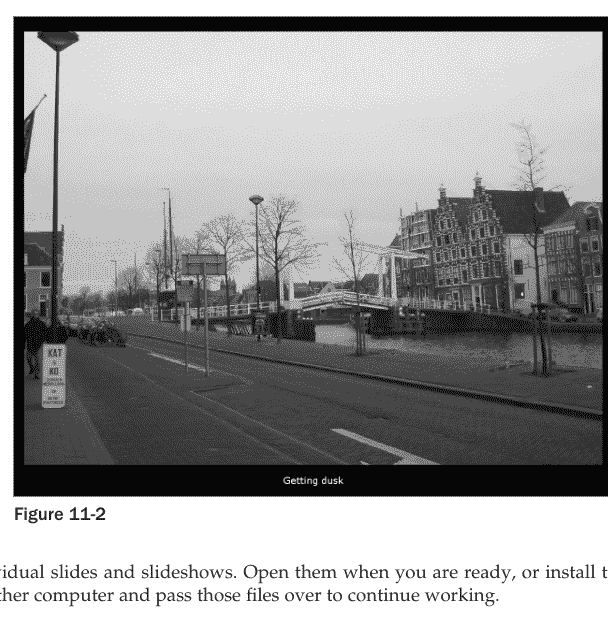

保存单个幻灯片和幻灯片集。在你准备好时打开它们，或者在另一台计算机上安装幻灯片制作工具，并将这些文件传递过去以继续工作。

## 总结

在本章中，你创建了一个可用的幻灯片制作工具，同时深入了解了AIR文件系统API中与将自定义对象序列化为文件相关的部分。你还学习了如何从应用程序描述文件中将文件类型与应用程序关联，以及如何创建用于全屏演示和通知警报的窗口对象。

从此处开始，你可以设置与保存和查看幻灯片集的菜单命令相对应的快捷键命令，并根据需要添加更多命令。你还可以向“属性”面板添加更多属性和额外控件，以制作更具吸引力的幻灯片。

在下一章中，你将通过学习如何创建视频播放器，继续扩充你的AIR知识工具箱。

# 第12章：AIR视频播放器

## 简介

过去十年，人们进行了许多将视频引入互联网的尝试。基于网络和基于桌面的应用程序随着使用趋势的兴衰而起伏，而少数竞争者则坚守阵地。然而，每出现一个新的播放器，就会有一种新的数据格式和另一部分仅支持该技术的人群。结果是出现了太多功能相同的应用程序。Flash Player最新版本对H.264编解码器的支持，结合Flex 3和AIR，有望推动互联网行业采用统一的视频格式。

在本章中，你将构建一个支持FLV和H.264视频格式的桌面视频播放器。它将具备桌面视频播放器的所有基本功能，如播放、暂停、倒带、全屏支持、音量和时间线拖动控制。本章的目的不一定是创建一个功能繁多的视频播放器，而是让你熟悉AIR API的一些主要功能。希望这能为你给这个应用程序添加自己的特色提供一些思路。

在构建视频播放器的过程中，我们将讨论AIR和Flex API中的以下功能：

- 使用Flex的`VideoDisplay`组件
- 创建上下文菜单和应用程序菜单
- 通过系统浏览器窗口和拖放事件访问文件
- 在正常和全屏显示状态之间切换

下一节讨论视频播放器的设计。

## 设计

视频播放器的设计可能看起来相当直观，而且在很大程度上确实如此。毕竟，随着YouTube等网站的成功，每次朋友或同事给你发来另一个幽默或荒诞的视频时，你最终都会看到一个视频播放器。此时，你可能对


# 第12章：AIR视频播放器

核心功能，例如播放控件，你可以立即着手构建播放器。然而，在不过度复杂化应用程序的前提下融入AIR功能，可能需要更多的规划。

你可以创建一个包含所有内容的巨型类文件：视频显示、视频控件以及与AIR的集成。但是，你很可能希望在某个时候能够复用播放器本身的部分功能。因此，最好拥有一个独立的视频播放器，可以在Web内外使用，一个你可以将其嵌入Flex `<mx:Application>`容器或AIR `<mx:WindowedApplication>`容器中的播放器。

这个独立的视频播放器将包含AIR视频播放器的所有核心播放功能。这些功能将被分离到两个独立的类中，一个用于视频显示，另一个用于视频控件。它将包含如下功能：

- **播放控件：** 每个视频播放器至少包含一个播放按钮和一个倒带按钮。播放按钮将在暂停和播放状态之间切换，并相应地改变按钮的图形视图（外观）。除了播放、暂停和倒带控件，你还将包含一个时间线滑块，用于跳转到视频的不同部分；一个时间戳指示器，用于跟踪播放进度；以及一个音量控制器。
- **流体布局：** AIR视频播放器的一个关键特性是能够全屏显示视频。为了适应这一点，你需要创建一个能够随视频大小调整的布局。例如，如果视频显示从300×250扩展到640×480或全屏，播放控件需要随着扩展的显示区域进行相应的调整。
- **网络摄像头捕获：** 这并非必需，但它是一个简单而有趣的功能，可以添加到视频播放器中。当然，如果你没有网络摄像头，请随时忽略此功能。

在视频播放器组件创建完成后，你将在主`<mx:WindowedApplication>`容器中实例化它。主应用程序容器将包含所有AIR功能，包括以下内容：

- **拖放功能：** 你将允许用户将FLV或H.264编码的文件拖放到AIR视频播放器上。文件被接受后，你将把本地路径传递给视频播放器组件作为其源。
- **全屏支持：** Flash播放器支持全屏显示状态。这对于像AIR视频播放器这样的应用程序特别有用，并且易于实现。启用此功能将把用户的电脑变成一个虚拟影院。
- **上下文菜单和窗口菜单：** 除了拖放支持，打开视频文件的另一种方式是通过窗口菜单。此外，设置一个基本的上下文菜单也很有帮助，该菜单提供播放控件，如播放和暂停，以及全屏切换。

既然基本设计和功能已经定义，你就可以开始构建AIR视频播放器了。下一节将帮助你设置目录结构并收集相关文件。

## 构建目录结构

在讨论视频播放器*如何*构建之前，正确设置本章的目录结构非常重要。首先在你的本地开发目录中创建一个名为`VideoPlayer`的新目录。该目录将作为此应用程序的工作目录。

420

接下来，通过在你的工作目录中创建三个新目录com、aircmr和videoplayer，为这个应用程序创建包结构。视频播放器的包结构应如下所示：working directory/com/aircmr/videoplayer。

最后，从配套网站下载相应的资源，并将它们放置在工作目录的根目录中。这些文件将在视频播放器的整个开发过程中使用。它们包括按钮的图形外观和两个示例视频。

> 资源目录中包含的两个视频将有助于测试AIR视频播放器。一个是使用H.264编解码器编码的Apple QuickTime电影，另一个是标准的Flash FLV。

目录结构已设置完毕，你可以立即开始构建AIR视频播放器。下一节将直接开始开发AIR视频播放器中的第一个组件。

## 构建UIVideoPlayer组件

如设计部分所述，UIVideoPlayer组件将包含所有视频播放功能。此功能分散在两个独立的Flex组件文件中：UIVideoPlayer.mxml和UIVideoControls.mxml。为了使用UIVideoPlayer的功能，首先你需要设置这两个组件类：

1. 打开一个新的编辑器窗口并插入以下标记：

```xml
<?xml version="1.0" encoding="utf-8"?>
<mx:VBox xmlns:mx="http://www.adobe.com/2006/mxml"
    width="300" height="290" verticalGap="0"
    xmlns:ui="com.aircmr.videoplayer.ui.*">
    <mx:Metadata>
        [Event(name="videoResize", type="flash.events.Event")]
        [Event(name="metadataReceived", type="mx.events.MetadataEvent")]
        [Event(name="stateChange", type="mx.events.VideoEvent")]
    </mx:Metadata>
    <mx:Script>
        <![CDATA[
            import mx.events.VideoEvent;
            import mx.events.MetadataEvent;

            public static const VIDEO_RESIZE:String = "videoResize";

            private var _source:String;
            private var _autoPlay:Boolean = true;
            private var _autoRewind:Boolean = true;
            private var _maintainAspectRatio:Boolean = true;
            private var _resizeToVideo:Boolean = false;
            private var _showVideoControls:Boolean = false;
            private var _playing:Boolean = false;

            public function play( event:Event = null ):void
            {
                videoDisplay.play();
            }
```

```xml
            public function pause( event:Event = null ):void
            {
                videoDisplay.pause();
            }

            public function enableCamera( event:Event = null ):void
            {
                var camera:Camera = Camera.getCamera();
                videoDisplay.attachCamera( camera );
            }

            public function setDoubleSize( event:Event = null ):void
            {
                this.width = videoDisplay.videoWidth * 2;
                this.height = videoDisplay.videoHeight * 2 + videoControls.height;
                dispatchEvent( new Event( UIVideoPlayer.VIDEO_RESIZE ) );
            }

            public function setNormalSize( event:Event = null ):void
            {
                this.width = videoDisplay.videoWidth;
                this.height = videoDisplay.videoHeight + videoControls.height;
                dispatchEvent( new Event( UIVideoPlayer.VIDEO_RESIZE ) );
            }

            private function handleMetaData( event:MetadataEvent ):void
            {
                if( _resizeToVideo )
                {
                    width = event.info.width;
                    height = event.info.height + videoControls.height;

                    dispatchEvent( new Event( UIVideoPlayer.VIDEO_RESIZE));
                }

                dispatchEvent( event );
            }

            private function handleVideoDisplayStateChange( event:VideoEvent ):void
            {
                playing = videoDisplay.playing;
                dispatchEvent( event );
            }

            [Bindable]
            public function get source():String
            {
                return _source;
            }

            public function set source( val:String ):void
            {
                _source = val;
            }
```

```xml
            [Bindable]
            public function get autoPlay():Boolean
            {
                return _autoPlay;
            }

            public function set autoPlay( bool:Boolean ):void
            {
                _autoPlay = bool;
            }

            [Bindable]
            public function get autoRewind():Boolean
            {
                return _autoRewind;
            }

            public function set autoRewind( bool:Boolean ):void
            {
                _autoRewind = bool;
            }

            [Bindable]
            public function get maintainAspectRatio():Boolean
            {
                return _maintainAspectRatio;
            }

            public function set maintainAspectRatio( bool:Boolean ):void
            {
                _maintainAspectRatio = bool;
            }

            [Bindable]
            [Inspectable(defaultValue="false")]
            public function get resizeToVideo():Boolean
            {
                return _resizeToVideo;
            }

            public function set resizeToVideo( bool:Boolean ):void
            {
                _resizeToVideo = bool;
            }

            public function get showVideoControls():Boolean
            {
                return _showVideoControls;
            }

            public function set showVideoControls( bool:Boolean ):void
            {
                _showVideoControls = bool;
            }
```


# 第12章：AIR视频播放器

```actionscript
if( bool )
{
    if( !contains( videoControls ) ) addChild( videoControls );
}
else
{
    if( contains( videoControls ) ) removeChild( videoControls );
}
}

[Bindable]
public function get playing():Boolean
{
    return _playing;
}

public function set playing( bool:Boolean ):void
{
    _playing = bool;
}

]]></mx:Script>
<mx:VideoDisplay id="videoDisplay"
    width="100%" height="100%"
    backgroundAlpha="0"
    source="{ source }"
    autoRewind="{autoRewind}"
    autoPlay="{autoPlay}"
    maintainAspectRatio="{maintainAspectRatio}"
    stateChange="handleVideoDisplayStateChange( event );"
    metadataReceived="handleMetaData( event );"
/>

<ui:UIVideoControls id="videoControls"
    playheadTime="{videoDisplay.playheadTime}"
    playheadTimeTotal="{videoDisplay.totalTime}"
    playing="{videoDisplay.playing}"
    playheadTimeChange="{videoDisplay.playheadTime = videoControls.newPlayheadTime}"
    volumeChange="{videoDisplay.volume = videoControls.volume}"
    playVideo="{videoDisplay.play();}"
    pauseVideo="{videoDisplay.pause();}" />
</mx:VBox>
```

**2.** 将此类保存为 `UIVideoPlayer.mxml`，放置在工作目录下的 `/com/aircmr/videoplayer/ui/` 目录中。

**3.** 打开一个新的编辑器窗口，并插入以下标记：

```xml
<?xml version="1.0" encoding="utf-8"?>
<mx:Canvas xmlns:mx="http://www.adobe.com/2006/mxml"
    width="100%" height="50" backgroundColor="0xFFFFFF"
    resize="onResizeHandler( event );"
    borderColor="0x00000000"
    borderStyle="inset"
    borderThickness="1"
    xmlns:ui="com.aircmr.videoplayer.ui.*" >

<mx:Metadata>
    [Event(name="volumeChange", type="flash.events.Event")]
    [Event(name="playheadTimeChange" , type="flash.events.Event")]
    [Event(name="pauseVideo" , type="flash.events.Event")]
    [Event(name="playVideo" , type="flash.events.Event")]
</mx:Metadata>

<mx:Script>
    <![CDATA[
        import mx.events.SliderEvent;
        import mx.events.VideoEvent;

        public static const VOLUME_CHANGE:String = "volumeChange";
        public static const PLAYHEADTIME_CHANGE:String = "playheadTimeChange";
        public static const PAUSE_VIDEO:String = "pauseVideo";
        public static const PLAY_VIDEO:String = "playVideo";

        private var _newPlayheadTime:Number = 0;
        private var _playheadTimeTotal:Number = 0
        private var _playheadTime:Number = 0;
        private var _volume:Number = 1;
        private var _playing:Boolean = false;
        private var _wasPlaying:Boolean = false;
        private var _updateTime:Boolean = false;

        private function onResizeHandler( event:Event ):void
        {
            scrubber.width = this.width - 90;
        }

        private function handleRewind( event:MouseEvent ):void
        {
            newPlayheadTime = 0;
        }

        private function handlePlay( event:MouseEvent ):void
        {
            dispatchEvent( new Event( playing ?
                UIVideoControls.PAUSE_VIDEO :  UIVideoControls.PLAY_VIDEO ));
        }

        private function handleVolumeChange( event:SliderEvent ):void
        {
            volume = event.value;
        }

        private function handleVideoPlayheadUpdate():void
        {
            if( !_updateTime ) scrubber.value = _playheadTime;
            timelabel.text = String( timeFormatter.format(
                new Date( _playheadTime * 1000) ))
                + "/"+ String( timeFormatter.format(
                    new Date( _playheadTimeTotal * 1000) ));

            if( timelabel.text == "/" ) timelabel.text = "00:00/00:00";
        }

        private function handleSliderThumbEvent( event:SliderEvent ):void
        {
            switch( event.type )
            {
                case SliderEvent.THUMB_PRESS : _wasPlaying = playing;
                    dispatchEvent( new Event( UIVideoControls.PAUSE_VIDEO ));
                    _updateTime = true;
                    break;

                case SliderEvent.THUMB_RELEASE : if( _wasPlaying )
                    dispatchEvent(new Event( UIVideoControls.PLAY_VIDEO ));
                    newPlayheadTime = event.value;
                    _updateTime = false;
                    break;
            }
        }

        private function formatTimelineValue( num:Number ):String
        {
            return String( timeFormatter.format( new Date( num * 1000) ));
        }

        private function formatVolume( num:Number ):String
        {
            return String( Math.round( num * 100 ));
        }


        [Bindable]
        public function get playheadTimeTotal():Number
        {
            return _playheadTimeTotal;
        }

        public function set playheadTimeTotal( val:Number ):void
        {
            _playheadTimeTotal = val;
        }

        [Bindable]
        public function get playheadTime():Number
        {
            return _playheadTime;
        }

        public function set playheadTime( val:Number ):void
        {
            _playheadTime = val;
            handleVideoPlayheadUpdate();
        }

        [Bindable("playheadTimeChange")]
        public function get newPlayheadTime():Number
        {
            return _newPlayheadTime;
        }

        public function set newPlayheadTime( val:Number ):void
        {
            _newPlayheadTime = val;
            dispatchEvent( new Event("playheadTimeChange") );
        }

        [Bindable("volumeChange")]
        public function get volume():Number
        {
            return _volume;
        }

        public function set volume( val:Number ):void
        {
            _volume = val;

            dispatchEvent( new Event( "volumeChange" ) );
        }

        [Bindable]
        public function get playing():Boolean
        {
            return _playing;
        }

        public function set playing( bool:Boolean ):void
        {
            _playing = bool;

            play.styleName = bool ? "pauseBtn" :  "playBtn";
        }
    ]]>
</mx:Script>

<mx:DateFormatter id="timeFormatter" formatString="NN:SS" />

<mx:VBox width="100%" verticalGap="0">
    <mx:Canvas width="100%" height="15" id="timeTracker" >
        <mx:HSlider id="scrubber"
            width="100%" height="4"
            x="5" y="5"
            dataTipFormatFunction="formatTimelineValue"
            allowTrackClick="false"
            liveDragging="false"
            tickInterval="0"
            minimum="0"
            maximum="{ playheadTimeTotal }"
            thumbPress="handleSliderThumbEvent( event );"
            thumbRelease="handleSliderThumbEvent( event );"
        />
        <mx:Label id="timelabel" x="{timeTracker.width - timelabel.width}"
            styleName="timeText" text="00:00/00:00" />
    </mx:Canvas>

    <mx:Canvas width="100%" height="100%" id="toggle">
        <mx:HBox horizontalGap="0" x="2">
            <mx:Button styleName="toStartBtn" id="rewind"
                click="handleRewind( event );" />
            <mx:Button styleName="playBtn" id="play"
                click="handlePlay( event );"/>
        </mx:HBox>

        <mx:HBox horizontalGap="0" x="{toggle.width - 90}" y="10">
            <mx:Image source="@Embed('/assets/images/volumeLow.png')" />
            <mx:HSlider id="volumeController"
                width="70" height="4"
                allowTrackClick="true"
                invertThumbDirection="true"
                dataTipFormatFunction="formatVolume"
                liveDragging="true"
                change="handleVolumeChange( event );"
                maximum="1"
                minimum="0"
                tickInterval="0"
                value="{volume}"
            />
            <mx:Image source="@Embed('/assets/images/volumeHigh.png')" />
        </mx:HBox>
    </mx:Canvas>
</mx:VBox>
</mx:Canvas>
```

4.  将此类保存为 `UIVideoControls.mxml`，放置在工作目录下的 `/com/aircmr/videoplayer/ui/` 目录中。

要正确测试此组件，您可能需要创建主应用程序文件并实例化 `UIVideoPlayer` 组件。为此，请打开一个新的编辑器窗口并插入以下精简后的标记：

```xml
<?xml version="1.0" encoding="utf-8"?>
<mx:WindowedApplication width="300" height="290"
    xmlns:mx="http://www.adobe.com/2006/mxml"
    layout="absolute" verticalScrollPolicy="off"
    xmlns:ui="com.aircmr.videoplayer.ui.*">
    <mx:Style source="assets/style/app.css" />
    <ui:UIVideoPlayer width="100%" height="100%"
        source="assets/Redline_Renegades.mov" />
</mx:WindowedApplication>
```

将此类保存为 `AIRVideoPlayer.mxml`，放置在您工作目录的根目录下。

> `AIRVideoPlayer.mxml` 和 `UIVideoControls.mxml` 都引用了 `/assets` 目录中的资源。您可以在附带的 CD 上找到这些资源。如果您选择不使用它们，请务必注释掉这些引用。

此时，如果您编译并运行此应用程序，您将得到一个基本的视频播放器，其中会播放附带的视频，如图12-1所示。


图12-1

开始审查代码，打开 `UIVideoControls` 组件类。

## UIVideoControls 详解

`UIVideoControls` 类是视频播放器的界面。它具有一个播放按钮、一个倒带按钮、一个音量控制、一个时间轴滑块和时间戳标签。组件功能嵌套在一个具有受控高度和可变宽度的 `<mx:Canvas>` 容器中。宽度是可变的，以便控件可以随视频播放器的大小而收缩和扩展。


# 第12章：AIR视频播放器

### 公共变量

在探讨界面如何创建之前，先回顾一下控制`UIVideoControls`组件的公共变量：

- `playheadTime`：视频开始播放后，每次播放头移动，`UIVideoPlayer`组件都会更新此属性。设置该变量时，会调用`handleVideoPlayheadUpdate`方法。此方法会更改时间戳并调整视频滑块上标记的位置。
- `playheadTimeTotal`：视频加载后，此值即被设定。您可用它来显示视频总时长与当前`playheadTime`的对比。它同时也作为时间线滑块的最大值。
- `newPlayheadTime`：每当用户移动视频滑块上的标记或按下倒带键时，您就需要更新此值。更新后会触发一个`playheadTimeChange`事件，通知`UIVideoPlayer`必须更新视频的`playheadTime`。
- `volume`：此值由音量控制器更新，并分发`volumeChange`事件。事件触发后，`UIVideoPlayer`中的音量便会更新。
- `playing`：此布尔值与`UIVideoPlayer`实例化的`VideoDisplay`组件绑定。当值从`true`变为`false`时，您需要更新`styleName`以匹配播放图标或暂停图标。

### 处理时间戳

`playheadTime`值以秒为单位。但不幸的是，大多数视频时间戳以分钟为单位表示，例如是01:30而不是90秒。为了将时间格式化成这种形式，您将使用Flex的`DateFormatter`：

```
<mx:DateFormatter id="timeFormatter" formatString="NN:SS" />
```

此`DateFormatter`会将`playheadTime`格式化为`NN:SS`格式，其中NN代表分钟，SS代表秒。您可以通过调用以下代码来使用此格式化器：

```
timeFormatter.format( new Date( playheadTime * 1000 ) )
```

`DateFormatter`类需要一个通过`format`方法传入的`Date`对象。首先，它将`playheadTime`乘以1000以转换为毫秒，然后将毫秒单位的`playheadTime`传递给一个新的`Date`对象。结果是一个类似于01:30的字符串。

### 视频滑块控制器

大多数视频播放器都具有某种时间线拖动控制。随着视频时间的推进，会有某种图形表示，也可用作在视频中定位（拖动）的方式。Flex的`HSlider`组件适用于视频滑块。该滑块在`<mx:HSlider>`标记中以ID `scrubber`被调用。

随着`playheadTime`的更新，`HSlider`的`value`属性的位置也会更新，使滑块的滑块沿滑块轨道移动。这在`handleVideoPlayheadUpdate`方法中实现。`HSlider`的最大值属性与`playheadTimeTotal`属性绑定；因此，滑块上拇指标记的位置将表示`playheadTime`相对于`playheadTimeTotal`的位置。这为用户提供了视频进度的准确视图。

最后，用户应该能够通过移动滑块上的拇指来拖动视频。这由`handleSliderThumbEvent`方法实现，该方法由`thumbPress`和`thumbRelease`事件调用。按下时，`handleSliderThumbEvent`会记录视频在拇指按下前是否正在播放。释放时，`newPlayheadTime`属性被设置为拇指标记的值，并向`UIVideoPlayer`组件分发一个事件，该事件更新`VideoDisplay`组件。如果视频在拇指按下前正在播放，则视频将恢复播放。

### 关于实时拖动更新

`newPlayheadTime`属性仅在释放时更新，原因与视频播放器为何没有快进或倒带功能相同。Flex的`VideoDisplay`组件的`playheadTime`属性可以持续接收新值。然而，如果`VideoDisplay`中`NetStream`对象的位置正在更新，新值将排队并按顺序执行。因此，如果在用户拖动拇指时更新了`newPlayheadTime`值，视频显示会在视觉上跳跃，直到到达队列中的下一个`playheadTime`值。

### 播放、暂停和倒带

播放按钮根据视频是否正在播放而兼作播放和暂停按钮。按下时，它调用`handlePlay`方法，该方法检查`playing`属性并分发播放或暂停事件：

```
dispatchEvent( new Event( playing ? UIVideoControls.PAUSE_VIDEO :
    UIVideoControls.PLAY_VIDEO ));
```

倒带按钮调用`handleRewind`方法，该方法将`newPlayheadTime`属性设置为零。

## UIVideoPlayer详解

现在有了`UIVideoControls`组件，它就可以与Flex的`VideoDisplay`组件一起被`UIVideoPlayer`组件实例化。`UIVideoPlayer`由这两个组件组成，嵌套在`VBox`容器中。

`videoDisplay`和`videoControls`组件通过公共属性和事件直接相互交互。例如，`videoControls`的`playing`属性与`videoDisplay`的`playing`属性绑定。同样，当`volumeChange`事件被分发时，设置`videoDisplay`的`volume`属性的内联代码被执行：

```
<ui:UIVideoControls id="videoControls"
    playheadTime="{videoDisplay.playheadTime}"
    playheadTimeTotal="{videoDisplay.totalTime}"
    playing="{videoDisplay.playing}"
    playheadTimeChange="{videoDisplay.playheadTime = videoControls.newPlayheadTime}"
    volume="{videoDisplay.volume}"
    volumeChange="{videoDisplay.volume = videoControls.volume}"
    playVideo="{videoDisplay.play();}"
    pauseVideo="{videoDisplay.pause();}" />
```

对于`videoControls`分发的`playheadTimeChange`事件，同样适用此原理。

### 公共变量

`UIVideoPlayer`具有一些公共变量，这些变量直接影响`videoDisplay`或`UIVideoPlayer`组件的功能。这些变量包括：

- `source`：此属性由实例化`UIVideoPlayer`组件的父类设置。设置后，URL会传递给`VideoDisplay`组件的`source`属性。
- `autoPlay`：与`source`类似，此属性直接传递给`VideoDisplay`组件，影响视频加载后是否自动播放。
- `autoRewind`：与`source`类似，此属性直接传递给`VideoDisplay`组件，影响视频播放头到达末尾时是否自动倒带。
- `maintainAspectRatio`：与`source`类似，此属性直接传递给`VideoDisplay`组件，影响调整大小时视频的纵横比。
- `resizeToVideo`：如果设置为`true`，视频加载后，`UIVideoPlayer`将调整自身大小以适应源视频的`height`和`width`。否则，视频将被调整大小以适应`UIVideoPlayer`内部。
- `showVideoControls`：可以通过设置此布尔属性来向`UIVideoPlayer`添加或移除`videoControls`组件。此功能用于在播放器设置为全屏时关闭控件。
- `playing`：此属性由`VideoDisplay`组件设置，可用于监视视频是否正在播放。

### 处理大小调整

`UIVideoPlayer`的一个关键特性是其能够根据内容或`setDoubleSize`和`setNormalSize`公共方法进行调整大小。例如，一旦设置了源并且`VideoDisplay`接收到了包含视频`height`和`width`的元数据，就会调用`handleMetaData`方法：

```
private function handleMetaData( event:MetadataEvent ) :void
{
    if( _resizeToVideo )
    {
        width = event.info.width;
        height = event.info.height + videoControls.height;

        dispatchEvent( new Event( "videoResize" ) );
    }
    dispatchEvent( event );
}
```

在前面的代码片段中，如果`_resizeToVideo`设置为`true`，那么`UIVideoPlayer`的宽度和高度将被设置为视频的`height`和`width`，并且`videoControls`的高度也会被考虑在内。设置完成后，会触发`videoResize`事件。否则，`MetaDataEvent`被分发，父类可以接收它。

因为`UIVideoPlayer`继承自`VBox`容器类，任何大小调整都会保持`videoControls`位于`VideoDisplay`组件下方。随着`VBox`调整大小，`videoControls`也会相应地调整大小。


### 获取摄像头输入

如前所述，`UIVideoPlayer` 需要添加的一项小功能是能够显示网络摄像头的视频流（如果用户有的话）。这通过 `enableCamera` 方法实现：

```
public function enableCamera( event:Event = null ):void
{
    var camera:Camera = Camera.getCamera();
    videoDisplay.attachCamera( camera );
}
```

此方法创建一个新的 `Camera` 对象并调用 `getCamera` 方法。如果摄像头存在，则通过 `attachCamera` 方法将 `Camera` 对象分配给 `VideoDisplay` 组件。如果存在网络摄像头，`VideoDisplay` 组件将自动开始显示输入。

### 播放和暂停方法

`UIVideoPlayer` 组件的最后一个功能是能够在组件外部播放和暂停视频。这适用于除了 `UIVideoControls` 组件之外的其他内容需要启动和停止视频的情况。两个方法都调用 `VideoDisplay` 组件的 `play` 和 `pause` 方法。

现在 `UIVideoPlayer` 已创建完成，可以为其分配源并进行测试。AIR 播放器的一个重要部分已经创建完成。下一节将演示如何实现 `UIVideoPlayer` 组件。

## 整合所有部分

既然独立视频播放器已经开发完成，就可以为应用程序添加 AIR 功能了。在上一节中，你创建了主应用程序文件 `AIRVideoPlayer.mxml`。如果你已经创建了此文件，请打开它并用以下标记覆盖其内容。如果你尚未创建此文件，请打开一个新的编辑器窗口并插入以下内容：

```
<?xml version="1.0" encoding="utf-8"?>
<mx:WindowedApplication
    xmlns:mx="http://www.adobe.com/2006/mxml"
    layout="absolute" width="320" height="290"
    backgroundColor="0x000000"
    verticalScrollPolicy="off"
    horizontalScrollPolicy="off"
    applicationComplete="handleAppCreationComplete( event )"
    resizing="handleResizingMainApp( event );"
    xmlns:ui="com.aircmr.videoplayer.ui.*">

    <mx:Style source="assets/style/app.css" />

    <mx:Script>
        <![CDATA[
            import mx.events.VideoEvent;
            import mx.events.ResizeEvent;
            import mx.events.MetadataEvent;

            private var _activeNativeMenu:NativeMenu;

            private function handleAppCreationComplete( event:Event ):void
            {
                this.addEventListener( NativeDragEvent.NATIVE_DRAG_ENTER,
                    onDragEnterHandler );
                this.addEventListener( NativeDragEvent.NATIVE_DRAG_DROP,
                    onDragDropHandler );

                this.contextMenu = buildContextMenu();

                stage.addEventListener( FullScreenEvent.FULL_SCREEN,
                    handleResizeFullScreen );

                if( NativeApplication.supportsMenu )
                    NativeApplication.nativeApplication.menu = buildAppMenu();
                if( NativeWindow.supportsMenu )
                    stage.nativeWindow.menu = buildAppMenu();
            }

            private function buildContextMenu( isNormal:Boolean = true ):NativeMenu
            {
                var menu:NativeMenu = new NativeMenu();

                var fileMenu:NativeMenuItem =
                    menu.addItem( new NativeMenuItem( "文件" ) );
                fileMenu.submenu = buildFileMenu();

                menu.addItem( new NativeMenuItem( "分隔符" , true ));

                if( isNormal )
                {
                    var fullScreen:NativeMenuItem = menu.addItem(
                        new NativeMenuItem("进入全屏") );
                    fullScreen.addEventListener( Event.SELECT,
                        handleFullScreen );
                }
                else
                {
                    var exitFullScreen:NativeMenuItem =
                        menu.addItem( new NativeMenuItem("退出全屏") );
                    exitFullScreen.addEventListener( Event.SELECT,
                        handleExitFullScreen );
                }

                var playVideoMenuItem:NativeMenuItem =
                    menu.addItem( new NativeMenuItem( "播放" ) );
                playVideoMenuItem.addEventListener( Event.SELECT,
                    videoPlayer.play );

                var pauseVideoMenuItem:NativeMenuItem = menu.addItem(
                    new NativeMenuItem( "暂停" ) );
                pauseVideoMenuItem.addEventListener( Event.SELECT,
                    videoPlayer.pause );

                return menu;
            }

            private function buildAppMenu():NativeMenu
            {
                var appMenu:NativeMenu = new NativeMenu();
                var fileMenu:NativeMenuItem = appMenu.addItem(
                    new NativeMenuItem( "文件" ) );
                fileMenu.submenu = buildFileMenu();

                var viewMenu:NativeMenuItem = appMenu.addItem(
                    new NativeMenuItem( "视图" ) );
                viewMenu.submenu = buildViewMenu();

                return appMenu;
            }

            private function buildFileMenu():NativeMenu
            {
                var fileSubMenu:NativeMenu = new NativeMenu();
                var openVideo:NativeMenuItem = fileSubMenu.addItem(
                    new NativeMenuItem( "打开视频" ));
                openVideo.addEventListener( Event.SELECT , handleOpenVideo );

                var closePlayer:NativeMenuItem = fileSubMenu.addItem(
                    new NativeMenuItem( "关闭播放器" ));
                closePlayer.addEventListener( Event.SELECT , handleClosePlayer );

                return fileSubMenu;
            }

            private function buildViewMenu():NativeMenu
            {
                var viewSubMenu:NativeMenu = new NativeMenu();
                var fullScreen:NativeMenuItem = viewSubMenu.addItem(
                    new NativeMenuItem("进入全屏") );
                fullScreen.addEventListener( Event.SELECT , handleFullScreen );

                var doubleSize:NativeMenuItem = viewSubMenu.addItem(
                    new NativeMenuItem("双倍大小") );
                doubleSize.addEventListener( Event.SELECT,
                    videoPlayer.setDoubleSize );

                var normalSize:NativeMenuItem = viewSubMenu.addItem(
                    new NativeMenuItem("正常大小") );
                normalSize.addEventListener( Event.SELECT,
                    videoPlayer.setNormalSize );

                var separator:NativeMenuItem = viewSubMenu.addItem(
                    new NativeMenuItem("分隔符" , true ));

                var viewCamera:NativeMenuItem = viewSubMenu.addItem(
                    new NativeMenuItem("查看摄像头") );
                viewCamera.addEventListener( Event.SELECT,
                    videoPlayer.enableCamera );

                return viewSubMenu;
            }

            private function handleOpenVideo( event:Event ):void
            {
                var videoFilter:FileFilter = new FileFilter("视频",
                    "*.flv;*.mp4;*.mov;*.mpg;*.m4a;*.mp4v;*.3gp;*.3g2");
                var file:File = new File();
                file.addEventListener( Event.SELECT , handleVideoSelection );
                file.browseForOpen("视频" , [videoFilter] );
            }

            private function handleClosePlayer( event:Event ):void
            {
                stage.nativeWindow.close();
            }

            private function handleVideoSelection( event:Event ):void
            {
                var prefix:String =
                    ( Capabilities.os.search("Mac") >= 0 ) ? "file://" : "";
                videoPlayer.source = prefix + event.target.nativePath;

                openLabel.visible = false;
            }

            private function onDragEnterHandler( event:NativeDragEvent ):void
            {
                NativeDragManager.dropAction = NativeDragActions.LINK;
                NativeDragManager.acceptDragDrop( this );
            }

            private function onDragDropHandler( event:NativeDragEvent ):void
            {
                if( event.clipboard.hasFormat(ClipboardFormats.FILE_LIST_FORMAT) )
                {
                    var fileArray:Array = event.clipboard.getData(
                        ClipboardFormats.FILE_LIST_FORMAT ) as Array;
                    for each( var file:File in fileArray )
                    {
                        var prefix:String =
                            (Capabilities.os.search("Mac") >= 0) ? "file://" : "";

                        switch( file.extension )
                        {
                            case "flv" :  videoPlayer.source =
                                          prefix + file.nativePath;
                                          break;
                            case "mp4" :  videoPlayer.source =
                                          prefix + file.nativePath;
                                          break;
                            case "mov" :  videoPlayer.source =
                                          prefix + file.nativePath;
                                          break;
                            case "mpg" :  videoPlayer.source =
                                          prefix + file.nativePath;
                                          break;
                            case "m4a" :  videoPlayer.source =
                                          prefix + file.nativePath;
                                          break;
                            case "mp4v" : videoPlayer.source =
                                          prefix + file.nativePath;
                                          break;
                            case "3gp" :  videoPlayer.source =
                                          prefix + file.nativePath;
                                          break;
                            case "3g2" :  videoPlayer.source =
                                          prefix + file.nativePath;
                                          break;
                        }
                    }
                }

                openLabel.visible = false;
            }

            private function handleVideoPlayerResize( event:Event ):void
            {
                this.width = videoPlayer.width;
                this.height = videoPlayer.height + 18;
            }

            private function handleMetaData( event:MetadataEvent ):void
            {
                this.title = videoPlayer.source.split('/').pop();
            }

            private function handleResizingMainApp(
                    event:NativeWindowBoundsEvent = null ):void
            {
                videoPlayer.width = this.width;
                videoPlayer.height = this.height - 18;
            }

            private function handleResizeFullScreen( event:FullScreenEvent ):void
            {
                if(stage.displayState == StageDisplayState.FULL_SCREEN_INTERACTIVE)
                {
                    videoPlayer.showVideoControls = false;
                    videoPlayer.width = this.width;
                    videoPlayer.height = this.height;

                    this.contextMenu = buildContextMenu( false );
                }
```


# 第12章：AIR视频播放器

```mxml
if( stage.displayState == StageDisplayState.NORMAL )
{
    videoPlayer.showVideoControls = true;
    handleResizingMainApp();

    this.contextMenu = buildContextMenu();
}

private function handleFullScreen( event:Event ):void
{
    stage.displayState = StageDisplayState.FULL_SCREEN_INTERACTIVE;
}

private function handleExitFullScreen( event:Event ):void
{
    stage.displayState = StageDisplayState.NORMAL;
}
]]>
</mx:Script>

<mx:Label id="openLabel" color="0xFFFFFF"
    text="DRAG VIDEO INTO PLAYER TO START"
    x="{this.width / 2 - openLabel.width / 2}" y="{this.height / 2}" />

<ui:UIVideoPlayer
    id="videoPlayer"
    width="100%" height="100%"
    resizeToVideo="true"
    metadataReceived="handleMetaData( event );"
    videoResize="handleVideoPlayerResize( event );"
    />
</mx:WindowedApplication>
```

将此类保存为 AIRVideoPlayer.mxml，置于你的工作目录根目录下。

此时，AIR视频播放器可以编译和测试了。结果如图12-2所示。

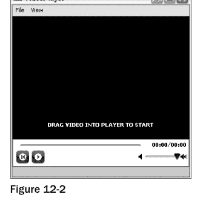

## AIRVideoPlayer.mxml 详解

`AIRVideoPlayer` 实例化 `UIVideoPlayer` 组件，并充当该组件与 AIR 功能之间的控制器。它继承自 `<mx:WindowedApplication>` 容器，并控制初始显示的 `height`（高度）、`width`（宽度）和 `backgroundColor`（背景色）。

### 实现 UIVideoPlayer 组件

`AIRVideoPlayer` 实例化 `UIVideoPlayer` 组件，并将值和方法分配给该组件的属性和事件：

```mxml
<ui:UIVideoPlayer
    id="videoPlayer"
    width="100%" height="100%"
    resizeToVideo="true"
    metadataReceived="handleMetaData( event );"
    videoResize="handleVideoPlayerResize( event );"
/>
```

查看这些属性，`width` 和 `height` 都设置为 100%，以便播放器占据所有可用的窗口空间。同样，当 `videoResize` 事件被分发时，`height` 和 `width` 也会影响 `AIRVideoPlayer` 的大小。这一点将在本节后面更详细地讨论。

公共属性 `resizeToVideo` 设置为 `true`，以便 `UIVideoPlayer` 能够根据加载的视频内容进行扩展和收缩。

一旦 `metadataReceived` 事件被分发，`handleMetaData` 方法就会被访问。在此，可以在应用程序级别设置与视频文件元数据相关的任何属性。例如，窗口的 `title`（标题）在文件加载后被设置为文件名：

```actionscript
this.title = videoPlayer.source.split('/').pop();
```

虽然这可以在 `File` 对象创建时赋值，但最好在视频初始化之后再进行赋值。

### 添加拖放功能

AIR 的一个优秀特性是它提供了将内容从桌面拖放到 AIR 应用程序的能力。在这种情况下，FLV 和 H.264 编码的文件可以被拖放到 AIR 视频播放器中并自动播放。这通过在 `handleAppCreationComplete` 方法中添加 `NativeDragEvent.NATIVE_DRAG_ENTER` 和 `NativeDragEvent.NATIVE_DRAG_DROP` 监听器来实现。该方法在应用程序实例化完成后被调用。

#### 拖拽

当用户将视频拖到 AIR 视频播放器上时，会调用以下方法：

```actionscript
private function onDragEnterHandler( event:NativeDragEvent ):void
{
    NativeDragManager.dropAction = NativeDragActions.LINK;
    NativeDragManager.acceptDragDrop( this );
}
```

此方法引用 NativeDragManager 并将 dropAction 属性设置为 link，这意味着只会创建文件的引用，而不是将文件复制或移动到另一个目录位置。此外，AIRVideoPlayer 通过将自身的引用传递给 NativeDragManager 的 acceptDragDrop 方法，让 NativeDragManager 知道允许拖放操作。

#### 放置

当用户将文件放置到 AIRVideoPlayer 上时，会调用 onDragDropHandler 方法。此方法接收一个 NativeDragEvent，该事件包含放置文件的引用信息。引用信息位于 event.clipboard 容器中。

该方法首先通过调用 clipboard 容器的 hasFormat 方法来确保剪贴板具有文件信息。hasFormat 方法接受一个格式字符串。在这种情况下，因为此方法检查的是文件格式，所以传递了字符串 ClipboardFormats.FILE_LIST_FORMAT。

一旦确定剪贴板信息是文件数据，onDragDropHandler 方法就会创建一个新数组，并使用 clipboard.getData 方法从剪贴板分配数据：

```actionscript
var fileArray:Array =
    event.clipboard.getData(ClipboardFormats.FILE_LIST_FORMAT) as Array;
```

然后，它会循环遍历数组中的每个 File 对象，并确定文件扩展名是 FLV 还是其他可接受的 H.264 编码格式，如 .MOV。如果文件是可接受的格式，其 NativePath 将被分配给 UIVideoPlayer 的 source 属性，然后视频被加载。如果用户在运行 Mac OS X，则需要添加前缀 file://：

```actionscript
var prefix:String = (Capabilities.os.search("Mac")>=0) ? "file://" : "";
```

### 添加上下文菜单和窗口菜单

尽管通过拖放访问文件是打开视频文件的一种可接受方式，但 AIRVideoPlayer 需要一种更直观的方式来打开文件。为此，将向应用程序分配一个 NativeMenu 对象。

#### 窗口和应用程序菜单

实际上有两种不同类型的窗口菜单，它们由用户使用的操作系统决定。例如，OS X 在屏幕顶部有一个固定的菜单栏，与应用程序窗口分开，而 Windows 的菜单则位于应用程序窗口内部。对于 AIRVideoPlayer，这在 handleAppCreationComplete 方法中决定：

```actionscript
if( NativeApplication.supportsMenu )
    NativeApplication.nativeApplication.menu = buildAppMenu();
if( NativeWindow.supportsMenu )
    stage.nativeWindow.menu= buildAppMenu();
```

如果此应用程序在 OS X 上运行，则 NativeApplication.supportsMenu 为 true，而在 Windows 上，NativeWindow.supportsMenu 为 true。无论哪种情况，相同的菜单集都会分配给 nativeApplication（OS X）或 nativeWindow（Windows）。

方法 `buildAppMenu` 创建菜单集并返回一个 `NativeMenu` 对象：

```actionscript
var menu:NativeMenu = new NativeMenu();
var fileMenu:NativeMenuItem = menu.addItem(new NativeMenuItem("File") );
fileMenu.submenu = buildFileMenu();
```

前面的代码片段摘自 `buildAppMenu`。在此示例中，创建了一个新的 `NativeMenu` 对象，并向其中添加了一个名为 `fileMenu` 的新 `NativeMenuItem`。一旦添加了 `fileMenu`，其子菜单就通过 `buildFileMenu` 进行赋值，该方法返回一个 `NativeMenu`。结果是一个名为“File”的菜单，其中包含一个下拉菜单，选项为“打开视频”和“关闭播放器”。视图菜单也采用同样的方式。图12-3展示了在 Windows 中运行的窗口菜单。

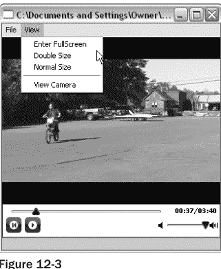

#### 上下文菜单

将添加上下文菜单，使用户能够在全屏和普通窗口视图之间切换。将添加基本的播放和暂停功能，以及上一节添加的 `fileMenu`。上下文菜单在 `handleAppCreationComplete` 方法中添加到应用程序：

```actionscript
this.contextMenu = buildContextMenu();
```

`buildContextMenu` 的设置与 `buildAppMenu` 方法类似，也返回一个 `NativeMenu` 对象。创建一个名为 `menu` 的新 `NativeMenu` 对象，并将 `NativeMenuItem` 赋予它。唯一的例外是当应用程序检查是否处于全屏模式时：

```actionscript
if( isNormal )
{
    var fullScreen:NativeMenuItem = menu.addItem( new
        NativeMenuItem("ENTER FULLSCREEN") );
    fullScreen.addEventListener( Event.SELECT , handleFullScreen );
```

# 第12章：AIR视频播放器

```actionscript
else
{
    var exitFullScreen:NativeMenuItem = menu.addItem( new NativeMenuItem("EXIT FULLSCREEN") );
    exitFullScreen.addEventListener( Event.SELECT , handleExitFullScreen );
}
```

如果应用程序处于全屏模式，则 `isNormal` 的值为false。一旦确定了这一点，就会相应地添加“进入全屏”或“退出全屏”选项。上下文菜单的结果如图12-4所示，也可以在下一节的图12-6中查看。

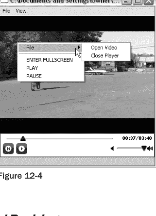

## 支持全屏和调整大小

在功能齐全的视频播放器中，全屏观看视频几乎是必需的，同样重要的还有将播放器调整为加载视频的原始尺寸或用户指定尺寸的能力。幸运的是，构成AIR视频播放器的三个组件文件的编码都支持调整大小。

### 调整大小

调整大小（非全屏）发生在两个地方。第一处是在`WindowedApplication`派发的调整大小事件中声明。当派发调整大小事件时，会调用`handleResizingApp`方法。当用户拖动窗口以改变其高度和宽度时，此方法会相应地调整`UIVideoPlayer`的高度和宽度，同时保持视频的宽高比不变，除非`UIVideoPlayer.maintainAspectRatio`被设置为false。

第二处是在`UIVideoPlayer`组件的实例化标记中声明。`videoResize`事件被分配给`handleVideoPlayerResize`方法。此事件在接收到视频元数据后派发。随后，`handleVideoPlayerResize`会根据`UIVideoPlayer`的高度和宽度重新调整应用程序的高度和宽度。如图12-5所示。

第12章：AIR视频播放器

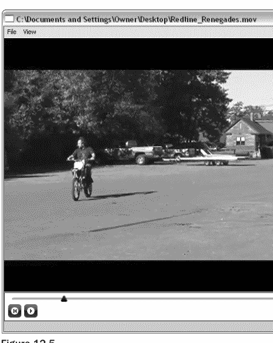

图12-5

### 进入全屏

全屏的切换功能在“添加上下文菜单和窗口菜单”一节中已经设置好。用户可以从“视图”菜单进入全屏，也可以右键单击播放器并选择“进入全屏”。

要进入全屏模式，会调用`handleFullScreen`方法，该方法将`stage.displayState`设置为`StageDisplayState.FULL_SCREEN_INTERACTIVE`。这有效地将应用程序设置为全屏。

要退出全屏模式，会调用`handleExitFullScreen`方法，该方法将`stage.displayState`设置为`StageDisplayState.NORMAL`。这有效地将应用程序恢复为正常尺寸，即进入全屏之前的高度和宽度。

应用程序通过在`handleAppCreationComplete`方法中为`stage`添加监听器来监听显示状态的变化，该监听器监听`FullScreenEvent.FULL_SCREEN`事件。一旦派发此事件，就会调用`handleResizeFullScreen`方法：

```actionscript
private function handleResizeFullScreen( event:FullScreenEvent ):void
{
    if(stage.displayState == StageDisplayState.FULL_SCREEN_INTERACTIVE)
    {
        videoPlayer.showVideoControls = false;
        videoPlayer.width = this.width;
        videoPlayer.height = this.height;
        this.contextMenu = buildContextMenu( false );
    }

    if(stage.displayState == StageDisplayState.NORMAL)
    {
        videoPlayer.showVideoControls = true;
        handleResizingMainApp();
        this.contextMenu = buildContextMenu();
    }
}
```

此方法在进入或退出全屏模式时都会被调用。可以通过检查`stage.displayState`的值是否等于`StageDisplayState`类中的任何公共常量来检测显示状态。

如果`stage.displayState`等于`StageDisplayState.FULL_SCREEN_INTERACTIVE`，则会调整`UIVideoPlayer`的`height`和`width`属性以适应全屏。此外，上下文菜单也会更改，以便用户可以退出全屏，并且`UIVideoPlayer`中的控件会被移除，如图12-6所示。同样，如果`stage.displayState`等于`StageDisplayState.NORMAL`，则会恢复界面和`UIVideoPlayer`的大小。

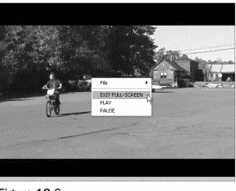

现在`AIRVideoPlayer`应用程序类已经完成，是时候处理一些遗留问题并部署应用程序了。请继续下一节以完成此应用程序。

## 部署应用程序

AIR视频播放器即将完成。最后一步是创建描述符文件并将所有内容打包为可部署的AIR文件。

创建AIR视频播放器所需的最后一个文件是应用程序描述符文件。这个XML文件包含应用程序的属性，例如初始窗口设置、版权和标题。它会与最终的可部署文件一起打包分发。

创建一个新文档并输入以下标记：

```xml
<?xml version="1.0" encoding="UTF-8"?>
<application xmlns="http://ns.adobe.com/air/application/1.0">
    <id>com.aircmr.VideoPlayer</id>
    <filename>VideoPlayer</filename>
    <version>0.1</version>
    <name>AIR VideoPlayer</name>
    <description></description>
    <copyright>2008</copyright>

    <initialWindow>
        <title/>
        <content>AIRVideoPlayer.swf</content>
        <systemChrome>standard</systemChrome>
        <transparent>false</transparent>
        <visible>true</visible>
    </initialWindow>

    <installFolder>AIRCMR/AIRVideoPlayer</installFolder>
    <programMenuFolder>AIRCMR</programMenuFolder>
</application>
```

将文件保存为`AIRVideoPlayer-app.xml`，放在工作目录的根目录下，与`AIRVideoPlayer.mxml`文件一起。

描述符创建完成后，继续编译和打包应用程序。

创建AIR视频播放器的最后一步是编译和打包。首先将`AIRVideoPlayer.mxml`文件编译成SWF，开始打包应用程序。

打开命令提示符，导航到AIR视频播放器的工作目录，输入以下内容，然后按Enter键：

```shell
amxmlc AIRVideoPlayer.mxml
```

在命令提示符仍指向工作目录的情况下，通过输入以下内容并按Enter键将小组件打包为AIR安装程序：

```shell
adt -package AIRVideoPlayer AIRVideoPlayer-app.xml AIRVideoPlayer.swf
```

打包完成后，导航到你的工作目录。如果视频播放器打包正确，你应该会有一个`AIRVideoPlayer.air`文件。执行`AIRVideoPlayer.air`包以将应用程序安装到你的硬盘驱动器上。安装完成后，打开它，将附带的视频拖放到你的新视频播放器中，然后享受观看体验。

## 总结

本章介绍了如何利用Flex API中包含的`VideoDisplay`组件，结合`HSlider`和`DataFormatter`等其他组件和类，创建一个功能齐全的视频播放器组件，该组件能够播放FLV或H.264编码的视频。它介绍了创建一种流体组件布局的理念，允许根据任何视频内容的宽度和高度进行调整。在构建视频播放器组件的过程中，本章讨论了如何创建一个可以与AIR SDK一起使用，也可以独立使用的播放器。

视频播放器创建完成后，你学习了如何在AIR应用程序中实现该组件。AIR视频播放器使用了`NativeDragManager`和`NativeMenu`，为用户提供了播放视频的途径。最后，你学习了如何通过设置`stage.displayState`来启用全屏视频支持，以及如何相应地调整应用程序的布局。得益于所有这些功能，AIR视频播放器能够播放多种格式的视频，并且可以自定义和跨平台分发。

正如本章前面所述，这个播放器的目的不一定是创建一个功能花哨的视频播放器，而是为你提供一个可以改进的良好基础。你可以利用这个应用程序，添加诸如播放列表支持、自定义皮肤、自定义滑块（替代HSlider）、多窗口支持、控制器效果（例如全屏时淡入淡出）或任何你能想到的功能。这个视频播放器供你在Flex或AIR中使用；接下来的重任就交给你了，或许你可以创造出下一个QuickTime的杀手级应用。


## 索引

**A**

账户，管理（Blogger Agent），334–335

**ActionScript**

API，189

与JavaScript集成，216，309

**ActionScript消息格式（AMF）**，376

addBlog函数（Blogger Agent），353–354

AddBlogPanel组件，358–361

AddPropertyPrompt组件，230

地址栏组件（HTML和CSS编辑器），206–209

AddStylePrompt组件，226，228–229

**Adobe**

FlexBuilder，2

XML新闻聚合器（AXNA），47

**ADT -certificate命令**，12

**AIR（Adobe集成运行时）**

API，376

调试启动器（ADL），3，9

开发工具（ADT），4，12

下载/安装，2

SDK，2

视频播放器。参见视频播放器应用程序

**AIR基础应用程序**

代码与解释，5–8

编译，8–9

安装Hello World，13–15

概述，4–5

预览与调试，9–13

卸载Hello World，15–16

airAMP。参见音乐播放器应用程序（airAMP）

**AIRVideoPlayer.mxml**

上下文菜单，441–442

创建，433–438

拖放功能，439–440

全屏观看，443–444

实现UIVideoPlayer组件，439

调整视频大小，442–443

窗口菜单，440–441

**alwaysInFront属性（天气小部件）**，281

**AMF（ActionScript消息格式）**，376

amxmlc编译器，3–4，8

视图动画（天气小部件），281–282

**Apache Ant构建标记**，16–20

应用程序目录，定义，14–15

**应用程序外壳（HTML和CSS编辑器）**，231–233

应用程序存储目录，15

应用程序标签（描述符文件），6

applicationComplete事件（RSS阅读器），63

**ApplicationDataModel类（音乐播放器）**，77–78

applyFilter()方法，191

applyHandler()方法，102

**AspectRatio属性（视频播放器）**，432

关联的文件类型，定义，415

**AtomUtil类（Blogger Agent）**，343

**身份验证，用户（Blogger Agent）**，347

**autoPlay属性（视频播放器）**，432

**autoRewind属性（视频播放器）**，432

**AXNA（Adobe XML新闻聚合器）**，47

**AXNAFeedService类**，52

**B**

-benchmark选项，9

**BitmapData对象，编码**，162

**Blogger Agent应用程序**，333–374

基础，335

博客条目，管理，335

BlogEntry类，335

Blogger Data API，334–335，343，347–348

BloggerAgent-app.xml，373

BloggerAgent.mxml，370–372

BloggerService类，334–335，343–348，358，361–362，367

BlogManager组件，335–336

BlogManagerPanel组件，362–364，372

数据对象，337–339

DBService类，348–356

部署，372–373

设计，333–337

事件对象，339

功能，334

Google Blogger服务，333

主应用程序文件，370–372

QueueService类，356–358

用户界面，创建，358–370

工具类，340–343

**类**

数据管理（CMS），133

数据对象类（Blogger Agent），337–339

RSS阅读器，52，57–58

设置（CMS），127

工具类（Blogger Agent），335，340–343

**剪贴板实例，197**

**关闭应用程序功能（音乐播放器），118–120**

**CMS（内容管理系统）应用程序。** 参见Mini CMS应用程序

**AIR基础应用程序的代码，5–8**

**Flex 3 SDK中的编解码器，198**

**颜色变换，189–191**

**ColorMatrixFilter，191**

**命令行工具（AIR SDK），3–4**

**编译任务（ANT），19–20**

**body.innerHTML属性，212**

**BottomControls组件（音乐播放器），110–113**

**browseForDirectory方法（音乐播放器），102**

**基于浏览器的Flash内容，333–334**

**浏览已打开的图像文件，171–181**

**buildSettingsData方法**

音乐播放器，102

天气小部件，262

**ByteArray对象，162，198**

## C

**摄像头输入，捕获（UIVideoPlayer），433**

**Canvas组件，Flex，233**

**画布，幻灯片，384，412**

**轮播，幻灯片，384，393–396，412**

**层叠样式表（CSS）。** 参见CSS（层叠样式表）

**证书颁发机构，4，237，330**

**证书**

Blogger Agent，373

RSS阅读器，66–67

自签名，12，237，416–417

存储，12

**编译与打包**

AIR应用程序，8–9，158

Blogger Agent，373

图像查看器和编辑器，201–202

地图应用程序，330–332

音乐播放器，121–122

RSS阅读器，66–67

幻灯片制作器，416–418

视频播放器，445–446

天气小部件，284

**completeHandler()方法，7**

**ComposeEntryPanel组件（Blogger Agent），335–336，364–368，372**

**<contentType>元素（<fileType>声明），416**

**上下文菜单（AIRVideoPlayer.mxml），420，441–442**

**createPopUp方法（音乐播放器），101–102**

**无边框应用程序（天气小部件），278–279**

**CSS（层叠样式表）**

CSSEditorEvent类，216，230

cssRuleIndex属性，215

CSSStyle数据类，226

CSSStyleProperty对象，215，229

数据，管理，213–216

编辑器概述，213

用户界面与逻辑，216–231

**CurrentWeatherView MXML组件（天气小部件），263–265**

## D

数据处理（CMS），125，133–141

数据处理（图像查看器和编辑器）

数据对象，创建，162–164

数据对象，管理，165–167

图像文件排队，167–170

数据处理（地图）

数据模型，289–290

概述，286

查询数据库，290–299

值对象，286–289

数据处理（音乐播放器）

访问与解析，79

ApplicationDataModel类，77–79

数据对象，72–77

外部XML，71–72

FileSearch服务。参见FileSearch服务（音乐播放器）

ID3Parser工具，90–92

SoundManager类，92–98

XMLFileService服务类，79–84

XMLParserUtil类，85–86

数据处理（RSS阅读器），48–49

数据处理（幻灯片制作器）

管理幻灯片，381–384

可序列化数据对象，创建，376–381

数据处理（天气小部件），282–283

复制本地文件，252

数据模型类，247–249

数据对象，242

SettingsVO对象，245–246

TemperatureUtil类，256–257

WeatherVO类，242–245

XML设置，242

XML天气数据，241

XMLFileService类，249–252

XMLParserUtil类，254–256

XMLServiceEvent类，253

数据模型类（天气小部件），247–249

数据模型（地图），289–290

数据对象

Blogger Agent，337–339

音乐播放器，72–77

可序列化（幻灯片制作器），376–381

天气小部件，242

数据库，查询（地图），290–299

DataGrid组件（HTML和CSS编辑器），216，230

dataProvider，PlaylistView（音乐播放器），110

DateFormatter类

音乐播放器，108

视频播放器，430

DBService类（Blogger Agent），334–335，348–356

DBServiceEvent类（Blogger Agent），339

调试启动器，AIR（ADL），3，9

调试面板，创建，20

调试基础AIR应用程序，9–13

部署

Blogger Agent，372–373

CMS，158–159

定义，3

HTML和CSS编辑器，236–237

图像查看器和编辑器，200–202

地图，329–332

音乐播放器，121–122

RSS阅读器，65–66

幻灯片制作器，414–418

视频播放器，444–446

天气小部件，283–284

<description>元素（<fileType>声明），416

description属性，7

描述符文件

基础，6

Blogger Agent，372–373

CMS，158

图像查看器和编辑器，200–201

地图应用程序，329–330

音乐播放器，121

RSS阅读器，65–66

幻灯片制作器，414–416

视频播放器，445

天气小部件，283–284

deserialize()方法，287，381

目的地，显示（地图），314–316

开发工具，AIR（ADT），4，12

开发环境

Apache Ant构建标记，16–20

构建AIR应用程序。参见AIR基础应用程序

## 开发环境（续）

命令行工具（AIR SDK），3–4

调试面板，创建，20

Flex 3 SDK安装，1–4

安装Hello World，13–15

概述，1

卸载Hello World，15–16

**DigestToaster类（RSS阅读器），57–59**

**目录**

浏览（音乐播放器），102

音乐播放器结构，71

视频播放器结构，420–421

天气小部件结构，240–241

**显示视图（地图），299**

显示SettingsPanel组件（音乐播放器），101–102

doLayout()方法，180，188

domWindow属性，206，235

点分隔的逆向DNS风格字符串，6

**拖放**

AIRVideoPlayer.mxml，420，439–440

Flex框架API，309

API，使用其打开/保存，196–198

描述符文件（CMS），158

文件API，从其打开/保存，199–200

File类，24

File对象，定义，26

FileFilter类（文本编辑器），38

FileMode类，24

filename元素，7

FileStream类，24

File.writeBytes()方法，162

fileWrittenHandler，103

读取和写入（文本编辑器），27–32

SWF文件（CMS），158–159

上传（CMS），125，141–144

写入XML数据（音乐播放器），82

**FileSearch服务（音乐播放器）**

添加，85–88

执行搜索，88

FileSearchEvent，88–89

MP3FileSearch，89–90

**Flash**

基于浏览器的Flash内容，333–334

调试器（FDB），10–11，16

flash.data.SQLStatement对象，297

flash.desktop包，162

flash.desktop.NativeDragManager，197–198

flash.display.NativeMenu类（RSS阅读器），64

播放器，419

## E

编辑图像，188–190

encryptPassword方法（Blogger Agent），356

**事件处理程序**

CSS编辑器，229

DBService类（Blogger Agent），354–355

HTML和CSS编辑器，234–236

事件对象（Blogger Agent），339

executeStatement函数（Blogger Agent），353

可扩展标记语言（XML）。参见XML（可扩展标记语言）

<extension>元素（<fileType>声明），416

## F

**Flex**

API，419

Canvas组件，233

DataGrid组件，213

Flex 3 SDK，2–4，198

PopUpManager类，226

FourDayForecastView（天气小部件），265–267

全屏视频观看，420，443–444

**源**

定义，47

解析（RSS阅读器），49–53

**文件**

复制本地文件（音乐播放器），82

## G

GalleryDataManager，164

网关。参见远程网关（CMS）

generateThumbnail()方法，180

getBlogs方法，348

getDirectoryListingAsync()方法，70，88

getElement()方法，53

getEncodedBitmap()方法，198


# 位置（地图应用）

## 位置（地图应用）

**Google**
- Blogger 服务，333
- 天气网站，241

## H

### H.264 编解码器，419

### handleAppCreationComplete 方法，440

### Hello World 应用程序
- 创建，4–5
- 安装/卸载，13–16
- 准备开发环境，6

### HSlider 组件，107–108，112–113，430

### HTML 和 CSS 编辑器应用程序
- 地址栏，206–209
- 构建应用程序外壳，231–233
- 管理 CSS 数据，213–216
- CSS 编辑器概述，213
- CSS 用户界面与逻辑，216–231
- 部署应用程序，236–237
- 设计，206
- 添加事件处理程序，234–236
- 创建 HTML 编辑器，209–212
- 概述，205–206

### HTML 文档（地图），309–313

## I

### 图标、图像数据与（RSS 阅读器），64–65

### ID3Parser 实用程序（音乐播放器），90–92

### 图像查看器与编辑器应用程序
- 浏览已打开的图像，171–181
- 构建主应用程序文件，191–196
- 编译/打包应用程序，201–202
- 数据处理。*参见* 数据处理（图像查看器与编辑器）
- 部署，200–202
- 设计，162
- 编辑图像，188–190
- 通过文件 API 打开/保存，199–200
- 通过拖放 API 打开/保存，196–198
- 概述，161
- 排队图像文件，167–170
- 构建用户界面，170
- 查看图像，181–188
- XML 描述文件，200–201

### 图像
- Image 组件（地图），302
- image 属性，380
- ImageCanvas.mxml 组件，186
- ImageData 对象，164
- ImageDisplay 组件，187–188

### init 函数，230，352

### initialWindow 元素，7

### init() 方法（音乐播放器），119

### 安装
- Adobe SDK，1–4
- Hello World 应用程序，13–15
- installationFolder 属性，7

### 界面，用户。*参见* 用户界面

### invalidateAvailability () 方法，302

### invalidateImage() 方法，389

### invalidate() 方法，298

### invalidateProperties() 方法，179–180

### invalidateViewScale() 方法，388

### isAvailable 属性（RSS 阅读器），63

### ItemData 类（CMS），139

### ItemEditor 界面组件（CMS），147，151

## J

### JavaScript
- 与 ActionScript 通信，309
- 与 ActionScript 集成，216

### JPEGEncoder 编解码器，198

## L

### 启动任务（ANT），19–20

### List 组件，216

### ListDataService 类（CMS），139–140

### 实时滑动，107

### -load-config 选项，9

### loadAll() 方法，170

### 加载视图（天气小部件），263

### loadSong() 方法，97

### _localDataFile 属性，132

### 位置控件视图（地图），299

### LocationDisplay.mxml 视图类（地图），309

### 位置（地图应用程序）
- 显示，302–309
- LocationsControls 类，320
- LocationVO 对象，290，328

## 模式控件（地图）

- ModeControls 类，327
- ModeControls 组件，302
- 视图，299

## MP3。*另见* 音乐播放器应用程序（airAMP）

- MP3FileSearch，89–90
- SoundManager 类与，92

## M

### Mac OS X
- 在其上安装 ANT，17
- 在其上纠正开发文件夹，4–5
- 在其上安装 AIR 应用程序，14–15
- 在其上安装 Flex 3 SDK，3

## 主应用程序文件
- Blogger Agent，370–372
- Slideshow Maker，402–412

### 音乐播放器应用程序（airAMP），69–122
- 数据处理，71–98
- 部署，121–122
- 设计，69–70
- 目录结构，71
- 最终 MXML 文件，113–117
- musicdatabase.xml，72
- MusicPlayer.mxml，82，97，117
- <mx:Application> 与 <mx:WindowedApplication>，117–120
- 播放按钮控件，107
- 用户界面。*参见* 用户界面（音乐播放器）

### maintainAspectRatio 属性（视频播放器），432

## 地图应用程序
- 编译/打包，330–332
- 数据处理。*参见* 数据处理（地图）
- 部署，329–332
- 描述文件，329–330
- 设计，285–286
- 概述，285
- 构建用户界面。*参见* 用户界面（地图）

### <mx:Application> 类，118，278

### mx.controls.HTML 控件（地图），309

### mx.graphics.core 包，162

### MXML 组件（音乐播放器），98–113
- PlaybackControls。*参见* PlaybackControls（音乐播放器）
- PlaylistView，108–110
- Settings Panel 组件，98–103

### <mx:Script> 标签，7

### 标记（地图）
- Marker 对象，316
- MarkerBank 组件，321
- marker_red.png 图形资产，330
- MarkerVO 类，289

### <mx:WindowedApplication>
- 类，278
- 容器，117，119

### 菜单
- 添加到天气小部件，279–281
- 上下文（AIRVideoPlayer.mxml），441–442
- 窗口（AIRVideoPlayer.mxml），440–441

### 迷你 CMS 应用程序，123–161
- 基础，123
- 代码基础，125
- 数据管理，125，133–141
- 部署，158–159
- 设计，124–125
- 文件上传，125，141–144
- 远程网关，124，125–127
- 设置，124–125，127–133
- 用户界面，125，144–157

## N

### <name> 元素（<fileType> 声明），416

### name 属性，7

### 原生菜单，411

### NativeApplication 类，335，343

### NativeDragEvent 对象，192–198

### NativeDragManager，440

### NativeMenu 类，279–281

### NativeWindow 类，57–58

### _nativeWindow 私有变量，118

### 最小化与恢复（天气小部件），281

### 导航控件（地图应用程序），316–321

### QueueService 类（Blogger Agent）

### NetworkConnection 类（Blogger Agent），335

### NetworkDetection 类（Blogger Agent），343，372

### newDocument() 函数（文本编辑器），40

### nextFile 方法，143，144

## O

### onAlertClose() 函数（文本编辑器），40

### onAppInit 函数（文本编辑器），26，234

### onCSSEditorAddStyle 函数，235

### onCSSEditorChangeProperty 函数，236

### onDirectorySelect() 方法，102

### onExportSelect() 方法，410

### onFileSavePanelSelect() 函数，39

### onHTMLLoadComplete 函数，235

### onHTMLLocationChange 函数，235

### onImageLoad() 方法，392

### onMouseDownHandler 方法（音乐播放器），119

### onOpenComplete() 函数，31

### onViewCreate() 方法，388

### openFile() 函数，30

### openItem() 方法，410

### -output 选项，9

## P

### 打包。*另见* 编译与打包

### -package 命令，12

### 打包任务（ANT），19–20

### 解析
- 基础，70
- 按钮控件，107
- trackInfoDisplay，107–108

### 播放头
- 实时滑动与，107
- 监控播放头时间，97–98
- playheadTime 属性，430–431

### playing 属性（视频播放器），432

### playTrackAt() 方法（音乐播放器），110

### PNGEncoder 编解码器，198

### Post 类（RSS 阅读器），57

### Post.mxml 组件（RSS 阅读器），57

### 帖子，显示（RSS 阅读器），48，53–59

### PostVO 值对象（RSS 阅读器），49，52–53，57–58

## 预览
- 基本 AIR 应用程序，9–13
- 幻灯片，393–396

### 私钥，存储，12

### programMenuFolder 属性，7

### promptUser () 函数（文本编辑器），36–37，38

### 属性
- PropertiesPanel 对象（Slideshow Maker），392，412
- propertyChange 事件，166
- TrackVO 对象（音乐播放器），76

### 公共方法（Blogger Agent），347

### 公共变量
- UIVideoControls 组件，430
- UIVideoPlayer，432
- feed（RSS 阅读器），49–53
- parseData() 方法，52

# 读取文件（文本编辑器）

## R

- 读取文件（文本编辑器），27–32
- Really Simple Syndication (RSS)。*参见* RSS 阅读器应用程序
- 刷新间隔 ComboBox 组件（天气小部件），262
- 正则表达式，170
- 远程网关（CMS）
    - 代码，125–127
    - 设计，124
- 调整大小
    - resizeToVideo 属性，432
    - UIVideoPlayer，432
    - 视频，420，442–443
- 恢复与最小化（天气小部件），281
- returnID3Information() 函数（音乐播放器），90，91
- 倒带按钮（视频播放器），431
- 富互联网应用程序 (RIA)，1
- 旋转控件（图像查看器与编辑器），187
- RSS 阅读器应用程序，47–67
    - 基础，47
    - 编译/打包，66–67
    - 数据处理，48–49
    - 部署，65–66
    - 描述文件，65–66
    - 设计，47–48
    - 解析 feed，49–53
    - 构建用户界面。*参见* 用户界面（RSS 阅读器）
- 运行时共享库 (RSL) 文件，9

## S

- 滑动
    - 音乐播放器播放头，107
    - 视频滑动控件，430–431
- SDK（软件开发工具包），安装
    - Adobe，1–4
- 搜索。*参见* FileSearch 服务（音乐播放器）
- 自签名证书
    - Hello World，12
    - HTML 和 CSS 编辑器，237
    - 地图，330
    - Slideshow Maker，416–417
- 可序列化数据对象（Slideshow Maker），376–381
- serialize() 方法，287，381
- 会话相关属性，376
- setCredentials 方法（Blogger Agent），347，358
- 设置实用程序类（Slideshow Maker），412–414
- SettingsModel 类（CMS），124，127，132
- SettingsPanel 组件（音乐播放器）
    - 基础，70
    - 关闭，102
    - 创建，98–101
    - 显示，101–102
    - 保存设置，102
- SettingsPanel 界面组件（CMS），147
- SettingsService 类（CMS），127，132–133
- SettingsVO 对象
    - 音乐播放器，72–73
    - 天气小部件，245–246
- SettingsWindow MXML 组件（天气小部件），258–262
- settings.xml 文件
    - 音乐播放器，71–72
    - 天气小部件，242
- showVideoControls 属性，432
- SimpleDebugPanel 应用程序，20
- 单例模式，164
- 幻灯片（Slideshow Maker）
    - 画布，384
    - 管理，381–384
    - 修改，389–392
    - 演示，396–399
    - 预览，393–396

## 保存
- 通过拖放 API，196
- 通过文件 API，199–200
- 保存警报窗口（Slideshow Maker），399–402
- saveFile() 函数（文本编辑器），32，40
- saveXMLToStorage 方法（天气小部件），262
- 设置（音乐播放器），102

## 屏幕
- Blogger Agent 界面，335–336
- Screen 类（AIR API），414


## 用户界面（地图）（续）
显示目的地，314–316
显示位置，302–309
HTML文档，309–313
从视图类管理事件，321–329
导航控件，316–321
概述，299
视图模式，299–302

## 用户界面（音乐播放器）
BottomControls组件，110–113
PlaybackControls。请参阅PlaybackControls（音乐播放器）
PlaylistView，108–110
SettingsPanel组件，98–103

## 用户界面（RSS阅读器）
显示文章，53–59
创建RSSReader.mxml，59–65

## 用户界面（幻灯片制作工具）
修改幻灯片，389–392
概述，384
演示幻灯片，396–399
预览幻灯片，393–396
查看幻灯片，384–389

## 用户界面（天气小部件）
CurrentWeatherView MXML组件，263–265
FourDayForecastView视图，265–267
加载视图，263
刷新间隔ComboBox组件，262
SettingsWindow MXML组件，258–262
温度切换，262
视图状态，257–258
WeatherItem视图，266–267
邮政编码TextInput组件，261

## 用户
RSS阅读器与，47–48
用户提示（文本编辑器），32–40

## 工具类（Blogger代理）
335, 340–343

# V

## 验证，远程网关与（CMS）
127

## 值对象（地图）
286–289

## 变量，公共
UIVideoControls组件，430
UIVideoPlayer，432

## VeriSign证书颁发机构
4, 237

## version属性
7

## 视频播放器应用程序
AIRVideoPlayer.mxml。请参阅AIRVideoPlayer.mxml
编译/打包，445–446
部署，444–446
描述符文件，445
设计，419–420
目录结构，420–421
概述，419
调整视频大小，442–443
UIVideoControls，429–431
UIVideoPlayer组件，421–429, 431–433
视频擦洗控件，430–431
视频时间戳，430
videoControls组件，431–432
videoDisplay组件，431–432

## 查看
全屏视频，443–444
图像，181–188
幻灯片，384–389

## 视图
动画化（天气小部件），281–282
视图类（地图），321–329
视图模式（地图），299–302
视图状态（天气小部件），257–258

## 音量控制（音乐播放器）
112–113

# W

## 天气小部件应用程序
访问数据，282–283
alwaysInFront属性，281
无边框应用程序，278–279
编译/打包，284
数据处理。请参阅数据处理（天气小部件）
部署，283–284
描述符文件，283–284
设计和功能，240
目录结构，240–241
菜单和窗口交互，279–281
最小化/还原，281
概述，239
TrayIcon类，268–270
构建用户界面。请参阅用户界面（天气小部件）
视图，动画化，281–282
WeatherItem视图，266–267
WeatherWidget.mxml应用程序类，271–283
WidgetDataModel类，242, 249
邮政编码TextInput组件，261

## 网站，用于下载
Adobe Flex 3 SDK，2
AIR，2
Apache Ant，17
用于解析联合格式的代码，52

## 网站，用于获取更多信息
二进制数据，90
Blogger Data API，348
Google Blogger服务，333
Google天气，241
ID3，90, 92
天气服务，240
Yahoo! Maps AJAX API，313

## 网络摄像头输入，捕获（UIVideoPlayer）
420, 433

## 小部件。请参阅天气小部件应用程序

## 窗口
最小化/还原（天气小部件），281
窗口拖动功能（音乐播放器），118–120
窗口交互（天气小部件），279–281
窗口菜单（AIRVideoPlayer.mxml），420, 440–441
windowComplete事件，7
WindowedApplication容器，7
WindowedApplication（音乐播放器），117–120

## Windows，微软
在Windows上安装ANT，17
在Windows上创建开发文件夹，4
在Windows上安装AIR应用程序，14–15
在Windows上安装Flex 3 SDK，3

## “处理二进制数据”
90

## writeBytes FileStream方法
162

## 写入文件（文本编辑器）
27–32

# X

## XML（可扩展标记语言）
数据（CMS），123, 125
描述符文件。请参阅描述符文件
外部（音乐播放器），71–72
RSS与，47
设置（天气小部件），242
天气数据，241
XMLDataService类（CMS），140–141
XMLFileService类（音乐播放器），71, 79–84
XMLFileService类（天气小部件），249–252
XMLFileServiceEvent（音乐播放器），84–85
xmlNodeStructure()方法，90
XMLServiceEvent类（天气小部件），253

## XMLParserUtil类
音乐播放器，71, 85–86
天气小部件，254–256

# Y

## Yahoo! Maps AJAX API
286, 312–313

# Z

## 邮政编码TextInput组件（天气小部件）
261

# 将你的图书馆随身携带。

现在，无论你身在何处，都可以在线访问超过200本完整的Wrox图书！订阅**Wrox参考图书馆**后，每个图表、描述、屏幕截图和代码示例都可用。当你需要答案时，无论何时何地，都可以访问wrox.books24x7.com并立即订阅！

## 查找书籍主题
- ASP.NET
- C#/C++
- 数据库
- 综合
- Java
- Mac
- Microsoft Office
- .NET
- 开源
- PHP/MySQL
- SQL Server
- Visual Basic
- Web
- XML

**www.wrox.com**
