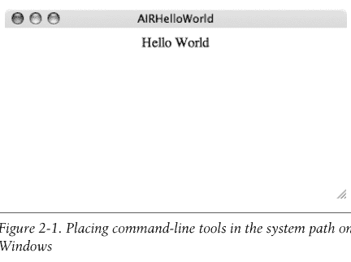
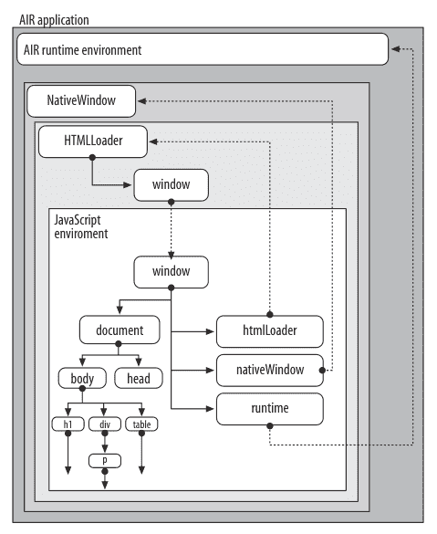
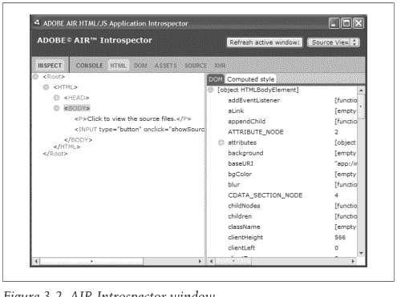

# JavaScript 开发者的 Adobe AIR 便携指南


*Adobe Developer Library* 是 O'Reilly Media Inc. 和 Adobe Systems, Inc. 之间的联合出版合作伙伴关系，是使用 Adobe 技术的开发者的权威资源。这些综合资源提供学习解决方案，帮助开发者创建可在任何平台上触及几乎任何人的尖端交互式 Web 应用程序。

凭借涵盖富 Internet 应用程序开发最新工具的高质量书籍和创新在线资源，*Adobe Developer Library* 提供源自源头的专家培训。主题包括 ActionScript、Adobe Flex®、Adobe Flash® 和 Adobe Acrobat®。

获取有关书籍、在线资源等的最新消息，请访问 http://adobedeveloperlibrary.com。


## 前言

本书提供了一个关于如何为 Adobe AIR 开发应用程序的快速入门指南。Adobe AIR 是由 Adobe 创建的一个新的跨平台桌面应用程序运行时。尽管 Adobe AIR 允许基于 Flash 和 HTML 的应用程序开发，但本书侧重于使用 HTML 和 JavaScript 构建应用程序。

本书概述了 Adobe AIR，展示了如何设置开发环境，并讨论了新的 Adobe AIR 功能和 API。阅读完本书后，你应该能很好地理解什么是 Adobe AIR，以及如何为它构建 HTML 和 JavaScript 应用程序。

### Adobe AIR 运行时命名约定

Adobe AIR 允许开发者利用多种 Web 技术将 Web 应用程序部署到桌面。事实上，技术如此之多，以至于很难全部掌握。表 1 列出了本书中使用的术语，并对每个术语进行了定义。

*表 1. AIR 运行时命名约定*

| 名称 | 含义 |
| --- | --- |
| Adobe AIR | 使 Adobe AIR 应用程序能够运行的跨平台桌面运行时。 |
| Adobe AIR 应用程序 | 使用 Flash、HTML 和/或 PDF 构建并在 Adobe AIR 之上运行的应用程序。 |
| Adobe Flash | 包含在 SWF 9 文件格式中的任何内容，可在 Adobe Flash Player 或 Adobe AIR 中运行。 |
| ActionScript | 用于编写 Flash 内容的、基于 ECMAScript 的编程语言。除非另有说明，本书中所有对 ActionScript 的引用均指 ActionScript 3。 |
| HTML | 用于创建和布局网页的、基于 Web 的标准标记语言。 |
| JavaScript | 用于编写 HTML 应用程序内容的、基于 Web 的 ECMAScript 实现。 |
| PDF | 便携式文档格式的缩写，一种允许无缝分发和显示电子文档的技术。 |
| Adobe Flex Framework | 一个基于 XML 和 ActionScript 的框架，旨在简化基于 Flash 的富 Internet 应用程序的开发。 |
| Adobe Flex Builder | 一个基于 Eclipse 的 IDE，用于使用 Flex 和 ActionScript 构建基于 Flash 的富 Internet 应用程序。 |

### 本书涵盖的内容

本书概述了 Adobe AIR，展示了如何设置开发环境以开始构建应用程序，提供了运行时中 HTML 和 JavaScript 引擎的概览，并展示了如何在 Adobe AIR 中执行许多常见的编程任务。

以下是 Adobe AIR 1.0 版本中包含的功能和特性部分列表：

- Mac 支持（OS X 10.4.9 及更高版本；Intel 和 PPC）
- Windows 支持（Windows Vista、Windows XP SP2 和 Windows 2000 SP4）
- 文件 I/O API
- SQLite 嵌入式数据库
- Flash Player 9 中的所有功能，包括完整的网络栈
- 窗口管理 API
- 命令行工具（ADL 和 ADT）
- 在基于 Flash 的内容中支持 HTML
- 顶级 HTML 应用程序
- HTML 应用程序中的 Flash 内容
- ActionScript/JavaScript 脚本桥接
- Flex Builder 和 Flex Framework 支持创作 Adobe AIR 应用程序
- 应用程序命令行参数
- 拖放支持
- 丰富的剪贴板访问
- 原生菜单 API
- 全屏支持
- 应用程序更新 API
- 在线/离线检测 API
- 加密的本地数据存储
- Presence API
- 文件类型关联
- 应用程序图标
- PDF 支持
- 右键单击和上下文菜单控制
- 系统通知

我们将在本书的后续章节中更详细地介绍这些功能。

### 错误和勘误

本书是基于 Adobe AIR 1.0 版本编写的，并在运行时发布后定稿。因此，书中的所有信息对于 Adobe AIR 1.0 应该是正确的。

但是，运行时可能会有更新，或者书中可能存在错误。如果书中的某些内容似乎不正确，请查看在线文档以获取最新信息。

你可以在以下地址找到关于 Adobe AIR 的最新信息和文档：

http://www.adobe.com/go/air

你还应该检查本书的勘误网站以获取最新的更新和更正：

http://www.adobe.com/go/airjavascriptpocketguide

### 本书的目标读者

我们希望这本书适合你，但为了确定起见，让我们讨论一下我们的一些假设，以及本书所针对的开发者类型。

### 本书适合谁

本书适用于有兴趣利用 HTML 和 JavaScript 通过 Adobe AIR 构建应用程序并将其部署到桌面的开发者。如果你没有任何使用 HTML 和 JavaScript 进行开发的经验，我们建议你花一些时间来掌握这些技术。

### 本书的前提条件

本书假设读者至少对使用 HTML 和 JavaScript 创建基于 HTML 的 Web 应用程序和内容有基本的熟悉程度。

你应该熟悉 Web 技术，如 HTML、JavaScript、Ajax 和 CSS，以及一般的 Web 开发概念。


## 本书不适合哪些读者

虽然使用 Adobe AIR 也可以创建基于 Flash 和 Flex 的应用，但本书不会详细介绍以 Flash 和 Flex 为重点的 AIR 应用开发。如果你是 Flash 或 Flex 开发者，并且对构建 AIR 应用感兴趣，本书可以提供 AIR 及其功能的入门和概览，但你应该查阅 Adobe AIR 网站上的文档和文章，以获取更侧重于 Flash/Flex 的讨论。

## 本书结构

本书包含以下章节以及一个附录：

-   **第 1 章，Adobe AIR 简介**
    提供 Adobe AIR 是什么以及它所针对的应用类型的一般概览

-   **第 2 章，开始使用 Adobe AIR 开发**
    介绍启动 Adobe AIR 开发的技巧，以及从命令行创建你的第一个 Adobe AIR 应用的步骤

-   **第 3 章，在 Adobe AIR 中使用 JavaScript 和 HTML**
    概述 Adobe AIR 中的 HTML 和 JavaScript 运行时环境，并介绍如何使用 JavaScript 访问 Adobe AIR 的功能和 API

-   **第 4 章，Adobe AIR 简明食谱**
    以 O'Reilly Cookbook 格式提供在 Adobe AIR 应用中完成常见任务的技巧和诀窍

-   **附录 A**
    列出 Adobe AIR API 的 JavaScript 别名

## 如何使用本书

你可以将本书作为 Adobe AIR 的入门和概览，以及开始 Adobe AIR 应用开发的分步指南。虽然直接跳到特定章节可能很有诱惑力，但强烈建议你至少阅读前两章，它们概述了运行时环境，并讨论了如何为构建 Adobe AIR 应用设置开发环境。这将使你更容易随后深入可能感兴趣的运行时功能的特定领域。

一旦你阅读了本书并理解了如何使用 HTML 和 JavaScript 构建 Adobe AIR 应用的基础知识，你就可以将本书作为参考，当需要了解如何处理特定问题时查阅特定章节。特别是，在开发你的应用时，Cookbook 部分应该会很有用。

最后，本书只是 Adobe AIR 的入门介绍，并未涵盖其所有功能和特性。它的目的是补充，而非取代 Adobe 提供的关于该运行时的广泛而深入的文档。请务必查阅文档，以确保你熟悉本书未涵盖的所有 API 和功能。

## 本书使用的惯例

本书使用以下排版惯例：

-   纯文本：表示菜单标题、菜单选项、菜单按钮和键盘快捷键（如 Alt 和 Ctrl）。
-   *斜体*：表示新术语、URL、电子邮件地址、文件名、文件扩展名、路径名、目录和 Unix 实用程序。
-   **等宽字体**：表示命令、选项、开关、变量、属性、键、函数、类型、类、命名空间、方法、模块、属性、参数、值、对象、事件、事件处理程序、XML 标签、HTML 标签、宏、文件内容以及命令输出。
-   **等宽粗体**：表示用户应原样输入的命令或其他文本。
-   *等宽斜体*：表示应替换为用户提供值的文本。

## 许可证和代码示例

本作品，包括所有文本和示例代码，均在 Creative Commons Attribution-Noncommercial-Share Alike 3.0 许可证下授权。

要查看此许可证的副本，请访问 http://creativecommons.org/licenses/by-nc-sa/3.0/；或写信给 Creative Commons, 543 Howard St., 5th Floor, San Francisco, California, 94105, USA。

你可以在 http://www.creativecommons.org 找到更多关于 Creative Commons 的信息。

## 支持和更多信息

### 在线访问本书

你始终可以从本书的网站获取有关本书的最新信息，并下载其免费电子版本：

http://www.adobe.com/go/airjavascriptpocketguide

## 在线 Adobe AIR 资源

虽然 Adobe AIR 是一项新技术，但已经有许多资源可以让你找到更多关于 Adobe AIR 和 RIA 开发的信息。

**官方 AIR 站点**
这是获取 AIR 信息、下载和文档的主要网站：
http://www.adobe.com/go/air

**Adobe AIR 开发者常见问题**
这是官方的 Adobe AIR 常见问题解答，回答了关于 AIR 开发的常见问题：
http://www.adobe.com/go/airfaq

**Adobe AIR 开发者中心**
此开发者中心提供有关为 Adobe AIR 开发应用的文章、信息和资源：
http://www.adobe.com/go/airdevcenter

**使用 JavaScript 开发 Adobe AIR 应用**
在此处你可以找到 Adobe AIR JavaScript 文档和 API 参考：
http://www.adobe.com/go/learn_air_html_jslr

**Adobe AIR 文档**
访问此网站获取完整的 Adobe AIR 文档：
http://www.adobe.com/go/airdocs

**Adobe AIR HTML 和 Ajax 开发者中心**
此开发者中心提供有关使用 HTML 和 JavaScript 为 Adobe AIR 开发应用的文章、教程和白皮书：
http://www.adobe.com/go/airajaxdevcenter

**Adobe AIR 论坛**
这是讨论 Adobe AIR 应用开发的官方 Adobe 论坛：
http://www.adobe.com/go/airforums

**Adobe AIR 编码员邮件列表**
这是一个讨论 Adobe AIR 应用开发的邮件列表：
http://www.adobe.com/go/airlist

**Mike Chambers 的博客**
本书的作者之一 Mike Chambers 是 Adobe AIR 团队的成员，经常在上面发布关于 Adobe AIR 的内容：
http://www.adobe.com/go/mikechambers

**MXNA Adobe AIR 智能分类**
Adobe AIR 智能分类列出了 Adobe 在线开发社区中所有关于 Adobe AIR 的讨论：
http://www.adobe.com/go/airmxna

**Ajaxian.com (http://ajaxian.com)**
这是一个 Ajax 新闻网站，提供有关使用 JavaScript 和 Ajax 技术进行开发的信息、技巧、诀窍和最新消息：
http://www.ajaxian.com

**Adobe Flex 开发者中心**
此开发者中心提供有关使用 Flex 框架的文章、信息和资源：
http://www.adobe.com/go/flexdevcenter

**Flex 编码员邮件列表**
这是一个讨论使用 Flex 框架进行开发的流行邮件列表：
http://tech.groups.yahoo.com/group/flexcoders/

**Universal Desktop 博客**
这是 Ryan Stewart 的博客，专注于 RIA 领域的最新发展：
http://blogs.zdnet.com/Stewart/

## 关于作者

### Mike Chambers

Mike Chambers 在过去八年中一直致力于构建针对 Flash 运行时的应用。在此期间，他使用过多种技术，包括 Flash、Generator、.NET、Central、Flex 和 Ajax。目前，他是 Flash 平台开发者关系部门的首席产品经理。他撰写了大量关于 Flash 和 RIA 开发的文章并进行演讲，是《Adobe Apollo for Flex Developers Pocket Guide》、《Flash Enabled: Flash Design and Development for Devices》和《Generator and Flash Demystified》的合著者。

Mike 于 1998 年在约翰霍普金斯大学高级国际研究学院（SAIS）获得国际经济学和欧洲研究硕士学位。

当 Mike 不编程时，你可以发现他在玩光环游戏、试图从魔兽世界的瘾中恢复过来、制作比例模型，或者和他的两个女儿 Isabel、Aubrey 以及妻子 Cathy 一起闲逛。

Mike 的个人博客地址是 http://www.mikechambers.com/。

### Daniel Dura

Daniel Dura 目前驻扎在旧金山，是 Adobe 的平台布道者，专注于 Adobe AIR 和 Flash。在加入 Macromedia（于 2005 年与 Adobe 合并）之前，Daniel 和他的兄弟 Josh 共同创立了 Dura Media LLC，这是一家位于达拉斯的 RIA 开发公司。在 Adobe 期间，他曾是 Central 和 Flex 团队的成员，也曾担任开发者关系部门的产品经理。

Daniel 曾在世界各地的用户组会议、会议以及几乎所有有人愿意聆听的地方进行关于 Flash、Apollo 和 Flex 的演讲。在

他的本职工作之外，他喜欢通用航空，并且正在努力取得私人飞行员执照。

### Dragos Georgita

Dragos Georgita 常驻罗马尼亚布加勒斯特，是 Adobe AIR 工程团队的一员，领导一个专注于运行时中 JavaScript 和 Ajax 支持的小组。从布加勒斯特理工大学毕业后，他曾在几家公司的任职，对网络技术产生了浓厚兴趣。Dragos 曾在不同平台上从事客户端和服务器端技术工作，并参与了一个团队，该团队以搜索引擎友好的 Ajax 框架的形式，融合了两种技术的优点。

Dragos 还曾致力于通过为 Adobe Dreamweaver 等 IDE 开发自动化工具来简化网络开发人员的工作。那段时期对于培养他以客户为中心的关注点和注重细节的意识非常重要。

作为 Adobe AIR 团队的一员，Dragos 很高兴能够将他的知识应用于新一代的 RIA，并寻找方法来改进为 Adobe AIR 开发 Ajax 的开发人员的工作流程。

除了日常工作，他喜欢和家人以及他一岁的女儿克拉拉共度时光。

### Kevin Hoyt

Kevin Hoyt 是 Adobe 的平台布道师，他喜欢在传统技术的界线上移动、突破、模糊和跨越。他寻找每一个机会与志同道合的开发者交流，并探索逃离任何形成盒子的界限的方法。推动技术能力的边界，以及人们如何感知和与之互动，是他的热情所在。他在用户组、代码训练营、会议或任何其他有观众的场合发表演讲。其余时间，他喜欢在科罗拉多州帕克市的家中与家人共度时光，并沉浸在他的摄影爱好中。

Kevin 职业生涯的当前篇章始于大约 2000 年，当时他接受了 Allaire Corporation 的一份工作，专注于 ColdFusion 和 JRun。2001 年，Allaire 被 Macromedia 收购，当时他能够释放出内在的设计师潜质，并帮助推广 RIA 的价值。2005 年，Adobe 收购了 Macromedia，Kevin 现在发现自己正在帮助公司和客户理解 Adobe 日益庞大的产品线。

## 致谢

作者们要感谢 Adobe 的 Mark Nicholson 和 Alisa Polizios，以及 O'Reilly 的 Steve Weiss 和 Michele Filshie，感谢他们在极短的时间内帮助使这本书得以完成，还要感谢编辑 Audrey Doyle。我们还要感谢 Adrian Ludwig、Laurel Reitman、Oliver Goldman、Chris Brichford、Lucas Adamski、Rob Dixon 和 Jeff Swartz，他们都来自 Adobe，感谢他们对本书的投入和工作。

此外，作者们要感谢 Adobe AIR 团队的每一位成员，感谢他们在推出 1.0 运行时过程中所有的奉献和辛勤工作。

# 第一章：Adobe AIR 简介

Adobe AIR 是 Adobe 创建的一个跨平台桌面运行时，它允许网络开发人员使用网络技术来构建和部署富互联网应用程序以及 Web 应用程序到桌面。

> **注意**
>
> 在其开发周期中，Adobe AIR 在公开场合曾以其代号“Apollo”而闻名。

为了更好地理解 Adobe AIR 能够实现什么，以及它试图解决哪些问题，首先了解一下 Web 应用程序（相对较短的）历史是有益的。

## Web 应用程序简史

在过去几年中，应用程序从桌面转向 Web 浏览器的趋势一直在加速。这受到多种因素的驱动，包括：

- 互联网作为通信媒介的增长
- Web 应用程序部署的相对简易性
- 能够通过浏览器瞄准多种操作系统
- 高级客户端技术的成熟，例如浏览器和 Flash Player 运行时

早期的 Web 应用程序主要由 HTML 和 JavaScript 构建，在很大程度上严重依赖于客户端/服务器交互和页面刷新。这种页面刷新模型与浏览器最初设计的基于文档的隐喻一致，但在显示应用程序时提供了相对较差的用户体验。

然而，随着 Flash Player 运行时的成熟，以及最近浏览器中 Ajax 类型功能的出现，开发人员开始有可能摆脱基于页面的应用程序流程。开发人员开始通过浏览器提供更丰富的应用程序体验。在 2002 年 3 月的一份白皮书中，Macromedia 创造了*富互联网应用程序*这个术语来描述浏览器中的这些新型应用程序，它们“融合了内容、应用程序逻辑和通信……使互联网更易用、更令人愉悦”。这些应用程序提供了更丰富、更像桌面的体验，同时仍然保留了 Web 的核心跨平台特性：

> 互联网应用程序的关键在于覆盖范围。网络的承诺是内容和应用程序无处不在，无论平台或设备如何。富客户端必须拥抱并支持所有流行的桌面操作系统，以及最广泛出现的设备平台，如智能手机、PDA、机顶盒、游戏机和网络设备。

> **注意**
>
> 您可以在 <http://download.macromedia.com/pub/flash/whitepapers/richclient.pdf> 找到完整的白皮书以及关于 RIA 的更多信息。

该白皮书继续列出了一些定义 RIA 的特性：

-   提供一个高效、高性能的运行时来执行代码、内容和通信
-   将内容、通信和应用程序接口集成到一个通用环境中
-   为交互性提供强大且可扩展的对象模型
-   通过组件和重用实现快速应用程序开发
-   能够使用应用程序服务器提供的 Web 和数据服务
-   支持在线和离线客户端
-   支持在多种平台和设备上轻松部署

这种向浏览器中提供更丰富、更像桌面应用程序体验的趋势（由 Flash Player 运行时，以及最近的 Ajax 所驱动），导致了 Web 应用程序的激增。

如今，网络已牢固确立了自己作为应用程序部署平台的地位，为开发人员和最终用户都提供了诸多好处。其中一些好处包括能够：

-   瞄准多种平台和操作系统
-   使用相对高级的编程和布局语言进行开发
-   允许最终用户几乎从任何联网计算机访问他们的应用程序和数据
-   轻松地向用户推送应用程序更新

Web 应用程序的增长在 Web 2.0 趋势中可见一斑，该趋势几乎完全由基于 Web 的应用程序和 API 组成，同时也被主要公司和组织采纳为一种核心业务模式。

## 通过浏览器交付应用程序的问题

随着 Web 应用程序变得越来越复杂，它们开始突破浏览器功能和应用程序可用性的界限。随着它们的普及，这些问题变得更加明显和重要，并凸显出在浏览器中部署和使用应用程序时，对于开发人员和最终用户仍然存在许多重大问题的事实。

网络浏览器最初设计用于交付和显示基于 HTML 的文档。实际上，浏览器的基本设计并未从此目的发生重大转变。这种文档和应用程序焦点功能之间的根本冲突，在通过浏览器部署应用程序时会产生许多问题。

### 冲突的 UI

通过浏览器部署的应用程序拥有自己的用户界面，这经常与浏览器的用户界面冲突。这种应用程序内嵌于应用程序的模型通常会导致相互冲突和矛盾的用户界面。这可能会导致最好的情况下用户困惑，最坏的情况下应用程序失败。这方面的经典例子是浏览器的“后退”按钮。“后退”按钮在浏览文档时有意义，但在应用程序的上下文中并不总是有意义。尽管许多解决方案试图解决这个问题，但它们对应用程序的应用并不一致，用户可能不知道特定应用程序是否支持“后退”按钮，或者是否会强制卸载其应用程序，导致其失去状态和数据。

### 与桌面的距离

部分原因在于网络安全模型（该模型限制了对用户机器的访问），在浏览器中运行的应用程序通常不支持人们期望从应用程序中获得的、与操作系统进行的用户交互类型。例如，你无法将文件拖入基于浏览器的应用程序中，并让该应用程序对该文件进行操作。Web应用程序也无法与用户计算机上的其他应用程序进行交互。

富互联网应用程序尝试通过提供更丰富、更类桌面的浏览器界面来改进这一点，但它们未能克服浏览器与桌面之间的根本性限制和分离。

### 主要在线体验

由于Web应用程序是从服务器交付且不驻留在用户机器上，因此Web应用程序主要是在线体验。尽管目前正在进行一些尝试，以使基于Web的离线应用程序成为可能，但它们并未提供一致的开发模型，并且无法在不同浏览器上工作，或者要求用户为浏览器安装额外的扩展程序。此外，它们通常要求用户以复杂和意外的方式与应用程序进行交互并管理其应用程序和浏览器。

### 最低公分母

最后，随着应用程序变得越来越丰富和复杂，并开始突破JavaScript和DHTML的边界，开发者越来越多地面临浏览器功能和API实现方面的差异。尽管这些问题通常可以通过特定于浏览器的代码来克服，但这会导致代码a) 更难维护和扩展；以及b) 占用了本应用于功能驱动的功能特性开发的时间。

尽管JavaScript框架是帮助解决这些问题的流行方法，但它们只能提供浏览器本身提供的功能，并且通常为了简化开发模型而采用浏览器之间功能的最低公分母。对于基于JavaScript或DHTML的应用程序而言，其结果是最低公分母的用户体验和交互模型，以及开发者开发、测试和部署成本的增加。

尽管存在这些缺点，Web应用程序仍然蓬勃发展，这一事实证明了拥有一个具有良好开发模型、能够将应用程序交付到多个操作系统的平台是多么具有吸引力。一个既能提供浏览器的覆盖范围和开发模型，又能提供桌面应用程序的功能和丰富性的平台，将能提供两者的最佳组合。这正是Adobe AIR旨在提供的。

## 介绍Adobe AIR

那么，什么是Adobe AIR？它如何让Web应用程序的开发和部署变得更好？
Adobe AIR是由Adobe开发的跨操作系统运行时，它允许Web开发者利用其现有的Web开发技能（如Flash、Flex、HTML、JavaScript和PDF）来构建和部署富互联网应用程序和内容到桌面。
本质上，Adobe AIR提供了一个介于桌面和浏览器之间的平台，它将Web模型的覆盖范围和开发便利性与桌面模型的功能和丰富性相结合。
重要的是要稍作停顿，指出Adobe AIR*不是*什么。Adobe AIR并非旨在与底层应用程序运行时竞争的通用桌面运行时。Adobe AIR是从Web走向桌面的，其目标用户是Web开发者。它的主要用例是使Web应用程序和富互联网应用程序能够被部署到桌面。这是一个非常重要但微妙的区别，因为在桌面上启用Web应用程序和富互联网应用程序是驱动Adobe AIR 1.0功能集的主要用例。

从本质上讲，Adobe AIR建立在Web技术之上，这使得Web开发者可以使用他们今天在Web上部署应用程序时使用的相同技术和开发模型来开发和部署到桌面。

## 主要Adobe AIR技术

Adobe AIR包含三种主要技术，它们分为两个不同的类别：应用程序技术和文档技术。

### 主要应用程序技术

应用程序技术是可以在Adobe AIR中作为应用程序基础使用的技术。Adobe AIR包含两个主要的应用程序技术：HTML和Flash，两者都可以单独使用来构建和部署Adobe AIR应用程序。

#### HTML/JavaScript

Adobe AIR中的第一个核心应用程序技术是HTML和JavaScript。这包括一个完整的HTML渲染引擎，它支持：

- HTML
- JavaScript
- CSS
- XHTML
- 文档对象模型（DOM）

是的，你没看错。你不必使用Flash来构建Adobe AIR应用程序。你可以仅使用HTML和JavaScript来构建功能齐全的应用程序。这通常会让一些期望Adobe AIR只关注Flash的开发者感到惊讶。

然而，从本质上讲，Adobe AIR是一个面向使用Web技术的Web开发者的运行时——而还有什么比HTML和JavaScript更具Web技术特性呢？

Adobe AIR中使用的HTML引擎是开源的WebKit引擎。这是许多浏览器背后的引擎，包括KDE上的KHTML和Mac OS X上的Safari。

> **注意**
>
> 你可以在http://www.webkit.org上找到关于WebKit开源项目的更多信息。

关于WebKit在Adobe AIR中的更深入讨论，请参阅第3章。

#### Adobe Flash

Adobe AIR所构建的第二个核心应用程序技术是Adobe Flash Player。具体来说，Adobe AIR建立在Adobe Flash Player 9之上，该播放器包含基于ECMA-Script的ActionScript 3脚本语言，以及开源的Tamarin虚拟机（该虚拟机将在未来版本的Firefox中用于解释JavaScript）。

> **注意**
>
> 你可以在Mozilla网站http://www.mozilla.org/projects/tamarin/上找到关于开源Tamarin项目的更多信息。

不仅所有现有的Flash Player API在Adobe AIR中都可用，其中一些API也已经扩展和/或增强。Flash Player为Adobe AIR提供的一些功能包括：

- 即时编译解释型ActionScript引擎，提供快速的应用程序性能
- 完整的网络协议栈，包括HTTP和RTMP，以及二进制和XML套接字
- 完整的基于矢量的渲染引擎和绘图API
- 广泛的多媒体支持，包括位图、矢量、音频和视频

> **注意**
>
> Flash Player和ActionScript API可在Adobe AIR应用程序中供JavaScript使用。

当然，Adobe Flex 3富互联网应用程序框架建立在ActionScript 3之上，这意味着你可以充分利用Flex提供的所有特性和功能来构建Adobe AIR应用程序。

### 主要文档技术

Adobe AIR中的文档技术是指可用于渲染电子文档和与之交互的技术。

PDF和HTML是Adobe AIR中可用的主要文档技术。

#### PDF

便携式文档格式（PDF）是用于在Web上交付和显示电子文档的Web标准。

PDF功能要求用户的计算机上安装Adobe Reader 8.1。如果安装了Adobe Reader 8.1，Adobe AIR应用程序将能够充分利用该阅读器在Web浏览器中运行时也暴露的所有功能。

HTML最初是作为一种文档技术设计的，如今它提供了对内容和文本布局及样式的丰富而强大的控制。HTML可以在Adobe AIR中用作文档技术——既可以在现有的HTML应用程序中使用，也可以在基于Flash的应用程序中使用。

## Adobe AIR应用程序包含什么？

现在我们知道了在Adobe AIR上运行的应用程序可以使用哪些技术（见图1-1），让我们看看这些技术如何组合起来构建一个Adobe AIR应用程序。

应用程序可以由以下技术组合构成：

- 仅HTML/JavaScript。
- 基于HTML/JavaScript，带有Flash内容。
- 仅Flash（包括Flex）。
- 基于Flash，带有HTML内容。
- 所有组合都可以利用PDF内容。

### 技术集成和脚本桥接

由于WebKit和Adobe Flash Player都包含在运行时中，它们在非常底层的级别上相互集成。例如，当HTML包含在Flash内容中时，实际上是通过Flash显示管道进行渲染的，这意味着除了其他事情外，你可以在Flash播放器中对位图执行的任何操作（模糊、旋转、变换等）也可以对HTML执行。

这种底层集成也适用于Adobe AIR中运行ActionScript和JavaScript的脚本引擎。Adobe AIR实现了两种语言和环境之间的脚本桥接，这使得以下成为可能：


## Adobe AIR 功能

如果 Adobe AIR 未能提供额外的功能和 API，而仅仅是允许 Web 应用在桌面上运行，那么它的吸引力就不会那么强。幸运的是，Adobe AIR 提供了一套丰富的编程 API，以及与桌面的紧密集成，使开发者能够构建充分利用其运行在用户桌面这一事实的应用程序。

### Adobe AIR API

除了 Flash Player 和 WebKit 引擎已经提供的所有功能和 API 之外，Adobe AIR 还提供了额外的功能和 API。

> **注意**
> Adobe AIR API 对 ActionScript 和 JavaScript 开发者均开放。

其部分功能包括但不限于：

- 完整的文件 I/O API
- 完整的本机窗口 API
- 完整的本机菜单 API
- 用于检测服务连接状态变化的在线/离线 API
- 对应用程序外观的完全控制
- 本地存储/设置 API
- 与操作系统特定通知机制相关联的系统通知 API（在 beta 版中尚未实现）
- 应用程序更新 API
- SQLite 嵌入式数据库

请注意，功能可能直接在运行时中实现，或在框架层（如 Flex 和 JavaScript 中）实现，或通过两者的结合来实现。

### Adobe AIR 桌面集成

如前所述，通过浏览器部署的应用程序并不总能支持与桌面应用程序相同的用户交互。这导致应用程序可能让用户觉得操作繁琐，因为它不允许用户熟悉的应用交互类型。

由于 AIR 应用程序是桌面应用程序，它能够提供用户期望从应用程序中获得的应用交互类型和体验。此功能包括但不限于：

- 适当的安装/卸载流程
- 桌面安装接触点（如快捷方式）
- 丰富的拖放支持：
    - 在操作系统与 AIR 应用程序之间
    - 在 AIR 应用程序之间
    - 在原生应用程序与 AIR 应用程序之间
- 丰富的剪贴板支持
- 系统通知
- 原生图标

安装后，AIR 应用程序只是另一个原生应用程序，这意味着操作系统和用户可以像与任何其他应用程序交互一样与它交互。例如，操作系统级的应用程序预加载和应用程序切换等功能，与 Adobe AIR 应用程序的配合方式与原生应用程序相同。

目标是让最终用户无需知道自己正在运行 AIR 应用程序即可使用它。他应该能够以与使用桌面上任何其他应用程序相同的方式与该应用程序交互。

## 安全模型

所有这些关于 API 和桌面功能的讨论引出了一个重要问题：安全性如何？因为 Adobe AIR 应用程序可以访问本地资源，理论上它们是否可能做一些有害的事情？

首先，重要的是要指出，Adobe AIR 运行在操作系统安全层之上。它没有提供任何绕过或颠覆此安全层的方法。这一点很重要，因为这意味着 Adobe AIR 应用程序只能在操作系统授予它们的权限范围内运行——并遵循操作系统实现的所有现有及新增的安全功能。

要运行 Adobe AIR 应用程序，用户必须将应用程序下载到桌面，完成安装流程，然后启动应用程序。这与下载和安装桌面应用程序的体验非常相似。这种相似性并非偶然。Adobe AIR 应用程序运行的安全上下文与在浏览器中运行的应用程序有根本的不同。它更接近于原生应用程序的安全上下文，而非 Web 应用程序。

为了启用安全浏览，浏览器安全模型限制了 Web 应用程序的所有 I/O 能力。这包括限制其操作本地资源的能力、限制可访问的网络资源，并约束其用户界面。浏览器只允许应用程序与位于单一 Web 域上且关联的（通常由其提供）数据连接。此外，浏览器提供一个可信的 UI，让用户了解应用程序的来源并控制其状态。对于连接到单一服务提供商并依赖该服务进行数据同步和存储的应用程序而言，此模型是足够的。

一些 Web 开发者也通过集成来自多个来源的数据和/或尝试与浏览器外观不一致的用户界面，来扩展浏览器安全模型。其中一些应用程序需要具备浏览器当前未提供的功能的浏览器插件。另一些则利用浏览器功能，如用户通知或自定义安全配置，以允许来自特定域的应用程序获得更高或更低的安全权限。这些机制使 Web 开发者能够构建更强大的应用程序，但它们也在给浏览器安全模型施加压力。

Adobe AIR 并非试图扩展 Web 浏览器使其既能作为浏览器又能作为灵活的应用程序运行时，而是提供了一个灵活的运行时，用于使用 Web 技术构建应用程序。Adobe AIR 允许 Web 开发者构建能够集成来自多个来源的数据、为用户提供对其数据存储位置和方式的控制权，并产生浏览器用户界面内无法实现的用户体验的应用程序。由于 Adobe AIR 应用程序必须安装在桌面上，并且需要用户明确信任它们，因此 AIR 应用程序可以安全地行使这些能力。如果浏览器要继续履行其作为安全浏览互联网上任何网站的应用程序的职责，则无法授予基于浏览器的应用程序这些能力。

Adobe AIR 安全模型对应用程序开发者和用户都有若干影响。对于应用程序开发者，这意味着已安装的 AIR 应用程序内部的内容具有不应暴露给任何不受信任的内容（包括来自 Web 的文件）的能力。运行时具有多项旨在强化这种区分并帮助开发者使用安全最佳实践构建应用程序的功能。

这也意味着用户不应安装来自他们不信任来源的 Adobe AIR 应用程序。这与当前针对原生桌面应用程序和浏览器插件的做法非常相似。许多应用程序和 Web 内容要求安装浏览器插件（如 Flash Player 或 Apple QuickTime）才能工作。Firefox 浏览器有一个非常易于访问的扩展层，本质上允许任何开发者扩展浏览器。这些应用程序、插件和扩展可能执行潜在有害的操作，因此需要用户信任内容的来源。

最后，Adobe AIR 1.0 版本将包含的一项功能是运行时能够验证应用程序发布者的身份。用户应仔细考虑是否想要信任应用程序的发布者，以及是否想要安装未签名的应用程序。

## Adobe AIR 开发工具集

Web 应用程序取得成功的原因之一在于，它们允许开发者轻松部署无论用户使用何种操作系统都能运行的应用程序。无论是在 Mac、Windows、Linux、Solaris 还是手机上，Web 应用程序都提供了广泛的覆盖。

然而，成功不仅基于跨平台部署，还基于开发环境的跨平台特性。这确保了任何开发者都可以进行开发并利用该技术。无论是运行时还是开发工具，都不绑定于特定的操作系统。


## Adobe AIR 是浏览器内 Web 应用程序的终结吗？

那么，到这里，你可能在想：“哇，Adobe AIR 听起来真不错！为什么还会有人想部署应用程序到浏览器呢？Adobe AIR 是浏览器内 Web 应用程序的终结吗？”

不。

让我们重复一遍。

不。

Adobe AIR 解决了许多通过浏览器部署 Web 应用程序的问题。然而，通过浏览器部署应用程序仍然有其优势。尽管存在前面讨论过的缺点，但 Web 应用程序如此之多这一事实，恰恰证明了在浏览器内运行的优势。当这些优势超过缺点时，开发者仍然会通过网络浏览器部署他们的应用程序。

但这不一定是一个非此即彼的问题。因为 Adobe AIR 应用程序是使用 Web 技术构建的，所以你通过网络浏览器部署的应用程序可以快速转变为 Adobe AIR 应用程序。你可以有一个提供基于浏览器功能的 Web 版本，同时也有一个利用桌面运行优势的 AIR 版本。两个版本都可以利用相同的技术、语言和代码库。事实上，一些最受欢迎的早期 Adobe AIR 应用程序，如 Finetune Desktop 和 eBay Desktop，是对现有 Web 应用程序的补充。

> **注意**
> 你可以在 http://www.finetune.com/desktop/ 上找到关于 Finetune Desktop 的更多信息。
> 你可以在 http://desktop.ebay.com 上找到关于 eBay Desktop 的更多信息。

Adobe AIR 应用程序是对 Web 应用程序的补充，而非替代。

Adobe AIR 也是如此。Adobe AIR 不仅提供了 Web 应用程序的跨平台覆盖能力，而且同样重要的是，Adobe AIR 应用程序几乎可以在任何操作系统上开发和打包。

由于 Adobe AIR 应用程序是用现有的 Web 技术（如 HTML 和 Flash）构建的，因此你可以使用创建基于浏览器内容的相同工具来创建 Adobe AIR 应用程序。Adobe AIR SDK 提供了两个免费的命令行工具，使得几乎可以使用任何 Web 开发和设计工具来测试、调试和打包 Adobe AIR 应用程序。

- ADL 允许 Adobe AIR 应用程序无需先安装即可运行
- ADT 将 Adobe AIR 应用程序打包为可分发的安装包

尽管 Adobe 已经在其自己的 Web 开发和设计工具中添加了对创作 Adobe AIR 内容的支持（包括 Adobe Flex Builder、Adobe Flash CS3 和 Adobe Dreamweaver），但并不强制要求使用 Adobe 程序来创建应用程序。使用 Adobe AIR 命令行工具，你可以用任何 Web 开发工具创建 AIR 应用程序。你可以使用你今天已经在用的相同的 Web 开发和设计工具。

> 注意
> 我们将在第 2 章深入介绍开发工作流程。

## Adobe AIR 开发入门

本章讨论如何使用 HTML 和 JavaScript 开始为 Adobe AIR 开发应用程序。内容包括：

- 安装 Adobe AIR
- 配置 Adobe AIR SDK 和命令行工具
- 创建你的第一个 AIR 应用程序
- 测试 AIR 应用程序
- 签名、打包和部署 AIR 应用程序

完成本章后，你的 AIR 应用程序开发环境应该已正确配置，并且你应该对如何开始构建、测试和部署 Adobe AIR 应用程序有了扎实的理解。

### 开发 Adobe AIR 应用程序需要什么？

你需要一些物品来开始开发 AIR 应用程序。

#### Adobe AIR 运行时

Adobe AIR 运行时是测试应用程序图标和部署 AIR 应用程序所必需的。你可以从 http://www.adobe.com/go/getair 免费下载运行时。

#### Adobe AIR SDK

Adobe AIR SDK 包含命令行工具、示例文件和其他资源，以简化 AIR 应用程序的开发。特别是，我们将使用 SDK 中包含的命令行工具（ADL 和 ADT），这将允许我们从几乎任何开发环境测试、签名和打包我们的 AIR 应用程序。

你可以从 http://www.adobe.com/go/getairsdk 免费下载 AIR SDK。

#### HTML/JavaScript IDE 或编辑器

使用 HTML 和 JavaScript 构建 AIR 应用程序要求你有办法创建 HTML 和 JavaScript 文件。你可以使用任何支持创建和编辑文本文件的工具（如 VIM 或记事本），尽管建议你使用对处理 HTML 和 JavaScript 文件有更丰富支持的工具，例如 Adobe Dreamweaver、Panic's Coda 或 Aptana Studio。

> **注意**
> 你可以在 http://www.adobe.com/go/dreamweaver 上找到关于 Adobe Dreamweaver 的更多信息，在 http://www.panic.com/coda/ 上找到关于 Panic's Coda 的更多信息，以及在 http://www.aptana.com 上找到关于 Aptana Studio 的更多信息。

#### 支持的操作系统

虽然可以在几乎任何操作系统（包括 Linux）上开发和打包 AIR 应用程序，但只能在 Adobe AIR 支持的操作系统上测试和部署 AIR 应用程序。

支持的操作系统是：

- Microsoft Windows 2000 SP4
- Microsoft Windows XP SP2
- Windows Vista Home Premium、Business、Ultimate 或 Enterprise
- Mac OS 10.4.9 及更高版本（Intel 和 PowerPC）

> **注意**
> 在 Mac 上播放 H.264 视频需要 Intel 处理器。

Adobe 目前也在致力于增加对 Linux 的支持。

### 卸载 Adobe AIR 的预发布版本

如果你安装了 Adobe AIR 的预发布（Alpha 和/或 Beta）版本，你可能需要在安装 1.0 运行时之前卸载它们。然而，是否严格要求这样做可能有点难以确定。

表 2-1 列出了 Adobe AIR 的预发布版本，以及在安装 Adobe AIR 1.0 之前是否应该卸载它们。

*表 2-1. Adobe AIR 的预发布版本*

| 版本 | 是否需要卸载？ |
| :--- | :--- |
| Alpha | 卸载 |
| Beta 1 | 将由 Adobe AIR 1.0 安装程序自动卸载 |
| Beta 2 | 无需卸载 |
| Beta 3 | 无需卸载 |

如表 2-1 所示，Beta 2 和 Beta 3 运行时可以与 Adobe AIR 1.0 并行运行。这允许你运行为 Beta 2 和 Beta 3 构建的应用程序，直到这些 Beta 版本过期。

如果你不确定是否安装了 Alpha 版本，最好立即卸载所有 Adobe AIR 预发布版本。

#### 在 Windows 上卸载

要在 Windows 上卸载所有 Adobe AIR 预发布版本，请按照以下步骤操作：

1.  在 Windows 开始菜单中，选择“设置”→“控制面板”。
2.  选择“添加或删除程序”控制面板。
3.  选择要卸载的 Adobe AIR 预发布版本（根据版本不同，可能以代码名“Apollo”指代）。
4.  单击“更改/删除”按钮。

#### 在 Mac 上卸载

请按照以下步骤在 Mac 上卸载所有 Adobe AIR 预发布版本。根据你安装的 Adobe AIR 预发布版本，可能并非所有步骤都适用。

1.  运行 /Users/<User>/Applications 目录中的 Adobe AIR 卸载程序（其中 <User> 是你的系统用户帐户名称）。
2.  运行 /Applications 目录中的 Adobe AIR 卸载程序。
3.  删除 /Library/Frameworks/Adobe Apollo.framework 目录。
4.  删除 `/Library/Receipts/Adobe Apollo.pkg` 文件。
5.  清空废纸篓。

完成此操作后，你就可以安装 1.0 运行时了。

### 安装 Adobe AIR

虽然为了开发和测试 Adobe AIR 应用程序，不必在你的计算机上安装 Adobe AIR，但安装它对于尝试其他 AIR 应用程序以及测试你最终应用程序的部署和打包非常有用。

安装运行时很简单，只需要下载并运行 Adobe AIR 安装程序。

1.  从 http://www.adobe.com/go/getair 下载 AIR 安装程序。
2.  启动安装程序。在 Mac 上，你必须首先挂载包含安装程序的 .dmg 文件。
3.  按照安装说明进行操作。

> **注意**
> 也可以通过快速安装直接从运行时安装 Adobe AIR。我们将在第 4 章介绍这一点。

由于 Adobe AIR 只是一个运行时，而不是一个可以启动的应用程序，因此确认其是否正确安装的最简单方法是尝试安装一个 AIR 应用程序。你可以通过下载并安装一个 AIR 应用程序，或者按照本章后面的说明构建一个简单的 AIR 应用程序来做到这一点。


### 卸载 Adobe AIR

卸载 Adobe AIR 的过程因操作系统而异。

#### 在 Windows 上卸载

在 Windows 系统中，您可以像卸载任何其他应用程序一样卸载 Adobe AIR。只需在控制面板的“添加/删除程序”部分选择 Adobe AIR 即可。

#### 在 Mac 上卸载

Adobe AIR 安装程序在安装时会在用户系统中放置一个卸载应用程序。要卸载 Adobe AIR，请启动名为 *Adobe AIR Uninstaller* 的卸载程序，您可以在 */Applications/Utilities* 目录中找到它。

### 设置 Adobe AIR SDK 和命令行工具

Adobe AIR SDK 测试版包含工具、示例和代码，使开发、测试和部署应用程序变得更加容易。特别是，它包含两个我们将要使用的命令行工具：

**ADL**
您可以使用此工具来启动和测试 Adobe AIR 应用程序，而无需先安装它。

#### 安装 Adobe AIR SDK

为了便于开发，您应将这些文件的路径添加到系统路径中。这将允许您从系统中的任何位置执行这些工具。
命令行工具位于 SDK 中的 *bin* 目录内。

1. 从 *http://www.adobe.com/go/getairsdk* 下载 Adobe AIR SDK。
2. 打开 SDK：
   a) 在 Windows 上，解压 ZIP 归档文件。
   b) 在 Mac 上，挂载 *.dmg* 文件。
3. 将 SDK 的内容复制到您的系统（我们将此位置称为 *&lt;SDK_Path&gt;*）。
4. 此时，您应该至少拥有以下三个目录：*&lt;SDK_Path&gt;/bin*、*&lt;SDK_Path&gt;/lib* 和 *&lt;SDK_Path&gt;/runtime*。ADL 和 ADT 命令行工具位于 *bin* 目录中。

> **注意**
要运行命令行工具，您只需从 SDK 复制 *bin*、*lib* 和 *runtime* 目录。
SDK 中的 *bin*、*lib* 和 *runtime* 目录保持彼此之间的相对路径非常重要。



图 2-1. 在 Windows 上将命令行工具放置在系统路径中

#### 将命令行工具放入系统路径

剩下的唯一工作就是将 *<SDK_Path>/bin* 目录放入系统路径，以便您可以从系统中的任何位置执行命令行应用程序。

根据您使用的是 Mac 还是 Windows 系统，此操作的说明有所不同。

##### Windows

如果您在 Windows 系统上，请按照以下步骤操作：

1. 打开“系统属性”对话框，然后单击“高级”选项卡。您可以在控制面板的系统设置中找到它。
2. 单击“环境变量”按钮。
3. 选择 PATH 条目，然后单击“编辑”按钮。将 *bin* 目录的路径添加到当前变量值的末尾，并用分号将其与先前的值分隔开：
	; *<SDK_Path>/bin*

图 2-1 在 Windows 中编辑 PATH 变量。

4. 单击“确定”关闭面板。

要测试安装，请打开一个新的 Windows 控制台（开始→运行→控制台），然后输入 **adt**。

> **注意**

确保您打开了一个新的控制台窗口，以确保新的 PATH 设置生效。

您应该会看到类似于以下内容的输出：

```
usage:
  adt -package SIGNING_OPTIONS <air-file> <app-desc> FILE_ARGS
  adt -prepare <airi-file> <app-desc> FILE_ARGS
  adt -sign SIGNING_OPTIONS <airi-file> <air-file>
  adt -checkstore SIGNING_OPTIONS
  adt -certificate -cn <name> ( -ou <org-unit> )?
    ( -o <org-name> )? ( -c <country> )?
    <key-type> <pfx-file> <password>
  adt -help

SIGNING_OPTIONS: -storetype <type> ( -keystore <store> )?
    ( -storepass <pass> )? ( -keypass <pass> )? ( -providerName
    <name> )? ( -tsa <url> )?
FILE_ARGS: <fileOrDir>* (( -C <dir> <fileOrDir>+ ) |
    ( -e <file> <path> ))* -C dir
```

这意味着工具已正确配置。

如果您收到错误消息指出找不到文件，请执行以下操作：

- 确保 *bin*、*lib* 和 *runtime* 目录包含在 *<SDK_Path>* 目录中。
- 确保您已将 *<SDK_Path>* 目录的路径正确添加到 PATH 环境变量中。
- 确保在运行命令之前打开了一个新的控制台窗口。

##### Mac

将 AIR SDK 路径添加到系统路径有多种方法，具体取决于您使用的 shell 以及指定用户环境变量的方式。

以下说明解释了如果您使用的是 bash shell，如何修改 PATH 环境变量：

1. 打开终端程序（/Applications/Utilities/Terminal）。通过输入 `cd` 并按回车键确保您位于主目录。
2. 检查两个文件是否存在。输入命令 `ls -la`。
3. 查找名为 *.profile* 或 *.bashrc* 的文件。
4. 如果这两个文件都不存在，请使用命令 `touch .profile` 创建 *.profile* 文件。
5. 使用文本编辑器打开 *.profile* 或 *.bashrc* 文件。
6. 查找类似于以下内容的行：
   `export PATH=$PATH:/usr/local/bin`
7. 将 *<SDK_Path>/bin* 目录的路径添加到此行的末尾。例如，如果 *<SDK_Path>/bin* 位于 `/airsdk/bin`，则导出路径应类似于这样：
   `export PATH=$PATH:/usr/local/bin;/airsdk/bin`
   确保您使用冒号分隔条目。
8. 如果文件为空，请添加以下行：
   `export PATH=$PATH:/airsdk/bin`
9. 保存并关闭文件。
10. 运行命令 `source .profile` 以加载新设置（如果编辑的是 `.bashrc`，则使用 `.bashrc`）。
11. 通过输入 `echo $PATH` 并按回车键来确认新设置已生效。确保输出中包含 *<SDK_Path>/bin* 路径。
12. 要测试安装，请打开终端窗口并输入 `adt`。

您应该会看到类似于以下内容的输出：

```
usage:
    adt -package SIGNING_OPTIONS <air-file> <app-desc> FILE_ARGS
    adt -prepare <airi-file> <app-desc> FILE_ARGS
    adt -sign SIGNING_OPTIONS <airi-file> <air-file>
    adt -checkstore SIGNING_OPTIONS
    adt -certificate -cn <name> ( -ou <org-unit> )?
      ( -o <org-name> )? ( -c <country> )?
      <key-type> <pfx-file> <password>
    adt -help

SIGNING_OPTIONS: -storetype <type> ( -keystore <store> )? ( -storepass <pass> )? ( -keypass <pass> )?
    ( -providerName <name> )? ( -tsa <url> )? FILE_ARGS: <fileOrDir>* ( ( -C <dir> <fileOrDir>+) | ( -e <file> <path> ) )* -C
```

这意味着工具已正确配置。

如果您收到错误消息指出找不到文件，请执行以下操作：

- 确保 *bin*、*lib* 和 *runtime* 目录包含在 *<SDK_Path>* 目录中。
- 确保您已将 *<SDK_Path>/bin* 的路径正确添加到 PATH 环境变量中。
- 确保您要么打开了一个新的终端窗口，要么在配置文件上运行了 *source*。

## 使用 HTML 和 JavaScript 创建一个简单的 AIR 应用程序

既然我们已经安装并配置了 Adobe AIR 和 Adobe AIR SDK，我们就准备好构建我们的第一个 AIR 应用程序了。

我们将构建一个非常简单的“Hello World”示例。一旦我们构建并测试了该应用程序，我们的开发环境就将设置完毕，可以构建更复杂、功能更强大的 AIR 应用程序。

### 创建应用程序文件

每个 Adobe AIR 应用程序至少包含两个文件。第一个文件是 *根内容文件*。这是应用程序的主 HTML 或 SWF 文件，也是应用程序首次启动时将显示/执行的文件。

第二个文件称为 *应用程序描述符文件*，它是一个 XML 文件，向 Adobe AIR 提供有关应用程序的元数据。

让我们为我们的应用程序创建这些文件：

1. 创建一个名为 *AIRHelloWorld* 的新文件夹。
2. 在此文件夹内，创建两个名为 *AIRHelloWorld.html* 和 *AIRHelloWorld.xml* 的新文件。
3. 使用您喜欢的文本或 HTML 编辑器/IDE 打开每个文件。

### 了解应用程序描述符文件

应用程序描述符文件是每个 AIR 应用程序必需的 XML 文件。它向 Adobe AIR 提供常规元数据（如应用程序名称和描述），以及有关如何运行应用程序的信息。这包括指定应用程序的应用程序根文件以及初始应用程序窗口应使用的窗口模式。

首先，让我们查看我们应用程序的整个应用程序描述符文件（*AIRHelloWorld.xml*），然后我们将更详细地介绍文件中的每个项目。

> **注意**

您可以在 AIR SDK 的 *templates* 文件夹中找到示例应用程序描述符文件。

打开 *AIRHelloWorld.xml* 并输入以下文本：


## XML版本和应用配置

```xml
<?xml version="1.0" encoding="utf-8" ?>
<application xmlns="http://ns.adobe.com/air/application/1.0">
    <id>com.oreilly.AIRHelloWorld</id>
    <filename>AIRHelloWorld</filename>
    <name>AIR Hello World</name>
    <description>A simple AIR hello world application</description>
    <version>1.0</version>

    <initialWindow>
        <content>AIRHelloWorld.html</content>
        <title>AIR Hello World</title>
        <systemChrome>standard</systemChrome>
        <transparent>false</transparent>
        <visible>true</visible>
        <minimizable>true</minimizable>
        <maximizable>true</maximizable>
        <resizable>true</resizable>
    </initialWindow>
</application>
```
上述内容不言自明，但让我们逐行分析以理解其含义。

```xml
<application xmlns="http://ns.adobe.com/air/application/1.0">
```
命名空间指定了应用程序所针对的Adobe AIR版本——本例中为1.0。

接下来看下一个元素：

```xml
<id>com.oreilly.AIRHelloWorld</id>
```
`id`元素很重要；它指定了应用程序的唯一ID。Adobe AIR使用此ID来区分不同的应用程序。

如你所见，它使用了反向域名格式，这在Java、ActionScript和某些JavaScript框架等编程语言中你可能已经熟悉。你可以使用自己的域名和应用程序名称创建自己的ID。

下一节元素指定了应用程序的一般元数据：

```xml
<filename>AIRHelloWorld</filename>
<name>AIR Hello World</name>
<description>A simple AIR hello world application</description>
<version>1.0</version>
```
表2-2列出了每个元素并提供了描述。

**表2-2. 应用程序元数据元素**

| 元素 | 描述 |
|---|---|
| `filename` | 将要创建的本机应用程序可执行文件的名称。 |
| `name` | 应用程序的名称。这是将暴露给操作系统和用户的名称。 |
| `description` | 可选。应用程序的人类可读描述，将在安装过程中呈现给用户。 |
| `version` | 必需。指定应用程序的版本（例如“1.0”，“v1”等）。 |

下一个元素是`initialWindow`标签，它包含指定运行时应如何运行应用程序的元素：

```xml
<initialWindow>
    <content>AIRHelloWorld.html</content>
    <title>AIR Hello World</title>
    <systemChrome>standard</systemChrome>
    <transparent>false</transparent>
    <visible>true</visible>
    <minimizable>true</minimizable>
    <maximizable>true</maximizable>
    <resizable>true</resizable>
</initialWindow>
```
`content`元素是必需的，它指向应用程序的主根文件，在本例中是一个HTML文件。

> **注意**
> 应用程序描述符文件和根内容文件必须位于同一文件夹中。

`initialWindow`元素有许多其他元素，用于指定应用程序首次启动时的初始窗口参数和界面外观（参见表2-3）。

**表2-3. initialWindow元素**

| 元素 | 描述 |
|---|---|
| `title` | 将出现在主应用程序窗口中的标题。可选。 |
| `systemChrome` | 应用程序应使用的系统界面类型（`standard`或`none`）。 |
| `transparent` | 应用程序背景是否应为透明。此选项仅在`systemChrome`设置为`none`时适用。可选。默认值为`false`。 |
| `visible` | 应用程序在首次启动时是否可见。如果您的应用程序需要在向用户显示UI之前执行一些复杂的初始化，这将非常有用。可选。默认值为`false`。 |
| `minimizable` | 应用程序是否可以最小化。可选。默认值为`true`。 |
| `maximizable` | 应用程序是否可以最大化。可选。默认值为`true`。 |
| `resizable` | 应用程序是否可以调整大小。可选。默认值为`true`。 |

在我们的示例中，我们将使用操作系统的窗口界面。

> **注意**
> 请注意`visible`元素的默认值是`false`。这意味着，如果您没有显式地将该元素设置为`true`，您的应用程序在启动时将没有UI。在这种情况下，您将需要以编程方式将`visible`属性设置为`true`。
>
> 如果应用程序在首次启动时需要执行一些初始化或布局，这将非常有用。您可以允许应用程序先进行布局，然后仅在布局完成后才向用户显示UI。

这就是我们应用程序的应用程序描述符文件所需的全部内容。此时，我们已准备好为应用程序创建主HTML文件。

# 创建根应用程序文件

根应用程序文件是应用程序的主文件，将在应用程序启动时加载。此文件可以是编译后的Flash文件（SWF）或HTML文件。

在本章中，我们将创建一个非常简单的HTML文件，以确保我们的开发环境配置正确。我们将在第3章和第4章中介绍更高级的AIR API用法。

```html
<html>
<head>
    <title>AIRHelloWorld</title>

    <script>
        function init()
        {
            runtime.trace("init function called");
        }
    </script>

</head>
<body onload="init()">
    <div align="center">Hello World</div>
</body>
</html>
```
如你所见，这是一个非常基本的HTML文件，显示“Hello World”，并在文件加载并初始化后调用一个JavaScript函数。

有几行值得注意：

```html
<body onload="init()">
```
这一行表示我们只是使用`body`元素的标准`onload`事件，作为JavaScript进入我们应用程序的入口点。

```html
<script>
    function init()
    {
        ...
    }
</script>
```
这一行表示我们使用一个标准的JavaScript函数来捕获`onload`事件。

# 访问Adobe AIR API

查看`init` JavaScript函数，你可能会看到一些不熟悉的代码：

```javascript
runtime.trace("init function called");
```
这是整个应用程序中唯一的AIR特定代码/标记。`runtime`属性是由Adobe AIR放置在`window`对象上的属性，提供了进入Adobe AIR引擎和API的入口点。`trace`函数是一个顶级AIR API，它接受一个字符串并在通过命令行启动应用程序时将其打印到命令行。

所有对AIR特定API（包括Flash Player API）的访问都是通过JavaScript的`runtime`属性完成的。我们将在本书的后续部分更详细地介绍这一点。

> **注意**
> 检查`runtime`属性是否存在是确定您的HTML和JavaScript应用程序是否在Adobe AIR中运行的一种简单方法。要检查该属性，请运行以下代码：

```javascript
if(window.runtime)
{
  //在AIR中运行
}
```
现在我们已经创建了应用程序描述符文件和根HTML应用程序文件，我们已准备好在运行时内运行和测试我们的应用程序。

# 测试应用程序

虽然许多HTML IDE（如Adobe Dreamweaver）支持直接从IDE内启动和测试AIR应用程序，但我们将重点介绍使用SDK中包含的ADL命令行工具来启动和测试AIR应用程序。这将为理解正在发生的事情提供一个坚实的基础。它还提供了最大的灵活性，可以将开发过程与其他IDE、编辑器和工作流集成。

# 使用ADL启动应用程序

测试应用程序的第一步是将其作为AIR应用程序运行，以确保：

- 应用程序描述符文件中没有错误
- 应用程序正常启动
- HTML渲染正确
- JavaScript代码按预期运行

虽然我们可以打包整个应用程序然后安装它，但这会很繁琐，并且会使在开发过程中进行迭代变得困难。

第36页 | 第2章：开始使用Adobe AIR开发


## 在运行时捕获应用程序输出

当通过ADL从命令行运行应用程序时，你可以通过多种方式获取应用程序的运行时信息和调试信息。

## 运行时JavaScript错误

当通过ADL启动AIR应用程序时，JavaScript执行过程中出现的任何运行时错误都会输出到ADL的标准输出。

让我们修改应用程序以生成一个JavaScript运行时错误。将*AIRHelloWorld.html*的内容更改为以下内容：

```html
<html>
    <head>
        <title>AIRHelloWorld</title>
        <script>
            function init()
            {
                runtime2.trace("init function called");
            }
        </script>
    </head>
    <body onload="init()">
        <div align="center">Hello World</div>
    </body>
</html>
```

我们所做的只是将init函数修改为尝试访问一个不存在的名为runtime2的属性：

```
runtime2.trace("init function called");
```

保存文件，然后从ADL运行应用程序：

```
adl AIRHelloWorld.xml
```

应用程序应该启动，并且你应该从启动应用程序的命令行看到以下错误输出：

```
ReferenceError: Can't find variable: runtime2
init at app:/AIRHelloWorld.html : 8
init at app:/AIRHelloWorld.html : 8
onload at app:/AIRHelloWorld.html : 13
```

此输出提供了错误信息（在本例中是名为runtime2的变量未找到）、错误发生的行号（8）以及调用堆栈跟踪。你可以使用此信息来追踪应用程序中的任何错误。

有时应用程序可能无法正常工作，但不会抛出任何错误。在这种情况下，能够捕获应用程序在运行时的状态信息以追踪任何问题是有用的。

Adobe AIR提供了一个函数，使得在运行时从应用程序向标准输出发送信息成为可能。

### runtime.trace

正如本章前面提到的，Adobe AIR提供了一种从JavaScript向命令行发送字符串的机制。

`runtime`属性上的trace函数接受一个字符串，然后将其输出到ADL的标准输出。以下是其用法示例：

```
runtime.trace("This will be sent to standard out");
```

这对于在不中断程序执行的情况下追踪应用程序状态信息非常有用。

任何传递给`trace()`的非字符串对象都会调用其`toString()`函数。JavaScript的Object对象提供了一个默认的`toString()`实现，尽管一些类（如Array）实现了更符合上下文的`toString()`函数。

以下是追踪一个包含各种数据类型的数组的示例：

```
var a = ["a", 1, {foo:"bar"}];
runtime.trace(a);
```

这将在ADL的命令行上产生以下输出：

```
a,1,[object Object]
```

当然，你可以在自定义的JavaScript类上实现自己的`toString()`方法，或者重写现有类的`toString()`函数以提供更特定于类的输出。

## 打包和部署AIR应用程序

现在我们已经了解了如何构建、测试和调试AIR应用程序，我们准备好创建一个AIR文件，以便部署和分发我们的应用程序。

## 什么是AIR文件？

AIR文件是一个基于ZIP的应用程序分发包，用于分发AIR应用程序。它包含安装和运行AIR应用程序所需的所有文件，Adobe AIR使用它在用户系统上创建和安装AIR应用程序。

AIR文件由AIR SDK中包含的ADT命令行工具创建，用于将应用程序分发给其他用户。

> **注意**：安装AIR文件要求用户系统上已经安装了Adobe AIR。

AIR文件至少需要两个文件：应用程序描述符文件和一个根应用程序文件。但是，你也可以包含其他文件、图标、目录和资源，它们将与AIR文件捆绑在一起，并随你的应用程序一起安装。这些文件随后将在运行时可供应用程序使用。

此外，你还需要一个证书来对应用程序进行数字签名。

## 对AIR文件进行数字签名

Adobe AIR要求所有AIR应用程序都必须进行数字签名。有两种方法可以实现这一点。

#### 使用自签名证书签名

开发者可以使用ADT使用自签名证书对AIR文件进行数字签名。你通过生成一个自签名证书，然后用它来签署AIR文件来完成自签名。自签名AIR文件提供的安全性很小，并且无法验证作者是否是她所声称的那个人。当安装应用程序时，Adobe AIR会警告用户无法验证应用程序的发布者。

> **注意**：在更新应用程序时，你不能在证书类型之间切换。

使用自签名证书签名的AIR文件主要用于开发目的。如果你计划将应用程序广泛分发给公众，你应该使用由受尊重且知名的证书颁发机构（CA）颁发的证书来签署你的应用程序。

## 使用CA颁发的证书签名

ADT还支持使用来自已建立CA的已验证证书签署应用程序。这允许Adobe AIR验证应用程序的发布者，并在安装对话框中反映此信息。

> **注意**：你可以在Adobe AIR文档中找到更多关于签署AIR文件的信息，包括发布与Adobe AIR兼容证书的CA列表，地址为 *http://www.adobe.com/go/learn_air_html*。

使用这两种类型的证书——自签名和CA颁发——Adobe AIR都可以验证AIR文件未被篡改。

由于我们不会重新分发我们创建的应用程序，我们将使用自签名证书来签署我们的AIR文件。

## 使用ADT创建AIR文件

创建一个自签名的AIR文件只需要两个步骤：

1.  使用ADT创建一个自签名证书。
2.  使用ADT创建AIR文件，并用自签名证书进行数字签名。

#### 生成自签名证书

在使用自签名证书签署AIR文件之前，我们需要先生成证书。

我们可以使用ADT，通过以下命令行选项生成自签名证书：

```
adt -certificate -cn COMMONNAME KEYTYPE CERTFILE PASSWORD
```

表2-4. ADT签名选项

| 命令行选项 | 说明 |
| :--- | :--- |
| COMMONNAME | 新证书的通用名称。这是与证书关联的名称。 |
| KEYTYPE | 用于证书的密钥类型，可以是1024-RSA或2048-RSA。 |
| CERTFILE | 将存储证书的文件名。 |
| PASSWORD | 证书的密码。 |

要生成自签名证书，请按照以下步骤操作：

1.  打开一个终端（Mac OS X）或控制台（Windows）窗口。
2.  转到包含AIRHelloWorld.html和AIRHelloWorld.xml的目录。
3.  运行以下命令：
    ```
    adt -certificate -cn foo 1024-RSA test_cert.p12 mypass
    ```
    对于此示例，我们将证书的通用名称设为“foo”，密码设为“mypass”。

这将生成一个自签名证书，并将其存储在名为test_cert.p12的文件中。


**注意**

你可以使用同一个自签名证书来签署多个 AIR 文件。

此时，在你的应用程序文件所在的目录中，应该有一个名为 *test_cert.p12* 的文件。你现在可以使用这个文件来为你的 AIR 文件进行数字自签名。

#### 生成 AIR 文件

Adobe AIR SDK 中包含的 ADT 命令行工具用于创建 AIR 文件。其使用格式为：

`adt -package 签署选项 AIR文件名 包含的文件`

要创建一个使用自签名证书签署的 AIR 文件，请按照以下步骤操作：

1.  打开终端 (Mac OS X) 或控制台 (Windows) 窗口。
2.  切换到包含 *AIRHelloWorld.html* 和 *AIRHelloWorld.xml* 的目录。
3.  运行以下命令：

`adt -package -storetype pkcs12 -keystore test_cert.p12 AIRHelloWorld.air AIRHelloWorld.xml AIRHelloWorld.html`

4.  运行命令后，你应该会收到输入证书密码的提示。输入证书的密码，本示例中的密码是 **mypass**。

**注意**

在签署 AIR 文件时，ADT 会尝试连接到互联网上的时间服务器以给文件添加时间戳。如果无法连接到时间服务器，你将收到以下错误：

`Could not generate timestamp`

在开发和自签名 AIR 文件时，你可以通过告诉 ADT 不要为 AIR 文件添加时间戳来绕过此错误；你可以通过在命令行的签署选项中添加以下选项来实现：

`-tsa none`

在这种情况下，完整的命令将是：

```
adt -package -storetype pkcs12 -keystore test_cert.p12 -tsa none AIRHelloWorld.air AIRHelloWorld.xml AIRHelloWorld.html
```

这应该会在你的应用程序文件所在的目录中创建一个名为 *AIRHelloWorld.air* 的文件。如果文件未创建，或者你收到任何错误，请执行以下操作：

-   确保你已正确配置 SDK，并且系统路径中可以找到 ADT 工具。
-   确保你是在包含 *AIRHelloWorld.xml* 文件的同一目录中运行 ADT 命令。
-   确保你的应用程序描述符文件包含格式正确的 XML。
-   确保应用程序描述符文件中的信息正确。特别注意应用程序属性和内容元素。
-   确保 *AIRHelloWorld.html*、*test_cert.p12* 和 *AIRHelloWorld.xml* 文件在同一目录中。
-   确保你输入的密码与生成证书文件时使用的密码相同。

### 测试和安装 AIR 文件

现在我们已经为应用程序创建了 AIR 文件，剩下的唯一步骤就是测试文件并确保它能正确安装。

测试 AIR 文件需要尝试将其安装到系统上，然后启动它：

1.  在 Windows 资源管理器 (Windows) 或 Finder (Mac OS X) 中切换到包含 AIR 文件的目录。
2.  双击 AIR 文件。
3.  按照安装对话框中的说明操作。
4.  在安装对话框的最后一个屏幕，确保选中“安装后启动应用程序”。

应用程序应该会启动并运行。如果它没有启动，或者你收到错误，请执行以下操作：

-   确保你已正确安装了 Adobe AIR 1.0 版本。
-   确保通过 ADT 创建 AIR 文件时没有出现错误。
-   确保你已卸载了任何预发行版的 Adobe AIR。

一旦你确认应用程序已正确安装并运行，你可以通过点击其图标来重新启动它。默认快捷方式位置因操作系统而异。在 Mac 上，默认快捷方式位于 */Applications*。在 Windows 上，位于开始菜单→程序→*<应用程序名称>*。

### 部署 AIR 文件

现在我们已经成功创建并打包了我们的 AIR 应用程序，是时候分发它了。我们可以通过网络，或者直接通过 CD-ROM 或其他分发机制来分发 AIR 文件。

> **注意**
你可以在 Adobe AIR 文档以及教程 http://www.adobe.com/devnet/air/articles/air_badge_install.html 中找到有关如何在 Web 上无缝部署 Adobe AIR 应用程序的详细信息。

#### 设置 MIME 类型

从 Web 服务器下载分发 AIR 文件时需要注意的一件事是，服务器上的 MIME 类型设置是否正确。如果 MIME 类型设置不正确，Web 浏览器可能会将 AIR 文件视为 ZIP 文件（并可能在此过程中重命名它），或者可能在浏览器中显示 AIR 文件的原始字节，而不是将其下载到用户的系统。

AIR 文件的正确 MIME 类型是：
`application/vnd.adobe.air-application-installer-package+zip`

例如，要为 Apache 服务器设置 MIME 类型，你需要在 Apache 配置文件中添加以下行：
`AddType application/vnd.adobe.air-application-installer-package+zip .air`

请查看你的 Web 服务器文档以获取有关如何设置 MIME 类型的具体说明。

至此，你已经掌握了如何开发、测试和部署 AIR 应用程序的所有基础知识。你现在应该准备好开始了解更多关于 AIR API 以及如何构建功能更全面、更高级的应用程序。

# 第 3 章：在 Adobe AIR 中使用 JavaScript 和 HTML

本章概述了 Adobe AIR 中的 HTML 和 JavaScript 环境。它讨论了：

-   在 Adobe AIR 中使用开源的 WebKit HTML 渲染引擎
-   Adobe AIR 中的 JavaScript 功能
-   安全模型
-   在 JavaScript 中使用 Adobe AIR、Flash Player 和 ActionScript API
-   使用 HTML 和 JavaScript 编写的 AIR 应用程序的故障排除

完成本章后，你应该对 Adobe AIR 中的 HTML 和 JavaScript 环境有扎实的理解。你还应该理解如何在基于 HTML 和 JavaScript 的应用程序中使用 AIR 和 ActionScript API。

## Adobe AIR 中的 WebKit

Adobe AIR 利用开源的 WebKit 渲染引擎，为运行时添加了渲染 HTML 内容的支持。

除了 HTML 渲染外，WebKit 还提供了对相关 Web 技术的支持，例如（但不限于）：

-   JavaScript
-   XMLHttpRequest
-   CSS
-   XHTML
-   W3C DOM Level 2 支持

本质上，Adobe AIR 拥有完整的 HTML 渲染引擎，并包含了在开发针对 Web 浏览器的应用程序和内容时可使用的所有相同技术的支持。开发者可以构建利用这些技术的、功能全面的 AIR 应用程序。

> **注意**
你可以在以下网址找到更多关于 WebKit 项目的信息：http://www.webkit.org。

### 为什么选择 WebKit？

Adobe 花了相当多的时间研究在 Adobe AIR 中使用哪种 HTML 引擎，并使用了一系列标准，最终决定采用 WebKit。

#### 开放项目

Adobe 从一开始就知道它不想创建和维护自己的 HTML 渲染引擎。这不仅是一项巨大的工作量，而且也会让开发者感到困难，因为他们将不得不熟悉另一个 HTML 引擎的所有怪癖。

WebKit 为 Adobe AIR 提供了一个功能全面的 HTML 引擎，该引擎由一个强大的开发社区持续开发，该社区包括个人开发者以及诺基亚和苹果等大公司。这使得 Adobe 能够专注于错误修复和功能开发，同时也意味着 Adobe 可以积极地为 WebKit 做出贡献，同时利用 WebKit 社区其他成员的贡献。

#### Web 开发者熟知的成熟技术

如前所述，复杂 Web 应用程序开发中最大的问题之一是确保内容在不同浏览器之间的一致性。某些内容在 Mac 上的 Firefox 中可能运行完美，但在 Windows 上的 Internet Explorer 中可能完全失败。因此，对于开发者来说，测试和调试基于浏览器的内容可能是一场噩梦。

Adobe 希望确保开发者已经熟悉 Adobe AIR 中使用的 HTML 引擎，这样他们就不必学习一个新引擎的所有怪癖和错误。由于 Safari（基于 WebKit 构建）是 Mac OS X 的默认浏览器（也可在 Windows 上使用），开发者应该熟悉为 WebKit 进行开发。

#### 对 AIR 运行时大小的影响最小

Adobe AIR 在 Windows 上的大小约为 11 MB，在 MAC 上约为 16 MB。WebKit 代码库编写良好、组织有序，对最终 AIR 运行时大小的影响很小。

#### 在移动设备上运行的成熟能力

虽然 Adobe AIR 的第一个版本仅在个人计算机上运行，但长期愿景是将 Adobe AIR 从桌面扩展到手机和其他设备。WebKit 已被证明能够在这些设备上运行，并且已被诺基亚和苹果移植到手机上。

#### Adobe AIR 中使用的 WebKit 版本

Adobe AIR 1.0 中包含的 WebKit 版本基于 WebKit 主线版本 523.15。


为了支持AIR自身的渲染管道并实施一些安全限制，此版本进行了一些更改（请查看“AIR功能实现”和“安全”子章节，以了解有关差异的更多详细信息）。

在Windows上运行于Adobe AIR时报告的User Agent是：

```
Mozilla/5.0 (Windows; U; en) AppleWebKit/420+ (KHTML, like Gecko) AdobeAIR/1.0
```

在Mac上是：

```
Mozilla/5.0 (Macintosh; U; Intel Mac OS X; en) AppleWebKit/420+ (KHTML, like Gecko) AdobeAIR/1.0
```

总体而言，开发者应预期在Safari 3中运行的代码在Adobe AIR中也能工作，但本章讨论的差异除外。

## Adobe AIR中的JavaScript

Adobe AIR对HTML内容中的JavaScript提供完全支持。支持JavaScript 1.5，它对应于ECMA-262。

JavaScript引擎通过WebKit实现，其工作方式与在基于WebKit的浏览器中相同。除了访问HTML DOM外，JavaScript还可以通过`window.runtime`属性直接访问AIR和Flash Player API。稍后将对此进行更详细的讨论。

> **注意**
> 要深入了解和讨论JavaScript，请查看O’Reilly出版的《*JavaScript权威指南：第5版*》：
> http://www.oreilly.com/catalog/jscript5/

## AIR功能实现

HTML和JavaScript功能与其他基于WebKit的项目和浏览器（如Apple的Safari浏览器）中的功能一致。在探索HTML引擎/浏览器功能文档时，您可以将Safari 3浏览器作为AIR中HTML环境可用功能的指标。

然而，由于HTML引擎运行在Adobe AIR中，而不是浏览器中，在开始使用Adobe AIR中的HTML和JavaScript进行开发之前，了解一些差异是有帮助的。

### URI方案

在AIR应用程序的HTML内容中处理通用资源标识符（URI）与在浏览器中处理URI大体相同。本节简要概述了在AIR应用程序的HTML内容中处理URI，并介绍了运行时提供的一些新URI。

#### 支持的URI方案

Adobe AIR支持浏览器中最常见的URI方案。

*表3-1. 支持的URI方案*

| 方案 | 描述 | 示例 |
| :--- | :--- | :--- |
| http:// | 指向通过标准HTTP协议访问的资源的URI。 | http://www.adobe.com |
| https:// | 指向通过SSL/TLS加密协议访问的资源的URI。 | https://secure.example.com |
| file:// | 指向本地或网络文件系统上资源的URI。 | file:///c:/Test/test.txt |
| mailto: | 打开默认电子邮件应用程序的URI。 | mailto:john.doe@example.com |

#### 不支持的URI方案

Adobe AIR 1.0不支持feed://和data:// URI方案，并且对ftp://方案只有部分支持。

最后，在Adobe AIR应用程序沙箱中运行的应用程序不支持javascript: URI方案。有关更多详细信息，请查看本章后面的“安全模型”部分。

### AIR URI方案

Adobe AIR还提供了许多额外的URI，使得在用户系统的特定区域轻松引用文件和内容成为可能。

*表3-2. Adobe AIR URI方案*

| URI | 描述 | 示例 |
|---|---|---|
| app:/ | 提供对应用程序根内容目录的引用。在引用AIR文件中包含的内容时应使用此方案。 | app:/images |
| app-storage:/ | 提供对用户系统上特定于应用程序的存储区域的引用。此区域用于存储特定于用户的应用程序设置和内容。 | app-storage:/settings/pref.xml |

> **注意**
> AIR特定的URI只使用单个斜杠，而其他URI使用双斜杠。

在HTML内容中，这些URI方案可以在HTML和JavaScript内容中常规HTTP URI使用的任何地方使用。

#### 相对URL

在AIR应用程序中，您不仅可以使用绝对URL，还可以使用相对URL，但重要的是要记住，AIR应用程序中的相对URL是相对于应用程序的，而不是相对于服务器的（就像在传统的基于浏览器的客户端/服务器开发中那样）。

相对URL将相对于应用程序的根目录，并将解析为app:/ URI。

例如：

```

```

将解析为：

```

```

在将Web和基于浏览器的内容及代码移入AIR应用程序时，应牢记这一点。

##### Cookie

Adobe AIR完全支持在远程沙箱（从http://和https://源加载的内容）中设置和获取基于HTML内容的Cookie，并且这些内容绑定到特定域。从应用程序安装目录（通过app:/方案引用）加载的内容无法使用Cookie（document.cookie属性）。

Cookie支持通过操作系统的网络堆栈实现。这意味着AIR应用程序可以共享由任何也利用操作系统堆栈的浏览器或应用程序设置的Cookie。

例如，AIR应用程序可以共享通过Windows上的Internet Explorer和Mac上的Safari设置的Cookie，因为它们也使用操作系统的Cookie存储功能。Firefox实现了自己的Cookie存储，因此在Firefox中设置的Cookie无法与AIR应用程序共享。

> **注意**
> 除了Cookie，AIR应用程序还有许多其他可用于持久化数据的API，包括文件API以及嵌入式数据库API。

#### 窗口化

##### 窗口

您可以像在浏览器中一样通过JavaScript创建新窗口。

```
myWindow = window.open("window.html", "myWindow", "height=400,width=400");
```

但是，提供对AIR和Flash Player API访问权限的runtime属性在新窗口中并非自动可用。为了使其可用，您必须显式地将其放置在新窗口的范围内，如下所示：

```
window.runtime = window.opener.runtime;
```

您也可以使用AIR提供的API创建本机窗口。HTMLLoader类包含一个静态方法`HTMLLoader.createRootWindow()`，它允许您打开一个新窗口（由NativeWindow对象表示），该窗口包含一个HTMLLoader对象，并为该窗口定义一些用户界面设置。该方法接受四个参数，允许您定义用户界面。

```
var initOptions = new runtime.flash.display.NativeWindowInitOptions();
var bounds = new runtime.flash.geom.Rectangle(10, 10, 600, 400);
var myHtml = runtime.flash.html.HTMLLoader.createRootWindow(true, initOptions, true, bounds);
var urlReq = new runtime.flash.net.URLRequest("http://www.example.com");
myHtml.load(urlReq);
```

通过直接在JavaScript中调用`createRootWindow()`创建的窗口与打开HTML窗口保持独立。例如，JavaScript的`window.opener`和`parent`属性为null。

##### 对话框

Adobe AIR也支持alert、confirm和prompt HTML对话框。

此外，通过以下方式创建的文件浏览对话框：
`<input type="file" />`
在Adobe AIR 1.0中也受支持。

### XMLHttpRequest和Ajax

支持完全支持在AIR应用程序中使用XMLHttpRequest对象，该对象使得能够使用Ajax技术发送和加载数据。

与浏览器相比，在Adobe AIR中开发Ajax应用程序的一个优势是，由于您拥有一个跨操作系统一致的运行时目标，因此您不必担心API在跨浏览器、平台实现上的不一致。

主要好处是，您只需编写一个版本的代码。

这是一个在AIR应用程序中简单调用XMLHttpRequest对象的示例，无论应用程序运行在哪个操作系统上，它都能工作：

```
<script type="text/javascript">
    var xmlhttp;
    function appLoad()
    {
        //替换为正在加载资源的URL
        var url = "http://www.mikechambers.com/blog/";
        xmlhttp = new XMLHttpRequest();
        xmlhttp.open("GET", url, true);

        xmlhttp.onreadystatechange=function(){
            if (xmlhttp.readyState==4)
            {
                runtime.trace(xmlhttp.responseText);
            }
        }
    }
```


xmlhttp.send(null)
}
</script>

当调用此函数时，它会使用 XMLHttpRequest 对象加载指定的 URL，并将其内容输出到命令行。此示例中需要注意的主要一点是，由于运行时环境是已知的并且在各操作系统间保持一致，因此无需像在浏览器中部署时那样检测 XMLHttpRequest 的存在或实现方式。

支持同步和异步 XMLHttpRequest 调用，也支持跨域加载数据。

### Canvas 对象

canvas 元素同时被 WebKit 和 AIR 支持。它定义了绘制几何图形的 API，但在大多数方面其行为类似于图像。

拖动图像时的放置操作结果可以是多种类型之一（例如：文件引用），也可以是 canvas 元素；可以通过将该元素附加到 DOM 来显示它。

### Clipboard 对象

WebKit Clipboard API 由以下事件驱动：`copy`、`cut` 和 `paste`。这些事件传递的事件对象通过 `clipboardData` 属性提供对剪贴板的访问。

您可以使用 `clipboardData` 对象的方法来读取或写入剪贴板数据。

有关如何执行这些操作的更多详情，请查阅 cookbook 章节。

### 拖放

拖放手势（拖入和拖出 HTML）会产生以下 DOM 事件：dragstart、drag、dragend、dragenter、dragover、dragleave 和 drop。这些事件传递的事件对象通过 dataTransfer 属性提供对被拖动数据的访问。dataTransfer 属性引用一个对象，该对象提供与剪贴板事件相关的 clipboardData 对象相同的方法。

有关如何使用拖放的更多详情，请查阅 cookbook 章节。

### 支持的插件

Adobe AIR 不支持除用于显示 PDF 内容的 Acrobat 或 Adobe Reader 8.1+，以及用于显示 SWF 内容的 Flash Player 插件之外的其他插件。

要将 Flash 内容加载到 HTML 中，您可以使用与在浏览器页面中嵌入 Flash 内容时相同的 embed 元素语法。

```
<embed
    src="content.swf"
    quality="high"
    bgcolor="#FFFFFF"
    width="400"
    height="200"
    name="content"
    swLiveConnect="true"
    align="bottom"
    allowScriptAccess="always"
    type="application/x-shockwave-flash"
    pluginspage="http://www.macromedia.com/go/getflashplayer" />
```

> **注意**
您可以加载相对 URL 和绝对 URL，其中相对 URL 是相对于应用程序安装目录的。

您可以使用在浏览器中使用的相同技术（例如 ExternalInterface API）来促进 HTML 内容中 Flash 与 HTML 以及 HTML 与 Flash 之间的通信。

对于 SWF 内容，Flash Player 插件内置于 AIR 中，无需使用外部插件。

### 不支持的功能

Adobe AIR 1.0 中不支持 window.print() 方法。AIR API 提供了其他方法用于在运行时中进行打印，但这些方法可能感觉与浏览器级别提供的功能有所不同。

此外，Adobe AIR 1.0 中不包含对可缩放矢量图形（SVG）的支持。

## 安全模型

本节讨论了在 Adobe AIR 中运行内容与在浏览器中运行内容时，安全模型实现方面的诸多差异。

### 为何需要不同的安全模型？

Adobe AIR 使 Ajax 和 Flash/Flex 开发者能够利用其现有技能来构建和部署桌面应用程序。尽管这些应用程序是使用 Web 技术构建的，但需要记住的关键点是，最终目标是在桌面上运行，因此 AIR 的安全模型更接近桌面应用程序，而非 Web 应用程序。

与 Web 应用程序相比，桌面应用程序具有更高的特权，因为它由用户安装在特定机器上，这暗示着比任意 Web 内容更高的信任程度。不幸的是，Web 应用程序中常见的一些设计和实现模式在与本地系统访问或其他可用的 AIR API 结合使用时可能变得危险。

### Adobe AIR 沙盒

运行时提供了一个全面的安全架构，该架构根据 AIR 应用程序中的每个文件定义权限。权限根据文件的来源授予，并被分配到称为沙盒的逻辑安全分组中。

### 应用程序沙盒

应用程序沙盒提供对所有 Adobe AIR API 的访问，包括那些提供对用户系统访问权限的 API。

当应用程序安装时，AIR 安装程序文件中包含的所有文件都会被复制到用户计算机上的应用程序目录中。开发者可以在代码中通过 app:/ URI 方案引用此目录。当应用程序运行时，应用程序目录树中的所有文件都被分配到应用程序沙盒。

在应用程序沙盒中运行时，一些在浏览器中允许的潜在危险模式会受到限制。被禁用的内容主要围绕导入远程 JavaScript 内容以及动态执行/求值 JavaScript 字符串。

> **注意**
请参阅 Adobe AIR 文档，了解应用程序沙盒内允许和不允许操作的完整列表。

### 非应用程序沙盒

非应用程序沙盒包含所有未直接加载到应用程序沙盒的内容。这可能包括在运行时加载到应用程序中的本地和远程内容。此类内容无法直接访问 AIR API，并且在从相同位置加载时必须遵守与浏览器中相同的规则（例如，来自远程域的 HTML 行为与在浏览器中的行为相同）。因为这些内容无法直接访问 AIR API，所以它可以调用在浏览器中有效的任何代码求值技术，例如 eval、加载远程脚本等。

### 在沙盒中开发

对运行时环境和 AIR API 的访问仅限于在应用程序沙盒中运行的 HTML 和 JavaScript。同时，JavaScript 的动态求值和执行（以其各种形式）在应用程序沙盒中大体上是受限的。无论您的应用程序是否实际直接从远程服务器加载信息，这些限制都适用。

#### 在应用程序沙盒中开发

以下是您在为应用程序沙盒编码时可能遇到的差异概述。

通常，在 onload 事件之前的代码初始化阶段，代码求值限制不适用。字符串可以通过使用 `eval` 或 Function 构造函数转换为可执行代码，属性也可以转换为实际的事件处理程序，例如：

```
<input type="button" onclick="doClickBtn();"/>
```

> **注意**

如果由于沙盒安全限制导致代码执行被阻止，将抛出以下 JavaScript 错误："Adobe AIR runtime security violation for JavaScript code in the application security sandbox."

**加载远程 JavaScript 文件。** 在应用程序沙盒中运行的 HTML 文件（从应用程序的安装目录加载）只能通过

```
<script src="file.js" type="text/javascript"></script>
```

导入位于同一安装目录中的 JavaScript 文件。

如果必须加载远程 JavaScript，则必须将文件随应用程序一起安装，或者将其加载到非应用程序沙盒中。

**跨域内容加载。** 在应用程序沙盒中运行的代码可以通过 `XMLHttpRequest` 从任何远程域加载数据。对于从应用程序安装目录加载的代码，不执行跨域策略，因为此代码不关联任何域（它使用 AIR 特定的 `app:/` 方案从安装目录加载文件）。然而，权衡之处在于，通过 XHR 加载的内容只能用作数据；它不能被转换为可执行代码（下面解释的一个例外情况除外）。

允许动态生成代码执行的 API 在 onload 事件之后是被禁止的。下表显示了在应用程序沙盒中运行时受限的 API：

| API | 限制 |
| :--- | :--- |
| `eval()` | onload 后禁止。在解析时间之后，不能使用 `eval()` 将字符串（例如通过 XHR 导入的）转换为 JavaScript 代码。此规则的一个例外是使用类型为 JSON 的字符串参数的 `eval()` —— 纯 JSON 字符串可以转换为实际对象，尽管不支持包含回调函数的 JSON 代码。 |
| `Function` 构造函数 | onload 后禁止。 |
| `setTimeout()` | 当使用字符串参数时，onload 后禁止。 |
| `setInterval()` | 当使用字符串参数时，onload 后禁止。 |
| `javascript:URLs` | 禁止。 |
| `document.write()` | onload 后禁止。 |


## 在非应用程序沙箱内开发

所有未从应用程序安装目录加载的内容，都会被载入非应用程序沙箱。非应用程序沙箱中的代码无法直接访问 AIR API，因此不会受到 JavaScript 代码执行限制的约束。

**创建非应用程序沙箱。** 当从应用程序沙箱加载的文件加载来自非应用程序沙箱的文件时（无论是通过 iframe 或 frame 标签，还是打开新窗口），加载的内容将被置于非应用程序安全沙箱中，无法直接访问 AIR API。

Adobe AIR 还提供了一种将应用程序内容加载到非应用程序沙箱的方式。这可以通过 iframe 和 frame 标签的 `sandboxRoot` 和 `documentRoot` 属性来实现。

```html
<iframe
    src="ui.html"
    sandboxRoot="http://www.example.com/airapp/"
    documentRoot="app:/sandbox/">
</iframe>
```

此示例将安装在应用程序“sandbox”子目录中的内容映射到绑定到 www.example.com (http://www.example.com) 域的远程沙箱中运行。

`sandboxRoot` 属性指定了用于确定放置 `iframe` 内容的沙箱和域的 URL。必须使用 `file:`、`http:` 或 `https:` URL 协议。

`documentRoot` 属性指定了加载 `iframe` 内容的目录。必须使用 `file:`、`app:` 或 `app-storage:` URL 协议。

**在非应用程序沙箱下运行代码的差异。**

*XMLHttpRequest*
非应用程序沙箱中的代码受同源策略约束，默认情况下无法通过 XMLHttpRequest 从任何远程 URL 进行跨域数据加载。但是，可以通过在加载内容的 `iframe` 或 frame 元素上设置 `allowCrossDomainXHR` 属性为 true 来覆盖此行为。

*window.open*
`window.open()` API 仅在它是用户交互（如鼠标点击或按键）的直接结果时才有效。

*Window 标题*
由非应用程序内容打开的窗口标题会加上应用程序标题作为前缀（以防止远程内容打开的窗口伪装成应用程序打开的窗口）。

**沙箱间脚本**

运行时允许你在非应用程序沙箱中的内容与其在应用程序沙箱中的父文档之间创建一个称为“沙箱桥”的接口。这是一个双向序列化 API，旨在允许原本无法完全互信的域/沙箱进行交互。

**使用沙箱桥。** 开发者可以在加载内容（子项）到非应用程序沙箱的应用程序沙箱内容（父项）之间提供一个桥接。本质上，父项可以明确允许子项访问其定义的特定属性和方法。

应用程序沙箱内容（父项）可以在 `frame` 或 `iframe` 标签上设置一个名为 `parentSandboxBridge` 的属性，并通过将函数附加到此属性来暴露它们。这些函数可以被 `iframe` 或 `frame` 内的非应用程序内容访问。

类似地，非应用程序沙箱——子项——可以在其 `window` 对象上设置一个名为 `childSandboxBridge` 的属性，并向应用程序沙箱暴露函数。

为了使子文档中的脚本能够访问附加到 `parentSandboxBridge` 属性的函数，必须在脚本运行之前设置好桥接。一个新的 AIR 特定事件 `dominitialize` 在 DOM 创建后、但在任何脚本被解析或 DOM 元素被添加之前触发。你可以使用 `dominitialize` 事件在页面构建序列的足够早期建立桥接，以便子文档中的所有脚本都能访问它。以下是一个示例：

*parent.html*

```html
<html>
<head>
<script type="text/javascript">
    var bridgeInterface = {};
    bridgeInterface.testProperty = "Bridge engaged";
    bridgeInterface.testFunction = function() { alert ('testFunction') };

    function setupBridge(){
        document.getElementById("sandbox").contentWindow.
        parentSandboxBridge = bridgeInterface;
    }
</script>
</head>
<body>
<iframe id="sandbox"
    src="http://www.example.com/airapp/child.html"
    documentRoot="app:/"
    sandboxRoot="http://www.example.com/airapp/"
    ondominitialize="setupBridge()">
</iframe>
</body>
</html>
```

*child.html*

```html
<html>
<head>
<script type="text/javascript">
    alert(window.parentSandboxBridge.testProperty);
</script>
</head>
<body></body>
</html>
```

作为一般原则，你不应该将 AIR API 直接暴露给在非应用程序沙箱中运行的内容，而应该通过函数来封装访问。这确保了只有特定的 AIR API 可以被调用，并且当它们被调用时，只能以你允许的方式执行。

表 3-3. 沙箱功能概览

| 功能 | 应用程序沙箱 | 非应用程序沙箱 |
|---|---|---|
| 直接访问 AIR API | 是 | 否 |
| 通过 SandboxBridge 访问使用 AIR API 的应用程序沙箱函数 | 不适用 | 是 |
| 加载远程 JavaScript 文件 | 否 | 是 |
| 默认情况下可以执行跨域请求 (XHR) | 是 | 否 |
| 支持在 onload 事件后将字符串转换为可执行代码 | 否 | 是 |
| Ajax 框架默认工作 | 否<sup>a</sup> | 是 |

<sup>a</sup> 框架必须添加对 Adobe AIR 的支持。

有关使用沙箱桥的更多详细信息，请参见：http://www.adobe.com/devnet/air/ajax/quickstart/sandbox_bridge.html

## 使用 JavaScript 框架

由于在浏览器中运行的内容和在 Adobe AIR 中运行的内容的安全模型存在差异，大多数 JavaScript 框架必须显式添加对 Adobe AIR 的支持，才能在 Adobe AIR 应用程序中正确运行。

在撰写本书时，所有主要的 JavaScript 框架都已添加（或正在添加）对 Adobe AIR 的支持。

### 支持 AIR 应用程序沙箱的 JavaScript 框架和库

- Dojo Toolkit 1.1.0 Beta
  http://www.dojotoolkit.org/air
- Ext JS 2.0.2 with Adobe AIR Adapter
  http://extjs.com/download
- jQuery 1.2.3
  http://docs.jquery.com/Downloading_jQuery
- YUI 2.5.1
  http://developer.yahoo.com/yui/
- MooTools 1.11
  http://www.mootools.net/download
- FCKeditor 2.6.0 Beta
  http://www.fckeditor.net/
- MochiKit 1.3.1
  http://mochikit.com/download.html
- Spry Prerelease 1.6.1
  http://labs.adobe.com/technologies/spry/

### 在撰写本书时与 AIR 应用程序沙箱兼容的 Ajax 框架和库

有关支持 Adobe AIR 的完整且最新的框架列表，请查看 AIR 产品页面 http://www.adobe.com/products/air/ 或 AIR Ajax 开发者中心：http://www.adobe.com/devnet/air/ajax/。

## 从 JavaScript 访问 AIR API

除了标准的 JavaScript 和 HTML DOM API 之外，在 AIR 应用程序的应用程序沙箱中运行的 JavaScript 代码还可以利用运行时提供的 API，甚至 Flash Player API 和 ActionScript 3 库。这极大地扩展了 JavaScript 相对于浏览器中可用 API 的能力，包括以下功能：

- 播放声音
- 操作图像和位图
- 读写本地文件系统
- 读写加密本地存储
- 访问关系型本地数据库
- 创建、控制和操作原生窗口
- 创建和使用原生菜单
- 进行直接套接字连接（二进制和文本模式）
- 网络检测
- 访问剪贴板
- 在 AIR 应用程序与操作系统或其他应用程序之间拖放数据
- 文件扩展名注册和启动时运行
- 支持 Dock 和托盘图标

> **注意**
你可以在 cookbook 部分找到如何利用这些功能的示例。


### JavaScript 环境及其与 AIR 的关系

下图展示了两个环境之间的关系。

图中仅显示了一个原生窗口，但 AIR 应用程序可以包含多个窗口。此外，单个窗口可以包含多个 HTMLLoader 对象。

JavaScript 环境拥有自己的 `document` 和 `window` 对象。JavaScript 代码可以通过 `window` 对象的 `runtime`、`nativeWindow` 和 `htmlLoader` 属性与 AIR 运行时环境进行交互。

`runtime` 属性提供对 AIR API 类的访问；它允许你创建新的 AIR 对象以及访问静态成员。

`nativeWindow` 属性让你可以访问控制当前应用程序窗口的 `NativeWindow` 实例。

`htmlLoader` 属性让你可以访问控制内容加载和渲染方式的 `HTMLLoader` 实例。

> **注意：** 只有属于应用程序沙箱的内容才能访问这三个属性。

ActionScript 代码可以通过 `HTMLLoader` 对象的 `window` 属性（即 JavaScript `window` 对象的引用）与 JavaScript 环境进行交互。

此外，ActionScript 和 JavaScript 对象都可以监听由 AIR 和 JavaScript 对象派发的事件。



图 3-1. AIR 应用程序中的 JavaScript 环境

在任何 AIR 应用程序中，还有一个未在图中显示的重要对象实例。`NativeApplication` 对象提供有关应用程序状态的信息，派发多个重要的应用程序级事件，并提供用于控制应用程序行为的实用函数。`NativeApplication` 对象的单个实例会自动创建，并可通过类定义的 `NativeApplication.nativeApplication` 属性访问。
要从 JavaScript 代码访问该对象，可以使用：

```javascript
var app = window.runtime.flash.desktop.NativeApplication.nativeApplication;
```

### 访问 AIR 和 Flash Player API

大多数 AIR 和 Flash Player API 都包含在包中（类似于许多 Ajax 框架利用命名空间和包的方式）。这有助于组织 API，并减少命名冲突的可能性。当从 JavaScript 直接访问 AIR 和 Flash Player API 时，必须通过其完整的包路径和名称进行访问。

如前所述，所有 AIR 和 Flash Player API 都通过 `window.runtime` 属性提供。`runtime` 属性位于运行时环境的根目录，所有 API 都相对于此根目录。

例如，要访问一个不在包中的 API，如 `trace`，你可以直接从 `runtime` 属性引用它，如下所示：

```javascript
window.runtime.trace("foo");
```

但是，如果你想访问一个包含在包中的 API，必须在 API 前加上包路径。例如，要访问应用程序当前使用的内存量，你可以调用 `flash.system.System` 类中的 `totalMemory` Flash Player 属性。要从 JavaScript 调用此 API：

```javascript
var mem = window.runtime.flash.system.System.totalMemory;
```

当从 JavaScript 创建 API 类的新实例时，这也适用：

```javascript
var file = new window.runtime.flash.filesystem.File();
```

此代码创建了一个新的 `File` 实例，可用于操作文件系统。
以下是一个完整示例，展示了如何将名为 `output.txt` 的文件写入用户桌面：

```javascript
//调用一个静态属性
var desktop = window.runtime.flash.filesystem.File.desktopDirectory;

//在类的实例上调用一个函数
var file = desktop.resolvePath("output.txt");

//使用 new 创建类的新实例
var fileStream = new window.runtime.flash.filesystem.FileStream();

//调用一个函数，并传递参数
fileStream.open(file, window.runtime.flash.filesystem.FileMode.WRITE);

fileStream.writeUTFBytes("Hello World");
fileStream.close();
```

不要太担心这个例子中的代码具体在做什么，而应重点关注如何从 JavaScript 调用 AIR API。

这使你能够在 JavaScript 中利用几乎任何 AIR 或 Flash Player API。

通过记住如何使用包结构来调用 API，即使没有提供专门的 JavaScript 文档，你也可以利用所有 AIR、Flash Player 和 ActionScript API。

### 使用 AIR 和 Flash Player 事件

许多 AIR 和 Flash Player API 广泛使用事件。基于 ActionScript 的 API 中的事件处理基于 W3C DOM Level 3 事件模型。这类似于 JavaScript 中可用的 W3C DOM Level 2 事件模型，但与 JavaScript 中通常采用的回调机制大不相同。

为了在发生来自 AIR 或 Flash Player API 的事件时得到通知，你必须注册监听该事件。理解这一点的最佳方式是看一个例子。以下示例注册监听由 `NativeApplication` 实例广播的 `NETWORK_CHANGE` 事件：

```javascript
function onNetworkChange(event)
{
    runtime.trace("Network status changed");
}
function onAppLoad()
{
    window.runtime.flash.desktop.NativeApplication.
    nativeApplication.addEventListener(
        window.runtime.flash.events.Event.
        NETWORK_CHANGE,
        onNetworkChange);
}
```

从示例中可以看出，你通过在类实例上调用 `addEventListener` 函数来注册监听该实例广播的事件。此 API 需要两个参数。

第一个参数是正在广播的事件的事件名称。对于所有 AIR 和 Flash Player API，事件名称都会有一个常量，你可以在文档中找到它。

第二个参数是处理该事件的函数的引用。在这个例子中，函数名为 `onNetworkChange`。查看该函数，你会看到它被传递了一个包含有关事件信息的参数。同样，所有 AIR 和 Flash Player API 都会向事件处理函数传递一个提供有关事件信息的对象。你可以通过查阅 API 文档来找到传递给处理程序的事件对象的具体类型及其提供的信息。

### 使用 AIRAliases.js 文件

如前面的示例所示，能够直接从 JavaScript 中利用 AIR 和 Flash Player API 可能非常强大。然而，由于你必须通过 `runtime` 属性和完整的 API 包路径来引用 API，这可能导致代码非常冗长。

为了更轻松地从 JavaScript 中使用一些更常见的 AIR 和 Flash Player API，Adobe 创建了一个名为 `AIRAliases.js` 的 JavaScript 包含文件。该文件位于 SDK 的 `frameworks` 目录中，为常用 API 提供别名，使其在 JavaScript 中使用更方便。

74 | 第 3 章：在 Adobe AIR 中使用 JavaScript 和 HTML

要使用别名文件，请将其从 SDK 复制到你的应用程序目录（确保也将其打包到你的 AIR 文件中）。然后，在你希望使用别名的每个 HTML 文档中，使用 `script` 标签将其包含在应用程序中。

例如，让我们看看前面将文件写入桌面的例子，但这次使用 `AIRAliases.js` 文件中提供的 JavaScript 别名，而不是输入完整的包路径：

```html
<script src="AIRAliases.js" type="text/javascript"></script>

<script type="text/javascript">
    function writeFile()
    {
        var desktop = air.File.desktopDirectory;
        var file = desktop.resolvePath("output.txt");
        var fileStream = new air.FileStream();
        fileStream.open(file, air.FileMode.WRITE);
        fileStream.writeUTFBytes("Hello World");
        fileStream.close();
    }
</script>
```

首先，注意代码不那么冗长了。这是因为我们不再需要通过 `window.runtime` 和完整的包路径来引用 API，而是可以使用包含文件中的别名。

例如，这将：

```javascript
var desktop = window.runtime.flash.filesystem.File.desktopDirectory;
```

简化为：

```javascript
var desktop = air.File.desktopDirectory;
```

其次，AIR 和 Flash Player API 被放置在名为 `air` 的命名空间中。如果你打开 `AIRAliases.js` 文件，你可以看到别名实际上是如何工作的。例如，这是设置 `File` API 别名的代码：

```javascript
var air; if (!air) air = {};

// file
air.File = window.runtime.flash.filesystem.File;
```


### AIR API 参考

```javascript
air.FileStream = window.runtime.flash.filesystem.FileStream;
air.FileMode = window.runtime.flash.filesystem.FileMode;
```

要查看完整的 API 列表，请用文本编辑器打开 *AIRAliases.js* 文件。虽然并非所有 API 都已包含，但你可以按照文件中的现有示例轻松添加其他 API。

### 利用已编译的 ActionScript 库

AIR 应用程序不仅可以直接从 JavaScript 调用 Flash Player API，还可以从 JavaScript 中访问已编译的 ActionScript 3 库。

除了加载外部 JavaScript 文件外，AIR 应用程序中的 HTML script 标签还支持加载已编译的 ActionScript 3 库，并提供对库中所含 ActionScript 类的访问。一旦加载了 SWF 文件，就可以通过 API 包路径和 API 名称来引用这些 API，其方式与引用 AIR 和 Flash Player API 相同。

> **注意**
此技术仅适用于 ActionScript 3 库。

我们来看一个示例。Adobe AIR SDK 中包含一个 SWF 文件，其中含有 ActionScript 3 的 Adobe AIR 服务连接 API。虽然此示例不会展示如何使用该 API，但它将展示如何从 JavaScript 中访问这些 API。

> **注意**
如何使用服务连接 API 的示例可在 cookbook 部分找到。

为了使示例正常工作，你必须将 `frameworks/servicemonitor.swf` 文件从 AIR SDK 复制到你的应用程序目录中。

任何在编译后的 SWF 中可用的类和 API，都将通过 `window.runtime` 属性提供。我们想要引用的 API 位于 `air.net` 包中的一个名为 `ServiceMonitor` 的类中。

以下是代码：

```html
<script src="servicemonitor.swf" type="application/x-shockwave-flash"></script>

<script type="text/javascript">
    function onAppLoad()
    {
        var monitor = new runtime.air.net.ServiceMonitor();
    }
</script>
```

如果页面中包含了 `AIRAliases.js`，你可以使用简短版本：

```javascript
var monitor = new air.ServiceMonitor();
```

这是一个非常简单的示例，展示了如何加载已编译的 ActionScript 库，然后从 JavaScript 中访问它们。在这个例子中，我们通过 HTML script 标签使用特殊的类型 `application/x-shockwave-flash` 包含了 `servicemonitor.swf` 文件。该文件包含了 `air.net.ServiceMonitor` 类的已编译 ActionScript 3 API。

使用此技术，你可以通过 JavaScript 在 AIR 应用程序中利用第三方 ActionScript API。

> **注意**
大多数 ActionScript 3 库以基于 zip 的 SWC 文件形式分发。为了能在 JavaScript 中使用这些库，请将库文件的扩展名从 SWC 更改为 ZIP，使用 zip 程序解压，然后移除包含在 SWC 中的库 SWF 文件。

然后，你可以以与前面演示的相同方式在应用程序中包含该 SWF 文件。

## AIR 应用程序故障排除

开发 AIR 应用程序的过程与开发基于 HTML 的 Web 应用程序的过程大致相同。

调试 AIR 应用程序也是如此。一个区别是，JavaScript 错误消息会发送到控制台（当使用 AIR Debug Launcher 运行应用程序时），而不是像你在浏览器世界中习惯的那样显示在单独的窗口中。

本节介绍了一些你可能遇到的由运行时引入的新消息，并快速概述了一个 AIR SDK 工具，该工具可以在使用 HTML/JavaScript 时让你的工作更轻松。

### 新的 JavaScript 错误消息

**JavaScript 代码的安全违规**

如果你调用的代码因安全限制而被禁止在应用程序沙箱中使用，运行时会派发一个 JavaScript 错误："Adobe AIR runtime security violation for JavaScript code in the application security sandbox."（Adobe AIR 运行时在应用程序安全沙箱中对 JavaScript 代码的安全违规。）

**引用不再可用的 JavaScript 对象**

当一个对象向已经卸载的处理程序派发事件时，你会看到以下错误消息：

"The application attempted to reference a JavaScript object in an HTML page that is no longer loaded."（应用程序试图引用一个不再加载的 HTML 页面中的 JavaScript 对象。）

为避免此错误，请在 HTML 页面消失之前移除 JavaScript 事件监听器。在页面导航（在 `HTMLLoader` 对象内）的情况下，请在 `window` 对象的 `unload` 事件期间移除事件监听器。

```javascript
// In this example the event listener for an uncaughtScriptException
// event is removed when unload event fires
window.onunload = cleanup;
window.htmlloader.addEventListener('uncaughtScriptException',
                                  uncaughtScriptException);
function cleanup()
{
    window.htmlloader.removeEventListener('uncaughtScriptException',
                                      uncaughtScriptExceptionHandler);
}
```

### 缺少错误事件的事件监听器

在运行时类中，异常（而非事件）是处理错误的主要机制。但是，由于异常不适用于异步操作，运行时会派发一个错误事件对象。

如果你没有为错误事件创建监听器（例如在异步加载文件时），AIR Debug Launcher 会显示一个对话框，其中包含有关错误的信息。

大多数错误事件都基于 `ErrorEvent` 类，并有一个名为 `text` 的属性，用于存储描述性的错误消息。

错误事件不会导致应用程序停止执行。它仅在通过 ADL 启动时显示为一个对话框，而在安装的应用程序中运行时则不会显示。

### AIR Introspector

Adobe AIR SDK 包含一个基于 JavaScript 的工具，称为 AIR Introspector，它使得为 Adobe AIR 开发基于 HTML 的应用程序更加容易。该工具可用于检查在 AIR 应用程序中运行的 HTML 内容（例如 DOM）。



为了在你的应用程序中使用 AIR Introspector，请将 `AIRIntrospector.js` 文件从 SDK 的 `frameworks` 目录复制到你的应用程序项目目录中，然后通过 script 标签将文件加载到你的应用程序中：

```html
<script src="AIRIntrospector.js"></script>
```

AIR Introspector 提供以下功能：

-   列出加载到应用程序中的链接、CSS 样式、图像和 JavaScript 文件。
-   能够查看初始 HTML 源代码和用户界面的当前标记源代码。
-   用于查看 `XMLHttpRequest` 对象及其属性的查看器，包括 `responseText` 和 `responseXML` 属性（当可用时）。
-   能够在源代码和文件中搜索匹配的文本。

此时，你应该对 Adobe AIR 中的 HTML 和 JavaScript 环境有了很好的理解，也了解了如何直接从 JavaScript 中利用 AIR、Flash Player 和第三方 ActionScript 3 API。

本书的其余部分将利用这些知识，展示如何从在 Adobe AIR 中运行的 HTML 和 JavaScript 应用程序中完成特定任务。

## Adobe AIR Mini-Cookbook

本章提供了开发 Adobe AIR 应用程序时常见任务的解决方案。本章中的解决方案说明了许多 AIR 应用程序开发中使用的概念，并提供了可在你的应用程序中使用的可工作的 HTML 和 JavaScript 代码。

> **注意**
本章中的所有示例都假设你正在使用 *AIRAliases.js* 文件。

### 应用程序部署

#### 从网页部署

##### 问题

你已经完成了应用程序的开发，已签名并打包，并希望通过网页分发它。

##### 解决方案

Adobe AIR 应用程序可以轻松地通过包含在 SDK 中的徽章安装程序从网页分发。

##### 讨论

Adobe AIR 应用程序文件在很大程度上是独立的实体，一旦签名和打包即可分发。生成的文件将具有 .air 扩展名。该应用程序文件可以通过电子邮件、CD-ROM 或其他传统形式分发；但是，安装 .air 文件需要目标机器上已经存在 Adobe AIR。或者，基于网页的“徽章安装程序”可以通过检测运行时并在必要时先安装它，然后再安装你的应用程序，从而简化安装过程。

虽然你可以通过多种方式自定义它，但 Adobe AIR SDK 中包含了一个示例徽章安装程序。该徽章呈现为一个小的 217×180 区域，非常适合博客侧边栏或其他受限空间。默认的徽章安装程序作为 Flash 9.0.115（Flash Update 3）组件在浏览器中运行。Flash 源文件 (FLA) 也包含在 SDK 中，以便进行额外的自定义。

> **注意**
你可以在 SDK 的 `samples/badge` 目录中找到示例徽章安装程序的文件。

使用徽章安装程序部署需要四个文件：`badge.swf`、`default_badge.html`、`AC_RunActiveContent.js` 和你的 AIR 应用程序。

尽管徽章安装程序确实以网页上的 Flash 内容形式出现，但你不需要任何 Flash 知识或软件（如 Adobe Flash CS3）。徽章安装程序是预先构建的，具有许多可配置选项，你可以从包含它的 HTML 页面中设置这些选项。在 `default_badge.html` 文件的第 59 行，你会看到 `flashvars` 参数，该参数被赋予了特定于你应用程序的各种初始化属性。此参数采用查询字符串的形式，并具有表 4-1 中概述的选项。


表4-1. 徽章安装程序 flashvars 选项

| 参数 | 描述 |
| :--- | :--- |
| appname | 应用程序的名称，由徽章安装程序显示。 |
| appurl | 必需。要下载的 Adobe AIR 文件的 URL。必须使用绝对 URL，而非相对 URL。 |
| airversion | 必需。对于 1.0 版本的运行时，将此值设置为 1.0。 |
| imageurl | 可选。要在徽章中显示的图片的 URL。 |
| buttoncolor | 可选。下载按钮的颜色（指定为十六进制值，例如 FFCC00）。 |
| messagecolor | 可选。按钮下方显示的文本消息的颜色（指定为十六进制值，例如 FFCC00）。 |

以下是一个 HTML 页面示例，它显示徽章安装程序以安装 AIR 应用程序，以及在必要时安装 AIR 运行时：

```html
<html xmlns="http://www.w3.org/1999/xhtml" xml:lang="en"
     lang="en">
<head>

<title>Adobe AIR Application Installer Page</title>
<meta http-equiv="Content-Type" content="text/html;
     charset=iso-8859-1" />

<style type="text/css">
<!--
#AIRDownloadMessageTable {
    width: 217px;
    height: 180px;
    border: 1px solid #999;
    font-family: Verdana, Arial, Helvetica, sans-serif;
    font-size: 14px;
}

#AIRDownloadMessageRuntime {
    font-size: 12px;
    color: #333;
}
-->
</style>

<script language="JavaScript" type="text/javascript">
<!--
var requiredMajorVersion = 9;
var requiredMinorVersion = 0;
var requiredRevision = 115;
// -->
</script>

</head>
<body bgcolor="#ffffff">

<script src="AC_RunActiveContent.js" type="text/javascript">
</script>

<script language="JavaScript" type="text/javascript">
<!--
// Version check based upon the values entered above in
// "Globals"
var hasRequestedVersion = DetectFlashVer(
requiredMajorVersion, requiredMinorVersion,
requiredRevision );

// Check to see if the version meets the requirements
// for playback
if( hasRequestedVersion )
{
    AC_FL_RunContent(
        'codebase','http://fpdownload.macromedia.com/pub/
        shockwave/cabs/flash/swflash.cab',
        'width','217',
        'height','180',
        'id','badge',
        'align','middle',
        'src','badge',
        'quality','high',
        'bgcolor','#FFFFFF',
        'name','badge',
        'allowscriptaccess','all',
        'pluginspage','http://www.macromedia.com/
        go/getflashplayer',
        'flashvars','appname=My%20Application&appurl=
        myapp.air&airversion=
        1.0&imageurl=test.jpg',
        'movie','badge' ); //end AC code

} else {
    document.write('<table id="AIRDownloadMessageTable"><tr>
    <td>Download <a href="myapp.air">My Application</a>
    now.<br /><br /><span id="AIRDownloadMessageRuntime">
    This application requires the <a href="">Adobe AIR</a>.

    var platform = 'unknown';

    if( typeof( window.navigator.platform ) != undefined )
    {
        platform = window.navigator.platform.toLowerCase();
        if( platform.indexOf( 'win' ) != -1 )
        {
            platform = 'win';
        } else if( platform.indexOf( 'mac' ) != -1 ) {
            platform = 'mac';
        }
    }

    if( platform == 'win' )
    {
        document.write( 'http://airdownload.adobe.com/air/win/download/1.0/AdobeAIRInstaller.exe' );
    } else if( platform == 'mac' ) {
        document.write( 'http://airdownload.adobe.com/air/mac/download/1.0/AdobeAIR.dmg' );
    } else {
        document.write( 'http://www.adobe.com/go/getair/' );
    }

    document.write( '">Adobe&#174;&nbsp;AIR&#8482; runtime</a>.</span></td></tr></table>' );
}
// -->
</script>

<noscript>
<table id="AIRDownloadMessageTable">
<tr>
    <td>
    Download <a href="myapp.air">My Application</a> now.<br />
<br /><span id="AIRDownloadMessageRuntime">This application requires Adobe&#174;&nbsp;AIR&#8482; to be installed for <a href="http://airdownload.adobe.com/air/mac/download/1.0/AdobeAIR.dmg">Mac OS</a> or <a href="http://airdownload.adobe.com/air/win/download/1.0/AdobeAIRInstaller.exe">Windows</a>.</span>
    </td>
</tr>
</table>
</noscript>

</body>
</html>
```

### 应用程序窗口外观

#### 添加自定义控件

##### 问题

你想要为你的应用程序创建自定义的窗口外观，并且需要用户能够关闭和最小化应用程序。

##### 解决方案

使用 Adobe AIR 中的 NativeWindow 类来集成最小化和关闭按钮的功能。

##### 讨论

尽管 Adobe AIR 允许开发者完全定义和自定义应用程序的窗口外观，但重要的是要记住，在这样做时，应用程序需要负责处理可能正常发生的每一种窗口事件。这意味着应用程序必须将各种视觉元素与各自的操作系统事件连接起来。

在 Adobe AIR 上部署应用程序时，窗口对象会获得额外的属性。其中一个属性是 nativeWindow，它是指向包含当前 HTML 文档的本机窗口的引用。使用本机窗口引用，可以调用适当的方法来触发特定于操作系统的事件（反之亦然）。在能够最小化窗口的情况下，应用程序可以使用 NativeWindow.minimize()；在关闭窗口的情况下，可以使用 NativeWindow.close()：

```javascript
window.nativeWindow.minimize();
window.nativeWindow.close();
```

NativeWindow.close() 方法不一定终止应用程序。如果只有一个应用程序窗口可用，应用程序将终止。如果有多个窗口可用，它们将关闭，直到只剩一个窗口。关闭最后一个窗口将终止应用程序。

##### application.xml

```xml
<?xml version="1.0" encoding="utf-8" ?>
<application xmlns="http://ns.adobe.com/air/application/1.0">
    <id>com.adobe.demo.CustomControls</id>
    <name>Custom Controls</name>
    <version>1.0</version>
    <filename>Custom Controls</filename>
    <description>Adding Custom Window Controls</description>

    <initialWindow>
        <title>Custom Controls</title>
        <content>index.html</content>
        <systemChrome>none</systemChrome>
        <transparent>true</transparent>
        <visible>true</visible>
        <width>206</width>
        <height>206</height>
    </initialWindow>
</application>
```

##### index.html

```html
<html>
<head>
<title>Custom Window Controls</title>
<style>
body {
    background-image: url( 'custom-chrome.gif' );
    font-family: Verdana, Geneva, Arial, Helvetica, sans-serif;
    font-size: 12px;
}

#closer {
    position: absolute;
    width: 70px;
    left: 68px;
    top: 105px;
}

#minimize {
    position: absolute;
    width: 70px;
    left: 68px;
    top: 75px;
}

textarea {
    position: absolute;
    left: 8px;
    right: 8px;
    bottom: 8px;
    top: 36px;
    border-color: #B3B3B3;
}

#title {
    position: absolute;
    font-weight: bold;
    color: #FFFFFF;
}
</style>

<script type="text/javascript" src="AIRAliases.js"></script>

<script>
function doClose()
{
    window.nativeWindow.close();
}

function doLoad()
{
    document.getElementById( "minimize" ).addEventListener(
        "click", doMinimize );
    document.getElementById( "closer" ).addEventListener(
        "click", doClose );
}

function doMinimize()
{
    window.nativeWindow.minimize();
}
</script>

</head>
<body onload="doLoad()">

<input id="minimize" type="button" value="Minimize" />
<input id="closer" type="button" value="Close" />

</body>
</html>
```

### 窗口管理

#### 创建新窗口

**问题**
你需要显示一个额外的窗口，以便可以加载更多内容。

**解决方案**
使用 `window.open()` 方法，可以像管理传统 HTML 内容一样，以类似的方式生成和维护基本窗口。

**讨论**
JavaScript 的 `window.open()` 方法调用一个新窗口，其方式类似于在浏览器中使用时。加载到新窗口中的内容可以来自本地文件或 URL 端点。类似于在浏览器中使用 JavaScript 创建的窗口，对窗口有有限的控制

其本身。可控制的窗口属性包括宽度、高度、滚动条以及是否可调整大小。

```
var login = window.open( 'login.html', 'login', 'width = 300, height = 200' );
```

当需要对新窗口进行更精细的控制时，原生窗口是更好的选择。原生窗口几乎公开了操作系统的全部功能，例如控制最小化和最大化功能、始终置顶、全屏显示，甚至完全移除系统装饰边框。选择使用 `window.open()` 还是原生窗口，很大程度上取决于窗口的需求以及 JavaScript 源代码的整体可移植性。

> **注意**

你也可以使用 `window.opener` 属性，这在 JavaScript 中常用于从新窗口引用其父（创建）窗口。

```
<html>
<head>

<title>Creating a New Window</title>

<style type="text/css">
body {
    font-family: Verdana, Helvetica, Arial, sans-serif;
    font-size: 11px;
    color: #0B333C;
}
</style>

<script type="text/javascript">
function doLoad()
{
    document.getElementById( 'window' ).addEventListener(
        'click', doWindow );
}

function doWindow()
{
    var login = window.open( 'login.html', null, 'width = 325,
        height = 145' );
}

function doLogin( email, pass )
{
    alert( 'Welcome: ' + email );
}
</script>

</head>
<body onLoad="doLoad();">

<input id="window" type="button" value="Login" />

</body>
</html>
```

##### Login.html

```
<html>
<head>

<title>Login</title>

<style type="text/css">
body {
    font-family: Verdana, Helvetica, Arial, sans-serif;
    font-size: 11px;
    color: #0B333C;
}
</style>

<script>
function doLoad()
{
    document.getElementById( 'signIn' ).addEventListener(
        'click', doSignIn );
}

function doSignIn()
{
    var email = document.getElementById( 'email' ).value;
    var password = document.getElementById( 'password' )
        .value;

    window.opener.doLogin( email, password );
}
</script>

</head>
<body onLoad="doLoad();">

<table>
    <tr>
        <td>Email:</td>
        <td><input id="email" name="email" /></td>
    </tr>
    <tr>
        <td>Password:</td>
        <td><input id="password" name="password"
           type="password" /></td>
    </tr>
    <tr>
        <td colspan="2" align="right">
            <input id="signIn" type="button"
               value="Sign In" />
        </td>
    </tr>
</table>

</body>
</html>
```

##### 创建新的原生窗口

**问题**
你需要显示一个额外的窗口来加载内容，并且需要能够精细调整新窗口的外观。

**解决方案**
`HTMLLoader` 类代表基于 HTML 的 Adobe AIR 应用程序的根内容，并提供了各种方法来创建和加载需要高度定制和控制的新原生窗口。

##### 讨论

使用 Adobe AIR 创建和管理原生窗口具有高度可定制性。例如，根据应用程序的需求，你可能希望隐藏最小化和最大化按钮。你也可能希望控制窗口的 Z 序（层叠顺序），或者强制某个窗口始终位于最上层。`NativeWindow` 和 `NativeWindowInitOptions` 类提供了对原生窗口几乎所有这些方面的控制。尽管你可以通过 `window.nativeWindow` 属性直接访问原生窗口，但 `HTMLLoader` 类提供了创建新原生窗口的大部分功能。

调用 `HTMLLoader.createRootWindow()` 会返回一个新创建窗口的 `HTMLLoader` 实例的引用（而非原生窗口本身）。`HTMLLoader.createRootWindow()` 方法最多可以接受四个参数，分别控制初始可见性、初始化选项、滚动条和窗口边界（即屏幕上的大小和位置）。初始化选项通过 `NativeWindowInitOptions` 的一个实例传递，该实例必须在创建新原生窗口之前创建和配置。`NativeWindowInitOptions` 对象控制窗口的各个方面，例如是否可调整大小，甚至是否有任何系统装饰边框。`NativeWindowInitOptions` 构造函数不接受任何参数：

```
var options = new air.NativeWindowInitOptions();
var login = null;
var bounds = new air.Rectangle(
    ( air.Capabilities.screenResolutionX - 270 ) / 2,
    ( air.Capabilities.screenResolutionY - 150 ) / 2,
    270,
    150 );

options.minimizable = false;
options.maximizable = false;
options.resizable = false;

login = new air.HTMLLoader.createRootWindow( false,
    options, true, bounds );
```

`HTMLLoader.createRootWindow()` 的所有参数都有默认值，可在 Adobe AIR 文档中进一步查阅。并非应用程序可能使用的所有选项都作为初始化选项出现。在 `NativeWindow` 实例上可能控制的额外选项包括窗口标题以及是否始终在前台显示。

> **注意**
在许多情况下，从一个不可见的窗口开始是有益的。这将允许窗口调整自身的大小和位置，加载所需内容，然后在不影响显示内容的情况下进行布局和渲染。这种技术属于通常称为*感知性能*的更广泛分类，是开发过程中需要考虑的一个非常重要的方面。

一旦获得了新原生窗口的 `HTMLLoader` 实例的引用，你就可以通过 `HTMLLoader.load()` 方法向其加载内容。`HTMLLoader.load()` 方法接受一个参数，即一个指向要加载到新窗口中的 HTML 内容的 `URLRequest` 实例：

```
<html>
<head>

<title>Creating a New Native Window</title>

<script src="AIRAliases.js" type="text/javascript"></script>

<style type="text/css">
    body {
        font-family: Verdana, Helvetica, Arial, sans-serif;
        font-size: 11px;
        color: #0B333C;
    }
</style>

<script type="text/javascript">
    function doLoad()
    {
        document.getElementById( 'window' ).addEventListener(
            'click', doWindow );
    }

    function doWindow()
    {
        var init = new air.NativeWindowInitOptions();
        var bounds = null;
        var win = null;
        var login = air.File.applicationDirectory.resolvePath
            ( 'login.html' );

        bounds = new air.Rectangle( ( air.Capabilities.
            screenResolutionX - 325 ) / 2,
            ( air.Capabilities.screenResolutionY - 145 ) / 2, 325, 145 );

        init.minimizable = false;
        init.maximizable = false;
        init.resizable = false;

        win = air.HTMLLoader.createRootWindow( true, init, false,
            bounds );
        win.load( new air.URLRequest( login.url ) );
    }
    </script>

</head>
<body onLoad="doLoad();">

<input id="window" type="button" value="Login" />

</body>
</html>
```

##### Login.html

```
<html>
<head>

<title>Login</title>

<style type="text/css">
body {
    font-family: Verdana, Helvetica, Arial, sans-serif;
    font-size: 11px;
    color: #0B333C;
}
</style>

<script>
function doLoad()
{
	document.getElementById( 'signIn' ).addEventListener
	( 'click', doSignIn );
}

function doSignIn()
{
	window.nativeWindow.close();
}
</script>

</head>
<body onLoad="doLoad();">

<table>
	<tr>
		<td>Email:</td>
		<td><input id="email" name="email" /></td>
	</tr>
	<tr>
		<td>Password:</td>
		<td><input id="password" name="password" type="password" /></td>
	</tr>
	<tr>
		<td colspan="2" align="right">
			<input id="signIn" type="button"
			value="Sign In" />
		</td>
	</tr>
</table>

</body>
</html>
```

##### 创建全屏窗口

**问题**
为了提供更大的查看空间或支持额外的交互，你的应用程序需要能够以全屏模式运行。

##### 解决方案
`HTMLLoader` 类提供了创建新原生窗口的功能，当与 `NativeWindowInitOptions` 类结合使用时，可以创建透明和全屏的原生窗口。

##### 讨论
使用 `NativeWindowInitOptions` 进行全屏显示与用于自定义窗口的区别在于一个额外的初始化选项以及将窗口设置为填充屏幕。要移除任何特定于操作系统的窗口装饰边框，请使用 `NativeWindowInitOptions.systemChrome` 属性。`NativeWindowInitOptions.systemChrome` 属性应设置为 `NativeWindowSystemChrome` 类中找到的两个字符串常量之一（参见表 4-2）。

表 4-2. NativeWindowSystemChrome 中的字符串常量

| 字符串常量 | 描述 |
| :--- | :--- |
| `NativeWindowSystemChrome.STANDARD` | 这是 `NativeWindow` 的默认值，反映特定操作系统上使用的窗口装饰边框。 |
| `NativeWindowSystemChrome.NONE` | 这表示不应有装饰边框，要求应用程序处理所有传统的窗口管理任务。 |

要创建没有任何装饰边框的全屏窗口，请将 `NativeWindowInitOptions.systemChrome` 属性设置为 `NativeWindowSystemChrome.NONE`。与全屏分辨率匹配的窗口边界可以在调用 `HTMLLoader.createRootWindow()` 时传递。窗口的边界作为 `Rectangle` 对象传递给 `HTMLLoader.createRootWindow()` 方法，该对象指定了水平和垂直起点以及宽度和高度。根据应用程序的需求，另一种方法是在系统装饰边框设置为 `NativeWindowSystemChrome.NONE` 时，调用 `NativeWindow.maximize()` 或直接设置 `NativeWindow.bounds`。


### 文件 API

#### 从字符串将文本写入文件

**问题**
用户已对应用程序中的文本内容进行了更改，需要将其保存到本地磁盘以实现离线访问。

**解决方案**
你可以使用 Adobe AIR 中的 `File` 和 `FileStream` 类来写入文本。

**讨论**
在进行任何磁盘读写操作之前，应用程序中必须存在对文件或目录的引用。你可以通过多种方式建立文件引用，包括通过程序化操作和用户选择。你可以通过使用 `File` 类来完成这两项操作。`File` 类还包含指向操作系统上常见位置的静态属性。这些位置包括桌面目录、用户目录和文档目录：

```javascript
var file =
    air.File.applicationStorageDirectory.
        resolvePath( 'myFile.txt' );
```

调用 `File.resolvePath()` 会创建一个对位于应用程序存储目录中名为 `myFile.txt` 的文件的引用。一旦建立了引用，它就可以用于文件 I/O 操作。请注意，此时实际上并未创建该文件。

实际的磁盘读写操作是通过 `FileStream` 类完成的。`FileStream` 类在其构造函数中不接受任何参数：

```javascript
var stream = new air.FileStream();
```

有了文件引用和实例化的 `FileStream` 对象，就可以将数据写入磁盘。可以写入的数据类型可以是任何内容，从二进制数据、文本到值对象。你可以通过使用相应的 `FileStream` 方法来访问所有这些操作。

写入文件的第一步是使用 `FileStream.open()` 方法打开它。`FileStream.open()` 方法接受两个参数。第一个参数是之前创建的文件引用，它将是输出的目标位置。第二个参数是应用程序需要的文件访问类型。在将数据写入文件的情况下，`FileMode.WRITE` 静态属性最常用。根据应用程序需求，第二种可能是 `FileMode.APPEND`：

```javascript
stream.open( file, air.FileMode.WRITE );
```

写入文本时，应用程序应使用 `FileStream.writeMultiByte()` 以确保数据以正确的编码写入。`FileStream.writeMultiByte()` 方法接受两个参数。第一个参数是要写入磁盘的 `String` 对象（文本）。第二个参数是要使用的字符集。最常见的字符集是操作系统正在使用的字符集，可通过 `File` 类的 `File.systemCharset` 属性获得：

```javascript
stream.writeMultiByte( document.getElementById
('txtNote' ).value, air.File.systemCharset );
```

一旦文本写入文件，关闭文件以避免任何损坏或阻止其他应用程序访问非常重要。你可以使用 `FileStream.close()` 方法关闭文件。

**注意**
XML 数据本身已经是文本格式，因此可以使用相同的步骤写入磁盘。如果应用程序使用 XMLHttpRequest 对象，仅使用 myXml.responseText 属性在大多数情况下可能就足够了。

```html
<html>
<head>
<title>Writing a Text File</title>
<style type="text/css">
body {
    font-family: Verdana, Helvetica, Arial, sans-serif;
    font-size: 11px;
    color: #0B333C;
}

#save {
    position: absolute;
    right: 5px;
    bottom: 5px;
}

textarea {
    position: absolute;
    left: 5px;
    right: 5px;
    top: 5px;
    bottom: 32px;
}
</style>
<script type="text/javascript" src="AIRAliases.js"></script>
<script type="text/javascript">
function doLoad()
{
    document.getElementById( 'save' ).
    addEventListener( 'click', doSave );
}

function doSave()
{
    var file = air.File.desktopDirectory.
        resolvePath( 'note.txt' );
    var note = document.getElementById( 'note' ).value;
    var stream = new air.FileStream();

    stream.open( file, air.FileMode.WRITE );
    stream.writeMultiByte( note, air.File.systemCharset );
    stream.close();
}
</script>

</head>
<body onLoad="doLoad();">

<textarea id="note"></textarea>
<input id="save" type="button" value="Save" />

</body>
</html>
```

#### 从文件同步读取文本

**问题**
你想将一个小的文本文件的内容读入你的应用程序。

**解决方案**
使用 Adobe AIR 提供的 File 和 FileStream 类来定位、打开和操作文本文件。

**讨论**
你可以使用 `FileStream.open()` 方法读取包含文本内容的小文件。此方法同步打开文件进行读取。同步访问需要更少的代码，但在数据读取完成之前会阻止任何额外的用户输入。使用异步访问时，不会阻止额外的用户输入，但必须注册事件处理程序，这会导致更多的开发时间。

**注意**
虽然可以将 XML 文件作为文本访问，但这种方法的结果是一串无法轻松操作的文本。访问 XML 文件用作数据源通常使用 XMLHttpRequest 或大多数 JavaScript 库提供的包装功能更容易处理。

同步读取文件的步骤几乎总是一样的：

1.  获取 File 引用。
2.  创建 FileStream 对象。
3.  打开流以进行同步访问。
4.  调用适当的 FileStream 读取方法。
5.  关闭文件。

读取文本文件的第一步是获取磁盘上资源的引用。你可以通过使用 File 对象上的适当属性（如 `File.applicationStorageDirectory`）以编程方式指定路径来建立引用。使用此方法时，还必须调用 `File.resolvePath()`，因为静态 `File` 类属性总是返回目录：

```javascript
var file =
    air.File.applicationStorageDirectory.
    resolvePath('myfile.txt' );
```

`FileStream` 类有一个空构造函数，可以在应用程序中的任何位置实例化。刚才建立的文件引用在打开文件的实际过程中使用。还必须指定文件将打开的模式。

`FileMode` 对象除了为可执行的文件访问类型提供常量外，没有其他用途。这些操作是 `FileMode.READ`、`FileMode.WRITE`、`FileMode.UPDATE` 和 `FileMode.APPEND`：

```javascript
var stream = new air.FileStream();
stream.open( file, air.FileMode.READ );
```

你可以使用三种 `FileStream` 方法从文件读取字符数据。**`FileStream.readUTF`** 和 **`FileStream.readUTFBytes()`** 方法专门针对 UTF 数据进行了调整。

如果这是应用程序数据的目标准格式，你应该直接使用这些方法。在其他字符集的情况下，你可以使用 **`FileStream.readMultiByte()`** 方法来指定目标格式。其他字符集以字符串形式指定，例如 **us-ascii**。File 对象上还有一个便捷属性，用于使用默认系统字符集 **`File.systemCharset`**。

在 **`FileStream.readUTFBytes()`** 和 **`FileStream.readMultiByte()`** 的情况下，你还需要指定要读取的字节数。此大小主要取决于应用程序的需求。当需要读取整个文件时，你可以在 **`FileStream.bytesAvailable`** 属性上找到可供读取的字节数：

```javascript
var data = stream.readMultiByte( stream.bytesAvailable,
    air.File.systemCharset );
```

一旦读取了文件的内容，关闭文件就很重要。此操作将允许其他应用程序访问该文件：

```javascript
stream.close();
```

尽管 Adobe AIR 提供了相当大的灵活性，但整个实际过程相当简洁。在执行同步数据访问操作时提供了这种简洁性。无论读写字符还是二进制数据，同步文件访问都应保留给较小的文件：

```html
<html>
<head>

<title>Synchronous File Access</title>

<style type="text/css">
body {
```

106 | 第 4 章：Adobe AIR 迷你食谱


#### 从文件异步读取文本

##### 问题
你希望将大量文本读入应用程序，同时不影响用户界面。

##### 解决方案
使用 `File` 和 `FileStream` 类对数据进行异步操作；确保在处理文件期间，应用程序的执行不会被阻塞。

##### 讨论
包含大量数据的文件应使用 `FileStream.openAsync()` 方法进行读取。此方法异步打开一个文件以进行读写，并且不会阻塞额外的用户输入。异步文件操作通过在处理过程中触发事件来实现这一目标。因此，必须在 `FileStream` 对象上创建并注册事件监听器。
异步读取文件的步骤几乎总是相同的：

- 1. 获取一个 `File` 引用。
- 2. 创建一个 `FileStream` 对象。
- 3. 创建用于处理数据的事件处理程序。
- 4. 为异步操作添加事件监听器。
- 5. 打开流以进行异步访问。
- 6. 关闭文件。

读取文本文件的第一步是获取磁盘上资源的引用。你可以通过使用 `File` 对象上的相应属性（例如 `File.applicationStorageDirectory`）以编程方式指定路径来建立引用：

```javascript
var file =
    air.File.applicationDirectory.
    resolvePath('the-raven.txt' );
```

读取或写入文件需要一个 `FileStream` 实例：

```javascript
stream = new air.FileStream();
```

在 `FileStream` 对象上注册事件处理程序之前，必须先创建这些处理程序。使用 `FileStream` 类的文件 I/O 操作触发的事件总是会传递一个事件对象作为参数。事件对象上的属性将取决于触发的事件类型。此对象有助于确定目标 `FileStream` 对象、可用于读取的数据量、等待写入的数据量等：

```javascript
function doProgress( event )
{
    // Read all the data that is currently available
    var data = stream.readMultiByte( stream.bytesAvailable,
        air.File.systemCharset );

    // Append the most recent content
    document.getElementById( "editor" ).value += data;

    // Close the file after the entire contents
    // have been read
    if( event.bytesLoaded == event.bytesTotal )
    {
        stream.close();
    }
}
```

注册事件使用 `addEventListener()` 方法：

```javascript
stream.addEventListener( air.ProgressEvent.PROGRESS,
    doProgress );
```

你可以使用 `FileStream.openAsync()` 方法打开一个流进行异步访问。`FileStream.openAsync()` 方法接受两个参数，分别指定正在访问的文件和正在执行的访问类型。

`FileMode` 对象除了为可执行的文件访问类型提供常量外，没有其他用途。这些操作是 `FileMode.READ`、`FileMode.WRITE`、`FileMode.UPDATE` 和 `FileMode.APPEND`：

```javascript
stream.openAsync( file, air.FileMode.READ );
```

一旦文件被打开且流中有新数据可用，`ProgressEvent.PROGRESS` 事件就会被触发。根据文件大小以及机器和网络特性，并非所有字节都可能在一次读取中完成。在许多情况下，会发生额外的读取操作，每次迭代都会触发一个 `ProgressEvent.PROGRESS` 事件。

一旦文件中的所有数据都被读取，`Event.COMPLETE` 事件将被广播。

文件读取后，关闭文件流非常重要，以确保其他应用程序可以访问它：

```javascript
stream.close();
```

此示例为应用程序可能选择执行的各种类型的异步访问提供了一个基线。在这种情况下，每次有更多数据可用时，文件的内容都会被读取并放入 HTML 文本区域。异步处理还提供了在不中断用户界面的情况下进行随机文件访问（seek）的方法。当文件大小不确定时，应用程序应始终使用异步访问。

```html
<html>
<head>
    <title>Asynchronous File Access</title>
    <style type="text/css">
        body {
            font-family: Verdana, Helvetica, Arial, sans-serif;
            font-size: 11px;
            color: #0B333C;
        }
        textarea {
            position: absolute;
            left: 5px;
            right: 5px;
            top: 5px;
            bottom: 5px;
        }
    </style>
</head>
```

```javascript
<script type="text/javascript" src="AIRAliases.js"></script>

<script type="text/javascript">
var stream = null;

function doLoad()
{
    var file = air.File.applicationDirectory.resolvePath(
        'the-raven.txt' );

    stream = new air.FileStream();
    stream.addEventListener( air.ProgressEvent.PROGRESS,
        doProgress );
    stream.openAsync( file, air.FileMode.READ );
}

function doProgress( event )
{
    var data = stream.readMultiByte( stream.bytesAvailable,
        air.File.systemCharset );

    document.getElementById( 'editor' ).value += data;

    if( event.bytesLoaded == event.bytesTotal )
    {
        stream.close();
    }
}
</script>

</head>
<body onLoad="doLoad();">

<textarea id="editor"></textarea>

</body>
</html>
```

#### 从 XML 文件加载数据

##### 问题
你希望使用常见的 JavaScript 技术从本地文件读取 XML 数据，并且你希望操作文档对象模型（DOM），而不仅仅是字符数据。

##### 解决方案
你可以使用 XMLHttpRequest 对象读取本地 XML 文档的数据，并使用 File 对象引用作为 URI 端点，而不是 Web 地址。

##### 讨论
大多数 JavaScript 库，以及几乎每个面向数据的 Ajax 应用程序，都使用 XMLHttpRequest 对象来加载数据。这是在不刷新页面的情况下从客户端访问数据的常用方法，也是 Ajax 开发技术的核心。Adobe AIR 包含对 XMLHttpRequest 对象的支持，可用于数据访问。

XMLHttpRequest.open() 方法需要三个参数。第一个参数是用于调用的 HTTP 方法，通常是 GET 或 POST。第三个参数告诉对象是否应该异步发出请求。在 Adobe AIR 应用程序中，挑战在于第二个参数，它告诉对象从哪里获取数据：

```javascript
var xml = new XMLHttpRequest();

xml.open( 'GET', 'myData.xml', true );
```

这个 URI 端点通常指向远程服务器。这在在线应用程序中仍然可以发生，但由于 Adobe AIR 应用程序也可以离线工作，因此端点需要指向本地资源。与其传递远程服务器的端点，不如提供一个 File 引用：

```javascript
var file = air.File.applicationStorageDirectory.resolve('myData.xml' );
var xml = new XMLHttpRequest();
```

```javascript
xml.onreadystatechange = function()
{
    if( xml.readystate == 4 )
    {
        // Work with data
    }
}

xml.open('GET', file.url, true );
xml.send( null );
```

本示例的关键区别在于使用了 `File.url` 属性，XMLHttpRequest 对象理解该属性并使用它来访问相应的数据。使用此方法会生成一个传统的 DOM，可用于遍历和操作文件中的 XML 数据。此外，你可以将此方法与常见的 JavaScript 库一起使用。

##### 给定

```xml
<rolodex>
    <contact>
        <first>Kevin</first>
        <last>Hoyt</last>
    </contact>
    ...
</rolodex>
```

##### 示例

```html
<html>
<head>

<title>Reading XML Data (using XMLHttpRequest)</title>

<style type="text/css">
body {
    font-family: Verdana, Helvetica, Arial, sans-serif;
    font-size: 11px;
    color: #0B333C;
}
</style>

<script type="text/javascript" src="AIRAliases.js"></script>
```


#### 创建临时文件

**问题**

一个应用程序需要在处理文件期间存储临时信息，并且无法假定有足够的内存来将数据存储在内存中。

**解决方案**

使用 `File.createTempFile()` 创建临时文件是在缓解额外内存开销的同时存储临时信息的理想方式。

**讨论**

`File` 类包含一个静态的 `File.createTempFile()` 方法，你可以用它来创建一个临时文件。该临时文件会在操作系统指定的位置创建。临时文件也会自动获得一个唯一的名称，以避免与可能存在的其他文件发生冲突：

```javascript
var temp = air.File.createTempFile();
```

一旦创建了临时文件，你就可以像使用任何其他文件一样，使用 `File` 和 `FileStream` API 来与该文件交互：

```javascript
var stream = new air.FileStream();

stream.open( temp, air.FileMode.WRITE );
stream.writeMultiByte('Hello', air.File.systemCharset );
stream.close();
```

如果你认为有必要将该临时文件保留以供日后参考，事后可以使用 `File.moveTo()` 和 `File.moveToAsync()` 方法。这两个移动方法都接受两个参数。第一个参数是目标位置的 `File` 引用。第二个参数是一个布尔值，用于控制是否覆盖任何现有文件。如果第二个参数设置为 `false`，并且发生了冲突，应用程序将抛出一个错误：

```javascript
var move = air.File.desktopDirectory.resolve('temp.txt' );

try
{
    temp.moveTo( move, false );
} catch( ioe ) {
    alert('Can\'t move file:\n' + ioe.message );
}
```

JavaScript 的 `try/catch` 块将接收一个类型为 `IOError` 的错误对象。`IOError` 类提供了许多可用于进一步评估的属性。前面代码片段中的异常会引发 Adobe AIR 生成的错误消息：

```html
<html>
<head>

<title>Creating a Temporary File</title>

<script type="text/javascript" src="AIRAliases.js"></script>

<script type="text/javascript">
function doLoad()
{
    var stream = new air.FileStream();
    var temp = air.File.createTempFile();
    var move = air.File.desktopDirectory.resolvePath( 'temp.txt' );

    stream.open( temp, air.FileMode.WRITE );
    stream.writeMultiByte( 'Hello World!', air.File.systemCharset );
    stream.close();

    try
    {
        temp.moveTo( move, false );
    } catch( ioe ) {
        alert( 'Could not move temporary file:\n' + ioe.message );
    }

}
</script>
</head>
<body onLoad="doLoad();">
</body>
</html>
```

#### 遍历目录内容

**问题**

应用程序需要将目录信息作为用户界面的一部分来显示。

**解决方案**

使用 `File.browseForDirectory()` 方法提示用户选择一个目录，然后使用 `File.getDirectoryListing()` 方法来遍历目录的内容。

**讨论**

`File` 类提供了许多属性，你可以用它们来获取磁盘上文件的特定信息。此外，`File` 类的各种方法都与获取目录列表有关。虽然应用程序可以以编程方式指定一个目录，但你可以使用 `File.browseForDirectory()` 来使用原生对话框提示用户选择一个目录。一旦指定了本地磁盘上的一个位置，`File.getDirectoryListing()` 方法将返回一个 `File` 对象的数组，其中包含当前引用目录的内容。

在使用原生对话框提示用户选择目录之前，应用程序需要为 `Event.SELECT` 事件建立并注册一个事件处理程序。触发事件对象的 `Event.target` 属性将包含一个对引发浏览操作的 `File` 对象的引用。

`File.browseForDirectory()` 方法接受一个参数，一个表示将放置在对话框中的附加信息的 `String`。这个 `String` 并不是对话框的标题，不像 `File.browseForOpen()` 那样。也没有必要指定 `FileFilter` 对象，因为呈现的对话框是针对目录的，不会显示任何文件。

用户选择目录后，将调用已注册的事件处理程序。文件引用，无论是使用类还是全局引用，还是 `Event.target`，现在都将包含所选目录的路径。此时，可以调用 `File.getDirectoryListing()`，它返回一个 `File` 对象的数组，表示所选目录（由文件引用表示）的内容。`File.getDirectoryListing()` 方法不接受任何参数：

```javascript
var listing = directory.getDirectoryListing();
```

`File` 类可以表示本地文件系统上的文件和目录。你可以使用 `File.isDirectory` 属性来确定特定的 `File` 实例是引用文件还是目录。

> **注意**
> 有关 File API 暴露的完整数据列表，请参阅 API 文档。

```html
<html>
<head>

<title>Selecting a Directory</title>

<style type="text/css">
body {
    font-family: Verdana, Helvetica, Arial, sans-serif;
    font-size: 11px;
    color: #0B333C;
}
</style>

<script type="text/javascript" src="AIRAliases.js"></script>

<script type="text/javascript">
var directory = null;

function doBrowse()
{
    directory.browseForDirectory( 'Select a directory of files:' );
}

function doLoad()
{
    directory = air.File.documentsDirectory;
    directory.addEventListener( air.Event.SELECT, doSelect );

    document.getElementById( 'browse' ).addEventListener( 'click', doBrowse );
}

function doSelect( e )
{
    var files = directory.getDirectoryListing();
    var elem = null;
    var name = null;
    var mod = null;
    var size = null;

    for( var f = 0; f < files.length; f++ )
    {
        name = files[f].name;

        mod = files[f].modificationDate;
        mod = ( mod.month + 1 ) + '/' + mod.date + '/' + mod.fullYear;

        size = Math.ceil( files[f].size / 1000 ) + ' KB';

        elem = document.createElement( 'div' );
        elem.innerText = name + ' is ' + size + ' and was last modified on ' + mod;

        document.body.appendChild( elem );
    }
}
</script>

</head>
<body onLoad="doLoad();">

<input id="browse" type="button" value="Browse" />
</body>
</html>
```

#### 文件选择器

##### 浏览文件

**问题**

一个应用程序需要使用原生对话框提示用户从本地系统选择一个要打开的文件。

**解决方案**

`File` 类允许应用程序提示用户从本地系统选择一个或多个特定类型的文件。

**讨论**

`File` 类提供了许多浏览方法，这些方法会显示指定操作的原生对话框。对于浏览单个要打开的文件的情况，合适的方法是 `File.browseForOpen()`。此方法接受一个必需的字符串参数作为对话框标题，以及一个可选的 `FileFilter` 对象数组。

`FileFilter` 对象允许应用程序过滤原生对话框中可见的文件。此参数默认为 `null`，这允许用户选择他通常有权访问的任何文件（即非隐藏文件）。应用程序可以根据需要提供任意数量的过滤器，方法是将多个 `FileFilter` 对象放在一个数组中，并将该数组作为第二个参数传递给 `File.browseForOpen()`。

`File` 类上的所有浏览方法都不是静态的，因此，必须首先有一个对有效 `File` 对象的现有引用。当对话框显示时，该 `File` 对象引用所表示的目录将被默认选中：

```javascript
var file = air.File.documentsDirectory;
var filters = new Array();
```

120 | 第4章：Adobe AIR迷你手册


filters.push( new FileFilter( "Image Files", "*.jpg" ) );
file.browseForOpen( file, filters );

当完成文件选择后，Adobe AIR 将在发出请求的应用程序中触发一个事件。要捕获该事件，应用程序必须事先注册一个事件监听器。触发的事件是 `Event.SELECT`，一个事件对象将被传递给处理程序：

```
var file = air.File.documentsDirectory;
var filters = new Array();

filters.push( new air.FileFilter( "Image Files", "*.jpg" ) );

file.addEventListener( air.Event.SELECT, doSelect );
file.browseForOpen( file, filters );

function doSelect( event )
{
    alert( file.nativePath );
}
```

传递给处理程序的 Event 对象有一个有用的属性，即 "target"，它包含对发起 File 对象的引用。对话框操作不会返回任何内容以赋值给 File 对象，因为发起对象现在将持有对用户所选目录的引用。为此，拥有对 File 对象的类或全局引用，甚至重用它，可能是有益的：

```
<html>
<head>

<title>Selecting a File</title>

<style type="text/css">
body {
    font-family: Verdana, Helvetica, Arial, sans-serif;
    font-size: 11px;
    color: #0B333C;
}
</style>

<script type="text/javascript" src="AIRAliases.js"></script>

<script type="text/javascript">
var file = null;

function doBrowse()
{
    var filters = new Array();

    filters.push( new air.FileFilter( 'Image Files',
        '*.jpg' ) );
    file.browseForOpen( 'Select Photo', filters );
}

function doLoad()
{
    file = air.File.documentsDirectory;
    file.addEventListener( air.Event.SELECT, doSelect );

    document.getElementById( 'browse' ).
        addEventListener( 'click', doBrowse );
}

function doSelect( e )
{
    var elem = document.createElement( 'div' );

    elem.innerText = file.nativePath;
    document.body.appendChild( elem );
}
</script>

</head>
<body onLoad="doLoad();">

<input id="browse" type="button" value="Browse" />

</body>
</html>
```

##### 浏览选择多个文件

##### 问题

应用程序需要提示用户使用原生对话框从本地系统中选择多个文件。

##### 解决方案

使用 `File.browseForOpenMultiple()` 方法提示用户，该方法将显示一个允许进行多文件选择的对话框。

##### 讨论

使用 File 类打开单个文件与使用 File 类打开多个文件基本相同。在允许用户选择多个文件的情况下，应使用 `File.browseForOpenMultiple()` 方法。`File.browseForOpenMultiple()` 方法接受与 `File.browseForOpen()` 方法相同的两个参数：一个用于对话框标题的字符串，以及一个 FileFilter 对象的数组。

一旦用户从对话框中选择了文件，`FileListEvent.SELECT_MULTIPLE` 将被广播。传递给处理程序的事件对象将是 `FileListEvent` 类型。`FileListEvent` 类包含一个 `files` 属性，该属性将是一个代表用户所选文件的 File 对象数组：

```
var file = air.File.documentsDirectory;

file.addEventListener( air.FileListEvent.SELECT_MULTIPLE, doSelect );

function doSelect( event )
{
    for( var f = 0; f < event.files.length; f++ )
    {
        ...
    }
}
```

以下是完整代码：

```
<html>
<head>

<title>Selecting Multiple Files</title>

<style type="text/css">
body {
    font-family: Verdana, Helvetica, Arial, sans-serif;
    font-size: 11px;
    color: #0B333C;
}
</style>

<script type="text/javascript" src="AIRAliases.js"></script>

<script type="text/javascript">
var file = null;

function doBrowse()
{
    var filters = new Array();

    filters.push( new air.FileFilter( 'Image Files', '*.jpg' ) );
    file.browseForOpenMultiple( 'Select Photos', filters );
}

function doLoad()
{
    file = air.File.documentsDirectory;
    file.addEventListener( air.FileListEvent.SELECT_MULTIPLE,
        doSelect );

    document.getElementById( 'browse' ).addEventListener
        ( 'click', doBrowse );
}

function doSelect( e )
{
    var elem = null;
    var name = null;
    var size = null;

    for( var f = 0; f < e.files.length; f++ )
    {
        name = e.files[f].name;
        size = Math.ceil( e.files[f].size / 1000 );

        elem = document.createElement( 'div' );
        elem.innerText = name + ' (' + size + ' KB)';

        document.body.appendChild( elem );
    }
}
</script>

</head>
<body onLoad="doLoad();">
<input id="browse" type="button" value="Browse" />
</body>
</html>
```

124 | 第 4 章：Adobe AIR 迷你食谱

##### 浏览选择目录

**问题**

应用程序要求允许用户选择一个用于存储数据的目录。

**解决方案**

使用 `File.browseForDirectory()` 方法提示用户选择一个目录。

**讨论**

`File.browseForDirectory()` 方法创建一个原生对话框，允许用户选择一个目录。该方法接受一个必需的 `String` 参数，该参数将用于向用户提供有关所选目录目的的额外信息。

当完成目录选择后，Adobe AIR 将在发出请求的应用程序中触发一个事件。要捕获该事件，应用程序必须事先注册一个事件监听器。触发的事件是 `Event.SELECT`，一个事件对象将被传递给处理程序：

```
var file = air.File.applicationStorageDirectory;

file.addEventListener( air.Event.SELECT, doSelect );
file.browseForDirectory( "Where do you want to store your photos?" );

function doSelect( event )
{
    alert( file.nativePath );
}
```

对话框操作不会返回任何内容以赋值给 File 对象，因为发起对象现在将持有对用户所选目录的引用。为此，拥有对 File 对象的类或全局引用，甚至重用它，可能是有益的：

```
<html>
<head>

<title>Selecting a Directory</title>

<style type="text/css">
body {
    font-family: Verdana, Helvetica, Arial, sans-serif;
    font-size: 11px;
    color: #0B333C;
}
</style>

<script type="text/javascript" src="AIRAliases.js"></script>

<script type="text/javascript">
var directory = null;

function doBrowse()
{
    directory.browseForDirectory( 'Select a directory of files:' );
}

function doLoad()
{
    directory = air.File.documentsDirectory;
    directory.addEventListener( air.Event.SELECT, doSelect );

    document.getElementById( 'browse' ).addEventListener
    ( 'click', doBrowse );
}

function doSelect( e )
{
    var files = directory.getDirectoryListing();
    var elem = null;
    var name = null;
    var mod = null;
    var size = null;

    for( var f = 0; f < files.length; f++ )
    {
        name = files[f].name;

        mod = files[f].modificationDate;
        mod = ( mod.month + 1 ) + '/' + mod.date + '/' +
        mod.fullYear;

        size = Math.ceil( files[f].size / 1000 ) + ' KB';

        elem = document.createElement( 'div' );
        elem.innerText = name + ' is ' + size + '
        and was last modified on ' + mod;

        document.body.appendChild( elem );
    }
}
</script>

</head>
<body onLoad="doLoad();">

<input id="browse" type="button" value="Browse" />

</body>
</html>
```

### 服务与服务器监控

#### 监控与 HTTP 服务器的连接

**问题**

你的应用程序需要监控并确定是否可以访问特定的 HTTP 服务器。

##### 解决方案

使用 `URLMonitor` 类来检测 HTTP/S 端点的网络状态变化。

##### 讨论

服务监控类通过事件通知和后续的指定端点轮询来工作。服务监控不是 Adobe AIR 的直接集成功能，需要先添加才能使用。

用于服务监控的类包含在 `servicemonitor.swf` 文件中，你可以在 Adobe AIR SDK 的 `frameworks` 目录中找到该文件。你应该将此文件复制到应用程序项目文件夹中；你可以通过使用 HTML SCRIPT 标签来包含它。你还需要将 `servicemonitor.swf` 文件包含在打包的 Adobe AIR 应用程序中。用于包含服务监控功能的 SCRIPT 标签必须在声明 `AIRAliases.js` 文件之前。你还必须将 SCRIPT 标签的内容类型指定为 `application/x-shockwave-flash`：

```
<script src="servicemonitor.swf"
type="application/x-shockwave-flash"></script>
<script src="AIRAliases.js"
type="text/javascript"></script>
```

`URLMonitor` 类在构造函数中接受一个参数，即 `URLRequest` 类的一个实例。`URLRequest` 构造函数接受一个表示要查询的 URL 服务端点的字符串。`URLRequest` 类还包含有关如何查询端点（即 GET、POST）以及应传递给服务器的任何额外数据的信息：

```
var request = air.URLRequest( 'http://www.adobe.com' ) ;
var monitor = new air.URLMonitor( request );
```

当网络状态发生变化时，`URLMonitor` 类将触发一个 `StatusEvent.STATUS` 事件。一旦注册了事件处理程序，就可以告诉 `URLMonitor` 实例开始监视网络状态变化：

monitor.addEventListener( air.StatusEvent.STATUS, doStatus );
monitor.start();

在某个网络变更作为事件传播后，你可以使用发起事件的 `URLMonitor` 实例上的 `URLMonitor.available` 属性来检查连接是否存在。`URLMonitor.available` 属性返回一个反映网络状态的布尔值。由于需要查询发起事件的 `URLMonitor` 实例以获取网络可用性信息，你应该在应用程序可访问的作用域内声明该对象：

```html
<html>
<head>
    <title>Connectivity to an HTTP Server</title>
    <style type="text/css">
        body {
            font-family: Verdana, Helvetica, Arial, sans-serif;
            font-size: 11px;
            color: #0B333C;
        }
    </style>
    <script src="servicemonitor.swf"
        type="application/x-shockwave-flash"></script>
    <script type="text/javascript"
        src="AIRAliases.js"></script>
    <script type="text/javascript">
        var monitor = null;

        function doLoad()
        {
            var request = new air.URLRequest
                ( 'http://www.adobe.com' );
            monitor = new air.URLMonitor( request );
            monitor.addEventListener( air.StatusEvent.STATUS,
                doStatus );
            monitor.start();
        }

        function doStatus( e )
        {
            var elem = document.createElement( 'div' );
            elem.innerText = monitor.available;
            document.body.appendChild( elem );
        }
    </script>
</head>
<body onLoad="doLoad();">
</body>
</html>
```

#### 监控到 Jabber 服务器的连接

**问题**
需要一个 Jabber 聊天客户端在用户界面上反映网络状态，但其端点是一个特定端口上的 Jabber 服务器，而非 HTTP/S 服务。

**解决方案**
使用 `SocketMonitor` 类来检测针对 TCP/IP 套接字端点的网络状态变化。

**讨论**
服务监控功能并未直接内置于 Adobe AIR 中，需要先进行添加才能使用。包含在 Adobe AIR SDK 中的 *servicemonitor.swf* 文件必须作为应用资源导入，并通过 HTML SCRIPT 标签包含。必须为 SCRIPT 标签指定内容类型，并且用于服务监控类的 SCRIPT 标签必须位于 *AIRAliases.js* 的 SCRIPT 标签之前。

```html
<script src="servicemonitor.swf"
    type="application/x-shockwave-flash"></script>
<script src="AIRAliases.js"
    type="text/javascript"></script>
```

SocketMonitor 类的构造函数接受两个参数：一个表示主机端点的字符串，以及服务器正在监听的端口号：

```javascript
var host = 'im.mydomain.com';
var port = 5220;
var monitor = new air.SocketMonitor( host, port );
```

当网络状态发生变化时，SocketMonitor 类会触发一个 StatusEvent.STATUS 事件。注册事件处理程序后，调用 SocketMonitor.start() 方法将开始监视网络变化：

```javascript
monitor.addEventListener( air.StatusEvent.STATUS, doStatus );
monitor.start();
```

在某个网络变更作为事件传播后，你可以使用发起事件的 SocketMonitor 实例上的 SocketMonitor.available 属性来检查连接是否存在。SocketMonitor.available 属性返回一个反映网络状态的布尔值。作为最佳实践，你应该在应用程序可访问且事件处理期间能直接引用的作用域内声明 SocketMonitor 对象：

```html
<html>
<head>
    <title>Connectivity to a Jabber Server</title>
    <style type="text/css">
        body {
            font-family: Verdana, Helvetica, Arial, sans-serif;
            font-size: 11px;
            color: #0B333C;
        }
    </style>
    <script src="servicemonitor.swf" type="application/x-shockwave-flash"></script>
    <script type="text/javascript" src="AIRAliases.js"></script>
    <script type="text/javascript">
        var monitor = null;

        function doLoad()
        {
            monitor = new air.SocketMonitor
                ( 'im.mydomain.com', 1234 );
            monitor.addEventListener
                ( air.StatusEvent.STATUS, doStatus );
            monitor.start();
        }

        function doStatus( e )
        {
            var elem = document.createElement( 'div' );
            elem.innerText = monitor.available;
            document.body.appendChild( elem );
        }
    </script>
</head>
<body onLoad="doLoad();">
</body>
</html>
```

#### 在线/离线

#### 为离线使用缓存资源

**问题**
你希望从 URL 加载一个资源并将其存储起来，以便在应用程序离线时使用。

**解决方案**
使用文件 I/O API 将请求的资源保存到应用程序的存储中，并在后续请求时读取该文件。

**讨论**
在本例中，我们将加载一个位于已知 URL 的 XML 文件。一旦数据加载完成，它将被保存到本地磁盘，并在后续请求该文档时从本地磁盘加载，而不是从远程位置加载。

首先，我们将使用 XMLHttpRequest 对象从远程位置加载 XML 数据。XMLHttpRequest.open() 方法接受三个参数。第一个参数是正在进行的 HTTP 请求的方法。第二个参数是正在加载的数据的位置 URI。第三个参数是一个布尔值，指定该操作是否为异步。

在 open 方法中指定这些参数后，我们将调用 send 方法。send 方法接受一个参数，该参数包含要随请求发送的内容。在我们的例子中，我们不会随请求发送任何数据：

```javascript
var xml = new XMLHttpRequest();
xml.open( "Get", "http://www.foo.com/data.xml", true );
xml.send( null );
```

由于我们是异步加载数据，因此需要为响应创建一个处理程序，该处理程序在数据从服务器加载完成后被调用。此处理程序将在调用 send 方法之前添加。在此处理程序内，我们将把 XMLHttpRequest 实例的 responseText 属性中的数据保存到本地文件系统的已知位置，以便在后续请求中检索。本书其他地方会介绍如何在本地系统读写文本，因此这里不详细展开：

```javascript
xml.onreadystatechange = function()
{
    if( xml.readyState == 4 ) // the request is complete
    {
        // write the data to the local system
        var file =
            air.File.applicationStorageDirectory.resolvePath
            ("data.xml");
        var fileStream = new air.FileStream();
        fileStream.open( file, air.FileMode.WRITE );
        fileStream.writeMultiByte( xml.responseText ,
                                  air.File.systemCharset );
        fileStream.close();
    }
}
```

在每次请求数据之前，我们需要检查 data.xml 文件是否存在。如果存在，我们就不需要使用 XMLHttpRequest 对象加载文件，而可以使用文件 API 从磁盘加载。这允许我们在用户当前未在线的情况下也能加载数据：

```javascript
var data = null;
var file = air.File.applicationStorageDirectory.resolvePath("data.xml");

if( file.exists )
{
    var fileStream = new air.FileStream();
    fileStream.open( file, air.FileMode.READ );
    data = fileStream.readMultiByte( fileStream.bytesAvailable, air.File.systemCharset );
    fileStream.close();
}
else
{
    // read the data via XMLHttpRequest and write that
    // data to the file system
}
```

以下是完整示例：

```html
<html>
<head>
    <title>Caching Assets for Offline Use</title>
    <script src="AIRAliases.js"></script>
    <script>
        var file = air.File.applicationStorageDirectory.resolvePath("data.xml");

        function onLoad()
        {
            if( file.exists )
            {
                var fileStream = new air.FileStream();
                fileStream.open( file, air.FileMode.READ );
                document.getElementById( "dataText" ).value =
                    fileStream.readMultiByte(
                        fileStream.bytesAvailable,
                        air.File.systemCharset );
                fileStream.close();
            }
            else
            {
                var xml = new XMLHttpRequest();
                xml.open( "GET",
                          "http://www.foo.com/data.xml",
                          true );

                xml.onreadystatechange = function()
                {
                    if( xml.readyState == 4 ) // the request is complete
                    {
                        var file = air.File.applicationStorageDirectory.resolvePath("data.xml");
                        var fileStream = new air.FileStream();
                        fileStream.open( file, air.FileMode.WRITE );

                        fileStream.writeMultiByte( xml.responseText , air.File.systemCharset );
                        fileStream.close();

                        document.getElementById("dataText").value = xml.responseText;
                    }
                }

                xml.send( null );
            }
        }
    </script>
</head>
<body onload="onLoad()">
    <textarea id="dataText"></textarea>
</body>
</html>
```


### 拖放操作

## 在HTML中使用拖放功能

**问题**
你希望允许用户将文件、图像、文本和其他数据类型拖入或拖出基于HTML的AIR应用程序。

**解决方案**
通过在JavaScript中使用Adobe AIR的拖放实现，开发者可以响应发生在HTML DOM对象上的拖放操作。

> Adobe AIR对HTML内容内拖放的支持基于WebKit实现。你可以在 http://developer.apple.com/documentation/AppleApplications/Conceptual/SafariJSProgTopics/Tasks/DragAndDrop.html 找到更多相关信息。

**讨论**
为桌面开发的好处之一是，当用户与多个应用程序交互时，能提供更集成的体验。最常用的手势之一就是在应用程序与桌面之间，以及应用程序之间拖放文件、数据和其他元素。

本示例将演示如何接受拖入应用程序的文本项目，以及支持将元素拖出。它还将向你展示如何修改拖放效果，以向用户展示他可以对正在拖动的元素执行何种类型的拖放操作，以及如何修改拖放图像。

在HTML中使用拖放操作时，有两个流程需要考虑。首先，我们将检查启用拖放的HTML元素的流程：

1.  该元素指定其可用于拖放操作。
2.  用户选择该元素并开始拖动。
3.  该元素接收一个 `ondragstart` 事件，并设置将要传输的数据，同时指定支持哪些拖放操作。此时它还可以指定一个自定义的拖放图像。
4.  在拖动过程中，该元素会持续接收 `ondrag` 事件。
5.  用户放下被拖动的元素，并接收一个 `ondragend` 事件。

对于希望接收放置操作的HTML元素，其典型流程如下：

1.  用户将一个项目拖动到监听放置事件的元素上。
2.  该元素接收一个 `ondragenter` 事件，并指定允许哪些放置操作。
3.  当项目被拖动到其上时，该元素会持续接收 `ondragover` 操作。
4.  用户放下项目，接收元素会接收到一个 `ondrop` 事件。
5.  或者，如果用户将被拖动的项目移出监听元素的边界，它将接收一个 `ondragleave` 事件。

链接文本和高亮文本元素默认是启用拖放的。要禁用此功能，请使用 `-khtml-user-drag:none` 样式。反之，要使其他HTML元素启用拖放，请使用 `-khtml-user-drag:element` 样式。

要操作作为拖放操作一部分传输的数据，请监听 `ondragstart` 操作，并使用附加到事件对象的 `dataTransfer` 对象。dataTransfer对象有两个数据修改方法：getData和setData。setData方法接受两个参数：MIME类型和符合该类型的数据字符串。你可以多次调用setData方法，它允许你存储多种数据类型。例如，如果你想指定一个text/plain类型和一个text/uri-list类型，你可以这样做：

```
function dropStartListener( event )
{
    event.dataTransfer.setData( "text/plain", "Adobe" );
    event.dataTransfer.setData( "text/uri-list",
                                  "http://www.adobe.com" );
}
```

如果为被拖动元素上已存在的MIME类型调用setData，该数据将被覆盖。只能在ondrop事件处理程序中从被拖动的元素检索数据。getData方法接受一个MIME类型作为其唯一参数，并返回被拖动元素上该MIME类型的值（如果存在）。例如：

```
function dropListener( event )
{
    alert( event.dataTransfer.getData( "text/plain" ) );
    // Adobe
}
```

AIR支持以下MIME类型：

| 类型 | MIME类型 |
|------|-----------|
| 文本 | "text/plain" |
| HTML | "text/html" |
| URL | "text/uri-list" |
| 位图 | "image/x-vnd.adobe.air.bitmap" |
| 文件列表 | "application/x-vnd.adobe.air.file-list" |

当用户将数据从一个应用程序拖动到另一个应用程序，或从应用程序中的一个位置拖动到另一个位置时，你可能希望向用户指示哪些操作（复制、链接或移动）是可用的。通过使用dataTransfer对象的effectAllowed和dropEffect属性，你可以指定允许哪些操作。你可以通过阅读前面引用的WebKit文档来查看这些属性的可用值列表。

**effectAllowed** 属性告诉系统源元素支持哪些操作。**dropEffect** 属性指定当前接收拖放事件的目标支持的单个操作。操作系统随后会使用关于源和目标支持的效果的信息，并允许用户做出选择。通常，用户通过使用系统的标准键盘修饰键来进行选择。

要修改用户拖动项目时显示的拖放图像，请使用 **dataTransfer** 对象的 **setDragImage** 方法。此方法接受三个参数。第一个参数是一个JavaScript **Image** 对象，它引用将出现在用户面前的图像。第二个和第三个参数分别是X和Y偏移量，用于修改该图像相对于屏幕上光标X和Y位置的位置。

假设我们文档中有以下HTML元素。请注意，我们使用 `-khtml-user-drag:element` 样式明确指定此元素是可拖动的：

```
<div id="box" style="-khtml-user-drag:element"
     ondragstart="onBoxDragStart
     (event)"></div>
```

然后，我们可以通过监听ondragstart事件，并使用setDragImage方法来修改图像：

```
// 首先在主文档作用域中创建对拖放图像的引用。
var dragImage = new Image();
dragImage.src = "app:/images/dragImage.png";

// 当我们的 'box' 元素上开始拖放时，此方法会被调用。
function onBoxDragStart( event )
{
    // 设置我们要传输的数据。
    event.dataTransfer.setData("text/plain",
        "This is a red box!");

    // 修改拖放图像以使用我们上面创建的引用。
    event.dataTransfer.setDragImage( dragImage, 0, 0 );
}
```

这是一个完整的示例：

```
<html>
<head>
    <title>HTML Drag Test</title>
    <script src="AIRAliases.js" />
    <script>

    // 放置事件

    function onDragEnter(event)
    {
        air.trace("onDragEnter");
        event.dataTransfer.dropEffect = "copy";
        event.preventDefault();
    }

    function onDrop(event)
    {
        air.trace("onDrop");
        air.trace( event.dataTransfer.getData("text/plain") );
        air.trace( event.dataTransfer.getData("text/uri-list") );
    }

    function onDragOver(event)
    {
        event.preventDefault();
    }

    // 拖动事件

    function onDragStart(event)
    {
        air.trace("onDragStart");
        event.dataTransfer.setData("text/plain",
            "This is the URL I am dragging" );
        // 我们用一个不同的URL覆盖锚标签中指定的默认URL。
        // 当数据被放置时，这将是传输的URL。
        event.dataTransfer.setData("text/uri-list",
                                "http://www.foo.com" );
        event.dataTransfer.effectAllowed = "all";
    }

    function onDragEnd( event )
    {
        air.trace("onDragEnd");
    }

    var dragImage = new Image();
    dragImage.src = "app:/images/dragImage.png";

    function onBoxDragStart( event )
    {
        event.dataTransfer.setData("text/plain", "This is a red box!");
        event.dataTransfer.setDragImage( dragImage, 0, 0 );
    }
    </script>
</head>
<body>
<div style="margin: 0px auto; width: 80%;
background-color: white; border: solid black;">
    <div style="background-color: lightblue;
    border-bottom: solid black; padding: 3px;
    font-family: sans-serif; font-weight: bold;"
    ondragenter="onDragEnter(event)"
    ondragover="onDragOver(event)"
    ondrop="onDrop(event)">
        在此处放置
    </div>
    <p>
        <span id="content" ondragstart="onDragStart(event)"
                                ondragend="onDragEnd(event)">
            <a href="http://www.adobe.com">拖动我
            (text/uri-list)</a>
        </span>
    </p>
    <p>
        <div id="box" style="-khtml-user-drag:element"
        ondragstart="onBoxDragStart(event)"></div>
    </p>
```


### 嵌入式数据库

Adobe AIR 包含一个嵌入式 SQLite 数据库，AIR 应用程序可以加以利用。SQLite 是一个紧凑的开源数据库，支持 ACID 事务，无需任何配置，实现了 SQL92 的大部分功能，并支持最大 2 GB 的字符串和 BLOB。所有数据库信息都存储在磁盘上的单个文件中，您可以在不同机器之间自由共享该文件，即使它们的字节顺序不同。

> **注意**
> 您可以在项目网站 http://www.sqlite.org 上找到更多关于 SQLite 的信息。

Adobe AIR 支持同步和异步数据库事务。同步事务会阻塞额外的用户界面交互，直到事务完成，但编码工作量可能少得多。异步方法则允许在事务处理过程中与用户界面进行额外的交互，尽管它可能需要大量的事件处理程序代码。以下所有示例都展示了异步方法。

#### 连接到数据库

##### 问题

在处理架构或更改数据之前，您需要先连接到本地数据库。

##### 解决方案

您可以使用单一的 `SQLConnection.open()` 方法来创建并连接到数据库。

##### 讨论

SQLite 将所有数据库信息存储在磁盘上的单个文件中。这意味着在应用程序访问数据库之前，它必须首先有一个对文件的引用。一个应用程序可以选择访问任意数量的数据库文件。数据库通过 `SQLConnection` 数据类型进行管理。

您可以通过 `File.resolvePath()` 方法获取对数据库文件的引用，该方法接受一个参数：将被引用的文件名。尚未存在的文件也可以有引用，`File.exists` 属性返回一个 `Boolean` 值来确定该文件是否存在于磁盘上：

```
var db = new air.SQLConnection();
var file = air.File.applicationStorageDirectory.resolvePath( 'mycrm.db' );
```

数据库文件的扩展名不是特定的，可以根据应用程序的需要进行命名。

要使用异步数据库事务进行操作，应用程序必须首先创建并注册其感兴趣事件的处理程序。在建立数据库连接的情况下，将监视 `SQLEvent.OPEN` 事件。在众多其他属性中，您可以使用 `SQLEvent.type` 属性来确定数据库的状态。

```
db.addEventListener( air.SQLEvent.OPEN, doDbOpen );

function doDbOpen( event )
{
    alert('Connected' );
}
```

`SQLConnection.open()` 方法可以接受多个不同的参数。最常见的参数是数据库的文件引用，以及一个 `String` 值，指示打开数据库的模式。默认的 SQLMode.CREATE 模式将在数据库不存在时创建它，然后建立与数据库的连接。

```
<html>
<head>
<title>连接到数据库</title>

<script type="text/javascript" src="AIRAliases.js"></script>

<script>
var db = new air.SQLConnection();

function doDbOpen( event )
{
    alert( '您现在已连接到数据库。' );
}

function doLoad()
{
    var file = air.File.applicationDirectory.resolvePath(
        'crm.db' );

    db.addEventListener( air.SQLEvent.OPEN, doDbOpen );
    db.open( file, air.SQLMode.READ );
}
</script>

</head>
<body onLoad="doLoad();">

</body>
</html>
```

#### 创建数据库表

##### 问题

应用程序有一个特定的架构需要为数据存储提供。

##### 解决方案

您可以使用 `SQLStatement` 类，使用 SQL92 语法来创建数据库架构。

##### 讨论

一旦创建了数据库文件并建立了数据库连接，下一步很可能就是创建所需的任何架构。您可以使用 SQL92 结合 `SQLStatement` 类来完成此操作。`SQLStatement` 类针对指定的数据库执行命令。

使用异步方法时，检查任何必需架构或创建它的最佳位置是在 `SQLEvent.OPEN` 事件的处理程序中。此时，应用程序可以确保存在一个可以执行语句的连接。同样，也必须在 `SQLStatement` 实例上注册事件处理程序：

```
var stmt = new air.SQLStatement();

stmt.addEventListener( air.SQLErrorEvent.ERROR, doStmtError );
stmt.addEventListener( air.SQLEvent.RESULT, doStmtResult );
```

当应用于 `SQLStatement` 对象时，`SQLErrorEvent.ERROR` 事件在执行 `SQLStatement.next()` 或 `SQLStatement.execute()` 方法期间发生错误时被调用。相反，`SQLEvent.RESULT` 事件在从数据库返回结果时被调用。这通常表示执行成功：

```
function doStmtError( event )
{
    alert( '执行语句时出现问题。' );
}

function doStmtResult( event )
{
    alert( '数据库表已创建。' );
}
```

要执行 SQL 语句，必须建立一个用于执行的 `SQLConnection` 实例。您可以将 `SQLConnection` 实例分配给 `SQLStatement.sqlConnection` 属性。然后，将需要执行的任何 SQL 分配给 `SQLStatement.text` 属性。最后，调用 `SQLStatement.execute()` 方法：

```
stmt.sqlConnection = db;
stmt.text = 'CREATE TABLE IF NOT EXISTS contact ( ' +
    'id INTEGER PRIMARY KEY AUTOINCREMENT, ' +
    'first TEXT, ' +
    'last TEXT )';
stmt.execute();
```

在这种情况下，一个 CREATE TABLE 语句已应用于数据库。其他类型的 SQL 语句，如 SELECT、INSERT、UPDATE 和 DELETE，以相同的方式执行。`SQLStatement.execute()` 方法可以接受两个可选参数：要预取的行数，以及一个用于处理事件的响应器对象。

预取选项默认为 -1，表示应返回所有行。响应器对象可以是一个自定义对象，旨在处理执行期间发生的任何状态或结果事件。在这种情况下，默认响应器为 null，因为事件处理程序已直接注册到 `SQLStatement` 对象：

```
<html>
<head>

<title>创建数据库表</title>

<script type="text/javascript" src="AIRAliases.js"></script>

<script>
var db = null;
var stmt = null

function doDbOpen( event )
{
    stmt = new air.SQLStatement();
    stmt.addEventListener( air.SQLErrorEvent.ERROR,
        doStmtError );
    stmt.addEventListener( air.SQLEvent.RESULT, doStmtResult );

    stmt.sqlConnection = db;
    stmt.text = 'CREATE TABLE IF NOT EXISTS contact ( ' + 
        'id INTEGER PRIMARY KEY AUTOINCREMENT, ' +
        'first TEXT, ' +
        'last TEXT );';

    stmt.execute();
}

function doLoad()
{
    var file = air.File.applicationDirectory.resolvePath( 'crm.db' );

    db = new air.SQLConnection();
    db.addEventListener( air.SQLEvent.OPEN, doDbOpen );
    db.open( file, air.SQLMode.CREATE );
}

function doStmtResult( event )
{
    alert( '数据库表已创建。' );
}

function doStmtError( event )
{
    alert( '执行语句时出现问题：\n' + event.error.message );
}
</script>

</head>
<body onLoad="doLoad();">

</body>
</html>
```

#### 在数据库中存储数据

##### 问题

应用程序需要将用户提供的数据存储在磁盘上的关系数据库中。

##### 解决方案

可以使用 `SQLStatement` 类创建和执行 SQL92 INSERT 语句。

##### 讨论

给定一个具有适当架构的有效数据库文件，可以使用 `SQLStatement` 对象执行 SQL92 语句。相同的 `SQLStatement` 对象可以重用以执行多个语句。当重用同一个 `SQLStatement` 对象时，区分刚刚执行的语句类型非常重要。您可以通过多种方式监听不同的操作。

```
function doSave()
{
    var first = document.getElementById( 'txtFirst' ).value;
    var last = document.getElementById( 'txtLast' ).value;

    stmt.text = 'INSERT INTO contact VALUES ( ' +
        'NULL, ' +
        '\'' + first + '\', ' +
        '\'' + last + '\' )';
    stmt.execute();
}
```

一种方法是为将要执行的不同语句分配不同的事件处理程序。（不要忘记移除旧的处理程序。）另一种方法是指定为特定语句考虑而创建的不同响应器对象。本示例中使用的方法是一个基本的状态机，用于跟踪刚刚执行的语句类型：

```
var NONE = -1;
var CREATE_SCHEMA = 0;
```


var INSERT_DATA = 1;

var state = NONE;

var stmt = new air.SQLStatement();

// 其他数据库创建与配置

function doSave()
{
    var first = document.getElementById( 'txtFirst' ).value;
    var last = document.getElementById( 'txtLast' ).value;

    stmt.text = 'INSERT INTO contact VALUES ( ' +
                'NULL, ' +
                '\'' + first + '\', ' +
                '\'' + last + '\')';

    // 跟踪状态
    state = INSERT_DATA;
    stmt.execute();
}
```

成功执行数据库语句后，将触发 `SQLResultEvent.RESULT` 事件。如果发生错误，则会触发 `SQLStatusEvent.STATUS` 事件。通过跟踪状态，设计用于处理结果的方法可以确定要采取的适当操作。在插入新数据的情况下，这可能包括用户通知和更新用户界面：

```
<html>
<head>

<title>在数据库中存储数据</title>

<style type="text/css">
    body {
        font-family: Verdana, Helvetica, Arial, sans-serif;
        font-size: 11px;
        color: #0B333C;
    }
</style>

<script type="text/javascript" src="AIRAliases.js"></script>

<script type="text/javascript">
var db = null;
var stmt = null

var NONE = -1;
var CREATE_SCHEMA = 0;
var INSERT_DATA = 1;

var state = NONE;

function doDbOpen( event )
{
    stmt = new air.SQLStatement();
    stmt.addEventListener( air.SQLErrorEvent.ERROR,
    doStmtError );
    stmt.addEventListener( air.SQLEvent.RESULT,
    doStmtResult );

    stmt.sqlConnection = db;
    stmt.text = 'CREATE TABLE IF NOT EXISTS contact ( ' +
                'id INTEGER PRIMARY KEY AUTOINCREMENT, ' +
                'first TEXT, ' +
                'last TEXT )';

    state = CREATE_SCHEMA;
    stmt.execute();
}

function doLoad()
{
    var file = air.File.applicationDirectory.resolvePath(
    'crm.db' );

    db = new air.SQLConnection();
    db.addEventListener( air.SQLEvent.OPEN, doDbOpen );
    db.open( file, air.SQLMode.CREATE );

    document.getElementById( 'btnSave' ).addEventListener(
    'click', doSave );
}

function doSave()
{
    var first = document.getElementById( 'txtFirst' ).value;
    var last = document.getElementById( 'txtLast' ).value;

    stmt.text = 'INSERT INTO contact VALUES ( ' +
        'NULL, ' +
        '\'' + first + '\', ' +
        '\'' + last + '\')';

    state = INSERT_DATA;
    stmt.execute();
}

function doStmtResult( event )
{
    switch( state )
    {
        case CREATE_SCHEMA:
            alert('数据库表已创建。' );
            state = NONE;

            break;

        case INSERT_DATA:
            document.getElementById( 'txtFirst' ).value = '';
            document.getElementById( 'txtLast' ).value = '';

            alert( '新记录已存储。' );
    }
}

function doStmtError( event )
{
    alert( '执行语句时出现问题：\n' + event.error.message );
}
</script>

</head>
<body onLoad="doLoad();">
<div>
    名: <input id="txtFirst" type="text" />
</div>
<div>
    姓: <input id="txtLast" type="text" />
</div>
<div>
    <input id="btnSave" type="button" value="保存" />
</div>
</body>
</html>
```

#### 访问数据库数据

##### 问题

你需要以表格形式显示来自嵌入式数据库的数据。

##### 解决方案

可以使用 SQL92 和 `SQLStatement` 类查询数据库数据。

##### 讨论

你可以使用已引用现有数据库的 `SQLStatement` 对象运行传统的 `SELECT` 语句。成功执行 `SELECT` 语句会触发已注册的 `SQLResultEvent.RESULT` 事件处理程序。该事件处理程序将获得一个包含结果数据的 `SQLResult` 对象：

```
function doStmtResult( event )
{
    var elem = null;
    var results = stmt.getResult();

    if( results.data != null )
    {
        for( var c = 0; c < results.data.length; c++ )
        {
            elem = document.createElement( 'div' );
            elem.innerText = results.data[c].first + ' ' + results.data[c].last;

            document.body.appendChild( elem );
        }
    }
}
```

> **注意**
>
> 此代码片段省略了其他章节中涵盖的大量状态管理、事件注册和数据库连接。请查看那些内容或本节末尾的示例，以全面了解该主题。

要获取任何结果数据，需要调用 `SQLStatement.getResult()`，它返回一个 `SQLResult` 对象。`SQLResult.data` 属性是一个结果数组（如果有的话）。`SQLResult.data` 数组将包含属性名称与查询中使用的列名匹配的 `Object` 实例。此数组可用于迭代查询的结果。

如果被查询的数据库表没有数据，或者语句没有返回任何数据，则 `SQLResult.data` 属性将为 null：

```
<html>
<head>

<title>访问数据库中的数据</title>

<style type="text/css">
body {
    font-family: Verdana, Helvetica, Arial, sans-serif;
    font-size: 11px;
    color: #0B333C;
}
</style>

<script type="text/javascript" src="AIRAliases.js"></script>

<script type="text/javascript">
var db = null;
var stmt = null

var NONE = -1;
var CREATE_SCHEMA = 0;
var SELECT_DATA = 1;

var state = NONE;

function doDbOpen( event )
{
    stmt = new air.SQLStatement();
    stmt.addEventListener( air.SQLErrorEvent.ERROR, doStmtError );
    stmt.addEventListener( air.SQLEvent.RESULT, doStmtResult );

    stmt.sqlConnection = db;
    stmt.text = 'CREATE TABLE IF NOT EXISTS contact ( ' +
                    'id INTEGER PRIMARY KEY AUTOINCREMENT, ' +
                    'first TEXT, ' +
                    'last TEXT )';

    state = CREATE_SCHEMA;
    stmt.execute();
}

function doLoad()
{
    var file = air.File.applicationDirectory.resolvePath(
    'crm.db' );

    db = new air.SQLConnection();
    db.addEventListener( air.SQLEvent.OPEN, doDbOpen );
    db.open( file, air.SQLMode.CREATE );
}

function doStmtResult( event )
{
    var elem = null;
    var result = null;

    switch( state )
    {
        case CREATE_SCHEMA:
            stmt.text = 'SELECT * FROM contact';

            state = SELECT_DATA;
            stmt.execute();

            break;

        case SELECT_DATA:
            result = stmt.getResult();

            if( result.data != null )
            {
                for( var c = 0; c < result.data.length; c++ )
                {
                    elem = document.createElement( 'div' );
                    elem.innerText = result.data[c].first + ' ' + result.data[c].last;

                    document.body.appendChild( elem );
                }
            }

            state = NONE;
            break;

        default:
            state = NONE;
            break;
    }
}

function doStmtError( event )
{
    alert( '执行语句时出现问题：\n' + event.error.message );
}
</script>

</head>
<body onLoad="doLoad();">

</body>
</html>
```

### 命令行参数

#### 捕获命令行参数

**问题**

你需要捕获发送到应用程序的命令行参数——无论是在应用程序启动时还是在应用程序运行时。

**解决方案**

注册 `InvokeEvent`，并捕获传递给应用程序的命令行参数。

**讨论**

每当应用程序启动时，或者当应用程序正在运行时从命令行调用它，都会广播一个 `InvokeEvent`。此事件的处理程序会接收到有关事件的信息，包括在命令行上传递给应用程序的任何参数。

你应该在应用程序的初始化阶段注册 `InvokeEvent`，以确保在应用程序最初启动时能够捕获该事件。

你可以从 `NativeApplication` 单例注册该事件，如下所示：

```
function init()
{
    air.NativeApplication.nativeApplication.addEventListener
        (air.InvokeEvent.INVOKE, onInvoke);
}
```

这将 `onInvoke` 函数注册为 `InvokeEvent` 的处理程序。该处理程序接收到一个 `InvokeEvent` 对象实例，该对象包含一个名为 `arguments` 的属性，该属性是一个包含传递给应用程序的任何参数的字符串数组：

```
function onInvoke(event)
{
```


### 网络通信

#### 在套接字上进行通信

##### 问题

你希望使用 Adobe AIR 不直接支持的协议与服务器进行通信（例如，与 FTP 服务器通信）。

##### 解决方案

使用 AIR API 中的 `Socket` 类向服务器发送二进制或文本数据，并注册事件以接收来自服务器的传入数据警报。

##### 讨论

当使用 Adobe AIR 不直接支持的协议进行通信时，你可能需要使用 Socket API。Socket API 是一个异步 API，它允许你向持久套接字端点发送数据，并实时从该端点接收数据。你无需为发送到同一端点的每组数据创建新的 `Socket` 实例。连接可以在客户端与所连接服务之间的整个对话期间保持活跃。使用 Socket API 的典型流程如下：

1.  创建到端点的连接。
2.  监听连接成功或失败的通知。
3.  将要发送到端点的数据放入队列。
4.  将数据发送到端点。
5.  监听从端点传入的数据。
6.  重复步骤 3 到 5。
7.  关闭连接。

第一步是创建到包含主机名和端口号的套接字端点的连接。例如，要连接到一个端点，主机名可能是 `foo.com`，端口号可能是 `5555`。创建 Socket 类的实例并使用该信息连接到端点。此时，我们还将设置监听器来监听 Socket 可以分发的不同事件：

```javascript
var socket = new air.Socket();
socket.addEventListener( air.Event.CONNECT, onSocketOpen );
socket.addEventListener( air.ProgressEvent.SOCKET_DATA, onSocketData );
socket.connect( 'foo.com', 5555 );
```

我们还需要创建函数来处理我们订阅的事件。第一个事件是 `air.Event.CONNECT` 事件。该事件将告诉我们套接字何时已初始化，以及何时可以与端点后面的服务进行通信。在此示例中，我们向服务发送 UTF-8 编码字符串的字节：

```javascript
function onSocketOpen( event )
{
    // 这将 'Bob' 字符串的 UTF-8 格式二进制表示
    // 放入队列以发送到端点。
    socket.writeUTFBytes( "Bob" );

    // 将实际的字节发送到服务器并清空
    // 流。然后我们等待数据发送
    // 回来。
    socket.flush();
}
```

每当接收到数据时，就会分发 `air.ProgressEvent.SOCKET_DATA` 事件。我们连接到的服务使用一个简单的协议：我们发送一个 UTF-8 编码的字符串，它返回一个 UTF-8 编码的字符串。这使得访问发送回我们的数据变得非常简单。要访问此数据，我们测量套接字上可用数据的总字节数，并使用 Socket 类的 `readUTFBytes()` 方法将该数量的字节作为 UTF-8 编码字符串读取。

```javascript
function onSocketData( event )
{
    var data = socket.readUTFBytes( socket.bytesAvailable );
    air.trace( data ); // Hello Bob
}
```

在我们的示例中，通信协议只是一个字符串。在某些情况下，根据你所通信的服务，你可能需要发送和接收其他数据类型。Socket 类提供了用于读取和写入许多数据类型的方法，例如整数、布尔值、浮点数等。例如，如果我们正在与一个虚构的服务进行通信，该服务要求我们先发送一个布尔值，然后是一个整数，那么前面示例中的 `onSocketOpen` 函数可能如下所示：

```javascript
function onSocketOpen( event )
{
    // 首先发送布尔值
    socket.writeBoolean( true );
    // 然后发送一个整数
    socket.writeInt( 10 );

    // 现在我们将字节发送到服务并
    // 清空缓冲区。
    socket.flush();
}
```

此示例提供了一个功能基线，可以在此基础上扩展以与许多不同的协议进行通信。目前唯一的限制是 AIR 中没有 SSL Socket 实现。对于安全通信，你将受限于 HTTPS：

```html
<html>
<head>

<title>在套接字上进行通信</title>
<script type="text/javascript" src="AIRAliases.js">
</script>

<script>
var socket = null;

function init()
{
    socket = new air.Socket();
    // 创建我们的监听器，它们告诉我们套接字
    // 何时打开以及何时从我们的服务接收数据。
    socket.addEventListener( air.Event.CONNECT,
        onSocketOpen );
    socket.addEventListener( air.ProgressEvent.SOCKET_DATA,
                          onSocketData );

    // 连接到我们的服务，该服务位于
    // 主机 foo.com，使用端口 5555。
    socket.connect( 'foo.com', 5555 );
}

function onSocketOpen( event )
{
    // 这将 'Bob' 字符串的 UTF-8 格式二进制表示
    // 放入队列以发送到端点。
    socket.writeUTFBytes( "Bob" );

    // 将实际的字节发送到服务器并清空
    // 流。然后我们等待数据发送
    // 回来。
    socket.flush();
}

function onSocketData( event )
{
    var data = socket.readUTFBytes( socket.bytesAvailable );
    air.trace( data ); // Hello Bob
}
</script>

</head>
<body onload="init()">
</body>
</html>
```

#### 在后台上传文件

##### 问题

应用程序用户已离线创建了大量文件，现在你希望将这些文件发送到服务器，同时不阻止用户执行任何其他操作。

##### 解决方案

Adobe AIR 中的 `File` 类提供了一个专为此目的设计的 `upload()` 方法，无需创建和管理 HTML 表单。

##### 讨论

`File.upload()` 方法可以通过 HTTP/S 将文件上传到服务器以进行进一步处理。上传过程类似于 HTML 表单的传统多部分文件上传，但无需在客户端操作表单。上传过程也在后台异步进行，允许应用程序在不中断的情况下继续处理。

> 注意
> 接收服务器的实现超出了本示例的范围。许多技术以及这些技术的教程都能优雅地处理文件上传。鼓励你研究可用的选项。

主要的有用事件是 `ProgressEvent.PROGRESS` 和 `Event.COMPLETE`。这些事件分别处理通知应用程序上传进度和单个上传完成的情况：

```javascript
var file = 
    new air.File.documentsDirectory.resolvePath( 'myImage.jpg' );

file.addEventListener( air.ProgressEvent.PROGRESS,
                       doProgress );
file.addEventListener( air.Event.COMPLETE,
                       doComplete );
```

`ProgressEvent` 包含各种属性，这些属性有助于在用户界面中反映上传进度。其中最值得注意的属性是 `ProgressEvent.bytesLoaded` 和 `ProgressEvent.bytesTotal`，它们分别显示已上传的文件部分和文件的总大小。


上传后，系统会显示文件的总大小。Event.COMPLETE 事件在上传完成后触发。

要开始上传，首先需要一个指向磁盘资源的有效 File 对象。

一旦建立了有效的文件引用，开发者将需要调用 File.upload() 方法。File.upload() 方法可以接受三个参数，第一个参数是一个 URLRequest 对象，其中包含文件应发送到何处的信息。URLRequest 对象还可以包含要传递给接收服务器的额外数据。这些额外数据在传统多部分文件上传中类似于 HTML 表单字段：

```
var request = new air.URLRequest(
    'http://www.mydomain.com/upload' );
file.upload( request, 'image', false );
```

传递给 File.upload() 方法调用的第二个参数是包含文件数据的表单字段的名称。

第三个参数是一个布尔值，它告诉上传过程在发送实际文件之前是否应该尝试进行测试。测试上传将向端点发送大约 10 KB 的数据，以查看端点是否响应。如果未使用 Adobe AIR 的服务监控功能，这是检查流程潜在故障的好方法。

> 注意

许多优秀的 Web 应用程序都曾因这一细节而出现问题。如果服务器期望直接接收文件数据，测试上传几乎肯定会导致错误。如果您打算使用测试功能，请确保您的服务器代码能够处理这种情况。

```
function doProgress( event )
{
    var pct = Math.ceil( ( event.bytesLoaded /
    event.bytesTotal ) * 100 );
    document.getElementById( 'progress' ).innerText =
    pct + "%";
}
```

Event.COMPLETE 事件相对简单，它标志着上传过程的完成。这是执行应用程序可能需要完成的任何文件系统维护的好地方。例如，可以从本地磁盘删除刚刚上传的文件以释放空间。在 Event.COMPLETE 处理程序中可以完成的另一个任务是开始上传后续文件：

```
<html>
<head>

<title>在后台上传文件</title>

<style type="text/css">
    body {
        font-family: Verdana, Helvetica, Arial, sans-serif;
        font-size: 11px;
        color: #0B333C;
    }
</style>

<script type="text/javascript" src="AIRAliases.js"></script>

<script type="text/javascript">
    var UPLOAD_URL = 'http://www.ketnerlake.com/work/watcher/upload.cfm';

    var file = null;

    function doComplete( e )
    {
        document.getElementById( 'progress' ).style.visibility = 'hidden';
        document.getElementById( 'progress' ).innerText = '上传中... 0%';

        document.getElementById( 'upload' ).disabled = null;
    }

    function doLoad()
    {
        file = air.File.desktopDirectory;
        file.addEventListener( air.Event.SELECT, doSelect );
        file.addEventListener( air.ProgressEvent.PROGRESS, doProgress );
        file.addEventListener( air.Event.COMPLETE, doComplete );

        document.getElementById( 'upload' ).addEventListener( 'click', doUpload );
    }

    function doProgress( e )
    {
        var loaded = e.bytesLoaded;
        var total = e.bytesTotal;
        var pct = Math.ceil( ( loaded / total ) * 100 );

        document.getElementById( 'progress' ).innerText =
        '上传中... ' +
        pct.toString() + '%';
    }

    function doSelect( e )
    {
        var request = new air.URLRequest( UPLOAD_URL );

        request.contentType = 'multipart/form-data';
        request.method = air.URLRequestMethod.POST;

        document.getElementById( 'upload' ).disabled = 'disabled';
        document.getElementById( 'progress' ).style.visibility =
        'visible';

        file.upload( request, 'image', false );
    }

    function doUpload()
    {
        file.browseForOpen( '选择文件' );
    }
</script>

</head>
<body onLoad="doLoad();">

<input id="upload" type="button" value="上传" />
<div id="progress" style="visibility: hidden">上传中... 0%</div>
</body>
</html>
```

### 声音

#### 播放声音

**问题**
您需要在应用程序中播放声音。

**解决方案**
使用 AIR 中的 Sound API 来播放 MP3 文件。

**讨论**
AIR 包含从 JavaScript 访问 Flash Player API 的完整支持。这包括可用于播放本地或远程 MP3 文件的 Sound 类。
播放声音很简单，主要需要两个步骤：

1. 创建一个 URLRequest 实例，该实例引用本地或远程声音。
2. 将 URLRequest 传递给 Sound 实例，然后播放它。

以下是相关代码片段：

```
var soundPath =
    new air.URLRequest("app-resource:/sound.mp3");
var s = new air.Sound();
    s.load(soundPath);
    s.play();
```

首先，我们创建一个 URLRequest，它指向我们将要播放的 MP3 文件的位置。在本例中，我们使用一个 app-resource URI，它引用应用程序安装目录中包含的 sound.mp3 文件。您也可以使用任何有效的 URI，包括文件 URI 和 HTTP URI：

```
var soundPath =
    new air.URLRequest("app:/sound.mp3");
```

然后我们创建一个 Sound 类的实例，传递对 MP3 路径的引用，然后调用 play：

```
var s = new air.Sound();
    s.load(soundPath);
    s.play();
```

以下是带有“播放”按钮的完整示例：

```
<html>
<head>

    <script src="AIRAliases.js" />
    <script type="text/javascript">

        function playSound()
        {
            var soundPath =
                new air.URLRequest("app:/sound.mp3");
            var s = new air.Sound();
                s.load(soundPath);
                s.play();
        }
    </script>

</head>

<body>
    <input type="button" value="播放" onClick="playSound()">
</body>
</html>
```

至此，您应该对 Adobe AIR、如何构建 AIR 应用程序以及如何使用 AIR API 有了扎实的理解。请务必查看前言中列出的资源，以了解更多高级 Adobe AIR 开发技术。

## 附录

### AIR JavaScript 别名

表 A-1 至表 A-15 显示了在 *AIRAliases.js* 中创建的 JavaScript 别名以及它们对应的 AIR 和 Flash Player API。

> 注意
所有非别名的 ActionScript API 都通过 JavaScript 中的 window.runtime 属性访问。

**表 A-1. 顶层别名**

| 别名 | ActionScript API |
|---|---|
| air.trace | trace |
| air.navigateToURL | flash.net.navigateToURL |
| air.sendToURL | flash.net.sendToURL |

**表 A-2. 文件别名**

| 别名 | ActionScript API |
|---|---|
| air.File | flash.filesystem.File |
| air.FileStream | flash.filesystem.FileStream |
| air.FileMode | flash.filesystem.FileMode |

**表 A-3. 事件别名**

| 别名 | ActionScript API |
|---|---|
| air.AsyncErrorEvent | flash.events.AsyncErrorEvent |
| air.BrowserInvokeEvent | flash.events.BrowserInvokeEvent |
| air.DataEvent | flash.events.DataEvent |
| air.DRMAuthenticateEvent | flash.events.DRMAuthenticateEvent |
| air.DRMStatusEvent | flash.events.DRMStatusEvent |
| air.Event | flash.events.Event |
| air.EventDispatcher | flash.events.EventDispatcher |
| air.FileListEvent | flash.events.FileListEvent |
| air.HTTPStatusEvent | flash.events.HTTPStatusEvent |
| air.IOErrorEvent | flash.events.IOErrorEvent |
| air.InvokeEvent | flash.events.InvokeEvent |
| air.NetStatusEvent | flash.events.NetStatusEvent |
| air.OutputProgressEvent | flash.events.OutputProgressEvent |
| air.ProgressEvent | flash.events.ProgressEvent |
| air.SecurityErrorEvent | flash.events.SecurityErrorEvent |
| air.StatusEvent | flash.events.StatusEvent |
| air.TimerEvent | flash.events.TimerEvent |
| air.ActivityEvent | flash.events.ActivityEvent |

**表 A-4. 原生窗口别名**

| 别名 | ActionScript API |
|---|---|
| air.NativeWindow | flash.display.NativeWindow |
| air.NativeWindowDisplayState | flash.display.NativeWindowDisplayState |
| air.NativeWindowInitOptions | flash.display.NativeWindowInitOptions |
| air.NativeWindowSystemChrome | flash.display.NativeWindowSystemChrome |
| air.NativeWindowResize | flash.display.NativeWindowResize |
| air.NativeWindowType | flash.display.NativeWindowType |
| air.NativeWindowBoundsEvent | flash.events.NativeWindowBoundsEvent |
| air.NativeWindowDisplayStateEvent | flash.events.NativeWindowDisplayStateEvent |

170 | 附录：AIR JavaScript 别名

**表 A-5. 几何别名**

| 别名 | ActionScript API |
|---|---|
| air.Point | flash.geom.Point |
| air.Rectangle | flash.geom.Rectangle |
| air.Matrix | flash.geom.Matrix |

**表 A-6. 网络别名**

| 别名 | ActionScript API |
|---|---|
| air.FileFilter | flash.net.FileFilter |
| air.LocalConnection | flash.net.LocalConnection |
| air.NetConnection | flash.net.NetConnection |
| air.URLLoader | flash.net.URLLoader |
| air.URLLoaderDataFormat | flash.net.URLLoaderDataFormat |
| air.URLRequest | flash.net.URLRequest |
| air.URLRequestDefaults | flash.net.URLRequestDefaults |


#### 符号

-   参数, 157

#### A

-   ACID 事务, 142
-   ActionScript 3, 8
    -   利用 JavaScript
    -   编译库及, 76
    -   脚本桥接及, 10
-   AC_RunActiveContent.js, 84
-   addEventListener( ) 方法, 109
-   ADL 命令行工具, 17, 20, 24
    -   启动应用程序, 36
-   Adobe AIR, 6
    -   功能, 12
    -   入门, 19
    -   主要技术及, 7-18
    -   Adobe AIR 运行时, 20
-   Adobe AIR SDK, 20
    -   安装, 25
    -   设置, 24-29
-   Adobe AIR 卸载程序 (Mac), 24
-   ADT 命令行工具, 17, 20, 25
    -   创建 AIR 文件, 42
-   AIR 文件, 40
    -   测试和安装, 46
-   .air 文件, 84
-   AIR 内省工具, 79
-   air 命名空间, 75
-   air.Event.CONNECT 事件, 159
-   air.ProgressEvent.SOCKET_DATA 事件, 159
-   air.trace( ) 方法, 157
-   AIRAliases.js, 74
-   AIRAliases.js 文件, 83
-   AIRIntrospector.js, 80
-   airversion 参数 (徽章安装程序), 84
-   Ajax, 2, 57, 112
-   alert() 函数, 57
-   Alpha 版本, 安装, 21
-   Apollo AIR, 1
-   app-storage:/ URI, 54
-   app:/ URI, 54
    -   应用程序沙箱及, 61
-   Apple, 50
-   应用程序沙箱, 61
-   application/x-vnd.adobe.air.file-list MIME 类型, 138
-   应用程序, 30
    -   界面, 88–91
    -   创建, 30–36
    -   部署, 83–88
    -   打包和部署, 40–47
    -   主要技术, 7
    -   测试, 36
    -   故障排除, 78–81
    -   Web 应用程序, 1–4
-   appname 参数 (徽章安装程序), 84
-   appurl 参数 (徽章安装程序), 84
-   Aptana Studio, 20
-   异步读取文本, 108

#### B

-   后退按钮 (浏览器), 4
-   徽章安装程序, 84
-   badge.swf, 84
-   .bashrc 文件, 28
-   Beta 版本, 安装, 21
-   bin 目录, 安装命令行工具, 25
-   Bitmap MIME 类型 (image/x-vnd.adobe.air.bitmap), 138
-   BooleanS 数据类型, 160
-   browseForDirectory() 方法, 117, 125
-   browseForOpen() 方法, 120
-   browseForOpenMultiple() 方法, 123
-   浏览器
    -   Ajax 及, 57
    -   应用程序问题, 4
    -   安全模型及, 15
    -   Web 应用程序及, 1
-   buttoncolor 参数 (徽章安装程序), 84

#### C

-   CA (证书颁发机构), 42
-   canvas 对象, 58
-   CERTFILE 选项 (ADT), 43
-   证书颁发机构 (CA), 42
-   界面 (应用程序), 88–91
-   clipboard 对象, 13, 58
-   clipboardData 对象, 59
-   Coda (Panic), 20
-   命令行工具, 17, 20
    -   参数, 156–158
    -   设置, 24–29
-   COMMONNAME 选项 (ADT), 43
-   confirm() 函数, 57
-   cookies, 55
-   copy 事件 (clipboard 对象), 58
-   CREATE TABLE 语句, 146
-   createRootWindow() 函数, 56
-   createTempFile() 方法, 115
-   跨域内容加载, 63
-   跨平台部署, 16
-   CSS, 7
-   cut 事件 (clipboard 对象), 58

#### D

-   data:// 协议, 54
-   数据库, 142–156
    -   访问数据, 152–156
    -   连接, 142
    -   存储数据, 148–152
    -   创建表, 144–148
    -   使用 HTML, 136–142
-   dataTransfer 属性, 59
-   default_badge.html, 84
-   DELETE 语句, 146
-   部署 (应用程序), 83–88
-   description 元素 (应用程序描述文件), 32
-   桌面应用程序, 1, 5
-   开发工具集, 16
-   对话框 (HTML), 57
-   目录
    -   浏览, 125–127
    -   遍历内容, 117–120
    -   .dmg 文件, 23
    -   安装 Adobe AIR SDK, 25
-   文档对象模型 (DOM), 7
-   document.write(), 63
-   Dojo Toolkit, 68
-   DOM (文档对象模型), 7
-   dominitialize 事件, 66
-   drag 事件, 59
-   dragend 事件, 59
-   dragenter 事件, 59
-   dragleave 事件, 59
-   dragover 事件, 59
-   dragstart 事件, 59
-   Dreamweaver (Adobe), 20
-   drop 事件, 59
-   拖放, 5, 13, 59
-   dropEffect 属性, 138
-   dump-and-drag (测试)

#### E

-   effectAllowed 属性, 138
-   环境变量 (Windows), 安装命令行工具及, 26
-   错误消息 (JavaScript), 78
-   错误 (运行时), 38
-   eval() 函数, 63

## 附录: AIR JavaScript 别名

#### 表 A-7. 系统别名

| 别名 | ActionScript API |
|---|---|
| air.Capabilities | flash.system.Capabilities |
| air.System | flash.system.System |
| air.Security | flash.system.Security |
| air.Updater | flash.desktop.Updater |

#### 表 A-8. 桌面别名

| 别名 | ActionScript API |
|---|---|
| air.Clipboard | flash.desktop.Clipboard |
| air.ClipboardFormats | flash.desktop.ClipboardFormats |
| air.ClipboardTransferMode | flash.desktop.ClipboardTransferMode |
| air.NativeDragManager | flash.desktop.NativeDragManager |
| air.NativeDragOptions | flash.desktop.NativeDragOptions |
| air.NativeDragActions | flash.desktop.NativeDragActions |
| air.Icon | flash.desktop.Icon |
| air.DockIcon | flash.desktop.DockIcon |
| air.InteractiveIcon | flash.desktop.InteractiveIcon |
| air.NotificationType | flash.desktop.NotificationType |
| air.SystemTrayIcon | flash.desktop.SystemTrayIcon |
| air.NativeApplication | flash.desktop.NativeApplication |

#### 表 A-9. 显示别名

| 别名 | ActionScript API |
|---|---|
| air.NativeMenu | flash.display.NativeMenu |
| air.NativeMenuItem | flash.display.NativeMenuItem |
| air.Screen | flash.display.Screen |
| air.Loader | flash.display.Loader |
| air.Bitmap | flash.display.Bitmap |
| air.BitmapData | flash.display.BitmapData |

#### 表 A-10. UI 别名

| 别名 | ActionScript API |
|---|---|
| air.Keyboard | flash.ui.Keyboard |
| air.KeyLocation | flash.ui.KeyLocation |
| air.Mouse | flash.ui.Mouse |

#### 表 A-11. 工具别名

| 别名 | ActionScript API |
|---|---|
| air.ByteArray | flash.utils.ByteArray |
| air.CompressionAlgorithm | flash.utils.CompressionAlgorithm |
| air.Endian | flash.utils.Endian |
| air.Timer | flash.utils.Timer |

#### 表 A-12. HTML 别名

| 别名 | ActionScript API |
|---|---|
| air.HTMLLoader | flash.html.HTMLLoader |
| air.HTMLPDFCapability | flash.html.HTMLPDFCapability |

#### 表 A-13. 媒体别名

| 别名 | ActionScript API |
|---|---|
| air.ID3Info | flash.media.ID3Info |
| air.Sound | flash.media.Sound |
| air.SoundChannel | flash.media.SoundChannel |
| air.SoundLoaderContext | flash.media.SoundLoaderContext |
| air.SoundMixer | flash.media.SoundMixer |
| air.SoundTransform | flash.media.SoundTransform |
| air.Microphone | flash.media.Microphone |
| air.Video | flash.media.Video |
| air.Camera | flash.media.Camera |

#### 表 A-14. 数据别名

| 别名 | ActionScript API |
|---|---|
| air.EncryptedLocalStore | flash.data.EncryptedLocalStore |
| air.SQLCollationType | flash.data.SQLCollationType |
| air.SQLColumnNameStyle | flash.data.SQLColumnNameStyle |
| air.SQLColumnSchema | flash.data.SQLColumnSchema |
| air.SQLConnection | flash.data.SQLConnection |
| air.SQLError | flash.errors.SQLError |
| air.SQLErrorEvent | flash.events.SQLErrorEvent |
| air.SQLErrorOperation | flash.errors.SQLErrorOperation |
| air.SQLEvent | flash.events.SQLEvent |
| air.SQLIndexSchema | flash.data.SQLIndexSchema |
| air.SQLMode | flash.data.SQLMode |
| air.SQLResult | flash.data.SQLResult |
| air.SQLSchema | flash.data.SQLSchema |
| air.SQLSchemaResult | flash.data.SQLSchemaResult |
| air.SQLStatement | flash.data.SQLStatement |
| air.SQLTableSchema | flash.data.SQLTableSchema |
| air.SQLTransactionLockType | flash.data.SQLTransactionLockType |
| air.SQLTriggerSchema | flash.data.SQLTriggerSchema |
| air.SQLUpdateEvent | flash.events.SQLUpdateEvent |
| air.SQLViewSchema | flash.data.SQLViewSchema |

#### 表 A-15. 服务监视器别名

| 别名 | ActionScript API |
|---|---|
| air.ServiceMonitor | air.net.ServiceMonitor |
| air.SocketMonitor | air.net.SocketMonitor |
| air.URLMonitor | air.net.URLMonitor |


#### F

FCKeditor, 68
feed:// 协议, 54
File API, 101–120
- 创建临时文件, 115
File 类, 101
- 异步读取文本, 108
- 浏览文件, 120
- 迭代目录内容, 117
- 同步读取文本, 104
- 上传文件, 162–166
- 从 XML 文件加载数据, 112
File list MIME 类型 (application/x-vnd.adobe.air.file-list), 138
File.browseForDirectory() 方法, 117, 125
File.browseForOpen() 方法, 120
File.browseForOpenMultiple() 方法, 123
File.createTempFile() 方法, 115
File.getDirectoryListing() 方法, 117
File.isDirectory 属性, 118
File.moveTo() 方法, 115
File.moveToAsync() 方法, 115
File.resolvePath() 方法, 143
File.systemCharset 类, 102
File.upload() 方法, 163
file:// 协议, 53
FileFilter 对象, 120
FileMode.APPEND 属性, 102, 109
FileMode.READ 属性, 109
FileMode.UPDATE 属性, 109
FileMode.WRITE 属性, 102, 109
filename 元素 (应用程序描述符文件), 32
FileStream 类, 101
- 异步读取文本, 108
- 同步读取文本, 104
FileStream.open() 方法, 104
FileStream.openAsync() 方法, 108
FileStream.readUTF() 方法, 106
FileStream.readUTFBytes() 方法, 106
Flash Player, 8
- 事件处理, 73
- JavaScript 访问 API, 72
- Web 应用程序与之关系, 2
flash.system.System 类, 72
floatS 数据类型, 160
frame 标签, 64
FTP 服务器, 158
全屏窗口, 98–101

#### G

getDirectoryListing() 方法, 117
getResult() 方法, 153

#### H

height 窗口属性, 92
HTML, 7, 10, 20, 49–81
- 拖放应用程序, 136–142
- MIME 类型, 138
- 创建根应用程序文件, 34
- 脚本桥接, 10
- 创建简单应用程序, 29–36
HTMLLoader 类, 94
- 全屏窗口, 99
htmlLoader 属性 (JavaScript), 70
HTMLLoader.load() 方法, 96
http:// 协议, 53
https:// 协议, 53

#### I

I/O API, 13
- 安全性, 15
iframe 标签, 64
image/x-vnd.adobe.air.bitmap MIME 类型, 138
imageurl 参数 (徽章安装程序), 84
initialWindow 标签, 32
INSERT 语句, 146, 148
安装, 23
互联网应用程序, 1–4
intS 数据类型, 160
InvokeEvent, 156
IOError 类, 116

#### J

Jabber 服务器, 130
JavaScript, 7, 20, 49–81, 52
- 别名, 169
- 通过其访问 API, 69
- 实现拖放, 136
- 错误消息, 78
- 使用框架, 68–78
- 底层集成, 10
- 加载远程文件, 62
- 运行时错误, 38
- 创建简单应用程序, 29
- window.open() 方法, 91
javascript: 协议, 54
jQuery, 68

#### K

KEYTYPE 选项 (ADT), 43
-khtml-user-drag:element 样式, 137
-khtml-user-drag:none 样式, 137

#### L

lib 目录 (安装命令行工具), 25
- 底层集成, 10
- 功能的最小公分母, 6
- ls 命令, 28

#### M

Mac
- 安装命令行工具, 28
- 在 Mac 上卸载 Adobe AIR, 22, 24
mailto: 协议, 53
maximizable 元素 (应用程序描述符文件), 33
菜单 API, 13
messagecolor 参数 (徽章安装程序), 84
MIME 类型, 47, 138
minimizable 元素 (应用程序描述符文件), 33
移动设备, 51
MochiKit, 68
Mootools, 68
moveTo() 方法, 115
moveToAsync() 方法, 115
创建原生窗口, 94–98
NativeApplication 对象, 71
NativeWindow 类, 88
nativeWindow 属性, 88
nativeWindow 属性 (JavaScript), 70
NativeWindow.close(), 89
NativeWindow.minimize(), 89
NativeWindowInitOptions 类, 95
- 创建全屏窗口, 99
NativeWindowSystemChrome 类, 99
网络功能, 158–166
Nokia, 50
非应用程序沙箱, 61
- 开发与创建, 64

#### N

name 元素 (应用程序描述符文件), 32

#### O

onload 事件, 35
open() 方法, 102, 104
openAsync() 方法, 108
支持的操作系统, 21
捕获应用程序输出, 38–40

#### P

"按引用传递" (脚本桥接), 11
PASSWORD 选项 (ADT), 43
粘贴事件 (剪贴板对象), 58
PATH 变量 (安装命令行工具), 26
PDF (便携式文档格式), 9
插件, 59
.profile 文件, 28
ProgressEvent.PROGRESS 事件, 110, 162
prompt() 函数, 57

#### R

readUTF() 方法, 106
readUTFBytes() 方法, 106
相对 URL, 55
resizable 元素 (应用程序描述符文件), 33
resizable 窗口属性, 92
resolvePath() 方法, 101, 105
RIA (富互联网应用程序), 1
创建根应用程序文件, 34
根内容文件, 30
runtime 目录 (安装命令行工具), 25
运行时错误, 38
runtime 属性 (JavaScript), 70
runtime.trace, 39

#### S

Safari 网页浏览器, 51
Sandbox Box, 65
沙箱, 54, 61
- 在沙箱内开发, 62–68
sandboxRoot 属性, 65
可缩放矢量图形 (SVG), 60
脚本桥接, 10
script 标签, 130
script.src, 63
scrollbars 窗口属性, 92
安全模型, 14–16, 49, 60–68
SELECT 语句, 152
自签名证书, 41
setDragImage 方法, 139
setInterval() 函数, 63
setTimeout() 函数, 63
Socket 类, 158
SocketMonitor 类, 130
SocketMonitor.start() 方法, 131
Sound 类, 166
Spry Prerelease, 68
SQL92, 142
- 创建表, 145
SQLConnection.open() 方法, 143
SQLConnection 数据类型, 143
SQLErrorEvent.ERROR 事件, 145
SQLEvent.OPEN 事件, 143
SQLEvent.RESULT 事件, 145
SQLite 数据库, 142
SQLMode.CREATE 事件, 144
SQLResult.data 数组, 153
SQLResultEvent 对象, 152
SQLStatement 对象, 152
SQLStatement.execute() 方法, 146
SQLStatement.getResult() 方法, 153
SVG (可缩放矢量图形), 60
SWF 文件, 34
同步读取文本, 104
系统路径 (放置命令行工具), 26
systemChrome 元素 (initialWindow), 33

#### T

创建数据库表, 144–148
Tamarin 虚拟机, 8
创建临时文件, 115
Terminal 程序 (Mac) (安装命令行工具), 28
text/html MIME 类型, 138
text/plain MIME 类型, 138
text/uri-list MIME 类型, 138
title 元素 (initialWindow), 33
trace() 函数, 40
AIR 应用程序故障排除, 78

#### U

UI (用户界面), 4
Uninstaller (Mac), 24
卸载, 21
通用资源标识符 (URI), 53
不受支持的功能, 60
UPDATE 语句, 146
上传文件, 161–166
URI (通用资源标识符), 53
URL MIME 类型 (text/uri-list), 138
URLMonitor 类, 128
URLRequest 实例, 166
用户界面 (UI), 4
UTF-8 编码, 159

#### V

version 元素 (应用程序描述符文件), 32
visible 元素 (应用程序描述符文件), 33

#### W

W3C DOM Level 2 事件模型, 73
Web 应用程序, 1–4
- 主要技术, 7
WebKit, 8, 10, 49–52
width 窗口属性, 92
window 对象, 88
window.open, 65
window.open() 方法, 91
window.print() 方法, 60
window.runtime 属性, 72
窗口管理, 91–101
- 创建全屏窗口, 98–101
窗口管理 API, 13
Windows
- 安装命令行工具, 26
- 在 Windows 上卸载 Adobe AIR, 22, 24
浏览器窗口, 56
writeMultiByte() 方法, 102

#### X

XHTML, 7
XML
- 应用程序描述符文件, 30
- 加载数据, 112–115
XMLHttpRequest 对象, 57
- 加载跨域内容, 63
- 加载 XML 文件数据, 112
XMLHttpRequest.open() 方法, 112

#### Y

YUI 2.5.1, 68

#### Z

Z 轴排序 (窗口), 95
ZIP 文件 (安装 Adobe AIR SDK), 25
