# Adobe® Edge Animate CC 入门指南

## 关于作者

迈克尔·罗德（加利福尼亚州旧金山）从事网络开发和写作工作已有19年。他的经验涵盖营销材料、技术写作和网站内容等多个方面。罗德先生曾为`HTMLgoodies.com`撰写了一系列关于`CSS3`、`HTML5`以及其他网站开发趋势的自由撰稿文章。这包括关于使用`Joomla!`以及 Adobe Edge Animate CC 的系列文章。他的技能包括`Joomla!`、`SEO`、内容开发、`HTML`、`JavaScript`、`CSS`、`CMS`、写作、页面设计和网络开发。Michael 是他自己的网站`GoozerNation.com`的创始人、出版人、编辑和撰稿人，该网站在亚马逊的 Domino Project 合作伙伴竞赛中获得一等奖。罗德先生目前与妻子和两个孩子居住在北加州湾区，并担任 Freeman, Sullivan & Co. 的高级编辑。

## 献词

本书献给我的家人。非常感谢我的父母；没有他们，我可能永远无法获得技术写作的资格。也献给我的妻子和孩子们，他们牺牲了多个晚上和不止一个周末，让我有时间写作、重写、截屏、重新截屏，并为完成这本耗时一年的书而反复讨论。值得称赞的是，他们鼓励我继续写作。我爱你们所有人。

## 作者致谢

没有来自多个不同组织的众多人士的鼓励、推荐和指导，这本书是不可能完成的。一切始于目前在 QuinStreet 工作的 Brad Jones，当我向他询问如何开始写书时，他向我推荐了 Wiley。Brad 将我介绍给了 Mary Bednarek，然后她又将我介绍给了 Katie Feltman，她成为了我的组稿编辑。后来，我与 Pat O'Brien 联系上了，他的编辑技巧将这本书变成了您现在所看到的样子。我要感谢他们所有人，愿意给我这个首次出书的作者一个机会。

我还要感谢 Adobe 的优秀人士，特别是 Josh Hatwich，他邀请我加入 Adobe Edge Animate 的客户咨询委员会。我在委员会的参与为本书的大部分内容提供了素材。此外，我要感谢 Adobe 的 Corrinna Rainwater 提供的技术编辑。她的贡献提供了额外的细节，让我看起来知道自己在做什么。

## 出版者的致谢

我们为这本书感到自豪；请将您的意见发送至`http://dummies.com/custhelp.com`。其他意见，请在美国境内致电`877-762-2974`，美国境外致电`317-572-3993`，或传真至`317-572-4002`联系我们的客户服务部。

协助将本书推向市场的部分人员包括：

- 采编、编辑和垂直网站
  - 项目编辑：帕特·奥布莱恩
  - 高级文字编辑：巴里·柴尔兹-赫尔顿
  - 技术编辑：科琳娜·雷恩沃特
  - 编辑经理：凯文·基尔希纳
  - 编辑助理：安妮·沙利文
  - 高级编辑助理：切丽·凯斯
  - 封面照片：© iStockphoto.com/Cary Westfall
- 排版服务
  - 项目协调员：凯蒂·克罗克
  - 版式与图形：詹妮弗·克里西，乔伊斯·豪伊
  - 校对：托尼·塞特尔
  - 索引编制：波托马克索引有限公司
- 科技类《傻瓜书》出版和编辑
  - 理查德·斯瓦德利，副总裁兼执行出版人
  - 安迪·卡明斯，副总裁兼出版人
  - 玛丽·贝德纳雷克，执行采编总监
  - 玛丽·C·科德尔，编辑总监
- 消费类《傻瓜书》出版
  - 凯瑟琳·内本豪斯，副总裁兼执行出版人
- 排版服务
  - 黛比·斯泰利，排版服务总监

## 第 2 章：探索强大功能与工具

- 认识你最常用的动画工具
  - 为舞台聚光
  - 运用直观、精确且灵活的时间轴
  - 使用熟悉的工具绘图
- 利用交互与自适应功能
  - 智能实现交互性
  - 使用元件创建可重用对象
  - 融入响应式网页设计
  - 了解多种发布选项
  - 精心呈现你的字体
  - 使用你选择的语言工作
- 深入代码世界
  - 使用原生`HTML`
  - 通过持续显示的代码面板轻松编码
  - 引入`JavaScript API`

# 第 3 章：处理新合成

- 开始新合成
  - 调整舞台大小
  - 导入`HTML`
  - 使用模板
- 绘制和编辑元素、导入图像以及编写文本
  - 绘制矩形
  - 创建圆角矩形
  - 绘制椭圆
  - 编辑元素的角
  - 导入图像
  - 编写文本

## 第二部分：采用工具与技术

## 第 4 章：初次使用时间轴

- 控制时间轴
  - 播放、回退和快进
  - 返回上次播放位置
- 切换时间轴模式
  - 关键帧模式
  - 自动过渡模式
  - 切换定位针
  - 缓动工具
  - 播放头与定位针
- 处理关键帧和动画序列
  - 创建序列
  - 使用运动路径进行动画制作
  - 选择序列
  - 编辑序列
  - 复制和粘贴关键帧与序列
- 时间轴和舞台控制的更多细节
  - 舞台控制
  - 时间轴控制

## 第 5 章：处理触发器、动作、标签和光标

- 插入舞台触发器
  - 向舞台添加触发器
- 标记关键点
  - 创建标签
  - 将标签与动作和触发器关联
- 插入元素动作
  - 向元素添加动作
  - 使用聚焦作为动作
- 添加光标属性
  - 光标属性类型
  - 添加光标属性

## 第 6 章：拥抱工作区

- 点击和拖动面板
  - 创建堆叠视图
  - 创建选项卡视图
  - 将面板移回其原始位置
  - 并排堆叠面板
- 操作面板和帧
  - 取消停靠面板
  - 取消停靠帧
  - 最大化帧
  - 保存自定义工作区视图
  - 恢复到默认视图
- 不断变化的属性面板
  - 舞台的特定属性
  - 所有元素的一致属性
  - 特定元素的特定属性

## 第三部分：格式化与动画制作

## 第 7 章：使用变换工具和属性面板进行动画制作

- 使用变换工具和属性面板进行变换
  - 将选定元素转换为变换选区
  - 变换元素拥有自己的属性
- 理解中心变换原点
  - 定位中心点
  - 使用中心点制作动画
- 使用变换工具创建动画
  - 动画化边框半径
  - 动画化元素的位置
  - 旋转元素
- 使用变换工具或属性面板制作动画
  - 倾斜元素
  - 缩放元素
  - 旋转元素

## 第 8 章：格式化元素的可见性、定位和大小

- 设置元素的可见性
  - 元素在舞台上的可见性
  - 动画化元素的可见性
  - 添加滚动条：隐藏、可见或自动
  - 可见溢出属性
  - 滚动溢出属性
  - 自动溢出属性
  - 使用不透明度制作动画
- 配置定位和大小
  - 设置相对位置
  - 全局或应用设置
  - 布局预设
  - 最小和最大尺寸

## 第 9 章：动画化背景颜色、边框、圆角、阴影和裁剪

- 应用颜色

## 第 10 章：动画化和格式化文本框

- 应用文本属性
  - 基本文本格式
  - 使用`HTML`标签
  - 高级文本格式
- 动画化文本
  - 内置动画属性
  - 其他动画效果

## 第 11 章：使用元素面板

- 在元素面板中操作
  - 管理舞台动作
  - 设置可见性
  - 锁定元素
  - 嵌套元素
- 与时间轴协调
  - 复制和粘贴
  - 命名元素

## 第 12 章：使用库面板

- 定位图像
  - 添加图像
  - 删除和重命名图像
- 管理元件
  - 创建元件
  - 编辑元件
  - 添加功能
  - 导出和导入元件
- 管理字体
  - 选择字体
  - 添加`Google`网络字体

# 第四部分：应用你的动画

## 第 13 章：创建项目结构

- 理解 Edge Animate 创建的文件
  - 保存你的合成
  - 图像文件夹
  -`Edge_includes`文件夹

## 第 14 章：为发布准备你的动画

- 防范`Internet Explorer 8`及更早版本……223
- 使用海报……224
- 使用降级舞台……226
- 使用预加载器……228
- 选择“立即”或“礼貌”选项……229
- 选择预加载器艺术图……230
- 使用发布设置和发布功能……233
- 使用 Web 选项……234
- 使用 Edge Animate 部署包……236
- 发布为`iBooks / OSX`格式……237

## 第 15 章：将你的项目放到网上

- 将你的合成发布为独立页面……240
- 通过你自己的托管站点上传动画……240
- 通过`FTP`上传到你的托管站点……241
- 为你的合成创建新目录……241
- 将你的项目添加到现有网页中……242
- 将你的合成放入`Joomla!`站点……243

## 第 16 章：创建交互式幻灯片动画

- 创建幻灯片的总体步骤……249
- 设置图像和舞台……250
- 为第一张幻灯片制作动画……251
- 为第二张幻灯片制作动画……253
- 添加收尾工作……254
- 添加循环……255
- 添加播放和停止按钮……256
- 添加光标属性……257

## 第 17 章：在动画中同步元素

- 在舞台上绘制元素……259
- 旋转元素……261
- 同步多个元素……262
- 使用缓动……264
- 为一些文本计时……265

## 第 18 章：构建交互式教程

- 放置导航栏
- 制作教程第一步的动画
- 添加交互性
- 使用裁剪制作标注线
- 在时间轴中为每个步骤创建片段
- 使用舞台触发器阻止教程继续前进
- 创建前进和后退箭头
- 创建快速提示

## 第 19 章：制作交互式儿童读物的动画

- 概览规划
- 设置文本框格式
- 创建分段时间轴
- 浏览故事
- 为每个元素创建不同的文本框
- 适当地使用文本阴影
- 放置“下一页”和“返回”导航
- 构建目录

## 第 20 章：制作导航菜单的动画

- 创建单页网站
- 导航到新内容
- 使用鼠标悬停和“打开 URL”操作进行导航
- 创建顶级菜单项
- 创建子级菜单项
- 放置图形和文本
- 添加鼠标悬停文本
- 添加鼠标悬停和“打开 URL”操作
- 添加文本链接

## 第 21 章：构建响应式网页设计

- 从舞台开始
- 设置布局
- 测试你动画的响应性
- 使用响应式设计的布局默认值
- 使用响应式网页设计的布局首选项

## 第 22 章：十大 Edge Animate 用户

- 使用 Edge Animate 制作动画
- 使用 Edge Animate 进行设计
- 使用 Edge Animate 进行开发
- 从 Edge Animate 项目中学习……324
- 将 Edge Animate 用作专业工具……324
- 将制作动画作为业余爱好……325
- 使用 Edge Animate 进行销售……326
- 专注于你的内容……326
- 使用 Edge Animate 进行游戏开发……327
- 使用响应式网页设计工具……327

## 第 23 章：十大在线资源

- Adobe 创意云链接……329
- 在线字体资源……330
- 参考`API`……331
-`W3C`……332
- Adobe Fireworks……332
- 浏览器使用情况……332
-`FTP`推荐……333
- 网络主机……333
- 内容管理系统……333
- Adobe Edge Animate CC 入门经典 在线版……334

## 第 24 章：十大网页设计趋势

- 更多图像和插图……335
- 水平滚动……336
- 垂直滚动……336
- 固定页眉……336
- 创意导航……337
- 讲故事……337
- 在单页内导航……337
- 摆脱`Flash`……338
-`HTML5`、`CSS3`和`JavaScript`……338
- 响应式网页设计……339

## 索引……341

我对 Edge Animate 的兴趣始于`HTMLgoodies.com`的编辑给我发来的一封电子邮件，询问我是否有兴趣报道 Adobe 正在开发的几款新软件。第一款是 Adobe Muse，这主要是一款面向设计师的网站创作工具。另一款是 Adobe Edge，后来更名为 Adobe Edge Animate CC。作为一个自认为总是渴望学习新事物的人，我接受了编辑的提议，下载了 Edge 的免费预览版。从那时起，我为`HTMLgoodies`写了几篇关于如何使用 Edge 以及它能做什么的文章。我的兴趣变得如此深厚，以至于我想写一本关于这个主题的书。现在，一年多过去了，你手中拿着的正是这本书。

我非常幸运能参与其中，与创建 Edge Animate 的 Adobe 开发者们合作。我在线参加了客户顾问委员会会议，并为每个新的预览版做了详细笔记。根据保密协议的条款，我必须守口如瓶，很难做到不立即开始撰写关于即将发布的新功能的文章。在数月间看着这款软件逐步发展，这令人非常兴奋。我看到了新功能被添加、移除，然后又被重新实现。我提供了一些自己的意见，包括希望看到哪些功能被加入，以及如何使用这个工具。

希望通过这本书，我能以一种简单、易于理解的形式，将我在过去一年中学到的一切传达给你，即使是最缺乏经验的设计师、动画师、开发者或爱好者也能从中学习和欣赏。我真诚地希望你能学会如何使用 Adobe Edge Animate CC，以便在日常工作中有效地运用它。你可以在 Facebook（`www.facebook.com/AdobeEdgeAnimateForDummies`）和 Twitter（`https://twitter.com/AnimateDummies`）上找到我。

## 愚蠢的假设

我在写这本书时，没有做任何预设。也许唯一假设的是，你是一位渴望学习世界上最先进网页技术的铁杆网页内容创作者，当然，这本书正是为你准备的。另一方面，你其实完全不必对学习如何在甚至不懂代码的情况下使用`HTML5`、`JavaScript`和`CSS`制作动画如此执着。我唯一要求的是，你至少对 Adobe 用 Edge Animate 构建了什么以及它能为你做什么抱有一点好奇心。

# 2 Adobe Edge Animate CC 入门宝典

如果你拿起这本书是想寻找 Adobe Flash 的替代品，那你可能需要继续寻找了。尽管 Edge Animate 最终可能会取代 Flash，但这不会是现在，也不会是一两年内发生的事。我写这本书时假设你从未使用过 Flash，甚至对 Flash 一无所知。事实上，就彻底忘了 Flash 吧。你永远不会读到这样一句话：“就像在 Flash 中一样，你可以……” Adobe Edge Animate CC 入门宝典着眼于未来，对过去鲜有讨论。

## 本书的组织结构

这本书经过了精心编排，然后被打散，再重新组合。最终成果是一本高度打磨、组织严密的书，会让你忍不住从一章跳到下一章。编辑们在试图让作者（也就是我）看起来很棒方面做得非常出色。以下是我们最终的成果。

### 第一部分：Edge Animate 入门

在本书的第一部分，我将带你了解 Adobe 为帮助网页开发者构建网页而整合的 Edge 工具套件的背景。我还将讨论浏览器问题和兼容性问题，我希望在未来几年内这将成为一个过时的章节。

我还将详细介绍如何使用 Edge Animate 设计交互式和自适应的演示文稿。这包括能够在多个项目中重用符号、融入响应式网页设计、了解多样的发布选项等等。

第一部分还包含创建动画项目的流程，以及如何在线展示你的项目的思路。毕竟，一个只存在于你桌面上的动画有什么用——把它放到网上，让全世界看到你的创作吧！

第一部分以你实际使用 Edge Animate 来绘制和编辑元素作为结束。我希望你会发现整本书都充满了实用有效的指导，你可以在日常工作（或娱乐）中使用它们。

### 第二部分：采用工具和技术

本书的第二部分深入探讨了 Adobe Edge Animate CC 的工具和功能。我详细介绍了时间轴的使用、关键帧的处理，以及舞台的工作原理。

我还开始讨论触发器、动作、标签的使用，以及如何为光标添加属性。所有这些功能使你能够制作出观众可以与之互动的动画。

第二部分以使用工作区并根据个人偏好自定义工作区的详细说明结束。你可以调整所有帧和面板，使其呈现你想要的样子。更重要的是，你可以保存自己的自定义布局，供未来项目使用。

### 第三部分：格式化和动画制作

本书的第三部分全部关于格式化和动画制作。此时，你真正进入了 Edge Animate 软件的核心内容。我详细介绍了变换工具、设置可见性、定位和调整大小。此外，还有专门的章节讲解颜色、边框、圆角、阴影等方面的动画制作。这包括对文本框进行动画和格式化处理。


这部分以关于使用元素面板、库面板以及更多字体知识的章节作为结束。Edge Animate 功能强大，这些章节旨在使其更加用户友好。

# 第四部分：让你的动画发挥作用

如果无法将你的动画投入使用，那么世界上的所有格式化和动画制作都将毫无意义。这就是第四部分的作用所在。我花了大量篇幅来解释 Edge Animate 的项目结构以及 Edge Animate 生成的文件，包括用于 Apple iBooks 和 Adobe InDesign 的文件。

让你的动画准备好发布，远不止点击“保存”那么简单。根据你希望如何以及在何处使用你的项目，你可以设置几种不同类型的发布选项。如果你想将动画放到网上，本部分涵盖了将项目放入现有网页、放入 Joomla! 或 WordPress 网站，或者将其作为独立页面在线发布的讨论。

# 第五部分：创建示例项目

第五部分是我最喜欢写的部分。在这里，我可以将前面所有章节教授的内容付诸实践。在编写这些部分时，我尽量做到循序渐进，但也假设你已经花时间熟悉了基础知识。毕竟，你必须先学会爬，然后才能走；必须先学会走，然后才能跑。

当你在这一部分开始“奔跑”时，你将能够创建幻灯片、交互式教程，甚至动画儿童读物。你还将学习如何同步元素，以及如何有效使用缓动和旋转。此外，我还展示了如何为单页网站（如信息图表，甚至是餐厅网站）创建导航的示例。我甚至包括了如何将你的幻灯片作为符号整合到另一个网站中。我发现将这么多不同的方面联系在一起，形成一个有凝聚力的项目，非常酷。

这一部分的最后一章可能证明是最有益的，因为它揭示了一些在开发响应式网页设计方面非常前沿的网页技术。创建能够响应屏幕尺寸的动画是网页开发中一个日益增长的趋势，而 Adobe Edge Animate CC 的第一个版本已经为你提供了支持。

# 第六部分：十个系列

“十个系列”为本书画上了句号，提供了几个十大列表。没有这个部分，哪本*入门宝典*能算完整呢？这里，我列出了 Adobe Edge Animate CC 的十大用户清单，并紧接着列出了散布于本书各处的资源清单。

## 本书使用的图标

我在本书中使用了几个图标，以引起你对特殊信息的注意。根据图标的不同，这些信息可能是你可以直接跳过或快速浏览的类型，或者在一些非常特殊的情况下，是值得你仔细研究的信息类型。

“技术细节”图标主要涉及开发者可能喜欢的代码。这些图标是你们许多人可能想略过一眼的，而其他人，比如像 Cliff Clavens 那样的人，可能会很享受。

整本书都充满了提示图标，从特殊的快捷键到以不同于正文介绍的方式执行任务。有些提示包含了一些虽与其他内容不太相符但仍然想传达给你的有用信息。

啊，令人畏惧的警告图标。这个图标会提醒你海盗即将来袭。哎呀，搞错了。那是我的另一本关于在公海航行的*傻瓜书*里用的（那本书不存在，至少现在还没有）。警告图标主要表示某些功能可能无法正常工作，或者你有丢失项目的风险。我建议你阅读这些警告。

记住图标呈现的信息是在其他时候值得记住的有用内容。既然你拥有这本书，实际上你并不需要*记住*其中的大部分内容。只需在需要时打开书本并按照说明操作即可。

## 接下来怎么做

这本书有几种使用方式。如果你想了解 Edge Animate 的功能并用它制作项目，只需从第一页开始，一页一页地阅读，直到你翻到后面的索引页。这趟旅程是值得的。

如果你对某个功能有疑问，可以在索引中找到它并直接跳转到那一页。

偶尔，我们会有技术书籍的更新。如果这本书有技术更新，它们将发布在`www.dummies.com/go/edgenaimatedupdates`。

我无法保证每个字都能让你全神贯注，激动得双手颤抖地翻页，但我可以真诚地告诉你，我写这本书是为了尽可能以最好的方式向你展示如何使用 Adobe Edge Animate CC。

如果你准备好了解 Adobe Edge Animate CC 的一切，请翻页。是时候开始了！

- 浏览 Adobe Creative Cloud
- 将 Edge Animate 应用作为一种解决方案
- 探索选项
- 创建合成

## 本章内容

- 浏览 Adobe Creative Cloud 以及 Edge Animate 的定位
- 将 Edge Animate 与 Adobe 软件、工具和服务兼容使用
- 了解 Edge Animate 项目适用和不适用的场合，以及 Adobe 如何应对这些问题
- 介绍 Edge Animate 动画制作流程
- 注意 Edge Animate 最终可能取代 Flash 的方式

在本章中，我将向你介绍 Adobe Creative Cloud 以及所有可用的工具、服务、应用程序和软件名称；这包括 Adobe Edge Animate CC。Adobe 已经完全拥抱了云计算；现在你可以获得最新的更新和功能，而无需等待下一个完整版本。订阅 Creative Cloud 意味着可以访问所有最新的发展动态。

更棒的是，Edge Animate 与 Creative Cloud 中的许多软件完全兼容——并且会定期添加更多功能。

Edge Animate 使用 HTML5，而（即使现在）并非所有浏览器都支持 HTML5。幸运的是，Adobe 提供了一些功能，可以在你的受众不使用现代浏览器时提供帮助。你很可能会发现如今对 HTML5 的支持比对 Flash 的支持更多；关于这对 Flash 的未来意味着什么，目前尚无定论。

但继续吧：本章还概述了在 Edge Animate 中创建项目的过程。你可能会发现这个过程与你在许多其他不同类型项目中使用的过程相同。关键在于组织和规划。

# Adobe 希望你创造网络

作为介绍 Edge Animate 的一部分，Adobe 还宣布了：

- **Edge Suite：** 一整套工具，帮助你创建网络世界中的属于你的部分。
- **Creative Cloud：** 使用 Edge Animate 所需的一切都在云端。
- **设计和开发功能：** Edge Animate 对设计师和开发人员都很友好。
- **兼容性：** Edge Animate 可与许多不同的软件工具配合使用。
- **网络友好的动画功能：** Adobe Edge Animate CC 带有创建现代网络动画的大量功能。

## Edge 套件简介

2012 年 9 月下旬，在旧金山市中心举办的“创造网络”活动中，Adobe 宣布了其完整的 Edge 工具和软件套件。通过这次活动，Adobe 重申了其致力于为创意艺术家、网络设计师和动画师提供最佳服务的承诺。它还加大了对 HTML5 作为万维网未来的支持。Flash 动画正在淡入历史书卷。

Adobe Edge Suite 是 Adobe 宣布的 Creative Cloud 的一部分（如图 1-1 所示，并将在本章稍后的单独栏中介绍），包含以下工具：

- **Edge Animate：** 将静态图形和文本转换为现代网络动画的主要工具。
- **Reflow**（计划在本书出版后发布）：旨在帮助设计师创建响应式网页设计。
- **Code：** 你可以使用 Code 预览 CSS、编辑代码并整合其他代码进行设计工作。
- **Inspect：** 一款出色的应用程序，允许你将桌面设备与移动设备同步，以便在更新发布时进行安装。
- **Web Fonts：** 可与 Edge Animate 一起使用的免费字体。
- **Typekit：** 可与 Edge Animate 一起使用的另一个字体来源。
- **PhoneGap Build：** 一个使用 HTML、CSS 和 JavaScript 创建移动应用程序的工具。

## 你的工具都在云端

所有这些工具和服务都可通过 Adobe 的 Creative Cloud 获取——这是 Adobe 大多数创意软件的一站式商店（包括 Photoshop、After Effects、InDesign、Illustrator、Fireworks、Muse 和 Dreamweaver）。这些软件产品中的大多数工具都与 Edge Animate 兼容。

你可以通过 30 天的免费会员资格开始使用 Creative Cloud，其中包括 2GB 的云存储和有限的服务访问权限。你可以在`http://html.adobe.com`在线了解更多关于 Creative Cloud 的信息。

## 创建动画网络内容

Adobe Edge Animate CC 是一款全新的软件工具，允许从初学者到专家网络设计师在内的所有人创建动画网络内容。Edge Animate 与其他动画工具的不同之处在于，它在其代码中使用了最先进的标准和方法。这种极致的现代性包括使用 HTML5 和 JavaScript——特别是 jQuery。

Adobe 正在提供两全其美的方案，以适应所有类型的动画师：

- ✔ 如果使用 jQuery 让你感到害怕，即使那是有益的害怕，也不应该害怕。Edge Animate 会为你处理所有编码。你所需要做的就是构思设计的创意方面。
- ✔ 另一方面，如果你确实知道如何使用 jQuery 编码，并且喜欢深入研究代码，那么 Edge Animate 提供了一个功能非常强大的代码面板供你使用。

## 与其他发布工具协作

虽然 Edge Animate 是创建在线内容的绝佳工具，但它实际上并不直接将你的动画发布到线上。幸运的是，Edge Animate 与多种发布工具、应用程序和平台兼容。下面快速了解一下每个工具和应用程序。

### iBook 文件

如果你还不知道，iBooks 是 Apple 设备（包括 iPhone 和 iPad）上最受欢迎和下载量最大的应用程序之一。

通过使用 Edge Animate 创建你的合成，你可以放心，你的受众将在一些最受欢迎的手机和平板电脑上完美地看到你的动画播放。更棒的是，你可以将 Edge Animate 合成导出为与 Apple iBook Author 兼容的格式。

### Adobe InDesign

InDesign 是 Adobe 制作的桌面出版软件。它允许你为印刷品、平板电脑和其他平台与设备创建页面。InDesign 也是 Adobe Creative Cloud 的一部分，与 Edge Animate 配合良好。从 Edge Animate 导出文件只需点击几个菜单项，然后只需将文件导入 InDesign 即可。

InDesign 输出可在 Apple iPad 上运行的 ePUB 文档。iPad 上的 iBook 应用程序使用 ePUB 格式。通过这些工具，你获得了将动画合成融入 iBooks 的另一种方式。

### Adobe Dreamweaver

自 2005 年 Adobe 从 Macromedia 收购 Dreamweaver 以来，Adobe Dreamweaver 一直在帮助新兴的网络开发人员创建网站。使用 Dreamweaver，网页设计师可以快速创建具有跨平台兼容性、丰富功能和多屏幕预览功能的 HTML 网站和移动应用程序。现在，随着 Edge Animate 1.0 的发布，Adobe 已更新 Dreamweaver 以包含对动画项目的支持：你可以继续在 Dreamweaver 中构建网站，并从 Edge Animate 导入项目。

## Adobe Fireworks

Adobe Fireworks 是另一款前 Macromedia 软件产品，你可以用它来创建位图和矢量图形。网页设计师将其与 Dreamweaver（现在还有 Edge Animate）结合使用，为平板电脑和手机创建界面、屏幕设计和交互内容。

## Adobe Muse

Adobe Muse 是面向设计艺术家的另一款网站构建工具，主要针对编程技能有限或不具备编程能力的用户。Muse 是全新推出的工具；其预览版于 2012 年发布。

如果您是习惯于创建印刷版面的设计师，那么使用 Muse 应该会得心应手。此外，如果您希望网站展示在 Edge Animate 中制作的合成效果，这类项目可以轻松添加到您的 Muse 网站中。

## Adobe Inspect

Adobe Shadow 于 2012 年底更名为 Inspect。

目前，Flash 无法在某些类型的设备上运行——但 Edge Animate 可以——因此您需要尽可能在不同屏幕尺寸的设备上预览作品。这正是 Inspect 发挥作用的地方。此工具允许您即时查看在不同设备上对动画所做的更新。

## 突出关键特性

Adobe Edge Animate CC 不仅仅关乎网络动画。一些高级网络设计师已经使用 Edge Animate 创建了完整的网站；如果 Edge Animate 在不久的将来取代 Flash，请不要感到惊讶。原因显而易见：因为 Edge Animate 使用 HTML5 和 JavaScript，这通过让您的内容可在现代浏览器和更广泛的设备上查看（甚至包括那些阻止 Flash 的设备），从而扩大了您的潜在受众。

对网络开发至关重要的 Edge Animate 特性包括链接、循环、交互性和响应式网页设计。使用 Edge Animate 能做什么，其限制主要取决于您的想象力。借助 Edge Animate，您将创建幻灯片、标志和网站；无论是动画还是非动画，带链接或不带链接，纯文本、纯图片，或文本与图片的组合。

如果您对创建网络动画充满热情，或者只是略感兴趣，那么您至少应该亲自体验一下 Adobe Edge Animate CC——并继续阅读本书。

## 保持浏览器兼容性

Adobe Edge Animate CC 可在所有现代浏览器中运行——包括最新版本的 Chrome、Firefox、Opera、Safari 和 Internet Explorer 9。

它也可在所有安装了现代浏览器的平板电脑和智能手机上运行。对于不使用现代浏览器的用户，Edge Animate 确实提供了后备选项，以确保您的动画不会显得残缺。此后备选项将在本节稍后讨论。

兼容性对于网络内容至关重要；如果浏览器不支持您的代码，那么您的动画将无法运行。难怪 Adobe Edge Animate CC 生成的代码能在所有现代浏览器中运行。

# HTML 简史

HTML5 是 HTML（超文本标记语言）缓慢演进的下一迭代版本，这是开发者用于创建网页的编码语言。HTML 的第一个版本于 1990 年代初推出。HTML2 于 1995 年发布。1997 年，HTML3 推出，随后很快是 HTML4——这是大多数网络开发者熟悉的版本——目前仍是主要的标记语言。

在过去几年中，有进取心的开发者已将注意力转向使用 HTML5 创建网络内容，尽管它还不是所有人的新标准——至少目前还不是。然而，现代网络浏览器已经在利用 HTML5 的功能，HTML5 很可能在不久的将来成为网络开发的规范。现在使用和学习 HTML5 将使您在网络开发未来的演进中领先一步。

# 对 HTML5 和旧版浏览器的担忧

许多网络开发者担心 HTML5 的所有部分并非与所有浏览器兼容。这在 Internet Explorer 上尤为明显。HTML5 的许多功能在 Chrome 和 Firefox 等浏览器中可以运行，但在 Internet Explorer 中却不一定。这让许多网络开发者质疑他们应该在多大范围内开始使用 HTML5。创建在所有浏览器中无法正常工作的网页不符合网络开发者的最佳利益——但未来仍有些模糊不清，许多人满足于使用旧版浏览器。

Adobe 已通过 Edge Animate 解决了这些问题。您可以放心，您的 Edge Animate 网页合成将在所有现代浏览器中运行，包括当前版本的 Firefox、Chrome、Safari 和 Internet Explorer 9。

使用 Edge Animate 不需要了解 HTML5，甚至不需要了解 HTML。但如果您需要使用代码来帮助实现查看，了解得越多越好。Edge Animate 软件在您构建网络动画时会为您生成代码。

当您保存 Edge Animate 文件时，软件会创建几个不同的文件。其中一个文件的扩展名为`.html`。HTML5 代码就包含在`.html`文件中。您可以使用任何纯文本编辑器（如 Notepad）查看此文件。完成合成后，您可以在网络浏览器中查看动画——既可以从软件内部查看，也可以通过双击`.html`文件，这将在您的默认浏览器中打开并播放您的动画。

## 桌面浏览器兼容性

在开发网站时，与 Microsoft Internet Explorer 浏览器的兼容性是网络开发者必须应对的问题。Microsoft 更新 Internet Explorer 以兼容 HTML5 的速度一直较慢——在 Chrome、Safari 和 Firefox 中运行完美的代码，在早期版本的 Internet Explorer 中表现不佳。

例如，如果您将边框编码为具有圆角，那么您的边角在 Chrome 和 Firefox 中会显示为圆角；但在 IE 中查看同一网站时，突然间圆角变成了直角。这类问题可能会破坏网站的设计。

Firefox、Chrome、Safari 和 Opera 等浏览器已经支持 HTML5 的许多方面。Adobe Edge Animate CC 合成在这些浏览器中完美运行没有任何问题。这些浏览器还为用户内置了自动更新功能。因此，网络设计师和开发者可以确信其用户很可能正在使用该浏览器的最新版本。

## 针对 Internet Explorer 8 及更早版本的处理方法

在理想情况下，每个人都会定期升级浏览器。不幸的是，出于各种原因，并非每个人都能做到。尽管 Internet Explorer 9 已为 HTML5 兼容性打开了大门（这意味着 Edge Animate 可以在该版本的浏览器中运行），但并非所有 IE 用户都已升级浏览器。许多 IE 用户仍在使用版本 7 和 8——并且（让许多设计师惊骇和沮丧的是）IE 6 仍被许多人使用。

Adobe Edge Animate CC 合成在 Internet Explorer 8 及更早版本中将无法运行，正如 HTML5 在 IE6 中无法运行一样。

然而，好消息是越来越多的网络用户正在升级其浏览器，IE6 的使用率正在缓慢下降。话虽如此，Edge Animate 可在所有现代便携浏览器中运行。如果您的主要目标是为智能手机和平板电脑创建动画应用程序，那么您非常幸运。


如果您为仍在使用 IE8 和更旧浏览器的受众创建网络动画，那么在使用 Adobe Edge Animate CC 时，这种潜伏的过时性可能是一个问题。假设您花费无数小时开发完美的网络动画并将其上线。您在 Firefox 和 IE 9 中测试过，它运行完美。然后您穿过大厅向老板展示——结果让您惊骇的是，它无法运行，因为您的老板使用的是 IE 6。好吧，在现实世界中，您的许多客户和顾客很可能也在使用与 Edge Animate 不兼容的早期版本 IE。幸运的是，Edge Animate 至少为您提供了两种选择：您可以 (a) 使用 Google Chrome Frame 支持，或 (b) 使用降级浏览器支持——此功能允许您创建海报（静态图像）或使用静态 HTML 来替代动画——从而使您的网站不会显得“损坏”。您的受众将看到一个外观正常的图像，即使它不是动画。（第 14 章详细介绍了降级支持。）

### Google Chrome Frame 支持

Edge Animate 有一项功能，允许您为不支持动画的浏览器使用 Google Chrome Frame 支持。作为降级浏览器支持的后续步骤，您可以发布 Edge Animate 内容，使您的受众能够在 IE 6、7 或 8 上使用 Google Chrome Frame 查看它。对于尚未安装 Google Chrome Frame 的用户，您还可以控制其安装体验。

### Edge Animate 具有降级舞台

Edge Animate 中的降级舞台是舞台的版本，您可用于创建和发布合成的降级版本，该版本将与不支持 HTML5 动画的浏览器兼容。（我在第 14 章详细介绍了降级舞台的使用。）降级舞台仅提供最基本的创作工具，但您可以：

- 导入图形并创建文本元素。
- 从主合成导入海报。

基本上，你创建并放置在网上的动画可以检测你的观众所使用的浏览器。如果代码检测到有人使用的是与你的动画不兼容的浏览器，那么它会退而显示一个海报图像，而不是动画本身。这样可以避免你的网站显得支离破碎。观众看到的是一个你从动画中创建的静止帧——也就是海报——而不是无法正常播放的动画。

同样，要使降级支持的 Stage 正常工作，你不必懂代码。虽然编写浏览器检测代码可能很棘手，但 Edge Animate 已经内置了这项功能——并且当你准备发布时，这是一个你可以选择的选项。

## 兼容平板电脑和移动浏览器

Adobe Flash 无法做到的，Adobe Edge Animate CC 可以。众所周知，苹果不允许 Adobe Flash 动画在其便携设备上运行——这包括 iPhone、iPod touch 和 iPad。苹果创始人史蒂夫·乔布斯在世时曾表示，Flash 存在太多安全漏洞和其他负面影响，因此苹果不会允许 Flash 在 iOS 上运行。

而另一方面，Edge Animate 没有这些问题。你的 Edge Animate 作品在苹果产品——以及 Android 设备——无论是各类平板电脑、智能手机，还是其他使用现代移动浏览器的设备上，都能正常运行。

## 创建 Edge Animate 作品

创建 Edge Animate CC 作品的过程与其他类型内容的创建没有太大不同。开始时，你应该考虑你希望你的动画以何种方式、在何处以及如何呈现。你的动画会是现有网站的一部分吗？你是在为一本书添加动画吗？你的客户是否要求一个全新的动画标志？也许你想创建一个在网络上展示的广告？你可以使用 Edge Animate 创建所有这些项目。

以下是创建 Edge Animate 作品的基本步骤：

1. 确定你和你的观众将如何使用此动画。
2. 收集你的图像和其他素材。
3. 写一个大纲。
4. 创建并保存常用元素，如按钮，以便日后重用。
5. 开始制作动画。
6. 保存并导出你完成的动画。

在开始制作动画之前，考虑一下你的动画是否会在电子阅读器、浏览器、iBooks 中查看，或者是否会成为一个适用于 iOS 和 Android 设备的应用程序。

无论使用何种设备，只要它支持 HTML5 和 JavaScript，你的 Edge Animate 项目都能流畅运行。

## 收集素材

在你明确了想要创建什么以及希望它在哪里展示之后，就该开始收集你的素材了——电子绘制的图像、照片、文本段落，或者这三者的组合——它们将构成最终的动画。Edge Animate 让导入或创建这些素材变得非常简单。

## 为你的动画创建大纲式方法

至此，你已经定义了动画的目的和使其美观的艺术。现在你需要创建一个线框图，本质上是你希望动画如何播放的大纲。当然，你可以即兴发挥，边做边想，但一个绝妙的主意是：在脑海中想象你的动画，然后在纸上写下你想象的动画从开始到结束的播放过程。这个大纲为你提供了一个可以继续工作的基础。

## 为常用元素制作符号

如果你知道你的动画将包含许多相似的元素，或者相同的元素会重复出现，你就想先创建这些元素。元素是构成你动画的不同部分。一个元素可以是你绘制的一个框、你指定的一个文本框、你导入的一张图像，等等。

你可能想要重复使用的元素可以是一个按钮，或者是你在整个动画中重复使用的素材，或者是观众可以使用的任何类型的导航。

在你创建了这个元素并使其按照你想要的方式运行后，你就可以将其保存为一个`符号`。然后，你可以将此符号导出，用于其他项目。这样，如果这个动画成为一系列动画的一部分，而你想要重用相同的符号，你就已经占得先机，因为你在创建实际动画时，已经有了一些保存好且随时可用的素材。

你甚至可以将整个动画项目保存为一个符号。例如，如果你创建了一个幻灯片动画，你可以将整个幻灯片保存为一个符号，然后从 Edge Animate 中导出——再导入到另一个不同的 Edge Animate 项目中。（第12章详细介绍了如何创建和使用符号。）

## 动画师们，开始制作吧

当你明确了动画的目的，所有素材都已就绪，并且你已将可重复使用的元素保存为符号，就该开始制作动画了。

开始制作动画时，你需要将素材导入到“舞台”（Stage）上。然后使用“时间轴”（Timeline）创建关键帧。一个`关键帧`代表一个动画序列。例如，如果你让一个方块从舞台的一侧移动到另一侧，该动画在时间轴中就表示为一个关键帧。（我在第4章详细介绍了如何处理关键帧和时间轴。）从那里开始，你可以为元素添加操作以实现交互性。在创建动画的过程中，你可以预览它，以确保动画按照预期运行。

## 保存和导出你的动画

当你完成动画项目的创建后，你想保存或导出你的作品，以便观众使用，或用于其他项目或设计工具。Edge Animate 提供了多种导出和保存作品的选项。同样，也有多种方式可以让你的作品在线上、iBooks 中展示，或与其他设计工具配合使用。第15章详细介绍了如何将你的项目上线。

## Adobe Edge Animate CC 与 Creative Cloud

Adobe 已大力拥抱云端。在过去几年里，“云”这个词已经成为数字精英（科技专家及其追随者）中一个流行的流行语，指的是所有存储在在线的文档、软件、应用程序、图片等——你可以通过互联网访问它们。当有人说“它在云端”，意思就是“它可以在线获取”。

Adobe 对云的回应以一种名为 Creative Cloud 的功能形式出现——这是一个在线位置，你可以在这里找到绝大多数 Adobe 创意软件的最新版本。你不再需要等待新功能出现并完成完整的版本周期才能收到软件更新。通过将所有内容放在云端，Adobe 可以根据需要更新你的软件——这是订阅付费的主要好处之一。

Creative Cloud 中的软件包括 Photoshop、InDesign、Flash 等等。截至 2013 年，全新的软件包括 Edge 工具套件。

Edge 工具套件包括 Edge Animate、Code、Inspect、Web Fonts、Typekit、PhoneGap Build，以及一个即将推出的目前名为 Reflow 的工具。这些工具各有其独特用途，并且它们都能很好地协同工作：

- **Edge Inspect** 专注于预览你创作的创意内容。Adobe 知道，即使你在台式机上创建内容，并不意味着你的观众会在台式机显示器上查看它。相反，你的观众可能会在平板电脑、手机或任何其他设备上查看你的内容。Inspect 允许你将多种不同类型的设备与你创建内容的机器进行无线配对。当你这样做时，你就可以在工作时查看你所做的更改即时更新。更多信息请访问：`http://html.adobe.com/edge/inspect`

- **Edge Web Fonts** 专注于免费的网络字体。这个庞大的字体库收集自 Adobe、Google 和独立设计师等来源。Web Fonts 已经可以用于 Edge Code——并且最终也会成为 Edge Reflow 的一部分。这些字体由 Typekit 提供，这就引出了……（更多信息请访问：`http://html.adobe.com/edge/webfonts`）

- **Typekit** 专注于商业字体。它由 Small Batch, Inc.（Google Analytics 背后的团队）于 2009 年 9 月推出，后于 2011 年 10 月被 Adobe 收购。你可以在 Typekit 中找到超过 700 种字体，并可以按分类、属性或推荐用途进行搜索。Adobe 让你非常容易将这些字体添加到你的网站中，只需将几行代码复制粘贴到你的 HTML 的 head 标签中即可。更多信息请访问：`http://html.adobe.com/edge/typekit`

- **Edge Code** 专注于网页编码。目前处于预览阶段，你可以使用 Code 来预览 CSS、编辑代码以及集成其他代码以进行设计工作。Code 基于对 HTML5、CSS3 和 JavaScript 如何协同工作并持续发展的理解。Adobe 表示，“如果你有能力使用 Edge Code，你也有能力自定义编辑器并贡献新功能。”你可以在这里找到更多信息：`http://html.adobe.com/edge/code`

- **PhoneGap Build** 专注于移动端。你可以使用 PhoneGap Build 用 HTML、CSS 和 JavaScript 创建移动应用程序。

# 第一章：介绍 Adobe Edge Animate CC

借助此工具，你可以在云端构建应用程序，而 Adobe 会为你提供最新的 SDK（软件开发套件）。PhoneGap Build 最令人印象深刻的特性或许在于，你可以仅通过这一个工具来创建 iOS、Android、Windows Phone、Blackberry、webOS 和 Symbian 技术。更多信息请访问此处：`http://html.adobe.com/edge/phonegap-build`

Reflow 聚焦于响应式网页设计，这是内容开发者日益关注的一个网页设计趋势。响应式网页设计允许你只需设计一次，无论观众使用何种屏幕尺寸，你的作品都能呈现出色的效果。要获取 Reflow 预览版的可用通知，你可以在此处注册：`http://html.adobe.com/edge/reflow`

通过订阅 Creative Cloud，你可以访问所有这些工具以及更多内容。如果你不确定是否要为云服务付费，Adobe 提供免费的 30 天试用期。此试用期让你可以访问有限的服务和 2GB 的存储空间。你可以使用此存储空间来保存项目。如果你的试用期到期，但你的项目已保存在云端，你无需担心会丢失你的作品。当你决定使用与免费试用相同的账户开始付费订阅时，你的作品就会原封不动地等着你回来。同理，如果你允许你的付费订阅过期，Adobe 会在云端保存你的项目一段确定的时间。这使你日后可以续订订阅，而你的作品依然存在——前提是你不要等待太久。

### 完成流程

最终，通过这个流程，你已经使用 HTML5 和 jQuery 创建了一个动画——而没有编写一行代码。你的观众可能永远无法得知是哪些技术使他们观看和交互的动画成为可能（实际上，你也可能并不完全理解使其成为可能的高级编码技术——或者你永远不需要理解）。但这正是 Adobe Edge Animate CC 的魅力所在：它在幕后完成了所有繁重的工作，让你可以坐下来做你最擅长的事情——创建能够适应任何数量的屏幕尺寸和设备的精美动画和交互内容。

### 在线展示你的项目

在经历了创建动画过程中的心血、汗水和泪水之后，你很可能希望将其发布到网上，让全世界都能欣赏你宏伟的创作。有许多方法可以将你的 Edge Animate 作品发布到网上或嵌入其他工具（例如 iBook）中进行展示。你的动画可以是一个独立的网页，作为网站自身页面占据网站的一部分，或者嵌入现有页面中。你可以将 Edge Animate 项目添加到内容管理系统（CMS），如 WordPress、Joomla! 或 Blogger。有关将动画发布到网上的更多信息，请参阅第 13 至 16 章。

当你保存 Edge Animate 项目时，软件会为你创建许多不同的文件。其中一个文件是用 HTML5 编写的。你可以通过 FTP 将此 HTML 文件以及 Edge Animate 创建的其他文件上传到你的站点或客户的站点。这样做允许你为动画创建一个单独的网页，或使其成为更大网站的一部分。

也可以将你的动画嵌入到现有网页中。如果你想这样做，那么你仍然必须将 Edge Animate 为你创建的文件上传到该页面所在网站的文件夹结构中。然后，从 Edge Animate 为你创建的 HTML 文件中抓取一段代码片段，并将该代码片段放入你希望动画出现的页面的 HTML 文件中。

你希望从 Edge Animate HTML 文件复制并粘贴到要嵌入动画的页面 HTML 文件中的代码片段如下所示：

```html
<!--Adobe Edge Runtime-->
<script type="text/javascript" charset="utf-8" src="Untitled-1_edgePreload.js"></script>
<style>
   .edgeLoad-EDGE-15449885 { visibility:hidden; }
</style>
<!--Adobe Edge Runtime End-->
```

你还必须在页面的 body 标签中放置如下代码行：

```html
<div id="Stage" class="EDGE-13887483">
```

有关此要求的更多信息，请参阅第 15 章。

前面的代码对于不懂代码的人来说可能看起来有点吓人，但真的没什么好担心的。基本上，这个代码片段是调用你的动画的。HTML 文件充当触发 JavaScript 的外壳。确保你上传 Edge Animate 为你创建的所有文件，这样你的作品才不会显示异常。（有关将项目发布到网上的更多信息，请参阅第 15 章。）

此代码片段中的`.edgeLoad`代码行包含一个唯一的数字，在此例中为 15449885。此数字由 Edge Animate 创建，用于将 HTML 文件连接到 JavaScript 文件。如果你更改此数字，将会破坏文件之间的连接，你的动画将无法正确播放。

### 本章内容

- 了解核心动画工具
- 创建交互式、响应式动画
- 探索字体、语言和发布选项
- 了解 Edge Animate 如何支持你的编码习惯

Adobe Edge Animate CC 是一款功能强大、灵活的程序，用于为网页创建和发布动画。在本章中，我将向你介绍 Adobe Edge Animate CC 的许多功能，包括核心的舞台、时间轴和熟悉的绘图工具。我还会告诉你 Edge Animate 提供的发布和保存文件选项，以及它为你提供的界面语言和网页友好字体的选择。对于喜欢深入探究的人，我将描述 JavaScript API 的框架以及如何在 Edge Animate 提供的代码面板中使用原生 HTML。而且——可能在当今多种屏幕尺寸的时代最为重要——你将了解到如何创建能够自动调整大小以适应各种设备的响应式网页设计。

### 熟悉你最常用的动画工具

即使在 Adobe Edge Animate CC 中构建一个基本的动画，也需要使用三个主要工具：

- **舞台：** 舞台是直接内置于 Edge Animate 中的实时 HTML 窗口。你可以在其中绘制矩形、正方形和圆形等元素。之后，你可以为这些元素添加样式和动画，甚至添加链接等操作。你还可以将图像导入舞台——你也可以对这些图像进行动画处理并使其具有交互性。最后，你可以使用舞台来预览你的动画。

- **时间轴：** 屏幕的这个部分是你添加关键帧和动画序列以使作品生动起来的地方。从时间轴中，你可以编辑动画序列发生的位置、时间和持续时间。

- **绘图工具栏：** 你可以使用绘图工具绘制矩形、圆角矩形，甚至椭圆（包括正圆）。还包括文本工具，因此你可以在动画中添加文本。向动画添加元素是在 Edge Animate 中创建作品的第一步。

这三个工具——舞台、时间轴和绘图工具栏——是创建动画的核心。舞台是你的作品生动呈现的地方；时间轴是你规划动画序列的地方；绘图工具则帮助你创建构成动画素材的元素。

### 聚焦舞台

Adobe Edge Animate CC 界面的大部分由舞台构成。舞台是你构建动画的地方。当你首次打开 Edge Animate 并选择创建新文件时，你会看到一个干净、白色的空白舞台，你可以从这里开始构建项目（参见图 2-1）。

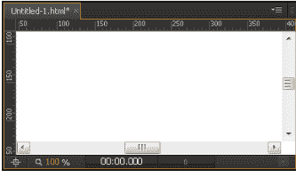

舞台位于界面的顶部中央，具有以下便于创建动画的特性：

- **它是一个实时 HTML 窗口：** 一开始，舞台可能看起来没什么特别的——但当你创建动画时，你会注意到其丰富的功能。舞台最棒的特性之一是你可以直接在上面观看动画播放。你不一定需要切换到浏览器来预览作品。相反，你可以通过观看舞台上的动画来预览你的作品——因为舞台实际上是一个 HTML 窗口。它几乎与标准的网页浏览器相同，但它直接内置于 Edge Animate 中。

# 第2章：探索强大功能与工具

### 它包含规则与指南

舞台的两个附加功能是规则与指南，如图2-2所示：

- 一个标尺沿舞台顶部横向延伸；另一个则沿舞台左侧纵向延伸。你可以使用这些标尺来帮助在舞台（Stage）上放置素材（如图像和文本）。
- 指南是从标尺延伸穿过舞台直到屏幕另一侧的细紫色线条。你可以使用这些指南来帮助定位舞台上的元素。（元素可以是绘制的圆形和矩形、图像、文本框以及构成动画的其他任何部分。）


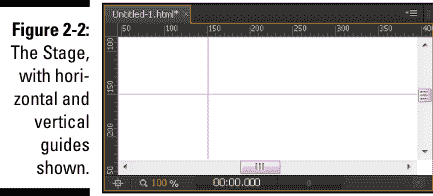

要在舞台上放置指南，请将光标悬停在标尺上，然后点击并拖动。紫色的指南随后会出现。要在舞台上移动指南，请点击它并拖动。

> 在舞台上放置指南后，任何元素（图像、文本框等）都会自动对齐到指南。这有助于你将元素精确地放置在想要的位置。

## 运用直观、精确且灵活的时间轴

除了舞台，时间轴（Timeline）可能是你在`Edge Animate`中最常用的功能。你可以在屏幕底部找到时间轴，它包含许多功能，如下：

- **关键帧：** 你使用关键帧来指示动画在舞台上的展开时间和持续时长。时间轴中的彩色条（如图2-3所示）代表关键帧，并指示动画的开始、停止以及播放时长。你可以通过点击和拖动来编辑这些关键帧。
- **模式切换：** 时间轴还允许你切换不同的模式，例如自动关键帧（Auto-Keyframes）、自动过渡（Auto-Transitions）和钉住（Pin），并且可以选择不同的缓动（Easing）属性。
- **动画增强：** 通过时间轴，你可以通过多种方式调整动画——例如，添加操作（action）（见第5章）、指定滤镜元素（见第4章）以及启用时间轴对齐（snap）（同样见第4章）。

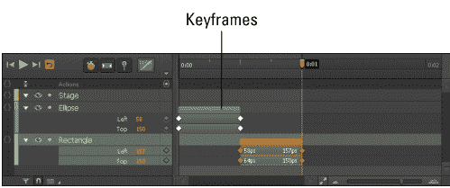

图2-3：时间轴。

## 使用熟悉的工具绘图

如果你曾经使用过其他绘图或图像编辑软件，那么你很可能认得出`Edge Animate`中的绘图工具。如果`Edge Animate`是你使用的第一款艺术软件，那么请放轻松，你会发现绘制矩形和圆形等元素就像点击和拖动一样简单。

你可以在屏幕顶部、菜单正下方找到绘图工具，如图2-4所示。

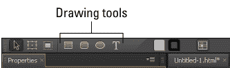

图2-4：绘图工具。

绘图工具包括矩形、圆角矩形、用于绘制圆形的椭圆，以及用于绘制文本框的文本工具。

## 利用交互与适应功能

`Adobe Edge Animate CC`不仅仅是将元素在屏幕上移动。你可以使用它的许多功能为观众创建交互性——并且可以微调更多功能来配置软件以适应你的偏好：

- ✓ **交互性：** 你可以使用按钮、链接和循环等控件和操作构建完全交互式的动画。
- ✓ **符号：** 你可以保存创建的元素（如按钮），并在不同的动画中再次使用它们。
- ✓ **响应式网页设计：** `Edge Animate`使你能够构建能响应浏览器和设备窗口大小的合成作品。
- ✓ **多种发布选项：** `Edge Animate`提供多种方式发布你的动画，以便用于不同的应用程序——例如不同的网页浏览器和 iBooks——或者你可以将你的`Adobe Edge Animation`导入不同的 Adobe 产品，如 InDesign 或 Muse。
- ✓ **字体选择：** `Edge Animate`提供多种字体选择。如果你对特定字体很挑剔，好消息是，如果你能在网络上找到某种字体，你很可能可以在你的动画中使用它。
- ✓ **选择你的语言：** 如果英语不是你的母语，而你更喜欢用（比如）德语、西班牙语、法语或日语工作，那么`Edge Animate`为你提供了解决方案。

## 智能地实现交互性

`Adobe Edge Animate CC`使你能够做的远不止绘制和动画化元素。你还可以使这些元素具有交互性，这允许你的观众点击项目以触发不同的操作。例如，你可以为交互式幻灯片制作停止、播放和暂停按钮。你还可以通过添加链接来创建一个菜单，允许你的观众导航到动画的不同部分——或者完全不同的网页。

当你的观众将光标在你的动画周围移动时，你可以让光标在特定区域上方移动时触发不同的操作。这种光标移动称为`mouseover`（鼠标悬停）。或者，如果你的观众使用平板电脑或智能手机查看你的动画，你可以允许他们简单地点击一个元素来触发操作。

## 使用符号创建可复用对象

起初，使用符号（Symbol）可能有点令人生畏，但在你积累了使用经验后，它们会变得不可或缺。

那么，符号究竟是什么？它本质上是你创建的一个嵌套动画，拥有自己独立的时间轴和交互能力。例如，假设你发现自己在多个不同的项目中反复创建具有相同操作的相同元素。通过将这个重复出现的元素保存为符号，你可以在任何项目中重复使用它及其相关的操作。一个典型的符号例子是按钮。如果你发现自己在重复创建相同的按钮——比如幻灯片的播放按钮——你可能希望将该播放按钮保存为符号，以便以后重复使用。

你可以在库面板中找到你的符号，如图2-5所示。

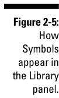

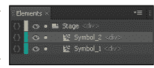

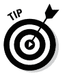

`Edge Animate`允许你导出和导入符号。你也可以为了方便使用，将符号从一个项目复制并粘贴到另一个项目。你甚至可以复制和粘贴包含其他符号的符号。此外，你可以将符号导出为单独的`.ansym`项目文件，并将其导入到另一个项目中。有关创建和使用符号的信息，请参见第12章。

如果你确实发现自己经常使用符号，那么当你发现可以一次导出和导入多个符号时，你会很高兴。`Edge Animate`在导出多个符号时，会将它们组合成一个`.ansym`文件；你可以在一个目录中拥有多个符号而无需担心冲突。此外，你可以通过使用一个文件而不是多个文件来导入这些多个符号——特别是当你除了播放按钮外，还想重用停止和暂停按钮时，这非常有用。

## 融入响应式网页设计

与`HTML5`一起，响应式网页设计是网页开发领域最新的热门术语。响应式网页设计允许你的动画根据浏览器窗口的大小适当地调整大小。这可能意味着很多事情。例如，假设有人在台式电脑上查看你的动画。如果用户调整浏览器窗口的大小，使其变大或变小，你的动画中的元素会相应地自动调整大小，新的大小基于百分比。例如，如果浏览器窗口最大化为 100%，你的动画中的图像等将显示为 100%。如果浏览器窗口缩小到其大小的 50%，那么你的图像也会缩小到其正常大小的 50%。

这是一个非常强大的功能，因为如今的屏幕尺寸种类繁多。你永远不知道你的观众是在60英寸的显示器、4英寸的 iPhone 还是介于两者之间的任何设备上查看你的动画。平板电脑增加了屏幕尺寸的多样性。

`Adobe Edge Animate CC`通过使用百分比而不是硬编码的像素来处理响应式设计。这使你可以专注于你的动画，而不必担心它在无数种屏幕尺寸上的显示效果。

## 了解你的多种发布选项

如今，你有不止一种方式来发布动画——而`Adobe Edge Animate CC`为你提供了解决方案，提供了多种选项（如图2-6所示）。你可以将动画发布为独立的网页，也可以将其嵌入现有的网页中。你还可以找到允许你将动画导出以用于 iBook 的选项。你甚至可以将动画发布为静态 HTML 页面，用于不支持`HTML5`或动画的旧版网页浏览器。

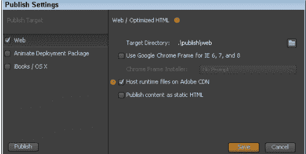

图2-6：`Edge Animate`发布设置。

静态 HTML 文件仍然使用`HTML5`编写，动画也照常播放。区别在于，当`Edge Animate`生成静态文件时，元素并非通过`JavaScript`创建，而是直接存在于 HTML 文件中。这种安排有利于搜索引擎优化（SEO）：一些搜索引擎在发现通过`JavaScript`动态创建的元素时，可能无法正确解析它们。

## 展示你的最佳字体

你可以在网页中使用多种字体，`Adobe Edge Animate CC`为你提供了全面的支持。除了标准默认字体列表可供你使用（参见图 2-7）之外，`Edge Animate`还允许你从网络各处导入字体。

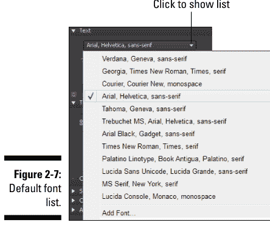

如果这些字体都不能满足你的需求，你可以从许多不同的来源导入字体——包括 Google 网络字体。你还可以使用内置于 Animate 中的 Adobe Edge Web 字体。如果你熟悉 Typekit（另一款免费字体工具），你会高兴地知道它同样适用于`Edge Animate`。

请记住，Typekit 是一款面向经验非常丰富的用户的工具：你也可以使用自己的字体或购买的字体，但必须将字体托管在你的网络服务器上。为此，你需要在样式表中使用`@font-face`规则，并将其放置在项目文件夹中。具体方法如下：

1. 在`Edge Animate`中，在“Web 字体”对话框中，键入以下内容：

```html
<link href="mystyle.css" rel="stylesheet" type="text/css">
```

此时将出现另一个对话框。

2. 在第二个对话框中，输入在样式表中指定的字体名称。

如果你需要更多关于如何在样式表中编写自定义字体的层叠样式表（CSS）代码的信息，可以在此处找到：

<http://blog.freelancer-id.com/2010/06/02/custom-font-for-all-browsers/>

我将在第 12 章更详细地讨论字体。

## 使用你选择的语言工作

`Adobe Edge Animate CC`在许多方面都是全球化的——包括你在菜单和面板上看到的语言。如果你觉得使用英语以外的其他语言工作更自在，`Edge Animate`可以让你轻松地将软件中使用的语言更改为许多流行的语言之一。

从“帮助”菜单中，如图 2-8 所示，你可以从几种不同的语言中进行选择。当你从“帮助”菜单中选择一种语言时，该语言将出现在软件中。你可以选择的语言包括德语、英语、西班牙语、法语和日语。

图 2-8：“帮助”菜单中的“更改语言”选项。

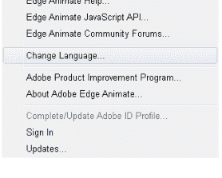

如果你选择了另一种语言，你必须关闭并重新启动`Edge Animate`才能使更改生效。在你选择所需的语言后，界面不会自动更新，只需关闭程序，然后重新打开，即可看到你新选择的语言。

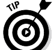

## 深入代码

`Adobe Edge Animate CC`使得各种用户都能创建动画——从认为处理代码有挑战的人，到视代码为早餐般家常便饭的有经验的开发人员和工程师。一方面，你确实不需要任何编码技能就能使用`Edge Animate`创建专业动画；另一方面，`Edge Animate`提供了：

- **原生 HTML5 代码**，非常简洁——没有专有或不必要的代码。这有助于使代码对每个人来说都更易于阅读和理解。
- **持久代码面板**，让你能够手动编辑代码。
- **JavaScript API**（应用程序编程接口），提供了了解代码背后细节的机会。

没有编码技能的设计师可以放心，他们仍然可以在完全不了解任何代码的情况下创建作品。同时，有经验的开发人员可以为 Adobe 提供对所有后台代码的访问而喝彩。

## 使用原生 HTML 工作

在你使用`Edge Animate`工作时，软件会不断地在后台创建代码。虽然你不一定需要知道任何 HTML 或`JavaScript`才​​能创建动画，但如果你恰好具有一些编码技能，那么你可以庆祝了——`Edge Animate`创建的 HTML 代码非常干净，没有任何专有包袱。


如果你想深入代码，那么请将`Edge Animate`创建的 HTML 文件视为你可能需要打开的唯一文件。`Edge Animate`确实会创建其他几种类型的文件，包括`JavaScript`文件，但这些文件包含密集的代码。如果你不是开发人员，那么明智的建议是远离这些文件。

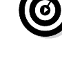

如果你已经构建了多个网站，并且不想从头开始创建动画，那么你很幸运：你不必从头开始。`Edge Animate`的一个很棒的功能是你可以导入现有的 HTML 文件——这为有经验的网页开发人员使用`Edge Animate`提供了先机。

`HTML5`是当今网页开发的大热门，紧随其后的是`CSS3`。如果你想知道`HTML5`是什么，最好的描述方式是它是网络的未来。因此，通过使用`Edge Animate`，你将自己置于网络技术的前沿。最重要的是，你无需知道如何编码就能使用它；`Edge Animate`会为你创建代码。

`Edge Animate`生成的`HTML5`代码干净利落，没有多余的代码，如下所示：

```html
<!DOCTYPE html>
<html>
<head>
	<meta http-equiv="Content-Type" content="text/html; charset=utf-8">
	<meta http-equiv="X-UA-Compatible" content="IE=Edge"/>
	<title>Untitled</title>
	<!--Adobe Edge Runtime-->
	<script type="text/javascript" charset="utf-8" src="Untitled-1_edgePreload.js"></script>
	<style>
		.edgeLoad-EDGE-15449885 { visibility:hidden; }
	</style>
	<!--Adobe Edge Runtime End-->

</head>
<body style="margin:0;padding:0;">
	<div id="Stage" class="EDGE-15449885">
	</div>

</body>
</html>
```

这个`HTML5`文件简化了动画播放。原因如下：

- 上传 HTML 文件和相关文件（通常通过`FTP`上传到你的网络主机服务器）后，你和你的观众就可以在网页浏览器中查看动画。
- 你可以将一小段代码（如下所示）复制并粘贴到现有的网页中，如下所示：

```html
<!--Adobe Edge Runtime-->
<script type="text/javascript" charset="utf-8" src="Untitled-1_edgePreload.js"></script>
<style>
	.edgeLoad-EDGE-15449885 { visibility:hidden; }
</style>
<!--Adobe Edge Runtime End-->
```


如果你将刚才显示的代码片段复制并粘贴到现有的网页中，你还必须上传`Edge Animate`在保存合成时创建的文件和文件夹结构中的相关`JavaScript`文件、图像等。你还必须在 body 标签中添加一个带有合成 ID 的`div`，如本例所示：

```html
<div id="Stage" class="EDGE-15449885"></div>.
```

## 使用持久代码面板轻松编码

你可以使用`Adobe Edge Animate CC`而无需了解任何代码。但是，如果你是一名喜欢手动编码的开发人员，你可以使用代码窗口来完成。使用代码窗口时，你有两个选择：

1. 你可以查看完整的代码。图 2-9 显示了你所看到的内容：你正在处理的特定动画的动作文件中的所有代码。这种视图非常有用；你不必在代码片段之间来回点击。

   使用“完整代码”模式来查看和编辑你的动作文件。你可以通过点击代码编辑器右上角的“完整代码”按钮来激活此模式。

2. 你可以查看特定动作的代码。当你打开代码窗口时，你会在左侧看到一个动作列表。通过点击其中一个动作，你可以仅编辑该动作的代码（参见图 2-10）。

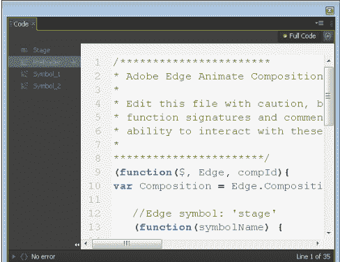

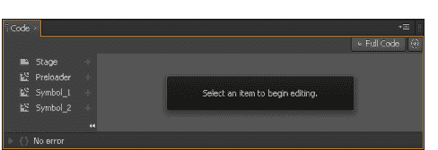

# 第二章：探索强大功能和工具

要打开代码窗口，请从菜单中选择“窗口”，然后选择“代码”，如图2-11所示。

你可以使用键盘快捷键`Ctrl+E`来打开代码窗口。

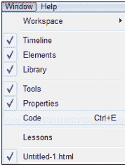

**图2-11：** 打开代码窗口。

### 引入 JavaScript API

`Adobe Edge Animate CC`提供了一个`JavaScript API`，专为硬核编码者设计。如果你对`JavaScript`或编写代码一无所知，也无需担心——创建动画并不需要大量的编码工作。但是，如果你喜欢深入探究引擎内部，那么`JavaScript API`将是一个绝佳的资源。

你可以在以下地址找到`JavaScript API`：

<http://www.adobe.com/devnet-docs/edgeanimate/api/current/index.html>

> API 是应用程序编程接口的缩写，是程序员用于编写和调试代码的常用工具。当然，如果你想自学如何编码，研究 API 的工作原理可以让你入门。但请记住，API 通常不提供入门级信息；它们假设你已经知道如何编码。

`Adobe Edge Animate CC`的`JavaScript API`提供了丰富的探索内容：

- **Adobe Edge Animate CC 概述：** 该 API 部分对程序进行了总体介绍。
- **触发器、事件和动作：** `Edge Animate`的这些功能会为你执行代码（例如循环），或者在观众与动画的不同部分交互时（例如点击按钮）执行代码。
- **用于创建符号（可复用的嵌入式动画）的工具和指引：** 特别有用的是`Edge Animate`符号，它们是自包含的行为、时间轴和图形。
- **JavaScript API：** 这是标准的`JavaScript`接口，其本身就是一个方便的工具，尤其是在你喜欢手动编写动画项目特定方面的代码时。


- **高级主题：** 当你积累了一些编码实践经验后，这些主题提供了一些值得探索的进阶方向（例如，在页面中创建多个合成）。

图2-12 展示了你可以在 API 中找到的内容示例。

**图2-12：** Adobe Edge Animate CC JavaScript API 的摘录。

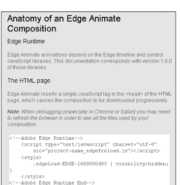

### 本章内容

- 欢迎屏幕的介绍
- 从零开始
- 设置舞台
- 从现有网页开始
- 使用模板
- 添加精美图片
- 绘制和编辑元素与文本

本章将带你开始使用 Adobe Edge Animate CC。我将介绍欢迎屏幕以及所有指向教程和帮助社区的信息链接——同时我也会向你展示如何让界面变得清净。

我将向你展示如何设置舞台尺寸，使其可以是静态尺寸，也可以是响应式设计，将舞台尺寸调整为与浏览器窗口大小相匹配。

第三章还讨论了如何导入现有网页。Edge Animate 可以打开简单的网页，并将任何图像转换为元素——然后你可以对这些元素进行动画处理或通过动作进行增强。（有关元素和动作的更多信息，请参见第5章。）

处理新合成的一部分工作是了解如何将图像作为资源添加到合成中。本章讨论了这一关键知识点，并向你展示如何通过绘制元素和添加文本框来构建舞台上的内容。

## 开始新合成

当你首次打开 Adobe Edge Animate CC 时，会看到一个信息丰富的欢迎屏幕，如图3-1所示。欢迎屏幕由多个组件组成，这些组件分为三个不同的部分。

在屏幕左侧，你可以打开现有文件、创建新文件、从模板创建文件，或查看最近文件的列表。

本节的其余部分将总结欢迎屏幕，然后分岔介绍两个关键技术：

- **调整舞台大小：** 你可以按像素数或百分比来设置舞台大小。
- **导入现有网页：** 你可以打开现有的 HTML 文件。

同样在欢迎屏幕的左下角，有两个小图标。你很可能一眼就能认出它们。Facebook 图标会带你直接进入 Edge Animate 的 Facebook 页面；Twitter 图标则会连接你到 Edge Animate 的 Twitter 动态。

在欢迎屏幕的顶部中央，你可以找到一个包含以下选项的菜单：

- **新增功能：** 此部分列出了自上一个版本以来的所有最新功能、新增内容和更新。
- **入门指南：** 欢迎屏幕的“入门指南”部分在屏幕主体区域显示了几个方框。在这里，你可以逐步了解直接内置于 Edge Animate 中的几个教程和示例（参见图3-1）。
- **资源：** 欢迎屏幕的“资源”部分提供了一系列链接，你可以点击获取来自社区的额外帮助、教程、视频和常见问题解答，如图3-2所示。从“资源”部分，你还可以查看和下载示例项目，以及访问 JavaScript API。
- **清净：** 如果你希望在打开 Edge Animate 时拥有一个安静整洁的工作空间，只需在欢迎屏幕上点击“清净”即可。这样做会移除你通常可能看到的教程和列表。

Edge Animate 会记住你选择的欢迎屏幕选项。如果你在选择“清净”的情况下关闭软件，那么下次打开 Edge Animate 时，你会看到清净的欢迎屏幕。如果在关闭程序时选择了其他任何选项，情况也是如此。

访问欢迎屏幕上列出的许多功能需要互联网连接。

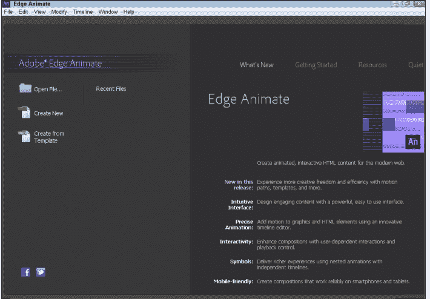

**图3-1：** Adobe Edge Animate CC 欢迎屏幕。

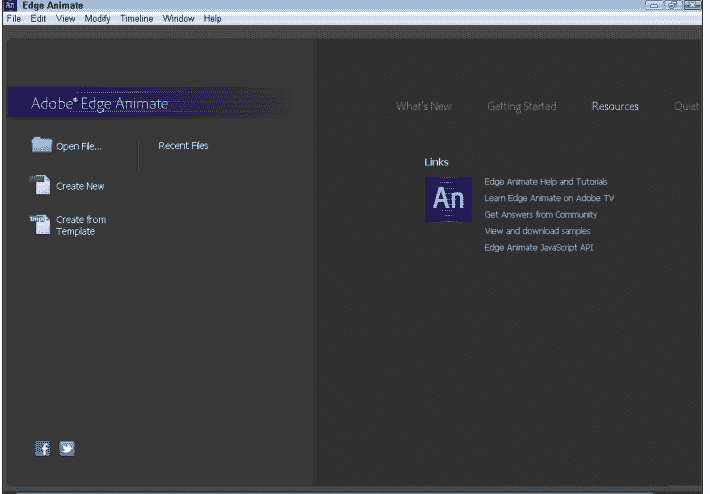

**图3-2：** 欢迎屏幕列出了可用资源。

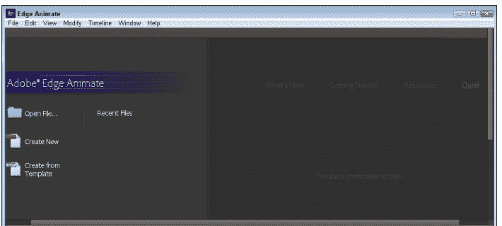

**图3-3：** “清净”选项会淡化所有杂乱内容。

当你首次打开 Edge Animate 时，可能想开始一个全新的合成。为此，只需点击屏幕左侧的“新建”图标（参见图3-1）。之后，当你有一些保存的项目时，可以点击“打开文件”或“最近文件”来打开现有的合成。

当你点击“新建”时，Edge Animate 会呈现一个全新的空白舞台，你可以在此开始你的工作。

## 调整舞台大小

舞台是你放置元素的地方，例如图像、文本和绘制的对象。舞台是一个实时的 HTML 窗口，这意味着你在屏幕上看到的内容，就是你的观众在查看和与你的合成交互时所看到的内容。你可以通过几种不同的方式设置舞台大小：

- **像素：** Adobe Edge Animate CC 允许你设置舞台保持特定大小，无论浏览器窗口大小如何。
- **百分比：** 适合那些偏爱更具响应性的网页设计的用户。
- **测试响应式网页设计：** 你可能想更改舞台的背景色来测试设计的响应性。（我将在接下来的几节中详细介绍如何进行此测试。）

### 按像素值调整舞台大小

很可能，你首先要采取的步骤之一是正确设置舞台大小。如果你计划将动画插入到现有网页中，请先确定你的动画希望在该页面上占据多少空间，然后相应地设置舞台大小。

要调整舞台大小，请点击属性面板中“舞台”部分的橙色数字——位于屏幕左上角附近——如图3-4所示。点击宽度或高度数字允许你输入你希望舞台具有的确切尺寸（以像素为单位）。

如果你不想输入数字，Edge Animate 提供了另一种调整舞台大小的方法：只需将光标放在其中一个橙色数字上。当光标变成双向箭头时（如图3-4所示），你可以点击并拖动以增加或减小舞台的大小。

### 按屏幕大小的百分比调整舞台大小

如果你想创建一个不必适应任何特定尺寸的动画，那么你应该通过点击切换按钮（参见图3-5）从像素（px）切换到百分比（%）。这是创建响应式网页设计的一个步骤。当你按屏幕百分比而不是像素值来设置舞台大小时，舞台会根据父元素的大小自动调整自身大小。

父元素的一个例子可以是浏览器窗口本身——如果动画是一个独立网页。然而，如果动画是网页的一部分，那么父元素可以是动画嵌套在其中的`div`元素。

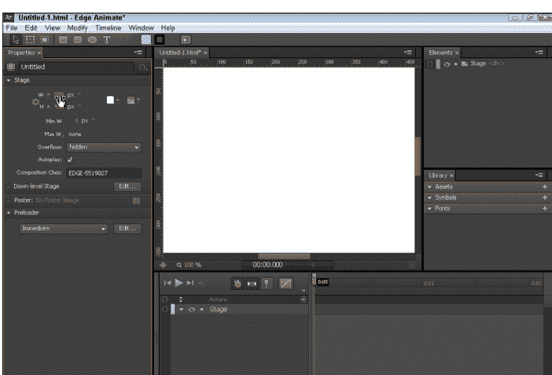

**图3-4：** 按尺寸（以像素为单位）调整舞台大小。

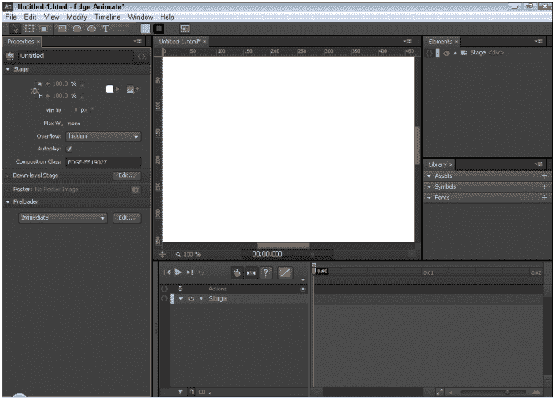

图 3-5：按屏幕百分比设置舞台大小。

要让你的舞台填满整个浏览器窗口，请将舞台宽度和高度设置为 100%，如图 3-6 所示。要让舞台填充一半浏览器窗口，则设置为 50%；依此类推，这取决于你希望动画占据浏览器窗口的多少比例。

默认情况下，舞台背景为白色。因此，当你在 px 和 % 之间切换时，舞台不会有明显变化。

要测试使用 px 和 % 作为舞台尺寸的区别，请将舞台背景色更改为非白色，例如红色。然后尝试不同的百分比和 px 尺寸，以查看不同的效果。

要更改舞台的背景色（如图 3-6 所示），请点击白色方块以调出颜色选择器。

你可以通过点击“链接宽度和高度”图标（在图 3-7 中高亮显示）来让 Edge Animate 保持宽度和高度的比例不变。默认情况下，“链接宽度和高度”图标是关闭的；在此默认设置下，Edge Animate 在你调整大小时不会保持宽度（或高度）的比例。

## 第 3 章：处理新合成 43

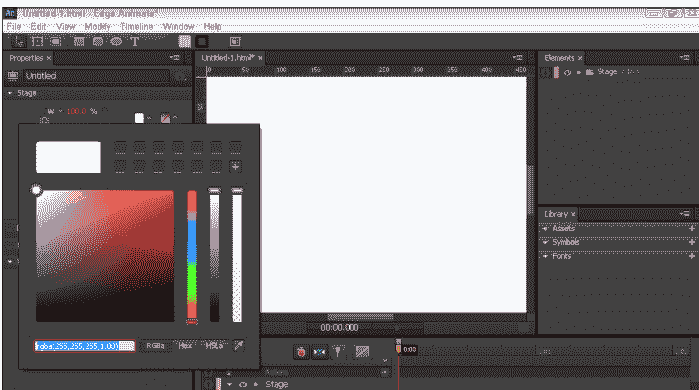

图 3-6：更改舞台的背景色。

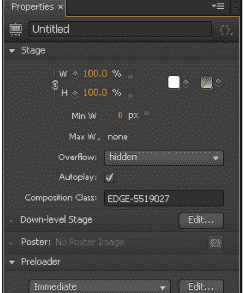

图 3-7：使用链接宽度和高度保持比例。

## 导入 HTML

Adobe Edge Animate CC 对 HTML 非常友好。如果你有一个现有的——尽管非常基础的——HTML 网页想要制作动画，那么只需在欢迎屏幕上点击“打开文件”即可开始处理。

打开文件时，请确保所有图像和关联文件都与 htm 文件位于同一文件夹中——或者位于 htm 文件的嵌套文件夹中。否则它们将不会出现在舞台上。

导入现有 HTML 时，请注意以下几点：

- Edge Animate 可能不支持你的 CSS 文件。
- htm 文件中的图像会出现在“库”面板中。
- 文本将作为元素导入。

### CSS 文件可能出现的问题

请记住，导入的 HTML 页面越简单，Edge Animate 打开它就越容易。

如果打开 htm 文件时确实遇到问题，请尝试移除所有关联的 CSS 文件。你可能会为丢失之前的工作而烦恼，但请记住，你可以使用 Edge Animate 快速替换所有这些设计工作。

如果你打开一个包含菜单等内容的现有 HTML 文件，你可以为菜单和元素制作动画，但无法重新格式化颜色和其他一些方面。原因是 Edge Animate 仅允许为导入的 HTML 对象创建动画序列，以避免与你可能已应用的任何 CSS 样式冲突。当你为同一个元素应用两种样式时，可能会变得有些混乱，导致意外结果。

### 图像出现在“库”面板中

如果你导入的 HTML 页面包含图像，那么 Edge Animate 会将这些图像作为资产导入到“库”面板中（见图 3-8）。

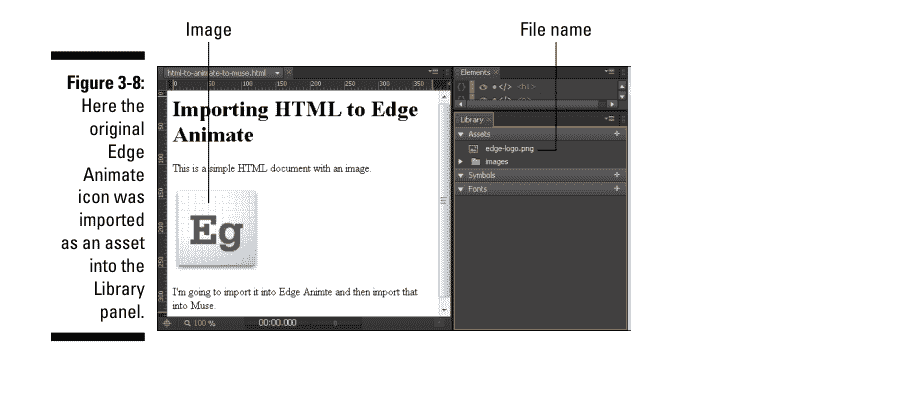

你现在可以将导入的图像视为可以制作动画或添加交互属性的元素；你可以让图像在屏幕上移动，和/或将图像设为链接。有关“库”面板的更多信息，请参见第 12 章。

### 文本作为元素导入

当你导入包含文本的 HTML 文件时，Animate 会将该文本作为元素导入。你可以选择文本元素，为其制作动画或添加操作；但是，你无法编辑文本。

如果原始 HTML 文件对文本使用了 H1 或段落标签，那么 Animate 会识别这些属性并在“元素”面板中显示它们，如图 3-9 所示。

图 3-9：文本作为元素导入。

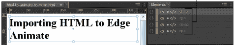

### 使用模板

模板在 Edge Animate 2.0 中引入。此功能消除了每次开始新合成都需要重新发明轮子的必要。当然，你总是可以从保存的文件开始新的合成，但模板使你能够开始一个已经包含你想要使用的属性和元素的新项目，而无需重写现有的保存文件。当你想要创建几个类似的合成并且希望立即开始动画——而无需从全新的合成中设置首选项或必须从保存的文件中移除或替换元素时，模板非常有用。你可以从主菜单的“文件”下找到模板（如图 3-10 所示）。

从“文件”菜单，你可以：

- **从模板创建：** 这是从保存的模板开始新合成的地方。要执行此操作，你必须首先保存一个模板，然后将该模板导入 Animate。当你点击“从模板创建”时，模板查看器会打开，你会看到导入模板的缩略图（如图 3-11 所示）。然后选择你想要使用的模板。

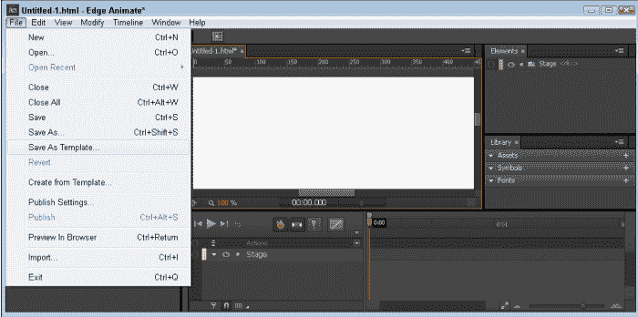

**图 3-10：** 从“文件”菜单访问模板。

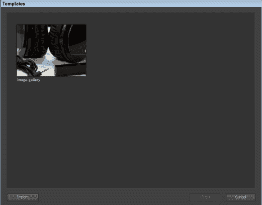

**图 3-11：** 从模板查看器中选择一个模板。

- **另存为模板：** 这会将你当前的合成保存为模板。保存的模板包括你合成中的所有内容。这包括符号、图像、文本、字体以及你所做的自定义修改，包括舞台的尺寸。当你点击“另存为模板”，然后选择保存文件的位置时，Animate 会创建一个`anmtpl`文件。保存模板后，系统会提示你导入该模板。我建议你这样做，以便在之后选择“从模板创建”时能够选中它。

如果你尝试从文件目录中打开一个`anmtpl`文件，而该文件已被导入，你会收到此消息：

> Animate 模板文件包含一个已导入的模板。是否覆盖现有模板？

然后你可以选择“是”或“否”。如果你尝试从文件目录中打开一个*尚未*导入的`anmtpl`文件，那么 Edge Animate 会为你导入该模板。然后你可以通过点击“从模板创建”来打开该模板。

如果你决定不再希望某个特定模板出现在模板查看器中，请在模板查看器中将鼠标悬停在特定模板缩略图上时，点击垃圾箱图标，如图 3-12 所示。

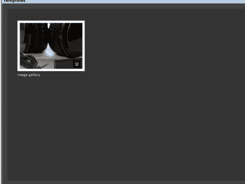

**图 3-12：** 删除不需要的模板。

当你删除模板时，保存的模板文件仍保留在你的硬盘驱动器上（或在你最初保存到的特定文件目录中）。删除模板只是将其从 Edge Animate 中移除；你将无法再从模板查看器中选择它。

## 绘制和编辑元素、导入图像以及编写文本

Adobe Edge Animate CC 提供了绘图工具，以便你可以在舞台上创建矩形、圆角矩形和椭圆——这些随后会成为你可以制作动画和添加操作的元素。导入图像和编写文本也是如此。图 3-13 显示了你可以直接在主菜单下方找到绘图工具的位置。

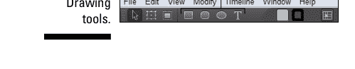

Adobe Edge Animate CC 提供了一系列可用于创建元素的工具：

- **绘图工具：** 你可以绘制矩形、圆角矩形和椭圆（包括圆形）。
- **编辑圆角：** 如果你想编辑圆角的圆度，Edge Animate 提供了实现的方法。
- **导入图像：** 作为设计师，你很可能有一些想要制作动画的精选图像。现在你可以了。
- **编写文本：** 你很有可能想要向合成中添加一些文本。Animate 使这项任务变得简单。

### 绘制矩形

绘制矩形非常简单，只需点击“矩形”工具，然后在舞台内点击并拖动即可。

当你为你绘制的矩形制作动画时，它们会成为舞台上的元素。然后你可以将它们转换为符号、分配操作和触发器等等。

> **提示** 当你在舞台上绘制一个元素（如矩形）并且舞台上已有其他元素时，Edge Animate 会自动显示粉色参考线（见图 3-14）。这些参考线可以帮助你创建大小相等的元素，并将你的元素彼此均匀对齐。

### 创建圆角矩形

圆角矩形工具与矩形工具类似，但它的角是圆的而不是方的。

你可以通过尝试绘制圆角矩形时的点击和拖动方式，来影响角的圆滑程度。例如，你可以绘制一个圆形、药丸形状，或者一个带微圆角的正方形——以及介于它们之间的几乎任何形状。图3-15展示了使用圆角矩形工具可以绘制的一些不同形状。

图3-15：使用圆角矩形工具绘制不同形状。

### 绘制椭圆

椭圆工具使得绘制圆形变得简单。只需选择椭圆工具（如图3-13中高亮显示），然后点击并拖动以绘制一个带圆角的形状。图3-16展示了一个完美的圆形元素。

要绘制一个完美的圆形，在点击并拖动时按住 Shift 键。这个按键会强制元素保持圆形比例，无论你如何点击和拖动。

### 编辑元素的圆角

无论你绘制什么类型的元素——矩形、圆角矩形、椭圆或圆形——你都可以选中它并独立编辑每个角（如果它有角的话）。要从属性面板进行操作，找到“圆角”，然后（如果需要）点击白色箭头以显示其属性设置。

图3-17展示了属性面板中的圆角属性。在这个示例中，你可以编辑元素上的八个不同点，右上角设置为0，因此角是直角。其他角设置为50，因此角是圆角的。

> **提示** 要同时编辑所有角，选择1，编辑右侧的橙色数字，然后按回车键。所有角将变得统一，如图3-18所示。

选择1使圆角统一

### 导入图像

你可以从菜单栏导入图像；点击文件 > 导入。会打开一个导航窗口，提示你选择图像。导航到你保存图像的位置，然后选择图像，最后从导航窗口中选择“打开”。

Adobe Edge Animate CC 支持拖放。你可以不通过文件菜单点击，而是直接从桌面拖动图像到舞台。

当你的合成中包含图像时，属性面板中会出现几个新选项，如图3-19所示。

### 输入文本

向你的 Edge Animate 项目中添加文本只需点击几下并输入即可。最棒的是，你输入的文本在浏览器中被视为可选择的文本。Edge Animate 不会将你的文本转换为图像用于最终输出——这意味着搜索引擎可以解析你的文本并将其编入索引用于搜索结果。最终，在 Edge Animate 中使用文本有助于——或者至少不会损害——你网站的 SEO（搜索引擎优化）。

Adobe Edge Animate CC 被认为是 SEO 友好的；它将文本以文本形式而非文本图像形式放置在 JavaScript 文件中。因此，搜索引擎可以找到你输入到 Edge Animate 中并用于最终动画的任何文本，该动画放置在你的网站上。

要向你的 Edge Animate 合成中插入文本，请点击文本工具，该工具位于左上角的主菜单栏正下方（见图3-20）。

选中文本工具后，在舞台上点击并拖动。当你点击并拖动时，你会看到一个细长的蓝色矩形出现。当你释放鼠标左键时，你还会看到一个带有闪烁光标的灰色文本框（如图3-21所示）。

访问[www.dummies.com/extras/adobeedgeanimatecc](http://www.dummies.com/extras/adobeedgeanimatecc)获取精彩的 Dummies 在线内容。

### 本部分内容...

- 操作时间轴
- 管理动作
- 自定义你的工作区
- 访问`www.dummies.com/extras/adobeedge animatecc`获取精彩的 Dummies 在线内容。

# 第4章：初次使用时间轴

### 本章内容

- 从时间轴播放、倒带和快进
- 切换不同的时间轴模式
- 使用运动路径制作动画
- 使用关键帧和动画序列使时间轴保持最佳效率
- 根据你的偏好微调时间轴视图

Adobe Edge Animate CC 时间轴是该软件的关键部分。时间轴是你确定不同动作发生时间以及哪些元素受到影响的地方。你可以在屏幕底部找到时间轴。本章涵盖时间轴的许多元素，包括更细微的细节——包括创建动画序列，也称为过渡。

### 控制时间轴


时间轴位于界面底部。它包含播放控制，如播放、倒带、快进和返回上次播放位置（见图4-1）。

播放控制包括基础功能和一个证明极其方便的功能：

- **播放、倒带和快进：** 这些是你在任何类型的媒体播放器上都能找到的基本控制，Adobe Edge Animate CC 也提供了这些功能供你使用。
- **返回上次播放位置：** 有时你不想在观看完动画后返回动画的开头。当你的动画开始变长，并且（假设）你有一个特定部分想要调整时，尤其如此。这个控制可以让你根据需要，轻松地返回到你上次停止播放动画的位置。

### 播放、倒带和快进

当你的动画准备好测试或观看时，你可以点击“播放”来观看动画在舞台上播放。同样，你可以点击“快进”或“倒带”来分别快速推进动画或快速倒退。

“返回上次播放位置”将返回到时间轴上你放置图钉的点。

> **提示：** 你也可以按键盘上的空格键来播放动画。如果播放头（在本章后面详细解释）位于时间轴的末尾，动画将完整播放。你也可以通过在时间轴上来回点击和拖动播放头来观看动画的展开。

### 返回上次播放位置

默认情况下，“返回上次播放位置”图标是灰色的，因为上次播放位置是在时间轴的开头。当你开始创建合成时，你可以将播放头沿着时间轴进一步向外移动。这样做会激活“返回上次播放位置”按钮，如图4-2所示。

当你在播放合成后点击“返回上次播放位置”时，Edge Animate会将你带回播放头在时间轴上的位置，而不是将你完全带回开头。

## 切换时间轴模式

紧接在播放控制之后是另一组工具，你可以在其中设置关键帧模式、设置自动过渡模式，你还可以切换图钉并设置缓动属性。这些工具如图4-3所示。

Adobe Edge Animate CC 使用关键帧进行动画。关键帧在时间轴中显示为白色菱形。图4-2中的绿色水平条代表了一个矩形元素在5秒内从左角移动到右下角时，关键帧之间的过渡（动画序列）。这是一个大量的信息，你都可以在时间轴和关键帧中找到。

Adobe Edge Animate CC 在时间轴区域内包含几种切换模式：

- **关键帧：** 如果你希望或不希望Edge Animate在创建合成时自动为你创建关键帧，你可以打开或关闭它们。
- **自动过渡：** 如果你希望或不希望Edge Animate在移动舞台上的元素时自动创建动画序列，你可以打开或关闭此功能。
- **播放头和图钉：** 当开始制作动画时，请确保图钉已打开，否则Edge Animate不会创建动画序列。
- **缓动：** 你可能不一定称其为切换，但你可以选择你偏好的缓动属性；你的选择会影响Edge Animate让元素动起来的方式。

### 关键帧模式

要自动创建关键帧，您必须首先通过点击红色的秒表图标来激活关键帧。默认情况下，当您首次开始新的动画时，秒表是红色的，但上面有灰色的线条穿过（如图4-4所示）。

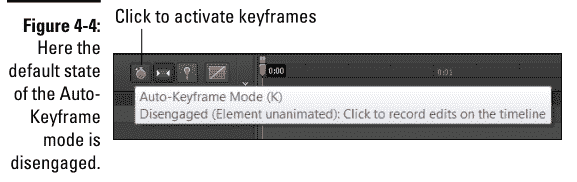

在创建合成时，您需要秒表显示为红色，这样 Edge Animate 才能自动为您创建关键帧。只需点击秒表以激活自动关键帧，并使秒表变红（如图4-5所示）。

当秒表未激活时，您不必点击秒表来启用它。只需切换图钉，自动关键帧就会启用。您可以在以下部分了解更多关于切换图钉和移动播放头的信息。

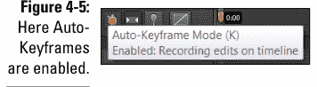

如果您点击秒表，它变暗为灰色而不是红色，那么您将需要手动插入关键帧。

如果您想在舞台上安排元素而不触发关键帧，请确保秒表通过点击它而变暗，如图4-6所示。当秒表为灰色时，表示自动关键帧已禁用。

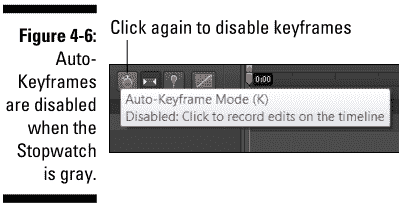

### 自动过渡模式

通过开启或关闭自动过渡模式，您可以切换在关键帧之间创建平滑过渡的能力。*过渡*是您创建的动画，用于展示（例如）一个元素在舞台上从左向右移动（过渡也称为*动画序列*）。当您创建新文件时，自动过渡模式已为您启用（如图4-7所示）。您还会在图钉和播放头之间看到一个彩色箭头。这个带有箭头的橙色条将在本章后面的“向前动画”和“向后动画”部分详细讨论。

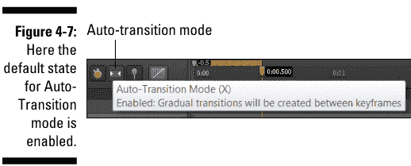

> **记住**
>
> 当自动过渡模式开启时，只要您已按接下来几节所述切换了图钉和播放头，Edge Animate 就会在您移动舞台上的元素时创建动画效果。

您会知道何时创建了动画：彩色条会出现在关键帧之间，如图4-2所示。

如果您点击自动过渡图标，它会变暗，Edge Animate 将不会创建动画序列。相反，Edge Animate 只会插入关键帧菱形；您将看不到彩色条（参见图4-8）。

图4-8：当自动过渡关闭时，Edge Animate 不会创建动画。

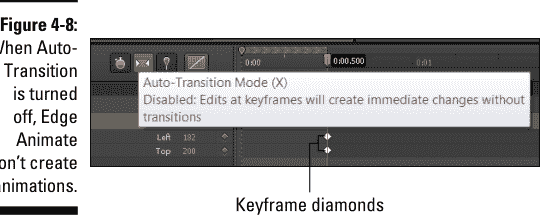


如果您希望在移动舞台上的元素时出现动画序列，请确保秒表图标为红色且自动过渡模式已启用。如果您想在舞台上移动元素而不创建关键帧或动画序列，则需要禁用秒表和自动过渡图标。您还必须切换图钉，如下所述。

### 切换图钉

当您开始创建动画序列时，需要切换图钉。当您首次开始新的合成时，图钉是关闭的，如图4-9所示。在此状态下，您无法创建动画序列。

图4-9：这里图钉的默认状态是关闭的。

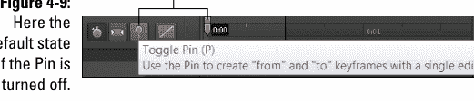

要创建动画序列，请打开秒表，确保自动过渡模式开启，然后点击图钉图标。图钉图标会激活（如图4-10所示）并变为浅蓝色。

图4-10：点击图钉以激活它。

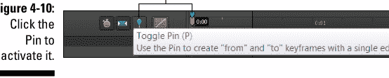

激活图钉后，您现在可以将其沿时间轴上下拖动，以确定您希望动画序列发生的位置和持续时间。您可以在以下部分找到更多细节。

### 缓动工具

缓动工具是时间轴之前的最后一个图标。您可以使用缓动工具来影响动画的播放方式。要为元素添加缓动效果，请从时间轴中选择一个元素的过渡，然后从缓动菜单中选择一个属性（如图4-11所示）。

例如，如果您希望您的元素像球一样弹跳，请从左列选择“Ease Out”，然后在右列选择“Bounce”。

缓动的默认设置是“Linear”，它对您的元素没有影响。如果您将缓动从“Linear”更改为其他选项，那么您创建的所有新元素都将默认使用这个新的缓动属性。您可以为舞台上的每个元素设置不同的缓动属性。要编辑特定元素的缓动属性，您必须从时间轴中选择该元素的过渡。

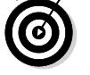

如果您具有数学倾向，您会欣赏最右边的图表，它显示了缓动属性的效果。

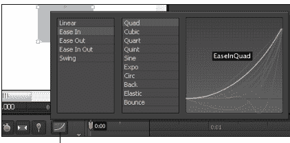

图4-11：缓动属性。

#### 缓动工具

### 播放头和图钉

播放头和图钉位于时间轴的时间标记上。您将用它们执行几项不同的任务。第一项任务是确定您希望动画开始和结束的时间点。第二项任务是告诉 Edge Animate，当您点击播放时，您希望从哪里开始查看动画。

图钉是顶部的蓝色图标；播放头是下面的黄色箭头。

当您准备好开始动画时，您需要将图钉或播放头拖动到时间轴的长度上。如图4-12所示，将图钉或播放头沿时间轴向下拖动决定了您的动画是向前播放还是向后播放。这将在以下部分更详细地讨论。

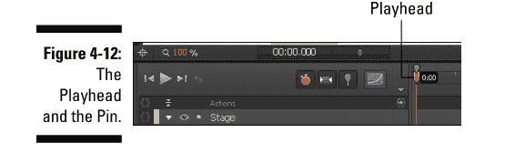

### 处理关键帧和动画序列

掌握如何处理关键帧和动画序列非常重要，这样您就可以创建和编辑它们以达到您的目的。以下部分介绍了您需要的所有 Edge Animate 部件，用于创建关键帧和动画序列。以下是如何实际创建这些关键帧和动画序列的地方——这归结为熟悉以下过程：

- **创建关键帧：** 当您开始动画时，根据您设置图钉和播放头的方式，您可以创建向前或向后播放的过渡，这取决于您如何创建它们。
- **选择关键帧：** 创建关键帧后，您可以选择它们以便进行编辑。
- **编辑关键帧：** 创建关键帧并选择它之后，您可以对其进行编辑。
- **复制和粘贴关键帧：** 您可以复制和粘贴您想要重复使用的关键帧。这应该为您节省大量时间；您不必为类似的动画序列反复重建相同的关键帧。

### 创建序列

要创建关键帧和动画序列（过渡），请按照以下步骤操作。

第4章：首次使用时间轴 63

1. 使用绘图工具或通过导入图像在舞台上放置一个元素。
2. 切换图钉，使其变为浅蓝色。
3. 点击并拖动图钉或播放头沿时间轴向下移动。

   移动图钉和移动播放头之间的差异将在本节后面描述。

   图钉和播放头之间的间隔空间决定了动画播放的时间长度。

4. 点击并拖动元素在舞台上移动，例如，将元素从左上角移动到右下角。

   Edge Animate 会在时间轴上添加彩色条。

要预览您的动画，请点击播放或按空格键。

### 向前动画

您将图钉和播放头放置在时间轴上的位置会影响您的动画序列。例如，您可能在挠头想知道为什么播放动画时，元素从右下角移动到左上角，而不是相反的方向。

要向前动画——即让动画序列以您在舞台上移动元素的相同方向播放——您必须将播放头移动到比图钉更远的时间轴下方，这样您会看到一个黄色的带箭头条（如图4-13所示）。

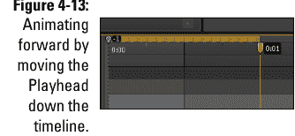

### 向后动画

如果您希望您的动画以与您在舞台上移动元素方向相反的顺序出现，那么请将图钉移动到比播放头更远的时间轴下方：您会看到一个蓝色的带箭头条，如图4-14所示。

**提示** Adobe Edge Animate CC 充满了键盘快捷键。其中之一是 `Shift+P`，它可以将你时间轴的方向从蓝色反转为橙色（或反之亦然）。当你意识到想要以相反方向播放动画序列时，这会非常有用。

## 使用运动路径制作动画

运动路径使你能够创建遵循弯曲路径或循环的动画序列，例如飞翔的鸟或在舞台上舞动的图像。Animate 提供了大量处理运动路径的选项，如下节所述。你可以从“属性”面板中切换运动路径的开启或关闭，如图4-15所示（请务必在舞台上选择一个元素，以便查看运动路径属性）。

**提示** 切换“自动定向”选项，使元素的旋转跟随运动路径。如果你关闭“自动定向”，那么元素的旋转将不受运动路径的影响。

**提示** 使用工具栏中的“布局默认值”将运动路径设置为所有新添加到舞台的元素的默认值（参见图4-16）。当你更改布局默认值时，不会影响所有先前存在元素的设置。

开启运动路径后，当你为某个元素创建动画序列时，你会看到一条两端带箭头的细蓝线；这些箭头代表元素移动的方向（参见图4-17）。这条蓝线表示元素在动画期间移动的路径。记得切换“钉住”并设置播放头来创建动画序列。

图4-15：从“位置和大小”面板切换运动路径的开启或关闭。

图4-16：从工具栏的“布局默认值”中设置运动路径的默认值。

> 要在不添加新锚点的情况下移动运动路径，请将鼠标悬停在细蓝线上（线段上没有锚点的位置），按住 `Cmd` 或 `Ctrl` 键，然后用鼠标拖动。

### 添加锚点

当你首次绘制运动路径（使用“钉住”功能将元素拖过舞台）时，Animate 会创建一条直线路径。要为路径添加曲线，必须插入锚点。要添加锚点，请将鼠标悬停在细蓝线上，直到看到如图4-18所示的钢笔工具。

显示钢笔工具后，单击并拖动鼠标以插入锚点并为运动路径添加曲线。此操作还会创建一个*贝塞尔手柄*。你可以通过单击并拖动那些点来使用贝塞尔手柄进一步操作运动路径的曲线，如图4-19所示。

图4-19：运动路径可以具有贝塞尔手柄，以帮助你创建完美的曲线。

> **提示**
>
> 要删除或移除锚点，请将鼠标悬停在现有锚点上，然后使用键盘快捷键：PC 上按 `Ctrl+单击`，Mac 上按 `Cmd+单击`。

### 创建尖角而非弯曲路径

虽然弯曲路径非常棒，但90度角看起来也相当锐利（双关语）。要在运动路径中创建尖角，必须从锚点移除贝塞尔手柄。要移除贝塞尔手柄，请将鼠标定位在贝塞尔手柄上，然后使用键盘快捷键 `Alt+单击`（Mac 上为 `Option+单击`）。执行此操作后，贝塞尔手柄将从运动路径中移除，锚点变为尖角，如图4-20所示。

图4-20：带有尖角的运动路径。

### 运动路径的关键帧和缓动

你可以将运动路径拆分，使其包含多个关键帧。时间轴中的关键帧菱形代表不同的运动路径（也称为动画序列或过渡）。要向运动路径添加关键帧，请将播放头和“钉住”放置在时间轴中希望添加关键帧的部分，然后只需单击时间轴中要添加关键帧的过渡旁边的菱形即可，如图4-21所示。

**图4-21：** 向运动路径添加关键帧以创建单独的动画序列。

将单个运动路径拆分为多个过渡可能很有用。例如，你可以为路径的第一个关键帧添加一个缓动属性，并为第二部分分配一个不同的缓动属性。为此，请从时间轴中选择第一个关键帧过渡（参见图4-22），然后为其添加缓动属性（有关缓动的更多详情，请参见第17章）。然后选择第二个运动路径序列并添加不同的缓动属性。随后，你可以在舞台上预览整个动画序列（按空格键在舞台上预览，或按 `Ctrl+Return` 在浏览器中预览）。

**图4-22：** 从时间轴中选择动画序列以编辑缓动属性。

### 拆分和合并运动路径

运动路径是完全可编辑的。这意味着你可以随心所欲地弯曲和扭曲它们，也可以将它们拆开并重新组合。

要拆分运动路径，必须首先如上一节所述为动画序列添加一个关键帧菱形。为路径添加关键帧会创建两个恰好相连的独立运动路径。要拆分这两个运动路径，请将鼠标指针悬停在添加关键帧菱形时创建的中间箭头上（如图4-22所示），然后 `Ctrl+单击`（`Cmd+单击`）并拖动以分离两个运动路径。图4-23显示了在箭头上按 `Ctrl+单击` 时出现的锯子光标。

要将两个运动路径合并在一起，只需单击一个端点箭头并将其拖动到另一个运动路径的端点箭头，直到它们吸附在一起。

图4-23：看到锯子图标时分离运动路径。

如果你看到元素只附加到其中一个分离的路径上，不要惊慌。如果你在时间轴上上下移动播放头，你会看到元素仍然连接到两个运动路径。预览动画也会显示元素仍然与两个运动路径都关联。只是根据播放头在时间轴上的位置，其中一个运动路径看起来好像没有元素。

如果你拆分运动路径并将一段放在舞台的一侧，另一段放在舞台的对侧，那么你会看到你的元素先跟随第一条路径，然后跳到第二条路径。要夸大这种效果，可以尝试在第一条运动路径结束和第二条开始之间的时间轴上添加时间。要分离关键帧菱形（以及动画序列），请将光标放在第二个动画序列上，然后单击并在时间轴上向下拖动（有关选择序列和编辑序列的更多信息，请参阅接下来的两节）。参见图4-24作为示例。

图4-24：在运动路径之间添加时间以延迟路径间的跳跃。

你无法将运动路径设置为使用基于百分比的布局来创建响应式布局（有关如何构建响应式网页设计，请参见第21章）。作为变通方法，你可以将运动路径元素嵌套在组、父级或元件内，然后将父级设置为使用基于百分比的定位（有关嵌套元素，请参见第11章；有关布局首选项和布局默认值，请参见第21章；有关元件的信息，请参见第12章）。你也可以使用此嵌套方法将运动路径相对于上、右、下、左进行设置。

在使用运动路径制作动画时，请尝试使用“变换原点”。元素沿运动路径的行进是基于原点的，该原点不一定是元素本身的中心。有关原点和变换工具的更多信息，请参见第7章。

### 选择序列

创建关键帧和动画序列后，你可能需要选择它们以便进行编辑。有几种方法可以选择关键帧：

- 将光标悬停在顶部栏（也称为*卷起栏*）上。当光标变为手形时，如图4-25所示，你可以单击以选择所有相关的动画序列。
- 通过单击并拖动鼠标来选择关键帧。
- 在单击不同关键帧时按住 `Shift` 键，以一次选择多个关键帧。

图4-25：通过单击折叠栏来选择关键帧和动画序列。

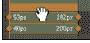

Edge Animate还允许你通过单击特定的彩色条来仅选择一个动画序列。

你可以在选择动画序列和关键帧后对它们进行编辑。

### 编辑序列

Adobe Edge Animate CC 提供了一种简便的方式，不仅可以移动关键帧和动画序列，还可以缩短或延长它们。

### 移动序列

要将关键帧和动画序列在时间轴上上下移动，只需选择彩色条，然后按住鼠标左键进行拖动即可。

你也可以用同样的方式移动多个关键帧。要一次选择多个关键帧，请在单击不同关键帧时按住 `Shift` 键。

### 延长或缩短序列

你不仅可以移动关键帧在时间轴上的位置，还可以延长或缩短关键帧，使动画的播放时间变长或变短。

要延长关键帧，请将鼠标光标移动到关键帧的任一端，直到光标变为双箭头线（见图4-26）。然后单击并拖动即可。

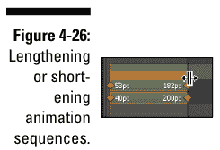

### 复制和粘贴关键帧与序列

Adobe Edge Animate CC 允许你复制和粘贴关键帧和动画序列。这使得创建同一动画的多个实例变得非常容易。

要复制一个关键帧，只需选择它，然后使用 `Ctrl+C`。接着，将播放头放置在时间轴上你想要粘贴该关键帧的位置。最后，使用 `Ctrl+V` 粘贴关键帧。

> 在粘贴复制的关键帧之前，请确保播放头位于时间轴上你希望它出现的位置。否则，你可能会将关键帧粘贴到时间轴上非预期的部分。你粘贴到时间轴上的关键帧将出现在播放头所在的位置。

## 时间轴和舞台控制的更多细节

Edge Animate提供了多种配置时间轴和舞台的方式；你可以根据自己的喜好进行调整。这包括一种简便的方式来居中舞台、放大舞台、筛选元素以及启用或禁用时间轴吸附。

舞台和时间轴的精细控制包括：

- **居中舞台：** 如果你开始移动、调整、缩放舞台等操作，你可能需要重新居中舞台以便更好地查看。
- **放大舞台：** 当你想查看元素的每一个像素细节时。
- **播放头和定位针时间戳：** Edge Animate提供了多种方式在时间轴上移动播放头和定位针。
- **筛选元素：** 有时你只想查看某些特定的元素。


- **时间轴吸附：** 你希望元素精确吸附到时间轴的特定位置，还是更倾向于自由移动？
- **配置网格视图：** 你可以根据自己的偏好设置网格视图，决定是否显示网格。
- **查看时间轴的更多或更少内容：** 有时你可能想查看整个合成的时间轴；有时你可能想放大查看。
- **添加更多时间：** 如果时间用完了，你总可以添加更多！

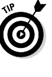

你可能想知道 Edge Animate 如何确定元素在时间轴中出现的垂直顺序。这完全取决于元素的排列方式。最靠前（显示在所有其他元素之上）的元素是时间轴中列出的第一个元素。最靠后（显示在所有其他元素之后）的元素是时间轴中列出的最后一个元素。

### 舞台控制

舞台有几个控制选项，使你能够居中和放大它。

- **居中舞台：** 如果出于某种原因，舞台在你这里偏离了中心，而你想要一个一键解决方案来重新将舞台居中在屏幕上，那么只需单击“居中舞台”图标。此图标位于舞台的左下角（如图 4-27 所示）。
- **放大舞台：** 如果你想放大舞台，可以使用缩放工具（如图 4-28 所示）。你可以单击橙色数字并输入特定的缩放级别，或者将鼠标指针悬停在数字上，然后单击并拖动来调整。

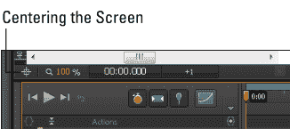

**居中屏幕**

图 4-27：使用“居中屏幕”图标将舞台居中在你的屏幕上。

**缩放工具**

**图 4-28：** 放大舞台。

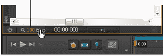

### 时间轴控制

Adobe Edge Animate CC 提供了多种工具来帮助你配置时间轴，使其以你想要的方式呈现。

> ✔ **播放头和定位针时间戳：** 提供一种方式来显示播放头在时间轴中的位置以及动画序列的时长。播放头由左侧的黄色数字表示，定位针由右侧的蓝色数字表示（见图 4-29）。你可以将光标悬停在这些数字上，然后单击并拖动来更改播放头和定位针在时间轴上的位置。

**播放头 定位针 播放头 定位针**

**图 4-29：** 播放头和定位针时间戳。

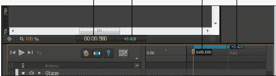

> ✔ **筛选元素：** Edge Animate 提供了一种方式，让你只能看到具有动画序列的元素，或者一次查看所有元素。这不会影响你在舞台上看到的内容，但会影响你在时间轴中看到的内容。在图 4-30 中，左侧筛选关闭，你看到所有元素；右侧筛选开启，你只看到有动画的元素。筛选控件已标识出来。

**图 4-30：** 筛选元素。

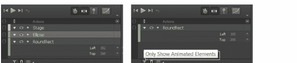

**筛选控件**

**配置网格视图：** 如果你想在时间轴中看到精确的度量——从一整秒到三十分之一秒——你可以设置该视图（如图 4-31 所示）；你可以调出你的选择并切换网格视图的开启或关闭。

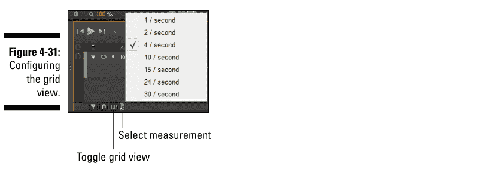

**时间轴吸附：** 如果你选择开启网格视图，那么你可以通过开启时间轴吸附（如图 4-32 所示）让定位针和播放头吸附到网格上。

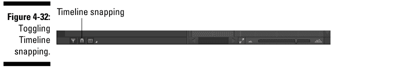

**缩放滚动条：** 你可以通过滚动缩放条来查看时间轴的更多或更少内容（如图 4-33 所示）。你可以单击以查看整个时间轴，单击以放大或缩小缩放级别，或者单击并拖动滚动条上的图标。

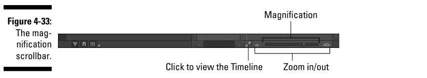

**向时间轴中插入更多时间：** 你可以在设计合成过程中的任何点向时间轴添加更多时间。从主菜单中，单击时间轴，然后选择插入时间，该选项大约在菜单的中间位置。当你这样做时，会打开一个对话框（如图 4-34 所示）。

图 4-34：向时间轴中插入更多时间。


> 将播放头放置在时间轴上你想要插入更多时间的位置。

### 本章内容

- 通过动作为你的合成添加交互性
- 创建触发器以执行动作
- 将标签应用于动作和触发器
- 使用光标属性创建线索

Adobe Edge Animate CC 一个特别强大的功能是能够向你的合成中添加动作、触发器、标签和光标属性。这些工具是你用来使动画具有交互性的，这样你的观众就可以参与到动画的执行中，而不是只能被动地坐着观看。

通过在时间轴中放置`标签`，并将它们与动作和触发器关联，你可以识别时间轴中的特定点，并创建一种更简单的控制动作和触发器的方法（而不是使用时间戳）。通过使用标签，你无需打开代码框来更改，例如，你希望动画在触发器或动作被调用时播放的时间点。相反，你只需将标签在时间轴上上下滑动即可编辑动作或触发器。使用标签有助于你跳过一个步骤——打开代码框——如果你需要编辑动作以反映时间轴上不同的时间点。

当你将交互元素放入时间轴时，最好更改`光标属性`，以向你的观众提供视觉线索。知道一个元素是（比如）可点击的、可调整大小的等等，会使观众更倾向于与合成进行交互。如果光标从不改变，那么你的观众可能永远不知道他们可以点击，而不仅仅是坐在那里。

### 插入舞台触发器

Adobe Edge Animate CC 允许您添加`舞台触发器`——本质上是控制动画播放方式的命令。当动画到达时间轴上的某个特定点（您在此放置了一个命令以在屏幕上触发某些事件）时，舞台触发器就会启动。使用舞台触发器启动的典型命令是`循环`——让动画在到达末尾（或您指定的其他某个点）时重复播放。图 5-1 展示了可用的舞台操作列表。


**图 5-1：** 可用于舞台的触发器列表。


您也可以将操作与触发器一起添加到舞台。有关如何从元素面板添加舞台操作的更多信息，请参见第 11 章。

### 将触发器添加到舞台

要添加舞台触发器，您必须按照特定顺序执行多个步骤。以下过程展示了如何通过舞台触发器为您的动画添加循环：

1. **创建一个可以添加舞台触发器的动画序列。**

   例如，使用绘图工具（参见第 3 章）在舞台上绘制一个元素，然后创建一个动画序列（参见第 4 章）。

2. **在时间轴上将播放头定位到您希望舞台触发器启动的位置。**

   例如，您可以在动画结束时设置一个触发器。

3. 单击图 5-2 所示的插入触发器图标。

   

   **图 5-2：** 单击插入触发器图标以打开菜单。

   当您单击插入触发器图标时，触发器菜单会打开（参考图 5-1）。

4. 菜单打开后，单击右侧的触发器项目。对于循环，选择`Play from`。

   这样会在左侧窗口中插入代码（参见图 5-3）。

   

   **图 5-3：** 单击右侧的触发器，在左侧插入代码。

5. 单击触发器框右上角的 X 以关闭并保存您的触发器。

   您将在时间轴中看到一个触发器图标，如图 5-4 所示。

   

   **图 5-4：** 插入到时间轴中的触发器图标。

要查看您的循环效果，需要在浏览器中预览。要在浏览器中预览动画，请从主菜单单击“文件”，然后单击“在浏览器中预览”（参见图 5-5）。


**图 5-5：** 单击“在浏览器中预览”以查看触发器的实际效果。


恭喜！您的动画现在包含了一个循环。

如果您希望动画循环回到时间轴上的某个特定点，而不是返回开头，可以在触发器框中添加标签或指定时间。（我将在下一节介绍如何创建和插入标签。）

时间值

**图 5-6：** 在触发器框中指定时间，以告诉 Edge Animate 从哪个点开始播放。


您可以通过几种不同的方式编辑舞台触发器：

- 可以通过单击并上下拖动时间轴中的触发器图标（参考图 5-4）来更改触发器在时间轴中的位置。
- 双击触发器图标以打开代码框。然后您可以从代码框内编辑触发器。

### 标记关键点

您可以在时间轴中添加标签，用于舞台触发器和元素操作。假设您希望动画在到达舞台触发器时跳回到某个特定时间点。您可以使用标签来确定动画在时间轴中跳回的位置。

### 创建标签

要在时间轴中插入标签，请使用主菜单；单击“时间轴”，然后单击“插入标签”（图 5-7）。

标签会出现在时间轴中播放头所在的位置。您可以命名此标签（如图 5-8 所示）。

您可以根据自己的意愿命名此标签，但要命名得当，以便日后记住您为什么把它放在那里。例如，如果您希望幻灯片放映在 1 秒标记处循环回来，而不是一直循环回开头，那么您就在 1 秒标记处插入标签，并将其命名为类似`重启幻灯片放映`的名字。

当您在时间轴中插入标签后，您可以返回并编辑您的触发器或操作。

您可以单击并拖动标签，在时间轴中上下移动它。当您开始制作更复杂的动画，并且不断需要调整循环（或其他任何操作）的起始点时，这非常方便。如果没有标签，您将不得不一直打开触发器框，调整毫秒值，并为此感到恼火。


您可以通过双击时间轴中的标签来更改其名称。请注意，如果您在时间轴上更改了标签的名称，则必须返回到触发器或操作，并在代码框中更新标签的名称。

### 将标签与操作和触发器关联

如果您在创建触发器或操作之后决定在时间轴中添加标签，可以返回并编辑触发器或操作以使用该标签。

- 要编辑触发器，请双击触发器图标（如图 5-4 所示）。
- 要编辑操作，请选择元素，右键单击，然后选择“打开操作”。

在触发器/操作对话框打开的情况下，将代码编辑为显示标签而不是毫秒数，如图 5-9 所示。

要使标签正常工作，必须使用单引号：

- 当您正确输入标签时，文本显示为橙色。
- 如果您忘记单引号，文本显示为紫色。

标签区分大小写。因此，如果您的标签是“重启幻灯片放映”，但您在触发器框中输入的是“重启 slide show”或“重启 Slideshow”，您的触发器将无法工作。请确保在触发器框中键入标签的名称与时间轴上显示的完全一致。


当您使用特定的毫秒值来标识触发器时，无需在数字周围使用单引号；只需输入数字即可。但是，如果您想使用标签，则必须使用单引号——在标签的开头和结尾各一个。如果您在键入标签时没有使用单引号，文本将以黑色显示，表示标签不正确。如果您在键入标签时正确使用了单引号，文本将变为橙色。

有关如何将符号与播放操作与标签一起使用，请参见第 12 章。

### 插入元素操作

向元素添加操作类似于向舞台添加触发器。舞台触发器和`元素操作`之间存在两个主要区别：

## 第二部分：采用工具与技巧

✓ 元素动作要求您的受众执行某些操作以触发该动作的发生。

例如，您的受众必须点击或将鼠标悬停在元素上以触发动元素的动作。对于舞台触发器，受众无需执行任何操作，因为舞台触发器会在动画到达触发器所在位置时触发。图 5-10 显示了可指定的操作列表，以便您的受众能够触发动元素动作。

✓ 元素的`动作`框允许您指定受众必须使用的交互类型来执行该动作。

舞台触发器的工作方式与动作不同；它们在动画到达时间轴上的某个点时执行，无论受众正在做什么（或不做什么）。它们不需要交互。

元素动作需要受众的交互。这些交互包括：

- ✓ **点击或双击**：如果您希望受众点击或双击元素以触发动作，请选择这些选项。对于以移动设备为中心的体验，您可以以与点击相同的方式使用滑动动作。
- ✓ **鼠标**：如果您希望受众将鼠标移入、移出或悬停在元素上，请使用鼠标悬停、鼠标按下等动作。
- ✓ **触摸**：触摸动作指的是移动设备和触摸屏，其作用与点击相同。如果您计划让动画同时适用于桌面和移动设备，那么仅使用点击就足够了。
- ✓ **焦点**：此动作与使用键盘上的 Tab 键相关，使您的受众能够选择（或通过 Tab 键切换）不同的元素；本章有专门的部分详细说明实施此功能所需的额外步骤。

### 为元素添加动作

您可能希望添加到元素的动作之一是使其打开一个新的 URL。此功能对于创建菜单或构建指向其他相关内容的链接非常方便。

您也可以按照相同的基本步骤为大多数其他动作进行操作。（关于处理焦点的额外步骤将在介绍为元素添加动作的步骤之后的下一节中介绍。）

要开始为元素添加动作，您必须首先按照第 3 章的描述创建一个元素。在舞台上放置了一个元素后，请按照以下步骤操作：

1. 选择一个元素，单击鼠标右键并选择“为此元素打开动作”（如图 5-11 所示）。

   

   从菜单中单击“打开动作”后，会打开一个空白的`编码框`（您在此输入命令的位置）。

2. 从右侧的菜单中选择“打开 URL”。

   Edge Animate 会在框中填充代码，如图 5-12 所示。

   默认情况下，当您单击“打开 URL”时，Adobe Edge Animate CC 使用指向 adobe.com 的 URL。如果另一个链接目的地更适合您的需求，只需将 adobe.com URL 替换为您希望引导受众前往的 URL 即可。

   添加动作 移除动作

   

   图 5-12：包含代码的“动作”编码框如下所示。

   您可以对一个元素使用多个动作：

   - 要向元素添加动作，请在“动作”编码框打开的情况下，单击左上角的 + 号，如图 5-12 所示。
   - 要从元素移除动作，请单击 – 号。
   - 当单个元素关联了多个动作时，Edge Animate 会在选项卡视图中显示所有动作（如图 5-13 所示）。只需单击选项卡即可显示每个动作的相关代码。

   单击选项卡以显示代码

   

   图 5-13：一个元素可以有多个动作。

3. 从右侧的菜单中选择“打开 URL”。
4. 更新编码框中的 URL，该 URL 以橙色文本突出显示。
5. 关闭编码框以保存您的工作。
6. 在浏览器中预览动画以测试您的工作。

要测试以确保您的链接有效，请用鼠标单击该链接。

在大多数网站上，当您将鼠标悬停在链接上时，光标会从箭头变为手形。使用本章中描述的过程，您可以设置光标属性，为您的受众提供视觉线索，例如指示链接的位置或显示是否可以选择某个元素。

恭喜！现在您的动画中有一个循环。

如果元素已经关联了动作，那么当您单击“打开动作”时，Edge Animate 会立即打开编码框，而不是显示图 5-11 中的菜单。当这种情况发生，并且您想为该元素添加第二个动作时，请单击 +（如图 5-12 所示）。

### 使用焦点作为动作

焦点是一个需要更多步骤的操作。您需要从“属性”面板设置“Tab 索引”才能使其工作。本节将专门讨论如何将“Tab 索引”与“焦点”动作一起使用。

Edge Animate 中的焦点是一个 jQuery 事件。根据 jQuery API，“获得焦点的元素通常会以某种方式被浏览器突出显示，例如用虚线包围该元素。”在 Edge Animate 中，您可以通过设置 Tab 索引来突出显示元素。有关焦点的更多信息，请参见`http://api.jquery.com/focus`。

要开始使用“焦点”动作，请按照以下步骤操作：

1. 按照第 3 章的描述，在舞台上创建一个元素。
2. 选择该元素。
3. 在“属性”面板底部的“辅助功能”部分，在“Tab 索引”中为元素分配一个数字（如图 5-14 所示）。
4. 要测试您的元素现在是否已分配了 Tab 键，请在浏览器中预览动画。

按 Tab 键，浏览器会突出显示您的元素：

- 在 Google Chrome 中，突出显示表现为金色边框。
- 在 Firefox 和 Internet Explorer 中，突出显示表现为虚线。


**图 5-14：** 设置“Tab 索引”以使“焦点”生效。

分配一个数字

5. 关闭浏览器窗口并返回 Edge Animate。
6. 右键单击该元素，选择**打开动作**，然后选择**焦点**。

   编码框打开，并出现以下代码：

```
// 在元素获得焦点时运行的代码
```

7. 从右侧菜单中选择一个动作（例如**打开 URL**）。
8. 更新 URL，然后关闭框以保存更改。

当您在浏览器中预览动画并按 Tab 键时，当该元素被突出显示——实际上，当它获得焦点时——动作将被触发。在这种情况下，新的 URL 将被加载。

#### 添加光标属性


例如，当您创建一个受众可以与之交互的按钮时，用户期望某种信号来表明动画的某个部分是可点击的。提供这种信号以便您的受众可以与元素进行交互的一种清晰方法是改变光标的形状。您可以通过指定光标的属性来实现这一点。请继续阅读。

### 光标属性类型

Edge Animate 在“光标属性”方面提供了大量选择，例如表示链接的指向手指。如图 5-15 所示，您可以将光标更改为代表不同类型的交互性，包括以下内容：

- ✔ **指向手指：** 表示要点击的链接。
- ✔ **等待：** 表示某些内容正在加载和/或受众应等待某些事情发生。
- ✔ **调整大小：** 表示受众可以调整某些内容（如窗口、列或行）的大小。


> 优秀的动画师总是为受众提供尽可能多的视觉线索。您的受众正是通过这种方式意识到动画作品中的元素何时何地可供交互。

#### 添加光标属性

Adobe Edge Animate CC 允许您通过更改光标属性来改变光标的外观。本节向您展示如何在将鼠标悬停在作品中的按钮上时，将光标更改为指针。

要更改光标的属性，请按照以下步骤操作：

1. 选择一个元素，例如按钮。
2. 从“属性”面板中，单击“光标样式”图标，如图 5-16 所示。
3. 从菜单中选择一个光标属性（参见图 5-15）。

图 5-16：

点击光标样式按钮以打开光标属性。


要测试您的光标属性是否生效，只需在浏览器中预览即可。当您将鼠标指针悬停在元素上时，它应该会变成一个指向的手指，如图 5-17 所示。

图 5-17：

当您悬停在一个按钮上时，光标会变成指向的手指。


# 第六章：拥抱工作区

## 本章内容

- 根据您的喜好自定义工作区
- 保存您的自定义工作区或恢复到默认设置

Adobe Edge Animate CC 是一款动态的软件工具。该工具的灵活性为您提供了按照自己意愿配置界面的方式。如果您只想查看舞台和时间轴，可以关闭所有面板。或者，您可能希望最大化资源面板，使其占据整个屏幕。您可以将面板组合为选项卡、并排放置，或者一个叠在另一个上面。如果屏幕变得过于杂乱，您只需恢复到默认视图即可。然而，如果您最终将所有面板都排列成了最适合您的方式，您可以将该视图保存为自定义工作区。

当您从一种元素类型点击切换到另一种时，属性面板中的设置会不断更新。每种不同类型的元素——绘制的矩形、导入的图像或文本框——都有自己独特的一组属性。并非所有属性都是完全独特的；无论其类型如何，有些属性始终保持一致。

## 点击和拖动面板

Adobe Edge Animate 的界面由顶部的主菜单和围绕舞台的一系列“面板”和“框架”组成。面板包含用于设计的按钮、开关和切换器。框架包含面板——您也可以配置它们，根据需要移动和调整大小。您甚至可以恢复到默认视图或创建几种不同类型的视图：

- ✓ 堆叠式
- ✓ 选项卡式
- ✓ 默认
- ✓ 并排式

您可以自定义属性面板、元素面板和库的位置和大小。这些面板中的每一个在右上角都有两个小图标：

- **下拉箭头（如图 6-9 所示）：** 使用此图标可以取消停靠或关闭面板和框架。您也可以用它来最大化框架。
- **点击并拖动：** 使用此图标可以在工作区中移动面板。

您可以将光标放在最右侧的“点击并拖动”图标上，然后点击并拖动面板，如图 6-1 所示。


您可以将每个面板移动到屏幕上的任何位置，无论是通过点击并拖动每个面板的名称，还是通过点击并拖动其图标。

## 创建堆叠视图

您可以将面板一个叠在另一个上面。例如，您可以点击并将属性面板拖动到时间轴的顶部区域。在您点击并拖动时，Edge Animate 会使用紫色阴影高亮显示您正在拖动面板的位置。图 6-2 显示了紫色阴影。


如果您将属性面板拖动到时间轴的顶部区域（参考图 6-2），属性面板将显示为堆叠在时间轴之上（如图 6-3 所示）。


图 6-3：属性面板现在堆叠在时间轴之上。

## 创建选项卡式视图

如果堆叠视图对您来说显得过于杂乱，那么您可能更喜欢面板的选项卡式视图。您可以将一个面板拖动，使其与另一个面板组合成选项卡：被拖动的面板成为一个选项卡；被拖动到的面板成为另一个选项卡。为此，您可以（例如）将属性面板拖动，使紫色阴影位于时间轴内部，如图 6-4 所示。

图 6-4：创建选项卡式面板。


通过将一个面板拖动到另一个面板的中心，您可以创建一个选项卡式视图（如图 6-5 所示）。

当面板以选项卡形式排列时，您可以点击不同的选项卡来查看不同的面板。

选项卡式面板


**图 6-5：** 时间轴和属性的选项卡式面板。

### 将面板移回其原始位置

移动面板后，您可能决定更喜欢它之前的位置。在这种情况下，您只需点击并拖动该面板回到其原始位置即可。

如果您将属性面板移动到与时间轴组成选项卡式视图，并且想要恢复其位置，那么请点击并拖动属性面板（您可以从面板的名称处拖动它）到屏幕的最左侧。当您将属性面板拖动得足够远时，会出现一条细绿色线和一个面板的空心图像（图 6-6）。


**图 6-6：** 一条绿线和一个面板的空心图像显示了面板将出现的位置。

## 将面板并排堆叠

关于工作区的排列方式和位置，选择几乎是无穷无尽的。除了堆叠或选项卡式之外，另一个选项是将面板并排放置，如图 6-7 所示。

**图 6-7：** 面板的并排放置。


这种并排堆叠是通过将属性面板拖动到库面板的左侧完成的，如图 6-8 所示。

**图 6-8：** 紫色阴影显示了面板并排堆叠时将出现的位置。


## 操作面板和框架

Adobe Edge Animate CC 是一款灵活且可定制的工具，使您能够按照自己想要的方式工作。您可以通过多种方式配置面板和框架，包括：

- ✔ 取消停靠面板和框架，使它们可以在界面上自由浮动。
- ✔ 最大化框架，以便查看更多信息。
- ✔ 保存根据您的偏好量身定制的自定义视图。

## 取消停靠面板

如果堆叠或创建选项卡不是您的风格，那么您可以取消停靠面板，允许它们在您的工作区周围浮动。在每种情况下，您都可以取消停靠面板或框架，如图 6-9 所示。

**图 6-10：**

一个取消停靠的面板。

取消停靠面板会将其与工作区分离，因此您可以在屏幕上自由移动面板（如图 6-10 所示）。

**图 6-9：**

当您想要取消停靠时，点击下拉箭头打开菜单。

如果您点击左上角的红色 X，面板将关闭。

要重新打开一个取消停靠的面板，请从主菜单中点击“窗口”，然后选择您希望打开的面板。任何当前打开的面板旁边都有一个复选标记。已关闭的面板没有复选标记（如图 6-11 所示）。


### 取消停靠框架

当您将面板分组为选项卡式视图时，每个框架可以容纳多个面板。如果您将面板组合成选项卡，并且从图 6-9 所示的菜单中选择“取消停靠框架”，那么所有选项卡式面板都将从工作区取消停靠，您可以随心所欲地在界面上浮动它们（如图 6-12 所示）。


您可以通过点击 X 来关闭框架（以及其中的所有面板）。

### 最大化框架

查看框架和面板的另一个选项是扩展到最大视图。您可以通过从图 6-9 所示的菜单中选择“最大化框架”来实现这一点。当您点击“最大化框架”时，您选择的面板将填满整个工作区。

最大化框架的快捷键可能特别有用。只需将光标放在面板上，然后按 ` 键，该键位于键盘左上角，1 的左边，` 字符上方显示波浪号（~）。您可以通过从菜单中选择“恢复框架大小”来恢复框架大小，如图 6-13 所示。


图 6-13：“恢复框架大小”菜单选项。

当您选择“恢复框架大小”选项时，框架会恢复到您选择“最大化框架”之前的样子。

## 保存自定义工作区视图

当您将工作区自定义成完全符合您要求的方式后，您可以保存该视图，并在未来合成或下次打开 Adobe Edge Animate CC 时再次使用它。

要保存您的自定义工作区，请从主菜单中选择“窗口”->“工作区”->“新建工作区”（如图 6-14 所示）。

当您选择“新建工作区”时，会出现一个对话框。然后，您可以在该对话框中为您的自定义工作区命名，如图 6-15 所示。

为工作区命名并点击“确定”后，您新命名的工作区将出现在“工作区”菜单中（图 6-16）。在此示例中，自定义工作区被命名为“我的工作区”。


图 6-14：保存新工作区。


图 6-15：为你的新工作区命名。


图 6-16：你的自定义工作区将出现在“工作区”菜单中。

从图 6-16 所示的“工作区”菜单中，你可以选择你的自定义工作区，或者通过点击“默认”恢复到默认工作区。如果在动画制作过程中，你的自定义工作区被移动了，而你想重置它，可以点击“重置 ‘我的工作区’”。

你还可以“删除工作区”并创建更多的“新建工作区”。

当你在自定义工作区后关闭 Edge Animate，软件在下次打开时会显示相同的自定义工作区，无论你是否保存了该视图。如果你希望界面恢复到默认视图，可以通过点击“窗口”>“重置 ‘默认’”（如图 6-17 所示）进行重置（回到默认状态）。更多详细信息，请参阅下一节。

## 恢复到默认视图

移动和调整界面中不同面板和框架的大小很有趣。然而，如果你玩过头了，开始觉得搞砸了什么，或者想不明白如何撤销刚才的操作，请不要担心：你总可以将工作区恢复到你想要的样子。

抱歉，但按下键盘上的 Ctrl+Z 并不能撤销在工作区中移动面板的操作。

要将工作区恢复到默认视图，请从主菜单中选择“窗口”>“工作区”>“重置 ‘默认’”。

如果你使用的是自定义保存的视图，“工作区”菜单的显示会略有不同。在图 6-17 中，上方箭头显示如何恢复到默认视图；下方箭头显示如何恢复到保存的自定义视图。


选择“窗口”>“工作区”>“重置 ‘默认’”会将你的工作区恢复到首次打开 Edge Animate 时的样子。

## 不断变化的“属性”面板

“属性”面板（位于左栏）会根据所选元素的类型不断更新自身。如果你选择一个绘制元素（如矩形），Edge Animate 在“属性”面板中显示的配置与选择文本框或图像时不同。这减少了杂乱，因为对于特定类型的元素，你只看到你需要或能处理的内容。有些属性是一致的，无论你选择什么类型的元素都会出现；而其他属性则特定于某些类型的元素。一致属性的示例包括：ID、类、动作、显示块、位置和大小。所有这些都将在后续页面中详细讨论。

除了从“属性”面板进行格式化和动画设置外，你还可以：

- 编辑标题标签
- 设置类名
- 添加动作
- 允许你的受众通过 Tab 键切换元素

### 舞台的特定属性

当你开始一个新合成时（图 6-18），你首先看到的是“属性”面板。此初始视图显示舞台的属性，包括：

- **标题标签：** 你可以从“属性”面板编辑 HTML 页面的标题标签。
- **动作：** 你可以从“属性”面板为舞台添加动作。
- **尺寸大小：** 你可以从“属性”面板编辑舞台的大小。
- **溢出：** 这些属性包括“可见”、“隐藏滚动条”和“自动”。你可以在第 8 章中找到更多关于溢出的信息。
- **切换自动播放：** 如果你不希望你的动画在页面加载时自动开始播放，请确保此复选框未被选中。如果你取消选中该框，请确保为某个元素（如“播放”按钮）添加动作，以便你的受众可以开始动画。
- **合成 ID：** 我建议保留合成 ID 不变。Edge Animate 在 HTML 文件中使用此 ID 进行引用。
- **降级舞台：** 这是舞台的一个简化版本，适用于不支持 HTML5 或 CSS3 的浏览器。第 14 章提供了降级舞台的详细信息。
- **海报图像：** 与降级舞台一起使用。第 14 章包含更多信息。
- **预加载器：** 用于设置你的受众在动画加载到屏幕上时首先看到的内容。


这最适合用于启动时可能无法立即加载的大型合成。第 14 章包含更多信息。


你可以在第 3 章中找到更多关于舞台属性的信息，我在该章讨论了按像素或百分比调整舞台大小。第 13 章还提供了有关配置舞台以实现响应式网页设计的更多信息；第 20 章提供了一个创建响应式网页动画的示例项目。


你不仅可以从 HTML 文件，还可以从“属性”面板编辑标题标签。标题标签很重要，因为如果你的动画是一个独立的网页，用于标题标签的文本将出现在你的网页浏览器的标签页中。（图 6-19 显示了 Firefox 浏览器中的标题标签。）因此，为标题标签取一个与内容相关的好名字是一个好习惯。

图 6-19：为你的标题标签起一个合适的名字。

标题标签


如果你打开 HTML 文件，可以编辑标题标签（在下面展示的代码行中以粗体显示）。保存的更改在重新打开文件时会出现在 Edge Animate 中。

```html
<!DOCTYPE html>
<html>
<head>
    <meta http-equiv="Content-Type" content="text/html; charset=utf-8">
    <meta http-equiv="X-UA-Compatible" content="IE=Edge"/>
    <title>Page Title</title>
<!--Adobe Edge Runtime-->
    <script type="text/javascript" charset="utf-8"
           src="properties-panel_edgePreload.js"></script>
    <style>
        .edgeLoad-EDGE-10260726 { visibility:hidden; }
    </style>
<!--Adobe Edge Runtime End-->

</head>
<body style="margin:0;padding:0;">
    <div id="Stage" class="EDGE-10260726">
    </div>
</body>
</html>
```

### 所有元素的一致属性

“属性”面板出现在界面默认视图的左栏。在这里，你可以配置、切换、设置、动画化等等所有不同的元素，包括舞台（参见上一节）。

根据你所选元素的类型，“属性”面板中会出现不同的属性，但其中一些属性保持一致（如图 6-20 所示）：

- **ID：** 在此框中为元素命名，该名称随后会出现在时间轴中。
- **类：** 你可以为特定元素指定用户类。如果你不是开发者，严格认为自己是设计师，你可能不会使用此框；但如果你懂 JavaScript 和 CSS，你可能会使用此功能。当你在“类”框中输入一个名称，然后从文件夹结构中打开 `.js` 文件，你应该会看到你的内容元素现在被分配了一个用户类。
- **动作：** 你可以从“属性”面板为元素分配动作。更多信息请参阅第 5 章。
- **显示块：** 你可以在此设置元素是“始终显示”、“显示”还是“隐藏”。如果元素是“显示”，你可以看到它；如果是“隐藏”，则从视图中隐藏。你还可以将溢出属性设置为“可见”、“隐藏”、“滚动”或“自动”。“不透明度”是你也可以从此块设置的另一个属性。更多信息请参阅第 8 章。
- **位置和大小：** 你可以将这些设置与构建响应式网页设计结合使用。在这里，你可以设置元素的锚点（这决定了 Edge Animate 将元素的哪个点视为中心，从而影响某些动画如何显示元素）。你还可以在舞台上定位元素并更改其实际大小。你甚至可以使用布局预设。更多信息请参阅第 8 章。
- **变换：** 在此块中，你可以倾斜和旋转元素。你也可以更改元素的比例并移动原点。更多信息请参阅第 7 章。
- **光标：** 如果你希望当你的受众将鼠标指针悬停在元素上时出现特定类型的光标，可以在此处进行设置。参见第 5 章。
- **阴影：** 无论你的元素是矩形、椭圆、文本框还是图像，你都可以添加阴影使其突出显示。你甚至可以为该阴影制作动画。第 9 章包含更多信息。
- **裁剪：** 你可以使用裁剪来覆盖或露出元素的部分区域。例如，你可以制作动画，使元素的某些部分缓慢出现或消失。详情请参见第 9 章。


- **无障碍**：指的是为元素设置 Tab 键索引。这允许你的受众使用键盘上的 Tab 键来选择不同的元素（如第 5 章所述）。


你可以为图像、矩形和其他绘制元素（包括文本框）分配标题。当你的受众将鼠标悬停在元素上，或者使用 Tab 键选择一个或多个元素时，这些标题会显示出来。要为元素分配标题，只需在图 6-20 中红色矩形指示的框中输入即可。

### 特定元素的特定属性

你在 `Edge Animate` 中使用属性来格式化和为元素添加样式。元素可以是从绘制的方框到图像再到文本的任何内容。当你从舞台中选择其中一种类型的元素时，属性面板中会显示不同的属性。

每种不同的元素类型都有不同的属性，你可以从属性面板中进行配置。元素类型包括：

- **绘制：** 你创建的对象，例如矩形、圆角矩形和椭圆。
- **图像：** 你插入的图片，它们拥有自己的一套属性。
- **文本：** 你创建的文本框，它们也有自己独特的属性。

### 绘制元素

当你选择一个绘制元素——矩形、圆角矩形或椭圆——时，属性面板中会出现新的属性。虽然文本框也被视为绘制元素，但它们拥有自己的特殊属性，将在接下来的几节中详细介绍。

### 颜色部分

在颜色部分，你可以设置元素的背景颜色（参见图 3-7）、边框颜色、边框类型和边框粗细（如图 6-21 所示）。

### 圆角部分

圆角部分是你设置圆角圆滑度的地方——甚至可以对圆角进行动画处理，使方形框变成圆形。（在第 9 章中，我将讨论如何设置该动画序列。）

在图 6-22 中，你可以看到你可以配置元素的多达八个不同的圆角。如果你点击 4，那么你可以配置四个圆角。如果你想一次性设置所有圆角，则选择 1。

你可以将圆角设置为 `px` 或百分比。

### 图像元素

你可以将图像设置为 `img` 或 `div`。

- **作为 `img`：** `Edge Animate` 在 HTML 中使用 image 标签将元素视为图像。
- **作为 `div`：** `Edge Animate` 将你的图像视为背景图像。

你可以从属性面板顶部附近将图像设置为 `img` 或 `div`，如图 6-23 所示。当图像包含实际内容（例如图表）时，使用 image 标签（`img`）；当图像仅用于装饰时，使用带有背景图像的 `div` 标签。

> 图 6-23 还显示了将一个图像替换为另一个图像的功能，如红色箭头所示。如果你没有最终的艺术品，但确实想开始制作动画，这会很有用。下一小节详细介绍了如何执行这个极其方便的技巧。

### 在动画中替换图像

在这种情况下，你可以使用填充艺术来开始；当最终艺术品准备好后，你只需按照以下步骤操作：

1. **确保你的替换图像已添加到库面板。如果没有，请按如下方式添加：从库面板中，单击 `+` 图标（如图 6-24 所示）。**

   你选择的替换图像将被添加到库面板的资产部分。

2. **从舞台中选择要替换的图像元素。**

   图像将被高亮显示。

3. **单击属性面板图像部分中的箭头。**

   将出现一个框，其中列出了来自库面板的图像。

4. **选择一个替换图像。**

   替换图像将被高亮显示。

5. **通过单击界面上的任何位置（框外）将替换图像插入到你的动画中。**

   新图像将替换旧图像。

6. **通过在浏览器中预览来测试带有新图像的动画。**

   新图像将在你的动画中执行其功能。

### 背景图像

如果你选择 `div` 将图像设置为背景图像，则会出现属性面板（参见图 6-23），你有机会设置图像的位置和大小，如橙色矩形所示。

### Image 标签

如果你选择 `img` 而不是 `div`，那么 `Edge Animate` 将为该元素分配一个 image 标签。当这种情况发生时，属性面板会更新并显示为图 6-25 所示的外观。

如果你将图像指定为 `img`，现在可以为图像命名一个 ALT 标签。如果受众在浏览器中关闭了图像显示，ALT 标签将代替图像显示。一个典型的 ALT 标签会显示“可爱的小猫”来代替显示可爱小猫的图像。

Alt 标签也对搜索引擎优化（SEO）很有好处。SEO 是面向网页开发人员的营销术语，基本上可以翻译为获得最佳搜索结果的最佳实践。搜索引擎无法读取图像，但它们可以读取 ALT 标签，因此通过为图像添加 ALT 标签，你提供了一种让搜索引擎为你的内容建立索引的方式。

图像 ALT 标签与所有不同类型元素的辅助功能标题（当鼠标指针悬停在元素上时作为弹出框出现的文本，参见图 6-20，#10）之间存在差异：

- ALT 标签为搜索引擎提供了为搜索结果建立图像索引的方法。如果图像无法显示，分配给 ALT 标签的文本将代替图像出现。
- 辅助功能标题提供了一种添加弹出文本的方式，当有人将鼠标指针悬停在元素上时出现。

### 文本框元素

`Edge Animate` 对字体非常友好。当你选择一个文本框时，文本属性会出现在属性面板中，如图 6-26 所示。你可以设置许多文本属性：

- 字体样式（参见图 2-7）
- 字体大小
- 字体粗细
- 字体装饰
- 左对齐、居中或右对齐

你可以对字体大小进行动画处理，例如使文本看起来收缩或放大。如果你希望文本缓慢（或快速）地从一种颜色变为另一种颜色，你也可以对字体颜色进行动画处理。有关动画文本的更多信息，请参阅第 10 章。

遗憾的是，你无法将从一种字体样式变为另一种字体样式进行动画处理。

要添加新字体，请参阅第 11 章。

访问 `www.dummies.com/extras/adobeedgeanimatecc` 获取优质的 Dummies 在线内容。

### 本部分内容……

- 应用变换
- 管理外观
- 操作图形效果
- 访问 `www.dummies.com/extras/adobeedge animatecc` 获取优质的 Dummies 在线内容。

# 第 7 章：使用变换工具和属性面板制作动画

### 本章内容

- 使用变换工具进行强大的动画制作
- 通过点击和拖动或输入数字应用变换属性
- 以中心点为中心
- 使用变换工具制作边框半径、旋转、倾斜、缩放和旋转动画

变换工具允许你只需点击和拖动即可制作元素的倾斜、缩放、旋转、边框半径和位置的动画。变换工具直接位于选择工具的右侧，如图 7-1 所示。

你还可以使用变换工具来旋转元素，这与旋转元素不同（也在本章中描述）。

图 7-1：变换工具。

### 使用变换工具和属性面板进行变换

这是 `Edge Animate` 的一个便捷功能：你可以使用变换工具完成的大部分操作，也可以从属性面板完成。在制作动画时，你可能希望在变换工具和属性面板之间来回切换。区别在于变换工具允许更流畅的操作，而属性面板通过使用数字提供更高的准确性和精确度。

### 将选定元素转换为变换选择

如果你右键单击舞台上的一个元素，会出现一个菜单，你可以从中选择“变换”（以及其他几个选项），如图 7-2 所示。当你点击“变换”时，你选择的元素将显示为变换选择。

您也可以点击变换工具图标，如图 7-1 所示。当您点击变换工具时，元素会从蓝色边框变为带有多个选择点的黑色边框，如图 7-3 所示。


## 变换元素拥有自己的属性

当您在元素上选中变换工具时，属性面板中会出现新的项目，如图 7-4 所示。


当屏幕上出现变换框时，您可以采用几种不同的方式为其制作动画，具体方法将在本章的后续部分介绍。我强烈建议您发挥创意，利用变换工具创建独特的动画。

## 理解中心变换原点

中心点（如图 7-5 所示）决定了元素的中心位置。中心点的位置会影响动画效果。


## 定位中心点

您可以通过以下两种功能来移动中心点，从而影响动画的播放效果：

- **变换工具：** 当您点击变换工具时，所有元素都有一个中心点。您可以通过点击并用鼠标拖动来移动该中心点。您甚至可以将中心点拖动到元素外部，以实现夸张的动画效果。
- **属性面板：** 您可以通过属性面板的“变换”部分来定位中心点，如图 7-6 所示。请注意，此功能具有 X 和 Y 坐标；这些坐标决定了中心点在框中的位置。X 和 Y 坐标为 50% 时，表示元素的中心。


图 7-6：通过更改“原点”属性来移动中心点。

## 使用中心点制作动画

您可以尝试将中心点放置在元素的不同部分，并观察其对动画的影响。以下是如何使用文本框上的中心点创建动画序列的分步说明：

1. 在舞台上绘制一个文本框，并输入类似“文本框”的内容。
2. 选择变换工具（参见图 7-1）。
3. 点击并拖动中心点，使其位于第一个字母的左上部分，如图 7-7 所示。

   

   图 7-7：将中心点移离中心，观察其对动画的影响。
4. 在时间轴中设置图钉和播放头。

   切换图钉，然后将播放头沿时间轴向下拖动，直到您看到箭头（如图 7-8 所示）。

   图 7-8：设置时间轴以创建动画序列。

   
5. 在舞台上，将光标放在文本框的右下角，直到光标变成带箭头的半圆形，如图 7-9 所示。
6. 点击，按住鼠标按钮，并围绕文本框以圆形移动鼠标。

   当您移动鼠标时，您应该会看到文本框在旋转。方框就像被图钉固定在左上角一样来回摆动。
7. 当您完成摆动方框后，松开鼠标按钮。

   `Edge Animate` 会创建一个动画序列，然后您可以预览它。

为了进行实验，请将中心点移回中心，然后尝试再次旋转方框。您应该会看到一个非常不同的动画，因为方框的中心现在实际上位于中心，而不是方框的左上角。不同之处在于，方框现在是从中心旋转，而不是从左上角旋转。

图 7-9：抓住方框的角进行旋转。


以下是一些有趣的尝试：

1. 创建一个较长的动画序列，这样您可以慢慢观察原点如何影响文本框的旋转。
2. 在序列的开头，将中心点设置在左上角。
3. 在序列的结尾，将中心点定位在右下角。
4. 预览动画，观察中心点如何使文本不仅看起来在旋转，而且还在舞台上移动。

您还可以在时间轴上上下拖动播放头，观察原点在框上移动。

## 使用变换工具创建动画

变换工具使您能够创建许多不同类型的动画序列。在本节中，我将介绍：

- 边框半径
- 将元素移动到舞台各处
- 旋转元素

## 制作边框半径动画

您可以使用变换工具对元素的边框半径进行动画处理，从而将方形角变为圆角。图 7-10 显示了点击和拖动以更改角半径的位置。这允许您获取具有直角边缘的元素，并对其进行动画处理，使其过渡为具有圆角。

要制作从方形角到圆角的过渡动画，在选中变换工具的情况下，将鼠标指针放在元素角附近的一个方块上。

点击并拖动以更改半径。


点击并拖动其中一个角方块，向中心点方向内移。您点击并拖动的距离越远，方形角就越圆（图 7-11）。

> 提醒：如果您想制作角变圆的动画，请记得设置时间轴，以便 `Edge Animate` 创建关键帧和动画序列：切换图钉，确保秒表是红色的，并在时间轴上分开图钉和播放头，如图 7-8 所示。


> 提示：如果您点击并拖动其中一个角，那么所有四个角都会同步变圆，但如果您开始向左或向右拖动（与均匀向内拖动相比），它们将不会保持比例。如果您想确保所有角相对于彼此保持比例，那么请在点击并拖动时按住键盘上的 Shift 键。

如果您只想让其中一个角变圆，那么请在点击并拖动时按住键盘上的 Ctrl 键（或 Mac 上使用 Cmd）。您也可以使用属性面板的“角”部分来设置特定配置。

## 制作元素位置动画

您有几种不同的方式可以将元素从一个位置动画化到另一个位置（使其在舞台上移动）。一种方法是使用变换工具，遵循以下步骤：

1. **在时间轴中设置播放头和图钉，以指定动画的开始时间和您希望动画持续的时间。**
2. **从工具栏点击变换工具（如图 7-1 所示），然后从舞台中选择一个元素。**

   指针变为四向光标（如图 7-12 所示）。

   

   **图 7-12：** 使用变换工具制作元素位置动画。
3. **点击、按住并拖动元素到您希望其出现的位置，然后松开鼠标按钮。**

   元素现在被动画化为在屏幕上移动。
4. **要测试您的新动画，您可以在舞台上运行动画，也可以在浏览器中预览它。**
5. **要保存您的动画，可以按 Ctrl+S，或从主菜单中选择文件 > 保存。**

### 旋转元素

在本节中，我将展示如何使用变换工具使对象旋转，这与旋转不同。

以下是使元素旋转的方法：

1. **在舞台上创建一个元素。**

   在此示例中，我使用一个带有“旋转”字样的文本框。

# 第七章：使用变换工具和属性面板制作动画

2. 在时间轴中设置播放头和图钉，以指定动画的持续时间。
3. 选中元素后，点击变换工具（参考图 7-1）。
4. 将光标置于选择框左侧中间的控制点上，直至看到双箭头光标（如图 7-13 所示）。

   图 7-13：点击并拖动左中控制点开始旋转。

   
5. 点击、按住并向右拖动鼠标。元素会随着拖动而变形。使用粉色参考线帮助判断元素何时完全翻转。参考线会在点击拖动时自动显示。
6. 当元素呈现镜像反转状态时——即显示为其镜像——停止拖动并释放鼠标按钮（见图 7-14）。释放鼠标按钮会自动生成一个动画关键帧。这是旋转动画的前半部分；后续步骤将完成整个动画。

   图 7-14：镜像状态。

   
7. 如图 7-15 所示，调整时间轴中的播放头和图钉。为此，将图钉移动到第一个动画序列的末尾，将播放头再向后移动一段距离。

   图 7-15：调整时间轴中的播放头和图钉以创建旋转的后半部分。

   

> 提示

你可以将鼠标悬停在屏幕上的箭头图标上，同时移动图钉和播放头。当指针变为手形时，你可以点击并同时拖动播放头和图钉在时间轴上移动。

8. 在播放头和图钉就位后，将光标置于最右侧中间的控制点上，然后点击并向左拖动，直到元素看起来与动画前半部分开始时相同。

现在你应该有两个动画序列了。如果希望元素持续旋转，可以添加循环（如第五章所述）。

> 提示

`Adobe Edge Animate CC` 提供了多个选择性粘贴选项，如图 7-16 所示。其中包括“粘贴反向”选项，当您想复制一个关键帧的相反效果时，它会非常有用。在本例中关于如何让元素旋转的部分，您可以使用“粘贴反向”选项来创建第二个关键帧。创建第一个关键帧后，复制它，然后使用“粘贴反向”选项进行粘贴。

图 7-16：编辑菜单中的选择性粘贴选项。


## 使用变换工具或属性面板制作动画

您也可以使用属性面板来创建三种与使用变换工具相同的动画效果：

- 倾斜
- 缩放
- 旋转

使用变换工具能提供更流畅的动画控制。当您使用属性面板时，需要设置具体的数值——这为创建动画提供了更高的精确度。

### 倾斜元素

倾斜元素是一种非常酷的效果。在 `Adobe Edge Animate CC` 中，倾斜元素意味着通过斜角过渡或突然改变方向或位置来制作元素动画。理解倾斜效果的最佳方式是亲手尝试。

倾斜的一个例子是将文字引入舞台。您可以使用倾斜作为文字淡入或滚动的替代方法。倾斜会产生文字大小收缩的效果，因为不同的角度使文字扭曲变形。

## 变换工具

使用变换工具并选中元素后，如图 7-17 所示，将光标直接放置在边缘线上，直至看到带半箭头的双线。现在您可以点击并拖动以倾斜元素。


如果您不想制作倾斜动画效果，请确保在使用变换工具时禁用自动关键帧模式。

如果您确实要制作倾斜动画，那么在使用变换工具时，请将图钉和播放头设置在时间轴的不同位置，并确保秒表图标为红色。

### 属性面板

要通过属性面板使用倾斜功能，请遵循以下步骤：

1. 导入图像或创建元素。
2. 调整时间轴播放头和图钉到您希望倾斜发生的位置。
3. 在属性面板中，调整倾斜度数（见图 7-18）。

您可以为对象同时指定水平和垂直倾斜值。这些值分别影响对象的 X 轴和 Y 轴。要找到最佳效果，请尝试使用不同的度数和两个值；同时调整动画的长度。

设置倾斜值后，您可以按如下方式测试效果：在时间轴中向前或向后移动图钉，以留出至少 5 秒的持续时间（提供足够的时间让您真正看到效果），然后将倾斜值重置为 0，以显示没有任何倾斜的原始对象。

调整倾斜动画的长度对动画播放效果有显著影响。动画时间越长，倾斜效果就有更多时间展示对象在恢复到 0（或您为对象设置的任何最终值）之前被扭曲的不同角度。


元素的最大倾斜角度是 89 度。如果您使用的值高于 89，`Edge Animate` 会将值恢复为 89。在最终作品中，您可能希望使用的倾斜值远低于 89。89 度的值会使元素发生剧烈扭曲和变形，可能有点过于强烈。

### 缩放元素

缩放本质上意味着您可以在保持元素比例一致的情况下（如果您愿意的话）改变其大小。您可以：

- 使用变换工具缩放元素
- 使用属性面板缩放元素

#### 使用变换工具缩放


如果您更喜欢使用点击拖动的方法来缩放元素，可以按照以下步骤使用变换工具：

1. 点击变换工具（参考图 7-1）以选中它。
2. 将光标置于元素的一个角点控制点上。如图 7-19 所示，您会看到一个两端带箭头的对角线光标。
3. 点击、按住并拖动角点控制点。向外拖动会使元素变大；向内拖动会使元素变小。


要保持元素的比例相同，请在点击拖动时按住 Shift 键。

### 使用属性面板缩放

您可以通过属性面板上的“缩放”功能来收缩和放大对象。您可以水平和垂直地缩放对象。“缩放”功能具有“链接缩放”属性，可让您同步比例（见图 7-20）。当“链接缩放”属性开启时，水平和垂直尺寸将保持同步——但这仅在您从属性面板修改值时有效。关闭“链接缩放”属性后，您可以为水平和垂直设置两个不同的值。

缩放文本与动画化字体大小不同。要制作字体大小动画，请参阅第 9 章。


**收缩元素**

要使元素收缩，请转到属性面板，在缩放功能旁边的菱形图标上点击，并将百分比设置为 100%（见图 7-20）。点击菱形图标会创建关键帧。

接下来，在时间轴中切换图钉位置并将播放头滑动到您希望收缩停止的点。最后，将缩放功能中的百分比调整为小于 100% 的值。这应该会在时间轴中为您创建一个动画关键帧。

缩放元素可以产生一个巧妙的技巧，使您的对象看起来像翻转了一样。要查看此效果，请创建一个动画关键帧，其中对象从 100% 开始，到 -100% 结束。动画会将元素缩小到消失，然后使其以倒置状态重新出现。负百分比就是使对象翻转的关键。

**增长元素**

要使你的元素变大，开始关键帧时，对象的值应小于或等于100%。然后，将时间轴中的播放头滑动到你希望增长停止的位置（确保将定位销固定在动画开始的位置）。接着，返回属性面板，将百分比增加到所需的大小。只要秒表图标仍然是红色的，Edge Animate 就会为你创建一个新的动画关键帧。

### 旋转元素

你可以旋转合成中的元素，例如汽车的轮子，这与使元素自转（本章前面讨论过）不同。

在本节中，我将向你展示如何：

- 使用属性面板中的旋转功能使你的文本看起来在旋转。
- 使旋转动画看起来发生得非常快或非常慢。

关于如何使用变换工具旋转元素，请参考本章开头的“使用中心点进行动画”部分。

这种使元素旋转的技术也适用于导入的图像。

## 确定元素旋转的速度

在准备好要旋转的文本框或图像后，你需要确定动画持续多长时间。

- 如果你希望旋转快速发生，请将时间轴中的播放头与定位销分开大约半秒钟左右。
- 如果你希望文本或图像旋转得更慢，则将播放头在时间轴上进一步移开，远离定位销。

动画持续时间越短，发生得越快。动画持续时间越长，播放速度越慢。要创建快速动画，请创建一个非常短的关键帧。要创建慢速动画，请创建一个长关键帧。

# 第7章：使用变换工具和属性面板进行动画

### 使用旋转功能

转到属性面板，找到旋转功能，如图 7-21 所示。

点击旋转旁边的菱形，以设置对象在动画序列开始时的位置。然后设置时间轴以创建动画序列。

有两种方法可以通过属性面板更改对象的旋转：

- 单击并拖动旋转圆圈上的细白线，进行圆周运动。
- 通过单击橙色的 0 并输入你希望对象旋转的度数值来输入度数值。


如果你手动输入度数并按回车键，圆圈上的细白线会旋转到你指定的度数值。这为你输入的度数值所创建的角度提供了一个有用的视觉提示。


图 7-21：属性面板中的旋转功能。


要使关键帧出现，时间轴中的秒表图标必须为红色。

创建动画序列后，你可以按空格键播放旋转动画。


如果你想更改旋转效果的速度，请将光标放在时间轴中关键帧的末尾，直到看到双向箭头光标。然后单击并拖动以创建以下任一效果：

- 通过增加关键帧的长度来减慢旋转速度。
- 通过减小关键帧的长度来加快旋转速度。

# 第 8 章：格式化元素可见性、定位和尺寸

## 本章内容

- 隐藏和显示元素
- 自动化滚动条
- 管理溢出
- 调整不透明度
- 应用布局预设和默认值

在第 8 章中，我将介绍如何为动画中使用的元素的多个方面设置动画和格式。这包括格式化和设置可见性动画：你可以通过使用可见性来选择元素在舞台上的出现时间、位置和持续时间。

此外，滚动条和溢出属性使你能够处理大于容器的内容。例如，滚动条为你的观众提供了一种访问和阅读无法完全显示在屏幕上的文本的方式。

创建动画时，你需要根据需要调整元素的尺寸和位置——Edge Animate 提供了大量定位和尺寸设置功能来满足需求。这包括各种布局预设。

## 设置元素的可见性

你可以格式化和设置元素的可见性动画——即观众是否能在舞台上看到该元素。即使你关闭了可见性并且在舞台上不再看到该元素，你仍然可以从元素面板或时间轴中选择它并进行操作。你有以下选项：

- 你可以将可见性设置为关闭、打开或始终打开。
- 你可以为可见性设置动画，使元素在动画播放时出现或消失。

### 舞台上的元素可见性

如果你的合成开始因元素过多而显得杂乱，你可以通过打开和关闭特定元素的可见性来帮助清理杂乱。关闭元素的可见性时，它会从舞台消失，但它仍然存在；在浏览器中预览动画时，你仍然可以看到它。

图 8-1 显示了时间轴中的“设置元素可见性”图标的位置，以及它在打开或关闭时的外观。有关在舞台上设置元素可见性的更多信息，请参阅第 11 章。


### 为元素可见性设置动画


你可以在 Edge Animate 中几乎任何东西上使用元素显示功能，包括文本框、图像和矩形。显示功能位于属性面板中（如图 8-2 所示）。

默认值为“始终打开”，这意味着你的观众将始终在舞台上看到该元素。

#### 始终打开，或关闭，或打开

使用显示功能将元素从一个状态切换到另一个状态，无论是始终打开、打开还是关闭。单击“始终打开”旁边的小箭头以打开如图 8-3 所示的菜单。

# 第 8 章：格式化元素可见性、定位和尺寸

## 元素显示


元素显示功能很有用，你可以告诉 Edge Animate 你希望某个元素在动画中的何时显示。例如，如果你希望一段文本在动画后期出现然后消失，这就很方便。你不必通过添加不透明度属性（在时间轴中将不透明度从 0% 动画化到 100%）来使文本在特定时间点出现——你可以简单地使用元素显示功能。有关不透明度的更多信息请参阅本章。

元素显示功能的默认设置是“始终打开”。因此，如果你希望观众始终看到该元素，那么你无需做任何操作来确保你的元素始终打开。

要将元素从关闭切换为打开，你需要先创建一个元素，例如矩形。然后，从属性面板中，单击显示的下拉箭头并选择“关闭”。这样做会在时间轴中插入一个关键帧（菱形），如图 8-4 所示——该图也显示了显示设置，它与关键帧一起出现在时间轴中。

# 第 134 页 第三部分：格式化与动画

图 8-4：元素显示关闭。


## 关键帧

你可以从时间轴中切换显示为打开或关闭，但要恢复为“始终打开”，你必须从属性面板中进行操作。当你将元素恢复为“始终打开”时，Edge Animate 会警告你任何关键帧将被移除（如图 8-5 所示）。

图 8-5：恢复为“始终打开”会移除与显示相关的所有关键帧。


当你的文本框突然从舞台上消失时，不要惊慌，因为你已将其设置为关闭。同样，当你意识到无法从舞台上选择已关闭的元素时，也不必担心。本质上，当一个元素处于关闭状态时，它实际上就像不属于合成的一部分。然而，你仍然可以从右上角的元素面板中选择它，并且也可以在时间轴中看到它列出。这就是你知道元素仍然存在的原因。

按照以下步骤将元素的可见性从关闭动画化为打开，然后再动画化为关闭：

1. **在舞台上创建一个元素。**
2. **将播放头移动到时间轴中你希望元素变得可见的位置。**
3. **选择该元素，然后从显示菜单中选择“打开”。** 这样做会自动将到“打开”时间点之前的可见性设置为关闭。
4. 将播放头移动到时间轴上你希望该元素变得不可见的点。
5. 从显示菜单中选择“关闭”。

恭喜！你现在已经创建了一个动画，其中某个元素从不可见开始，变得可见，然后再次消失。要测试它是否有效，你可以在浏览器中预览动画，也可以从舞台视图查看。

图 8-6 展示了在完成动画化可见性的快速步骤后，你的时间轴应该呈现的样子。阴影区域代表元素处于“关闭”状态的时间段。两个空心菱形之间的时间轴片段代表元素可见的时间段。


## 添加滚动条、隐藏、可见或自动

溢出是 Adobe Edge Animate CC 中一个很棒的附加功能。你可以在属性面板中找到它，如图 8-7 所示。


溢出为你提供了控制元素可见性的便捷方法。你可以：

- 为元素添加滚动条。
- 允许内容大于元素或舞台尺寸时，有两种状态可选：
  - **可见：** 当你希望所有内容都显示，即使它溢出容器（如图 8-9 所示）或舞台时，此选项很有用。
  - **隐藏：** 当你希望隐藏某些内容时，此选项很有用。
- 使用自动功能，由 Edge Animate 决定是否显示滚动条。


溢出是一个 CSS 属性。自动、可见和隐藏都是该属性的值。

当你在属性面板中点击溢出属性的下拉箭头时，会出现几个选项，如图 8-8 所示。

**图 8-8：** 溢出属性包括可见、隐藏、滚动和自动。


你可以将溢出属性设置为任何类型的元素。

### 可见溢出属性

“可见”允许任何溢出内容（不适合舞台或容器的内容）在舞台和浏览器中仍然显示。在图 8-9 中，容器是带有选择点的蓝色轮廓框。

# 第 8 章：格式化元素的可见性、位置和尺寸


图 8-9：“可见”允许超出容器的内容显示出来。

### 隐藏溢出属性

“隐藏”溢出属性会将任何溢出容器的内容在屏幕上隐藏起来，直到你的观众滚动到该内容（如图 8-10 所示）。


图 8-10：“隐藏”属性会遮盖超出容器的内容。

### 滚动溢出属性

“滚动”溢出属性会在元素的容器或舞台中插入滚动条，如图 8-11 所示。有了可用的滚动条，用户可以在框内滚动查看。图 8-11 展示了一个示例。


图 8-11：滚动条使你的观众能够滚动查看文本或其他内容。

### 自动溢出属性

“自动”让 Edge Animate 来判断是否有内容溢出容器。如果内容确实溢出，那么 Edge Animate 会自动添加滚动条（如图 8-12 所示）。当启用“滚动”时，滚动条会同时出现在底部和右侧（参见图 8-11）。但是，如果你使用“自动”，Edge Animate 知道只添加右侧滚动条，而底部滚动条不会出现，因为它没有必要。


## 使用不透明度进行动画化

不透明度是指缺乏透明度或半透明度的状态；当一个物体不透明时，你是无法看穿它的（这点你已经知道）。Adobe Edge Animate CC 通过不透明度工具，使你能够让元素逐渐淡入或淡出，或者仅仅呈现为半透明的阴影。图 8-13 展示了你可以在属性面板上找到不透明度工具的位置。


图 8-14 展示了一张 50% 不透明度的图像放置在一个矩形上方。在 50% 不透明度下，你可以看穿图像并辨认出其后面的矩形。

**图 8-14：** 使用不透明度让观众能够看穿元素。


以下是一些使用不透明度进行动画化的快速步骤。在这个例子中，我将向你展示如何让一张图像在舞台上慢慢显现：

1. 在舞台上选择一个元素，例如一张图像。
2. 从属性面板中，将不透明度滑块向下拖动到 0%（如图 8-13 所示）。
3. 在时间轴中，切换图钉，然后将播放头向下移动，以指定你希望不透明度动画持续的任意时长。
   
   播放头与图钉分得越开，动画持续时间越长，图像显现的速度也越慢。
4. 设置好播放头后，回到不透明度滑块，将其向上拖动到 100%。

   在你第二次设置不透明度后，Edge Animate 会创建一个关键帧动画序列。

你现在可以从舞台或在浏览器中预览不透明度动画。

## 配置位置和尺寸

Adobe Edge Animate CC 在位置和尺寸方面提供了丰富的设置。这些功能中，许多在嵌套元素时效果最佳，因此你可能需要查看第 10 章以了解元素面板的工作原理。位置指的是元素相对于舞台或父元素（当一个元素嵌套在另一个元素内时）的坐标。你还可以使用位置属性来影响调整元素大小时的反应。

# 第 III 部分：格式化与动画化

## 设置相对位置

指定元素的“相对位置”会影响调整大小时操作哪个角。你可以在属性面板中找到位置和大小属性（如图 8-15 所示）。确保从舞台中选择一个元素，以使这些属性显示出来。

当我在 Edge Animate 的上下文中提到“相对位置”时，请注意它与层叠样式表中的“相对定位”（即 Position: absolute 和 Position: relative 的区别）含义不同。在严格的 CSS 术语中，Edge Animate 1.0 仅使用绝对定位。

以下是如何测试 Edge Animate 中相对位置的工作方式：

1. 确保元素的左上角高亮显示（如图 8-15 所示）。
2. 使用 W 和 H 属性调整元素的宽度或高度（如图 8-15 所示）。
   
   注意，当你调整宽度或高度时，元素的左上角保持不动，而元素的其余部分会收缩或扩展。
3. 选择右下角，调整元素大小，并观察有何不同。

右下角保持在同一位置，而其他三个角则受到影响。


图 8-15：设置相对位置以影响元素的操控方式。

### 高度和宽度

# 第 8 章：格式化元素的可见性、位置和尺寸

## 全局或已应用设置

你可能想知道“全局”和“已应用”设置之间的区别。核心要点如下：

- ✔ **全局**设置将元素相对于舞台进行协调。
- ✔ **已应用**设置使用底层属性值来影响元素。

我将在接下来的两个部分中详细阐述，以便更好地理解这些属性的作用。

> 当你切换“全局”和“已应用”时，它会影响舞台上的所有元素。不可能将一些元素配置为“全局”，而另一些配置为“已应用”；这是一个全有或全无的选择。但是，切换“全局”和“已应用”不会影响应用于特定元素的相对定位。例如，如果你将一个元素设置为“右上”定位，无论你选择“全局”还是“已应用”，它都会保持在该设置。

### 使用全局设置进行定位

当你使用全局设置时，位置坐标始终显示为 x 和 y 轴点（如图 8-16 所示）。你可以将关键帧与位置点一起使用，这意味着你可以对元素的位置进行动画化；例如，你可以让元素从舞台左侧移动到右侧。


**图 8-16：** 全局设置（默认设置）使坐标显示为 x 和 y 轴点。

# 第 142 页 第三部分：格式化与动画

要更好地理解“全局”设置的工作原理，请尝试以下步骤：

1. 在“舞台”上绘制四个矩形，并点击“全局”。
2. 如图 8-15 所示，使用左上角的方形设置第一个元素。
3. 使用右上角的方形设置第二个元素。
4. 使用左下角的方形设置第三个元素。
5. 使用右下角的方形设置第四个元素。
6. 通过点击“舞台”的空白区域切换到“舞台”视图。
7. 如图 8-17 所示，调整“舞台”的高度和宽度。

请注意观察四个不同元素受到的影响。

当你调整“舞台”的宽度时，使用右上和右下定位设置的元素会受到影响。当你调整“舞台”的高度时，使用左下和右下定位设置的元素会受到影响。当你改变“舞台”的尺寸时，使用左上定位设置的元素完全不受影响。

高度和宽度


### 使用“应用于”进行定位

你可能会注意到“全局”和“应用于”之间的第一个区别是在“属性”面板中：

- 当你选择“全局”然后选择一个元素时，你会看到 x 和 y 轴坐标点。


- 当你选择“应用于”时，你会看到基于元素相对位置的坐标点（如果一个元素嵌套在另一个元素内部）。

有关嵌套元素的更多信息，请参阅第10章。

# 第8章：格式化元素的可见性、定位和尺寸

你可以通过将某些类型的元素拖拽到另一个元素上方，将它们嵌套到该元素中。

图8-18显示了一个设置为“应用于 左上”定位的元素。请注意，坐标点显示为L（左）和T（上）。如果你选择“右下”定位，则坐标点显示为R（右）和B（下）。其他位置依此类推。

坐标点


如果你的元素嵌套在另一个元素内部，如图8-19所示，那么相对位置是相对于父元素显示的。例如，如果你选择一个嵌套在矩形内的椭圆，那么你会看到椭圆相对于矩形的位置。如果你选择“全局”，那么你会看到相对于“舞台”的位置。


选择“全局”和“应用于”设置不会修改任何设置，相反，它们提供了一种显示嵌套元素之间相对定位的方法。

# 第144页 第三部分：格式化与动画

## 布局预设

Adobe Edge Animate CC 提供了便捷的*布局*预设。你可以选择不同的布局预设，而不是自己配置设置。布局预设会根据你在“舞台”上选择的元素类型而有所不同。用于动画的两大类元素有不同的预设：

- **文本框和其他绘制的元素**有其特定的预设。
- **图像**：根据图像是`img`还是`div`，会出现不同的设置。更多信息请参阅第6章。

> 当“舞台”的宽度和高度以百分比格式化时，布局预设更有意义。

### 文本框和绘制的元素

文本框和绘制元素（如矩形和椭圆）的不同布局预设包括：

- **缩放位置**：将元素的位置设置为使用%而不是px（如图8-20所示）。
- **缩放尺寸**：将元素的尺寸设置为使用%而不是px（如图8-21所示）。


### 图像

如果你将图像设置为`img`，那么在“布局预设”下出现的选项将与你将图像设置为`div`时不同（参见第6章）。`img`和`div`都提供与绘制元素相同的布局预设——缩放位置和缩放尺寸。


`Img`将图像设置为“舞台”上的常规图像。`Div`将图像设置为背景图像。

对于常规图像，你可以选择“缩放图像”布局预设（如图8-22所述）。

图8-22：从“属性”面板设置为`img`的图像的布局预设。


设置为`div`并用作背景图像的图像有更多选项，如图8-23所示。

图8-23：你可以从四种不同的背景图像布局预设中选择。


预设

要了解每个不同的预设布局的作用，只需点击描述框，然后点击“应用”。

# 第146页 第三部分：格式化与动画

还有一个地方可以配置默认布局，就在主菜单附近。如果你点击“布局默认值”图标（如图8-24所示），会出现一个菜单，使你能够为相对定位、px（像素）或百分比选择默认设置；你还可以选择如何使用图像。


图8-24：为元素和图像设置布局默认值。

## 最小和最大尺寸

在“属性”面板的“位置和大小”部分的底部隐藏着一个小图标，它可以揭示两个更多的尺寸选项，用于设置最小宽度和/或最大宽度（如图8-25所示）。

使用元素的最小和最大尺寸设置的最佳时机是当你设计一个响应式网页动画时，你会创建动态变化的元素，使其相对于“舞台”和浏览器的尺寸成比例变化。（第12章更详细地介绍了创建响应式网页动画。）


图8-25：为响应式网页设计设置最小和最大宽度。

宽度

# 第148页 第三部分：格式化与动画

# 第9章

## 动画化背景颜色、边框、圆角、阴影和裁切

### 本章内容

- 应用颜色
- 处理圆角
- 投放阴影
- 裁切元素

在本章中，我将介绍更多格式化和动画选项。我将介绍如何为元素使用背景颜色以及如何为元素添加边框。你甚至可以将背景颜色从一种颜色动画化过渡到另一种颜色。同样，你也可以对边框进行动画处理。

Adobe Edge Animate CC 为你提供了必要的功能来动画化圆角的圆滑处理。如果你想让那个正方形变成一个圆形，你可以做到；你还可以为元素添加阴影。在本章中，我将展示几个使用阴影的不同示例。

最后但同样重要的是，裁切是Edge Animate的一项特色功能。使用裁切来遮盖和显露元素。如果你想让文本逐渐出现在“舞台”上，这是一个很酷的技巧。

### 应用颜色

Adobe Edge Animate CC 有几个不同的颜色使用选项，其中一些功能非常强大。你可以为绘制的元素（如矩形和椭圆）添加背景颜色，但不能为文本框或图像添加背景颜色。你还可以为边框添加颜色——并格式化和动画化边框，使其显示为实线、虚线或点线。你可以通过两种方式添加颜色：使用“吸管工具”从“舞台”采样颜色，或设置RGBA、Hex或HSLa数值。此外，Animate还拥有功能强大的颜色渐变工具，具有多种选项。我将在以下部分讨论所有这些功能。当你选择了一个绘制元素（文本框除外）时，你可以在“属性”面板中找到“颜色”属性，如图9-1所示。


> 要为文本框应用背景颜色或边框，只需在文本框后面放置一个具有彩色背景或格式化边框的矩形，如图9-2所示。下一节将描述如何设置背景颜色，你也可以用它来为文本添加颜色。（你可以在讨论使用渐变颜色之后的部分找到格式化边框的步骤。）


#### 使用颜色图表

你可以在 Adobe Edge Animate CC 的几个不同位置选择背景颜色和边框颜色，如图 9-3 所示。你可以从工具栏的主菜单附近，或者从属性面板的“颜色”部分来设置背景和边框颜色。

背景颜色 边框颜色


渐变颜色 边框颜色

背景颜色

**提示**

你不必选中边框才能更改其颜色。设置边框颜色的方法与设置背景颜色相同。边框颜色图标紧挨在背景颜色图标的右侧。

你可以根据外观或数值来选择颜色。

当你点击背景颜色图标或边框颜色图标时，会出现一个颜色图表，如图 9-4 所示。通过这个图表，你可以为元素选择背景或边框颜色。

颜色图表为你提供了许多选择颜色的选项。当你第一次打开颜色图表时，左上角的方框显示为灰色。当你选择一个新颜色时，方框会一分为二，左侧显示当前颜色，右侧显示原始颜色。如果你想恢复到原始颜色，只需点击方框的右侧。当你找到一个喜欢的颜色时，你可以通过点击已保存颜色附近的 + 图标（如图 9-4 所示）将其保存以备后用。

要实际选择颜色，你可以点击并在图表周围拖动圆圈，或者你可以使用第一个滑块来更改色相。第二个滑块影响颜色的明暗程度。第三个滑块影响透明度，如果你想看到可能放置在你正在添加颜色的元素下方的其他元素，这会很有用。另一个选项是在文本框中输入特定的 RGBa、Hex 或 HSLa 颜色值来更改颜色。

如果你在舞台上有图像或其他元素具有你想要使用的颜色，那么你可以使用吸管工具来采样颜色，用于选定的元素。当你选择吸管工具时，你会看到一个带有大圆环的目标，如图 9-5 所示。当目标经过舞台时，它将要采样的颜色会显示在圆环中。当你经过喜欢的颜色时，只需右键单击，该颜色就会自动应用于选定的元素。你也可以通过按 + 图标来保存此颜色。

你可以动画化背景和边框颜色，这由关键帧菱形的存在表示。例如，可以动画化一个矩形，使其背景从红色变为黑色。以下是动画化颜色的快速步骤：

1. 在舞台上绘制一个元素，例如一个矩形。确保自动关键帧模式已开启（秒表显示为红色）。
2. 使用属性面板中的颜色图表选择一个背景颜色，例如红色。
3. 在时间轴上向下移动播放头，时间长短取决于你希望动画持续多久。


4. 使用颜色图表选择一个新颜色，例如蓝色。
5. 如果秒表是红色的，那么你刚刚创建了一个动画，其中矩形的背景颜色从红色缓慢变为蓝色。
6. 如果你使这个序列持续足够长，你会看到在动画过程中颜色从红色变为蓝色时，元素会变成紫色。
7. 为了更精确地控制你想使用的颜色，你可以直接输入 RGBa、Hex 或 HSLa 的数值，如图 9-4 所示。

#### 使用颜色渐变

渐变颜色图标位于属性面板中背景颜色图标的正右方，如图 9-1 所示。渐变颜色图表的工作方式与背景颜色图表非常相似——但有一个显著的不同：你可以使用*渐变颜色*，这意味着你可以让颜色从，比如说，深紫色渐变到浅紫色，或者从浅金色渐变到深黑色。图 9-6 显示了颜色渐变图表，其右侧有附加的渐变功能。

无渐变

线性渐变

椭圆渐变


渐变滑块条

要创建渐变颜色，首先在舞台上绘制一个矩形或椭圆，然后从属性面板中选择渐变颜色图标。打开渐变颜色图表后，选择你的起始颜色。Animate 会自动将白色选为你的次要颜色。要更新次要颜色，点击底部滑块，然后选择第二种颜色。舞台上的元素会随着你更改颜色而更新，因此你可以在工作时看到最终效果。你可以上下滑动两个滑块，以指示颜色相对于元素的起始和结束位置。

##### 线性渐变

当你开始选择渐变颜色时，Animate 会为你选择“线性”选项，第一种颜色出现在顶部，第二种颜色出现在底部。你可以更改此排列以满足你的需求。例如，如果你想让渐变颜色从左上角开始，在右下角结束，你可以更改渐变角度，如图 9-7 所示。只需点击并拖动渐变角度图标，或者点击橙色数字并输入你偏好的角度。

要让你的渐变颜色图案重复自身，你可以点击颜色图表底部的“重复”选项。为了帮助夸大这种效果，请将顶部和底部滑块滑到彼此靠近的位置（如图 9-8 所示）。


线性渐变的渐变角度

图 9-7：配置渐变角度。


让渐变重复

滑块


图 9-8：将两个滑块滑到彼此靠近的位置以夸大“重复”效果。

> 你可以根据需要添加任意数量的滑块——因此也就是任意数量的颜色停靠点（如图 9-9 所示）。这样，例如，你可以让红色渐变为橙色，橙色渐变为黄色，黄色渐变为绿色，以此类推……好吧，你明白了。要添加滑块，只需在条内点击，就会出现一个新滑块。要移除滑块，只需点击并将滑块拖离条即可。

通过点击条内添加多个滑块。


##### 径向渐变

如果线性渐变不是你想要的，那么 Animate 也提供椭圆形和圆形渐变。在线性渐变图标的正右方，你可以找到径向渐变图标。如果你长按此图标，会出现一个包含几个径向选项的菜单，如图 9-10 所示。

长按以获取选项


你可以更改径向渐变起始的中心点。例如，如果你不想让径向渐变从元素的中心开始，你可以调整 X 和 Y 轴点，如图 9-11 所示。

当你更改 X 和 Y 属性时，你可以实时看到径向渐变在舞台上的变化。

更改渐变的原点


**图 9-11：** 配置径向颜色渐变的中心点。

你可以像保存背景颜色一样保存你的渐变设置。在颜色图表的渐变侧，点击 + 图标（如图 9-12 所示），Animate 会将你当前的渐变设置保存在那一行垂直框中。

保存颜色渐变


**图 9-12：** 保存你的渐变颜色。

# 第三部分：格式化与动画化

你可以对渐变中的颜色进行动画化处理，但无法实现从线性渐变到径向渐变的动画过渡；你只能对颜色本身进行动画处理——例如，从金色到黑色。

## 选择边框样式

你可以为矩形、圆角矩形或椭圆的边框选择样式（无、实线、虚线或点线），如图9-13的下拉菜单所示。你可以使用与背景色相同的颜色选择器工具，为边框选择任意所需的颜色。

要更新边框的宽度，只需点击位于“边框样式”下拉箭头旁边的橙色数字“0”即可。

你可以对边框宽度进行动画处理，就像处理任何带有菱形关键帧图标的属性一样。但请注意，你无法对边框类型进行动画处理（例如，将实线边框动画化为点线边框）。


## 圆角处理

Edge Animate 中的“圆角”属性是一个强大的工具（图9-14仅展示了部分功能）。“圆角”属性允许你设置矩形边框的曲线程度。例如，如果你的矩形是直角，你可以使用“圆角”属性将其变为圆角。


**图 9-14：** “圆角”属性允许你将直角变为圆角，或将圆角变直。

> **提示**
>
> 你不仅可以使用“圆角”属性将直角变为圆角，还可以为每个角设置不同的半径。这意味着你可以将一个角设为直角，另一个角设为小半径圆角，再将另一个角设为大半径圆角。

### 一个、四个或八个不同控制点

图9-15展示了“圆角”工具的三种不同视图的组合：

- 选项1：通过更改橙色数字来影响所有四个角。
- 选项4：允许你单独指定每个角的圆度。
- 选项8：允许你指定每个角的圆度，并且每个角有两个不同的规格可供调整圆度。

图9-16提供了一个极端的例子，展示了通过操作八个不同的控制点如何改变矩形的外观。请注意，根据你在属性面板中设置的参数，每个角是如何以不同方式变形的。


> **提示：** 通过切换 px 开关，你可以选择使用 px 或百分比来指定角的外观。此外，将边框半径设置为 50% 可以创建一个圆形。

### 为圆角制作动画

“圆角”工具的真正妙处在于，你可以对角的圆润或方正外观进行动画处理。例如，你可以制作一个从圆形变换为正方形的动画。操作步骤如下：

> **提示：**
>
> 1. **首先绘制一个正圆。**
>
>    使用椭圆工具绘制圆形时按住 Shift 键，以保持均匀的比例。
>
> 2. 将时间轴上的播放头拖动到希望动画结束的位置，并将图钉固定在动画的开始处。
> 3. 选择圆形，并将圆角半径调整为 0。
>
>    这样会创建一个将圆形变换为正方形的动画。
>
> 4. 在舞台或浏览器中预览动画。

以上内容很值得学习，但如果你想要的是相反的效果呢——比如，将正方形变换为圆形？在这种情况下，重复上述步骤，完成动画序列后，选择该关键帧动画序列并复制它。然后使用“编辑”>“选择性粘贴”>“粘贴反转”将复制的序列粘贴到时间轴中（图7-16）。

## 添加阴影

使用阴影可以创建出非常棒的动画和效果。

阴影属性中的模糊功能可以创造出一些有趣的图像效果，如图9-17所示。


### 阴影属性

作为将阴影属性推向极致的一个极端例子，你可以创建出仅显示模糊效果或渐变效果的阴影。注意图9-18，该元素本身并不需要位于舞台上（在此例中它不在）。在本节中，我将通过解释每个裁剪属性，向你展示如何创建此类效果。


**图 9-18：** 此阴影效果的所有系统均已就绪。

要启用阴影工具，你必须如图9-19所示切换开关。根据需要，你可以选择配置*投影*或*内阴影*。投影出现在元素边框的外部（使其看起来像是漂浮着），而内阴影则出现在元素的内边缘。


**图 9-19：** 切换阴影开关以启用相关属性。

除了设置投影或内阴影外，你还可以配置以下选项：

- **X 和 Y 轴坐标：** 这些设置精确决定了阴影相对于元素出现的位置。
- **模糊：** 你的阴影可以是从硬边（0 模糊）到雾状朦胧感（1000 模糊）的任意效果。
- **扩展：** 此设置控制阴影相对于元素显示得更大或更小。
- **颜色：** 你可以打开颜色选择器来为阴影选择一种颜色。

### 为阴影制作动画

你可以在 Adobe Edge Animate CC 中为阴影制作动画，其提供的可能性非常强大。

阴影确实为每个属性（X、Y、模糊、扩展）都提供了关键帧菱形图标，允许你为阴影制作动画。在这个例子中，我提供了一个元素与阴影仿佛从分离到结合，随后阴影缩小并成为元素模糊边框的动画示例。请按以下步骤创建该示例：


1. 从舞台上选择一个元素，并如图 9-20 所示设置阴影属性。

   在图的右侧，你可以看到该元素大部分位于舞台之外；阴影具有直角，甚至没有接触到元素。

### 裁剪工具


2. 在时间轴中设置播放头和图钉，以便你可以创建一个关键帧动画序列。

3. 更改阴影属性中的设置（如图 9-21 所示）。

   通过更改这些设置，你创建了一个关键帧动画序列。

4. 在舞台或浏览器中播放动画。

请注意阴影与元素是如何结合在一起的，阴影首先变得柔和，然后勾勒出元素的边框。


## 使用滤镜

Adobe Edge Animate CC 有一组称为滤镜的属性，类似于你在 Adobe Photoshop 等软件中会见到的功能。你可以在属性面板中找到这些滤镜（如图 9-22 所示）。通过选择一个元素，你可以让滤镜属性出现在属性面板中。你可以将各个滤镜——反相、色相旋转、对比度、饱和度、棕褐色、灰度、模糊和阴影——应用于文本框、绘制的元素、`div`、符号和图像。你无法将滤镜属性应用于舞台本身。使用滤镜属性是一种创建特殊效果的灵活方式，例如模糊背景图像。

你可以通过点击每个想要使用的滤镜属性后的“X”来选择哪些滤镜会影响你的元素。灰色的“X”表示该特定滤镜属性将不会影响元素；亮色的“X”则表示它将会影响元素。


滤镜属性仍然是高度实验性的；它们在 Chrome、Safari、iOS 6 和 Blackberry 10 上效果最佳。

# 第 9 章：动画化背景色、边框、圆角、阴影与裁剪


## 揭秘裁剪工具

Adobe Edge Animate CC 内置了一个*裁剪*工具，如图 9-23 所示，你可以在主菜单正下方找到它。裁剪是一种用于显示或隐藏屏幕元素的动画效果；你可以为元素从左到右或从上到下出现的效果制作动画。

### 选择区域

以下步骤演示了如何使用裁剪工具：

1. **在舞台上选择一个元素，然后点击裁剪工具。**

   该元素会呈现绿色轮廓，如图 9-24 所示。

2. **点击并拖动选择器（轮廓上的小方块）从绿色框开始。**

   这样就能选择你想要裁剪的元素区域。

- 绿色轮廓内的实心灰色区域显示了元素的哪些部分是可见的。
- 形成阴影效果的对角线显示了元素的哪些部分将被裁剪掉（参见图 9-25）。

此时，你的元素呈现为半可见状态。

要撤销之前步骤中创建的动画——即向观众展示元素被裁剪部分的动画——请遵循以下步骤：

1. **如果元素尚未被裁剪，请选择裁剪工具，并将元素上的左侧中间绿色选择器一直拖到右侧。** 这样会将元素完全裁剪掉。

2. **在时间轴中定位播放头和图钉，以指定动画的开始时间和持续时长。**

3. **再次抓住左侧中间选择器，将其向左拖动，直到整个元素完全显示。** 结果是一个显示元素的动画序列关键帧。

你可以在舞台上观看此动画播放，或在浏览器中预览它。

### 调整属性


你可以使用动画中的裁剪功能来显示或隐藏元素的部分内容；有两种方法可以实现。除了裁剪工具，Adobe Edge Animate CC 还在属性面板中提供了一个裁剪部分，你可以用它来裁剪或剪切元素（文本、图像或其他任何内容）的部分区域。图 9-26 显示了属性面板中的裁剪部分。

你必须切换裁剪开关才能启用这些属性。


**图 9-26：** 裁剪属性的默认设置。

`px` 控件以循环方式影响元素：顶部的 `px`（橙色数字）影响图像顶部，右侧的 `px` 影响图像右侧，底部的 `px` 影响图像底部，左侧的 `px` 影响图像左侧。

为了看到绿色边框和被裁剪的区域，你必须选择裁剪工具（参考图 9-23）。

以下步骤展示了此裁剪功能的使用方法：

1. 点击被裁剪的元素以选中它。
2. 点击裁剪工具。
3. 将顶部的橙色数字设置为 50，右侧的数字设置为元素的宽度（如图 9-27 所示），从而精确地从顶部向下裁剪 50 `px` 的元素。
4. 点击关键帧菱形图标，在时间轴中设置你选择的属性。

元素会获得绿色边框，被裁剪的区域变得可见。

Adobe Edge Animate CC 足够智能，可以为你提供元素的宽度和高度。

如果你不想输入数字来指定应用多少裁剪属性，可以点击并拖动橙色数字来增加或减少裁剪区域。


**图 9-27：** 点击菱形创建关键帧。

5. 在时间轴中设置图钉和播放头，然后将裁剪属性的顶部和左侧值设置为 0。

生成的动画将显示元素的被裁剪区域。

你可以在舞台上或浏览器中预览完整的动画，该动画将同时显示元素被裁剪部分的隐藏和显示过程。

如果你将底部和右侧的裁剪值都设置为 0，将使元素变得不可见。

# 第 10 章：动画化与格式化文本框

### 本章内容

- 探讨文本格式化属性
- 为文本分配 HTML 标签
- 动画化酷炫的文本效果

在本章中，我将讨论在动画中使用文本框的所有不同属性和特性。有时你可能希望使用文本传达信息。在 Edge Animate 中，你可以格式化并动画化文本，使其在合成中流动。

尽管容量有限，Edge Animate 中的文本框编辑器功能仍然相当丰富。虽然你可以格式化每个文本框，使其显示具有斜体和粗体等属性的文本，但你不能让部分单词只呈现斜体或粗体。在这方面，这是一个全有或全无的选择。不过，你可以通过各种方式调整动画，使其呈现你想要的效果。以下是一些典型示例：

- ✓ 通过巧妙放置一些文本框，你可以安排舞台上的元素，使段落中的一个单词看起来是斜体，而其他单词则不是。
- ✓ 在文本框编辑器中工作时，你可以按 Enter 键开始新一行文本。你甚至可以格式化段落使其具有缩进。
- ✓ 你可以通过应用其他格式化属性（如对齐、段落间距、垂直对齐、词间距和文本阴影）来改变文本的外观——并动画化所有这些属性。

尽管文本阴影在 Internet Explorer 9 中不会显示，但在 Chrome、Firefox、Safari 和其他现代浏览器中可以正常工作。


### 应用文本属性

当你创建一个文本框时，属性面板会展开以包含文本工具（如图 10-1 所示）。然后你可以使用基本或高级格式化、HTML 标签以及部分属性的动画化来调整文本，如本节所述。

> **提示：** 你可以将文本框嵌套在另一个非文本框的元素（如矩形）内。但请注意，你不能将一个文本元素嵌套在另一个文本元素内。


#### 基本文本格式化

文本的基本格式化属性如图 10-1 所示。你可以通过以下方式格式化文本：

- **选择字体：** 从下拉列表中选择任何字体或添加新字体。有关添加和选择字体的更多信息，请参见第 12 章。

  参见图 2-7，了解属性面板中可用的默认字体列表。

- **设置字体大小：** 你可以将文本格式化为你想要的任何 `px`、百分比或 `em` 大小（图 10-2）：

  - **百分比单位**代表父元素字体大小的百分比。对于 Edge Animate，使用 `%` 作为相对术语。例如，如果你将一个文本块设置为 100%，另一个文本块设置为 50%，那么后者的字体大小将显示为前者的一半。对于字体，父元素是舞台本身。
  - **`Px`** 是像素单位的缩写。像素是固定单位。一像素等于计算机屏幕上的一个点（你屏幕分辨率的最小划分）。
  - `px` 单位是固定单位，通常在你想打印时使用。
  - **`Ems`** 是网站中使用的可缩放单位，可以适应屏幕分辨率。一个 `em` 等于当前的字体大小，例如，如果文档的字体大小是 12pt，那么 1em 等于 12pt。Ems 本质上是可缩放的，因此 2em 等于 24pt，.5em 等于 6pt，依此类推。

如果你希望获得最大的可缩放性，可以在你的 Adobe Edge Animate CC 合成中使用 `ems`。


- **添加字重：** 你可能已经注意到 Edge Animate 没有任何图标来触发粗体格式化。相反，Edge Animate 使用*字重*，你可以直接在字体大小下方找到它。使用字重来格式化你的文本，可设置纤细、细体、常规、中粗或粗体（如图 10-3 所示）。

  要查看不同设置的差异，请先使用 100（纤细），然后使用 900（黑体），你应该会看到样式上的显著变化。

- **为文本添加颜色：** 你可以像设置元素的背景色一样格式化文本的颜色（如图 10-4 所示）。有关使用颜色图表的更多信息，请参见第 9 章。

# 第三部分：格式化与动画效果

**图 10-3：** 使用字体粗细创建粗体文本。

**图 10-4：** 使用颜色图表设置文本颜色。

> ✎ **下划线与斜体文本：** 你可以为文本添加下划线和斜体效果，但这是一个全有或全无的操作。你只能为文本框中的所有文本或不添加这些格式。具体操作步骤如下：

# 第 10 章：文本框的动画与格式化

1. 在舞台（Stage）上，单击文本框元素。

   请勿双击。双击会打开编辑器框，而你现在并不需要它。

2. 选择斜体、下划线或两者兼选（如图 10-5 所示）。

   文本框中的所有文本现在都会显示你选择的格式。

- **文本对齐：** 你可以将文本与左边缘对齐、居中、与右边缘对齐，或两端对齐（如图 10-6 所示）。

图 10-5：为文本应用斜体和/或下划线。

斜体　下划线

图 10-6：左对齐、居中、右对齐或两端对齐文本。

左对齐　居中　右对齐　两端对齐

**添加阴影：** 你可以为文本应用阴影属性以增加视觉效果。

文本阴影在 Internet Explorer 9 中不会显示。

有关使用阴影属性的更多信息，请参见第 9 章。

有一项内容你无法从“属性”面板中进行格式化，那就是项目符号。但是，如果你需要在文本中使用项目符号，可以从一个 `.js` 文件中添加。你需要打开的 JavaScript 文件是 `untitled.js`，其中 `untitled` 是你的项目名称。请勿将此文件与 `_edge-Action.js` 或 `_edgePreload.js` 文件混淆。打开正确的 `.js` 文件后，搜索你的文本。然后按如下所示编辑文本：

```javascript
{
      id: 'Text_1',
      display: 'none',
      type: 'text',
      rect: ['13px', '64px', '99.7%', '50.2%', 'auto', 'auto'],
      text: "Introduction to bullet list:<ul><li>First bullet text</li><li>Second bullet text</li><li>Last bullet text</li></ul>",
      align: "left",
      font: ['Verdana, Geneva, sans-serif', [112.5, "%"], "rgba(0,0,0,1.00)", "normal", "none", "normal"]
      },
```

你可以在 JavaScript 中添加 HTML 风格的标签，使用 `<ul>` 开始项目符号列表，使用 `<li>` 表示列表中的每一项。别忘了用 `</li>` 关闭每一项，并用 `</ul>` 结束列表。

#### 使用 HTML 标签

为文本使用 HTML 标签有助于搜索引擎优化（SEO）和浏览器解析，让人们能更容易地在网上找到你的动画。

实际上，为字体分配 HTML 标签对你的动画在搜索引擎结果中的排名影响甚微（仅有轻微提升）。即便如此，为特定类型的文本使用正确的 HTML 标签仍然是一个好的做法，如下述定义所示。在大多数情况下，为文本分配标签不会明显改变任何内容；除非你使用 `address`（它会使你的字体变为斜体）。使用 HTML 标签来遵循编码标准被认为是最佳实践——当有人使用屏幕阅读器时，它也有助于提高无障碍访问性。

当您选中一个文本框时，可以在“属性”面板顶部附近找到 HTML 标签。只需单击 `div` 附近的下拉箭头即可打开如图 10-7 所示的菜单。

# 第 10 章：文本框的动画与格式化

在 HTML 标签菜单的右侧，你可以找到类（Class）和操作（Actions）图标。（有关这些属性的更多信息，请参见第 6 章。）

你可以为文本块分配以下 HTML 标签：

- `div`：这是文本框的默认设置。在 CSS3 中，它定义文档中的一个部分。
- `address`：地址文本通常以斜体显示，Edge Animate 会为你进行格式化。使用此标签来定义联系信息。
- `article`：使用 `article` 标签来定义可以独立存在、并且可以从其他内容中分离出来分发的内容。
- `blockquote`：使用此部分来定义你从别处引用的一段文本。
- `p`：这是用于格式化段落的标准标签。
- `h1` 到 `h6`：这些是标准的标题标签。使用 `h1` 表示最高级标题，`h2` 表示二级标题，依此类推。
- `pre`：文本以固定宽度字体（通常是 Courier）显示，并保留空格和换行符。
- `code`：当你想要显示计算机代码时，请使用此标签。

你可以为每个文本块分配一个 HTML 标签。因此，你可能需要为标题（`h1`）使用一个文本块，为段落（`p`）使用另一个文本块。为文本使用 HTML 标签被认为是 Web 开发的良好实践，因为：

- 它有助于屏幕阅读器（视觉障碍者使用它来“读取”屏幕）。屏幕阅读器使用文本到语音软件以音频形式表达内容。
- ✓ 使用 HTML 标签被认为是良好的通用编码实践。
- ✓ 即使作用有限，HTML 确实有助于 SEO。

#### 高级文本格式化

Adobe Edge Animate CC 提供了高级文本格式化属性，你可以使用它们来微调文本的呈现方式。只需单击图 10-8 中指示的图标，即可在“属性”面板中显示它们。

高级文本格式化选项包括：

- **字间距：** 定义字母之间的间距以及每个字母与其他字母的距离。你会惊讶于明智地使用此选项可以节省多少屏幕空间。
- **词间距：** 定义单词之间出现的空间。
- **行高：** 定义文本行之间出现的空间。你可以使用此选项来提供恰到好处的空间（既不太拥挤也不太松散）。
- **文本缩进：** 使用此选项，你可以缩进文本块的第一行，使其看起来更像书中的段落。

你可以创建使用所有高级文本格式化选项的动画，以实现更专业、更精致的外观。

### 动画化文本

现在，在你沉迷于动画化文本的想法之前，请记住，你可以动画化某些文本属性，但并非所有属性。为了让你了解哪些可以，哪些不可以，本节列出了你可以动画化的属性——以及那些不能的。

> 你创建的动画序列可以使用任何旁边有关键帧菱形图标的属性。如果你没有看到菱形图标，则无法为该属性创建关键帧。

#### 内置动画属性

你可以动画化的文本属性包括：

- 大小
- 颜色
- 所有间距（高级文本格式化）属性，包括：
  - 字间距
  - 词间距
  - 行高
  - 文本缩进

以下步骤提供了一个动画化文本使其大小、颜色和间距发生变化的示例：

1. **使用文本工具在舞台上绘制一个文本框并输入一些文本。**

   请注意，如果按下 Enter 键，将开始新行。要关闭文本框编辑器，请单击 X 或单击舞台。

2. **按照图 10-9 所示，通过更改颜色、大小和字间距来格式化文本。只需选择文本框（保持文本框编辑器关闭）来格式化文本。**

   你必须双击文本框才能打开编辑器，因此请仅单击一次以选择文本框。

3. **切换“固定”按钮，并将播放头沿时间轴向下移动，远离“固定”点。**

字间距　大小　颜色

**4. 将第 2 步中更改的属性重置为默认值。**

当你更改每个设置时，属性会出现在时间轴中（如图 10-10 所示）。

字间距　颜色　大小

你可以在舞台或浏览器中预览动画。

在浏览器中预览的键盘快捷键是 `Ctrl+Enter`。

#### 其他动画效果

未显示关键帧菱形图标（因此无法直接动画化）的文本属性包括：

# 第 10 章：动画化和格式化文本框

- ✓ 字重
- ✓ 斜体和下划线
- ✓ 对齐方式

尽管 Edge Animate 没有为这些属性提供关键帧，你仍然可以创建动画序列来模拟这种行为。

在接下来的步骤中，我将展示如何为没有分配关键帧的属性创建变通动画——具体来说，是动画化文本字重的变化：

1. 在舞台（Stage）上创建一个文本框并输入一些文本。然后关闭文本框编辑器。
2. 将字体字重设置为 100（细体）。（参见图 10-3。）
3. 切换定位针（Pin），并将播放头（Playhead）沿时间轴（Timeline）滑动，使其远离定位针。
4. 将不透明度（Opacity）从 100% 更改为 0%。（参考图 8-13。）

   你刚刚创建了一个文本消失的动画序列。

5. 复制并粘贴文本元素。

   这样做，你就在现有文本框之上放置了一个完全相同的文本框。

6. 对于新的文本框，将不透明度设置为 0%，并将字体字重设置为 900（粗黑体）。


7. 同时滑动定位针和播放头（将光标放在带有箭头的橙色条上，然后单击并拖动）沿时间轴向下，使定位针位于第一个动画序列的末尾，而播放头则位于时间轴更靠后的位置。

8. 将不透明度调整回100%，创建一个粗体文本逐渐出现的动画序列。

你可以从舞台（Stage）查看此动画，或在浏览器中进行预览。你应该看到细体字体淡出，然后文本以更粗的字重淡入。

如果你想实现从细体到粗体的更突兀的变化，可以这样做：

1. 创建一个文本框，输入一些文本，然后关闭文本编辑器。

2. 在属性（Properties）面板中，将可见性（Visibility）从“始终开启”（Always On）更改为“开启”（On）。

3. 将字体字重更改为细体（Thin）。

4. 复制并粘贴该文本框。

5. 在元素（Elements）面板（位于界面右上角），将第一个文本框重命名为“Thin”，将第二个文本框重命名为“Bold”，以便你记住哪个是哪个。

6. 选择“Bold”文本框，并将其可见性设置为“关闭”（Off）。

7. 拖动播放头和定位针（不要切换定位针）一起沿时间轴向下移动到你想要更改字体字重的位置。

8. 从元素（Elements）面板中，选择“Thin”文本框，并将其可见性设置为“关闭”（Off）。

9. 从元素（Elements）面板中，选择“Bold”文本框，将可见性设置为“开启”（On），并将字重设置为900（粗黑体）。

因为你从未切换过定位针，所以你没有创建任何关键帧动画序列。然而，你确实在时间轴中创建了关键帧菱形标记（如图10-11所示）。

**图10-11：** 无动画序列的关键帧动画。


当你预览此动画时，你应该会看到细体文本出现，然后突然变为粗体。

你可以使用同样的两种方法来模拟斜体、下划线和对齐方式的动画。随附的侧边栏描述了我的一个实验。

> ### 模拟*星球大战*的文字爬行效果
>
> 我当时正在浏览Adobe Edge Animate CC的Facebook页面（这是2013年4月中旬），看到一篇帖子，有人创建了一个看起来就像*星球大战*电影开头出现的文字爬行动画。我尝试仅使用Edge Animate重现这个效果。
>
> 唯一我无法真正复制的是使用3D变换工具使文本看起来像是躺在一个平面上并远离观察者。取而代之的是，我让文本从屏幕底部进入时逐渐缩小，缓慢向上滚动，然后从屏幕顶部退出。你可以在这里看到最终结果：`http://goo.gl/znZ8N`

# 第11章：使用元素面板

## 本章内容

- 使用元素（Elements）面板组织和操作元素
- 将时间轴（Timeline）与元素面板结合使用

元素（Elements）面板位于屏幕的右上角。你可以从元素面板执行多种操作，包括选择元素、为元素打开动作（actions）、设置元素的可见性、锁定元素，以及将一个元素嵌套到另一个元素中。你还可以从元素面板命名或标记元素。

在你创建第一个元素（如文本框或矩形）或导入图像之前，元素面板将保持为空。但是，你始终可以在元素面板中看到舞台（Stage）。

## 在元素面板中操作

元素面板提供了一种有用的手段来帮助组织和操作元素。从元素面板，你可以执行以下操作：

- 添加动作（actions）
- 设置可见性
- 锁定元素
- 嵌套元素

元素面板会随时间轴（Timeline）更新，反之亦然，这将在下一节中讨论。你可以在界面的右上角找到元素面板（如图11-1所示）。


## 管理舞台动作

第5章详细讨论了动作（actions）以及你可以添加到舞台的触发器（triggers），但在这里，我将讨论如何从元素面板使用舞台的动作。

### 添加舞台动作

要从元素面板打开动作（Actions）框，只需单击“打开动作”（Open Actions）图标，如图11-2所示，图中还列出了所有可以添加到舞台的可能动作的完整列表。

图11-2中列出的前九个动作是舞台特有的。其余的动作——从“click”到“focus”——也可用于元素。你可以在第5章中找到这些动作的描述。

对于其中一些舞台动作，没有编码经验的设计师可能希望避免使用某些代码密集型动作。然而，即使是对代码有所顾虑的设计师也可以有效地使用一些舞台动作，例如“keydown”和“keyup”。在提供一些定义列表之后，我将提供一些使用“keydown”和“keyup”的快速步骤。

以下是关于每个舞台动作可以做什么的简要描述：

- `creationComplete`：在符号（Symbol）创建并初始化后立即触发，但在自动播放（autoPlay）发生之前。
- `beforeDeletion`：在符号被删除之前立即触发。
- `compositionReady`：在组合（composition）准备好播放后但在自动播放（autoPlay）发生之前触发。
- `keydown`：在用户按下指定的键后触发（示例代码见图11-2之后）。
- `keyup`：在用户停止按下指定的键后触发。
- `scroll`、`orientationchange` 和 `resize`：这些是页面级事件（page-level events）。
- `onError`：当事件处理程序导致JavaScript错误时触发。

> **提示**
>
> 有关这些舞台动作的更多信息，请参阅Adobe Edge Animate JavaScript API，可从`www.adobe.com/devnet-docs/edgeanimate/api/current/index.html`获取。


以下示例代码使用了“keydown”舞台动作。所有以双斜杠（`//`）开头的代码都是帮助解释代码功能的注释。实际代码以`if`开头。在动作（Actions）菜单中选择“keydown”后，你必须选择你希望如何触发该动作。在此示例中，我选择了“播放”（Play）。然而，在选择“播放”之前，我将光标直接放在括号之后（然后按键盘上的Enter键开始新行，再按Tab键进行正确的缩进），因为我想在那里插入“播放”代码（以粗体突出显示）。在此示例中，当用户按下空格键时，动画开始播放。

```
 // insert code to be run when the user presses a key.
 // The variable "e.which" tells you the key code of the key that was pressed,
 // e.g. 32 = space
 if (e.which == 32) {
     sym.play();
     // do something
 }
```

以下示例代码使用了“keyup”，其工作方式与“keydown”相同。现在，当用户释放空格键时，动画停止。

```
 // insert code to be run when the user stops pressing a key.
 // The variable "e.which" tells you the key code of the key that was pressed,
 //                 e.g. 13 = enter
 if (e.which == 32) {
     sym.stop();

     // do something
 }
```


每个组合（composition）中只能使用一次特定的舞台动作。

## 添加观众控制

在以下步骤中，我将解释如何使用舞台动作，让你的观众通过按下然后释放空格键来开始和停止动画播放。

1. 启动一个新的组合。在属性（Properties）面板的舞台（Stage）部分，取消选中自动播放（Autoplay）。

2. 在舞台上创建一个简单的动画，例如一个从左向右移动的矩形。

3. 从元素（Elements）面板中，单击舞台（Stage）旁边的“打开动作”（Open Actions），并选择“keydown”。

4. 在代码框中，将光标放在括号后（按Enter键开始新行，然后按Tab键缩进），然后从右侧的菜单中选择“播放”（Play）。

   你的代码应类似于前面“技术提示”说明中的示例。

5. 在代码框中，单击“+”图标（靠近左上角）并选择“keyup”。

   此步骤为舞台创建了第二个动作。

6. 如步骤4所示，将光标放在括号后，但这次选择“停止”（Stop）。

7. 关闭代码框以保存你的更改。


如果你从舞台预览，动画会像你没有添加动作一样直接播放。要看到你的舞台动作生效，你必须在浏览器中预览它们。要让动画开始播放，请按住空格键。要停止动画播放，请释放空格键。

## 设置可见性

元素面板中，操作按钮和颜色条之后的第三个图标形如眼睛。点击此图标可设置元素的可见性。图11-3展示了可见与不可见的元素。当元素不可见时，眼睛图标会变为圆圈。

关闭元素的可见性后，它将不会在舞台（Stage）上显示。但不可见元素的关键帧（keyframes）仍会在时间轴（Timeline）中显示。

若在浏览器中预览动画，无论元素可见性如何设置，所有元素都会显示。

请勿将*可见性（Visibility）*功能与*显示（Display）*功能混淆，后者将在第8章讨论。两者的主要区别如下：

- ✔ **可见性：** 指元素在舞台上的显示或隐藏。隐藏舞台上的元素可减少视觉干扰。所有不可见元素在浏览器预览时仍然显示。可见性主要用于编辑过程中整理舞台。
- ✔ **显示：** 指元素是否在舞台和预览中出现。显示功能用于动画创建过程。

当点击包含嵌套元素的父元素的眼睛图标时，子元素的可见性也会受到影响（如图11-4所示）。但点击子元素的眼睛不会影响父元素。您可以单独设置嵌套元素的可见性。若关闭父元素的可见性，子元素的可见性图标会变暗。

## 锁定元素

您可以从元素面板*锁定*元素。锁定元素意味着无法编辑该元素。

当一个元素与另一个元素重叠，且您不想意外选中并开始编辑或移动该元素时，此功能非常有用。

要将元素锁定在原位以防意外修改，请点击眼睛图标（可见性图标）右侧的圆圈。锁定的元素旁会显示锁图标（如图11-5所示）。

## 嵌套元素

嵌套元素时，您会创建父子元素的层次结构。顶层元素成为父元素，二级元素成为子元素。若希望父元素影响子元素的位置、大小及其他属性，嵌套将非常有用。

## 与时间轴协调

时间轴与元素面板紧密协作。当您在一处进行更改时，另一处会显示相同的变化。例如，若在元素面板中为元素命名，该名称会出现在时间轴中。但若嵌套元素，您会在元素面板中看到此效果，但在时间轴中看不到嵌套关系。相反，时间轴中显示的是元素的关键帧属性，这些在元素面板中不可见。

要将一个元素嵌套到另一个元素中，只需点击并拖动一个元素到另一个元素上。被拖动的元素成为子元素，拖入的目标元素成为父元素。

父元素有一个下拉箭头，可用于显示或隐藏子元素。图11-6展示了嵌套元素，其中下拉箭头显示子元素，以及一个子元素被折叠的父元素。

Edge Animate 有嵌套规则：

- ✓ 您可以
  - 将矩形嵌套到其他矩形中。
  - 将图像嵌套到矩形中。
  - 将文本框嵌套到矩形中。
  - 拥有多层级嵌套框。

- ✓ 您不可以
  - 将一个文本框嵌套到另一个文本框中。
  - 将图像嵌套到文本框中。
  - 将矩形嵌套到文本框中。

元素面板与时间轴之间协调的功能包括：

- ✓ 颜色协调的元素
- ✓ 复制和粘贴元素
- ✓ 为元素命名

元素面板和时间轴中每个元素都有窄条颜色标识。当在元素面板和时间轴之间切换时，这些颜色标识为您提供直观的线索，帮助识别元素。

当时间轴中有多个关键帧时，颜色编码成为重要辅助工具，帮助协调元素面板中的元素与时间轴中的关键帧（参见图11-7）。

## 复制和粘贴

如同从时间轴复制粘贴元素一样，您也可以从元素面板复制粘贴元素：只需右键点击元素并选择复制（或按Ctrl+C）。然后右键点击并选择粘贴（或按Ctrl+V）。

复制粘贴元素时，Edge Animate 遵循以下规则：

- ✓ 粘贴元素时，它会保留与复制元素相同的属性。
- ✓ 与复制元素关联的关键帧动画序列不会被复制。
- ✓ 如果复制父元素，您也会复制子元素；因此粘贴时，会同时创建子元素和父元素的副本。
- 如果复制子元素，则不会复制父元素。
- 粘贴元素时，Edge Animate 会赋予它与复制元素相同的名称，但在末尾附加“Copy”（参见图11-8）。

**图11-8：** 复制的元素除“Copy”一词外，名称相同。

## 为元素命名

为元素赋予不同于Text、RoundRect或RoundRect2的名称，在时间轴复杂且包含多个元素时非常有用。通过为元素命名，您可以轻松地在时间轴和元素面板中查找和选择元素。

为元素赋予相关名称。例如，如果您有一个希望用作菜单栏的矩形，请将该元素命名为*菜单栏*。如果命名为“顶部的长矩形”，不仅Edge Animate会截断该名称（并在每个单词间添加下划线；因为名称中不允许有空格），而且如果以后在动画顶部添加第二个长矩形，可能会造成混淆。

“Name”在HTML标记中被Edge Animate用作ID。您在元素面板中输入的“Name”会显示在HTML标记中HTML元素的ID属性中。ID有特定的命名规范，其中之一是ID不能包含空格，也不能以数字开头。以下是提供更多信息的URL：

```
www.w3.org/TR/html4/types.html#type-id
```

要为元素命名，只需在元素面板中双击它，然后输入名称，如图11-9所示。

### 请遵循以下元素命名规则：

- 使用简短的名称，以便在元素框中完整显示。
- 使用相关名称，而非可爱或有趣的名称。这样，六个月后重新打开项目时，您仍能知道该元素是什么。
- 命名时不要使用空格或特殊字符。如果使用，会出现蓝色图标，并显示图11-10所示的信息。

# 第12章：使用库面板

## 本章内容

- 导入图像而不将其添加到舞台
- 有效应用符号（Symbols）
- 选择字体

库面板提供了一种便捷方式，可高效处理图像、符号和字体。本章将讨论如何将图像添加到库面板而不添加到舞台。

我还将详细介绍符号的使用——这可能初看有些复杂，但一旦掌握，您会意识到符号是真正的节省时间工具。如果您经常使用相同类型的符号（如按钮或菜单项），这点尤其重要。

最后但同样重要的是，我将深入探讨在Adobe Edge Animate CC中处理和添加字体的细节。通过网络，您可以找到并使用数千种字体，很可能在动画中全部使用它们。

## 定位图像

库面板是集中查看所有资源或图像的理想场所。您可以通过以下方式将库面板与图像结合使用：

- 一次导入多张图像，而不让它们出现在舞台上。
- 从库面板将图像拖到舞台上。
- 即使在元素面板中重命名图像，库面板中的图像文件名仍保持一致。
- 您不会在库面板中删除或重命名图像。

# 第三部分：格式设置与动画

你可以在界面的右侧找到“库”面板（参见图12-1）。


### 添加图像

在 Edge Animate 中，你可以通过几种不同的方式添加图像，包括以下方法：

- 从你的桌面拖放到舞台。
- 从主菜单导入（参考第3章）。
- 使用“库”面板。

你可以使用“库”面板一次导入多张图像。只需将你希望用于项目的所有图像收集到一个文件夹中；然后点击“资源”旁边的`+`图标。当你这样做时，你就可以浏览你的硬盘驱动器来查找并选择要导入到合成中的图像。选择要导入的图像后，它们会出现在“库”面板中（如图12-2所示）。


从“库”面板导入图像与通过主菜单导入图像的一个区别是，图像不会出现在舞台和时间轴上。这样，你的图像就可以随时使用，但它们不会使你的舞台显得杂乱。

将图像放入“库”面板后，你可以通过点击并拖拽将它们放到舞台上。如果你愿意，可以双击图像的名称对其进行重命名。

> 如果你右键点击“库”面板中的图像，可以打开与你的合成相关的图像文件夹，如图12-3所示。

**图12-3：** 导航至导入图像的文件夹。


### 删除和重命名图像

信不信由你，你不能在“库”面板中删除或重命名图像。相反，你必须使用时间轴或“元素”面板——并且在执行此操作之前，你必须先将图像添加到舞台。你可以通过点击并拖拽从“库”面板将图像添加到舞台。

当你将图像从“库”面板移动到舞台时，它就变成了一个元素，并且——像所有元素一样——它会出现在“元素”面板和时间轴中。一旦图像成为元素，你就可以像处理任何其他元素一样对其进行重命名和/或删除。

> 即使你重命名或删除图像元素，它仍然会保留在“库”面板中，但你可以从时间轴和“元素”面板中对其进行重命名或删除。要完全移除图像，首先从舞台移除该图像的所有实例。然后，从“库”面板中，选择“在 Finder 中显示”。之后你就可以从硬盘驱动器中删除图像了。

### 管理元件

你可以创建具有丰富功能的复杂元件，当你开始开发复杂的合成时可能会需要它们。另一方面，你也可以创建用于日常使用的基本元件。


基本上，元件允许你创建具有独立时间轴和交互功能的嵌套动画。在本节中，我将讨论将元素转换为元件；编辑元件；使用元件和标签；以及最后如何保存、导出和导入元件。

虽然元件的工作流程确实与元素不同，但一旦你习惯于使用它们，你完全不会遇到任何问题。

#### 创建元件

要创建元件，请按照以下步骤操作：


1. 创建一个元素，例如文本框、矩形或导入的图像。有关创建元素的更多信息，请参见第 3 章。

2. 将元素转换为元件。你有三种选择来决定如何将该元素转换为元件：

   - 右键点击舞台上的元素（如图 12-4 所示）以访问选项列表。从该列表中，选择“转换为元件”。
   - 在舞台上选择一个元素，然后点击“库”面板中“元件”旁边的 `+`（如图 12-5 所示）。
   - 使用键盘快捷键：`Ctrl+Y` 或 `⌘+Y` (Mac)。


3. 在“创建元件”框中为元件命名（参见图 12-6）。你必须遵守命名规则：不能有空格，不能有重音字母或数字。但你可以使用下划线。如果你希望为此元件创建的任何动画在时间轴中自动播放，请保持“自动播放时间轴”选中状态。如果你不希望任何动画自动播放，请取消选中此框。


如果你希望合成的特定部分仅在触发某个动作时才播放，那么你就不希望元件在时间轴中自动播放。例如，你可以创建一个仅当用户点击按钮时才播放的元件。

**图 12-4：** 通过右键点击元素然后选择“转换为元件”来创建元件。


**图 12-5：** 点击“元件”旁边的 `+` 将元素转换为元件。


**图 12-6：** 为你的元件命名。


创建元件后，它会出现在“库”面板中（如图 12-7 所示）。然后你可以将其拖放到舞台上以重复使用实例，保存以用于另一个合成，或者直接复制并粘贴到另一个项目中。

**图 12-7：** 元件出现在“库”面板中。


当你创建一个元件时，属性面板中会出现一个新的部分，称为“播放”（参见图 12-8）。

**图 12-8：** 选择元件时会出现“播放”属性。


我将在本章后面的“添加播放操作”部分讨论“播放”属性。

#### 编辑元件

创建元件后，你可以通过右键点击并选择“编辑元件”对其进行编辑。如果你从舞台右键点击，你会看到图 12-9 所示的选项。

如果你从“库”面板右键点击元件，你会看到另一组选项，如图 12-10 所示。

**图 12-9：** 从舞台右键点击以查看一组编辑选项。


**图 12-10：** “库”面板中有更多可供选择的选项。


当你处于元件的编辑模式时，舞台会变成灰色，并且舞台左上角会出现类似面包屑的导航栏，如图 12-11 所示。在此示例中，`Stop_button` 是元件的名称。当舞台呈灰色时编辑元件，你所做的更改仅影响元件的独立时间轴，而不影响合成的整体时间轴。

> 在元件的编辑模式下，你可以通过点击面包屑导航中的“舞台”返回主舞台（如图 12-11 高亮所示）。

**图 12-11：** 点击“舞台”返回舞台。


### 添加功能

元件有自己的时间轴，它与主时间轴协同工作。因此，Edge Animate 提供了用于元件的特定功能，包括以下内容：

- 一个“擦除”复选框
- 元件的播放操作
- 标签

#### 禁用动画

元件的时间轴允许你在从舞台查看动画时，停止元件的动画序列播放。

在属性面板的“播放”部分，你可以找到一个“擦除”复选框（参见图 12-12）。该“擦除”复选框控制动画如何在舞台上显示：

- 如果你保持“擦除”框选中状态，元件的动画序列将在舞台上展开播放。
- 如果你取消选中“擦除”框，元件的动画序列将不会在舞台上显示。


无论“擦除”框状态如何，在浏览器中预览时你都能看到所有动画。

**图 12-12：** 取消选中“擦除”框以停止元件动画在舞台上播放。


#### 添加播放操作

从属性面板为元件添加播放操作非常容易。你可以将播放操作视为元件的一种触发器。图 12-13 显示了你可以使用的选项列表，包括“播放”和“停止”。

**图 12-13：** 添加播放操作以插入元件的触发器类型。


当你从舞台选择一个元件，然后选择一个播放操作时，Edge Animate 会在时间轴中插入一个图标，如图 12-14 所示。除了从属性面板插入播放操作外，你也可以从时间轴创建播放操作，如图中高亮部分所示。

# 202 第三部分：格式化与动画

要充分利用播放操作，请为元件创建动画序列；否则，将没有内容可供停止、播放、从某处播放等等。

要从时间轴编辑播放操作，只需双击图标，然后即可编辑时间和操作（如图 12-15 所示）。

你也可以将标签与播放操作结合使用，下文将进行讨论。

## 标记

你可以将标签（我在第 5 章详细介绍了）与播放操作结合使用。将标签用于元件与用于元素的区别在于，你必须在元件编辑模式下的时间轴中放置标签。否则，标签选项（如图 12-15 所示）将显示为灰色不可用状态。请按照以下步骤将标签与播放操作结合使用：

1. 在舞台创建一个包含动画序列的元件。
2. 右键单击该元件，然后选择“编辑元件”。
3. 在时间轴中，将播放头定位到你希望标签出现的位置。
4. 在主菜单上，单击“时间轴”，然后选择“插入标签”。
5. 在时间轴中为你的标签命名。
6. 通过返回舞台（单击标尺上方的面包屑导航中的“舞台”）退出元件编辑模式。你刚创建的标签会从时间轴中消失，但不用担心，它仍然存在。
7. 添加一个播放操作，然后打开它进行编辑。当你选择“从”或“在”播放操作时，标签选项将变为可用状态，如图 12-16 所示，我在其中将标签命名为“Start Show”。当你关闭此框时，标签名称将显示在时间轴中“播放操作”图标的旁边。

你可以在舞台上预览播放操作（前提是编辑元件时勾选了“自动播放”），也可以在浏览器中预览。

要更改时间轴中元件标签的位置，请返回元件编辑模式，然后在时间轴中上下拖动该标签。

### 导出和导入元件

Adobe 知道，作为动画师，你可能希望重用常用元件（例如幻灯片），因此 Adobe 让你能够轻松做到以下几点：

- **保存元件：** 右键单击一个元素，然后选择“转换为元件”（如前图 12-4 所示）。
- **导出元件：** 从库面板或舞台上右键单击一个元件，然后选择“导出”（如前图 12-10 所示）。
- **导入元件：** 在库面板中，单击 `+` 图标，然后选择“导入元件”（参见图 12-17）。

图 12-17：从库面板导入元件。

你可以将元件从一个项目复制并粘贴到另一个项目中。只需从舞台选择该元件，复制它，然后打开另一个项目并粘贴进去即可。

### 管理字体

Adobe Edge Animate CC 提供了多种方式来使用和向你的合成作品添加不同的字体。在本节中，我将讨论以下内容：

- 从属性面板或库面板选择不同的默认字体
- 从各种来源添加新字体

在字体选择方面，你将不会不知所措。

#### 选择字体

Adobe Edge Animate CC 允许你从默认字体列表中选择字体，如图 2-7 和 12-19 所示，在创建并选择文本框后，可以从属性面板访问该列表（有关动画和格式化文本的更多信息，请参阅第 10 章）。这些字体包括标准字体，如 Georgia、Verdana 和 Times New Roman。

库面板还提供了另一组可供选择的字体。要打开此菜单，请按照以下步骤操作：

1. **单击库面板中“字体”旁边的 `+` 号，如图 12-18 所示。**

   图 12-18：单击 `+` 以开始添加网页字体的过程。

   从这里，你可以选择 Edge 网页字体，或者单击“自定义”选项卡添加新字体。如果你选择 Edge 网页字体，只需选择你喜欢的字体，然后单击框底部的“添加字体”。

2. **如果你单击了“自定义”选项卡，那么请单击“字体回退列表”旁边的 `+` 号。**

   这样做会打开另一个可供选择的字体列表。

   图 12-19：来自库面板的字体回退列表。

3. **从列表中选择一种字体；然后单击“添加字体”。**

   你选择的字体将出现在库面板中，如图 12-20 所示。

   在库面板中添加字体后，你可以将字体名称单击并拖动到舞台上。当你这样做时，Edge Animate 会为你创建一个预先填充了文本的文本框。

   将字体名称拖到舞台后，当你选择文本框时，该字体也可在属性面板中使用。

你还可以使用与下一节介绍的使用 Google 网页字体相同的基本过程，将来自 Font Squirrel、fonts.com 和其他可用类型的网页字体添加到你的 Edge Animate 合成作品中。

#### 添加 Google 网页字体

如果你是 Google 网页字体的爱好者，或者只是厌倦了使用其他人一直在用的相同旧字体，那么你可以向你的 Edge Animate 合成作品中添加 Google 网页字体。

在撰写本文时，Google 拥有 624 种（并且还在增加）不同的网页字体可供你选择。

要添加 Google 网页字体，请按照以下步骤操作：

1. **使用网络浏览器访问 Google 网页字体网站 (`www.google.com/webfonts`) 并选择你喜欢的字体。**
2. **当你找到喜欢的字体时，单击“快速使用”，如图 12-21 所示。**

   根据你选择的字体，你可能可以选择使用各种属性自定义字体。

   你还可以看到“页面加载”指示器，如图 12-22 所示。它告诉你该字体加载到网页上的速度快还是慢。我示例字体的页面加载时间很快。

   图 12-22：页面加载指示器。

   考虑使用页面加载时间快的字体，原因如下：

   - 如果你的页面需要几秒钟以上才能加载，访客将会离开。他们希望页面快速加载。
   - Google 在其算法中使用页面加载时间来确定搜索结果。你不希望你的搜索结果因所选字体而受损。
   - 此外，只使用你真正需要的样式。添加的样式越多，页面加载越慢。

3. 自定义字体后，向下滚动页面，直到看到一段代码，如图 12-23 所示；复制此代码。

   图 12-23：复制 Google 网页字体代码。

4. 如果 Edge Animate 尚未打开，请立即打开它。
5. 在库面板中，单击“字体”旁边的 `+` 符号。字体框将打开。单击“自定义”选项卡。
6. 在“嵌入代码”框中，粘贴你在步骤 3 中复制的代码。
7. 在“字体回退列表”中键入字体的名称，如图 12-24 所示。

   图 12-24：将 Google 网页字体的代码粘贴到“嵌入代码”框中，并在“字体回退列表”中为字体命名。

8. 单击“添加字体”。你完成了！

现在你已经添加了自定义字体，当你单击属性面板中的字体下拉箭头时，你可以从列表中选择你的自定义字体（参见图 12-25）。

图 12-25：查找你的自定义字体。

# 第四部分：应用你的动画

访问 `www.dummies.com/extras/adobeedgeanimatecc` 获取优秀的 Dummies 在线内容。

### 本部分内容...

- 构建项目结构
- 发布你的作品
- 将你的项目放到网上
- 访问 `www.dummies.com/extras/adobeedge animatecc` 获取精彩的《傻瓜书》在线内容。

# 第13章

## 创建项目结构

**本章内容**

- 自动化项目结构
- 编辑文件
- 为其他软件使用构建文件夹和文件结构

Adobe Edge Animate 为您提供了创建网页动画的工具，这些动画可用于 InDesign、Muse，以及像 Apple 的 iBooks Author 这样的工具。您可以根据发布设置以多种方式保存合成。

在本章中，我将讨论 Edge Animate 创建的文件夹结构以及这些文件夹中的文件。我将通过解释您可以对这些文件进行的操作，使这些解释变得有价值。

### 理解 Edge Animate 创建的文件

当您保存 Adobe Edge Animate 项目时，软件会创建多个不同的文件和文件夹。除了用于图像的特殊文件夹外，Edge Animate 还会创建一个 `edge_includes` 文件夹。我将在本节中介绍所有这些文件夹，以及 Edge Animate 创建的不同文件的详细信息。

即使您严格意义上只是一名动画师，对代码一无所知，我仍然建议您熟悉 Adobe Edge Animate 的工作原理。毕竟，您永远不知道何时需要深入文件和文件夹结构来查找特定内容或调整一行代码。在这里，我将引导您了解基础知识，以便您理解 Edge Animate 输出的内容。

图 13-1 展示了一个示例文件和文件夹结构。

214 第四部分：应用你的动画

图 13-1：Edge Animate 为您创建了完整的文件和文件夹结构。


### 保存您的合成

您可以在 Edge Animate 中处理和预览合成，而无需保存您的作品。但是，在您单击“保存”之前，软件不会创建文件或文件夹。当您保存作品时，Edge Animate 会为您创建一个完整的文件夹和文件结构。

要保存您的作品，请单击主菜单上的“文件”，然后选择“保存”，或选择“另存为”以不同的文件名保存（参见图 13-2）。


图 13-2：从“文件”菜单保存您的作品。

> **提示**

在保存作品之前，请在硬盘上创建一个要保存作品的文件夹。您不一定需要为图像创建一个专门的文件夹，尽管这通常被认为是最佳实践。即使您从多个不同位置导入图像，当您保存作品时，Edge Animate 也会将所有资源分组在一起，并在文件夹结构中为您进行组织。

#### Animate 文件

当您保存作品时，Edge Animate 创建的其中一个文件称为 *Animate* 文件。所有 Animate 文件的扩展名都是 `.an`。例如，`myfirstproject.an` 或 `index.an`。

图 13-3 显示了 Animate 文件在 Windows 文件夹结构中的外观（其旁边有紫色正方形图标）。


如果您从文件夹结构中单击 `.an` 文件，Edge Animate 将启动，并且您的项目将打开。

#### JavaScript 文件

当您保存项目时，Edge Animate 实际上为您创建了两组 JavaScript 文件：

- 一组文件位于 `edge_includes` 文件夹中，我将在本章后面的“Edge_includes 文件夹”部分进行讨论。
- 另一组 JavaScript 文件与 Animate 文件和 HTML 文件并排存放。

图 13-4 展示了这些 JavaScript 文件在文件夹结构中的示例。


216 第四部分：应用你的动画

如果您尝试通过单击来打开这些 JavaScript 文件，可能会收到错误消息。图 13-4 中所示的不同示例 JavaScript 文件的功能如下：

- **index_edge**：在此示例中，项目名称是 *index*。因此，每个 JavaScript 文件的名称都以项目名称开头。在这个特定的 JavaScript 文件中，您可以找到符号的定义。
- **index_edgeActions**：此文件包含您在合成中创建的动作的 JavaScript 代码。有关向合成添加动作的更多信息，请参见第 5 章（概述使用动作）和第 11 章（使用元素面板中的舞台动作）。
- **index_edgePreload**：此文件包含预加载器的 JavaScript 代码。有关预加载的更多信息，请参见第 14 章。


除非您有编写 JavaScript 的经验，否则不要打开并随意修改 JavaScript 文件。没有编码经验的设计师和动画师实际上完全不需要打开这些文件。

如果您只想查看代码的样子，可以用记事本或其他类似的纯文本应用程序打开它们。在 Windows 7 中，您可以右键单击 JavaScript 文件，然后从菜单中选择“编辑”。执行此操作时，JavaScript 文件将在记事本中打开。


您可以直接从类似纯文本编辑器的工具中编辑 JavaScript 代码。您保存的更改会影响您的合成。


您可以在 Edge Animate 中找到为动作、触发器等编写或编辑的代码，这些代码位于 `JavaScript_edgeActions` 文件中。例如，假设您向一个矩形添加一个动作（如“从...播放”），使得 Edge Animate 代码编辑器中的代码如下所示：


```javascript
sym.play();
// play the timeline from the given position (ms or label)
sym.play(1000);
```

如果您保存项目，然后在纯文本编辑器中打开`JavaScript_edgeActions`文件，您应该能在该文件中看到上述代码。现在您可以编辑此代码。如果您希望动作从第2秒开始播放，而不是第1秒，只需将`1000`编辑为`2000`。然后保存并关闭文件。

接下来，您可以通过单击HTML文件在浏览器中预览来检查更改。下次打开项目时，更改将出现在Edge Animate中。

如果您在合成仍在Edge Animate中打开时保存对JavaScript文件的编辑，将出现“文件已更改”对话框，如图13-5所示。

- 如果您单击“是”，Edge Animate将保留您在Edge Animate外部所做的更改。
- 如果您单击“否”，Edge Animate将不会保留您在Edge Animate外部保存的更改。

**图13-5：** 对于在Edge Animate外部进行的保存，您需要重新加载合成。


> **提示：** 如果您想在Edge Animate外部的纯文本编辑器中编辑文件，请事先关闭并保存合成。这样，您就不必冒在同时编辑JavaScript时可能在Edge Animate中进行的其他更改丢失的风险。

## HTML文件

由于HTML语言相对容易学习，对于非开发人员来说，HTML文件可能是“最友好”的文件。因此，您至少了解HTML的基础知识是件好事。了解这些基础知识将使您更容易帮助将动画放置到现有网页中。

HTML文件与Animate文件和部分JavaScript文件并排存放。您可以从文件夹结构中立即识别出HTML文件，因为它的图标与您默认浏览器的图标相同，如图13-6所示。

218 第四部分：应用你的动画


您可以通过HTML文件进行几种不同的操作：

- **打开进行查看。** 只需单击文件，您的动画将在默认浏览器中打开并开始播放。
- **打开进行编辑。** 如果您右键单击HTML文件，可以使用记事本或其他纯文本编辑器，甚至HTML编辑器打开该文件。如果您为编辑而打开，可以执行诸如编辑标题标签（参见第6章）或复制粘贴部分代码等操作，以便将动画插入到现有网页中（参见第15章）。

在大多数情况下，HTML文件是一个外壳，用于容纳对JavaScript文件的调用。为了使网页浏览器能够正确显示您的动画，它们需要知道在哪里可以找到执行您合成的文件。这就是HTML文件发挥作用的地方。您可以使用`.html`文件，或至少其部分内容，将您的合成放到网上。

通过查看HTML文件中的`DOCTYPE`标签，您可以判断Adobe Edge Animate正在使用HTML5——这是一个放在HTML文件顶部的代码片段，用于告诉浏览器该页面遵循的标准。在HTML5中，`DOCTYPE`看起来像这样：

```html
<!DOCTYPE html>
```

在HTML4中，`DOCTYPE`看起来像这样：

```html
<!DOCTYPE HTML PUBLIC "-//W3C//DTD HTML 4.01//EN"
"http://www.w3.org/TR/html4/strict.dtd">
```

HTML5在许多方面是关于简化和减少代码使用量的。

您可以编辑HTML文件中的标题标签。标题标签定义了浏览器标签页中显示的内容。如果您计划将合成嵌入到网页的某个部分，您Edge Animate合成中的标题标签可能没有效果。标题标签如下所示：

# 第13章：创建项目结构

你可以在文件的`<head>`部分顶部附近找到此代码。如果你编辑了HTML文件中的`title`标签并保存文件，更改确实会出现在Edge Animate中。

HTML是用标签编写的。标签是一段被尖括号包围的代码。例如，标题标签如下所示：`<title>`。每个标签都有一个开始标签和一个结束标签。结束标签与开始标签类似，只是其中包含一个斜杠，如下所示：`</title>`。

你很可能不希望你的第一个动画在互联网上显示为“无标题”，所以你可能需要在属性面板中更新它（如果你还没有这样做的话）。为此，只需将“无标题”覆盖为更合适的文字，例如：

```html
<title>My First Slideshow</title>
```

保存HTML文件后，在浏览器中刷新或重新打开你的作品，标题现在应该显示在标签页中，如图13-7所示。

**图13-7：** 更新标题标签，使其不再显示“无标题”。

如果你计划在单独的编辑器中编辑作品（不在Edge Animate中），最好在操作前保存并关闭Edge Animate。否则，你将面临在编辑代码文件时丢失在Edge Animate中进行的编辑和更改的风险。

## 图像文件夹

当你保存作品时，Edge Animate会创建一个图像文件夹，这可能会无意中导致你的文件夹结构中出现两组相同的图像。如果你将图像放在保存作品的同一文件夹中，而不是放在名为`Images`的单独文件夹中，就会发生这种情况。

最佳做法是将图像放在标记为`Images`的文件夹中。这样，Edge Animate就不会在你的文件夹结构中创建第二组图像。

拥有两组相同的图像可能会导致混淆；特别是如果你想稍后回去编辑它们。

如果你决定不想在同一文件夹目录中有两组相同的图像，并想删除冗余的一组，请确保不要删除Edge Animate创建的文件夹。如果你删除了，你会发现你的图像从作品中消失了。

## Edge_includes文件夹

`edge_includes`文件夹包含额外的JavaScript文件。这里的区别在于它们是`.min`文件。

`edge_includes`文件夹中的`.min.js`文件是*压缩*（精简）的JavaScript文件。例如，空格和注释被去除，并且它们使用更短的变量名。这就是为什么当你打开其中一个文件时，它可能看起来像一大片文本。这些压缩文件允许更快的加载速度，这可以让你从像谷歌这样会对这类事物进行基准测试的浏览器那里获得额外加分。

这些文件往往非常长，我在这里不详细介绍它们，只提到(a)它们对你的作品很重要，(b)你不应该擅自修改或编辑它们，以免破坏你的作品。

强烈建议你不要打开或编辑`edge_includes`文件夹中的`.min.js`文件。当然，除非你受过这方面的专业训练。

## 为与其他软件工具配合使用而创建Edge Animate文件

Adobe Edge Animate与其他软件工具配合得很好。从主菜单中，你可以点击“文件”然后点击“发布设置”来选择Edge Animate创建哪些类型的文件。你根据想要对文件进行的操作来选择这些设置：

- 将其发布到网络上。
- 与其他Adobe工具（如InDesign）配合使用。
- 准备与OS X兼容的文件。

当你选择完所有想要的发布设置后（参见图13-8），Edge Animate会创建另一整套文件夹和文件。我将在第14章更详细地介绍发布选项。

在文件夹结构的顶层，你现在会看到一个`Publish`文件夹，如图13-9所示。

在`Publish`文件夹内，你会发现：

- 一个用于与其他Adobe工具配合使用的Edge Animate包。
- 一个用于iBooks Author的`.wdgt`文件夹。
- 一个`web`文件夹，包含发布到网络所需的所有文件和文件夹。

图13-10显示了`Publish`文件夹内的文件夹。

### Edge Animate包

Edge Animate包文件夹包含一个`.oam`文件（参见图13-11）。你可以将`.oam`文件与InDesign、Muse和其他Adobe工具配合使用。基本上，Edge Animate将用于动画的JavaScript和HTML文件压缩成InDesign可以使用的格式（`.oam`文件）。

### iBooks文件夹

iBooks文件夹包含一个`.wdgt`文件夹。你可以将这个文件夹与Apple的iBooks Author配合使用。`.wdgt`文件夹包含另一整套文件夹和文件，如图13-12所示。你只需复制或导入`.wdgt`文件即可在iBooks Author中使用。

## Adobe Edge Animate和Adobe Fireworks

Adobe Edge Animate与Adobe Fireworks配合得非常好，无论是导出还是将一方导入另一方。要开始，你必须首先从John Dunning的网站下载Edge Animate扩展：`http://johndunning.com/fireworks/about/EdgeAnimate`。

一旦你进入Dunning的网站，你就可以了解关于Edge Animate和Fireworks之间强大集成功能的所有信息。Dunning的Fireworks扩展支持可在Edge Animate中使用的元素，如矩形、文本、位图、符号、圆形、图层、阴影等。Dunning还包含了关于Fireworks将哪些类型的元素导出为平面图像的说明。如果你希望这样做，他甚至解释了如何将元素导出为平面图像。此扩展还允许你导出具有百分比属性而不是像素的元素。Dunning还提供了Fireworks无法正确导出的简要限制列表，例如文本元素根据大小和字体在垂直方向上偏移。

你可能会感到非常兴奋的是能够将多状态Fireworks项目导出为Edge Animate符号。Fireworks通过将动画导出为一系列PNG文件或单个精灵图像来实现此功能。

该图显示了点击何处以下载用于Edge Animate的Fireworks扩展。

安装扩展后，它会出现在Fireworks界面的“命令”菜单下，如此处所示。

你也可以将Edge Animate项目导入Fireworks。基本上，Fireworks会要求你选择要导入的`.html`或`.an`文件。然后，Fireworks会根据Edge Animate文档的相同大小和颜色创建一个新文档。

### Web文件夹

此文件夹包含一套标准的Edge Animate文件和文件夹。Edge Animate将所有文件和文件夹保存在一个文件夹中，这使你更容易使用。

# 第14章：为发布准备你的动画

- 处理旧版浏览器用户
- 为加载时间较长的动画自定义沙漏计时器
- 生成用于其他软件的文件

仅仅创建你的动画项目然后点击保存是不够的。哦，不。首先你需要为希望使用动画的特定任务优化文件。Edge Animate提供了专门的发布设置，用于在网络上发布、与其他Adobe工具配合使用，或与Apple的iBook Author配合使用。在本章中，我将提供每种设置的详细信息。

除了发布设置，你还可以设置一个预加载器。当你的动画加载时间较长时，会使用预加载器。这是一个很好的做法，可以向你的观众提供某种视觉提示，表明你的动画只是需要一点时间加载，而不是坏了。

我开始本章建议不同的方法来处理仍在使用Internet Explorer 8或更早版本的观众。动画在这些版本的IE中无法正常工作，但你可以为这部分观众创建提示，建议他们使用Google Chrome Frame，以避免错过观看和与你的作品互动的机会。

## 防范Internet Explorer 8及更早版本

Internet Explorer 8在互联网使用中仍然占有重要地位，特别是在美国。因此，创建所有互联网用户都能看到的网页内容最符合你的利益。对于网页设计师来说，没有什么比这更糟糕的了

# 第四部分：让你的动画发挥作用

以免创建出对大部分人群而言显得损坏或无法访问的内容。

为确保你的动画不会显得损坏，务必实施一个降级舞台（down-level Stage）并结合Edge Animate的海报（poster）功能。

若要使用这些功能，请继续阅读！

## 使用海报

你可以将海报与降级舞台结合使用。海报，其基本形式是你作品的一个静态图像。当你的受众使用的是较旧的网络浏览器（如Internet Explorer 8或更早版本）时，你可以使用海报来代替你的作品。

你无需知道你的受众使用的是哪种浏览器，因为Edge Animate会为你进行编码。你所要做的就是创建海报并实施降级舞台，以便在你的受众未使用现代浏览器（IE 9或更高版本、Chrome、Firefox和Safari）时创建备用内容。

### 浏览器，浏览器，谁拥有浏览器？

Internet Explorer 9是微软网络浏览器的最新版本，它确实能很好地与HTML5和CSS3配合。截至本文撰写时，Internet Explorer 10正处于预览阶段，并引起了网络爱好者的兴趣。然而，由于主要是企业使用以及人们根本不升级他们的浏览器，大量网络冲浪者仍在使用不支持Adobe Edge Animate CC功能的Internet Explorer版本，尤其是在动画和某些格式化方面。

当你查看统计数据时，桌面端使用Internet Explorer 8及更早版本的情况变得惊人地明显。根据许多不同的文章，Internet Explorer仍然是美国、加拿大、澳大利亚、英国、中国和韩国使用最广泛的网络浏览器之一。然而，据称谷歌的Chrome浏览器在全球使用量上领先。

至于Internet Explorer的不同版本，IE 9的使用仍被认为很少见。当我查看我自己公司网站的分析数据（该网站的访客主要是美国企业）时，在2011年10月至2012年10月期间，超过33%的访客使用的是Internet Explorer。在使用IE的访客中，56%使用的是版本8。只有30%的IE用户升级到了版本9。在同一时期，11.37%仍在使用IE 7，1.84%在使用IE 6。

响应式网络设计（Responsive web design）主要关注移动设备（平板电脑和手机）的使用。移动浏览器的战争正在Opera、Android和Safari之间展开。这三种浏览器的使用份额大致相等，Nokia的浏览器、BlackBerry和其他浏览器则占据了剩余的较小份额。

# 第14章：准备发布你的动画

创建海报最好在完成动画制作时进行。

请遵循以下步骤：

1. **找到一个能代表你想用动画表达观点的静态画面。**

   这个点很可能位于动画的最开始或最末尾。

2. **将播放头（Playhead）放置在你想要捕获的位置。**

   这允许你预览你的海报。

3. **点击相机图标，如图14-1所示。**

   

   一个新的框出现，包含几个选项，如图14-2所示。

4. **捕获你的海报图像：**

   - 你可以通过点击“捕获”（Capture）在当前播放头位置捕获一个新的海报图像。
   - 如果你已经有了一个海报图像，但想用一个新图像替换它，你可以点击“刷新”（Refresh）。

   这样做会覆盖任何先前保存的海报文件。

   Edge Animate会将海报以`.png`文件格式保存在你的`images`文件夹中。


点击“捕获”后，会出现一个新的框，如图14-3所示。


在此处，你可以打开“发布设置”（Publish Settings），本章后面在“使用发布设置和发布”一节中有描述。你也可以选择“编辑降级舞台”（Edit Down-Level Stage），我将在下一节中进行描述。

## 使用降级舞台

当你的受众使用的浏览器不能完全支持Adobe Edge Animate CC的高级动画功能时，降级舞台就会派上用场。考虑到Internet Explorer目前在全球范围内的使用情况，特别是在美国，使用降级舞台符合所有网络内容设计师和动画师的最佳利益。

无论你是从属性面板的降级舞台部分点击“编辑”（如图14-4所示），还是在创建海报时进入降级舞台部分，设置都是相同的。


如果你点击了降级舞台的“编辑”按钮但尚未创建海报，Edge Animate会提示你创建一个海报。要返回舞台，只需在面包屑导航中点击“Stage”（如图14-5所示）。


一旦你创建了海报并进入了降级舞台属性，你可以设置多个属性（如图14-6所示）：

- **文本：** 你可以使用文本工具向海报添加文本。只需选择文本工具，然后在舞台上创建一个文本框。
- **位置和大小：** 你可以设置海报图像在舞台内的显示位置。你可以使用X和Y坐标，或者简单地使用默认的自动宽度（W）和高度（H）设置。使用自动宽度和高度会将你的海报以其原始尺寸放置。你甚至可以切换px开关以使用百分比而不是固定坐标。
- **图像：** 在此部分，你可以用另一张图像替换当前的海报图像。只需点击双箭头图标从你的库资产中选择另一张图像。
- **链接：** 你可以将你的海报图像变成一个可点击的链接。只需插入你希望受众在点击图像时访问的URL。你还可以点击下拉箭头，选择新URL是在当前浏览器窗口、新窗口、`_top`还是`_parent`中打开。


图14-6：配置降级舞台属性。

## 使用预加载器


Adobe Edge Animate CC 有一个预加载器。预加载器定义了在任何其他内容出现之前显示什么。对于你的动画可能需要较长时间加载的情况，使用诸如沙漏计时器之类的东西是个好主意。通过使用计时器，你提醒你的受众动画正在加载，他们需要等待。你可以通过属性面板上的“预加载器”部分（如图 14-7 所示）添加计时器。

除了选择预加载器艺术图，你还可以选择 JavaScript 和图像何时加载，是尽可能立即加载还是仅在需要时加载。我将在以下章节中进一步解释这一点。


图 14-7：为需要较长时间加载的动画使用预加载器选项。

### 选择“立即”（Immediate）或“礼貌”（Polite）选项

预加载器属性中出现两个不同的按钮。第一个按钮（图 14-8）允许你选择：

- “立即”（Immediate）选项在受众打开你的作品时，一次性加载所有 JavaScript、图形、字体以及其他所有内容。
- “礼貌”（Polite）选项在页面加载事件触发时加载 JavaScript（`js`），例如某个操作（比如当有人点击按钮时）。


图 14-8：“礼貌”选项在页面加载事件触发时加载 `js`。

### 选择预加载器艺术图

Edge Animate 提供了一些不同的艺术图，你可以用作动画计时器。如果你的动画加载到屏幕上需要很长时间，你的受众可能会开始认为它坏了或者他们访问了错误的 URL。为了防止你的受众离开，展示某种沙漏计时器，告诉他们稍安勿躁，稍等片刻。要开始操作，请点击“编辑”按钮，如图 14-9 所示。


当你点击“编辑”按钮时，你可以在舞台上处理预加载器，这类似于编辑一个元件（Symbol），因为它独立于主时间轴。有关元件的更多信息，请参见第 12 章。

在你编辑预加载器时，属性面板中的设置会更新。你现在可以“插入预加载器剪贴画”（Insert Preloader Clip-Art），如图 14-10 所示。


从预加载器艺术图菜单中，你可以从几个不同的动画沙漏式图标中选择，如图 14-11 所示。选择一个动画艺术图后，点击窗口底部的“插入”（Insert）。

# 第 14 章：准备发布你的动画

每种预加载动画都有不同的尺寸和文件大小。选择适合你作品舞台大小的艺术素材是个好主意。

如果你不喜欢其中任何一种，Edge Animate 还提供了替换素材的选项，我将在接下来介绍。


图 14-11：

选择一个动画预加载剪辑，然后点击插入。

添加预加载素材，如同添加其他任何内容一样，会增加文件大小。你可能不想在一个已经很大的作品中添加一个大型预加载器。当你打开下拉菜单选择并插入预加载 GIF 时（图 14-12），你可以看到预加载器有多大（大小会影响页面加载速度）。


图 14-12：

Edge Animate 提供了一个可视化图表来显示预加载素材的大小。

无预加载素材

有预加载素材

# 第四部分：让你的动画发挥作用

### 编辑预加载剪贴画

插入一个剪贴画选项后，属性面板会显示新的设置，如图 14-13 所示。你可以编辑以下属性：

- 通过 X 和 Y 轴点定位素材。你可以选择像素或百分比。
- 编辑宽度和高度。你可以选择像素或百分比。
- 替换当前图像。这也是使用自定义预加载素材的方法，我将在下一节更详细地介绍。
- 添加链接。你可以通过在方框中添加 URL，并从下拉箭头中设置目标窗口来添加链接。


你也可以直接从舞台编辑预加载素材，如图 14-14 所示。

选择时间轴


# 第 14 章：准备发布你的动画

### 使用自定义预加载素材

如果你不喜欢 Edge Animate 提供的任何预加载剪贴画，你可以使用自己的素材。选择一个预加载剪贴画选项并关闭该菜单后，你可以从属性面板替换预加载图像。当你点击替换图像图标（如图 14-15 所示）时，你可以从库资源中选择图像。这使你能够选择自己的自定义素材。


选择素材

### 使用发布设置和发布

本章的其余部分将介绍发布设置。这包括网络选项以及将你的作品发布为可供其他 Adobe 工具和 iBooks 使用的格式。要打开发布设置，从主菜单点击文件 > 发布设置，如图 14-16 所示。

# 234 第四部分：让你的动画发挥作用

点击文件


图 14-16：从文件菜单打开发布设置。

### 使用网络选项

在文件菜单上点击发布设置后，发布设置框会出现。在这个框内，你可以在左侧看到三个选项。当你选择 Web 选项时，右侧会出现更多的网络设置（参见图 14-17）。

Web 选项


图 14-17：使用 Web 发布设置来发布在线动画。

> 使用 Web 发布设置的好处是，它允许 Edge Animate 对文件执行不同类型的优化和压缩。当你点击发布按钮时，Edge Animate 会生成一个更轻量的文件输出，这意味着与简单保存作品相比，文件大小显著减小。


# 第 14 章：准备发布你的动画

Web 发布设置包括：

- **目标目录：** 点击文件夹图标选择你希望网页文件保存的位置。
- **使用 Google Chrome Frames：** 勾选此框可以为使用 Internet Explorer 8 或更早版本的受众创建一个 Google Chrome Frame。如果你的受众没有安装 Google Chrome Frame，你可以提示他们安装。
- **将运行时文件托管在 Adobe CDN 上：** 如果你选择此选项，你将受益于通过 Adobe 通过 Akamai 服务器提供的运行时托管，实现更快的下载和更易于管理的输出。如果你的内容需要离线运行，请取消选中此选项。
- **将内容发布为静态 HTML：** 创建一个带有额外 `div` 标签的 HTML 文件。这为处理 HTML 文件提供了更多选项，例如将其添加到现有网页中，并有助于 SEO。

有三个选项用于显示提示，如图 14-18 所示。Google Chrome Frame 为你的受众成员提供了一种在使用 IE 8 或更早版本（这些版本不能正确支持 Edge Animate）时观看你动画的方式。


当将项目发布为静态 HTML 页面时，Edge Animate 会生成以下代码。除了舞台的一个 `div` 标签外，其他元素的标签也会出现：

```
<body style="margin:0;padding:0;">
  <div id="Stage" class="EDGE-10260726">
    <div id="Stage_Rectangle" class="edgeLoad-EDGE-10260726" title="Use as Alt Tag"></div>
    <div id="Stage_Text" class="edgeLoad-EDGE-10260726 Text Box">Text</div>
    </img>
  </div>
</body>
```

你可以复制并粘贴 `body` 标签内的代码，将你的动画插入到现有的网页中。只需记住也要上传相关的 JavaScript 文件和图像。有关如何将动画嵌入其他 HTML 文件的更多信息，请参阅第 15 章。

# 236 第四部分：让你的动画发挥作用


### 使用 Edge Animate 部署包

如果你要将作品发布为可供其他 Adobe 软件工具（如 InDesign、Muse 等）使用，请使用 Edge Animate 部署包。当你在发布设置中选择 Edge Animate 部署包时，你可以从右侧选择不同的设置，如图 14-19 所示。选择这些选项然后点击发布时，Edge Animate 会创建一个 `.oam` 文件以供其他 Adobe 软件使用。

选择包设置


Edge Animate 部署包的设置包括：

- **目标目录：** 点击文件夹图标选择保存 `.oam` 文件的位置。
- **发布名称：** 在此框中为 `.oam` 文件命名。
- **海报图像：** 你可以通过点击双箭头图标来替换海报图像。

设置完成后，点击保存退出窗口，或点击发布生成文件。

### 发布为 iBooks / OSX

如果你要将作品发布为可供 Apple 的 iBooks Author 使用，请使用 iBooks / OS X 设置。当你在发布设置中选择 iBooks / OS X 时，你可以从右侧选择不同的设置，如图 14-20 所示。选择这些选项然后点击发布时，Edge Animate 会创建一个 `.wdgt` 文件以供 Apple 的软件使用。


# 238 第四部分：让你的动画发挥作用

设置完成后，点击保存退出窗口，或点击发布生成文件。

> 提示
>
> 要使 Edge Animate 生成这些特殊文件，你必须点击文件菜单上的发布（图 14-15）或在发布设置框中点击发布。点击保存或另存为不会生成特殊文件。

# 第 15 章

### 将你的项目放到网上

### 本章内容

- 将你的项目发布为独立页面或网站
- 将你的作品放入现有网页
- 将你的作品嵌入 Joomla! 文章
- 寻找 WordPress 插件

将你的作品放到线上对许多不同的人来说可能意味着许多事情。根据你想将作品添加到的网站类型，过程会有所不同。你可以将你的 Edge Animate 项目作为其独立的站点或页面使用。你可以将你的作品嵌入到现有的网页中。如果你使用 Joomla! 内容管理系统（CMS），你可以使用一个包装模块来添加你的动画。如果 WordPress 更适合你的风格，你可以使用 Edge Suite 扩展。


无论你计划如何在线上使用你的动画，使用一个好的 FTP（文件传输协议）解决方案是上传文件的推荐方式，这是本章大多数部分所必需的。如果你还没有使用 FTP，我可以推荐使用 FileZilla（`http://filezilla-project.org`），多年来许多其他公司和个人都向我推荐过它。FileZilla 是免费的，直观易用。如果你在使用中遇到困难，可以轻松找到文档（`http://wiki.filezilla-project.org/Documentation`）。FileZilla 作为开源软件，持续更新和支持。


本书不涵盖购买域名或获取网络主机的内容。我假设你或你的客户已经拥有网络主机和域名。如果你没有网络主机或域名，我建议在继续之前先解决这个问题。就个人而言，我使用 Bluehost（`www.bluehost.com`）已经超过五年，从未遇到过问题。它的客户服务快速且响应及时，服务代表通常可以帮助你处理任何情况。不过，你不必听我的一面之词；你可以使用 WebHostingChoice（`http://webhostingchoice.com`）作为研究顶级网络主机的起点。

# 240 第四部分：应用你的动画

## 将你的合成发布为独立页面

一个优秀的独立页面或网站的例子，是一套信息丰富且交互性强的图文组合。信息丰富的图形可以提供鼠标悬停以显示更多信息，或者使用混合在文本和图像中的提示来呈现直观的导航菜单（而非沿着网站边框排列的菜单栏）。

> 关于如何让你的动画准备好发布，请参考第 14 章。现在正是复习如何使用发布设置的好时机，尤其是关于使用网页选项的部分。

## 通过你自己的托管网站上传动画

如果你托管自己的网站，只需将你的文件复制粘贴到网站的目录中即可。唯一不需要复制的文件是 `.an` 文件（Animate 文件）。如果 Edge Animate 生成了一个 `debug.log` 文件，你也不必复制该文件。有关 Edge Animate 创建的文件和文件夹的更多信息，请参阅第 13 章；第 14 章提供了关于部署到网页的发布设置信息。

> 我强烈建议使用发布设置（参见第 14 章），并将 Edge Animate 在 `publish\web` 文件夹结构中生成的文件和文件夹传输到你的网络主机。此文件夹结构不包含 `.an` 文件，仅包含为网络使用而优化的文件。

复制文件时，请务必包含图像和 `edge_includes` 文件夹以及这些文件夹中的所有文件。

复制完文件和文件夹后，你的 Edge Animate 合成应该会显示在网上。你可以根据你的目录设置和 HTML 文件的名称，通过相应的 URL 找到它。例如，如果你的 HTML 文件名为 `slide-show-animation.html`，你可以在 `www.yourwebsiteurl.com/slide-show-animation.html` 找到你的合成。

# 第 15 章：将你的项目发布到网络上

## 通过 FTP 上传到你的托管网站

如果你想通过网络主机将动画在线发布，我推荐使用像 FileZilla 这样的优质 FTP 软件。对于不熟悉的人来说，使用 FTP 可能听起来有点吓人，但它并不比使用你台式电脑上的文件夹和文件更复杂。

### 为你的合成创建新目录

为了使文件井然有序，请在网站的整体目录中创建一个新文件夹或目录，用于存储你的动画合成。在 FileZilla 中，只需右键单击要创建新文件夹的位置，然后选择“创建目录”，如图 15-1 所示。

在包含你网站的根文件夹中创建新文件夹。例如，你可能有一个名为 `public_html` 的文件夹，用于存放网站的文件和附加文件夹。或者你的根文件夹可能简单地称为 `yoursite.com`；这完全取决于你网站最初的设置方式。


将你的新目录命名为通用名称，例如 `animations`，这样你就可以在未来再次使用此文件夹来存放动画合成。

### 上传你的文件

新文件夹设置好后，就该导入或上传你的动画了。如果你使用的是 FileZilla 或类似的 FTP 软件，上传文件只需简单的拖放或复制粘贴操作即可。你也可以点击 FileZilla 菜单栏上的“文件”>“导入”。

创建新目录并上传文件后，你的目录应该类似于图 15-2。

# 242 第四部分：应用你的动画


## 在网上找到你的动画

现在，要在线找到你的动画，只需按照你设置的具体 URL 路径操作即可。在此示例中，URL 类似于：

```
http://www.yoursite.com/slideshow-animation/slide-show-animation.html.
```

## 将你的项目添加到现有网页中

通常，你的动画最终目标是将其嵌入到现有网页中，例如餐厅网站上的动画幻灯片。以下是如何将动画嵌入到现有网页中的分步指南：

1. 找到你希望合成出现的 HTML 文件。
2. 打开 Edge Animate HTML 文件。复制 `<head>` 标签中位于 `<!-- Adobe Edge Runtime-->` 和 `<!--Adobe Edge Runtime End-->` 之间的所有内容。
3. 将代码粘贴到你希望动画出现的网页的 `<head>` 标签中。
4. 复制位于 `<body>` 标签之间的此代码：

   ```html
   <div id="stage" class="EDGE-7347542">
   </div>
   ```

5. 将代码粘贴到你希望动画出现的网页的 HTML 文件中。
6. 保存更新后的 HTML 文件。
7. 将 Animate 文件和文件夹上传到与包含动画的 HTML 文件相同的文件夹中。

   有关更多信息，请参阅上一节关于上传文件的内容。

8. 预览、测试并微调动画在页面中的显示效果。

> 复制代码时，不要复制你的 Animate HTML 文件中的 `<title>` 标签。这样做可能会与你复制到的 HTML 文件中的 `<title>` 标签冲突。此外，不要复制你的 Animate HTML 文件中的 `<body style="margin:0; padding:0;">` 代码。这样做可能会与你复制到的 HTML 页面中的 `<body>` 标签冲突。

> 不要破坏连接 HTML 文件、JavaScript 文件和图像文件夹的路径。如果路径不保持一致，你的动画将无法正常工作。

> 你很可能需要微调网页的 CSS 或其他设计参数，以确保动画在页面中按你想要的方式显示。每个网页都是独一无二的。然而，最初设计网页的人很可能知道如何确保你的合成在页面上看起来效果良好。

## 将你的合成放入 Joomla! 网站


如果你使用 Joomla! 作为内容管理系统（CMS），如何让你的合成显示在你的网站上？答案很简单：创建一个包装器模块。Joomla! 中的包装器模块允许你创建一个 iFrame。iFrame 允许你将另一个 URL 的内容添加到你的 Joomla! 文章中。以下部分将解释如何操作。

你需要做的第一件事是按照本章前面所述，上传你的 Edge Animate 文件。这实际上将你的动画放在了网上。但这对将动画放入 Joomla! 网站没有帮助；它只是在网上出现，就像你将其作为独立页面发布一样。

# 第四部分：应用你的动画

将动画放入 Joomla! —— 例如，在文章中或在主页上 —— 最简单快捷的方法是使用包装器模块。

以下步骤为你的动画创建一个包装器模块，并在文章中使用该模块，使你的动画显示在 Joomla! 网站上。

1. 要创建包装器模块，请转到 Joomla! 主菜单，然后单击“扩展”：“模块管理器”（图15-3）。

   打开模块管理器

   

2. 单击“新建”，如图15-4所示。

   单击以创建新模块

   

3. 从可用模块列表中选择“包装器”。

4. 按照图15-5所示配置模块：

   a. 填写“标题”字段。

   b. 命名“位置”。

   c. 将“状态”设置为“已发布”。

   d. 在适当的字段中插入 URL。

   e. 设置“高度”（你可以将“宽度”保持为 100%）。

   f. 在底部的“菜单分配”框中将模块分配给所有页面（图15-5中未显示）。

   

5. 单击右上角的“保存并关闭”。

6. 将此包装器模块插入你希望动画出现的文章中。

在 Joomla! 中，导航到相应的文章，然后在需要动画出现的位置输入 `{loadposition customposition}` 来插入包装器模块，其中 `customposition` 是你在步骤 4b 中使用的位置名称。

> **提示**
>
> 你可以找到适用于 WordPress 的 Edge Suite 插件。此插件使你能够将 Edge Animate 合成添加到 WordPress 网站。你可以在 `http://wordpress.org/extend/plugins/edge-suite` 找到适用于 WordPress 的 Edge Suite 插件。
>
> 从该页面，你可以找到有关如何使用该插件的实用教程链接。

# 第五部分：创建示例项目


访问 `www.dummies.com/extras/adobeedgeanimatecc` 获取精彩的“傻瓜书”在线内容。

## 本部分内容

- 构建动画
- 设计项目
- 访问 `www.dummies.com/extras/adobeedgeanimatecc` 获取精彩的“傻瓜书”在线内容。

# 第16章：创建交互式幻灯片动画

## 本章内容

- 调整不透明度
- 操作关键帧
- 创建循环
- 制作按钮

创建一个交互式动画幻灯片是掌握 Adobe Edge Animate CC 基础知识的好方法。本章将介绍如何在合成中处理多张图像。我还将讨论如何安排图像的淡入和淡出时机。此外，我会向你展示如何为幻灯片添加循环，使其持续播放。为了给幻灯片添加一些基本的交互性，我最后将讨论如何添加“播放”和“停止”按钮。

## 创建幻灯片的整体步骤

本章提供了创建带有循环和开始/停止按钮的幻灯片的详细步骤。以下是概括性的常规步骤：

1. 确定舞台的大小。如果你想将幻灯片嵌入现有网页，这一点尤为重要。
2. 收集你的图像，并将它们调整为与舞台相同的大小。
3. 通过 Edge Animate 中的“库”面板导入所有图像。
4. 将第一张图像拖到舞台。
5. 设置图像的“不透明度”属性，使其淡入然后淡出。
6. 将第二张图像放到舞台上。
7. 复制你为第一张图像创建的前两个关键帧。
8. 选择第二张图像，然后粘贴第一个关键帧，使其应用于选中的图像。
9. 对剩余图像重复步骤 6 到 8。
10. 添加舞台触发器，使动画在结束时从头开始播放。
11. 添加“播放”和“停止”按钮并设置它们的动作。
12. 为按钮添加“指针”属性。

以上就是概括的整体流程。你可以在本章后续内容中找到每个步骤的详细说明。

### 设置图像和舞台

在你打开 Adobe Edge Animate CC 之前，我强烈建议你先整理好要在幻灯片中使用的图像。你还需要确定将舞台设置为多大。完成这些后，你可以打开 Edge Animate 并开始导入图像。

1. 确定舞台的大小。如果你想将幻灯片放入现有网页，请确定页面中可用的空间。
2. 知道你想要的舞台大小后，相应地调整图像的大小。当所有图像大小相同时，幻灯片效果最好。
3. 在桌面上为你的整个幻灯片项目创建一个文件夹。在该主文件夹内，再创建一个名为 `Images` 的文件夹。将所有图像放入该文件夹。
4. 打开 Edge Animate，并根据步骤 1 调整舞台大小。有关如何调整舞台大小的更多信息，请参阅第 3 章。
5. 通过“库”面板一次性导入所有图像（参见第 12 章）。


完成这些初步步骤后，你可以继续为第一张幻灯片制作动画。

## 为第一张幻灯片制作动画

如果你的图像大于舞台，图像的某些部分会比其他部分显得更暗。显得更暗的部分是舞台以外的部分（见图16-1）。你可以调整舞台或图像的大小以使其合适。你也可以将舞台的“溢出”属性更改为“可见”，但如果你希望将幻灯片放置在现有网页中且空间有限，这将无济于事。


图16-1：确保舞台和图像大小相同。

Edge Animate 功能丰富，你可以通过多种方式创建合成。例如，在创建幻灯片时，你可以使用“可见性”属性使图像在舞台上出现或消失。但是，目前我想使用不透明度。我这样做有几个原因。首先，我将在第 19 章后面的示例中详细介绍如何使用可见性；其次，我想展示如何有效地使用不透明度。当你使用不透明度使元素淡入淡出时，再使用可见性是多余且不必要的。以下过程承接我上一节结束的地方。

1. 将你的第一张图像从“库”面板拖到舞台上。
2. 从“属性”面板，将“不透明度”设置为 0。这将使你的图像最初显示为不可见，如图16-2所示。
3. 切换“图钉”，并将“播放头”沿时间轴拖到 1 秒标记处。
4. 将“不透明度”设置为 100%。此时如果你预览幻灯片，你会看到图像在 1 秒内淡入。你现在有了你的第一个动画。
5. 选择此动画并复制它。
6. 配置图像以淡出：
   a. 将你的光标放在带有箭头符号的黄色条上，如图16-3所示。
   b. 单击并拖动该关键帧，使“播放头”位于 2 秒标记处，“图钉”位于 1 秒标记处。
   c. 从“属性”面板，将“不透明度”调整回 0。这将使你的图像淡出。

> 执行步骤 6 的另一种方法是从时间轴复制过渡效果。然后，使用“粘贴反转”（从主菜单，单击“编辑” ➝ “选择性粘贴” ➝ “粘贴反转”）。


### 为第二张幻灯片制作动画

如果你从本章开头一直跟随操作，现在你的舞台和库中都有一组大小尺寸相同的图像。你已经创建了两个过渡效果，你的第一张图像在 1 秒内淡入屏幕，然后淡出。

现在是时候为第二张幻灯片创建第二组过渡效果了：

1. 将你的幻灯片的第二张图像从“库”面板拖到舞台上。
2. 将“播放头”放置在时间轴的 2 秒标记处。
3. 从上一个过程中复制前两个过渡效果。你可以通过单击折叠栏同时选择它们两个，如图16-4所示。

   

4. 确保你选中了第二张图像，然后粘贴过渡效果。这将与你为第一张图像设置的相同关键帧属性应用于第二张图像。此时，如果你预览幻灯片，你会看到第一张图像淡入然后淡出，接着第二张图像淡入然后淡出。
5. 尝试将两张图像融合，使第一张图像淡出时，第二张图像开始淡入。为此，选择第二组过渡效果并将其沿时间轴向下拖动，使其从 1 秒标记处开始，如图16-5所示。如果你现在预览幻灯片，你会看到第二张图像在第一张图像消失时开始出现。

   

6. 对你的剩余图像重复步骤 1 到 5。将“播放头”擦洗到时间轴的大约 1.5 标记处。这样做使你可以看到两张图像都处于大约 50% 的不透明度。你可以同时在舞台上看到两张图像的组合，如图16-6所示。

   

### 添加收尾工作

到目前为止，你已经有了一个不错的幻灯片动画。然而，它缺少交互性。另外，它在到达末尾时会停止。在本节中，我将向你展示如何为动画添加循环，使其持续重复播放。我还将向你展示如何添加“播放”和“停止”按钮，让你的观众可以与幻灯片进行交互。

#### 添加循环

以下是为幻灯片添加循环的方法：

1. 将播放头置于时间轴的末端。
2. 点击时间轴上的“插入触发器”图标，如图16-7所示。

   点击“插入触发器”图标后，触发器对话框会打开。

3. 点击对话框右侧的“从...播放”。

   这会自动生成代码，如图16-8所示。

   默认情况下，Edge Animate 使用 1000 作为开始播放的时间戳。如果你希望幻灯片从最开始重复播放，请将其编辑为 0。
4. 关闭对话框以保存。

要预览循环，你必须通过浏览器（文件 > 在浏览器中预览）来观看动画。舞台不支持触发器。

#### 添加播放和停止按钮

现在你有了一个持续重复的幻灯片，但如果观众想要停止幻灯片呢？在这种情况下，最好提供一些观众可以交互的按钮。以下步骤将向你展示如何添加播放按钮和停止按钮。在此过程中，我假设你已经有代表按钮的图像。

以下是为按钮添加动作的方法。你可以对停止按钮和播放按钮重复此过程：

1. 将你的按钮放在舞台上的所需位置（这不一定非要是图像，可以是文本框或图像）。
2. 右键点击按钮图像，选择“打开动作”。
3. 从菜单中，选择“点击”。
4. 从这个菜单中，选择按钮的动作。

这会打开第二个菜单。你可以在这里选择“播放”或“停止”。这会自动生成对话框中的代码，如图16-9所示。

图16-9：点击“播放”以使动画从上次停止的位置开始播放。

要测试按钮是否有效，你必须在浏览器中预览动画。

#### 添加光标属性

如果你在上一节中预览了按钮以查看其是否有效，你可能已经注意到，当鼠标悬停在按钮上时，你的光标并没有从标准箭头变为手形，这表明它确实是一个按钮。

在下一个过程中，我将向你展示如何为按钮添加光标属性，以向观众提供视觉提示，表明他们可以点击这些按钮。此过程假设你已经在舞台上设置好了带有动作的图像。

1. 选择舞台上的元素（播放或停止按钮的图像）。
2. 在属性面板中，点击“光标属性”图标。

   这会打开光标属性菜单（图16-10）。

3. 选择“指向手”图标。

当你在网页浏览器中将鼠标悬停在按钮上时，此图标会出现。

> 要查看光标属性的实际效果，你必须在浏览器中预览动画。舞台不支持光标属性。

# 第17章：在动画中同步元素

## 本章内容

- 绘制和格式化元素
- 善用旋转和缓动效果
- 配时文本与协调效果

在本章中，我将解释我如何创建一辆汽车撞上砖墙的动画。我亲切地将这个作品命名为“汽车砰砰”。为了使动画生效，我绘制了道路和一些车道线。然后，我导入了一张没有轮子的汽车图像。我必须从汽车上移除轮子，以便创建轮子转动的动画。我还导入了一张砖墙的图像，这样汽车就有东西可撞。最后，我添加了汽车从墙上弹开的效果，以及一些写着“砰”的文字——因此我制作了“汽车砰砰”。

我在本章的目的是为你提供关于同步元素、使用旋转工具以及有效运用缓动效果的资源。

### 在舞台上绘制元素

首先，使用矩形工具绘制道路（有关绘制元素的更多信息，请参阅第 3 章）。只需在舞台底部绘制一个黑色矩形。

在绘制对象时，确保图钉未被激活，并且 Edge Animate 不会自动创建关键帧；否则，你绘制的每个元素和进行的每次更改都会被记录为动画关键帧。这在以后观看时可能很有趣——可以观察创建、着色、放置和调整矩形大小的迭代过程——但这在最终动画中可能看起来不太理想。

如果你想做得更精致，可以绘制车道线：

1. 绘制一个小矩形。
2. 使用颜色选择器（有关更多信息，请参阅第 9 章）将颜色更改为黄色。
3. 将车道线角度设置为 -10 倾斜（有关更多信息，请参阅第 7 章）。
4. 将车道线放置在道路中间。
5. 根据需要多次复制和粘贴车道线。

你可以使用神奇出现的参考线将元素居中对齐。

重复此过程，直到道路上有足够数量的车道线，如图17-1所示。

如果你在道路上放置了所有车道线后，决定需要更小的车道线，你可以一次性调整它们的大小：

1. 选择其中一个车道线。
2. 在键盘上按住 Shift 的同时，选择其他车道线。
3. 在属性面板中，通过更改宽度来调整大小。

如果链接比例已开启，高度应保持成比例。

此时你也可以导入砖墙，将其放置在道路的尽头。

现在是时候导入并同步汽车轮子了。

### 旋转元素

Adobe Edge Animate CC 并不等同于定格动画。也就是说，你不需要为轮子的每次旋转都创建一个关键帧。如果你必须这样做，还不如创建一个黏土动画作品。

以下是让轮子滚动的方法：

1. 导入汽车轮子的图像，并将其放置在一个车道线正上方。
2. 激活图钉，并调整时间轴中的播放头，以便创建过渡。
3. 使用鼠标将轮子移出舞台。
4. 将“旋转”属性（有关更多信息，请参阅第 7 章）更改为 360 度（见图17-2）。

你的作品现在应该看起来像图17-3。你可以在舞台上预览此动画。

**图17-2：** 将“旋转”属性设置为 360。

你也可以使用属性面板（而不是鼠标）将轮子滚出舞台。为此，在“位置和大小”部分，设置 L 属性，使轮子刚好离开舞台（有关定位和调整大小的更多信息，请参阅第 8 章）。如果你选择了“全局”，那么你只需设置 X 属性。

**图17-3：** 将元素定位在舞台之外。

### 同步多个元素

既然你已经练习了让一个轮子沿道路滚动，现在是时候导入汽车图像，并复制粘贴第一个轮子以创建第二个轮子了。

> 如果你一直在跟随本章学习，现在是删除之前制作的单独轮子沿道路滚动的动画的好时机。为此，在时间轴中选择该关键帧并删除它。删除关键帧时，对象不会被删除。要删除对象，你需要从舞台中选择它，然后删除它。
>
> 在开始导入新图像并复制粘贴轮子之前，请确保关闭图钉，并确保秒表不是红色的，这样你就不会开始自动创建关键帧。你肯定不希望每次导入、更改和移动都被动画化。

对齐轮子：

1. 对齐汽车图像，使轮拱与轮子对齐。
2. 复制并粘贴第一个轮子以创建第二个轮子。将第二个轮子放置在空的轮拱中。

现在是时候同步汽车和轮子，使它们一起沿道路行驶了。

> 在导入图像时，你可能需要使用“后移”功能（要找到此功能，从主菜单打开“修改”菜单，然后选择“后移”）将轮子的图像移至汽车图像的后面。图17-4显示了可用于排列元素的不同选项。

**图17-4：** 用于排列对象顺序的“修改”菜单。

Adobe Edge Animate CC 确实支持带有透明背景的图像。为了保留图像的透明背景，请将其保存为 `.png` 文件；否则，你的车轮周围可能会出现方形的白色边缘，当汽车在路上行驶时，这可能会显得很奇怪。

此时，你的合成效果应如图17-5所示（未显示墙壁），道路已绘制，三个图像（汽车和两个车轮）已就位并选中。


1. 启用自动关键帧模式（秒表变为红色），切换固定点，并将时间轴中的播放头移动到你希望动画结束的位置。

   例如，如果你想让汽车用 5 秒时间穿过舞台，请将播放头移动到 0:05 处，并将固定点保持在 0。

2. 按住 Shift 键，用鼠标点击选择两个车轮和汽车，这样你就同时选中了所有三个元素。
3. 使用鼠标点击并拖动这三个对象，直到汽车的前端撞到墙壁。

   如果拖动对象时你的手有点抖，不用担心。这实际上会使汽车在路上行驶并撞到墙壁的外观更加逼真。

4. 在时间轴中，确保播放头位于汽车撞到墙壁的时间点，将固定点保持在动画的开始处。
5. 只选择其中一个车轮，并将旋转属性更改为 360。
6. 选择另一个车轮，并将旋转属性设置为 360。

如果你现在播放动画，汽车应该看起来正在路上行驶，并在遇到墙壁时停下。

## 使用缓动

在本节中，我将描述如何使用缓动来创建汽车从砖墙上弹开的效果。有关缓动的更多信息，请参阅第 4 章。

> **提醒：** 注意时间轴中播放头和固定点的位置。同时注意固定点是否被切换，以及秒表图标是否被激活以创建自动关键帧。

以下是为元素添加缓动的方法。以下步骤延续自上一节的示例：

1. 将播放头放在动画结束处，即汽车撞到墙壁的位置。
2. 选择要添加缓动属性的元素。

   在这种情况下，你选择汽车和两个车轮。

   现在你可以使用时间轴中高亮显示的缓动工具来编辑缓动属性，如图17-6所示。

   

**图17-6：** 使用缓动工具。


3. **点击缓动工具图标（图4-11）。**

   这将打开几个用于使用缓动的选项。

4. **选择其中一个选项，然后选择一个更详细的选项。**

   如果你点击不同的选项，右侧的图形会更新，显示缓动效果的表示。

   对于此示例，选择“Ease Out”，然后选择“Bounce”。

请注意，五个缓动属性中有三个的名称包含 *In*、*Out* 或 *In Out*。以下是这些术语的简要说明：

- **In**：缓动效果发生在动画的开始部分。
- **Out**：缓动效果发生在动画的结束部分。
- **In Out**：效果发生在动画的开始和结束部分。

如果你现在播放动画，你应该看到车轮在旋转，汽车在路上行驶，当汽车遇到墙壁时，你应该看到它来回弹跳。好吧，这更像是汽车撞上了蹦床而不是砖墙，但你已经学会了如何使用缓动。现在是尝试所有不同缓动属性的好时机。

> 实时播放动画时，可能很难看到完整的缓动效果。你可以通过在时间轴中来回拖动播放头来以慢动作观看动画。这样可以让你看到汽车慢动作弹跳的样子。

### 为文本计时

为了练习，尝试添加文本，使其在汽车撞到墙壁时出现。

1. **在时间轴中将播放头和固定点放在你希望文本出现的位置。**

   如果你想让文本在第一次碰撞后立即出现，请在时间轴上拖动，直到你看到汽车撞到墙壁然后开始向后弹起——这就是你要放置播放头和固定点的位置。这样，文本就会在汽车来回撞击墙壁时出现。

2. **插入一个文本框（参见第10章）并输入一些文本，例如“Boom”。**

3. **将不透明度设置（参见第8章）降低到0（见图17-7）。**

   这会产生文本不在那里的外观，如图17-8所示。

4. **确保固定点已切换，并将播放头在时间轴上稍微向下移动一点。**


5. **将不透明度更改为100%。**

这会产生文本在汽车撞到墙壁时突然出现的视觉效果。图17-9显示了带有文本的舞台。


你可以更改元素的名称，以更好地反映它们实际代表的内容。例如，如果你的动画中有几个文本框，为它们编号并不是跟踪它们的最佳方式。相反，你可以为它们重命名以获得更好的表示。在这种情况下，将文本框重命名为`Boom`有助于你记住该元素是什么。

# 第18章：构建交互式教程

### 本章内容

- 使用剪裁动画化标注线
- 为元素添加格式和操作
- 创建符号

Adobe Edge Animate CC 是电子学习专家和教师的绝佳工具。你可以构建交互式和动画教程，学生可以从中学习。在本章中，我将向你展示如何创建一个包含多个步骤的教程。学生可以使用前进和后退箭头在课程中前进或后退一步。我还将展示如何向合成中添加一个符号，该符号用于一个快速提示，学生可以点击它来显示或隐藏附加信息。

在本章的过程中，我将讨论我在初次创建此教程时遇到的一些陷阱。我的意图是让你能从我的错误中学习，并避免犯同样的错误。此外，随着你在使用 Edge Animate 方面的进步，你可能会发现我的一些想法并非完全必要。例如，当需要创建符号时，我建议你在单独的项目中创建你的第一个符号，将其保存为符号，然后将其导入你的主合成中。对于你的前几个项目来说，这样做可能会省去一些麻烦。然而，随着你对 Edge Animate 越来越熟悉，你可能会发现这个额外的步骤不再必要。

我最初创建此教程时使用的尺寸适合在 iPad 上使用；但是，该教程在 Amazon Kindle Fire 和 Android 手机等移动设备上也能很好地工作。它在 Internet Explorer 9、Firefox 和 Chrome 等桌面浏览器上也能很好地工作。

本章假定你已经：

- 创建了线框图
- 收集了你的素材和字体
- 设置了舞台尺寸（iPad 屏幕尺寸：768 x 1024）

你已准备就绪！

### 构建交互式教程的步骤

为了了解本章向你展示如何构建什么内容，以下是教程的第一步。教程的功能是通过一系列步骤来教如何完成一项任务。学生点击元素以在教程中前进。


1. 点击“提醒事项”应用程序。

以下是本章呈现的总体步骤：

1. 收集你的素材。
2. 设置你的舞台尺寸。
3. 设置导航栏的格式。
4. 添加一个用于说明的文本框。
5. 为导航箭头添加占位符。
6. 使用剪裁创建并动画化标注线。
7. 在时间轴中使用标签来显示新步骤的开始位置。
8. 为导航箭头添加操作，以便学生可以在步骤之间来回移动。
9. 为快速提示文本创建一个符号。

### 放置导航栏

首先，你放置导航栏，它允许学生推进课程或回退到之前的步骤，沿着屏幕底部放置。

1. **使用矩形绘图工具沿舞台底部创建导航栏。使用颜色选择器设置背景颜色（参见第9章）。**
2. 为说明文字创建一个文本框（第10章）。
3. 在右下角绘制一个矩形来放置前进箭头（第3章）。
4. 将前进箭头的图像放入矩形内。
5. **使用参考线来帮助均匀对齐导航栏内的元素（文本框、箭头框和箭头）。**

图18-1显示了参考线在你需要对齐多个元素时是多么有用。你可以放置任意数量的参考线。


**图18-1：** 使用参考线来帮助对齐元素。

> **放置参考线，然后就保留它们。不要删除或移动它们。你希望在创建教程的整个过程中都保留这些参考线。每个步骤使用不同的箭头元素（`forward_arrow_step_1`、`forward_arrow_step_2`、`forward_arrow_step_3`），保留参考线有助于你记住将它们放置在哪里。为每个步骤将箭头放置在略微不同的位置可能会造成箭头四处跳动的错觉，即使箭头的变化幅度很小。现在，你只放置前进箭头，但在下一步中，你将添加后退箭头。**

### 为教程的第一步制作动画

既然你已经创建了导航栏，你可以将注意力转向为第一步制作动画。

1. **将第一个主图形放置在舞台上。**

   每个步骤都有不同的主图形。为了保持一致性，你希望主图形的大小大致相同。在此示例中，主图像在iPad的主屏幕和提醒屏幕之间切换。

2. **使用参考线确定主图像的位置（参见图18-2）。**

   这样，所有主图形都会出现在相同的位置。


抵制住诱惑，不要移动你为导航栏放置的参考线来用于主图形。

### 使用裁切制作标注线

现在是时候绘制标注线了。标注线用于提供学生应该点击屏幕位置的参考。在此示例中，我使用矩形绘制标注线，并使用裁切来制作它们的动画。

此过程展示了如何为标注线制作动画：

1. **使用矩形工具绘制一个细长的条形，然后设置背景颜色，如图18-3所示。**


2. **复制第一条标注线并粘贴以创建第二条线。**

   每条线段都是一个独立的元素。通过复制和粘贴，你可以保持相同的宽度和颜色，并省去重新绘制和重新格式化线条的麻烦。

3. **为每条线段适当命名，以免它们都叫`Rect1Copy`之类的。**

   使用`northlinestep1`、`horizontallinestep1`等名称。你希望将这些名称整理清楚，以便以后能轻松找到它们进行调整。

4. **使用裁切（参见第9章）来制作标注线在舞台上出现的动画。**

   选择该元素，然后选择裁切工具，切换图钉，并将播放头沿时间轴向下移动。关键帧开始时元素完全被裁切，结束时元素完全未被裁切。

图18-4显示了一条部分被裁切的标注线。


你可以从舞台预览裁切动画。

### 在时间轴中为每个步骤创建段落

既然你已经完成了第一步，最好开始在时间轴中添加标签（参见第5章）。标签应该代表第一步开始的位置，另一个代表第二步，依此类推。这就像在时间轴中创建段落，这很有帮助，原因有几个：

- 当你为前进和后退箭头设置动作时，这些标签会派上用场。
- 标签帮助你直观地看到第一步发生在哪里，第二步发生在哪里，等等。


使用标签被认为是最佳实践，因为使用时间码在处理动作时可能更棘手。例如，你可以移动标签来影响时间安排，而无需编辑动作，而使用时间码则不能。标签还在时间轴中提供了视觉线索，表明当时正在发生什么。

### 使用舞台触发器来阻止教程自动前进

除非你添加舞台动作来触发动画停止播放，否则你的教程会一直播放。你希望动画停止播放，以便学生控制何时推进课程。否则，动画会持续播放每个步骤。

此过程展示了如何在每个步骤后停止动画：

1. 将播放头放在第一步结束的位置。
2. 单击插入触发器图标，如图18-5所示。

这样会打开触发器代码框。


3. 从触发器代码框中，从右侧选择停止，如图18-6所示。


4. 关闭框以保存触发器。

现在当你预览动画时，它会在第一步完成后停止。要测试这一点，请为第2步、第3步等重复本节中的步骤和过程。

### 添加交互性

在你完成教程中每一步的动画制作后，你需要添加前进和后退按钮，这允许学生按照自己的节奏推进。在添加箭头动作的过程之后，我将向你展示如何添加一个快速提示按钮作为一个元件。

### 创建前进和后退箭头

如果你和我一样，你可能想为后退和前进箭头创建一个元件。我在这里要告诉你，那是多此一举。导航箭头太简单了，不值得使用元件。此外，元件最适合用于创建*独立*于主时间轴的动画。导航箭头并不独立于主时间轴；事实上，它们直接与主时间轴配合工作，涉及代表每个步骤开始位置的标签。创建元件的一个更好原因是用于快速提示，我将在下一节讨论这一点。

以下是使用导航箭头时需要记住的要点列表：

- 每个步骤都需要自己的箭头元素。
- 每个元素不要使用超过一个点击（或轻点）动作。
- 避免使用触摸命令。点击在触摸屏上效果最好。触摸命令可能导致双击。这在像Kindle Fire这样的平板电脑上更常见。在iPad上，双击不那么频繁。

在时间轴中添加标签以用于导航箭头。如果你在动作中使用了一个不存在的标签，你的动画将从时间轴的开始播放。

以下是为导航箭头添加动作的过程：

1. **设置每个箭头元素的可见性。**

   你不希望箭头一直可见。当你为每个步骤添加一个箭头时，在步骤开始时将可见性设置为开，在步骤结束前设置为关。有关可见性属性的更多信息，请参见第8章。

2. **为每个箭头元素适当命名（`forward_arrow_1`、`forward_arrow_2`等）。**

   这样，你以后可以轻松找到它们。

   现在你准备好编辑动作了。

3. **右键单击箭头并选择打开动作。**
4. **从菜单中选择点击。**
5. **在右列中选择从...播放。**
6. **编辑代码，使点击开始从适当的位置播放动画。**

   例如，对于第一步中的前进箭头，你希望学生前进到第二步（参见图18-7）。


7. **设置元素的光标属性（参见第5章）。**

   这只有在你的受众可能使用带有鼠标的台式机或笔记本电脑时才是必要的。如果你计划教程只出现在平板电脑上，那么这就不必要了。

既然你已经创建了第一个箭头，你可以复制该元素以在每个步骤中重复使用。当你准备好放置箭头以推进到教程的第三步（第一个箭头将学生推进到第二步）时，将图钉和播放头移动到时间轴中第二步开始的位置，然后使用参考线在与第一个箭头放置的相同位置粘贴元素。

然后编辑点击动作（使其前进到第三步而不是第二步，等等），并记得设置每个箭头的可见性。例如，在第二步开始时，第一个箭头的可见性应为关，第二个箭头的可见性应为开。

你可以遵循相同的过程来处理后退箭头。第一个后退箭头应该出现在第二步的开始，以便学生可以回退到第一步。

### 创建快速提示

本教程中的快速提示是一个很好的例子，说明了如何以及何时在Adobe Edge Animate CC中使用元件。快速提示独立于主时间轴工作，因此它的动作和标签不会影响主时间轴。

# 第五部分：创建示例项目（续）

时间轴。你甚至可以在一个与之前完全不同的项目中创建此`Symbol`，我建议你在获得足够的 Edge Animate 经验之前，在主合成之外创建`Symbol`。

本示例中的快捷提示是一个加号`Symbol`。当学生点击该`Symbol`时，会飞出额外的文本，他们可以通过点击 X 来关闭该额外文本。具体操作如下：

1. 开始一个新项目。
2. 在舞台（`Stage`）上添加一个元素，将其用作快捷提示的图标。
3. 创建一个关键帧动画，使文本从`Symbol`中飞出。例如，在快捷提示`Symbol`正上方创建一个文本框，并将其缩小到几乎不可见。
4. 创建一个关键帧动画，使其向上向左移动到快捷提示的左上方，并缓慢放大到100%。在过渡期间将可见性（`Visibility`）设置为开启（`On`）。
5. 在该关键帧之后添加一个停止舞台（`Stop Stage`）触发器。
6. 创建第二个关键帧动画（在舞台触发器之后），使放大的文本缩小回几乎1%并移回快捷提示`Symbol`的上方。在开始时将可见性设置为开启（`On`），在结束时设置为关闭（`Off`）。
7. 在第二个关键帧的末尾添加第二个停止舞台触发器。
8. 在时间轴中插入标签（`Labels`），以标示文本放大和文本缩小的位置。

此时，你的时间轴应与图18-8类似。

现在你需要为快捷提示元素添加一个动作（`Action`）。


9. 右键单击快捷提示元素，选择“打开动作（`Open Actions`）”，选择“点击（`Click`）”，然后编辑代码（参见图18-9）。


10. 创建一种方式让学生可以关闭文本：

    a. 导入一个 X 图标图像，并将其放置在文本框的右上角。

    b. 在时间轴上文本完全放大的时间点，将可见性设置为开启（`On`）。

    c. 在文本开始缩小时，将可见性设置为关闭（`Off`），如图18-10所示。


11. 要使学生能够关闭文本框，请为 X 图标元素添加一个动作，如图18-11所示。


图18-11：关闭文本框的代码。

现在你已准备好将此项目转换为`Symbol`。

12. 右键单击并选择“转换为`Symbol`（Convert to Symbol）”。
13. 在对话框中，为`Symbol`命名并取消选中“自动播放时间轴（Autoplay Timeline）”，如图18-12所示；然后点击“确定”。

这可以防止`Symbol`在主动画开始播放时自动播放。

图18-12：为`Symbol`命名并取消选中自动播放时间轴。


14. 复制此`Symbol`并将其粘贴到主合成中（或者，如果你想将其导入到多个不同的合成中，可以导出该`Symbol`）。

这样，你就创建了一个独立于主时间轴播放的动画`Symbol`。

# 第19章：制作交互式儿童读物动画

### 本章内容

- 组织制作交互式儿童读物动画
- 格式化文本并有效使用阴影
- 创建导航链接

本章概述了如何制作动画儿童读物的基本框架。我不会提供关于如何为实际故事制作动画的逐步指导。编写和制作故事动画由你自己完成。写作部分，嗯，完全取决于你自己；但通过阅读本书，你将学会如何为故事制作动画。本章提供了如何为动画项目添加细微优化以及如何组织和规划儿童读物的技巧。

### 总体规划

要制作交互式儿童读物动画，你首先要做的就是编写故事。（我知道这可能是常识，但我过去也曾急于跳过几个步骤，所以我想在这里温和地提醒一下。）因此，第一步是编写故事并创建一个概述书籍进展的故事板。


在开始制作动画之前，第二项需要完成的是收集你的素材。无论是雇佣插画师创作艺术作品，还是自己动手，从各种网站购买库存艺术图，或者从互联网上使用无版权图片，都取决于你。无论使用何种方法，请确保至少获得一张可用作背景的图片，或者如果故事发生在多个地点，则需要多个背景图片。拥有统一的背景图像有助于放置角色和文本框，并且便于制作交互式目录。

# 第五部分：创建示例项目（续）

## 我关于如何创建目录的思考过程

在制作动画书籍时，可能最重要的技巧之一是正确开发目录（TOC）。我在第一次尝试制作动画儿童读物时偶然发现了这一点。我最初的计划是让目录成为一个`Symbol`。我希望目录能够独立于主时间轴运行，以便根据观众的交互出现和消失。

但大多数儿童读物并不长——想想《晚安，月亮》与《权力的游戏》的对比。

最终，我放弃了使用`Symbol`作为目录的想法。相反，我在主时间轴中创建了一个部分，将我的目录动画和链接放置其中。你可以阅读本章后面关于我如何操作的细节。

棘手的部分是在目录中创建链接，以便观众可以从章节跳转到章节（或从页面跳转到页面）。最简单的方法是利用主时间轴的标签（Labels）来使用“从...播放（Play From）”动作。问题在于，`Symbol`独立于主时间轴运行，因此无法识别主时间轴的标签。

我确实意识到大多数儿童读物不包含章节。如果你的书没有明确的章节，那么每当你看到“章节”这个词时，只需将其替换为“页面”。如果你的书非常短，你可能想跳过创建目录。对于需要不止一次阅读的较长书籍，我建议创建一个目录。

我的第二个想法是在动作中使用 URL，但为此我必须将每一章创建为自己的 Edge Animate 项目，这会产生大量的文件和大量的上传工作（因为我必须单独上传每个项目，每个项目都有自己的 URL）。我想对于非常长的书来说，这种方法是可行的，

如果你的书变得很长，加载时间可能会受到影响。如果书籍加载时间过长，请考虑将书籍分成多个 Edge Animate 文件（不同的项目）以减小文件大小。如果你为书籍创建了多个文件，你需要在目录中使用 URL 链接，而不是链接到时间轴中的标签。

除了艺术作品，还要考虑你想在书中使用什么字体。现在是回顾第 12 章关于字体使用部分的好时机。

一旦你创建了故事板并且艺术作品准备就绪，就该开始思考如何在 Adobe Edge Animate CC 中组织你的时间轴了。决定如何在时间轴中创建段落（Segments），如何使用标签来帮助你直观地看到第一章从哪里开始，第二章从哪里开始，等等。将每一章的关键帧动画视为段落。你还需要为目录（TOC）划分一些时间。乍一看，你可能会考虑为目录创建一个`Symbol`，但在本例中，我将向你展示如何使用主时间轴中的标签来为目录创建链接，这就是为什么目录是主时间轴的一部分而不是`Symbol`。


`Symbol`用于创建独立于主时间轴的动画。`Symbol`有自己的一套标签用于其自己的时间轴。`Symbol`无法识别主时间轴的标签。

最后，在你开始制作动画之前，有几件事需要考虑：

- ✓ 设置元素的可见性（Visibility），在希望其出现时开启，在希望其消失时关闭。
- ✓ 在时间轴中添加标签（Labels），以标示不同章节（或页面）的开始位置，并用于“从...播放（Play From）”动作。
- ✓ 为标题、正文段落以及每个不同的链接或导航按钮创建不同的文本框。

## 格式化文本框

尽管 Adobe Edge Animate CC 具有许多用于文本的功能、设置和属性，但它并非为文本密集型项目设计，这对于每页可能只包含几行文本的儿童读物来说没问题。Edge Animate 也很适合制作儿童读物，因为你可以通过为文本框和其他元素创建链接来启用交互性。

### 为每个元素创建不同的文本框

在 Edge Animate CC 中，每当你想对文本使用不同的格式时，必须创建一个单独的文本框。例如，如果你对章节标题使用的字体大小或颜色与正文不同，那么你需要为不同类型的文本创建不同的文本框。

你还需要为目录中的每个链接创建单独的文本框。虽然创建一个包含长串章节标题的单一文本框可能看起来更容易，但在本例中这行不通。每个文本框只能包含一个“从...播放（Play From）”动作，你用它来创建链接。因此，目录中的每个章节标题都必须有自己的文本框。

## 恰当使用文本阴影

假设您的背景图像由蓝天和白色蓬松的云朵组成。如果您使用浅色文本，您的文本可能会在白色云朵上变得难以辨认或阅读。或者，假设您想将目录链接设置为蓝色，并将其放置在舞台左上角的蓝色天空背景上——蓝上加蓝可能使您的观众难以阅读甚至看不到文本。

为了解决这个问题，我建议在文本上添加一个细微的阴影，使其更易于阅读（参见图 19-1）。

**图 19-1：** 为您的文本添加阴影以便于阅读。


要创建阴影，请按照以下步骤操作：

1. 检查“固定”按钮，确保其未被选中，并确保 Edge Animate 在您执行这些步骤时不会自动创建关键帧。
2. 选择文本框。
3. 从“属性”面板中，切换“无阴影”选项以启用阴影添加功能，如图 19-2 所示。


**图 19-2：** 启用阴影属性。

启用属性

4. 将阴影颜色更改为黑色，并将每个属性设置为 1，如图 19-3 所示。


现在您的文本就有了阴影，当文本放置在图像上时，这使得文本易于阅读，如图 19-4 所示。


## 创建分段时间轴

虽然我不深入探讨制作交互式儿童读物动画的具体细节（毕竟，您讲述的故事以及如何讲述取决于您），但我确实想提供一份在制作故事动画时需要牢记的事项清单：

- 为每个章节（或页面）的开头添加标签，以创建分段的时间轴。这使得很容易看到书籍的每个部分从哪里开始。您也可以将标签用于“从...播放”操作。此外，请为目录动画的开始位置插入一个标签。
- 在适当的时间，将每个元素的“可见性”属性设置为“开启”（而不是使用默认的“始终开启”）。
- 为每个片段制作动画以讲述您的故事。
- 在每个片段结束时放置一个“舞台停止”触发器以停止动画。否则故事会持续播放，观众将无法控制何时前进。
- 在每个片段的“舞台停止”触发器之后，将元素的可见性设置为“关闭”。（当然，除非您希望这些相同的元素在下一个片段中可见。）
- 如果您计划在整个故事中使用一致的背景图像，您可以将该元素的可见性设置保留为“始终开启”，以便在目录打开时图像可见——并且观众在打开目录时不会看到空白的舞台。

## 导航故事

在本节中，我将讨论几种让观众在您的故事中导航的方式。我将展示如何构建一个交互式目录（TOC），并讨论如何放置导航链接，以便观众推进故事或返回到上一页。


在制作每个章节或页面动画时放置前进和后退导航链接。这样，当您在浏览器中预览故事时，可以在编辑每个章节或页面时测试导航。您可能等到完成整个故事的动画后再添加目录，因为您可能直到最后才确定所有的标签位置。

### 放置前进和后退导航

一致性始终是良好导航的关键。不要让您的观众猜测如何或在哪里推进故事。如果您想使用比“下一步”或“返回”更具创意的文本来指示导航，请确保您清楚地说明观众需要做什么来推进故事。例如，添加类似“点击蜂巢看看熊发生了什么”的内容。

如果这种方法仍然太枯燥，您可以尝试类似这样的表述：“熊用爪子拍打蜂巢。您能通过推倒蜂巢来帮助他获取蜂蜜吗？”然后让蜂巢发光一会儿。这样的视觉线索将清楚地提示观众点击蜂巢以推进故事。

使用标准且一致的按钮进行导航是一种经过验证的方法，以下是具体操作步骤：

1. **使用舞台参考线对齐您的导航按钮或文本。**

   舞台参考线帮助您为每个页面一致地放置元素在相同位置（参见图 19-5）。

   

   

2. 确保“固定”按钮未被选中，并将文本或图像放置在舞台上。
3. 将播放头前进到时间轴上您希望导航元素出现的位置——例如，在第一章结束时。
4. 从“属性”面板中，将导航元素的可见性设置为“开启”（参见图 19-6）。

   

   

5. 右键单击该元素并为其添加一个操作（单击“从...播放”），并使用例如第二章的标签（参见图 19-7）。

   

   **图 19-7：** 为导航链接添加“从...播放”操作。

6. 将播放头沿时间轴滑动到第一章结束处，就在“舞台停止”触发器之后。将可见性更改为“关闭”，如图 19-8 所示。

   

   **图 19-8：** 在“舞台停止”触发器之后将可见性设置为“关闭”。

   可见性播放头

对每个导航元素重复此过程，使用不同的元素。您可以以相同的方式创建后退导航。

### 构建目录

使用目录是一个很好的点睛之笔，为您的交互式书籍增添了专业性。仅在真正对观众有益时才创建目录。例如，如果您创建的书籍中观众可能希望跳转到不同部分，目录会很有用。如果故事需要不止一次阅读，目录也可能很有用；但是，如果您的观众可以在 5 到 15 分钟内读完这本书，目录不一定有益。图 19-9 展示了我在以下章节中讨论的目录。


**图 19-9：** 目录格式示例。

### 格式化目录

在开始格式化目录之前，请将播放头前进到动画中所有其他元素可见性都已关闭的位置。这为您格式化目录提供了一个清晰的工作空间。例如，将播放头移动到时间轴的最末端。确保“固定”按钮未被选中，并且 Edge Animate 未设置为自动开始创建关键帧。否则，Edge Animate 会在您格式化目录时创建关键帧。

如何创建目录：

1. 绘制一个圆角矩形作为目录的容器。将其放置在舞台的左侧。
2. 从“属性”面板的“角”部分，选择四角格式化选项。
3. 格式化角，使右上角和右下角略微圆角（参见图 19-10）。
4. 将左上角和左下角格式化为方形（只需单击该角的方框），以创建选项卡式外观（参见图 19-10）。

   格式化选项

   

   方形角

5. 为圆角矩形的背景使用 50% 的不透明度设置，以便通过该元素可以看到背景图像（参见图 19-11）。

   不透明度

   

6. 为书籍的每个章节或页面创建一个单独的文本框，并将它们垂直放置在圆角矩形内。使用参考线帮助您对齐文本框，如图 19-9 所示。

# 第十九章：为互动儿童读物添加动画

7. 将文本格式设置为传统的蓝色以表示这是一个链接，如图 19-12 所示。

   

   

8. 选中圆角矩形和文本框，将它们移到舞台左侧（见图 19-13）。记住这一步不要添加动画。

   

   

完成目录的格式设置后，你就可以开始为其添加动画，以便观众可以与之互动。

# 第五部分：创建示例项目

## 为目录添加动画

目录的动画效果是当点击目录链接时，目录从左侧滑出。（放置目录链接是本章的最后一个步骤，紧接在此步骤之后。）当观众点击某个目录链接时，目录会从舞台上消失。以下是实现此过程的步骤：

1. **在时间轴中插入一个标签，用于指定你希望目录动画开始的位置。**

   你稍后会为目录链接使用此标签。

2. **将播放头在时间轴上移动到你插入目录标签的位置。**
3. **点击固定按钮（Pin）以开始自动创建动画关键帧。**
4. **将播放头在时间轴上向下移动，以指示你希望目录滑入舞台所需的时间长度，如图 19-14 所示。**

   

5. **选择所有目录元素并将它们移动到舞台上。这将创建一个关键帧动画。**
6. **为每个目录元素执行以下操作：**

   a. 选中该元素并右键单击它（例如，选择“打开动作”然后选择“单击”）以添加一个动作（例如，“从某处播放”）。

   b. 如图 19-15 所示，输入标签名称。

   

7. 为每个目录元素添加光标属性（图 19-16）。

   

8. 在时间轴中目录部分的末尾放置一个舞台停止触发器。
9. 将播放头稍微移过舞台停止触发器，然后关闭每个目录元素的可见性。

你现在已经创建了目录的动画。下一步是为观众创建一种打开目录的方式。

# 第五部分：创建示例项目

## 放置目录文本框链接

在本节中，我将介绍一个如何创建让观众访问目录的方法的操作流程。在动画开始时，目录不可见。你需要创建一个能让读者打开目录的元素。如果你不想使用文本框来创建打开目录的链接，你同样可以使用图像或绘制的元素。无论你选择使用什么，请确保它能传达这样的信息：通过点击（或触摸）它，观众就知道正在打开目录。

以下是创建一个打开目录的元素的方法：

1. 将播放头放置在时间轴中你希望目录链接出现的位置。

   例如，你可能希望目录链接出现在开场标题屏幕之后，或者第一页/章结束之后。

2. 在舞台上找到你希望目录链接持续出现的位置——例如，屏幕的左上角。
3. 绘制一个文本框并输入`目录`，或`你认为合适的任何文字`。
4. 在属性面板中，将可见性从`始终开启`更改为`开启`。
5. 为目录元素添加一个动作（右键单击该元素，然后选择`打开动作`：单击：从某处播放，然后输入目录标签），如图 19-17 所示。

   

6. 将播放头在时间轴上移动到你希望目录元素关闭的动画点，然后在属性面板中将可见性设置为关闭。

   

这里有一个技巧，可以让目录元素（链接）在目录打开时消失：

1. 确保目录动画（从左侧滑入）位于动画的最后，在所有章节之后。
2. 在书籍开头将目录元素链接的可见性设置为开启。
3. 在项目最后章节结束时，但在目录动画开始之前，将可见性设置为关闭。
4. 在最后章节的末尾放置一个舞台停止触发器。

否则，目录动画会在最后章节结束后播放。


在每一章的末尾放置舞台停止触发器以停止动画；否则故事将继续播放。有关舞台停止触发器的更多信息，请参阅第五章。

# 第二十章：为导航菜单添加动画

*本章内容*

- 创建动画下拉菜单
- 将你的幻灯片项目作为符号导入以用于单页网站
- 使用鼠标悬停作为动作
- 使用打开 URL 动作
- 为大型网站创建导航页眉
- 创建单页网站

Adobe Edge Animate 非常适合创建单页网站以及大型网站中的页眉。在这些页眉内，你可以添加到父网站其他部分的导航。本章中的示例展示了如何为一个拥有三个主要业务单元的公司创建动画页眉。该动画包含每个业务单元的悬停文本功能以及供访问者深入了解网站的链接。

> 单页网站的一个绝佳示例是餐厅网站。餐厅网站往往文字有限，并拥有大量描绘餐厅、员工，当然还有美食的图像。不过，不要被“单页网站”这个术语迷惑；即使网站没有多个页面，你仍然可以通过替换文本和添加幻灯片来呈现许多不同页面的外观。在本章中，我将向你展示如何使用动画下拉菜单来创建这样一个网站。


## 创建单页网站

只要保持相对简单，你可以使用 Adobe Edge Animate CC 创建整个网站。我并不是说你可以用它创建一个文字繁多、拥有数百个页面的复杂网站；对于那样的任务，使用其他工具会更合适。然而，使用 Adobe Edge Animate CC 创建文字有限的简单网站是完全可行的。

正如我提到的，单页网站的一个极好示例是餐厅网站，因为它通常文字有限，可能每页只有一两段文字，并且倾向于依靠图像来传达信息。对图像的大量使用使其非常适合幻灯片动画（有关创建幻灯片动画的更多信息，请参阅第 16 章），你可以将其作为符号导入到你的单页网站中。

以下各节详细介绍了如何创建带有顶级和子级菜单项的动画下拉菜单（如图 20-1 所示）。我还通过导入幻灯片符号的例子展示了如何设置实际内容。


## 创建顶级菜单项

以下操作流程描述了如何设置顶级菜单项：


1. 在舞台上放置参考线，以均匀对齐菜单项。

   你也可以使用“修改”>“分布”（从主菜单）来帮助对齐元素。

2. 为每个顶级菜单项创建单独的文本框元素。

3. 为每个元素添加`cursor`属性。

4. 将每个元素的可见性更改为“开启”，即使顶级菜单项始终可见。

5. 在时间轴中插入一个标签，以指示子级菜单动画发生的位置。

6. 在第一个子级动画开始之前放置一个“舞台停止”触发器（见第5章），如图20-2所示。

## 第20章：动画导航菜单 299

图20-2：

使用“停止舞台”触发器，防止动画在访客点击链接前播放。


7. 右键单击第一个顶级菜单项并添加一个动作（打开动作：点击，从...播放），以从时间轴的第一个子级动画片段开始播放，使用你在步骤5中插入的标签（参见图20-3）。

图20-3：

添加一个“点击，从...播放”动作，以创建到子级菜单的链接。


现在你需要创建子级菜单。

### 创建子级菜单项

当访客点击一个顶级菜单项时，子级菜单会打开。你可以为子级菜单的打开方式制作动画。在下面的步骤中，我将展示如何创建一种效果，使下拉菜单看起来像是真正地“下拉”，每个子级菜单项在菜单打开时逐一出现。你使用“裁剪”工具实现下拉菜单动画效果，如图20-4所示。然后，在裁剪动画显示每个项目时，我将每个子级菜单项的可见性设置为“开”。我将在下一节详细描述此过程。

# 300 第五部分：创建示例项目


### 子级菜单的打开动画

要创建子级菜单，请按照以下步骤操作：

1. 将播放头移动到时间轴上你为第一个子级菜单项插入标签的位置。

2. 为每个子级菜单项创建一个单独的文本框。

   在此示例中，我将字体颜色更改为白色，以便在多色背景下更容易阅读（参见第10章）。

3. 为每个文本框元素添加一个“光标”属性。

4. 在菜单列表上方绘制一个矩形框作为容器。

   在此示例中，我使用了50%的不透明度设置和黑色背景。我还使底部圆角，但顶部保持方形。这些设置如图20-5所示。

背景不透明度


底部圆角

# 第20章：动画导航菜单

5. 切换“固定”并选择菜单容器。

6. 使用“裁剪”工具创建一种动画效果，仿佛矩形是从顶级菜单项中“生长”出来的。

   有关裁剪的更多信息，请参见第9章。

7. 当矩形框显示自身时，为每个子级菜单项设置可见性时间。

   最好的方法是手动沿着时间轴拖动播放头，以查看裁剪效果何时经过每个子级菜单项。当你沿着时间轴向下移动播放头，裁剪经过子级菜单项时，将这些元素的“可见性”设置为“开”。图20-6显示了其在时间轴中的显示方式。


8. 在此动画结束处添加一个“停止舞台”触发器。

至此，你已拥有打开子级菜单的动画。为了完成，你需要创建菜单的关闭动画。接下来我将描述如何操作。

### 子级菜单的关闭动画

除了创建菜单打开时的动画，你还可以创建菜单关闭时的动画。此动画在菜单打开且访客点击顶级菜单项时发生。

# 302 第五部分：创建示例项目

以下步骤描述了如何创建关闭动画：

1. 在时间轴中插入一个标签，指示你希望关闭菜单动画开始的位置，例如在打开菜单动画的末尾。

2. 用关闭菜单元素替换顶级打开菜单元素。

   a. 复制顶级菜单项。

   b. 将可见性设置为“关”。

   c. 粘贴菜单项。

   d. 将可见性设置为“开”。

   e. 更新动作以关闭子级菜单项（参见图20-7）。


3. 反转你为打开菜单所制作的动画序列，以反映菜单的关闭。

   a. 使用“裁剪”工具创建一种动画，使菜单容器（矩形）看起来像是向上卷起。

   b. 为子级元素设置可见性时间，使其在裁剪发生时显示为“关”（即消失）（图20-8）。

4. 在菜单关闭动画结束时，在时间轴中添加一个舞台触发器，以从时间轴的开头播放（参见图20-9）。

   这将使你的访客返回到时间轴的开头，即顶级菜单的点击动作打开子级菜单的位置。

5. 在你插入的舞台触发器之后，关闭菜单关闭元素（顶级菜单项文本框）和菜单容器元素（矩形）的可见性。

## 第20章：动画导航菜单 303

元素不可见


图20-8：设置元素时间，使其在裁剪动画期间可见性为“关”。

关闭动画

图20-9：在关闭菜单动画结束时，添加一个舞台触发器以从头播放。


至此，你已拥有菜单打开和关闭的动画。在下一节中，我将向你展示如何为访客点击菜单项时创建动画。

### 导航到新内容

在此项目中，你创建一个带有菜单的单页网站。虽然该网站被视为单页网站，但这并不意味着所有内容都是静态的。你仍然可以让新内容出现，就像访客点击进入一个新页面一样，即使他们仍停留在同一页面上。你可以使用以下步骤，通过插入幻灯片作为“符号”来创建此导航。

# 304 第五部分：创建示例项目

1. 按照第16章的描述创建一个幻灯片。

   如果你愿意，可以跳过添加按钮；在此示例中我不使用它们。相反，我使用一个无限循环，使幻灯片不断重复（在幻灯片动画结束时，插入一个舞台触发器以从头播放）。

2. 将幻灯片转换为“符号”（参见第12章）并导出。

   确保选中“自动播放”。这样，当访客从菜单中点击“图库”链接时，幻灯片会自动开始播放。

3. 通过“库”面板，点击`+`图标，将“符号”导入到当前项目中（参见图20-10）。


4. 在时间轴中插入一个标签，指示子级菜单项内容动画的位置。

   在这种情况下，将标签命名为“图库”。

5. 为子级菜单项添加一个动作（点击，从...播放），使用标签“图库”，如图20-11所示。


6. 将播放头置于时间轴上的“图库”标签上。

7. 将“符号”从库面板拖到舞台上。

8. 将“符号”的可见性从“始终开”更改为“开”。

现在，当你的访客点击“菜单>图库”时，幻灯片会自动开始播放。当你的访客点击另一个菜单项时，幻灯片会消失。

### 使用鼠标悬停和“打开URL”动作进行导航

到目前为止，在本书中，我讨论的导航是在动画时间轴内，使用点击和“从...播放”动作。在本节中，我将扩展并转向使用“打开URL”动作进行导航。当你的动画嵌入在一个更大的——父级——网站中时，此方法非常有效。通过使用带有“打开URL”的动作，你可以在动画内放置指向父级网站其他页面的链接。这样，你的访客可以在你的动画内导航以访问网站的其他部分。

我到目前为止尚未讨论的另一种动作是鼠标悬停。鼠标悬停（又称滑过）在不需要点击时非常有用。例如，你可以让你的访客滚动浏览一个项目列表，当她滚动时，新信息会出现在屏幕上。这样，访客就不必逐个点击每个项目来查看更多信息。在下面的步骤中，我将向你展示如何有效结合“打开URL”动作和鼠标悬停动作，创建一个功能齐全且有效的导航菜单或页眉，你可以将其嵌入到更大的网站中。

此示例侧重于一家拥有三个主要部门的企业。三个部门垂直列在左侧，右侧空间用于描述不同部门的文本。当访客将鼠标悬停在不同部门上时，右侧会出现不同的文本。当访客点击徽标或其中一个文本链接时，她会被带到父级大网站内的一个页面。

### 放置图形和文本

你可以使用以下步骤来设置项目并开始：

1. 收集你的资产，包括你想要链接到的URL和你想要显示的文本。

2. 根据你希望其在父级网站上占据的空间大小，调整你的舞台尺寸。

# 306 第五部分：创建示例项目

3. 使用舞台上的参考线创建分区，遵循三分法则——即左侧占三分之一空间，右侧占三分之二空间。

   在图20-12中，您可以看到我甚至添加了参考线来为文本创建边距。垂直方向上，使用舞台为左栏创建三行。

> 提示

4. 将“始终显示”元素放置在舞台上，例如左侧的徽标和业务单元名称。

   您可能还希望在右侧顶部添加一个统一的标题。


5. 为徽标添加某种动画以吸引注意力。

   我在第7章讨论了如何让元素旋转。在本章后面，您将了解如何为徽标添加“打开URL”操作。

6. 在初始动画之后添加一个“舞台停止”触发器。

   如果您不添加“舞台停止”触发器，所有鼠标悬停文本将按顺序显示。而您不希望这样发生。

舞台设置好后，现在是时候添加当访问者将鼠标指针悬停在某个业务单元上时希望显示的文本了。

### 添加鼠标悬停文本

在此示例中，我使用的是在访问者单击任何内容之前出现的文本。当发生鼠标悬停或单击操作时，该文本将被替换。

请按照以下步骤添加鼠标悬停文本：

1. 在参考线内右侧绘制一个文本框并输入初始文本。

2. 将可见性从“始终显示”更改为“显示”。

3. 使用标签为鼠标悬停分割您的时间轴。每个标签代表鼠标悬停文本在时间轴中出现的位置。插入第一个标签。

4. 将播放头放在时间轴中插入第一个标签的位置。

5. 在参考线内的舞台上绘制一个文本框并输入或粘贴文本。

6. 将文本的可见性设置为“显示”。

7. 在时间轴中插入第二个标签，用于第二个业务单元的文本。

8. 在第二个标签之前，添加一个“舞台停止”触发器，如图20-13所示。


9. 将播放头放在与第二个标签相同的位置。

10. 关闭第一个业务单元文本的可见性。

11. 在舞台上放置用于第二个业务单元文本的文本框。将可见性设置为“显示”。

12. 对第三个业务单元的文本重复步骤1到11。


使用鼠标悬停的一个好处是，如果访问者将鼠标移开元素，悬停文本不会消失——当然，前提是她没有将鼠标悬停在另一个具有鼠标悬停操作的元素上。

### 添加鼠标悬停和打开URL操作

使用以下步骤添加鼠标悬停和打开URL操作：

1. 右键单击第一个业务单元的左上角元素以打开“操作”面板。

2. 添加一个鼠标悬停。

3. 添加“从…播放”操作，并使用第一个业务单元文本的标签。在浏览器中测试，确认当您将鼠标悬停在元素上时，右侧的文本会发生变化。

您可以为右侧的文本添加动画，以确保您的受众注意到文本的变化。很可能文本更新是相当明显的。

过度使用动画可能和完全没有动画一样糟糕。小心不要做得太过分。

4. 选择徽标并添加一个`cursor`属性。

首先添加`cursor`属性（在添加链接之前）是一个好主意，适用于所有链接。我通常在测试链接时发现自己忘记添加它。当光标没有变化时，我以为我没有添加链接，但当我单击它并且链接有效时，我意识到我只是忘记添加`cursor`属性了。

5. 为徽标添加“单击，打开URL”操作。在代码中将URL更新为您希望访问者前往的位置，如图20-14所示。


此时，您可能会意识到旋转的徽标链接可能不足以促使访问者单击，特别是如果他们正在寻找传统的彩色文本链接来单击。在这种情况下，您可以在悬停文本中添加文本链接，如下所述。

### 添加文本链接

在悬停文本中添加彩色文本链接是一个好主意，这样，例如，您的受众可以清晰地导航到特定业务单元的“关于我们”页面以查找更多信息。以下是添加链接的方法：

1. 将播放头移到第一个标签上方。

2. 在业务单元文本下方添加一个新的文本框，并将可见性设置为“显示”。不要忘记在“舞台停止”触发器之后立即将可见性设置为“关闭”。

3. 右键单击文本框元素以添加“单击，打开URL”操作，就像为徽标所做的那样。

4. 您可以为链接设置任何您喜欢的颜色，但传统的超链接蓝色是`R: 0; G: 0; B: 255`。

5. 对每个业务单元重复步骤1到4。

有关格式化文本的更多信息，请参阅第10章。

您甚至可能希望在初始文本框中添加文本链接，以防访问者没有将鼠标悬停在鼠标悬停元素上或没有单击徽标。如果您决定这样做，请记住为每个链接使用单独的文本框，如图20-15所示。此外，请记住使用参考线来均匀对齐每个文本框。


元素

完成本章中的步骤后，您将拥有一个可以合并到更大的父站点中的动画导航系统。

要将这些项目在线发布，请参考第14章，您将了解如何使用“发布”设置使您的动画准备好用于网络。另请参阅第15章，了解有关将您的合成放在网上的信息，包括如何将动画嵌入到现有网页中。

# 第21章

## 构建响应式网页设计

**本章内容**

- 通过百分比设置舞台
- 应用布局默认值和布局预设以实现响应式网页设计
- 组合不同的元素
- 通过浏览器在移动设备上预览

本章讨论了响应式网页设计格式设置的细节。通过使用百分比（`%`）而不是像素（`px`），您可以创建自动调整大小以适应用户浏览器尺寸的动画。使用百分比还有助于为手机和平板电脑等不同移动设备屏幕尺寸进行格式化。

目前，流行的移动屏幕尺寸从4英寸到7英寸再到10英寸不等。无需为每种设备类型创建单独的动画。相反，您可以创建如本章所述的响应式网页设计。

### 从舞台开始

要开始创建响应式网页设计，您需要将舞台的宽度和高度属性设置为`%`。

您还可以设置最大宽度和最小宽度的属性：

- 对于最小宽度，您可以使用`%`或`px`。
- 您可以将“最大宽度”属性设置为无、`px`或`%`。默认值为无。

要更改“最大宽度”属性，请单击下拉箭头，然后取消选中“无”框，如图21-1所示。

图21-1：通过单击下拉箭头更改“最大宽度”属性。


当您将宽度和高度属性从`px`更改为`%`时，标尺上会出现小白色图标（刻度线），如图21-2所示。您可以沿标尺上下滑动这些刻度线，以模拟用户调整浏览器窗口大小的效果。

图21-2：将宽度和高度属性更改为`%`以启用浏览器调整大小模拟。


如果您在舞台上放置了也设置为`%`的元素，您将看到这些元素随着浏览器窗口调整大小而调整大小。

要测试设计的宽度百分比设置，请尝试使用`px`而不是`%`作为最小宽度：

1. 启动一个新项目，并将舞台宽度和高度设置为100%。
2. 将“最小宽度”设置为600 px，并将“最大宽度”保持为“无”。
3. 导入图像并将其放置在舞台上。
4. 将图像宽度和高度设置为`%`。
5. 沿标尺向下滑动刻度线，观察图像的大小调整。

当您将刻度线滑动超过最小宽度时，图像和舞台将停止缩小。如果在浏览器中预览此效果，您会看到当浏览器窗口小于最小宽度时，图像会被裁剪。

标尺中出现的小插入符号（如图21-3所示）表示当您使用百分比设置时舞台的`px`宽度。

舞台宽度


### 设置布局

您可以像设置舞台一样，将相同的百分比设置应用于响应式网页设计的元素。您可以通过几种方式设置这些属性。一种方法是在“属性”面板中为每个元素单独将属性从像素更改为百分比。但是，该选项可能很耗时，并且没有必要。Adobe Edge Animate CC提供了两种设置全局参数的方法：布局默认值和布局偏好。布局偏好是针对每个元素相对于父元素的缩放和大小调整而设计的。布局默认值将每个元素的值设置为百分比或像素。

## 使用布局默认值进行响应式设计

首先设置布局默认值，然后根据需要通过布局预设值进行覆盖。

尽管“布局默认值”和“布局偏好”这两个术语听起来相似，但它们的含义不同，我将在后续章节中解释。关于布局偏好，我将在第8章中更详细地介绍。

如果你知道你想为舞台上的所有元素和图像使用相同的设置，你可以设置布局默认值，如图21-4所示。你可以从工具栏打开“布局默认值”菜单。

图21-4：前往工具栏打开“布局默认值”菜单。

对于响应式网页设计，你可以根据需要动态调整大小的对象以及需要保持静态的对象，组合使用`px`（像素）和`%`（百分比）设置。

要开始响应式设计，我建议采用以下设置：

- ✓ 将所有元素设置为`%`（左、上、宽和高）。
- ✓ 勾选“为图像使用‘img’标签”复选框。
- ✓ 将“图像高度”设置为“自动”。

将布局默认值更改为百分比，可以为所有元素（文本框、矩形、椭圆和图像）设置属性，使其在浏览器窗口大小调整时能够响应。

为了在浏览器窗口调整大小时保持图像比例（使其不会异常地拉宽或拉长），请将图像宽度或高度设置为“自动”（使用图21-4所示的复选框来配置你的设置），但不要同时设置两者，也不要两者都不设置。你必须将宽度或高度其中之一设置为“自动”，才能在窗口调整大小时保持图像比例（参见图21-4）。此规则的例外情况是处理SVG文件（例如，图案图像）时。在这种情况下，你可以将宽度和高度都设置为`%`，图像仍然会显示良好。

如果你将元素设置为百分比，那么当你调整舞台大小时，舞台上的元素也会随之调整大小：

- ✔ 要阻止元素在更改舞台大小时调整大小，请将所有元素改回`px`。

## 使用布局偏好进行响应式网页设计

第8章涵盖了布局偏好的详细信息，你可以在“属性”面板中找到它们，如图21-5所示。


你可以使用“属性”面板中的布局预设值来覆盖你在工具栏中配置的布局默认值。如果你想让某个元素的行为不同于布局默认值，这会很有用。

布局默认值和布局预设值之间的一个主要区别是，预设值旨在与父元素配合使用：

- 布局预设值将响应性应用于现有和/或多个元素，而布局默认值适用于没有或很少现有元素的新构图。此外，布局预设值使应用某些响应行为变得更加容易，例如仅缩放位置、使图像居中等。
- 如果元素未嵌套在另一个元素内，`Edge Animate` 会将舞台视为父元素。

这里有一个有趣的方法来尝试布局预设值的工作原理：

1. 在舞台上绘制两个元素，例如一个矩形和一个椭圆。
2. 将其中一个元素嵌套到另一个元素中（从“元素”面板中将一个元素拖放到另一个元素中）。
3. 选择这两个元素，并将“布局预设”设置为“缩放大小”（参见图 21-6），然后单击“应用”。
4. 仅选择嵌套的元素并调整其大小。父元素应保持不受影响。
5. 仅选择父元素并调整其大小。子元素应随父元素一起调整大小。
6. 选择舞台并调整其大小，观察两个不同元素的大小调整。对于下一步，请确保舞台的宽度和高度设置为`%`。
7. 通过沿标尺拖动刻度标记来测试响应式网页设计的方面。
8. 将其中一个元素的布局预设从“缩放大小”更改为“缩放位置”（参见图 21-7）。
9. 拖动标尺中的刻度标记，并注意该元素行为的变化。

元素不像图像那样具有自动功能来保持比例。如果你想让一个元素保持其宽度或高度，你必须切换回`px`，而不是使用`%`。

## 测试你的动画的响应性

了解响应式网页设计如何工作的最佳方式是在开始实际项目之前进行测试。你可以从这些实验中获得很多信息。例如，如果你使用百分比而不是像素，图像可以保持比例，但绘制的元素和文本框则不能。此外，如果你调整浏览器大小导致窗口缩小，绘制的元素和文本框不会环绕图像。相反，绘制的元素和文本框会调整大小以适应新的窗口尺寸——并出现在图像上方或消失在图像下方。

你可以通过使用“排列”设置来影响元素是出现在图像上方还是下方（右键单击一个元素，选择“排列”，然后选择你是要将元素向前还是向后移动）。这与在“元素”面板中更改顺序相同。

### Adobe Edge Inspect

顾名思义，`Adobe Edge Inspect` 是 `Edge` 工具套件的一部分。这是一个非常方便的 Chrome 扩展程序，你需要将其安装到 Chrome 浏览器和移动设备上。要下载 Chrome 扩展程序，请访问`http://html.adobe.com/edge/inspect`。你需要拥有 Adobe Creative Cloud 会员资格才能安装此扩展程序（在撰写本文时，这是免费的）。

同步功能仅限于浏览器。如果你切换到桌面，你的移动设备将继续显示其网页浏览器上最后显示的内容。

如果由于某种原因你的计算机和设备没有自动相互同步，你必须手动将计算机的 IP 地址输入到移动设备中（当你在浏览器中单击 `Edge Inspect` 按钮时，它会显示 IP 地址）。这就是我必须将我的 Windows 笔记本电脑与我的 Android 手机配对时所做的。我也不得不为我的 Kindle Fire 这样做。那时我了解到，要配对多个设备，你需要支付每月 9.99 美元的会员费。

你还需要在移动设备上安装 Inspect 应用程序：

- ✓ iOS 设备：`www.adobe.com/go/edgeinspect_ios`
- ✓ Android 设备：`www.adobe.com/go/edgeinspect_android`
- ✓ Kindle Fire 设备：`www.adobe.com/go/edgeinspect_amazon`

有关安装的更多信息，你可以访问`http://forums.adobe.com/docs/DOC-2535`。

在设备上安装了扩展程序和应用程序后，你可以将计算机与移动设备配对，从而在移动设备上查看计算机的浏览器。要启用同步，你必须将所有设备连接到同一个无线网络。

使用 `Edge Inspect` 的好处是，当你在浏览器中预览动画时，可以在移动设备上查看 `Edge Animate` 项目。这意味着你无需将文件上传到网络进行测试。你也不必一遍又一遍地输入项目的 URL。此外，如果你在桌面计算机上运行的浏览器中单击任何链接，那么所有同步的设备也将跟随该链接。仅节省的时间就可能值得每月十美元。

要测试不同类型的元素如何响应浏览器窗口调整大小，请尝试以下操作：

1. 通过将宽度和高度设置为`%`来设置舞台以进行响应式网页设计。
2. 将布局默认值设置为`%`。
3. 向舞台添加不同类型的元素，例如文本框、图像和矩形。
4. 为不同的元素设置不同的布局预设。
5. 将一些元素相互嵌套。
6. 拖动标尺上的刻度标记（垂直和水平），看看不同的元素如何反应。

你也可以在浏览器中预览，以查看当调整浏览器窗口大小时元素如何反应。

你还可以使用 `Adobe Edge Inspect` 来查看你的设计在不同类型的设备上的外观。我在“Adobe Edge Inspect”侧边栏中讨论了这一点。

# 第五部分：创建示例项目

# 第六部分：十大精选篇

访问`www.dummies.com`，在线阅读额外的 Adobe Edge Animate 十大精选章节。

### 本部分内容

- 探索成功运用 Adobe Edge Animate 的十种绝佳方式。
- 发掘能让 Adobe Edge Animate 体验更上一层楼的工具。
- 访问`www.dummies.com`，在线阅读额外的 Adobe Edge Animate 十大精选章节。

# 第 22 章：Edge Animate 的十大用户

### 本章内容

- 学习中的学生
- 教学中的教师
- 乐在其中的爱好者
- 工作中的专业人士

Adobe Edge Animate CC 的用途远不止十种，但在此我列出了首先浮现在脑海中的十大用途。你可能会觉得其中一些很基础，而另一些则可能激发你利用 Edge Animate 创造新事物的灵感，从创建基础的幻灯片，到制作广告，再到开发电子学习工具。你甚至可能想出用 Adobe Edge Animate CC 为游戏制作动画的方法。

### 用 Edge Animate 制作动画

是的，你可以用 Edge Animate 制作动画。我知道这很令人震惊。但如果我不把制作动画列为 Edge Animate 的用途之一，那将是一个重大遗漏。你创建的动画可以简单如一轮太阳从山丘升起，也可以复杂如所有星辰在宇宙中运行。唯一的限制是你自己对于想要创作和赋予动感内容的想象力。

### 用 Edge Animate 进行设计

你也可以用 Edge Animate 进行设计。尽管 Edge Animate 并非专门的设计工具，但设计师可以相当轻松地使用它，因此用 Edge Animate 进行设计是合理的用途。你可能无法用 Edge Animate 绘制过于复杂的插图（至少 1.0 版本不行），但你可以通过简单地放置和移动舞台上的元素来创作艺术作品。在我看来，这就是设计。

### 用 Edge Animate 进行开发

优秀的开发人员不会因为这个缺失的功能而放弃在动画项目中添加声音。相反，精通技术的开发人员可以深入 `JavaScript`，添加将声音整合到动画中所需的代码。

如我在第 2 章中讨论的，持久代码窗口的存在是为了让开发人员在需要编辑或添加代码时能充分利用它。`Edge Animate` 的代码窗口允许你查看所有可用代码，或仅查看特定元素的相关部分。无论哪种方式，Adobe 都让开发人员能够轻松深入并施展他们的魔法。

### 从 Edge Animate 项目中学习

电子学习专家和教师可能会高兴地发现，可以用 Edge Animate 创建动画教程。在第 18 章中，我解释了如何构建一个交互式动画教程的示例。从儿童到成人，每个人都可以受益于平板电脑和手机上易于使用且直观的触摸屏界面。

你可以创建动画教程，内容涵盖从如何使用电视遥控器到如何使用平板电脑等方方面面。如果有人需要熟练掌握某项技能，你很可能可以制作一个动画交互式教程来指导他们。

### 专业人士使用 Edge Animate 工作

作为网络专业人士，你会发现 Edge Animate 对于完成无穷无尽的任务都非常有用。如果你的网站需要注入一些活力，Edge Animate 是一个绝佳工具，你可以用它来：

- 构建动画标志。
- 构建幻灯片（参考第 16 章）。
- 构建单页网站，例如餐厅网站或交互式宣传册（参考第 20 章）。
- 为儿童读物制作动画（参考第 19 章）。

如果你决定为公司的标志制作动画，请尽量保持简单。过度设计动画，使其变得比必要的更复杂，可能弊大于利。你不希望访客被一个毫无明显目的地在屏幕上跳舞和弹跳的标志搞糊涂。另一方面，让你的标志优雅地旋转一下，可以赢得它应有的关注。

### 将动画作为爱好

将动画作为爱好是我最喜欢的 Edge Animate 用途。在学习使用这个工具时，我为我的另一个最爱——玩电子游戏，制作了几个动画。我创建了一个名为 `GoozerNation` 的网站，我和一群贡献者在那里讨论所有与电子游戏相关的内容。Edge Animate 发布后，这个网站除了文章外，也开始展示 Edge Animate 项目。图 22-1 展示了我使用热门电子游戏系列《质量效应》中的谢帕德指挥官创建的动画的静态画面。当《质量效应 3》发布时，一个网络梗描绘了指挥官在游戏中反复说的一句话（即，他推荐某家商店，并令人作呕地反复说那家商店是他的最爱）。我对这个梗的改编是，谢帕德指挥官在互联网上最喜欢的网站是我自己的网站。这个动画很俗气且制作粗糙。它主要由指挥官的嘴巴张开和闭合组成，旨在代表他说出了出现在他右边的文字。我甚至添加了一个“重播”链接，让人们可以一遍又一遍地观看。

你可以在这里查看动画：`http://goo.gl/vuNsV`（我使用了谷歌的网址缩短器，以节省你大量的输入时间）

图 22-1：不要害怕制作既俗气又优秀的动画。

### 用 Edge Animate 进行销售

用 Edge Animate 创建广告是这个工具的另一个绝佳用途。与 `Flash` 不同，Edge Animate 使用 `HTML5` 和 `JavaScript`，因此你的受众可以在 Apple 设备上查看你的广告。这样，你就能知道你的广告可以出现在 iPad 和 iPhone 上。

流行的广告尺寸包括：

- 横幅：728 x 90
- 中矩形：300 x 250
- 宽幅摩天大楼：160 x 600
- 全幅横幅：468 x 60
- 大矩形：336 x 280
- 矩形：180 x 150
- 按钮：120 x 60
- 方形按钮：125 x 125

在 Edge Animate 中制作广告时，尝试采用响应式网页设计进行设计。这样，无论屏幕尺寸如何，你的广告都能呈现良好效果。

### 专业化你的内容

前几天我读了一篇文章，讲的是使用平板电脑是为客户创建经济型信息亭的好方法。例如，假设你在一家汽车经销店工作；如果你提供一台平板电脑，让客户在浏览展厅时预览汽车、功能和配置会怎样。你可以创建一个 Edge Animate 项目，让客户正好能做这件事。

再举一个例子。餐厅员工可以在平板电脑上使用一个 Edge Animate 作品，向顾客展示每日特色菜的图片。平板电脑可以显示菜肴的生动图片，顾客可以翻阅，而不是使用纸质菜单。

### 用 Edge Animate 进行游戏开发

你可能认为用 Edge Animate 制作游戏有些牵强。毕竟，大多数游戏的关键组件是声音，而 Edge Animate 在初始版本中缺少这个功能。然而，我认为用 Edge Animate 制作游戏并非完全不可能。它只是需要大量的额外编码。因此，用 Edge Animate 制作游戏很可能主要针对核心开发人员，而不一定是设计师或爱好者。

话虽如此，我用 Adobe Edge Animate 制作了一个类似游戏的东西。这个游戏（如果你愿意这么称呼的话）涉及观众点击一个篮球使其投篮（见图 22-2）。当观众点击球时，球会带着火焰射出，向上飞向篮筐。然后球空心入网，弹跳着落地。接着邀请观众再次投篮。同样，和谢帕德指挥官的动画一样，它完全很俗气，但是一种有趣的方式。你可以在线找到这个游戏进行试玩：`http://goo.gl/9B8xg`。

### 使用响应式网页设计工具

Edge Animate 的一个绝佳用途是创建响应式网页设计。我在第 21 章详细介绍了如何创建响应式网页设计。此功能允许你创建能响应不同浏览器和屏幕尺寸的动画。我可以预见，未来许多网页设计工作会将响应式网页设计作为强制性要求；只需想想当今市场上所有不同的屏幕尺寸。你有 4 英寸到 6 英寸的手机，7 英寸和 10 英寸的平板电脑，以及各种尺寸的笔记本电脑和台式机显示器。

学习如何创建响应式网页设计，对于所有网页爱好者来说都可能变得至关重要。如果你对此感兴趣，可以了解一下 Adobe Edge Reflow，截至本书撰写时它仍在开发中，但预计将在 2013 年某个时候发布。

# 第 23 章：十大在线资源

### 本章内容

- 寻找工具
- 扩展技能
- 保持联系

正如你无疑已经注意到的，你可以在本书各处找到有用网站的 URL；这些都能为你提供非常实用的信息，可用于你的 Adobe Edge Animate CC 项目。有些 URL 指向 Adobe 等网站，你可以在那里访问 Creative Cloud 中的不同软件。其他 URL 则引导你找到可用于 Edge Animate 项目的字体。还有一些是教育类 URL，指向 API 参考资料、W3C 以及其他信息丰富的网站。

我将所有这些 URL 整合到一章中，并分为十个部分，以便于参考。这包括寻找网络主机、内容管理系统和 FTP 软件，这些对于将你的项目上线都至关重要。

最后，我提供了两个链接，希望你会考虑访问。这些是关于我的《Adobe Edge Animate CC 入门经典》 Facebook 主页和 Twitter 账号的链接。我计划只要还有活跃的受众，就会一直运营这些账号。我很乐意听到你的声音，并想看看你读完这本书后能构思出什么样的项目。

### Adobe Creative Cloud 链接

以防你忽略了这一点（虽然不太可能，但嘿，这确实可能发生），Adobe 在虚拟云中拥有大量软件。一个很好的起点是一个名为“Adobe & HTML”的页面，位于`http://html.adobe.com`（见图 23-1）。


**图 23-1：** Adobe 希望帮助你创作网页。

在 Adobe & HTML 页面上，你可以了解 Adobe 在网页方面的使命、如何遵守 HTML 标准、如何致力于开源项目，还有一个关于 Edge 工具和服务的板块。这真是互联网上一个有趣的角落，可以了解 Adobe 在帮助你创建网页内容方面所做的事情。甚至还有一个关于活动的链接，这些活动在全球各地举行。

以下是更多值得一看的优秀 Adobe URL：

- Adobe Edge Code：`http://html.adobe.com/edge/code`
- Adobe PhoneGap Build：`http://html.adobe.com/edge/phonegap-build`
- Adobe Edge Reflow：`http://html.adobe.com/edge/reflow`
- Adobe Edge Inspect：`http://html.adobe.com/edge/inspect`

### 在线字体资源

尽管 Adobe Edge Animate CC 在处理大量文本时效果不佳，但它确实能很好地处理少量文本，并且允许你导入大量字体。在第 12 章中，我向你展示了如何从 Google 等地方导入字体。图 23-2 展示了 Adobe Edge Web Fonts 页面。


**图 23-2：** Adobe 提供自己的 Edge 网页字体。

以下是一些寻找优秀字体的好去处简短列表：

- **Google 的网页字体：** `www.google.com/webfonts`
- **Adobe 还有 Typekit：** `http://html.adobe.com/edge/typekit`

### API 参考资料

对于开发者来说，API 是寻找新编码信息的绝佳资源。对于非开发者，API 至少可以提供背景信息，帮助你理解代码窗口中的代码。

以下是三个有用的 API 网站：

- **Adobe 的 Edge Animate JavaScript API：** `www.adobe.com/devnet-docs/edgeanimate/api/current/index.html`
- **jQuery 网站：** `http://jquery.com`
- **Google 托管库开发者指南：** `https://developers.google.com/speed/libraries/devguide`

Google 的托管库页面有大量链接，你可以进一步探索以了解更多。

### W3C

有时我觉得 W3C 在保持 HTML 标准新鲜和相关性方面有些过时且行动缓慢，但 W3C 网站仍然具有重要目的，即成为学习如何使用 HTML 标准的重要资源。在学习如何在 Edge Animate 项目中使用 HTML 和 CSS 时，你可能会发现这个网站很有帮助。

W3C 的另一个来源是 W3C 在线学校（`www.w3schools.com/tags`）。你可以在 W3C 学校里点击浏览，学习一些关于 HTML、CSS、JavaScript、jQuery 等方面的知识。

### Adobe Fireworks


Adobe Fireworks 已经存在一段时间了，我听到了关于这个设计工具的不同意见。某些网站，如 Smashing Magazine，仍然刊登许多赞扬该软件的文章。如果你确实去了解并喜欢它，你可能会很高兴地知道它可以通过 Adobe 的 Creative Cloud 获得。这里是网址：[`www.adobe.com/products/fireworks.html`](http://www.adobe.com/products/fireworks.html)。此外，正如我在第 13 章中讨论的，Fireworks 与 Edge Animate 配合得非常好。

你可以在 John Dunning 的网站上找到更多关于 Fireworks 的绝佳资源：`http://johndunning.com/fireworks`。

### 浏览器使用情况

第 1 章有一整节关于浏览器兼容性的内容——这是大多数网页设计师和开发人员都非常关心的问题。Adobe Edge Animate CC 确实在所有现代浏览器上运行良好，但这不包括以前版本的 Internet Explorer（早于版本 9）。要了解 Microsoft 浏览器的最新使用情况，请查看这里：`http://en.wikipedia.org/wiki/Usage_share_of_web_browsers`。

希望这个页面能保持更新，更希望的是，旧版本的 IE 会从用户的计算机中消失，这样我们就再也不用担心我们的动画是否在所有人的浏览器中都能正常工作了。

### FTP 推荐

除非你自己托管服务器，或者你只是选择可下载应用的方式，否则你需要一种方法将你的动画文件上传到网络。幸运的是，FileZilla 提供了出色的软件来帮助你完成这项工作，你可以在 `http://filezilla-project.org` 找到它。

尽管 FileZilla 的 FTP 软件直观且易于使用，但你可能仍会有一些问题。在这种情况下，请查看其在线文档：`http://wiki.filezilla-project.org/Documentation`。

### 网络主机

如果你正在寻找一个网络主机来展示你所有的动画，那么这个网站就是比较所有不同选择的绝佳去处：`http://webhostingchoice.com`。

我个人可以为 Bluehost 作担保，因为我多年来一直使用这家公司的多个站点，从未遇到过问题。而且，不，公司并没有付钱让我说这些。基于多年优质的服务，我乐于推荐它。你可以在这里找到它：`www.bluehost.com`。

### 内容管理系统

如果你想开设一个博客，或者一个拥有大量内容的新闻网站，你可能想为它添加一些动画。有几种不同类型的内容管理系统（CMS）非常适合完成这项任务。我个人的选择一直是 Joomla！你可以在 `www.joomla.org` 查看它。

另一个 CMS 的选择是 WordPress。它甚至有一个适用于 Adobe Edge Animate CC 的插件：访问 `http://wordpress.org/extend/plugins/edge-suite`。

### 在线版 Adobe Edge Animate CC 入门经典

在这个社交媒体时代，如果不为我的 Adobe Edge Animate CC 入门经典一书建立一个 Facebook 和 Twitter 账号，那将是我的失职。你可以在 Facebook 主页找到它：`www.facebook.com/AdobeEdgeAnimateForDummies`。

Twitter 账号在这里：`https://twitter.com/AnimateDummies`。

我非常乐意在 Facebook 和 Twitter 上与你互动。我们可以分享项目、技巧和学到的经验。如果你对某些事情有疑问，请随时在其中任一站点提出问题——希望我能回答，或者社区中的其他人也许能帮忙解答。

# 第24章

## 十大网页设计趋势

**本章内容：**

- 更多图片，更少文字
- 水平滚动还是垂直滚动，这是个问题
- 设计标题和创意导航
- 通过最新的编码技术讲述故事

每年都会出现新的网页设计趋势——圆角、阴影、内嵌文字。今年也不例外；新的趋势不断涌现，我预计在撰写本书第 2.0 版时会更新本章内容。

一个一致的因素是，网页设计的新趋势似乎与新的编码能力齐头并进。例如，在网页设计初期，如果不使用表格和多个不同的图像，很难创建圆角。如今，创建圆角就像编写几行 CSS 代码一样容易——更不用说你可以抛弃表格和额外的图像了。

本章介绍的网页设计趋势，在很大程度上不仅代表新的编码技术，也代表了你的受众以引人入胜的方式与你的网站互动的新方式。当你抓住受众的注意力，让他们对你的网页设计产生兴趣时，你就已经成功地留住了这些受众。通过使用 Adobe Edge Animate，你可以创建这里列出的所有设计趋势。

### 更多图像和插图

你是否厌倦了看着一堵文字墙？所有那些小图片和图标是否开始显得有些过时？纯色背景是否让你打哈欠？如果你有这种感觉，很可能你的受众也有同感。为你的网站添加更多的图像和插图可以极大地改善你的网页设计。为了让网站看起来更现代，可以添加一个微妙的背景图像，而不是使用白色、灰色或黑色背景。

**336 第六部分：十个专题章节**

在第 3 章中，我讨论了如何为你的 Animate 合成导入图像以及如何处理这些图像。在第 6 章，你可以了解如何在背景中使用图像，以及使用 `div` 标签和 `img` 标签呈现图像的区别。第 8 章包含了关于为图像设置布局预设的详细信息。第 12 章则深入介绍了如何使用“库”面板中的图像。正如你所见，这本书能为你使用 Edge Animate 处理图像提供一个良好的开端。

### 水平滚动

创建带有水平滚动功能的网页设计可能需要一些勇气——这种做法并不常见——但这并不意味着它没有被实践过，并且效果显著。只需简单搜索“出色的水平滚动网站”，你便不会失望。你会发现许多艺术网站、画廊和创意网站都巧妙地运用了水平滚动。

虽然这种导航方式仍然相对新颖，但通过这种方式创建网站，你可以引领时尚网页设计的潮流。

### 垂直滚动

与水平滚动相对的是垂直滚动。虽然垂直滚动作为网页设计趋势已经流行多年，但在过去一两年里，它的发展势头被极大地夸大了。

许多网站，例如 `boingboing.net` 和 `twitter.com`，都使用了永无止境的垂直滚动技术来留住访客。这种永无止境的展示方式旨在让用户的注意力持续不断，引导他们不断搜索更多内容。

### 固定页头

如果你决定使用永无止境的垂直滚动方法来设计动画网页，那么你可能需要考虑为你的网站添加一个固定页头。固定页头是一个位于页面顶部的导航菜单，当用户向下滚动页面时，它仍然保持可见。这一功能使你的受众能够快速从当前位置导航到网站的不同部分——并且始终知道自己所在的位置。

固定页头是你的受众能够体会到的一种便利，因为他们不必一路滚动回页面顶部来寻找菜单。将用户便利性放在心上的功能，也能让你的受众在你的网站上停留更长时间。

### 创意导航

为你的导航设计增添创意，与在你的网页设计中运用更多插图和图像是相辅相成的。与其使用基本的文本菜单，不如使用图像来表示链接。当你的用户学会可以点击图像来浏览你的网站后，他们就会更习惯在网站的非常规位置寻找链接。这种交互方式为在你的网站中创造彩蛋提供了机会。在这个语境中，彩蛋指的是看似隐藏的内容，当用户偶然发现时，能给他们带来惊喜和兴奋。

向你的受众展示某个图像或图标是链接的一个好方法，就是在 Animate 中使用“光标属性”功能。当你的受众将鼠标指针悬停在链接图像上时，光标可以从指针变为手形，表示这是一个链接（详见第 5 章）。

### 讲故事

每个人都喜欢引人入胜的故事。那么，为什么不设计一个能够向你的受众讲述精彩故事的网站或动画呢？与其创建一个只展示食物图片和食材描述的基础餐厅网站，为什么不虚构一个背景故事呢？除了将你的招牌菜列为本地有机、农场直供、可持续的美味之外，为什么不加上一个关于一对情侣在主菜和甜点之间求婚的故事？你可以添加一个动画：一枚戒指落入盛有香槟的笛形杯中，伴随着上升的气泡。网站访客可能是为了寻找一顿美餐而来到你的餐厅网站，但他们留下来是为了了解更多关于其他餐桌发生的故事。讲故事型的网站动画不仅能增强展示效果，还能与访客的生活经历产生共鸣。

### 单页导航

单页网站——曾被称为宣传册网站——正在卷土重来。通过让你的受众停留在一个可以呈现出各种不同页面外观的单一页面上，你可以利用滚动趋势。你的受众不必点击不同的页面来寻找信息，而是可以在浏览内容的同时滚动浏览你的网站。作为图像的链接也能帮助你的受众在明确知道自己想要什么时，直接跳转到网站的特定位置——同时仍然吸引那些随意浏览的用户。

通过创建本节所述类型的网站，你实际上利用了几个当前的网页设计趋势：滚动获取信息、运用更多图像以及实施创意导航。第 19 章和第 20 章提供了如何创建包含完整导航的单页网站的示例。

### 告别 Flash

Adobe Flash 曾是未来的浪潮，但这股浪潮已在沙滩上破碎，新的浪潮正滚滚而来。Flash 曾经是创建动画和网站的主要工具，但该工具的全盛时期已过。但我要就此打住，不会称它已彻底消亡。

Adobe Edge Animate 可能尚未准备好完全取代 Flash，但它正朝着这个目标迈进。毕竟，你无法在 iPhone 和 iPad 等 i 设备上查看 Flash，而谁又愿意为一些最流行的移动设备创建显示异常的内容呢？

### HTML5、CSS3 和 JavaScript

网页设计和编码技术的世界在不断演变。代码领域的大趋势是 HTML5 和 CSS3，它们将日益融入网络世界。Google Chrome 正在引领潮流，实施最新标准——Firefox 和 Safari 紧随其后。然后是 Internet Explorer——目前有点姗姗来迟——但微软正在大力更新其浏览器以保持同步。在本书的第一章，我详细介绍了 HTML5 和浏览器兼容性。

在第 14 章，我讨论了如何通过使用“降级舞台”以及 Edge Animate 提供的不同网络发布选项，来保护你的动画在旧版本的 Internet Explorer 中不会显示异常。在这些方面，简单地使用 Adobe Edge Animate 本身就可以被视为一种网页设计趋势！

### 响应式网页设计

响应式网页设计（RWD）是当今最新的热潮。RWD 背后的理念是设计一个可以在任何数量的设备上使用的网站，从台式显示器到平板电脑再到手机。虽然网页设计师可能在是否要将移动网站与台式网站分开创建，还是创建一个能响应浏览器大小的单一网站上存在分歧，但我看到趋势正倒向响应式阵营。

原因相当简单：通过创建一个响应式网站，你不必持续更新两个不同的网站。创建 RWD 指向了未来的方向；编码技术和工具越先进，它们与 RWD 的配合就越好。可以将其视为 Adobe Edge Animate 将你置于网页设计趋势前沿的又一种方式。（第 21 章详细介绍了如何使用 Animate 创建 RWD。）

**340 第六部分：十个专题章节**

# 索引

## A

- 无障碍性，使用 HTML 标签增强，177
- 无障碍性属性，104
- 无障碍性部分，87
- 无障碍性标题，109
- “动作”框，84，184
- “动作”编码框，86
- “动作”菜单，185
- “动作”属性，101，104
- `address` 标签，177
- Adobe 与 HTML 网页，329–330
- Adobe After Effects，11
- Adobe Creative Cloud（CC Adobe），9，10，11，20–21，318，329
- Adobe Dreamweaver，11，12
- Adobe Edge 套件，10，20，318
- Adobe Fireworks，11，12，221，332
- Adobe Flash，2，10，13，17，20，338
- Adobe Illustrator，11
- Adobe InDesign，11，12，20，27，220，236
- Adobe Muse，11，13，27，220，236
- Adobe Photoshop，11，20
- Adobe Shadow，13
- `adobe.com` 默认 URL，86
- 高级文本格式属性，178
- 广告，326
- After Effects（Adobe），11
- 对齐
  - 文本，175，181
  - 车轮，262
- ALT 标签，109
- 始终开启状态（可见性），104，132–135，286，306
- `.an` 文件扩展名，213，240
- 锚点，66，104
- Android（浏览器），224
- Android 设备，17，18，21，269，318
- Animate 文件，213，215，222，240，243，282
- 创建动画儿童图书。参见动画儿童图书
- 动画教程，269，324。另见交互式教程
- 动画制作
  - 反向动画，63–64
  - 儿童图书动画，281–295
  - 选择“立即”或“礼貌”选项，229
  - 选择预加载动画，230–233
  - 颜色动画，152–153
  - 禁用动画，200–201
  - 编辑预加载动画剪贴画，232
  - 嵌入动画，242–243
  - 导出动画，19
  - 教程的第一步动画，272–275
  - 正向动画，61
  - 防范 Internet Explorer 8 及更早版本，223–228
  - 将动画作为爱好，325
  - 在动画中加入声音，324
  - Logo 动画，324–325
  - 使用不透明度动画，138–139
  - 为发布准备动画，223–238
  - 使用“属性”面板制作动画，124–130
  - 发布为 iBooks/OSX，237–238
  - 响应式网页动画，146–147
  - 可重用嵌入式动画，35
  - 圆角动画，160–161
  - 保存动画，19
  - 逐格动画，261
  - 文本动画，179–182
  - 使用“变换”工具制作动画，124–130
  - 使用自定义预加载动画，233
  - 使用降级舞台，226–228
  - 使用 Edge Animate 部署包，236–237
  - 使用海报图像，224–226
  - 使用预加载器，228–233
- Animate 文件，213，215，222，240，243，282
- 动画制作与动画（续）
  - 使用发布设置和发布功能，234–238
  - 使用网页选项，234–236
  - 元素的可见性，132–135
  - 网页动画，13，146–147
  - 动画目录，242
  - 动画增强功能，26
  - 动画特性，10
  - 内置动画属性，179–180
  - 动画序列，60–61，71–72，200–201
  - 最常用动画工具，23–24
- `.ansym` 文件，28
- `.ansym` 项目，28
- `.ansym` 文件，46–47
- API（应用程序编程接口），32，35，331–332
- 外观，按外观选择颜色，151
- 已应用设置，141–143
- 排列设置，317
- 箭头，92，276–277
- 图形，预加载器，230–233
- `article` 标签，177
- 资源库，108
- 资源
  - 定义，18
  - 变成资源的元素，24
  - 为互动儿童读物收集资源，281
  - 放置资源，25
- 受众控制，186
- 自动溢出属性，138
- 自动值，101，104，136，138，228，315
- 自动关键帧模式，26，58–59，125
- 自动朝向选项，64
- 自动播放时间轴，196，203，279
- 自动过渡模式，26，57，59–60

## B

- 返回导航，286–288
- 背景
  - 透明，263
  - 颜色
    - 应用，149–158
    - 舞台颜色，41，42
- 背景颜色图标，151
- 背景图像，108，145
- 后退箭头，276–277
- `beforeDeletion` 舞台动作，184
- 贝塞尔手柄，66–67
- 位图图形，12
- BlackBerry，21，164，224
- `blockquote` 标签，177
- Blogger（内容管理系统），22
- 蓝线，64，65，66
- Bluehost（主机公司），239，333
- 模糊功能，161，162
- 模糊滤镜，164
- `<body>` 标签，243
- `boingboing.net`，336
- 粗体格式，173–174
- 边框颜色图标，151
- 圆角半径，圆角动画，119–120
- 边框，149，158
- 弹跳属性，61
- 宣传册网站，337
- 浏览器兼容性，13–17
- 浏览器解析，176
- 浏览器使用情况，332
- 浏览器窗口，调整大小/缩放，41–42，312，314–315，317–319
- 浏览器
  - Android 浏览器，224
  - Chrome，13–15，164，171，224，269，318
  - 旧版浏览器相关问题，14–15
  - 桌面浏览器兼容性，15
  - 低版本浏览器支持，16
  - Firefox，13–16，87，102，171，269，338
  - 移动浏览器兼容性，17
  - 移动浏览器之战，224
  - Opera，13，15，224
  - 调整大小，29，312，314–315，317–319
  - Safari，13–15，164，171，224，338
- 内置动画属性，179–180
- 项目符号，176

# 索引 343


- 引出线，272–273
- “捕获海报图像”框，225–226
- “汽车爆炸”合成，259
- 层叠样式表（CSS）。参见`CSS（层叠样式表）`
- `CC Adobe`（Creative Cloud）（Adobe），9, 10, 11, 20–21, 318, 329
- CDN 设置，通过框架实现，235
- 中心点，定位，116–119
- “居中舞台”图标，73
- “居中屏幕”图标，73
- “更改语言”选项，31
- 儿童读物中的章节，282–283, 285–286
- 子元素，187–191, 316
- 儿童读物的动画制作
  - 目录（TOC），282, 286, 288–295
  - 为读物编写故事，281
- `Chrome`（浏览器），13–15, 164, 171, 224, 269, 318
- `Chrome` 扩展程序，318
- `Class` 属性，104
- 单击动作，84, 277, 293, 306
- “单击并拖动”图标，92
- `Clip` 属性，168
- `Clip` 功能，168
- `Clip` 属性，104, 161
- `Clip` 部分，167
- `Clip` 开关，167
- 裁剪，用于引出线，272–273
- 裁剪工具，165–169, 273, 299
- 云，定义，20
- CMS（内容管理系统）
  - 将 `Edge Animate` 项目添加到 CMS，21
  - `Blogger`，22
  - `Joomla!`，22, 239, 243–245, 333
  - `WordPress`，22, 239, 244, 333
- 代码
  - 代码密集型动作，184
  - 用于浏览器检测，17
  - 复制代码，243
  - 无需输入一行代码即可创建动画，21
  - 深入研究代码，32–36
  - `Edge Animate` 即创建代码，15, 33, 224
  - 示例，185–186, 235
  - 完整代码，34
  - 手动编码，34, 36
  - HTML5 关于简化/减少代码使用量，216
  - `JavaScript` 代码，214
  - 学习如何编写，35
  - 特定动作的代码，34
  - 时间码，274
- 代码面板，11, 32, 34, 324
- 代码片段，示例，22, 33
- `code` 标签，177
- 代码窗口，34–35, 324, 331
- `Code/Edge Code`，Edge Suite 工具，10, 20, 330
- 编码框，81, 85–88
- 编码能力与网页设计趋势齐头并进，335
- 编码技能，`Edge Animate` 适用于有或没有编码技能的人，32, 35
- 颜色
  - 为文本添加颜色，173–174
  - 应用到背景，41, 42, 149–158
  - 颜色协调的元素，190
  - 按数值选择颜色，151
- `Color` 功能，162
- 颜色渐变图表，153–154
- 颜色渐变图标/渐变颜色图标，153–154
- 颜色渐变工具，150
- 颜色渐变，153–158
- 颜色图表/色谱图，151–154, 162, 174
- 颜色属性，150
- 颜色部分，106, 151
- 颜色协调的元素，190
- 命令，触摸，276
- 兼容性，10, 13–17
- 合成
  - 资源，18
  - 为合成选择最合适的设置，219
  - 为合成创建新目录，241
  - 创建圆角矩形，49
  - 绘制椭圆，49
  - 绘制矩形，48
  - 编辑元素的圆角，50–52
  - 在网上查找你的动画，242
  - 图像出现在库面板中，44
  - 导入 HTML，43–45
  - 导入图像，51
  - 创建合成的概要，17–18
  - CSS 文件的可能问题，44
  - 调整舞台大小，40–43
  - 保存，19–20, 212–217
  - 按屏幕大小百分比调整舞台大小，41–43
  - 按像素值调整舞台大小，41
  - 作为独立页面，240–242
  - 开始新合成，37–48
  - 元件，18–19
  - 文本作为元素导入，44–45
  - 通过托管站点上传，240
  - 通过 FTP 上传到托管站点，241
  - 线框图，18
  - 编写文本，52
- `CompositionReady` 动作，184
- 容器，136
- 内容，专业化，326
- 内容管理系统（CMS）。参见`CMS（内容管理系统）`
- 对比度，164
- 圆角
  - 编辑，50, 119–120
  - 圆角，49, 119–120, 159–161, 335
- `Corners` 属性，50
- `Corners` 属性，158
- `Corners` 部分，106, 120
- `Corners` 工具，159–160
- “从模板创建”，45
- “新建”图标，40
- “创建舞台”动作，屏幕截图，185
- `creationComplete` 舞台动作，184
- `Creative Cloud`（Adobe）（`CC Adobe`），9, 10, 11, 20–21, 318, 329
- 创意导航，337

# C

- `CSS`（层叠样式表）
  - 如何编写代码的信息，31
  - `Overflow` 作为其属性，136
  - CSS 文件的可能问题，44
  - CSS 中的相对定位，140
  - 使用 `Edge Code` 预览，10, 20
- `CSS3`，20, 32, 102, 177, 224, 338
- 光标属性，77, 87–90, 257
- 光标属性，104
- 光标样式图标/按钮，89
- 曲线路径，67

# D

- 双击动作，84
- `debug.log` 文件，240
- 默认视图，91, 94, 100
- 默认设置
  - 字体列表，30
  - 布局默认值，64, 65, 146, 313–316
- 设计/开发特性，10
- 桌面浏览器兼容性，15
- 菱形关键帧图标，158
- 暗淡的眼睛图标，188
- 禁用动画，200–201
- `Display block` 属性，101, 104
- `Display` 功能，132–133, 187
- `div` 元素，41
- `div` 节点，33
- `div` 标签，107, 109, 145, 177, 235
- `DOCTYPE` 标签，216
- 双斜杠（`//`），185
- 低版本浏览器支持，16
- 低版本舞台属性，16, 17, 102, 224, 226, 338
- 绘图工具栏，24
- 绘图工具，26, 48
- 绘制的元素
  - 颜色部分，106
  - `Corners` 部分，106
  - 布局预设，144
- `Dreamweaver`（Adobe），11, 12
- 投影，162
- 下拉箭头图标，92
- 下拉菜单，298
- `Dunning, John`（Fireworks 扩展程序的创建者），221, 332

# E

- `Ease Out` 属性，61
- `Easing` 属性/缓动属性，57, 61, 68, 264–265
- `Easing` 工具，61, 264
- 彩蛋，337
- `Edge Animate 1.0`，323
- `Edge Animate 2.0`，45
- `Edge Animate CC`
  - 使用它进行动画制作，323
  - 与其他发布工具协作，12–13
  - 创建合成，简介，17–21
  - 创建动画网页内容，11
  - 部署包，236–237
  - 使用它进行设计，323
  - 使用它进行开发，324
  - 显著特点，11
  - `Edge Suite` 工具，10
  - 功能丰富，324
  - 使用它进行游戏开发，327
  - 突出显示关键功能，13
  - 简介，9–22
  - 从中学习，324
  - 保持浏览器兼容性，13–17
  - 包文件夹，220
  - 与其他软件工具配合良好，218–222
  - 在线展示你的项目，21–22
  - 使用它进行销售，325
  - 作为专业人士使用它，324–325
  - 你的工具在云端，11
- `Edge Code/Code`，Edge Suite 工具，10, 20, 330
- `Edge Fonts`，331
- `Edge Inspect/Inspect`，Edge Suite 工具，10, 13, 20, 318, 330
- `Edge PhoneGap Build/PhoneGap Build`，Edge Suite 工具，10, 20–21, 330
- `Edge Reflow/Reflow`，Edge Suite 工具，10, 20–21, 330
- `Edge Suite`（Adobe），10, 20, 318
- `Edge Suite` 插件，244
- `Edge Typekit/Typekit`，Edge Suite 工具，10, 20, 30, 331
- `Edge Web Fonts/Web Fonts`，Edge Suite 工具，10, 20, 30
- `edge_includes` 文件夹，211, 218, 240
- `.edgeLoad` 代码行，22
- 效果。另见图形效果
  - `Adobe After Effects`，11
  - `In` 缓动效果，265
  - `In Out` 缓动效果，265
  - `Out` 缓动效果，265
  - 权重（动画效果），181
- 电子学习专家/教师，269, 324
- 元素动作，83–88
- `Element Display` 功能，132–133
- 元素
  - 为元素添加动作，85–87
  - 为元素添加缓动，264
  - 动画化元素的可见性，132–135
  - 元素的动画位置，121
  - 子元素，187–191, 316
  - 颜色协调的元素，190
  - 所有元素的一致属性，103–105
  - 将元素转换为元件，196–198
  - 复制/粘贴元素，190–191
  - 为每个元素创建不同的文本框，283
  - 定义，18–19
  - `div` 元素，41
  - 绘制的元素，106, 144
  - 编辑元素，48–50
  - 元素示例，25
  - 筛选元素，73, 74
  - 增长元素，128
  - 为元素命名，190–192, 267
  - 元素的嵌套，139, 143, 183, 188–189
  - 父元素，41, 139, 172, 187–191, 313, 316
  - 元素的定位，139–147
  - 调整元素大小，44
  - 旋转元素，128–130, 261
  - 缩放元素，126–128
  - 设置元素的可见性，131–135
  - 收缩元素，127
  - 调整元素尺寸，139–147
  - 倾斜元素，124–126
  - 特定元素的特定属性，105–110
  - 旋转元素，121–123
  - 同步元素，259–267
  - `T` 元素，314
  - 文本框，110
  - 文本作为元素导入，44–45
  - 转换为变换选区，114–116

## 《Adobe Edge Animate CC 从入门到精通》

### 元素面板

- 在其中添加动作，183
- 添加受众控制，186
- 添加舞台动作，184–186
- 颜色协调的元素，190
- 与时间轴协调，189–192
- 复制/粘贴，190–191
- 自定义位置和大小，92
- 删除/重命名其中的图像，195
- 字体回退列表，205
- 锁定元素，183, 188
- 管理舞台动作，184–186
- 命名元素，190–192
- 在其中嵌套元素，183, 188–189
- 在其中操作，183–186
- 设置可见性，183, 187–188
- 椭圆绘制工具，26, 49
- 用于字号的 `em` 单位，172–173
- 嵌入代码框，208
- `ePUB` 格式，12
- 电子阅读器，18
- 吸管工具，150, 152, 153
- `index_edgePreload`，214
- `JavaScript`，213–215, 218
- `.js`，176
- CSS 文件可能出现的问题，44
- 最近使用的文件，40
- 上传，241
- `FileZilla`（软件），239, 241, 333
- 筛选元素，73, 74
- 滤镜，164
- 滤镜属性，164–165
- `Firefox`（浏览器），13–16, 87, 102, 171, 269, 338
- `Fireworks`（Adobe），11, 12, 221, 332
- 固定标题，336–337
- `Flash`（Adobe），2, 10, 13, 17, 20, 338
- 焦点动作，87–88
- 文件夹结构，211–213, 240
- 文件夹
  - `Edge Animate` 包，220
  - `edge_includes`，211, 218, 240
  - 文件夹结构，211–213, 240
  - `iBooks`，220
  - 图像，217–218
  - `public_html`，241
  - 发布，219–220
  - `.wdgt`，219, 220
  - `web`，219, 222
- 字体回退列表，205, 208
- `Font Squirrel`，206
- 字重，173–174
- `@font-face` 规则，30–31
- 字体
  - 添加，206–208
  - 选择，172
  - 自定义，207–208
  - 默认字体列表，30
  - `Edge Animate` 对字体的支持良好，110
  - 等宽字体，177
  - 字重，173–174
  - 管理，204–208
  - 选择，204–206
  - 设置大小，172–173
  - 来源，10, 20, 27, 30, 206, 330–331
- `fonts.com`（网站），206

## F

### Facebook

- `Adobe Edge Animate CC` 页面，182
- 《Adobe Edge Animate 从入门到精通》作者，1, 334
- 欢迎屏幕上的图标，38
- 快进控制，55, 56
- 文件已更改对话框，215
- 文件菜单，51, 212, 234, 238
- 文件结构，211–212
- 文件传输协议（FTP），22, 33, 239, 241, 333
- 文件扩展名，15, 213, 218, 220, 237
- 文件
  - `Animate` 文件，213, 215, 222, 240, 243, 282
  - 压缩文件，218
  - `htm` 文件，44
  - HTML 文件，215–217
  - `.html` 文件，15, 216
  - `index_edge` 文件，214
  - `index_edgeActions` 文件，214

索引 347

### 格式化

- 添加滚动条：隐藏、可见或自动，135–136
- 文本的高级格式化，178
- 始终开启，或关闭，或开启，132–135
- 动画化元素的可见性，132–135
- 使用不透明度进行动画，138–139
- 自动溢出属性，138
- 文本格式化的基础知识，172–176
- 加粗，173–174
- 配置定位和大小，139–147
- 舞台上的元素可见性，132
- 全局或应用设置，141–143
- 隐藏溢出属性，137
- 图像，145–146
- 布局预设，145
- 最小/最大尺寸，146–147
- 段落，177
- 滚动溢出属性，137
- 设置相对位置，140
- 设置元素的可见性，132–139
- 文本框和绘制的元素，144
- 儿童读物文本框，283–285
- 使用“应用”进行定位，141–143
- 可见溢出属性，136–137
- `Google Analytics`，20
- `Google Chrome`，338
- `Google Chrome Frame`，16, 223, 235, 236
- `Google` 网页字体代码，207–208
- `Google` 网页字体，20, 30, 206, 331
- `Google` 的托管库开发者指南，331–332
- `GoozerNation`（网站），325
- 渐变角度，155
- 渐变角度图标，154
- 渐变颜色图标/颜色渐变图标，153–154
- 渐变颜色，153–158
- 图形效果
  - 添加阴影，161–164
  - 调整属性，167–169
  - 动画化圆角，160–161
  - 阴影动画，163–164
  - 应用颜色，149–158
  - 一个、四个或八个不同的点，159–160
  - 圆角，159–161
  - 选择区域，165–167
  - 阴影属性，161–162
  - 揭示裁剪工具，165–169
- 图形
  - 位图图形，12
  - 信息图，4, 240
  - 加载，229
  - 矢量图形，12
- 图表
  - 颜色图表/图形，151–154, 162, 174
  - 缓动工具中的图表，61, 264
  - 预加载器图形大小，231
- 灰度，164
- 网格视图，73, 75
- 辅助线，25
- 前进箭头，276–277
- 帧，89, 91, 92, 95–100
- 通过 CDN 的框架设置，235
- 法语选项，27, 31


- FTP（文件传输协议），22、33、239、241、333
- 全尺寸横幅广告（广告尺寸），326
- 完整代码按钮/模式/面板，34

## G

- 《权力的游戏》（书籍），282
- 使用 Edge Animate CC 进行游戏开发，327
- Georgia 字体，204
- 德语选项，27、31
- 入门部分，38
- 全局设置，141–143、261
- 《晚安，月亮》（书籍），282

## H

- H（高度）属性，312
- `h1 ... h6` 标签，177
- 标题标签，177
- 标题，305、336–337
- 十六进制数值，150、153
- 隐藏值，101、104、136、137
- 水平滚动，336
- 沙漏计时器，228、230
- HSLa 数值，150、153
- `.htm` 文件，44
- HTML（超文本标记语言）
  - 文件，215–217
  - 历史，14
  - 导入，43–45
  - 静态 HTML，16、29–30、235
  - 标签，176–178
- HTML2 ... HTML4，14
- HTML5
  - 关于简化/减少所用代码量，216
  - Adobe 对其的支持，9、10
  - 代码领域的重大趋势，338
  - 代码示例，33
  - 相关顾虑，14–15
  - 描述，32
  - Internet Explorer 9 与其兼容良好，224
  - 原生 HTML，32–33
  - Edge Animate 的使用，9、11、13、18、216
  - Edge Code 的使用，20
- `.html` 文件，15、216
- 色相旋转，164
- 超文本标记语言（HTML）。参见 HTML（超文本标记语言）
- 图像标签，107、109、145
- 图像，添加更多是趋势，335–336
- 图像
  - 添加到库面板，194–195
  - 背景图像，108、145
  - 删除/重命名，195
  - 格式化，145–146
  - 导入，48、51
  - 布局预设，145
  - 在幻灯片中设置，250–251
  - 交换，107
- Images 元素类型，107–109
- `img` 图像标签，107、145
- 即时选项（预加载器属性），229
- 进入缓动效果，265
- 进入-退出缓动效果，265
- 缩进，文本，178
- InDesign（Adobe），11、12、20、27、220、236
- `index_edge` 文件，214
- `index_edgeActions` 文件，214
- `index_edgePreload` 文件，214
- 指示器
  - 沙漏，228
  - 页面加载指示器，207
  - 手表，89
- 信息图，4、240
- 插入触发器图标，71、255
- 内阴影，162
- 检查/Edge 检查，Edge Suite 工具，10、13、20、318、330
- 交互式教程，270–278
- 交互性
  - 为交互式教程添加，274–278
  - 为幻灯片添加，254–255
  - 创建前进和后退箭头，276–277
  - 创建快速提示，277–280
  - 元素动作作为所需，84–85
  - 智能地实现，27–31
- Internet Explorer，14、15、338
- Internet Explorer 6（IE 6），16
- Internet Explorer 7（IE 7），16
- Internet Explorer 8（IE 8），15–16、223–228
- Internet Explorer 9，13、14、171、224、269

## I

- iBook，导出动画以供使用，29
- iBooks 应用，12、18、19、27
- iBooks Author，12、219
- iBooks 文件夹，220
- iBooks/OS X 设置，237
- ID 属性，191
- ID 属性，104
- `if`，185
- iFrame，243
- 插图，添加更多是趋势，335–336
- Illustrator（Adobe），11
- 图像文件夹，217–218
- 图像属性，228
- Internet Explorer 10，224
- 反转，164
- iOS 6，164
- iOS 设备，21、318
- iPad，12、17、269、276、338
- iPhone，12、17、338
- iPod touch，17
- 斜体化，174–175、181

## J

- 日语选项，27、31
- JavaScript，10、11、13、18、20、22、32、35–36、185、213–215、218、331
- JavaScript API，32、35–36、185、331
- JavaScript 代码，214
- JavaScript 文件，213–215、218
- `JavaScript_edgeActions` 文件，214
- Joomla!（CMS），22、239、243–245、333
- jQuery，11、21、87、331
- jQuery API，87
- `.js` 文件，176

## K

- 关键点，创建标签，81–83
- 键盘快捷键，64、67、180
- `keydown` 舞台动作，184、185
- 关键帧菱形，59、67、69、152、163、168、179、180、182
- 关键帧工具，57
- 关键帧
  - 为运动路径添加，67–68
  - 复制/粘贴，60、72
  - 创建，60–61
  - 定义，19
  - 描述，25
  - 编辑，60、71
  - 确保图钉未被切换，259
  - 选择，60、70–71
  - 使用，57–58
- `keyup` 舞台动作，184
- Kindle Fire，269、276、318

## L

- L 元素/L 属性，261、314
- 标签
  - 为时间轴添加，274、276
  - 与动作/触发器关联，82–83
  - 区分大小写，83
  - 与时间戳比较，73
  - 在时间轴中创建，73–74
  - 命名，81
  - 作为符号功能，200
  - 符号标签，203
  - 使用，77、274
- 语言选项，27、31
- 大矩形（广告尺寸），326
- 布局默认值，64、65、146、313–316
- 布局默认值图标，146
- 布局默认值菜单，64、65、146、314
- 布局偏好设置，312、313–317
- 布局预设，104、144–145、314–316
- 布局，设置，313–318
- 排行榜（广告尺寸），326
- 字间距选项，178
- 库资产，228、233
- 库面板
  - 添加功能，200–203
  - 添加图像，194–195
  - 添加播放动作，201–202
  - 管理符号，196–204
  - 符号在其中的外观，28
  - 创建符号，196–198
  - 自定义位置和大小，92
  - 删除/重命名图像，195
  - 禁用动画，200–201
  - 编辑符号，198–200
  - 导出/导入符号，203–204
  - 字体，204–208
  - 为播放动作添加标签，202–203
  - 导入图像的位置，44
  - 在其中定位图像，193–195
  - 其中的符号，198
- 行高选项，178

# 350 Adobe Edge Animate CC 入门指南

- 线性属性，61
- 线性渐变，154–156
- 线性选项，154
- 链接属性，228
- 链接比例属性，127
- 链接宽度与高度图标/属性，42
- 构建链接，85
- 列表
  - 默认字体列表，30
  - 元素动作列表，84
  - 字体后备列表，205、208
  - 舞台触发器列表，78
- 加载
  - 沙漏时间作为加载指示器，228
  - 表盘作为加载指示器，89
- 加载时间/速度
  - 书籍长度组合的加载，282
  - 压缩文件允许更快的加载，218
  - 大小影响加载，231
  - 谷歌在算法中的使用，207
- 徽标动画，324–325
- 循环，35、72、78–80、255
- 安装检查应用程序，318
- iPad，12、17、269、276、338
- iPhone，12、17、338
- iPod touch，17
- 触控操作，84
- Windows Phone，21
- 模式切换，26
- 模式
  - 自动关键帧，26、58–59、125
  - 自动过渡，26、57、59–60
  - 完整代码，34
  - 图钉，26、57
  - 时间轴，57–62

## M

- 修改菜单，262
- 模块管理器，244
- 运动路径，使用路径动画，64–70
- 鼠标按下，84
- 鼠标悬停，27、84、306–309
- 毫秒（ms）值（时间指定），72、80
- Muse（Adobe），11、13、27、220、236
- Macromedia，12
- 放大栏/滚动条，75
- 放大工具，74
- 质量效应（电子游戏系列），325
- 最大宽度属性，311–312
- 中等矩形（广告尺寸），326
- 菜单项（在单页网站上），298–303
- 微软，15、224、332、338
- 毫秒（ms）值（时间指定），72、80
- 最小化，218
- 最小/最大尺寸，146–147
- `.min` 文件扩展名，218
- 移动浏览器兼容性，17
- 移动浏览器大战，224
- 移动设备
  - 安卓，17、18、21、269、318
  - 黑莓，21、164、224
  - Inspect/Edge Inspect 作为用于同步的应用，10
- 命名
  - 元素，191–192、267
  - 标签，81
  - 符号，196
- 原生 HTML5 代码，32–33
- 导航
  - 返回导航，286–288
  - 一致性是良好导航的关键，286
  - 创意导航，337
  - 下一步导航，286–288
  - 页面内导航，337–338
  - 导航箭头，276–277
  - 导航栏，271
  - 导航菜单动画，297–305
  - 导航窗口，51
- 嵌套
  - 元素嵌套，139、143、183、188–189
  - 文本框嵌套，172
  - 嵌套规则，189
  - 下一步导航，286–288
- 诺基亚，224
- 记事本，214

## O

- 通过数值选择颜色，151
- `.oam` 文件扩展名，220、237
- 关闭状态（可见性），132–135
- 开启状态（可见性），132–135
- 单页网站，27、298–305、337–338
- `onError` 舞台动作，184
- 在线项目展示，21–22
- 在线资源，329–334
- 不透明度，104、138–139、163、251
- 不透明度属性，133
- 不透明度设置，252、265
- 不透明度工具，138–139
- 打开动作图标，184
- 打开文件，40、43
- 打开 URL 动作，305–308
- Opera（浏览器），13、15、224
- 选项 1（圆角工具视图），159–160
- 选项 4（圆角工具视图），159–160
- 选项 8（圆角工具视图），159–160
- 屏幕方向变化舞台动作，184
- 原点属性，117
- 输出缓动效果，265
- 溢出属性，136
- 溢出属性/工具，101、104、135

## P

- `p` 标签，177
- 页面加载指示器，207
- 面板
  - 代码面板，11、32、34、324
  - 描述，91
  - 元素面板。参见元素面板
  - 库面板。参见库面板
  - 操作，95–100
  - 属性面板。参见属性面板
  - 恢复默认视图，100
  - 取消停靠，95、97
- 段落，格式，177
- 父元素，41、139、172、187–191、313、316
- `_parent` 窗口，228
- 粘贴反转选项，123
- 选择性粘贴选项，123
- 暂停按钮，27、28
- 钢笔工具，66
- 百分比（%）设置，29、38、40、41–42、70、107、127–128、160、172、221、228、311–314、317
- 持续代码面板/窗口，32、34–35、324
- PhoneGap Build/Edge PhoneGap Build，Edge Suite 工具，10、20–21、330
- Photoshop（Adobe），11、20
- 图钉，58–62、73
- 图钉图标，60
- 图钉模式，26、57
- 像素（px）设置，40–42、107、144–145、160、168、172–173、228、311–314、317
- 像素，定义，173
- 播放按钮，27、28、256
- 播放控件，55、56
- 从某处播放动作，282
- 回放动作，200–203
- 回放部分，198
- 播放头，56、57、58、59、61–62、73
- 插件
  - Edge Suite，244
  - WordPress，333
- `+` 图标，151、152、157
- `.png` 文件，225、263
- 指向手指/手（光标属性），89、90、257
- 礼貌选项（预加载器属性），229
- 位置和大小面板，65
- 位置和大小属性，104、228
- 位置属性，140
- 定位，139–147
- 海报，定义，16–17
- 海报功能，94、102、224–226
- 海报图像设置，237
- `pre` 标签，177
- 预加载器，描述，223、228
- 预加载器艺术，230–233
- 预加载器属性，102
- 预览，72、187
- 预览
  - 键盘快捷键，180
  - 循环，255
  - 不透明度动画，139
  - 查看光标属性效果，257
  - 测试动画，24、108、118–119、132、135、186、318
  - 测试按钮，256
  - 无需保存，212
- 创建项目结构，211–222
- 属性面板
  - 使用其进行动画，124–130
  - 颜色属性，150
  - 所有元素的通用属性，103–105
  - 不断变化，101
  - 其中的圆角属性，51
  - 自定义其位置和大小，92–93
  - 新选项，51
  - 使用其缩放元素，126–128
  - 屏幕截图，102
  - 设置不断更新，91
  - 使用其倾斜元素，125–126
  - 特定元素的特定属性，105–110
  - 与变换工具来回切换，114
  - 使用其变换，114–116
- `public_html` 文件夹，241
- 将内容发布为静态 HTML 设置，235
- 发布文件夹，219–220
- 发布设置/发布设置，29、219、234–238
- 发布名称设置，237
- 发布选项，27、29–30
- 紫色方形图标，213
- `px`（像素）设置，40–42、107、144–145、160、168、172–173、228、311–314、317
- `px` 切换，160、228

## Q

- 快速提示，创建，277–280
- 安静选项，38、40
- 安静欢迎屏幕，38

## R

- 径向渐变，156–158
- 最近文件，40
- 矩形（广告尺寸），326
- 矩形绘制工具，26、48、259
- Reflow/Edge Reflow，Edge Suite 工具，10、20–21、330
- 相对位置/相对定位，140
- 重复选项，154
- 调整大小
  - 浏览器，29、312、314–315、317–319
  - 在光标属性中，89
  - 元素，44
  - 面板和框架，100
  - 在响应式网页设计中，29
  - 指定相对位置，140
  - 舞台，38、40–43、72、184、251、315
- 资源部分，38
- 响应式布局，70
- 响应式网页动画，146–147
- 响应式网页设计（RWD）
  - 作为 Edge Animate 的功能，27
  - 聚焦于移动使用，224
  - 舞台调整大小的影响，40
  - 结合，29
  - Reflow/Edge Reflow 完全关乎此，21
  - 布局设置，313–318
  - 从舞台开始构建，311–313
  - 测试响应性，317–319
  - 作为趋势，339
  - 使用其工具，327–328
- 响应性，测试，317–319
- 恢复框架大小菜单选项，98
- 返回上次播放位置控件，55、56–57
- 可重用嵌入式动画，35。另见符号
- 回退控件，55、56
- RGBa 数值，150、152、153
- 鼠标悬停效果，305
- 展开栏，70、71、253
- 旋转，128
- 旋转功能，128、129
- 旋转属性，261
- 旋转元素，128–130、261
- 圆角，49、119–120、159–161、335
- 圆角矩形绘制工具，26、48
- 规则，25、30–31、189
- RWD（响应式网页设计）。参见响应式网页设计（RWD）

## S

- Safari（浏览器），13–15、164、171、224、338
- 饱和度，164
- 另存为模板，46
- 可扩展性，使用 ems 以实现最大扩展性，173
- 缩放图像布局预设，145
- 缩放位置布局预设，144、317
- 缩放大小布局预设，144、316
- 缩放元素，126–128
- 屏幕尺寸，iPad，269
- 屏幕百分比，按屏幕百分比设置大小。参见百分比（%）设置
- 屏幕阅读器，176、177
- 屏幕尺寸，多样性，29、311、327
- 滚动条，135–139
- 滚动溢出属性，137
- 滚动舞台动作，184
- 滚动，336、338
- 浏览复选框，200–201
- SDK（软件开发套件），21
- 搜索引擎优化（SEO），30、52、109、176
- 创建分段时间轴，285–286
- 可选择类型，52
- SEO（搜索引擎优化），30、52、109、176
- 深褐色，164
- 设置元素可见性图标，132
- 设置
  - 应用设置，141–143
  - 排列设置，317
  - 选择最适合的，219
  - 通过 CDN 设置框架，235
  - 全局设置，141–143、261
  - iBooks/OS X 设置，237
  - 布局设置，313–318
  - 不透明度设置，252、265
  - 百分比（%）设置。参见百分比（%）设置
  - 像素（px）设置。参见像素（px）设置
  - 海报图像设置，237
  - 将内容发布为静态 HTML 设置，235
  - 发布设置/发布设置，29、219、234–238
  - 发布名称设置，237
  - 目标目录设置，235、237
  - Web 发布设置，235


Adobe Shadow，13

阴影滤镜，164

阴影属性，104，161–162，163，176，284

阴影开关，162

阴影，161–164，176，284–285

尖角/尖锐角度，67

外壳，作为外壳的 HTML 文件，22，216

快捷键，键盘，64，180

缩小元素，127

并排视图，91，95

尺寸属性，140

尺寸维度属性，101

尺寸设置。另见调整大小

- 配置，139–147
- 最小和最大，146–147
- 舞台，41–42

尺寸设置（光标属性），89

倾斜，124

倾斜功能，125

倾斜元素，124–126

滑块，154–156

幻灯片放映，19，27，249–257

Small Batch, Inc.，20

# 354 Adobe Edge Animate CC 入门经典

Smashing Magazine，332

软件开发工具包（SDK），21

声音，将其融入动画，324

间距，字母/单词的，178

西班牙语选项，27，31

旋转元素，121–123

Spread 功能，162，163

方形按钮（广告尺寸），326

堆叠视图，91–92

## 舞台

- 添加动作，184–186
- 居中，72，73
- 细节，72–76
- 将资源导入到，19
- 放大，72，73
- 管理其上的动作，184–186
- 调整大小，38，40–43，72，184，251，315–316
- 特定属性，101
- 从构建响应式网页设计开始，311–313

舞台动作，184–186

舞台工具，23，24–25

舞台触发器，73，78–81，274–275

星球大战（电影），182

静态 HTML，16，29–30，235

史蒂夫·乔布斯（企业家/发明家），17

停止按钮，27，28，256

定格动画，261

秒表图标，58–59，60

故事，为互动儿童读物撰写故事，281

故事板，282

讲故事，337

## 样式

- CSS（层叠样式表）。参见 CSS（层叠样式表）
- 光标，90
- 子菜单项，299–303

交换图像图标，233

## 开关

- 裁切开关，167
- px 开关，160，228
- 阴影开关，162

塞班系统，21

## 符号/符号

- 添加功能，200–203
- 添加播放动作，201
- 管理，196–204
- 复制/粘贴，28
- 创建，196–198
- 编辑，198–200
- 导出/导入，28，203–204
- 作为 Edge Animate 的一项功能，27
- 将资源导入到，19
- 命名，196
- 保存，203
- 创建时的工具和提示，35
- 用于目录，注意事项，282–283
- 用于创建可重复使用对象，28

SymbolSymbols，276

同步元素，259–267

# • T •

T 元素，314

标签索引，87–88

选项卡视图，91，93–94

目录（TOC），282，286，288–295

平板电脑，17，29，224，276，326

## 标签

- `address`，177
- `ALT`，109
- `article`，177
- `blockquote`，177
- `<body>`，243
- `code`，177
- 定义的，217
- `div`，107，109，145，177，235
- `DOCTYPE`，216
- `h1 ... h6`，177
- `header`，177
- 图像，109
- `img`，107，145
- `p`，177
- `pre`，177
- `title`/`<title>`，101，216–217，243
- `<ul>`，176

目标目录设置，235，237

索引 355

模板缩略图，47

模板查看器，45，46，47

模板，45–47

## 测试

- 通过预览。参见预览
- 响应性，317–319

## 文本

- 添加阴影，176
- 高级格式设置，178
- 对齐，175，181
- 制作动画，179–182
- 基本格式设置，172–176
- 加粗，173–174
- 内置动画属性，179–180
- 项目符号，176
- 作为元素导入，44
- 斜体，174–175
- 时间安排，265–267
- 下划线，174–175
- 使用 HTML 标签，176–178
- 编写，48，52

文本框绘图工具，26

文本框元素，110

## 文本框

- 高级文本格式设置，178
- 文本动画，179–182
- 应用背景色或边框，150
- 应用文本属性，172–178
- 基本文本格式设置，172–176
- 内置动画属性，179–180
- 为儿童读物进行格式设置，283–285
- 布局预设，144
- 其他动画效果，180–182
- 使用 HTML 标签，176–178

文本爬行效果，182

文本编辑器，171

文本元素类型，105，110

文本缩进，178

文本链接，308–309

文本属性，172，228

文本工具，52

时间，增加更多，73，76

时间标记，72，80

时间轴吸附，72，73，75

## 时间轴工具

- 反向动画，63–64
- 正向动画，61
- 自动过渡模式，59–60
- 控制时间轴，55–57
- 协调元素面板，189–192
- 复制/粘贴，72
- 创建序列，60–62
- 删除/重命名其中的图像，195
- 缓动工具，61
- 编辑序列，71
- 启用，25–26
- 细节，72–76
- 关键帧模式，58–59
- 加长/缩短序列，71–72
- 移动序列，71
- 放置标签，77
- 播放、后退和快进，56
- 播放控件，55–57
- 播放头和图钉图章，74
- 播放头和图钉，59–60
- 作为 Edge Animate 中的主要工具，24
- 返回上一播放位置，56–57
- 选择序列，64
- 设置以创建动画序列，屏幕截图，118
- 舞台控件，73–74
- 时间轴控件，74–76
- 切换图钉，60–61
- 切换时间轴模式，57–62
- 用于创建关键帧，19
- 处理关键帧和动画序列，60–64

计时器，228，230

Times New Roman 字体，204

时间戳，73，81，255

标题标签属性，102

标题标签/`<title>` 标签，101，216–217，243

目录（TOC），282，286，288–295

切换自动播放属性，101

`_top` 窗口，228

# 356 Adobe Edge Animate CC 入门经典

顶级菜单项，298–299

触摸动作，84

触摸命令，276

触摸屏，84，276

变换原点功能，70，115

变换属性，104

## 变换工具

- 使用变换工具制作边框半径动画，119–120
- 使用变换工具制作动画，124–130
- 使用变换工具制作元素动画位置，121
- 使用变换工具创建动画，119–123
- 屏幕截图，113
- 旋转元素，121–123
- 进行变换，114–116
- 进行变换，114–116
- 过渡，59
- 透明背景，263

触发器对话框，255

触发器图标，71，73

触发器/动作对话框，83

## 触发器

- 编辑，83
- 舞台。参见舞台触发器

## 教程

- 为其添加交互性，274–278
- 制作动画第一步，272–275
- 放置导航栏，271
- 构建交互式教程的步骤，270

## Twitter

- 《Adobe Edge Animate 入门经典》作者，1，334
- 欢迎屏幕上的图标，38
- 使用垂直滚动，336

Typekit/Edge Typekit，Edge Suite 工具，10，20，30，331

毫秒（ms）值（时间标记），72，80

数值的，150–151，153

可见，101，104，136–137，251

矢量图形，12

Verdana 字体，204

垂直滚动，336

可见性，131，187–188

可见性功能，187

可见，136

可见值，101，104，136–137，251

## 视觉提示

- 示例，286
- 重要性，89

# ● W ●

W（宽度）属性，312

W3C（万维网联盟），332

Watch（光标属性），89

`.wdgt` 文件，220，237

`.wdgt` 文件夹，219，220

## Web，将项目放到网上

- 将项目添加到现有网页，242–245
- 创建新目录，241–242
- 在网上查找动画，242
- 在 Joomla! 上，243–245
- 作为独立页面发布，240–242
- 上传文件，241–242
- 通过您自己的托管站点上传，240
- 通过 FTP 上传到您的托管站点，241–242

网络动画，13

网页设计趋势，335–339

Web 文件夹，219，222

Web 字体对话框，31

Web 字体/Edge Web 字体，Edge Suite 工具，10，20，30

网络主机，239，333

Web 选项（发布设置），234–236

## 网页

- 将项目添加到现有网页，242–243
- 导入，38，43

# ● U ●

`<ul>` 标签，176

下划线，174–175，181

# ● V ●

## 值

- 自动，101，104，136，138，228，315
- 隐藏，101，104，136，137

# 索引

357

- 网页专业人员，使用 Edge Animate CC，324–325
- Web 发布设置，235
- WebHosting Choice（网站），239
- webOS，21
- 网站，单页网站，29，298–303，337–338
- 粗细（动画效果），181
- 欢迎屏幕，37–39
- “新增功能”部分，39
- 宽摩天大楼广告（广告尺寸），326
- 宽度（W）属性，312
- Windows，文件夹结构，213
- Windows 7，214
- Windows Phone，21
- 线框图，18
- 单词间距选项，178
- WordPress（CMS），22，239，244，333

## 工作区

- 背景图像，108
- 点击和拖动面板，92–95
- “颜色”部分，106
- 所有元素的一致属性，103–105
- 不断变化的“属性”面板，101–110
- “边角”部分，106
- 创建堆叠视图，92–93
- 创建选项卡视图，93–94
- 绘制的元素，106–107
- 图像元素，107
- 图像标签，109
- 操作面板和帧，95–100
- 最大化帧，98
- 最大化面板，95
- 将面板移回原始位置，94
- 恢复到默认视图，100
- 保存自定义视图，95，98–100
- 特定元素的特定属性，105–110
- 舞台的特定属性，101–103
- 并排堆叠面板，95
- 在动画中交换图像，108–109
- 文本框元素，110
- 取消停靠帧，97
- 取消停靠面板，95
- 工作区菜单，99

万维网联盟（W3C），332

包装模块，243–244


- X 和 Y 轴点功能，162，163
- X 属性，261

## 苹果与 Mac

iPad 入门（第5版）

978-1-118-49823-1

iPhone 5 入门（第6版）

978-1-118-35201-4

MacBook 入门（第4版）

978-1-118-20920-2

OS X Mountain Lion 入门

978-1-118-39418-2

## 博客与社交媒体

Facebook 入门（第4版）

978-1-118-09562-1

妈妈博客入门

978-1-118-03843-7

Pinterest 入门

978-1-118-32800-2

WordPress 入门（第5版）

978-1-118-38318-6

## 商业

大宗商品入门（第2版）

978-1-118-01687-9

投资入门（第6版）

978-0-470-90545-6

## 个人理财

个人理财入门（第7版）

978-1-118-11785-9

QuickBooks 2013 入门

978-1-118-35641-8

小企业营销工具包入门（第3版）

978-1-118-31183-7

## 职业发展

面试技巧入门（第4版）

978-1-118-11290-8

社交媒体求职入门

978-0-470-93072-4

个人品牌打造入门

978-1-118-11792-7

简历写作入门（第6版）

978-0-470-87361-8

调解员成功指南入门

978-1-118-07862-4

## 饮食与营养

腹部减脂饮食入门

978-1-118-34585-6

清洁饮食入门

978-1-118-00013-7

营养学入门（第5版）

978-0-470-93231-5

## 数码摄影

数码摄影入门（第7版）

978-1-118-09203-3

数码单反相机与摄影入门（第4版）

978-1-118-14489-3

Photoshop Elements 11 入门

978-1-118-40821-6

## 园艺

香草园艺入门（第2版）

978-0-470-61778-6

蔬菜园艺入门（第2版）

978-0-470-49870-5

## 健康

抗炎饮食入门

978-1-118-02381-5

糖尿病入门（第3版）

978-0-470-27086-8

原始人生活方式入门

978-1-118-29405-5

## 爱好

养蜂入门

978-0-470-43065-1

eBay 入门（第7版）

978-1-118-09806-6

养鸡入门

978-0-470-46544-8

葡萄酒入门（第5版）

978-1-118-28872-6

青少年小说写作入门

978-0-470-94954-2

## 语言与外语

西班牙语500个动词入门

978-1-118-02382-2

英语

请求因被视为高风险而被拒绝
