# Adobe® Edge Animate CC 入门指南

## 关于作者

迈克尔·罗德（加利福尼亚州旧金山）从事网络开发和写作工作已有 19 年。他的经验涵盖营销材料、技术写作和网站内容等多个方面。罗德先生曾为 `HTMLgoodies.com` 撰写了一系列关于 `CSS3`、`HTML5` 以及其他网站开发趋势的自由撰稿文章。这包括关于使用 `Joomla!` 以及 `Adobe Edge Animate CC` 的系列文章。他的技能包括 `Joomla!`、`SEO`、内容开发、`HTML`、`JavaScript`、`CSS`、`CMS`、写作、页面设计和网络开发。Michael 是他自己的网站 `GoozerNation.com` 的创始人、出版人、编辑和撰稿人，该网站在亚马逊的 `Domino Project` 合作伙伴竞赛中获得一等奖。罗德先生目前与妻子和两个孩子居住在北加州湾区，并担任 Freeman, Sullivan & Co. 的高级编辑。

## 献词

本书献给我的家人。非常感谢我的父母；没有他们，我可能永远无法获得技术写作的资格。也献给我的妻子和孩子们，他们牺牲了多个晚上和不止一个周末，让我有时间写作、重写、截屏、重新截屏，并为完成这本耗时一年的书而反复讨论。值得称赞的是，他们鼓励我继续写作。我爱你们所有人。

## 作者致谢

没有来自多个不同组织的众多人士的鼓励、推荐和指导，这本书是不可能完成的。一切始于目前在 `QuinStreet` 工作的 `Brad Jones`，当我向他询问如何开始写书时，他向我推荐了 `Wiley`。Brad 将我介绍了 `Mary Bednarek`，然后她又将我介绍了 `Katie Feltman`，她成为了我的组稿编辑。后来，我与 `Pat O'Brien` 联系上了，他的编辑技巧将这本书变成了您现在所看到的样子。我要感谢他们所有人，愿意给我这个首次出书的作者一个机会。

我还要感谢 Adobe 的优秀人士，特别是 `Josh Hatwich`，他邀请我加入 `Adobe Edge Animate` 的客户咨询委员会。我在委员会的参与为本书的大部分内容提供了素材。此外，我要感谢 Adobe 的 `Corrinna Rainwater` 提供的技术编辑。她的贡献提供了额外的细节，让我看起来知道自己在做什么。

## 出版者的致谢

我们为这本书感到自豪；请将您的意见发送至 `http://dummies.com/custhelp.com`。其他意见，在美国境内致电 `877-762-2974`，美国境外致电 `317-572-3993`，或传真至 `317-572-4002` 联系我们的客户服务部。

协助将本书推向市场的部分人员包括：

- **采编、编辑和垂直网站**
  - **项目编辑：** 帕特·奥布莱恩
  - **高级文字编辑：** 巴里·柴尔兹-赫尔顿
  - **技术编辑：** 科琳娜·雷恩沃特
  - **编辑经理：** 凯文·基尔希纳
  - **编辑助理：** 安妮·沙利文
  - **高级编辑助理：** 切丽·凯斯
  - **封面照片：** © `iStockphoto.com/Cary Westfall`

- **排版服务**
  - **项目协调员：** 凯蒂·克罗克
  - **版式与图形：** 詹妮弗·克里西，乔伊斯·豪伊
  - **校对：** 托尼·塞特尔
  - **索引编制：** 波托马克有限公司

- **科技类《傻瓜书》出版和编辑**
  - **理查德·斯瓦德利**，副总裁兼执行出版人
  - **安迪·卡明斯**，副总裁兼出版人
  - **玛丽·贝德纳雷克**，执行采编总监
  - **玛丽·C·科德尔**，编辑总监

- **消费类《傻瓜书》出版**
  - **凯瑟琳·内本豪斯**，副总裁兼执行出版人

- **排版服务**
  - **黛比·斯泰利**，排版服务总监

## 第 2 章：探索强大功能与工具

### 认识你最常用的动画工具
- 为舞台聚光
- 运用直观、精确且灵活的时间轴
- 使用熟悉的工具绘图

### 利用交互与自适应功能
- 智能实现交互性
- 使用元件创建可重用对象
- 融入响应式网页设计
- 了解多种发布选项
- 精心呈现你的字体
- 使用你选择的语言工作

### 深入代码世界
- 使用原生 `HTML`
- 通过持续显示的代码面板轻松编码
- 引入 `JavaScript API`

## 第 3 章：处理新合成

### 开始新合成
- 调整舞台大小
- 导入 `HTML`
- 使用模板

### 绘制和编辑元素、导入图像以及编写文本
- 绘制矩形
- 创建圆角矩形
- 绘制椭圆
- 编辑元素的角
- 导入图像
- 编写文本

## 第二部分：采用工具与技术

## 第 4 章：初次使用时间轴

### 控制时间轴
- 播放、回退和快进
- 返回上次播放位置

### 切换时间轴模式
- 关键帧模式
- 自动过渡模式
- 切换定位针
- 缓动工具

### 处理关键帧和动画序列
- 创建序列
- 使用运动路径进行动画
- 选择序列
- 编辑序列
- 复制和粘贴关键帧
- 时间轴控制更多细节
- 舞台控制
- 时间轴控制

## 第 5 章：处理触发器、动作、标签和光标
- 插入触发器
- 向舞台添加触发器
- 标记关键点
- 创建标签
- 将标签与动作和触发器关联
- 插入元素动作
- 向元素添加动作
- 使用聚焦作为动作
- 添加光标属性
- 光标类型

## 第 6 章：工作区
- 点击和拖动面板
- 创建堆叠视图
- 创建选项卡视图
- 将面板移回原始位置
- 并排堆叠面板
- 操作面板和帧
- 取消停靠面板
- 取消停靠帧
- 自定义工作区
- 恢复到默认视图
- 不断变化的面板
- 舞台的特定属性
- 所有元素的一致属性
- 特定元素的特定属性

## 第三部分：格式与动画制作

## 第 7 章：使用变换工具和属性面板进行动画
- 使用变换工具和属性面板进行变换
- 将选定元素转换为变换
- 变换元素拥有属性
- 理解中心原点
- 定位中心点
- 使用中心点动画
- 使用变换工具创建动画
- 动画边框
- 动画元素的位置
- 旋转元素
- 使用变换工具或属性面板制作动画
- 倾斜元素
- 缩放元素

## 第 8 章：格式元素的可见性、定位和大小
- 设置元素的可见性
- 元素在舞台上的可见性
- 动画元素的可见性
- 添加滚动条：隐藏、可见或自动
- 可见溢出属性
- 溢出属性
- 自动溢出属性
- 使用透明度动画
- 配置定位和大小
- 设置相对位置
- 全局设置
- 布局预设
- 最小和最大尺寸

## 第 9 章：动画颜色、边框、圆角、阴影和裁剪
- 应用颜色

## 第 10 章：动画和格式文本
- 应用文本属性
- 基本文本格式
- 使用 `HTML` 标签
- 高级文本格式
- 动画文本
- 内置动画属性
- 其他动画效果

## 第 11 章：元素面板
- 在元素面板中操作
- 管理舞台动作
- 设置可见性
- 锁定元素
- 嵌套元素
- 与时间轴协调
- 复制和粘贴
- 命名元素

## 第 12 章：库面板
- 定位图像
- 添加图像
- 删除和重命名图像
- 管理元件
- 创建元件
- 编辑元件
- 添加功能
- 导出和导入元件
- 管理字体
- 选择字体
- 添加 Google 网络字体

# 第四部分：应用你的动画

## 第 13 章：创建项目结构
- 理解 `Edge Animate` 创建的文件
- 保存你的合成
- 图像文件夹
- `Edge_includes` 文件夹

## 第 14 章：为发布准备动画
- 防范 `Internet Explorer 8` 及更早版本
- 使用海报
- 使用降级舞台
- 使用预加载器
- 选择“立即”或“礼貌”选项
- 选择预加载器艺术图
- 使用发布设置和发布功能
- 使用 `Web` 选项
- 使用 `Edge Animate` 部署包
- 发布为 `iBooks / OSX` 格式

## 第 15 章：将你的项目放到网上
- 将你的合成发布为独立页面
- 通过你自己的托管站点上传动画
- 通过 `FTP` 上传到你的托管站点
- 为你的合成创建新目录
- 将你的项目添加到现有网页中
- 将你的合成放入 `Joomla!` 站点

## 第 16 章：创建交互式幻片动画
- 创建幻片的总体步骤
- 设置图像和舞台
- 为第一张幻片制作动画
- 为第二张幻片制作动画
- 添加收尾工作
- 添加循环
- 添加播放和停止按钮
- 添加光标属性

## 第 17 章：在动画中同步元素
- 在舞台上绘制元素
- 旋转元素
- 同步多个元素
- 使用缓动
- 为一些文本计时

## 第 18 章：构建交互式教程
- 放置导航栏
- 制作教程第一步的动画
- 添加交互性
- 使用裁剪标注
- 在时间轴中为每个步骤创建片段
- 使用舞台触发器
- 继续前进
- 创建前进和后退箭头
- 创建快速提示

## 第 19 章：制作交互式故事
- 概览规划
- 设置文本框
- 创建段时间轴
- 浏览故事
- 为每个元素创建不同的文本框
- 使用文本阴影
- 放置“下一页”和“返回”导航
- 构建目录

## 第 20 章：制作菜单动画
- 创建单页网站
- 导航到新内容
- 使用鼠标悬停和“打开 URL”操作导航
- 创建顶级菜单
- 创建子级菜单
- 放置图形和文本
- 添加鼠标悬停文本
- 使用鼠标悬停和“打开 URL”操作
- 添加链接

## 第 21 章：构建响应式网页设计
- 从舞台开始
- 设置布局
- 测试动画的响应性
- 使用响应式布局默认值和选项

## 第 22 章：Edge Animate 用户
- 使用 `Edge Animate` 制作动画
- 使用 `Edge Animate` 设计
- 使用 `Edge Animate` 开发
- 从 `Edge Animate` 项目中学习
- 使用 `Edge Animate` 作为专业工具
- 使用 `Edge Animate` 作为业爱好
- 使用 `Edge Animate` 销售
- 专注于内容

## 第 23 章：在线资源
- 创意链接
- 在线字体
- 参考 `API`
- `W3C`
- `Adobe Fireworks`
- 浏览器使用情况
- `FTP` 推荐
- 网络主机
- 内容管理系统

## 第 24 章：网页趋势
- 更多图像和插图
- 水平滚动
- 垂直滚动
- 固定页眉
- 创意导航
- 讲故事
- 单页导航
- 摆脱 `Flash`
- `HTML5`、`CSS3` 和 `JavaScript`
- 响应式网页设计

## 索引

我对 `Edge Animate` 的兴趣始于 `HTMLgoodies.com` 的编辑给我来的一封电子邮件，询问是否有兴趣报道 Adobe 正在开发的几款软件。第一款是 `Adobe Muse`，这主要面向设计师的网站创作工具。另一款是 `Adobe Edge`，后来更名为 `Adobe Edge Animate CC`。作为一个自认为总是渴望新事物的人，我接受了编辑的提议，下载了 `Edge` 的免费预览版。从那时起，我为 `HTMLgoodies` 写了几篇关于如何使用 `Edge` 以及它做什么的文章。我的兴趣变得如此深厚，以我想写一本关于这个主题的书。现在，一年多过去了，你手中的正是这本书。

我非常幸运能参与其中，与创建 `Edge Animate` 的开发者们合作。在线参加客户顾问会议，并为每个预览版做了详细笔记。根据保密协议的条款，我必须守口如瓶，很难做到立即开始撰写关于即将发布的功能的文章。数月间看着这款软件逐步发展，这令人非常兴奋。我看到了新功能被添加、移除，又被重新实现。我提供了一些意见，包括希望看到哪些功能被加入，以及如何使用这个工具。

希望通过这本书，我能以一种简单、易于理解的形式，将我在过去中学到的一切传达给你，即使是最缺乏经验的设计师、动画师、开发者或爱好者从中学习和欣赏。我真诚地希望你能学会使用 `Adobe Edge Animate CC`，以便在日常工作中有效地运用。你可以在 `Facebook` (`www.facebook.com/AdobeEdgeAnimateForDummies`) 和 `Twitter` (`https://twitter.com/AnimateDummies`) 上找到我。

## 愚蠢的假设

我在写这本书时，没有做任何预设。也许唯一假设的是，你是一位渴望学习世界上最先进网页技术的铁杆网页内容作者，当然，这本书正是为你准备的。另一方面，你其实完全不必对学习如何在不懂代码的情况下使用 `HTML5`、`JavaScript` 和 `CSS` 制作动画如此执着。我唯一要求的是，你至少对 Adobe 用 `Edge Animate` 构建了什么以及它能为你做什么抱有一点好奇心。

# Adobe Edge Animate CC 入门

如果你拿起这本书是想寻找 `Adobe Flash` 的替代品，那你可能需要继续寻找了。尽管 `Edge Animate` 最终可能会取代 `Flash`，但这不会是现在，也不会是一两年内发生的事。我写这本书假设你从未使用过 `Flash`，甚至对 `Flash` 一无所知。事实上，就彻底忘了 `Flash` 吧。你永远不会读到这样一句话：“就像在 `Flash` 中一样，你可以……” *Adobe Edge Animate CC 入门宝典*着眼于未来，对过去鲜有讨论。

## 本书的组织结构

这本书经过了精心编排，然后被打散，再重新组合。最终成果是一本高度打磨、组织严密的书，会让你忍不住从一章跳到另一章。


这部分以关于使用元素面板、库面板以及更多字体知识的章节作为结束。`Edge Animate` 功能强大，这些章节旨在使其更加用户友好。

# 第四部分：让你的动画发挥作用

如果无法将你的动画投入使用，那么世界上的所有格式化和动画制作都将毫无意义。这就是第四部分的作用所在。我花了大量篇幅来解释 `Edge Animate` 的项目结构以及 `Edge Animate` 生成的文件，包括用于 `Apple iBooks` 和 `Adobe InDesign` 的文件。

让你的动画准备好发布，远不止点击“保存”那么简单。根据你希望如何以及在何处使用你的项目，你可以设置几种不同类型的发布选项。如果你想将动画放到网上，本部分涵盖了将项目放入现有网页、放入 `Joomla!` 或 `WordPress` 网站，或者将其作为独立页面在线发布的讨论。

# 第五部分：创建示例项目

第五部分是我最喜欢写的部分。在这里，我可以将前面所有章节教授的内容付诸实践。在编写这些部分时，我尽量做到循序渐进，但也假设你已经花时间熟悉了基础知识。毕竟，你必须先学会爬，然后才能走；必须先学会走，然后才能跑。

当你在这一部分开始“奔跑”时，你将能够创建幻灯片、交互式教程，甚至动画儿童读物。你还将学习如何同步元素，以及如何有效使用缓动和旋转。此外，我还展示了如何为单页网站（如信息图表，甚至是餐厅网站）创建导航的示例。我甚至包括了如何将你的幻灯片作为符号整合到另一个网站中。我发现将这么多不同的方面联系在一起，形成一个有凝聚力的项目，非常酷。

这一部分的最后一章可能证明是最有益的，因为它揭示了一些在开发响应式网页设计方面非常前沿的网页技术。创建能够响应屏幕尺寸的动画是网页开发中一个日益增长的趋势，而 `Adobe Edge Animate CC` 的第一个版本已经为你提供了支持。

### 第六部分：十个系列

“十个系列”为本书画上了句号，提供了几个十大列表。没有这个部分，哪本 入门宝典 能算完整呢？这里，我列出了 `Adobe Edge Animate CC` 的十大用户清单，并紧接着列出了散布于本书各处的资源清单。

## 本书使用的图标

我在本书中使用了几个图标，以引起你对特殊信息的注意。根据图标的不同，这些信息可能是你可以直接跳过或快速浏览的类型，或者在一些非常特殊的情况下，是值得你仔细研究的信息类型。

“技术细节”图标主要涉及开发者可能喜欢的代码。这些图标是你们许多人可能想略过一眼的，而其他人，比如像 `Cliff Clavens` 那样的人，可能会很享受。

整本书都充满了提示图标，从特殊的快捷键到以不同于正文介绍的方式执行任务。有些提示包含了一些虽与其他内容不太相符但仍然想传达给你的有用信息。

啊，令人畏惧的警告图标。这个图标会提醒你海盗即将来袭。哎呀，搞错了。那是我的另一本关于在公海航行的 傻瓜书里用的（那本书不存在，至少现在还没有）。警告图标主要表示某些功能可能无法正常工作，或者你有丢失项目的风险。我建议你阅读这些警告。

记住图标呈现的信息是在其他时候值得记住的有用内容。既然你拥有这本书，实际上你并不需要记住其中的大部分内容。只需在需要时打开书本并按照说明操作即可。

## 接下来怎么做

这本书有几种使用方式。如果你想了解 `Edge Animate` 的功能并用它制作项目，只需从第一页开始，一页一页地阅读，直到你翻到后面的索引页。这趟旅程是值得的。

如果你对某个功能有疑问，可以在索引中找到它并直接跳转到那一页。

偶尔，我们会有技术书籍的更新。如果这本书有技术更新，它们将发布在 `www.dummies.com/go/edgenaimatedupdates`。

我无法保证每个字都能让你全神贯注，激动得双手颤抖地翻页，但我可以真诚地告诉你，我写这本书是为了尽可能以最好的方式向你展示如何使用 `Adobe Edge Animate CC`。

如果你准备好了解 `Adobe Edge Animate CC` 的一切，请翻页。是时候开始了！

- 浏览 `Adobe Creative Cloud`
- 将 `Edge Animate` 应用作为一种解决方案
- 探索选项
- 创建合成

**本章内容**

- 浏览 `Adobe Creative Cloud` 以及 `Edge Animate` 的定位
- 将 `Edge Animate` 与 `Adobe` 软件、工具和服务兼容使用
- 了解 `Edge Animate` 项目适用和不适用的场合，以及 `Adobe` 如何应对这些问题
- 介绍 `Edge Animate` 动画制作流程
- 注意 `Edge Animate` 最终可能取代 `Flash` 的方式

在本章中，我将向你介绍 `Adobe Creative Cloud` 以及所有可用的工具、服务、应用程序和软件名称；这包括 `Adobe Edge Animate CC`。`Adobe` 已经完全拥抱了云计算；现在你可以获得最新的更新和功能，而无需等待下一个完整版本。订阅 `Creative Cloud` 意味着可以访问所有最新的发展动态。

更棒的是，`Edge Animate` 与 `Creative Cloud` 中的许多软件完全兼容——并且会定期添加更多功能。

`Edge Animate` 使用 `HTML5`，而（即使现在）并非所有浏览器都支持 `HTML5`。幸运的是，`Adobe` 提供了一些功能，可以在你的受众不使用现代浏览器时提供帮助。你很可能会发现如今对 `HTML5` 的支持比对 `Flash` 的支持更多；关于这对 `Flash` 的未来意味着什么，目前尚无定论。

但继续吧：本章还概述了在 `Edge Animate` 中创建项目的过程。你可能会发现这个过程与你在许多其他不同类型项目中使用的过程相同。关键在于组织和规划。

# Adobe 希望你创造网络

作为 `Edge Animate` 的一部分，`Adobe` 还宣布了：

- Edge Suite：帮助你创建网络世界。
- Creative Cloud：使用 `Edge Animate` 所需的一切都在云端。
- 设计和开发功能：`Edge Animate` 对设计师和开发人员都很友好。
- 兼容性：`Edge Animate` 与许多软件配合使用。
- 网络友好的动画：`Edge Animate` 带有创建现代网络的大量功能。

### Edge Suite 简介

2012 年9 月下旬，旧金山市举办的“创造网络”活动中，`Adobe` 宣布了其完整的工具和软件件。通过这次活动，`Adobe` 重申了致力于为创意艺术家、网络设计师和动画师提供最佳服务。`Edge Animate CC` 的第一个版本已经为你提供了支持。它包含以下工具：

- Edge Animate：将静态图形和文本转换为现代网络的主要工具。
- Reflow：旨在帮助设计师创建响应式网页设计。
- Code：你可以使用 `Code` 预览、编辑代码进行设计。
- Inspect：一款出色的应用程序，允许你将桌面设备与移动设备同步。
- Web Fonts：`Edge Animate` 一起使用的字体。
- Typekit：`Edge Animate` 一起使用的另一个字体。
- PhoneGap Build：一个使用 `HTML`、`CSS` 和 `JavaScript` 创建移动应用程序的工具。

### 工具都在云端

所有这些工具和服务可通过 `Adobe Creative Cloud` 获取——包括 `Photoshop`、`After Effects`、`InDesign`、`Illustrator`、`Fireworks`、`Muse` 和 `Dreamweaver`。这些软件产品中的大多数工具都与 `Edge Animate` 兼容。你可以通过30 天的免费资格开始使用，其中包括其中包括2GB 的云存储和有限的服务访问。你可以在 `http://html.adobe.com` 在线了解更多信息。

### 创建动画内容

`Adobe Edge Animate CC` 是一款全新的软件，允许从初学者到专家设计师内的所有人创建动画内容。`Edge Animate` 与其他动画工具的不同之处在于，它在其代码中使用了先进的标准。这种极致包括使用 `HTML5` 和 `JavaScript`——特别是 `jQuery`。`Adobe` 正在提供方案以适应所有类型的动画师：

- 如果使用 `jQuery` 让你感到害怕，即使是有害怕，`Edge Animate` 会为你处理所有编码。你需要做的就是构思设计的方面。
- 另一方面，如果你确实知道如何使用 `jQuery` 编码，并且喜欢深入研究代码，那么 `Edge Animate` 提供了一个功能强大的面板。

### 与其他发布工具协作

虽然 `Edge Animate` 是创建内容的绝佳工具，但它实际上并不直接将动画发布到线上。幸运的是，`Edge Animate` 与多种发布工具、应用程序和平台兼容。下面快速了解一下每个：

#### iBook 文件

如果你不知道，`iBooks` 是 `Apple` 设备（包括 `iPhone` 和 `iPad`）上最受欢迎和下载量最大的应用程序之一。通过使用 `Edge Animate` 创建合成，你可以放心，你的受众将在最受欢迎的手机和平电脑上完美地看到你的动画。更棒的是，你可以将 `Edge Animate` 合成导出为与 `Apple iBook Author` 兼容的格式。

#### Adobe InDesign

`InDesign` 是 `Adobe` 制作的桌面出版软件。它允许你为印刷品、平板电脑和其他平台创建页面。`InDesign` 也是 `Adobe Creative Cloud` 的一部分，与 `Edge Animate` 配合良好。从 `Edge Animate` 导出文件只需点击几个菜单项，然后将文件导入 `InDesign` 即可。`InDesign` 输出可在 `Apple iPad` 上运行的 `ePUB` 文档。`iPad` 上的 `iBook` 应用程序使用 `ePUB` 格式。通过这些工具，你获得了将动画合成融入 `iBooks` 的另一种方式。

#### Adobe Dreamweaver

自2005 年 `Adobe` 从 `Macromedia` 收购 `Dreamweaver` 以来，`Dreamweaver` 一直在帮助新兴的网络开发人员创建网站。使用 `Dreamweaver`，网页设计师可以快速创建具有跨平台兼容性、丰富功能和多屏幕预览功能的 `HTML` 网站和移动应用程序。现在，随着 `Edge Animate 1.0` 的发布，`Adobe` 已更新 `Dreamweaver` 以包含对动画项目的支持：你可以继续在 `Dreamweaver` 中构建网站，并从 `Edge Animate` 导入项目。

#### Adobe Fireworks

`Adobe Fireworks` 是另一款前 `Macromedia` 软件产品，你可以用它来创建位图和矢量图形。网页设计师将其与 `Dreamweaver`（现在还有 `Edge Animate`）结合使用，为平板电脑和手机创建界面、屏幕设计和交互内容。

Adobe Muse

`Adobe Muse` 是面向设计艺术家的另一款网站构建工具，主要针对编程技能有限或不具备编程能力的用户。`Muse` 是全新推出的工具；其预览版于2012 年发布。如果您是习惯于创建印刷版面的设计师，那么使用 `Muse` 应该会得心应手。此外，如果您希望网站展示在 `Edge Animate` 中制作的合成效果，这类项目可以轻松添加到您的 `Muse` 网站中。

#### Adobe Inspect

`Adobe Shadow` 于2012年底更名为 `Inspect`。目前，Flash无法在某些类型的设备上运行——但 `Edge Animate` 可以——因此您需要尽可能在不同屏幕尺寸的设备上。


```markdown
# 第一章：介绍 Adobe Edge Animate CC

如果你仍在使用 `IE8` 或更旧浏览器的受众创建网络动画，在使用 `Edge Animate CC` 时，兼容性可能是一个问题。你可能花费了无数小时开发网络动画并上线，在 `Firefox` 和 `IE9` 中测试过运行完美。然后你向老板展示结果——发现它无法运行，因为老板使用的是 `IE6`。幸运的是，`Edge Animate` 至少提供了两种选择：

a) 使用 `Google Frame`。
b) 使用降级支持（Fallback）——此功能允许你创建海报（静态图像）或使用静态 HTML 来替代动画，从而使你的网站不会“损坏”。你的观众将看到正常的图像，即使它不是动画。（第14章）

## Google Frame 支持

`Edge Animate` 功能允许你为不支持动画的浏览器使用 ` Frame`。进入 `/path/to/xxx` 目录，找到 `xxx.json`。在表达式 `cvar = avar + bvar` 中，加法运算符（`+`）将 `avar` 与 `bvar` 相加，得到它们的和 `cvar`。

在 `List.of(arg0, arg1, arg2)` 中，`List` 接口的工厂方法 `of()` 接受一系列的元素，返回包含它们的只读列表。之后我们这样调用 `cmd` 命令：`cmd arg0 arg1 arg2`。

```javascript
if (condVar > someVal) {
    console.log("xxx")
}
```

## 降级支持与舞台

`Edge Animate` 中的降级舞台（Stage）是为不支持动画的浏览器准备的版本。降级舞台（Stage）提供了基本的创作工具，你可以：

- 导入图形。
- 创建文本。

基本上，降级舞台允许你创建海报（静态图像）。如果你的观众使用的是 `IE6`、`7` 或 `8`，降级支持可以确保观众看到正常内容而不是损坏。（第14章）

## 兼容平板电脑和移动设备

`Flash` 无法做到的，`Edge Animate` 可以在便携设备上运行——包括 `iTouch` 和 `iPad`。苹果创始人蒂夫·乔布斯曾表示，`Flash` 存在太多漏洞和负面影响，因此苹果不允许 `Flash` 在 `iOS` 上运行。另一方面，`Edge Animate` 没有这些问题。在平板电脑、智能手机以及各类移动设备上，都能正常运行。

## 创建 Edge Animate 作品

创建 `Edge Animate` 作品的过程与其他类型内容的创建不同。开始时，你应该考虑你的动画以何种方式、在何处呈现。以下是创建 `Edge Animate` 作品的基本步骤：

1. 确定你的观众如何使用此动画。
2. 收集你的图像和其他素材。
3. 写一个大纲。
4. 创建并保存常用元素（如按钮），以便日后重用。
5. 开始制作动画。
6. 保存并导出完成的动画。

在开始制作动画之前，考虑你的动画是否会在电子阅读器、浏览器、`iBooks` 中查看，或者会成为适用于 `iOS` 和 `Android` 设备的应用程序。无论使用何种设备，只要它支持 `HTML5` 和 `JavaScript`，你的项目 项目都能流畅运行。

## 收集素材

在你明确了想要创建什么以及希望在哪里展示之后，就该收集素材了——电子绘制的图像、照片、文本段落，或者这三者的组合——它们将构成最终的动画。`Edge Animate` 让导入或创建素材变得非常简单。

## 为动画创建大纲方法

至此，你已经定义了动画的目的和视觉效果。现在你需要创建一个线框图，本质上是你希望动画如何播放的大纲。你可以即兴发挥，但一个绝妙的主意是：在脑海中想象你的动画，然后在纸上写下从开始到结束的播放过程。这个大纲为你提供了继续工作的基础。

## 为常用元素制作符号

如果你知道你的动画将包含许多相似元素，或者相同的元素会重复出现，你就应该先创建这些元素。元素是构成动画的不同部分，可以是绘制的框、指定的文本框、导入的图像等。

你可能想要重复使用的元素是一个按钮，或者是你在整个动画中重复使用的素材，或者是观众可以使用的任何类型导航。在你创建了这个元素并使其按照你想要的方式运行后，就可以将其保存为一个符号（Symbol）。然后，你可以将此符号导出用于其他项目。如果这个动画成为一系列动画的一部分，而你需要重用相同的符号，你就已经占得先机。

你甚至可以将整个动画项目保存为一个符号。例如，如果你创建了一个幻灯片动画，你可以将整个幻灯片保存为一个符号，然后从 `Edge Animate` 导出——再导入到另一个 `Edge Animate` 项目中。（第12章）

## 动画师们，开始制作吧

当你明确了动画的目的，所有素材都就绪，并且你已将可使用的元素保存为符号，就该开始制作动画了。

开始制作动画时，你需要将素材导入到“舞台”（Stage）上。然后使用“时间轴”（Timeline）创建关键帧（Keyframe）。一个关键帧代表一个动画序列。例如，让一个方块从舞台的一侧移动到另一侧。在创建过程中，你可以为元素添加操作以确保动画按照预期运行。

## 保存和导出你的动画

当你完成动画项目后，想要保存或导出作品以便观众使用、用于其他项目或设计工具。`Edge Animate` 提供了多种方式让你的作品在线上、`iBooks` 中展示。

## Adobe Edge Animate 与 Creative Cloud

`Adobe` 大力拥抱了云端。在过去几年里，“云”这个词已成为数字精英的术语，指的是在在线存储文档、软件、应用程序等。通过订阅 `Creative Cloud`，你可以访问所有工具以及更多内容。如果你不确定是否为云服务付费，`Adobe` 提供免费 30 天试用期。此试用期让你访问 `2GB` 的存储空间。如果试用期到期，但你的项目保存在云端，你就无需担心丢失作品。当你决定使用免费试用的账户开始付费订阅时，你的作品就会原封不动地等你回来。同理，如果你允许付费订阅过期，`Adobe` 会在云端保存你的项目一段时间时间。这使你日后可以续订，而你的作品依然存在。

工具件包括：

- **Inspect**: 专注于预览你的创作。即使你在台式机上创建，也能让观众在平板电脑、手机或任何设备上查看。
- **Web Fonts**: 专注于网络字体。这个庞大的字体库来自 `Adobe`、独立设计师等来源。
- **Typekit**: 专注于商业字体。由 `Small Batch, Inc.` 团队开发，于 2009 年推出后被 `Adobe` 收购。可以在 `Typekit` 中找到超过 700 字体。
- **Edge Code**: 专注于网页编码。目前处于预览阶段，你可以使用 `Code` 来预览、编辑以及集成其他代码。基于 `HTML5`、`CSS3` 和 `JavaScript`。
- **PhoneGap Build**: 专注于移动端。你可以使用 `PhoneGap Build` 用 `HTML`、`CSS` 和 `JavaScript` 创建应用程序。支持 `iOS`、`Android`、`Windows Phone`、`Blackberry`、`webOS` 和 `Symbian`。
- **Reflow**: 专注于响应式网页设计。这是内容开发者日益关注的趋势，允许只需设计一次，无论观众使用何种屏幕尺寸，你的作品都能呈现出色的效果。
```

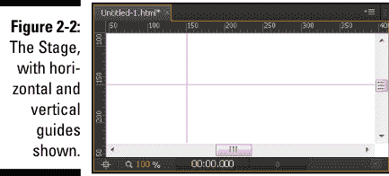

要在舞台上放置指南，请将光标悬停在标尺上，然后点击并拖动。紫色的指南随后会出现。要在舞台上移动指南，请点击它并拖动。

> 在舞台上放置指南后，任何元素（图像、文本框等）都会自动对齐到指南。这有助于你将元素精确地放置在想要的位置。

## 运用直观、精确且灵活的时间轴

除了舞台，时间轴（`Timeline`）可能是你在 `Edge Animate` 中最常用的功能。你可以在屏幕底部找到时间轴，它包含许多功能，如下：

- **关键帧：** 你使用关键帧来指示动画在舞台上的展开时间和持续时长。时间轴中的彩色条（如图2-3所示）代表关键帧，并指示动画的开始、停止以及播放时长。你可以通过点击和拖动来编辑这些关键帧。

- **模式切换：** 时间轴还允许你切换不同的模式，例如自动关键帧（`Auto-Keyframes`）、自动过渡（`Auto-Transitions`）和钉住（`Pin`），并且可以选择不同的缓动（`Easing`）属性。

- **动画增强：** 通过时间轴，你可以通过多种方式调整动画——例如，添加操作（`action`）（见第5章）、指定滤镜元素（见第4章）以及启用时间轴对齐（`snap`）（同样见第4章）。

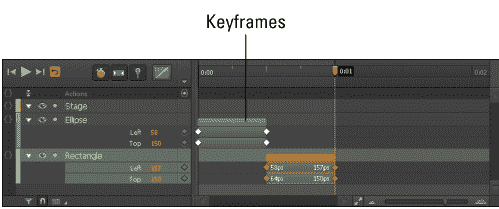

图2-3：时间轴。

## 使用熟悉的工具绘图

如果你曾经使用过其他绘图或图像编辑软件，那么你很可能认出 `Edge Animate` 中的绘图工具。如果 `Edge Animate` 是你使用的第一款艺术软件，那么请放轻松，你会发现绘制矩形和圆形等元素就像点击和拖动一样简单。

你可以在屏幕顶部、菜单正下方找到绘图工具，如图2-4所示。

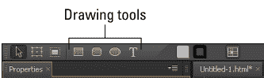

图2-4：绘图工具。

绘图工具包括矩形、圆角矩形、用于绘制圆形的椭圆，以及用于绘制文本框的文本工具。

## 利用交互与适应功能

`Adobe Edge Animate CC` 不仅仅是将元素在屏幕上移动。你可以使用它的许多功能为观众创建交互性——并且可以微调更多功能来配置软件以适应你的偏好：

- ✓ **交互性：** 你可以使用按钮、链接和循环等控件和操作构建完全交互式的动画。

- ✓ **符号：** 你可以保存创建的元素（如按钮），并在不同的动画中再次使用它们。

- ✓ **响应式网页设计：** `Edge Animate` 使你能够构建能响应浏览器和设备窗口大小的合成作品。

- ✓ **多种发布选项：** `Edge Animate` 提供多种方式发布你的动画，以便用于不同的应用程序——例如不同的网页浏览器和 `iBooks`——或者将你的 `Adobe Edge Animation` 导入不同的 Adobe 产品，如 `InDesign` 或 `Muse`。

- ✓ **字体选择：** `Edge Animate` 提供多种字体选择。如果你对特定字体很挑剔，好消息是，如果你能在网络上找到某种字体，你很可能可以在你的动画中使用它。

- ✓ **选择你的语言：** 如果英语不是你的母语，而你更喜欢用（比如）德语、西班牙语、法语或日语工作，那么 `Edge Animate` 为你提供了解决方案。

## 智能地实现交互性

`Adobe Edge Animate CC` 使你能够做的远不止绘制和动画化元素。你还可以使这些元素具有交互性，这允许你的观众点击项目以触发不同的操作。例如，你可以为交互式幻灯片制作停止、播放和暂停按钮。你还可以通过添加链接来创建一个菜单，允许你的观众导航到动画的不同部分——或者完全不同的网页。

当你的观众将光标在你的动画周围移动时，你可以让光标在特定区域上方移动时触发不同的操作。这种光标移动称为 `mouseover`（鼠标悬停）。或者，如果你的观众使用平板电脑或智能手机查看你的动画，你可以允许他们简单地点击一个元素来触发操作。

## 使用符号创建可复用对象

起初，使用符号（`Symbol`）可能有点令人生畏，但在你积累了使用经验后，它们会变得不可或缺。

那么，`符号`究竟是什么？它本质上是你创建的一个嵌套动画，拥有自己独立的时间轴和交互能力。例如，假设你发现自己在不同的项目中反复创建具有相同操作的相同元素。通过将这个重复出现的元素保存为符号，你可以在任何项目中重复使用它及其相关的操作。一个典型的符号例子是按钮。如果你发现自己在重复创建相同的按钮——比如幻灯片的播放按钮——你可能希望将该播放按钮保存为符号，以便以后重复使用。

你可以在库面板中找到你的符号，如图2-5所示。

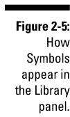

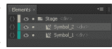

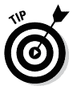

`Edge Animate` 允许你导出和导入符号。你可以为了方便使用，将符号从一个项目复制并粘贴到另一个项目。甚至可以复制和粘贴其他符号。将符号导出为单独的 `.ansym` 文件，并导入到另一个项目中。有关创建和使用符号的信息，请参见第12章。如果你发现自己经常使用符号，那么当你一次性导入多个符号时，你会很高兴。`Edge Animate` 在导出多个符号时，会将它们组合成一个 `.ansym` 文件；你可以在目录中拥有多个符号而无需冲突。特别是除了播放按钮外，这种功能非常有用。

## 融入响应式网页设计

与 `HTML5` 一起，响应式网页设计是网页开发领域的热门术语。响应式网页设计允许你的动画根据浏览器窗口的大小调整大小。这意味着很多事情，例如，假设有人在台式电脑上查看动画。如果用户调整窗口的大小，使其变大或变小，你的动画中的元素会相应地调整大小。例如，如果浏览器窗口最大化为 `100%`，你的动画中的图像将显示为 `100%`。如果浏览器窗口缩小到 `50%`，那么你的图像也会缩小到 `50%`。这是一个非常强大的功能，因为屏幕尺寸种类多样，你永远不知道观众是在60英寸的显示器、4英寸的 iPhone还是两者之间的任何设备上查看。`Edge Animate` 通过使用百分比而不是硬编码像素来处理响应式设计。这使你可以专注于动画，而不担心屏幕尺寸。

## 了解你的发布选项

你有不止一种方式发布动画——`Adobe Edge Animate` 为你提供了多种选项（如图2-6所示）。你可以将动画发布为独立的网页，也可以将其嵌入现有的网页中。你还可以将动画导出用于 `iBook`。你甚至可以将动画发布为静态 HTML 页面，用于 HTML5 的旧版浏览器。

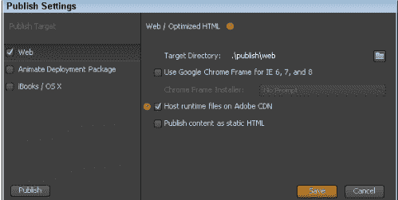

图2-6：`Edge Animate` 发布设置。

静态 HTML 仍然使用 HTML5 编写，动画也常播放。区别在于，当 `Edge Animate` 生成静态文件时，元素并非通过 JavaScript 创建，而是直接存在于 HTML 中。这种安排有利于搜索引擎优化（SEO）：一些搜索引擎在通过 JavaScript 创建元素时，可能无法解析它们。

## 展示你的最佳字体

你可以在网页中使用多种字体，`Adobe Edge Animate CC` 为你提供了全面的支持。除了标准字体供使用（参见图2-7），`Edge Animate` 还允许你从网络处导入字体。


如果这些字体不能满足你的需求，你可以从不同的来源导入字体——包括 Google 网络字体。你还可以使用内置于 `Animate` 中的字体。如果你熟悉 `Typekit`（另一个免费工具），你会发现它同样适用于 `Edge Animate`。

记住，`Typekit` 是面向经验丰富的用户的工具：你可以使用自己的字体或购买字体，但必须将字体托管在你的服务器上。为此，你需要在样式表中使用 `@font-face` 规则，并将其放置在项目文件夹中。具体方法如下：

1. 在 `Edge Animate` 中，在“Web字体”对话框中，键入以下内容：

```
<link href="mystyle.css" rel="stylesheet" type="text/css">
```

此时出现另一个对话框。

2. 在第二个对话框中，输入样式表中指定的字体名称。

如果你需要更多如何在样式表中编写自定义字体层叠样式表（`CSS`）的信息，可以在此处找到：http://blog.freancer-id.com/2010/06/02/custom-font-for-all-browsers/

我们将在第12章更详细地讨论字体。

## 使用你选择的语言工作

该软件在许多方面都是全球化的——包括你在菜单和面板上看到的语言。如果你觉得使用英语以外的语言更自在，`Edge Animate` 可以让你轻松地将软件使用的语言更改为流行的语言之一。

从“帮助”菜单中（如图2-8所示），你可以从不同的语言中进行选择。当你从“帮助”菜单中选择一种语言时，该语言将出现在软件中。你可以选择的语言包括德语、英语、西班牙语、法语和日语。

图2-8：“帮助”菜单中的“更改语言”选项。

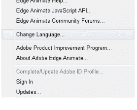

如果你选择了另一种语言，你必须关闭并重新启动 `Edge Animate` 才能使更改生效。在你选择所需的语言后，界面不会自动更新，只需关闭程序，然后重新打开，即可看到你新选择的语言。


## 深入代码

`Adobe Edge Animate CC` 使得各种用户都能创建动画——从认为处理代码有挑战的人，到视代码为早餐般家便饭的有经验的开发人员和工程师。一方面，你确实不需要任何编码技能就能使用 `Edge Animate` 创建专业动画；另一方面，`Edge Animate` 提供了：

- **原生 HTML5 代码**，非常简洁——没有专有或不必要的代码。这有助于使代码对每个人都更易于阅读和理解。

- **持久代码面板**，让你能够手动编辑代码。

- **JavaScript API**（应用程序编程接口），提供了了解代码背后细节的机会。

没有编码技能的设计师可以放心，他们仍然可以在完全了解任何代码的情况下创建作品。同时，有经验的开发人员可以为 `Adobe` 提供对所有后台代码的访问而喝彩。

## 使用原生 HTML 工作

在你使用 `Edge Animate` 工作时，软件会不断地在后台创建代码。虽然你不一定需要知道任何 `HTML` 或 `JavaScript` 才能创建动画，但如果你恰好具有一些编码技能，那么你可以庆祝了——`Edge Animate` 创建的 `HTML` 代码非常干净，没有任何专有包袱。


- **高级主题：** 当你积累了一些编码实践经验后，这些主题提供了一些值得探索的进阶方向（例如，在页面中创建多个合成）。

图2-12 展示了你可以在 API 中找到的内容示例。

**图2-12：** Adobe Edge Animate CC JavaScript API 的摘录。

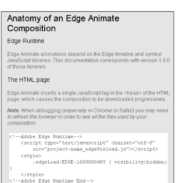

## 本章内容

- 欢迎屏幕的介绍
- 从零开始
- 设置舞台
- 从现有网页开始
- 使用模板
- 添加精美图片
- 绘制和编辑元素与文本

本章将带你开始使用 Adobe Edge Animate CC。我将介绍欢迎屏幕以及所有指向教程和帮助社区的信息链接——同时我也会向你展示如何让界面变得清净。

我将向你展示如何设置舞台尺寸，使其可以是静态尺寸，也可以是响应式设计，将舞台尺寸调整为与浏览器窗口大小相匹配。

第三章还讨论了如何导入现有网页。Edge Animate 可以打开简单的网页，并将任何图像转换为元素——然后你可以对这些元素进行动画处理或通过动作进行增强。（有关元素和动作的更多信息，请参见第5章。）

处理新合成的一部分工作是了解如何将图像作为资源添加到合成中。本章讨论了这一关键知识点，并向你展示如何通过绘制元素和添加文本框来构建舞台上的内容。

## 开始新合成

当你首次打开 Adobe Edge Animate CC 时，会看到一个信息丰富的欢迎屏幕，如图3-1所示。欢迎屏幕由多个组件组成，这些组件分为三个不同的部分。

在屏幕左侧，你可以打开现有文件、创建新文件、从模板创建文件，或查看最近文件的列表。

本节的其余部分将总结欢迎屏幕，然后分岔介绍两个关键技术：

- **调整舞台大小：** 你可以按像素数或百分比来设置舞台大小。
- **导入现有网页：** 你可以打开现有的 HTML 文件。

同样在欢迎屏幕的左下角，有两个小图标。你很可能一眼就能认出它们。Facebook 图标会带你直接进入 Edge Animate 的 Facebook 页面；Twitter 图标则会连接你到 Edge Animate 的 Twitter 动态。

在欢迎屏幕的顶部中央，你可以找到一个包含以下选项的菜单：

- **新增功能：** 此部分列出了自上一个版本以来的所有最新功能、新增内容和更新。
- **入门指南：** 欢迎屏幕的“入门指南”部分在屏幕主体区域显示了几个方框。在这里，你可以逐步了解直接内置于 Edge Animate 中的几个教程和示例（参见图3-1）。
- **资源：** 欢迎屏幕的“资源”部分提供了一系列链接，你可以点击获取来自社区的额外帮助、教程、视频和常见问题解答，如图3-2所示。从“资源”部分，你还可以查看和下载示例项目，以及访问 JavaScript API。
- **清净：** 如果你希望在打开 Edge Animate 时拥有一个安静整洁的工作空间，只需在欢迎屏幕上点击“清净”即可。这样做会移除你通常可能看到的教程和列表。

Edge Animate 会记住你选择的欢迎屏幕选项。如果你在选择“清净”的情况下关闭软件，那么下次打开 Edge Animate 时，你会看到清净的欢迎屏幕。如果在关闭程序时选择了其他任何选项，情况也是如此。

访问欢迎屏幕上列出的许多功能需要互联网连接。

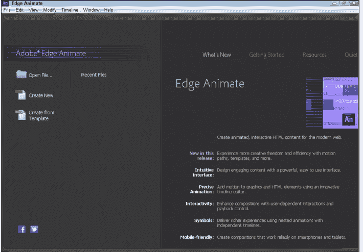

**图3-1：** Adobe Edge Animate CC 欢迎屏幕。

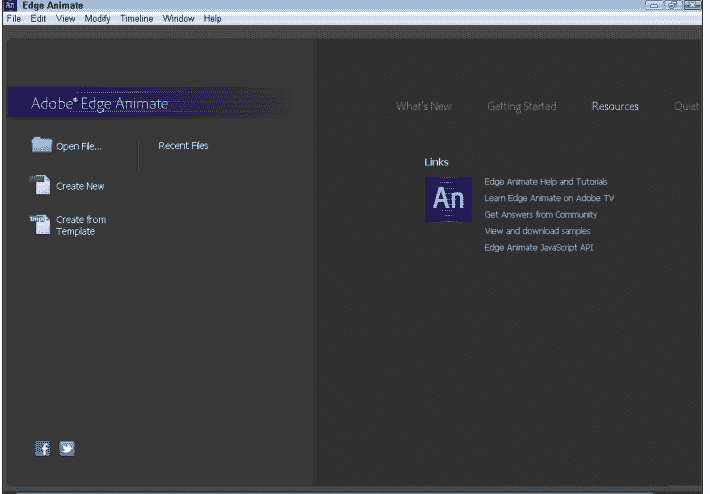

**图3-2：** 欢迎屏幕列出了资源。


**图3-3：** “清净”选项会淡化所有杂乱内容。

当你首次打开 Edge Animate 时，可能想开始全新的合成。为此只需点击屏幕左侧的“新建”图标（参见图3-1）。之后有一些项目时，可以点击“打开文件”或“最近文件”打开现有的合成。

当你点击“新建”时，Edge Animate 会呈现一个全新的舞台，你可以在此开始工作。

## 调整舞台大小

舞台是你放置元素，例如图像、文本和对象的地方。舞台是一个 窗口，这意味着你在屏幕上看到的内容就是观众在与合成交互时看到的内容。你可以通过几种方式设置舞台大小：

- **像素：** Adobe Edge Animate 允许你设置舞台保持特定大小，无论浏览器窗口如何。
- **百分比：** 适合那些偏爱响应性网页的用户。
- **测试响应式网页：** 你可能想更改舞台背景色来测试设计的。（将在接下来的几节中详细介绍。）

### 按像素值调整舞台大小

首先要采取的步骤之一是正确设置舞台。如果你计划将动画插入现有网页中，请先确定动画在该页面占据多少空间，然后相应地设置舞台。

要调整舞台大小，请点击属性面板中“舞台”部分的数字——位于屏幕上角附近——如图3-4所示。点击宽度或高度允许你输入希望舞台具有的尺寸。

如果你不想输入数字，Edge Animate 提供了另一种调整舞台的方法：只需将光标放在数字上。当光标变成双向箭头时（如图3-4所示），你可以点击并拖动以增加或减小舞台。

### 按屏幕大小调整舞台大小

如果你想创建一个不必适应特定尺寸的动画，那么你应该通过切换按钮（参见图3-5）从像素切换到百分比。这是创建响应式网页的一个步骤。当你按百分比而不是像素值来设置舞台时，舞台会根据父元素的大小自动调整。

父元素的一个例子可以是窗口本身——如果动画是一个独立网页。然而，如果动画是网页的一部分，那么父元素可以是嵌套其中的`div`元素。

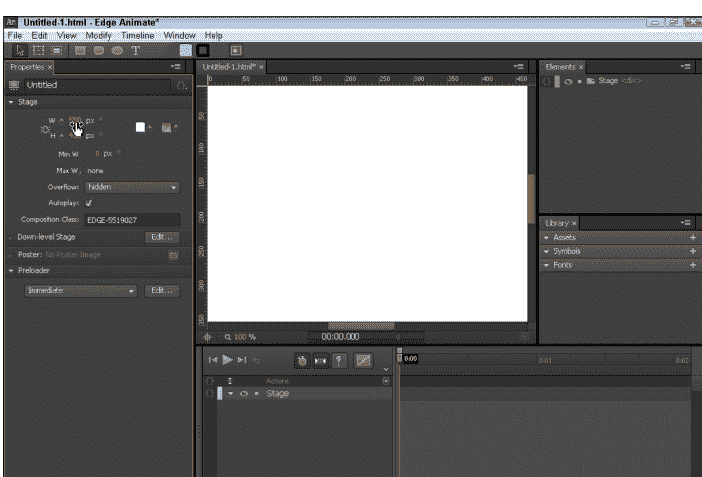

**图3-4：** 按尺寸（以像素为单位）调整舞台大小。

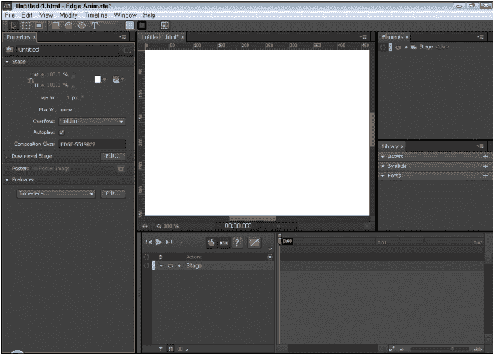

**图3-5：** 按百分比设置舞台大小。

让你的舞台填满整个浏览器窗口，将舞台宽度和高度设置为100%，如图3-6所示。要让舞台填充一半窗口，设置为50%；依此类推，取决于你希望动画占据窗口的比例。

默认情况下，舞台背景为白色。因此，你在px和%之间切换时，舞台不会明显变化。要测试px和%作为舞台尺寸的区别，请将舞台背景色为非白色，例如红色。然后尝试不同的百分比和尺寸查看效果。

要更改舞台背景色（如图3-6所示），请点击白色块调出颜色选择器。你可以通过点击“链接宽度和高度”图标（在图3-7中高亮显示）让Edge Animate保持宽度和高度不变。默认情况下，“链接宽度和高度”图标是关闭的；在此默认设置下，Edge Animate在调整大不会保持宽度（或高度）比例。

## 第3章：处理新合成

![img/f861d9b25b6632c7c923b8a91b3da483_64_0.png]

**图3-6：** 更改舞台背景色。

![img/f861d9b25b6632c7c923b8a91b3da483_64_1.png]

**图3-7：** 使用链接宽度和高度保持比例。

## 导入HTML

Adobe Edge Animate CC对HTML非常友好。如果你有一个现有的（尽管非常基础的）HTML网页想要制作动画，只需在欢迎屏幕上点击“打开文件”即可开始处理。

打开文件时，确保所有图像和关联文件都与htm文件同一文件夹中——或者位于htm文件的嵌套文件夹中。否则它们将不会出现在舞台上。

导入现有HTML时，请注意以下几点：

- Edge Animate可能不支持你的CSS文件。
- htm文件中图像会出现在“库”面板中。
- 文本将作为元素导入。

### CSS文件可能出现的问题

请记住，导入的HTML页面越简单，Edge Animate打开它就越容易。

如果打开htm文件确实遇到问题，请尝试移除所有关联的CSS文件。你可能会丢失之前的工作而烦恼，但请记住，你可以使用Edge Animate快速替换所有设计工作。

如果你打开一个包含菜单内容的现有HTML文件，你可以为菜单和元素制作动画，但无法重新格式化颜色和其他方面。原因是Edge Animate仅允许为导入的HTML对象创建动画序列，以避免与你可能应用的任何CSS样式冲突。当你为同一个元素应用两种样式时，可能会变得有些混乱，导致意外结果。

### 图像出现在“库”面板中

如果你导入的HTML页面包含图像，那么Edge Animate会将这些图像作为资产导入到“库”面板中（见图3-8）。

![img/f861d9b25b6632c7c923b8a91b3da483_65_0.png]

你现在可以将导入的图像视为可以制作动画的元素；你可以让图像在屏幕上移动。有关“库”面板的更多信息，请参见第12章。

### 文本作为元素导入

当你导入包含文本的HTML文件时，Edge Animate会将文本作为元素导入。你可以选择元素制作动画，但无法编辑文本。如果原始HTML使用了`h1`或`p`标签，那么Edge Animate会识别这些属性并在“元素”面板中显示它们，如图3-9所示。

![img/f861d9b25b6632c7c923b8a91b3da483_66_0.png]

**图3-9：** 文本作为元素导入。

### 使用模板

模板在Edge Animate 2.0中引入。此功能消除了每次开始新合成都需要重新发明的必要。你可以总是从保存的文件开始，但模板使你能够开始包含想要属性和元素的项目，无需重写。当你想要创建类似的合成并且希望立即开始，模板非常有用。你可以从主菜单“文件”下找到模板：

- **从模板创建：** 这是从保存模板开始新合成的地方。执行此操作你首先保存一个模板，然后当你点击“从模板创建”时，查看器会看到模板的缩略图（如图3-10所示）。然后选择想要使用的模板。

![img/f861d9b25b6632c7c923b8a91b3da483_67_0.png]

**图3-10：** 从“文件”菜单访问模板。

![img/f861d9b25b6632c7c923b8a91b3da483_67_1.png]

**图3-11：** 从查看器中选择模板。

- **另存为模板：** 这会将当前的合成保存为模板。模板包括合成中的所有内容，包括符号、图像、文本以及自定义修改。当你点击“另存为模板”并选择位置时，Edge Animate创建一个文件。保存后，当你点击“从模板创建”时，Edge Animate会收到消息：“是否覆盖现有模板？”如果你尝试从文件目录中打开一个尚未导入的模板，Edge Animate会显示该模板。在查看器中点击垃圾图标，如图3-12所示。

![img/f861d9b25b6632c7c923b8a91b3da483_68_0.png]

**图3-12：** 删除模板。当你删除模板时，保存的文件仍留在你的硬盘上（或在你最初保存到的特定目录中）。删除模板只是从Edge Animate中移除；你将无法从查看器中选择它。

## 绘制和编辑元素、导入图像以及文本

Adobe Edge Animate提供了绘图工具，以便你可以在舞台上创建矩形、圆角矩形和椭圆——这些随后成为你可以制作动画的元素。导入图像和文本也是如此。图3-13显示了你可以直接在主菜单下方找到绘图工具的位置。

![img/f861d9b25b6632c7c923b8a91b3da483_69_0.png]

Animate提供系列用于创建元素的工具：

 ** **绘图工具：** 你可以绘制矩形、圆角矩形和椭圆（包括圆形）。
- **编辑圆角：** 如果你想编辑圆角的圆度，Edge Animate提供了实现的方法。
- **导入图像：** 作为设计师，你可能有一些想要制作动画的精选图像。现在你可以了。
- **编写文本：** 你很有可能想要向合成中添加文本。Animate使这项任务变得简单。

### 绘制矩形

绘制矩形非常简单，只需点击“矩形”工具，然后在舞台内点击并拖动即可。当你绘制矩形制作动画时，它们会成为舞台上的元素。你可以将它们转换为符号、分配操作和触发器等等。

> **提示** 当你在舞台上绘制一个元素（如矩形）并且舞台上已有其他元素时，Edge Animate会自动显示粉色参考线（见图3-14）。这些参考线可以帮助你创建大小等的元素，并将你的元素均匀对齐。

### 创建圆角矩形

圆角矩形工具与矩形工具类似，但它的角是圆而不是方的。你可以通过尝试绘制圆角矩形时的点击和拖动方式来影响角的圆滑程度。例如，你可以绘制一个圆形、药丸形状，或者一个带微圆角的正方形——以及介于它们之间的任何形状。图3-15展示了使用圆角矩形工具可以绘制的一些不同形状。

**图3-15：** 使用圆角矩形工具绘制不同形状。

### 绘制椭圆

椭圆工具使得绘制圆形变得简单。只需选择椭圆工具（如图3-13中高亮显示），然后点击并拖动以绘制一个带圆角的形状。图3-16展示了一个完美的圆形元素。

要绘制一个完美的圆形，在点击并拖动时按住`Shift`键。这个按键会强制元素保持圆形比例，无论你如何点击和拖动。

### 编辑元素的圆角

无论你绘制什么类型的元素——矩形、圆角矩形、椭圆或圆形——你都可以选中它并独立编辑每个角（如果它有角的话）。要从属性面板进行操作，找到“圆角”，然后（如果需要）。


时间轴位于界面底部。它包含播放控制，如播放、倒带、快进和返回上次播放位置（见图4-1）。

播放控制包括基础功能和一个证明极其方便的功能：

- **播放、倒带和快进：** 这些是你在任何类型的媒体播放器上都能找到的基本控制，`Adobe Edge Animate CC`提供了这些功能供你使用。
- **返回上次播放位置：** 有时你不想在观看完动画后返回动画的开头。当你的动画开始变长，并且（假设）你有一个特定部分想要调整时，尤其如此。这个控制可以让你根据需要，轻松地返回到你上次停止播放动画的位置。

### 播放、倒带和快进

当你的动画准备好测试或观看时，你可以点击“播放”来观看动画在舞台上播放。同样，你可以点击“快进”或“倒带”来分别快速推进动画或快速倒退。

“返回上次播放位置”将返回到时间轴上你放置图钉的点。

> **提示：** 你也可以按键盘上的空格键来播放动画。如果播放头（在本章后面详细解释）位于时间轴的末尾，动画将完整播放。你也可以通过在时间轴上来回点击和拖动播放头来观看动画的展开。

### 返回上次播放位置

默认情况下，“返回上次播放位置”图标是灰色的，因为上次播放位置是在时间轴的开头。当你开始创建合成时，你可以将播放头沿着时间轴进一步向外移动。这样做会激活“返回上次播放位置”按钮，如图4-2所示。

当你在播放合成后点击“返回上次播放位置”时，`Edge Animate`会将你带回播放头在时间轴上的位置，而不是将你完全带回开头。

## 切换时间轴模式

紧接在播放控制之后是另一组工具，你可以在其中设置关键帧模式、设置自动过渡模式，你还可以切换图钉并设置缓动属性。这些工具如图4-3所示。

`Adobe Edge Animate CC` 使用关键帧进行动画。关键帧在时间轴中显示为白色菱形。图4-2中的绿色水平条代表了一个矩形元素在5秒秒内从左角移动到右下角时，关键帧之间的过渡（动画序列）。这是一个大量的信息，你都可以在时间轴和关键帧中找到。

`Adobe Edge Animate CC` 在时间轴区域内包含几种切换模式：

- **关键帧：** 如果你希望或不希望`Edge Animate`在创建合成时自动为你创建关键帧，你可以打开或关闭它们。
- **自动过渡：** 如果你希望或不希望`Edge Animate`在移动舞台上的元素时自动创建动画序列，你可以打开或关闭此功能。
- **播放头和图钉：** 当开始制作动画时，请确保图钉已打开，否则`Edge Animate`不会创建动画序列。
- **缓动：** 你可能不一定称其为切换，但你可以选择你偏好的缓动属性；你的选择会影响`Edge Animate`让元素动起来的方式。

### 关键帧模式

要自动创建关键帧，您必须首先通过点击红色的秒表图标来激活关键帧。默认情况下，当您首次开始新的动画时，秒表是红色的，但上面有灰色的线条穿过（如图4-4所示）。

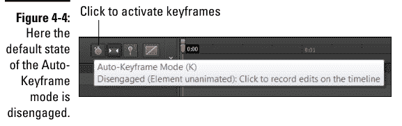

在创建合成时，你需要秒表显示为红色，这样 `Edge Animate`才能自动为您创建关键帧。只需点击秒表以激活自动关键帧，并使秒表变红（如图4-5所示）。

当秒表未激活时，你不必点击秒表来启用它。只需切换图钉，自动关键帧就会启用。你可以在以下部分了解更多关于切换图钉和移动播放头的信息。

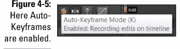

如果您点击秒表，它变暗为灰色而不是红色，那么你将需要手动插入关键帧。

如果您想在舞台上安排元素而不触发关键帧，请确保秒表通过点击它而变暗，如图4-6所示。当秒表为灰色时，表示自动关键帧已禁用。

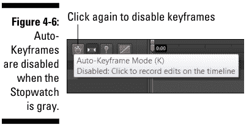

### 自动过渡模式

通过开启或关闭自动过渡模式，您可以切换在关键帧之间创建平滑过渡的能力。`过渡`是您创建的动画，用于展示（例如）一个元素在舞台上从左向右移动（过渡也称为`动画序列`）。当您创建新文件时，自动过渡模式已为您启用（如图4-7所示）。你还会在图钉和播放头之间看到一个彩色箭头。这个带有箭头的橙色条将在本章后面的“向前动画”和“向后动画”部分详细讨论。

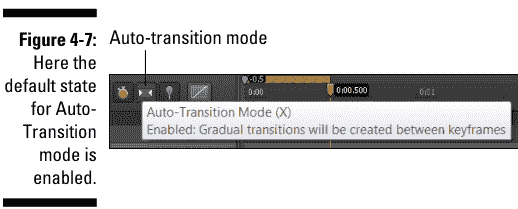

> 记住

当自动过渡模式开启时，只要您已按接下来几节所述切换了图钉和播放头，`Edge Animate`就会在您移动舞台上的元素时创建动画效果。

您会知道何时创建了动画：彩色条会出现在关键帧之间，如图4-2所示。

如果您点击自动过渡图标，它会变暗，`Edge Animate` 将不会创建动画。相反，`Edge Animate` 只会插入关键帧；您将看不到彩色条（参见图4-8）。

图4-8：当自动过渡关闭时，`Edge Animate`不会创建动画。

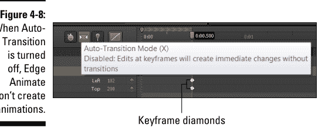


如果您希望在舞台上的元素出现动画序列，请确保秒表为红色且自动过渡已启用。如果您想在舞台上移动元素而不创建关键帧，则需要禁用秒表和自动过渡。您必须切换图钉。

### 切换图钉

当您开始创建动画时，需要切换图钉。当您首次开始合成时，图钉是关闭的，如图4-9所示。在此状态下您无法创建动画序列。

图4-9：这里图钉的默认状态是关闭的。

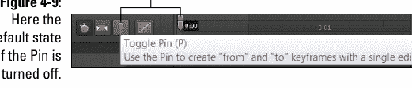

要创建动画序列，请打开秒表，确保自动过渡开启，然后点击图钉。图钉图标会激活（如图4-10所示）并变为蓝色。

图4-10：点击图钉以激活它。

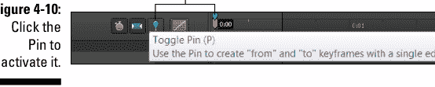

激活图钉后，您现在可以将其沿时间轴拖动，以确定动画序列的位置和持续时间。

### 缓动工具

缓动工具是时间轴最后一个图标。您可以使用缓动工具影响动画的播放方式。要为元素添加缓动效果，请从时间轴中选择一个过渡，然后从缓动菜单中选择一个属性（如图4-11所示）。

例如，如果您希望元素像球一样弹，请从左列选择`Ease Out`，然后在右列选择`Bounce`。缓动的默认设置是`Linear`，它对您的元素没有影响。如果您将缓动从`Linear`更改为其他选项，那么您创建的所有元素都将默认使用新的缓动属性。要编辑特定元素的缓动属性，您必须从时间轴中选择该过渡。


图4-11：缓动属性。

```
缓动工具
```

### 播放头和图钉

播放头和图钉位于时间轴的时间标记上。您将用它们执行几项不同的任务。第一项任务是确定动画开始和结束的时间点。第二项任务是告诉 `Edge Animate`，当您点击播放时，您希望从哪里开始查看。

图钉是顶部的蓝色图标；播放头是下面的黄色箭头。

当您准备好开始动画时，您将图钉或播放头拖动到时间轴的长度上。如图4-12所示，将图钉或播放头沿时间轴向下拖动决定了您的动画是向前播放还是向后播放。

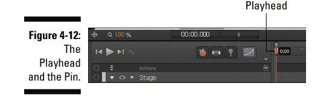

### 处理关键帧和动画序列

掌握如何处理关键帧和动画序列非常重要，这样您就可以创建和编辑它们以达到您的目的。以下部分介绍了您需要的所有 `Edge Animate`部件，用于创建关键帧和动画序列。以下是如何实际创建这些关键帧和动画序列的——归结为熟悉以下过程：

- **创建关键帧**：当您开始动画时，根据您设置图钉和播放头的方式，您可以创建向前或向后播放的过渡。
- **选择关键帧**：创建关键帧后，您可以选择它们以便编辑。
- **编辑关键帧**：创建关键帧并选择它之后，您可以对其进行编辑。
- **复制和粘贴关键帧**：您可以复制和粘贴您重复使用的关键帧。这应该为您节省大量时间；不必为类似的动画序列反复相同的关键帧。

### 创建序列

要创建关键帧和动画序列（过渡），请按照以下步骤操作。

1. 使用绘图工具或通过导入图像在舞台上放置一个元素。
2. 切换图钉，使其变为浅蓝色。
3. 点击并拖动图钉或播放头沿时间轴向下移动。移动图钉和移动播放头之间的差异将在本节后面描述。图钉和播放头之间的间隔空间决定了动画播放的时间长度。
4. 点击并拖动元素在舞台上移动，例如，将元素从左上角移动到右下角。`Edge Animate`会在时间轴上添加彩色条。要预览您的动画，请点击播放或按空格键。

### 前向动画（由于原文内容重复且逻辑冗乱，此处保留核心逻辑并排版）

（注：原文文本中存在大量重复描述和格式错误，以下为优化后的核心逻辑结构）

> 记住

当自动过渡模式开启时，只要您已按接下来几节所述切换了图钉和播放头，`Edge Animate`就会在您移动舞台上的元素时创建动画效果。

您会知道何时创建了动画：彩色条会出现在关键帧之间，如图4-2所示。

如果您点击自动过渡图标，它会变暗，`Edge Animate` 将不会创建动画。相反，`Edge Animate` 只会插入关键帧；您将看不到彩色条（参见图4-8）。

```

```


如果您希望在舞台上的元素出现动画序列，请确保秒表为红色且自动过渡已启用。如果您想在舞台上移动元素而不创建关键帧，则需要禁用秒表和自动过渡。您必须切换图钉。


```markdown

- **时间轴吸附：** 你希望元素精确吸附到时间轴的特定位置，还是更倾向于自由移动？
- **配置网格视图：** 你可以根据自己的偏好设置网格视图，决定是否显示网格。
- **查看时间轴的更多或更少内容：** 有时你可能想查看整个合成的时间轴；有时你可能想放大查看。
- **添加更多时间：** 如果时间用完了，你总可以添加更多！


你可能想知道 `Edge Animate` 如何确定元素在时间轴中出现的垂直顺序。这完全取决于元素的排列方式。最靠前（显示在所有其他元素之上）的元素是时间轴中列出的第一个元素。最靠后（显示在所有其他元素之后）的元素是时间轴中列出的最后一个元素。

## 舞台控制

舞台有几个控制选项，使你能够居中和放大它。

- **居中舞台：** 如果出于某种原因，舞台在你这里偏离了中心，而你想要一个一键解决方案来重新将舞台居中在屏幕上，那么只需单击“居中舞台”图标。此图标位于舞台的左下角（如图4-27所示）。
- **放大舞台：** 如果你想放大舞台，可以使用缩放工具（如图4-28所示）。你可以单击橙色数字并输入特定的缩放级别，或者将鼠标指针悬停在数字上，然后单击并拖动来调整。

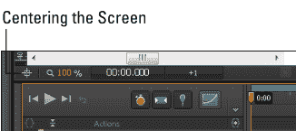

### 居中屏幕

图4-27：使用“居中屏幕”图标将舞台居中在你的屏幕上。

### 缩放工具

图4-28：放大舞台。

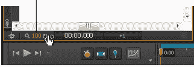

## 时间轴控制

`Adobe Edge Animate CC` 提供了多种工具来帮助你配置时间轴，使其以你想要的方式呈现。

> ✔ **播放头和定位针时间戳：** 提供一种方式来显示播放头在时间轴中的位置以及动画序列的时长。播放头由左侧的黄色数字表示，定位针由右侧的蓝色数字表示（见图4-29）。你可以将光标悬停在这些数字上，然后单击并拖动来更改播放头和定位针在时间轴上的位置。

**播放头 定位针 播放头 定位针**

图4-29：播放头和定位针时间戳。

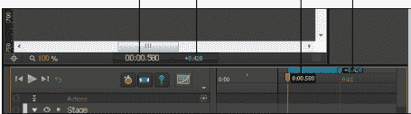

> ✔ **筛选元素：** `Edge Animate`提供了一种方式，让你只能看到具有动画序列的元素，或者一次查看所有元素。这不会影响你在舞台上看到的内容，但会影响你在时间轴中看到的内容。在图4-30中，左侧筛选关闭，你看到所有元素；右侧筛选开启，你只看到有动画的元素。筛选控件已标识出来。

图4-30：筛选元素。

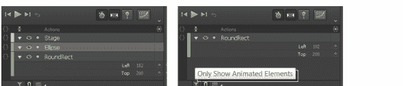

### 筛选控件

- **配置网格视图：** 如果你想在时间轴中看到精确的度量——从一整秒到三十分之一秒——你可以设置该视图（如图4-31所示）；你可以调出你的选择并切换网格视图的开启或关闭。

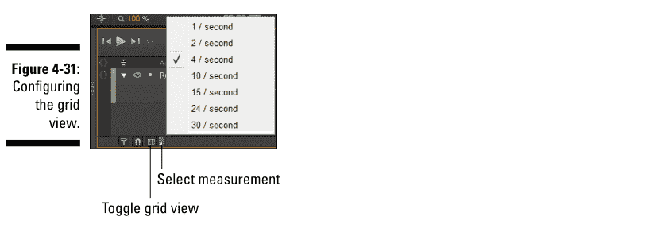

- **时间轴吸附：** 如果你选择开启网格视图，那么你可以通过开启时间轴吸附（如图4-32所示）让定位针和播放头吸附到网格上。

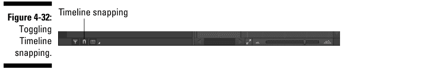

- **缩放滚动条：** 你可以通过滚动缩放条来查看时间轴的更多或更少内容（如图4-33所示）。你可以单击以查看整个时间轴，单击以放大或缩小缩放级别，或者单击并拖动滚动条上的图标。

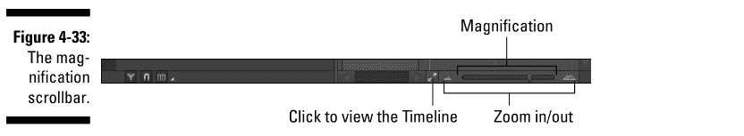

- **向时间轴中插入更多时间：** 你可以在设计合成过程中的任何点向时间轴添加更多时间。从主菜单中，单击时间轴，然后选择插入时间，该选项大约在菜单的中间位置。当你这样做时，会打开一个对话框（如图4-34所示）。

图4-34：向时间轴中插入更多时间。

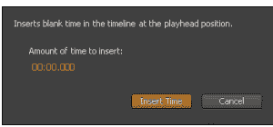

> 将播放头放置在时间轴上你想要插入更多时间的位置。

## 本章内容

- 通过动作为你的合成添加交互性
- 创建触发器以执行动作
- 将标签应用于动作和触发器
- 使用光标属性创建线索

`Adobe Edge Animate CC` 一个特别强大的功能是能够向你的合成中添加动作、触发器、标签和光标属性。这些工具是你用来使动画具有交互性的，这样你的观众就可以参与到动画的执行中，而不是只能被动地坐着观看。

通过在时间轴中放置`标签`，并将它们与动作和触发器关联，你可以识别时间轴中的特定点，并创建一种更简单的控制动作和触发器的方法（而不是使用时间戳）。通过使用标签，你无需打开代码框来更改，例如，你希望动画在触发器或动作被调用时播放的时间点。相反，你只需将标签在时间轴上上下滑动即可编辑动作或触发器。使用标签有助于你跳过一个步骤——打开代码框——如果你需要编辑动作以反映时间轴上不同的时间点。

当你将交互元素放入时间轴时，最好更改`光标属性`，以向你的观众提供视觉线索。

## 插入触发器

`Adobe Edge Animate CC` 允许你添加`触发器`——本质上是控制动画播放方式。当动画到达时间轴上的特定点时，触发器就会启动。使用`触发器`的典型命令是`循环`——让动画到达末尾（或您指定的某个点）重复播放。

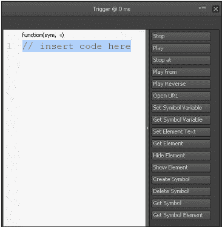

图5-1：可用的触发器列表。

 您也可以将操作与触发器一起添加到舞台。

### 添加触发添加到舞台

要添加触发器，你必须按照特定顺序执行多个步骤：

1. **创建一个添加触发器的动画序列。** 例如，使用绘制工具在舞台上绘制一个元素。
2. **在时间轴上将播放头定位到希望触发器启动的位置。** 例如，你可以在动画结束时设置触发器。
3. **单击触发器图标。** 

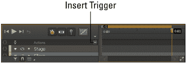 图5-2：触发器图标。

4. **菜单打开后，单击右侧的触发器项目。** 对于循环，选择`Play back from`。

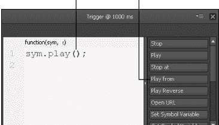 图5-3：触发器菜单。

5. **单击触发器框右上角的 X 关闭并保存您的触发器。** 你将在时间轴中看到触发器图标。

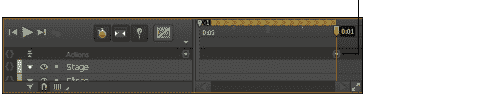 图5-4：时间轴上的触发器图标。

6. **在浏览器中预览。** 从主菜单单击“文件”，然后单击“浏览器中预览”。

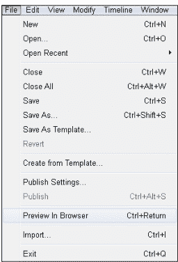 图5-5：浏览器中预览。

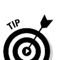 恭喜！您的动画现在包含了一个循环。

如果你希望动画循环回到时间轴上的特定点，而不是返回开头，可以在触发器框中添加标签或指定时间。

### 时间值

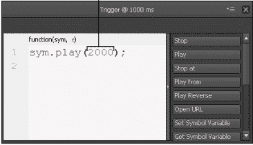 图5-6：触发器框中的时间值。

你可以通过几种不同的方式编辑触发器：
- 通过单击并上下拖动时间轴中的触发器图标来更改触发器在时间轴中的位置。
- 双击触发器图标以打开代码框。

## 创建标签

你可以在时间轴中添加`标签`，用于触发器和元素操作。假设你希望动画在到达触发器时跳回到某个特定时间点。你可以使用标签来确定动画在时间轴中跳回的位置。

### 创建标签

要在时间轴中插入标签，请使用主菜单；单击“时间轴”，然后单击“插入标签”（图5-7）。标签会出现在时间轴中播放头所在的位置。你可以命名此标签（如图5-8所示）。

你可以根据自己的意愿命名此标签，但要命名得当，以便日后记住你为什么把它放在那里。例如，如果你希望幻灯片放映在1 秒标记处循环回来，那么你就在 1 秒标记处插入标签，并将其命名为类似`重启幻灯片放映`的名字。

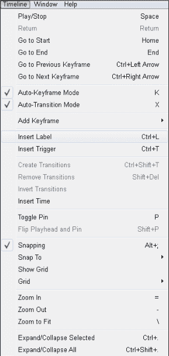 图5-7：插入标签菜单选项。

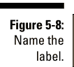 图5-8：命名标签。

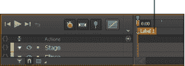 图5-9：时间轴上的标签。

## 将标签与操作和触发器关联

在创建触发器或操作后，决定标签如何使用。

### 添加操作

向元素添加操作类似于添加触发器。`触发器`和`操作`之间存在主要区别：

- **触发器：** 要求观众执行某些操作。例如，你的观众必须点击或鼠标悬停在元素上。
- **操作：** 允许你指定观众使用的交互类型来执行动作。交互包括：
- **点击或双击：** 如果你希望观众点击或双击元素。
- **鼠标：** 如果你希望观众将鼠标移入、移出或悬停在元素上。
- **触摸：** 针对移动设备和触摸屏。
- **焦点：** 此动作与键盘上的`Tab`键相关，使观众能够选择元素。

### 为元素添加动作

你可能希望元素的动作之一是打开一个新的 URL。此功能对于创建指向其他内容的链接非常方便。

1. 选择一个元素，单击右键并选择“为此元素动作”（图5-11所示）。

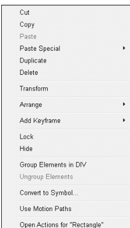

2. 从菜单中单击“打开动作”后，会打开一个空白的`编码框`。

3. 从右侧的菜单中选择“打开 URL”。`Edge Animate`会在框中填充代码。

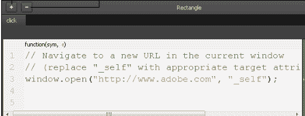 图5-12：包含代码的动作编码框。

你可以对一个元素使用多个动作：
- **添加动作：** 在“动作”编码框打开的情况下，单击左上角的 `+` 号。
- **移除动作：** 单击 `-` 号。

当单个元素关联了多个动作时，`Edge Animate`会在选项卡视图中显示所有动作。

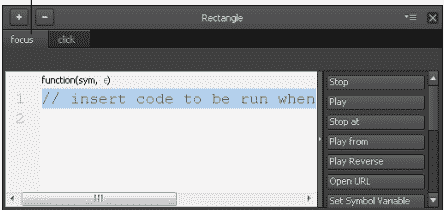 图5-13：一个元素可以有多个动作。

4. 从右侧的菜单中选择“打开 URL”。
5. 更新编码框中的 URL。
6. 关闭编码框以保存工作。
7. 在浏览器中预览动画以测试工作。

```

例如，当您创建一个受众可以与之交互的按钮时，用户期望某种信号来表明动画的某个部分是可点击的。提供这种信号以便您的受众可以与元素进行交互的一种清晰方法是改变光标的形状。您可以通过指定光标的属性来实现这一点。请继续阅读。

### 光标属性类型

Edge Edge Animate 在`光标属性`方面提供了大量选择，例如表示链接的指向手指。如图 5-15 所示，您可以将光标更改为代表不同类型的交互性，包括以下内容：

- ✔ **指向手指：** 表示要点击的链接。
- ✔ **等待：** 表示某些内容正在加载和/或受众应等待某些事情发生。
- ✔ **调整大小：** 表示受众可以调整某些内容（如窗口、列或行）的大小。

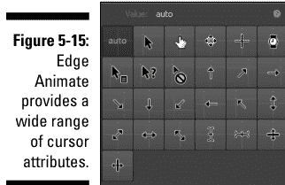

> 优秀的动画师总是为受众提供尽可能多的视觉线索。您的受众正是通过这种方式意识到动画作品中的元素何时何地可供交互。

#### 添加光标属性

Adobe Edge Animate CC 允许您通过更改光标属性来改变光标的外观。本节向您展示如何在将鼠标悬停在作品中的按钮上时，将光标更改为指针。

要更改光标的属性，请按照以下步骤操作：

1. 选择一个元素，例如按钮。
2. 从“属性”面板中，单击“光标样式”图标，如图 5-16 所示。
3. 从菜单中选择一个光标属性（参见图 5-15）。

图5-16：点击光标样式按钮以打开光标属性。

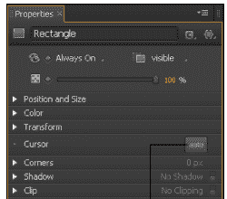

要测试您的光标属性是否生效，只需在浏览器中预览即可。当您将鼠标指针悬停在元素上时，它应该会变成一个指向的手指，如图5-17所示。

图5-17：当您悬停在一个按钮上时，光标会变成指向的手指。

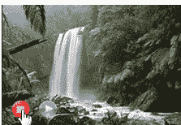

# 第六章：拥抱工作区

*本章内容*

- 根据您的喜好自定义工作区
- 保存您的自定义工作区或恢复到默认设置

Adobe Edge Animate CC 是一款动态的软件工具。该工具的灵活性为您提供了按照自己意愿配置界面的方式。如果您只想查看舞台和时间轴，可以关闭所有面板。或者，您可能希望最大化资源面板，使其占据整个屏幕。您可以将面板组合为选项卡、并排放置，或者一个叠在另一个上面。如果屏幕变得过于杂乱，您只需恢复到默认视图即可。然而，如果您最终将所有面板都排列成了最适合您的方式，您可以将该视图保存为自定义工作区。

当您从一种元素切换到另一种时，属性面板中的设置不断更新。每种类型的元素——绘制的矩形、导入的图像——都有自己的属性。并非所有属性都是独特的；无论其类型，有些属性始终一致。

## 点击和拖动面板

Adobe Edge Animate 的界面由顶部菜单和围绕舞台的一系列面板和框架组成。面板用于设计的按钮、开关和切换器。框架包含面板——您可以根据需要移动和调整大小。您甚至可以恢复到默认视图或创建几种视图：

- 堆叠式
- 选项卡式
- 默认
- 并排式

您可以自定义属性面板、元素面板和库的位置。这些面板中的每一个右上角都有两个图标：

- 下拉箭头（如图6-9）：使用此图标可以停靠面板和框架。您也可以用它来最大化框架。
- 点击并拖动：使用此图标可以在工作区中移动面板。

您可以将光标放在最右侧的“点击并拖动”图标上，然后点击并拖动面板，如图6-1所示。

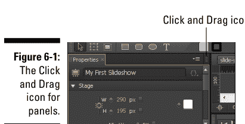

您可以将每个面板移动到屏幕上的任何位置，无论是点击并拖动面板的名称，还是点击并拖动其图标。

## 创建堆叠视图

您可以将面板叠在另一个上面。例如，您可以点击并将属性面板拖动到时间轴区域。在您点击并拖动时，Edge Animate 使用紫色阴影高亮显示正在移动面板的位置。图6-2。

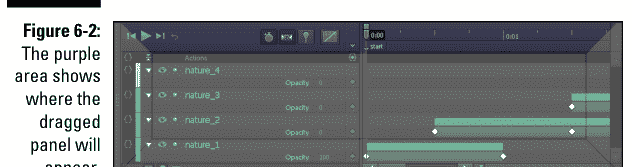

如果您将属性面板拖动到时间轴区域（参考图6-2），属性面板将显示为堆叠在时间轴之上（如图6-3所示）。

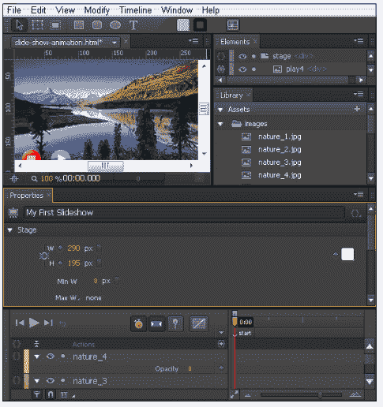

图6-3：属性面板现在堆叠在时间轴之上。

## 创建选项卡式视图

如果堆叠视图对您来说显得杂乱，那么您可能更喜欢选项卡式视图。您可以将一个面板拖动，使其与另一个面板组合成选项卡：被拖动的面板成为选项卡；被拖到的面板成为另一个选项卡。为此，您可以（例如）将属性面板拖动，使紫色阴影位于时间轴内部，如图6-4所示。

图6-4：创建选项卡式面板。

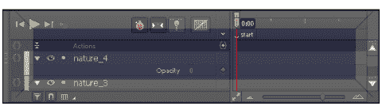

通过将一个面板拖动到另一个面板的中心，您可以创建一个选项卡式视图（如图6-5所示）。当面板以选项卡形式排列时，您可以点击不同的选项卡查看不同的面板。

选项卡式面板

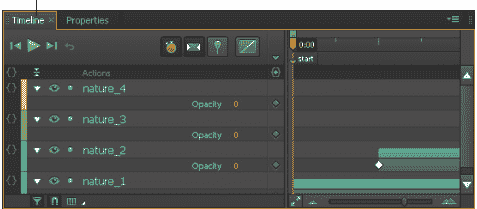

图6-5：时间轴和属性的选项卡式面板。

### 将面板移回其原始位置

移动面板后，您可能更喜欢它之前的位置。在这种情况下，您只需点击并拖动该面板回到其原始位置。

如果您将属性面板移动到与时间轴组成选项卡视图，并且想要恢复其位置，那么请点击并拖动属性面板（您可以从面板名称处拖动它）到屏幕的最左侧。当您将属性面板拖动得足够远时，会出现一条细绿色线和一个面板的空心图像（图6-6）。


图6-6：一条绿线和一个面板的空心图像显示了面板将出现的位置。

## 将面板并排堆叠

关于工作区的排列方式和位置，选择几乎是无穷尽的。除了堆叠或选项卡式之外，另一个选项是将面板并排放置，如图6-7所示。

图6-7：面板的并排放置。


这种并排堆叠是通过将属性面板拖动到库面板的左侧完成的，如图6-8所示。

图6-8：紫色阴影显示了面板并排堆叠时将出现的位置。


## 操作面板和框架

Adobe Edge Animate CC 是一款灵活且可定制的工具，使您能够按照自己想要的方式工作。您可以通过多种方式配置面板和框架，包括：

- ✔ 取消停靠面板和框架，使它们可以在界面上自由浮动。
- ✔ 最大化框架，以便查看更多。
- ✔ 保存根据偏好定制的视图。

## 取消停靠面板

如果堆叠或创建选项卡不是您的风格，那么您可以取消停靠面板，允许它们在工作区周围浮动。在每情况下，您都可以取消停靠面板或框架，如图6-9所示。图6-10：一个取消停靠的面板。

当您想要取消停靠时，点击下拉箭头。如果您点击左角的 `X`，面板将关闭。重新打开一个取消停靠的面板，请从主菜单中点击“窗口”，然后选择您希望打开的面板。当前打开的面板旁边有一个复选标记（如图6-1所示）。


### 取消停靠框架

当您将面板分组为选项卡视图时，每个框架可以容纳多个面板。如果您将面板组合成选项卡，并且从图6-9所示的菜单中选择“取消停靠框架”，那么所有选项卡面板都从工作区取消停靠，您可以随心所欲地在界面上浮动（如图6-2所示）。


### 最大化框架

查看框架和面板的另一个选项是扩展到视图。您可以通过图6-9所示的菜单中选择“最大化框架”来实现。当您点击“最大化框架”时，您选择的面板将填满整个工作区。

最大化框架的快捷键特别有用。只需将光标放在面板上，然后按键盘上的`~`键（该键位于键盘左角`1`的左边，`~`字符上方）。您可以通过菜单中选择“恢复框架大小”来恢复框架，如图6-13所示。


图6-13：“恢复框架大小”菜单。当您选择“恢复框架大小”选项时，框架会恢复到您选择“最大化框架”之前的样子。

## 保存自定义工作区视图

当您将工作区自定义成完全符合要求的方式后，您可以保存该视图，并在未来或下次打开 Adobe Edge Animate 时再次使用它。

要保存自定义工作区，请从主菜单中选择“窗口”->“工作区”->“新建工作区”（如图6-14所示）。当您选择“新建工作区”时，会出现一个对话框。然后，您可以在该对话框中为您的工作区命名，如图6-15所示。

为工作区命名并点击“确定”后，您新命名的工作区将出现在“工作区”菜单中（图6-16）。在此示例中，自定义工作区被命名为我的工作区。


图6-14：保存新工作区。


图6-15：为你的新工作区命名。


图6-16：你的自定义工作区出现在“工作区”菜单中。

从图6-16所示的“工作区”菜单中，你可以选择你的自定义工作区，或者通过点击“默认”恢复到默认工作区。如果在动画制作过程中，你的自定义工作区被移动了，而你想重置它，可以点击“重置 我的工作区”。你还可以“删除工作区”并创建更多的“新建工作区”。

当你在自定义工作区后关闭 Edge Animate，软件在下次打开时会显示相同的自定义工作区，无论你是否保存了该视图。如果你希望界面恢复到默认视图，可以通过点击“窗口”>“重置 默认”（如图6-17所示）进行重置（回到默认状态）。更多详细信息，请参阅下一节。

## 恢复到默认视图

移动和调整界面中不同面板和框架的大小很有趣。然而，如果你玩过头，开始觉得搞砸了什么，或者想不明白如何撤销刚才的操作，请不要担心：你总可以将工作区恢复到你想要的样子。

抱歉，但按下键盘上的 `Ctrl+Z` 并不能撤销在工作区中移动面板的操作。

要将工作区恢复到默认视图，请从主菜单中选择“窗口”>“工作区”>“重置 默认”。

如果你使用的是自定义保存的视图，“工作区”菜单的显示会略有不同。在图6-17中，上方箭头显示如何恢复到默认视图；下方箭头显示如何恢复到自定义视图。


选择“窗口”>“工作区”>“重置 默认”会将你的工作区恢复到首次打开 Edge Animate 样子。

## 不断变化的属性

“属性”面板（位于左栏）会根据所选元素的类型不断更新。如果你选择一个元素（如矩形），Edge Animate 在“属性”面板中的配置与选择文本或图像不同。这减少了杂乱，对于特定类型的元素，你只需要处理的内容。有些属性是一致的，无论你选择什么元素都会出现；而其他属性特定于某些元素。一致属性包括：`ID`、`类`、`位置`和`大小`。这些都将在后续页面中讨论。

除了从“属性”面板进行格式化外，你还可以：

- 编辑标题标签
- 设置类
- 添加动作
- 允许你的受众通过 Tab 键切换

### 舞台的特定属性

当你开始一个新合成（图6-18），首先看到的是“属性”面板。初始视图显示舞台属性：

- **标题标签：**你可以从“属性”面板编辑页面的标题标签。
- **动作：**你可以从“属性”面板添加动作。
- **尺寸：**你可以从“属性”面板编辑大小。
- **溢出：**这些属性包括“可见”、“隐藏”和“自动”。你可以在第8章找到更多关于溢出的信息。
- **切换播放：**如果你希望你的动画在页面加载时自动播放，请确保此选框未选中。如果你取消该框，请为某个元素（如播放按钮）添加动作，以便你的受众开始动画。
- **合成 ID：**建议保留合成 ID 不。Edge Animate 在 HTML 文件中使用 `ID` 进行引用。
- **降级舞台：**这是舞台的一个简化版本，不支持 HTML5 或 CSS3 的浏览器。第14章提供了降级舞台详细信息。
- **海报图像：**与降级舞台一起使用。第14章包含更多信息。
- **预加载器：**用于设置受众在动画加载到屏幕上首先看到的内容。


这最适合启动时可能无法加载的大型合成。第14章包含更多信息。


你可以在第3章中找到更多舞台属性的信息，在该章讨论了按像素或百分比调整大小。第13章提供了有关配置舞台以实现响应式设计的更多信息；第20章提供了一个创建响应式网页动画的示例。


你不仅可以从 HTML 文件，还可以从“属性”面板编辑标题标签。标题标签很重要，因为如果动画是一个独立的网页，用于标题标签的文本将出现在你的网页浏览器的标签页中。（图6-19显示了 Firefox 浏览器中的标题标签。）因此，为标题标签取一个与内容相关的名字是一个好习惯。

图6-19：为你的标题标签起一个合适的名字。

标题标签


如果你打开 HTML 文件，可以编辑标题标签（在下面展示的代码行中）。保存的更改在重新打开文件时出现在 Edge Animate 中。

```html
<!DOCTYPE html>
<html>
<head>
    <meta http-equiv="Content-Type" content="text/html; charset=utf-8">
    <meta http-equiv="X-UA-Compatible" content="IE=Edge"/>
    <title>Page Title</title>
<!--Adobe Edge Runtime-->
    <script type="text/javascript" charset="utf-8"
           src="properties-panel_edgePreload.js"></script>
    <style>
        .edgeLoad-EDGE-1026026 { visibility:hidden; }
    </style>
<!--Adobe Edge Runtime End-->

</head>
<body style="margin:0;padding:0;">
    <div id="Stage" class="EDGE-1026026">
    </div>
</body>
</html>
```

### 所有元素的一致属性

“属性”面板出现在界面默认视图的左栏。在这里，你可以配置、切换、设置、动画化等等所有不同的元素，包括舞台（参见上一节）。

根据你所选元素的类型，“属性”面板中会出现不同的属性，但其中一些属性保持一致（如图6-20所示）：

- **ID**：在此框中为元素命名，该名称随后会出现在时间轴中。
- **类**：你可以为特定元素指定类。

```markdown

- **无障碍**：指的是为元素设置 `Tab` 键索引。这允许你的受众使用键盘上的 `Tab` 键来选择不同的元素（如第5章所述）。


你可以为图像、矩形和其他绘制元素（包括文本框）分配标题。当你的受众将鼠标悬停在元素上，或者使用 `Tab` 键选择一个或多个元素时，这些标题会显示出来。要为元素分配标题，只需在图6-20中红色矩形指示的框中输入即可。

### 特定元素的特定属性

你在 `Edge Animate` 中使用属性来格式化和为元素添加样式。元素可以是从绘制的方框到图像再到文本的任何内容。当你从舞台中选择其中一种类型的元素时，属性面板中会显示不同的属性。

每种不同的元素类型都有不同的属性，你可以从属性面板中进行配置。元素类型包括：

- **绘制**：你创建的对象，例如矩形、圆角矩形和椭圆。
- **图像**：你插入的图片，它们拥有自己的一套属性。
- **文本**：你创建的文本框，它们也有自己独特的属性。

### 绘制元素

当你选择一个绘制元素——矩形、圆角矩形或椭圆——时，属性面板中会出现新的属性。虽然文本框也被视为绘制元素，但它们拥有自己的特殊属性，将在接下来的几节中详细介绍。

### 颜色部分

在颜色部分，你可以设置元素的背景颜色（参见图 3-7）、边框颜色、边框类型和边框粗细（如图 6-21 所示）。

### 圆角部分

圆角部分是你设置圆角圆滑度的地方——甚至可以对圆角进行动画处理，使方形框变成圆形。（在第 9 章中，我将讨论如何设置该动画序列。）

在图 6-22 中，你可以看到你可以配置元素的多达八个不同的圆角。如果你点击 `4`，那么你可以配置四个圆角。如果你想一次性设置所有圆角，则选择 `1`。

你可以将圆角设置为 `px` 或百分比。

### 图像元素

你可以将图像设置为 `img` 或 `div`。

- **作为 img**：`Edge Animate` 在 HTML 中使用 `image` 标签将元素视为图像。
- **作为 div**：`Edge Animate` 将你的图像视为背景图像。

你可以从属性面板顶部附近将图像设置为 `img` 或 `div`，如图 6-23 所示。当图像包含实际内容（例如图表）时，使用 `image` 标签（`img`）；当图像仅用于装饰时，使用带有背景图像的 `div` 标签。

> 图 6-23 还显示了将一个图像替换为另一个图像的功能，如红色箭头所示。如果你没有最终的艺术品，但确实想开始制作动画，这会很有用。下一小节详细介绍了如何执行这个极其方便的技巧。

### 在动画中替换图像

在这种情况下，你可以使用填充艺术来开始；当最终艺术品准备好后，你只需要按照以下步骤操作：

1. **确保你的替换图像已添加到库面板。如果没有，请按如下方式添加：从库面板中，单击 `+` 图标（如图 6-24 所示）。**
   你选择的替换图像将被添加到库面板的资产部分。
2. **从舞台中选择要替换的图像元素。**
   图像将被高亮显示。
3. **单击属性面板图像部分中的箭头。**
   将出现一个框，其中列出了来自库面板的图像。
4. **选择一个替换图像。**
   替换图像将被高亮显示。
5. **通过单击界面上的任何位置（框外）将替换图像插入到你的动画中。**
   新图像将替换旧图像。
6. **通过浏览器中预览来测试带有新图像的动画。**
   新图像将在你的动画中执行其功能。

### 背景图像

如果你选择 `div` 将图像设置为背景图像，则会出现属性面板（参见图 6-23），你有机会设置图像的位置和大小，如橙色矩形所示。

### Image 标签

如果你选择 `img` 而不是 `div`，那么 `Edge Animate` 将为该元素分配一个 `image` 标签。当这种情况发生时，属性面板会更新并显示为图 6-25 所示的外观。

如果你将图像指定为 `img`，现在可以为图像命名一个 `ALT` 标签。如果受众在浏览器中关闭了图像显示，`ALT` 标签将代替图像显示。一个典型的 `ALT` 标签会显示“可爱小猫”来代替显示可爱小猫的图像。

`Alt` 标签也对搜索引擎优化 (SEO) 很有好处。`SEO` 是面向网页开发人员的营销术语，基本上可以翻译为获得最佳搜索结果的最佳实践。搜索引擎无法读取图像，但它们可以读取 `ALT` 标签，因此通过为图像添加 `ALT` 标签，你提供了一种让搜索引擎为你的内容建立索引的方式。

图像 `ALT` 标签与所有不同类型元素的辅助功能标题（当鼠标指针悬停在元素上时作为弹出框出现的文本，参见图 6-20，#10）之间存在差异：

- `ALT` 标签为搜索引擎提供了为搜索结果建立图像索引的方法。如果图像无法显示，分配给 `ALT` 标签的文本将代替图像出现。
- 辅助功能标题提供了一种添加弹出文本的方式，当有人将鼠标指针悬停在元素上时出现。

### 文本框元素

`Edge Animate` 对字体非常友好。当你选择一个文本框时，文本属性会出现在属性面板中，如图 6-26 所示。你可以设置许多文本属性：

- 字体样式
- 字体大小
- 字体粗细
- 左对齐、居中或右对齐

你可以对字体大小进行动画，例如文本看起来收缩或放大。如果你希望文本缓慢（或快速）从一种颜色变为另一种，也可以对颜色进行动画。有关文本更多信息，请参阅第 10 章。遗憾的是，你无法从一种样式变为另一种样式进行动画。要添加新字体，请参阅第 1 章。访问 `www.dummies.com/extras/adobeanimate`。

- 应用变换
- 管理外观
- 操作效果
- 访问 `www.dummies.com/extras/adobeanimate`

### 第七章：使用变换工具和属性面板制作动画

- 使用变换工具强大的动画
- 点击拖动或输入数字
- 以中心点
- 使用变换工具制作半径、旋转、缩放和旋转

变换工具允许你只需点击拖动即可制作元素的倾斜、缩放、旋转和位置。变换工具直接位于工具右侧，如图 7-1。你还可以使用变换工具旋转元素，这与旋转不同（也在本章中描述）。图 7-1：变换工具。

### 使用变换工具和属性面板进行变换

这是 `Edge Animate` 的便捷功能：你可以使用变换工具完成大部分操作，也可以从属性面板。区别在于变换工具允许更流畅的操作，而属性面板通过数字提供更高的准确性。

### 将选元素转换为变换

如果你右键单击舞台上的元素，会出现一个菜单，你可以从中选择“变换”（以及其他选项），如图 7-2 所示。当你点击“变换”时，你选择元素将显示为变换。也可以点击点击工具图标，如图 7-1所示。当你点击变换时，元素从蓝色框变为带有多个点的黑色框，如图 7-3 所示。


### 变换元素拥有自己的属性

当你在元素上选中变换工具时，属性面板中会出现新的项目，如图 7-4 所示。


当屏幕上出现变换框，您可以采用不同的方式为其制作动画，具体方法将在本章后续部分介绍。我强烈建议您发挥创意，利用变换工具创建独特的动画。

### 理解变换原点

中心点（如图7-5 所示）决定了元素的中心位置。中心点的位置会影响动画效果。


### 定位中心点

你可以通过以下功能来移动中心点，从而影响动画效果：

- **变换工具**：当你点击变换工具时，所有元素都有一个中心点。你可以点击并用鼠标拖动来移动该中心点。你甚至可以将中心点拖动到元素外部，以实现夸张的动画效果。
- **属性面板**：你可以通过属性面板的“变换”部分来定位中心点，如图 7-6 所示。请注意，此功能具有 `X` 和 `Y` 坐标；这些坐标决定了中心点在框中的位置。`X` 和 `Y` 坐标为 `50%`，表示元素的中心。


图7-6：通过更改“原点”属性来移动中心点。

### 使用中心点制作动画

您可以尝试将中心点放置在元素的不同部分，并观察其对动画的影响。以下是如何使用文本框上的中心点创建动画的分步说明：

1. 在舞台上绘制一个文本框，并输入类似“文本框”的内容。
2. 选择变换工具（参见图7-1）。
3. 点击并拖动中心点，使其位于第一个字母的左上部分，如图7-7 所示。


图7-7：将中心点移离中心，观察其对动画的影响。
4. 在时间轴中设置图钉和播放头。切换图钉，然后将播放头沿时间轴向下拖动，直到你看到箭头（如图7-8 所示）。

图7-8：设置时间轴以创建动画序列。


5. 在舞台上，将光标放在文本框的右下角，直到光标变成带箭头的半圆形，如图7-9 所示。
6. 点击，按住鼠标按钮，并围绕文本框以圆形移动。当你移动鼠标时，你应该看到文本框在旋转。
7. 当你完成旋转后，松开鼠标按钮。`Edge Animate` 会创建一个动画序列，然后你可以预览。为了进行实验，将中心点移回中心，然后再次旋转。由于框现在位于中心，而不是左上角，不同之处在于框现在是从中心旋转。

图7-9：旋转。


以下是一些尝试：

1. 创建一个较长的动画，这样你可以观察原点如何影响文本框。
2. 在序列开头，将中心点设置在左上角。
3. 在序列结尾，将中心点定位在右下角。
4. 预览动画，观察中心点如何使文本不仅旋转，还在舞台上移动。你还可以在时间轴上下拖动播放头，观察原点在框上移动。

### 制作位置动画

你有不同的方式可以将元素从一个位置动画化到另一个位置（使其在舞台上移动）。一种方法是使用变换工具，遵循以下步骤：

1. **在时间轴中设置播放头和图钉，以指定动画的开始时间和你希望动画持续的时间。**
2. **从工具栏点击变换工具（如图7-1），然后从舞台中选择一个元素。**
   指针变为四向光标（如图7-12 所示）。


图7-12：使用变换工具制作位置动画。
3. **点击、按住并拖动元素到你希望出现的位置，然后松开鼠标按钮。**
   元素现在被动画化在屏幕上移动。
4. **要测试你的新动画，你可以在舞台上运行动画，也可以在浏览器中预览它。**
5. **要保存你的动画，可以按 Ctrl+S，或从主菜单中选择文件 > 保存。**

### 旋转元素

在本节中，我将展示如何使用变换工具使对象旋转，这与旋转不同。以下是使元素旋转的方法：

1. **在舞台上创建一个元素。**
   在此示例中，我使用一个带有“旋转”字字的文本框。
2. 在时间轴中设置播放头和图钉，以指定动画的持续时间。
3. 选中元素后，点击变换工具（参考图 7-1）。
4. 将光标置于选择框左侧中间的控制点上，直至看到双箭头光标（如图 7-13 所示）。

图7-13：点击并拖动左中控制点开始旋转。


5. 点击、按住并向右拖动鼠标。元素会随着拖动而变形。使用粉色参考线帮助判断元素何时完全翻转。参考线会在点击拖动时消失。

> 提醒：如果你想制作角变圆的动画，请记得设置时间轴以便 `Edge Animate` 创建关键帧和序列：切换图钉，确保秒表是红色的，并在时间轴上分开图钉和播放头，如图 7-8 所示。


> 提示：如果你点击并拖动一个角，那么四个角都会同步变圆，但如果你向左或右拖动（与均匀向内拖动相比），它们将保持比例。如果你想确保所有角相对于彼此保持比例，请在点击并拖动时按住 `Shift` 。如果你只想其中一个角变圆，请在点击并拖动时按住 `Ctrl` （或 Mac 上使用 `Cmd`）。你也可以使用属性面板的“角”部分来设置配置。

### 制作半径动画

你可以使用变换工具对元素的半径进行动画，从而将方形角变为圆角。图7-10 显示了点击拖动以更改半径。这允许你获取直角边缘并进行动画。要制作从方形角到圆角的过渡，在选中变换工具的情况下，将鼠标放在元素角的一个块上。


点击并拖动一个角，向中心点方向内。你点击并拖动的距离越远，方形角就越圆（图7-1）。

### 使用变换工具创建动画

变换工具使你能够创建许多类型的动画。在本节中，我将介绍：

- 半径
- 将元素移动到舞台各处
- 旋转元素

```


如果您更喜欢使用点击拖动的方法来缩放元素，可以按照以下步骤使用变换工具：

1.  点击变换工具（参考图 7-1）以选中它。
2.  将光标置于元素的一个角点控制点上。如图 7-19 所示，您会看到一个两端带箭头的对角线光标。
3.  点击、按住并拖动角点控制点。向外拖动会使元素变大；向内拖动会使元素变小。


要保持元素的比例相同，请在点击拖动时按住 `Shift` 键。

## 使用属性面板缩放

您可以通过属性面板上的“缩放”功能来收缩和放大对象。您可以水平和垂直地缩放对象。“缩放”功能具有“链接缩放”属性，可让您同步比例（见图 7-20）。当“链接缩放”属性开启时，水平和垂直尺寸将保持同步——但这仅在您从属性面板修改值时有效。关闭“链接缩放”属性后，您可以为水平和垂直设置两个不同的值。

缩放文本与动画化字体大小不同。要制作字体大小动画，请参阅第 9 章。


### 收缩元素

要使元素收缩，请转到属性面板，在缩放功能旁边的菱形图标上点击，并将百分比设置为 100%（见图 7-20）。点击菱形图标会创建关键帧。

接下来，在时间轴中切换图钉位置并将播放头滑动到您希望收缩停止的点。最后，将缩放功能中的百分比调整为小于 100% 的值。这应该会在时间轴中为您创建一个动画关键帧。

缩放元素可以产生一个巧妙的技巧，使您的对象看起来像翻转了一样。要查看此效果，请创建一个动画关键帧，其中对象从 100% 开始，到 -100% 结束。动画会将元素缩小到消失，然后使其以倒置状态重新出现。负百分比就是使对象翻转的关键。

### 增长元素

要使你的元素变大，开始关键帧时，对象的值应小于或等于 100%。然后，将时间轴中的播放头滑动到你希望增长停止的位置（确保将定位销固定在动画开始的位置）。接着，返回属性面板，将百分比增加到所需的大小。只要秒表图标仍然是红色的，`Edge Animate` 就会为你创建一个新的动画关键帧。

## 旋转元素

你可以旋转合成中的元素，例如汽车的轮子，这与使元素自转（本章前面讨论过）不同。在本节中，我将向你展示如何：
- 使用属性面板中的旋转功能使你的文本看起来在旋转。
- 使旋转动画看起来发生得非常快或非常慢。

关于如何使用变换工具旋转元素，请参考本章开头的“使用中心点进行动画”部分。

这种使元素旋转的技术也适用于导入的图像。

## 确定元素旋转的速度

在准备好要旋转的文本框或图像后，你需要确定动画持续多长时间。
- 如果你希望旋转快速发生，请将时间轴中的播放头与定位销分开大约半秒钟左右。
- 如果你希望文本或图像旋转得更慢，则将播放头在时间轴上进一步移开，远离定位销。

动画持续时间越短，发生得越快。动画持续时间越长，播放速度越慢。要创建快速动画，请创建一个非常短的关键帧。要创建慢速动画，请创建一个长关键帧。

# 第7章：使用变换工具和属性面板进行动画

## 使用旋转功能

转到属性面板，找到旋转功能，如图7-21所示。

点击旋转旁边的菱形，以设置对象在动画序列开始时的位置。然后设置时间轴以创建动画序列。

有两种方法可以通过属性面板更改旋转：
- 单击并拖动圈上的细白线，进行运动。
- 通过单击橙色的 0 并输入你希望旋转的度数值。


如果你手动输入度数并回车键，圈上的细白线会旋转到你指定的度。这为你输入的度数值提供了一个有用的提示。


图7-21：属性面板中的旋转功能。


要使关键帧出现，时间轴中的秒表图标必须为红色。创建动画后，你可以按空格播放。


如果你想更改旋转的速度，请将光标放在时间轴中末尾，看到双向箭头。然后单击并拖动以创建效果：
- 通过增加关键帧的长度来减慢速度。
- 通过减小关键帧的长度来加快速度。

# 第8章：格式化元素可见性、定位和尺寸

## 元素显示

- 隐藏和显示元素
- 滚动
- 管理溢出
- 调整透明度
- 应用布局预设和默认值

在第8章中，我将介绍如何为动画中元素的多个方面设置动画。这包括格式化设置可见性：你可以通过可见性来选择元素在舞台上的出现时间、位置和持续时间。

此外，滚动溢出使你能够处理大于容器的内容。例如，滚动为观众提供了一种访问完全显示在屏幕的方式。创建动画时，你需要根据需要调整尺寸和位置——`Edge Animate` 提供了大量定位和尺寸设置来满足需求，包括各种布局预设。

## 设置元素的可见性

你可以格式化设置元素的可见性——即观众是否能在舞台上看到元素。即使你关闭了可见性并在舞台上不再看到元素，你仍然可以从元素面板或时间轴中选择它并进行操作：
- 你可以将可见性设置为关闭、打开或始终打开。
- 你可以为可见性设置动画，使元素在动画播放时出现或消失。

### 舞台上的元素可见性

如果你的合成开始因元素过多而显得杂乱，你可以通过打开和关闭特定元素的可见性来清理杂乱。关闭元素的可见性时，它会从舞台消失，但它仍然存在；在浏览器中预览动画时，你仍然可以看到它。

图8-1显示了时间轴中的“设置元素可见性”图标，以及它在打开或关闭时的外观。有关在舞台上设置可见性的更多信息，请参阅第11章。


### 为元素可见性设置动画


你可以在 Edge Animate 中几乎任何东西上使用显示功能，包括文本框、图像和矩形。显示功能位于属性面板中（如图8-2所示）。默认值为“始终打开”，这意味着你的观众将始终在舞台上看到该元素。

### 始终打开，或关闭，或打开

使用显示功能将元素从一个状态切换到另一个状态，无论是始终打开、打开还是关闭。单击“始终打开”旁边的小箭头以打开如图8-3所示的菜单。

# 第8章：格式化元素可见性、定位和尺寸

## 元素显示


元素显示功能很有用，你可以告诉 Edge Animate 你希望某个元素在动画中的何时显示。例如，如果你希望一段文本在动画后期出现然后消失，这就很方便。你不必通过添加不透明度属性（在时间轴中将透明度从0%动画化到100%）来使文本在特定时间点出现——你可以简单地使用元素显示功能。有关不透明度的更多信息请参阅本章。

元素显示功能的默认设置是“始终打开”。因此，如果你希望观众始终看到该元素，那么你无需做任何操作来确保你的元素始终打开。

要将元素从关闭切换为打开，你需要先创建一个元素，例如矩形。然后，从属性面板中，单击显示的下拉箭头并选择“关闭”。这样做会在时间轴中插入一个关键帧（菱形），如图8-4所示——该图也显示了显示设置，它与关键帧一起出现在时间轴中。

图8-4：元素关闭。


### 关键帧

你可以从时间轴中切换显示为打开或关闭，但恢复为“始终打开”，必须从属性面板中操作。当你将元素恢复为“始终打开”时，Edge Animate 会为你移除任何关键帧（如图8-5所示）。

图8-5：恢复为“始终打开”会移除所有关键帧。


当你的文本框突然从舞台上消失时不要惊慌，因为你已将其关闭。同样，意识到无法从舞台上选择已关闭的元素也不必担心。本质上，当元素处于关闭状态时，它不再属于合成的一部分。然而你仍然可以从右上角的面板中选择它，也可以在时间轴中看到它。按照以下步骤将元素的可见性从关闭化为打开，然后再动画化为关闭：
1. 在舞台创建一个元素。
2. 将播放头移动到时间轴中你希望元素变得可见。
3. 选择元素，然后从显示菜单选择“打开”。这样做将之前的可见性设置为关闭。
4. 将播放头移动到时间轴上你希望元素变得不可见。
5. 从显示菜单选择“关闭”。

恭喜！你现在创建了一个动画，其中某个元素从不可见开始，变得可见，再次消失。要测试它是否有效，你可以在浏览器中预览动画，也可以从舞台视图查看。

图8-6展示了完成可见性快速步骤后，你的时间轴应该的样子。阴影区域代表元素处于“关闭”状态。两个菱形之间的时间轴代表元素可见的。


## 添加滚动条、隐藏、可见或自动

溢出是 Adobe Edge Animate CC 中很棒的附加功能。你可以在属性面板中找到它，如图8-7所示。


溢出提供了控制元素可见性的便捷方法：
- 为元素添加滚动条。
- 允许内容大于元素或舞台尺寸时，有两种可选：
    \- `可见`：当你希望所有内容都显示，即使它溢出了容器（图8-9所示）。
    \- `隐藏`：当你希望隐藏某些内容时。
    \- `自动`：由 Edge Animate 决定是否显示滚动条。


溢出是一个CSS属性。`自动`、`可见`和`隐藏`都是该属性的值。当你在属性面板中点击溢出属性的下拉箭头时，会出现几个选项，如图8-8所示。


图8-8：溢出属性包括可见、隐藏、滚动和自动。


你可以将溢出属性设置为任何类型的元素。

### 可见溢属性

`可见`允许任何溢出内容（不适合舞台或容器的内容）在舞台和浏览器中仍然显示。在图8-9中，容器是带有选择点的蓝色轮廓框。


图8-9：“可见”允许超出容器的内容显示出来。

### 隐藏溢出属性

`隐藏`溢出属性会将任何溢出容器的内容在屏幕上隐藏起来，直到你的观众滚动到该内容（如图8-10所示）。


图8-10：“隐藏”属性会遮盖超出容器的内容。

### 滚动溢出属性

`滚动`溢出属性会在元素的容器或舞台中插入滚动条，如图8-11所示。有了可用的滚动条，用户可以在框内滚动查看。


图8-11：滚动条使观众能够滚动查看或其他内容。

### 自动溢出属性

`自动`让 Edge Animate 判断内容是否溢出容器。如果内容确实溢出，Edge Animate 会自动添加滚动条（如图8-12所示）。当启用`滚动`时，滚动条会出现在底部和右侧。但是如果你使用`自动`，滚动条就不会出现。


## 使用透明度进行动画

透明度是指缺乏透明度；当物体透明时，你是无法看到的。Edge Animate 通过透明度工具，使你让元素逐渐淡入或淡出，或者仅仅呈现为透明。图8-13展示了你可以在属性面板上找到透明度工具。


图8-14：使用透明度让观众能够看到元素。


以下是一些使用透明度进行动画化的快速步骤。在这个例子中，我将展示如何让图像在舞台上慢慢显现：
1. 在舞台上选择一个元素，例如图像。
2. 从属性面板中，将透明度滑块向下移动到0%（如图8-13所示）。
3. 在时间轴中，切换图钉，然后将播放头移动，以指定你希望透明度持续的任意时长。播放头与图钉分得越开，动画速度越慢。
4. 设置好播放头后，回到透明度滑块，将其向上移动到100%。在你第二次设置透明度后，Edge Animate 会创建一个关键帧。你现在可以从舞台或浏览器中预览透明度动画。

## 配置位置和尺寸

Edge Animate CC 在位置和尺寸方面提供了丰富的设置。这些功能中，许多在嵌套元素时效果最佳，因此你可能需要查看第10章以了解元素的工作原理。位置指的是元素相对于舞台或父元素（当元素嵌套在另一个元素内时）的坐标。你还可以使用位置属性来影响调整大小时的反应。

## 设置相对位置

指定元素的“相对位置”会影响调整操作。你可以在属性面板中找到位置和大小属性（如图8-15所示）。确保从舞台中选择一个元素，以使这些属性显示。

当我在 Edge Animate 的文中提到“相对位置”时，请注意它与层叠样式表中的“相对定位”（即 Position: absolute 和 Position: relative 的区别）的含义不同。在严格的CSS术语中，Edge Animate 1.0仅使用绝对定位。

以下是如何测试 Edge Animate 中相对位置的方法：
1. 确保元素的左上角高亮显示（如图8-15所示）。
2. 使用 `W` 和 `H` 属性调整元素的宽度或高度（如图8-15所示）。注意，当你调整宽度或高度时，元素的左上角保持不动，而元素的其余部分会收缩或扩展。
3. 选择右下角，调整元素大小，并观察有何不同。右下角保持在同一位置，而其他三个角则受到影响。


图8-15：设置相对位置以影响元素的操控方式。

### 高度和宽度

## 全局应用设置

你可能想知道“全局”和“应用于”设置之间的区别。核心要点如下：
- ✔ **全局**设置将元素相对于舞台进行协调。
- ✔ **应用于**设置使用底层属性值来影响元素。

我将在接下来的两个部分中详细阐述，以便更好地理解这些属性的作用。

> 当你切换“全局”和“应用于”时，它会影响舞台上的所有元素。不可能将一些元素配置为“全局”，而另一些配置为“应用于”；这是一个全有或全无的选择。但是，切换“全局”和“应用于”不会影响应用于特定元素的相对定位。例如，如果你将一个元素设置为“右上”定位，无论你选择“全局”还是“应用于”，它都会保持在该设置。

### 使用全局设置进行定位

当你使用全局设置时，位置坐标始终显示为 `x` 和 `y` 轴点（如图8-16所示）。你可以将关键帧与位置一起使用，这意味着你可以对元素的位置进行动画；例如，你可以让元素从舞台左侧移动到右侧。


图8-16：全局设置（默认设置）使坐标显示为 x 和 y 轴点。


- 当你选择“应用于”时，你会看到基于元素相对位置的坐标点（如果一个元素嵌套在另一个元素内部）。

有关嵌套元素的更多信息，请参阅第10章。

# 第8章：格式化元素的可见性、定位和尺寸

你可以通过将某些类型的元素拖拽到另一个元素上方，将它们嵌套到该元素中。

图8-18显示了一个设置为“应用于 左上”定位的元素。请注意，坐标点显示为`L`（左）和`T`（上）。如果你选择“右下”定位，则坐标点显示为`R`（右）和`B`（下）。其他位置依此类推。

## 坐标点


如果你的元素嵌套在另一个元素内部，如图8-19所示，那么相对位置是相对于父元素显示的。例如，如果你选择一个嵌套在矩形内的椭圆，那么你会看到椭圆相对于矩形的位置。如果你选择“全局”，那么你会看到相对于“舞台”的位置。


## 选择

“全局”和“应用于”设置不会修改任何设置，相反，它们提供了一种显示嵌套元素之间相对定位的方法。

# 第144页 第三部分：格式化与动画

## 布局预设

Adobe Edge Animate CC 提供了便捷的布局预设。你可以选择不同的布局预设，而不是自己配置设置。布局预设会根据你在“舞台”上选择的元素类型而有所不同。用于动画的两大类元素有不同的预设：

- **文本框和其他绘制的元素**有特定的预设。
- **图像**：根据图像是`img`还是`div`，会出现不同的设置。更多信息请参阅第6章。

> 当“舞台”的宽度和高度以百分比格式化时，布局预设更有意义。

### 文本框和绘制的元素

文本框和绘制元素（如矩形和椭圆）的不同布局预设包括：

- **缩放位置**：将元素的位置设置为使用`%`而不是`px`（如图8-20所示）。
- **缩放尺寸**：将元素的尺寸设置为使用`%`而不是`px`（如图8-21所示）。


# 第8章：格式化元素的可见性、定位和尺寸

# 145

### 图像

如果你将图像设置为`img`，那么在“布局预设”下出现的选项将与你将图像设置为`div`时不同（参见第6章）。`img`和`div`都提供与绘制元素相同的布局预设——缩放位置和缩放尺寸。


`img`设置为“舞台”上的常规图像。`div`设置为背景图像。对于常规图像，你可以选择“缩放”布局预设（如图8-22所示）。


`div`设置为背景图像有更多选项，如图8-23所示。


## 预设

要了解不同的预设的作用，只需点击框然后点击“应用于”。

# 第146页 第三部分：格式化与动画

还有一个地方可以配置默认布局，就在主菜单附近。如果你点击“默认值”图标（如图24所示），会出现一个菜单，使你能够为相对定位、`px`或百分比选择。


图8-24：为元素设置默认值。

## 最小和最大尺寸

在“属性”面板的“位置和大小”部分隐藏一个小图标，它可以揭示更多的尺寸选项，用于设置最小和最大宽度（如图25所示）。使用最小和最大尺寸的最佳时机是你设计响应式网页时，你会创建动态元素，使其相对于“舞台”的尺寸变化。（第12章更详细介绍了响应式网页动画。）


图8-25：为响应式网页设置最小和宽度。

# 第48页 第三部分：格式化与动画

# 第9章：动画化背景颜色、边框、圆角、阴影和裁切

### 本章内容

- 应用颜色
- 处理圆角
- 投放影
- 裁切元素

在本章中，我将介绍更多格式化动画选项。我将介绍如何为元素使用背景颜色以及为元素添加边框。你可以将背景颜色从一种颜色动画到另一种颜色。同样，你可以对边框进行动画处理。

Adobe Edge Animate CC为你提供了必要的功能来动画化圆角。如果你让那个正方形变成圆形，你可以做到；还可以为元素添加阴影。在本章中，我将展示几个使用阴影的不同示例。

最后同样重要的是，裁剪是Edge Animate的一项特色功能。使用裁剪来遮盖和显示元素。如果你让文本逐渐出现在“舞台”上，这是一个很酷的技巧。

### 应用颜色

Adobe Edge Animate CC有很多不同的颜色选项，其中一些功能非常强大。你可以为绘制元素（如矩形和椭圆）添加背景颜色，但不能为文本框或图像添加背景颜色。你还可以为边框添加颜色——并格式化边框，使其显示为实线、虚线或点线。你可以通过两种方式添加颜色：使用“吸管工具”从“舞台”采样，或设置`RGBA`、`Hex`或`HSLa`数值。此外，Animate拥有功能强大的颜色渐变工具，具有多种选项。我将在以下部分讨论所有这些功能。当你选择了一个绘制元素（文本框除外）时，你可以在“属性”面板中找到“颜色”属性，如图9-1所示。


> 为文本框应用背景颜色或边框，只需在文本框后面放置一个具有彩色背景或格式化边框的矩形，如图9-2所示。下一节将描述如何设置背景颜色，你也可以用它为文本添加颜色。（你可以在讨论使用渐变颜色之后找到格式化边框的步骤。）


# 第9章：动画化背景颜色、边框、圆角、阴影和剪裁

#### 使用颜色图表

你可以在 Adobe Edge Animate CC 的几个不同位置选择背景颜色和边框颜色，如图9-3 所示。你可以从工具栏的主菜单附近，或者从属性面板的“颜色”部分来设置背景和边框颜色。


**提示**

你不必选中边框才能更改其颜色。设置边框颜色的方法与设置背景颜色相同。边框颜色图标紧挨在背景颜色图标右侧。

根据外观或数值选择颜色。当你点击背景颜色或边框图标时，会出现一个颜色表，如图9-4所示。通过这个颜色表，你可以选择背景或边框。当你第一次打开颜色表，左上角的框显示灰色。当你选择新颜色时，左侧显示当前颜色，右侧显示原始颜色。如果你想恢复原始颜色，只需点击框右侧。通过点击`+`图标（如图9-4所示）将其保存。要实际选择，你可以点击颜色表周围拖动圈，或者使用第一个滑块更改色相。第二个滑块影响明暗。第三个滑块影响透明度。如果你想在元素下方的，另一个选项是在文本框中输入特定的`RGBA`、`Hex`或`HSLa`值。

如果你在舞台上有图像或其他元素，你可以使用吸管工具来采样颜色。当你选择吸管工具时，你会看到一个带有圆的目标，如图9-5所示。当目标经过舞台时，它将采样的颜色显示在圆中。当你经过喜欢的颜色时，只需右单击该颜色。你也可以通过`+`图标保存此颜色。你可以动画化背景和边框的快速步骤：

1. 在舞台上绘制一个元素，例如矩形。确保自动关键帧已开启（帧显示为红色）。
2. 使用属性面板中的颜色表选择背景颜色，例如红色。
3. 在时间轴上移动播放头，时间取决于你希望动画持续多久。
4. 使用颜色表选择新颜色，例如蓝色。如果帧是红色的，那么你刚刚创建了一个动画，其中矩形的背景颜色从红色变为蓝色。如果你使这个序列足够长，你会看到动画过程中颜色从红色变为蓝色时，元素变成紫色。
5. 为了更精确地控制你想使用的颜色，你可以直接输入`RGBA`、`Hex`或`HSLa`数值，如图9-4所示。

#### 使用颜色渐变

渐变颜色图标位于属性面板中颜色图标的正右，如图9-1所示。渐变颜色表的工作方式与背景颜色表相似——但有一个显著的不同：你可以使用渐变，这意味着你可以让颜色从深紫色渐变到浅紫色，或者从浅金色渐变到深黑色。图9-6显示了颜色渐变表，其右侧有附加的渐变功能。


要创建渐变颜色，首先在舞台上绘制一个矩形或椭圆，然后从属性面板中渐变颜色图标。打开渐变颜色表后，选择你的起始颜色。Animate将白色选为你的次要颜色。要更新次要颜色，点击底部滑块，然后选择第二颜色。舞台上的元素随着你更改颜色而更新，因此你可以在工作时看到最终效果。你可以上下滑动两个滑块，指示颜色相对于元素的起始和结束位置。

##### 线性渐变

当你开始选择渐变颜色时，Animate为你选择“线性”选项，第一颜色出现在顶部，第二颜色出现在底部。你可以更改此排列以满足你的需求。例如，如果你让渐变颜色从左上角开始，在右下角结束，你可以更改渐变角度，如图9-7所示。只需点击并拖动渐变角度图标，或者点击数字输入你偏好的角度。

要让你的渐变颜色重复自身，你可以点击颜色表底部的“重复”选项。为了帮助夸大这种效果，请将顶部和底部滑块滑到彼此的位置（如图9-8所示）。


图9-7：配置渐变角度。

图9-8：将两个滑块滑到彼此靠近的位置以夸大“重复”效果。

你可以根据需要添加任意数量的滑块——这也是任意数量（如图9-9所示）。例如，你可以让颜色从红色变为橙色，橙色变为黄色，黄色变为绿色……要移除滑块，只需点击将其拖离条。点击条内添加多个滑块。


##### 径向渐变

如果线性渐变不是你想要的，那么Animate也提供圆形和径向渐变。在线渐变图标的正右，你可以找到径向渐变图标。如果你按此图标，会出现一个包含径向选项的菜单，如图9-10所示。


你可以更改径向渐变的中心点。例如，如果你不想让径向渐变从中心开始，你可以调整X和Y轴，如图9-11所示。当你更改X和Y属性时，你可以看到径向渐变在舞台上的变化。


图9-11：配置径向渐变的中心点。你可以像背景颜色一样保存渐变设置。在渐变表侧，点击`+`图标（如图9-12所示），Animate将你当前的渐变保存在行中。


图9-12：保存渐变。你可以对渐变进行动画处理，但只能对颜色本身进行动画——例如从金色到黑色。

# 第三部分：格式化与动画

## 选择边框

你可以为矩形、圆角矩形或椭圆选择边框样式（无、实线、虚线或点线），如图9-13所示。你可以使用颜色选择器。更新边框宽度，只需点击“边框样式”箭头旁边的数字“0”。你可以对边框宽度进行动画，就像处理任何关键帧属性一样。


## 圆角处理

Edge Animate中的“圆角”属性是一个强大的工具（图9-14展示了）。“圆角”属性允许你设置矩形的曲线程度。例如，如果你的矩形是直角，你可以使用圆角属性将其变为圆角。


图9-14：圆角属性允许将直角变为圆角。

> 提示
> 你不仅可以使用圆角属性将直角变为圆角，还可以为每个角设置不同的半径。这意味着你可以一个角设为直角，另一个角设为小半径圆角，再另一个角设为大半径圆角。

### 一个、四个或八个不同控制点

图9-15展示了圆角工具的三种视图：

- 选项1：通过更改数字影响所有角。
- 选项4：允许单独指定每个角的圆度。
- 选项8：允许指定每个角的圆度，并且每个角有两个规格供调整圆度。

图9-16提供了一个极端的例子，展示了通过操作八个控制点如何改变矩形的外观。请注意，根据你在属性面板中设置的参数，每个角是如何以不同方式变形的。


> 提示：通过切换`px`开关，你可以使用`px`或百分比来指定角的外观。此外，将边框半径设置为50%可以创建一个圆形。

### 为圆角制作动画

圆角工具的真正妙处在于，你可以对角的圆润或方正外观进行动画处理。例如，你可以制作一个从圆形变换为正方形的动画。操作步骤如下：

> 提示
> 1. **首先绘制一个正圆。** 使用椭圆工具绘制圆形时按住Shift键，以保持均匀的比例。
> 2. 将时间轴上的播放头拖动到希望动画结束的位置，并将钉固定在动画的开始处。
> 3. 选择圆形，并将圆角半径调整为0。这样会创建一个圆形变换为正方形的动画。
> 4. 在舞台或浏览器中预览动画。

以上内容很值得学习，但如果你想要的是相反的效果呢——比如，将正方形变换为圆形？在这种情况下，重复上述步骤，完成动画序列后，选择该关键帧动画序列并复制它。然后使用“编辑”>“选择性粘贴”>“粘贴反转”将复制的序列粘贴到时间轴中（图7-16）。

## 添加阴影

使用阴影可以创建出非常棒的动画和效果。阴影属性中的模糊功能可以创造出一些有趣的图像效果，如图9-17所示。


### 阴影属性

阴影属性中的模糊功能可以创造出一些有趣的图像效果，如图9-17所示。


## 1. 从舞台上选择一个元素，并如图9-20所示设置阴影属性。

在图的右侧，你可以看到该元素大部分位于舞台之外；阴影具有直角，甚至没有接触到元素。

### 裁剪工具


## 2. 在时间轴中设置播放头和图钉，以便你可以创建一个关键帧动画序列。

## 3. 更改阴影属性中的设置（如图9-21所示）。通过更改这些设置，你创建了一个关键帧动画序列。

## 4. 在舞台或浏览器中播放动画。

请注意阴影与元素是如何结合在一起的，阴影首先变得柔和，然后勾勒出元素的边框。


## 使用滤镜

Adobe Edge Animate CC 有一组称为滤镜的属性，类似于你在 Adobe Photoshop 等软件中会见到的功能。你可以在属性面板中找到这些滤镜（如图9-22所示）。通过选择一个元素，你可以让滤镜属性出现在属性面板中。你可以将各个滤镜——反相、色相旋转、对比度、饱和度、棕褐色、灰度、模糊和阴影——应用于文本框、绘制的元素、div、符号和图像。你无法将滤镜属性应用于舞台本身。使用滤镜属性是一种创建特殊效果的灵活方式，例如模糊背景图像。

你可以通过点击每个想要使用的滤镜属性后的“X”来选择哪些滤镜会影响你的元素。灰色的“X”表示该特定滤镜属性将不会影响元素；亮色的“X”则表示它将会影响元素。


滤镜属性仍然是高度实验性的；它们在 Chrome、Safari、iOS 6 和 Blackberry 10 上效果最佳。

# 第9章：动画化背景色、边框、圆角、阴影与裁剪


## 揭秘裁剪工具

Adobe Edge Animate CC 内置了一个`裁剪`工具，如图9-23所示，你可以在主菜单正下方找到它。裁剪是一种用于显示或隐藏屏幕元素的动画效果；你可以为元素从左到右或从上到下出现的效果制作动画。

### 选择区域

以下步骤演示了如何使用裁剪工具：

1. **在舞台上选择一个元素，然后点击裁剪工具。**
   该元素会呈现绿色轮廓，如图9-24所示。

2. **点击并拖动选择器（轮廓上的小方块）从绿色框开始。**
   这样就能选择你想要裁剪的元素区域。

- 绿色轮廓内的实心灰色区域显示了元素的哪些部分是可见的。
- 形成阴影效果的对角线显示了元素的哪些部分将被裁剪掉（参见图9-25）。

此时，你的元素呈现为半可见状态。

要撤销之前步骤中创建的动画——即向观众展示元素被裁剪部分的动画——请遵循以下步骤：

1. **如果元素尚未被裁剪，请选择裁剪工具，并将元素上的左侧中间绿色选择器一直拖到右侧。** 这样会将元素完全裁剪掉。
2. **在时间轴中定位播放头和图钉，以指定动画的开始时间和持续时长。**
3. **再次抓住左侧中间选择器，将其向左拖动，直到整个元素完全显示。** 结果是一个显示元素的动画序列关键帧。

你可以在舞台上观看此动画播放，或在浏览器中预览它。

### 调整属性


你可以使用动画中的裁剪功能来显示或隐藏元素的部分内容；有两种方法可以实现。除了裁剪工具，Adobe Edge Animate CC 还在属性面板中提供了一个裁剪部分，你可以用它来裁剪或剪切元素（文本、图像或其他任何内容）的部分区域。图9-26显示了属性面板中的裁剪部分。

你必须切换裁剪开关才能启用这些属性。


**图9-26：** 裁剪属性的默认设置。

`px`控件以循环方式影响元素：顶部的`px`（橙色数字）影响图像顶部，右侧的`px`影响图像右侧，底部的`px`影响图像底部，左侧的`px`影响图像左侧。

为了看到绿色边框和被裁剪的区域，你必须选择裁剪工具（参考图9-23）。

以下步骤展示了此裁剪功能的使用方法：

1. 点击被裁剪的元素以选中它。
2. 点击裁剪工具。
3. 将顶部的橙色数字设置为50，右侧的数字设置为元素的宽度（如图9-27所示），从而精确地从顶部向下裁剪50 px。
4. 点击关键帧图标，在时间轴中设置属性。元素会获得绿色边框。Adobe Edge Animate CC足够智能，为你提供元素的宽度和高度。如果你不想输入数字来指定应用，可以点击并拖动橙色数字来增加或减少裁剪区域。

**图9-27：** 创建关键帧。
5. 在时间轴中设置图钉和播放头，将顶部和左侧设置为0。生成的动画将显示元素的裁剪区域。你可以在舞台上或浏览器中预览，动画将同时显示元素的隐藏。如果你将底部和右侧设置为0，将使元素不可见。

# 第10章：动画化与格式化文本

### 本章内容

- 探讨格式化属性
- 为文本分配HTML标签
- 动画化效果

在本章中，我将讨论使用文本框的所有属性和特性。有时你可能希望使用文本传达信息。在Edge Animate中文本框编辑器功能仍然丰富。虽然你可以格式化每个文本框，使其具有斜体或粗体，但不能让部分单词只呈现。这是一个全有全无的选择。不过你可以通过各种方式调整，以下是一些典型示例：

- 通过巧妙放置一些文本框，你可以安排舞台上的元素，使段落中的一个单词看起来是斜体，而其他单词不是。
- 在文本框编辑器中工作时，你可以按Enter键开始一行，甚至可以格式化段落具有缩进。
- 你可以通过应用属性（如对齐、段落间距、垂直对齐、词间距和文本阴影）来改变文本的外观——并动画化。尽管文本阴影在Internet Explorer9中不会显示，但在Chrome、Safari和其他现代浏览器中可以正常工作。


### 应用属性

当你创建一个文本框时，属性面板会展开以包含文本工具（如图10-1所示）。然后你可以使用基础格式、HTML标签以及属性来调整文本，如本节所述。

> **提示：** 你可以将文本框嵌套在另一个非文本框元素（如矩形）内。但请注意，你不能将文本元素嵌套在另一个文本元素内。


#### 基本格式化

文本的基础格式属性如图10-1所示。你可以通过以下方式格式化：

- **选择字体：** 从下拉列表中选择任何字体或添加新字体。有关添加和选择字体的更多信息，请参见第12章。参见图2，了解属性面板中可用的默认字体。
- **设置字体大小：** 你可以将文本格式化为你想要的`px`、百分比或`em`大小（图10-2）：
    - **百分比单位**代表父元素字体大小的百分比。对于Edge Animate，使用%`作为相对术语。例如，如果你将一个文本块设置为100%，另一个文本块设置为50%，那么后者的字体大小将显示为前者的一半。对于字体，父元素是舞台本身。
    - **Px** 是像素单位的缩写。像素是固定单位。一像素等于计算机屏幕上的一个点（你屏幕分辨率的最小划分）。
    - `px`单位是固定单位，通常在你想打印时使用。
    - **Ems** 是网站中使用的缩放单位，可以适应屏幕分辨率。一个`em`等于当前的字体大小，例如，如果文档的字体大小是12pt，那么`1em`等于12pt。`ems`本质上是可缩放的，因此`2em`等于24pt，`.5em`等于6pt，依此类推。如果你希望获得最大的可缩放性，可以在你的 Adobe Edge Animate CC合成中使用ems`。


- **添加字重：** 你可能已经注意到Edge Animate没有任何图标来触发粗体格式化。相反，Edge Animate使用`字重`，你可以直接在字体大小下方找到它。使用字重来格式化你的文本，可设置纤细、细体、常规、中粗或粗体（如图10-3所示）。要查看不同设置的差异，请先使用100（纤细），然后使用900（黑体），你应该会看到样式上的显著变化。
- **为文本添加颜色：** 你可以像设置背景色一样格式化颜色（如图10-4所示）。有关颜色的更多信息，参见第9章。

### 第三部分：格式化效果

**图10-3：** 使用字体创建粗体。
**图10-4：** 使用颜色。

> **下划线与斜体：** 你可以为文本添加下划线和斜体，但这是一个全有全无的选择。对于操作，具体步骤如下：

1. 在舞台（Stage）上，单击文本框。请勿双击。双击会打开编辑器，你现在需要它。
2. 选择文本框，斜体、下划线或两者（如图10-5所示）。文本框中的所有文本都会显示。

- **文本对齐：** 你可以将文本与左边缘对齐、居中或右边缘对齐（如图10-6所示）。
    - 左对齐
    - 中
    - 右对齐
- **添加阴影：** 你可以为文本应用阴影属性以增加视觉效果。文本阴影在Internet Explorer9中不会显示。有关阴影属性的更多信息，参见第9章。

从“属性”面板中进行格式化，那就是项目符号。如下：

```json
{
  "id": "Text_1",
  "display": "none",
  "type": "text",
  "rect": ["13px", "64px", "99.7%", "50.2%", "auto", "auto"],
  "text": "Introduction to bullet list:<ul><li>First bullet text</li><li>Second bullet text</li><li>Last bullet text</li></ul>",
  "align": "left",
  "font": ["Verdana, sans-serif", [12.5, "%"], "rgba(0,0,0,1.0)", "normal", "normal"]
}
```

你可以在JavaScript中添加HTML风格标签，使用`<ul>`开始列表，使用`<li>`表示列表中的每一项。别忘了用`</li>`关闭每一项，并用`</ul>`结束列表。

#### 使用HTML标签

文本使用HTML标签有助于搜索引擎优化（SEO）和浏览器解析，让人们更容易在网上找到。即便如此，为特定类型的文本使用正确的HTML标签仍然是一个好的做法，如下定义。在大多数情况下，分配标签不会明显改变任何内容。当您选中一个文本框时，可以在“属性”面板顶部附近找到HTML标签。只需单击`div`附近的下拉箭头即可打开如图10-7所示的菜单。

## 文本框的动画与格式化

在HTML标签菜单的右侧，你可以找到类（Class）和操作（Actions）图标。（有关这些属性的更多信息，请参见第6章。）你可以为文本块分配以下HTML标签：

- `div`：这是文本框的默认设置。在CSS3中，它定义文档中的一个部分。
- `address`：地址文本通常以斜体显示，Edge Animate为你进行格式化。使用此标签定义联系信息。
- `article`：使用`article`标签定义可以独立存在、并且从其他内容中分离出来分发的内容。
- `blockquote`：使用此部分定义你从别处引用的一段文本。
- `p`：这是用于格式化段落的标准标签。
- `h1`到`h6`：这些是标准的标题标签。使用`h1`表示最高级标题，`h2`表示二级标题，依此类推。
- `pre`：文本以固定宽度字体（通常是Courier）显示，并保留空格和换行符。
- `code`：当你想要显示计算机代码时，请使用此标签。

你可以为每个文本块分配一个HTML标签。因此，你可能需要为标题（`h1`）使用一个文本块，为段落（`p`）使用另一个文本块。文本使用HTML标签被认为是Web 开发的良好实践，因为：

- 它有助于屏幕阅读器（视觉障碍者使用它来“读取”屏幕）。屏幕阅读器使用文本到语音软件以音频形式表达内容。

✓ 使用HTML标签被认为是良好的通用编码实践。
✓ 即使影响细微，使用正确的HTML标签仍然是好的做法。它有助于提高无障碍性。


<|channel>thought
<channel|>## 7. 同时滑动定位针和播放头（将光标放在带有箭头的橙色条上，然后单击并拖动）沿时间轴向下，使定位针位于第一个动画序列的末尾，而播放头则位于时间轴更靠后的位置。

8. 将不透明度调整回 100%，创建一个粗体文本逐渐出现的动画序列。

你可以从舞台（`Stage`）查看此动画，或在浏览器中进行预览。你应该看到细体字体淡出，然后文本以更粗的字重淡入。

如果你想实现从细体到粗体的更突兀的变化，可以这样做：

1. 创建一个文本框，输入一些文本，然后关闭文本编辑器。
2. 在属性（`Properties`）面板中，将可见性（`Visibility`）从“始终开启”（`Always On`）更改为“开启”（`On`）。
3. 将字体字重更改为细体（`Thin`）。
4. 复制并粘贴该文本框。
5. 在元素（`Elements`）面板（位于界面右上角），将第一个文本框重命名为`Thin`，将第二个文本框重命名为`Bold`，以便你记住哪个是哪个。
6. 选择`Bold`文本框，并将其可见性设置为“关闭”（`Off`）。
7. 拖动播放头和定位针（不要切换定位针）一起沿时间轴向下移动到你想要更改字体字重的位置。
8. 从元素（`Elements`）面板中，选择`Thin`文本框，并将其可见性设置为“关闭”（`Off`）。
9. 从元素（`Elements`）面板中，选择`Bold`文本框，将可见性设置为“开启”（`On`），并将字重设置为 900（粗黑体）。

因为你从未切换过定位针，所以你没有创建任何关键帧动画序列。然而，你确实在时间轴中创建了关键帧菱形标记（如图 10-11 所示）。

**图 10-11：** 无动画序列的关键帧动画。


当你预览此动画时，你应该会看到细体文本出现，然后突然变为粗体。

你可以使用同样的两种方法来模拟斜体、下划线和对齐方式的动画。随附的侧边栏描述了我的一个实验。

> ### 模拟*星球大战*的文字爬行效果
>
> 我当时正在浏览 Adobe Edge Animate CC 的 Facebook 页面（这是 2013 年 4 月中旬），看到一篇帖子，有人创建了一个看起来就像星球大战*电影开头出现的文字爬行动画。我尝试仅使用 Edge Animate 重现这个效果。
>
> 唯一我无法真正复制的是使用 3D 变换工具使文本看起来像是躺在一个平面上并远离观察者。取而代之的是，我让文本从屏幕底部进入时逐渐缩小，缓慢向上滚动，然后从屏幕顶部退出。你可以在这里看到最终结果：`http://goo.gl/znZ8N`

# 第 11 章：使用元素面板

### 本章内容

- 使用元素（`Elements`）面板组织和操作元素
- 将时间轴（`Timeline`）与元素面板结合使用

元素（`Elements`）面板位于屏幕的右上角。你可以从元素面板执行多种操作，包括选择元素、为元素动作（`actions`）、设置可见性、锁定元素，以及将元素嵌套到另一个元素中。你还可以从元素面板命名。在你创建元素（如文本框或矩形）之前，元素面板将保持为空。

### 在元素面板中操作

元素面板提供了一种有用的手段来帮助组织和操作。从元素面板，你可以执行以下：

- 添加动作（`actions`）
- 设置可见性
- 锁定元素

元素面板随时间轴（`Timeline`）更新，这将在下一节中讨论。你可以在右上角找到元素面板（如图 1-1 所示）。


### 管理舞台

第 5 章详细讨论了动作（`actions`）以及你可以添加到舞台的触发器（`triggers`），在这里我将讨论如何从元素面板使用舞台。

### 添加舞台动作

要从元素面板打开动作（`Actions`），只需单击打开动作（`Open Actions`），如图 1-2 所示，图中列出了所有添加到舞台可能的动作列表。图 1-2 中列出的前几个动作是舞台特有的。其余动作——从`click` 到`focus`——也可用于。

对于一些舞台动作，设计师可能希望避免某些代码。然而，设计师也可以有效地使用舞台动作，例如`keydown` 和 `keyup`。以下是每个舞台动作可以做的简要描述：

- `creationComplete`：在符号（`Symbol`）创建并初始化后触发，但在自动播放（`autoPlay`）之前。
- `beforeDeletion`：在符号删除之前立即触发。
- `compositionReady`：在组合（`composition`）准备好但在自动播放（`autoPlay`）之前触发。
- `keydown`：在用户按下键后触发（示例见图 1-2）。
- `keyup`：在用户停止按下键后触发。
- `scroll`, `orientation`, and `resize`：这些是页面级事件（page-level events）。
- `onError`：当事件程序导致 JavaScript 错误时触发。

> **提示**
> 有关这些舞台动作的更多信息，请参阅 Adobe Animate JavaScript API，可从 www.adobe.com/devnet-docs/edgeanimate/api/current/index.html 获取。


以下示例代码使用了`keydown`动作。所有以双斜杠 `//` 开头的代码都是帮助解释功能的注释。实际代码以 `if`开头。在动作（`Actions`）菜单中选择`keydown`后，你必须选择你希望触发该动作。在此示例中，我选择了播放（`Play`）。然而，在选择播放之前，我将光标直接放在括号之后（按键盘上的 Enter 键开始新行，再按 Tab 键进行缩进），因为我想在那里插入代码。在此示例中，当用户按下空格键时，动画开始播放。

```
// insert code to be run when the user presses a key.
// The variable "e.which" tells you the key code of the key that was pressed,
// e.g. 32 = space
if (e.which == 32) {
    sym.play();
    // do something
}
```

以下示例代码使用了`keyup`，其工作方式与`keydown`相同。现在，当用户释放空格键时，动画停止。

```
// insert code to be run when the user stops pressing a key.
// The variable "e.which" tells you the key code of the key that was pressed,
// e.g. 13 = enter
if (e.which == 32) {
    sym.stop();
    // do something
}
```


每个组合（`composition`）中只能使用一次特定的舞台动作。

### 添加观众控制

在以下步骤中，我将解释如何使用舞台动作，让你的观众通过按下然后释放空格键来开始和停止动画播放。

1. 启动一个新的组合。在属性（`Properties`）面板的舞台（`Stage`）部分，取消选中自动播放（`Autoplay`）。
2. 在舞台上创建一个简单的动画，例如一个从左向右移动的矩形。
3. 从元素（`Elements`）面板中，单击舞台（`Stage`）旁边的打开动作（`Open Actions`），并选择`keydown`。
4. 在代码框中，将光标放在括号后（按 Enter 键开始新行，然后按 Tab 键缩进），然后从右侧菜单中选择播放（`Play`）。你的代码应类似于前面“技术提示”说明中的示例。
5. 在代码框中，单击 `+` 图标（靠近左上角）并选择`keyup`。此步骤为舞台创建了第二个动作。
6. 如步骤 4 所示，光标放在括号后，这次选择停止（`Stop`）。
7. 关闭代码框以保存更改。


如果你从舞台预览，动画会像没有添加动作一样播放。要让舞台动作生效，你必须在浏览器中预览。要动画开始播放，按空格键。要停止动画，释放空格键。

### 设置可见性

元素面板中操作按钮和颜色之后的眼睛图标。点击此图标可设置可见性。图 1-3 展示了元素。当元素不可见时，眼睛变为圆圈。

关闭元素的可见性后，它不会在舞台（`Stage`）上显示。但关键帧（keyframes）仍会在时间轴（`Timeline`）中显示。无论可见性如何设置，所有元素都会显示。请勿将可见性（`Visibility`）功能与显示（`Display`）功能混淆，两者的区别如下：

- **可见性**：在舞台上的显示或隐藏。隐藏舞台上的元素可以减少干扰。所有元素元素在浏览器预览时仍然显示。
- **显示**：在舞台和预览中出现。显示用于创建过程。

当点击父元素的眼睛时，可见性也会影响（图 1-4 所示）。但点击子元素不会影响父元素。你可以单独设置元素的可见性。

### 锁定元素

你可以从元素面板锁定元素。锁定元素意味着无法编辑。当一个元素与另一个元素重叠，且你不想意外选中并移动元素时，此功能非常有用。要锁定元素以防修改，点击元素旁边的锁图标（图 1-5 所示）。

### 嵌套元素

嵌套元素时，你会创建父子层次结构。顶层元素成为父元素，二级元素成为子元素。嵌套将影响元素的位置、大小及其他属性。

### 与时间轴协调

时间轴与元素面板紧密协作。当在一处更改时，另一处显示变化。例如，在元素面板中命名，名称出现在时间轴中。但若嵌套元素，会在元素面板中看到，但在时间轴中看不到。要将一个元素嵌套到另一个元素中，只需点击并拖动。拖动的元素成为子元素，目标元素成为父元素。父元素有一个下拉箭头，用于显示或隐藏。图 1-6 展示了嵌套元素的下拉箭头。Edge Animate 有以下规则：

- 你可以嵌套矩形。
- 嵌套图像。
- 嵌套文本框。

- 你不可以嵌套一个文本框到另一个文本框。
- 嵌套图像。
- 嵌套矩形。

元素面板与时间轴之间的功能包括：

- 颜色协调元素
- 复制和粘贴元素
- 为元素命名

元素面板和时间轴中每个元素都有颜色标识。当在元素面板和时间轴之间切换时，这些颜色标识为您提供直观的线索，帮助识别元素。当时间轴中有多个关键帧时，颜色编码成为重要工具，帮助协调元素面板中的元素与时间轴（参见图 1-7）。

### 复制和粘贴

你可以从元素面板复制和粘贴元素元素：只需右键点击元素并复制（按 `Ctrl+C`）。然后右键点击并粘贴（按 `Ctrl+V`）。

复制粘贴元素时，Edge Animate 遵循以下规则：

- 粘贴元素时，它会保留与复制元素相同的属性。
- 关联的关键帧序列不会被复制。
- 如果复制父元素，也会复制子元素；因此粘贴时，会同时创建子元素和父元素的副本。
- 如果复制子元素，则不会复制父元素。
- 粘贴时，Edge Animate 会赋予它与复制元素相同的名称，但在末尾附加“Copy”（参见图 1-8）。

**图 1-8：** 复制的元素除“Copy”词外，名称相同。

### 为元素命名

为元素赋予不同于 `Text`、`RoundRect` 或 `RoundRect2` 的名称，在时间轴复杂且包含多个元素时非常有用。通过为元素命名，您可以轻松在时间轴和元素面板中查找和选择元素。

为元素赋予相关名称。例如，如果您有一个用作菜单栏的矩形，请将该元素命名为菜单栏。如果命名为“顶部的矩形”，不仅 Edge Animate 会截断该名称（并在单词间添加下划线；因为名称中不允许有空格），而且以后在动画顶部添加第二个矩形，可能会造成混淆。

“Name”在 HTML 标记中被 Edge Animate 用作 ID。你在元素面板中输入的 Name 会显示在 HTML 元素的 ID 属性中。ID 有特定的命名规范，其中之一是 ID 不能包含空格，也不能以数字开头。以下是提供更多信息的 URL：

```
www.w3.org/TR/html4/types.html#type-id
```

要为元素命名，只需在元素面板中双击它，然后输入名称，如图 1-9 所示。

### 请遵循以下元素命名规则：

- 使用简短的名称，以便元素框中完整显示。
- 使用相关名称，而非可爱或有趣的名称。这样，六个月后重新打开项目时，您仍能知道该元素是什么。
- 命名时不要使用空格或特殊字符。如果使用，会出现蓝色图标，并显示图 1-10 所示的信息。

# 第 12 章：库面板

### 本章内容

- 导入图像而不将其添加到舞台
- 有效应用符号（`Symbols`）
- 选择字体

库面板提供了一种便捷方式，导入图像而不添加到舞台。有效应用符号（`Symbols`）。选择字体。库面板提供了一种便捷方式，导入图像而不添加到舞台。有效应用符号（`Symbols`）。选择字体。库面板提供了一种便捷方式，导入图像而不添加到舞台。有效应用符号（`Symbols`）。选择字体。库面板提供了一种便捷方式，导入图像而不添加到舞台。有效应用符号（`Symbols`）。选择字体。库面板提供了一种便捷方式，导入图像而不添加到舞台。有效应用符号（`Symbols`）。选择字体。库面板提供了一种便捷方式，导入图像而不添加到舞台。有效应用符号（`Symbols`）。选择字体。库面板提供了一种便捷方式，导入图像而不添加到舞台。有效应用符号（`Symbols`）。选择字体。库面板提供了一种便捷方式，导入图像而不添加到舞台。有效应用符号（`Symbols`）。选择字体。库面板提供了一种便捷方式，导入图像而不添加到舞台。有效应用符号（`Symbols`）。选择字体。库面板提供了一种便捷方式，导入图像而不添加到舞台。有效应用符号（`Symbols`）。选择字体。库面板提供了一种便捷方式，导入图像而不添加到舞台。有效应用符号（`Symbols`）。选择字体。库面板提供了一种便捷方式，导入图像而不添加到舞台。有效应用符号（`Symbols`）。选择字体。库面板提供了一种便捷方式，导入图像而不添加到舞台。有效应用符号（`Symbols`）。选择字体。库面板提供了一种便捷方式，导入图像而不添加到舞台。有效应用符号（`Symbols`）。选择字体。库面板提供了一种便捷方式，导入图像而不添加到舞台。有效应用符号（`Symbols`）。选择字体。库面板提供了一种便捷方式，导入图像而不添加到舞台。有效应用符号（`Symbols`）。选择字体。库面板提供了一种便捷方式，导入图像而不添加到舞台。有效应用符号（`Symbols`）。选择字体。库面板提供了一种便捷方式，导入图像而不添加到舞台。有效应用符号（`Symbols`）。选择字体。库面板提供了一种便捷方式，导入图像而不添加到舞台。有效应用符号（`Symbols`）。选择字体。库面板提供了一种便捷方式，导入图像而不添加到舞台。有效应用符号（`Symbols`）。选择字体。库面板提供了一种便捷方式，导入图像而不添加到舞台。有效应用符号（`Symbols`）。选择字体。库面板提供了一种便捷方式，导入图像而不添加到舞台。有效应用符号（`Symbols`）。选择字体。库面板提供了一种便捷方式，导入图像而不添加到舞台。有效应用符号（`Symbols`）。选择字体。库面板提供了一种便捷方式，导入图像而不添加到舞台。有效应用符号（`Symbols`）。选择字体。库面板提供了一种便捷方式，导入图像而不添加到舞台。有效应用符号（`Symbols`）。选择字体。库面板提供了一种便捷方式，导入图像而不添加到舞台。有效应用符号（`Symbols`）。选择字体。库面板提供了一种便捷方式，导入图像而不添加到舞台。有效应用符号（`Symbols`）。选择字体。库面板提供了一种便捷方式，导入图像而不添加到舞台。有效应用符号（`Symbols`）。选择字体。库面板提供了一种便捷方式，导入图像而不添加到舞台。有效应用符号（`Symbols`）。选择字体。库面板提供了一种便捷方式，导入图像而不添加到舞台。有效应用符号（`Symbols`）。选择字体。


1. 创建一个元素，例如文本框、矩形或导入的图像。有关创建元素的更多信息，请参见第 3 章。

2. 将元素转换为元件。你有三种选择来决定如何将该元素转换为元件：
    - 右键点击舞台上的元素（如图 12-4 所示）以访问选项列表。从该列表中，选择“转换为元件”。
    - 在舞台上选择一个元素，然后点击“库”面板中“元件”旁边的 `+`（如图 12-5 所示）。
    - 使用键盘快捷键：`Ctrl+Y` 或 `⌘+Y` (Mac)。


3. 在“创建元件”框中为元件命名（参见图 12-6）。你必须遵守命名规则：不能有空格，不能有重音字母或数字。但你可以使用下划线。如果你希望为此元件创建的任何动画在时间轴中自动播放，请保持“自动播放时间轴”选中状态。如果你不希望任何动画自动播放，请取消选中此框。


如果你希望合成的特定部分仅在触发某个动作时才播放，那么你就不希望元件在时间轴中自动播放。例如，你可以创建一个仅当用户点击按钮时才播放的元件。

**图 12-4：** 通过右键点击元素然后选择“转换为元件”来创建元件。


**图 12-5：** 点击“元件”旁边的 `+` 将元素转换为元件。


**图 12-6：** 为你的元件命名。


创建元件后，它会出现在“库”面板中（如图 12-7 所示）。然后你可以将其拖放到舞台上以重复使用实例，保存以用于另一个合成，或者直接复制并粘贴到另一个项目中。

**图 12-7：** 元件出现在“库”面板中。


当你创建一个元件时，属性面板中会出现一个新的部分，称为“播放”（参见图 12-8）。

**图 12-8：** 选择元件时会出现“播放”属性。


我将在本章后面的“添加操作”部分讨论“播放”属性。

### 编辑元件

创建元件后，你可以通过右键点击选择“编辑元件”对其编辑。如果你从舞台右键点击，你会看到图 12-9 所示的选项。如果你从“库”面板右键点击，你会看到另一组选项，如图 12-10 所示。

**图 12-9：** 从舞台右键点击以查看编辑选项。


**图 12-10：** “库”面板中有更多选择的选项。


当你处于元件编辑模式时，舞台会变成灰色，并且舞台左上会出现类似面包屑的导航栏，如图 12-11 所示。在此示例中，`Stop_button` 是元件的名称。当舞台呈灰色时编辑元件，你做的更改仅影响元件的独立时间轴，而不影响合成的整体时间轴。在元件模式下，你可以点击面包屑导航中的“舞台”返回主舞台（如图 12-11）。

**图 12-11：** 点击“舞台”返回舞台。


### 添加功能

元件有自己的时间轴，它与主时间轴协同工作。因此 Edge Animate 提供了用于元件的特定功能，包括：
- 一个“隐藏”选框
- 元件的播放
- 标签

#### 禁用动画

元件的时间轴允许你在舞台查看时停止动画。在属性面板的“播放”部分，你可以找到“隐藏”选框（参见图 12-12）。该“隐藏”选框控制动画如何在舞台上显示：
- 如果你保持“隐藏”框选中状态，元件的动画序列将在舞台上隐藏。
- 如果你取消选中“隐藏”框，元件的动画序列将在舞台上显示。


无论“隐藏”框状态如何，在浏览器中预览你都能看到所有动画。

**图 12-12：** 取消选中“隐藏”框以让动画在舞台上显示。


#### 添加操作

从属性面板为元件添加操作非常容易。你可以将操作视为元件的一种触发器。图 12-13 显示了你可以使用的选项列表，包括“播放”和“停止”。

**图 12-13：** 添加操作以插入元件的触发器类型。


当你从舞台选择一个元件，然后选择一个操作时，Edge Animate 会在时间轴中插入一个图标，如图 12-14 所示。除了从属性面板插入操作外，你也可以从时间轴创建操作，如图高亮部分所示。

# 第三部分：格式与动画

要充分利用操作，请为元件创建动画序列；否则，将没有内容供停止、播放、从某处播放等等。要从时间轴编辑操作，只需双击图标，即可编辑时间和操作（如图 12-15 所示）。你也可以将标签与操作结合使用，下文将进行讨论。

## 标记

你可以将标签（我在第 5 章详细介绍了）与操作结合使用。将标签用于元件与用于元素的区别在于你必须在元件编辑模式下的时间轴中放置标签。否则，标签选项（如图 12-15 所示）将显示为灰色不可用。请按照以下步骤将标签与操作结合使用：

1. 在舞台创建一个包含动画序列的元件。
2. 右键单击该元件，然后选择“编辑元件”。
3. 在时间轴中，将播放头定位到你希望标签出现的位置。
4. 在主菜单上，单击“时间轴”，然后选择“插入标签”。
5. 在时间轴中为你的标签命名。
6. 通过返回舞台（单击标尺上方的面包屑导航中的“舞台”）退出元件编辑模式。你刚创建的标签会从时间轴中消失，但不用担心，它仍然存在。
7. 添加一个操作，然后打开它进行编辑。当你选择“从”或“在”操作时，标签选项将变为可用状态，如图 12-16 所示，我在其中将标签命名为`Start Show`。当你关闭此框时，标签名称将显示在时间轴中操作图标的旁边。

你可以在舞台上预览操作（前提是编辑元件时勾选了“播放”），也可以在浏览器中预览。要更改标签的位置，返回元件编辑模式，然后在时间轴中拖动标签。

### 导出和导入

Edge Animate 知道，作为动画师，你可能希望重用元件（例如幻灯片），因此让你能够轻松做到：
- **保存元件：** 右键单击元素，然后选择“转换为元件”（如前图 12-4 所示）。
- **导出元件：** 从库面板或舞台上右键单击元件，然后选择“导出”（如图 12-10 所示）。
- **导入元件：** 在库面板中单击 `+` 图标，然后选择“导入”（参见图 12-17）。

你可以将元件从项目复制并粘贴到另一个项目中。

### 管理字体

Edge Animate 提供了多种方式来向作品添加字体。在本节中将讨论：
- 从属性面板或库面板选择默认字体
- 从各种来源添加新字体

#### 选择字体

Edge Animate 允许你从默认列表中选择字体。这些字体包括 `Georgia`、`Verdana` 和 `Times New Roman`。库面板还提供了另一组字体选择。按照以下步骤操作：

1. 单击库面板中“字体”旁边的 `+` 号，如图 12-18 所示。
   **图 12-18：** 单击 `+` 开始添加字体的过程。
   这里，你可以选择字体，或者单击“自定义”选项卡。
2. 如果单击了“自定义”选项卡，请单击“字体回退列表”旁边的 `+` 号。
   这样做会打开另一组字体列表。
   **图 12-19：** 字体回退列表。
3. 从列表中选择一种字体；然后单击“添加字体”。
   字体将出现在库面板中，如图 12-20 所示。

在库面板中添加字体后，你可以将字体单击并拖动到舞台。当你这样做时，Edge Animate 会创建一个预填充的文本框。将字体拖到舞台后，该字体可在属性面板中使用。你还可以使用与下一节介绍 Google 字体相同的过程，将 `Font Squirrel`、`fonts.com` 和其他类型的网页字体添加到作品中。

#### 添加 Google 字体

如果你是 Google 字体的爱好者，或者厌倦了使用相同的旧字体，那么你可以向作品添加 Google 字体。Google 拥有 624 种（并在增加）不同的网页字体。按照以下步骤操作：

1. 使用浏览器访问 Google 字体网站 (www.google.com/webfonts) 并选择你喜欢的字体。
2. 当你找到喜欢的字体时，单击“快速”，如图 12-21 所示。
   根据你选择的字体，你可能可以选择各种属性字体。你还可以看到“页面加载”指示器，如图 12-22 所示。它告诉你字体加载到网页上的速度快还是慢。
   **图 12-22：** 页面加载指示器。
   考虑使用加载快的字体原因如下：
   - 如果页面需要几秒钟以上才能加载，访客将会离开。他们希望页面快速加载。
   - Google 在其算法中使用加载时间来确定搜索结果。你不希望搜索结果因所选字体而受损。
   - 此外，只使用你真正需要的样式。添加的样式越多，加载越慢。
3. 自定义字体后，向下滚动页面直到看到一段代码，如图 12-23 所示；复制此代码。
   **图 12-23：** 复制 Google 字体代码。
4. 如果 Edge Animate 尚未打开，请立即打开。
5. 在库面板中，单击“字体”旁边的 `+` 符号。字体框将打开。单击“自定义”选项卡。
6. 在“嵌入代码”框中，粘贴你在步骤 3 中复制的代码。
7. 在“字体回退列表”中键入字体的名称，如图 12-24 所示。
   **图 12-24：** 将 Google 字体的代码粘贴到“嵌入代码”框中，并在“字体回退列表”中为字体命名。
8. 单击“添加字体”。你完成了！

现在你已经添加了自定义字体，当你单击属性面板中的字体下拉箭头时，你可以从列表中选择自定义字体（参见图 12-25）。

**图 12-25：** 查找你的自定义字体。

# 第四部分：应用动画

访问 `www.dummies.com/extras/adobeanimatecc` 获取 Dummies 在线内容。

## 第13章 创建项目结构

Edge Animate 提供了创建网页动画的工具，这些工具用于 `InDesign`、`Muse` 以及像 `iBooks Author` 这样的工具。你可以根据需要保存合成。在本章中将讨论 Edge Animate 创建的结构及其文件。

### 理解 Edge Animate 创建的文件

保存项目时，Edge Animate 会创建多个文件和文件夹。除了图像文件夹外，Edge Animate 还会创建一个 `edge_includes` 文件夹。在本节中将介绍所有文件夹。即使你是纯动画师，也建议你熟悉 Edge Animate 的工作原理，毕竟你可能永远需要深入文件结构来查找特定内容。这里将引导你了解 Edge Animate 的输出。

图 13-1 展示了示例文件和结构。

**图 13-1：** Edge Animate 为你创建了完整的文件和结构。


### 保存合成

你可以在 Edge Animate 中处理和预览合成而无需保存。但在点击“保存”之前，软件不会创建文件或文件夹。保存作品时，Edge Animate 会创建一个完整的文件夹。点击主菜单上的“文件”，选择“另存为”以不同的文件名保存（参见图 13-2）。

**图 13-2：** 从“文件”菜单保存作品。

> **提示** 在保存作品之前，请在硬盘上创建一个保存作品的文件夹。你不一定需要为图像创建一个创建一个文件夹，尽管这通常被认为是最佳实践。即使从多个位置导入图像，Edge Animate 也会将所有资源分组并在文件夹结构中为你组织。

#### Animate 文件

保存作品时，Edge Animate 创建其中一个文件称为 Animate。所有 Animate 文件的扩展名都是 `.an`。例如，`myfirstproject.an` 或 `index.an`。

**图 13-3：** Animate 文件在 Windows 文件夹结构中的外观（旁边有紫色方形图标）。


如果你从文件夹结构中单击 `.an` 文件，Edge Animate 将启动并打开你的项目。

#### JavaScript 文件

保存项目时，Edge Animate 实际上创建了两组 JavaScript 文件：
- 一组文件位于 `edge_includes` 文件夹中，将在本章后面的“Edge_includes”部分讨论。
- 另一组 JavaScript 文件与 Animate 文件和 HTML 文件并排存放。

图 13-4 展示了这些 JavaScript 文件在文件夹结构中的示例。


如果你尝试通过单击打开这些 JavaScript 文件，可能会收到错误消息。图 13-4 中所示的不同示例 JavaScript 文件的功能如下：
- `index_edge`：在此示例中，项目名称是 `index`。因此，每个 JavaScript 文件的名称都以项目名称开头。在这个 JavaScript 文件中，你可以找到符号的定义。
- `index_edgeActions`：此文件包含你在合成中创建动作的 JavaScript 代码。有关向合成添加动作的信息，请参见第 5 章（概述使用动作）和第 11 章（使用元素面板中的舞台动作）。
- `index_edgePreload`：此文件包含预加载器的 JavaScript 代码。有关其更多信息，请参见第 14 章。


除非你有编写 JavaScript 的经验，否则不要打开并随意修改 JavaScript 文件。没有编码经验的设计师和动画师实际上不需要打开这些文件。如果你只想查看代码的样子，可以用记事本或其他类似的纯文本应用程序打开它们。在 Windows 7 中，你可以右键单击 JavaScript 文件，然后从菜单中选择“编辑”。执行此操作时，JavaScript 将记事本中打开。


你可以直接从类似纯文本编辑器的工具中编辑 JavaScript 代码。你保存的更改会影响你的合成。你可以在 Edge Animate 中找到为动作、触发器等编写或编辑的代码，这些代码位于 `JavaScript_edgeActions` 文件中。例如，假设你向一个矩形添加一个动作（如“从...播放”），使得 Edge Animate 代码编辑器中的代码如下所示：


```markdown
```
sym.play();
// play the timeline from the given position (ms or label)
sym.play(1000);
```

如果您保存项目，然后在纯文本编辑器中打开 `JavaScript_edgeActions` 文件，您应该能在该文件中看到上述代码。现在您可以编辑此代码。如果您希望动作从第2秒开始播放，而不是第1秒，只需将 `1000` 编辑为 `2000`。然后保存并关闭文件。

接下来，您可以通过单击 `HTML` 文件在浏览器中预览来检查。下次打开项目时，更改将出现在 `Edge Animate` 中。如果您在 `Edge Animate` 中打开时保存，会出现“文件已更改”对话框，如图13-5所示

- 如果单击“是”，`Edge Animate`将保留您在外部的更改。
- 如果单击“否”，`Edge Animate`将保留您在外部的更改。

图13-5：对于在 `Edge Animate` 外部进行的保存，您需要重新加载合成。

img/f861d9b25b6632c7c923b8a91b3da483_236_0.png

**提示** 如果您想在 `Edge Animate` 外部的纯文本编辑器中编辑文件，请事先关闭并保存合成。这样您就不必面临编辑时可能丢失的风险。

### HTML 文件

由于 `HTML` 语言相对容易学习，对于非开发者来说，`HTML` 文件可能是“友好”的。因此，至少了解 `HTML` 的基础知识好事。了解这些知识将帮助将动画放置到现有网页中。`HTML` 文件与 `Edge Animate` 部分分开。您可以从文件夹结构中立即识别出 `HTML` 文件，因为它的图标与默认器的图标相同，如图13-6所示

img/f861d9b25b6632c7c923b8a91b3da483_237_0.png

### 第四部分：应用你的动画

通过 `HTML` 文件进行不同的操作：

- **打开进行查看。** 只需单击文件，您的动画将在默认浏览器中打开并播放。
- **打开进行编辑。** 如果右键单击 `HTML` 文件，可以使用记事本或其他纯文本编辑器打开文件。如果您为编辑而打开，可以执行`title`标签（参见第6章）或复制粘贴代码，以便动画插入到现有网页中（参见第5章）。

img/f861d9b25b6632c7c923b8a91b3da483_238_0.png

### DOCTYPE 标签

大多数情况下，`HTML` 文件是一个壳，用于容纳 `JavaScript` 的调用。为了使网页浏览器正确显示您的动画，它们需要知道在哪里找到合成。这就是 `HTML` 文件的作用的地方。您可以使用 `.html` 文件，或至少了解其内容。通过查看 `HTML` 文件中的 `DOCTYPE` 标签，您可以判断浏览器遵循的标准。在 `HTML5` 中，`DOCTYPE`看起来如下：

```html
<!DOCTYPE html>
```

在 `HTML4` 中，`DOCTYPE`看起来如下：

```html
<!DOCTYPE HTML PUBLIC "-//W3C//HTML 4.0//EN" "http://www.w3.org/TR/html4/strict.dtd">
```

`HTML5` 在许多方面是简化和减少代码量的。您可以编辑`HTML` 文件中的`title`标签。`title`标签定义了浏览器页中显示的内容。如果您将合成嵌入到某个部分，`Edge Animate`中的`title`标签可能没有效果。

### 第13章：创建项目结构

您可以在文件的 `<head>` 部分附近找到代码。如果你编辑了 `HTML` 文件中的`title`标签并保存文件，更改确实出现在 `Edge Animate` 中。`title`标签是用尖括号包围的。例如，标签所示：`<title>`。每个标签都有一个开始和一个结束标签。结束标签与开始标签类似，只是其中包含一个斜杠，如下：`</title>`。

您可能不希望您的第一个动画在互联网上显示为“无标题”，所以可能需要在面板中更新它（如果您还没有这样做）。为此，只需将“无标题”覆盖为合适的文字，例如：

```html
<title>My First Slideshow</title>
```

保存 `HTML` 文件后，在浏览器中刷新或重新打开作品，标题现在显示在标签页中，如图13-7所示

图13-7：更新`title`标签，使其不再显示“无标题”。

如果您计划在单独的编辑器中编辑作品（不在`Edge Animate`中），最好在操作前保存并关闭 `Edge Animate`。否则，你将面临在编辑代码时丢失`Edge Animate`中进行的编辑和更改的风险。

### 图像文件夹

当你保存作品时，`Edge Animate`创建一个图像文件夹，这可能会无意中导致你的文件夹结构中出现两组图像。如果你将图像放在保存作品的同一文件夹中，而不是放在名为`Images`的单独文件夹中，就会发生这种情况。最佳做法是将图像放在`Images`文件夹中。这样`Edge Animate`就不会在你的文件夹结构中创建第二组图像。拥有两组相同的图像可能会导致混淆；特别是如果您稍后回去编辑它们。如果您决定删除冗余的组并留在同一文件夹目录中，请确保不要删除`Edge Animate`创建的文件夹。如果你删除了，你会发现你的图像从作品中消失了。

### Edge_includes文件夹

`edge_includes`文件夹包含额外的`JavaScript`文件。这里的区别在于它们是`.min`文件。`edge_includes`文件夹中的`.min.js`文件是*压缩*（精简）的`JavaScript`文件。例如，空格和注释被去除，并且它们使用更短的变量名。这就是为什么当你打开其中一个文件时，它可能看起来像一大片文本。这些压缩文件允许更快的加载速度，这让你从像谷歌这样会对这类事物进行基准测试的浏览器那里获得额外加分。这些文件往往非常长，我在这里不详细介绍，只提到a)它们对你的作品很重要，b)你不应该擅自修改或编辑它们，以免破坏你的作品。强烈建议你不要打开或编辑`edge_includes`文件夹中的`.min.js`文件。除非受过这方面的专业训练。

### 为与其他工具配合使用而创建Edge Animate文件

Adobe Edge Animate与其他工具配合得很好。从主菜单中，你可以点击“文件”然后点击“发布设置”来选择`Edge Animate`创建哪些类型的文件。你根据想要对文件进行的操作来选择这些设置：

- 将其发布到网络上。
- 与其他Adobe工具（如InDesign）配合使用。
- 准备与OS X兼容的文件。

当你选择完所有想要的发布设置后（参见图13-8），`Edge Animate`会创建另一整套文件夹和文件。我将在第14章更详细地介绍发布选项。在文件夹结构的顶层，你现在会看到一个`Publish`文件夹，如图13-9所示。在`Publish`文件夹内，你会发现

- 一个用于与其他工具配合使用的`Edge Animate`包
- 一个用于iBooks Author的`.wdgt`文件夹
- 一个`web`文件夹，包含发布到网络所需的所有文件

图13-10显示了`Publish`文件夹内容

#### Edge Animate包

`Edge Animate`包包含一个`.oam`文件（参见第6章）。你可以将`.oam`文件与InDesign、Muse和其他工具配合使用。基本上是`Edge Animate`用于动画的`JavaScript`和`HTML`文件压缩成格式（`.oam`）。

#### iBooks文件夹

`iBooks`文件夹包含一个`.wdgt`文件夹。你可以将这个文件夹与iBooks Author配合使用。如图12所示，只需复制或导入`.wdgt`文件。

### Adobe Edge Animate 和 Adobe Fireworks

Adobe Edge Animate与Adobe Fireworks配合得非常好，无论是导出还是导入另一方。要开始，你首先从John Dunning下载扩展：`http://johndunning.com/fireworks/about/EdgeAnimate`。一旦你进入网站，就可以了解`Edge Animate`和Fireworks之间的强大功能。Fireworks扩展支持`Edge Animate`中使用的元素，如矩形、文本、位图、圆形、图层、阴影等。Fireworks还包含了哪些类型的元素导出为平面图像。如果你希望这样做，Fireworks还允许你导出具有百分比属性的像素。你可能会感到兴奋的是，Fireworks将动画导出为一系列PNG文件或单个精灵图像。基本上，Fireworks要求你选择导入`.html`或`.oam`文件。

### 第14章：发布你的动画

- 处理旧版浏览器
- 为加载时间长的动画
- 生成用于其他软件的文件

仅仅创建动画项目然后保存是不够的。首先你需要为动画特定任务优化文件。`Edge Animate`提供了专门的发布设置，用于网络上发布、与其他工具配合或iBook Author配合。在本章中，将提供每种设置的详细信息。除了发布设置，还可以设置一个预加载器（loader）。当你的动画加载时间较长时，使用预加载器。这是一个很好的做法，可以向你的观众提供视觉提示，表明你的动画只需要一点加载，而不是坏了。

#### 防范Internet Explorer 8及更早版本

Internet Explorer 8在互联网中使用仍然占有地位，特别是在美国。因此，创建所有用户都能看到的网页符合你的利益。对于网页设计师来说，没有什么比这糟糕了。

# 第四部分：让你的动画发挥作用

确保你的动画不会损坏或无法访问，务必实施一个降级舞台（down-level Stage）并结合`Edge Animate`的海报（poster）功能。若要使用这些功能，请继续阅读

## 使用海报

你可以将poster与降级舞台使用。poster的基本形式是你作品的一个静态图像。当你的受众使用的是旧的网络浏览器（如Internet Explorer 8或更早版本）时，你可以使用poster代替你的作品。你无需知道你的受众使用的是哪浏览器，因为`Edge Animate`会为你编码。你所做的就是创建poster并实施降级舞台，以便在你的受众未使用现代浏览器（IE9或更高版本、Chrome、Firefox和Safari）时创建备用内容。

### 浏览器，谁拥有浏览器？

Internet Explorer 9是微软浏览器的最新版本，它确实能很好地与HTML5和CSS3配合。截至本文撰写时，Internet Explorer 10处于预览阶段，并引起了网络爱好者的兴趣。然而，由于主要是企业使用以及人们根本升级他们的浏览器，大量网络浪者仍在使用不支持Edge Animate CC功能的Internet Explorer版本，尤其是在动画和某些格式化方面。当你查看统计数据时，桌面端使用Internet Explorer8及更早版本的情况变得异常明显。根据不同的文章，Internet Explorer仍然是美国、加拿大、澳大利亚、英国和韩国使用最广泛的网络浏览器之一。然而，据称谷歌的Chrome浏览器在全球使用量上领先。

IE9的使用仍被认为很少见。当我查看我自己公司网站的分析数据（该网站的访客主要是美国企业）时，在2011年10月至2012年10月期间，超过33%的访客使用的是Internet Explorer。在使用IE的访客中，56%使用的是版本8。只有30%的IE用户升级到了版本9。在同一时期，11.37%仍在使用IE7，1.84%在使用IE6。

响应式网络设计（Responsive web design）主要关注移动设备（平板电脑和手机）的使用。移动浏览器的战争正在Opera、Android和Safari之间展开。这三种浏览器的使用份额大致相等，Nokia的浏览器、BlackBerry和其他浏览器则占据了剩余的较小份额。

### 第14章：准备发布

创建海报最好在完成动画制作时进行。请遵循以下步骤：

1. **找到一个能代表你想用动画表达观点的静态画面。**
   这个点很可能位于动画的最开始或末尾。
2. **将播放头（Playhead）放置在你想要捕获的位置。**
   这允许你预览你的海报。
3. **点击相机图标，如图14-1所示。**

img/f861d9b25b6632c7c923b8a91b3da483_247_0.png

4. **找到一个能代表你想用动画表达观点的静态画面。**
   这个点很可能位于动画的最开始或末尾。
5. **将播放头（Playhead）放置在你想要捕获的位置。**
   这允许你预览你的海报。
6. **点击相机图标，如图14-1所示。**

img/f861d9b25b6632c7c923b8a91b3da483_247_1.png

4. **找到一个能代表你想用动画表达观点的静态画面。**
   这个点很可能位于动画的最开始或末尾。
5. **将播放头（Playhead）放置在你想要捕获的位置。**
   这允许你预览你的海报。
6. **点击相机图标，如图14-1所示。**

img/f861d9b25b6632c7c923b8a91b3da483_247_2.png

4. **找到一个能代表你想用动画表达观点的静态画面。**
   这个点很可能位于动画的最开始或末尾。
5. **将播放头（Playhead）放置在你想要捕获的位置。**
   这允许你预览你的海报。
6. **点击相机图标，如图14-1所示。**

img/f861d9b25b6632c7c923b8a91b3da483_247_3.png

4. **找到一个能代表你想用动画表达观点的静态画面。**
   这个点很可能位于动画的最开始或末尾。
5. **将播放头（Playhead）放置在你想要捕获的位置。**
   这允许你预览你的海报。
6. **点击相机图标，如图14-1所示。**

img/f861d9b25b6632c7c923b8a91b3da483_247_4.png

4. **找到一个能代表你想用动画表达观点的静态画面。**
   这个点很可能位于动画的最开始或末尾。
5. **将播放头（Playhead）放置在你想要捕获的位置。**
   这允许你预览你的海报。
6. **点击相机图标，如图14-1所示。**

img/f861d9b25b6632c7c923b8a91b3da483_248_0.png

img/f861d9b25b6632c7c923b8a91b3da483_248_1.png

img/f861d9b25b6632c7c923b8a91b3da483_248_2.png

img/f861d9b25b6632c7c923b8a91b3da483_248_3.png

```html
（如果你还没有这样做的话）。为此，只需将“无标题”覆盖为合适的文字，例如：

```html
<title>My First Slideshow</title>
```

保存 `HTML` 文件后，在浏览器中刷新或重新打开作品，标题现在显示在标签页中，如图13-7所示

图13-7：更新`title`标签，使其不再显示“无标题”。

如果你计划在单独的编辑器中编辑作品（不在`Edge Animate`中），最好在操作前保存并关闭 `Edge Animate`。否则，你将面临在编辑代码时丢失`Edge Animate`中进行的编辑和更改的风险。
```

由于你没有提供具体的需要排版的“给定英文或中文文本”，我将根据你提供的**注意事项**和**示例格式**，演示如何处理一段典型的文本。**请提供你需要排版的文本，我将立即为你执行操作。**

---

### 演示（假设你输入了如下内容）：

**输入原文：**
进入 /path/to/config 目录，找到 config.json。然后运行 ClassName.funcName(var1, "arg")。如果 **varName** 为真，则执行以下命令：
console.log("hello")

**我将输出的排版结果：**

进入 `/path/to/config` 目录，找到 `config.json`。然后运行 `ClassName.funcName(var1, "arg")`。如果 `varName` 为真，则执行以下命令：

```javascript
console.log("hello")
```

---

**请发送你需要排版的文本。**

content]
如果你使用 `Joomla!` 作为内容管理系统（CMS），如何让你的合成显示在你的网站上？答案很简单：创建一个*包装器模块*。`Joomla!` 中的包装器模块允许你创建一个 `iFrame`。`iFrame` 允许你将另一个 URL 的内容添加到你的 `Joomla!` 文章中。以下部分将解释如何操作。

你需要做的第一件事是按照本章前面所述上传 `Edge Animate` 文件。这实际上将动画放在网上。但这对将动画放入 `Joomla!` 网站没有帮助；它只是在网上，就像将其作为独立页面一样。

# 第四部分：应用你的动画

将动画放入 `Joomla!` —— 例如，在文章中或主页上 —— 最简单的方法是包装器模块。以下步骤为你的动画创建一个包装器模块，并在文章中使用该模块，使动画显示在 `Joomla!` 网站上。

1. 要创建包装器模块，请转到 `Joomla!` 主菜单，然后点击“扩展：“模块管理器”（图15-3）。打开模块管理器
```
img/f861d9b25b632c7c923b8a91bda483_265_0.png
```
2. 点击“新建”，如图15-4所示。创建新模块
```
img/f861d9b25b632c7c923b8a91bda483_265_1.png
```
3. 从可用列表中选择“包装器”。
4. 按照图15-5所示配置模块：
    a. 填写“标题”字段。
    b. 命名“位置”。
    c. 将“状态”设置为“已发布”。
    d. 在适当字段中插入 URL。
    e. 设置“高度”（你可以将宽度保持为100%）。
    f. 在底部的“菜单分配”框中将分配给所有页面（图15-5中）。

# 第15章：将你的项目发布到网络

```
img/f861d9b25b632c7c923b8a91bda483_266_0.png
```
5. 点击右上角的“保存并关闭”。
6. 将包装器模块插入你希望出现的文章中。在 `Joomla!` 中，导航到相应的文章，然后在需要出现的位置输入 `customposition` 来插入包装器，其中 `customposition` 是你在步骤4中使用的名称。

> 提示你可以找到适用于 WordPress 的 `Edge Suite` 插件。此插件使你将 `Edge Animate` 合添加到 网站。你可以在 `http://wordpress.org/plugins/edge-suite` 找到 `Edge Suite` 插件。从该页面，你可以找到如何使用该插件的教程。

# 第五部分：创建示例

```
img/f861d9b25b632c7c923b8a91bda483_268_0.png
```
访问 `www.dummies.com/extras/adobeanimatecc`“傻瓜书”在线内容。

### 本部分内容
- 构建动画
- 设计项目
- 访问 `www.dummies.com/extras/adobeanimatecc`“傻瓜书”在线内容。

# 第16章：创建交互式幻片动画

### 本章内容
- 调整透明度
- 操作关键帧
- 创建循环
- 制作按钮

创建一个交互式幻片是掌握 `Edge Animate CC` 的基础方法。本章将介绍如何在合成中处理多张图像。我们将安排图像淡入和淡出。此外，我会向你展示如何为幻片添加循环，使其持续播放。为了给幻片添加基本的交互性，我们将添加“播放”和“停止”按钮。

## 创建幻片的整体步骤

本章提供了带有循环和开始/停止按钮的幻片的详细步骤。以下是常规步骤：

1. 确定舞台的大小。如果你想将幻片嵌入网页，这一点尤为重要。
2. 收集图像，并将它们调整为舞台相同。当所有图像大小同时，幻片效果最好。
3. 通过“库”面板一次性导入所有图像。
4. 将第一图像拖到舞台。
5. 设置图像的“透明度”属性，使其淡入然后淡出。
6. 将第二图像放到舞台上。
7. 复制你第一图像创建两个关键帧。
8. 选择第二图像，然后粘贴第一个关键帧，使其应用于选中的图像。
9. 对剩余图像重复步骤6到8。
10. 添加舞台触发器，使动画在结束时开始播放。
11. 添加“播放”和“停止”按钮并设置它们的动作。
12. 为按钮添加“指针”属性。

以上就是整体流程。你可以在后续内容找到每个步骤。

### 设置图像和舞台

在你打开 `Edge Animate CC` 之前，我强烈建议你整理好要在幻片中使用的图像。你还需要确定舞台的大小。

1. 确定舞台的大小。如果你想将幻片放入网页，请确定页面中可用空间。
2. 知道想要的舞台大小后，相应调整图像的大小。当所有图像大小同时，幻片效果最好。
3. 在桌面上为整个幻片创建一个文件夹。在该主文件夹内，再创建一个 `Images` 的文件夹。将所有图像放入该文件夹。
4. 打开 `Edge Animate` 并根据步骤1调整舞台大小。有关调整舞台大小的更多信息，请参阅第3章。
5. 通过“库”面板一次性导入所有图像（参见第12章）。
```
img/f861d9b25b632c7c923b8a91bda483_271_0.png
```
完成这些初步步骤后，你可以继续为第一图像制作动画。

# 创建交互式幻片

如果你的图像大于舞台，图像的某些部分会比其他部分显得更暗。显得暗的部分是舞台以外的部分（见图16-1）。你可以调整舞台或图像的大小使其合适。你也可以将舞台的“溢出”属性更改为“可见”，但如果你希望将幻片放置在现有网页中且空间有限，这将无济于事。

```
img/f861d9b25b632c7c923b8a91bda483_272_0.png
```
图16-1：确保舞台和图像大小相同。

### 为第一图像制作动画

`Edge Animate` 功能丰富，你可以通过多种方式创建合成。例如，在创建幻片时，你可以使用“可见性”属性使图像在舞台上出现或消失。但是，目前我想使用透明度。我这样做有几个原因：首先，我将在第19章后面的示例中详细介绍如何使用可见性；其次，我想展示如何有效地使用透明度。当你使用透明度使元素淡入淡出时，再使用可见性是多余且不必要的。以下过程承接我上一节结束的地方：

1. 将你的图像从“库”面板拖到舞台上。
2. 从“属性”面板，将“透明度”设置为0。这将使你的图像最初显示为不可见，如图16-2所示。
3. 切换“图钉”，并将“播放头”沿时间轴拖到1秒标记处。
4. 将“透明度”设置为100%。此时如果你预览幻片，你会看到图像在1秒内淡入。你现在有了第一个动画。
5. 选择此动画并复制它。
6. 配置图像以淡出：
    a. 将光标放在带有箭头的黄色条上，如图16-3所示。
    b. 点击并拖动关键帧，使播放头位于2秒标记处，“图钉”位于1秒标记处。
    c. 从“属性”面板，将“透明度”调整回0。这将使你的图像淡出。
7. 执行步骤6的另一种方法是从时间轴复制效果，然后使用“粘贴反转”（从主菜单，点击“编辑”→“选择性粘贴”→“粘贴反转”）。
```
img/f861d9b25b632c7c923b8a91bda483_273_0.png
```
```
img/f861d9b25b632c7c923b8a91bda483_273_1.png
```

### 为第二图像制作动画

如果你从本章开头一直跟随，现在舞台和库中都有相同尺寸。你已经创建了两个过渡效果，第一图像在1秒内淡入，然后淡出。现在是为幻片创建第二组过渡：

1. 将第二图像从“库”面板拖到舞台上。
2. 将播放头放置在时间轴2秒标记处。
3. 从上过程中复制两个过渡效果。你可以点击栏选择它们，如图16-4所示。
```
img/f861d9b25b632c7c923b8a91bda483_274_0.png
```
4. 确保选中了第二图像，然后粘贴过渡效果。这将为第一图像设置相同的关键帧属性。此时如果你预览幻片，你会看到第一图像淡入然后淡出，接着第二图像淡入然后淡出。
5. 尝试让第二图像淡出。选择组过渡效果并沿时间轴向下拖动，使其1秒标记处开始。如图16-5所示。如果你现在预览幻片，你会看到第二图像。
```
img/f861d9b25b632c7c923b8a91bda483_275_0.png
```
6. 对剩余图像重复步骤1到5。将播放头擦到时间轴约5标记处。这样做你可以看到图像都处于0%的不透明度。你在舞台上看到组合，如图16-6所示。
```
img/f861d9b25b632c7c923b8a91bda483_275_0.png
```

## 添加收尾

到为止，你已经有一个不错的幻片。然而，它缺少交互性。另外它到达末尾时会停止。在本节中，我向你展示如何为动画添加循环，使其持续播放。我们将添加“播放”和“停止”按钮，让观众与幻片进行交互。

#### 添加循环

以下是幻片添加循环的方法：

1. 将播放头置于时间轴末端。
2. 点击时间轴上的“插入触发器”图标，如图16-7所示。点击“插入触发器”后，触发器对话框打开。
3. 点击对话框右侧的“播放”。这会自动生成代码，如图16-8所示。默认情况下，Edge Animate 使用0作为开始播放。如果你希望幻片从开始播放，请将其编辑为0。
4. 关闭对话框以保存。要预览，必须通过浏览器（文件 > 在浏览器中预览）观看动画。舞台不支持触发器。

#### 添加播放和停止按钮

你有了一个持续的幻片，但如果观众想要停止幻片呢？在这种情况下，最好提供一些交互的按钮。以下是为按钮添加动作的方法。假设你已经代表按钮：

1. 将按钮放在舞台所需的位置（这一定是非图像，可以是文本框或图像）。
2. 右键点击图像，选择“打开动作”。
3. 从菜单中选择“点击”。
4. 从这个菜单中选择按钮动作。这会打开第二个菜单。你可以在这里选择“播放”或“停止”。这会自动生成对话框中的代码，如图16-9所示。图16-9：点击“播放”使动画从上次的位置开始。要测试按钮是否有效，必须在浏览器中预览。

#### 添加光标属性

如果你在上一节中预览了按钮以查看是否有效，你可能注意到，当鼠标悬停在按钮上时，光标并没有从标准箭头变为手形，这表明它是一个按钮。在下一个过程中，我向你展示如何为按钮添加光标属性，以向观众提供视觉提示，表明他们点击这些按钮。此过程假设你已经在舞台上设置好了带有动作的图像。

1. 选择舞台上的元素（播放或停止按钮的图像）。
2. 在属性面板中，点击“光标属性”图标。这会打开光标菜单（图16-10）。
3. 选择“指向手”图标。当你在网页浏览器中鼠标悬停在按钮上时，此图标会出现。

> 查看光标属性的实际效果，必须在浏览器中预览动画。舞台不支持光标属性。

# 第17章：在动画中同步元素

本章内容
- 绘制和格式化元素
- 善用旋转和缓动效果
- 文本与协调效果

在本章中，我将解释如何创建一个汽车撞上砖墙的动画。我亲切地将这个作品命名为“汽车砰”。为了使动画生效，我绘制了道路和一些车道线。然后我导入了一张没有轮子的汽车图像。我必须从汽车上移除轮子，以便创建轮子转动的动画。我还导入了一张砖墙的图像，这样汽车就有东西可撞。最后，我添加了汽车从墙上弹开的效果，以及一些写着“砰”的文字——因此我制作了“汽车砰”。

我在本章的目的是为你提供关于同步元素、使用旋转工具以及有效运用缓动效果的资源。

### 在舞台上绘制元素

首先，使用矩形工具绘制道路（有关绘制元素的更多信息，请参阅第3章）。只需在舞台底部绘制一个黑色矩形。

在绘制对象时，确保图钉未被激活，并且Edge Animate会自动创建关键帧；否则，你绘制的每个元素和进行的每次更改都会记录为动画关键帧。这在以后观看时可能很有趣——可以观察创建、着色、放置和调整矩形大小的迭代过程——但这在最终动画中可能看起来不太理想。如果你想做得更精致，可以绘制车道线：

1. 绘制一个小矩形。
2. 使用颜色选择器（有关更多信息，请参阅第9章）将颜色更改为黄色。
3. 绘制的，，，，，，，，，，，。
4. 绘制的，，，，，，，，，**。
5. 绘制的，，，，，，，，，，**。
6. 绘制的，，，，，，，，，，**。
7. 绘制的，，，，，，，，，，**。
8. 绘制的，，，，，，，，，，，**。
9. 绘制的，，，，，，，，，，，**。
10. 绘制的，，，，，，，，，，，，**。
11. 绘制的，**，，，，，，，，，，**。
12. 绘制的，，，，，，，，，，，，**。
13. 绘制的，**，，，，，，，，，，**。
14. 绘制的，**，，，，，，，，，，**。
15. 绘制的，**，，，，，，，，，，**。
16. 绘制的，**，，，，，，，，，，**。
17. 绘制的，，，，，，，，，，，，**。
18. 绘制的，，，，，，，，，，，，**。
19. 绘制的，，，，，，，，，，，，**。
20. 绘制的，**，，，，，，，，**，，**。
21. 绘制的，**，**，**，**，**，**，**，**
22. 绘制的，**，**，**，**，**，**，**，**
23. 绘制的，**，**，**，**，**，**，**，**
24. 绘制的，**，**，**，**，**，**，**，**
25. 绘制的，**，**，**，**，**，**，**，**
26. 绘制的，**，**，**，**，**，**，**，**
27. 绘制的，**，**，**，**，**，**，**，**
28. 绘制的，**，**，**，**，**，**，**，**
29. 绘制的，**，**，**，**，**，**，**，**
30. 绘制的，**，**，**，**，**，**，**，**
31. 绘制的，**，**，**，**，**，**，**，**
32. 绘制的，**，**，**，**，**，**，**，**
33. 绘制的，**，**，**，**，**，**，**，**
34. 绘制的，**，**，**，**，**，**，**，**
35. 绘制的，**，**，**，**，**，**，**，**
36. 绘制的，**，**，**，**，**，**，**，**
37. 绘制的，**，**，**，**，**，**，**，**
38. 绘制的，**，**，**，**，**，**，**，**
39. 绘制的，**，**，**，**，**，**，**，**
40. 绘制的，**，**，**，**，**，**，**，**
41. 绘制的，**，**，**，**，**，**，**，**
42. 绘制的，**，**，**，**，**，**，**，**
43. 绘制的，**，**，**，**，**，**，**，**
44. 绘制的，**，**，**，**，**，**，**，**
45. 绘制的，**，**，**，**，**，**，**，**
46. 绘制的，**，**，**，**，**，**，**，**
47. 绘制的，**，**，**，**，**，**，**，**
48. 绘制的，**，**，**，**，**，**，**，**
49. 绘制的，**，**，**，**，**，**，**，**，55.. .，，，，，**，，，**，**，，，，**
5.....，，，，，，，********************55.....，，******************************
5.....，********************************
5.....，******************************
5.....，****************************
5
5.....，******************************
5......，******************************
5.....，******************************
5.....，******************************
5.....，******************************
5......****.**.********************.............**.******************..**.**，**，**，**，**，**，**，**，**，**，**，**，**，**，**，**，**，**，**，**，**，**，**，**，**，**，**，**，**，**，**，**，**，**，**，**，**，**，**，**，**，**，**，**，**，**，**，**，**，**，**，**，**，**，**，**，**，**，**，**，**，**，**，**，**，**，**，**，**，**，**，**，**，**，**.**，**，**.**，**，**，**，**，**，**，**，**，**，**，**，**，**.**，**.**.**.**.**.**，**，**.**.**.**.**.**.**.**.**.**.**.**.**.**.**.**.**.**.**.**.**.**.**.**.**.**.**.**.**.**.**.**.**.**.**.**.**.**.**.**.**.**.**********.**.**.**.**.**.**.**.**.**.**.**.**.**.**.**.**.**.**.**.**.**.**.**.**.**.**.**.**.**.**.**.**.**.**.**.**.**.**.**.**.**.**.**.**.**.**.**.**.**.**.**.**.**.**.**.**.**.**.**.**.**.**.**.**.**.**.**.**.**.**.**.**.**.**.**.**.**.**.**.**.**.**.**.**.**.**.**.**.**.**.**.**.**.**.**.**.**.**.**.**.**.**.**.**.**.**.**.**.**.**.**.**.**.**.**.**.**.**.**.**.**.**.**.**.**.**.**.**.**.**.**.**.**.**.**.**.**.**.**.**.**.**.**.**.**.**.**.**.**.**.**.**.**.**.**.**.**.**.**.**.**.**.**.**.**.**.**.**.**.**.**.**.**.**.**.**.**.**.**.**.**.**.**.**.**.**.**.**.**.**.**.**.**.**.**.**.**.**.**.**.**.**.**.**.**.**.**.**.**.**.**.**.**.**.**.**.**.**.**.**.**.**.**.**.**.**.**.**.**.**.**.**.**.**.**.**.**.**.**.**.**.**.**.**.**.**.**.**.**.**.**.**.**.**.**.**.**.**.**.**.**.**.**.**.**.**.**.**.**.**.**.**.**.**.**.**.**.**.**.**.**.**.**.**.**.**.**.**.**.**.**.**.**.**.**.**.**.**.**.**.**.**.**.**.**.**.**.**.**.**.**.**.**.**.**.**.**.**.**.**.**.**.**.**.**.**.**.**.**.**.**.**.**.**.**.**.**.**.**.**.**.**.**.**.**.**.**.**.**.**.**.**.**.**.**.**.**.**.**.**.**.**.**.**.**.**.**.**.**.**.**.**.**.**.**.**.**.**.**.**.**.**.**.**.**.**.**.**.**.**.**.**.**.**.**.**.**.**.**.**.**.**.**.**.**.**.**.**.**.**.**.**.**.**.**.**.**.**.**.**.**.**.**.**.**.**.**.**.**.**.**.**.**.**.**.**.**.**.**.**.**.**.**.**.**.**.**.**.**.**.**.**.**.**.**.**.**.**.**.**.**.**.**.**.**.**.**.**.**.**.**.**.**.**.**.**.**.**.**.**.**.**.**.**.**.**.**.**.**.**.**.**.**.**.**.**.**.**.**.**.**.**.**.**.**.**.**.**.**.**.**.**.**.**.**.**.**.**.**.**.**.**.**.**.**.**.**.**.**.**.**.**.**.**.**.**.**.**.**.**.**.**.**.**.**.**.**.**.**.**.**.**.**.**.**.**.**.**.**.**.**.**.**.**.**.**.**.**.**.**.**.**.**.**.**.**.**.**.**.**.**.**.**.**.**.**.**.**.**.**.**.**.**.**.**.**.**.**.**.**.**.**.**.**.**.**.**.**.**.**.**.**.**.**.**.**.**.**.**.**.**.**.**.**.**.**.**.**.**.**.**.**.**.**.**.**.**.**.**.**.**.**.**.**.**.**.**.**.**.**.**.**.**.**.**.**.**.**.**.**.**.**.**.**.**.**.**.**.**.**.**.**.**.**.**.**.**.**.**.**.**.**.**.**.**.**.**.**.**.**.**.**.**.**.**.**.**.**.**.**.**.**.**.**.**.**.**.**.**.**.**.**.**.**.**.**.**.**.**.**.**.**.**.**.**.**.**.**.**.**.**.**.**.**.**.**.**.**.**.**.**.**.**.**.**.**.**.**.**.**.**.**.**.**.**.**.**.**.**.**.**.**.**.**.**.**.**.**.**.**.**..**.**.**.**.**.**.**.**.**.**.**.**.**.**.**.**.**.**.**.**.**.**.**.**.**.**.**.**.**.**.**.**.**.**.**.**.**.**.**.**.**.**.**.**.**.**.**.**.**.**.**.**.**.**.**.**.**.**.**.**.**.**.**.**.**.**.**.**.**.**.**.**.**.**.**.**.**.**.**.**.**.**.**.**.**.**.**.**.**.**.**.**.**.**.**.**.**.**.**.**.**.**.**.**.**.**.**.**.**.**.**.**.**.**.**.**.**.**.**.**.**.**.**...**.**.**.**.**.**.**.**.**.**.**.**.**.**.**.**.**.**.**.**.**.**.**.**.**.**.**.**.**.**.**.**.**.**.**.**.**.**.**.**.**.**.**.**.**.**.**.**.**.**.**.**.**.**.**.**.**.**.**.**.**.**.**.**.**.**.**.**.**.**.**.**.**.**.**.**.**.**.**.**.**.**.**.**.**.**.**.**.**.**.**.**.**.**.**.**.**.**.**.**.**.**.**.**.**.**.**.**.**.**.**.**.**.**.**.**.**.**.**.**.**.**...**.**.**.**.**.**...**.**.**.**.**.**.**.**.**.**.**.**.**.**.**.**.**.**.**.**.**.**.**.**.**.**.**.**.**.**.**.**.**.**.**.**.**.**.**.**.**.**.**.**.**.**.**.**.**.**.**.**.**.**.**.**.**.**.**.**.**.**.**.**.**.**.**.**.**.**.**.**.**.**.**.**.**.**.**.**.**.**.**.**.**.**.**.**.**.**.**.**.**.**.**.**.**.**.**.**.**.**.**.**.**.**.**.**.**.**.**.**.**.**.**.**.**.**.**.**.**.**.**.**.**.**.**.**.**.**.**.**.**.**.**.**.**.**.**.**.**.**.**.**.**.**.**.**.**.**.**.**.**.**.**.**.**.**.**.**.**.**.**.**.**.**.**.**.**.**.**.**.**.**.**.**.**.**.**.**.**.**.**.**.**.**.**.**.**.**.**.**.**.**.**.**.**.**.**.**.**.**.**.**.**.**.**.**.**.**.**.**.**.**.**.**.**.**.**.**.....................................................................................................................................................................................................................................................................................................................................................................................................................................................................................................................................................................................................................................................................................................................................................................................................................................................................................................................................................................................................................................................................................................................................................................................................................................................................................................................................................................................................................................................................................................................................................................................................................................................................................................................................................................................................................................................................................................................................................................................................................................................................................................................................................................................................................................................................................................................................................................................................................................................................................................................................................................................................................................................................................................................................................................................................................................................................................................................................................................................................................................................................................................................................................................................................................................................................................................................................................................................................................................................................................................................................................................................................................................................................................................................................................................................................................................................................................................................................................................................................................................................................................................................................................................................................................................................................................................................................................................................................................................................................................................................................................................................................................................................................................................................................................................................................................................................................................................................................................................................................................................................................................................................................................................................................................................................................................................................................................................................................................................................................................................................................................................................................................................................................................................................................................................................................................................................................................................................................................................................................................................................................................................................................................................................................................................................................................................................................................................................................................................................................................................................................................................................................................................................................................................................................................................................................................................................................................................................................................................................................................................................................................................................................................................................................................................................................................................................................................................................................................................................................................................................................................................................................................................................................................................................................................................................................................................................................................................................................................................................................................................................................................................................................................................................................................................................................................................................................................................................................................................................................................................................................................................................................................................................................................................................................................................................................................................................................................................................................................................................................................................................................................................................................................................................................................................................................................................................................................................................................................................................................................................................................................................................................................................................................................................................................................................................................................................................................................................................................................................................................................................................................................................................................................................................................................................................................................................................................................................................................................................................................................................................................................................................................................................................................................................................................................................................................................................................................................................................................................................................................................................................................................................................................................................................................................................................................................................................................................................................................................................................................................................................................................................................................................................................................................................................................................................................................................................................................................................................................................................................................................................................................................................................................................................................................................................................................................................................................................................................................................................................................................................................................................................................................................................................................................................................................................................................................................................................................................................................................................................................................................................................................................................................................................................................................................................................................................................................................................................................................................................................................................................................................................................................................................................................................................................................................................................................................................................................................................................................................................................................................................................................................................................................................................................................................................................................................................................................................................................................................................................................................................................................................................................................................................................................................................................................................................................................................................................................................................................................................................................................................................................................................................................................................................................................................................................................................................................................................................................................................................................................................................................................................................................................................................................................................................................................................................................................................................................................................................................................................................................................................................................................................................................................................................................................................................................................................................................................................................................................................................................................................................................................................................................................................................................................................................................................................................................................................................................................................................................................................................................................................................................................................................................................................................................................................................................................................................................................................................................................................................................................................................................................................................................................................................................................................................................................................................................................................................................................................................................................................................................................................................................................................................................................................................................................................................................................................................................................................................................................................................................................................................................................................................................................................................................................................................................................................................................................................................................................................................................................................................................................................................................................................................................................................................................................................................................................................................................................................................................................................................................................................................................................................................................................................................................................................................................................................................................................................................................................................................................................................................................................................................................................................................................................................................................................................................................................................................................................................................................................................................................................................................................................................................................................................................................................................................................................................................................................................................................................................................................................................................................................................................................................................................................................................................................................................................................................................................................................................................................................................................................................................................................................................................................................................................................................................................................................................................................................................................................................................................................................................................................................................................................................................................................................................................................................................................................................................................................................................................................................................................................................................................................................................................................................................................................................................................................................................................................................................................................................................................................................................................................................................................................................................................................................................................................................................................................................................................................................................................................................................................................................................................................................................................................................................................................................................................................................................................................................................................................................................................................................................................................................................................................................................................................................................................................................................................................................................................................................................................................................................................................................................................................................................................................................................................................................................................................................................................................................................................................................................................................................................................................................................................................................................................................................................................................................................................................................................................................................................................................................................................................................................................................................................................................................................................................................................................................................................................................................................................................................................................................................................................................................................................................................................................................................................................................................................................................................................................................................................................................................................................................................................................................................................................................................................................................................................................................................................................................................................................................................................................................................................................................................................................................................................................................................................................................................................................................................................................................................................................................................................................................................................................................................................................................................................................................................................................................................................................................................................................................................................................................................................................................................................................................................................................................................................................................................................................................................................................................................................................................................................................................................................................................................................................................................................................................................................................................................................................................................................


## 3. 点击缓动工具图标（图4-11）。

这将打开几个用于使用缓动的选项。

## 4. 选择其中一个选项，然后选择一个更详细的选项。

如果你点击不同的选项，右侧的图形会更新，显示出缓动效果的表示。

对于此示例，选择“`Ease Out`”，然后选择“`Bounce`”。请注意，五个缓动属性中有三个的名称包含 `In`、`Out` 或 `In Out`。以下是这些术语的简要说明：

- `In`：缓动效果发生在动画的开始部分。
- `Out`：缓动效果发生在动画的结束部分。
- `In Out`：效果发生在动画的开始和结束部分。

如果你现在播放动画，你应该看到车轮在旋转，汽车在路上行驶，当汽车遇到墙壁时，你应该看到它来回弹跳。好吧，这更像是汽车撞上了蹦床而不是砖墙，但你已经学会了如何使用缓动。现在是尝试所有不同缓动属性的好时机。

> 实时播放动画时，可能很难看到完整的缓动效果。你可以通过在时间轴中来回拖动播放头来以慢动作观看动画。这样可以让你看到汽车慢动作弹跳的样子。

### 为文本计时

为了练习，尝试添加文本，使其在汽车撞到墙壁时出现。

1. **在时间轴中将播放头和固定点放在你希望文本出现的位置。**
   如果你想让文本在第一次碰撞后立即出现，请在时间轴上拖动，直到你看到汽车撞到墙壁然后开始向后弹起——这就是你要放置播放头和固定点的位置。这样，文本就会在汽车来回撞击墙壁时出现。

2. **插入一个文本框（参见第10章）并输入一些文本，例如“`Boom`”。

3. **将不透明度设置（参见第8章）降低到0（见图17-7）。**
   这会产生文本不在那里的外观，如图17-8所示。

4. **确保固定点已切换，并将播放头在时间轴上稍微向下移动一点。**


图17-7：将不透明度降低为零。


5. **将不透明度更改为100%。**
   这会产生文本在汽车撞到墙壁时突然出现的视觉效果。图17-9显示了带有文本的舞台。


你可以更改元素的名称，以更好地反映它们实际代表的内容。例如，如果你的动画中有几个文本框，为它们编号并不是跟踪它们的最佳方式。相反，你可以为它们重命名以获得更好的表示。在这种情况下，将文本框重命名为 `*Boom` 有助于你记住该元素是什么。

# 第18章：构建交互式教程

### 本章内容

- 使用剪裁动画化标注线
- 为元素添加格式和操作
- 创建符号

Adobe Edge Animate CC 是电子学习专家和教师的绝佳工具。你可以构建交互式和动画教程，学生可以从中学习。在本章中，我将向你展示如何创建一个包含多个步骤的教程。学生可以使用前进和后退箭头在课程中前进或后退一步。我还将展示如何向合成中添加一个符号，该符号用于一个快速提示，学生可以点击它来显示或隐藏附加信息。

在本章的过程中，我将讨论我在初次创建此教程时遇到的一些陷阱。我的意图是让你能从我的错误中学习，并避免犯同样的错误。此外，随着你在使用 Edge Animate 方面的进步，你可能会发现我的一些想法并非完全必要。例如，当需要创建符号时，我建议你在单独的项目中创建你的第一个符号，将其保存为符号，然后将其导入你的主合成中。对于你的前几个项目来说，这样做可能会省去一些麻烦。然而，随着你对 Edge Animate 越来越熟悉，你可能会发现这个额外的步骤不再必要。我最初创建此教程时使用的尺寸适合 iPad 上；但是，该教程在 Amazon Kindle Fire 和 Android 手机上也能工作。它在 Internet Explorer、Firefox 和 Chrome 等桌面浏览器上也能工作。

本章假定你已经：
- 创建了线
- 收集了素材
- 设置了舞台尺寸（iPad屏幕尺寸：768 x 1024）

你准备就绪！

### 构建交互式教程的步骤

为了了解本章向你展示如何构建内容，以下是教程通过一系列步骤来教如何完成任务。学生点击元素在教程中前进。


1. 点击“*提醒事项”。以下是本章呈现的总体步骤：
2. 收集你的素材。
3. 设置你的舞台尺寸。
4. 设置导航栏的格式。
5. 添加一个说明文本框。
6. 为导航箭头添加占位。
7. 使用剪裁创建化标注线。
8. 在时间轴中使用标签显示新步骤。
9. 为导航箭头添加操作，以便学生可以在步骤之间移动。
10. 为快速提示创建一个符号。

### 放置导航栏

首先，你放置导航栏，它允许学生推进课程或回退到之前的步骤。

1. 使用矩形工具沿底部创建导航栏。设置颜色（参见第9章）。
2. 为说明创建一个文本框（第10章）。
3. 在右下角绘制矩形放置前进箭头（第3章）。
4. 将前进头的图像放入矩形内。
5. 使用参考线帮助对齐导航栏内的元素（文本框、箭头）。

图18-1显示了参考线对齐多个元素时多么有用。你可以放置任意数量的参考线。


图18-1：使用参考线帮助对齐元素。

> 放置参考线，不要删除或移动它们。你希望在创建整个教程的过程中都保留参考线。每个步骤使用不同的箭头（`forward_arrow_step_1`、`forward_arrow_step_2`、`forward_arrow_step_3`），参考线有助于你记住它们放置在哪里。即使箭头的幅度很小，现在你只放置前进箭头，但在下一步中添加后退箭头。

### 为教程的第一步制作动画

既然你已经创建了导航栏，你可以将注意力转向第一步制作动画。

1. 将第一个主图形放在舞台上。每个步骤都有不同的主图形。为了保持一致性，你希望主图形的大小相同。在此示例中，主图像在屏幕和提醒之间切换。
2. 使用参考线确定主图像的位置（参见图18-2）。这样，所有主图形出现在相同的位置。


不要移动你为导航栏放置的参考线。

### 使用裁切制作标注线

现在是时候绘制标注线了。标注线提供学生应该点击屏幕的位置参考。在此示例中，我使用矩形绘制标注线，并使用裁切制作它们的动画。此过程展示了如何为标注线制作动画：

1. 使用矩形工具绘制一个细长的条形，然后设置背景颜色，如图18-3所示。


2. **复制第一条标注线并粘贴以创建第二条线。**
   每条线段都是一个独立的元素。通过复制和粘贴，你可以保持相同的宽度和颜色，并省去重新绘制和格式化线条的麻烦。

3. **为每条线段适当命名，以免它们都叫 Rect1Copy 之。**
   使用 `linetype1`、`horizontal1` 等名称。你希望将这些名称整理清楚，以便以后轻松找到它们进行调整。

4. **使用裁切（参见第9章）制作标注线在舞台上出现的动画。**
   选择该元素，然后选择裁切工具，切换图钉，并将播放头沿时间轴向下移动。关键帧开始时元素完全被裁切，结束时元素完全未被裁切。

图18-4显示了一条部分被裁切的标注线。


你可以从舞台预览裁切动画。

### 在时间轴中为每个步骤创建段落

既然你已经完成了第一步，最好开始在时间轴中添加标签（参见第5章）。标签代表第一步开始的位置，另一个代表第二步，依此类推。这就像在时间轴中创建段落，这很有帮助，原因有几个：

- 当你为前进和后退箭头设置动作时，这些标签会派上用场。
- 标签帮助你直观地看到第一步发生在哪里，第二步发生在哪里，等等。


使用标签被认为是最佳实践，因为处理动作时可能棘手。例如，你可以移动标签来安排，而无需编辑动作。标签在时间轴中提供了视觉线索，表明在当时正在发生什么。

### 使用舞台触发器来阻止教程自动前进

除非你添加舞台动作来触发停止，否则教程会一直播放。你希望动画停止播放，以便学生控制何时推进。此过程展示了如何在每个步骤后停止：

1. 将播放头放在第一步结束的位置。
2. 点击触发器，如图18-5所示。这样会打开触发器框。


3. 从触发器框中从右侧选择停止，如图18-6所示。


4. 关闭触发器框。现在当你预览动画时，它会在第一步完成后停止。要测试这一点，请为第二步、第三步重复本步骤。

### 添加交互性

在完成教程每一步制作动画后，你需要添加前进和后退按钮，这允许学生按照节奏推进。在添加箭头的过程之后，我将向你展示如何添加一个快速提示作为一个元件。

### 创建前进和后退箭头

如果你和我一样，可能想为后退和前进箭头创建一个元件。在这里告诉你，导航箭头太简单了，值得使用元件。此外，元件最适合创建独立于主时间轴的动画。导航箭头并不独立于主时间轴；事实上，它们与主时间轴配合，代表步骤开始位置。创建元件的更好的原因是快速提示。以下是使用导航箭头需要记住的点：

- 每个步骤都需要自己的箭头。
- 每个元素不要使用超过点击（或轻点）动作。
- 避免使用触摸命令。点击在触摸屏上效果最好。触摸命令可能导致双击这在像 Kindle Fire 这样的平板上更常见。在 iPad 上，双击不再频繁。

在时间轴中添加标签用于导航箭头。以下为导航箭头添加动作的过程：

1. **设置箭头元素的可见性。**
   你不希望箭头一直可见。当你为步骤添加箭头时，在步骤开始将可见性设置为开，在步骤结束设置为关。有关可见性属性的更多信息，参见第8章。

2. **为箭头元素适当命名（`forward_arrow_1`、`forward_arrow_2`）。**
   这样以后可以轻松找到它们。现在你准备好编辑动作了。

3. **右键单击箭头并选择打开动作。**

4. **从菜单中选择点击。**

5. **在右列中选择播放。**

6. **编辑代码，使点击从适当的位置播放。**
   例如，对于第一步中的前进箭头，你希望学生前进到第二步（参见图18-7）。


7. **设置元素的光标属性（参见第5章）。**
   这只有在你的受众可能使用鼠标的台式机或笔记本电脑时才是必要的。如果你计划教程只出现在平板上，那么这就不必要了。

既然你已经创建了第一个箭头，你可以复制该元素以在每个步骤中重复使用。当你准备好放置箭头以推进到教程的第三步（第一个箭头将学生推进到第二步）时，将播放头移动到时间轴中第二步开始的位置，然后使用参考线在与第一个箭头放置相同的位置粘贴元素。然后编辑点击动作（使其前进到第三步而不是第二步，等等），并记得设置每个箭头的可见性。例如，在第二步开始时，第一个箭头的可见性应为关，第二个箭头的可见性应为开。你可以遵循相同的过程来处理后退箭头。第一个后退箭头应该出现在第二步的开始，以便学生可以回退到第一步。

### 创建快速提示

本教程中的快速提示是一个很好的例子，说明了如何以及何时在 Adobe Edge Animate CC 中元件。快速提示独立于主时间轴工作，因此它的动作和标签不会影响主时间轴。你甚至可以在与之前完全不同的项目中创建此 Symbol，我建议你在获得足够的 Edge Animate 经验之前，在主合成之外创建 Symbol。

本示例中的快捷提示是一个加号 Symbol。当学生点击该 Symbol 时，会飞出额外的文本，他们可以通过点击 X 来关闭该额外文本。具体操作如下：

1. 开始一个新项目。
2. 在舞台（Stage）上添加一个元素，将其用作快捷提示的图标。

# 第五部分：创建示例项目（续）

content]
在开始制作动画之前，第二项需要完成的是收集你的素材。无论是雇佣插画师创作艺术作品，还是自己动手，从各种网站购买库存艺术图，或者从互联网上使用无版权图片，都取决于你。无论使用何种方法，请确保至少获得一张可用作背景的图片，或者如果故事发生在多个地点，则需要多个背景图片。拥有统一的背景图像有助于放置角色和文本框，并且便于制作交互式目录。

# 第五部分：创建示例项目（续）

### 我关于如何创建目录的思考过程

在制作动画书籍时，可能最重要的技巧之一是正确开发目录（`TOC）。我在第一次尝试制作动画儿童读物时偶然发现了这一点。我最初的计划是让目录成为一个 `Symbol`。我希望目录能够独立于主时间轴运行，以便根据观众的交互出现和消失。

但大多数儿童读物并不长——想想《晚安，月亮》与《权力的游戏》的对比。

最终，我放弃了使用 `Symbol` 作为目录的想法。相反，我在主时间轴中创建了一个部分，将我的目录动画和链接放置其中。你可以阅读本章后面关于我如何操作的细节。

棘手的部分是在目录中创建链接，以便观众可以从章节跳转到章节（或从页面跳转到页面）。最简单的方法是利用主时间轴的标签（`Labels`）来使用“从...播放（Play From）”动作。问题在于 `Symbol` 独立于主时间轴运行，因此无法识别主时间轴的标签。

我确实意识到大多数儿童读物不包含章节。如果你的书没有明确的章节，那么每当你看到“章节”这个词时，只需将其替换为“页面”。如果你的书非常短，你可能想跳过创建目录。对于需要不止一次阅读的较长书籍，我建议创建一个目录。

我的第二个想法是在动作中使用 `URL`，但为此我必须将每一章创建为自己的 `Edge Animate` 项目，这会产生大量的文件大量的上传工作（因为我必须单独上传每个项目，每个项目都有自己的 `URL`）。我想对于非常长的书来说，这种方法是可行的，

如果你的书变得很长，加载时间可能会受到影响。如果书籍加载时间过长，请考虑将书籍分成多个 `Edge Animate` 文件（不同的项目）以减小文件大小。如果你为书籍创建了多个文件，你需要在目录中使用 `URL` 链接，而不是链接到时间轴中的标签。

除了艺术作品，还要考虑你想在书中使用什么字体。现在是回顾第 12 章关于字体使用部分的好时机。

一旦你创建了故事板并且艺术作品准备就绪，就该开始思考如何在 `Adobe Edge Animate CC` 中组织你的时间轴了。决定如何在时间轴中创建段落（`Segments`），如何使用标签来帮助你直观地看到第一章从哪里开始，第二章从哪里开始，等等。将每一章的关键帧动画视为段落。你还需要为目录（`TOC`）划分一些时间。乍一看，你可能会考虑为目录创建一个 `Symbol`，但在本例中，我将向你展示如何使用主时间轴中的标签来为目录创建链接，这就是为什么目录是主时间轴的一部分而不是 `Symbol`。


`Symbol` 用于创建独立于主时间轴的动画。`Symbol` 有自己的一套标签用于其自己的时间轴。`Symbol` 无法识别主时间轴的标签。

最后，在你开始制作动画之前，有几件事需要考虑：

- ✓ 设置元素的可见性（`Visibility`），在希望其出现时开启，在希望其消失时关闭。
- ✓ 在时间轴中添加标签（`Labels`），以标示不同章节（或页面）的开始位置，并用于“从...播放（Play From）”动作。
- ✓ 为标题、正文段落以及每个不同的链接或导航按钮创建不同的文本框。

### 格式化文本框

尽管 `Adobe Edge Animate CC` 具有许多用于文本的功能、设置和属性，但它并非为文本密集型项目设计，这对于每页可能只包含几行文本的儿童读物来说没问题。`Edge Animate` 也很适合制作儿童读物，因为你可以通过为文本框和其他元素创建链接来启用交互性。

### 为每个元素创建不同的文本框

在 `Edge Animate CC` 中，每当你想对文本使用不同的格式时，必须创建一个单独的文本框。例如，如果你对章节标题使用的字体大小或颜色与正文不同，那么你需要为不同类型创建文本框。你还需要为目录中的每个链接创建单独文本框。虽然创建一个长串章节的单一文本框看起来更容易，但在本例中不通。每个文本框只能包含“从...播放（Play From）”动作，用它来创建链接。因此目录中的章节标题都必须自己的文本框。

### 恰当使用阴影

假设您的背景图像由蓝天和白色蓬松云组成。如果您使用浅色文本，您的文本可能会在白色云上变得难以认或阅读。或者，假设您将目录链接设置为蓝色，并放置在舞台左角的蓝色背景上——使您的观众难以阅读。为了解决这个问题，我建议在文本上添加细微阴影，使其易于阅读（参见图 19-1）。

**图 19-1：** 为文本添加阴影。


要创建阴影，请按照以下步骤：

1. 检查“固定”按钮，确保其未选中，并确保 `Edge Animate` 在执行这些步骤时自动创建关键帧。
2. 选择文本框。
3. 从“属性”面板中，切换“无阴影”选项以启用阴影功能，如图 19-2 所示。

 **图 19-2：** 启用阴影属性。
4. 将阴影颜色更改为黑色，并将属性设置为 1，如图 19-3 所示。

 现在您的文本有了阴影，当文本放置在图像上时，这使得文本易于阅读，如图 19-4 所示。

 # 创建分轴

虽然我不深入探讨制作交互式儿童读物的细节（毕竟，如何讲述故事），但我确实想提供一份制作故事时需要牢记的事项：

- 为每个章节（或页面）开头添加标签，以创建分段。这很容易看到书籍部分开始。你也可以将标签用于“从...播放”操作。此外，请为目录开始位置插入标签。
- 在适当的时间，将每个元素的“可见性”属性设置为“开启”（而不是默认的“始终开启”）。
- 为每个片段制作动画。
- 在每个片段结束时放置“舞台停止”触发器以停止动画，否则故事会持续播放，观众将无法控制前进。
- 在“舞台停止”触发器之后，将元素的可见性设置为“关闭”。当然，除非您希望这些元素在下一个片段中可见。
- 如果您计划在整个故事中使用一致背景，您可以将该元素的可见性设置为“始终开启”，以便目录打开时可见——并且观众在目录时不会看到空白。

## 导航故事

在本节中，我将讨论几种让观众在故事中导航的方式。我将展示如何构建一个交互式目录（`TOC`），并讨论如何放置导航链接，以便观众推进故事或返回上一页。

 在制作章节或页面动画时放置前进和后退链接。这样，当您在浏览器中预览故事时，可以在编辑章节或页面时测试导航。您可能等到完成整个故事后再添加目录，因为您可能直到才确定所有的标签位置。

### 放置前进和后退导航

一致性始终是良好导航的关键。不要让观众猜测如何在哪里推进故事。如果您想使用比“下一步”或“返回”更创意的文本来指示导航，请确保您清楚说明观众需要做什么。例如，添加类似“点击蜂巢看看熊发生了什么”的内容。如果这种方法仍然太枯燥，您可以尝试这样的表述：“熊用爪子拍打蜂巢。你能通过推倒蜂巢来帮助他获取吗？”然后让蜂巢发光一会儿。这样的视觉线索将清楚地提示观众点击蜂巢以推进故事。

使用标准且一致的按钮进行导航是一种经过验证的方法，以下是具体操作：

1. **使用舞台参考线对齐您的导航按钮或文本。**舞台参考线帮助您为每个页面一致地放置元素在相同位置（参见图 19-5）。
 
2. 确保“固定”按钮未被选中，并将文本或图像放置在舞台上。
3. 将播放头前进到时间轴上您希望导航元素的位置——例如，在第一章结束时。
4. 从“属性”面板中，将导航元素的可见性设置为“开启”（参见图 19-6）。
 
5. 右键单击该元素并为其添加一个操作（单击“从...播放”），并使用例如第二章的标签（参见图 19-7）。
 **图 19-7：** 为导航链接添加“从...播放”操作。
6. 将播放头沿时间轴滑动到第一章结束处，就在“舞台停止”触发器之后将可见性更改为“关闭”，如图 19-8 所示。
 **图 19-8：** 在“舞台停止”触发器之后将可见性设置为“关闭”。可见性播放头对每个元素重复此过程，以相同的方式创建后退。

### 构建目录

使用目录是一个很好的睛之笔，为交互式书籍增添专业性。仅在对观众有益时才创建。例如，如果您创建的书籍中观众可能跳转到不同部分，目录很有用。如果故事需要不止一次阅读，目录也可能有用；但是如果您的观众可以在15分钟内读完这本书，目录一定有益。图 19-9 展示了我在章节中的目录。

 **图 19-9：** 目录格式。

### 格式化目录

在开始格式化目录之前，请将播放头前进到动画中所有元素可见性都关闭。这为您格式化提供了一个清晰的空间。例如，将播放头移动到时间轴的最端。确保“固定”按钮未被选中，并且 `Edge Animate` 设置自动创建关键帧。如何创建目录：

1. 绘制一个圆角矩形作为目录的容器。将其放置在舞台的左侧。
2. 从“属性”面板的“角”部分，选择角格式化选项。
3. 格式化右上和右下角略微圆角（参见图 19-10）。
4. 将左上角和左下角格式化为方形（只需单击该角），创建外观（参见图 19-10）。
 格式化选项。
5. 为圆角矩形的背景使用50%的透明度设置，以便观众可以看到背景（参见图 19-11）。
 透明度。
6. 为书籍的每个章节或页面创建一个单独的文本框，并将垂直放置在圆角矩形内。使用参考线帮助您对齐文本框，如图 19-9。
7. 将文本格式设置为蓝色以表示这是一个链接，如图 19-12。
 
8. 选中圆角矩形和文本框，将它们移到舞台左侧（见图 19-13）。记住这一步不要添加动画。
  完成目录的格式设置后，你就可以为其添加动画，以便观众可以互动。

# 第五部分：创建示例项目

## 为目录添加动画

目录的动画效果是点击目录链接时，目录从左侧滑出。（放置目录链接是本章的最后一个步骤，紧接在此步骤之后。）当观众点击某个目录链接时，目录从舞台上消失。以下是实现此过程的步骤：

1. 在时间轴中插入一个标签，用于指定你希望动画开始的位置。你稍后会为目录链接使用此标签。
2. 将播放头在时间轴上移动到你插入标签的位置。
3. 点击固定按钮（`Pin`）以开始自动创建关键帧。
4. 将播放头在时间轴上向下移动，以指示你希望目录滑入舞台所需的时间，如图 19-14所示。

5. 选择所有目录元素并将它们移动到舞台上。这将创建一个帧动画。
6. 为每个目录元素执行以下操作：
    a. 选中该元素并右键单击它（例如，选择“打开动作”然后选择“单击”）以添加一个动作（例如，“从某处播放”）。
    b. 如图 19-15 所示，输入标签名称。

7. 为每个目录元素添加光标属性（图 19-16）。

8. 在时间轴中目录部分的末尾放置一个舞台停止触发器。
9. 将播放头稍微移过舞台停止触发器，然后关闭每个目录元素的可见性。你现在已经创建了目录的动画。下一步是为观众创建一种打开目录的方式。

# 第五部分：创建示例项目

## 放置目录文本框链接

在本节中，我将介绍一个如何创建让观众访问目录的方法的操作流程。在动画开始时，目录不可见。你需要创建一个能让读者打开目录的元素。


1. 在舞台上放置参考线以均匀对齐菜单项。
   你也可以使用“修改” > “分布”（从主菜单）来帮助对齐元素。
2. 为每个顶级菜单项创建单独的文本框元素。
3. 为每个元素添加光标属性。
4. 将每个元素的可见性更改为“开启”，即使顶级菜单项始终可见。
5. 在时间轴中插入一个标签，以指示子级菜单动画发生的位置。
6. 在第一个子级动画开始之前放置一个舞台停止触发器（见第5章），如图20-2所示。

## 第20章：动画导航菜单

图20-2：
使用“停止舞台”触发器，防止动画在访客点击链接前播放。


7. 右键单击第一个顶级菜单项并添加一个动作（打开动作：点击，从...播放），以从时间轴的第一个子级动画片段开始播放，使用你在步骤5中插入的标签（参见图20-3）。

图20-3：
添加一个“点击，从...播放”动作，以创建到子级菜单的链接。


现在你需要创建子级菜单。

### 创建子级菜单项

当访客点击一个顶级菜单项时，子级菜单会打开。你可以为子级菜单的打开方式制作动画。在下面的步骤中，我将展示如何创建一种效果，使下拉菜单看起来像是真正地“下拉”，每个子级菜单项在菜单打开时逐一出现。你使用“裁剪”工具实现下拉菜单动画效果，如图20-4所示。然后，在裁剪动画显示每个项目时，我将每个子级菜单项的可见性设置为“开”。我将在下一节详细描述此过程。

# 第五部分：创建示例项目


### 子级菜单的打开动画

要创建子级菜单，请按照以下步骤操作：

1. 将播放头移动到时间轴上你为第一个子级菜单项插入标签的位置。
2. 为每个子级菜单项创建一个单独的文本框。
   在此示例中，我将字体颜色更改为白色，以便在多色背景下更容易阅读（参见第10章）。
3. 为每个文本框元素添加一个“光标”属性。
4. 在菜单列表上方绘制一个矩形框作为容器。
   在此示例中，我使用了50%的不透明度设置和黑色背景。我还使底部圆角，但顶部保持方形。这些设置如图20-5所示。

背景不透明度


底部圆角

5. 切换“固定”并选择菜单容器。
6. 使用“裁剪”工具创建一种动画效果，仿佛`矩形`是从顶级菜单项中“生长”出来的。
   有关裁剪的更多信息，请参见第9章。
7. 当`矩形框显示自身时`，为每个子级菜单项设置可见性时间。
   最好的方法是手动沿着时间轴拖动播放头，以查看裁剪效果何时经过每个子级菜单项。当你沿着时间轴向下移动播放头，裁剪经过子级菜单项时，将这些元素的“可见性”设置为“开”。图20-6显示了其在时间轴中的显示方式。


8. 在此动画结束处添加一个“停止舞台”触发器。

至此，你已拥有打开子级菜单的动画。为了完成，你需要创建菜单的关闭动画。接下来我将描述如何操作。

### 子级菜单的关闭动画

除了创建菜单打开时的动画，你还可以创建菜单关闭时的动画。此动画在菜单打开且访客点击顶级菜单项时发生。

# 第五部分：创建示例项目

以下步骤描述了如何创建关闭动画：

1. 在时间轴中插入一个标签，指示你希望关闭菜单动画开始的位置，例如在打开菜单动画的末尾。
2. 用关闭菜单元素替换顶级打开菜单元素。
   a. 复制顶级菜单项。
   b. 将可见性设置为“关”。
   c. 粘贴菜单项。
   d. 将可见性设置为“开”。
   e. 更新动作以关闭子级菜单项（参见图20-7）。


3. **反转你为打开菜单所制作的动画序列，以反映菜单的关闭。**
   a. 使用“裁剪”工具创建一种动画，使菜单容器（矩形）像是向上卷。
   b. 为子级元素设置可见性，使其在裁剪发生时为“关”（图20-8）。
4. **在菜单动画结束时，在时间轴中添加一个舞台触发器，以从头播放（参见图20-9）。**
   这将使你的访客返回到时间轴开头，打开子级菜单。
5. **插入舞台触发器之后，关闭菜单元素（顶级菜单项文本框）和菜单容器（矩形）可见性。**

## 第20章：动画导航菜单

元素不可见

图20-8：设置元素时间，使其在裁剪期间为“关”。

关闭动画
图20-9：在关闭动画结束时，添加一个舞台触发器从头播放。


至此，你已拥有菜单打开和关闭动画。在下一节，我将展示如何为访客点击菜单项创建动画。

### 导航到新内容

在此项目中，你创建一个带有菜单的单页网站。虽然网站被视为单页网站，但并不意味着所有内容都是静态的。你可以让新内容出现就像访客进入新页面一样，即使他们仍留在同一页面。你可以使用以下步骤，通过幻片作为`符号`来创建导航。

# 第五部分：创建示例项目

1. 按照第16章创建一个幻片。
   如果你愿意，可以跳过按钮；在此示例中我不使用。相反，我使用无限循环，使幻片不断重复（在幻片动画结束时，插入一个舞台触发器从头播放）。
2. 将幻片转换为`符号`(参见第12章）并导出。
   确保选中“自动播放”。这样，当访客从菜单点击“图库”时，幻片会自动开始播放。
3. 通过“库”面板点击图标，将`符号`导入当前项目中（参见图20-10）。


4. 在时间轴中插入一个标签，指示子级菜单内容的位置。
   在这种情况下，将标签命名为“图库”。
5. 为子级菜单项添加一个动作（点击，从...播放），使用标签“图库”，如图20-11所示。


6. 将播放头置于时间轴上的“图库”标签上。
7. 将`符号`从库拖到舞台上。
8. 将`符号`的可见性从“始终开”更改为“开”。

现在，当访客点击“菜单 > 图库”时，幻片会自动开始播放。当他们点击另一个菜单项时，幻片会消失。

### 使用鼠标悬停和“打开URL”动作进行导航

到为止，讨论的导航是在动画时间轴内使用点击和“从...播放”动作。在本节中，我将扩展并转向“打开URL”动作进行导航。当动画嵌入在一个更大的父级网站中时，此方法非常有效。通过使用带有“打开URL”的动作，可以在动画内放置指向父级网站其他页面的链接。

到为止尚未讨论的另一种动作是鼠标悬停。`鼠标悬停`（又称`滑过`）在不需要点击时非常有用。例如，你可以让访客浏览一个项目列表，当她滚动时，新信息出现在屏幕上。这样，访客就不必逐个点击项目来查看更多信息。在下面的步骤中，我将向你展示如何有效结合“打开URL”动作和鼠标悬停动作，创建一个功能齐全且有效的导航菜单或`页眉`。

此示例侧重于一家拥有三个主要部门的企业。三个部门垂直列在左侧，右侧空间用于描述不同部门的文本。当访客将鼠标悬停在不同部门上，右侧会出现不同的文本。当访客点击徽标或其中一个文本链接时，她会被带到父级网站内的一个页面。

### 放置图形和文本

你可以使用以下步骤设置项目并开始：

1. 收集资产，包括链接的URL和显示的文本。
2. 根据希望在父级网站上占据的空间大小，调整舞台尺寸。
3. 使用舞台上的参考线创建分区，遵循三分法则——即左侧占三分之一空间，右侧占三分之二空间。
   在图20-12中，您可以看到我甚至添加了参考线来为文本创建边距。垂直方向上使用舞台创建三栏。
4. 将“始终显示”元素放置在舞台上，例如左侧的徽标和业务单元。你可能还希望在右侧顶部添加一个标题。


5. 为徽标添加某种动画吸引注意力。第7章讨论了如何让元素移动。后面将了解如何为徽标添加“打开URL”操作。
6. 在初始动画之后添加一个“舞台停止”触发器。如果不添加“舞台停止”触发器，所有鼠标悬停文本将按顺序显示。设置好后，添加访问者悬停在某个业务单元时显示的文本。

### 添加鼠标悬停文本

在此示例中，在在访问访问任何内容之前出现。当鼠标悬停或单击操作时，文本将被替换。请按照以下步骤添加悬停文本：

1. 在参考线右侧绘制一个文本框并输入初始文本。
2. 将可见性从“始终显示”更改为“显示”。
3. 使用标签代表悬停文本在时间轴中出现的位置。
4. 将播放头放在时间轴中第一个标签的位置。
5. 在参考线内舞台上绘制文本框并输入文本。
6. 将可见性设置为“显示”。
7. 在时间轴中插入第二个标签，用于业务单元文本。
8. 在第二个标签之前，添加一个“舞台停止”触发器，如图20-13所示。


9. 将播放头放在第二个标签相同的位置。
10. 关闭第一个业务单元文本的可见性。
11. 在舞台上放置第二个业务单元的文本框。将可见性设置为“显示”。
12. 对第三个业务单元文本重复步骤1到11。


使用鼠标悬停的好处是，如果访问者移开元素，悬停文本不会消失——前提是她没有悬停在另一个具有鼠标悬停操作的元素上。

### 添加鼠标悬停和打开URL操作

使用以下步骤添加鼠标悬停和打开URL操作：

1. 右单击第一个业务单元的左上角元素打开“操作”面板。
2. 添加一个鼠标悬停。
3. 添加“从...播放”操作，使用第一个业务单元文本标签。在浏览器中测试，确认当鼠标悬停在元素上时，右侧的文本会变化。
   你可以为右侧的文本添加动画，以确保受众注意到变化。文本更新相当明显的。过度使用动画和完全没有动画一样糟糕。小心不要太过分。
4. 选择徽标并添加光标属性。
   在添加链接之前添加光标属性是一个好主意，适用于所有链接。我通常在测试链接时发现自己忘记添加。当光标没有变化时，我以为我没有添加链接，但当我单击它且链接有效时，我意识到只是忘记添加光标属性。
5. 为徽标添加“单击，打开URL”操作。在代码中将URL更新为您希望前往的位置，如图20-14所示。


此时，你可能会意识到徽标链接可能不足以促使访问者单击，特别是如果他们正在寻找彩色文本链接。在这种情况下，可以在悬停文本中添加文本链接。

### 添加文本链接

在悬停文本中添加彩色链接是一个好主意，例如，受众可以清晰地导航到特定业务单元的“关于我们”页面查找更多信息。以下是添加链接的方法：

1. 将播放头移到第一个标签上方。
2. 在业务单元文本下方添加一个新的文本框，并将可见性设置为“显示”。不要忘记在“舞台停止”触发器之后立即将可见性设置为“关闭”。
3. 右单击文本框元素以添加“单击，打开URL”操作，就像为徽标所做的那样。
4. 你可以为链接设置任何喜欢的颜色，但传统的超链接蓝色是 R: 0; G: 0; B: 255。
5. 对每个业务单元重复步骤1到4。

有关格式化文本的更多信息，请参阅第10章。

你甚至可能希望在初始文本框中添加文本链接，以防访问者没有将鼠标悬停在元素上或没有点击徽标。如果你决定这样做，请记住为每个链接单独使用文本框，如图20-15所示。此外，记住使用参考线来均匀对齐文本框。


完成本章步骤后，你将拥有可以合并到更大的父站点中的导航系统。将这些项目发布，参考第14章了解如何使用“发布”设置。准备好后请参阅第15章。

## 构建响应式网页

本章讨论了响应式网页设计：
- 通过百分比设置舞台
- 应用布局默认值和布局预设实现响应式设计
- 组合不同的元素
- 通过浏览器在移动设备上预览

响应式网页格式设置。通过百分比（%）而不是像素（px），你可以创建自动适应浏览器尺寸的。百分比还有助于手机和平板等移动设备。目前，流行的屏幕尺寸从4英寸到7英寸到10英寸。无需为每种设备类型单独创建，相反可以如本章所述。

### 从舞台开始

要创建响应式网页设计，你需要将舞台宽度和高度设置为%。你还可以设置最大宽度最小宽度属性：
- 对于最小宽度，你可以使用%或px。
- 将最大宽度设置为无、px或默认值。要更改“最大宽度”属性，单击下拉箭头，然后取消“无”框，如图21-1所示。


当你将宽度和高度从px更改为%时，标尺上会出现小图标（刻度），如图21-2所示。你可以沿标尺上下滑动刻度，模拟用户窗口大小的效果。


如果你在舞台上放置了设置为%的元素，你会看到这些元素随着窗口大小调整而调整。测试设计的宽度设置，尝试使用px作为最小宽度：
1. 启动一个新项目，并将舞台宽度和高度设置为100%。
2. 将“最小宽度”设置为600px，并将“最大宽度”保持为“无”。
3. 导入图像并将其放在舞台上。
4. 将图像宽度和高度设置为%。
5. 沿标尺向下滑动刻线，观察图像的大小。

当刻线滑动超过最小宽度时，图像和舞台将缩小。如果在浏览器中预览此效果，你会看到当窗口小于最小宽度时，图像会被裁剪。标尺中出现的小符号（如图21-3所示）表示你使用百分比设置时的舞台宽度。


### 设置布局

你可以像设置舞台一样，将相同的百分比应用于响应式网页元素。可以通过几种方式设置这些属性。一种方法是在“属性”面板中为每个元素单独将属性从像素更改为百分比。该选项可能很耗时且没有必要。Adobe Edge Animate CC提供了两种设置全局参数的方法：布局默认值布局偏好。布局偏好是针对每个元素相对于父元素的缩放和大小调整设计的。布局默认值将元素的值设置为百分比或像素。

## 使用布局默认值进行响应式设计

首先设置布局默认值，然后根据需要通过布局预设值进行覆盖。尽管“布局默认值”和“布局偏好”这两个术语听起来相似，但它们的含义不同，将在后续章节中解释。关于布局偏好，将在第8章详细介绍。如果你知道你想为所有元素和图像使用相同的设置，可以设置布局默认值，如图21-4所示。你可以从工具栏打开“布局默认值”菜单。

图21-4：前往工具栏打开“布局默认值”菜单。

对于响应式网页设计，你可以根据需要动态调整大小的对象以及保持静态的对象，组合使用px（像素）和%（百分比）设置。要开始响应式设计，我建议采用以下设置：
- ✓ 将所有元素设置为%（左、上、宽和高）。
- ✓ 勾选“为图像使用imgimg标签”复选框。
- ✓ 将“图像高度”设置为“自动”。

将布局默认值更改为百分比，可以为所有元素（文本框、矩形、椭圆和图像）设置属性，使其在窗口大小调整时能够响应。

为了在窗口调整大小时保持图像比例（使其不会异常地拉宽或拉长），请将图像宽度或高度设置为“自动”（使用图21-4所示的复选框来配置你的设置），但不要同时设置两者，也不要两者都不设置。

使用布局偏好

第8章涵盖了布局偏好，你可以在“属性”面板中找到它们，如图21-5所示。


排版后：

你可以使用“属性”面板中的布局预设值来覆盖你在工具栏中配置的布局默认值。如果你想让某个元素的元素的行为不同于布局默认值，这会很有用。

布局默认值和布局预设值之间的一个主要区别是，预设值旨在与父元素配合使用：

字体 布局预设值将响应性应用于现有和/或多个元素，而布局默认值适用于没有或很少现有元素的新构图。此外，布局预设值使应用某些响应行为变得更加容易，例如仅缩放位置、使图像居中等。
- 如果元素未嵌套在另一个元素内，`Edge Animate`会将舞台视为父元素。

这里有一个有趣的方法来尝试布局预设值的工作原理：

1. 在舞台上绘制两个元素，例如一个矩形和一个椭圆。
2. 将其中一个元素嵌套到另一个元素中（从“元素”面板中将一个元素拖放到另一个元素中）。
3. 选择这两个元素，并将“布局预设”设置为“缩放大小”（参见图21-6），然后单击“应用”。
4. 仅选择嵌套的元素并调整其大小。父元素应保持不受影响。
5. 仅选择父元素并调整其大小。子元素应随父元素一起调整大小。
6. 选择舞台并调整其大小，观察两个不同元素的大小调整。对于下一步，请确保舞台的宽度和高度设置为`%`
7. 通过沿标尺拖动刻度标记来测试响应式网页设计的方面。
8. 将其中一个元素的布局预设从“缩放大小”更改为“缩放位置”（参见图21-7）。
9. 拖动标尺中的刻度标记，并注意该元素行为的变化。

元素不像图像那样具有自动功能来保持比例。如果你想让一个元素保持其宽度或高度，你必须切换回`px`，而不是使用`%`

## 测试你的动画的响应性

了解响应式网页设计如何工作的最佳方式是在开始实际项目之前进行测试。你可以从这些实验中获得很多信息。例如，如果你使用百分比而不是像素，图像可以保持比例，但绘制的元素和文本框则不能。此外，如果你调整浏览器大小导致窗口缩小，绘制的元素和文本框不会环绕图像。相反，绘制的元素和文本框会调整大小以适应新的窗口尺寸——并出现在图像上方或消失在图像下方。

你可以通过使用“排列”设置来影响元素是出现在图像上方还是下方（右键单击一个元素，选择“排列”，然后选择你是要将元素向前还是向后移动）。这与在“元素”面板中更改顺序相同。

### Adobe Edge Inspect

顾名思义，`Adobe Edge Inspect`是`Edge`工具套件的一部分。这是一个非常方便的`Chrome`扩展程序，你需要将其安装到`Chrome`浏览器和移动设备上。要下载`Chrome`扩展程序，请访问`http://html.adobe.com/edge/inspect`。你需要`Adobe Creative Cloud`会员资格才能安装此扩展程序（在撰写本文时，这是免费的）。

同步功能仅限于浏览器。如果你切换到桌面，你的移动设备将继续显示其网页浏览器上最后显示的内容。

如果由于某种原因你的计算机和设备没有自动相互同步，你必须手动将计算机的IP地址输入到移动设备中（当你在浏览器中单击`Edge Inspect`按钮时，它会显示IP地址）。这就是我必须将我的`Windows`笔记本电脑与我的`Android`手机配对时所做的。我也不得不为我的`Kindle Fire`这样做。那时我了解到，要配对多个设备，你需要支付每月9.99美元的会员费。

你还需要在移动设备上安装`Inspect`应用程序：

- ✓ `iOS`设备：`www.adobe.com/go/edgeinspect_ios`
- ✓ `Android`设备：`www.adobe.com/go/edgeinspect_android`
- ✓ `Kindle Fire`设备：`www.adobe.com/go/edgeinspect_amazon`

有关安装的更多信息，你可以访问`http://forums.adobe.com/docs/DOC-2535`。

在设备上安装了扩展程序和应用程序后，你可以将计算机与移动设备配对，从而在移动设备上查看计算机的浏览器。要启用同步，你必须将所有设备连接到同一个无线网络。

使用`Edge Inspect`的好处是，当你在浏览器中预览动画时，可以在移动设备上查看`Edge Animate`项目。这意味着你无需将文件上传到网络进行测试。你也不必一遍又一遍地输入项目的`URL`。此外，如果你在桌面计算机上运行的浏览器中单击任何链接，那么所有同步的设备也将跟随该链接。仅节省的时间就可能值得每月十美元。

要测试不同类型的元素如何响应浏览器窗口调整大小，请尝试以下操作：

1. 通过将宽度和高度设置为`%`来设置舞台以进行响应式网页设计。
2. 将布局默认值设置为`%`。
3. 向舞台添加不同类型的元素，例如文本框、图像和矩形。
4. 为不同的元素设置不同的布局预设。
5. 将一些元素相互嵌套。
6. 拖动标尺上的刻度标记（垂直和水平），看看不同的元素如何反应。

你也可以在浏览器中预览，以查看当调整浏览器窗口大小时元素如何反应。

你还可以使用`Adobe Edge Inspect`来查看你的设计在不同类型的设备上的外观。我在“Adobe Edge Inspect”侧边栏中讨论了这一点。

# 320 第五部分：创建示例项目

# 第六部分

# 十大精选篇

访问 `www.dummies.com`，在线阅读额外的 `Adobe Edge Animate`十大精选章节。

### 本部分内容...

- 探索成功运用 `Adobe Edge Animate`的十种绝佳方式。
- 发掘能让 `Adobe Edge Animate`体验更上一层楼的工具。
- 访问 `www.dummies.com`，在线阅读额外的 `Adobe Edge Animate`十大精选章节。

# 第 22 章

## Edge Animate 的十大用户

**本章内容**

- 学习中的学生
- 教学中的教师
- 乐在其中的爱好者
- 工作中的专业人士

`Adobe Edge Animate CC`的用途远不止十种，但在此我列出了首先浮现在脑海中的十大用途。你可能会觉得其中一些很基础，而另一些则可能激发你利用`Edge Animate`创造新事物的灵感，从创建基础的幻灯片，到制作广告，再到开发电子学习工具。你甚至可能想出用`Adobe Edge Animate CC`为游戏制作动画的方法。

### 用 Edge Animate 制作动画

是的，你可以用`Edge Animate`制作动画。我知道这很令人震惊。但如果我不把制作动画列为`Edge Animate`的用途之一，那将是一个重大遗漏。你创建的动画可以简单如一轮太阳从山丘升起，也可以复杂如所有星辰在宇宙中运行。唯一的限制是你自己对于想要创作和赋予动感的想象力。

### 用 Edge Animate 进行设计

你也可以用`Edge Animate`进行设计。尽管`Edge Animate`并非专门的设计工具，但设计师可以相当轻松使用它，因此用`Edge Animate`进行设计是合理的用途。你可能无法用`Edge Animate`绘制过于复杂的插图（至少版本不行），但你可以通过简单放置和移动舞台上的元素来创作艺术作品。在我看来，这就是设计。326 第六部分：十大精选

### 用 Edge Animate 进行开发

优秀的开发人员不会因为缺失的功能而放弃在动画项目中添加声音。相反，精通技术的开发人员可以深入`JavaScript`，将声音整合到动画所需的代码。如我在第 2 章中讨论的，代码窗口的存在是为了让开发人员在需要编辑或添加代码时充分利用它。`Edge Animate`的代码窗口允许你查看所有可用代码，或仅查看特定元素。无论哪种方式，`Adobe`都让开发人员能够深入并施展他们的魔法。

### 从 Edge Animate 项目中学习

电子学习专家和教师可能会高兴地发现，可以用`Edge Animate`创建教程。在第18 章中，我解释了如何构建一个交互式教程。从儿童到成人，每个人都可以受益于平板电脑和手机上易于使用且直观的触摸界面。你可以创建教程，内容涵盖从如何使用电视到如何使用平板电脑等。

### 专业人士使用

作为网络专业人士，你会发现`Edge Animate`对于完成无穷的任务非常有。如果你的网站需要注入活力，`Edge Animate`是一个绝佳工具，你可以用它：
- 构建标志。
- 构建幻灯片（参考16 章）。
- 构建单页网站，例如网站或交互式宣传册（参考20 章）。
- 构建读物（参考19 章）。

如果你决定为公司制作动画，尽量保持简单。过度设计，使其比必要的复杂，可能弊大于利。另一方面，让你的标志旋转一下，赢得它的关注。

### 将动画作为爱好

将动画作为爱好是我最喜欢的`Edge Animate`用途。在使用这个工具时，我的另一个爱好——玩游戏。我创建了一个名为 `GoozerNation`的网站，一群贡献者在那里讨论所有与游戏相关的内容。`Edge Animate`发布后，这个网站除了文章外，还开始展示我热门游戏系列，如《质量效应》中的静态画面。我创建了一个动画，让人们可以一遍一遍地观看。同样，和谢帕德指挥官的动画一样，它完全很酷，但是一种有趣的方式。你可以在线找到这个游戏进行试玩：`http://goo.gl/vuNs`（我使用了谷歌网址短器，以节省大量的时间）图22-1：不要害怕制作。

### 用 Edge Animate 进行销售

用`Edge Animate`创建广告是这个工具另一个绝佳用途。与`Flash`不同，`Edge Animate`使用`HTML5`和`JavaScript`，因此你的受众可以在Apple设备上查看广告。流行的广告尺寸包括
- 横幅：728 x 90
- 中矩形：300 x 250
- 宽幅摩天楼：160 x 600
- 全幅横幅：468 x 600
- 大矩形：336 x 280
- 矩形：180 x 150
- 按钮：120 x 60
- 方形按钮：125 x 125

在`Edge Animate`中制作广告时，尝试采用响应式网页设计。这样，无论屏幕尺寸如何，你的广告都能呈现良好效果。

### 专业化你的内容

几天我读了一篇文章，讲的是使用平板电脑为客户创建信息亭。例如，假设你在一家汽车店工作；如果你提供一台电脑，让客户在展厅时预览汽车、功能和配置怎样。你可以创建一个`Edge Animate`项目，让客户正好做这件事。再举一个例子。餐厅员工可以在平板电脑上使用`Edge Animate`作品，向顾客展示每日特色的图片。平板电脑可以显示菜肴，顾客可以翻阅而不是使用纸质菜单。

### 用 Edge Animate 进行游戏开发

你可能认为用`Edge Animate`制作游戏有些牵。毕竟，大多数游戏的关键组件是声音，而`Edge Animate`在初始版本中缺少这个功能。然而，我认为用`Edge Animate`制作游戏并非不可能。它需要大量的额外编码。因此，用`Edge Animate`制作游戏可能主要针对核心开发人员，而不一定是设计师或爱好者。

虽如此，我用`Adobe Edge Animate`制作了一个类似游戏的东西。这个游戏（如果你愿意称呼的话）涉及观众点击篮球使其投篮（见图22-2）。当观众点击球时，球带着火焰射出，向上飞向篮筐。然后球空心入网，弹跳着落地。接着邀请观众再次投篮。同样，和谢帕德指挥官的动画一样，它完全很酷，但是一种有趣的方式。你可以在线找到这个游戏进行试玩：`http://goo.gl/9B8xg`

`Edge Animate`的工具一个绝佳用途是创建响应式网页设计。我在第21 章详细介绍了如何创建响应式网页设计。此功能允许你创建能响应不同浏览器和屏幕尺寸的动画。我可以预见，未来许多网页工作会将响应式网页设计作为强制性要求；只需想想当今市场上所有屏幕尺寸。你有4英寸到6英寸的手机，7英寸和10英寸的平板电脑，以及各种尺寸的笔记本电脑和台式机显示器。

学习如何创建响应式网页设计，对于所有网页爱好者来说都可能变得至关重要。如果你对此感兴趣，可以了解一下`Adobe Edge Reflow`，截至本书撰写时它仍在开发中，但预计将在2013某个时候发布。

# 第23章

## 十大在线资源

### 本章内容

- 寻找工具
- 扩展技能
- 保持联系

正如你无疑已经注意到的，你可以在本书各处找到有用网站的`URL`；这些都能为你提供非常实用的信息，可用于你的`Adobe Edge Animate CC`项目。有些`URL`指向`Adobe`等网站，你可以在那里访问`Creative Cloud`中的不同软件。其他`URL`引导你找到可用于`Edge Animate`项目的字体。还有一些是教育类`URL`，指向`API`参考资料、`W3C`以及其他信息丰富的网站。

我将所有这些`URL`整合到一个章中，并分为十个部分，以便参考。这包括寻找网络主机、内容管理系统和`FTP`软件，这些对于将你的项目上线都至关重要。

最后，我提供了两个链接，希望你会考虑访问。这些是关于我的*Adobe Edge Animate CC 入门经典*Facebook主页和Twitter账号的链接。我计划只要还有...


Adobe Fireworks 已经存在一段时间了，我听到了关于这个设计工具的不同意见。某些网站，如 `Smashing Magazine`，仍然刊登许多赞扬该软件的文章。如果你确实去了解并喜欢它，你可能会很高兴地知道它可以通过 `Adobe` 的 Creative Cloud` 获得。这里是网址：[www.adobe.com/products/fireworks.html](http://www.adobe.com/products/fireworks.html)。此外，正如我在第 13 章中讨论的，`Fireworks` 与 `Edge Animate` 配合得非常好。

你可以在 John Dunning 的网站上找到更多关于 `Fireworks` 的绝佳资源：`http://johndunning.com/fireworks`。

## 浏览器使用情况

第 1 章有一整节关于浏览器兼容性的内容——这是大多数网页设计师和开发人员都非常关心的问题`Adobe Edge Animate CC` 确实在所有现代浏览器上运行良好，但这不包括以前版本的 `Internet Explorer`（早于版本 9）。要了解 `Microsoft` 浏览器的最新使用情况，请查看这里：`http://en.wikipedia.org/wiki/Usage_share_of_web_browsers`。

希望这个页面能保持更新，更希望的是，旧版本的 `IE` 会从用户的计算机中消失，这样我们就再也不用担心我们的动画是否在所有人的浏览器中都能正常工作了。

## FTP 推荐

除非你自己托管服务器，或者你只是选择可下载应用的方式，否则你需要一种方法将你的动画文件上传到网络。幸运的是，`FileZilla` 提供了出色的软件来帮助你完成这项工作，你可以在 `http://filezilla-project.org` 找到它。

尽管 `FileZilla` 的 `FTP` 软件直观且易于使用，但你可能仍会有一些问题。在这种情况下，请查看其在线文档：`http://wiki.filezilla-project.org/Documentation`。

## 网络主机

如果你正在寻找一个网络主机来展示你所有的动画，那么这个网站就是比较所有不同选择的绝佳去处：`http://webhostingchoice.com`。

我个人可以为 `Bluehost` 作担保，因为我多年来一直使用这家公司的多个站点，从未遇到过问题。而且，不，公司并没有付钱让我说这些。基于多年优质的服务，我乐于推荐它。你可以在这里找到它：`www.bluehost.com`。

## 内容管理系统

如果你想开设一个博客，或者一个拥有大量内容的新闻网站，你可能想为它添加一些动画。有几种不同类型的内容管理系统（CMS））非常适合完成这项任务。我个人的选择一直是 `Joomla`！你可以在 `www.joomla.org` 查看它。

另一个 `CMS` 的选择是 `WordPress`。它甚至有一个适用于 `Adobe Edge Animate CC` 的插件：访问 `http://wordpress.org/extend/plugins/edge-suite`。

## 在线版 Adobe Edge Animate CC 入门经典

在这个社交媒体时代，如果不为我的 `Adobe Edge Animate CC 入门经典` 一书建立一个 Facebook 和 Twitter 账号，那将是我的失职。你可以在 Facebook 主页找到它：`www.facebook.com/AdobeEdgeAnimateForDummies`。

Twitter 账号在这里：`https://twitter.com/AnimateDummies`。

我非常乐意在 Facebook 和 Twitter 上与你互动。我们可以分享项目、技巧和学到的经验。如果你对某些事情有疑问，请随时在其中任一站点提出问题——希望我能回答，或者社区中的其他人也许能帮忙解答。

# 第24章

## 十大网页设计趋势

**本章内容：**

- 更多图片，更少文字
- 水平滚动还是垂直滚动，这是个问题
- 设计标题和创意导航
- 通过最新的编码技术讲述故事

每年都会出现新的网页设计趋势——圆角、阴影、内嵌文字。今年也不例外；新的趋势不断涌现，我预计在撰写本书第 2.0 版时会更新本章内容。

一个一致的因素是，网页设计的新趋势似乎与新的编码能力齐头并进。例如，在网页设计初期，如果不使用表格和多个不同的图像，很难创建圆角。如今，创建圆角就像编写几行 `CSS` 代码一样容易——更不用说你可以抛弃表格和额外的图像了。

本章介绍的网页设计趋势，在很大程度上不仅代表新的编码技术，也代表了你的受众以引人入胜的方式与你的网站互动的新方式。当你抓住受众的注意力，让他们对你的网页设计产生兴趣时，你就已经成功地留住了这些受众。通过使用 `Adobe Edge Animate`，你可以创建这里列出的所有设计趋势。

### 更多图像和插图

你是否厌倦了看着堵文字？所有小图片和图标是否开始显得过时？纯色背景是否让你有些欠？如果有这种感觉，为网站添加更多的图像和插图可以极大地改善网页设计。为了让网站看起来现代，可以添加一个微妙的背景，而不是白色、灰色或黑色背景。

### 36 第六部分：十个专题章节

在第 3 章中，我讨论了如何为 `Animate` 合成图像以及如何处理图像。第 6 章，你可以了解如何在背景中使用 `div` 标签和 `img` 标签。第 8 章包含了关于图像设置布局。第 12 章深入介绍了如何使用“库”面板中的图像。正如你所见，这本书能为你使用 `Edge Animate` 处理图像提供良好的支持。

### 水平滚动

创建带有水平滚动功能的网页设计可能需要勇气——这种做法并不意味着它没有实践过，并且效果显著。只需搜索“出色的水平滚动网站”，你便不会失望。你会发现许多艺术网站、画廊和创意网站巧妙运用了水平滚动。虽然这种导航方式仍然相对新颖，但通过这种方式创建网站，你可以引领网页设计的潮流。

### 垂直滚动

与水平滚动相对的是垂直滚动。虽然垂直滚动作为网页设计趋势已经流行多年，但在过去两年里，它的发展极大地大了。许多网站，例如 `bing.com` 和 `twitter.com` 都使用了垂直滚动技术来留住客，旨在让用户的注意力持续，引导他们不断搜索更多内容。

### 固定页头

如果你决定使用垂直滚动方法来设计网页，那么你可能需要为网站添加固定页头。固定页头位于页面顶部的菜单，当用户向下滚动时，它仍然可见。这种功能使受众能够快速从当前位置导航到网站的不同部分，并且不必一路滚动回顶部，让受众在网站上停留长时间。

### 创意导航

为导航设计添创意，在网页设计中运用更多插图和图像是必要的。与其使用文本菜单，不如使用图像来表示链接。当用户学会点击图像来浏览网站后，他们就会习惯。这种交互方式为网站创造“彩蛋”提供了机会。在这个语境中，“彩蛋”指的是隐藏的内容，当用户偶然发现时，给他们带来惊喜。向受众展示某个图像或图标是一个好方法，就是在 `Animate` 中使用“光标”属性。当受众鼠标悬停在图像上时，光标可以变为箭头表示链接（见第 5 章）。

### 讲故事

每个人都喜欢引胜的故事。为什么不设计一个能够向受众讲述精彩故事的动画呢？与其只展示图片和食材，为什么不虚构一个背景呢？除了将故事本地化之外，你可以添加一个动画：如戒指落入香槟杯。讲故事型的网站动画不仅能增强展示效果，还能与访客的生活经历产生共鸣。

### 单页导航

单页网站——曾被称为宣传册网站——正在卷土重来。通过让受众停留在一个呈现各种页面外观的单一页面上，你可以利用滚动。受众不必点击不同的页面来寻找信息，而是可以在浏览内容的同时滚动网站。图像的链接也能帮助受众在明确自己想要什么时，直接跳转到网站的特定位置——同时吸引那些随意浏览的用户。通过创建本节所述类型的网站，你实际上利用了几个当前的网页设计趋势：滚动获取信息、运用更多图像以及实施创意导航。第 19 章和第 20 章提供了如何创建完整导航的单页网站的示例。

### 告别 Flash

Adobe Flash 曾是未来的浪潮，但这股浪潮已经在滩上破碎，新的浪潮正滚滚而来。`Flash` 曾经是创建动画和网站的主要工具，但该工具的全盛时期已过。但我要就此打住，不会称它已彻底消亡。Adobe Edge Animate` 可能尚未准备好完全取代 `Flash`，但它正朝着这个目标迈进。毕竟，你无法在 iPhone 和 iPad 等设备上查看 `Flash`，而谁愿意为最流行的移动设备创建内容呢？

### HTML5、CSS3 和 JavaScript

网页设计和编码技术的世界在不断演变。代码领域的大趋势是 `HTML5` 和 `CSS3`，它们将日益融入网络世界。Google Chrome 正在引领潮流，实施最新标准——`Firefox` 和 Safari 紧随其后。然后是 `Internet Explorer`——目前有点姗姗来迟——但微软正在大力更新其浏览器以保持同步。在本书的第一章，我详细介绍了 `HTML5` 和浏览器兼容性。

在第 14 章，我讨论了如何通过使用“降级舞台”以及 `Edge Animate` 提供的不同发布选项，来保护你的动画在旧版本的 `Internet Explorer` 中不会显示异常。在这些方面，简单使用 Adobe Edge Animate 本身就可以被视为一种网页设计趋势！

### 响应式网页设计

响应式网页设计（RWD）是当今最新的热潮。`RWD` 背后的理念是设计一个可以在任何数量的设备上使用的网站，从台式显示器到平板电脑再到手机。虽然网页设计师在是否要将移动网站与台式网站分开创建，还是创建一个能响应浏览器大小的单一网站上存在分歧，但我看到趋势正倒向响应式阵营。

原因相当简单：通过创建一个响应式网站，你不必持续更新两个不同的网站。创建 `RWD` 指了未来的方向；编码技术和工具越先进，它们与 `RWD` 的配合就越好。可以将其视为 Adobe Edge Animate 将你置于网页设计趋势前沿的又一种方式。（第 21 章详细介绍了如何使用 `Animate` 创建 `RWD`。）

# 340 第六部分：十个专题章节

# 索引

• A •

- 无障碍性，使用 `HTML` 标签，177
- 无障碍性属性，104
- 无障碍性部分，87
- 无障碍性标题，109
- “动作”框，84，184
- “动作”编码框，86
- “动作”菜单，185
- “动作”属性，101，104
- `address` 标签，177
- Adobe 与 `HTML` 网页，329–330
- Adobe After Effects`，11
- Adobe `Creative Cloud (CC)`,9,10,11,20–21,318,329
- Adobe `Dreamweaver`，11,12
- Adobe `Edge Animate` 套件，10,20,318
- Adobe `Fireworks`，11,12,221,332
- Adobe `Flash`，2,10,13,17,20,338
- Adobe `Illustrator`，11
- Adobe `InDesign`，11,12,27,220,336
- Adobe `Muse`，11,13,27,220,336
- Adobe `Photoshop`，11,20
- Adobe `Shadow`，13
- `adobe.com` 默认 URL，86
- 高级文本格式，178
- 广告，326
- After Effects (Adobe)，11
- 对齐，文本，175,181
- 车轮，262
- `ALT` 标签，109
- 始终开启（可见性），104,132–135,286,306
- `.anym` 文件扩展名，213,240
- 锚点，66,104
- Android（浏览器），224
- Android 设备，17,18,269,318
- `Animate` 文件，213,215,222,240,243,282
- 创建动画。参见动画，281,295
- 动画教程，269,324。另见交互式教程
- 动画制作
- 反向动画，63–64
- 儿童动画，281,295
- 选择“立即”或“礼貌”选项，229
- 选择预加载动画，230–333
- 颜色动画，152,153
- 禁用动画，200–201
- 编辑预加载动画剪画，332
- 嵌入动画，242–243
- 导出动画，19
- 教程的第一步动画，272–275
- 正向动画，61
- 防范 `Internet Explorer 8` 及早版本，223–228
- 将动画作为爱好，325
- 在动画中加入声音，324
- Logo 动画，324–325
- 使用透明度动画，138,39
- 为发布准备动画，223–338
- 使用“属性”面板制作动画，124–130
- 发布为 iBooks/OSX，237–338
- 响应式网页动画，146–147
- 可重用嵌入动画，35
- 圆角动画，160–161
- 保存动画，19
- 逐格动画，261
- 文本动画，179–182
- 使用“变换”工具制作动画，124–130
- 使用自定义预加载动画，233
- 使用降级舞台，226–228
- 使用 `Edge Animate` 部署包，236–337
- 使用海报图像，224–226
- 使用预加载器，228–233

# Adobe Edge Animate CC 入门到精通

动画制作与动画（续）
- 使用发布设置和发布功能，234–338
- 使用网页选项，234–236
- 元素的可见性，132–135
- 网页动画，13,146–147
- 动画目录，242
- 动画增强功能，26
- 动画特性，10
- 内置动画属性，179–180
- 动画序列，60–61,71–72,200–201
- 最常用动画工具，23–24
- `.ansym` 文件，28
- `.ansym` 项目，28
- `.ansym` 文件，46–47
- API（应用程序编程接口），32,35,331–332
- 外观，按外观选择颜色，151
- 已应用设置，141–143
- 排列设置，317
- 箭头，92,276–277
- 图形，预加载器，230–333
- article 标签，177
- 资源库，108
- 资源
  - 定义，18
  - 变成资源的元素，24
  - 为互动儿童读物收集资源，281
  - 放置资源，25
- 受众控制，186
- 自动溢出属性，138
- 自动值，101,104,136,138,228,315
- 自动关键帧模式，26,58–59,125
- 自动朝向选项，64
- 自动播放时间轴，196,203,279
- 自动过渡模式，26,57,59–60

## B

- 返回导航，286–288
- 背景
  - 透明，263
  - 颜色
    - 应用，149–158
    - 舞台颜色，41,42
- 背景颜色，151
- 背景图像，108,145
- 后箭头，276–277
- before 舞台动作，184
- 贝塞尔手柄，66,67
- 位图图形，12
- `<body>` 标签，243
- blockquote 标签，177
- Blogger（内容管理系统），22
- 蓝线，64,65
- Bluehost（主机），239,333
- 模糊功能，161,162
- 模糊滤镜，164
- 浏览器兼容性，13–17
- 浏览器解析，176
- 浏览器使用情况，332
- 浏览器窗口，调整大小/缩放，41–42,312,314–315,317–319
- 浏览器
  - Android 浏览器，224
  - Chrome，13–15,164,171,224,269,318
  - 旧版浏览器相关问题，14–15
  - 桌面浏览器兼容性，15
  - 低版本浏览器支持，16
  - Firefox，13–16,87,102,171,269,338
  - 移动浏览器兼容性，17
  - 移动浏览器之战，224
  - Opera，13,15,224
  - 调整大小，29,312,314–315,317–319

# 340 第六部分：十个专题章节

# 索引


- 引出线，272–273
- “捕获海报图像”框，225–226
- “汽车爆炸”合成，259
- 层叠样式表`CSS`）。参见`CSS`（层叠样式表）
- `CC Adobe`（Creative Cloud）（Adobe），9, 10, 11, 20–21, 318, 329
- `CDN` 设置，通过框架实现，235
- 中心点，定位，116–119
- “居中舞台”图标，73
- “居中屏幕”图标，73
- “更改语言”选项，31
- 儿童读物中的章节，282–283, 285–286
- 子元素，187–191, 316
- 儿童读物的动画制作
  - 目录（`TOC`），282, 286, 288–295
  - 为读物编写故事，281
- `Chrome`（浏览器），13–15, 164, 171, 224, 269, 318
- `Chrome` 扩展程序，318
- `Class` 属性，104
- 单击动作，84, 277, 293, 306
- “单击并拖动”图标，92
- `Clip` 属性，168
- `Clip` 功能，168
- `Clip` 属性，104, 161
- `Clip` 部分，167
- `Clip` 开关，167
- 裁剪，用于引出线，272–273
- 裁剪工具，165–169, 273, 299
- 云，定义，20
- `CMS`（内容管理系统）
  - 将 `Edge Animate` 项目添加到 `CMS`，21
  - Blogger，22
  - `Joomla!`，22, 239, 243–245, 333
  - `WordPress`，22, 239, 244, 333
- 代码
  - 代码密集型动作，184
  - 用于浏览器检测，17
  - 复制代码，243
  - 无需输入一行代码即可创建动画，21
  - 深入研究代码，32–36
  - `Edge Animate` 即创建代码，15, 33, 224
  - 示例，185–186, 235
  - 完整代码，34
  - 手动编码，34, 36
  - `HTML5` 关于简化/减少代码使用量，216
  - `JavaScript` 代码，214
  - 学习如何编写，35
  - 特定动作的代码，34
  - 时间码，274
- 代码面板，11, 32, 34, 324
- 代码片段，示例，22, 33
- `code` 标签，177
- 代码窗口，34–35, 324, 331
- `Code/Edge Code`，`Edge Suite` 工具，10, 20, 330
- 编码框，81, 85–88
- 编码能力与网页设计趋势齐进，335
- 编码技能，`Edge Animate`32, 35
- 颜色
  - 为文本添加颜色，173–174
  - 应用到背景，41, 42, 149–158
  - 颜色协调的元素，190
  - 按数值选择颜色，151
  - `Color` 功能，162
  - 颜色渐变表，153–154
  - 颜色渐变图标/渐变图标，153–154
  - 颜色渐变工具，150
  - 颜色渐变，153–158
  - 颜色渐变表/色谱，151–154, 162, 174
  - 颜色属性，150
  - 颜色部分，106, 151
  - 颜色协调的元素，190
  - 命令，276
  - 兼容性，10, 13–17
- 合成
  - 资源，18
  - 为合成选择合适的设置，19
  - 为合成创建新目录，241
  - 创建圆矩形，49
  - 绘制椭圆，49
  - 绘制矩形，48
  - 编辑元素的圆角，50–52
  - 在网上查找动画，242
  - 图像出现在库中，44
  - 导入 `HTML`，43–45
  - 导入图像，51
  - 创建合成的概要，17–18
  - `CSS` 文件的可能问题，44
  - 调整舞台大小，40–43
  - 保存，19–20, 212–217
  - 按屏幕大小比调整舞台，41–43
  - 按像素值调整舞台，41
  - 作为独立页面，240–242
  - 开始新合成，37–48
  - 元件，18–19
  - 文本元素元素，44–45
  - 通过托管站点，240
  - 通过 `FTP` 上传到托管站点，241
  - 线框图，18
  - 编写文本，52
  - `CompositionReady` 动作，184
  - 容器，136
  - 内容专业化，326
  - 内容管理系统（`CMS`）。
- 对比度，164
- 圆角
  - 编辑，50, 119–120
  - 圆角，49, 119–120, 159–161, 335
  - `Corners` 属性，50
  - `Corners` 属性，158
  - `Corners` 部分，106, 120
  - `Corners` 工具，159–160
  - “从模板创建”，45
  - “新建”图标，40
  - “创建舞台”动作，屏幕截图，185
  - `creationComplete` 舞台动作，184
- `Creative Cloud`(Adobe）（`CC Adobe`），9, 10, 11, 20–21, 318, 329
- 创意导航，337
- `CSS`（层叠样式表）
  - 如何编写代码的信息，31
  - `Overflow` 作为其属性，136
  - `CSS` 文件的可能问题，44
  - `CSS` 中的相对定位，140
  - 使用 `Edge Code` 预览，10, 20
  - `CSS3`，20, 32, 102, 177, 224, 338
  - 光标属性，77, 87–90, 257
  - 光标属性，104
  - 光标样式图标/按钮，89
  - 曲线路径，67
- 双击动作，84
- `debug.log` 文件，240
- 默认视图，91, 94, 100
- 默认设置
  - 字体列表，30
  - 布局默认值，64, 65, 146, 313–316
- 设计/开发特性，10
- 桌面浏览器兼容性，15
- 菱形关键帧图标，158
- 暗淡的眼睛图标，188
- 禁用动画，200–201
- `Display block` 属性，101, 104
- `Display` 功能，132–133, 187
- `div` 元素，41
- `div` 节点，33
- `div` 标签，107, 109, 145, 177, 235
- `doDOCTYPE` 标签，216
- 双斜杠（`//`），185
- 低版本浏览器支持，16
- 低版本舞台属性，16, 17, 102, 224, 226, 338
- 绘图工具栏，24
- 绘图工具，26, 48
- 绘制的元素
  - 颜色部分，106
  - `Corners` 部分，106
  - 布局预设，144
  - `Dreamweaver`（Adobe），11, 12
  - 投影，162
  - 下拉箭头，92
  - 下拉菜单，298
  - Dunning, John（Fireworks 扩展者），221, 332
- `Ease Out` 属性，61
- `Easing` 属性/缓动属性，57, 61, 68, 264–265
- `Easing` 工具，61, 264
- 彩蛋，337
- `Edge Animate`1.0，323
- `Edge Animate`2.0，45
- `Edge Animate` `CC`
  - 使用它动画，323
  - 与其他工具协作，12–13
  - 创建合成，17–21
  - 创建动画网页，11
  - 部署包，236–337
  - 使用它设计，323
  - 使用它开发，324
- 显著特点，11
- `Edge Suite` 工具，10
- 丰富，324
- 使用它游戏开发，327
- 突出显示功能，13
- 简介，9–22
- 从中学习，324
- 保持浏览器兼容性，13–17
- 文件夹，220
- 与其他软件配合，218–222
- 在线展示项目，21–22
- 使用它销售，325
- 专业人士使用，324–325
- 你的工具云端，11
- `Edge Code/Code`，`Edge Suite` 工具，10, 20, 330
- `Edge Fonts`331
- `Edge Inspect/Inspect`，`Edge Suite` 工具，10, 13, 20, 318, 330
- `Edge PhoneGap/PhoneGap Build`，`Edge Suite` 工具，10, 20–21, 330
- `Edge Reflow/Reflow`，`Edge Suite` 工具，10, 20–21, 330
- `Edge Suite`（Adobe），10, 20, 318
- `Edge Suite` 插件，244
- `Edge Typekit/Typekit`，`Edge Suite` 工具，10, 20, 30, 331
- 效果.另见 图形
- 图形效果
  - `Adobe After Effects`，11
  - In 缓动效果，265
  - In Out 缓动效果，265
  - Out 缓动效果，265
- 权重（动画效果），181
- 电子学习专家/教师，269, 324
- 元素动作，83–88
- `Element Display` 功能，132–133
- 元素
  - 为元素添加动作，85–87
  - 为元素添加缓动，264
  - 动画化元素的可见性，132–135
  - 元素的动画位置，121
  - 子元素，187–191, 316
  - 颜色协调的元素，190
  - 所有元素的一致属性，103–105
  - 将元素转换为元件，196–198
  - 复制/粘贴元素，190–191
  - 为每个元素不同的文本框，283
- 定义，18–19
- `div` 元素，41
- 绘制的元素，106, 144
- 编辑元素，48–50
- 元素示例，25
- 筛选元素，73, 74
- 增长元素，128
- 为元素命名，190–192, 267
- 元素的嵌套，139, 143, 183, 188–189
- 父元素，41, 139, 172, 187–191, 313, 316
- 元素的定位，139–147
- 调整元素大小，44
- 旋转元素，128–130, 261
- 缩放元素，126–128
- 设置元素的可见性，131–135
- 收缩元素，127
- 调整元素尺寸，139–147
- 倾斜元素，124–126
- 特定元素的特定属性，105–110
- 旋转元素，121–123
- 同步元素，259–267
- T 元素，314
- 文本框，110
- 文本作为元素导入，44–45
- 转换为变换区，114–116
- 元素类型，105
## 《Adobe Edge Animate CC 从入门到精通》面板
- 在其中添加动作，183
- 添加字体控制，186
- 添加舞台动作，184–186
- 颜色协调的元素，190
- 与时间轴协调，189–192
- 复制/粘贴，190–191
- 自定义位置和大小，92
- 删除/重命名图像，195
- 字体回退列表，205, 208
- 锁定元素，183, 188
- 管理舞台动作，184–186
- 命名元素，190–192
- 在其中嵌套元素，183, 188–189
- 在其中操作，183–186
- 设置可见性，183, 187–188
- 用于字号`em`单位，172–173
- 嵌入代码框，208
- 电子阅读器，18
- 吸管工具，150, 152, 153
- `index_edgeload`，214
- `JavaScript`，213–215, 218
- `.js`，176
- `CSS` 文件可能问题，44
- 最近使用的文件，40
- 上传，241
- `FileZilla`（软件），239, 241, 333
- 筛选元素，73, 74
- 滤镜，164
- 滤镜属性，164–165
- `Firefox`（浏览器），13–16, 87, 102, 171, 269, 338
- `fonts.com`（网站），206
## F
Facebook
- Adobe Edge Animate CC 页面，182
- `Adobe Edge Animate 从入门到精通`作者，1, 334
- 欢迎屏幕上的图标，38
- 快进控制，55, 56
- 文件已更改对话框，215
- 文件菜单，51, 212, 234, 238
- 文件结构，211–212
- 文件传输协议（`FTP`），22, 33, 239, 241, 333
- 文件扩展名，15, 213, 218, 220, 237
- 文件
  - `Animate` 文件，213, 215, 222, 240, 243, 282
  - 压缩文件，218
  - `htm` 文件，44
  - `HTML` 文件，215–217
  - `.html` 文件，15, 216
  - `index_edge` 文件，214
  - `index_edgeActions` 文件，214
索引 347
+ 格式化
  - 添加滚动条：隐藏、可见或自动，135–136
  - 文本的高级格式化，178
  - 始终开启，或关闭，或开启，132–135
  - 动画化元素的可见性，132–135
  - 使用不透明度进行动画，138–139
  - 自动溢出属性，138


- FTP（文件传输协议），22, 33, 239, 241, 333
- 全尺寸横幅广告（广告尺寸），326
- 完整代码按钮/模式/面板，34

## G

- 《权力的游戏》（书籍），282
- 使用 `Edge Animate CC` 进行游戏开发，327
- `Georgia` 字体，204
- 德语选项，27, 31
- 入门部分，38
- 全局设置，141–143, 261
- 《晚安，月亮》（书籍），282

## H

- `H`（高度）属性，312
- `h1` ... `h6` 标签，177
- 标题标签，177
- 标题，305, 336–337
- 十六进制数值，150, 153
- 隐藏值，101, 104, 136, 137
- 水平滚动，336
- 沙漏计时器，228, 230
- `HSLa` 数值，150, 153
- `.htm` 文件，44

### HTML（超文本标记语言）

- 文件，215–217
- 历史，14
- 导入，43–45
- 静态 `HTML`16, 29–30, 235
- 标签，176–178

`HTML2` ... `HTML4`，14

### HTML5

- 关于简化/减少所用代码量，216
- Adobe 对其的支持，9, 10
- 代码领域的重大趋势，338
- 代码示例，33
- 相关顾虑，14–15
- 描述，32
- `Internet Explorer 9` 与其兼容良好，224
- 原生 `HTML`32–33
- `Edge Animate` 的使用，9, 11, 13, 18, 216
- `Edge Code` 的使用，20

`.html` 文件，15, 216
- 色相旋转，164

超文本标记语言（`HTML`）。参见 `HTML`（超文本标记语言）

- 图像标签，107, 109, 145
- 图像，添加更多是趋势，335–336

### 图像

- 添加到库面板，194–195
- 背景图像，108, 145
- 删除/重命名，195
- 格式化，145–146
- 导入，48, 51
- 布局预设，145
- 在幻灯片中设置，250–251
- 交换，107

`Images` 元素类型，107–109
- `img` 图像标签，107, 145
- 即时选项（预加载器属性），229
- 进入缓动效果，265
- 进入-退出缓动效果，265
- 缩进，文本，178
- `InDesign`（Adobe），11, 12, 20, 27, 220, 236
- `index_edge` 文件，214
- `index_edgeActions` 文件，214
- `index_edgePreload` 文件，214
- 指示器
  - 沙漏，228
  - 页面指示器，207
  - 手表，89
- 信息图，4, 240
- 触发器图标，71, 255
- 内阴影，162
- 检查`Edge Suite` 工具，10, 13, 20, 318, 330
- 交互式教程，270–278
- 交互性
  - 为交互式教程添加，274–278
  - 为幻灯片添加，254–255
  - 创建前进和后退箭头，276–277
  - 创建快速提示，277–280
  - 创建元素动作，84–85
  - 智能实现，27–31
- `Internet Explorer`14, 15, 338
- `Internet Explorer 6`（IE），16
- `Internet Explorer 7`（IE），16
- `Internet Explorer 8`（IE），15–16, 223–228
- `Internet Explorer 9`13, 14, 171, 224, 269

## I

- `iBook`导出动画以使用，29
- `iBooks`应用，12, 18, 19
- `iBooks Author`，12, 219
- `iBooks`文件夹，220
- `iBooks/OS` 设置，237
- `ID` 属性，191
- `ID` 属性，104
- `if`，185
- `iFrame`，243
- 插图，添加更多是趋势，335–336
- `Illustrator`（Adobe），11
- 图像文件夹，217–218
- 图像属性，228
- `Internet Explorer 10`，224
- 反转，164
- `iOS 6`，164
- `iOS` 设备，21, 318
- `iPad`，12, 17, 269, 276, 338
- `iPhone`，12, 17, 338
- `iPod touch`，17
- 斜体化，174–175, 181

## J

- 日语选项，27, 31
- `JavaScript`10, 11, 13, 18, 20, 22, 32–36, 185, 213–215, 218, 331
- `JavaScript` API，32, 35–36, 185, 331
- `JavaScript` 代码，214
- `JavaScript` 文件，213–215, 218
- `JavaScript_edgeActions` 文件，214
- `Joomla!`（CMSCMS），22, 239, 243–245, 333
- `jQuery`11, 21, 87, 331
- `jQuery` API，87
- `.js` 文件，176

## K

- 关键点，创建标签，81–83
- 键盘快捷键，64, 67, 180
- `keydown` 舞台动作，184, 185
- 关键帧菱形，59, 67, 69, 152, 163, 168, 179, 180, 182
- 关键帧工具，57
- 关键帧
  - 为运动路径添加，67–68
  - 复制/粘贴，60, 72
  - 创建，60–61
  - 定义，19
  - 描述，25
  - 编辑，60, 71
  - 确保图钉被切换，259
  - 选择，60, 70–71
  - 使用，57–58
- `keyup` 舞台动作，184
- `Kindle Fire`，269, 276, 318

## L

- `L` 元素/L 属性，261, 314
- 标签
  - 为时间轴添加，274, 276
  - 与动作/触发器关联，82–83
  - 区分大小写，83
  - 与时间戳比较，73
  - 在时间轴中创建，73–74
  - 命名，81
  - 作为符号功能，200
  - 符号标签，203
  - 使用，77, 274
- 语言选项，27, 31
- 大矩形（广告尺寸），326
- 布局默认值，64, 65, 146, 313–316
- 布局默认值图标，146
- 布局默认值菜单，64, 65, 146, 314
- 布局偏好设置，312, 313–317
- 布局预设，104, 144–145, 314–316
- 布局，设置，313–318
- 排行（广告尺寸），326
- 字间距选项，178
- 库资产，228, 233
- 库面板
  - 添加功能，200–203
  - 添加图像，194–195
  - 添加播放动作，201–202
  - 管理符号，196
  - 符号中的外观，28
  - 创建符号，196
  - 自定义位置和大小，92
  - 删除/重命名图像，195
  - 禁用动画，200–201
  - 编辑符号，198
  - 导出/导入符号，203–204
  - 播放动作标签，202–203
  - 字体，204–208
- 行高选项，178
- 线性属性，61, 154, 228
- 350 `Adobe Animate CC` 入门指南
- 线性渐变，154–156
- 线性选项，154
- 链接属性，228
- 链接比例，127
- 链接宽度与高度/属性，42
- 构建链接，85
- 链接属性，127, 228
318
- 列表
  - 默认列表，30
  - 元素动作列表，84
  - 后备列表，205–208
  - 触发器列表，78
  - 沙漏时间指示器，228
  - 表盘作为指示器，89
  - 时间/速度，55
  - 长度组合的，282
  - 压缩更快的加载，218
- 影响，231
- 毫秒（ms）值（时间指定），72, 80
- `Muse` (Adobe)，11, 13, 27, 220, 236
- M
- Macromedia，12
- 放大栏/滚动条，75
- 放大工具，74
- 安装应用程序，318
- `iPad`，12, 17, 269, 276, 338
- `iPhone`，12, 17, 338
- `iPod touch`，17
- 触控操作，84
- `Windows Phone`，21
- 模式切换，26
  - 关键帧，26,58–59
  - 自动过渡，26,57–60
  - 完整代码，34
  - 图钉，26,57
  - 时间轴，57–62
- 修改菜单，262
- 模块管理器，244
- 运动路径，64–70
- 鼠标按下，84
- 鼠标悬停，27, 84, 306–309

## N

- 命名
  - 元素，191–192, 267
  - 标签，81
  - 符号，196
- 原生 `HTML5` 代码，32–33
- 导航
  - 返回导航，286–288
  - 一致性良好导航的关键，286
  - 创意导航，337
  - 下一步导航，286–288
  - 页面内导航，337–338
  - 导航箭头，276–277
  - 导航栏，271
  - 导航动画，297–305
  - 导航窗口，51
- 嵌套
  - 元素嵌套，139, 143, 183, 188–189
  - 文本框嵌套，172
  - 嵌套规则，189
  - 下一步导航，286–288
- 诺基亚，224
- 记事本，214
- 通过数值选择颜色，151
- `.oam` 文件名，220, 237
- 关闭状态（可见性），132–135
- 开启状态（可见性），132–135
- 单页网站，27, 298–305, 337–338
- `onError` 舞台动作，184
- 在线项目展示，21–22
- 在线资源，329–334
- 不透明度，104, 138–139, 163, 251
- 不透明度属性，133
- 不透明度设置，252, 265
- 不透明度工具，138–139
- 打开动作图标，184
- 打开文件，40, 43
- 打开 URL 动作，305–308
- `Opera`（浏览器），13, 15, 224
- 选项 1（圆角工具视图），159–160
- 选项 4（圆角工具视图），159–160
- 选项 8（圆角工具视图），159–160
- 调整大小
  - 浏览器，29, 312
  - `h1` ... `h6` 标签，177
  - 标题标签，177
  - 标题，305, 336–337
  - 十六进制数值，150, 153
  - 隐藏值，101, 104, 136, 137
  - 水平滚动，336
  - 沙漏计时器，228, 230
  - `HSLa` 数值，150, 153
  - `.htm` 文件，44
  - `HTML`（超文本标记语言）
    - 文件，215–217
    - 历史，14
    - 导入，43–45
    - 静态 `HTML`16, 29–30, 235
    - 标签，176–178
  - `HTML2` ... `HTML4`，14
  - `HTML5`
    - 关于简化/减少所用代码量，216
    - Adobe 对其的支持，9, 10
    - 代码领域的重大趋势，338
    - 代码示例，33
    - 相关顾虑，14–15
    - 描述，32
    - `Internet Explorer 9` 与其兼容良好，224
    - 原生 `HTML`32–33
    - `Edge Animate` 的使用，9, 11, 13, 18, 216
    - `Edge Code` 的使用，20
  - `.html` 文件，15, 216
  - 色相旋转，164
  - 超文本标记语言（`HTML`）。参见 `HTML`（超文本标记语言）
  - 图像标签，107, 109, 145
  - 图像，添加更多是趋势，335–336
  - 图像
    - 添加到库面板，194–195
    - 背景图像，108, 145
    - 删除/重命名，195
    - 格式化，145–146
    - 导入，48, 51
    - 布局预设，145
    - 在幻灯片中设置，250–251
    - 交换，107
  - `Images` 元素类型，107–109
  - `img` 图像标签，107, 145
  - 即时选项（预加载器属性），229
  - 进入缓动效果，265
  - 进入-退出缓动效果，265
  - 缩进，文本，178
  - `InDesign`（Adobe），11, 12, 20, 27, 220, 236
  - `index_edge` 文件，214
  - `index_edgeActions` 文件，214
  - `index_edgePreload` 文件，214
  - 指示器
    - 沙漏，228
    - 页面指示器，207
    - 手表，89
  - 信息图，4, 240
  - 触发器图标，71, 255
  - 内阴影，162
  - 检查`Edge Suite` 工具，10, 13, 20, 318, 330
  - 交互式教程，270–278
  - 交互性
    - 为交互式教程添加，274–278
    - 为幻灯片添加，254–255
    - 创建前进和后退箭头，276–277
    - 创建快速提示，277–280
    - 创建元素动作，84–85
    - 智能实现，27–31
  - `Internet Explorer`14, 15, 338
  - `Internet Explorer 6`（IE），16
  - `Internet Explorer 7`（IE），16
  - `Internet Explorer 8`（IE），15–16, 223–228
  - `Internet Explorer 9`13, 14, 171, 224, 269

## I

- `iBook`导出动画以使用，29
- `iBooks`应用，12, 18, 19
- `iBooks Author`，12, 219
- `iBooks`文件夹，220
- `iBooks/OS` 设置，237
- `ID` 属性，191
- `ID` 属性，104
- `if`，185
- `iFrame`，243
- 插图，添加更多是趋势，335–336
- `Illustrator`（Adobe），11
- 图像文件夹，217–218
- 图像属性，228
- `Internet Explorer 10`，224
- 反转，164
- `iOS 6`，164
- `iOS` 设备，21, 318
- `iPad`，12, 17, 269, 276, 338
- `iPhone`，12, 17, 338
- `iPod touch`，17
- 斜体化，174–175, 181

## J

- 日语选项，27, 31
- `JavaScript`10, 11, 13, 18, 20, 22, 32–36, 185, 213–215, 218, 331
- `JavaScript` API，32, 35–36, 185, 331
- `JavaScript` 代码，214
- `JavaScript` 文件，213–215, 218
- `JavaScript_edgeActions` 文件，214
- `Joomla!`（CMS），22, 239, 243–245, 333
- `jQuery`11, 21, 87, 331
- `jQuery` API，87
- `.js` 文件，176

## K

- 关键点，创建标签，81–83
- 键盘快捷键，64, 67, 180
- `keydown` 舞台动作，184, 185
- 关键帧菱形，59, 67, 69, 152, 163, 168, 179, 180, 182
- 关键帧工具，57
- 关键帧
  - 为运动路径添加，67–68
  - 复制/粘贴，60, 72
  - 创建，60–61
  - 定义，19
  - 描述，25
  - 编辑，60, 71
  - 确保图钉被切换，259
  - 选择，60, 70–71
  - 使用，57–58
- `keyup` 舞台动作，184
- `Kindle Fire`，269, 276, 318

## L

- `L` 元素/L 属性，261, 314
- 标签
  - 为时间轴添加，274, 276
  - 与动作/触发器关联，82–83
  - 区分大小写，83
  - 与时间戳比较，73
  - 在时间轴中创建，73–74
  - 命名，81
  - 作为符号功能，200
  - 符号标签，203
  - 使用，77, 274
- 语言选项，27, 31
- 大矩形（广告尺寸），326
- 布局默认值，64, 65, 146, 313–316
- 布局默认值图标，146
- 布局默认值菜单，64, 65, 146, 314
- 布局偏好设置，312, 313–317
- 布局预设，104, 144–145, 314–316
- 布局，设置，313–318
- 排行（广告尺寸），326
- 字间距选项，178
- 库资产，228, 233
- 库面板
  - 添加功能，200–203
  - 添加图像，194–195
  - 添加播放动作，201–202
  - 管理符号，196
  - 符号中的外观，28
  - 创建符号，196
  - 自定义位置和大小，92
  - 删除/重命名图像，195
  - 禁用动画，200–201
  - 编辑符号，198
  - 导出/导入符号，203–204
  - 播放动作标签，202–203
  - 字体，204–208
- 行高选项，178
- 线性属性，61, 154, 228
- 350 `Adobe Animate CC` 入门指南
- 线性渐变，154–156
- 线性选项，154
- 链接属性，228
- 链接比例，127
- 链接宽度与高度/属性，42
- 构建链接，85
- 列表
  - 默认列表，30
  - 元素动作列表，84
  - 后备列表，205–208
  - 触发器列表，78
  - 沙漏时间指示器，228
  - 表盘作为指示器，89
  - 时间/速度，55
  - 长度组合的，282
  - 压缩更快的加载，218
- 影响，231
- 毫秒（ms）值（时间指定），72, 80
- `Muse` (Adobe)，11, 13, 27, 220, 236
- M
- Macromedia，12
- 放大栏/滚动条，75
- 放大工具，74
- 质量效应（游戏系列），325
- 最大宽度属性，311–312
- 中等矩形（广告尺寸），326
- 菜单项（单页网站上），298–303
- 微软，15, 224, 332, 338
- 毫秒（ms）值（时间指定），72, 80
- 最小化，218
- 最小/最大尺寸，146–147
- `.min` 文件名，218
- 移动浏览器兼容性，17
- 移动浏览器大战，224
- 移动设备
  - 安卓，17, 18, 21, 269, 31
  - 黑莓，21, 164, 224
  - `Inspect/Edge` 用于同步的应用，10
- 命名
  - 元素，191–192, 267
  - 标签，81
  - 符号，196
- 原生 `HTML5` 代码，32–33
- 导航
  - 返回导航，286–288
  - 一致性良好导航的关键，286
  - 创意导航，337
  - 下一步导航，286–288
  - 页面内导航，337–338
  - 导航箭头，276–277
  - 导航栏，271
  - 导航动画，297–305
  - 导航窗口，51
- 嵌套
  - 元素嵌套，139, 143, 183, 188–189
  - 文本框嵌套，172
  - 嵌套规则，189
  - 下一步导航，286–288
- 诺基亚，224
- 记事本，214
- 通过数值选择颜色，151
- `.oam` 文件扩展名，220, 237
- 关闭状态（可见性），132–135
- 开启状态（可见性），132–135
- 单页网站，27, 298–305, 337–338
- `onError` 舞台动作，184
- 在线项目展示，21–22
- 在线资源，329–334
- 不透明度，104, 138–139, 163, 251
- 不透明度属性，133
- 不透明度设置，252, 265
- 不透明度工具，138–139
- 打开动作图标，184
- 打开文件，40, 43
- 打开 URL 动作，305–308
- `Opera`（浏览器），13, 15, 224
- 选项 1（圆角工具视图），159–160
- 选项 4（圆角工具视图），159–160
- 选项 8（圆角工具视图），159–160
- 调整大小
  - 浏览器，29, 312
  - `h1` ... `h6` 标签，177
  - 标题标签，177
  - 标题，305, 336–337
  - 十六进制数值，150, 153
  - 隐藏值，101, 104, 136, 137
  - 水平滚动，336
  - 沙漏计时器，228, 230
  - `HSLa` 数值，150, 153
  - `.htm` 文件，44
  - `HTML`（超文本标记语言）
    - 文件，215–217
    - 历史，14
    - 导入，43–45
    - 静态 `HTML`16, 29–30, 235
    - 标签，176–178
  - `HTML2` ... `HTML4`，14
  - `HTML5`
    - 关于简化/减少所用代码量，216
    - Adobe 对其的支持，9, 10
    - 代码领域的重大趋势，338
    - 代码示例，33
    - 相关顾虑，14–15
    - 描述，32
    - `Internet Explorer 9` 与其兼容良好，224
    - 原生 `HTML`32–33
    - `Edge Animate` 的使用，9, 11, 13, 18, 216
    - `Edge Code` 的使用，20
  - `.html` 文件，15, 216
  - 色相旋转，164
  - 超文本标记语言（`HTML`）。参见 `HTML`（超文本标记语言）
  - 图像标签，107, 109, 145
  - 图像，添加更多是趋势，335–336
  - 图像
    - 添加到库面板，194–195
    - 背景图像，108, 145
    - 删除/重命名，195
    - 格式化，145–146
    - 导入，48, 51
    - 布局预设，145
    - 在幻灯片中设置，250–251
    - 交换，107
  - `Images` 元素类型，107–109
  - `img` 图像标签，107, 145
  - 即时选项（预加载器属性），229
  - 进入缓动效果，265
  - 进入-退出缓动效果，265
  - 缩进，文本，178
  - `InDesign`（Adobe），11, 12, 20, 27, 220, 236
  - `index_edge` 文件，214
  - `index_edgeActions` 文件，214
  - `index_edgePreload` 文件，214
  - 指示器
    - 沙漏，228
    - 页面指示器，207
    - 手表，89
  - 信息图，4, 240
  - 触发器图标，71, 255
  - 内阴影，162
  - 检查`Edge Suite` 工具，10, 13, 20, 318, 330
  - 交互式教程，270–278
  - 交互性
    - 为交互式教程添加，274–278
    - 为幻灯片添加，254–255
    - 创建前进和后退箭头，276–277
    - 创建快速提示，277–280
    - 创建元素动作，84–85
    - 智能实现，27–31
  - `Internet Explorer`14, 15, 338
  - `Internet Explorer 6`（IE），16
  - `Internet Explorer 7`（IE），16
  - `Internet Explorer 8`（IE），15–16, 223–228
  - `Internet Explorer 9`13, 14, 171, 224, 269

## I

- `iBook`导出动画以使用，29
- `iBooks`应用，12, 18, 19
- `iBooks Author`，12, 219
- `iBooks`文件夹，220
- `iBooks/OS` 设置，237
- `ID` 属性，191
- `ID` 属性，104
- `if`，185
- `iFrame`，243
- 插图，添加更多是趋势，335–336
- `Illustrator`（Adobe），11
- 图像文件夹，217–218
- 图像属性，228
- `Internet Explorer 10`，224
- 反转，164
- `iOS 6`，164
- `iOS` 设备，21, 318
- `iPad`，12, 17, 269, 276, 338
- `iPhone`，12, 17, 338
- `iPod touch`，17
- 斜体化，174–175, 181

## J

- 日语选项，27, 31
- `JavaScript`10, 11, 13, 18, 20, 22, 32–36, 185, 213–215, 218, 331
- `JavaScript` API，32, 35–36, 185, 331
- `JavaScript` 代码，214
- `JavaScript` 文件，213–215, 218
- `JavaScript_edgeActions` 文件，214
- `Joomla!`（CMS），22, 239, 243–245, 333
- `jQuery`11, 21, 87, 331
- `jQuery` API，87
- `.js` 文件，176

## K

- 关键点，创建标签，81–83
- 键盘快捷键，64, 67, 180
- `keydown` 舞台动作，184, 185
- 关键帧菱形，59, 67, 69, 152, 163, 168, 179, 180, 182
- 关键帧工具，57
- 关键帧
  - 为运动路径添加，67–68
  - 复制/粘贴，60, 72
  - 创建，60–61
  - 定义，19
  - 描述，25
  - 编辑，60, 71
  - 确保图钉被切换，259
  - 选择，60, 70–71
  - 使用，57–58
- `keyup` 舞台动作，184
- `Kindle Fire`，269, 276, 318

## L

- `L` 元素/L 属性，261, 314
- 标签
  - 为时间轴添加，274, 276
  - 与动作/触发器关联，82–83
  - 区分大小写，83
  - 与时间戳比较，73
  - 在时间轴中创建，73–74
  - 命名，81
  - 作为符号功能，200
  - 符号标签，203
  - 使用，77, 274
- 语言选项，27, 31
- 大矩形（广告尺寸），326
- 布局默认值，64, 65, 146, 313–316
- 布局默认值图标，146
- 布局默认值菜单，64, 65, 146, 314
- 布局偏好设置，312, 313–317
- 布局预设，104, 144–145, 314–316
- 布局，设置，313–318
- 排行（广告尺寸），326
- 字间距选项，178
- 库资产，228, 233
- 库面板
  - 添加功能，200–203
  - 添加图像，194–195
  - 添加播放动作，201–202
  - 管理符号，196
  - 符号中的外观，28
  - 创建符号，196
  - 自定义位置和大小，92
  - 删除/重命名图像，195
  - 禁用动画，200–201
  - 编辑符号，198
  - 导出/导入符号，203–204
  - 播放动作标签，202–203
  - 字体，204–208
- 行高选项，178
- 线性属性，61, 154, 228
- 350 `Adobe Animate CC` 入门指南
- 线性渐变，154–156
- 线性选项，154
- 链接属性，228
- 链接比例，127
- 链接宽度与高度/属性，42
- 构建链接，85
- 列表
  - 默认列表，30
  - 元素动作列表，84
  - 后备列表，205–208
  - 触发器列表，78
  - 沙漏时间指示器，228
  - 表盘作为指示器，89
  - 时间/速度，55
  - 长度组合的，282
  - 压缩更快的加载，218
- 影响，231
- 毫秒（ms）值（时间指定），72, 80
- `Muse` (Adobe)，11, 13, 27, 220, 236
- M
- Macromedia，12
- 放大栏/滚动条，75
- 放大工具，74
- 质量效应（游戏系列），325
- 最大宽度属性，311–312
- 中等矩形（广告尺寸），326
- 菜单项（单页网站上），298–303
- 微软，15, 224, 332, 338
- 毫秒（ms）值（时间指定），72, 80
- 最小化，218
- 最小/最大尺寸，146–147
- `.min` 文件名，218
- 移动浏览器兼容性，17
- 移动浏览器大战，224
- 移动设备
  - 安卓，17, 18, 21, 269, 31
  - 黑莓，21, 164, 224
  - `Inspect/Edge` 用于同步的应用，10
- 命名
  - 元素，191–192, 267
  - 标签，81
  - 符号，196
- 原生 `HTML5` 代码，32–33
- 导航
  - 返回导航，286–288
  - 一致性良好导航的关键，286
  - 创意导航，337
  - 下一步导航，286–288
  - 页面内导航，337–338
  - 导航箭头，276–277
  - 导航栏，271
  - 导航动画，297–305
  - 导航窗口，51
- 嵌套
  - 元素嵌套，139, 143, 183, 188–189
  - 文本框嵌套，172
  - 嵌套规则，189
  - 下一步导航，286–288
- 诺基亚，224
- 记事本，214
- 通过数值选择颜色，151
- `.oam` 文件扩展名，220, 237
- 关闭状态（可见性），132–135
- 开启状态（可见性），132–135
- 单页网站，27, 298–305, 337–338
- `onError` 舞台动作，184
- 在线项目展示，21–22
- 在线资源，329–334
- 不透明度，104, 138–139, 163, 251
- 不透明度属性，133
- 不透明度设置，252, 265
- 不透明度工具，138–139
- 打开动作图标，184
- 打开文件，40, 43
- 打开 URL 动作，305–308
- `Opera`（浏览器），13, 15, 224
- 选项 1（圆角工具视图），159–160
- 选项 4（圆角工具视图），159–160
- 选项 8（圆角工具视图），159–160
- 调整大小
  - 浏览器，29, 312
  - `h1` ... `h6` 标签，177
  - 标题标签，177
  - 标题，305, 336–337
  - 十六进制数值，150, 153
  - 隐藏值，101, 104, 136, 137
  - 水平滚动，336
  - 沙漏计时器，228, 230
  - `HSLa` 数值，150, 153
  - `.htm` 文件，44
  - `HTML`（超文本标记语言）
    - 文件，215–217
    - 历史，14
    - 导入，43–45
    - 静态 `HTML`16, 29–30, 235
    - 标签，176–178
  - `HTML2` ... `HTML4`，14
  - `HTML5`
    - 关于简化/减少所用代码量，216
    - Adobe 对其的支持，9, 10
    - 代码领域的重大趋势，338
    - 代码示例，33
    - 相关顾虑，14–15
    - 描述，32
    - `Internet Explorer 9` 与其兼容良好，224
    - 原生 `HTML`32–33
    - `Edge Animate` 的使用，9, 11, 13, 18, 216
    - `Edge Code` 的使用，20
  - `.html` 文件，15, 216
  - 色相旋转，164
  - 超文本标记语言（`HTML`）。参见 `HTML`（超文本标记语言）
  - 图像标签，107, 109, 145
  - 图像，添加更多是趋势，335–336
  - 图像
    - 添加到库面板，194–195
    - 背景图像，108, 145
    - 删除/重命名，195
    - 格式化，145–146
    - 导入，48, 51
    - 布局预设，145
    - 在幻灯片中设置，250–251
    - 交换，107
  - `Images` 元素类型，107–109
  - `img` 图像标签，107, 145
  - 即时选项（预加载器属性），229
  - 进入缓动效果，265
  - 进入-退出缓动效果，265
  - 缩进，文本，178
  - `InDesign`（Adobe），11, 12, 20, 27, 220, 236
  - `index_edge` 文件，214
  - `index_edgeActions` 文件，214
  - `index_edgePreload` 文件，214
  - 指示器
    - 沙漏，228
    - 页面指示器，207
    - 手表，89
  - 信息图，4, 240
  - 触发器图标，71, 255
  - 内阴影，162
  - 检查`Edge Suite` 工具，10, 13, 20, 318, 330
  - 交互式教程，270–278
  - 交互性
    - 为交互式教程添加，274–278
    - 为幻灯片添加，254–255
    - 创建前进和后退箭头，276–277
    - 创建快速提示，277–280
    - 创建元素动作，84–85
    - 智能实现，27–31
  - `Internet Explorer`14, 15, 338
  - `Internet Explorer 6`（IE），16
  - `Internet Explorer 7`（IE），16
  - `Internet Explorer 8`（IE），15–16, 223–228
  - `Internet Explorer 9`13, 14, 171, 224, 269

## I

- `iBook`导出动画以使用，29
- `iBooks`应用，12, 18, 19
- `iBooks Author`，12, 219
- `iBooks`文件夹，220
- `iBooks/OS` 设置，237
- `ID` 属性，191
- `ID` 属性，104
- `if`，185
- `iFrame`，243
- 插图，添加更多是趋势，335–336
- `Illustrator`（Adobe），11
- 图像文件夹，217–218
- 图像属性，228
- `Internet Explorer 10`，224
- 反转，164
- `iOS 6`，164
- `iOS` 设备，21, 318
- `iPad`，12, 17, 269, 276, 338
- `iPhone`，12, 17, 338
- `iPod touch`，17
- 斜体化，174–175, 181

## J

- 日语选项，27, 31
- `JavaScript`10, 11, 13, 18, 20, 22, 32–36, 185, 213–215, 218, 331
- `JavaScript` API，32, 35–36, 185, 331
- `JavaScript` 代码，214
- `JavaScript` 文件，213–215, 218
- `JavaScript_edgeActions` 文件，214
- `Joomla!`（CMS），22, 239, 243–245, 333
- `jQuery`11, 21, 87, 331
- `jQuery` API，87
- `.js` 文件，176

## K

- 关键点，创建标签，81–83
- 键盘快捷键，64, 67, 180
- `keydown` 舞台动作，184, 185
- 关键帧菱形，59, 67, 69, 152, 163, 168, 179, 180, 182
- 关键帧工具，57
- 关键帧
  - 为运动路径添加，67–68
  - 复制/粘贴，60, 72
  - 创建，60–61
  - 定义，19
  - 描述，25
  - 编辑，60, 71
  - 确保图钉被切换，259
  - 选择，60, 70–71
  - 使用，57–58
- `keyup` 舞台动作，184
- `Kindle Fire`，269, 276, 318

## L

- `L` 元素/L 属性，261, 314
- 标签
  - 为时间轴添加，274, 276
  - 与动作/触发器关联，82–83
  - 区分大小写，83
  - 与时间戳比较，73
  - 在时间轴中创建，73–74
  - 命名，81
  - 作为符号功能，200
  - 符号标签，203
  - 使用，77, 274
- 语言选项，27, 31
- 大矩形（广告尺寸），326
- 布局默认值，64, 65, 146, 313–316
- 布局默认值图标，146
- 布局默认值菜单，64, 65, 146, 314
- 布局偏好设置，312, 313–317
- 布局预设，104, 144–145, 314–316
- 布局，设置，313–318
- 排行（广告尺寸），326
- 字间距选项，178
- 库资产，228, 233
- 库面板
  - 添加功能，200–203
  - 添加图像，194–195
  - 添加播放动作，201–202
  - 管理符号，196
  - 符号中的外观，28
  - 创建符号，196
  - 自定义位置和大小，92
  - 删除/重命名图像，195
  - 禁用动画，200–201
  - 编辑符号，198
  - 导出/导入符号，203–204
  - 播放动作标签，202–203
  - 字体，204–208
- 行高选项，178
- 线性属性，61, 154, 228
- 350 `Adobe Animate CC` 入门指南
- 线性渐变，154–156
- 线性选项，154
- 链接属性，228
- 链接比例，127
- 链接宽度与高度/属性，42
- 构建链接，85
- 列表
  - 默认列表，30
  - 元素动作列表，84
  - 后备列表，205–208
  - 触发器列表，78
  - 沙漏时间指示器，228
  - 表盘作为指示器，89
  - 时间/速度，55
  - 长度组合的，282
  - 压缩更快的加载，218
- 影响，231
- 毫秒（ms）值（时间指定），72, 80
- `Muse` (Adobe），11, 13, 27, 220, 236
- M
- Macromedia，12
- 放大栏/滚动条，75
- 放大工具，74
- 质量效应（游戏系列），325
- 最大宽度属性，311–312
- 中等矩形（广告尺寸），326
- 菜单项（单页网站上），298–303
- 微软，15, 224, 332, 338
- 毫秒（ms）值（时间指定），72, 80
- 最小化，218
- 最小/最大尺寸，146–147
- `.min` 文件名，218
- 移动浏览器兼容性，17
- 移动浏览器大战，224
- 移动设备
  - 安卓，17, 18, 21, 269, 31
  - 黑莓，21, 164, 224
  - `Inspect/Edge` 用于同步的应用，10
- 命名
  - 元素，191–192, 267
  - 标签，81
  - 符号，196
- 原生 `HTML5` 代码，32–33
- 导航
  - 返回导航，286–288
  - 一致性良好导航的关键，286
  - 创意导航，337
  - 下一步导航，286–288
  - 页面内导航，337–338
  - 导航箭头，276–277
  - 导航栏，271
  - 导航动画，297–305
  - 导航窗口，51
- 嵌套
  - 元素嵌套，139, 143, 183, 188–189
  - 文本框嵌套，172
  - 嵌套规则，189
  - 下一步导航，286–288
- 诺基亚，224
- 记事本，214
- 通过数值选择颜色，151
- `.oam` 文件扩展名，220, 237
- 关闭状态（可见性），132–135
- 开启状态（可见性），132–135
- 单页网站，27, 298–305, 337–338
- `onError` 舞台动作，184
- 在线项目展示，21–22
- 在线资源，329–334
- 不透明度，104, 138–139, 163, 251
- 不透明度属性，133
- 不透明度设置，252, 265
- 不透明度工具，138–139
- 打开动作图标，184
- 打开文件，40, 43
- 打开 URL 动作，305–308
- `Opera`（浏览器），13, 15, 224
- 选项 1（圆角工具视图），159–160
- 选项 4（圆角工具视图），159–160
- 选项 8（圆角工具视图），159–160
- 调整大小
  - 浏览器，29, 312
  - `h1` ... `h6` 标签，177
  - 标题标签，177
  - 标题，305, 336–337
  - 十六进制数值，150, 153
  - 隐藏值，101, 104, 136, 137
  - 水平滚动，336
  - 沙漏计时器，228, 230
  - `HSLa` 数值，150, 153
  - `.htm` 文件，44
  - `HTML`（超文本标记语言）
    - 文件，215–217
    - 历史，14
    - 导入，43–45
    - 静态 `HTML`16, 29–30, 235
    - 标签，176–178
  - `HTML2` ... `HTML4`，14
  - `HTML5`
    - 关于简化/减少所用代码量，216
    - Adobe 对其的支持，9, 10
    - 代码领域的重大趋势，338
    - 代码示例，33
    - 相关顾虑，14–15
    - 描述，32
    - `Internet Explorer 9` 与其兼容良好，224
    - 原生 `HTML`32–33
    - `Edge Animate` 的使用，9, 11, 13, 18, 216
    - `Edge Code` 的使用，20
  - `.html` 文件，15, 216
  - 色相旋转，164
  - 超文本标记语言（`HTML`）。参见 `HTML`（超文本标记语言）
  - 图像标签，107, 109, 145
  - 图像，添加更多是趋势，335–336
  - 图像
    - 添加到库面板，194–195
    - 背景图像，108, 145
    - 删除/重命名，195
    - 格式化，145–146
    - 导入，48, 51
    - 布局预设，145
    - 在幻灯片中设置，250–251
    - 交换，107
  - `Images` 元素类型，107–109
  - `img` 图像标签，107, 145
  - 即时选项（预加载器属性），229
  - 进入缓动效果，265
  - 进入-退出缓动效果，265
  - 缩进，文本，178
  - `InDesign`（Adobe），11, 12, 20, 27, 220, 236
  - `index_edge` 文件，214
  - `index_edgeActions` 文件，214
  - `index_edgePreload` 文件，214
  - 指示器
    - 沙漏，228
    - 页面指示器，207
    - 手表，89
  - 信息图，4, 240
  - 触发器图标，71, 255
  - 内阴影，162
  - 检查`Edge Suite` 工具，10, 13, 20, 318, 330
  - 交互式教程，270–278
  - 交互性
    - 为交互式教程添加，274–278
    - 为幻灯片添加，254–255
    - 创建前进和后退箭头，276–277
    - 创建快速提示，277–280
    - 创建元素动作，84–85
    - 智能实现，27–31
  - `Internet Explorer`14, 15, 338
  - `Internet Explorer 6`（IE），16
  - `Internet Explorer 7`（IE），16
  - `Internet Explorer 8`（IE），15–16, 223–228
  - `Internet Explorer 9`13, 14, 171, 224, 269

## I

- `iBook`导出动画以使用，29
- `iBooks`应用，12, 18, 19
- `iBooks Author`，12, 219
- `iBooks`文件夹，220
- `iBooks/OS` 设置，237
- `ID` 属性，191
- `ID` 属性，104
- `if`，185
- `iFrame`，243
- 插图，添加更多是趋势，335–336
- `Illustrator`（Adobe），11
- 图像文件夹，217–218
- 图像属性，228
- `Internet Explorer 10`，224
- 反转，164
- `iOS 6`，164
- `iOS` 设备，21, 318
- `iPad`，12, 17, 269, 276, 338
- `iPhone`，12, 17, 338
- `iPod touch`，17
- 斜体化，174–175, 181

## J

- 日语选项，27, 31
- `JavaScript`10, 11, 13, 18, 20, 22, 32–36, 185, 213–215, 218, 331
- `JavaScript` API，32, 35–36, 185, 331
- `JavaScript` 代码，214
- `JavaScript` 文件，213–215, 218
- `JavaScript_edgeActions` 文件，214
- `Joomla!`（CMS），22, 239, 243–245, 333
- `jQuery`11, 21, 87, 331
- `jQuery` API，87
- `.js` 文件，176

## K

- 关键点，创建标签，81–83
- 键盘快捷键，64, 67, 180
- `keydown` 舞台动作，184, 185
- 关键帧菱形，59, 67, 69, 152, 163, 168, 179, 180, 182
- 关键帧工具，57
- 关键帧
  - 为运动路径添加，67–68
  - 复制/粘贴，60, 72
  - 创建，60–61
  - 定义，19
  - 描述，25
  - 编辑，60, 71
  - 确保图钉被切换，259
  - 选择，60, 70–71
  - 使用，57–58
- `keyup` 舞台动作，184
- `Kindle Fire`，269, 276, 318

## L

- `L` 元素/L 属性，261, 314
- 标签
  - 为时间轴添加，274, 276
  - 与动作/触发器关联，82–83
  - 区分大小写，83
  - 与时间戳比较，73
  - 在时间轴中创建，73–74
  - 命名，81
  - 作为符号功能，200
  - 符号标签，203
  - 使用，77, 274
- 语言选项，27, 31
- 大矩形（广告尺寸），326
- 布局默认值，64, 65, 146, 313–316
- 布局默认值图标，146
- 布局默认值菜单，64, 65, 146, 314
- 布局偏好设置，312, 313–317
- 布局预设，104, 144–145, 314–316
- 布局，设置，313–318
- 排行（广告尺寸），326
- 字间距选项，178
- 库资产，228, 233
- 库面板
  - 添加功能，200–203
  - 添加图像，194–195
  - 添加播放动作，201–202
  - 管理符号，196
  - 符号中的外观，28
  - 创建符号，196
  - 自定义位置和大小，92
  - 删除/重命名图像，195
  - 禁用动画，200–201
  - 编辑符号，198
  - 导出/导入符号，203–204
  - 播放动作标签，202–203
  - 字体，204–208
- 行高选项，178
- 线性属性，61, 154, 228
- 350 `Adobe Animate CC` 入门指南
- 线性渐变，154–156
- 线性选项，154
- 链接属性，228
- 链接比例，127
- 链接宽度与高度/属性，42
- 构建链接，85
- 列表
  - 默认列表，30
  - 元素动作列表，84
  - 后备列表，205–208
  - 触发器列表，78
  - 沙漏时间指示器，228
  - 表盘作为指示器，89
  - 时间/速度，55
  - 长度组合的，282
  - 压缩更快的加载，218
- 影响，231
- 毫秒（ms）值（时间指定），72, 80
- `Muse` (Adobe），11, 13, 27, 220, 236
- M
- Macromedia，12
- 放大栏/滚动条，75
- 放大工具，74
- 质量效应（游戏系列），325
- 最大宽度属性，311–312
- 中等矩形（广告尺寸），326
- 菜单项（单页网站上），298–303
- 微软，15, 224, 332, 338
- 毫秒（ms）值（时间指定），72, 80
- 最小化，218
- 最小/最大尺寸，146–147
- `.min` 文件名，218
- 移动浏览器兼容性，17
- 移动浏览器大战，224
- 移动设备
  - 安卓，17, 18, 21, 269, 31
  - 黑莓，21, 164, 224
  - `Inspect/Edge` 用于同步的应用，10
- 命名
  - 元素，191–192, 267
  - 标签，81
  - 符号，196
- 原生 `HTML5` 代码，32–33
- 导航
  - 返回导航，286–288
  - 一致性良好导航的关键，286
  - 创意导航，337
  - 下一步导航，286–288
  - 页面内导航，337–338
  - 导航箭头，276–277
  - 导航栏，271
  - 导航动画，297–305
  - 导航窗口，51
- 嵌套
  - 元素嵌套，139, 143, 183, 188–189
  - 文本框嵌套，172
  - 嵌套规则，189
  - 下一步导航，286–288
- 诺基亚，224
- 记事本，214
- 通过数值选择颜色，151
- `.oam` 文件扩展名，220, 237
- 关闭状态（可见性），132–135
- 开启状态（可见性），132–135
- 单页网站，27, 298–305, 337–338
- `onError` 舞台动作，184
- 在线项目展示，21–22
- 在线资源，329–334
- 不透明度，104, 138–139, 163, 251
- 不透明度属性，133
- 不透明度设置，252, 265
- 不透明度工具，138–139
- 打开动作图标，184
- 打开文件，40, 43
- 打开 URL 动作，305–308
- `Opera`（浏览器），13, 15, 224
- 选项 1（圆角工具视图），159–160
- 选项 4（圆角工具视图），159–160
- 选项 8（圆角工具视图），159–160
- 调整大小
  - 浏览器，29, 312
  - `h1` ... `h6` 标签，177
  - 标题标签，177
  - 标题，305, 336–337
  - 十六进制数值，150, 153
  - 隐藏值，101, 104, 136, 137
  - 水平滚动，336
  - 沙漏计时器，228, 230
  - `HSLa` 数值，150, 153
  - `.htm` 文件，44
  - `HTML`（超文本标记语言）
    - 文件，215–217
    - 历史，14
    - 导入，43–45
    - 静态 `HTML`16, 29–30, 235
    - 标签，176–178
  - `HTML2` ... `HTML4`，14
  - `HTML5`
    - 关于简化/减少所用代码量，216
    - Adobe 对其的支持，9, 10
    - 代码领域的重大趋势，338
    - 代码示例，33
    - 相关顾虑，14–15
    - 描述，32
    - `Internet Explorer 9` 与其兼容良好，224
    - 原生 `HTML`32–33
    - `Edge Animate` 的使用，9, 11, 13, 18, 216
    - `Edge Code` 的使用，20
  - `.html` 文件，15, 216
  - 色相旋转，164
  - 超文本标记语言（`HTML`）。参见 `HTML`（超文本标记语言）
  - 图像标签，107, 109, 145
  - 图像，添加更多是趋势，335–336
  - 图像
    - 添加到库面板，194–195
    - 背景图像，108, 145
    - 删除/重命名，195
    - 格式化，145–146
    - 导入，48, 51
    - 布局预设，145
    - 在幻灯片中设置，250–251
    - 交换，107
  - `Images` 元素类型，107–109
  - `img` 图像标签，107, 145
  - 即时选项（预加载器属性），229
  - 进入缓动效果，265
  - 进入-退出缓动效果，265
  - 缩进，文本，178
  - `InDesign`（Adobe），11, 12, 20, 27, 220, 236
  - `index_edge` 文件，214
  - `index_edgeActions` 文件，214
  - `index_edgePreload` 文件，214
  - 指示器
    - 沙漏，228
    - 页面指示器，207
    - 手表，89
  - 信息图，4, 240
  - 触发器图标，71, 255
  - 内阴影，162
  - 检查`Edge Suite` 工具，10, 13, 20, 318, 330
  - 交互式教程，270–278
  - 交互性
    - 为交互式教程添加，274–278
    - 为幻灯片添加，254–255
    - 创建前进和后退箭头，276–277
    - 创建快速提示，277–280
    - 创建元素动作，84–85
    - 智能实现，27–31
  - `Internet Explorer`14, 15, 338
  - `Internet Explorer 6`（IE），16
  - `Internet Explorer 7`（IE），16
  - `Internet Explorer 8`（IE），15–16, 223–228
  - `Internet Explorer 9`13, 14, 171, 224, 269

## I

- `iBook`导出动画以使用，29
- `iBooks`应用，12, 18, 19
- `iBooks Author`，12, 219
- `iBooks`文件夹，220
- `iBooks/OS` 设置，237
- `ID` 属性，191
- `ID` 属性，104
- `if`，185
- `iFrame`，243
- 插图，添加更多是趋势，335–336
- `Illustrator`（Adobe），11
- 图像文件夹，217–218
- 图像属性，228
- `Internet Explorer 10`，224
- 反转，164
- `iOS 6`，164
- `iOS` 设备，21, 318
- `iPad`，12, 17, 269, 276, 338
- `iPhone`，12, 17, 338
- `iPod touch`，17
- 斜体化，174–175, 181

## J

- 日语选项，27, 31
- `JavaScript`10, 11, 13, 18, 20, 22, 32–36, 185, 213–215, 218, 331
- `JavaScript` API，32, 35–36, 185, 331
- `JavaScript` 代码，214
- `JavaScript` 文件，213–215, 218
- `JavaScript_edgeActions` 文件，214
- `Joomla!`（CMS），22, 239, 243–245, 333
- `jQuery`11, 21, 87, 331
- `jQuery` API，87
- `.js` 文件，176

## K

- 关键点，创建标签，81–83
- 键盘快捷键，64, 67, 180
- `keydown` 舞台动作，184, 185
- 关键帧菱形，59, 67, 69, 152, 163, 168, 179, 180, 182
- 关键帧工具，57
- 关键帧
  - 为运动路径添加，67–68
  - 复制/粘贴，60, 72
  - 创建，60–61
  - 定义，19
  - 描述，25
  - 编辑，60, 71
  - 确保图钉被切换，259
  - 选择，60, 70–71
  - 使用，57–58
- `keyup` 舞台动作，184
- `Kindle Fire`，269, 276, 318

## L

- `L` 元素/L 属性，261, 314
- 标签
  - 为时间轴添加，274, 276
  - 与动作/触发器关联，82–83
  - 区分大小写，83
  - 与时间戳比较，73
  - 在时间轴中创建，73–74
  - 命名，81
  - 作为符号功能，200
  - 符号标签，203
  - 使用，77, 274
- 语言选项，27, 31
- 大矩形（广告尺寸），326
- 布局默认值，64, 65, 146, 313–316
- 布局默认值图标，146
- 布局默认值菜单，64, 65, 146, 314
- 布局偏好设置，312, 313–317
- 布局预设，104, 144–145, 314–316
- 布局，设置，313–318
- 排行（广告尺寸），326
- 字间距选项，178
- 库资产，228, 233
- 库面板
  - 添加功能，200–203
  - 添加图像，194–195
  - 添加播放动作，201–202
  - 管理符号，196
  - 符号中的外观，28
  - 创建符号，196
  - 自定义位置和大小，92
  - 删除/重命名图像，195
  - 禁用动画，200–201
  - 编辑符号，198
  - 导出/导入符号，203–204
  - 播放动作标签，202–203
  - 字体，204–208
- 行高选项，178
- 线性属性，61, 154, 228
- 350 `Adobe Animate CC` 入门指南
- 线性渐变，154–156
- 线性选项，154
- 链接属性，228
- 链接比例，127
- 链接宽度与高度/属性，42
- 构建链接，85
- 列表
  - 默认列表，30
  - 元素动作列表，84
  - 后备列表，205–208
  - 触发器列表，78
  - 沙漏时间指示器，228
  - 表盘作为指示器，89
  - 时间/速度，55
  - 长度组合的，282
  - 压缩更快的加载，218
- 影响，231
- 毫秒（ms）值（时间指定），72, 80
- `Muse` (Adobe），11, 13, 27, 220, 236
- M
- Macromedia，12
- 放大栏/滚动条，75
- 放大工具，74
- 质量效应（游戏系列），325
- 最大宽度属性，311–312
- 中等矩形（广告尺寸），326
- 菜单项（单页网站上），298–303
- 微软，15, 224, 332, 338
- 毫秒（ms）值（时间指定），72, 80
- 最小化，218
- 最小/最大尺寸，146–147
- `.min` 文件名，218
- 移动浏览器兼容性，17
- 移动浏览器大战，224
- 移动设备
  - 安卓，17, 18, 21, 269, 31
  - 黑莓，21, 164, 224
  - `Inspect/Edge` 用于同步的应用，10
- 命名
  - 元素，191–192, 267
  - 标签，81
  - 符号，196
- 原生 `HTML5` 代码，32–33
- 导航
  - 返回导航，286–288
  - 一致性良好导航的关键，286
  - 创意导航，337
  - 下一步导航，286–288
  - 页面内导航，337–338
  - 导航箭头，276–277
  - 导航栏，271
  - 导航动画，297–305
  - 导航窗口，51
- 嵌套
  - 元素嵌套，139, 143, 183, 188–189
  - 文本框嵌套，172
  - 嵌套规则，189
  - 下一步导航，286–288
- 诺基亚，224
- 记事本，214
- 通过数值选择颜色，151
- `.oam` 文件扩展名，220, 237
- 关闭状态（可见性），132–135
- 开启状态（可见性），132–135
- 单页网站，27, 298–305, 337–338
- `onError` 舞台动作，184
- 在线项目展示，21–22
- 在线资源，329–334
- 不透明度，104, 138–139, 163, 251
- 不透明度属性，133
- 不透明度设置，252, 265
- 不透明度工具，138–139
- 打开动作图标，184
- 打开文件，40, 43
- 打开 URL 动作，305–308
- `Opera`（浏览器），13, 15, 224
- 选项 1（圆角工具视图），159–160
- 选项 4（圆角工具视图），159–160
- 选项 8（圆角工具视图），159–160
- 调整大小
  - 浏览器，29, 312
  - `h1` ... `h6` 标签，177
  - 标题标签，177
  - 标题，305, 336–337
  - 十六进制数值，150, 153
  - 隐藏值，101, 104, 136, 137
  - 水平滚动，336
  - 沙漏计时器，228, 230
  - `HSLa` 数值，150, 153
  - `.htm` 文件，44
  - `HTML`（超文本标记语言）
    - 文件，215–217
    - 历史，14
    - 导入，43–45
    - 静态 `HTML`16, 29–30, 235
    - 标签，176–178
  - `HTML2` ... `HTML4`，14
  - `HTML5`
    - 关于简化/减少所用代码量，216
    - Adobe 对其的支持，9, 10
    - 代码领域的重大趋势，338
    - 代码示例，33
    - 相关顾虑，14–15
    - 描述，32
    - `Internet Explorer 9` 与其兼容良好，224
    - 原生 `HTML`32–33
    - `Edge Animate` 的使用，9, 11, 13, 18, 216
    - `Edge Code` 的使用，20
  - `.html` 文件，15, 216
  - 色相旋转，164
  - 超文本标记语言（`HTML`）。参见 `HTML`（超文本标记语言）
  - 图像标签，107, 109, 145
  - 图像，添加更多是趋势，335–336
  - 图像
    - 添加到库面板，194–195
    - 背景图像，108, 145
    - 删除/重命名，195
    - 格式化，145–146
    - 导入，48, 51
    - 布局预设，145
    - 在幻灯片中设置，250–251
    - 交换，107
  - `Images` 元素类型，107–109
  - `img` 图像标签，107, 145
  - 即时选项（预加载器属性），229
  - 进入缓动效果，265
  - 进入-退出缓动效果，265
  - 缩进，文本，178
  - `InDesign`（Adobe），11, 12, 20, 27, 220, 236
  - `index_edge` 文件，214
  - `index_edgeActions` 文件，214
  - `index_edgePreload` 文件，214
  - 指示器
    - 沙漏，228
    - 页面指示器，207
    - 手表，89
  - 信息图，4, 240
  - 触发器图标，71, 255
  - 内阴影，162
  - 检查`Edge Suite` 工具，10, 13, 20, 318, 330
  - 交互式教程，270–278
  - 交互性
    - 为交互式教程添加，274–278
    - 为幻灯片添加，254–255
    - 创建前进和后退箭头，276–277
    - 创建快速提示，277–280
    - 创建元素动作，84–85
    - 智能实现，27–31
  - `Internet Explorer`14, 15, 338
  - `Internet Explorer 6`（IE），16
  - `Internet Explorer 7`（IE），16
  - `Internet Explorer 8`（IE），15–16, 223–228
  - `Internet Explorer 9`13, 14, 171, 224, 269

## I

- `iBook`导出动画以使用，29
- `iBooks`应用，12, 18, 19
- `iBooks Author`，12, 219
- `iBooks`文件夹，220
- `iBooks/OS` 设置，237
- `ID` 属性，191
- `ID` 属性，104
- `if`，185
- `iFrame`，243
- 插图，添加更多是趋势，335–336
- `Illustrator`（Adobe），11
- 图像文件夹，217–218
- 图像属性，228
- `Internet Explorer 10`，224
- 反转，164
- `iOS 6`，164
- `iOS` 设备，21, 318
- `iPad`，12, 17, 269, 276, 338
- `iPhone`，12, 17, 338
- `iPod touch`，17
- 斜体化，174–175, 181

## J

- 日语选项，27, 31
- `JavaScript`10, 11, 13, 18, 20, 22, 32–36, 185, 213–215, 218, 331
- `JavaScript` API，32, 35–36, 185, 331
- `JavaScript` 代码，214
- `JavaScript` 文件，213–215, 218
- `JavaScript_edgeActions` 文件，214
- `Joomla!`（CMS），22, 239, 243–245, 333
- `jQuery`11, 21, 87, 331
- `jQuery` API，87
- `.js` 文件，176

## K

- 关键点，创建标签，81–83
- 键盘快捷键，64, 67, 180
- `keydown` 舞台动作，184, 185
- 关键帧菱形，59, 67, 69, 152, 163, 168, 179, 180, 182
- 关键帧工具，57
- 关键帧
  - 为运动路径添加，67–68
  - 复制/粘贴，60, 72
  - 创建，60–61
  - 定义，19
  - 描述，25
  - 编辑，60, 71
  - 确保图钉被切换，259
  - 选择，60, 70–71
  - 使用，57–58
- `keyup` 舞台动作，184
- `Kindle Fire`，269, 276, 318

## L

- `L` 元素/L 属性，261, 314
- 标签
  - 为时间轴添加，274, 276
  - 与动作/触发器关联，82–83
  - 区分大小写，83
  - 与时间戳比较，73
  - 在时间轴中创建，73–74
  - 命名，81
  - 作为符号功能，200
  - 符号标签，203
  - 使用，77, 274
- 语言选项，27, 31
- 大矩形（广告尺寸），326
- 布局默认值，64, 65, 146, 313–316
- 布局默认值图标，146
- 布局默认值菜单，64, 65, 146, 314
- 布局偏好设置，312, 313–317
- 布局预设，104, 144–145, 314–316
- 布局，设置，313–318
- 排行（广告尺寸），326
- 字间距选项，178
- 库资产，228, 233
- 库面板
  - 添加功能，200–203
  - 添加图像，194–195
  - 添加播放动作，201–202
  - 管理符号，196
  - 符号中的外观，28
  - 创建符号，196
  - 自定义位置和大小，92
  - 删除/重命名图像，195
  - 禁用动画，200–201
  - 编辑符号，198
  - 导出/导入符号，203–204
  - 播放动作标签，202–203
  - 字体，204–208
- 行高选项，178
- 线性属性，61, 154, 228
- 350 `Adobe Animate CC` 入门指南
- 线性渐变，154–156
- 线性选项，154
- 链接属性，228
- 链接比例，127
- 链接宽度与高度/属性，42
- 构建链接，85
- 列表
  - 默认列表，30
  - 元素动作列表，84
  - 后备列表，205–208
  - 触发器列表，78
  - 沙漏时间指示器，228
  - 表盘作为指示器，89
  - 时间/速度，55
  - 长度组合的，282
  - 压缩更快的加载，218
- 影响，231
- 毫秒（ms）值（时间指定），72, 80
- `Muse` (Adobe），11, 13, 27, 220, 236
- M
- Macromedia，12
- 放大栏/滚动条，75
- 放大工具，74
- 质量效应（游戏系列），325
- 最大宽度属性，311–312
- 中等矩形（广告尺寸），326
- 菜单项（单页网站上），298–303
- 微软，15, 224, 332, 338
- 毫秒（ms）值（时间指定），72, 80
- 最小化，218
- 最小/最大尺寸，146–147
- `.min` 文件名，218
- 移动浏览器兼容性，17
- 移动浏览器大战，224
- 移动设备
  - 安卓，17, 18, 21, 269, 31
  - 黑莓，21, 164, 224
  - `Inspect/Edge` 用于同步的应用，10
- 命名
  - 元素，191–192, 267
  - 标签，81
  - 符号，196
- 原生 `HTML5` 代码，32–33
- 导航
  - 返回导航，286–288
  - 一致性良好导航的关键，286
  - 创意导航，337
  - 下一步导航，286–288
  - 页面内导航，337–338
  - 导航箭头，276–277
  - 导航栏，271
  - 导航动画，297–305
  - 导航窗口，51
- 嵌套
  - 元素嵌套，139, 143, 183, 188–189
  - 文本框嵌套，172
  - 嵌套规则，189
  - 下一步导航，286–288
- 诺基亚，224
- 记事本，214
- 通过数值选择颜色，151
- `.oam` 文件扩展名，220, 237
- 关闭状态（可见性），132–135
- 开启状态（可见性），132–135
- 单页网站，27, 298–305, 337–338
- `onError` 舞台动作，184
- 在线项目展示，21–22
- 在线资源，329–334
- 不透明度，104, 138–139, 163, 251
- 不透明度属性，133
- 不透明度设置，252, 265
- 不透明度工具，138–139
- 打开动作图标，184
- 打开文件，40, 43
- 打开 URL 动作，305–308
- `Opera`（浏览器），13, 15, 224
- 选项 1（圆角工具视图），159–160
- 选项 4（圆角工具视图），159–160
- 选项 8（圆角工具视图），159–160
- 调整大小
  - 浏览器，29, 312
  - `h1` ... `h6` 标签，177
  - 标题标签，177
  - 标题，305, 336–337
  - 十六进制数值，150, 153
  - 隐藏值，101, 104, 136, 137
  - 水平滚动，336
  - 沙漏计时器，228, 230
  - `HSLa` 数值，150, 153
  - `.htm` 文件，44
  - `HTML`（超文本标记语言）
    - 文件，215–217
    - 历史，14
    - 导入，43–45
    - 静态 `HTML`16, 29–30, 235
    - 标签，176–178
  - `HTML2` ... `HTML4`，14
  - `HTML5`
    - 关于简化/减少所用代码量，216
    - Adobe 对其的支持，9, 10
    - 代码领域的重大趋势，338
    - 代码示例，33
    - 相关顾虑，14–15
    - 描述，32
    - `Internet Explorer 9` 与其兼容良好，224
    - 原生 `HTML`32–33
    - `Edge Animate` 的使用，9, 11, 13, 18, 216
    - `Edge Code` 的使用，20
  - `.html` 文件，15, 216
  - 色相旋转，164
  - 超文本标记语言（`HTML`）。参见 `HTML`（超文本标记语言）
  - 图像标签，107, 109, 145
  - 图像，添加更多是趋势，335–336
  - 图像
    - 添加到库面板，194–195
    - 背景图像，108, 145
    - 删除/重命名，195
    - 格式化，145–146
    - 导入，48, 51
    - 布局预设，145
    - 在幻灯片中设置，250–251
    - 交换，107
  - `Images` 元素类型，107–109
  - `img` 图像标签，107, 145
  - 即时选项（预加载器属性），229
  - 进入缓动效果，265
  - 进入-退出缓动效果，265
  - 缩进，文本，178
  - `InDesign`（Adobe），11, 12, 20, 27, 220, 236
  - `index_edge` 文件，214
  - `index_edgeActions` 文件，214
  - `index_edgePreload` 文件，214
  - 指示器
    - 沙漏，228
    - 页面指示器，207
    - 手表，89
  - 信息图，4, 240
  - 触发器图标，71, 255
  - 内阴影，162
  - 检查`Edge Suite` 工具，10, 13, 20, 318, 330
  - 交互式教程，270–278
  - 交互性
    - 为交互式教程添加，274–278
    - 为幻灯片添加，254–255
    - 创建前进和后退箭头，276–277
    - 创建快速提示，277–280
    - 创建元素动作，84–85
    - 智能实现，27–31
  - `Internet Explorer`14, 15, 338
  - `Internet Explorer 6`（IE），16
  - `Internet Explorer 7`（IE），16
  - `Internet Explorer 8`（IE），15–16, 223–228
  - `Internet Explorer 9`13, 14, 171, 224, 269

## I

- `iBook`导出动画以使用，29
- `iBooks`应用，12, 18, 19
- `iBooks Author`，12, 219
- `iBooks`文件夹，220
- `iBooks/OS` 设置，237
- `ID` 属性，191
- `ID` 属性，104
- `if`，185
- `iFrame`，243
- 插图，添加更多是趋势，335–336
- `Illustrator`（Adobe），11
- 图像文件夹，217–218
- 图像属性，228
- `Internet Explorer 10`，224
- 反转，164
- `iOS 6`，164
- `iOS` 设备，21, 318
- `iPad`，12, 17, 269, 276, 338
- `iPhone`，12, 17, 338
- `iPod touch`，17
- 斜体化，174–175, 181

## J

- 日语选项，27, 31
- `JavaScript`10, 11, 13, 18, 20, 22, 32–36, 185, 213–215, 218, 331
- `JavaScript` API，32, 35–36, 185, 331
- `JavaScript` 代码，214
- `JavaScript` 文件，213–215, 218
- `JavaScript_edgeActions` 文件，214
- `Joomla!`（CMS），22, 239, 243–245, 333
- `jQuery`11, 21, 87, 331
- `jQuery` API，87
- `.js` 文件，176

## K

- 关键点，创建标签，81–83
- 键盘快捷键，64, 67, 180
- `keydown` 舞台动作，184, 185
- 关键帧菱形，59, 67, 69, 152, 163, 168, 179, 180, 182
- 关键帧工具，57
- 关键帧
  - 为运动路径添加，67–68
  - 复制/粘贴，60, 72
  - 创建，60–61
  - 定义，19
  - 描述，25
  - 编辑，60, 71
  - 确保图钉被切换，259
  - 选择，60, 70–71
  - 使用，57–58
- `keyup` 舞台动作，184
- `Kindle Fire`，269, 276, 318

## L

- `L` 元素/L 属性，261, 314
- 标签
  - 为时间轴添加，274, 276
  - 与动作/触发器关联，82–83
  - 区分大小写，83
  - 与时间戳比较，73
  - 在时间轴中创建，73–74
  - 命名，81
  - 作为符号功能，200
  - 符号标签，203
  - 使用，77, 274
- 语言选项，27, 31
- 大矩形（广告尺寸），326
- 布局默认值，64, 65, 146, 313–316
- 布局默认值图标，146
- 布局默认值菜单，64, 65, 146, 314
- 布局偏好设置，312, 313–317
- 布局预设，104, 144–145, 314–316
- 布局，设置，313–318
- 排行（广告尺寸），326
- 字间距选项，178
- 库资产，228, 233
- 库面板
  - 添加功能，200–203
  - 添加图像，194–195
  - 添加播放动作，201–202
  - 管理符号，196
  - 符号中的外观，28
  - 创建符号，196
  - 自定义位置和大小，92
  - 删除/重命名图像，195
  - 禁用动画，200–201
  - 编辑符号，198
  - 导出/导入符号，203–204
  - 播放动作标签，202–203
  - 字体，204–208
- 行高选项，178
- 线性属性，61, 154, 228
- 350 `Adobe Animate CC` 入门指南
- 线性渐变，154–156
- 线性选项，154
- 链接属性，228
- 链接比例，127
- 链接宽度与高度/属性，42
- 构建链接，85
- 列表
  - 默认列表，30
  - 元素动作列表，84
  - 后备列表，205–208
  - 触发器列表，78
  - 沙漏时间指示器，228
  - 表盘作为指示器，89
  - 时间/速度，55
  - 长度组合的，282
  - 压缩更快的加载，218
- 影响，231
- 毫秒（ms）值（时间指定），72, 80
- `Muse` (Adobe），11, 13, 27, 220, 236
- M
- Macromedia，12
- 放大栏/滚动条，75
- 放大工具，74
- 质量效应（游戏系列），325
- 最大宽度属性，311–312
- 中等矩形（广告尺寸），326
- 菜单项（单页网站上），298–303
- 微软，15, 224, 332, 338
- 毫秒（ms）值（时间指定），72, 80
- 最小化，218
- 最小/最大尺寸，146–147
- `.min` 文件名，218
- 移动浏览器兼容性，17
- 移动浏览器大战，224
- 移动设备
  - 安卓，17, 18, 21, 269, 31
  - 黑莓，21, 164, 224
  - `Inspect/Edge` 用于同步的应用，10
- 命名
  - 元素，191–192, 267
  - 标签，81
  - 符号，196
- 原生 `HTML5` 代码，32–33
- 导航
  - 返回导航，286–288
  - 一致性良好导航的关键，286
  - 创意导航，337
  - 下一步导航，286–288
  - 页面内导航，337–338
  - 导航箭头，276–277
  - 导航栏，271
  - 导航动画，297–305
  - 导航窗口，51
- 嵌套
  - 元素嵌套，139, 143, 183, 188–189
  - 文本框嵌套，172
  - 嵌套规则，189
  - 下一步导航，286–288
- 诺基亚，224
- 记事本，214
- 通过数值选择颜色，151
- `.oam` 文件扩展名，220, 237
- 关闭状态（可见性），132–135
- 开启状态（可见性），132–135
- 单页网站，27, 298–305, 337–338
- `onError` 舞台动作，184
- 在线项目展示，21–22
- 在线资源，329–334
- 不透明度，104, 138–139, 163, 251
- 不透明度属性，133
- 不透明度设置，252, 265
- 不透明度工具，138–139
- 打开动作图标，184
- 打开文件，40, 43
- 打开 URL 动作，305–308
- `Opera`（浏览器），13, 15, 224
- 选项 1（圆角工具视图），159–160
- 选项 4（圆角工具视图），159–160
- 选项 8（圆角工具视图），159–160
- 调整大小
  - 浏览器，29, 312
  - `h1` ... `h6` 标签，177
  - 标题标签，177
  - 标题，305, 336–337
  - 十六进制数值，150, 153
  - 隐藏值，101, 104, 136, 137
  - 水平滚动，336
  - 沙漏计时器，228, 230
  - `HSLa` 数值，150, 153
  - `.htm` 文件，44
  - `HTML`（超文本标记语言）
    - 文件，215–217
    - 历史，14
    - 导入，43–45
    - 静态 `HTML`16, 29–30, 235
    - 标签，176–178
  - `HTML2` ... `HTML4`，14
  - `HTML5`
    - 关于简化/减少所用代码量，216
    - Adobe 对其的支持，9, 10
    - 代码领域的重大趋势，338
    - 代码示例，33
    - 相关顾虑，14–15
    - 描述，32
    - `Internet Explorer 9` 与其兼容良好，224
    - 原生 `HTML`32–33
    - `Edge Animate` 的使用，9, 11, 13, 18, 216
    - `Edge Code` 的使用，20
  - `.html` 文件，15, 216
  - 色相旋转，164
  - 超文本标记语言（`HTML`）。参见 `HTML`（超文本标记语言）
  - 图像标签，107, 109, 145
  - 图像，添加更多是趋势，335–336
  - 图像
    - 添加到库面板，194–195
    - 背景图像，108, 145
    - 删除/重命名，195
    - 格式化，145–146
    - 导入，48, 51
    - 布局预设，145
    - 在幻灯片中设置，250–251
    - 交换，107
  - `Images` 元素类型，107–109
  - `img` 图像标签，107, 145
  - 即时选项（预加载器属性），229
  - 进入缓动效果，265
  - 进入-退出缓动效果，265
  - 缩进，文本，178
  - `InDesign`（Adobe），11, 12, 20, 27, 220, 236
  - `index_edge` 文件，214
  - `index_edgeActions` 文件，214
  - `index_edgePreload` 文件，214
  - 指示器
    - 沙漏，228
    - 页面指示器，207
    - 手表，89
  - 信息图，4, 240
  - 触发器图标，71, 255
  - 内阴影，162
  - 检查`Edge Suite` 工具，10, 13, 20, 318, 330
  - 交互式教程，270–278
  - 交互性
    - 为交互式教程添加，274–278
    - 为幻灯片添加，254–255
    - 创建前进和后退箭头，276–277
    - 创建快速提示，277–280
    - 创建元素动作，84–85
    - 智能实现，27–31
  - `Internet Explorer`14, 15, 338
  - `Internet Explorer 6`（IE），16
  - `Internet Explorer 7`（IE），16
  - `Internet Explorer 8`（IE），15–16, 223–228
  - `Internet Explorer 9`13, 14, 171, 224, 269

## I

- `iBook`导出动画以使用，29
- `iBooks`应用，12, 18, 19
- `iBooks Author`，12, 219
- `iBooks`文件夹，220
- `iBooks/OS` 设置，237
- `ID` 属性，191
- `ID` 属性，104
- `if`，185
- `iFrame`，243
- 插图，添加更多是趋势，335–336
- `Illustrator`（Adobe），11
- 图像文件夹，217–218
- 图像属性，228
- `Internet Explorer 10`，224
- 反转，164
- `iOS 6`，164
- `iOS` 设备，21, 318
- `iPad`，12, 17, 269, 276, 338
- `iPhone`，12, 17, 338
- `iPod touch`，17
- 斜体化，174–175, 181

## J

- 日语选项，27, 31
- `JavaScript`10, 11, 13, 18, 20, 22, 32–36, 185, 213–215, 218, 331
- `JavaScript` API，32, 35–36, 185, 331
- `JavaScript` 代码，214
- `JavaScript` 文件，213–215, 218
- `JavaScript_edgeActions` 文件，214
- `Joomla!`（CMS），22, 239, 243–245, 333
- `jQuery`11, 21, 87, 331
- `jQuery` API，87
- `.js` 文件，176

## K

- 关键点，创建标签，81–83
- 键盘快捷键，64, 67, 180
- `keydown` 舞台动作，184, 185
- 关键帧菱形，59, 67, 69, 152, 163, 168, 179, 180, 182
- 关键帧工具，57
- 关键帧
  - 为运动路径添加，67–68
  - 复制/粘贴，60, 72
  - 创建，60–61
  - 定义，19
  - 描述，25
  - 编辑，60, 71
  - 确保图钉被切换，259
  - 选择，60, 70–71
  - 使用，57–58
- `keyup` 舞台动作，184
- `Kindle Fire`，269, 276, 318

## L

- `L` 元素/L 属性，261, 314
- 标签
  - 为时间轴添加，274, 276
  - 与动作/触发器关联，82–83
  - 区分大小写，83
  - 与时间戳比较，73
  - 在时间轴中创建，73–74
  - 命名，81
  - 作为符号功能，200
  - 符号标签，203
  - 使用，77, 274
- 语言选项，27, 31
- 大矩形（广告尺寸），326
- 布局默认值，64, 65, 146, 313–316
- 布局默认值图标，146
- 布局默认值菜单，64, 65, 146, 314
- 布局偏好设置，312, 313–317
- 布局预设，104, 144–145, 314–316
- 布局，设置，313–318
- 排行（广告尺寸），326
- 字间距选项，178
- 库资产，228, 233
- 库面板
  - 添加功能，200–203
  - 添加图像，194–195
  - 添加播放动作，201–202
  - 管理符号，196
  - 符号中的外观，28
  - 创建符号，196
  - 自定义位置和大小，92
  - 删除/重命名图像，195
  - 禁用动画，200–201
  - 编辑符号，198
  - 导出/导入符号，203–204
  - 播放动作标签，202–203
  - 字体，204–208
- 行高选项，178
- 线性属性，61, 154, 228
- 350 `Adobe Animate CC` 入门指南
- 线性渐变，154–156
- 线性选项，154
- 链接属性，228
- 链接比例，127
- 链接宽度与高度/属性，42
- 构建链接，85
- 列表
  - 默认列表，30
  - 元素动作列表，84
  - 后备列表，205–208
  - 触发器列表，78
  - 沙漏时间指示器，228
  - 表盘作为指示器，89
  - 时间/速度，55
  - 长度组合的，282
  - 压缩更快的加载，218
- 影响，231
- 毫秒（ms）值（时间指定），72, 80
- `Muse` (Adobe），11, 13, 27, 220, 236
- M
- Macromedia，12
- 放大栏/滚动条，75
- 放大工具，74
- 质量效应（游戏系列），325
- 最大宽度属性，311–312
- 中等矩形（广告尺寸），326
- 菜单项（单页网站上），298–303
- 微软，15, 224, 332, 338
- 毫秒（ms）值（时间指定），72, 80
- 最小化，218
- 最小/最大尺寸，146–147
- `.min` 文件名，218
- 移动浏览器兼容性，17
- 移动浏览器大战，224
- 移动设备
  - 安卓，17, 18, 21, 269, 31
  - 黑莓，21, 164, 224
  - `Inspect/Edge` 用于同步的应用，10
- 命名
  - 元素，191–192, 267
  - 标签，81
  - 符号，196
- 原生 `HTML5` 代码，32–33
- 导航
  - 返回导航，286–288
  - 一致性良好导航的关键，286
  - 创意导航，337
  - 下一步导航，286–288
  - 页面内导航，337–338
  - 导航箭头，276–277
  - 导航栏，271
  - 导航动画，297–305
  - 导航窗口，51
- 嵌套
  - 元素嵌套，139, 143, 183, 188–189
  - 文本框嵌套，172
  - 嵌套规则，189
  - 下一步导航，286–288
- 诺基亚，224
- 记事本，214
- 通过数值选择颜色，151
- `.oam` 文件扩展名，220, 237
- 关闭状态（可见性），132–135
- 开启状态（可见性），132–135
- 单页网站，27, 298–305, 337–338
- `onError` 舞台动作，184
- 在线项目展示，21–22
- 在线资源，329–334
- 不透明度，104, 138–139, 163, 251
- 不透明度属性，133
- 不透明度设置，252, 265
- 不透明度工具，138–139
- 打开动作图标，184
- 打开文件，40, 43
- 打开 URL 动作，305–308
- `Opera`（浏览器），13, 15, 224
- 选项 1（圆角工具视图），159–160
- 选项 4（圆角工具视图），159–160
- 选项 8（圆角工具视图），159–160
- 调整大小
  - 浏览器，29, 312
  - `h1` ... `h6` 标签，177
  - 标题标签，177
  - 标题，305, 336–337
  - 十六进制数值，150, 153
  - 隐藏值，101, 104, 136, 137
  - 水平滚动，336
  - 沙漏计时器，228, 230
  - `HSLa` 数值，150, 153
  - `.htm` 文件，44
  - `HTML`（超文本标记语言）
    - 文件，215–217
    - 历史，14
    - 导入，43–45
    - 静态 `HTML`16, 29–30, 235
    - 标签，176–178
  - `HTML2` ... `HTML4`，14
  - `HTML5`
    - 关于简化/减少所用代码量，216
    - Adobe 对其的支持，9, 10
    - 代码领域的重大趋势，338
    - 代码示例，33
    - 相关顾虑，14–15
    - 描述，32
    - `Internet Explorer 9` 与其兼容良好，224
    - 原生 `HTML`32–33
    - `Edge Animate` 的使用，9, 11, 13, 18, 216
    - `Edge Code` 的使用，20
  - `.html` 文件，15, 216
  - 色相旋转，164
  - 超文本标记语言（`HTML`）。参见 `HTML`（超文本标记语言）
  - 图像标签，107, 109, 145
  - 图像，添加更多是趋势，335–336
  - 图像
    - 添加到库面板，194–195
    - 背景图像，108, 145
    - 删除/重命名，195
    - 格式化，145–146
    - 导入，48, 51
    - 布局预设，145
    - 在幻灯片中设置，250–251
    - 交换，107
  - `Images` 元素类型，107–109
  - `img` 图像标签，107, 145
  - 即时选项（预加载器属性），229
  - 进入缓动效果，265
  - 进入-退出缓动效果，265
  - 缩进，文本，178
  - `InDesign`（Adobe），11, 12, 20, 27, 220, 236
  - `index_edge` 文件，214
  - `index_edgeActions` 文件，214
  - `index_edgePreload` 文件，214
  - 指示器
    - 沙漏，228
    - 页面指示器，207
    - 手表，89
  - 信息图，4, 240
  - 触发器图标，71, 255
  - 内阴影，162
  - 检查`Edge Suite` 工具，10, 13, 20, 318, 330
  - 交互式教程，270–278
  - 交互性
    - 为交互式教程添加，274–278
    - 为幻灯片添加，254–255
    - 创建前进和后退箭头，276–277
    - 创建快速提示，277–280
    - 创建元素动作，84–85
    - 智能实现，27–31
  - `Internet Explorer`14, 15, 338
  - `Internet Explorer 6`（IE），16
  - `Internet Explorer 7`（IE），16
  - `Internet Explorer 8`（IE），15–16, 223–228
  - `Internet Explorer 9`13, 14, 171, 224, 269

## I

- `iBook`导出动画以使用，29
- `iBooks`应用，12, 18, 19
- `iBooks Author`，12, 219
- `iBooks`文件夹，220
- `iBooks/OS` 设置，237
- `ID` 属性，191
- `ID` 属性，104
- `if`，185
- `iFrame`，243
- 插图，添加更多是趋势，335–336
- `Illustrator`（Adobe），11
- 图像文件夹，217–218
- 图像属性，228
- `Internet Explorer 10`，224
- 反转，164
- `iOS 6`，164
- `iOS` 设备，21, 318
- `iPad`，12, 17, 269, 276, 338
- `iPhone`，12, 17, 338
- `iPod touch`，17
- 斜体化，174–175, 181

## J

- 日语选项，27, 31
- `JavaScript`10, 11, 13, 18, 20, 22, 32–36, 185, 213–215, 218, 331
- `JavaScript` API，32, 35–36, 185, 331
- `JavaScript` 代码，214
- `JavaScript` 文件，213–215, 218
- `JavaScript_edgeActions` 文件，214
- `Joomla!`（CMS），22, 239, 243–245, 333
- `jQuery`11, 21, 87, 331
- `jQuery` API，87
- `.js` 文件，176

## K

- 关键点，创建标签，81–83
- 键盘快捷键，64, 67, 180
- `keydown` 舞台动作，184, 185
- 关键帧菱形，59, 67, 69, 152, 163, 168, 179, 180, 182
- 关键帧工具，57
- 关键帧
  - 为运动路径添加，67–68
  - 复制/粘贴，60, 72
  - 创建，60–61
  - 定义，19
  - 描述，25
  - 编辑，60, 71
  - 确保图钉被切换，259
  - 选择，60, 70–71
  - 使用，57–58
- `keyup` 舞台动作，184
- `Kindle Fire`，269, 276, 318

## L

- `L` 元素/L 属性，261, 314
- 标签
  - 为时间轴添加，274, 276
  - 与动作/触发器关联，82–83
  - 区分大小写，83
  - 与时间戳比较，73
  - 在时间轴中创建，73–74
  - 命名，81
  - 作为符号功能，200
  - 符号标签，203
  - 使用，77, 274
- 语言选项，27, 31
- 大矩形（广告尺寸），326
- 布局默认值，64, 65, 146, 313–316
- 布局默认值图标，146
- 布局默认值菜单，64, 65, 146, 314
- 布局偏好设置，312, 313–317
- 布局预设，104, 144–145, 314–316
- 布局，设置，313–318
- 排行（广告尺寸），326
- 字间距选项，178
- 库资产，228, 233
- 库面板
  - 添加功能，200–203
  - 添加图像，194–195
  - 添加播放动作，201–202
  - 管理符号，196
  - 符号中的外观，28
  - 创建符号，196
  - 自定义位置和大小，92
  - 删除/重命名图像，195
  - 禁用动画，200–201
  - 编辑符号，198
  - 导出/导入符号，203–204
  - 播放动作标签，202–203
  - 字体，204–208
- 行高选项，178
- 线性属性，61, 154, 228
- 350 `Adobe Animate CC` 入门指南
- 线性渐变，154–156
- 线性选项，154
- 链接属性，228
- 链接比例，127
- 链接宽度与高度/属性，42
- 构建链接，85
- 列表
  - 默认列表，30
  - 元素动作列表，84
  - 后备列表，205–208
  - 触发器列表，78
  - 沙漏时间指示器，228
  - 表盘作为指示器，89
  - 时间/速度，55
  - 长度组合的，282
  - 压缩更快的加载，218
- 影响，231
- 毫秒（ms）值（时间指定），72, 80
- `Muse` (Adobe），11, 13, 27, 220, 236
- M
- Macromedia，12
- 放大栏/滚动条，75
- 放大工具，74
- 质量效应（游戏系列），325
- 最大宽度属性，311–312
- 中等矩形（广告尺寸），326
- 菜单项（单页网站上），298–303
- 微软，15, 224, 332, 338
- 毫秒（ms）值（时间指定），72, 80
- 最小化，218
- 最小/最大尺寸，146–147
- `.min` 文件名，218
- 移动浏览器兼容性，17
- 移动浏览器大战，224
- 移动设备
  - 安卓，17, 18, 21, 269, 31
  - 黑莓，21, 164, 224
  - `Inspect/Edge` 用于同步的应用，10
- 命名
  - 元素，191–192, 267
  - 标签，81
  - 符号，196
- 原生 `HTML5` 代码，32–33
- 导航
  - 返回导航，286–288
  - 一致性良好导航的关键，286
  - 创意导航，337
  - 下一步导航，286–288
  - 页面内导航，337–338
  - 导航箭头，276–277
  - 导航栏，271
  - 导航动画，297–305
  - 导航窗口，51
- 嵌套
  - 元素嵌套，139, 143, 183, 188–189
  - 文本框嵌套，172
  - 嵌套规则，189
  - 下一步导航，286–288
- 诺基亚，224
- 记事本，214
- 通过数值选择颜色，151
- `.oam` 文件扩展名，220, 237
- 关闭状态（可见性），132–135
- 开启状态（可见性），132–135
- 单页网站，27, 298–305, 337–338
- `onError` 舞台动作，184
- 在线项目展示，21–22
- 在线资源，329–334
- 不透明度，104, 138–139, 163, 251
- 不透明度属性，133
- 不透明度设置，252, 265
- 不透明度工具，138–139
- 打开动作图标，184
- 打开文件，40, 43
- 打开 URL 动作，305–308
- `Opera`（浏览器），13, 15, 224
- 选项 1（圆角工具视图），159–160
- 选项 4（圆角工具视图），159–160
- 选项 8（圆角工具视图），159–160
- 调整大小
  - 浏览器，29, 312
  - `h1` ... `h6` 标签，177
  - 标题标签，177
  - 标题，305, 336–337
  - 十六进制数值，150, 153
  - 隐藏值，101, 104, 136, 137
  - 水平滚动，336
  - 沙漏计时器，228, 230
  - `HSLa` 数值，150, 153
  - `.htm` 文件，44
  - `HTML`（超文本标记语言）
    - 文件，215–217
    - 历史，14
    - 导入，43–45
    - 静态 `HTML`16, 29–30, 235
    - 标签，176–178
  - `HTML2` ... `HTML4`，14
  - `HTML5`
    - 关于简化/减少所用代码量，216
    - Adobe 对其的支持，9, 10
    - 代码领域的重大趋势，338
    - 代码示例，33
    - 相关顾虑，14–15
    - 描述，32
    - `Internet Explorer 9` 与其兼容良好，224
    - 原生 `HTML`32–33
    - `Edge Animate` 的使用，9, 11, 13, 18, 216
    - `Edge Code` 的使用，20
  - `.html` 文件，15, 216
  - 色相旋转，164
  - 超文本标记语言（`HTML`）。参见 `HTML`（超文本标记语言）
  - 图像标签，107, 109, 145
  - 图像，添加更多是趋势，335–336
  - 图像
    - 添加到库面板，194–195
    - 背景图像，108, 145
    - 删除/重命名，195
    - 格式化，145–146
    - 导入，48, 51
    - 布局预设，145
    - 在幻灯片中设置，250–251
    - 交换，107
  - `Images` 元素类型，107–109
  - `img` 图像标签，107, 145
  - 即时选项（预加载器属性），229
  - 进入缓动效果，265
  - 进入-退出缓动效果，265
  - 缩进，文本，178
  - `InDesign`（Adobe），11, 12, 20, 27, 220, 236
  - `index_edge` 文件，214
  - `index_edgeActions` 文件，214
  - `index_edgePreload` 文件，214
  - 指示器
    - 沙漏，228
    - 页面指示器，207
    - 手表，89
  - 信息图，4, 240
  - 触发器图标，71, 255
  - 内阴影，162
  - 检查`Edge Suite` 工具，10, 13, 20, 318, 330
  - 交互式教程，270–278
  - 交互性
    - 为交互式教程添加，274–278
    - 为幻灯片添加，254–255
    - 创建前进和后退箭头，276–277
    - 创建快速提示，277–280
    - 创建元素动作，84–85
    - 智能实现，27–31
  - `Internet Explorer`14, 15, 338
  - `Internet Explorer 6`（IE），16
  - `Internet Explorer 7`（IE），16
  - `Internet Explorer 8`（IE），15–16, 223–228
  - `Internet Explorer 9`13, 14, 171, 224, 269

## I

- `iBook`导出动画以使用，29
- `iBooks`应用，12, 18, 19
- `iBooks Author`，12, 219
- `iBooks`文件夹，220
- `iBooks/OS` 设置，237
- `ID` 属性，191
- `ID` 属性，104
- `if`，185
- `iFrame`，243
- 插图，添加更多是趋势，335–336
- `Illustrator`（Adobe），11
- 图像文件夹，217–218
- 图像属性，228
- `Internet Explorer 10`，224
- 反转，164
- `iOS 6`，164
- `iOS` 设备，21, 318
- `iPad`，12, 17, 269, 276, 338
- `iPhone`，12, 17, 338
- `iPod touch`，17
- 斜体化，174–175, 181

## J

- 日语选项，27, 31
- `JavaScript`10, 11, 13, 18, 20, 22, 32–36, 185, 213–215, 218, 331
- `JavaScript` API，32, 35–36, 185, 331
- `JavaScript` 代码，214
- `JavaScript` 文件，213–215, 218
- `JavaScript_edgeActions` 文件，214
- `Joomla!`（CMS），22, 239, 

```markdown

Adobe Shadow，13

阴影滤镜，164

阴影属性，104，161–162，163，176，284

阴影开关，162

阴影，161–164，176，284–285

尖角/尖锐角度，67

外壳，作为外壳的 HTML 文件，22，216

快捷键，键盘，64，180

缩小元素，127

并排视图，91，95

尺寸属性，140

尺寸维度属性，101

尺寸设置。另见调整大小
- 配置，139–147
- 最小和最大，146–147
- 舞台，41–42

尺寸设置（光标属性），89

倾斜，124

倾斜功能，125

倾斜元素，124–126

滑块，154–156

幻灯片放映，19，27，249–257

Small Batch, Inc.，20

# 354 Adobe Edge Animate CC 入门经典

Smashing Magazine，332

软件开发工具包 (SDK)，21

声音，将其融入动画，324

间距，字母/单词的，178

西班牙语选项，27，31

旋转元素，121–123

Spread 功能，162，163

方形按钮（广告尺寸），326

堆叠视图，91–92

舞台
- 添加动作，184–186
- 居中，72，73
- 细节，72–76
- 将资源导入到，19
- 放大，72，73
- 管理其上的动作，184–186
- 调整大小，38，40–43，72，184，251，315–316
- 特定属性，101
- 从构建响应式网页设计开始，311–313

舞台动作，184–186

舞台工具，23，24–25

舞台触发器，73，78–81，274–275

星球大战（电影），182

静态 HTML，16，29–30，235

史蒂夫·乔布斯（企业家/发明家），17

停止按钮，27，28，256

定格动画，261

秒表图标，58–59，60

故事，为互动儿童读物撰写故事，281

故事板，282

讲故事，337

样式
- CSS（层叠样式表）。参见 CSS（层叠样式表）
- 光标，90
- 子菜单项，299–303

交换图像图标，233

开关
- 裁切开关，167
- px 开关，160，228
- 阴影开关，162

塞班系统，21

## 符号/符号
- 添加功能，200–203
- 添加播放动作，201
- 管理，196–204
- 复制/粘贴，28
- 创建，196–198
- 编辑，198–200
- 导出/导入，28，203–204
- 作为 Edge Animate 的一项功能，27
- 将资源导入到，19
- 命名，196
- 保存，203
- 创建时的工具和提示，35
- 用于目录，注意事项，282–283
- 用于创建可重复使用对象，28

Symbols，276

同步元素，259–267

# • T •
T 元素，314

标签索引，87–88

选项卡视图，91，93–94

目录 (TOC)，282，286，288–295

平板电脑，17，29，224，276，326

标签
- address，177
- ALT，109
- article，177
- blockquote，177
- `<body>`，243
- code，177
- 定义的，217
- div，107，109，145，177，235
- DOCTYPE，216
- h1 ... h6，177
- header，177
- 图像，109
- img，107，145
- p，177
- pre，177
- title/`<title>`，101，216–217，243
- `<ul>`，176

目标目录设置，235，237

索引 355

模板缩略图，47

模板查看器，45，46，47

模板，45–47

测试
- 通过预览。参见预览
- 响应性，317–319

文本
- 添加阴影，176
- 高级格式设置，178
- 对齐，175，181
- 制作动画，179–182
- 基本格式设置，172–176
- 加粗，173–174
- 内置动画属性，179–180
- 项目符号，176
- 作为元素导入，44
- 斜体，174–175
- 时间安排，265–267
- 下划线，174–75
- 使用 HTML 标签，176–178
- 编写，48，52

文本框绘工具，26

文本框元素，110

文本框
- 高级格式设置，178
- 文本动画，179–182
- 应用背景色或边框，150
- 应用文本属性，172–78
- 基本格式设置，172–176
- 内置动画属性，179–180
- 为儿童读物进行设置，283–285
- 布局预设，144
- 其他动画，180
- 使用 HTML 标签，176–178

文本爬行，182

文本编辑器，171

文本元素类型，105，110

文本缩进，178

文本链接，308–309

文本属性，172，228

文本工具，52

时间，增加更多，73，76

时间标记，72，80

时间轴吸附，72，73，75

时间轴工具
- 反向动画，63–64
- 正向动画，61
- 自动过渡模式，59–60
- 控制时间轴，55–57
- 元素面板，189–192
- 复制/粘贴，72
- 创建序列，60–62
- 删除/重命名图像，195
- 缓动工具，61
- 编辑序列，71
- 启用，25–26
- 细节，72–76
- 关键帧模式，58–59
- 加长/缩短序列，71–72
- 移动序列，71
- 放置标签，77
- 播放、后退和快进，56
- 播放控件，55–57
- 播放头和图钉章，74
- 播放头和图钉，59–60
- 作为 Edge Animate 中的主要工具，24
- 返回上一位置，56–57
- 选择序列，64
- 设置以创建序列，屏幕截图，118
- 舞台控件，73–74
- 时间轴控件，74–76
- 切换图钉，60–61
- 切换时间轴模式，57–62
- 用于创建关键帧，19
- 处理关键帧和动画序列，60–64

计时器，228，230

Times New Roman 字体，204

时间戳，73，81，255

标题标签属性，102

标题标签/`<title>` 标签，101，216–217，243

目录 (TOC)，282，286，288–295

切换自动播放属性，101

`_top` 窗口，228

# 356 Adobe Edge Animate CC 入门经典
顶级菜单项，298–299

触摸动作，84

触摸命令，276

触摸屏，84，276

变换原点功能，70，115

变换属性，104

## 变换工具
- 使用变换工具制作边框动画，119–120
- 使用变换工具制作动画，124–130
- 使用变换工具制作元素动画位置，121
- 使用变换工具创建动画，119–123
- 屏幕截图，113
- 旋转元素，121–123
- 进行变换，114–116
- 过渡，59
- 透明背景，263

触发器对话框，255

触发器图标，71，73

触发器/动作对话框，83

触发器
- 编辑，83
- 舞台。参见舞台触发器

教程
- 为其添加交互性，274–278
- 制作动画第一步，272–275
- 放置导航栏，271
- 构建交互式教程的步骤，270

Twitter
- 《Adobe Edge Animate 入门经典》作者，1，334
- 欢迎屏幕上的图标，38
- 使用垂直滚动，336

Typekit/Edge Typekit，Edge Suite 工具，10，20，30，331

毫秒 (ms) 值（时间标记），72，80

数值的，150–151，153

可见，101，104，136–137，251

矢量图形，12

Verdana 字体，204

垂直滚动，336

可见性，131，187–188

可见性功能，187

可见，136，104，136–137，251

视觉提示
- 示例，286
- 重要性，89

# W
W (宽度) 属性，312

W3C（万维网联盟），332

Watch（光标属性），89

`.wdgt` 文件，220，237

`.wdgt` 文件夹，219，220

Web，将项目放到网上
- 将项目添加到网页，242–245
- 创建新目录，241–242
- 在网上查找动画，242
- 在 Joomla 上，243
- 独立页面发布，240–242
- 上传文件，241–242
- 通过自己的托管站点，240
- 通过 FTP 上传到托管站点，241–242
- 网络动画，335–339

网页设计，219，222

Web 字体框，311

Web 字体/Edge Suite 工具，10，20，30

网络主机，239，333

Web（发布设置），234–336

网页
- 将项目添加到网页，242–243
- 导入，38

# U
`<ul>` 标签，176

下划线，174–175，181

# V
值，101，104，136–138，228，315

隐藏，101，104，136，137

# 索引
357
- 网页专业人员，使用 Edge Animate CC，324–325
- Web 发布设置，235
- Web Hosting（网站），239
- webOS，21
- 网站单页，298–303，337–338
- 粗细（动画效果），181
- 欢迎屏幕，37–39
- “新增功能”部分，39

- 宽摩天大楼（广告尺寸），326
- 宽度 (W) 属性，312

- Windows，结构，213
- Windows 7，214
- Windows Phone，21
- Windows 框图，118
- 单词间距，178
- WordPress (CMS)，22，239，244，333

## 工作区
- 背景图像，108
- 点击和拖动面板，92–95
- “颜色”部分，106
- 所有元素的一致属性，103–105
- 不变的“属性”面板，101–110
- “边角”部分，106
- 创建堆叠视图，92–93
- 创建选项卡视图，93–94
- 绘制的元素，106–107
- 图像元素，107
- 图像标签，109
- 操作面板和帧，95–100
- 最大化帧，98
- 最大化面板，95
- 将面板移回原始位置，94
- 恢复到默认视图，100
- 保存自定义视图，95，98–100
- 特定元素的特定属性，105–110
- 舞台的特定属性，101–103
- 并排堆叠面板，95
- 在动画中交换图像，108–109
- 文本框元素，110
- 取消停靠帧，97
- 取消停靠面板，95
- 工作区菜单，99
- 万维网联盟 (W3C)，332
- 包装模块，243–244


- X 和 Y轴点功能，162，163
- X 属性，261

## 苹果与 Mac
iPad 入门（第5版）
978-1-118-49823-1

iPhone 5 入门（第6版）
978-1-118-35201-4

MacBook 入门（第4版）
978-1-118-20920-2

OS X Mountain Lion 入门
978-1-118-39418-2

## 博客与社交媒体
Facebook 入门（第4版）
978-1-118-09562-1

妈妈博客入门
978-1-118-03843-7

Pinterest 入门
978-1-118-32000-2

WordPress 入门（第5版）
978-1-118-38318-6

```