# JavaScript 高级指南，第 2 版

遵循分步说明，编写一个JavaScript脚本并将其添加到HTML文档中。

探索JavaScript最先进的特性，包括样式表和层。

通过表单实现用户交互。


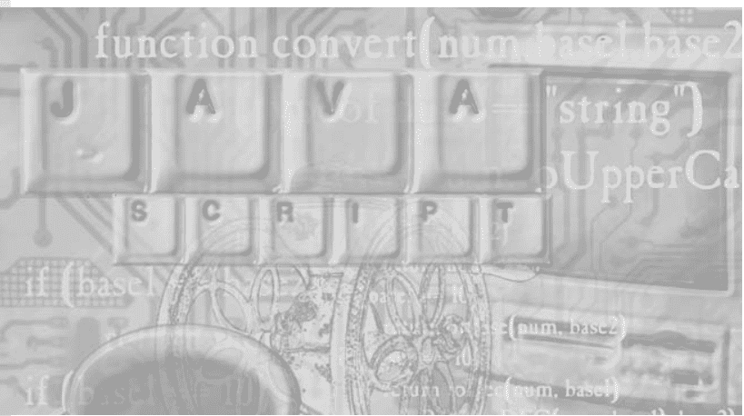


对象

属性

语法

方法

语法

使用数组表示法

基于对象与面向对象

总结


变量作用域与存储类别

什么是函数？

定义和调用函数

函数参数

使用参数数组

创建带默认参数的函数

返回值

递归

递归函数中的值追踪

变量与递归函数

总结


运算符类别

数学运算符

加法

减法

乘法

-   除法
-   取模
-   不存在的整除运算符
-   自增
-   自减
-   取反
-   字符串运算符
-   位运算符
-   按位与
-   按位或
-   按位异或
-   按位非
-   移位运算符
-   左移
-   右移
-   零填充右移
-   赋值运算符
-   关系运算符
-   相等与不等
-   短路逻辑运算符
-   逻辑或
-   逻辑与
-   逻辑非
-   浮点数相等性测试
-   更多逻辑运算符
-   条件运算符
-   逗号运算符
-   数据类型运算符
-   void运算符
-   运算符优先级
-   表达式
-   副作用
-   总结


-   身高体重计算器
-   任务
-   算法
-   脚本
-   输出
-   分析
-   `convertInput()`
-   `getHeight(sex, age, height)`
-   `getWeight(sex, age, weight)`
-   `printResult(height, weight, sex, age)`
-   全局语句
-   总结


-   事件
-   事件处理程序
-   `onLoad`与`onUnload`
-   `onError`
-   通过方法模拟事件
-   错误消息内容
-   显式调用事件处理程序
-   取消事件
-   总结


-   创建实例
-   构造函数
-   定义对象属性
-   嵌套对象
-   定义方法
-   创建对象——示例
-   原型与对象扩展
-   总结


-   什么是数组？
-   一些历史
-   创建简单数组
-   引用数组元素
-   创建稠密数组
-   数组类型
-   数组属性
-   数组方法
-   `chop()`
-   `grep()`
-   `join()`
-   `pop()`
-   `push()`
-   `reverse()`
-   `shift()`
-   `sort()`
-   `splice()`
-   `split()`
-   `unshift()`
-   `arguments`数组
-   多维数组
-   使用单个构造函数创建
-   不使用构造函数创建
-   关联数组
-   填充关联数组
-   将字符串分割成关联数组
-   总结


-   `Date`对象
-   创建`Date`实例
-   `Date`构造函数的参数
-   日期数值约定
-   日期方法类别
-   `get`方法
-   `getYear()`
-   `getMonth()`
-   `getDate()`
-   `getDay()`
-   `getHours()`
-   `getMinutes()`
-   `getSeconds()`
-   `getTimezoneOffset()`
-   `getTime()`
-   `set`方法
-   `setYear()`
-   `setMonth()`
-   `setDate()`
-   `setHours()`
-   `setMinutes()`
-   `setSeconds()`
-   `setTime()`
-   `to`方法
-   `toGMTString()`
-   `toLocaleString()`
-   `parse`方法
-   `parse()`
-   `UTC()`
-   其他对象的时间相关方法
-   `setTimeout()`
-   `clearTimeout()`
-   时间与日期示例
-   简单数字时钟
-   数字日期
-   日历
-   `getTime()`
-   `leapYear(year)`
-   `getDays(month, year)`
-   `getMonthName(month)`
-   `setCal()`
-   `drawCal(firstDay, lastDate, date, monthName, year)`
-   随机名言
-   总结


- JavaScript 中的数学运算 .................... 226
- Math 对象 ...................... 226
- 常量 ........................... 227
- E ................................... 227
- LN2 .................................. 227
- LN10 ................................. 228
- LOG2E ............................... 228
- LOG10E .............................. 228
- PI .................................. 229
- SQRT1_2 ............................ 229
- SQRT2 ............................... 229
- Math 方法 ........................ 230
- 算术方法 .................. 230
- abs() ................................ 230
- ceil() .............................. 231
- exp() ............................... 231
- floor() ............................. 231
- log() ............................... 232
- max(), min() ......................... 232
- pow() ............................... 232
- random() ............................ 232
- round() ............................. 233
- sqrt() .............................. 233
- 三角函数方法 ................ 233
- cos() ............................... 234
- acos() .............................. 234
- sin() ............................... 234
- asin() .............................. 234
- tan() ............................... 234
- atan() .............................. 235
- atan2() ............................. 235
- Number 对象 .................... 235
- Number 属性 .................... 236
- MAX_VALUE ............................ 236
- MIN_VALUE ........................... 236
- NaN .................................. 236
- NEGATIVE_INFINITY .................... 237
- POSITIVE_INFINITY .................... 237
- Number 方法 ....................... 237
- 与数学相关的函数 ............... 237


- 字符串索引 .................................................. 259
- 字符 ........................................................ 259
- 创建字符串 ................................................. 259
- 字符串长度..................................................... 260
- HTML 格式化方法........................................... 260
- 通用字符串方法 ........................................... 262
- charAt() ......................................................... 262
- indexOf().......................................................... 262
- lastIndexOf() .................................................... 263
- substring()....................................................... 263
- escape 和 unescape .............................................. 264
- 数字到字符串的转换....................................... 265
- 空字符串拼接........................................ 265
- 字符串实例构造...................................... 266
- toString() 方法 ............................................ 267
- 字符串到数字的转换....................................... 268
- parseInt() 和 parseFloat()....................................... 268
- 判断一个值是否是数字 ........................ 269
- 计算文本表达式 ...................................... 270
- 字符串处理示例 .......................................... 270
- 字符串加密 ................................. 270
- encipher(). ....................................... 272
- encode(str, key) .................................. 273
- 总结 ............................................ 273


- 对象层级 ............................... 274
- 创建浏览器对象 ........................... 275
- 顶级对象 ............................... 275
- window. .......................................... 275
- document ........................................ 276
- history .......................................... 276
- location ........................................ 276
- 总结 ............................................ 277


- 状态栏 .................................... 278
- 向状态栏写入内容 ......................... 278
- 设置状态栏默认值 ......... 281
- 横幅广告 ........................................... 282
- T形横幅 .......................................... 282
- 全局语句 ................................. 284
- stopBanner() ...................................... 284
- startBanner() ..................................... 285
- showBanner() ...................................... 285
- 事件处理程序. ................................... 286
- R形横幅 .......................................... 286
- 全局语句 ................................. 289
- stopBanner() ...................................... 290
- startBanner() ..................................... 290
- clearState() ...................................... 290
- getRandom(max). ................................... 290
- getString() ....................................... 290
- showBanner() ...................................... 291
- 事件处理程序. ................................... 291
- N形横幅. ......................................... 291
- scrollBanner(seed). ................................ 293
- 总结 ............................................ 294


- URL 速成课程 ............................. 295
- 通用 URL 语法 ................................ 295
- URL 协议方案 ....................................... 296
- 超文本传输协议 (HTTP) ............... 296
- 文件传输协议 (FTP) ..................... 296
- Gopher 协议 (Gopher) .......................... 297
- 主机特定文件名 (File) .................. 297
- JavaScript 语句 (javascript) ............... 297
- 其他协议方案 .................................... 298
- location 对象 ................................. 298
- location 属性 ............................. 298
  - href ......................................... 298
  - hash ......................................... 301
  - host ......................................... 304
  - hostname ..................................... 305
  - pathname ..................................... 305
  - port ......................................... 305
  - protocol ..................................... 306
  - search ....................................... 306
- location 方法 ............................... 310
  - reload ....................................... 310
  - replace ...................................... 311
- 另一个 location—document.location (document.URL) ........... 312
- 搜索工具 ............................... 313
- 总结 ........................................ 317


- 什么是历史记录列表？ ........................ 318
- history 对象 ............................. 318
- 历史记录列表长度 ............................ 318
- 历史记录列表条目索引 .................... 319
- history 方法 ............................... 319
  - back ......................................... 319
  - forward ...................................... 320
  - go ........................................... 320
- history 对象的安全性方面 .......... 321
- 总结 ........................................ 321


- alinkColor . . . . . . . . . . . . . . . . . . . . . . . . . . . . . . 333
- linkColor . . . . . . . . . . . . . . . . . . . . . . . . . . . . . . . 333
- vlinkColor . . . . . . . . . . . . . . . . . . . . . . . . . . . . . . . 333
- 输出方法与流 . . . . . . . . . . . . . . . . . . . . . . . . . . . . . . . 333
- write 和 writeln . . . . . . . . . . . . . . . . . . . . . . . . . . . . . 333
- 数据流 . . . . . . . . . . . . . . . . . . . . . . . . . . . . . . . . 334
- 总结 . . . . . . . . . . . . . . . . . . . . . . . . . . . . . . . . . 335


- 什么是 HTML 表单？ . . . . . . . . . . . . . . . . . . . . . . . . . . . . . . . 337
- JavaScript 表单引用 . . . . . . . . . . . . . . . . . . . . . . . . . . . . . . . 337
- forms 数组 . . . . . . . . . . . . . . . . . . . . . . . . . . . . . . . . . . 337
- 表单名称 . . . . . . . . . . . . . . . . . . . . . . . . . . . . . . . . . . 338
- form 对象 . . . . . . . . . . . . . . . . . . . . . . . . . . . . . . . . . . 338
- HTML 语法 . . . . . . . . . . . . . . . . . . . . . . . . . . . . . . . . . 338
- 事件处理器 . . . . . . . . . . . . . . . . . . . . . . . . . . . . . . . . . 339
- onSubmit . . . . . . . . . . . . . . . . . . . . . . . . . . . . . . . . . 339
- onReset . . . . . . . . . . . . . . . . . . . . . . . . . . . . . . . . . 341
- 方法 . . . . . . . . . . . . . . . . . . . . . . . . . . . . . . . . . . . 341
- submit() . . . . . . . . . . . . . . . . . . . . . . . . . . . . . . . . . . 341
- reset() . . . . . . . . . . . . . . . . . . . . . . . . . . . . . . . . . . 343
- 属性 . . . . . . . . . . . . . . . . . . . . . . . . . . . . . . . . . . . 343
- action . . . . . . . . . . . . . . . . . . . . . . . . . . . . . . . . . . 343
- elements . . . . . . . . . . . . . . . . . . . . . . . . . . . . . . . . . 343
- encoding . . . . . . . . . . . . . . . . . . . . . . . . . . . . . . . . . . 346
- method . . . . . . . . . . . . . . . . . . . . . . . . . . . . . . . . . . 346
- target . . . . . . . . . . . . . . . . . . . . . . . . . . . . . . . . . . 347
- 元素类型 . . . . . . . . . . . . . . . . . . . . . . . . . . . . . . . . . 347
- 在事件处理器中使用 this . . . . . . . . . . . . . . . . . . . . . . . . . . . . . 348
- 利用 form 属性 . . . . . . . . . . . . . . . . . . . . . . . . . . . . . . . . 351
- text 对象 . . . . . . . . . . . . . . . . . . . . . . . . . . . . . . . . . 353
- HTML 语法 . . . . . . . . . . . . . . . . . . . . . . . . . . . . . . . . . 353
- JavaScript 访问 . . . . . . . . . . . . . . . . . . . . . . . . . . . . . . . 354
- 事件处理器 . . . . . . . . . . . . . . . . . . . . . . . . . . . . . . . . . 354
- onBlur . . . . . . . . . . . . . . . . . . . . . . . . . . . . . . . . . . 354
- onChange . . . . . . . . . . . . . . . . . . . . . . . . . . . . . . . . . 355
- onFocus . . . . . . . . . . . . . . . . . . . . . . . . . . . . . . . . . 356
- onSelect . . . . . . . . . . . . . . . . . . . . . . . . . . . . . . . . . 358
- 方法 . . . . . . . . . . . . . . . . . . . . . . . . . . . . . . . . . . . 358
- blur() . . . . . . . . . . . . . . . . . . . . . . . . . . . . . . . . . . 358
- focus() . . . . . . . . . . . . . . . . . . . . . . . . . . . . . . . . . . 359
- select() . . . . . . . . . . . . . . . . . . . . . . . . . . . . . . . . . 359
- 属性 . . . . . . . . . . . . . . . . . . . . . . . . . . . . . . . . . . . 361
- defaultValue . . . . . . . . . . . . . . . . . . . . . . . . . . . . . . . . . 361
- name . . . . . . . . . . . . . . . . . . . . . . . . . . . . . . . . . . 362
- value . . . . . . . . . . . . . . . . . . . . . . . . . . . . . . . . . . 365
- password 对象 . . . . . . . . . . . . . . . . . . . . . . . . . . . . . . . . . 365
- HTML 语法 . . . . . . . . . . . . . . . . . . . . . . . . . . . . . . . . . . . . 365
- JavaScript 访问 . . . . . . . . . . . . . . . . . . . . . . . . . . . . . . . . . . 365
- 事件处理器 . . . . . . . . . . . . . . . . . . . . . . . . . . . . . . . . . . . . 366
- 方法和属性 . . . . . . . . . . . . . . . . . . . . . . . . . . . . . . . . . . . 366
- textarea 对象 . . . . . . . . . . . . . . . . . . . . . . . . . . . . . . . . . . . 366
- HTML 语法 . . . . . . . . . . . . . . . . . . . . . . . . . . . . . . . . . . . . 366
- JavaScript 访问 . . . . . . . . . . . . . . . . . . . . . . . . . . . . . . . . . . 367
- 事件处理器 . . . . . . . . . . . . . . . . . . . . . . . . . . . . . . . . . . . . 367
- 属性和方法 . . . . . . . . . . . . . . . . . . . . . . . . . . . . . . . . . . . 367
- 插入换行符 . . . . . . . . . . . . . . . . . . . . . . . . . . . . . . . . . . . 368
- 按行处理文本区域 . . . . . . . . . . . . . . . . . . . . . . . . . . . . . . . . 368
- hidden 对象 . . . . . . . . . . . . . . . . . . . . . . . . . . . . . . . . . . 369
- HTML 语法 . . . . . . . . . . . . . . . . . . . . . . . . . . . . . . . . . . . 369
- JavaScript 访问 . . . . . . . . . . . . . . . . . . . . . . . . . . . . . . . . 369
- 事件处理器 . . . . . . . . . . . . . . . . . . . . . . . . . . . . . . . . . . . 369
- 属性和方法 . . . . . . . . . . . . . . . . . . . . . . . . . . . . . . . . . . 370
- button、submit 和 reset 对象 . . . . . . . . . . . . . . . . . . . . . . . . . . . 370
- HTML 语法 . . . . . . . . . . . . . . . . . . . . . . . . . . . . . . . . . . . 370
- JavaScript 访问 . . . . . . . . . . . . . . . . . . . . . . . . . . . . . . . . 371
- 事件处理器 . . . . . . . . . . . . . . . . . . . . . . . . . . . . . . . . . . . 371
- onClick . . . . . . . . . . . . . . . . . . . . . . . . . . . . . . . . . . . . . 371
- 方法 . . . . . . . . . . . . . . . . . . . . . . . . . . . . . . . . . . . . . 373
- click() . . . . . . . . . . . . . . . . . . . . . . . . . . . . . . . . . . . . 373
- 属性 . . . . . . . . . . . . . . . . . . . . . . . . . . . . . . . . . . . . . 373
- name . . . . . . . . . . . . . . . . . . . . . . . . . . . . . . . . . . . . 373
- value . . . . . . . . . . . . . . . . . . . . . . . . . . . . . . . . . . . . 373
- checkbox 对象 . . . . . . . . . . . . . . . . . . . . . . . . . . . . . . . . . . . 376
- HTML 语法 . . . . . . . . . . . . . . . . . . . . . . . . . . . . . . . . . . . 376
- JavaScript 访问 . . . . . . . . . . . . . . . . . . . . . . . . . . . . . . . . 377
- 事件处理器 . . . . . . . . . . . . . . . . . . . . . . . . . . . . . . . . . . . 377
- onClick . . . . . . . . . . . . . . . . . . . . . . . . . . . . . . . . . . . . 377
- 方法 . . . . . . . . . . . . . . . . . . . . . . . . . . . . . . . . . . . . . 378
- click() . . . . . . . . . . . . . . . . . . . . . . . . . . . . . . . . . . . 378
- 属性 . . . . . . . . . . . . . . . . . . . . . . . . . . . . . . . . . . . . 378
- checked . . . . . . . . . . . . . . . . . . . . . . . . . . . . . . . . . . . . 378
- defaultChecked . . . . . . . . . . . . . . . . . . . . . . . . . . . . . . . . . . 381
- name . . . . . . . . . . . . . . . . . . . . . . . . . . . . . . . . . . . . 382
- value . . . . . . . . . . . . . . . . . . . . . . . . . . . . . . . . . . . . 382
- radio 对象 . . . . . . . . . . . . . . . . . . . . . . . . . . . . . . . . . . . . 383
- HTML 语法 . . . . . . . . . . . . . . . . . . . . . . . . . . . . . . . . . . . 383
- JavaScript 访问 . . . . . . . . . . . . . . . . . . . . . . . . . . . . . . . . 384
- 事件处理器 . . . . . . . . . . . . . . . . . . . . . . . . . . . . . . . . . . . 385
- onClick . . . . . . . . . . . . . . . . . . . . . . . . . . . . . . . . . . . . 385
- 方法 . . . . . . . . . . . . . . . . . . . . . . . . . . . . . . . . . . . . . 385
- click() . . . . . . . . . . . . . . . . . . . . . . . . . . . . . . . . . . . 385
- 属性 . . . . . . . . . . . . . . . . . . . . . . . . . . . . . . . . . . . . 387
- checked . . . . . . . . . . . . . . . . . . . . . . . . . . . . . . . . . . . 387


- defaultChecked . . . . . . . . . . . . . . . . . . . . . . . . . . . . . . . 387
- name . . . . . . . . . . . . . . . . . . . . . . . . . . . . . . . . . . . . . . 387
- value . . . . . . . . . . . . . . . . . . . . . . . . . . . . . . . . . . . . . . 387
- select 对象 . . . . . . . . . . . . . . . . . . . . . . . . . . . . . . . . . . 388
  - HTML 语法 . . . . . . . . . . . . . . . . . . . . . . . . . . . . . . . . . 388
  - JavaScript 访问 . . . . . . . . . . . . . . . . . . . . . . . . . . . . . . 389
  - 事件处理器 . . . . . . . . . . . . . . . . . . . . . . . . . . . . . . . . 390
    - onBlur . . . . . . . . . . . . . . . . . . . . . . . . . . . . . . . . . . . . 390
    - onFocus . . . . . . . . . . . . . . . . . . . . . . . . . . . . . . . . . . 390
    - onChange . . . . . . . . . . . . . . . . . . . . . . . . . . . . . . . . . . 390
  - 方法 . . . . . . . . . . . . . . . . . . . . . . . . . . . . . . . . . . . . 390
    - blur, focus . . . . . . . . . . . . . . . . . . . . . . . . . . . . . . . . 390
  - 属性 (select 对象) . . . . . . . . . . . . . . . . . . . . . . . . . . . . 391
    - length . . . . . . . . . . . . . . . . . . . . . . . . . . . . . . . . . . 391
    - name . . . . . . . . . . . . . . . . . . . . . . . . . . . . . . . . . . 391
    - options . . . . . . . . . . . . . . . . . . . . . . . . . . . . . . . . . . 391
    - selectedIndex . . . . . . . . . . . . . . . . . . . . . . . . . . . . . . . 392
  - 属性 (options 数组) . . . . . . . . . . . . . . . . . . . . . . . . . . . . 394
    - defaultSelected . . . . . . . . . . . . . . . . . . . . . . . . . . . . . . 394
    - index . . . . . . . . . . . . . . . . . . . . . . . . . . . . . . . . . . . 394
    - length . . . . . . . . . . . . . . . . . . . . . . . . . . . . . . . . . . 395
    - selected . . . . . . . . . . . . . . . . . . . . . . . . . . . . . . . . . . 395
    - text . . . . . . . . . . . . . . . . . . . . . . . . . . . . . . . . . . . 396
    - value . . . . . . . . . . . . . . . . . . . . . . . . . . . . . . . . . . 398
  - Option 对象——使用 Option 构造函数添加选项 . . . . . . . . . . . . . . 398
- fileUpload 对象 . . . . . . . . . . . . . . . . . . . . . . . . . . . . . . . . . 401
  - HTML 语法 . . . . . . . . . . . . . . . . . . . . . . . . . . . . . . . . . 401
  - JavaScript 访问 . . . . . . . . . . . . . . . . . . . . . . . . . . . . . . 401
  - 事件处理器 . . . . . . . . . . . . . . . . . . . . . . . . . . . . . . . . 401
  - 方法 . . . . . . . . . . . . . . . . . . . . . . . . . . . . . . . . . . . . 401
  - 属性 . . . . . . . . . . . . . . . . . . . . . . . . . . . . . . . . . . . . 401
    - name . . . . . . . . . . . . . . . . . . . . . . . . . . . . . . . . . . . . 401
    - value . . . . . . . . . . . . . . . . . . . . . . . . . . . . . . . . . . . . 401
- 总结 . . . . . . . . . . . . . . . . . . . . . . . . . . . . . . . . . . . . . 401


- 定义链接 . . . . . . . . . . . . . . . . . . . . . . . . . . . . . . . . . 403
- 定义锚点 . . . . . . . . . . . . . . . . . . . . . . . . . . . . . . . . . 404
- 定义图像映射区域 . . . . . . . . . . . . . . . . . . . . . . . . . . . . . . 404
- links 数组 . . . . . . . . . . . . . . . . . . . . . . . . . . . . . . . . . . . 405
- anchors 数组 . . . . . . . . . . . . . . . . . . . . . . . . . . . . . . . . . 405
- 链接和区域事件处理器 . . . . . . . . . . . . . . . . . . . . . . . . . . . . 406
  - 显式调用事件处理器 . . . . . . . . . . . . . . . . . . . . . . . . . . . . . 406
  - onClick . . . . . . . . . . . . . . . . . . . . . . . . . . . . . . . . . . . . 406
  - onMouseOver . . . . . . . . . . . . . . . . . . . . . . . . . . . . . . . . . . 407
  - onMouseOut . . . . . . . . . . . . . . . . . . . . . . . . . . . . . . . . . . 408
- 链接和区域属性 . . . . . . . . . . . . . . . . . . . . . . . . . . . . . . . . 410
  - 与 Location 等效的属性 . . . . . . . . . . . . . . . . . . . . . . . . . . . 410
  - target . . . . . . . . . . . . . . . . . . . . . . . . . . . . . . . . . . . . . . . . . 410
- 引用文档 . . . . . . . . . . . . . . . . . . . . . . . . . . . . . . . . . . . . . 411
- 总结 . . . . . . . . . . . . . . . . . . . . . . . . . . . . . . . . . . . . . . . . . 411


- 维护状态 . . . . . . . . . . . . . . . . . . . . . . . . . . . . . . . . . . . . . 413
- Cookie 与 HTTP . . . . . . . . . . . . . . . . . . . . . . . . . . . . . . . . . . . . . . 413
- 设置 HTTP Cookie . . . . . . . . . . . . . . . . . . . . . . . . . . . . . . . . . . . . . 414
- 获取 HTTP Cookie . . . . . . . . . . . . . . . . . . . . . . . . . . . . . . . . . . . . . 415
- 注意事项和限制 . . . . . . . . . . . . . . . . . . . . . . . . . . . . . . . . . 415
- 示例 . . . . . . . . . . . . . . . . . . . . . . . . . . . . . . . . . . . . . . . . 416
  - 第一个事务序列示例 . . . . . . . . . . . . . . . . . . . . . . . . . . . . . 416
  - 第二个事务序列示例 . . . . . . . . . . . . . . . . . . . . . . . . . . . . . 416
- Cookie 与 JavaScript . . . . . . . . . . . . . . . . . . . . . . . . . . . . . . . . . . 417
- Cookie 函数 . . . . . . . . . . . . . . . . . . . . . . . . . . . . . . . . . . . . 417
  - getInput(num, monthName) . . . . . . . . . . . . . . . . . . . . . . . . . . . . . 431
  - initCookie(monthName) . . . . . . . . . . . . . . . . . . . . . . . . . . . . . . . . 431
  - getSpecificReminder(num, monthName) . . . . . . . . . . . . . . . . . . . . . . 432
  - setSpecificReminder(num, monthName, newValue) . . . . . . . . . . . . . . . . 432
- 大纲工具 . . . . . . . . . . . . . . . . . . . . . . . . . . . . . . . . . . . . . . . 433
  - item(parent, text, depth) . . . . . . . . . . . . . . . . . . . . . . . . . . . . . . . . 438
  - makeArray(length) . . . . . . . . . . . . . . . . . . . . . . . . . . . . . . . . . . . . 439
  - makeDatabase() . . . . . . . . . . . . . . . . . . . . . . . . . . . . . . . . . . . . . . 439
  - setStates() . . . . . . . . . . . . . . . . . . . . . . . . . . . . . . . . . . . . . . . 440
  - setImages() . . . . . . . . . . . . . . . . . . . . . . . . . . . . . . . . . . . . . . . 441
  - toggle(num) . . . . . . . . . . . . . . . . . . . . . . . . . . . . . . . . . . . . . . . 441
  - setStorage() . . . . . . . . . . . . . . . . . . . . . . . . . . . . . . . . . . . . . . . 442
- 全局语句 . . . . . . . . . . . . . . . . . . . . . . . . . . . . . . . . . . . . . . 443
- 总结 . . . . . . . . . . . . . . . . . . . . . . . . . . . . . . . . . . . . . . . 443


- 在 HTML 中定义图像 . . . . . . . . . . . . . . . . . . . . . . . . . . . . . . . . 444
- Image 对象 . . . . . . . . . . . . . . . . . . . . . . . . . . . . . . . . . . . . . 445
  - images 数组 . . . . . . . . . . . . . . . . . . . . . . . . . . . . . . . . . . . . 446
- 属性 . . . . . . . . . . . . . . . . . . . . . . . . . . . . . . . . . . . . . . . 449
  - border . . . . . . . . . . . . . . . . . . . . . . . . . . . . . . . . . . . . . . . . . . 449
  - complete . . . . . . . . . . . . . . . . . . . . . . . . . . . . . . . . . . . . . . . . 449
  - height . . . . . . . . . . . . . . . . . . . . . . . . . . . . . . . . . . . . . . . . . . 449
  - hspace . . . . . . . . . . . . . . . . . . . . . . . . . . . . . . . . . . . . . . . . . 450
  - lowsrc . . . . . . . . . . . . . . . . . . . . . . . . . . . . . . . . . . . . . . . . . . 451
  - name . . . . . . . . . . . . . . . . . . . . . . . . . . . . . . . . . . . . . . . . . . 452
  - src . . . . . . . . . . . . . . . . . . . . . . . . . . . . . . . . . . . . . . . . . . . 452
  - vspace . . . . . . . . . . . . . . . . . . . . . . . . . . . . . . . . . . . . . . . . . 452
  - width . . . . . . . . . . . . . . . . . . . . . . . . . . . . . . . . . . . . . . . . . . 453
- 事件处理器 . . . . . . . . . . . . . . . . . . . . . . . . . . . . . . . . . . . . . 453
  - onAbort . . . . . . . . . . . . . . . . . . . . . . . . . . . . . . . . . . . . . . . . 453
  - onError . . . . . . . . . . . . . . . . . . . . . . . . . . . . . . . . . . . . . . . . . 454


- dropLines() ........................................................... 509
- play()................................................................ 510
- characteristics(x, y) .................................................. 511
- fullMap() ............................................................... 511
- pause() ................................................................. 511
- 音乐 ................................................................... 512
- 小结 ................................................................. 512


- 什么是框架？ .................................................... 513
- 创建框架 ......................................................... 513
- 定向框架。.................................................... 516
- 嵌套框架 .......................................................... 517
- JavaScript 与框架 ............................................... 519
    - self ...................................................................... 519
    - parent. ................................................................. 520
    - top ..................................................................... 521
    - frames. ................................................................. 521
- 示例：颜色中心 .................................................. 523
    - 框架设置窗口 ................................................ 523
    - display(r, g, b)..................................................... 528
    - makeAttribute(r, g, b) .......................................... 528
    - 全局语句 ...................................................... 529
    - select(r, g, b) .................................................... 529
    - curAttribute()..................................................... 529
    - bodyDefinition() ................................................. 530
    - update() .......................................................... 530
    - save() ............................................................. 531
    - load() .............................................................. 531
    - HTML ............................................................... 532
    - “control” 框架 ................................................... 533
    - display() .......................................................... 534
    - 事件处理器。................................................. 534
    - “swatches” 框架。........................................... 534
    - “main” 框架 ..................................................... 536
- 框架、事件和事件处理器。................................ 537
    - 在框架中使用事件处理器 .................................. 537
    - 在框架设置文档中使用事件处理器 ...................... 537
    - onFocus 和 onBlur .............................................. 538
    - 模拟事件。................................................. 538
- 定向多个框架 ................................................. 538
- 小结 ........................................................... 539


- 什么是窗口？ ................................................... 540
- 使用 JavaScript 打开窗口 ............................... 540
- 引用窗口 ......................................................... 544
- 窗口名称。....................................................... 544


-   远程控制 . . . . . . . . . . . . . . . . . . . . . . . . . . . . . . . . 545
    -   基于 HTML 的远程控制（推荐）. . . . . . . . . . . . . . . . 545
    -   基于 JavaScript 的远程控制. . . . . . . . . . . . . . . . . . . . 547
    -   关闭窗口 . . . . . . . . . . . . . . . . . . . . . . . . . . . . . . 549
    -   滚动窗口 . . . . . . . . . . . . . . . . . . . . . . . . . . . . . . 550
    -   窗口、事件和事件处理程序. . . . . . . . . . . . . . . . . . . . 550
    -   示例：访问窗口对象. . . . . . . . . . . . . . . . . . . . . . . . 553
    -   `getNewLine()`. . . . . . . . . . . . . . . . . . . . . . . . . . . 565
    -   `getInput(func, form)`. . . . . . . . . . . . . . . . . . . . 565
    -   `vertical()`. . . . . . . . . . . . . . . . . . . . . . . . . . . . 566
-   小结 . . . . . . . . . . . . . . . . . . . . . . . . . . . . . . . . . . 567


-   求值字符串. . . . . . . . . . . . . . . . . . . . . . . . . . . . . . 568
    -   函数引用与调用. . . . . . . . . . . . . . . . . . . . . . . . . . 570
    -   将代码编译为函数. . . . . . . . . . . . . . . . . . . . . . . . 571
        -   指定函数体. . . . . . . . . . . . . . . . . . . . . . . . . . 571
        -   将函数对象与变量配合使用. . . . . . . . . . . . . . . 572
        -   指定参数. . . . . . . . . . . . . . . . . . . . . . . . . . . 573
        -   将函数对象与事件处理程序配合使用. . . . . . . . 573
        -   函数对象的属性. . . . . . . . . . . . . . . . . . . . . . 574
-   小结 . . . . . . . . . . . . . . . . . . . . . . . . . . . . . . . . . . 575


-   浏览器检测. . . . . . . . . . . . . . . . . . . . . . . . . . . . . . 576
    -   `navigator` 对象. . . . . . . . . . . . . . . . . . . . . . . . . 576
    -   使用 `navigator` 对象检测用户的浏览器和平台. . . . . . 577
        -   用户代理. . . . . . . . . . . . . . . . . . . . . . . . . . . 577
        -   确定用户的浏览器. . . . . . . . . . . . . . . . . . . . . 578
        -   将用户重定向到特定浏览器的页面. . . . . . . . . . 578
        -   使用框架为不同浏览器显示不同页面. . . . . . . . 579
-   检查 Java 是否启用. . . . . . . . . . . . . . . . . . . . . . . . 581
-   小结 . . . . . . . . . . . . . . . . . . . . . . . . . . . . . . . . . . 581


-   在 HTML 中嵌入插件对象. . . . . . . . . . . . . . . . . . . . 582
-   在 JavaScript 中引用插件. . . . . . . . . . . . . . . . . . . . 583
-   使用 JavaScript 确定已安装的插件. . . . . . . . . . . . . . 583
-   `mimeTypes` 对象的属性. . . . . . . . . . . . . . . . . . . . . 584
-   `plugins` 对象的属性. . . . . . . . . . . . . . . . . . . . . . . . 586
-   LiveAudio 和 LiveVideo . . . . . . . . . . . . . . . . . . . . . . 587
    -   LiveAudio . . . . . . . . . . . . . . . . . . . . . . . . . . . . 588
    -   LiveVideo . . . . . . . . . . . . . . . . . . . . . . . . . . . . 591
-   其他插件. . . . . . . . . . . . . . . . . . . . . . . . . . . . . . . . 592
-   小结 . . . . . . . . . . . . . . . . . . . . . . . . . . . . . . . . . . 592


-   什么是 LiveConnect？. . . . . . . . . . . . . . . . . . . . . . . . . . . . . . . . . . . . . . . . . . . . . . . . . . . . . . . . . . . 593
    -   启用 LiveConnect. . . . . . . . . . . . . . . . . . . . . . . . . . . . . . . . . . . . . . . . . . . . . . . . . . . . . . . . . . . 593
    -   Java 控制台. . . . . . . . . . . . . . . . . . . . . . . . . . . . . . . . . . . . . . . . . . . . . . . . . . . . . . . . . . . . . . . 593
    -   Netscape 包. . . . . . . . . . . . . . . . . . . . . . . . . . . . . . . . . . . . . . . . . . . . . . . . . . . . . . . . . . . . . . 594
        -   使用 Netscape 包编译 Java 代码. . . . . . . . . . . . . . . . . . . . . . . . . . . . . . . . . . . . . . . . . . . . . 594
-   Java 到 JavaScript 的通信. . . . . . . . . . . . . . . . . . . . . . . . . . . . . . . . . . . . . . . . . . . . . . . . . . . . . 595
    -   在 Java 和 JavaScript 之间传递值. . . . . . . . . . . . . . . . . . . . . . . . . . . . . . . . . . . . . . . . . . . . . 595
    -   获取浏览器窗口的句柄. . . . . . . . . . . . . . . . . . . . . . . . . . . . . . . . . . . . . . . . . . . . . . . . . . . . 596
    -   访问 JavaScript 对象和属性. . . . . . . . . . . . . . . . . . . . . . . . . . . . . . . . . . . . . . . . . . . . . . . . . 596
    -   调用 JavaScript 方法. . . . . . . . . . . . . . . . . . . . . . . . . . . . . . . . . . . . . . . . . . . . . . . . . . . . . . 597
    -   `JSObject` 类中的其他方法. . . . . . . . . . . . . . . . . . . . . . . . . . . . . . . . . . . . . . . . . . . . . . . . . 598
    -   JavaScript 异常. . . . . . . . . . . . . . . . . . . . . . . . . . . . . . . . . . . . . . . . . . . . . . . . . . . . . . . . . . 599
-   JavaScript 到 Java 的通信. . . . . . . . . . . . . . . . . . . . . . . . . . . . . . . . . . . . . . . . . . . . . . . . . . . . . 599
    -   直接访问 Java. . . . . . . . . . . . . . . . . . . . . . . . . . . . . . . . . . . . . . . . . . . . . . . . . . . . . . . . . . . 599
    -   控制 Java 小程序. . . . . . . . . . . . . . . . . . . . . . . . . . . . . . . . . . . . . . . . . . . . . . . . . . . . . . . . . 600
    -   `applet` 对象. . . . . . . . . . . . . . . . . . . . . . . . . . . . . . . . . . . . . . . . . . . . . . . . . . . . . . . . . . . 604
    -   小程序中还有哪些东西是可脚本化的？. . . . . . . . . . . . . . . . . . . . . . . . . . . . . . . . . . . . . . . . 605
    -   修改小程序. . . . . . . . . . . . . . . . . . . . . . . . . . . . . . . . . . . . . . . . . . . . . . . . . . . . . . . . . . . 606
    -   为什么要使小程序可脚本化？. . . . . . . . . . . . . . . . . . . . . . . . . . . . . . . . . . . . . . . . . . . . . . 612
-   控制插件. . . . . . . . . . . . . . . . . . . . . . . . . . . . . . . . . . . . . . . . . . . . . . . . . . . . . . . . . . . . . . . . . 612
    -   访问插件的元素. . . . . . . . . . . . . . . . . . . . . . . . . . . . . . . . . . . . . . . . . . . . . . . . . . . . . . . . . 612
        -   JavaScript 与 LiveAudio. . . . . . . . . . . . . . . . . . . . . . . . . . . . . . . . . . . . . . . . . . . . . . . . . 612
        -   JavaScript 与 LiveVideo. . . . . . . . . . . . . . . . . . . . . . . . . . . . . . . . . . . . . . . . . . . . . . . . . 618
-   小结 . . . . . . . . . . . . . . . . . . . . . . . . . . . . . . . . . . . . . . . . . . . . . . . . . . . . . . . . . . . . . . . . . . . . . . 620


-   简介. . . . . . . . . . . . . . . . . . . . . . . . . . . . . . . . . . . . . . . . . . . . . . . . . . . . . . . . . . . . . . . . . . . . . . . . . . . . 621
    -   定义图层. . . . . . . . . . . . . . . . . . . . . . . . . . . . . . . . . . . . . . . . . . . . . . . . . . . . . . . . . . . . . . . . . . . 622
        -   NAME . . . . . . . . . . . . . . . . . . . . . . . . . . . . . . . . . . . . . . . . . . . . . . . . . . . . . . . . . . . . . . . . . 622
        -   LEFT 和 TOP . . . . . . . . . . . . . . . . . . . . . . . . . . . . . . . . . . . . . . . . . . . . . . . . . . . . . . . . . . 622
        -   WIDTH . . . . . . . . . . . . . . . . . . . . . . . . . . . . . . . . . . . . . . . . . . . . . . . . . . . . . . . . . . . . . . 623
        -   CLIP . . . . . . . . . . . . . . . . . . . . . . . . . . . . . . . . . . . . . . . . . . . . . . . . . . . . . . . . . . . . . . . 625
        -   Z-INDEX, ABOVE 和 BELOW. . . . . . . . . . . . . . . . . . . . . . . . . . . . . . . . . . . . . . . . . . . . 625
        -   VISIBILITY . . . . . . . . . . . . . . . . . . . . . . . . . . . . . . . . . . . . . . . . . . . . . . . . . . . . . . . . . . 626
        -   BGCOLOR 和 BACKGROUND . . . . . . . . . . . . . . . . . . . . . . . . . . . . . . . . . . . . . . . . . . . 626
-   `layer` 对象. . . . . . . . . . . . . . . . . . . . . . . . . . . . . . . . . . . . . . . . . . . . . . . . . . . . . . . . . . . . . . . . . . . 627
    -   属性. . . . . . . . . . . . . . . . . . . . . . . . . . . . . . . . . . . . . . . . . . . . . . . . . . . . . . . . . . . . . . . . . . . 627
        -   name . . . . . . . . . . . . . . . . . . . . . . . . . . . . . . . . . . . . . . . . . . . . . . . . . . . . . . . . . . . . . . . 627
        -   width 和 height. . . . . . . . . . . . . . . . . . . . . . . . . . . . . . . . . . . . . . . . . . . . . . . . . . . . . . 627
        -   left 和 top. . . . . . . . . . . . . . . . . . . . . . . . . . . . . . . . . . . . . . . . . . . . . . . . . . . . . . . . . 627
        -   zIndex. . . . . . . . . . . . . . . . . . . . . . . . . . . . . . . . . . . . . . . . . . . . . . . . . . . . . . . . . . . . . 628
        -   visibility. . . . . . . . . . . . . . . . . . . . . . . . . . . . . . . . . . . . . . . . . . . . . . . . . . . . . . . . . . . 628
        -   `clip.top`, `clip.left`, `clip.right`, `clip.bottom`, `clip.width` 和 `clip.height`. . . . . . . . . . . . . . . . . . . 628
        -   background. . . . . . . . . . . . . . . . . . . . . . . . . . . . . . . . . . . . . . . . . . . . . . . . . . . . . . . . . . 628
        -   bgColor. . . . . . . . . . . . . . . . . . . . . . . . . . . . . . . . . . . . . . . . . . . . . . . . . . . . . . . . . . . 628

siblingAbove 和 siblingBelow . . . . . . . . . . . . . . . . . . . . 629
above 和 below . . . . . . . . . . . . . . . . . . . . . . . . . . . . 629
parentLayer . . . . . . . . . . . . . . . . . . . . . . . . . . . . . . . . 629
layers . . . . . . . . . . . . . . . . . . . . . . . . . . . . . . . . . . . . . . . 629
方法 . . . . . . . . . . . . . . . . . . . . . . . . . . . . . . . . . . . . . 629
    offset() . . . . . . . . . . . . . . . . . . . . . . . . . . . . . . . . . . . . . 629
    moveTo() . . . . . . . . . . . . . . . . . . . . . . . . . . . . . . . . . . . 630
    resize() . . . . . . . . . . . . . . . . . . . . . . . . . . . . . . . . . . . . . 630
    moveAbove() 和 moveBelow()。. . . . . . . . . . . . . . . . . . . 630
演示：美国总统图册。. . . . . . . . . . . . . . . . . . . . . . . 630
总结 . . . . . . . . . . . . . . . . . . . . . . . . . . . . . . . . . . . . . . 633


简介。. . . . . . . . . . . . . . . . . . . . . . . . . . . . . . . . . . . 634
内容布局。. . . . . . . . . . . . . . . . . . . . . . . . . . . . . . . . . 635
字体属性。. . . . . . . . . . . . . . . . . . . . . . . . . . . . . . . . . . . 635
文本属性。. . . . . . . . . . . . . . . . . . . . . . . . . . . . . . . . . . . 635
样式的继承。. . . . . . . . . . . . . . . . . . . . . . . . . . . . . . . . . . . 635
创建样式表和分配样式。. . . . . . . . . . . . . . . . . . . . . . 636
    在头部使用 <STYLE> 标签定义样式。. . . . . . . . . 636
    为单个元素指定样式。. . . . . . . . . . . . . . . . . . . . . . . . . . 637
    定义样式类。. . . . . . . . . . . . . . . . . . . . . . . . . . . . . . . . . . . 637
格式属性。. . . . . . . . . . . . . . . . . . . . . . . . . . . . . . . . . . . 638
    盒子模型。. . . . . . . . . . . . . . . . . . . . . . . . . . . . . . . . . . . . . 638
    替换元素。. . . . . . . . . . . . . . . . . . . . . . . . . . . . . . . . . . . . . 639
    设置外边距。. . . . . . . . . . . . . . . . . . . . . . . . . . . . . . . . . . . 639
    设置边框宽度。. . . . . . . . . . . . . . . . . . . . . . . . . . . . . . . . 639
    设置内边距大小。. . . . . . . . . . . . . . . . . . . . . . . . . . . . . . 640
总结。. . . . . . . . . . . . . . . . . . . . . . . . . . . . . . . . . . . . . . 640


历史。. . . . . . . . . . . . . . . . . . . . . . . . . . . . . . . . . . . 641
URL 到 URL 的访问安全。. . . . . . . . . . . . . . . . . . . . . . 641
污染的概念。. . . . . . . . . . . . . . . . . . . . . . . . . . . . . . . . . . . 642
    启用数据污染。. . . . . . . . . . . . . . . . . . . . . . . . . . . . . . . . 643
    特定污染。. . . . . . . . . . . . . . . . . . . . . . . . . . . . . . . . . . . . . 643
    窗口污染累加器。. . . . . . . . . . . . . . . . . . . . . . . . . . . . . 645
总结。. . . . . . . . . . . . . . . . . . . . . . . . . . . . . . . . . . . . . . 645


错误类型。. . . . . . . . . . . . . . . . . . . . . . . . . . . . . . . . 646
错误消息。. . . . . . . . . . . . . . . . . . . . . . . . . . . . . . . . . . . 647
    “string is not defined” . . . . . . . . . . . . . . . . . . . . . . . . . . . . . 648
    “string is not a function” . . . . . . . . . . . . . . . . . . . . . . . . . . . . 648
    “unterminated string literal”。. . . . . . . . . . . . . . . . . . . . . 649
    “missing } after function body” . . . . . . . . . . . . . . . . . . . . . 649
    “string is not a number” . . . . . . . . . . . . . . . . . . . . . . . . . . 649
    “string has no property named property” . . . . . . . . . . . . . 649
    “string has no property indexed by [i]” . . . . . . . . . . . . . . . . 649
    “string cannot be set by assignment” . . . . . . . . . . . . . . . . . . 650
    “test for equality (==) mistyped as assignment (=)?
    Assuming equality test” . . . . . . . . . . . . . . . . . . . . . . . . . . . 650
    “function does not always return a value” . . . . . . . . . . . . . . . . 650
    “access disallowed from scripts at URL_1 to documents at URL_2” . . . 650
    “Lengthy JavaScript still running. Continue?” . . . . . . . . . . . . . . . 650
    “syntax error” . . . . . . . . . . . . . . . . . . . . . . . . . . . . . . . . . . . . 650

手动调试技巧。. . . . . . . . . . . . . . . . . . . . . . . . . . . . . . . . . 650
匹配那些标签对。. . . . . . . . . . . . . . . . . . . . . . . . . . . . . . . . . 650
查看中间 HTML 源码。. . . . . . . . . . . . . . . . . . . . . . . 651
重新打开文件。. . . . . . . . . . . . . . . . . . . . . . . . . . . . . . . . . . . . . 651
打印消息。. . . . . . . . . . . . . . . . . . . . . . . . . . . . . . . . . . . . . . 651
注释掉语句。. . . . . . . . . . . . . . . . . . . . . . . . . . . . . . . . . . . . . . 651
监视和跟踪变量。. . . . . . . . . . . . . . . . . . . . . . . . . . . . . . . . . 651

首次即正确。. . . . . . . . . . . . . . . . . . . . . . . . . . . . . . . . . 652
首先构建脚本的骨架。. . . . . . . . . . . . . . . . . . . . . . . . . . . . 652
开发时持续测试。. . . . . . . . . . . . . . . . . . . . . . . . . . . . . . 653
在源代码外部评估表达式。. . . . . . . . . . . . . . . . . . . . . . . . . . 653
在源代码外部测试函数。. . . . . . . . . . . . . . . . . . . . . . . . . . . . . . . 653
测试脚本。. . . . . . . . . . . . . . . . . . . . . . . . . . . . . . . . . . . 653
总结。. . . . . . . . . . . . . . . . . . . . . . . . . . . . . . . . . . . . . . . . . . 654


简介。. . . . . . . . . . . . . . . . . . . . . . . . . . . . . . . . . . . . . . 655
更小的文件大小。. . . . . . . . . . . . . . . . . . . . . . . . . . . . . . . . . . . 656
总结。. . . . . . . . . . . . . . . . . . . . . . . . . . . . . . . . . . . . . . . . . . 657


透明框架。. . . . . . . . . . . . . . . . . . . . . . . . . . . . . . . . 658
浏览器检测。. . . . . . . . . . . . . . . . . . . . . . . . . . . . . . . . . . . 658
弹出窗口。. . . . . . . . . . . . . . . . . . . . . . . . . . . . . . . . . . . . . 659
对话框。. . . . . . . . . . . . . . . . . . . . . . . . . . . . . . . . . . . . . . 660
对象检测。. . . . . . . . . . . . . . . . . . . . . . . . . . . . . . . . . . . . . 663
系统信息。. . . . . . . . . . . . . . . . . . . . . . . . . . . . . . . . . . . . . 664
总结。. . . . . . . . . . . . . . . . . . . . . . . . . . . . . . . . . . . . . . . . . . 665


Anchor 对象。. . . . . . . . . . . . . . . . . . . . . . . . . . . . . . . . . . . 670
Applet 对象。. . . . . . . . . . . . . . . . . . . . . . . . . . . . . . . . . . . . . 670
Area 对象。. . . . . . . . . . . . . . . . . . . . . . . . . . . . . . . . . . . . . 671
Array 对象。. . . . . . . . . . . . . . . . . . . . . . . . . . . . . . . . . . . . 671
Button、Submit 和 Reset 对象。. . . . . . . . . . . . . . . . . . . . . . . 672
Checkbox 对象。. . . . . . . . . . . . . . . . . . . . . . . . . . . . . . . . . 672
Date 对象。. . . . . . . . . . . . . . . . . . . . . . . . . . . . . . . . . . . . 673
Document 对象。. . . . . . . . . . . . . . . . . . . . . . . . . . . . . . . . . . . 674
FileUpload 对象。. . . . . . . . . . . . . . . . . . . . . . . . . . . . . . . . . 674
Form 对象。. . . . . . . . . . . . . . . . . . . . . . . . . . . . . . . . . . . . 675
Function 对象。. . . . . . . . . . . . . . . . . . . . . . . . . . . . . . . . . . 676
Hidden 对象。. . . . . . . . . . . . . . . . . . . . . . . . . . . . . . . . . . 676
History 对象。. . . . . . . . . . . . . . . . . . . . . . . . . . . . . . . . . . . 677
Image 对象。. . . . . . . . . . . . . . . . . . . . . . . . . . . . . . . . . . . 677
Layer 对象。. . . . . . . . . . . . . . . . . . . . . . . . . . . . . . . . . . . . . 678
Link 对象。. . . . . . . . . . . . . . . . . . . . . . . . . . . . . . . . . . . . 678
Location 对象。. . . . . . . . . . . . . . . . . . . . . . . . . . . . . . . . . 679
Math 对象。. . . . . . . . . . . . . . . . . . . . . . . . . . . . . . . . . . . . 679
MimeType 对象。. . . . . . . . . . . . . . . . . . . . . . . . . . . . . . . 680
Navigator 对象。. . . . . . . . . . . . . . . . . . . . . . . . . . . . . . . 680
Plugin 对象。. . . . . . . . . . . . . . . . . . . . . . . . . . . . . . . . . . . 680
Radio 对象。. . . . . . . . . . . . . . . . . . . . . . . . . . . . . . . . . . . 681
Select 对象。. . . . . . . . . . . . . . . . . . . . . . . . . . . . . . . . . . . 681
String 对象。. . . . . . . . . . . . . . . . . . . . . . . . . . . . . . . . . . . 682
Text、Textarea 和 Password 对象。. . . . . . . . . . . . . . . . . . 683
Window 和 Frame 对象。. . . . . . . . . . . . . . . . . . . . . . . 684
运算符。. . . . . . . . . . . . . . . . . . . . . . . . . . . . . . . . . . . . 686


- JavaScript 网站。. . . . . . . . . . . . . . . . . . . . . . . . . . . . 692
- HTML 网站。. . . . . . . . . . . . . . . . . . . . . . . . . . . . . . . . 692
- 组织网站。. . . . . . . . . . . . . . . . . . . . . . . . . . . . . . . . . . 693
- 认证网站。. . . . . . . . . . . . . . . . . . . . . . . . . . . . . . . . . . 693
- 求职网站。. . . . . . . . . . . . . . . . . . . . . . . . . . . . . . . . . . 693


# 致谢

撰写一本书是一项艰巨的任务，从来都不是一个人的工作。我想借此机会感谢几位对完成这个项目不可或缺的人：

Tomer 和 Yehuda Shiran，他们撰写了本书的第一版。他们为我进行第二版的创作奠定了绝佳的基础。

Jim Hill 和 Wes Beckwith，Wordware 出版社的优秀伙伴，他们与我一起为此辛勤工作。

Derick Richards，他对本书进行了技术审阅。

最后同样重要的是，我的妻子 Misty，当我在书房里花上数小时敲打键盘时，她从未有过一句抱怨。

### 简介

### 预备知识

JavaScript 是一种设计用于在 HTML 文档内使用的脚本语言。因此，在学习或使用 JavaScript 之前，你需要具备基本的 HTML 工作知识。对于那些缺乏这种基础知识或需要温习的读者，第 2 章是一个基础的 HTML 入门指南，它将教你所有需要掌握的技能。

### 编程知识复习

第 3 章是关于基础 JavaScript 的简明速成课程，旨在帮助没有 JavaScript 先前知识的读者以及那些需要简要复习的读者。本章涵盖了 JavaScript 的所有基本元素，并将为读者继续学习本书内容做好准备。

### 如何阅读本书

正如书名所示，本书面向的是 JavaScript 高级编程，并且以有经验的 JavaScript 程序员为目标读者。然而，前几章确实提供了关于 HTML 和 JavaScript 的基础入门知识。那些 JavaScript 经验有限的读者应仔细学习前几章，而经验更丰富的程序员则可能希望略读或完全跳过这些章节。

### 本书结构

理解本书的结构非常重要，这样你才能以最佳方式规划你的学习过程。目录按章节名称列出了各章。如果你是一位有经验的 JavaScript 程序员，只是想查找某个特定主题的参考资料，请随时直接跳转到相关章节。

JavaScript 是一种适用于 Netscape 和 Internet Explorer 的可行脚本语言，因此我将使用来自这两种浏览器的示例，并指出任何差异。如果你拥有 Netscape 或 Internet Explorer 的最新版本，那么几乎所有示例都应该能正常运行。这两种浏览器的旧版本，特别是 3.0 及更早版本，缺乏对某些 JavaScript 特性的支持。

## 编程风格

作为对读者的帮助并展示良好的编程实践，我在整本书以及配套 CD 上的所有示例代码中都使用了统一的风格。例如，所有变量都使用匈牙利命名法，这意味着变量名前面会有一到三个字母来指明变量的类型。例如，一个用作循环计数器的整数可能被命名为 `intcounter`，一个保存账户余额的浮点数可能被命名为 `fltbalance`。我也倾向于大量使用注释，有些人可能会说过于多了。这源于教学和为学生创建代码示例的经验。我希望你会发现这很有帮助：

```javascript
for (var intcounter = 0; intcounter < 10; ++intcounter)
{
    [JavaScript statements]
}// end of for loop
```

一些 JavaScript 脚本编写者更喜欢使用不同的风格：

```javascript
for (var num = 0; num < 10; ++num){
    [JavaScript statements]
}
```

我的许多风格偏好仅仅是偏好而已。很难说一种风格正确而另一种错误。然而，我强烈建议你在编写代码时考虑这样一个事实：其他程序员很可能在某个时候需要阅读你的代码。他们完全不知道你编写代码时的想法。我尝试以一种方式编写代码，使得即使是对当前项目一无所知的新手程序员也能轻松推断出代码的预期目的。

## 阅读示例

道理看似显而易见，但请彻底阅读示例。确保你牢固理解它们如何以及为何工作。实际运行它们也很有帮助。如果你不想运行它们，至少请彻底阅读并确保你完全理解每一行代码及其作用。

## 对非程序员的鼓励

学习一种脚本语言比学习像 Java 或 C++ 这样的完整编程语言要容易得多。幸运的是，JavaScript 与 Java 足够相似，你会发现将 JavaScript 技能转化为 Java 编程也相对容易。只要记住，计算机会完全按照我们告诉它们的去做，而这并不总是我们打算让它们做的那样。大多数编程错误（称为“bug”）源于简单的错误。我有一个我相信是正确的经验法则：“任何需要超过 15 分钟才能找到的错误，最终都会是某个简单的东西。”根据我的经验，复杂或根本性的错误很容易发现，尽管它们可能相当难以修复。那些需要很长时间才能找到的错误几乎无一例外是简单的错误。

## 对程序员的警告

如果你的编程经验严格局限于像 C 和 Pascal 这样的过程式语言，请做好准备。JavaScript 和 Java 一样，是面向对象的。这对你来说将是一种全新的编程方法。但不必担心——本书将一步步引导你。然而，如果你是一位有经验的面向对象程序员，特别是 C++ 或 Java 程序员，那么本书对你来说应该是一本相当轻松的读物。

## 第 1 章：JavaScript 简介

### 万维网

对于一些读者来说，可能很难回忆起网络不是我们日常生活一部分的时代。然而，直到 90 年代初，网络才成为一种严肃的通信媒介。在此之前，互联网的主要用途仅仅是电子邮件和文件传输。这并不是说当时不存在网页；只是它们还没有成为一种广泛使用的通信工具。然而，到 21 世纪初，已经有数以百万计的网站，从大公司和政府机构，到 10 岁小孩建立的赞美他们最喜欢的卡通片的网站。很难想象在今天没有任何网络存在的情况下开展业务，无论是一个提供业务基本信息的简单网站，还是一个功能齐全的电子商务网站。

网络的这种普及也导致了对网页更高的期望。最初，只需放置一些组织良好的文本就足以创建一个成功的网站。但很快，网络冲浪者习惯了图形、动画、声音等等。所有这些都可以通过 HTML 的后续版本来实现。然而，现代网络用户期望网站具有更高水平的功能性。

### 网络上的竞争

网站的受欢迎程度通常以网站收到的访问量或“点击量”来衡量。像 www.yahoo.com 这样的主要网站每天可以收到数万次点击。不太受欢迎的网站可能每天只收到几百次点击，而个人网页可能每周或每月只收到几次点击。争夺访客的竞争变得相当激烈。事实上，广告资金现在正涌入那些能吸引大量访客的网站。吸引访客到网站最常见的方法是添加内容，包括信息/功能性内容和纯装饰性内容。JavaScript 非常适合这个领域。

万维网 (WWW) 随着新的网页服务器和页面的连接而不断发展。据估计，每天有超过 15,000 个域名（如 netscent.com）被注册。每个域名最终都会关联到一个网页服务器或虚拟服务器。如果没有人访问你的网站，它就真的是毫无用处。有几种方法可以吸引网络冲浪者访问网站：

- **广告。** 你可以通过在其他公司或个人的网页上放置一些文本或图片，在他们的页面上为你的网站做广告。用户加载页面时会在页面顶部看到一个横幅；当他或她点击该横幅时，广告商的网站就会被加载。许多大公司也倾向于通过报纸、杂志、电视和广播等传统方式进行广告宣传。尽管这种方法效率稍低，但对于成熟的公司来说效果出奇地好。
- **提交。** 一旦你有了一个网站，人们就应该知道它的存在。大多数人和小企业没有足够的资源通过每月可能花费数万美元的横幅广告进行宣传。最常见的免费推广方法是将网页的 URL 和描述提交给搜索引擎和目录。这些服务提供了一种检索所需网页的便捷方式。例如，搜索引擎会返回与用户搜索的特定主题相关的页面 URL。AltaVista、Excite 和 Lycos 只是此类搜索引擎的一些例子；网上有数百个可用的搜索引擎。像 Yahoo! 这样的目录则按主题收集网页，以便用户找到与给定主题相关的页面。
- **有吸引力的网站。** 吸引用户访问你的网站的最重要方法是创建一个引人入胜的网站。大多数网络冲浪者倾向于坚持访问他们以前访问过的网站，并且每次访问都能发现有趣的新材料。阻止人们再次访问你的网站最“有效”的方式就是让它变得过时。

### 扩展 HTML

HTML 是一种功能有限的文档格式化语言。它基于 *标签*，这些标签指示浏览器如何显示一块文本或图像。因此，HTML 仅限于与用户的静态、单向交互。网页可以尽可能精致和吸引冲浪者的目光，但用户无法与页面进行交互。交互不能是静态的——它需要诸如 `if` 语句和 `for` 循环之类的结构，而这些并不属于 HTML 语法的一部分。

这些缺失的结构可以在 JavaScript 中找到。这种面向对象的语言为网页作者提供了实现用户与文档之间高度交互的能力。这种语言的强大之处从其发展速度可见一斑。浏览器提供商每隔几个月就会推出新的扩展和功能，在争夺市场主导地位的持续竞赛中相互超越。领先的浏览器提供商公司因此正在为网页制作功能制定标准，而 JavaScript 具有特别重要的地位。


## CGI 程序

你可能熟悉诸如 Yahoo!、AltaVista 和 Excite 这样的流行搜索引擎。你是否曾思考过这些引擎是如何工作的？它们基于 CGI（通用网关接口）脚本。CGI 将用户与文档的交互提升到了一个更高的层次，在这个层次上，文档与其所在的 Web 服务器进行通信。当你在表单上点击提交按钮时，你的浏览器会将你在 HTML 表单中输入的内容发送到服务器，然后 CGI 脚本处理这些数据，并将其发送到服务器上运行的另一个程序。处理结果随后被传输到用户的浏览器。

CGI 脚本可以用任何语言编写，其中 Perl 和 C 是最受欢迎的。客观地说，Perl 和 C 比 JavaScript 编程更复杂，因此，CGI 脚本通常只有经验丰富的程序员才能掌握。

你现在应该能够理解为什么搜索引擎需要如此强大的机器来运行其设备了。一个典型的搜索引擎每天会收到数百万次请求。例如，假设一个服务提供商每天需要处理一百万次搜索请求。一个简单的计算表明，该服务器必须每秒处理大约十个持续一秒钟的请求。这十个请求中的每一个都是在服务器上执行的一个 CGI 脚本。

## 助手程序、插件、小程序和 CGI

网页制作由多个层次组成。层次功能越强大，编程就越复杂。基础层是 HTML。正如我们之前解释的，JavaScript 将 HTML 扩展为动态的用户/页面交互。助手程序、插件和小程序则进一步扩展了 JavaScript 的能力。

### 助手程序

浏览器在将 HTML 标签转换为漂亮的页面以及将 JavaScript 脚本解释为动画广告方面非常强大，但在其他方面存在一些不足，例如理解从网站传来的音频。不过，你的浏览器足够聪明，可以使用*助手*应用程序来代替完成这类工作。将数字化的声音转换为你可以通过扬声器听到的音频，是由硬盘上的一个程序完成的，该程序由浏览器启动。

### 插件

扩展浏览器能力的另一种方法是将应用程序插入浏览器。在本阶段，我们将不讨论插件，因为有一整章内容专门介绍这些机制及其与 JavaScript 的强大连接。

### Java 小程序

好的，你已经尝试了 HTML、JavaScript、助手程序和插件（按此顺序），但你对自己的网页仍然不满意。假设你想在页面上放一个旋转的地球。Sun Microsystems 通过开发一种名为 Java 的 Web 语言来满足这一需求。有才华的程序员可以使用 Java 构建小型应用程序（*小程序*），这些小程序在访问相应页面时被下载到浏览器中，然后在新页面加载时自动从内存中丢弃。小程序的概念类似于图像文件的概念。当 .gif 文件在访问调用该图像的页面时被加载，小程序也是根据浏览器的请求被加载的。然而，小程序不仅仅是一组静态像素的组合；它是一个独立的程序，在页面加载时执行，并在页面卸载时自动终止。小程序是一个自给自足、独立的模块，在执行期间没有任何用户交互的可能性。

小程序的经典例子是一个滚动的 LED 横幅，类似于时代广场上的滚动标志。没有比这更好的方式来告知访问者你对页面所做的更改了。你可以在想要向用户引起对新内容注意时随时更改横幅。这种动画效果可以使你的页面栩栩如生，并给人一种动态、更新及时的网站的印象。

浏览器公司要支持 Java 小程序，需要从 Sun 公司获得技术许可并在浏览器中构建适当的接口。第一个这样做的是 Sun 自己的 HotJava 浏览器。Netscape 随后将其纳入，Microsoft 也是如此。Java 小程序是人们不断积累的资产，每个浏览器都必须支持它们，以跟上无休止的竞争。

你可能曾自问过 Java 的起源。Java 语言源自 C 和 C++，面向的是更有经验的程序员。因此，许多网页作者和临时程序员不能像接受 HyperCard、ToolBook 或 Visual Basic 那样轻松地采用这种语言。JavaScript 正是为了满足这一确切需求而创造的。

### CGI（通用网关接口）

有一些任务无法在客户端由浏览器完成。为工程部门构建一个通用数据库必须依赖服务器接受来自所有用户的数据和请求，并将其存储以供将来访问和处理。这样的应用程序可以用 C、C++、Perl 或任何其他语言编写。服务器应用程序与客户端浏览器之间的通信协议称为 CGI。如果你打算学习 CGI，你应该购买一本关于 CGI 的书，因为它远远超出了本书的范围，而且没有详细的文档很难学习。

### 什么是 JavaScript？

JavaScript 是一种易于使用的对象脚本语言，旨在创建实时在线应用程序，将客户端和服务器上的对象和资源链接在一起。Java 被程序员用来创建新的对象和小程序，而 JavaScript 则是为 HTML 页面作者和企业应用程序开发人员设计的，用于动态地编写运行在客户端或服务器上的对象行为的脚本。JavaScript 的设计和概念代表了下一代互联网软件。JavaScript：

-   旨在创建以网络为中心的应用程序
-   与 Java 互补并集成
-   与 HTML 互补并集成
-   开放且跨平台

使用 JavaScript，一个 HTML 页面可能包含一个在客户端处理数据的表单。服务器端 JavaScript 可能从关系型数据库中提取数据并动态格式化为 HTML。一个页面可能包含在客户端和服务器上都运行的 JavaScript 脚本。

### 谁能从 JavaScript 中受益？

总的来说，网络冲浪者从 JavaScript 中受益最多，因为他们有机会以游戏、动画、交互等形式享受该语言的功能。Netscape Communications 早期就从 JavaScript 中获益，因为它给了他们相对于其他 Web 浏览器的竞争优势。然而现在，Microsoft Internet Explorer 和 Netscape Navigator 都完全支持 JavaScript。

许多其他公司相信他们将从 JavaScript 及其后代中受益。数字设备公司互联网业务副总裁 Rose Ann Giordano 的话证明了这一点：

> “像 JavaScript 这样的工具将释放新一轮的创造力，并以无人能预测的方式改变互联网。JavaScript 和其他发展将要求更高的系统性能，这理想地由数字设备公司的 Alpha 系统架构来满足。”

惠普公司的 Jan Silverman 在一份新闻稿中也提到了 JavaScript 如何符合其公司的计划：

> “JavaScript 是一项令人兴奋的技术，因为它代表了专门为互联网设计的下一代软件。惠普公司致力于开放标准，并支持 JavaScript，因为它补充了惠普公司的开放系统架构。”

### JavaScript 的历史

JavaScript 最初由 Netscape 以 LiveScript 的名义推出，与 LiveWire 服务器软件并行开发。LiveScript 为多个应用程序而开发——我们将在这里讨论其中两个。第一个是增强网页，以 HTML 无法实现的方式。一个经典的例子是验证用户的表单条目。客户端处理所有验证，而不是将数据原样发送到服务器并在那里验证数据类型，只有验证通过后才将数据发送到服务器进行进一步处理。LiveScript（JavaScript）的另一个应用是作为 HTML 文档和 Java 小程序之间的通信粘合剂。例如，一个滚动横幅可以使用来自用户自定义设置的信息，这些信息由 LiveScript 发送给小程序。这种数据交换对服务器是透明的，并且由于没有服务器-客户端通信，因此没有响应时间延迟。

1995 年 12 月，Sun Microsystems 接手了 LiveScript 的开发，并将其更名为 JavaScript。一方面，JavaScript 在其 C++ 对象风格方面与 Java 相关。另一方面，与 Java 相比，JavaScript 的语法大大简化，以使其适合经验较少的程序员和脚本编写者。JavaScript 的首要优势在于其易于学习。此外，它的特性和功能对于网页交互性以及围绕预先编写的小程序定制解决方案都很重要。

1996 年，微软推出了其第一个支持 JavaScript 的浏览器 Internet Explorer 3.0。Netscape 一周后推出了另一个支持 JavaScript 的浏览器 Netscape Navigator。Internet Explorer 在 JavaScript 方面远未达到 Navigator 3.0 的水平，缺乏许多重要的特性和功能。1997 年初，Netscape Navigator 4.0（Communicator）的测试版发布。Microsoft Internet Explorer 仍然远未达到 Navigator 3.0 的水平。到了这个阶段，Internet Explorer 5.5 和 Navigator 6.0 都完全支持 JavaScript。

### 浏览器中的 JavaScript

#### 客户端 JavaScript

客户端 JavaScript 是该语言最常见的形式。脚本应包含在 HTML 文档中或由 HTML 文档引用，以便代码能够被浏览器解释。假设你加载了一个带有 JavaScript 生成的横幅的网页。浏览器开始解释 HTML 代码，然后遇到一个 JavaScript 脚本。如果脚本没有语法错误，它将由浏览器内置的解释器执行。

JavaScript 客户端机制与传统的 CGI 服务器端脚本相比具有许多优势。例如，你可以使用 JavaScript 检查用户是否在表单字段中输入了有效的电子邮件地址。当用户提交表单时，JavaScript 函数被执行，只有当输入的是有效的电子邮件地址（包含 @）时，表单才会被传输到服务器进行进一步处理、数据库存储等。在这种情况下，用户不需要等到表单被


### 浏览器对象

JavaScript 是一种基于对象的编程语言。其内置对象模型主要基于给定网页的 HTML 内容。JavaScript 与其他浏览器对象（如表单、浏览器窗口、框架和图像）之间的紧密交互，为各种页面元素提供了完全的控制权，并使程序员能够创建“外部”对象和“内部”对象之间的链接。这种链接的一个经典示例是一个从 HTML 表单调用 Java 小程序的 JavaScript 脚本。

JavaScript 暴露了与浏览器窗口、历史列表、状态栏、框架、表单、链接等相关的对象和属性。此外，JavaScript 可用于捕获用户触发的事件，例如按钮点击、链接导航以及用户显式或隐式发起的其他操作。你可以为每个事件创建一个独特的脚本，从而实现与用户流畅、逻辑的交互。

#### JavaScript 能做什么？

在本节中，我们将了解一些完全用 JavaScript 创建的有趣效果和程序。此时，我们将只关注嵌入在 HTML 文档中或由其引用的客户端 JavaScript。

##### 游戏

你可以使用 JavaScript 创建许多有趣的游戏。在我们的 JavaScript 编程经验中，我们编写过井字棋游戏、猜数字游戏、俄罗斯方块游戏等等。通过 JavaScript 创建的游戏基本上有两种类型：

- 静态游戏
- 动态游戏

静态游戏通常是逻辑性的，因此不需要太多动作或即时响应。例如，你可以玩井字棋而不需要任何实时动作，因为即使每一步都重新加载整个页面也不会干扰游戏本身（尽管这可能会非常无聊）。静态游戏不需要图像替换或动画。另一方面，动态游戏需要实时动作和动画。例如，俄罗斯方块游戏要求方块在屏幕上平滑下落，而无需每次等待屏幕刷新。动态游戏通常资源密集，因此必须以效率为考量进行编程。小型、简单的游戏通常嵌入在现有网页中，而大型、复杂的游戏最常放置在单独的页面上。

##### 横幅广告

JavaScript 是一种完整的脚本语言，因此你可以创建无数种不同的脚本。然而，由于某些实现易于使用并能创建有趣的效果，它们变得比其他实现更受欢迎。横幅广告就是这类脚本的一个经典例子。横幅广告是一种在浏览器状态栏或表单文本字段中显示文本的脚本。最常见的类型是滚动显示和逐条输入消息的横幅。

##### 表单验证

JavaScript 与浏览器对象紧密相连，包括表单及其元素；因此，它为表单提供了大量的控制。一个经典的表单相关脚本是在表单提交前验证其字段，并在其中一个字段中发现错误时取消提交到服务器。在这个特定示例中使用 JavaScript 的优点是，客户端验证比通过传输到服务器再返回客户端的验证快得多。例如，假设你有一个接受用户数据的表单，包括其电子邮件地址。让我们假设电子邮件地址是必需的，并且包含“@”字符的字符串被认为是有效的电子邮件地址。有两种选择：

- 你可以选择不验证条目。在这种情况下，当用户单击“提交”按钮时，表单被提交到服务器，服务器上的 CGI 脚本检查电子邮件地址字段是否有效，然后处理表单。如果电子邮件地址不包含“@”字符，则拒绝提交，并将相应的消息返回给用户。
- 你可以选择通过 JavaScript 使用客户端验证。在这种情况下，验证脚本作为纯文本（嵌入在 HTML 代码中的 JavaScript 代码）加载。当用户单击“提交”按钮时，将触发一个 JavaScript 函数来验证表单。如果电子邮件地址似乎有效，则将表单提交到服务器——否则，将立即显示相应的消息并取消提交。请注意，用户不必等待表单提交到服务器并返回客户端，只需收到一条消息，告知他或她电子邮件地址字段包含无效条目。

##### 其他应用

我已经介绍了三个重要的 JavaScript 实现。然而，与所有其他语言一样，显然不可能涵盖所有或大部分可能的脚本。你可以使用 JavaScript 来创建几乎你想要的任何东西。例如，你可以创建一个 LED 标牌，这以前只能用 Java 创建。

请记住，客户端 JavaScript 是在用户的机器上执行的。也就是说，你无法通过客户端 JavaScript 直接访问服务器的属性。虽然这可能看起来是一个缺点，但有时访问客户端属性而非服务器端属性非常方便。例如，你可以创建一个显示客户端时区当前时间的数字时钟，因为 JavaScript 从客户端的操作系统（无论是 Windows 95/98/2000、Macintosh、Unix 还是任何其他操作系统）中提取时间。

对浏览器对象的完全控制是客户端 JavaScript 如此强大的原因。你可以弹出窗口并将它们用作链接到原始窗口的遥控器。你可以使用一个链接执行多个操作或在单独的框架中同时加载各种文档。你还可以使用 JavaScript 创建在线计算器或绘制图表和曲线。为了吸引访问者，你可以用许多不同的方式通过 JavaScript 增强网页。

我们在本节中介绍了一些客户端 JavaScript 脚本。尽管客户端 JavaScript 迄今为止最重要且最有用，但这种语言还有许多其他实现。例如，你可以使用 LiveWire 编译器将 JavaScript 用于服务器端应用程序。服务器端 JavaScript 实际上是通过 Perl 和 C++ 进行传统 CGI 编程的一种替代方案。JavaScript 是一种非常方便的语言；因此，它与许多其他语言（如 VRML）一起用于各种目的。使用 JavaScript 的另一个例子是自动代理配置。如你可能已经知道的那样，Netscape Navigator 允许你通过代理服务器进行连接。你可以通过输入正确的值或输入自动代理配置脚本的 URL 来手动配置代理，这实际上就是 JavaScript 代码。JavaScript 代码位于服务器上的文本文件中，但不像服务器端 JavaScript 那样被编译。你现在应该知道 JavaScript 有很多用途，并且 JavaScript 现在是网络开发最重要的语言之一。我们将在本书中介绍这种语言最重要的实现。

#### JavaScript 与 Java

##### JavaScript 与 Java 相似

JavaScript 支持 Java 的大部分表达式语法和基本控制流结构。看一下下面的 JavaScript 代码片段：

```javascript
for (var i = 0; i < 10; ++i)
{
    /* statements come here */
}
```

现在看看等价的 Java 代码：

```java
for (int i = 0; i < 10; ++i)
{
    /* statements come here */
}
```

注意其相似之处。唯一的区别是变量声明（JavaScript 是松散类型的）。

JavaScript 和 Java 都基于对象，但它们的实现方式不同。在这两种语言中，许多内置函数都作为各种对象的属性和方法来实现。

##### JavaScript 与 Java 不同

JavaScript 类似于 Perl，它是解释型的，而不是编译型的。Java 被称为编译语言。然而，与大多数其他编程语言不同的是，Java 不是编译成原生机器代码，而是编译成 Java 字节码。Java 字节码是一种与体系结构无关的字节码编译语言。也就是说，一个小程序被编译成 Java 字节码，然后由依赖于机器的运行时解释器运行。因此，Java 比通用编程语言（如 C++）慢得多。由于 Java 是编译型的，普通用户无法看到程序背后的实际代码。然而，当用户遇到一个 JavaScript 脚本时，他或她通常可以通过使用浏览器查看包含脚本的 HTML 源代码来查看甚至（合法或非法地）复制代码（除非它是外部脚本）。编译型语言有许多其他优势。例如，编译程序比那些总是直接从文本文件解释的程序（如 Perl 和 JavaScript）高效得多。另一方面，有充分的理由更喜欢解释型语言而不是编译型语言。只需修改程序的文本文件来调试和修改程序要容易和方便得多，而无需重新编译。此外，大多数用 Java 或 JavaScript 为网络用途实现的脚本和小程序不需要效率，也不要求资源。因此，解释型语言在某种程度上更方便。

Java 和 JavaScript 都基于对象。然而，它们的对象实现方式不同。JavaScript 是一种基于对象的语言。它支持内置的、可扩展的对象，但没有类或继承。它的对象层次结构不像 Java 中的继承层次结构。JavaScript 具有两种类型的对象：

- 静态对象——结合了通用函数（方法）和数据结构（属性）的对象。此类对象的属性值通常是只读的。静态对象是单个对象，因此不允许你创建其实例。例如，JavaScript 中的 Math 对象是静态的，因为你无法根据其模板创建实例。它的方法是通用的数学函数，而它的属性主要是数学常量。
- 动态对象——用于创建实例的对象。动态对象类似于模板。你不能直接接触或使用该对象。为了利用这种对象，你必须创建它的一个实例。例如，Date 对象在 JavaScript 中是一个动态对象。该对象的一个实例与给定日期相关联。你可以根据需要创建任意多个动态对象的实例。

Java 是完全可扩展的。程序员可以创建许多将对象分组在一起的类。类是面向对象编程术语中使用的一个术语，指一组具有共同特征的相关对象。Java 程序员创建他们自己的对基础工具集或类的扩展。JavaScript 的对象模型是


##### Java 与 JavaScript 的主要区别

###### 对象实现
JavaScript 的对象实现比 Java 的等效实现简单得多，因此比 Java 的模型更容易适应。

###### 绑定时间
Java 和 JavaScript 的另一个区别是它们的*绑定*时间。JavaScript 采用动态绑定，因此所有对象引用都在运行时进行检查。而 Java 基于静态绑定，意味着所有对象引用在编译时必须存在且有效。然而，面向对象的语言可能需要动态方法绑定，因为多态性允许多个共享同名的方法定义，调用这些多态方法通常直到运行时才能解析。这种差异最明显的原因是 JavaScript 不是编译型语言，因此在编译时检查对象引用没有意义。如果你不熟悉 Java，不必在意这些令人困惑的术语——只需记住 JavaScript 的对象实现与 Java 存在很大差异即可。

###### 变量声明与类型
编写脚本时，你很可能需要使用变量。要使用变量，必须先声明它。Java 和 JavaScript 的另一个区别在于 Java 是*强类型*的，而 JavaScript 是*弱类型*的。也就是说，在 Java 中声明变量时，你必须指定其数据类型。例如，创建一个存储整数值的变量时，你必须使用 `int` 关键字。在 JavaScript 中，所有变量都以相同方式声明。此外，脚本中不同位置的某个数据类型的变量可以包含不同数据类型值。这种行为类似于其他流行语言（如 Perl）。本书稍后将讨论这个话题。

###### 与 HTML 的集成
我特意将最关键的区别留到最后。你可能已经注意到，到目前为止讨论的所有区别都与语言本身有关。Java 和 JavaScript 之间一个非常重要的区别是 JavaScript 与 HTML 集成并嵌入其中。尽管 Netscape Navigator 3.0 引入了外部文件作为替代方案，但这仍然是普遍情况。相反，Java 既不与 HTML 集成也不嵌入其中。Applet（小型 Java 程序）始终与 HTML 代码分离，仅由其调用。如果需要，网页上会为其保留空间以便后续执行。如果你有一些创建 HTML 文档的经验，JavaScript 的实现对你来说将易如反掌。创建网页的 HTML 文档时，你只需根据其语法和语义嵌入 JavaScript 脚本即可。

###### 执行区域
Java 和 JavaScript 的另一个显著区别是它们执行的区域。Java applet 类似于一张图片，你在页面上为其指定一个区域，然后该 applet 在该区域独立执行。在该定义区域内，applet 几乎可以做任何事情，包括动画、游戏等。Applet 在其区域之外没有任何影响。相反，JavaScript 可让你访问整个网页。在 JavaScript 获得访问权限的前提下，你可以影响页面中的各种元素。例如，你可以通过 JavaScript 引用任何表单、链接、图像和浏览器窗口。Netscape Navigator 3.0 引入了一个名为 LiveConnect 的新功能，它使 Java 能够与 JavaScript 交互，反之亦然。该工具使得 Java applet 可以通过 JavaScript 与 HTML 元素交互，在这种情况下，JavaScript 充当连接器。

###### 语言本质与独立性
Java 不仅仅是一种用于创建在网页上运行的 applet 的语言；它也是一种通用语言，可以创建独立应用程序。也就是说，你可以用 Java 创建任何应用程序，无需与互联网或万维网连接。完全用 Java 编写的独立应用程序的经典示例是 HotJava，这是由 Sun Microsystems 创建的网页浏览器。另一方面，JavaScript 不是一种独立的编程语言。像大多数脚本语言一样，JavaScript 是解释执行的，因此需要特定的应用程序来运行它。JavaScript 目前与 Netscape Navigator、Microsoft Internet Explorer、LiveWire 服务器环境和插件一起工作。JavaScript 应用程序可能永远无法独立运行。

###### 操作系统要求
Java 需要适当的多任务操作系统。因此，任何运行 Unix 平台、OS/2、Windows 95/98/2000、Windows NT 或 Macintosh 的人在网页上查看 Java 都应该没有问题。然而，Windows 3.1 或 Windows 3.11 用户无法从 Java 中受益，因为该操作系统不支持多任务。此外，一些运行多任务操作系统的用户无法运行网页中的 Java applet。当用户通过代理服务器连接时会发生这种情况，该服务器由于可能的安全漏洞而禁用了 Java。与 Java 相反，JavaScript 的受众不受任何操作系统的限制。Windows 3.1x 用户可以像其他用户一样享受 JavaScript 增强的页面。这显然是 JavaScript 相对于 Java 的一个主要优势。

#### JavaScript 与 Java 是互补语言

我与许多人交谈过，他们认为 JavaScript 是 Java 的简化版。正如你已经知道的，这是不正确的。JavaScript 无法执行许多 Java 能做的任务，而 Java 也无法做 JavaScript 能做的大部分事情。截至 Netscape Navigator 3.0x，JavaScript 和 Java 可以通过 LiveConnect 一起交互。

#### JavaScript 的当前状态

JavaScript 目前正在开发中，并且可能会继续保持这种状态，因为语言规范尚未完成。每个浏览器版本都会引入语言的新功能。因此，为普通大众创建脚本时必须采取特殊预防措施。首先，你必须遵循使你可以对不支持 JavaScript 的浏览器隐藏代码的规则。其次，如果脚本只在某些支持 JavaScript 的浏览器上工作，你必须考虑到这一点。你可以使用所有版本的 JavaScript 来查明用户正在使用的浏览器，从而提供与所用浏览器兼容的脚本。如果你实施此技术，可以通过在脚本与用户浏览器不兼容时禁用该脚本来避免所有错误。无论如何，你必须确保用户不会收到任何烦人的 JavaScript 错误消息，这些消息是网站设计糟糕的迹象。JavaScript 正在开发中这一事实具有巨大的影响，因为该语言是解释型语言，而不是编译型语言。使用编译型语言时，你必须使用最新的编译器，以便它可以编译你的代码。然而，一旦程序被编译，它将在任何具有指定操作系统的机器上运行。因此，你的脚本必须适用于所有浏览器，或至少适用于最流行的浏览器。这个问题是 JavaScript 特有的，而不是所有解释型语言都有的。例如，当你通过 Perl 创建 CGI 脚本时，你只需确保服务器上安装的 Perl 解释器满足脚本需求即可。如果是这样，它将适用于任何支持 CGI 的浏览器（超过 99.99% 的浏览器都支持）。

##### 被多家公司支持
JavaScript 得到了多家公司的支持。在 Netscape Communications 和 Sun Microsystems 宣布 JavaScript 的同时，超过 28 家公司也宣布他们将支持 JavaScript 作为互联网的开放脚本标准，许多公司表示他们正在考虑授权该技术以将其纳入自己的产品。

#### JavaScript 的未来

JavaScript 预计将在两个领域取得进展。第一个方向是“无服务器” CGI 脚本。小型数据库信息将嵌入 HTML 文档中，并由 JavaScript 脚本处理。削减服务器-客户端通信将大幅减少响应时间，这仍然是上网冲浪的头号问题。第二个方向指向 Java applet。随着 applet 变得越来越强大，将有更多激动人心的机会使用 JavaScript 来组装现有的构建块。

随着 ActiveX 和 VRML 变得更加强大，JavaScript 将与它们协同工作，从而产生功能非常强大的应用程序。JavaScript 作为一种跨平台语言，目前与许多其他语言一起使用，包括 Java 和 VRML。此外，它还有许多其他用途，例如自动代理设置脚本。未来，其他程序和语言将具备与 JavaScript 交互的功能。例如，Netscape 目前正将 JavaScript 与 LivePayment 一起使用，这是一个使网站开发者能够通过网络即时接收付款的程序。

网页设计师无法忽视 JavaScript，因为他的竞争对手不会忽视它，从而在网页设计竞赛中击败他。然而，JavaScript 有其局限性，无法执行每一项任务。一些经典的基于 JavaScript 的解决方案如下：

-   与表单元素进行用户交互（输入字段、文本区域、按钮、单选按钮、复选框和选择列表）
-   通过友好的接口分发小型的数据库式信息集合
-   在提交到服务器之前在客户端处理数据
-   动画和实时图像切换

这个列表显然是一个简化的列表，并不包括 JavaScript 的所有可能用途。


## 第2章

### HTML入门

本章旨在为你介绍HTML的基础知识。如果你对HTML毫无基础，那么在继续学习之前，务必彻底研读本章。然而，如果你是一位经验丰富的HTML程序员，你可能希望略读或直接跳过本章。JavaScript是一种嵌入HTML文档的脚本语言，旨在为网页添加重要功能。因此，掌握HTML的实用知识是理解和使用JavaScript的基础。

HTML，即超文本标记语言，是一种相对简单的脚本语言，Web浏览器可以用它来显示网页。HTML的美妙之处在于，你无需任何特殊软件即可编写；它可以在任何文本编辑器中编写，包括Windows记事本。只需记住将文件保存为.htm或.html扩展名。HTML有着悠久的历史，并经历了多次修订。每一次修订都为HTML增添了更多功能，而当前版本（4.0版）的HTML是一门功能非常强大的语言，可能需要一些时间来学习。幸运的是，大多数网页制作工作只需使用HTML的基础知识即可完成，而这正是本章将要教授你的内容。现在，让我们从HTML的基础知识开始。

#### HTML标签

首先，我们如何让Web浏览器知道我们的文档包含它需要读取的HTML代码呢？简单来说，创建一个网页不仅仅是将文档的扩展名改为.htm那么简单。你需要在文档的开头放置`<HTML>`命令，在结尾放置`</HTML>`；这样Web浏览器就会知道中间的代码应该是HTML。

```
<HTML>
在此处放置代码
</HTML>
```

你必须承认，这非常简单。但这个网页几乎不会显示任何内容。因此，让我们完成每个编程书都会以之开篇的必做示例——“Hello World”。它将向你展示如何输入文本以及一些基本的HTML。

```
<HTML>
<HEAD>
<TITLE>我的第一个HTML页面</TITLE>
</HEAD>
<BODY>
<P><CENTER>
<B><FONT SIZE="+2">Hello World</FONT></B>
</CENTER></P>
</BODY>
</HTML>
```

信不信由你，这个小片段向你展示了HTML大部分需要了解的知识。首先，请注意所有内容都包含在`<HTML>`和`</HTML>`标签之间。这两个命令定义了HTML文档的开始和结束。Web浏览器将忽略这些命令之外的任何项目。接下来，我们有一个包含在`<HEAD>`和`</HEAD>`命令之间的部分。这是你HTML文档的头部。`<TITLE>`和`</TITLE>`命令包含的标题实际上会出现在浏览器的标题栏中。

然后我们有`<BODY>`和`</BODY>`命令。正如你可能猜到的，这是你HTML文档的主体。这里将放置你网页的所有代码（包括像JavaScript这样的脚本代码）。在主体部分内部，有一些文本和一些额外的命令，它们将定义文本在浏览器中的显示方式。`<P>`和`</P>`命令定义了一个段落的开始和结束。`<B>`和`</B>`命令告诉浏览器将它们之间的任何文本设置为粗体。`<FONT SIZE="+2">`告诉浏览器文本应该有多大（有多种方法可以实现这一点，我们将会看到）。`</FONT>`命令结束了HTML代码中的字体部分。

现在我相信你已经注意到了一个模式。所有上述命令都有一个开始命令和一个结束命令。除了极少数HTML命令外，其他所有命令都是如此。只需记住这条规则：你关闭命令的顺序应与你打开它们的顺序相反。注意在上面的示例代码中，我在文本之前像这样打开命令：`<P><CENTER><B><FONT SIZE="+2">`，然后像这样关闭它们：`</FONT></B></CENTER></P>`。记住这一点很重要。你可以把它想象成从你的命令中“退出来”。

现在，这给你提供了一个非常简单的网页，用粗体显示一个短语。诚然，这并不十分令人印象深刻，但如果你理解了使用HTML命令的相关概念，那么你就理解了HTML。现在让我们继续学习更多HTML。通常，网页包含的不仅仅是标题和一些文本。你可能放入网页的其他项目包括图像和指向其他网页的链接。在HTML文档中放置图像相当简单：

```

```

你只需提供图像的路径和名称，包括其文件扩展名（如.gif、.bmp、.jpg等）。此命令中的其他属性允许你更改图像的位置和大小。你可以更改其宽度、高度以及对齐方式。

创建指向另一个网站或电子邮件地址的超链接也同样简单：

```
<A HREF="http://www.wordware.com">
```

此链接将连接到引号中包含的URL（统一资源定位符）。要使用此方法创建电子邮件链接，只需使用：

```
<A HREF="mailto:somebody@somemail.com">
```

你只需将“http://”部分更改为“mailto:”。注意，前面所有三种方法都有一个共同点。它们没有按照其他HTML命令典型的关闭方式来关闭命令。现在让我们来看一个简单但完整的HTML文档的源代码：

```
<HTML>
<HEAD>
<TITLE>测试HTML页面</TITLE>
</HEAD>
<BODY BGCOLOR="white">
<B><FONT SIZE="+2"></FONT></B>
<P><CENTER><B><FONT SIZE="+2">我的第一个网页</FONT></B>
</CENTER>
<P>我正在学习HTML。我<B><I>爱</I></B>上了HTML！
</P>
<P><CENTER></CENTER></P>
<P><CENTER>你可以给我发电子邮件</CENTER></P>
<P><CENTER><A HREF="mailto:myemail@someemail.com">给我发邮件</A>
</CENTER></P>
<P><CENTER>或者访问这位出版商的网站</CENTER></P>
<P><CENTER><A HREF="http://www.wordware.com">WordWare Publishing</A></CENTER></P>
</BODY>
</HTML>
```

你会注意到开头有一个新命令：

```
<BODY BGCOLOR="white">
```

你可以使用此命令和任何标准颜色来更改页面的背景颜色。你也可以使用类似的命令为HTML文档设置背景图像：

```
<BODY background="mypicture.gif">
```

CompuBook.gif图像存储在随附的CD中名为examples\chapter 2的文件夹中。如果你正确输入了代码并使用了CD上位于的图像，你的网页应该看起来像图2-1。

图2-1。
你的第一个
网页。

首先我要承认，这个示例网页非常简单。但它包含了HTML的基础知识。凭借我们目前涵盖的内容，你可以显示图像、文本、链接、电子邮件链接、背景颜色和背景图像。仅凭几页内容，效果相当不错。你可能还想查看随附CD中的示例HTML文件夹，看看几个针对不同用途的HTML示例文档。这些可以作为你自己网页的模板。研究它们可以让你对基础HTML有更深入的理解。

让我们看看我们可以添加到HTML文档中的其他几个简单项目。第一个是更改文本颜色。你可以设置整个文档的默认文本颜色，也可以更改特定文本的颜色。更改整个文档的默认文本颜色使用的技术与更改文档背景颜色的技术非常相似：

```
<BODY TEXT="blue">
```

此文本只是告诉浏览器，除非另有说明，否则本文档中的所有文本都应该是蓝色的。除了更改文档中所有文本的默认颜色外，你可能只想更改特定部分文本的颜色。这也相当容易做到。我们不使用`<BODY TEXT>`命令，而是使用`<FONT COLOR>`命令：

```
<FONT COLOR="red">这是红色文本</FONT>
```

这与其他颜色命令一样，可以用于任何标准颜色。


## 第2章

你可以使用多种标签来改变文本和图像的外观和行为。还有几个值得你考虑的标签，例如 `<BLINK>` 和 `</BLINK>` 标签，顾名思义，它们会使文本闪烁（这仅由网景浏览器支持，在微软的IE浏览器中无效）。另一个例子是 `<STRIKE> </STRIKE>`，它会使文本显示为带删除线的效果。到目前为止，我们介绍过的标签已经足够让你在HTML中完成你需要的工作。

我们要介绍的最后一个HTML命令是 `<TABLE>`。你经常在网页上看到表格，它们是在网页上组织数据的好方法。你可以使用带边框或不带边框的表格。

下面是如何创建一个带边框的表格：

```
<TABLE BORDER=1>
  <TR>
    <TD>
      <P>这是一个
    </TD><TD>
      <P>带边框的
    </TD></TR>
  <TR>
    <TD>
      <P>表格
    </TD><TD>
      <P>示例
    </TD></TR>
</TABLE>
```

到现在，你应该能够认识到，`<TABLE>` 和 `</TABLE>` 标签实际上包含了整个表格。每个 `<TR>` 标签定义了表格中的一行。`<TD>` 和 `</TD>` 在该行内创建一个单元格。使用这三个标签，你可以创建任意行数和列数的表格。注意代码的第一行，BORDER被设置为1。这意味着边框具有宽度，因此是可见的。

在某些情况下，你可能不希望边框显示出来。表格可以简单地用于将图像和文本保持在相对位置。在这种情况下，你可能不希望边框显示。下面是一个边框不会显示的表格示例：

```
<TABLE BORDER=0 CELLSPACING=0 CELLPADDING=0>
  <TR>
    <TD>
      <P>这是一个
    </TD><TD>
      <P>没有边框和
    </TD></TR>
  <TR>
    <TD>
      <P>内边距的
    </TD><TD>
      <P>表格
    </TD></TR>
</TABLE>
```

请注意，BORDER、CELLSPACING 和 CELLPADDING 都设置为 0。这导致表格本身不显示。然而，表格的内容会显示。你还应该注意到，在两个示例中，每个单元格都有文本。

图2-2显示了一个包含两个表格的网页，一个带边框，一个不带边框。

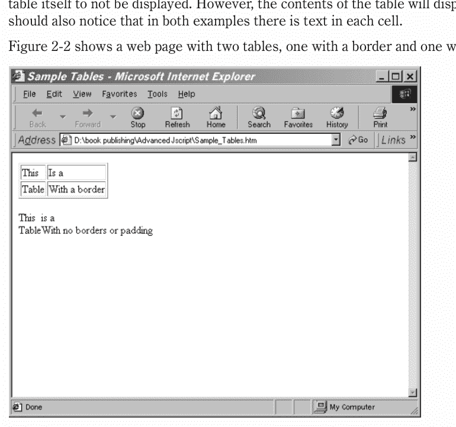

图2-2. 包含两个表格的网页。

由于本书的目的是教你JavaScript，你心中显而易见的问题应该是：我如何将脚本插入到HTML中？幸运的是，这并不是特别困难。浏览器处理脚本代码（包括JavaScript）的方式与处理HTML代码类似，从左到右、从上到下扫描源代码。JavaScript有自己的“标签”，用以指示浏览器并确定布局。然而，JavaScript的读取方式与HTML并不完全相同。在HTML中，浏览器会根据它识别到的元素立即执行操作。并非所有JavaScript代码都指页面加载时发生的动作。有些部分只是保存在内存中，直到被调用。例如，如果你编写了一个函数但没有调用它，浏览器不会对它做任何事情。这部分脚本会留在内存中，可以在之后被调用。但在你继续阅读本书的其余部分并学习JavaScript之前，你真正想知道的问题是：我如何将脚本放入HTML文档中？任何脚本都可以很容易地通过将你编写的脚本包裹在两个命令中来实现：

```
<SCRIPT LANGUAGE = "whateverscriptlanguageyouareusing">
```

和

```
</SCRIPT>
```

网页上可以使用多种脚本语言，包括VBScript（基于Visual Basic编程语言）、CGI，当然还有JavaScript。下面是将JavaScript插入HTML代码的一个示例：

```
<SCRIPT LANGUAGE="JavaScript">
    alert("Wonderful!")
</SCRIPT>
```

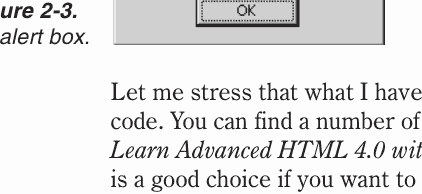

我想强调的是，我刚才介绍的内容仅仅是编写HTML代码的基础。你可以找到许多比这更深入地讲解HTML的书籍。如果你打算认真钻研HTML，Wordware出版社的José Ramalho所著的《Learn Advanced HTML 4.0 with DHTML》是一个不错的选择。

还有各种各样的软件包可以为你生成HTML代码。你只需要像在任何文字处理器中一样创建一个文档，软件就会生成底层的HTML代码。我推荐的两个非常经济的HTML基础编码工具是Claris Works Home Page（大约25美元）或Netscape Composer，后者包含在Netscape Communicator中。

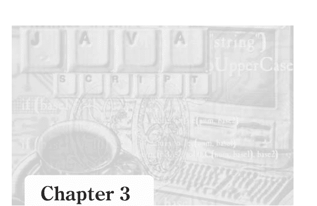

### 编写你的第一个JavaScript

#### 基本的创作工具

为了开始编写脚本，你需要知道使用哪个文本编辑器。HTML文件是纯文本（ASCII）文件。因此，要将JavaScript添加到现有的HTML文档中，你需要一个文本编辑器。你应该不难为你的计算机找到一个文本编辑器，因为大多数操作系统都包含一个文本编辑器（Windows自带记事本和写字板）。

##### 选择文本编辑器

你可以使用各种编辑器，包括第2章中描述的那些，来编写你的JavaScript和HTML。然而，许多经验丰富的网页开发者只是使用操作系统自带的标准文本编辑器。如果你使用Windows，那么你的PC上已经有了记事本和写字板；两者都适用于编写HTML和JavaScript。使用标准文本编辑器的优点是它们是免费的。缺点是它们不提供任何调试工具来帮助你处理JavaScript。

第一个JavaScript编辑环境，Acadia Infuse，由Acadia软件公司推出。它提供了一个易于使用的界面，能够快速轻松地编写脚本。当然，你也可以使用像记事本和写字板这样的简单文本编辑器。

##### 选择浏览器

除了基本的编程工具，你还需要能够运行你的脚本并查看其输出。为了运行JavaScript，你需要一个兼容的浏览器。网景导航器2.0x及以上版本目前支持JavaScript。微软的Internet Explorer 3.0及以上版本也支持JavaScript（IE对JavaScript的实现称为JScript）。

选择哪个浏览器并不真的重要。互联网行业发展迅速，因此许多新浏览器可能都会支持JavaScript。当你加载包含JavaScript的本地页面时，你不需要连接到互联网；你可以直接从本地磁盘加载它。解决JavaScript的兼容性问题通常很困难，所以我建议你至少有一个版本的Netscape Navigator和一个版本的Microsoft Internet Explorer。

#### 基本的JavaScript结构

为了运行客户端JavaScript，你必须将代码嵌入到HTML文档中。显然，你不能将JavaScript语句随意放置在源代码的任何位置。有几种不同的方法可以将JavaScript脚本嵌入HTML中：

- 使用 `<SCRIPT>` 标签作为语句和函数。
- 使用HTML标签属性作为事件处理程序。
- 使用类似于URL的短语句。

### `<SCRIPT>` 标签

#### 内部脚本

`<SCRIPT>` 标签用于在HTML文档中封装JavaScript代码。其一般语法如下：

```
<SCRIPT LANGUAGE="JavaScript">
[JavaScript语句...]
</SCRIPT>
```

`<SCRIPT LANGUAGE="JavaScript">` 标签的作用就像所有其他HTML标签一样。请注意，它后面必须跟上对应的结束标签 `</SCRIPT>`。你放在这两个标签之间的每条语句都会被解释为JavaScript代码。这可能是将JavaScript插入HTML文档最常用的方法。

LANGUAGE属性用于指定脚本语言。目前，`<SCRIPT>` 标签支持多种语言，包括JavaScript和VBScript。JavaScript是默认的脚本语言，因此不需要LANGUAGE定义。当浏览器遇到该语言名称时，它会加载内置的JavaScript解释器，然后解释脚本。然而，最好始终明确命名你正在使用的脚本语言。这可以确保你的脚本在未来的HTML版本和各种浏览器中都能正常工作。

JavaScript区分大小写，而HTML则不区分。写成 `<SCRIPT>` 还是 `<script>` 都没关系，但请尽量保持一致。就我个人而言，我在HTML中使用全大写。尽管这对浏览器来说并不重要，但对阅读我的HTML代码的人来说很重要。请记住，HTML和JavaScript与任何编程语言没有区别，你应该始终努力确保你的代码可读。

#### 外部脚本

网景导航器3.0为 `<SCRIPT>` 标签引入了一个新的SRC属性，该属性允许使用外部脚本；也就是说，你可以使用位于另一个文件中的JavaScript脚本。这个功能最终将允许人们将脚本隐藏起来，不让公众看到，尽管这种做法不符合……


web。本书中我将很少使用外部脚本，但请记住它们的存在，你可能会发现它们很有用。当你需要将一个冗长、复杂的JavaScript脚本集成到HTML文件中时，外部脚本非常有用。这种方法有几个优点：

-   **易于维护。**脚本与外部元素（如不相关的HTML代码）隔离。当脚本独立存在时，维护起来要容易得多。
-   **对不支持的浏览器隐藏。**代码会自动对不支持JavaScript的浏览器隐藏。HTML解析的最基本规则是忽略未识别的标签（这使得各种浏览器得以存在），因此只存在`<SCRIPT LANGUAGE="JavaScript">`和`</SCRIPT>`标签时，旧浏览器会忽略所有与JavaScript相关的元素。
-   **库支持。**外部脚本使得使用JavaScript库成为可能，类似于C、C++和其他编程语言中的库（例如`#include <string.h>`）。你可以在外部脚本中引用通用的预定义函数，从而避免函数重复或全局声明。让我们再次以C++为例。把`cout`想象成一个你编写的简单函数。你必须指定函数的来源才能使用它：

```
#include <iostream.h> // 包含头文件的指令
void main()
{
    cout << "This is C++ programming"
}
```

JavaScript具有相同的结构，只是它只支持一个外部文件。

以下是使用外部文件的一些缺点：

-   **无反向引用。**如上所述，JavaScript脚本主要由用户触发的事件驱动。点击按钮调用一个函数，选择表单元素执行另一个函数，以此类推。如果你将整个脚本设计在外部文件中，你将难以引用原始文件中的HTML定义。因此，只在外部脚本中放置通用函数。
-   **额外的处理。**JavaScript解释器会评估脚本头中找到的所有函数，包括那些在外部文件中定义的函数，并将它们存储在内存中。在外部文件中加载不需要的函数会降低脚本性能。
-   **额外的服务器访问。**你知道等待另一个页面在窗口中加载是多么烦人，尤其是在使用缓慢的调制解调器连接时。这就是SRC属性的问题。当浏览器遇到告诉它在另一个文件中解释JavaScript代码的标签时，它必须首先加载该文件。这样的操作很耗时。大多数程序员说效率不如可维护性和清晰性重要。然而，在网页开发中，外观就是一切，加载缓慢的网站不太可能成功。始终记住，应避免不必要的HTTP服务器请求。

理论讲够了。以下是在`<SCRIPT>`标签中定义外部脚本的语法：

```
<SCRIPT LANGUAGE="JavaScript" SRC="yourFile.js">
[额外的JavaScript语句...]
</SCRIPT>
```

请注意，外部文件的扩展名必须是`.js`，就像HTML文件的扩展名必须是`.html`或`.htm`一样。文件名不必包含完整路径；相对（虚拟）路径就足够了。`.js`显然代表JavaScript。假设`abc1.js`包含以下代码：

```
var counter = 100
function alertMe(message)
{
    alert(message)
}
function writeMe(message)
{
    document.write(message)
}
```

此时，JavaScript语句本身的意义并不重要。它们将在后面的章节中解释。下面是基本的HTML文件：

```
<HTML>
<HEAD>
<TITLE>Using external files</TITLE>
<SCRIPT LANGUAGE="JavaScript" SRC="abc1.js">
<!--
var digit = 8
alertMe("Hello!")
writeMe("Howdy!")
// -->
</SCRIPT>
</HEAD>
</HTML>
```

前面的结构等同于以下HTML文档：

```
<HTML>
<HEAD>
<TITLE>Equivalent Script</TITLE>
<SCRIPT LANGUAGE="JavaScript">
<!--
var counter = 100
function alertMe(message)
{
    alert(message)
}
function writeMe(message)
{
    document.write(message)
}
var digit = 8
alertMe("Hello!")
writeMe("Howdy!")
// -->
</SCRIPT>
</HEAD>
</HTML>
```

这两个脚本都会产生如图3-1所示的输出。

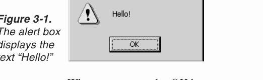

当你按下确定按钮时，你会进入图3-2所示的图像。

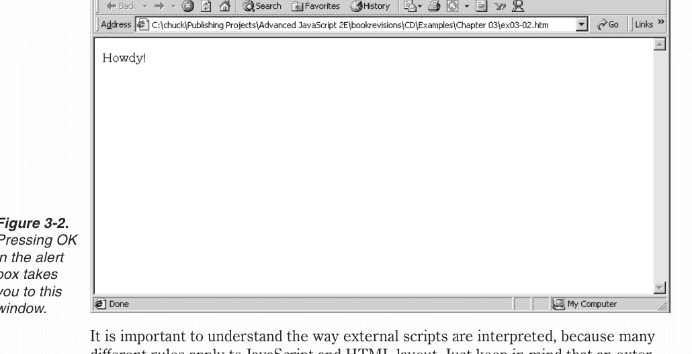

理解外部脚本的解释方式很重要，因为JavaScript和HTML布局有许多不同的规则。只需记住，外部脚本的解释方式实际上就像它位于本地脚本（由`<SCRIPT>`和`</SCRIPT>`标签包围）之前一样。`<!--`和`// -->`标签将在下一节介绍。

仅包含JavaScript的文件应具有文件名后缀`.js`，并且服务器必须将`.js`后缀映射到MIME类型`application/x-javascript`，并在HTTP头中发回该类型。如果服务器没有将`.js`文件名扩展名映射到`application/x-javascript`，Navigator将无法正确加载SRC属性指定的JavaScript文件。简而言之，你的服务器必须配置为反映正确的MIME类型；否则浏览器将无法正确响应从SRC发起请求的HTTP响应中返回的数据。

## 隐藏脚本

你可能问过自己，当有人用不支持JavaScript的旧浏览器加载你的页面时会发生什么。这个问题的解决方案基于HTML和JavaScript的注释标签。

Netscape Navigator和Internet Explorer中的注释标签是`<!--`和`-->`。第一个打开注释块，第二个关闭它。普通HTML文档中的简单注释如下所示：

```
<!-- copyright 2001 -->
```

JavaScript中有两种类型的注释：

-   `//`用于开始不超过一行的短注释
-   `/*`和`*/`用于包围任意长度的注释

JavaScript解释器会忽略JavaScript代码中的HTML注释开始标签。请看下面应使用的语法，以对不支持JavaScript的旧浏览器隐藏代码：

```
<SCRIPT LANGUAGE="JavaScript">
<!-- hide code from old browsers
JavaScript语句...
// end code hiding -->
</SCRIPT>
```

为了理解这种隐藏是如何工作的，请想象上述脚本在不支持JavaScript的浏览器中的输出。`<SCRIPT>`和`</SCRIPT>`标签与任何其他未识别的标签一样被忽略。HTML注释标签之间的所有内容也会被忽略。这种结构在Netscape Navigator和Microsoft Internet Explorer中都能正常工作，它们理解这些标签并正确解释脚本。

### 代码隐藏的问题

重要的是要理解，某些浏览器可能使用一些非标准的HTML代码。Netscape就是这样处理注释标签的。虽然Netscape Navigator期望序列`<!-- comments -->`，但标准的HTML注释语法是`<! comments >`。因此，JavaScript源代码中任何大于号逻辑运算符都表示注释的结束。该字符之后的脚本语句被解释为非注释的普通HTML代码，导致JavaScript语句作为纯文本打印到页面上。唯一的解决办法是在脚本中避免使用`>`字符。例如，你可以用`a < b`替换`b > a`。在某些情况下，例如通过JavaScript打印HTML标签，更难找到大于号字符的替代品。看看下面的脚本：

```
<SCRIPT LANGUAGE="JavaScript">
<!--
document.write("<TABLE")
// -->
</SCRIPT>
```

当旧浏览器遇到`<!--`序列时，它开始将代码解释为普通HTML注释。当它在脚本本身中找到一个`>`字符时，它会终止注释。因此，旧浏览器将打印脚本的剩余部分。一般来说，你必须避免在脚本中直接使用大于号字符，以便Netscape浏览器能正确解释代码。在这种情况下，完美的解决办法是将大于号字符赋值给一个变量，而不将其直接放在脚本中，然后在需要时对变量求值。这可以这样做：

```
<SCRIPT LANGUAGE="JavaScript">
<!--
var gt = unescape("%3E")
document.write("<TABLE" + gt)
// -->
</SCRIPT>
```

扫描脚本，注意没有大于号字符存在。有关`unescape()`函数的详细信息，请参见第14章“处理字符串”。

### 替代内容

甚至有一个HTML标签允许你为不支持JavaScript的浏览器用户提供替代内容。然而，你不会经常看到它的使用，因为Netscape和Internet Explorer在其所有最新版本中都支持JavaScript。`<NOSCRIPT>`标签及其结束对应部分`</NOSCRIPT>`类似于`<NOFRAMES>`标签，后者用于为不使用支持框架的浏览器的用户提供替代内容。以下示例演示了如何为不运行JavaScript的用户添加此类替代内容：

```
<NOSCRIPT>
<B>This page uses JavaScript, so you need to get the most recent version of either Netscape Navigator or Internet Explorer!</B><BR>
<A HREF="http://home.netscape.com/comprod/mirror/index.html">
</A><BR>
If you are using Navigator 2.0 or later, and you see this message, you need to enable JavaScript by choosing Options | Network Preferences.
</NOSCRIPT>
```

你可能在问自己，一个甚至不识别脚本的旧浏览器如何能正确解释`<NOSCRIPT></NOSCRIPT>`部分。启用JavaScript的浏览器在JavaScript启用时会简单地忽略该部分。但是，旧浏览器不知道这个标签并忽略它。它不会忽略内部的


## 第三章

`<NOSCRIPT>` 和 `</NOSCRIPT>` 标签，会使得它们之间的 HTML 内容仅能被旧版浏览器或禁用了 JavaScript 支持的浏览器所解析。

### 放置 JavaScript 代码

当你想将脚本放置在 HTML 文档的某个位置时，你需要选择一个放置点。从技术上讲，你可以将它放在包含整个文档的 `<HTML>` 和 `</HTML>` 标签之间的任何位置。实际上，主要的选择是 `<HEAD></HEAD>` 部分和 `<BODY></BODY>` 部分。因为 `<HEAD></HEAD>` 部分会先被解析，所以一些开发者选择将 JavaScript 放在这里。一个 HTML 文档可以包含任意数量的脚本。你可以将一些脚本放在页面的 `<HEAD></HEAD>` 部分，将另一些放在 `<BODY></BODY>` 部分。以下代码展示了这一点：

```html
<HTML>
<HEAD>
<TITLE>Multiple scripts</TITLE>
<SCRIPT LANGUAGE="JavaScript">
[JavaScript statements...]
</SCRIPT>
<SCRIPT LANGUAGE="JavaScript">
[JavaScript statements...]
</SCRIPT>
</HEAD>
<BODY>
<H1>This is a complex structure</H1>
<SCRIPT LANGUAGE="JavaScript">
[JavaScript statements...]
</SCRIPT>
</BODY>
</HTML>
```

## 语法约定

JavaScript 的语法与 C、C++ 和 Java 非常相似。它包括函数、表达式、语句、运算符等。

### 使用分号

JavaScript 解释器不会关注源代码中的回车符。你可以将多条语句放在同一行，但必须用分号 (`;`) 将它们分隔开。你也可以在独占一行的语句末尾加上分号，但这不是必须的。看看以下几组语句：

```javascript
document.write("Hello"); alert("Good bye")
document.write("Hello")
alert("Good bye")
document.write("Hello");
alert("Good bye");
```

这三组都是合法的，并且它们的结果完全相同。

### JavaScript 区分大小写

你之前已经看到 JavaScript 是一种区分大小写的语言。这一点适用于语言的方方面面，包括变量名（标识符）、函数和后面将讨论的方法。例如，语句 `document.write()` 是合法的，但 `document.Write()` 则不是。

### 注释

注释是所有语言中的一个重要概念，JavaScript 也不例外。它们有助于使程序简洁、易于理解。注释是可以放在程序各处的说明性文字，不会影响程序的执行结果。JavaScript 中有两种不同类型的注释：

- 单行注释是长度不超过一行的注释。它们必须在同一行开始和结束。这些注释以双斜杠 (`//`) 开头。
- 多行注释是可以超过一行长度的注释。因此，它们需要一个符号来指定注释的开始，另一个符号来指定注释的结束。开始部分是 `/*`，结束部分是 `*/`。

这两种注释都与 C 和 C++ 中的注释完全相同。你应该使用注释来解释脚本的每个部分。

```javascript
// single-line comment
/* line 1 of the comment
   line 2 of the comment
   line 3 of the comment */
```

### 使用引号

在 JavaScript 中，你经常使用引号等来界定字符串。当在一对引号内使用另一对引号时，会出现一个常见问题。由于解释器必须识别每一组引号才能正确配对，JavaScript 的创造者使得可以使用两种不同类型的引号成为可能：双引号 (`"`) 和单引号 (`'`)。如果你只需要一对引号，你可以选择其中任何一种，只要确保使用与开头相同类型的引号来结束它。如果不遵循此规则，你将得到一个 JavaScript 错误：“未终止的字符串字面量”。你必须始终正确地交替使用引号：

```javascript
document.write("")
```

## 你的第一个脚本

到现在你可能会问自己，我什么时候才能真正编写一些 JavaScript 代码呢？答案就是现在！我已经和你探讨了 JavaScript 背后的理论，直到你毫无疑问已经厌倦了阅读。所以现在让我们来编写一些实际的脚本。

首先，启动你的文本编辑器。在文本编辑器中输入示例 3-1，并将其保存为 HelloWorld.htm。确保文件名以 `.htm` 或 `.html` 扩展名结尾，否则浏览器将无法将其识别为 HTML 文档。在输入这个示例时，你必须尽最大努力完全理解自己正在输入的内容。接下来，启动浏览器。由于文件是本地的，你不需要连接到互联网就能查看结果。现在，从浏览器的菜单中加载该文件。就是这样。你可以开始享受 JavaScript 了。

当你加载包含它的页面时，以下脚本会被立即解释和执行。

```html
<HTML>
<HEAD>
<TITLE>Hello World.</TITLE>
</HEAD>
<BODY>
<SCRIPT LANGUAGE="JavaScript">
<!-- hide code from old browsers
document.write("<H1>Hello World.</H1>")
// end code hiding -->
</SCRIPT>
</BODY>
</HTML>
```

**示例 3-1**

如果你正确输入了代码，你应该会在浏览器中看到类似图 3-3 的内容。

### 编写你的第一个 JavaScript 31

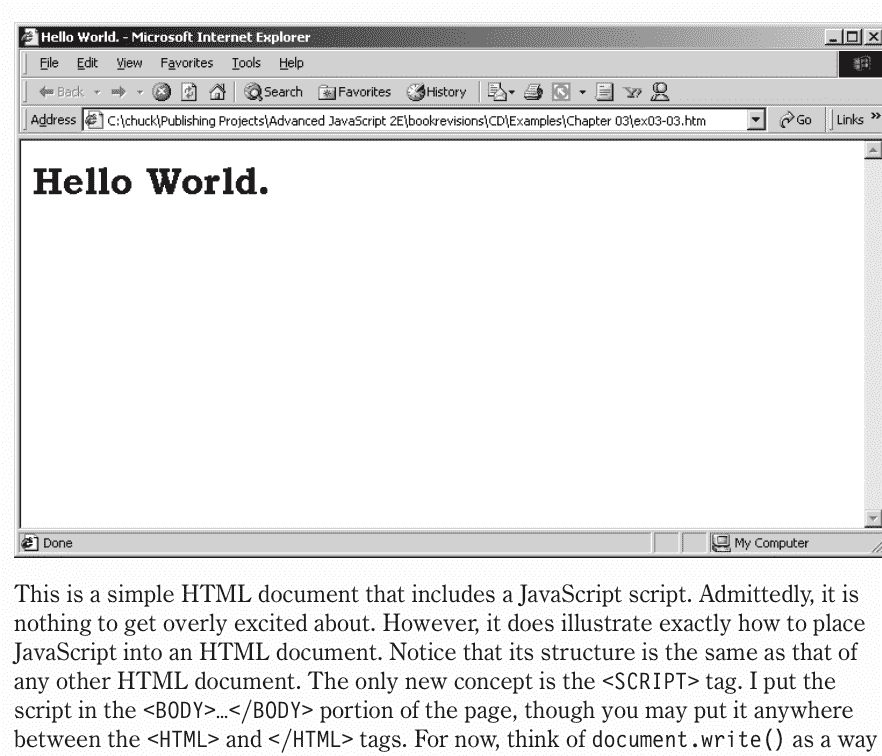

图 3-3. 你的第一个脚本的输出。

这是一个包含 JavaScript 脚本的简单 HTML 文档。诚然，它没什么值得过度兴奋的。然而，它确实准确地说明了如何将 JavaScript 放入 HTML 文档中。注意，它的结构与任何其他 HTML 文档的结构相同。唯一的新概念是 `<SCRIPT>` 标签。我将脚本放在了页面的 `<BODY>...</BODY>` 部分，尽管你也可以将它放在 `<HTML>` 和 `</HTML>` 标签之间的任何地方。目前，可以将 `document.write()` 视为一种向页面打印表达式的方式。`write()` 实际上是 document 对象的一个方法。对象、方法和属性将在第五章《面向对象编程》中介绍。`write()` 方法支持任何 HTML 语法。还要注意，所有字符串都必须包含在引号内。

示例 3-2 的等效版本由两个文件组成：HTML 文件和外部 JavaScript 文件：

```html
<HTML>
<HEAD>
<TITLE>Hello World.</TITLE>
</HEAD>
<BODY>
<SCRIPT LANGUAGE="JavaScript" SRC="sayHello.js">
</SCRIPT>
</BODY>
</HTML>
// this file must be named sayHello.js
document.write("Hello World.")
```

**示例 3-2**

## 第三章

### 打印 JavaScript 输出

后期版本的 Internet Explorer 和 Netscape Navigator 允许你打印 JavaScript 脚本的输出。看看下面的例子：

```html
<HTML>
<HEAD>
<TITLE>Printing JavaScript</TITLE>
</HEAD>
<BODY>
<SCRIPT LANGUAGE="JavaScript">
<!--
document.write("This is JavaScript output.")
// -->
</SCRIPT>
<BR>
This is HTML output.
</BODY>
</HTML>
```

如果你正确输入了这段代码，你应该会在浏览器中看到类似图 3-4 的内容。

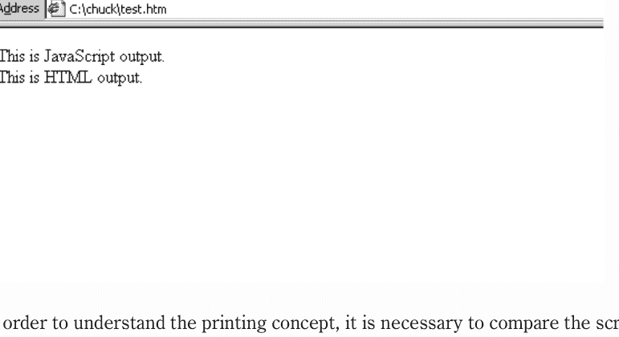

图 3-4. 打印脚本输出。

为了理解打印的概念，有必要将屏幕输出与纸质输出进行比较。

### 更新页面

每当你更改了页面内容并希望查看它对最终布局的影响时，必须使用“刷新”按钮重新加载页面。JavaScript 脚本在页面初始加载时会被立即解释，而不会立即运行的代码则会存储在内存中。重新加载页面会刷新内存，并生成页面布局的新版本（当然，如果你更改了它的话）。

## 总结

在本章中，你学习了如何编写脚本并将其添加到 HTML 文档中。我们介绍了 `<SCRIPT>` 标签和其他相关主题。有时很难预测其他人在你的页面上看到的内容，特别是那些使用不支持 JavaScript 的浏览器的人。虽然你还没有看到任何有用的 JavaScript 脚本，但我们希望你理解这是一种强大的脚本语言，它能做的远不止用 `document.write()` 生成 HTML 内容。一旦你掌握了编写简单脚本的方法，你就会发现转向更复杂和有趣的程序变得容易。它可能看起来没什么，但你已经为学习 JavaScript 奠定了基础。


# JavaScript 基础知识

## “构建”脚本

JavaScript 与所有编程语言有许多共同的基本概念，包括其基本元素。它有存储数据的变量，有表达式或语句，还有函数。这些构建块用于构建你的 JavaScript 代码。本章我将解释这些元素中的每一个。

## JavaScript 中的数据类型

变量存储的信息必须是特定类型。这些类型被称为*数据类型*。使用正确的数据类型来存储信息非常重要。例如，数字是 JavaScript 能识别的一种信息类型。与大多数编程语言相比，JavaScript 的数据类型数量较少，但其方法、对象和其他元素有助于克服这一限制。JavaScript 中有四种数据类型：数字、字符串、布尔值和空值。与其他语言不同，变量数据类型不是显式声明的，而是根据其初始赋值隐式确定的。JavaScript 还有一个独特之处，即整数和实数之间没有明确区分。

所有这些数据类型在表 4-1 中都有说明。

**表 4-1.** *JavaScript 中的数据类型。*

| 类型 | 描述 | 示例 |
|---|---|---|
| 数字 | 不带引号的任何数字 | 42 或 16.3 或 2e-16 |
| 字符串 | 用引号括起来的一系列字符 | "Hello!" 或 "10" 或 '' 或 "" |
| 布尔值 | 逻辑值 | true 或 false |
| 空值 | 表示没有值的关键字 | null |

### 空值

空值（null）通常用于初始化没有任何特殊含义的变量（见本章后面的“变量声明”）。你使用标准赋值语句将其赋给变量：

```
var name = null
```

空值很特殊，因为它会自动转换为其他数据类型的初始值。当用作数字时，它变为 0；当用作字符串时，它变为 ""；当用作布尔值时，它变为 false。由于许多 JavaScript 错误源于未初始化的变量，一种常见的调试技术是将所有未初始化的变量（包括无意义的变量）初始化为空值。

JavaScript 解释器在两种情况下使用空值：(1) 内置函数在特定情况下返回 null；(2) 不存在的属性求值为 null。在检查空值时，你应该检查它是否为 false 或是否等于 null。

## 变量

变量是大多数编程和脚本语言的基石。它们充当脚本中简单单词与计算机分配内存之间的链接。你可以使用的内存数量是有限制的，但你不应该达到那个限制。JavaScript 应用程序对资源的需求不大，现代 PC 通常有大量的内存，因此超过可用内存可能表明浏览器中存在错误或程序存在重大缺陷（例如意外的无限循环）。

由于你不直接处理内存分配，你应该将变量视为装有物品的篮子。你可以在篮子里放一个物品，把它拿出来，或者用另一个物品替换它。不使用变量的脚本可能毫无用处。这就像用手掌把草莓带回家，而不是用篮子——是不可能的！你需要变量来保存不同类型的数据。

### 标识符

每个变量都通过变量名（也称为标识符）来标识。每个变量名都与特定的内存位置相关联，解释器使用它来确定其位置。命名变量有严格的规则：

- 标识符的第一个字符必须是字母（大写或小写）或下划线 (_)。
- 所有其他字符可以是字母、下划线或数字 (0-9)。
- 标识符不能是语言的保留字。保留字包括所有 JavaScript 关键字以及为未来版本保留的其他标记。

标识符的长度没有限制，你应该利用这一特性来选择有意义的名称。JavaScript 区分大小写（大写字母与小写字母不同）。也就是说，counter、Counter 和 COUNTER 是三个不同变量的名称。避免在同一个脚本中使用这样相似的标识符。然而，你会希望使用与它们包含的数据相关的变量名。例如，如果你有一个存储人姓氏的字符串变量，你可能希望将其命名为 LastName。

> **注意：** 在某些旧版本的 Netscape 和 Internet Explorer 中，$ 字符不是合法的。例如，以下标识符在 Netscape Navigator 3.0x 和 4.0 中被接受，但在 2.0x 和 Internet Explorer 3.0x 中不被接受。

```
$FirstDigit
money$
tenth$cell$10
```

以下标识符是合法的：

```
gameCount
_hamburger
_123456789_
look_at_me
Number16
```

但以下标识符是非法的：

```
with             // 保留字
^fastTimer       // 第一个字符非法
911phoneNumber   // 不能以数字开头
04-825-6408      // 第一个字符非法
                 // "-" 是非法字符
***important***  // * 不是合法字符
10_guesses       // 第一个字符不能是数字
```

关键字是在编程语言中具有特殊含义的单词。你不能使用关键字来命名你在脚本中创建的变量或函数（例如变量、函数等）。关键字列表是语言的基本词汇。例如，单词 `if` 是一个关键字。你不必记住这个列表，因为你将在脚本中使用这些单词的过程中逐渐记住它们。

### 命名约定

JavaScript 中有许多普遍接受的约定：

- 变量名通常用小写字母书写。
- 变量名指示其在程序中的用途和用法。
- 在多词标识符中，在单词之间放置下划线或大写每个嵌入单词的首字母。

### 变量声明

以下是多词标识符的示例。

```
all_done       // 下划线
allDone        // 大写字母
```

避免使用相似的变量名。以下说明了一个糟糕的变量名选择：

```
digit          // 当前数字
digits         // 数字中的位数
```

一组好得多的变量名是：

```
current_digit  // 当前数字
num_of_digits  // 数字中的位数
```

在使用变量之前，你需要创建它。JavaScript 是一种弱类型语言，这意味着在创建变量时不必显式指定其数据类型。根据需要，数据类型在脚本执行过程中会自动转换。在强类型语言中，变量必须以特定类型创建。

创建变量有两种方式。第一种*声明*类型包括 var 关键字，后跟变量名：

```
var variableName
```

当解释此语句时，浏览器会在变量名与其内存地址之间创建一个链接，因此后续可以通过名称进行引用。与某些编程语言不同，声明不限于特定区域，可以在脚本中的任何位置进行。

将初始值赋给变量的操作称为*初始化*。你使用最常见的*赋值运算符*（等号）给变量一个值：

```
var variableName = initialValue
```

你只需在创建变量时使用 var 关键字。当你想引用该变量时，只需使用其名称。在声明变量后，按以下方式为其赋值：

```
variableName = anyValue
```

每个变量只使用一次 var。全局变量可以通过直接赋值而不使用 var 关键字来创建。另一方面，函数内的局部变量必须使用 var 关键字声明。与许多其他编程语言一样，JavaScript 允许你在同一语句中声明多个变量，使用逗号分隔它们：

```
var variableName1 = initialValue1, variableName2 = initialValue2, ...
```


## JavaScript 实体

JavaScript 实体可以赋值给 HTML 属性。这种属性替换机制能够创建更灵活的 HTML 结构，而无需编写完整的 JavaScript 脚本。请注意，Netscape 和 Internet Explorer 的较新版本不支持 JavaScript 实体。

你可能熟悉 HTML 字符实体，通过它们你可以根据字符的数值代码或名称来显示字符。你需要在名称或数字前加上一个与符号 (&)，并用分号 (;) 结尾。以下是一些示例：

```
&gt;
&lt;
&#169;
```

这些 HTML 实体会转换为以下字符：

> (大于)
< (小于)
© (版权)

JavaScript 实体同样以与符号开头，以分号结尾。但不同于名称（如前两个示例）或数字（如第三个示例），你使用的是包含在花括号 ({ 和 }) 中的 JavaScript 表达式。请注意，你只能使用 JavaScript 实体来赋值 HTML 属性。考虑以下 HTML 文档：

```
<HTML>
<HEAD>
<TITLE>JavaScript Entities</TITLE>
<SCRIPT LANGUAGE="JavaScript">
<!-- hide content from old browsers
var fontSize = "+4"
var fontColor = "red"
// end hiding content-->
</SCRIPT>
</HEAD>
<BODY>
<FONT COLOR="&{fontColor};" SIZE="&{fontSize};">
Flexible attributes with JavaScript entities
</FONT>
</BODY>
</HTML>
```

**示例 4-1**

实体 &{fontColor}; 会被替换为 fontColor 的当前值，而 &{fontSize}; 会被替换为 fontSize 的当前值。由于 JavaScript 只能使用页面布局时存储在内存中的值，因此 JavaScript 实体应仅在调用为其赋值的脚本后使用。

一旦布局完成，页面的显示只能通过重新加载页面来更改。即使 JavaScript 实体变量的值发生了变化，实体本身在页面重新加载之前也不会改变。

与可以在任何脚本语句中使用的 HTML 字符实体不同，JavaScript 实体只能在标签语句中使用。另一个区别是，HTML 字符实体可以替代任何 HTML 元素，而 JavaScript 实体仅限于 HTML 属性替换。例如，你无法指定实体 "&{text};" 其中变量 text = "<H1>Hi!</H1>"——这不是标签属性的有效值。

### 类型转换

如上所述，数据类型在脚本执行过程中会根据需要自动转换。一个变量在脚本的某个时刻可能持有数值，而在另一个时刻可能持有字符串。以下语句构成了一个有效的 JavaScript 脚本：

```
var myVar = 12
myVar = "university"
```

第一条语句将数值赋给 myVar，第二条语句则将其赋为字符串。在 C++ 和 Java 等严格类型语言中，这种转换是不允许的。虽然在 JavaScript 中是可能的，但并不推荐。使用这种技术会导致编程非常草率。

### 混合字符串和数字

在某些操作中，有时需要混合字符串和数字。由于这很棘手，并且可能产生意外结果，你应该熟悉其确切规则。当一个包含数字和字符串的表达式被计算为单个值时，该值将计算为字符串。将其转换为数字通常是不可能的。例如，数字 6 可以很容易地转换为字符串 (6)，而字符串 "horse" 则无法转换为数字。另一个重要规则是，JavaScript 解释器从左到右计算表达式，只有括号可以改变计算顺序。看看以下按行编号的表达式。

```
/* 1 */ 8 + 8 // 16
/* 2 */ "8" + 8 // "88"
/* 3 */ 8 + "8" // "88"
/* 4 */ "8" + "8" // "88"
/* 5 */ 8 + 8 + "8" // "168"
/* 6 */ 8 + "8" + 8 // "888"
```

这些表达式都使用了字符串连接运算符，它同时也是数字加法运算符。（本章稍后会介绍运算符。）

第一个表达式只是将两个数字相加，使用的是数字格式。它使用标准的加法运算符，计算结果为其操作数的和。第二个表达式则大不相同。它的第一个操作数是字符串而不是数字。为了将数字加到字符串，数字会先转换为相应的字符串，然后连接字符串。第三个和第四个表达式类似，因为它们也至少包含一个字符串操作数。第五个表达式稍微复杂一些。前两个操作数因为是数字所以相加。表达式现在计算为 16 + "8"，你已经知道，这会计算为 "168"。使用括号可以改变结果。例如：

```
8 + (8 + "8") // "888"
```

在这个表达式中，括号内的内容首先被计算为 "88"，整个表达式计算为 "888"。比较第六个表达式和第五个表达式，清楚地展示了从左到右计算的含义。

每当在表达式计算过程中发现字符串，迄今为止累积的值就会转换为字符串。当右侧剩余的数字值与此累积值连接时，会自动转换为字符串。

如果你想将单个数字转换为字符串，可以使用以下三种方法之一：

```
var newVar = " " + numericValue
var newVar = new String(numericValue)
var newVar = numericValue.toString()
```

第一种方法很简单。你使用连接运算符，它指示 JavaScript 将数字转换为字符串，然后将其附加到一个空字符串。其他方法将在本书后面讨论。

## 字面量

*字面量*是你在应用程序源代码中直接提供的固定值，它们不是变量或任何其他数据结构。它们是常量值的表示法，因此在整个脚本中不会改变。字面量给你一个值，而不仅仅是代表可能的值。与 C++ 和 Java 有五种字面量类型不同，JavaScript 只有四种：整数、浮点数、布尔值和字符串。字符字面量被视为长度为 1 的字符串。

### 整数字面量

*整数字面量*，也称为*整数*，是没有小数点或小数部分的数字。以下是一些整数字面量：

```
49
16
0
-18
-42
```

整数可以是正数、负数或零。JavaScript 与大多数其他编程语言一样，支持三种类型或基数的整数：十进制、八进制和十六进制。

#### 十进制整数

*十进制整数*，也称为*基数为 10 的整数*，是我们日常使用的常见整数。它们用数字 0, 1, 2, 3, 4, 5, 6, 7, 8, 9 编写。除了数字 0 本身，十进制整数不能以数字 0 开头。将当前年份写为 01997 是没有意义的，实际上，JavaScript 不会将其计算为 1997。

#### 八进制整数

*八进制整数*，也称为*基数为 8 的整数*，只使用八个数字：0, 1, 2, 3, 4, 5, 6, 7。八进制数字以数字 0 开头（这是零，不是字母“o”）。如果你想引用八进制整数 12（等于十进制中的 10），你必须将其写为 012。

#### 十六进制整数

*十六进制整数*在编程环境中很常用，因为每个十六进制数字代表四个二进制位。*十六进制数*是以下数字的任意序列：0, 1, 2, 3, 4, 5, 6, 7, 8, 9, A, B, C, D, E, F。这些整数被称为十六进制，因为它们基于 16 个不同的数字。大小写敏感性规则不适用于数字，因此你也可以使用小写字母。十六进制数的前缀是 0x 或 0X。

十六进制数对 HTML 作者来说可能很熟悉。在 Netscape Navigator 和 Internet Explorer 的早期版本中，颜色是以*十六进制三元组*格式指定的。尽管最新版本的 Netscape Navigator 和 Internet Explorer 允许你通过名称指定颜色，但有些人仍然使用十六进制表示法。以下标签将背景颜色设置为默认的灰色（即使对于将默认颜色更改为白色的用户也是如此）：

```
<BODY BGCOLOR="#c0c0c0">
```

你可能知道颜色因红色、绿色和蓝色的相对贡献而异。十六进制三元组将三个十六进制数（每个两位数字）组合在一起（2 位数字 = 16 * 16 = 256 种可能）。

### 从十进制转换为其他进制

你可以使用计算器将十进制整数转换为不同的进制。但是当计算器坏了会发生什么？！用铅笔和纸进行转换是出奇的简单。你从将十进制数除以目标进制（例如，二进制为 2，八进制为 8，十六进制为 16）开始。写下余数。现在对商做同样的操作，将新的余数写在上一次操作的余数左边。持续循环，直到商小于目标进制。下表显示了十进制数 747 转换为十六进制表示法的过程：

| 十进制 | 十六进制 |
|---------|-------------|
| 747     | 2EB         |


表 4-2. 基数转换示例。

| 运算及整数商 | 余数（十进制） | 余数（十六进制） |
|---|---|---|
| 747 / 16 = 46 | 11 | B |
| 46 / 16 = 2 | 14 | E |
| 无运算 | 2 | 2 |

查看表格最右侧的一列。自下而上读取，我们得到 2EB<sub>16</sub>，这恰好等于 747<sub>10</sub>。

相同的流程可以将十进制整数转换为任意进制。

### 从指定进制转换为十进制

将数字从指定进制转换为十进制表示法同样容易。首先，让我们分析一个十进制表示的数，例如 276：

276 = (6 * 10<sup>0</sup>) + (7 * 10<sup>1</sup>) + (2 * 10<sup>2</sup>) = 6 + 70 + 200

每个数字贡献的值是 digit * base<sup>digitPlaceFromRight</sup>，其中 digit 是当前数字，digitPlaceFromRight 是该数字的位置（从最右边的 0 位置开始计数），base 是当前的基数。该数的值等于所有贡献值的总和。从给定进制转换为十进制表示法使用相同的技术，只是每个数字的值需要以其在十进制表示中的值来计算。让我们将 1472<sub>8</sub>（八进制）转换为十进制：

(2 * 8<sup>0</sup>) + (7 * 8<sup>1</sup>) + (4 * 8<sup>2</sup>) + (1 * 8<sup>3</sup>) = 2 + 56 + 256 + 512 = 826<sup>10</sup>

我们将在本书后面使用这些技术来创建自动转换函数。

### 引用八进制和十六进制整数

八进制整数以字符 0 开头。十六进制整数以 0x 或 0X 前缀开头。十进制整数是没有前缀的普通整数。那么我们如何处理这些前缀呢？

JavaScript 将所有整数都视为十进制。因此，如果你写 0x2EB，JavaScript 会存储这个数，并在十进制表示中将其引用为 747。同样的规则也适用于八进制整数。它们根据其十进制值进行存储、显示和处理。计算机显然将它们存储为二进制数，但对 JavaScript 程序员来说，它们似乎是以十进制形式处理的。

### 浮点数字面量

*浮点数*（有时称为*实数*）具有小数部分。JavaScript 使用小数点来区分浮点数和整数。严格来说，像 16.0 这样的数字是浮点数，而 16 是整数。此外，浮点数可以包含形式为 e±exp 的指数规范。由于 JavaScript 中没有显式的数据类型声明，浮点格式由分配给变量的字面量隐式确定。以下是一些浮点数及其说明：

```
-13.3
0.056
4.2e19 // 等于 4.2 * 10^19
-3.1E12 // 等于 -3.1 * 10^12
.1e12 // 等于 0.1 * 10^12
2E-12 // 等于 2 * 10^-12
```

注意，指数规范可以使用大写或小写字符。

浮点数运算比整数运算复杂得多，并且是许多 bug 的来源。*溢出*描述了浮点数的指数超过上限的情况。*下溢*则发生在指数低于下限时。你应该避免进行可能导致溢出或下溢的计算。

浮点数一个更常见的问题是*舍入误差*。每个人都知道 5 + 5 等于 10，但是 1/3 + 1/3 是否等于 2/3 呢？答案是：不一定。看看下面的内容，找出原因：

1/3 作为浮点数是 3.333E-1（已舍入）。

2/3 作为浮点数是 6.667E-1（已舍入）。

3.333E-1
+ 3.333E-1
= 6.666E-1

如你所见，结果与 2/3 的正常值不同，因为 6.666E-1 ≠ 6.667E-1。

每台计算机在处理浮点值时都有类似的问题。例如，分数 0.2 没有精确的二进制表示。因此，为了避免这些不准确性，务必在进行计算前对浮点数值进行舍入处理。

### 布尔字面量

*布尔值*，也称为*逻辑值*，本质上是*真*或*假*。它们通常用于条件表达式和语句中。如果你熟悉 C++，你可能会认出这些术语是 1 和 0，其中 1 代表*真*，0 代表*假*。JavaScript 官方使用 *true* 和 *false* 值来表示布尔值，但在大多数情况下 1 和 0 也是可接受的。*true* 值或 1 通常可以被任何非零整数替换。避免使用这些数值作为布尔值，因为 Netscape 官方并未认可这种用法，并且可能在未来版本的浏览器中使其无效。像在其他编程语言中那样使用整数值来表示布尔值，可能会导致数据类型混淆，初学者程序员根本不应该这样做。

### 字符串字面量

*字符串字面量*由单引号或双引号分隔。你必须使用与开头相同类型的引号来终止字符串，因此 "Hi' 在 JavaScript 中不是合法的字符串。与大多数编程语言和 shell 中的字符串不同，JavaScript 不区分单引号和双引号。它们的用途完全相同。JavaScript 中的字符串不支持变量插值，即你不能直接将变量嵌入字符串中，并期望它们被替换为变量所持有的值。例如，Perl 支持变量插值（或变量替换），因为变量可以通过前面的 $ 字符来识别。

JavaScript 不支持替代分隔符 q/*string*/ 和 qq/*string*/。你必须始终使用传统的引号来分隔字符串。

JavaScript 中广泛使用*嵌套字符串*。嵌套字符串由一个字符串包含在另一个字符串中构成。交替使用引号可以正确解释嵌套字符串结构。以下语句演示了如何交替使用引号类型：

```
document.write("<FONT COLOR='red' SIZE=4>")
```

document.write() 语句需要引号，<FONT> 标签的 COLOR 属性也需要引号。你可以对字符串 'red' 使用单引号，对较长的外部字符串使用双引号。你也可以使用转义引号，如下所述。

务必在字符串末尾放置结束引号。如果你忘记了，相关的错误只会在 JavaScript 运行到文件末尾或在另一行找到匹配的引号字符时才会报告。幸运的是，这类错误会在下一行被立即检测为语法错误。然而，有时错误信息不会提供任何关于失控字符串的线索，因此在处理字符串时格外注意是一个好策略。

字符串通常包含*转义序列*，也称为*转义字符*、*特殊字符*或*控制字符*。这些序列具有特殊用途。例如，\t 是制表符。它们通常用于表示不可打印字符或其他有问题的字符。下表概述了转义序列：

## 表 4-3. *JavaScript 中的转义序列。*

| 转义序列 | 字符 | 含义 |
|---|---|---|
| \ddd* | 0ddd | 八进制字符 |
| \xdd* | 0xdd | 十六进制字符 |
| \\ | \ | 反斜杠 |
| \' | ' | 单引号 |
| \" | " | 双引号 |
| \b | BS | 退格 |
| \f | FF | 换页 |
| \n | NL 或 LF | 换行（或行馈） |
| \r | CR | 回车 |
| \t | HT | 水平制表符 |
| \ | <新行> | 续行符 |

\* 字符 *d* 代表一个数字。

确保仅在需要时使用这些内联字符。你应该使用标准的 HTML 标签进行换行 (<BR>) 和段落分隔 (<P>)。回车转义序列仅在对话框和文本区域对象中创建新行。大多数转义序列的行为方式相同。不要期望它们来格式化页面的外观，因为布局完全依赖于 HTML。

以下是一些利用转义序列的字符串：

```
"\x2499.99" // $99.99 ($ 字符的十六进制值是 24)
'c:\\games\\sc2000\\' // c:\games\sc2000\
'Let\'s learn JavaScript...' // Let's learn JavaScript...
"line1\rline2"
```

要查看回车字符的效果，可以尝试在警告框中显示最后一个字符串。

# 运算符

每种编程语言都有运算符。*运算符*只是一个符号，它告诉编译器（或解释器）执行某个操作。基本的算术运算符在大多数编程语言中是通用的。这些是加法 (+)、减法 (-)、乘法 (*) 和除法 (/)。这些对大多数人来说应该非常熟悉。运算符的优先级遵循标准的数学规则：乘法、除法、加法和减法。但是，当你的代码在单行中包含多个操作时，使用括号来明确你想要发生什么通常是一个好主意：3 * 4/2 + 1 可能是模糊的，而 3 * ( (4/2) + 1) 则非常清晰。

C、C++ 和 Java 程序员应该已经熟悉递增和递减运算符。递增运算符通过在变量后面放置两个加号来形成，如下所示：

```
var somenumber
somenumber++
```

这行代码将 somenumber 的值递增一。如果我们写成：

```
somenumber - -
```

它将把值减少一。

你必须意识到递增和递减运算符放置的位置至关重要，这一点非常重要。如果你将递增运算符放在变量后面，例如：

```
var somenumber = 10
var someothernumber
someothernumber = somenumber++
```

赋值操作将在求值操作之前发生。换句话说，首先 someothernumber 将被设置为 somenumber 的值，*然后* somenumber 的值才会递增。在我们的例子中，这意味着 someothernumber 将等于 10，而 somenumber 将等于 11。如果你希望重写该语句以使递增操作先发生，只需重新定位递增符号：


someothernumber = ++somenumber

在此示例中，somenumber 被递增至 11，然后该值被赋给 someothernumber。

你已经学习了如何使用等号赋值运算符为变量赋值或初始化变量。正如下面的代码片段所示，你也可以在赋值时进行计算：

```
/* 1 */ var answer
/* 2 */ answer = 4 * 2 + 9
/* 3 */ document.write(answer)
```

第 1 行包含了变量 answer 的声明。第二行展示了如何将变量 answer 赋值为一个简单数学表达式的结果。此时，变量存储的值为 17。引用变量 answer 等同于引用数字 17。因此，第 3 行的语句会打印出数字 17。

> **注意：** 一个非常常见的错误是使用等号进行相等性检查。例如，在 Pascal 语言中，"=" 是一个相等性测试运算符，因为该语言的基本赋值运算符是 ":="。然而，在 JavaScript 中，如同 C++ 和 Java 一样，"="（等号运算符）是一个赋值运算符，而 "=="（双等号）才是相等性测试运算符。

以上只是对 JavaScript 中最简单运算符的粗略考察。第 7 章将对运算符进行详尽的讨论。不过，你对本章及接下来两章的理解，依赖于对运算符的简要介绍。

## 语句

既然我们已经详细考察了数据类型，让我们来看看语句。一条*语句*是执行特定任务的一行代码。例如，以下所有内容都是语句：

```
yourAge = 32
for(x=1;x<10;x++)
myname = "Chuck"
```

### 多条语句

JavaScript 解释器允许在同一行中包含多条语句。如果你选择使用此方法，必须用分号 (;) 分隔这些语句。该行的最后一条语句后面可以不跟分号。这样的行如下所示：

```
statement1; statement2; statement3; ...
```

浏览器解释这些语句的方式，与它们列在不同行上时相同：

```
statement1
statement2
statement3
```

尽管 JavaScript 允许这样做，但我绝不推荐。将多条语句放在单行会使代码变得非常难以阅读。

即使 JavaScript 不要求在每条语句后使用分号（除非它们在同一行），如果你在每条语句末尾放置分号，它也不会产生错误。因此，如果这是你的编程习惯之一，你可以用分号结束所有语句。

```
statement1;
statement2;
statement3;
```

然而，请记住，这在 JavaScript 中并非必需，就像在 C、Java 和 C++ 中那样。

### 嵌套语句

命令块是由花括号包围的一组语句。理解一个块应被视为单条语句非常重要。块内部的语句称为嵌套语句：

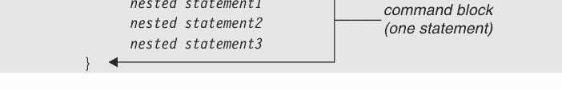

一个包含多条语句的循环，实际上是一条具有许多嵌套语句的语句。此规则适用于函数、if-else 语句和其他语言元素。

## 表达式求值

既然你知道了如何创建一个变量，你需要知道如何使用它。如前所述，变量存储不同类型的值。“存储值”是什么意思？这个术语指的是表达式求值。一个变量总是对其值进行求值。当你对变量执行操作时，你实际上是在对与该变量关联的当前值执行操作。假设你使用以下语句创建了一个名为 firstNumber 的变量：

```
var firstNumber = 120 // declaration and initialization
```

此时，如果你引用变量 firstNumber，其值 120 会被返回。也就是说，firstNumber 被求值为 120。以下语句展示了对 firstNumber 的求值：

```
secondNumber = firstNumber * 6
```

变量 secondNumber 现在存储的值是 720，因为 firstNumber 被求值为 120。请记住，变量之间并没有建立内存位置的链接。因此，secondNumber 现在存储的值是 720，即使 firstNumber 的值发生变化，它也不会改变。一个变量可以被求值为任何类型的值（参见表 4-1）。

### 测试求值

Netscape Navigator（但不是 Internet Explorer 3.0x）的一个隐藏功能使你可以在浏览器的窗口中尝试求值。你可以在地址栏中简单输入 javascript: 来访问此窗口。另一种方法是通过“文件”菜单选择“打开位置”。然后输入 javascript: 以打开求值窗口。

求值窗口包含两个框架。底部框架中的字段用于接受你的输入，顶部框架显示 Navigator 的计算结果。要尝试此工具，请在底部的 javascript 输入字段中输入以下语句：

```
var firstNumber = 120
var secondNumber = firstNumber - 60
firstNumber
secondNumber
var finalAverage = (firstNumber + secondNumber) / 2
finalAverage
secondNumber = firstNumber
finalAverage
finalAverage > secondNumber
```

在输入这些表达式之前，试着想一想它们的求值结果。然后将它们输入到下方的框架字段中，每条语句后按回车键（Enter）。

## 函数

### 函数定义

你已经看到函数实际上是一条包含许多嵌套语句的多行语句。就像变量一样，你必须在调用函数之前先定义它。

函数使用关键字 `function` 定义，后跟函数名。适用于变量名的规则同样适用于函数。由于函数通常除了存储值之外还要做些事情，因此在名称中包含动词是很常见的。函数的参数写在名称后面的括号中。参数之后是一个命令块。函数定义的语法如下：

```
function functionName([parameters])
{
    [statements]
}
```

参数是在函数被调用时被赋值的局部变量。此时，你应该始终为每个参数命名。

在正式的语法规范中，方括号 ([]) 通常表示可选元素。由于函数不必有参数或语句，因此它们都被包含在这样的括号中。包含函数体的花括号可以放在参数部分之后的任何位置。以下函数是有效的：

```
function functionName([parameters]) {[statement1]; [statement2]; ...}
```

```
function functionName([parameters])
{
    [statement1]
    [statement2]
}
```

以下示例演示了一个函数声明：

```
<HTML>
<HEAD>
<SCRIPT LANGUAGE="JavaScript">
<!-- hide script contents from old browsers
function square(number)
{
    document.write("The call passed ",
                   number, // the function's parameter
                   " to the function.<BR>",
                   number, // the function's parameter
                   " square is ",
                   number * number,
                   ".<BR>")
}
// *** add function call
// end hiding contents from old browsers -->
</SCRIPT>
</HEAD>
<BODY>
</BODY>
</HTML>
```

*示例 4-2 (ex4-2.htm)。一个函数定义（延迟代码）。*

示例 4-2 不会在浏览器窗口中打印任何内容，也不会产生任何其他形式的输出。原因是该函数仅在脚本中定义，但从未被调用。当浏览器定位到一个函数时，它会将其语句加载到内存中，为稍后的执行做准备。

### 调用函数

为了执行位于函数块中的一组语句，你必须调用该函数。函数调用的语法如下：

```
functionName([arguments])
```

通过在示例 4-2 的指定位置添加语句 `square(5)`，我们调用了该函数。函数中的语句被执行，并输出以下消息：

The call passed 5 to the function.
5 square is 25.

你也可以从另一个函数内部调用函数，如以下示例所示：

```
<HTML>
<HEAD>
<TITLE>Calling a function from within another function</TITLE>
<SCRIPT LANGUAGE="JavaScript">
<!-- hide script contents from old browsers
function makeBar()
{
    var output = "<HR ALIGN='left' WIDTH=400>"
    document.write(output)
}
function makeHeader(text, color, size)
{
    var output = "<FONT COLOR='" + color + "' SIZE=" +
                size + ">" + text + "</FONT>"
    document.write(output)
    makeBar()
}
makeHeader("JavaScript Examples", "red", "+4")
// end hiding contents from old browsers -->
</SCRIPT>
</HEAD>
<BODY>
</BODY>
</HTML>
```

**示例 4-3 (ex4-3.htm)。** *函数块中的一个函数调用。*

示例 4-3 总结了本章讨论的许多术语。它包含两个函数定义。在两个函数中，输出都被赋值给一个变量（output），然后使用 `document.write()` 方法打印到客户端窗口。在打印之前将字符串赋值给变量非常有用，尤其是在字符串很长（即你想打印大量数据）时。你可以在图 4-1 中看到示例 4-3 的结果。


# JavaScript 中的控制结构

### 对话框

在讨论 JavaScript 的控制结构之前，我们需要介绍一些基本的用户交互工具。这些工具将使我们能够创建既实用又有益的示例。对话框仅在本章引入，将在后续章节中更详细地讨论。

JavaScript 提供了创建称为*对话框*的小窗口的能力。你可以创建警告框、确认框，甚至提示框。这些框允许你生成输出并接收用户的输入。

### 警告框

警告框是最简单的对话框。它允许你在单独的窗口中向用户显示一条简短的消息。请查看以下脚本及其对应的输出：

```
alert("Click OK to continue...")
```

此函数的通用形式是 `alert(message)`。函数 `alert()` 实际上是 `window` 对象的一个方法。由于 `window` 是默认对象，因此无需特别指定。所有对话框都适用此规则。

注意：网景通信公司出于安全原因实现了 "JavaScript Alert:" 标题。它用于区分 JavaScript 对话框和操作系统创建的对话框，以便用户了解消息的来源。JavaScript 程序员无法诱骗用户执行其可能不愿意的操作。它也禁止吓唬用户以获取个人信息的能力。根据网景的 JavaScript 开发人员的说法，这些对话框的设计将来可能会更改，但 Netscape Navigator 2.0x、3.0x 和 4.0 将按照所述格式生成对话框。请注意，Internet Explorer 对话框不包含此警告。然而，无论哪种情况，对话框看起来本质上都与图 4-2 中所示的相似。

你也可以使用数据结构显示消息。例如：

```
var message = "Click OK to continue"
alert(message)
```

如你所见，警告框通常用于暂停脚本的执行，直到用户批准其继续。

### 确认框

确认框与警告框的不同之处在于，它们根据用户做出的选择返回一个值。确认框包含“确定”和“取消”两个按钮，而不仅仅是“确定”按钮。

与警告框一样，`confirm` 也是 `window` 对象的一个方法。此方法返回一个布尔值，因为有两个选项。你可以使用确认框向用户提出一个是/否问题，或确认一个操作。以下是一个示例及其输出：

```
var reply = confirm("OK to continue?")
```

如果用户选择“确定”，则 `reply` 被赋值为 `true`；如果用户选择“取消”，则被赋值为 `false`。

此函数的通用形式是 `confirm(message)`。

### 提示框

`prompt()` 方法显示一个带有消息和输入字段的提示对话框。你可以使用这些框接收用户的输入。它与确认框类似，不同之处在于它返回输入字段的值，而不是 `true` 或 `false`。以下是一个示例：

```
var name = prompt("Enter your name:", "anonymous")
```

如果用户选择“取消”，则方法返回 null 值。提示框看起来如图 4-3 所示。

**图 4-3.** 提示框。

字段的值始终是字符串。如果用户在表单中输入 16，则返回字符串 "16" 而不是数字 16。当你想提示用户输入数字时，必须将输入转换为数值。JavaScript 提供了一个内置函数来实现这一点——`parseInt()`。你可以使用以下语句要求用户输入一个数字：

```
var number = parseInt(prompt("Enter a number:", 0))
```

或者

```
var number = prompt("Enter a number:", 0)
number = parseInt(number)
```

此函数的通用形式是 `prompt(message[, inputDefault])`。你可以看到，通过使用 `typeof` 运算符进行测试，此函数是如何工作的：

```
var number = prompt("Enter a number:", 0)
alert(number, " is a ", typeof number) // "... is a string"
number = parseInt(number)
alert(number, " is a ", typeof number) // "... is a number"
```

当然，输入必须是数字类型（例如，99）。

## if 语句

```
if (condition)
    statement
```

if 语句允许你在脚本中加入决策逻辑。没有任何决策的脚本每次执行时都遵循相同的流程。这种线性结构将脚本限制为简单的算法。JavaScript 使用 if 语句实现决策逻辑。if 语句将单个语句与一个真条件关联起来。只有当条件表达式为真时，该语句才会被执行；否则，它根本不会被执行。条件必须求值为一个布尔值：true 或 false。数值也可以作为布尔条件的替代方案。0 等同于 false，所有其他值等同于 true。

if 语句将单个语句与一个真条件关联起来。语句可以是从简单的 `document.write()` 到使用花括号包裹的语句块的任何内容。

54 第 4 章

花括号（{}）。一些 if 语句需要多个语句，因此它们使用以下形式的语句块：

```
if (condition)
{
    statement1
    statement2
    statement3
}
```

嵌套语句可以是任何合法的语句，包括额外的 if 语句。这里有一个简单的示例来演示 if 语句：

```
<HTML>
<HEAD>
<TITLE>A simple if statement</TITLE>
<SCRIPT LANGUAGE="JavaScript">
<!--
var age = parseInt(prompt("Please enter your age:", 15))
if (age < 21)
    alert("Sorry, you are too young to enter")
// -->
</SCRIPT>
</HEAD>
<BODY>
</BODY>
</HTML>
```

*示例 4-4 (ex4-4.htm). 带有条件语句的脚本。* 首先，脚本要求用户输入其年龄。

**图 4-4. 请求用户年龄的提示框。**

年龄以数字格式存储在变量 `age` 中。if 语句检查用户的年龄是否小于 21。如果是，则表达式 `age < 21` 求值为 true。由于条件为真，下一条语句被执行，并显示一个警告框。请注意，如果 `age` 的值大于或等于 21，则不会执行任何语句。下一节将介绍解决此问题的方法。

以下是另一个使用多个语句与真条件关联的示例：

```
<HTML>
<HEAD>
<TITLE>An if statement with a command block</TITLE>
<SCRIPT LANGUAGE="JavaScript">
<!--
var name = prompt("Enter your name:", "John Doe")
// 绘制指定宽度的水平线
function drawRule(width)
{
    document.write("<HR WIDTH=" + width + "%>")
}
var message = "Click OK if you are using Netscape 3.0 or above, or Internet Explorer 4.0 or above"
if (!confirm(message))
{
    document.write("<CENTER><B>")
    document.write("Hello " + name + "!<BR>")
    drawRule(50)
    document.write("Please download the latest ",
                   "version of Netscape Navigator or Internet Explorer")
    document.write("</B></CENTER>")
}
// -->
</SCRIPT>
</HEAD>
<BODY>
</BODY>
</HTML>
```

*示例 4-5. 与命令块关联的条件语句。*

如果你将此代码正确输入到你的编辑器中，并在 Netscape 或 Internet Explorer 中查看网页，你应该会看到类似图 4-5 和 4-6 的内容。

示例 4-5 展示了一个 if 语句，其中一组语句被组合在一个命令块中。请注意绘制指定宽度水平线的函数。在此示例中，用户必须回复两个对话框。如果用户通过单击“取消”来响应确认对话框，则页面看起来像这样：

## else 语句

```
if (condition)
    statement1
else
    statement2
```

你可能觉得 if 语句的结构有限，因为它只允许你在条件为真时执行一个语句。额外的 else 语句指定在条件为假时执行的语句。这种结构涵盖了所有可能性，因为一个条件要么为真，要么为假。以下是从示例 4-4 中提取的脚本片段，使用 else 语句进行了改进：

```
var age = parseInt(prompt("Please enter your age:", 120))
if (age < 21)
    alert("Sorry, you are too young to enter")
else
    alert("Welcome in...")
```

如果用户的年龄大于 21，他会收到一条欢迎消息。


## 嵌套的 if-else 语句

一个 if 语句可以执行任何合法的语句。显然，一个简单的 if 语句就能满足这个要求。命令块内的语句被称为*嵌套语句*。

考虑以下函数：

```
function testChar(ch)
{
    if (ch >= "A" && ch <= "Z")
        alert("An uppercase letter")
    else
        if (ch >= "a" && ch <= "z")
            alert("A lowercase letter")
        else
            alert("Not a letter")
}
```

该函数接受一个字符（一个字符的字符串）作为参数。如果该字符大于 A 且小于 Z，它一定是一个大写字母，并会显示相应的消息。只有当字符不是大写字母时，执行才会继续。如果是小写字母，则会提供相应的消息。同样，只有当它不是小写字母（意味着它根本不是字母）时，执行才会继续。不再执行其他测试，因此生成最后一条消息。

这个函数展示了简单的嵌套 *if-else* 语句。只有当条件为假时，执行才会继续。例如，如果 ch 是 "H"，则只求值第一个表达式。消息 “An uppercase letter” 会被显示，而其他测试则不会执行。

虽然不是必需的，但尽量将最可能为真的条件作为顶层条件。如果条件为真，则其他测试甚至不会执行。这种做法会使你的脚本更高效，尤其是当测试比较复杂时。

C++ 要求在第一个语句（*statement1*）后使用分号。Pascal 要求你不要在那里放分号。JavaScript 很友好——它让你自己选择。

> **注意：** JavaScript 没有类似 C++ 中的 switch 语句。这里，我们将参考 C++ 中的 switch 语句，以及 JavaScript 中可能的变通方法。当 JavaScript 支持此语句时，它应该使用与 C++ 相同的语法。由于 JavaScript 不支持此语句，你必须使用嵌套的 if-else 结构来代替。例如：

```
if (switchingVariable == value1)
    statement1
else
    if (switchingVariable == value2)
        statement2
    else
        if (switchingVariable == value3)
            statement3
        else
            statement4 // default case
```

## 循环语句

循环是一种控制结构，它多次执行一组操作。人人都同意计算机的计算速度比人类快。使用循环，你可以重复计算并利用计算机更快的计算能力。理论上，循环只重复一条语句。然而，你已经知道一条语句可以是一个语句块，从而允许重复多条语句，甚至是整个程序。JavaScript 有两种基本的循环类型：

-   for 循环
-   while 循环

每种循环类型都有其优势。你将学会为你的任务选择最合适的一种。

### for 语句

```
for ([initialExpression;] [condition;] [operation])
    statement
```

最常用的循环是 for 循环。由于循环通常会重复不止一条语句，你会使用以下格式的命令块：

```
for ([initialExpression;] [condition;] [operation])
{
    statements
}
```

initialExpression 通常是一个语句或变量声明。它应该求值为一个单独的值，通常用于初始化一个计数器变量。此表达式可以选择性地使用 var 关键字声明新变量。

condition 是在每次循环迭代之前求值的条件。只有当条件求值为 true 时，语句才会被执行。

operation 是在每次循环体迭代后执行的语句。它通常用于更新或递增计数器变量，该变量用于计算循环迭代的次数。

考虑以下循环脚本片段：

```
var number1 = 1
var number2 = 1
for (var counter = 1; counter <= 10; counter++)
{
    document.write(number1 + " ")
    number2 = number2 + number1
    number1 = number2 - number1
}
```

这段代码打印斐波那契数列的前十个数。斐波那契数列是在计算机科学中常用的一系列数字，并且由于某些自然现象表现出斐波那契数列的特性，从数学角度来看也很有趣。斐波那契数列包含以下数字：

1 1 2 3 5 8 13 21 34 55 89 144 ... (f₁ = 1, f₂=1, fₓ = fₓ₋₁ + fₓ₋₂)

每个数都等于前两个数之和。前两个数都等于 1。

看一下这个脚本。number1 和 number2 被初始化为 1，因为 f₁ = 1 且 f₂=1。for 语句打印斐波那契数列中的数字。循环的初始表达式是 var counter = 1，它声明了循环计数器并将其值初始化为 1。条件 counter <= 10 意味着当 counter 的值小于或等于 10 时，循环将执行。请注意，条件只在循环结束时求值。在此示例中，递增循环计数器的值是操作，并且对于 for 循环来说是典型的。简而言之，这个循环的属性导致它恰好执行十次。最终效果是，它计算并打印了斐波那契数列的前十个数。

理解循环的内容只是简单的数学。打印当前数字后，number2 被赋值为数列中其前两个数的和。在赋值语句之前，number1 应该保存 number2 的值。下面解释了这是如何完成的（number2' 是赋值语句前 number2 的值）：

number1 = number2 – number1 == (number2' + number1) – number1 == number2'

虽然如果循环体只包含一条语句，你不需要将命令块与循环关联，但在这本书中这是一种常见的做法。计数器变量是一个普通变量。它的值可以在循环执行期间发生变化。

你可以使用 for 语句创建无限执行的循环。break 语句（稍后讨论）通过提供一种终止循环执行的方式，使此类循环变得有意义。无限循环的基本结构是：

```
for ( ; ; )
    statement
```

你也可以创建嵌套的 for 循环。以下循环打印一个星号矩形（25 x 10）：

```
for (var i = 1; i <= 10; i++)
{
    for (var j = 1; j <= 25; j++) {
        document.write("*")
    }
    document.write("<BR>")
}
```

此脚本产生如图 4-8 所示的结果。

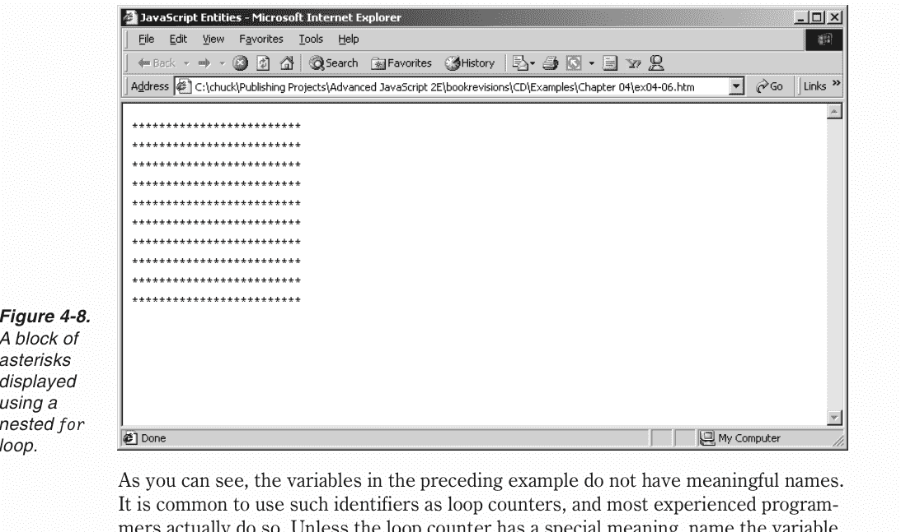

如你所见，前面示例中的变量没有有意义的名称。使用这样的标识符作为循环计数器是很常见的，大多数有经验的程序员实际上就是这么做的。除非循环计数器有特殊含义，否则将变量命名为 i、j、k 等。

### while 语句

```
while (condition)
    statement
```

while 循环在条件（condition）为真时持续循环。与 for 循环不同，如果条件在开始时为假，while 循环根本不会执行。也就是说，在每次迭代之前都会对条件进行求值。statement 也可以是一个命令块，允许多条语句。

以下循环计算 n!（n 的阶乘）：

```
var n = parseInt(prompt("Enter a number:", 10))
var nFactorial = 1 // will contain the value of n!
var factor = 1 // the current term by which we must multiply
while (factor <= n)
{
    factor++
    nFactorial *= factor
}
alert(n + "! is " + nFactorial)
```

此脚本要求用户输入一个数字。对于此示例，我们假设用户输入一个有效的数字（一个 1 到 12 之间的整数）。nFactorial 始终保存从 1（或 2）到 factor 的整数乘积。因此，当 factor 等于原始数字时，循环在 nFactorial 乘以 factor 后终止。


可以创建嵌套的while循环。例如，你可以修改打印星号矩形的脚本，使用while循环代替for循环。你需要在循环语句之前初始化计数器变量，并在循环体内递增它们。

你也可以使用while语句以以下方式创建无限循环：

```
while (1)
    statement
```

或

```
while (true)
    statement
```

> 提示：与大多数C++编译器不同，JavaScript的解释器并不要求即使只有一条语句也必须使用花括号。然而，使用花括号能使代码更具可读性，因此这是一个良好的实践。

虽然JavaScript没有`until`循环，但使用while语句可以非常简单地创建一个：

```
while (!condition)
    statement
```

### for...in 语句

```
for (variable in object)
    statement
```

到目前为止，我已向你展示了所有编程语言中典型的通用循环。`for...in`循环则相当不同。它遍历给定对象的现有属性，并针对对象的所有属性重复一个变量。

*variable* 是你要在属性上重复的变量。每次循环时，*variable* 都会被设置为当前属性。*object* 是该语句所引用的对象。循环变量仅被设置为指定对象的属性。听起来有点复杂？请看以下脚本片段：

```
var result = "" // 初始化输出字符串
for (curProperty in document)
{
    result += "document." + curProperty + "<BR>"
}
document.write(result)
```

该脚本打印属于`document`对象的属性：

```
document.length
document.elements
document.forms
document.links
```

它们的打印顺序取决于其内部存储方式。

以下函数接受一个对象及其名称。然后，它遍历该对象的属性，并返回一个HTML就绪的字符串，列出属性名及其值。

```
function getProps(obj, objName)
{
    var result = "" // 初始化输出字符串
    for (var i in obj)
    {
        result += objName + "." + i + " = " + obj[i] + "<BR>"
    }
    result += "<HR>" // 向输出字符串添加水平线
    return(result) // 返回输出字符串
}
```

这个函数的问题在于它无法打印嵌套对象的属性。针对这个问题的解决方法——一个递归函数——将在第10章“构建和扩展对象”中介绍。

这个函数是一个非常有用的工具，特别是用于调试处理对象的脚本。以下语句展示了如何调用`getProps()`函数来列出内置`Math`对象的属性。

```
document.write(getProps(Math, "Math"))
```

因为该函数不直接向屏幕发送输出，所以你必须使用`document.write()`语句来打印返回值。注意，在这种情况下传递给函数的参数是相似的：`Math`和`"Math"`。第一个参数持有对象引用本身，第二个参数持有对象的名称，这是一个简单的字符串。一旦进入函数内部，该对象被引用为`obj`，因此无法自动提取其原始名称。

`getProps()`函数实现了数组表示法来访问属性。我们使用这种表示法是因为属性名不是一个字面量，而是一个包含字符串值的数据结构。点语法只能在名称以字面量形式存在时使用。此规则也适用于方法。考虑以下表达式：

```
var a = "write"
document.write("Test 1 <BR>")
document.a("Test 2 <BR>") // 错误
document["write"]("Test 3 <BR>")
document[a]("Test 4 <BR>")
```

第二个测试生成错误，但其余测试按预期打印输出，因为点语法仅接受字面量作为其规范。

### break 语句

通常，循环会一直执行直到满足终止条件，但你可能希望在满足其他条件时提前终止。`break`语句正是做这个的；它终止循环的执行。以下脚本片段演示了`break`语句：

```
for (var i = 0; i < 100; i++)
{
    document.write(i + " ")
    if (i == 50) // 额外的终止条件
        break // 跳出循环
}
```

此循环的输出为：
0 1 2 3 4 5 6 7 8 9 . . . 41 42 43 44 45 46 47 48 49 50

如你所见，当`i`为50时循环终止，而不是当`i`等于100时。也就是说，它在条件`i < 100`求值为`false`之前就终止了。当`i`等于50时，条件`i == 50`返回`true`，`break`语句执行，导致循环终止。`break`语句允许你在循环命令块中的各个位置放置额外的终止条件。

请注意，`break`语句会终止所有循环语句。

虽然`goto`语句在现代编程中不被允许，但有时在没有该语句帮助的情况下执行某些操作会很困难。不幸的是，JavaScript不提供此工具，因此即使对于复杂的结构，你也必须找到变通方法。考虑以下控制结构：

```
for (i = 1; i <= 10; i++)
{
    for (j = 1; j <= 10; j++)
    {
        for (k = 1; k <= 10; k++)
        {
            for (l = 1; l <= 10; l++)
            {
            }
        }
    }
}
```

假设你想在`l`（内层循环的计数器）等于5时终止整个控制结构的执行。问题在于`break`语句只终止它所在的循环，而不是控制它的其他循环。在C++中使用`goto`语句，你可以直接跳转到所需的位置。然而，JavaScript不支持此语句，因此你必须找到一个简单的变通方法。以下脚本使用一个额外的变量提供了解决方案：

```
var continueLooping = true
for (i = 1; i <= 10; i++)
{
    for (j = 1; j <= 10; j++)
    {
        for (k = 1; k <= 10; k++)
        {
            for (l = 1; l <= 10; l++)
            {
                if (l == 5)
                {
                    continueLooping = false
                    break
                }
                if (continueLooping == false) break
            }
            if (continueLooping == false) break
        }
        if (continueLooping == false) break
    }
    if (continueLooping == false) break
}
```

每次循环遍历时，都会对`continueLooping`进行求值。如果它为`false`，则终止当前循环。当条件`l == 5`为真时，`continueLooping`在内层循环中被赋值为`false`，然后每个循环依次终止。请注意，将`if (continueLooping == false) break`语句紧接在嵌套循环的闭合花括号之后放置是极其重要的，这样当嵌套循环终止时，当前循环也终止，并且中间不执行任何其他语句。

JavaScript中的`break`语句非常重要，因为它被用来创建JavaScript中不存在的循环语句的替代方案。C++和Perl中的一个重要循环类型是`do...while`。此循环只要条件为真就执行一条语句。与常规的`while`循环不同，条件是在循环末尾求值的，因此循环至少执行一次，而没有事先测试。然而，JavaScript没有这样的循环。同样，它可能会在该语言的未来版本中实现。目前，你必须使用现有语句想出一个简单的替代方案。看看以下结构：

```
while (1)
{
    statements
    if (condition)
        break
}
```

请注意，前面的脚本片段等同于Pascal中的`repeat...until`结构，以及Perl中的`do...until`，但它不匹配C++和Perl中的`do...while`循环。你只需以以下形式对条件取反：

```
while (1)
{
    statements
    if (!condition)
        break
}
```

### continue 语句

`continue`关键字停止循环的当前迭代，并在循环顶部继续执行。循环继续执行，直到达到终止条件。循环的“顶部”是：
- `for`循环中的更新表达式，例如`++i`
- `while`循环中的条件表达式

这里是使用`continue`语句的一个简单示例：

```
var sum = 0 // 将存储奇数的和
for (var i = 1; i <= 10; ++i)
{
    if (i % 2 == 0) // 1：如果i是偶数
        continue // 2：跳到循环顶部
    sum += i // 3：将i加到sum上（i总是奇数！）
}
```

此示例将1到10之间所有奇整数相加。最简单的方法是在每次循环后将计数器变量增加2，但我们想展示`continue`语句的用法。

前面脚本片段中的循环非常简单。当`i`的值小于或等于10时执行。因此，循环执行10次，`i`的每个整数值执行一次。第一行使用简单的模运算检查`i`是否为偶数。如果数字是偶数（即`i % 2`求值为0），则表达式`i % 2 == 0`求值为`true`。在这种情况下，第二行的`continue`语句执行，导致循环从顶部（更新表达式）重新开始。

这里是另一个使用`continue`语句的示例：

```
for (i = 1; i <= 10; ++i)
{
    if (i == 5)
        continue
    document.write(i + " ")
}
```

输出为：
1 2 3 4 6 7 8 9 10

5被跳过了，因为当`i`等于5时，循环被发送到开头，将`i`递增到6。`continue`语句位于`document.write()`语句之前，因此当`i`为5时，`document.write()`方法从未被调用。

### with 语句

```
with (object)
    statement
```

编写正式地址来访问同一对象的属性或调用其方法通常是令人烦恼的。`with`语句为一组语句建立一个默认对象。在指定的语句集内，任何未指定对象的属性引用都被假定属于`with`语句中指定的对象。考虑以下示例：

```
with (document)
{
    write("This is a test.<BR>")
    write("This is another test.<BR>")
    write("This is the third test.")
}
```

这个脚本片段完全等同于：

```
document.write("This is a test.<BR>")
document.write("This is another test.<BR>")
document.write("This is the third test.")
```

`with`语句很方便，因为它使代码更紧凑，并且当你想要访问特定对象的许多属性和方法时很有用。然而，你应该谨慎使用，因为它可能使代码可读性降低且更难调试。


## 第4章

未指定对象的属性和方法将被视为由 `with` 语句定义的默认对象管理。属于该对象的方法同理。

`with` 语句仅在引用同一对象的多个属性和方法时才有用，因此它后面应始终跟一个命令块：

```
with (object)
{
    statements
}
```

我们尚未讨论用户定义对象，因此请看一个默认对象是内置对象的示例：

```
with (document)
{
    write("Notice that the document object is default")
    write("<BR>")
    write("The current background color is " + bgColor)
    // bgColor is normally document.bgColor
}
```

输出结果为：

Notice that the document object is default
The current background color is #c0c0c0

在学习了内置对象和用户定义对象之后，你会发现此语句非常有用。目前，只需记住它的功能，如果愿意，可以结合你现有的词汇来使用它。

你可能还记得本章开头提到，整个脚本的默认对象是 `window` 对象。你可以在任何地方调用它的方法，而无需显式指定它们属于当前窗口对象。例如：

```
alert("STOP")
confirm("OK to proceed?")
prompt("How many cookies would you like?", 12)
```

另一种语法指定了 `window` 对象，如 `window.alert("STOP")。`一般来说，你可以将任何脚本视为放置在 `with` 语句的命令块中，其中指定默认对象的参数是 `window`。

```
<SCRIPT LANGUAGE="JavaScript">
<!-- hide code
with (window)
{
}
// end hiding code -->
</SCRIPT>
```

你也可以实现嵌套的 `with` 语句。在这种情况下，多个默认对象同时存在。作用域（每个对象存在的范围）非常简单。在与 `with` 语句关联的命令块内，你可以引用默认对象的属性和方法，而无需指定它们所属的对象。以下示例演示了作用域的概念：

```
with (object1)
{
    // object1 – 默认
    with (object2)
    {
        // object1, object2 – 默认
    }
    // object1 – 默认
    with (object3)
    {
        // object1, object3 – 默认
        with (object4)
        {
            // object1, object3, object4 – 默认
        }
        // object1, object3 – 默认
    }
    // object1 – 默认
}
// 没有默认对象（除了 window）
```

## 总结

本章内容相当长，但它为你建立了 JavaScript 的基本框架。在尝试继续下一章之前，你必须熟练掌握本章所介绍的所有概念，这一点非常重要。本章和前面的三章为你继续深入学习 JavaScript 奠定了基础。

## 第5章

## 面向对象编程

### 对象

*对象*是一种编程抽象，它将数据和操作数据的代码组合在一起。所有程序都包含不同类型的数据。在前面的章节中，变量和函数是分别介绍的。我定义了函数，也定义了变量，但没有以任何方式将它们连接起来。对象将相关的数据和函数封装成一个单一的内聚单元。

最初在过程化编程（Pascal、C、Basic 等）中，代码和数据是分开存放的。例如，在 C 语言中，代码单元被称为函数，而数据单元被称为结构体。在 C 中，函数和结构体没有正式的连接。一个 C 函数可以操作多个数据结构，多个函数也可以操作同一个结构体。在*面向对象*（OO）和*基于对象*的编程中，代码和数据被合并到一个对象中，这是一个不可分割的“对象”。

对象就是数据和处理这些数据的函数被放置在一个单独的包中。对象通常既有由变量表示的属性，也有本质上是对象一部分的*方法*。

图 5-1 展示了几个数据结构和相关的操作；这就是对象的定义。所有数据位于图示的左侧，而操作位于右侧。

**图 5-1.** 对象的结构——属性和方法。

## 属性

任何物理对象都有自己独特的特征。例如，一辆汽车有尺寸、重量、型号、颜色、价格以及许多其他属性。完整的属性集将汽车与所有其他对象区分开来。这些特征在 OO（面向对象）术语中被称为*属性*或*字段*。对象的属性存储与对象相关的数据。

属性通常根据其含义命名。例如，存储汽车颜色的属性将被命名为 `color`。可以通过向对象添加新属性来扩展对象；Netscape Navigator 3.0 首次支持了这一点。虽然可以向现有对象添加新属性，但并非总是能够修改静态内置对象的值。例如，出于显而易见的原因，`Math` 对象的 `PI` 属性无法修改。

JavaScript 支持两种不同类型的对象：

- *预定义内置对象*，例如 `Math` 对象
- *用户定义对象*，例如图 5-1 中说明的 `course` 对象

对象也可以是另一个对象的属性，从而创建对象层次结构。*对象层次结构*本质上是一个将其他对象作为其组成部分的对象。包括 Microsoft Office 在内的大多数应用程序的对象模型都是以层次结构构建的。

**图 5-2.** *一个示例对象层次结构。*

此图说明了一个类似于家谱的对象层次结构。`a` 只是一个对象，而 `d`、`e`、`f`、`g`、`h` 和 `i` 只是属性。`b` 和 `c` 既是对象也是属性，因此它们位于层次结构的其他级别之间。

#### 语法

对象的属性保存其数据。你可以使用以下语法引用属性：

```
objectReference.propertyName
```

*objectReference* 是属性所属对象的名称，或对该对象的任何其他有效引用。例如，你可以将一个对象赋值给一个变量，然后使用这个变量后跟属性规范来引用其属性。*propertyName* 是属性（数据字段）的名称。

一个点将每个对象与其属性分隔开。具有不同级别对象和属性的分层对象结构使用相同的语法：

```
object1.object2Property1.object3Property2.property3
```

请注意，中间的所有元素既是对象也是属性。再次参考图 5-2，我们假设结构的元素具有以下值：

- d: 16
- e: 42
- f: true
- g: "king"
- h: 13
- i: 10

以下语句演示了如何引用分层对象结构的元素：

```
var tempVar = ""
tempVar = a.b.d
document.write(tempVar) // prints 16
tempVar = a.b.e
document.write(tempVar) // prints 42
tempVar = a.c.f
document.write(tempVar) // prints true
tempVar = a.c.g
document.write(tempVar) // prints king
tempVar = a.c.h
document.write(tempVar) // prints 13
tempVar = a.c.i
document.write(tempVar) // prints 10
```

另一个重要的概念是，一个属性属于一个对象，并且只属于一个对象。也就是说，内存中的同一位置不能与两个不同的对象相关联。一个属性必须始终与一个对象相关联。因此，以下语句是合法的：

```
var d = a.b.d
document.write(d) // prints 16
var e = a.b.e
document.write(e) // prints 42
var f = a.c.f
document.write(f) // prints true
var g = a.c.g
document.write(g) // prints king
var h = a.c.h
document.write(h) // prints 13
var i = a.c.i
document.write(i) // prints 10
```

如你所见，变量可能与对象的属性同名。这是可能的，因为属性与变量不在同一作用域。但是，变量不能与同一级别的对象同名。例如，语句 `var a = a.b.d` 无效（实际上它是有效的，但 `a` 的值丢失了）。主对象与变量处于相同的作用域，因为它们不是任何其他对象的属性。事实上，对象是一个变量，两个具有完全相同名称的变量与内存中的同一位置相关联。语句 `var a = a.b.d` 将 `a` 转换为一个包含值 16 的简单变量，并且

并非一个对象。通常，避免使用对象的属性或方法来命名变量是一个好习惯，至少在你熟悉对象和属性之前是这样。语句 `document.write(a)` 的输出可能是“[object create]”，因为那是该对象的字符串等效表示。

## 方法

在执行 JavaScript 脚本期间，一个对象可以调用一个或多个方法来完成一项任务。如你所知，对象由数据（属性）和处理这些数据的函数组成。这些函数被称为方法。方法使对象能够执行不同的操作，主要是对其自身的属性进行操作。如前所述，方法就是作为对象一部分的函数。然而，由于它们是对象的一部分，因此它们可以访问对象的属性，包括其他方式无法访问的私有属性。

面向对象编程（OOP）的大多数优势都与方法相关。JavaScript 并不完全支持外部库（`<SCRIPT>` 标签的 `SRC` 属性除外），因此以下特性主要适用于内置对象：

- 因为对象将相关的数据和函数（方法）封装成一个单一、内聚的单元，所以执行维护活动变得容易。
- 每种语言范式都会影响其应用设计。因此，用 JavaScript 开发的脚本通常会使用对象。虽然你可以用传统的面向过程的方式设计脚本，但你会发现使用对象和方法要容易得多。一旦你开始编写复杂的脚本，你就会注意到传统风格和面向对象风格之间的差异。

JavaScript 对对象的实现不如 Java 强大，因此适用于 Java 的一些面向对象编程优势并不适用于 JavaScript。

#### 语法

方法可以存在于对象层次结构的不同级别。你可以使用与引用属性相同的语法来调用方法，即“点”语法。方法实际上是与对象关联的函数。因此，它们在许多方面与函数相似。调用方法的方式如下：

```
objectReference.methodName([arguments])
```

`objectReference` 是对象的名称，或任何其他引用。`methodName` 是方法的名称，而 `arguments` 是方法接受的参数。

### 使用数组表示法

你可以使用“点”语法或数组表示法来引用属性和方法。在数组表示法中，方括号代替了点。例如，以下表达式引用 `a.b.d`：

```
a["b"]["d"]
```

你可以对属性和方法都使用数组表示法。通用语法是：

```
objectReference["propertyName"]
objectReference["methodName"]([arguments])
```

理解这种替代语法很重要，因为你并不总是能使用传统的点语法。例如，在使用点语法时，属性名的第一个字符不能是数字。当你使用内置的 `Array` 对象创建数组时，你只能通过数组表示法（例如 `myArray[0]`、`myArray[99]`）来引用数组元素。在引用非数组对象的属性时，你必须始终使用双引号。以下是一些使用数组表示法引用方法和属性的示例：

```
document["write"]("hello!")
window["alert"]("howdy!") // 注意：alert() == window.alert()
Math["PI"]
```

有时你只能使用数组表示法。假设变量 `str` 保存字符串 "write"。你可以使用以下语法代替 `document.write()`：

```
document[str]()
```

但是，你不能使用 `document.str()`，因为它等效于 `document["str"]()`。另一种应该使用数组表示法的情况是，当你想按照标识符规则以外的方式命名属性时。例如，`myObject["*"]` 只能使用数组表示法才能实现。当你使用数组表示法时，方括号中的值应该是一个字符串，因为其中的内容会被求值。

### 基于对象 vs. 面向对象

> 注意：此说明主要针对熟悉面向对象环境的程序员。面向对象编程的基本术语不会解释，因为它们超出了本书的范围。这里只介绍了 JavaScript 与完整的面向对象语言之间最基本的区别。在你学习这门语言的过程中，你会发现许多其他细微的差别。如果你是对象结构的新手，你应该完全跳过此说明。

JavaScript 基于一个简单的面向对象范式。这个范式通常被称为基于对象，而不是面向对象。JavaScript 中没有类（所有对象都属于同一个“类”），也没有包（因为包将类组合在一起）。JavaScript 中的对象层次结构是包含层次结构，而不是像 Java 和 C++ 中那样的继承层次结构。也就是说，对象不是从其他对象继承而来，但如果它是另一个对象的属性，则可以被包含在该对象中。大多数面向对象语言要求在编译时静态解析对象。

然而，面向对象语言可能需要动态方法绑定，因为多态性允许多个具有相同名称的方法定义。调用这样的多态方法通常无法在运行时之前解析。JavaScript 完全基于动态绑定。也就是说，对象引用是在运行时检查的。JavaScript 中的对象范式与完整的面向对象语言（如 Java 和 C++）中的对象范式还有许多其他差异。

## 总结

本章基于 JavaScript 的对象模型讨论了基于对象编程的基础知识。其目的是向你介绍通用的面向对象和基于对象的术语，以及一些 JavaScript 语法。每种语言范式都会极大地影响用该语言编写的应用程序的设计。因此，用 JavaScript 编写的脚本通常是基于对象的系统。在 JavaScript 中可以使用面向过程的脚本，但基于对象的脚本具有许多优势。由于 JavaScript 有一组庞大的内置对象，包括非常有用的方法和属性，因此对对象结构的基本理解是必要的。如果你是初学者，觉得对象难以理解，不要太担心。我保证，随着我们继续学习，你将理解这些概念，主要通过研究示例。

## 第 6 章：函数和变量作用域

### 变量作用域和存储类

所有 JavaScript 变量都有两个属性：

- 作用域
- 存储类

JavaScript 对这些特性的实现与其他编程语言略有不同。

变量的*作用域*描述了变量在脚本中有效的区域。你只能在此区域内引用该变量——它在其他地方不存在。*全局变量*的作用域是整个脚本。你可以在 `<SCRIPT>` 和 `</SCRIPT>` 标签之间以及在变量定义之后执行的其他脚本（包括之前的事件处理程序脚本）中的任何位置访问它。在 JavaScript 中，你可以使用或不使用关键字 `var` 来声明全局变量。它完全不影响变量的作用域。

*局部变量*在函数中声明。它只能由该函数内部的语句引用。因此，一个全局变量可能与一个给定的局部变量同名。在局部变量的作用域（定义它的函数）内，只存在局部变量。在该函数外部，只存在全局变量。局部变量必须在函数内部使用关键字 `var` 声明。如果省略关键字，则假定变量是全局的。以下脚本段显示了变量的作用域如何影响各种结果：

```
// Script 1
function test()
{
    age = 43
}
age = 11
test()
document.write(age + "<BR>")
```

```
// Script 2
function test()
{
```


var age = 43
}
age = 11
test()
document.write(age + "<BR>")

这些脚本之间的唯一区别在于函数内部的语句。在第二段脚本中，我们使用 `var` 来定义变量 `age`，而在第一个语句中，我们只是直接写出了所需的变量名。

第一个脚本的输出是：
43
第二个脚本的输出是：
11

再看第一个脚本，并尝试跟踪执行流程。值 11 被赋给了全局变量 `age`，然后函数被调用。注意，函数内部没有使用 `var` 这个词。因此，函数中的变量 `age` 被假定为全局变量，值 43 被赋给了全局的 `age`。所以结果是 43。

在第二个脚本中，我们将值 11 赋给变量 `age`，然后调用函数。`var` 关键字意味着在函数内部定义的变量 `age` 是局部的。它不存在于函数之外，因此函数内部的赋值语句没有修改全局变量 `age`（即在函数调用前定义的那个）的值。脚本的最后一个语句打印出全局变量 `age` 的值，因为在那个作用域中，这是唯一名为 `age` 的变量。因此，脚本的输出是 11——全局变量的初始值。

一旦使用 `var` 关键字声明了一个变量，后续引用该变量的语句就不应该再使用这个前缀。这是之前脚本在函数内部添加了一条语句后的版本：

```
// 脚本 2（函数内有附加语句）
function test()
{
    var age = 43
    age = 58
}
age = 11
test()
document.write(age + "<BR>")
```

脚本的输出再次是 11。函数内的变量是用 `var` 关键字声明的。从那时起，该变量的作用域仅限于函数 `test()`。它不存在于该函数的边界之外，因此脚本的输出是名为 `age` 的全局变量的值，而不是局部变量的值。

请注意，前面的脚本片段中的语句：
age = 11
等同于：

```
var age = 11
```

因为对于全局变量来说，`var` 关键字是可选的。
这是另一个处理各种作用域的脚本片段：

```
function test()
{
    age = 5
}
test()
document.write(age + "<BR>")
```

脚本的输出是 5，因为变量 `age` 在函数内部被声明为全局变量（没有使用 `var`），所以它的作用域是整个脚本。下一个脚本产生了一个相当出乎意料的输出：

```
function test()
{
    var age = 5
}
test()
document.write(age + "<BR>")
```

这个脚本没有产生输出，而是产生了一个错误，因为 `age` 是一个局部变量，而打印语句不在其作用域内。

变量的存储类别可以是永久的或临时的。你不能直接修改这个属性，不像在其他语言（如 C++）中可以将变量声明为 *static*。JavaScript 中变量的存储类别仅取决于其作用域。局部变量是临时的，而全局变量是永久的。永久变量在整个脚本中存在，甚至在其他脚本中也是如此。即使脚本终止后，全局变量仍然存在，只有在页面卸载时才会被丢弃。临时变量在函数被调用时分配在 *栈*（内存的一个区域）上。函数的局部（临时）变量使用的空间在函数执行结束时返回给栈。一个局部变量“消亡”后，它为其他变量和对象腾出了可用的内存空间。

避免声明大型的局部数据结构，例如数组（在后续章节讨论）。如果你尝试分配过多的临时变量或特别大的临时变量，你很可能会收到一个错误（通常称为 *栈溢出*）。出于同样的原因，避免将大型数据结构传递给函数。最好使用全局变量来完成此类任务。

函数参数与局部变量相同。它们仅存在于函数内部，不影响其外部的任何变量。你可以像引用在函数开头声明并初始化了适当值的变量一样引用函数参数。以下脚本片段演示了这一点：

```
function test(age)
{
    age = 5
    document.write(age + "<BR>")
```

test(6)

打印的值是 5，因为它被赋给了变量 `age`（即函数的参数）。

JavaScript 缺少其他语言中的一些特性：

-   函数的参数不能作为全局变量使用。
-   不支持嵌套函数，例如 Pascal 语言中的那种。你不能在另一个函数内部声明一个函数。

看看下面的脚本：

```
/* 1 */  function goFirst(pineapple)
/* 2 */  {
/* 3 */      var banana = 3
/* 4 */      pineapple = 6
/* 5 */      apple = 4
/* 6 */      goSecond()
/* 7 */      var peach = goThird()
/* 8 */      document.write(apple + "<BR>")
/* 9 */  }
/* 10 */  function goSecond()
/* 11 */  {
/* 12 */      var apple = 2
/* 13 */      document.write(apple + "<BR>")
/* 14 */  }
/* 15 */  function goThird() {
/* 16 */      var peach = apple
/* 17 */      document.write(peach + "<BR>")
/* 18 */      return peach
/* 19 */  }
/* 20 */  var pineapple = 8
/* 21 */  goFirst(5)
/* 22 */  document.write("apple = " + apple)
/* 23 */  document.write(", pineapple = " + pineapple)
```

正如你所看到的，不深入理解变量的作用域和存储类别，就不可能构建出脚本。

前面脚本的输出是：

```
2
4
4
apple = 4, pineapple = 8
```

表 6-1 跟踪了脚本执行过程中变量的值。

*表 6-1.* 用于跟踪变量值的经典表格。

| 行号 | pineapple | apple | banana | peach |
| :--- | :--- | :--- | :--- | :--- |
| 20 | 8 (g) | | | |
| 1 | 8 (g) | | | |
| | 5 (goFirst) | | | |
| 3 | 8 (g) | | 3 (goFirst) | |
| | 5 (goFirst) | | | |
| 4 | 8 (g) | | 3 (goFirst) | |
| | 6 (goFirst) | | | |
| 5 | 8 (g) | 4 (g) | 3 (goFirst) | |
| | 6 (goFirst) | | | |
| 12 | 8 (g) | 4 (g) | 3 (goFirst) | |
| | 6 (goFirst) | 2 (goSecond) | | |
| 16 | 8 (g) | 4 (g) | 3 (goFirst) | 4 (goThird) |
| | 6 (goFirst) | | | |
| 7 | 8 (g) | 4 (g) | 3 (goFirst) | 4 (goFirst) |
| | 6 (goFirst) | | | |
| 22 | 8 (g) | 4 (g) | | |

(g) 代表全局变量，(functionName) 代表在名为 functionName 的函数中的局部变量。

这项技术非常有用，因为 JavaScript 没有一个像样的调试器。确保你理解表格中的每一个值。如果你没有太多编程背景，表 6-1 可能会显得有些混乱。然而，要使用这个表格，你只需定位打印语句所在的行，并从表格中提取变量的值。例如，假设你想找出第 13 行语句打印了什么。在表格中，第 13 行之前表达的最后一行是第 12 行。我们试图找出 `apple` 的值是多少，所以你应该首先检查是否存在同名的局部变量，因为如果存在局部变量，它将起作用。正如你所看到的，局部变量 `apple` 的值是 2。因此，JavaScript 在第 13 行打印出该值，后跟一个换行符。

以下脚本的输出可能会让你有点意外：

```
var num = 4
function funct1()
{
    alert(num)
    var num = 2
}
funct1()
```

此脚本的输出如图 6-1 所示：

# 第 6 章

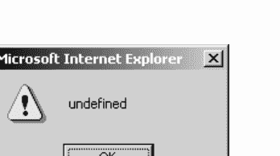

术语“undefined”表示一个变量在期望的时间点没有值，尽管它之前已经被声明过。一般来说，JavaScript 在开始执行之前会扫描整个脚本。在这个扫描过程中，也称为 *解析*，JavaScript 会评估每一行代码，检查是否存在基本的语法错误。它还会确定每个变量的作用域，无论它是否在函数内部。如果它遇到一个使用 `var` 关键字的变量声明，那么该变量被认为是局部的，即使存在同名的全局变量。变量的作用域可以是整个脚本，也可以只是一个函数。在前面的脚本片段中，一个全局变量 `num` 被初始化为 4。该函数包含一个局部变量声明。请注意，函数内部的变量 `num` 与全局变量 `num` 没有任何关联。该函数像往常一样从上到下执行。第一条语句指示 JavaScript 显示 `num` 的值，即函数内部的局部变量。JavaScript 已经知道该局部变量是在函数内部声明的，因此不会生成错误。然而，在那个时候，该变量没有保留任何值，因此它是未定义的。

以下函数的定义是等效的：

```
// #1
function functionName
{
    [JavaScript语句...]
    var varName = initialValue
    [JavaScript语句...]
}

// #2
function functionName
{
    var varName
    [JavaScript语句...]
    varName = initialValue
    [JavaScript语句...]
}
```

一些程序员发现使用第二种形式更容易。每种形式都有其优点和缺点——选择对你来说最方便的一种。在本书中，我们使用第一种形式，因为我们更喜欢在赋值语句中使用 `var` 关键字。

如果你在函数内部声明全局变量，你必须为变量赋一个初始值；否则，JavaScript 会返回一个错误。以下的脚本片段和屏幕截图证明了这一事实：

function foo()
{
    // 局部变量声明
    var a // 未初始化
    var b = 0 // 已初始化
    // 全局变量声明
    c // 未初始化 - 错误！
    d = 0 // 已初始化
}
foo()

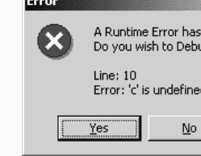

图6-2. 当声明一个未初始化值的全局变量时返回的错误信息。

请注意，该变量不会像使用`var`关键字声明时那样持有`undefined`值——它会引发一个错误。

`var`关键字用于“正式”地声明变量。JavaScript只记住以这种方式声明的变量的作用域。它会在脚本执行过程中识别其他变量，并自动将它们视为全局变量。尽管在主脚本中是否使用`var`来声明全局变量通常并不重要，但在某些情况下可能会影响脚本的结果。如果你不使用`var`，并且在变量仍然是`undefined`时将其用于需要值的语句中，就会发生错误。但这是一个容易解决的问题，因为你会收到一条消息。`var`声明的问题在于，并非所有需要具有有效值的变量的语句，在变量没有值时都会使用`undefined`字符串。基本的`document.write()`语句在变量未定义时可能什么也不打印。

## 什么是函数？

> 注意：在本章和前面的章节中，我们并没有过多关注与函数相关的许多重要细节。本章的其余部分将讨论参数、返回值和其他重要概念。你应该阅读这些材料，即使你对函数已经感到熟悉。在后面讨论对象和方法时，对函数的全面理解将是必要的。

函数将一系列语句组合起来以执行特定任务或功能。与方法不同，函数不属于一个封装它们及相关数据的对象。JavaScript具有许多内置函数，本书稍后会介绍。这些函数是预定义的。

### 定义和调用函数

我们已经多次谈到定义函数。函数定义的一般语法是：

```
function functionName([parameters])
{
    statements
}
```

函数调用的形式是：

```
functionName(arguments)
```

### 函数参数

有时你可能想创建一个在调用时接受值的函数。然后该函数应该能够使用这些值来执行特定任务。在定义函数时，你应该指定那些你用来指代从外部传递给函数的自定义值的名称。这些名称必须遵循适用于语言中标识符的相同规则。

参数的作用类似于局部变量，因此它们只存在于定义它们的函数内部。因此，一个参数可以使用与全局变量或不同函数中的局部变量相同的名称。你可以像操作普通变量一样操作和修改参数的值。不需要像处理常规变量那样在函数体内显式声明参数。

JavaScript是松散类型的，因此你不需要像C++、Java、Pascal和其他严格类型编程语言那样指定参数的数据类型。变量和字面量都可以传递给函数。函数定义头部的所有参数都应由逗号运算符(,)分隔。下面是一个带有两个参数的简单JavaScript函数：

```
function printName(name, ruleWidth)
{
    document.write("<CENTER><H1>" + name + "</H1></CENTER>")
    document.write("<HR WIDTH=" + ruleWidth + "%>")
}
```

你可以用一个简单的函数调用来调用这个函数，例如：

```
printName(prompt("Enter your name:", "John Doe"), 60)
```

注意：实参是你分配给形参的具体值。即使是一些高级程序员，有时也认为这些术语可以互换。有时很难区分它们，因此你可能不同意本章中的某些术语。

### 使用参数数组

JavaScript支持接受可变数量参数的函数。第一个参数是`functionName.arguments[0]`，第二个是`functionName.arguments[1]`，第三个是`functionName.arguments[2]`，以此类推。传递给函数的参数数量存储在`arguments`对象的`length`属性中：

`functionName.arguments.length`

下面的脚本演示了这个概念：

```
function calc()
{
    document.write("The first argument is ", calc.arguments[0], "<BR>")
    document.write("The fourth argument is ", calc.arguments[3], "<BR>")
    document.write("There are ", calc.arguments.length, " arguments<BR>")
}
var company = "Yahoo"
calc(2, 999, "internet", company, 0.0)
```

脚本的输出是：

The first argument is 2
The fourth argument is Yahoo
There are 5 arguments

注意：Netscape Navigator允许你使用`arguments`而不是`functionName.arguments`。但是，微软的Internet Explorer 3.0在使用这种简写方式时会产生错误。为了安全起见，你可以在函数开头使用以下语句：

`var args = functionName.arguments`
然后你可以正常方式使用`args`（`args[0]`，`args.length`等）。

在函数的上次调用期间引用传递给函数的参数的能力常常会使JavaScript脚本编写者感到困惑。例如，考虑以下脚本：

```
function func()
{
    document.write(func.arguments[0] + "<BR>")
}
func("a")
func("b")
func()
func("c")
```

此脚本的输出是：

a
b
b (!)
c

唯一令人惊讶的是第三行。打印的参数是上一次调用时传递给函数的参数。当前调用的第一个参数无法打印，因为没有这个参数。在Internet Explorer中，这将打印为"undefined"。有时，你会从`func.arguments.length`属性以及数组本身的元素中得到意想不到的结果。

同时请注意，你只能从函数内部引用参数数组。

`arguments`对象属性的作用域是当前函数，因此只能在函数内部使用。你可以使用循环语句来打印传递给函数的参数列表：

```
function createList()
{
    var result = ""
    for (var i = 0; i < createList.arguments.length; ++i) {
        result += createList.arguments[i] + "\r"
    }
    alert(result)
}
```

这是一个简单的函数调用：

```
createList("C", "H", "U", "C", "K")
```

当使用前面的语句调用时，该函数生成以下对话框：

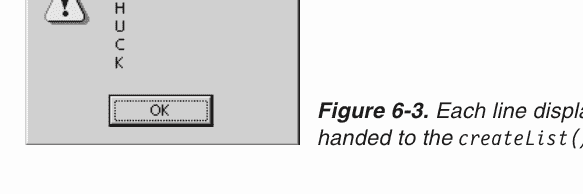

### 创建带默认参数的函数

JavaScript不支持带默认参数的函数。在C++中，这些是在函数原型中提供给参数的值。在JavaScript中，你可以使用一个简单的变通方法，在函数开始时调用以下函数：

```
function checkDefault(parameter, defaultValue)
{
	if (typeof parameter == "undefined")
		return defaultValue
	/* else */
		return parameter
}
```

对此函数的适当调用是：

```
parameterName = checkDefault(parameterName, defaultValue)
```

仅当在未指定所需参数的情况下调用函数时，参数才会被赋予其默认值。以下函数使用此技术来打印一行给定字符；星号是默认字符，30个字符是默认长度：

```
function checkDefault(parameter, defaultValue)
{
	if (typeof parameter == "undefined")
		return defaultValue
	/* else */
		return parameter
}
function drawLine(character, numOfChars)
{
	character = checkDefault(character, "*")
	numOfChars = checkDefault(numOfChars, 30)
	for (var i = 0; i < numOfChars; i++)
	{
		document.write(character)
	}
}
```

以下是一些函数调用及其相应的输出：

```
drawLine() // prints 30 asterisks
******************************
drawLine("=") // prints 30 equal signs
==============================
drawLine("-", 10) // prints 10 dashes
----------
```

也可以使用未定义变量（只需在前面用`var`声明它，而不初始化）来指定第二个参数而不提供第一个参数。


**注意：** 请注意，前面的 `checkDefault()` 函数与 Netscape Navigator 2.0x 或 Microsoft Internet Explorer 3.0x 不兼容，因为它们不支持 `typeof` 运算符。然而，对于这两个浏览器的最新版本，这已不是问题。可以使用 `arguments` 数组来模拟 C++ 的默认参数功能。之前的 `drawLine()` 函数可以改写如下：

```
function drawLine(character, numOfChars)
{
    args = drawLine.arguments
    if (args.length < 1)
        character = "*"
    if (args.length < 2)
        numOfChars = 30
    for (var i = 0; i < numOfChars; i++)
    {
        document.write(character)
    }
}
```

如果函数未接收到参数，`character` 的值将被设置为默认值 `*`。如果函数接收到一个或更少的参数，参数 `numoOfChars` 将默认为 30。由于此函数使用了 `arguments` 数组，因此不需要命名参数——你可以使用数组来代替，如以下函数定义所示：

```
function drawLine()
{
    args = drawLine.arguments
    if (args.length < 1)
        args[0] = "*"
    if (args.length < 2)
        args[1] = 30
    for (var i = 0; i < args[1]; i++)
    {
        document.write(args[0])
    }
}
```

### 返回值

函数可以返回值，因此可以将函数调用用作有效的 JavaScript 值。利用此特性可以创建通用函数，供其他脚本使用。例如，你可以使用一个函数，它接受某种进制的数字并返回其不同表示形式。此函数可用于创建进制转换表、对话框或进行额外计算。

使用以下语法从函数内部返回值：

```
return value
```

`return` 语句返回一个值并终止函数，其方式类似于 `break` 终止循环。请看以下函数：

```
function sum(op1, op2)
{
    return op1 + op2
}
var answer = sum(3, 5)
alert(answer)
```

函数返回的值是其参数的和。如你所见，函数会计算为一个值。一个函数只能返回一个值——可以是变量、字面量或任何其他有效的数据结构。

带返回值的函数也可以产生输出。当你在表达式中使用该函数时，它会自动运行，执行所有语句，直到返回一个在表达式中使用的值。前面的函数也可以在其本身内部显示其参数的和，前提是 `alert()` 语句位于 `return` 语句（它会终止函数）之前：

```
function sum(op1, op2)
{
    var result = op1 + op2
    alert(result)
    return result
}
var answer = sum(3, 5)
```

请确保 `return` 语句放置在应执行的语句之后，因为它会终止函数，之后不会再执行函数的其他语句。

你可以使用不带 `else` 语句的嵌套 `if` 结构，前提是每个 `if` 语句在条件为真时调用 `return` 语句。省略 `else` 语句不会影响函数的效率，因为在满足真条件后函数会立即终止。以下函数将十六进制数字（不是数字）转换为其等效的十进制值：

```
function getValue(dig)
{
    if (dig == "A") return 10
    if (dig == "B") return 11
    if (dig == "C") return 12
    if (dig == "D") return 13
    if (dig == "E") return 14
    if (dig == "F") return 15
    return dig
    // return 语句终止函数，
    // 因此不需要 else 语句
}
```

如果数字在 0 到 9 之间，则没有条件为真，因此函数返回其接受的相同数字：

```
return dig
```

### 递归

*递归*函数通常是指调用自身的函数。它类似于一个带有或不带有终止条件的循环。一些编程函数适合使用递归算法，例如阶乘。阶乘是一个经典的递归算法，因为它非常直观。阶乘运算的简单数学定义是：

fact(0) = 1
fact(n) = n * fact(n-1)

阶乘通常用感叹号 (!) 表示。
使用此算法，让我们计算 3!：

1. fact(3) = 3 * fact(2)
2. fact(2) = 2 * fact(1)
3. fact(1) = 1 * fact(0)
4. fact(0) = 1

如你所见，算法从给定数字向下递减到零，因此当它到达 `fact(0)` 时，它必须再向上递增回各个数字。

我们知道 `fact(0) = 1`。

fact(1) = 1 * fact(0) = 1 * 1 = 1
fact(2) = 2 * fact(1) = 2 * 1 = 2
fact(3) = 3 * fact(2) = 3 * 2 = 6

我们通过递归算法得到了期望的答案。在 JavaScript 中，这是：

```
function fact(num)
{
    if (num == 0)
        return 1
    /* else */
        return num * fact(num - 1)
}
```

你可以按如下方式调用该函数：

```
var fiveFactorial = fact(5) // 120
```

注意，`else` 语句被注释掉了，因为它不是必需的。
`fact()` 函数满足两个规则。首先，它有一个终点。其次，它简化了问题，因为 `fact(num - 1)` 比 `fact(num)` 更简单。递归函数应始终遵循这两个规则。

递归函数有几个优点：

- 通常，递归函数比它们的非递归对应物更清晰、更简洁、更短，并且更容易理解。
- 程序直接反映了解决问题的抽象策略（算法）。例如，递归阶乘函数使用常见的数学策略来解决问题。

起初，递归函数可能看起来更难，但通过练习会变得更容易。

递归也可用于计算斐波那契数列（1, 1, 2, 3, 5, 8, 13, ...）中的值。基本算法是：
getVal(1) = 1
getVal(2) = 1
getVal(place) = getVal(place – 1) + getVal(place – 2)

以下是一个 JavaScript 函数，用于计算指定位置的数列值：

```
function getVal(place)
{
    if (place == 1 || place == 2)
        return 1
    return getVal(place – 1) + getVal(place – 2)
}
```

对此函数的调用可以是：

```
var fibValue7 = getVal(7) // fibValue7 = 13
```

| 1 | 1 | 2 | 3 | 5 | 8 | [13] | 21 | 34 | ... |
| :--- | :--- | :--- | :--- | :--- | :--- | :--- | :--- | :--- | :--- |
| 1 | 2 | 3 | 4 | 5 | 6 | 7 | 8 | 9 | ... |

> **注意：** 底行指定了位置；顶行指定了该位置的斐波那契数值。

注意，我们再次省略了不必要的 `else` 语句。
一些程序员倾向于不将复杂表达式和由其他函数返回的值直接用于 `return` 语句。相反，他们将这些值赋给变量，然后返回它们：

```
function getVal(place)
{
    if (place == 1 || place == 2)
        return 1
    var s1 = getVal(place – 2)
    var s2 = getVal(place – 1)
    return s1 + s2
}
```

### 在递归函数中跟踪值

复杂的递归算法通常难以跟踪。许多值会改变，有些按你预期的方式变化，而另一些则做出令人惊讶的“移动”。JavaScript 仍然没有一个像样的调试器来帮助我们，因此我们必须开发自己的工具，使用输出语句来评估表达式和变量。通过添加一些额外的语句，可以在整个递归执行过程中显示变量和参数的值。以下是 `getVal()` 函数，添加了一些跟踪递归过程中值的功能：

```
text = "place\t\ts1\t\ts2\t\tval\r"
text += "========================================\r"
function getVal(place) {
    if (place == 1 || place == 2)
        return 1
    var s1 = getVal(place - 2)
    var s2 = getVal(place - 1)
    text += place + "\t || \t" + s1 + "\t || \t"
    text += s2 + "\t || \t" + (s1 + s2) + "\r"
    return s1 + s2
}
getVal(6)
alert(text)
```

请注意，不使用函数返回的值（本例中为 `getVal(6)`）是合法的。在上面的脚本段中，使用了一个全局变量（`text`）来存储执行过程的格式化跟踪信息。在执行终止后，会创建一个自格式化的表格并显示在 `alert` 框中。表格的每一行都包含以下值：

- 当前函数调用中参数 `place` 的值。对 `text` 的赋值是在函数末尾完成的（在对函数进行递归调用之后），因此表格中的第一个函数是最后被调用的。
- `s1`、`s2` 的值及其和。

上面脚本段（传递给函数的参数为 6）的精确输出是：

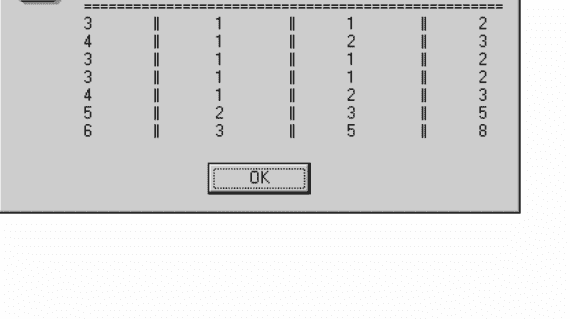


在这里，可以轻松追踪递归过程中所有函数调用和变量的值。

使用递归算法需谨慎。如果存在简单的非递归替代方案，就不要创建一个会调用自身数百次的函数。如果你怀疑这个警告，请尝试计算斐波那契数列的第100个值！

### 变量与递归函数

你可能在前面的斐波那契递归函数中注意到了局部变量的使用。你应该在递归函数中定期使用局部变量。养成这个习惯，这样你就永远不会忘记，因为即使你知道函数不能正常工作，检测与变量作用域相关的问题也很费力。这就是变量跟踪表派上用场的地方。这是前一个脚本，缺少关键字 `var`：

```
text = "place\t\ts1\t\ts2\t\tval\r"
text += "=======================================================\r"
function getVal(place)
{
    if (place == 1 || place == 2)
        return 1
    s1 = getVal(place - 2)
    s2 = getVal(place - 1)
    text += place + "\t || \t" + s1 + "\t || \t"
    text += s2 + "\t || \t" + (s1 + s2) + "\r"
    return s1 + s2
}
getVal(6)
alert(text)
```

正如你可能预料的那样，表格的内容有所不同：

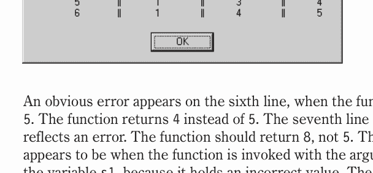

在第六行，当函数以值5调用时，出现了一个明显的错误。函数返回4而不是5。第七行（place为6）也反映了一个错误。函数应该返回8而不是5。遇到的第一个错误似乎是在函数以参数5调用时。那里问题在于变量 `s1`，因为它持有不正确的值。递归算法似乎

在第92页第6章

是正确的，所以唯一可能的错误是变量。确切的问题在于变量是全局的，而不是局部的。

关注函数调用，使用值5。该函数随后以值3调用自身，经过几次递归调用后，正确的值被返回给 `s1`。请记住，这个变量是全局的。第一个函数执行（使用5）现在再次调用自身，这次使用值4。发生几次递归调用，在此期间 `s1` 和 `s2` 的值被修改。`s1` 和 `s2` 一样是全局的，因此它的值与函数初始执行时（使用参数5）分配给它的值不同。它持有的值是由更深层的函数调用分配的，这显然对当前函数是不正确的。此时 `s1` 的错误值影响了结果。同样的问题适用于所有值大于4的函数调用。

如果你不明白问题的原因，请使用以下脚本：

```
var text = ""
function getVal(place)
{
    if (place == 1 || place == 2)
        return 1
    s1 = getVal(place - 2)
    var tempS1 = s1 // 将正确的 s1 值赋给 tempS1
    s2 = getVal(place - 1)
    // 检查 s1 是否被前面的语句修改
    if (tempS1 != s1)
    {
        text += ">>>\tThere appears to be an error in the "
        text += "current execution of the function (place = "
        text += place + ") -\rthe value of s1 has unexpectedly"
        text += " been modified (" + tempS1 + " => " + s1 + ")\r"
    }
    return s1 + s2
}
getVal(6)
alert(text)
```

## 总结

在本章中，我们专注于高级函数技术和变量作用域。不注意变量作用域概念会导致数小时令人沮丧的工作，试图在简单脚本中寻找错误。在更深入地理解变量及其作用域之后，你将发现编写包含许多函数、交织局部和全局变量的脚本很容易。本章还介绍了一些与参数相关的重要事项，例如引用可变数量的参数。专门设计的对话框脚本利用了这一特性。本章讨论的另一个重要概念是递归。我们发现如何使用格式化的表格跟踪变量来调试递归算法。

# 第7章 使用JavaScript运算符

## 运算符类别

JavaScript有许多运算符，其中大部分借用于C和Perl。种类繁多的运算符使得有必要将它们分为以下几类：

- 数学运算符
- 字符串运算符
- 位运算符
- 赋值运算符
- 关系运算符
- 短路逻辑运算符
- 更多逻辑运算符
- 数据类型运算符
- Void运算符

在本章中，我们将按照上述类别分组讨论JavaScript的运算符。每个类别中的运算符分为两组：

- 一元运算符——对单个操作数进行操作的运算符
- 二元运算符——对两个操作数进行操作的运算符

## 数学运算符

*数学运算符*，也称为*算术运算符*，执行基本的数学运算。表7-1列出了JavaScript中的数学运算符：

*表7-1. 数学运算符。*

| 语法 | 名称 | 类型 |
| --- | --- | --- |
| + | 加法（加） | 二元 |
| - | 减法（减） | 二元 |
| * | 乘法（乘） | 二元 |
| / | 除法（除） | 二元 |
| % | 取模（模） | 二元 |
| ++ | 递增 | 一元 |
| -- | 递减 | 一元 |
| - | 取负 | 一元 |
| += | 加后赋值 | 二元 |
| = | 赋值 | 二元 |
| == | 求值 | 二元 |

算术运算符以数字字面量、变量或现有对象的属性作为操作数。它们总是返回一个基于操作数值的数字值。

### 加法

```
operand1 + operand2
```

加法运算符是一个简单的数学运算符。它将两个任意类型的数字相加，并计算它们的和。

```
-5 + 3 // 计算结果为 -2
2.4 + 3.6 // 计算结果为 6
1.1 + 7.8 // 计算结果为 8.9
```

### 减法

```
operand1 – operand2
```

另一个简单的数学运算符是减法运算符。它从一个数字中减去另一个数字。

```
8 – 2 // 计算结果为 6
16.3 – 56 // 计算结果为 -39.7
13.3 – 13.3 // 计算结果为 0
```

### 乘法

```
operand1 * operand2
```

乘法运算符接受两个数字作为其操作数，并执行通常的算术转换。

```
4 * 3 // 计算结果为 12
1.2 * 30 // 计算结果为 36
20.4 * 6.7 // 计算结果为 136.38
```

### 除法

与浮点除法不同，整数除法的结果总是整数。另一方面，JavaScript没有明确区分整数和实数值数字，因此除法运算的结果不保证是整数。事实上，大多数浮点数是除法运算符的结果。在调试脚本时，记住JavaScript中的除法操作与你的袖珍计算器产生相同的值可能会有所帮助。你还应该记住，除法运算的余数永远不会被丢弃。

当操作数是浮点数且无法用二进制表示时，除法表达式通常会计算出不准确的结果。以下演示了JavaScript除法运算符的行为：

```
3 / 4 // 计算结果为 0.75
3.6 / 0.1 // 计算结果为 36
-20 / 4 // 计算结果为 -5
11.1 / 2.22 // 计算结果为 4.999999999999999
```

### 取模

```
operand1 % operand2
```

取模运算符返回除法运算的余数。执行除法，但只保留余数。结果的符号是商的符号。JavaScript中的取模运算符也与其他编程语言中的不同。它不仅对整数进行操作，还对浮点数进行操作。你应该意识到取模运算符偶尔会返回不准确的结果。取模的不准确性源于有时返回不准确结果的除法运算：

```
12 % 5 // 计算结果为 2
12.3 % 4 // 计算结果为 0.3000000000000007（不准确）
0 % 99 // 计算结果为 0
12.75 % 4.25 // 计算结果为 0
11.1 % 2.22 // 计算结果为 2.2199999999999999
```

### 不存在的整数除法运算符

JavaScript没有整数除法（也称为div）运算符。但是，使用简单的算术运算符很容易创建这样的运算符。以下函数演示了这种能力：

```
function div(op1, op2)
{
    return (op1 / op2 - op1 % op2 / op2)
}
```

关键字 `return` 指示函数返回一个值，因此函数调用本身会计算出一个值，就像由运算符组成的表达式一样。

现在我们可以定义新创建的 `div` 语法：

```
div(operand1, operand2)
```


以下是几个示例：

```javascript
var a = div(23, 3) // a 被赋值为 7
var b = div(12, 4) // b 被赋值为 3
```

该函数计算其参数的商，余数会被丢弃。结果的符号与商的符号相同。

> **注意：** 对浮点数的各种操作会返回不精确的结果。这可能看起来很奇怪，但这种不精确性在计算机中是常见现象。你应该尽可能避免使用浮点数值，因为这种不精确性常常导致意外行为。最重要的是，调试因不精确计算而无法运行的脚本几乎是不可能的。

## 自增

```javascript
operand1++
```

```javascript
++operand1
```

自增运算符是一元运算符，可以用作后缀或前缀形式。它将操作数的值增加 1。如果在操作数之后使用（后缀），该运算符返回操作数在递增之前的值。如果在操作数之前使用（前缀），该运算符返回操作数在递增之后的值。当你将此类操作作为其他语句（如赋值语句）的副作用时，理解这些差异很重要。以下语句概述了这个概念：

```javascript
var a = 1
var b = ++a // 前缀
document.write("a is ", a, ", b is ", b) // a is 2, b is 2
```

第一条语句将值 1 赋给 a。第二条语句执行两个不同的操作：

- 将 a 递增到 2
- 将 a 的新值赋给 b

后缀形式的自增运算符以相反的顺序执行这些操作，因此结果不同。后缀形式在以下代码中演示：

```javascript
var a = 1
var b = a++ // 后缀
document.write("a is ", a, ", b is ", b) // a is 2, b is 1
```

b 被赋值为 a 的值，然后 a 被递增。

单个语句中的双重操作将在本章末尾讨论。通常，你应该避免使用这种副作用。之前的代码如果写成以下形式会更简单：

```javascript
var a = 1
var b = a
a++
document.write("a is ", a, ", b is ", b) // a is 2, b is 1
```

自增运算符只能用于变量或现有对象的属性，而不能用于字面量。

很自然地会得出这样的结论：自增等同于在值上加 1：

```javascript
var a = 1
var b = 1
a++
b = b + 1 // 等同于 b += 1（见赋值运算符）
```

就脚本的正确性而言，这是正确的。但如果性能重要，这就是错误的。自增的优势在于它比标准赋值快得多（上面代码片段中的第四行）。当你想要为变量（或对象的属性）加 1 时，你应该总是使用自增。如果只是进行几次加法运算，这并不那么重要。但当你有 100,000 次加法运算时，你肯定会感受到差异。自增运算符的另一个好处是，像 `countTemp++` 这样的语句比 `countTemp = countTemp + 1` 更容易理解。

重要的是要记住，布尔表达式在某些情况下等同于 1 和 0。以下语句展示了递增布尔变量的效果：

```javascript
var a = true
var b = false
a++
b++
document.write("a is ", a, ", b is ", b) // a is 2, b is 1
```

## 自减

```javascript
operand1--
```

```javascript
--operand1
```

自减运算符类似于自增运算符。它将操作数的值减少 1，而自增运算符将其增加 1。

## 取反

```javascript
-operand1
```

取反运算符位于数值（变量、现有对象的属性或数值字面量）之前。通过在此运算符的操作数前放置它（不要插入任何空格字符），JavaScript 会将正数计算为其对应的负数，反之亦然。和之前一样，你可能认为这个运算符可以被一个将操作数乘以 -1 的语句所替代。这又是一个错误。由于 JavaScript 解释器的内部结构，特别是取反运算符，使用取反运算符对数值取反比将其乘以 -1 更快。如果你是一个传统的 Pascal 程序员，可能需要一段时间才能习惯取反和自增运算符，但这是值得的！

```javascript
var a = 3
var b = 9
-a + b // 计算结果为 6
-b // 计算结果为 -9
```

## 字符串运算符

```javascript
operand1 + operand2
```

字符串运算符的语法与加法运算符相同。它们的区别在于操作数的类型。此运算符接受任何值作为操作数，只要其中至少有一个是字符串。字符串实际上是一个对象，因此可以说字符串运算符操作的是字符串对象。它将它们连接在一起，如：

```javascript
"Ladies " + "and " + "gentlemen"
```

字符串运算符可以操作两个以上的操作数，但由于其工作方式，它仍然是一个二元运算符。它连接前两个字符串，然后将第三个字符串连接到累积的字符串，依此类推。如果其中一个操作数不是字符串，它会自动转换为字符串。字符串运算符也称为连接运算符。

由多个字符串运算符组成的表达式会计算为一个单独的字符串。基于此，这里有两条不同的语句：

```javascript
document.write("I have " + 2 + " cookies.")
document.write("I have ", 2, " cookies.")
```

起初，你可能认为这些语句是等价的。它们不是，因为第一条使用字符串运算符，而第二条使用逗号分隔字符串和数字。它们的不同不仅限于风格。在第一条语句中，括号内的表达式被计算为一个单独的字符串——"I have 2 cookies."。因此，此语句中的 document.write() 方法只打印一个表达式。第二条语句打印多个表达式。字面量不像第一条语句那样被计算为一个单独的值，而是独立打印。两条语句都在页面上打印相同的 HTML，但方式不同。为了理解每个语句的工作原理，请看以下语句序列。第一个序列等同于前一组中的第一条语句，第二个序列等同于第二条语句。

```javascript
// 序列 #1
var stringToPrint = "I have " + 2 + " cookies."
document.write(stringToPrint)
```

利用 JavaScript 运算符 99

第 7 章

```javascript
// 序列 #2
document.write("I have ")
document.write(2)
document.write(" cookies.")
```

初学者常犯的一个错误是忘记在字符串中添加空格。空格与其他任何字符一样，是一个字符。忘记空格字符并不是一个严重的错误，因为你可以轻松地找到添加它的位置。你应该使用以下语句之一来打印两个连续的数字，中间用空格分隔：

```javascript
document.write(16 + " " + 18) // 第一种方式
document.write(16, " ", 18) // 第二种方式
```

第一条语句有效，是因为 JavaScript 解释器使用了自动转换方法。

> **提示：** JavaScript 中的加号（+）运算符不会将字符串操作数转换为数值。其背后的原因是字符串连接运算符和加号运算符使用相同的字符：+。如果只有一个操作数是字符串，则另一个操作数会被转换为字符串值，然后运算符连接这些字符串。在 Perl 中，加号（加法）和减号（减法）运算符会在必要时将它们的参数从字符串转换为数值，并返回数值结果。之所以能实现这个特性，是因为 Perl 中的字符串连接运算符是 .（点），而不是 +，后者在 JavaScript 中与另一个运算符（加法）共享。C++ 和 Pascal 提供了连接字符串的函数。

## 按位运算符

首先，我需要说明按位操作对许多程序员来说可能会令人困惑。我还需要指出，许多程序员工作多年也从未使用过它们。即使本节对你来说不太明白，你也可以成为一名成功的 JavaScript 然而，如果不包含这部分内容，我会感到有所欠缺。

按位运算符用于位操作。位是信息的最小单元，通常用 0 或 1 表示。位操作用于在最低级别控制机器。如果你计划在更高层次上编程，本节可以安全地跳过。在 JavaScript 中，你不会使用按位运算符在低级别控制机器，而是用于其他目的，如加密和编码。

八个连续的位组成一个字节。有 256 (2^8) 种字节变体。也就是说，一个字节可以是 256 种八位序列中的一种。例如，11010001 是这 256 种可能性中的一种。在支持字符数据类型的语言（如 C、C++ 和 Pascal）中，字节由一个字符表示。


十六进制表示法便于表示二进制数据，因为每个十六进制数位代表四个二进制位。表 7-2 列出了从 0 到 F 的十六进制值及其对应的二进制值。

表 7-2. 十六进制与二进制的对应关系

| 十六进制 | 二进制 | 十六进制 | 二进制 |
|---|---|---|---|
| 0 | 0000 | 8 | 1000 |
| 1 | 0001 | 9 | 1001 |
| 2 | 0010 | A | 1010 |
| 3 | 0011 | B | 1011 |
| 4 | 0100 | C | 1100 |
| 5 | 0101 | D | 1101 |
| 6 | 0110 | E | 1110 |
| 7 | 0111 | F | 1111 |

按位运算符使脚本编写者能够处理单个二进制位。JavaScript 中的按位（位）运算符列于表 7-3 中。

表 7-3. JavaScript 中的按位运算符

| 语法 | 名称 | 类型 |
|---|---|---|
| & | 按位与 | 二元运算符 |
| \| | 按位或 | 二元运算符 |
| ^ | 按位异或 | 二元运算符 |
| ~ | 按位非 | 一元运算符 |
| << | 左移 | 二元运算符 |
| >> | 带符号右移 | 二元运算符 |
| >>> | 无符号右移（零填充右移） | 二元运算符 |

### 按位与

```
operand1 & operand2
```

按位与运算符比较两个二进制位。仅当两个位均为 1 时，结果才为 1。以下是该运算符的真值表：

表 7-4. 按位与真值表

| 位1 | 位2 | 位1 & 位2 |
|---|---|---|
| 0 | 0 | 0 |
| 0 | 1 | 0 |
| 1 | 0 | 0 |
| 1 | 1 | 1 |

与所有其他按位运算符一样，按位与运算符只能以数值作为其操作数。虽然你可能永远不会使用按位运算符，但让我们了解一下结果是如何计算的。所有计算都将在十六进制和二进制基数下进行，因为这对该任务最为方便。请记住，十六进制数有一个 "0x" 前缀。

让我们看看以下数字，以及按位与如何对它们进行操作：

```
0x23  00100011₂
&	0x72  01110010₂
-	--------
=	0x22  00100010₂
```

```
0x23 & 0x72 // 求值结果为 34 (= 0x22 = 22₁₆)
```

按位与运算符类似于逻辑与运算符，后者将在本章后面讨论。

你可以使用按位与运算符来测试一个数字是偶数还是奇数。在二进制（基数 2）中，奇数的最后一位是 1，偶数的最后一位是 0。以下函数使用按位与运算符来确定该数字是奇数还是偶数。如果 `decimalNumber` 是偶数，它返回 `true`；如果是奇数，则返回 `false`。

```
function checkEven(decimalNumber)
{
    return (decimalNumber & 1 == 0)
}
```

如果你不熟悉 "==" 相等运算符，请不要担心。它将在本章后面介绍。等我们讨论相等运算符后再回来看这段脚本。

### 按位或

```
operand1 | operand2
```

或运算符，也称为同或或按位或运算符，比较其操作数。如果被比较的位中至少有一个为 1，则返回 1。表 7-5 显示了该运算符的真值表。

表 7-5. 按位或真值表

| 位1 | 位2 | 位1 \| 位2 |
|---|---|---|
| 0 | 0 | 0 |
| 0 | 1 | 1 |
| 1 | 0 | 1 |
| 1 | 1 | 1 |

对字节进行操作时：

```
0x46  01000110₂
|	0x79  01111001₂
=	0x7F  01111111₂
```

### 按位异或

```
operand1 ^ operand2
```

按位异或（按位异或的简称）运算符在只有一个位为 1 时返回 1。如果位相等（0 和 0，1 和 1），则结果为 0。以下是真值表：

表 7-6. 按位异或真值表

| 位1 | 位2 | 位1 ^ 位2 |
|---|---|---|
| 0 | 0 | 0 |
| 0 | 1 | 1 |
| 1 | 0 | 1 |
| 1 | 1 | 0 |

看一下下面的例子：

```
0x2C  00101100₂
^	0xA3  10100011₂
=	0x8F  10001111₂
```

按位异或运算符用于一种称为异或加密的简单密码技术中，本书稍后将介绍。

### 按位非

按位非运算符返回其操作数的反码。因此，它也被称为位翻转运算符或取反运算符。所有 1 转换为 0，所有 0 转换为 1。以下是真值表：

表 7-7. 按位非真值表

| 位 | ~位 |
|---|---|
| 0 | 1 |
| 1 | 0 |

例如：

```
~ 70  0000000000000000000000001000110₂
= -71  1111111111111111111111110111001₂
```

请注意，此运算符将所有操作数（整数）视为 32 位。如果它们不是 32 位整数，则会在操作中被转换，然后转换回其初始形式。

### 移位运算符

移位运算符接受两个操作数：

- 要移位的量（值）
- 要将第一个操作数移动的位数

移位运算符将其操作数转换为 32 位整数，并返回与左操作数类型相同的结果。有三种移位运算符：

- 左移（<<）
- 带符号右移（>>）
- 无符号右移（零填充右移）（>>>）

#### 左移

```
operand1 << operand2
```

左移运算符将第一个操作数向左移动指定的位数。所有移出（向左）的位都被丢弃。从右侧进入的新位是零。在下面的示例中，__ 代表 4 个字节（32 位）：

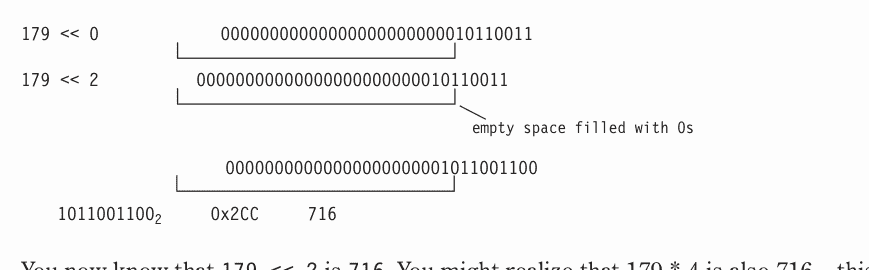

你现在知道 179 << 2 是 716。你可能意识到 179 * 4 也是 716——这不是巧合。通常，x << n 等同于 x * 2^n。向左移动 n 位等同于乘以 2^n。此规则也适用于负数——符号总是保持不变。因此，你可以选择两种不同的方法来乘以 2 的幂。虽然移位更快，但对读者来说也不够清晰，应避免使用。

#### 带符号右移

```
operand1 >> operand2
```

带符号右移运算符也称为符号传播右移，因为它保留初始操作数的符号。与左移运算符类似，带符号右移运算符将第一个操作数向右移动指定的位数。向右移出的多余位被丢弃。整数的符号存储在第一个位（从左数起）。为了保留符号，第一个位保持不变。其他 31 位向右移动。从左侧进入的新位要么是 0，要么是 1，具体取决于符号。如果第一个位原来是 0，则所有新位都是 0，反之亦然。因此，如果该数是正数，操作也将返回一个正数；如果它是负数，则操作结果为一个负数。重要的是要记住，此运算符与所有移位运算符一样，会将第一个操作数转换为 32 位整数，并在移位后返回其初始表示形式。这里有一个简单的例子：

```
176    0xB0    10110000₂

176 >> 0        0000000000000000000000010110000
                  └─────────────────────────────────────┘
176 >> 3        0  0000000000000000000000010110000
                  └─────────────────────────────────────┘
                  0000000000000000000000000010110
                  └─────────────────────────────────────┘

10110₂    0x16    22
```

让我们看看此运算符如何对负数进行操作，例如 –17。

```
–17    11111111111111111111111111101111₂

–17 >> 0        111111111111111111111111101111
                  └─────────────────────────────────────┘
–17 >> 3        1  11111111111111111111111101111
                  └─────────────────────────────────────┘
                  11111111111111111111111111101
                  └─────────────────────────────────────┘

111111111111111111111111111110₁₂    –3
```

你可以将带符号右移运算符视为左移运算符的逆操作。左移运算符等同于乘以 2 的幂，而带符号右移操作则等同于除以 2 的幂。176 >> 3 等于 176 / 2³。通常，x >> n 等同于 x / 2ⁿ。

#### 无符号右移（零填充右移）

```
operand1 >>> operand2
```

无符号右移运算符将第一个操作数向右移动指定的位数。与带符号右移一样，无符号右移会丢弃向右移出的多余位。然而，从左侧移入的位始终是零。该数字的符号丢失了，因为最左边的位始终为 0。以下是上一节中的示例，这次使用无符号右移：

```
–17    11111111111111111111111111101111₂

–17 >>> 0  =>    111111111111111111111111101111
                  └─────────────────────────────────────┘
–17 >>> 3        11111111111111111111111111101111
                  └─────────────────────────────────────┘
                  000111111111111111111111111101
                  └─────────────────────────────────────┘

111111111111111111111111111110₁₂    536870909
```


## 赋值运算符

```
operand1 ☐ = operand2
```

赋值运算是用于处理算术、字符串或按位运算的二元运算符。它们对操作数执行常规运算（☐），并将结果赋值给第一个操作数。赋值运算符如下：

*表 7-8. 赋值运算符。*

| 语法 | 名称 |
| :--- | :--- |
| = | 赋值 |
| += | 加法/连接赋值 |
| -= | 减法赋值 |
| *= | 乘法赋值 |
| /= | 除法赋值 |
| %= | 取模赋值 |
| &= | 按位与赋值 |
| \|= | 按位或赋值 |
| ^= | 按位异或赋值 |
| <<= | 左移赋值 |
| >>= | 右移赋值 |
| >>>= | 零填充右移赋值 |

你已经知道简单的 `=` 赋值运算符的作用——它将表达式的值存储到数据结构中。对于所有其他运算符，JavaScript 会假定：

`var1 ☐ = var2`

等同于：

`var1 = var1 ☐ var2`

例如：

`counter >>= 2`

将 `counter` 的值右移两位，而

`text += " Gates"`

将单词 Gates 附加到存储在 `text` 中的字符串末尾。表 7-8 中列出的所有赋值运算符都适用相同的规则。

由于赋值语句是从右向左求值的，你可以在同一语句中使用多个运算符。规则是：先对运算符右侧的值求值，然后将其赋值给运算符左侧的变量。

```
num1 = num2 = num3 = num4 = num5
```

`num5` 的值被赋给 `num4`，`num4` 的值被赋给 `num3`，依此类推。执行完此操作后，所有五个变量都持有相同的值。

## 关系运算符

`operand1 _ operand2`

关系运算符（也称为比较运算符）比较两个值并返回一个布尔结果。所有关系运算符都是二元的，因为它们比较两个值。这些运算符常用于条件语句中，相关介绍在第 4 章 JavaScript 基础中。以下是 JavaScript 关系运算符的完整列表：

**表 7-9.** 关系运算符。

| 语法 | 名称 |
| --- | --- |
| == | 等于 |
| != | 不等于 |
| < | 小于 |
| <= | 小于或等于 |
| > | 大于 |
| >= | 大于或等于 |

这些运算符接受数字或字符串值作为其操作数。数字比较通常非常简单：

```
2 == 1 // 结果为 false
99.0 == 99 // 结果为 true
2 != 1 // 结果为 true
3 < 2.5 // 结果为 false
2 <= 2 // 结果为 true
9 > 9 // 结果为 false
9 <= -10 // 结果为 false
```

字符串操作数根据其字符的 ASCII 值进行比较。这种比较类似于将单词按字典顺序排列的方式。唯一的区别是，JavaScript 使用 256 个不同的字符，而不是单一的字母集。如你所知，每个字符都有一个数值。这个值决定了一个字符是大于、等于还是小于另一个字符。

当你比较多字符字符串时，第一个操作数的第一个字符与第二个操作数的第一个字符进行比较。只有当第一个字符的比较结果为相等时，才会比较第二个字符。此过程持续进行，直到对应的字符不相等，或者到达其中一个字符串的末尾。以下是一些字符及其 ASCII 值：

- 0 – 48
- 9 – 57
- A – 65
- Z – 90
- a – 97
- z – 122

完整的 ASCII 表可在附录 C 中找到。

这里有一个示例：

```
"computerA" > "computerB"
"c" == "c"
"o" == "o"
"m" == "m"
"p" == "p"
"u" == "u"
"t" == "t"
"e" == "e"
"r" == "r"
"A" < "B"        ("computerA" > "computerB"   结果为 false)
```

为了更好地理解，请看以下结果：

```
"JavaScript" == "javascript" // 结果为 false
"bill" != "bill" // 结果为 false
" " < "  " // （[一个空格] < [两个空格]）结果为 true
16 <= "16" // 结果为 true
"luck" > "Work" // 结果为 true！
"XT" >= "pentium pro" // 结果为 false
```

### 相等与不相等

如你所见，布尔相等运算符（`==`）类似于赋值运算符（`=`）。这种相似性是许多编程错误的根源，不仅在 JavaScript 中，在 C、C++ 和 Java 等其他语言中也是如此。相等运算符常用于 if-else 语句中，而在这种语句中不能使用赋值运算符。（JavaScript 不允许在条件语句中产生副作用。）在这种情况下，解释器会产生一个有意义的错误：“相等测试（==）是否误写为赋值（=）？假定为相等测试。” 然而，在其他某些情况下，相等和赋值运算符都是有效的，浏览器确实不会产生任何错误。这就是此类错误非常难以调试的原因。以下示例演示了两种运算符都可接受的情况：

```
var i = 1
document.write(i = 2)
var j = 1
document.write(j == 2)
```

第一个打印语句打印 2，因为赋值表达式求值为被赋的值。第二个打印语句在 Netscape Navigator 下打印 false，在 Internet Explorer 下打印 0（Internet Explorer 将布尔值 false 转换为 0 进行打印，而不是转换为 "false"），因为 1 不等于 2。在长脚本中，如果你不小心将一个运算符替换为另一个，你将很难找到错误。

相等运算符的另一个问题与计算机处理浮点数的方式有关。当你尝试以浮点数形式存储整数（例如 3.0）时，这个问题尤其棘手。根据底层机器的不同，结果可能会有所不同。你可能会发现 `(5. == 5.00)` 的结果为 false，而 `(5.0 == 4.99999999)` 的结果为 true。因此，避免对浮点值使用相等运算符。本章后续部分将介绍此问题的解决方案。

### 短路逻辑运算符

短路逻辑运算符（也称为布尔运算符或逻辑运算符）是接受布尔值作为操作数的二元运算符。它们将多个关系表达式组合在一起。有三种逻辑运算符：

表 7-10. 逻辑运算符。

| 语法 | 名称 | 类型 |
| :--- | :--- | :--- |
| \|\| | 逻辑或 | 二元 |
| && | 逻辑与 | 二元 |
| ! | 逻辑非 | 一元 |

#### 逻辑或

```
operand1 || operand2
```

逻辑或运算符接受两个布尔值作为其操作数，并求值为单个布尔值。如果至少有一个操作数为 true，则结果为 true；换句话说，只有当两个操作数都为 false 时，结果才为 false。请看表 7-11。

表 7-11. 逻辑或真值表。

| 操作数1 | 操作数2 | 操作数1 \|\| 操作数2 |
| :--- | :--- | :--- |
| true | true | true |
| true | false | true |
| false | true | true |
| false | false | false |

这里有一些示例：

```
2 > 1 || 3 < 4 // true
1 == 1 || 99 >= 98 // true
"mouse" > "elephant" || 6 < 5 // true
1 == 2 || 5 <= 4 // false
```

注意不要将逻辑或运算符与按位或运算符混淆，因为它们的含义和语法相似（`||` 与 `|`）。含义的唯一区别是前者处理布尔操作数，而后者处理数字操作数。

逻辑或运算符是短路求值的。如你从真值表中所见，如果第一个操作数为 true，则表达式必定为 true。在这种情况下检查第二个操作数是不必要的，JavaScript 会避免这样做。

#### 逻辑与

```
operand1 && operand2
```

逻辑与运算符与逻辑或运算符类似，只是其真值表不同：

**表 7-12. 逻辑与真值表。**

| 操作数1 | 操作数2 | 操作数1 && 操作数2 |
| :--- | :--- | :--- |
| true | true | true |
| true | false | false |
| false | true | false |
| false | false | false |

两个操作数都必须为 true，表达式的结果才为 true。此运算符类似于按位与运算符，但操作数类型不同，并且逻辑与运算符一次操作整个操作数，而不是一个小的片段（位）。

逻辑与表达式也是短路求值的。如果第一个操作数为 false，则表达式显然为 false，因此不会对第二个操作数求值。

以下是一些示例：

```
2 > 1 && 3 < 4 // true
1 == 1 && 99 >= 98 // true
"mouse" > "elephant" && 6 < 5 // false
1 == 2 && 5 <= 4 // false
```

#### 逻辑非

```
!operand1
```

逻辑非运算符是一个简单的一元运算符，接受一个布尔值并对其取反。此运算符类似于取反运算符（对一个数字取反，改变其符号）。它甚至更类似于按位非运算符（`~`），该运算符将所有 1 位转换为 0 位，将 0 位转换为 1 位。虽然真值表显而易见，但这里还是列出供你参考：

**表 7-13. 逻辑非真值表。**

| 操作数 | !操作数 |
| :--- | :--- |
| true | false |
| false | true |

因为这是一元运算符，所以短路求值不适用。


### 浮点数的相等性测试

我们之前提到过，由于精度不准确的问题，相等运算符（==）不适用于浮点数。使用逻辑与和逻辑或运算符，你可以检查一个数字是否接近指定值。例如，如果你想计算表达式 x == 10.0，你可以使用*模糊比较*，采用以下表达式之一，其中 ε 代表一个很小的数（例如 0.001）。

```
(x - 10.0) < ε || (10.0 - x) < ε
```

或者

```
x > (10.0 - ε) && x < (10.0 + ε)
```

### 更多逻辑运算符

条件运算符和逗号运算符都是逻辑运算符。

## 条件运算符

```
condition ? trueAlternative : falseAlternative
```

条件运算符很独特，因为它是三元的（接受三个操作数），并且可以返回所有类型的值。它可以返回数值、字符串、布尔值等等。第一个操作数是条件。条件必须是一个计算结果为布尔值（*true* 或 *false*）的表达式。第二个操作数是当条件为 *true* 时，运算符应该返回的值。第三个操作数是当条件为 *false* 时，表达式计算的结果。条件运算符经常与赋值运算符一起使用。例如：

```
var level = (points > 500) ? "Second Level" : "First Level"
```

变量 `level` 会被赋值为 "First Level" 或 "Second Level"，这取决于布尔表达式 `points > 500` 的值。如果 `points` 的值大于 500，条件表达式的计算结果为字符串 "Second Level"，然后将其赋给变量 `level`。如果 `points` 的值不超过 500，则字符串 "First Level" 被赋给该变量。第一个操作数（条件）必须是布尔型（一个单一的布尔值或一个计算结果为单一布尔值的表达式）。其他操作数可以是任何类型。

## 逗号运算符

```
operand1, operand2, operand3, ...
```

逗号运算符很少使用。你可以用它来强制计算一组表达式。逗号运算符也被称为*参数分隔符*，因为它正是起这个作用。你可能还记得，当我们希望一个函数接受多个参数时，我们在函数中使用了逗号运算符。

在这个例子中，逗号运算符分隔了方法的参数：

```
var beerNum = 99
document.write(beerNum, " bottles of beer on the wall")
```

这是另一个例子：

```
var a = (b = "Hello", alert("Hi"), "Howdy")
```

逗号运算符强制执行语句中所有表达式的计算。只有最后一个表达式的值被返回，所以 a 的值将是 "Howdy"。这个语句等效于以下一组语句：

```
b = "Hello"
alert("Hi")
var a = "Howdy"
```

## 类型运算符

```
typeof operand1
```

或者

```
typeof (operand1)
```

JavaScript 提供了一个运算符来检查其操作数的数据类型。操作数可以是字面量，也可以是数据结构，例如变量、函数或对象。该运算符返回数据类型。表达式包括关键字 `typeof`，后跟字面量或标识符。以下是一些例子：

```
typeof foo == "undefined"    // 当 foo 未定义时
typeof eval == "function"    // eval 是一个内置函数
typeof null == "object"      // null 是一个对象
typeof 3.14 == "number"
typeof true == "Boolean"
typeof "a string" == "string"
// 当然，所有表达式的结果都是 true
```

`typeof` 运算符对于调试非常有用。在强大的调试工具出现之前，你必须手动进行所有调试，而检测数据结构的类型有时至关重要。

## void 运算符

```
void operand1
void (operand1)
```

或者

```
javascript:void operand1
javascript:void (operand1)
```

void 运算符与 typeof 一样，非常特殊。它指定一个要被计算但不返回值的表达式。看看下面的脚本：

```
function foo()
{
    alert("Function entered")
    return true
}

alert(foo())
```

前面的脚本段会显示两个警告框，内容如下：

```
Function entered
true
```

现在看看另一个函数及其调用：

```
function foo()
{
    alert("Function entered")
    return true
}
alert(void foo())
```

这个脚本也会生成两个警告，但第二个显示“undefined”，因为 void 运算符计算了函数但没有返回值。这个运算符更重要的用途是与超链接结合，用于计算 JavaScript 表达式。表达式会被计算，但不会加载到当前文档中。

以下链接没有任何作用，因为表达式 `0` 在 JavaScript 中没有效果：

```
<A HREF="javascript:void(0)">Click here to do nothing</A>
```

以下代码在点击链接时会生成一个警告框：

```
<A HREF="javascript:void(alert('Wow'))">Click here to display message</A>
```

括号是可选的，所以是否使用它们取决于你。一些脚本编写者在 HTML 中指定它们，在 JavaScript 中省略它们，没有特别的原因。

## 运算符优先级

你可能还记得 2 + 6 * 9 的结果是 56 而不是 72，因为乘法在加法之前执行。这正是运算符优先级的含义。没有必要记住优先级规则，因为可以使用括号来强制按所需的顺序进行计算。表达式根据优先级规则进行计算。同一级别的运算符从左到右计算。当你想要定义复杂表达式时，下表会对你有所帮助：

*表 7-14. 运算符优先级。*

| 级别 | 运算符 | 备注 |
| :--- | :--- | :--- |
| 1 | () [] . | 调用、成员（包括 typeof 和 void） |
| 2 | ! ~ - ++ -- | 否定、递增 |
| 3 | * / % | 乘法/除法 |
| 4 | + - | 加法/减法 |
| 5 | << >> | 按位移位 |
| 6 | < <= > >= | 关系运算 |
| 7 | == != | 相等性 |
| 8 | & | 按位与 |
| 9 | ^ | 按位异或 |
| 10 | \| | 按位或 |
| 11 | && | 逻辑与 |
| 12 | \|\| | 逻辑或 |
| 13 | ?: | 条件 |
| 14 | = += -= *= /= %= <<= >>= &= ^= \|= | 赋值 |
| 15 | , | 逗号 |

## 表达式

术语*表达式*在本章中已被提及数十次。表达式是任何有效的字面量、变量、运算符和其他标识符的集合，它会计算为一个单一的值。这个值可能是一个数字、一个字符串或一个布尔值。从概念上讲，有两种类型的表达式：
- 那些给变量（或另一个数据结构）赋值的表达式
- 那些本身具有值的表达式

以下都是表达式：

```
a = "Dog"
"Netscape"
256
false
b = true
```

第一种类型的表达式稍微难理解一些。在这种表达式中，执行了一个赋值操作。整个规范，包括赋值运算符的两个操作数和运算符本身，都会计算为被赋的值。考虑以下语句：

```
document.write(x = "Texas")
```

这个语句打印出 Texas，因为整个表达式计算为被赋的值。下一节讨论副作用，它利用了这样的表达式。

### 副作用

副作用是在主要操作之外执行的操作。看看以下语句：

```
number = 3
answer = ++number
```

第一行是一个简单的赋值语句。第二行稍微复杂一些。它按以下顺序执行两个操作：

1. 递增 number（副作用）
2. 将 number 的值（4）赋给 answer（主要操作）

记住操作发生的顺序并不是必需的。你可以分解副作用，使用两条不同的语句：

```
number = 3
number++
answer = number
```

这组语句很容易理解。第一种方法的唯一“优点”是代码紧凑。紧凑的代码是计算机早期时代的遗留物，当时存储成本高昂，程序员使用各种紧凑技术来节省磁盘空间。今天的情况不同了，因为编程的第一条规则是保持程序清晰简单。它甚至比效率更重要，尤其是在像 JavaScript 这样的简单程序中（你不会在本书中找到任何 50 万行的脚本）。

其他副作用与递增和递减运算符无关。考虑以下 JavaScript 语句：

```
document.write(myName = "Chuck")
```

你已经知道这个语句会打印 Chuck。赋值操作也发生在这个语句中，所以语句执行后 `myName` 持有值 Chuck。赋值操作是副作用，打印操作是主要操作。前面的语句应该分成两个单独的语句：

```
myName = "Chuck"
document.write(myName)
```


以下是一些你应该避免使用的语句（它们会让你忙上一阵子……）：

```javascript
number = 0
answer = (number++ - 2) * (--number - 1)
document.write(number = answer++)
```

这组语句输出 2。让我们来分析一下：

1. 1.1 number 被赋值为 0。
2. 2.1 `(number++ - 2)` 求值为 -2。
2.2 number 递增为 1。
2.3 number 递减为 0。
2.4 `(--number - 1)` 求值为 -1。
2.5 answer 被赋值为 2（因为 (-1) * (-2) 等于 2）。
3. 3.1. number 被赋值为 answer 的值（2）。
3.2. 打印 number 的值。
3.3. answer 递增为 3。

最终结果：

- number 持有值 2。
- answer 持有值 3。
- 数字 2 被打印到文档中。

下面的脚本更长，但肯定更好：

```javascript
number = 0
answer = number - 2
number++
number--
answer *= number - 1
number = answer
document.write(number)
number = answer
answer++
```

## 总结

在本章中，我们讨论了 JavaScript 丰富的运算符。其中一些非常有用，而另一些则根本用不到。我们还讨论了各种表达式形式。此外，我们尝试了一些副作用。切勿在你的程序中使用副作用，因为它们难以追踪且不易理解。下一章将分析一个 JavaScript 脚本。

## 第 8 章

## JavaScript 示例讲解——回顾

在本章中，我们将研究一个完整的 JavaScript 脚本。目的是确保你能编写一个真实的 JavaScript 脚本。在继续本书的剩余部分之前，你完全理解前八章的内容至关重要。所以请务必仔细复习本章。

## 身高体重计算器

### 任务说明

该脚本接收用户的身高和体重，并显示包含对用户体重状态评价的问候语。评价基于用户的身高体重测量值、它们之间的比例、其年龄和性别，以及综合结果。它可选地显示“科学”结果，包括身高体重百分位数及其商数。此任务的目的是对你在 JavaScript 方面所学内容进行一次快速、实用的回顾。

### 算法

脚本首先请求用户的年龄和性别。如果年龄超过 18 岁，则将其转换为 18 岁，以适应预设的数据库。然后，脚本要求用户选择度量系统：公制或英制。选定的单位会反映在询问用户身高和体重的消息中（例如，“以厘米为单位输入身高：”）。如果用户选择英制，则将体重和身高转换为公制（厘米、千克），然后计算其百分位数。根据用户的年龄，脚本找到第 5 和第 50 百分位的身高和体重。使用简单的插值法，计算用户特定的身高和体重百分位数。脚本检查计算出的百分位数是否在 1 到 99 之间，超出范围的结果将转换为最接近的有效值（1 或 99）。JavaScript 根据计算出的百分位数显示评价。脚本还为用户提供了查看更“科学”结果的选项，包括实际的数值百分位数及其商数。身高和体重的百分位数数据取自*康普顿百科全书*。

### 脚本

```html
<HTML>
<HEAD>
<TITLE>Body height and weight calculator</TITLE>
<SCRIPT LANGUAGE="JavaScript">
<!--
// Returns the height measurement (50% is
// average...), according to the given
// sex, age, and actual height in cm
function getHeight(sex, age, height)
{
    height = Math.round(height)
    var height5 = 0
    var height50 = 0
    if (age == 2)
    {
        height50 = 87
        height5 = 82
    }// end of age = 2 if statement
    if (age == 3)
    {
        height50 = 95
        height5 = 90
    }// end of age = 3 if statement
    if (age == 4)
    {
        height50 = 102
        height5 = 95
    }// end of age = 4 if statement
    if (age == 5)
    {
        height50 = 109
        height5 = 101
    }// end of age = 5 if statement
    if (age == 6)
    {
        height50 = 114
        height5 = 107
    }// end of age = 6 if statement
    if (age == 7)
    {
        height50 = 120
        height5 = 112
    }// end of age = 7 if statement
    if (age == 8)
    {
        height50 = 126
        height5 = 118
    }// end of age 8 if statement
    if (age == 9)
    {
        height50 = 131
        height5 = 121
    }// end of age 9 if statement
    if (age == 10)
    {
        height50 = 137
        height5 = 127
    }// end of age 10 if statement
    if (age == 11)
    {
        height50 = 143
        height5 = 131
    }// end of age 11 if statement
    if (sex == "f")
    {
        if (age == 12)
        {
            height50 = 150
            height5 = 140
        }// end of age 12 if statement
        if (age == 13)
        {
            height50 = 157
            height5 = 145
        }// end of age 13 if statement
        if (age == 14)
        {
            height50 = 160
            height5 = 148
        }// end of age 14 if statement
        if (age == 15)
        {
            height50 = 162
            height5 = 150
        }// end of age 15 if statement
        if (age == 16)
        {
            height50 = 162
            height5 = 151
        }// end of age 16 if statement
        if (age == 17)
        {
            height50 = 163
            height5 = 153
        }// end of age 17 if statement
        if (age == 18)
        {
            height50 = 164
            height5 = 154
        }// end of age 18 if statement
    }// end of if female
    if (age == 12)
    {
        height50 = 150
        height5 = 137
    }// end of age 12 male if statement
    if (age == 13)
    {
        height50 = 156
        height5 = 142
    }// end of age 13 male if statement
    if (age == 14)
    {
        height50 = 162
        height5 = 148
    }// end of age 14 male if statement
    if (age == 15)
    {
        height50 = 168
        height5 = 155
    }// end of age 15 male if statement
    if (age == 16)
    {
        height50 = 174
        height5 = 160
    }// end of age 16 male if statement
    if (age == 17)
    {
        height50 = 175
        height5 = 165
    }// end of age 17 male if statement
    if (age == 18)
    {
        height50 = 176
        height5 = 165
    }// end of age 18 male if statement
    var percent = (height - height5) * (50 - 5)
    percent /= (height50 - height5) + 5
    return percent
}// end of function getHeight
// Returns the weight measurement (50% is
// average...), according to the given
// sex, age, and actual weight in kg
function getWeight(sex, age, weight)
{
    weight = Math.round(weight)
    var weight5 = 0
    var weight50 = 0
    if (age == 2)
    {
        weight50 = 12
        weight5 = 10
    }// end of age 2 if statement
    if (age == 3)
    {
        weight50 = 14
        weight5 = 12
    }// end of age 3 if statement
    if (age == 4)
    {
        weight50 = 16
        weight5 = 14
    }// end of age 4 if statement
    if (age == 5)
    {
        weight50 = 18
        weight5 = 15
    }// end of age 5 if statement
    if (age == 6)
    {
        weight50 = 20
        weight5 = 17
    }// end of age 6 if statement
    if (age == 7)
    {
        weight50 = 22
        weight5 = 18
    }// end of age 7 if statement
    if (age == 8)
    {
        weight50 = 25
        weight5 = 20
    }// end of age 8 if statement
    if (age == 9)
    {
        weight50 = 29
        weight5 = 22
    }// end of age 9 if statement
    if (sex == "f")
    {
        if (age == 10)
        {
            weight50 = 32
            weight5 = 25
        } // end of female age 10 if statement
        if (age == 11)
        {
            weight50 = 37
            weight5 = 27
        }// end of female age 11 if statement
        if (age == 12)
        {
            weight50 = 41
            weight5 = 30
        }// end of female age 12 if statement
        if (age == 13)
        {
            weight50 = 46
            weight5 = 34
        }// end of female age 13 if statement
        if (age == 14)
        {
            weight50 = 50
            weight5 = 38
        }// end of female age 14 if statement
        if (age == 15)
        {
            weight50 = 53
            weight5 = 40
        }// end of female age 15 if statement
        if (age == 16)
        {
            weight50 = 56
            weight5 = 43
        }// end of female age 16 if statement
        if (age == 17)
        {
            weight50 = 57
            weight5 = 45
        }// end of female age 17 if statement
        if (age == 18)
        {
            weight50 = 57
            weight5 = 46
        }// end of female age 18 if statement
    }
    if (age == 10)
    {
        weight50 = 24
        weight5 = 31
    } // end of male age 10 if statement
    if (age == 11)
    {
        weight50 = 35
        weight5 = 27
    }// end of male age 11 if statement
    if (age == 12)
    {
        weight50 = 40
        weight5 = 30
    }// end of male age 12 if statement
    if (age == 13)
    {
        weight50 = 46
        weight5 = 35
    }
```


## 122 第 8 章

```javascript
}// 结束男性年龄13岁的if语句
if (age == 14)
{
    weight50 = 51
    weight5 = 38
}// 结束男性年龄14岁的if语句
if (age == 15)
{
    weight50 = 57
    weight5 = 44
}// 结束男性年龄15岁的if语句
if (age == 16)
{
    weight50 = 62
    weight5 = 48
}// 结束男性年龄16岁的if语句
if (age == 17)
{
    weight50 = 67
    weight5 = 53
}// 结束男性年龄17岁的if语句
if (age == 18)
{
    weight50 = 69
    weight5 = 55
}// 结束男性年龄18岁的if语句
var percent = (weight - weight5) * (50 - 5)
percent /= (weight50 - weight5) + 5
return percent
}// 结束getWeight函数
// 根据身高、体重、年龄、性别以及
// 计算出的综合分数创建一条评论。
// 同时显示一份免责声明。
// 它还可以选择性地显示“科学”结果。
function printResult(height, weight, sex, age)
{
    var heightAdj = ""
    var weightAdj = ""
    var ageAdj = ""
    var sexAdj = ""
    var gradeAdj = ""
    var grade = 0
    var propWeight = weight / height
    if (height > 70)
    {
        heightAdj = "高"
        grade += 2
    }// 结束 if 身高小于70厘米
    if (height < 30)
    {
        heightAdj = "矮"
        grade += 1
    } // 结束 if 身高小于30厘米
    {
        heightAdj = "中等身高"
        grade += 3
    }// 结束 30厘米至70厘米身高。
    if (propWeight > 1.5)
    {
        weightAdj = "有点胖"
        grade += 1
    } // 结束 if 体重/身高比例大于1.5
    if (propWeight < 0.5)
    {
        weightAdj = "瘦削"
        grade += 2
    } // 结束 if 体重与身高比例小于0.5
    {
        weightAdj = "中等体重"
        grade += 3
    }// 结束体重比例在0.5至1.5之间
    ageAdj = ageInput + "岁"
    // 接下来这一小段语句根据总分
    // 创建一条关于外貌的评语。
    if (grade >= 5)
        gradeAdj = "外表出众"
    else
        if (grade <= 2)
            gradeAdj = "外表笨拙"
        else
            gradeAdj = "外表尚可"
    // 拼接最终消息
    sexAdj = (sex == "f") ? "女性" : "男性"
    var finalMessage = "你是一个" + heightAdj + "、"
    finalMessage += weightAdj + "、" + gradeAdj + "的"
    finalMessage += ageAdj + " " + sexAdj + "。"
    // 显示最终消息
    alert(finalMessage)
    if (confirm("你对科学结果感兴趣吗？"))
    {
        // 拼接消息
        scMessage = "身高 = " + Math.round(height)
        scMessage += "%\r体重 = " + Math.round(weight)
        scMessage += "%\r体重/身高 = " + propWeight
        // 显示消息
        alert(scMessage)
    }
    if (grade <= 4)
        alert("好主意！")
    // 拼接告别语
    var notice = "感谢使用JavaScript体重与身高计算器。"
    notice += "所有计算均根据《康普顿百科全书》中的"
    notice += "儿童发育图表进行。如果您因这些评论"
    notice += "感到被冒犯，我深表歉意——那并非我的"
    notice += "本意。我使用它们是为了演示各种JavaScript"
    notice += "脚本技术。"
    // 显示告别语
    alert(notice)
}
// 将体重和身高从英制系统
// 转换为公制系统。
function convertInput()
{
    weightInput *= 0.45359
    heightInput *= 2.54
}
// 接收输入和调用函数的全局语句
var sex = prompt("请输入性别（(m)男性或(f)女性）：", "")
var ageInput = parseInt(prompt("请输入年龄（最小值 = 2）：", ""))
// 对年龄输入进行四舍五入
ageInput = Math.round(ageInput)
// 创建提示询问用户是想使用公制还是英制
var systemMessage = "您想使用(m)公制系统还是(e)英制系统？"
var system = prompt(systemMessage, "m")
// 获取适当系统单位下的身高
var heightUnit = (system == "m") ? "厘米" : "英寸"
// 获取适当单位下的体重
var weightUnit = (system == "m") ? "千克" : "磅"
var heightInput = prompt("请输入" + heightUnit + "为单位的身高：", "")
heightInput = parseInt(heightInput)
var weightInput = prompt("请输入" + weightUnit + "为单位的体重：", "")
weightInput = parseInt(weightInput)
// 如果用户选择了英制测量单位，那么
// 我们需要将它们转换为公制。
if (system == "e")
    convertInput()
// 如果用户年龄超过18岁，则按18岁计算
if (ageInput > 18)
    var age = 18
else
    if (ageInput < 2)
        var age = 2
    else
        var age = ageInput
var heightPer = getHeight(sex, age, heightInput)
var weightPer = getWeight(sex, age, weightInput)
heightPer = (heightPer < 1) ? 1 : heightPer
heightPer = (heightPer > 99) ? 99 : heightPer
weightPer = (weightPer < 1) ? 1 : weightPer
weightPer = (weightPer > 99) ? 99 : weightPer
printResult(heightPer, weightPer, sex, age)
// -->
</SCRIPT>
</HEAD>
<BODY>
</BODY>
</HTML>
```

# 输出

使用一些示例输入数据，输出看起来像下面的一系列图片：

**图 8-1.** 一个提示用户输入其性别的对话框。

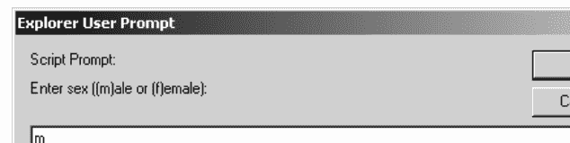

**图 8-2.** 一个提示用户输入其年龄的对话框。

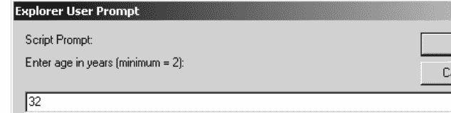

**图 8-3.** 一个提示用户指定计量单位的对话框。

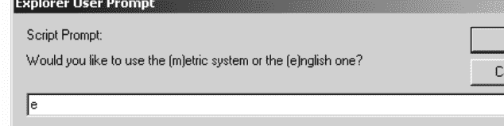

**图 8-4.** 一个提示用户输入其身高的对话框。

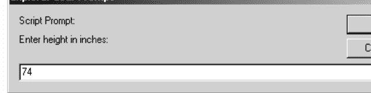

**图 8-5.** 一个提示用户输入其体重的对话框。

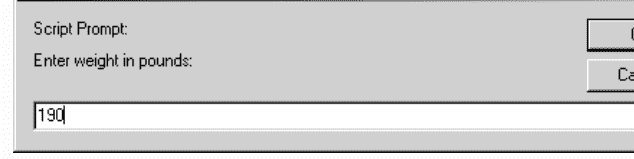

**图 8-6.** 一个基于计算结果的简短句子。

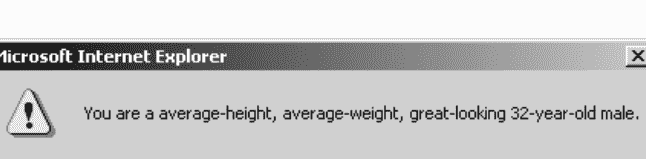

**图 8-7.** 一个允许用户查看“科学”结果的对话框。

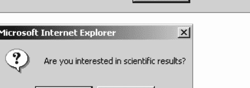

**图 8-8.** “科学”结果。

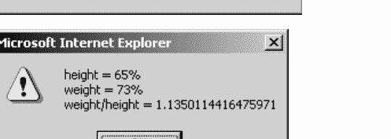

**图 8-9.** 免责声明。

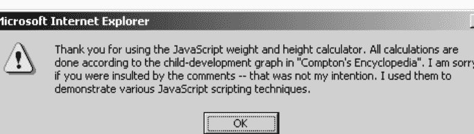

# 分析

这个脚本看起来相当长，但它简单易懂，因为大部分内容是纯数据和重复的 if-else 语句。

## convertInput()

`convertInput()` 函数不接受任何参数；它只是修改两个全局变量。该函数将 `weightInput` 和 `heightInput` 从英制系统转换为公制系统。`weightInput` 被转换为千克，`heightInput` 被转换为厘米。该函数不返回任何值，因为这两个变量都是全局的。

## getHeight(sex, age, height)

此函数接受三个参数：用户的性别、年龄和身高。变量 `height`（保存用户的身高）被四舍五入到最接近的整数。即使用户选择使用英制系统，身高也已经以厘米为单位表示。

对身高进行四舍五入后（年龄已经是整数，通过全局语句进行了四舍五入），声明并初始化两个新的局部变量为数值0：`height50` 和 `height5`。变量 `height50` 旨在保存用户指定年龄的男性或女性的平均身高值。另一个变量 `height5` 保存第5百分位的身高值。我们使用一个 if-else 结构为这两个变量分配适当的值。每个 if 语句检查用户的年龄是否等于条件表达式中的年龄（例如，`age == 10`）。else 语句指示 JavaScript 只要 `age` 的值不等于它正在测试的值，就继续按顺序执行 if 语句。快速查看图表可以发现，男性和女性在11岁之前身高相同。因此，前11个 if 语句同时适用于女性和男性用户。以下是函数中的一个简短部分：

```javascript
if (age == 2)
{
    height50 = 87
    height5 = 82
}
if (age == 3)
{
    height50 = 95
    height5 = 90
}
if (age == 4)
{
    height50 = 102
    height5 = 95
}
```

让我们检查这个脚本片段，看看它的作用。首先，JavaScript 检查 `age` 是否等于2。如果是，则将值87赋给 `height50`，将82赋给 `height5`。这些是图表中的近似值。如果 `age` 不等于2，则表达式：

```javascript
age == 2
```

求值为 false，JavaScript 执行 else 语句。函数的另一部分是女性统计数据与男性不同的部分：

```javascript
if (age == 11)
{
    height50 = 143
    height5 = 131
}
if (sex == "f")
{
    if (age == 12)
    {
        height50 = 150
        height5 = 140
    }
}
```


## 第 8 章

```
if (age == 18)
{
    height50 = 164
    height5 = 154
}
}
if (age == 12)
{
    height50 = 150
    height5 = 137
}
if (age == 13)
{
    height50 = 156
    height5 = 142
}
```

if 语句用于检查用户是否为女性。如果条件为真，JavaScript 将执行一个包含针对女性的 if-else 代码块。如果条件为假（即用户为男性），JavaScript 会忽略该代码块。函数的下一部分是专门针对男性的。整个 if-else 执行在用户年龄匹配后终止。函数内部的最大假定年龄为 18。如果用户输入更高的数字，脚本的全局部分会在调用此函数之前将其转换为 18。

查找给定 x（身高）值对应的 y（百分位）值是你在数学课上可能解决过的问题：percent = (height – height5) * (50 – 5) / (height50 – height5) + 5。脚本使用的就是这个精确公式。

### getWeight(sex, age, weight)

此函数与前一个函数相同，只是它处理的是用户的体重而非身高。

### printResult(height, weight, sex, age)

此函数比之前的更有趣，因为它没有任何重复的部分。在函数开头，声明了五个形容词并初始化为空字符串——这表明它们将在函数后面用于存储字符串值。另一个变量 `grade` 被声明并初始化为 0，表示它用于存储数值。为这个变量赋值为 0 尤其重要，因为它是累加值，任何其他值都会导致错误的结果。声明了一个名为 `propWeight` 的新变量，并初始化为用户的体重百分位除以其身高百分位。这个度量通过身高来标准化体重，能更准确地反映人的体型（你总不能指望一个8英尺高的人体重是平均水平，对吧？）。以下脚本片段根据 `getHeight()` 函数计算的身高百分位为变量 `heightAdj` 赋值：

```
if (height > 70)
{
    heightAdj = "tall"
    grade += 2
} else
    if (height < 30)
    {
        heightAdj = "short"
        grade += 1
    } else
    {
        heightAdj = "medium-height"
        grade += 3
    }
```

前面的脚本片段为变量 `heightAdj` 赋予了三个值之一："tall"（高）、"short"（矮）或 "medium-height"（中等身高）。如果身高百分位超过 70%，则认为该人个子高；如果低于 30%，则认为该人个子矮。在所有其他情况下（30% 到 70%），选择的形容词是 "medium-height"。注意，除了形容词，还会向变量 `grade` 添加一个数字，代表该特征获得的分数。例如，高个子在身高类别中获得三分之二的可能分数。中等身高的人获得最高分三分，而矮个子获得最低分一分。所有这些都是通过嵌套的 if-else 结构完成的，其中每条语句都是由两个嵌套语句组成的代码块。`weightAdj` 的赋值方式类似。

描述年龄的形容词是通过将其年龄与字符串 "-year-old " 连接而创建的。注意此语句中的数字到字符串的转换（类型转换）。

根据最终得分，为 `gradeAdj` 分配一个总体形容词。（不要将任何结果视为侮辱或医疗建议，因为它几乎从未返回过真实的结果。）最后，根据用户在开头的输入，将其性别分配给 `sexAdj`。

现在所有形容词都准备就绪，因此构建了一条注释，格式如下：

```
"You are a " + heightAdj + ", " + weightAdj + ", " + gradeAdj + ", " + ageAdj + " " + sexAdj + "."
```

然后，一个警告框会显示这句话。如果用户希望查看“科学的”百分位、体重和身高结果，JavaScript 会显示另一个包含这些信息的警告框。这是通过一个 if 语句及其条件中的 `confirm()` 方法完成的。
此函数中的最后操作是类似免责声明的消息。

##### 全局语句

```
var sex = prompt("Enter sex ((m)ale or (f)emale):", "")
var ageInput = parseInt(prompt("Enter age in years (minimum = 2):", ""))
ageInput = Math.round(ageInput)
var systemMessage = "Would you like to use the (m)etric system "
systemMessage += "or the (e)nglish one?"
var system = prompt(systemMessage, "m")
var heightUnit = (system == "m") ? "centimeters" : "inches"
var weightUnit = (system == "m") ? "kilograms" : "pounds"
var heightInput = prompt("Enter height in " + heightUnit + ":", "")
heightInput = parseInt(heightInput)
var weightInput = prompt("Enter weight in " + weightUnit + ":", "")
weightInput = parseInt(weightInput)
if (system == "e")
    convertInput()
if (ageInput > 18)
    var age = 18
else
    if (ageInput < 2)
        var age = 2
    else
        var age = ageInput
var heightPer = getHeight(sex, age, heightInput)
var weightPer = getWeight(sex, age, weightInput)
heightPer = (heightPer < 1) ? 1 : heightPer
heightPer = (heightPer > 99) ? 99 : heightPer
weightPer = (weightPer < 1) ? 1 : weightPer
weightPer = (weightPer > 99) ? 99 : weightPer
printResult(heightPer, weightPer, sex, age)
```

首先，JavaScript 要求用户输入其性别，作为一个单字母（例如“f”、“m”）。注意脚本中的输入值都没有经过验证，因此用户必须输入有效的值。数据验证将在本书后面讨论。然后 JavaScript 询问用户的年龄，并使用 `parseInt()` 函数将其转换为数字（所有来自对话框的输入都是字符串形式）。这个内置函数也将在本书后面讨论。用户的年龄被四舍五入为最接近的整数。

然后提示用户选择所需的度量系统：公制或英制。通过条件表达式将适当的值分配给 `heightUnit` 和 `weightUnit`（例如，厘米、英寸、千克、磅）。

在调用任何函数之前，JavaScript 询问用户的身高和体重。每个值都使用 `parseInt()` 函数转换为数字。

此时，如果身高和体重值是英制单位，则通过 `convert()` 转换为公制单位。变量 `age` 的值如果大于 18 则赋值为 18，如果小于 2 则赋值为 2。这些值是限制值，超出范围的值将无法与 `getHeight()` 和 `getWeight()` 函数配合使用。

依次调用 `getHeight()` 和 `getWeight()` 函数，并返回计算出的百分位。如果百分位超出范围，则将其截断到限制值内。最小百分位是 1；最大是 99。
最后一条语句调用 `printResult()` 来打印结果，如前面所述。

## 总结

在本章中，我们详细解释了一个完整的 JavaScript 脚本。这个脚本很好地总结了本书的第一部分，你应该花时间深入理解它。它演示了语言的基本特性，如变量、变量作用域、条件和循环结构、函数、警告框、表单、提示、输出技术、数据类型转换等等。本书其余部分的脚本要复杂得多，因此请确保你的知识基础与这些脚本所涵盖的内容一样广泛。

# 第 9 章

## JavaScript 中的事件

### 事件

不久前，静态 HTML 页面主导着网络。然而，随着越来越多的网站使用动态和交互式内容，用户逐渐习惯于这种更令人兴奋的格式，对静态网页的兴趣降低了。HTML 提供的功能集有限。浏览基于 HTML 的网页时，你可以阅读文本、查看图形，或者可能听它播放的声音。所有这些动作都是静态的，因为你作为用户无法控制网页所采取的动作。这样的页面类似于博物馆里的艺术杰作。你可以观看它们，也许拍张照片，但你不能与画作互动。对许多人来说，网络体验仅限于访问页面，而没有与之互动。唯一的互动发生在用户跟踪链接或点击图像映射上的某个位置时。

JavaScript 使 HTML 页面的设计者能够利用 *事件* 来实现自动导航、客户端处理等功能。事件是浏览器在发生各种操作时生成的信号。你稍后会看到 JavaScript 能识别这些事件并对其做出反应。JavaScript 支持的事件列在表 9-1 中。

**表 9-1. JavaScript 中的事件。**

| 事件 | 描述 |
|---|---|
| abort | 当用户中止加载图像时发生。 |
| blur | 当焦点从表单元素移除时发生（当用户点击表单元素外部时）。当用户从浏览器窗口移除焦点时也会发生。 |
| click | 当用户单击链接、图像映射区域或表单元素时发生。 |
| change | 当用户更改表单字段的值时发生。 |
| error | 加载图像时发生错误。 |
| focus | 当用户将输入焦点给予表单元素或窗口时发生。 |
| load | 当页面或图像加载完成到浏览器窗口时发生。 |


## JavaScript 中的事件

| 事件 | 描述 |
| --- | --- |
| mouseOut | 当用户将鼠标指针从链接或图像地图区域的边界框内移出时发生。 |
| mouseOver | 当用户将指针移到超链接或图像地图区域上时发生。 |
| select | 当用户选择表单字段时发生。 |
| submit | 当用户通过提交按钮提交表单时发生。 |
| unload | 当用户退出页面时发生。 |

并非所有在浏览器中发生的操作都是事件。事件仅指在 HTML 页面区域内发生的操作，例如加载图像和选择表单元素。如果操作直接发生在浏览器显示区域的边界内，它也是一个事件。请查看以下页面：


**图 9-1. 在 Netscape Navigator 全屏窗口中显示的 Netscape 主页。**

你知道这个窗口由两部分组成：HTML 页面和浏览器。你还知道在图 9-1 所示的环境中可以发生许多操作。有些是事件，有些则不是事件操作。窗口的主要部分是 HTML 页面，即不包含周围菜单和按钮的内容窗口：

# 第 9 章

# Chapter 9

图 9-2. 不包含周围浏览器窗口的 Netscape 主页。


在图 9-2 所示区域内发生的所有操作都是事件。用户在此区域中加载、卸载、点击链接并引发许多其他事件。第二部分由 Netscape Navigator 的功能组成，例如菜单栏、滚动条和下图中可见的其他元素：

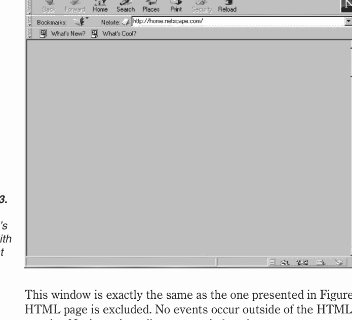

图 9-3. 不包含内容区域的 Netscape Navigator 窗口。

这个窗口与图 9-1 中显示的完全相同，只是排除了 HTML 页面。在 HTML 页面之外不会发生任何事件。例如，打开 Navigator 的邮件或新闻窗口不会生成事件。上下滚动窗口也不会导致事件。即使你更改了 HTML 页面的外观，你也没有触发事件。认识到事件与其他操作之间的区别非常重要，因为 JavaScript 只能处理事件，而不能处理其他操作。许多邮件列表和新闻组中的问题，例如“Netscape 的人计划何时创建由滚动触发的事件处理程序...？”，显示了程序员对识别什么是事件的无知。事件处理程序显然只能处理事件！只要页面被加载，无论 HTML 页面区域的大小如何，事件都会发生。请注意，未来版本的 Navigator 或 Internet Explorer 可能会将事件的术语扩展到整个窗口，但这仍存疑。Netscape Navigator 3.0x 在引入通过 JavaScript 自动滚动的功能时，朝着这个方向迈出了一步，尽管尚未实现相应的事件。

## 事件处理程序

事件处理程序与其关联的事件相对应。它们是在事件发生时自动执行的脚本。大多数延迟的 JavaScript 函数都是由事件处理程序调用的。你之前看到，事件是不会产生任何直接影响的操作。它们仅为事件处理程序服务。每个事件处理程序都与一个事件相关联。

事件处理程序作为 HTML 标签的属性嵌入到文档中，你可以在其中分配 JavaScript 代码。一般语法是：

```
<TAG eventHandler="JavaScript Code">
```

你可以使用事件处理程序来嵌入任何 JavaScript 代码。你可以将包含函数的 500 行脚本作为事件处理程序标签放置。你可以在同一个 HTML 标签上使用多个事件处理程序。事件处理程序的名称由单词“on”和事件名称构成。以下是支持的事件处理程序的完整列表：

- onAbort
- onBlur
- onClick
- onChange
- onError
- onFocus
- onLoad
- onMouseOut
- onMouseOver
- onSelect
- onSubmit
- onUnload

这是一个 HTML 页面，当你加载它时显示消息 "Hello"，当你卸载它时显示 "Goodbye"：

```
<HTML>
<HEAD>
<TITLE>Hello / Goodbye</TITLE>
</HEAD>
<BODY onLoad="alert('Hello')" onUnload="alert('Goodbye')">
</BODY>
</HTML>
```

**示例 9-1 (ex9-1.htm).** *一个具有两个作为同一标签不同属性的事件处理程序的 HTML 文档。*

事件处理程序不区分大小写。例如，你可以使用 ONLOAD 代替 onLoad。尽管事件处理程序与 JavaScript 相关，但事件处理程序本身通常用作 HTML 属性——HTML 不区分大小写。使用类似标识符的命名约定来命名事件处理程序仍然是一个好习惯。正如你稍后将看到的，事件处理程序的正式名称全部小写，但在 HTML 中这并不重要。

示例 9-2 是一个利用事件处理程序的经典脚本。

```
<HTML>
<HEAD>
<TITLE>A link description in the status bar</TITLE>
</HEAD>
<BODY>
<A HREF="http://www.wordware.com/"
    onMouseOver="window.status = 'Wordware Publishing'; return true">Wordware</A>
</BODY>
</HTML>
```

**示例 9-2 (ex9-2.htm).** *一个事件处理程序脚本，当用户将指针悬停在链接上时，显示该链接的简短描述。*

有时在事件处理程序脚本中直接执行语句是有问题的。例如，如果你想包含一个长脚本，将其放在事件处理程序脚本中会使 HTML 页面变得笨重，维护变得困难。另一个可能出现困难的情况是，当你想将包含字符串（引号）的脚本与事件处理程序关联时。如你所见，事件处理程序需要引号来将指定的 JavaScript 代码与周围的 HTML 内容分隔开。JavaScript 要求交替使用引号类型（单引号和双引号），因此你可能会发现编写强调引号的脚本很烦人。事件处理程序接受任何有效的 JavaScript 脚本。因此，你应该将函数与事件处理程序关联。在事件处理程序脚本中，你唯一需要的语句就是函数调用。

你通常应该将所有函数放在页面的顶部，或者更准确地说，放在文档的 <HEAD>...</HEAD> 部分。此操作强制 JavaScript 在继续布局页面之前评估你的函数。通过这种做法，你可以保证当浏览器在页面的 HTML 部分遇到事件处理程序时，如果该事件发生，它将成功调用与该事件关联的函数。唯一的限制是你不能在 <HEAD>...</HEAD> 部分的 JavaScript 脚本之前放置任何事件处理程序来捕获事件。此限制也适用于通过 <SCRIPT> 标签的 SRC 属性实现的外部文件。此类页面的基本结构是：

```
<HTML>
<HEAD>
<TITLE>The title of the page</TITLE>
<SCRIPT LANGUAGE="JavaScript" [SRC="path.js"]>
<!--
function functionName(parameters) {
    statement1
    statement2
    statement3
}
// -->
</SCRIPT>
</HEAD>
<BODY>
<TAG otherAttributes eventHandler="functionName(arguments)">
</BODY>
</HTML>
```

如果你始终将函数定义放在页面的 <HEAD>...</HEAD> 部分，就很容易找到关联的函数。页面的 HTML 部分保持与 JavaScript 发明之前一样简单。唯一新增的 HTML 部分是事件处理程序。将函数与事件处理程序一起使用的另一个重要优点是，你可以在同一个 HTML 页面中多次使用相同的函数。例如，如果你有一个包含四个文本字段的表单，你可以通过在特定于其中一个字段的事件发生时调用此函数，使用相同的函数来验证每一个字段。

你可能已经注意到标题是在 <SCRIPT> 标签之前指定的。尽管标题是通过 HTML 标签指定的，但它没有可能调用后面定义的函数的事件处理程序。如果你不遵循此规则，可能不会有任何问题，尽管这仍然是一个好习惯，因为它有助于页面的整洁组织并保证你永远不会有任何布局问题。

### onLoad 和 onUnload

两个非常重要的事件处理程序是 onLoad 和 onUnload。它们对应的事件 load 和 unload 由这些操作触发。当页面加载完成时，load 事件发生。当用户以任何方式退出页面时，unload 事件发生。这些是最简单的事件处理程序，因为它们与最基本的 <BODY> 标签相关，并被指定为该标签的属性。以下文档在用户进入页面时通过警告框表示欢迎，并在用户退出时也通过警告框表示再见：

```
<HTML>
<HEAD>
```


## 第9章

```html
<TITLE>onLoad 和 onUnload 事件处理器</TITLE>
</HEAD>
<BODY onLoad="alert('欢迎访问我们的页面！')" onUnload="alert('再见，别忘了再来哦！')">
</BODY>
</HTML>
```

onLoad 事件处理器被广泛用于调用延迟脚本。将一个函数调用作为事件处理器的脚本，使你能够控制执行的时机，这样脚本只会在页面完全布局完成后才执行。

### onError

onError 事件处理器扩展了 JavaScript 与用户交互的能力，这种能力取决于发生的错误。此事件处理器不被 Navigator 2.0x 或 IE 3.0x 支持，但被这两种浏览器的最新版本所支持。

当窗口或图像的加载导致错误时，会发生一个错误事件。当此类错误发生时，onError 事件处理器会执行一段 JavaScript 脚本。

onError 事件处理器极其有用，原因在于它可以被设置为以下三种值之一：

-   `null`——抑制所有错误对话框。将 `window.onError` 设置为 `null` 意味着你的用户将不会看到由你自己的代码引起的 JavaScript 错误。
-   一个处理错误的函数——替换 JavaScript 用于报告错误的标准对话框。
-   一个包含 `null` 或有效函数引用的变量。

以下 JavaScript 语句会禁用 JavaScript 错误对话框：

```javascript
window.onError = null
```

为安全起见，你应该将此语句放在其自己的脚本中，直接置于 `<HEAD>` 标签之后，使用以下 HTML 文档结构：

```html
<HTML>
<HEAD>
<SCRIPT LANGUAGE="JavaScript">
<!--
window.onError = null
// -->
</SCRIPT>
</HEAD>
<BODY>
</BODY>
</HTML>
```

同样的规则适用于你为此事件处理器明确赋值的所有值。

以下文档不会显示任何错误对话框，尽管遇到了错误。（如果你无法弄明白，你可能需要复习前面的章节，或者直接查看 `alert()` 方法的参数作为线索。）

```html
<HTML>
<HEAD>
<SCRIPT LANGUAGE="JavaScript">
<!--
window.onError = null
// -->
</SCRIPT>
</HEAD>
<BODY>
<SCRIPT LANGUAGE="JavaScript">
<!--
alert(Quotes missing)
// -->
</SCRIPT>
</BODY>
</HTML>
```

当你的脚本在公共页面上运行时，将 `onError` 事件处理器设置为 `null` 是一个好习惯。然而，在编写脚本时这样做是没有意义的，因为它使得调试变得不可能。

这是另一个禁用错误从而避免报告堆栈溢出错误的文档：

```html
<HTML>
<HEAD>
<TITLE>禁用错误消息</TITLE>
<SCRIPT LANGUAGE="JavaScript">
<!--
// 禁用错误报告
window.onError = null
// 创建一个产生错误的函数（无限递归）
function testErrorFunction() {
    testErrorFunction()
}
// -->
</SCRIPT>
</HEAD>
<BODY onLoad="testErrorFunction()">
</BODY>
</HTML>
```

无论是否将 `null` 赋给事件处理器，错误都会发生。区别在于浏览器方面不会对错误做出任何响应。有关通过 JavaScript 为事件处理器赋值的讨论，请参见本章后面的“显式调用事件处理器”一节。

另一个选择是编写一个函数来处理错误，以替代标准的 JavaScript 错误报告对话框。该函数应接受三个参数：

-   错误消息
-   导致错误的脚本的 URL
-   错误的行号

该函数拦截 JavaScript 错误。它必须返回值 `true`。
以下是用于错误处理的一组经典函数和语句：

```javascript
<HTML>
<HEAD>
<SCRIPT LANGUAGE="JavaScript">
<!--
// 将用户定义的函数赋给以拦截错误
window.onError = myOnError
// 创建数组来保存错误消息
messageArray = new Array(0)
// 创建数组来保存错误的 URL
urlArray = new Array(0)
// 创建数组来保存错误的行号
lineNumberArray = new Array(0)
// 错误拦截函数
function myOnError(msg, url, lno)
{
    // 将当前错误的消息赋给最后一个元素之后的数组元素
    messageArray[messageArray.length] = msg

    // 将当前错误的 URL 赋给最后一个元素之后的数组元素
    urlArray[urlArray.length] = url

    // 将当前错误的行号赋给最后一个元素之后的数组元素
    lineNumberArray[lineNumberArray.length] = lno

    // 返回 true 以拦截 JavaScript 错误
    return true
}
function displayErrors()
{
    // 打开新的浏览器窗口来报告错误
    errorWindow = window.open('','errors','scrollbars=yes')

    // 向窗口写入标题
    errorWindow.document.write('<B>错误报告</B><P>')
        // 循环打印所有错误数据
    for (var i = 0; i < messageArray.length; ++i) {
            errorWindow.document.write('<B>错误文件：</B> ' +
                                    urlArray[i] + '<BR>')
            errorWindow.document.write('<B>行号：</B> ' +
                                    lineNumberArray[i] + '<BR>')
            errorWindow.document.write('<B>消息：</B> ' +
                                    messageArray[i] + '<P>')
    }
    // 关闭数据流
    errorWindow.document.close()
}
// -->
</SCRIPT>
</HEAD>
<BODY>
<FORM>
<INPUT TYPE="button" onClick="displayErrors()" VALUE="显示错误">
</FORM>
</BODY>
```

**示例 9-3 (ex9-3.htm)**。一组用于拦截和显示错误列表的函数。

首先，将函数引用赋给 `window.onError`。然后创建三个数组；每个数组保存与可能发生的错误相关的不同数据。每个数组的长度都设置为 0，因为到目前为止尚未发生任何错误。拦截 JavaScript 错误的函数是 `myOnError()`。它的参数分别是错误消息、URL 和行号。

你不需要在现阶段理解这些函数，因为它们使用了尚未讨论的概念，如数组和窗口。你应该注意的唯一一点是，该函数返回 `true` 是为了指示 JavaScript，它旨在拦截标准的 JavaScript 错误。通常，当用户单击按钮时，脚本生成的 JavaScript 错误列表会在另一个窗口中打印。有关示例 9-3（`window.onError`）中演示的事件处理器实现的更多细节，请参见“显式调用事件处理器”一节。

### 通过方法模拟事件

我们前面提到，每个事件都属于一个特定的对象。有些事件与多个对象相关联，特别是在 Netscape Navigator 3.0 发布后，它将某些事件扩展到了其他对象。对象的另一个特征是方法。方法是通常操作与该对象相关的数据（即属性）的函数。一些包含事件处理器的对象的方法实际上模拟了这些事件。你可以使用这样的方法来触发一个事件的发生。这些方法通常被称为*事件方法*。虽然我们稍后会深入讨论这些方法，但这里列出其中一些：

-   `blur()`
-   `click()`
-   `focus()`
-   `select()`
-   `submit()`

使用这些方法生成的事件与任何其他方法类似。最重要的是，它们<u>不会</u>调用其对应的事件处理器。

当你模拟一个事件时，重要的是要在浏览器完成页面布局之后，或者至少在与方法关联的对象（通常是表单元素）布局之后才这样做。以下页面会产生一个错误：

```html
<HTML>
<HEAD>
<TITLE>模拟一个尚未存在的（目前为止）表单的事件</TITLE>
<SCRIPT LANGUAGE="JavaScript">
<!--
document.form1.field1.focus()
// -->
</SCRIPT>
</HEAD>
<BODY>
<FORM NAME="form1" METHOD=POST>
<INPUT TYPE="text" NAME="field1">
</FORM>
</BODY>
</HTML>
```

### 错误消息内容

此错误不保证在所有平台上都完全相同。模拟一个尚未布局的对象的事件只是产生此类错误的一个例子。一般来说，你不能引用尚未布局的页面的任何元素。允许延迟脚本引用在脚本之后布局的对象，只要你在对象布局完成之前不执行该脚本。我们将在整本书中深入讨论这个问题。

### 显式调用事件处理器

在 Netscape Navigator 3.0x 及更高版本中，你可以从 JavaScript 脚本内部设置事件处理器。这里有一个简短的例子：

```html
<HTML>
<HEAD>
<TITLE>模拟一个尚未存在的（目前为止）表单的事件</TITLE>
<SCRIPT LANGUAGE="JavaScript">
<!--
function alert1()
{
    alert("这是第一个函数。")
}
function alert2()
{
    alert("这是第二个函数。")
}
// -->
</SCRIPT>
</HEAD>
<BODY>
<FORM NAME="form1" METHOD=POST>
<INPUT TYPE="button" NAME="button1" VALUE="按钮1" onClick="alert1()">
</FORM>
<SCRIPT LANGUAGE="JavaScript">
```


### 示例 9-4 (ex9-4.htm)。*你可以通过事件处理程序调用 JavaScript 脚本。*

请尝试加载此页面并点击按钮。如果你使用的是 Navigator 3.0x 或 4.0，即使事件处理程序将点击事件与第一个函数 alert1() 关联，警告框也会显示消息"This is the second function"。注意紧接在表单之后放置的脚本。它将不同的函数与表单1中 button1 的点击事件关联起来。

> **注意：** 事件处理程序是函数引用，而不是函数调用。因此，你必须赋值 alert2，而不是 alert2()，后者主要是函数调用，会计算为函数返回的类型和值。此外，由于事件处理程序 HTML 属性是字面量函数体，你不能在 HTML 源代码中使用 <INPUT ... onClick=alert2>。你必须调用该函数。

你可能想知道我们为什么使用 onclick 而不是 onClick。原因是 JavaScript 区分大小写，理解 onclick（全小写），而 HTML 不区分大小写。在 HTML 中，你可以使用全小写、全大写或你选择的任何其他约定。

显式调用事件处理程序可以实现灵活的事件处理，因为你可以随时在脚本中修改它们。你可以创建一个自定义页面，允许用户确定特定按钮在点击时应执行什么操作。

当你使用此技术时，事件处理程序不必存在。如果你在 HTML 源代码中省略事件处理程序规范并使用以下行代替，前面的脚本的工作效果完全相同：

```
<INPUT TYPE="button" NAME="button1" VALUE="button1">
```

在这种情况下，你实际上是在定义一个对应于事件的新事件处理程序。

另请注意，上述方法是将函数引用分配给事件处理程序的唯一方法。你**不能**使用以下任何结构：

```
<SCRIPT LANGUAGE="JavaScript">
<!--
document.form1.button1.onclick = "alert2()"
// -->
```

```
<SCRIPT LANGUAGE="JavaScript">
<!--
document.form1.button1.onclick = alert2()
// -->
```

```
<SCRIPT LANGUAGE="JavaScript">
<!--
document.form1.button1.onclick = "var counter = 5"
// -->
```

此类尝试分配非函数引用的语句会导致点击按钮时出错。

### 取消事件

Netscape Navigator 3.0x 和 4.0 使得通过超链接或客户端图像映射取消点击事件成为可能。onClick 事件处理程序可以返回 false 以取消通常与点击事件关联的操作。下面是一个示例：

```
<HTML>
<HEAD>
<TITLE>Cancelling events in onClick</TITLE>
<BODY>
<A HREF="http://www.netscape.com/" onClick="return confirm('Load Netscape home page?')">Netscape</a>
</BODY>
</HTML>
```

**示例 9-5 (ex9-5.htm)。** *尝试运行此脚本以取消事件。*

当你点击超链接时，会弹出一个确认框。如果你点击“确定”，该方法计算为 true，事件被认可，新页面（Netscape 的主页）加载。如果用户选择“取消”，该方法返回 false，与点击事件关联的新页面不会加载。

## 总结

在本章中，你了解了事件和事件处理程序。JavaScript 为网页添加了交互性，这意味着你可以响应用户执行的操作。事件描述此类操作，而事件处理程序负责处理它们。它们赋予 JavaScript 程序员与用户交互的能力。你很少会在网上找到不利用这一独特功能的脚本。尽管交互性包括超出事件处理程序的内容（我们之前见过对话框），但它们可能是 JavaScript 中最重要的交互手段。正如你可能在上网冲浪时注意到的那样，它们扩展了网页的能力。除了 onLoad 和 onUnload，我们在本章没有详细介绍任何事件或事件处理程序，因为它们将在本书后面的章节中单独深入讨论。每个事件及其相应的处理程序都有重要的特点。正如你稍后将看到的，所有事件都与特定对象相关联，因此在我们讨论它们的事件处理程序之前，向你介绍这些对象非常重要。

# 第 10 章

## 构建和扩展对象

### 创建实例

对象是创建实例的模板。例如，假设你已经定义了一个员工对象，该对象包含员工的一些方法和属性，例如他或她的社会安全号码和地址。此定义对脚本没有影响，因为没有更改或创建新的实体。只有当你将对象的定义应用于特定人员，比如 John Doe，才会创建一个新实体——该对象的一个实例。你用单个对象定义创建的实例数量是无限的。对象定义可以是你用函数定义的，也可以是内置的。创建内置对象的实例相对简单，因为该对象是预定义的。这与 Java、C++ 和其他面向对象语言稍有不同，在这些语言中，“类”是模板代码，特定实例是一个对象。

你应该使用以下语法来创建实例：

```
var name = new objectname([arguments])
```

因此，如果你想创建 String 对象的一个实例，你可以使用以下语句：

```
var str1 = new String("Hello!")
```

此语句创建一个名为 str1 的实例，并向其传递字面量"Hello!"。如果你愿意，可以创建另一个实例：

```
var str2 = new String("Hi!")
```

大多数对象，包括 String，都有一个所谓的构造函数。这是一个在创建该对象的实例时自动触发的函数。当你在创建实例时向对象传递参数时，你实际上是在将该参数传递给对象的构造函数。

在前面的示例中，实例 str1 和 str2 的行为非常类似于常规变量。事实上，你可以将它们视为 String 类型的变量。你可以像这样将它们传递给函数：

```
function printValue(val)
{
    document.write("*** " + val + " ***")
}
printValue(str1)
```

你也可以返回对象：

```
function printValue(obj)
{
    return obj
}
```

请记住，如果你在函数内部创建对象的实例，它被视为局部变量，即在函数当前执行过程中仅在函数内部可见。如果你在函数外部声明实例，最好使用 var 关键字。当你在函数内部创建对象的实例而不使用 var 时，它是一个全局结构。请记住，如果你在函数内部创建一个全局实例，甚至是一个简单的变量，你必须在脚本中存在该全局数据结构之前执行该函数。此后，你可以在文档中的任何地方自由引用它。

当你通过 new 运算符创建对象的实例时，你实际上是根据对象的定义声明了一个特定的数据类型，并为该数据类型分配了适当数量的内存。构造函数中引用的所有属性都可以作为对象实例的属性访问。

在创建对象的实例后，当你引用该实例时，不必再使用 new 关键字。但是，如果你希望实例的属性之一是其自身的实例，则必须再次使用 new 来创建新对象。对象的实例也具有其方法。方法本质上是在对象内部找到的函数。

看看下面的示例：

```
var current = new Date() // 当前日期
var minutes = current.getMinutes()

var current2 = new Date() // 当前日期
var minutes2 = current2.getMinutes()
```

如你所见，两个实例都有方法。方法属于对象的特定实例。换句话说，与 current 对象关联的 getMinutes() 是一个独立的函数，与 current2 对象关联的 getMinutes() 不同。这两个函数都由相同的模板生成并执行相同的动作。

### 构造函数

构造函数是一个简单的函数，用于定义相关对象类型的属性和方法。当对象的实例被

你可以将内置对象理解为那些在JavaScript中预定义了构造函数的对象，因此你无需自行编写。构造函数类似于饼干模具。你放入一些面团，它便能将面团塑造成合适的形状。饼干模具就像是构造函数，因为两者都接收一个简单的结构，并根据指定的模板对其进行修改。

## 定义对象属性

关键字`this`很可能是JavaScript（以及许多其他面向对象语言）中与对象相关的最重要的词。它指的是当前对象，即实例。在构造函数内部，它指的是调用该函数的实例。看看以下函数：

```javascript
function student(name, age, avgGrade)
{
    this.name = name
    this.age = age
    this.grade = avgGrade
}
```

此函数接受三个参数。它定义了一个班级中学生的对象类型。属性是`name`、`age`和`grade`，它们通过传递给函数的值进行初始化。你可以使用以下语句创建此对象的一个实例——一个班级中的学生：

```javascript
var student1 = new student("Sharon", 16, 85)
```

现在，你可以通过以下方式引用这些属性：

```javascript
alert(student1.name + " is a cute " + student1.age + " - year old.")
```

也可以在对象创建后为其添加属性。此类属性仅存在于被赋值的特定实例中。以下脚本段落演示了这一点：

```javascript
function student(name, age, avgGrade)
{
    this.name = name
    this.age = age
    this.grade = avgGrade
}
var student1 = new student("Sharon", 16, 85)
student1.sex = "female"
var message = student1.name + " is a cute " + student1.age
message += " - year old "
message += (student1.sex == "female") ? "girl." : "boy."
alert(message)
```

上述脚本的问题在于它只将新属性添加到了一个实例`student1`上。因为构造函数与其他任何函数一样，你可以在其中使用有效的JavaScript语句。因此，你可以使用以下构造函数将新属性添加到`student`对象的所有实例中：

```javascript
function student(name, age, avgGrade, sex)
{
    this.name = name
    this.age = age
    this.grade = avgGrade
    this.description = (sex == "female") ? "girl" : "boy"
}
```

现在，你可以创建包含“girl”或“boy”描述的实例：

```javascript
var student2 = new student("Joe", 16, 91, "male")
```

根据`this`这个词的确切定义，一些JavaScript代码倾向于使用替代结构来构建函数。以下是前面示例的另一种形式：

```javascript
function student(name, age, avgGrade, sex)
{
    obj = this
    obj.name = name
    obj.age = age
    obj.grade = avgGrade
    obj.description = (sex == "female") ? "girl" : "boy"
}
```

请注意，调用对象（称为`this`）被赋值给了一个变量。这个变量必须是全局的，因为构造函数的目的是在函数外部创建一个实例以供使用。局部变量在声明它的函数之外没有任何作用。就我个人而言，我从不使用这种方法，也不常见到它被频繁使用。我将其包含在这里，只是为了让你在别处看到时不会感到困惑。

你现在知道如何通过构造函数定义属性了。如果你只想创建一个对象的一个实例，你也必须使用构造函数。

要查看对象的属性，你可以使用以下函数：

```javascript
function getProps(obj, objName)
{
    var result = "" // initialize output string
    for (var i in obj)
    {
        result += objName + "." + i + " = " + obj[i] + "<BR>"
    }
    result += "<HR>" // add horizontal rule to output string
    return(result) // return output string
}
```

要调用此方法，请使用如下语句：

```javascript
document.write(getProps(student1, "student1"))
```

请注意，参数并不总是相同的。例如，如果你在另一个接受实例`student1`作为参数`person`的函数内部使用此语句，则应改为使用以下语句：

```javascript
document.write(getProps(person, "student1"))
```

如果对象的属性持有空值（null），则它不存在。将空值赋给属性将导致函数`getProps()`跳过该属性。请记住这一点，尤其是在调试脚本时。

### 嵌套对象

JavaScript支持嵌套对象。嵌套对象是同时作为另一个对象属性的对象。有几种方法可以创建嵌套对象。看看以下脚本片段：

```javascript
function student(name, age, grade, father, mother)
{
    this.name = name
    this.age = age
    this.grade = grade
    this.parents = new parents(father, mother)
}
function parents(father, mother)
{
    this.father = father
    this.mother = mother
}
var student1 = new student("Sharon", 16, 85, "Mark", "Stacy")
```

此脚本包含两个函数。函数`parents()`创建一个包含两个属性`father`和`mother`的实例。它接受这两个值作为参数。

第一个函数`student()`创建一个包含四个属性的对象。前三个是像你在本章前面见过的简单属性。第四个属性是一个对象的实例。如前所述，此实例由`parents()`函数创建。你可以使用点语法引用对象的所有元素：

```javascript
student1.name
student1.age
student1.grade
student1.parents.father
student1.parents.mother
```

要打印一个普通对象的属性，你可以使用以下递归函数：

```javascript
function getProps(obj, objName)
{
    // initialize accumulative variable
    var result = ""
    // loop through properties
    for (var i in obj)
    {
        // if current property is an object call function for it
        if (typeof obj[i] == "object")
            result += getProps(obj[i], objName + "." + i)
        else
            result += objName + "." + i + " = " + obj[i] + "<BR>"
    }
    // return final result
    return result
}
```

该函数的算法相当简单。它循环遍历主对象的属性。如果当前属性（由`i`表示）是一个对象，则函数会再次被调用，将属性`obj[i`作为对象，并将属性名通过点连接到对象名（`objName + "." + i`）。每次调用函数都会返回一个字符串，列出当前级别的属性。递归调用的返回值被赋给调用函数中的局部变量`result`。以下是一个完整的HTML文档及其输出，以帮助你理解这个概念：

```html
<HTML>
<HEAD>
<TITLE>Printing properties of nested objects</TITLE>
<SCRIPT LANGUAGE="JavaScript">
<!--
function student(name, age, grade, father, mother)
{
    this.name = name
    this.age = age
    this.grade = grade
    this.parents = new parents(father, mother)
}
function parents(father, mother)
{
    this.father = father
    this.mother = mother
}
var student1 = new student("Sharon", 16, 85, "Mark", "Stacy")
function getProps(obj, objName)
{
    var result = ""
    for (var i in obj)
    {
        if (typeof obj[i] == "object")
            result += getProps(obj[i], objName + "." + i)
        else
            result += objName + "." + i + " = " + obj[i] + "<BR>"
    }
    return result
}
document.write(getProps(student1, "student1"))
// -->
</SCRIPT>
</HEAD>
<BODY>
</BODY>
</HTML>
```

示例 10-1. 一个使用`getProps()`分析对象结构的脚本。

示例 10-1 中脚本的输出如图 10-1 所示：

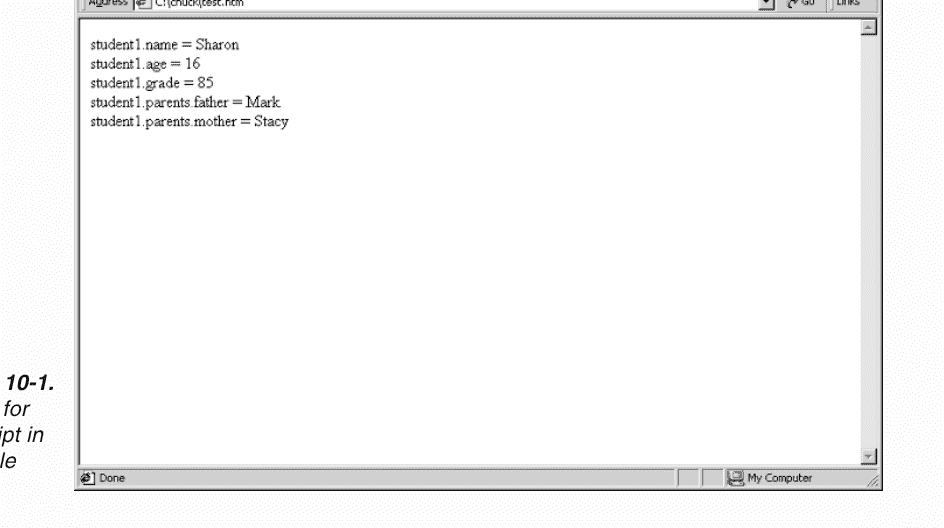

图 10-1. 示例 10-1 中脚本的输出。

### 定义方法

对象将数据与处理这些数据的函数分组。数据以属性的形式出现。方法仅仅是与对象关联的一个函数。考虑以下函数：

```javascript
function displayStudent()
{
    var result = ""
    result += this.name + " -- "
    result += "a " + this.age + " - year old "
    result += this.grade + "% average student.<BR>"
    result += this.name + "'s parents -- "
    result += this.parents.father + ", " + this.parents.mother
    result += ".<BR>"
    document.write(result)
}
```


## 第10章

你需要在构造函数中包含对此函数的引用。这与定义属性的方式完全相同：

```javascript
function displayStudent()
{
    var result = ""
    result += this.name + " -- "
    result += "a " + this.age + " - year old "
    result += this.grade + "% average student.<BR>"
    result += this.name + "'s parents -- "
    result += this.parents.father + ", " + this.parents.mother
    result += ".<BR>"
    document.write(result)
}
function student(name, age, grade, father, mother)
{
    this.name = name
    this.age = age
    this.grade = grade
    this.parents = new parents(father, mother)
    this.display = displayStudent
}
function parents(father, mother)
{
    this.father = father
    this.mother = mother
}
```

以下语句创建一个实例并调用 `display()` 方法：

```javascript
var student1 = new student("Sharon", 16, 85, "Mark", "Stacy")
student1.display()
```

请注意函数内部广泛使用关键字 `this` 来引用对象。方法的主要特点是它通常处理其对象的数据。你甚至可以按照以下方式创建一个“构造方法”：

```javascript
function construct(name, val)
{
    this[name] = val
}
function student(name, age, grade, father, mother)
{
    this.construct = construct
    this.name = name
    this.age = age
    this.grade = grade
    this.parents = new parents(father, mother)
}
function parents(father, mother)
{
    this.father = father
    this.mother = mother
}
```

```javascript
var student1 = new student("Sharon", 16, 85, "Mark", "Stacy")
student1.construct("boyfriend", "Tom")
```

请注意，该方法 (`construct()`) 通过数组表示法引用新属性。你可能从第5章“面向对象编程”中回忆起，如果希望使用数据值，必须使用此表示法。只有在使用字面量时才能使用“点”语法。在这种情况下，`name` 是一个数据结构，而不是字面量（字面量是你可见的常量值，例如 `"boyfriend"`）。现在你可以使用前面介绍的递归函数来查看对象的元素，并观察它与方法配合时的工作方式。

请注意，递归函数适用于方法和属性。方法的语句位于同一行。JavaScript 会自动添加分号来分隔语句。如果你在函数中最初没有这样做，它还会使用统一的编码方案，这是你应该做的。

JavaScript 中的方法与属性一样，只属于一个实例。你只能从该实例调用它。与对象的所有“通信”都是通过方法完成的。调用对象在方法内部被视为全局对象。你可以使用 `this` 关键字来修改对象。

### 创建对象——示例

假设你想为一家销售电视机的商店创建一个类似数据库的对象结构。每种类型的电视都应该是同一个对象的实例。某种型号电视机的库存数量应该是对象的属性。它还应该包括该电视机的特性。此外，对象应包含两种方法：一种在顾客购买电视机时调用，另一种在店主订购一定数量的某种型号电视机时调用。

示例 10-2 展示了最重要的几点。

```html
<HTML>
<HEAD>
<SCRIPT LANGUAGE="JavaScript">
<!--
function television(brand, size, price, num) {
    this.brand = brand   // 属性
    this.size = size     // 属性
    this.price = price   // 属性
    this.num = num       // 属性
    this.sell = sell     // 方法
    this.buy = buy       // 方法
    this.display = display // 方法
}
function sell(quantity) {
    if (quantity > this.num)
        alert("库存中没有足够的 " + this.brand + " " + this.size + "\" 电视机。")
    else
        this.num -= quantity
    if (quantity < 5)
        alert("紧急订购更多 " + this.brand + " " + this.size + "\" 电视机。")
}
function buy(quantity) {
    this.num += quantity
}
function display() {
    var result = ""
    result += "<TABLE BORDER=2><TR>"
    result += "<TD WIDTH = 60>" + this.brand + "</TD>"
    result += "<TD WIDTH = 30>" + this.size + "\"</TD>"
    result += "<TD WIDTH = 45>$" + this.price + "</TD>"
    result += "<TD WIDTH = 45>" + this.num + " left</TD>"
    result += "</TR></TABLE>"
    document.write(result)
}
var tel1 = new television("Sony", 27, 1200, 30)
var tel2 = new television("JVC", 20, 650, 20)
var tel3 = new television("Grundig", 14, 420, 45)
tel1.sell(27) // 售出 27 台 "Sony" 电视机
tel1.buy(16) // 订购（买入）16 台 "Sony" 电视机
tel1.display()
tel1.sell(21) // 售出 21 台 "JVC" 电视机 -- 错误！
tel1.sell(1) // 售出 1 台 "JVC" 电视机
tel1.display()
tel3.display()
// -->
</SCRIPT>
</HEAD>
<BODY>
</BODY>
</HTML>
```

示例 10-2. 一个使用通用对象实例存储数据的脚本。

运行示例 10-2 时，你应该会得到下图所示的一系列输出：

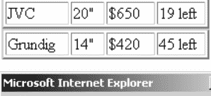

图 10-2. 显示电视机库存的表格。

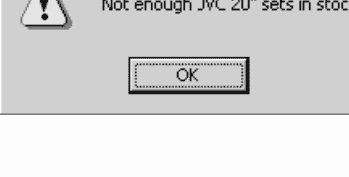

图 10-3. 一个警告框，在库存不足时通知用户。

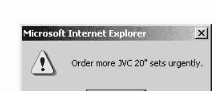

图 10-4. 一个警告框，提示用户订购更多电视机。

示例 10-2 的三个主要方法是：

- **sell()**: 此方法修改对象中指定型号电视机的数量。函数的唯一参数是接受售出电视机数量的参数。它检查库存是否充足，因为你不能卖出超过你拥有的数量！如果该类型电视机库存充足，则会从该电视机交易前的总数量中减去售出数量。最后，该方法检查该类型的电视机是否剩下不到五台。如果是，它会发送一条描述该情况的消息。
- **buy()**: 此方法将电视机数量添加到对象或实例的 `num` 属性中。该方法接受的唯一参数是接受购买电视机数量的参数。
- **display()**: 此方法不接受任何参数。它只是以表格格式打印当前对象的所有属性。

请注意，前两个方法实际上改变了对象的值。这是另一个例子，表明方法将其调用对象视为全局对象，因此在函数（方法）内部修改的所有对象属性在方法外部也会受到影响。

### 原型和对象扩展

原型是任何使用 `new` 关键字创建的对象的一个属性。原型类似于共享同一服务器的用户的公共电子邮件地址部分。同样，原型属于原型所属对象的所有实例。原型不仅指属性，也指对象的方法。请看以下脚本片段：

```javascript
var str1 = new String("a"), str2 = new String("b")
function repeat(n, delimiter)
{
    var text = ""
    var str = this.toString() // 确保对象是字符串
    while (n >= 0) {
        text += str
        text += delimiter
        n--
    }
    return text
}
String.prototype.repeat = repeat // String == 对象名称
                                // 向 String 添加一个 repeat() 方法
alert(str1.repeat(5, "; "))
alert(str1)
alert(str2.repeat(7, " "))
alert(str2.repeat(3))
```

你可以看到函数 `repeat()` 是一个典型的方法。事实上，它就是作为一个方法来实现的。此脚本中的关键语句是：

```javascript
String.prototype.repeat = repeat
```

此语句向对象（`String`）的所有实例添加了一个方法，即使它们在原型定义之前就已经创建了。单词 `prototype` 是常量，其作用仅仅是指定以下属性或方法是一个原型。乍一看，`repeat()` 好像是嵌套对象的一个方法。然而，`prototype` 实际上不是一个属性，而是一个规范。以下是上述脚本片段生成的一些警告框：

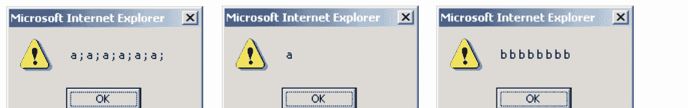

*图 10-4a、10-4b 和 10-4c。* 对象原型使得 JavaScript 中的对象可扩展。

重要的是要知道，对象原型既指向原型定义之前创建的对象实例，也指向之后创建的对象实例。原型仅从其定义的那一刻起存在。务必在创建原型之后才引用此类原型属性和方法。对脚本进行注释有助于确保你遵循此规则。

到目前为止，你已经看到一个方法被用作原型。显然，属性也可以完成此任务。在下面的脚本中，我们将查看一个作为用户定义对象原型的属性。以下是脚本：

```javascript
function car(make, model, year)
{
    this.make = make
    this.model = model
    this.year = year
}
var mine1 = new car("Hyundai", "Lantra", 1996)
car.prototype.wheels = 4 // 请不要三轮车！
var mine2 = new car("Mazda", "Prodigy", 1996)
```


## 第11章
数组

### 什么是数组？

数组是数据结构，比简单变量稍微复杂一些。你可以把数组想象成一组同名的变量。当我们需要处理一组相同数据类型的相关数据时，就会使用数组。例如，一组学生的年龄。这些都是整数值，并且彼此相关。作为程序员，如果你想处理数组中的某个元素，需要指定数组名并指明正在引用哪个数组元素。具体的元素通过索引或下标来标识。

### 一些历史

JavaScript 的第一个版本（由 Navigator 2.x 支持）并不支持数组。这非常奇怪，因为无论一门语言是像 Perl 这样的脚本语言，还是像 C++ 这样的编程语言，都必须有明确的数组类型。JavaScript 脚本编写者别无选择，只能想出简单的变通方法。每个人都使用（少数人仍在使用）以下函数来创建数组：

```javascript
function createArray(n, init)
{
    this.length = n
    for (i = 1 ; i <= n ; i++)
    {
        this[i] = init
    }
}
```

这种方法现在已不再常用，也已不再必要。但是，你可能会在某些代码中看到它，所以这里展示给你，以免你在遇到时感到困惑。

### 创建简单数组

JavaScript 中的数组是简单的内置对象。创建数组就像创建对象的实例一样，因为它本质上就是一个对象。该对象的正式名称是 Array——注意大写的 "A"。通用语法如下：

```javascript
var arrayObjectName = new Array()
var arrayObjectName = new Array(arrayLength)
```

arrayObjectName 是新对象的名称、现有变量名或现有对象的属性名。

arrayLength 是数组中各个元素的数量。

在 JavaScript 中，指定数组长度或元素数量并非至关重要。数组和其他任何对象一样，只是一个对象。JavaScript 中没有显式的数组类型。

以下是一些数组示例：

```javascript
var day = new Array(31)
var month = new Array(12)
var year = new Array() // 年份数量“未知”
```

数组的所有元素初始值均为 null。这一点很重要，因为这样的元素对你的脚本没有任何影响。一个值为 null 的元素实际上并不存在。你可以通过对一个新数组运行 getProps() 来验证这一点：

```javascript
function getProps(obj, objName)
{
    var result = ""
    for (var i in obj)
    {
        if (typeof obj[i] == "object")
            result += getProps(obj[i], objName + "[" + i + "]")
        else
            result += objName + "[" + i + "] = " + obj[i] + "<BR>"
    }
    return result
}
var ar = new Array(3)
document.write(getProps(ar, "ar"))
```

此脚本不会产生任何输出，因为如果一个对象的属性值为 null，它在计算机内存中就不存在，因此无法被识别。

强类型编程语言要求你指定数组中的元素数量。在这类语言中，数组的所有元素必须包含相同类型（int, char, ...）的值。数组在这些语言中是显式的数据结构，因此它不像 JavaScript 中那样是一个对象。数组的元素不会被赋予 null 值。从数组被声明的那一刻起，它就在内存中占据了所需的存储区域，无论你是否初始化了它的值。理论上，如果你创建一个未指定元素数量的数组，就相当于创建了一个包含零个元素的数组。在这类语言中通常无法扩展数组；因此，你必须在所有的数组声明中指定长度。
在 JavaScript 中，数组的每个元素默认被赋予 null 值。当值为 null 时，该元素不会存储在计算机的内存中。因此，在 JavaScript 中创建一个具有无限多个元素的数组是没问题的。请记住，持有 null 值的元素不占用内存空间，但它们被视为数组中的元素，因此会被计入数组的 length 属性。
与 Perl 类似，而与 C++ 不同，在 JavaScript 中，数组元素的数据类型是否相同并不重要。它们可以是数字、字符串、布尔值、对象甚至数组（数组本身也是对象）的混合体。

### 引用数组的元素

要使用数组，你必须能够引用其元素。JavaScript 中的数组是对象。像所有其他对象一样，它们有属性和方法：

```javascript
arrayObjectName[subscript] // ar1[4]
```

*下标*跟在数组名后面，并用方括号括起来。下标是简单的整数，从零开始。
这是一个简单的数组：

```javascript
var ar = new Array(5)
```

这个数组有五个元素：ar[0], ar[1], ar[2], ar[3], 和 ar[4]。
创建数组后，你可以通过为最高下标的元素指定值来增加其长度。以下代码创建一个长度为零的数组，然后将 null 值赋给元素 99。这会将数组的长度更改为 100。

```javascript
accounts = new Array() // 零个元素的数组
accounts[99] = null // 100个元素的数组
```

请注意，即使数组被扩展，它也不会占用任何存储空间。
引用元素时，下标可以是字面量（例如，3）或变量（例如，num = 3）。
数组的元素可以是任何有效的值。它可以是字符串、数字、布尔值、null 值，甚至是另一个对象。例如，如果你想创建一个数组，其中每个元素都是一个学生对象，你可以使用以下语句：

```javascript
function student()
{ // 构造函数
    // 属性未初始化为有意义的值
    this.name = ""
    this.age = ""
    this.grade = ""
}
var size = 35 // 班级中的学生人数
var students = new Array(size) // 数组已定义
```

if (mine1.wheels == 4 && mine2.wheels == 4) // true!
    document.write("Both cars have ", mine2.wheels, " wheels.")

脚本末尾的消息被打印出来，因为无论是在原型定义之前还是之后创建的 car 对象的所有实例，都包含一个名为 wheels 的属性，该属性保存着赋给原型的值 4。实际上，创建一个数据属性原型而不为其赋值（或至少一个默认值）是没用的，因为你以后需要引用该属性，而这样的引用会自动创建该属性。如果你在 HTML 页面中运行上面的脚本，你应该会在浏览器中看到类似图 10-5 的内容。

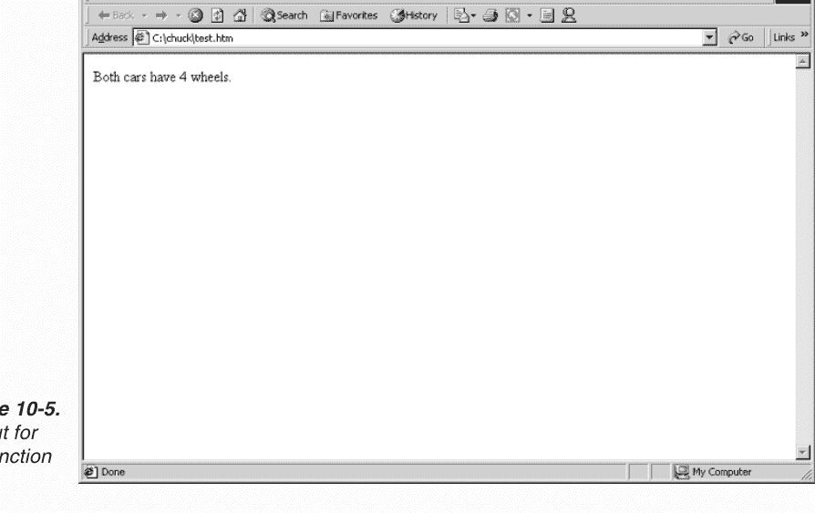

**图 10-5.** car() 函数的输出。

原型对于内置对象可能更有用，因为它们可以修改对象。你可以创建出乎意料的优秀方法和属性，这些方法和属性是你从未想过 JavaScript 会支持的。我们在本书的许多示例中都使用了原型，尤其是处理字符串、日期和数组的示例。Netscape Navigator 2.x 不支持原型，但它们在 Navigator 3.0x（及更高版本）中的存在彻底改变了 JavaScript 语言。这个革命性的概念是，你可以为语言本身添加功能，就好像你是 Netscape 公司或 Microsoft（尽管 MSIE 3.0x 不支持此功能）的 JavaScript 开发人员之一。请注意，原型只能添加到支持实例的对象，而不能添加到静态对象（如 Math），因为显而易见的原因，这些对象不适用原型。

## 总结

在本章中，你学习了如何创建对象的实例。实例既包括用户定义的对象，也包括内置对象。你还学习了用于构建对象或对象类型的构造函数。正如你将在本书后面看到的，此类用户定义的对象扩展了语言的能力，并支持结构化编程。最后，我介绍了对象原型——某个对象类型所有实例的属性。尽管现在应该很清楚了，但不要过分担心如何使用它们，因为本书后面的许多示例中都会使用它们。对象是 JavaScript 的支柱。该语言的许多元素实际上是对象，尽管其他语言并不这样称呼它们。这类对象的经典例子是数组，将在下一章中深入讨论。


### 数组基础

```javascript
for (var i = 0; i < size; i++)
{
    students[i] = new student()
}
students[0].name = "Mark"
students[32].grade = 88
```

首先，将所需数组大小（班级学生人数）赋值给变量 `size`。然后创建一个该大小的数组。随后使用构造函数 `student()` 定义数组的所有元素，从 `students[0]` 到 `students[34]`。在此示例中，数组中的所有元素类型相同。数组也可以包含不同类型的元素，如下列代码片段所示。

```javascript
function student()
{ // 构造函数
    // 属性未初始化为有意义的值
    this.name = ""
    this.age = ""
    this.grade = ""
}
function teacher(name, age)
{
    this.name = name
    this.age = age
}
var size = 35 // 班级学生人数
var students = new Array(size + 1) // 定义数组
students[0] = new teacher("Kate", 45)
for (var i = 1; i < size + 1; i++)
{ // 或 i <= size
    students[i] = new student()
}

alert("    是老师。" + students[0].name)
```

在此脚本片段中，定义了一个大小为 `size + 1` 的数组，因为第一个元素 `students[0]` 保存了一个 `teacher` 对象的实例。
最重要的规则是下标（或索引）从零开始。尽管这可能看起来相当别扭，但请像使用数组的所有其他元素一样使用这个元素。

#### 创建稠密数组

如果你为所有元素定义了初始值，就可以构造一个从索引 [0] 开始的包含两个或多个元素的稠密数组。*稠密数组*是指每个元素都有值的数组。它们在许多脚本语言中非常流行，尤其是在 Perl 中。你可以通过指定元素的值来填充数组：

```javascript
var bb = "baseball"
var sports = new Array("football", bb, "basketball", "soccer")
```

你可以使用通用语法引用此数组的元素：

```javascript
sports[0] == "football"
sports[1] == "baseball"
var val = 2
sports[val] == "basketball"
sports[3] == "soccer"
```

Navigator 的 JavaScript 仍然缺少 Perl 支持的几个与数组相关的特性：

-   你不能将一个范围赋值给数组。
-   你不能将一个数组的元素值赋给另一个数组（结果数组是一个*数组切片*）。

#### 数组类型

JavaScript 是一种松散类型的语言，就像 Perl 一样。因此，数组的元素可以是不同类型这一点并不奇怪。给定数组的某些元素可以是字符串，其他可以是数字、布尔值，甚至是对象。基本上，有五种数组类型：

-   字符串数组
-   数字数组
-   布尔数组
-   对象数组（包括空数组，因为 `null` 是一个对象）
-   混合数组

有时你想知道你正在处理的是哪种类型的数组。JavaScript 没有包含任何工具来方便这一点。但是，使用原型我们可以向所有数组添加一个属性（记住，数组是你可以创建实例的对象），该属性将返回数组的类型。这是所需的方法：

```javascript
function getType()
{
    var arrayType = typeof this[0]
    for (var i = 1; i < this.length; ++i) {
        if (typeof this[i] != arrayType)
        {
            arrayType = "mixed"
            break
        }
    }
    return arrayType
}
Array.prototype.getType = getType
```

以下脚本片段基于前面的原型定义：

```javascript
var ar1 = new Array(3)
ar1[0] = "a"
ar1[1] = "b"
ar1[2] = ""
document.write(ar1.getType()) // string
var ar2 = new Array(2)
ar2[0] = 17
ar2[1] = 15.5
document.write(ar2.getType()) // number
var ar3 = new Array()
document.write(ar3.getType()) // object
var ar4 = new Array(0)
document.write(ar4.getType()) // object
var ar5 = new Array(1)
ar5[9999] = 5
document.write(ar5.getType()) // mixed
```

如果你尝试了第五个数组，你可能不得不等待一会儿，因为循环执行了 10,000 次！你可以使用一个更高效的函数来实现相同的原型：

```javascript
function getType()
{
    var arrayType = typeof this[0]
    for (var i in this)
    {
        if (typeof this[i] != arrayType)
        {
            arrayType = "mixed"
            break
        }
    }
    return arrayType
}
Array.prototype.getType = getType
```

此函数的改进在于使用的循环类型。`for...in` 结构只循环遍历现有的属性或元素，不包括空值元素。该函数的工作原理与前一个函数相同。首先，将数组第一个元素的数据类型赋值给 `arrayType`。在循环的每次迭代中，如果发现不同类型的元素，则 `arrayType` 的值变为 "mixed"，因为数组中至少发现了两个不同的数据类型。一旦检测到 "mixed" 数组，循环立即使用 `break` 语句终止。函数返回 `arrayType` 持有的值。

有时你想引用统一类型数组的所有元素。以下方法被设计为 Array 对象的原型，返回一个包含指定值的元素下标的数组。这是该方法：

```javascript
function getSubscripts(type)
{
    var ar = new Array()
    var arSub = 0
    for (var i = 0; i < this.length; ++i)
    {
        if (typeof this[i] == type)
        {
            ar[arSub] = this[i]
            ++arSub
        }
    }
    return ar
}
Array.prototype.getSubscripts = getSubscripts
```

你可以将前面的原型与数组一起使用。例如：

```javascript
var ar1 = new Array(6)
ar1[1] = 5
ar1[2] = 7
ar1[3] = "a"
ar1[4] = 2
ar1[5] = "b"
var ar1Temp = ar1.getSubscripts("number")
alert("ar1 中有 " + ar1Temp.length + " 个数值") // 3
alert("ar1 的第三个数字是 " + ar1Temp[2]) // 2
alert(ar1Temp) // 5, 7, 2 (本章后面会讨论！)
```

此方法返回一个数组。你可以直接引用返回的数组：

```javascript
var ar1 = new Array(6)
ar1[1] = 5
ar1[2] = 7
ar1[3] = "a"
ar1[4] = 2
ar1[5] = "b"
alert("ar1 的第三个数字是 " + ar1.getSubscripts("number")[2])
```

JavaScript 中的字符串是 String 对象，而不是数组。有许多有用的方法仅对字符串进行操作，因此像其他语言中常见的做法那样将字符串作为字符数组来处理是无用的且几乎不可能的。第 14 章深入探讨了字符串。

如果你尝试打印一个数组，你会看到 JavaScript 按连续顺序打印所有元素的值，中间用分隔逗号分隔。你可以使用用户定义的原型方法来返回一个包含所有值的字符串，这些值由用户提供的字符串分隔：

```javascript
function getList(str)
{
    var text = ""
    for (var i = 0; i < this.length - 1; ++i)
    {
        text += this[i] + str
    }
    text += this[this.length - 1]
    return text
}
Array.prototype.getList = getList
var ar = new Array(5)
ar[1] = 3
ar[3] = "a"
ar[4] = "b b b"
document.write(ar.getList(" ; ")) // null ; 3 ; null ; a ; b b b
```

注意，方法中的循环执行到 `i < this.length - 1`。原因是该循环在每个数组元素后连接分隔符（方法的参数）。我们不希望最后一个元素后也放置分隔符，因此最后一个元素在循环终止后连接到累积的字符串中。

#### 数组属性

尽管你可以向 Array 对象添加自己的属性，但并非所有任务都可以通过 JavaScript 的高级编程来实现。Array 对象唯一的内置属性是 `length`。当你创建一个对象实例（数组）时，属性（元素）的数量存储在 `length` 属性中。你可以像引用普通属性一样引用它。我们已经在前面的章节中看到这个属性的实际应用。

假设你想依次显示一些消息。你应该使用一个数组来存储这些消息：

```javascript
var messages = new Array()
messages[0] = "message 1"
messages[1] = "message 2"
messages[2] = "message 3"
```

然后你可以使用循环依次显示消息：

```javascript
for (var i = 0; i < messages.length; i++)
{
    document.write(messages[i] + "<BR>")
}
```

`length` 属性也可以被修改；也就是说，你可以通过为该属性赋值来改变数组的长度。这里有一个例子：

```javascript
var ar = new Array(6)
ar[0] = "Mouse"
ar[1] = 8
ar[2] = 18
ar[3] = true
ar[4] = "Dog"
ar[5] = "Cat"
ar.length = 3
alert(ar[2]) // 18
alert(ar[3]) // null
```

由六个元素组成的数组减少到了三个。最后三个值被切掉了。在减小数组大小时要格外小心，因为被移出的值无法恢复。


# 数组方法

本节我们将探讨多种数组方法。我们将使用原型方法在 Perl 中模拟一些数组函数。JavaScript 提供了三个内置方法，我们也将一并讨论：

-   join()
-   reverse()
-   sort()

本节中，我们将使用在“数组类型”一节介绍的 `getList` 原型方法来打印数组。

## chop()

`chop()` 方法会移除作为数组元素的所有字符串的最后一个字符。示例如下：

```javascript
function chop()
{
    for (var i in this)
    {
        if (typeof this[i] == "string")
            this[i] = this[i].substring(0, this[i].length - 1)
    }
}
Array.prototype.chop = chop
// EXAMPLE
var line = new Array("red", "green", "blue")
line.chop()
document.write(line.getList(" "))
```

脚本的输出为：

```
re gree blu
```

通用语法如下：

```javascript
arrayInstance.chop()
```

`substring()` 方法在第 14 章“处理字符串”中有解释。

## grep()

`grep()` 方法对数组的每个元素求值表达式（*expr*）。它返回一个由那些表达式求值为真（匹配模式）的元素组成的新数组。要理解此方法，你需要知道如果 `string2` 在 `string1` 中被找到，`string1.indexOf(string2)` 不等于 -1。方法定义如下：

```javascript
function grep(str)
{
    var ar = new Array()
    var arSub = 0
    for (var i in this)
    {
        if (typeof this[i] == "string" && this[i].indexOf(str) != -1)
        {
            ar[arSub] = this[i]
            arSub++
        }
    }
    return ar
}
Array.prototype.grep = grep
var line = new Array("mask", "Mascot", "mine", "amass", "hot")
document.write(line.grep("mas").getList(" "))
document.write("<BR>")
document.write(line.grep("mas").length)
```

此脚本的输出为：

```
mask amass
2
```

通用语法如下：

```javascript
arrayInstance.grep(expr)
```

此方法使用的一个重要概念是**短路求值**。如果 JavaScript 对第一个条件表达式（`typeof this[i] == "string"`）求值为 `false`，那么最终的表达式（`typeof this[i] == "string" && this[i].indexOf(str) != -1`）显然也是 `false`，因此第二个表达式（`this[i].indexOf(str) != -1`）甚至不会被求值。这一点至关重要，因为 `indexOf()` 方法仅适用于字符串，对其他类型会生成错误。然而，由于短路求值，如果当前元素（`this[i]`）不是字符串，JavaScript 就不会对第二个表达式求值。

## join()

`join()` 是 JavaScript 的内置方法。它等同于 Perl 中的同名函数。它将数组的元素连接成一个字符串，并用给定的分隔符分隔每个元素。此方法与我们之前创建的 `getList` 方法完全相同，因此从现在起我们将使用它。

其通用语法为：

```javascript
arrayInstance.join(delimiter)
```

分隔符如果不是字符串，会被自动转换为字符串。

以下是使用此方法的示例：

```javascript
var line = new Array("a", "b", "c", "d", "e")
document.write(line.join(" : "))
var str = line.join(", ")
document.write("<BR>" + str)
```

其输出如图 11-1 所示：

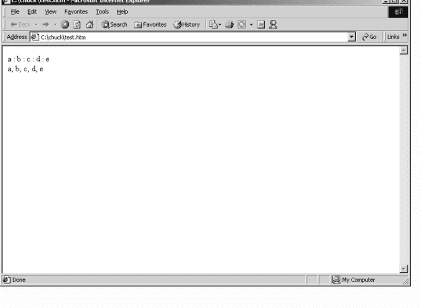

## pop()

`pop()` 方法弹出数组的最后一个元素并返回它。数组大小会自动减一。

通用格式为：

```javascript
arrayInstance.pop()
```

此方法不是内置的，因此我们需要定义它。以下脚本将此方法定义为 Array 对象的原型，并演示其用法：

```javascript
function pop()
{
    var lastElement = this[this.length - 1]
    this.length--
    return lastElement
}
Array.prototype.pop = pop
```

以下是使用数组 pop 方法的示例：

```javascript
var names = new Array("Tom", "Mark", "Bart", "John")
var last = names.pop()
document.write(last + "<BR>")
document.write(names.join(" ") + "<BR>")
document.write(names.length)
```

脚本的输出（按行显示）如图 11-2 所示：

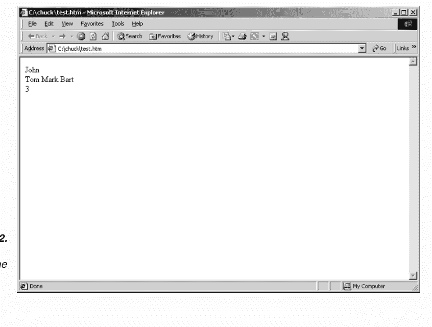

## push()

`push()` 方法将值添加到数组的末尾，增加其长度。以下是声明为 Array 对象类型原型的方法：

```javascript
function push()
{
    var sub = this.length
    for (var i = 0; i < push.arguments.length; ++i)
    {
        this[sub] = push.arguments[i]
        sub++
    }
}
Array.prototype.push = push
```

以下是使用数组 `push()` 方法的示例：

```javascript
var names = new Array("Tom", "Mark", "Bart", "John")
names.push("Jim", "Richard", "Tim")
document.write(names.join(" "))
```

输出如图 11-3 所示：

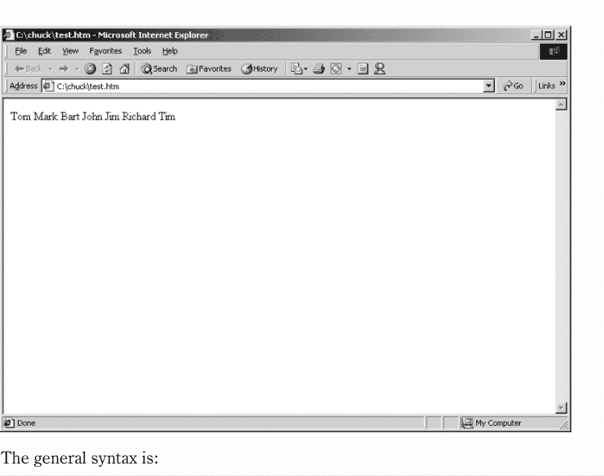

**图 11-3.** push() 方法的示例输出。

通用语法如下：

```javascript
arrayInstance.push(list)
```

> **注意：** 早期版本的 JavaScript 不支持此方法，但现在已支持。

## reverse()

`reverse()` 方法转置调用数组对象的元素。如果之前是降序，现在就是升序，依此类推。最后一个元素变成第一个，反之亦然。这是一个内置方法。

通用语法如下：

```javascript
arrayInstance.reverse()
```

以下是说明 reverse 函数的脚本：

```javascript
var names = new Array("Tom", "Mark", "Bart", "John")
var colors = new Array("red", "orange", "yellow", "green", "blue", "purple")
document.write("<B>original names: </B>" + names.join(" ") + "<BR>")
names.reverse()
document.write("<B>reversed names: </B>" + names.join(" ") + "<BR>")
document.write("<B>original colors: </B>" + colors.join(" ") + "<BR>")
colors.reverse()
document.write("<B>reversed colors: </B>" + colors.join(" ") + "<BR>")
```

相应的输出如图 11-4 所示：

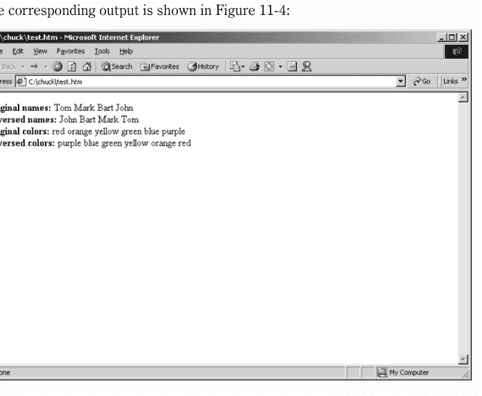

## shift()

`shift()` 方法在 JavaScript 中没有定义，所以我们需要创建它。它会移除并返回数组的第一个元素，使数组大小减一。

定义其原型后，此方法调用的通用格式为：

```javascript
arrayInstance.shift()
```

以下是此方法及其示例：

```javascript
function shift(str)
{
    var val = this[0]
    for (var i = 1; i < this.length; ++i)
    {
        this[i - 1] = this[i]
    }
    this.length--
    return val
}
Array.prototype.shift = shift
```

以下是说明 shift 方法使用的脚本：

```javascript
var line = new Array("aaa", "bbb", "ccc", "ddd", "eee")
document.write(line.shift() + "<BR>")
document.write(line.join(" "))
```

输出如图 11-5 所示：

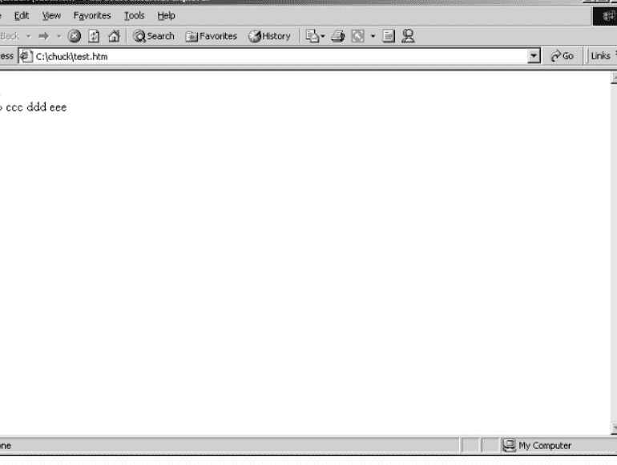

**图 11-5.** shift() 方法的示例输出。

## sort()

`sort()` 方法用于对数组元素进行排序，是 JavaScript 的内置方法。它对数组的元素进行排序。可以选择提供一个排序函数。如果不提供，数组将根据每个元素的字符串转换，按字典顺序（比较顺序）排序。此方法的通用语法如下：

```javascript
arrayInstance.sort(compareFunction)
```

如果未提供 *compareFunction*，元素将通过转换为字符串并按字典顺序比较字符串来进行排序。例如，在字典顺序中“10”排在“9”之前，但数值比较则将 9 排在 10 之前。

比较函数的结构非常具体。首先，它应该有两个参数，分别对应被比较的两个元素。其次，它应该返回一个值。如果 `a` 和 `b` 是被比较的两个元素，那么：

-   如果 *compareFunction(a, b)* 小于零（返回负数），则将 `b` 排序到比 `a` 更低的索引。
-   如果 *compareFunction(a, b)* 返回零，则 `a` 和 `b` 的相对位置保持不变（如果 `a` 原本在 `b` 之前，则保持在前，反之亦然）。
-   如果 *compareFunction(a, b)* 为正数（大于零），则将 `b` 排序到比 `a` 更高的索引。

比较函数的基本形式是：

```javascript
function compare(a, b)
{
    if (a is less than b by some ordering criterion)
        return -1
    if (a is greater than b by the ordering criterion)
        return 1
    // a must be equal to b
    return 0
}
```

最简单的比较函数用于对数字排序：

```javascript
function compareNumbers(a, b)
{
    return a - b
}
```

JavaScript 使用*稳定排序*，因此如果 `a` 和 `b` 根据比较函数相等，则 `a` 和 `b` 的相对顺序不会改变。

以下是一些比较函数：

```javascript
// 1. 字典顺序 -- 内置
// 2. byIncNum（递增数字）
function byIncNum(a, b)
{
    return a - b
}

// 3. byFirstChar（仅按首字符字典顺序）
function byFirstChar(a, b)
{
    a += ""
    b += ""
    if (a.charAt(0) < b.charAt(0))
        return -1
    if (a.charAt(0) > b.charAt(0))
        return 1
    return 0
}
```

以下示例应使此主题更清晰：

```html
<HTML>
<HEAD>
<TITLE>排序数组</TITLE>
<SCRIPT LANGUAGE="JavaScript">
<!--

// 1. 字典顺序 -- 内置
```


// 2. 按递增数字排序（increasing numbers）

function incNum(a, b)
{
    return a - b
}

stringArray = new Array("house", "hose", "chair")
numericStringArray = new Array("60", "8", "100")
numberArray = new Array(20, 1, 5, -11, 8)
mixedNumericArray = new Array("70", "9", "600", 3, 40, 70, 250)

function compareNumbers(a, b)
{
    return a - b
}

document.write("<U><B>stringArray</B></U><BR>")
document.write("<B>原始数组：</B> " + stringArray.join() +"<BR>")
document.write("<B>默认排序：</B> " + stringArray.sort() +"<P>")

document.write("<U><B>numberArray</B></U><BR>")
document.write("<B>原始数组：</B> " + numberArray.join() +"<BR>")
document.write("<B>默认排序：</B> " + numberArray.sort() +"<BR>")
document.write("<B>使用 compareNumbers 排序：</B> " + numberArray.sort(compareNumbers) +"<P>")

document.write("<U><B>numericStringArray</B></U><BR>")
document.write("<B>原始数组：</B> " + numericStringArray.join() +"<BR>")
document.write("<B>默认排序：</B> " + numericStringArray.sort() +"<BR>")
document.write("<B>使用 compareNumbers 排序：</B> " + numericStringArray.sort(compareNumbers) +"<P>")

document.write("<U><B>mixedNumericArray</B></U><BR>")
document.write("<B>原始数组：</B> " + mixedNumericArray.join() +"<BR>")
document.write("<B>默认排序：</B> " + mixedNumericArray.sort() +"<BR>")
document.write("<B>使用 compareNumbers 排序：</B> " + mixedNumericArray.sort(compareNumbers) +"<BR>")

// -->
</SCRIPT>
</HEAD>
<BODY>
</BODY>
</HTML>
```

**示例 11-1 (ex11-1.htm)**。内置的 `sort()` 函数是使用指针进行排序的简单替代方案（在许多支持指针的语言中使用）。

## 第 176 章 第 11 章

此脚本的结果如图 11-6 所示：

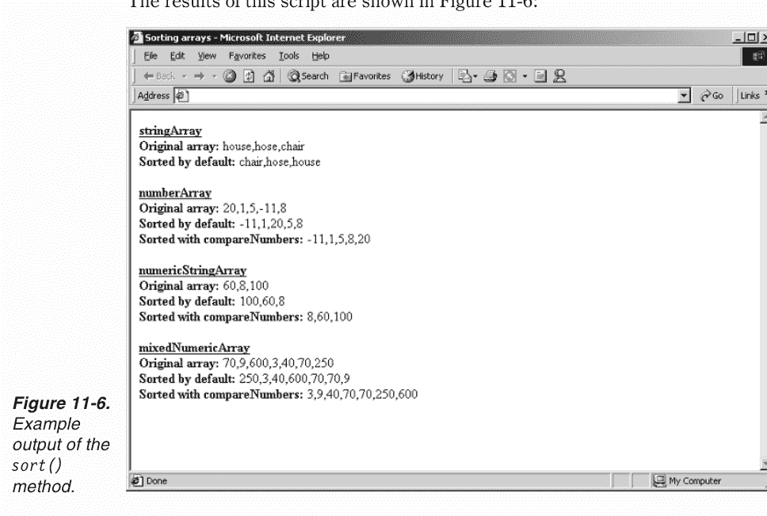

## splice()

JavaScript 尚未介绍的另一个方法是 `splice()`。它用于从数组中移除并替换元素。其通用语法是：

```
arrayInstance.splice(offset, length, list)
```

`offset` 是要开始移除元素的位置。`length` 是从 `offset` 开始要移除的元素数量。`list` 参数由用于替换被移除元素的新元素组成。以下是该方法：

```
function splice(offset, length)
{
    var ar1 = new Array()
    var ar2 = new Array()
    for (i = 0; i < length; ++i)
    {
        ar1[i] = this[i + offset]
    }
    for (i = 0; i < this.length - (offset + length); ++i)
    {
        ar2[i] = this[i + offset + length]
    }
    var args = new Array()
    for (i = 0; splice.arguments[i + 2] != null; ++i)
```

```
{
    args[i] = splice.arguments[i + 2] // 第二个参数
}
j = offset
for (i = 0; i < args.length; ++i)
{
    this[j] = args[i]
    j++
}
for (i = 0; i < ar2.length; ++i)
{
    this[j] = ar2[i]
    j++
}
this.length = j
// 注意 j 比最后一个元素的下标多一
return ar1
}
Array.prototype.splice = splice
```

这个方法比之前的那些更复杂。首先，声明了两个数组。虽然可以计算它们的大小，但这完全没有必要，因为在扩展它们时，它们会容纳适当的大小。函数中的第一个循环是：

```
for (i = 0; i < length; ++i)
{
    ar1[i] = this[i + offset]
}
```

这个循环根据 `offset` 和 `length` 参数的值，将所有要移除的元素赋值给数组 `ar1`。循环迭代的次数正好是 `length` 的值，即指定要移除的元素数量。数组 `ar1` 从索引 0 开始填充。它被赋值为调用数组 (`this`) 的元素，从 `offset` 开始，因为只有 `offset` 之后的元素（确切地说是 `length` 个）需要被移除。当循环终止时，数组 `ar1` 已经包含了应从调用数组中移除的元素。请注意，此数组在函数末尾被返回。

现在来看看第二个循环：

```
for (i = 0; i < this.length - (offset + length); ++i)
{
    ar2[i] = this[i + offset + length]
}
```

这个循环将被移除元素之后的所有元素赋值给数组 `ar2`。在完成所有这些元素的赋值后，循环终止。`this.length - (offset + length)` 等于被移除元素之后的元素数量。被移除元素集之后第一个元素的下标是 `offset + length`。从调用数组的总长度中减去这个数字，就得到了被移除元素集之后的元素数量。

接下来的循环如下：

```
for (i = 0; splice.arguments[i + 2] != null; ++i)
{
    args[i] = splice.arguments[i + 2] // 第二个参数
}
```

前面的循环将 `list`（方法的第三个参数）的所有项赋值给数组 `args`。这些项是传递给方法的所有参数，除了前两个。我们使用条件 `splice.arguments[i + 2] != null` 来终止循环，因为某些平台上 `arguments.length` 属性的某些意外行为。也就是说，当函数遇到 `splice.arguments` 的第一个 `null` 元素时（参见第 6 章，函数和变量作用域），它就终止了。这个操作是基于这样一个事实：该方法永远不会被调用来将调用数组的一个元素替换为 `null`。这个概念将在本章后面深入解释。表达式 `i + 2` 被使用是因为 `arguments` 数组所需的元素是从第三个（下标 == 2）开始。然而，在函数中创建的 `args` 数组应该从下标 0 开始存储元素，因此使用 `i` 作为该数组的下标。

我们现在有四个数组：

-   `this`（调用数组）
-   `args`
-   `ar2`
-   `ar1`

请记住，`splice()` 方法需要修改调用数组。它将 `this` 数组的开头（直到第一个被移除的元素之前，不包含该元素）与 `args` 和 `ar2` 按此顺序连接起来。脚本的最后一部分正是这样做的：

```
j = offset
for (i = 0; i < args.length; ++i)
{
    this[j] = args[i]
    j++
}
for (i = 0; i < ar2.length; ++i)
{
    this[j] = ar2[i]
    j++
}
this.length = j
```

首先，`j` 被设置为 `offset`，这是数组 `this` 中应该被修改的第一个值（在调用方法之前的所有现有元素应保持在数组的开头，就像之前一样）。接下来的循环分别将其他数组 `args` 和 `ar2` 中的元素赋值给调用数组 (`this`)。变量 `j` 很重要，因为它在两个循环中都保存着调用数组当前元素的下标。最后，调用数组（现在已修改）的长度被设置为 `j`，因此如果原始数组中有更多元素，它们就会被截断。

`splice()` 函数的最后一条语句以数组 `ar1` 的形式返回被移除的元素。

既然你已经仔细阅读了这段冗长且可能费力的解释，现在看一个示例可能是个好主意：

```
var cols = new Array("red", "orange", "yellow", "green", "blue", "purple")
var newCols = cols.splice(2, 3, "brown", "black")
document.write(newCols.join(" ") + "<BR>")
document.write(cols.join(" ") + "<BR>")

cols = new Array("red", "orange", "yellow", "green", "blue", "purple")

newCols = cols.splice(0, 1, "brown", "black")
document.write(newCols.join(" ") + "<BR>")
document.write(cols.join(" ") + "<BR>")
cols = new Array("red", "orange", "yellow", "green", "blue", "purple")
newCols = cols.splice(3, 0, "brown", "black")
document.write(newCols.join(" ") + "<BR>")
document.write(cols.join(" "))
```

此脚本段的输出如图 11-7 所示：

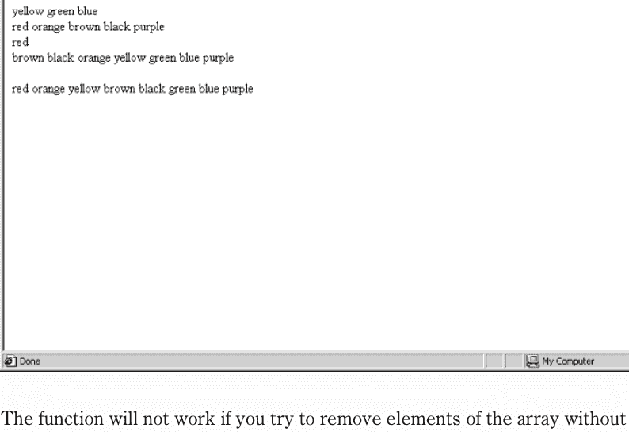

**图 11-7.** `splice()` 方法的示例输出。

如果你试图在不插入新元素的情况下移除数组元素，该函数将无法工作。

## 第 11 章

## split()

`split()` 方法执行与 `join()` 相反的操作。它通过某个分隔符（默认为空格）拆分字符串（该对象），并返回一个数组。准确地说，这是 `String` 对象的方法，而不是 `Array` 对象的方法，但由于它与数组密切相关，我们选择在本节中讨论它。如果未提供分隔符或在整个字符串中未找到分隔符，则返回字符串本身。此方法是内置的，因此只需调用它。通用格式是：

```
stringName.split(delimiter)
```

以下是一些示例：

```
var line1 = "a b c d e f"
var ar1 = new Array()
ar1 = line1.split(" ")
document.write(ar1.join(", ")) // a, b, c, d, e, f
document.write("<BR>")
ar2 = line1.split(";")
document.write(ar2) // a b c d e f
document.write("<BR>")
ar3 = line1.split()
document.write(ar3) // a b c d e f
document.write("<BR>")
ar4 = line1.split("")
document.write(ar4) // [无限循环！]
```

所有这些示例都遵循前面解释的规则，除了最后一个 `ar4`。语句 `ar4 = line1.split("")` 会导致无限的方法执行，最终会崩溃浏览器，甚至在 16 位版本的 Windows 上会崩溃操作系统。这种行为的原因很明显——JavaScript 尝试使用空字符串来拆分字符串。众所周知，空字符串在两个字符之间会出现无数次，而两个空字符串之间又存在另一个空字符串！

## unshift()

`unshift()` 方法实际上是 `shift()` 方法的反向操作。它将一系列元素附加到数组的开头。以下是作为 `Array` 对象类型原型定义的方法，以及一个演示它的示例：

```
function unshift()
{
    for (var i = 0; i < unshift.arguments.length; ++i)
    {
        if (unshift.arguments[i] == null)
            break
    }
    // i = 参数的数量！（记住 ++i 是在最后一次循环中执行的）
    // i 保存参数的数量
    for (var j = this.length - 1; j >= 0; --j)
    {
```


## 第11章

### arguments 数组

`functionName.arguments` 数组按顺序保存了在函数 `functionName` 上次调用时传递给它的参数。以下是一个示例：

```javascript
function func()
{
    document.write(func.arguments[2])
}
func(1, 2, 3, 4, 5)
document.write("<BR>")
func()
```

此脚本的输出是：
3
3

第二个 3 并不是在第二次调用时传递给函数的参数，而是在第一次调用时传递的参数。只要后续调用没有用新参数替换它，它就会一直作为数组中的一个元素保留。因此，你可以得出结论：*functionName*.arguments 数组具有持久的存储类别。

假设你想创建一个接受字符串参数并在每个字符串后打印换行符的函数。直观的函数如下所示：

```javascript
function printList()
{
    for (var i = 0; i < printList.arguments.length; ++i)
    {
        document.write(printList.arguments[i] + "<BR>")
    }
}
```

你可以按以下形式使用此函数：

```javascript
printList("message 1", "message 2", "message 3", "message 4")
```

输出结果为：
message 1
message 2
message 3
message 4

你也可以连续两次调用该函数，如下所示：

```javascript
printList("message 1", "message 2", "message 3", "message 4")
printList("message 5", "message 6", "message 7", "message 8")
```

预期的输出同样是：
message 1
message 2
message 3
message 4
message 5
message 6
message 7
message 8

现在，让我们将函数修改为以下代码：

```javascript
function printList()
{
    document.write("There are " + printList.arguments.length + " arguments.")
    document.write("<BR>")
    document.write("The fourth argument is " + printList.arguments[3] + ".")
    document.write("<BR>")
    for (var i = 0; i < printList.arguments.length; ++i)
    {
        document.write(printList.arguments[i] + "<BR>")
    }
}
```

该函数现在根据 *functionName.arguments.length* 属性显示参数的数量。它还显示第四个参数，无论是否存在四个参数。考虑以下语句：

```javascript
printList("message 1", "message 2", "message 3", "message 4")
printList("message 5", "message 6", "message 7")
```

输出结果为：

There are 4 arguments.
The fourth argument is message 4.
message 1
message 2
message 3
message 4
There are 3 arguments.
The fourth argument is message 4. (!!!!)
message 5
message 6
message 7

请注意，该函数打印了每次调用中传递给函数的第四个参数。然而，第二次调用只提供了三个参数！*arguments.length* 属性保存了正确的值 3。第四个参数实际上是第一次函数调用的遗留值。

如你所见，arguments 数组并不遵循 Array 对象实例的数组规则。以下脚本展示了它们之间的区别：

```javascript
var ar = new Array("message 1", "message 2", "message 3")
document.write("The array is: " + ar.join(", ") + "<BR>")
document.write("There are " + ar.length + " elements.<BR>")
document.write("The third element is " + ar[2] + ".<BR>")
ar.length = 2
document.write("There are " + ar.length + " elements.<BR>")
document.write("The third element is " + ar[2] + ".<BR>")
```

此脚本的输出是：

The array is: message 1, message 2, message 3
There are 3 elements.
The third element is message 3.
There are 2 elements.
The third element is null.

关于数组的简单规则是，最后一个元素的下标是 *arrayName*.length - 1。当你通过向 length 属性赋一个更小的值来减小数组的大小时，所有原本在数组范围内但现在超出范围的元素都会丢失。如果你尝试引用它们，会发现它们是 null。*functionName*.arguments 数组则不同，其最后一个元素与其长度无关。

### 多维数组

JavaScript 没有多维数组特性，但通过构造函数可以很容易地创建它们。到目前为止，我们讨论了一维数组（1D 数组）。这类数组的元素以类似行的结构排列。一维数组的基本结构如下图所示：

| 0 | 1 | 2 | 3 |

**图 11-9.** 一维数组。

假设你想存储一名跑步者在不同年份和不同距离上的记录时间。如果数组名为 `curDis`，1994 年的记录时间可以放入 `curDis[0]`，1995 年的记录时间放入 `curDis[1]`，1996 年的记录时间放入 `curDis[2]`，以此类推。然而，你可能注意到我们只能存储单个距离（例如 400 米跑）的记录时间。使用类似表格或电子表格的数组可以轻松存储各种跑步项目的记录时间。这类数组被称为二维（2D）数组。图 11-10 概述了二维数组的基本结构。

JavaScript 没有内置的二维数组对象类型。看一下元素的下标。二维数组由水平数组（在图中也是水平的）构成，这些水平数组自身形成一个数组。也就是说，总体结构是一个常规的数组的数组。图中的主数组是垂直的；其下标在箭头的左侧。

请注意，多维数组的维度不必相等。

引用二维数组（2DA）元素的标准方法是：

```javascript
ar[1][5]
ar[8][0]
ar[3][3]
```

第一个数字是第一维的下标，而第二个数字指定第二维的下标。

#### 使用单个构造函数创建

创建二维数组（2DA）最简单的方法是使用如下所示的构造函数：

```javascript
function Array2D(dim1, dim2)
{
    for (var i = 0; i < dim1; ++i)
    {
        this[i] = new Array(dim2)
    }
    this.length = new Array(dim1, dim2)
}
```

以下脚本演示了使用此函数创建和使用的数组：

```javascript
var ar = new Array2D(4,7)
ar[2][1] = 6
ar[0][0] = "Hello" // 这是“第一个”元素
ar[3][6] = true // 这是“最后一个”元素
alert("Length of first dimension is " + ar.length[0])
alert("Length of second dimension is " + ar.length[1])
alert("\"Last\" element: " + ar[ar.length[0] - 1][ar.length[1] - 1])
```

通过 alert 框显示的消息是：
Length of first dimension is 4
Length of second dimension is 7
"Last" element: true

该构造函数使用了一个循环。第一个数组（`ar`）不是一个显式的 Array 对象。它只是一个普通对象，其属性使用数组表示法指定。Array 对象类型的内置方法不适用于此数组。循环执行 `dim1` 次，即第一维的长度。调用对象的每个属性（或元素）都被赋予一个由 `dim2` 个元素组成的“真实”数组。由于这些是真实的数组，你可以使用 Array 对象类型的内置方法和属性。例如，`ar[0]` 是一个包含 `dim2` 个元素的数组，因此你可以引用它的元素：`ar[0][0]`、`ar[0][1]`、`ar[0][2]` 等。2DA 实际上是一个一维数组，其所有元素都是一维数组。因此，你应该小心，不要通过给其主数组赋值来破坏 2DA 的结构，例如：

```javascript
ar[3] = "Do not do this to a 2DA!"
```

前面的构造方法还包含一个 length 属性，它是一个包含两个元素的数组。第一个元素保存主数组中的元素数量（指定的第一维长度），而第二个元素保存指定的第二维长度。该示例最好地说明了这一点。请记住，这些是静态属性。给 length 属性的元素赋值不会影响数组，但当你需要获取数组各维度的正确长度值时，可能会误导你。

#### 不使用构造函数创建

也可以不使用构造函数来创建二维数组。此方法基于创建 Array 对象的实例：

```javascript
function addDim2(array1D, dim2)
{
    for (var i = 0; i < array1D.length; ++i)
    {
        array1D[i] = new Array(dim2)
    }
    return array1D
}
```

以下是 unshift 函数的一个示例：

```javascript
var line = new Array("ccc", "ddd", "eee")
line.unshift("aaa", "bbb")
document.write(line.join(" "))
```

预期的输出如图 11-8 所示：

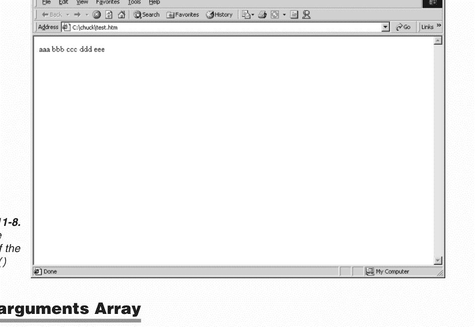

图 11-8. unshift() 方法的示例输出。


这个函数本身几乎没有什么意义，所以来看一个实际工作的例子：

```
var dim1 = 4
var dim2 = 7
var ar = new Array(dim1)
ar = addDim2(ar, dim2)
ar[2][1] = 6
ar[0][0] = "Hello" // 这是“第一个”元素
ar[3][6] = true // 这是“最后一个”元素
alert("第一维的长度是 " + ar.length)
alert("第二维的长度是 " + ar[0].length)
alert("\"最后一个\"元素: " + ar[ar.length - 1][ar[0].length - 1])
```

首先，第一维的长度 4 被赋值给 `dim1`。然后，第二维的长度被赋值给 `dim2`。一个名为 `ar` 的新数组根据 `Array` 对象类型被创建。其长度是所需数组的第一维长度。接着，调用函数 `addDim2`，传入该数组和第二维的长度。它将最终的二维数组（2DA）返回给原始的一维数组 `ar`。该函数基于一个简单的循环，将包含 `dim2` 个元素的数组赋值给原始一维数组的每个元素。由于第一维数组和第二维数组都是 `Array` 对象类型的实例，你可以通过以下方式引用每个维度的长度：

```
ar.length == 第一维的长度
ar[0].length == 第二维的长度 == ar[1].length == ...
```

请注意，要使第二个表达式为真，你必须在脚本执行期间任何时候都不要更改二维数组的长度。否则，它就不再是模拟二维数组了。

### 关联数组

*关联数组* 使用字符串作为下标。例如，数组的一个元素可以是：

```
color["yellow"] = "FFFF00"
```

这样的数组将相关数据组合在一起。这些数组实际上是对象，只是你使用方括号而不是点号。另一个重要的区别是，数组规范（方括号）允许你将变量的值作为属性或方法规范来引用，而不是实际的字面量。例如：

```
var col = "yellow"
color[col] = "FFFF00"
```

这是另一个有趣的例子：

```
var w = "write"
document[w]("Hello!") // 打印 "Hello!"
```

如果你用常规的点号表示法替换数组表示法，会收到一个错误：

## 第 11 章

```
var w = "write"
document.w("Hello!")
```

点号表示法要求指定实际的字面量，因为它不会对书写的值进行求值。你可以使用关联数组来创建嵌套对象，类似于多维数组。例如，你可以创建一个关联数组，其下标是一个班级中学生的名字，因此关联数组的每个元素都是一个对象，包含诸如学生年级、年龄等字段。

请注意，关联数组不能作为内置 `Array` 对象的实例创建。你必须使用构造函数来创建一个。这里有一个使用学生的例子：

```
function studentClass()
{
	for (var i = 0; i < arguments.length; ++i)
	{
		this[studentClass.arguments[i]] = new student()
	}
}
function student()
{
	// this.grade = null
	// this.age = null
}
var students = new studentClass("Bob", "John", "Frank", "Alfred", "Sheila", "Mary")
students["Bob "].grade = 40
students["John "].age = 11
students["Frank "].grade = "N/A"
alert(students["Frank "].grade)
```

创建关联数组并不难。数组元素是根据 `studentClass()` 函数接受的学生名字参数创建的。第二个函数相当奇怪——它不包含任何语句。当你创建一个实例时，可以使用一个“空的”构造函数。你可能从之前的讨论中回忆起，对象可以通过简单地给它们赋值来扩展。所以，语句 `this[arguments[i]] = new student()` 只是确保关联数组的每个元素都是一个对象。后面的全局语句通过给它们赋值来创建属性。

另一个需要记住的重要概念是，关联数组不是显式的数组。你也可以使用点语法来引用它们，如：

```
students.John.age
```

假设你创建了一个数据库结构，列出了班级中所有学生及其年龄和成绩。假设两个字段都包含正确的值。你可以让用户通过提示对话框查看这些值。例如：

```
var grade = students[prompt("Enter name:", "John Doe")].grade
document.write(grade)
```

在这种情况下，你必须使用数组约定，因为你在提示用户输入属性名称。只有当你知道属性名称时，才能使用点表示法。如果你使用点表示法：

```
students.prompt(...)
```

JavaScript 会假定你正在引用 `students` 对象的一个名为 `prompt()` 的方法，该方法当然根本不存在。

### 填充关联数组

使用常规数组创建稠密数组很简单。你只需用期望的值创建数组即可。然而，关联数组的每个元素需要两个真正的值：键（下标）和值。你可以创建一个构造函数来创建和填充关联数组：

```
function AssociativeArray()
{
    for (var i = 0; i < arguments.length - 1; i += 2)
    {
        this[arguments[i]] = arguments[i + 1]
    }
}
```

你可以使用此函数以以下格式创建关联数组：

```
var ar = new AssociativeArray("red", "FF0000", "green", "00FF00", "blue", "0000FF")
document.write("green = " + ar["green"] + "<BR>")
var col = "blue"
document.write("blue = " + ar[col] + "<BR>")
document.write("red = " + ar.red)
```

此脚本的相对输出是：

```
green = 00FF00
blue = 0000FF
red = FF0000
```

让我们看看这个构造函数。它接受数组元素的键，后跟它们对应的值。每个键后面必须跟其自己的值。该函数遍历参数，并在到达最后一个参数之前的那个参数后终止。在函数的每次执行过程中，调用对象的一个属性（数组词汇中的一个“元素”）被创建。属性或元素的键是当前参数，而其值是从下一个参数中提取的。每次执行完代码块后，循环计数器递增 2，因为关联数组的每个元素都与两个参数相关——它的键和它的值。尽管关联数组主要是一个常规对象，但此构造函数必须使用方括号（数组表示法）进行引用和初始化，因为键（下标）的值不是字面量，而是存储为参数的值。

### 将字符串拆分为关联数组

`split()` 方法通过指定的分隔符将字符串分割为一个真正的 `Array` 对象实例。例如：

```
var str = "a;b;c;d;e;f"
var ar = str.split(";") // ar[0] == "a", ar[1] == "b", ar[2] == "c", ...
```

让我们使用 `split()` 方法创建一个名为 `associativeSplit()` 的函数，作为 `String` 对象的原型：

```
function associativeSplit(del)
{
    var tempAr = new Array()
    tempAr = this.split(del)
    var ar = new Obj() // 不是数组，只是一个对象
    for (var i = 0; i < tempAr.length - 1; i += 2)
    {
        ar[tempAr[i]] = tempAr[i + 1]
    }
    return ar
}
function Obj() { }
String.prototype.associativeSplit = associativeSplit
```

注意使用空函数来创建对象。首先，该函数通过常规方法将字符串分割成一个常规数组。然后，它遍历数组，使用下一个元素作为关联数组中某个元素的键，其后面的元素作为该关联数组中同一元素的值。完成后，该函数返回关联数组。然后，该函数被声明为内置 `String` 对象的原型，并应用于所有字符串。

现在看一个例子：

```
var str = "a b c d e f"
var ar1 = str.associativeSplit(" ")
document.write(ar1.a + "<BR>")
document.write(ar1.b + "<BR>")
document.write(ar1["c"] + "<BR>")
document.write(ar1["d"] + "<BR>")
// document.write(ar1[e] + "<BR>")
document.write(ar1.f + "<BR>")
```

请注意，“关联数组”不是 JavaScript 术语，而是一个常规对象。我们只是更喜欢通过数组表示法来引用它的属性。

## 总结

在本章中，我们学习了 JavaScript 中的数组。与大多数语言不同，JavaScript 中的数组是一个常规对象，而不是其自身的显式数据类型。我们讨论了 `Array` 对象，包括其属性和方法。本章汇集的其他重要概念是构造函数和原型，主要用于

模拟 Perl 语言的数组方法。至此，你应该已经掌握了数组和构造函数，这是该语言的两个非常重要的元素。你还应该知道如何创建和使用二维数组以及多维数组，尽管它们很少使用。在本章中，我们还引入了“关联数组”这个术语。这类数组是具有常规属性的普通对象，但它们让我们联想到在 Perl 等其他语言中广泛使用的关联数组。在接下来的章节中，我们将进一步探讨 JavaScript 的对象模型，而数组和构造函数将作为一些脚本的基础。

## 第 12 章
JavaScript 中的时间和日期

## Date 对象

JavaScript 为你提供了一个 `Date` 对象，使你能够轻松处理日期和时间数据以及相关函数。JavaScript 中的日期和时间都源自 `Date` 对象，该对象包含一系列与日期和时间推导相关的丰富方法。`Date` 对象的行为与其他任何对象非常相似。要在脚本中实现当前日期或时间，你必须首先创建该对象的一个新实例。然后，你可以从该特定实例中提取所需的数据。JavaScript 处理日期的方式与 Java 类似。许多方法在两种语言中都有实现，从而导致了明显的相似性。所有日期都存储为自 1970 年 1 月 1 日 00:00:00 以来的毫秒数。

### 创建 Date 实例

`Date` 对象是一个内置对象，你可以通过它创建实例来存储与某一时刻日期和时间相关的编码数据。`Date` 对象是内置的，就像上一章深入讨论的 `Array` 对象一样。它在创建对象实例时充当模板。关于 `Date` 对象最基本的赋值语句显然是根据默认参数创建实例的那个：

```
var dateInstance = new Date()
```

这个语句只是将 `Date` 对象的一个实例赋给名为 `dateInstance` 的数据结构。看看下面的脚本：

```
var now = new Date()
alert(now)
```

输出如图 12-1 所示（你尝试时日期和时间会有所不同）：

图 12-1. 显示当前日期和时间的警告框。

尽管 `now` 是 `Date` 对象实例的标识符，但它在最高级别持有一个部分字符串值。也就是说，如果你尝试打印它的值，它看起来像是一个字符串。然而，因为它不属于显式的 `String` 对象，所以字符串属性和方法不适用于它。例如，以下脚本会生成错误，因为 `split()` 是仅适用于字符串的方法：

```
var nowDate = new Date()
var nowArray = new Array()
nowArray = nowDate.split(" ")
```

你可以稍微修改此脚本，使其以以下形式工作：

```
var nowDate = new Date()
var nowArray = new Array()
var nowString = new String(nowDate)
// 或者: var nowString = nowDate + ""
// 或者: var nowString = nowDate.toString()
nowArray = nowDate.split(" ")
alert(nowArray.join(" ; "))
```

> 注意：此特定函数在 Internet Explorer 中无法工作。

注意输出中字符串末尾附近有两个分号。你稍后会看到，时区被指定在它们之间。如果你想将 `Date` 对象的实例作为字符串引用，更安全的做法是显式地将其转换为字符串：

```
var newObj = new Date()
var str = newObj.toString()
```

`toString` 方法只是将对象转换为 `String` 对象。这类似于其他编程语言中的*类型转换*。

### Date 构造函数的参数

到目前为止，我们创建 `Date` 对象的实例时没有传递任何参数；也就是说，我们是根据默认参数构建实例的。默认值是客户端机器上的当前日期和时间。JavaScript 允许你创建特定日期的 `Date` 实例，你可以稍后使用日期算术来处理它们。

这是一个创建过去某个日期实例的例子：

```
var Xmas95 = new Date("December 25, 1995 13:30:00")
```

你也可以根据一组以下格式的整数创建实例：
*年，月，日，时，分，秒*

这是一个使用此格式的例子：

```
var Xmas95 = new Date(99,11,25,9,30,0)
```

一个重要概念是，在两种格式（字符串和整数）中都需要指定年、月、日。如果你省略了小时、分钟或秒，它们默认会被设置为零。然而，省略前三个参数中的任何一个都会导致错误，甚至在某些操作系统下会使浏览器崩溃。

### 日期的数字约定

JavaScript 中的日期，与 Java 一样，使用整数来指定连续的值。例如，一个月的第一天是 1，第二天是 2，第三天是 3，依此类推。使用的数字并不总是如此直观。大多数日期属性实际上是从零开始的；也就是说，它们从零开始。例如，一小时的第一分钟是 0，第二分钟是 1，第三分钟是 2，依此类推。下表总结了 `Date` 实例每个属性的数字约定：

*表 12-1. 日期属性的范围。*

| 日期属性 | 范围 |
|---|---|
| seconds（秒） | 0 - 59 |
| minutes（分钟） | 0 - 59 |
| hours（小时） | 0 - 23 |
| day（星期） | 0 - 6 |
| date（日期） | 1 - 31 |
| month（月份） | 0 - 11 |
| year（年份） | 自 1900 年以来的年数（例如，97） |

最重要的是，当引用客户端 JavaScript 时，日期和时间指的是客户端。所有值都是浏览器传递给脚本的。正如你可能知道的，特别是如果你是 Mac 或 Windows 环境的程序员，你计算机上的所有应用程序都可以访问机器时钟，包括当前时间和日期。如果系统时钟没有设置为当前时间和日期，JavaScript 将在脚本中使用这些不正确的值，这可能会让用户感到意外。

### Date 方法分类

JavaScript 为 JavaScript 程序员提供了多种处理 `Date` 对象实例的方法。然而，提取和操作它们的数据使它们成为该语言最重要的元素之一。

如果你一次性接触所有方法，整个方法集可能会让人眼花缭乱。因此，我们选择根据它们的操作将它们分为四组：

-   get 方法
-   set 方法
-   to 方法
-   parse 方法

get 方法返回一个整数，对应于你所需实例的属性。你可以“获取”年份数字、月份数字、小时数字等等。set 方法使你能够修改现有实例的某个属性的值。这些方法接受整数值而不是返回它们。你实际上是通过这些语句“设置”属性的值。to 方法根据传递给方法的参数将日期转换为字符串。然后你可以利用字符串格式和字符串方法与属性，例如 `split()` 方法。parse 方法只是解析日期字符串。

#### get 方法

##### getYear()

`getYear()` 方法返回存储在 `Date` 对象类型实例中的当前年份。过去这是一个两位数的日期，假设它属于 20 世纪。然而，Netscape 和 Internet Explorer 的最新版本都返回一个四位数的日期。

```
var now = new Date()
var year = now.getYear()
while (1)
{
    var guessYear = parseInt(prompt("Enter current year:", ""))
    if (guessYear == year)
    {
        alert("That's right!")
        break
    }
    else
        alert("Wrong answer! Try again...")
}
```

此脚本的输出，假设你能够正确识别当前年份，如图 12-2 和 12-3 所示：

图 12-2. 提示用户输入当前年份的对话框。


## 196 ■ 第12章

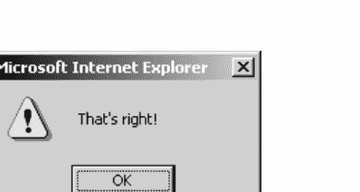

从根据默认参数（当前时间和日期）创建的 `now` 实例中，提取出当前年份（基于系统时钟）。接下来执行一个没有终止条件的循环。根据他或她的知识，询问用户输入当前年份。另一个 `if` 语句检查用户是否输入了正确的年份。如果是，则显示相应的消息，并使用 `break` 语句中断循环。否则，会提示用户输入错误，循环再次迭代。

`getYear` 的问题在于 Netscape 仍然返回自1900年以来的年数（因此2001年被返回为101），而 Internet Explorer 则简单地返回四位数的年份（使得2001年仅返回"2001"）。较新的命令 `getFullYear` 在两种浏览器中都将获取一个简单的四位数年份。

##### getMonth()

`getMonth()` 方法提取并返回其调用对象的月份。月份范围从一月到十二月，或者更准确地说是从0到11。下面是一个简单示例，演示此方法以及数组实例：

```
var now = new Date()
var month = now.getMonth()
var ar = new Array(12)
ar[0] = "January"
ar[1] = "February"
ar[2] = "March"
ar[3] = "April"
ar[4] = "May"
ar[5] = "June"
ar[6] = "July"
ar[7] = "August"
ar[8] = "September"
ar[9] = "October"
ar[10] = "November"
ar[11] = "December"
var message = "It is now " + ar[month] + ", my favorite.<BR>"
document.write(message)
```

此脚本的输出如图12-4所示：

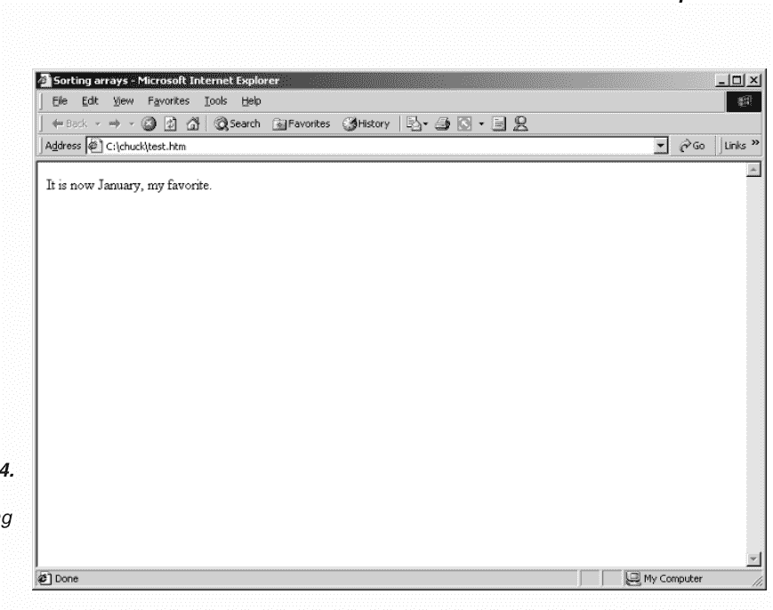

从 `now` 实例（该实例持有当前时间的属性，在语句执行之后）中提取当前月份。然后创建一个静态数组来保存所有月份的名称（作为字符串），将每个名称与其在 JavaScript 中对应的数字相匹配，从零开始。这显然符合默认的数组结构，即第一个索引为零。因此，不需要进行任何数学运算，直接使用当前月份的名称来构建消息，这显然是一个字符串。然后将该消息作为纯 HTML 打印出来。

> **警告：** 在某些旧版本的 Navigator 上，`getMonth` 属性返回的值不正确（相差一）。（MSIE 工作正常。）

##### getDate()

由 `Date` 对象调用，`getDate()` 方法返回一个1到31之间的整数日期。以下是一个示例：

```
var now = new Date()
var year = now.getYear()
var month = now.getMonth()
var date = now.getDate()
if (date < 10)
    var lastDigit = date
else
    var lastDigit = date % 10
var exp = ""
// determine suffix
if (lastDigit == 1)
    suf = "st"
else
    if (lastDigit == 2)
        suf = "nd"
    else
        if (lastDigit == 3)
            suf = "rd"
        else
            suf = "th"
// array for name of month
var ar = new Array(12)
ar[0] = "January"
ar[1] = "February"
ar[2] = "March"
ar[3] = "April"
ar[4] = "May"
ar[5] = "June"
ar[6] = "July"
ar[7] = "August"
ar[8] = "September"
ar[9] = "October"
ar[10] = "November"
ar[11] = "December"
var formDate = date + suf
// build full date such as "May 5th, 1997"
var totalDate = ar[month] + " " + formDate + " "+ year
document.write(totalDate)
```

此脚本的输出如图12-5所示：

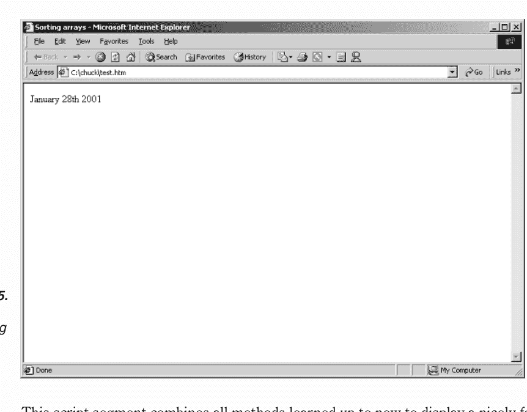

图12-5. 使用 `getDate()` 方法的示例输出。

此代码片段结合了迄今为止所学的所有方法来显示格式良好的日期。首先，获取之前创建的 `Date` 对象实例的所有必需属性，并将其分配给相应的变量（例如，`year`、`month`、`date`）。然后，日期的最后一位数字（1-31）被分配给变量 `lastDigit`。根据 `lastDigit` 的值，通过嵌套的 `if-else` 语句将正确的后缀分配给 `suf`。对于数字1，后缀是“st”（1st）；对于数字2，后缀是“nd”（2nd）；对于数字3，后缀是“rd”（3rd）；对于所有其他数字，后缀是“th”（5th、6th...）。请注意，最后的 `else` 语句将“th”后缀与除1、2和3以外的所有数字关联起来。此后缀甚至适用于以0结尾的数字。如前所述，创建了一个月份名称的数组。然后，将当前日期与其后缀组合以创建一个字符串，例如“27th”。此字符串以及所有其他所需值用于构建完整的日期格式，例如“April 24th, 1997”。完整字符串被打印出来。

##### getDay()

此方法返回一个0到6之间的整数，表示星期几。星期几是根据其他属性计算的，因此此方法没有对应的 `setDay()` 方法。以下是一个示例：

```
ar = new Array(7)
ar[0] = "Sunday"
ar[1] = "Monday"
ar[2] = "Tuesday"
ar[3] = "Wednesday"
ar[4] = "Thursday"
ar[5] = "Friday"
ar[6] = "Saturday"
var birthday = new Date("January 3, 1978")
var day = birthday.getDay()
alert("You were born on " + ar[day])
```

##### getHours()

`getHours()` 函数返回自午夜以来的小时数。也就是说，它根据24小时制返回当前小时。请注意，范围是0-23，从午夜（0）到晚上11点（23）。以下是一个示例：

```
var now = new Date()
var hour = now.getHours()
var text = ""
if (hour < 12)
    text = "morning"
else
    if (hour < 16)
        text = "afternoon"
    else
        if (hour < 20)
            text = "evening"
        else
            text = "night"
document.write("Good " + text + "!")
```

此代码片段根据一天中的时间打印简短的问候语。例如，如果时间在12:00（中午）到16:00（下午4点）之间，它会打印“Good afternoon!”。它基于嵌套的 `if-else` 结构。

##### getMinutes()

`getMinutes()` 方法返回 `Date` 实例的分钟属性。返回的整数始终在0到59之间。以下是一个简短的示例来演示该方法：

```
var now = new Date()
var minute = now.getMinutes()
var hour = now.getHours()
var text = "Don't you have an appointment for " + (hour + 1)
text += ":00 ?"
if (minute > 49)
    document.write(text)
```

首先，构建包含最近小时的消息。例如，如果当前时间是15:55，则消息是用最近的小时16:00构建的。如果当前时间距离下一个小时不到十分钟，则打印该消息。请注意，如果时间是23:59，则小时显示为24:00，而不是00:00。

##### getSeconds()

此方法返回给定 `Date` 实例的秒数，范围从0到59。您可以像使用 `getMinutes()` 方法一样使用它。

##### getTimezoneOffset()

此方法返回当前时区相对于格林威治标准时间（GMT）的时区偏移量（以分钟为单位）。时区偏移量是本地时间与格林威治标准时间（GMT）之间的差值。夏令时使得此值无法保持恒定。返回的值是一个整数，表示分钟数的差异。以下脚本展示了如何使用用户的时区偏移量来推断他或她居住的地方：

```
if (confirm("Are you in the United States?"))
{
    var now = new Date()
    var curOffset = now.getTimezoneOffset()
    curOffset /= 60 // convert from minutes to hours
    var zone = ""
    var prep = ""
    if (curOffset == 8)
    {
        zone = "west coast"
        prep = "on"
    }
    else
        if (curOffset == 7)
        {
            zone = "mid-west"
            prep = "in"
        }
        else
            if (curOffset == 6)
            {
                zone = "mid-east"
                prep = "in"
            }
            else
            {
                zone = "east coast"
                prep = "on"
            }
    alert("I think you live " + prep + " the " + zone + "!")
}
else
    alert("Sorry, this script is intended for U.S. residents only")
```

该脚本首先询问用户他或她是否居住在美国。如果不是，则显示一条消息。否则，执行以下代码块。根据本地时区与GMT之间的小时差值来确定美国境内的区域。前置介词（例如，“in”、“on”）

#### getTime()

`getTime()` 方法返回自 1970 年 1 月 1 日 00:00:00 以来的毫秒数。

#### set 方法

##### setYear()

此方法设置给定 Date 实例的 year 属性。以下示例计算当前日期在去年的星期几：

```javascript
var now = new Date()
var year = now.getYear()
now.setYear(year - 1)
ar = new Array(7)
ar[0] = "Sunday"
ar[1] = "Monday"
ar[2] = "Tuesday"
ar[3] = "Wednesday"
ar[4] = "Thursday"
ar[5] = "Friday"
ar[6] = "Saturday"
document.write("Last year, the current day was " + ar[now.getDay()])
```

首先，创建一个当前日期的实例，并将当前年份赋值给变量 `year`。然后，将实例 `now` 的 year 属性设置为前一年。接着，从修改后的实例中提取 day 属性，并根据该星期几（通过数组转换为字符串）构建消息。

##### setMonth()

`setMonth()` 方法设置 Date 对象给定实例的 month 属性。以下脚本将当前日期的 month 属性设置为五月：

```javascript
var now = new Date()
now.setMonth(4)
```

##### setDate()

此方法设置 Date 对象给定实例的 date 属性。以下脚本打印出本月第一天是星期几：

```javascript
var now = new Date()
now.setDate(1)
ar = new Array(7)
ar[0] = "Sunday"
ar[1] = "Monday"
ar[2] = "Tuesday"
ar[3] = "Wednesday"
ar[4] = "Thursday"
ar[5] = "Friday"
ar[6] = "Saturday"
document.write("The first day of the month occurred on " + ar[now.getDay()])
```

##### setHours()

此方法设置 Date 对象给定实例的小时属性。以下是一个示例：

```javascript
var obj = new Date("December 4, 1995 18:50:59") // JS press release
obj.setHours(obj.getHours() - 2)
alert(obj.getHours()) // 16
```

##### setMinutes()

此方法设置给定 Date 实例的分钟属性。以下是一个简单示例：

```javascript
var obj = new Date("December 4, 1995 18:50:59") // JS press release
obj.setMinutes(obj.getMinutes() - 1)
alert(obj.getMinutes()) // 49
```

##### setSeconds()

`setSeconds()` 方法设置 Date 对象给定实例的秒属性。以下示例演示了其用法：

```javascript
var obj = new Date("December 4, 2000 18:50:59") // JS press release
obj.setSeconds(obj.getSeconds() - 9)
alert(obj.getSeconds()) // 50
```

##### setTime()

此方法设置自 1970 年 1 月 1 日 00:00:00 以来的毫秒数。它实际上会修改调用对象的所有字段。以下是一个示例：

```javascript
var obj = new Date()
obj.setTime(867999600000)
var date = obj.getDate()
var month = obj.getMonth()
if (date < 10)
    var lastDigit = date
else
    var lastDigit = date % 10
var exp = ""
// determine suffix
if (lastDigit == 1)
    suf = "st"
else
    if (lastDigit == 2)
        suf = "nd"
    else
        if (lastDigit == 3)
            suf = "rd"
        else
            suf = "th"
// array for name of month
var ar = new Array(12)
ar[0] = "January"
ar[1] = "February"
ar[2] = "March"
ar[3] = "April"
ar[4] = "May"
ar[5] = "June"
ar[6] = "July"
ar[7] = "August"
ar[8] = "September"
ar[9] = "October"
ar[10] = "November"
ar[11] = "December"
var text = ar[month] + " " + date + suf
alert(text) // July 4th (setTime modifies the entire instance)
```

#### to 方法

##### toGMTString()

此方法使用互联网 GMT 惯例将日期转换为字符串。转换根据操作系统的时区偏移量进行，并返回类似于以下形式的字符串值：
`Tue, 30 Jul 2001 01:03:46 GMT`
确切格式取决于平台。以下是一个简单示例：

```javascript
var now = new Date()
var ar1 = now.toGMTString().split(" ")
document.write("The current time in Greenwich is " + ar1[4])
```

此脚本段的示例输出为：
`The current time in Greenwich is 01:08:21`

##### toLocaleString()

此方法使用当前区域设置的惯例，以字符串形式返回日期。
如果您尝试使用 `toLocaleString` 传递日期，请注意不同区域设置会以不同方式组合字符串。使用 `getHours`、`getMinutes` 和 `getSeconds` 等方法会得到更可移植的结果。以下示例演示了此函数：

```javascript
var now = new Date()
var ar1 = now.toLocaleString().split(" ")
document.write("The current time is " + ar1[1])
```

该脚本的输出为：

`The current time is 18:12:51`

转换后的字符串的通用格式为：

`MM/DD/YY HH:MM:SS`

#### parse 方法

##### parse()

`parse()` 方法接受一个 IETF 标准的日期字符串，并将其转换为自 1970 年 1 月 1 日 00:00:00 以来的毫秒数。IETF 标准日期表示法为：

`DayAbb, date MonthAbb year HH:MM:SS TimeZoneAbb`

该标准的一个示例是 “Mon, 25 Dec 2001 13:30:00 GMT。” 此方法也能理解美国大陆的时区缩写，例如 PST（太平洋标准时间）和 EST（东部标准时间）。但是，美国以外的时区（例如加拿大对应的时区）没有 JavaScript 接受的标准缩写。对于此类时区，必须指定偏移量；即，您必须指定本地时区与格林尼治标准时间之间的小时和分钟差。例如，在 “Mon, 25 Dec 2001 13:30:00 GMT+0430” 中，GMT+0430 是格林尼治子午线以西 4 小时 30 分钟的简写。如果不指定时区，则根据操作系统中时钟的设置假设为本地时区。如果您的时区设置不正确，无论是在 Mac 还是基于 Windows 的机器上，都应在控制面板中进行更改。GMT 也称为世界协调时间，即 UTC。

`parse` 方法是一个静态方法。它不属于 Date 对象的特定实例，而是属于对象类型本身。因此，它始终作为 `Date.parse()` 使用。以下是此方法的一个示例：

```javascript
var aDate = "Aug 27 2001"
var birthday = new Date()
birthday.setTime(Date.parse(aDate))
```

##### UTC()

`UTC()` 方法接受一个逗号分隔的列表，并返回自 1970 年 1 月 1 日 00:00:00 世界标准时间（GMT, UTC）以来的毫秒数。这也是一个静态方法，因此与通用的 Date 对象一起调用。您不能使用此方法来引用本地时区的特定日期，因为它始终指代世界协调时间（GMT, UTC）。例如，以下语句使用 GMT 而不是本地时间（如果未使用该方法，则会使用本地时间）创建一个 Date 对象：

```javascript
gmtDate = new Date(Date.UTC(99, 11, 1, 0, 0, 0))
```

该方法的一般语法为：

```javascript
Date.UTC(year, month, day [, hrs] [, min] [, sec])
```

所有属性都应指定为整数。

### 其他对象的时间相关方法

#### setTimeout()

`setTimeout()` 方法在指定毫秒数过后计算一个表达式。其一般语法为：

```javascript
timeoutID = setTimeout(expression, msec)
```

`timeoutID` 是一个标识符，用于标识当前超时。

`expression` 是一个字符串表达式或现有对象的属性。它通常是一个简单的语句，在指定时间过后执行。

`msec` 是一个数字值、数字字符串或以毫秒为单位的现有对象的属性。

`setTimeout()` 方法在指定时间过后计算一个表达式。请看以下示例：

```html
<HTML>
<HEAD>
<TITLE>setTimeout() method</TITLE>
<SCRIPT LANGUAGE="JavaScript">
function displayAlert()
{
    alert("5 seconds have elapsed since the button was clicked.")
}
</SCRIPT>
</HEAD>
<BODY>
<FORM>
Click the button on the left for a reminder in 5 seconds;
click the button on the right to cancel the reminder before
it is displayed.
<P>
<INPUT TYPE="button" VALUE="5-second reminder"
    NAME="remind_button"
    onClick="timerID = setTimeout('displayAlert()',5000)">
</FORM>
</BODY>
</HTML>
```


当你点击按钮时，事件处理程序的脚本会设置一个超时。该超时指定在 5,000 毫秒（即五秒）后，将调用 `displayAlert()` 函数。因此，在你点击按钮五秒后，会显示一个警告框。

此方法不会重复执行指定的语句。也就是说，它不会每五秒执行一次。当指定的时间限制倒计时结束时，语句被执行，之后该超时就不再存在。`setTimeout()` 是 `window` 或框架对象的一个方法，具体取决于它所使用的 HTML 文档的基本结构。

在两次连续调用用户定义的递归函数之间创建暂停，通常使用 `setTimeout()` 方法。请看以下脚本：

```
function alertNumbers(num)
{
    if (num > 10)
        return
    alert(num)
    val = ++num
    timerID = setTimeout("alertNumbers(val)", 3000)
}
alertNumbers(0)
```

此代码段每三秒弹出一个警告框。显示的消息是一个数字。第一个警告框显示数字 0。三秒后，另一个警告框显示数字 1。此过程持续进行，直到数字 10。如果你尝试将数字打印到文档而不是在窗口（框）中显示它，则会生成错误。导致此错误的原因是，在延迟后写入文档时，你试图更改已完成的布局。另一个要点是，如果传递给 `setTimeout()` 方法的表达式是一个函数调用（如本例所示），并且该函数需要参数，那么它必须是全局变量。局部变量不起作用，因为 `setTimeout()` 是框架或 `window` 对象的方法（如果未指定对象，则默认为 `window`）。不过，你可以使用字面量作为参数。请记住，`setTimeout()` 需要一个字符串封装的表达式。你可以如下在表达式中嵌入局部变量：

```
var cmd = "foo(" + num + ")"
timerID = setTimeout(cmd, 2000) // 或任何其他时间
```

#### clearTimeout()

此方法取消使用 `setTimeout()` 方法设置的超时。它也是框架或 `window` 对象的一个方法，因此稍后将详细讨论。此时，重要的是你知道如何使用它来取消超时。其一般语法如下：

```
clearTimeout(timeoutID)
```

*timeoutID* 是之前调用 `setTimeout()` 方法返回的超时设置。它必须与 `setTimeout()` 方法中使用的完全相同，因为它实际上是根据它来标识超时的设置。

`setTimeout()` 方法设置一个超时；即在指定时间后执行一条语句。如果你想在定时“炸弹”倒计时过程中取消它，可以通过此方法清除它。如果你想更改 `setTimeout()` 方法设置的时间量，必须先清除它，然后设置一个新的超时。以下是通过 `clearTimeout()` 方法增强的前一个示例：

```
<HTML>
<HEAD>
<TITLE>setTimeout() 和 clearTimeout() 方法</TITLE>
<SCRIPT LANGUAGE="JavaScript">
function displayAlert()
{
  alert("自点击按钮以来已过去 5 秒。")
}
</SCRIPT>
</HEAD>
<BODY>
<FORM>
点击左侧按钮设置 5 秒后的提醒；
点击右侧按钮在提醒显示前取消它。
<P>
<INPUT TYPE="button" VALUE="5 秒提醒"
  NAME="remind_button"
  onClick="timerID=setTimeout('displayAlert()',5000)">
<INPUT TYPE="button" VALUE="取消 5 秒提醒"
  NAME="remind_disable_button"
  onClick="clearTimeout(timerID)">
</FORM>
</BODY>
</HTML>
```

### 时间和日期示例

时间和日期在脚本中被广泛用于实现各种目标和创建各种效果。在本节中，我们将介绍几个有用的脚本，以演示本章学到的概念。

#### 一个简单的数字时钟

时间和日期方法对于在 JavaScript 脚本中计算时间值非常有用。以下示例展示了如何使用这些值在 HTML 页面上创建一个吸引人的图形时钟：

```
<HTML>
<HEAD>
<TITLE>
JavaScript 时钟
</TITLE>
</HEAD>
<BODY>
<!-- JavaScript 即时脚本 -->
<SCRIPT LANGUAGE="JavaScript">
<!--
document.write(setClock())
function setClock()
{
    // 初始化累积的 HTML 变量为空字符串
    var text = ""
    // 设置数字和标点图像的标准约定
    var openImage = ""
    // 用当前时间设置初始化时间相关变量
    var now = new Date()
    var hour = now.getHours()
    var minute = now.getMinutes()
    now = null
    var ampm = ""
    // 验证小时值并设置 ampm 的值
    if (hour >= 12)
    {
        hour -= 12
        ampm = "pm"
    } else
        ampm = "am"
    hour = (hour == 0) ? 12 : hour
    // 为个位数分钟添加前导零作为占位符
    if (minute < 10)
        minute = "0" + minute // 不要解析此数字！
    // 将分钟和小时值转换为字符串
    minute += ""
    hour += ""
    // 根据小时的值分配图像标签
    for (var i = 0; i < hour.length; ++i)
    {
        text += openImage + hour.charAt(i) + closeImage
    }
    // 将冒号分隔符的图像标签分配给文本变量
    text += openImage + "c.gif\" HEIGHT=21 WIDTH=9>"
    // 根据分钟的值分配图像标签
    for (var i = 0; i < minute.length; ++i)
    {
        text += openImage + minute.charAt(i) + closeImage
    }
    // 将 am/pm 图像标签分配给文本变量
    text += openImage + ampm + closeImage
    // 返回累积的 HTML 字符串
    return text
}
function getPath(url)
{
    lastSlash = url.lastIndexOf("/")
    return url.substring(0, lastSlash + 1)
}
// -->
</SCRIPT>
</BODY>
</HTML>
```

示例 12-1 (ex12-1.htm)。一个基于时间和日期方法的简单图形时钟。

此脚本的输出如图 12-6 所示：

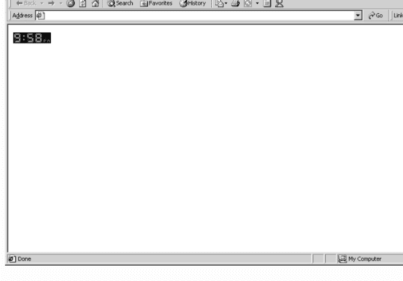

脚本的第一部分由注释组成，包括版权声明、所需的图像和一些说明。在每个公共领域脚本中添加这些注释很重要，因为通常很难猜测脚本的作用以及需要哪些额外的对象，例如图像。

函数 `getPath()` 接受当前文档的 URL。这包括 URL 的所有部分，包括 “http://...” 和文件名。函数返回直到但不包括文件名的 URL，包括最后一个斜杠。例如，考虑以下 URL：

```
http://www.wordware.com/index.html
```

接收此字符串后，该函数将返回：

```
http://www.wordware.com/
```

脚本中的第一个函数 `setClock()` 实际上是从上到下创建时钟。注意函数的每个部分都由注释解释。请看以下直接从函数中提取的语句：

```
var openImage = ""
```

在此代码段中，声明并初始化了两个类似常量的变量，赋予它们有意义的值。第一个被赋值为 HTML 中 `` 标签的起始结构。注意 `location.href` 是文档的当前 URL。还要注意转义字符 (`\"`) 的使用。赋给 `closeImage` 的值独立于本地影响，例如文档的 URL。它只是将值 `.gif\" HEIGHT=21 WIDTH=16>` 赋给变量。`HEIGHT` 和 `WIDTH` 属性基于用于显示时间的数字图像的实际高度和宽度。

以下是脚本的下一部分：

```
var now = new Date()
var hour = now.getHours()
var minute = now.getMinutes()
now = null
var ampm = ""
```

本节有两个重要任务：

- 将本地小时赋值给 `hour`。
- 将当前时间的分钟属性赋值给 `minute`。

如果你不记得怎么做，请重新阅读本章开头。

以下脚本段只是根据美国和其他使用 12 小时制系统的国家/地区使用的常规惯例修改 `hour` 的值。首先，中午被认为是下午。此外，午夜写作 12:00，而不是 0:00。

请看以下语句：

```
if (minute < 10)
    minute = "0" + minute // 不要解析此数字！
```

此语句确保 `minute` 属性保持一个两位数。也就是说，如果它最初是一个个位数，则在前面放置一个 “0”。注意这个数字实际上是一个字符串。尝试使用 `parseInt()` 等函数解析此字符串会将其转换为数字类型，从而导致其值发生变化，因为它以八进制表示法（前导 0）编写。它必须在整个脚本中保持字符串值。

脚本中的以下两条语句通过将空字符串连接到 `minute` 和 `hour` 的值来将它们转换为字符串。这很重要，因为字符串属性只能用于字符串，稍后将在脚本中使用。

以下语句是一个循环：


## 12.1 数字时间

```
for (var i = 0; i < hour.length; ++i)
{
    text += openImage + hour.charAt(i) + closeImage
}
```

该循环执行`hour.length`次。也就是说，如果`hour`是一个两位数，循环会执行两次，每位数字执行一次。每次执行时，一个与字符串`hour`中当前数字对应的图像标签会被连接到`text`。例如，如果`hour`的值是12，循环的命令块会执行两次。在第一次执行期间，以下字符串被赋给`text`：
`text += ''`
在第二次循环中，执行等效的语句：
`text += ''`
如果`hour`的值是一个单字符字符串，循环显然只执行一次。

脚本中的下一条语句是：

```
text += openImage + "c.gif\" HEIGHT=21 WIDTH=9>"
```

这条语句简单地赋值了与冒号图像相关的标签。注意，`closeImage`没有在此语句中连接，因为这个图像的`WIDTH`属性与其他图像不同。

接下来的循环与之前描述的与变量`hour`相关的循环完全相同。它只在关联到变量`minute`这一点上有所不同。

AM或PM图像标签根据`ampm`的值被赋给`text`。

函数内的最后一条语句指示JavaScript返回`text`的值，这是打印时钟所需所有HTML标签的累积字符串。
返回的值通过一条全局语句打印到文档中——
`document.write(text)`。

### 数字日期

这个示例与前一个类似，只不过它显示的是与当前日期相关的一组图像，而不是时间。它基于相同的函数，因此我们将省略解释。请参考脚本内的一些简短注释。以下是脚本：

```
<HTML>
<HEAD>
<TITLE>
JavaScript date
</TITLE>
</HEAD>
<BODY>
<!-- JavaScript immediate script -->
<SCRIPT LANGUAGE="JavaScript">
<!--
// image files needed:
// *****************
// dg0.gif
// dg1.gif
// dg2.gif
// dg3.gif
// dg4.gif
// dg5.gif
// dg6.gif
// dg7.gif
// dg8.gif
// dg9.gif
// dgp.gif
// Any set of digit images (0-9), and a period
// image (.) will work with this script.
// instructions:
// ************
// Place all image files in a folder / directory.
// Add this script, including all comments, to
// the desired HTML document. The HTML file must
// be located in the same directory as the image
// files.
document.write(setDate())
function setDate()
{
    // initialize accumulative HTML variable to empty string
    var text = ""
    // set standard convention for digit and punctuation images
    var openImage = ""
    // initialize time-related variables with current date settings
    var now = new Date()
    var month = now.getMonth()
    var date = now.getDate()
    var year = now.getYear()
    now = null
    // convert integer value of month to standard range
    month++ // 0 - 11 => 1 - 12
    // convert minute and hour values to strings
    month += ""
    date += ""
    year += ""
    // assign image tags associated with month to text variable
    for (var i = 0; i < month.length; ++i)
    {
        text += openImage + month.charAt(i) + closeImage
    }
    // assign image tag of period separator to text variable
    text += openImage + "p.gif\" HEIGHT=21 WIDTH=9>"
    // assign image tags associated with date to text variable
    for (var i = 0; i < date.length; ++i)
    {
        text += openImage + date.charAt(i) + closeImage
    }
    // assign image tag of period separator to text variable
    text += openImage + "p.gif\" HEIGHT=21 WIDTH=9>"
    // assign image tags associated with year to text variable
    for (var i = 0; i < year.length; ++i)
    {
        text += openImage + year.charAt(i) + closeImage
    }
    // return accumulative HTML string
    return text
}
function getPath(url)
{
    lastSlash = url.lastIndexOf("/")
    return url.substring(0, lastSlash + 1)
}
// -->
</SCRIPT>
</BODY>
</HTML>
```

示例 12-2 (`ex12-2.htm`)。当前本地日期的简单图形输出。

示例 12-2 的输出如图 12-7 所示：

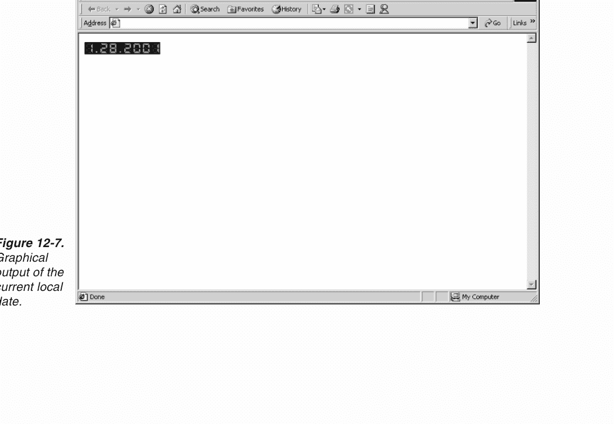

### 日历

下一个示例输出月历。在我们讨论代码之前，先看看函数的输出示例：

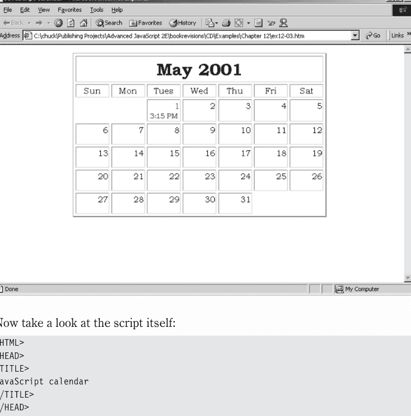

现在来看看脚本本身：

```
<HTML>
<HEAD>
<TITLE>
JavaScript calendar
</TITLE>
</HEAD>
<BODY>
<!-- JavaScript immediate script -->
<SCRIPT LANGUAGE="JavaScript">
<!--
setCal()
function getTime()
{
    // initialize time-related variables with current time settings
    var now = new Date()
    var hour = now.getHours()
    var minute = now.getMinutes()
    now = null
    var ampm = ""
    // validate hour values and set value of ampm
    if (hour >= 12)
    {
        hour -= 12
        ampm = "PM"
    } else
        ampm = "AM"
    hour = (hour == 0) ? 12 : hour
    // add zero digit to a one-digit minute
    if (minute < 10)
        minute = "0" + minute // do not parse this number!
    // return time string
    return hour + ":" + minute + " " + ampm
}
function leapYear(year)
{
    if (year % 4 == 0) // basic rule
        return true // is leap year
    /* else */ // else not needed when statement is "return"
        return false // is not leap year
}
function getDays(month, year)
{
    // create array to hold number of days in each month
    var ar = new Array(12)
    ar[0] = 31 // January
    ar[1] = (leapYear(year)) ? 29 : 28 // February
    ar[2] = 31 // March
    ar[3] = 30 // April
    ar[4] = 31 // May
    ar[5] = 30 // June
    ar[6] = 31 // July
    ar[7] = 31 // August
    ar[8] = 30 // September
    ar[9] = 31 // October
    ar[10] = 30 // November
    ar[11] = 31 // December
    // return number of days in the specified month (parameter)
    return ar[month]
}
function getMonthName(month)
{
    // create array to hold name of each month
    var ar = new Array(12)
    ar[0] = "January"
    ar[1] = "February"
    ar[2] = "March"
    ar[3] = "April"
    ar[4] = "May"
    ar[5] = "June"
    ar[6] = "July"
    ar[7] = "August"
    ar[8] = "September"
    ar[9] = "October"
    ar[10] = "November"
    ar[11] = "December"
    // return name of specified month (parameter)
    return ar[month]
}
function setCal()
{
    // standard time attributes
    var now = new Date()
    var year = now.getYear()
    var month = now.getMonth()
    var monthName = getMonthName(month)
    var date = now.getDate()
    now = null
    // create instance of first day of month, and extract the day it occurs on
    var firstDayInstance = new Date(year, month, 1)
    var firstDay = firstDayInstance.getDay()
    firstDayInstance = null
    // number of days in current month
    var days = getDays(month, year)
    // call function to draw calendar
    drawCal(firstDay + 1, days, date, monthName, year)
}
function drawCal(firstDay, lastDate, date, monthName, year)
{
    // constant table settings
    var headerHeight = 50 // height of the table's header cell
    var border = 2 // 3D height of table's border
    var cellspacing = 4 // width of table's border
    var headerColor = "midnightblue" // color of table's header
    var headerSize = "+3" // size of tables header font
    var colWidth = 60 // width of columns in table
    var dayCellHeight = 25 // height of cells containing days of the week
    var dayColor = "darkblue" // color of font representing week days
    var cellHeight = 40 // height of cells representing dates in the calendar
    var todayColor = "red" // color specifying today's date in the calendar
    var timeColor = "purple" // color of font representing current time
    // create basic table structure
    var text = "" // initialize accumulative variable to empty string
    text += '<CENTER>'
    text += '<TABLE BORDER=' + border + ' CELLSPACING=' + cellspacing + '>'
                // table settings
    text += '<TH COLSPAN=7 HEIGHT=' + headerHeight + '>' // create table header cell
    text += '<FONT COLOR="' + headerColor + '" SIZE=' + headerSize +
                '>' // set font for table header
    text += monthName + ' ' + year
    text += '</FONT>' // close table header's font settings
    text += '</TH>' // close header cell
    // variables to hold constant settings
    var openCol = '<TD WIDTH=' + colWidth + ' HEIGHT=' + dayCellHeight + '>'
    openCol += '<FONT COLOR="' + dayColor + '">'
```


## 218 ■ 第12章

```javascript
var closeCol = '</FONT></TD>'
// 创建星期简称数组
var weekDay = new Array(7)
weekDay[0] = "Sun"
weekDay[1] = "Mon"
weekDay[2] = "Tues"
weekDay[3] = "Wed"
weekDay[4] = "Thu"
weekDay[5] = "Fri"
weekDay[6] = "Sat"
// 创建表格第一行以设置列宽并指定星期几
text += '<TR ALIGN="center" VALIGN="center">'
for (var dayNum = 0; dayNum < 7; ++dayNum)
{
    text += openCol + weekDay[dayNum] + closeCol
}
text += '</TR>'
// 声明并初始化两个用于处理表格的变量
var digit = 1
var curCell = 1
for (var row = 1; row <= Math.ceil((lastDate + firstDay - 1) / 7); ++row)
{
    text += '<TR ALIGN="right" VALIGN="top">'
    for (var col = 1; col <= 7; ++col)
    {
        if (digit > lastDate)
            break
        if (curCell < firstDay)
        {
            text += '<TD></TD>'
            curCell++
        } else
        {
            if (digit == date)
            { // 当前单元格代表今天的日期
                text += '<TD HEIGHT=' + cellHeight + '>'
                text += '<FONT COLOR="' + todayColor + '">' 
                text += digit
                text += '</FONT><BR>'
                text += '<FONT COLOR="' + timeColor + '" SIZE=2>'
                text += '<CENTER>' + getTime() + '</CENTER>'
                text += '</FONT>'
                text += '</TD>'
            } else
                text += '<TD HEIGHT=' + cellHeight + '>' + digit + '</TD>'
            digit++
        }
    }
    text += '</TR>'
}
// 关闭所有基础表格标签
text += '</TABLE>'
text += '</CENTER>'
// 输出累积的HTML字符串
document.write(text)
}
// -->
</SCRIPT>
</BODY>
</HTML>
```

**示例 12-3 (ex12-3.htm)**。一个基于HTML表格并通过JavaScript打印的日历。

让我们逐步跟踪这个脚本，解释每个函数的任务。

#### getTime()

此函数简单地返回一个表示当前本地时间的字符串，格式如下：

> *小时:分钟 上午/下午*

请注意，任何字符之间没有空格。该函数基于与示例12-1中第一部分 `setClock()` 相同的算法。有关更深入的见解，请参阅关于该示例的解释。

#### leapYear(year)

此函数在当前年份是闰年时返回true；否则，返回false。用于判断的基本规则是闰年每四年出现一次，与夏季奥运会同年。更准确地说，如果年份能被4整除，它就是闰年。因此，模运算符非常适合这种情况。如果 year % 4 为零，则该年份能被4整除，意味着当前年份是闰年。否则，该年份不能被4整除，因此返回false。一个明显的调用此函数的例子是：

```javascript
if (leapYear(current year))
    // 是闰年
else
    // 不是闰年
```

另一种可能性是在条件语句、或运算符(?:)中使用返回值。

请注意，函数的参数必须接受一个整数值，这在计算年份时是合理的。

#### getDays(month, year)

此函数接受两个参数：月份和年份。然后创建一个包含12个元素的数组。该数组是内置 `Array` 对象的一个实例，因此使用了关键字 `new`。数组的每个元素代表其对应月份的天数。`ar[0]` 保存一月的天数（31天）；`ar[11]` 保存十二月的天数。该数组只是根据每个月固定的天数分配了适当的数据。然而，二月的天数不是固定的。在闰年，二月有29天，而在其他年份，则有28天。函数 `leapYear()` 用于判断指定年份是否为闰年。这种情况是使用条件运算符的典型场景，因为根据条件值（由函数 `leapYear()` 返回的布尔值）将两个值之一赋给一个变量。请注意，大量使用注释以帮助您理解脚本。函数返回的值等于调用时传递给函数的月份中的天数。例如，如果传递给函数的月份值为0，则函数返回 `ar[0] == 31` 的值。

请注意，两个参数都必须是整数。月份必须指定为0到11之间的整数，其中0代表一月，11代表十二月。

#### getMonthName(month)

此函数接受某个月份的整数值（0代表一月，11代表十二月），并返回月份的完整名称，显然是以字符串形式。此函数与前一个函数一样，使用 `Array` 对象的一个实例来存储常量值。所需月份的名称通过其索引（下标）从数组中检索。

#### setCal()

首先，函数创建 `Date` 对象的一个新实例，该实例保存当前本地时间的属性。当前年份通过方法 `getFullYear()` 分配给 `year`，当前月份通过方法 `getMonth()` 分配给 `month`。月份的名称由 `getMonthName()` 返回，分配给 `monthName`。当前日期分配给 `date` 后，现在将该实例分配为 `null`，这是一个良好的JavaScript编程实践。

函数的下一条语句是：

```javascript
var firstDayInstance = new Date(year, month, 1)
```

它创建 `Date` 对象的一个新实例；这次是为当前月份的第一天。因此，使用值1来指定日期。这显然会影响该日期所在的星期几。该值在以下语句中分配给 `firstDay`。然后实例 `firstDayInstance` 被赋值为 `null`。此脚本段计算该月份开始于星期几（星期日、星期一、星期二等）。实现此目标的另一种可能方法是像往常一样创建当前日期的实例：

```javascript
var firstDayInstance = new Date() // 还不是第一天！
```

然后你需要通过 `setDate()` 方法将日期设置为1。你应该使用以下语句来完成：

```javascript
firstDayInstance.setDate(1)
```

函数的下一部分仅包含一条语句。它将 `days` 分配为当前月份的天数。

函数的最后一条语句绘制日历：

```javascript
drawCal(firstDay + 1, days, date, monthName, 1900 + year)
```

参数是：

- 月份第一天的整数值加1；即星期日为1，星期一为2，星期二为3
- 指定月份的天数
- 指定的日期
- 指定月份的名称（例如，“January”、“February”、“March”）
- 指定的年份，作为四位整数（例如，1997，1998）

#### drawCal(firstDay, lastDate, date, monthName, year)

此函数的主要任务是打印日历表。在此之前，必须构建表格的HTML结构。函数的第一部分为与表格最终格式相关的属性赋值。这些属性包括单元格的大小、字体颜色等。以下是完整列表，包括变量名及其作用：

*表 12-2. drawCal() 中的变量及其在日历最终格式中的作用。*

| 变量 | 作用 |
| :--- | :--- |
| headerHeight | 表头单元格的高度。表头单元格是包含月份和年份名称的大字体单元格。高度以像素为单位指定。 |
| border | 表格边框。你应该已经知道HTML表格有一个 `BORDER` 属性。此属性指定边框的三维高度。 |
| cellSpacing | 边框的宽度。表格边框的宽度也可以在HTML中设置。此值是边框内线与外线之间的距离。 |
| headerColor | 表头字体的颜色。这是日历顶部表格中最大单元格内字体的颜色。 |
| headerSize | 表头字体的大小（参见 headerHeight 的作用）。 |
| colWidth | 表格列的宽度。这实际上是每个单元格的宽度，或每列中最宽单元格的宽度。 |
| dayCellHeight | 包含星期几名称（“Sunday”、“Monday”、“Tuesday”等）的单元格的高度。 |
| dayColor | 代表星期几的字体颜色。 |
| cellHeight | 表格中所有包含月份日期的常规单元格的高度。 |
| todayColor | 日历中指定当前日期的颜色。 |
| timeColor | 当前日期单元格中使用的当前时间字体的颜色。 |

函数的下一部分创建基本表格结构，包括所有引用表格轮廓的通用HTML标签。注意变量是如何

在脚本中实现。现在来看看脚本中的以下两个语句：

```javascript
var openCol = '<TD WIDTH=' + colWidth + ' HEIGHT=' + dayCellHeight + '>'
openCol += '<FONT COLOR="' + dayColor + '">' 
var closeCol = '</FONT></TD>'
```

这些是用于创建包含星期名称的每个单元格的标签。例如，使用变量的默认值，“Sunday”的语法为：

```html
<TD WIDTH=60 HEIGHT=25><FONT COLOR="midnightblue"></FONT></TD>
```

以下是函数的下两个部分，供参考：

```javascript
// create array of abbreviated day names
var weekDay = new Array(7)
weekDay[0] = "Sun"
weekDay[1] = "Mon"
weekDay[2] = "Tues"
weekDay[3] = "Wed"
weekDay[4] = "Thu"
weekDay[5] = "Fri"
weekDay[6] = "Sat"
// create first row of table to set column width and specify week day
text += '<TR ALIGN="center" VALIGN="center">'
for (var dayNum = 0; dayNum < 7; ++dayNum)
{
    text += openCol + weekDay[dayNum] + closeCol
}
text += '</TR>'
```

在第一段中，创建了一个普通数组。然后为其赋值了星期的缩写名称。这个数组使我们可以通过数字来引用每个名称。接下来的部分为每一天创建一个单元格，利用了这种引用方法。每次循环迭代都会打印一个新日期。请注意，与当前表格行开头和结尾相关的标签并不在循环内部。一个包含所有星期名称的新行在循环之前开始。当前行在与“Sat”单元格相关的标签赋值给 `text` 之后结束。

函数的下一部分是：

```javascript
var digit = 1
var curCell = 1
```

您稍后会在函数中看到这些变量的作用。

到现在为止，所有与表格标题和列标题相关的标签都已分配给累加字符串变量 `text`。函数的剩余部分分配与所有表格单元格相关的标签。如您所知，日历是一个矩形表格。因此，我们更倾向于使用嵌套循环结构来引用其单元格。如果您想练习技巧，可以尝试用单个循环替换此结构，使用取模运算符计算新表格行的位置。

循环较难的部分是其终止条件。它再次如下所示：

```javascript
row <= Math.ceil((lastDate + firstDay - 1) / 7)
```

`Math` 对象及其 `ceil()` 方法在第 13 章 JavaScript Math 中有详细说明。目前，您只需知道 `Math.ceil(num)` 的值是大于或等于 `num` 的最接近的整数（向上取整）。以下是一些示例：

```javascript
Math.ceil(15.15) == 16
Math.ceil(16) == 16
Math.ceil(16.0001) == 17
```

您可能还记得之前的函数 `setCal()`，传递给参数 `firstDay` 的值是从 1 到 7，而不是从 0 到 6。因此在此表达式中，从 `firstDay` 中减去 1。`Math.ceil((lastDate + firstDay - 1) / 7)` 表示日历或表格中所需的最小行数。日历中的单元格数（不包括主标题、列标题和当月最后一天之后的单元格）是 `lastDate + firstDay - 1`，因为 `lastDate` 等于当月的天数，而 `firstDay - 1` 等于第一个日期之前的单元格数。该值除以 7，以获得所需的精确最小行数。然而，循环必须执行整数次。因此，需要 `Math.ceil()` 方法。

其他更简单的日历每个月无论怎样都只使用五行。然而，当 (a) 非闰年的二月第一天在星期日，这意味着只需要四行，以及 (b) 一个 31 天的月份的第一天在星期五或星期六，这意味着需要六行时，这种简单的五行规则就会失效。尽管这些情况很少发生，但您必须考虑到它们。如果在此脚本中将行计算替换为简单的 5，则像 1987 年 2 月这样的月份将无法正确显示。嵌套循环则不那么困难，因为它总是执行七次，每周的每一天一次。在整个循环结构中，包括内部和外部循环，`digit` 保存要创建的当前单元格。变量 `curCell` 保存迄今为止创建（分配）的表格单元格的累加数量。该变量仅在创建当月的第一天的单元格之前需要，之后不再处理；也就是说，在当月的第一天之后，它不再递增。

`<TD>` 和 `</TD>` 标签用于创建空白单元格，用作占位符。这些仅在当月的第一天之前需要，因为当月的最后一天之后，循环通过 `break` 语句终止，并且该行的剩余部分以与空白单元格（占位符）相同的方式填充。内部循环的每次执行都创建表格的当前单元格。基本上有两种类型的单元格：

- 代表当前日期的单元格，使用特殊的字体颜色并在单元格内显示时间。
- 所有其他单元格。

使用的 HTML 标签很明显，这里不深入讨论。

## 224 ■ 第 12 章

在内部循环之外但在包含循环之内有两个语句。第一个创建一个新的表格行，第二个结束当前行。内部循环的每次执行（其命令块执行七次）负责创建整行，或者如果它是最后一行并且在行的最后一个单元格之前遇到当月的最后一天，则创建部分行——在这种情况下，循环通过 `break` 语句终止。“创建”一词指的是适当字符串和值的连接以及对变量 `text` 的赋值。

函数的最后一个但绝对不是最不重要的语句是实际将表格打印到 HTML 文档的语句。在该语句之前，HTML 文档作为字符串存储在变量 `text` 中。

## 随机引言

本章的结尾是一个简单而有趣的脚本，每次页面加载时显示不同的消息。以下是脚本：

```html
<HTML>
<HEAD>
<TITLE>Random quote</TITLE>
<SCRIPT LANGUAGE="JavaScript">
<!--
function getMessage()
{
    // create array of Murphy's laws
    var ar = new Array(20)
    ar[0] = "Nothing is as easy as it looks."
    ar[1] = "Everything takes longer than you think."
    ar[2] = "Anything that can go wrong will go wrong."
    ar[3] = "If there is a possibility of several things going wrong, the one that will cause the most damage will be the one to go wrong."
    ar[4] = "If there is a worse time for something to go wrong, it will happen then."
    ar[5] = "If anything simply cannot go wrong, it will anyway."
    ar[6] = "If you perceive that there are four possible ways in which a procedure can go wrong, and circumvent these, then a fifth way, unprepared for, will promptly develop."
    ar[7] = "Left to themselves, things tend to go from bad to worse."
    ar[8] = "If everything seems to be going well, you have obviously overlooked something."
    ar[9] = "Nature always sides with the hidden flaw."
    ar[10] = "Mother nature is a bitch."
    ar[11] = "It is impossible to make anything foolproof because fools are so ingenious."
    ar[12] = "Whenever you set out to do something, something else must be done first."
    ar[13] = "Every solution breeds new problems."
    ar[14] = "Trust everybody ... then cut the cards."
    ar[15] = "Two wrongs are only the beginning."
    ar[16] = "If at first you don't succeed, destroy all evidence that you tried."
    ar[17] = "To succeed in politics, it is often necessary to rise above your principles."
    ar[18] = "Exceptions prove the rule ... and wreck the budget."
    ar[19] = "Success always occurs in private, and failure in full view."

    var now = new Date()
    var sec = now.getSeconds()
    alert("Murphy's Law:\r" + ar[sec % 20])
}
//-->
</SCRIPT>
</HEAD>
<BODY onLoad="getMessage()">
</BODY>
</HTML>
```

**示例 12-4 (ex12-4.htm)。** *一个每次页面加载时显示随机消息的脚本。*

函数中的第一个语句创建了一个数组，这是内置 `Array` 对象的一个实例。该数组包含 20 个元素，从 `ar[0]` 开始，到 `ar[19]` 结束。每个元素都被分配了一个字符串，或者准确地说，是一条墨菲定律。然后创建一个 `Date` 对象的实例 `now`。通过 `getSeconds()` 方法从 `now` 检索当前时间的秒数。如您所知，`sec` 的值是一个从 0 到 59 的整数，每个值都有随机的可能性。总共有 60 个连续整数。由于这个事实，表达式 `sec % 20` 返回一个从 0 到 19 的整数，每个值的概率相等，因为 60 可以被 20 整除（60 / 20 = 3!）。使用此技术从 0 到 19 创建随机数的能力使我们能够从数组中随机选择一条墨菲定律。选定的墨菲定律通过警报框显示。

脚本的最重要的部分是使用事件处理程序来响应加载事件——`onLoad`。当事件处理程序被触发（当页面完成加载时），会调用函数 `getMessage()` 来显示如上所述的警报消息。还要注意转义字符的使用，即回车符（`\r`）。

## 总结

在本章中，我们讨论了 JavaScript 中与日期和时间相关的概念。这些概念基于 `Date` 对象。我们学习了这个内置对象，它是 JavaScript 中唯一没有任何属性的对象。在深入研究该对象后，我们看到了如何在脚本中创建和使用其实例。到现在，您应该有足够的工具来创建各种类型的有趣脚本。随着我们在接下来的章节中进一步深入语言，您将能够掌握 JavaScript 增强 HTML 文档的能力。在本章中，您已经看到，无需太多努力，您就可以为任何页面添加图形数字时钟。这可能看起来令人惊讶，但最好的还在后面，包括动画时钟等等。


# 第13章

## JavaScript 数学

### JavaScript 中的数学

计算机最著名的核心能力之一是能够非常精确且快速地执行数学运算。所有编程语言都包含特性、常量、函数和其他数学元素，允许程序员进行数学运算。同样，JavaScript 包含许多与数学相关的特性，使 JavaScript 程序员能够在脚本中调用数值计算。

JavaScript 中的数学基于语言的两个通用元素：

-   数学运算符
-   内置的 Math 对象

数学运算符几乎为每种语言所共有（`+`, `-`, `*`, `/`, `%`），并且在本书的第4章和第7章中已有介绍。但是，我还没有向你介绍 Math 对象。在本章中，我将让你熟悉这个对象，包括其属性和方法。我们还将探讨这个对象的一些可能用途。如果涉及的任何数学运算你不熟悉，也不必太担心，因为这仅仅意味着你可能不会在脚本中用到那个层次的数学知识。

## Math 对象

JavaScript 的 Math 对象提供了许多算术和三角函数。其中大部分是你可能已经知道的函数。这些函数将 JavaScript 的数学能力扩展到了基本的算术运算符之外。

你已经知道如何创建动态对象的实例，例如 Date。实例是根据动态对象创建的。JavaScript 中的一些对象是静态的。也就是说，它们就像一个单一的实例。你可以直接引用对象的方法和属性。这与动态对象（如 Date）不同。回想一下，要获取当前年份，你必须先创建一个对象的实例，然后引用该实例的方法。

JavaScript 的 Math 对象是静态的。它的属性实际上是基本常量，例如 pi (π) 和 2 的平方根。它的方法是数学函数，例如 `pow()`（幂运算）、`sin()`、`cos()` 等。这些方法和属性被封装在一个对象中，因为对象旨在成为由相关数据和函数构成的实体。数学函数和常量的需求促使 JavaScript 的开发者创建了一个用于数学的内置对象——Math。

要访问 Math 对象的元素，你不需要创建实例。你可以通过 Math 对象本身发送的消息直接访问它们。例如，常量 PI 是 Math 对象的一个属性，可以通过以下语法访问：

```javascript
var pi = Math.PI
```

Math 对象是静态的，因为数学常量和函数永远不会改变。例如，pi 的值不会改变，任何三角函数也是如此。Math 对象的实现灵感来源于 Java 中的 Math 类。尽管存在这种相似性，你会发现 JavaScript 提供的方法更少。

### 常量

在 JavaScript 中，常量以浮点数的完整精度定义。在本节中，我们将概述这些属性以供参考和理解。请注意，所有属性均用大写字母指定，尽管这种惯例在数学界并不常见。所有属性都指代众所周知的常量（如果记不住请查阅你的数学书！）；也就是说，它们不会改变。因此，这些属性是只读属性，试图修改它们会导致 JavaScript 错误。

## E

数学中一个非常重要的常量是欧拉常数。其近似值为 2.718281828459045。它被四舍五入到小数点后15位。供你参考，其方程式为：

$$e^{i\pi} + 1 = 0$$

在 JavaScript 中，你通过大写 "E" 来引用它；即 `Math.E`。

> **注意：** 在数学中，通常用小写 "e" 表示。

#### LN2

作为 Math 对象属性的另一个常量是 2 的自然对数。其近似值为 0.6931471805599453。定义方程式为：

$$e^{LN2} = 2$$

JavaScript 将此数字称为 `LN2`。因为它是 Math 对象的一个属性，你应该将其指定为 `Math.LN2`。

你可以使用 `pow` 方法来验证上述方程式是否成立：
```javascript
document.write(Math.pow(Math.E, Math.LN2))
```
因为欧拉常数和 2 的自然对数都是近似值，所以此语句的输出也是近似值：
```
1.9999999999999998
```

#### LN10

10 的自然对数也是静态 Math 对象的一个属性。其存储在对应属性中的值为 2.302585092994046。同样，你可以通过以下方程式来理解这个值：
$$e^{LN10} = 10$$
在 JavaScript 中，此值被称为 `Math.LN10`。
再次提供一个定义 10 的自然对数的 JavaScript 语句：
```javascript
document.write(Math.pow(Math.E, Math.LN10))
```
由于欧拉常数和 10 的自然对数都是近似值，此语句的输出也是近似的：
```
10.000000000000002
```

#### LOG2E

数学领域另一个重要的常量是欧拉常数的以 2 为底的对数。其近似值为 1.4426950408889634。在数学上表示为：
$$2^{LOG2E} = e$$
如你所见，在 JavaScript 中你通过 `Math.LOG2E` 来引用此常量。这是一个确认该值的简单语句：
```javascript
document.write(Math.pow(2, Math.LOG2E) - Math.E)
```
这次输出显然是精确的：
```
0
```

#### LOG10E

以 10 为底的对数在复杂的数学计算中也被广泛使用。它在 JavaScript 中的值约为 0.4342944819032518。以下方程式演示了该常量的定义：
$$10^{LOG10E} = e$$
如你所见，该方程式是根据基本的对数规则之一构建的。在 JavaScript 中，欧拉常数的以 10 为底的对数是 Math 对象的一个属性：`Math.LN10`。

这是一个用于确认的简单脚本：
```javascript
document.write(Math.pow(10, Math.LOG10E) - Math.E)
```

输出再次是精确的：
```
0
```

#### PI

在 JavaScript 提供的所有常量中，PI 可能是最广为人知的值。根据 JavaScript 中实数的精度限制，其近似值为 3.141592653589793。像之前一样，这里有一个演示该值的方程式：
$$\pi = 4(1 – 1/3 + 1/5 – 1/7 + 1/9 – ...)$$
正如你可能预期的，你在 JavaScript 中通过 `Math.PI` 来引用 pi。例如，要获得圆的周长，你可以使用以下函数：

```javascript
function circumference(diameter)
{
    if (typeof diameter == "number" && diameter >= 0)
        return Math.PI * diameter
}
```

请注意，如果直径不是数字或不是正数，该函数不会返回值。

#### SQRT1_2

在 JavaScript 的对象模型中，0.5 的平方根是 0.7071067811865476。你也可以通过计算 0.5 的平方根（使用 Math 对象的 `sqrt()` 方法）来得到这个值，但访问现有的属性比通过执行方法来计算它更快且更明显。
你通过 `Math.SQRT1_2` 来引用此属性。属性名中使用下划线的原因是属性名必须遵循标识符规则，该规则只允许在名称中间使用字母、数字和下划线。
这是一个确认值正确的明显语句：

```javascript
document.write(Math.pow(Math.SQRT1_2, 2))
```

不那么明显的输出是：
```
0.5000000000000001
```

#### SQRT2

2 的平方根也是一个众所周知的常量。其近似值为 1.4142135623730951。你通过 `Math.SQRT2` 来引用它。你可以使用以下语句来验证该值：

```javascript
document.write(Math.pow(Math.SQRT2, 2))
```

如你所料，结果不是精确的：
```
2.0000000000000004
```

### Math 方法

常量值仅构成了 JavaScript 数学实现整体能力的一小部分。要驾驭 Math 对象的强大功能，你必须熟悉其提供的一系列方法。

JavaScript 倾向于将函数和值组织在对象结构中，以便于引用和简单理解。因此，所有与数学相关的函数都实现为 Math 对象的方法。

Math 对象的方法可分为两类，每类都与数学的不同分支相关：

-   算术方法
-   三角函数方法

Math 对象的所有方法都指定为小写字母，与此相反，作为该对象属性的常量则指定为大写字母。

#### 算术方法

我们使用术语“算术方法”来描述所有与三角函数数学无关的方法。

你可以通过此方法计算任何数字（整数或浮点数）的绝对值。一个数字的绝对值是其对应的正数；也就是说，如果该数字是正数，其绝对值就是该数字本身，而如果它是负数，其绝对值是同一个数字，只是将减号换成了加号。你可以轻松地模拟此方法：

##### abs()

```javascript
function abs(num)
{
    if (num < 0)
        return -num
    return num
}
```

例如，–5 的绝对值是 5。5 的绝对值也是 5。在 JavaScript 中，你可以通过 `Math.abs()` 方法计算一个数字的绝对值。此方法返回其参数的绝对值。你只能使用此方法计算一个参数的绝对值。如果你用多个参数调用该方法，则只返回第一个参数的绝对值。

如果你想得到一个数字对应的负值，而不是正值，你可以对返回值取反。例如：


##### ceil()

`Math.ceil()` 方法接受一个数字参数，并返回**大于或等于**该参数的下一个整数（向上取整）。因此，返回的值永远不会小于参数。以下是一些示例：

```
Math.ceil(16) == 16
Math.ceil(16.01) == 17
Math.ceil(-15.01) == -15
```

假设你需要将 `num1` 辆汽车停入停车场，每个停车场可容纳 `num2` 辆车。你可以使用 `Math.ceil()` 方法配合一个函数来计算所需的最小停车场数量：

```
function getNumLots(num1, num2)
{
    return Math.ceil(num1 / num2)
}
```

在上述函数中需要使用此方法的原因是，你只能使用整个停车场，而不是其一部分；也就是说，我们试图计算的是所需的最小停车场数量，而非精确空间。

##### exp()

此方法返回欧拉常数（`Math.E`）的指定参数（`eargument`）次幂。它大致等同于以下函数：

```
function exp(num)
{
    return Math.pow(Math.E, num)
}
```

你将此函数称为 `Math.exp()`。下面是一个示例：

```
document.write(Math.exp(4))
```

其输出为：

```
54.598150033144236
```

##### floor()

`Math.floor()` 方法返回**小于或等于**传入值的最大整数。在处理非负数时，这等同于整数除法。也等同于向下取整到最接近的整数。以下是一些表达式，每个表达式求值为 true：

```
Math.floor(16) == 16
Math.floor(16.01) == 16
Math.floor(-15.01) == -16
```

##### log()

此方法返回传入参数的自然对数。例如，e（欧拉常数）的自然对数（以 e 为底）是 1。你可以通过以下语句来确认：

```
document.write(Math.log(Math.E))
```

确实，输出是 1。

##### max(), min()

这两个方法都接受两个数字参数。`max()` 返回两个数中较大的那个，而 `min()` 返回较小的那个。以下是一个函数，它按顺序打印较小的数和较大的数：

```
function printInOrder(num1, num2)
{
    document.write(Math.min(num1, num2) + ", " + Math.max(num1, num2))
}
```

以下函数调用会向文档打印字符串 "-5, 1"：

```
printInOrder(1, -5)
```

以下是一些为 true 的表达式，用于演示基本的 `min()` 和 `max()` 方法：

```
Math.max(1, 2) == 2
Math.min(2, Math.abs(-2)) == 2
Math.min(2, -2) == -2
```

##### pow()

给定两个数字参数，此方法返回第一个参数的第二个参数次幂。以下是一些为 true 的表达式，用于演示此方法：

```
Math.pow(10, 2) == 100
Math.pow(0.5, 0.5) == 0.7071067811865476
Math.pow(Math.SQRT2, 4) == 4.000000000000001
```

##### random()

此方法返回一个 0 到 1 之间的随机数。它显然是一个浮点数。返回的数字精度通常是小数点后 16 位。这里是一个简单的示例：

```
for (var i = 0; i < 5; ++i)
{
    document.write(Math.random() + "<BR>")
}
```

此循环的输出取决于 `random()` 的输出，并且保证你的结果不会与以下内容相同：

```
.924853870611902
.8248305636609181
.9539277224126104
.9806934571332098
.7639888801207115
```

此方法主要用于创建介于 x 和 y 之间的随机整数。假设 x 是 0，y 是一个给定数字。你应该将 `random()` 返回的值乘以 y，然后进行四舍五入。例如，要生成一个 0 到 37 之间的随机数，你可以使用以下表达式：

```
Math.round(Math.random() * 37)
```

如果你想要一个 15 到 37 之间的整数，你可以创建一个 0 到 22 之间的随机整数，然后加上 15。尝试创建随机数时要非常小心。

##### round()

`Math.round()` 方法返回最接近参数的整数。如果参数的小数部分等于 0.5，则数字会被向上取整。以下是一些为 true 的表达式，用于演示此方法：

```
Math.round(3.7) == 4
Math.round(4.5) == 5
Math.round(16.1) == 16
Math.round(0) == 0
```

##### sqrt()

此方法返回参数的平方根。例如：

```
Math.sqrt(4) == 2
Math.sqrt(0) == 0
Math.sqrt(0.25) == 0.5
```

如果参数是负数，该方法返回零，这恰好是错误的答案。如果改为生成一个错误会更好，因为这个错误答案可能不会被察觉。

#### 三角函数方法

三角函数方法显然是那些处理三角学的方法。
你还应该知道如何将角度从度转换为弧度，反之亦然。以下是基本的换算表：

*表 13-1. 度-弧度换算表。*

| 度数 | 弧度 |
|---|---|
| 360 | 2π |
| 270 | 1.5π |
| 180 | π |
| 90 | 0.5π |

JavaScript 中的所有角度都以弧度为单位，因此换算表应该能帮助你直观地理解以弧度表示的角度大小。

##### **cos()**

`Math.cos()` 方法接受一个参数，即三角形的角度。它返回该值的余弦，该值必须以弧度指定。以下语句打印 –1：

```
document.write(Math.cos(Math.PI))
```

##### **acos()**

`Math.acos()` 方法也接受一个参数。它返回参数的反余弦值（以弧度为单位）；也就是说，它接受某个值的余弦并返回该值——与 `Math.cos()` 方法相反。因此，以下语句打印 PI 的值：

```
document.write(Math.acos(-1))
```

##### **sin()**

`Math.sin()` 函数返回其参数的正弦值。请记住，参数必须以弧度为单位。以下语句打印 1：

```
document.write(Math.sin(0.5 * Math.PI))
```

##### **asin()**

`Math.asin()` 方法接受一个参数并返回其反正弦值（以弧度为单位）。以下语句打印 PI 的一半值：

```
document.write(Math.asin(1))
```

##### **tan()**

`Math.tan()` 方法返回其参数的正切值，它等于该值正弦与余弦的商。看看以下脚本片段：

```
var val = 0.25 * Math.PI
document.write("sine = " + Math.sin(val) + "<BR>")
document.write("cosine = " + Math.cos(val) + "<BR>")
document.write("tangent = " + Math.tan(val))
```

这些语句在 Netscape Navigator 中的输出是：

```
sine = .7071067811865475
cosine = .7071067811865476
tangent = .9999999999999999
```

从这个脚本中你可以了解到：

- ¼ * PI 的正弦等于其余弦，也等于 ½ 的平方根。
- 余弦和正弦方法有时会返回不精确的结果。

要特别注意第二个概念——不精确性。以下语句：

```
var val = 0.25 * Math.PI
if (Math.tan(val) == 1)
    do_this
else
    do_that
```

应替换为：

```
var val = 0.25 * Math.PI
if (Math.tan(val) > 0.99 && Math.tan(val) < 1.01)
    do_this
else
    do_that
```

不精确性在这种情况下更为明显，因为结果甚至在不同的浏览器之间也存在差异。以下是 Microsoft Internet Explorer 收到的输出：

```
sine = 0.707106781186547
cosine = 0.707106781186548
tangent = 1
```

注意正弦和余弦值不同。还要注意，Internet Explorer 为所有介于 -1 和 1 之间（不包括端点）的数字都添加了前导零。

##### **atan()**

正如你可能预期的，`Math.atan()` 方法返回其参数的反正切值。例如，以下返回 PI 的四分之一值：

```
document.write(Math.atan(1))
```

##### **atan2()**

`Math.atan2()` 返回与指定笛卡尔坐标对应的极坐标 (r, theta) 的角度（theta 分量）。你可能知道，一个点的普通 x, y 坐标被称为笛卡尔坐标。另一种测量系统是极坐标系。你需要指定点的半径（到极点的距离）和角度（theta 分量）。

## Number 对象

`Number` 对象是 JavaScript 的内置对象，与 Math 对象非常相似，因为它封装了几个原始数字值。它与 Math 对象的不同之处在于 Number 对象是动态的，需要创建步骤，而 Math 对象是静态的，不需要任何实例化。
Number 对象的主要用途是访问其常量属性，包括可表示的最大和最小数字、正负无穷大以及非数字值。你也可以使用 Number 对象来创建可以添加属性的数字对象。你不太可能需要使用 Number 对象，但为了完整性，这里给出了它。
要创建 Number 对象，请使用以下语句：

```
numberObjectName = new Number()
```


其中 *numberObjectName* 可以是新对象的名称，也可以是现有对象的属性。要访问 Number 的属性，请使用以下格式：

```
numberObjectName.propertyName
```

其中 *numberObjectName* 可以是现有 Number 对象的名称，也可以是现有对象的属性。*propertyName* 是下一节中列出的属性之一。

### Number 属性

Number 对象有几个属性。

#### MAX_VALUE

这是 JavaScript 中可表示的最大数值。MAX_VALUE 属性的值约为 1.79E+308。大于 MAX_VALUE 的值被表示为“无穷大”。因为 MAX_VALUE 是一个常量，所以它是 Number 的一个只读属性。以下代码演示了 MAX_VALUE 的用法。该代码将两个数值相乘。如果结果小于或等于 MAX_VALUE，则调用 func1 函数；否则调用 func2 函数：

```
if (num1 * num2 <= Number.MAX_VALUE)
    func1()
else
    func2()
```

#### MIN_VALUE

MIN_VALUE 属性是 JavaScript 能表示的最接近零的数，而不是最负的数。MIN_VALUE 的值约为 2.22E-308。小于 MIN_VALUE 的值（“下溢值”）会被转换为零。因为 MIN_VALUE 是一个常量，所以它是 Number 的一个只读属性。以下代码将两个数值相除。如果结果大于或等于 MIN_VALUE，则调用 func1 函数；否则调用 func2 函数。

```
if (num1 / num2 >= Number.MIN_VALUE)
    func1()
else
    func2()
```

#### NaN

未加引号的字面常量 NaN 是一个特殊值，表示“非数字”。由于 NaN 与任何数字（包括 NaN）比较都不相等，因此它通常用于表示应返回有效数字的函数的错误条件。请注意，因此你无法通过与 Number.NaN 比较来检查“非数字”值。请改用 isNaN() 函数。因为 NaN 是一个常量，所以它是 Number 的一个只读属性。在以下代码段中，如果 dayOfMonth 大于 31，则将其赋值为 NaN，并显示一条消息指示有效范围：

```
if (dayOfMonth < 1 || dayOfMonth > 31)
{
    dayOfMonth = Number.NaN
    alert("Day of Month must be between 1 and 31.")
}
```

#### NEGATIVE_INFINITY

这是一个表示负无穷大的特殊数值。该值表示为“-Infinity”。该值在数学行为上类似于无穷大。例如，任何值乘以 NEGATIVE_INFINITY 都是 NEGATIVE_INFINITY，任何值除以 NEGATIVE_INFINITY 都是零。因为 NEGATIVE_INFINITY 是一个常量，所以它是 Number 的一个只读属性。

以下代码段检查一个数是否为 NEGATIVE_INFINITY，如果是则调用不同的函数。

```
if (smallNumber == Number.NEGATIVE_INFINITY)
    func1()
else
    func2()
```

#### POSITIVE_INFINITY

这是一个表示无穷大的特殊数值。该值表示为“Infinity”。该值在数学行为上类似于无穷大。例如，任何值乘以 POSITIVE_INFINITY 都是 POSITIVE_INFINITY，任何值除以 POSITIVE_INFINITY 都是零。因为 POSITIVE_INFINITY 是一个常量，所以它是 Number 的一个只读属性。

以下代码段检查一个数是否为 POSITIVE_INFINITY，如果是则调用不同的函数。

```
if (bigNumber == Number.POSITIVE_INFINITY)
    func1()
else
    func2()
```

### Number 方法

Number 对象没有特定的方法。你仍然可以使用通用方法 `eval()`、`toString()` 和 `valueOf()`，这些方法适用于每个对象。

### 与数学相关的函数

尽管本节介绍的函数在本书后面也会讨论，但你必须对其有基本的了解，因此不要跳过以下解释。这些函数将在本章后面的示例中使用。

#### parseInt()

这个内置函数接受一个整数的数字字符串并返回其对应的数值。以下示例胜过千言万语：

```
var numStr = "99"
document.write("The initial " + typeof numStr + " is " + numStr)
document.write("<BR>")
var num = parseInt(numStr)
document.write("The converted " + typeof num + " is " + num)
```

脚本的输出是：

The initial string is 99
The converted number is 99

数据类型不是作为字面量传递给 `document.write()` 方法的，而是作为值。请注意，`parseInt()` 函数接受一个字符串并返回一个整数。如果给函数一个非整数的数字字符串，它将返回最接近的整数作为数字（而不是字符串）。

#### parseFloat()

这个函数与前一个函数完全相同，只是它不会对任何数字进行舍入。它将数字字符串转换为数字，而不会改变数值。当使用浮点数字字符串，或者不确定使用的是什么类型的数字时，你应该使用这个函数。

#### eval()

`eval()` 函数既强大又实用。目前，你只需要知道，它接受一个表示数值或数学表达式的字符串，并返回该表达式求值的结果。以下脚本段打印“13”。

```
var str = "6 + 7"
document.write(eval(str))
```

该函数返回一个数字，而不是字符串。

### 数学示例

#### 创建曲线

尽管 JavaScript 与自定义图形对应得不是很好，但可以创建简单的图形、图表和曲线。在本节中，我们将使用 JavaScript 绘制一条正弦曲线。首先看一下脚本的输出：

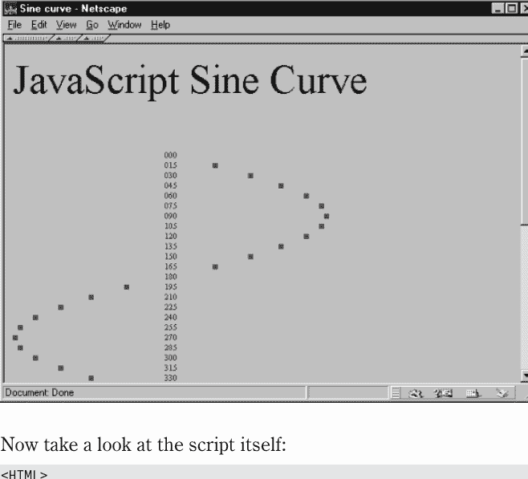

现在看一下脚本本身：

```
<HTML>
<HEAD>
<TITLE>Sine curve</TITLE>
</HEAD>
<BODY>
<FONT COLOR="blue" SIZE=+4>JavaScript Sine Curve</FONT><BR><BR>
<SCRIPT LANGUAGE="JavaScript">
<!--
function drawBlank(num)
{
    // draw num blank dots
    for (var i = 0; i < num; ++i)
    {
        document.write("")
    }
}
function drawDot()
{
    document.write("")
}
function getRadian(deg)
{
    // return deg in radians
    return Math.PI * deg / 180
}
function getSpot(deg)
{
    // convert from degrees to radians
    var rad = getRadian(deg)
    // assign sine to variable
    var sine = Math.sin(rad)
    // return spot in graph
    return Math.round(sine * 30)
}
function get3DigitNum(num)
{
    // convert num to string
    num += ""
    // assign number of digits in num to variable
    var length = num.length
    // add preceding zero digits to reach three digits
    for (var i = 0; i < 3 - length; i++)
    {
        num = "0" + num
    }
    // return four-digit number
    return num // do not parse number!
}
function printDeg(deg)
{
    // print degree in purple font
    document.write("<FONT COLOR='purple' SIZE=1>" + get3DigitNum(deg) + "</FONT>")
}
function drawLine(deg)
{
    // assign spot (-30 to 30)
    var spot = getSpot(deg)
    // if sine is negative
    if (spot < 0) {
        // draw blank images up to spot, not inclusive
        drawBlank(30 + spot)
        // draw dot image
        drawDot()
        // draw remaining images until axis
        drawBlank(-spot - 1) // 30 - ((30 + spot) + 1)
        // print current degree
        printDeg(deg)
    } else
    // if sine is positive
    if (spot > 0)
    {
        // draw 30 blank images = left of axis
        drawBlank(30)
        // print current degree
        printDeg(deg)
        // draw blank images up to spot, not inclusive
        drawBlank(spot - 1)
        // draw dot image
        drawDot()
    } else
    {
        // draw 30 blank images = left of axis
        drawBlank(30)
        // print current degree
        printDeg(deg)
    }
    // move to next line
    document.write("<BR>")
}
function drawCurve(lastDeg, jump)
{
    // loop through plot vertically
    for (var deg = 0; deg <= lastDeg; deg += jump)
    {
        drawLine(deg)
    }
}
drawCurve(720, 15)
// -->
</SCRIPT>
</BODY>
</HTML>
```

**示例 13-1 (ex13-1.htm)。一个绘制正弦曲线的简单脚本。**

该脚本被有意地分成许多简短的函数，以便读者更好地理解。我们将分析每个函数以了解其工作原理。

##### **drawBlank(num)**

```
function drawBlank(num)
{
    // draw num blank dots
    for (var i = 0; i < num; ++i)
    {
        document.write("")
    }
}
```

此函数使用一个 `for` 循环，将透明图像打印 num 次。请注意，透明（空白）图像的高度和宽度均等于 6。

##### **drawDot()**

```
function drawDot()
{
    document.write("")
}
```

此函数仅绘制点图像。

##### **getRadian(deg)**

```
function getRadian(deg)
{
    // return deg in radians
    return Math.PI * deg / 180
}
```


# getSpot(deg)

```
function getSpot(deg)
{
    // convert from degrees to radians
    var rad = getRadian(deg)
    // assign sine to variable
    var sine = Math.sin(rad)
    // return spot in graph
    return Math.round(sine * 30)
}
```

此函数接受以度为单位的角度大小，并返回其正弦值乘以30的结果。首先，它将角度的弧度测量值赋给局部变量 rad。然后，它将该角度的正弦值赋给局部变量 sine。接着，函数将正弦值乘以30，并返回该数字的四舍五入值。乘以30的原因是任何角度的正弦值都在-1到1之间。我们绘制的曲线通常由中心轴两侧的30张图像（透明或不透明）组成。如果你增加这个数字，曲线的水平宽度会变大。如你所见，30张图像看起来效果很好。通过将一个-1到1之间的值乘以30，我们得到一个-30到30之间的值。通过使用 `Math.round()` 方法对其进行四舍五入，函数返回一个-30到30之间的整数。

请注意，该绘图就像一个二维数组，因为它由图像行组成。

# get3DigitNum(num)

```
function get3DigitNum(num)
{
    // convert num to string
    num += ""
    // assign number of digits in num to variable
    var length = num.length
    // add preceding zero digits to reach three digits
    for (var i = 0; i < 3 - length; i++)
    {
        num = "0" + num
    }
    // return three-digit number
    return num // do not parse number!
}
```

此函数接受任何一位数、两位数或三位数，并返回一个三位数，在需要时添加前导零。首先，它将数字转换为字符串，这是使用 length 属性所必需的。字符串类型也是必需的，因为带有前导零的数字被视为八进制数。原始数字的位数（即长度）被赋给局部变量 length。接下来的语句是一个循环，其命令块为补全三位数所需的每个缺失数字执行一次。例如，如果数字由两位数组成，循环的命令块将执行一次（3 − 2 = 1，1 − 0 = 1）。

# printDeg(deg)

```
function printDeg(deg)
{
    // print degree in purple font
    document.write("<FONT COLOR='purple' SIZE=1>" + get3DigitNum(deg) + "</FONT>")
}
```

此函数接受一个数字，将其转换为三位数，并以紫色字体打印出来。

# drawLine(deg)

```
function drawLine(deg)
{
    // assign spot (-30 to 30)
    var spot = getSpot(deg)
    // if sine is negative
    if (spot < 0)
    {
        // draw blank images up to spot, not inclusive
        drawBlank(30 + spot)
        // draw dot image
        drawDot()
        // draw remaining images until axis
        drawBlank(-spot - 1) // 30 - ((30 + spot) + 1)
        // print current degree
        printDeg(deg)
    } else
        // if sine is positive
        if (spot > 0)
        {
            // draw 30 blank images = left of axis
            drawBlank(30)
            // print current degree
            printDeg(deg)
            // draw blank images up to spot, not inclusive
            drawBlank(spot - 1)
            // draw dot image
            drawDot()
        } else
            {
                // draw 30 blank images = left of axis
                drawBlank(30)
                // print current degree
                printDeg(deg)
            }
        // move to next line
        document.write("<BR>")
}
```

四舍五入后的正弦值乘以30被赋给变量 spot。该函数基本上分为三个部分，每次只执行其中一个部分。第一部分处理正弦值为负的情况，第二部分处理正弦值为正的情况，第三部分处理其余情况，即正弦值为零的情况。

当正弦值（正弦值乘以30）为负时，会打印 30 – spot 张透明图像。例如，如果 spot 的值为20，则打印10张透明图像。在这些透明图像之后打印点图像。然后函数打印 –spot – 1 张透明图像，直到中心轴。到目前为止，已经打印了 30 + spot 张透明图像，以及一张代表曲线上点的图像。总共是 31 + spot 张图像。请记住，轴的每一侧由30张图像组成，所以还需要打印 30 – (31 + spot) 张图像；即 –spot – 1 张。然后通过调用函数 printDeg() 打印当前角度。

当当前角度的正弦值为正时，打印30张透明图像以填满中心轴的左侧。然后打印当前角度以延续轴的垂直跨度。接着打印 spot – 1 张图像，直到需要放置曲线上点的位置。然后打印点图像。当当前角度的正弦值为零时，打印一行30张透明图像，后跟当前角度（以度为单位）。

函数的最后一条语句在文档中添加一个换行符，开启一个新的图像行。

# drawCurve(lastDeg, jump)

```
function drawCurve(lastDeg, jump)
{
    // loop through plot vertically
    for (var deg = 0; deg <= lastDeg; deg += jump)
    {
        drawLine(deg)
    }
}
```

此函数接受两个参数。第一个参数 lastDeg 接受曲线中包含的最后一个值，即正弦值出现的最后一个角度。第二个参数指定每两个角度之间的差值。

##### 全局语句

该脚本只包含一条全局语句，即一个函数调用。它使用所需的参数调用 drawCurve() 函数。

# 第13章

## 通用绘图工具

如你所见，使用两种不同的图像在JavaScript中绘制特定曲线并不困难。以下示例使你能够绘制几乎所有函数的曲线：

```
<HTML>
<HEAD>
<TITLE>Function Plotting Utility</TITLE>
</HEAD>
<BODY>
<SCRIPT LANGUAGE="JavaScript">
<!--
function root(a, b)
{
    // return b to the root of a
    return Math.pow(b, 1 / a)
}
function logab(a, b)
{
    // return log base-a of b
    return Math.log(b) / Math.log(a)
}
function factorial(a)
{
    // set recursion termination condition
    if (a == 0)
        return 1
    return a * factorial(a - 1)
}
function startWizard()
{
    // create array to hold messages
    var ar = new Array()
    ar[0] = "\r\rWelcome to the easy JavaScript function plotter!\r\r"
    ar[0] += "Press OK to continue, or CANCEL to exit the wizard...\r\r"
    ar[1] = "\r\rYou can plot almost any function you wish with this script.\r"
    ar[1] += "The plotter supports common arithmetic and trigonometric functions.\r"
    ar[1] += "It also supports widely used mathematical constants.\r"
    ar[1] += "For a list of the supported functions press OK...\r\r"
    ar[2] = "\r\r"
    ar[2] += "abs(val) = absolute value of val\r"
    ar[2] += "acos(val) = arc cosine of val\r"
    ar[2] += "asine(val) = arc sine of val\r"
    ar[2] += "atan(val) = arc tangent of val\r"
    ar[2] += "atan2(val) = angle (theta component) of the polar "
    ar[2] += "coordinate (r,theta) that corresponds to the specified "
    ar[2] += "cartesian coordinate (x,y).\r"
    ar[2] += "ceil(val) = next integer greater than or equal to val\r"
    ar[2] += "cos(val) = cosine of val\r"
    ar[2] += "exp(val) = Euler's constant to the power of val\r"
    ar[2] += "factorial(val) = val factorial (val!)\r"
    ar[2] += "floor(val) = next integer less than or equal to val\r"
    ar[2] += "log(val1, val2) = logarithm base-val1 of val2\r"
    ar[2] += "loge(val) = natural logarithm of val\r"
    ar[2] += "max(val1, val2) = greater of val1 and val2\r"
    ar[2] += "min(val1, val2) = lesser of val1 and val2\r"
    ar[2] += "pow(val1, val2) = val1 to the power of val2\r"
    ar[2] += "root(val1, val2) = val1-root of val2\r"
    ar[2] += "round(val) = val rounded off to the nearest integer\r"
    ar[2] += "sin(val) = sine of val\r"
    ar[2] += "sqrt(val) = square root of val\r"
    ar[2] += "tan(val) = tangent of val\r"
    ar[2] += "\r* all trigonometric functions deal with radians only *\r\r"
    ar[2] += "Click OK to view the supported constants...\r\r"
    ar[3] = "\r\r"
    ar[3] += "e = Euler's constant\r"
    ar[3] += "ln2 = Natural log of 2\r"
    ar[3] += "ln10 = Natural log of 10\r"
    ar[3] += "log2e = log base-2 of Euler's constant\r"
    ar[3] += "log10e = log base-10 of Euler's constant\r"
    ar[3] += "pi = pi (3.14...)\r"
    ar[3] += "sqrt1_2 = square root of 0.5\r"
    ar[3] += "sqrt2 = square root of 2\r"
    ar[3] += "\r\rEnjoy the plotter...\r\r"
    for (var i = 0; i < ar.length; ++i)
    {
        if (!confirm(ar[i]))
            break
    }
}
function drawBlank(num)
{
    // draw num blank dots
    for (var i = 0; i < num; ++i)
    {
        document.write("")
    }
}
function drawDot(x, y)
{
    // print dot image
    document.write("<A HREF=\"javascript:alert('X = " + x + ", Y = " + y + "')\"></A>")
}
function replaceSpecialSequence(str)
{
    // replace all specified sequences by other sequences
    str = str.split("cos").join("Math.cos")
    str = str.split("sin").join("Math.sin")
    str = str.split("tan").join("Math.tan")
    str = str.split("acos").join("Math.acos")
    str = str.split("asin").join("Math.asin")
    str = str.split("atan").join("Math.atan")
    str = str.split("pi").join("Math.PI")
```


## 248 第 13 章

```javascript
str = str.split("ln2").join("Math.LN2")
str = str.split("ln10").join("Math.LN10")
str = str.split("log2e").join("Math.LOG2E")
str = str.split("log10e").join("Math.LOG10E")
str = str.split("sqrt1_2").join("Math.SQRT1_2")
str = str.split("sqrt2").join("Math.SQRT2")
str = str.split("abs").join("Math.abs")
str = str.split("ceil").join("Math.ceil")
str = str.split("exp").join("Math.exp")
str = str.split("floor").join("Math.floor")
str = str.split("loge").join("Math.log")
str = str.split("max").join("Math.max")
str = str.split("min").join("Math.min")
str = str.split("pow").join("Math.pow")
str = str.split("round").join("Math.round")
str = str.split("log").join("logab")
str = str.split("sqrt").join("Math.sqrt")
str = str.split("e").join("Math.E")
// 返回字符串
return str
}
```

```javascript
function splitFunc(func)
{
    // 从 func 中排除 "y ="
    var expr = func.substring(func.indexOf("=") + 1, func.length)
    // 将常规三角函数替换为 JavaScript 约定
    expr = replaceSpecialSequence(expr)
    // 将参数拆分到 *全局* 数组，排除 "x" 字符
    funcArray = expr.split("x")
}
```

```javascript
function getInput()
{
    // 通过提示框询问用户函数
    var input = prompt('输入函数（例如："y = x * x + sin(x) - 5"）：', '')
    // 如果用户在字段中输入了值
    if (input)
    {
        // 将函数拆分到全局数组
        splitFunc(input)
        // 将函数打印到文档
        document.write("<TT><H1><B>" + input + "</B></H1></TT><BR>")
        // 返回 true 表示用户输入了值
        return true
    }
    // 生成警告框以显示错误消息
    alert("输入错误...")
    // 返回 false 表示取消
    return false
}
```

```javascript
function yVal(xVal)
{
    // 使用 xVal 构建表达式，替换原方程中的 x
    var expr = funcArray.join(xVal)
    // 返回计算后的表达式
    return eval(expr)
}
function makeArray(min, max, dif)
{
    // 创建类数组对象的属性
    for (var i = min; i <= max; i += dif)
    {
        this[i] = yVal(i)
    }
}
function printUnit(num)
{
    // 在表格单元格内以指定字体和大小打印数字
    document.write("<FONT SIZE=1 COLOR='purple'>" + num + "</FONT>")
}
function drawCurve()
{
    for (var x = minX; x <= maxX; x += dif)
    {
        // 打开表格属性和用于保存当前单元格的单元格
        document.write("<TABLE BORDER=0><TR><TD WIDTH=90>")
        // 在轴上打印当前数字
        printUnit(x)
        // 关闭表格单元格并打开新的单元格
        document.write("</TD><TD>")
        // 将 Y 值赋给变量
        var y = ar[x]
        // 将 y 值转换为 1 到 100 之间的整数
        var ySpot = (y - minY) / (maxY - minY) * 100
        // 绘制透明图像
        drawBlank(ySpot - 1)
        // 在曲线上绘制点
        drawDot(x, y)
        // 关闭单元格、行和表格（自动换行）
        document.write("</TD></TR></TABLE>");
    }
}
function main()
{
    // 启动向导
    startWizard()
    // 从用户获取输入；如果用户取消，则终止函数
    if (!getInput())
        return

    // 从用户接受 X 轴最小值并赋给全局变量
    minX = prompt("输入 X 轴最小值：", "")
    // 如果用户按了"取消"，则终止函数
    if (!minX)
        return
    // 从用户接受 X 轴最大值并赋给全局变量
    maxX = prompt("输入 X 轴最大值：", "")
    // 如果用户按了"取消"，则终止函数
    if (!maxX)
        return
    // 将 X 轴上数值之间的差值赋给全局变量
    dif = prompt("输入 X 轴上每个值之间的差值：", "")
    // 如果用户按了"取消"，则终止函数
    if (!dif)
        return
    // 将所有输入转换为数字，替换特殊序列
    maxX = eval(replaceSpecialSequence(maxX))
    minX = eval(replaceSpecialSequence(minX))
    dif = eval(replaceSpecialSequence(dif))
    // 创建全局数组并通过函数调用赋值 Y 值
    ar = new makeArray(minX, maxX, dif)
    // 将 maxY 和 minY（全局变量）作为 ar 的属性赋值
    maxY = ar[minX]
    minY = ar[minX]
    // 确定最大和最小 Y 值
    for (var i in ar)
    {
        if (ar[i] < minY)
            minY = ar[i]
        else
            if (ar[i] > maxY)
                maxY = ar[i]
    }
    // 绘制最终曲线
    drawCurve()
}
main()
// -->
</SCRIPT>
</BODY>
</HTML>
```

示例 13-2 (ex13-2.htm)。一个通用函数绘图器。

此脚本的输出如图 13-2 和 13-3 所示：

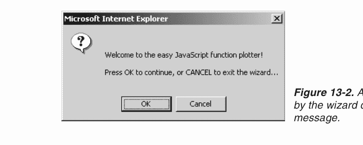

**图 13-2。** 向导显示的确认框呈现欢迎消息。

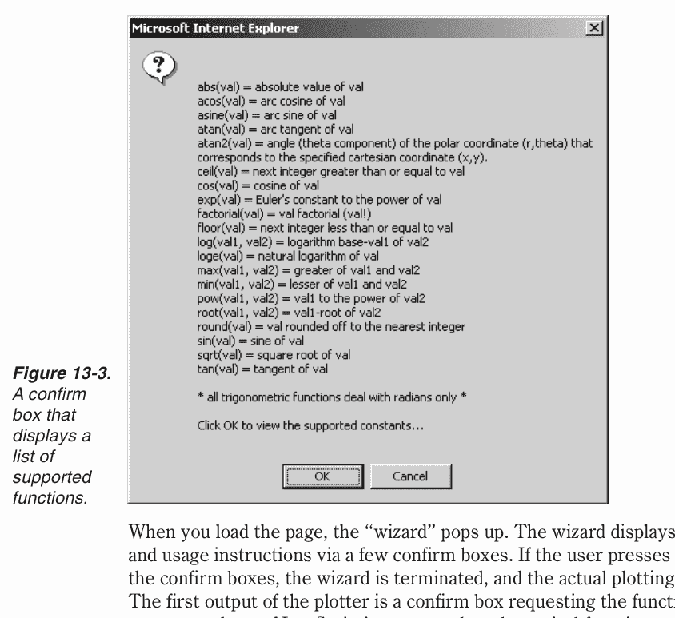

**图 13-3。** 显示支持的函数列表的确认框。

当您加载页面时，“向导”会弹出。向导通过几个确认框显示基本功能和使用说明。如果用户在任何一个确认框上按了“取消”，向导将终止，实际的绘图应用程序开始。绘图器的第一个输出是一个确认框，请求输入函数，该函数可以由 JavaScript 支持的数学函数、常量和运算符构成。如果用户选择“取消”，则会显示一个警告框和错误消息。否则，执行继续，JavaScript 会要求用户输入 X 轴上的最小值。取消此框将导致脚本终止。如果用户选择“确定”，则执行继续，并出现另一个提示框。同样，如果用户按了“取消”，脚本将终止。否则，用户将被要求输入 X 轴上两个连续刻度之间的差值（例如，如果用户想看到 –4、–2、0、2、4、6，则差值为 2）。

现在我们确切地知道脚本的功能，让我们通过分析每个函数来看看它是如何实现的。

**root(a, b)**

```javascript
function root(a, b)
{
    // 返回 b 的 a 次方根
    return Math.pow(b, 1 / a)
}
```

此函数返回 a 次根号下 b，等于 b¹/a。

**logab(a, b)**

```javascript
function logab(a, b)
{
    // 返回以 a 为底 b 的对数
    return Math.log(b) / Math.log(a)
}
```

此函数返回以 a 为底 b 的对数。该值等于以 x 为底 b 的对数除以以 x 为底 a 的对数。在此例中，我们使用自然对数，其底数是欧拉常数。以下语句解释了此计算：

log_e b / log_e a = log_a b

**factorial(a)**

```javascript
function factorial(a)
{
    // 设置递归终止条件
    if (a == 0)
        return 1
    return a * factorial(a - 1)
}
```

此函数返回 a 的阶乘 (a!)。其算法是递归的。

**startWizard()**

```javascript
function startWizard()
{
    // 创建数组以保存消息
    var ar = new Array()
    ar[0] = "\r\r欢迎使用简易 JavaScript 函数绘图器！\r\r"
    ar[0] += "按确定继续，或按取消退出向导...\r\r"
    ar[1] = "\r\r您可以使用此脚本绘制几乎所有您希望的函数。\r"
    ar[1] += "绘图器支持常见的算术和三角函数。\r"
    ar[1] += "它还支持广泛使用的数学常量。\r"
    ar[1] += "要查看支持的函数列表，请按确定...\r\r"
    ar[2] = "\r\r"
    ar[2] += "abs(val) = val 的绝对值\r"
    ar[2] += "acos(val) = val 的反余弦\r"
    ar[2] += "asine(val) = val 的反正弦\r"
    ar[2] += "atan(val) = val 的反正切\r"
    ar[2] += "atan2(val) = 对应于指定笛卡尔坐标 (x,y) 的极坐标 "
    ar[2] += "(r,theta) 的角度（theta 分量）。\r"
    ar[2] += "ceil(val) = 大于或等于 val 的下一个整数\r"
    ar[2] += "cos(val) = val 的余弦\r"
    ar[2] += "exp(val) = 欧拉常数的 val 次幂\r"
    ar[2] += "factorial(val) = val 的阶乘 (val!)\r"
    ar[2] += "floor(val) = 小于或等于 val 的下一个整数\r"
    ar[2] += "log(val1, val2) = 以 val1 为底 val2 的对数\r"
    ar[2] += "loge(val) = val 的自然对数\r"
    ar[2] += "max(val1, val2) = val1 和 val2 中的较大值\r"
    ar[2] += "min(val1, val2) = val1 和 val2 中的较小值\r"
}
```


### 常量和函数说明

```
ar[2] += "pow(val1, val2) = val1 to the power of val2\r"
ar[2] += "root(val1, val2) = val1-root of val2\r"
ar[2] += "round(val) = val rounded off to the nearest integer\r"
ar[2] += "sin(val) = sine of val\r"
ar[2] += "sqrt(val) = square root of val\r"
ar[2] += "tan(val) = tangent of val\r"
ar[2] += "\r* all trigonometric functions deal with radians only *\r\r"
ar[2] += "Click OK to view the supported constants...\r\r"
ar[3] = "\r\r"
ar[3] += "e = Euler's constant\r"
ar[3] += "ln2 = Natural log of 2\r"
ar[3] += "ln10 = Natural log of 10\r"
ar[3] += "log2e = log base-2 of Euler's constant\r"
ar[3] += "log10e = log base-10 of Euler's constant\r"
ar[3] += "pi = pi (3.14...)\r"
ar[3] += "sqrt1_2 = square root of 0.5\r"
ar[3] += "sqrt2 = square root of 2\r"
ar[3] += "\r\rEnjoy the plotter...\r\r"
for (var i = 0; i < ar.length; ++i)
{
    if (!confirm(ar[i]))
        break
}
```

此函数负责向导。首先，创建一个数组作为 `Array()` 对象的实例。四个不同的消息被分配为数组的元素。第一个存储在 `ar[0]`，第二个在 `ar[1]`，依此类推。请注意，分配的字符串很长，因此赋值运算符通过将它们一个接一个地分配给数组的元素来进行连接。该函数使用 `for` 循环将消息打印到确认框中。如果用户按下“取消”，确认框的值为 `false`，执行 `break` 语句，导致循环立即终止。

#### drawBlank(num)

```
function drawBlank(num)
{
    // draw num blank dots
    for (var i = 0; i < num; ++i)
    {
        document.write("")
    }
}
```

此函数将透明图像打印 `num` 次，`num` 作为其唯一参数传递给函数。该图像通过一个简单的 `for` 循环重复打印。

#### drawDot(x, y)

```
function drawDot(x, y)
{
    // print dot image
    document.write("<A HREF=\"javascript:alert('X = " + x + ", Y = " + y + "')\"></A>")
}
```

此函数基本上是打印点图像，但它将其打印为超文本链接。指定为链接的 URL 是一个 JavaScript 语句。当用户单击图像时，会显示一个警报框，显示该点的坐标。坐标作为参数传递给此函数。例如，如果参数是 -5 和 10，则以下字符串将被打印到文档中：

```
<A HREF="javascript:alert('X = -5, Y = 10')"></A>
```

您可能还记得，超文本链接的 URL 可以是 JavaScript 语句，前提是该语句以 "javascript:" 开头。

#### replaceSpecialSequence(str)

```
function replaceSpecialSequence(str)
{
    // replace all specified sequences by other sequences
    str = str.split("cos").join("Math.cos")
    str = str.split("sin").join("Math.sin")
    str = str.split("tan").join("Math.tan")
    str = str.split("acos").join("Math.acos")
    str = str.split("asin").join("Math.asin")
    str = str.split("atan").join("Math.atan")
    str = str.split("pi").join("Math.PI")
    str = str.split("ln2").join("Math.LN2")
    str = str.split("ln10").join("Math.LN10")
    str = str.split("log2e").join("Math.LOG2E")
    str = str.split("log10e").join("Math.LOG10E")
    str = str.split("sqrt1_2").join("Math.SQRT1_2")
    str = str.split("sqrt2").join("Math.SQRT2")
    str = str.split("abs").join("Math.abs")
    str = str.split("ceil").join("Math.ceil")
    str = str.split("exp").join("Math.exp")
    str = str.split("floor").join("Math.floor")
    str = str.split("loge").join("Math.log")
    str = str.split("max").join("Math.max")
    str = str.split("min").join("Math.min")
    str = str.split("pow").join("Math.pow")
    str = str.split("round").join("Math.round")
    str = str.split("log").join("logab")
    str = str.split("sqrt").join("Math.sqrt")
    str = str.split("e").join("Math.E")
    // return string
    return str
}
```

此函数在参数中匹配某些字符串，并用其他字符串替换它们。以下是示例：

```
str = str.split("max").join("Math.max")
```

该字符串被分割成一个数组，其中子字符串 `max` 是分隔符，然后元素被连接回一个以 `Math.max` 为分隔符的字符串。最终结果是，在主字符串 (`str`) 中出现字符串 `max` 的任何地方，都被字符串 `Math.max` 替换。这很重要，因为字符串必须构造为有效的 JavaScript 表达式（`eval()` 函数计算由有效 JavaScript 表达式组成的字符串）。所有支持的常量和数学函数都执行相同的过程。函数 `factorial()` 保持不变，因为它在脚本中的引用也是 `factorial()`。

需要注意的一个重要概念是子字符串的替换顺序至关重要。例如，在将子字符串 `sqrt` 替换为 `Math.sqrt` 之前，不能先将 `sqrt2` 替换为 `Math.SQRT2`，因为结果将是子字符串 `sqrt2` 被替换为 `Math.sqrt2`，而不是 `Math.SQRT2`。该函数必须首先替换包含需要被替换的其他子串的子串。

在所有所需的子字符串替换完毕后，并且假设用户输入了格式正确的函数，该函数返回格式化的字符串，该字符串现在是一个有效的 JavaScript 表达式。

#### splitFunc(func)

```
function splitFunc(func)
{
    // exclude "y =" from func
    var expr = func.substring(func.indexOf("=") + 1, func.length)
    // replace regular trigonometric functions with JavaScript convention
    expr = replaceSpecialSequence(expr)
    // split argument to *global* array, excluding "x" chars
    funcArray = expr.split("x")
}
```

此函数接受一个参数——函数。如您所知，函数的通用格式是 y=f(x)。首先，该函数将等号后的所有内容分配给局部变量 `expr`。然后将 `expr` 的值发送到函数 `replaceSpecialSequence()`，并接受一个返回字符串，其中特殊的子字符串已被替换（参见该函数的说明）。通过不使用关键字 `var` 分配一个值来创建一个全局数组 `funcArray`。存储在变量 `expr` 中的字符串被分割到 `funcArray` 数组中，使用字符 `x` 作为分隔符。假设函数的参数是 `y = x * sin(x)`。变量 `expr` 被赋值为 `x * sin(x)`。此值被发送到 `replaceSpecialSequence()` 函数，字符串 `x * Math.sin(x)` 被赋值给 `expr`。此字符串被 `x` 分割到全局数组 `funcArray` 中。它的元素现在是：

```
funcArray[0] == " "
funcArray[1] == " * Math.sin("
funcArray[2] == ")"
```

#### getInput()

```
function getInput()
{
    // ask user for function via prompt box
    var input = prompt('Enter function (example: "y = x * x + sin(x) - 5"):', '')
    // if user enters value in field
    if (input)
    {
        // split function to global array
        splitFunc(input)
        // print function to document
        document.write("<TT><H1><B>" + input + "</B></H1></TT><BR>")
        // return true to indicate that user entered a value
        return true
    }
    // generate alert box to display error message
    alert("Error in input...")
    // return false to indicate cancellation
    return false
}
```

此函数负责提示用户输入他或她想要绘制的函数。首先，用户在提示框中输入的函数被赋值给局部变量 `input`。如果用户输入了一个值并选择了“确定”，则执行以下命令块。此命令块包含对函数 `splitFunc()` 的调用。它还包括一条将函数作为一级加粗标题打印到文档中的语句。在返回布尔值 `true` 以指示用户输入了一个值并按下了“确定”之后，函数终止。如果用户选择了“取消”，则命令块不执行，因此执行立即继续到块之后。错误消息显示在警报框中，并返回值 `false`。

#### yVal(xVal)

```
function yVal(xVal)
{
    // build expression with xVal instead of x in original equation
    var expr = funcArray.join(xVal)
    // return evaluated expression
    return eval(expr)
}
```

此函数接受一个表示曲线上点的 x 坐标的值，并返回其对应的 y 坐标。第一条语句声明一个局部变量 `expr`。它将全局数组 `funcArray` 的元素重新连接回一个字符串，`xVal` 的值位于每两个元素之间。请回顾函数 `splitFunc()` 并阅读给出的示例 (`y = x * sin(x)`)。数组元素的值如下：

```
funcArray[0] == " "
funcArray[1] == " * Math.sin("
funcArray[2] == ")"
```

函数 `yVal()` 使用 `xVal` 的值作为每两个元素之间的粘合剂来连接这些元素。假设 `xVal` 的值是 5。在这种情况下，分配给 `expr` 的构造字符串是：


# 256 ■ 第13章

```javascript
"5 * Math.sin(5)"
```

该函数返回此字符串的计算值。对于前面的字符串，返回的值是：

```javascript
"5 * Math.sin(5)" == -4.794621373315692
```

##### makeArray(min, max, dif)

```javascript
function makeArray(min, max, dif)
{
    // create properties of array-like object
    for (var i = min; i <= max; i += dif)
    {
        this[i] = yVal(i)
    }
}
```

`makeArray()` 是一个构造函数。它创建一个只包含属性的对象。属性的名称是将在曲线上绘制的点的 x 值。它们的值是这些点对应的 y 坐标。该函数接受三个参数，它们都由用户在此函数外部的提示框中输入。该函数通过循环创建调用实例的属性。循环计数器从 `min` 开始，每次迭代后递增 `dif`。只要循环计数器小于或等于 `max`，循环就会继续。函数 `yVal()` 用于检索每个 x 坐标对应的 y 坐标。

##### printUnit(num)

```javascript
function printUnit(num)
{
    // print number in specified font and size, inside a table cell
    document.write("<FONT SIZE=1 COLOR='purple'>" + num + "</FONT>")
}
```

此函数接受一个数值，并使用指定的字体颜色和大小将其打印出来。

##### drawCurve()

```javascript
function drawCurve()
{
    for (var x = minX; x <= maxX; x += dif)
    {
        // print opening table attributes and cell to hold current unit
        document.write("<TABLE BORDER=0><TR><TD WIDTH=90>")
        // print current number on axis
        printUnit(x)
        // close table cell and open new one
        document.write("</TD><TD>")
        // assign Y value to variable
        var y = ar[x]
        // get y value as integer from 1 to 100
        var ySpot = (y - minY) / (maxY - minY) * 100
        // draw transparent images
        drawBlank(ySpot - 1)
        // draw dot on curve
        drawDot(x, y)
        // close cell, row, and table (new line is automatic)
        document.write("</TD></TR></TABLE>")
    }
}
```

此函数不接受任何参数。它负责打印曲线。要理解此函数，你必须首先了解位图的每一行是如何打印的。整行被放置在一个 HTML 表格中。x 值，即单位，被打印在表格的第一个单元格中。为了保持行间一致性，该单元格的宽度是固定的。表格的第二个（也是最后一个）单元格位于同一行，包含所有图像，包括透明图像和点图像。点图像显然是每行第二个单元格中的最后一个图像。请注意，左侧单元格（每个表格中的第一个）足够宽，可以容纳几乎任何数字。

整个函数由一个循环构成，该循环遍历需要放置在曲线上的点。有关循环算法的信息，请参阅函数 `makeArray()` 的解释。首先，函数打印开始标签 `<TABLE>`、`<TR>` 和 `<TD>`。表格的边框设置为零，因此不可见。单元格的宽度设置为90像素。第一个单元格中的值由 `printUnit()` 函数打印。然后关闭表格的当前单元格，并打开一个新的单元格。为了方便起见，当前点的 y 值（存储在全局对象 `ar` 的属性中）被赋给局部变量 `y`。整个曲线的最小和最大 y 坐标已分别存储在全局变量 `minY` 和 `maxY` 中。使用一个简单的线性方程将当前的 y 坐标转换为1到100之间的值，其中整个曲线中的最小 y 坐标为1，最大为100。此值被赋给局部变量 `ySpot`。下面的语句调用 `drawBlank()` 函数来打印 `ySpot – 1` 个透明图像，这等于到达点图像放置位置 `ySpot` 之前的图像数量。使用当前坐标调用 `drawDot()` 函数，以在假想的曲线上打印当前点（或圆点）。关闭表格的当前单元格和行，也关闭表格。关闭表格时，会自动附加一个换行符。

##### main()

此函数的名称源自C++语言，其中 `main()` 函数会自动执行。在JavaScript中，你必须调用 `main()` 来绘制图形。首先，该函数调用 `startWizard()` 函数来执行向导。然后执行 `getInput()` 函数。如果其计算结果为 `false`，意味着用户在要求输入函数时按下了“取消”，则函数终止。否则，继续执行。该函数要求用户输入其他信息，包括最小和最大 x 坐标，以及X轴上两个连续刻度之间的差值。如果用户在这些请求中的任何一个选择“取消”，函数将立即终止，而不执行任何其他语句。在用户输入值（并按下“确定”）后，数据被发送到 `replaceSpecialSequence` 函数，该函数返回一个字符串，并通过 `eval()` 函数转换为数字。

# 258 ■ 第13章

下面的语句创建一个全局的类数组对象，并通过其构造函数 `makeArray()` 赋值。

现在，函数需要找到曲线的最小和最大 y 坐标。首先，它将现有 y 坐标分别赋给每个变量 `maxY` 和 `minY`。然后，`for...in` 循环遍历 `ar` 对象的属性，如果找到小于当前 `minY` 或大于当前 `maxY` 的值，就会更新该值。

该函数的最后一条语句绘制曲线本身。

##### 全局语句

唯一的全局语句是调用 `main()` 函数。

## 总结

在本章中，你学习了JavaScript中的数学用法。我们主要讨论了 `Math` 对象及其属性和方法。讨论的方法包括算术方法和三角函数方法。算术方法几乎存在于每个JavaScript脚本中，而三角函数方法则相对少见。你还掌握了与JavaScript密切相关的某些内置函数的基础知识。这些函数将在后面深入讨论，所以如果你现在不太理解它们也不用担心。为了增加趣味性，我们还展示了一些与数学相关的有趣示例，其中一个涉及曲线绘制。如果你理解了所有的脚本，或者至少是曲线绘制的那个，那么你肯定走在了正确的道路上。然而，如果在这个阶段它们看起来非常困难，请不要担心，因为知识来自于实践。在接下来的章节中，我们将继续学习JavaScript独特的对象模型，包括内置对象和浏览器对象。

# 第14章
## 处理字符串

### 字符串索引

本质上，字符串就是单个字符的数组。这在所有编程语言中都是成立的。有些语言，如C和JavaScript，让你直接处理字符数组，而其他语言，如Visual Basic，则对程序员隐藏了这一层细节。每个字符都有其位置或索引。字符串的索引与数组一样，是从零开始的。字符串第一个字符的索引是0，第二个字符的索引是1，第三个字符的索引是2，以此类推。

### 字符

与某些语言不同，JavaScript不包含显式的字符（char）数据类型。字符仅仅是由单个字符构成的字符串。字符串中的字符必须是可见的。也就是说，字符串中出现的每个符号都是一个字符。然而，并非所有出现在ASCII表中的字符都能成为字符串中的字符，因为有些是不可见的。转义序列是一个字符序列，它代表一个通常难以通过键盘输入的特殊字符。例如，看看下面的字符串：

```javascript
"car\'s wheel"
```

表面上看，这个字符串包含12个字符（c, a, r, \\, \' , s, , w, h, e, e, l）。然而，当你打印这个字符串时，只能看到11个字符（c, a, r, \' , s, , w, h, e, e, l）。因此，该字符串由11个字符组成。第四个字符是撇号，而不是反斜杠，因为序列 `"\\'"` 是撇号的简写。

### 创建字符串

`String` 是一个非常特殊的内置对象，因为你可以通过多种方式创建它。所有字符串都属于内置的 `String` 对象，因此你可以将字符串创建为 `String` 对象的实例：

```javascript
var str = new String("Hello!")
```

通用语法为：

```
stringObjectName = new String(string)
```

`stringObjectName`是你正在创建的对象的名称。`string`是任意字符串，包括如示例所示的引号内的字面量字符串。通过此构造函数创建的字符串被视为对象。如果你使用`typeof`运算符测试其数据类型，会发现它们是对象而非字符串。然而，所有的字符串属性和方法都适用于此类对象。

另一种创建字符串的方式是简单地用引号括起一系列字符。如果你想将其作为对象使用，可以在标识符后跟上所需的属性或方法。

## 字符串长度

String对象结合了许多方法和一个属性`length`。该属性反映了其调用对象的长度。以下是几个示例：

```
var str1 = "abc"
var str2 = "a b c"
var str3 = "\"abc\""
document.write(str1.length + "<BR>")
document.write(str2.length + "<BR>")
document.write(str3.length)
```

此脚本的输出为：

```
3
5
5
```

字符串最后一个字符的索引等于其长度（字符数）减去一。字符串的长度是字符串最后一个字符之后不存在的字符的索引。

## HTML 格式化方法

你在本书中已经看到了大量的 HTML 格式化。你可以通过组合字符串来打印 HTML 标签，以获得所需的标签和属性值。这里有一个示例：

```
var openBold = "<B>"
var closeBold = "</B>"
var message = "Something"
document.write("<B>Something</B>")
```

此脚本的结果是字符串 "Something" 以粗体打印。JavaScript 提供了简化此过程的方法。例如，你可以使用以下语句创建相同的输出：

```
document.write("Something".bold())
```

下表列出了所有这些方法及其生成的 HTML：

**表 14-1. HTML 格式化方法。**

| 方法名称 | 示例 | 返回值 |
| :--- | :--- | :--- |
| anchor | "text".anchor("anchorName") | <A NAME="anchorName">text</A> |
| big | "text".big() | <BIG>text</BIG> |
| blink | "text".blink() | <BLINK>text</BLINK> |
| bold | "text".bold() | <BOLD>text</BOLD> |
| fixed | "text".fixed() | <TT>text</TT> |
| fontcolor | "text".fontcolor("red") | <FONT COLOR="red">text</FONT> |
| fontsize | "text".fontsize(-1) | <FONT SIZE=-1>text</FONT> |
| italics | "text".italics() | <I>text</I> |
| link | "text".link("URL") | <A HREF="URL">text</A> |
| small | "text".small() | <SMALL>text</SMALL> |
| strike | "text".strike() | <STRIKE>text</STRIKE> |
| sub | "text".sub() | <SUB>text</SUB> |
| sup | "text".sup() | <SUP>text</SUP> |
| toLowerCase | "TexT".toLowerCase() | text |
| toUpperCase | "TexT".toUpperCase() | TEXT |

你可以将方法“链接”在一起，以应用多个格式转换。例如，如果你想获得一个斜体、粗体、大写的字符串，可以使用以下表达式：`toUpperCase().bold().italics()`。这里的求值是从左到右进行的。以下列表概述了求值阶段，其中调用字符串是字面量 "text"：

```
"text".toUpperCase().bold().italics()
"TEXT".bold().italics()
"<B>TEXT</B>".italics()
"<I><B>TEXT</B></I>"
```

由特定方法处理的值是其左侧表达式返回的累积值；即作为调用对象或字符串实现的表达式。因此，你必须确保方法左侧的表达式返回的值对该方法是有效的。

HTML 文本格式化标签通常由包围文本的两个标签组成。HTML 中的嵌套结构非常清晰，因为一组标签可以包围另一组标签。在前面的示例中，`<I></I>` 标签组包围了 `<B></B>` 标签组。当通过 JavaScript 的 String 方法创建 HTML 时，请记住，最左边指定的方法在格式化为 HTML 时显示为内层标签组，而最右边的方法则负责外层标签组。

# 通用字符串方法

正如你已经知道的，String 对象包含许多方法。那些将字符串转换为常量 HTML 格式的方法（列于表 14-1）只是 JavaScript 提供的部分方法。在本节中，我们将看看其余的 String 方法。

## charAt()

此方法返回索引等于方法参数的字符。字符串的字符索引从 0 到 length – 1。通用语法为：

```
anyString.charAt(index)
```

这里有一个示例：

```
var pres = "Kennedy"
document.write(pres.charAt(1))
```

此代码段打印字符 "e"，因为它是字符串中的第二个字符。你也可以使用字面量调用此方法，如下例所示：

```
document.write("Kennedy".charAt(1))
```

你可以通过一个简单的循环打印字符串的字符：

```
var str = "I am a string!"
for (var i = 0; i < str.length; ++i)
{
    document.write(str.charAt(i))
}
```

首先，一个字符串字面量被赋值给变量 `str`。然后循环迭代 `length` 次。它从 0 开始，到 `str.length – 1` 结束（注意使用的是小于运算符，而不是小于或等于）。在循环的第 `i` 次迭代中，打印索引为 `i` 的字符。由于代码块对每个整数值的 `i` 都执行一次，因此字符串的每个字符都被打印一次且仅打印一次。前面代码段的输出实际上是字符串本身，一次打印一个字符（不，你无法注意到区别！）。

## indexOf()

此方法返回调用 String 对象中指定子字符串第一次出现的索引，搜索从字符串开头开始。一个示例肯定会澄清事情：

```
var str = "ababa"
document.write(str.indexOf("ba"))
```

此脚本的输出是数字 1。调用 String 对象中子字符串 "ba" 的第一次出现位于索引为 1 的第二个字符。对指定子字符串的搜索从索引 0（字符串开头）开始。然而，你也可以指示 JavaScript 从不同的索引开始搜索，即字符串中间的某个位置。以下代码段打印数字 3：

```
var str = "ababa"
document.write(str.indexOf("ba", 2))
```

此方法的通用语法为：

```
stringName.indexOf(searchValue, [fromIndex])
```

注意 *fromIndex* 必须是介于 0 和字符串长度减 1 之间的整数。*searchValue* 不必是字符串。以下脚本打印 8：

```
var str = "August 27, 1985"
document.write(str.indexOf(7))
```

如果未指定开始查找子字符串的索引，则使用默认值 0。

如果在整字符串中未找到指定的子字符串，则方法返回比基数小 1 的值，即 -1。此方法等效于 Perl 中的 `index` 函数。

## lastIndexOf()

此方法与 `indexOf` 方法相同，不同之处在于它返回指定值最后一次出现的索引，而不是第一次出现。因此，其语法相同：

```
stringName.lastIndexOf(searchValue, [fromIndex])
```

以下脚本打印数字 3：

```
var str = "a/b/c"
document.write(str.lastIndexOf("/"))
```

更多详情请参阅 `indexOf` 方法。

## substring()

字符串由字符构成。`substring()` 方法返回调用 String 对象内的一组字符。其通用语法为：

```
stringName.substring(indexA, indexB)
```

此方法类似于 Perl 中的等效函数 `substr`。然而，指出其差异很重要。首先，由于 Perl 不支持对象，普通的 `substr()` 函数接受字符串本身作为第一个参数，`indexA` 作为第二个参数。然而，第三个参数不是 `indexB`，而是子字符串的长度。另一个区别是，当使用负值作为偏移量 (`indexA`) 调用函数时，子字符串从字符串末尾开始计算偏移量。在 JavaScript 中，负索引等效于零索引（字符串的第一个字符）。JavaScript 原型使我们能够使用以下代码段将 Perl 中的 `substr` 函数重现为 JavaScript 方法：

```
function substr(offset, length)
{
    if (offset < 0)
        offset = this.length + offset
    return this.substring(offset, offset + length)
}
String.prototype.substr = substr
```

你可以按以下方式将此方法用于任何字符串：

```
var str = "abcd"
document.write(str.substr(-3, 2))
```

此语句打印字符串 "bc"。

## escape 和 unescape

JavaScript 提供了一些内置函数来处理字符串，例如 `escape` 和 `unescape`。在介绍这些函数之前，我们必须讨论 ISO Latin-1 字符集。ISO Latin-1 (8859-1) 是互联网上使用的标准字符集。此标准也是 MS Windows 的 ANSI 字符集的基础，但当然，微软扩展和改进了该字符集。然而，只有 ISO Latin-1 字符保证在网站上受支持。你已经通过 HTML 了解了 ISO Latin-1 字符集的标准编码方案，它使你能够通过数字或作为实体的名称来显示字符。例如，字符 © 可以通过两种不同的表达方式显示在页面上：

- &#169;
- &copy;

第一种表达基于 ISO Latin-1 字符集中的字符代码。第二种方法基于赋予字符的名称。除少数例外，几乎所有平台都兼容 ISO Latin-1 (ISO-8859-1) 的字形。如果你对字符集或 ISO-8859-1 感兴趣，请在网上搜索更多信息。ISO-8859-1 字符表可在附录 C 中找到。

现在回到 JavaScript。`escape` 函数返回参数在 ISO Latin-1 字符集中的 ASCII 编码。通用语法为：

```
escape(string)
```


和所有方法一样，你可以向它传递一个变量、一个现有对象的属性，或一个简单的字符串字面量。`escape()` 函数不是任何对象关联的方法，而是语言本身的一部分。`escape` 函数返回的值是字符串参数，其中所有非字母数字字符都被替换为形如 "%xx" 的字符串，其中 xx 是参数中字符的 ASCII 编码。

`unescape()` 函数负责执行相反的转换。也就是说，它将字符串从非字母数字 ASCII 编码转换为 ISO Latin-1 字符。其语法类似：

```
unescape(string)
```

以下示例演示了两个方向的转换：

```
var str1 = "My phone # is 123-456-7890"
var str2 = escape(str1)
var str3 = unescape(str2)
document.write("After escape: " + str2 + "<BR>")
document.write("After unescape: " + str3)
```

脚本的输出不言自明：

```
After escape: My%20phone%20%23%20is%20123-456-7890
After unescape: My phone # is 123-456-7890
```

## 数字到字符串的转换

有时，你需要将一个数字转换为字符串。例如，如果你想计算一个数字的位数，你可以将其转换为字符串，然后使用仅适用于字符串的 `length` 属性。在本节中，我们将介绍几种将数字转换为字符串的方法。

### 空字符串连接

将数字转换为字符串最明显的方法是将一个空字符串连接到该数字。以下是此类转换的一个示例：

```
var num = 987
num += ""
```

你也可以使用 `typeof` 运算符以如下方式确保变量的值是字符串：

```
var num = 987
document.write("num is a " + typeof num + "<BR>")
num += ""
document.write("num is a " + typeof num)
```

此脚本段的预期输出是：

```
num is a number
num is a string
```

你也可以将数字转换为字符串，并将数字字符串赋给另一个变量，或者更好的是，在一个语句中完成这两个操作：

```
var num = 987
var numericString = num + ""
```

此脚本产生两个不同的变量；第一个保存一个纯数字值，第二个 `numericString` 保存一个字符串类型。空字符串连接在哪一侧并不重要：

```
var num = 987
var numericString = "" + num
```

如果你连接几个不同的字面量，其中一些是数字，另一些是字符串，则表达式将求值为一个字符串。这是一个例子：

```
var str = 99 + " bottles of beer on the wall"
```

然而，当你连接超过两个值或字面量时，脚本会变得棘手，尤其是当前几个是数字时。这是一个棘手的表达式：

```
var str = 50 + 49 + " bottles of beer on the wall"
```

JavaScript 从左到右进行求值。只有当表达式中遇到字符串值或字面量时，累积的值才会转换为字符串。在前面的例子中，JavaScript 以常规数学方式将 50 加到 49，因此 50 + 49 求值为 99，然后将其连接到后面的字符串。因此，这种情况下 `str` 的值是 "99 bottles of beer on the wall"。以下语句演示了一种略有不同的情况：

```
var str = "bottles of beer on the wall -- " + 50 + 49
```

像往常一样，求值从左到右进行。字符串 "bottles of beer on the wall -- " 与 50 连接，求值为 "bottles of beer on the wall -- 50"。这个值又与数字 49 连接，求值为 "bottles of beer on the wall -- 5049"，这肯定不是我们想要的值。一个简单的解决方法是将数字运算括在括号中，形式如下：

```
var str = "bottles of beer on the wall -- " + (50 + 49)
```

括号指示 JavaScript 先求值括号内的表达式，因此这种情况下 `str` 的值是 "bottles of beer on the wall -- 99"。

### 字符串实例构造

将数字转换为字符串的另一种方法是将数字提供给 `String()` 构造函数，该函数返回一个常规的 `String` 对象。这里有一个简单的例子来演示这一点：

```
var num = 987
num = new String(num)
```

这种情况下变量 `num` 的数据类型不是字符串，而是对象。如前所述，通过 `String()` 构造函数创建的字符串是常规对象。但是，你仍然可以对这样的对象使用任何与字符串关联的属性或方法。通过构造函数将数字转换为字符串更明显的方式是将新字符串（或对象）赋给一个新变量，形式如下：

```
var num = 987
var numericString = new String(num)
```

### toString() 方法

`toString()` 方法属于所有对象。其通用语法是：

```
objectName.toString([radix])
```

`objectName` 是要转换为字符串的对象，而 `radix` 是当调用对象是数字时用于表示数字值的基数。以下示例以十进制和二进制打印数字 0 到 9 的字符串等价形式：

```
for (x = 0; x < 10; x++)
{
    document.write("Decimal: ", x.toString(10), " Binary: ", x.toString(2), "<BR>")
}
```

循环的输出是：

```
Decimal: 0 Binary: 0
Decimal: 1 Binary: 1
Decimal: 2 Binary: 10
Decimal: 3 Binary: 11
Decimal: 4 Binary: 100
Decimal: 5 Binary: 101
Decimal: 6 Binary: 110
Decimal: 7 Binary: 111
Decimal: 8 Binary: 1000
Decimal: 9 Binary: 1001
```

所有对象，包括数字，都有 `toString()` 方法。如果一个对象没有字符串值，该方法返回 "[object type]"，其中 type 是对象类型（例如，Date、Array、Object（用户定义）、Image）。与数组一起使用时，`toString()` 连接数组元素并返回一个字符串，其中元素用逗号分隔。这个操作就像 `join()` 方法一样，`join()` 方法用指定的分隔符（可能是一个逗号）连接元素。

对于函数，`toString()` 将函数反编译回规范的源字符串。看以下脚本段：

```
function foo()
{
    var a = 5
    alert(a)
    document.write("wow")
}
document.write(foo.toString())
```

脚本的输出是：

```
function foo() { var a = 5; alert(a); document.write("wow"); }
```

## 字符串到数字的转换

数学运算符，例如，接受数字字符串作为操作数并能很好地处理它们。这是一个此类操作的示例：

```
var num1= "7"
var num2 = "2"
var result = num1 - num2
document.write(result)
```

此脚本打印 5，就像两个变量都被赋予了一个纯数字值而不是数字字符串一样（我们使用术语 *数字字符串* 来描述一个包含数字的字符串，例如 "911"）。由数字字符串操作数组成的操作返回一个纯数字值，而不是字符串。因此，理论上你可以通过对数字字符串执行算术运算将其转换为数字。如果需要，你甚至可以使用一个函数以如下形式执行转换：

```
function convert(val)
{
    return val - 0
}
var num = "911"
num = convert(num)
```

注意，你不能使用加号（`+`）运算符，因为它在 JavaScript 中也是字符串连接运算符。如果你不确定一个值是数字字符串还是数字，最好总是转换它。安全总比花费数小时寻找此类错误要好。通过数学运算进行转换有点烦人，因为它看起来像一个变通方法。因此，JavaScript 为我们提供了几个转换函数，每个都有其自身的属性。

### parseInt() 和 parseFloat()

这两个函数在第 13 章 JavaScript Math 中简要讨论过。它们是内置函数，因此不属于任何对象。它们将参数从数字字符串转换为数字。如果参数是一个字符串但不是数字字符串，函数返回零。`parseFloat()` 函数更通用，因为它既可以处理浮点数也可以处理整数。`parseInt()` 函数仅处理整数，并在使用浮点数字字符串调用时返回舍入值。如果给定的是纯数字而不是数字字符串，这两个函数都返回它们接收到的值。因此，如果你不确定一个值是数字还是数字字符串，只需将其传递给该函数。如果脚本中的某个值有可能是浮点数，请使用 `parseFloat`。即使该值是整数，它也能工作。


以下是一些表达式，用于演示这些函数及其返回值：

```
parseInt("16") // 16
parseInt("16.33") // 16
parseFloat("16") // 16
parseFloat("16.33") // 16.33
parseInt("Howdy!") // 0
```

这些函数在通过表单或提示框接收用户输入时非常有用，因为它们总是返回一个字符串，即使它代表一个数字。

请注意，当参数是布尔值时，这两个函数都返回零。因此，如果你想通过检查用户是否按下了取消按钮来判断其是否取消了提示框，你必须在解析值之前评估条件。以下是一个示例：

```
var num = prompt("Enter a number between 0 and 9:")
if (num = false)
    alert("You must enter a value to continue.")
else
    num = parseInt(num)
```

一个常见但错误的做法是立即解析值。结果是你无法检查用户是否取消了框，因为他或她可能输入了数字0，而0被解析后的值与布尔值相同。

### 判断一个值是否是数字

`isNaN()` 函数用于评估一个参数，以判断它是否不是数字，即 NaN。`parseFloat()` 和 `parseInt()` 函数在评估一个非数字或非数字字符串的值时，会返回 NaN。NaN 在任何字符串中都不是数字。如果 NaN 被传递给算术运算，结果也是 NaN。`isNaN()` 根据参数返回一个布尔值。请记住，Internet Explorer 3.0 不支持此功能——如果其参数既不是字符串也不是数字字符串，`parseFloat()` 和 `parseInt()` 都会返回 0。但是，当前版本已经支持此功能。

NaN 不是字符串，也不是它自己的数据类型。它主要是一个数字！你可以通过以下语句自己验证：

```
alert(typeof parseInt("something"))
```

以下代码段演示了如何实现 isNaN 函数（为便于示例，使用了 `parseFloat()` 函数）：

```
var floatValue = parseFloat(valueToBeConvertedToFloat)
if isNaN(floatValue)
{
    functionToBeCalledIfFloat()
}
else
{
    functionToBeCalledIfNotFloat()
}
```

`isNaN()` 函数不如 `parseInt` 和 `parseFloat` 重要，但为了完整性，我们在这里讨论了它。

### 评估文本表达式

JavaScript 支持通过 `eval()` 方法评估和执行文本表达式。以下是一些示例：

```
var str = "5 + 2"
var num = eval(str)
alert(num)
var al = "alert('This is an evaluated string.')"
eval(al)
```

此脚本段会弹出两个警告框。第一个显示数字7，因为表达式 "5 + 2" 的求值结果是7。第二次调用 `eval()` 函数不会导致它返回一个值，而是执行封装在字符串中的语句。

你也可以使用 `eval()` 函数将表示数字的字符串转换为常规数字。`eval()` 函数接受任何有效的 JavaScript 代码片段（以字符串形式）。你可以将整个脚本存储为字符串，然后将其交给此函数。该函数的经典用法是让用户在表单字段或提示框中输入数学表达式，然后显示结果。以下是一个简单示例：

```
var inp = prompt("Enter mathematical expression", "")
alert(inp + " = " + eval(inp))
```

## 字符串处理示例

在本节中，我们将重点介绍一个脚本，该脚本利用了 JavaScript 中 String 对象的各种内置函数和其他元素。

### 字符串加密

以下脚本提示用户输入一个短字符串。然后要求输入一个数字密钥。密钥有63种可能的值——所有从1到63的整数。本脚本使用的加密技术称为异或（XORing），因为它主要基于按位异或（XOR）运算符。输入字符串（或密码）的每个字符的数值与数字密钥值混合。可以使用反向过程将加密字符串转换回原始字符串。由于转换只是根据密钥交换相同的两个字符，因此相同的 JavaScript 脚本被用作解码器和编码器。理论已足够——让我们开始吧！以下是脚本：

```
<HTML>
<HEAD>
<TITLE>Enciphering</TITLE>
<SCRIPT LANGUAGE="JavaScript">
<!--
// create list of valid characters
var list = "0123456789abcdefghijklmnopqrstuvwxyz._-ABCDEFGHIJKLMNOPQRSTUVWXYZ"
function encipher()
{
    // prompt user for string
    var str = prompt("Enter string:", "")
    // terminate function if user selects CANCEL
    if (!str)
        return
    // check that each character of input string is valid
    for (var i = 0; i < str.length; ++i)
    {
        if (list.indexOf(str.charAt(i)) == -1)
        {
            alert("script terminated -- invalid character found")
            return
        }
    }
    // prompt user for key
    var key = prompt("Enter key (1-63):", "")
    // terminate function if user selects CANCEL
    if (!key)
        return
    // convert key to integer (number)
    key = parseInt(key)
    // alert enciphered string
    alert(encode(str, key))
}
function encode(str, key)
{
    // initialize accumulative string variable
    var code = ""
    // encipher all characters
    for (var i = 0; i < str.length; ++i)
    {
        var ind = list.indexOf(str.charAt(i))
        var converted = list.charAt(ind ^ key)
        code += converted
    }
    // return enciphered value
    return code
}
encipher()
// -->
</SCRIPT>
</HEAD>
<BODY>
</BODY>
</HTML>
```

**示例 14-1 (ex14-1.htm)。** 一个简单的加密脚本。

此脚本的输出如图14-1至14-3所示。

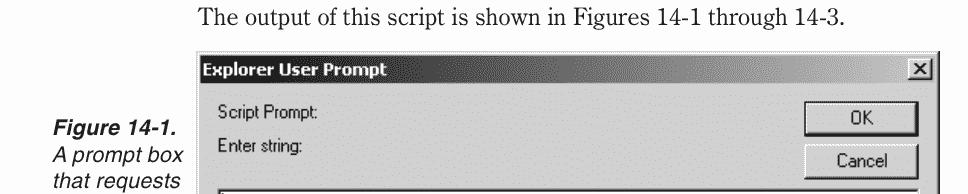


> 警告：这是一个极其原始的加密方案，很容易被破解。这里仅将其作为如何使用 JavaScript 的示例，并非用于加密敏感数据。

#### encipher()

首先，`encipher()` 函数提示用户输入他或她想要编码的字符串。它存储在变量 `str` 中。如果变量的值是布尔值 false，则函数和脚本本身都将终止。终止函数的动机在于，布尔值 false 只能是用户按下取消键的结果。然后使用 for 循环检查字符串的所有字符是否也位于 `list` 持有的字符串中。循环遍历输入字符串的每个字符。看看用于测试字符是否受支持的条件：

```
list.indexOf(str.charAt(i)) == -1
```

`str.charAt(i)` 是循环块当前正在执行的字符。变量 `i` 从字符串第一个字符的索引0开始，并每次递增，直到等于字符串最后一个字符的索引。假设当前字符是 “t”。条件如下所示：

```
list.indexOf("t") == -1
```

如果字符 “t” 未在字符串 `list` 中找到，则参数为 “t” 的 `indexOf()` 方法返回 -1——这正是用于测试返回值的数字。

如果一个字符无效（在 `list` 中未找到），则会显示一条消息并终止函数，间接导致脚本执行结束。

然后函数要求用户输入密钥数字，该数字必须是1到63之间的整数。由于这只是一个示例，因此不测试输入值。如果用户单击取消，则函数终止。否则，函数继续，并通过 `parseInt()` 函数将密钥数字从数字字符串转换为数字。函数 `encode()` 返回的编码字符串将被显示。

#### encode(str, key)

首先，一个空字符串被赋给变量 `code`。使用一个循环将输入字符串的每个字符替换为另一个字符。当前字符（其在 `str` 中的索引等于循环计数器 `i`）在字符串 `list` 中的索引被赋给变量 `ind`。按位 OR 运算符以密钥数字和 `ind` 的值作为操作数。其在 `list` 中的索引等于按位 OR 运算返回的值的字符，就是用于在新字符串中替换当前字符的字符，因此它被赋给保存编码字符串的变量。函数返回新字符串。

## 总结

字符串是 JavaScript 中一种非常有用的数据类型。JavaScript 倾向于以对象的形式组织其元素，因此所有与字符串相关的函数和数据都被组合在一起形成 String 对象。在本章中，我们讨论了 String 对象的方法及其唯一属性 `length`。由于字符串是此对象的直接或间接（取决于你的创建方式）实例，因此你可以创建原型来扩展对象的功能。本章末尾提供的 JavaScript 示例清晰地展示了 String 对象的强大功能。我们没有在本章提供太多示例，因为字符串操作和处理几乎在本书后面的所有示例中都能找到。


## 第15章
### 浏览器对象

*浏览器对象*是与页面元素相对应的特殊对象。这些对象存在于所有页面上，即使页面是“空”的。每个浏览器对象对应于页面的一个元素。例如，*location*对象由与文档当前URL相关的所有属性组成。浏览器对象也被称为*Navigator对象*，但这个术语是Netscape浏览器特有的。有些人甚至将其称为内置对象，但这个术语是不正确的，因为内置对象是另一种明确的对象类型（*Date, Array, Math, String*）。

尽管浏览器对象存在于所有页面上，但它们由嵌套对象组成，这些嵌套对象在很大程度上依赖于内容。浏览器对象是JavaScript中唯一以事件处理器作为其结构一部分的对象类型。尽管这些对象只能通过JavaScript来引用，但它们不是通过JavaScript创建的，而是通过HTML创建的。

#### 对象层次结构

你可能记得，对象通常由也是对象的属性组成。术语*嵌套对象*通常用于描述这种子对象。对象的嵌套结构也称为其*层次结构*。最高级别的对象是没有父对象的对象。浏览器对象是层次结构使用的经典例子，因为它们是深度嵌套的。浏览器对象结构相当复杂，因此很难记住树底部的每个属性。尽管如此，研究层次结构的上部是很重要的。图15-1显示了浏览器对象层次结构的上部。*window*对象是整个结构中最顶层的对象。你在JavaScript中编写的任何脚本都引用浏览器窗口的元素，无论它是否出现在页面本身中。通常，当你引用*window*对象的属性时，不需要指定*window*对象。例如，*document*对象是*window*的属性，但你说*document.write*而不是*window.document.write*。*window*对象在整个脚本中作为默认对象的实现受到它仅仅是层次结构最顶层这一事实的影响。一旦你建立起浏览器层次结构的心理模型并几次编写这些对象的脚本，这个结构就会成为你的第二天性。

#### 创建浏览器对象

如你所知，你不是通过JavaScript创建浏览器对象的。JavaScript只是用于引用这些对象的高级脚本语言。即使在Mosaic或Navigator 1.0成为最流行的浏览器时，浏览器对象就已经存在，但它们最初并不是为了方便与用户交互而实现的。由于无法引用这些对象，在这些早期版本中它们没有存储在内存中。

当HTML文档在Java或JavaScript增强的浏览器中加载时，最顶层的浏览器对象就被建立了。JavaScript允许我们通过它们的属性、方法和事件处理器来处理浏览器对象。

请记住，浏览器对象存在于内存中，因为它们是由浏览器创建的。只有当指定的对象已经被布局时，你才能通过JavaScript引用浏览器对象。否则，JavaScript将生成一个错误，报告该对象没有任何属性。在那一刻，对象确实没有属性，因为对象的元素尚未布局。

请记住，浏览器对象是可见对象。例如，表单字段是一个浏览器对象，并且它是可见的。因为浏览器对象实际上是由HTML组成的，所以它们包含事件处理器，这些处理器能够对与这些页面元素交互的用户的操作做出响应。

#### 最顶层对象

window对象独立位于浏览器层次结构的顶部。因此，这个对象的属性非常基础。在本节中，我们将概述window对象最重要的属性。

##### window

这个对象是层次结构的顶层对象。它包含应用于整个窗口的属性。例如，浏览器的状态栏就是这个对象的一个属性。它还包括一个实际上是对象本身属性。听起来很奇怪？其实不然。当我们讨论窗口和框架时，你会发现更多关于这个引用的信息。当文档包含框架时，单个HTML文档中可以有多个window对象。框架实际上将页面划分为子窗口，因此每个框架都有自己的浏览器对象层次结构。你必须小心处理这些子窗口，因为它们可能会导致冲突，因为多个window对象共享一个属性。例如，无论你加载哪个页面（除非你打开一个没有状态栏的窗口），浏览器中只有一个状态栏。然而，在那个页面上可能有很多window对象在运行，每个对象都可选地引用同一个状态栏。你将在本书后面了解更多关于window对象的内容。

##### document

迄今为止，window对象最有用的属性是document对象。它包含当前在窗口中加载的页面的属性。这个对象的属性依赖于内容，因为每个页面都有自己的轮廓和元素。页面中的几乎所有东西都是document对象的属性，包括链接、图像、表单及其元素、锚点等等。因为每个框架都是一个窗口（window对象），所以它也包含一个document对象。甚至背景和标题也是这个对象的属性。事实上，document对象非常复杂，本书将其分为几个章节，每个章节处理该对象的不同属性。

##### history

history对象也是window对象的属性。它包含用户之前访问过的URL的属性。这些信息存储在历史列表中，可以通过浏览器的菜单访问。如果文档包含框架中的子文档，每个框架都有自己的历史列表或history对象。这个对象还包含方法，使你能够将用户的浏览器发送到历史列表中找到的URL。

##### location

location对象包含当前URL的属性。尽管你可能认为URL是简单的标准结构，但它们远非如此。每个URL中都有多种类型的协议和各个部分。URL中还有可选部分，例如锚点名称和查询。

在图15-2中，你可以看到各种最顶层的浏览器对象，除了那些处理框架的对象。仔细研究该图像，以便你知道每个对象的作用。

## 总结

在这简短的一章中，我们将浏览器对象作为一个非常重要的模型进行了介绍。掌握浏览器对象是在JavaScript中取得成功的关键，因为JavaScript主要是为了通过这些对象实现与用户的交互而设计的。虽然我们没有讨论任何特定的浏览器对象，但你应该对层次结构有一个清晰的了解。在接下来的章节中，我们将讨论与浏览器对象相关的各种概念，包括它们的方法、属性和事件处理器。这些章节不专门讨论浏览器对象，而是将它们作为许多JavaScript主题的关键来呈现。

## 第16章
### 利用状态栏

#### 状态栏

状态栏位于浏览器窗口的底部。它存在于所有浏览器中，包括Navigator和Internet Explorer。它通常显示当前正在加载的文档的状态。每个窗口都有状态栏，除非该窗口是由明确禁用状态栏的脚本打开的。图16-1显示了状态栏，即底部显示“Fascinating!”消息的灰色条。

就JavaScript而言，状态栏是window对象的直接属性。在多框架文档中，每个框架都有一个代表状态栏的属性，但你应该只引用其中一个，以避免不必要的冲突。JavaScript中的状态栏通常由属性window.status表示。你也可以通过self.status引用当前窗口的状态栏，因为self实际上是window对象本身的一个属性。

> **注意：**你也可以将状态栏称为status而不是window.status。然而，为了清晰起见，我们将坚持使用后者。

#### 写入状态栏

你可以通过按钮、链接和用户触发的每个其他事件为window.status赋值。例如，要在用户单击按钮时显示消息，你可以使用以下形式：

```html
<HTML>
<HEAD>
<TITLE>status bar</TITLE>
<SCRIPT LANGUAGE="JavaScript">
<!--
function showMessage()
{
    window.status = "Fascinating!"
}
```


### 为状态栏设置默认值

你已经知道可以通过 status 属性向状态栏写入单行字符串。也可以为状态栏设置一个默认值。只要没有通过 status 属性向状态栏写入值，这个值就会一直保留在状态栏中。该属性的通用语法是 `window.defaultStatus` 或 `defaultStatus`。在事件处理程序中使用此属性时，必须返回 `true`。

看看下面的例子：

```
<HTML>
<HEAD>
<TITLE>status bar</TITLE>
<SCRIPT LANGUAGE="JavaScript">
<!--
function statusSetter()
{
    window.defaultStatus = "Click the link for the Wordware Publishing homepage"
    window.status = "Wordware homepage"
}
// -->
</SCRIPT>
</HEAD>
<BODY>
<A HREF="http://www.wordware.com" onMouseOver = "statusSetter(); return true">WordWare</A>
</BODY>
</HTML>
```

**示例 16-3 (ex16-3.htm)。** 为状态栏设置默认值。

当你在浏览器中加载此页面时，你会看到一个链接。此时，状态栏不包含任何内容（除了可能显示页面已加载的字符串）。当你将指针移到链接上时，状态栏会显示“Wordware homepage”这条消息。当指针移开链接时，该消息会被另一个字符串取代——“Click the link for the Wordware Publishing homepage。”这是对使用 onMouseOut 事件处理程序的一个很好的替代方案。

### 横幅

横幅是经典的 JavaScript 脚本。它们过去是，现在仍然是任何网页的有吸引力的附加内容。最初，横幅出现在状态栏中，依次滚动显示几条消息。有些人更喜欢将横幅放在文本框中，因为他们觉得基于状态栏的横幅对普通冲浪者来说很烦人。横幅有时非常不稳定；它们的速度不均匀，有时还会闪烁。没有办法让它们变得更好。但是，总而言之，它们仍然很有趣。在本节中，我们将看一些不同的类横幅脚本，其中大部分是专门为本书创建的。

### T 横幅

T 横幅模拟打字机。它通过逐个字符输入的方式来显示每条消息。看起来就像是有人以一定的速度输入消息，并在完成后将其删除。首先，看看脚本：

```
<HTML>
<HEAD>
<TITLE>T-Banner</TITLE>
<SCRIPT LANGUAGE="JavaScript">
<!--
// set speed of banner (pause in milliseconds between characters)
var speed = 100 // decrease value to increase speed (must be positive)
// set pause between completion of message and beginning of following one
var pause = 1000 // increase value to increase pause
// set initial values
var timerID = null
var bannerRunning = false
// create global array
var ar = new Array()
// assign the strings to the array's elements
ar[0] = "Welcome to this JavaScript page"
ar[1] = "I hope you enjoy the T-Banner script"
ar[2] = "It's kind of a cool banner"
ar[3] = "Don't forget to check out my other scripts"
// set index of first message to be displayed first
var currentMessage = 0
// set index of last character to be displayed first
var offset = 0
// stop the banner if it is currently running
function stopBanner()
{
    // if banner is currently running
    if (bannerRunning)
    {
        // stop the banner
        clearTimeout(timerID)
        // timer is now stopped
        bannerRunning = false
    }
}
// start the banner
function startBanner()
{
    // make sure the banner is stopped
    stopBanner()
    // start the banner from the current position
    showBanner()
}
// type in the current message
function showBanner()
{
    // assign current message to variable
    var text = ar[currentMessage]
    // if current message has not finished being displayed
    if (offset < text.length)
    {
        // if last character of current message is a space
        if (text.charAt(offset) == " ")
        {
            // skip the current character
            offset++
        }
        // assign the up-to-date to-be-displayed substring
        // second argument of method accepts index of last char plus one
        var partialMessage = text.substring(0, offset + 1)
        // display partial message in status bar
        window.status = partialMessage
        // increment index of last character to be displayed
        offset++
        // recursive call after specified time
        timerID = setTimeout("showBanner()", speed)
        // banner is running
        bannerRunning = true
    } else
    {
        // reset offset
        offset = 0
        // increment subscript (index) of current message
        currentMessage++
        // if subscript of current message is out of range
        if (currentMessage == ar.length)
        {
            // wrap around (start from beginning)
            currentMessage = 0
        }
        // recursive call after specified time
        timerID = setTimeout("showBanner()", pause)
        // banner is running
        bannerRunning = true
    }
}
// -->
</SCRIPT>
</HEAD>
<BODY>
</BODY>
</HTML>
```

**示例 16-4 (ex16-4.htm)。** *T 横幅脚本。*

当你在浏览器中加载此页面时，你会看到一个链接。此时，状态栏不包含任何内容（除了可能显示页面已加载的字符串）。当你将指针移到链接上时，状态栏会显示“Wordware homepage”这条消息。当指针移开链接时，该消息会被另一个字符串取代——“Click the link for the Wordware Publishing homepage。”这是对使用 onMouseOut 事件处理程序的一个很好的替代方案。

### 横幅

横幅是经典的 JavaScript 脚本。它们过去是，现在仍然是任何网页的有吸引力的附加内容。最初，横幅出现在状态栏中，依次滚动显示几条消息。有些人更喜欢将横幅放在文本框中，因为他们觉得基于状态栏的横幅对普通冲浪者来说很烦人。横幅有时非常不稳定；它们的速度不均匀，有时还会闪烁。没有办法让它们变得更好。但是，总而言之，它们仍然很有趣。在本节中，我们将看一些不同的类横幅脚本，其中大部分是专门为本书创建的。

### T 横幅

T 横幅模拟打字机。它通过逐个字符输入的方式来显示每条消息。看起来就像是有人以一定的速度输入消息，并在完成后将其删除。首先，看看脚本：

```
<HTML>
<HEAD>
<TITLE>T-Banner</TITLE>
<SCRIPT LANGUAGE="JavaScript">
<!--
// set speed of banner (pause in milliseconds between characters)
var speed = 100 // decrease value to increase speed (must be positive)
// set pause between completion of message and beginning of following one
var pause = 1000 // increase value to increase pause
// set initial values
var timerID = null
var bannerRunning = false
// create global array
var ar = new Array()
// assign the strings to the array's elements
ar[0] = "Welcome to this JavaScript page"
ar[1] = "I hope you enjoy the T-Banner script"
ar[2] = "It's kind of a cool banner"
ar[3] = "Don't forget to check out my other scripts"
// set index of first message to be displayed first
var currentMessage = 0
// set index of last character to be displayed first
var offset = 0
// stop the banner if it is currently running
function stopBanner()
{
    // if banner is currently running
    if (bannerRunning)
    {
        // stop the banner
        clearTimeout(timerID)
        // timer is now stopped
        bannerRunning = false
    }
}
// start the banner
function startBanner()
{
    // make sure the banner is stopped
    stopBanner()
    // start the banner from the current position
    showBanner()
}
// type in the current message
function showBanner()
{
    // assign current message to variable
    var text = ar[currentMessage]
    // if current message has not finished being displayed
    if (offset < text.length)
    {
        // if last character of current message is a space
        if (text.charAt(offset) == " ")
        {
            // skip the current character
            offset++
        }
        // assign the up-to-date to-be-displayed substring
        // second argument of method accepts index of last char plus one
        var partialMessage = text.substring(0, offset + 1)
        // display partial message in status bar
        window.status = partialMessage
        // increment index of last character to be displayed
        offset++
        // recursive call after specified time
        timerID = setTimeout("showBanner()", speed)
        // banner is running
        bannerRunning = true
    } else
    {
        // reset offset
        offset = 0
        // increment subscript (index) of current message
        currentMessage++
        // if subscript of current message is out of range
        if (currentMessage == ar.length)
        {
            // wrap around (start from beginning)
            currentMessage = 0
        }
        // recursive call after specified time
        timerID = setTimeout("showBanner()", pause)
        // banner is running
        bannerRunning = true
    }
}
// -->
</SCRIPT>
</HEAD>
<BODY>
</BODY>
</HTML>
```

**示例 16-4 (ex16-4.htm)。** *T 横幅脚本。*


##### 全局语句

```javascript
// set speed of banner (pause in milliseconds between characters)
var speed = 100 // decrease value to increase speed (must be positive)
// set pause between completion of message and beginning of following one
var pause = 1000 // increase value to increase pause
// set initial values
var timerID = null
var bannerRunning = false
// create global array
var ar = new Array()
// assign the strings to the array's elements
ar[0] = "Welcome to this JavaScript page"
ar[1] = "I hope you enjoy the T-Banner script"
ar[2] = "It is designed to be more stable than regular banners"
ar[3] = "Don't forget to check out our other scripts"
// set index of first message to be displayed first
var currentMessage = 0
// set index of last character to be displayed first
var offset = 0
```

首先，横幅的速度被设置为100。这等于消息中每个字符之间的暂停时间（以毫秒为单位）。一条消息（字符串）完成显示与开始删除之间的暂停时间（以毫秒为单位）被赋值给变量pause。当前超时的标识符被赋予null值，因为尚未设置超时。横幅的当前状态（由于尚未运行，所以为false）被赋值给变量bannerRunning。然后创建一个数组来保存要显示为横幅消息的字符串。第一个字符串被赋给数组的第一个元素ar[0]，依此类推。数字0被赋给currentMessage，因为首先显示的消息是ar[0]。状态栏中某一时刻显示的最后一个字符的索引被赋值给全局变量offset。它被设置为零，因为横幅的首次出现仅包含一个字符——第一个字符——其索引为零。

#### stopBanner()

```javascript
// stop the banner
function stopBanner()
{
    // if banner is currently running
    if (bannerRunning)
    {
        // stop the banner
        clearTimeout(timerID)
        // banner is now stopped
        bannerRunning = false
    }
}
```

此函数用于停止横幅。如果横幅正在运行，则清除当前超时。变量bannerRunning被设置为false，因为横幅已停止。

#### startBanner()

```javascript
// start the banner
function startBanner()
{
    // make sure the banner is stopped
    stopBanner()
    // start the banner from the current position
    showBanner()
}
```

此函数调用stopBanner函数以确保横幅已停止，然后调用showBanner函数以开始运行T型横幅。

#### showBanner()

```javascript
// type in the current message
function showBanner()
{
    // assign current message to variable
    var text = ar[currentMessage]
    // if current message has not finished being displayed
    if (offset < text.length)
    {
        // if last character of current message is a space
        if (text.charAt(offset) == " ")
        // skip the current character offset++
        // assign the up-to-date to-be-displayed substring
        // second argument of method accepts index of last char plus one
        var partialMessage = text.substring(0, offset + 1)
        // display partial message in status bar
        window.status = partialMessage
        // increment index of last character to be displayed offset++
        // recursive call after specified time
        timerID = setTimeout("showBanner()", speed)
        // banner is running
        bannerRunning = true
    } else
    {
        // reset offset
        offset = 0
        // increment subscript (index) of current message
        currentMessage++
        // if subscript of current message is out of range
        if (currentMessage == ar.length)
        // wrap around (start from beginning)
            currentMessage = 0
        // recursive call after specified time
        timerID = setTimeout("showBanner()", pause)
        // banner is running
        bannerRunning = true
    }
}
}
```

当前消息被赋值给局部变量text。然后函数沿两个方向之一继续。如果当前消息仍在显示中，即当前消息中最后一个已显示字符的索引是最后一个字符或更小，则选择第一条路径。此时表达式`offset < text.length`的结果为true。如果本次函数执行中要显示的最后一个字符是空格，则offset的值会递增，从而不浪费时间在输入空格字符上。当前迭代中需要显示的子字符串被赋值给局部变量partialMessage。由于substring方法的第二个参数是最后一个字符的索引加一，所以它被设置为`offset + 1`。当前子字符串显示在状态栏中，offset的值递增。函数在speed毫秒后再次被调用。

当到达当前消息的末尾时，会走另一条执行路径。在这种情况下，变量offset被赋予零值，即字符串第一个字符的索引。为了允许发布数组中的下一条消息，存储当前消息的数组元素的索引会递增。如果currentMessage的新值超出范围，则将其设置为零，这样下一条消息就是第一条。函数在pause毫秒后被递归调用。这一次函数应该走第一条路径，因为消息才刚刚开始。

#### 事件处理器

当文档加载完成时，onLoad事件处理器会调用startBanner函数。

## R型横幅

虽然T代表打字机，但R可能代表随机，表示这种特殊横幅的风格。消息通过以随机顺序弹出消息的各种字符来显示。这种横幅的另一个特殊效果是从右到左的滚动动作。这个效果是通过让每个弹出的字符占据三个字符的空间来实现的。看一下脚本：

```html
<HTML>
<HEAD>
<TITLE>R-Banner</TITLE>
<SCRIPT LANGUAGE="JavaScript">
<!--
// set speed of banner (pause in milliseconds between addition of new character)
var speed = 10 // decrease value to increase speed (must be positive)
// set pause between completion of message and beginning of following one
var pause = 1500 // increase value to increase pause
// set initial values
var timerID = null
var bannerRunning = false
// create array
var ar = new Array()
// assign the strings to the array's elements
ar[0] = "Welcome to my JavaScript page"
ar[1] = "I hope you enjoy the R-Banner script"
ar[2] = "It is pretty cool"
ar[3] = "Don't forget to check out my other scripts"
// assign index of current message
var message = 0
// empty string initialization
var state = ""
// no value is currently being displayed
clearState()
// stop the banner if it is currently running
function stopBanner()
{
    // if banner is currently running
    if (bannerRunning)
    {
        // stop the banner
        clearTimeout(timerID)
        // banner is now stopped
        bannerRunning = false
    }
}
// start the banner
function startBanner()
{
    // make sure the banner is stopped
    stopBanner()
    // start the banner from the current position
    showBanner()
}
// assign state a string of "0" characters of the length of the current message
function clearState()
{
    // initialize to empty string
    state = ""
    // create string of same length containing 0 digits
    for (var i = 0; i < ar[message].length; ++i)
    {
        state += "0"
    }
}
// display the current message
function showBanner()
{
    // if the current message is done
    if (getString())
    {
        // increment message
        message++
        // if new message is out of range wrap around to first message
        if (ar.length <= message)
            message = 0
        // new message is first displayed as empty string
        clearState()
    }
}
```

利用状态栏 287

16 章


## 第288章 第16章

```javascript
// 在暂停毫秒后显示下一个字符
timerID = setTimeout("showBanner()", pause);
// 横幅现在正在运行
bannerRunning = true
} else
{
// 初始化为空字符串
var str = ""
// 构建要显示的字符串（只显示当前已选择的字符）
for (var j = 0; j < state.length; ++j)
{
str += (state.charAt(j) == "1") ? Ar[message].charAt(j) : " "
}
// 将部分字符串放入状态栏
window.status = str
// 在速度毫秒后添加另一个字符
timerID = setTimeout("showBanner()", speed);
// 横幅现在正在运行
bannerRunning = true
}
}
function getString()
{
// 将变量设置为 true（除非被证明不是，否则它将保持 true）
var full = true
// 如果在字符串中找到空闲空间（一个未显示的字符），则将变量设置为 false
for (var j = 0; j < state.length; ++j)
{
// 如果当前消息索引 j 处的字符尚未放入显示的字符串中
if (state.charAt(j) == 0)
full = false
}
// 如果没有找到空位则立即返回 true（避免后面的无限循环）
if (full)
return true
// 搜索随机数直到找到空闲空间（通过 break 语句中断）
while (1)
{
// 一个随机数（介于 0 和 state.length - 1 == message.length - 1 之间）
var num = getRandom(ar[message].length)
// 如果找到空闲空间则跳出无限循环
if (state.charAt(num) == "0")
break
}
// 在找到的位置将 0 字符替换为 1 字符
state = state.substring(0, num) + "1" + state.substring(num + 1,state.length)
// 返回 false，因为字符串未满（找到了空闲空间）
return false
}
function getRandom(max)
{
    return Math.round((max - 1) * Math.random())
}
// -->
</SCRIPT>
</HEAD>
<BODY onLoad="startBanner()">
</BODY>
</HTML>
```

**示例 16-5 (ex16-5.htm).** *一个 R-banner。*

##### 全局语句

```javascript
// 设置横幅速度（添加新字符之间的暂停毫秒数）
var speed = 10 // 减小值以增加速度（必须为正数）
// 设置消息完成与开始下一个消息之间的暂停
var pause = 1500 // 增加值以增加暂停时间
// 设置初始值
var timerID = null
var bannerRunning = false
// 创建数组
var ar = new Array()
// 将字符串分配给数组的元素
ar[0] = "欢迎来到我的 JavaScript 页面"
ar[1] = "希望你喜欢这个 R-Banner 脚本"
ar[2] = "它非常酷"
ar[3] = "别忘了看看我的其他脚本"
// 分配当前消息的索引
var message = 0
// 空字符串初始化
var state = ""
// 当前没有显示任何值
clearState()
```

最初，数字 10 被赋值给变量 `speed`，表示当前消息中两个连续字符弹出之间的暂停毫秒数。一个较长的暂停被赋值给变量 `pause`，表示当前消息完成和删除之间的毫秒数。一个空值被赋值给全局变量 `timerID`，布尔值 `false` 被赋值给变量 `bannerRunning`。预定义消息存储在数组中。变量 `message` 被赋值为零，这是数组中第一个要显示的元素的索引，即 `ar[0]`。

全局语句部分的第二部分只包含两个语句，但它们对于理解整个脚本很重要。此部分中的第一个语句将一个空字符串赋值给全局变量 `state`。接下来调用 `clearState()` 函数。它通过向全局变量 `state` 赋值 n 个“0”字符（其中 n 是当前消息的长度）来修改其值。变量 `state` 基本上由 0 和 1 构成。假设第一个字符是 0。这意味着当前消息的第一个字符尚未弹出。第二个字符和所有其他字符也是如此。因此，字符串开始时全是 0，当所有字符都变成 1 时，消息完成。

#### stopBanner()

请参阅 T-banner 部分中关于此函数的说明。

#### startBanner()

请参阅 T-banner 部分中关于此函数的说明。

#### clearState()

有关此函数的信息，请参见上文。

#### getRandom(max)

这简单地返回一个介于 0 和 max − 1 之间的整数（请参阅第13章中关于 *random()* 的说明）。

#### getString()

```javascript
function getString()
{
    // 将变量设置为 true（除非被证明不是，否则它将保持 true）
    var full = true
    // 如果在字符串中找到空闲空间（一个未显示的字符），则将变量设置为 false
    for (var j = 0; j < state.length; ++j)
    {
        // 如果当前消息索引 j 处的字符尚未放入显示的字符串中
        if (state.charAt(j) == 0)
            full = false
    }
    // 如果没有找到空位则立即返回 true（避免后面的无限循环）
    if (full)
        return true
    // 搜索随机数直到找到空闲空间（通过 break 语句中断）
    while (1)
    {
        // 一个随机数（介于 0 和 state.length − 1 == message.length − 1 之间）
        var num = getRandom(ar[message].length)
        // 如果找到空闲空间则跳出无限循环
        if (state.charAt(num) == "0")
            break
    }
    // 在找到的位置将 0 字符替换为 1 字符
    state = state.substring(0, num) + "1" + state.substring(num + 1, state.length)
    // 返回 false，因为字符串未满（找到了空闲空间）
    return false
}
```

最初，变量 `full` 被初始化为 `true`。使用一个无限循环（由 `break` 语句终止）来遍历 `state` 字符串的所有 0 和 1 字符。如果找到一个 0 字符，变量 `full` 被改为 `false`。在随机横幅中，当找到一个空闲空间（即 0）时，并不必须中断循环（如上面 `getString()` 中所做的那样），因为效率不是关注的重点。

函数的剩余部分仅在有空闲空间可用时执行。

一个无限循环在每次迭代中生成一个新的随机索引，并检查该索引处的空间是否被占用。只要随机索引处的空间被占用，循环就继续执行。当最终找到一个空闲空间时，循环中断，返回空闲空间的索引 `num`。

`state` 的值通过将索引 `num` 处的 0 字符替换为 1 字符来更新。函数终止时返回 `false`，表示消息未完成。

#### showBanner()

与 T-banner 脚本一样，这是主函数。调用 `getString()` 函数来更新 `state` 的值，并确定消息是否已完成。如果已完成，通过递增 `message` 的值（表示当前消息所在数组元素的索引）将当前消息更新为下一个消息。如果新值超出范围，则重置为初始零值。如上所述，调用 `clearState()` 函数来设置变量 `state`。然后在 `pause` 毫秒后递归调用该函数。

在消息尚未完成的普通情况下，会生成特殊的显示效果。将一个空字符串赋值给局部变量 `str`，准备累积要显示的字符。一个 `for` 循环遍历字符串 `ar[message]` 的字符。如果在字符串 `state` 的同一索引处有一个 1，则将 `ar[message]` 中的字符附加到 `str` 的末尾。如果在字符串 `state` 中找到一个 0 字符，则附加一个替代字符串。创建从右到左滚动效果的唯一方法是使用一个相当长的、包含几个空格的替代字符串。由于空格的水平跨度非常小（字符宽度不均匀），单个空格的替代字符串将创建一个友好的从左到右移动！使用空替代字符串会压缩字符串，并创建不同的从右到左移动。构建好的字符串被放入状态栏中，并在 `speed` 毫秒的暂停后递归调用该函数。

## 事件处理程序

当文档完全加载时，`onLoad` 事件处理程序会调用 `startBanner()` 函数。

## N-banner

N（普通）banner 在状态栏中从右向左滚动。你可能在网页上见过数百个这样的横幅。这是一个实现此类横幅的脚本：

```html
<HTML>
<HEAD>
<TITLE>N-Banner</TITLE>
```


## 292 ■ 第16章

```javascript
<SCRIPT LANGUAGE="JavaScript">
<!--
function scrollBanner(seed)
{
    // 设置每次移动之间的暂停时间（毫秒）
    var speed = 10
    // 将一个空格字符串赋给变量（空格在状态栏左侧填充）
    var str = " "
    // 创建全局数组
    var ar = new Array()
    // 将字符串赋给数组元素
    ar[0] = "Welcome to my JavaScript page. "
    ar[1] = "I hope you enjoy the N-Banner script. "
    ar[2] = "It is kind of cool. "
    ar[3] = "Don't forget to check out my other scripts. "
    // 将所有消息用无分隔符连接成一个字符串变量
    var total = ar.join("")
    // 如果消息尚未到达状态栏左侧
    if (seed > 0)
    {
        // 将一个由seed个空格组成的字符串赋给变量
        for (var i = 0; i < seed; ++i)
        {
            str += " "
        }
        // 将消息追加到输出字符串末尾
        str += total
        // 消息向左移动一个位置
        seed--
        // 将包含递归调用的表达式赋给变量，参数以字符串形式传递
        var cmd = "scrollBanner(" + seed + ")"
        // 将计算出的消息放置在状态栏
        window.status = str
        // 在speed毫秒后进行递归调用
        timerID = setTimeout(cmd, speed)
    } else
        // 如果总消息的子串仍然显示在状态栏中
        if (-seed < total.length)
        {
            // 将未滑出左侧的消息部分赋给变量
            str += total.substring(-seed, total.length)
            // 消息向左移动一个位置
            seed--
            // 将包含递归调用的表达式赋给变量，参数以字符串形式传递
            var cmd = "scrollBanner(" + seed + ")"
            // 将计算出的消息放置在状态栏
            window.status = str
            // 在speed毫秒后进行递归调用
            timerID = setTimeout(cmd, speed)
        } else
            {
            // 将一个空格字符串赋给状态栏
            window.status = str
            // 在speed毫秒后以初始位置递归调用函数
            timerID = setTimeout("scrollBanner(100)", speed)
        }
    }
    // -->
</SCRIPT>
</HEAD>
<BODY onLoad="scrollBanner(100)">
</BODY>
</HTML>
```

*示例 16-6 (ex16-6.htm).* 一个普通的N型横幅广告。

该横幅广告的一个主要优点是它不包含任何全局语句，并且只包含一个函数。

**scrollBanner(seed)**

横幅广告的速度和消息与之前的横幅广告一样进行指定。一个单空格字符串被赋给变量 `str`。它通过在边框和消息最左侧之间留出一个空格来填充状态栏的左侧。由于这个横幅广告是一个接一个地滚动消息，所有消息通过 Array 对象的 `join()` 方法组合成一个字符串。

该函数接受一个参数，该参数被赋给参数 seed。seed 的值决定了消息距离状态栏左侧的距离。空格字符被用作占位符。通常从距离左侧100个空格处开始横幅广告，因此函数最初被调用时使用值100。

该函数选择三条路径中的一条。如果 seed 的值为正数，则选择第一条路径；也就是说，如果消息尚未到达状态栏的左侧面板。在这种情况下，使用一个循环将由 seed 个空格字符组成的字符串连接到变量 `str`。然后将整个消息连接到 `str`。请注意，如果放置在状态栏中的字符串超过了状态栏的最大长度，则多余字符将不会显示。在将整个消息连接到累积字符串之后，seed 的值递减，在下一次迭代时产生滚动效果。递归调用以如下形式在字符串中构建：

```
var cmd = "scrollBanner(" + seed + ")"
```

假设 seed 的值为 50。那么 `cmd` 的值就是 `"scrollBanner(50)"`。这里使用字符串字面量是因为局部变量或参数不能作为函数的参数被 `setTimeout` 求值。然后将累积字符串放置在状态栏中，并在暂停 speed 毫秒后递归调用该函数。

如果 seed 的绝对值超过消息的长度，则此表达式的求值结果为 false。这意味着已经移出左侧范围的消息长度大于或等于消息的长度，意味着实际上没有消息部分留在状态栏中。如果此表达式的求值结果为 true，则只有一部分消息越过了左侧边界。

如果上述表达式的求值结果为 true，则子字符串 `total.substring(-seed, total.length)` 被连接到变量 `str`。这个子字符串代表尚未超出部分（`|seed|` 等于已处置字符的数量）。命令块的其余部分与函数采用第一条路径时使用的部分相同。函数可以采取的第三条路径是最简单的。它将 `str`（一个单空格字符串）的值放置在状态栏中。然后以初始参数100递归调用该函数。

## 总结

本章介绍了状态栏编程。我们看到了如何在状态栏中显示与链接相关的消息以及默认值。我们强调了 JavaScript 的先驱脚本之一——横幅广告，并讨论了为本书专门开发的一些独特横幅广告以及其他常见横幅广告。在 JavaScript 方面，我们讨论了 `window` 对象的两个属性：`status` 和 `defaultStatus`。除了启用横幅广告等有趣应用外，状态栏还可以用作输出设备，在调试脚本时显示关键值。


## 第17章

## URL 与 JavaScript

### URL 入门教程

JavaScript 包含许多用于处理 URL 的属性和方法。在讨论 JavaScript 的支持之前，有必要对 URL 进行一般性描述。

URL 是统一资源定位符，是指定电子资源位置的标准方式。简而言之，它是一个网络地址，例如 http://www.wordware.com。URL 的定义源自自 1990 年以来一直在使用的万维网全球信息倡议引入的概念。URL 使不同的 Internet 协议可以访问 Internet 资源。当在网上冲浪时，你经常会在浏览器的“地址”框中遇到 URL。这些 URL 通常以“http:”开头，但也支持 FTP 和 Gopher 等其他协议。甚至电子邮件地址也可以指定为 URL。

URL 是一种非常方便、简洁的方式，可以将人员和应用程序定向到文件或其他电子资源。

### 通用 URL 语法

通常，URL 编写格式如下：

**<scheme>:<scheme-specific-part>**

URL 包含正在使用的方案的名称，后跟冒号和字符串。*scheme* 指的是正在使用的协议。有效的方案包括 FTP（文件传输协议）和 HTTP（超文本传输协议）。作为方案支持的字符是小写字母“a”到“z”，以及字符加号（“+”）、句点（“.”）和连字符（“-”）。为了灵活性，程序应将大写字母视为小写字母。例如，应同时接受“HTTP”和“http”。方案的示例有“http”、“ftp”、“gopher”和“news”。方案指示应用程序或人员如何处理该特定资源。

大多数方案包含两种不同类型的信息：

- 资源所在的 Internet 机器
- 到该资源的完整路径

此类方案通常通过两个斜杠（//）与机器地址分隔，而机器地址与完整路径仅通过一个斜杠（/）分隔。因此，通用格式为：

```
scheme://machine.domain/full-path-of-file
```

作为练习，让我们看一个简单的 URL：

```
http://www.geocities.com/~chuckeasttom/index.htm
```

该 URL 的方案是 http，代表超文本传输协议。机器的 Internet 地址是 www.geocities.com，到特定文件的路径是 /~chuckeasttom/index.htm。你会发现路径部分有时以斜杠结尾。这表明该路径指向的是目录而不是文件。在这种情况下，服务器会返回所有文件的目录列表，或者如果可用，则返回默认文件。默认文件名通常是 index.html 或 home.html，但也使用其他变体。

### URL 方案

#### 超文本传输协议 (HTTP)

HTTP 是专门为万维网设计的 Internet 协议，因此网络冲浪者最常见到它。其通用语法为：

```
http://<host>:<port>/<path>?<searchpart>
```

主机是 WWW 服务器的 Internet 地址，例如 www.geocities.com，端口是要连接的端口号。在大多数情况下，可以省略端口以及冒号分隔符，它默认为标准“80”。路径告诉服务器请求哪个文件。searchpart 非常重要。它可用于将信息传递给服务器，通常传递给可执行的 CGI 脚本。它也可以被其他语言引用，包括你即将发现的 JavaScript。另一个常用的字符是井号（#）。它用于引用命名锚点。锚点通常用于网页，以便能够从页面的一个部分链接到另一个部分。

#### 文件传输协议 (FTP)

FTP 通常用于在 Internet 上分发和传输文件。其通用语法为：

```
ftp://<user>:<password>@<host>:<port>/<cwd1>/<cwd2>/.../<cwdN>/<name>;type=<typecode>
```

当联系提供匿名登录的站点时，可以省略用户和密码，包括分隔符冒号和后面的 @ 符号。主机和端口与 HTTP URL 规范中的完全相同。<cwd1>/<cwd2>/.../<cwdN> 指的是客户端必须使用的一系列“更改目录”（在 Unix 中为 cd）命令，以从主目录移动到包含所需文件的目录。由于大多数服务器使用 Unix 操作系统，你可以通过在命令行输入 pwd 来打印工作（当前）目录。name 是所需文件的

全称，即操作系统所识别的名称。其中的 `; type=<typecode>` 部分允许您指定传输模式（ASCII 或二进制）。大多数系统未配置为能正确处理这种尾部规范，有些系统甚至会因此产生误解。

#### Gopher 协议（Gopher）

Gopher 协议对于 JavaScript 脚本编写者来说并不重要。其语法与 HTTP 非常相似：

```
gopher://<host>:<port>/<gopher-path>
```

#### 电子邮件（Mailto）

Mailto URL 方案与前三种方案不同，因为它不标识文件的位置，而是标识某人的电子邮件地址。其语法也大相径庭：

```
mailto:<account@site>
```

account@site 是您希望向其发送邮件的人员的 Internet 电子邮件地址。大多数 WWW 浏览器，包括主流的 Navigator 和 IE，都支持在 HTML 文档中编码的这种方案。

#### Usenet 新闻（News）

News URL 方案允许您引用 Usenet 新闻组或该新闻组中的特定文章。语法是以下之一：

```
news:<newsgroup-name>
news:<message-id>
```

newsgroup-name 是 Usenet 的新闻组名称（例如 comp.lang.javascript），浏览器将从中检索所有标题文章（可以在浏览器设置中指定最大数量）。message-id 对应要获取的特定文章的 message-ID。它可以在文章的头信息中找到。

#### 特定于主机的文件名（File）

File URL 方案指示客户端计算机可以获取的文件。File 方案的语法为：

```
file://<host>:<path>
```

host 是系统的完全限定域名，path 是到所需文件的分层目录路径。将 host 留空或指定 localhost 以引用客户端的本地文件。

#### JavaScript 语句（javascript）

此方案计算冒号后的表达式。如果表达式可以计算为字符串，则会打开一个新页面并显示该字符串。如果表达式是未定义的，则不会打开新页面。

#### 其他方案

还有几种其他方案远超本书的范围。请记住，我们正在处理的是 JavaScript，因此我们只关注脚本中可能需要的方案。

## location 对象

`location` 对象表示一个完整的 URL。因此，它是 window 对象的一个属性。与往常一样，在引用 `location` 的属性或方法时，指定 window 对象是可选的。`location` 对象的每个属性代表 URL 的不同部分。以下 URL 语法显示了对象属性之间的关系：

`protocol//hostname:port pathname search hash`

`location` 对象属于包含 JavaScript 脚本的窗口。单框架页面只有一个 `location` 对象。但是，使用多个框架的页面由每个框架一个 `window.location`（`location`）对象以及主框架集文档一个对象组成。例如，一个包含两个框架的页面由三个 URL 组成，每个 URL 都有一个可用的 `location` 对象。

因为 `window` 是脚本中的默认对象，您可以使用 `location` 而不是 `window.location`。但是，如果使用此对象指定事件处理程序脚本，则必须指定完整的 `window.location`。由于 JavaScript 中静态 HTML 作用域的限制，调用 `location` 而不指定对象名称等同于 `document.location`，它目前是 `document.URL` 的同义词。

### location 属性

如您所知，`location` 对象由属性和方法组成。方法是后来添加的，在 Navigator 3.0 中首次亮相。在本节中，我们基于“URL 速成课程”一节来讨论该对象的属性。

#### href

`href` 属性是 HTML 脚本中最常用的属性。标识符 HREF 代表“超文本引用”。此属性提供调用 `window` 对象的完整 URL 字符串。此属性既可用于读取，也可用于设置。通过为此属性分配一个字符串，您可以更改窗口中页面的 URL。例如，如果您希望在用户单击按钮时加载 Wordware 的主页，可以使用以下语法：

```html
<HTML>
<SCRIPT LANGUAGE="JavaScript">
<!--
function load()
{
    location.href = 'http://www.wordware.com'
}
// -->
</SCRIPT>
<FORM>
<INPUT TYPE="button" VALUE=" load page " onClick="load()">
</FORM>
</HTML>
```


您还可以通过读取 URL 值来检索当前窗口（准确地说是当前窗口对象）的完整 URL。例如，如果您想要当前文件的完整 URL，但不包括文件名本身，可以使用以下脚本片段：

```javascript
var url = location.href
var lastSlash = url.lastIndexOf("/")
var partialURL = url.substring(0, lastSlash + 1)
```

查看以下脚本：

```javascript
var location = "Ben"
```

此语句不会生成错误，因为“location”不是保留字。但是，它会删除在赋值 location 的函数内部的 location 对象。由于 location 不是浏览器对象而是一个简单变量，因此可以从函数外部完全访问它。

# 300 ■ 第 17 章

Microsoft Internet Explorer 和 Netscape Navigator 对待 location.href 属性以及整个 location 对象的方式不同。以下显示了差异：

```html
<HTML>
<HEAD>
<TITLE>location test</TITLE>
</HEAD>
<SCRIPT LANGUAGE="JavaScript">
<!--
function load()
{
    location.href = "http://www.microsoft.com"
    alert(location.href)
}
// -->
</SCRIPT>
<BODY onLoad="load()">
</BODY>
</HTML>
```

假设此文件位于 http://www.geocities.com。当 Netscape Navigator 加载页面时，它会在内存中的某个单元格中保存加载的 URL。只有当另一个页面开始加载（数据正在传输）时，该单元格的值才会被修改以匹配新的 URL。当您读取 location.href 的值时，您读取的是该单元格的值。但是，当您将表示另一个 URL 的字符串分配给它时，该单元格中保存的值不会立即更改。只有在服务器上找到指定 URL 处的页面后，该单元格的值才会更新。Microsoft 的浏览器在这种情况下有所不同。当用户为 location.href 分配一个字符串时，它会自动更新内存中的相应单元格。因此，如果您在分配值后立即显示属性 location.href 的值，则会显示分配的值。另一方面，在 Navigator 中，仍然显示原始 URL，因为尚未找到新 URL 处的文件。让我们总结一下。上述脚本在主要浏览器上显示的值如下：

- Netscape Navigator—http://www.geocities.com
- Microsoft Internet Explorer—http://www.microsoft.com

根据您的浏览器，location.href 的值可能会用非字母数字字符的 ASCII 等效项进行编码。这些字符显示为百分号 (%) 后跟该字符的 ASCII 代码。最常编码的字符是空格，%20。您可以在 unescape() 函数下运行此类 URL，将它们转换为 ISO Latin-1 格式。

假设您有一个名为 foo.html 的 HTML 文件，位于某个目录中，在 Mac 和 Windows 95 上通常称为文件夹。在浏览器中加载此目录的完整路径通常应显示该目录所有文件的列表，前提是该目录中不包含服务器支持的默认文件名。您可以使用以下脚本允许用户只需单击一个按钮即可查看文件列表：

```html
<HTML>
<HEAD>
<TITLE>Directory listing</TITLE>
</HEAD>
<SCRIPT LANGUAGE="JavaScript">
<!--
function getListing()
{
    var url = location.href
    var lastSlash = url.lastIndexOf("/")
    location.href = url.substring(0, lastSlash + 1)
}
// -->
</SCRIPT>
<BODY>
<FORM>
<INPUT TYPE="button" VALUE=" view directory listing " onClick="getListing()">
</FORM>
</BODY>
</HTML>
```


**图 17-2.** 单击“view directory listing”按钮将显示目录的文件。

17

**章**

#### hash

锚点是其他数据指向的标记。它使您能够创建指向给定网页中某个特定位置的链接。假设您有一个提供不同品牌各种 VCR 型号信息的网页。寻找 Sony VCR 特定信息的用户不应该滚动浏览其他品牌，


## 第17章

#### 命名锚点

因此，你可以在名称 Sony 附近某处创建一个命名锚点。锚点使用以下语法创建：

```
<A NAME="sony1">Sony VCRs</A>
```

文本“Sony VCRs”在页面上显示为普通文本，但它充当锚点。你可以通过一个指向锚点的简单链接将用户引导至“Sony VCRs”部分，形式如下：

```
<A HREF="#sony1">Get information on Sony VCRs</A>
```

在这种情况下，链接的 URL 是锚点名称前加一个井号（#）。当用户点击链接“Get information on Sony VCRs”时，浏览器会自动“滚动”到名为“sony1”的锚点（你当然看不到滚动过程）。你也可以从另一个页面指向该锚点。例如，假设 VCR 页面的完整 URL 是 `http://www.vcr.com/information/index.html`。现在，假设你想从页面 `http://www.electronics.com/VCRlinks/new.html` 提供一个指向包含 VCR 信息页面的链接，特别是 Sony 部分。你可以通过在 electronics 文件中的某处包含 VCR 文件的 URL 以及 Sony 锚点名称来完成此任务：

```
<A HREF="http://www.vcr.com/information/index.html#sony1">Get information on Sony VCRs</A>
```

这种形式使你能够指定文档 URL 以及特定的锚点名称。如果仅指定锚点名称，则假定锚点位于当前文档中，就像你指定一个没有完整路径的文件名，它被假定为位于与 HTML 文档相同的目录中一样。此类 URL 引用被称为相对引用或部分引用。

当你点击一个指向包含命名锚点引用的 URL 的链接时，新的 URL 或位置由井号（#）后跟锚点名称组成。URL 的这一部分被视为 URL 的一部分，就像路径或文件名一样。链接到锚点后，用户发起的滚动不会影响 URL（或 location.href 值）。

JavaScript 为 URL 中的当前锚点引用提供了一个属性。此属性名为 hash（location.hash），因为锚点引用存储在哈希表中。你可以为 location.hash 赋予一个字符串，以将浏览器引导至当前页面中的指定锚点。与 href 属性一样，hash 也是可读的。你应仅在处理驻留在当前文档中的本地锚点时使用此属性。假设以下文档作为 .html 文件保存在服务器或你的计算机上：

```
<HTML>
<HEAD>
<TITLE>status bar</TITLE>
<SCRIPT LANGUAGE="JavaScript">
<!--
function loadPage()
{
    location.href = "http://www.geocities.com/~chuckeasttom/index.htm"
    location.hash = "authors"
}
// -->
</SCRIPT>
</HEAD>
<BODY onLoad="loadPage()">
</BODY>
</HTML>
```

函数 loadPage()（通过 onLoad 事件处理器调用）尝试加载页面 `http://www.geocities.com/~chuckeasttom/index.htm`。由于浏览器不会等到页面加载完毕，该函数继续执行，进入下一条语句。然而，此语句也试图通过指定锚点来修改页面的 URL，使用的是 location.hash 属性。由于该锚点驻留在当前页面上，因此它被立即加载。锚点在当前页面上找不到，因为它在之前加载的页面上。通过尝试分配一个锚点，onLoad 事件处理器被触发，再次执行该函数。遇到的循环显然是无限的，直到用户按下那个红色的大停止按钮为止。

```
function loadPage()
{
    location.href = "http://www.geocities.com/~chuckeasttom/index.htm#certifications"
}
```

当尝试修改 href 的多个属性时，你应该赋值 href 属性本身，因为它指的是完整的 URL，包括锚点引用、搜索规范以及 location 对象的所有其他属性。通常，location.hash 属性是唯一可以单独赋值以调整当前文档中当前锚点引用位置的属性。另外，请记住，属性赋值后会触发页面重新加载。

初学者常见的一个问题是 hash 属性的值有时似乎不一致。例如，如果没有引用锚点，location.hash 的值是空字符串。但如果指定了锚点，则井号（#）和锚点名称都是此属性的一部分。更改锚点值时，不要包含井号。

以下 HTML 文档将澄清此问题：

```
<HTML>
<HEAD>
<TITLE>location.hash property</TITLE>
<SCRIPT LANGUAGE="JavaScript">
<!--
function goNext(nextAnchor)
{
    location.hash = nextAnchor
}
// -->
</SCRIPT>
</HEAD>
<BODY>
<A NAME="anchor1">Top</A>
<BR>
<FORM>
<INPUT TYPE="button" VALUE="advance" onClick="goNext('anchor2')">
</FORM>
<BR>
<HR>
<BR>
<A NAME="anchor2">Middle</A>
<BR>
<FORM>
<INPUT TYPE="button" VALUE="advance" onClick="goNext('anchor3')">
</FORM>
<BR>
<HR>
<BR>
<A NAME="anchor3">Bottom</A>
<BR>
<FORM>
<INPUT TYPE="button" VALUE="advance" onClick="goNext('anchor1')">
</FORM>
</BODY>
</HTML>
```

*示例 17-1 (ex17-1.htm)。一个不使用常规链接而跳转到锚点的脚本。*

为了观察示例 17-1 中脚本的效果，你必须调整浏览器窗口大小，使其小于完整文档（应出现滚动条），因为如果锚点已经在视图中，引用命名锚点将没有任何效果。通过点击页面上的四个按钮中的每一个，焦点会放置在相应的锚点和一个不同的按钮上。点击第四个按钮会滚动页面到第一个锚点和页面的开头。由于 HTML 不支持将表单按钮链接到锚点，你必须使用 JavaScript 来完成此任务。

#### location.host

`location.host` 属性不常用，但为了完整性我们将介绍它。此属性表示 URL 的 `<host>:<port>` 部分，而不仅仅是 `<host>`（参见 `location.hostname`）。当 scheme 是 `file` 且文件是本地文件时，此属性是空字符串。当未指定端口时，`location.host` 的值等于 `location.hostname`，即 `<host>`。假设一个页面的完整 URL 是 `http://www.geocities.com:80/SiliconValley/9000/index.html`。在该页面上查询时，`location.host` 的值是 `www.geocities.com:80`。此值始终等于表达式 `location.hostname + ":" + location.port`。仅当明确指定端口时，才会包含冒号。基本规则是，如果浏览器的“地址”框不包括端口，则它不是 `location.host` 字符串的一部分。

由于 80 被认为是默认端口，以下函数显示 URL 的完整 `<host>:<port>` 部分：

```
function alertHost()
{
    var colonIndex = location.host.lastIndexOf(":")
    var port = (colonIndex == -1) ? ":80" : ""
    alert("The complete host specification is: " + location.host + port)
}
```

如果你从页面 `http://www.geocities.com/~chuck-easttom/index.htm` 调用此函数，警报框中显示的值是 `www.geocities.com:80`。如果页面通过完整主机规范直接加载：`http://www.geocities.com/~chuck-easttom/index.htm`，也会显示相同的值。

#### location.hostname

`location.hostname` 属性与 `location.host` 几乎相同，不同之处在于，如果 URL 中指定了端口号，它不包含端口号。也就是说，它仅由完整 URL 的 `<host>` 部分组成（参见“URL 速成教程”一节）。`location.hostname` 就是托管机器的互联网地址。此属性在以下两个 URL 上的值都为 `www.geocities.com`：

`http://www.geocities.com/~chuck-easttom/index.htm`
`http://www.geocities.com:80/~chuck-easttom/index.htm`

#### location.pathname

URL 的 pathname 组件包含一个目录结构，相对于托管服务器的根卷。在 http 方面，这是 URL 的 `<path>` 部分。如果文件位于服务器的根目录中，则 pathname 属性的值为单个斜杠（/），后跟完整的文件名。pathname 属性始终包含脚本所在文件的名称。此属性在 Internet Explorer 中返回非标准值。当文件在客户端计算机上时，使用反斜杠代替斜杠来分隔路径中的目录名。

例如，如果托管文档的完整 URL 是 `http://www.geocities.com/~chuck-easttom/index.htm`，则 `location.pathname` 的值是 `"/~chuck-easttom/index.html"`。

#### location.port

如预期的那样，`location.port` 属性包含端口号，或通用 URL 语法中的 `<port>` 部分。如今，很少有网站需要将端口号作为其 URL 的一部分进行明确指定。当未指定端口时，它默认为标准的 80，但该值不包含在 `location.port` 属性中。如果你打算使用端口和主机名属性的值来构造 URL，请记住用冒号将它们分开。

## 第17章

#### 协议

URL 的协议部分更常被称为方案 (`<scheme>`)。`location.protocol` 属性包含文档 URL 的方案部分，后跟冒号。方案部分通常应为 “http:”，但也支持其他方案。有关最常用方案的更多信息，请参阅本章开头的 “URL 快速入门” 部分。

你可以通过将 `mocha:` 或 `javascript:` 协议作为文档的 URL 加载，然后输入 `alert(location.protocol)` 来显示它们。你也可以尝试将以下字符串作为 URL 加载：

- `javascript:alert(location.protocol)`
- `mocha:alert(location.protocol)`

#### 搜索

当你提交表单时，有时会发现检索到的文档的 URL 后跟一个问号 (?) 和一个编码字符串。例如，在雅虎上的一次典型搜索看起来像 `http://search.yahoo.com/bin/search?p=perl+book&a=n`。`location.search` 的值正是如此，包括问号。搜索规范的每个部分 (`?p=perl+book&a=n`) 通常由 & 符号分隔，如上述字符串所示。非字母数字字符会被编码并替换为相应的两位 ASCII 码，前面带有百分号 (%)。如果文本字段或文本区域由空格字符组成，它们会被加号 (+) 替换。问号之后的字符串被称为搜索查询，尽管它并非提交给搜索引擎的查询。

首先，请记住，如果指定了搜索查询（包括问号），则页面的 URL 实际上是查询之前的字符串。例如，你可以通过 URL `http://www.intel.com/index.htm?Intel+home+page` 加载英特尔的主页，而不是使用该页面的标准 URL `http://www.intel.com/index.htm`。由于英特尔的页面不使用任何搜索查询，因此查询规范是多余的。你可以通过输入其常规 URL 后跟任何搜索查询来加载网络上的每个页面。此功能使得在 JavaScript 中使用搜索查询成为可能。例如，你可以提示用户输入其姓名，并将其作为搜索查询传递给你网站上的所有其他页面。与 cookie（在第 22 章 “实现 Cookie” 中解释）一起，`location.search` 属性可作为存储从外部资源获取的永久数据的一种方式。以下示例包含两个页面，`page1.html` 和 `page2.html`：

```html
<HTML>
<HEAD>
<TITLE>User first name input</TITLE>
</HEAD>
<BODY>
<SCRIPT LANGUAGE="JavaScript">
<!--
var usernm = prompt("Enter your first name:", "")
location.href = "page2.html?" + usernm
// -->
</SCRIPT>
</BODY>
</HTML>
```
`page1.html`

```html
<HTML>
<HEAD>
<TITLE>User first name output</TITLE>
</HEAD>
<BODY>
<SCRIPT LANGUAGE="JavaScript">
<!--
function getQuery()
{
    var query = location.search.substring(1, location.search.length)
    return query
}
alert("I know your name -- " + getQuery())
// -->
</SCRIPT>
</BODY>
</HTML>
```
`page2.html`

`page1.html` 上的脚本会提示用户输入其名字，然后使用带问号的搜索查询加载 `page2.html` 并传递输入的名字。`page2.html` 上的脚本会调用一个函数，该函数去除问号，返回纯查询字符串，然后显示用户的名字。`location.search` 属性如本例所示，提供了一种在文档之间传递少量信息的便捷方式。

示例 17-2 展示了此属性在更复杂脚本中的使用：

```javascript
<HTML>
<HEAD>
<TITLE>Matches game</TITLE>
</HEAD>
<BODY>
<SCRIPT LANGUAGE="JavaScript">
<!--
// return the current search query excluding question mark
function stripQuery()
{
    // assign value of location.search and length to local variables
    var search = location.search
    var length = search.length
    // if no query specified
    if (search == "")
        // return number of matches at beginning of game
        return "25"
    // strip question mark off string
    var query = search.substring(1, length)
    // return the stripped-off query
    return query
}
// print the desired row of match images
function placeMatches(num)
{
    // place num matches via loop
    for (var i = 1; i <= num; ++i)
    {
        document.write('<A HREF="' + getURL(i, num) + '"></A>')
    }
}
// return computed URL for match image link
function getURL(pos, num)
{
    // assign position of match in row from right
    var distance = num - pos + 1
    // e.g., 19th match among 20 in row, 20-19+1 = 2nd match from right
    // if the match is not one of the last three in row
    if (distance > 3)
        // link does not do anything
        return "javascript:alert('Choose one of last three matches')"
    // else not required because return statement terminates function
    // return number of matches needed in following load of page
    return "ex17-2.htm?" + (num - 4)
}
// number of matches to be displayed
var num = parseInt(stripQuery())
// assign instructions to variable
var instructions = ""
instructions += "The objective of the game is to force the other player "
instructions += "(the computer) to pick up the last match. On each turn "
instructions += "you may pick up some matches, but only 1, 2, or 3. The "
instructions += "computer does the exact same on its turn. Play smart, "
instructions += "or else you will be devastated."
// if no query specified
if (num == 25)
    // display instructions
    alert(instructions)
// if only one match remains
if (num == 1)
{
    // print the match image and a link to enable a new game
    document.write('<BR><BR><A HREF="ex17-2.htm">Play again?</A>')
    // tell the human he / she lost
    alert("I win -- come back when you improve!")
} else
    // impossible condition
    if (num < 1)
        // tell the user he / she cheated
        alert("You cheated!")
    else
        // place the required number of matches
        placeMatches(num)
// -->
</SCRIPT>
</BODY>
</HTML>
```
示例 17-2 (`ex17-2.htm`)。*一个简单的游戏。*

让我们解释一下示例 17-2 中游戏的规则。游戏在用户首次加载页面时开始，一排显示 25 根火柴。用户必须通过点击相应的火柴来拿走一根、两根或三根。例如，要只拿走一根火柴，用户必须点击最右边的火柴。点击从右数第二根火柴相当于拿走两根，三根的情况同理。用户拿走一些火柴后，计算机进行它的回合，遵循与用户相同的规则。游戏的目标是迫使对方玩家拿走最后一根火柴。也就是说，谁拿走了最后一根火柴，谁就输了。

设计这个游戏是为了证明计算机比人类更聪明，因为你不可能赢。无法击败计算机的真正原因是用户先走。计算机选择的火柴数量等于四减去用户选择的火柴数量。例如，如果用户拿了两根火柴，计算机也拿两根。如果用户拿了三根火柴，计算机就拿一根。最后，如果用户拿一根火柴，计算机就拿三根。因此，每个双回合（用户和计算机的序列）最终会移走四根火柴。经过六个双回合后，已移走 24 根 (4 * 6) 火柴，只剩下一根。此时轮到用户，这意味着计算机又赢得一局。

`stripQuery()` 函数非常简单；它返回不带问号的搜索查询。如果未指定查询，说明用户尚未开始游戏，返回的字符串默认为 “25”。

`placeMatches()` 函数也很简单。它接受要打印的火柴数量，并使用循环打印相应数量的 `match.gif` 图像。每个图像也是一个超链接，其指定的 URL 由 `getURL()` 函数根据当前火柴的索引（一个正整数 `i`）和总共要放置的火柴数量 (`num`) 检索。

函数 `getURL()` 接受给定火柴的索引以及要放置的火柴总数。对应最右边火柴的索引被赋值给变量 `distance`。例如，如果有 25 根火柴，`pos` 的值为 23，则分配给 `distance` 的值为 25 – 23 + 1 = 3。如果分配的值大于三，则给定火柴的数据表明它不是行中的最后三根火柴之一，因此返回的 URL 是一个 JavaScript 警报语句（使用 `javascript:` 方案或协议）。如果给定的火柴不是最后三根之一，函数就会终止，因此剩余部分仅适用于行中最后三根火柴。


### location 方法

location 对象（`window.location`）也有若干方法。这些方法在 Netscape 和 Microsoft 的最新浏览器中都得到支持。

#### reload

`location.reload` 方法强制重新加载窗口的当前文档。其通用语法为：

```
location.reload([true])
```

将布尔值 `true` 作为方法的可选参数指定，会强制从服务器无条件获取文档。无条件获取会直接从服务器检索文档，忽略浏览器缓存中可能已包含的该文档所需数据。因此，除非你有理由相信磁盘或内存缓存已损坏，或者服务器上有该文档的新版本，否则不应指定 `true`。如果存在新版本，则必须强制进行无条件 HTTP 获取，因为缓存中存储的文档版本与服务器上的新版本不同。这种情况在 CGI 生成的文档中很常见。

`reload()` 方法只是重新加载其 URL 存储在 `location.href` 中的文档。它使用与 "Reload" 或 "Refresh" 按钮相同的策略。Microsoft 选择将按钮标记为 "refresh" 而非 "reload"，但可能会保留相同的方法名。确切的重新加载过程取决于缓存处理菜单选项。在 Netscape Navigator 中，用户通过从 "Options" 菜单中选择 "Network Preferences"，并在 "Preferences" 对话框的 "Cache" 选项卡上指定 "Verify Documents" 来设置此过程的默认值。

在正常情况下，`reload()` 方法不会强制与服务器进行事务交互。但是，如果用户将偏好设置为 "Every Time"，则请求是使用 "if-modified-since" HTTP 头的无条件获取。HTTP 头在从服务器检索文档时传递给浏览器，它包含有关当前文档的重要信息。如果用户将偏好设置为 "Every Time"，浏览器会检查传输的 HTTP 头，根据 "last-modified time" 属性查看文档是否已更新。如果已更新，则无法从缓存（其中保存了文件的先前版本）加载文档。简而言之，除非用户指定了 "Every Time" **并且** 自上次加载并保存到缓存以来文档在服务器上发生了更改，否则 `reload()` 将使用缓存中的版本。由于缓存大小有限，它可能会丢失长时间未重新加载的文档版本。在这种情况下，即使自上次加载以来文档未发生更改，也需要从服务器完全加载该文档。

在事件处理程序中，你必须指定 `window.location.reload()`，而不能简单地使用 `location.reload()`。由于 JavaScript 中静态对象的作用域规则，在不指定对象名称的情况下调用 `location`，等效于调用 `document.location`，而 `document.location` 是 `document.URL` 的同义词。本章稍后将更详细地解释此概念。

你可能遇到过这样的情况：将计算机连接到主机后离开休息，回来后发现连接已断开。通常原因是主机（服务器）因为你长时间没有通过服务器传输任何数据而断开了连接。你可以通过定期从服务器重新加载 JavaScript 文档来解决此问题。下次出去吃午饭时，在浏览器窗口中加载以下文档：

```html
<HTML>
<HEAD>
<TITLE>保持连接</TITLE>
</HEAD>
<!-- 200000 毫秒 == 200 秒 -->
<BODY onLoad="timerID = setTimeout('window.location.reload(true)', 200000)">
</BODY>
</HTML>
```

**示例 17-3 (ex17-3.htm)。** 一个简单的 HTML 文档保持连接活跃。

`onLoad` 事件处理程序用于调用 `reload()` 方法。`setTimeout()` 方法将重新加载过程从文档完全加载的时刻延迟 200,000 毫秒，即 200 秒。由于它以事件处理程序的形式使用，`reload()` 方法必须完整指定，包括 `window` 对象引用。`true` 参数强制与服务器进行事务交互。

#### replace

`replace()` 方法也是 `location` 或 `window.location` 对象的属性。它用指定的 URL 覆盖当前历史记录条目。当前历史记录条目是添加到历史记录列表的最近 URL 或先前加载页面的 URL。这是用户按 "Back" 按钮时检索到的 URL（前提是 "Forward" 按钮已禁用）。`replace()` 方法的通用语法为：

```
location.replace("URL")
```

使用 `replace()` 方法后，用户无法通过 "Back" 按钮导航到之前的 URL。同样，请记住事件处理程序需要完整的方法规范。

假设你希望用户通过点击页面 A 上的链接加载页面 B。你可以调用此方法来加载页面 B（使用页面 B 的 URL 作为参数），而不是使用普通的超文本链接。一旦页面 B 加载完毕，用户将无法通过 "Back" 按钮返回页面 A。

### 另一个 Location——document.location (document.URL)

到目前为止，对 `location` 对象的任何引用都默认为 `window.location`。但是，JavaScript 中还有另一个 `location`——`document.location`。为了避免混淆，Netscape 决定将 `document.location` 改为 `document.URL`。然而，Netscape 3.0 及更高版本两者都支持。Microsoft 的 Internet Explorer 3.0 及更高版本仅支持 `document.location`。本章中，我们使用 `document.URL`。

`document.URL` 属性保存当前文档的完整 URL。与 `window.location(.href)` 相比，它是一个只读值。它不区分窗口和框架；它只识别包含脚本的文档以及对该属性的引用。请记住，URL 属于文档，而不是窗口。因此，当一个窗口包含多个文档（包括框架结构）时，单个框架的 `document.URL` 不同于 `window.location(.href)`，也不同于任何其他框架的 `document.URL`，以及主框架集的 `document.URL`。

如果你想将新文档加载到浏览器窗口中，必须使用可写的 `window.location`（== `window.location.href`）。如果你想获取特定框架的 URL，应该使用 `document.URL`。你也可以使用此属性来检索窗口的 URL，前提是文档没有框架，并且你确定不想更改 URL（加载另一个页面）。

由于 `document.location` 仍在使用（特别是在 Internet Explorer 3.0 中），在使用 `location` 属性时必须非常小心。如果你不是经验丰富的脚本编写者，或者不完全理解 JavaScript 中的对象作用域，最好总是指定调用对象，即 `window` 或 `document`。当你在脚本中引用 `location` 时，它默认为 `window.location`，因为 `window` 是脚本中的默认对象。然而，当你在事件处理程序脚本中指定 `location` 时，调用对象默认为 `document`；也就是说，`location` 默认为 `document.location`。


### 搜索工具

你可能已经注意到，多引擎搜索工具正开始主导网络。例如，你可以使用一个表单同时搜索Infoseek、AltaVista和Yahoo。创建此类搜索界面基本上有两种方式：

-   通过服务器端CGI脚本
-   通过客户端JavaScript脚本

由于CGI超出了本书的范围，我们将只讨论第二种方法。JavaScript是一种非常灵活的跨平台语言。你可以用许多完全不同的脚本来执行特定任务。例如，你可以在页面中放置一个较长的脚本来启用多引擎搜索界面。你也可以在页面中放置一个表单，将查询提交给包含该脚本的另一个页面。你甚至可以调用一个位于外部脚本中的函数来完成这项工作。

你可能已经接触高级HTML有一段时间了，所以你应该知道表单是如何提交的。通常有两种提交方法：

-   get
-   post

get方法会连同表单字段的内容一起调用指定的文件。ACTION属性指定了表单提交时要调用的文档或脚本的名称。请看下面的表单：

```html
<FORM METHOD="get" ACTION="file1.html">
<INPUT TYPE="text" SIZE=50 NAME="userid">
<INPUT TYPE="text" SIZE=30 NAME="passwd">
<INPUT TYPE="submit" VALUE="submit form">
</FORM>
```

这个结构创建了一个包含三个元素的表单。前两个是简单的文本框，或称字段。第三个是提交按钮，它会触发提交操作。也就是说，当用户点击按钮时，表单会根据METHOD所指定的ACTION进行提交。假设用户在第一个字段中输入"input of first box"，在第二个字段中输入"input of second box"，然后点击Submit form按钮。表单就会被提交。在这种情况下，方法是get，所以浏览器会"获取"指定的文件file1.html。尽管如此，这个包含搜索查询的文件还是会被检索到。浏览器在这种情况下检索到的完整URL是file1.html?userid=input+of+first+box&passwd=input+of+second+box。请注意，搜索查询中的每个值都由一个&号分隔。此外，用户在每个字段中输入的值，或者通常来说元素的值，前面是元素的名称，后面跟着一个等号(=)。构造出的URL会被加载，如果加载的文件是一个包含JavaScript脚本的HTML文档，那么搜索查询就可以被使用了。现在让我们看一个实际的例子：

```html
<HTML>
<HEAD>
<TITLE>Multiple engine search</TITLE>
</HEAD>
<BODY>
<FORM METHOD="get" ACTION="ex17-3b.htm">
  <STRONG><FONT SIZE=+1>Search</FONT> the Web for information about:</STRONG>
  <BR>
  <INPUT TYPE="text" SIZE=40 MAXLENGTH=80 VALUE="" NAME="query">
  <BR>
  <STRONG>via the </STRONG>
  <SELECT NAME="engine" ALIGN="right">
    <OPTION VALUE="altavista" SELECTED>AltaVista
    <OPTION VALUE="excite">Excite
    <OPTION VALUE="infoseek">Infoseek
    <OPTION VALUE="lycos">Lycos
    <OPTION VALUE="magellan">Magellan
    <OPTION VALUE="yahoo">Yahoo
  </SELECT>
  <STRONG>engine. Click </STRONG>
  <INPUT TYPE="submit" VALUE="search">
</FORM>
</BODY>
</HTML>
```

**示例17-3a (ex17-3a.htm)。** 搜索界面可以添加到任何页面。

这个表单比我们之前解释的那个稍微复杂一点。它由两个提供值的元素组成：一个字段（文本框）和一个SELECT对象，使用户能够从列表中选择一个选项。所选OPTION的值就是SELECT元素提供的值。请看下面的图片，它展示了一个可能的用户输入：


**图17-3。** 示例17-3a中创建的界面的可能用户输入。

对于图17-3所示的输出，加载的URL是ex17-3b.htm?query=JavaScript&engine=altavista。文本框元素的名称是"query"，这是加载URL搜索查询的第一个子字符串。这种情况下，值是JavaScript，其中所有空格字符都被加号替代——这是常见的编码方式。提交的表单也包括SELECT对象。它的名称是engine，紧随分隔的&号之后。它的值是所选的OPTION，altavista。你现在理解了检索到的URL的所有组成部分，所以我们可以继续分析脚本本身了。

首先，这是示例17-3b的源代码：

```html
<HTML>
<HEAD>
<TITLE>Please wait</TITLE>
<SCRIPT LANGUAGE="JavaScript">
<!--
// create object of all prefixes
var prefix = new prefixObject()
// create object of query prefixes
function prefixObject()
{
    // lycos prefix
    this.lycos = "http://www.lycos.com/cgi-bin/pursuit?query="
    // altavista prefix
    this.altavista = "http://www.altavista.digital.com/cgi-bin/query?pg=q&q="
    // infoseek prefix
    this.infoseek = "http://guide-p.infoseek.com//Titles?qt="
    // yahoo prefix
    this.yahoo = "http://av.yahoo.com/bin/search?p="
    // magellan prefix
    this.magellan = "http://searcher.mckinley.com/searcher.cgi?query="
    // excite prefix
    this.excite = "http://www.excite.com/search.gw?search="
}
// execute search
function callSearch()
{
    // create array to hold search engine and search query
    var queryArray = location.search.split("=")
    // assign search query
    var query = queryArray[1].substring(0, queryArray[1].indexOf("&"))
    // assign search engine
    var engine = queryArray[2]
    // load the desired page to display search results
    location.href = prefix[engine] + query
}
// -->
</SCRIPT>
</HEAD>
<BODY BGCOLOR="white" onLoad="timerID = setTimeout('callSearch()', 3000)">
<CENTER>
<BR>
<B>P<FONT SIZE=-1>LEASE </FONT>W<FONT SIZE=-1>AIT...</FONT></B>
<BR>
<BR>
Click the button to terminate search...
<FORM>
<INPUT TYPE="button" VALUE="terminate search" onClick="clearTimeout(timerID)">
</FORM>
</CENTER>
</BODY>
</HTML>
```

**示例17-3b (ex17-3b.htm)。** 解释用户输入并调用相应搜索引擎的脚本。


该脚本仅由两个函数组成。第一个函数`prefixObject()`是一个构造函数。它创建一个对象，其属性是支持的搜索引擎的查询前缀。查询前缀是用于向搜索引擎提交查询的URL。前缀后面是编码后的查询内容（例如，用户的关键词）。例如，你可以通过加载http://guide-p.infoseek.com//Titles?qt=JavaScript在Infoseek中查找关键词"JavaScript"。每个搜索引擎都有自己独特的前缀，因此必须明确指定每个支持的引擎的前缀。构造函数函数`prefixObject()`将每个前缀分配给一个属性，属性名称根据前缀所属的搜索引擎来命名。例如，Infoseek的前缀被分配给名为`infoseek`的属性，方式如下：

```javascript
this.infoseek = "http://guide-p.infoseek.com//Titles?qt="
```

如果你知道这些前缀，就可以轻松扩展脚本以支持其他搜索引擎。找到这样的前缀并不难——只需在所需的引擎上运行一次普通搜索，然后提取所需的前缀即可。由于前缀对大多数引擎来说已经足够，后缀只在偶尔情况下使用。搜索引擎的前缀可能会发生变化，应由脚本所有者（网站管理员）维护。

全局变量`prefix`是该对象的一个实例，因此它的属性就是各搜索引擎的前缀。

`callSearch()`函数也非常简单。首先，它将编码后的用户输入（关键词）赋给变量`query`。它还将选定的搜索引擎赋给变量`engine`。表达式`prefix[engine]`等于所选搜索引擎的前缀，因为表单选项的值（参见示例17-3a）等同于此脚本中使用的属性名称。存储在`prefix[engine]`和`query`中的表达式被组合起来，以构造完整的所需URL。然后，通过赋值给`location.href`属性，将组合后的字符串作为新URL加载。

你可能已经注意到，该函数并没有作为即时脚本被调用。它是通过`onLoad`事件处理程序调用的，该处理程序将执行延迟到页面加载完成之后。在这种情况下，使用`setTimeout`语句将执行再延迟三秒钟，给用户一个终止进程的机会。这一点非常重要，尤其是在用户使用“后退”按钮进行“反向”浏览时。

使用一个包含单个按钮的表单，通过`clearTimeout()`方法清除超时，该方法接收初始超时的标识符。用户可以点击此按钮，在指定搜索引擎实际被调用之前终止搜索过程。

## 总结

在本章中，我讨论了JavaScript的URL。首先，我介绍了常见的URL术语，包括各种支持的协议方案（http、ftp、gopher等）。然后，我介绍了`window.location`对象及其所有属性和方法。`href`属性用于将文档相互链接。我还讨论了一个基于URL处理的多引擎搜索工具，并介绍了另一个与URL相关的元素`document.URL`属性，也称为`document.location`。你现在应该已经掌握了URL处理，因为本书后面我们将继续讨论更高级的与URL相关的概念，比如框架。


## 第18章：使用历史记录列表

### 什么是历史记录列表？

当您浏览网页时，会加载许多不同的页面，每个页面都有自己的URL。浏览器会维护一个最近访问URL的列表，您可以在Navigator和Internet Explorer中轻松查看该列表。

历史记录列表的行为类似于LIFO（后进先出）队列，其中“后退”按钮会沿着列表向上查找，因此通过“后退”按钮加载的URL不会被添加到历史记录列表中。因此，历史记录列表并不总是包含所有最近访问过的页面。例如，如果您访问了一个名为“a.html”的页面，然后按下“后退”按钮加载了一个名为“b.html”的页面，那么“b.html”的URL会替换掉“a.html”的URL。

### history对象

历史记录列表在JavaScript中由`window.history`对象表示。该对象允许您处理历史记录列表，但无法处理其确切数据。也就是说，该列表中维护的实际URL无法被脚本提取或以其他方式修改。该对象唯一的属性是其`length`。其方法允许您加载列表中的条目，但不能显式操作URL。

您可以利用该对象使用户的浏览器自动向后导航。另一个可能的应用是在文档中直接创建相当于浏览器“后退”按钮的功能。

由于`history`对象是顶层`window`对象的属性，您可以选择将其引用为`window.history`或简称为`history`。

### 历史记录列表长度

您可以通过`history.length`属性访问历史记录列表中的条目数。它的工作方式与字符串和数组对象的`length`属性完全相同。您可以使用此属性查找用户最近访问了多少页面：

```javascript
// 根据条目数显示消息
if (history.length > 10)
    alert("您在此会话中已访问了 " + history.length + " 个网页")
else
    alert("您在此会话中仅访问了 " + history.length + " 个网页")
```

此脚本显示一个警报消息，其内容取决于历史记录列表中的条目数量。

### 历史记录列表条目索引

与数组类似，历史记录列表的每个条目都有一个索引，将其与列表中的其他元素区分开来。然而，索引方法与字符串中的字符索引或数组中的元素索引有很大不同。与这些索引算法相比，历史记录列表索引方案没有最小值。当前加载到浏览器窗口中的文档索引为0。在当前文档之前加载的文档（即可以通过按下“后退”按钮到达的文档）索引为-1。再之前的文档索引为-2，依此类推。同样，在当前文档之后首次加载的文档按正数索引。在当前文档之后加载的第一个文档（即可以通过“前进”按钮检索到的文档）索引为1。下一个索引为2，依此类推。完整的索引类似于两端没有限制的数轴。

历史记录列表是动态的（变化迅速），因为每当浏览器窗口中的页面被新文档替换时，当前条目就成为前一个条目，而新文档占据其位置。浏览器会自动执行所需的索引偏移，因此您无需担心。

由于大多数人倾向于在不同时间浏览不同的地方，历史记录列表的内容几乎从不重复。您可能认为，通过创建一个结构非常清晰的网站，可以控制用户浏览您网站的方式，从而能够预测历史记录列表的内容。这通常是不可能的，您甚至不应该尝试这样做。

### history方法

您可以在脚本中实现`history`对象的方法，以使用户能够在列表的URL之间导航。您无法访问任何URL的字符串值，但可以将其中任何一个加载到浏览器的窗口中。

#### back

`back`方法执行与浏览器工具栏中“后退”按钮相同的操作。它加载历史记录列表中最近的条目——索引为-1的条目。以下HTML标签可用于在网页中创建“后退”按钮：

```html
<FORM>
<INPUT TYPE="button" VALUE="Back" onClick="history.back()">
</FORM>
```

#### forward

`history.forward`方法相当于浏览器工具栏中的“前进”按钮。它加载索引为1的条目。它的用处比前一个方法小，因为当前文档通常是列表中最新的，因此调用此方法时通常没有可加载的URL。使用此方法时必须特别小心，因为它通常没有任何效果。仅在您确信完全控制用户的导航路径时才应使用它。以下序列为网页创建“前进”按钮：

```html
<FORM>
<INPUT TYPE="button" VALUE="Forward" onClick="history.forward()">
</FORM>
```

#### go

`go`方法也是JavaScript中那些不太有用的方法之一。它允许您将历史记录列表条目加载到浏览器窗口中。您必须完全控制用户的导航路径，才能有效地实现此方法。

此方法接受一个参数。最基本的参数是您想要检索的历史记录列表索引。这可以是任何具有相应历史记录列表条目的整数。如果参数为0，则加载（或更准确地说，重新加载）当前页面。例如，以下调用等效于调用`history.back()`方法：

```javascript
history.go(-1)
```

当您想跳回索引为-1的条目时，使用`history.go(-1)`而不是`history.back()`，因为除了其他原因外，您只需更改参数就可以跳回多步，而不仅仅是一步。同样的情况适用于`history.forward()`，它等效于以下调用：

```javascript
history.go(1)
```

还需记住，此方法不返回任何值，但会导致立即导航。

或者，您可以将其中一个URL指定为此方法的参数。所需URL的一部分也是足够的，前提是它是某个条目的唯一子字符串。在这两种情况下，指定的字符串（字面量或值）都会与所有条目进行比较，并加载URL包含指定子字符串的条目。

遗憾的是，您无法提取URL，只能加载它。以下脚本段检索Netscape的主页（www.netscape.com或home.netscape.com），前提是它存在于历史记录列表中：

```html
<FORM>
<INPUT TYPE="button" VALUE="Go" onClick="history.go('netscape.com')">
</FORM>
```

以下调用重新加载当前文档：

```javascript
history.go(0)
```

在3.0及更高版本中，Netscape Navigator为此提供了一个明确的方法：`location.reload()`。

### history对象的安全方面

能够提取和处理历史记录列表中的URL会非常有用。出于安全原因，此功能至今已被排除在外。首先，任何人都不应该使用后门来了解用户访问过的地方；其次，数据可以轻松地通过电子邮件从客户端提交到服务器。Netscape通过在发送电子邮件（用户从邮件窗口明确发送的除外）时显示警告来解决电子邮件安全漏洞。Netscape的解决方案并非万无一失，因为用户可能已禁用此警告、可能未注意或完全忽略它。

历史记录列表条目的问题在于它们包含完整的URL。URL可能包含极其机密的信息，特别是以搜索查询的形式。例如，用户可能最近提交了一个包含信用卡号码字段的表单。该表单可能加载了另一个包含信用卡号码搜索查询的页面。因此，信用卡号码或其他机密信息可能被泄露并被恶意个人获取。

## 总结

本章重点介绍了JavaScript的`window.history`对象。由于此对象不是很重要，也没有太多用途，我们保持了讨论的简短性。该对象最重要的属性是`go`方法。除了其本身独特的功能外，`go`方法可以替代所有其他history方法。由于它与URL密切相关，与历史记录相关的`replace`功能已在前一章讨论。接下来的章节将描述JavaScript对象模型的各种概念。


## 第19章
document对象——颜色、输出与属性

## document对象

document对象是window对象的一个属性。每个window对象——无论是完整的浏览器窗口、框架，还是JavaScript生成的窗口——都有一个document属性。document对象封装了浏览器窗口或框架内容区域中存在的一切。它是网页内容的父对象，包括链接、锚点、颜色、标题等等。document对象的属性分布在整个HTML文档中。有些通常放置在头部区域，而另一些则通常位于其body部分。document对象不包含任何事件处理程序。你可能认为onLoad、onUnload和onError属于这个对象，但它们实际上是window对象的属性。

并非所有document对象属性都是HTML驱动的内容。例如，lastModified属性提供文档最后修改的日期，即使这个日期并未在文档中明确给出，而是在文档不可见的头信息中。

document对象将许多与内容相关的属性组合在一起，例如文本颜色、背景颜色等。它还包括一些更复杂的属性，这些属性实际上是对象，如表单、链接和图像地图。

### title属性

文档的标题默认设置为完整的URL。大多数网页作者会用自己的文本替换此标题。它在head部分的`<TITLE></TITLE>`标签对中指定。标题通常显示在标题栏中，也用于在操作系统环境中标识浏览器。当网页包含框架时，标题栏会显示包含框架集的文档的标题。提供框架内容的文档可以有自己的标题，但它们不会影响标题栏。

文档的标题也可以通过JavaScript进行脚本编写。其通用引用是document.title。如果文档不是主浏览器窗口的一部分，引用前必须加上文档所属的特定窗口。框架文档的标题也可以通过JavaScript访问，使用相同的流程。

document.title属性不能由任何JavaScript脚本随意设置，只能在整个文档构造期间进行。你可以以多种不同的方式使用title属性。假设你希望你的文档有一个包含文档标题的大标题。以下是这样一个页面的概要：

```html
<HTML>
<HEAD>
<TITLE>Chucks Home Page</TITLE>
</HEAD>
<BODY>
<SCRIPT LANGUAGE="JavaScript">
<!--
document.write("<CENTER><H1>" + document.title + "</H1></CENTER>")
// -->
</SCRIPT>
</BODY>
</HTML>
```

如果你不包括<TITLE></TITLE>标签对，标题将默认为文档的完整URL，包括任何指定的搜索查询。如果你放置了<TITLE></TITLE>标签对但中间没有文本，标题仍然默认为URL。如果开始和结束标签之间的文本除了一个或多个空格字符外不包含任何字符，则该文档被视为无标题，document.title将保持为空字符串，或者在Microsoft Internet Explorer的情况下是填充空格的字符串。document.title属性永远不会求值为URL，除非你专门在<TITLE>和</TITLE>标签之间编写URL。

因为标题栏的值也在操作系统环境中标识浏览器应用程序，Netscape和Microsoft都没有允许通过任何方式明确修改它。由于将应用程序标识为滚动文本等毫无意义，标题栏的值只能通过document.title属性来赋值。

### 颜色

JavaScript支持几种网页颜色属性，例如背景颜色和活动链接颜色。它们都是通过相同的方法构建的。通常有两种构建颜色规范的方法：

- Netscape颜色名称
- 十六进制三元组

网页设计者倾向于使用Netscape颜色名称规范，这种方式更直观且更容易维护。例如，你可以通过以下方式设置文档的背景颜色：

```html
<BODY BGCOLOR="white">
```

在Netscape和Microsoft实现此类颜色名称之前，指定颜色的唯一方法是通过十六进制三元组。这些方法仍然受到支持，因此你可以通过以下方式将背景颜色设置为白色：

```html
<BODY BGCOLOR="#ffffff">
```

尽管这种方法已不再必要，但你仍然会频繁看到它的使用，因此了解其工作原理是一个好主意。

如你所见，三元组由三个两位数的十六进制数组成。它们代表颜色描述符的红色、绿色和蓝色元素。总共大约有1700万种组合，这相当于典型的Macintosh或SVGA彩色显示器支持的颜色数量。然而，Netscape使用的是一个颜色数量少得多的色彩立方体。该立方体由颜色描述符的每个分量的所有组合00、33、66、99、CC和FF组成。结果是216（6 * 6 * 6）种不同的颜色。立方体偶尔会有所变化。在Mac上，它包含完整的256色调色板。在Windows系统上，如果已使用超过40（256 – 216）种颜色，则立方体将最小化为仅125（5 * 5 * 5）种颜色。目前，我们的讨论将基于标准的216色立方体。许多通过抖动或混合产生的更多颜色超出了标准立方体的范围。

一个HTML文档可能包含多个颜色规范。以下脚本片段演示了它们：

```html
<BODY
    [BGCOLOR="#backgroundColor"]
    [TEXT="#foregroundColor"]
    [LINK="#unfollowedLinkColor"]
    [ALINK="#activatedLinkColor"]
    [VLINK="#followedLinkColor"]
</BODY>
```

所有颜色属性都通过JavaScript作为document对象的属性进行脚本编写。

#### bgColor

document.bgColor属性表示为十六进制RGB三元组或字符串字面量，如“blue”。此属性是<BODY>标签的BGCOLOR属性的JavaScript映射。你可以随时更改背景颜色，甚至可以通过延迟脚本进行更改。如果你将颜色表示为十六进制RGB三元组，必须使用rrggbb格式（不区分大小写）。

bgColor属性是一个常用的脚本属性。你可以设置它来创建淡入淡出效果、色彩立方体等，如本章稍后所示。以下脚本创建一个示例色彩立方体，并将背景颜色设置为用户从立方体中选择的颜色：

```html
<HTML>
<HEAD>
<TITLE>Sample Color Cube</TITLE>
</HEAD>
<BODY>
<SCRIPT LANGUAGE="JavaScript">
<!--
// create 6-element array
var hex = new Array(6)
// assign non-dithered descriptors
hex[0] = "FF"
hex[1] = "CC"
hex[2] = "99"
hex[3] = "66"
hex[4] = "33"
hex[5] = "00"
// accept triplet string and display as background color
function display(triplet)
{
    // set color as background color
    document.bgColor = '#' + triplet
    // display the color hexadecimal triplet
    alert('Background color is now ' + triplet)
}
// draw a single table cell based on all descriptors
function drawCell(red, green, blue)
{
    // open cell with specified hexadecimal triplet background color
    document.write('<TD BGCOLOR="#' + red + green + blue + '">')
    // open a hypertext link with javascript: scheme to call display function
    document.write('<A HREF="javascript:display(\'' + (red + green + blue) + '\')">')
    // print transparent image (use any height and width)
    document.write('')
    // close link tag
    document.write('</A>')
    // close table cell
    document.write('</TD>')
}
// draw table row based on red and blue descriptors
function drawRow(red, blue)
{
    // open table row
    document.write('<TR>')
    // loop through all non-dithered color descriptors as green hex
    for (var i = 0; i < 6; ++i)
    {
        drawCell(red, hex[i], blue)
    }
    // close current table row
    document.write('</TR>')
}
// draw table for one of six color cube panels
function drawTable(blue)
{
    // open table (one of six cube panels)
    document.write('<TABLE CELLPADDING=0 CELLSPACING=0 BORDER=0>')
    // loop through all non-dithered color descriptors as red hex
    for (var i = 0; i < 6; ++i)
    {
        drawRow(hex[i], blue)
    }
    // close current table
    document.write('</TABLE>')
}
// draw all cube panels inside table cells
function drawCube()
{
    // open table
    document.write('<TABLE CELLPADDING=5 CELLSPACING=0 BORDER=1><TR>')
    // loop through all non-dithered color descriptors as blue hex
    for (var i = 0; i < 6; ++i)
    {
        // open table cell with white background color
        document.write('<TD BGCOLOR="#FFFFFF">')
        // call function to create cube panel with hex[i] blue hex
        drawTable(hex[i])
        // close current table cell
        document.write('</TD>')
    }
    // close table row and table
    document.write('</TR></TABLE>')
}
// call function to begin execution
drawCube()
```


#### 示例 19-1 (ex19-1.htm)。一个颜色立方体。

这个脚本基本上是生成表格。每个表格单元格包含一个透明图像，该图像定义了单元格的大小。每个单元格也被赋予一种背景色，该颜色决定了填充该单元格的颜色。当你点击图像时，十六进制三元组会通过一个警告框显示，并且背景颜色会被设置为所选颜色。

立方体的主要轮廓是一个包含一行六列（单元格）的表格。每个单元格包含一个给定蓝色描述符的所有非抖动颜色的表格。总共有六个表格，分别对应每种非抖动颜色：00, 33, 66, 99, CC, FF。由于有六个非抖动的十六进制值，每个表格是 6x6 的。每一行代表一个红色十六进制值，每一列代表一个绿色十六进制值。

最终输出可以在以下屏幕截图中查看：


现在让我们来分析脚本本身。

##### 全局语句

```
// create 6-element array
var hex = new Array(6)
// assign non-dithered descriptors
hex[0] = "FF"
hex[1] = "CC"
hex[2] = "99"
hex[3] = "66"
hex[4] = "33"
hex[5] = "00"
```

创建一个六元素数组作为 Array 对象的一个实例。数组的元素被赋值为六个值，通过这些值可以组合出所有平台都支持的 216 种非抖动颜色。脚本末尾的 `drawCube()` 函数调用也是全局的。

# display(triplet)

```
// accept triplet string and display as background color
function display(triplet)
{
    // set color as background color
    document.bgColor = '#' + triplet
    // display the color hexadecimal triplet
    alert('Background color is now ' + triplet)
}
```

此函数的单个参数是一个六字符的字符串，表示颜色的十六进制 RGB 三元组。它设置了文档的背景颜色，并显示一个警告对话框，显示所选颜色的确切 RGB 三元组。

# drawCell(red, green, blue)

```
// draw a single table cell based on all descriptors
function drawCell(red, green, blue)
{
    // open cell with specified hexadecimal triplet background color
    document.write('<TD BGCOLOR="#' + red + green + blue + '">')
    // open a hypertext link with javascript: scheme to call display function
    document.write('<A HREF="javascript:display(\'' + (red + green + blue) + '\')">')
    // print transparent image (use any height and width)
    document.write('')
    // close link tag
    document.write('</A>')
    // close table cell
    document.write('</TD>')
}
```

此函数接受三个参数：红色、绿色和蓝色描述符。它创建一个表格单元格，将组合后的三元组作为背景色。每个单元格的内容是一个 gif89 透明图像 `place.gif`。图像的高度和宽度设置决定了每个单元格的大小。每个图像也是一个指向 "javascript:" 方案 URL 的超文本链接，该 URL 调用 `display()` 函数。此函数的参数是一个十六进制三元组，同时也用作单元格的背景色。请注意，所有全局数组的描述符都是字符串，因此使用加号来连接三个双位十六进制值。

# drawRow(red, blue)

```
// draw table row based on red and blue descriptors
function drawRow(red, blue)
{
    // open table row
    document.write('<TR>')
    // loop through all non-dithered color descriptors as green hex
    for (var i = 0; i < 6; ++i)
    {
        drawCell(red, hex[i], blue)
    }
    // close current table row
    document.write('</TR>')
}
```

此函数接受红色和蓝色描述符，并打印一个表格行。表格的内容通过六次调用 `drawCell()` 函数来创建，每次调用都“原样”传递红色和蓝色描述符，并传递一个不同的绿色描述符（来自全局 `hex` 数组）。

# **drawTable(blue)**

```
// draw table for one of six color cube panels
function drawTable(blue)
{
    // open table (one of six cube panels)
    document.write('<TABLE CELLPADDING=0 CELLSPACING=0 BORDER=0>')
    // loop through all non-dithered color descriptors as red hex
    for (var i = 0; i < 6; ++i)
    {
        drawRow(hex[i], blue)
    }
    // close current table
    document.write('</TABLE>')
}
```

此函数与 `drawRow()` 函数非常相似。唯一的区别是它绘制一个 6x6 的表格，而不是 6x1 的行。它调用 `drawRow()` 函数六次，每次传递不同的红色描述符。

# **drawCube()**

```
// draw all cube panels inside table cells
function drawCube()
{
    // open table
    document.write('<TABLE CELLPADDING=5 CELLSPACING=0 BORDER=1><TR>')
    // loop through all non-dithered color descriptors as blue hex
    for (var i = 0; i < 6; ++i)
    {
        // open table cell with white background color
        document.write('<TD BGCOLOR="#FFFFFF">')
        // call function to create cube panel with hex[i] blue hex
        drawTable(hex[i])
        // close current table cell
        document.write('</TD>')
    }
    // close table row and table
    document.write('</TR></TABLE>')
}
```

与其他函数不同，此函数不接受任何参数。它创建一个单行六列、背景色为白色的轮廓表格。该函数调用 `drawTable()` 六次，每个给定的蓝色描述符调用一次。将 `CELLPADDING` 属性设置为正数可以将表格分隔开。

另一个利用 JavaScript 设置背景色能力的经典示例是一个脚本，它在页面加载或卸载时创建淡入或淡出效果。以下是该脚本：

```
<HTML>
<HEAD>
<TITLE>Fade in and out</TITLE>
<SCRIPT LANGUAGE="JavaScript">
<!--
// convert decimal value (0 - 255) to hexadecimal
// (use .toString(16) method supported by IE)
function toHex(dec)
{
    // create list of hex characters
    var hexCharacters = "0123456789ABCDEF"
    // if number is out of range return limit
    if (dec < 0)
        return "00"
    if (dec > 255)
        return "FF"
    // decimal equivalent of first hex character in converted number
    var i = Math.floor(dec / 16)
    // decimal equivalent of second hex character in converted number
    var j = dec % 16
    // return hexadecimal equivalent
    return hexCharacters.charAt(i) + hexCharacters.charAt(j)
}
// set background color to specified descriptors
function setbgColor(red, green, blue)
{
    document.bgColor = "#" + toHex(red) + toHex(green) + toHex(blue)
}
// fade from start to end descriptors (increase step to increase transition speed)
function fade(sred, sgreen, sblue, ered, egreen, eblue, step)
{
    // loop to create fade effect
    for(var i = 0; i <= step; ++i)
    {
        // set current red descriptor
        var red = Math.floor(sred * ((step - i) / step) + ered * (i / step))
        // set current green descriptor
        var green = Math.floor(sgreen * ((step - i) / step) + egreen * (i / step))
        // set current blue descriptor
        var blue = Math.floor(sblue * ((step - i) / step) + eblue * (i / step))
        // set background color according to descriptors
        setbgColor(red, green, blue)
    }
}
// -->
</SCRIPT>
</HEAD>
<BODY onLoad="fade(0, 0, 0, 255, 255, 255, 64)" onUnload=
"fade(255, 255, 255, 0, 0, 0, 64)">
<H1>Is this totally cool or what!!</H1>
</BODY>
</HTML>
```

**示例 19-2 (ex19-2.htm)。** 一个创建淡入淡出效果的脚本。

该脚本逐渐将文档的背景色从一种给定颜色更改为另一种指定颜色。它适用于任何以十六进制三元组格式表示的颜色。让我们来分析这个脚本。

# toHex(dec)

```
// convert decimal value (0 - 255) to hexadecimal
// (use .toString(16) method supported by IE)
function toHex(dec)
{
	// create list of hex characters
	var hexCharacters = "0123456789ABCDEF"
	// if number is out of range return limit
	if (dec < 0)
		return "00"
	if (dec > 255)
		return "FF"
	// decimal equivalent of first hex character in converted number
	var i = Math.floor(dec / 16)
	// decimal equivalent of second hex character in converted number
	var j = dec % 16
	// return hexadecimal equivalent
	return hexCharacters.charAt(i) + hexCharacters.charAt(j)
}
```

此函数接受一个参数，代表一个十进制数字，通常在 0 到 255 之间。它将该数字转换为其十六进制等效值。首先，一个十六进制数字列表被赋值给字符串变量 `hexCharacters`。如果十进制参数小于 0，它返回最小的 "00" 字符串；如果十进制参数大于 255，它返回最大的 "FF"，即十六进制表示中的 FF 等效值。`Math.floor(dec / 16)` 的值等于转换后数字的第一个十六进制数字的十进制表示。`Math.floor(dec % 16)` 的值等于转换后数字的第二个十六进制数字的十进制值。从 0 到 15 的十进制数字的十六进制值就是 `hexCharacter` 字符，其索引等于该十进制数字。


# setbgColor(red, green, blue)

```javascript
// set background color to specified descriptors
function setbgColor(red, green, blue)
{
    document.bgColor = "#" + toHex(red) + toHex(green) + toHex(blue)
}
```

此函数接受三个RGB描述符，并将它们的颜色组合赋值给`document.bgColor`属性，从而设置文档的背景色。参数采用十进制表示，因此需要先转换为十六进制数。

# fade(sred, sgreen, sblue, ered, egreen, eblue, step)

```javascript
// fade from start to end descriptors (increase step to increase transition speed)
function fade(sred, sgreen, sblue, ered, egreen, eblue, step)
{
    // loop to create fade effect
    for(var i = 0; i <= step; ++i)
    {
        // set current red descriptor
        var red = Math.floor(sred * ((step - i) / step) + ered * (i / step))
        // set current green descriptor
        var green = Math.floor(sgreen * ((step - i) / step) + egreen * (i / step))
        // set current blue descriptor
        var blue = Math.floor(sblue * ((step - i) / step) + eblue * (i / step))
        // set background color according to descriptors
        setbgColor(red, green, blue)
    }
}
```

此函数负责实现淡入淡出效果。它接受七个参数：前三个代表初始背景色的RGB描述符，接下来三个代表目标背景色的RGB值，最后一个参数决定淡入淡出的速度。该函数由一个从0循环到`step`的循环构成，每次迭代步长为1。在每次循环中，都会计算当前背景色的RGB描述符并将其赋值给局部变量。计算出的红、绿、蓝颜色值是初始颜色值与目标颜色值之间的加权平均值。在第一次迭代时，`step - i`等于`step`，因此表达式`Math.floor(scol * ((step - i) / step)`中的初始颜色描述符实际上乘以了1。由于`i`为0，表达式`ecol * (i / step)`（其中`col`代表red、green或blue）中的目标颜色描述符乘以了0。因此，在第一次循环中背景色被设置为初始色，而在最后一次循环中被设置为目标色。循环中的最后一条语句实际上通过将计算出的描述符传递给`setbgColor()`函数来设置背景色。

## 事件处理程序

将淡入淡出效果与`onLoad`和`onUnload`事件处理程序一起使用是很常见的。如果您希望两者都使用，建议为每个事件生成反向的过渡效果。

### document 对象——颜色、输出与属性

#### 333
#### 19

#### fgColor

`document.fgColor`属性表示文档文本的颜色（前景色）。它对应`<BODY>`标签的`TEXT`属性。该属性以十六进制RGB三元组或受支持的颜色名称之一的形式表示。当您为其赋值一个三元组时，井号（#）是可选的。

将值设置给`fgColor`属性等同于将值设置给`<BODY>`标签的`TEXT`属性、使用`<FONT COLOR="setColor"> </FONT>`标签对包裹所有文本，或者使用String对象的`fontcolor`方法。

#### alinkColor

`document.alinkColor`属性是JavaScript对`<BODY>`标签`ALINK`属性的反映。它是一个指定活动链接颜色的字符串（即在链接上按下鼠标按钮后但尚未松开之前）。该字符串必须表示颜色的十六进制RGB三元组或受支持的颜色名称之一。

除了少数例外情况，您无法在页面加载完成后设置此属性的值，因为页面布局完成后无法再修改其内容。

#### linkColor

`document.linkColor`属性是JavaScript对`<BODY>`标签`LINK`属性的反映。它指定文档中用户尚未访问过的超链接的颜色。该颜色必须以十六进制RGB三元组或受支持的颜色名称之一的形式表示。如上所述，一旦HTML源代码进入布局阶段，您就无法再设置此属性。您仍然可以通过立即执行脚本或延迟脚本随时读取该属性的值。

#### vlinkColor

`document.vlinkColor`属性是JavaScript对`<BODY>`标签`VLINK`属性的反映。该颜色必须以十六进制RGB三元组或受支持的颜色名称之一的形式表示。此属性表示已经访问过的超链接的颜色。只要HTML源代码尚未布局，您就可以设置它。

### 输出方法与流

#### write 和 writeln

`document.write`方法可以在文档窗口中显示任意数量的表达式。待打印的表达式可以是任何类型，包括数字、字符串和逻辑值。

此方法将其参数打印到纯HTML文档窗口。它不会在打印的参数后附加任何额外字符。方法`document.write`（也可以通过`window.document.write`访问）可以从纯脚本（`<SCRIPT LANGUAGE="JavaScript">...</SCRIPT>`）或事件处理程序中使用。

请记住，事件处理程序脚本仅在HTML源代码布局完成后才执行。如果您在调用`document.write()`之前没有显式调用`document.open()`方法，`write()`方法会隐式打开一个`mimeType`为`text/html`的新文档。

`writeln()`方法的作用与`write()`方法完全相同，只是它在输出末尾附加一个换行符。HTML通常会忽略此字符，但某些标签（如`<PRE>`）会使用它：

```html
<PRE>
one
two
three
</PRE>
```

解释后，网页显示为：

```
one
two
three
```

您可以通过以下JavaScript方式创建相同的输出：

```javascript
document.write("<PRE>")
document.writeln("one")
document.writeln("two")
document.writeln("three")
document.write("</PRE>")
```

#### 数据流

`document.open()`方法打开一个流，用于收集`write()`和`writeln()`方法的输出。其通用语法为：

```
document.open(["mimeType"])
```

`mimeType`指定文档类型，可以是以下之一：

```
text/html
text/plain
image/gif
image/jpeg
image/x-bitmap
plugIn
```

`plugIn`是用户浏览器支持的任何双组件插件。

一般来说，如果`mimeType`是文本或图像，流将打开到布局，该布局由浏览器的指令生成。否则，流将打开到目标插件，您必须确保该插件能够理解您提供的数据。

由于`document`是`window`的属性，`document.open()`或`window.document.open()`会在目标窗口中打开一个特定于该文档的流。如果目标窗口中已存在文档，`open`方法会将其清除。如果未将`mimeType`指定为方法的参数，则默认为最常见的`text/html`。请注意，您不应使用此方法在包含JavaScript方法本身的文档中打开流。它始终用于向其他窗口中的文档打开数据流。

完成向打开的流提供数据后，您应该通过`document.close()`方法将其关闭。其语法很简单：

```
document.close()
```

此方法主要关闭通过`document.open()`方法打开的流。如果脚本未显式关闭，所有字体样式标签对都会被隐式关闭。例如，如果您提供了`<BIG>`标签但没有提供结束标签`</BIG>`，JavaScript会自动提供。`close()`方法还会停止Netscape图标中的“流星雨”效果或IE图标的旋转，并在状态栏中显示“Document: Done”。

`document.close()`方法极其重要，因为它指示浏览器的解释器显示数据流。如果您不调用它，输出可能对页面内容没有任何影响。

由于我们尚未讨论窗口，因此这个讨论似乎有点理论化。我们将在后面深入讨论窗口主题时再回顾这些方法。

另一个相关的方法是`document.clear()`。通过此方法清除文档会清除该文档中的所有HTML输出，并重置与该文档对应的对象模型。通常，由于JavaScript在您打开新流时会自动清除旧文档，因此您无需在打开或重写文档之前清除它。唯一需要清除文档的情况是在关闭其流之后。由于`document.clear()`方法在Netscape 4.5之前的版本中不起作用，您可以通过打开文档、写入一个换行符然后关闭它来清除文档。请看以下示例：

```javascript
windowReference.document.open("text/html")
windowReference.document.write("<BR>")
windowReference.document.close()
```

出于某种原因，这种清除方法需要向流中写入至少一个字符。这里使用换行符是因为它对用户是透明的。

## 总结

在本章中，我向您展示了`document`对象的几个属性和方法。重点是颜色，自然也包括定义颜色的十六进制三元组。您学习了如何编写脚本来设置各种文档颜色，例如背景色、链接色，


## 第20章 表单

### 什么是HTML表单？

HTML表单由按钮、菜单和文本框组成，是客户端计算机从用户那里收集信息的方式。表单创建了一种图形界面，用户可以通过一种逻辑清晰、易于遵循的方法输入数据。所有主流浏览器都支持表单，因此你可以放心使用。

表单标签自HTML 2.0（截至本文写作时的当前规范是HTML 4.0）以来一直是HTML的一部分，并且受到所有支持JavaScript的浏览器的支持。这是表单被JavaScript广泛支持的原因之一。正如后文将解释的，JavaScript通过使用客户端应用程序，提供了一种便捷的表单内容操作和验证方式。

### JavaScript表单引用

JavaScript使你能够通过表单与用户交互。你必须了解如何在脚本中引用表单才能实现它们。在JavaScript中，表单是一个普通的对象。它拥有属性、方法，甚至事件处理程序。有很多种可能的引用方式可供选择。在本节中，我将概述所有这些可能性，以便你能够自由选择最方便的方法。

#### forms数组

假设你有一个HTML文档，其中包含几个表单，每个表单都由常规的`<FORM></FORM>`标签对定义。你可以通过`forms`数组中的索引来引用每个表单。`forms`数组是`document`对象的一个属性，因此它被称为`document.forms`。代表页面中第一个表单的对象是`document.forms[0]`，第二个是`document.forms[1]`，依此类推。`forms`数组按照源码顺序，包含了文档中每个表单（`<FORM>`标签）的一个条目。表单的一般引用方式如下：

```
document.forms[index]
```

与JavaScript的所有数组一样，`forms`数组包含一个`length`属性，表示页面上的表单数量。因此，文档中的最后一个表单是：

```
document.forms[document.forms.length - 1]
```

`forms`数组中的元素只能由HTML文档设置，因此对于JavaScript来说它们是只读的。例如，以下语句没有任何效果：

```
document.forms[0] = "work hard"
```

表单的字符串值是`<object nameAttribute>`，其中`nameAttribute`是表单的`NAME`属性。

#### 表单名称

你可以通过表单的名称而不是索引来引用它：

```
document.formName
```

为了利用这种引用方法，你必须通过`NAME`属性显式地为表单分配一个名称。

> 注意：术语“引用”用于描述对象的脚本协议。单个对象可以通过不同但等效的协议来引用。

#### form对象

### HTML语法

所有表单基本上只是另一组HTML标签。顶层标签是`<FORM></FORM>`标签对。所有表单元素必须放置在这些标签内，否则它们不会被正确解释。`<FORM>`标签的一般语法是：

```
<FORM
    [NAME="formName"]
    [TARGET="windowName"]
    [ACTION="serverURL"]
    [METHOD="get" | "post"]
    [ENCTYPE="encodingType"]
    [onSubmit="handlerText"]
    [onReset="handlerText"]>
</FORM>
```

其属性如下：

- `NAME` — 指定表单的名称。此属性很少使用，因为当使用服务器端脚本时它没有任何效果。不过，在使用客户端JavaScript时，建议你为表单命名以便于引用。由于表单的名称主要将被JavaScript脚本使用，因此也更倾向于使用JavaScript的标识符命名标准。
- `TARGET` — 指定表单响应发送到的窗口。此属性指示浏览器在指定的窗口中显示服务器响应，而不是在表单所在的默认窗口中。指定的值不能是JavaScript对窗口的引用 — 它必须是一个普通的HTML框架或窗口引用。
- `ACTION` — 指定处理表单提交数据的服务器端脚本的URL。此属性仅当处理脚本位于服务器上时才必要。在这种情况下，脚本将使用C或Perl编写，并遵循CGI（通用网关接口）协议。URL方案必须是HTTP。
- `METHOD` — 指定如何提交表单。它可以是`get`或`post`。后者更受欢迎，因为它使客户端能够向处理脚本发送更多数据。尽管如此，`get`更容易使用，也适用于JavaScript脚本。如果表单使用`get`返回，数据将被放入`QUERY_STRING`环境变量中。另一方面，`post`指示客户端通过其操作系统的标准输入方法将数据传递给服务器。
- `ENCTYPE` — 指定提交数据的MIME类型，例如纯文本为`"text/plain"`。发送数据的默认MIME编码是`"application/x-www-form-urlencoded"`。

尽管`<FORM></FORM>`标签对代表一个HTML表单，但你仍然可以在其中放置任何其他有效的HTML标签。例如，将表格与表单混合使用通常是为了实现简单的布局。虽然语法上有效，但将表单嵌套在另一个表单内没有任何意义，你应该避免这样做。

> **注意：** 微软Internet Explorer允许你将表单元素放置在`<FORM></FORM>`标签对之外。你应该避免使用这样的元素，因为它们无法通过完整的对象层次结构访问。不过，它们可以通过JavaScript的`this`方案进行访问（详见本章后面关于`this`的说明）。

## 事件处理程序

**onSubmit**

当表单被提交时，会发生提交事件，该事件由`onSubmit`事件处理程序反映。此属性是必需的，否则表单的提交将不会有任何响应。

`onSubmit`事件处理程序是`<FORM>`标签的一个属性，因为它的操作与整个表单相关，而不仅仅是其提交按钮。表单可以通过多种方式提交；提交按钮只是其中之一。

提交事件在单击提交按钮、按回车键或通过任何其他方法时立即发生。由于JavaScript在将数据发送到服务器之前触发该事件，因此事件处理程序的脚本会在表单数据实际提交到服务器进行进一步处理之前执行。这里的时机非常重要。

例如，假设你要求用户通过填写你放在页面上的表单中的一个文本框来发送评论。你可能希望通过用“谢谢”通知替换文本区域框中的用户评论来感谢用户。然而，你不能使用`onSubmit`事件处理程序来做到这一点，因为“谢谢”通知会在用户输入有机会提交到服务器之前替换它。最终效果将是你会收到“谢谢”通知而不是用户的评论。解决这个问题的一种方法是使用警报框而不是覆盖表单的文本区域框。

`onSubmit`事件处理程序通常用于验证表单元素的内容。客户端表单验证正变得越来越流行，因为用户无需等待服务器端CGI脚本的响应，就能立即收到关于无效输入的反馈。假设你有一个表单，其中有一个文本框，要求用户输入他或她的电子邮件地址。你可以使用一个简单的JavaScript脚本（在提交时）确保用户的输入是一个包含“at”符号（`@`）的字符串，这是所有电子邮件地址所必需的。

你不仅可以使用`onSubmit`事件处理程序来验证表单的元素，还可以完全取消其提交。当事件处理程序返回`false`值时，表单的提交将被中止，如以下示例所示：

```
<FORM NAME="form1" onSubmit="return false">
```

显然，这个示例不是很有用，因为它无条件地禁用了表单提交。通常，一个函数会验证表单并相应地返回`true`或`false`值。你可以使用以下结构，根据函数返回的值来取消或继续表单提交：

```
<FORM NAME="form1" onSubmit="return checkData()">
```

以下示例展示了如何创建一个包含文本框和提交按钮的表单，该表单在提示用户确认后，通过电子邮件将文本框的内容发送给你：

```
<SCRIPT LANGUAGE="JavaScript">
<!--
function proceedSubmission()
{
    return confirm("Click OK to mail this information")
}
// -->
</SCRIPT>
<FORM ACTION="mailto:chuckeasttom@yahoo.com" METHOD="post" ENCTYPE="text/plain" onSubmit="return proceedSubmission()">
<TEXTAREA NAME="inputField" COLS=40 ROWS=10></TEXTAREA><BR>
<INPUT TYPE="submit" VALUE="mail it!">
</FORM>
```


onSubmit 事件处理程序返回的布尔值实际上是向用户显示的确认框的结果。尽管此表单的某些元素将在后面讨论，但你应该注意，为了以纯文本、未加密的电子邮件形式接收表单内容，你需要将 `ENCTYPE` 属性的值设为 "text/plain"。

## onReset

<FORM> 标签的另一个事件处理程序是 onReset。重置事件通常在用户点击重置按钮时发生。除了触发事件不同外，onReset 事件处理程序的行为与 onSubmit 事件处理程序类似。下面的示例在执行重置操作前先询问用户确认：

```
<FORM ACTION="mailto:chuckeasttom@yahoo.com" METHOD="post" ENCTYPE="text/plain"
onReset="return confirm('Click OK to reset form to default status')">
<TEXTAREA NAME="input" COLS=40 ROWS=10></TEXTAREA><BR>
<INPUT TYPE="reset" VALUE="reset it!">
</FORM>
```

**注意：** onReset 事件处理程序最早在 Navigator 3.0x 版本中实现。

## 方法

### submit()

`submit()` 方法提交表单的方式与提交按钮类似。`submit()` 方法通过 get 或 post 提交方案将数据发送回 HTTP 服务器。一般语法如下：

`formName.submit()`

*formName* 是表单对象的精确引用。你可以在用户点击给定的超文本链接时调用此方法。请看以下示例：

```
<HTML>
<HEAD>
<TITLE>hypertext link submission</TITLE>
<SCRIPT LANGUAGE="JavaScript">
<!--
function submitForm(sub)
{
    document.forms[sub].submit()
}
function proceedSubmission()
{
    return confirm("Click OK to mail this information")
}
// -->
</SCRIPT>
</HEAD>
<BODY>
<FORM METHOD="post" ACTION="mailto:chuckeasttom@yahoo.com" ENCTYPE="text/plain" onSubmit="return proceedSubmission()">
<TEXTAREA NAME="inputField" COLS=40 ROWS=10></TEXTAREA><BR>
<A HREF="thanks.htm" onClick="submitForm(0)">Mail it!</A>
</FORM>
</BODY>
</HTML>
```

**示例 20-1 (ex20-1.htm)。** 用于提交表单的超文本链接，功能如同 *Submit* 按钮。

在示例 20-1 中，表单通过 `submitForm` 函数提交，该函数通过链接对象的 `onClick` 事件处理程序调用。在通过 `onSubmit` 事件处理程序提示用户确认后，表单（通过 `document.forms[0]` 引用，它是页面中第一个也是唯一的表单）通过其 `submit()` 方法提交。示例 20-1a 显示了文件 `thanks.htm`，它展示了示例 20-1 中引用的 "Thank You" 通知：

```
<HTML>
<HEAD>
<TITLE>Thank you</TITLE>
</HEAD>
<BODY>
Thank you very much for your feedback
</BODY>
</HTML>
```

**示例 20-1a (thanks.htm)。** 在示例 20-1 中提交邮件后显示的 "Thank You" 消息。

> 注意：submit 方法在 Navigator 4.5 之前版本和 Internet Explorer 4.0 之前版本中存在问题。在使用每个新版本之前请先测试。

### reset()

`reset()` 方法重置给定的表单，等同于点击重置按钮。其语法和用法与 `submit()` 方法相同。有关重置表单的更多信息，请参阅 onReset 事件处理程序。

## 属性

### action

`action` 属性反映了 `<FORM>` 标签的 `ACTION` 属性的值。其值是服务器上需要在提交时执行的 CGI 或 LiveWire 应用程序的 URL。如果未指定服务器端应用程序的明确 URL，Navigator 中 action 的默认值是当前文档（包含表单的那个）的 URL，而 Microsoft Internet Explorer 默认将该属性设为空字符串。

`formReference.action` 属性也可以通过 JavaScript 赋值。你可以利用此功能在页面布局完成后，根据用户的偏好修改表单的行为。

通常，你可以通过 JavaScript 而不是 HTML 属性来分配表单的属性。请看以下表单示例：

```
<FORM NAME="form1" METHOD="post" ACTION="http://www.foo.com/trash.cgi">
</FORM>
```

此结构的替代方案是以下 HTML 和 JavaScript 的组合：

```
<FORM NAME="form1" METHOD="post">
</FORM>
<SCRIPT LANGUAGE="JavaScript">
<!--
document.form1.action = "http://www.foo.com/trash.cgi"
// -->
</SCRIPT>
```

### elements

`elements` 属性是一个对应于表单元素的对象数组。它是任何表单的属性，通过 `formReference.elements` 引用。

第一个元素是 *formReference.elements[0]*，第二个表单元素是 *formReference.elements[1]*，依此类推，按源顺序排列。例如，如果一个表单有一个文本框和三个单选按钮，你可以将这些元素引用为 *formReference.elements[0]*、*formReference.elements[1]*、*formReference.elements[2]* 和 *formReference.elements[3]*。

与 `forms` 数组类似，`elements` 数组是按名称引用的替代方案。一些程序员喜欢使用数组反射，而另一些则喜欢通过名称跟踪元素。当表单包含许多与索引相关的元素时，实现 `elements` 数组很方便。例如，一个有十个接受电话号码的文本框的表单，应该通过 `elements` 数组来引用。这样的引用允许你使用循环遍历这十个不同的元素。

不过，通常你会使用表单来收集不同含义且彼此不相似的数据字段，不像前面例子中的电话号码。在这种情况下，按名称引用要方便得多，也更容易理解、跟踪和维护。你可以轻松地重新设计表单的物理布局，甚至在中间添加新元素，同时保持旧引用有效。而如果你使用 `elements` 数组，任何布局修改都会导致索引偏移，使所有先前的引用失效。

表单中的元素数量是 *formReference.elements.length*。因此，表单中的最后一个元素由 *formReference.elements[formReference.elements.length - 1]* 条目表示。

`elements` 数组中的元素是只读的，因此以下语句没有效果：

```
formReference.elements[0] = "do not do this"
```

`elements` 数组的前几个元素代表表单元素。以下属性 `length` 反映了表单元素的数量。你可能期望列表到此结束，但 Netscape 从这个索引开始，将所有表单属性添加到了 `elements` 数组中。

假设一个表单元素的值为 foo。那么，以下引用都求值为 foo：

```
document.forms[0].elements[0].value
document.forms[0].elements.elements[0].value
document.forms[0].elements.elements.elements[0].value
```

这些奇特的引用之所以可能，是因为一个 `elements` 对象除了包含表单的元素外，还包含其所属表单的所有属性。一个表单，比如 `document.forms[0]`，也可以有一个名为 `name` 的属性，反映相应 `<FORM>` 标签的 `NAME` 属性的值。你也可以在 Navigator 中使用以下已知方法之一引用此属性：

```
document.forms[0].name
document.forms[0].elements.name
document.forms[0].elements.elements.name
```

你可能还记得第 4 章，`for...in` 循环语句提供了从上到下列出对象属性的功能。以下函数可用于按名称（而非索引）列出典型 `elements` 对象的属性：

```
function printElements(form, formString)
{
    // initialize output string
    var result = ""
    for (var i in form.elements)
    {
        result += formString + ".elements." + i + " = " + form.elements[i] + "\r"
    }
    alert(result)
}
```

你可以通过传入特定表单的引用和一个名称来调用此函数。考虑以下简单的 HTML 表单：

```
<FORM NAME="form1" ACTION="http://www.yourserver.com/filename.cgi" METHOD="post">
<INPUT TYPE="text" NAME="num1" VALUE="bla">
<INPUT TYPE="hidden" NAME="num2" VALUE="foo">
<TEXTAREA NAME="num3">wow</TEXTAREA>
</FORM>
```

前面的 `printElements()` 函数在传入参数 `document.forms[0]` 和 `"document.forms[0]"` 时，返回以下输出：

图 20-2. elements 对象属性的列表。

请注意，前四行列出了 `elements` 对象的专有属性。接下来的行代表的属性与表单本身（本例中为 `document.forms[0]`）的属性相同。理论上，你可以将给定表单的所有表单属性作为其 `elements` 对象的属性来引用。

如果你认为这种丰富的引用方法令人困惑，你是对的。最好的解决方案是坚持某些标准。假设你有一个表单在文档中被引用为 `document.forms[index]`、`document.formName` 或 `formReference`。以下对象包含所有表单属性：

### 编码

表单的内容在提交到服务器之前会进行编码。存在多种编码类型，或称为MIME编码——其中一些适用于文件，而另一些则适用于纯文本或其他用途。编码方法最初通过将其分配给 `<FORM>` 标签的 `ENCTYPE` 属性来指定。默认的编码方法是 `application/x-www-form-urlencoded`，但也有其他选项，例如 `multipart/form-data` 和 `text/plain`。

每个HTML表单都有一个MIME编码规范，即使没有明确显示也是如此。JavaScript 中 `formReference.encoding` 的值最初是分配给 HTML `ENCTYPE` 属性的值。此属性并非只读，因此可以在任何时候设置，甚至在布局完成后也可以。设置 `encoding` 会覆盖 `ENCTYPE` 属性，并指示浏览器（主要是 Navigator）使用新的MIME编码方法。

供您参考，此属性的一般语法为：

`formReference.encoding`

如果未为表单的 `ENCTYPE` 属性指定任何值，则默认为 `application/x-www-form-urlencoded`。然而，`formReference.encoding` 的值仍然是一个空字符串。

`formReference.encoding` 属性是一个可读/可写属性，就像所有其他表单属性一样。它可以在任何时候读取或设置，甚至在布局完成后也可以。

## 方法

“方法”一词在此情况下与该词的面向对象解释（与对象关联的函数）毫无关系。当客户端 JavaScript 脚本与特定的服务器端 CGI 或 LiveWire 应用程序交互时，`formReference.method` 属性处于活动状态。在这种情况下，你可以连同其他表单相关属性一起设置 `method` 属性，以动态修改表单的布局。引用此属性的一般语法为：

`formReference.method`

HTML `METHOD` 属性的默认值是 `get`。然而，JavaScript `method` 属性的值没有默认值，并保持为空。

### 目标

当你在“冲浪”时，经常会遇到提交数据到服务器并返回结果的HTML表单，例如站点列表或一个简单的“谢谢”页面。由于大多数表单作为与用户交互的手段，你很少会发现提交到服务器却不响应的表单。此外，即使只是从用户接收输入并将其提交到服务器端脚本的表单，也被期望做出响应并给用户一个表单内容已正确提交的指示。

大多数服务器端应用程序在与表单相同的窗口中返回一个新的HTML页面。然而，有时你打算在不同的窗口或框架中接收结果。你可以通过设置 `<FORM>` 标签的 `TARGET` 属性来指定返回页面的目标。此值反映在属于表单对象的 JavaScript `target` 属性中。引用此属性的一般语法为：

`formReference.target`

此属性可以在任何时候读取和设置，即使在页面布局完成后也可以。尽管 `TARGET` 属性默认为当前窗口或框架的HTML文档，但 JavaScript 的 `target` 属性并没有默认为任何字符串。

JavaScript `target` 属性的值，就像HTML的 `TARGET` 属性一样，可以是窗口或框架的名称。除了这些明显的值之外，还有几个常见的引用：`_top`、`_parent`、`_self` 和 `_blank`。我们将在后面讨论框架和窗口时再次介绍这些值，您也可以参考HTML文档获取详细信息。将窗口或框架对象分配给此属性可能看起来很方便，但不幸的是，它只接受HTML规范。

## 元素类型

每个表单元素（按钮、单选按钮、文本区域等）都有一个 `type` 属性，反映该表单元素的类型。按照JavaScript语法的惯例，`type` 属性跟在元素引用之后。例如，你可以通过以下方式访问第一个表单的第一个元素的类型：

`document.forms[0].elements[0].type`

表20-1列出了各种表单元素及其对应的类型：

*表20-1。*

| HTML 元素 | TYPE 属性的值 |
| :--- | :--- |
| `INPUT TYPE="button"` | "button" |
| `INPUT TYPE="checkbox"` | "checkbox" |
| `INPUT TYPE="file"` | "file" |
| `INPUT TYPE="hidden"` | "hidden" |
| `INPUT TYPE="password"` | "password" |
| `INPUT TYPE="radio"` | "radio" |
| `INPUT TYPE="reset"` | "reset" |
| `INPUT TYPE="submit"` | "submit" |
| `INPUT TYPE="text"` | "text" |
| `SELECT` | "select-one" |
| `SELECT MULTIPLE` | "select-multiple" |
| `TEXTAREA` | "textarea" |

右列中列出的所有值都是表示元素类型的纯字符串。

### 在事件处理器中使用

当你通过事件处理器调用一个函数时，你可以引用触发该事件处理器的表单元素，例如文本对象或按钮。以下脚本片段和图示演示了这个概念：

```html
<SCRIPT LANGUAGE="JavaScript">
<!--
function process()
{
    document.forms[0].elements[0].value = "thank you"
}
// -->
</SCRIPT>
<FORM>
<INPUT TYPE="text" NAME="myField" VALUE="email..." onChange="process()">
</FORM>
```

此时，理解这个脚本具体做什么并不那么重要。`INPUT TYPE="text"` 定义创建了一个简单的文本框，用户可以在其中输入值。文本框（或文本对象）被分配了字符串 "email..." 作为其默认值（表单显示时此文本出现在框内）。`onChange` 事件处理器捕获当用户更改文本对象的值并点击其外部时发生的更改事件。当此类事件发生时，函数 `process` 被调用，并将字符串 "thank you" 分配给该文本对象的 `value` 属性。请注意，使用了从 `document` 浏览器对象向下的完整对象路径规范来访问文本对象。这种引用有两个缺点：

1.  路径相当长且复杂。
2.  如果你更改表单或元素的位置或名称，必须修改路径以反映此更改，这使得维护非常困难。

这个问题的答案是使用关键字 `this` 来引用“当前”对象。例如，你可以通过以下方式实现 `this` 引用来简化前面的代码：

```html
<SCRIPT LANGUAGE="JavaScript">
<!--
function process(callingElement)
{
    callingElement.value = "thank you"
}
// -->
</SCRIPT>
<FORM>
<INPUT TYPE="text" NAME="myField" VALUE="email..." onChange="process(this)">
</FORM>
```

使用上述方案，你可以更改元素的位置、名称或任何其他可选属性（事件处理器除外），脚本仍然可以正常工作，无需任何修改。关键字 `this` 指提供事件处理器的元素。在本例中，`this` 的值等于 `document.forms[0].elements[0]`。当函数 `process` 被调用时，分配给 `callingElement` 参数的值是 `this`，因此 `callingElement.value` 等同于 `document.forms[0].elements[0].value`。

事件处理器脚本中的关键字 `this` 指属于该事件处理器的表单元素。例如，属于文档中第一个表单的第一个元素的事件处理器中的关键字 `this` 可以安全地替换为 `document.forms[0].elements[0]`。

当你使用单个函数来引用不同的表单元素时，使用对象 `this` 非常方便。

你也可以在事件处理器脚本中使用 `this`，而不仅仅是作为函数的参数。你还可以将 `this` 对象的任何属性传递给一个函数，如下所示的脚本片段所示：

```html
<SCRIPT LANGUAGE="JavaScript">
<!--
function display(str)
{
    alert(str)
}
// -->
</SCRIPT>
<FORM>
<INPUT TYPE="text" NAME="myField1" VALUE="d" onChange="display(this.value)">
<INPUT TYPE="text" NAME="myField2" VALUE="f" onChange="display(this.value)">
</FORM>
```

> **注意：** 对象、属性和方法引用可以作为函数参数传递。就像分配任何其他值一样，它们也可以分配给变量。例如，你可以使用以下脚本片段来替代 `window.document.write` 语句：

`var obj = window.document`
`obj.write("Cool<BR>")`

注意不要将对象引用括在引号中——它不是字符串。

到目前为止，特殊对象 `this` 被用作表单元素完整路径的替代品。JavaScript 还允许你通过此对象的 `form` 属性从元素的事件处理器脚本中引用表单。前面的脚本片段可以重写为以下格式：

```html
<SCRIPT LANGUAGE="JavaScript">
<!--
function process(callingElement)
```

元素的 `form` 属性可用作访问表单属性和元素的快捷方式。


{
    callingElement.elements[0].value = "thank you"
}
// -->
</SCRIPT>
<FORM>
<INPUT TYPE="text" NAME="myField" VALUE="email..." onChange="process(this.form)">
</FORM>

代表表单的对象等同于 `document.forms[0]`。一般来说，每个表单元素都包含一个 form 属性，该属性支持反向访问；也就是说，能够从元素访问其所属的表单（尽管该元素实际上就是表单的属性）。因此，你可以使用以下任一表达式来访问给定文档中第一个表单的第一个元素：

```
document.forms[0].elements[0]
document.forms[0].elements[0].form.elements[0]
document.forms[0].elements[0].form.elements[0].form.elements[0]
```

你可能永远不会在脚本中独立使用此属性，因为你总是可以直接将表单作为 window 的 document 对象的属性来引用。然而，在表单操作中，这种引用方式使用很多，因为事件处理程序的脚本将事件处理程序引用为 this，而 form 属性使你能够通过“后门”方式引用表单。

> **注意：** Microsoft Internet Explorer 3.0 至 5.5 版本并未在所有表单元素事件处理程序中正确支持使用 this。请仔细检查所有使用此对象的脚本。

除了与表单元素关联的事件处理程序外，你还可以在 `<FORM>` 标签的事件处理程序中使用 this。在这种情况下，this 代表包含整个表单的对象（例如 `document.forms[0]`）。假设你想从 onSubmit 事件处理程序中调用一个函数。你可以使用以下结构将代表表单对象的对象引用传递给该函数：

```
<FORM ... onSubmit="functionName(this)">
```

在这种情况下，表达式 `this.form` 没有逻辑意义。

### 利用 form 属性

在本章中，我们将讨论反映 HTML 表单元素的各种对象。每个表单元素都是其所属表单的直接属性。请看以下示例：

```
<FORM NAME="myForm">
<INPUT TYPE="text" NAME="myField" SIZE=10>
</FORM>
```

352 ■ **第 20 章**

在这个简单的例子中，文本对象可以引用为 document.myForm.myField。这种自上而下的层次结构使你能够访问任何表单元素对象，前提是你已经能够访问表单对象本身。然而，你可能会遇到这样的情况，例如，你将一个表单元素对象传递给一个函数，并且你想通过“后门”方式引用表单对象。JavaScript 使你可以通过 form 属性来做到这一点。例如，假设你有一个变量 myField，它保存一个表单元素对象。（目前，只需忽略该对象是如何被赋值给变量的。）假设变量名为 objRef，并且对象引用通过以下语句被显式赋值给它：

```
var objRef = document.myForm.myField
```

请记住，你在脚本中没有这条语句——你拥有的只是变量 objRef，而你正试图引用表单对象 myForm。你可以使用 form 属性来做到这一点：

```
var formObjRef = objRef.form
```

form 是每个表单元素对象的一个属性，无一例外。以 this 作为参数从事件处理程序中调用函数非常方便。例如，请看以下脚本片段：

```
<SCRIPT LANGUAGE="JavaScript">
<!--
function getValue(otherElement)
{
    alert(otherElement.form.elements[1].value)
}
// -->
</SCRIPT>
<FORM>
<INPUT TYPE="button" VALUE="click me" onClick="getValue(this)">
<INPUT TYPE="text" VALUE="Baruch Spinoza" SIZE=10>
</FORM>
```


**图 20-4.** 使用 form 属性。

第一个文本对象（表单元素）使用此对象作为参数调用 getValue 函数。该函数旨在打印第二个元素 elements[1] 的值。传递给函数的值（代表第一个表单元素的对象）与第二个表单元素之间的唯一关系是，它们都是同一个“父对象”的“子对象”。该函数接受反映第一个元素的对象，因此它必须通过共同的父对象（即表单对象）来访问第二个元素。因此，正确的语法必须包含 form 属性（它也是一个对象）：

```
firstElement.form.secondElement
```

在这种情况下，form 属性就像一个连接器。如果你实现了一个引用表单各种元素的函数，你可能希望最初将 this.form 作为函数的参数。然后你应该使用以下代码代替前面的脚本片段：

```
<SCRIPT LANGUAGE="JavaScript">
<!--
function getValue(form)
{
    alert(form.elements[1].value)
}
// -->
</SCRIPT>
<FORM>
<INPUT TYPE="button" VALUE="click me" onClick="getValue(this.form)">
<INPUT TYPE="text" VALUE="Plato" SIZE=10>
</FORM>
```

## text 对象

### HTML 语法

text 对象由以下纯 HTML 语法定义：

```
<INPUT
    TYPE="text"
    NAME="*textName*"
    [VALUE="contents"]
    [SIZE="integer"]
    [MAXLENGTH="integer"]
    [onBlur="handlerStatement"]
    [onChange="handlerStatement"]
    [onFocus="handlerStatement"]
    [onSelect="handlerStatement"]>
```

NAME 属性使你能够为此 HTML 对象分配一个名称，该名称在服务器端查询和 JavaScript 脚本中都可以标识它。VALUE 属性接受页面加载时应出现在文本框中的初始字符串。此字符串不仅是文本框中的初始字符串，也是默认字符串。当你通过重置按钮或 reset() 方法重置表单时，此字符串会重新出现在文本框中。

354 第 20 章

SIZE 属性至关重要，因为它决定了文本框的大小（以字符为单位）。MAXLENGTH 属性指定此字段允许的最大输入长度。如果用户输入的字符串长于 MAXLENGTH，则只有前 MAXLENGTH 个字符会被输入。当请求特定字符串（例如密码）时，此选项特别方便，因为密码本身就限制在给定长度内。以下脚本片段演示了在 HTML 文档中使用 text 对象：

```
Processor: <INPUT TYPE="text" NAME="comp" SIZE=15 MAXLENGTH=20 VALUE="Pentium Pro">
```

text 对象最多只能容纳一行。你可以使用 textarea 对象来显示多行。

### JavaScript 访问

基本上有四种方法可以通过 JavaScript 访问 text 对象：

```
[window.]document.formName.textName
[window.]document.formName.elements[index]
[window.]document.forms[index].textName
[window.]document.forms[index].elements[index]
```

你已经知道，可以通过其名称或通过 forms 对象（当表单索引已知时）来访问表单。同样，你可以通过其名称或通过 elements 数组（当元素索引已知时）来访问表单的元素。
前面的表达式展示了如何单独访问 text 对象。通常，你不会直接访问 text 对象，而是访问其属性、方法或事件处理程序。

## 事件处理程序

text 对象是输入和输出的非常便捷的工具。text 对象有丰富的事件处理程序可供你使用。

#### onBlur

当文本字段失去焦点时，会发生 blur 事件。当用户点击文本框内部时，字段获得焦点；当用户点击文本框外部、页面上的任何位置时，焦点丢失。onBlur 事件处理程序在 blur 事件发生时执行 JavaScript 代码。请看以下表单和函数：

```
<SCRIPT LANGUAGE="JavaScript">
<!--
function checkInput(element)
{
    if (element.value == "")
        alert("Please enter a value!")
}
// -->
</SCRIPT>
<FORM>
<INPUT TYPE="text" NAME="myField" VALUE="" onBlur="checkInput(this)">
</FORM>
```


如果文本框留空，一个警告对话框会通知用户他或她必须输入一个值。只有当用户首先访问该字段，然后在未输入任何值的情况下退出时，才会显示该对话框。

#### onChange

当 blur 事件发生且 text 对象的值已被修改时，会发生 change 事件。onChange 事件处理程序，也定义为 HTML 标签属性，在 change 事件发生时执行 JavaScript 代码。

onChange 事件处理程序可能是与 text 对象（框或字段）相关的事件处理程序中最常用的一种。你可以在验证用户输入的数据时使用此事件处理程序。也就是说，当用户修改文本框内容时，会调用一个函数来验证更改。通过 JavaScript 而不是 CGI 或 LiveWire 进行验证可以节省宝贵的网络传输时间。

为了演示 onBlur 事件处理程序，已经实现了一个简单的表单元素和一个相应的函数。这个例子的问题在于，无论文本框的值何时失去焦点，都会被验证。然而，通常最好只在进行更改后验证表单。因此，onChange 事件处理程序更适合此类任务。前面的示例在以下版本中得到了很大改进：

```
<SCRIPT LANGUAGE="JavaScript">
<!--
function checkInput(element)
{
    if (element.value == "")
        alert("Please enter a value!")
}
// -->
</SCRIPT>
```


## 第20章

```html
<FORM>
<INPUT TYPE="text" NAME="myField1" VALUE="" onChange="checkInput(this)">
</FORM>
```

为了完全理解此事件处理器，以下规则非常重要：

-   每当change事件发生时，blur事件会自然发生。
-   仅当blur事件发生且文本对象的值已被修改并获得焦点时，change事件才会发生。

#### onFocus

当字段通过键盘Tab键切换或鼠标点击获得输入焦点时，会发生focus事件。onFocus事件处理器显然在focus事件发生时执行预先指定的代码。

在Internet Explorer 5.0之前的版本中，页面加载时会发生focus事件。

以下脚本在文本对象中滚动一个T形横幅。当用户点击文本框（文本对象）内部某处时，它开始运行，触发onFocus事件处理器。以下是脚本：

```html
<HTML>
<HEAD>
<TITLE>T-Banner</TITLE>
<SCRIPT LANGUAGE="JavaScript">
<!--
// set speed of banner (pause in milliseconds between characters)
var speed = 100 // decrease value to increase speed (must be positive)
// set pause between completion of message and beginning of following one
var pause = 1000 // increase value to increase pause
// set initial values
var timerID = null
var bannerRunning = false
// create global array
var ar = new Array()
// assign the strings to the array's elements
ar[0] = "Welcome to our JavaScript page"
ar[1] = "We hope you enjoy the T-Banner script"
ar[2] = "It is designed to be more stable than regular banners"
ar[3] = "Don't forget to check out our other scripts"
// set index of first message to be displayed first
var currentMessage = 0
// set index of last character to be displayed first
var offset = 0
// stop the banner if it is currently running
function stopBanner()
{
    // if banner is currently running
    if (bannerRunning)
        // stop the banner
        clearTimeout(timerID)
    // timer is now stopped
    bannerRunning = false
}
// start the banner
function startBanner()
{
    // make sure the banner is stopped
    stopBanner()
    // start the banner from the current position
    showBanner()
}
// type in the current message
function showBanner()
{
    // assign current message to variable
    var text = ar[currentMessage]
    // if current message has not finished being displayed
    if (offset < text.length)
    {
        // if last character of current message is a space
        if (text.charAt(offset) == " ")
        {
            // skip the current character
            offset++
        }
        // assign the up-to-date to-be-displayed substring
        // second argument of method accepts index of last character plus one
        var partialMessage = text.substring(0, offset + 1)
        // display partial message in text field
        document.bannerForm.bannerField.value = partialMessage
        // increment index of last character to be displayed
        offset++ // IE sometimes has trouble with "++offset"
        // recursive call after specified time
        timerID = setTimeout("showBanner()", speed)
        // banner is running
        bannerRunning = true
    } else
    {
        // reset offset
        offset = 0
        // increment subscript (index) of current message
        currentMessage++
        // if subscript of current message is out of range
        if (currentMessage == ar.length)
        {
            // wrap around (start from beginning)
            currentMessage = 0
        }
        // recursive call after specified time
        timerID = setTimeout("showBanner()", pause)
        // banner is running
        bannerRunning = true
    }
}
// -->
</SCRIPT>
</HEAD>
<BODY>
<FORM NAME="bannerForm">
<INPUT TYPE="text" NAME="bannerField" VALUE="Click here..." SIZE=50
              onFocus="if (!bannerRunning) { startBanner() }">
</FORM>
</BODY>
</HTML>
```

*示例20-2。当用户点击文本框时，T形横幅开始显示。*

你可以在第16章找到此脚本的详细解释。这里只涵盖新功能。

首先，注意HTML主体中名为bannerForm的表单。该表单仅包含一个元素，一个文本对象。此对象的名称为bannerField。其大小设置为50个字符，默认值是字符串“Click here...”。提供了onFocus事件处理器。当用户点击文本框内部时，会发生focus事件，并调用`startBanner()`函数开始滚动。注意，此语句仅在横幅未运行时执行。变量`bannerRunning`保存横幅的当前状态，在页面加载时已为true。

本书前面基于状态栏的T形横幅脚本与示例20-2中基于文本框的唯一区别是，属性`window.status`被`document.bannerForm.bannerField.value`取代，后者是反映文本对象内容属性的引用。

## onSelect

当用户选择文本字段内的部分文本时，会发生select事件。onSelect事件处理器使你能够响应此类事件。

以下是实现此事件处理器的一般语法：

```html
<INPUT TYPE="text" VALUE="" NAME="valueField" onSelect="selectState()">
```

由于select事件相当罕见且不重要，此事件处理器并不常用。它在Navigator 4.5之前的版本中也存在错误。

## 方法

#### blur()

你已经知道blur事件是什么。你可以使用对象的`blur()`方法显式地使文本对象失焦，这会从字段中移除此焦点。此方法取消选择字段中可能选中的任何文本，并将文本插入指针从字段中移除。此时，没有任何字段或表单元素获得焦点。手动使文本对象失焦的方法是按Tab键，这会将焦点按顺序推进到下一个字段，并将其从当前字段移除（使其失焦）。但是，JavaScript的`blur()`方法仅从其对象移除焦点，而不会将焦点给予表单或页面中的任何其他字段。

只读文本字段是使用`blur()`方法的典型示例。创建此类字段的算法非常简单。当用户明确给予字段焦点以便写入时，事件处理器（onFocus）调用`blur()`方法以立即移除焦点。以下是一个只读文本字段示例：

```html
<INPUT TYPE="text" NAME="myField" VALUE="" SIZE=15 onFocus="this.blur()">
```

你可以将表达式`onFocus="this.blur()"`视为只读`<INPUT TYPE="text">`元素的属性。

#### focus()

`focus()`方法聚焦于`text`对象（或本章后面描述的其他表单元素对象）。聚焦于表单元素通常意味着窗口滚动直到文本字段可见，并且光标定位在字段中文本的开头。

虽然不是强制性的，但在访问`text`对象之前先赋予其焦点是良好的实践。这将对脚本的健壮性产生积极贡献。

当页面包含许多字段时，你可以使用脚本驱动的`focus()`方法来强调其中一个，从而“吸引”用户关注它。`focus()`方法类似于相机的对焦：它强调特定对象并为其进一步使用做准备。

以下HTML标签可用于将焦点保持在`text`对象上（如果你有多个`text`对象并且只允许用户修改其中一个，这可能很有用）：

```html
<INPUT TYPE="text" NAME="myField" VALUE="" SIZE=15 onBlur="this.focus()">
```

当文本字段失去焦点时，会发生blur事件，`onBlur`事件处理器被触发，焦点再次被赋予该字段。

`focus()`方法通常属于`text`对象（字段），但正如本章后面将解释的，其他类型的对象也使用它。

#### select()

文本对象最有用的方法是`select()`方法。当你通过JavaScript选择字段时，该字段中的整个文本都会被选中。此方法在Microsoft Internet Explorer 3.0及更早版本中存在错误。

在某些平台上的Navigator中，你必须先赋予文本字段焦点才能选择它。假设你有一个包含一个表单的文档，该表单包含一个元素，一个`text`对象。以下脚本片段是通过JavaScript选择该文本字段所需的：

```javascript
document.forms[0].elements[0].focus()
document.forms[0].elements[0].blur()
```


## 第20章

用于用户修正的表单。这种准备可以通过同时使用 `focus()` 和 `select()` 方法来实现。当脚本遇到包含无效数据的文本字段时，你可以将光标定向到该字段，并自动高亮显示内部文本。这样用户就可以直接输入新的、正确的值，而无需先删除无效条目。这听起来对程序员来说可能相当复杂，但实际上非常简单。以下脚本和表单演示了一个简单的验证和便捷的错误报告：

```
<HTML>
<HEAD>
<TITLE>Simple form validation</TITLE>
</HEAD>
<SCRIPT LANGUAGE="JavaScript">
<!--
function checkName(field)
{
    if (field.value == "")
    {
        alert("Value is required")
        field.focus()
        field.select()
    } else
        if (field.value.split(" ").length < 2)
        {
            alert("Enter full name")
            field.focus()
            field.select()
        }
}
function checkEmail(field)
{
    if (field.value.indexOf("@") == -1)
    {
        alert("Enter a valid e-mail address")
        field.focus()
        field.select()
    }
}
// -->
</SCRIPT>
</HEAD>
<BODY>
<FORM>
Full name: <INPUT TYPE="text" NAME="userName" VALUE="" SIZE=15 onChange="checkName(this)">
<BR>
Email address: <INPUT TYPE="text" NAME="email" VALUE="" SIZE=15 onChange="checkEmail(this)">
</FORM>
</BODY>
</HTML>
```

示例 20-3. 一个简单的表单验证和错误处理脚本。

示例 20-3 中的表单包含两个文本对象：用户的全名和电子邮件地址。元素（文本字段）对象作为参数传递给两个不同的事件处理函数。`value` 属性反映了文本字段中的当前字符串。

`checkName()` 检查其调用对象（文本字段）的值是否不为空，并且是否恰好包含两个单词（以空格分隔）。如果违反了其中一条规则，将显示相应的消息，并且调用元素（`userName` 文本对象）将被聚焦和选中，以指示无效的文本字段。

`checkEmail()` 检查其调用的文本对象的值是否包含“at”字符（@）。如果未找到，则显示相应的消息，并且调用元素（`email` 文本对象）将被聚焦和选中。字段内的文本通过表单中第二个文本对象的 `select()` 方法进行高亮显示。如你所见，脚本方便地对所有表单元素对象的引用都使用了此方法。另请注意，字段检查是在窗口内任何地方的每次鼠标点击时进行的。

## 属性

#### defaultValue

`defaultValue` 属性是一个字符串，表示文本对象的默认值。默认值最初分配给 HTML 标签的 `VALUE` 属性，也由 JavaScript 的 `defaultValue` 属性反映。在 JavaScript 中设置此属性会覆盖初始的 HTML 值。你可以随时设置和读取 `defaultValue` 属性，即使在布局完成之后。由于它仅反映字段的默认值（页面加载或重置表单时看到的值），因此此属性不能用于动态更新字段中的文本。

如果未指定 HTML 属性 `VALUE`，`defaultValue` 默认为空字符串，就像显式指定 `VALUE=""` 一样。Microsoft Internet Explorer 直到 5.0 版本才支持此属性。

以下脚本段演示了 `defaultValue` 属性的一个简单用法，用于重置特定的表单元素（本例中是一个文本对象），而不是使用重置按钮或 `reset()` 方法重置整个表单。请注意，此脚本使用了我们稍后将讨论的 `value` 属性。

```
<SCRIPT LANGUAGE="JavaScript">
<!--
function resetField(sub)
{
    document.forms[0].elements[sub].value = document.forms[0].elements[sub].defaultValue
}
// -->
</SCRIPT>
<FORM NAME="fields">
<INPUT TYPE="text" NAME="field1" VALUE="enter first" SIZE=15>
<A HREF="javascript:resetField(0)">reset</A><BR>
<INPUT TYPE="text" NAME="field2" VALUE="enter second" SIZE=15>
<A HREF="javascript:resetField(1)">reset</A><BR>
<INPUT TYPE="text" NAME="field3" VALUE="enter third" SIZE=15>
<A HREF="javascript:resetField(2)">reset</A><BR>
</FORM>
```

由于我们还没有讨论按钮，此脚本使用链接来调用 JavaScript 函数。链接不是表单元素，因此你不能在 `resetField()` 函数内引用 `this` 或 `this.form`。为了解决这个问题，每个链接都通过相应文本对象的索引来标识，并作为参数传递给函数。例如，第一个链接负责重置表单中的第一个文本对象，因此它将 `0` 传递给 `resetField()` 函数。该函数不是重置表单元素，而是将相应文本字段的当前值设置为其默认值。

#### name

通常，为每个表单元素命名是一种好做法，尤其是文本对象。对于 CGI 脚本来说，名称是必需的，它们使用名称进行字段识别和值提取。由于它允许更逻辑和便捷地访问 JavaScript 文本对象，通过名称标识文本对象极大地有助于脚本的健壮性和易维护性。因此，所有名称都应该是有意义的，并遵循 JavaScript 的命名约定。

`name` 属性最初反映 HTML 的 `NAME` 属性的值。更改此属性的值会覆盖初始的 HTML 设置。通过为 `name` 属性分配新的字符串，你可以随时设置文本对象的名称。

不要将此属性与字段中显示的文本混淆。字段的内容由 `VALUE` 属性而不是 `NAME` 属性表示。因此，如果你修改 `name` 的值，你不会注意到页面外观有任何变化。

你应该回忆一下，表单元素可以通过其索引或其名称来引用。如果一个表单包含多个同名元素，它们将形成一个数组。虽然这种情况在单选按钮中特别常见，正如你将在本章后面看到的那样，但你也可能遇到文本对象。以下示例演示了如何使用此类数组来处理复杂表单：

```
<HTML>
<HEAD>
<TITLE>Form element arrays</TITLE>
<SCRIPT LANGUAGE="JavaScript">
<!--
function correctName()
{
    for (var i = 0; i < document.fields.username.length; ++i)
    {
        var field = document.fields.username[i]
        field.value = field.value.charAt(0).toUpperCase() + field
            .value.substring(1, field.value.length)
    }
}
function checkEmail()
{
    for (var i = 0; i < document.fields.email.length; ++i)
    {
        var field = document.fields.email[i]
        if (field.value.indexOf("@") == -1)
        {
            alert("Error in email address!")
            field.focus()
            field.select()
            return
        }
    }
}
// -->
</SCRIPT>
</HEAD>
<BODY>
<FORM NAME="fields">
Employee #1: <INPUT TYPE="text" NAME="username" VALUE="first name" SIZE=10>
<INPUT TYPE="text" NAME="username" VALUE="last name" SIZE=10>
<INPUT TYPE="text" NAME="email" VALUE="email" SIZE=10><BR>
Employee #2: <INPUT TYPE="text" NAME="username" VALUE="first name" SIZE=10>
<INPUT TYPE="text" NAME="username" VALUE="last name" SIZE=10>
<INPUT TYPE="text" NAME="email" VALUE="email" SIZE=10><BR>
Employee #3: <INPUT TYPE="text" NAME="username" VALUE="first name" SIZE=10>
<INPUT TYPE="text" NAME="username" VALUE="last name" SIZE=10>
<INPUT TYPE="text" NAME="email" VALUE="email" SIZE=10><BR>
<BR>
<A HREF="javascript:checkEmail()">Check email addresses</A>.
<A HREF="javascript:correctName()">Correct names</A>.
</FORM>
</BODY>
</HTML>
```

示例 20-4. 一个基于反映同名元素的数组的表单验证脚本。

为了理解此清单，你必须知道页面的初始外观。


如你所见，此表单被分为九个文本对象。所有六个用于输入名字和姓氏的文本对象都命名为 `username`。例如，`document.forms[0].elements[0].name` 的值等于字符串 `"username"`。三个用于输入电子邮件地址的文本对象命名为 `email`。

基本上有两组元素：`username` 和 `email`。由于所有表单元素都命名为 `fields`，你可以通过以下语法将这两个组作为数组引用：

```
document.fields.username
document.fields.email
```

两个数组都有一个 `length` 属性，表示共享给定名称的元素数量。例如，`username` 数组的长度和元素可以如下引用：

```
document.fields.username.length // number of name-related elements
document.fields.username[0] // first First Name object
document.fields.username[1] // first Last Name object
document.fields.username[2] // second First Name object
document.fields.username[3] // second Last Name object
document.fields.username[4] // third First Name object
document.fields.username[5] // third Last Name object
```

相同的语法也用于引用 `email` 数组的元素。再看一下示例 20-4 中的脚本。它包含两个函数，一个用于处理姓名输入字段，另一个用于处理电子邮件。第一个函数 `correctName()` 循环遍历所有 `username` 元素并将其首字母大写。第二个函数使用相同的技术，如果任何电子邮件地址不包含“at”字符（@），则向用户发出警报。如果找到这样的字段，该函数将聚焦并选中它，以吸引用户注意该无效字段。


通常，你应该为每个表单元素分配一个唯一的名称。然而，示例 20-4 展示了在某些情况下，为了能够对具有相似特性的元素进行基于循环的处理，重用特定的名称要方便得多。

#### value

value 属性反映了给定文本对象（字段）中当前的文本。它不等同于任何 HTML 属性。你可以在任何时候读取和设置此属性。字段的内容在设置后会立即更新。尽管我们在本章中一直使用此属性，但这里再提供一个示例，展示如何引用页面中第一个表单的第一个元素的 value 属性：

```
document.forms[0].elements[0].value
```

## password 对象

### HTML 语法

TYPE 属性的另一个可能值是 password。它与 text 对象类似，不同之处在于，它不会显示用户的输入，而是以预定义的单个字符（例如星号（*））来响应输入的每个字符。该对象的通用语法如下：

```
<INPUT
    TYPE="password"
    NAME="passwordName"
    [VALUE="contents"]
    [SIZE="integer"]
    [MAXLENGTH="integer"]
    [onBlur="handlerStatement"]
    [onChange="handlerStatement"]
    [onFocus="handlerStatement"]
    [onSelect="handlerStatement"]>
```

value 属性是一个星号字符（或浏览器选择的任何其他字符）。其他属性与 text 输入类型相同。这是一个简单的密码框代码：

```
Password: <INPUT TYPE="password" NAME="pswrd" SIZE=15 MAXLENGTH=20 VALUE="">
```

密码框的值是输入的字符串，而不是显示的星号（或其他字符）。该值被隐藏，因此用户旁边的人看不到。

### JavaScript 访问

与所有其他元素一样，有四种方式可以通过 JavaScript 访问密码对象：

```
[window.]document.formName.passwordName
[window.]document.formName.elements[index]
[window.]document.forms[index].passwordName
[window.]document.forms[index].elements[index]
```

所有方法和元素引用都遵循其中一种替代方案。

## 事件处理程序

密码事件处理程序在所有方面都与 text 对象的相同。请参阅本章和其他章节中的先前讨论。

### 方法和属性

密码对象的方法与 text 对象的相同：
- focus
- blur
- select

密码对象的属性是：
- defaultValue
- name
- value

密码对象在 Netscape Navigator 2.0 中不是很有用，因为 JavaScript 不允许访问其值。从 3.0 版本开始，Navigator 和 IE 上的 JavaScript 可以像访问 text 对象一样自由访问 VALUE 属性。就 JavaScript 而言，密码对象与 text 对象是相同的。唯一的区别是密码字段的值从不显示。

## textarea 对象

### HTML 语法

可以通过文本区域向表单输入多行文本，文本区域由 `<TEXTAREA></TEXTAREA>` 标签对定义。你应该始终为文本区域命名并指定其大小。`<TEXTAREA>` 标签的通用语法如下：

```
<TEXTAREA
   NAME="textareaName"
   ROWS="integer"
   COLS="integer"
   WRAP="off | virtual | physical"
   [onBlur="handlerStatement"]
   [onChange="handlerStatement"]
   [onFocus="handlerStatement"]
   [onSelect="handlerStatement"]>
   textToDisplay
</TEXTAREA>
```

属性如下：
- NAME—指定文本区域元素的名称（标签）。使用未命名的文本区域非常困难，因此请始终根据 JavaScript 命名约定为你的文本区域命名。
- ROWS—指定文本区域中的文本行数。由于 Netscape Navigator 和 Microsoft Internet Explorer 在文本字段中使用不同大小的字体，你无法通过设置 ROWS 来以像素为单位设置文本区域的大小。
- COLS—指定文本区域中的文本列数。它等于一行文本中的字符数。

可以通过在 `<TEXTAREA>` 和 `</TEXTAREA>` 标签之间放置文本来初始化文本区域，方式如下：

```
<TEXTAREA NAME="comments" COLS=35 ROWS=5>
Write any comments regarding this page here.
Don't forget to mention your e-mail address.
</TEXTAREA>
```

回车符在此文本区域中被解释为换行符。Netscape Navigator 允许你通过简单地将脚本放在开始和结束 `<TEXTAREA>` 标签之间来在文本区域中编写 HTML 标签。但是，Internet Explorer 不支持此功能，因此你应该完全避免使用它。

`<TEXTAREA>` 标签接受的另一个属性是 WRAP。它可以设置为以下值之一：
- OFF—不换行（默认值）。
- VIRTUAL—在屏幕上换行，但在其他情况下将其视为一行。
- PHYSICAL—在字符串中插入实际的换行符（CR 字符）。

### JavaScript 访问

有四种方式可以通过 JavaScript 访问 textarea 对象：

```
[window.]document.formName.textareaName
[window.]document.formName.elements[index]
[window.]document.forms[index].textareaName
[window.]document.forms[index].elements[index]
```

## 事件处理程序

textarea 对象的事件处理程序与 text 对象的相同。

### 属性和方法

与事件处理程序一样，所有属性和方法都与 text 对象和 password 对象完全相同。请参阅前面关于 text 对象的列表，以了解其属性、方法和事件处理程序。

### 插入换行符

文本区域字段实际上是多行文本字段。由于插入换行符的额外复杂性，向 textarea 对象打印输出比向 text 对象打印输出稍微复杂一些。当 WRAP 属性设置为 off 并且你希望避免长的水平文本跨度时，这一点尤其重要。

由于换行符在不同平台上不统一，插入换行符并不像插入任何其他可打印字符那么简单。基于 Unix 和 Macintosh 的机器上的换行符是 "\n"，而 Windows 操作系统需要 "\r\n" 字对。解决此问题的最简单方法是测试实际平台并插入相应的换行符。以下是一个函数，它会自动为用户的平台返回正确的字符串：

```
function getNL()
{
    if (navigator.appVersion.lastIndexOf('Win') != -1)
        return "\r\n"
    /* else */
        return "\n"
}
```

你可以按以下方式分配换行符：

```
var NL = getNL()
```

现在，你可以使用该函数的返回值在 textarea 对象中放置多行文本。这是一个简单的例子：

```
document.forms[0].elements[0].value = "line 1" + NL + "line 2"
```

> **重要提示：** Netscape Navigator 在所有平台上都支持 "\n" 作为换行符。但是，Microsoft Internet Explorer 需要与平台相关的换行符。

### 按行处理 textarea

通常，你无法处理文本区域内容的特定行。以下函数通过将文本逐行分配给数组来克服此缺陷：

```
function getLines(textareaReference)
{
    var str = escape(textareaReference.value)
    var ar = str.split("%0D%0A") // "%0D%0A" <=> "\r\n"
    if (ar.length == 0)
        ar = str.split("%0A") // "%0A" <=> "\n"
    for (var i = 0; i < ar.length; ++i)
    {
        ar[i] = unescape(ar[i])
    }
    return ar
}
```

这个函数有点巧妙。它首先通过 escape 函数对 textarea 的值进行编码，并将“转义”后的字符串赋值给一个局部变量 `str`。你可能记得，经过 escape 处理后，任何非字母数字字符都以 "%XX" 格式表示。转义序列 "\n" 表示为 “%0A”（零 + A），而 "\r" 被转换为 “%0D”（零 + D）。然后，使用 split() 方法，以 "%0D%0A" 或 "%0A" 字符串作为分隔符对整个编码字符串进行拼接。这个“技巧”在于，仅在第一个分隔符（"%0D%0A"）未能拆分文本时，才使用第二个分隔符（"%0A"）。最后，ar 数组的每个元素都通过 unescape 函数解码。返回最终的行数组。

## hidden 对象

### HTML 语法

隐藏表单字段是不在 HTML 页面上显示的字段。它用于在提交时传递唯一标识值。由于用户无法修改或与隐藏元素交互，因此在页面加载时给出的初始值在页面的整个生命周期内保持不变。因此，`hidden` 对象对用户没有用，而是对程序员有用。在大型网站上，服务器端应用程序可以使用隐藏对象来区分提交到服务器的不同表单。

除了不可见之外，你应该基本上像处理 text 类型一样处理隐藏元素。该元素的通用语法是：

```
<INPUT
	TYPE="hidden"
	NAME="hiddenName"
	[VALUE="textValue"]>
```

NAME 属性指定隐藏对象的名称，而 VALUE 指定字段的值。尽管不可见，但它们与任何其他元素类型的属性一样，是表单内容的一部分。

### JavaScript 访问

有四种方式可以引用隐藏对象：

```
[window.]document.formName.hiddenName
[window.]document.formName.elements[index]
[window.]document.forms[index].hiddenName
[window.]document.forms[index].elements[index]
```

## 事件处理程序

由于隐藏对象在页面上不可见，因此无法将其与任何事件关联，因此隐藏对象不支持事件处理程序。


## 370 ■ *第20章*

### 属性和方法

由于与表单元素对象关联的所有方法都是对事件的模拟，因此隐藏对象没有任何方法。

隐藏对象也没有任何事件处理程序，但它确实有多个可以通过JavaScript访问的属性。这些属性是：

-   defaultValue
-   name
-   value

这些属性与文本、密码和文本区域对象的属性等效。例如，你可以在任何时候读取和设置value属性。value属性可用于标记提交给服务器的表单，以便服务器端应用程序进行识别。

## button、submit和reset对象

### HTML语法

最精确的输入事件是按钮点击。submit、reset和button对象都是具有相同属性和特性的按钮。按钮的一般语法如下：

```
<INPUT
  TYPE="button" | "submit" | "reset"
  NAME="buttonName"
  VALUE="buttonText"
  [onClick="handlerText"]>
```

尽管普通按钮（<INPUT TYPE="button">）在HTML中没有任何明确的含义，但它在JavaScript脚本中极其有用。提交按钮在所有提交给服务器的表单中扮演着非常重要的角色。重置按钮会重置它所在的表单。

按钮的样式取决于客户端的平台。例如，Macintosh按钮与Windows 95/98/2000按钮不同。你控制按钮外观的唯一方法是确定其标签，该标签最初由VALUE属性定义。由于按钮大小完全由标签字符串决定，你只能通过在其两端添加空格来修改其宽度。这种“巧妙”的技术可能非常令人烦恼，但它是明确控制按钮大小的唯一方法。

提交按钮的语法与普通按钮和重置按钮的不同之处仅在于分配给TYPE属性的值是"submit"。此按钮主要为服务器端应用程序设计。当用户点击这样的按钮时，表单的数据会发送到<FORM>标签的ACTION属性中指定的URL。重置按钮的TYPE是"reset"，当被点击时，它会重置整个表单。普通按钮（没有HTML含义）通过将"button"赋给TYPE属性来定义。

### JavaScript访问

你可以通过JavaScript引用按钮的四种方式是：

```
[window.]document.*formName.buttonName*
[window.]document.*formName.elements[index]*
[window.]document.forms[index].*buttonName*
[window.]document.forms[index].*elements[index]*
```

## 事件处理程序

所有按钮对象（button、reset和submit）都与单个事件相关联，因此只支持一个事件处理程序。这个事件处理程序可能是所有与表单相关的事件处理程序中最重要的一个。

#### onClick

根据定义，按钮只有一个用途——被点击。因此，它的事件处理程序只响应点击事件。当用户按下按钮然后释放它，且指针仍在按钮上方时，会发生此类事件。该事件不会在用户按下按钮时立即发生，以便给用户一个通过在按钮区域外释放来取消点击操作的机会。

你也可以在提交和重置按钮上使用此事件处理程序。onClick事件处理程序脚本在执行与按钮关联的内置操作之前执行。你可以使用此事件来计算某个表达式，并将其值赋给现有表单元素对象的value属性。

此事件处理程序的一般语法如下：

```
<INPUT TYPE=... onClick="handlerScript">
```

从Netscape Navigator 3.0和Internet Explorer 5.0开始，有一个新的选项可以取消点击事件。这可以通过让事件处理程序返回false来实现，与取消表单提交或重置的方式非常相似。被取消的操作是按钮（或其他支持此事件处理程序的对象）定义的操作。例如，取消提交按钮的点击事件会取消表单的提交。

示例20-5演示了onClick事件处理程序用于调用处理表单其他元素的函数的用法：

```
<HTML>
<HEAD>
<TITLE>表达式计算器</TITLE>
<SCRIPT LANGUAGE="JavaScript">
<!--
function compute(form)
{
    form.result.value = eval(form.expression.value)
}
// -->
</SCRIPT>
</HEAD>
<BODY>
<FORM>
<INPUT TYPE="text" NAME="expression" VALUE="" SIZE=15> =
<INPUT TYPE="text" NAME="result" VALUE="" SIZE=8 onFocus="this.blur()">
<P>
<INPUT TYPE="button" NAME="computeButton" VALUE="计算" onClick="compute(this.form)">
<INPUT TYPE="button" NAME="clear" VALUE="清除结果" onClick=
"this.form.result.value = ''">
</FORM>
</BODY>
</HTML>
```

示例20-5. 一个简单的表达式求值脚本。

在我们讨论这个简短的脚本之前，你必须了解页面的外观。图20-7显示了初始外观。


图20-7. 包含四个元素的表单，用于计算数值表达式。

用户在左上角字段中输入任何数值表达式（如4 + 6 * 15），然后按下“计算”，结果将出现在右上角字段中。“清除结果”按钮删除该字段中的值。

如你所见，表单包含四个元素。前两个是文本对象——每个都有其自己独特的属性。第一个按钮名为computeButton，使用onClick事件处理程序来调用compute函数，并传递反映整个表单的对象。第二个按钮提供了清除结果字段（右上角的那个）的唯一方法。

此对象的onClick事件处理程序是一个单独的、立即执行的语句。它的onFocus事件处理程序通过调用blur方法创建一个只读字段。

由于整个表单对象被分配给compute的form参数，因此属性form.result.value指的是右上角文本对象的内容，而form.expression.value指的是第一个字段中的文本。第一个字段中的文本被求值，数值结果成为其值。例如，如果左侧字段包含表达式5 * 3 – 2，那么eval返回13，这通过将13赋给其value属性而放置在第二个文本对象中。

## 方法

#### click()

按钮的`click()`方法模拟用户点击该按钮的操作。它会导致与人工点击相同的操作，只是按钮的`onClick`事件处理程序不会被触发。由于它们唯一的作用是触发`onClick`事件处理程序，因此此方法对于`TYPE="button"`的按钮没有用处。在某些平台上，调用此方法时会创建视觉边框效果。

你可能永远不需要使用此方法，但这里有一个示例供你参考：

```
document.forms[0].elements[0].click()
```

## 属性

#### name

按钮的`name`属性完全反映`NAME`属性，并且是只读的。为了正确响应事件，`onClick`事件处理程序函数通常使用此属性来找出点击了哪个按钮。以下是引用此属性的示例：

```
var buttonName = document.forms[0].elements[0].name
```

#### value

按钮的`value`是你通过将其分配给`<INPUT>`标签的`VALUE`属性而赋予按钮的可视标签。所有由`<INPUT>`标签定义的表单元素都具有此属性。就按钮而言，字符串的长度决定了按钮的大小。`VALUE`属性可以包含多个单词，并且通常应该用引号括起来。

`VALUE`属性在JavaScript中通过`value`属性反映。尽管你可能永远不需要提取属性的值，但修改它可能很有用。假设你有一个网页上只有一个按钮，并且你希望每次用户点击按钮时其标签都会改变。你可以通过修改`value`属性作为对点击事件的响应来实现这种行为。Netscape Navigator 3.0及更高版本和Internet Explorer 5.0及更高版本支持显式地用JavaScript设置事件处理程序，因此你甚至可以随按钮标签一起修改事件处理程序的脚本，以动态创建一个“新”按钮（无需重新加载页面）。示例20-6使用这些功能创建了一个简单的秒表。

```
<HTML>
<HEAD>
<TITLE>秒表（计时器）</TITLE>
<SCRIPT LANGUAGE="JavaScript">
<!--
// 设置初始值
var timerRunning = false
var timerID = null
// 创建表示当前时间的Date对象实例
```


## 第20章

```javascript
var initial = new Date()
// 启动计时器
function start()
{
    // 将按钮标签设置为“停止”
    document.forms[0].general.value = "stop"
    // 将stop函数的引用赋给按钮的onClick事件处理程序
    document.forms[0].general.onclick = stop
    // 询问用户是否要重置计时器
    if (confirm("Would you like to reset the timer?"))
        // 将全局变量设置为新时间
        initial = new Date()
    // 将自1970年以来的毫秒数赋给全局变量
    startTime = initial.getTime()
    // 确保计时器已停止
    stopTimer()
    // 运行并显示计时器
    showTimer()
}
// 将按钮恢复到初始设置
function stop()
{
    // 将按钮标签设置为“开始”
    document.forms[0].general.value = "start"
    // 将start函数的引用赋给按钮的onClick事件处理程序
    document.forms[0].general.onclick = start
    // 停止计时器
    stopTimer()
}
// 停止计时器
function stopTimer()
{
    // 如果计时器当前正在运行
    if (timerRunning)
        // 清除当前超时（停止计时器）
        clearTimeout(timerID)
        // 将全局变量赋值为false，因为计时器已停止
        timerRunning = false
}
function showTimer()
{
    // 创建表示当前计时器的Date实例
    var current = new Date()
    // 将自1970年以来的毫秒数赋给局部变量
    var curTime = current.getTime()
    // 赋值为计时器启动以来的毫秒差
    var dif = curTime - startTime
    // 将差值转换为秒数赋给局部变量
    var result = dif / 1000
    // 如果结果不是正数
    if (result < 1)
        // 在开头附加一个初始的"0"
        result = "0" + result
    // 将结果转换为字符串
    result = result.toString()
    // 如果结果是整数
    if (result.indexOf(".") == -1)
        // 在结尾附加".00"
        result += ".00"
    // 如果结果的小数部分只有一位数字
    if (result.length - result.indexOf(".") <= 2)
        // 在点号后添加第二位数字
        result += "0"
    // 将结果放入文本字段
    document.forms[0].display.value = result
    // 立即递归调用该函数（必须使用setTimeout以避免溢出）
    timerID = setTimeout("showTimer()", 0)
    // 计时器当前正在运行
    timerRunning = true
}
// -->
</SCRIPT>
</HEAD>
<BODY>
<FORM>
<INPUT TYPE="text" NAME="display" VALUE="" onFocus="this.blur()">
<INPUT TYPE="button" NAME="general" VALUE="start" onClick="start()">
</FORM>
</BODY>
</HTML>
```

### 示例 20-6. 一个带调整按钮的简单计时器。

花几分钟浏览一下脚本，确保你理解其递归流程以及对时间相关功能的处理。由于脚本中的大部分功能你现在应该已经很熟悉了，我们只介绍新的和困难的部分。

看一下 `start()` 函数中的以下语句：

```javascript
// 将按钮标签设置为“停止”
document.forms[0].general.value = "stop"
// 将stop函数的引用赋给按钮的onClick事件处理程序
document.forms[0].general.onclick = stop
```

第一条语句通过为其分配一个新值——stop——来调整按钮的标签。第二条语句将一个函数引用（没有括号，因为它是一个函数引用，而不是函数调用）赋给按钮的 `onClick` 事件处理程序。请注意，事件处理程序必须用小写字母指定。这些语句将“开始”按钮转换为“停止”按钮。`stop()` 函数中的以下语句将“停止”按钮动态转换回“开始”按钮：

```javascript
// 将按钮标签设置为“开始”
document.forms[0].general.value = "start"
// 将start函数的引用赋给按钮的onClick事件处理程序
document.forms[0].general.onclick = start
```

请注意，当计时器运行时，按钮标签为“停止”，否则为“开始”。

示例 20-6 中的表单由两个元素组成。第一个是只读文本对象（通过事件处理程序设置），而第二个是一个简单的按钮。

设置按钮的值有些问题。首先，按钮尺寸不会根据新标签进行调整，因此任何多余的文本都会在两侧被截断。另一个问题是，由于按钮标签居中，你无法控制它与其他不同表单元素按钮的对齐方式。如果你通过其 HTML 属性将按钮初始化为一个很长的字符串（尝试将包含许多空格的字符串分配给 `VALUE`），你甚至可以在按钮上运行一个T字形横幅！

## checkbox 对象

### HTML 语法

复选框是一个反映“开”或“关”状态的小框。HTML 复选框是一个表单元素，与纸质表单上的复选框非常相似。如果框中有一个标记，则当前状态被视为真。如果复选框未选中，则当前状态为假。

复选框在基于服务器的表单中使用很多。如果框被选中，则它包含在提交的数据中；如果为空，则它不包含在提交给服务器的数据中。由于复选框是一个独立的表单元素，不会与其他元素分组，因此你应该为表单中的每个复选框应用一个不同的名称。用户可以在页面布局完成后的任何时候选中或取消选中复选框。

checkbox 对象的一般语法如下：

```html
<INPUT
     TYPE="checkbox"
     NAME="checkboxName"
     VALUE="checkboxValue"
     [CHECKED]
     [onClick="handlerText"]>
```

`NAME` 和 `VALUE` 属性指定的内部值不会显示在页面上。为了给复选框添加标签，你应该简单地将标签直接放在复选框后面，这样它看起来就像是连接到该对象一样。以下代码片段演示了这种技巧：

```html
Select all the computers used at your business:
<P>
<INPUT TYPE="checkbox" NAME="PC">PC
<P>
<INPUT TYPE="checkbox" NAME="Mac">Macintosh
<P>
<INPUT TYPE="checkbox" NAME="Unix">Unix (X-Windows)
```

输出页面如下：


**图 20-8.** 一个包含复选框的表单。

要创建一个初始选中的复选框，你只需指定 `CHECKED` 属性，而不为其分配任何值。它的存在决定了页面加载时复选框的初始状态。

JavaScript 复选框提供了多种功能，但你不应该将其用作常规按钮（例如，支持 `onClick` 事件处理程序）；相反，只将其用作是/否选择界面。但是，你可以使用 `click` 事件来触发副作用语句。重要的是要认识到，复选框主要是一个切换开关。

### JavaScript 访问

基本上有四种方法可以引用复选框：

```javascript
[window.]document.formName.checkboxName
[window.]document.formName.elements[index]
[window.]document.forms[index].checkboxName
[window.]document.forms[index].elements[index]
```

## 事件处理程序

#### onClick

由于复选框仅响应 `click` 事件，因此 checkbox 对象不支持 `onClick` 以外的事件处理程序。当你想在用户单击复选框时立即调用函数或执行语句时，请使用此事件处理程序。当用户单击复选框时，无论是否选中，都会发生 `click` 事件。

再次强调，使用此事件处理程序时要极其保守。复选框应仅用于是/否选择。

## 方法

#### click()

checkbox 对象仅支持 `click()` 方法，该方法等效于手动单击复选框。你可以使用此方法实现不可修改的复选框，例如，每当用户单击它时就单击复选框，从而始终反转用户的操作并保持复选框不变。以下是定义这样一种“只读”复选框的方法：

```html
<INPUT TYPE="checkbox" onClick="this.click()">
```

此方法的另一个有用实现是在两个或多个复选框之间打开一个不可见的连接。以下是一个示例脚本，它始终使两个复选框保持相同的状态（选中或未选中）：

```html
<SCRIPT LANGUAGE="JavaScript">
<!--
function connectMe(destination)
{
    document.forms[0].elements[destination].click()
}
// -->
</SCRIPT>
</HEAD>
<BODY>
<FORM>
<INPUT TYPE="checkbox" onClick="connectMe(1)"> Number 1<BR>
<INPUT TYPE="checkbox" onClick="connectMe(0)"> Number 2
</FORM>
```

每个复选框的 `onClick` 事件处理程序都调用 `connectMe()` 函数，并将目标复选框的索引作为参数。例如，第二个复选框的事件处理程序调用 `connectMe()` 时传入值为 0，因为它连接到第一个复选框（其索引为 0）。`connectMe()` 函数只是模拟给定索引处表单元素的 `click` 事件。

`click()` 方法不会触发 `onClick` 事件处理程序，因此你不必担心脚本会进入无限循环。你可以泛化 `connectMe()` 函数，使用 `for` 循环处理一组复选框。

## 属性

#### checked

复选框的布尔属性 `checked` 反映了按钮的当前状态。`true` 值表示指定的复选框被选中，而 `false` 值表示未选中。在 checkbox 对象支持的属性中，这是最简单也是最有用的一个。你可以在任何时候读取和调整此属性，即使在布局完成后也是如此。


### 勾选与取消勾选复选框

勾选与取消勾选复选框只需将相应的布尔值分配给对象的 `checked` 属性即可实现。以下语句可取消勾选一个复选框：

```javascript
document.forms[0].elements[0].checked = false
```

由于复选框可以随时设置为两种可能状态中的任意一种，无论其当前状态如何，因此您无需使用 `if` 语句来判断当前状态，然后相应地调用操作。请注意，通过赋值 `checked` 来设置复选框的状态，比探测当前状态并调用复选框的 `click()` 方法高效得多。

示例 20-7 展示了在简单游戏中使用 `checked` 属性的例子。它同时演示了读取和设置 `checked` 属性。游戏的目标是在 20 秒（20,000 毫秒）内尽可能多地勾选复选框。当前已勾选的总数显示在顶部的文本对象中。时间结束后，所有复选框变为只读状态，底部放置一个“重新开始”按钮以重启游戏。

```html
<HTML>
<HEAD>
<TITLE>复选框游戏</TITLE>
<SCRIPT LANGUAGE="JavaScript">
<!--
// 为全局变量赋初始值
var total = 0
var play = false
// 响应对复选框的点击（element == 被点击的复选框对象）
function display(element)
{
    // 将表示当前时间的 Date 对象实例赋值给变量
    var now = new Date()
    // 如果游戏尚未开始
    if (!play)
    {
        // 游戏现在开始
        play = true
        // 记录开始时间（自1970年以来的毫秒数）
        startTime = now.getTime()
    }
    // 如果自上次设置 startTime 以来已超过20秒
    if (now.getTime() - startTime > 20000)
    {
        // 拒绝修改（设为“只读”）
        element.checked = !element.checked
        // 终止函数
        return
    }
    // 如果被点击的复选框现在处于选中状态
    if (element.checked)
        // 增加总数
        total++
    else
        // 减少总数
        total--
    // 在文本对象中显示总数
    element.form.num.value = total
}
function restart(form)
{
    // 将全局变量重置为初始值
    total = 0
    play = false
    // 取消勾选所有100个复选框
    for (var i = 1; i <= 100; ++i)
    {
        // 取消勾选当前复选框
        form.elements[i].checked = false
    }
}
// -->
</SCRIPT>
</HEAD>
<BODY>
<SCRIPT LANGUAGE="JavaScript">
<!--
// 立即执行脚本（因其具有延迟属性而先于其他脚本执行）
document.write("<FORM><CENTER>")
document.write('<INPUT TYPE="text" VALUE="0" NAME="num" SIZE=10 onFocus="this.blur()"><BR>')
document.write("<HR SIZE=1 WIDTH=40%>")
// 使用循环创建一个 10x10 的复选框方阵
for (var i = 0; i < 10; ++i)
{
    for (var j = 0; j < 10; ++j)
    {
        // 写入一个复选框，其事件处理脚本为 "display(this)"
        document.write('<INPUT TYPE="checkbox" onClick="display(this)">')
    }
    document.write("<BR>")
}
document.write("<HR SIZE=1 WIDTH=40%>")
// 创建按钮以调用 restart 函数重启游戏
document.write('<INPUT TYPE="button" VALUE="restart" onClick="restart(this.form)">')
document.write("</CENTER></FORM>")
// -->
</SCRIPT>
</BODY>
</HTML>
```

**示例 20-7.** 演示复选框使用的示例游戏。

`<HEAD>...</HEAD>` 部分中的全局语句定义了变量 `total`（用于存储已勾选复选框的累计数量）和变量 `play`（一个布尔值，指示游戏当前是否正在进行，即计时器是否在运行）。

由于其语句都是立即执行的，因此页面中首先执行的脚本是 `<BODY>...</BODY>` 部分中的脚本。该脚本只是打印出游戏的 HTML 界面：一个文本对象、100 个复选框、一个按钮和两条水平线。所有复选框都有一个 `onClick` 事件处理程序，该程序调用 `display()` 函数，并将复选框对象本身（`this`）作为参数传递。

`display()` 函数接受一个参数——被触发的复选框对象。首先，将一个表示 `display()` 函数被调用时时间的 `Date` 对象实例赋值给局部变量 `now`。接下来的函数段检查游戏是否已经开始。如果没有，则将 `play` 设置为 `true`，并将自 1970 年以来的毫秒数赋值给全局变量 `startTime`。如果当前时间与游戏开始时间的差值大于 20 秒，则反转调用复选框的 `checked` 属性（拒绝用户在时间耗尽后继续尝试的操作），并立即终止函数。函数的其余部分处理用户点击复选框的正常事件。如果调用的复选框当前被选中，则增加勾选复选框的总数；如果当前未被选中，则减少总数。勾选复选框的总数被赋值给 `element.form.num.value`，即文本对象的 `value` 属性。

`restart()` 函数只是将所有全局变量和复选框状态重置为初始设置。

> **注意：** 不应使用 `click()` 方法来限制对复选框的修改，而应简单地将框的状态恢复为其之前的状态。也就是说，如果它之前是 `false` 则设置为 `true`，反之亦然。通用的“只读”复选框使用以下语法：

```html
<INPUT TYPE="checkbox" onClick="this.checked = !this.checked">
```

#### defaultChecked

复选框定义可以包含 `CHECKED` 规范，以指示复选框的默认状态为“开”或 `true`。如果未指定此 HTML 属性，其默认值为 `false`。您可以通过 JavaScript 的 `defaultChecked` 属性访问复选框的默认状态。您可以随时设置 `defaultChecked`，从而覆盖 `CHECKED` 属性。使用以下语句将复选框状态重置为其默认值：

```javascript
this.checked = this.defaultChecked
```

这里的 `this` 是您想要重置的具体复选框。

#### name

复选框对象的 `name` 属性反映了 `<INPUT>` 元素定义的 `NAME` 属性。它是一个只读属性，因此您无法修改它。在选择 `NAME` 属性时应尽可能具有描述性，特别是对于仅通过其名称访问框值的服务器端应用程序。如果您的表单主要用于 JavaScript 处理，您可以使用 `NAME` 属性来模拟第二个 `VALUE` 属性的功能。

#### value

`value` 属性最初反映 `<INPUT>` 定义的 `VALUE` 属性，但可以通过 JavaScript 脚本随时调整。

就像文本对象的字符串值一样，`value` 属性代表复选框对象的值，因此对于服务器处理的表单非常重要。通过设置 `VALUE` 属性，您可以显式地影响提交给服务器的表单内容。

尽管您可以在不使用 `value` 属性的情况下完成许多任务，但有时使用此属性非常方便。以下示例演示了如何使用复选框列表打印您公司使用的所有操作系统：

```html
<HTML>
<HEAD>
<TITLE>复选框 value 属性</TITLE>
<SCRIPT LANGUAGE="JavaScript">
<!--
function displayList(list)
{
    var total = ""
    for (var i = 0; i < list.length; ++i)
    {
        if (list[i].checked)
            total += list[i].value + "\r"
    }
    if (total == "")
        alert("未选择任何操作系统！")
    else
        alert(total)
}
// -->
</SCRIPT>
</HEAD>
<BODY>
<FORM>
<INPUT TYPE="checkbox" VALUE="DOS / Windows" NAME="computer">DOS / Windows 3.1x<BR>
<INPUT TYPE="checkbox" VALUE="Windows 95" NAME="computer">Windows 95<BR>
<INPUT TYPE="checkbox" VALUE="Windows 98" NAME="computer">Windows 98<BR>
<INPUT TYPE="checkbox" VALUE="Windows NT" NAME="computer">Windows NT<BR>
<INPUT TYPE="checkbox" VALUE="Win2000" NAME="computer">Win2000<BR>
<INPUT TYPE="checkbox" VALUE="Macintosh" NAME="computer">Macintosh<BR>
```


首先，我们注意到文档中包含了一些HTML代码和JavaScript示例。这些内容需要保持原样，因为它们是文档的一部分。我们的任务是纠正OCR错误、合并跨页段落、识别标题和列表、恢复段落结构，并将表格转换为Markdown格式。

让我们开始处理：

1. **纠正OCR错误**：检查文本中的形近字混淆、标点错误和数字/字母误判。例如，文档中的“■”可能是一个OCR错误，应该为“—”或直接删除。但根据上下文，这可能是章节标题的一部分，如“384 — Chapter 20”。我们将其保留为“384 — Chapter 20”。

2. **合并跨页段落**：文档从第412页到第415页，我们移除分页标记，将内容连续排列。

3. **识别标题**：根据语义和编号特征，识别标题。例如，“# radio Object”应该是一级标题，所以用##表示。但注意，文档中已经有“#”符号，我们将其转换为Markdown标题格式。同样，“## HTML Syntax”等也是如此。

4. **列表项**：文档中有一些代码块和列表，但主要以段落形式呈现。我们保持段落结构，用空行分隔不同段落。

5. **表格**：文档中没有明显的表格，所以不需要转换。

现在，我们逐步处理文本：

- 从第412页开始，内容有HTML代码和段落。我们需要将代码块保留为代码块，但文档中已经用反引号标记了代码块。我们保持这些格式。

- 注意，文档中有一些图片引用，如“”，我们保留这些。

- 标题的识别：文档中使用了“#”和“##”，但可能由于OCR错误，有些标题不完整。我们需要根据上下文判断。

- 注意，文档中有一级标题如“# radio Object”，二级标题如“# HTML Syntax”。但在Markdown中，一级标题用#，二级标题用##。但原始文本中“# radio Object”可能是一级标题，我们将其转换为“## radio Object”？不，Markdown中“#”是一级标题。但根据任务要求，一级标题用##，二级标题用###。所以，我们需要重新映射。

  任务要求：标题（用## 表示一级标题，### 表示二级标题）。这意味着：
  - 一级标题：用“## ”（两个井号）
  - 二级标题：用“### ”（三个井号）

  但原始文本中“# radio Object”应该是一级标题，所以转换为“## radio Object”。同样，“# HTML Syntax”也是“## HTML Syntax”。但注意，文档中“# 384 ■ Chapter 20”可能是一个章节标题，也是一级标题，所以转换为“## 384 — Chapter 20”。

  另外，文档中“# Event Handlers”和“# onClick”等，可能“# Event Handlers”是一级标题，“# onClick”是二级标题？但根据内容，onClick是Event Handlers的子部分，所以“# Event Handlers”应该是一级标题，“# onClick”应该是二级标题。但原始文本中它们都用“#”标记，我们需要根据上下文判断。

  我们这样处理：
  - “# radio Object” -> 一级标题 -> “## radio Object”
  - “# HTML Syntax” -> 一级标题 -> “## HTML Syntax”
  - “# 384 ■ Chapter 20” -> 一级标题 -> “## 384 — Chapter 20”
  - “# JavaScript Access” -> 一级标题 -> “## JavaScript Access”
  - “# Event Handlers” -> 一级标题 -> “## Event Handlers”
  - “# onClick” -> 二级标题 -> “### onClick”
  - “# Methods” -> 一级标题 -> “## Methods”
  - “# click()” -> 二级标题 -> “### click()”

  注意，文档中“# 384 ■ Chapter 20”后面有代码块，但标题本身是独立的。

- 段落合并：跨页段落合并，例如第412页末尾和第413页开头是连续的文本，我们合并为一个段落。

- 代码块：保留原样，用反引号标记。

- 列表：文档中没有明显的列表项，所以不需要添加“- ”开头。

- 缩进：正常段落不需要特殊缩进，用空行分隔。

现在，我们开始编写处理后的文本。注意，只输出最终文本，不要有解释。

处理后的文本：

## radio Object

### HTML Syntax

单选按钮提供了一种在多个选项中选择一个的接口。与矩形的复选框不同，单选按钮是圆形的。这两种按钮的另一个区别是，单选按钮属于一个按钮组，并非独立存在。一组单选按钮的行为就像旧汽车收音机上的电台按钮一样。它有两种可能的状态：一个按钮被按下（开启）或所有按钮都被释放（关闭）。当一个按钮被按下时，之前被按下的按钮会自动释放。

同一组的所有按钮共享相同的名称。事实上，相同的名称是给浏览器的一个提示，用于将选中的单选按钮数量限制为一个。点击一个按钮会自动取消选中同一组中当前选中的按钮。单个单选按钮的通用语法如下：

```
<INPUT
    TYPE="radio"
    NAME="groupName"
    VALUE="buttonValue"
    [CHECKED]
    [onClick="handlerText"]>
```

请记住，您应该只使用这种类型的按钮来实现从多个选项中选择单个选项。例如，以下构造提供了从三个选项中选择计算机类型的方式：

```
What computer do you most often use:
<P>
<INPUT TYPE="radio" NAME="computers" VALUE="unix">Unix (X-Windows)
<P>
<INPUT TYPE="radio" NAME="computers" VALUE="pc">PC
<P>
<INPUT TYPE="radio" NAME="computers" VALUE="mac">Macintosh
```

当在表单中正确实现时，这组元素显示如下：


图 20-9. 包含单选按钮的表单。

### JavaScript Access

虽然单选按钮是一个简单的表单元素，但它的引用方式却不同寻常。您可以通过以下表达式之一来引用一个单选按钮组：

```
[window.]document.formName.radioGroupName
[window.]document.formName.elements[ElementIndex]
[window.]document.forms[FormIndex].radioGroupName
[window.]document.forms[FormIndex].elements[ElementIndex]
```

正如本章开头所解释的，具有相同名称的元素会被合并并索引到一个单一数组中。因此，上述引用实际上是数组，其中每个元素都是一个单独的单选按钮。因此，引用特定单选按钮的四种方式如下：

```
[window.]document.formName.radioGroupName[ButtonIndex]
[window.]document.formName.elements[ElementIndex][ButtonIndex]
[window.]document.forms[FormIndex].radioGroupName[ButtonIndex]
[window.]document.forms[FormIndex].elements[ElementIndex][ButtonIndex]
```

您可以通过访问该组的 LENGTH 属性来查找组中单选按钮的数量。更多详情，请查看关于文本对象的 name 属性的部分。

当单个单选按钮组仅由一个单选按钮组成时，它不被视为一个组。因此，您无法访问数组，并且诸如以下的引用是无效的：

```
[window.]document.formName.radioGroupName[index]
[window.]document.formName.radioGroupName.length
```

相反，您必须直接访问该单选按钮，不使用数组：

```
[window.]document.formName.radioButtonName
```

引用单个按钮与多个按钮组之间的差异使脚本复杂化了不少。如果单选按钮是用普通 HTML 创建的，您显然知道单选按钮的数量是否大于一，并据此进行访问。如果单选按钮是由脚本自动生成的，那么您必须添加一个计数器来指示按钮数量是否大于一。

### Event Handlers

#### onClick

单射对象仅支持一个事件处理程序——onClick 事件。当用户选中（填充）一个单选按钮时，会触发一个点击事件，并执行指定的语句。有关更多详情、语法和示例，请参阅关于复选框对象的部分。

### Methods

#### click()

click() 方法模拟对调用单选对象的按钮点击。但是，它不会触发按钮的 onClick 事件处理程序。示例 20-8 演示了使用此方法创建“圣诞灯”效果。

```
<HTML>
<HEAD>
<TITLE>Blinking lights</TITLE>
</HEAD>
<BODY onLoad="animate()">
<SCRIPT LANGUAGE="JavaScript">
<!--
// create row of radio buttons
lay(20)
// set index of lamp to start animation
var current = 0
// set speed (pause in milliseconds between each movement)
var speed = 100
function lay(num)
{
    // assign "greater than" character to variable
    var gt = unescape("%3e")
    // open form
    document.write("<FORM NAME='animation'" + gt)
    // use loop to lay radio buttons down (all buttons in same group)
    for (var i = 0; i < num; ++i)
    {
        document.write("<INPUT TYPE='radio' NAME='lamps'" + gt)
    }
    // close form
    document.write("</FORM" + gt)
}
function animate()
{
    // click next radio button
    document.animation.lamps[current].click()
    // if radio button is the last one reset variable to 0 (otherwise increment)
    current = (current == document.animation.lamps.length - 1) ? 0 : ++current
    // recursive call after speed milliseconds
    timerID = setTimeout("animate()", speed)
}
// -->
</SCRIPT>
</BODY>
</HTML>
```

**示例 20-8. 一个单选按钮动画。**

函数 lay() 打印一个包含给定数量单选对象的表单。注意一个非常重要的技术：对大于号字符进行编码。这个字符（>）通过 unescape() 函数被赋值给变量 gt。您可能还记得第 3 章，Netscape 使用与其他浏览器不同的 HTML 注释。虽然标准浏览器用大于号字符（-->）结束注释，但 Navigator 使用一个三字符字符串（<!--）来代替。因此，如果脚本中真的放置了一个大于号字符，它会终止那个隐藏脚本（用于不支持 JavaScript 的浏览器，由 <SCRIPT> 标签指定）的注释。创建由 JavaScript 驱动的网页时，应确保尽可能使用此技术，特别是对于通过 document.write 打印的 HTML 标签。您也可以通过简单地反转条件语句的操作数顺序，使用小于运算符代替大于运算符。不过，如果您的页面是基于 JavaScript 的，您可以选择忽略其他浏览器，因为它们可能无论如何都无法显示该页面。但是，如果您仅使用 JavaScript 来添加一些特殊效果，则应使用此技术，以便即使对于不具备 JavaScript 功能的浏览器也能清晰查看。例如，Yahoo 使用此技术为其页面创建了一个“Yahoo Remote”。启动此 JavaScript 设备的按钮是通过脚本打印的，因此没有 JavaScript 的浏览器甚至看不到该按钮。如果大于号字符没有被编码，整个页面（而不仅仅是一个按钮）对于没有启用 JavaScript 的浏览器的用户来说将会是混乱的。

回到 lay() 函数。为便于后续访问，给表单命名很重要——选择了 animation。执行一个简单的 for 循环来打印 num（参数）个名为 lamps（属于同一组）的单选对象。注意所有 HTML 标签都以如下方式打印：

```
document.write("<TAG ATTRIBUTES" + gt)
```

如前所述，gt 的值是一个大于号字符（一个单字符字符串）。有关此编码原因的完整解释，请参阅前面的部分。

第二个函数 animate() 负责实际的动画。一个全局变量 current 已经被定义并初始化为 0。该函数的主要任务是调用与索引为 current 的单选对象关联的 click() 方法。注意

这确保了所有单选按钮对象都是一个唯一数组的元素——即 `document.animation.lamps`。第二条语句处理边界情况，即当检查循环需要从一行的最后一个按钮移动到第一个时（循环回绕）。表达式 `current == document.animation.lamps.length - 1` 在 `current` 的值等于 `document.animation.lamps` 数组（最后一个单选按钮）中最后一个元素的索引时，其求值结果为 `true`。在这种情况下，`current` 会被设置为 0，强制下一次检查该行的第一个按钮。在所有其他情况下，`current` 的值会递增，以推进到被选中的单选按钮。请注意，当点击属于某个组的单选按钮时，之前选中的按钮会被取消选中。函数的最后一条语句会在暂停 `speed` 毫秒（`speed` 是一个全局变量）后递归地调用自身。

## 属性

#### checked

`checked` 属性的计算结果是一个布尔值。如果调用的 `radio` 对象被选中（高亮显示），则 `checked` 的值为 `true`；否则为 `false`。由于 `radio` 对象组的结构，组中单个单选按钮对象的 `checked` 属性始终为 `true`。

你可以设置 `checked` 的值来修改单选按钮对象的显示状态。由于组中的所有按钮都可以被取消选中，将 `checked` 属性设置为 `false` 只会取消选中调用的 `radio` 对象，而不会对其他按钮产生任何副作用。然而，选中一个空的单选按钮对象确实会取消选中组中任何先前高亮显示的成员。有关此属性的完整内容，请参阅复选框对象（checkbox object）部分。

#### defaultChecked

`defaultChecked` 属性反映了 HTML 的 CHECKED 属性。有关更多详细信息，请参阅复选框对象部分。

#### name

`name` 属性最初反映了 HTML 定义中的 NAME 属性。有关完整解释，请参阅复选框对象的 name 属性部分。

#### value

`value` 属性最初对应于单选按钮 HTML 标签的 VALUE 属性，但可以调整为任何有效的字符串。同样，请参阅复选框对象部分以了解语法和完整描述。

# select 对象

### HTML 语法

滚动菜单是你在表单中可以使用的一种灵活的输入方式。`<SELECT>` 标签用于创建各种类型的滚动菜单。这是允许用户从列表中选择一个选项的常见方式。

`<SELECT>` 标签由一个 `<SELECT></SELECT>` 对指定。你应该始终按照以下方式指定菜单的名称：

```
<SELECT NAME="anyName">
```

最好使用符合 JavaScript 标识符命名约定的名称。正如你可能预期的，`<SELECT>...</SELECT>` 部分内部包含列表的选项。选项按以下形式指定：

```
<OPTION VALUE="optionValue">optionText
```

例如，以下元素创建了一个包含计算机公司的简单菜单：

```
<SELECT NAME="comp">
<OPTION VALUE="http://www.microsoft.com/">Microsoft
<OPTION VALUE="http://home.netscape.com/">Netscape
<OPTION VALUE="http://www.sun.com/">Sun
</SELECT>
```

下图显示了两个相同的菜单；第一个处于初始状态，第二个由用户打开：


你可以使用 `SELECT` 属性（不需要值）在页面加载时自动选择默认选项。例如，以下脚本创建了一个菜单，其中默认选项（也是框中高亮显示的值）是 “Sun”：

```
<SELECT NAME="comp">
<OPTION VALUE="http://www.microsoft.com/">Microsoft
<OPTION VALUE="http://home.netscape.com/">Netscape
<OPTION VALUE="http://www.sun.com/" SELECTED>Sun
</SELECT>
```

框中的文本不是 `<OPTION>` 标签内指定的 `VALUE` 属性，而是放在 `<OPTION>` 标签外部的字符串。该字符串除了作为菜单标签外没有其他效果。

此菜单的主要优点是，由于其弹出式配置，它不会占用页面太多空间。其缺点是用户只能选择一个选项。为了弥补这个缺陷，你可以指定 `MULTIPLE` 属性，但是，由于所有选项都是平铺显示而不是弹出，你会失去空间优势。这是一个简单的例子：

```
<SELECT NAME="comp" MULTIPLE>
<OPTION VALUE="http://www.microsoft.com/">Microsoft
<OPTION VALUE="http://home.netscape.com/">Netscape
<OPTION VALUE="http://www.sun.com/" SELECTED>Sun
</SELECT>
```

你可以通过按住 Shift 键并从菜单中选择或取消选择选项来选择多个选项。也可以按住 Control 键来单独选择每个选项。这些键在所有主要操作系统中通用。

select 对象的完整语法如下：

```
<SELECT
    NAME="selectName"
    [SIZE="integer"]
    [MULTIPLE]
    [onBlur="handlerText"]
    [onChange="handlerText"]
    [onFocus="handlerText"]>
    <OPTION VALUE="optionValue" [SELECTED]>textToDisplay
    [...<OPTION VALUE="optionValue" [SELECTED]>textToDisplay]
</SELECT>
```

你应该能识别除事件处理程序之外的所有属性，这些将在后面解释。

### JavaScript 访问

有几种方法可以引用一个 select 对象：

```
[window.]document.formName.selectName
[window.]document.formName.elements[index]
[window.]document.forms[index].selectName
[window.]document.forms[index].elements[index]
```

你可以通过向其引用附加一个 `options` 属性来访问 select 对象中的特定选项。此属性实际上是一个从索引 0 开始的选项数组。例如，你可以按以下方式引用 select 对象的第一个选项：

```
[window.]document.formName.selectName.options[0]
```

`options` 数组将在后面作为 select 对象的属性之一进行讨论。

390 ■ 第 20 章

## 事件处理程序

#### onBlur

当 select 对象失去焦点时，会发生模糊事件（blur event）。`onBlur` 事件处理程序的脚本在模糊事件发生时执行。有几种方法可以生成模糊事件：

-   从列表中选择一个选项，然后点击 select 对象外部的区域，可以是页面主体或另一个表单元素。
-   从菜单中选择一个选项，然后将浏览器窗口发送到后台。你聚焦的新窗口可能是另一个浏览器窗口，或者是与任何外部应用程序关联的窗口。

此事件处理程序用处不大，因为它依赖于用户将焦点从对象上移除，这并不那么直观。

#### onFocus

当用户给予 select 对象焦点时，会发生与之关联的焦点事件（focus event）；也就是说，当用户尝试从菜单中选择一个选项，但在菜单弹出或修改当前所选选项之前。`onFocus` 事件处理程序响应焦点事件。例如，当用户点击 select 对象内部的某处时，你可以弹出一个带有该特定菜单用户说明的警告框。以下源代码演示了这个建议：

```
<FORM>
<SELECT NAME="comp" onFocus="alert('Simply select the desired home')">
<OPTION VALUE="http://www.microsoft.com/">Microsoft
<OPTION VALUE="http://home.netscape.com/">Netscape
<OPTION VALUE="http://www.sun.com/" SELECTED>Sun
</SELECT>
</FORM>
```

#### onChange

当用户更改所选选项时，会发生与 select 对象关联的更改事件（change event）。与其他对象关联的更改事件不同，select 对象无需失去焦点即可生成此事件。`onChange` 事件处理程序在更改事件发生时执行。

`onChange` 事件处理程序通常用于与用户交换信息。我们将在后面的示例中演示此事件处理程序，届时我们将讨论 select 对象的方法和属性。

## 方法

#### blur, focus

select 对象唯一显式的方法是 `blur()` 和 `focus()`。有关这些方法的完整内容，请参阅本章开头文本对象的示例清单。


### 属性（select 对象）

select 对象具有多种属性，但实际上最有用的是 options 数组的属性，正如你稍后将发现的。在本节中，我们只讨论直接属于 select 对象的属性。

#### length

你可以通过 length 属性访问 select 对象中的选项数量。由于此值也被称为 options 数组的 length 属性，你可以自由选择使用哪个 length。由于 length 是 JavaScript 中所有数组的已知标准属性，我们个人更倾向于通过 options 数组引用 length。Netscape Navigator 接受以下任何一种对 select 对象选项数量的引用：

```
selectName.length
selectName.options.length
selectName.options.options.length
selectName.options.options.options.length
```

Microsoft Internet Explorer 只接受前两种，但是，由于第三种没有任何意义，无论如何你都应该避免使用它。

length 属性的值不应由脚本赋值。它是动态的，因此每当向相应的 select 对象添加一个选项时，它都会改变。

#### name

name 属性反映了 `<SELECT>` 标签的 NAME 属性。你可以自由修改此属性。通过脚本调整它会覆盖初始的 HTML 设置。以下脚本片段展示了如何通过警报对话框显示 name 属性（"products"）：

```html
<SCRIPT LANGUAGE="JavaScript">
<!--
function sayName(selectObject)
{
    alert(selectObject.name)
}
// -->
</SCRIPT>
<FORM>
<SELECT NAME="products" onChange="sayName(this)">
<OPTION VALUE="sny">Sony
<OPTION VALUE="jvc">JVC
<OPTION VALUE="tsh">Toshiba
</SELECT>
</FORM>
```

#### options

你可以通过 options 对象引用 select 对象中的选项。一般来说，此数组包含 select 对象（`<SELECT>`）中每个选项（`<OPTION>`）的一个条目。假设文档中第一个表单的第一个元素是一个具有三个选项的 select 对象。这些选项在 JavaScript 中可以这样引用：

```
document.forms[0].elements[0].options[0]
document.forms[0].elements[0].options[1]
document.forms[0].elements[0].options[2]
```

一如既往，数组的长度（等于给定 select 对象中的选项数量）存储在数组的 length 属性中。在前面的示例中，那就是：

```
document.forms[0].elements[0].options.length
```

options 数组的元素是只读的。虽然向任何元素赋值不会产生 JavaScript 错误，但这样做没有任何效果。

最简单的 `selectObject.options` 引用会计算为用于创建指定 `selectObject` 的完整 HTML 语法。

请注意，你也可以像访问 options 数组的直接属性一样访问 select 对象的属性。

##### selectedIndex

selectedIndex 属性是一个整数，指定 select 对象中所选选项的索引。select 对象中的选项按定义顺序索引，即它们在 options 数组中输入的相同顺序。你也可以在脚本中设置 selectedIndex 的值，以立即更新 select 对象的状态（所选选项）。

selectedIndex 属性对于多选 select 对象不太有用，因为它只能引用列表中的第一个选定选项。你可以通过使用 options 数组的 selected 属性和一个简单的循环来解决此问题。有关更多详细信息，请参见此属性的代码清单。

示例 20-9 和图 20-11 演示了 selectedIndex 属性。虽然我们尚未讨论 value 属性，但其作用是显而易见的。如果需要，请参阅本章后面对其的描述。

```html
<HTML>
<HEAD>
<TITLE>URL option</TITLE>
<SCRIPT LANGUAGE="JavaScript">
<!--
function loadPage(list)
{
    location.href = list.options[list.selectedIndex].value
}
</SCRIPT>
</HEAD>
<BODY>
<FORM>
<SELECT onChange="loadPage(this)">
<OPTION VALUE="http://www.cnn.com/">CNN
<OPTION VALUE="http://www.msnbc.com/">MSNBC
<OPTION VALUE="http://www.usatoday.com/">USA TODAY
</SELECT>
</FORM>
</BODY>
</HTML>
```

示例 20-9。一个 URL 选择器。


图 20-11。使用 selectedIndex 属性。

当用户在 select 对象中选择一个选项时，`onChange` 事件处理程序会调用 `loadPage()` 函数，并将 `select` 对象作为参数传递。与每个选项关联的 URL 存储为选项的 `VALUE` 属性，或者用 JavaScript 术语说是 `value` 属性。选定的选项是 `list.options[list.selectedIndex]`，因为 `list.selectedIndex` 是一个表示所选选项索引的整数。`value` 属性用于访问所选对象的 URL，然后将其分配给 `location.href`，以便将该页面加载到浏览器窗口中。你可能更喜欢使用按钮来代替 `onChange` 事件处理程序：

```html
<HTML>
<HEAD>
<TITLE>URL option with button</TITLE>
<SCRIPT LANGUAGE="JavaScript">
<!--
function loadPage(list)
{
    location.href = list.options[list.selectedIndex].value
}
</SCRIPT>
</HEAD>
<BODY>
<FORM>
<SELECT>
<OPTION VALUE="http://www.cnn.com/">CNN
<OPTION VALUE="http://www.msnbc.com/">MSNBC
<OPTION VALUE="http://www.usatoday.com/">USA TODAY
</SELECT>
<INPUT TYPE="button" VALUE="load page" onClick="loadPage(this.form.elements[0])">
</FORM>
</BODY>
</HTML>
```

示例 20-10。URL 选择器的另一个版本——这个版本使用了一个按钮。

示例 20-10 和示例 20-9 之间唯一的区别在于，在示例 20-10 中，事件处理程序附加到按钮对象，而在示例 20-9 中，它附加到 select 对象。为了避免更改函数，我们修改了传递给函数的参数，以继续传递 select 对象。表达式 `this.form` 引用表单，`elements[0]` 引用作为表单中第一个元素的 select 对象。

### 属性（options 数组）

options 数组中的元素反映了一个 select 对象的选项，该选项在 HTML 中由 `<OPTION>` 标签定义。options 数组的属性是 select 对象中特定选项的属性。

#### defaultSelected

defaultSelected 属性的计算结果为布尔值。如果指定的选项定义了 SELECTED 属性（`<OPTION...SELECTED>`），则 defaultSelected 的值为 true。否则，它为 false。

defaultSelected 最初反映 `<OPTION>` 标签内是否使用了 SELECTED 属性。通过脚本设置 defaultSelected 属性会覆盖初始的 HTML 设置。

在没有 MULTIPLE 规范的 select 对象中，默认只能选择一个选项。因此，将给定选项的 defaultSelected 属性设置为 true 会清除任何先前的默认选择，包括使用 SELECTED 设置的选择。然而，如果你在定义了 MULTIPLE 属性的 select 对象中设置 defaultSelected，则不会清除先前的默认选择。

#### index

select 对象中单个选项的 index 属性是标识对象在选择列表中位置的数字，从零开始。在正常情况下，没有理由存在 index 属性，因为要引用一个选项，你需要知道它的索引：

```
document.selectObject.options[indexValue]
```

而当你引用 index 属性时，你大概已经知道索引了：

```
document.selectObject.options[indexValue].index
```

#### length

请参阅前面关于 select 对象部分中 length 属性的代码清单。

#### selected

selected 属性是一个布尔值，指定 select 对象中选项的当前选择状态。其通用语法如下：

```
selectName.options[index].selected
```

如果 select 对象（`selectName.options[index]`）中的选项被选中，则 selected 属性的计算结果为 true。否则，它的计算结果为 false。你可以随时设置此属性，这会立即影响 select 对象的显示。selected 和 defaultSelected 属性非常有用。假设你想创建一个按钮，用户可以通过它重置 select 对象。使用重置按钮是不可取的，因为它会重置整个表单，而不仅仅是 select 对象。你可以通过使用一个简单的 JavaScript 函数将 select 对象恢复为其默认状态来解决这个问题。以下是按钮应调用的函数：

```html
<HTML>
<HEAD>
<TITLE>Reset select object</TITLE>
<SCRIPT LANGUAGE="JavaScript">
<!--
function setDefault(selectName)
{
    for (var i = 0; i < selectName.options.length; ++i)
    {
        selectName.options[i].selected = selectName.options[i].defaultSelected
    }
}
// -->
</SCRIPT>
</HEAD>
<BODY>
<FORM>
<SELECT NAME="myMenu" MULTIPLE>
<OPTION> First option
<OPTION SELECTED> Second option
<OPTION> Third option
<OPTION> Fourth option
<OPTION SELECTED> Fifth option
</SELECT>
<INPUT TYPE="button" VALUE="reset menu" onClick="setDefault(this.form.myMenu)">
</FORM>
</BODY>
</HTML>
```

示例 20-11。一个简单的函数重置 select 对象。


`setDefault()` 函数适用于任何类型的 select 对象，无论其是否为多选。它只是遍历 select 对象的选项，并将每个选项的 selected 属性设置为它的 defaultSelected 属性，从而将所有选项恢复到其默认选中状态。传递给函数的值是 select 对象，引用为 `this.form.myMenu`。

注意：Microsoft Internet Explorer 并不完全支持 select 对象。整个讨论都是基于 Navigator，因为它在 Microsoft 的浏览器中根本不起作用。正如你所见，Microsoft 专注于其浏览器的用户界面，但并未太多关注通过 JavaScript 进行的脚本级访问。普通网络用户感觉不到这些缺点，因为网页内容提供商只使用两种浏览器都支持的功能。

#### 文本

没有 HTML 属性可以定义选项的标签。请看示例 20-11。你可能期望的字符串 "First option"、"Second option" 等等，并未在任何 HTML 属性中指定。它们只是简单地附加到 `<OPTION>` 定义之后。

text 属性可以在任何时候设置，并立即影响显示。示例 20-12 演示了该属性的使用。当用户从列表中选择一个选项时，该选项会自动放置到列表顶部，将所有其他选项向下移动。如果这还不完全清楚，请参阅 value 属性的说明。

```
<HTML>
<HEAD>
<TITLE>Swapping options</TITLE>
<SCRIPT LANGUAGE="JavaScript">
<!--
var choiceIndex = -1
function swap(opt1, opt2)
{
    var tempText = opt1.text
    var tempValue = opt1.value
    var tempDefault = opt1.defaultSelected
    opt1.text = opt2.text
    opt1.value = opt2.value
    opt1.defaultSelected = opt2.defaultSelected
    opt2.text = tempText
    opt2.value = tempValue
    opt2.defaultSelected = tempDefault
}
function shift(selectName)
{
    if (choiceIndex == -1)
    {
        choiceIndex = selectName.selectedIndex
        swap(selectName.options[choiceIndex], selectName.options[0])
    } else
    {
        swap(selectName.options[choiceIndex], selectName.options[0])
        choiceIndex = selectName.selectedIndex
        swap(selectName.options[choiceIndex], selectName.options[0])
    }
    selectName.options[0].selected = true
}
// -->
</SCRIPT>
</HEAD>
<BODY>
<FORM>
<SELECT onChange="shift(this)">
<OPTION VALUE="val1"> First option
<OPTION VALUE="val2" SELECTED> Second option
<OPTION VALUE="val3"> Third option
<OPTION VALUE="val4"> Fourth option
<OPTION VALUE="val5"> Fifth option
</SELECT>
</FORM>
</BODY>
</HTML>
```

**示例 20-12.** *你可以通过交换选项的值来交换 select 对象中的选项。*

当用户从 select 对象中选择一个选项时，顶部的选项会被交换回其原始位置，然后所选选项与第一次交换产生的顶部选项进行交换。

起初，当页面加载且 select 尚未完成布局时，全局变量 `choiceIndex` 被初始化为 -1。由于 select 对象中选项的索引始终是非负的，因此 -1 用于表示这是第一次执行，并且 select 对象的当前状态是其初始状态。

`swap()` 函数接受两个与 select 对象关联的选项，并通过交换它们的三个属性来简单地交换它们：

- text
- value
- defaultSelected

你不能直接交换两个选项，因为 options 数组是只读的。

`shift()` 函数接受一个参数——一个 select 对象。如果 `choiceIndex` 的值为 -1，则将 `choiceIndex` 赋值为所选选项的索引，并将所选选项与列表顶部的选项（索引为 0）交换。由于 `choiceIndex` 是一个全局变量，其值将保持不变，直到下一次调用 `shift()` 函数。当 `choiceIndex` 的值不为 -1 时，函数运行一组不同的语句。首先，它将菜单顶部的选项与第 `choiceIndex` 号选项交换。由于在当前执行函数期间尚未设置 `choiceIndex`，它持有的是用户在上一轮选择的选项的索引。也就是说，该函数只是将 select 对象恢复到前一次函数执行之前的状态。接下来的两条语句与 `choiceIndex` 值为 -1 时执行的语句相同。没有必要两次指定这些语句。相反，你可以有条件地执行第一条语句（如果 `choiceIndex` 不为 -1），然后无条件地执行另外两条。

#### value

value 属性最初反映 `<OPTION>` 定义的 VALUE 属性。你可以通过为此属性赋值在任何时候覆盖初始设置。我们之前已经看到过该属性的实际应用。有关工作示例，请参阅 select 对象的 defaultSelected 属性的说明以及前面关于 text 属性的说明。

## Option 对象——使用 Option 构造函数添加选项

Netscape Navigator 的 JavaScript 使你能够通过 Option 构造函数显式创建选项。你创建的选项是 Option 对象的实例。创建选项的语法如下：

```
var optionName = new Option([optionText, optionValue, defaultSelected, selected])
```

以下是你通常应该传递给构造函数的参数的简要解释：

- optionText —— 一个表示选项 text 属性的字符串
- optionValue —— 一个表示选项 value 属性的字符串
- defaultSelected —— 一个表示选项 defaultSelected 属性的字符串
- selected —— 一个表示选项 selected 属性的字符串

有关这些属性的更多详情，请参阅各自的说明。

你可以通过以下方式向现有的 select 对象添加一个选项：

```
selectName.options[index] = optionName
```

创建选项并将其添加到 select 对象后，你必须刷新文档。你可以通过 JavaScript 使用以下语句来完成：

```
history.go(0)
```

你也可以使用浏览器控制选项刷新文档。要么在 Location 框中点击并按 Enter，要么从 View 菜单中选择 Refresh。

你可以通过将选项赋值为 null 来从 select 对象中删除该选项。通用语法如下：

```
selectName.options[index] = null
```

同样，你必须通过 `history.go(0)` 刷新文档才能看到 select 对象的更新外观。

作为 Option 对象实例创建的选项包含与 select 对象关联的选项相同的属性。

示例 20-13 演示了使用 Option 构造函数创建嵌套 select 对象结构：

```
<HTML>
<HEAD>
<TITLE>Nested select structure</TITLE>
<SCRIPT LANGUAGE="JavaScript">
<!--
var menu = new Array(3)
for (var i = 0; i < menu.length; ++i)
{
    menu[i] = new Array()
}
menu[0][0] = new Option("Option 1-1", "", true, true)
menu[0][1] = new Option("Option 1-2")
menu[0][2] = new Option("Option 1-3")
menu[0][3] = new Option("Option 1-4")
menu[0][4] = new Option("Option 1-5")
menu[1][0] = new Option("Option 2-1", "", true, true)
menu[1][1] = new Option("Option 2-2")
menu[1][2] = new Option("Option 2-3")
menu[2][0] = new Option("Option 3-1", "", true, true)
menu[2][1] = new Option("Option 3-2")
menu[2][2] = new Option("Option 3-3")
menu[2][3] = new Option("Option 3-4")
function updateSub(index, subMenu)
{
    // delete all options in submenu
    for (var j = 0; j < subMenu.options.length; ++j)
    {
        subMenu.options[j] = null
    }
    // add options to submenu
    for (var k = 0; k < menu[index].length; ++k)
    {
        subMenu.options[k] = menu[index][k]
    }
    history.go(0)
}
// -->
</SCRIPT>
</HEAD>
<BODY>
<FORM>
<SELECT NAME="main" onChange="updateSub(this.selectedIndex, this.form.sub)">
<OPTION SELECTED> Option 1
<OPTION> Option 2
<OPTION> Option 3
</SELECT>
<SELECT NAME="sub">
<SCRIPT LANGUAGE="JavaScript">
<!--
for (var ind = 0; ind < menu[0].length; ++ind)
```


## 400 ■ 第20章

```
{
    document.write("<OPTION> Option 1-" + (ind + 1))
}
// -->
</SCRIPT>
</SELECT>
</FORM>
</BODY>
</HTML>
```

示例 20-13. 通过JavaScript连接的"嵌套"选择对象。

页面首次加载时，会创建两个选择对象。第一个包含三个选项，在任何阶段都不会被修改。第二个是一个动态选择对象，即它的选项和数量会改变。页面 `<HEAD>...</HEAD>` 部分的脚本定义了一个二维数组。第一个索引对应第一个选择对象（一个从0到2的整数）。第二个索引是一个介于0和第二个选择对象最后一个选项索引之间的整数。第二个选择对象中的选项数量取决于从第一个选择对象中选定的选项。

听起来很难，但并非如此！首先你必须理解脚本的功能。当用户从第一个菜单（选择对象）中选择一个选项时，第二个选择对象会用相应的选项列表进行更新。例如，如果选择了主菜单中的第二个选项，脚本会使用其索引（1）来确定构成第二个选择对象选项的元素数组（menu[1]）。为了示例说明，我们使用了文本属性来标识结构（1-1, 0-3等）。

当用户首次加载页面时，第一个选择对象根据其HTML定义进行布局，而第二个选择对象则通过一个JavaScript `for` 循环生成，该循环遍历 `menu[0]` 数组并输出其元素。

第一个选择对象包含一个 `onChange` 事件处理程序，该程序调用 `updateSub()` 函数，并将表单和选定的索引作为参数传递。该函数基于两个循环。第一个循环通过将每个当前选项赋值为 `null` 来删除第二个菜单的当前选项。第二个循环根据所选菜单数组的元素向第二个菜单添加新选项。请注意，我们并未为所有选项添加属性，而只为每个菜单数组的第一个选项添加了属性（一个值、一个 `default` 属性和一个 `defaultSelected` 属性）。菜单数组的元素显然是 `Option` 对象的实例。文档通过 `history.go(0)` 进行刷新。

`Option` 对象的一个实例与选择对象的元素数组中的一个元素结构相同。这两个对象都包含相同的属性，且都没有方法。

## fileUpload 对象

### HTML 语法

HTML 表单中的文件上传元素使用户能够提供本地文件作为输入。此功能在 Navigator 4.5 和 Internet Explorer 5.0 中实现。一般来说，其语法如下：

```
<INPUT
  TYPE="file"
  NAME="fileUploadName">
```

请注意，*fileUploadName* 不是文件的名称，而是启用用户提供文件的表单元素的名称。

### JavaScript 访问

常规语法如下：

```
[window.]document.formName.fileUploadName
[window.]document.formName.elements[index]
[window.]document.forms[index].fileUploadName
[window.]document.forms[index].elements[index]
```

## 事件处理程序

事件处理程序在 Navigator 4.5 和 Internet Explorer 5.0 中实现。

## 方法

此对象不提供任何方法。

## 属性

*fileUpload* 对象结合了两个无意义的属性：*name* 和 *value*。

**name**
*name* 属性最初反映 HTML 定义中的 `NAME` 属性。你可以随时设置其值。

**value**
*value* 是一个只读属性，反映文件上传元素字段的当前值——要上传的文件的名称。

## 总结

如果你有动力读完这冗长的一章，你值得获得奖励。我相信你已经获得了实现包含其事件处理程序的交互式表单的知识作为回报。表单是收集用户输入的便捷方式，不会产生烦人的对话框。一些表单元素，如文本对象和文本区域，在你需要显示变化的输出（如时钟或横幅）时也很方便。如果你不记得本章讨论的每个对象的所有方法和属性，也不必担心。当你实际需要创建 JavaScript 驱动的表单时，本书将作为一个易于使用的参考。此时，你应该了解如何在 JavaScript 中使用表单元素的基础知识，以及文本对象和普通按钮的属性、方法和事件处理程序。

## 第21章

## 链接、锚点和图像映射

### 定义链接

以下是链接的通用 HTML 语法：

```
<A HREF="locationOrURL"
[NAME="anchorName"]
[TARGET="windowName"]>
linkText
</A>
```

`HREF` 属性定义了你要链接到的文档或锚点。`NAME` 属性指定一个标签，该标签成为当前文档中可用的超文本目标。如果存在此属性，链接对象也是一个锚点对象。`TARGET` 属性指定链接文档应加载到的窗口（例如，窗口的名称、框架的名称、特殊的文字框架名称如 `_top`、`_parent`、`_self` 和 `_blank`）。

你可以使用上面所示的普通 HTML 标签创建链接，但也可以使用 JavaScript。以下脚本片段演示了如何用 JavaScript 创建链接：

```
document.write(linkText.link(hrefAttribute))
```

前面的语句使用了 `String` 对象的 `link()` 方法。有关使用此方法的说明，请参见第14章《处理字符串》。

另一种使用 JavaScript 创建链接的明显方法是通过 `document.write` 打印普通 HTML 语法，格式如下：

```
document.write('<A HREF="locationOrURL" [NAME="anchorName"]
[TARGET="windowName"]>linkText</A>')
```

尽管此语法在启用 JavaScript 的浏览器上有效，但它存在一些缺陷，会在不支持 JavaScript 的浏览器中查看时破坏页面的外观。问题是代码中的大于号（>）会终止代码隐藏。（有关解决方法，请参见第3章中的“代码隐藏的问题”。）

### 定义锚点

锚点的普通 HTML 定义如下：

```
<A [HREF=locationOrURL]
    NAME="anchorName"
    [TARGET="windowName"]>
    anchorText
</A>
```

其属性与链接的属性相同。

你也可以使用 `String` 对象的 `anchor()` 方法，使用以下格式创建锚点：

```
text.anchor(nameAttribute)
```

### 定义图像映射区域

客户端图像映射的通用语法是：

```
<MAP NAME="mapName">
    <AREA
        [NAME="areaName"]
        COORDS="x1,y1,x2,y2,..." | "x-center,y-center,radius"
        HREF="location"
        [SHAPE="rect" | "poly" | "circle" | "default"]
        [TARGET="windowName"]>
</MAP>
```

第一个 `NAME` 属性指定了包含各个区域的图像映射的名称，而第二个指定了图像映射中单个区域的名称。一个图像映射可以包含任意数量的区域。`COORDS` 属性指定了映射中特定区域的坐标。如果区域被定义为矩形（左上角和右下角的 x 和 y 坐标），此属性包含四个坐标；如果区域是圆形（中心的 x 和 y 坐标以及半径），则包含三个坐标。`HREF` 指定了用户单击区域时要加载的文档的 URL。图像映射中任何没有此属性的区域都不会充当超文本链接。你可以为位置使用任何方案（协议），包括通过 `javascript:` 使用 JavaScript 语句。`SHAPE` 属性决定图像映射中区域的形状。如果未指定，形状默认为 `rect`。`TARGET` 指定加载目标文档的窗口或框架。有关此属性的更多信息，请参见上面关于链接定义的部分。

### links 数组

在代码中引用链接对象的唯一方法是使用 `links` 数组。此数组类似于 `forms` 数组。它也是 `document` 对象的一个属性，因此你可以通过以下方式访问此数组：

```
[window.]document.links
```

此 `links` 数组包含文档中每个链接（`<A HREF="...">`）和区域（`<AREA HREF="...">`）对象的条目。假设你有一个包含三个链接的文档。你可以使用以下语法引用这些链接：

```
document.links[0]
document.links[1]
document.links[2]
```

这些引用同样适用于包含三个区域对象（在单个或多个图像映射中）的文档，以及包含两个链接和一个图像映射区域的文档。符合条件的链接和图像映射区域的总数由数组的 `length` 属性反映：

```
document.links.length
```

这可能是最有用的与链接相关的属性。`links` 数组中的元素显然是只读的，但给定元素赋值不会导致错误——它只是不起作用。

### anchors 数组

你可以通过 `anchors` 数组在代码中引用锚点。此数组按源顺序包含文档中每个包含 `NAME` 属性的 `<A>` 标签的条目。例如，如果一个文档包含三个命名锚点，则这些锚点分别表示为 `document.anchors[0]`、`document.anchors[1]` 和 `document.anchors[2]`。你可以像使用 `links` 数组或 `forms` 数组一样，以两种方式之一使用此数组：

```
document.anchors[index]
document.anchors.length
```

`document.anchors` 数组的每个元素都持有 `null` 值，并且没有任何方法或属性。例如，无论文档中是否存在锚点，`document.anchors[0]` 的值都是 `null`。`anchors` 数组在任何脚本中都不起作用，但其 `length` 属性偶尔会起作用。如果你对文档中的所有锚点使用系统的命名方案，你可以利用 `length` 属性（`document.anchors.length`）。假设一个文档包含数量可变的锚点。你可以将这些锚点命名为 `anchor0`、`anchor1`、`anchor2` 等，或者，如果你想的话，也可以命名为 `test0`、`test1` 和 `test2`。后者的锚点将使用以下语法：

## 第21章

```html
<A ... NAME="test0" ...></A>
<A ... NAME="test1" ...></A>
<A ... NAME="test2" ...></A>
```

看下面的函数：

```javascript
function goAnchor(num)
{
    if (num >= document.anchors.length)
        alert("Anchor does not exist!")
    else
        location.hash = "test" + num
}
```

此函数接受一个现有锚点的索引，并通过将其名称赋值给 `location.hash` 属性，将页面滚动到该锚点。它还演示了 `anchors` 数组（或者准确地说是其 `length` 属性）的一种可能用法。有关 `location.hash` 属性的详细信息，请参阅第17章 URL 和 JavaScript。

### 链接和图像映射区域事件处理程序

锚点本身不具有任何事件处理程序，但链接和图像映射区域确实提供了它们。其中一些事件处理程序非常有用，因此了解如何使用它们非常重要。

#### 显式调用事件处理程序

由于 `document.links` 数组为文档中的每个链接和图像映射区域都保存了一个条目，因此，通过将其赋值给相应的数组元素，可以相当直接地为特定链接或区域显式调用事件处理程序。你可以使用以下语句为第一个链接或区域（按源代码顺序哪个先出现就调用哪个）显式调用事件处理程序 `doSomething`：

```javascript
document.links[0].onmouseover = doSomething
```

#### onClick

你可以通过以下方式添加 `onClick` 事件处理程序：

```html
<A ... onClick="validJavaScriptCode">
<AREA ... onClick="validJavaScriptCode">
```

当用户点击链接的内容（可以是纯文本、图像等）时，会触发与 `link` 对象或 `area` 对象相关的点击事件。对于 `area` 对象，链接内容（通常）是图像的一部分。

你为 `onClick` 事件处理程序指定的 JavaScript 语句会在加载 `HREF` 属性定义的 URL 之前执行。它们可用于进行任何最后的准备工作。

通常，你只是希望链接或图像映射区域在用户点击时执行一些 JavaScript 代码。你可以通过简单地将基于 javascript: 协议的 URL 用于 HREF 属性来完成此任务。当用户点击时，以下链接调用一个名为 register 的函数：

```html
<a href="javascript:register()">注册资料</a>
```

如果你希望创建一个对点击完全不响应但仍然启用 onMouseOver 和 onMouseOut 事件处理程序的链接，可以使用 void 操作符（兼容 Netscape Navigator 3.0 及更高版本和 Internet Explorer 5.5 及更高版本）：

```html
<a href="javascript:void(0)">注册资料</a>
```

#### onMouseOver

每当鼠标指针从对象或区域外部移入该对象或区域时，就会发生 mouseOver 事件。在此事件发生时，onMouseOver 事件处理程序会执行 JavaScript 代码。执行此操作的通用脚本语法如下：

```html
<a ... onmouseover="validJavaScriptCode">
<area ... onmouseover="validJavaScriptCode">
```

如果鼠标从客户端图像映射的一个区域移动到另一个区域，则触发的是目标区域（你要移动到的那个区域）的 onMouseOver 事件处理程序。

此事件处理程序通常用于在状态栏中显示与链接相关的消息，而不是在用户将鼠标悬停在其上时默认显示其 URL。（你必须从事件处理程序返回 true。）例如，以下链接在用户将鼠标悬停在标记为“Jumbo”的链接上时，在状态栏中显示“Cool shareware stuff”：

```html
<a href="http://www.jumbo.com" onmouseover="window.status = 'Cool shareware stuff'; return true">Jumbo</a>
```

如果你倾向于使用函数，你应该按以下方式返回 true：

```html
<script language="JavaScript">
<!--
function displayStatus(str)
{
    window.status = str
    return true
}
// -->
</script>
<a href="http://www.jumbo.com" onmouseover="return displayStatus('Cool shareware stuff')">Jumbo</a>
```

或者，你可以选择通过向事件处理程序代码添加语句来显式返回一个 true 值。

#### onMouseOut

每当鼠标指针从客户端图像映射内的区域或链接内部离开该区域或链接时，就会发生 mouseOut 事件。onMouseOut 事件处理程序在事件发生时执行 JavaScript 代码。

如果鼠标在客户端图像映射中从一个区域移动到另一个区域，则会触发源区域的 onMouseOut 事件处理程序，并触发目标区域的 onMouseOver 事件处理程序。

如果你想让一个区域使用 onMouseOut 或 onMouseOver 事件处理程序，你应该指定 `<AREA>` 标签的 HREF 属性。通过同时使用 onMouseOver 和 onMouseOut 可以实现很好的效果。例如，当指针悬停在链接或图像映射区域上时，你可以在状态栏中显示一条消息，然后，无需等待任意秒数，可以在鼠标指针移开后立即将其删除。以下代码演示了如何实现这样的效果：

```html
<a href="http://www.jumbo.com" onmouseover="window.status = 'Cool
       shareware stuff'; return true" onmouseout="window.status
       = ''">Jumbo</a>
```

请注意，使用图像映射区域而不是链接也可以实现类似的效果。示例 21-1 演示了客户端图像映射的两个 onMouse 事件处理程序。

该示例打印“HTML”。当用户点击“H”区域时，警报框中会显示单词“Hyper”。当用户点击“T”区域时，会显示“Text”，依此类推，显示“Markup”和“Language”。当鼠标指针悬停在某个字母上时，状态栏中会显示相应的单词（“Hyper”、“Text”、“Markup”、“Language”）。当鼠标指针从图像映射移开时，状态栏会被清空。现在，请查看示例 21-1 以了解这是如何工作的。

```html
<html>
<head>
<title>客户端图像映射</title>
</head>
<body bgcolor="#ffffff">

<map name="html_map">
<area
    name="H"
    coords="0, 0, 55, 69"
    href="javascript:alert('Hyper')"
    shape="rect"
    onmouseover="window.status = 'Hyper'; return true"
    onmouseout="window.status = ''; return true">
<area
    name="T"
    coords="56, 0, 101, 69"
    href="javascript:alert('Text')"
    shape="rect"
    onmouseover="window.status = 'Text'; return true"
    onmouseout="window.status = ''; return true">
<area
    name="M"
    coords="102, 0, 161, 69"
    href="javascript:alert('Markup')"
    shape="rect"
    onmouseover="window.status = 'Markup'; return true"
    onmouseout="window.status = ''; return true">
<area
    name="L"
    coords="161, 0, 214, 69"
    href="javascript:alert('Language')"
    shape="rect"
    onmouseover="window.status = 'Language'; return true"
    onmouseout="window.status = ''; return true">
</map>
</body>
</html>
```

*示例 21-1. 处理图像映射区域的 JavaScript。*

首先，注意创建图像的 HTML 标签：

```html

```

除了最后一个，所有属性的含义不言自明。USEMAP 指定了图像的图像映射定义（`<MAP>`）的名称，并以井号字符开头。图像映射定义本身使用以下起始标签：

```html
<map name="html_map">
```

你应该如上所示设置映射的名称，否则图像将无法引用它。这个图像映射中基本上有四个区域，分别对应“HTML”横幅的每个字母。由于除了触发的消息和坐标外，这四个区域都是相同的，因此这里只讨论一个。让我们看看最后一个区域：

```html
<area
    name="L"
    coords="161, 0, 214, 69"
    href="javascript:alert('Language')"
    shape="rect"
    onmouseover="window.status = 'Language'; return true"
    onmouseout="window.status = ''; return true">
```

首先，请注意此区域被定义为一个矩形（`SHAPE="rect"`）。左上角的 x 和 y 坐标分别为 161 和 0。坐标以像素为单位测量，从 (0, 0)（图像中的第一个像素）开始。右下角的 x 和 y 坐标分别为 214 和 69，这与图像的 HEIGHT 和 WIDTH 属性相同。当用户将鼠标指针悬停在此区域上时，状态栏会显示字符串“Language”（代表“L”）（该字符串被赋值给状态栏属性），并返回布尔值 true。当用户将鼠标从该区域移开时，状态栏被清空（赋值为空字符串）。由于目标区域的 onMouseOver 事件处理程序会立即接管，

当鼠标移出源区域时，用户通常不会注意到这个中间状态，因为光标已移至相邻的图像映射区域之一。当用户将鼠标指针从该区域移至整个图像外部时，状态栏将被清空并保持为空，直到显式给状态栏分配不同的值，或鼠标重新移回图像映射区域。当用户单击此区域时，将加载HREF指定的位置，由于该属性的值是`javascript:`协议前的JavaScript语句，因此它不会加载新文档，而是弹出一个包含字符串“Language”的警报对话框。

### 链接与区域属性

#### 与位置等效的属性

大多数属于链接或区域对象（`document.links[index]`）的属性都与HREF定义的URL相关。这些都是`window.location`对象的属性，我们将在专门的章节中详细介绍。此处仅对每个属性进行简要描述。引用链接或区域对象属性的唯一方法是使用以下语法：

```
document.links.propertyName
```

请注意，链接没有任何方法。

以下是`document.links`属性与`window.location`属性之间的对应关系列表：

- hash 指定URL中的锚点名称。
- host 指定URL的主机名:端口部分。
- hostname 指定网络主机的主机和域名或IP地址。
- href 指定整个URL。
- pathname 指定URL的URL路径部分。
- port 指定服务器用于通信的通信端口（默认为80）。
- protocol 指定URL的开头部分，包括冒号（也称为协议方案）。
- search 指定查询字符串。

#### target

target属性最初反映`<A HREF="...">`或`<AREA HREF="...">`HTML定义中的TARGET属性。设置此属性的值会覆盖初始定义。

target属性（`document.links[index].target`）不能被赋予JavaScript表达式或变量。

#### 引用文档

当用户在单个文档中单击链接并导致新页面在同一窗口或另一个窗口中加载时，调用文档被称为*引用文档*。当用户通过另一个页面上的链接（而不是通过书签、历史记录列表、朋友等）到达某个页面时，引用页面的URL将作为只读属性`document.*referred*`反映在新页面中。引用文档也称为*源文档*，而引用文档链接到的新页面则称为*目标文档*。

`document.*referred*`属性对于跟踪您自己维护的大型网站中用户的移动非常有用。如果用户浏览到外部页面，它则毫无用处，因此，除非*Playboy*提供了指向您页面的链接，否则您将无法用“淘气的孩子——*Playboy*仅限成年人！”之类的消息来问候用户。

假设您的网站上有一个页面C.html，它链接自两个不同的页面A.html和B.html。假设A.html包含了关于C.html上可用的共享软件产品的重要版权信息，而B.html则提供了有关安装软件包的重要说明。您可以在C.html上使用以下JavaScript脚本来检查用户来自何处，并打印指向第三个页面的链接：

```
<SCRIPT LANGUAGE="JavaScript">
<!-- begin JavaScript *immediate* script
// assign greater than character without literally displaying it
var gt = unescape("%3E")
if (document.referred.indexOf("A.html") == -1)
    document.write('<A HREF="A.html"' + gt + 'Copyright notice</A' + gt)
if (document.referred.indexOf("B.html") == -1)
    document.write('<A HREF="B.html"' + gt + 'Installation instructions</A' + gt)
// -->
</SCRIPT>
```

此脚本打印指向用户尚未来自的文档的链接。如果用户不是来自A.html，则打印A.html；如果不是来自B.html，则打印B.html；如果用户显然来自其他文档或根本不是来自链接，则打印两个链接。

## 总结

在本章中，我们讨论了*链接*、*区域*和*锚点*对象。您了解到引用这些对象的唯一方式是通过`document.*links*`或`document.*anchors*`。您应该记住本章的三个重要概念：

- `javascript:`协议为链接或图像映射区域的HREF属性指定一个JavaScript语句。
- 链接和图像映射区域的onMouseOver事件处理程序可以执行JavaScript语句。当用户将鼠标指针放在链接上时，这表明他或她对其感兴趣，因此在这种情况下，在状态栏中显示相关信息可能会非常有帮助。
- onMouseOut事件处理程序也是链接或图像映射区域的一个属性。其用法类似于onMouseOver事件处理程序。

## 第22章

## 实现Cookies

### 维护状态

当您创建一个网站时，您期望用户加载HTML文档、查看它们、从一个页面导航到另一个页面等。有时，让网页能够维护*状态*非常重要。也就是说，页面能够“记住”用户在之前的会话中执行的某些操作。

维护给定状态的一个经典例子是购物车应用程序，例如在在线商店中实现的应用程序。用户通过简单的HTML链接从一个产品评论页面跳转到另一个。当他或她遇到一个有趣的产品时，点击按钮会将所选产品的数据放入“购物车”。购物车有时在页面上以可视化形式显示，本质上是一种存储机制的名称。由于无法在服务器上存储每个用户的数据，因此数据被保留在客户端，即所谓的购物车中。

*Cookies*是服务器端应用程序（如CGI）和客户端JavaScript脚本可以使用的一种通用机制，用于在客户端存储文本数据以便稍后检索。“Cookies”这个名称没有任何技术上的重要意义；它只是发明者认为很酷的一个名字。

Cookies是以浏览器相关的格式存储在客户机上的信息片段。例如，Netscape Navigator将所有cookies存储在一个名为cookies.txt的常规文本文件中（位于Navigator安装目录中），而Internet Explorer则将cookies存储在用户提供的目录中的多个文件中。

### Cookies与HTTP

服务器和客户端之间建立的连接使用超文本传输协议（HTTP）。尽管该协议在实现层面非常复杂，但从概念上讲相当容易理解。当用户请求一个页面时，会向服务器发送一个*HTTP请求*，指定用户的确切请求以及一些附加属性。作为用户，您不会意识到由于您的请求而发送给服务器的任何数据。在HTTP请求的元素中，包括一个定义最重要属性（如请求页面的URL）的头部。HTTP请求还包括所有有效的cookies。

当服务器回复客户端的请求时，它会返回一个*HTTP响应*，该响应也具有一个头部。此头部包含有关正在返回的文件的重要信息，例如其MIME类型（将在本书后面讨论）。

HTTP头部的通用语法如下：

```
字段名: 信息
```

当服务器向客户端返回HTTP对象时，它可能还会传输一些状态信息供客户端存储为cookies。由于cookie基本上是简单的文本，因此服务器端脚本无法以任何方式滥用客户端机器。除了其文本值外，cookie还包含几个属性，例如该cookie有效的URL范围。将来客户端对上述范围内任何URL的HTTP请求，都将把当前cookie在客户端的值传回服务器。

### 设置HTTP Cookie

HTTP cookie通常在HTTP请求中由CGI脚本引入客户端，使用以下语法：

```
Set-Cookie: NAME=VALUE; expires=DATE; path=pathName; domain=DOMAIN_NAME; secure
```

各属性如下：

```
NAME=VALUE
```

*name*是您稍后可以引用该cookie的名称。请注意，访问cookie的唯一方式是通过此名称。*value*是要存储为cookie的常规字符串。建议使用“%XX”样式对字符串进行编码（相当于JavaScript的escape函数的输出）。一般来说，*name=value*是Set-Cookie字段唯一必需的属性。

```
expires=DATE
```

expires是一个可选属性，指定cookie的过期日期。超过该日期后，cookie将不再存储或检索。日期字符串的格式如下：

```
Wdy, DD-Mon-YYYY HH:MM:SS GMT
```

您稍后会看到，此日期格式等效于`toGMTString()`日期方法返回的值。如果未指定expires，cookie将在用户会话结束时过期。

```
path=pathName
```

path指定域名中cookie有效的URL子集。在域名匹配之后，将URL的路径名部分与path属性进行比较，如果匹配成功，则认为cookie有效，并会随URL请求一起发送。例如，路径`/foo`将匹配`/foobar`和`/foo/bar/html`。


路径 `/` 是最通用的。如果未指定路径，则假定为与 cookie 头部中指定的文档路径相同。

```
domain=DOMAIN_NAME
```

当搜索有效的 cookie 时，你的浏览器会将每个 cookie 的域属性与获取 URL 的主机的互联网域名进行比较。如果存在尾匹配，cookie 将进行完整的路径匹配。*尾匹配*意味着域属性与主机的完全限定域名的尾部进行匹配。例如，域属性 "ac.il" 会匹配 "mis.study.ac.il" 以及 "mba.haifa.ac.il"。

域属性确保只有指定域内的主机才能为该域设置 cookie。有七个常见的顶级域名："com"、"edu"、"net"、"org"、"gov"、"mil" 和 "int"，以及最近提出的其他几个。

域的默认值是生成 cookie 响应的服务器的主机名。

```
secure
```

如果 cookie 被标记为安全，则只能在客户端和主机之间的安全通信通道上传输。如果未指定 secure，cookie 将通过不安全的通道发送。

### 获取 HTTP Cookie

当脚本（客户端或服务器端）从 HTTP 服务器请求 URL 时，浏览器会将该 URL 与所有 cookie 进行匹配，如果有任何匹配项，HTTP 请求中将包含一行包含所有匹配 cookie 的名称和值对。格式很简单：

```
Cookie: NAME1=VALUE1; NAME2=VALUE2 ...
```

请注意，请求头中的 Cookie 字段仅包含所有有效 cookie 的名称和值。响应头中的 Set-Cookie 字段包含其他属性，例如过期日期。这些属性实际上不是 cookie 的一部分，而是用于确定特定 cookie 对于输入 HTTP 请求头是否有效。

### 注意事项和限制

覆盖 cookie 的唯一方法是创建另一个与现有 cookie 具有相同名称和路径的 cookie。创建一个与现有 cookie 名称相同但路径不同的 cookie 将添加一个额外的 cookie。立即删除 cookie 的唯一方法是用一个已过期的 cookie 覆盖它。浏览器可能会在 cookie 到期日期之前删除它，但前提是 cookie 数量超过其内部限制。

## 416 ■ 第 22 章

将 cookie 发送到服务器时，所有具有更具体路径映射的 cookie 应在具有较不具体路径映射的 cookie 之前发送。如果两者都发送，例如，路径映射为 `/` 的 cookie name1=foo 应在路径映射为 `/bar` 的 cookie name1=foo2 之后发送。

客户端在任何时候可以存储的 cookie 大小和数量有几个极其重要的限制：

- 客户端最多可容纳 300 个 cookie。
- 一个 cookie 最大可达 4 KB，包括其名称和值。超过此长度的 cookie 会被截断以适应，请记住保持在此长度内。
- 每个服务器或域最多允许 20 个 cookie。

客户端不应超过这些限制。如果违反此规则，最旧的 cookie 将被删除。

代理服务器应传播 Set-Cookie 头到客户端，无论响应是 304（"未修改"）还是 200（"确定"）。代理服务器可以很好地处理 cookie。

### 示例

以下是来自 Netscape 文档的一些示例交换，说明了 cookie 的使用。

#### 第一个事务序列示例

客户端请求一个文档并在响应中收到：

```
Set-Cookie: CUSTOMER=WILE_E_COYOTE; path=/; expires=Wednesday, 09-Nov-99 23:12:40 GMT
```

当客户端在此服务器上请求路径 `/` 中的 URL 时，它会发送：

```
Cookie: CUSTOMER=WILE_E_COYOTE
```

客户端请求一个文档并在响应中收到：

```
Set-Cookie: PART_NUMBER=ROCKET_LAUNCHER_0001; path=/
```

当客户端在此服务器上请求路径 `/` 中的 URL 时，它会发送：

```
Cookie: CUSTOMER=WILE_E_COYOTE; PART_NUMBER=ROCKET_LAUNCHER_0001
```

客户端收到：

```
Set-Cookie: SHIPPING=FEDEX; path=/foo
```

当客户端在此服务器上请求路径 `/` 中的 URL 时，它会发送：

```
Cookie: CUSTOMER=WILE_E_COYOTE; PART_NUMBER=ROCKET_LAUNCHER_0001
```

客户端收到：

```
Set-Cookie: PART_NUMBER=ROCKET_LAUNCHER_0001; path=/
```

当客户端在此服务器上请求路径 `/` 中的 URL 时，它会发送：

```
Cookie: PART_NUMBER=ROCKET_LAUNCHER_0001
```

客户端收到：

```
Set-Cookie: PART_NUMBER=RIDING_ROCKET_0023; path=/ammo
```

当客户端在此服务器上请求路径 `/ammo` 中的 URL 时，它会发送：

```
Cookie: PART_NUMBER=RIDING_ROCKET_0023; PART_NUMBER=ROCKET_LAUNCHER_0001
```

请注意，由于两个不同的路径 `/` 和 `/ammo`，有两个名为 PART_NUMBER 的属性。

### Cookie 和 JavaScript

通过服务器端应用程序设置和获取 cookie 依赖于 HTTP 头。你不能在页面加载后设置或检索 cookie。但是，JavaScript 脚本是客户端应用程序，因此使你能够在任何时间处理 cookie，而无需联系服务器。

document 对象的 cookie 属性反映了对该脚本所在的网页有效的所有 cookie；也就是说，document.cookie 等同于 HTTP 请求头中的 Cookie 字段。

与你通过 HTTP 响应头中的 Set-Cookie 字段设置 cookie 的方式相同，你可以通过将值赋给 document.cookie 来使用 JavaScript 做到这一点。

### Cookie 函数

你应该注意到，我们既没有演示也没有强调使用 JavaScript 处理 cookie。原因在于，明确处理 document.cookie 属性是困难且几乎无用的。此外，与 cookie 相关的操作只有三个定义：

- 根据名称检索 cookie 的值
- 将 cookie 设置为所需的属性
- 删除 cookie

当你想要执行上述操作之一时，你可能会发现以下函数很有用。所有函数都是自解释的，并有完整注释：

```
// Boolean variable specified if alert should be displayed if cookie exceeds 4KB
var caution = false
// name - name of the cookie
// value - value of the cookie
// [expires] - expiration date of the cookie (defaults to end of current session)
// [path] - path for which the cookie is valid (defaults to path of calling document)
// [domain] - domain for which the cookie is valid (defaults to domain of calling document)
// [secure] - Boolean value indicating if the cookie transmission requires a secure transmission
// * an argument defaults when it is assigned null as a placeholder
// * a null placeholder is not required for trailing omitted arguments
function setCookie(name, value, expires, path, domain, secure)
{
    var curCookie = name + "=" + escape(value) +
        ((expires) ? "; expires=" + expires.toGMTString() : "") +
        ((path) ? "; path=" + path : "") +
        ((domain) ? "; domain=" + domain : "") +
        ((secure) ? "; secure" : "")
    if (!caution || (name + "=" + escape(value)).length <= 4000)
        document.cookie = curCookie
    else
        if (confirm("Cookie exceeds 4KB and will be cut!"))
            document.cookie = curCookie
}
// name - name of the desired cookie
// * return string containing value of specified cookie or null if cookie does not exist
function getCookie(name)
{
    var prefix = name + "="
    var cookieStartIndex = document.cookie.indexOf(prefix)
    if (cookieStartIndex == -1)
        return null
    var cookieEndIndex = document.cookie.indexOf(";", cookieStartIndex + prefix.length)
    if (cookieEndIndex == -1)
        cookieEndIndex = document.cookie.length
    return unescape(document.cookie.substring(cookieStartIndex + prefix.length, cookieEndIndex))
}
// name - name of the cookie
// [path] - path of the cookie (must be same as path used to create cookie)
// [domain] - domain of the cookie (must be same as domain used to create cookie)
// * path and domain default if assigned null or omitted if no explicit argument proceeds
function deleteCookie(name, path, domain)
{
    if (getCookie(name))
    {
        document.cookie = name + "=" +
            ((path) ? "; path=" + path : "") +
            ((domain) ? "; domain=" + domain : "") +
            "; expires=Thu, 01-Jan-70 00:00:01 GMT"
    }
}
// date - any instance of the Date object
// * you should hand all instances of the Date object to this function for "repairs"
```


## 第22章

```
// * 此函数摘自《高级JavaScript》第12章 JavaScript中的时间与日期
function fixDate(date)
{
    var base = new Date(0)
    var skew = base.getTime()
    if (skew > 0)
        date.setTime(date.getTime() - skew)
}
```

请通读这些函数和注释，以便理解如何使用它们。这些函数最基本的演示是一个统计用户访问该代码所在页面次数的脚本：

```
<HTML>
<HEAD>
<TITLE>记住访问次数</TITLE>
<SCRIPT LANGUAGE="JavaScript">
<!--
// 布尔变量，指定当cookie超过4KB时是否显示警告
var caution = false
// name - cookie的名称
// value - cookie的值
// [expires] - cookie的过期日期（默认为当前会话结束时）
// [path] - cookie的有效路径（默认为调用文档的路径）
// [domain] - cookie的有效域（默认为调用文档的域）
// [secure] - 布尔值，指示cookie传输是否需要安全传输
// * 当参数被赋值为null作为占位符时，该参数使用默认值
// * 对于尾部省略的参数，不需要null占位符
function setCookie(name, value, expires, path, domain, secure)
{
    var curCookie = name + "=" + escape(value) +
        ((expires) ? "; expires=" + expires.toGMTString() : "") +
        ((path) ? "; path=" + path : "") +
        ((domain) ? "; domain=" + domain : "") +
        ((secure) ? "; secure" : "")
    if (!caution || (name + "=" + escape(value)).length <= 4000)
        document.cookie = curCookie
    else
        if (confirm("Cookie超过4KB将被截断！"))
            document.cookie = curCookie
}
// name - 所需cookie的名称
// * 返回包含指定cookie值的字符串，如果cookie不存在则返回null
function getCookie(name)
{
    var prefix = name + "="
    var cookieStartIndex = document.cookie.indexOf(prefix)
    if (cookieStartIndex == -1)
        return null
    var cookieEndIndex = document.cookie.indexOf(";", cookieStartIndex + prefix.length)
    if (cookieEndIndex == -1)
        cookieEndIndex = document.cookie.length
    return unescape(document.cookie.substring(cookieStartIndex + prefix.length, cookieEndIndex))
}
// name - cookie的名称
// [path] - cookie的路径（必须与创建cookie时使用的路径相同）
// [domain] - cookie的域（必须与创建cookie时使用的域相同）
// * 如果被赋值为null或在没有显式前置参数时省略，则path和domain使用默认值
function deleteCookie(name, path, domain)
{
    if (getCookie(name))
    {
        document.cookie = name + "=" +
        ((path) ? "; path=" + path : "") +
        ((domain) ? "; domain=" + domain : "") +
        "; expires=Thu, 01-Jan-70 00:00:01 GMT"
    }
}
// date - Date对象的任何实例
// * 你应该将所有Date对象的实例交给此函数进行“修复”
function fixDate(date)
{
    var base = new Date(0)
    var skew = base.getTime()
    if (skew > 0)
        date.setTime(date.getTime() - skew)
}
var now = new Date()
fixDate(now)
now.setTime(now.getTime() + 365 * 24 * 60 * 60 * 1000)
var visits = getCookie("counter")
if (!visits)
    visits = 1
else
    visits = parseInt(visits) + 1
setCookie("counter", visits, now)
document.write("您已访问此页面 " + visits + " 次。")
// -->
</SCRIPT>
</HEAD>
</HTML>
```

示例 22-1. 一个简单的基于cookie的计数器。


图 22-1. 跟踪页面的访问次数。

请记住，此脚本并不模拟统计特定网站访问者数量的常规计数器。由于cookie存储在客户端，因此只能用于统计特定客户端的访问次数。首先，一个反映当前日期的Date对象实例被赋值给变量`now`。然后，将该实例交给`fixDate()`函数处理，这对于使用Macintosh操作系统的用户正确格式化日期值是必需的。`now.setTime(now.getTime() + 365 * 24 * 60 * 60 * 1000)`语句将cookie的过期日期设置为一年后。此过期日期在后续设置cookie时使用。脚本获取一个名为`counter`的cookie，并从中检索访问次数。如果指定名称的cookie不存在，则变量`visits`初始化为1；否则，将cookie中的访问次数加1。然后，脚本通过`setCookie()`将新的访问次数写回cookie。脚本的最后一条语句告知用户当前页面的访问次数。

以下脚本与前面的类似，但它会询问用户的姓名并“记住”它。脚本如下：

```
<HTML>
<HEAD>
<TITLE>记住用户姓名</TITLE>
<SCRIPT LANGUAGE="JavaScript">
<!--
// 布尔变量，指定当cookie超过4KB时是否显示警告
var caution = false
// name - cookie的名称
// value - cookie的值
// [expires] - cookie的过期日期（默认为当前会话结束时）
// [path] - cookie的有效路径（默认为调用文档的路径）
// [domain] - cookie的有效域（默认为调用文档的域）
// [secure] - 布尔值，指示cookie传输是否需要安全传输
// * 当参数被赋值为null作为占位符时，该参数使用默认值
// * 对于尾部省略的参数，不需要null占位符
function setCookie(name, value, expires, path, domain, secure)
{
    var curCookie = name + "=" + escape(value) +
        ((expires) ? "; expires=" + expires.toGMTString() : "") +
        ((path) ? "; path=" + path : "") +
        ((domain) ? "; domain=" + domain : "") +
        ((secure) ? "; secure" : "")
    if (!caution || (name + "=" + escape(value)).length <= 4000)
        document.cookie = curCookie
    else
        if (confirm("Cookie超过4KB将被截断！"))
            document.cookie = curCookie
}
// name - 所需cookie的名称
// * 返回包含指定cookie值的字符串，如果cookie不存在则返回null
function getCookie(name)
{
    var prefix = name + "="
    var cookieStartIndex = document.cookie.indexOf(prefix)
    if (cookieStartIndex == -1)
        return null
    var cookieEndIndex = document.cookie.indexOf(";", cookieStartIndex + prefix.length)
    if (cookieEndIndex == -1)
        cookieEndIndex = document.cookie.length
    return unescape(document.cookie.substring(cookieStartIndex + prefix.length, cookieEndIndex))
}
// name - cookie的名称
// [path] - cookie的路径（必须与创建cookie时使用的路径相同）
// [domain] - cookie的域（必须与创建cookie时使用的域相同）
// * 如果被赋值为null或在没有显式前置参数时省略，则path和domain使用默认值
function deleteCookie(name, path, domain)
{
    if (getCookie(name))
    {
        document.cookie = name + "=" +
        ((path) ? "; path=" + path : "") +
        ((domain) ? "; domain=" + domain : "") +
        "; expires=Thu, 01-Jan-70 00:00:01 GMT"
    }
}
// date - Date对象的任何实例
// * 你应该将所有Date对象的实例交给此函数进行“修复”
function fixDate(date)
{
    var base = new Date(0)
    var skew = base.getTime()
    if (skew > 0)
        date.setTime(date.getTime() - skew)
}
var now = new Date()
fixDate(now)
now.setTime(now.getTime() + 31 * 24 * 60 * 60 * 1000)
var name = getCookie("name")
if (!name)
    name = prompt("请输入您的姓名:", "John Doe")
setCookie("name", name, now)
document.write("你好 " + name + "!")
// -->
</SCRIPT>
</HEAD>
</HTML>
```

示例 22-2. 一个记住用户姓名并每次显示问候语的脚本。


图 22-2. 脚本请求用户输入姓名...


图 22-3. ...然后向用户问好。

此脚本与前一个脚本的区别仅限于脚本的最后五条语句。在当前脚本中，cookie的名称是`name`，从中检索的是用户的姓名。请注意，将`getCookie()`的值赋给的变量名称不必与cookie的名称相同，就像这里所做的那样。如果未找到cookie，则会提示用户输入其姓名。

随后脚本设置包含用户姓名的cookie，并打印个性化的欢迎消息。

示例22-1和22-2相对简单，因为它们仅设置和读取cookie。示例22-3演示了一种略有不同的cookie使用方式。它创建了一个日历，允许用户为每月的特定日期输入提醒事项。这个提醒日历会存储整个月的数据，即使用户关闭了计算机。由于一个月最多有31天，且每个域或服务器限制只能有20个cookie，因此脚本将所有提醒存储在一个cookie中，并使用特殊的分隔序列。假设一条提醒不超过100个字符，存储31个值将占用31 * 100，即3100个字符，这小于4KB的上限。以下是脚本：

```html
<HTML>
<HEAD>
<TITLE>
JavaScript calendar
</TITLE>
</HEAD>
<BODY>
<SCRIPT LANGUAGE="JavaScript">
<!--
//
// Cookie functions to store and retrieve cookies
//
// Boolean variable specified if alert should be displayed if cookie exceeds 4KB
var caution = false
// name - name of the cookie
// value - value of the cookie
// [expires] - expiration date of the cookie (defaults to end of current session)
// [path] - path for which the cookie is valid (defaults to path of calling document)
// [domain] - domain for which the cookie is valid (defaults to domain of calling document)
// [secure] - Boolean value indicating if the cookie transmission requires a secure transmission
// * an argument defaults when it is assigned null as a placeholder
// * a null placeholder is not required for trailing omitted arguments
function setCookie(name, value, expires, path, domain, secure)
{
    var curCookie = name + "=" + escape(value) +
        ((expires) ? "; expires=" + expires.toGMTString() : "") +
        ((path) ? "; path=" + path : "") +
        ((domain) ? "; domain=" + domain : "") +
        ((secure) ? "; secure" : "")
    if (!caution || (name + "=" + escape(value)).length <= 4000)
        document.cookie = curCookie
    else
        if (confirm("Cookie exceeds 4KB and will be cut!"))
            document.cookie = curCookie
}
// name - name of the desired cookie
// * return string containing value of specified cookie or null if cookie does not exist
function getCookie(name)
{
    var prefix = name + "="
    var cookieStartIndex = document.cookie.indexOf(prefix)
    if (cookieStartIndex == -1)
        return null
    var cookieEndIndex = document.cookie.indexOf(";", cookieStartIndex + prefix.length)
    if (cookieEndIndex == -1)
        cookieEndIndex = document.cookie.length
    return unescape(document.cookie.substring(cookieStartIndex +
        prefix.length, cookieEndIndex))
}
// name - name of the cookie
// [path] - path of the cookie (must be same as path used to create cookie)
// [domain] - domain of the cookie (must be same as domain used to create cookie)
// * path and domain default if assigned null or omitted if no explicit argument proceeds
function deleteCookie(name, path, domain)
{
    if (getCookie(name))
    {
        document.cookie = name + "=" +
        ((path) ? "; path=" + path : "") +
        ((domain) ? "; domain=" + domain : "") +
        "; expires=Thu, 01-Jan-70 00:00:01 GMT"
    }
}
// date - any instance of the Date object
// * you should hand all instances of the Date object to this function for "repairs"
function fixDate(date)
{
    var base = new Date(0)
    var skew = base.getTime()
    if (skew > 0)
        date.setTime(date.getTime() - skew)
}
function initCookie(monthName)
{
    // initializes cookie with the following format:
    // ^1^^2^^3^^4^...^30^^31^
    // initialize accumulative variable
    var text = ""
    for (var i = 1; i <= 31; ++i)
    {
        text += "^" + i + "^"
    }
    var now = new Date()
    fixDate(now)
    // set time to one month (31 days) in the future
    now.setTime(now.getTime() + 1000 * 60 * 60 * 24 * 31)
    setCookie(monthName + "Calendar", text, now)
}
function getSpecificReminder(num, monthName)
{
    var prefix = "^" + num + "^"
    var totalCookie = getCookie(monthName + "Calendar")
    var startIndex = totalCookie.indexOf(prefix, 0)
    var startData = totalCookie.indexOf("^", startIndex + 1) + 1
    if (num == 31)
        var endData = totalCookie.length
    else
        var endData = totalCookie.indexOf("^", startData)
    return totalCookie.substring(startData, endData)
}
function setSpecificReminder(num, monthName, newValue)
{
    var prefix = "^" + num + "^"
    var totalCookie = getCookie(monthName + "Calendar")
    var startIndex = totalCookie.indexOf(prefix, 0)
    var startData = totalCookie.indexOf("^", startIndex + 1) + 1
    if (num == 31)
        var endData = totalCookie.length
    else
        var endData = totalCookie.indexOf("^", startData)
    var now = new Date()
    fixDate(now)
    // set time to one month (31 days) in the future
    now.setTime(now.getTime() + 1000 * 60 * 60 * 24 * 31)
    setCookie(monthName + "Calendar", totalCookie.substring(0, startData)
    + newValue + totalCookie.substring(endData, totalCookie.length), now)
}
function getInput(num, monthName)
{
    if (!getCookie(monthName + "Calendar"))
        initCookie(monthName)
    var newValue = prompt("Enter reminder for current date:",
                         getSpecificReminder(num, monthName))
    if (newValue) // user did not cancel
        setSpecificReminder(num, monthName, newValue)
}
function getTime()
{
    // initialize time-related variables with current time settings
    var now = new Date()
    var hour = now.getHours()
    var minute = now.getMinutes()
    now = null
    var ampm = ""
    // validate hour values and set value of ampm
    if (hour >= 12)
    {
        hour -= 12
        ampm = "PM"
    } else
        ampm = "AM"
    hour = (hour == 0) ? 12 : hour
    // add zero digit to a one-digit minute
    if (minute < 10)
        minute = "0" + minute // do not parse this number!
    // return time string
    return hour + ":" + minute + " " + ampm
}
function leapYear(year)
{
    if (year % 4 == 0) // basic rule
        return true // is leap year
    return false // is not leap year
}
function getDays(month, year)
{
    // create array to hold number of days in each month
    var ar = new Array(12)
    ar[0] = 31 // January
    ar[1] = (leapYear(year)) ? 29 : 28 // February
    ar[2] = 31 // March
    ar[3] = 30 // April
    ar[4] = 31 // May
    ar[5] = 30 // June
    ar[6] = 31 // July
    ar[7] = 31 // August
    ar[8] = 30 // September
    ar[9] = 31 // October
    ar[10] = 30 // November
    ar[11] = 31 // December
    // return number of days in the specified month (parameter)
    return ar[month]
}
function getMonthName(month)
{
    // create array to hold name of each month
    var ar = new Array(12)
    ar[0] = "January"
    ar[1] = "February"
    ar[2] = "March"
    ar[3] = "April"
    ar[4] = "May"
    ar[5] = "June"
    ar[6] = "July"
    ar[7] = "August"
    ar[8] = "September"
    ar[9] = "October"
    ar[10] = "November"
    ar[11] = "December"
    // return name of specified month (parameter)
    return ar[month]
}
function setCal()
{
    // standard time attributes
    var now = new Date()
    var year = now.getYear()
    var month = now.getMonth()
    var monthName = getMonthName(month)
    var date = now.getDate()
    now = null
    // create instance of first day of month, and extract the day on which it occurs
    var firstDayInstance = new Date(year, month, 1)
    var firstDay = firstDayInstance.getDay()
    firstDayInstance = null
    // number of days in current month
    var days = getDays(month, year)
    // call function to draw calendar
    drawCal(firstDay + 1, days, date, monthName, 1900 + year)
}
function drawCal(firstDay, lastDate, date, monthName, year)
{
    // constant table settings
    var headerHeight = 50 // height of the table's header cell
    var border = 2 // 3D height of table's border
    var cellspacing = 4 // width of table's border
    var headerColor = "midnightblue" // color of table's header
    var headerSize = "+3" // size of table's header font
    var colWidth = 60 // width of columns in table
    var dayCellHeight = 25 // height of cells containing days of the week
    var dayColor = "darkblue" // color of font representing weekdays
    var cellHeight = 40 // height of cells representing dates in the calendar
    var todayColor = "red" // color specifying today's date in the calendar
    var timeColor = "purple" // color of font representing current time
    // create basic table structure
    var text = "" // initialize accumulative variable to empty string
    text += '<CENTER>'
    text += '<TABLE BORDER=' + border + ' CELLSPACING=' + cellspacing + '>'
            // table settings
    text += '<TH COLSPAN=7 HEIGHT=' + headerHeight + '>' // create table header cell
    text += '<FONT COLOR="' + headerColor + '" SIZE=' + headerSize+ '>'
            // set font for table header
    text += monthName + ' ' + year
    text += '</FONT>' // close table header's font settings
    text +=    '</TH>' // close header cell
    // variables to hold constant settings
    var openCol = '<TD WIDTH=' + colWidth + ' HEIGHT=' + dayCellHeight + '>'
    openCol += '<FONT COLOR="' + dayColor + '">'
    var closeCol = '</FONT></TD>'
    // create array of abbreviated day names
    var weekDay = new Array(7)
    weekDay[0] = "Sun"
    weekDay[1] = "Mon"
    weekDay[2] = "Tues"
    weekDay[3] = "Wed"
```


weekDay[4] = "Thu"
weekDay[5] = "Fri"
weekDay[6] = "Sat"
// 创建表格的第一行以设置列宽并指定星期几
text += '<TR ALIGN="center" VALIGN="center">'
for (var dayNum = 0; dayNum < 7; ++dayNum)
{
    text += openCol + weekDay[dayNum] + closeCol
}
text += '</TR>'
// 声明并初始化两个变量以辅助构建表格
var digit = 1
var curCell = 1
for (var row = 1; row <= Math.ceil((lastDate + firstDay - 1) / 7);++row)
{
    text += '<TR ALIGN="right" VALIGN="top">'
    for (var col = 1; col <= 7; ++col)
    {
        if (digit > lastDate)
            break
        if (curCell < firstDay)
        {
            text += '<TD></TD>';
            curCell++
        } else
        {
            if (digit == date)
            { // 当前单元格代表今天的日期
                text += '<TD HEIGHT=' + cellHeight + '>'
                text += '<FONT COLOR="' + todayColor + '">' 
                text += '<A HREF="javascript:getInput(' + digit + 
                        ', \'' + monthName + '\')" onMouseOver="window.status = \'存储或检索 ' + monthName + ' ' + digit + ' 的数据\'; return true"><FONT COLOR="' + todayColor + '">' + digit + '</FONT></A>'
                text += '<BR>'
                text += '<FONT COLOR="' + timeColor + '" SIZE=2>'
                text += '<CENTER>' + getTime() + '</CENTER>'
                text += '</FONT>'
                text += '</TD>'
            } else
                text += '<TD HEIGHT=' + cellHeight + '><A HREF="javascript:getInput(' + digit + ', \'' + monthName + '\')" onMouseOver="window.status = \'存储或检索 ' + monthName + ' ' + digit + ' 的数据\'; return true">' + digit + '</A></TD>'
            digit++
        }
    }
    text += '</TR>'
}
// 关闭所有基础表格标签
text += '</TABLE>'
text += '</CENTER>'
// 打印累积的 HTML 字符串
document.write(text)
}
setCal()
// -->
</SCRIPT>
</BODY>
</HTML>

**示例 22-3.** *一个基于 cookie 的提醒日历。*

setCal() 函数创建日历。该日历由与示例 12-3（第 12 章，JavaScript 中的时间和日期）中相同的函数创建。唯一的区别如下所示：

```
if (digit == date)
{ // 当前单元格代表今天的日期
    text += '<TD HEIGHT=' + cellHeight + '>'
    text += '<FONT COLOR="' + todayColor + '">' 
    text += '<A HREF="javascript:getInput(' + digit + ', \'' + monthName +
              '\')" onMouseOver="window.status = \'存储或检索
              ' + monthName + ' ' + digit + ' 的数据\'; return true">'
              + '<FONT COLOR="' + todayColor + '">' + digit + '</FONT></A>' 
    text += '<BR>'
    text += '<FONT COLOR="' + timeColor + '" SIZE=2>'
    text += '<CENTER>' + getTime() + '</CENTER>'
    text += '</FONT>'
    text += '</TD>'
} else
    text += '<TD HEIGHT=' + cellHeight + '><A HREF="javascript:getInput('
              + digit + ', \'' + monthName + '\')" onMouseOver="window
              .status = \'存储或检索 ' + monthName + ' '
              + digit + ' 的数据\'; return true">' + digit + '</A></TD>'
```

这条语句与示例 12-3 中对应的语句不同之处在于，它不是将日期写为一个纯数字，而是将每个数字做成一个链接，该链接使用 `javascript:getInput()` URL 调用 `getInput()` 函数。该 URL 的确切语法如下：

```
javascript:getInput(digit, monthName)
```

第一个参数是作为链接的数字（一个从 1 到 28、29、30 或 31 的整数）。第二个参数是一个字符串——日历所反映的当前月份的全名。

请注意，当用户将鼠标指针悬停在链接上时，一条相关消息会被赋值给状态栏。我们将只讨论负责 cookie 处理和存储的函数，因为创建日历的函数将在第 12 章中讨论。

## getInput(num, monthName)

```
function getInput(num, monthName)
{
    if (!getCookie(monthName + "Calendar"))
        initCookie(monthName)
    var newValue = prompt("为当前日期输入提醒：",
                        getSpecificReminder(num, monthName))
    if (newValue) // 用户未取消
        setSpecificReminder(num, monthName, newValue)
}
```

`getInput()` 函数通常从 cookie 中读取提醒，要求用户修改它或首次输入提醒，然后将提醒保存回 cookie。首先，它从 cookie 中获取提醒文本，其名称由当前月份的名称和字符串 "Calendar" 组成。这种名称选择算法防止了不同月份或不同应用程序之间的 cookie 混淆。如果未找到该 cookie，则调用 `initCookie()` 函数创建一个具有空提醒的 cookie，每个月的每一天一个。然后脚本会提示用户输入提醒，并将旧提醒显示在表单的输入字段中。请注意，提醒是通过将 `getSpecificReminder()` 返回的值指定为 `prompt()` 方法的第二个参数，显示在提示对话框的字段中的。如果用户未按“取消”来响应请求表单，则新信息将由 `setSpecificReminder()` 函数保存在 cookie 中。

## initCookie(monthName)

```
function initCookie(monthName)
{
    // 使用以下格式初始化 cookie：
    // ^1^^2^^3^^4^...^30^^31^
    // 初始化累积变量
    var text = ""
    for (var i = 1; i <= 31; ++i)
    {
        text += "^" + i + "^"
    }
    var now = new Date()
    fixDate(now)
    // 将时间设置为未来一个月（31天）
    now.setTime(now.getTime() + 1000 * 60 * 60 * 24 * 31)
    setCookie(monthName + "Calendar", text, now)
}
```

`initCookie()` 函数创建一个具有空提醒的 cookie，每个月的每一天一个。cookie 的文本是所有 31 个提醒的字符串连接，每个提醒之间由 "^" 分隔。该函数首先构建一个空字符串，为 Mac 计算机修正日期，计算时间，最后设置 cookie，将空提醒、日期和时间保存在其中。

## getSpecificReminder(num, monthName)

```
function getSpecificReminder(num, monthName)
{
    var prefix = "^" + num + "^"
    var totalCookie = getCookie(monthName + "Calendar")
    var startIndex = totalCookie.indexOf(prefix, 0)
    var startData = totalCookie.indexOf("^", startIndex + 1) + 1
    if (num == 31)
        var endData = totalCookie.length
    else
        var endData = totalCookie.indexOf("^", startData)
    return totalCookie.substring(startData, endData)
}
```

此函数从 cookie 中检索月份的特定提醒。它首先在 `prefix` 中构建“搜索键”。它由一个 "^"、月份的天数编号和另一个 "^" 组成。获取 cookie 并将字符串读入 `totalCookie` 字符串对象后，函数根据前缀“搜索键”搜索相关提醒的位置，得到 `startIndex` 位置。查找下一个 "^" 跳过了天数本身，跳到了提醒第一个字符的字符串索引 `startData`。通过搜索下一个 "^" 字符或到达 cookie 末尾来找到提醒的最后一个字符。一旦知道 `startData` 和 `endData`，就返回这两个索引之间的子字符串。请注意，因为索引依赖于 "^" 字符，所以用户不应在提醒文本中提供该字符。

## setSpecificReminder(num, monthName, newValue)

```
function setSpecificReminder(num, monthName, newValue)
{
    var prefix = "^" + num + "^"
    var totalCookie = getCookie(monthName + "Calendar")
    var startIndex = totalCookie.indexOf(prefix, 0)
    var startData = totalCookie.indexOf("^", startIndex + 1) + 1
    if (num == 31)
        var endData = totalCookie.length
    else
        var endData = totalCookie.indexOf("^", startData)
    var now = new Date()
    fixDate(now)
    // 将时间设置为未来一个月（31天）
    now.setTime(now.getTime() + 1000 * 60 * 60 * 24 * 31)
    setCookie(monthName + "Calendar", totalCookie.substring(0,
        startData) + newValue + totalCookie.substring
        (endData, totalCookie.length), now)
}
```

与 `getSpecificReminder()` 中一样，第一部分确定相关提醒的第一个和最后一个字符的索引（分别是 `startData` 和 `endData`）。然后创建一个 Date 对象的实例并为 Mac 计算机修正。


## 大纲工具

正如你在本章中看到的，你可以使用 JavaScript 以客户端 Cookie 的形式存储数据。大纲工具是使用 Cookie 的另一个示例。它是一种用于存储索引或目录的可展开/折叠结构。用户可以展开或折叠大纲中的项目。大纲工具最初在 Windows 3.1 中流行起来，至今仍在使用。用 JavaScript 编写的大纲工具使用户能够利用这种结构在众多网页和锚点之间进行便捷导航。网站的主要主题是大纲中最顶层的项目，而更详细的项目通常嵌套得很深。请看下面的例子：


图 22-4 展示了一个完全展开的大纲。当用户点击 "software" 左侧的向下三角形时，图标会变成一个朝右的三角形。然后 "Netscape" 和 "Microsoft" 项目会消失，因为它们的父项被折叠了。基本思想应该很清楚了。你可以将单个项目（仅当它是父项时）在两种不同的状态（展开或折叠）之间切换。

## 434 ■ 第 22 章

在讨论脚本本身之前，重要的是要确切理解脚本的功能以及它与网上可用的其他 JavaScript 大纲工具的不同之处。与你可能在网上找到的其他变体相比，这个大纲工具脚本具有以下优势：

- 你可以为项目使用任何 HTML 标签。你可以使用彩色文本、超文本链接，甚至小型图像。
- 大纲结构的当前状态以 Cookie 的形式存储，因此即使你离开页面，它也是安全的。
- 你可以使用任意多的嵌套项。一些大纲设计将你限制在两级，这是非常受限的。
- 大纲工具的设计不限于框架文档。由于你可以为项目文本使用任何 HTML，你可以将任何链接定向到你希望的任何框架或窗口。

首先，研究脚本（示例 22-4）并尝试尽可能多地理解：

```
<HTML>
<HEAD>
<TITLE>Outliner</TITLE>
<SCRIPT LANGUAGE="JavaScript">
<!--
// Boolean variable specified if alert should be displayed if cookie exceeds 4KB
var caution = false
// name - name of the cookie
// value - value of the cookie
// [expires] - expiration date of the cookie (defaults to end of current session)
// [path] - path for which the cookie is valid (defaults to path of calling document)
// [domain] - domain for which the cookie is valid (defaults to domain of calling document)
// [secure] - Boolean value indicating if the cookie transmission requires a secure transmission
// * an argument defaults when it is assigned null as a placeholder
// * a null placeholder is not required for trailing omitted arguments
function setCookie(name, value, expires, path, domain, secure)
{
    var curCookie = name + "=" + escape(value) +
        ((expires) ? "; expires=" + expires.toGMTString() : "") +
        ((path) ? "; path=" + path : "") +
        ((domain) ? "; domain=" + domain : "") +
        ((secure) ? "; secure" : "")
    if (!caution || (name + "=" + escape(value)).length <= 4000)
        document.cookie = curCookie
    else
        if (confirm("Cookie exceeds 4KB and will be cut!"))
            document.cookie = curCookie
}
// name - name of the desired cookie
// * return string containing value of specified cookie or null if cookie does not exist
function getCookie(name)
{
    var prefix = name + "="
    var cookieStartIndex = document.cookie.indexOf(prefix)
    if (cookieStartIndex == -1)
        return null
    var cookieEndIndex = document.cookie.indexOf(";", cookieStartIndex + prefix.length)
    if (cookieEndIndex == -1)
        cookieEndIndex = document.cookie.length
    return unescape(document.cookie.substring(cookieStartIndex + prefix.length, cookieEndIndex))
}
// name - name of the cookie
// [path] - path of the cookie (must be same as path used to create cookie)
// [domain] - domain of the cookie (must be same as domain used to create cookie)
// * path and domain default if assigned null or omitted if no explicit argument proceeds
function deleteCookie(name, path, domain)
{
    if (getCookie(name))
    {
        document.cookie = name + "=" +
        ((path) ? "; path=" + path : "") +
        ((domain) ? "; domain=" + domain : "") +
        "; expires=Thu, 01-Jan-70 00:00:01 GMT"
    }
}
// date - any instance of the Date object
// * you should hand all instances of the Date object to this function for "repairs"
function fixDate(date)
{
    var base = new Date(0)
    var skew = base.getTime()
    if (skew > 0)
        date.setTime(date.getTime() - skew)
}
// constructor function to create an entry (parent or child)
function item(parent, text, depth)
{
    this.parent = parent // is this item a parent?
    this.text = text // text for link (may include HTML)
    this.depth = depth // nested depth
}
// constructor function to create array (compatible with all browsers)
function makeArray(length)
{
    this.length = length // length of array (integer)
}
// create items of outline
function makeDatabase()
{
    outline = new makeArray(9) // create global object
    // create items in outline
    outline[0] = new item(true, 'computer companies', 0)
    outline[1] = new item(false, '<A HREF="http://www.intel.com">Intel</A>', 1)
    outline[2] = new item(true, 'software', 1)
    outline[3] = new item(false, '<A HREF="http://www.netscape.com">Netscape</A>', 2)
    outline[4] = new item(false, '<A HREF="http://www.microsoft.com">Microsoft</A>', 2)
    outline[5] = new item(false, '<A HREF="http://www.netscent.com">Netscent</A>', 1)
    outline[6] = new item(true, 'shareware Web sites', 0)
    outline[7] = new item(false, '<A HREF="http://www.jumbo.com">Jumbo</A>', 1)
    outline[8] = new item(false, '<A HREF="http://www.windows95.com</A>', 1)
    // determine current state of each item and assign to state properties
    setStates()
    // set image for each item (only items with true state)
    setImages()
}
function setStates()
{
    // assign current cookie to local variable
    var storedValue = getCookie("outline")
    // if desired cookie not found (null)
    if (!storedValue)
    {
        // set states to default if no cookie found
        for (var i = 0; i < outline.length; ++i)
        {
            // only topmost level is visible by default
            if (outline[i].depth == 0)
                outline[i].state = true
            else
                outline[i].state = false
        }
    } else
    {
        // extract current states from cookie (0 => false, 1 => true)
        for (var i = 0; i < outline.length; ++i)
        {
            if (storedValue.charAt(i) == '1')
                outline[i].state = true
            else
                outline[i].state = false
        }
    }
}
function setImages()
{
    // loop through all elements of the outline "array" (object)
    for (var i = 0; i < outline.length; ++i)
    {
        if (outline[i].state)
            if (outline[i].parent) // outline[i] is a parent
                if (outline[i + 1].state) // outline[i] is exploded
                    outline[i].pic = '<A HREF="javascript:toggle(' +
                    i + ')"></A>'
        else // outline[i] is collapsed
            outline[i].pic = '<A HREF="javascript:toggle(' + 
                i + ')"></A>'
        else // outline[i] is only a child (not a parent)
            outline[i].pic = ''
    }
}
// change from expanded to collapsed and vice versa
function toggle(num)
{
    // loop starts at item following argument
    // terminate loop when:
    //   a) last element of outline "array" reached
    //   b) current item (outline[i]) is not deeper than toggled item (outline[num])
    for (var i = num + 1; i < outline.length && outline[i].depth >=
                 outline[num].depth + 1; ++i)
    {
        // if current item (outline[i]) is a direct child of outline[num]
        if (outline[i].depth == outline[num].depth + 1)
            outline[i].state = !outline[i].state // toggle state
    }
    // store new states in cookie
    setStorage()
    // reload page
    history.go(0)
}
function setStorage()
{
    // initialize local variable to empty string
    var text = ""
    // loop through all properties of outline "array"
    for (var i = 0; i < outline.length; ++i)
    {
        // use "1" character to represent true state, and "0" for false state
        text += (outline[i].state) ? "1" : "0"
    }
    // create cookie named "outline" with "binary" string
    setCookie("outline", text)
}
// update database
makeDatabase()
// -->
</SCRIPT>
</HEAD>
<BODY>
<SCRIPT LANGUAGE="JavaScript">
<!--
// use <PRE> to enable indentation via spaces
document.write('<PRE><H4>')
// loop through elements of outline "array"
for (var i = 0; i < outline.length; ++i)
{
```


## 438 ■ 第22章

```javascript
// 如果当前项的状态为 true
if (outline[i].state)
{
    // 根据嵌套深度添加三个空格（深度 * 3个空格）
    for (var j = 0; j < outline[i].depth * 3; ++j)
    {
        document.write(' ')
    }
    // 缩进后依次写入图片、空格、文本和换行符
    document.write(outline[i].pic, ' ', outline[i].text, '<BR>')
} else
    {
    // 当前项的状态为 false（跳过其所有子项）
    var previous = i
    for (var k = i + 1; k < outline.length && outline[k].depth >=
                        outline[previous].depth; ++k)
    {
        ++i
    }
}
}
// 结束 <PRE> 标签以恢复正常格式
document.write('</H4></PRE>')
// -->
</SCRIPT>
</BODY>
</HTML>
```

**示例 22-4 (ex22-4.htm).** *大纲脚本包含延迟脚本和立即脚本。*

快速浏览示例22-4足以得出结论，该脚本使用了cookies。我们提供了一套与cookie相关的函数并将其嵌入脚本中。虽然并非所有函数都会被调用，但我们认为无论是否全部需要，您都应该提供所有这些函数。同时请注意，HTML文档包含两个脚本——一个在 `<HEAD>...</HEAD>` 部分，另一个在 `<BODY>...</BODY>` 部分。第一个脚本负责设置大纲风格的表格和内容，并执行计算和操作。第二个脚本则负责解析数据并将其打印到网页上。首先，让我们看看 `<HEAD>...</HEAD>` 部分的脚本。

### item(parent, text, depth)

```javascript
// 用于创建条目（父项或子项）的构造函数
function item(parent, text, depth)
{
    this.parent = parent // 此项是否为父项？
    this.text = text // 链接文本（可包含HTML）
    this.depth = depth // 嵌套深度
}
```

构造函数 `item()` 接受三个参数，并创建三个与函数参数同名的属性：parent、text和depth。第一个参数（也是属性）`parent` 接受一个布尔值，指示该项是否为父项。只有当一个项拥有子项或嵌套项时，它才被视为父项。函数的第二个参数 `text` 接受一个HTML有效的字符串，例如图22-4中“Jumbo”条目的 `<A HREF="http://www.jumbo.com">Jumbo</A>`。您可以使用几乎任何HTML有效的字符串，例如纯文本、链接（如“Jumbo”示例）或甚至一个小图片。最后一个参数 `depth` 是所创建项的深度，即指定该项嵌套的深度。最顶层的项的 `depth` 属性为0，而其子项的 `depth` 属性为1，依此类推。

### makeArray(length)

```javascript
// 用于创建数组的构造函数（兼容所有浏览器）
function makeArray(length)
{
    this.length = length // 数组长度（整数）
}
```

此函数是Navigator和MSIE内置 `Array()` 构造函数的替代方案。我们决定自己编写数组构造函数，是为了使脚本与所有支持JavaScript的浏览器兼容。我们利用JavaScript支持为对象添加属性的特性，显式创建了 `length` 属性，它精确地存储数组中元素的数量，或其属性的数量（不包括 `length` 本身）。

### makeDatabase()

```javascript
// 创建大纲的条目
function makeDatabase()
{
    outline = new makeArray(9) // 创建全局对象

    // 在大纲中创建条目
    outline[0] = new item(true, 'computer companies', 0)
    outline[1] = new item(false, '<A HREF="http://www.intel.com">Intel</A>', 1)
    outline[2] = new item(true, 'software', 1)
    outline[3] = new item(false, '<A HREF="http://www.netscape.com">Netscape</A>', 2)
    outline[4] = new item(false, '<A HREF="http://www.microsoft.com">Microsoft</A>', 2)
    outline[5] = new item(false, '<A HREF="http://www.netscent.com">Netscent</A>', 1)
    outline[6] = new item(true, 'shareware Web sites', 0)
    outline[7] = new item(false, '<A HREF="http://www.jumbo.com">Jumbo</A>', 1)
    outline[8] = new item(false, '<A HREF="http://www.windows95.com">Windows95.com</A>', 1)
    // 确定每个项的当前状态并分配给state属性
    setStates()
    // 为每个项设置图片（仅状态为true的项）
    setImages()
}
```

此函数创建用于大纲结构的主数组。注意，`outline` 数组的声明没有使用关键字 `var`，因此是全局变量。尝试在此语句中添加 `var`，看看“一个小词”有多重要。此函数的下一部分处理 `outline` 数组的属性（元素）。每个属性都成为 `item` 对象的一个实例。数组中元素的顺序非常重要。一个项的子项应紧随该父项之后，因此 `outline` 数组中的顺序就是条目在完全展开的目录中从上到下出现的顺序。

然后该函数调用 `setStates()` 和 `setImages()`。

### setStates()

```javascript
function setStates()
{
    // 将当前cookie赋值给局部变量
    var storedValue = getCookie("outline")
    // 如果未找到所需cookie（为null）
    if (!storedValue)
    {
        // 如果未找到cookie，则将状态设置为默认值
        for (var i = 0; i < outline.length; ++i)
        {
            // 默认只有最顶层可见
            if (outline[i].depth == 0)
                outline[i].state = true
            else
                outline[i].state = false
        }
    } else
    {
        // 从cookie中提取当前状态（0 => false, 1 => true）
        for (var i = 0; i < outline.length; ++i) {
            if (storedValue.charAt(i) == '1')
                outline[i].state = true
            else
                outline[i].state = false
        }
    }
}
```

`setStates()` 函数为 `outline` 对象（数组）的所有属性添加一个 `state` 属性。如果未找到名为“outline”的cookie，则使用默认状态，即整个大纲结构被折叠，只有最顶层可查看。如果找到了所需cookie，则提取当前状态。cookie本质上是一个由“0”和“1”字符组成的字符串，前者代表false状态，后者代表true状态。字符串的第一个字符与数组的第一个元素（`outline[0].state`）相关联，以此类推。一个项的状态决定了其父项是否展开。因此，在两级大纲风格的目录中，如果一个项的状态为true，则它是可见的。

### setImages()

```javascript
function setImages()
{
    // 遍历大纲“数组”（对象）的所有元素
    for (var i = 0; i < outline.length; ++i)
    {
        if (outline[i].state)
            if (outline[i].parent) // outline[i] 是一个父项
                if (outline[i + 1].state) // outline[i] 是展开的
                    outline[i].pic = '<A HREF="javascript:toggle(' + i + ')"></A>'
                else // outline[i] 是折叠的
                    outline[i].pic = '<A HREF="javascript:toggle(' + i + ')"></A>'
            else // outline[i] 只是一个子项（不是父项）
                outline[i].pic = ''
    }
}
```

此函数遍历 `outline` 对象的所有元素，并为每个状态为true的元素的 `pic` 属性分配一个图像。注意，此属性是原始 `item` 对象实例的扩展。如果一个元素是父项，则有两种可能的图像——一个代表展开的项，另一个代表折叠的项。注意，如果布尔表达式 `outline[i + 1].state` 为true，则 `outline[i]` 是展开的。您可能还记得，根据定义，如果一个项的父项是展开的，那么该项的 `state` 属性为true。因为在这种情况下 `outline[i]` 肯定是一个父项（`if (outline[i].parent)...`），`outline[i + 1]` 是它的子项。如果 `outline[i + 1]` 的当前状态为false，则选择代表折叠项的图像。如果 `outline[i]` 根本不是父项，那么图像只有一个选择——代表子项的图像。由此函数立即得出的结论是，要使用大纲脚本，您必须有三张图片：

-   exploded.gif
-   collapsd.gif
-   child.gif

### toggle(num)

```javascript
// 在展开和折叠状态之间切换
function toggle(num)
{
    // 循环从参数后的项开始
    // 循环终止条件：
    //   a) 到达大纲“数组”的最后一个元素
    //   b) 当前项（outline[i]）的深度不大于被切换项（outline[num]）的深度+1
    for (var i = num + 1; i < outline.length && outline[i].depth >=
                                 outline[num].depth + 1; ++i)
    {
}
```


```
// 如果当前项 (outline[i]) 是 outline[num] 的直接子项
if (outline[i].depth == outline[num].depth + 1)
    outline[i].state = !outline[i].state // 切换状态
}
// 将新状态存储在 cookie 中
setStorage()
// 重新加载页面
history.go(0)
}
```

当用户单击图像（`exploded.gif` 或 `collapsd.gif`）时，与之关联的项目会根据其当前状态进行折叠或展开。`toggle()` 函数接受一个整数，该整数反映用户单击其图标的项目索引，然后切换该项目所有直接子项的 `state` 属性。根据定义，当一个项目没有任何状态为 `true` 的子项时，该项目被折叠；当一个项目的所有子项状态均为 `true` 时，该项目被展开。因此，切换所选项目子项的 `state` 属性会切换该项目的当前状态（展开或折叠）。完成所有操作后，该函数调用 `setStorage()` 函数将当前状态存储在 cookie 中，覆盖之前用于大纲的任何 cookie。写入 cookie 后，该函数通过 `history.go()` 方法重新加载页面，参数 `0` 表示应加载当前页面。我们选择使用 `go(0)` 而不是 `reload()`，因为它适用于所有支持 JavaScript 的浏览器，并且非常适合刷新文档，这正是该脚本所做的事情。

## setStorage()

```
function setStorage()
{
    // 将局部变量初始化为空字符串
    var text = ""
    // 遍历大纲“数组”的所有属性
    for (var i = 0; i < outline.length; ++i)
    {
        // 使用字符 "1" 表示 true 状态，"0" 表示 false 状态
        text += (outline[i].state) ? "1" : "0"
    }
    // 使用“二进制”字符串创建名为 "outline" 的 cookie
    setCookie("outline", text)
}
```

`setStorage()` 函数创建一个包含二进制字符（0 和 1）的字符串。字符串的第一个字符与大纲数组的第一个元素相关联，以此类推。字符 "0" 表示项目 `state` 属性的值为 `false`，字符 "1" 则表示项目的 `state` 属性为 `true`。该函数的最后一条语句通过 `setCookie()` 函数设置 cookie，使用 “outline” 作为名称，累积的字符串作为值。未指定路径或过期日期，因此该 cookie 特定于创建它的页面，并在用户当前会话结束时过期。

##### 全局语句

第一个脚本中唯一的全局语句是调用 `makeDatabase()` 函数的语句。另一方面，第二个脚本仅由全局语句组成，负责打印大纲风格的目录。`<PRE>` 和 `</PRE>` 标签很重要，因为它们允许我们使用常规空格进行缩进。

第二个脚本中最重要的语句是循环本身，它遍历全局 `outline` 数组（由第一个脚本中的 `makeDatabase()` 函数创建）的所有元素。每个缩进级别由三个空格组成，可以配置为任何其他整数以实现自定义缩进。最顶层的项目完全不缩进（0 * 3 = 0），第二层缩进三个空格（1 * 3 = 3），第三层缩进六个空格（2 * 3 = 6），依此类推。请注意，仅当项目的 `state` 属性值为 `true` 时才会打印该项目（根据定义，如果为 `false`，则其父项已折叠，因此您不应看到该项目）。每个打印的项目由其小图像（`outline[i].pic`）、一个空格及其文本（`outline[i].text`）组成。每个项目后附加一个换行符（`<BR>`）。当遇到一个 `state` 属性为 `false` 的元素时，`i` 会递增所需次数，直到其索引成为其层级或更高层级的下一个项目的索引。它会跳过所有较低层级的项目，因为它们不会显示。

## 总结

在本章中，您已经学习了 cookie 的基础知识和用法，这是 JavaScript 最强大的功能之一。它使网页程序员能够在一次会话中存储信息，并在另一次会话中检索它。我提供了三个重要函数，通过它们您可以获取、设置和删除 cookie。所有操作以及存储都在客户端处理。Cookie 对服务器是透明的。客户端对 cookie 施加了两个限制：每个服务器或域名最多 20 个 cookie，每个大小最多 4KB。我在本章中展示了几个脚本：一个使用 cookie 记录网站访问次数，一个使用 cookie 存储用户名，还有一个使用 cookie 记住用户每月的每日提醒。我还包含了一个高级的可折叠/可展开的大纲风格目录，它也使用了 cookie。

## 第 23 章

## 图像和图形

### 在 HTML 中定义图像

没有图像，网页会非常枯燥。幸运的是，将图像插入 HTML 或在 JavaScript 中使用它们并不是一项困难的任务。在 HTML 中定义图像的语法如下：

```

```

各属性含义如下：

`NAME="imageName"` 指定图像对象的名称。

`SRC="Location"` 指定要在文档中显示的图像的 URL。

`LOWSRC="Location"` 指定要在文档中显示的图像低分辨率版本的 URL。提供此参数时，较小的图像会先加载，然后被 `SRC` 指定的较大图像替换。首先加载低分辨率版本可给用户一种等待时间更短的印象。

`HEIGHT="Pixels" | "Value"%` 指定图像的高度，以像素或窗口高度的百分比表示。必要时，图像会缩放以适应此属性指定的空间。

`WIDTH="Pixels" | "Value"%` 指定图像的宽度，以像素或窗口宽度的百分比表示。必要时，图像会缩放以适应此属性指定的空间。

`HSPACE="Pixels"` 指定图像左右边缘与周围文本之间的边距，以像素为单位。此属性仅适用于将 `ALIGN` 属性值设置为 “left” 或 “right” 的图像。

`VSPACE="Pixels"` 指定图像上下边缘与周围文本之间的边距，以像素为单位。此属性仅适用于将 `ALIGN` 属性值设置为 “top” 或 “bottom” 的图像。

`BORDER="Pixels"` 指定图像边框的宽度，以像素为单位。您可以将值设置为 0 来隐藏边框。但是，如果图像位于锚点内，用户将看不到表示超链接的彩色边框。

`ALIGN` 指定图像相对于周围文本的对齐方式。对齐为左或右的图像会分别浮动到页面上左侧或右侧的下一个可用空间，而文本则填充图像旁边的空白。其余的 `ALIGN` 值指定图像相对于其所在文本行的对齐方式（不填充）。如果省略，则使用 “bottom”，这意味着图像的底部与文本行对齐。

`ISMAP` 将图像指定为服务器端图像映射。

`USEMAP="Location#MapName"` 将图像指定为客户端图像映射。此属性必须指定包含映射定义的文件的 URL，后跟一个 # 符号，然后是映射的名称。例如，`USEMAP="http://www.Home-World.com/maplist.html#areamap"`。如果图像映射规范与引用位于同一文档中，则可以省略 URL。

## Image 对象

`Image` 对象使您能够创建实例，这些实例反映任何支持格式（通常是 gif 或 jpeg）的给定图像。您应该注意，Netscape Navigator 和 Internet Explorer 的非常早期版本不支持此对象。使用 3.0 及更早版本的用户将会遇到错误。通过引入移动和动画，`Image` 对象极大地扩展了 JavaScript 的功能。您可以利用此对象创建动画，例如，完全控制事件的时间和顺序。您还可以创建基于动画的游戏，如俄罗斯方块、扫雷等。

使用 `Image` 对象的主要动机是加速浏览器窗口中的图像显示。无需在需要显示时等待图像从服务器传输到客户端，而是提前加载并存储在浏览器的缓存中，并在请求时立即显示。为了使用 `Image` 对象，必须创建一个与给定图像关联的实例。通用语法如下：
```


## 第 23 章

```javascript
var imageName = new Image([width, height])
```

*width* 是图像的宽度（以像素为单位），*height* 是其高度。Image 对象的一个实例在任意时刻只能关联一幅图像。要将实例与现有图像关联，必须按以下方式为其赋值一个源：

```javascript
var imageName = new Image([width, height])
imageName.src = "imageLocation"
```

*imageLocation* 是图像的完整 URL。上面代码段中的第二条语句为实例的 *src* 属性赋值。浏览器将从服务器检索图像并将其保存在缓存中以备后用。请注意，宽度和高度属性是可选的。

## images 数组

创建 HTML 文档时，通常会包含多个图像（由 `` 标签定义）。JavaScript 提供了一个反映文档中所有图像的数组——`document.images`。数组中的每个元素反映一个现有的图像。例如，文档中的第一幅图像是 `document.images[0]`。显然，文档中图像的总数存储在 length 属性中——`document.images.length`。在延迟脚本中使用该数组可确保所有图像均已加载，并且数组反映了文档的所有图像。另一种引用图像的方式是通过其名称，该名称由 `` HTML 标签的 NAME 属性定义。详细信息和解释请参见示例 23-5。图像在文档中的大小和位置是在浏览器窗口中显示文档时设定的，无法更改。因此，在创建动画时，通常应使用具有相同高度和宽度的图像。您只能通过设置 *src* 和 *lowsrc* 属性来更改图像本身。（有关 SRC 和 LOWSRC 属性的详细信息，请参见“在 HTML 中定义图像”部分。）请看以下 HTML 文档：

```html
<HTML>
<HEAD>
<TITLE>images</TITLE>
<SCRIPT LANGUAGE="JavaScript">
<!--
function swapImages(a, b)
{
    var asource = document.images[a].src
    document.images[a].src = document.images[b].src
    document.images[b].src = asource
}
// -->
</SCRIPT>
</HEAD>
<BODY>

<P>
<FORM>
<INPUT TYPE="button" VALUE="swap" onClick="swapImages(0, 1)">
</FORM>
</BODY>
</HTML>
```

示例 23-1。一个按钮允许用户交换两幅给定的图像。


当用户点击按钮时，`swapImages()` 函数被调用，传入两个参数：0 和 1。索引为第一个参数的图像的 src 属性被赋值给局部变量 source。第二幅图像的 src 属性被赋值给第一幅图像的 src 属性，而第二幅图像的 src 属性则被赋予第一幅图像之前的 src 属性值，该值存储在本地变量 asource 中。

`document.images` 数组是只读的——您不能显式地为其任何元素赋值。然而，您可以为数组元素的属性赋值，如前面示例中通过 src 属性所示。

如前所述，动画应由大小相同的图像组成。示例 23-2 演示了一个使用七幅相同尺寸图像的简单动画：

```html
<HTML>
<HEAD>
<TITLE>images</TITLE>
<SCRIPT LANGUAGE="JavaScript">
<!--
var pause = 250
var on = new Array()
on[0] = new Image(12, 12)
on[1] = new Image(12, 12)
on[2] = new Image(12, 12)
on[3] = new Image(12, 12)
on[4] = new Image(12, 12)
on[5] = new Image(12, 12)
on[6] = new Image(12, 12)
for (var i = 0; i < 7; ++i)
{
    on[i].src = "1" + i + ".gif"
}
timerID = setTimeout("", 0)
function animate(num, imageIndex)
{
    document.images[imageIndex].src = on[num].src
    num = (num == on.length - 1) ? 0 : (++num)
    var str = "animate(" + num + ", " + imageIndex + ")"
    timerID = setTimeout(str, pause)
}
// -->
</SCRIPT>
</HEAD>
<BODY onLoad="timerID = setTimeout('animate(1, 0)', pause)">

</BODY>
</HTML>
```

示例 23-2。一个使用相同尺寸图像的简单动画。

该脚本包含一些立即执行语句和延迟代码。首先，创建一个名为 `on` 的数组来存储动画图像。每个元素实际上是 Image 对象的一个实例。

请看以下语句：

```javascript
timerID = setTimeout("", 0)
```

此语句将 timerID 的值设为 null，但并未显式地进行赋值。

```javascript
function animate(num, imageIndex)
{
    document.images[imageIndex].src = on[num].src
    num = (num == on.length - 1) ? 0 : (++num)
    var str = "animate(" + num + ", " + imageIndex + ")"
    timerID = setTimeout(str, pause)
}
```

`animate()` 函数接受两个参数。第一个参数指定根据 `on` 数组的动画序列中的第一幅图像索引。请看 `animate()` 中的以下语句，这是最重要的语句：

```javascript
document.images[imageIndex].src = on[num].src
```

当前在 `document.images` 数组中 `imageIndex` 索引处显示的图像被替换为 `on` 数组中索引等于传给函数的第一个参数的图像。此函数中的第二条语句将 `num` 的值设置为 0（如果当前值超过 `on` 数组中最后一个条目的索引）。否则，它将 `num` 的值递增，以便在函数的下一次执行期间显示下一幅图像。

## 属性

Image 对象的实例具有许多属性，其中一些比其他的更有用。您还可以通过创建原型来添加更多属性。本节将深入描述每个属性。

### border

图像的边框仅在图像用于超文本链接且 BORDER 属性的值设置为正整数时才会显示。一般引用如下：

```javascript
imageName.border
```

`imageName` 可以是 Image 对象实例的名称，也可以是 `document.images` 数组中的一个元素。border 属性是只读的。以下函数在边框不为 0 时显示图像的边框：

```javascript
function checkBorder(theImage)
{
    if (theImage.border == 0)
        alert('The image has no border!')
    else
        alert('The image\'s border is ' + theImage.border)
}
```

### complete

complete 属性是一个布尔值，指示浏览器是否已完成加载图像的尝试。一般规范如下：

```javascript
imageName.complete
```

`imageName` 可以是 Image 对象实例的名称，也可以是 `document.images` 数组中的一个元素。

### height

height 属性指定图像的高度，可以是以像素为单位，也可以是窗口总高度的百分比。一般语法如下：

```javascript
imageName.height
```

`imageName` 可以是 Image 对象实例的名称，也可以是 `document.images` 数组中的一个元素。height 属性反映了 `` 标签的 HEIGHT 属性。对于使用 `Image()` 构造函数创建的图像，height 属性的值是实际高度，而不是显示高度。height 属性是只读的。

示例 23-3 中的脚本展示了如何在点击按钮时通过警报框显示图像的高度、宽度和间距：

```html
<HTML>
<HEAD>
<TITLE>images</TITLE>
<SCRIPT LANGUAGE="JavaScript">
<!--
function showImageSize(theImage)
{
    alert('height=' + theImage.height + 
          '; width=' + theImage.width + 
          '; hspace=' + theImage.hspace + 
          '; vspace=' + theImage.vspace)
}
// -->
</SCRIPT>
</HEAD>
<BODY>

<FORM>
<INPUT TYPE="button" VALUE="show image size" onClick="showImageSize(document.images[0])">
</FORM>
</BODY>
</HTML>
```

示例 23-3。一个用于显示图像高度、宽度和周围间距的脚本。


### hspace

hspace 属性指定图像左右边缘与周围文本之间的边距（以像素为单位）。一般语法如下：

### hspace（水平间距）

imageName.hspace

imageName 是 Image 对象实例的名称或 document.images 数组中的一个元素。hspace 属性反映了 `` 标签的 HSPACE 属性。对于使用 Image() 构造函数创建的图像，hspace 属性的值为 0。hspace 属性是只读的。示例 23-3 中的脚本展示了如何在点击按钮时，通过一个警告框显示图像的高度、宽度和间距数值。

### lowsrc（低分辨率源）

lowsrc 是一个字符串，用于指定文档中要显示的图像的低分辨率版本的 URL。一般语法如下：

imageName.lowsrc

imageName 是 Image 对象实例的名称或 document.images 数组中的一个元素。lowsrc 属性最初反映了 `` 标签的 LOWSRC 属性。由 lowsrc 指定的较小图像会先被加载，然后替换为由 src 属性指定的较大图像。你可以随时更改 lowsrc 属性。

示例 23-4 中的脚本允许用户从三个可用图像中选择一个进行显示。每个选择都有两张图像可用：低分辨率和高分辨率。在加载所选项目时，会先加载低分辨率图像，然后再加载高分辨率图像：

```
<HTML>
<HEAD>
<TITLE>Aircrafts</TITLE>
<SCRIPT LANGUAGE="JavaScript">
<!--
function displayImage(lowRes, highRes)
{
    document.images[0].lowsrc = lowRes
    document.images[0].src = highRes
}
// -->
</SCRIPT>
</HEAD>
<BODY>
<FORM NAME="imageForm">
<B>Choose an image:</B>
<BR><INPUT TYPE="radio" NAME="imageChoice" VALUE="image1" CHECKED
    onClick="displayImage('img1l.gif','img1h.gif')"> IMAGE 1
<BR><INPUT TYPE="radio" NAME="imageChoice" VALUE="image2"
    onClick="displayImage('comp1.gif', 'comp2.gif')"> IMAGE 2
<BR><INPUT TYPE="radio" NAME="imageChoice" VALUE="image3"
    onClick="displayImage('img3l.gif', 'img3h.gif')"> IMAGE 3
<BR>
<BR>
</FORM>
</BODY>
</HTML>
```

**示例 23-4.** 一个显示三张图像之一的脚本；低分辨率图像会首先加载。

### name（名称）

name 属性反映了 `` HTML 定义中的 NAME 属性。name 属性是只读的。类似于表单，你可以使用图像的 name 来引用它。例如，如果文档中的第一张图像是通过以下语法定义的，那么你可以用 `document.myImage` 以及 `document.images[0]` 来引用它：

```

```

### src（源）

src 指定要在文档中显示的图像的 URL。一般语法是：

```
imageName.src
```

imageName 是 Image 对象实例的名称或 document.images 数组中的一个元素。src 属性在本章几乎所有示例中都会用到。请看以下语句：

```
var myImage = new Image()
```

一个名为 myImage 的 Image 对象实例通过 Image() 构造函数被创建。以这种方式创建 Image 对象实例时，它不会与任何图像关联。为了将其与现有图像关联，你必须按照以下方式为其 src 属性赋值：

```
myImage.src = "myPicture.gif"
```

你可以使用完整或相对 URL。当你以这种方式将图像与实例关联时，图像会被缓存。由于它已经存储在客户端（缓存通常所在的位置），因此当你决定显示图像时，用户不必等待从服务器接收图像。当你调整 document.images 数组中某个元素（或页面上可查看的图像）的 src 属性时，图像会立即更改为新 URL 处的图像。

### vspace（垂直间距）

此属性是一个字符串，用于指定图像顶部和底部边缘与周围文本之间的边距，单位为像素。一般语法如下：

```
imageName.vspace
```

imageName 是 Image 对象实例的名称或 document.images 数组中的一个元素。vspace 属性反映了 `` 标签的 VSPACE 属性。对于使用 Image() 构造函数创建的图像，vspace 属性的值为 0。vspace 属性是只读的。示例 23-3 中的脚本展示了如何在点击按钮时，通过一个警告框显示图像的高度、宽度和周围间距。

### width（宽度）

width 是一个字符串，用于指定图像的宽度，可以是像素值或窗口宽度的百分比。一般语法如下：

```
imageName.width
```

imageName 是 Image 对象实例的名称或 document.images 数组中的一个元素。width 属性反映了 `` 标签的 WIDTH 属性。对于使用 Image() 构造函数创建的图像，width 属性的值是图像的实际宽度，而非显示宽度。width 属性是只读的。示例 23-3 中的脚本展示了如何在点击按钮时，通过一个警告框显示图像的高度、宽度和周围间距。

## 事件处理程序

### onAbort（中止）

当用户中止图像加载时（例如，通过点击链接或停止按钮），会发生中止事件。onAbort 事件处理程序在发生中止事件时执行 JavaScript 代码。在示例 23-5 中，属于 Image 对象的 onAbort 处理程序在用户中止图像加载时显示一条消息：

```
<HTML>
<HEAD>
<TITLE>Aircrafts</TITLE>
<SCRIPT LANGUAGE="JavaScript">
<!--
function displayImage(lowRes, highRes)
{
    document.images[0].lowsrc = lowRes
    document.images[0].src = highRes
}
// -->
</SCRIPT>
</HEAD>
<BODY>
<FORM NAME="imageForm">
<B>Choose an image:</B>
<BR><INPUT TYPE="radio" NAME="imageChoice" VALUE="image1" CHECKED
          onClick="displayImage('img1l.gif', 'img1h.gif')"> IMAGE 1
<BR><INPUT TYPE="radio" NAME="imageChoice" VALUE="image2"
          onClick="displayImage('img2l.gif', 'img2h.gif')"> IMAGE 2
<BR><INPUT TYPE="radio" NAME="imageChoice" VALUE="image3"
          onClick="displayImage('img3l.gif', 'img3h.gif')"> IMAGE 3
<BR>
<BR>
</FORM>
</BODY>
</HTML>
```

*示例 23-5. 示例 23-4 的脚本，附加了 onAbort 事件处理程序。*

454 ■ **第 23 章**

### onError（错误）

当图像加载导致错误时，会发生错误事件。onError 事件处理程序在发生错误事件时执行 JavaScript 代码。

你可以为 onError 事件处理程序分配一个 null 值以抑制所有错误对话框。当你将 `imageName.onerror` 设置为 `null` 时，你的用户将不会看到由图像引起的任何 JavaScript 错误。

错误事件仅在发生 JavaScript 语法或运行时错误时发生，而不会在 Navigator 错误发生时触发。例如，如果你尝试设置 `imageName.src = 'notThere.gif'`，而 `notThere.gif` 不存在，则产生的错误消息是 Navigator 错误消息，onError 事件处理程序不会拦截该消息。

在以下 `` 标签中，如果图像加载时发生错误，onError 事件处理程序将调用 `badImage` 函数：

```
<SCRIPT LANGUAGE="JavaScript">
<!--
function badImage(theImage)
{
    alert('Error: ' + theImage.name + ' did not load properly.')
}
// -->
</SCRIPT>

```

### onLoad（加载）

当图像显示时，onLoad 事件处理程序会被触发。不要将显示图像与加载图像混淆。你可以加载多张图像，然后通过设置实例的 `src` 属性，将它们逐一显示在同一个 Image 对象实例中。如果你以这种方式更改已显示的图像，则每次显示图像时，onLoad 事件处理程序都会执行，而不仅仅是在图像加载到内存中时。

如果你为一个显示循环 gif 动画（多图像 gif）的 Image 对象指定一个 onLoad 事件处理程序，则动画的每次循环都会触发 onLoad 事件，并且事件处理程序会为每次循环执行一次。

通过反复设置图像 JavaScript 映射的 `src` 属性，你可以使用 onLoad 事件处理程序来创建 JavaScript 动画。

### 演示 1：更新数字时钟

以下 JavaScript 脚本在你的页面上显示一个每分钟更新一次的数字时钟。时钟包括小时的两位数、一个分隔冒号、分钟的两位数和 am/pm 下标：

```
<HTML>
<HEAD>
<TITLE>
```


图片与图形 ■ 455

## JavaScript 时钟

```html
<!DOCTYPE HTML>
<HTML>
<HEAD>
<TITLE>
JavaScript clock
</TITLE>
</HEAD>
<BODY>
<!-- JavaScript immediate script -->
<SCRIPT LANGUAGE="JavaScript">
<!--
// create array of all digit images
var digit = new Array()
digit[0] = new Image(16, 21)
digit[1] = new Image(16, 21)
digit[2] = new Image(16, 21)
digit[3] = new Image(16, 21)
digit[4] = new Image(16, 21)
digit[5] = new Image(16, 21)
digit[6] = new Image(16, 21)
digit[7] = new Image(16, 21)
digit[8] = new Image(16, 21)
digit[9] = new Image(16, 21)
digit[10] = new Image(16, 21) // am
digit[11] = new Image(16, 21) // pm
digit[12] = new Image(9, 21) // colon
digit[13] = new Image(9, 21) // blank
// assign sources to digit image objects (0 - 9)
for (var i = 0; i < 10; ++i)
{
    digit[i].src = getPath(location.href) + "dg" + i + ".gif"
}
// assign sources to other image objects
digit[10].src = getPath(location.href) + "dgam.gif"
digit[11].src = getPath(location.href) + "dgpm.gif"
digit[12].src = getPath(location.href) + "dgc.gif"
digit[13].src = getPath(location.href) + "dgb.gif"
// set initial time values to impossible ones
var hour1 = getHour(0)
var hour2 = getHour(1)
var minute1 = getMinute(0)
var minute2 = getMinute(1)
var ampm = getAmpm()
var colon = false
// get array substring of first clock image in document.images array
var start = document.images.length // number of images in document
// print initial clock
var openImage = ""
document.write(openImage + hour1 + closeImage)
document.write(openImage + hour2 + closeImage)
document.write(openImage + "c.gif\" HEIGHT=21 WIDTH=9>")
document.write(openImage + minute1 + closeImage)
document.write(openImage + minute2 + closeImage)
document.write(openImage + ((ampm == 10) ? "am" : "pm") + closeImage)
var timerID = null
var timerRunning = false
update()
function setClock()
{
    if (getHour(0) != hour1)
    {
        // not getHours()!
        hour1 = getHour(0)
        document.images[start].src = digit[hour1].src
    }
    if (getHour(1) != hour2)
    {
        // not getHours()!
        hour2 = getHour(1)
        document.images[start + 1].src = digit[hour2].src
    }
    colon = !colon
    if (!colon)
        document.images[start + 2].src = digit[13].src
    else
        document.images[start + 2].src = digit[12].src
    if (getMinute(0) != minute1)
    {
        // not getMinutes()!
        minute1 = getMinute(0)
        document.images[start + 3].src = digit[minute1].src
    }
    if (getMinute(1) != minute2)
    {
        // not getMinutes()!
        minute2 = getMinute(1)
        document.images[start + 4].src = digit[minute2].src
    }
    if (getAmpm() != ampm)
    {
        ampm = getAmpm()
        document.images[start + 5].src = digit[ampm].src
    }
    timerID = setTimeout("setClock()",1000)
    timerRunning = true
}
function update()
{
    stopClock()
    setClock()
}
function stopClock()
{
    if (timerRunning)
        clearTimeout(timerID)
    timerRunning = false
}
function getHour(place)
{
    var now = new Date()
    var hour = now.getHours()
    if (hour >= 12)
        hour -= 12
    hour = (hour == 0) ? 12 : hour
    if (hour < 10)
        hour = "0" + hour // do not parse number!
    hour += ""
    return parseInt(hour.charAt(place))
}
function getMinute(place)
{
    var now = new Date()
    var minute = now.getMinutes()
    if (minute < 10)
        minute = "0" + minute // do not parse number!
    minute += ""
    return parseInt(minute.charAt(place))
}
function getAmpm()
{
    var now = new Date()
    var hour = now.getHours()
    if (hour >= 12)
        return 11 // pm
    /* else */
        return 10 // am
}
function getPath(url)
{
    lastSlash = url.lastIndexOf("/")
    return url.substring(0, lastSlash + 1)
}
// -->
</SCRIPT>
</BODY>
</HTML>
```

**示例 23-6.** 一个实时更新的时钟。

## 456 第23章

##### 全局语句

该脚本首先创建一个数字数组，其中包含14个 Image 对象的实例，分别代表数字 0 到 9、上午、下午、冒号和空格符号。所有图像高 21 像素，宽 16 像素，但冒号和空格图像更窄（9 像素）：

```javascript
// create array of all digit images
var digit = new Array()
digit[0] = new Image(16, 21)
digit[1] = new Image(16, 21)
digit[2] = new Image(16, 21)
digit[3] = new Image(16, 21)
digit[4] = new Image(16, 21)
digit[5] = new Image(16, 21)
digit[6] = new Image(16, 21)
digit[7] = new Image(16, 21)
digit[8] = new Image(16, 21)
digit[9] = new Image(16, 21)
digit[10] = new Image(16, 21) // am
digit[11] = new Image(16, 21) // pm
digit[12] = new Image(9, 21) // colon
digit[13] = new Image(9, 21) // blank
```

由于每个符号的艺术表现形式都以 gif 格式给出，我们将 gif 文件名赋值给数字数组每个元素的 src 属性。这些 gif 文件与 URL 位于同一目录，命名算法基于将 "dg" 子串与图像所代表的字符（0-9、am、pm）拼接。冒号符号用 "c" 字符表示，空格用 "b" 表示。

```javascript
// assign sources to digit image objects (0 - 9)
for (var i = 0; i < 10; ++i)
{
    digit[i].src = getPath(location.href) + "dg" + i + ".gif"
}
// assign sources to other image objects
digit[10].src = getPath(location.href) + "dgam.gif"
digit[11].src = getPath(location.href) + "dgpm.gif"
digit[12].src = getPath(location.href) + "dgc.gif"
digit[13].src = getPath(location.href) + "dgb.gif"
```

然后，我们获取当前时间并将其存储在六个变量中：四个数字分别表示小时和分钟，一个用于 ampm 值，还有一个布尔变量用于闪烁的冒号。初始化时间变量后，脚本将冒号关闭，为下次开启做好准备：

```javascript
// set initial time values to current time
var hour1 = getHour(0)
var hour2 = getHour(1)
var minute1 = getMinute(0)
var minute2 = getMinute(1)
var ampm = getAmpm()
var colon = false
```

我们需要探测并记住文档中已显示的图像数量：

```javascript
// get array substring of first clock image in document.images array
var start = document.images.length // number of images in document
```

页面加载时，脚本显示时钟。由于 JavaScript 不支持创建图像，所有图像都通过 HTML 构建：

```javascript
// print initial clock
var openImage = ""
document.write(openImage + hour1 + closeImage)
document.write(openImage + hour2 + closeImage)
document.write(openImage + "c.gif\" HEIGHT=21 WIDTH=9>")
document.write(openImage + minute1 + closeImage)
document.write(openImage + minute2 + closeImage)
document.write(openImage + ((ampm == 10) ? "am" : "pm") + closeImage)
```

变量 timerID 用于保存下一次时钟更新前的经过时间，在时钟开始运行前初始化为 null。出于同样的原因，变量 timerRunning 被设置为 false。函数 update() 启动了运行时钟的无限循环：

```javascript
var timerID = null
var timerRunning = false
update()
```

## 458 第23章

## setClock()

```javascript
function setClock()
{
    if (getHour(0) != hour1)
    {
        // not getHours()!
        hour1 = getHour(0)
        document.images[start].src = digit[hour1].src
    }
    if (getHour(1) != hour2)
    {
        // not getHours()!
        hour2 = getHour(1)
        document.images[start + 1].src = digit[hour2].src
    }
    colon = !colon
    if (!colon)
        document.images[start + 2].src = digit[13].src
    else
        document.images[start + 2].src = digit[12].src
    if (getMinute(0) != minute1)
    {
        // not getMinutes()!
        minute1 = getMinute(0)
        document.images[start + 3].src = digit[minute1].src
    }
    if (getMinute(1) != minute2)
    {
        // not getMinutes()!
        minute2 = getMinute(1)
        document.images[start + 4].src = digit[minute2].src
    }
    if (getAmpm() != ampm)
    {
        ampm = getAmpm()
        document.images[start + 5].src = digit[ampm].src
    }
    timerID = setTimeout("setClock()",1000)
    timerRunning = true
}
```


# 460 第23章

```
document.images[start + 5].src = digit[ampm].src
}
timerID = setTimeout("setClock()", 1000)
timerRunning = true
}
```

此函数获取时钟中每个数字（和符号）的当前值，并仅更新必要的图像，即仅更新自上次迭代以来发生变化的那些数字。闪烁的冒号效果通过简单地反转冒号的值来实现。请注意，图像数组的索引是文档最后一个图像的偏移量，不包括时钟的图像。变量 `timerID` 现在被修改为在 1,000 毫秒后递归执行 `setClock()` 函数。

##### update()

```
function update()
{
    stopClock()
    setClock()
}
```

`update()` 函数停止时钟，然后重新启动它。

## stopClock()

```
function stopClock()
{
    if (timerRunning)
        clearTimeout(timerID)
    timerRunning = false
}
```

此函数清除超时并将 `timerRunning` 变量设置为 `false`，表示计时器未运行，因为未设置超时。

## getHour(place)

```
function getHour(place)
{
    var now = new Date()
    var hour = now.getHours()
    if (hour >= 12)
        hour -= 12
    hour = (hour == 0) ? 12 : hour
    if (hour < 10)
        hour = "0" + hour // do not parse number!
    hour += ""
    return parseInt(hour.charAt(place))
}
```

`getHour()` 函数在前面已经多次提及。它查找两位小时表示中指定位置（place）的数字。请注意将 24 小时制军用时间转换为 12 小时制的计算。同时，请注意连接一个空字符串以强制转换为字符串，这是 `charAt()` 方法所需的。返回值被转换回整数格式。

## getMinute(place)

```
function getMinute(place)
{
    var now = new Date()
    var minute = now.getMinutes()
    if (minute < 10)
        minute = "0" + minute // do not parse number!
    minute += ""
    return parseInt(minute.charAt(place))
}
```

此函数与 `getHour()` 函数类似。请参阅该函数的代码清单。

## getAmpm()

```
function getAmpm()
{
    var now = new Date()
    var hour = now.getHours()
    if (hour >= 12)
        return 11 // pm
    /* else */
        return 10 // am
}
```

`getAmpm()` 函数在当前时间是下午（P.M.）时返回 `11`，如果是上午（A.M.）则返回 `10`。请注意，由于 `return` 语句会立即终止函数，因此这里不需要 `else` 关键字，并已被注释掉。

## getPath(url)

```
function getPath(url)
{
    lastSlash = url.lastIndexOf("/")
    return url.substring(0, lastSlash + 1)
}
```

脚本的最后一个函数 `getPath()` 提取文档目录（或文件夹）的完整 URL。它只需找到 URL 中的最后一个斜杠并返回从 URL 开始到最后一个斜杠的子字符串。

# 演示2：LED标志牌

你可能在机场和公告板上见过LED标志牌。此LED标志牌依次显示给定数量的消息，当列表用尽时返回到第一个消息。每个字符由开和关的点构成，每个点（或灯）是一个小型 5 x 5 的 gif 图像。

```
<HTML>
<HEAD>
<TITLE>LED sign</TITLE>
</HEAD>
<BODY>
<SCRIPT LANGUAGE="JavaScript">
<!--
// set messages (specify backslash in double form (i.e., \\))
var messages = new Array()
messages[0] = "welcome to my page"
messages[1] = "free scripts available"
messages[2] = "new scripts by request"
messages[3] = "this site is updated..."
messages[4] = "almost every day"
messages[5] = "I love Java Script..."
messages[6] = "And I love..."
messages[7] = "Wordware publishing!!!"
messages[8] = "contact me for more info"
// number of milliseconds to pause between two messages
var pause = 3000
// set normal spacing between two characters (no whitespace in between)
var space = 1
// set height and width of each character
var height = 5
var width = 3
// create object of all supported characters in font
var letters = new letterArray()
// initialize image variables
var on = new Image(5, 5)
var off = new Image(5, 5)
// set image URLs
on.src = "on.gif"
off.src = "off.gif"
// get number of images already laid out in page
var imageNum = document.images.length
// compute width of board
//var boardWidth = longest * (width + space) - space
// set maximum message length in images
var boardWidth = 0
for (var i = 0; i < messages.length; ++i)
{
    var lengthWithNoSpaces = messages[i].split(" ").join("").length
    var numberOfSpaces = messages[i].length - lengthWithNoSpaces
    var currentBoardWidth = lengthWithNoSpaces * (width + space) -
                           space + numberOfSpaces * space * 2
    if (boardWidth < currentBoardWidth)
        boardWidth = currentBoardWidth
}
// sign is currently not running
var running = false
var timerID = null
function letterArray()
{
    this.a = new Array(height)
    this.a[0] = " * "
    this.a[1] = "* *"
    this.a[2] = "****"
    this.a[3] = "* *"
    this.a[4] = "* *"
    this.b = new Array(height)
    this.b[0] = "** "
    this.b[1] = "* *"
    this.b[2] = "** "
    this.b[3] = "* *"
    this.b[4] = "** "
    this.c = new Array(height)
    this.c[0] = "****"
    this.c[1] = "*  "
    this.c[2] = "*  "
    this.c[3] = "*  "
    this.c[4] = "****"
    this.d = new Array(height)
    this.d[0] = "** "
    this.d[1] = "* *"
    this.d[2] = "* *"
    this.d[3] = "* *"
    this.d[4] = "** "
    this.e = new Array(height)
    this.e[0] = "****"
    this.e[1] = "*  "
    this.e[2] = "****"
    this.e[3] = "*  "
    this.e[4] = "****"
    this.f = new Array(height)
    this.f[0] = "****"
    this.f[1] = "*  "
    this.f[2] = "****"
    this.f[3] = "*  "
    this.f[4] = "*  "
    this.g = new Array(height)
    this.g[0] = "****"
    this.g[1] = "*  "
    this.g[2] = "****"
    this.g[3] = "* *"
    this.g[4] = "****"
    this.h = new Array(height)
    this.h[0] = "* *"
    this.h[1] = "* *"
    this.h[2] = "****"
    this.h[3] = "* *"
    this.h[4] = "* *"
    this.i = new Array(height)
    this.i[0] = "****"
    this.i[1] = " * "
    this.i[2] = " * "
    this.i[3] = " * "
    this.i[4] = "****"
    this.j = new Array(height)
    this.j[0] = " *"
    this.j[1] = " *"
    this.j[2] = " *"
    this.j[3] = "* *"
    this.j[4] = "****"
    this.k = new Array(height)
    this.k[0] = "* *"
    this.k[1] = "* *"
    this.k[2] = "** "
    this.k[3] = "* *"
    this.k[4] = "* *"
    this.l = new Array(height)
    this.l[0] = "*  "
    this.l[1] = "*  "
    this.l[2] = "*  "
    this.l[3] = "*  "
    this.l[4] = "****"
    this.m = new Array(height)
    this.m[0] = "* *"
    this.m[1] = "****"
    this.m[2] = "****"
    this.m[3] = "* *"
    this.m[4] = "* *"
    this.n = new Array(height)
    this.n[0] = "* *"
    this.n[1] = "****"
    this.n[2] = "****"
    this.n[3] = "****"
    this.n[4] = "* *"
    this.o = new Array(height)
    this.o[0] = "****"
    this.o[1] = "* *"
    this.o[2] = "* *"
    this.o[3] = "* *"
    this.o[4] = "****"
    this.p = new Array(height)
    this.p[0] = "** "
    this.p[1] = "* *"
    this.p[2] = "** "
    this.p[3] = "*  "
    this.p[4] = "*  "
    this.q = new Array(height)
    this.q[0] = "****"
    this.q[1] = "* *"
    this.q[2] = "* *"
    this.q[3] = "****"
    this.q[4] = "****"
    this.r = new Array(height)
    this.r[0] = "** "
    this.r[1] = "* *"
    this.r[2] = "** "
    this.r[3] = "* *"
    this.r[4] = "* *"
    this.s = new Array(height)
    this.s[0] = "****"
    this.s[1] = "*  "
    this.s[2] = "****"
    this.s[3] = "  *"
    this.s[4] = "****"
    this.t = new Array(height)
    this.t[0] = "****"
    this.t[1] = " * "
    this.t[2] = " * "
    this.t[3] = " * "
    this.t[4] = " * "
    this.u = new Array(height)
    this.u[0] = "* *"
    this.u[1] = "* *"
    this.u[2] = "* *"
    this.u[3] = "* *"
    this.u[4] = "****"
    this.v = new Array(height)
    this.v[0] = "* *"
    this.v[1] = "* *"
    this.v[2] = "* *"
    this.v[3] = "* *"
    this.v[4] = " * "
    this.w = new Array(height)
    this.w[0] = "* *"
    this.w[1] = "* *"
    this.w[2] = "****"
    this.w[3] = "****"
    this.w[4] = "****"
    this.x = new Array(height)
    this.x[0] = "* *"
    this.x[1] = "* *"
    this.x[2] = " * "
    this.x[3] = "* *"
    this.x[4] = "* *"
    this.y = new Array(height)
    this.y[0] = "* *"
    this.y[1] = "* *"
    this.y[2] = "****"
    this.y[3] = " * "
    this.y[4] = " * "
    this.z = new Array(height)
    this.z[0] = "****"
    this.z[1] = "  *"
```


this.z[2] = " * "
this.z[3] = "*  "
this.z[4] = "****"
this['!'] = new Array(height)
this['!'][0] = " * "
this['!'][1] = " * "
this['!'][2] = " * "
this['!'][3] = "   "
this['!'][4] = " * "
this[':'] = new Array(height)
this[':'][0] = "   "
this[':'][1] = " * "
this[':'][2] = "   "
this[':'][3] = " * "
this[':'][4] = "   "
this['.'] = new Array(height)
this['.'][0] = "   "
this['.'][1] = "   "
this['.'][2] = "   "
this['.'][3] = "   "
this['.'][4] = " * "
this['='] = new Array(height)
this['='][0] = "   "
this['='][1] = "****"
this['='][2] = "   "
this['='][3] = "****"
this['='][4] = "   "
this['+'] = new Array(height)
this['+'][0] = "   "
this['+'][1] = " * "
this['+'][2] = "****"
this['+'][3] = " * "
this['+'][4] = "   "
this['-'] = new Array(height)
this['-'][0] = "   "
this['-'][1] = "   "
this['-'][2] = "****"
this['-'][3] = "   "
this['-'][4] = "   "
this['/'] = new Array(height)
this['/'][0] = "  *"
this['/'][1] = "  *"
this['/'][2] = " * "
this['/'][3] = "*  "
this['/'][4] = "*  "
this['\\'] = new Array(height)
this['\\'][0] = "* "
this['\\'][1] = "* "
this['\\'][2] = " * "
this['\\'][3] = " *"
this['\\'][4] = " *"
this['"'] = new Array(height)
this['"'][0] = "* *"
this['"'][1] = "* *"
this['"'][2] = "* *"
this['"'][3] = "  "
this['"'][4] = "  "
this['('] = new Array(height)
this['('][0] = " *"
this['('][1] = " * "
this['('][2] = " * "
this['('][3] = " * "
this['('][4] = " *"
this[')'] = new Array(height)
this[')'][0] = "*  "
this[')'][1] = " * "
this[')'][2] = " * "
this[')'][3] = " * "
this[')'][4] = "*  "
this['*'] = new Array(height)
this['*'][0] = "   "
this['*'][1] = " * "
this['*'][2] = " * "
this['*'][3] = "   "
this['*'][4] = "   "
this['?'] = new Array(height)
this['?'][0] = "** "
this['?'][1] = " *"
this['?'][2] = " * "
this['?'][3] = "  "
this['?'][4] = " * "
this['0'] = new Array(height)
this['0'][0] = " * "
this['0'][1] = "* *"
this['0'][2] = "* *"
this['0'][3] = "* *"
this['0'][4] = " * "
this['1'] = new Array(height)
this['1'][0] = " * "
this['1'][1] = " * "
this['1'][2] = " * "
this['1'][3] = " * "
this['1'][4] = " * "
this['2'] = new Array(height)
this['2'][0] = "****"
this['2'][1] = "   *"
this['2'][2] = "****"
this['2'][3] = "*   "
this['2'][4] = "****"
this['3'] = new Array(height)
this['3'][0] = "****"
this['3'][1] = "   *"
this['3'][2] = "****"
this['3'][3] = "   *"
this['3'][4] = "****"
this['4'] = new Array(height)
this['4'][0] = "* * "
this['4'][1] = "* * "
this['4'][2] = "****"
this['4'][3] = "   *"
this['4'][4] = "   *"
this['5'] = new Array(height)
this['5'][0] = "****"
this['5'][1] = "*   "
this['5'][2] = "****"
this['5'][3] = "   *"
this['5'][4] = "**  "
this['6'] = new Array(height)
this['6'][0] = "**  "
this['6'][1] = "*   "
this['6'][2] = "****"
this['6'][3] = "* *"
this['6'][4] = "****"
this['7'] = new Array(height)
this['7'][0] = "****"
this['7'][1] = "   *"
this['7'][2] = "   *"
this['7'][3] = "*   "
this['7'][4] = "*   "
this['8'] = new Array(height)
this['8'][0] = "****"
this['8'][1] = "* *"
this['8'][2] = "****"
this['8'][3] = "* *"
this['8'][4] = "****"
this['9'] = new Array(height)
this['9'][0] = "****"
this['9'][1] = "* *"
this['9'][2] = "****"
this['9'][3] = " * "
this['9'][4] = "****"
}

function drawBlank()
{
    // 将大于号赋值给变量
    var gt = unescape("%3e")
    document.write('<TABLE BORDER=2 CELLPADDING=8' + gt + '<TR' + gt +
        '<TD BGCOLOR ALIGN="center" VALIGN="center"' + gt)
    // 打印由关闭图像组成的整个显示板
    for (var y = 0; y < height; ++y)
    {
        for (var x = 0; x < boardWidth; ++x)
        {
            document.write('')
// 创建初始标识牌（所有灯都关闭）
drawBlank()
document.write('<INPUT TYPE="button" VALUE="start" onClick="startSign()">')
document.write('<INPUT TYPE="button" VALUE="stop" onClick="stopSign(); floodBoard(0)">')
document.write('</FORM>')
// -->
</SCRIPT>
</BODY>
</HTML>

**示例 23-7 (ex23-7.htm).** 一个纯 JavaScript 的 LED 标识牌。


**图 23-3.** 一个 LED 标识牌。

##### 全局语句

该脚本首先用九条消息填充消息数组：

```
// 设置消息（在双引号中指定反斜杠（即 \\））
var messages = new Array()
messages[0] = "welcome to our page"
messages[1] = "free scripts available"
messages[2] = "new scripts by request"
messages[3] = "this site is updated..."
messages[4] = "almost every day"
messages[5] = "we are now working..."
messages[6] = "on a revolutionary..."
messages[7] = "javascript book!!!"
messages[8] = "contact us for more info"
```

请注意，所有消息都必须使用小写字母编写。

以下变量的定义在代码中进行了说明：

```
// 两条消息之间的暂停毫秒数
var pause = 3000
// 设置两个字符之间的正常间距（中间没有空格）
var space = 1
// 设置每个字符的高度和宽度
var height = 5
var width = 3
// 创建字体中所有支持字符的对象
var letters = new letterArray()
// 初始化图像变量
var on = new Image(5, 5)
var off = new Image(5, 5)
```

on 和 off 图像分别代表开和关的灯。这些点的图形化表示存储在 on.gif 和 off.gif 中：

```
on.src = "on.gif"
off.src = "off.gif"
```

与演示 1 类似，我们在开始显示 LED 标识牌之前，将所有图像加载到浏览器中：

```
// 获取页面中已布局的图像数量
var imageNum = document.images.length
```

下一部分通过将非空白字符的数量乘以普通字符和字符间空格的组合宽度，然后加上空白的宽度，来计算最长消息的长度。非空白字符的数量是通过首先按空格分割消息，然后连接这些部分，最后提取连接后的长度来计算的：

```
// 设置图像中的最大消息长度
var boardWidth = 0
for (var i = 0; i < messages.length; ++i)
{
```


## letterArray()

`letterArray()` 是一个构造函数。创建该对象实例的通用语法如下：

```javascript
var instanceName = new letterArray()
```

该对象具有许多属性但没有方法。每个属性代表脚本支持的一个字符。例如，“A”字符的定义如下：

```javascript
this.a = new Array(height)
this.a[0] = " * "
this.a[1] = "* *"
this.a[2] = "***"
this.a[3] = "* *"
this.a[4] = "* *"
```

请注意，每个属性都定义为一个由五个三字符字符串组成的数组。本章稍后将展示如何使用该对象的实例。

## drawBlank()

```javascript
function drawBlank()
{
    // assign greater than symbol to variable
    var gt = unescape("%3e")
    document.write('<TABLE BORDER=2 CELLPADDING=8' + gt + '<TR' + gt +
                   '<TD BGCOLOR ALIGN="center" VALIGN="center"' + gt)
    // print entire board of off images
    for (var y = 0; y < height; ++y)
    {
        for (var x = 0; x < boardWidth; ++x)
        {
            document.write('”字面量的。

## setLight(state, x, y)

```javascript
function setLight(state, x, y)
{
    // set a specific light in sign to on (true) or off (false)
    if (state)
        document.images[computeIndex(x, y)].src = on.src
    else
        document.images[computeIndex(x, y)].src = off.src
}
```

`setLight()` 函数接受三个参数。第一个是布尔值或二进制数字（0 或 1）。第二个参数接受灯的 x 坐标，第三个指定其 y 坐标。例如，以下语句会将 LED 标志上从左数第二个、从上数第三个图像替换为开启图像，无论当前显示的是哪个图像：

```javascript
setLight(true, 1, 2)
```

将此函数定义为一个用于开启或关闭 LED 标志中特定灯的函数是正确的。

## drawLetter(letter, startX)

```javascript
function drawLetter(letter, startX)
{
    // draws a letter at the given x coordinate
    for (var x = 0; x < width; ++x)
    {
        for (var y = 0; y < height; ++y)
        {
            setLight(letters[letter][y].charAt(x) == "*", startX + x, y)
        }
    }
}
```

此函数接受两个参数：

-   它要绘制的字母
-   该字母在整个 LED 标志中的 x 坐标

此函数通过扫描 `letters` 对象的相应属性来读取字母的坐标。通过连续添加字符来更新 LED 标志，从而产生从上到下、从左到右的运动效果。

## drawSpace(startX)

```javascript
function drawSpace(startX)
{
    // create a small space between each two characters
    for (var x = 0; x < space; ++x)
    {
        for (var y = 0; y < height; ++y)
        {
            setLight(false, startX + x, y)
        }
    }
}
```

此函数与 `drawLetter()` 函数非常相似。它只是创建关闭图像的空白列，模拟消息中的空格字符。

## computeIndex()

```javascript
function computeIndex(x, y)
{
    // compute the document index of an image in the sign, based on the x-y coordinates
    return (y * boardWidth + x) + imageNum
}
```

`computeIndex()` 函数接受一个点的 x 和 y 坐标，并返回该点在 `document.images` 一维数组中对应图像的索引。

## floodBoard(startX)

```javascript
function floodBoard(startX)
{
    // set all lights from startX to off
    for (var x = startX; x < boardWidth; ++x)
    {
        for (var y = 0; y < height; ++y)
        {
            setLight(false, x, y)
        }
    }
}
```

`floodBoard()` 函数将给定坐标右侧的所有点（图像）逐列从上到下、从左到右设置为关闭。

## drawMessage(num)

```javascript
function drawMessage(num)
{
    // initialize variable to current message
    var text = messages[num]
    // initialize two counters (j - current character in message,
    //                         i - current x coordinate)
    var i = 0
    var j = 0
    while (1)
    {
        if (text.charAt(j) != " ")
        {
            // draw current letter
            drawLetter(text.charAt(j), i)
            // increment i by the constant width of an image
            i += width
        } else
        {
            // add an extra space (do not advance j yet)
            drawSpace(i)
            i += space
        }
        // if j is less than index of last character
        if (j < text.length - 1)
        {
            drawSpace(i)
            i += space
        } else // j is the index of the last character (last character already printed)
            break
        // increment j by one because one letter was printed
        ++j
    }
    // flood the remaining piece of the sign (turn it off)
    floodBoard(i)
    // if message printed this time was not the last one in the array
    if (num < messages.length - 1)
        // val *must* be a global variable for use with the timeout
        val = ++num
    else
        val = 0 // start cycle over again
    // recursive call after waiting 3 seconds (some of the time already
    // passed during printing)
    timerID = setTimeout("drawMessage(val)", pause)
}
```

`drawMessage()` 函数可能是最重要但仍然很直接的一个函数。初始化一些变量后，`while` 语句循环遍历消息字符，并通过 `drawLetter()` 或 `drawSpace()` 函数显示它们。消息处理完毕后，面板的其余部分被关闭的点填满。函数在确定下一个要显示的消息的索引后结束，并在暂停 `pause` 毫秒后递归调用自身。

## startSign()

```javascript
function startSign()
{
    running = true
    // wait 3 seconds and then call function to print first message
    drawMessage(0)
}
```

此函数只是将全局变量 `running` 的值设置为 `true`，表示滚动条已启动，然后调用 `drawMessage()` 函数以实际开始显示第一条消息（0）。

## stopSign()

```javascript
function stopSign()
{
    if(running)
        clearTimeout(timerID)
    running = false
}
```

此函数通过 `clearTimeout()` 方法清除最后一个超时来停止 LED 滚动条。为了反映横幅的状态，`running` 的值被设置为 `false`。请注意，`stopSign()` 函数不会清除当前的 LED 标志显示。

## 更多全局语句

```javascript
// open form
document.write('<FORM>')
// create initial sign (all signs are off)
drawBlank()
document.write('<INPUT TYPE="button" VALUE="start" onClick="startSign()">')
document.write('<INPUT TYPE="button" VALUE="stop" onClick="stopSign(); floodBoard(0)">')
document.write('</FORM>')
```

脚本末尾的第二段全局语句创建了包含“开始”和“停止”按钮的表单（它们是表单元素）。然后我们定义按钮及其 `onClick` 事件处理程序脚本。请注意，“停止”按钮事件处理程序包含两个函数调用，一个用于停止 LED 标志，另一个用于清除（填满）它。在 `drawBlank()` 函数创建 LED 标志之前打开表单很重要，因为 `<FORM>` 标签会开始一个新行，并与上面的 HTML 元素有一些垂直间距。为了确保按钮接触 LED 标志的边框，我们将 LED 标志包含在表单本身中。

要移除按钮并让 LED 标志自行启动，只需删除打开和关闭表单的行，以及定义按钮的行：

-   `document.write('<FORM>')`
-   `document.write('<INPUT TYPE="button" VALUE="start" onClick="startSign()">')`
-   `document.write('<INPUT TYPE="button" VALUE="stop" onClick="stopSign(); floodBoard(0)">')`
-   `document.write('</FORM>')`

然后您应该使用 `onLoad` 事件处理程序在文档加载完成后启动 LED 标志：

```html
<BODY onLoad="startSign()">
```


## 演示 3：Netris Deluxe


“Netris Deluxe”是我们这款纯 JavaScript 编写的俄罗斯方块游戏的名字。Netris Deluxe 的脚本大约有 1,000 行代码，包括注释。我们建议您阅读完整的描述。尽管我们有更高效的版本，但我们决定包含这个原始版本，因为它展示了更丰富的 JavaScript 特性和概念。首先，看一下脚本并找出你熟悉的函数：

```html
<HTML>
<HEAD>
<TITLE>Tetris</TITLE>
<SCRIPT LANGUAGE="JavaScript">
<!--
// array to hold number of shapes used from each type
var statistics = new Array(7)
for (var shapeNum = 0; shapeNum < 7; ++shapeNum)
{
    statistics[shapeNum] = 0
}
// set pause to false
var paused = false
// game is currently running
var timerRunning = false
// no shape currently falling
var shape = -1
// timer is not running
var timerID = null
// initialize image variables for seven shapes
var on = new Array()
on[0] = new Image(12, 12)
on[1] = new Image(12, 12)
on[2] = new Image(12, 12)
on[3] = new Image(12, 12)
on[4] = new Image(12, 12)
on[5] = new Image(12, 12)
on[6] = new Image(12, 12)
// create a transparent block
var off = new Image(12, 12)
// set image URLs
on[0].src = "10.gif"
on[1].src = "11.gif"
on[2].src = "12.gif"
on[3].src = "13.gif"
on[4].src = "14.gif"
on[5].src = "15.gif"
on[6].src = "16.gif"
off.src = "0.gif"
// get number of images already laid out in the page
var firstImage = document.images.length
// create initial screen
drawScreen()
// array of screen (10 x 19)
var ar = new Array()
for (var i = 0; i < 10; ++i)
{
    ar[i] = new Array(19)
    for (var j = 0; j < 19; ++j)
    {
        ar[i][j] = 0
    }
}
// draw initial empty screen
function drawScreen()
{
    with (document)
    {
        // center entire game
        write('<CENTER>')
        // start main table
        write('<TABLE BORDER=1 CELLPADDING=0 CELLSPACING=0><TR><TD>')
        // create board (10 x 19)
        for (var i = 0; i < 19; ++i)
        {
            for (var j = 0; j < 10; ++j)
            {
                write('')
            }
            write('<BR>')
        }
        // close table cell
        write('</TD><TD VALIGN="top" ALIGN="center">')
        // make small header ("Netris Deluxe")
        write('<B><FONT SIZE=+2>N</FONT>ETRIS <FONT SIZE=+2>D</FONT>ELUXE</B><BR>')
        // create form for lines and level displays
        write('<FORM NAME="lineslevel"><TABLE BORDER=0 CELLPADDING=5 CELLSPACING=0>')
        // make "LINES" table cell and header
        write('<TR><TD WIDTH=100 ALIGN="center"><FONT SIZE=2>LINES</FONT><BR><INPUT TYPE="text" NAME="lines" VALUE="" SIZE=5></TD>')
        // make "LEVEL" table cell and header
        write('<TD WIDTH=100 ALIGN="center"><FONT SIZE=2>LEVEL</FONT><BR><INPUT TYPE="text" NAME="level" VALUE="" SIZE=5></TD></TR>')
        // create start button link
        write('<TR><TD WIDTH=100 ALIGN="center"><A HREF="javascript:start()" onMouseOver="window.status=\'Start game\'; return true">')
        // create start button image
        write('</A></TD>')
        // create pause button link
        write('<TD WIDTH=100 ALIGN="center"><A HREF="javascript:pause()" onMouseOver="window.status=\'Pause / unpause game\'; return true">')
        // create pause button image
        write('</A> </TD></TR>')
        // close start + pause table and form
        write('</TABLE></FORM>')
        // create table for shape statistics (two rows, seven columns)
        write('<FORM NAME="stats"><TABLE BORDER=0 CELLPADDING=5 CELLSPACING=0><TR>')
        // put one block of each type in each cell of upper row
        for (var k = 0; k < 7; ++k)
        {
            write('<TD ALIGN="center"></TD>')
        }
        // start new table row
        write('</TR><TR>')
        // create 7 text fields named "0", "1", "2", ..., "6"
        for (var l = 0; l < 7; ++l)
        {
            write('<TD ALIGN="center"><INPUT TYPE="text" SIZE=2 VALUE="0" NAME="' + l + '"></TD>')
        }
        // close statistics table and form
        write('</TR></TABLE></FORM>')
        // close table cell for header, start + pause buttons, and statistics,
        //         and start new row in main table
        write('</TD></TR><TR><TD>')
        // center control panel (left, right, down, rotate)
        write('<CENTER>')
        // organize control panel in a table
        write('<TABLE BORDER=0>')
        // create left table cell and button
        write('<TR><TD><A HREF="javascript:moveX(-1)" onMouseOver="window.status=\'Move left\'; return true" onMouseOut="window.status=\'\'; return true"></A></TD>')
        // create rotate table cell and button
        write('<TD><A HREF="javascript:rotate()" onMouseOver="window.status=\'Rotate\'; return true" onMouseOut="window.status=\'\'; return true"></A></TD>')
        // create right table cell and button
        write('<TD><A HREF="javascript:moveX(1)" onMouseOver="window.status=\'Move right\'; return true" onMouseOut="window.status=\'\'; return true"></A></TD></TR>')
        // create down table cell and button, preceded and proceeded by a black cell (placeholder)
        write('<TR><TD></TD><TD><A HREF="javascript:moveY()" onMouseOver="window.status=\'Move down\'; return true" onMouseOut="window.status=\'\'; return true"></A></TD><TD></TD></TR>')
        // close table for control panel
        write('</TABLE>')
        // close center of control panel
        write('</CENTER>')
        // close control panel table cell (main table) and create another main table cell with credits
        write('</TD><TD ALIGN="center">JavaScript code: Tomer Shiran<BR> <FONT SIZE=2>Graphics: Dr. Clue</FONT><BR><FONT SIZE=2> Music: Brian Kobashikawa</FONT></TD></TR></TABLE>')
        // close center of main table
        write('</CENTER>')
    }
}
// return index of image according to given x and y coordinates
function computeIndex(x, y)
{
    return (y * 10 + x) + firstImage
}
// returns state of square (true / false)
function state(x, y)
{
    // assign URL of image at given coordinates to local variable
    var source = document.images[computeIndex(x, y)].src
    // expression evaluates to 0 or 1
    return (source.charAt(source.lastIndexOf('/') + 1) == '0') ? false : true
}
// set square to 1 / 0
function setSquare(x, y, state)
{
    if (state == 0)
        document.images[computeIndex(x, y)].src = off.src
    else
        document.images[computeIndex(x, y)].src = on[shape].src
    // if state is 1 square is active, so 1 is assigned to ar[x][y]
    // otherwise square is not active so 0 is assigned to ar[x][y]
    ar[x][y] = state
}
// clear array so no active squares exist
function clearActive()
{
    // scan entire array and assign 0 to all elements (no active squares)
    for (var i = 0; i < 10; ++i)
    {
        for (var j = 0; j < 19; ++j)
        {
            ar[i][j] = 0
        }
    }
    // no shape is currently in screen
    shape = -1
}
// check if specified move (left or right) is valid
function checkMoveX(step)
{
    // scan screen (direction does not matter)
    for (var x = 0; x < 10; ++x)
    {
        for (var y = 0; y < 19; ++y)
        {
            // if current square is active
            if (ar[x][y] == 1)
            {
                // check all conditions:
                // not out of range and not colliding with existing
                // block
                if (x + step < 0 || x + step > 9 || (state(x + step, y) &&
                                                    ar[x + step][y] == 0))
                    // return false if move (new situation) is not legal
                    return false
            }
        }
    }
    // return true if no invalid state has been encountered
    return true
}
// check if specified move (down) is valid
function checkMoveY()
{
    // only possible step is one to the bottom
    var step = 1
    // scan screen (direction does not matter)
    for (var x = 0; x < 10; ++x)
    {
        for (var y = 0; y < 19; ++y)
        {
            // if current square is active
            if (ar[x][y] == 1)
```


## 484 第23章

```javascript
// 检查所有条件：
// 未超出范围且未与已存在的非活动方块碰撞
if (y + step > 18 || (state(x, y + step) && ar[x][y + step] == 0))
    // 如果移动（新情况）不合法，则返回 false
    return false
}
}
// 如果未遇到无效状态，则返回 true
return true
}
// 在x轴上将所有活动方块移动step个单位
function moveX(step)
{
    // 如果指定的移动不合法
    if (!checkMoveX(step))
        // 终止函数（活动方块不移动）
        return
    // 如果向左移动，则从左到右扫描屏幕
    if (step < 0)
    {
        for (var x = 0; x < 10; ++x)
        {
            for (var y = 0; y < 19; ++y)
            {
                // 如果当前方格是活动的
                if (ar[x][y] == 1)
                    // 调用函数处理移动
                    smartX(x, y, step)
            }
        }
    } else
    // 如果向右移动，则从右到左扫描屏幕
    if (step > 0)
    {
        for (var x = 9; x >= 0; --x)
        {
            for (var y = 0; y < 19; ++y)
            {
                // 如果当前方格是活动的
                if (ar[x][y] == 1)
                    // 调用函数处理移动
                    smartX(x, y, step)
            }
        }
    }
}
// 负责方块的水平移动
function smartX(x, y, step)
{
    // 如果向左移动一步
    if (step < 0)
    {
        // 如果目标方格需要明确开启
        if (ar[x + step][y] == 0)
        {
            // 如果当前方块右侧有方块
            if (x != 9 && ar[x - step][y] == 1)
            {
                // 在不清除当前方块的情况下开启左侧方格
                setSquare(x + step, y, 1)
            }
            else
            {
                // 清除当前方块并开启左侧方格
                warp(x, y, x + step, y)
            }
        }
        else
        {
            // 如果当前方块右侧没有方块
            if (x == 9 || ar[x - step][y] == 0)
            {
                // 清除当前方块
                setSquare(x, y, 0)
            }
        }
    }
    // 如果向右移动一步
    if (step > 0)
    {
        // 如果目标方格需要明确开启
        if (ar[x + step][y] == 0)
        {
            // 如果当前方块左侧有方块
            if (x != 0 && ar[x - step][y] == 1)
            {
                // 在不清除当前方块的情况下开启右侧方格
                setSquare(x + step, y, 1)
            }
            else
            {
                // 清除当前方块并开启右侧方格
                warp(x, y, x + step, y)
            }
        }
        else
        {
            // 如果当前方块左侧没有方块
            if (x == 0 || ar[x - step][y] == 0)
            {
                // 清除当前方块
                setSquare(x, y, 0)
            }
        }
    }
}
// 在y轴上将所有活动方块移动一个单位（向下）
function moveY()
{
    // 如果指定的移动不合法（形状落在方块或底板上）
    if (!checkMoveY())
    {
        // 活动方格不再活动（之后不应被移动）
        clearActive()
        // 终止函数（活动方块不移动）
        return
    }
    // 从下到上扫描屏幕
    for (var y = 18; y >= 0; --y)
    {
        for (var x = 0; x < 10; ++x)
        {
            // 如果当前方格是活动的
            if (ar[x][y] == 1)
            {
                // 调用函数处理移动
                smartY(x, y)
            }
        }
    }
}
// 负责方块的垂直（向下）移动
function smartY(x, y)
{
    // 如果目标方格需要明确开启
    if (ar[x][y + 1] == 0)
    {
        // 如果当前方块上方有方块
        if (y != 0 && ar[x][y - 1] == 1)
        {
            // 在不清除当前方块的情况下开启下方方格
            setSquare(x, y + 1, 1)
        }
        else
        {
            // 清除当前方块并开启下方方格
            warp(x, y, x, y + 1)
        }
    }
    else
    {
        // 如果当前方块上方没有方块
        if (y == 0 || ar[x][y - 1] == 0)
        {
            // 清除当前方块
            setSquare(x, y, 0)
        }
    }
}
// 构造包含形状的对象
function shapeMap()
{
    // 将最小和最大坐标设置为相反值（迄今为止找到的最小和最大值）
    var minX = 9
    var minY = 18
    var maxX = 0
    var maxY = 0
    // 扫描屏幕以找到活动方格的实际最小和最大坐标
    for (var y = 0; y < 19; ++y)
    {
        for (var x = 0; x < 10; ++x)
        {
            // 如果当前坐标表示活动方格
            if (ar[x][y] == 1)
            {
                if (x < minX)
                    minX = x
                if (x > maxX)
                    maxX = x
                if (y < minY)
                    minY = y
                if (y > maxY)
                    maxY = y
            }
        }
    }
    // 创建表示x坐标跨度的length属性
    this.length = maxX - minX + 1
    // 创建属性以保存两个轴的最小坐标
    this.offsetX = minX
    this.offsetY = minY
    // 构造最小数组，分别包含所有活动方格
    for (x = 0; x <= maxX - minX; ++x)
    {
        this[x] = new Array()
        for (y = 0; y <= maxY - minY; ++y)
        {
            this[x][y] = ar[x + minX][y + minY]
        }
    }
}
// 随机函数，返回0到6之间的整数
function getRandom()
{
    // 使用随机数方法查找0到8之间的整数
    var randomNum = Math.round(Math.random() * 8)
    // 如果随机数为0或8，则再次调用函数。
    if (randomNum == 0 || randomNum == 8)
        return getRandom()
    // 1到7 => 0到6
    randomNum--
    // 更新所选形状的统计信息
    statistics[randomNum]++
    // 更新统计信息显示表单（更新*所有*字段，以便用户无法在字段中输入任何值）
    for (var shape = 0; shape < 7; ++shape)
    {
        document.stats[shape].value = statistics[shape]
    }
    // 返回随机数
    return randomNum
}
// 在没有活动形状时插入一个形状
function insertShape()
{
    // 初始化*全局*变量
    shape = getRandom()
    // 以下部分检查所选形状是否有空间进入。
    // 如果没有空间，游戏结束（函数返回 false）。
    // 如果有空间，函数通过设置初始坐标来插入形状。
    if (shape == 0)
    {
        if (state(3, 2) || state(4, 2) || state(5, 2) || state(6, 2))
            return false
        setSquare(3, 2, 1)
        setSquare(4, 2, 1)
        setSquare(5, 2, 1)
        setSquare(6, 2, 1)
    } else
    if (shape == 1)
    {
        if (state(4, 2) || state(5, 2) || state(4, 3) || state(5, 3))
            return false
        setSquare(4, 2, 1)
        setSquare(5, 2, 1)
        setSquare(4, 3, 1)
        setSquare(5, 3, 1)
    } else
    if (shape == 2)
    {
        if (state(3, 2) || state(4, 2) || state(5, 2) || state(3, 3))
            return false
        setSquare(3, 2, 1)
        setSquare(4, 2, 1)
        setSquare(5, 2, 1)
        setSquare(3, 3, 1)
    } else
    if (shape == 3)
    {
        if (state(3, 2) || state(4, 2) || state(4, 3) || state(5, 3))
            return false
        setSquare(3, 2, 1)
        setSquare(4, 2, 1)
        setSquare(4, 3, 1)
        setSquare(5, 3, 1)
    } else
    if (shape == 4)
    {
        if (state(4, 2) || state(5, 2) || state(3, 3) || state(4, 3))
            return false
        setSquare(4, 2, 1)
        setSquare(5, 2, 1)
        setSquare(3, 3, 1)
        setSquare(4, 3, 1)
    } else
    if (shape == 5)
    {
        if (state(3, 2) || state(4, 2) || state(5, 2) || state(4, 3))
            return false
        setSquare(3, 2, 1)
        setSquare(4, 2, 1)
        setSquare(5, 2, 1)
        setSquare(4, 3, 1)
    } else
    if (shape == 6)
    {
        if (state(3, 2) || state(4, 2) || state(5, 2) || state(5, 3))
            return false
        setSquare(3, 2, 1)
        setSquare(4, 2, 1)
        setSquare(5, 2, 1)
        setSquare(5, 3, 1)
    }
}
```

## 图像和图形

### 487


## 第23章

```javascript
// return true because shape was able to enter screen
return true
}
// warp several squares if possible
// initial x1, initial y1, destination x1, destination y1, initial x2, initial
//  y2, destination x2, destination y2, etc.
function complexWarp()
{
    // loop through arguments checking that each warp is valid
    for (var i = 0; i < arguments.length; i += 4)
    {
        // if warp is not valid
        if (!checkWarp(arguments[i], arguments[i + 1], arguments[i + 2],
                        arguments[i + 3]))
            // terminate the function -- no squares warped
            return
    }
    // loop through arguments again -- warp squares
    for (var i = 0; i < arguments.length; i += 4)
    {
        // call function to warp the current square corresponding to argument
        // coordinates
        warp(arguments[i], arguments[i + 1], arguments[i + 2], arguments[i + 3])
    }
}
// check if warp is valid (used by complexWarp function)
function checkWarp(startX, startY, endX, endY)
{
    // if a destination coordinate is invalid or destination square is off
    // state(endX, endY) must be last due to short-circuit evaluation
    if (endX < 0 || endX > 9 || endY < 0 || endY > 18 || state(endX, endY))
        // return false because warp is invalid
        return false
    // return true because warp has not been proved to be invalid  (it is valid)
    return true
}
// rotate the current active shape
function rotate()
{
    // create instance of shapeMap object (similar to minimum 2D array
    // reflecting active shape)
    var curMap = new shapeMap()
    // note: all arguments handed to complexWarp are explained in that function
    // if shape is 4 x 1 line
    if (shape == 0)
    {
        // if line is in horizontal state
        if (curMap.length == 4) complexWarp(curMap.offsetX, curMap.offsetY,
            curMap.offsetX + 1, curMap.offsetY + 1, curMap.offsetX + 2,
            curMap.offsetY, curMap.offsetX + 1, curMap.offsetY - 1, curMap.offsetX
            + 3, curMap.offsetY, curMap.offsetX + 1, curMap.offsetY - 2)
        // else line is in vertical state
        else
            complexWarp(curMap.offsetX, curMap.offsetY + 3, curMap.offsetX - 1,
                        curMap.offsetY + 2, curMap.offsetX, curMap.offsetY + 1,
                        curMap.offsetX + 1, curMap.offsetY + 2, curMap.offsetX,
                        curMap.offsetY, curMap.offsetX + 2, curMap.offsetY + 2)

        // if shape is square
        if (shape == 1)
            // do not rotate shape because square does not change appearance after rotation
            return

        // if shape is L
        if (shape == 2)
            // if shape is L tilted 90 degrees to the right
            if (state(curMap.offsetX, curMap.offsetY) && curMap.length == 3)
                complexWarp(curMap.offsetX, curMap.offsetY + 1, curMap.offsetX + 1,
                            curMap.offsetY + 1, curMap.offsetX + 2, curMap.offsetY,
                            curMap.offsetX + 1, curMap.offsetY - 1, curMap.offsetX,
                            curMap.offsetY, curMap.offsetX, curMap.offsetY - 1)
            else
                // if shape is L tilted 180 degrees
                if (state(curMap.offsetX + 1, curMap.offsetY) && curMap.length == 2)
                    complexWarp(curMap.offsetX + 1, curMap.offsetY + 2,
                                curMap.offsetX, curMap.offsetY + 1, curMap.offsetX + 1,
                                curMap.offsetY, curMap.offsetX + 2, curMap.offsetY,
                                curMap.offsetX, curMap.offsetY, curMap.offsetX + 2,
                                curMap.offsetY + 1)
                else
                    // if L is tilted 90 degrees to the left
                    if (curMap.length == 3)
                        complexWarp(curMap.offsetX, curMap.offsetY + 1,
                                    curMap.offsetX + 1, curMap.offsetY,
                                    curMap.offsetX + 2, curMap.offsetY,
                                    curMap.offsetX + 2, curMap.offsetY + 2,
                                    curMap.offsetX + 2, curMap.offsetY + 1,
                                    curMap.offsetX + 1, curMap.offsetY + 2)
                    // else L is not tilted
                    else
                        complexWarp(curMap.offsetX, curMap.offsetY,
                                    curMap.offsetX + 1, curMap.offsetY + 1,
                                    curMap.offsetX, curMap.offsetY + 2,
                                    curMap.offsetX - 1, curMap.offsetY + 2,
                                    curMap.offsetX + 1, curMap.offsetY + 2,
                                    curMap.offsetX - 1, curMap.offsetY + 1)

        if (shape == 3)
            if (curMap.length == 3)
                complexWarp(curMap.offsetX + 1, curMap.offsetY + 1, curMap.offsetX,
                            curMap.offsetY + 1, curMap.offsetX + 2, curMap.offsetY + 1,
                            curMap.offsetX + 1, curMap.offsetY - 1)
            else
                complexWarp(curMap.offsetX, curMap.offsetY + 2, curMap.offsetX + 1,
                            curMap.offsetY + 2, curMap.offsetX + 1, curMap.offsetY,
                            curMap.offsetX + 2, curMap.offsetY + 2)

        if (shape == 4)
            if (curMap.length == 3)
                complexWarp(curMap.offsetX, curMap.offsetY + 1, curMap.offsetX,
                    curMap.offsetY, curMap.offsetX + 2, curMap.offsetY,
                    curMap.offsetX, curMap.offsetY - 1)
            else
                complexWarp(curMap.offsetX, curMap.offsetY, curMap.offsetX + 2,
                    curMap.offsetY + 1, curMap.offsetX, curMap.offsetY + 1,
                    curMap.offsetX, curMap.offsetY + 2)

        if (shape == 5)
            if (curMap.length == 3 && state(curMap.offsetX, curMap.offsetY))
                complexWarp(curMap.offsetX + 2, curMap.offsetY, curMap.offsetX
                    + 1, curMap.offsetY - 1)
            else
                if (curMap.length == 2 && state(curMap.offsetX + 1, curMap.offsetY))
                    complexWarp(curMap.offsetX + 1, curMap.offsetY + 2,
                        curMap.offsetX + 2, curMap.offsetY + 1)
                else
                    if (curMap.length == 3)
                        complexWarp(curMap.offsetX, curMap.offsetY + 1,
                            curMap.offsetX + 1, curMap.offsetY + 2)
                    else
                        complexWarp(curMap.offsetX, curMap.offsetY, curMap
                            .offsetX - 1, curMap.offsetY + 1)

        if (shape == 6)
            if (curMap.length == 3 && state(curMap.offsetX + 1, curMap.offsetY))
                complexWarp(curMap.offsetX, curMap.offsetY, curMap.offsetX,
                    curMap.offsetY + 1, curMap.offsetX + 2, curMap.offsetY + 1,
                    curMap.offsetX + 1, curMap.offsetY + 1, curMap.offsetX + 2,
                    curMap.offsetY, curMap.offsetX + 1, curMap.offsetY - 1)
            else
                if (curMap.length == 2 && state(curMap.offsetX + 1, curMap.offsetY + 1))
                    complexWarp(curMap.offsetX, curMap.offsetY + 2, curMap.offsetX,
                        curMap.offsetY, curMap.offsetX + 1, curMap.offsetY + 2,
                        curMap.offsetX, curMap.offsetY + 1, curMap.offsetX + 1,
                        curMap.offsetY, curMap.offsetX + 2, curMap.offsetY + 1)
                else
                    if (curMap.length == 3)
                        complexWarp(curMap.offsetX + 1, curMap.offsetY + 1,
                            curMap.offsetX + 1, curMap.offsetY, curMap.offsetX + 2,
                            curMap.offsetY + 1, curMap.offsetX, curMap.offsetY + 2)
                    else
                        complexWarp(curMap.offsetX, curMap.offsetY, curMap.offsetX + 1,
                            curMap.offsetY + 1, curMap.offsetX + 1, curMap.offsetY,
                            curMap.offsetX + 2, curMap.offsetY + 1, curMap.offsetX,
                            curMap.offsetY + 2, curMap.offsetX + 2, curMap.offsetY + 2)
}

// flood entire screen with given state
function flood(state)
{
    for (var x = 0; x < 10; ++x)
    {
        for (var y = 0; y < 19; ++y)
        {
            if (state == 0)
                document.images[computeIndex(x, y)].src = off.src
            else
                document.images[computeIndex(x, y)].src = on[3].src
        }
    }
}
// return true if no active squares are found and false otherwise
function noActive()
{
    // scan board from top to bottom
    for (var y = 0; y < 19; ++y)
    {
        for (var x = 0; x < 10; ++ x)
        {
            if (ar[x][y] == 1)
                return false
        }
    }
    // no active square found on the board
    return true
}
// return true if the line with the given coordinate is completed
function isLine(y)
{
    // horizontal scan of current line
    for (var x = 0; x < 10; ++x)
    {
        // if a square is off the line is not completed
        if (!state(x, y))
            return false
    }
    // no square was found off
    return true
}
// move block from one position to another
function warp(startX, startY, endX, endY)
{
    document.images[computeIndex(endX, endY)].src = document.images
                    [computeIndex(startX, startY)].src
    document.images[computeIndex(startX, startY)].src = off.src
    // block in new position is now active
    ar[endX][endY] = 1
    // previous position is no longer active
    ar[startX][startY] = 0
}
// function that starts game (*works with global variables only*)
function start()
{
    // accept level from user (no validation to save space)
```


## 23

# 492 ■ 第23章

```javascript
tempLevel = prompt("Enter level to begin game (0 - 10):", "0")
// if user cancelled prompt
if (!tempLevel)
    // abort function
    return
// tempLevel is the actual level
level = tempLevel
// clear states, blocks, and timer
clearActive()
flood(0)
clearTimeout(timerID)
// clear statistics
for (var i = 0; i < 7; ++i)
{
    statistics[i] = 0
}
// convert input from string to integer
level = parseInt(level)
// calculate speed
speed = 800 - (level * 80)
// game begins with no lines completed!
lines = 0
// game starts
timerRunning = true
// game is not paused for sure
paused = false
// start actual playing
play()
}
// check if lines have been completed and drop accordingly
function dropLines()
{
    // on line has been found
    var aLine = -1
    // scan screen from top to bottom and stop when first complete line is found and assigned
    for (var y = 0; y < 19; ++y)
    {
        if (isLine(y))
        {
            aLine = y
            break
        }
    }
    // if a complete line has been found
    if (aLine != -1)
    {
        // increment lines
        lines++
        // if enough lines have been made increment level
        if (lines > level * 10 + 9)
            level++
        if (level == 11)
            alert("You are a champion!")
        // scan screen from one line above the complete one to top of screen
        for (y = aLine - 1; y >= 0; --y)
        {
            for (var x = 0; x < 10; ++x)
            {
                // if current square is on
                if (state(x, y))
                {
                    // call function to warp it down
                    warp(x, y, x, y + 1)
                }
                else
                {
                    // clear square below (similar to a warp because
                    // initial square is off)
                    setSquare(x, y + 1, 0)
                }
            }
        }
        // recursive call (maybe more than one line was completed)
        dropLines()
    }
    // no square should be active
    clearActive()
}
// main function responsible for game action
function play()
{
    // place values in form fields (display)
    document.lineslevel.lines.value = lines
    document.lineslevel.level.value = level
    // if no shape is falling
    if (noActive())
    {
        // check for line completions and drop them
        dropLines()
        // insert a new shape (if shape is not able to enter)
        if (!insertShape())
        {
            // flood screen to black
            flood(1)
            // flood screen to blank
            flood(0)
            // display final results
            alert('Game over!\r\rlevel = ' + level + '\r\rlines = '+ lines)
            // clear timeout
            clearTimeout(timerID)
            // timer is not running
            timerRunning = false
            // terminate function (and game)
            return
        }
    } else
    // a shape is currently falling so move it one square downwards
    moveY()
    // call after speed milliseconds
    timerID = setTimeout('play()', speed)
}
// constructs an object representing a specific position
function characteristics(x, y)
{
    // create property to hold status (block or empty)
    this.state = state(x, y)
    // if block found in specified position
    if (state(x, y))
    {
        // local variable to hold URL of image at specified location
        var src = document.images[computeIndex(x, y)].src
        // local variable to hold color (0, 1, 2, ..., 6)
        var color = src.charAt(src.lastIndexOf('/') + 2)
    } else
    {
        // no color because no block found at specified position
        color = -1
    }
    // convert color from string to integer and assign to property
    this.color = parseInt(color)
    // create property to hold square's current state (active or not, 1 or 0)
    this.activity = ar[x][y]
}
// constructs a map of entire board and status
function fullMap()
{
    for (var x = 0; x < 10; ++x)
    {
        this[x] = new Array(10)
        for (var y = 0; y < 19; ++y)
        {
            this[x][y] = new characteristics(x, y)
        }
    }
    this.shape = shape
}
// pause and unpause game
function pause()
{
    // if game is not paused
    if (!paused)
    {
        // stop timer
        clearTimeout(timerID)
        // game is now paused
        paused = true
        // create global map of board
        map = new fullMap()
        // flood board so player cannot see current status
        flood(1)
        // no active blocks so user cannot move anything with buttons
        clearActive()
        alert('Oh no, not the boss...')
    } else
    {
        // return board to status before game was paused, according to the map object
        for (var x = 0; x < 10; ++x)
        {
            for (var y = 0; y < 19; ++y)
            {
                if (!map[x][y].state)
                    document.images[computeIndex(x, y)].src = off.src
                else
                    document.images[computeIndex(x, y)].src = on[map[x][y].color].src

                ar[x][y] = map[x][y].activity
            }
        }
        shape = map.shape
        // game is no longer paused
        paused = false
        // play ball!
        play()
    }
}
// -->
</script>
</head>
<body>
<embed src="tetris1a.mid" autostart="true" loop="true" hidden="true">
</body>
</html>
```

**示例 23-8. 一个1000行的脚本在网页上创建了一个俄罗斯方块游戏。**

##### 全局语句

```javascript
// array to hold number of shapes used from each type
var statistics = new Array(7)
for (var shapeNum = 0; shapeNum < 7; ++shapeNum)
{
    statistics[shapeNum] = 0
}
```

俄罗斯方块游戏基于七种形状，因此首先创建了一个名为*statistics*的七元素数组，并将其元素初始化为零。第一个元素 statistics[0] 与第一种形状相关联，以此类推。该数组保存了从游戏开始以来各形状的使用统计，因此，例如，元素 statistics[2] 保存的是形状 #3 出现的次数。

```javascript
// set pause to false
var paused = false
// game is currently running
var timerRunning = false
// no shape currently falling
var shape = -1
// timer is not running
var timerID = null
```

由于游戏仅在用户点击暂停按钮时才会暂停，我们将 paused 变量设置为 false。第二个变量 timerRunning 也设置为 false，因为尚未通过 setTimeout() 方法设置超时。shape 变量通常保存当前正在屏幕上向下移动的形状的索引。它被初始化为 -1，表示还没有形状在下落（游戏尚未开始）。另一个全局变量 timerID 被初始化为 null。

```javascript
// initialize image variables for seven shapes
var on = new Array()
on[0] = new Image(12, 12)
on[1] = new Image(12, 12)
on[2] = new Image(12, 12)
on[3] = new Image(12, 12)
on[4] = new Image(12, 12)
on[5] = new Image(12, 12)
on[6] = new Image(12, 12)
// create a transparent block
var off = new Image(12, 12)
```

与 LED 标志类似，Netris Deluxe 也基于图像操作。在这个脚本中，我们创建了一个名为 on 的七元素全局数组和一个名为 off 的变量，并将一个 Image 对象的实例分别赋给数组的每个元素和这个变量。请注意，所有图像的尺寸都相同，为 12 像素乘以 12 像素。off 变量保存的是一个用于背景的透明 gif 图像。

```javascript
// set image URLs
on[0].src = "10.gif"
on[1].src = "11.gif"
on[2].src = "12.gif"
on[3].src = "13.gif"
on[4].src = "14.gif"
on[5].src = "15.gif"
on[6].src = "16.gif"
off.src = "0.gif"
```

创建 Image 实例后，我们将每个实例的 src 属性设置为其图像的 URL。七种彩色方块（用于构建形状的方块）的图像是 "10.gif"、"11.gif"、"12.gif"、...、"15.gif" 和 "16.gif"。透明图像的 URL 是 "0.gif"。请注意，所有方块图像的第一个字符是 “1”，而“关闭图像”（透明的那个）的第一个字符是 “0”。

```javascript
// get number of images already laid out in the page
var firstImage = document.images.length
// create initial screen
drawScreen()
// array of screen (10 x 19)
var ar = new Array()
```


## 图像与图形

497

```
for (var i = 0; i < 10; ++i)
{
    ar[i] = new Array(19)
    for (var j = 0; j < 19; ++j)
    {
        ar[i][j] = 0
    }
}
```

一旦关键的 `Image` 对象实例准备就绪，我们计算第一张图像的文档索引。由于 `document.images` 数组从索引 0 开始，游戏加载前文档中最后一张图像的索引是 `document.images.length - 1`。因此，分配给 `firstImage` 的值是游戏第一张图像的索引，等于 `document.images.length`。`drawScreen()` 函数创建游戏的初始屏幕。

全局语句的最后一部分创建了一个简单的 10 x 19 的二维数组。由于俄罗斯方块屏幕的实际高度是 17 格而不是 19 格，所有形状都从顶部上方两行开始进入。这两行的边距使用户能够看到完整的形状，即使他或她在形状进入游戏（第 17 行）时立即旋转它。

## drawScreen()

`drawScreen()` 函数简单地使用 `document.write()` 语句来生成游戏。注意，我们使用了 `with(document)` 结构，这样我们就可以使用 `write()` 而不是 `document.write()`。该函数创建了几个表单和按钮：

-   第一个表单包括 `LINES` 和 `LEVEL` 文本字段，分别引用为 `document.lineslevel.lines` 和 `document.lineslevel.level`。
-   `Start` 和 `Pause` 按钮是图像，分别链接到 `start()` 和 `pause()` 函数。
-   第二个表单名为 "stats"。它包含七个两个字符的文本字段，分别命名为 "0"、"1"、……、"5" 和 "6"。
-   控制面板还包括方向和旋转按钮。向左移动按钮以参数 -1 调用 `moveX()`，向右移动按钮以参数 1 调用 `moveX()`，向下移动按钮不带参数调用 `moveY()` 函数，旋转按钮调用 `rotate()` 函数。

## computeIndex(x, y)

有关此函数的详细解释，请参见演示 2 的代码清单。

## state(x, y)

```
// 返回方块的状态 (true / false)
function state(x, y)
{
    // 将给定坐标处图像的 URL 赋给局部变量
    var source = document.images[computeIndex(x, y)].src
    // 表达式求值结果为 0 或 1
    return (source.charAt(source.lastIndexOf('/') + 1) == '0') ? false : true
}
```

此函数首先找到位于给定 *x* 和 *y* 坐标处的图像的 URL，并将其赋给局部变量 *source*。你可能还记得我们讨论开始时提到的，图像的文件名以 "0"（表示关闭图像）或 "1"（表示彩色方块）开头。由于 *source.lastIndexOf('/') + 1* 是图像文件名第一个字符的索引，因此以下表达式求值为 "1" 或 "0"：

```
source.charAt(source.lastIndexOf('/') + 1)
```

此计算也适用于图像存储在文档所在目录中的情况（URL 表达式中没有斜杠）。*source.lastIndexOf('/')* 求值为 –1，而 *source.lastIndexOf('/') + 1* 得到 0 值，即第一个字符的索引。

如果给定坐标处的图像是一个方块（其文件名以 "1" 开头），*state()* 函数返回 *true*；如果它是透明图像（其文件名以 "0" 开头），则返回 *false*。

## setSquare(x, y, state)

```
// 将方块设置为 1 / 0
function setSquare(x, y, state)
{
    if (state == 0)
        document.images[computeIndex(x, y)].src = off.src
    else
        document.images[computeIndex(x, y)].src = on[shape].src
    // 如果 state 为 1，方块处于活动状态，因此将 1 赋给 ar[x][y]
    // 否则方块不活动，因此将 0 赋给 ar[x][y]
    ar[x][y] = state
}
```

`setSquare()` 函数接受三个参数：方块的 *x* 坐标、其 *y* 坐标和一个 *state*（0 或 1）赋值。如果 *state* 的值为 0，则通过将 *off.src* 赋给其 *src* 属性来清除给定位置的方块。另一方面，如果 *state* 为 1（或任何其他值），则将索引为 *shape* 的方块图像赋给给定位置的方块，其中 *shape* 是一个介于 0 和 6 之间的全局整数。指定位置方块的当前状态存储在全局数组 *ar* 中。有关此语句的额外解释，请参见内联注释。

## clearActive()

```
// 清除数组，使不存在活动方块
function clearActive()
{
    // 扫描整个数组，将所有元素赋值为 0（没有活动方块）
    for (var i = 0; i < 10; ++i)
    {
        for (var j = 0; j < 19; ++j)
        {
            ar[i][j] = 0
        }
    }
    // 当前屏幕上没有形状
    shape = -1
}
```

10 x 19 的数组 `ar` 跟踪所有当前“活动”的方块，即属于下落形状的那些方块。移动方块只需访问所有活动方块并为其分配下一个位置。每当一个方块碰到棋盘底部或位于另一个方块顶部时，下落形状就会被 `clearActive()` 函数停用，该函数清除整个棋盘。该函数的最后一条语句将 `shape` 设置为 -1，表示棋盘上没有下落的形状。

## checkMoveX(step)

```
// 检查指定的移动（左或右）是否有效
function checkMoveX(step)
{
    // 扫描屏幕（方向无关）
    for (var x = 0; x < 10; ++x)
    {
        for (var y = 0; y < 19; ++y)
        {
            // 如果当前方块是活动的
            if (ar[x][y] == 1)
            {
                // 检查所有条件：
                // 没有超出范围，也没有与现有的非活动方块碰撞
                if (x + step < 0 || x + step > 9 || (state(x + step,
                    y) && ar[x + step][y] == 0))
                    // 如果移动（新情况）不合法，则返回 false
                    return false
            }
        }
    }
    // 如果没有遇到无效状态，则返回 true
    return true
}
```

此函数接受一个参数，1 或 -1，并检查是否可以将活动形状向右移动一个方块（如果参数为 1）或向左移动（如果参数为 -1）。函数查找棋盘上所有活动方块，并对每个活动方块评估以下条件：

```
x + step < 0 || x + step > 9 || (state(x + step, y) && ar[x + step][y] == 0)
```

如果活动方块向右移动 step 个位置后，发现自己超出棋盘范围或处于非活动方块的区域内（活动方块显然属于同一形状），则此表达式求值为 `true`。如果指定的移动无效，函数返回 `false`。否则，返回 `true`。

此函数的效率可以通过两种方式提高。首先，为了减少检查次数，该函数可以拆分为 `CheckMoveXright()` 和 `CheckMoveXleft()`。其次，可以设计一种更局部化的算法，利用当前形状和位置信息，而不是搜索整个棋盘的活动方块。

## checkMoveY()

```
// 检查指定的移动（向下）是否有效
function checkMoveY()
{
    // 唯一可能的步长是向下一步
    var step = 1
    // 扫描屏幕（方向无关）
    for (var x = 0; x < 10; ++x)
    {
        for (var y = 0; y < 19; ++y)
        {
            // 如果当前方块是活动的
            if (ar[x][y] == 1)
            {
                // 检查所有条件：
                // 没有超出范围，也没有与现有的非活动方块碰撞
                if (y + step > 18 || (state(x, y + step) && ar[x][y + step] == 0))
                {
                    // 如果移动（新情况）不合法，则返回 false
                    return false
                }
            }
        }
    }
    // 如果没有遇到无效状态，则返回 true
    return true
}
```

此函数与 `checkMoveX()` 非常相似，不同之处在于，由于移动总是向下的，它不接受任何参数。`step` 变量在此函数中出于历史原因出现；它可以被替换为 1。

## moveX(step)

```
// 将所有活动方块在 x 轴上移动 step 个方块
function moveX(step)
{
    // 如果指定的移动不合法
    if (!checkMoveX(step))
    {
        // 终止函数（活动方块不移动）
        return
```

## moveX()

```javascript
// 如果向左移动，则从左到右扫描屏幕
if (step < 0) {
    for (var x = 0; x < 10; ++x) {
        for (var y = 0; y < 19; ++y) {
            // 如果当前方格是激活的
            if (ar[x][y] == 1)
                // 调用函数处理移动
                smartX(x, y, step);
        }
    }
} else
// 如果向右移动，则从右到左扫描屏幕
if (step > 1) {
    for (var x = 9; x >= 0; --x) {
        for (var y = 0; y < 19; ++y) {
            // 如果当前方格是激活的
            if (ar[x][y] == 1)
                // 调用函数处理移动
                smartX(x, y, step);
        }
    }
}
```

`moveX()` 函数接受一个参数，指定所有激活方格需要移动的位置数。正值表示向右移动，负值表示向左移动。扫描算法与移动方向协调，因此它不会再次访问同一个方格（在移动之后）。移动本身由 `smartX()` 函数完成。请参考内联注释了解特定语句的说明。

## smartX(x, y, step)

```javascript
// 负责方块的水平移动
function smartX(x, y, step) {
    // 如果向左移动一步
    if (step < 0)
        // 如果目标方格需要明确开启
        if (ar[x + step][y] == 0)
            // 如果当前方块的右边有方块
            if (x != 9 && ar[x - step][y] == 1)
                // 开启左边的方格而不清除当前方块
                setSquare(x + step, y, 1);
            else
                // 清除当前方块并开启左边的方格
                warp(x, y, x + step, y);
    else
        // 如果当前方块的右边没有方块
        if (x == 9 || ar[x - step][y] == 0)
            // 清除当前方块
            setSquare(x, y, 0);
    // 如果向右移动一步
    if (step > 0)
        // 如果目标方格需要明确开启
        if (ar[x + step][y] == 0)
            // 如果当前方块的左边有方块
            if (x != 0 && ar[x - step][y] == 1)
                // 开启右边的方格而不清除当前方块
                setSquare(x + step, y, 1);
            else
                // 清除当前方块并开启右边的方格
                warp(x, y, x + step, y);
        else
            // 如果当前方块的左边没有方块
            if (x == 0 || ar[x - step][y] == 0)
                // 清除当前方块
                setSquare(x, y, 0);
}
```

`smartX()` 函数负责受影响方块的水平移动。请注意，例如，当你将一个水平条（四个方块）形状向右移动时，你只需要将形状中最右边的方块向右移动，并清除移动前最左边的方块。将一个由四个方块组成的形状向右移动一步需要设置两个方块并清除另外两个方块。

## moveY()

```javascript
// 将所有激活方格在 x 轴上移动 step 个方格
function moveY() {
    // 如果指定的移动不合法（形状落在方块或底部面板上）
    if (!checkMoveY()) {
        // 激活方格不再激活（稍后不应移动）
        clearActive();
        // 终止函数（激活方块不移动）
        return;
    }
    // 从底部到顶部扫描屏幕
    for (var y = 18; y >= 0; --y) {
        for (var x = 0; x < 10; ++x) {
            // 如果当前方格是激活的
            if (ar[x][y] == 1)
                // 调用函数处理移动
                smartY(x, y);
        }
    }
}
```

`moveY()` 函数与 `moveX()` 函数相同，只是如果移动不可能，则会调用 `clearActive()` 函数，使整个棋盘失效。此外，由于移动始终是向下的，因此不需要参数。

## smartY(x, y)

```javascript
// 负责方块的垂直（向下）移动
function smartY(x, y) {
    // 如果目标方格需要明确开启
    if (ar[x][y + 1] == 0)
        // 如果当前方块的上方有方块
        if (y != 0 && ar[x][y - 1] == 1)
            // 开启下方的方格而不清除当前方块
            setSquare(x, y + 1, 1);
        else
            // 清除当前方块并开启下方的方格
            warp(x, y, x, y + 1);
    else
        // 如果当前方块的上方没有方块
        if (y == 0 || ar[x][y - 1] == 0)
            // 清除当前方块
            setSquare(x, y, 0);
}
```

此函数是之前介绍的 `smartX()` 函数的 y 轴等效函数。请参阅该函数的清单。

## shapeMap()

```javascript
// 构造包含形状的对象
function shapeMap() {
    // 设置最小和最大坐标为相反值（迄今为止找到的最小值和最大值）
    var minX = 9;
    var minY = 18;
    var maxX = 0;
    var maxY = 0;
    // 扫描屏幕以找到激活方格的实际最小和最大坐标
    for (var y = 0; y < 19; ++y) {
        for (var x = 0; x < 10; ++x) {
            // 如果当前坐标表示激活方格
            if (ar[x][y] == 1) {
                if (x < minX) minX = x;
                if (x > maxX) maxX = x;
                if (y < minY) minY = y;
                if (y > maxY) maxY = y;
            }
        }
    }
    // 创建一个表示 x 坐标跨度的 length 属性
    this.length = maxX - minX + 1;
    // 创建属性以保存两个轴的最小坐标
    this.offsetX = minX;
    this.offsetY = minY;
    // 构造一个最小数组，分别包含所有激活方格
    for (x = 0; x <= maxX - minX; ++x) {
        this[x] = new Array();
        for (y = 0; y <= maxY - minY; ++y) {
            this[x][y] = ar[x + minX][y + minY];
        }
    }
}
```

在脚本旋转形状之前，它必须知道当前激活的形状及其确切位置。`shapeMap()` 构造函数构建一个最小的二维数组，该数组包围当前形状。

除了数组元素之外，`shapeMap` 的实例还具有形状包围矩形左上角方格 (`shapeMapInstance[0][0]`) 的棋盘 *x* 和 *y* 坐标 (`offsetX` 和 `offsetY`)。二维数组和这两个属性足以确定当前激活的形状及其位置。有关函数中每条语句的完整讨论，请参阅注释。

## getRandom()

```javascript
// 返回 0 到 6 之间整数的随机函数
function getRandom() {
    // 使用随机数方法找到 0 到 8 之间的整数
    var randomNum = Math.round(Math.random() * 8);
    // 如果随机数是 0 或 8，则再次调用函数。
    if (randomNum == 0 || randomNum == 8) return getRandom();
    // 1 到 7 => 0 到 6
    randomNum--;
    // 更新所选形状的统计信息
    statistics[randomNum]++;
    // 更新统计信息显示表单（更新 *所有* 字段，以便用户无法在字段中输入任何值）
    for (var shape = 0; shape < 7; ++shape) {
        document.stats[shape].value = statistics[shape];
    }
    // 返回随机数
    return randomNum;
}
```

`getRandom()` 函数返回一个 0 到 6 之间的随机整数。首先，它使用 `Math` 对象的 `random()` 方法生成一个随机数。奇怪的是，我们发现随机数生成器更倾向于内部整数（1, 2, 3, 4 和 5）而不是边界整数（0 和 6）。为了纠正这种情况，我们决定生成 0 到 8 之间的随机整数，然后进行一些调整以将结果调整到 0 到 6 的范围内。如果整数是 0 或 8，则该函数会递归调用自身，直到随机生成一个 1 到 7 之间的整数。然后该数字递减 1 以适应 0 到 6 的范围，并由函数返回。更新统计数组后，表示每个形状出现次数的文本字段也会更新。

## insertShape()

此函数插入一个新形状，其索引是存储在全局变量 `shape` 中的随机整数。请看以下代码段：

```javascript
if (shape == 4) {
    if (state(4, 2) || state(5, 2) || state(3, 3) || state(4, 3))
        return false;
    setSquare(4, 2, 1);
    setSquare(5, 2, 1);
    setSquare(3, 3, 1);
    setSquare(4, 3, 1);
}
```

`insertShape()` 函数为七种支持的形状中的每一种都包含这样一个脚本段。

条件语句使用 `state()` 函数检查四个方格是否都为空。如果四个方格中的任何一个被阻塞，`insertShape()` 函数返回 `false` 并终止。否则，该函数通过调用四次 `setSquare()` 函数继续执行，每个新形状的方块调用一次。

## complexWarp()

```javascript
// 如果可能，则变形多个方格
// 初始 x1、初始 y1、目标 x1、目标 y1、初始 x2、初始 y2、
// 目标 x2、目标 y2，依此类推。
function complexWarp() {
    // 遍历参数，检查每次变形是否有效
    for (var i = 0; i < arguments.length; i += 4) {
        // 如果变形无效
        if (!checkWarp(arguments[i], arguments[i + 1], arguments[i + 2],
            arguments[i + 3]))
```


## complexWarp()

```
// 终止函数 -- 没有方块需要扭曲
return
}
// 再次遍历参数 -- 扭曲方块
for (var i = 0; i < arguments.length; i += 4)
{
    // 调用函数来扭曲对应于
    // 参数坐标的当前方块
    warp(arguments[i], arguments[i + 1], arguments[i + 2], arguments[i + 3])
}
}
```

此函数将形状的方块从当前位置移动到新位置。参数列表包含四组坐标：这些位置的x和y值。由于组数取决于形状类型，因此参数通过 `arguments` 数组访问，而不是作为形参。

首先，函数调用 `checkWarp()` 来检查目标方块是否已被占用。当任何一个目标方块被占用时，`complexWarp()` 函数会立即终止。扭曲操作本身通过为每组四个参数调用一次 `warp()` 函数来完成。

### checkWarp(startX, startY, endX, endY)

```
// 检查扭曲是否有效（被 complexWarp 函数使用）
function checkWarp(startX, startY, endX, endY)
{
    // 如果目标坐标无效或目标方块超出
    // 由于短路求值，state(endX, endY) 必须是最后一个
    if (endX < 0 || endX > 9 || endY < 0 || endY > 18 || state(endX, endY))
        // 返回 false，因为扭曲无效
        return false
    // 返回 true，因为扭曲尚未被证明是无效的（它是有效的）
    return true
}
```

在此函数接受的四个参数中，它使用最后两个参数（endX, endY）来确定给定位置是否已被占用。

### rotate()

首先，`rotate` 将 `shapeMap` 对象的一个实例赋值给局部变量 `curMap`。`shapeMap` 对象用于找出形状的当前角度。例如，“L”形有四种不同的角度，而“方形”（2x2）形状只有一种角度。然后，它使用需要在旋转过程中“扭曲”的方块坐标调用 `complexWarp()` 函数。

### flood(state)

```
// 用给定状态填充整个屏幕
function flood(state)
{
    for (var x = 0; x < 10; ++x)
    {
        for (var y = 0; y < 19; ++y)
        {
            if (state == 0)
                document.images[computeIndex(x, y)].src = off.src
            else
                document.images[computeIndex(x, y)].src = on[3].src
        }
    }
}
```

当参数为 0 时，`flood()` 函数通过将所有图像的 URL 设置为 `off.src` 来清空整个棋盘。如果参数不是 0，所有棋盘图像都将被替换为 `on[3].src`。请注意，你可以使用单个循环来填充 `document.images` 一维数组，而不是使用双重嵌套循环。由于你不必为每个位置调用 `computeIndex()` 函数，填充操作会更高效。

### noActive()

```
// 如果没有找到活动的方块则返回 true，否则返回 false
function noActive()
{
    // 从上到下扫描棋盘
    for (var y = 0; y < 19; ++y)
    {
        for (var x = 0; x < 10; ++x)
        {
            if (ar[x][y] == 1)
                return false
        }
    }
    // 棋盘上没有找到活动的方块
    return true
}
```

此函数的作用不言自明。

### isLine(y)

```
// 如果给定坐标的行已完成则返回 true
function isLine(y)
{
    // 水平扫描当前行
    for (var x = 0; x < 10; ++x)
    {
        // 如果一个方块是关闭的，则该行未完成
        if (!state(x, y))
            return false
    }
    // 没有找到关闭的方块
    return true
}
```

此函数用于查找完整的行，即所有方块都已填满的行。

### **warp(startX, startY, endX, endY)**

```
// 将方块从一个位置移动到另一个位置
function warp(startX, startY, endX, endY)
{
    document.images[computeIndex(endX, endY)].src = document.images
                                 [computeIndex(startX, startY)].src
    document.images[computeIndex(startX, startY)].src = off.src
    // 新位置的方块现在是活动的
    ar[endX][endY] = 1
    // 先前位置不再活动
    ar[startX][startY] = 0
}
```

`warp()` 函数通过将目标图像的 URL 设置为源图像的 URL，然后将源图像的 URL 设置为透明图像（`off.src`）的 URL，来将方块从一个位置“扭曲”到另一个位置。`ar` 数组也会随着方块分配的最新更改而更新。

### **start()**

```
// 启动游戏的函数（*仅适用于全局变量*）
function start()
{
    // 接受用户输入的关卡（为节省空间不做验证）
    tempLevel = prompt("Enter level to begin game (0 – 10):", "0")
    // 如果用户取消了提示
    if (!tempLevel)
        // 终止函数
        return
    // tempLevel 是实际的关卡
    level = tempLevel
    // 清除状态、方块和计时器
    clearActive()
    flood(0)
    clearTimeout(timerID)
    // 清除统计数据
    for (var i = 0; i < 7; ++i)
    {
        statistics[i] = 0
    }
    // 将输入从字符串转换为整数
    level = parseInt(level)
    // 计算速度
    speed = 800 – (level * 80)
    // 游戏开始时没有完成任何行！
    lines = 0
    // 游戏开始
    timerRunning = true
    // 游戏肯定没有暂停
    paused = false
    // 开始实际游玩
    play()
}
```

此函数文档齐全，解释清晰。可以将其作为如何为脚本添加注释的范例。

### **dropLines()**

```
// 检查行是否已完成并相应地下落
function dropLines()
{
    // 未找到完整行
    var aLine = -1
    // 从上到下扫描屏幕，找到第一个完整的
    // 行后停止并赋值
    for (var y = 0; y < 19; ++y)
    {
        if (isLine(y))
        {
            aLine = y
            break
        }
    }
    // 如果找到了完整的行
    if (aLine != -1)
    {
        // 增加完成的行数
        lines++
        // 如果完成了足够的行，增加关卡
        if (lines > level * 10 + 9)
            level++
        if (level == 11)
            alert("You are a champion!")
        // 从完整行的上一行扫描到屏幕顶部
        for (y = aLine - 1; y >= 0; --y)
        {
            for (var x = 0; x < 10; ++x)
            {
                // 如果当前方块是开启的
                if (state(x, y))
                    // 调用函数将其向下扭曲
                    warp(x, y, x, y + 1)
                else
                {
                    // 清除下方的方块（类似于扭曲，因为
                    // 初始方块是关闭的）
                    setSquare(x, y + 1, 0)
                }
            }
        }
        // 递归调用（可能完成了多行）
        dropLines()
    }
    // 不应有活动的方块
    clearActive()
}
```

`dropLines()` 函数从上到下遍历棋盘行，搜索需要清除的完全填满的行。找到一行后，该行之上的所有方块都会向下移动一个位置，然后递归调用 `dropLines()` 函数来搜索和清除其他行。由于清除后没有活动的形状，会调用 `clearActive()` 函数来清除所有棋盘方块。脚本还会检查用户是否已完成足够的行以提升当前游戏关卡。

## 第23章

### play()

```
// 负责游戏操作的主函数
function play()
{
    // 在表单字段中放置值（显示）
    document.lineslevel.lines.value = lines
    document.lineslevel.level.value = level
    // 如果没有形状在下落
    if (noActive())
    {
        // 检查行完成情况并下落它们
        dropLines()
        // 插入一个新形状（如果形状无法进入）
        if (!insertShape())
        {
            // 用黑色填充屏幕
            flood(1)
            // 用空白填充屏幕
            flood(0)
            // 显示最终结果
            alert('Game over!\r\rlevel = ' + level + '\rlines = '+lines)
            // 清除超时
            clearTimeout(timerID)
            // 计时器未运行
            timerRunning = false
            // 终止函数（和游戏）
            return
        }
    } else
        // 当前有一个形状在下落，所以将其向下移动一个方块
        moveY()
    // 在 speed 毫秒后调用
    timerID = setTimeout('play()', speed)
}
```


## 图像与图形

```javascript
// 构造一个表示特定位置的属性对象
function characteristics(x, y)
{
    // 创建属性以保存状态（方块或空位）
    this.state = state(x, y)
    // 如果在指定位置找到方块
    if (state(x, y))
    {
        // 用于保存指定位置图像URL的局部变量
        var src = document.images[computeIndex(x, y)].src
        // 用于保存颜色值（0, 1, 2, ..., 6）的局部变量
        var color = src.charAt(src.lastIndexOf('/') + 2)
    } else
        // 因为指定位置未找到方块，所以没有颜色值
        color = -1
    // 将颜色值从字符串转换为整数并赋值给属性
    this.color = parseInt(color)
    // 创建属性以保存方格的当前状态（是否激活，1或0）
    this.activity = ar[x][y]
}
```

```javascript
// 构造整个游戏板和状态的映射
function fullMap()
{
    for (var x = 0; x < 10; ++x)
    {
        this[x] = new Array(10)
        for (var y = 0; y < 19; ++y)
        {
            this[x][y] = new characteristics(x, y)
        }
    }
    this.shape = shape
}
```

```javascript
// 暂停和取消暂停游戏
function pause()
{
    // 如果游戏未暂停
    if (!paused)
    {
        // 停止计时器
        clearTimeout(timerID)
        // 游戏现在已暂停
        paused = true
        // 创建游戏板的全局映射
        map = new fullMap()
        // 遮盖游戏板，使玩家无法看到当前状态
        flood(1)
        // 清除所有激活的方块，使用户无法通过按钮移动任何东西
        clearActive()
        alert('Oh no, not the boss...')
    }
    else
    {
        // 根据映射对象，将游戏板恢复到暂停前的状态
        for (var x = 0; x < 10; ++x)
        {
            for (var y = 0; y < 19; ++y)
            {
                if (!map[x][y].state)
                    document.images[computeIndex(x, y)].src = off.src
                else
                    document.images[computeIndex(x, y)].src =
                        on[map[x][y].color].src
                ar[x][y] = map[x][y].activity
            }
        }
        shape = map.shape
        // 游戏不再暂停
        paused = false
        // 开始玩吧！
        play()
    }
}
```

`pause()` 函数负责根据当前状态暂停和取消暂停游戏。

## 音乐

Netris Deluxe 中的背景音乐通过 HTML 语句嵌入：

```html
<EMBED SRC="tetris1a.mid" AUTOSTART=TRUE LOOP=TRUE HIDDEN=TRUE>
```

## 总结

在本章中，我讨论了 Image 对象及其在客户端 JavaScript 中的实现。掌握 Image 对象和 document.images 数组的使用并不容易，但会随着经验积累而变得更加简单。这就是我包含三个基于图像的综合演示（包括一个 1,000 行的脚本——Netris Deluxe）的原因。JavaScript 在需要与用户交互（如游戏）或动画是自定义的（如更新时钟和 LED 标牌）时非常有用。普通的动画最好使用 gif89 创建，而不是 JavaScript。


# 框架

## 什么是框架？

框架提供了将浏览器窗口分割成多个区域的能力，每个区域包含一个独立的 HTML 文档。使用框架的方式多种多样。例如，你可以在窗口一侧显示目录，在另一侧显示内容本身。然后你可以将目录中的所有链接指向在另一个框架中加载文档，从而确保目录始终可见。在浏览网页时，你偶尔可以通过框架的边框识别出使用框架分割的窗口。不过，无边框框架最近变得更加流行。

## 创建框架

框架本质上是普通 HTML，由父文档加载。要在顶层文档中指定框架，必须使用 `<FRAMESET>` 定义。此标签指定如何分割窗口。单个 `<FRAMESET>` 标签可以将文档分割成一组行或列，具体取决于所需的设计。例如，以下定义将文档分为两个框架：

```html
<FRAMESET COLS="50, *">
```

这两个框架按列组织。左侧框架宽 50 像素，而另一个框架填充文档的剩余部分。星号 (*) 代表分配给其他框架后文档中剩余的空间。

你还可以指定列框架相对于窗口宽度的百分比宽度，或行框架相对于窗口高度的百分比高度。例如，以下定义将文档分为两个框架（按行排列），其中上方框架占据文档的四分之一，下方框架占据四分之三：

```html
<FRAMESET ROWS="25%, *">
```

```html
<FRAMESET ROWS="*, 75%">
<FRAMESET ROWS="25%, 75%">
```

`<FRAMESET>` 标签必须始终与其闭合标签 `</FRAMESET>` 一起指定。`<FRAMESET>` 标签的基本属性是 cols 和 rows（它们不能同时出现）。Netscape Navigator 3.0 引入了另外两个属性：

- FRAMEBORDER
- BORDERCOLOR

FRAMEBORDER 属性接受 no 或 yes 值。或者，你可以用数字 0 替换 "no"，用数字 1 替换 "yes"。此属性使你能够创建由无边框框架组成的文档。BORDERCOLOR 属性接受一种颜色，可以是十六进制三元组形式或公认的颜色名称。由于两个无边框框架之间有一条纯灰色的过渡线，因此即使在将 FRAMEBORDER 设置为 "no" 时，你也应该指定一个白色边框。在 Internet Explorer 5.0 之前的版本中，仅将 FRAMEBORDER 设置为 "no" 不足以完全隐藏从一个框架到另一个框架的过渡。要解决此问题，应在旧版本的 Internet Explorer 中将 FRAMESPACING 属性设置为 0。

`<FRAMESET>` 标签指定一组框架，每个框架由一个 `<FRAME>` 标签定义，通常还有一个 URL，该 URL 反映了框架中的初始文档。以下结构创建了一个包含两个框架的文档：

```html
<FRAMESET COLS="100, *">
    <FRAME SRC="frame1.html">
    <FRAME SRC="frame2.html">
</FRAMESET>
```

SRC 属性指定框架中文档的 URL。你始终可以通过单击链接、提交表单等方式在该框架中加载不同的文档。前面的源代码需要三个文档：包含 `<FRAMESET>` 定义的父 HTML 文档、frame1.html 和 frame2.html（请注意，你可以使用相对 URL 或绝对 URL）。请看以下文档：

```html
<HTML>
<HEAD>
<TITLE>Frames</TITLE>
</HEAD>
<FRAMESET COLS="150, *">
    <FRAME SRC="ex24-1a.htm">
    <FRAME SRC="ex24-1b.htm">
</FRAMESET>
<NOFRAMES>
您必须下载支持框架的浏览器才能查看此文档。
</NOFRAMES>
</HTML>
```

**示例 24-1（ex24-1.htm）。** 顶层的 `<FRAMESET>` 文档。


```html
<HTML>
<HEAD>
<TITLE>First frame</TITLE>
</HEAD>
<BODY BGCOLOR="white">
框架 #1
<HR>
</BODY>
</HTML>
```

**示例 24-1a—第一个框架（ex24-1a.htm）。** 左侧框架的初始文档。

```html
<HTML>
<HEAD>
<TITLE>Second frame</TITLE>
</HEAD>
<BODY BGCOLOR="white">
框架 #2
<HR>
</BODY>
</HTML>
```

**示例 24-1b—第二个框架（ex24-1b.htm）。** 右侧框架的初始文档。

你可以通过将示例 24-1 中的 `<FRAMESET>` 标签替换为以下定义来删除边框：

```html
<FRAMESET COLS="150, *" FRAMEBORDER="no" FRAMESPACING=0 BORDER="0" BORDERCOLOR="#ffffff">
```

现在再看一遍示例 24-1，注意 `<NOFRAMES>...</NOFRAMES>` 部分。这些标签为不支持框架的浏览器提供了替代内容。它们类似于 `<NOSCRIPT> </NOSCRIPT>` 标签，这些标签指定了替代


## 516 ■ 第24章

用于不支持JavaScript或用户禁用了JavaScript的浏览器的内容。

除了SRC属性，`<FRAME>`标签还具有其他几个属性，其中最重要的是NAME属性。你可以通过框架的名称来定位链接或表单提交的返回目标。名称必须以字母或数字字符开头。

有两个属性用于处理框架的边距：

-   MARGINHEIGHT
-   MARGINWIDTH

边距是框架内容与其边框之间的间距。边距宽度或高度的最小值是1，最大值是框架的厚度。MARGINHEIGHT和MARGINWIDTH分别以像素为单位指定边距值（高度或宽度）。

SCROLLING属性也很重要。它接受以下三个值之一：

-   "yes"
-   "no"
-   "auto"

默认值"auto"指示浏览器在需要时创建一个可滚动的框架（带滚动条）。浏览器的算法非常简单——如果框架内容的长度或宽度超过了框架的物理尺寸，就会提供滚动条。其他选项"yes"和"no"则强制浏览器做出决定。

框架的一个强大功能是用户可以通过拖动来调整其大小。你可以通过指定NORESIZE选项来禁用此功能。

## 定位框架

框架之所以强大，是因为它们使内容提供者能够将各种文档定向到特定的框架。将文档定向到一个框架称为*定位*。HTML通过TARGET属性支持定位，你可以将其添加到各种标签中，格式如下：

```
TARGET="windowName"
```

由于框架充当独立的浏览器窗口，它们通常也被称为窗口。TARGET属性的经典用法是与超链接一起，语法如下：

```
<A HREF="URL" TARGET="windowName">text or image</A>
```

你应该将这样的链接放在位于某个框架内的文档中。*windowName*是URL文档应加载到的框架名称。

你可以使用`<BASE>`标签的TARGET属性，将文档中的大多数链接定向到一个单独的公共框架。TARGET属性为一个文档中的所有链接建立一个默认的*windowName*。此默认值可以被各个锚点标签中特定的TARGET属性实例覆盖。`<BASE>`标签的TARGET属性的一般语法如下：

```
<BASE TARGET="windowName">
```

请注意，此定义应放置在HTML文档的开头。如你所见，可以将文档定向到一个命名的框架。有一些保留名称定义了特定的位置：

-   TARGET="_blank" 加载一个全新的空窗口。
-   TARGET="_self" 加载锚点被点击时所在的同一个窗口。
-   TARGET="_parent" 加载FRAMESET（父级）文档。
-   TARGET="_top" 加载浏览器窗口的完整主体。

## 嵌套框架

嵌套框架基本上有两种方式。最简单的方法是在顶层文档中使用一个简单的`<FRAMESET>`标签来定义几行或几列框架，然后在其中一个或多个框架文档中使用另一个`<FRAMESET>`标签来进一步细分它。假设你想将一个窗口分成两列，其中第二列再分成两行。你可以在父文档中定义一个双框架的`<FRAMESET COLS="...">`结构，如下所示：

```
<FRAMESET COLS="50%, *">
    <FRAME SRC="left.html" NAME="left">
    <FRAME SRC="right.html" NAME="right">
</FRAMESET>
```

然后，文档right.html需要通过包含以下定义来细分为框架：

```
<FRAMESET ROWS="50%,50%">
    <FRAME SRC="topRight.html" NAME="topRight">
    <FRAME SRC="bottomRight.html" NAME="bottomRight">
</FRAMESET>
```

图24-2展示了深度嵌套的框架层次结构：


一种更方便的嵌套框架的方式如下：

```
<FRAMESET COLS="50%, *">
    <FRAME SRC="left.html" NAME="left">
    <FRAMESET ROWS="50%,50%">
        <FRAME SRC="topRight.html" NAME="topRight">
        <FRAME SRC="bottomRight.html" NAME="bottomRight">
    </FRAMESET>
</FRAMESET>
```

在这段代码中，我们定义了一组两个框架，其中第二个框架不是通过`<FRAME>`指定，而是作为另一个内部`<FRAMESET>`定义。请注意，这种技术与前一种不同，因为所有框架都直接在顶层文档中定义。图24-3说明了这种文档的结构。


请注意，文档中的框架彼此之间不是直接连接的。然而，HTML允许你从一个框架直接引用另一个框架。图24-4显示了这种结构中框架之间的HTML连接：


## JavaScript与框架

在JavaScript中，每个框架都作为一个功能齐全的window对象。一个框架由一套完整的浏览器对象组成，包括其自己的document对象、status对象（这有点棘手）等等。

### self

self对象等同于window对象。单框架窗口中文档的背景色可以用以下任一方式引用：

```
window.document.bgcolor
self.document.bgcolor
document.bgcolor
```

虽然在技术上可以在单框架窗口内组合多个引用，例如`window.self.document.bgcolor`，但你只应在多框架窗口中使用此类引用。

假设你有一个多框架文档，并且你想从该框架本身引用属于特定框架的对象。一个选项是简单地使用通用语法指定该对象。然而，指定self对象可以使脚本清晰明了，并使调试变得更容易。例如，你可以使用以下代码来显示该框架的标题：

```
alert(self.document.title)
```

总之，当HTML文档出现在多框架文档的一个框架中时，建议在所有window对象引用前加上self对象。

请注意，你也可以在所有函数调用前加上self对象规范：

```
self.functionName()
```

### parent

在多框架文档的一个框架中运行的脚本可以通过parent属性引用其父文档（设置框架的那个文档）的对象或属性。图24-5显示了设置框架的文档与其框架之间的确切关系。


请注意，设置框架的文档的window对象等同于其中一个框架内文档的window.parent（或self.parent或parent）。在某种意义上，由于它指向更高层次的层级，parent属性可能看似违反了对象层次结构规则。子窗口也可以调用父窗口的函数。引用方式如下：

```
parent.functionName([arguments])
```

框架的window对象的parent属性并不总是指向顶层窗口。如果顶层窗口的某个子节点也是一个设置框架的窗口，那么你最终会得到三层层次结构。底层层次结构的parent属性指向第二层。图24-6说明了这个概念。

框架

521


请注意，图24-6中的顶层窗口可以从“最年轻”的子窗口通过`window.parent.parent`来引用。我们建议在设计具有深度嵌套框架的网站时绘制这样的流程图。（关于不同类型的嵌套，请参阅本章前面的“嵌套框架”部分。）

### top

window对象的`top`属性指向JavaScript层次结构中的最顶层窗口。对于单框架窗口，`top`等同于`window`，而`window`又等同于`self`和`parent`。在多框架窗口中，`top`对象始终反映定义第一个框架集的最顶层窗口。在一个包含多个框架的窗口中，如果至少其中一个框架也包含框架集，那么所有window对象（包括层次结构中的所有世代）的`top`属性都指向具有第一个框架集的窗口。就流程图而言，`top`属性总是指向最上面的矩形。

再看一下图24-6。顶层窗口可以从“最年轻”的子窗口通过`parent.parent`、`top`、`window.top`或`self.top`来引用。

### frames

在多框架窗口中，所有框架都像功能齐全的window对象一样运作。当一个框架中的语句必须访问位于不同框架中的对象或属性时，`frames`属性起着重要作用。


## 第24章

`frames` 属性是一个数组，它反映了给定窗口对象的所有直接子对象。`window.frames.length` 属性从该窗口对象的角度反映了其直接子对象的数量。

浏览器将所有可见框架的信息存储在一个索引数组中，第一个框架存储在索引0处：

```javascript
window.frames[0]
```

由于不应使用多个框架设置文档来深度嵌套框架，因此通常应通过 `parent.frames` 或 `top.frames` 来引用 `frames` 数组。假设你有一个窗口被分成了三个框架，你可以从第一个框架的脚本中，通过 `parent.frames[1].document.title` 访问第二个框架的标题。

你也可以通过名称来访问框架。可以使用以下语法从任何框架中检索名为 `myFrame` 的框架中文档的背景色：

```javascript
parent.myFrame.document.bgcolor
```

你也可以通过以下方式将 `frames` 数组作为关联数组来引用：

```javascript
parent.frames["myFrame"].document.bgcolor
```

考虑一个被分成三个框架的窗口，所有框架都在一个 `frameset` 中定义。其层次结构如图24-7所示。


你可以使用图24-7来追踪此结构中的以下引用：

```javascript
parent // 从 a、b 或 c 引用 A
parent.frames[0] // 从 b 或 c 引用 a
parent.frames[1] // 从 a 或 c 引用 b
parent.frames[2] // 从 a 或 b 引用 c
frames[0] // 从 A 引用 a
frames[1] // 从 A 引用 b
frames[2] // 从 A 引用 c
```

### 一个示例：颜色中心

颜色中心是一个 JavaScript 应用程序，它允许用户测试各种颜色，以便为其网站找到最佳配置。有五个不同的属性在此工具中起作用：

-   bgcolor — 背景颜色
-   link — 标准链接的颜色
-   alink — 活动链接的颜色
-   vlink — 已访问链接的颜色
-   text — 纯文本的颜色

颜色中心兼容 IE 和 Navigator 浏览器。它被分为三个框架，如图24-9所示。上部框架包含红、绿、蓝文本字段，用于显示当前颜色的 RGB 值。它还包含一个菜单，允许用户选择他们想要自定义的属性（五个之一）。一个“保存”按钮将设置存储在 Cookie 中，一个“加载”按钮从 Cookie 中检索它们。

左侧框架显示颜色立方体——一套完整的216种非抖动颜色。它几乎与示例19-1相同。用户可以从颜色立方体中选择一种颜色，并将其分配给在上部框架中选中的属性。

右侧框架是最简单的一个。它的初始文档除了基本的 HTML 标签外不包含任何数据。其内容是由在父框架设置文档中执行的 `document.write()` 语句生成的。

#### 框架设置窗口

示例24-2展示了框架设置文档。

```html
<HTML>
<HEAD>
<TITLE>Color Center</TITLE>
<SCRIPT LANGUAGE="JavaScript">
<!--
// 布尔变量，指定如果Cookie超过4KB是否应显示警告
var caution = false
deleteCookie("slot")
// name - Cookie的名称
// value - Cookie的值
// [expires] - Cookie的过期日期（默认为当前会话结束）
// [path] - Cookie有效的路径（默认为调用文档的路径）
// [domain] - Cookie有效的域（默认为调用文档的域）
// [secure] - 布尔值，指示Cookie传输是否需要安全传输
// * 当参数被分配null作为占位符时，该参数使用默认值
// * 末尾省略的参数不需要null占位符
function setCookie(name, value, expires, path, domain, secure)
{
    var curCookie = name + "=" + escape(value) +
        ((expires) ? "; expires=" + expires.toGMTString() : "") +
        ((path) ? "; path=" + path : "") +
        ((domain) ? "; domain=" + domain : "") +
        ((secure) ? "; secure" : "")
    if (!caution || (name + "=" + escape(value)).length <= 4000)
        document.cookie = curCookie
    else
        if (confirm("Cookie超过4KB，将被截断！"))
            document.cookie = curCookie
}
// name - 所需Cookie的名称
// * 返回包含指定Cookie值的字符串，如果Cookie不存在则返回null
function getCookie(name)
{
    var prefix = name + "="
    var cookieStartIndex = document.cookie.indexOf(prefix)
    if (cookieStartIndex == -1)
        return null
    var cookieEndIndex = document.cookie.indexOf(";", cookieStartIndex + prefix.length)
    if (cookieEndIndex == -1)
        cookieEndIndex = document.cookie.length
    return unescape(document.cookie.substring(cookieStartIndex
                            + prefix.length, cookieEndIndex))
}
// name - Cookie的名称
// [path] - Cookie的路径（必须与创建Cookie时使用的路径相同）
// [domain] - Cookie的域（必须与创建Cookie时使用的域相同）
// * 如果分配null或没有显式参数在前时省略，则path和domain使用默认值
function deleteCookie(name, path, domain)
{
    if (getCookie(name))
    {
        document.cookie = name + "=" +
        ((path) ? "; path=" + path : "") +
        ((domain) ? "; domain=" + domain : "") +
        "; expires=Thu, 01-Jan-70 00:00:01 GMT"
    }
}
// date - Date对象的任何实例
// * 你应该将所有Date对象的实例传递给此函数进行“修复”
function fixDate(date)
{
    var base = new Date(0)
    var skew = base.getTime()
    if (skew > 0)
        date.setTime(date.getTime() - skew)
}
// 更新 R、G 和 B 文本字段（作为方法调用）
function display()
{
    frames[0].document.forms[0].red.value = this.r
    frames[0].document.forms[0].green.value = this.g
    frames[0].document.forms[0].blue.value = this.b
}
// 构造一个属性
function makeAttribute(r, g, b)
{
    this.r = r + ""
    this.g = g + ""
    this.b = b + ""
    this.display = display
}
// 为所有属性创建实例
var link = new makeAttribute("00", "00", "00") // 黑色
var alink = new makeAttribute("00", "00", "00") // 黑色
var vlink = new makeAttribute("00", "00", "00") // 黑色
var text = new makeAttribute("00", "00", "00") // 黑色
var bgcolor = new makeAttribute("FF", "FF", "FF") // 白色
// 当用户从调色板中选择颜色时调用
function select(r, g, b)
{
    // 分配反映所选属性（"text"、"bgcolor"等）的字符串
    var attribute = curAttribute()
    // 分配新的描述符
    eval(attribute).r = r
    eval(attribute).g = g
    eval(attribute).b = b
    // 在 R、G 和 B 文本字段中显示新的描述符
    eval(attribute).display()
    // 更新主框架
    update()
}
// 返回反映所选属性（"text"、"bgcolor"等）的字符串
function curAttribute()
{
    var list = frames[0].document.forms[0].attribute
    return list.options[list.selectedIndex].value
}
// 返回反映所有选择的 <BODY> 标签（不包括 ">" 和 "<"）
function bodyDefinition()
{
    var str = 'BODY '
    str += 'BGCOLOR="' + bgcolor.r + bgcolor.g + bgcolor.b + '" '
    str += 'LINK="' + link.r + link.g + link.b + '" '
    str += 'ALINK="' + alink.r + alink.g + alink.b + '" '
    str += 'VLINK="' + vlink.r + vlink.g + vlink.b + '" '
    str += 'TEXT="' + text.r + text.g + text.b + '"'
    return str
}
// 更新主窗口
function update()
{
    var bodyDef = bodyDefinition()
    var result = ""
    result += '<HTML><HEAD><TITLE>Main</TITLE></HEAD>'
    result += '<' + bodyDef + '>'
    result += '<CENTER>'
    result += 'Text <B>Text</B><HR WIDTH=50%>'
    result += '<FONT COLOR="' + link.r + link.g + link.b + '">
             Link <B>Link</B><HR WIDTH=50%></FONT>'
    result += '<FONT COLOR="' + alink.r + alink.g + alink.b + '">
             Alink <B>Alink</B><HR WIDTH=50%></FONT>'
    result += '<FONT COLOR="' + vlink.r + vlink.g + vlink.b + '">
             Vlink <B>Vlink</B><HR WIDTH=50%></FONT>'
    result += '<BR><FONT SIZE=2>&lt;' + bodyDef + '&gt;</FONT>'
    result += '</CENTER></BODY></HTML>'
    // 将主框架的文档对象分配给局部变量
    var doc = frames[2].document
    // 关闭到文档的数据流
    doc.close()
    // 打开新的数据流到文档（text/html）
    doc.open('text/html')
    // 打印 HTML 内容
    doc.write(result)
    // 关闭到文档的数据流
    doc.close()
}
// 将所有选择存储为Cookie
function save()
{
    var slot = link.r + link.g + link.b +
               alink.r + alink.g + alink.b +
               vlink.r + vlink.g + vlink.b +
               text.r + text.g + text.b +
               bgcolor.r + bgcolor.g + bgcolor.b
    var now = new Date()
    fixDate(now)
    now.setTime(now.getTime() + 31 * 24 * 60 * 60 * 1000) // 一个月
    setCookie("slot", slot, now)
}
// 从Cookie加载值（save()中的拼接顺序很重要！）
function load()
{
    var slot = getCookie("slot")
    if (slot != null)
    {
        link.r = slot.substring(0, 2)
        link.g = slot.substring(2, 4)
        link.b = slot.substring(4, 6)
        alink.r = slot.substring(6, 8)
        alink.g = slot.substring(8, 10)
        alink.b = slot.substring(10, 12)
        vlink.r = slot.substring(12, 14)
        vlink.g = slot.substring(14, 16)
        vlink.b = slot.substring(16, 18)
        text.r = slot.substring(18, 20)
        text.g = slot.substring(20, 22)
        text.b = slot.substring(22, 24)
        bgcolor.r = slot.substring(24, 26)
        bgcolor.g = slot.substring(26, 28)
        bgcolor.b = slot.substring(28, 30)
        // 更新主框架
        update()
    }
}
// -->
</SCRIPT>
</HEAD>
<FRAMESET ROWS="100,*" BORDER=0>
    <FRAME NAME="control" SRC="control.html" SCROLLING=NO>
    <FRAMESET COLS="180,*">
        <FRAME NAME="cube" SRC="cube.html">
        <FRAME NAME="main" SRC="main.html">
    </FRAMESET>
</FRAMESET>
</HTML>
```

```
text.r = slot.substring(18, 20)
text.g = slot.substring(20, 22)
text.b = slot.substring(22, 24)
bgcolor.r = slot.substring(24, 26)
bgcolor.g = slot.substring(26, 28)
bgcolor.b = slot.substring(28, 30)
eval(curAttribute()).display()
update()
}
}
// -->
</SCRIPT>
</HEAD>
<FRAMESET
    ROWS="50, *"
    BORDER="0"
    FRAMEBORDER="no"
    FRAMESPACING="0"
    BORDERCOLOR="#ffffff">
    <FRAME
        NAME="control"
        SRC="ex26-2a.htm"
        NORESIZE
        SCROLLING="no">
    <FRAMESET
        COLS="80, *"
        BORDER="0"
        FRAMEBORDER="no"
        FRAMESPACING="0"
        BORDERCOLOR="#ffffff">
        <FRAME
            NAME="swatches"
            SRC="ex24-2b.htm"
            NORESIZE
            SCROLLING="no">
        <FRAME
            NAME="main"
            SRC="ex24-2c.htm"
            NORESIZE>
    </FRAMESET>
</FRAMESET>
<NOFRAMES>请下载支持框架的浏览器！</NOFRAMES>
</HTML>
```

示例 24-2 (ex24-2.htm)。框架设置文档充当“控制中心”，因为它包含了大多数用于连接其他框架的脚本。

528 ■ 第 24 章


图 24-8。颜色中心包含三个框架。

示例 24-2 中脚本的第一部分是一套完整的 cookie 函数，此处不再重复。本章重点介绍颜色中心应用程序特有的函数。

**display(r, g, b)**

```
// 更新 R、G 和 B 文本字段（作为方法调用）
function display()
{
    frames[0].document.forms[0].red.value = this.r
    frames[0].document.forms[0].green.value = this.g
    frames[0].document.forms[0].blue.value = this.b
}
```

所有属性都被定义为支持 `display()` 方法的实例。你可以调用此函数，例如，来显示 `bgcolor` 的颜色：

```
bgcolor.display()
```

`display()` 方法将上方框架中 R、G 和 B 字段的值设置为调用实例对应的 RGB 值。这些名为 r、g 和 b 的值作为调用实例的属性存储。

上方框架是第一个被定义的框架，因此我们将其引用为 `frames[0]`。你也可以使用 `self.frames[0]`、`window.frames[0]`、`parent.frames[0]` 或 `top.frames[0]`。

**makeAttribute(r, g, b)**

```
// 构造一个属性
function makeAttribute(r, g, b)
{
    this.r = r + ""
    this.g = g + ""
    this.b = b + ""
    this.display = display
}
```

`makeAttribute()` 是一个构造函数。所有属性都作为此对象的实例创建，因此每个属性都有三个属性（r、g 和 b）和一个方法（`display()`）。该函数接受三个参数，分别代表红色、绿色和蓝色描述符。为稳妥起见，参数被转换为字符串。

##### 全局语句

```
// 为所有属性创建实例
var link = new makeAttribute("00", "00", "00") // 黑色
var alink = new makeAttribute("00", "00", "00") // 黑色
var vlink = new makeAttribute("00", "00", "00") // 黑色
var text = new makeAttribute("00", "00", "00") // 黑色
var bgcolor = new makeAttribute("FF", "FF", "FF") // 白色
```

我们在此脚本段中定义了五个全局变量。所有变量都定义为 `makeAttribute` 对象的实例。传递给 `makeAttribute()` 函数的参数反映了每个属性的默认颜色。

##### select(r, g, b)

```
// 当用户从色板中选择一种颜色时调用
function select(r, g, b)
{
    // 赋值反映所选属性的字符串（"text"、"bgcolor" 等）
    var attribute = curAttribute()
    // 赋值新的描述符
    eval(attribute).r = r
    eval(attribute).g = g
    eval(attribute).b = b
    // 在 R、G 和 B 文本字段中显示新的描述符
    eval(attribute).display()
    // 更新主框架
    update()
}
```

`select()` 函数在用户从左侧框架的色板中选择一种颜色时被调用，它接受所选颜色的红色、绿色和蓝色描述符。该函数首先将当前选定的属性赋值给局部变量 `attribute`。例如，如果当前属性（从上方框架的菜单中选择）是“访问过的链接”，则 `attribute` 的值为 `"vlink"`。因此，`eval(attribute)` 是 `makeAttribute` 对象的一个实例，保存着该属性的红色、绿色和蓝色描述符。

##### curAttribute()

```
// 返回反映所选属性的字符串（"text"、"bgcolor" 等）
function curAttribute()
{
    var list = frames[0].document.forms[0].attribute
    return list.options[list.selectedIndex].value
}
```

此函数以字符串形式返回当前选定的属性。首先，将表示上方框架中表单 select 元素的对象赋值给局部变量 `list`。然后返回选定选项的文本值。如上所述，将对象引用赋值给局部变量通常很方便，尤其是当该引用非常长时。在这种情况下，我们指定变量 `list` 两次，而不是两次指定整个对象引用 `frames[0].document.forms[0].attribute`。

##### bodyDefinition()

```
// 返回反映所有选择的 <BODY> 标签（不包括 ">" 和 "<"）
function bodyDefinition()
{
    var str = 'BODY '
    str += 'BGCOLOR="#' + bgcolor.r + bgcolor.g + bgcolor.b + '" '
    str += 'LINK="' + link.r + link.g + link.b + '" '
    str += 'ALINK="#' + alink.r + alink.g + alink.b + '" '
    str += 'VLINK="#' + vlink.r + vlink.g + vlink.b + '" '
    str += 'TEXT="#' + text.r + text.g + text.b + "'"
    return str
}
```

`bodyDefinition()` 函数根据每个属性描述符的当前值，构造并返回一个完整的 `<BODY>` 标签。例如，该函数可能返回以下字符串：

```
BODY BGCOLOR="#FFFFCC" LINK="#FF00CC" ALINK="#00FF99" VLINK="#006633" TEXT="#0000FF"
```

请注意，我们不在最终字符串中包含小于号 (<) 和大于号 (>)。

##### update()

```
// 更新主窗口
function update()
{
    var bodyDef = bodyDefinition()
    var result = ""
    result += '<HTML><HEAD><TITLE>主窗口</TITLE></HEAD>'
    result += '<' + bodyDef + '>'
    result += '<CENTER>'
    result += '文本 <B>文本</B><HR WIDTH=50%>'
    result += '<FONT COLOR="' + link.r + link.g + link.b + '">' 
               '链接 <B>链接</B><HR WIDTH=50%></FONT>'
    result += '<FONT COLOR="' + alink.r + alink.g + alink.b + '">' 
               '活动链接 <B>活动链接</B><HR WIDTH=50%></FONT>'
    result += '<FONT COLOR="' + vlink.r + vlink.g + vlink.b + '">' 
               '已访问链接 <B>已访问链接</B><HR WIDTH=50%></FONT>'
    result += '<BR><FONT SIZE=2>&lt;' + bodyDef + '&gt;</FONT>'
    result += '</CENTER></BODY></HTML>'
    // 将主框架的 document 对象赋值给局部变量
    var doc = frames[2].document
    // 关闭到文档的数据流
    doc.close()
    // 向文档打开新的数据流 (text/html)
    doc.open('text/html')
    // 打印 HTML 内容
    doc.write(result)
    // 关闭到文档的数据流
    doc.close()
}
```

`update()` 函数生成主框架（右侧框架）的 HTML 内容。函数的第一部分只是将新的 HTML 文档赋值给局部变量 `result`。然后我们将该框架窗口的文档对象赋值给局部变量 `doc`。为了用新生成的内容替换旧的 HTML 内容，我们关闭当前到右侧框架文档的数据流，并重新打开一个新的数据流。由于没有明显理由保持当前数据流打开，关闭它是可选的，这里只是为了稳妥起见。但是，忘记重新打开数据流在某些情况下会导致浏览器崩溃。由于我们打印的是带有 HTML 格式的 ASCII 文本，我们将 MIME 类型指定为 `text/html`，这也是默认的 MIME 值。通过 `write()` 方法将整个 HTML 内容打印到框架的文档后，我们关闭数据流。请注意，在向文档打印之前打开流，以及打印之后关闭流是非常重要的。`close()` 方法会显示先前发送到布局的文本或图像。

##### save()

```
// 将所有选择存储为一个 cookie
function save()
{
    var slot = link.r + link.g + link.b +
              alink.r + alink.g + alink.b +
              vlink.r + vlink.g + vlink.b +
              text.r + text.g + text.b +
              bgcolor.r + bgcolor.g + bgcolor.b
    var now = new Date()
    fixDate(now)
    now.setTime(now.getTime() + 31 * 24 * 60 * 60 * 1000) // 一个月
    setCookie("slot", slot, now)
}
```

此函数将所有属性的描述符组合成一个字符串，并将其存储为一个 cookie，设置为一个月后过期。由于 `load()` 函数依赖于描述符连接的顺序，因此该顺序不能更改。

##### load()

```
// 从 cookie 加载值（save() 中的连接顺序很重要！）
function load()
{
    var slot = getCookie("slot")
```


## 532 ■ 第24章

```javascript
if (slot != null)
{
    link.r = slot.substring(0, 2)
    link.g = slot.substring(2, 4)
    link.b = slot.substring(4, 6)
    alink.r = slot.substring(6, 8)
    alink.g = slot.substring(8, 10)
    alink.b = slot.substring(10, 12)
    vlink.r = slot.substring(12, 14)
    vlink.g = slot.substring(14, 16)
    vlink.b = slot.substring(16, 18)
    text.r = slot.substring(18, 20)
    text.g = slot.substring(20, 22)
    text.b = slot.substring(22, 24)
    bgcolor.r = slot.substring(24, 26)
    bgcolor.g = slot.substring(26, 28)
    bgcolor.b = slot.substring(28, 30)
    eval(curAttribute()).display()
    update()
}
}
```

`load()`函数负责检索存储在cookie中的每个属性的描述符。如果cookie不存在，该函数将终止执行。否则，函数会从字符串中提取每个描述符，并将其赋值给相应的属性。然后，该函数在上方框架中显示新的值，并相应地更新主框架。

HTML

```html
<FRAMESET
    ROWS="50, *"
    BORDER="0"
    FRAMEBORDER="no"
    FRAMESPACING="0"
    BORDERCOLOR="#ffffff">
    <FRAME
        NAME="control"
        SRC="ex24-3a.htm"
        NORESIZE
        SCROLLING="no">
    <FRAMESET
        COLS="80, *"
        BORDER="0"
        FRAMEBORDER="no"
        FRAMESPACING="0"
        BORDERCOLOR="#ffffff">
        <FRAME
            NAME="swatches"
            SRC="ex24-3b.htm"
            NORESIZE
            SCROLLING="no">
        <FRAME
            NAME="main"
            SRC="ex24-3c.htm"
            NORESIZE>
    </FRAMESET>
</FRAMESET>
<NOFRAMES>请下载支持框架的浏览器！</NOFRAMES>
```

如你所见，所有框架都在一个框架设置文档中定义。上方框架名为"control"，左下方框架名为"swatches"，右下方框架名为"main"。它们的URL分别是ex24-3a.htm、ex24-3b.htm和ex24-3c.htm。请注意用于创建"无边框"框架的配置。

### "control" 框架

示例24-2a显示，上方框架包含的JavaScript代码非常少。该文档中唯一的JavaScript用于与框架设置窗口（self.top 或 self.parent）中的JavaScript对象进行交互。

```html
<HTML>
<HEAD>
<TITLE>控制面板</TITLE>
<SCRIPT LANGUAGE="JavaScript">
<!--
function display()
{
    top[top.curAttribute()].display()
}
// -->
</SCRIPT>
</HEAD>
<BODY BGCOLOR="#ffffff" onLoad="self.display()">
<FORM>
<FONT SIZE=2>
<FONT COLOR="#ff0000">R</FONT>:
<INPUT TYPE="text" SIZE=3 VALUE="" NAME="red" onFocus="this.blur()">
<FONT COLOR="#00ff00">G</FONT>:
<INPUT TYPE="text" SIZE=3 VALUE="" NAME="green" onFocus="this.blur()">
<FONT COLOR="#0000ff">B</FONT>:
<INPUT TYPE="text" SIZE=3 VALUE="" NAME="blue" onFocus="this.blur()">
Attribute:
<SELECT NAME="attribute" onChange="self.display()">
<OPTION VALUE="bgcolor">Background
<OPTION VALUE="text">Text
<OPTION VALUE="link">Link
<OPTION VALUE="alink">Active link
<OPTION VALUE="vlink">Visited link
</SELECT>
Save settings:
<INPUT TYPE="button" VALUE="save" onClick="top.save()">
Load settings:<INPUT TYPE="button" VALUE="load" onClick="top.load()">
</FONT>
</FORM>
</BODY>
</HTML>
```

*示例 24-2a (ex24-2a.htm)。* "control" 框架主要由普通HTML构成。

#### display()

```javascript
function display()
{
    top[top.curAttribute()].display()
}
```

"control" 框架文档中的脚本只包含一个函数：display()。框架设置文档中也有一个名为 display() 的函数，但由于JavaScript的对象层次结构，每个函数实际上是不同对象的方法。"control" 框架文档中的 display() 函数将框架设置文档的 display() 函数作为所选属性实例的方法来调用。例如，如果选择的属性是 Background，那么该函数的语句等效于：

```javascript
top.bgcolor.display()
```

#### 事件处理器

"control" 框架的文档具有一个 `onLoad` 事件处理器，用于调用本地的 `display()` 函数。这就是为什么在你首次加载“颜色中心”应用程序时，上方框架中的文本字段并非为空。当用户选择新选项时，与 select 对象关联的 `onChange` 事件处理器会调用本地的 `display()` 函数。

请注意，此框架中的文本字段是只读的，这得益于 `onFocus` 事件处理器——每当用户尝试获取焦点时，它会立即调用 `blur()` 方法以移除字段焦点。这个“技巧”仅在IE 5.0x及以上版本中有效。

保存和加载按钮都具有 `onClick` 事件处理器，用于调用框架设置文档中的相应函数。

### "swatches" 框架

```html
<HTML>
<HEAD>
<TITLE>色板</TITLE>
</HEAD>
<BODY BGCOLOR="#ffffff">
<SCRIPT LANGUAGE="JavaScript">
<!--
// 创建6元素数组
var hex = new Array(6)
// 赋值非抖动描述符
hex[0] = "FF"
hex[1] = "CC"
hex[2] = "99"
hex[3] = "66"
hex[4] = "33"
hex[5] = "00"
// 接受三元组字符串并显示为背景颜色
function display(triplet)
{
    // 将颜色设置为背景颜色
    self.document.bgColor = '#' + triplet
    // 显示颜色的十六进制三元组
    self.alert('背景颜色现在是 ' + triplet)
}
// 基于所有描述符绘制一个表格单元格
function drawCell(red, green, blue)
{
    // 以指定的十六进制三元组背景颜色打开单元格
    self.document.write('<TD BGCOLOR="' + '#' + red + green + blue + '">')
    // 使用 javascript: 协议打开一个超文本链接以调用 display 函数
    self.document.write('<A HREF="javascript:top.select(\'' + (red + '\', '
                    + green + ', ' + blue) + '\')">')
    // 打印透明图像（使用任意高度和宽度）
    self.document.write('')
    // 关闭链接标签
    self.document.write('</A>')
    // 关闭表格单元格
    self.document.write('</TD>')
}
// 基于红色和蓝色描述符绘制表格行
function drawRow(red, blue)
{
    // 打开表格行
    self.document.write('<TR>')
    // 循环所有非抖动颜色描述符作为绿色十六进制值
    for (var i = 0; i < 6; ++i)
    {
        drawCell(red, hex[i], blue)
    }
    // 关闭当前表格行
    self.document.write('</TR>')
}
// 为六个颜色立方体面板之一绘制表格
function drawTable(blue)
{
    // 打开表格（六个立方体面板之一）
    self.document.write('<TABLE CELLPADDING=0 CELLSPACING=0 BORDER=0>')
    // 循环所有非抖动颜色描述符作为红色十六进制值
    for (var i = 0; i < 6; ++i)
    {
        drawRow(hex[i], blue)
    }
    // 关闭当前表格
    self.document.write('</TABLE>')
}
// 在表格单元格内绘制所有立方体面板
function drawCube()
{
    // 打开表格
    self.document.write('<TABLE CELLPADDING=0 CELLSPACING=5 BORDER=0>')
    // 循环所有非抖动颜色描述符作为蓝色十六进制值
    for (var i = 0; i < 6; ++i)
    {
        // 打开背景为白色的表格单元格
        self.document.write('<TR><TD>')
        // 调用函数使用 hex[i] 作为蓝色十六进制值创建立方体面板
        drawTable(hex[i])
        // 关闭当前表格单元格
        self.document.write('</TD></TR>')
    }
    // 关闭表格行和表格
    self.document.write('</TABLE>')
}
// 调用函数开始执行
drawCube()
// -->
</SCRIPT>
</BODY>
</HTML>
```

*示例 24-2b (ex24-2b.htm)。* "swatches" 框架显示颜色立方体，由所有216种非抖动颜色组成。

"swatches" 框架的文档与第21章的示例21-1几乎完全相同。主要区别如下：

- 添加了 `self` 引用，以置于框架窗口的所有对象、方法和属性之前。
- 颜色立方体的每个面出现在不同的表格行上，因此颜色立方体是垂直绘制的，以匹配框架的物理尺寸。
- 每种颜色都是框架设置文档 `select()` 函数的一个链接。我们没有使用一个包含六个字符的字符串作为参数，而是使用三个每个包含两个字符的字符串来调用该函数，分别对应每个描述符（红色、绿色和蓝色）。

### "main" 框架

以下是"main"框架的完整源代码：

```html
<HTML>
<HEAD>
<TITLE>主框架</TITLE>
</HEAD>
<BODY onLoad="top.update()">
</BODY>
</HTML>
```

*示例 24-2c (ex24-2c.htm)。* "main" 框架不需要任何内容，因为框架设置窗口会动态生成其HTML内容。


请注意 `onLoad` 事件处理程序，它会调用框架设置文档的脚本中的 `update()` 函数。

## 框架、事件与事件处理程序

### 在框架中使用事件处理程序

子框架通常包含一个 HTML 文档。与框架设置文档不同，子框架中的 HTML 文档是按照标准 HTML 文档结构组织的：

```
<HTML>
<HEAD>
<TITLE></TITLE>
</HEAD>
<BODY>
</BODY>
</HTML>
```

你可以在框架中加载任何文档，无论其内容如何。如果框架不包含另一个框架设置文档，你就可以在其文档中使用任何事件处理程序。例如，你可以在 `<BODY>` 标签中使用 `onLoad` 事件处理程序，在 `<FORM>` 标签中使用 `onSubmit` 事件处理程序，等等。

用户在多框架浏览器窗口的框架中看到的 HTML 文档与框架设置文档不同，因为后者保留在内存中，并且通常对用户不可见。它只指示浏览器将窗口划分为多个区域，并为每个区域分配一个可见的文档。由于子框架的文档是可见的，它可以包含表单、链接、图像映射、图像等，这些元素富含事件和事件处理程序。由于框架中的文档行为与单框架浏览器窗口中的文档完全相同，因此通用的事件处理程序规则同样适用。

### 在框架设置文档中使用事件处理程序

框架设置文档与普通 HTML 文档的不同之处在于它不可见，因此不包含任何生成输出的 HTML 标签。尽管如此，框架设置文档可以包含几个对框架集非常重要的事件处理程序。

你通常在 `<BODY>` 标签中使用的所有事件处理程序，都可以在 `<FRAMESET>` 标签中使用。例如，`<FRAMESET>` 标签中的 `onLoad` 事件处理程序指定了一个 JavaScript 代码，当该框架集中定义的所有框架都完成加载后，该代码将被执行。因此，子框架 `<BODY>` 标签中的 `onLoad` 事件处理程序会在 `<FRAMESET>` 标签中的 `onLoad` 事件处理程序之前触发。当其控制下的所有框架都完成加载后，控制这些框架的框架集会接收到一个单独的加载事件。

### onFocus 和 onBlur

Netscape Navigator 3.0 为 `onFocus` 和 `onBlur` 事件处理程序引入了一项新功能，该功能在 Navigator 和 Internet Explorer 的最新版本中都受到支持。你可以使用这些事件处理程序来捕获与框架相关的焦点和失焦事件。当用户单击该框架内的任何位置或在该框架的元素中触发焦点事件时，框架会获得焦点。当框架失去焦点时，会发生失焦事件。

有两种等效的方法可以为单个框架指定 `onFocus` 或 `onBlur` 事件处理程序：

- 在框架文档的 `<BODY>` 标签中。
- 在框架设置文档的 `<FRAMESET>` 标签中。例如，你可以从框架设置文档内的脚本执行语句 `frames[0].onfocus = display`。使用此技术指定的事件处理程序会覆盖在子框架的 `<BODY>` 标签中指定的事件处理程序。

切勿在框架的 `onFocus` 事件处理程序中使用 `alert()` 方法或任何其他对话框。这样做会导致无限循环：当你按确定键关闭警报框时，底层窗口会再次获得焦点，并产生另一个焦点事件。

以下框架文档的 `<BODY>` 定义演示了 `onBlur` 和 `onFocus` 事件处理程序的常见用法：

```
<BODY BGCOLOR="lightgray" onBlur="document.bgColor='lightgray'"
onFocus="document.bgColor='antiquewhite'">
```

框架的背景色取决于该框架是否拥有焦点。

### 模拟事件

与许多其他事件一样，你可以通过其相应的方法来模拟失焦和焦点事件。例如，你可以使用以下语句从另一个框架的角度将焦点设置到第一个框架上：

```
self.parent.frames[0].focus()
```

同样的道理也适用于 `blur()` 方法：

```
self.parent.frames[0].blur()
```

由于当框架获得或失去焦点时几乎难以察觉，因此这些方法并不是那么有用。Internet Explorer 并不完全支持它们。

```
<FRAME NAME="two" SRC="docB.htm">
<FRAME NAME="three" SRC="docC.htm">
</FRAMESET>
</FRAMESET>
```

在 `docA.htm` 中，一个链接要将 Netscape 主页加载到右侧框架（`three`）中，将使用以下语法：

```
<A HREF="http://www.netscape.com/" TARGET="three">Netscape</A>
```

现在假设你想让 `docA.htm` 中的一个链接同时将 Netscape 的页面加载到名为 `three` 的框架中，将 Microsoft 的页面加载到名为 `two` 的框架中。JavaScript 的对象层次结构支持这样的操作：

```
<SCRIPT LANGUAGE="JavaScript">
<!--
function loadPages()
{
    parent.two.location.href = 'http://www.microsoft.com/'
    parent.three.location.href = 'http://www.netscape.com/'
}
// -->
</SCRIPT>
<A HREF="javascript:loadPages()">Microsoft and Netscape</A>
```

## 总结

框架被广泛使用，因为它们使网站设计师能够以令人愉悦的、结构化的格式组织数据。使用 JavaScript 可以非常轻松地处理框架。要利用该语言强大的框架处理功能，需要理解 JavaScript 对象模型。某些框架操作只能通过 JavaScript 完成。例如，当用户单击链接时，要在不同框架中加载多个文档的唯一方法是通过 JavaScript 为该链接的事件处理程序编写脚本。在 JavaScript 中引用对象可以使用 `self`、`window`，或者完全不加前缀。掌握框架需要练习。在创建了几个包含框架的 JavaScript 应用程序之后，你将具备用框架做几乎任何事情的知识。在下一章中，我们将探讨如何使用 JavaScript 创建和处理浏览器窗口。窗口与框架非常相似。


# 窗口

## 什么是窗口？

当你加载浏览器应用程序（Netscape Navigator 或 Microsoft Internet Explorer）时，会立即出现一个窗口。这个窗口被称为 *浏览器窗口*，或简称 *窗口*。浏览器窗口可以仅由内容区域和标题栏组成；它不一定需要按钮、地址栏等。浏览器窗口可以仅由内容区域和标题栏组成。

打开窗口最简单的方法是在 Navigator 下从文件菜单中选择新建 Web 浏览器，或在 Internet Explorer 下选择新建窗口。可以同时打开多个浏览器窗口。但是，由于每个窗口需要大量的 RAM，因此可以打开的窗口数量是有限的。

## 使用 JavaScript 打开窗口

你可以使用 JavaScript 在按钮单击或其他任何操作的结果中打开一个窗口。由于每个窗口都表示为一个独立的 *window* 对象，打开一个新窗口实际上就是创建另一个 *window* 对象。新窗口与打开它的窗口没有任何层次关系。不过，你可以通过其预定义的名称访问它。

你可以使用 `window.open()` 方法打开一个新的浏览器窗口。此外，此方法允许你指定新窗口在用户计算机屏幕上的外观。`window.open()` 方法的通用语法如下：

```
[windowVar = ][window].open("URL", "windowName", ["windowFeatures"])
```

*windowVar* = 如果你想在当前窗口和新窗口之间建立连接，则此项是必需的。你可以使用此变量来引用新窗口的 *window* 对象。考虑以下语句：

```
var homeWindow = open("http://www.geocities.com", "geo")
```

此语句创建一个与通过浏览器的文件菜单打开时具有相同尺寸和特征的新窗口。加载到新窗口中的初始文档是 http://www.geocities.com，但也可以通过原始窗口中的脚本使用类似以下的语句加载一个新文档：

```
homeWindow.location.href = "http://www.netscent.com/"
```

由于在不将对象引用赋给变量的情况下无法访问窗口的属性，因此在通过 JavaScript 创建每个窗口时指定一个变量是一个好的做法。另外，为了确保在整个脚本中都能控制该窗口，最好使用全局变量而不是局部变量。这就是为什么一些 JavaScript 程序员在使用 `window.open()` 方法时从不使用 `var` 关键字。

新窗口打开失败的原因有很多。资源不足和用户关闭只是两种可能性。在处理窗口的任何属性、方法或函数之前，你应该通过比较保存其对象引用的变量与 `null` 来测试该窗口是否存在。这里有一个简单的例子：

```
var homeWindow = open("http://www.geocities.com", "geo")
if (homeWindow != null)
    homeWindow.location.href = "http://www.netscent.com/"
```

`window.open()` 方法接受的第一个参数是要在新窗口中加载的初始文档的 URL。如果你不希望在新窗口中加载任何文档，可以使用空字符串。例如，你可能想打开一个新窗口，并通过原始窗口的数据流生成其 HTML 内容。那么你将使用以下语法：

```
var win = open("", "myWindow")
if (win != null)
{
    win.document.open("text/html")
    win.document.write("<H1>This is a new window!</H1><HR>")
    win.document.close()
}
```

此脚本中有两个不同的 `open()` 方法。第一个是作为 `window` 对象的方法调用的，而第二个 `open()` 是作为 `document` 对象的方法调用的，用于打开到新窗口文档的数据流。

`window.open()` 方法的第二个参数 `windowName` 是在 `<FORM>` 或 `<A>` 标签的 `TARGET` 属性中使用的窗口名称。此参数必须是包含字母数字字符和下划线的字符串。不要将此值与分配给该方法返回值的变量混淆。窗口的名称在 JavaScript 方面不发挥任何实际作用，而是使你能够以与定位文档到框架相同的方式将文档定向到该窗口。另一方面，我们分配给 `window.open()` 方法的变量在 JavaScript 中扮演着重要角色。它是新窗口的 `window` 对象，通过它可以操作窗口的元素。Internet Explorer 3.0 及更高版本要求为每个新窗口指定一个名称（空字符串也可以）。你必须为每个新窗口使用一个不同的名称，否则新窗口将无法打开，并且具有相同名称的旧窗口的内容将被新窗口的文档替换。


## `window.open()` 方法

`window.open()` 方法的第三个参数是一个逗号分隔的窗口特性列表，该列表被指定为一个字符串（包含在单引号内）。（请注意，不要将每个特性指定为 `window.open()` 方法的独立参数。）如果你省略 `window.open()` 方法的第三个参数，窗口特性将默认为通过浏览器“文件”菜单手动打开的新窗口的特性。对第三个参数值的任何指定，包括空字符串，都会关闭新窗口的所有未指定属性。表 25-1 列出了你可以控制的所有窗口属性：

表 25-1。`window.open()` 方法属性。

| 属性 | 值 | 描述（Navigator） | 描述（Internet Explorer） |
| :--- | :--- | :--- | :--- |
| toolbar | 布尔值 | 那一行中的**后退**、**前进**和其他按钮 | 那一行中的**后退**、**前进**、其他按钮，以及显示当前 URL 的地址字段 |
| location | 布尔值 | 显示当前 URL 的字段 | 不适用（总是默认为 toolbar 的值） |
| directories | 布尔值 | **最新内容**、**最酷内容**和那一行中的其他按钮 | 不适用（总是默认为 toolbar 的值） |
| status | 布尔值 | 窗口底部的状态栏 | 窗口底部的状态栏 |
| menubar | 布尔值 | 窗口顶部的菜单栏（文件、编辑、视图、转到等） | 窗口顶部的菜单栏（文件、编辑、视图、转到等） |
| scrollbars | 布尔值 | 如果文档大于窗口则显示滚动条（如果文档小于窗口则不显示滚动条） | 不适用（总是默认为“是”） |
| resizable | 布尔值 | 允许通过拖动调整窗口大小的元素 | 不适用（总是默认为“是”） |
| width | 像素 | 窗口的宽度（以像素为单位） | 窗口的宽度（以像素为单位） |
| height | 像素 | 窗口的高度（以像素为单位） | 窗口的高度（以像素为单位） |
| copyhistory | 布尔值 | 复制历史记录 | 复制历史记录 |

从这些主要差异中可以明显看出，微软 Internet Explorer 和网景 Navigator 的设计是不同的。以下是几个次要区别：

-   网景 Navigator 要么同时指定新窗口的高度和宽度，要么完全不指定。微软 Internet Explorer 即使只指定其中一个维度也能正常工作。
-   Internet Explorer 的工具栏包括其下方的部分，你可以在显示位置的字段和显示各种目录的字段之间切换。另一方面，Navigator 为每个字段都有单独的属性。

由于菜单栏在 Macintosh 操作系统中并不常见，因此 Mac 上的浏览器窗口不支持 menubar 选项。

copyhistory 属性指定是否应将源窗口的历史记录列表复制到新窗口。如果未指定，新窗口的历史记录列表将从头开始。

如上所述，window.open() 方法的第三个参数是一个字符串。对此函数的调用可以像这样：

```
var remote = open("http://www.yahoo.com", "win1", "height=300,width=400,toolbar")
```

首先，请注意属性之间没有空格。然后，请注意，为布尔属性（除窗口的高度和宽度之外的所有属性）指定值基本上有三种方式：

-   从字面上指定属性名称会隐式地为其分配 true 值。所有未指定的属性默认为 false。
-   显式地为属性分配布尔字面值（例如，`toolbar=false`，`toolbar=true`）。
-   显式地为属性分配二进制数字，类似于 C++ 的布尔值（例如，`toolbar=0`，`toolbar=1`）。

例如，你可以使用 window.open() 方法来创建一个自定义的警告框。示例 25-1 展示了一个用于此目的的通用函数。

```
<HTML>
<HEAD>
<TITLE>A custom "alert"</TITLE>
<SCRIPT LANGUAGE="JavaScript">
<!--
function pop(height, width, content)
{
    win = window.open("", "", "height=" + height + ",width=" + width)
    if (win != null)
    {
        win.document.open('text/html')
        win.document.write("<HTML><HEAD><TITLE>JavaScript Alert </TITLE></HEAD><BODY>")
        win.document.write(content)
        win.document.write("</BODY></HTML>")
        win.document.close()
    }
}
// -->
</SCRIPT>
</HEAD>
<BODY>
<FORM>
<INPUT TYPE="button" VALUE="custom alert" onClick="pop(75, 250, 'You can use such windows instead of alert dialog boxes!')">
</FORM>
</BODY>
</HTML>
```

*示例 25-1 (ex25-1.htm)。* 一个小窗口可以替代经典的警告对话框。


这种替代内置 `window.alert()` 方法的方式，为你提供了一种摆脱网景 Navigator 下烦人的“JavaScript 警告：”消息、按你自己的意愿调整窗口大小以及在窗口中显示图像的方法。本章稍后，我们将展示如何让窗口保持在其他窗口前面，以及如何实现一个用于关闭窗口的“确定”按钮。

## 引用窗口

当将 `window.open()` 方法的返回值赋给一个变量时，该变量代表在源窗口的文档中新窗口的窗口对象。

当一个文档通过调用 `window.open()` 方法打开一个新窗口时，新窗口的 `window` 对象的 `opener` 属性就是源文档窗口的 `window` 对象。更改 `opener` 属性的唯一方法是显式地为其赋一个新值。（即使从新窗口卸载文档也不会改变它。）

## 窗口名称

窗口的名称用于被 `<A>`、`<FORM>` 或任何其他支持此属性的标签的 `TARGET` 属性进行定位。新窗口的名称可以作为第二个参数传递给 `window.open()` 方法。但是，当你从文件菜单打开新窗口或启动浏览器时，你无法指定窗口的名称。在这两种情况下，你都可以通过将名称分配给窗口的 `window.name` 属性来为窗口命名。

为多窗口网站的所有窗口定义名称是一个好习惯。由于新窗口会引用其源窗口，请确保按如下方式命名源窗口：

```
window.name = "name of window"
```

所有对象都具有一个用于区分彼此的 `name` 属性。`name` 属性在涉及远程窗口（将在下一节介绍）的脚本中被广泛使用。

## 远程窗口

有时当你在搜索引擎上搜索时，会弹出一个小窗口来处理你的搜索请求。当你使用这种类型的窗口进行搜索时，搜索引擎的结果会被加载到源窗口中，而不是新弹出的窗口中。与其他任何窗口一样，你可以最小化新窗口，将其置于主浏览器窗口之后，放任不管，或者将其调回。这个小工具被称为 *远程窗口*。

远程窗口最重要的特征是它必须能够访问其源窗口。基本上有两种方法可以做到这一点：

-   使用纯 HTML
-   通过 JavaScript 的对象模型

### 基于 HTML 的远程窗口（推荐）

基于 HTML 的远程窗口依赖于其源窗口的 `window` 对象的 `name` 属性。远程窗口可以使用各种 HTML 标签的 `TARGET` 属性将文档定位到源窗口。请看示例 25-2 中的源窗口文档和远程窗口的 HTML。

```
<HTML>
<HEAD>
<TITLE>Remote Launcher</TITLE>
<SCRIPT LANGUAGE="JavaScript">
<!--
window.name = "main"
function launchRemote()
{
	remote = window.open("ex25-2a.htm", "remote", "height=120,width=490")
}
// -->
</SCRIPT>
</HEAD>
<BODY>
<FORM>
<INPUT TYPE="button" VALUE="launch remote" onClick="launchRemote()">
</FORM>
</BODY>
</HTML>
```

示例 25-2 (ex25-2.htm)。一个基于 HTML 的远程窗口“启动器”。

## 546 ■ 第 25 章


图 25-2。源窗口和远程窗口。

脚本的第一条语句是一条立即执行语句，它将源窗口的名称设置为 `main`。当用户单击按钮时，将调用 `launchRemote()` 函数来打开远程窗口。请注意，`open()` 方法的返回值被赋给了一个全局变量。加载到新窗口中的文档是示例 25-2a：

```
<HTML>
<HEAD>
<TITLE>Remote</TITLE>
</HEAD>
<BODY BGCOLOR="#ffffff">
<A HREF="http://www.altavista.digital.com/" TARGET="main"> Altavista</A><BR>
<FORM METHOD="get" ACTION="http://www.altavista.digital.com/cgi-bin /query" TARGET="main">
<INPUT TYPE="hidden" NAME="pg" VALUE="q">
<B>Search
<SELECT NAME="what">
<OPTION VALUE="web" SELECTED>the Web
<OPTION VALUE="news">Usenet
</SELECT>
and Display the Results
<SELECT NAME="fmt">
<OPTION VALUE="." SELECTED>in Standard Form
<OPTION VALUE="c">in Compact Form
<OPTION VALUE="d">in Detailed Form
</SELECT>
</B>
<BR>
<INPUT NAME="q" size=55 maxlength=200 VALUE="">
<INPUT TYPE=submit VALUE="Submit">
</FORM>
```


### 基于JavaScript的远程窗口

基于JavaScript的远程窗口仅依赖JavaScript来连接源窗口和远程窗口。示例25-3展示了如何将基于JavaScript的远程窗口与链接结合使用（将此技术应用于表单则更为困难）。

```html
<HTML>
<HEAD>
<TITLE>Remote Launcher</TITLE>
<SCRIPT LANGUAGE="JavaScript">
<!--
function launchRemote()
{
    remote = window.open("ex25-3a.htm", "remote", "height=75,width=200")
}
// -->
</SCRIPT>
</HEAD>
<BODY>
<FORM>
<INPUT TYPE="button" VALUE="launch remote" onClick="launchRemote()">
</FORM>
</BODY>
</HTML>
```

**示例25-3 (ex25-3.htm). 一个基于JavaScript的远程窗口“启动器”。**

请注意，启动基于JavaScript的远程窗口的方式与启动基于HTML的远程窗口相同。两者的唯一区别在于，在基于JavaScript的远程窗口中，我们没有为`name`属性赋值一个字符串（因为不需要）。现在，请看以下用于远程窗口的HTML文档。

```html
<HTML>
<HEAD>
<TITLE>Remote</TITLE>
<SCRIPT LANGUAGE="JavaScript">
<!--
function fetch(url)
{
    window.opener.location.href = url
}
// -->
</SCRIPT>
</HEAD>
<BODY BGCOLOR="#ffffff">
<A HREF="javascript:fetch('http://www.altavista.digital.com/')">Altavista</A><BR>
<A HREF="javascript:fetch('http://www.yahoo.com/')">Yahoo</A><BR>
<A HREF="javascript:fetch('http://www.lycos.com/')">Lycos</A>
</BODY>
</HTML>
```

**示例25-3a (ex25-3a.htm)—远程文档。链接通过JavaScript在源窗口中加载。**

三个超链接调用了`fetch()`函数，并将所需的URL作为参数传递。通过将其赋值给源窗口`window`对象的`location.href`属性，该函数在源窗口中加载新URL的文档。在打开远程窗口后，源窗口的`window`对象可通过`window.opener`来引用。

## 关闭窗口

你可以使用JavaScript的`close()`方法来关闭一个通过JavaScript的`open()`方法打开的窗口。尝试关闭任何其他窗口会触发一个确认对话框，询问用户是否要关闭该窗口。此安全特性旨在防止包含`self.close()`的“邮件炸弹”（是的，有人这么做过！）。但是，如果窗口的会话历史记录中只有一个文档（即当前文档），则允许直接关闭，无需任何确认。`close()`方法的通用语法如下：

```
windowReference.close()
```

你可以使用此方法创建一个带有“确定”按钮的自定义警告对话框，点击按钮即可关闭对话框，如示例25-4所示。

```html
<HTML>
<HEAD>
<TITLE>Custom Alert</TITLE>
<SCRIPT LANGUAGE="JavaScript">
<!--
function makeAlert(height, width, message)
{
    var win = window.open("", "", "height=" + height + ",width=" + width)
    win.document.open()
    var text = ""
    text += "<HTML><HEAD><TITLE>Alert</TITLE></HEAD><BODY BGCOLOR='#ffffff'>"
    text += message + "<FORM><CENTER>"
    text += "<INPUT TYPE='button' VALUE='    OK    ' onClick='self.close()'>"
    text += "</CENTER></FORM></BODY></HTML>"
    win.document.write(text)
    win.document.close()
}
// -->
</SCRIPT>
</HEAD>
<BODY>
<FORM>
<INPUT
    TYPE="button"
    VALUE="make an alert"
    onClick="makeAlert(85, 200, '<CENTER>This is a custom alert! </CENTER>')">
</FORM>
</BODY>
</HTML>
```

**示例25-4 (ex25-4.htm). 一个带有“确定”按钮的自定义警告对话框。**

在浏览器中加载示例25-4，然后点击“Make an Alert”按钮。一个包含简短消息和“确定”按钮的小窗口应该会弹出。点击“确定”以关闭该窗口。

## 滚动窗口

`scroll()`方法使你能够将窗口滚动到指定的坐标。其通用语法是：

```
windowReference.scroll(x-coordinate, y-coordinate)
```

两个参数（x坐标和y坐标）都以像素为单位指定。文档的左上角坐标是(0, 0)。4.5x版本之前的Navigator不提供用户发起滚动的事件处理程序（没有`onScroll`事件处理程序），因此你无法创建一个用户滚动一个窗口会触发另一个窗口自动滚动的应用程序。

## 窗口、事件和事件处理程序

窗口通过`onFocus`事件处理程序和`focus()`方法支持`focus`事件。同样，它们通过`onBlur`事件处理程序和`blur()`方法支持`blur`事件。有关更多详细信息，请参阅上一章关于框架的内容中对这些事件处理程序和方法的说明。

Netscape Navigator 3.0x引入了使窗口获得焦点的能力，即将其置于所有其他窗口之前。你可以在脚本中使用以下语句将焦点设置到一个窗口：

```
windowReference.focus()
```

`windowReference`是该窗口`window`对象的名称。你可以使用`blur()`方法将一个浏览器窗口发送到主窗口之后：

```
windowReference.blur()
```

将这些方法应用于远程窗口和其他浮动工具栏类型窗口的一个经典应用，是创建一个始终位于其他窗口前面的窗口。使用此类窗口时，你应提供一种方式来停止“始终置顶”脚本。你还应确保在任何给定时间只有一个“始终置顶”窗口存在。示例25-5展示了如何创建一个带有这些特殊限制的“始终置顶”窗口。

```html
<HTML>
<HEAD>
<TITLE>Remote Launcher</TITLE>
<SCRIPT LANGUAGE="JavaScript">
<!--
window.name = "main"
var onTop = false
function launchRemote()
{
    remote = window.open("ex25-5a.htm", "remote", "height=200,width=490")
}
// -->
</SCRIPT>
</HEAD>
<BODY>
<FORM>
<INPUT TYPE="button" VALUE="launch remote" onClick="launchRemote()">
</FORM>
</BODY>
</HTML>
```

**示例25-5 (ex25-5.htm). 打开新窗口的源文档。**

示例25-5与示例25-2几乎完全相同。唯一的区别是：

1.  `onTop`变量表示当前是否有一个窗口被保持“置顶”。此变量仅指代由源窗口打开的窗口的状态。
2.  新窗口的初始URL是ex25-5a.htm。

以下是新窗口的文档：

```html
<HTML>
<HEAD>
<TITLE>Remote</TITLE>
<SCRIPT LANGUAGE="JavaScript">
<!--
var onTop = false
function toggle()
{
    if (opener.onTop && !onTop) return
    if (!onTop)
        self.focus()
    onTop = !onTop
    opener.onTop = onTop
    document.controls.status.value = (onTop) ? 'focus forced' : 'focus not forced'
}
function focusRemote()
{
    if (onTop)
        setTimeout('self.focus()', 200)
}
// -->
</SCRIPT>
</HEAD>
<BODY BGCOLOR="#ffffff" onBlur="focusRemote()" onLoad="toggle()">
<FORM NAME="controls">
<TABLE BORDER=2>
<TR><TD>
<INPUT TYPE="button" VALUE="TOGGLE" onClick="toggle()">
<INPUT TYPE="text" VALUE="focus not forced" SIZE=15 NAME="status">
</TD></TR>
</TABLE>
</FORM>
<A HREF="http://www.altavista.digital.com/" TARGET="main">Altavista</A><BR>
<FORM METHOD="get" ACTION="http://www.altavista.digital.com/cgi-bin/query" TARGET="main">
<INPUT TYPE="hidden" NAME="pg" VALUE="q">
<B>Search
<SELECT NAME="what">
<OPTION VALUE="web" SELECTED>the Web
<OPTION VALUE="news">Usenet
</SELECT>
and Display the Results
<SELECT NAME="fmt">
<OPTION VALUE="." SELECTED>in Standard Form
</SELECT>
<INPUT TYPE="submit" NAME="submit" VALUE="Search!">
</FORM>
</BODY>
</HTML>
```


# 第25章

```html
<OPTION VALUE="c">in Compact Form
<OPTION VALUE="d">in Detailed Form
</SELECT>
</B>
<BR>
<INPUT NAME="q" size=55 maxlength=200 VALUE="">
<INPUT TYPE=submit VALUE="Submit">
</FORM>
</BODY>
</HTML>
```

**示例 25-5a—(ex25-5a.htm) 远程文档。** 新窗口的文档。
第一条语句将变量 onTop 设置为 false。由于它属于不同的 window 对象，因此示例 25-5a 中的变量 onTop 与示例 25-5 中的变量 onTop 不同。但是，你可以通过 opener.onTop 访问示例 25-5 中的 onTop 变量。当新窗口中的文档加载时，onLoad 事件处理程序调用 toggle() 函数，该函数开启和关闭“始终置顶”模式。在 toggle() 函数验证当前没有其他窗口处于“始终置顶”模式（opener.onTop 为 true）之后，它将远程窗口置于焦点状态。然后，onTop 的布尔值取反，并更新显示当前模式的文本字段。请注意，每次单击 Toggle 按钮都会启动 toggle() 函数。
每当用户将焦点从窗口移开时，onBlur 事件处理程序会调用 focusRemote() 函数，该函数在窗口处于“始终置顶”模式时，会重复地将焦点赋予该窗口。

## 示例：访问窗口的对象

为了通过 JavaScript 操作窗口的对象，你需要拥有对该窗口的 window 对象的引用。这就是为什么，在从原始窗口引用新窗口时，你应该将 window.open() 方法返回的值赋给一个变量。另一方面，从新窗口引用原始窗口时，应使用 opener 属性。在下面的示例中，我们展示了一个窗口中的脚本如何处理两个不同窗口中的表单。示例 25-6 中的原始窗口包含一个大的文本区域和几个按钮，以及一个新的远程窗口，其中包含一些表单元素，模拟 HTML 编辑器的命令按钮。编辑区域是原始窗口中的文本区域，而按钮和 HTML 快捷方式在远程窗口中。图 25-6 显示了初始窗口。
以下是源文档：

```html
<HTML>
<HEAD>
<TITLE>HTML editor</TITLE>
<SCRIPT LANGUAGE="JavaScript">
<!--
window.name = "source"
function launchEditor()
{
    editor = window.open("ex25-6a.htm", "editor", "height=330,width=230")
}
function viewPage()
{
    view = window.open("", "view")
    view.document.open()
    view.document.write(document.forms[0].elements[0].value) // value of text area
    view.document.write("<BR>") // solves a bug
    view.document.close()
}
// -->
</SCRIPT>
</HEAD>
<BODY onLoad="launchEditor()" BGCOLOR="#ffffff">
<FORM ACTION="mailto:any@email.address" METHOD="post">
<CENTER>
<TABLE BORDER=0 CELLPADDING=2>
<TR><TD BGCOLOR="#ffffcc">
<CENTER>
<FONT SIZE=+2>JavaScript HTML Editor</FONT>
</CENTER>
</TD></TR>
<TR><TD>
<TEXTAREA COLS=50 ROWS=20 NAME="body"></TEXTAREA>
</TD></TR>
<TR><TD BGCOLOR="#ffffcc">
<CENTER>
<INPUT TYPE="button" VALUE="launch editor" onClick="launchEditor()">
<INPUT TYPE="button" VALUE="view page" onClick="viewPage()">
<INPUT TYPE="submit" VALUE="submit document">
</CENTER>
</TD></TR>
</TABLE>
</CENTER>
</FORM>
</BODY>
</HTML>
```

**示例 25-6 (ex25-6.htm)。** 源文档包含一个大的文本区域和一些按钮。

554 ■ 第25章

源文档（ex25-6.htm）创建一个文本区域和其下方的一些按钮。当文档加载时，onLoad 事件处理程序调用 launchEditor() 函数，该函数生成一个包含 HTML 编辑工具的新窗口。该函数由一条语句组成，该语句打开新窗口并加载 ex25-6a.htm。

请注意，文本区域被命名为 body，因为新的远程窗口（editor）通过该名称引用它。如果文档加载时窗口未能自动打开，或者被用户意外关闭，用户可以通过按钮显式地打开新窗口。View Page 按钮调用 viewPage() 函数以创建一个新窗口，并将 HTML 输出写入该窗口的文本区域。再看一下该函数：

```javascript
function viewPage()
{
    view = window.open("", "view")
    view.document.open()
    view.document.write(document.forms[0].elements[0].value) // value of text area
    view.document.write("<BR>") // solves a bug
    view.document.close()
}
```

首先，该函数打开一个没有 URL 和特定功能的新窗口（因此窗口将以与原始窗口相同的功能打开）。该函数打开一个到新窗口的数据流，然后写入文本区域的内容，后跟一个换行符。示例 25-6a 显示了加载到新窗口中的文档。

```html
<HTML>
<HEAD>
<TITLE>Remote</TITLE>
<SCRIPT LANGUAGE="JavaScript">
<!--
// variable to hold string to create new line in text field
var nl = getNewLine()
function getNewLine()
{
    var agent = navigator.userAgent
    // if platform is Windows
    if (agent.indexOf("Win") >= 0)
        return "\r\n"
    else
        // if platform is Macintosh
        if (agent.indexOf("Mac") >= 0)
            return "\r"
    // if platform is not Windows or Macintosh
    return "\n"
}
function getInput(func, form)
{
    // current value of text area in source window
    var text = form.body.value
    // determine current mode
    if (document.forms[0].mode[0].checked)
        var mode = 0 // simple
    else
        var mode = 1 // prompt
    if (func == 1)
        text += outline(mode)
    if (func == 2)
        text += vertical(mode)
    if (func == 3)
        text += font(mode)
    if (func == 4)
        text += list(mode)
    if (func == 5)
        text += link(mode)
    // update text area in source document
    form.body.value = text
}
function vertical(mode)
{
    var ind = document.forms[0].select2.selectedIndex
    if (ind == 0)
        return ""
    if (ind == 1)
        return "<BR>" + nl
    if (ind == 2)
        if (mode == 0)
            return "<HR>" + nl
        else
        {
            var prompt1 = prompt("Enter width:", "100%")
            prompt1 = (prompt1) ? " WIDTH=" + prompt1 : ""
            var prompt2 = prompt("Enter size:", "2")
            prompt2 = (prompt2) ? " SIZE=" + prompt2 : ""
            return "<HR" + prompt1 + prompt2 + ">" + nl
        }
    if (ind == 3)
        return "<P>" + nl
}

function outline(mode)
{
    var ind = document.forms[0].select1.selectedIndex
    if (ind == 0)
        return ""
    if (ind == 1)
        return "<HTML>" + nl
    if (ind == 2)
        return "</HTML>" + nl
    if (ind == 3)
        return "<HEAD>" + nl
    if (ind == 4)
        return "</HEAD>" + nl
    if (ind == 5)
        if (mode == 0)
            return "<BODY>" + nl
        else
        {
            var prompt1 = prompt("Enter background color:", "white")
            prompt1 = (prompt1) ? " BGCOLOR=\"" + prompt1 + "\"" : ""
            var prompt2 = prompt("Enter background image:", "")
            prompt2 = (prompt2) ? " BACKGROUND=\"" + prompt2 + "\"" : ""
            return "<BODY" + prompt1 + prompt2 + ">" + nl
        }
    if (ind == 6)
        return "</BODY>" + nl
    if (ind == 7)
        if (mode == 0)
            return "<TITLE></TITLE>" + nl
        else
        {
            var prompt1 = prompt("Enter title:", "My Document")
            prompt1 = (prompt1) ? prompt1 : ""
            return "<TITLE>" + prompt1 + "</TITLE>" + nl
        }
}

function font(mode)
{
    var ind = document.forms[0].select3.selectedIndex
    if (ind == 0)
        return ""
    if (ind == 1)
        if (mode == 0)
            return "<H></H>" + nl
        else
        {
            var prompt1 = prompt("Enter header level:", "1")
            prompt1 = (prompt1) ? prompt1 : ""
            var prompt2 = prompt("Enter header text:", "")
            prompt2 = (prompt2) ? prompt2 : ""
            return "<H" + prompt1 + ">" + prompt2 + "</H" + prompt1 + ">" + nl
        }
    if (ind == 2)
        if (mode == 0)
            return "<FONT></FONT>" + nl
        else
        {
            var prompt1 = prompt("Enter font size:", "")
            prompt1 = (prompt1) ? " SIZE=" + prompt1 : ""
            var prompt2 = prompt("Enter font color:", "")
            prompt2 = (prompt2) ? " COLOR=\"" + prompt2 + "\"" : ""
            var prompt3 = prompt("Enter font text:", "")
            prompt3 = (prompt3) ? prompt3 : ""
            return "<FONT" + prompt1 + prompt2 + ">" + prompt3 + "</FONT>" + nl
        }
    if (ind == 3)
        if (mode == 0)
            return "<B></B>" + nl
        else
        {
            var prompt1 = prompt("Enter bold text:", "")
            prompt1 = (prompt1) ? prompt1 : ""
            return "<B>" + prompt1 + "</B>" + nl
        }
    if (ind == 4)
        if (mode == 0)
            return "<BLINK></BLINK>" + nl
        else
        {
            var prompt1 = prompt("Enter blinking text:", "")
            prompt1 = (prompt1) ? prompt1 : ""
            return "<BLINK>" + prompt1 + "</BLINK>" + nl
        }
    if (ind == 5)
        if (mode == 0)
            return "<U></U>" + nl
        else
        {
            var prompt1 = prompt("Enter underlined text:", "")
            prompt1 = (prompt1) ? prompt1 : ""
            return "<U>" + prompt1 + "</U>" + nl
        }
    if (ind == 6)
        if (mode == 0)
            return "<PRE></PRE>" + nl
        else
        {
```

Windows ■ 557

25

Chapter

```javascript
var prompt2 = prompt("Enter size:", "2")
prompt2 = (prompt2) ? " SIZE=" + prompt2 : ""
return "<HR" + prompt1 + prompt2 + ">" + nl
}
if (ind == 3)
    return "<P>" + nl
}

function outline(mode)
{
    var ind = document.forms[0].select1.selectedIndex
    if (ind == 0)
        return ""
    if (ind == 1)
        return "<HTML>" + nl
    if (ind == 2)
        return "</HTML>" + nl
    if (ind == 3)
        return "<HEAD>" + nl
    if (ind == 4)
        return "</HEAD>" + nl
    if (ind == 5)
        if (mode == 0)
            return "<BODY>" + nl
        else
        {
            var prompt1 = prompt("Enter background color:", "white")
            prompt1 = (prompt1) ? " BGCOLOR=\"" + prompt1 + "\"" : ""
            var prompt2 = prompt("Enter background image:", "")
            prompt2 = (prompt2) ? " BACKGROUND=\"" + prompt2 + "\"" : ""
            return "<BODY" + prompt1 + prompt2 + ">" + nl
        }
    if (ind == 6)
        return "</BODY>" + nl
    if (ind == 7)
        if (mode == 0)
            return "<TITLE></TITLE>" + nl
        else
        {
            var prompt1 = prompt("Enter title:", "My Document")
            prompt1 = (prompt1) ? prompt1 : ""
            return "<TITLE>" + prompt1 + "</TITLE>" + nl
        }
}

function font(mode)
{
    var ind = document.forms[0].select3.selectedIndex
    if (ind == 0)
        return ""
    if (ind == 1)
        if (mode == 0)
            return "<H></H>" + nl
        else
        {
            var prompt1 = prompt("Enter header level:", "1")
            prompt1 = (prompt1) ? prompt1 : ""
            var prompt2 = prompt("Enter header text:", "")
            prompt2 = (prompt2) ? prompt2 : ""
            return "<H" + prompt1 + ">" + prompt2 + "</H" + prompt1 + ">" + nl
        }
    if (ind == 2)
        if (mode == 0)
            return "<FONT></FONT>" + nl
        else
        {
            var prompt1 = prompt("Enter font size:", "")
            prompt1 = (prompt1) ? " SIZE=" + prompt1 : ""
            var prompt2 = prompt("Enter font color:", "")
            prompt2 = (prompt2) ? " COLOR=\"" + prompt2 + "\"" : ""
            var prompt3 = prompt("Enter font text:", "")
            prompt3 = (prompt3) ? prompt3 : ""
            return "<FONT" + prompt1 + prompt2 + ">" + prompt3 + "</FONT>" + nl
        }
    if (ind == 3)
        if (mode == 0)
            return "<B></B>" + nl
        else
        {
            var prompt1 = prompt("Enter bold text:", "")
            prompt1 = (prompt1) ? prompt1 : ""
            return "<B>" + prompt1 + "</B>" + nl
        }
    if (ind == 4)
        if (mode == 0)
            return "<BLINK></BLINK>" + nl
        else
        {
            var prompt1 = prompt("Enter blinking text:", "")
            prompt1 = (prompt1) ? prompt1 : ""
            return "<BLINK>" + prompt1 + "</BLINK>" + nl
        }
    if (ind == 5)
        if (mode == 0)
            return "<U></U>" + nl
        else
        {
            var prompt1 = prompt("Enter underlined text:", "")
            prompt1 = (prompt1) ? prompt1 : ""
            return "<U>" + prompt1 + "</U>" + nl
        }
    if (ind == 6)
        if (mode == 0)
            return "<PRE></PRE>" + nl
        else
        {
```

558 第25章

```javascript
{
    var prompt1 = prompt("Enter header level:", "1")
    prompt1 = (prompt1) ? prompt1 : ""
    var prompt2 = prompt("Enter header text:", "")
    prompt2 = (prompt2) ? prompt2 : ""
    return "<H" + prompt1 + ">" + prompt2 + "</H" + prompt1 + ">" + nl
}
if (ind == 2)
    if (mode == 0)
        return "<FONT></FONT>" + nl
    else
    {
        var prompt1 = prompt("Enter font size:", "")
        prompt1 = (prompt1) ? " SIZE=" + prompt1 : ""
        var prompt2 = prompt("Enter font color:", "")
        prompt2 = (prompt2) ? " COLOR=\"" + prompt2 + "\"" : ""
        var prompt3 = prompt("Enter font text:", "")
        prompt3 = (prompt3) ? prompt3 : ""
        return "<FONT" + prompt1 + prompt2 + ">" + prompt3 + "</FONT>" + nl
    }
if (ind == 3)
    if (mode == 0)
        return "<B></B>" + nl
    else
    {
        var prompt1 = prompt("Enter bold text:", "")
        prompt1 = (prompt1) ? prompt1 : ""
        return "<B>" + prompt1 + "</B>" + nl
    }
if (ind == 4)
    if (mode == 0)
        return "<BLINK></BLINK>" + nl
    else
    {
        var prompt1 = prompt("Enter blinking text:", "")
        prompt1 = (prompt1) ? prompt1 : ""
        return "<BLINK>" + prompt1 + "</BLINK>" + nl
    }
if (ind == 5)
    if (mode == 0)
        return "<U></U>" + nl
    else
    {
        var prompt1 = prompt("Enter underlined text:", "")
        prompt1 = (prompt1) ? prompt1 : ""
        return "<U>" + prompt1 + "</U>" + nl
    }
if (ind == 6)
    if (mode == 0)
        return "<PRE></PRE>" + nl
    else
    {
```


## 560 ■ 第25章

```javascript
var prompt1 = prompt("Enter PRE text:", "")
prompt1 = (prompt1) ? prompt1 : ""
return "<PRE>" + prompt1 + "</PRE>" + nl
}
if (ind == 7)
    if (mode == 0)
        return "<I></I>" + nl
    else
    {
        var prompt1 = prompt("Enter italic text:", "")
        prompt1 = (prompt1) ? prompt1 : ""
        return "<I>" + prompt1 + "</I>" + nl
    }
}
if (ind == 8)
    if (mode == 0)
        return "<EM></EM>" + nl
    else
    {
        var prompt1 = prompt("Enter text:", "")
        prompt1 = (prompt1) ? prompt1 : ""
        return "<EM>" + prompt1 + "</EM>" + nl
    }
}
if (ind == 9)
    if (mode == 0)
        return "<CENTER></CENTER>" + nl
    else
    {
        var prompt1 = prompt("Enter centered text:", "")
        prompt1 = (prompt1) ? prompt1 : ""
        return "<CENTER>" + prompt1 + "</CENTER>" + nl
    }
}
}
function list(mode)
{
    var ind = document.forms[0].select4.selectedIndex
    if (ind == 0)
        return ""
    if (ind == 1)
        return "<OL>" + nl
    if (ind == 2)
        return "</OL>" + nl
    if (ind == 3)
        return "<UL>" + nl
    if (ind == 4)
        return "</UL>" + nl
    if (ind == 5)
        if (mode == 0)
            return "<LI></LI>" + nl
        else {
            var prompt1 = prompt("Enter text of list item:", "")
            prompt1 = (prompt1) ? prompt1 : ""
            return "<LI>" + prompt1 + "</LI>" + nl
        }
    if (ind == 6)
        if (mode == 0)
            return "<TABLE>" + nl
        else
        {
            var prompt1 = prompt("Enter border:", "")
            prompt1 = (prompt1) ? " BORDER=" + prompt1 : ""
            var prompt2 = prompt("Enter cell padding:", "")
            prompt2 = (prompt2) ? " CELLPADDING=" + prompt2 : ""
            var prompt3 = prompt("Enter cell spacing:", "")
            prompt3 = (prompt3) ? " CELLSPACING=" + prompt3 : ""
            var prompt4 = prompt("Enter table width:", "100%")
            prompt4 = (prompt4) ? " WIDTH=" + prompt4 : ""
            var prompt5 = prompt("Enter table alignment:", "")
            prompt5 = (prompt5) ? " ALIGN=\"" + prompt5 + "\"" : ""
            return "<TABLE" + prompt1 + prompt2 + prompt3 + prompt4
                   + prompt5 + ">" + nl
        }
    if (ind == 7)
        if (mode == 0)
            return "<TH>" + nl
        else
        {
            var prompt1 = prompt("Enter horizontal alignment:", "")
            prompt1 = (prompt1) ? " ALIGN=\"" + prompt1 + "\"" : ""
            var prompt2 = prompt("Enter vertical alignment:", "")
            prompt2 = (prompt2) ? " VALIGN=\"" + prompt2 + "\"" : ""
            var prompt3 = prompt("Enter cell background color:", "")
            prompt3 = (prompt3) ? " BGCOLOR=\"" + prompt3 + "\"" : ""
            var prompt4 = prompt("Enter column span:", "100%")
            prompt4 = (prompt4) ? " COLSPAN=" + prompt4 : ""
            var prompt5 = prompt("Enter row span:", "left")
            prompt5 = (prompt5) ? " ROWSPAN=\"" + prompt5 + "\"" : ""
            return "<TH" + prompt1 + prompt2 + prompt3 + prompt4
                   + prompt5 + ">" + nl
        }
    if (ind == 8)
        return "</TH>" + nl
    if (ind == 9)
        if (mode == 0)
            return "<CAPTION></CAPTION>" + nl
        else
        {
            var prompt1 = prompt("Enter text alignment:", "")
            prompt1 = (prompt1) ? " ALIGN=\"" + prompt1 + "\"" : ""
            var prompt2 = prompt("Enter text:", "")
            prompt2 = (prompt2) ? prompt2 : ""
            return "<CAPTION" + prompt1 + ">" + prompt2 + "</CAPTION>" + nl
        }
    if (ind == 10)
        if (mode == 0)
            return "<TR>" + nl
        else
        {
            var prompt1 = prompt("Enter horizontal alignment:", "")
            prompt1 = (prompt1) ? " ALIGN=" + prompt1 : ""
            var prompt2 = prompt("Enter vertical alignment:", "")
            prompt2 = (prompt2) ? " VALIGN=\"" + prompt2 + "\"" : ""
            var prompt3 = (confirm("Enable wrap-around?")) ? "" : " NOWRAP"
            return "<TR" + prompt1 + prompt2 + prompt3 + ">" + nl
        }
    if (ind == 11)
        return "</TR>" + nl
    if (ind == 12)
        if (mode == 0)
            return "<TD>" + nl
        else
        {
            var prompt1 = prompt("Enter horizontal alignment:", "")
            prompt1 = (prompt1) ? " ALIGN=\"" + prompt1 + "\"" : ""
            var prompt2 = prompt("Enter vertical alignment:", "")
            prompt2 = (prompt2) ? " VALIGN=\"" + prompt2 + "\"" : ""
            var prompt3 = prompt("Enter cell background color:", "")
            prompt3 = (prompt3) ? " BGCOLOR=\"" + prompt3 + "\"" : ""
            var prompt4 = prompt("Enter column span:", "100%")
            prompt4 = (prompt4) ? " COLSPAN=" + prompt4 : ""
            var prompt5 = prompt("Enter row span:", "")
            prompt5 = (prompt5) ? " ROWSPAN=\"" + prompt5 + "\"" : ""
            return "<TD" + prompt1 + prompt2 + prompt3 + prompt4
                   + prompt5 + ">" + nl
        }
    if (ind == 13)
        return "</TD>" + nl
    if (ind == 14)
        return "</TABLE>" + nl
}
function link(mode)
{
    var ind = document.forms[0].select5.selectedIndex
    if (ind == 0)
        return ""
    if (ind == 1)
        if (mode == 0)
            return "<A>" + nl
        else
        {
            var prompt1 = prompt("Enter URL or anchor name:", "")
            prompt1 = (prompt1) ? " HREF=\"" + prompt1 + "\"" : ""
            return "<A" + prompt1 + ">" + nl
        }
    if (ind == 2)
        if (mode == 0)
            return "<A>" + nl
        else
        {
            var prompt1 = prompt("Enter anchor name:", "")
            prompt1 = (prompt1) ? " NAME=\"" + prompt1 + "\"" : ""
            return "<A" + prompt1 + ">" + nl
        }
    if (ind == 3)
        return "</A>" + nl
    if (ind == 4)
        if (mode == 0)
            return "" + nl
        else
        {
            var prompt1 = prompt("Enter image URL:", "")
            prompt1 = (prompt1) ? " SRC=\"" + prompt1 + "\"" : ""
            var prompt2 = prompt("Enter image height:", "")
            prompt2 = (prompt2) ? " HEIGHT=" + prompt2 : ""
            var prompt3 = prompt("Enter image width:", "")
            prompt3 = (prompt3) ? " WIDTH=" + prompt3 : ""
            var prompt4 = prompt("Enter image border:", "")
            prompt4 = (prompt4) ? " BORDER=" + prompt4 : ""
            var prompt5 = prompt("Enter image alignment:", "")
            prompt5 = (prompt5) ? " ALIGN=\"" + prompt5 + "\"" : ""
            return "" + nl
        }
}
// -->
</SCRIPT>
</HEAD>
<BODY BGCOLOR="white">
<CENTER>
<FONT SIZE=+2>HTML 编辑器</FONT>
</CENTER>
<HR WIDTH=80%>
<FORM>
    模式: <INPUT NAME="mode" TYPE="radio">简单<INPUT NAME="mode"
        TYPE="radio" CHECKED>提示
<BR>
<TABLE>
  <TR>
    <TD>
      <SELECT NAME="select1">
        <OPTION>页面大纲
        <OPTION>HTML
        <OPTION>/HTML
        <OPTION>HEAD
        <OPTION>/HEAD
        <OPTION>BODY
        <OPTION>/BODY
        <OPTION>TITLE
      </SELECT>
    </TD>
    <TD>
      <INPUT TYPE="button" VALUE="写入" onClick="getInput(1, opener.document.forms[0])">
    </TD>
  </TR>
  <TR>
    <TD>
      <SELECT NAME="select2">
        <OPTION>格式
        <OPTION>BR
        <OPTION>HR
        <OPTION>P
      </SELECT>
    </TD>
    <TD>
      <INPUT TYPE="button" VALUE="写入" onClick="getInput(2, opener.document.forms[0])"><BR>
    </TD>
  </TR>
  <TR>
    <TD>
      <SELECT NAME="select3">
        <OPTION>字体样式
        <OPTION>H (H1, H2)
        <OPTION>FONT
        <OPTION>B (粗体)
        <OPTION>BLINK
        <OPTION>U (下划线)
        <OPTION>PRE
        <OPTION>I (斜体)
        <OPTION>EM (强调)
        <OPTION>CENTER
      </SELECT>
    </TD>
    <TD>
      <INPUT TYPE="button" VALUE="写入" onClick="getInput(3, opener.document.forms[0])"><BR>
    </TD>
  </TR>
  <TR>
    <TD>
      <SELECT NAME="select4">
        <OPTION>列表和表格
        <OPTION>OL
        <OPTION>/OL
        <OPTION>UL
        <OPTION>/UL
        <OPTION>LI
        <OPTION>TABLE
        <OPTION>TH
        <OPTION>/TH
        <OPTION>CAPTION
        <OPTION>TR
        <OPTION>/TR
        <OPTION>TD
        <OPTION>/TD
        <OPTION>/TABLE
      </SELECT>
    </TD>
    <TD>
      <INPUT TYPE="button" VALUE="写入" onClick="getInput(4, opener.document.forms[0])"><BR>
    </TD>
  </TR>
  <TR>
    <TD>
      <SELECT NAME="select5">
        <OPTION>链接和图像
        <OPTION>A HREF
        <OPTION>A NAME
        <OPTION>/A
        <OPTION>IMG
      </SELECT>
    </TD>
    <TD>
      <INPUT TYPE="button" VALUE="写入" onClick="getInput(5, opener.document.forms[0])">
    </TD>
  </TR>
</TABLE>
</FORM>
<FONT SIZE=2>&#169; 2001-2002 WordWare 出版</FONT>
</BODY>
</HTML>
```

**示例 25-6a—新文档 (ex25-6a.htm)。** 新文档包含大部分 JavaScript 代码。


**图 25-7。** 远程窗口。


这个脚本非常长，因为部分代码会针对编辑器支持的每个HTML标签重复出现。接下来我们看看脚本中使用的函数。

## getNewLine()

```
function getNewLine()
{
    var agent = navigator.userAgent
    // if platform is Windows
    if (agent.indexOf("Win") >= 0)
        return "\r\n"
    else
        // if platform is Macintosh
        if (agent.indexOf("Mac") >= 0)
            return "\r"
    // if platform is not Windows or Macintosh
    return "\n"
}
```

此函数返回在固定文本（如字段或文本区域中的文本）中创建新行所需的字符。由于我们尚未讨论navigator对象，您可以暂时忽略此函数的内容。要使用此函数，可将其返回值赋给一个变量，然后使用该变量在源窗口的文本区域中打印新行：

```
// variable to hold string to create new line in text field
var nl = getNewLine()
```

## getInput(func, form)

```
function getInput(func, form)
{
    // current value of text area in source window
    var text = form.body.value
    // determine current mode
    if (document.forms[0].mode[0].checked)
        var mode = 0 // simple
    else
        var mode = 1 // prompt
    if (func == 1)
        text += outline(mode)
    if (func == 2)
        text += vertical(mode)
    if (func == 3)
        text += font(mode)
    if (func == 4)
        text += list(mode)
    if (func == 5)
        text += link(mode)
    // update text area in source document
    form.body.value = text
}
```

第一个参数`func`接收用户点击的“写入”按钮的索引，而第二个参数接收源文档中表单的引用。该函数首先将文本区域的值复制到一个局部变量，然后在函数结束时，将变量的值（在整个函数过程中已更改）复制回文本区域。

两个值决定了函数的操作：

- ■ 编辑模式（提示或简单）
- ■ 用户点击的“写入”按钮

如果编辑模式为简单，则局部变量`mode`设为0；如果模式为提示，则设为1。

本文档中的脚本由每个选择对象（“写入”按钮）对应的一个函数组成。例如，第一个选择对象与`outline()`函数关联，第二个与`vertical()`函数关联，依此类推。函数返回的值与`text`变量的值进行拼接。由于与文档选择对象关联的所有五个函数具有相同的结构，我们只分析其中一个。

## vertical()

```
function vertical(mode)
{
    var ind = document.forms[0].select2.selectedIndex
    if (ind == 0)
        return ""
    if (ind == 1)
        return "<BR>" + nl
    if (ind == 2)
        if (mode == 0)
            return "<HR>" + nl
        else
        {
            var prompt1 = prompt("Enter width:", "100%")
            prompt1 = (prompt1) ? " WIDTH=" + prompt1 : ""
            var prompt2 = prompt("Enter size:", "2")
            prompt2 = (prompt2) ? " SIZE=" + prompt2 : ""
            return "<HR" + prompt1 + prompt2 + ">" + nl
        }
    if (ind == 3)
        return "<P>" + nl
}
```

当用户点击第二个“写入”按钮时，`getInput()`函数会调用此函数。对于每个选定的索引，我们创建一组语句来构成相应HTML标签的定义。选择一个类别（如“页面大纲”或“格式”）会得到索引0，此时不会生成HTML标签（返回空字符串）。

由于`<BR>`标签不接收任何属性，该函数返回`"<BR>"`加上一个新行。第二个选项`<HR>`接受两个属性：`WIDTH`和`SIZE`。如果当前模式为简单，该函数返回`"<HR>"`和一个新行，就像`<BR>`标签（第一个选项）一样。如果编辑模式为提示，该函数会提示用户输入这些属性的值。以下脚本段在模式为提示时，会提示用户输入`<HR>`标签的属性：

```
var prompt1 = prompt("Enter width:", "100%")
prompt1 = (prompt1) ? " WIDTH=" + prompt1 : ""
var prompt2 = prompt("Enter size:", "2")
prompt2 = (prompt2) ? " SIZE=" + prompt2 + ">"
return "<HR" + prompt1 + prompt2 + ">" + nl
```

第一个提示对话框返回的值赋给`prompt1`，第二个提示框返回的值赋给`prompt2`，依此类推（如果超过两个）。如果用户点击“取消”按钮，该变量的值（`prompt1`、`prompt2`等）在布尔条件下会求值为false（因为null在布尔条件下会自动转为false），并返回空字符串。否则，将返回一个`*ATTRIBUTE="value"*`形式的字符串。其他HTML标签也使用相同的结构和算法。

花些时间尝试一下这个HTML编辑器。那样脚本会变得更容易理解。

## 总结

要轻松且正确地编写窗口脚本，需要对JavaScript的对象模型有深入的理解。本章作为编写与窗口相关的JavaScript代码的完整参考。我尝试列出了尽可能多的窗口处理应用程序，原因有二：

- - 更好地理解本章介绍的概念
- - 当您需要这些脚本之一时，不必费力

# 第26章
求值与编译

## 求值字符串

`eval()`函数是求值字符串表达式的最简单方法。然而，还有几种其他方法：

```
var abc = "def"
document.write(abc)          // 1
document.write("<BR>")
document.write(eval("abc"))  // 2
document.write("<BR>")
document.write(window.abc)    // 3
document.write("<BR>")
document.write(window["abc"]) // 4
document.write("<BR>")
document.write(window.eval("abc")) // 5
```

在前面的脚本段中，所有五行（1、2、3、4、5）打印相同的输出：`def`（第五行在IE 5.0之前的版本中除外）。

**第1行** `document.write()`方法会自动求值其参数，无论该参数是存储在变量中还是以字面量形式传递给函数。在这个特定情况下，我传递给函数一个数据结构（一个变量），它求值为`def`。此方法总是求值参数，因此必须用引号（任何类型）将字符串字面量括起来。

**第2行** `eval()`函数求值其参数并原样返回。与`document.write()`函数不同，`eval()`除了返回值外，不会对值做任何处理。在这种情况下，函数返回`abc`（不是`"abc"`），因此`document.write(eval("abc"))`等价于`document.write(abc)`，如上所述输出`def`。

**第3行** 由于文档中的所有变量都是`window`对象的实际属性，因此可以使用完整的对象引用来指定变量`abc`，如本行所示。

**第4行** 您可以使用数组表示法代替点语法（`window["abc"]`等同于`window.abc`）。由于方括号会对其中的内容求值，因此应在括号内放置带引号的字符串。

**第5行** 根据前面的讨论，`window.eval("abc")`等同于`window.abc`，在Navigator上输出`def`。然而，在Internet Explorer 5.0之前的版本中，此行打印`abc`。

以下是另一组稍微复杂一些的语句：

```
var abc = "def"
var def = "abc"
document.write(eval('eval("abc")'))      // 1
document.write("<BR>")
document.write(eval(eval("abc")))          // 2
document.write("<BR>")
document.write(eval('window.eval("def")')) // 3
document.write("<BR>")
document.write(eval(window.eval("def")))   // 4
document.write("<BR>")
document.write(window[eval("def")])        // 5
document.write("<BR>")
document.write(eval(window[eval("def")]))  // 6
```

这些语句输出不同的字符串，如下所述。

**第1行** `eval('eval("abc")')`求值为`eval("abc")`，因为顶层的`eval()`去掉了引号。表达式`eval("abc")`求值为`abc`，因此该语句的输出是`"def"`。

**第2行** 首先求值`eval("abc")`，因为同一表达式中最内层的函数调用总是先于其他任何函数调用求值。（在前面的语句中，由于“内部”函数调用实际上是一个字符串，因此除了`document.write()`语句外，只有一个函数调用。）因此，`eval("abc")`求值为`abc`，而`eval(eval("abc"))`求值为`eval("def")`，后者又求值为`def`。该语句的输出是`"def"`。

**第3行** 您应该已经猜到，该语句的输出因浏览器（IE和Navigator）而异。在两种浏览器上，`eval('window.eval("def")')`都求值为`window.eval("def")`。该语句在MSIE上求值为`"def"`，在Netscape Navigator上求值为`"abc"`。（参见前一个脚本段中对最后一条语句的解释。）

**第4行** 我已经知道`window.eval("def")`在MSIE上求值为`"def"`，在Netscape Navigator上求值为`"abc"`。因此，`eval(window.eval("def"))`的求值结果恰好相反：在MSIE上为`"abc"`，在Netscape Navigator上为`"def"`。

**第5行** `eval("def")`求值为`def`，因此`window[eval("def")]`求值为`window[def]`，进而求值为`window["abc"]`。因此，该语句打印`"def"`。

**第6行** `eval(window[eval("def")])`实际上是上一条语句中传递给`document.write()`方法的值，由另一个`eval()`求值。


## 函数引用与函数调用

请看以下函数定义：

```
function multiply(op1, op2)
{
    var result = op1 * op2
    return result
}
```

函数调用是调用函数的表达式。例如，以下语句就包含一个函数调用：

```
var num = multiply(5, 8)
```

函数调用非常方便，因为你可以为函数指定参数并接收返回值。然而，JavaScript 并非总是允许使用函数调用。例如，你不能将函数调用作为构造函数的方法使用。相反，你应该使用函数引用：

```
function makeOperator()
{
    this.multiply = multiply // 不是 multiply()
}
```

JavaScript 中的所有函数都是对象，因此函数引用实际上就是对象引用。假设你想将一个窗口中的函数用作位于另一个窗口中的构造函数的方法。你应该使用以下格式指定完整的函数引用：

```
this.methodName = windowReference.functionName
```

函数引用与函数调用不同，它不是一个命令——JavaScript 解释器无法执行它。你应该像对待 JavaScript 中的任何其他对象一样对待函数：将其赋值给一个变量，传递给函数，等等。这里有一个例子：

```
function myAlert(msg)
{
    alert("*** " + msg + " ***")
}
function test(func)
{
    func("Hello!")
}
test(myAlert)
```

在这段脚本中，我以函数 `myAlert`（一个引用）作为参数调用了 `test()` 函数。然后我将函数 `myAlert` 引用为 `func`，因为参数被命名为 `func`。由于 `func` 等同于 `myAlert`，我可以像调用 `myAlert()` 函数一样调用它。

## 将代码编译为函数

`Function` 对象指定一串要被编译为函数的 JavaScript 代码。通用语法如下：

```
var functionTarget = new Function ([arg1, arg2, ..., argn], functionBody)
```

*functionTarget* 是一个变量或现有对象属性的名称。它也可以是一个浏览器对象，后跟一个事件处理程序，如 `window.onerror`。

*arg1*、*arg2*、...、*argn* 是函数用作形式参数名称的字符串参数。

*functionBody* 是一个字符串，指定要被编译为函数体的 JavaScript 代码。

`Function` 对象在 Navigator 2.0 和 Internet Explorer 3.0 中引入。`Function` 对象的实例每次使用时都会被求值。这比在代码中声明函数并调用它的效率低得多，因为声明的函数会被编译。声明的函数在页面加载时被求值，并以机器码的形式存储在内存中。`Function` 对象的实例以对象（由字符串组成）的形式存储在内存中，并在每次执行时转换为机器码。

### 指定函数体

函数体 *functionBody* 是由 JavaScript 语句组成的字符串。例如，你可以使用以下字符串：

```
"document.bgColor='antiquewhite'"
```

当你想创建一个包含多条语句的函数体时，事情会变得复杂一些。字符串应该包括所有用分号分隔的语句。尽管你很少会使用这个功能，但我想向你展示如何根据个人偏好编写函数，并让一个不同的脚本将其转换为有效的单行 JavaScript 代码。

请看以下函数：

```
function getCookie(name)
{
    var prefix = name + "="
    var cookieStartIndex = document.cookie.indexOf(prefix)
    if (cookieStartIndex == -1)
        return null
    var cookieEndIndex = document.cookie.indexOf(";", cookieStartIndex + prefix.length)
    if (cookieEndIndex == -1)
        cookieEndIndex = document.cookie.length
    return unescape(document.cookie.substring(cookieStartIndex +
                                            prefix.length, cookieEndIndex))
}
```

示例 26-1 将此函数的函数体打印在一行中，包括所需的分号。

```
<HTML>
<HEAD>
<TITLE>Function body string</TITLE>
</HEAD>
<BODY>
<SCRIPT LANGUAGE="JavaScript">
<!--
function getCookie(name)
{
    var prefix = name + "="
    var cookieStartIndex = document.cookie.indexOf(prefix)
    if (cookieStartIndex == -1)
        return null
    var cookieEndindex = document.cookie.indexOf(";", cookieStartIndex + prefix.length)
    if (cookieEndindex == -1)
        cookieEndindex = document.cookie.length
    return unescape(document.cookie.substring(cookieStartIndex +
                                            prefix.length, cookieEndindex))
}
// print function body
document.write(getCookie)
// -->
</SCRIPT>
</BODY>
</HTML>
```

示例 26-1 (ex26-1.htm)。你可以打印函数引用来查看其单行等效形式。

示例 26-1 中展示的技术在 Netscape Navigator 和 IE 5.0 及更高版本中有效。其输出如下：

```
function getCookie(name) { var prefix = name + "="; var cookieStartIndex = document.cookie.indexOf(prefix); if (cookieStartIndex == -1) { return null; } var cookieEndindex = document.cookie.indexOf(";", cookieStartIndex + prefix.length); if (cookieEndindex == -1) { cookieEndindex = document.cookie.length; } return unescape(document.cookie.substring (cookieStartIndex + prefix.length, cookieEndindex)); }
```

你应该从这个长字符串中提取函数的函数体。

### 将函数对象与变量一起使用

以下语句将一个函数赋值给一个变量：

```
var setBGColorBeige = new Function("document.bgColor = 'beige'")
```

由于它用作函数，一个良好的实践是在变量名中包含动词形式。你可以像调用普通函数一样调用该变量：

```
setBGColorBeige()
```

将函数赋值给变量类似于声明函数，但存在一些差异，如表 26-1 所述。

**表 26-1.** *将函数赋值给变量与声明函数的区别。*

| 将函数赋值给变量 | 声明函数 |
| :--- | :--- |
| `functionName = new Function("...")` | `function functionName() {...}` |
| *functionName* 是一个变量，其当前值是指向使用 `new Function()` 创建的函数的引用。 | *functionName* 是函数的名称，不是变量。 |
| 函数体在每次调用函数时求值。 | 函数体仅求值一次——在浏览器解析脚本时。 |
| 函数的参数和体被指定为字符串。 | 函数的参数和体是普通代码，不是显式数据类型。 |

### 指定参数

如你所知，你可以创建接受参数的 `Function` 对象实例。请看以下语句：

```
var multiply = new Function("x", "y", "return x * y")
```

传递给 `Function()` 构造函数的最后一个参数是函数体（以字符串形式）。前面的字符串参数是在函数体中使用的形式参数名。尽管它们在函数中不作为字符串使用，但参数必须指定为字符串。如果你没有将它们指定为字符串字面量，JavaScript 会尝试对它们求值。例如，如果你使用以下语句，JavaScript 会寻找名为 `x` 和 `y` 的两个变量：

```
var multiply = new Function(x, y, "return x * y")
```

你可以像调用声明的函数一样调用使用 `Function()` 构造函数创建的函数引用。

### 将函数对象与事件处理程序一起使用

你已经看到了如何将函数引用赋值给事件处理程序。这里有一个简单的例子：

```
<SCRIPT LANGUAGE="JavaScript">
<!--
function bye()
{
    alert("Bye!")
}
window.onunload = bye
// -->
</SCRIPT>
```

我将窗口的 `onunload` 事件处理程序赋值为一个函数引用，而不是函数调用。请注意，你不能在事件处理程序中使用参数。当你想使用此技术将语句赋值给事件处理程序时，即使只想指定单条语句（如前面的脚本所示），你也必须使用函数引用。为每个事件处理程序创建一个函数可能非常烦人。因此，你可以通过 `Function()` 构造函数将函数引用赋值给事件处理程序。这样前面的脚本会变得简单且更有条理：

```
<SCRIPT LANGUAGE="JavaScript">
<!--
window.onunload = new Function('alert("Bye!")')
// -->
</SCRIPT>
```

当用户卸载包含此脚本的文档时，会弹出一个警报对话框。当你以这种方式将函数引用赋值给事件处理程序时，事件处理程序就成为对函数对象的引用。当你将其用作函数时，事件处理程序方法将从对象转换为函数：

```
window.onunload()
```

### 函数对象的属性

`Function` 对象的实例没有任何特性。但是，与 JavaScript 中的所有其他动态对象一样（不是 Navigator 或 MSIE 中的），你可以使用其 `prototype` 属性通过向其添加属性来扩展对象。这里有一个有趣的例子：

```
function execute(x, y)
{
    var now = new Date()
    if (now.getDay() == 5 && now.getDate() == 13) // 星期五，13日
        alert("This function does not execute on Friday the 13th")
    else
        this(x, y)
}
Function.prototype.exec = execute
var add = new Function("x", "y", "alert(x + y)")
add.exec(3, 4)
```

我使用一个函数引用 `execute` 作为 `Function.prototype` 的属性（方法），因此函数 `execute()` 成为了所有函数对象实例的方法。请注意，我本可以直接使用 `Function()`，而不是声明一个函数并赋值其引用。现在，让我们看看 `execute()` 函数。它首先创建一个反映当前日期和时间的 `Date` 对象实例。我检查当前日期是否恰好是星期五，13日，如果是，则通过 `window.alert()` 方法显示相应的消息。如果不是星期五，13日，则执行语句 `this(x, y)`。为了清晰起见，我将引用我们的特定实例 `add`。当我将 `Function` 对象的一个实例赋值给变量 `add` 时，它变成了一个对象。你可以像调用函数一样调用该对象：

```
add(3, 4)
```


你也可以通过以下方式调用其方法 `exec()`：

```
add.exec(3, 4)
```

当你将 `exec()` 作为 `add` 对象的方法调用时，其调用对象显然是 `add`。因此，关键字 `this` 指向 `add`，`this(x, y)` 等同于 `add(x, y)`。

`Function` 对象非常特殊，因为它本身也是一个函数。图 26-1 应该能让你清楚地了解这个对象层次结构：


## 总结

本章主要讨论了函数引用。请记住，所有函数都是对象，而圆括号仅用于调用函数。正如你在实践中会发现的，除了调用函数，你还可以对函数做很多其他事情。

## 第 27 章
## 通用软件检测

### 浏览器检测

JavaScript 的一个主要问题是它不是编译型语言，而是解释型语言。此外，与服务器端的 Perl 脚本不同，它每次都由不同的解释器解释执行。例如，如果你在网页上放了一些 JavaScript 代码，它将由各个浏览器进行解释，而不同的浏览器对 JavaScript 的实现可能不同。

并非所有的 JavaScript 特性或元素都与所有支持 JavaScript 的浏览器兼容。你通常希望确保你的网页与所有浏览器兼容，或者至少与最新的浏览器兼容。例如，如果最新的浏览器是 Navigator 6.0x，你就会希望你的网页适用于 Navigator 6.0x 和 Internet Explorer 5.5 的用户。提供兼容大多数（如果不是全部）JavaScript 浏览器的网页，基本上有两种可能性：

-   你可以选择坚持使用最简化版本的 JavaScript。也就是说，确保页面在最新版本的 Netscape Navigator 和 Internet Explorer 中都能正常工作。这种技术是可行的，因为新浏览器总是支持其前代浏览器的功能。例如，Netscape Navigator 6.0 的 JavaScript 支持 Netscape Navigator 5.0 JavaScript 中的所有功能。这种补救措施的缺点是显而易见的——你无法利用那些仅由最新支持 JavaScript 的浏览器所支持的强大功能。
-   你可以使用 JavaScript 来查明用户正在运行的浏览器，并相应地提供 HTML 内容的脚本。例如，如果用户运行的是 Netscape Navigator，你可以调用一个函数；如果用户运行的是 Microsoft Internet Explorer，则调用另一个函数。你还可以根据用户的平台（例如 Windows 95/98/2000、Macintosh PPC）使用两个不同的语句。

# navigator 对象

`navigator` 对象不属于 JavaScript 大量的浏览器对象。它是一个独立的对象，就像 `Math` 对象一样。这个对象结合了各种方法和属性，提供与用户软件相关的信息。例如，你可以使用此对象来检测用户的浏览器、平台、插件以及许多其他重要信息。

你不需要创建 `navigator` 对象的实例来使用它。你只需使用其属性的值和其方法返回的值即可。由于本章的主要主题是软件检测，我们将在整章中讨论这个对象。

### 使用 navigator 对象检测用户的浏览器和平台

`navigator` 对象在所有版本的 JavaScript 中都具有四个属性：

-   appName
-   appVersion
-   appCodeName
-   userAgent


以下是我们用于创建此对话框的脚本：

```
var text = ""
text += "navigator.appName = " + navigator.appName + "\n"
text += "navigator.appVersion = " + navigator.appVersion + "\n"
text += "navigator.appCodeName = " + navigator.appCodeName + "\n"
text += "navigator.userAgent = " + navigator.userAgent
alert(text)
```

### 用户代理

在所有属性中，最有用的是 `navigator.userAgent`。此属性的根源在于 CGI 编程。在 HTTP 请求期间客户端与服务器的初始通信中，浏览器会向服务器发送一些信息，例如存储在客户端的所有有效 cookie。在这些信息中，浏览器会将用户代理字符串发送到服务器。CGI 应用程序可以通过 `HTTP_USER_AGENT` 变量获取此字符串。此变量的准确定义是发送 HTTP 请求的客户端所使用的浏览器。其通用格式如下：

```
software/version library/version
```

`navigator.userAgent` 变量类似于 `HTTP_USER_AGENT` 环境变量。此属性是 `navigator.appCodeName` 和 `navigator.appVersion` 属性的组合。事实上，它就是由斜杠分隔的这两个值。因此，以下表达式计算结果为真：

```
navigator.userAgent == navigator.appCodeName + "/" + navigator.appVersion
```

### 确定用户的浏览器

有很多方法可以使用最少的 `if` 语句来确定客户端正在使用的浏览器。例如，你可以使用以下函数：

```
function getBrowser()
{
    if (navigator.userAgent.indexOf("Mozilla/6.0") != -1)
        return 3
    if (navigator.userAgent.indexOf("MSIE 5.5 ") != -1)
        return 1
    if (navigator.userAgent.indexOf("Mozilla/4.0") != -1)
        return 2
    return 0
}
```

此函数在客户端运行 Netscape Navigator 6.0x 时返回 3，在客户端运行 Netscape Navigator 4.0x 时返回 2，在客户端运行 Microsoft Internet Explorer 5.5x 时返回 1，否则返回 0（任何其他支持 JavaScript 的浏览器）。一些程序员倾向于为每个脚本编写一个定制函数。例如，一个检查客户端是否使用 Netscape Navigator 的函数如下：

```
function isNetscape()
{
    return navigator.appName == "Netscape"
}
```

### 将用户重定向到特定浏览器的页面

为不同浏览器的用户提供不同页面的最简单方法是将部分或全部用户重定向到另一个页面。下面是一个简单的例子，如果客户端运行的是 Navigator 6.0x，则加载一个特定的网页：

```
function getBrowser()
{
    if (navigator.userAgent.indexOf("Mozilla/6.0") != -1)
        return 3
    if (navigator.userAgent.indexOf("MSIE 5.5") != -1)
        return 1
    if (navigator.userAgent.indexOf("Mozilla/4.0") != -1)
        return 2
    return 0
}
if (getBrowser() == 3)
    location.href = "Navigator 6.0x 特定页面的 URL"
```

这种技术的问题在于，用户必须等待新页面加载（如果他或她使用的是 Netscape Navigator 6.0x）。第一个等待期包括直到包含此脚本的文档开始加载并被解释的时间。如果客户端使用 Navigator 6.0x，则条件 `getBrowser() == 3` 计算结果为真，用户必须等待另一个页面加载。在下一节中，你将了解到如何使用涉及框架的有趣技术来避免漫长的等待时间。

### 使用框架为每个浏览器显示不同的页面

你可以使用隐藏框架为每个浏览器或版本显示不同的 HTML 文档。这使你能够为 Netscape Navigator 6.0 及更高版本的浏览器提供一个页面，而为 Netscape Navigator 4.5 和 Internet Explorer 5.5 提供另一个页面。主文档只是一个定义了一个框架的框架设置文档。这种技术甚至可以处理使用不支持 JavaScript（或已将其关闭）或框架的浏览器的用户。我们将使用以下函数来检测用户的浏览器：

```
function getBrowser()
{
    var browserName = navigator.appName
    var browserVer = parseInt(navigator.appVersion)
    if (browserName == "Netscape" && browserVer >= 6)
        return "n6"
    if (browserName == "Netscape" && browserVer == 5)
        return "n5"
    if (browserName == "Microsoft Internet Explorer" && browserVer >= 5)
        return "e5"
}
```

注意 `>=` 运算符的使用。我们用它来检查用户浏览器的版本是否等于或大于指定的浏览器。`browserName` 变量的用法非常简单，因为它保存的是我们用于测试相等性的普通 JavaScript 字符串。然而，`browserVer` 变量的用法稍微复杂一些。你可能还记得 `navigator.appVersion` 是一个以浏览器版本号（例如 3.01）开头的字符串。`parseInt()` 函数从左到右计算一个字符串，直到遇到非数字字符。对于 `navigator.appVersion`，它会计算字符串直到版本号与左括号之间的空格，并以整数形式返回数字。例如，如果用户运行的是 Netscape Navigator 6.01，则 `browserVer` 的值为 6。由于 `browserVer` 的值始终是一个数字，因此通过布尔比较运算符将其与字面量整数进行比较是正确的。


### 函数与浏览器检测

由于返回语句会终止函数执行，且仅剩一种可能性，因此函数内的部分代码可以注释掉。

总而言之，此 `getBrowser()` 函数返回三个值之一（需根据新浏览器的发布情况进行调整）：

- "n6" 对应 Netscape Navigator 6.0x 及以上版本
- "n5" 对应 Netscape Navigator 5.0x
- "e5" 对应 Microsoft Internet Explorer 5.0x 及以上版本

下一步是为每个浏览器显示不同的网页。示例 27-1 展示了如何针对不同场景显示不同内容：

```html
<HTML>
<HEAD>
<TITLE>Actual title of page</TITLE>
<SCRIPT LANGUAGE="JavaScript">
<!--
function getBrowser()
{
    var browserName = navigator.appName
    var browserVer = parseInt(browserVer = navigator.appVersion)
    if (browserName == "Netscape" && browserVer >= 3)
        return "n3"
    if (browserName == "Netscape" && browserVer == 2)
        return "n2"
    if (browserName == "Microsoft Internet Explorer" && browserVer >= 2)
        return "e3"
}
// retrieve user's browser
var browser = getBrowser()
// if client is using Navigator 6.0 or above
if (browser == "n3")
    document.write('<FRAMESET ROWS="100%, *" FRAMEBORDER=NO BORDER=0>' +
        '<FRAME NAME="main" SRC="ns3_page.html" ' +
        'SCROLLING=AUTO MARGINHEIGHT=2 MARGINWIDTH=2>' +
        '</FRAMESET>')
else if (browser == "n2")
    document.write('<FRAMESET ROWS="100%, *" FRAMEBORDER=NO BORDER=0>' +
        '<FRAME NAME="main" SRC="ns2_page.html" ' +
        'SCROLLING=AUTO MARGINHEIGHT=2 MARGINWIDTH=2>' +
        '</FRAMESET>')
else if (browser == "e3")
    document.write('<FRAMESET ROWS="100%, *" FRAMEBORDER=NO BORDER=0>' +
        '<FRAME NAME="main" SRC="ie3_page.html" ' +
        'SCROLLING=AUTO MARGINHEIGHT=2 MARGINWIDTH=2>' +
        '</FRAMESET>')
// -->
</SCRIPT>
</HEAD>
</HTML>
```

示例 27-1. 仅包含单个框架的框架文档。

示例 27-1 展示了一个仅包含单个框架的框架集。框架集避免了将浏览器重定向到不同页面，同时保留了为不同浏览器显示不同页面的优势。由于 `<BODY>` 标签会禁用框架，请注意不要将此脚本放置在 `<BODY>` 标签内。文件名 ns6_page.html、ns5_page.html 和 ie6_page.html 是您希望为每个浏览器加载的文档 URL。例如，如果用户使用的是 Netscape Navigator 6.0 或更高版本，则会加载文件 ns6_page.html。

### 检查 Java 是否启用

我们已经讨论了 navigator 对象的四个基本属性，这些属性在 Netscape Navigator 4.0x 和 Internet Explorer 5.5x 下也是该对象的全部属性。不过，在 Navigator 6.0x 下，navigator 对象具有其他重要属性。

从 Options 菜单中选择 Network Preferences...，然后点击 Languages 选项卡。您应该会看到两个复选框：

- Enable Java
- Enable JavaScript

Enable JavaScript 复选框应始终被选中，除非您想禁用 JavaScript。只要它被选中，您就可以使用 navigator 对象来检测 Enable Java 复选框的状态。根据复选框状态返回布尔值的方法是 `navigator.javaEnabled()`。如果启用了 Java，此方法返回 true，否则返回 false。`navigator.javaEnabled()` 主要与 LiveConnect 一起使用，因为 LiveConnect 要求同时启用 Java 和 JavaScript。

## 总结

在本章中，我们讨论了 JavaScript 最重要的特性之一——浏览器检测。检测用户浏览器的能力非常有用，因为它使您能够为使用不同浏览器的用户提供不同的网页。这样，您的页面可以兼容所有浏览器，同时利用仅在 Netscape Navigator 和 Microsoft Internet Explorer 最新版本中可用的功能。我们还讨论了 `navigator.javaEnabled()` 方法。下一章将介绍该方法的一些应用。

# 第 28 章：插件

本章涉及与 Netscape Navigator 6.0x 和 Microsoft Internet Explorer 5.5x 不兼容的 JavaScript 功能。

本章不讨论 Java、JavaScript 和插件之间的连接，称为 LiveConnect。LiveConnect 将在下一章介绍。

## 在 HTML 中嵌入插件对象

*插件*是一种浏览器调用来处理 HTML 文档中引用的数据的软件。为了在 HTML 标签中引用此类数据，必须使用 `<EMBED>` 标签。此标签的一般语法如下：

```
<EMBED>
    SRC=source
    NAME=appletName
    HEIGHT=height
    WIDTH=width>
    [<PARAM NAME=parameterName VALUE=parameterValue>]
    [...</PARAM>]
</EMBED>
```

`SRC=*source*` 指定包含要由插件解释的源内容的 URL。

`NAME=*appletName*` 指定文档中嵌入对象的名称。

`HEIGHT=*height*` 指定浏览器窗口中小程序的高度（以像素为单位）。

`WIDTH=*width*` 指定浏览器窗口中小程序的宽度（以像素为单位）。

`<PARAM>` 为嵌入对象定义一个参数。

`NAME=*parameterName*` 指定参数的名称。

`VALUE=*parameterValue*` 指定参数的值（一个参数）。

我们将把这样的 `<EMBED>` 定义称为插件，尽管这并不完全正确。

## 在 JavaScript 中引用插件

您可以通过使用 `embeds` 数组（document 对象的一个属性）在代码中引用插件。此数组包含文档中每个插件对象（`<EMBED>` 标签）的条目，按源代码顺序排列。也就是说，文档中的第一个插件对象由数组的第一个元素 `document.embeds[0]` 表示，以此类推。此数组的 `length` 属性 `document.embeds.length` 保存文档中的插件对象数量。`embeds` 数组中的元素是只读的，因此像下面这样的语句没有效果：

```
document.embeds[0]="myVideo.avi"
```

重要的是要理解，`embeds` 数组的每个元素都是一个插件对象。正如您将在本章后面看到的，引用插件对象非常有用，因为一些插件具有 JavaScript 方法。

您还可以通过名称引用插件对象。查看以下 HTML 定义：

```
<EMBED SRC="rabin.avi" AUTOSTART=FALSE LOOP=FALSE HEIGHT=120 WIDTH=159 NAME="rabin">
```

假设这是 HTML 文档中的第一个插件，您可以通过两种方式通过 JavaScript 引用它：

- `document.embeds[0]`
- `document.rabin`

我们建议您使用第二种方式，因为它更方便。它不依赖于插件的定义顺序，因此如果您选择更改文档中插件的顺序，无需修改脚本。其次，您可以为插件选择有意义的名称，使您的代码更容易理解。

## 使用 JavaScript 确定已安装的插件

您可以使用 JavaScript 来确定用户是否安装了插件（软件）。如果已安装插件，您可以显示嵌入的插件数据；如果未安装，则显示替代内容。您还可以确定客户端是否能够处理特定的 MIME（多用途互联网邮件扩展）类型。navigator 对象有两个属性用于检查已安装的插件：

- `mimeTypes` 对象是客户端支持的所有 MIME 类型的数组。MIME 类型可以通过内部、辅助应用程序或插件来支持。此数组的每个元素都是一个对象，具有类型、描述、文件扩展名和已启用插件的属性。数组名为 `mimeTypes`，每个元素都是一个 `mimeTypes` 对象。
- `plugins` 对象是客户端上所有已安装插件的数组。此数组的每个元素具有名称和描述属性，以及一个包含该插件支持的 MIME 类型的 `mimeTypes` 对象数组。`plugins` 数组的每个元素都是一个 `plugins` 对象。


为了检查某个插件是否受支持，您必须知道该插件的名称。检查特定插件是否已安装的一般语法如下：

```
if (navigator.plugins["name of the plug-in"]) ...
```

名称通常包含空格字符或其他非字母数字字符，因此即使点语法可能可行，使用数组表示法也是常见做法。以下脚本段检查 Shockwave 插件是否已安装，并在已安装时提供该插件的数据：

```
if (navigator.plugins["Shockwave"])
    document.writeln("<EMBED SRC='myMovie.dir' HEIGHT=100 WIDTH=100>")
else
    document.writeln("You don't have Shockwave installed!")
```

一旦您在计算机上安装了插件，查找其名称就非常容易。一些 JavaScript 程序员更喜欢编写一个简单的布尔函数来辅助判断给定的插件是否已安装。以下是该函数：

```
function isInstalled(plugName)
{
    if (navigator.plugins[plugName])
        return true
    else
        return false
}
```

以下脚本检查客户端是否能够显示 QuickTime 电影。

```
if (navigator.mimeTypes["video/quicktime"])
    document.writeln("Click <A HREF='movie.qt'>here</A> to see a QuickTime movie")
else
    document.writeln("Sorry, can't show you any movies.")
```

您应谨慎使用此类插件检测例程，因为它们常常与位于同一文档中的 LiveConnect 例程冲突。

### mimeTypes 对象的属性

如在 mimeTypes 数组中作为元素发现的 mimeTypes 对象，具有以下属性：

- **type**—MIME 类型的名称，例如“video/mpeg”或“audio/x-wav”。此属性显然是一个字符串。
- **description**—MIME 类型的描述，例如“JPEG Image”。
- **enabledPlugin**—处理该 MIME 类型的 plugins 对象的引用。
- **suffixes**—列出该 MIME 类型可能的文件名扩展名（后缀）的字符串。此属性是一个由任何有效后缀（通常为三个字母长）组成的字符串，以逗号分隔。
- **length**—数组中的元素数量。

示例 28-1 显示了浏览器支持的 MIME 类型列表，包括每个 mimeTypes 对象的所有三个字符串属性。

```
<HTML>
<HEAD>
<TITLE>Supported MIME types</TITLE>
</HEAD>
<BODY>
<SCRIPT LANGUAGE="JavaScript">
<!--
// notice that you do not have to issue </TH> and </TD> tags!
document.write("<TABLE BORDER=1><TR VALIGN=TOP>" +
               "<TH ALIGN=left><I>i</I>" +
               "<TH ALIGN=left><I>type</I>" +
               "<TH ALIGN=left><I>description</I>" +
               "<TH ALIGN=left><I>suffixes</I></TR>")
for (var i = 0; i < navigator.mimeTypes.length; ++i)
{
    document.writeln("<TR VALIGN=TOP><TD>" +
                     i +
                     "<TD>" +
                     navigator.mimeTypes[i].type +
                     "<TD>" +
                     navigator.mimeTypes[i].description +
                     "<TD>" +
                     navigator.mimeTypes[i].suffixes +
                     "</TR>")
}
document.writeln("</TABLE>")
// -->
</SCRIPT>
</BODY>
</HTML>
```

*示例 28-1。* 我们使用表格来组织支持的 MIME 类型列表。

尝试在浏览器中加载示例 28-1。您应该会看到一个相当长的 MIME 类型列表。图 28-1 显示了在我们计算机上出现的列表开头部分。

注意，在示例 28-1 中，我们通过索引引用 mimeTypes 数组的元素。您也可以使用 MIME 类型的名称，如本章前面所示。以下是几个示例：

```
navigator.mimeTypes["image/jpeg"].type
navigator.mimeTypes["image/jpeg"].description
navigator.mimeTypes["image/jpeg"].suffixes
```

### plugins 对象的属性

plugins 对象具有以下属性：

- **name**—插件的名称
- **filename**—磁盘上插件文件的名称
- **description**—插件本身提供的描述
- **length**—数组中的元素数量
- **[...]**—插件可以处理的 mimeTypes 对象的数组，通过编号或类型索引

例如，以下语句为预定义的 Shockwave 属性分配了简写变量：

```
var myPlugin = navigator.plugins["Shockwave"].name
var myPluginFile = navigator.plugins["Shockwave"].filename
var myPluginDesc = navigator.plugins["Shockwave"].description
```

示例 28-2 列出了已安装的插件，包括每个插件的名称、文件名、描述及其处理的 MIME 类型。

```
<HTML>
<HEAD>
<TITLE>Installed plug-ins</TITLE>
</HEAD>
<BODY>
<SCRIPT LANGUAGE="JavaScript">
<!--
// notice that you do not have to issue </TH> and </TD> tags!
document.write("<TABLE BORDER=1>")
for (i = 0; i < navigator.plugins.length; ++i)
{
    document.writeln("<TR><TD><FONT SIZE=2>" +
    "<U><B>" + navigator.plugins[i].name + "</B></U><BR>" +
    "<U>Filename:</U> " + navigator.plugins[i].filename + "<BR>" +
    "<U>Description:</U> " + navigator.plugins[i].description + "<BR>" +
    "<U>MIME types:</U> ")
    for (var j = 0; j < navigator.plugins[i].length; ++j)
    {
        document.write(navigator.plugins[i][j].type + "; ")
    }
    document.write("</FONT></TD></TR")
}
document.write("</TABLE>")
// -->
</SCRIPT>
</BODY>
</HTML>
```

*示例 28-2。* 使用 navigator.plugins 列出已安装的插件及其属性。

以下语句将字符串“LiveAudio”赋值给一个变量：

```
var audioPlugin = navigator.mimeTypes["audio/basic"].enabledPlugin.name
```

name 属性属于 plugins 对象，因为 navigator.mimeTypes["audio/basic"].enabledPlugin 等价于 navigator.plugins["LiveAudio"]。

## LiveAudio 和 LiveVideo

LiveAudio 和 LiveVideo 是内置于 Netscape Navigator 3.0x 及更高版本的插件。（虽然 LiveAudio 未内置于 IE，但 IE 有视频播放器可实现相同目标。）LiveAudio 使您能够在网页中嵌入音频，而 LiveVideo 支持多种视频格式。由于 LiveAudio 和 LiveVideo 都是插件，您可以通过标准 <EMBED> 标签将它们包含在 HTML 文档中。

### LiveAudio

LiveAudio 播放 WAV、AIFF、AU 和 MIDI 格式的音频文件。音频控件根据 <EMBED> 标签中 WIDTH 和 HEIGHT 参数指定的大小显示。您可以使用以下任一视图创建音频控制台：

- **console**—包含播放、暂停和停止按钮以及音量控制杆。这是最完整的控件套件。
- **smallConsole**—包含播放和停止按钮以及音量控制杆。此视图中的按钮比 console 中的略小。
- **playButton**—一个开始播放声音的按钮。
- **pauseButton**—一个在播放时暂停（不卸载）声音的按钮。
- **stopButton**—一个结束声音播放并卸载它的按钮。
- **volumeLever**—一个调节声音播放音量级别（并调节系统音量级别）的控制杆。

以下是 LiveAudio 控件的一般 HTML 语法：

```
<EMBED SRC=[URL] AUTOSTART=[TRUE|FALSE] LOOP=[TRUE|FALSE|INTEGER]
STARTTIME=[MINUTES:SECONDS] ENDTIME=[MINUTES:SECONDS] VOLUME=[0-100] WIDTH=[#PIXELS]
HEIGHT=[#PIXELS] ALIGN=[TOP|BOTTOM|CENTER|BASELINE
|LEFT|RIGHT|TEXTTOP|MIDDLE|ABSMIDDLE|ABSBOTTOM] CONTROLS=[CONSOLE
|SMALLCONSOLE|PLAYBUTTON|PAUSEBUTTON|STOPBUTTON|VOLUMELEVER] HIDDEN=[TRUE] MASTERSOUND
NAME=[UNIQUE NAME TO GROUP CONTROLS TOGETHER SO THAT THEY CONTROL ONE SOUND]...>
```

该语法可能看起来非常复杂，但仔细一看，它并不包含很多属性。然而，每个属性可以有许多不同的值。以下是每个属性及其接受值的简要描述：

**SRC=[URL]**—源声音文件的 URL。它可以是相对 URL，也可以是包含服务器标识的完整 URL。

**AUTOSTART=[TRUE|FALSE]**—设置为 TRUE 时，声音将在加载网页时自动开始播放。默认为 FALSE。

**LOOP=[TRUE|FALSE|INTEGER]**—设置为 TRUE 时，声音将持续播放，直到在控制台上单击停止按钮或用户转到另一个页面。如果使用 INTEGER 值，声音将重复指示的次数。

**STARTTIME=[MINUTES:SECONDS]**—使用 STARTTIME 指定播放应从何处开始。如果您想从 30 秒开始播放声音，应将值设置为 00:30（仅在 Windows 95/98/2000、NT 和 Macintosh 上实现）。

**ENDTIME=[MINUTES:SECONDS]**—使用 ENDTIME 指定您希望声音文件播放到何处结束。如果您想在 1.5 分钟处停止声音，应将值设置为 01:30（仅在 Windows 95/98/2000、NT 和 Macintosh 上实现）。

**VOLUME=[0-100]**—此值必须是 0 到 100 之间的数字，代表 0% 到 100%。此属性设置正在播放的声音的音量，或在使用 MASTERSOUND（见下面的 NAME 属性）时设置整个系统的音量。默认音量级别是当前系统音量。


#### WIDTH=[#PIXELS]

使用 WIDTH 来控制控制台或控制台元素的宽度。对于 CONSOLE 和 SMALLCONSOLE，默认值为 WIDTH=144。对于 VOLUMELEVER，默认值为 WIDTH=74。对于按钮，默认值为 WIDTH=37（WIDTH=34 的显示效果更好）。我们建议您无论是否使用默认值，都明确指定此属性。

#### HEIGHT=[#PIXELS]

使用 HEIGHT 来控制控制台的高度。对于 CONSOLE，默认值为 HEIGHT=60。对于 SMALLCONSOLE，默认值为 HEIGHT=15。对于 VOLUMELEVER，默认值为 HEIGHT=20。对于按钮，默认值为 HEIGHT=22。我们强烈建议您明确指定此属性，即使它使用默认值。

#### ALIGN=[TOP|BOTTOM|CENTER|BASELINE|LEFT|RIGHT|TEXTTOP|MIDDLE|ABSMIDDLE|ABSBOTTOM]

RIGHT 和 LEFT 指定了控制台相对于页面的位置，而其他选项则告诉浏览器，当文本环绕控制台时，您希望如何对齐文本。其作用类似于 `` 标签的 ALIGN 属性。默认值是 BOTTOM。

#### CONTROLS=[CONSOLE|SMALLCONSOLE|PLAYBUTTON|PAUSEBUTTON|STOPBUTTON|VOLUMELEVER]

使用此属性选择您要放置在页面上的控件。此字段的默认值是 CONSOLE。

#### HIDDEN=[TRUE]

此属性的值应为 TRUE，或者不应包含在 EMBED 标签中。如果指定为 TRUE，则不会加载任何控件，并且声音将作为背景音播放。

#### MASTERSOUND

当在 NAME 组中对声音进行分组时，必须使用此值。它不接受值（只需存在于 EMBED 标签中），但它会告诉 LiveAudio 哪个文件是真正的声音文件，并允许它忽略任何存根文件。为了将多个 EMBED 与一个声音文件关联起来，所有 EMBED 应具有相同的名称（参见 NAME 属性）。其中一个 EMBED 的 SRC 属性应为实际声音文件的 URL，而其他 SRC 属性应指定存根文件的 URL。存根文件是一个包含单个空格（这是推荐内容）的文本文件。其名称应由声音扩展名（例如 .mid、.wav、.aif）组成。要创建一个包含四个 LiveAudio 元素（播放、暂停、停止和音量）且都控制同一文件的页面，您需要创建三个声音存根，并当然拥有一个合法的声音文件（总共四个 EMBED）。任何时候您在 LiveAudio `<EMBED>` 中使用 NAME 属性，也必须使用 MASTERSOUND 属性。如果存在 NAME 属性但没有对应的 MASTERSOUND 属性，LiveAudio 将不会播放任何声音，即使该 EMBED 是页面上具有该名称的唯一 EMBED。由于您不希望 LiveAudio 尝试播放存根文件（它不包含声音数据），您应该指定一个没有 MASTERSOUND 属性的 NAME 属性。另一方面，反映合法声音文件的 `<EMBED>` 应包含 MASTERSOUND 才能播放。

#### NAME=[UNIQUE NAME]

此属性为一组 EMBED（每个具有不同的 CONTROLS 属性）设置一个唯一的 ID，以便它们在播放时都作用于同一声音。EMBED 语法的缺陷是它只接受 CONTROLS 的一个值。例如，如果内容创作者希望有一个声音由两个嵌入对象（一个 PLAYBUTTON 和一个 STOPBUTTON）控制，他或她必须使用两个独立的 EMBED，并通过 NAME 属性将它们分组。在这种情况下，MASTERSOUND 标签对于标记 LiveAudio 是必要的，让它知道这两个 EMBED 标签中哪一个实际上拥有您希望控制的声音文件。LiveAudio 会忽略任何没有 MASTERSOUND 标签的 EMBED。

如果您希望一个 VOLUMELEVER 控制多个 NAME（或系统音量），请创建一个使用 VOLUMELEVER 作为 CONTROL 的 EMBED。然后将 NAME 设置为 "_MASTERVOLUME"。

示例 28-3 是 LiveAudio 功能的一个很好的总结。

```html
<HTML>
<HEAD>
<TITLE>LiveAudio</TITLE>
</HEAD>
<BODY>
<TABLE BORDER=1><TR>
<TD BGCOLOR="black" ALIGN="center">
<FONT COLOR="white" SIZE=2>Beverly Hills</FONT><BR>
<EMBED SRC="bh190210.mid"
AUTOSTART=FALSE
LOOP=FALSE
CONTROLS=PLAYBUTTON
WIDTH=34
HEIGHT=22
MASTERSOUND
NAME="90210">
<EMBED SRC="stub1.aif"
AUTOSTART=FALSE
LOOP=FALSE
CONTROLS=STOPBUTTON
WIDTH=34
HEIGHT=22
NAME="90210">
<EMBED SRC="stub2.aif"
AUTOSTART=FALSE
LOOP=FALSE
CONTROLS=PAUSEBUTTON
WIDTH=34
HEIGHT=22
NAME="90210">
</TD>
<TD BGCOLOR="black" ALIGN="center">
<FONT COLOR="white" SIZE=2>Melrose</FONT><BR>
<EMBED SRC="melrose.mid"
AUTOSTART=FALSE
LOOP=FALSE
CONTROLS=PLAYBUTTON
WIDTH=34
HEIGHT=22
MASTERSOUND
NAME="melrose">
<EMBED SRC="stub1.aif"
AUTOSTART=FALSE
LOOP=FALSE
CONTROLS=STOPBUTTON
WIDTH=34
HEIGHT=22
NAME="melrose">
<EMBED SRC="stub2.aif"
AUTOSTART=FALSE
LOOP=FALSE
CONTROLS=PAUSEBUTTON
WIDTH=34
HEIGHT=22
NAME="melrose">
</TD>
</TR><TR>
<TD COLSPAN=2 BGCOLOR="black" ALIGN="center">
<FONT COLOR="white" SIZE=2>Master Volume</FONT><BR>
<EMBED SRC="stub1.aif"
CONTROLS=VOLUMELEVER
WIDTH=74
HEIGHT=20
NAME="_MASTERVOLUME">
</TD>
</TR></TABLE>
</BODY>
</HTML>
```

示例 28-3 (ex28-3.htm)。两个声音文件，每个文件有三个 EMBED，以及一个用于控制系统音量的 EMBED。

由于每个 EMBED 语句只能指定一个控件对象，我们需要三个这样的语句来放置 PLAYBUTTON、STOPBUTTON 和 PAUSEBUTTON。以下是主音量控件的语法：

```html
<EMBED SRC="stub1.aif"
CONTROLS=VOLUMELEVER
WIDTH=74
HEIGHT=20
NAME="_MASTERVOLUME">
```

请注意 The request was rejected because it was considered high risk


## Netscape 软件包

启用 LiveConnect 功能的 Netscape Navigator 版本附带一个文件，其中包含以下 Java 软件包：

-   用于启用 JavaScript 和 Java 通信的 Netscape 软件包。
-   用于为 LiveConnect 提供安全增强的 java 和 sun 软件包。

在 Netscape Navigator 6.0x 中，此文件名为 java_60（对于 Navigator 6.01 则为 java_601），而在 Navigator 4.0 中，它名为 java_40。

如果你有一些 Java 编程经验，你可能知道 java 和 sun 软件包已经存在于 Sun 1.0.2 Java 开发工具包中。这些软件包替换了 JDK src.zip 存档文件中的软件包。

java_x0 文件包含以下软件包：

-   `netscape.javascript` 实现了 JSObject 类，使你的 Java 小程序可以访问 JavaScript 方法和属性。它还实现了 JSException，以便在 JavaScript 代码返回错误时抛出异常。
-   `netscape.plugin` 实现了 Plugin 类，以启用 JavaScript 和插件通信。使用此类编译你的插件，以允许小程序和 JavaScript 代码操作该插件。

此外，java_x0 还包含一些其他 Netscape 软件包：`netscape.applet` 是 Sun JDK 软件包 `sun.applet` 的替代品，而 `netscape.net` 是 Sun JDK 软件包 `sun.net` 的替代品。

### 使用 Netscape 软件包编译 Java 代码

java_x0 文件位于 Navigator 目录下的 Program\java\classes 目录中。要访问 java_x0 中的软件包，请通过以下任一方式将该文件放置在 JDK 编译器的类路径中：

-   创建一个 CLASSPATH 环境变量来指定 java_x0 和 classes.zip 的路径和名称。
-   当你编译 Java 代码时，使用 -classpath 命令行参数指定 java_x0 和 classes.zip 的位置。

## Java 与 JavaScript 的通信

要从小程序中访问 JavaScript 的方法、属性和数据结构，请以以下形式导入 Netscape 的 javascript 软件包：

```
import netscape.javascript.*
```

如果此技术无法正常工作，请尝试以下格式：

```
import netscape.javascript.JSObject
import netscape.javascript.JSException
```

软件包 `netscape.javascript` 定义了 JSObject 类和 JSException 对象。

并非所有小程序都有权访问 JavaScript。你可以通过指定 `<APPLET>` 标签的 MAYSCRIPT 属性来允许此类访问。在没有 MAYSCRIPT 属性的情况下访问 JavaScript 会导致异常。以下 HTML 代码展示了如何授予 Java 小程序访问 JavaScript 的权限：

```
<APPLET CODE="className" NAME="appletName" HEIGHT=height WIDTH=width MAYSCRIPT>
```

### 在 Java 和 JavaScript 之间传递值

JSObject 允许 Java 操作在 JavaScript 中定义的对象。从 Java 传递到 JavaScript 的值按如下方式转换：

-   JSObject 被转换为原始的 JavaScript 对象。
-   任何其他 Java 对象都被转换为 JavaScript 包装器，可用于访问 Java 对象的方法和字段。将此包装器转换为字符串将调用原始对象的 `toString()` 方法；将其转换为数字时，如果可能将调用 `floatValue()` 方法，否则将失败。将其转换为 Boolean 值将以同样的方式尝试调用 `booleanValue()` 方法。
-   Java 数组被一个理解 `array.length` 和 `array[index]` 的 JavaScript 对象（即数组对象）包装。因此，JavaScript 中的 Java 数组实际上是数组对象的一个实例，因此具有该对象任何其他实例的相同属性和方法。
-   Java Boolean 被转换为 JavaScript Boolean 值。
-   Java 的 byte、char、short、int、long、float 和 double 被转换为 JavaScript 数字。由于 JavaScript 是松散类型，这些数据类型在 JavaScript 中不像在 Java 中那样被区分。

从 JavaScript 传递到 Java 的值按如下方式转换：

-   对 Java 对象进行包装的对象会被解包。此转换与 Java 到 JavaScript 转换列表中的第二个相反。
-   其他对象，即最初不是 Java 对象的对象，被 JSObject 包装。
-   字符串、数字和 Boolean 值分别被转换为 String、Float 和 Boolean 对象。

所有 JavaScript 值在 Java 中都以某种 java.lang.Object 的形式出现。为了使用它们，你必须使用常规的强制转换技术将它们强制转换为 java.lang.Object 的子类。

### 获取浏览器窗口的句柄

在访问 JavaScript 之前，你必须获取浏览器窗口的句柄。使用 JSObject 类的 getWindow() 方法来做到这一点。

以下 Java 类获取包含该小程序的浏览器窗口的句柄：

```
import netscape.javascript.JSObject;
import java.applet.Applet;
public class js extends Applet
{
    JSObject win;
    public void init()
    {
        win = JSObject.getWindow(this);
    }
}
```

### 访问 JavaScript 对象和属性

`netscape.javascript.JSObject` 类中的 getMember() 方法使你能够访问 JavaScript 对象和属性。你应该将此函数作为 Java 中反映的 JavaScript 对象的方法来调用（该 JavaScript 对象被 JSObject 包装）。getMember() 方法检索 JavaScript 对象的指定属性，从而返回等效于 JavaScript 中 this.name 的值。此方法以字符串的形式接收所需属性的名称。以下 Java 方法为你提供 HTML 文档中一个复选框的值（假设小程序是从同一个 HTML 文档加载的）：

```
public void init()
{
    win = JSObject.getWindow(this);
    JSObject doc = (JSObject) win.getMember("document");
    JSObject myForm = (JSObject) doc.getMember("myForm");
    JSObject check = (JSObject) myForm.getMember("myBox");
    Boolean isChecked = (Boolean) check.getMember("checked");
}
```

由于数据类型转换通常非常令人困惑，因此在使用此类例程时要特别小心。

如果你不完全理解这个主题，请不要担心。正如你稍后将看到的，你可能永远不需要使用它，因为将值从 JavaScript 传递到 Java 比相反的方式容易得多。

**LiveConnect—连接 JavaScript、Java 和插件**

597

### 调用 JavaScript 方法

`netscape.javascript.JSObject` 类中的 eval() 方法使你可以在 Java 代码中执行任何有效的 JavaScript 语句。使用 getWindow() 获取 JavaScript 窗口（包含所需 JavaScript 函数或方法的窗口）的句柄，然后使用 eval() 执行 JavaScript 语句。eval() 方法主要用于调用 JavaScript 方法，使用以下语法：

```
JSObject.getWindow().eval("expression")
```

请注意，如果你想以 Java 数据结构（例如 String 或 int）的形式将参数传递给 JavaScript 方法，则该参数应首先在 Java 小程序中被求值为其字面值。例如，你可以使用以下 Java 方法调用 JavaScript 的 alert() 方法：

```
public void JSalert(String str)
{
    win.eval("alert(\"" + str + "\")");
}
```

示例 29-1 展示了如何使用 Java 调用 JavaScript 方法和 JavaScript 函数。

```
<HTML>
<HEAD>
<TITLE>Invoking a JavaScript method from a Java Applet</TITLE>
<SCRIPT LANGUAGE="JavaScript">
<!--
function myAlert(str)
{
    window.alert(str)
}
// -->
</SCRIPT>
</HEAD>
<BODY>
<APPLET CODE="callMe" NAME="callMe" MAYSCRIPT>
</APPLET>
</BODY>
</HTML>
```

示例 29-1 (ex29-1.htm)。一个包含 Java 小程序和延迟 JavaScript 函数的简单 HTML 文档。

以下是示例 29-1 中 callMe 类的源代码：

```
import netscape.javascript.JSObject;
import java.applet.Applet;
public class callMe extends Applet
{
    JSObject win;
    public void init()
    {
        win = JSObject.getWindow(this);
```


## 598 ■ 第29章

```java
makeAlert1();
makeAlert2();
}
private void makeAlert1()
{
    win.eval("alert(\"LiveConnect is cool.\")");
}
private void makeAlert2()
{
    win.eval("myAlert(\"LiveConnect is cool.\")");
}
}
```

**示例 29-1a (callMe.java)。** *callMe* 类的源代码。

首先，我们声明一个类型为 JSObject 的变量（它是一个对象）。*init()* 方法使用 netscape.javascript.JSObject 中的 *getWindow()* 方法将此变量与浏览器窗口关联。然后，它按顺序调用其他方法。*makeAlert1()* 方法通过使用字面参数调用窗口对象的 *alert()* 方法来生成 JavaScript 警告对话框。第二个方法 *makeAlert2()* 通过调用 HTML 文档中用户定义的 JavaScript 函数来执行完全相同的操作。两个方法都使用了 netscape.javascript.JSObject 中的 *eval()* 方法。

### JSObject 类中的其他方法

以下是 netscape.javascript.JSObject 类中所有方法的完整列表，正如 Netscape 文档中所解释的那样。

- public Object getMember(String *name*)—检索 JavaScript 对象的命名成员。等同于 JavaScript 中的 *this.name*。
- public Object getSlot(int *index*)—检索 JavaScript 对象的索引成员。等同于 JavaScript 中的 *this[index]*。
- public void setMember(String *name*, Object *value*)—设置 JavaScript 对象的命名成员。等同于 JavaScript 中的 *this.name = value*。
- public void setSlot(int *index*, Object *value*)—设置 JavaScript 对象的索引成员。等同于 JavaScript 中的 *this[index] = value*。
- public void removeMember(String *name*)—移除 JavaScript 对象的命名成员。
- public Object call(String *methodName*, *args*[])—调用 JavaScript 方法。等同于 JavaScript 中的 *this.methodName(args[0], args[1], ...)*。
- public Object eval(String *s*)—计算一个 JavaScript 表达式。该表达式是一个 JavaScript 源代码字符串，将在 *this* 给定的上下文中被求值。
- public String toString()—将 JSObject 转换为 String。此方法覆盖了 Object 类中的 *toString()*。
- public static JSObject getWindow(Applet *applet*)—获取包含给定小程序的窗口的 JSObject。
- protected void finalize()—终止操作会递减相应 JavaScript 对象上的引用计数。此方法覆盖了 Object 类中的 finalize()。

### JavaScript 异常

netscape.javascript.JSException 类使您能够捕获 JavaScript 异常。JavaScript 异常是由于 Java 小程序引起的 JavaScript 错误而产生的。为了在发生 JavaScript 异常时执行 Java 代码，您必须使用以下语法捕获异常：

```java
try
{
    涉及 JSObject 方法的 Java 代码
}
catch (JSException e)
{
    当发生 JavaScript 异常时要执行的 Java 代码
}
```

请记住，您应该导入 netscape.javascript.JSException 或使用此完整规范而不是 JSException。有关 netscape.javascript.JSException 类的更多信息，请查看 http://home.netscape.com/eng/mozilla/3.0/handbook/javascript/packages/netscape.javascript.JSException.html。

## JavaScript 到 Java 的通信

LiveConnect 提供了三种 JavaScript 与 Java 通信的方式：

- JavaScript 可以直接调用 Java 方法。
- JavaScript 可以控制 Java 小程序。
- JavaScript 可以控制 Java 插件。

您可能已经注意到，我们在上一节中没有介绍太多示例和详细说明。作为 JavaScript 脚本编写者，您不需要知道如何编写 Java 小程序（尽管这将非常有用）。但是，正如 Java 程序员需要知道如何从 Java 访问 JavaScript 一样，您也应该知道如何从 JavaScript 访问现有的小程序。在本节中，我们将深入讨论这三种技术中的每一种，包括一些有用的示例。

### 直接访问 Java

当启用 LiveConnect 时，JavaScript 可以直接调用 Java 方法。例如，您可以调用 System.out.println() 在 Java 控制台上显示消息。

在 JavaScript 中，Java 包和类是 Packages 对象的属性。因此，在 JavaScript 脚本中调用 Java 方法的通用语法如下：

`[Packages]packageName.className.methodName`

对于 java、sun 和 netscape 包，Packages 对象的名称是可选的。例如，可以通过以下方式之一引用 System 类：

`Packages.java.lang.System`
`java.lang.System`

以与在 Java 中相同的方式访问类中的属性和方法。例如，以下脚本段在 Java 控制台中显示一条消息：

```javascript
var System = java.lang.System
System.err.println("This is JavaScript invoking a Java method!")
```

因为 println() 需要一个 String (java.lang.String) 参数，所以 JavaScript 解释器会自动将 JavaScript 字符串转换为 Java String 数据类型。
示例 29-2 展示了如何提取用户屏幕的尺寸和分辨率，并将它们分配给 JavaScript 变量。

```html
<HTML>
<HEAD>
<TITLE>直接访问 Java</TITLE>
<SCRIPT LANGUAGE="JavaScript">
<!--
var toolkit = java.awt.Toolkit.getDefaultToolkit()
var screenSize = toolkit.getScreenSize()
var width = screenSize.width
var height = screenSize.height
var dpi = toolkit.getScreenResolution()
alert("Your screen resolution is " + width + " x " + height + " at " + dpi + " dpi!")
// -->
</SCRIPT>
</HEAD>
<BODY>
</BODY>
</HTML>
```

**示例 29-2 (ex29-2.htm)。** *使用 LiveConnect，您可以找到用户屏幕的确切尺寸，甚至其分辨率（每英寸点数）。*

### 控制 Java 小程序

使 JavaScript 脚本能够控制 Java 小程序，就是让脚本编写者无需了解太多 Java 就能控制小程序的行为。但是，为了理解如何创建适合 JavaScript 访问的小程序，或者如何在没有文档的情况下控制现有的 Java 小程序，您必须了解一些 Java 基础知识。
Java 小程序采用与 JavaScript 相同的许多编程概念。小程序编写者可以确定哪些变量和方法可以被小程序外部的调用访问。所有 public 项都可以从 JavaScript 访问。例如，不是这样定义实例变量：

```java
int speed;
```

Java 程序员将通过以下变量声明使该变量可被 JavaScript 访问：

```java
public int speed;
```

这同样适用于类中的方法，因此可以被 JavaScript 脚本调用如下方法：

```java
public void start()
{
    if(thread == null)
    {
        thread = new Thread(this);
        thread.start();
    }
}
```

未使用 public 关键字声明的变量和方法不能被 JavaScript 访问，因此在 LiveConnect 中不起作用。在本节中，我们将基于 nervous 类进行讨论。以下是该类的源代码：

```java
import java.awt.Graphics;
import java.awt.Font;
import java.applet.Applet;
public class nervous extends Applet implements Runnable
{
    // 数组声明
    char separated[];
    // 线程声明
    Thread killme = null;
    // 字体声明
    Font displayFont;
    // 整数声明
    int i;
    int xCoordinate = 0, yCoordinate = 0;
    int speed;
    int counter = 0;
    int fontSize;
    int fontStyle;
    // 字符串声明
    String num;
    String fontName;
    String text = null;
    // 布尔值声明
    boolean threadSuspended = false;
    public void init()
    {
        getAttributes();
        separated = new char[text.length()];
        text.getChars(0, text.length(), separated, 0);
        resize(460, 60);
        displayFont = new Font(fontName, fontStyle, fontSize);
    }
    public void start()
    {
        if (killme == null)
        {
            killme = new Thread(this);
            killme.start();
        }
    }
    public void stop()
    {
        killme.stop();
        killme = null;
    }
    public void run()
    {
        while (killme != null)
        {
            try
            {
                Thread.sleep(speed);
            } catch (InterruptedException e) {}
            repaint();
        }
        killme = null;
    }
    public void paint(Graphics g)
    {
        g.setFont(displayFont); // 设置当前字体
        for (i = 0; i < text.length(); ++i)
        {
            xCoordinate = (int) (Math.random() * 10 + 15 * i);
            yCoordinate = (int) (Math.random() * 10 + 36);
            g.drawChars(separated, i, 1, xCoordinate, yCoordinate);
        }
    }
    /**************************************
        供内部使用的私有方法
     **************************************/
    private void getAttributes()
    {
        // 获取 text 参数
        text = getParameter("text");
        if (text == null)
            text = "JavaScript"; // 默认值
        // 获取 speed 参数
        String speedString = getParameter("speed");
        if (speedString == null)
            speedString = "100"; // 默认值
        speed = Integer.parseInt(speedString);
        // 获取 font 参数
        fontName = getParameter("font");
```


如果 `fontName` 为 `null`
    `fontName` = "TimesRoman"; // 默认值
// 获取 size 参数
String temp = getParameter("size");
setFontSize(temp); // 调用函数设置大小
// 获取 style 参数
temp = getParameter("style");
setfontStyle(temp); // 调用函数设置样式
}
private void setFontSize(String size)
{
    try
    {
        fontSize = Integer.parseInt(size);
    }
    catch (Exception e)
    {
        fontSize = 36;
    }
}
private void setfontStyle(String style)
{
    try
    {
        if (style.equalsIgnoreCase("Plain"))
            fontStyle = Font.PLAIN;
        else if (style.equalsIgnoreCase("Italic"))
            fontStyle = Font.ITALIC;
        else
            fontStyle = Font.BOLD;
    }
    catch(Exception e)
    {
        fontStyle = Font.BOLD;
    }
}
```

*示例 29-3 (nervous.java)*。一个简单的“紧张文本”小程序的源代码。

如果你是一名 Java 程序员，你会立刻注意到前面的 Java 代码并不完美，但它足以演示 LiveConnect 的功能。

公共方法 `start()` 启动允许小程序运行的线程。公共方法 `stop()` 通过终止当前线程来停止小程序的运行。

由于这两个方法都是公共的，我们可以从 JavaScript 中调用它们。图 29-1 展示了一种非常简单的 LiveConnect 实现方式：当用户触发事件时，从 JavaScript 调用 Java 语句。

## 604 第 29 章


图 29-1。开始和停止按钮分别调用小程序的 `start()` 和 `stop()` 公共方法。

看一下如图 29-1 所示网页布局的 HTML 文档：

```
<HTML>
<HEAD>
<TITLE>NervousText #1</TITLE>
</HEAD>
<BODY>
<APPLET CODE="nervous" WIDTH=460 HEIGHT=60 NAME="nervousText">
<PARAM NAME="text" VALUE="Nervous Text">
<PARAM NAME="speed" VALUE="100">
<PARAM NAME="font" VALUE="Arial">
<PARAM NAME="size" VALUE="36">
<PARAM NAME="style" VALUE="plain">
</APPLET>
<FORM NAME="attributes">
<INPUT TYPE="button" VALUE="start" onClick="document.nervousText.start()">
<INPUT TYPE="button" VALUE="stop" onClick="document.nervousText.stop()">
</FORM>
</BODY>
</HTML>
```

示例 29-3a (ex29-3.htm)。两个 HTML 按钮控制一个 Java 小程序。现在我们将看到这些按钮如何调用小程序的方法。

## applet 对象

你可能熟悉 JavaScript 的对象概念。框架、文档、表单和表单元素都是不同类型的 JavaScript 对象。任何加载到你文档中的小程序都会成为一个对象，由文档对象包含。

示例 29-3 中小程序的 HTML 定义如下：

```
<APPLET CODE="nervous" WIDTH=460 HEIGHT=60 NAME="nervousText">
<PARAM NAME="text" VALUE="Nervous Text">
<PARAM NAME="speed" VALUE="100">
<PARAM NAME="font" VALUE="Arial">
<PARAM NAME="size" VALUE="36">
<PARAM NAME="style" VALUE="plain">
</APPLET>
```

`CODE` 属性指向编译后的小程序，以 `.class` 扩展名保存。注意在这种情况下可以省略扩展名规范。一些小程序允许 HTML 作者通过 `<PARAM>` 标签设置一些初始值。每个参数的名称在 Java 小程序代码中定义，而其值则在小程序使用 `<APPLET>` 语句初始化自身时设置。LiveConnect 的另一个特点是能够在小程序运行时修改其参数。一旦小程序运行，这些参数可以从 JavaScript 或 HTML 访问，但只能通过 LiveConnect 访问。

你可以使用以下几种方法之一来访问小程序。引用以容器对象 `document` 开头，后跟小程序名称（按名称或在 `document.applets[i]` 数组中的位置），然后是小程序的变量或方法名称。最后，是要传递给小程序的参数（括在圆括号中）。以下是四种可能的引用方式：

```
document.appletName.varName
document.appletName.methodName(arguments)
document.applets[i].varName
document.applets[i].methodName(arguments)
```

请记住，*varName* 和 *methodName* 应在其类中被定义为 `public`。现在，再看一下示例 29-3 中的 HTML 代码。小程序通过 `NAME` 属性被命名为 `nervousText`。停止和开始按钮定义如下（特别注意它们的事件处理程序）：

```
<INPUT TYPE="button" VALUE="start" onClick="document.nervousText.start()">
<INPUT TYPE="button" VALUE="stop" onClick="document.nervousText.stop()">
```

第一个按钮调用小程序的 `start()` 方法。很容易看出这个方法属于该小程序，因为它前面有小程序的标准引用——`document.nervousText`。第二个按钮的 `onClick` 事件处理程序调用 `nervousText` 小程序的 `stop()` 方法。请注意，从 JavaScript 调用小程序方法或处理公共变量时，小程序类的名称（也是 `.class` 文件的名称）是无关紧要的。

### 小程序中还有什么可以脚本化？

找出哪些方法可用于脚本化的最佳方法是自行研究源代码。目前网络上流通的大多数小程序并非为外部访问而设计，因此可能只定义了少数公共方法，让脚本编写者可以控制小程序。由于大多数小程序的文档不涉及诸如变量声明和方法定义等细节，你必须研究所需 Java 类的源代码。

在研究代码时，重点关注 `public` 关键字。同时，注意方法返回的数据类型。例如，以下声明属于一个通过 `return` 语句返回字符串的方法：

```
public String methodName(parameters)
```

不返回值的方法用关键字 `void` 定义。

### 修改小程序

修改简单的小程序使其可脚本化通常不是一项困难的任务。从学习一些基础的 Java 教程开始是个好主意。如果你是有经验的 Java 程序员，可以继续编写自己的小程序。但是，如果你不是 Java 原生开发者，可以尝试研究现有小程序的源代码。首先，寻找在小程序中扮演重要角色的变量。例如，在一个涉及文本的小程序中，寻找一个保存当前字体名称的变量。如果找不到这样的变量，搜索代码中表示为字面量的字体名称，并尝试用你自己的变量（当然是定义为 `String`）替换该字面量。

一旦你找到了希望通过 JavaScript 控制的变量，就编写公共方法来控制这些变量的值。虽然也可以从 JavaScript 访问公共实例（变量），但我们建议你完全通过方法来修改小程序。回顾 `nervous.class` 的源代码（示例 29-3a），其中没有设计用于 JavaScript 访问的方法。然而，我们有很多实例希望使用 JavaScript 控制，例如 `fontName`、`fontSize`、`fontStyle` 和 `text`。以下是该示例的一个修改版本，专门为 JavaScript 访问而设计：

```
import java.awt.Graphics;
import java.awt.Font;
import java.applet.Applet;
public class nervous extends Applet implements Runnable
{
    // 数组声明
    char separated[];
    // 线程声明
    Thread killme = null;
    // 字体声明
    Font displayFont;
    // 整数声明
    int i;
    int xCoordinate = 0, yCoordinate = 0;
    int speed;
    int counter = 0;
    int fontSize;
    int fontStyle;
    // 字符串声明
    String num;
    String fontName;
    String text = null;
    // 布尔声明
    boolean threadSuspended = false;
    public void init()
    {
        getAttributes();
        separated = new char[text.length()];
        text.getChars(0, text.length(), separated, 0);
        resize(460, 60);
        displayFont = new Font(fontName, fontStyle, fontSize);
    }
    public void start()
    {
        if (killme == null)
        {
            killme = new Thread(this);
            killme.start();
        }
    }
    public void stop()
    {
        killme.stop();
        killme = null;
    }
    public void run()
    {
        while (killme != null)
        {
            try
            {
                Thread.sleep(speed);
            } catch (InterruptedException e)
            {
            }
            repaint();
        }
        killme = null;
    }
    public void paint(Graphics g)
    {
        g.setFont(displayFont); // 设置当前字体
        for (i = 0; i < text.length(); ++i)
        {
            xCoordinate = (int) (Math.random() * 10 + 15 * i);
            yCoordinate = (int) (Math.random() * 10 + 36);
            g.drawChars(separated, i, 1, xCoordinate, yCoordinate);
        }
    }
    private void getAttributes()
    {
        // 获取 text 参数
        text = getParameter("text");
```


608 ■ 第29章

```java
if (text == null)
    text = "JavaScript"; // 默认值
// 获取速度参数
String speedString = getParameter("speed");
if (speedString == null)
    speedString = "100"; // 默认值
speed = Integer.parseInt(speedString);
// 获取字体参数
fontName = getParameter("font");
if (fontName == null)
    fontName = "TimesRoman"; // 默认值
// 获取大小参数
String temp = getParameter("size");
setFontSize(temp); // 调用函数设置大小
// 获取样式参数
temp = getParameter("style");
setFontSizeStyle(temp); // 调用函数设置样式
}

private void setFontSize(String size)
{
    try
    {
        fontSize = Integer.parseInt(size);
    }
    catch (Exception e)
    {
        fontSize = 36;
    }
}

private void setFontStyle(String style)
{
    try
    {
        if (style.equalsIgnoreCase("Plain"))
            fontStyle = Font.PLAIN;
        else if (style.equalsIgnoreCase("Italic"))
            fontStyle = Font.ITALIC;
        else
            fontStyle = Font.BOLD;
    }
    catch(Exception e)
    {
        fontStyle = Font.BOLD;
    }
}

/***************************************
    用于LiveConnect访问的公共方法
 ***************************************/

public String getInfo()
{
    String result = "nervous.class\r\n";
    result += "版本/日期: 1.0 1997年1月\r\n";
    result += "作者: Tomer Shiran\r\n";
    result += "公共变量:\r\n";
    result += "\t（无）\r\n";
    result += "公共方法:\r\n";
    result += "\tsetFont(fontName, \"Plain\" | \"Bold\"\r\n"
            + "\t\t\t| \"Italic\", fontSize)\r\n";
    result += "\tsetText(newText)\r\n";
    return result;
}

public void setFont(String newFont, String newStyle, String newSize)
{
    stop(); // 设置字体前停止applet
    if (newFont != null && newFont != "")
        fontName = newFont;
    if (newStyle != null && newStyle != "")
        setFontStyle(newStyle);
    if (newSize != null && newSize != "")
        setFontSize(newSize);
    displayFont = new Font(fontName, fontStyle, fontSize);
    start(); // 重启applet
}

public void setText(String newText)
{
    stop();
    text = newText;
    separated = new char[text.length()];
    text.getChars(0, text.length(), separated, 0);
    start();
}
}
```

示例 29-4 (nervous.java)。这是一个"紧张文本"applet的源代码，其公共方法专为JavaScript访问而设计。

我们首先添加了`getInfo()`方法，它返回一个包含applet通用信息的字符串，例如作者、版本，以及最重要的公共项。这个方法实际上在applet内部提供了文档，因此你无需提供任何外部文档。我们建议你为此类方法使用`getInfo()`这个名字，这样脚本编写者即使没有类的源代码，也能立即知道如何获取信息。当你将该方法的返回值赋给JavaScript中的变量或现有对象的属性时，该值会自动从Java字符串转换为JavaScript字符串。因此，如果你将这个applet以`nervousText`为名嵌入HTML文档中，你可以使用以下语句来检索信息：

```javascript
var info = document.nervousText.getInfo()
```

`getInfo()`方法并不以任何方式控制applet。我们为JavaScript访问设计的第二个方法是`setFont()`，调用它可以更改applet中文本的当前字体。该方法接收三个字符串参数，分别指定字体名称、样式和新大小。`setFont()`方法通过将这些字符串赋给相应的变量来更改当前字体。请注意，我们本可以将`setFontStyle()`和`setFontSize()`定义为公共方法，并再添加一个公共方法`setFontName()`，而不是编写一个通用函数一次性更改所有字体属性。

最后但同样重要的是，公共方法`setText()`接收一个字符串，并将applet的文本设置为该值。从JavaScript调用此方法时，你应该传入一个JavaScript字符串（JavaScript的String对象实例）。由于此方法被定义为接收Java的String对象实例，因此该值会自动转换。

一旦你编写了一些供JavaScript访问的公共方法，你可以通过创建一个包含相应元素的HTML文档来测试它们。以下是一个HTML文档，旨在利用我们对nervous类所做的修改：

```html
<HTML>
<HEAD>
<TITLE>NervousText #2</TITLE>
</HEAD>
<BODY onLoad="document.attributes.info.value = document.nervousText.getInfo()">
<APPLET CODE="nervous" WIDTH=460 HEIGHT=60 NAME="nervousText">
<PARAM NAME="text" VALUE="Nervous Text">
<PARAM NAME="speed" VALUE="100">
<PARAM NAME="font" VALUE="Arial">
<PARAM NAME="size" VALUE="36">
<PARAM NAME="style" VALUE="plain">
</APPLET>
<SCRIPT LANGUAGE="JavaScript">
<!--
function getInfo()
{
    document.attributes.info.value = document.nervousText.getInfo()
}
function setFont()
{
    var fontSelect = document.attributes.fontName
    var fontName = fontSelect[fontSelect.selectedIndex].value
    var styleSelect = document.attributes.fontStyle
    var fontStyle = styleSelect[styleSelect.selectedIndex].value
    var sizeSelect = document.attributes.fontSize
    var fontSize = sizeSelect[sizeSelect.selectedIndex].value
    document.nervousText.setFont(fontName, fontStyle, fontSize)
}
function changeText()
{
    document.nervousText.setText(document.attributes.message.value)
}
// -->
</SCRIPT>
<FORM NAME="attributes">
<INPUT TYPE="button" VALUE="start" onClick="document.nervousText.start()">
<INPUT TYPE="button" VALUE="stop" onClick="document.nervousText.stop()">
<BR>
字体名称:
<SELECT NAME="fontName" onChange="setFont()">
<OPTION VALUE="Arial" SELECTED>Arial
<OPTION VALUE="Courier">Courier
<OPTION VALUE="Helvetica">Helvetica
<OPTION VALUE="TimesRoman">Times Roman
</SELECT>
字体样式:
<SELECT NAME="fontStyle" onChange="setFont()">
<OPTION VALUE="Bold">Bold
<OPTION VALUE="Italic">Italic
<OPTION VALUE="Plain" SELECTED>Plain
</SELECT>
字体大小:
<SELECT NAME="fontSize" onChange="setFont()">
<OPTION VALUE="18">18
<OPTION VALUE="24">24
<OPTION VALUE="36" SELECTED>36
</SELECT>
<BR>
<INPUT TYPE="text" VALUE="Nervous Text" NAME="message" SIZE=20>
<INPUT TYPE="button" VALUE="change text" onClick="changeText()">
<BR>
<TEXTAREA COLS=62 ROWS=15 NAME="info">
</TEXTAREA>
</FORM>
</BODY>
</HTML>
```

*示例 29-4a (ex29-4.htm)。* 一个包含多个表单元素以控制applet的HTML文档。

`getInfo()`函数调用nervous类的`getInfo()`方法，并将返回值显示在文本区域（名为info）中。

`setFont()`函数检索页面上每个select对象中所选选项的值。总共有三个select对象，每个代表一个字体属性：

- 字体名称
- 字体样式
- 字体大小

此函数由select对象的`onChange`事件处理程序调用，因此每当用户更改其中一个字体属性时，它就会执行。收集到基本数据后，`setFont()`调用applet的`setFont()`方法，在Java中通过`document.nervousText.setFont()`引用。

`changeText()`函数由"Change Text"按钮的`onClick`事件处理程序调用。它调用applet的`setText()`方法，并将名为message的文本字段中的字符串传递给它。

### 为什么要让Applet可编写脚本？

可编写脚本的前景应该为applet开发者开辟一条新途径。Java程序员不再局限于在applet窗口中构建整个用户界面。applet开发者现在可以让HTML和JavaScript作者创建他们自己的applet界面，以满足个人需求。只需几个HTML元素，如表格和层，就可以重新设计applet的界面。

LiveConnect实现了JavaScript/Java的集成。Java的优势可以为各种JavaScript应用程序做出贡献。例如，你可以使用JavaScript调用一个Java方法来检查HTML表单元素内容的拼写。Java读写服务器文件的能力可以为简单的JavaScript设备增加功能。正如你所见，LiveConnect为HTML、JavaScript和Java程序员打开了一个全新的世界。

### 控制插件

如前一章所述，文档中的每个插件在JavaScript中都体现为`document.embeds`数组的一个元素。如果插件与Java类`netscape.plugin.Plugin`相关联，你可以像访问applet变量和方法一样访问它的静态变量和方法。插件开发超出了本书的范围。请查阅位于http://home.netscape.com/eng/mozilla/3.0/handbook/plugins/index.html的*《LiveConnect/插件开发者指南》*。在本节中，我们将向你展示JavaScript如何控制那些为支持LiveConnect而开发的插件。我们将重点介绍LiveAudio和LiveVideo，因为这些插件随Netscape Navigator捆绑提供。

### 访问插件的元素

如果插件是为支持LiveConnect而开发的，那么它就可以被JavaScript（和Java）控制。虽然可以在插件中提供公共变量，但大多数插件提供可以在JavaScript中使用的方法。调用插件方法的通用JavaScript语法是：

```javascript
document.embedName.methodName(arguments)
document.embeds[index].methodName(arguments)
```

### JavaScript和LiveAudio

LiveAudio支持LiveConnect。一般来说，LiveAudio提供两套JavaScript方法，使你能够通过JavaScript与LiveAudio实例进行交互：

- 控制已加载LiveAudio插件实例的方法。这些函数返回布尔值，但返回值很少被引用。
- 指示已加载LiveAudio插件实例当前状态的方法。

让我们看看控制LiveAudio插件实例的JavaScript方法。

```javascript
play(loop, 'sound_url')
```

#### 29 LiveAudio 对象方法

`loop` 是一个布尔值或整数。如果设置为 `true`，指定的声音文件将以无限循环方式重复播放。如果设置为 `false`，声音播放一次后在音轨结束时停止。如果将整数作为此方法的第一个参数，LiveAudio 将按指定的次数播放声音。

`URL_of_sound` 是所需声音文件的 URL。

此方法按指定的次数播放声音。

```
stop()
```

`stop()` 停止当前正在播放的声音。

```
pause()
```

`pause()` 暂停和取消暂停当前正在播放的声音。在声音暂停时调用此方法将使其从暂停处继续播放。

```
start_time(seconds)
```

`seconds` 是一个整数，指定从开头开始播放的秒数。如果您不想让声音从开头开始播放，请使用此方法。`start_time()` 并不实际开始播放声音，而是指定声音开始播放时的起始位置。

```
end_time(seconds)
```

`seconds` 是一个整数，指定从结尾停止播放的秒数。如果您不想让声音在音轨的自然结束处停止，请使用此方法。

```
setvol(percent)
```

`percent` 是一个 0 到 100 的整数，指定所需的音量（0 是静音，100 是最大音量）。此方法设置 LiveAudio 实例的当前音量，无论其是否正在播放。

```
fade_to(to_percent)
```

`to_percent` 是一个整数，指定声音淡入到的最终音量。使用此方法可从当前音量淡入到指定音量。

```
fade_from_to(from_percent, to_percent)
```

`from_percent` 是一个整数，指定淡入开始时的初始音量。
`to_percent` 是一个整数，指定声音淡入到的最终音量。使用此方法可从一个指定的音量淡入到另一个指定的音量（两者均作为参数提供）。

```
start_at_beginning()
```

使用此方法可覆盖 `start_time()`。也就是说，如果您使用了 `start_time()` 来指定声音的起始播放位置，此方法将取消该设置。它等效于 `start_time(0)`。

```
stop_at_end()
```

类似地，此方法覆盖 `end_time()`，并等效于 `end_time(0)`。

还有一些 JavaScript 方法用于指示 LiveAudio 插件实例的当前状态。除了返回整数的 `GetVolume()` 外，这些方法都返回布尔值。

```
IsReady()
```

如果插件实例已完成加载，此方法返回 `true`，否则返回 `false`。

```
IsPlaying()
```

如果声音当前正在播放，此方法返回 `true`，否则返回 `false`。

```
IsPaused()
```

如果声音当前已暂停，此方法返回 `true`，否则返回 `false`。

```
GetVolume()
```

此方法以百分比形式返回当前音量。返回值是一个整数。

请注意，所有值都是 Java 等效的数据类型。也就是说，返回整数的方法实际上返回的是一个 `int`。如本章前面所述，这些数据类型被包装为 JavaScript 类型。

既然您已经知道如何使用前面的方法，请查看示例 29-5，了解如何使用它们创建一个实用的 JavaScript 应用程序。

```html
<HTML>
<HEAD>
<TITLE>Juke Box</TITLE>
</HEAD>
<BODY onLoad="setVolume(50)">
<SCRIPT LANGUAGE="JavaScript">
<!--
function changeVolume(step)
{
    var vol = document.jukebox.GetVolume()
    vol += step
    if (vol > 100)
        vol = 100
    else
        if (vol < 0)
            vol = 0
    setVolume(vol)
}
function makeVolume()
{
    for (var i = 0; i < 10; ++i)
    {
        document.write("<BR>")
    }
}
function display(text)
{
    window.status = text
    return true
}
function pause()
{
    document.jukebox.pause()
}
function stop()
{
    document.jukebox.stop()
}
function play()
{
    var sel = document.jukeboxform.elements[0]
    var songURL = sel.options[sel.selectedIndex].value
    if (document.jukebox.IsPaused())
        pause()
    else
        document.jukebox.play(false, songURL)
}
function makeControlButtons()
{
    with (document)
    {
        write("<FONT SIZE=2 COLOR='#ffffff'>Control</FONT><BR>")
        write("<A HREF='javascript:play()' onMouseOver='return display
             (\"Play\")' onMouseOut='return display(\"\")'>")
        write("</A>")
        write("<A HREF='javascript:pause()' onMouseOver='return display
             (\"Pause\")' onMouseOut='return display(\"\")'>")
        write("</A>")
        write("<A HREF='javascript:stop()' onMouseOver='return display
             (\"Stop\")' onMouseOut='return display(\"\")'>")
        write("</A>")
    }
}
function makeVolumeButtons()
{
    with (document)
    {
        write("<FONT SIZE=2 COLOR='#ffffff'>Volume</FONT><BR>")
        write("<A HREF='javascript:changeVolume(10)' onMouseOver=
             'return display(\"Increase volume\")' onMouseOut=
             'return display(\"\")'>")
        write("</A>")
        write("<A HREF='javascript:changeVolume(-10)' onMouseOver=
             'return display(\"Decrease volume\")' onMouseOut=
             'return display(\"\")'>")
        write("</A>")
    }
}
function setVolume(vol)
{
    document.jukebox.setvol(vol)
    var lights = Math.round(vol / 10)
    for (var i = 0; i < lights; ++i)
    {
        document.images["vol" + i].src = on.src
    }
    while (i < 10)
    {
        document.images["vol" + i].src = off.src
        i++
    }
}
function makeSong(url, name)
{
    this.url = url // url of sound file
    this.name = name // name of sound file
}
// array of songs
var songs = new Array()
songs[0] = new makeSong("baywatch.mid", "Baywatch")
songs[1] = new makeSong("bhl90210.mid", "Beverly Hills 90210")
songs[2] = new makeSong("melrose.mid", "Melrose Place")
songs[3] = new makeSong("simpsons.mid", "The Simpsons")
document.write("<EMBED NAME='jukebox' SRC='" + songs[0].url + "' HIDDEN=
               TRUE AUTOSTART=FALSE MASTERSOUND>")
var off = new Image(4, 4)
off.src = "off.gif"
var on = new Image(4, 4)
on.src = "on.gif"
// create custom console
with (document)
{
    write("<FORM NAME='jukeboxform'>")
    write("<TABLE BORDER=3><TR><TD>")
    write("<TABLE BORDER=0 CELLSPACING=0 CELLPADDING=4><TR><TD COLSPAN=3
           BGCOLOR='#000000'>")
    write("<SELECT onChange='play()'>")
    for (var i = 0; i < songs.length; ++i)
    {
        write("<OPTION VALUE='" + songs[i].url + "'>" + songs[i].name)
    }
    write("</SELECT>")
    write("</TD></TR>")
    write("<TR><TD BGCOLOR='#000000' WIDTH=15>")
    makeVolume()
    write("</TD><TD BGCOLOR='#000000'><CENTER>")
    makeVolumeButtons()
    write("</CENTER></TD><TD BGCOLOR='#000000'><CENTER>")
    makeControlButtons()
    write("</CENTER></TD></TR>")
    write("</TABLE></TABLE>")
    write("</FORM>")
}
// -->
</SCRIPT>
</BODY>
</HTML>
```

*示例 29-5 (ex29-5.htm)。* 一个涉及 JavaScript、LiveAudio 和 LiveConnect 的点唱机。

`onLoad` 事件处理程序调用 `setVolume()` 函数，并传递整数 `50`。`changeVolume()` 函数接受一个整数值，指定所需的音量增量或减量。例如，如果当前音量为 50%，而您使用参数 `10` 调用该函数，则新音量为 60%。使用负整数可减小当前音量。请注意，无论声音是否正在播放，都存在一个音量值。`changeVolume()` 函数只是计算新的音量，确保其在 0-100 范围内，然后调用 `setVolume()` 将音量设置为该值。

`makeVolume()` 函数仅在页面加载时调用一次。它以一列形式打印十张图像，用作音量指示器。

`display()` 函数接受一个字符串参数，并在浏览器的状态栏中显示它。它返回一个布尔值 `true`。

`pause()` 函数调用 LiveAudio 实例的 `pause()` 方法，该方法在 JavaScript 中被引用为 `document.jukebox.pause()`。

`stop()` 函数调用 LiveAudio 实例的 `stop()` 方法，该方法在 JavaScript 中被引用为 `document.jukebox.stop()`。

`play()` 函数首先在 `select` 对象中找到选定选项的值。该值是选定声音的 URL。如果 LiveAudio 实例当前已暂停，该函数将调用其实例的 `pause()` 方法以取消暂停。如果 LiveAudio 实例已停止或当前正在播放，该函数将调用其 `play()` 方法。第一个参数是 `false`，因此没有循环，第二个参数是选定声音文件的 URL。

`makeControlButtons()` 函数在页面加载时被调用，用于打印播放、暂停和停止按钮。每个按钮都是一个小图像，定义为一个调用 JavaScript 函数的链接。播放按钮是到 `javascript:play()` 的链接，暂停按钮是到 `javascript:pause()` 的链接，停止按钮是到 `javascript:stop()` 的链接。它们不直接调用 LiveAudio 实例的方法，而是调用本地脚本中的函数，这些函数进而调用插件实例的所需方法。


#### `makeVolumeButtons()` 函数会打印两个音量控制按钮：一个用于提高当前音量，另一个用于降低音量。它们分别链接到 `javascript:changeVolume(10)` 和 `javascript:changeVolume(-10)`。

`setVolume()` 函数接受一个表示目标音量的整数参数。在调用 LiveAudio 实例的 `setvol()` 方法设置音量后，它会更新音量指示条。首先，将新音量除以 10，并将四舍五入后的值赋给局部变量 `lights`。`Math.round()` 方法不是必需的，但它使算法变得非常清晰。请记住，音量指示条由十张图片组合而成，因此应该有 `lights` 张图片被“点亮”，而其他的则应该被“关闭”。图片通过它们的名称而不是在文档中的索引来引用，其中底部的图片名为 `vol1`，其上方的图片名为 `vol2`，依此类推，直到 `vol9`。

`makeSong()` 构造函数接受两个参数，分别表示声音文件的 URL 和名称。`makeSong` 对象的实例具有两个属性：

- `instanceName.url`
- `instanceName.name`

在点唱机中添加或修改声音文件条目就像创建该对象的实例一样简单。`makeSong()` 函数之后的部分创建了一个名为 `songs` 的数组，并将一个 `makeSong` 对象的实例（代表一首歌曲）赋值给每个元素。点唱机中的歌曲数量反映在数组的 `length` 属性——`songs.length` 中。

创建了所需的 `makeSong` 对象实例后，定义了两个内置 image 对象的实例。第一个表示“关闭”图像，即一个小黑图像；第二个表示“开启”图像，即一个小绿图像。

全局语句的最后部分是一个命令块，其中 `document` 是默认对象。它只是通过 `write()`（即 `document.write()`）语句打印整个点唱机界面。

## JavaScript 与 LiveVideo

LiveVideo 支持 LiveConnect，提供了多个 JavaScript（以及 Java）函数。支持的函数如下：

```
play()
stop()
rewind()
seek(frame_number)
```

此方法从当前位置开始播放源文件。

此方法停止当前正在播放的视频。

此方法倒回当前加载的视频。

此方法将视频的当前帧设置为给定的帧。

示例 29-6 展示了如何使用前三个方法来提供控制 LiveVideo 插件实例的按钮。

```
<HTML>
<HEAD>
<TITLE>Rabin Movie</TITLE>
<SCRIPT LANGUAGE="JavaScript">
<!--
function play()
{
    document.rabin.play()
}
function stop()
{
    document.rabin.stop()
}
function rewind()
{
    document.rabin.rewind()
}
function exec(func)
{
    func()
}
// -->
</SCRIPT>
</HEAD>
<BODY>
<SCRIPT LANGUAGE="JavaScript">
<!--
with (document)
{
    write('<TABLE BORDER=2 CELLPADDING=7><TR><TD ALIGN="center">')
    write('<EMBED SRC="rabin.avi" AUTOSTART=FALSE LOOP=FALSE HEIGHT=120 WIDTH=159 NAME="rabin">')
    write('</TD></TR><TR><TD ALIGN="center"><FORM>')
    write('<INPUT TYPE="button" VALUE="play" onClick="exec(play)">')
    write('<INPUT TYPE="button" VALUE="stop" onClick="exec(stop)">')
    write('<INPUT TYPE="button" VALUE="rewind" onClick="exec(rewind)">')
    write('</TD></TR></TABLE></FORM>')
}
// -->
</SCRIPT>
</BODY>
</HTML>
```

**示例 29-6 (ex29-6.htm)。** 由 JavaScript 语句控制的 LiveVideo 插件。

首先，看一下图 29-2，以便对页面的外观有个大致了解。

## 第 29 章


请注意，所有按钮都调用同一个函数 `exec()`。它们通过将所需函数的对象引用传递给 `exec()` 函数来指定 `exec()` 函数应调用哪个函数。我们没有直接调用相应的函数，是为了演示这个重要的技巧，这在您想检查用户是否拥有所需插件和浏览器时非常有用。另外请注意，传递给 `exec()` 函数的值是一个对象引用，而不是字符串，因此您不需要 `eval()` 函数来计算它。您只需将参数括在括号内调用该函数即可。

## 总结

本章讨论了 LiveConnect，这个强大的功能实现了 JavaScript、Java 和插件之间的通信。我们没有全面涵盖 LiveConnect，因为它是一个非常复杂的话题。相反，我们侧重于与您作为 JavaScript 脚本编写者和 Java 程序员相关的那些 JavaScript 方面。如果您没有跳过上一章，那么 JavaScript/插件连接应该已经很清楚了。JavaScript/Java 连接也不困难，主要依赖于基本的 JavaScript 知识。

## 第 30 章
用于层的 JavaScript 扩展

### 简介

Netscape Navigator 4.0 引入了允许您在网页上定义精确定位、重叠的透明或不透明内容层的功能。单个网页可以由多个层组成，像纸张一样堆叠。将层想象成投影仪使用的透明胶片（用于投影仪的透明薄片）。

层可以由 JavaScript 控制。例如，您可以使用 JavaScript 来移动层、隐藏它们，并更改它们的重叠顺序。层使您能够在网页上创建各种元素，否则这些元素可能非常困难甚至不可能实现。

`<LAYER>` 标签开始一个层定义，而 `</LAYER>` 标签结束它。开始和结束标签之间的内容可以被视为一个单独的项目，可以通过多种方式移动和更改。在包含多个层的文档中，每个层都是一个不同的标签。

使用 JavaScript，您可以动态控制一个层是否可见，因此您可以隐藏一个层，并在需要时使其重新出现。您还可以使用 JavaScript 移动一个层，并结合其他方法（如 `setTimeout()`），可以创建动态动画。

层具有堆叠顺序（*z 序*），它决定了层彼此重叠的顺序。您可以指定层的堆叠顺序是相对于彼此的（例如，层 A 紧接在层 B 下方），或者您可以指定数值的 z 序（例如，层 A 的 z 值为 1）。z 序很重要，因为底层的层的内容会透过透明层显示出来。定义了背景图像或背景颜色（就像您为 HTML 文档的 body 所做的那样）的层不是透明的，因此它会遮挡其下方的任何层。当使用透明层时，虽然层上的实际内容是不透明的，但您可以透过它看到。

层可以嵌套在层内，因此您可以有一个包含一个包含层的层，依此类推。

您可以定义具有明确位置的层，也可以定义位置遵循页面自然流的层。明确位置定位的层称为定位层或非流动层，而遵循页面自然流的层称为流动层。对于流动层，使用 `<ILAYER>` 和 `</ILAYER>` 标签，而不是 `<LAYER>` 和 `</LAYER>` 标签。

## 定义层

`<LAYER>` 和 `<ILAYER>` 标签开始新的层（不同类型的层），而 `</LAYER>` 和 `</ILAYER>` 标签结束层。使用 `<LAYER>` 标签及其对应标签定义的层可以通过设置 `LEFT` 和 `TOP` 属性来明确位置定位。使用 `<ILAYER>` 标签（流动层）定义的层出现在它们在文档流中自然落下的位置。这些层是：

- 流动的——它们在文档流中占据空间。
- 内联的——它们与其他 HTML 元素（如文本、图像、表格、表单元素等）共享行空间。

流动层类似于任何其他 HTML 元素。浏览器确定其位置的方式与确定使用 `` 标签嵌入的图像位置的方式相同。它也像标准 HTML 元素一样在文档中占据空间。相反，定位层与标准 HTML 元素不同，它们在 HTML 设计中引入了一个全新的方面。在本节中，我将讨论您可以在 `<LAYER>` 和 `<ILAYER>` 标签中指定的各种属性。

### NAME

```
NAME="layerName"
```

`NAME` 属性是层的 ID 标签。它接受一个以字母字符开头的字符串。此属性是可选的，因此层默认情况下是无名的。您可以使用层的名称从 HTML 和外部脚本语言（如 JavaScript）中进行引用。

### LEFT 和 TOP

```
LEFT=num1 TOP=num2
```

`LEFT` 和 `TOP` 属性指定层左上角的水平和垂直位置。这两个属性都是可选的。默认值是标签内容的水平和垂直位置，就好像它们没有被包含在 `<LAYER>` 标签中一样。也就是说，如果您没有指定其中一个属性，它默认为 0。

对于定位层，原点是文档或包含层（对于嵌套层）的左上角，坐标向下和向右增加。看看下面的层定义：

```
<LAYER LEFT=100 TOP=200>
This layer appears 100 pixels in from the left and 200 pixels down from the top.
</LAYER>
```


由于流入层会占据文档流中的空间，其原点是该层在文档流中的自然位置，而非包含页面或包含层的左上角。你可以为 `<LAYER>` 标签指定 `INFLOW=TRUE` 属性，或者直接使用 `<ILAYER>` 标签。例如，以下层定义将句子中的一个单词向下移动了 3 像素。

```
<P>This <ILAYER TOP=3>word</ILAYER> is nudged down 3 pixels.</P>
<P>This <LAYER INFLOW=TRUE TOP=3>word</LAYER> is nudged down 3 pixels.</P>
```

假设你想在相同位置创建两个层。不建议为两个层指定相同的数值，因为一旦你想更改层的位置，就必须同时更改两个层的值。尽管我尚未介绍层的 JavaScript 属性，但你应该能够理解下面的多层定义。

```
<LAYER NAME="myLayer1" TOP=20 LEFT=20>
<P>This layer appears on top of myLayer2.</P>
</LAYER>
<LAYER NAME="myLayer2" VISIBILITY=HIDE
       LEFT=&{document.layers['myLayer1'].left};
       TOP=&{document.layers['myLayer1'].top};>
<P>This layer appears beneath myLayer1.</P>
</LAYER>
```

我使用 JavaScript 实体来设置 HTML 属性的值。`VISIBILITY` 属性和 JavaScript 属性引用将在本章后续讨论。

在 Navigator 4.5 中引入了使用内联 JavaScript 代码来定义 `<LAYER>` 属性值的能力。

### WIDTH

`WIDTH=num`

`WIDTH` 属性决定了 `<LAYER>` 标签内 HTML 内容的换行方式。

如果不可换行的元素（例如图像）超出了指定宽度，层内容的实际宽度将大于指定值。这种行为类似于窗口的宽度为其包含的任何 HTML 设置默认换行的方式，而不可换行的元素（因为它们比窗口的总宽度更宽）会通过添加滚动条将窗口向右扩展。由于层不包含滚动条，因此，如果层的右边界超出了窗口或包含层的右边界，会导致包含元素向右拉伸。

`WIDTH` 属性是可选的；默认情况下，层内容会在其包含块的右边界处换行。

示例 30-1 展示了如何使用此属性。

```
<HTML>
<HEAD>
<TITLE>Using the WIDTH attribute</TITLE>
</HEAD>
<BODY>
<LAYER TOP=0 LEFT=0 WIDTH=150>
<P>
The width of this layer is 150.
The width of this layer is 150.
The width of this layer is 150.
The width of this layer is 150.
</P>
</LAYER>
<LAYER TOP=150 LEFT=0 WIDTH=300>
<P>
The width of this layer is 300.
The width of this layer is 300.
The width of this layer is 300.
The width of this layer is 300.
</P>
</LAYER>
<LAYER TOP=300 LEFT=0 WIDTH=450>
<P>
The width of this layer is 450.
The width of this layer is 450.
The width of this layer is 450.
The width of this layer is 450.
</P>
</LAYER>
</BODY>
</HTML>
```

**示例 30-1 (ex30-1.htm).** *WIDTH 属性设置了层的水平跨度。*

请在图 30-1 中查看此代码的运行结果。


### CLIP

```
CLIP=leftVal,topVal,rightVal,bottomVal
```

`CLIP` 参数决定了层的裁剪矩形；即，它们定义了层可见区域的边界。这些值不会影响层的尺寸，只影响层可见区域的大小。由于这四个值被视为一个值（HTML 属性只能接受一个值），因此不允许使用分隔空格。

该值是一组四个数字，按顺序表示左值、上值、右值和下值。左值和右值指定为距左边界的像素数，而上值和下值指定为距层原点向下的像素数（参见 `LEFT` 和 `TOP` 属性的说明）。

你也可以将该值指定为两个整数，此时左值和上值默认为 0。

请注意，`CLIP` 属性是可选的。如果省略，层的裁剪矩形将与层 HTML 内容的大小相同。默认情况下，层会扩展以包含其所有内容。

### Z-INDEX、ABOVE 和 BELOW

```
Z-INDEX=num
ABOVE=layerName
BELOW=layerName
```

*num* 是任意整数，*layerName* 是现有层的名称。

这三个属性指定了层的 z 顺序（堆叠顺序）。如果你设置了其中一个属性，它将覆盖将新层放置在所有现有层之上的默认行为。由于这三个属性都指定了 z 顺序，对于给定的层只能使用其中一个（以避免冲突）。

`Z-INDEX` 属性允许使用整数指定层的 z 顺序。具有较高 Z-INDEX 值的层将堆叠在具有较低值的层之上。分配给此属性的实际值并不直接影响页面的布局，而是影响层 Z-INDEX 属性之间的关系。例如，最顶层的索引可以是 100，而最底层的索引是 75，即使这些是文档中仅定义的层。正的 Z-INDEX 值会导致层堆叠在其父层之上，而负值会导致层堆叠在其父层之下。

`ABOVE` 属性指定了其 `<LAYER>` 标签包含 `ABOVE=layerName` 属性的层之上的层。也就是说，新层被创建在 `ABOVE` 属性指定的层之下。

`BELOW` 属性指定了其 `<LAYER>` 标签包含 `BELOW=layerName` 属性的层之下的层。也就是说，新层被创建在 `BELOW` 属性指定的层之上。请注意，`ABOVE` 或 `BELOW` 标签指定的层在浏览器评估相应的 `<LAYER>` 标签（包含该属性的那个标签）时必须存在。

对于简单的层构造，你应该避免使用这些属性。如果根据所需的堆叠顺序在 HTML 文档中定义层，代码会更容易理解。如果你更喜欢使用这些属性，我建议你在代码中添加注释。

目前，所有嵌套层都存在于其父层之上的堆叠顺序中。`Z-INDEX`、`ABOVE` 和 `BELOW` 的值是相对于同级层的；即，具有相同父层的其他层。这条规则非常容易记住，因为它表明层次结构中较高的层存在于较低的层之下。想象一个层次结构路线图（或家族树），就会发现这是多么明显。

### VISIBILITY

```
VISIBILITY=SHOW|HIDE|INHERIT
```

`VISIBILITY` 属性决定层是否可见。`HIDE` 的值隐藏层，`SHOW` 的值显示层，而 `INHERIT` 的值使层与其父层具有相同的可见性。此属性是可选的，因为它默认为 `INHERIT`。

请记住，即使层的可见性设置为 `SHOW`，你也只能在没有其他可见的不透明层堆叠在其上方时才能看到该层。

### BGCOLOR 和 BACKGROUND

```
BGCOLOR=color
BACKGROUND=color
```

这些属性控制层的纯色背景颜色或平铺图像背景。它们类似于 `<BODY>` 标签的 `BGCOLOR` 和 `BACKGROUND` 属性。`BGCOLOR` 可以是标准颜色的名称或 RGB 值。`BACKGROUND` 是背景图像的 URL。背景图像可以包含透明像素。这两个属性都是可选的。

默认情况下，层是透明的，因此，对于一个既没有背景颜色也没有背景图像的层，其下方的层会透过那些原本会显示背景颜色或图案的区域显示出来。

## layer 对象

文档中的每个层都有一个对应的 layer 对象。一个 layer 对象具有反映该层属性的各种属性。这些属性中有些是可以设置的，例如可见性。一个 layer 对象还具有一些有用的方法，使你能够以各种方式控制相应的层。layer 对象的属性和方法的引用方式如下：

```
layerObject.propertyName
layerObject.methodName(arguments)
```

## 属性

layer 对象具有的属性反映了 `<LAYER>` 标签的 HTML 属性。详细说明请参见每个属性的说明。

#### name

```
layerObject.name
```

`name` 属性反映了通过 `<LAYER>` 标签中的 `NAME` 属性分配给层的名称。你不会觉得这个属性很有用，因为你已经知道在 HTML 文档中定义的层的名称。请注意，此属性是只读的，因此你不能通过赋值（或任何其他方式）来更改层的名称。

#### width 和 height

```
layerObject.width
layerObject.height
```

`width` 和 `height` 属性分别反映层的宽度和高度（以像素为单位）。

#### left 和 top

```
layerObject.left
layerObject.top
```

这些属性分别表示层相对于其父层原点的水平和垂直位置。请注意，两者都以整数指定，以像素为单位。

设置这些属性中的任何一个的值通常应该会导致层移动。


## **zIndex**

```
layerObject.zIndex
```

此属性反映了该图层（由指定的图层对象表示）相对于其兄弟图层和父图层的相对 z 顺序。z-index 值较小的兄弟图层会堆叠在此图层之下。具有负 zIndex 值的图层总是堆叠在其父图层之下，而非负 zIndex 的图层则总是出现在其父图层之上。

调整此属性的值会立即影响文档中图层的堆叠顺序。

## **visibility**

```
layerObject.visibility
```

visibility 属性决定图层是否可见。它最初反映 `<LAYER>` 标签的 VISIBILITY 属性的值。因此，此属性会计算为以下三个字符串值之一：

- "hide"
- "show"
- "inherit"

设置 visibility 属性非常方便，尤其是在创建涉及多个交替图层的网页设计时。

## **clip.top, clip.left, clip.right, clip.bottom, clip.width, and clip.height**

```
layerObject.clip.top
layerObject.clip.left
layerObject.clip.right
layerObject.clip.bottom
layerObject.clip.width
layerObject.clip.height
```

这些可修改的属性定义了裁剪矩形，指定了图层的可见部分。图层在裁剪矩形之外的任何部分都是透明的。clip.* 属性以整数像素为单位进行度量。

## **background**

```
layerObject.background
```

background 属性包含图层的平铺背景图像的 URL，如果图层没有背景，则为 null。此属性可以通过 JavaScript 设置，以更改当前的背景图像。

## **bgColor**

```
layerObject.bgColor
```

此属性保存图层纯色背景颜色的编码 RGB 值，如果图层是透明的，则为 null。

## **siblingAbove and siblingBelow**

```
layerObject.siblingAbove
layerObject.siblingBelow
```

`siblingAbove` 和 `siblingBelow` 属性分别计算为位于当前图层之上或之下的 `layer` 对象。在此上下文中，“之上”和“之下”指的是共享同一父图层的所有图层中的 z 顺序。如果图层是堆叠中的最顶层，则 `siblingAbove` 为 `null`；如果图层是最底层，则 `siblingBelow` 为 `null`。与所有其他计算为对象的属性一样，这两个属性是只读的。

## **above and below**

```
layerObject.above
layerObject.below
```

`above` 和 `below` 属性计算为在 z 顺序上位于当前图层之上或之下的 `layer` 对象，如果 `layer` 是最顶层或最底层，则为 `null`。请注意这些属性与 `siblingAbove` 和 `siblingBelow` 属性之间的区别——前者指的是文档中的所有图层，而不仅仅是共享同一父图层的图层。与 `siblingAbove` 和 `siblingBelow` 一样，`above` 和 `below` 是只读属性。

## **parentLayer**

```
layerObject.parentLayer
```

此属性反映包含此图层的 `layer` 对象，如果此图层未嵌套在另一个图层中，则为 `null`。

## **layers**

```
layerObject.layers
```

此属性是一个关联数组，通过名称和索引枚举所有子 `layer` 对象，如果不存在子图层，则为 `null`。例如，给定图层的第一个兄弟图层可以引用为：

```
layerObject.layers[0]
```

或

```
layerObject.layers["nameOfFirstChild"]
```

## **Methods**

`layer` 对象的方法处理图层的当前位置。调用它们时会影响页面的布局。

### **offset()**

```
layerObject.offset(deltaX, deltaY)
```

此方法通过应用指定的增量（以像素为单位）来更改图层的位置。表 30-1 显示了参数符号如何影响移动。

表 30-1。 *offset() 方法的各种参数。*

|             | deltaX                    | deltaY                    |
| :---------- | :------------------------ | :------------------------ |
| 正整数       | 图层向右移动。             | 图层向下移动。             |
| 负整数       | 图层向左移动。             | 图层向上移动。             |

### **moveTo()**

```
layerObject.moveTo(x, y)
```

此方法将图层的位置设置为指定的像素坐标。坐标指的是图层左上角的位置。

### **resize()**

```
layerObject.resize(width, height)
```

此方法根据指定的高度和宽度值（以像素为单位）调整图层大小。它不会重新布局图层中的任何 HTML 内容。相反，图层内容可能会被图层的新边界裁剪。调整图层大小时，应确保必要的 HTML 内容不会被排除。

### **moveAbove() and moveBelow()**

```
layerObject.moveAbove(layer)
layerObject.moveBelow(layer)
```

这些方法分别将图层（由指定的 Layer 对象表示）堆叠在参数中指定的图层之上或之下。调用这些方法时，图层的水平和垂直位置不会改变。重新堆叠后，两个图层将共享同一个父图层。

## **演示：美国总统的图片相册**

此示例演示了在脚本中使用图层，该脚本实现了一个美国总统的图片相册。用户可以从下拉菜单显示的姓名列表中选择一位总统（在此例中为克林顿、肯尼迪和西奥多·罗斯福）。

示例 30-2 展示了该脚本。

```
<HTML>
<TITLE>U.S. presidents</TITLE>
<HEAD>
</HEAD>
<BODY BGCOLOR="white">
<CENTER><FONT SIZE=+3 FACE="arial">U.S. Presidents</FONT></CENTER><HR WIDTH=95%>
<LAYER TOP=70 LEFT=10 WIDTH=350 NAME="clinton">
<FONT SIZE=2>
<TABLE BORDER=0>
<TR>
<TD WIDTH=200>
<CENTER>

</CENTER>
</TD>
<TD WIDTH=200>
<CENTER>
<I>
<B>William J. Clinton</B><BR>
Forty-second president
</I>
</CENTER>
</TD>
</TR>
</TABLE>
</FONT>
</LAYER>

<LAYER TOP=70 LEFT=10 WIDTH=350 VISIBILITY=HIDE NAME="kennedy">
<FONT SIZE=2>
<TABLE BORDER=0>
<TR>
<TD WIDTH=200>
<CENTER>

</CENTER>
</TD>
<TD WIDTH=200>
<CENTER>
<I>
<B>John F. Kennedy</B><BR>
Thirty-fifth president
</I>
</CENTER>
</TD>
</TR>
</TABLE>
</FONT>
</LAYER>

<LAYER TOP=70 LEFT=10 WIDTH=350 VISIBILITY=HIDE NAME="roosevelt">
<FONT SIZE=2>
<TABLE BORDER=0>
<TR>
<TD WIDTH=200>
<CENTER>

</CENTER>
</TD>
<TD WIDTH=200>
<CENTER>
<I>
<B>Theodore Roosevelt</B><BR>
Twenty-sixth president
</I>
</CENTER>
</TD>
</TR>
</TABLE>
</FONT>
</LAYER>

<LAYER TOP=280 LEFT=64 NAME="selection">
<FORM>
<SELECT NAME="list" onChange="changePresident(this.selectedIndex); return false">
<OPTION SELECTED VALUE="clinton">Clinton
<OPTION VALUE="kennedy">Kennedy
<OPTION VALUE="roosevelt">Roosevelt
</SELECT>
</FORM>
</LAYER>
<SCRIPT LANGUAGE="JavaScript">
<!--
function hidePresidents()
{
    var args = hidePresidents.arguments
    for (var i = 0; i < args.length; ++i)
    {
        document.layers[args[i]].visibility = "hide"
    }
}
function changePresident(president)
{
    hidePresidents('clinton', 'kennedy', 'roosevelt')
    document.layers[president].visibility = "show"
}
// -->
</SCRIPT>
</BODY>
</HTML>
```

示例 30-2 (ex30-2.htm)。这个美国总统图片相册的脚本演示了图层的应用。

该脚本由四个图层组成，分别对应三位总统以及一个用于下拉选择菜单的额外图层。三个总统图层的大小相同，并且跨越了整个浏览器窗口。肯尼迪和罗斯福图层被定义为 VISIBILITY=HIDE，使得克林顿图层的前页默认具有 VISIBILITY=SHOW。下拉菜单本身就是一个图层，默认也具有 VISIBILITY=SHOW。由于下拉图层和克林顿图层都显示，因此克林顿图像的一部分被下拉菜单遮挡。

从下拉菜单中选择一个条目会调用 changePresident() 函数。调用时，changePresident() 通过 hidePresident() 函数隐藏所有三个总统图层，并将所选总统的图层转换为 VISIBILITY=SHOW 状态。为了使脚本足够通用，

`hidePresident()` 函数从标准 `args` 数组中读取其参数（总统姓名），而不是固定大小的参数列表。请注意索引 `layers` 数组的不同方式。`changePresident()` 函数通过页面中按源码顺序的总统图层索引来访问它。而 `hidePresident()` 函数则按名称索引 `layers` 数组。

## 总结

本章描述了 JavaScript 对图层的扩展。我详细介绍了图层对象的各种属性，通过这些属性你可以控制图层的大小、可见性以及与其他图层的位置关系。同时，也介绍了该对象的方法，这些方法允许你改变图层的位置。本章最后通过一个示例脚本，展示了如何使用图层制作美国总统的图片相册。

## 第 31 章 样式表

### 简介

在 Netscape Navigator 4.0x 之前，网页作者对页面样式的控制非常有限。例如，他们无法指定页面的左页边距。万维网联盟 (W3C) 通过引入为网页定义样式属性的标准解决了这个问题。

使用样式表，你可以指定许多这样的属性，从文本颜色、页边距和元素对齐方式，到字体样式、大小和粗细。

Netscape Communicator 支持两种类型的样式表：层叠样式表 (CSS) 和 JavaScript 可访问样式表。W3C 已经为 CSS 定义了一套属性和语法，其提案发布在 http://www.w3.org/pub/WWW/TR/PR-CSS1。每个样式项都由一个相关的属性定义。例如，左页边距由 `margin-left` 设置，词间距由 `word-spacing` 设置。

在本书中，将使用 JavaScript 可访问样式表语法来操作样式表。对于每个样式属性，都有一个 JavaScript 等效项。通常，两种类型的属性名是相同的，但由于 JavaScript 命名限制，存在一些细微差别。

使用 JavaScript，你可以为所有特定类型的元素指定样式（例如，所有段落都应显示为绿色），或者你可以声明样式类，并将任何你想要的元素分配给该类。例如，你可以定义一个名为 BAR 的类，其样式为绿色、粗体、大号文本。任何文档元素（段落、块引用、标题）都可以成为 BAR 类的成员，并且将以绿色、粗体、大号文本显示。你还可以为文档元素的单个实例指定本地样式。例如，你可以指定单个特定段落的颜色为蓝色。

### 内容布局

使用样式表，你可以确定页面上单个元素或所有元素的页边距。例如，以下代码指定所有段落将有 20 像素的右边距：

```
<STYLE>
tags.P.rightmargin=20;
</STYLE>
```

### 字体属性

你可以创建决定字体大小和字体样式（如粗体）的样式。例如，以下代码指定所有块引用元素将以粗体显示：

```
<STYLE>
document.blockquote.fontStyle="bold";
</STYLE>
```

### 文本属性

文本属性的可修改属性包括行高、文本属性（如加下划线）、文本的水平和垂直对齐以及文本缩进（允许段落缩进和突出）。例如：

```
<STYLE>
// 块引用的行高增加 150%
tags.blockquote.lineHeight* = 1.5
// 四级标题加下划线
tags.H4.textDecoration = "underline"
// 粗体元素与其父元素的顶部垂直对齐
tags.B.verticalAlign = "top"
// 五级标题以大写字母显示
tags.H5.textTransform = "uppercase"
// 所有段落的文本居中
tags.P.align = "center"
// 每个段落的第一行缩进 20 像素
tag.P.indent = 20
</STYLE>
```

### 样式的继承

基于 JavaScript 的样式表使用父元素和子元素的概念。例如，在下面的 HTML 源代码中，`<H1>` 元素是父元素，而 `<EM>` 元素是 `<H1>` 元素的子元素。

```
<H1>The headline <EM>is</EM> important!</H1>
```

通常，子元素会获取或继承其父元素的样式。看下面的例子：

```
<H1 CLASS="boldBlue">The headline <EM>is</EM> important!</H1>
```

子元素（`<EM>` 元素）继承其父元素的样式，因此单词“is”将以 boldBlue 样式强调显示。但是，如果你之前已经设置了一个样式，指定 `<EM>` 元素应以红色显示，那么单词“is”将以红色显示，因为在子元素上设置的属性会覆盖从父元素继承的属性。继承从最老的祖先、顶层元素开始。在 HTML 中，这是 `<HTML>` 元素，后面是 `<BODY>`。

要设置默认样式属性，只需在 `<BODY>` 元素之前定义样式即可。例如，以下代码将默认文本颜色设置为绿色：

```
<STYLE>document.tags.BODY.color="green";</STYLE>
```

如果你想在特定位置更改颜色，可以为不同类型的元素设置样式，或者可以设置样式类。有些样式属性不能从父元素继承，例如背景颜色。

### 创建样式表和分配样式

使用基于 JavaScript 的样式表指定样式有三种方式：(1) 创建外部样式表并将其链接到文档中，(2) 在文档内创建样式表，或 (3) 在文档内为特定元素指定特定样式。

分配样式最简单的方法是将它们应用于所有特定类型的元素。例如，以下代码表示所有一级标题将以绿色显示：

```
<STYLE>document.tags.H1.color = "green"</STYLE>
```

在文档内设置样式类（例如 boldBlue 样式）将允许你将样式应用于某些元素而不是其他元素。然后，每当你想让一个元素以该样式显示时，你只需告诉浏览器使用哪个样式类。例如：

```
<style type="text/javascript">
    classes.boldBlue.all.color = "blue";
    classes.boldBlue.all.fontWeight = "bold";
</style>
<P CLASS="boldBlue">This paragraph appears in bold, blue style</P>
<P>This should be in the normal document color</P>
```

本章的其余部分描述了分配样式的不同方式。

#### 在页眉中使用 <STYLE> 标签定义样式

你可以在文档的页眉中使用 `<STYLE>` 标签为文档中使用的指定元素定义样式。例如，你可以指定所有一级标题为蓝色，所有块引用为红色，所有段落为强调样式，等等。例如：

```
<HTML>
  <HEAD>
    <TITLE>A Grand Title</TITLE>
    <STYLE TYPE="text/javascript">
      tags.H1.color = "blue"
    </STYLE>
  </HEAD>
  <BODY>
    <H1>This heading is in blue</H1>
```

#### 为单个元素指定样式

你可以使用 `STYLE` 属性为元素的特定实例指定样式。例如，你可以指定一个特定的段落是绿色的或一个特定的块引用是粗体的。这种方法将样式与内容混合在一起，而样式表则是将它们分开。例如：

```
<BODY>
  <P STYLE="color = 'green'">This paragraph is green.</P>
  <P>This paragraph is in the usual color</P>
</BODY>
```

#### 定义样式类

你可以在 `<STYLE>` 标签内使用 `CLASSES` 属性来声明样式类。例如，你可以定义一个绿色、粗体的类。每当你想让一个元素以绿色粗体显示时，你可以指定该元素是 greenbold 类的成员。例如：

```
<HTML>
  <HEAD>
    <TITLE>Title</TITLE>
    <STYLE TYPE="text/javascript">
      classes.greenbold.all.color = "#00FF00"
      classes.greenbold.all.fontWeight = "bold"
    </STYLE>
  </HEAD>
  <BODY>
    <H1 CLASS=greenbold>This heading is way too green</H1>
```

你可以使用关键字 `all` 来指定类中的所有标签都受样式属性影响，或者你可以选择性地标识哪些元素属于该类。例如，以下代码创建了一个名为 red1 的类。只有段落和块引用可以以这种样式显示：

```
<HTML>
  <HEAD>
    <TITLE>Title</TITLE>
    <STYLE TYPE="text/javascript">
      classes.red1.P.color = "red"
```


### 格式属性

JavaScript可访问的样式表将每个块级元素视为被一个方框包围。（块级元素从新行开始，例如，`<H1>`和`<P>`是块级元素，但`<EM>`不是。）每个方框都可以有内边距、边框和外边距。您可以为上、下、左、右的内边距和外边距设置值。内边距区域使用与元素本身相同的背景（通过`background`属性设置）。外边距始终是透明的，因此父元素会透过外边距可见。方框的宽度是元素宽度（即格式化文本或图像的宽度）、内边距和边框的总和。内边距和外边距属性不被继承，但由于元素的放置是相对于其祖先和兄弟元素的，因此父元素的内边距和外边距属性会影响其子元素。

## 盒模型计算

七个长度单位影响方框的水平尺寸：左外边距、左边框、左内边距、宽度、右内边距、右边框、右外边距。元素的宽度必须等于这些单位的总和。因此，您不能为所有七个属性指定值并期望它们都被遵循。它们之间的相对优先级如下：

1.  左边框
2.  右边框
3.  左内边距
4.  右内边距
5.  宽度
6.  左外边距
7.  右外边距

默认情况下，`width`属性的值会根据其他属性的值自动计算（`auto`）。但是，如果为`width`指定了另一个值，或者由于其他原因导致尺寸总和不匹配，那么优先级最低（最接近7）的属性将被自动计算（`auto`）。

### 替换元素

替换元素是指其内容由从该元素指向的内容替换的元素。例如，在HTML中，``元素被`SRC`属性指向的图像替换。

替换元素通常具有其固有的宽度和高度。如果宽度的值为`auto`，则固有宽度将用作元素的宽度。如果在样式表中指定了`auto`以外的值，则使用该值，并且替换元素应相应调整大小（调整方法将取决于媒体类型）。元素的高度以类似方式确定。

### 设置外边距

您可以通过指定`marginLeft`、`marginRight`、`marginTop`和`marginBottom`属性来设置块级元素的外边距大小。您也可以使用预定义的`margins()`方法同时设置所有四个属性。例如：

```
// 手动赋值
with(tags.P)
{
    marginTop = 30;
    marginBottom = 40;
    marginRight = 50;
    marginLeft = 60;
}
```

上述手动赋值与下面调用`margins()`方法的结果相同：

```
// 使用方法赋值
// margins(top, right, bottom, left)
tags.P.margins(30, 50, 40, 60);
```

要设置文档中所有元素的默认外边距，请为`<BODY>`标签指定外边距属性。例如，以下代码将左右外边距设置为20：

```
tags.BODY.margins(0, 20, 0, 20);
```

方框之间的实际距离等于两个相邻外边距的总和。一个没有边框、内边距或内容的方框是合法元素，可用于增加两个真实方框之间的外边距。如果存在负外边距，则从正相邻外边距的最大值中减去负相邻外边距的绝对最大值。

### 设置边框宽度

您可以通过指定`borderTopWidth`、`borderRightWidth`、`borderBottomWidth`和`borderLeftWidth`属性来设置包围块级元素的边框宽度。您也可以使用预定义的`borderWidths()`方法同时设置所有四个属性。边框的样式可以使用`borderStyle`属性指定。

### 设置内边距大小

您可以通过指定`paddingTop`、`paddingRight`、`paddingBottom`和`paddingLeft`属性来设置包围块级元素的内边距大小。您也可以使用预定义的`paddings()`方法同时设置所有四个属性。

## 总结

在本章中，我介绍了通过JavaScript指定页面样式的新方法。您可以为特定元素类型或实例指定样式。样式表可以在页面外部指定并链接到页面中，也可以在文档内部创建。本章解释了样式类和样式继承的概念。我描述了如何指定页面的内边距和外边距，以及控制页面设置的数学规则。

## 安全问题

由于微软的安全工作主要集中在ActiveX组件而非JavaScript上，因此本章将重点关注Netscape Navigator的安全性。本章展示的一些脚本在Internet Explorer中将不会产生任何结果。

安全是每个冲浪者在上网或发布主页时的首要关注点。安全问题有多种类型。本章涉及的是与保护您的私有信息（如电子邮件地址、目录结构、用户会话历史记录或已加载页面的对象和属性）相关的问题。

### 历史

Netscape Navigator 2.0是第一个包含JavaScript支持的浏览器。该语言为内部网管理员提供了一些非常强大的方法来出于有益目的访问用户信息。但JavaScript也允许黑客将这些方法用于并非有益的目的。他们拦截客户端计算机信息，如文件目录、用户历史记录，甚至您可能为访问安全站点而输入的密码。贸易和大众媒体因Netscape损害用户隐私和安全而对其大加挞伐。

Navigator 3.0及更高版本会在已加载的文档即将显示通常隐藏的信息时发出警告，即使此操作的触发器是您自己的操作也是如此。一个典型的例子是单击“提交”按钮，除非您不批准，否则该按钮将向网站作者显示您的电子邮件地址。

### URL到URL的访问安全

当您质疑位于不同服务器上的URL的安全性时，会弹出错误消息，指明您的脚本的URL和您试图无权限访问的文档的URL。请注意，您仍然可以从另一个域将文档加载到您的任何窗口或框架中，但您将无法从该文档读取任何信息，例如其位置属性或表单元素值。让我们演示这种情况，尝试获取Yahoo!首页的标题，如示例32-1所示。

```
<HTML>
<HEAD>
<TITLE>Security</TITLE>
<SCRIPT LANGUAGE="JavaScript">
<!--
var URL = "http://www.yahoo.com/index.html"
function openYahoo()
{
    win = window.open(URL, "win")
}
function alertTitle()
{
    alert(win.document.title)
}

// -->
</SCRIPT>
</HEAD>
<BODY>
<FORM>
<INPUT TYPE="button" VALUE="open Yahoo!" onClick="openYahoo()">
<INPUT TYPE="button" VALUE="display title" onClick="alertTitle()">
</FORM>
</BODY>
</HTML>
```

**示例 32-1 (ex32-1.htm)。一个尝试访问不同服务器上文档属性的脚本。**

`alert()`函数试图访问Yahoo!窗口文档的`title`属性。

### 污点的概念

显然，安全措施使脚本编写者的生活变得困难，特别是当网站由多个服务器组成，并且来自不同服务器的文档需要相互交互时。按需安全是Netscape对脚本编写者需求的回应，它通过*数据污点*的概念实现。此功能允许页面发布者标记他或她想要保护的特定属性。数据污点默认关闭，您可以从脚本内部将其打开，稍后将展示。当启用数据污点时，一个窗口中的JavaScript可以看到另一个窗口的属性，无论另一个窗口的文档是从哪个服务器加载的。然而，另一个窗口的作者会污点（标记）应受保护或私有的属性值或其他数据，JavaScript无法在没有用户许可的情况下将这些被污点的值传递给任何服务器。当禁用数据污点时，脚本无法访问任何属性。再次注意，页面的读者无法控制数据污点；这是发布者的专属权利。显然，数据污点仅由支持污点的浏览器提供。


#### 启用数据污点

要启用数据污点，最终用户需要设置 `NS_ENABLE_TAINT` 环境变量，具体方法如下：

- 在 Unix 系统中，使用 csh 中的 setenv 命令：`setenv NS_ENABLE_TAINT`。
- 在 Windows 系统中，在 autoexec.bat 文件或 NT 用户设置中使用 set 命令：`SET NS_ENABLE_TAINT=1`。请确保等号两侧不要包含任何空格。
- 在 Macintosh 系统中，编辑 Netscape 应用程序中类型为 “Envi”、编号为 128 的资源，将 `NS_ENABLE_TAINT` 文本前的两个 ASCII 斜杠 “//” 删除即可。

`NS_ENABLE_TAINT` 可以接受任意值，设为 `1` 即可。如果最终用户未启用污点，而脚本试图访问另一个 URL 上的窗口属性，系统会显示消息，提示不允许访问。要确定是否启用了污点，请使用 `taintEnabled()` 方法。以下代码会在启用数据污点时执行 `function1()`；否则执行 `function2()`：

```javascript
if (navigator.taintEnabled())
{
    function1()
}
else function2()
```

你也可以在浏览器中以交互方式启用污点。导航至 `JavaScript: URL` 并输入 `navigator.taintEnabled()`。

#### 特定污点

Navigator 会将特定的对象、它们的属性和方法标记为受污。用户无需担心 Navigator 赋予它们的污点值。这些项目若被滥用，可能构成潜在的安全风险。以下列表展示了文档中自动受污的项目。

| window.status | document.forms[] | history.previous | inputObject.name |
| :--- | :--- | :--- | :--- |
| window.defaultStatus | document.links[] | history.current | inputObject.value |
| document.length | document.title | history.next | inputObject.defaultValue |
| document.element | document.location | history.toString() | inputObject.status |
| document.referrer | document.cookie | form.action | inputObject.defaultStatus |
| document.lastModified | document.domain | option.text | inputObject.toString() |
| location.href | location.protocol | option.value | |
| location.host | location.hostname | option.defaultSelected | |
| location.port | location.pathname | option.selected | |
| location.hash | location.search | | |
| location.toString() | | | |

启用污点的浏览器可以查看受污项，但不能将这些信息发送到互联网上任何不属于同一域和服务器的位置。另一方面，如果你希望某些窥探脚本能够将你的主页信息（例如表单条目）传播到任意位置，你可以使用 `untaint()` 方法创建一个对象的非受污引用：

```javascript
var prevHistoryFree = untaint(history.previous)
```

通过为你的上一个链接创建非受污引用，你就明确允许他人获取该信息并将其传播到任何地方。当然，此类窥探脚本的作者需要研究你的 HTML 源代码，以了解你如何命名了非受污数据。

有时，你需要保护的范围超出了默认受污的内容。你可能有一些自定义函数或全局变量，不希望被共享或允许某些窥探脚本调用。有时，文档的敏感信息隐藏在某个文档函数中。Navigator 3.0 及更高版本允许你通过 `taint()` 方法对这些函数或其他实体进行污点保护，从而保护它们。例如，如果你定义了一个名为 `mySecretAlgorithm()` 的函数，可以这样对其进行污点处理：

```javascript
function mySecretAlgorithm ()
{
    statements
}
taint(mySecretAlgorithm)
```

外部脚本可以使用 `mySecretAlgorithm`，但结果将是受污的，即该函数或其计算出的任何结果必须保留在外部脚本作用域内，不能与其他域或服务器通信。

#### 窗口污点累积器

浏览器通过更新每个窗口的污点累积器来跟踪窗口之间的受污数据交换。污点累积器是一个监控机制，用于在你的脚本与其他窗口中的项目交互时，监视你窗口的污点状态。当文档加载到窗口时，其污点累积器被初始化为标识符，即空值。每次与其他服务器进行受污数据交换时，累积器会混合不同的污点代码，以创建新的代码来标识数据来源（server1、server2、server3，...）。请注意，来自同一服务器的所有数据元素都共享该服务器的相同污点代码。

每当尝试通过网络传递数据时，系统会检查累积器中的污点代码。检查三项污点代码：脚本的累积污点、目标服务器的污点代码和数据的污点代码。要使传输操作成功，其中两项污点代码必须相等，或者至少一项是标识符（空值）。如果检测到不兼容性，会弹出一个对话框，要求确认或取消 URL 加载或表单提交。

污点累积器在与其他服务器交互时会动态变化，但也可以由页面作者进行操控。通常，污点会累积，直到文档卸载，并且仅在包含当前文档的原始代码时才会重置为标识符。此外，所有从同一服务器加载文档的窗口共享同一个污点累积器。要操控污点累积器，请调用不带参数的 `taint()` 或 `untaint()` 方法。调用 `taint()` 时，JavaScript 会将当前文档的污点代码添加到累积器中。调用 `untaint()` 时，只有当累积器包含当前窗口的污点时才会移除污点。如果当前窗口已被其他服务器污点，`untaint()` 将无效。从累积器中移除污点会将污点代码重置为标识符。

## 总结

本章描述了互联网的安全问题以及 Netscape 的污点机制如何应对其中一些问题。污点可以应用于特定元素、整个文档或整个窗口。文中还描述了污点累积器的概念。使用 Navigator 3.0 及更高版本的用户会发现自己需要比使用 Navigator 2.0 时回答更多的对话框。除了对特定元素取消污点外，别无他法绕过这种情况。网络上的安全对于其发展和商业使用至关重要。Netscape 并非最终决定者，因此你可以期待这个方向上的一些变化。这些变化的范围可能从革命性的（采用数字签名算法）到渐进式的（改进当前的污点和污点累积器方法）不等。

# 第 33 章 调试脚本

## 错误类型

在 C 等传统语言中，主要有两种类型的错误：编译时错误（语法错误）和运行时错误。由于 JavaScript 不是编译语言，这两种错误之间的界限变得模糊。在页面加载过程中，浏览器首先寻找的是 *语法错误*。这些错误相对容易检测和修复。例如，在 if-else 结构中拼错 `else` 就是一个语法错误。运行时错误涉及函数定义与函数调用不匹配、赋值运算符右侧存在未声明的变量、对象类型不匹配等。如果脚本行在页面加载时执行，未声明的变量会立即被标记出来。其他错误将在导致错误的函数执行时被检测到，这可能发生在加载期间或响应用户操作时。事实上，有些错误如果不是作为用户操作的响应而触发，可能永远不会被检测到。这类问题属于更广泛的覆盖分析领域。对于主流语言，存在一些方法和工具可以衡量特定测试套件所覆盖的代码百分比，覆盖率可以依据

套件执行的代码行或函数的百分比。目前，针对 JavaScript 的此类工具尚未开发出来。

## 错误消息

Navigator 和 Explorer 在检测问题时的行为非常相似。它们会生成一个大的警报框，其中详细说明：

-   导致问题的文档的 URL 或文件名
-   行号
-   问题描述，使用非常简洁和简明的陈述
-   JavaScript 无法处理的代码摘录
-   指向出错单词的箭头标记

警报框中显示的行号，正好等于警报框中显示的代码摘录的行数，其中文件的第一行计数为一。有些作者错误地写道，行号是从包含该代码摘录的组的开 `<SCRIPT>` 标签开始计数的。


648 ■ 第 33 章

调试 JavaScript 有时可能很棘手。你必须从显示的代码摘录中推断出真正的问题是什么。例如，在图 33-1a 和 1b 中，问题是定义在所显示的 `getAmpm()` 函数之前的函数缺少一个闭合的花括号。正如图 33-2 所示，有些错误消息不提供代码摘录，而是提供有问题的元素（例如，一个属性名）。


**图 33-2.** 提供了属性 'abcd' 而不是代码摘录。

错误消息的类型有很多。本章剩余部分将介绍最重要的几种，并就如何正确补救这些问题提供一些解释。

### "string is not defined"

此错误通常指向一个未初始化的变量被引用（两个操作数的语句）到另一个变量，或被引用（一元操作数的语句）到自身。显然，在错误消息窗口提供的行之前，此变量既未被声明也未被赋值。此 bug 可能有几个原因：

1.  变量 *string* 已在另一个函数中被初始化为局部变量。在文件中搜索 *string*，检查情况是否如此。
2.  你本打算将 *string* 用引号括起来，但忘记了。检查情况是否如此。
3.  你拼写错了之前已声明的变量。检查一下，在错误语句之前，是否有一个变量名与拼写错误的变量相似。此外，由于 JavaScript 区分大小写，请查看变量名是否与先前定义的变量名仅在字符大小写上有所不同。使用编辑器的不区分大小写选项来搜索此类匹配项。
4.  如果错误语句以函数开头，那么要么是你在标记行之上的脚本中存在 bug（例如，未能平衡花括号），要么是你正在调用在另一个窗口或框架中定义的函数，但你忘记了包含对该窗口或框架的引用。

### "string is not a function"

以下问题是最常见的此类 bug 来源：

1.  调用语句和函数定义之间的字母大小写不匹配。
2.  你正在用函数名重用一个变量或 HTML 对象名称。使用编辑器搜索 *string*。
3.  错误消息窗口中命名的函数上方的脚本存在问题。进行一些侦探工作。

### "unterminated string literal"

此错误消息通常指向它认为未终止的字符串的第一个引号。这是一个非常常见的错误，当尝试连接字符串或嵌套字符串时。你可以通过使用一对 `\"` 行内引号符号，或使用变量间接引用字符串来避免嵌套字符串。

### "missing } after function body"

函数中的某个地方缺少一个花括号，但不一定在错误消息所说的位置。当函数包含几个嵌套项（如 if...else 或 for 循环结构）时，花括号缺失的位置就不那么明显了。一个智能编辑器可以在这里提供帮助，它可以成对地匹配花括号。

### "string is not a number"

错误行中有一个需要数字的运算符，但却发现了不同类型的变量。你可能已经声明了该变量（使用 `var` 语句）但未初始化它，或者根本没有声明它。始终建议使用 `parseInt()` 或 `parseFloat()` 将字符串转换为数字。

### "string has no property named property"

JavaScript 在指定行号处为引用的对象未找到提供的属性。此 bug 可能有几个解释。你可能正在尝试引用相关对象不存在的属性，或者未能引用正确的对象。后者通常发生在你忘记指定数组对象的索引时。仔细查看错误消息，看看它是否包含对整个数组的引用，而不仅仅是其元素之一。常见的数组有表单、链接和按钮。

### "string has no property indexed by [i]"

此错误与前一个相反。查看最后一项，并向自己证明它不是数组的一个元素。当引用变得非常长和繁琐时，这是一个非常常见的错误，尤其是在创建单选按钮和选择选项时。只需逐一扫描引用元素，并确定哪些是简单的对象名称，哪些是数组。

650 ■ 第 33 章

### "string cannot be set by assignment"

你可能正在尝试为一个只读属性赋值，或者正在为一个对象引用赋值，而该对象必须通过构造函数创建，而不是通过简单的赋值。

### "test for equality (==) mistyped as assignment (=)? Assuming equality test"

JavaScript 通常在这里是正确的。你的本意是使用相等比较测试 (`==`)，但只输入了一个等号。

### "function does not always return a value"

JavaScript 检查每个函数的结构，并验证是否总是返回一个值。在设计深层嵌套的 if...else 循环时，专注于单个逻辑路径而忽略决策过程一路“直通”到底部、不返回任何值的其他情况，这是非常常见的。

### "access disallowed from scripts at URL_1 to documents at URL_2"

此消息表明正在违反跨域安全策略。

### "Lengthy JavaScript still running. Continue?"

JavaScript 提供了一个针对臭名昭著的无限循环 bug 的防护措施。在处理大量循环后，JavaScript 会询问用户脚本是否应继续。这个安全网既是为了开发者，也是为了用户。开发者用它来调试无限循环，并释放本可能被永久锁定的浏览器。安全网也保护用户免受 JavaScript 有害黑客的侵害。

### "syntax error"

这是每个编译器的经典错误消息。警报框为你提供了代码摘录和错误确切位置的指针。

## 手动调试技术

有时，错误消息对查找 bug 无济于事，你不得不求助于手动和其他调试技术。本节将描述其中的一些技术。

### 匹配那些标签对

在检查代码本身之前，请仔细检查文档，并确保所有标签都有匹配的对。确保每个标签都以闭合的尖括号结束。

**调试脚本** ■ 651

### 查看中间 HTML 源代码

点击一个框架以选中它，然后从“视图”菜单中选择“框架源代码”。显示的结果包括脚本生成的 HTML 代码。调试通常涉及检查中间结果。HTML 源代码是验证计算机是否按你意图执行的绝佳手段。你也可以打印并保存这个 JavaScript 编写的 HTML。

### 重新打开文件

有时，重新加载 URL 并不能释放浏览器内存中你正在尝试调试的 bug。尝试通过“文件”菜单重新打开文件。这可能会完全清除浏览器的内存并重新加载源文件的修复版本。如果这没有帮助，请尝试退出浏览器并重新启动它。如果你仍然无法加载修复后的源代码，重启计算机也可能有帮助。

### 打印消息

33 章

资深程序员可能会认同这种方法，这在我们还没有调试器的时候非常流行。只需在脚本中放入 alert 对话框，并附上一条你能识别的简短消息（例如，`alert("Just before calling function xyz")`）。这些对话框会准确地告诉你哪些部分在工作，哪些部分已断开连接且无法到达。你可以从上到下逐步推进，或者使用二分搜索机制。这种方法在经典的搜索和排序算法中非常流行。在脚本中间插入一个 alert 对话框。如果流程到达了脚本的这个点，那么将你的精力集中在后半部分，因为问题就在那里。如果流程没有到达脚本的中点，则在前半部分的中间插入一个 alert 对话框，并继续下去，直到你将 bug 隔离出来。

### 注释掉语句

有时，错误消息提供的行号并不能精确指向问题代码。要找到错误，请从给定的行号开始，逐行注释掉语句。每注释掉一行后，重新加载源文件，并观察错误消息何时消失（通常会被下一个顺序的错误消息取代）。此时，你就确切地知道了问题源代码行是哪一行。

### 监视和跟踪变量

*监视* 和 *跟踪* 变量，以及 *单步执行*，是任何编程环境中最强大的功能之一。大多数严重的 bug 都发生在变量持有意外值时，而找到它的唯一方法是单步执行代码，并在每次赋值时检查每个变量。不幸的是，JavaScript 不支持这些基本功能，你需要通过 alert 框来模拟它们。每次你通过赋值或调用 String、Math 或 Date 方法来更改变量时，在下一行插入一个 `alert()` 方法，并在其中显示变量的内容。重复这个编辑-保存-切换-重新加载的序列，直到你找到一个内容不符合预期的变量。


## 652 ■ 第33章

这项技术对你来说可能看起来非常繁琐且耗时，确实如此。但在某些情况下，你别无他法，只能通过这种方式来查找错误。这些情况通常涉及某个值返回为 `<undefined>` 或 `null`。检查是否存在不完整的对象引用（缺少顶层父对象）、对象名称拼写错误，或者访问了未定义的属性。

有时你可能没有意识到某个对象的属性已被更改。要查找此类情况，可以使用以下函数在警告框中列出所有对象属性：

```
function listProperties(object, objectName)
{
    var message = ""
    for (var i in object)
    {
        message += objectName + "." + i + " = " + object[i] + "\n"
    }
    alert(message)
}
```

你可以使用对象类型（不加引号）和实例名称（带引号的字符串）来调用此函数。

### 一次性做对

一些错误预防编程技术对 JavaScript 同样有效，就像它们对其他任何语言一样，应该始终使用它们来从一开始就防止错误。JavaScript 中缺乏复杂的调试器，这只会更加凸显使用这些技术所能带来的优势。

### 首先构建脚本骨架

以自顶向下的方式构建你的脚本。首先铺开你的 HTML 部分，包括所有表单定义。在设计好页面布局后，你就可以开始填充 JavaScript 部分。在编写一个函数、重复循环或 if 语句时，先完成整个结构，然后再填入任何细节。例如，假设你想定义一个 `showProperties()` 函数。首先，输入以下结构：

```
function showProperties()
{

}
```

然后添加参数和 `for` 结构：

```
function showProperties(object, objectName)
{
    var message = ""
    for ( )
    {
    }
}
```

以此类推。这项技术有两个优点。它确保了闭合字符总是附着在结构的末尾，同时也对齐了缩进。如果你愿意，可以准备一个包含所有 JavaScript 结构模板的文件，以便复制粘贴到你的文档中。你也可以使用 JavaScript 编辑器应用程序。

### 开发过程中持续测试

这一点再怎么强调也不为过。始终在增量开发之后测试你的代码。不要写完几页代码然后再测试。每当有一个新功能、函数、算法或任何其他可以单独测试的完整代码块时，就测试脚本。编辑-保存-切换-重新加载的序列相对较快，不像重新编译代码那么痛苦。这项技术在编译型语言的开发环境中也非常有用。

### 在源代码外部求值表达式

与其通过警告框打印变量内容，不如在一个独立、隔离的环境中（例如你编写的包含一些 `text` 或 `textarea` 对象的单独文档）求值某些表达式，这样会快得多。你也可以使用内部 `javascript:` URL 来测试表达式。特别推荐初学者使用这项技术，以增强他们对不同方法（如 `String`、`Math` 和 `Date`）产出结果的知识信心。

### 在源代码外部测试函数

上面关于表达式的同样论点也适用于函数。在独立、隔离的环境中调试函数，比在复杂的脚本文档内部调试容易得多。在一个单独的文档中开发你的函数，该文档包含测试所需的最少量的用户界面元素。当然，你会发现越来越难以在隔离环境中开发函数，因为它们通常与原始文档中的众多对象绑定。不过，这会鼓励你开发更通用的函数，减少与环境的依赖关系。

## 测试你的脚本

编写 JavaScript 是开发工作，当测试你的作品时，应将其视为开发来对待。开发项目的管理机构通常分配 50% 的资源用于测试。你应该在自己的工作计划中预留类似的比例。

为万维网用户制作一个健壮的脚本并非易事，不应掉以轻心。你必须预判用户在任何时刻可能做什么，并确保你的代码能正确处理。你不应对用户将遵循的操作顺序或用户将在表单中输入的数据类型做出任何假设。相反，你应该假设用户不会（无论是偶然还是故意）遵循你的指示。用户会在数字字段中输入字符，并且会从下往上填写表单。你的脚本应该处理所有奇怪和不正确的数据，并给用户适当的反馈。如果一个表单字段只接受字符值，就给用户一个错误信息。确保你的脚本在输入无效时不会导致系统崩溃。特别检查以下项目：

-   意外重新加载。检查它如何影响框架之间的关系。
-   挂起文档加载。它会影响你的脚本吗？
-   错误数据。当数据无效时，脚本会崩溃吗？

在尽可能多的浏览器上广泛测试你的页面。用户期望你的脚本和世界上最专业的软件一样健壮。

## 总结

在本章中，我提供了一些调试 JavaScript 脚本的技巧。我首先列出了常见的错误信息，解释了它们的含义以及如何利用它们来查找错误。我还提供了一些手动调试技术，这在 JavaScript 中非常重要，因为与其他语言不同，它不自带调试器。

## 第34章

JavaScript 与 VRML

### 介绍

VRML，即虚拟现实建模语言，是一种非常迷人的网页脚本语言，允许你创建功能齐全的三维世界。显然，教授这门学科超出了本书的范围。然而，本章希望向你展示如何将 VRML 和 JavaScript 结合起来。当然，这假设你具备一些 VRML 的基础知识。如果你不具备，我建议你参考附录 D 中一些优秀的 VRML 网站。在本章中，我将给你一些例子，说明 JavaScript 如何与 VRML 协同工作，以解决一些与 VRML 相关的问题。

VRML 是一种脚本语言。你可以在任何文本编辑器中编写 VRML 脚本；我个人使用 Windows 记事本。以下是一个绘制基本形状的简单 VRML 脚本：

```
#VRML V1.0 ascii

Separator
{
    DEF Floor Cube
    {
        width   20
        height  1
        depth   20
    }
}
```

其中一些内容对你来说可能很奇怪，所以我来解释一下。第一行 `#VRML V1.0` 只是标识这是一个 VRML 1.0 文件。第二行定义了一个 “Separator”。VRML 文档分为节点，而分隔符定义了一个节点。

`DEF` 命令只是标识我们即将定义某个 VRML 对象的参数，在这个例子中是一个立方体的地板。在花括号内，我们定义了立方体地板的每个元素。

这个例子只是创建了一个简单的立方体，所以我们来添加一些东西，比如颜色：

```
DEF Gray Material
{
    ambientColor    0.2 0.2 0.2
    diffuseColor    0.8 0.8 0.8
    specularColor   1 1 1
    shininess       0.2
}
```

现在让我们添加一张图片作为纹理：

```
Separator
{
    Texture2
    {
        filename "somepicture.jpg"
    }
}
```

从这个非常简短的例子中可以看出，编写 VRML 是一个非常冗长和乏味的过程。

### 更小的文件尺寸

扩展名为 `.wrl` 的 VRML 文件通常相当大。这对任何网速低于高速电缆调制解调器的用户都会造成问题。这个问题可以通过使用 JavaScript 得到一定程度的缓解。查看示例 34-1：

```
<HTML>
<HEAD>
<TITLE>Change the URL on the browser</TITLE>
<SCRIPT LANGUAGE="JavaScript">
<!--
function build_vrml(range)
{
    var coord = ""
    var VRML = ""
    for(i=0;i<range;i++)
    {
        coord += -10+20*random()+", "
        coord += -10+20*random()+", "
        coord += -10+20*random()+",\n"
    }
    VRML += "#VRML v1.0 utf8\n\n"
    VRML += "#chuckeasttom@yahoo.com\n\n"
    VRML += "Shape{\ngeometry PointSet{\n"
    VRML += " coord Coordinate{\n point[\n"
    VRML += coord;
    VRML += "   ]\n  }\n }\n}\n"
    parent.output.document.open("x-world/x-vrml")
    parent.output.document.writeln(VRML)
    parent.output.document.close()
```


}  
</SCRIPT>  
</HEAD>  
<BODY>  
<FORM>  
<INPUT TYPE="text" NAME="range" VALUE="" SIZE=15>  
<P>  
<INPUT TYPE="button" NAME="startButton" VALUE="start" onClick="build_vrml(this.form)">  
</FORM>  
</BODY>  
</HTML>

**示例 34-1.** *一个根据 range 变量显示点数的脚本。*

这个脚本的作用是根据调用时传入的 `range` 变量，在屏幕上创建一定数量的点。你可以创建一个 HTML 表单，允许用户输入他们希望的范围值。这个例子虽然有点简单，但应该能开始向你展示 VRML 和 JavaScript 潜在的交互可能性。

## 总结

本章的目的并非教授你 VRML。然而，它的目的是向熟悉 VRML 的用户介绍集成 VRML 和 JavaScript 的方法。我也希望它能激发你的好奇心，促使你进一步探索 VRML。

## 第 35 章  
JavaScript 技巧与诀窍

本章向你展示一些可以用 JavaScript 实现的有趣技巧。如果你使用附录 D 中列出的网站，你会发现更多这样的提示和技巧。

### 透明框架

Internet Explorer 和 Netscape 的最新版本支持一个名为 `<IFRAME>` 的新标签。这让你可以创建一个透明的内联框架。

Internet Explorer 5.5 和 Netscape 6 中新的 `<IFRAME>` 标签的优点之一是，你可以通过使用以下方法之一使内联框架透明：

- 在 `<IFRAME>` 元素标签中添加 `ALLOWTRANSPARENCY="true"`。
- 在 `<IFRAME>` 标签中作为 `SRC=<fileName>` 引入的 `<fileName>` 的 `<BODY>` 标签中添加 `STYLE="background-color:transparent"`。

以下代码将实现这一点：

```
<IFRAME NAME="Frame1" SRC="somepage.htm"
ALLOWTRANSPARENCY="true" STYLE="position:absolute; top:25; left:50; z-index:3">
```

而 somepage.html 的 `<BODY>` 标签是：

```
<BODY STYLE="background-color:transparent">
```

Netscape 和 Internet Explorer 的最新版本也支持内联浮动框架。使用 `<IFRAME>` 标签来指定框架的 `NAME` 和它的 `SRC`。以下是 `<IFRAME>` 标签定义：

```
<IFRAME NAME="Frame1" SRC="somepage.htm">
</IFRAME>
```

### 浏览器检测

尽管 Netscape 和 Microsoft 都提供其浏览器的免费下载，但并非每个人都使用最新版本。如果你使用 JavaScript 而用户的浏览器不支持它，这可能会成为一个真正的问题。以下四行代码可以识别你正在使用的浏览器。Internet Explorer 4.x 通过拥有 `document.all` 对象但不支持 `document.getElementById` 方法来检测。Netscape Navigator 4.x 通过拥有 `document.layers` 对象来识别。Internet Explorer 5.x 拥有 `document.all` 对象并支持 `document.getElementById` 方法。Netscape 6 支持 `document.getElementById` 方法但没有 `document.all` 对象。以下是代码：

```
var IE4 = (document.all && !document.getElementById) ? true : false;
var IE5 = (document.all && document.getElementById) ? true : false;
var NET4 = (document.layers) ? true : false;
var NET6 = (document.getElementById && !document.all) ? true : false;
```

现在你可以通过检查每个变量是否为 true 来判断正在使用哪个浏览器。只有一个会显示为 true，那就是当前使用的浏览器。

### 弹出窗口

Internet Explorer 5.5 增加了一个新功能，允许你创建名为 `createPopup()` 的弹出窗口。以下是如何创建它们的示例：

```
oPopup = window.createPopup()
```

最初，弹出窗口将不可见。你可以使用 `show()` 方法来显示弹出窗口。以下是弹出窗口的示例：

```
<SCRIPT LANGUAGE="JavaScript">
<!--
myPopup = window.createPopup();
var myPopupBody = myPopup.document.body;
myPopupBody.style.backgroundColor = "white";
myPopupBody.style.border = "solid blue 3px";
myPopupBody.innerHTML = "Click outside the window <B>popup</B> to close.";
myPopup.show(200, 70, 200, 50, document.body);
// -->
</SCRIPT>
```

你可以通过调用以下方式引用弹出内容对象：

```
myPopup.document;
```

显示对象内容的一种方法是打印其 `body.innerHTML` 属性。以下代码定义了如何完成此操作：

```
<FORM>
<INPUT TYPE="button" VALUE="Show Popup" onclick="alert(myPopup.document.body.innerHTML)">
</FORM>
```

你可以通过在网页上点击其他任何位置，或使用带有 `hide` 方法的脚本来关闭弹出窗口：

```
myPopup.hide();
```

`Popup0n0ff()` 函数根据其先前状态切换此页面上的弹出窗口开或关：

```
function Popup0n0ff()
{
    if (on)
    {
        myPopup.hide();
        on = false;
    }
    else
    {
        myPopup.show(200, 70, 200, 50, document.body)
        on = true;
    }
}
```

你可以使用 `setInterval()` 函数以任何你希望的间隔调用此函数。以下示例每秒调用一次该函数（你看到的数字以毫秒为单位）：

```
setInterval("on0ff()", 1000);
```

### 对话框

JavaScript 具有多种对话框，例如 `window.confirm()`、`window.alert()` 和 `window.prompt()`。当对话框弹出时，它具有焦点，并且在卸载之前不会失去焦点。换句话说，在对话框卸载之前，用户无法点击页面的任何其他部分。Internet Explorer 支持一些允许你将此功能应用于任何新窗口的 JavaScript 方法：

- `showModalDialog()`（Internet Explorer 4 及更高版本）
- `showModelessDialog()`（Internet Explorer 5 及更高版本）

以下显示了这些语句的一般语法：

```
ReturnValue = window.showModalDialog(URL[, Arguments][, Features]);
ReturnValue = window.showModelessDialog(URL[, Arguments][, Features]);
```

传递给此函数的第一个参数是一个包含 URL 的字符串。第二个变量是包含显示文档时使用的参数的变量。你可以使用此参数传递任何你希望类型的值，包括数组。对话框能够从窗口对象的 `dialogArguments` 属性中提取调用者传递的值。

当你使用其中一种方法打开窗口时，新窗口的窗口对象具有一个 `dialogArguments` 属性，该属性保存分配给调用方法的 `vArguments` 参数的值。考虑以下语句：

```
window.showModalDialog("modalurl.html", window);
```

以下是 myhtml.htm 的代码：

```
<HTML>
<HEAD>
<TITLE>Change the URL</TITLE>
<SCRIPT LANGUAGE="JavaScript">
<!--
function load(menu)
{
    if (window.dialogArguments && dialogArguments.location)
    {
        dialogArguments.location.href = menu.options[menu.selectedIndex].value;
        window.close();
    }
}
// -->
</SCRIPT>
</HEAD>
<BODY>
Pick your favorite site:<P>
<FORM><SELECT NAME="menu">
<OPTION VALUE="http://www.wordware.com/">Cool Publishers (Wordware publishing)
<OPTION VALUE="http://www.yahoo.com/">Yahoo
<OPTION VALUE="http://www.lycos.com/">Lycos
</SELECT>
<INPUT TYPE="button" VALUE="Load" onClick="load(this.form.menu)"></FORM>
</BODY>
</HTML>
```

图 35-2. 一个选择框。

当用户在对话框中选择 Load 按钮时，打开窗口的 URL 将设置为选定的值。为了设置窗口文档的 URL，你需要将值分配给所需窗口对象的 `location.href` 属性。在下面的示例中，我将调用者的窗口对象指定为 `showModalDialog()` 方法的第二个参数。这样，新窗口（对话框）中的 `dialogArguments` 属性将反映调用者的窗口对象。

注意函数开头的对象检测例程。由于 `dialogArguments` 属性仅存在于由 `showModalDialog()` 和 `showModelessDialog()` 方法创建的窗口中，你需要在尝试访问它之前确保此属性存在。你还需要查找 `location.href` 属性，以确保 `dialogArguments` 属性确实反映了一个有效的窗口对象。

`load()` 函数的下一条语句关闭对话框，以便在原始窗口中加载指定的文档。请注意，如果你使用 `showModelessDialog()` 方法而不是 `showModalDialog()`，则需要显式关闭窗口，因为新的 URL 无论如何都会在父窗口（打开者）中加载。

第三个参数 `sFeatures` 是一个字符串，指定对话框的窗口属性，使用一个或多个以下值。各种值以分号分隔：

```
dialogHeight: iHeight
```

设置对话窗口的初始高度。用户可以手动更改高度。你可以指定的最小 `dialogHeight` 是 100 像素。

```
dialogWidth: iWidth
```

设置对话窗口的宽度。

```
dialogLeft: iXPos
```

设置对话窗口的左侧位置。

```
dialogTop: iYPos
```

设置对话窗口相对于桌面左上角的顶部位置。


center: {yes | no | 1 | 0}

指定是否在桌面内居中显示对话框窗口。默认值为 yes。即使默认值为 yes，你也可以通过指定 dialogLeft 和/或 dialogTop 来覆盖居中设置。

help: {yes | no | 1 | 0}

指定对话框窗口是否显示上下文相关帮助图标。默认值为 yes。

resizable: {yes | no | 1 | 0}（仅在 Internet Explorer 5 及更高版本中）

指定对话框窗口是否具有固定尺寸。对于受信任和不受信任的对话框窗口，默认值均为 no。

status: {yes | no | 1 | 0}（Internet Explorer 5 及更高版本）

指定对话框窗口是否显示状态栏。对于不受信任的对话框窗口，默认值为 yes；对于受信任的对话框窗口，默认值为 no。

当你调用 `showModelessDialog()` 时，一个对话框将会出现。这个对话框层叠在浏览器窗口前面。用户仍然可以处理底层窗口，但对话框窗口始终保持在顶层。该对话框与打开它的浏览器窗口相关联，因此如果用户切换到其他窗口，对话框会随其父窗口一同隐藏。本质上，一个非模态对话框与其启动它的父窗口是密不可分的。

`showModalDialog()` 方法则有些不同。模态对话框保持独占焦点，在对话框卸载之前，无法访问其他任何浏览器对象。

Netscape Navigator 通过指定 onBlur 事件处理程序来实现类似的功能：

```
<BODY onBlur="window.focus()">
```

如果你在 `<BODY>` 标签中使用上述事件处理程序，包含该文档的窗口将保持焦点直至关闭。这种 Netscape Navigator 风格的技术与 Internet Explorer 的 `showModalDialog()` 方法之间存在几个差异。第一个区别是，获得焦点的窗口并不与特定的窗口（或文档）相关联。换句话说，用户无法调出任何其他浏览器窗口。

## 对象检测

并非所有支持 JavaScript 的浏览器都支持 `showModalDialog()` 和 `showModelessDialog()` 方法。因此，在你尝试使用其中一种方法之前，请确保浏览器会支持它。以下代码是一种简单的实现方式：

```
if (window.showModalDialog)
{
// 将代码放在此处
```

## 系统信息

JavaScript 可以检索有关系统中驱动器的大量信息，包括磁盘驱动器和共享网络驱动器。驱动器对象使用 FileSystemObject 对象的 `GetDrive()` 方法创建。以下是一个示例：

```
GetDrive(letterDrive);
```

这个唯一的参数 `letterDrive` 是给定的驱动器名称。此方法返回驱动器对象。以下脚本将为 C 盘创建一个驱动器对象：

```
<SCRIPT LANGUAGE="JavaScript">
<!--
var fso = new ActiveXObject("Scripting.FileSystemObject");
driveObj = fso.GetDrive("c");
-->
</SCRIPT>
```

驱动器对象没有任何方法，但它有一些非常有用的属性，如表 35-1 所示。

*表 35-1.* *drive* 对象的属性。

| 属性 | 描述 |
| :--- | :--- |
| AvailableSpace | 返回给定驱动器上的可用空间字节数 |
| DriveLetter | 返回物理本地驱动器或共享网络驱动器的盘符 |
| DriveType | 返回驱动器类型 |
| FileSystem | 返回指定驱动器的文件系统类型 |
| FreeSpace | 返回给定驱动器上的可用空间字节数 |
| IsReady | 返回驱动器的状态 |
| Path | 返回给定驱动器的路径 |
| RootFolder | 返回根文件夹的文件夹对象 |
| SerialNumber | 返回卷的唯一序列号 |
| ShareName | 返回网络驱动器的共享名称 |
| TotalSize | 返回指定驱动器的总字节数 |
| VolumeName | 设置或返回指定驱动器的卷名 |

如果你有 Windows 编程经验，你可能会注意到这与 scrun.dll 提供的 Windows FileSystemObject 工作方式非常相似（Visual Basic 和 Visual C++ 开发人员经常使用它）。

## 总结

本章仅仅列出了你可以用 JavaScript 实现的一些有趣技巧。我强烈建议你访问附录 D 中列出的网站。你将能够找到数百个可供使用和学习的 JavaScript 示例。

# 附录 A
HTML 生成的对象映射

本附录展示了 HTML 文档生成的最重要对象的完整映射图。正如你从快速浏览中看到的那样，对象映射相当复杂；对象以多种不同的方式和方向相互链接。虽然对象映射对 HTML 作者来说是透明的，但对 JavaScript 程序员来说却非常有用。所示对象是从 HTML 文档自动创建的。花时间了解哪种 HTML 结构生成特定对象是值得的。

本书引用了许多这样的对象。当研究特定的示例或解释时，你可以转到映射图，查找示例中涉及的对象，以及以任何方式与它们链接的对象。理解特定对象与其他哪些对象相关总是有益的，因为这将扩展你的理解，并增加你完成特定任务的可选方案。

本附录中的映射图还以非常简洁的方式展示了每个对象的属性、方法和事件处理程序。如果你忘记了对象的属性、方法或事件处理程序的名称，首先查阅此映射图总是好的。

JavaScript 的精髓在于能够操作此映射图（以及你自己的）中的对象。使用此映射图从你的脚本中获得更多。

## HTML 生成的对象映射

| 对象 | 属性 | 方法 | 事件处理程序 |
| :--- | :--- | :--- | :--- |
| **window** | defaultStatus<br>frames[i]<br>name<br>onError<br>opener<br>parent<br>self<br>status<br>top<br>window | alert("msg")<br>blur()<br>clearTimeOut(ID)<br>close()<br>confirm("msg")<br>focus()<br>open(URL,"name","space")<br>prompt("msg","reply")<br>scroll(x,y)<br>setTimeOut(ID) | onFocus=<br>OnLoad=<br>onBlur=<br>onUnload= |
| **history** | current<br>length<br>next<br>previous | back()<br>forward()<br>go(int \| "URL") | |
| **form** | action<br>elements[i]<br>encoding<br>method<br>name<br>target | reset()<br>submit() | onReset=<br>onSubmit= |
| **document** | alinkColor<br>anchors[0]<br>applets[i]<br>bgColor<br>cookie<br>domain<br>embeds[i]<br>fgColor<br>forms[i]<br>images[i]<br>lastModified<br>linkColor<br>links[i]<br>location<br>referrer<br>title<br>URL<br>vlinkColor | clear()<br>close()<br>open("mimetype")<br>write("string")<br>writeln("string") | |
| **fileUpload** | name<br>value | blur()<br>focus()<br>select() | |
| **link** | target | | |
| **anchor** | | | |
| **applet** | (Java 变量) | (Java 方法) | |
| **area** | hash<br>host<br>hostname<br>href<br>pathname<br>port<br>protocol<br>search<br>target | | onMouseOut=<br>onMouseOver= |
| **layer** | above<br>background<br>below<br>bgColor<br>clip<br>height<br>left<br>layers<br>name<br>parentLayer<br>siblingAbove<br>siblingBelow<br>top<br>visibility<br>width<br>zIndex | offset()<br>moveTo()<br>resize()<br>moveAbove()<br>moveBelow() | |
| **image** | border<br>complete<br>height<br>hspace<br>lowsrc<br>name<br>src<br>vspace<br>width | | onAbort=<br>onError=<br>onLoad= |
| **Object** | properties | methods | |
| **location** | hash<br>host<br>hostname<br>href<br>pathname<br>port<br>protocol<br>search | reload()<br>replace(URL) | |
| **button, reset, submit** | name<br>type<br>value | click() | onClick= |
| **checkbox** | checked<br>defaultChecked<br>length<br>name<br>type<br>value | click() | onClick=<br>onMouseOut=<br>onMouseOver= |
| **radio** | checked<br>defaultChecked<br>length<br>name<br>type<br>value | click() | onClick= |
| **select** | length<br>name<br>options[i]<br>options[i].defaultSelected<br>options[i].index<br>options[i].selected<br>options[i].text<br>options[i].value<br>selectedIndex<br>type | blur()<br>focus() | onBlur=<br>onChange=<br>onFocus= |
| **text, textarea, password** | defaultValue<br>name<br>type<br>value | blur()<br>focus()<br>select() | onBlur=<br>onChange=<br>OnFocus=<br>onSelect= |

© 1997 Tomer Shiran. 保留所有权利。


## 附录 B
JavaScript 对象规范语法

## anchor 对象

**创建方式**

```
<A NAME="anchorName">
    textOrImageAnchor
</A>
```

## applet 对象

**创建方式**

```
<APPLET
    CODE="AppletURL"
    HEIGHT="PixelCount"
    NAME="AppletName"
    WIDTH="PixelCount"
    [ALIGN="AlignmentLocation"]
    [ALT="AlternateTextDisplay"]
    [CODEBASE="ClassFileDirectory"]
    [HSPACE="MarginPixelCount"]
    [VSPACE="MarginPixelCount"]>
        <PARAM NAME="AppletParameterName" VALUE="ParameterValue">
        ...
        <PARAM NAME="AppletParameterName" VALUE="ParameterValue">
</APPLET>
```

## 属性

| 属性名 | 类型 |
| :--- | :--- |
| (Java 变量) | |

事件处理程序

- onMouseOut=
- onMouseOver=

方法

(Java 方法)

## area 对象

**创建方式**

```
<MAP NAME="areaMapName">
  <AREA
    COORDS="x1,y1,x2,y2..." | "x-center,y-center,radius"
    HREF="URLorLocation"
    [NOHREF]
    [SHAPE="rect" | "poly" | "circle" | "default" ]
    [TARGET="windowName"]
    [onFocus="EventHandlerTextOrFunction"]
    [onMouseOut="EventHandlerTextOrFunction"]
    [onMouseOver="EventHandlerTextOrFunction"]>
</MAP>
```

**属性**

- links[index].target (窗口名称)
- [location 对象属性]

**事件处理程序**

- onMouseOut=
- onMouseOver=

## Array 对象

**创建方式**

```
var myArray = new Array([integer] | [val1 [ , val2 ... [ , valn]]])
```

**属性**

- length (整数)
- prototype (表达式)

**方法**

```
join("delimiterChar")
reverse()
sort(compareFunc)
```

672 附录 B

## button、submit 和 reset 对象

**创建方式**

```
<FORM>
  <INPUT
    TYPE="button" | "submit" |"reset"
    [NAME="buttonName"]
    [VALUE="labelText"]
    [onClick="EventHandlerTextOrFunction"]
    [onFocus="EventHandlerTextOrFunction"]
    [onLoad="EventHandlerTextOrFunction"]
    [onUnLoad="EventHandlerTextOrFunction"]>
</FORM>
```

**属性**

- name (字符串)
- type (字符串)
- value (字符串)

**方法**

- click()

**事件处理程序**

- onClick=

## checkbox 对象

**创建方式**

```
<FORM>
  <INPUT
    TYPE="checkbox"
    [CHECKED]
    [NAME="boxName"]
    [VALUE="buttonValue"]
    [onClick="EventHandlerTextOrFunction"]>
    buttonText
</FORM>
```

**属性**

- checked (布尔值)
- defaultChecked (布尔值)
- name (字符串)
- type (字符串)
- value (字符串)
- length (整数)

**方法**

- click()

**事件处理程序**

- onClick=

## Date 对象

**创建方式**

```
var myDate = new Date("Month dd, yyyy, hh:mm:ss")
var myDate = new Date("Month dd, yyyy")
var myDate = new Date("yy,mm,dd,hh,mm,ss")
var myDate = new Date("yy, mm, dd")
var myDate = new Date(millisecondsInteger)
```

**属性**

| prototype | (表达式) |

**方法**

| myDate.getDate() | (1-31) |
| :--- | :--- |
| myDate.getDay() | (0-6) |
| myDate.getHours() | (0-23) |
| myDate.getMinutes() | (0-59) |
| myDate.getMonth() | (0-11) |
| myDate.getSeconds() | (0-59) |
| myDate.getTime() | (0-...) |
| myDate.getTimezoneOffset() | (0-...) |
| myDate.getYear() | (70-...) |
| myDate.setDate() | (1-31) |
| myDate.setDay() | (0-6) |
| myDate.setHours() | (0-23) |
| myDate.setMinutes() | (0-59) |
| myDate.setMonth() | (0-11) |
| myDate.setSeconds() | (0-59) |
| myDate.setTime() | (0-...) |
| myDate.setYear() | (70-...) |
| myDate.toGMTString() | (字符串) |
| myDate.toLocaleString() | (字符串) |
| Date.parse("dateString") | |
| Date.UTC("date values") | |

## document 对象

**创建方式**

```
<BODY
   [ALINK="#activatedLinkColor"]
   [BACKGROUND="backgroundImageURL"]
   [BGCOLOR="#backgroundColor"]
   [LINK="#unfollowedLinkColor"]
   [TEXT="#foregroundColor"]
   [VLINK="#followedLinkColor"]
   [onLoad="#handlerTextOrFunction"]
   [onUnload="#handlerTextOrFunction"]>
</BODY>
```

**属性**

- alinkColor (十六进制三元组或常量)
- anchors (数组)
- applets (数组)
- bgColor (十六进制三元组或常量)
- cookie (字符串)
- domain (字符串)
- embeds (数组)
- fgColor (十六进制三元组或常量)
- forms (数组)
- images (数组)
- lastModified (日期字符串)
- linkColor (十六进制三元组或常量)
- links (数组)
- location (字符串)
- referrer (字符串)
- title (字符串)
- URL (字符串)
- vlinkColor (十六进制三元组或常量)

**方法**

```
write("string1" [, "string2", ..., "stringn"])
writeln("string1" [, "string2", ..., "stringn"])
open("mimeType")
close()
clear()
```

## fileUpload 对象

**创建方式**

```
<FORM>
<input
    TYPE="file"
    [NAME="fieldName"]
    [SIZE="numberOfCharacters"]>
</FORM>
```

**属性**

- name (字符串)
- value (字符串)
- type (字符串)

**方法**

- blur()
- focus()
- select()

**事件处理程序**

- onBlur=
- onChange=
- onFocus=
- onSelect=

## form 对象

**创建方式**

```
<FORM
    [ACTION="serverURL"]
    [ENCTYPE="MIMEtype"]
    [METHOD=GET | POST]
    [NAME="formName"]
    [onSubmit="eventHandlerTextOrFunction"]
    [onReset="eventHandlerTextOrFunction"]>
</FORM>
```

**属性**

- action (URL)
- elements (数组)
- encoding (MIME 类型)
- method (GET 或 POST)
- name (字符串)
- target (窗口名称)

**方法**

- reset()
- submit()

**事件处理程序**

- onReset=
- onSubmit=

## Function 对象

**创建方式**

```
function functionName( [parameter1]...[, parameterN] )
{
    statements
}
var myFunction = new Function([parameter1]...[, parameterN], statements)
```

**属性**

- arguments (数组)
- caller (函数)
- prototype (表达式)

**方法**

- reset()
- submit()

**事件处理程序**

- onReset=
- onSubmit=

## hidden 对象

**创建方式**

```
<FORM>
    <INPUT
        NAME="fieldName"
        TYPE="hidden"
        [VALUE="contents"]>
</FORM>
```

**属性**

- defaultValue (字符串)
- name (字符串)
- type (字符串)
- value (字符串)

## history 对象

**属性**

- length (整数)
- current
- next
- previous

**方法**

```
back()
forward()
go(relativeNumber | "URLorTitleSubstring")
```

## Image 对象

**创建方式**

```

```

**属性**

- border (整数)
- complete (布尔值)
- height (整数)
- hspace (整数)
- lowsrc (字符串)
- src (字符串)
- vspace (整数)
- name (字符串)
- width (整数)

**事件处理程序**

- onAbort=
- onError=
- onLoad=

## layer 对象

**属性**

| 属性 | 类型 |
| :--- | :--- |
| above | |
| background | (颜色值) |
| below | (layer对象) |
| bgColor | (颜色值) |
| clip.top | (像素数) |
| clip.left | (像素数) |
| clip.right | (像素数) |
| clip.bottom | (像素数) |
| clip.width | (像素数) |
| clip.height | (像素数) |
| height | (像素数) |
| left | (像素数) |
| layers | (数组) |
| name | (字符串) |
| parentLayer | (layer对象) |
| siblingAbove | (layer对象) |
| siblingBelow | (layer对象) |
| top | (像素数) |
| visibility | (hide|show|inherit) |
| width | (像素数) |
| zIndex | (整数) |

**方法**

```
offset()
moveTo()
resize()
moveAbove()
moveBelow()
```

## link 对象

**创建方式**

```
<A HREF="*URLorLocation*"
    [NAME="*anchorName*"]
    [TARGET="*windowName*"]
    [onClick="*EventHandlerTextOrFunction*"]
    [onMouseOut="*EventHandlerTextOrFunction*"]
    [onMouseOver="*EventHandlerTextOrFunction*"]>
    TextOrImageLink
```

links[index].target (窗口名称)

**属性**

**事件处理程序**

- onClick=
- onMouseOut=
- onMouseOver=

## location 对象

**属性**

- hash
- host
- hostname
- href
- pathname
- port
- protocol
- search

**方法**

- reload()
- replace(URL)

## Math 对象

**属性**

- Math.E
- Math.LN2
- Math.LN10
- Math.LOG2E
- Math.LOG10E
- Math.PI
- Math.SQRT1_2
- Math.SQRT2

**方法**

- Math.abs()
- Math.acos()
- Math.asin()
- Math.atan()
- Math.atan2()
- Math.ceil()
- Math.cos()
- Math.exp()


# 680 附录 B

- Math.floor()
- Math.log()
- Math.max()
- Math.min()
- Math.pow()
- Math.random()
- Math.round()
- Math.sin()
- Math.sqrt()
- Math.tan()

# mimeType 对象

## 属性

| 属性 | 类型 |
|---|---|
| description | (string) |
| enabledPlugin | (string) |
| type | (string) |
| suffixes | (string) |

# navigator 对象

## 属性

| 属性 | 类型 |
|---|---|
| appName | (string) |
| appVersion | (string) |
| appCodeName | (string) |
| mimeTypes | (string) |
| plugins | (string) |
| userAgent | (string) |

## 方法

- javaEnabled()
- taintEnabled()

# plugin 对象

## 属性

| 属性 | 类型 |
|---|---|
| description | (string) |
| enabledPlugin | (string) |
| type | (string) |
| suffixes | (string) |

## 方法

- javaEnabled()
- taintEnabled()

# radio 对象

## 创建

```
<FORM>
    <INPUT
        NAME="buttonGroupName"
        TYPE="radio"
        [CHECKED]
        [VALUE="buttonValue"]
        [onClick="EventHandlerTextOrFunction"]
        buttonText>
</FORM>
```

## 属性

| 属性 | 类型 |
| :--- | :--- |
| checked | (Boolean) |
| defaultChecked | (Boolean) |
| name | (string) |
| length | (integer) |
| value | (string) |
| type | (string) |

## 方法

click()

## 事件处理程序

onClick=

# select 对象

## 创建

```
<FORM>
    <SELECT
        NAME="listName"
        [MULTIPLE]
        [SIZE="NumberOfCharacters"]
        [onBlur="EventHandlerTextOrFunction"]
        [onChange="EventHandlerTextOrFunction"]
        [onFocus="EventHandlerTextOrFunction"]>
        <OPTION [SELECTED] [VALUE="string"]>listItem
        [...<OPTION [VALUE="string"]>listItem
    </SELECT>
</FORM>
```

## 属性

| 属性 | 类型 |
| :--- | :--- |
| length | (integer) |
| name | (string) |
| options[index] | (array) |
| options[index].defaultSelected | (Boolean) |
| options[index].index | (integer) |
| options[index].value | (string) |
| options[index].selected | (Boolean) |
| options[index].text | (string) |
| selectedIndex | (integer) |
| type | (string) |

## 方法

| 方法 |
|---|
| blur() |
| focus() |

## 事件处理程序

| 事件处理程序 |
|---|
| onBlur= |
| onChange= |
| onFocus= |

# String 对象

## 创建

```
var myString = new String(["stringExpression"])
```

## 属性

| 属性 | 类型 |
|---|---|
| length | (integer) |
| prototype | (expression) |

## 方法

```
myString.anchor("anchorName")
myString.big()
myString.blink()
myString.bold()
myString.charAt(index)
myString.fixed()
myString.fontcolor(colorValue)
myString.fontsize(integer1to7)
myString.indexOf(searchString [, startIndex])
myString.italics()
myString.lastIndexOf(searchString [, startIndex])
myString.link(locationOrURL)
myString.small()
myString.split("delimitingChar")
myString.strike()
myString.sub()
myString.substring(beginIndex, endIndex)
myString.sup()
myString.toLowerCase()
myString.toUpperCase()
```

# text, textarea, 和 password 对象

## 创建

```
<FORM>
  <INPUT
    NAME="fieldName"
    TYPE="text"
    [MAXLENGTH="MaxLengthAllowed"]
    [SIZE="NumberOfCharacters"]
    [VALUE="contents"]
    [onBlur="EventHandlerTextOrFunction"]
    [onChange="EventHandlerTextOrFunction"]
    [onFocus="EventHandlerTextOrFunction"]
    [onSelect="EventHandlerTextOrFunction"]>
</FORM>

<FORM>
  <TEXTAREA
    COLS="NumberOfColumns"
    NAME="fieldName"
    ROWS="NumberOfRows"
    [WRAP="off" | "virtual" | "physical"]
    [onBlur="EventHandlerTextOrFunction"]
    [onChange="EventHandlerTextOrFunction"]
    [onFocus="EventHandlerTextOrFunction"]
    [onSelect="EventHandlerTextOrFunction"]
    defaultText>
  </TEXTAREA>
</FORM>

<FORM>
  <INPUT
    NAME="fieldName"
    TYPE="password"
    [MAXLENGTH="MaxLengthAllowed"]
    [SIZE="CharacterLength"]
    [VALUE="contents"]>
</FORM>
```

## 属性

| 属性 | 类型 |
|---|---|
| defaultValue | (string) |
| name | (string) |
| value | (string) |
| type | (string) |

## 方法

| 方法 |
|---|
| blur() |
| focus() |
| select() |

## 事件处理程序

| 事件处理程序 |
|---|
| onBlur= |
| onChange= |
| onFocus= |
| onSelect= |

# window 和 frame 对象

## 创建

```
windowObject = window.open([parameters])

<BODY
    ...
    [onBlur="EventHandlerTextOrFunction"]
    [onFocus="EventHandlerTextOrFunction"]
    [onLoad="EventHandlerTextOrFunction"]
    [onUnLoad="EventHandlerTextOrFunction"]>
</BODY>

<FRAMESET
    COLS="valueList"
    ROWS="valueList"
    [BORDER=pixelSize]
    [BORDERCOLOR=colorSpecs]
    [FRAMEBORDER=YES | NO]
    [onBlur="EventHandlerTextOrFunction"]
    [onFocus="EventHandlerTextOrFunction"]
    [onLoad="EventHandlerTextOrFunction"]
    [onUnLoad="EventHandlerTextOrFunction"]>
    <FRAME
        SRC="locationOrURL"
        NAME="firstFrameName"
        [BORDER=pixelsize]
        [BORDERCOLOR=colorSpecs]>
        ...
</FRAMESET>
```

## 属性

```
defaultStatus    (string)
frames            (array)
name              (string)
onError           (function)
opener            (window object)
parent            (window object)
self              (window object)
status            (window object)
top               (window object)
window            (window object)
```

## 方法

```
alert(message)
blur()
clearTimeout(timeoutIDnumber)
close()
confirm(message)
focus()
open("URL", "windowName"[,"windowSpecification"])
prompt(message,defaultReply)
scroll(horizontalPixel, verticalPixel)
setTimeout("expression", millisecondsDelay)
```

## 事件处理程序

```
onBlur=
onFocus=
onLoad=
onUnload=
```

# 控制结构

```
if (condition)=
{
    statements
}

if (condition)=
{
    statements
}
else
{
    statements
}

variable = (condition) ? val1 : val2

for ( [initial expression]; [condition]; [update expression])
{
    statements
}

while (condition)
{
    statements
}

for (var in object)
{
    statements
}

with (object)
{
    statements
}
```

# 运算符

## 比较

```
==      等于
!=      不等于
>       大于
>=      大于等于
<       小于
<=      小于等于
```

## 二元和一元

```
+       加
-       减
*       乘
/       除
%       取模
++      递增
--      递减
-val    取负
```

## 赋值

```
=       等于
+=      加上右侧值
-=      减去右侧值
*=      乘以右侧值
/=      除以右侧值
%=      用右侧值取模
<<=     左移右侧值位
>>=     右移右侧值位
>>>=    右移右侧值位，零填充
&=      按位与右侧值
|=      按位或右侧值
^=      按位异或右侧值
```

## 布尔

```
&&     与
||     或
!      非
```

## 位运算

```
&      按位与
|      按位或
^      按位异或
~      按位非
<<     左移
>>     右移
>>>    零填充右移
```

## 杂项

```
new
typeof
void
```

## JavaScript 函数和方法

```
eval("string")
isNaN(expression)
object.toString()
parseFloat("string")
parseInt("string")
taint([object])
untaint([object])
```

# 附录 C

## ASCII 字符集

| 字符 | 八进制 | 十进制 | 十六进制 | 控制键 | 控制动作 |
| --- | --- | --- | --- | --- | --- |
| NUL | 0 | 0 | 0 | ^@ | 空字符 |
| SOH | 1 | 1 | 1 | ^A | 标题开始 |
| STX | 2 | 2 | 2 | ^B | 正文开始，HP 控制台维护模式开启 |
| ETX | 3 | 3 | 3 | ^C | 正文结束 |
| EOT | 4 | 4 | 4 | ^D | 传输结束，与 ETB 不同 |
| ENQ | 5 | 5 | 5 | ^E | 询问，与 ACK 配合；旧式 HP 流控制 |
| ACK | 6 | 6 | 6 | ^F | 确认，清除 ENQ 登录挂起 |
| BEL | 7 | 7 | 7 | ^G | 响铃；响铃 |
| BS | 10 | 8 | 8 | ^H | 退格；在 HP 终端/计算机上有效 |
| HT | 11 | 9 | 9 | ^I | 水平制表符；移动到下一个制表位 |
| LF | 12 | 10 | a | ^J | 换行 |
| VT | 13 | 11 | b | ^K | 垂直制表符 |
| FF | 14 | 12 | c | ^L | 换页，弹出页面 |
| CR | 15 | 13 | d | ^M | 回车 |
| SO | 16 | 14 | e | ^N | 移出，备用字符集 |
| SI | 17 | 15 | f | ^O | 移入，恢复默认字符集 |
| DLE | 20 | 16 | 10 | ^P | 数据链路转义 |
| DC1 | 21 | 17 | 11 | ^Q | XON，与 XOFF 配合暂停列表；“可以发送” |
| DC2 | 22 | 18 | 12 | ^R | 设备控制 2，块模式流控制 |
| DC3 | 23 | 19 | 13 | ^S | XOFF，与 XON 配合是 TERM=18 流控制 |
| DC4 | 24 | 20 | 14 | ^T | 设备控制 4 |
| NAK | 25 | 21 | 15 | ^U | 否定确认 |
| SYN | 26 | 22 | 16 | ^V | 同步空闲 |
| ETB | 27 | 23 | 17 | ^W | 传输块结束，与 EOT 不同 |
| CAN | 30 | 24 | 18 | ^X | 取消行；MPE 回显 !!! |
| EM | 31 | 25 | 19 | ^Y | 媒体结束；Control-Y 中断 |
| SUB | 32 | 26 | 1a | ^Z | 替换 |
| ESC | 33 | 27 | 1b | ^[ | 转义；下一个字符不回显 |
| FS | 34 | 28 | 1c | ^\ | 文件分隔符 |


## ASCII 字符集

| 字符 | 八进制 | 十进制 | 十六进制 | 控制键 | 控制动作 |
| :--- | :--- | :--- | :--- | :--- | :--- |
| GS | 35 | 29 | 1d | ^] | 组分隔符 |
| RS | 36 | 30 | 1e | ^^ | 记录分隔符，块模式终止符 |
| US | 37 | 31 | 1f | ^_ | 单位分隔符 |
| SP | 40 | 32 | 20 |  | 空格 |
| ! | 41 | 33 | 21 |  | 感叹号 |
| " | 42 | 34 | 22 |  | 双引号（HTML 中为 &quot;） |
| # | 43 | 35 | 23 |  | 井号（数字符号） |
| $ | 44 | 36 | 24 |  | 美元符号 |
| % | 45 | 37 | 25 |  | 百分号 |
| & | 46 | 38 | 26 |  | 和号（与符号） |
| ' | 47 | 39 | 27 |  | 闭合单引号（撇号） |
| ( | 50 | 40 | 28 |  | 开括号 |
| ) | 51 | 41 | 29 |  | 闭括号 |
| * | 52 | 42 | 2a |  | 星号（星，乘号） |
| + | 53 | 43 | 2b |  | 加号 |
| , | 54 | 44 | 2c |  | 逗号 |
| - | 55 | 45 | 2d |  | 连字符（破折号，减号） |
| . | 56 | 46 | 2e |  | 句点 |
| / | 57 | 47 | 2f |  | 斜线（正斜杠，除号） |
| 0 | 60 | 48 | 30 |  | 数字零 |
| 1 | 61 | 49 | 31 |  | 数字一 |
| 2 | 62 | 50 | 32 |  | 数字二 |
| 3 | 63 | 51 | 33 |  | 数字三 |
| 4 | 64 | 52 | 34 |  | 数字四 |
| 5 | 65 | 53 | 35 |  | 数字五 |
| 6 | 66 | 54 | 36 |  | 数字六 |
| 7 | 67 | 55 | 37 |  | 数字七 |
| 8 | 70 | 56 | 38 |  | 数字八 |
| 9 | 71 | 57 | 39 |  | 数字九 |
| : | 72 | 58 | 3a |  | 冒号 |
| ; | 73 | 59 | 3b |  | 分号 |
| < | 74 | 60 | 3c |  | 小于号（HTML 中为 &lt;） |
| = | 75 | 61 | 3d |  | 等号 |
| > | 76 | 62 | 3e |  | 大于号（HTML 中为 &gt;） |
| ? | 77 | 63 | 3f |  | 问号 |
| @ | 100 | 64 | 40 |  | At 符号 |
| A | 101 | 65 | 41 |  | 大写字母 A |
| B | 102 | 66 | 42 |  | 大写字母 B |
| C | 103 | 67 | 43 |  | 大写字母 C |
| D | 104 | 68 | 44 |  | 大写字母 D |
| E | 105 | 69 | 45 |  | 大写字母 E |
| F | 106 | 70 | 46 |  | 大写字母 F |
| G | 107 | 71 | 47 |  | 大写字母 G |
| H | 110 | 72 | 48 |  | 大写字母 H |
| I | 111 | 73 | 49 |  | 大写字母 I |
| J | 112 | 74 | 4a |  | 大写字母 J |
| K | 113 | 75 | 4b |  | 大写字母 K |
| L | 114 | 76 | 4c |  | 大写字母 L |
| M | 115 | 77 | 4d |  | 大写字母 M |
| N | 116 | 78 | 4e |  | 大写字母 N |
| O | 117 | 79 | 4f |  | 大写字母 O |
| P | 120 | 80 | 50 |  | 大写字母 P |
| Q | 121 | 81 | 51 |  | 大写字母 Q |
| R | 122 | 82 | 52 |  | 大写字母 R |
| S | 123 | 83 | 53 |  | 大写字母 S |
| T | 124 | 84 | 54 |  | 大写字母 T |
| U | 125 | 85 | 55 |  | 大写字母 U |
| V | 126 | 86 | 56 |  | 大写字母 V |
| W | 127 | 87 | 57 |  | 大写字母 W |
| X | 130 | 88 | 58 |  | 大写字母 X |
| Y | 131 | 89 | 59 |  | 大写字母 Y |
| Z | 132 | 90 | 5a |  | 大写字母 Z |
| [ | 133 | 91 | 5b |  | 开方括号 |
| \ | 134 | 92 | 5c |  | 反斜线（反斜杠） |
| ] | 135 | 93 | 5d |  | 闭方括号 |
| ^ | 136 | 94 | 5e |  | 脱字符（音调符号） |
| _ | 137 | 95 | 5f |  | 下划线 |
| ` | 140 | 96 | 60 |  | 开单引号 |
| a | 141 | 97 | 61 |  | 小写字母 a |
| b | 142 | 98 | 62 |  | 小写字母 b |
| c | 143 | 99 | 63 |  | 小写字母 c |
| d | 144 | 100 | 64 |  | 小写字母 d |
| e | 145 | 101 | 65 |  | 小写字母 e |
| f | 146 | 102 | 66 |  | 小写字母 f |
| g | 147 | 103 | 67 |  | 小写字母 g |
| h | 150 | 104 | 68 |  | 小写字母 h |
| i | 151 | 105 | 69 |  | 小写字母 i |
| j | 152 | 106 | 6a |  | 小写字母 j |
| k | 153 | 107 | 6b |  | 小写字母 k |
| l | 154 | 108 | 6c |  | 小写字母 l |
| m | 155 | 109 | 6d |  | 小写字母 m |
| n | 156 | 110 | 6e |  | 小写字母 n |
| o | 157 | 111 | 6f |  | 小写字母 o |
| p | 160 | 112 | 70 |  | 小写字母 p |
| q | 161 | 113 | 71 |  | 小写字母 q |
| r | 162 | 114 | 72 |  | 小写字母 r |
| s | 163 | 115 | 73 |  | 小写字母 s |
| t | 164 | 116 | 74 |  | 小写字母 t |
| u | 165 | 117 | 75 |  | 小写字母 u |
| v | 166 | 118 | 76 |  | 小写字母 v |
| w | 167 | 119 | 77 |  | 小写字母 w |
| x | 170 | 120 | 78 |  | 小写字母 x |
| y | 171 | 121 | 79 |  | 小写字母 y |
| z | 172 | 122 | 7a |  | 小写字母 z |
| { | 173 | 123 | 7b |  | 开花括号 |
| \| | 174 | 124 | 7c |  | 竖线 |
| } | 175 | 125 | 7d |  | 闭花括号 |
| ~ | 176 | 126 | 7e |  | 波浪号（近似） |
| DEL | 177 | 127 | 7f |  | 删除（擦除），井号框 |

## 附录 D
在线资源

本附录包含我认为网络上最佳的 JavaScript 站点列表。你可以访问这些站点以获取教程、源代码等等。我强烈建议你熟悉这些网站。

### JavaScript 网站

- JavaScript.com 是顶级的 JavaScript 站点之一。它拥有数百个教程和示例。你一定会想使用这个网站。
  http://www.javascript.com/
- Doc JavaScript 是另一个你值得参考的优秀网站。
  http://www.webreference.com/js/
- Al JavaScript 是一个有一些你可能希望查看的有趣源代码的网站。
  http://www.aljavascripts.com/
- JavaScript Gate 是一个相当可靠的网站，拥有大量源代码和教程。
  http://javascriptgate.com/
- JavaScript World，顾名思义，是数百个教程和源代码的汇编。
  http://webdeveloper.com/
- JavaScript Games 是一个包含许多用 JavaScript 编写的游戏的页面。这是一个了解 JavaScript 功能的好页面。
  http://plaza.harmonix.ne.jp/~jimmeans/

### HTML 网站

- HTML Reference 是一个提供 HTML 4.0 以及 JavaScript 和其他脚本语言参考的好网站。
  http://www.geocities.com/pbb_webref/
- 官方的 HTML 4.0 规范是了解 HTML 4.0 具体包含内容的绝佳资源。
  http://www.w3.org/TR/REC-html40/

### 组织网站

- HTML Writers Guild 是一个 HTML 作者的协会。
  http://www.hwg.org/
- 国际网站管理员协会是一个网站管理员和网站开发者的协会。它提供各种有趣的会员福利。
  http://www.iawa.org/

### 认证网站

如果你想证明你已经学会了 JavaScript，BrainBench 提供了一个可以在线参加的 JavaScript 认证测试：
www.brainbench.com

### 招聘网站

如果你正在寻求编程领域的工作，有几个网站你应该去看看。

- Computer Jobs.com www.computerjobs.com
- Jobs for Programmers www.prgjobs.com

## 索引

- <BODY></BODY> 标签，15
- <FONT></FONT> 标签，15
- <HTML></HTML> 标签，14-15
- <NOSCRIPT></NOSCRIPT> 标签，27
- <SCRIPT></SCRIPT> 标签，22
- <TABLE></TABLE> 标签，18
- <TITLE></TITLE> 标签，15
- 数组
  - 稠密，162-163
  - 元素，161
  - 历史，159
  - 属性，166
  - 引用元素，161-162
- arrayType，164
- ASCII 字符集，688-691
- 赋值运算符，105-106
- 关联数组，187-190
  - 填充，189
  - 将字符串分割成，190
- ABOVE 属性，625-626
- action 属性，343
- 警告框，51-52
- alinkColor，333
- anchor 对象，670
  - 定义，404
- anchors 数组，405-406
- AND，100-101，109
- applet 对象，604-605，670-671
- applet，修改，606
- area 对象，671
- area 属性，410
- argument 对象，84
- arguments 数组，181-184
- arguments.length 属性，183
- 算术方法，230-233
- 数组方法，167
  - chop()，167
  - grep()，167-168
  - join()，168-169
  - pop()，169-170
  - push()，170-171
  - reverse()，171-172
  - shift()，172-173
  - sort()，173-175
  - splice()，175-179
  - split()，179-180
  - unshift()，180-181
- 数组表示法，73
- Array 对象，160，671
- 数组类型，163
- 数组，160-166
  - 创建，160-161
  - 定义，159
- BACKGROUND 属性，626-627
- background 属性，628
- 横幅，282-294
- 基10整数，41
- BELOW 属性，625-626
- bgColor，628
- BGCOLOR 属性，626-627
- 绑定，11
- 位运算符，99-105
  - 按位与，100-101
  - 按位非，102-103
  - 按位或，101-102
  - 按位异或，102
  - 左移，103
  - 右移，103-104
  - 零填充右移，104
- blur()，358-359
- bodyDefinition()，530
- border 属性，449
- 边框宽度，设置，639
- 盒模型数学，638
- break 语句，62-64
- 浏览器
  - 确定用户的，578
  - 重定向，578-579
- 浏览器检测，576，658-659
- 浏览器对象，274
  - 创建，275
- 特定于浏览器的页面重定向，578-579
- 内置对象，69


## 696 索引

按钮对象，370, 672
- name 属性，373
- value 属性，373-376

## C

大小写敏感，29
CGI，*参见* 通用网关接口
characteristics(x, y)，511
字符，259
复选框对象，376-383, 672-673
- 事件处理程序，377
- HTML 语法，376-377
- JavaScript 访问，377
- 方法，378
- 属性，378-383
checkDefault 函数，85-86
checked 属性，378-381, 387
checkEmail()，361
checkMoveX(step)，499-500
checkMoveY()，500
checkName()，361
checkWarp(startX, startY, endX, endY)，506
chop()，167
clearActive()，498-499
clearTimeout()，208-209
click()，373, 378, 385-387
CLIP 属性，625
close()，549
颜色中心，523
- "控制" 框架，533-534
- 设置框架的窗口，523-528
- HTML，532-533
- "主" 框架，536
- "样本" 框架，534-536
颜色，324-325
- alinkColor，333
- bgColor，325-332
- fgColor，333
- linkColor，333
- vlinkColor，333
注释标签，26
注释，29
通用网关接口，3-4
compareFunction，173
complete 属性，449
complexWarp()，505-506
computeIndex()，475
computeIndex(x, y)，497
确认框，52
常量，227-230
- E，227
- LN10，228
- LN2，227-228
- LOG10E，228-229
- LOG2E，228
- PI，229
- SQRT1_2，229
- SQRT2，229-230
构造函数，146-149
内容布局，635
continue 语句，65
控制结构，51-67
从指定进制转换到十进制，42
从十进制转换到其他进制，41
convertInput()，126
Cookie，413-443
- 与 HTTP，413-414
- 与 JavaScript，417
- 函数，417-433
- 获取 HTTP，415
- 局限性，415-416
- 设置 HTTP，414-415
curAttribute()，529-530

## D

数据流，334-335
数据类型运算符，111
Date 构造函数的参数，193-194
创建 Date 实例，192-194
Date 方法类别，194-195
Date 对象，192, 673
- 数字约定，194
调试脚本，646
手动调试技术，650-652
十进制整数，41
defaultChecked 属性，381, 387
defaultSelected 属性，394
defaultValue 属性，361-362
对话框，51-52, 660-663
- 警告框，51-52
- 确认框，52
display()，534
display(r, g, b)，528
display(triplet)，328
document 对象，276, 322, 674
document.location，312
document.referred，411
documentclear()，335
documentclose()，335
点语法，73

## 697 索引

## F

阶乘，61, 88
factorial(a)，251
fade(sred, sgreen, sblue, ered, egreen, eblue, step)，332
fgColor，333
文件传输协议，296-297
fileUpload 对象，401, 674-675
- HTML 语法，401
- JavaScript 访问，401
flood(state)，506-507
floodBoard(startX)，475
focus()，359
字体属性，635
for 语句，58-60
for...in 语句，61-62
表单名称，338
表单对象，338-353, 675-676
- 元素类型，347-348
- 事件处理程序，339-341
- HTML 语法，338-339
- 方法，341-343
- 属性，343-347
forms 数组，337-338
框架对象，684-686
框架，513
- 与 JavaScript，519
- 创建，513-516
- 嵌套，517-519
- 指定目标，516-517
- 指定多个目标，538-539
- 透明，658
- 在其中使用事件处理程序，537
frames 属性，521-522
设置框架的文档，在其中使用事件处理程序，537
FTP，*参见* 文件传输协议
fullMap()，511
函数调用，570
Function 对象，676
- 属性，574-575
- 指定参数，573
- 与变量一起使用，572-573
- 与事件处理程序一起使用，573-574
函数参数，82-86
函数引用，570
functionName.arguments 数组，181-182
functionName.arguments.length 属性，183
函数，48-51
- 调用，50, 82, 570
- 作为代码编译，571
- 定义，82
- 定义，48, 81
- 引用，570
- 指定函数体，571-572

drawBlank()，473-474
drawBlank(num)，241, 252
drawCal(firstDay, lastDate, date, monthName, year)，221-225
drawCell(red, green, blue)，328
drawCube()，329-331
drawCurve()，256-257
drawCurve(lastDeg, jump)，244
drawDot()，241
drawDot(x, y)，252-253
drawLine(deg)，243-244
drawMessage(num)，475-476
drawRow(red, blue)，328-329
drawScreen()，497
drawSpace(startX)，474-475
drawTable(blue)，329
dropLines()，509-510
动态对象，10

## E

elements 属性，343-346
else 语句，56
空字符串连接，265-266
encipher()，272-273
encode(str, key)，273
encoding 属性，346
错误消息，647-650
转义字符，44
escape 函数，264-265
转义序列，44
欧拉常数，227
eval()，238, 568
求值文本表达式，270
求值，测试，48
事件处理程序，135-141
- 显式调用，142-144
- onError，138
- onLoad，137-138
- onUnload，137-138
事件方法，141
事件，132-144
- 取消，144
- 通过方法模拟，141
示例
- 数字时钟，454-461
- LED 标牌，461-477
- Netris Deluxe，478-512
- 美国总统图册，630-633
表达式，113
外部脚本，22

## 698 索引

## G

get 方法，195-202
- getDate()，197-199
- getDay()，199-200
- getHours()，200
- getMinutes()，200
- getMonth()，196-197
- getSeconds()，201
- getTime()，202
- getTimezoneOffset()，201-202
- getYear()，195-196
get3DigitNum(num)，242-243
getAmpm()，461
getDate()，197-199
getDay()，199-200
getDays(month, year)，219-220
getHeight(sex, age, height)，126-128
getHour(place)，460-461
getHours()，200
getInput，254-255
getInput(func, form)，565-566
getInput(num, monthName)，431
getMinute(place)，461
getMinutes()，200
getMonth()，196-197
getMonthName(month)，220
getNewLine()，565
getPath(url)，461
getProps()，149
getRadian(deg)，241
getRandom()，504-505
getRandom(max)，290
getSeconds()，201
getSpecificReminder(num, monthName)，432
getSpot(deg)，242
getString()，290-291
getTime()，202, 219
getTimezoneOffset()，201-202
getVal 函数，90
getWeight(sex, age, weight)，128
getYear()，195-196
Gopher 协议，297
grep()，167-168

## H

height 属性，449-450
助手程序，3
十六进制整数，41
隐藏对象，369-370, 676
- HTML 语法，369
- JavaScript 访问，369
- 方法，370
- 属性，370
历史记录列表，318
- 条目索引，319
- length 属性，318-319
history 方法，319-321
- back，319-320
- forward，320
- go，320-321
history 对象，276, 318, 677
- 安全性，321
主机，304-305
主机名，305
主机特定文件名，297
href，298-301
hspace 属性，450-451
HTML 表单，337
HTML 标签，14-20
超文本标记语言 (HTML)，14, 2
- 格式化方法，260-261
- 插入脚本，19-20
超文本传输协议 (HTTP)，296

## 699 索引

标识符，35
if 语句，53-56
图像映射区域，定义，404
Image 对象，445-446, 677-678
images 数组，446-453
- 事件处理程序，453-454
- 属性，449-453
在 HTML 中定义图像，444
index 属性，394
initCookie(monthName)，431
insertShape()，505
实例，创建，145
isLine(y)，507-508
isNaN()，269-270
item(parent, text, depth)，438-439

### J

Java，4, 9, 10, 12
- 直接访问，599-600
- 检查是否启用，581
Java 小程序，11-12, 4
- 控制，600-604
Java 控制台，593-594
Java 到 JavaScript 通信，595-599
JavaScript
- 创作工具，21-22
- 横幅，8
- 基本结构，22-26
- 客户端，6-7
- 与 Java 比较，9
- 数据类型，34
- 定义，5
- 实体，38-39
- 表单验证，8
- 游戏，7
- 历史，6
- 调用方法，597-598
- 打印输出，32
- 语句，297
JavaScript 到 Java 通信，599-619
join()，168-169
JSObject 类，597, 598

### L

layer 对象，627-630, 678
- 方法，629-630
- 属性，627-629
layers 属性，629
leapYear(year)，219
LEFT 属性，622-623
左移位，103
length 属性，391
letterArray()，473
链接事件处理程序，406-410
link 对象，678-679
链接属性，410
link()，403
linkColor，333
links 数组，405
定义链接，403-404
字面量，40-45
- 布尔值，43
- 浮点数，42
- 整数，40-41
- 字符串，43

- Live3D，592
LiveAudio，588-591
LiveConnect，593
- 启用，593
LiveScript，6
LiveVideo，591
load()，531-532
location 方法，310-312
- reload，310-311
- replace，311-312
location 对象，276, 298, 679
location 属性，298-310
- host，304-305
- hostname，305
- href，298-301
- pathname，305
- port，305
- protocol，306
- search，306-310
logab(a, b)，251
逻辑运算符，108-111
- 与 (AND)，109
- 逗号，111
- 条件，110-111
- 非 (NOT)，109-110
- 或 (OR)，108
- 短路求值，108-110
循环语句，58-67
- break 语句，62-64
- continue 语句，65
- for 语句，58-60
- for...in 语句，61-62
- while 语句，59-61
- with 语句，65-67
松散类型，11
lowsrc 属性，451-452

### M

Mailto，297
main()，257-258
makeArray(length)，439
makeArray(min, max, dif)，256
makeAttribute(r, g, b)，528-529
makeDatabase()，439-440
页边距，设置，639
Math 方法，230-235
- abs()，230-231
- acos()，234
- asin()，234
- atan()，235


## 700 索引

atan2(), 235
ceil(), 231
cos(), 234
exp(), 231
floor(), 231
log(), 232
max(), 232
min(), 232
pow(), 232
round(), 233
sin(), 234
sqrt(), 233
tan(), 234
Math 对象, 226-227, 679-680
数学运算符, 93-98
- 加法, 94
- 递减, 97
- 除法, 94-95
- 递增, 96-97
- 取模, 95
- 乘法, 94
- 取反, 97-98
- 减法, 94
方法属性, 346-347
方法, 72
- 定义, 151-153
- 语法, 72
mimeType 对象, 680
- 属性, 584-586
moveAbove(), 630
moveBelow(), 630
moveTo(), 630
moveX(step), 500-501
moveY(), 502-503
多维数组, 184-187
- 使用单个构造函数创建, 185-186
- 不使用构造函数创建, 186-187

NAME 属性, 622
name 属性, 362-365, 373, 382, 387, 391, 452
命名约定, 36-37
NaN, 269
navigator 对象, 576-577, 680
- 用于检测用户的浏览器和平台, 577
Navigator 对象, 274
N-banner, 291-293
嵌套框架, 517-519
嵌套 if-else 语句, 57-58
嵌套对象, 149-155, 274
- 创建, 149
嵌套字符串, 44
嵌套语句, 57
Netscape 包, 594
- 使用 Netscape 包编译 Java 代码, 594
new 关键字, 155
noActive(), 507
NOT, 102-103, 109-110
null 值, 35
Number 方法, 237
Number 对象, 235-236
Number 属性, 236-237
- MAX_VALUE, 236
- MIN_VALUE, 236
- NaN, 236-237
- NEGATIVE_INFINITY, 237
- POSITIVE_INFINITY, 237
数字到字符串的转换, 265-268
数字字符串, 268

对象层次结构, 274-275
对象属性, 69
- 定义, 147-149
- 语法, 70-72
对象, 98, 145
- 创建, 153-155
- 检测, 663
基于对象的编程, 68
面向对象的编程, 68
八进制整数, 41
offset(), 629-630
onAbort, 453
onBlur, 354-355, 390
onChange, 355-356, 390
onClick, 371-372, 377, 406-407
onError, 138, 454
onFocus, 356-358, 390
onLoad, 137-138, 454
OnMouseOut, 408-410
onMouseOver, 407
onReset, 341
onSelect, 358
onSubmit, 339-341
onUnload, 137-138
运算符优先级, 113
运算符类别, 93
运算符, 45-46
Option 对象, 添加选项, 398-400
options 数组属性, 394-398

## 701 索引

options 属性, 391-392
OR, 102, 108
大纲工具, 433-443
溢出, 43

### P

参数, 49
parent 属性, 520-521
解析方法, 205-206
- parse(), 205
- UTC(), 205-206
parse(), 205
parseFloat(), 238, 268-269
parseInt(), 237-238, 268-269
password 对象, 365-366, 683-684
- 事件处理程序, 366
- HTML 语法, 365
- JavaScript 访问, 365-366
- 方法, 366
- 属性, 366
pathname, 305
pause(), 511-512
play(), 510
plugin 对象, 680-681
- 属性, 586
插件, 3, 582
- 控制, 612-618
- 确定安装情况, 583-584
- 在 HTML 中嵌入, 582
- 在 JavaScript 中引用, 583
pop(), 169-170
port, 305
printDeg(deg), 243
printResult(height, weight, sex, age), 128-129
printUnit(num), 256
提示框, 52-53
protocol, 306
原型, 155-157
push(), 170-171

### Q

引号, 29

### R

radio 对象, 383-387, 681
- 事件处理程序, 385
- HTML 语法, 383-384
- JavaScript 访问, 384-385

## 702 索引

self 对象, 519
分号, 28
set 方法, 202-204
- setDate(), 202-203
- setHours(), 203
- setMinutes, 203
- setMonth(), 202
- setSeconds(), 203
- setTime(), 203-204
- setYear(), 202
setbgColor(red, green, blue), 332
setCal(), 220-221
setClock(), 459-460
setDate(), 202-203
setHours(), 203
setImages(), 441
setLight(state, x, y), 474
setMinutes, 203
setMonth(), 202
setSeconds(), 203
setSpecificReminder(num, monthName, newValue), 432-433
setSquare(x, y, state), 498
setStates(), 440
setStorage(), 442
setTime(), 203-204
setTimeout(), 206-207
setYear(), 202
shapeMap(), 503-504
shift(), 172-173
短路逻辑运算符, 108-110
- AND, 109
- NOT, 109-110
- OR, 108
showBanner(), 285-286, 291
副作用, 114-115
smartX(x, y, step), 501-502
smartY(x, y), 503
sort(), 173-175
splice(), 176-179
split(), 180
splitFunc(func), 254
src 属性, 452
start(), 508-509
startBanner(), 285
startSign(), 476-477
startWizard(), 251-252
state(x, y), 497-498
状态, 维护, 413
语句, 46-47
- 多条语句, 46-47
- 嵌套语句, 47
静态对象, 10
状态栏, 278
- 设置默认值, 281-282
- 写入内容, 278-281
stopBanner(), 284-285
stopClock(), 460
stopSign(), 477
字符串索引, 259
字符串实例构造, 266-267
String 方法, 262-264
- charAt(), 262
- indexOf(), 262-263
- lastIndexOf(), 263
- substring(), 263-264
String 对象, 682-683
字符串运算符, 98-99
字符串, 259
- 创建, 259-260
- 加密, 270-273
- 求值, 568-570
- length 属性, 260
字符串和数字, 混合, 39
字符串到数字的转换, 268-270
强类型, 11
样式表, 634
- 创建, 636
样式, 636-638
- 赋值, 636
- 定义样式类别, 637-638
- 使用 `<STYLE>` 标签定义
- 继承, 635-636
- 为单个元素指定样式, 637
submit 对象, 370, 672
submit(), 341-343

**T**

标签, 2
target 属性, 347, 410
T-banner, 282-284
text 对象, 353-365, 683
- 事件处理程序, 354-358
- HTML 语法, 353-354
- JavaScript 访问, 354
- 方法, 358-361
- 属性, 361-365
text 属性, 635, 396-398
textarea 对象, 366-369, 683-684
- 事件处理程序, 367
- HTML 语法, 366-367

## 703 索引

插入新行字符, 368
- JavaScript 访问, 367
- 方法, 367
- 属性, 367
this 关键字, 147
- 与事件处理程序一起使用, 348-351
title 属性, 322
to 方法, 204-205
- toGMTString(), 204
- toLocaleString(), 204-205
toggle(num), 441-442
toGMTString(), 204
toHex(dec), 331
toLocaleString(), 204-205
TOP 属性, 622-623
top 属性, 521
toString 方法, 267-268
三角函数方法, 233-235
类型转换, 39

### U

下溢, 43
unescape 函数, 264-265
统一资源定位符, 16, 295
unshift(), 180-181
update(), 460, 530-531
URL 方案, 296-298
URL 语法, 295-296
URL, 参见统一资源定位符
Usenet 新闻组, 297
用户代理, 577-578
用户定义对象, 69
UTC(), 205-206

### V

value 属性, 365, 373-376, 382-383, 387
var, 75-77
变量声明, 37
变量名, 35
变量作用域, 76
变量, 35
- 全局变量, 75
- 局部变量, 75
vertical(), 566-567
虚拟现实建模语言, 655-657
VISIBILITY 属性, 626, 632
vlinkColor, 333
void 运算符, 112
VRML, 参见虚拟现实建模语言
vspace 属性, 452

### W

warp(startX, startY, endX, endY), 508
网站, 2
网络冲浪者, 2
while 语句, 59-61
WIDTH 属性, 623-624
width 属性, 453
window 对象, 275-276, 684-686
窗口污点累积器, 645
window.open(), 542-543
窗口, 540
- 访问对象示例, 553-567
- 关闭, 549
- 名称, 544-545
- 使用 JavaScript 打开, 540-544
- 弹出窗口, 659
- 引用, 544
- 滚动, 550
with 语句, 65-67
write(), 333-334
writeln(), 333-334

### Y

yVal(xVal), 255-256

### Z

零填充右移, 104
Z-INDEX 属性, 625, 626
zIndex, 628
z 序, 621

## CD-ROM 包含什么内容？

随书附赠的 CD-ROM 包含了书中所有示例的 HTML 源代码。
Examples 文件夹被划分为按章节命名的额外文件夹。每章都包含所有代码和相应的 GIF 文件。
你可以直接使用 CD 上的文件，也可以将它们复制到你的硬盘驱动器上。如果复制，请务必取消“只读”属性的勾选。

> **警告：**
> 打开 CD 包装即表示本书不可退货。


## CD/源代码使用许可协议

在打开CD并使用其中内容之前，请阅读以下CD/源代码使用许可协议：

1.  打开随附软件包即表示您已阅读并同意受本CD/源代码使用许可协议所有条款和条件的约束。
2.  CD和书中包含的代码与实用工具的编译版受美国版权法及国际版权条约保护，版权属于Wordware Publishing, Inc.。各源代码、示例程序、帮助文件、免费软件、共享软件、实用工具及评估软件包（包括其版权）归各自作者所有。
3.  未经Wordware Publishing, Inc.或相应源代码、帮助文件、共享软件、免费软件、实用工具、示例程序或评估程序的作者明确书面许可，不得将随附CD或本书的任何部分（包括所有源代码、帮助文件、共享软件、免费软件、实用工具、示例程序或评估程序）发布在公共论坛（如万维网页、FTP站点、公告板或互联网新闻组）上。
4.  除本协议规定外，您不得反编译、逆向工程、反汇编随附程序、帮助文件、免费软件、共享软件、实用工具或评估程序，亦不得创建衍生作品或以其他方式使用。
5.  CD中包含的软件和/或本书中的源代码按“原样”出售，不附带任何形式的担保。Wordware Publishing, Inc.和作者明确否认所有其他明示或暗示的担保，包括但不限于对磁盘、程序、源代码、示例文件、帮助文件、免费软件、共享软件、实用工具及其中包含的评估程序，和/或书中描述的技术及示例程序中所实现的技术就适销性和特定用途适用性方面的暗示担保。在任何情况下，Wordware Publishing, Inc.、其经销商、分销商或作者均不对任何利润损失或任何其他被指控或实际的私人或商业损害（包括但不限于特殊、附带、后果性或其他损害）承担责任。
6.  可创建CD或其中任何源代码的一份（1）副本用于备份目的。可将CD及所有随附的源代码、示例文件、帮助文件、免费软件、共享软件、实用工具和评估程序复制到您的硬盘驱动器。除免费软件和共享软件程序外，CD内容的任何部分在任何时候都不得同时存在于一台以上的计算机中。只要原始计算机上包含的CD内容被删除，即可将CD内容复制到另一台计算机。
7.  未经Wordware Publishing, Inc.或相应源代码、实用工具、帮助文件、示例程序、免费软件、共享软件或评估程序的所有者明确书面许可，不得将CD内容的任何部分（包括所有源代码、示例程序、共享软件、免费软件、帮助文件、实用工具或评估程序）纳入任何媒体（包括但不限于CD、磁盘或互联网分发）上的源代码、实用工具、帮助文件、示例程序、免费软件、共享软件或评估程序的任何汇编中。
8.  除非CD上发现的其他使用协议另有说明，您可以在自己的商业或私人应用程序中使用源代码、技术和示例程序。
