# JavaScript 高级指南：洞察与创新技巧

洞察与创新技术™

献给 Tanya Livingston，

你这性感的极客天后。

## 前言

我的天，JavaScript 还在。嗯，实际上 JScript，也就是微软和 Internet Explorer 版本的 JavaScript，也还在。JavaScript，通过它与 Netscape 的联系，正在从地球上消失。无论如何，我总是以为 JavaScript/JScript 会被更强大、更难学的东西取代。但它却留了下来：它已经从只处理 HTML 发展到操作样式表，再到现在开始处理 XML 对象。看到这种逐渐变得复杂的过程，感觉很好——我觉得我的孩子开始上大学了。

### 本书是什么

这本书不是为初学者准备的。这本书也不是一本参考指南——你很可能已经拥有好几本大部头的参考书了。本书旨在将 JavaScript 语言中最实用、最有趣和最新的发展整合到一本书中。我希望这本书是一本教程、一本实用手册，也能给你带来灵感。我们将探讨一些使用 JavaScript 能实现的最新、最棒的功能，同时深入研究一些 JavaScript 大师编写的脚本，这些脚本已经免费发布，并广受欢迎，而且绝对很复杂。

本书的目标是将你的 JavaScript 技能提升到一个新的水平。我们将探讨有趣的函数、创新的编程技术，以及那些挑剔的客户到底想从我们这里得到什么。在吸收了本书的内容后，希望你的生活会变得更轻松，你能构建更酷的东西，并且在这个过程中赚更多的钱。

那么，让我们开始吧！

## 第 1 章 • 鼠标悬停效果

### 本章内容

- 悬停效果的工作原理
- Shelley Biotech 公司案例
- 预加载图片
- 悬停效果与子菜单
- 悬停效果与样式表

我与之交谈过的大多数人开始学习 JavaScript，是因为他们想实现图片悬停效果。图片悬停效果是指当鼠标光标移动到图片上时，该图片会发生变化。大多数设计师使用这种技巧进行导航，这样用户就能知道他们的光标已经选中了某个菜单选项。这种在 HTML 页面加载后更改其内容的能力，随着 1996 年 Netscape 3 的发布进入了世界，人们从那时起就一直在使用它。

### 悬停效果的工作原理

要理解悬停效果实际上是如何工作的，我们必须理解 JavaScript 如何看待这个世界。当一个网页被加载到浏览器中时，浏览器不仅仅是为了给用户看而格式化和呈现 HTML。在后台，浏览器还有一个 JavaScript 引擎，它在页面加载时检查页面，并将其组织成一个它能理解的正式结构。例如，当 JavaScript 引擎看到 `<body>` 标签时，它会创建一个名为“document”的对象，并将该页面的所有部分放入文档对象中。

JavaScript 在分解和组织网页时遵循一定的规则。例如，页面上的所有图片，无论是巨大的东西还是微小的单像素 GIF，都会被放入一个名为“images”的数组中。这个 images 数组存在于 document 对象内部。例如，如果你希望 JavaScript 查看你网页中的第一张图片，代码应该这样写：

```javascript
document.images[0]
```

请记住，数组从零开始计数，而不是从一。

在创建悬停效果时，像这样使用 images 数组是一个非常糟糕的主意，我们甚至不会在示例中查看它。我们会看一些更好的方法，然后回来看看为什么使用图像数组索引不被推荐。

那么，还有什么其他方法可以使用 JavaScript 指向特定的图片呢？你可以给图片一个名字，然后在 JavaScript 中使用该名字。假设我们正在构建一个带有悬停效果的导航栏，其中一个项目是“news”。HTML 可能是这样的：

```html

```

注意，我们给图片起了一个缺乏想象力但可预测的名字“news”。那么，你将如何使用 JavaScript 指向这张图片呢？实际上有两种方法：

```javascript
document.images['news']
```

和：

```javascript
document.images.news
```

这两种方法都有效。在我们的示例中，我们将使用后一种形式，因为它更容易阅读。

### 替换图片

现在我们知道如何指向一张图片了，但我们如何替换它呢？很简单：我们如下使用图片的 `src` 属性：

```javascript
document.images.news.src
```

现在你可以将这个 `src` 属性分配给任何指向图片的 URL，如下所示：

```javascript
document.images.news.src = "images/news_on.gif"
```

或：

```javascript
document.images['news'].src =
"http://images.shelleybiotech.com/home/news.gif"
```

这些语句将新图片加载到旧图片的位置。但这并不是完全替换——新图片会加载到旧图片的尺寸中。假设你有一张宽 100 像素、高 200 像素的图片。使用 `src` 属性，你用一张同样是 100 像素宽但更高的新图片替换了旧图片：它高 300 像素。那张新图片会出现在旧图片的位置，但它会被压缩到 200 像素高。因此，你必须确保在用一张图片替换另一张时，它们的尺寸完全相同。

### Shelley Biotech

让我们开始编写代码。我们将为一家名为 Shelley Biotechnologies 的虚构公司构建主页。主页如图 1-1 所示。

它非常简单。我们的悬停效果是什么样的？如果用户将鼠标悬停在“Products”上，它应该看起来像图 1-2。

在深入研究悬停效果之前，让我们先构建基本页面，它只是由一堆图片组成。这些图片如图 1-3 所示。

你可以在 `www.wire-man.com/advjs` 下载本章（以及所有其他章节）的所有图片和代码。我推荐这样做——当你自己编写代码时，你会学得更好。主页的代码（再次强调，还没有任何悬停效果）在示例 1-1 中。

### Shelley Biotech 主页


图 1-1 Shelley Biotech 主页


图 1-2 悬停效果示例


为所有人服务的基因工程®

© 2002 Shelley Biotechnologies, Inc. 版权所有

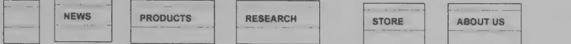

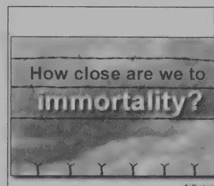


图 1-3 非悬停效果的图片

### 示例 1-1 主页代码

```html
<html>
<head>
<title>Shelley Biotech</title>
<style type="text/css">
    #header { position: absolute; left: 30; top: 30;}
    #tag { position: absolute; left: 250; top: 77;}
    #gal { position: absolute; left: 514; top: 69;}
    #nav { position: absolute; left: 0; top: 114;}
    #feature { position: absolute; left: 10; top: 220;}
    #copyright { position: absolute; left: 350; top: 490;}
</style>
</head>

<body bgcolor="#FFFFFF" topmargin="0" leftmargin="0">

<div id="header">
    
</div>

<div id="tag">
    
</div>

<div id="gal">
    
</div>

<div id="nav">
<table border="0" cellpadding="0" cellspacing="0">
    <tr>
        <td></td>
        <td>
            <a href="news/">
            </a></td>
        <td>
            <a href="products/">
            </a></td>
        <td>
            <a href="research/">
            </a></td>
        <td>
            <a href="store/">
            </a></td>
        <td>
            <a href="about/">
            </a></td>
    </tr>
</table>
</div>

<div id="feature">
    
</div>

<div id="copyright">
    
</div>

</body>
</html>
```

#### 代码如何工作

理解这段代码的唯一真正关键是意识到 CSS（或简称“样式表”）被用于放置图片。如果样式表对你来说是新的，请参阅侧边栏了解快速教程。

#### 侧边栏：层叠样式表

层叠样式表（CSS）允许你定义 HTML 页面中的内容块或层。这分为两个步骤。第一步是定义层，你描述它的名称、它在网页上的位置，可能还有一些其他属性。这是在头部完成的。在示例 1-1 中，它发生在这里：

```html
<style type="text/css">
    #header { position: absolute; left: 30; top: 30;}
    ...
</style>
```

我们定义了一个名为“header”的层，并说它必须位于浏览器窗口左侧 30 像素和顶部 30 像素处。

这只是第一步。现在我们已经定义了该层，我们必须创建实际存在于该层中的内容。这发生在网页的主体中。

```html
<div id="header">
    
</div>
```

你通过将一些 HTML 包装在 `<div>` 标签中来定义一个层，并为该 `<div>` 标签提供一个与上面定义的层名称匹配的“id”。在这种情况下，`shelley_biotech.gif` 图片随后会出现在向右 30 像素和向下 30 像素的位置。

样式表还有很多内容。如果你真的感兴趣，一定要看看 *Essential CSS & DHTML for Web Professionals*（我写的）。

整个导航图片系列都放在一个表格中。我包含了一个锚点标签，但它显然作用不大。它只是一个占位符，我们很快就会添加内容。

还要注意，导航栏中的所有图片都被赋予了名字。

### 导航图片名称

```html


```

我这里移除了边框属性，这样它们更容易阅读。

在深入之前，你应该看看实际的悬停图片本身。它们就在图 1-4 中。

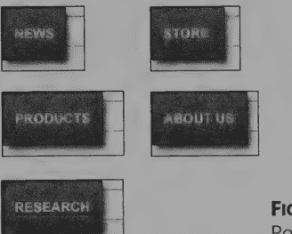

**图 1-4**

悬停图片

目前，这些名称不起任何作用。它们只是静置在那里，等待被调用。让我们从一些 JavaScript 开始来实现它。

### 悬停函数

我们将创建一个处理悬停的函数和另一个处理鼠标移出的函数。让我们从示例 1-2 的悬停函数开始。

#### 示例 1-2 悬停函数

```javascript
function rollOver (imgName)
{
    eval("document.images." + imgName + ".src =
        'images/nav_" + imgName + "_on.gif'")
}
```

#### 代码工作原理

这起初可能看起来有点令人困惑，特别是如果你不熟悉 `eval()` 方法的话。让我们退一步，看看这个方法的目标。我们希望将刚刚悬停的导航项的名称发送给它，然后它会将旧图像替换为新图像。也就是说，如果用户悬停在研究图片上，我们希望执行这个 JavaScript：

```javascript
document.images.research.src = 'images/nav_research_on.gif'
```

由于我们希望图像名称允许不同的值，这行代码必须能够改变：

```javascript
document.images.NameOfImage.src = 'images/nav_NameOfImage_on.gif'
```

换句话说，我们想要动态地创建 JavaScript 代码。`eval()` 方法很好地为我们处理了这一点。`eval()` 的工作原理是获取其括号内的任何字符串，并将该字符串作为一行 JavaScript 代码执行。在这种情况下，如果传递给函数的是 `"research"`，`eval()` 会看到这个字符串：

```javascript
"document.images.research.src = 'images/nav_research_on.gif'"
```

`eval()` 会继续执行这段代码，就好像它不是一个字符串一样，因此图像 `nav_research_on.gif` 替换了 `nav_research_off.gif`。

很好。现在图像已经就位，函数也已经设置好。我们现在需要做的就是在适当的时候调用该函数。示例 1-3 展示了实现这一点的 HTML：

```html
<a href="research/" onMouseOver="javascript:rollOver('research')">
</a>
```

#### 代码工作原理

触发我们悬停函数的代码是 `onMouseOver` 部分。每当用户的鼠标悬停在图像上时，属性中的 JavaScript 就会被执行。在这种情况下，名为 `rollOver` 的函数被激活，并且值 `"research"` 被发送给该函数。注意 `onMouseOver` 发生在锚标签中，而不是图像标签中。如果你以前没有处理过鼠标悬停效果，这可能看起来有点违反直觉。

请尝试这段代码。当你将鼠标悬停在研究图片上时，它应该被蓝绿色的图片替换。现在移开鼠标。什么也没发生。无论你做什么，研究图片都保持打开状态。显然，我们需要一种方法在用户将鼠标移开图像时将其恢复到原始状态。实现这一点的代码与悬停代码几乎完全相同：

```javascript
function rollOut (imgName)
{
    eval("document.images." + imgName + ".src = \'images/nav_" + imgName + "_off.gif\'")
}
```

这个函数是我们之前看到的 `rollOver` 函数的几乎完全复制。这段代码唯一不同的地方在于，我们在图像名称中使用了 `_off` 而不是 `_on`。仅此而已。

但既然这是一本高级 JavaScript 书籍，让我们稍微修改一下。你也可以很容易地使用下面的代码：

```javascript
function rollOut (imgName)
{
    document.images[imgName].src =
        eval("'images/nav_" + imgName + "_off.gif'")
}
```

这并没有太大的不同——只是一个小调整，更明显地将图像视为数组，现在只有语句的右侧需要 `eval()` 方法。使用哪种代码对用户来说没有区别——悬停效果都能正常工作。选择你更喜欢的方法。

这是我们唯一需要的 JavaScript。剩下的唯一步骤是从每个导航图像调用这些函数，如示例 1-4 所示。

### 示例 1-4：从所有导航图像调用 `rollOver`/`rollOut`


```html
<td>
<a href="news/"
    onMouseOver="javascript:rollOver('news')"
    onMouseOut="javascript:rollOut('news')">
</a></td>
<td>
<a href="products/"
    onMouseOver="javascript:rollOver('products')"
    onMouseOut="javascript:rollOut('products')">
</a></td>
<td>
<a href="research/"
    onMouseOver="javascript:rollOver('research')"
    onMouseOut="javascript:rollOut('research')">
</a></td>
<td>
<a href="store/"
    onMouseOver="javascript:rollOver('store')"
    onMouseOut="javascript:rollOut('store')">
</a></td>
<td>
<a href="about/"
    onMouseOver="javascript:rollOver('about')"
    onMouseOut="javascript:rollOut('about')">
</a></td>
```

就是这样！为了让你的生活更轻松一点，下面是示例 1–5，整个页面在一个清单中：

### 第 1 章 • 鼠标悬停效果

```html
<html>
<head>
<title>Shelley Biotech</title>

<style type="text/css">
#header   { position: absolute; left: 30; top: 30;}
#tag      { position: absolute; left: 250; top: 77;}
#gal      { position: absolute; left: 514; top: 69;}
#nav      { position: absolute; left: 0; top: 114;}
#feature  { position: absolute; left: 10; top: 220;}
#copyright { position: absolute; left: 350; top: 490;}
</style>

<script language="JavaScript">

function rollOver (imgName)
{
    eval("document.images." + imgName + ".src = 'images/nav_" + imgName + "_on.gif'")
}

function rollOut (imgName)
{
    document.images[imgName].src = eval("'images/nav_" + imgName + "_off.gif'")
}

</script>

</head>

<body bgcolor="#FFFFFF" topmargin="0" leftmargin="0">
<div id="header">

</div>

<div id="tag">

</div>

<div id="gal">

</div>

<div id="nav">
```

### 示例 1–3 整个页面（续）

```html
<table border="0" cellpadding="0" cellspacing="0">
<tr>
<td></td>
<td>
<a href="news/"
    onMouseOver="javascript:rollOver('news')"
    onMouseOut="javascript:rollOut('news')">
</a></td>
<td>
<a href="products/"
    onMouseOver="javascript:rollOver('products')"
    onMouseOut="javascript:rollOut('products')">
</a></td>
<td>
<a href="research/"
    onMouseOver="javascript:rollOver('research')"
    onMouseOut="javascript:rollOut('research')">
</a></td>
<td>
<a href="store/"
    onMouseOver="javascript:rollOver('store')"
    onMouseOut="javascript:rollOut('store')">
</a></td>
<td>
<a href="about/"
    onMouseOver="javascript:rollOver('about')"
    onMouseOut="javascript:rollOut('about')">
</a></td>
</tr>
</table>
</div>

<div id="feature">
    
</div>

<div id="copyright">
    
</div>

</body>
</html>
```

### 预加载图像

如果你在桌面上运行这个示例，你可能没有注意到图像加载有任何问题。然而，如果你将此文件和图像上传到服务器，某个随机的人加载页面并开始玩你的悬停效果，他们可能会注意到在鼠标悬停图像和实际替换图像之间有一个小的延迟。这是浏览器尚未加载悬停图像（那些以`_on.gif`结尾的图像）所致。事实上，它直到用户悬停在图像上才会加载这些图像。

解决这个问题的方法是将图像加载到浏览器的内存中，而不向用户显示这些图像。幸运的是，JavaScript 提供了一种相对直接的方法来做到这一点。

```javascript
<script language="JavaScript">

// 预加载图像
newsOn = new Image()
newsOn.src = "images/nav_news_on.gif"

... 悬停函数 ...

</script>
```

### 代码工作原理

我们希望在页面加载的同时预加载图像，因此我们将 JavaScript 语句放在头部，但不将它们放在函数内。这样，图像会在页面加载时被预加载。

1. 首先，我们创建一个图像对象。这行代码就是做这个的。我们告诉 JavaScript：“这里有一个图像，它的名字叫 `newsOn`。”在这行代码中，我们没有关于这个图像的任何其他信息：它在哪里，多大，什么都没有。我们只声明了它的名字和它存在的事实。
2. 这里是我们实际预加载图像的地方。我们告诉 JavaScript 图像对象的源是`"images/nav_news_on.gif"`，浏览器就会去该位置并将图像数据加载到`newsOn`对象中。

这张图片不会显示在用户的屏幕上——它只存在于浏览器的内存中。

通常，最安全的做法是预加载所有涉及鼠标悬停效果的图片。在这种情况下，这意味着用户移动鼠标前可见的图片以及鼠标悬停时的图片本身都需要预加载。示例 1-6 展示了整个预加载序列的样子。

```javascript
// preload images
newsOff = new Image()
newsOff.src = "images/nav_news_off.gif"

newsOn = new Image()
newsOn.src = "images/nav_news_on.gif"

productsOff = new Image()
productsOff.src = "images/nav_products_off.gif"

productsOn = new Image()
productsOn.src = "images/nav_products_on.gif"

researchOff = new Image()
researchOff.src = "images/nav_research_off.gif"

researchOn = new Image()
researchOn.src = "images/nav_research_on.gif"

storeOff = new Image()
storeOff.src = "images/nav_store_off.gif"

storeOn = new Image()
storeOn.src = "images/nav_store_on.gif"

aboutOff = new Image()
aboutOff.src = "images/nav_about_off.gif"

aboutOn = new Image()
aboutOn.src = "images/nav_about_on.gif"
```

一旦此代码出现在你的页面中，在用户有机会将鼠标移动到页面上的任何位置之前，所有图片都会加载到浏览器的内存中。页面加载后，图片的切换将快速而流畅地进行，用户不会被加载缓慢的鼠标悬停效果分散注意力。

### 第 1 章 • 鼠标悬停效果

使用图像对象给我们带来了另一个好处：我们可以在代码的其他地方使用`imageName.src`值，使代码更具可读性。示例 1-7 说明了我的意思。

```javascript
function rollOver (imgName)
{
    document.images[imgName].src = \
        eval(imgName + "On.src")
}

function rollOut (imgName)
{
    document.images[imgName].src = \
        eval(imgName + "Off.src")
}
```

#### 代码如何工作

看到我们有何不同吗？我们不再写出图片的全名，而是只使用图像对象的`src`值。感到困惑？让我们回顾一下。我们从这行开始：

`newsOn.src = "images/nav_news_on.gif"`

然后，如果用户将鼠标悬停在研究图片上，会发生以下情况：

`document.images[news].src = "images/nav_news_on.gif"`

我们可以通过用`src`值替换图片位置来简化代码：

`document.images[news].src = newsOn.src`

将其转换回我们正在使用的动态 JavaScript，我们得出：

`document.images[imgName].src = eval(imgName + "On.src")`

示例 1-8 展示了所有的 JavaScript，结合了图片预加载和函数。

### 示例 4–8 所有预加载的 JavaScript

```javascript
<script language="JavaScript">

// preload images
newsOff = new Image()
newsOff.src = "images/nav_news_off.gif"

newsOn = new Image()
newsOn.src = "images/nav_news_on.gif"

productsOff = new Image()
productsOff.src = "images/nav_products_off.gif"

productsOn = new Image()
productsOn.src = "images/nav_products_on.gif"

researchOff = new Image()
researchOff.src = "images/nav_research_off.gif"

researchOn = new Image()
researchOn.src = "images/nav_research_on.gif"

storeOff = new Image()
storeOff.src = "images/nav_store_off.gif"

storeOn = new Image()
storeOn.src = "images/nav_store_on.gif"

aboutOff = new Image()
aboutOff.src = "images/nav_about_off.gif"

aboutOn = new Image()
aboutOn.src = "images/nav_about_on.gif"

function rollOver (imgName)
{
    document.images[imgName].src = eval(imgName + "On.src")
}

function rollOut (imgName)
{
    document.images[imgName].src = eval(imgName + "Off.src")
}
</script>
```

### 鼠标悬停效果与子菜单

我们还没有玩得太花哨。如果你想玩得花哨点，鼓起勇气跳到第 12 章，该章深入探讨了 DHTML 和层级菜单。如果你只想为你的网站设置一个简单的子菜单，请继续阅读。

让我们为产品菜单项创建一个小的子菜单。它应该看起来像图 1-5。


这个菜单实际上是一个具有五（是的，五）种不同状态的大型鼠标悬停效果。这些状态是：

1. 无悬停
2. 悬停在“Products”上
3. 悬停在“BioHomeLab 2.0”上
4. 悬停在“Focusyn”上
5. 悬停在“Sinoplug”上

图 1-6 展示了所有这些图片。

正如你可能预料的那样，为了处理这组新图片，代码并没有太大变化。首先，让我们在示例 1-9 中查看如何预加载这些新图片。

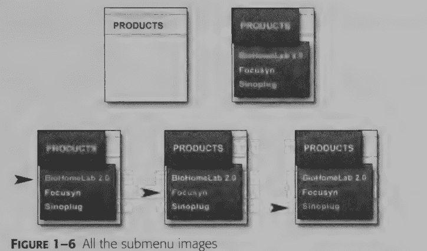

```javascript
productsOff = new Image()
productsOff.src = "images/products_sub_off.gif"

productsOn = new Image()
productsOn.src = "images/products_sub_on.gif"

productsSub1On = new Image()
productsSub1On.src = "images/products_sub_1.gif"

productsSub2On = new Image()
productsSub2On.src = "images/products_sub_2.gif"

productsSub3On = new Image()
productsSub3On.src = "images/products_sub_3.gif"
```

这与我们之前看到的非常相似。我们稍微改变了命名方案，从`nav_products`改为`products_sub`，但没有重大差异。让我们看看调用鼠标悬停函数的 HTML。由于 HTML 中唯一变化的部分是产品图片（好吧，几乎是唯一，但其他部分很小，我们稍后会处理），我们将在示例 1-10 中检查那个表格单元格。


```html
<td>

<map name="productsMap">
<area shape="rect"
      onMouseOver="javascript:rollOver('productsSub3')"
      onMouseOut="javascript:rollOut('products')"
      coords="0, 94,102,116" href="products/sinoplug/">
<area shape="rect"
      onMouseOver="javascript:rollOver('productsSub2')"
      onMouseOut="javascript:rollOut('products')"
      coords="0,77,104,94" href="products/focusyn/">
<area shape="rect"
      onMouseOver="javascript:rollOver('productsSub1')"
      onMouseOut="javascript:rollOut('products')"
      coords="0,54,104,77" href="products/biohomelab2/">
<area shape="rect"
      onMouseOver="javascript:rollOver('products')"
      onMouseOut="javascript:rollOut('products')"
      coords="0,0,91,54" href="products/">
</map>
</td>
```

### 代码如何工作

为了处理整个子菜单，我们创建一个单独的图像，并在上面放置一个图像映射。

1. 注意图像的名称仍然是 `"products"`。这在我们查看 JavaScript 时会变得很重要。

2. `onMouseOver` 是你所期望的：包含 `"src"` 属性的图像对象的名称被传递给函数，就像之前一样。

3. `onMouseOut` 代码有所不同。注意我们传回的是 `"products"` 而不是 `"productsSub3"`。因为我们希望无论悬停在哪个子菜单上，图像都恢复到其默认状态，所以我们发送回我们希望悬停效果变成的图像名称。当我们仔细查看 JavaScript 时，这将很快变得清晰。

让我们看看 JavaScript。我们没有修改 `rollOut` 函数，但确实修改了 `rollOver`，如示例 1-11 所示。

```javascript
function rollOver (imgName)
{
    if ((imgName.indexOf("products") != -1) && (imgName != "products"))
    {
        subMenuName = imgName
        imgName = "products"
    } else {
        subMenuName = imgName
    }
    document.images[imgName].src = eval(subMenuName + "On.src")
}

function rollOut (imgName)
{
    document.images[imgName].src = eval(imgName + "Off.src")
}
```

### 代码如何工作

1. 我们想区分主菜单图像和子菜单图像，一个好方法是检查 `imgName` 的名称。我们检查它是否包含字符串 `"products"`，但不完全等于 `"products"`。这意味着值 `"productsSub1"`、`"productsSub2"` 和 `"productsSub3"` 将被识别。

2. 此时，我们引入一个名为 `"subMenu"` 的新变量。在实际进行图像替换时，我们稍后会使用它。我们将 `subMenu` 设置为 `imgName` 的值，这样正确的图像就会被替换。

3. 然后，我们简单地将 `imgName` 设置为 `"products"`。我们这样做是因为图像只有 `"products"` 这一个名称。这是我们在 HTML 的 `` 标签中设置的名称。

4. 如果悬停的是任何其他情况——即，如果不是产品子菜单——那么 `subMenu` 和 `imgName` 是同一个东西。

5. 最后，我们实际替换图像。我们仍然使用 `imgName` 来识别被替换的图像，但我们已经改用 `subMenu` 来描述替换旧图像的新图像。这样，`"products"` 被修改，但其来源足够灵活，可以允许多个子菜单图像。

# 第 1 章 • 鼠标悬停效果

## 鼠标悬停效果与样式表

本节假设你了解一些样式表知识，或者能学得非常快。戴上你的思考头盔。

许多人开始使用样式表构建他们的网页，并通过将元素放置在层中来定位元素。通常，这是构建网站的好方法，它减少了我构建一个网站所需的时间。不幸的是，它可能会给你已有的鼠标悬停效果带来麻烦。

举个例子，让我们看看我最近完成的一个小项目（实际上是昨天）。我移除了公司的名称并修改了文本，这样你就不知道我是为谁做的了（他们有点保密）。我们只看一个页面——这就是我们需要的全部。图 1-7 展示了这个页面在 Netscape 4 中的样子。

如你所见，它非常简单。以下是示例 1-12，包含了我完成的第一版页面的所有代码。

### 代码如何工作

除非你是样式表新手，否则这里没有什么你没见过的。我们有几个层、几个类，以及页面顶部包含导航图像的表格。

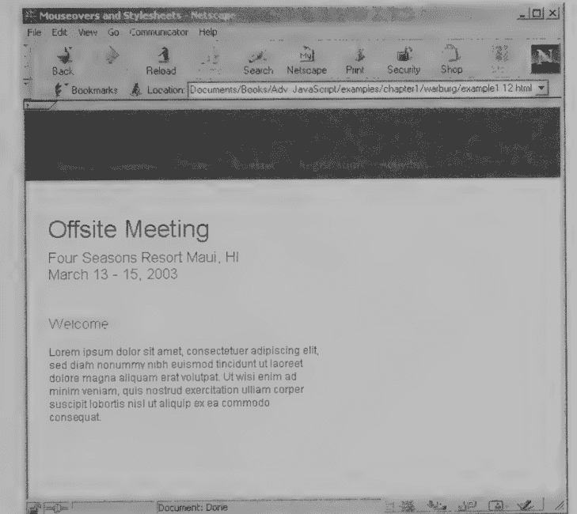

图 1-7 Netscape 4 中的页面

```html
<html>
<head>
    <title>Mouseovers and Stylesheets</title>
    <style type="text/css">
#blueHead {position: absolute; top: 0; left: 0; }
#content { position: absolute; top:120; left: 25; width: 320;}
#contentHome { position: absolute; top:160; left: 25; width: 320;}
#contentHomeHd { position: absolute; top:120; left: 25; }

#nav {position: absolute; top: 40; left: 20; }

.hd1 {
    font-family: arial, sans-serif;
    font-size: 28px;
    font-weight: normal;
    font-style: normal;
    color: #005278;
}
```

# 第 1 章 • 鼠标悬停

示例 1-12 所有代码（续）

```css
.hd2 {
    font-family: arial, sans-serif;
    font-size: 18px;
    font-weight: normal;
    font-style: normal;
    color: #005278;
}

.copy {
    font-family: arial, sans-serif;
    font-size: 12px;
    font-weight: normal;
    font-style: normal;
    color: #005278;
}

</style>
```

```javascript
<script language="JavaScript">
// preload images

agendaOn = new Image()
agendaOn.src = "images/nav_agenda_on.gif"

agendaOff = new Image()
agendaOff.src = "images/nav_agenda_off.gif"

locationOn = new Image()
locationOn.src = "images/nav_location_on.gif"

locationOff = new Image()
locationOff.src = "images/nav_location_off.gif"

travelOn = new Image()
travelOn.src = "images/nav_travel_on.gif"

travelOff = new Image()
travelOff.src = "images/nav_travel_off.gif"

contactOn = new Image()
contactOn.src = "images/nav_contact_on.gif"

contactOff = new Image()
```

示例 1-12 所有代码（续）

```javascript
contactOff.src = "images/nav_contact_off.gif"

regOn = new Image()
regOn.src = "images/nav_reg_on.gif"

regOff = new Image()
regOff.src = "images/nav_reg_off.gif"

activeOn = new Image()
activeOn.src = "images/nav_active_on.gif"

activeOff = new Image()
activeOff.src = "images/nav_active_off.gif"

function rollOver (imgName)
{
    document.images[imgName].src = eval(imgName + "On.src")
}

function rollOut (imgName)
{
    document.images[imgName].src = eval(imgName + "Off.src")
}

</script>
</head>

<body bgcolor="#FFFFFF" topmargin="0" leftmargin="0" marginheight="0" marginwidth="0">

<div id="blueHead">
<table cellpadding="0" cellspacing="0" border="0" width="100%" bgcolor="#005278">
    <tr><td></td></tr>
</table>
</div>

<div id="contentHomeHd" class="hd1">Offsite Meeting</div>

<div id="contentHome" class="copy">
    <span class="hd2">
```

```text
Four Seasons Resort Maui, HI
<br>
March 13 - 15, 2003
<br><br><br>
Welcome
</span>
<br><br>
```

Lorem ipsum dolor sit amet, consectetuer adipiscing elit, sed diam nonummy nibh euismod tincidunt ut laoreet dolore magna aliquam erat volutpat. Ut wisi enim ad minim veniam, quis nostrud exercitation ullamcorper suscipit lobortis nisl ut aliquip ex ea commodo consequat.

```html
</div>

<div id="nav">
<table cellpadding="0" cellspacing="0" border="0">
    <tr>
        <td><a href="agenda.html"
        onMouseOver="rollOver('agenda')"
        onMouseOut="rollOut('agenda')"></a></td>
        <td><a href="location.html"
        onMouseOver="rollOver('location')"
        onMouseOut="rollOut('location')"></a></td>
        <td><a href="travel.html"
        onMouseOver="rollOver('travel')"
        onMouseOut="rollOut('travel')"></a></td>
        <td><a href="contact.html"
        onMouseOver="rollOver('contact')"
        onMouseOut="rollOut('contact')"></a></td>
        <td><a href="reg.html"
        onMouseOver="rollOver('reg')"
        onMouseOut="rollOut('reg')"></a></td>
<td><a href="active.html"
onMouseOver="rollOver('active')"
onMouseOut="rollOut('active')"></a></td>
</tr>
</table>
</div>

</body>
</html>
```

在 JavaScript 中，我们预加载所有导航图像，就像我们之前做过的那样，并使用我们在上一节中了解过的简单 `rollOver` 和 `rollOut` 函数。然而，只有一个问题：在 Netscape 4.x 中，鼠标悬停效果不起作用。所有内容都放置正确，所有链接都有效，但当你将鼠标悬停在图像上时，什么也不会发生。

我们可以假设 Netscape 遇到了某种错误，并拒绝替换图像。由于这是 Netscape，我们可以在地址栏（即你总是输入 URL 的地方）输入 `"javascript:"`，然后会弹出一个窗口，告诉我们所有严重的 JavaScript 错误，如图 1-8 所示。

根据 Netscape 的说法，问题是 `document.images[imgName]` 不存在。嗯，我们很确定它存在。Internet Explorer (IE) 可以看到图像。甚至 Netscape 6 也能看到图像。只有可怜的 Netscape 4 感到困惑。

Netscape 4 之所以困惑，是因为它看待世界的方式与其他浏览器不同。当你使用图层时，Netscape 4 需要特殊处理。在本例中，我们需要告诉 Netscape 4 图像位于哪个图层中。否则，它什么也看不到。所以听起来以下代码应该可行：

```javascript
document.nav.images[imgName] ...
```

但没那么幸运。Netscape 4 会看到一个图层，比如包含导航图像的 `"nav"` 图层，并且它将该图层视为一个全新的文档对象。这意味着代码必须像这样：

```javascript
document.nav.document.images[imgName] ...
```

看起来有点傻，不是吗？嗯，不管傻不傻，这就是我们必须做的。幸运的是，这是一个相当简单的修复，如示例 1-13 所示。将 JavaScript 代码更改为以下内容：

```javascript
// browser detect
var browser = navigator.appName
var browserNum = parseInt(navigator.appVersion)

if ((browser == "Netscape") && (browserNum < 5))
{
    // Netscape 4.x
    var layerRef = "nav.document."
}
else
{
    var layerRef = ""
}
```


```javascript
function rollOver(imgName)
{
    eval("document." + layerRef +
    "images[imgName].src = " + imgName + "On.src")
}

function rollOut(imgName)
{
    eval("document." + layerRef +
    "images[imgName].src = " + imgName + "Off.src")
}
```

#### 代码工作原理

1. 我们需要找出用户是否是世界上仍在使用 Netscape 4 的九个人之一，我们首先获取所使用浏览器的名称。事实上，`navigator`对象包含有关所使用浏览器的信息。因此我们查看`navigator.appName`以发现浏览器的名称。
2. 然后我们继续确定正在使用的版本，从`appVersion`中提取整数。使用`parseInt`提取整数不是必需的，但我们只关心整数。
3. 接下来，我们查看浏览器名称是否为“Netscape”，以及是否为 4.x（或更低）版本。
4. 如果是，我们创建一个小变量，其中包含 Netscape 4 为了看到导航图像所需的额外引用。
5. 如果用户使用的是本世纪发布的浏览器，那么变量`layerRef`为空，因为更现代的浏览器不需要额外的帮助。
6. 然后我们将`layerRef`变量放入 JavaScript 中，这样如果使用 Netscape 4，那么`nav.document.`就成为代码的一部分。如果没有使用 Netscape 4，那么`layerRef`为空，代码与上一节中的相同。
7. `rollOut`函数与`rollOver`相同。

### 回顾

这就是你需要了解的关于鼠标悬停的所有内容。我们看到了如何命名图像、如何预加载它们，以及如何使用`src`属性来保存图像的位置。我们还看到，当你将鼠标悬停效果放在它们自己的图层中时，Netscape 4 需要一些特殊处理。现在，让我们继续动态修改表格。

### 动态更改表格配置

#### 本章内容

- 基础报告制作
- 高级表格配置

我曾在一家名为 Clear Ink 的网页设计公司工作，我们的客户之一是 Pacific Bell 公司。我们为他们的一个部门建立了一个外联网，用于组织他们所有的市场营销活动。这个界面外观简洁友好，客户非常满意，但真正让他们兴奋的是报告制作工具。从视觉上看，这是网站中最不起眼的部分，但天哪，他们对此垂涎欲滴。¹ 我们在其他客户身上也使用了这项技术，他们都很满意。这就是本章的重点：这个酷炫的、深受客户（尤其是市场营销人员）喜爱的报告制作工具。我们是通过动态更改表格配置来实现这一点的。

¹ 这段代码的创建应归功于 Leon Atkinson。他撰写过关于 PHP 和 MySQL 的书籍，你应该买上几本。他还会唱歌。

### 基础报告制作

我们将从一个适用于 Netscape 4 及以上版本的基础系统开始。计划如下：有两个框架。一个框架（菜单框架）包含两个列表。这两个列表用于向表格添加行和从表格中移除行。表格本身（即报告）位于另一个框架中。其外观如图 2-1 所示。

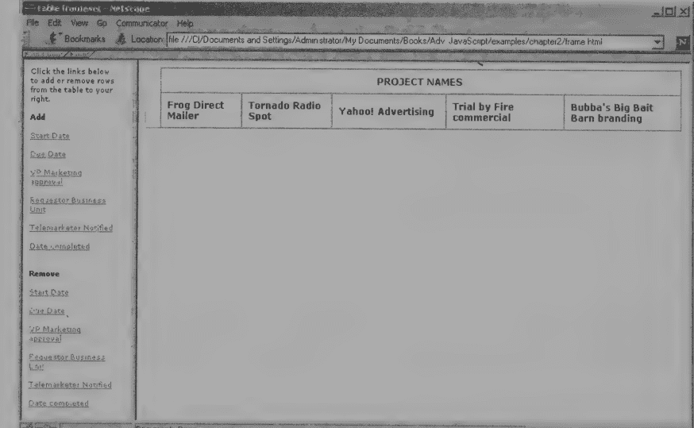

**图 2–1** 操作前的报告

我们的空报告顶部有五个项目。通过点击左框架“添加”标题下的链接，行会被添加到表格中。请注意，每次添加行时报告页面都会重新加载。如果你点击所有的“添加”链接，页面看起来如图 2-2 所示。

然后，如果你只点击“移除”标题下的“开始日期”和“截止日期”链接，这些行就会消失，如图 2-3 所示。同样，每次你做出更改时，报告页面都会重新加载。

现在，将那两行重新添加到报告中。也就是说，点击“添加”标题下的“开始日期”和“截止日期”。页面应该看起来如图 2-4 所示。

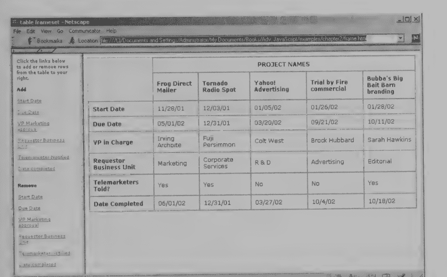

**图 2–2** 所有行都可见的表格

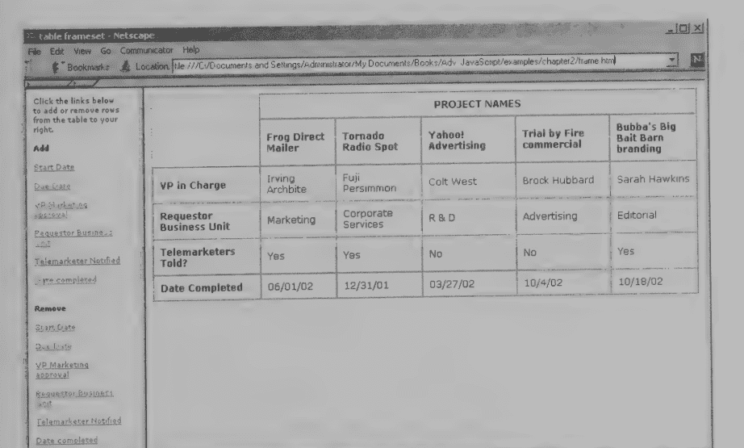

**图 2–3** 没有开始日期和截止日期

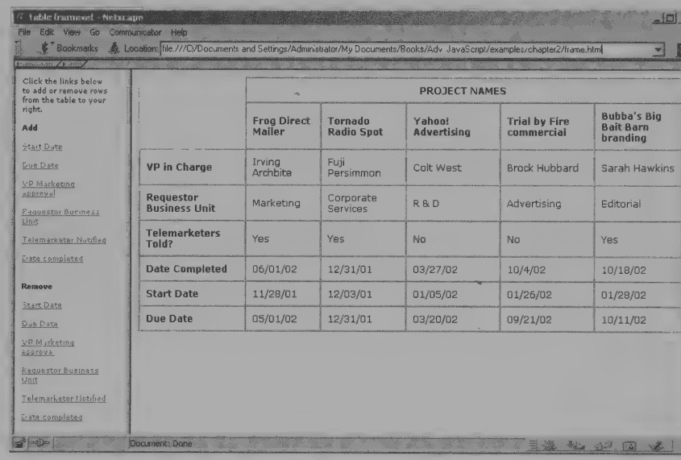

**图 2–4** 开始和截止日期位于底部

注意，“开始日期”和“截止日期”行被添加到了表格底部，而不是它们原来的位置。这看起来可能像个错误，但许多客户实际上很喜欢这样——这意味着他们可以随心所欲地安排报告中行的顺序。只需按照你希望它们出现的顺序，点击“添加”下的链接即可。

现在来看一些代码！我们将从示例 2-1 开始，这是框架集。

```
示例 2-1 框架集

<html>
<head>
<title>table frameset</title>
</head>

<frameset cols="150,*">
    <frame name="menu" src="menu.html">
    <frame name="report" src="report1.html">
</frameset>

</html>
```

目前还没有什么有趣的东西。只需注意菜单框架名为“menu”，而包含我们表格的框架名为“report”。现在让我们看看示例 2-2，其中包含了操作的核心逻辑，即菜单页面。

```
示例 2-2 菜单页面

<html>
<head>
<style type="text/css">
.copy {
    font-family: verdana, sans-serif;
    font-size:10px
}
</style>
<script language="JavaScript">
1 row = new Array()
2 function addRow(rowName)
{
    3 pushed = row.push(rowName)
    4 top.report.location.reload()
}
5 function removeRow(rowName)
{
    6 for (i=0; i<row.length; i++)
    {
        7 if (row[i] == rowName)
        {
            8 removed = row.splice(i,1)
            9 break
        }
    }
    10 top.report.location.reload()
}
</script>
</head>
<body>
<span class="copy">
点击下面的链接，向右侧的表格添加或移除行。
<br><br>
```

```html
<b>添加</b>
<br><br>
<a href="javascript:addRow('start')">开始日期</a><br><br>
<a href="javascript:addRow('due')">截止日期</a><br><br>
<a href="javascript:addRow('vp')">市场副总裁批准
</a><br><br>
<a href="javascript:addRow('requestor')">请求者业务单元
</a><br><br>
<a href="javascript:addRow('telemarketer')">已通知电话营销员
</a><br><br>
<a href="javascript:addRow('final')">完成日期</a>
<br><br><br>
<b>移除</b><br><br>
<a href="javascript:removeRow('start')">开始日期</a><br><br>
<a href="javascript:removeRow('due')">截止日期</a><br><br>
<a href="javascript:removeRow('vp')">市场副总裁批准
</a><br><br>
<a href="javascript:removeRow('requestor')">请求者业务单元
</a><br><br>
<a href="javascript:removeRow('telemarketer')">已通知电话营销员
</a><br><br>
<a href="javascript:removeRow('final')">完成日期</a>
</span>
</body>
</html>
```

#### 代码工作原理

准备好了吗？我们开始吧。

1. 我们使用此页面来记住哪些行是表格的一部分。具体来说，我们使用一个名为“row”的数组，它保存了当前表格中的所有行。当用户向表格添加一行时，我们向`row`数组添加一个元素。当用户移除一行时，我们从`row`数组中移除一个元素。
2. 当用户想要添加一行时，他们调用`addRow`函数，该函数以行名作为其参数。这六行的名称是：
3. 这就是我们向`row`数组添加元素的地方。这被称为“压入”。假设值“start”被传递给此函数。代码`row.push(rowName)`的结果是将值“start”作为元素添加到`row`数组中。如果“start”是用户点击的第一个链接，那么`row`数组将有一个元素：`row[0] = "start"`。由于`push`函数返回新数组的长度，我们必须为这个值指定一个去处。这就是为什么我们将`row.push(rowName)`赋值给一个名为“pushed”的变量。在这个例子中，“pushed”的值将是 1，因为数组中只有一个元素。
4. 既然我们已经更新了`row`数组，就该更新报告了。我们只需重新加载报告页面来完成此操作（其工作原理将在稍后解释）。我们通过使用`top.report`来定位报告页面，它会导航到浏览器顶部，然后向下查找所有框架。我们让它查看名为“report”的框架，并使用`location.reload()`来重新加载页面。此时，表格将被重绘以反映我们对`row`数组所做的更改（我们将在后面的章节中深入探讨框架间的通信）。
5. 如果用户想要移除一行，则调用`removeRow`函数，并传入要移除的行名。
6. 我们的计划是检查`row`数组中的值，看看用户想要移除的行是否确实在数组中。我们从一个遍历整个数组的`for`循环开始。
7. 我们检查传入的行名是否等于当前元素。
8. 如果两者相等（即，用户想要移除的行确实在`row`数组中），那么我们需要从`row`数组中移除该元素。实现此目的的方法称为“splice”。它的参数是开始移除元素的索引（在本例中为“i”）和要移除的元素数量（我们只想移除一个元素，因此使用 1）。`splice`方法返回一个被移除元素的数组，这就是为什么我们必须将`row.splice(i,1)`赋值给某个东西。
9. 一旦我们移除了请求的行，我们就完成了循环。我们不需要再查看`row`数组中的任何其他元素。
10. 与之前的`addRow`函数一样，我们重新加载报告页面，该页面根据`row`数组中的内容重绘表格。
11. 这是调用`addRow`函数的 HTML。它很简单，但你应该知道它的样子。
12. 这是`removeRow`函数的 HTML。同样，非常简单。

所以菜单页面的目的是跟踪用户希望显示的行，它通过向`row`数组添加和删除元素来实现这一点。一旦这些更改完成，代码就会强制重新加载报告页面。此时，菜单页面退场，由报告页面来实际绘制表格。

所以让我们来看看示例 2-3，即报告页面。

```
<html>
<head>
<title>表格实验号 2</title>
<style type="text/css">
.copy {
    font-family: verdana, sans-serif;
    font-size: 12px
}
</style>
<script language="JavaScript">
❶ row = top.menu.row
❷ document.write("<table border=1 cellpadding=8 cellspacing=0 width=700>")
```

### 示例 2.5 mypages.html（续）

```javascript
document.write("<tr>")
document.write("<td></td>")
document.write("<td class=\"copy\" colspan=\"5\" align=\"center\"><b>PROJECT NAMES</b></td>")
document.write("</tr>")
document.write("<tr>")
document.write("<td></td>")
document.write("<td class=\"copy\"><b>Frog Direct Mailer</b></td>")
document.write("<td class=\"copy\"><b>Tornado Radio Spot</b></td>")
document.write("<td class=\"copy\"><b>Yahoo! Advertising</b></td>")
document.write("<td class=\"copy\"><b>Trial by Fire commercial</b></td>")
document.write("<td class=\"copy\"><b>Bubba's Big Bait Barn branding</b></td>")
document.write("</tr>")
```

❸ `for (i=0; i<row.length; i++)`

```javascript
{
  ❹ if (row[i] == "start")
  {
    document.write("<tr>")
    document.write("<td class=\"copy\"><b>Start Date</b></td>")
    document.write("<td class=\"copy\">11/28/01</td>")
    document.write("<td class=\"copy\">12/03/01</td>")
    document.write("<td class=\"copy\">01/05/02</td>")
    document.write("<td class=\"copy\">01/26/02</td>")
    document.write("<td class=\"copy\">01/28/02</td>")
    document.write("</tr>")
  }
```

❺ `else if (row[i] == "due")`


```javascript
{
  document.write("<tr>")
  document.write("<td class=\"copy\"><b>Due Date</b></td>")
  document.write("<td class=\"copy\">05/01/02</td>")
  document.write("<td class=\"copy\">12/31/01</td>")
  document.write("<td class=\"copy\">03/20/02</td>")
  document.write("<td class=\"copy\">09/21/02</td>")
  document.write("<td class=\"copy\">10/11/02</td>")
  document.write("</tr>")
}
else if (row[i] == "vp")
{
 document.write("<tr>")
 document.write("<td class=\"copy\"><b>VP in Charge</b></td>")
 document.write("<td class=\"copy\">Irving Archbite</td>")
 document.write("<td class=\"copy\">Fuji Persimmon</td>")
 document.write("<td class=\"copy\">Colt West</td>")
 document.write("<td class=\"copy\">Brock Hubbard</td>")
 document.write("<td class=\"copy\">Sarah Hawkins</td>")
 document.write("</tr>")
}
else if (row[i] == "requestor")
{
 document.write("<tr>")
 document.write("<td class=\"copy\"><b>Requestor Business Unit</b></td>")
 document.write("<td class=\"copy\">Marketing</td>")
 document.write("<td class=\"copy\">Corporate Services</td>")
 document.write("<td class=\"copy\">R & D</td>")
 document.write("<td class=\"copy\">Advertising</td>")
 document.write("<td class=\"copy\">Editorial</td>")
 document.write("</tr>")
}
else if (row[i] == "telemarker")
{
    document.write("<tr>")
    document.write("<td class=\"copy\"><b>Telemarketers Told?</b></td>")
    document.write("<td class=\"copy\">Yes</td>")
    document.write("<td class=\"copy\">Yes</td>")
    document.write("<td class=\"copy\">No</td>")
    document.write("<td class=\"copy\">No</td>")
    document.write("<td class=\"copy\">Yes</td>")
    document.write("</tr>")
}
else if (row[i] == "final")
{
    document.write("<tr>")
    document.write("<td class=\"copy\"><b>Date Completed</b></td>")
    document.write("<td class=\"copy\">06/01/02</td>")
    document.write("<td class=\"copy\">12/31/01</td>")
    document.write("<td class=\"copy\">03/27/02</td>")
    document.write("<td class=\"copy\">10/4/02</td>")
    document.write("<td class=\"copy\">10/18/02</td>")
    document.write("</tr>")
}

document.write("</table>")

</script>
</head>
<body>
</body>
</html>
```

## 第二章 • 动态更改表格配置

### ◆ 代码工作原理

1. 我们首先查看菜单页面，特别是该页面的行数组。我们将该数组复制到一个名为 `"row"` 的局部变量中。这样做之后，我们就知道了哪些行应该出现在表格中。

2. 由于我们绘制的表格必须在页面加载时动态配置，因此我们使用 `document.write` 来输出 HTML。不要被反斜杠（如 `class="copy"`）所迷惑——这是我们在告诉 JavaScript 打印一个双引号。浏览器将看到以下 HTML：

```html
<table border=1 cellpadding=8 cellspacing=0 width=700>
<tr>
<td></td>
<td class="copy" colspan="5" align="center"><b>PROJECT NAMES</b></td>
</tr>
<tr>
<td></td>
<td class=\"copy\"><b>Frog Direct Mailer</b></td>
<td class=\"copy\"><b>Tornado Radio Spot</b></td>
<td class=\"copy\"><b>Yahoo! Advertising</b></td>
<td class=\"copy\"><b>Trial by Fire commercial</b></td>
<td class=\"copy\"><b>Bubba's Big Bait Barn branding</b></td>
</tr>
```

3. 此时，我们已经绘制了表格的前两行，无论内容如何，这两行总是相同的。现在是时候确定在两行表头之后应该出现哪些行了。我们通过遍历 `row` 数组来确定这一点。

4. 假设此页面刚刚加载，这行代码将查看 `row[0]`（实际上是 `top.menu.row[0]`，记住这一点）并查看它是否为 `"start"`。如果是，则执行该部分 JavaScript，浏览器将渲染以下 HTML：

```html
<tr>
<td class="copy"><b>Start Date</b></td>
<td class="copy">11/28/01</td>
<td class="copy">12/03/01</td>
<td class="copy">01/05/02</td>
<td class="copy">01/26/02</td>
<td class="copy">01/28/02</td>
</tr>
```

然后循环继续处理 `row` 数组中的每个元素。通过这种方式，表格行的顺序与 `row` 数组中元素的顺序相同。例如，假设数组如下所示：

```text
row[0] = "start"
row[1] = "due"
row[2] = "vp"
```

这将导致 HTML 类似于：

```html
<table border=1 cellpadding=8 cellspacing=0 width=700>

<tr>
<td></td>
<td class="copy" colspan="5" align="center"><b>PROJECT NAMES</b></td>
</tr>
<tr>
<td></td>
<td class="copy"><b>Frog Direct Mailer</b></td>
<td class="copy"><b>Tornado Radio Spot</b></td>
<td class="copy"><b>Yahoo! Advertising</b></td>
<td class="copy"><b>Trial by Fire commercial</b></td>
<td class="copy"><b>Bubba's Big Bait Barn branding</b></td>
</tr>

<tr>
    ... 开始日期行 ...
</tr>
<tr>
    ... 截止日期行 ...
</tr>
<tr>
    ... 负责副总裁行 ...
</tr>
</table>
```

5. 如您所料，这种比较是针对 `row` 数组中所有可能的值进行的。

6. 请注意，此 HTML 页面的主体部分没有任何内容。所有内容都是由 JavaScript 动态生成的。

如果您还没有尝试过，请尝试运行此代码！重新加载发生得非常快，因为只使用了文本。

### 重复行

您是否尝试过破坏这段代码？这很容易：只需不断单击“Start Date”链接。很快您的报告中将出现任意数量的相同“Start Date”行，它可能如图 2-5 所示。

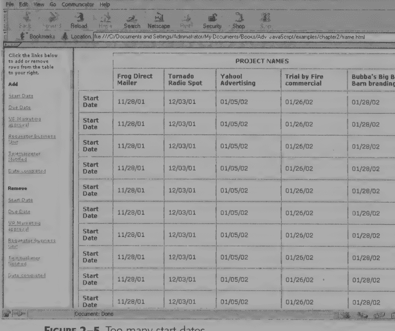

**图 2-5** 过多的开始日期

这不太好，但很容易修复。我们需要做的就是添加一些代码。菜单页面中的 `addRow` 函数确保没有重复值进入 `row` 数组。示例 2-4 展示了一种实现方法。

```javascript
function addRow(rowName)
{
    ❶ inTable = false
    ❷ for (i=0; i<row.length; i++)
    {
        if (row[i] == rowName)
        {
            ❸ inTable = true
            break
        }
    }

    ❹ if (!inTable)
    {
        pushed = row.push(rowName)
        top.report.location.reload()
    }
}
```

### ◆ 代码工作原理

1. 我们首先假设用户想要添加的行不在表格中。为了跟踪这一点，我们创建一个名为 `inTable` 的变量，用于跟踪要添加的行是否已在表格中。

2. 然后我们创建一个循环来遍历 `row` 数组中的所有元素。

3. 如果用户想要添加的行（例如 `"vp"`）已经存在于 `row` 数组中，那么我们将 `inTable` 切换为 `true` 并跳出循环。

4. 现在到了关键时刻。如果用户请求的行不在 `row` 数组中，则 `inTable` 变量将不会从其初始值 `false` 发生变化，该行将被添加到数组中。然而，如果 `inTable` 为 `true`，那么，嗯，什么都不会发生。完全没有。

### 美化表格

客户似乎非常喜欢的另一件事是表格中的交替颜色。我没开玩笑——他们喜欢这个。在接下来的简短内容中，我们将探讨如何让报告看起来更美观一些。请参见图 2-6。

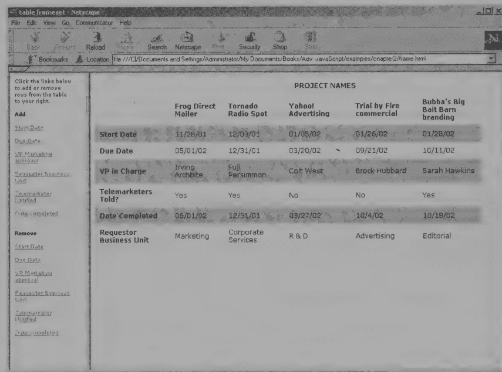

**图 2-6** 一个更易于阅读的表格

我们的做法是移除边框，并确保行与行之间交替使用白色和灰色背景。无论后续添加、删除或再次添加多少行，这一点都必须保持不变。让我们看看示例 2-5，它展示了在报告页面上进行这些更改的一种方法。


```javascript
<script language="JavaScript">
row = top.menu.row
❶ stripeColor = ""
❷ toggleStripe()
❸ document.write("<table border=0 cellpadding=8 cellspacing=0 width=700>")
document.write("<tr>")
document.write("<td></td>")
document.write("<td class=\"copy\" colspan=\"5\" align=\"center\"><b>PROJECT NAMES</b></td>")
document.write("</tr>")
document.write("<tr>")
document.write("<td></td>")
document.write("<td class=\"copy\"><b>Frog Direct Mailer</b></td>")
document.write("<td class=\"copy\"><b>Tornado Radio Spot</b></td>")
document.write("<td class=\"copy\"><b>Yahoo! Advertising</b></td>")
document.write("<td class=\"copy\"><b>Trial by Fire commercial</b></td>")
document.write("<td class=\"copy\"><b>Bubba's Big Bait Barn branding</b></td>")
document.write("</tr>")
for (i=0; i<row.length; i++)
{
    if (row[i] == "start")
    {
        ❹document.write("<tr" + stripeColor + ">")
        document.write("<td class=\"copy\"><b>Start Date</b></td>")
        document.write("<td class=\"copy\">11/28/01</td>")
        document.write("<td class=\"copy\">12/03/01</td>")
        document.write("<td class=\"copy\">01/05/02</td>")
        document.write("<td class=\"copy\">01/26/02</td>")
        document.write("<td class=\"copy\">01/28/02</td>")
        document.write("</tr>")
        ❺toggleStripe()
    }
    else if (row[i] == "due")
    {
        document.write("<tr" + stripeColor + ">")
        document.write("<td class=\"copy\"><b>Due Date</b></td>")
        document.write("<td class=\"copy\">05/01/02</td>")
        document.write("<td class=\"copy\">12/31/01</td>")
        document.write("<td class=\"copy\">03/20/02</td>")
        document.write("<td class=\"copy\">09/21/02</td>")
        document.write("<td class=\"copy\">10/11/02</td>")
        document.write("</tr>")
        toggleStripe()
    }
    else if (row[i] == "vp")
    {
        document.write("<tr" + stripeColor + ">")
        document.write("<td class=\"copy\"><b>VP in Charge</b></td>")
        document.write("<td class=\"copy\">Irving Archbite</td>")
        document.write("<td class=\"copy\">Fuji Persimmon</td>")
        document.write("<td class=\"copy\">Colt West</td>")
        document.write("<td class=\"copy\">Brock Hubbard</td>")
        document.write("<td class=\"copy\">Sarah Hawkins</td>")
        document.write("</tr>")
        toggleStripe()
    }
    else if (row[i] == "requestor")
    {
        document.write("<tr" + stripeColor + ">")
        document.write("<td class=\"copy\"><b>Requestor Business Unit</b></td>")
        document.write("<td class=\"copy\">Marketing</td>")
        document.write("<td class=\"copy\">Corporate Services</td>")
        document.write("<td class=\"copy\">R & D</td>")
        document.write("<td class=\"copy\">Advertising</td>")
        document.write("<td class=\"copy\">Editorial</td>")
        document.write("</tr>")
        toggleStripe()
    }
    else if (row[i] == "telemarketer")
    {
        document.write("<tr" + stripeColor + ">")
        document.write("<td class=\"copy\"><b>Telemarketers Told?</b></td>")
        document.write("<td class=\"copy\">Yes</td>")
        document.write("<td class=\"copy\">Yes</td>")
        document.write("<td class=\"copy\">No</td>")
        document.write("<td class=\"copy\">No</td>")
        document.write("<td class=\"copy\">Yes</td>")
        document.write("</tr>")
        toggleStripe()
    }
    else if (row[i] == "final")
    {
        document.write("<tr" + stripeColor + ">")
        document.write("<td class=\"copy\"><b>Date Completed</b></td>")
        document.write("<td class=\"copy\">06/01/02</td>")
        document.write("<td class=\"copy\">12/31/01</td>")
        document.write("<td class=\"copy\">03/27/02</td>")
        document.write("<td class=\"copy\">10/4/02</td>")
        document.write("<td class=\"copy\">10/18/02</td>")
        document.write("</tr>")
        toggleStripe()
    }
}
⑥ function toggleStripe()
{
    if (stripeColor)
    {
        stripeColor = ""
    }
    else
    {
        stripeColor = " bgcolor=\"#CCCCCC\""
    }
}

document.write("</table>")

</script>
```

### 代码工作原理

1. 为了交替背景颜色，我们创建了一个名为 `stripeColor` 的变量。该变量最初被设置为空字符串。改变这个变量就能实现背景颜色的交替。

2. 然后我们调用一个名为 `toggleStripe` 的函数，该函数会在 `stripeColor` 为空时将其设置为 `bgcolor="#CCCCCC"`，而在它为 `bgcolor="#CCCCCC"` 时则设置为空。也就是说，`stripeColor` 只有两种可能的值，而 `toggleStripe` 函数的作用就是将 `stripeColor` 设置为另一个值。

3. 当然，我们将表格边框设为零以移除边框。

4. 这里是我们实际实现彩色背景的地方。我们将 `stripeColor` 插入到 `<tr>` 标签中。如果 `stripeColor` 为空，则该行不获得任何颜色。否则，标签变为 `<tr bgcolor="#CCCCCC">`。

5. 在创建行之后，我们再次调用 `toggleStripe` 函数，为下一行做准备。请注意，此函数仅在绘制行时被调用。这意味着你可以随意添加或删除任意数量的行，而背景颜色将始终保持交替。

6. 最后是 `toggleStripe` 函数本身。它非常简单。如果 `stripeColor` 不是空字符串，则将其设置为空字符串。否则，如果它最初确实是空的，则变为 `bgcolor="#CCCCCC"`。

### 高级表格配置

现在我们将探讨如何在不重新加载页面的情况下实现相同的功能。我们将要研究的方法仅在 Internet Explorer 5+ 和 Netscape 6+ 中有效。我通常不理会那些在版本 4 浏览器中无法运行的代码，但我们正越来越接近这样一个节点：你可以强制用户使用更新的浏览器来实现一些非常有趣的效果。你真正需要做的就是说服你的客户（如果你在做内部网项目，这通常最容易）。

在开始编码之前，还有一些背景知识需要了解。我们需要知道这些方法和标签的作用：

- `getElementById`
- `getElementsByTagName`
- `createElement`
- `appendChild`
- `eval`
- `<tbody>`

让我们逐一了解。

#### getElementById

在 Web 的早期，如果我们想通过 `id` 属性定位一段 HTML，只需使用 `document.id1` 即可，就这么简单。在 Netscape 4 中情况变得更复杂了，你可能会遇到像 `document.id1.document.id2.document.id3` 这样的情况。在后来的浏览器中，引入了 `getElementById` 作为在网页中识别 HTML 片段的新方法。在我们的示例中，我们将给一个表格一个 `id`，然后引用该 `id`。快速预览一下，如果我们的表格是这样的：

```html
<div id="report">
    <table id="reportTable">
        ...
    </table>
</div>
```

那么我们可以通过以下代码访问这个表格：

```javascript
document.getElementById("reportTable")
```

#### getElementsByTagName

与 `getElementById` 非常相似，`getElementsByTagName` 会检查 HTML 页面中符合其条件的代码片段。例如，你的代码可以这样查找：

```javascript
document.getElementsByTagName("TABLE")
```

这将返回一个数组，其中的元素指向你网页中的所有表格。如果你只想查看第一个表格，你的代码将如下所示：

```javascript
document.getElementsByTagName("TABLE")[0]
```

通常将这个指针赋给一个更短的变量会更容易：

```javascript
myTable = document.getElementsByTagName("TABLE")[0]
```

这样操作表格会更方便。例如，如果你想给表格设置一个红色背景色，可以这样做：

```javascript
myTable = document.getElementsByTagName("TABLE")[0]
myTable.bgColor = "#FF0000"
```

我们将使用 `getElementsByTagName` 来定位一个 `<tbody>` 标签，我们很快就会看到。

#### createElement

`createElement` 方法非常酷。它允许你从无到有地创建 HTML。例如，假设你想向表格添加一行。你可以先使用 `createElement` 创建一个行：

```javascript
newRow = document.createElement("TR")
```

你现在有了一个新的表格行，它的名字叫 `newRow`。但是，这个行还没有附加到任何表格上。创建新的 HTML 是一个两步过程。首先，你创建元素。其次，你将它放置在网页的某个位置。在你将它放置到某处之前，它只是漂浮在浏览器的内存中，什么也不做。那么，如何将这个新元素附加到某个地方，让它显示在页面上呢？你可以使用 `appendChild`。

#### appendChild

如果你以前接触过节点或 XML，你肯定知道 `appendChild` 是做什么的。不过，如果节点对你来说还比较陌生，这里有一个快速入门教程。假设你有以下代码：

```html
<dog>
    <cat name="Xena">
        <mouse name="Mickey" />
        <mouse name="Itchy" />
    </cat>
    <cat name="Issa" />
    <cat name="Tycho" />
</dog>
```

这里有三种元素：`dog`、`cat` 和 `mouse`。它们也被称为节点。`dog` 节点包含三个子节点：三个 `cat` 节点。其中一个 `cat` 节点包含两个 `mouse` 节点。另外两个 `cat` 节点不包含任何内容。

换一种说法：`dog` 节点有三个子节点，而 Xena 这个 `cat` 节点有两个子节点。如果你想给 `dog` 节点添加另一个 `cat`，那就是给 `dog` 节点添加一个子节点。实现这个功能的代码看起来会是这样：

```javascript
dog.appendChild(cat)
```

生成的代码可能类似于：

```html
<dog>
    <cat name="Xena">
        <mouse name="Mickey" />
        <mouse name="Itchy" />
    </cat>
    <cat name="Issa" />
    <cat name="Tycho" />
    <cat />
</dog>
```

新的 `cat` 元素是粗体显示的。明白了吗？如果还有点模糊，别担心——当我们实际构建表格时，它会变得更清晰。

#### eval

如果你读过我之前关于 JavaScript 或 DHTML 的书，你知道我是 `eval` 方法的忠实粉丝。它可能看起来不太美观，但能很好地解决很多问题。本质上，`eval` 方法接收一个普通的文本字符串，并像执行真正的 JavaScript 代码行一样执行这个文本字符串。这让你能够编写动态生成的 JavaScript。下面是一个例子：

```javascript
for (i=1; i<5; i++)
{
    eval("cell" + i + " = 'hello' + i + "'")
}
```

这会产生四个新变量：

```javascript
cell1 = "hello1"
cell2 = "hello2"
cell3 = "hello3"
cell4 = "hello4"
```

在这个特定情况下，你可能会直接使用数组。但如果那不是一个好的解决方案，你知道如何动态创建变量了。我们将在本节中广泛使用 `eval`。

#### tbody

`<tbody>` 是一个你可能以前没见过的标签。它属于表格的一部分，像这样：

```html
<div id="report">
    <table id="reportTable">
        <tbody>
            <tr>...</tr>
            <tr>...</tr>
        </tbody>
    </table>
</div>
```

是的，`<tbody>` 是新的。它有几个朋友：`<thead>` 和 `<tfoot>`。我们不会详细讨论这些，只是说如果一些表格行被包裹在 `<thead>` 中，那么当 `<tbody>` 部分的行在它们下面滚动时，这些行会保持不动，就好像 `<thead>` 中的行在一个单独的小框架里。`<tfoot>` 行则保持在底部。


无论你是否在代码中编写了`<tbody>`，Netscape 和 IE 都会在你的表格中识别它。这最终变得很重要。例如，你不能简单地告诉你的 JavaScript 去找到一个表格，然后查看该表格的行。你必须告诉它先找到表格，然后找到`<tbody>`，再找到该`<tbody>`内的表格行。让我们看一个简单的例子，它找到网页上第一个表格的第一行。

```
myTable = document.getElementsByTagName("TABLE")[0]
tbody = myTable.getElementsByTagName("TBODY")[0]
myRow = tbody.getElementsByTagName("TR")[0]
```

中间那行代码是必要的——你不能跳过查找`<tbody>`。

我想这就是你需要的所有背景知识了。让我们开始编码吧！

### 第一阶段：添加行

因为这里的很多 JavaScript 可能与你习惯的不同，我们将分阶段创建这个网页。首先，我们只是向现有表格添加行。没有删除行，没有格式化文本，没有背景颜色。当所有行都添加完毕后，页面将看起来像图 2–7。

示例 2–6 包含代码。

#### 代码工作原理

1. 我们没有使用独立的框架，而是将菜单和报告表格放置在各自的图层上。
2. 这一点不同：我们将表格中的所有信息放在数组中。开始日期行中的所有内容都在`startRow`数组中，截止日期行中的所有内容都在`dueRow`数组中，依此类推。六个数组的名称分别是`startRow`、`dueRow`、`vpRow`、`requestorRow`、`telemarketerRow`和`finalRow`。这些名称很重要——我们稍后会用到它们。
3. 对于`addRow`函数，我们请求一个输入参数，即要添加的行的名称。

## 第二章 • 动态更改表格配置

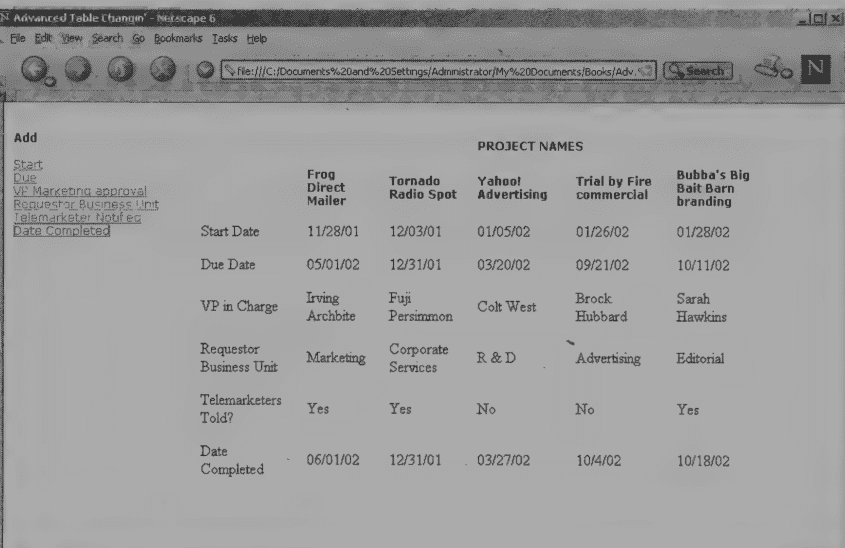

图 2–7 第一阶段

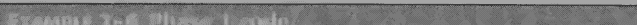

```html
<html>
<head>
<title>Advanced Table Changin'</title>
<style type="text/css">
<!-- #report {
    position: absolute;
    top: 30;
    left:200;
}

#menu {
    position: absolute;
    top: 30;
    left:10;
}

.copy {
    font-family: verdana, sans-serif;
    font-size: 12px;
}
.boldcopy {
    font-family: verdana, sans-serif;
    font-size: 12px;
    font-weight: bold
}
</style>

<script language="JavaScript" type="text/javascript">
// ❷
startRow = new Array("Start Date","11/28/01","12/03/01","01/05/02","01/26/02","01/28/02")
dueRow = new Array("Due Date","05/01/02","12/31/01","03/20/02","09/21/02","10/11/02")
vpRow = new Array("VP in Charge","Irving Archbite","Fuji Persimmon","Colt West","Brock Hubbard","Sarah Hawkins")
requestorRow = new Array("Requestor Business Unit","Marketing","Corporate Services","R & D","Advertising","Editorial")
telemarketerRow = new Array("Telemarketers Told?","Yes","Yes","No","No","Yes")
finalRow = new Array("Date Completed","06/01/02","12/31/01","03/27/02","10/4/02","10/18/02")
// ❸
function addRow(rowName)
{
    // ❹
    tbody = document.getElementById('reportTable').getElementsByTagName("TBODY")[0];
    //create a row
    // ❺
    newRow = document.createElement("TR")
    // ❻
    rowToAdd = eval(rowName + "Row")
    // ❼
    for (i=0; i<rowToAdd.length; i++)
    {
        // ❽
        td = document.createElement("TD")
        // ❾
        td.innerHTML = rowToAdd[i]
        // ❿
        newRow.appendChild(td)
    }
    tbody.appendChild(newRow)
}
</script>
</head>
<body>
<div id="menu" class="copy">
<b>Add</b><br><br>
<a href="javascript:addRow('start')">Start</a><br>
<a href="javascript:addRow('due')">Due</a><br>
<a href="javascript:addRow('vp')">VP Marketing approval</a><br>
<a href="javascript:addRow('requestor')">Requestor Business Unit</a><br>
<a href="javascript:addRow('telemarketer')">Telemarketer Notified</a><br>
<a href="javascript:addRow('final')">Date Completed</a><br>
</div>

<div id="report">
<table id="reportTable" cellspacing="0" cellpadding="8" border="0" width="600">
<tbody>
<tr>
<td></td>
<td class="copy" colspan="5" align="center"><b>PROJECT NAMES</b></td>
</tr>
<tr>
<td></td>
<td class="boldcopy"><b>Frog Direct Mailer</b></td>
<td class="boldcopy"><b>Tornado Radio Spot</b></td>
<td class="boldcopy"><b>Yahoo! Advertising</b></td>
<td class="boldcopy"><b>Trial by Fire commercial</b></td>
<td class="boldcopy"><b>Bubba's Big Bait Barn branding</b></td>
</tr>
</tbody>
</table>
</div>
</body>
</html>
```

4. 然后，我们从文档层级开始，定位报告表格的`<tbody>`，查找 id 为`"reportTable"`的元素。找到该元素后，我们查找该元素内第一个出现的 HTML 标签`<tbody>`（一个表格内可能有多个`<tbody>`，但比较罕见）。我们将`<tbody>`标签及其所有内容赋值给一个名为`tbody`的变量。这个变量直到函数快完成时才会用到。
5. 现在我们开始创建行。通过使用`createElement("TR")`，我们现在在浏览器内存中有了一个`<tr></tr>`。
6. 现在需要决定用哪个数组来填充我们的行。我们要的数组名称是用户点击的内容（作为`rowName`传递给函数）加上`"Row"`后缀。如果用户点击了`"Start"`，那么`rowToAdd`的值就是`"startRow"`。
7. 既然我们知道要用哪个数组，我们将遍历该数组并将数据放入单独的表格单元格中。
8. 我们首先创建一个表格单元格。此时，我们只有一个空的`<td></td>`漂浮在内存中。如果你在跟踪进度，这意味着我们现在有一个`<tr></tr>`和一个`<td></td>`漂浮在内存中。
9. 在这一行中，我们将内容添加到表格单元格。我们通过`innerHTML`属性来实现。这个属性很棒——它允许你在任何想要的地方插入任何 HTML，页面会立即调整。在这个例子中，我们将数组元素的值添加到表格单元格中。例如，如果用户选择查看开始日期行，那么创建的第一个表格单元格将是`<td>Start Date</td>`。然而，页面上什么也不会显示，因为该表格单元格没有连接到任何地方……

## 第二章 • 动态改变表格配置

目前还没有完成。它仍然只是漂浮着，尽管现在里面已经有了一些内容。

- 10. 我们终于在这里将表格单元格附加到行上。如果用户已经点击了“开始”，那么我们现在就有了`<tr><td>开始日期</td></tr>`。行开始成形，尽管它仍然只是漂浮着。循环在这一点上继续，直到创建该行的所有表格单元格。
- 11. 最后，行被附加到`<tbody>`标签上。由于行被附加到网页上的某个东西，行就成为了网页的一部分，现在变得可见了。
- 12. 这是触发`addRow`函数的链接。你以前见过这种东西。
- 13. 这是`<tbody>`标签。没什么太令人兴奋的，但它就在这里。请注意，即使你移除了`<tbody>`标签，代码的工作方式也完全相同。

这是一个很好的开始。不过，注意你可以创建重复的行。为了避免这样做，我们必须有一种方法来记住哪些行已经在表格中了。我们将在示例 2-7 中做一点花哨的事情来实现这一点。我们将创建一个名为`rowsInTable`的数组。该数组中的每个元素都将有两个属性：行的名称及其在表格中的位置。此时，我们实际上只需要知道行的名称。知道行的位置将在后面允许用户删除行时对我们有所帮助。

#### 示例 2-7 防止重复行的代码

```javascript
<script language="JavaScript" type="text/javascript">
startRow = new Array("Start
    Date", "11/28/01", "12/03/01", "01/05/02", "01/26/02",
    "01/28/02")
dueRow = new Array("Due
    Date", "05/01/02", "12/31/01", "03/20/02", "09/21/02",
    "10/11/02")
vpRow = new Array("VP in Charge", "Irving
    Archbite", "Fuji Persimmon", "Colt West", "Brock
    Hubbard", "Sarah Hawkins")
requestorRow = new Array("Requestor Business
    Unit","Marketing","Corporate Services",
    "R & D","Advertising","Editorial")
telemarketerRow = new Array("Telemarketers
    Told?","Yes","Yes","No","No","Yes")
finalRow = new Array("Date
    Completed","06/01/02","12/31/01","03/27/02",
    "10/4/02","10/18/02")

❶ rowsInTable = new Array()
❷ function rowTracker(rowName, index)
{
    ❸ this.index = index
    ❹ this.name = rowName
}

function addRow(rowName)
{
    // 查看该行是否已经存在
    ❺ for (i=0; i<rowsInTable.length; i++)
    {
        ❻ if (rowsInTable[i].name == rowName)
        {
            ❼ return
        }
    }

    tbody = document.getElementById('reportTable').
        getElementsByTagName("TBODY")[0]

    //创建一个新行
    newRow = document.createElement("TR")

    rowToAdd = eval(rowName + "Row")
    for (i=0; i<rowToAdd.length; i++)
    {
        td = document.createElement("TD")
        td.innerHTML = rowToAdd[i]
        newRow.appendChild(td)
    }

    tbody.appendChild(newRow)
    ❽ newRowObj = new rowTracker(rowName,
        newRow.rowIndex)
}
```

### ◆ 代码工作原理

我们只看添加或更改的代码。如果下面没有讨论某个部分，那么它就没有变化。

- 1. 我们创建了一个名为`rowsInTable`的新数组。它将保存哪些行在表格中及其位置的信息。
- 2. 我们正在创建一个构造函数，该函数将把行名和行位置（在代码中称为`rowIndex`）添加到`rowsInTable`数组的元素中。这听起来可能有些混乱，所以如果用户点击了“开始”，对于第一行，它看起来会是这样：

```javascript
rowsInArray[0].name = "start"
rowsInArray[0].index = 2
```

该行的索引为 2，因为包含“PROJECT NAMES”的表格行的索引为 0，包含项目本身的行的索引为 1。因此，之后的行索引为 2。请注意，`rowsInArray[0]`本身没有任何值。我们必须查看它的两个属性才能从中获取任何信息。所以这个函数接收两个参数：行的名称和它的索引。

- 3. 在这里，我们附加了索引属性。在我们的例子中，我们现在设置了`rowsInArray[0].index`。
- 4. 这是行的名称。在我们的例子中，我们现在设置了`rowsInArray[0].index`和`rowsInArray[0].name`。
- 5. 为了查看用户选择的行是否已经在表格中，我们创建了一个遍历`rowsInTable`数组的循环。
- 6. 然后我们检查`rowName`是否与表格中当前可见的某行的名称匹配。
- 7. 如果该行已经存在，我们只需通过返回调用函数来结束该函数。
- 8. 当新行被添加到表格时，我们必须用新行的名称和索引更新`rowsInTable`。为此，我们创建一个名为`newRowObj`的新对象，并将此对象连同两个参数一起发送到`rowTracker`函数。我们已经知道被添加行的名称（`rowName`），获取行的位置几乎同样简单。当新行被附加到`<tbody>`时，它突然在表格中有了一个位置。这个位置被称为`rowIndex`。要检索这个位置，我们只需要`newRow.rowIndex`。所以我们将行的名称和位置发送给`rowTracker`函数，该函数将名称和索引属性附加到我们的`newRowObj`对象。当这行代码执行完毕后，我们的对象看起来像这样（假设用户刚加载页面并点击了“Start”链接）：

```javascript
newRowObj.name = "start"
newRowObj.index = 2
```

- 9. 现在我们已经很好地掌握了我们的对象，是时候将该对象添加到`rowsInTable`数组中了。我们使用与之前相同的方法：`push`方法。请注意，将一个对象推入数组元素会使该元素拥有该对象的所有属性。

呼。很多代码，很多新东西。不过，让我们把表格弄得稍微好看一点。顺便说一句，在`createElement`方法中使用大写的`"TD"`和`"TR"`是标准做法，但如果你愿意，也可以使用小写的`"tr"`和`"td"`。

### 第二阶段：美化表格

为了让这个表格看起来稍微好看一点，我们需要做两件事：正确格式化文本和添加背景阴影。让我们从文本开始。

### 格式化表格单元格文本

要添加我们的字体信息，请在示例 2-8 中添加代码。


## 示例2-8 格式化文本

```javascript
rowToAdd = eval(rowName + "Row")
for (i=0; i<rowToAdd.length; i++)
{
    td = document.createElement("TD")
    tableCellText = rowToAdd[i]
    if (i == 0) {
        textClass = "boldcopy"
    } else {
        textClass = "copy"
    }
    tableCellHTML = "<span class=\"" + textClass +
        "\">" + tableCellText + "</span>"
    td.innerHTML = tableCellHTML
    newRow.appendChild(td)
}
```

### 代码工作原理

像之前一样，我只标记了在本次修订中更改的代码。

1. 我们首先设置一个名为`tableCellText`的新变量，将其值设为存储所有表格单元格内容的数组。例如，如果用户刚加载页面并点击了“开始”，那么`tableCellText`将等于“开始日期”。

2. 然后我们检查文本是否需要加粗。只有第一列需要加粗，因此我们查看数组的第一个元素。如果我们正在查看第一个元素，那么我们希望表格单元格的类为`"boldcopy"`。

3. 否则，使用`"copy"`类即可。

4. 然后，我们创建一个包含类信息和表格单元格内容的字符串。如果用户加载页面并点击“开始”链接，`tableCellHTML`将等于：

```html
<span class="boldcopy">开始日期</span>
```

5. 最后，我们将表格单元格的实际内容设置为我们拼凑出的HTML。现在表格单元格已完成，可以添加到行中。

将代码加载到浏览器中，页面应类似于图2-8。

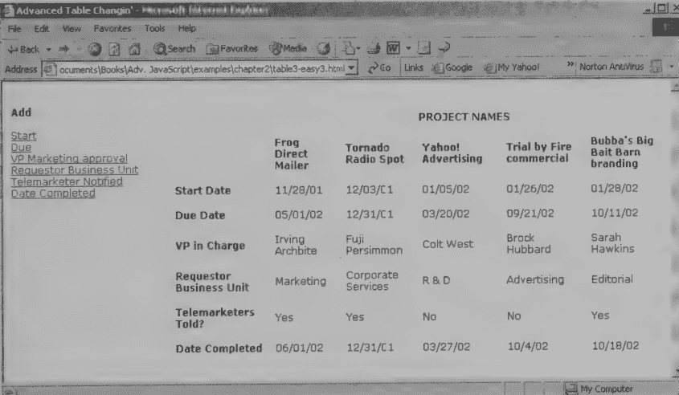

文本看起来不错，但现在是时候添加一些背景条纹以使其更易于阅读了。

### 添加背景阴影

为了在白色和灰色之间交替，我们将使用一个函数，如示例2-9所示，该函数与我们在示例2-5中见过的函数几乎完全相同。

```javascript
function toggleBgColor ()
{
    if (!bgcolor) {
        bgcolor = "#CCCCCC"
    } else {
        bgcolor = ""
    }
}
```

唯一的真正区别是我们使用名为`"bgcolor"`的变量，而不是`"colorStripe"`。

我们需要初始化该变量，并在任何函数之前完成，就像初始化所有其他变量一样：

```javascript
bgcolor = ""
rowsInTable = new Array()
```

快完成了（这个很简单）。现在，只需在`addRow`函数中添加几行代码。我展示了代码之前的部分，以便你知道我将其放置在哪里（尽管这并不重要）。

```javascript
//创建一行
newRow = document.createElement("TR")

// 设置背景颜色
toggleBgColor()
newRow.bgColor = bgcolor
```

就这样！现在你应该能在表格中看到漂亮的交替条带了。

### 第三阶段：删除行

删除行比添加行稍微复杂一些。首先，我们必须找到要操作的行，并确保删除正确的行。当一行被删除时，其下方的所有行都会上移一行。这意味着这些行的索引已经改变，但在`rowsInTable`数组（即包含`name`和`index`属性的数组）中尚未更新。因此，删除行是一个两步过程：

1. 识别并删除该行。
2. 更新`rowsInTable`以反映行的新位置。

让我们从示例2-10开始，这是将调用`removeRow`函数的HTML。

```html
<b>删除</b><br>
<a href="javascript:removeRow('start')">开始</a><br>
<a href="javascript:removeRow('due')">截止</a><br>
<a href="javascript:removeRow('vp')">
    营销副总裁批准</a><br>
<a href="javascript:removeRow('requestor')">
    请求者业务单元</a><br>
<a href="javascript:removeRow('telemarketer')">
    电话推销员已通知</a><br>
<a href="javascript:removeRow('final')">
    完成日期</a><br>
```

但这很简单！让我们看看示例2-11中的JavaScript。

```javascript
function removeRow(rowName)
{
    table = document.getElementById('reportTable')
    tbody = table.getElementsByTagName("TBODY")[0]

    // 查看rowsInTable
    // 找到与行名称
    // 相同名称的元素
    // 查看行索引
    // 删除该索引处的行
    for (i=0; i<rowsInTable.length; i++)
    {
        if (rowsInTable[i].name == rowName)
        {
            indexBeGone = rowsInTable[i].index
            badRow =
                table.getElementsByTagName("TR")
                [indexBeGone]
            tbody.removeChild(badRow)
            removed = rowsInTable.splice(i,1)
            break
        }
    }
}
```

#### 示例2-11 `removeRow`函数（续）

```javascript
// 现在，被删除行下方的行具有
// 不同的索引。是时候更新它们以
// 反映其新位置了
for (i=0; i<rowsInTable.length; i++)
{
    if (rowsInTable[i].index > indexBeGone)
    {
        rowsInTable[i].index--
    }
}
```

### 代码工作原理

1. 这里我们开始的方式略有不同。我们为表格元素创建一个容器，并且仅为表格元素创建。事实证明，这使得代码在函数后面更容易阅读。

2. 和之前一样，我们为表格中的`<tbody>`创建一个容器。请记住，我们必须通过`<tbody>`才能到达行。

3. 要找到要删除的行，我们开始循环遍历`rowsInTable`。

4. 我们检查每个元素，看它是否是被标记为要删除的行。

5. 由于只有知道行的位置才能删除它，我们获取要删除的行的位置或索引，并将其称为`indexBeGone`。

6. 一旦我们知道行的位置，我们就可以直接指向它。我们创建一个变量来保存该行——这使代码更易于阅读。

7. 最后，我们从`<tbody>`中删除该行。此时，该行从网页上消失，其下方的行上移以填补其位置。

8. 由于该行现在已消失，我们需要将其从`rowsInTable`数组中的提及中移除。我们使用`splice`方法，就像在示例2-2中一样（那个在Netscape 4中工作的例子）。

9. 我们已删除该行及其在`rowsInTable`数组中的存在，因此无需再继续循环。

10. 现在我们进入函数的第二部分，开始更新`rowsInTable`数组中剩余行的索引。可以预见，我们首先循环遍历数组中的元素。

11. 要查看行的索引是否受到影响，我们检查其索引是否大于被删除的行。也就是说，我们查找所有在被删除行下方的行——这些行上移了一位，因此它们的索引发生了变化，必须在`rowsInTable`中更新。

12. 我们这里的目标是将行的`index`属性减一。我们可以轻松地使用这个：

```javascript
rowsInTable[i].index = rowsInTable[i].index - 1
```

然而，我想稍微缩短代码。以下应该可行：

```javascript
rowsInTable[i].index -= 1
```

这几乎可以工作——你可以删除除了最顶部一行之外的所有行。Netscape和IE都是这样反应的。老实说，我不知道为什么——我一直没弄明白。我可以说`+=`和`-=`以前给我带来过麻烦，所以我不感到惊讶。无论如何，与其减去一个正数，我们总是可以加一个负数。在这种情况下，这样完全可行。

还不错，对吧？我们真的快完成了，但还有一件事需要担心。如果你输入了代码并尝试删除一些行（我建议你这样做——学习的最佳方式是自己动手输入），你会注意到我们漂亮的交替背景被搞乱了。例如，你的网页最终可能看起来像图2-9。

这是程序员往往不太在意，但客户却很在意的那些恼人的细节之一。所以让我们看看如何保持我们漂亮的小背景。

### 保持背景

保持背景的想法很简单，就是在每次删除行时从头开始重新绘制它们。示例2-12包含执行此操作的代码。我们可以找出哪些行需要更改并只更改那些行，但是，嗯，这样更简单。

#### 示例2-12 重新着色行

```javascript
// 删除一行可能改变了
// 表格的交替阴影。
// 重置它
bgcolor = ""
for (i=0; i<rowsInTable.length; i++)
{
    rowToColor = rowsInTable[i].index
    currentRow =
        tbody.getElementsByTagName("TR")[rowToColor]
    // 设置背景颜色
    toggleBgColor()
    currentRow.bgColor = bgcolor
}
```

### 代码工作原理

1. 我们首先将`bgcolor`初始化为空值，这在页面首次加载时已完成。

2. 由于我们要查看每一行，因此循环遍历`rowsInTable`中的元素。

3. 为了提高代码可读性，我们将行索引放入一个名为`rowToColor`的变量中。

4. 既然我们知道行的位置，就可以在表格中定位到该行，并将其放入一个名为`currentRow`的容器中。

5. 我们调用`toggleBgColor`函数。可以在设置行颜色之前或之后调用，这并不重要。在此例中，我们是在之前调用。记住，如果`bgcolor`为空，此函数会将其设置为“#CCCCCC”；如果已是“#CCCCCC”，则将其重置为空。

6. 最后，我们设置行的颜色。

瞧！² 我们得到了一个外观漂亮且可配置的表格。清单2–13将整个页面以单个代码块列出，以防之前零散的代码片段让您感到些许困惑。

2. 如果您好奇的话，“Voila”是法语，意思是“就是这样”。

# 第2章 • 动态更改表格配置

```html
<html>
<head>
<title>高级表格变更</title>
<style type="text/css">
#report {
    position: absolute;
    top: 30;
    left:200;
}
#menu {
    position: absolute;
    top: 30;
    left:10;
}
.copy {
    font-family: verdana, sans-serif;
    font-size: 12px;
}
.boldcopy {
    font-family: verdana, sans-serif;
    font-size: 12px;
    font-weight: bold
}
</style>
<script language="JavaScript" type="text/javascript">
startRow = new Array("开始日期", "11/28/01", "12/03/01", "01/05/02", "01/26/02", "01/28/02")
dueRow = new Array("截止日期", "05/01/02", "12/31/01", "03/20/02", "09/21/02", "10/11/02")
vpRow = new Array("负责副总裁", "Irving Archbite", "Fuji Persimmon", "Colt West", "Brock Hubbard", "Sarah Hawkins")
requestorRow = new Array("请求者业务单元", "市场部", "企业服务部", "研发部", "广告部", "编辑部")
telemarketerRow = new Array ("电话营销员已通知？", "是", "是", "否", "否", "是")
```

# 高级表格配置

## 清单1-15 完整表格（续）

```javascript
finalRow = new Array("完成日期","06/01/02","12/31/01","03/27/02","10/4/02","10/18/02")

bgcolor = ""
rowsInTable = new Array()

function rowTracker(rowName, index)
{
    this.index = index
    this.name = rowName
}

function addRow(rowName)
{
    // 检查行是否已存在
    for (i=0; i<rowsInTable.length; i++)
    {
        if (rowsInTable[i].name == rowName)
        {
            return
        }
    }

    tbody =
document.getElementById('reportTable').getElementsByTagName("TBODY")[0];

    // 创建一个行
    newRow = document.createElement("TR")

    // 设置背景颜色
    toggleBgColor()
    newRow.bgColor = bgcolor

    rowToAdd = eval(rowName + "Row")
    for (i=0; i<rowToAdd.length; i++)
    {
        td = document.createElement("TD")
        tableCellText = rowToAdd[i]
        if (i == 0) {
            textClass = "boldcopy"
        } else {
            textClass = "copy"
        }
```

## 第2章 • 动态更改表格配置

### 示例2-31：关于代码（续）

```javascript
tableCellHTML = "<span class=\"" + textClass + "\">" + tableCellText + "</span>"
td.innerHTML = tableCellHTML
newRow.appendChild(td)
}

tbody.appendChild(newRow)
newRowObj = new rowTracker(rowName, newRow.rowIndex)
pushed = rowsInTable.push(newRowObj)
}

function removeRow(rowName)
{
    table = document.getElementById('reportTable')
    tbody = table.getElementsByTagName("TBODY")[0]

    // 遍历 rowsInTable
    // 找到与行名称相同的元素
    // 查看其行索引
    // 移除该索引处的行
    for (i=0; i<rowsInTable.length; i++)
    {
        if (rowsInTable[i].name == rowName)
        {
            indexBeGone = rowsInTable[i].index
            badRow = table.getElementsByTagName("TR")[indexBeGone]
            tbody.removeChild(badRow)
            removed = rowsInTable.splice(i,1)
            break
        }
    }

    // 现在，被移除行下方的行索引发生了变化
    // 是时候更新它们以反映新位置了
    for (i=0; i<rowsInTable.length; i++)
    {
        if (rowsInTable[i].index > indexBeGone)
        {
            rowsInTable[i].index += -1
        }
    }

    // 移除行可能改变了表格的交替底色
```

# 高级表格配置


```javascript
// 重置它
bgcolor = ""
for (i=0; i<rowsInTable.length; i++)
{
    rowToColor = rowsInTable[i].index
    currentRow = tbody.getElementsByTagName("TR")[rowToColor]
    // 设置背景颜色
    toggleBgColor()
    currentRow.bgColor = bgcolor
}

function toggleBgColor ()
{
    if (!bgcolor) {
        bgcolor = "#CCCCCC"
    } else {
        bgcolor = ""
    }
}
```

```html
</script>
</head>
<body>
<div id="menu" class="copy">
<b>添加</b><br><br>
<a href="javascript:addRow('start')">开始</a><br>
<a href="javascript:addRow('due')">截止</a><br>
<a href="javascript:addRow('vp')">市场副总裁批准</a><br>
<a href="javascript:addRow('requestor')">请求者业务单元</a><br>
<a href="javascript:addRow('telemarketer')">电话营销员已通知</a><br>
<a href="javascript:addRow('final')">完成日期</a><br>
<br><br><br>
<b>移除</b><br>
<a href="javascript:removeRow('start')">开始</a><br>
<a href="javascript:removeRow('due')">截止</a><br>
<a href="javascript:removeRow('vp')">市场副总裁批准</a><br>
<a href="javascript:removeRow('requestor')">请求者业务单元</a><br>
<a href="javascript:removeRow('telemarketer')">电话营销员已通知</a><br>
<a href="javascript:removeRow('final')">完成日期</a><br>
</div>
```

76 第2章 • 动态更改表格配置

```html
<div id="report">
<table id="reportTable" cellspacing="0" cellpadding="8"
border="0" width="600">
    <tbody>
    <tr>
        <td></td>
        <td class="copy" colspan="5" align="center"><b>项目名称</b></td>
    </tr>
    <tr>
        <td></td>
        <td class="boldcopy"><b>青蛙直邮活动</b></td>
        <td class="boldcopy"><b>龙卷风广播广告</b></td>
        <td class="boldcopy"><b>雅虎！广告</b></td>
        <td class="boldcopy"><b>烈火审判商业广告</b></td>
        <td class="boldcopy"><b>巴布大诱饵谷仓品牌推广</b></td>
    </tr>
    </tbody>
</table>
</div>
</body>
</html>
```

# 更换图像映射

**本章内容**

- 场景设定
- HTML中的多重图像映射
- JavaScript中的图像映射信息

有几种方法可以动态更改图像的图像映射。这在主页上很有用，其中一张中央图像可以作为多个导航项的子菜单。不幸的是，实现这一点的简单方法需要用到 Netscape 4 中不可用的方法。因此，本章将重点讲解如何在 IE5+ 以及 Netscape 6 及更高版本中更改图像映射。这可能会让一些浏览器纯粹主义者感到不快，但我相信，不再为 4.x 版本浏览器进行编码的时代即将来临（很快；可能就在您拿到本书的时候）。要么这样，要么所有人都开始使用 Flash，它在所有浏览器中都有效，但需要一个插件。我们确实会探讨如何为 Netscape 4.x 更换图像映射，但这需要深入了解捕获事件，而这部分内容我们直到第10章才会介绍。因此，如果您在更换图像映射时必须考虑 Netscape 4，请直接跳到第10章。您可以随时回到本章。它一直都在这里。

## 场景设定

我们再次以生物科技公司 Shelley 的网站为例，正如第1章所做的那样。主页将仍然采用悬停效果（尽管要微妙得多）。我们从一个超简单的主页开始，如图 3–1 所示。

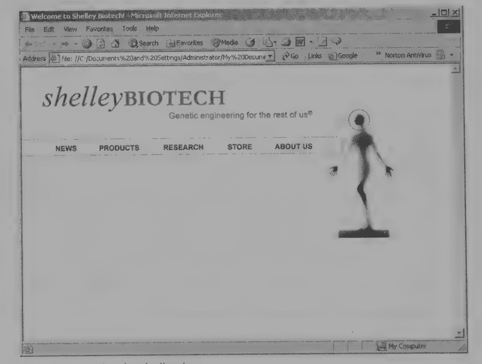

我们有悬停效果，可以将黑色的导航文本（“新闻”、“产品”等）变为蓝色。仅此而已。然而，当用户点击导航图像时，一个大的子菜单会出现，如图 3–2 所示。点击“研究”将得到如图 3–3 所示的子菜单。而点击“商店”则会得到图 3–4。

# 第三章 • 替换图像映射

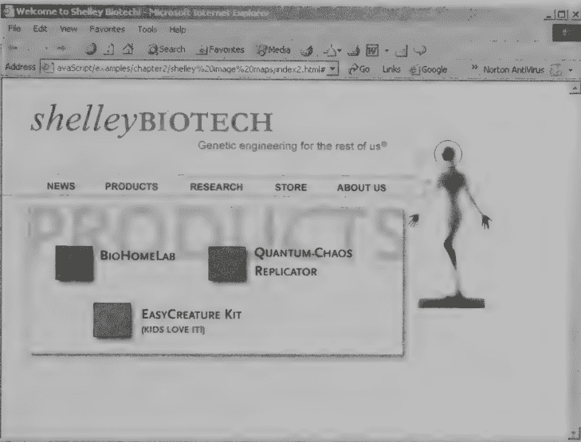

图 3-2 产品子菜单


图 3-3 研究子菜单


图 3-4 商店子菜单

请注意，这三个子菜单都位于同一个物理位置，但它们都需要完全不同的图像映射才能工作。在本章中，我们将探讨两种为每张图像使用相应图像映射的不同方法。第一种方法将图像映射信息保存在页面的 HTML 中，第二种则将所有信息保存在 JavaScript 中。我们将从将映射保存在 HTML 中的方法开始。

## HTML 中的多个图像映射

让我们首先将页面编码为一个带有鼠标悬停效果的普通网页。它看起来像示例 3-1（注意底部的三张图像）。

**示例 3-1（带有鼠标悬停效果的主页）**

```html
<html>
<head>
<title>Welcome to Shelley Biotech!</title>

<style type="text/css">
#header { position: absolute; left: 36; top: 31; }
#nav { position: absolute; left: 0; top: 122; }
#gal { position: absolute; left: 515; top: 74; }
#submenu { position: absolute; left: 33; top: 163; }
</style>

<script language="JavaScript">
// preload images

newsOn = new Image()
newsOn.src = "images/nav_news_on.gif"
newsOff = new Image()
newsOff.src = "images/nav_news_off.gif"

productsOn = new Image()
productsOn.src = "images/nav_products_on.gif"
productsOff = new Image()
productsOff.src = "images/nav_products_off.gif"

researchOn = new Image()
researchOn.src = "images/nav_research_on.gif"
researchOff = new Image()
researchOff.src = "images/nav_research_off.gif"

storeOn = new Image()
storeOn.src = "images/nav_store_on.gif"
storeOff = new Image()
storeOff.src = "images/nav_store_off.gif"

aboutOn = new Image()
aboutOn.src = "images/nav_about_on.gif"
aboutOff = new Image()
aboutOff.src = "images/nav_about_off.gif"

function rollOver (imgName)
{
    document.images[imgName].src = 
        eval(imgName + "On.src")
}

function rollOut (imgName)
{
    document.images[imgName].src = 
        eval(imgName + "Off.src")
}
</script>
</head>

<body bgcolor="#FFFFFF">

<div id="header"></div>

<div id="gal"></div>

<div id="nav">
<table border="0" cellpadding="0" cellspacing="0">
  <tr>
    <td></td>
    <td><a href="#"
      onMouseOver="rollOver('news')"
      onMouseOut="rollOut('news')"></a></td>
    <td><a href="#"
      onMouseOver="rollOver('products')"
      onMouseOut="rollOut('products')"></a></td>
    <td><a href="#"
      onMouseOver="rollOver('research')"
      onMouseOut="rollOut('research')"></a></td>
    <td><a href="#"
      onMouseOver="rollOver('store')"
      onMouseOut="rollOut('store')"></a></td>
    <td><a href="about.html"
      onMouseOver="rollOver('about')"
      onMouseOut="rollOut('about')"></a></td>
  </tr>
</table>
</div>

<div id="submenu">


<map name="productsMap">
<area shape="rect" coords="286,44,422,101"
    href="prod/replicator.html">
<area shape="rect" coords="139,126,282,175"
    href="prod/easycreature.html">
<area shape="rect" coords="88,48,196,75"
    href="prod/biohomelab.html">
</map>

<map name="researchMap">
<area shape="rect" coords="142,134,432,161"
    href="research/capping.html">
<area shape="rect" coords="258,78,431,110"
    href="research/cancer.html">
<area shape="rect" coords="81,34,479,67"
    href="research/downs.html">
</map>

<map name="storeMap">
<area shape="rect" coords="346,106,461,153"
    href="store/fish.html">
<area shape="rect" coords="347,34,464,60"
    href="store/mugs.html">
<area shape="rect" coords="85,130,272,177"
    href="store/vegas.html">
<area shape="rect" coords="85,100,228,121"
    href="store/sucks.html">
<area shape="rect" coords="86,55,252,92"
    href="store/selfish.html">
<area shape="rect" coords="88,18,211,46"
    href="store/shirts.html">
</map>
</div>
</body>
</html>
```

你可能已经注意到，在子菜单图层中，只有一个大的白色矩形，后面跟着三个甚至与图像没有关联的图像映射。这实际上没关系。还要注意，我们忽略了新闻和关于部分的子菜单。在现实世界中，它们会存在，但只用三个子菜单你就能理解这个概念（而且我也会在这个已经很长的书中节省一些篇幅）。

在子菜单图层中，我们将循环使用四张不同的图像。我们从一张名为 `white_block.gif` 的大白色方块开始。其他三张图像分别叫做 `products.gif`、`research.gif` 和 `store.gif`。

当用户点击像“产品”这样的导航链接时，我们希望发生两件事：

1. 子菜单图像更改为用户选择的任何图像。
2. 新图像的图像映射显示出来。

更改子菜单图像看起来很像在鼠标悬停时更换图像。也就是说，这部分需要三个步骤：首先，我们必须预加载图像以确保流畅的用户体验。其次，我们编写切换图像的函数。最后，我们向图像添加代码，以便在点击导航图像时调用该函数。这比听起来要容易。让我们看看示例 3-2，这是调用该函数的 HTML。

```html
<td><a href="#" onMouseOver="rollOver('products')" onMouseOut="rollOut('products')" onClick="showSubmenu('products')"></a></td>

<td><a href="#" onMouseOver="rollOver('research')" onMouseOut="rollOut('research')" onClick="showSubmenu('research')"></a></td>

<td><a href="#" onMouseOver="rollOver('store')" onMouseOut="rollOut('store')" onClick="showSubmenu('store')"></a></td>
```

### 代码如何工作

我已将添加的代码加粗。当用户点击图像时，`onClick` 事件处理程序被调用，一个名为 `showSubMenu` 的函数开始运行。你注意到子菜单图像本身了吗？令人惊讶的是，它没有包含 `useMap` 属性。

```html
<div id="submenu">
    
    ...
</div>
```

在我们查看函数包含什么之前，我们应该看看示例 3-3，它展示了子菜单图像是如何预加载和命名的。

```javascript
productsSub = new Image()
productsSub.src = "images/products.gif"
researchSub = new Image()
researchSub.src = "images/research.gif"
storeSub = new Image()
storeSub.src = "images/store.gif"
```


这里没有太多新内容。你知道预加载。在我们查看示例 3-4 中的函数之前，最后一点：记住，映射的名称是 `productsMap`、`researchMap` 和 `storeMap`。

```javascript
function showSubMenu (menuName)
{
    document.images['submenuImg'].src =
        eval(menuName + "Sub.src")
    document.images['submenuImg'].useMap =
        eval("'#" + menuName +"Map'")
}
```

#### 代码如何工作

1. 这里，我们将子菜单图像替换为新的。这与我们之前在鼠标悬停效果中看到的完全一样，只是这里我们不关心 Netscape 4，因此不必添加单独的图层引用。
2. 这是关键部分：要使用不同的图像映射，我们只需修改图像的 `useMap` 属性。如果用户点击了“产品”，最终代码将如下所示：

```javascript
document.images['submenuImg'].useMap = '#productsMap'
```

就是这样！不太难吧？示例 3-5 包含了所有代码，让你的生活更轻松。

### 示例 3-5 完整代码

```html
<html>
<head>
<title>Welcome to Shelley Biotech!</title>

<style type="text/css">
#header { position: absolute; left: 36; top: 31; }
#nav { position: absolute; left: 0; top: 122; }
#gal { position: absolute; left: 515; top: 74; }
#submenu { position: absolute; left: 33; top: 163; }
</style>

<script language="JavaScript">
// preload images

newsOn = new Image()
newsOn.src = "images/nav_news_on.gif"
newsOff = new Image()
newsOff.src = "images/nav_news_off.gif"

productsOn = new Image()
productsOn.src = "images/nav_products_on.gif"
productsOff = new Image()
productsOff.src = "images/nav_products_off.gif"

researchOn = new Image()
researchOn.src = "images/nav_research_on.gif"
researchOff = new Image()
researchOff.src = "images/nav_research_off.gif"
```

### JavaScript 中的图像映射信息

也可以将所有图像映射信息置于 JavaScript 中，完全不使用 HTML。事实证明，这样会生成更长的代码，但它也允许你动态地更改单个区域的坐标、`href`、目标（target）和形状。

由于所有图像映射信息都存在于 JavaScript 中，我们的 HTML 就变得相当简单，如示例 3–6 所示。

你是否注意到 `<map>` 标签同时具有 `name` 和 `id` 属性？这看起来有些冗余，实际上 IE 只使用 `id="submenuMap"` 也能正常工作，但 Netscape 6 还需要 `name="submenuMap"` 才能生效。

为实现此功能，我们将使用五个独立的函数：

- `showSubmenu`
- `createproductsSubmenuMap`
- `createresearchSubmenuMap`
- `createStoreSubMenuMap`
- `clearImageMap`

`showSubmenu` 函数完成两件事：它更换子菜单图片，并调用相应的函数来创建实际的图像映射。接下来的三个函数都创建 `<area>` 标签，并用 `href`、形状和坐标填充它们。`clearImageMap` 函数则清除当前位置的图像映射，为新映射腾出空间。例如，当用户点击“产品（Products）”时，会为产品子菜单创建一个图片并放置到位。如果用户随后点击“研究（Research）”，产品图像映射会被擦除，并创建研究图像映射。让我们来看一下这些函数，见示例 3-7。

### 示例 3-7 五个图像映射函数

```javascript
function showSubmenu (menuName)
{
  ❶document.images['submenuImg'].src = eval(menuName + "Sub.src")
  ❷eval("create" + menuName + "SubmenuMap()")
}

❸function createproductsSubmenuMap ()
{
  ❹replicator = document.createElement("AREA")
  ❺replicator.href = "prod/replicator.html"
  replicator.shape = "rect"
  replicator.coords = "286,44,422,101"

  ❻ creature = document.createElement("AREA")
  creature.href = "prod/easycreature.html"
  creature.shape = "rect"
  creature.coords = "139,126,282,175"

  ❼ biohomelab = document.createElement("AREA")
  biohomelab.href = "prod/biohomelab.html"
  biohomelab.shape = "rect"
  biohomelab.coords = "88,48,196,75"

  // 清除现有的图像映射
  ❽ clearImageMap()

  ❾ mapObj = document.getElementById("submenuMap")
  ❿ mapObj.appendChild(replicator)
  mapObj.appendChild(creature)
  mapObj.appendChild(biohomelab)
}

⓫ function createresearchSubmenuMap()
{
  capping = document.createElement("AREA")
  capping.href = "research/capping.html"
  capping.shape = "rect"
  capping.coords = "142,134,432,161"

  cancer = document.createElement("AREA")
  cancer.href = "research/cancer.html"
  cancer.shape = "rect"
  cancer.coords = "258,78,431,110"

  downs = document.createElement("AREA")
  downs.href = "research/downs.html"
  downs.shape = "rect"
  downs.coords = "81,34,479,67"

  // 清除现有的图像映射
  clearImageMap()

  mapObj = document.getElementById("submenuMap")
  mapObj.appendChild(capping)
  mapObj.appendChild(cancer)
  mapObj.appendChild(downs)
}

function createStoreSubMenuMap ()
{
  fish = document.createElement("AREA")
  fish.href = "store/fish.html"
  fish.shape = "rect"
  fish.coords = "346,106,461,153"

  mugs = document.createElement("AREA")
  mugs.href = "store/mugs.html"
  mugs.shape = "rect"
  mugs.coords = "347,34,464,60"

  vegas = document.createElement("AREA")
  vegas.href = "store/vegas.html"
  vegas.shape = "rect"
  vegas.coords = "85,130,272,177"

  sucks = document.createElement("AREA")
  sucks.href = "store/sucks.html"
  sucks.shape = "rect"
  sucks.coords = "85,100,228,121"

  selfish = document.createElement("AREA")
  selfish.href = "store/selfish.html"
  selfish.shape = "rect"
  selfish.coords = "86,55,252,92"

  shirts = document.createElement("AREA")
  shirts.href = "store/shirts.html"
  shirts.shape = "rect"
  shirts.coords = "88,18,211,46"

  // 清除现有的图像映射
  clearImageMap()

  mapObj = document.getElementById("submenuMap")
  mapObj.appendChild(fish)
  mapObj.appendChild(mugs)
  mapObj.appendChild(vegas)
  mapObj.appendChild(sucks)
  mapObj.appendChild(selfish)
  mapObj.appendChild(shirts)
}
```

### 示例 3–6 子菜单层

```html
<div id="submenu">

<map name="submenuMap" id="submenuMap"></map>
</div>
```

### 示例 3–5 完整页面（续）

```html
<area shape="rect" coords="88,48,196,75"
    href="prod/biohomelab.html">
</map>

<map name="researchmap">
<area shape="rect" coords="142,134,432,161"
    href="research/capping.html">
<area shape="rect" coords="258,78,431,110"
    href="research/cancer.html">
<area shape="rect" coords="81,34,479,67"
    href="research/downs.html">
</map>

<map name="storemap">
<area shape="rect" coords="346,106,461,153"
    href="store/fish.html">
<area shape="rect" coords="347,34,464,60"
    href="store/mugs.html">
<area shape="rect" coords="85,130,272,177"
    href="store/vegas.html">
<area shape="rect" coords="85,100,228,121"
    href="store/sucks.html">
<area shape="rect" coords="86,55,252,92"
    href="store/selfish.html">
<area shape="rect" coords="88,18,211,46"
    href="store/shirts.html">
</map>
</div>
</body>
</html>
```

### 示例 1-5 完整代码（续）

```html
<div id="nav">
<table border="0" cellpadding="0" cellspacing="0">
  <tr>
    <td></td>
    <td>
      <a href="#"
        onMouseOver="rollOver('news')"
        onMouseOut="rollOut('news')"></a></td>
    <td><a href="#"
      onMouseOver="rollOver('products')"
      onMouseOut="rollOut('products')"
      onClick="showSubmenu('products')"></a></td>
    <td><a href="#"
      onMouseOver="rollOver('research')"
      onMouseOut="rollOut('research')"
      onClick="showSubmenu('research')"></a></td>
    <td><a href="#"
      onMouseOver="rollOver('store')"
      onMouseOut="rollOut('store')"
      onClick="showSubmenu('store')"></a></td>
    <td><a href="about.html"
      onMouseOver="rollOver('about')"
      onMouseOut="rollOut('about')"></a></td>
  </tr>
</table>
</div>
<div id="submenu">

<map name="productsmap">
<area shape="rect" coords="286,44,422,101"
      href="prod/replicator.html">
<area shape="rect" coords="139,126,282,175"
      href="prod/easycreature.html">
```


```javascript
storeOn = new Image()
storeOn.src = "images/nav_store_on.gif"
storeOff = new Image()
storeOff.src = "images/nav_store_off.gif"

aboutOn = new Image()
aboutOn.src = "images/nav_about_on.gif"
aboutOff = new Image()
aboutOff.src = "images/nav_about_off.gif"

productsSub = new Image()
productsSub.src = "images/products.gif"
researchSub = new Image()
researchSub.src = "images/research.gif"
storeSub = new Image()
storeSub.src = "images/store.gif"

function rollOver (imgName)
{
    document.images[imgName].src =
        eval(imgName + "On.src")
}

function rollOut (imgName)
{
    document.images[imgName].src =
        eval(imgName + "Off.src")
}

function showSubmenu (menuName)
{
    document.images['submenuImg'].src =
        eval(menuName + "Sub.src")
    document.images['submenuImg'].useMap =
        eval("'#" + menuName +"Map'")
}

</script>

<body bgcolor="#FFFFFF">

<div id="header"></div>

<div id="gal"></div>
```

### JavaScript 中的图像映射信息

### 示例 3-1 五个图像映射函数（续）

```javascript
function clearImageMap()
{
    mapObj = document.getElementById("submenuMap")
    while (mapObj.childNodes.length)
    {
        mapObj.removeChild(mapObj.firstChild)
    }
}
```

#### 代码工作原理

1. 我们首先像之前那样替换图像。此方法在 Netscape 4 中不可用，因此我们无需担心该浏览器需要额外的图层信息。

2. 然后我们调用相应的函数。例如，如果 `menuName` 是 `"Research"`，则调用 `createResearchSubmenuMap` 函数。

3. 如果用户点击了 `"Products"`，则调用 `createProductsSubmenuMap` 函数。

4. 我们通过首先创建所有 `AREA` 元素来开始创建图像映射。首先创建一个空的 `AREA` 元素。

5. 添加 `href` 信息、形状和坐标非常直接。

6. 现在我们为 EasyCreature 套件链接创建 `AREA` 元素。

7. ……以及为 BioHomeLab 链接创建 `AREA` 元素。

8. 作为预防措施，我们调用 `clearImageMap` 函数来删除任何可能存在的图像映射信息。此信息仅在用户已经点击了导航链接时才会存在。

9. 为了简化代码，我们创建一个名为 `mapObj` 的小容器，它保存对子菜单图像映射的引用（即 HTML 中的 `<map>` 标签）。

10. 为了使 `AREA` 元素成为映射的一部分，它们必须附加到映射上。正如我们在第 2 章处理表格时所做的那样，我们使用 `appendChild` 将浮动元素添加到页面上存在的标签中。

11. 每个图像映射需要一个单独的函数。这是为 Research 子菜单创建 `AREA` 元素并将其附加到子菜单映射的函数。

12. 这是创建 Store 子菜单图像映射的函数。

13. 这是删除子菜单图像上可能存在的任何图像映射的函数。

14. 正如我们在此脚本中已经看到的，我们创建一个名为 `mapObj` 的对象，它保存对子菜单 `map` 元素的引用。

15. 我们的目标是从子菜单图像中移除图像映射。最简单的方法不是移除整个映射，而是从映射中移除所有 `AREA` 元素。这样，映射永远不会消失，但没有了任何 `AREA` 元素，它就显得不存在了。我们必须从 `map` 对象中移除 `AREA` 元素，而所有这些 `AREA` 元素都是 `map` 对象的子节点（还记得我们使用 `appendChild` 添加它们吗？）。这意味着如果 `map` 对象没有子节点，那么对象内就没有 `AREA` 元素。所以我们的目标是移除 `map` 对象的所有子节点，直到子节点数量为零我们的工作才算完成。一个好的方法是创建一个 `while` 循环。当 `map` 对象仍有子节点时，必须至少移除一个子节点。因此，我们循环的条件是检查 `map` 对象是否仍有子节点。

16. 如果 `map` 对象仍有子节点，则移除第一个子节点。也就是说，移除 `map` 对象中的第一个 `AREA` 元素。然后代码检查 `map` 对象是否还有任何剩余的子节点，或者那是否是最后一个。如果还有更多子节点，则移除当前的第一个子节点，如此循环，直到所有 `AREA` 元素都被移除。

呼！你都理解了吗？很好。这运行得很好，我们可以流畅地在子菜单之间切换。我们可以做一件小事，让页面的功能更像桌面软件程序。目前，一旦用户点击导航链接调出子菜单，要消除该子菜单的唯一方法是点击另一个链接并调出另一个。没有办法完全移除子菜单。这是一个相当容易的修复，所以让我们来做吧。大多数桌面应用程序上的菜单是点击一次出现，再次点击菜单项时消失。让我们对我们的菜单系统做同样的事情。

我们做的第一件事是在预加载序列中添加空白的白色块。示例 3–8 将向我们展示如何操作。

```javascript
blankSub = new Image()
blankSub.src = "images/white_block.gif"
```

然后我们向 `showSubmenu` 函数添加一些检查，如示例 3–9 所示。

```javascript
function showSubmenu (menuName)
{
    // 看看子菜单是否已经可见
    ❶docSource = document.images['submenuImg'].src
    ❷scriptSource = eval(menuName + "Sub.src")
    ❸if (docSource.indexOf(scriptSource) != -1)
    {
        ❹document.images['submenuImg'].src =
            blankSub.src
        ❺clearImageMap()
    }
    else
    {
        ❻document.images['submenuImg'].src =
            scriptSource
        eval("create" + menuName + "SubmenuMap()")
    }
}
```

### 代码工作原理

1. 为了使代码更具可读性，我们将子菜单的 `src` 属性放入名为 `docSource` 的变量中。

2. 类似地，我们将预加载图像的源值放入名为 `scriptSource` 的变量中。

3. 这一行可能看起来有点令人困惑。我们试图做的是查看用户是否连续两次点击了同一个导航链接。如果他们这样做了，这意味着第二次点击时子菜单应该消失。所以，如果这是真的，看起来文档的实际源（`docSource`）应该等于预加载图像的源（`scriptSource`）。也就是说，如果用户连续两次点击 `"Store"`，那么两个值都应该是 `"images/store.gif"`，对吗？确实如此，但重点在于应该是。IE，感谢其垄断性的核心，实际上确实这样工作。Netscape 将 `docSource` 转换为绝对 URL，而不是保留 `scriptSource` 的相对 URL。这就是为什么我们必须查看 `scriptSource`（相对 URL）是否包含在 `docSource`（绝对 URL）中。如果 `scriptSource` 包含在 `docSource` 中，则两者本质上是相同的，这意味着用户连续两次点击了一个链接。

4. 我们替换掉当前的子菜单，并用一个空白的白色图形替换它。

5. 然后我们移除图像映射，因为子菜单不再可见。

6. 然而，如果 `scriptSource` 未包含在 `docSource` 中，则用户点击了两个不同的导航链接，我们可以像之前那样显示子菜单图像并创建一个新的图像映射。

## 4 修改列表

### 本章内容

- 添加到列表
- 在无序列表和有序列表之间切换
- 在特定位置插入列表项

这是另一个不包含任何 Netscape 4 代码的章节。在 Netscape 4 中，除了使用 `document.write` 创建列表并在每次想要更改列表中的某些内容时重新加载页面之外，确实没有任何方法可以修改列表，就像我们在第 2 章处理表格一样。不过，如果你能把目光从 Netscape 4 上移开，世界会更光明。你可以在不重新加载页面的情况下向列表添加项目，更改某些列表项的值，以及在有序列表和无序列表之间切换。

### 添加到列表

我们将用一个简单的例子开始我们的小小旅程。我们将从一个没有任何项目的列表开始，并允许用户添加他们想要的任何项目。

示例 4-1 显示了仅包含 HTML（尚无 JavaScript）的页面外观。

```html
示例 4-1 列表更改 HTML
<html>
<head>
<title>列表操作</title>
<style type="text/css">
#addToList{ position: absolute; top:10; left: 10; }
#list { position: absolute; top:10; left: 250; }

.copy {
    font-family: verdana, sans-serif;
    font-size: 11px;
}
</style>
</head>
<body bgcolor="#FFFFFF">
<div id="addToList" class="copy">
<form name="listForm">
向你的待办事项列表添加一项：<br>
<input type="text" name="todo" size="30"
class="copy"><br>
<input type="button" value="添加到列表末尾"
class="copy">
</form>
</div>
<div id="list" class="copy">
<ul></ul>
</div>
</body>
</html>
```

我们的页面有两个小层：一个层包含一个带有文本字段和按钮的小表单。另一个层更小：它包含一个空列表，`<ul></ul>`。就是这样。

我们的计划是允许用户在文本框中输入内容，然后通过按下按钮，将该文本作为列表项添加进去。事实证明，这非常简单。示例 4-2 展示了实现此功能的脚本。

```javascript
示例4-2 用于向列表添加项目的脚本
<script language="JavaScript">

function addToList()
{
    ❶ textForListItem = document.listForm.todo.value
    ❷ if (textForListItem.length)
    {
        // 创建列表项
        ❸ listElem = document.createElement("LI")
        ❹ listElem.innerHTML = textForListItem

        // 将列表项添加到无序列表
        ❺ ul = document.getElementById("list").getElementsByTagName("UL")[0]
        ❻ ul.appendChild(listElem)
    }
}

</script>
```

#### 代码工作原理

1. 我们将表单中输入的值捕获到一个名为 `textForListItem` 的变量中。表单的名称是 `"listForm"`，文本字段的名称是 `"todo"`。我们必须获取该文本字段的值才能获取文本。

2. 我们只想在用户确实在表单中输入了内容时才添加列表项，因此我们确保 `textForListItem` 包含的字符数大于零。从技术上讲，我们只是确保它不是恰好零个字符。

3. 一旦我们确定表单字段确实包含某些内容，我们就创建一个列表元素并将其命名为 `listElem`。请注意，此列表项还不是任何列表的一部分——它是一个未连接的 `<li>`，只是漂浮在浏览器的内存中。

4. 然后我们向列表元素添加一些文本。如果用户输入了 `"Laundry"`，那么我们的列表项将如下所示：`<li>Laundry`。列表元素现在已准备好附加到网页中的列表中。

5. 为了使代码更易于处理，我们创建一个名为 `ul` 的对象来保存对 HTML 中 `<ul></ul>` 的引用。层的名称是 `"list"`，我们必须经过该层才能指向列表本身。注意我们正在寻找 `<ul>` 标签，无论它是否包含任何列表项都无关紧要。

6. 最后，我们将列表项添加到 HTML 中的实际列表中。一旦执行到此代码，该项目就会出现在网页中。添加三个项目可能类似于图 4-1。

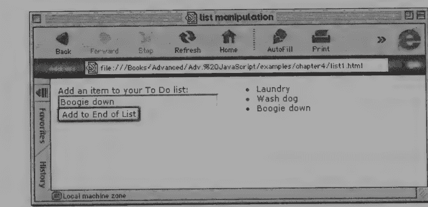

别忘了修改按钮，使其实际调用该函数。

```html
<input type="button" value="Add to End of List"
class="copy" onClick="addToList()"><br>
```

这已经很有趣了。让我们给它加点料。

### 在无序列表和有序列表之间切换

你还可以将无序列表更改为有序列表，然后再改回来。这听起来很简单，但实际上有些复杂。首先，一旦列表存在，你就无法将其从无序列表更改为有序列表。解决这个问题的方法是创建一个全新的列表，将旧列表项复制到新列表中，删除旧列表，并将新列表放在其位置。示例 4-3 展示了这看起来是什么样子。


```javascript
1 listType = "UL"

function toggleList ()
{
    2 listDiv = document.getElementById("list")
    3 oldListElem = listDiv.getElementsByTagName(listType)[0]

    // 创建新列表
    4 if (listType == "UL")
    {
        listType = "OL"
    }
    else
    {
        listType = "UL"
    }

    5 newListElem = document.createElement(listType)

    // 读取列表的元素
    6 for (i=0; i<oldListElem.childNodes.length; i++)
    {
        7 newListItem = document.createElement("LI")
        8 newListItem.innerHTML = oldListElem.childNodes[i].innerHTML
        9 newListElem.appendChild(newListItem)
    }

    // 移除旧列表
    10 listDiv.removeChild(oldListElem)

    // 创建新列表元素
    listDiv.appendChild(newListElem)
}
```

#### 代码工作原理

1. 我们首先创建一个名为 `listType` 的全局变量。此变量将跟踪当前正在使用哪种类型的列表：`"UL"` 或 `"OL"`。

2. 为了使我们的代码更具可读性，我们为包含列表的层创建一个容器。

3. 然后我们创建一个容器来保存列表本身。

4. 我们将 `listType` 从 `"UL"` 切换为 `"OL"`，或从 `"OL"` 切换为 `"UL"`。

5. 然后，根据 `listType` 的值，我们创建一个新的列表元素。也就是说，我们创建 `<ul></ul>` 或 `<ol></ol>`。请记住，我们还没有将这个新列表附加到任何地方，所以它还不是网页的一部分。

6. 现在是时候将列表项从旧列表（用户当前看到的那个）读取到新列表（漂浮在浏览器内存中的那个不可见列表）中。我们通过循环遍历当前列表元素中的所有列表项来开始此过程。我们通过检查列表元素拥有的子节点数来实现这一点。每个列表项（即每个 `<li>`）被称为列表的子节点。因此，`oldListElem.childNodes.length` 是列表中的项目数。

7. 我们创建一个新的列表项元素。


8. 然后我们将旧列表项的文本复制到新列表项中。注意我们正在查看`oldListElem.childNodes[i]`。DOM 将任何父元素的所有子元素放入一个名为`childNodes`的数组中。如果旧列表项是`<li>Laundry</li>`，而当前新列表项只是`<li></li>`，这行代码会将“Laundry”从旧列表项复制并添加到新列表项中，这样它们就都变成了`<li>Laundry</li>`。现在新列表项已完成，我们准备将其添加到新列表中（即`<ul></ul>`或`<ol></ol>`）。在附加了`newListItem`之后，我们的`newListElem`可能看起来像`<ol><li>Laundry</li></ol>`。

9. 一旦我们循环遍历完整个旧列表，我们的新列表就完全构建好了。剩下要做的就是移除旧列表并插入新列表。这行代码从当前包含它的层（`listDiv`）中移除了旧列表（`oldListElem`）。执行此行代码后，该层的 HTML 变为`<div id="list" class="copy"></div>`。就是这样。

10. 最后，我们将新列表添加到层中，瞧！它出现在页面上。用户看到的只是一个列表从一种样式变为另一种样式。

别忘了添加一个调用此函数的按钮：

```html
<input type="button" value="toggle ordered/unordered" class="copy" onClick="toggleList()"><br>
```

一个看起来像图4-2的页面会变成一个看起来像图4-3的页面。

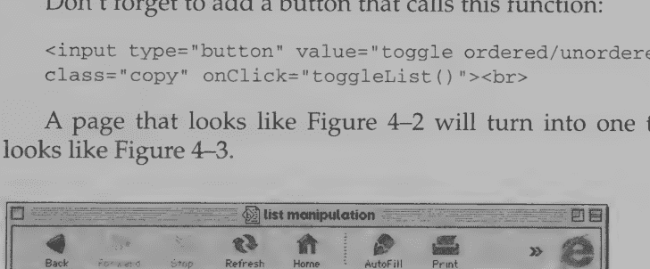

**图4-2** 无序列表

好吧，这段代码相当酷。让我们再看看与列表相关的另一件事（这是一个简短的章节——真的，它们只是列表）。

# 第4章 • 修改列表

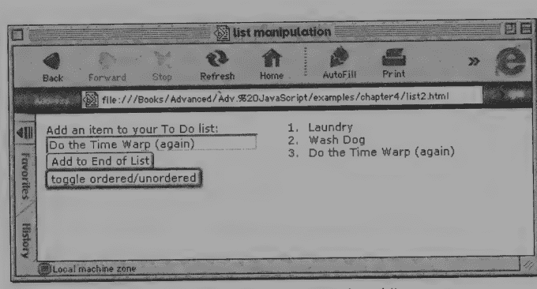

**图4-3** 点击按钮后，它变成了一个有序列表

## 将项目插入特定位置

假设我们想在列表的末尾以外的位置插入一个列表项，比如第三个位置。示例4-4展示了实现此目的的代码。

```javascript
示例4-4 将列表项插入第三个位置

function insertItem() {
  listDiv = document.getElementById("list")
  listElem = listDiv.getElementsByTagName(listType)[0]
  listItemToBump = listElem.childNodes[2]

  newListItem = document.createElement("LI")
  newListItem.innerHTML = document.listForm.todo.value
  listElem.insertBefore(newListItem, listItemToBump)
}
```

### 代码工作原理

1. 前三行代码可以合并为一行长代码，但这种形式的代码更易于阅读。像你之前看到的那样，我们首先将列表层放入一个名为`listDiv`的变量中。

2. 列表本身（注意我们使用`listType`来定位它）放入`listElem`。最后，我们定位列表中的第三个项目，并将其称为`listItemToBump`。你可能已经猜到，我们将在这个项目之前插入新的列表项。

3. 在这里，我们开始创建要插入的列表项。首先，我们创建一个列表项元素。

4. 然后我们从表单中复制值到新的列表项中。

5. 然后我们使用一个新方法`insertBefore`来将新的列表项放置在旧的列表项之前。此方法接受两个参数：要插入的新对象和它插入在其前面的对象的名称。（仅供参考：没有`insertAfter`方法。）

当然，你记得添加按钮了，对吧？

```html
<input type="button" value="Insert at position 3"
class="copy" onClick="insertItem()">
```

瞧，你现在是列表大师了。干得好！示例4-5展示了整个页面的代码，只是为了确保你把所有东西都放到了它应该在的地方。

```html
示例4-5 完整代码
<html>
<head>

<title>list manipulation</title>

<style type="text/css">
#addToList{ position: absolute; top:10; left: 10; }
#list { position: absolute; top:10; left: 250; }

.copy {
    font-family: verdana, sans-serif;
    font-size: 11px;
}
</style>

<script language="JavaScript">

listType = "UL"

function addToList()
```

# 第4章 • 修改列表

```javascript
/* 图 4-2 完整代码（续） */
{
    textForListItem = document.listForm.todo.value
    if (textForListItem.length)
    {
        // 创建列表项
        listElem = document.createElement("LI")
        listElem.innerHTML = textForListItem

        // 将列表项添加到无序列表
        ul = document.getElementById("list").getElementsByTagName(listType)[0]
        ul.appendChild(listElem)
    }

}

function toggleList ()
{
    listDiv = document.getElementById("list")
    oldListElem = listDiv.getElementsByTagName(listType)[0]

    // 创建新列表
    if (listType == "UL")
    {
        listType = "OL"
    }
    else
    {
        listType = "UL"
    }

    newListElem = document.createElement(listType)

    // 读取列表的元素
    for (i=0; i<oldListElem.childNodes.length; i++)
    {
        newListItem = document.createElement("LI")
        newListItem.innerHTML =
            oldListElem.childNodes[i].innerHTML
        newListElem.appendChild(newListItem)
    }

    // 移除旧列表
    listDiv.removeChild(oldListElem)

    // 创建新的列表元素
    listDiv.appendChild(newListElem)
}

function insertItem()
{
    listDiv = document.getElementById("list")
    listElem = listDiv.getElementsByTagName(listType)[0]
    listItemToBump = listElem.childNodes[2]

    listItem = document.createElement("LI")
    listItem.innerHTML = document.listForm.todo.value
    listElem.insertBefore(listItem, listItemToBump)
}

</script>

</head>

<body bgcolor="#FFFFFF">

<div id="addToList" class="copy">
<form name="listForm">
向你的待办事项列表中添加一个项目： <br>
<input type="text" name="todo" size="30" class="copy"><br>
<input type="button" value="添加到列表末尾"
class="copy" onClick="addToList()"><br>
<input type="button" value="切换有序/无序列表"
class="copy" onClick="toggleList()"><br>
<input type="button" value="插入到第3个位置"
class="copy" onClick="insertItem()"><br>
</form>
</div>

<div id="list" class="copy">
<ul></ul>
</div>
</body>
</html>
```

# 第5章 下拉菜单

## 本章内容

- 导航
- 修改菜单内容
- 完整代码

JavaScript 的使用可能比其他任何功能都更侧重于读取和修改表单元素——甚至超过悬停效果。接下来的几章将专门讨论 JavaScript 和表单。在本章中，我们将探讨下拉菜单：如何利用它们进行快速、可折叠的导航，以及如何更改下拉菜单的内容（和长度）。

## 导航

我们将从在 Shelley 主页上添加一个小型下拉菜单开始。这个菜单将允许用户直接跳转到网站的不同部分，而不必通过常规的导航点击。我们将称之为“导航快捷方式”菜单。主页如图5-1所示。

为了在网页中查看特定的表单，你有几个选项。如果你的表单名为`"navForm"`（就像我们的一样），那么以下几行代码将起作用：

- `document.forms[0]`（如果`navForm`是页面上的第一个表单）
- `document.forms['navForm']`
- `document.navForm`（如果`navForm`在自己的图层中，这在 Netscape 4 中不起作用；在这种情况下，请使用下一行）
- `document.shortcut.document.navForm`（仅限 Netscape 4，如果表单在一个名为`"shortcut"`的图层中）

让我们看看示例5-3中的`changePage`函数，以了解它是如何工作的。

```javascript
// 浏览器测试
browser = navigator.appName;
browserNum = parseInt(navigator.appVersion);

if ((browser == "Netscape") && (browserNum < 5))
{
    layerRef = "nav.document."
    formRef = "shortcut.document."
}
else
{
    layerRef = ""
    formRef = ""
}

... 悬停效果函数 ...

function changePage()
{
    formObj = eval("document." + formRef + "navForm")
    pageIndex = formObj.navMenu.selectedIndex
    page = formObj.navMenu.options[pageIndex].value
    if (page.length)
    {
        location.href = page
    }
}
```

### 代码工作原理

1. 我们正在构建一个对 Netscape 4 友好的页面，因此需要针对该浏览器在查找表单时需要明确指定图层这一特性进行编码。我们创建了一个`formRef`变量，其中包含 Netscape 4 的图层引用。

2. 正如你可能猜测的那样，如果浏览器不是 Netscape 4，`formRef`变量为空。所有其他浏览器都可以找到表单，而无需知道它位于哪个图层中。

3. 现在我们进入`changePage`函数。我们将代码分成几行以使其更易于阅读。我们首先创建一个包含表单引用的对象。如果我们使用 Netscape 4，`formObj`等于`document.shortcut.document.navForm`。否则，它只是`document.navForm`。注意这与在图层中定位图层和图像是多么相似（如果需要快速复习，请参考第1章）。

4. 现在我们有了引用表单的方法，让我们看看用户在下拉菜单中做了哪个选择。我们通过查看名为`"navMenu"`的下拉菜单本身来做到这一点。然后我们通过查看`selectedIndex`属性来查看用户选择了哪个选项。以下是`selectedIndex`属性的工作原理：下拉菜单中的所有选项都放在一个数组中。第一个选项是这个数组的第一个元素，看起来像`navMenu.options[0]`。如果用户选择了菜单中的第三个项目，他们选择了`navMenu.options[2]`，而`selectedIndex`属性将返回`"2"`。

5. 现在我们需要获取所选选项的实际值。也就是说，我们需要访问目标页面的 URL。我们通过查看所选选项的值来检索它。你可能已经意识到，第3、4和5项中的代码都可以合并成一行代码。确实如此，对于非 Netscape 4 浏览器，它看起来像这样：

```javascript
document.navForm.navMenu.options[document.navForm.navMenu.selectedIndex].value
```

# 第5章 • 下拉菜单

6. 有一种可能性是用户会选择第一个选项`"Navigation Shortcuts"`，然后点击`"go"`按钮。如果发生这种情况，我们不希望将用户带到任何地方，因为，嗯，无处可去。该项目的 HTML 如下所示：

```html
<option value="">Navigation Shortcuts
```

请注意，此选项的值为空——它本质上没有值。我们可以利用这一事实来确保用户选择了一个实际指向某处的菜单项。由于所有其他选项值都是相对 URL，它们都具有一定的长度。因此，如果选项的值至少包含一个字符，那么它就不是第一个项目，我们可以假设它是一个用户可以访问的 URL。

7. 最后，我们将用户带到网页（`location.href`是在当前浏览器框架中加载另一个页面的方式）。

这一切都很好，但是那些一选择菜单项就将用户带到页面的下拉菜单呢？你会认为这种即时满足需要更复杂的代码，但实际上它更简单。

## 即时满足导航

通过去掉`"go"`按钮，我们可以让菜单本身完成大部分繁重的工作。示例5-4展示了它的样子。

```html
<div id="shortcut">
<form name="navForm">
<select name="navMenu" class="copy"
    onChange="changePage
    (this.options[this.selectedIndex].value)">
    <option value="">Navigation Shortcuts
    <option value="latest.html">Latest Product
    <option value="store/cheapo.html">Great Deals
    <option value="jobs.html">Work at Shelley
    <option value="charity.html">Shelley Charity
</select>
</form>
</div>
```

### 代码工作原理

只有加粗的代码是新增的。注意`"go"`按钮及其链接已经消失。每当用户在下拉菜单中选择一个项目时，`onChange`事件处理程序就会被调用，`changePage`函数就会启动。注意我们在这里做了一些不同的事情。我们不是简单地调用函数，而是还传递了一个值。你可能已经猜到我们传递的是用户所选选项的值，你说得对。这里的好处是，由于 JavaScript 在表单和下拉菜单内部，我们不需要查看表单位于哪个图层，或知道表单的名称，甚至不需要知道下拉菜单的名称。我们只需要使用`"this"`，由于我们在菜单内部，浏览器假定`"this"`指的是表单中的下拉菜单。通过这种方式，我们传递`"latest.html"`或附加在所选项目上的任何值。

让我们再看一下示例5-5中的`changePage`函数。

```javascript
示例5-4 另一个 changePage 函数

function changePage(page)
{
    if (page.length)
    {
        location.href = page
    }
}
```

### 代码工作原理

既然我们将要访问的页面传递给函数，我们在这里所要做的就是确保传递了一个实际的通用资源定位器（URL）。就是这样！另请注意，我们不必担心使用的是哪种浏览器。我们通过在 HTML 中使用`"this"`解决了这个问题。

# 修改菜单内容

看到一个网页上有两个下拉菜单并排放在一起是很常见的，从其中一个菜单中选择一个项目第一个菜单会更改第二个菜单中的选项。在本节中，我们将通过一个扩展的 Shelley 示例来实现这一点。我们的第一个下拉菜单将包含网站的主要部分：新闻、产品、研究、商店和关于。选择其中一个选项后，第二个下拉菜单将填充特定的页面和链接。选择第二个菜单中的选项将带用户跳转到该页面。这看起来会像图5-2所示。

### 116 第5章 • 下拉菜单

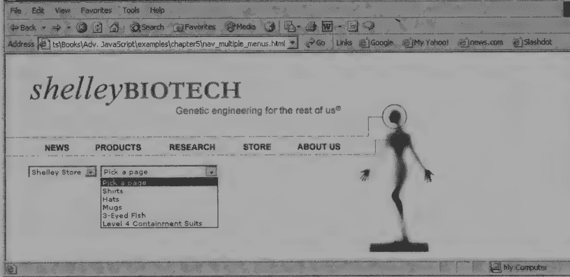


**图 5–2：双下拉菜单**

实现这一点实际上比你想象的要容易。实现此功能的核心代码基于一个事实：你可以创建一个数组，其中每个元素都是一个`Option`对象。换句话说，下拉菜单中的项目是在 HTML 中使用`<option>`标签创建的。JavaScript 将每个`<option>`标签视为一个单独的`Option`对象。每个`<option>`标签对应一个`Option`对象。

幸运的是，我们可以在 JavaScript 中创建`Option`对象，而无需将它们附加到任何特定菜单上。事实上，你可以创建`Option`对象，并像处理任何其他对象或变量一样处理它们。我们将创建`Option`对象并将它们放入一个数组中。一旦所有所需的`Option`对象都在数组中，我们就将它们附加到第二个下拉菜单。让我们看看整个过程的概述：

1. 用户从第一个下拉菜单中选择一个项目。
2. `populateSecondMenu`函数被调用。
3. 此函数查看选择了哪个项目，并开始填充一个名为`secondMenuArray`的数组。
4. `secondMenuArray`包含要放置在第二个下拉菜单中的所有`Option`对象。
5. 一旦数组被`Option`对象填充，第二个下拉菜单中的所有项目（除了“Pick a page”那个）都将被移除。
6. 来自`secondMenuArray`的`Option`对象被放置在第二个下拉菜单中。
7. 如果用户从第二个下拉菜单中选择一个项目，他们将被带到该页面，如前面的示例所示。

以下是我们希望选项具有的值。创建`Option`对象时，必须提供要显示的文本和选项的实际值。

- `news`
  - `"BioHomeLab 7.0 released","news/biolab.html"`
  - `"Irving Archbite named as CEO","news/ceo.html"`
  - `"Thornacycline trials expanded","news/thorn.html"`
- `products`
  - `"BioHomeLab 7.0","prod/biolab.html"`
  - `"EasyCreature Kit","prod/ceo.html"`
  - `"Quantum-Chaos Replicator","prod/replicator.html"`
- `research`
  - `"Down's Syndrome","research/downs.html"`
  - `"Cancer","research/cancer.html"`
  - `"Chromosome Capping","research/capping.html"`
  - `"AIDS","research/aids.html"`
  - `"Male Birth Control Pill","research/guy_pill.html"`
- `store`
  - `"Shirts","store/shirts.html"`
  - `"Hats","store/hats.html"`
  - `"Mugs","store/mugs.html"`
  - `"3-Eyed Fish","store/fish.html"`
  - `"Level 4 Containment Suits","store/suits.html"`
- `about`
  - `"History","about/history.html"`
  - `"Philosophy","about/philo.html"`
  - `"Giving Back","about/charity.html"`
  - `"Leadership","about/leadership.html"`
  - `"Careers","about/jobs.html"`

让我们看一下示例 5–6，其中包含此示例的 HTML。

```html
<div id="shortcut">
<form name="navForm">
<select name="mainMenu" class="copy"
    onChange=
        "populateSecondMenu
        (this.options[this.selectedIndex].value)">
    <option value="">Pick a section
    <option value="news">News
    <option value="products">Products
    <option value="research">Research
    <option value="store">Shelley Store
    <option value="about">About Shelley
</select>

<select name="secondMenu" class="copy"
    onChange=
        "changePage
        (this.options[this.selectedIndex].value)">
    <option value="">Pick a page
    <!--
        Need to keep these for Netscape 4.
        Otherwise, the dropdown menu is only
        one item in height, and hard to read
    -->
    <option value="">
    <option value="">
    <option value="">
    <option value="">
    <option value="">
    <option value="">
    <option value="">
    <option value="">
    <option value="">
    </select>
</form>
</div>
```

### 代码工作原理

1. 对于第一个下拉菜单，用户选择一个项目会调用`populateSecondMenu`函数，并传递该选择的值（“news”、“research”、“products”、“store”或“about”）。
2. 对于第二个下拉菜单，我们调用熟悉的函数`changePage`，并传递所选选项的值。请注意，页面加载时没有任何选项具有任何值——它们稍后在`populateSecondMenu`函数中被赋予值。
3. 对于 Netscape 4 以外的浏览器，我们不需要所有这些空选项。然而，如果我们没有它们，在 Netscape 4 中，所有菜单项将被压缩成一个单独的、滚动的选项，如图 5-3 所示。

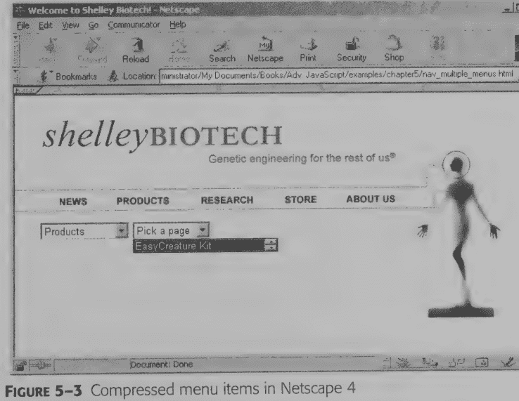

现在让我们看看示例 5-7，以及实现此功能的函数。

### 示例 5-7：双下拉菜单函数

```javascript
❶secondMenuArray = new Array()

❷function populateSecondMenu(mainItem)
{
    // Create appropriate array full of Option
    // objects. These are placed in the second menu
    // later in this function
    ❸if (mainItem == "news")
    {
        ❹populateArray("BioHomeLab 7.0 released",
            "news/biolab.html")
        ❺populateArray("Irving Archbite named as
            CEO", "news/ceo.html")
        ❻populateArray("Thornacycline trials
            expanded", "news/thorn.html")
    }
    ❼else if (mainItem == "products")
    {
        populateArray("BioHomeLab 7.0",
            "prod/biolab.html")
        populateArray("EasyCreature Kit",
            "prod/ceo.html")
        populateArray("Quantum-Chaos
            Replicator", "prod/replicator.html")
    }
    ❽else if (mainItem == "research")
    {
        populateArray("Downs Syndrome",
            "research/downs.html")
        populateArray("Cancer", "research/cancer.html")
        populateArray("Chromosome Capping",
            "research/capping.html")
        populateArray("AIDS", "research/aids.html")
        populateArray("Male Birth Control Pill",
            "research/guy_pill.html")
    }
    ❾else if (mainItem == "store")
    {
        populateArray("Shirts", "store/shirts.html")
        populateArray("Hats", "store/hats.html")
        populateArray("Mugs", "store/mugs.html")
        populateArray("3-Eyed Fish", "store/fish.html")
        populateArray("Level 4 Containment Suits",
            "store/suits.html")
    }
    ❿else if (mainItem == "about")
    {
        populateArray("History","about/history.html")
        populateArray("Philosophy","about/philo.html")
        populateArray("Giving Back",
            "about/charity.html")
        populateArray("Leadership",
            "about/leadership.html")
        populateArray("Careers", "about/jobs.html")
    }

    // Clear out all existing entries (except top one)
    // in the secondary menu
    ⓫secondMenuObj = eval("document." + formRef +
        "navForm.secondMenu")

    ⓬with (secondMenuObj)
    {
        //clear existing items in secondary menu
        ⓭for(i=options.length-1;i>0;i--)
        {
            ⓮options[i] = null
        }

        // populate secondary menu with new items
        ⓯for (i=0; i<secondMenuArray.length; i++)
        {
            ⓰options[i+1] = secondMenuArray[i]
        }
    }
    ⓱secondMenuArray = new Array()
}

⓲function populateArray(displayText, nextPage)
{
    ⓳nextIndex = secondMenuArray.length
    ⓴secondMenuArray[nextIndex] =
        new Option(displayText,nextPage)
}
```

```javascript
⓵function changePage(page)
{
    if (page.length)
    {
        location.href = page
    }
}
```

### 代码工作原理

1. 我们首先创建一个名为`secondMenuArray`的全局数组。这个数组的目的是为特定菜单保存所有`Option`对象，直到适当的时机。我们将其设为全局数组（通过在函数外部定义它），因为它必须被多个函数访问。
2. 这是填充第二个下拉菜单的函数。注意传递的唯一参数是用户在主下拉菜单中选择的选项值。例如，如果用户选择“News”，则值“news”被传递给此函数（记住此项目的 HTML 是`<option value="news">News`）。
3. 然后我们开始一个冗长的`if..else`部分，查看`mainItem`是否是我们认识的任何值。我们首先查看是否选择了 News 项目。
4. 如果用户选择了“News”，我们开始填充`secondMenuArray`。我们通过调用另一个函数`populateArray`（我们稍后会查看该函数）来实现这一点。我们向此函数发送两个值：要向用户显示的文本和将用户带到的 URL。由`populateArray`函数负责获取这两个值，创建一个新的`Option`对象，并将该对象放入`secondMenuArray`中。在此行中，为 BioHomeLab 发布创建了选项。
5. 在这里，我们添加了关于 Shelley 新 CEO 的选项。
6. 最后（对于 News 部分），我们添加了一个关于 Shelley 新药 Thornacycline 临床试验的菜单项。

### 完整代码

我们做了大量修改，却没有整体查看过代码，现在让我们来看一下（示例 5-8）。


```html
<html>
<head>
<title>Welcome to Shelley Biotech!</title>

<style type="text/css">
#header { position: absolute; left: 36; top: 31; }

#nav { position: absolute; left: 0; top: 122; }

#gal { position: absolute; left: 515; top: 74; }

#submenu { position: absolute; left: 33; top: 163; }

#shortcut { position: absolute; left: 33; top: 163; }

.copy {
    font-family: verdana, sans-serif;
    font-size: 10px
}

</style>

<script language="JavaScript">
// preload images

newsOn = new Image()
newsOn.src = "images/nav_news_on.gif"
newsOff = new Image()
newsOff.src = "images/nav_news_off.gif"

productsOn = new Image()
productsOn.src = "images/nav_products_on.gif"
productsOff = new Image()
productsOff.src = "images/nav_products_off.gif"

researchOn = new Image()
researchOn.src = "images/nav_research_on.gif"
researchOff = new Image()
researchOff.src = "images/nav_research_off.gif"

storeOn = new Image()
storeOn.src = "images/nav_store_on.gif"
storeOff = new Image()
storeOff.src = "images/nav_store_off.gif"

aboutOn = new Image()
aboutOn.src = "images/nav_about_on.gif"
aboutOff = new Image()
aboutOff.src = "images/nav_about_off.gif"

// browser test
browser = navigator.appName;
browserNum = parseInt(navigator.appVersion);

if ((browser == "Netscape") && (browserNum < 5))
{
    layerRef = "nav.document."
    formRef = "shortcut.document."
}
else
{
    layerRef = ""
    formRef = ""
}

function rollOver (imgName)
{
    eval("document." + layerRef + "images[imgName].src = " +
    imgName + "On.src")
}

function rollOut (imgName)
{
    eval("document." + layerRef + "images[imgName].src = " +
    imgName + "Off.src")
}

secondMenuArray = new Array()

function populateSecondMenu(mainItem)
{
    // Create appropriate array full of Option
    // objects. These are placed in the second menu
    // later in this function
    if (mainItem == "news")
    {
        secondMenuArray = new Array()
        populateArray("BioHomeLab 7.0 released", "news/biolab.html")
        populateArray("Irving Archbite named as CEO", "news/ceo.html")
        populateArray("Thornacycline trials expanded", "news/thorn.html")
    }
    else if (mainItem == "products")
    {
        secondMenuArray = new Array()
        populateArray("BioHomeLab 7.0", "prod/biolab.html")
        populateArray("EasyCreature Kit", "prod/ceo.html")
        populateArray("Quantum-Chaos Replicator", "prod/replicator.html")
    }
    else if (mainItem == "research")
    {
        secondMenuArray = new Array()
        populateArray("Downs Syndrome", "research/downs.html")
        populateArray("Cancer", "research/cancer.html")
        populateArray("Chromosome Capping", "research/capping.html")
        populateArray("AIDS", "research/aids.html")
        populateArray("Male Birth Control Pill", "research/guy_pill.html")
    }
    else if (mainItem == "store")
    {
        secondMenuArray = new Array()
        populateArray("Shirts", "store/shirts.html")
        populateArray("Hats", "store/hats.html")
        populateArray("Mugs", "store/mugs.html")
        populateArray("3-Eyed Fish", "store/fish.html")
        populateArray("Level 4 Containment Suits", "store/suits.html")
    }
    else if (mainItem == "about")
    {
        secondMenuArray = new Array()
        populateArray("History", "about/history.html")
        populateArray("Philosophy", "about/philo.html")
        populateArray("Giving Back", "about/charity.html")
        populateArray("Leadership", "about/leadership.html")
        populateArray("Careers", "about/jobs.html")
    }

    // Clear out all existing entries (except top one)
    // in the secondary menu
    secondMenuObj = eval("document." + formRef +
    "navForm.secondMenu")

    with (secondMenuObj)
    {
        //clear existing items in secondary menu
        for(i=options.length-1;i>0;i--)
        {
            options[i] = null
        }

        // populate secondary menu with new items
        for (i=0; i<secondMenuArray.length; i++)
        {
            options[i+1] = secondMenuArray[i]
        }
    }
}

function populateArray(displayText, nextPage)
{
    nextIndex = secondMenuArray.length
    secondMenuArray[nextIndex] = new Option(displayText,nextPage)
}

function changePage(page)
{
    if (page.length)
    {
        location.href = page
    }
}

</script>

<body bgcolor="#FFFFFF">

<div id="header"></div>

<div id="gal"></div>

<div id="nav">
<table border="0" cellpadding="0" cellspacing="0">
    <tr>
        <td></td>
        <td>
```

7. 我们检查用户是否选择了“产品”选项（`<option value="products">Products`）。

8. 我们检查用户是否选择了“研究”选项（`<option value="research">Research`）。

9. 我们检查用户是否选择了“商店”选项（`<option value="store">Shelley Store`）。

10. 我们检查用户是否选择了“关于”选项（`<option value="about">About Shelley`）。

11. 现在是时候为引用第二个下拉菜单创建一个快捷方式了。我们使用 `eval()` 方法来处理 Netscape 4 需要了解表单精确图层的需求。

12. 这对你来说可能是新的，因为很多人不使用 `with`，但它非常方便。通过使用 `with`，花括号内的所有文档对象（如 `images` 或 `options`）都会自动以 `secondMenuObj` 值为前缀。例如，在这行代码下面有几个选项。尽管它们只是说“options”，但因为它们在 `with` 语句内，所以假定它们实际上都是 `secondMenuObj.options`。

13. 我们继续清除第二个下拉菜单中的所有项目，只保留第一个（即写着“Pick a page”的那个）。我们使用 `for` 循环从菜单的末尾开始，向后移动，直到只剩下“Pick a page”这一个菜单项。

14. 移除一个选项很简单：只需将该选项等于 `null`，然后，噗！它就消失了。

15. 既然第二个下拉菜单已被清空，是时候添加新的菜单项了。我们通过遍历 `secondMenuArray` 中的每一项来做到这一点。

16. 然后我们通过将选项设置为 `secondMenuArray` 中的一个元素，将所有选项放入菜单中。注意选项数组的索引是 `i+1`，而 `secondMenuArray` 只是 `i`。这是因为我们想保持“Pick a page”选项不变。当此循环完成时，第二个下拉菜单就完成了，可以使用了！

17. 创建新数组只是清空 `secondMenuArray` 中所有元素的快速方法。它看起来可能有点奇怪，但这是有原因的。例如，如果用户选择“新闻”，那么我们开始用新闻菜单的所有项目填充 `secondMenuArray`。我们一次一个地将那些菜单项添加到 `secondMenuArray` 的末尾。这在用户第一次选择主菜单项时工作得非常完美。此时，数组充满了菜单项。现在想象用户选择第二个主菜单项，比如“研究”。我们再次开始填充数组，将项目添加到数组的末尾。也就是说，我们将研究菜单项添加到已经包含新闻菜单项的数组中。为了防止这种情况发生，我们必须在设置完所有第二个下拉菜单的选项后清空 `secondMenuArray`，为下一次更改做准备。

18. 这是我们获取两个文本值并从中创建 `Option` 对象，以及将这些对象放入 `secondMenuArray` 的地方。

19. 我们想添加到现有的数组中。我们可以使用 `push()` 方法，但这在 Netscape 4 中不起作用。我们通过查找当前数组的长度来做到这一点。例如，如果最后一个元素是 `secondMenuArray[4]`，那么长度就是 5。

20. 我们向数组添加另一个元素，并通过使用 `new Option()` 将该元素创建为 `Option` 对象。创建一个新的 `Option` 对象需要两段文本：向用户显示的文本和选项本身的值。

21. 最后，是我们已经见过的 `changePage` 函数。在这个示例中它没有变化。

这就是创建多个相关下拉菜单的全部内容。

### 第 129 页：整个代码

```html
示例 5-3 整个代码（续）

		<a href="#" onMouseOver="rollOver('news')"
			onMouseOut="rollOut('news')"></a></td>
	<td><a href="#" onMouseOver="rollOver('products')"
			onMouseOut="rollOut('products')"></a></td>
	<td><a href="#" onMouseOver="rollOver('research')"
			onMouseOut="rollOut('research')"></a></td>
	<td><a href="#" onMouseOver="rollOver('store')"
			onMouseOut="rollOut('store')"></a></td>
	<td><a href="about.html" onMouseOver="rollOver('about')"
			onMouseOut="rollOut('about')"></a></td>
	</tr>
</table>
</div>

<div id="shortcut">
<form name="navForm">
<select name="mainMenu" class="copy"
onChange="populateSecondMenu(this.options[this.selectedIndex]
.value)">
	<option value="">请选择一个板块
	<option value="news">新闻
	<option value="products">产品
	<option value="research">研究
	<option value="store">Shelley 商店
	<option value="about">关于 Shelley
</select>

<select name="secondMenu" class="copy"
onChange="changePage(this.options[this.selectedIndex].value)">
	<option value="">请选择一个页面
	<!--
		需要为 Netscape 4 保留这些空选项。
		否则，下拉菜单的高度将只有一项，
		难以阅读
	-->
	<option value="">
	<option value="">
	<option value="">
	<option value="">
	<option value="">
	<option value="">
	<option value="">
</select>
```

### 第 130 页：第 5 章 • 下拉菜单 • 示例 5-8：整个代码（续）

```html
            <option value="">
            <option value="">
            <option value="">
</select>
</form>
</div>
</body>
</html>
```

## 第 6 章

### 文本框、复选框、单选按钮和文本区域

**本章内容**

- 使用复选框复制文本框
- 单选按钮和文本区域


下拉菜单非常棒，你可以用它们做很多事情，但表单元素的世界非常广阔。在本章中，我们将探讨（大部分）剩余的表单元素类型：文本框、复选框、单选按钮和文本区域。我们将了解一些更常见的方法，用于读取和调整表单元素的工作方式，以及如何使它们相互交互。

### 使用复选框复制文本框

你们中的大多数人都在线购买过物品（我知道杰夫·贝佐斯应该因为我所有在`amazon.com`上的消费而给我写一封个人感谢信），并且你可能不得不填写运输和账单信息。网站以多种不同的方式处理这个问题。其中一些网站要求你在运输和账单信息不同的情况下才填写账单信息。另一些网站让你勾选一个框，声明它们是相同的（但屏幕上没有出现任何变化）。还有一些网站让你勾选一个框，声明两者相同，这会自动填充账单信息字段。我们要构建的就是这最后一种情况。

我们将为 Shelley Store 构建一个页面，看起来有点像图 6-1。

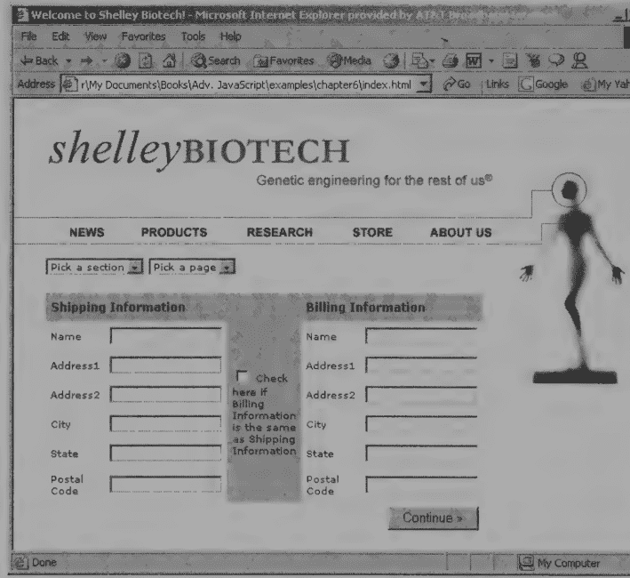

**图 6-1** 运输/账单信息页面

用户填写运输信息，然后可以勾选“如果您的账单信息与运输信息相同，请在此处勾选”旁边的小框。账单信息字段会立即被填充。这看起来像图 6-2。

你可能会猜到，这并非什么尖端技术，但它很有用，客户和用户往往对此反应良好。

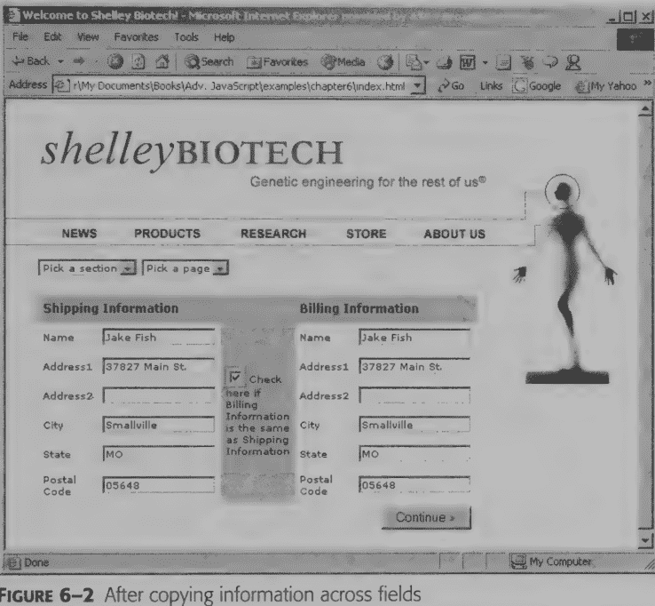

**图 6-2** 在字段间复制信息之后

此外，我们将看一些允许非常灵活的 HTML 的代码，可能比你见过的更灵活。

### 复选框和文本框背景

在深入代码之前，我们先看看复选框和文本框的一些特性。

复选框的代码可以是这样的：

```html
<input type="checkbox" name="shipToBill">
```

假设这个复选框是一个名为“shippingForm”的表单中的第一个表单元素。我们可以通过`document.shippingForm.elements[0]`访问这个复选框。如果我们想知道复选框是否被选中，我们会查看：

```javascript
document.shippingForm.elements[0].checked
```

或：

```javascript
document.shippingForm.shipToBill.checked
```

这将产生`true`或`false`值。如果我们想知道复选框的值，我们可以查看：

```javascript
document.shippingForm.shipToBill.value
```

奇怪的是，无论复选框是否实际被选中，这个值都是“on”。但是，如果表单被传递到另一个页面，并且复选框已被选中，那么传递的变量之一就是`shipToBill=on`。如果复选框未被选中，则该变量根本不会被传递。你也可以获取我们复选框的名称：

```javascript
document.shippingForm.elements[0].name
```

你可以对文本框访问所有相同的信息，值变量就是键入文本框本身的文本。这就是我们需要的所有背景知识。让我们开始看代码！

### HTML

示例 6-1 包含创建我们小表格的 HTML（你可以将此添加到几乎任何过去章节的示例中）。

**示例 6-1** 运输/账单表单的 HTML

```html
#shipping { position: absolute; left: 33; top: 200;
width:400 }
...
<div id="shipping">
<form name="shipForm">
<table width="400" cellpadding="5" cellspacing="0"
border="0">
<tr bgcolor="#CCCCCC">
<td colspan="2" class="hd">运输信息</td>
<td>&nbsp</td>
<td colspan="2" class="hd">账单信息</td>
</tr>
<tr>
<td class="copy">姓名</td>
<td class="copy"><input type="text"
name="nameShip" size="20"
class="copy"></td>
```

**示例 6-1** 运输/账单表单的 HTML（续）

```html
<td class="copy" rowspan="6"
      bgcolor="#CCCCCC"><input type="checkbox"
      name="shipToBill"
      onClick="if(this.checked) copyShipToBill()">
      如果账单信息与运输信息相同，请在此处勾选</td>

<td class="copy">姓名</td>
<td class="copy"><input type="text"
      name="nameBill" size="20"
      class="copy"></td>
</tr>
<tr>
  <td class="copy">地址行 1</td>
  <td class="copy"><input type="text"
        name="address1Ship" size="20"
        class="copy"></td>
  <td class="copy">地址行 1</td>
  <td class="copy"><input type="text"
        name="address1Bill" size="20" class="copy"></td>
</tr>
<tr>
  <td class="copy">地址行 2</td>
  <td class="copy"><input type="text"
        name="address2Ship" size="20"
        class="copy"></td>
  <td class="copy">地址行 2</td>
  <td class="copy"><input type="text"
        name="address2Bill" size="20"
        class="copy"></td>
</tr>
<tr>
  <td class="copy">城市</td>
  <td class="copy"><input type="text"
        name="cityShip" size="20"
        class="copy"></td>
  <td class="copy">城市</td>
  <td class="copy"><input type="text"
        name="cityBill" size="20"
        class="copy"></td>
</tr>
<tr>
  <td class="copy">州/省</td>
  <td class="copy"><input type="text"
```

**示例 6-1** 运输/账单表单的 HTML（续）

```html
name="stateShip" size="20"
class="copy"></td>
<td class="copy">州/省</td>
<td class="copy"><input type="text"
name="stateBill" size="20"
class="copy"></td>
</tr>
<tr>
<td class="copy">邮政编码</td>
<td class="copy"><input type="text"
name="postalcodeShip" size="20"
class="copy"></td>
<td class="copy">邮政编码</td>
<td class="copy"><input type="text"
name="postalcodeBill" size="20"
class="copy"></td>
</tr>
<tr>
<td colspan="5" align="right"><input type="button"
value="继续 &#187;"></td>
</tr>
</table>
</form>
</div>
```

关于这段 HTML，只有几件事需要真正了解。首先，看看文本框的名称。两个姓名字段分别叫做`nameShip`和`nameBill`，分别对应运输和账单。两个城市字段分别叫做`cityShip`和`cityBill`。看到规律了吗？这在后面会变得重要。

另一件需要关注的事情是复选框元素中的`onClick`事件处理程序：`onClick="if(this.checked) copyShipToBill()"`。这个小小的语句做几件事。首先，它监听用户何时点击复选框。但是，用户可能会点击复选框以选中或取消选中。我们只希望在用户选中该框时复制运输信息。我们用`if(this.checked)`来检查这一点。如果框被选中，那么我们后面的小 JavaScript 程序就会运行，并调用`copyShipToBill`函数。

最后请注意：注意表单在一个名为“shipping”的层中。HTML 就这些了。接下来看真正的代码！

### JavaScript 代码

准备好了吗？下面是示例 6–2，这是我们实现复制功能所需的 JavaScript 代码。

```javascript
// browser test
browser = navigator.appName;
browserNum = parseInt(navigator.appVersion);

if ((browser == "Netscape") && (browserNum < 5))
{
    layerRef = "nav.document."
    formRef = "shortcut.document."
    formRef2 = "shipping.document."
}
else
{
    layerRef = ""
    formRef = ""
    formRef2 = ""
}

function copyShipToBill()
{
    // This generalized form allows you to add and
    // delete form fields from the shipping/billing
    // tables without having to change any code.

    formObj = eval("document." + formRef2 + "shipForm")
    for(i=0; i<formObj.elements.length; i++)
    {
        elemName = formObj.elements[i].name
        shipIndex = elemName.indexOf("Ship")
        if (shipIndex != -1)
        {
            shipValue = formObj.elements[i].value
            billName =
                elemName.substring(0,shipIndex) +
                "Bill"
            billObj = eval("formObj." + billName)
            billObj.value = shipValue
        }
    }
}
```

#### 代码工作原理

1. 由于我们处理的是 Netscape 4 的层（layers），我们需要动态创建对表单的引用，为此我们使用了变量`formRef2`。在这个例子中，我们不处理`layerRef`或`formRef`——我保留它们只是为了说明这个例子符合我们之前创建的页面。对于 Netscape 4 用户，我们必须调用 shipping 层。

2. 对于所有其他浏览器，我们不需要调用任何特殊代码。

3. 这是我们关注的唯一一个函数：`copyShipToBill`将所有 shipping 元素复制到所有 billing 元素。正如注释所示，代码的设计使得你可以添加或删除 shipping 和 billing 元素，而完全无需修改代码。

4. 我们首先创建一个对象来保存 shipping 表单，并将其命名为`formObj`。这里对于 Netscape 4，我们必须使用`formRef2`。

5. 我们的计划是检查表单中的所有元素。当我们找到一个名称中包含“Ship”的元素时，我们就寻找与之对应的“Bill”对（例如，当我们找到“cityShip”时，我们就寻找“cityBill”），并将 ship 元素的值复制到对应的 bill 元素中。为此，我们循环遍历表单中的每一个元素，以确保我们不会遗漏任何东西。

6. 为了让后续的代码更易读，我们创建了一个变量来保存表单元素的名称。例如，如果循环刚好落在`<input type="text" name="address1Ship" size="20" class="copy">`上，那么`elemName`的值就是“address1Ship”。

7. 由于我们是在查找元素名称中是否存在“Ship”（因此是在`elemName`中查找），我们创建了另一个名为`shipIndex`的变量，它告诉我们字符串“Ship”在`elemName`中出现的位置。如果元素名称中不存在“Ship”（例如在“cityBill”中），那么`shipIndex`等于 -1。

8. 我们只需要复制包含“Ship”的元素的值。如果`shipIndex`的值不是 -1，那就意味着元素名称确实包含“Ship”，我们必须将其值复制到计费信息中。

9. 一旦我们知道要复制的元素，我们就创建一个变量来保存要复制的值。`shipValue`包含了需要复制到相应计费文本字段中的文本。

10. 为了找到计费端对应的字段，我们必须构造它的名称。毕竟，我们无法知道计费文本字段在元素数组中的位置。因此，我们将通过构造名称来查找它。我们首先从元素名称中提取“Ship”，然后加上“Bill”。例如，如果我们查看的是“cityShip”，那么`shipIndex`就是 4，因为“Ship”从第五个字符开始（JavaScript 从零开始计数，而不是一）。我们提取从位置 0 开始到位置 4 之前结束的子字符串，这意味着我们得到“city”。然后，我们在末尾加上“Bill”，就得到了“cityBill”。

11. 现在我们知道元素的名称了，我们可以通过将元素名称附加到`formObj`来定位它。例如，如果元素的名称是“cityBill”，那么这行代码等同于：

```javascript
billObj = formObj.cityBill
```

如果你不使用 Netscape 4，这就等同于：

```javascript
billObj = document.shipForm.cityBill
```

12. 最后，将 shipping 元素的值传输给对应的 billing 元素。

关于文本字段和复选框的内容就差不多到这里了。现在，是时候看看单选按钮和文本区域了。

### 单选按钮和文本区域

老实说——单选按钮和文本区域并不太令人兴奋。我绞尽脑汁想为单选按钮和文本区域想出一些既令人兴奋又实用的现实世界应用，但嗯，并没有太多。所以我整理了一个简单的例子，展示单选按钮和文本区域的一些不同方面，而不是试图将半实用的功能强行塞入一个在现实世界中永远不会发生的虚假场景。

### 单选按钮

单选按钮与其他表单元素略有不同。单选按钮只以集合的形式出现——只有一个单选按钮是毫无意义的。按钮通过给予相同的名称而被放置在同一个组中——它们在网页上的位置无关紧要。图 6–3 展示了我们这个简单页面的样子。

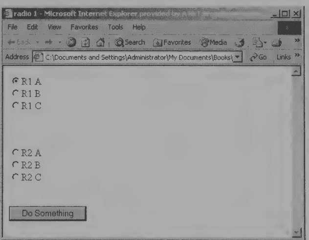

**图 6–3** 小型单选按钮页面

示例 6–3 展示了我们页面的 HTML 代码。

#### 示例 6-3 单选按钮页面的 HTML

```html
<form name="radioForm">
<input type="radio" name="r1" value="a" checked>R1 A<br>
<input type="radio" name="r1" value="b">R1 B<br>
<input type="radio" name="r1" value="c">R1 C<br>
<br>
<br><br>

<input type="radio" name="r2" value="a">R2 A<br>
<input type="radio" name="r2" value="b">R2 B<br>
<input type="radio" name="r2" value="c">R2 C<br>

<br><br>
<input type="button" value="Do Something"
onClick="radioCheck()">

</form>
```

这里有两组按钮，分别名为 "r1" 和 "r2"。每个按钮的值为 "a"、"b" 或 "c"。当点击表单底部的按钮时，将调用`radioCheck`函数。示例 6-4 向我们展示了这是如何工作的。

#### 示例 6-4 单选按钮测试


```javascript
function radioCheck()
{
    alertMs = ""
    formObj = document.radioForm
    r1Obj = formObj.r1
    for (i=0; i<r1Obj.length; i++)
    {
        if (r1Obj[i].checked)
        {
            alertMs = "found checked: " +
                r1Obj[i].value + "\n"
        }
    }

    // If a radio button doesn't have a value,
    // then the value is simply "on"
    r2Obj = formObj.r2
    for (i=0; i<r2Obj.length; i++)
    {
        if (r2Obj[i].checked)
        {
            alertMs += "found checked: " +
                r2Obj[i].value
        }
    }

    alertMs += "\n"
    alertMs += "type: " + formObj.elements[1].type

    // results in undefined
    alertMs += "\n"
    alertMs += "type2: " + r2Obj.type

    alert(alertMs)
}
```

#### 代码工作原理

1. 此函数的目标是检查单选按钮并通过警告框将信息传达给用户。我们将构建一个包含这些信息的字符串，并从一个空变量开始。

2. 你之前已经见过这个了——我们创建一个变量来保存表单对象。这里没有层，所以我们不用担心 Netscape 4 的特殊代码。

3. ……我们创建一个变量来保存所有`r1`按钮。

4. 我们这里的目标是找出`r1`按钮集合中当前被选中的单选按钮。为此，我们必须循环遍历`r1`集合中的所有按钮。

5. 要查看某个按钮是否被选中，你必须查看那个特定的按钮，而你只能通过检查数组来做到这一点。查看特定按钮的另一种方式是`document.radioForm.r1[i]`。

6. 如果我们发现一个被选中的单选按钮，我们就将该单选按钮的值添加到我们的警告消息中，再加上一个换行符（那就是`"\n"`的作用）。

7. 然后我们对`r2`单选按钮集合做同样的事情。我们还包含了一个小捷径。你注意到`+=`了吗？那是`alertMs = alertMs + "found checked: " + r2Obj[i].value`的简写方式。

8. 我们添加一个换行符，使这个小提示更容易阅读。

9. 我们也在查看表单元素的类型。你我都知道这是一个单选按钮，但如果你想确认，必须通过`elements[]`数组而不是元素的名称来访问其`type`值。

10. 在这里，我们尝试对`r20bj`做同样的事情，查找其类型。正如你在运行程序时会看到的，这导致了一个未定义的值。这看起来很奇怪，但这就是它的工作方式。

11. 最后，我们向用户展示信息。

加载此页面并按下按钮将得到图 6-4。

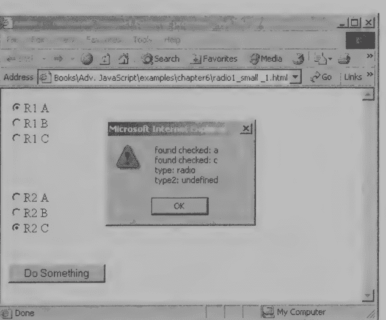

就是这样！你已经准备好作为高手进入表单的世界了。

### 7 验证表单

#### 本章内容

- 提供信息
- 验证用户数据
- 验证信用卡号

JavaScript 的一个常见用途是验证表单，这意味着使用 JavaScript 来确保用户提供了你需要的表单信息。我们将在两个部分中探讨这一点：确保用户提供了某些信息片段，以及确保用户提供的信息格式适当。还有一些高级技术在第 17 章“正则表达式”中介绍。

#### 提供信息

我们将从为 Shelley 网站的用户创建一个表单开始。这个表单要求用户填写各种个人联系信息。它看起来像图 7-1。

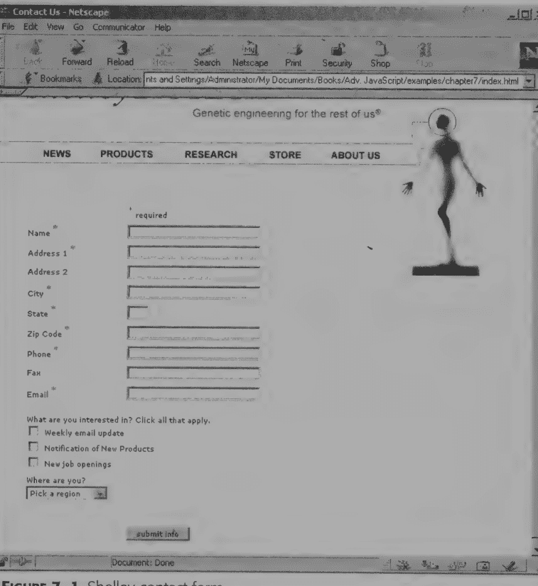

这个表单有文本字段、复选框和一个下拉菜单。我们忽略了单选按钮——很少需要验证一个按钮是否被点击，因为你可以强制在页面加载时选择一个按钮。

在这个例子中，我们将确保所有必需的文本字段都已填写（在这种情况下是大多数），至少选择了一个复选框，并且从下拉菜单中选择了一项。

示例 7-1 展示了 HTML 的样子：

##### 示例 7-1 联系表单的 HTML

如你所见，我们的代码分为三个部分。第一部分包含所有文本字段和必填的联系信息；必填字段旁边有一个红色星号。接下来是几个复选框，询问用户有什么兴趣。必须勾选其中一个复选框。最后，询问用户来自哪里，并且必须从下拉菜单中选择一个选项。点击表单底部的按钮会调用`submitForm`函数。该函数背后的思路是查看所有字段，找出所有未填写或未选择的内容，并逐行构建提示消息。当所有检查完成后，用户会收到一条错误消息，或者表单被提交。让我们在示例 7-2 中看看它。

```css
#contactDiv { position: absolute; left: 33; top: 200; }
```

```html
<div id="contactDiv">
<form name="contactForm">
<table>
<tr>
    <td colspan="2"></td>
    <td class="copy"><span class="required"><sup>*</sup></span>必填</td>
</tr>
<tr>
    <td class="copy">姓名 <span class="required"><sup>*</sup></span></td>
    <td rowspan="9">&nbsp;&nbsp;</td>
    <td class="copy"><input type="text" name="Name" size="20" class="copy"></td>
</tr>
<tr>
    <td class="copy">地址1 <span class="required"><sup>*</sup></span></td>
    <td class="copy"><input type="text" name="Address1" size="20" class="copy"></td>
</tr>
<tr>
    <td class="copy">地址2</td>
    <td class="copy"><input type="text" name="Address2" size="20" class="copy"></td>
</tr>
<tr>
    <td class="copy">城市 <span class="required"><sup>*</sup></span></td>
    <td class="copy"><input type="text" name="City" size="20" class="copy"></td>
</tr>
<tr>
    <td class="copy">州/省 <span class="required"><sup>*</sup></span></td>
    <td class="copy"><input type="text" name="State" size="2" maxlength="2" class="copy"></td>
</tr>
<tr>
    <td class="copy">邮政编码 <span class="required"><sup>*</sup></span></td>
    <td class="copy"><input type="text" name="Zip" size="20" class="copy"></td>
</tr>
<tr>
    <td class="copy">电话 <span class="required"><sup>*</sup></span></td>
    <td class="copy"><input type="text" name="Phone" size="20" class="copy"></td>
</tr>
<tr>
    <td class="copy">传真</td>
    <td class="copy"><input type="text" name="Fax" size="20" class="copy"></td>
</tr>
<tr>
    <td class="copy">电子邮件 <span class="required"><sup>*</sup></span></td>
    <td class="copy"><input type="text" name="Email" size="20" class="copy"></td>
</tr>
<tr>
    <td class="copy" colspan="3">
    <br>
    你对什么感兴趣？点击所有适用项。<br>
    <input type="checkbox" name="weekly"> 每周电子邮件更新<br>
    <input type="checkbox" name="products"> 新产品通知<br>
    <input type="checkbox" name="jobs"> 新的工作机会<br>
    </td>
</tr>
<tr>
    <td class="copy">
    你在哪里？<br>
    <select name="global" class="copy">
        <option value="">选择一个地区
        <option value="northamer">北美
        <option value="southamer">南美
        <option value="africa">非洲
        <option value="europe">欧洲
        <option value="asia">亚洲
    </select>
    </td>
</tr>
<tr>
    <td class="copy"></td>
</tr>
<tr>
    <td colspan="2">
    <td><br><input type="button" value="提交信息" onClick="submitForm(this.form)" class="copy"></td>
</tr>
</table>
</form>
</div>
```

##### 示例 7-2 `submitForm`函数

```javascript
reqFields = new Array("Name", "Address1", "City",
    "State", "Zip", "Phone", "Email")
checkBoxes = new Array("weekly", "products", "jobs")

function submitForm(formObj)
{
    alertMs = ""

    // 检查必填字段是否已填写
    for (i=0; i<reqFields.length; i++)
    {
        formElemLength = eval("formObj." +
            reqFields[i] + ".value.length")
        if (formElemLength == 0)
        {
            alertMs += "- " + reqFields[i] + "\n"
        }
    }

    // 确保至少选择了一个复选框
    checked = false
    for (i=0; i<checkBoxes.length; i++)
    {
        isChecked = eval("formObj." + checkBoxes[i] + ".checked")
        if (isChecked)
        {
            checked = true
            break
        }
    }

    // 确保已选择下拉菜单
    if(formObj.global.selectedIndex == 0)
    {
        alertMs += "- 地区\n"
    }

    if(!checked)
    {
        alertMs += "- 请选择一个兴趣复选框\n"
    }

    if (alertMs.length)
    {
        alertMs = "请填写以下字段：\n" + alertMs
        alert(alertMs)
    }
    else
    {
        formObj.submit()
    }
}
```

#### 代码工作原理

1. 我们首先创建一个数组，包含表单中所有必需文本字段的名称。注意表单字段的名称是大写的，就像它们在 HTML 中一样。

2. 我们为用户可能选择的三个复选框创建另一个数组。

3. 这就是我们开始正式编写函数的地方。注意整个表单对象被传递给这个函数，这使得访问表单元素更加简单。

4. 包含给用户错误消息的字符串称为`alertMs`，我们每次运行函数时都会初始化它。

5. 我们开始检查表单，通过检查所有必需的文本字段。我们通过循环遍历`reqFields`数组来做到这一点，因为它包含用户必须填写的所有字段的名称。

6. 我们通过查看该字段值的长度来检查用户是否填写了文本字段。要找到所述文本字段的长度，我们使用`eval`方法动态构建该确切字段的名称，并附加`"value.length"`，这给出了用户在该表单字段中键入的字符数。

7. 如果长度为 0，表示用户没有输入任何内容，必须生成错误。

8. 我们通过向`alertMs`变量添加错误描述和换行符`"\n"`来创建错误消息，这使得错误消息更容易阅读。

9. 一旦文本字段的循环结束，就该查看复选框了。由于只需要选中一个复选框，我们创建一个名为`checked`的变量，用于记住是否有任何复选框被选中。

10. 然后我们开始循环遍历复选框数组中的所有元素（只有三个）。

11. 我们通过检查`checked`属性来查看特定的复选框是否被选中。该属性返回 true 或 false 值。

12. 我们测试该复选框是否被选中。

13. 如果复选框被选中，那么我们的变量`checked`（与`checked`属性不同）将变为`true`。

14. 我们找到了选中的复选框，因此现在可以退出循环。

15. 现在我们来看下拉菜单。这个很简单。我们只需要寻找一个非 0 的值。换句话说，我们确保用户做出了第一个选项之外的选择。

16. 如果用户没有操作下拉菜单，我们就将该信息构建成提示消息。

17. 然后我们检查是否有一个复选框被选中，如果没有，则将该信息添加到提示消息中。

18. 这里我们决定是否向用户显示错误消息。如果`alertMs`完全为空，即仍然等于`""`，则表示没有发现错误。否则，就发现了错误，是时候向用户显示该错误了。

19. 我们在错误消息开头添加一行描述性文字，让用户知道他或她看到的是什么。

20. 然后我们向用户显示错误消息。

21. 如果没有错误，则表单将正常提交。

还不错，对吧？现在让我们看看如何验证用户实际输入的数据。

### 验证用户数据

我们将探讨三种特定输入的验证：电话号码、电子邮件地址和信用卡号。第一个示例将包含前两种，在本章末尾我们将探讨信用卡验证。

我们的电话号码必须包含区号——这是我们真正关心的全部。我们不关心用户输入的是`"415-555-1212"`还是`"(415) 555-1212"`或`"415.555.1212"`——我们只需要 10 个数字。我们将同时检查电话号码和传真号码。当然，只有用户在这些字段中输入了内容时，我们才需要检查格式是否正确。

对于电子邮件，我们需要存在一个“@”和一个“.”，并且我们希望确保最后一个“.”出现在 @ 符号之后。

我们的 HTML 保持完全不变。我们将创建一个名为`validateForm`的新函数，并从`submitForm`函数中调用该表单，如示例 7-3 所示。

```javascript
function submitForm(formObj)
{
    alertMs = ""

    // check that required fields are filled in
    for (i=0; i<reqFields.length; i++)
    {
        formElemLength = eval("formObj." +
            reqFields[i] + ".value.length")
        if (formElemLength == 0)
        {
            alertMs += "- " + reqFields[i] + "\n"
        }
    }

    // check for phone and email
    validateForm(formObj)

    // make sure that at least one checkbox is checked
    checked = false
    ...
}
```

我已加粗了新增的两行。注意我们将表单对象传递给了该函数。现在让我们看看示例 7-4，即`validateForm`函数。


```javascript
function validateForm(formObj)
{
    // check phone number
    if (formObj.Phone.value.length)
    {
        // check phone
        phoneVal = formObj.Phone.value
        pattern = /\W?\d{3}\W?\W?\d{3}\W?\d{4}/
        result = phoneVal.match(pattern)
        if(!result)
        {
            alertMs += "- Valid phone number with area code\n"
        }
    }

    // check fax number
    if (formObj.Fax.value.length)
    {
        // check fax
        faxVal = formObj.Fax.value
        pattern = /\W?\d{3}\W?\W?\d{3}\W?\d{4}/
        result = faxVal.match(pattern)
        if(!result)
        {
            alertMs += "- Valid fax number with area code\n"
        }
    }

    // check email address
    if (formObj.Email.value.length)
    {
        emailVal = FormObj.Email.value
        lastDotIndex = -1
        for (i=0; i<emailVal.length; i++)
        {
            if(emailVal.charAt(i) == ".")
            {
                lastDotIndex = i
            }
        }

        atIndex = emailVal.indexOf("@")
        if (( atIndex == -1) ||
            (lastDotIndex == -1) ||
            (lastDotIndex < atIndex))
        {
            alertMs += "- Valid email address\n"
        }
    }
}
```

### 代码如何工作

1. 我们从检查电话号码开始。我们首先确定有需要检查的内容，因此我们确保其长度大于零。
2. 我们创建一个变量来保存`Phone`文本框的字符。
3. 这里变得有点特别。你刚刚被归类为两类读者之一：熟悉正则表达式的和不熟悉的。如果你属于第一类，请跳到第四点。如果不是，请跟我来，我们将极其快速地看一下什么是正则表达式以及如何使用它们。正则表达式是用来匹配字符串的模式。在这行代码中，我们创建了一个所有有效电话号码都应匹配的模式。如果用户输入的内容不匹配该模式，我们就说用户没有输入有效的电话号码。所有这些符号的含义如下：`\d`表示“数字”，即0到9的数字。在它后面加上“{3}”表示必须存在三位数字。你可以在代码中看到两个`\d{3}`和一个单独的`\d{4}`。它们对应于实际电话号码中的数字。我们还必须允许用户可能使用的各种括号、破折号和句点。为了处理这些，我们使用`\W`，它代表“非单词字符”，即除了数字或字母之外的任何内容。跟在`\W`后面的问号表示该字符是可选的：它可能在那里，也可能不在那里。两种情况都可以。你注意到模式两边的正斜杠(/)了吗？这只是模式的标准表示法，就像引号是字符串的标准表示法一样。
4. 现在我们知道要检查的字符串(`phoneVal`)和要使用的模式(我们称之为`pattern`)，我们使用`match`方法来比较两者。如果匹配，则字符串将被输入到`result`变量中。如果字符串不匹配该模式，则`result`为`null`。
5. `null`结果被视为具有`false`值，这允许我们使用这种简单的表示法。
6. 由于字符串不匹配该模式，因此电话号码无效，并且一行文字被添加到错误消息中。
7. 检查传真号码的方法完全相同，用`Fax`替换`Phone`。
8. 接下来是电子邮件地址！与之前一样，我们首先查看用户是否在电子邮件文本框中输入了任何内容。如果没有，我们不需要检查它。
9. 我们创建`emailVal`来保存表单字段中的字符。
10. 我们将`lastDotIndex`初始化为`-1`，这相当于说，“电子邮件地址中没有点”。如果我们找到一个点，我们将改变这个变量的值。
11. 我们将逐个字符地检查电子邮件字符串中的每个字符，因此我们创建了一个遍历字符串长度的循环。
12. 我们使用方便的`charAt`方法来检查字符串中特定位置的字符。
13. 如果该字符确实是一个点，那么我们更新`lastDotIndex`，记录该点的位置。请注意，此循环不包含`break`语句。这是因为我们想找到字符串中的所有点。是的，我们可以用另一种方式做到这一点：

```javascript
for (i=emailVal.length-1; i>=0; i--)
{
    if(emailVal.charAt(i) == ".")
    {
        lastDotIndex = i
        break
    }
}
```

14. 这就完成了我们对点的搜索，现在是时候寻找“at”符号了。这更容易——我们只在字符串中寻找第一个`@`（这意味着我们假设用户没有在电子邮件地址中放置多个`@`；关于那种特定的防呆措施，我会让你自己创建代码）。
15. 根据我们的代码，如果以下任一条件为真，则电子邮件地址无效：
    - 没有`@`字符。
    - 没有点。
    - `@`字符出现在字符串中最后一个点之后。
16. 如果这些条件中任何一个为真，那么电子邮件就有问题，并会生成一条错误消息。

就是这样！现在让我们继续验证信用卡。

### 验证信用卡号码

有点令人惊讶的是，检查信用卡号码是否有效的方法是公开的。通过一种复杂的方法遍历卡片的数字，你可以创建所谓的Luhn校验和。一旦你创建了这个校验和，你就可以查看它是否具有有效的值。如果该值无效，那么该卡肯定是伪造的。如果Luhn校验和正确，那么该卡*可能*是有效的。由于此方法是公开的，因此可以创建你自己的假信用卡号码。然而，这是超级超级非法的，所以看在上帝的份上，不要这么做。而且，这些假号码不会有有效的姓名或有效期，所以即使你决定走上犯罪之路，你也需要做很多本书无法帮助你的额外工作。

对于更守法的人，让我们看看我们正在添加到Shelley页面的新字段。它们看起来像图7-2。

添加这些字段的HTML在示例7-5中。

很好的基础内容。当我们深入研究JavaScript时，我们将不会检查信用卡号是否与信用卡类型匹配。例如，美国运通卡以`3`开头，万事达卡以`5`开头，依此类推（还有一些异常情况）。这种特定类型的验证将被忽略，主要是因为它不会教你任何关于JavaScript的知识。

在深入探讨之前，我们应该简要介绍位运算符。别担心，这将非常简短，你甚至可能发现它在其他程序中很有用。

### 位运算符

位运算符看起来像`&`、`-`、`^`、`|`、`<<`、`>>`和`>>>`。在这个简短的介绍中，我们只看`&`和`^`，它们分别代表按位与和按位异或。这些运算符不关心变量的整数值，而是关心数字二进制形式中零和一的数量。让我们比较数字15和9。

- 15的二进制形式 = 1111
- 9的二进制形式 = 1001

`&`运算符逐位查看所有这些数字，如果相应的任一位为0，则返回`0`。如果两位都是1，则返回`1`。例如：

- `15 & 9`的结果是9 (1111 & 1001 = 1001)
- `15 & 1`的结果是1 (1111 & 1 = 1)

`^`运算符有点奇怪。如果对应的位都是0，则返回`0`。如果对应的位都是1，仍然返回`0`。得到`1`的唯一方式是一个位是1，而另一个位是0。

- `15 ^ 9`的结果是6 (1111 ^ 1001 = 0110)
- `15 ^ 1`的结果是0 (1111 ^ 1 = 0)

你可能已经注意到，使用`x & 1`操作是判断一个数字是偶数还是奇数的一种方法。我们将在JavaScript中看到这一点。

### JavaScript实现

我们对信用卡号码的验证分两步进行。首先，我们去除所有非数字字符。然后，我们在生成的数字上创建一个Luhn校验和。示例7-6是完整的函数。

### 示例7-4 validateCreditCard函数

```javascript
function validateCreditCard(formObj)
{
    // 此函数仅处理
    // 信用卡号码本身。
    // 步骤 1：去除非数字字符
    // 步骤 2：运行复杂的验证程序

    // 步骤 1：去除非数字
    ccNumbersOnly = ""
    ccnum = formObj.cardnumber.value
    numOnly = /\d/
    for (i=0; i<ccnum.length; i++)
    {
        ccChar = ccnum.charAt(i)
        result = ccChar.match(numOnly)
        if (result)
        {
            ccNumbersOnly += ccChar
        }
    }

    // 步骤 2：运行复杂的验证程序
    // 感谢这位未知程序员
    numDigits = ccNumbersOnly.length

    // 返回 1 表示奇数，0 表示偶数
    isOdd = numDigits & 1
    sum = 0

    for (i = 0; i<numDigits; i++)
    {
        digit = parseInt(ccNumbersOnly.charAt(i))

        // i & 1 返回
        // 1 如果 i 是奇数，
        // 0 如果 i 是偶数
        // (i & 1) ^ isOdd) 返回
        // 1 如果 i 是奇数且 numDigits 是偶数
        // 1 如果 i 是偶数且 numDigits 是奇数
        // 0 如果 i 是偶数且 numDigits 是偶数
        // 0 如果 i 是奇数且 numDigits 是奇数
        // !((i&1)^isOdd) 为真，如果
        // i 是偶数且 numDigits 是偶数
        // i 是奇数且 numDigits 是奇数
        if (!((i & 1) ^ isOdd))
        {
          digit *= 2
          if (digit > 9)
          {
            digit -= 9
          }
        }
        sum += digit
    }
    if (sum % 10 == 0)
    {
      ccError = false
    }
    else
    {
      ccError = true
    }

    if(ccError)
    {
      alertMs += "- Please check your credit card information\n"
    }
}
```

#### 代码如何工作

1. 注意我们将表单对象传递给此函数。就像其他函数一样，这只是为了让我们更轻松。
2. 我们将从头开始重建信用卡号码，只保留数字并丢弃所有其他内容。
3. 我们读取用户在卡号文本字段中输入的任何内容。
4. 我们将使用世界上最简单的正则表达式从信用卡字段中提取数字。这个表达式只是`\d`，意思是“数字”。所以我们将使用数字正则表达式匹配信用卡号码中的字符。换句话说，在将每个字符添加到`ccNumbersOnly`变量之前，我们会确保它是一个数字。
5. 然后我们开始一个循环，遍历用户提供的信用卡号码中的每个字符。
6. 进入循环后，我们从信用卡号码中取出单个字符。
7. 然后我们查看单个字符是否匹配我们的正则表达式。由于我们的表达式只是一个数字，这一行决定了该字符是否为数字。
8. 如果该字符是数字，则将该字符添加到`ccNumbersOnly`变量中。请注意，`ccNumbersOnly`和`ccChar`都被视为字符串，这意味着数字不是相加的。例如，将`3`添加到`53`将得到`533`，而不是`56`。
9. 一旦我们创建了我们的小信用卡号码，就该看看这个号码是否有效了。我机器上有这段代码已经很久了，我不记得最初是从谁那里得到的。有很多程序都使用Luhn校验和，但我不确定这个具体来自哪里。如果是你的，请发送电子邮件至advjs@wire-man.com，我会在书的网站(www.wire-man.com/advjs)上注明你的贡献。
10. 我们创建一个变量来保存信用卡的位数。
11. 看到了位运算符！通过比较位数与1，我们可以看出卡号是否具有奇数位数。例如，假设卡有20位数——这转换为二进制值是10100。如果我们看`20 & 1`，我们就是在逐位比较10100和1。由于1只有一位，它与10100中的0进行比较。这两个不同，所以`isOdd`的值为0。
12. 我们将使用`sum`变量来跟踪总和。在最后一步，我们将查看`sum`。
13. 是时候开始创建校验和了。我们将遍历信用卡号码中的每一位数字。
14. 要从号码中取出单个数字，我们使用`charAt`方法提取单个字符，并通过在其周围包装`parseInt`来确保它被视为真正的数字。
15. 下一个`if`语句几乎难以理解，因为它涉及多个位运算符。我在代码本身中添加了一些解释，希望对你有所帮助。
16. 我们查看数字中的位数是否为奇数，以及我们是否在查看数字中处于奇数位置（第一、第三、第五等）的数字。我们还查看位数和位置数是否为偶数。
17. 如果满足这个复杂的条件，我们就开始计算Luhn校验和。我们操作一个`digit`变量，它将被添加到最终的`sum`中。


18. 看，在继续循环的下一次迭代之前，我们将`digit`加到`sum`中。

19. 现在我们有了最终的`sum`，我们将其除以 10，最好不要有余数。如果我们有余数，那么信用卡就是假的。

20. 如果信用卡号码是伪造的，我们就向错误消息添加一行。

就是这样！现在你可以检查信用卡号码以及表单中的各种值了。请务必查看第 17 章，其中更详细地介绍了正则表达式。

## 8 样式表

### 本章内容

- 样式表概述
- 类
- 定位层
- 修改 HTML 标签
- 链接到外部样式表

样式表是非常美妙的东西。我们在本书中已经见过它们了，如果你对样式表已经了如指掌，那么可以跳过本章。如果你对样式表略知一二，但不确定如何自己创建，那么你应该阅读本章。我们将探讨样式表的三个主要部分：创建类、定位层以及修改 HTML 标签。有些人认为样式表对大多数浏览器来说过于高级，或者认为应该完全避免使用它们，因为糟糕的设计师会用它们来创建糟糕的网站。这些人应该被忽略，甚至被敬而远之——样式表非常棒，能为你节省大量时间。我为客户创建的每一个网站都使用样式表，这为我节省了很多时间。使用它们会引入一些新问题，但它们解决了许多其他问题，这样的权衡绝对是值得的。

### 样式表概述

样式表也被称为 CSS（层叠样式表）。简单来说，它们包含了关于网页其余部分的信息。你使用样式表来定义文本的外观、颜色、层的位置以及某些 HTML 标签的作用。样式表还允许你为层或单个文本片段添加边框和背景颜色。不幸的是，这些更花哨的样式表功能在不同的浏览器中实现方式不同，因此最好保持事情相当简单。示例 8–1 展示了一个样式表示例。

```css
示例 8–1 样式表示例
<style type="text/css">
#header { position: absolute; left: 36; top: 31; }
#nav { position: absolute; left: 0; top: 122; }
#gal { position: absolute; left: 515; top: 74; }
#feature { position: absolute; left: 40; top: 180;
    width:450}

.copy {
    font-family: verdana, sans-serif;
    font-size: 10px;
    font-weight: normal
}

.hd {
    font-family: verdana, sans-serif;
    font-size: 12px;
    font-weight: bold
}

a:hover { text-decoration: none }
</style>
```

你可能不用我说也能明白这里发生了什么，但我们还是来看看。我们从`<style type="text/css">`开始，这告诉浏览器：“样式表来了！”在这种情况下，我们接着有四行描述某些层的位置，然后是两个类描述一些文本可以如何格式化，最后，我们为链接添加了一个“hover”属性，当用户将鼠标移到链接上时隐藏下划线。样式表可以放在 HTML 文档中的任何位置，但将其放在文档头中是合适的，并且更易于阅读。这是合适的，因为关于文档的所有非实际内容的信息都应该放在文档头中，而所有实际内容都应该放在文档体中。

### 类

我们将从另一个角度看我们的 Shelley 网站来开始探讨样式表。我们正在看一个带有导航和文本的页面——它是一篇特稿文章。示例 8-2 展示了此页面的 HTML。

```html
示例 8-2 特稿页面的 HTML
<div id="feature">
<h1>Jellyfish for Eyes</h1>

Lorem ipsum dolor sit amet, consetetur sadipscing elitr, sed diam nonumy eirmod tempor invidunt ut labore et dolore magna aliquyam erat, sed diam voluptua. At vero eos et accusam et justo duo dolores et ea rebum. Stet clita kasd gubergren, no sea takimata sanctus est Lorem ipsum dolor sit amet.

<h2>Consectetuer</h2>
Duis autem vel eum iriure dolor in hendrerit in vulputate velit esse molestie consequat, vel illum dolore eu feugiat nulla facilisis at vero eros et accumsan et iusto odio dignissim qui blandit praesent luptatum zzril delenit augue duis dolore te feugait nulla facilisi. Lorem ipsum dolor sit amet, consectetuer adipiscing elit, sed diam nonummy nibh euismod tincidunt ut laoreet dolore magna aliquam erat volutpat.

<h3>Veniam</h3>
Ut wisi enim ad minim veniam, quis nostrud exerci tation ullamcorper suscipit lobortis nisl ut aliquip ex ea commodo consequat. Duis autem vel eum iriure dolor in hendrerit in vulputate velit esse molestie consequat, vel illum dolore eu feugiat nulla facilisis at vero eros et accumsan et iusto odio dignissim qui blandit praesent luptatum zzril delenit augue duis dolore te feugait nulla facilisi.

<h3>Nostrud</h3>
Nam liber tempor cum soluta nobis eleifend option congue nihil imperdiet doming id quod mazim placerat facer possim assum. Lorem ipsum dolor sit amet, consectetuer adipiscing elit, sed diam nonummy nibh euismod tincidunt ut laoreet dolore magna aliquam erat volutpat. Ut wisi enim ad minim veniam, quis nostrud exerci tation ullamcorper suscipit lobortis nisl ut aliquip ex ea commodo consequat.
</div>
```

你会注意到我实际上并没有费心去写这篇文章——希望你能原谅我。页面看起来像图 8–1。

文本使用的是浏览器默认字体，通常是 Times New Roman。然而，许多人认为在屏幕上阅读无衬线字体（即没有额外小线条的字体，比如“a”的尾巴）比阅读衬线字体更容易。我最喜欢的屏幕字体之一是 Verdana——我认为它是屏幕可读性最佳的字体。类是一种告诉浏览器“以下文本以这种方式显示”的方式。示例 8–3 展示了类的样子。

### ◆ 代码如何工作

所有类都以句点“.”开头。这就是浏览器如何知道“嘿，这是一个类”。从那里，你可以为你的文本样式放置大量属性。我们使用 Verdana 作为首选字体。然而，用户的机器上可能没有安装 Verdana。在这种情况下，浏览器应该使用计算机上默认的无衬线字体。这通常是 Arial 或 Helvetica。

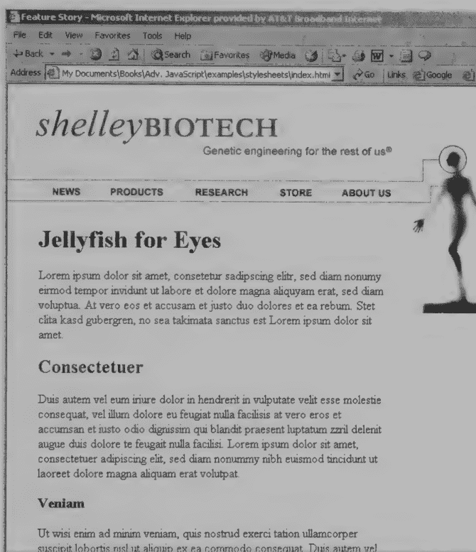

图 8-1 未格式化的特稿页面

```css
示例 8-3 类示例

.copy {
    font-family: verdana, sans-serif;
    font-size: 12px;
    font-weight: normal;
    color: #000033;
}
```

然后我们将字体大小设置为 12 像素。我们也可以用磅来设置大小，比如 12pt。然而，我强烈建议不要使用磅——不同的浏览器显示磅值的方式差异很大。例如，在 PC 上使用某些版本的 Netscape 6 时，使用磅值显示的字体会比其他浏览器大得多。使用像素可以确保在所有浏览器中最一致的外观。

然后我们说`font-weight`是 normal（正常）。唯一另一个值是 bold（粗体）。最后，我们将文本颜色设置为深蓝色。请注意，属性只是`color`，而不是`font-color`。

我们可以通过几种方式应用类。最简单的方法是在`<div>`标签中添加`class="copy"`。这确保层中的所有文本都将应用 copy 类。代码如下所示：

```html
<div id="feature" class="copy">
    ...文本...
</div>
```

你也可以使用`<span>`标签将字体放置在特定位置：

```html
<div id="feature">
Lorem ipsum <span class="copy">dolor sit</span> amet
</div>
```

在这种情况下，dolor sit 将使用 Verdana 字体，而其他文本将使用浏览器的默认字体。在我们的例子中，我们将类信息放在了`<div>`标签中，结果如图 8–2 所示。

请注意，即使是标题标签中的文本也是 Verdana 字体。然而，标题不是 12 像素高——它们肯定要大得多。类应用于原始文本，但是一旦你用其他标签（如`<h1>`和`<h2>`）包裹该文本，那么这些标签只使用部分字体信息。事实上，当你将`<table>`放在应用了类的文本中时，该表格内的任何文本都没有字体信息。例如，假设你有以下代码。

```html
<span class="copy">
问候语即将出现：
<table>
    <tr>
        <td>Hi there</td>
    </tr>
</table>
</span>
```

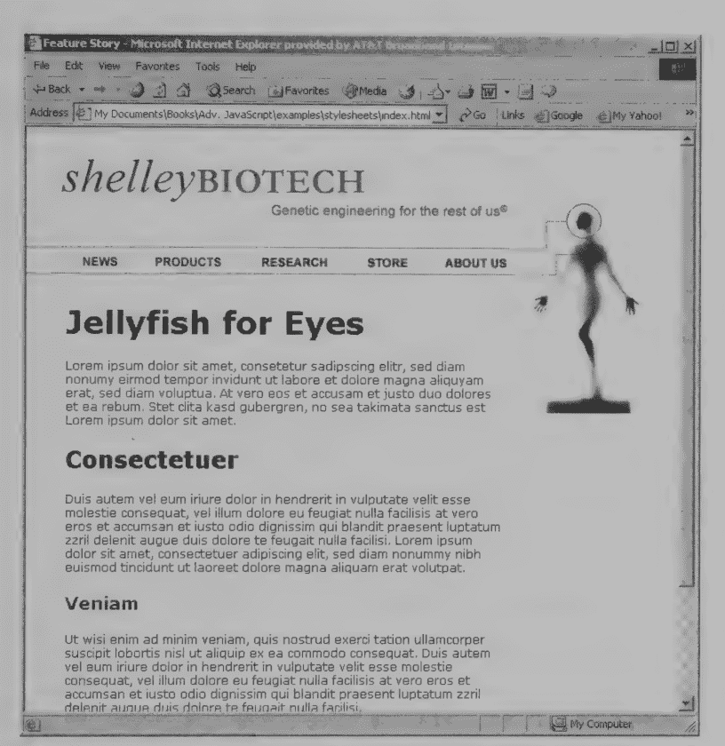

图 8-2 格式化后的页面

文本“Greeting coming up:”将使用我们的 Verdana 字体，但“Hi there”将使用浏览器的默认字体。要添加字体信息，你必须要么在表格单元格内添加另一个`<span>`标签：

```html
<td><span class="copy">Hi there</span></td>
```

或者更简单地，向表格单元格标签添加一个`class`属性：

```html
<td class="copy">Hi there</td>
```

标题标签中的文本不太正确。首先，让我们将标题文本设置为黑色，使其与蓝色文本区分开来。我知道你在本书的图片中无法分辨差异，请查看 www.wire-man.com/advjs 来查看差异。

我们将在示例 8–4 中再添加一些类。

```css
.hd1 {
    font-size: 24px;
    font-weight: bold;
    color: #000000;
}

.hd2 {
    font-size: 20px;
    font-weight: bold;
    color: #000000;
}

.hd3 {
    font-size: 16px;
    font-weight: bold;
    color: #000000;
}
```

### ◆ 代码工作原理

我们创建了三个类来处理`<h1>`、`<h2>`和`<h3>`标签。我们所做的只是设置大小、使文本加粗以及将颜色设置为黑色。我们没有更改字体族，因为我们不需要这样做。稍后会详细说明。

让我们看看示例 8–5，即实现这些新类的 HTML 代码。

```html
<div id="feature" class="copy">
<span class="hd1">Jellyfish for Eyes</span>
<br><br>
Lorem ipsum dolor sit amet, consetetur sadipscing elitr, sed diam nonumy eirmod tempor invidunt ut labore et dolore magna aliquyam erat, sed diam voluptua. At vero eos et accusam et justo duo dolores et ea rebum. Stet clita kasd gubergren, no sea takimata sanctus est Lorem ipsum dolor sit amet.
<br><br>
<span class="hd2">Consectetuer</span>
<br><br>
Duis autem vel eum iriure dolor in hendrerit in vulputate velit esse molestie consequat, vel illum dolore eu feugiat nulla facilisis at vero eros et accumsan et iusto odio dignissim qui blandit praesent luptatum zzril delenit augue duis dolore te feugait nulla facilisi. Lorem ipsum dolor sit amet, consectetuer adipiscing elit, sed diam nonummy nibh euismod tincidunt ut laoreet dolore magna aliquam erat volutpat.
<br><br>
<span class="hd3">Veniam</span>
<br><br>
Ut wisi enim ad minim veniam, quis nostrud exerci tation ullamcorper suscipit lobortis nisl ut aliquip ex ea commodo consequat. Duis autem vel eum iriure dolor in hendrerit in vulputate velit esse molestie consequat, vel illum dolore eu feugiat nulla facilisis at vero eros et accumsan et iusto odio dignissim qui blandit praesent luptatum zzril delenit augue duis dolore te feugait nulla facilisi.
<br><br>
<span class="hd3">Nostrud</span>
<br><br>
Nam liber tempor cum soluta nobis eleifend option congue nihil imperdiet doming id quod mazim placerat facer possim assum. Lorem ipsum dolor sit amet, consectetuer adipiscing elit, sed diam nonummy nibh euismod tincidunt ut laoreet dolore magna aliquam erat volutpat. Ut wisi enim ad minim veniam, quis nostrud exerci tation ullamcorper suscipit lobortis nisl ut aliquip ex ea commodo consequat.
</div>
```

### ◆ 代码工作原理

所有更改过的代码都以粗体显示。我们用包含类信息的`<span>`标签替换了标题标签。我们还必须添加换行符，因为标题标签会自动处理换行。

记住我们没有在标题类中设置字体族吗？我们不需要设置。因为它们都嵌套在`copy`类内部，所以标题类继承了`copy`类的所有特性。换句话说，样式会*层叠*或级联传递下去。因此，它们的全称是“层叠样式表”（Cascading Style Sheets），简称 CSS。

### 定位层

使用样式表精确地定位层的能力是天赐之物——我几乎不需要使用表格来定位任何东西，因为表格极其复杂且常常难以预测。你已经在本书中见过定位过的层了，所以我不会过多赘述。示例 8–6 展示了我们的`feature`层是如何定位的。

```css
#feature {
    position: absolute;
    left: 40;
    top: 180;
    width: 450
}
```

这段代码设置了一个名为`feature`的层，并声明该层将根据浏览器窗口的边缘进行定位——这就是“`position: absolute`”的含义。然后，该层从浏览器左边缘向右移动了 40 像素，从顶部向下移动了 180 像素。我们还将该层的宽度设置为 450 像素。否则，它看起来会像图 8–3 那样。

这就是我们需要在这里了解的全部定位内容。

### 修改 HTML 标签

有时，修改一个 HTML 标签比创建一个全新的类要容易得多。例如，`<b>`比`<span class="boldcopy">`输入起来简单得多。在我们的示例中，我们将使用原始的`<h1>`、`<h2>`和`<h3>`标签。它们看起来类似于示例 8–7。

## 修改 HTML 标签 175


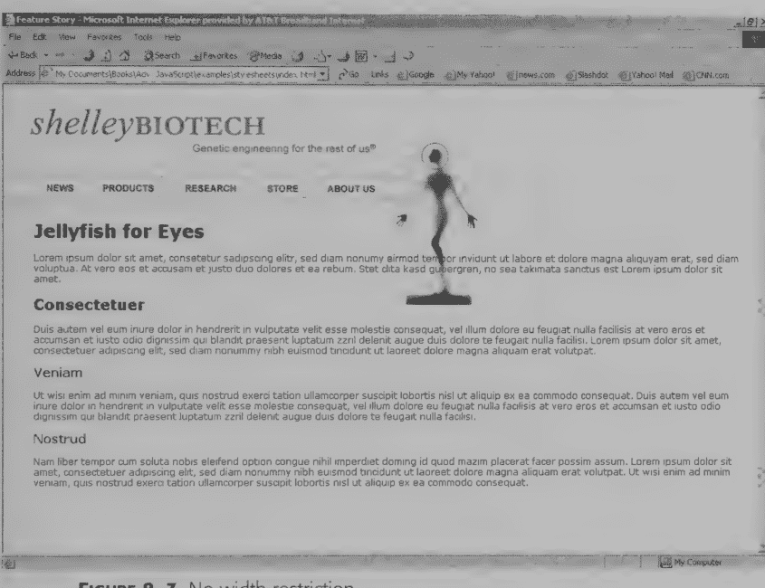

**FIGURE 8–3** 无宽度限制

```css
EXAMPLE 8–7 Modifying HTML Tags

h1 {
    font-size: 24px;
    font-weight: bold;
    color: #000000;
}

h2 {
    font-size: 20px;
    font-weight: bold;
    color: #000000;
    text-indent: 20;
}

h3 {
    font-size: 16px;
    font-weight: bold;
    color: #000000;
    text-indent: 40;
}
```

### ◆ 代码工作原理

看起来和我们之前创建的类非常相似，是不是？应该如此——它们几乎完全相同。唯一的真正区别是我们从标签名称中去掉了点号，当然，我们使用的是标签的名称（“h1”、“h2”、“h3”），而不是我们自己编造的名称。

我还使用了一个名为`text-indent`的新属性。这会将文本移动指定的像素数。请注意，`text-indent`不适用于普通类，只适用于修改 HTML 标签时。HTML 代码看起来与我们之前看到的类似，如示例 8–8 所示。

```html
<div id="feature" class="copy">
<h1>Jellyfish for Eyes</h1>
```

Lorem ipsum dolor sit amet, consetetur sadipscing elitr, sed diam nonumy eirmod tempor invidunt ut labore et dolore magna aliquyam erat, sed diam voluptua. At vero eos et accusam et justo duo dolores et ea rebum. Stet clita kasd gubergren, no sea takimata sanctus est Lorem ipsum dolor sit amet.

```html
<h2>Consectetuer</h2>
```

Duis autem vel eum iriure dolor in hendrerit in vulputate velit esse molestie consequat, vel illum dolore eu feugiat nulla facilisis at vero eros et accumsan et iusto odio dignissim qui blandit praesent luptatum zzril delenit augue duis dolore te feugait nulla facilisi. Lorem ipsum dolor sit amet, consectetuer adipiscing elit, sed diam nonummy nibh euismod tincidunt ut laoreet dolore magna aliquam erat volutpat.

### <h3>Veniam</h3>

Ut wisi enim ad minim veniam, quis nostrud exerci tation ullamcorper suscipit lobortis nisl ut aliquip ex ea commodo consequat. Duis autem vel eum iriure dolor in hendrerit in vulputate velit esse molestie consequat, vel illum dolore eu feugiat nulla facilisis at vero eros et accumsan et iusto odio dignissim qui blandit praesent luptatum zzril delenit augue duis dolore te feugait nulla facilisi.

### <h3>Nostrud</h3>

Nam liber tempor cum soluta nobis eleifend option congue nihil imperdiet doming id quod mazim placerat facer possim assum. Lorem ipsum dolor sit amet, consectetuer adipiscing elit, sed diam nonummy nibh euismod tincidunt ut laoreet dolore magna aliquam erat volutpat. Ut wisi enim ad minim veniam, quis nostrud exerci tation ullamcorper suscipit lobortis nisl ut aliquip ex ea commodo consequat.

```html
</div>
```

我们又回到了使用标签而不是 `span` 和类。使用常规 HTML 标签而不是常规类有时可能会令人困惑，但它通常可以缩短编码时间。

### 链接到外部样式表

当您可以在整个网站中使用单个样式表时，样式表的功能最为强大。这样，您可以在多个页面上使用同一个类，而只需在一个页面上进行更改。我已经多次使用过这种方法，当客户火烧眉毛、需要立即更改时，它不止一次地拯救了我。

只需一行代码即可将您的网页连接到中央样式表：

```html
<link rel="stylesheet" type="text/css"
     href="shelleystyles.css">
```

这行代码放置在网页头部的任何位置。在我们的例子中，`shelleystyles.css`文件将类似于示例 8–9。

```css
#header { position: absolute; left: 36; top: 31; }
#nav { position: absolute; left: 0; top: 122; }
#gal { position: absolute; left: 515; top: 74; }
#feature { position: absolute; left: 40; top: 180; width: 450}

.copy {
    font-family: verdana, sans-serif;
    font-size: 12px;
    font-weight: normal;
    color: #000033;
}

h1 {
    font-size: 24px;
    font-weight: bold;
    color: #000000;
}

h2 {
    font-size: 20px;
    font-weight: bold;
    color: #000000;
    text-indent: 20;
}

h3 {
    font-size: 16px;
    font-weight: bold;
    color: #000000;
    text-indent: 40;
}

a:hover { text-decoration: none }
```

请注意，此文件中没有任何`<style>`标签。我们不需要在外部文件中使用它们。主文件中的`<link>`标签

# 9

## DOM 的那些事

### 本章内容

- DOM 的起源
- 关于文档对象
- DOM 的各种版本
- W3C DOM

每个 JavaScript 程序员（包括你）都曾不得不应对各种浏览器中不同的 DOM。例如，IE 有时需要“style”属性，Netscape 6 只在`getElementById`被使用时才满意，而 Netscape 4 则需要看到`document.layers`才肯挪动一步，开始工作。这个混乱局面与 JavaScript 本身无关——它完全源于不同浏览器看待网页世界的方式。只是 JavaScript 必须处理这个烂摊子。

## DOM 的起源

文档对象模型的潘多拉魔盒是由 Netscape Navigator 2 打开的，它是第一个实现 DOM 的浏览器。为了明确起见，我们来看看 DOM 到底是什么，有什么用。DOM 代表 Document Object Model（文档对象模型），这意味着浏览器将网页视为井然有序的层级结构。拥有 DOM 的唯一目的是让程序员能够引用网页中的元素。层级结构的顶端是`window`对象，它代表浏览器窗口。`window`对象之后是`document`对象，然后向下依次是表单、表单元素、图像、链接等。实际上，最早的 DOM 甚至不包括图像。第一个 DOM 看起来很像图 9-1。

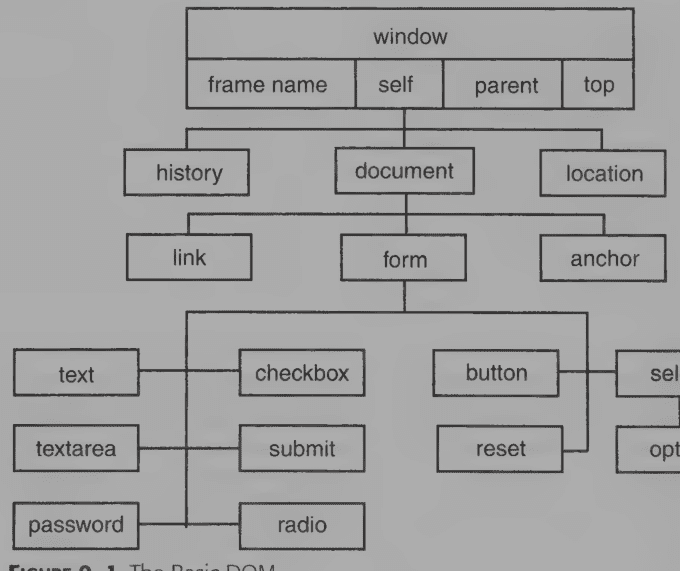

**图 9-1** 基础 DOM

如果一个浏览器实现了任何形式的 DOM，那么它至少在这个结构中拥有这些对象。

随着时间的推移，浏览器变得更加强大，微软和 Netscape 开始扩展其浏览器中的 DOM。毫不奇怪，这些 DOM 彼此并不匹配。有些方面是相同的，但两个浏览器都实现了一些浏览器特定的 DOM 特性。这导致在任何给定的 JavaScript 函数中，必须为多种不同的浏览器编写代码，这在多年来，直到今天，都让脚本开发者们愤怒不已。

幸运的是，制定标准的万维网联盟（W3C）最终为浏览器制定了一个标准 DOM。Netscape 在开发姗姗来迟的 6.0 版浏览器时，实现了全部 DOM I——稍后会详细介绍——以及大部分 DOM II。微软实际上为标准 DOM 的创建贡献了很多，而且似乎有足够的时间在浏览器中实现 DOM I 和 II，但却没有这样做。IE 5.5 只是部分实现了标准 DOM。

这对你意味着什么？不幸的是，没什么大的好处。也许再过几年，当全世界每个人都在使用 Netscape 7（如果真有这个版本的话）和 IE 7 时，那么，也许，只是也许，我们才能编写出在所有浏览器中都能运行的 JavaScript 代码。换句话说，别抱太大希望。我认为事情正在慢慢开始好转——希望在本书出版时，我们终于可以让 Netscape 4 退役了。

那么，哪些浏览器支持哪些 DOM 呢？让我们看看表 9-1 的总结，然后我们将深入探讨 DOM 到底是什么以及它们如何工作。

**表 9-1 DOM 与浏览器支持情况**

| DOM | Netscape 支持 | Internet Explorer 支持 |
| :--- | :--- | :--- |
| 基础模型 | NN2, NN3, NN4, NN6 | IE3, IE4, IE5.x, IE6 |
| 基础与图像 | NN3, NN4, NN6 | IE3 (仅 Mac), IE4, IE5.x, IE6 |
| NN4 扩展 | NN4 (注意：非 NN6) | |
| IE4 扩展 | | IE4, IE5.x, IE6 |
| IE5 扩展 | | IE5.x, IE6 |
| W3C DOM (I 和 II) | NN6 (大部分，非全部) | IE5.x (部分), IE6 (部分) |

## 关于文档对象

浏览器的文档对象在网页在浏览器中完全加载之前是不存在的。在那一刻，对象存在，任何客户端脚本语言都可以访问它们。这当然意味着 JavaScript 和 JScript，但也包括 VBScript（或任何其他碰巧出现的脚本）。

对象根据加载顺序被放入 DOM。例如，如果你正在寻找`document.forms[2]`，那么就在你的 HTML 代码中找到第三个`<form>`标签。无论该表单在页面上的实际位置如何，它都是表单数组中的第三个元素，因为它是浏览器检测到的第三个表单。而且，正如你将在后面的章节中看到的，一个框架的代码在另一个框架加载完成之前无法访问另一个框架的脚本。

### 属性

文档中的对象具有与其关联的属性和方法。例如，图像对象有一个`src`属性，它指向包含图像的外部文件。复选框元素有一个`checked`属性，用于查看它们是否被选中。属性也可以是数组：在 Netscape 4 中，`document`对象有一个`layers`数组，可以通过多种不同的方式访问：

- `document.layers[n]`
- `document.layers[layername]`
- `document.layername`

与 HTML 不同，属性名称区分大小写。例如，`bgColor`是一个真实的属性，但`bgcolor`不是。

你可以将自己的属性添加到文档对象中，正如我们将在后面的示例中看到的那样。

### 方法

文档对象也可以附加方法。例如，每个文本字段都有`focus()`和`blur()`方法可用。大多数对象都带有一些它们始终可以使用的默认方法，但你可以向任何对象添加自己的自定义方法。示例 9-1 是一个抽象示例：

```javascript
function doStuff()
{
    this.property = 9
    this.otherProperty = "turtle"
    this.someMethod(10, "dog")
}

window.newMethod = doStuff
</script>
<body onLoad="window.newMethod()">
```

当页面加载时，`newMethod`方法被调用，这会触发`doStuff`函数。

### 事件处理程序

一些对象还有事件处理程序。这允许对象对浏览器或用户刚刚执行的操作做出反应。在上面的示例中，`document`对象有一个事件处理程序，当页面完成加载时触发。链接和按钮总是留意用户是否点击它们，如下所示：

```html
<a href="#" onClick="nextPage()">

或

<input type="button" value="Click me you fool"
onClick="validateForm()">
```

点击的一个便捷技巧是，你可以在 JavaScript 中模拟点击按钮，而无需用户执行任何操作。

```javascript
document.myForm.myButton.onclick()
```

当此代码运行时，会模拟一次点击，页面和脚本的反应与用户点击按钮完全一样。在这个例子中，`validateForm`函数将会运行。

你还可以设置一个特定函数在某个特定事件发生时运行：

```javascript
document.myForm.myButton.onclick = validateForm
```

## DOM 的各种版本

现在我们有了一些背景知识，让我们开始研究表 9-1 中不同类型的 DOM。

### 基础 DOM

正如你从图 9-1 看到的，这个 DOM 非常强调表单元素。这意味着在页面提交到 Web 服务器之前，可以在客户端验证表单。更重要的是，可以计算值，并在不重新加载页面的情况下，在其他表单字段中显示信息！在当时，这些是相当激进的想法，它们当然被证明是好主意。

当 IE3 推出时，它与 Netscape 2（或简称 NN2，Netscape Navigator 2）几乎相同。在 NN3 发布前的很短一段时间内，Netscape 和 Internet Explorer 拥有几乎相同的 DOM。

### 带有图像的基础 DOM

随着 NN3 的发布，图像突然变得可脚本化了。结合像`onmouseover`和`onmouseout`这样的事件处理程序，你实际上可以改变图像的源。因此，图像翻转效果诞生了。¹ 实际上，这是图像唯一可以更改的属性——其他所有属性都是只读的。

由此也产生了挫败感，因为图像翻转只在 Netscape 上有效。我们开始看到一些这样的代码：

```javascript
function rollOver(imageName)
{
    if (document.images)
    {
        // 执行翻转操作
    }
}
```

¹ 我一直对翻转效果情有独钟。弄清楚如何使用它们，让我在 1966 年获得了第一份真正的网页设计工作。

这是我们首次需要为不同浏览器的兼容性编写代码。自此之后，我们便持续耕耘。Netscape 3 所包含的文档对象模型大部分已在 IE4 中实现，并从此被大多数浏览器所采纳。

### Netscape 4 的遗产

Netscape 4 是一次重大的版本发布，它首次向世界引入了可脚本化的层与样式表。不幸的是，该版本发布时 CSS 标准尚在制定中，因此许多标准 CSS 特性未能被 NN4（Netscape Navigator 4）所支持。

NN4 最有趣的新增特性之一是`layer`对象，它允许你引用页面上独立的 HTML 块，并以不同于其他 HTML 块的方式进行处理。可惜的是，`layer`对象并未被 W3C（万维网联盟）采纳，因此该对象的前景黯淡。它也未在 Netscape 6 中实现，这意味着你不会再见到它。

尽管如此，Netscape 4 确实为我们带来了许多新事件。它增加了`onMouseUp`和`onMouseDown`事件，以及`onKeyUp`和`onKeyDown`事件。检测这些事件发生的唯一方法是从文档层次结构的顶层向下查找（这称为“自上而下”事件处理）。你还需要特意通过`captureEvents`方法让 NN4 处于警戒状态以查找特定事件。你将在后续章节中看到这个事件的实际应用。当事件发生时，NN4 会创建一个名为`e`的对象，其中包含有关该事件的所有信息：发生位置、按下的键等等。

### Internet Explorer 4 登场

IE4 在 Netscape 4 之后几个月推出，微软利用这段时间实现了一个更完善的 CSS 标准。它还新增了一项令人印象深刻的能力：可以脚本化网页上的每一个 HTML 元素。这导致了使用`document.all`来访问文档的方式——这提醒你，你可以访问所有的元素。


一个真正令人惊讶的补充是 `innerHTML`、`innerText`、`outerHTML` 和 `outerText` 这四个属性，它们实际上允许你修改或创建页面内容，而这些内容以前一直被认为是静态的。做到这一点的能力近乎奇特——程序员一直将网页上的文本视为世界上最静态的东西，突然意识到它现在是动态的，这迫使许多人重新定义网页是什么以及它能成为什么。

当然，IE4 引入了 `style` 属性，该属性沿用至今。如果你想更改页面中任何与 CSS 相关的内容，都必须通过 `style` 属性。与 NN 类似，IE4 也引入了一种处理事件的方法。不幸的是，IE4 看待事件的方式与 NN4 大相径庭。

记住，NN4 使用自上而下事件处理，层次结构中的顶层对象比目标元素先知道事件发生。IE4 则相反：目标元素先看到事件，然后这个信息通过层次结构向上冒泡，直到达到 `window` 对象。IE4 不是使用 `e`，而是使用 `event` 属性来保存有关事件的所有信息。

### W3C DOM

W3C 通常试图通过创建软件供应商应当遵循的标准来让开发者的工作更轻松。当它看到网页开发者因各种浏览器冲突的 DOM 而焦头烂额时，便创建了一个所有浏览器理想情况下都应遵守的标准 DOM。

然而，W3C 不仅仅想创建一个 HTML DOM。他们还希望这个 DOM 能够处理 XML 文档。这是一个重大的设计决策，因为 XML 标签和元素可以是任何东西。因此，DOM 更多地关注父节点、子节点和元素的 ID 属性，而不是特别查看 `forms` 或 `images` 数组。

然而，HTML 和 XML 有显著差异，因此 W3C 决定将其 DOM 分成几个部分。HTML 和 XML 文档共有的部分称为核心 DOM（Core DOM）。DOM 的第二部分是专门针对 HTML 的。

### DOM 级别

在你的研究中，你可能会看到 DOM Level I 或 DOM Level II 的说法。DOM 的不同级别实际上只是版本。事实证明，创建一个 DOM 是一项相当庞大的工作，而创建出有意义的东西的唯一方法就是持续不断地改进。

换句话说，将一群聪明人关在房间里几个月对于创建 DOM 的各个版本很有用，但你需要让一群又一群聪明人持续在房间里工作，以继续开发它。

### W3C DOM

由于你现在的大部分脚本工作以及未来的工作都将涉及 W3C 版本的 DOM，我们将更深入地研究它。它在 HTML 中引入了一些新概念，这些概念看起来只属于 XML 世界。

实际上这有原因：HTML 正在转变为另一种形式的 XML。事实上，XHTML 就是这一过程的第一步。别担心——这是一件好事，以后会让我们的生活更轻松。

### 新 DOM 中的 HTML

如果你想使用 W3C DOM 的所有功能，那么你需要稍微修改一下你的 HTML。别担心，改动不大。

#### 结束标签，全体注意

现在是时候开始为几乎所有内容添加结束标签了，甚至是那些从未需要结束标签的 HTML 标签。例如，你之前的 HTML 看起来像这样：

```html
Lorem ipsum dolor sit amet, consectetuer adipiscing elit,
sed diam nonummy nibh euismod tincidunt ut laoreet dolore
magna aliquam erat volutpat.
<p>
Ut wisi enim ad minim veniam, quis nostrud exercitation
ulliam corper suscipit lobortis nisl ut aliquip ex ea
commodo consequat.
```

为了在文本之间创建间距，我们只是简单地使用了一个 `<p>` 标签。你新的 HTML 应该看起来像这样：

```html
<p>
Lorem ipsum dolor sit amet, consectetuer adipiscing elit,
sed diam nonummy nibh euismod tincidunt ut laoreet dolore
magna aliquam erat volutpat.
</p><p>
Ut wisi enim ad minim veniam, quis nostrud exercitation
ulliam corper suscipit lobortis nisl ut aliquip ex ea
commodo consequat.
</p>
<p>Lorem ipsum</p>
```

注意所有的文本都包含在 `<p>...</p>` 标签内。这两段代码在浏览器中看起来应该完全一样。那为什么要用 `</p>` 标签呢？事实证明，当网页上的所有内容都以某种整洁、规范的方式被某个标签包含时，DOM 会工作得更好。这包括 `<td>`、`<tr>` 和 `<li>` 标签。

但是像 `<input>` 这样没有闭合标签的标签怎么办呢？解决方法是从 XML 的技巧中借鉴：在标签末尾添加一个斜杠。

```html
<input type="text" name="address" />
```

允许你充分利用 DOM 的另一个 HTML 行为变更是广泛使用 `id` 属性，如：

```html
<div id="mainNav">
```

DOM 非常擅长通过元素的 `id` 快速找到它们。当然，你必须确保页面上的每个 `id` 都是完全唯一的。

2. 如果你想了解更多关于 XML 的知识，阅读我撰写的 *Essential XML for Web Professionals* 是个不错的选择。

### 节点

DOM 的一个核心概念是节点。为了解释节点，让我们看看示例 9-2，一个简单的 HTML 文档。

```html
<html>
    <head>
        <title>Pick Your Nodes Carefully</title>
    </head>
    <body>
        <div id="newNode">
            This is a
            <b>great</b>
            node.
        </div>
    </body>
</html>
```

是的，过度的缩进是有原因的——它们帮助我们看清代码中的各个节点：

- `html` 节点
- `head` 节点
- `title` 节点
- `title` 节点内的文本节点
- `body` 节点
- `div` 节点
- `div` 节点内的第一个文本节点
- `bold` 节点
- `bold` 节点内的文本节点
- `div` 节点内的第二个文本节点

对于一个简单的 HTML 页面来说，这节点可真不少，对吧？嗯，这就是为什么建议你为任何需要通过 JavaScript 访问的 HTML 块使用 `id` 属性的原因之一。

让我们看一些术语。包含其他节点的节点被认为具有 *子节点*。`html` 节点有多少个子节点？不，再猜猜——它只有两个：`head` 和 `body` 节点。`head` 和 `body` 节点处于同一层级，它们被称为 *兄弟节点*。`head` 节点只有一个子节点：`title` 节点，而 `title` 节点也只有一个子节点：`title` 标签内的文本。

`body` 节点有一个子节点（`div` 节点）。`div` 节点有三个子节点：两个文本节点和 `bold` 节点。这开始有道理了吗？

#### 节点的类型

你注意到我们看到了两种不同的节点了吗：常规节点，即 HTML 标签；以及文本节点，即出现在 HTML 元素之间的文本集合。是 HTML 标签的节点更准确地称为 *元素* 节点。

除了元素节点和文本节点，还有许多其他类型的节点。事实上，总共有 12 种。不过，你很可能只会用到其中的 7 种，所以我们现在只专注于这 7 种。

在深入这 7 种节点之前，我们需要了解节点具有的两个属性：`nodeName` 和 `nodeValue`。每当你指向一个节点时，你总能从中获取两个属性：节点的名称和它的值。

例如，`head` 节点的名称，不出所料，是 `"head"`。它没有值。那么 `title` 节点呢？它有值吗？没有。`title` 节点内的文本节点有一个值，等于 `"Pick Your Nodes Carefully"`。

好了，我想我们现在准备好查看表 9-2 了，其中包含了各种节点。

### 表格 9–2 节点类型

| 节点类型 | 节点名称 | 节点值 | 描述 | 支持的浏览器 |
| :--- | :--- | :--- | :--- | :--- |
| 元素 | 标签名 (`head`, `image`) | 空 | HTML 或 XML 元素 | IE5+, NN6 |
| 属性 | 属性名 (`href`, `src`) | 属性值 | 标签内的名-值对 | NN6 |
| 文本 | `#text` | 文本内容 | 标签内包含的一段文本，例如 `<i>hi</i>`。`"hi"` 就是文本节点。 | IE5+, NN6 |
| 注释 | `#comment` | 注释文本 | HTML 注释 | NN6 |
| 文档 | `#document` | 空 | 根文档对象 | NN6 |
| 文档类型 | `DOCTYPE` | 空 | DTD 规范 | NN6 |
| 文档片段 | `#document-fragment` | 空 | 文档外的一系列节点 | NN6 |

你将花大部分时间处理元素、属性和文本节点。

### 节点属性和方法

节点是 W3C DOM 中的合法对象，这意味着它们可以同时拥有属性和方法。所有节点都附带一组特定的属性和方法。我们已经简要了解了 `nodeName` 和 `nodeValue` 属性，现在来看看其余的属性。表 9–3 列出了二级 DOM 定义的所有节点属性。

### 表格 9–3 节点属性

| 属性 | 数据类型 | 描述 | 支持的浏览器 |
| --- | --- | --- | --- |
| `nodeName` | 字符串 | 值因节点类型而异（见表 9–2） | IE5Win, IE5Mac, NN6 |
| `nodeValue` | 字符串 | 值因节点类型而异（见表 9–2） | IE5Win, IE5Mac, NN6 |
| `nodeType` | 整数 | 每种节点类型都有自己的编号。例如，元素节点的 `nodeType` 为 1，文本节点的 `nodeType` 为 3。 | IE5Win, IE5Mac, NN6 |
| `parentNode` | 节点对象 | 对下一个外部容器的引用 | IE5Win, IE5Mac, NN6 |
| `childNodes` | 数组 | 数组中的每个元素都指向一个子节点。节点按加载顺序排列。 | IE5Win, IE5Mac, NN6 |
| `firstChild` | 节点对象 | 指向第一个子节点。在上面的示例中，`html` 节点的 `firstChild` 将是指向 `head` 节点的引用。 | IE5Win, IE5Mac, NN6 |
| `lastChild` | 节点对象 | 指向最后一个子节点 | IE5Win, IE5Mac, NN6 |
| `previousSibling` | 节点对象 | 指向与当前节点处于同一级别的前一个节点。例如，粗体节点的 `previousSibling` 是第一个文本节点（在 `div` 节点内）。 | IE5Win, IE5Mac, NN6 |
| `nextSibling` | 节点对象 | 指向源顺序中的下一个兄弟节点 | IE5Win, IE5Mac, NN6 |
| `attributes` | 节点映射 | 属性节点数组 | IE5Mac, NN6 |
| `ownerDocument` | 对象 | 根文档对象 | IE5Mac, NN6 |
| `namespaceURI` | 字符串 | 命名空间的 URI（仅适用于元素和属性节点） | NN6 |
| `prefix` | 字符串 | 命名空间前缀（仅适用于属性和元素节点） | NN6 |
| `LocalName` | 字符串 | 命名空间内节点的本地名称 | NN6 |

节点映射具体由什么组成超出了本书的范围。目前，你可以将其视为节点的数组——差不多是这样。

现在让我们看看表 9–4 以及可以用来操作节点的方法。

### 表格 9–4 节点方法

| 方法 | 描述 | 支持的浏览器 |
|---|---|---|
| `appendChild(newNodeObj)` | 将一个子节点添加到当前节点的子节点列表的末尾。 | IE5, NN6 |
| `cloneNode(depth)` | 创建当前节点的副本（`depth` 指示也被克隆的子节点数量）。 | IE5, NN6 |
| `hasChildNodes()` | 返回 `true` 或 `false`，取决于当前节点是否有子节点。 | IE5, NN6 |
| `insertBefore(newNode, refNode)` | 在另一个节点之前插入一个新的子节点。 | IE5, NN6 |
| `removeChild(oldNode)` | 删除一个节点。 | IE5, NN6 |
| `replaceChild(newNode, oldNode)` | 用另一个子节点替换一个子节点。 | IE5, NN6 |
| `supports(feature, version)` | 确定当前节点是否支持某个特性。 | NN6 |

### 操作你的节点

现在让我们把这些属性和方法放入实际的代码中，这样当你合上这本书后就能运用这些知识了。

我们将创建一个简单的 HTML 页面，其中只有一行文本。实际上，它看起来像示例 9–3。

```html
<html>
<head>
    <title>New Node</title>
</head>
<body onLoad="makeNode()">
<p id="para1">It's a pleasant evening here in downtown Fairfax, California.
<br><br>
<form name="textForm">
    <input type="button" value="change text"
           onClick="alterNode()" />
    <input type="button" value="delete text"
           onClick="deleteNode()" />
</form>
</p>
</body>
</html>
```

#### 代码如何工作

如你所见，这是一个包含一些文本和两个表单按钮的简单页面。`makeNode()` 函数在页面加载时被调用，按下按钮则分别执行 `alterNode()` 和 `deleteNode()`。将此页面加载到浏览器中，结果如图 9–2 所示。别忘了使用 Netscape 6！

现在让我们开始看一些代码。我们将从示例 9–4 的 `makeNode()` 函数开始。

#### 图 9–2 节点页面的初始状态

```javascript
function makeNode()
{
    ❶ newPara = document.createElement("P")
    ❷ newPara.setAttribute("id", "para2")
    ❸ newParaText = document.createTextNode("The cafe is being overrun by high school students.")
    ❹ newPara.appendChild(newParaText)
    ❺ document.body.appendChild(newPara)
}
```

#### 代码如何工作

1. 为了创建一个节点，我们必须明确说明要创建哪种类型的节点。在本例中，我们创建的是一个元素节点，因为我们打算在页面上放置另一个段落元素。因此我们使用 `createElement()` 方法（它是 `document` 对象的方法，而不是节点的方法，这就是为什么我们没有在节点对象方法列表中看到它的原因）。我们创建的是 `<P>`，所以方法中使用 `"P"`。如果我们想创建一个图像，我们会使用 `document.createElement("IMG")`。

   此时，网页根本没有受到影响。我们只有一个漂浮的段落元素。它还不属于任何地方，也不包含任何东西。这意味着在浏览器的内存中的某处，一个 `"<P></P>"` 正在漂浮。

2. 然后我们给这个漂浮的段落添加一个属性。我们现在得到这个：

   ```html
   <P id="para2"></P>
   ```

   漂浮在浏览器的内存中。

3. 然后我们创建一个仅由文本组成的独立节点。这是一个文本节点，现在它和我们的段落一起在浏览器的内存中漂浮。此时，这两个节点彼此完全没有关联。文本还没有出现在网页上，因为从技术上讲它还不是网页的一部分——它必须被明确地作为其他东西的子节点附加到页面上。

4. 现在我们将文本节点和元素节点关联起来。我们使文本节点成为元素节点的子节点。这意味着段落（元素）节点在浏览器的内存中看起来像这样：

   ```html
   <P id="para2">The cafe is being overrun by high school students.</P>
   ```

5. 我们的最后一步是将段落附加到网页的实际 `body` 中。注意我们没有将它直接附加到 `document` 对象，而是附加到 `body` 对象。这就是我们想要的位置。否则，页面的结构将如下所示：

   ```html
   <html>

   <head>...</head>

   <body>...</body>

   <p id="para2">...</p>

   </html>
   ```

当页面加载，并且第二个段落被附加后，它看起来像图 9-3。

很酷吧？如果你喜欢这个，看看实现示例 9-5 后按下 `"change text"` 按钮会发生什么。

#### 图 9-3 添加的段落


```javascript
function alterNode()
{
    ❶ moreNewText = document.createTextNode("Everyone's ordering smoothies. The screaming blender is never silent!")
    ❷ oldParaText = document.getElementById("para2").childNodes[0]
    ❸ document.getElementById("para2").replaceChild(moreNewText, oldParaText)
}
```

#### 代码如何工作

1. 此函数的目的是更改`para2`的文本。我们通过创建一个全新的文本节点并将其命名为`moreNewText`来开始这个过程。

2. 然后我们必须重新创建对`para2`内部文本的引用。我们必须这样做，因为此函数不记得`newParaText`是什么。你可以看到设置`id`属性的重要性。没有它，代码将更难编写（也更难阅读）。我们知道`para2`内只有一个子节点，所以我们引用`childNodes`数组中的第一个元素。

### 第9章 • DOM的魅力所在

#### DOM事件模型（双向作用）

我们已了解Netscape 4的DOM采用的是事件**向下传播**模型，而Internet Explorer则使用**向上冒泡**模型。W3C DOM做了一件有趣的事，它将这两个看似互不兼容的模型组合成一个统一、连贯的模型。这需要创建一些新的方法和属性，但我发现这是一种更直观的事件处理方式。

或许最明显的变化是事件监听器的存在。你网页中的任何节点都可以拥有自己的事件监听器。为节点附加事件监听器，就像是为它指派了一位管家，这位管家经过训练，能识别某种特定事件，例如`mouseover`或`keydown`。一旦该事件发生，事件监听器就会立即启动，并调用相应的函数。

那么，如何将这个事件监听器附加到节点上呢？原来，你网页中的每个节点都有一个可用的方法：`addEventListener()`。

让我们看看这是如何工作的。我们将基于上面的例子稍作修改。关于咖啡馆的第二行文字将被赋予一个事件监听器。当用户将鼠标悬停在文字上时，文字本身会发生变化。当鼠标移开时，文字将恢复原状。由于这需要进行一些改动，我们来看一下示例9-7中的完整页面。

**示例9-7** 事件监听

```javascript
<script language="JavaScript">

rollOverText = ""
buttonPressed = false

function makeNode()
{
    newPara = document.createElement("P")
    newPara.setAttribute("id", "para2")
    newParaText = document.createTextNode("The cafe is being overrun by high school students.")
    newPara.appendChild(newParaText)
    document.body.appendChild(newPara)

    // add event listeners
    document.getElementById("para2").addEventListener("mouseover", rollOnText, false)
    document.getElementById("para2").addEventListener("mouseout", rollOutText, false)
}

function rollOnText()
{
    rollOverText = "Hey! Get this mouse off me!"
    swapText()
}

function rollOutText()
{
    if (buttonPressed)
    {
        rollOverText = "Everyone's ordering smoothies. The screaming blender is never silent!"
    }
    else
    {
        rollOverText = "The cafe is being overrun by high school students."
    }
    swapText()
}

function alterNode()
{
    rollOverText = "Everyone's ordering smoothies. The screaming blender is never silent!"
    buttonPressed = true
    swapText()
}

function swapText()
{
    rollOverTextNode = document.createTextNode(rollOverText)
    oldParaText =
        document.getElementById("para2").childNodes[0]
    document.getElementById("para2").replaceChild
        (rollOverTextNode, oldParaText)
}

function deleteNode()
{
    nodeToKill = oldParaText =
        document.getElementById("para2").childNodes[0]
    document.getElementById("para2").removeChild(nodeToKill)
}
</script>
```

#### 代码工作原理

1. 第一个不同之处在于，我们创建了两个全局变量，所有函数都可以访问它们。`rollOverText`变量保存了用户鼠标悬停时显示的文本，以及鼠标离开时显示的文本。`buttonPressed`变量则记录“更改文本”按钮是否已被按下。

2. 我们通过调用`addEventListener`方法并传递三个参数来为`para2`元素附加事件监听器：要监听的事件名称、该事件发生时调用的函数，以及一个布尔值，用于在事件指向该目标时启用事件捕获。大多数情况下，`false`就能正常工作。

3. 这里，我们为`para2`附加了另一个事件监听器。一个节点可以拥有任意数量的不同事件监听器。

4. 当用户将鼠标移到文字上时，`rollOnText`函数被调用。这个函数所做的就是设置`rollOverText`变量并调用`swapText`函数，后者完成所有实际工作。

5. `rollOutText`函数只是稍复杂一些。`rollOverText`变量的值取决于“更改文本”按钮是否已被按下。一旦设置完成，就会调用`swapText`函数。

6. 我们也稍微修改了`alterNode`函数。与前两个函数一样，我们设置`rollOverText`。由于此函数是在按下“更改文本”按钮时调用的，我们设置`buttonPressed`为`true`以确认此事实。

7. 这是完成所有工作的函数。它实际上就是旧的`alterNode`函数的核心部分，被放入了自己的函数中。创建一个新的文本节点，并替换旧的文本节点。仅此而已。

8. 此函数没有任何变化。

W3C DOM中事件的另一个妙处在于，你甚至可以在页面加载后更改事件监听器。例如，我们可以为这个小页面添加一个按钮，来更改我们事件触发的函数。我们不必更改文本内容，而只需更改文本的颜色。首先，让我们看看该按钮的HTML。

```html
<input type="button" value="change event listener"
    onClick="alterListener()" />
```

我们所做的就是添加一个按钮来触发另一个函数。让我们在示例9-8中看看它及相关函数。

**示例9-8** 更改事件监听器

```javascript
function alterListener()
{
    p2 = document.getElementById("para2")
    p2.removeEventListener("mouseover", rollOnText, false)
    p2.removeEventListener("mouseout", rollOutText, false)
    p2.addEventListener("mouseover", rollOnRed, false)
    p2.addEventListener("mouseout", rollOutRed, false)
}

function rollOnRed()
{
    document.getElementById("para2").setAttribute("style",
        "color:red")
}

function rollOutRed()
{
    document.getElementById("para2").setAttribute("style",
        "color:black")
}
```

#### 代码工作原理

1. 为使代码更易读，我们创建了一个用于引用段落的快捷方式。

2. 要更改事件监听器，必须完全移除旧的监听器并创建新的监听器。在这两行中，我们移除了事件监听器。请注意，移除监听器所用的参数与设置它们的参数完全相同。

3. 然后，我们添加了新的事件监听器。唯一的区别是它们指向两个不同的函数：`rollOnRed`和`rollOutRed`。

4. 这里，我们使用`setAttribute`方法创建一个样式属性，将文字变为红色。

5. 我们在此处做同样的事情，将文字改回黑色。

最后，让我们看看W3C DOM中所有可用的事件——其数量可能超出你的想象。

- `abort`
- `blur`
- `change`
- `click`
- `DOMActivate`
- `DOMAttrModified`
- `DOMCharacterDataModified`
- `DOMFocusIn`
- `DOMFocusOut`
- `DOMNodeInserted`
- `DOMNodeInsertedIntoDocument`
- `DOMNodeRemoved`
- `DOMNodeRemovedFromDocument`
- `DOMSubtreeModified`
- `error`

### 第9章 • DOM 无所不在

- `focus`
- `load`
- `mousedown`
- `mousemove`
- `mouseout`
- `mouseover`
- `mouseup`
- `reset`
- `resize`
- `scroll`
- `select`
- `submit`
- `unload`

无论你的代码做什么，你都将在JavaScript中与DOM打交道。各种浏览器实现的多种DOM风格至少在未来几年内仍会让我们保持高度警惕。

### 第10章 • 事件对象

### 本章内容

- 事件历史
- 事件传播
- 引用事件对象

没有事件，网络将会变得非常、非常无聊。事件是浏览器中发生的事情，例如页面加载、鼠标点击和移动、键盘按键被按下等等。JavaScript有称为事件处理程序的构造，每当事件发生时就会激活。你通常可以通过“on”来区分事件处理程序和事件，因为事件处理程序以“on”开头。例如，`click`事件有一个`onclick`事件处理程序。`mousedown`事件有一个`onmousedown`事件处理程序。

#### 事件历史

最初（在版本4浏览器之前），所有事件处理程序都作为属性存在于HTML元素内部，例如`onClick`存在于链接和按钮内部，`onmouseover`和`onmouseout`存在于链接内部。这些简单的事件处理程序知道发生了某些事情，但它们无法告诉你关于发生位置的任何信息。版本4浏览器将事件变成了完全独立的对象。这些对象突然了解了很多关于事件的信息：它们在屏幕上的位置以及键盘上的哪个键被按下。这些新的事件对象完全暴露给JavaScript，因此在版本4浏览器中可以对事件做更多的事情。在版本4浏览器中还出现了一个奇特的概念：事件传播。这个想法允许节点树中更上层的对象（例如包含被点击链接的段落标签）感知到一个事件。然而，事件究竟如何传播在Netscape 4、Internet Explorer 4和Netscape 6之间存在巨大差异。

#### 浏览器之间的相似之处

在我们研究不同浏览器中的事件和事件传播有何不同之前（浏览器指NN4、IE4+和NN6），让我们看看它们的共同点。

- 事件发生的瞬间，就会创建一个事件对象。
- 对象实际上是一个属性和方法的集合。与事件对象关联的属性必须处理关于事件本身的信息：发生了什么、在哪里发生等等。在本章末尾，我们将查看浏览器的所有事件对象属性。
- 大多数事件对象属性是只读的，因为它们处理的是已经发生的事件。

#### 浏览器之间的差异

现在让我们看看浏览器如何不同地对待事件。

- 它们具有不同的事件传播模型（NN6实际上结合了NN4和IE4+的方法）。
- IE4+允许通过脚本修改键盘字符事件（例如，强制文本区域中的所有字符为小写或不允许用户输入“q”）。
- NN4和W3C DOM（NN6使用）具有静态的`Event`对象（注意大写的“E”）。稍后会详细介绍这个对象。
- IE4+有一个名为`event`（全部小写）的动态事件对象，它是从`window`对象访问的。对于NN4和NN6，你必须通过事件处理程序函数访问`Event`对象（我们稍后会看到这意味着什么）。

#### 静态`Event`对象

`Event`对象作为事件相关信息的容器。`Event`对象始终可用于任何框架或窗口。它也是实际事件对象被克隆的对象。

#### 事件传播

最初，一个事件在一个对象上触发，例如鼠标悬停在图像周围的链接上。如果为该事件定义了事件处理程序（在这种情况下是`onmouseover`），那么该事件处理程序将执行。考虑以下代码：

```html
<a href="go.html" onmouseover="swapImage(1)"
   onmouseout="swapImage(0)">
</a>
```

如果没有事件处理程序，那么事件就会消失。换句话说，JavaScript知道事件发生的唯一方式是如果有某种事件处理程序注意到事件发生了。

对于版本4及更高版本的浏览器，事件的生活并不如此简单。它们被推送到许多不同的节点。我们稍后将更详细地了解这是如何工作的。

#### Netscape 4事件传播

NN4捕获和传播事件的方式被称为事件捕获。在NN4中，所有事件都从层次结构的顶部（`window`对象）向下传播到目标对象。目标对象是事件实际发生的任何对象，例如链接或单选按钮。

举个例子：假设你在表单中按下一个按钮。那个按钮不知道发生了什么，但`window`对象知道。然后`document`对象知道，接着是表单所在的层、表单本身，最后是按钮。

NN4必须被警告它必须开始寻找某些事件。也就是说，`window`对象、`document`对象、`layer`对象等等都必须准备好看到某种事件。

要提醒页面开始监听事件（或者更准确地说，捕获它们），请使用`captureEvents`方法。假设你想寻找三个事件：`mousedown`、`mouseup`和`mousemove`。代码如下：

```javascript
window.captureEvents(Event.MOUSEDOWN | Event.MOUSEUP | Event.MOUSEMOVE)
```

你也可以使用`document`代替`window`。这完全取决于你希望在哪个层级感知事件。例如，如果你使用框架并且希望所有框架都感知事件，请使用`window`。如果你只有一个页面，那么使用`document`或`window`并没有太大关系。

所以现在NN4正在寻找事件，而你希望事件发生时触发某个函数运行。你可以通过使用事件处理程序来实现这一点。事件处理程序是使“发生了某些事情！”和“这意味着我们必须运行此函数！”建立连接的代码片段。

```javascript
document.onmousedown = grabProduct
document.onmousemove = dragProduct
document.onmouseup = releaseProduct
```

这意味着当`document`对象意识到`mousedown`发生时，`grabProduct`函数将被触发。注意我们不能向这些函数传递参数——它们只是运行函数。其理念是你可以从`Event`对象获取稍后需要的任何信息。

如果你想要停止捕获事件，请使用`releaseEvents`方法，并传递与`captureEvents`方法相同的参数。

这是另一种看待它的方式：你可以在不做任何花哨的`captureEvents`操作的情况下，将事件处理程序附加到HTML元素。你可以有一个带有`onClick`事件处理程序的按钮或一个带有`onmousedown`处理程序的复选框，而无需设置`captureEvents`。然而，这意味着只有那个HTML元素会知道该事件。如果你希望整个`document`对象知道该事件，你必须设置`document.captureEvents`，以便它知道要监听一个或多个事件。

这也意味着，如果你在`document`和HTML元素级别都有事件处理程序，那么`document`事件处理程序将优先于元素处理程序。

嗯？

使用示例10-1中的代码更容易解释这一点。


```html
<html>
<head>
    <title>跟踪事件</title>
<script language="JavaScript">
<!-- ① -->
function documentListen(listen)
{
    if(!listen)
    {
        <!-- ② -->
        document.releaseEvents(Event.CLICK)
    }
    else
    {
        <!-- ③ -->
        document.captureEvents(Event.CLICK)
    }
}

<!-- ④ -->
function documentClick(e)
{
    <!-- ⑤ -->
    if (e.target.type == "button")
    {
        alert("The document has captured the event")
    }
}
</script>
</head>
<body>
<!-- ⑥ -->
<script language="JavaScript">
<!-- ⑥ -->
document.captureEvents(Event.CLICK)
document.onclick = documentClick
</script>
</head>
<body>
<h1>在 Netscape 4 中捕获 CLICK</h1>
<br>
<form>
<!-- ⑧ -->
<input type="checkbox"
        onMouseUp="documentListen(this.checked)" CHECKED>
启动
        Document Capture
<!-- ⑨ -->
<input type="button" value="button main1" name="main1"
        onClick="alert('Button sees event')">
</form>
</body>
</html>
```

## 代码如何工作

1. 每当用户选中或取消选中表单复选框时，就会调用`documentListen`函数。传递的值是复选框是否被选中。由于我们在用户松开鼠标按钮后调用该函数，因此我们向该函数发送用户更改后复选框的状态。例如，如果复选框被选中而用户取消选中它，那么在`mouseup`事件发生时复选框将未被选中，因此会向该函数发送一个`false`值。

2. 如果传递了`false`值（复选框未选中），那么我们将文档从必须警戒`click`事件中释放出来。执行此行之后，无论你在浏览器窗口中点击多少次，文档都不知道发生了什么。

3. 如果用户选中了该框，那么我们为`document`对象开启事件捕获。

4. 如果文档正在监听`click`事件，那么当该事件发生时，会调用`documentClick`函数。关于该事件的所有信息都通过`e`参数传递。

5. 这里有一个便捷的技巧：由于事件对象具有属性，我们可以访问这些属性来查看目标元素是什么。在这个例子中，我们希望确保响应的是表单按钮上的点击，而不是复选框上的点击，也不是屏幕上其他任何地方的点击。如果确实点击了按钮，那么我们会提醒用户文档捕获了该事件。注意，事件捕获到此结束。用户永远不会看到“Button sees event”警告框，因为文档对象在事件能够进一步传递下去之前就捕获了它。

6. 当页面首次加载时，这两行代码被执行。首先，我们将事件捕获作为默认状态打开。

7. 我们还在点击发生时（并且文档对象知道它发生时）触发`documentClick`函数。

8. 在 HTML 中，这是设置文档对象是否捕获事件的复选框。

9. 最后，是触发`click`事件的按钮。

这段代码是对事件捕获和事件传递的一个不错的介绍，但让我们添加一些功能使这个过程更清晰。我们将让用户不仅可以切换文档对象捕获事件的能力，还可以切换窗口对象和一个层对象的能力。（参见示例 10–2。）

# 示例 10-2 更多事件传递

```html
<html>
<head>
    <title>tracking events</title>
<script language="JavaScript">

function windowListen(listen)
{
    if(!listen) {
        window.releaseEvents(Event.CLICK)
    } else {
        window.captureEvents(Event.CLICK)
    }
}

function documentListen(listen)
{
    if(!listen) {
        document.releaseEvents(Event.CLICK)
    } else {
        document.captureEvents(Event.CLICK)
    }
}

function layerListen(listen)
{
    if(!listen) {
        document.layer1.releaseEvents(Event.CLICK)
    } else {
        document.layer1.captureEvents(Event.CLICK)
    }
}

function windowClick(e)
{
    if (e.target.type == "button")
    {
        alert("The window has captured the event")
    }
}

function documentClick(e)
{
    if (e.target.type == "button")
    {
        alert("The document has captured the event")
    }
}

window.captureEvents(Event.CLICK)

window.onclick = windowClick
document.onclick = documentClick

</script>
</head>
```

# 214 第 10 章 • 事件对象

列表 10-2 更多事件传递（续）

```html
示例 10-1 向右下移动（续）
<body>
<h1>在 Netscape 4 中捕获 CLICK</h1>
<br>
<layer id="layer1">
<script language="JavaScript">
function layerClick(e)
{
    if (e.target.type == "button")
    {
        alert("Layer 1 has captured the event")
    }
}

layer1.captureEvents(Event.CLICK)
layer1.onclick = layerClick
</script>
<form>
<input type="checkbox"
       onMouseUp="windowListen(this.checked)" CHECKED> 开始
       窗口捕获<br>

<input type="checkbox"
       onMouseUp="documentListen(this.checked)"> 开始文档
       捕获<br>

<input type="checkbox"
       onMouseUp="layerListen(this.checked)"> 开始层捕获
<br>
<br>
<input type="button" value="button main1" name="main1"
       onClick="alert('Button sees event')">
</form>
</layer>
</body>
</html>
```

## 代码如何工作

1. 由于此页面允许你开启和关闭窗口对象、文档对象以及一个新的层对象的事件捕获，我们需要函数来处理所有这三个对象的事件捕获切换。第一个函数是`windowListen`，它切换`window`对象的事件捕获。请记住，在事件传递的向下传递方法中，`window`对象总是最先看到事件（只要设置了`captureEvents`）。换句话说，如果`window`对象和`document`对象都被设置为捕获`click`事件，那么`document`对象将永远不会看到它，因为`window`对象已经捕获了它。如果`window`对象没有被设置为捕获事件，它就会沿着层次结构向下传递到`document`对象。

2. 你以前见过这个函数——它只是切换`document`对象的事件捕获。

3. 由于我们在这个捕获事务中涉及了一个`layer`对象，我们需要一个函数来切换该层设置和释放事件的能力。

4. 我们还有单独的函数来显示警告消息。我们这个小示例中的每个对象（`window`、`document`、`layer`和`button`）都有一个单独的函数，用来提醒用户该特定对象知道按钮被点击了。这是处理`window`捕获的函数。

5. 你以前也见过这个——`document`对象宣布其捕获事件的函数。请注意，`layerClick`函数实际上位于层内部，而不是与其他函数一起放在头部。这样可以使代码更具可读性。

6. 此页面的默认状态是让`window`对象（而不是前一个示例中的`document`对象）对`click`事件保持警觉。

7. 这里我们定义了当`window`或`document`对象捕获`click`事件时要运行的函数。

8. 是的，我们正在使用一个真正的`<layer>`标签，这个标签我们通常应该像瘟疫一样避开。在这个例子中，我们知道这是一个仅适用于 NN4 的页面，使用`layer`而不是`div`使代码更易读（如果使用`div`，NN4 会要求我们做一些额外的工作）。因此，这里的事件模型将更容易理解。

9. 我们还必须将此函数放在层本身内部——当 Netscape 不必从层外部获取事件捕获代码时，它运行得更好。无论如何，这就是宣告层已捕获事件的函数。如果为真，则意味着事件从`window`和`document`对象毫无阻碍地传递了下来。

10. 这是我们为层开启事件捕获的地方。由于我们已经为`window`对象开启了事件捕获，层将不会收到任何要捕获的事件，因为所有事件都在`window`对象开始它们的旅程，如果`window`对象捕获了它们，那么层就什么也得不到。

11. 这是控制`window`对象事件捕获的复选框。默认状态是开启，所以我们选中该框。

12. 这是控制`document`对象事件捕获的复选框。我们还没有为`document`对象开启`captureEvents`方法，所以此框未选中。

13. 这是控制`layer`对象事件捕获的复选框。我们已经为层开启了事件捕获，所以该框被选中。

14. 最后，是按钮本身。这与上一个示例相比没有变化。

当此页面加载时，它看起来像图 10–1。由于窗口的复选框被选中且`window`对象的事件捕获已开启，层的事件捕获是否开启重要吗？不，根本不重要。窗口捕获了`click`事件，故事就此结束。

这里用伪代码的方式来看它：

```text
if (window event capturing is turned on)
{
    alert("window got it!")
}
else if (document event capturing turned on)
{
    alert("Document got it!")
}
else if (layer object event capturing turned on)
{
    alert("Layer got it!")
}
else
{
    alert("Button got it.")
}
```

这就是向下传递的工作原理。现在让我们把注意力转向向上冒泡方法，这是 IE4+ 看待事件世界的方式。

# IE4+ 事件传播（向上冒泡）

向下传递和向上冒泡方法之间最显著的区别当然是事件的路径。在向下传递中，事件从窗口对象级别开始生命并向下传递。在向上冒泡方法中，目标元素是第一个知道事件发生的对象，关于该事件的知识沿着层次结构向上移动。示例 10–3 有一些代码展示了这是如何工作的。

# 清单 10-1 事件冒泡

```html
<html>
<head>
    <title>tracking events</title>
<script language="JavaScript">

// 必须在页面加载后运行。否则，
// 不存在 document.body
function init()
{
    window.onclick = windowClick
    document.onclick = documentClick
    document.body.onclick = bodyClick
}

function windowClick()
{
    alert("Event has bubbled to the window object")
}

function documentClick()
{
    alert("Event has bubbled to the document object")
}

function bodyClick()
{
    alert("Event has bubbled to the body object")
}

</script>
</head>
<body onLoad="init()">
<h1>Capturing CLICK in IE 4+</h1>
<br>

<form onClick="alert('Event has bubbled to the FORM element')">
<input type="button" value="button main1" name="main1" onClick="alert('Event starts at BUTTON')">
</form>
</body>
</html>
```

## 代码工作原理

1. 页面一旦加载，`init`函数就会被调用，同时为`window`、`document`和`body`对象设置`onclick`事件处理器。这些语句放在`init`函数中而不是立即执行，原因在于`document.body`这一行。在页面加载之前，浏览器尚未遇到任何`<body>`标签，因此在它看来，`document.body`对象不存在。因此，我们只能在页面加载后设置`document.body`的事件捕获。

2. 如你之前所见，这是一个在`window`对象接收到`click`事件时被调用的函数。

3. 这是在`document`对象接收到`click`事件时执行的函数。

4. 这是在`click`事件冒泡到`body`对象时运行的函数。

5. 这是我们调用`init`函数的地方。

6. 我们的表单与 NN4 中的表单略有不同。这里，我们添加了一个事件处理器，以查看表单是否知道发生了点击。

7. 最后，这是我们的表单按钮，它是捕获事件的第一道防线。

就是这样！你注意到这里没有任何形式的`eventsCapture`方法吗？IE4+ 不需要它——每个元素总是在寻找事件。

运行此代码时，你会按以下顺序得到四个弹出框：

- `button`
- `form`
- `body`
- `document`

`window`怎么了？事实证明，IE4+ 不会将事件发送给`window`对象——事件传递到`document`对象就停止了。这意味着你可以删除`windowClick`函数，脚本也不会有任何变化。

# 中断冒泡

NN4 和 IE4+ 之间的一个区别是，当 NN4 中的对象接收到事件时，它会捕获该事件，从而阻止任何其他对象看到该事件。当 IE4+ 中的对象接收到事件时，它会处理该事件，然后将事件传递给下一个对象。在 IE4+ 中，没有捕获发生。

假设你是一个事件处理向导，你需要在这种情况下停止这种肆无忌惮的冒泡，比如在文档主体级别。如果事件到达文档级别，就会发生糟糕的事情。幸运的是，有一种方法可以做到这一点。

IE4+ 在其事件对象中有一个名为`cancelBubble`的属性。这个属性始终存在，但其默认值为`false`。如果你想阻止事件冒泡，请使用以下代码：

```javascript
event.cancelBubble = true
```

如果我们想在文档主体级别取消事件冒泡，示例 10-4 展示了我们会怎么做。

```javascript
function bodyClick()
{
    alert("Event has bubbled to the body object")
    event.cancelBubble = true
}
```

在这段代码中，用户看到的最后一个弹出框是“Event has bubbled to the body object”。由于事件冒泡随即停止，`document`对象从未看到该事件，因此`documentClick`函数也不会运行。

# Netscape 6 事件传播

W3C DOM 小组找到了一种同时采用两种传播模型的方法。

他们通过将事件冒泡设置为默认行为来实现这一点，但如果你愿意，也可以启用事件捕获。这是如何运作的：事件沿着层次结构向下传递，直到到达目标，然后沿着相反的路径向上冒泡。

旅程的向下传递部分通常会被所有元素忽略，因为事件捕获通常没有被启用。元素会自动注意到事件冒泡，无需提示。

为了让一个元素注意到事件，必须启用`addEventListener`方法。此方法的参数确定三件事：要监听的事件、在检测到事件时要运行的函数，以及一个决定使用冒泡还是捕获方法的布尔值。


NN6 中的事件捕获与 NN4 略有不同。在 NN4 中，一旦事件被捕获，它就消失了。捕获事件的对象会将该事件从传递流中移除，因此其他对象都不会看到它。在 NN6 中，捕获事件并不意味着该事件被移除。例如，你可以将文档对象和表单对象都设置为捕获某个事件。当该事件发生时，文档对象会看到该事件，然后表单对象也会看到该事件。事件继续向下传递，直到到达目标。然后它反弹并沿着冒泡路径返回表面。

在 NN6 中，元素和对象可以被设置为在事件向下传递时（捕获事件）和向上冒泡时（看到冒泡事件）都能看到事件。

让我们使用示例 10-5 来查看一些代码，其中我们看到一个事件沿着层次结构向下传递并再次向上冒泡。我们将使用与之前相同的场景：寻找一个由简单表单按钮触发的 `click` 事件。

```html
<html>
<head>
    <title>tracking events</title>
<script language="JavaScript">

function windowClick(e)
{
    alertEvent("Window object sees click event: ",e)
}

function documentClick(e)
{
    alertEvent("Document object sees click event: ",e)
}

function bodyClick(e)
{
    alertEvent("Body object sees click event: ",e)
}

function formClick(e)
{
    alert("FORM object has CAPTURED click event (but let it go again)")
}

function formClickBubble(e)
{
    alert("click event has BUBBLED to FORM object")
}

function alertEvent(alertStr,e)
{
    // what kind of event propagation is happening?
    if (e.eventPhase == 1)
    {
        alertStr += "captured"
    }
    else if (e.eventPhase == 2)
    {
        alertStr += "at the target element"
    }
    else if (e.eventPhase == 3)
    {
        alertStr += "bubbling"
    }

    alert(alertStr)
}

//must be run after page has loaded. Otherwise,
//there is no document.body
function init()
{
    window.onclick = windowClick
    document.onclick = documentClick
    document.body.onclick = bodyClick

    //turning on event capture now
    document.addEventListener("click",
        documentClick, true)
    document.getElementById("eventForm").
        addEventListener("click",formClick,true)

    // set the form for bubbling, too
    document.getElementById("eventForm").
        addEventListener("click",formClickBubble,false)
}

</script>
</head>
<body onLoad="init()">
<h1>Capturing CLICK in NN6</h1>
<br>

<form id="eventForm">
<input type="button" value="button main1" name="main1"
    onClick="alertEvent('Event is at the button: ',event)">
</form>
</body>
</html>
```

#### 代码工作原理

1. 我们在这里对 `windowClick` 函数做了一些修改。注意，我们不是弹出一个警告框，而是调用一个名为 `alertEvent` 的函数。另外，你注意到我们现在 `windowClick` 函数中有一个参数了吗？我们接收一个 `e`，即事件对象。无论我们将其称为 `e`、`evt` 还是 `pantsOnFire` 都无关紧要。然后我们将一个字符串和事件对象发送给 `alertEvent` 函数，该函数负责创建警告框。

2. `documentClick` 函数与 `windowClick` 相同，只是发送给 `alertEvent` 的字符串不同。

3. `bodyClick` 函数的情况相同：我们将一个字符串和事件对象发送给 `alertEvent`。

4. `formClick` 函数有些不同：我们只创建一个警告框——仅此而已。我们发送的消息是表单对象捕获了该事件。这意味着表单对象在事件冒泡之前，在其向目标传递的过程中看到了该事件。

5. 同样，`formClickBubble` 函数仅在事件在目标元素上反弹后，在向上传递过程中到达表单时才会被调用。

6. 这是我们进入脚本核心的地方。`alertEvent` 函数查看正在发生的事件传播类型，并将该信息放入最终在警告框中显示的字符串中。

7. 这里的新属性是 `eventPhase` 属性。事实证明，这个只读属性只有三个可能的值：1、2 和 3。正如你可能猜到的，1 表示正在进行事件捕获，2 表示事件直接位于目标元素上，3 表示事件正在冒泡。

8. 一旦我们弄清楚了正在发生哪种类型的传播，我们就完成了 `alertStr` 字符串的构建，并将其放入警告框中。

9. 在我们的 `init` 函数中，我们正在设置 `window`、`document` 和 `body` 对象，以便在检测到 `click` 事件时执行某些操作。注意，在 NN6 中，`window` 对象可以检测到冒泡事件，这与 IE4+ 不同。所有这些旧式事件处理器只查找冒泡事件。向下的传递事件不会触发这些事件处理器。

10. 这是我们启用事件捕获的地方。实际上，设置一个元素以在事件向上冒泡时注意到它看起来几乎一模一样，我们很快就会看到。在这一行中，`addEventListener` 使 `document` 对象寻找 `click` 事件并转向 `documentClick` 函数，而 `true` 表示在事件向目标元素传递的过程中捕获它，而不是在向上的过程中。值为 `false` 表示忽略事件在向下传播时捕获，并在向上传播时捕获事件。

11. 这里，我们为表单元素开启了事件捕获。这触发了 `formClick` 函数，该函数内部仅有一个 `alert()` 方法。我们再次确认这是一个事件捕获，因为 `addEventListener` 的最后一个参数是 `true`。

12. 既然我们已经设置了表单元素在 `click` 事件向下传播到它时执行某些操作，我们也设置它在 `click` 事件向上传播回来时执行操作。这次，我们将事件发送给 `formClickBubble` 函数，我们通过 `addEventListener` 的最后一个参数为 `false` 可知，该函数将在事件冒泡阶段被激活。这样，表单元素会被 `click` 事件命中两次：一次在向下传播途中（事件捕获/向下传播），一次在向上传播途中（冒泡）。

13. 这是表单元素及其 `id`。

14. 这是启动所有操作的按钮。请注意，它调用了一些其他函数也调用的同一个 `alertEvent`。

这就是我们对事件传播的深入探讨了。希望这些知识超出了你通常需要了解的范围。继续前进，并传播得更好吧！

### 引用事件对象

既然你已经知道事件对象如何四处移动，向下传播并向上冒泡，要记住如何实际引用它可能很有挑战性，因为各种浏览器引用事件对象的方式不同。

在 IE 中引用事件对象最简单。你只需引用 `window.event`。事实上，由于 `window` 是可选的，你可以直接引用 `event`。通常，其后会有一些属性值，比如 `event.eventPhase` 或 `event.clientX`。

在 NN4 和 W3C DOM 中，获取事件对象稍微困难一些。访问事件的唯一方式是在事件处理函数中作为一个传递的参数。这是什么意思？我来展示给你：

```javascript
document.onclick = clickFunc
function clickFunc(thisIsTheEventObject)
{
    thisIsTheEventObject.property ...
}
```

在这种情况下，`clickFunc` 是事件处理函数。也就是说，当事件处理程序看到事件发生时执行的函数。该函数自动获取事件对象作为传递的参数，并且可以像使用任何其他对象一样使用该对象，包括将该对象传递给其他函数，正如我们在示例 10-5 中看到的，其中事件对象（`e`）被传递给了 `alertEvent` 函数。

### 事件对象属性

处理事件对象更具挑战性的方面之一，是了解所有浏览器使用的所有属性名称。考虑到这一点，表 10-1 希望能对你有所帮助。

表 10-1 部分事件对象属性

| 属性 | NN4 | IE4+ | NN6 |
| :--- | :--- | :--- | :--- |
| 目标元素/事件源 | `target` | `SrcElement` | `Target` |
| 事件类型 | `type` | `Type` | `Type` |
| 鼠标按钮 | `which` | `Button` | `Button` |
| 键盘键 | `which` | `KeyCode` | `KeyCode` |
| Shift 键 | `modifiers` | `ShiftKey` | `ShiftKey` |
| Alt 键 | `modifiers` | `AltKey` | `AltKey` |
| Control 键 | `modifiers` | `CtrlKey` | `CtrlKey` |
| 上一个元素 | `n/a` | `fromElement` | `relatedTarget` |
| 下一个元素 | `n/a` | `ToElement` | `relatedTarget` |
| 取消冒泡 | `n/a` | `cancelBubble` | `preventBubble()` |
| 阻止默认操作 | `return false` | `ReturnValue` | `preventDefault()` |
| 屏幕上的 x 坐标 | `screenX` | `ScreenX` | `ScreenX` |
| 屏幕上的 y 坐标 | `screenY` | `ScreenY` | `ScreenY` |
| 窗口上的 x 坐标 | `n/a` | `ClientX` | `ClientX` |
| 窗口上的 y 坐标 | `n/a` | `ClientY` | `ClientY` |
| 页面上的 x 坐标 | `pageX` | n/a（可改用 `clientX`） | `pageX`（可改用 `clientX`） |
| 页面上的 y 坐标 | `pageY` | n/a（可改用 `clientY`） | `pageY`（可改用 `clientY`） |
| 定位元素上的 x 坐标 | `layerX` | `X` | `layerX` |
| 定位元素上的 y 坐标 | `layerY` | `Y` | `layerY` |
| 元素上的 x 坐标 | `n/a` | `OffsetX` | `n/a` |
| 元素上的 y 坐标 | `n/a` | `OffsetY` | `n/a` |

那么，这三种浏览器有哪些共同的事件类型呢？列表如下：

- `abort`
- `blur`
- `change`
- `click`
- `error`
- `focus`
- `keydown`
- `keypress`
- `keyup`
- `load`
- `mousedown`
- `mousemove`
- `mouseout`
- `mouseover`
- `mouseup`
- `reset`
- `resize`
- `select`
- `submit`
- `unload`

最后，让我们看看所有可用的事件属性。首先，看看 Netscape 4 中有哪些事件属性可用。

- `data`
- `layerX`
- `layerY`
- `modifiers`
- `pageX`
- `pageY`
- `screenX`
- `screenY`
- `target`
- `type`
- `which`

很好——你在表 10–1 中已经看到了其中大部分。现在，看看 IE4+ 浏览器有哪些可用属性？

- `altKey`
- `altLeft`
- `behaviorCookie`
- `behaviorPart`
- `bookmarks`
- `boundElements`
- `button`
- `cancelBubble`
- `clientX`
- `clientY`
- `contentOverflow`
- `ctrlKey`
- `ctrlLeft`
- `dataFld`
- `dataTransfer`
- `fromElement`
- `keyCode`
- `nextPage`
- `offsetX`
- `offsetY`
- `propertyName`
- `qualifier`
- `reason`
- `recordset`
- `repeat`
- `returnValue`
- `saveType`
- `screenX`
- `screenY`
- `shiftKey`
- `shiftLeft`
- `srcElement`
- `srcFilter`
- `srcUrn`
- `toElement`
- `type`
- `x`
- `y`

呼！还剩一个浏览器！让我们看看 NN6 事件对象有哪些内容：

- `altKey`
- `bubbles`
- `button`
- `cancelBubble`
- `cancelable`
- `charCode`
- `clientX`
- `clientY`
- `ctrlKey`
- `currentTarget`
- `detail`
- `eventPhase`
- `isChar`
- `keyCode`
- `layerX`
- `layerY`
- `metaKey`
- `pageX`
- `pageY`
- `relatedTarget`
- `screenX`
- `screenY`
- `shiftKey`
- `target`
- `timeStamp`
- `type`
- `view`
- `preventDefault()`
- `stopPropagation`

恭喜！你现在对事件的了解已经超过了绝大多数 JavaScript 程序员。从现在开始，没有你处理不了的事件，这很好，因为我们接下来要看的一些代码会广泛使用事件。

# 11 调色板人

### 本章内容

- 调色板人组件
- 添加功能
- 颜色轮换

几年前，我为我当时的公司——位于旧金山湾区的 Clear Ink——搭建了一个简单的单页网站。这个网站是一个网页设计师工具，让设计师可以看到颜色彼此相邻时的效果。颜色就像词语——它们受到周围环境的影响。红色紧挨着黄色和紧挨着蓝色看起来是不同的。在互联网随机的方式下，这个页面得到了一点关注——日本有一些文章写到了它，著名的人机界面专家唐纳德·诺曼也很喜欢它。我很高兴。

### 调色板人组件

为了创建这个页面，我使用了一张包含所有 216 种 Web 安全颜色的图片¹，如图 11–1 所示。

> 1. 感谢 Clear Ink 的 Steve Nelson 创建了这张图片。

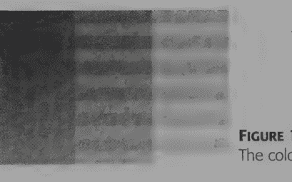

图 11-1

颜色立方体

当用户将鼠标移动到这张图片上时，四层颜色中的一层会变为鼠标所在位置的颜色。图 11–2 显示了这四层的外观。

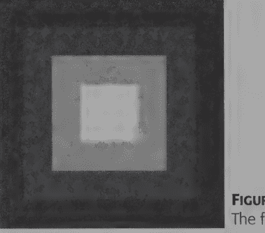

图 11-2

四层颜色

如果你们中有人曾担任过平面设计师，可能会认出这是向约瑟夫·阿尔伯斯的致敬。他画了很多嵌套的彩色方块，并撰写了《色彩互动学》，许多设计师至今仍在阅读。用户使用单选按钮选择四层颜色中要更改的哪一层，如图 11–3 所示。

正如你在这里看到的，这个页面非常简单。我们稍后会添加一些有趣的装饰，但现在我们坚持使用基本站点。其工作原理如下：

- 用户通过点击单选按钮选择一层。颜色 1 是顶部（最小）的层，颜色 4 是底部（最大）的层。
- 当用户将鼠标移动到颜色立方体上时，该层会根据用户鼠标所在位置的颜色改变颜色。这些层只是单个透明图片。这样我们就可以更改背景颜色并看到一切。
- 颜色的十六进制值显示在单选按钮旁边的文本框中。
- 如果用户点击颜色立方体中的某种颜色，则该层被锁定——无论怎样它都不会改变颜色。会显示一个 “LOCKED” 图层。要解锁一层，用户必须再次点击颜色立方体中的任意位置。

让我们先看看这个页面的 HTML。它相当长，大部分被用于颜色立方体的巨大图像映射所占据。你可以在 `www.wire-man.com/advjs` 下载此代码。为防万一你很疯狂或没有网络连接，我在示例 11-1 中包含了全部代码。

# 第11章 • 调色板人


```html
<html>
<head>
    <title>Palette Man</title>
    <style type="text/css">
        .copy {
            font-family: verdana, sans-serif;
            font-size: 12px;
        }

        #lockedupperLayer {
            z-index: 2;
            position: relative;
            visibility: hidden;
        }

        #lockeduppermidLayer {
            z-index: 2;
            position: relative;
            visibility: hidden;
        }

        #lockedlowermidLayer {
            z-index: 2;
            position: relative;
            visibility: hidden;
        }

        #lockedlowerLayer {
            z-index: 2;
            position: relative;
            visibility: hidden;
        }

        #lockedtext {
            z-index: 2;
            position: relative;
            visibility: hidden;
        }

        #lowerLayer {
            z-index: 2;
            position: absolute;
            top: 125px;
            left: 150px;
            width: 320px;
        }

        #lowermidLayer {
            z-index: 2;
            position: absolute;
            top: 165px;
            left: 190px;
            width: 240px;
        }

        #uppermidLayer {
            z-index: 3;
            position: absolute;
            top: 205px;
            left: 230px;
            width: 160px;
        }

        #upperLayer {
            z-index: 4;
            position: absolute;
            top: 245px;
            left: 270px;
            width: 80px;
        }

        #colorcube {
            z-index: 20;
            position: absolute;
            top: 150px;
            left: 500px;
        }
    </style>
</head>
<body bgcolor="#000000" link="#cccccc" vlink="#cccccc"
    alink="#ffffff" text="#cccccc">

    <div align="center">
        
    </div>

    <div id="lowerLayer">
        
    </div>

    <div id="lowermidLayer">
        
    </div>

    <div id="uppermidLayer">
        
    </div>

    <div id="upperLayer">
        
    </div>

    <div id="colorcube">
        
        <br><br>

        <form name="paletteForm">
            <table border="0">
                <tr>
                    <td colspan="4">
                        
                    </td>
                </tr>

                <tr>
                    <td class="copy">
                        <nobr>
                            <input type="radio" name="layerControl"
                                value="upperLayer" checked>
                            颜色 1
                        </nobr>
                    </td>
                    <td>
                        <input type="text" class="copy"
                            name="upperText" size="9">
                    </td>
                    <td>
                        <div id="lockedupperLayer" class="copy">
                            已锁定
                        </div>
                    </td>
                    <td></td>
                </tr>

                <tr>
                    <td class="copy">
                        <nobr>
                            <input type="radio" name="layerControl"
                                value="uppermidLayer">
                            颜色 2
                        </nobr>
                    </td>
                    <td>
                        <input type="text" class="copy"
                            name="uppermidText" size="9">
                    </td>
                    <td>
                        <div id="lockeduppermidLayer" class="copy">
                            已锁定
                        </div>
                    </td>
                </tr>

                <tr>
                    <td class="copy">
                        <nobr>
                            <input type="radio" name="layerControl"
                                value="lowermidLayer">
                            颜色 3
                        </nobr>
                    </td>
                    <td>
                        <input class="copy" type="text"
                            name="lowermidText" size="9">
                    </td>
                    <td>
                        <div id="lockedlowermidLayer" class="copy">
                            已锁定
                        </div>
                    </td>
                </tr>

                <tr>
                    <td class="copy">
                        <nobr>
                            <input type="radio" name="layerControl"
                                value="lowerLayer">
                            颜色 4
                        </nobr>
                    </td>
                    <td>
                        <input class="copy" type="text"
                            name="lowerText" size="9">
                    </td>
                    <td>
                        <div id="lockedlowerLayer" class="copy">
                            已锁定
                        </div>
                    </td>
                </tr>
            </table>
        </form>
    </div>

    <map name="cube">
        <area shape="rect" coords="0,0,9,9"
            href="javascript:lockLayer()"
            onMouseOver="shiftColor('#000000')">
        <area shape="rect" coords="10,0,19,9"
            href="javascript:lockLayer()"
            onMouseOver="shiftColor('#000033')">
        <area shape="rect" coords="20,0,29,9"
            href="javascript:lockLayer()"
            onMouseOver="shiftColor('#000066')">
        <area shape="rect" coords="30,0,39,9"
            href="javascript:lockLayer()"
            onMouseOver="shiftColor('#000099')">
        <area shape="rect" coords="40,0,49,9"
            href="javascript:lockLayer()"
            onMouseOver="shiftColor('#0000CC')">
        <area shape="rect" coords="50,0,59,9"
            href="javascript:lockLayer()"
            onMouseOver="shiftColor('#0000FF')">
        <area shape="rect" coords="60,0,69,9"
            href="javascript:lockLayer()"
            onMouseOver="shiftColor('#006600')">
        <area shape="rect" coords="70,0,79,9"
            href="javascript:lockLayer()"
            onMouseOver="shiftColor('#006633')">
        <area shape="rect" coords="80,0,89,9"
            href="javascript:lockLayer()"
            onMouseOver="shiftColor('#006666')">
        <area shape="rect" coords="90,0,99,9"
            href="javascript:lockLayer()"
            onMouseOver="shiftColor('#006699')">
        <area shape="rect" coords="100,0,109,9"
            href="javascript:lockLayer()"
            onMouseOver="shiftColor('#0066CC')">
        <area shape="rect" coords="110,0,119,9"
            href="javascript:lockLayer()"
            onMouseOver="shiftColor('#0066FF')">
        <area shape="rect" coords="120,0,129,9"
            href="javascript:lockLayer()"
            onMouseOver="shiftColor('#00CC00')">
        <area shape="rect" coords="130,0,139,9"
            href="javascript:lockLayer()"
            onMouseOver="shiftColor('#00CC33')">
        <area shape="rect" coords="140,0,149,9"
            href="javascript:lockLayer()"
            onMouseOver="shiftColor('#00CC66')">
        <area shape="rect" coords="150,0,159,9"
            href="javascript:lockLayer()"
            onMouseOver="shiftColor('#00CC99')">
        <area shape="rect" coords="160,0,169,9"
            href="javascript:lockLayer()"
            onMouseOver="shiftColor('#00CCCC')">
        <area shape="rect" coords="170,0,179,9"
            href="javascript:lockLayer()"
            onMouseOver="shiftColor('#00CCFF')">

        <area shape="rect" coords="0,10,9,19"
            href="javascript:lockLayer()"
            onMouseOver="shiftColor('#003300')">
        <area shape="rect" coords="10,10,19,19"
            href="javascript:lockLayer()"
            onMouseOver="shiftColor('#003333')">
        <area shape="rect" coords="20,10,29,19"
            href="javascript:lockLayer()"
            onMouseOver="shiftColor('#003366')">
        <area shape="rect" coords="30,10,39,19"
            href="javascript:lockLayer()"
            onMouseOver="shiftColor('#003399')">
        <area shape="rect" coords="40,10,49,19"
            href="javascript:lockLayer()"
            onMouseOver="shiftColor('#0033CC')">
        <area shape="rect" coords="50,10,59,19"
            href="javascript:lockLayer()"
            onMouseOver="shiftColor('#0033FF')">
        <area shape="rect" coords="60,10,69,19"
            href="javascript:lockLayer()"
            onMouseOver="shiftColor('#009900')">
        <area shape="rect" coords="70,10,79,19"
            href="javascript:lockLayer()"
            onMouseOver="shiftColor('#009933')">
        <area shape="rect" coords="80,10,89,19"
            href="javascript:lockLayer()"
            onMouseOver="shiftColor('#009966')">
        <area shape="rect" coords="90,10,99,19"
            href="javascript:lockLayer()"
            onMouseOver="shiftColor('#009999')">
        <area shape="rect" coords="100,10,109,19"
            href="javascript:lockLayer()"
            onMouseOver="shiftColor('#0099CC')">
        <area shape="rect" coords="110,10,119,19"
            href="javascript:lockLayer()"
            onMouseOver="shiftColor('#0099FF')">
        <area shape="rect" coords="120,10,129,19"
            href="javascript:lockLayer()"
            onMouseOver="shiftColor('#00FF00')">
        <area shape="rect" coords="130,10,139,19"
            href="javascript:lockLayer()"
            onMouseOver="shiftColor('#00FF33')">
        <area shape="rect" coords="140,10,149,19"
            href="javascript:lockLayer()"
            onMouseOver="shiftColor('#00FF66')">
        <area shape="rect" coords="150,10,159,19"
            href="javascript:lockLayer()"
            onMouseOver="shiftColor('#00FF99')">
        <area shape="rect" coords="160,10,169,19"
            href="javascript:lockLayer()"
            onMouseOver="shiftColor('#00FFCC')">
        <area shape="rect" coords="170,10,179,19"
            href="javascript:lockLayer()"
            onMouseOver="shiftColor('#00FFFF')">

        <area shape="rect" coords="0,20,9,29"
            href="javascript:lockLayer()"
            onMouseOver="shiftColor('#330000')">
        <area shape="rect" coords="10,20,19,29"
            href="javascript:lockLayer()"
            onMouseOver="shiftColor('#330033')">
        <area shape="rect" coords="20,20,29,29"
            href="javascript:lockLayer()"
            onMouseOver="shiftColor('#330066')">
        <area shape="rect" coords="30,20,39,29"
            href="javascript:lockLayer()"
            onMouseOver="shiftColor('#330099')">
        <area shape="rect" coords="40,20,49,29"
            href="javascript:lockLayer()"
            onMouseOver="shiftColor('#3300CC')">
        <area shape="rect" coords="50,20,59,29"
            href="javascript:lockLayer()"
            onMouseOver="shiftColor('#3300FF')">
        <area shape="rect" coords="60,20,69,29"
            href="javascript:lockLayer()"
            onMouseOver="shiftColor('#336600')">
        <area shape="rect" coords="70,20,79,29"
            href="javascript:lockLayer()"
            onMouseOver="shiftColor('#336633')">
        <area shape="rect" coords="80,20,89,29"
            href="javascript:lockLayer()"
            onMouseOver="shiftColor('#336666')">
        <area shape="rect" coords="90,20,99,29"
            href="javascript:lockLayer()"
            onMouseOver="shiftColor('#336699')">
        <area shape="rect" coords="100,20,109,29"
            href="javascript:lockLayer()"
            onMouseOver="shiftColor('#3366CC')">
        <area shape="rect" coords="110,20,119,29"
            href="javascript:lockLayer()"
            onMouseOver="shiftColor('#3366FF')">
        <area shape="rect" coords="120,20,129,29"
            href="javascript:lockLayer()"
            onMouseOver="shiftColor('#33CC00')">
        <area shape="rect" coords="130,20,139,29"
            href="javascript:lockLayer()"
            onMouseOver="shiftColor('#33CC33')">
        <area shape="rect" coords="140,20,149,29"
            href="javascript:lockLayer()"
            onMouseOver="shiftColor('#33CC66')">
        <area shape="rect" coords="150,20,159,29"
            href="javascript:lockLayer()"
            onMouseOver="shiftColor('#33CC99')">
        <area shape="rect" coords="160,20,169,29"
            href="javascript:lockLayer()"
            onMouseOver="shiftColor('#33CCCC')">
        <area shape="rect" coords="170,20,179,29"
            href="javascript:lockLayer()"
            onMouseOver="shiftColor('#33CCFF')">
    </map>
</body>
</html>
```


### 调色板人组件

237

#### 示例 11-1 调色板人的 HTML（续）

```html
href="javascript:lockLayer()"
onMouseOver="shiftColor('#33CCCC')">
```

```html
<area shape="rect" coords="170,20,179,29"
href="javascript:lockLayer()"
onMouseOver="shiftColor('#33CCFF')">
```

```html
<area shape="rect" coords="0,30,9,39"
href="javascript:lockLayer()"
onMouseOver="shiftColor('#333300')">
```

```html
<area shape="rect" coords="10,30,19,39"
href="javascript:lockLayer()"
onMouseOver="shiftColor('#333333')">
```

```html
<area shape="rect" coords="20,30,29,39"
href="javascript:lockLayer()"
onMouseOver="shiftColor('#333366')">
```

```html
<area shape="rect" coords="30,30,39,39"
href="javascript:lockLayer()"
onMouseOver="shiftColor('#333399')">
```

```html
<area shape="rect" coords="40,30,49,39"
href="javascript:lockLayer()"
onMouseOver="shiftColor('#3333CC')">
```

```html
<area shape="rect" coords="50,30,59,39"
href="javascript:lockLayer()"
onMouseOver="shiftColor('#3333FF')">
```

```html
<area shape="rect" coords="60,30,69,39"
href="javascript:lockLayer()"
onMouseOver="shiftColor('#339900')">
```

```html
<area shape="rect" coords="70,30,79,39"
href="javascript:lockLayer()"
onMouseOver="shiftColor('#339933')">
```

```html
<area shape="rect" coords="80,30,89,39"
href="javascript:lockLayer()"
onMouseOver="shiftColor('#339966')">
```

```html
<area shape="rect" coords="90,30,99,39"
href="javascript:lockLayer()"
onMouseOver="shiftColor('#339999')">
```

```html
<area shape="rect" coords="100,30,109,39"
href="javascript:lockLayer()"
onMouseOver="shiftColor('#3399CC')">
```

```html
<area shape="rect" coords="110,30,119,39"
href="javascript:lockLayer()"
onMouseOver="shiftColor('#3399FF')">
```

```html
<area shape="rect" coords="120,30,129,39"
href="javascript:lockLayer()"
onMouseOver="shiftColor('#33FF00')">
```

```html
<area shape="rect" coords="130,30,139,39"
```

### 调色板人组件

243

#### 示例 11-1 调色板人的 HTML（续）

```html
href="javascript:lockLayer()"
onMouseOver="shiftColor('#33FF33')">
<area shape="rect" coords="140,30,149,39"
    href="javascript:lockLayer()"
    onMouseOver="shiftColor('#33FF66')">
<area shape="rect" coords="150,30,159,39"
    href="javascript:lockLayer()"
    onMouseOver="shiftColor('#33FF99')">
<area shape="rect" coords="160,30,169,39"
    href="javascript:lockLayer()"
    onMouseOver="shiftColor('#33FFCC')">
<area shape="rect" coords="170,30,179,39"
    href="javascript:lockLayer()"
    onMouseOver="shiftColor('#33FFFF')">
<area shape="rect" coords="0,40,9,49"
    href="javascript:lockLayer()"
    onMouseOver="shiftColor('#660000')">
<area shape="rect" coords="10,40,19,49"
    href="javascript:lockLayer()"
    onMouseOver="shiftColor('#660033')">
<area shape="rect" coords="20,40,29,49"
    href="javascript:lockLayer()"
    onMouseOver="shiftColor('#660066')">
<area shape="rect" coords="30,40,39,49"
    href="javascript:lockLayer()"
    onMouseOver="shiftColor('#660099')">
<area shape="rect" coords="40,40,49,49"
    href="javascript:lockLayer()"
    onMouseOver="shiftColor('#6600CC')">
<area shape="rect" coords="50,40,59,49"
    href="javascript:lockLayer()"
    onMouseOver="shiftColor('#6600FF')">
<area shape="rect" coords="60,40,69,49"
    href="javascript:lockLayer()"
    onMouseOver="shiftColor('#666600')">
<area shape="rect" coords="70,40,79,49"
    href="javascript:lockLayer()"
    onMouseOver="shiftColor('#666633')">
<area shape="rect" coords="80,40,89,49"
    href="javascript:lockLayer()"
    onMouseOver="shiftColor('#666666')">
<area shape="rect" coords="90,40,99,49"
    href="javascript:lockLayer()"
    onMouseOver="shiftColor('#666699')">
<area shape="rect" coords="100,40,109,49"
```

### 第 11 章 • 调色板人

#### 清单 11-1 调色板人的 HTML（续）

```html
href="javascript:lockLayer()"
onMouseOver="shiftColor('#6666CC')">
<area shape="rect" coords="110,40,119,49"
     href="javascript:lockLayer()"
     onMouseOver="shiftColor('#6666FF')">
<area shape="rect" coords="120,40,129,49"
     href="javascript:lockLayer()"
     onMouseOver="shiftColor('#66CC00')">
<area shape="rect" coords="130,40,139,49"
     href="javascript:lockLayer()"
     onMouseOver="shiftColor('#66CC33')">
<area shape="rect" coords="140,40,149,49"
     href="javascript:lockLayer()"
     onMouseOver="shiftColor('#66CC66')">
<area shape="rect" coords="150,40,159,49"
     href="javascript:lockLayer()"
     onMouseOver="shiftColor('#66CC99')">
<area shape="rect" coords="160,40,169,49"
     href="javascript:lockLayer()"
     onMouseOver="shiftColor('#66CCCC')">
<area shape="rect" coords="170,40,179,49"
     href="javascript:lockLayer()"
     onMouseOver="shiftColor('#66CCFF')">
<area shape="rect" coords="0,50,9,59"
     href="javascript:lockLayer()"
     onMouseOver="shiftColor('#663300')">
<area shape="rect" coords="10,50,19,59"
     href="javascript:lockLayer()"
     onMouseOver="shiftColor('#663333')">
<area shape="rect" coords="20,50,29,59"
     href="javascript:lockLayer()"
     onMouseOver="shiftColor('#663366')">
<area shape="rect" coords="30,50,39,59"
     href="javascript:lockLayer()"
     onMouseOver="shiftColor('#663399')">
<area shape="rect" coords="40,50,49,59"
     href="javascript:lockLayer()"
     onMouseOver="shiftColor('#6633CC')">
<area shape="rect" coords="50,50,59,59"
     href="javascript:lockLayer()"
     onMouseOver="shiftColor('#6633FF')">
<area shape="rect" coords="60,50,69,59"
     href="javascript:lockLayer()"
     onMouseOver="shiftColor('#669900')">
<area shape="rect" coords="70,50,79,59"
```

#### 示例 11-1：调色板人的 HTML（续）

```html
href="javascript:lockLayer()"
onMouseOver="shiftColor('#669933')">
<area shape="rect" coords="80,50,89,59"
href="javascript:lockLayer()"
onMouseOver="shiftColor('#669966')">
<area shape="rect" coords="90,50,99,59"
href="javascript:lockLayer()"
onMouseOver="shiftColor('#669999')">
<area shape="rect" coords="100,50,109,59"
href="javascript:lockLayer()"
onMouseOver="shiftColor('#6699CC')">
<area shape="rect" coords="110,50,119,59"
href="javascript:lockLayer()"
onMouseOver="shiftColor('#6699FF')">
<area shape="rect" coords="120,50,129,59"
href="javascript:lockLayer()"
onMouseOver="shiftColor('#66FF00')">
<area shape="rect" coords="130,50,139,59"
href="javascript:lockLayer()"
onMouseOver="shiftColor('#66FF33')">
<area shape="rect" coords="140,50,149,59"
href="javascript:lockLayer()"
onMouseOver="shiftColor('#66FF66')">
<area shape="rect" coords="150,50,159,59"
href="javascript:lockLayer()"
onMouseOver="shiftColor('#66FF99')">
<area shape="rect" coords="160,50,169,59"
href="javascript:lockLayer()"
onMouseOver="shiftColor('#66FFCC')">
<area shape="rect" coords="170,50,179,59"
href="javascript:lockLayer()"
onMouseOver="shiftColor('#66FFFF')">
<area shape="rect" coords="0,60,9,69"
href="javascript:lockLayer()"
onMouseOver="shiftColor('#990000')">
<area shape="rect" coords="10,60,19,69"
href="javascript:lockLayer()"
onMouseOver="shiftColor('#990033')">
<area shape="rect" coords="20,60,29,69"
href="javascript:lockLayer()"
onMouseOver="shiftColor('#990066')">
<area shape="rect" coords="30,60,39,69"
href="javascript:lockLayer()"
onMouseOver="shiftColor('#990099')">
<area shape="rect" coords="40,60,49,69"
```

### 第 11 章 • 调色板人


```html
href="javascript:lockLayer()"
onMouseOver="shiftColor('#9900CC')">
<area shape="rect" coords="50,60,59,69"
    href="javascript:lockLayer()"
    onMouseOver="shiftColor('#9900FF')">
<area shape="rect" coords="60,60,69,69"
    href="javascript:lockLayer()"
    onMouseOver="shiftColor('#996600')">
<area shape="rect" coords="70,60,79,69"
    href="javascript:lockLayer()"
    onMouseOver="shiftColor('#996633')">
<area shape="rect" coords="80,60,89,69"
    href="javascript:lockLayer()"
    onMouseOver="shiftColor('#996666')">
<area shape="rect" coords="90,60,99,69"
    href="javascript:lockLayer()"
    onMouseOver="shiftColor('#996699')">
<area shape="rect" coords="100,60,109,69"
    href="javascript:lockLayer()"
    onMouseOver="shiftColor('#9966CC')">
<area shape="rect" coords="110,60,119,69"
    href="javascript:lockLayer()"
    onMouseOver="shiftColor('#9966FF')">
<area shape="rect" coords="120,60,129,69"
    href="javascript:lockLayer()"
    onMouseOver="shiftColor('#99CC00')">
<area shape="rect" coords="130,60,139,69"
    href="javascript:lockLayer()"
    onMouseOver="shiftColor('#99CC33')">
<area shape="rect" coords="140,60,149,69"
    href="javascript:lockLayer()"
    onMouseOver="shiftColor('#99CC66')">
<area shape="rect" coords="150,60,159,69"
    href="javascript:lockLayer()"
    onMouseOver="shiftColor('#99CC99')">
<area shape="rect" coords="160,60,169,69"
    href="javascript:lockLayer()"
    onMouseOver="shiftColor('#99CCCC')">
<area shape="rect" coords="170,60,179,69"
    href="javascript:lockLayer()"
    onMouseOver="shiftColor('#99CCFF')">
<area shape="rect" coords="0,70,9,79"
    href="javascript:lockLayer()"
    onMouseOver="shiftColor('#993300')">
<area shape="rect" coords="10,70,19,79"
```

## 第 11 章 • 调色板小人

### 示例 11-1 调色板小人的 HTML 代码（续）


```
href="javascript:lockLayer()"
    onMouseOver="shiftColor('#993333')">
<area shape="rect" coords="20,70,29,79"
    href="javascript:lockLayer()"
    onMouseOver="shiftColor('#993366')">
<area shape="rect" coords="30,70,39,79"
    href="javascript:lockLayer()"
    onMouseOver="shiftColor('#993399')">
<area shape="rect" coords="40,70,49,79"
    href="javascript:lockLayer()"
    onMouseOver="shiftColor('#9933CC')">
<area shape="rect" coords="50,70,59,79"
    href="javascript:lockLayer()"
    onMouseOver="shiftColor('#9933FF')">
<area shape="rect" coords="60,70,69,79"
    href="javascript:lockLayer()"
    onMouseOver="shiftColor('#999900')">
<area shape="rect" coords="70,70,79,79"
    href="javascript:lockLayer()"
    onMouseOver="shiftColor('#999933')">
<area shape="rect" coords="80,70,89,79"
    href="javascript:lockLayer()"
    onMouseOver="shiftColor('#999966')">
<area shape="rect" coords="90,70,99,79"
    href="javascript:lockLayer()"
    onMouseOver="shiftColor('#999999')">
<area shape="rect" coords="100,70,109,79"
    href="javascript:lockLayer()"
    onMouseOver="shiftColor('#9999CC')">
<area shape="rect" coords="110,70,119,79"
    href="javascript:lockLayer()"
    onMouseOver="shiftColor('#9999FF')">
<area shape="rect" coords="120,70,129,79"
    href="javascript:lockLayer()"
    onMouseOver="shiftColor('#99FF00')">
<area shape="rect" coords="130,70,139,79"
    href="javascript:lockLayer()"
    onMouseOver="shiftColor('#99FF33')">
<area shape="rect" coords="140,70,149,79"
    href="javascript:lockLayer()"
    onMouseOver="shiftColor('#99FF66')">
<area shape="rect" coords="150,70,159,79"
    href="javascript:lockLayer()"
    onMouseOver="shiftColor('#99FF99')">
<area shape="rect" coords="160,70,169,79"
    href="javascript:lockLayer()"
    onMouseOver="shiftColor('#99FFCC')">
<area shape="rect" coords="170,70,179,79"
    href="javascript:lockLayer()"
    onMouseOver="shiftColor('#99FFFF')">
<area shape="rect" coords="0,80,9,89"
    href="javascript:lockLayer()"
    onMouseOver="shiftColor('#CC0000')">
<area shape="rect" coords="10,80,19,89"
    href="javascript:lockLayer()"
    onMouseOver="shiftColor('#CC0033')">
<area shape="rect" coords="20,80,29,89"
    href="javascript:lockLayer()"
    onMouseOver="shiftColor('#CC0066')">
<area shape="rect" coords="30,80,39,89"
    href="javascript:lockLayer()"
    onMouseOver="shiftColor('#CC0099')">
<area shape="rect" coords="40,80,49,89"
    href="javascript:lockLayer()"
    onMouseOver="shiftColor('#CC00CC')">
<area shape="rect" coords="50,80,59,89"
    href="javascript:lockLayer()"
    onMouseOver="shiftColor('#CC00FF')">
<area shape="rect" coords="60,80,69,89"
    href="javascript:lockLayer()"
    onMouseOver="shiftColor('#CC6600')">
<area shape="rect" coords="70,80,79,89"
    href="javascript:lockLayer()"
    onMouseOver="shiftColor('#CC6633')">
<area shape="rect" coords="80,80,89,89"
    href="javascript:lockLayer()"
    onMouseOver="shiftColor('#CC6666')">
<area shape="rect" coords="90,80,99,89"
    href="javascript:lockLayer()"
    onMouseOver="shiftColor('#CC6699')">
<area shape="rect" coords="100,80,109,89"
    href="javascript:lockLayer()"
    onMouseOver="shiftColor('#CC66CC')">
<area shape="rect" coords="110,80,119,89"
    href="javascript:lockLayer()"
    onMouseOver="shiftColor('#CC66FF')">
<area shape="rect" coords="120,80,129,89"
    href="javascript:lockLayer()"
    onMouseOver="shiftColor('#CCCC00')">
<area shape="rect" coords="130,80,139,89"
    href="javascript:lockLayer()"
    onMouseOver="shiftColor('#CCCC33')">
<area shape="rect" coords="140,80,149,89"
    href="javascript:lockLayer()"
    onMouseOver="shiftColor('#CCCC66')">
<area shape="rect" coords="150,80,159,89"
    href="javascript:lockLayer()"
    onMouseOver="shiftColor('#CCCC99')">
<area shape="rect" coords="160,80,169,89"
    href="javascript:lockLayer()"
    onMouseOver="shiftColor('#CCCCCC')">
<area shape="rect" coords="170,80,179,89"
    href="javascript:lockLayer()"
    onMouseOver="shiftColor('#CCCCFF')">
<area shape="rect" coords="0,90,9,99"
    href="javascript:lockLayer()"
    onMouseOver="shiftColor('#CC3300')">
<area shape="rect" coords="10,90,19,99"
    href="javascript:lockLayer()"
    onMouseOver="shiftColor('#CC3333')">
<area shape="rect" coords="20,90,29,99"
    href="javascript:lockLayer()"
    onMouseOver="shiftColor('#CC3366')">
<area shape="rect" coords="30,90,39,99"
    href="javascript:lockLayer()"
    onMouseOver="shiftColor('#CC3399')">
<area shape="rect" coords="40,90,49,99"
    href="javascript:lockLayer()"
    onMouseOver="shiftColor('#CC33CC')">
<area shape="rect" coords="50,90,59,99"
    href="javascript:lockLayer()"
    onMouseOver="shiftColor('#CC33FF')">
<area shape="rect" coords="60,90,69,99"
    href="javascript:lockLayer()"
    onMouseOver="shiftColor('#CC9900')">
<area shape="rect" coords="70,90,79,99"
    href="javascript:lockLayer()"
    onMouseOver="shiftColor('#CC9933')">
<area shape="rect" coords="80,90,89,99"
    href="javascript:lockLayer()"
    onMouseOver="shiftColor('#CC9966')">
<area shape="rect" coords="90,90,99,99"
    href="javascript:lockLayer()"
    onMouseOver="shiftColor('#CC9999')">
<area shape="rect" coords="100,90,109,99"
    href="javascript:lockLayer()"
    onMouseOver="shiftColor('#CC99CC')">
<area shape="rect" coords="110,90,119,99"
    href="javascript:lockLayer()"
    onMouseOver="shiftColor('#CC99FF')">
<area shape="rect" coords="120,90,129,99"
    href="javascript:lockLayer()"
    onMouseOver="shiftColor('#CCFF00')">
<area shape="rect" coords="130,90,139,99"
    href="javascript:lockLayer()"
    onMouseOver="shiftColor('#CCFF33')">
<area shape="rect" coords="140,90,149,99"
    href="javascript:lockLayer()"
    onMouseOver="shiftColor('#CCFF66')">
<area shape="rect" coords="150,90,159,99"
    href="javascript:lockLayer()"
    onMouseOver="shiftColor('#CCFF99')">
<area shape="rect" coords="160,90,169,99"
    href="javascript:lockLayer()"
    onMouseOver="shiftColor('#CCFFCC')">
<area shape="rect" coords="170,90,179,99"
    href="javascript:lockLayer()"
    onMouseOver="shiftColor('#CCFFFF')">
<area shape="rect" coords="0,100,9,109"
    href="javascript:lockLayer()"
    onMouseOver="shiftColor('#FF0000')">
<area shape="rect" coords="10,100,19,109"
    href="javascript:lockLayer()"
    onMouseOver="shiftColor('#FF0033')">
<area shape="rect" coords="20,100,29,109"
    href="javascript:lockLayer()"
    onMouseOver="shiftColor('#FF0066')">
<area shape="rect" coords="30,100,39,109"
    href="javascript:lockLayer()"
    onMouseOver="shiftColor('#FF0099')">
<area shape="rect" coords="40,100,49,109"
    href="javascript:lockLayer()"
    onMouseOver="shiftColor('#FF00CC')">
<area shape="rect" coords="50,100,59,109"
    href="javascript:lockLayer()"
    onMouseOver="shiftColor('#FF00FF')">
<area shape="rect" coords="60,100,69,109"
    href="javascript:lockLayer()"
    onMouseOver="shiftColor('#FF6600')">
<area shape="rect" coords="70,100,79,109"
    href="javascript:lockLayer()"
    onMouseOver="shiftColor('#FF6633')">
<area shape="rect" coords="80,100,89,109"
    href="javascript:lockLayer()"
    onMouseOver="shiftColor('#FF6666')">
<area shape="rect" coords="90,100,99,109"
    href="javascript:lockLayer()"
    onMouseOver="shiftColor('#FF6699')">
<area shape="rect" coords="100,100,109,109"
    href="javascript:lockLayer()"
    onMouseOver="shiftColor('#FF66CC')">
<area shape="rect" coords="110,100,119,109"
    href="javascript:lockLayer()"
    onMouseOver="shiftColor('#FF66FF')">
<area shape="rect" coords="120,100,129,109"
    href="javascript:lockLayer()"
    onMouseOver="shiftColor('#FF9900')">
<area shape="rect" coords="130,100,139,109"
    href="javascript:lockLayer()"
    onMouseOver="shiftColor('#FF9933')">
<area shape="rect" coords="140,100,149,109"
    href="javascript:lockLayer()"
    onMouseOver="shiftColor('#FF9966')">
<area shape="rect" coords="150,100,159,109"
    href="javascript:lockLayer()"
    onMouseOver="shiftColor('#FF9999')">
<area shape="rect" coords="160,100,169,109"
    href="javascript:lockLayer()"
    onMouseOver="shiftColor('#FF99CC')">
<area shape="rect" coords="170,100,179,109"
    href="javascript:lockLayer()"
    onMouseOver="shiftColor('#FF99FF')">
<area shape="rect" coords="0,110,9,119"
    href="javascript:lockLayer()"
    onMouseOver="shiftColor('#FFCC00')">
<area shape="rect" coords="10,110,19,119"
    href="javascript:lockLayer()"
    onMouseOver="shiftColor('#FFCC33')">
<area shape="rect" coords="20,110,29,119"
    href="javascript:lockLayer()"
    onMouseOver="shiftColor('#FFCC66')">
<area shape="rect" coords="30,110,39,119"
    href="javascript:lockLayer()"
    onMouseOver="shiftColor('#FFCC99')">
<area shape="rect" coords="40,110,49,119"
    href="javascript:lockLayer()"
    onMouseOver="shiftColor('#FFCCCC')">
<area shape="rect" coords="50,110,59,119"
    href="javascript:lockLayer()"
    onMouseOver="shiftColor('#FFCCFF')">
<area shape="rect" coords="60,110,69,119"
    href="javascript:lockLayer()"
    onMouseOver="shiftColor('#FFFF00')">
<area shape="rect" coords="70,110,79,119"
    href="javascript:lockLayer()"
    onMouseOver="shiftColor('#FFFF33')">
<area shape="rect" coords="80,110,89,119"
    href="javascript:lockLayer()"
    onMouseOver="shiftColor('#FFFF66')">
<area shape="rect" coords="90,110,99,119"
    href="javascript:lockLayer()"
    onMouseOver="shiftColor('#FFFF99')">
<area shape="rect" coords="100,110,109,119"
    href="javascript:lockLayer()"
    onMouseOver="shiftColor('#FFFFCC')">
<area shape="rect" coords="110,110,119,119"
    href="javascript:lockLayer()"
    onMouseOver="shiftColor('#FFFFFF')">
```


# Palette Man 组件

251

### 代码清单 11-1 Palette Man 的 HTML 代码（续）

```html
href="javascript:lockLayer()"
    onMouseOver="shiftColor('#FF6633')">
<area shape="rect" coords="80,100,89,109"
    href="javascript:lockLayer()"
    onMouseOver="shiftColor('#FF6666')">
<area shape="rect" coords="90,100,99,109"
    href="javascript:lockLayer()"
    onMouseOver="shiftColor('#FF6699')">
<area shape="rect" coords="100,100,109,109"
    href="javascript:lockLayer()"
    onMouseOver="shiftColor('#FF66CC')">
<area shape="rect" coords="110,100,119,109"
    href="javascript:lockLayer()"
    onMouseOver="shiftColor('#FF66FF')">
<area shape="rect" coords="120,100,129,109"
    href="javascript:lockLayer()"
    onMouseOver="shiftColor('#FFCC00')">
<area shape="rect" coords="130,100,139,109"
    href="javascript:lockLayer()"
    onMouseOver="shiftColor('#FFCC33')">
<area shape="rect" coords="140,100,149,109"
    href="javascript:lockLayer()"
    onMouseOver="shiftColor('#FFCC66')">
<area shape="rect" coords="150,100,159,109"
    href="javascript:lockLayer()"
    onMouseOver="shiftColor('#FFCC99')">
<area shape="rect" coords="160,100,169,109"
    href="javascript:lockLayer()"
    onMouseOver="shiftColor('#FFCCCC')">
<area shape="rect" coords="170,100,179,109"
    href="javascript:lockLayer()"
    onMouseOver="shiftColor('#FFCCFF')">
<area shape="rect" coords="0,110,9,119"
    href="javascript:lockLayer()"
    onMouseOver="shiftColor('#FF3300')">
<area shape="rect" coords="10,110,19,119"
    href="javascript:lockLayer()"
    onMouseOver="shiftColor('#FF3333')">
<area shape="rect" coords="20,110,29,119"
    href="javascript:lockLayer()"
    onMouseOver="shiftColor('#FF3366')">
<area shape="rect" coords="30,110,39,119"
    href="javascript:lockLayer()"
    onMouseOver="shiftColor('#FF3399')">
<area shape="rect" coords="40,110,49,119"
```

252 第 11 章 • Palette Man

#### 示例 11-1 Palette Man 的 HTML 代码（续）

```html
href="javascript:lockLayer()"
    onMouseOver="shiftColor('#FF33CC')">
<area shape="rect" coords="50,110,59,119"
    href="javascript:lockLayer()"
    onMouseOver="shiftColor('#FF33FF')">
<area shape="rect" coords="60,110,69,119"
    href="javascript:lockLayer()"
    onMouseOver="shiftColor('#FF9900')">
<area shape="rect" coords="70,110,79,119"
    href="javascript:lockLayer()"
    onMouseOver="shiftColor('#FF9933')">
<area shape="rect" coords="80,110,89,119"
    href="javascript:lockLayer()"
    onMouseOver="shiftColor('#FF9966')">
<area shape="rect" coords="90,110,99,119"
    href="javascript:lockLayer()"
    onMouseOver="shiftColor('#FF9999')">
<area shape="rect" coords="100,110,109,119"
    href="javascript:lockLayer()"
    onMouseOver="shiftColor('#FF99CC')">
<area shape="rect" coords="110,110,119,119"
    href="javascript:lockLayer()"
    onMouseOver="shiftColor('#FF99FF')">
<area shape="rect" coords="120,110,129,119"
    href="javascript:lockLayer()"
    onMouseOver="shiftColor('#FFFF00')">
<area shape="rect" coords="130,110,139,119"
    href="javascript:lockLayer()"
    onMouseOver="shiftColor('#FFFF33')">
<area shape="rect" coords="140,110,149,119"
    href="javascript:lockLayer()"
    onMouseOver="shiftColor('#FFFF66')">
<area shape="rect" coords="150,110,159,119"
    href="javascript:lockLayer()"
    onMouseOver="shiftColor('#FFFF99')">
<area shape="rect" coords="160,110,169,119"
    href="javascript:lockLayer()"
    onMouseOver="shiftColor('#FFFFCC')">
<area shape="rect" coords="170,110,179,119"
    href="javascript:lockLayer()"
    onMouseOver="shiftColor('#FFFFFF')">
</map>

</body>
</html>
```

呼！你还跟得上吗？很好！我们来回顾一下其中的一些部分。首先，是承载颜色的四个图层：

- `upperLayer`
- `uppermidLayer`
- `lowermidLayer`
- `lowerLayer`

页面的控制中心位于名为`colorcube`的图层中。这个图层包含带有 Web 安全色的图像以及所有的表单字段。它还包含四个小的嵌套图层，其中包含“LOCKED”文字：

- `lockedupperLayer`
- `lockeduppermidLayer`
- `lockedlowermidLayer`
- `lockedlowerLayer`

这一轮就这些了，除了单个的页头图像，它没有被放置在图层中。我们最终会向这个页面添加更多内容。

### 添加功能

现在我们来看一些 JavaScript 代码。我们将从查看程序 11-2 中的`shiftColor`函数开始，它获取用户鼠标悬停的颜色，并将其转换为相应图层的背景色。最终发现这个函数需要另一个函数：`getCurrentLayer`用于查看哪个图层是“活动的”，即当前哪个单选按钮被选中。

当然，这里有一些全局变量的设置：我们创建一个数组来记录哪些图层被锁定了（颜色不会改变），以及一些基本的浏览器检测代码。

```javascript
locked = new Array()
locked["upperLayer"] = false
locked["uppermidLayer"] = false
locked["lowermidLayer"] = false
locked["lowerLayer"] = false

// browser test
```

第 11 章 • Palette Man

#### 程序 11-1 切换颜色（续）

```javascript
browser = navigator.appName;
browserNum = parseInt(navigator.appVersion);
NN4 = false

if (browser == "Netscape")
{
    if(browserNum < 5)
    {
        idRef = "document.layers["
        endIdRef = "]."
        formRef = "colorcube.document."
        bgColorRef = "bgColor"
        NN4 = true
    }
    else
    {
        idRef = "document.getElementById("
        endIdRef = ")."
        bgColorRef = "style.backgroundColor"
        formRef = ""
    }
}
else
{
    idRef = "document.all["
    endIdRef = "]."
    formRef = ""
    bgColorRef = "style.backgroundColor"
}

function getCurrentLayer()
{
    formObj = eval("document." + formRef +
    "paletteForm")
    radioObj = formObj.layerControl
    for(i=0; i<radioObj.length; i++)
    {
        if(radioObj[i].checked)
        {
            currentLayer = radioObj[i].value
            return currentLayer
        }
    }
}
```

```javascript
function shiftColor(hexvalue)
{
    currentLayer = getCurrentLayer()
    if(!locked[currentLayer])
    {
        // change bgcolor
        eval(idRef + "\"" + currentLayer + "\"" + endIdRef + bgColorRef + " = hexvalue")

        // show hex color in form field
        textField = currentLayer.replace("Layer","Text")
        eval("document." + formRef + "paletteForm." + textField + ".value = hexvalue")
    }
}
```

### ◆ 代码工作原理

1. 我们用一个数组来开始全局变量的设置，这个数组用来记住哪些图层被锁定了。我们没有在数组中使用数字索引，而是使用了字符串——这被称为关联数组。它不像普通数组那么常见，但当你确实需要它时，它非常有用。
2. 我们还需要找出用户使用的是哪种浏览器，因为我们将引用图层、表单等等，而不同的浏览器对它们的处理方式不同。
3. 我们在这里添加了一个新变量：`NN4`。它的值是 true 或 false，用于告诉代码用户是否在使用 Netscape 4。即使我们有所有的浏览器检测和变量设置，结果发现我们仍然需要`NN4`。
4. 对于 Netscape 4，我们使用`document.layers`来引用图层，这与前面的章节不同。只是这种方式最终更简单。另外请注意，用于更改背景颜色的属性名为`bgColor`。
5. 对于 Netscape 6，我们使用`getElementById`，背景颜色使用`style.backgroundColor`来设置。
6. 对于 IE，我们使用`document.all`。除此之外，这看起来和 Netscape 6 一样。
7. 一旦这个页面完成，有几个函数需要知道当前是哪个图层。当前选中的是哪个单选按钮？作为提醒，下面是顶部单选按钮的 HTML 代码：
8. 我们创建一个对象来包含表单对象，这使代码更具可读性。
9. 我们也可以创建一个对象来包含单选按钮的集合。如果你愿意，这一行和上一行可以合并。我通常将它们分开（长行代码很容易让我困惑）。
10. 然后我们开始遍历所有单选按钮的循环。我们的计划是查看哪个按钮被选中，并返回该选中单选按钮的值。
11. 我们查看相关的单选按钮是否被选中。
12. 如果按钮被选中，那么我们读取该单选按钮的值并赋给`currentLayer`变量。
13. 最后，我们将`currentLayer`返回给调用它的任何函数。
14. 这个函数用于更改调色板的颜色。请注意，唯一传递的值是一个颜色。
15. 我们要做的第一件事是找出哪个图层应该接收颜色更改。我们通过调用`getCurrentLayer`函数并将其赋值给一个名为`currentLayer`的变量来实现这一点。
16. 我们只会在图层未被锁定的情况下更改颜色，所以我们必须确保情况如此。你可以在这里看到为什么我们使用关联数组来记住哪些图层被锁定，哪些没有被锁定。
17. 如果图层没有被锁定，那么我们继续更改背景颜色。这一行非常直接。请注意，我们在颜色值中包含了“#”，例如`onMouseOver="shiftColor('#FFFFCC')"`。
18. 一旦我们更改了图层的颜色，我们就开始将该颜色放入文本字段。我们做的第一件事是指向：

```html
<input type="radio" name="layerControl"
  value="upperLayer" checked>
```

通过将`currentLayer`变量中的“Layer”替换为“Text”来转向文本字段。例如，“upper-Layer”会变成“upperText”。提醒一下，HTML 如下所示：

```html
<input type="text" class="copy" name="upperText" size="9">
```

19. 最后，我们更改文本字段的值。

更改图层颜色的部分就到此为止。现在让我们看看如何锁定图层，使其颜色无法更改。这涉及两个步骤：将图层标记为已锁定（或未锁定）以及让带有“LOCKED”标签的图层出现或消失。我们来看示例 11-3，这是实现此功能的代码。

```javascript
function lockLayer()
{
  currentLayer = getCurrentLayer()
  lockedLayerName = 'locked' + currentLayer;

  if (!locked[currentLayer])
  {
    if (NN4)
    {
      document.colorcube.document.layers[lockedLayerName].visibility = 'visible'
    }
    else
    {
      eval(idRef + "'" + lockedLayerName + "'" + endIdRef + "style.visibility = 'visible'")
    }
    locked[currentLayer] = true
  }
  else
  {
    if (NN4)
    {
      document.colorcube.document.layers[lockedLayerName].
    }
  }
}
```

```javascript
visibility = 'hidden'
}
else
{
  eval(idRef + "'" + lockedLayerName + "'"
  + endIdRef + "style.visibility =
  'hidden'")
}
⑨ locked[currentLayer] = false
}
}
```

#### 代码工作原理

1. 注意这个函数没有传递任何参数。这个函数唯一知道的是用户点击了颜色立方体中的某个位置。仅此而已——它必须自己弄清楚所有其他事情。


2. 可以预料到，这个函数首先要做的是找出哪个图层是当前活动的——也就是，哪个单选按钮被选中了？

3. 然后我们创建需要显示或隐藏的图层的名称。其中一个图层的 HTML 如下所示：

```
<td><div id="lockedupperLayer" class="copy" >
LOCKED</div></td>
```

4. 如果该图层当前未锁定，这意味着我们应该锁定它。这涉及两个步骤：显示已锁定的图层并设置`locked`数组。

5. 如果用户使用的是 Netscape 4，那么我们需要使用特殊的代码来访问该图层。我们本可以总是设置另一个`xxRef`变量来处理这种差异，但老实说，我不想这么做。这向你展示了处理这个问题的另一种方式。

6. 如果用户使用的是其他浏览器，这是使锁定图层出现在相应文本字段旁边的代码。

7. 无论使用什么浏览器，我们都必须将图层设置为正式锁定，这样就不会再发生颜色更改。

8. 如果该图层已经被锁定，那么我们执行相反的操作，针对 Netscape 4 和所有其他浏览器。

9. 最后，我们将`locked`数组设置为`false`，这样图层中的颜色现在就可以更改了。

这相当酷，但事实证明，当允许用户旋转颜色时，你可以获得一些令人惊讶的颜色信息。

### 旋转颜色

允许用户点击一个“旋转”链接，将颜色向外移动一层，可以增加一些有趣的互动性。所有颜色从较小的方块移动到较大的方块，底层的颜色变成顶层的颜色。实现这一点的 HTML 相当简单，我们可以在示例 11-4 中看到。只需在最后一个文本字段下面添加这个表格行。

```
Example 11-4 Rotate colors link
<tr>
    <td class="copy" colspan="3">
        <br><a href="#"
        onClick="javascript:rotateColors();
        return false">rotate colors</a>
    </td>
</tr>
```

我们如何让这个颜色旋转功能实际工作？首先，我们将所有当前颜色值读入一个数组。然后我们将再次循环遍历图层，将新颜色放入图层中。示例 11-5 向我们展示了如何操作。

```
Example 11-5 rotateColors()

function rotateColors()
{
    layerNames = new Array("upper","uppermid",
        "lowermid","lower")
    oldColors = new Array()

    // get current colors
    for(i=0; i<layerNames.length; i++)
    {
        oldColors[i] = eval("document." + formRef +
            "paletteForm." + layerNames[i] +
            "Text.value")
    }

    // change colors
    for(i=0; i<layerNames.length; i++)
    {
        newI = i+1
        if (newI==layerNames.length) newI = 0

        // change text field
        eval("document." + formRef + "paletteForm."
            + layerNames[newI] + "Text.value =
            oldColors[i]")

        // change background color
        eval(idRef + "'" + layerNames[newI] +
            "Layer'" + endIdRef + bgColorRef + " =
            oldColors[i]")
    }
}
```

#### 代码工作原理

1. 与`lockLayer`函数一样，注意此函数不接受任何参数。

2. 我们创建一个简单的数组，其中包含图层的名称。为了读取和更改颜色，我们将循环遍历这个数组。

3. 我们将使用`oldColors`数组来保存调色板中的当前颜色，然后将这些颜色读入它们的新图层。

4. 我们首先将当前颜色读入`oldColors`数组。这意味着开始循环遍历所有图层。

5. 我们从文本字段中读取颜色到`oldColors`数组，而不是直接从颜色本身读取。两种方式都可以。

6. 现在`oldColors`已经满了，是时候将这些值读入它们的新图层了。我们再次从循环遍历所有图层名称开始。

7. 我们在这里创建一个新的索引变量。我们需要它，因为我们要查看两个索引：颜色原来所在的位置和它需要去的位置。

8. 如果新索引刚增加到 4，那么我们将其带回 0。这使我们能够将最外层的颜色移回中心。

9. 现在开始实际操作：我们首先将文本字段更改为新值。

10. 最后，我们更改颜色本身！一定要自己试试这段代码：它在屏幕上的效果比听起来要壮观得多。

调色板人（Palette Man）的内容就到此为止。希望你觉得它有用！

# 12 分层菜单：介绍

### 本章内容

- HierMenus 的功能
- 数组

DHTML 最受欢迎且始终能让客户满意的用途之一就是弹出菜单。你的用户习惯于操作系统中点击主菜单项会展开任意数量的子菜单。能够很好模拟这种行为的网站通常受到用户赞赏，客户也非常喜欢它们。有许多弹出菜单脚本可以下载，甚至 Dreamweaver 也能生成一些可靠的弹出菜单代码。然而，目前最受欢迎的免费弹出菜单代码是 Peter Belesis 开发的 HierMenus。它健壮、灵活，并且对文本和图像都处理得很好。不过，它并非免费——在使用前必须付费。详情请见`hiermenuscentral.com`。在接下来的几章中，我们将极其详细地研究这段优秀的代码，这样你就能知道如何根据自己的需求更新这段代码。这段代码可以从`hiermenuscentral.com`下载。本书中，我将查看版本 4.1.3，这是撰写本文时可用的最新版本。

# 264 第 12 章 • 分层菜单：介绍

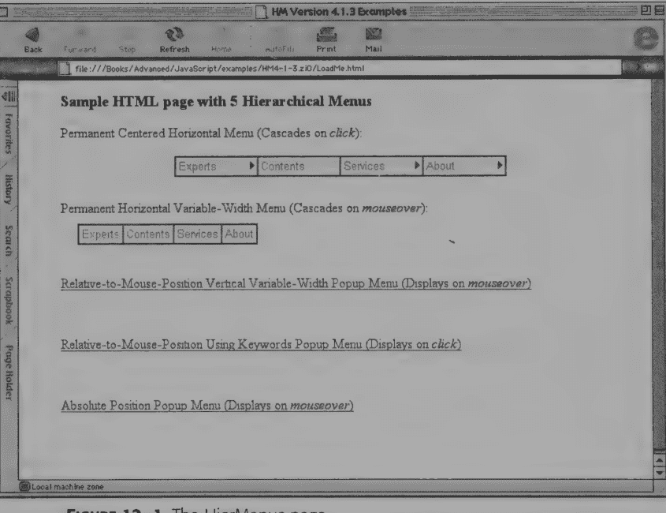

图 12–1 HierMenus 页面

### HierMenus 的功能

当你从`hiermenuscentral.com`下载 HierMenus 代码后，在浏览器中加载单个 HTML 页面会显示图 12–1。

这段代码的一个很酷的功能是创建一个菜单系统，然后从颜色、位置和行为方面对其进行五种不同的调整。我们将看看初始菜单系统是如何创建的，然后看看这个系统是如何被复制多次，并且每个副本是如何被单独调整的。

我强烈建议你访问`hiermenuscentral.com`来查看 HierMenus 的行为。

### 文件说明

你实际加载到浏览器中的 HTML 页面名为`LoadMe.html`，它包含一些 JavaScript。它设置了许多全局变量，名称如`HM_PG_MenuWidth`和`HM_PG_FontColor`。我们稍后会查看这些。

现在，让我们看看示例 12-1，它展示了这个网页的主体内容。

```
Example 12-1 Body of LoadMe.html
<HTML>
<HEAD>
<TITLE>HM Version 4.1.3 Examples</TITLE>
<SCRIPT LANGUAGE="JavaScript" TYPE="text/javascript">
<!--
1 if(window.event + "" == "undefined") event = null;
2 function HM_f_PopUp(){return false};
function HM_f_PopDown(){return false};
3 popUp = HM_f_PopUp;
popDown = HM_f_PopDown;
// -->
</SCRIPT>

<SCRIPT LANGUAGE="JavaScript1.2" TYPE="text/javascript">
<!--
4 HM_PG_MenuWidth = 150;
HM_PG_FontFamily = "Arial,sans-serif";
HM_PG_FontSize = 10;
HM_PG_FontBold = 0;
HM_PG_FontItalic = 0;
HM_PG_FontColor = "blue";
HM_PG_FontColorOver = "white";
HM_PG_BGColor = "#DDDDDD";
HM_PG_BGColorOver = "#FFCCCC";
HM_PG_ItemPadding = 3;

HM_PG_BorderWidth = 2;
HM_PG_BorderColor = "black";
HM_PG_BorderStyle = "solid";
HM_PG_SeparatorSize = 2;
HM_PG_SeparatorColor = "#d0ff00";

HM_PG_ImageSrc = "HM_More_black_right.gif";
```

### 266 第12章 • 层级菜单：简介

```
HM_PG_ImageSrcLeft = "HM_More_black_left.gif";
HM_PG_ImageSrcOver = "HM_More_white_right.gif";
HM_PG_ImageSrcLeftOver = "HM_More_white_left.gif";

HM_PG_ImageSize = 5;
HM_PG_ImageHorizSpace = 0;
HM_PG_ImageVertSpace = 2;

HM_PG_KeepHilite = true;
HM_PG_ClickStart = 0;
HM_PG_ClickKill = false;
HM_PG_ChildOverlap = 20;
HM_PG_ChildOffset = 10;
HM_PG_ChildPerCentOver = null;
HM_PG_TopSecondsVisible = .5;
HM_PG_StatusDisplayBuild = 0;
HM_PG_StatusDisplayLink = 0;
HM_PG_UponDisplay = null;
HM_PG_UponHide = null;
HM_PG_RightToLeft = 0;

HM_PG_CreateTopOnly = 0;
HM_PG_ShowLinkCursor = 1;
HM_PG_NSFontOver = true;

//HM_a_TreesToBuild = []

//-->
</SCRIPT>
```

```
</HEAD><BODY>
```

```
<BLOCKQUOTE>
<H3>包含5个层级菜单的示例HTML页面</H3>
<P>固定的居中水平菜单（点击时级联展开）：</P>
<BR><BR>
<P>固定的水平可变宽度菜单（鼠标悬停时级联展开）：</P>
<BR><BR>
<P><A HREF="aLinkForOldBrowsersGoesHere.html"
      onMouseOver="HM_f_PopUp('elMenu1',event)"
      onMouseOut="HM_f_PopDown('elMenu1')">
      相对于鼠标位置的垂直可变宽度弹出菜单（鼠标悬停时显示）</A></P>
```

#### 代码工作原理

1. 为使代码流畅运行，我们确保在页面加载初始时将事件变量设置为空。添加`""`会将变量更改为字符串。

2. 这里，我们创建了两个非常小的占位函数，除了返回一个`false`值外什么都不做。之所以在这里创建它们，是因为这些函数有可能在菜单准备显示之前被调用。也就是说，点击 HTML 链接会调用这些函数，但在菜单完全构建好之前，这些函数还无法执行任何操作。因此，我们创建这些空操作的虚拟函数，以防我们有一些性急的用户。

3. 为了加快速度，我们创建了两个变量作为`HM_f_PopUp`和`HM_f_PopDown`函数的快捷方式。你稍后会在 HTML 中看到，一些链接调用`HM_f_PopUp`，而另一些调用`popUp`。它们的功能是相同的。

### 268 第12章 • 层级菜单：简介

4. 这里，我们设置了一堆全局变量。注意所有这些变量都以“HM_PG.”开头。我们稍后会在本章中看到原因。所有这些变量都与菜单项的外观和行为方式有关。

5. 第一个菜单将出现在此文本下方。请注意，目前那里没有任何占位 HTML 标签。据我们所知，这里没有任何迹象表明菜单会出现在这里。最终会出现在这里的菜单（在页面继续加载时发生）将需要鼠标点击才能显示任何子菜单。

6. 这与第一行文本类似：菜单最终会在页面加载时出现在这里，但目前还没有。

7. 接下来的三个链接会根据用户是滚动到链接上方还是点击它来触发不同类型的菜单。我们稍后会更详细地查看代码。

8. 最后，我们加载重要的 JavaScript。`HM_Loader.js`文件包含了核心内容，以及指向我们将要使用的其他 JavaScript 文件的指针。

让我们深入研究 JavaScript。第一个真正的 JavaScript 文件是`HM_Loader.js`，所以我们来看一下示例 12–2。

```
/*HM_Loader.js
 * by Peter Belesis. v4.1.3 011108
 * Copyright (c) 2001 Peter Belesis. All Rights Reserved.
 */

HM_DOM = (document.getElementById) ? true : false;
HM_NS4 = (document.layers) ? true : false;
HM_IE = (document.all) ? true : false;
HM_IE4 = HM_IE && !HM_DOM;
HM_Mac = (navigator.appVersion.indexOf("Mac") != -1);
HM_IE4M = HM_IE4 && HM_Mac;
HM_Opera = (navigator.userAgent.indexOf("Opera")!=-1);
HM_Konqueror = 
    (navigator.userAgent.indexOf("Konqueror")!=-1);

HM_IsMenu = !HM_Opera && !HM_Konqueror && !HM_IE4M &&
    (HM_DOM || HM_NS4 || HM_IE4);
```

```
HM_BrowserString = HM_NS4 ? "NS4" : HM_DOM ?

    "DOM" : "IE4";

HM_f_PopUp(){return false};

function HM_f_PopDown(){return false};

popUp = HM_f_PopUp;

popDown = HM_f_PopDown;
```

```
HM_GL_MenuWidth = 150;
HM_GL_FontFamily = "Arial,sans-serif";
HM_GL_FontSize = 10;
HM_GL_FontBold = true;
HM_GL_FontItalic = false;
HM_GL_FontColor = "black";
HM_GL_FontColorOver = "white";
HM_GL_BGColor = "transparent";
HM_GL_BGColorOver = "transparent";
HM_GL_ItemPadding = 3;

HM_GL_BorderWidth = 2;
HM_GL_BorderColor = "red";
HM_GL_BorderStyle = "solid";
HM_GL_SeparatorSize = 2;
HM_GL_SeparatorColor = "yellow";

HM_GL_ImageSrc = "HM_More_black_right.gif";
HM_GL_ImageSrcLeft = "HM_More_black_left.gif";

HM_GL_ImageSrcOver = "HM_More_white_right.gif";
HM_GL_ImageSrcLeftOver = "HM_More_white_left.gif";

HM_GL_ImageSize = 5;
HM_GL_ImageHorizSpace = 5;
HM_GL_ImageVertSpace = 5;

HM_GL_KeepHilite = false;
HM_GL_ClickStart = false;
HM_GL_ClickKill = 0;
HM_GL_ChildOverlap = 40;
HM_GL_ChildOffset = 10;
HM_GL_ChildPerCentOver = null;
HM_GL_TopSecondsVisible = .5;
HM_GL_ChildSecondsVisible = .3;
HM_GL_StatusDisplayBuild = 0;
```

### 270 第12章 • 层级菜单：简介


```javascript
HM_GL_StatusDisplayLink = 1;
HM_GL_UponDisplay = null;
HM_GL_UponHide = null;

HM_GL_RightToLeft = false;
HM_GL_CreateTopOnly = HM_NS4 ? true : false;
HM_GL_ShowLinkCursor = true;

// 包含以下函数是为了说明
// 在4.0.9版本中引入的
// left_position 和 top_position 参数的
// 改进JS表达式处理
// 以及在4.1.3版本中为适应IE6标准
// 兼容模式所做的修改
// 如果你不需要可以删除它

function HM_f_CenterMenu(topmenuid)
{
    var MinimumPixelLeft = 0;
    var TheMenu = HM_DOM ?
        document.getElementById(topmenuid) : HM_IE4 ?
        document.all(topmenuid) : eval("window." +
        topmenuid);
    var TheMenuWidth = HM_DOM ?
        parseInt(TheMenu.style.width) : HM_IE4 ?
        TheMenu.style.pixelWidth : TheMenu.clip.width;
    var TheWindowWidth = HM_IE ? (HM_DOM ?
        HM_IEcanvas.clientWidth :
        document.body.clientWidth) : window.innerWidth;
    return Math.max(parseInt((TheWindowWidth-TheMenuWidth) /
        2),MinimumPixelLeft);
}

if(HM_IsMenu)
{
    document.write("<SCR" + "IPT
LANGUAGE='JavaScript1.2' SRC='HM_Arrays.js'
TYPE='text/javascript'>\</SCR" +
    "IPT>");
    document.write("<SCR" + "IPT
LANGUAGE='JavaScript1.2' SRC='HM_Script"+
HM_BrowserString +".js'
TYPE='text/javascript'>\</SCR" + "IPT>");
}

//end
```

# HIERMENUS 的作用

## 代码工作原理

1. 我们以一些高级浏览器检测开始本页。这种语法对你来说可能不熟悉，但它是`if`语句的便捷简写。我们本可以这样写：

   ```javascript
   if (document.getElementById)
   {
     HM_DOM = true
   }
   else
   {
     HM_DOM = false
   }
   ```

   通用语法如下：

   ```javascript
   variable = (condition) ? value if condition is true :
                        value if condition is false
   ```

   这种语法在整个代码中被广泛使用。我建议你研究它直到理解为止。这行特定的代码检查正在使用的浏览器是否完全符合 DOM 标准，比如 Netscape 6。

2. 如果浏览器识别`document.layers`，则可以安全地假定正在使用 Netscape 4。

3. 类似地，如果浏览器知道`document.all`是什么，我们可以假设正在使用 Internet Explorer。

4. 要判断是否在使用 Internet Explorer，我们需要知道`HM_IE`是否为`true`且`HM_DOM`不是`true`。因此，我们可以使用：

   ```javascript
   HM_IE && !HM_DOM
   ```

   这意味着`HM_IE4`为`true`当且仅当`HM_IE`为`true`且`HM_DOM`为`false`。

5. 我们检查是否在使用 Mac。同样，条件总是返回`true`或`false`值，所以`HM_Mac`总是`true`或`false`。

6. 我们需要知道是否在使用 Mac 上的 IE4。不幸的是，使用该浏览器的用户将无法获得任何菜单。Mac 上的 IE4 确实实现了一个版本的 DHTML，但如果你曾尝试为那个特定版本编码，你就知道这是不可能的。

7. 我们还检查是否在使用 Opera 浏览器……

8. 以及 Konqueror 浏览器。

9. 现在我们有了各种浏览器信息，是时候看看正在使用的浏览器是否能处理 HierMenus 使用的 DHTML 了。该浏览器不能是 Opera、Konqueror 或 Mac 上的 IE4。如果浏览器不是这些之一，并且是 Netscape 4、IE 4（非 Mac）或具有完整 DOM 兼容性的浏览器，那么`HM_IsMenu`为`true`。

10. 这行代码对你来说可能看起来有点奇怪。它是我们`if`语句的简写，但结合了另一个`if`语句简写。如果我们展开它，这行代码会是这样：

    ```javascript
    if (HM_NS4)
    {
        HM_BrowserString = "NS4"
    }
    else
    {
    if (HM_DOM)
    {
        HM_BrowserString = "DOM"
    }
    else
    {
        HM_BrowserString = "IE4"
    }
    }
    ```

11. 为了安全起见，我们将事件变量设置为`null`，确保没有旧值被带入。

12. 这是另一组全局变量，与我们在`LoadMe.html`中看到的非常相似。然而，有些值不同。注意变量名包含“GL”而不是“PG”。关于这个区别稍后再谈。

13. 这个`CenterMenu`函数在这个文件中，但它直到后面才会被调用。我们现在忽略这个函数。稍后在它实际执行时我们会看到它。

14. 接下来我们将在本程序中包含其余的 JavaScript 代码，前提是浏览器能够支持。

15. 无论使用哪种支持 DHTML 的浏览器，都会调用文件`HM_Array.js`。该文件创建包含实际菜单中所用所有信息的数组。我们接下来将查看这个文件及其包含的数组。

16. 下一个被调用的文件是以下三种之一：

    - `HM_ScriptDOM`
    - `HM_ScriptNS4`
    - `HM_ScriptIE4`

    本书中我们将要查看的文件是`HM_ScriptDOM`，因为大多数用户将访问此文件。

让我们深入探讨这些数组，看看它们的内容。

## 数组

示例 12–3 展示了`HM_Array.js`。

```javascript
示例 12-3 HM_Array.js
//相对鼠标位置的垂直可变宽度弹出式菜单
//（鼠标悬停时显示）
HM_Array1 = [
[150,,,,,,,,,,,,,,,,,1,true],
["专家","http://www.webreference.com/experts/",1,0,1],
["目录","http://www.webreference.com/index2.html",1,0,0],
["服务","http://www.webreference.com/index2.html",1,0,1],
["关于","http://www.webreference.com/about.html",1,0,0],
["热门站点","http://www.webreference.com/hot/",1,0,1]
]

HM_Array1_1 = [
[],
["3-D 动画","http://www.webreference.com/3d/",1,0,0],
["设计","http://www.webreference.com/dlab/",1,0,0],
["HTML","http://www.webreference.com/html/",1,0,0],
["JavaScript","http://www.webreference.com/js/",1,0,0],
["图形","http://www.webreference.com/graphics/",1,0,0],
```

### 第 12 章 • 层次菜单：简介

### 示例 12-2 HM_Array.js（续）

```javascript
["DHTML", "http://www.webreference.com/dhtml/", 1, 0, 1],
["Perl", "http://www.webreference.com/perl/", 1, 0, 0],
["XML", "http://www.webreference.com/xml/", 1, 0, 0]
]
```

```javascript
HM_Array1_3 = [
[],
["专题", "http://www.webreference.com/articles.html",
1, 0, 0],
["论坛", "http://www.webreference.com/
cgi-bin/Ultimate.cgi?action=intro", 1, 0, 0],
["技巧", "http://www.webreference.com/dev/", 1, 0, 0],
["最新", "http://www.webreference.com/headlines/", 1, 0, 0],
["热门站点", "http://www.webreference.com/hot/", 1, 0, 0]
]
```

```javascript
HM_Array1_5 = [
[],
["3-D 动画", "http://www.webreference.com/3d/", 1, 0, 0],
["设计", "http://www.webreference.com/dlab/", 1, 0, 0],
["HTML", "http://www.webreference.com/html/", 1, 0, 0],
["JavaScript", "http://www.webreference.com/js/", 1, 0, 0],
["图形", "http://www.webreference.com/graphics/", 1, 0, 0],
["DHTML", "http://www.webreference.com/dhtml/", 1, 0, 1],
["Perl", "http://www.webreference.com/perl/", 1, 0, 0],
["XML", "http://www.webreference.com/xml/", 1, 0, 0]
]
```

```javascript
HM_Array1_1_6 = [
[],
["Diner", "http://www.webreference.com/dhtml/diner/", 1, 0, 0],
["Dynomat", "http://www.webreference.com/dhtml/dynomat/",
1, 0, 0],
["链接", "http://www.webreference.com/dhtml/links/", 1, 0, 0]
]
```

```javascript
// 永久居中的水平菜单
HM_Array2 = [
[100,                   // 菜单宽度
"HM_f_CenterMenu('HM_Menu2')", // 左侧位置
90,                     // 顶部位置
"red",                  // 字体颜色
"yellow",               // 鼠标悬停时字体颜色
"yellow",               // 背景颜色
"black",                // 鼠标悬停时背景颜色
"blue",                 // 边框颜色
```

### 示例 12-1 HM_Array[]（续）

```javascript
"green",                // 分隔线颜色
1,                      // 顶部是否永久显示
1,                      // 顶部是否水平
0,                      // 树状结构是否水平
1,                      // 是否显示在下方
1,                      // 顶部更多图片是否可见
1,                      // 树状结构更多图片是否可见
"null",                 // 树状结构显示时执行的脚本
"null",                 // 树状结构隐藏时执行的脚本
,                       // 从右到左
1],                     // 点击时显示
["专家","http://www.webreference.com/experts/",1,0,1],
["目录","http://www.webreference.com/index2.html",
    1,0,0],
["服务","http://www.webreference.com/index2.html",
    1,0,1],
["关于","http://www.webreference.com/about.html",1,0,1]
]
```

```javascript
HM_Array2_1 = [
[],
["3-D 动画","http://www.webreference.com/3d/",1,0,0],
["设计","http://www.webreference.com/dlab/",1,0,0],
["HTML","http://www.webreference.com/html/",1,0,0],
["JavaScript","http://www.webreference.com/js/",1,0,0],
["图形","http://www.webreference.com/graphics/",1,0,0],
["DHTML","http://www.webreference.com/dhtml/",1,0,0],
["Perl","http://www.webreference.com/perl/",1,0,0],
["XML","http://www.webreference.com/xml/",1,0,0]
]
```

```javascript
HM_Array2_3 = [
[],
["专题","http://www.webreference.com/articles.html",
    1,0,0],
["论坛","http://www.webreference.com/cgi-bin/Ultimate.cgi?action=intro",1,0,0],
["技巧","http://www.webreference.com/dev/",1,0,0],
["最新","http://www.webreference.com/headlines/",1,0,0],
["热门站点","http://www.webreference.com/hot/",1,0,0]
]
```

```javascript
HM_Array2_4 = [
[],
["专题","http://www.webreference.com/articles.html",1,0,0],
```

### 第 12 章 • 层次菜单：简介

### 示例 12-1 HM_Array.js（续）

```javascript
['论坛', 'http://www.webreference.com/
     cgi-bin/Ultimate.cgi?action=intro', 1, 0, 0],
['技巧', 'http://www.webreference.com/dev/', 1, 0, 0],
['最新', 'http://www.webreference.com/headlines/', 1, 0, 0],
['热门站点', 'http://www.webreference.com/hot/', 1, 0, 0]
]
```

```javascript
HM_Array2_1_6 = [
[],
['Diner', 'http://www.webreference.com/dhtml/diner/',
     1, 0, 0],
['Dynomat', 'http://www.webreference.com/dhtml/dynomat/',
     1, 0, 0],
['链接', 'http://www.webreference.com/dhtml/links/', 1, 0, 0]
]
```


```
// 绝对定位弹出菜单
HM_Array3 = [
[120,        // 菜单宽度
200,          // 左侧位置
300,          // 顶部位置
'black',      // 字体颜色
'white',      // 鼠标悬停时字体颜色
'white',      // 背景颜色
'black',      // 鼠标悬停时背景颜色
'black',      // 边框颜色
'gray',       // 分隔线颜色
0,            // 顶部是否永久显示
0,            // 顶部是否水平
0,            // 树状结构是否水平
1,            // 是否显示在下方
1,            // 顶部更多图片是否可见
1,            // 树状结构更多图片是否可见
'null',       // 树状结构显示时执行的脚本
'null',       // 树状结构隐藏时执行的脚本
,             // 从右到左
],            // 点击时显示
['专家', 'http://www.webreference.com/experts/', 1, 0, 1],
['目录', 'http://www.webreference.com/index2.html',
     1, 0, 0],
['服务', 'http://www.webreference.com/index2.html',
     1, 0, 1],
['关于', 'http://www.webreference.com/about.html', 1, 0, 0]
]
```

### HM_Array3_1

```javascript
HM_Array3_1 = [
[],
["3-D 动画","http://www.webreference.com/3d/",1,0,0],
["设计","http://www.webreference.com/dlab/",1,0,0],
["HTML","http://www.webreference.com/html/",1,0,0],
["JavaScript","http://www.webreference.com/js/",1,0,0],
["图形","http://www.webreference.com/graphics/",1,0,0],
["DHTML","http://www.webreference.com/dhtml/",1,0,1],
["Perl","http://www.webreference.com/perl/",1,0,0],
["XML","http://www.webreference.com/xml/",1,0,0]
]
```

### HM_Array3_3

```javascript
HM_Array3_3 = [
[],
["专题","http://www.webreference.com/articles.html",
1,0,0],
["论坛","http://www.webreference.com/
cgi-bin/Ultimate.cgi?action=intro",1,0,0],
["技巧","http://www.webreference.com/dev/",1,0,0],
["最新","http://www.webreference.com/headlines/",1,0,0],
["热门站点","http://www.webreference.com/hot/",1,0,0]
]
```

### HM_Array3_1_6

```javascript
HM_Array3_1_6 = [
[],
["Diner","http://www.webreference.com/dhtml/diner/",1,0,0],
["Dynomat","http://www.webreference.com/dhtml/dynomat/",1,0,0],
["链接","http://www.webreference.com/dhtml/links/",1,0,0]
]
```

```javascript
// 使用关键字的相对鼠标位置弹出菜单
HM_Array4 = [
[120,
"mouse_x_position + 20",
"mouse_y_position + 20",
,,,,,,,,,,
true],
["专家","http://www.webreference.com/experts/",1,0,1],
["目录","http://www.webreference.com/index2.html",
1,0,0],
["服务","http://www.webreference.com/index2.html",
1,0,0],
["关于","http://www.webreference.com/about.html",1,0,0]
]
```

### 代码工作原理

1. 每个菜单在这里都有自己的数组。我们从`HM_Array1`开始，这是网页上第三个菜单。同样，这种语法你可能觉得陌生。你可能更习惯看到这样的写法：

```javascript
HM_Array1 = new Array( 一堆元素 )
```

你也可以用这种方式创建新数组：

```javascript
HM_Array1 = []
```

这就是这里发生的情况。

2. 我们`HM_Array1`的第一个元素是另一个数组。这个数组看起来可能不起眼：几个数字、一个布尔值和一堆逗号。这堆逗号表示我们的子数组有许多空元素。这个子数组包含了关于菜单外观的信息。以下是子数组中每个元素的含义（你也可以在`HM_Array2`的代码中看到）：

- 菜单宽度
- 菜单左边缘的位置
- 菜单上边缘的位置
- 文本颜色
- 鼠标悬停时的文本颜色
- 背景颜色
- 鼠标悬停时的背景颜色
- 菜单边框颜色
- 菜单项之间分隔线的颜色
- 上边缘是否处于永久位置？ (0/1)
- 主菜单项是否水平显示？
- 树是否沿水平方向展开？
- 子菜单是否直接出现在主菜单项下方？
- 如果主菜单项有子菜单，是否显示一个小箭头？
- 对于任何菜单项，如果该项包含子菜单，是否显示小箭头？
- 菜单出现时是否有需要运行的函数？
- 菜单消失时是否有需要运行的函数？
- 子菜单是否从右向左级联？大多数人习惯从左到右（在你的电脑上试试）。
- 子菜单是否在用户点击菜单项时显示？ (0/1)

3. 第二个子数组是我们的第一个真实菜单项。请注意这个数组有五个元素。以下是它们的含义：

- `[0]` = 要显示的文本
- `[1]` = 点击文本时的链接
- `[2]` = 当用户将鼠标移动到文本上时，菜单项是否改变颜色（背景色和文本颜色）（0/1代表真/假）？在这个例子中，这总是真的，所以所有数组的这个元素都是`"1"`。
- `[3]` = 菜单项是否处于永久的悬停状态？也就是说，默认颜色是否就是鼠标悬停时的颜色？在这个例子中，这个值总是`"0"`（假）。
- `[4]` = 该项下方是否有子菜单？

`Experts`数组有一个子数组，所以子数组的最后一个元素是`"1"`。

4. `Contents`子数组没有子菜单：它的最后一个元素是`"0"`。

5. `Services`子数组看起来与`Experts`数组几乎完全一样，因为它们都有子菜单。

6. `About`菜单项与`Contents`类似，因为在这个例子中，它没有子菜单。

7. `Hot Sites`不在所有数组中，它在这里出现，并且在这个数组中有一个子数组。

8. 每个有子菜单的菜单项（`Experts`、`Services`和`Hot Sites`）都需要另一个数组来详细说明子菜单的内容。我们从`Experts`的子菜单开始，所以数组的名称标识了它的位置。我们知道它是第一个菜单的一部分，并且它是第一个项的子菜单：这就是`"1_1"`的含义。

9. 我们没有在这个子数组中设置任何新变量，这意味着子菜单将看起来与主菜单完全一样。从这个数组的其余部分可以看出，唯一有另一个子菜单的项是`DHTML`菜单项。

10. 这是`Services`菜单项的子菜单。

### 第12章 • 层级菜单：简介

11. 这是`Hot Sites`的数组。

12. 请记住，我们在`Experts`下面有一个菜单，在`Experts → DHTML`下面也有一个菜单。`DHTML`菜单项是第七个元素，因此可以通过`[6]`访问。通过使用名称`HM_Array1_1_6`，代码确切地知道这个数组中的菜单项属于哪里。

13. 这里，我们开始创建第二个菜单。这个菜单实际上出现在页面顶部——它是水平居中的，有四个主菜单项。

14. 这是`Experts`菜单下各项的数组。请注意，对于这个`Experts`菜单，没有任何项有自己的子菜单。

15. 这是`Services`菜单的数组。

16. 这是`About`菜单的数组。

17. 这里有一个令人困惑的地方：这是`DHTML`菜单项（在`Experts`菜单中）的菜单数组。但是`Experts`菜单中的任何菜单项都没有子菜单。怎么回事？原来这个数组在当前例子中没有被使用。然而，我们可以轻松地添加这个子菜单。这是当前代码：在`HM_Array2_1`中。

```javascript
["DHTML", "http://www.webreference.com/dhtml/", 1, 0, 0],
```

我们可以通过更改一个数字来添加子菜单：

```javascript
["DHTML", "http://www.webreference.com/dhtml/", 1, 0, 1],
```

在你的浏览器中试试代码。`DHTML`旁边会出现一个小箭头，并且会显示一个子菜单。

18. 这是网页上最底部数组的所有菜单信息。

19. 这是网页上第四个菜单的菜单信息。

20. 最后，这是网页上第二个数组的菜单信息。

所有五个菜单都极其相似，但它们在外观和内容上确实存在微小差异。如果你不完全清楚这些数组的所有部分到底做什么，别担心——我们很快就会看到所有部分在实际操作中的效果。

数组加载到页面后，会加载三个`JavaScript`文件之一：

- `HM_ScriptDOM`
- `HM_ScriptNS4`
- `HM_ScriptIE4`

由于大多数用户将使用4版本以外的浏览器，我们在这本书中只会看`HM_ScriptDOM`。老实说，详细研究其他脚本会花太长时间，虽然这是一个很棒的脚本，但还有其他代码块需要涵盖。

在下一章中，我们将看看代码如何处理各种浏览器的`DOM`以及一些主要的代码函数。

### 13 层级菜单：DOM与主要功能

### 本章内容

- `HM_ScriptDOM`
- 主要功能

`HierMenus`在处理不同浏览器使用的各种`DOM`类型方面做得相当出色。我们将在本章中了解代码是如何实现的，同时也会探讨代码的主要功能以及它们如何处理树和菜单的创建。我们将首先详细查看`HM_ScriptDOM.js`文件。

#### HM_ScriptDOM

这是一个较长的脚本，我们将分段进行查看。首先来看示例13-1中的第一部分。

### 第13章 • 层级菜单：DOM与主要功能

#### 示例13.1 Htm ScriptDOM中的迷你代码

```javascript
/*HM_ScriptDOM.js
* by Peter Belesis. v4.1.3 011108
* Copyright (c) 2001 Peter Belesis. All Rights Reserved.
* Originally published and documented at
* http://www.dhtmlab.com/
* Available solely from INT Media Group. Incorporated under
* exclusive license.
* Contact licensing@internet.com for more information.
*/

HM_IE5M = HM_IE && HM_Mac;
HM_IE5W = HM_IE && !HM_Mac;
HM_NS6 = (navigator.vendor == ("Netscape6") || navigator.product == ("Gecko"));
HM_IEpos = HM_IE || (HM_NS6 && parseInt(navigator.productSub)>=20010710);
HM_IECSS = (HM_IE && document.compatMode) ? document.compatMode == "CSS1Compat" : false;
HM_IEDTD = (HM_IE && document.doctype) ? document.doctype.name.indexOf(".dtd")!=-1 : HM_IECSS;

HM_IEnoDTD = HM_IE && !HM_IEDTD;

HM_a_Parameters = [
["MenuWidth", 150, "number"],
["FontFamily", "Arial,sans-serif"],
["FontSize", 10, "number"],
["FontBold", false, "boolean"],
["FontItalic", false, "boolean"],
["FontColor", "black"],
["FontColorOver", "white"],
["BGColor", "white"],
["BGColorOver", "black"],
["ItemPadding", 3, "number"],
["BorderWidth", 2, "number"],
["BorderColor", "red"],
["BorderStyle", "solid"],
["SeparatorSize", 1, "number"],
["SeparatorColor", "yellow"],
["ImageSrc", null],
["ImageSrcOver", null],
["ImageSrcLeft", null],
["ImageSrcLeftOver", null],
["ImageSize", 5, "number"],
["ImageHorizSpace", 0, "number"],
["ImageVertSpace", 0, "number"],
["KeepHilite", false, "boolean"],
["ClickStart", false, "boolean"],
["ClickKill", true, "boolean"],
["ChildOverlap", 20, "number"],
["ChildOffset", 10, "number"],
["ChildPerCentOver", null, "number"],
["TopSecondsVisible", .5, "number"],
["ChildSecondsVisible", .3, "number"],
["StatusDisplayBuild", 1, "boolean"],
["StatusDisplayLink", 1, "boolean"],
["UponDisplay", null, "delayed"],
["UponHide", null, "delayed"],
["RightToLeft", false, "boolean"],
["CreateTopOnly", 0, "boolean"],
["ShowLinkCursor", false, "boolean"]
]

HM_MenuIDPrefix = "HM_Menu";
HM_ItemIDPrefix = "HM_Item";
HM_ArrayIDPrefix = "HM_Array";

Function.prototype.isFunction = true;
Function.prototype.isString = false;

String.prototype.isFunction = false;
String.prototype.isString = true;
String.prototype.isBoolean = false;
String.prototype.isNumber = false;

Number.prototype.isString = false;
Number.prototype.isFunction = false;
Number.prototype.isBoolean = false;
Number.prototype.isNumber = true;

Boolean.prototype.isString = false;
Boolean.prototype.isFunction = false;
Boolean.prototype.isBoolean = true;
Boolean.prototype.isNumber = false;

Array.prototype.itemValidation = false;
Array.prototype.isArray = true;

if(HM_IE) {
    HM_a_ElementsCreated = [];
}

function HM_f_StoreElement(el)
{
    HM_a_ElementsCreated[HM_a_ElementsCreated.length] = el;
}
HM_IEcanvas = null;
```

#### 代码工作原理

1. 我们继续细化对当前使用浏览器的判断。这里假设如果使用的是 IE，并且不是 IE4，那么一定是 IE5。我们也可以假设 IE5 同时也代表 IE6。在这一行中，我们检查是否在 Mac 上使用 IE。

2. 这里，我们检查是否在 Windows 上使用 IE。

3. 这段代码为`navigator`对象引入了一些新属性。如果你使用的是4.x版浏览器，或在 Mac 上使用 IE5，那么这两个属性无法被识别，其值将是`"undefined"`。如果使用的是 Netscape 6，无论 Mac 还是 Windows，`navigator.vendor`的值都是`"Netscape6"`，`navigator.product`的值是`"Gecko"`。

4. `HM_IEpos`变量为`true`的条件是：正在使用 IE，或者使用的是2001年7月10日之后发布的 Netscape 6 版本。换句话说，如果使用 IE 或较新的 Netscape 6，`HM_IEpos`为真。我们稍后会看到它的实际作用。


5. 在这里，我们检查浏览器是否兼容 CSS1（一种样式表标准）。

6. 接下来，我们查看文档的 `<doctype>` 标签是否引用了 DTD（文档类型定义）。如果没有，则其值取决于 `HM_IECSS` 的值（通常为 `false`）。同样，这仅在使用特定版本的 IE 时为真。

7. 最后，这个条件为真表示使用的是 IE，并且没有使用 DTD。

8. 在这个大型数组中，我们（再次）设置了许多外观和行为参数。这个数组包含的信息比我们在许多其他数组或全局变量中见过的要多。我们稍后会看到它的用法（从某种意义上说，这个数组充当了默认值的容器）。

9. 这里，我们设置了一些变量，用于保存我们将要使用的各种对象和数组的名称。

10. 我们将在这个代码中创建许多函数和对象。请记住，当我们创建一个新对象时，就是在创建一个类的实例。当你创建一个类的实例时，就是将该类的方法和属性复制到该对象上。在类中创建属性的一种方法是使用 `prototype` 方法。通过这样做，每当你创建该类的一个实例时，该对象都将拥有你使用 `prototype` 创建的属性。例如，在接下来的两行中，我们创建了 `isFunction` 和 `isString` 属性，并将它们附加到 `Function` 类上。所以现在，每当我们创建一个新函数时，该函数立即就会拥有两个原本没有的属性。

11. 对于我们创建的任何字符串也是一样。从技术上讲，任何字符串都是一个字符串对象，我们向该字符串添加了四个属性。

12. 我们对 `Number` 对象也做了与字符串和函数相同的事情。

13. ……然后 `Boolean` 对象也加入了新属性的行列。

14. 对于数组，我们的做法略有不同。我们创建的任何数组都会获得一个名为 `itemValidation` 的属性，其值设置为 `false`。它还会获得一个 `isArray` 属性。

15. 如果使用的是 IE，那么我们需要创建一个特殊的函数（它很短）。

16. 首先，我们创建一个名为 `HM_f_StoreElement` 的新数组。

17. 这是函数本身。尽管它在一个 `if` 语句内部，但它的行为与普通函数完全一样。注意，我们向函数传递了一个名为 `"el"` 的参数。`"el"` 是一个菜单对象。我们稍后会看到它们。

18. 在这里，我们将一个菜单对象添加到 `HM_a_ElementCreated` 数组的末尾。

19. 我们初始化变量 `HM_IEcanvas`，它最终成为指向 `document.body` 或 `document.documentElement` 的指针。

现在来看示例 13-2，它展示了代码。我在这里做了一点小改动：我们看到的是一个调用了两个独立函数的 `for` 循环。在实际代码中，这个 `for` 循环必须出现在这些函数之后。否则，我们就在调用尚未定义的函数。然而，先看到 `for` 循环再看到它调用的函数，会更容易理解代码。因此，我们将先查看 `for` 循环，然后查看这两个函数，但在实际代码中，函数必须先定义。

```javascript
for (i=0;i<HM_a_Parameters.length;i++)
{
    HM_f_AssignParameters(HM_a_Parameters[i]);
    eval(HM_a_Parameters[i][0] + "=" +
         HM_f_EvalParameters("+" +
         HM_a_Parameters[i][0] + ",null,HM_a_Parameters[i][2])")
}

function HM_f_AssignParameters(paramarray)
{
    var ParamName = paramarray[0];
    var DefaultValue = paramarray[1];
    var FullParamName = "HM_" + ParamName;
    if (typeof eval("window.HM_PG_" + ParamName) ==
        "undefined")
    {
        if (typeof eval("window.HM_GL_" + ParamName) ==
            "undefined")
        {
            eval(FullParamName + " = DefaultValue");
        }
        else
        {
            eval(FullParamName + " = HM_GL_" +
                 ParamName);
        }
    }
}
```

### 代码工作原理

1. 当页面加载时，这个 `for` 循环会遍历 `Parameters` 数组中的所有元素。

2. 我们首先要做的是将子数组（记住，`Parameters` 数组充满了包含两个或三个元素的子数组。例如，`Parameters` 数组的第一个子数组是：

   `["MenuWidth", 150, "number"]`

   因此，当这段代码首次运行时，这个小的 `MenuWidth` 数组被传递给 `AssignParameters` 函数。我们很快会详细查看这个函数。

3. 接下来，我们使用 `EvalParameters` 函数来评估这个参数。让我们取出这个 `eval` 语句，看看如果我们在 `MenuWidth` 数组中，这会是什么样子。

   `MenuWidth = HM_f_EvalParameters("MenuWidth",null,"number")`

   我们在完成 `AssignParameters` 之后，再来查看 `EvalParameters` 函数。

4. 虽然完整的函数名是 `HM_f_AssignParameters`，但这段代码中的每个函数都以 `"HM_f_"` 开头，而 `"AssignParameters"` 更容易阅读。被传递的小数组被称为 `"paramarray"`。

5. `ParamName` 包含了数组的第一个元素，在我们的例子中是 `"MenuWidth"`。

6. 我们所有的参数都有一个默认值。在这个例子中，值是 `150`。

7. 完整的参数名是通过在参数名称前加上 `"HM_"` 创建的。

8. 然后我们检查这个全局变量是否在 `LoadMe.html` 中设置。在该文件中，全局变量都以 `"HM_PG_"` 开头。在这种情况下，`HM_PG_MenuWidth` 存在，所以这个条件将为假。实际上，按照代码当前的编写方式，`LoadMe.html` 中的所有参数涵盖了 `Parameters` 数组中的所有内容。

9. 然而，如果 `Parameters` 中的某个元素没有在 `HM_PGs` 中找到，那么该变量就是未定义的，我们会查看另一组全局变量——那些以 `"HM_GL"` 开头的变量，它们在 `HM_Loader.js` 中设置。

10. 如果该变量在 `"HM_GL"` 变量集中不存在，那么该变量将使用 `"HM_"` 前缀进行设置。

11. 然而，如果存在一个与我们的变量匹配的 `"HM_GL"` 变量，例如，如果我们的变量是 `HM_DogFood`，并且存在 `HM_GL_DogFood`，那么 `HM_GL` 的值将优先。来自 `Parameters` 数组的值只是默认值，会为 `HM_GL` 集合中的类似值让路。如果 `HM_MenuWidth` 是 `100`，而 `HM_GL_MenuWidth` 是 `150`，那么 `HM_MenuWidth` 将变成 `150`。

12. 如果存在一个 `HM_PG` 变量，比如 `HM_PG`，那么 `HM_PG` 的值将覆盖默认值。在这种情况下，`LoadMe.html` 中存在一个 `HM_PG_MenuWidth`，其值为 `150`，这恰好与 `HM_MenuWidth` 的值相同，所以实际上什么都没有改变。那么，这里发生了什么？本质上，`Parameters` 数组是所有变量的默认设置。`HM_GL` 变量的优先级高于 `Parameters` 数组，而 `HM_PG` 变量的优先级高于 `HM_GL` 变量。

13. 然后我们用新的变量和值重置 `Parameters` 数组。例如，`Parameters[0]` 过去是 `"MenuWidth"`，现在它是 `"HM_MenuWidth"`。

14. 现在，我们将新值放入 `Parameters` 数组中。

这样，我们就将正确的值赋给了 `Parameters` 数组。`for` 循环中的下一个语句涉及 `EvalParameters` 函数，该函数确保所有数字确实是数字，布尔值确实是布尔值，等等。让我们在示例 13-3 中看看它。

### 示例 13-3：EvalParameters

```javascript
function HM_f_EvalParameters(valuenew, valueold, valuetype)
{
    var TestString, ParPosition;

    // see if bad variables are passed
    if(typeof valuenew == "undefined" ||
           valuenew == null ||
           (valuenew.isString && valuenew.length == 0))
    {
        return valueold;
    }

    if(valuetype != "delayed")
    {
        while(valuenew.isString)
        {
            ParPosition = valuenew.indexOf("(");
            if(ParPosition != -1)
            {
                TestString = "window." +
                       valuenew.substr(0, ParPosition);

                if (typeof eval(TestString) !=
                    "undefined" &&
                    eval(TestString).isFunction)
                {
                    valuenew = eval(valuenew);
                }
            }
            else break
        }
    }

    while(valuenew.isFunction)
    {
        valuenew = valuenew()
    }

    switch(valuetype)
    {
        case "number":
            while (valuenew.isString)
            {
                valuenew = eval(valuenew)
            }
            break;
        case "boolean":
            while (!valuenew.isBoolean)
            {
                valuenew = (valuenew.isNumber) ?
                    valuenew ? true : false :
                    eval(valuenew);
            }
            break;
    }

    return valuenew;
}
```

### 代码工作原理

1. 注意三个参数：`valuenew`、`valueold` 和 `valuetype`。在 `for` 循环中，我们传递参数的值、一个空值，以及（有时）值的类型。

2. 我们首先检查 `valuenew` 变量是否未定义、为空或为空字符串。

3. 如果 `valuenew` 是一个无效值，则返回 `valueold`。

4. `EvalParameters` 函数在此代码中被多次使用，偶尔会传递一个类型为 `"delayed"` 的值。我们稍后会处理这种情况。

5. 如果 `valuetype` 不是 `"delayed"`，那么如果它是一个字符串，我们就开始检查这个值。

6. 在下一段代码中，我们正在寻找字符串中的 `"("`。这样做的原因是寻找被传递的函数。例如，被传递的值可能是 `"HM_f_CalcValue(someValue)"`。这不是作为函数传递的，而是作为字符串。因此，通过寻找括号，你是在查看是否有一个函数以字符串的形式被传递了。

7. 这一行检查括号是否存在。

8. 然后我们创建一个名为 `TestString` 的临时变量，并在新值上添加 `"window."`，直到括号。在我们的例子中，`TestString` 将等于 `"window.HM_f_CalcValue"`。

9. 这个 `if` 语句有两个条件。首先，我们查看 `window.HM_f_CalcValue` 在代码中是否实际存在。我们通过查看它是否未定义来做到这一点。然后，由于 `window.HM_f_CalcValue` 可能是一个函数或一个全局变量，我们需要确保它确实是一个函数。并且由于我们所有的函数都有一个 `isFunction` 属性，我们可以查看它是否为真。

10. 通过将 `valuenew` 变量设置为 `valuenew` 的求值结果，我们将其从字符串中提取出来，成为一个真实的函数。例如，如果 `valuenew` 是字符串 `"HM_f_CalcValue(someValue)"`，那么这一行将其变成一个指向实际函数的指针。

11. 如果字符串中没有 `"("`，那么我们退出 `while` 循环。

12. 然后我们查看 `valuenew` 是否是一个函数。如果我们经历了上面代码中的步骤，我们知道它是一个函数。

13. 这一行实际调用该函数并返回一个值。例如，如果 `valuenew` 是 `window.HM_f_CalcValue(someValue)`，那么这一行调用 `HM_f_CalcValue` 函数，返回的值被放入 `valuenew` 中。

14. 然后我们开始查看 `valuetype` 变量。

15. 我们检查该类型是否应该是数字。

16. 如果类型实际上是一个字符串，那么我们通过对其应用 `eval` 来创建一个数字。

17. 然后我们检查该值是否应该是布尔值。

18. 如果该值当前不是布尔值，那么 `valuenew` 被设置为一个复杂的 `if` 语句快捷方式。展开形式如下：

```javascript
if (valuenew.isNumber)
{
    if (valuenew)
    {
        valuenew = true
    }
    else
    {
        valuenew = false
    }
}
else
{
    valuenew = eval(valuenew)
}
```

如你所见，如果值是一个数字（很可能是 `0` 或 `1`），那么该值将被设置为 `true` 或 `false`。如果值不是数字，那么该值将被求值，并变成一个字符串或一个数组，这取决于 `valuenew` 是什么。

19. 最后，将 `valuenew` 返回给调用函数。记住，这个函数是由 `for` 循环调用的。

我们的下一步是确保所有数组都正确构建，并设置更多的全局变量。让我们在示例 13-4 中看看它。同样，我们查看的是函数之后出现的代码（我们将查看 `ValidateArray`），但在查看函数之前先查看全局代码会更容易阅读和理解。

```javascript
HM_ChildPerCentOver =
    (isNaN(parseFloat(HM_ChildPerCentOver))) ? null :
    parseFloat(HM_ChildPerCentOver)/100;

HM_ChildMilliSecondsVisible =
    HM_ChildSecondsVisible * 1000;

if(!window.HM_a_TreesToBuild)
```

### HM_ScriptDOM 297

### 清单 13-4：ValidateArray（续）


```
{
    ④ HM_a_TreesToBuild = [];
    ⑤ for(i=1; i<100; i++)
    {
        ⑥ if(HM_f_ValidateArray(HM_ArrayIDPrefix + i))
        {
            // 如果该数组是一个真正的数组
            ⑦ HM_a_TreesToBuild
            [HM_a_TreesToBuild.length] = i;
        }
    }
}

⑧ function HM_f_ValidateArray(arrayname)
{
    ⑨ var MenuArrayIsValid = false;
    ⑩ var MenuArrayIsObject =
            (typeof eval("window." + arrayname) == "object");
    ⑪ if(MenuArrayIsObject)
    {
        ⑫ var TheMenuArray = eval(arrayname);
        ⑬ if(TheMenuArray.isArray &&
                TheMenuArray.length > 1)
        {
            ⑭ MenuArrayIsValid = true;
            ⑮ if(!TheMenuArray.itemValidation)
            {
                ⑯ while((typeof
                    TheMenuArray
                    [TheMenuArray.length-1] !=
                    "object") ||
                    (!TheMenuArray
                    [TheMenuArray.length-1].
                    isArray))
                {
                    ⑰ TheMenuArray.length--;
                }
                ⑱ TheMenuArray.itemValidation =
                    true;
            }
        }
    }
    ⑲ return MenuArrayIsValid;
}
```

## 第 13 章 • 层级菜单：DOM 与主要函数

### 代码工作原理

1. 当子菜单出现时，它们会略微覆盖主菜单。一种设置方法是设置`HM_ChildPerCentOver`变量。在此示例中，该变量仅设置为`null`。这行代码会检查`HM_ChildPerCentOver`是否不是数字（`NaN`）（这是真的）。如果此条件成立，则该变量被设置为`null`（也就是我们最初设置的值），或者除以 100 以得到一个真正的百分比值。

2. `HM_ChildSecondsVisible`变量包含用户将鼠标移开菜单后子菜单仍保持可见的时间长度。JavaScript 喜欢使用毫秒而不是秒，因此我们创建一个新变量来包含`HM_ChildSecondsVisible`的毫秒版本。

3. 然后我们检查是否存在一个名为`HM_a_TreesToBuild`的数组。

4. 如果该数组不存在，我们就创建它。请记住，使变量等于`[]`等同于使它等于`new Array()`。

5. 我们从 1 到 99 开始一个循环。

6. 然后我们调用`ValidateArray`函数并向其传递一个数组的名称。该名称将从`"HM_Array1"`开始，一直到`"HM_Array99"`。`ValidateArray`函数返回`true`或`false`，具体取决于该数组是否存在。在此示例中，我们有五个数组，命名为`"HM_Array1"`到`"HM_Array5"`。

7. `HM_a_TreesToBuild`数组包含实际要构建的主数组的编号。因此，每当代码遇到一个真正的数组时，该编号就会被放入`TreesBuild`数组中。

8. 这是决定传递的值是否是有效菜单数组的函数。

9. 我们首先假设该数组无效。

10. 我们检查传递的值是否是一个真正的对象。

11. 我们检查它是否是一个真正的对象……

12. ……如果是，我们将该对象复制到`TheMenuArray`变量中。

13. 然后我们检查该对象是否是一个数组，以及它是否包含多个元素。

14. 如果它是一个数组，那么我们将`MenuArrayIsValid`设置为`true`。

15. 然后我们检查`itemValidation`属性（这是我们之前在创建原型时设置的一部分）。此属性的初始值为`false`，因此当这行代码首次运行时，`itemValidation`是`false`。

16. 然后我们查看数组中的最后一个元素。我们检查最后一个元素是否不是对象，或者它本身是否不是数组。如果数组中的最后一个元素是数组以外的任何东西，例如简单的字符串或数字，则此条件为真。

17. 如果最后一个元素是数组以外的任何东西，那么我们假设它是一个虚假的菜单项。请记住，菜单项始终是包含五个元素的数组。

18. 我们确保该数组仅包含子数组，然后将`itemValidation`属性设置为`true`。

19. 最后，我们返回`MenuArrayIsValid`。

接下来的代码中大约有 20 个函数，我们稍后都会看到。在此代码的最后，有一些行是立即执行的——也就是说，它们不在任何函数内部。我们在示例 13–5 中查看它们。

```
① HM_f_OtherResize = (window.onresize) ? window.onresize : new Function;
② window.onresize = HM_f_ResizeHandler;
③ HM_f_OtherOnLoad = (window.onload) ? window.onload : new Function;
④ window.onload = function(){setTimeout("HM_f_StartIt()",10)};
⑤ if(HM_IE)
{
    ⑥ HM_f_OtherOnUnload = (window.onunload) ? window.onunload : new Function;
```

## 300 第 13 章 • 层级菜单：DOM 与主要函数

```
window.onload = function()
{
  HM_CurrentMenu = null;
  HM_CurrentItem = null;
  if(HM_CurrentTree != null)
  {
    HM_CurrentTree.treeParent = null;
    HM_CurrentTree.startChild = null;
  }
  var Eclength = HM_a_ElementsCreated.length;
  for(var i=Eclength-1; i>=0; i--)
  {
    TempElement = HM_a_ElementsCreated[i];
    TempElement.parentMenu = null;
    TempElement.parentItem = null;
    TempElement.itemElement = null;
    TempElement.currentItem = null;
    TempElement.child = null;
    TempElement.siblingBelow = null;
    TempElement.imgLyr = null;
  }
  TempElement = null;

  for(var i=0; i<HM_TotalTrees; i++)
  {
    HM_a_TopMenus[i].tree.startChild = null;
    HM_a_TopMenus[i].tree.treeParent = null;
  }

  HM_f_OtherOnUnload();
}
```

### ◆ 代码工作原理

1. 在这里，我们创建一个名为`HM_f_OtherResize`的函数。为此，我们首先检查浏览器是否理解`window.onresize`的含义。如果浏览器确实理解它（大多数都会），那么该函数只是指向调整大小事件。否则，它变成一个空白函数，什么都不做。

2. 当窗口大小调整时，会调用`HM_f_ResizeHandler`函数。我们稍后会看到这个函数。

3. 此函数类似于`HM_f_OtherResize`。如果存在`window.onload`事件，它充当指向该事件的指针。以防万一没有，`HM_f_OtherOnLoad`成为一个哑函数。

4. 这是让一切开始运行的那行代码。每当页面加载时，JavaScript 等待 10 毫秒，然后执行`HM_f_StartIt`函数。你可能猜到，这个函数以及它调用的函数负责绘制所有菜单及其层。

5. 如果使用的是 IE，那么我们会创建一个用于卸载页面的特殊函数。我们这样做是因为 Internet Explorer 以其在不需要时缓存网页而臭名昭著，而且出于某种原因，它似乎在缓存 JavaScript 方面更糟糕（有时甚至 shift + reload 也不起作用）。因此，为了简化我们的生活，Peter 包含了这部分用于 IE。本质上，当页面卸载时，所有变量都被设置为`null`。这样，当页面重新加载时，它会以一个空白状态重新加载。

6. 同样，我们创建一个函数，它要么是指向事件处理程序的指针，要么是一个哑函数。

7. 当页面卸载时，我们希望运行一些代码。为此，我们创建一个每次都会运行的函数。

8. 我们首先将`HM_CurrentMenu`和`HM_CurrentItem`设置为`null`。这些变量的作用随着我们查看更多的函数会变得清晰。

9. 我们检查持有当前树（意味着主菜单及其所有子菜单）的对象是否为`null`。如果`HM_CurrentTree`不为`null`，那么我们将`treeParent`和`startChild`属性置空。同样，当我们开始深入研究函数时，这将变得有意义。

10. 然后我们查看`ElementsCreated`数组，这是一个仅限 IE 的数组，它保存网页上创建的每一个 DIV 元素。

11. 我们从`ElementsCreated`数组的末尾开始一个循环，一直向下到零。在这个循环中，我们将数组中能想到的每个方面都置空。请记住，`ElementsCreated`数组保存的是网页上的元素，因此这些元素已经带有一些属性。

12. 为了清理自己，我们将`TempElement`置空，我们曾用它来保存`ElementsCreated`数组中的项。

13. 更多的置空——当我们看到所有对象、数组和变量时，这将更有意义。

14. 这会调用我们刚才查看的卸载函数。

现在所有这些工作都完成了，让我们进入主要函数。

### 主要函数

当页面加载时，调用的第一个函数是`StartIt`。让我们在示例 13-6 中查看它。

```
function HM_f_StartIt()
{
  ❶ if(HM_AreCreated) return;
  ❷ if((typeof(document.body) == "undefined") || (document.body == null)) return;

  ❸ if(HM_IE) HM_IEcanvas = HM_IECSS ? document.documentElement : document.body;

  ❹ HM_AreLoaded = true;
  ❺ if (HM_ClickKill)
  {
    ❻ HM_f_OtherMouseDown = (document.onmousedown) ? document.onmousedown : new Function;
    ❼ document.onmousedown = function()
    {
      ❽ HM_f_PageClick();
      ❾ HM_f_OtherMouseDown()
    }
  }
}
```

```
else

{

    HM_TopMilliSecondsVisible =

        HM_TopSecondsVisible * 1000;

}

HM_f_MakeTrees();

HM_f_OtherOnLoad();

}
```

#### 代码工作原理

1. 由于此函数控制所有菜单项的渲染，我们需确保它只运行一次。为此，我们检查`HM_AreCreated`变量，若我们曾进入此函数，则该变量为`true`。若其为`true`，则需立即退出函数。

2. 现在我们查看网页并确保其构建正确，即确认页面中包含`<body>`元素。

3. 若使用的是 IE 浏览器，我们设置一个新变量`HM_Iecanvas`，它指向`document.documentElement`（其作用类似于`document.getElementById`，指向元素）或直接指向`document.body`。

4. 此处我们将`HM_AreLoaded`设为`true`。至此，该函数将无法再次运行。

5. `HM_ClickKill`变量为`true`或`false`，它决定了子菜单的消失方式。菜单要么在设定时间后消失（即当前示例的工作方式），要么一直显示直到用户在菜单外某处点击。若`HM_ClickKill`为`true`，则用户必须在子菜单外点击才能使其消失。

6. 若`HM_ClickKill`为`true`，则我们设置另一个名为`HM_f_OtherMouseDown`的函数，它要么指向`onmousedown`事件处理程序，要么是一个占位函数。

7. 接着我们设置一段代码，当用户按下鼠标按钮时执行。

8. 首先，我们调用`HM_f_PageClick`函数，该函数会隐藏所有子菜单。

9. 然后我们调用`HM_f_OtherMouseDown`函数，由于`onmousedown`事件已结束，此时它将是一个占位函数。

10. 若`HM_ClickKill`不为`true`，则我们设置定时器变量，以便知晓子菜单何时会消失。

11. `MakeTrees`函数是实际绘制所有菜单及其层级的函数。

12. `OtherOnLoad`函数则将所有必要的变量清空。

接下来需要查看的是包含在示例 13-7 中的`HM_f_MakeTrees`函数。这是在页面上渲染菜单项的下一步。

```
function HM_f_MakeTrees()
{
  HM_BeingCreated = true;
  var TreeParams = null;
  var TreeHasChildren = false;
  var ItemArray = null;
  for(var t=0; t<HM_a_TreesToBuild.length; t++)
  {
    if(!HM_f_ValidateArray(HM_ArrayIDPrefix +
                 HM_a_TreesToBuild[t])) continue;
    HM_CurrentArray = eval(HM_ArrayIDPrefix +
                 HM_a_TreesToBuild[t]);
    TreeParams = HM_CurrentArray[0];
    TreeHasChildren = false;
    for(var i=1; i<HM_CurrentArray.length; i++)
    {
      ItemArray = HM_CurrentArray[i];
      if(ItemArray[ItemArray.length-1])
```

### 示例 13–7 `Maketrees`函数（续）

```
{
    TreeHasChildren = true;
    break
}
```

```
HM_CurrentTree = {
    MenuWidth: MenuWidth =
        HM_f_EvalParameters(TreeParams[0],
        HM_MenuWidth, "number"),
    MenuLeft: MenuLeft =
        HM_f_EvalParameters(TreeParams[1],
        null, "delayed"),
    MenuTop: MenuTop =
        HM_f_EvalParameters(TreeParams[2],
        null, "delayed"),
    ItemWidth: MenuWidth -
        (HM_BorderWidth*2),
    FontColor:
        HM_f_EvalParameters(TreeParams[3],
        HM_FontColor),
    FontColorOver:
        HM_f_EvalParameters(TreeParams[4],
        HM_FontColorOver),
    BGColor:
        HM_f_EvalParameters(TreeParams[5],
        HM_BGColor),
    BGColorOver:
        HM_f_EvalParameters(TreeParams[6],
        HM_BGColorOver),
    BorderColor:
```


```javascript
HM_f_EvalParameters(TreeParams[7], HM_BorderColor),

SeparatorColor:
    HM_f_EvalParameters(TreeParams[8], HM_SeparatorColor),

TopIsPermanent:
    ((MenuLeft == null) || (MenuTop == null))
        ? false
        : HM_f_EvalParameters(TreeParams[9], false, "boolean"),

TopIsHorizontal:
    TopIsHorizontal =
        HM_f_EvalParameters(TreeParams[10], false, "boolean"),

TreeIsHorizontal:
    TreeHasChildren
        ? HM_f_EvalParameters(TreeParams[11], false, "boolean")
        : false,

PositionUnder:
    (!TopIsHorizontal || !TreeHasChildren)
        ? false
        : HM_f_EvalParameters(TreeParams[12], false, "boolean"),

TopImageShow:
    TreeHasChildren
        ? HM_f_EvalParameters(TreeParams[13], true, "boolean")
        : false,

TreeImageShow:
    TreeHasChildren
        ? HM_f_EvalParameters(TreeParams[14], true, "boolean")
        : false,

UponDisplay:
    HM_f_EvalParameters(TreeParams[15], HM_UponDisplay, "delayed"),

UponHide:
    HM_f_EvalParameters(TreeParams[16], HM_UponHide, "delayed"),

RightToLeft:
    HM_f_EvalParameters(TreeParams[17], HM_RightToLeft, "boolean"),

ClickStart:
    HM_f_EvalParameters(TreeParams[18], HM_ClickStart, "boolean"),

TopIsVariableWidth:
    HM_f_EvalParameters(TreeParams[19], false, "boolean"),

TreeIsVariableWidth:
    HM_f_EvalParameters(TreeParams[20], false, "boolean")
}

HM_CurrentMenu = null;

HM_f_MakeMenu(HM_a_TreesToBuild[t]);

HM_a_TopMenus[HM_TotalTrees] =
    HM_CurrentTree.treeParent;

HM_TotalTrees++;

if (HM_CurrentTree.TopIsPermanent)
{
    with (HM_CurrentTree.treeParent)
    {
        HM_CurrentTree.treeParent.xPos =
            eval(HM_CurrentTree.MenuLeft);

        HM_CurrentTree.treeParent.yPos =
            eval(HM_CurrentTree.MenuTop);

        moveTo(
            HM_CurrentTree.treeParent.xPos,
            HM_CurrentTree.treeParent.yPos
        );

        style.zIndex = HM_ZIndex;
    }

    if (HM_IE5M)
        setTimeout(
            HM_CurrentTree.treeParent.id + ".fixSize(true)",
            10
        );
    else
        HM_CurrentTree.treeParent.style.visibility = "visible";
}

if (HM_StatusDisplayBuild)
    status = HM_TotalTrees + " Hierarchical Menu Trees Created";

HM_AreCreated = true;
HM_BeingCreated = false;
```

### 代码工作原理

1. `MakeTrees` 函数负责设置关于整个菜单的所有信息：父菜单、子菜单等。我们首先设置几个基线变量：`HM_BeingCreated` 明确表示树正在创建过程中；而 `TreeParams`、`TreesHasChildren` 和 `ItemArray` 被设为 `null` 或 `false`。

2. 我们创建了一个对 `TreesToBuild` 数组的循环。请记住，该数组保存着页面上存在的主数组的编号。在此示例中，`TreesToBuild` 数组有五个元素。

3. 在此，我们确保正在查看的数组（例如 `"HM_Array1"`）是一个真实存在的数组。如果它不是一个有效数组，则跳过并继续循环中的下一个值。

4. 如果我们到达这行代码，说明该数组是有效的，我们将其复制到 `HM_CurrentArray` 变量中。

5. 菜单数组的第一个元素包含了关于文本颜色、使用字体等所有信息。

### 第 13 章 • 层级菜单：DOM 与主函数

6. 我们首先假设正在查看的菜单项没有自己的子菜单。

7. 然后我们对当前数组中的所有菜单项创建循环。注意我们从元素 1 开始，这意味着我们跳过了包含参数的数组。

8. 由于每个菜单项都是一个单独的数组，我们将该菜单项数组复制到 `ItemArray` 中。

9. 项数组的最后一个元素是 0 或 1，它指明该菜单项是否包含子菜单。如果包含子菜单，则 `TreeHasChildren` 变量变为 `true`，我们跳出 `for` 循环。这样做是因为我们在寻找第一个拥有子菜单的菜单项，以便处理该项。

10. 在这里，我们创建一个名为 `HM_CurrentTree` 的对象。接下来的一大段代码为这个新对象设置各种属性。

11. 我们新对象的第一个属性是 `MenuWidth`。这种表示法看起来有点奇怪（如果你以前没见过的话）。让我们看看通用语法：

```javascript
objectName = {
    propertyName: propertyValue
};
```

但这行代码更复杂一些。我们不仅设置了属性，还创建了一个与该属性值相同的变量。其语法如下：

```javascript
objectName = {
    propertyName: variableName = value
};
```

要获取 `MenuWidth` 的值，我们查看 `TreeParams` 数组（还记得我们什么时候设置的吗？）并将其发送到 `EvalParameters` 以获取正确类型的值。

### 第 13 章 • 层级菜单：DOM 与主要函数

12. 在这里，我们设置 `MenuLeft`。注意，该值的类型是“延迟类型”，这意味着它直到稍后才会被赋予具体类型。

13. 在下一节中，我们将从 `TreesParam` 中读取许多值到我们的 `HM_CurrentTree` 对象中。

14. `TopIsPermanent` 值的设置方式略有不同。我们查看 `MenuLeft` 和 `MenuTop`，以确定是否有用于放置主菜单的绝对设置。如果没有，那么 `TopIsPermanent` 就变为 `false`。

15. 此值决定了子菜单的展开方向，我们通常无需关心，除非该菜单拥有子项（即子菜单）。

16. 子菜单可以略微重叠主菜单显示，也可以直接显示在其下方。如果它们要直接显示在主菜单下方，那么 `PositionUnder` 属性必须为 `true`。当然，这仅在主菜单项是水平排列，而不是堆叠在一起时才有效。

17. `TopImageShow` 属性决定了主菜单的菜单项上是否显示小箭头，以指示存在子菜单。

18. `TreeImageShow` 变量决定了那些小箭头是否出现在所有拥有子菜单的菜单项上，即使这些菜单项本身也位于子菜单中。

19. 这两个值决定了菜单出现或消失时要运行的函数。由于这些可能是我们稍后才能设置的函数指针，因此它们的类型是“延迟类型”。

20. 在这里，我们完成了 `CurrentTree` 对象的属性设置。

21. 我们初始化 `CurrentMenu` 变量。请注意，这里是 `CurrentMenu`，而不是 `CurrentTree`。菜单指的是单个菜单，一个单一的项目列表。而树（Tree）则指一个主菜单及其所有子菜单。

22. 然后，我们调用 `HM_f_MakeMenu` 函数，该函数创建树中的菜单（请记住，我们一次构建一棵树，总共要构建五棵）。

23. 在这里，我们将元素添加到 `HM_a_TopMenus` 数组。该数组包含容纳主菜单的 DIV 元素。例如，本页中有五个主菜单，这意味着该数组最终将包含五个元素。`HM_TotalTrees` 变量包含代码至今遇到的主菜单（也称为树）的总数。如果这是代码首次执行，则该变量为 0。`HM_currentTree.treeParent` 对您来说可能是个新概念。它指向一个自动包含 `HM_CurrentTree` 对象的 DIV 元素。例如，当此函数首次运行时，该 DIV 元素是 `HM_Menu1`。

24. 我们增加已遇到的树总数。

25. 如果菜单的位置是绝对定位，那么 `TopIsPermanent` 属性为 `true`。否则，整个下一节代码将被跳过。

26. 我们需要在接下来的几行代码中添加 `HM_CurrentTree.treeParent`，以使它们正常工作。

27. 接下来的两行设置了菜单元素的 `xPos` 和 `yPos` 属性。请注意，它们以 `HM_CurrentTree.treeParent` 开头。这两行代码完全可以原样放置在 `with` 语句上方，而不会改变任何效果。但是，由于浏览器的怪异行为，如果这两行代码是：

```javascript
xPos = eval(HM_CurrentTree.MenuLeft);
yPos = eval(HM_CurrentTree.MenuTop);
```

你最终会得到一个错误，并且菜单不会显示。

28. 接下来的两行代码实际上是将菜单移动到其正确位置并设置其 z-index（即图层相对于其他图层的上下位置）。

29. 如果我们使用的是 Mac 上的 IE5，那么我们需要一些特殊的代码来确保菜单按预期显示。我们稍后会讨论这个函数。

30. 如果使用的是其他浏览器，那么我们只需要使图层可见即可。

31. 这行代码创建了用于保存已创建菜单数量的状态字符串。在我们的示例中，`HM_StatusDisplayBuild` 为 `false`，因此我们不必担心这一行。

32. 最后，我们将 `HM_AreCreated` 设置为 `true`，因为此时所有主菜单都已创建；同时将 `HM_BeingCreated` 设置为 `false`，因为创建过程已完成。

还在跟上进度吗？很好，因为我们才刚刚开始。此函数是对主菜单创建过程的整体概览。其中调用的最重要的函数是 `MakeMenu` 函数，它进一步定义了正在创建的菜单。

如示例 13-8 所示，`MakeMenu` 函数在我们创建 `HM_CurrentMenu` 对象后立即被调用，我们传递给它一个简单的数字：要创建的菜单编号。例如，第一个菜单称为 `HM_Menu1`，所以我们向 `MakeMenu` 传递数字一。

```javascript
function HM_f_MakeMenu(menuncount)
{
    ❶ if (!HM_f_ValidateArray(HM_ArrayIDPrefix + menuncount))
        return false;

    ❷ HM_CurrentArray = eval(HM_ArrayIDPrefix + menuncount);

    ❸ NewMenu =
        document.getElementById(HM_MenuIDPrefix + menuncount);

    ❹ if (!NewMenu)
    {
        // create DIV element and add it to the web page
        // (nothing in it yet) The actual object/element
        // in the web page is passed into NewMenu

        ❺ NewMenu =
            HM_f_MakeElement(HM_MenuIDPrefix + menuncount);

        // when this is first run, HM_CurrentMenu is null.
        // CurrentMenu is a global variable

        ❻ if (HM_CurrentMenu)
        {
            NewMenu.parentMenu = HM_CurrentMenu;

            NewMenu.parentItem =
                HM_CurrentMenu.itemElement;

            NewMenu.parentItem.child = NewMenu;
            NewMenu.hasParent = true;

            NewMenu.isHorizontal =
                HM_CurrentTree.TreeIsHorizontal;

            NewMenu.showImage =
                HM_CurrentTree.TreeImageShow;
        }
        else
        {
            // when page first loads, this chunk of code
            // is run first, as CurrentMenu is still
            // null

            ❼ NewMenu.isHorizontal =
                HM_CurrentTree.TopIsHorizontal;

            NewMenu.showImage =
                HM_CurrentTree.TopImageShow;

            ❽ HM_CurrentTree.treeParent =
                HM_CurrentTree.startChild = NewMenu;
        }

        // set all sorts of stuff about the menu

        ❾ HM_CurrentMenu = NewMenu;

        HM_CurrentMenu.array = HM_CurrentArray;
        HM_CurrentMenu.tree = HM_CurrentTree;
        HM_CurrentMenu.itemCount = 0;

        HM_CurrentMenu.maxItems =
            HM_CurrentMenu.array.length - 1;

        HM_CurrentMenu.IsVariableWidth =
            ((HM_CurrentMenu.hasParent &&
            HM_CurrentTree.TreeIsVariableWidth) ||
            (!HM_CurrentMenu.hasParent &&
            HM_CurrentTree.TopIsVariableWidth));

        HM_CurrentMenu.showIt = HM_f_ShowIt;
        HM_CurrentMenu.count = menuncount;

        ❿ HM_CurrentMenu.keepInWindow =
            HM_f_KeepInWindow;

        HM_CurrentMenu.onmouseover = HM_f_MenuOver;
        HM_CurrentMenu.onmouseout = HM_f_MenuOut;
        HM_CurrentMenu.hideTree = HM_f_HideTree;
        HM_CurrentMenu.hideParents = HM_f_HideParents;
        HM_CurrentMenu.hideChildren = HM_f_HideChildren;
        HM_CurrentMenu.hideTop = HM_f_HideTop;
        HM_CurrentMenu.hideSelf = HM_f_HideSelf;
        HM_CurrentMenu.hasChildVisible = false;
```


```javascript
HM_CurrentMenu.isOn = false;

HM_CurrentMenu.hideTimer = null;

HM_CurrentMenu.currentItem = null;

HM_CurrentMenu.setMenuStyle = HM_f_SetMenuStyle;

HM_CurrentMenu.sizeFixed = false;

HM_CurrentMenu.fixSize = HM_f_FixSize;

if (HM_IE) HM_CurrentMenu.onselectstart = HM_f_CancelSelect;

HM_CurrentMenu.moveTo = HM_f_MoveTo;

HM_CurrentMenu.setMenuStyle();
}

// add items to the current DIV element

while (HM_CurrentMenu.itemCount < HM_CurrentMenu.maxItems)
{
    HM_CurrentMenu.itemCount++;

    // The line below creates something like "1_1" or "5_2"

    HM_CurrentMenu.itemElement =
        document.getElementById(
            HM_ItemIDPrefix +
            menucount + "_" +
            HM_CurrentMenu.itemCount
        );

    if (!HM_CurrentMenu.itemElement)
    {
        if (HM_StatusDisplayBuild)
            status = "Creating Hierarchical Menus: " +
                menucount + " / " +
                HM_CurrentMenu.itemCount;

        // create the item itself (still don't know
        // if it actually exists or not)

        HM_CurrentMenu.itemElement =
            HM_f_MakeItemElement(menucount);
    }

    if (
        HM_CurrentMenu.itemElement.hasMore &&
        (!HM_CreateTopOnly ||
            HM_AreCreated && HM_CreateTopOnly)
    )
    {
        MenuCreated = HM_f_MakeMenu(
            menucount + "_" + HM_CurrentMenu.itemCount
        );
    }

    if (MenuCreated)
    {
        HM_CurrentMenu =
            HM_CurrentMenu.parentMenu;
    }
}

if (!HM_IE5M) HM_CurrentMenu.fixSize();

return HM_CurrentMenu;
```

### ◆ 代码工作原理

1. 我们首先要做的是确保我们正在构建一个真实的菜单，而我们需要一个真实的数组来完成这个任务。我们再次将数组发送给`ValidateArray`，以确保它包含了构建菜单所需的所有部分。这个函数的目的是构建单个菜单。当代码第一次运行时，构建的第一个菜单实际上是网页上的第三个菜单（鼠标悬停时出现的灰色水平菜单）。
2. 然后我们创建`HM_CurrentArray`，它将包含当前的数组。代码第一次运行时，这个数组是`"HM_Array1"`。
3. `NewMenu`变量是指向包含实际菜单的层（layer）的指针。
4. 如果`NewMenu`不存在，那么我们继续前进创建它。
5. 我们要做的第一件事是使用`HM_f_MakeElement`函数创建元素本身。我们接下来会看这个函数——它实际上创建了要放置在网页上的 DIV 元素。
6. 当这个函数第一次运行时，当我们创建第一个菜单时，`HM_CurrentMenu`仍然是`null`，所以这整个部分都会被跳过。这种情况只在创建子菜单并且此函数调用自身时才会发生。我们稍后会看到这一点。如果正在创建子菜单，那么`NewMenu`就是该子菜单的名称，这段代码为它设置了各种属性。
7. 代码第一次运行时，`HM_CurrentMenu`是`null`，所以这段代码会执行。我们设置此菜单的一些属性，从`HM_CurrentTree`对象复制信息。请记住，`HM_CurrentTree`对象中的信息来源于我们在`HM_Arrays.js`中读取的数组。
8. 在这里，我们做了一些不同的事情。我们将`treeParent`和`startChild`属性都设置为等于`NewMenu`，即包含菜单的 DIV 元素。
9. 然后我们将`NewMenu`元素复制到`HM_CurrentMenu`对象中，这意味着`HM_CurrentMenu`实际上包含了当前菜单。我们继续设置关于此元素的各种属性：它引用的数组、菜单中的项目数量，以及它是否具有可变宽度等。
10. 然后我们设置了一大堆方法，将它们指向此代码中的许多函数。我们稍后会在研究这些菜单绘制后的行为时查看它们。
11. 如果使用的是 Internet Explorer ... `onselectstart`代表什么？
12. `setMenuStyle`方法指向`HM_f_SetMenuStyle`函数，该函数设置了一些边框属性，包括颜色和宽度。
13. 这里我们开始创建菜单的实际项目。我们通过使用`itemCount`变量跟踪我们正在查看的项目来实现这一点。
14. 我们将`itemCount`加一，然后创建一个`itemElement`，它是文档元素“HM_Item”（注意不是“HM_Menu”），接着是主菜单的编号，一个下划线，以及我们正在查看的菜单项目的编号。
15. 如果该项目尚不存在（大多数时候确实如此），那么我们继续用这段代码创建它。
16. 根据`HM_StatusDisplayBuild`的值，我们在浏览器的状态栏中显示一些内容。
17. 在这里，我们使用`HM_f_MakeItemElement`函数创建实际的项目元素。我们稍后会更详细地查看这个函数。
18. 由于项目也可能包含子菜单，我们需要检查是否需要为项目添加菜单。
19. 这是创建附加到项目的菜单的行。注意它又是`MakeMenu`函数。我们通过调用`HM_f_MakeMenu("1")`开始了这个过程。由于菜单中的第一个项目本身包含一个菜单，`MakeMenu`函数被再次调用，但这次函数调用是`HM_f_MakeMenu("1_1")`。
20. 如果该菜单创建成功，那么我们将`HM_CurrentMenu`（现在等于我们刚刚创建的`1_1`子菜单）重置回等于主`HM_Menu1`。
21. 如果我们在 Mac 上使用 IE5，我们需要再次运行`fixSize`函数，以确保一切看起来正常。
22. 最后，此函数返回`HM_CurrentMenu`，即当前菜单及其可能包含的任何子菜单。

这可能有点令人困惑，所以让我们看看`MakeMenu`被调用的所有时间。以下是`MakeMenu`函数每次被调用的顺序以及函数自身调用的情况。

- `MakeMenu(1)`
  - `MakeMenu(1_1)`
    - `MakeMenu(1_1_6)`
  - `MakeMenu(1_3)`
  - `MakeMenu(1_5)`
- `MakeMenu(2)`
  - `MakeMenu(2_1)`
    - `MakeMenu(2_1_6)`
  - `MakeMenu(2_3)`
  - `MakeMenu(2_4)`
- `MakeMenu(3)`
  - `MakeMenu(3_1)`
    - `MakeMenu(3_1_6)`
  - `MakeMenu(3_3)`
- `MakeMenu(4)`
  - `MakeMenu(4_1)`
- `MakeMenu(5)`
  - `MakeMenu(5_1)`
    - `MakeMenu(5_1_6)`
  - `MakeMenu(5_3)`

每个菜单由多个项目和多个元素组成。`MakeMenu`实际上并不创建这些元素，创建它们的是`HM_f_MakeElement`函数。让我们在示例 13-9 中看看它。

### 示例 13-9 `HM_f_MakeElement`函数

```javascript
function HM_f_MakeElement(menuid)
{
    var MenuObject;

    MenuObject = document.createElement("DIV");

    if (HM_IE) HM_f_StoreElement(MenuObject);

    // nice shortcuts here

    with (MenuObject)
    {
        id = menuid;

        with (style)
        {
            position = "absolute";

            visibility = "hidden";

            left = "-500px";

            top = "0px";

            // ItemWidth is the same as MenuWidth, but
            // minus the width of the borders
            // So all Netscape browsers get a width of
            // ItemWidth, as well as all IE CSS
            // compatible browsers

            width = (
                HM_IEnoDTD
                    ? HM_CurrentTree.MenuWidth
                    : HM_CurrentTree.ItemWidth
            ) + "px";
        }
    }

    // add the created element to the actual document

    document.body.appendChild(MenuObject);

    return MenuObject;
}
```

### ◆ 代码工作原理

1. 此函数接收`menuid`参数，它看起来像`"HM_Array1"`。
2. 我们创建一个 DIV 对象并将其赋给`MenuObject`。现在，这个 DIV 没有附加到任何东西，甚至没有附加到网页，它只是漂浮在 JavaScript 的虚空中。
3. 如果使用的是 Internet Explorer，那么我们调用`StoreElement`函数，该函数将新的 DIV 元素添加到`CreatedElements`数组中。
4. 接下来的代码块都与`MenuObject`相关——即与 DIV 元素相关。
5. 现在我们给这段代码将要处理的所有内容添加`style`。
6. 我们将其位置设置为 absolute（绝对定位），这意味着我们最终会设置它的绝对坐标。
7. 我们使该层（layer）隐藏。记住，在它完全绘制之前我们不会显示它。
8. 在这里，我们将菜单放置在屏幕外。这并不太重要，因为它是隐藏的。
9. `ItemWidth`与`MenuWidth`相同，但减去了边框的宽度。这意味着所有 Netscape 浏览器以及所有 IE CSS 兼容浏览器都会执行这行代码。
10. 这里我们实际上将 DIV 元素附加到网页上。
11. 我们将这个附加的对象返回给`MakeMenu`函数。

我们遇到的下一个函数是`setMenuStyle`，它作为菜单对象（现在正式成为我们网页的一部分）的方法被调用。让我们在示例 13-10 中快速看一下它。

### 示例 13-10 `SetMenuStyle`函数

```javascript
function HM_f_SetMenuStyle()
{
    with (this.style)
    {
        borderWidth = HM_BorderWidth + "px";

        borderColor = HM_CurrentTree.BorderColor;

        borderStyle = HM_BorderStyle;

        overflow = "hidden";

        cursor = "default";
    }
}
```

### ◆ 代码工作原理

这是一个相当简单的函数。我们设置了一些边框属性，以及`overflow`和`cursor`。`overflow`属性定义了当层的内容大于层应有的大小时该做什么，而`cursor`元素允许你在某些浏览器中改变光标的形状。我们只是隐藏了超出菜单项目边界的所有文本，并且完全没有改动光标。

现在，在示例 13-11 中，是时候深入细节并开始用菜单的实际内容填充我们的 DIV 对象了。

### 示例 13-11 `MakeItemElement`函数

```javascript
function HM_f_MakeItemElement(menucount)
{
    // 浮动的 DIV 元素已创建

    var ItemElement = document.createElement("DIV");

    // 仅限 IE：元素进入 CreatedElements 数组

    if (HM_IE) HM_f_StoreElement(ItemElement);

    /*
     * 创建这些：
     *
     * HM_Item1_1（多个）
     * HM_Item1_1_1 到 HM_Item1_6
     *
     * 等等
     */

    ItemElement.id =
        HM_ItemIDPrefix +
        menucount + "_" +
        HM_CurrentMenu.itemCount;

    ItemElement.style.position = "absolute";

    ItemElement.style.visibility = "inherit";

    HM_CurrentMenu.appendChild(ItemElement);

    ItemElement.menu = HM_CurrentMenu;

    ItemElement.setItemProperties = HM_f_SetItemProperties;

    ItemElement.setItemProperties(
        menucount + "_" + HM_CurrentMenu.itemCount
    );

    ItemElement.siblingBelow =
        ItemElement.previousSibling;

    if (ItemElement.linkText && !ItemElement.ClickStart)
    {
        ItemElement.onclick = HM_f_LinkIt;

        if (HM_ShowLinkCursor)
            ItemElement.style.cursor =
                HM_NS6 ? "pointer" : "hand";
    }

    var FullPadding =
        (HM_ItemPadding * 2) +
        HM_ImageSize +
        HM_ImageHorizSpace;

    ItemElement.hasImage =
        ItemElement.hasMore &&
        HM_CurrentMenu.showImage;

    if (ItemElement.hasImage)
    {
        // 如果存在图像，则创建它

        var ImageElement =
            document.createElement("IMG");

        if (HM_IE) HM_f_StoreElement(ImageElement);

        ItemElement.imageSrc =
            HM_CurrentTree.RightToLeft
                ? HM_ImageSrcLeft
                : HM_ImageSrc;

        ItemElement.hasImageRollover =
            (
                (!HM_CurrentTree.RightToLeft &&
                    HM_ImageSrcOver) ||
                (HM_CurrentTree.RightToLeft &&
                    HM_ImageSrcLeftOver)
            );
    }
}
```

### 第13章 • 层级菜单：DOM与主要功能


```javascript
if (ItemElement.hasImageRollover) {
  ItemElement.imageSrcOver =
    HM_CurrentTree.RightToLeft
      ? HM_ImageSrcLeftOver
      : HM_ImageSrcOver;

  if (ItemElement.permHilite) {
    ItemElement.imageSrc += ItemElement.imageSrcOver;
  }
}

with (ImageElement) {
  src = ItemElement.imageSrc;
  removeAttribute("height");
  hspace =
    (!HM_CurrentTree.RightToLeft && HM_IE5W)
      ? HM_ItemPadding
      : 0;
  vspace = 0;
  width = HM_ImageSize;

  with (style) {
    position = "absolute";
    top = (HM_ItemPadding + HM_ImageVertSpace) + "px";

    if (HM_CurrentTree.RightToLeft) {
      left = (HM_ItemPadding + HM_ImageHorizSpace) + "px";
    }
  }
}

ItemElement.imgLyr = ImageElement;
ItemElement.innerHTML = ItemElement.dispText;

if (ImageElement) {
  ItemElement.insertBefore(ImageElement, ItemElement.firstChild);
}

ItemElement.setItemStyle();
return ItemElement;
```

#### 代码工作原理

1. 此函数创建菜单项所需的全部信息就是正在构建的主菜单编号（即`menucount`）。
2. 接着，创建一个`DIV`元素并放入`ItemElement`中。此`DIV`元素此时尚未附加到网页或主菜单`DIV`元素。
3. 如果使用的是 IE 浏览器，则将`Item`对象放入`CreatedElements`数组中。
4. 然后，我们创建`DIV`元素的`id`。在此例中，该元素的`id`将是“HM_Item1”或“HM_Item1_1_6”，具体取决于`menucount`和`itemCount`的值。
5. 与整个菜单一样，项目的位置被设置为“absolute”。我们将可见性设置为主菜单的可见性值。
6. 然后，我们将项目的`DIV`元素添加到`HM_CurrentMenu`中，从而将菜单项附加到实际的网页上。
7. 为了清晰起见，我们向`ItemElement`添加一个`menu`属性，用于跟踪该项目所属的菜单。
8. 在这里，我们设置实际项目的属性，例如框内的文本，并将一系列方法附加到项目元素上。
9. `siblingBelow`属性的设置仅用于 Internet Explorer，在稍后将介绍的`fixSize`函数中使用。
10. 如果菜单项的文本意在作为链接，则将用户点击设置为链接到`LinkIt`函数。我们还根据浏览器更改光标样式。
11. 为后续的定位代码，我们计算内边距、图像大小以及图像的水平空间（即`hspace`属性的值）。
12. 本行代码中提到的图像是菜单项文本旁边的小箭头（该箭头提示该菜单项下存在子菜单）。两个因素决定是否显示该小箭头：项目下确实存在子菜单，且`showImage`设置为`true`。
13. 如果需要显示该图像，我们首先创建一个图像元素来开始此过程，类似于创建`DIV`元素的方式。
14. 与往常一样，我们将此新创建的元素添加到`CreateElements`数组中，但仅在使用 IE 浏览器时如此。
15. 现在我们有了一个图像，但对其一无所知。在这里，我们至少确定了图像的源文件。
16. 此代码还为你提供了包含图像鼠标悬停效果的选项。此行代码决定是否如此。
17. 如果图像应该具有鼠标悬停效果，则在此设置悬停图像的源文件。此外，如果菜单项处于永久高亮状态（意味着用户看到的唯一状态是鼠标悬停状态），则在此设置源文件。
18. 查看`ImageElement`，这是最终确定图像的地方。
19. 我们将`ItemElement.imageSrc`与实际图像的源文件相匹配，并设置图像的许多其他方面。
20. 然后我们开始定位图像，确保其位于文本的右侧。
21. 我们将在后续函数中看到一些`imgLyr`。现在可以忽略它。
22. 这里是写入图像项实际文本的地方。
23. 此行导致图像被放置在`DIV`标签之后的 HTML 代码中。
24. 在这里，我们设置项目的许多其他方面，包括字体、字体大小、内边距、边框、分隔符等。
25. 我们的菜单项现已完全构建完成，并将其返回给调用函数（还记得吗，是`MakeMenus`）。

创建菜单项的一个重要部分是在项目本身创建后设置属性。这发生在`HM_f_SetItemProperties`函数中。让我们在示例 13–12 中看一下它。

324 第13章 • 层级菜单：DOM与主要功能

### 示例 13-11 `SetItemProperties`函数

```javascript
function HM_f_SetItemProperties(itemidsuffix) {
  /*
  提醒一下，这些是来自 HM_Arrays.js 的数组元素

  array[0] = 文本 ("Experts", "Contents", "About")
  array[1] = 链接 URL
  array[2] = 是否发生鼠标悬停？ (0/1)
  array[3] = 永久高亮？ (0/1)
  array[4] = 该项目是否有子项？ (0/1)
  */

  this.tree = HM_CurrentTree;
  this.index = HM_CurrentMenu.itemCount - 1;
  this.isLastItem =
    HM_CurrentMenu.itemCount == HM_CurrentMenu.maxItems;

  this.array =
    HM_CurrentMenu.array[HM_CurrentMenu.itemCount];

  this.dispText = this.array[0];
  this.linkText = this.array[1];

  this.permHilite =
    HM_f_EvalParameters(
      this.array[3],
      false,
      "boolean"
    );

  this.hasRollover =
    !this.permHilite &&
    HM_f_EvalParameters(
      this.array[2],
      true,
      "boolean"
    );

  this.hasMore =
    HM_f_EvalParameters(
      this.array[4],
      false,
      "boolean"
    ) &&
    HM_f_ValidateArray(
      HM_ArrayIDPrefix + itemidsuffix
    );

  this.childID = this.hasMore
    ? HM_MenuIDPrefix + itemidsuffix
    : null;

  this.child = null;
  this.onmouseover = HM_f_ItemOver;
  this.onmouseout = HM_f_ItemOut;
  this.setItemStyle = HM_f_SetItemStyle;
  this.showChild = HM_f_ShowChild;

  this.ClickStart =
    this.hasMore &&
    this.tree.ClickStart &&
    this.tree.TopIsPermanent &&
    this.tree.treeParent == this.menu;

  if (this.ClickStart) {
    this.linkText = "";
    this.onclick = this.showChild;
  }

  this.ChildOverlap = null;
}
```

### 代码工作原理

1. 每个项目通过`tree`属性知道它所属的树，该属性指向整个树对象。
2. 此行给出了我们将在数组中用于访问此项目的数字。
3. 这是我们菜单中的最后一个项目吗？我们只需将`itemCount`与`maxItems`进行比较，看两者是否相同。
4. 项目的数组是保存原始五个元素的子数组。
5. 要显示的文本直接从第一个元素中获取。
6. 附加到文本的链接从第二个元素中提取。
7. `permHilite`属性决定菜单项是否处于永久鼠标悬停状态。
8. 当用户将鼠标悬停在菜单项上时，菜单项可能会或可能不会改变颜色。这由`hasRollover`属性决定。
9. `hasMore`属性由两个条件决定：首先，数组的第五个元素是 1 而不是 0；其次，子菜单是一个真实的数组。
10. 现在，我们正在寻找包含子菜单的`DIV`元素的`id`属性。最终结果类似于“HM_Menu1_1”或仅仅是`null`。
11. 我们自动将`child`属性设置为`null`。
12. 我们在这里设置了许多内容：两个事件处理程序（`onmouseover`和`onmouseout`）和一个简单的方法。
13. `ClickStart`属性设置菜单是在用户点击链接时出现，还是仅在鼠标悬停时出现。
14. 如果用户必须点击链接，那么`linkText`就不再使用了。相反，我们将用户引导至`showChild`方法。
15. 子菜单是否与主菜单重叠？此处设置了此项，但初始值设为`null`。

现在我们已经将各项内容整理得井井有条，是时候让它们看起来美观了。我们在示例 13-13 中的`SetItemStyle`函数来实现这一点。

### 示例 13–13 `SetItemStyle`函数

```javascript
function HM_f_SetItemStyle() {
  with (this.style) {
    backgroundColor = this.permHilite
      ? HM_CurrentTree.BGColorOver
      : HM_CurrentTree.BGColor;

    color = this.permHilite
      ? HM_CurrentTree.FontColorOver
      : HM_CurrentTree.FontColor;

    padding = HM_ItemPadding + "px";

    font =
      (HM_FontBold ? "bold " : "normal ") +
      HM_FontSize + "pt " +
      HM_FontFamily;

    fontStyle = HM_FontItalic
      ? "italic"
      : "normal";

    if (HM_IE) {
      overflow = "hidden";
    }

    if (
      this.menu.showImage &&
      (
        !this.menu.IsVariableWidth ||
        (
          this.menu.IsVariableWidth &&
          this.tree.RightToLeft &&
          !this.menu.isHorizontal
        ) ||
        (
          this.menu.IsVariableWidth &&
          this.imgLyr
        )
      )
    ) {
      var FullPadding =
        HM_ItemPadding * 2 +
        HM_ImageSize +
        HM_ImageHorizSpace;

      if (HM_CurrentTree.RightToLeft) {
        paddingLeft = FullPadding + "px";
      } else {
        paddingRight = FullPadding + "px";
      }
    }

    if (!this.isLastItem) {
      var SeparatorString =
        HM_SeparatorSize +
        "px solid " +
        this.tree.SeparatorColor;

      if (this.menu.isHorizontal) {
        borderRight = SeparatorString;
      } else {
        borderBottom = SeparatorString;
      }
    }

    if (this.menu.isHorizontal) {
      top = "0px";

      if (!this.menu.IsVariableWidth) {
        if (HM_IEnoDTD) {
          if (this.isLastItem) {
            width =
              HM_CurrentTree.MenuWidth -
              HM_BorderWidth -
              HM_SeparatorSize +
              "px";
          } else {
            width =
              HM_CurrentTree.MenuWidth -
              HM_BorderWidth +
              "px";
          }

          left =
            this.index *
            (HM_CurrentTree.MenuWidth - HM_BorderWidth) +
            "px";
        } else {
          width =
            HM_CurrentTree.MenuWidth -
            HM_BorderWidth -
            parseInt(paddingLeft) -
            parseInt(paddingRight) -
            HM_SeparatorSize +
            "px";

          left =
            this.index * parseInt(width) +
            HM_SeparatorSize * this.index +
            (
              parseInt(paddingLeft) +
              parseInt(paddingRight)
            ) *
            this.index +
            "px";
        }

        var LeftAndWidth =
          parseInt(left) + parseInt(width);

        this.menu.style.width =
          LeftAndWidth +
          (
            HM_IEnoDTD
              ? HM_BorderWidth * 2
              : parseInt(paddingLeft) +
                parseInt(paddingRight)
          ) +
          "px";
      }
    } else {
      left = "0px";

      if (!this.menu.IsVariableWidth) {
        if (HM_IEnoDTD) {
          width = HM_CurrentTree.ItemWidth + "px";
        } else {
          width =
            HM_CurrentTree.ItemWidth -
            (
              parseInt(paddingLeft) +
              parseInt(paddingRight)
            ) +
            "px";
        }
      }
    }
  }
}
```


### 主要函数

#### 代码工作原理

1. 此函数作为对象的方法被调用，因此我们不传递参数，而是直接在函数中使用`this`。同时，由于我们关注的是菜单项的视觉特性，接下来将重点关注菜单项的`style`属性。
2. 背景色有两种选择：常规背景色和用户将鼠标悬停在菜单项上时显示的颜色。如果`permHilite`属性为`true`，则菜单项将处于永久悬停状态。否则，它将获得常规背景色。
3. 此处，我们以类似方式设置文本颜色。
4. 内边距（`padding`）是从文本到分隔线的距离，我们已经计算过了，因此只需在末尾添加`px`。
5. 字体字符串被计算成类似于`normal 12pt helvetica`的形式。
6. 字体样式决定文本是否为斜体。
7. 此`if`语句检查我们是否需要调整菜单项的内边距，这取决于菜单项是变宽的还是固定宽度，以及子菜单是向左级联还是向右级联。
8. 根据子菜单出现的方向，内边距会向右或向左偏移。
9. 如果此菜单项是其所在菜单中的最后一项，那么我们构建`SeparatorString`，它看起来像`5px solid red`。然后我们将此字符串应用于右侧（如果菜单项是水平排列的）或底部（如果菜单项是垂直堆叠的）。
10. 如果菜单项是并排排列的，那么会执行以下代码块。
11. 如果菜单项不是变宽的——即菜单项的长度不是基于其内部文本的长度——那么会运行以下代码。
12. 如果包含菜单的网页没有使用`<!DOCTYPE>`声明，但仍然兼容CSS且是IE浏览器，则会运行以下代码——我们最终再次调整菜单项的大小和位置。不幸的是，所有这些条件代码都是完全必要的，我们只能想象Peter（编写此代码的家伙）在弄清楚如何在如此多的条件下、为如此多的浏览器使其看起来美观时，抓掉了多少头发。
13. 如果菜单确实使用了`<!DOCTYPE>`，则内边距和宽度的处理方式会有所不同。
14. 我们继续调整宽度和内边距。
15. 如果菜单不是水平排列的，而是菜单项垂直堆叠，那么宽度的处理方式当然会有所不同。
16. 如果菜单项不是变宽的，那么它们会获得一个标准宽度。

呼！天啊！代码真多。还在看吗？很好。我们跳过了几个函数，你们可以自己查看——我们只介绍主要函数。在下一章，我们将探讨当用户开始与此庞大的菜单系统交互时，它是如何工作的。

### 第14章 • 层级菜单：行为

**本章内容**
- 菜单行为

既然我们已经完全设置好了菜单系统，现在来看看当用户将鼠标悬停在链接和层上、点击等内容时，它是如何反应的。

### 菜单行为

我们已经查看了绘制菜单所需的函数。这很好，但这只是故事的一部分。现在菜单已经绘制完成，我们需要创建使菜单能够实际显示出来的函数。以下是所有附加到`HM_CurrentMenu`对象的方法列表：

- `HM_CurrentMenu.showIt = HM_f_ShowIt`
- `HM_CurrentMenu.keepInWindow = HM_f_KeepInWindow`
- `HM_CurrentMenu.onmouseover = HM_f_MenuOver`
- `HM_CurrentMenu.onmouseout = HM_f_MenuOut`
- `HM_CurrentMenu.hideTree = HM_f_HideTree`
- `HM_CurrentMenu.hideParents = HM_f_HideParents`
- `HM_CurrentMenu.hideChildren = HM_f_HideChildren`
- `HM_CurrentMenu.hideTop = HM_f_HideTop`
- `HM_CurrentMenu.hideSelf = HM_f_HideSelf`
- `HM_CurrentMenu.setMenuStyle = HM_f_SetMenuStyle`
- `if(HM_IE) HM_CurrentMenu.onselectstart = HM_f_CancelSelect`
- `HM_CurrentMenu.moveTo = HM_f_MoveTo`

这些就是所有的菜单方法。各个菜单项也有一些方法：

- `this.onmouseover = HM_f_ItemOver`
- `this.onmouseout = HM_f_ItemOut`
- `this.setItemStyle = HM_f_SetItemStyle`
- `this.showChild = HM_f_ShowChild`
- `this.onclick = HM_f_ShowChild`（如果菜单设置为点击时显示）

让我们从用户第一次将鼠标移动到菜单项上开始。调用了哪些函数？按什么顺序？我们来看看。

### onmouseover

当用户将鼠标移动到菜单项上时，第一个被调用的函数是`MenuOver`。我们在示例14-1中查看它。

```javascript
function HM_f_MenuOver()
{
  ① if(!this.tree.startChild)
  {
    this.tree.startChild = this
  }
  ② if(this.tree.startChild == this) HM_f_HideAll(this)
  ③ this.isOn = true;
  HM_UserOverMenu = true;
  HM_CurrentMenu = this;
  ④ if (this.hideTimer) clearTimeout(this.hideTimer);
}
```

### ◆ 代码工作原理

1. 此函数的目的实际上是隐藏页面上所有其他的菜单。`startChild`是包含菜单的DIV元素。如你所见，`this.tree.startChild`应当就是指——即鼠标当前悬停的那个菜单。
2. 基于我们刚才看到的代码，这个条件始终为真，这意味着我们总是调用`HideAll`函数。该函数会隐藏页面上所有其他的主菜单（请记住，总共有五个）。
3. 然后，我们设置若干变量来跟踪页面上发生的情况以及用户的操作。
4. 这一行需要稍作解释。`hideTimer`属性初始值为`null`，但当用户将鼠标移到菜单项上时，会显示一个子菜单；当用户将鼠标移开菜单时，会设置一个定时器。定时器时间结束后，会运行一个隐藏子菜单的函数。该定时器如下所示：

```javascript
this.hideTimer=setTimeout("TopMenuToHide.hideSelf()", HM_TopMilliSecondsVisible)
```

思考一下这种情况：用户将鼠标移到菜单项上，子菜单出现，用户移开鼠标，定时器被设置，然后用户又将鼠标移回菜单项。这可能导致定时器到期时，用户仍在查看子菜单，而子菜单会突然消失。这是糟糕的界面设计，因此我们会检查定时器是否正在运行。如果是，我们使用`clearTimeout`方法取消定时器。

让我们开始深入探讨`MenuOver`函数。总有一个函数会被调用，那就是`HideAll`函数，所以让我们在示例14-2中看看它。

#### 第13章 ALL函数

```javascript
function HM_f_HideAll(callingmenu)
{
    for(var i=0; i<HM_TotalTrees; i++)
    {
        var TopMenu = HM_a_TopMenus[i].tree.startChild;
        if(TopMenu == callingmenu)continue
        TopMenu.isOn = false;
        if (TopMenu.hasChildVisible)
            TopMenu.hideChildren();
        TopMenu.showIt(false);
    }
}
```

### ◆ 代码工作原理

1. 此函数的目的是隐藏页面上除用户当前所在的菜单之外的所有主菜单。我们通过遍历网页上所有主菜单来实现这一点。
2. 然后我们查看实际的菜单对象并将其赋给`TopMenu`变量。
3. 如果我们当前所在的菜单与循环中的菜单相同，那么我们跳到下一个`i`值。换句话说，我们忽略当前菜单并关注其他菜单。
4. 我们取消`isOn`变量。
5. 如果我们正在查看的菜单有任何子菜单，我们需要隐藏这些子菜单，因此我们调用`HideChildren`函数。
6. 为了实际隐藏主菜单，我们调用`ShowIt`函数并传入一个`false`值。

因此，作为隐藏所有其他菜单过程的一部分，我们必须隐藏那些其他菜单的子菜单，以防它们仍然打开。让我们在示例14-3中查看`HideChildren`函数。

```javascript
function HM_f_HideChildren(callingitem)
{
  var TempMenu = this.visibleChild;
  while(TempMenu.hasChildVisible)
  {
    TempMenu.visibleChild.showIt(false);
    TempMenu.hasChildVisible = false;
    TempMenu = TempMenu.visibleChild;
  }
  if((callingitem && (!callingitem.hasMore ||
    this.visibleChild != callingitem.child)) ||
    (!callingitem && !this.isOn))
  {
    this.visibleChild.showIt(false);
    this.hasChildVisible = false;
  }
}
```

### ◆ 代码工作原理

1. `visibleChild`属性在此处设置：

```javascript
this.menu.visibleChild = this.child
```

那么`this.child`到底是什么？

```javascript
this.child = HM_f_MakeMenu(this.menu.count + "_" + (this.index + 1))
```

这意味着`this.child`最终指向`HM_Menu1_1`或类似的东西。
2. 我们检查`hasChildVisible`属性以查看菜单的子菜单是否实际可见。只要它为真，就会执行下一段代码。
3. 我们通过向`ShowIt`函数传递一个`false`值来隐藏子菜单。由于我们刚刚隐藏了子菜单，我们可以将`hasChildVisible`属性设置为`false`，并将`TempMenu`更新为指向`TempMenu`的下一个可见子菜单。
4. 这个复杂的`if`语句决定了是否隐藏子菜单。在我们的情况下，`HideAll`调用了`HideChildren`，所以`callingitem`为`null`。
5. 是时候隐藏子菜单了，因此我们调用`ShowIt`，然后重置`hasChildVisible`属性。

与`HideAll`一样，此函数调用`ShowIt`并传递一个`false`值以隐藏子菜单。让我们看看示例14-4。

#### 示例14-4 ShowIt函数

```javascript
function HM_f_ShowIt(on)
{
    if (!(this.tree.TopIsPermanent &&
            (this.tree.treeParent==this)))
    {
        if(!this.hasParent || (this.hasParent &&
               this.tree.TopIsPermanent &&
               (this.tree.treeParent==this.parentMenu)))
        {
            var IsVisible = (this.style.visibility == "visible");
            if ((on && !IsVisible) ||
                   (!on && IsVisible))
            {
                eval(on ? this.tree.UponDisplay :
                       this.tree.UponHide)
            }
        }
        if (on) this.style.zIndex = ++HM_ZIndex;
        this.style.visibility =
                (on) ? "visible" : "hidden";
    }
    if (HM_KeepHilite && this.currentItem &&
            this.currentItem.hasRollover)
    {
        with(this.currentItem.style)
        {
            backgroundColor = this.tree.BGColor;
            color = this.tree.FontColor;
        }
        if(this.currentItem.hasImageRollover)
            this.currentItem.imgLyr.src =
            this.currentItem.imageSrc;
    }
    this.currentItem = null;
}
```

#### 代码工作原理

1. 此函数的目的是显示或隐藏某个菜单。`on`参数为`true`或`false`。
2. 此`if`语句检查两个条件：相关菜单是否是主菜单，以及菜单是否永久显示。如果其中任何一个为`false`，则我们继续进入代码块。如果两个条件都为`true`，则`ShowIt`函数对此菜单没有影响。
3. 下一条语句检查菜单是否是顶级菜单（这就是`hasParent`检查的内容）或者是顶级菜单的子菜单。
4. 如果我们正在处理子菜单，则我们继续执行代码。我们首先设置一个布尔变量来查看相关菜单当前是否可见。
5. 然后我们检查菜单是否可见但不应可见，或者是否隐藏但应该可见。
6. 如果任一情况为`true`，那么我们查看`UponDisplay`或`UponHide`。在此示例中，两个值都是`null`，因此什么也不会发生。但是，可以在每个变量中编写一行JavaScript，这些代码将在菜单出现或消失之前执行。
7. 在这里，我们增加子菜单的`z-index`，使其比基础菜单高一级。
8. 这是我们根据`on`是`true`还是`false`来实际更改图层可见性的地方。
9. 现在子菜单要么被隐藏要么被显示，是时候影响触发新菜单的菜单项了。我们要将悬停状态从开切换到关。
10. 在这里，我们将背景颜色和字体颜色恢复为正常的非悬停颜色。
11. 如果项目中的图像（小三角形）被悬停效果改变，那么我们更改该源（还记得很久以前我们查看`imgLyr`时吗？）。在前两个菜单中，黑色箭头在悬停时变为白色。
12. 最后，我们将`currentItem`设置为`null`，因为我们现在已经完成了对该项的操作。

这就是`MenuOver`函数的结束。当用户将鼠标移到菜单项上时，会立即调用此函数。

当然，事情还没完。`ItemOver`函数在`MenuOver`函数之后立即被调用。让我们在示例14-5中查看该函数。

```javascript
function HM_f_ItemOver()
{
  if (HM_KeepHilite)
  {
    if (this.menu.currentItem &&
        this.menu.currentItem != this &&
        this.menu.currentItem.hasRollover)
    {
      with(this.menu.currentItem.style)
      {
        backgroundColor = this.tree.BGColor;
        color = this.tree.FontColor
      }
      if(this.menu.currentItem.hasImageRollover)
        this.menu.currentItem.imgLyr.src =
        this.menu.currentItem.imageSrc;
    }
  }
  if(HM_IE && event.srcElement.id == "HM_ImMore")
    return;
  if(this.hasRollover)
  {
    this.style.backgroundColor =
           this.tree.BGColorOver;
    this.style.color = this.tree.FontColorOver;
    if(this.hasImageRollover)
      this.imgLyr.src = this.imageSrcOver;
  }
  if(HM_StatusDisplayLink) status = this.linkText;
  this.menu.currentItem = this;
  if (this.menu.hasChildVisible)
  {


```javascript
if (this.menu.visibleChild == this.child &&
    this.menu.visibleChild &&
    this.menu.visibleChild.hasChildVisible)
{
    this.menu.visibleChild.hideChildren(this);
}
else {
    this.menu.hideChildren(this);
}

if (this.hasMore && !this.ClickStart) {
    this.showChild();
}
```

#### 代码工作原理

1. 变量`HM_KeepHilite`决定了当用户从一个菜单移动到子菜单时，菜单项是否保持悬停状态。

2. 每个菜单在通过`MakeMenu`函数中的`HM_CurrentMenu`创建时，都会获得一个`currentItem`。其初始值为`null`，在`ItemOver`函数的其余部分运行之前不会更改。这意味着当子菜单第一次出现并运行此函数时，此条件为假。然而，当用户再次将鼠标移到菜单项上时，此条件为真。这段代码的目的是查看用户刚刚离开的菜单项，并将其恢复到非悬停状态。由于在子菜单第一次弹出时我们不需要这样做，因此我们确保用户最近没有访问过此菜单。例如，假设用户将鼠标悬停在“专家”菜单项上，子菜单出现。用户将鼠标移到“3-D 动画”菜单项上，此时`this.menu.currentItem`仍为`null`，且不等于当前菜单项。因此，此代码块被跳过。一旦用户移到下一个菜单项，例如“设计”，那么“3-D 动画”项必须恢复其悬停状态为正常状态。

3. 我们首先引用`currentItem`的样式。在我们的例子中，当用户在“设计”菜单项上时，它将指向“3-D 动画”。然后我们将该项的颜色恢复为其原始状态。

4. 如果存在具有悬停效果的图像，则该图像将恢复为原始状态。在此时的代码中，两个菜单项都没有开启悬停颜色。在我们的例子中，“3-D 动画”和“设计”都将处于正常的非悬停状态。

5. 我认为这是遗留代码——我无法让这个条件为真。如果我错了，请随意批评我：`advjs@wire-man.com`。

6. 这是我们为用户鼠标悬停的菜单项实现悬停颜色的地方：此时“设计”会改变颜色。和以前一样，我们更改背景和文本颜色，并翻转项中存在的任何图像。

7. 如果需要，我们在浏览器的状态栏中显示链接。

8. 这里我们将`this.menu.currentItem`更新为用户正在查看的项。在我们的例子中，`currentItem`现在将指向“设计”项，即第二个菜单中的`HM_Item5_1_2`。

9. 下面的代码块处理在此新项上不应该可见的子菜单。我们首先查看正在查看的菜单是否有任何可见的子项。

10. 在这里，我们检查菜单的可见子项是否有自己的可见子项。如果有，则隐藏该子菜单。这可能会令人困惑，因此这里有另一种看待方式：用户悬停在菜单项 1 上，打开了子菜单 1_1，然后用户移动到该菜单并打开了菜单 1_1_1。然后，用户返回到菜单项 1。代码隐藏了子菜单 1_1_1，但菜单 1_1 仍然可见。

11. 否则，我们只隐藏任何可能可见的子菜单。

12. 这里是我们为菜单项显示子菜单（如果存在）的地方。例如，如果用户在“专家”菜单中移动到“DHTML”菜单项上，那么`hasMore`将为真。如果子菜单设计为在用户移动鼠标（而不是单击）时出现，则显示该子菜单。

关于移动菜单和菜单项的内容就到这里了！还在跟上吗？如果需要，可以随时休息一下。我们还没有查看的一个鼠标悬停事件是当链接被悬停时调用整个菜单存在，就像我们页面上的第三个和第五个菜单。让我们看看那个。

### 弹出菜单

这里是调用其中一个弹出菜单的 HTML 代码。

```html
<A HREF="aLinkForOldBrowsersGoesHere.html"
   onMouseOver="HM_f_PopUp('elMenu4', event)"
   onMouseOut="HM_f_PopDown('elMenu4')">

Relative-to-Mouse-Position Using Keywords Popup Menu

(Displays on <I>click</I>)</A>
```

如您所见，当用户将鼠标移到链接上时，会调用`HM_f_PopUp`函数。让我们在示例 14-6 中看看它。

```javascript
function HM_f_PopUp(menuname, e)
{
    if (HM_IE) e = event;
    if (!HM_AreLoaded) return;

    menuname = menuname.replace("elMenu", HM_MenuIDPrefix);

    var TempMenu = document.getElementById(menuname);

    if (!TempMenu) return;

    HM_CurrentMenu = TempMenu;

    if (HM_CurrentMenu.tree.ClickStart)
    {
        var ClickElement = (HM_IE) ? e.srcElement : e.target;

        if (HM_NS6)
        {
            while (ClickElement.tagName == null)
            {
                ClickElement = ClickElement.parentNode;
            }
        }

        ClickElement.onclick = HM_f_PopMenu;
    }
    else {
        HM_f_PopMenu(e);
    }
}
```

#### 代码工作原理

1. `PopUp`函数的目的主要是确保所有传递的变量都是正确的，正确的菜单存在等。传递的参数是菜单的名称和调用该函数的事件，该事件是鼠标悬停或单击。

2. 如果使用 IE，我们需要将`e`设置为`event`，即刚刚发生的用户事件（鼠标悬停或单击）。

3. 我们检查菜单是否仍在加载中。如果是，则退出函数，因为在所有菜单加载完成之前，我们无法显示任何内容。

4. 然后我们将菜单名称中的`elMenu`部分替换为我们预设的`HM_Menu`值。

5. 然后我们使用`getElementById`指向菜单元素，并使用`TempMenu`保存该指针。

6. 我们进行另一个检查，确保我们的菜单确实存在于页面上。

7. 如果我们的菜单确实存在，那么我们将该指针设置为`HM_CurrentMenu`对象，以便我们获取该对象的所有属性。

8. 如果菜单仅设计为在用户单击链接时出现（而不是仅仅将鼠标移到其上），则运行以下代码块。

9. 为了识别事件实际发生的元素（即我们的链接），我们需要针对 IE 的不同代码，因为它检测事件和事件来源的方法不同。

10. 我们需要在 Netscape 中浏览一些元素，才能找到用户实际单击的内容。我们不断向上遍历层级结构，直到找到正确的标签。

11. 一旦 IE 和 NN6 都获得了被单击的元素，我们就设置一个事件处理程序：当用户单击链接时，将调用`PopMenu`。

12. 如果菜单设计为在鼠标悬停时出现，那么我们直接进入`PopMenu`函数。

好了，很明显我们接下来必须查看什么。继续看`PopMenu`和示例 14-7！

```javascript
function HM_f_PopMenu(e)
{
    ①if (HM_IE) e = event;
    ②if (!HM_AreLoaded || !HM_AreCreated) return true;
    ③if (HM_CurrentMenu.tree.ClickStart &&
       e.type != "click") return true;
    ④var mouse_x_position, mouse_y_position;
    ⑤HM_f_HideAll();
    ⑥HM_CurrentMenu.hasParent = false;
    ⑦HM_CurrentMenu.tree.startChild = HM_CurrentMenu;
    ⑧HM_CurrentMenu.mouseX = mouse_x_position = (HM_IE) ?
       (e.clientX + HM_IEcanvas.scrollLeft) : e.pageX;
    ⑨HM_CurrentMenu.mouseY = mouse_y_position = (HM_IE) ?
       (e.clientY + HM_IEcanvas.scrollTop) : e.pageY;
    ⑩HM_CurrentMenu.xIntended = HM_CurrentMenu.xPos =
       (HM_CurrentMenu.tree.MenuLeft != null) ?
       eval(HM_CurrentMenu.tree.MenuLeft) :
       mouse_x_position;
    ⑪HM_CurrentMenu.yIntended = HM_CurrentMenu.yPos =
       (HM_CurrentMenu.tree.MenuTop != null) ?
       eval(HM_CurrentMenu.tree.MenuTop) :
       mouse_y_position;
    ⑫if (HM_IE5M && !HM_CurrentMenu.sizeFixed)
       HM_CurrentMenu.fixSize(false);
    ⑬HM_CurrentMenu.keepInWindow();
    ⑭HM_CurrentMenu.moveTo(HM_CurrentMenu.xPos,
       HM_CurrentMenu.yPos);
    ⑮HM_CurrentMenu.isOn = true;
    ⑯HM_CurrentMenu.showIt(true);
    ⑰return false;
}
```

#### 代码工作原理

1. 和以前一样，如果使用 IE，我们需要重新定义`e`。

2. 再次确保所有菜单在继续之前都已实际创建。

3. 我们还确保，如果菜单设计为仅在发生单击时出现，而单击尚未发生，则不显示菜单。

4. 我们创建两个变量，稍后用于保存用户鼠标的位置。

5. 我们隐藏页面上的所有其他菜单（如果有需要隐藏的）。我们已经看到过这个函数（在查看`MenuOver`函数时）。

6. 由于我们处理的是主菜单，我们知道它没有任何父菜单。

7. 类似地，我们将树的第一个菜单设置为此（即主菜单）。

8. 我们在这里设置两个变量：`mouseX`和`mouse_x_position`，它们保存鼠标确切的 x 位置。

9. 我们对鼠标的 y 位置做同样的处理。

10. 现在我们知道鼠标的位置，是时候确定将此菜单放置的确切位置了，最终由`MenuLeft`值决定。此值可以为空、一个数字或像`mouse_x_position + 20`这样的字符串（如数组 4 所示）。如果`MenuLeft`中存在任何内容，则忽略`mouse_x_position`并对`MenuLeft`中的值进行求值。

11. 我们对鼠标的 y 位置做同样的处理。

12. 如果我们在 Mac 上使用 IE5，那么我们需要运行一个非常大且复杂的函数`HM_f_FixSize`，以使菜单看起来更美观。

13. 为了确保菜单完全出现在浏览器窗口内，而不会超出可见范围，我们调用`KeepInWindow`进行再次检查。

14. 然后我们使用`moveTo`方法将菜单移动到其正确的位置，该方法调用`HM_f_MoveTo`函数。这是一个我们稍后会看到的小函数。

15. 我们确保其余的代码知道菜单已打开且可见。

### 第14章 • 层级菜单：行为

16. 我们将菜单向世界展示。

17. 最后，我们返回一个`false`值：稍后我们将看到它在哪里有用。

这就是使主菜单出现（如果它们并非始终存在）的函数。其中有一些函数，比如`FixSize`、`KeepInWindow`和`ShowIt`。我们将跳过`FixSize`，因为我们已经看了太多函数，都快应付不过来了。

但是，我们应该看看`KeepInWindow`。我们将在示例 14-8 中进行。

```javascript
function HM_f_KeepInWindow()
{
    var ExtraSpace = 10;

    var WindowLeftEdge = (HM_IE) ?
        HM_IEcanvas.scrollLeft : window.pageXOffset;

    var WindowTopEdge = (HM_IE) ?
        HM_IEcanvas.scrollTop : window.pageYOffset;

    var WindowWidth = (HM_IE) ?
        HM_IEcanvas.clientWidth : window.innerWidth;

    var WindowHeight = (HM_IE) ?
        HM_IEcanvas.clientHeight : window.innerHeight;

    var WindowRightEdge = (WindowLeftEdge + WindowWidth) - ExtraSpace;
    var WindowBottomEdge = (WindowTopEdge + WindowHeight) - ExtraSpace;

    var MenuLeftEdge = this.xPos;
    var MenuRightEdge = MenuLeftEdge + this.offsetWidth;
    var MenuBottomEdge = this.yPos + this.offsetHeight;

    if (this.hasParent)
    {
        var ParentLeftEdge = this.parentItem.oL;
    }

    if (MenuRightEdge > WindowRightEdge)
    {
        if (this.hasParent)
        {
            this.xPos =
                ((ParentLeftEdge - this.parentItem.DistanceToLeftEdge) +
                this.parentItem.ChildOverlap) -
                this.offsetWidth;
        }
        else
        {
            dif = MenuRightEdge - WindowRightEdge;
            this.xPos -= dif;
        }

        this.xPos = Math.max(5, this.xPos);
    }

    if (MenuBottomEdge > WindowBottomEdge)
    {
        dif = MenuBottomEdge - WindowBottomEdge;
        this.yPos -= dif;
    }

    if (MenuLeftEdge < WindowLeftEdge)
    {
        if (this.hasParent)
        {
            this.xPos =
                (ParentLeftEdge + this.parentItem.DistanceToRightEdge) -
                this.parentItem.ChildOverlap;

            MenuRightEdge = this.xPos + this.offsetWidth;

            if (MenuRightEdge > WindowRightEdge)
            {
                this.xPos -= (MenuRightEdge - WindowRightEdge);
            }
        }
        else {
            this.xPos = 5;
        }
    }
}
```


## 代码工作原理

1. 此函数的目的在于确保所有菜单都实际保持在浏览器窗口内。我们首先设置`ExtraSpace`，它在菜单边缘和浏览器边缘之间保留一点边距。
2. 由于 IE 和 Netscape 处理浏览器窗口的方式不同，我们必须使用不同的方法来找到浏览器的边缘。对于这两种浏览器，左边缘和上边缘的值通常为 0。
3. 接下来的几个变量用于确定菜单的边缘位置。
4. 如果子菜单有父菜单，那么我们将查看该父菜单的左边缘位置。`oL` 属性在`ShowChild`函数中设置。
5. 如果菜单的右边缘过于靠右（我们希望菜单边缘和窗口边缘之间至少有 10 个像素），那么将运行下一段代码。
6. 如果菜单有父菜单，那么子菜单将出现在主菜单的左侧，而不是右侧。
7. 如果菜单不是子菜单，那么我们从 x 位置减去菜单过于靠近窗口的像素数。例如，如果菜单的右边缘距离窗口边缘只有五个像素，那么`dif`为 5，菜单向左移动五个像素。
8. 菜单的 x 位置取 5 和`xPos`中较大的那个值。
9. 如果菜单的底部低于窗口边缘，那么将运行下一段代码，它只是以与菜单向左移动相同的方式将菜单向上移动。
10. 如果菜单过于靠左（因为子菜单可以从右向左级联），那么将运行下一段代码。
11. 如果菜单是其他菜单的子菜单，那么我们将子菜单移动到主菜单的右侧。
12. 如果菜单不是子菜单，那么我们只需将菜单移动到距离边缘五个像素的位置。

我们应该看的另一个函数（别担心；它很短）是`MoveTo`函数。以下是示例 14–9。

```
function HM_f_MoveTo(xPos,yPos)
{
    this.style.left = xPos + "px";
    this.style.top = yPos + "px";
}
```

### 代码工作原理

你可以看到这里发生了什么。我们只是设置菜单的左位置和上位置。至此，我们涵盖了用户将鼠标移到某物上时可能发生的所有情况。当然，这意味着我们现在必须查看当他们将鼠标移开某物时会发生什么。

## onmouseout

当用户将鼠标移出某个项目或菜单时，会触发一系列函数。让我们首先查看将鼠标从一个菜单项移到另一个菜单项的情况。此时，会调用`ItemOut`函数。让我们在示例 14–10 中查看它。

```
function HM_f_ItemOut()
{
    ❶ if (HM_IE &&
        (event.srcElement.contains(event.toElement)
        || (event.fromElement.tagName=="IMG" &&
        (event.toElement &&
        event.toElement.contains(event.fromElement)))))
    {
        return;
    }

    ❷ if ((!HM_KeepHilite || ((this.tree.TopIsPermanent &&
        (this.tree.treeParent==this)) &&
        !this.menu.hasChildVisible)) && this.hasRollover)
    {
        ❸ with(this.style)
        {
            backgroundColor = this.tree.BGColor;
            color = this.tree.FontColor
            if(this.hasImageRollover)
                this.imgLyr.src = this.imageSrc;
        }
    }
}
```

### 代码工作原理

1. 我们首先查看是否需要执行任何操作。本质上，我们确保通过将鼠标移出图像，IE 不会认为我们刚刚离开了一个项目。就个人而言，我从未能让此函数被触发。如果你能，请告诉我。
2. 在这里，我们决定是否要将项目恢复到非悬停状态。首先，我们确保它确实需要改变。如果它始终处于非悬停或始终处于悬停状态，那么我们无需做任何操作。
3. 如果这是一个受悬停影响的菜单项，那么我们将其恢复到正常状态，包括它可能具有的任何图像。

当我们将鼠标移出整个菜单时，会触发`MenuOut`函数。让我们在示例 14–11 中查看这种情况。

```
function HM_f_MenuOut()
{
    if(HM_IE &&
       event.srcElement.contains(event.toElement))
        return;

    this.isOn = false;
    HM_UserOverMenu = false;

    if(HM_StatusDisplayLink) status = "";

    if(!HM_ClickKill)
    {
        clearTimeout(HM_HideAllTimer);
        HM_HideAllTimer = null;
        HM_HideAllTimer =
            setTimeout("HM_CurrentMenu.hideTree()",
            HM_ChildMilliSecondsVisible);
    }
}
```

### 代码工作原理

1. IE 中一个奇怪的缺陷偶尔会在鼠标移到菜单项上时调用此函数，而不是移出时。此语句会检测到这一点并忽略函数调用。
2. 在这里，我们设置几个变量以表明鼠标已离开菜单。
3. 一旦鼠标离开菜单，子菜单以及可能的菜单本身就该消失了。此代码在几毫秒后调用`HideTree`函数来完成这项工作。

让我们看一下示例 14–12 和那个`HideTree`函数。

```
function HM_f_HideTree()
{
    HM_HideAllTimer = null;
    if (HM_UserOverMenu) return;
    if (this.hasChildVisible) this.hideChildren();
    this.hideParents();
}
```

### 代码工作原理

这是一个相当简单的函数。我们首先关闭`HM_HideAllTimer`，这样它就不会再次被调用。然后我们测试是否出错，用户是否仍然在菜单本身上。如果有任何子菜单可见，我们使用`HideChildren`函数隐藏它们。最后，我们使用`HideParents`函数（如示例 14–13 所示）隐藏所有其他内容。

```
function HM_f_HideParents()
{
    ①var TempMenu = this;

    ②while(TempMenu.hasParent)
    {
        TempMenu.showIt(false);
        TempMenu.parentMenu.isOn = false;
        TempMenu = TempMenu.parentMenu;
    }

    ③TempMenu.hideTop();
}
```

### 代码工作原理

1. 我们首先将菜单对象传入`TempMenu`变量（我们之前曾将其用作一种快捷方式）。
2. 由于我们正在离开的菜单（它可能是一个子菜单）可能有父菜单，因此我们不断检查是否还有父菜单剩余。首先，我们隐藏用户刚刚离开的菜单，然后将`TempMenu`重新分配为其父菜单，直到我们到达最顶层的绝对主菜单。
3. 现在`TempMenu`是顶级菜单，我们调用`HideTop`函数来决定如何处理它。

因此，我们已经从`MenuOut`到`HideTree`，到`HideChildren`（可能），再到`HideParents`，现在到`HideTop`。查看示例 14–14。

```
function HM_f_HideTop()
{
    TopMenuToHide = this;

    (HM_ClickKill) ? TopMenuToHide.hideSelf() :
        (this.hideTimer =
        setTimeout("TopMenuToHide.hideSelf()",
        HM_TopMilliSecondsVisible));
}
```

#### 代码如何工作

这是一个简单的函数，用于决定何时隐藏顶部菜单。如果菜单应该在用户点击鼠标时消失，那么会立即调用`HideSelf`函数，主菜单就会消失。否则，在短暂的一段时间后（此示例中为半秒），顶部菜单会消失。如示例 14-15 所示，`HideSelf`函数非常简单。

```
function HM_f_HideSelf()
{
    this.hideTimer = null;
    if (!this.isOn && !HM_UserOverMenu) this.showIt(false);
}
```

#### 代码如何工作

你可以看到这个函数是如何工作的。我们首先停止`HideTimer`进程，以确保该函数不会运行两次。然后，我们确保菜单应该消失，并且鼠标不在菜单上。接着，嗖的一声！我们把它隐藏起来。如果用户移动到此网页底部三个链接之一上，那么如示例 14-16 所示的`PopDown`菜单也会被调用。请记住，这是在用户移出链接时调用的，而不是移出菜单时。

```
function HM_f_PopDown(menuname)
{
    2 if (!HM_AreLoaded || !HM_AreCreated) return;
    3 menuname = menuname.replace("elMenu",HM_MenuIDPrefix);
    4 var MenuToHide=document.getElementById(menuname);
    5 if(!MenuToHide)return;
    6 MenuToHide.isOn = false;
    7 if (!HM_ClickKill) MenuToHide.hideTop();
}
```

1. 在此示例中，传递的菜单名称可以是`"elMenu4"`。
2. 我们确保所有菜单都已加载到内存中并完全创建。
3. 我们通过将`"elMenu"`替换为`"HM_Menu"`为菜单创建一个更熟悉的名称。
4. `MenuToHide`变量包含指向我们试图使其消失的菜单的指针。
5. 如果该菜单实际上不存在，那么运行函数的其余部分就没有意义了。
6. 我们切换`isOn`变量，因为菜单肯定已经不再处于激活状态了。
7. 最后，只要我们不要求用户点击来隐藏或显示菜单，我们就继续将其隐藏起来。

就是这样了，各位朋友和邻居。呼！在你自己的网站上试试这个菜单系统吧——创建你自己的菜单系统！——你会对它的简单易用感到满意。

# 拖动层

## 本章内容

- 背景
- 事件与对象
- 拖动代码
- 整体概述

允许用户在浏览器窗口中拖动层和图像是让你的网页更具交互性的较复杂方式之一。在本章中，我们将探讨如何允许用户将层从一个地方拖到另一个地方，同时不拖动其他层，并且在层被拖到特定区域时让页面做出响应。

## 背景

在我们开始编码之前（尽管那才是有趣的部分），让我们先看看我们实际要构建什么。计划是为 Shelley Biotech 公司构建一个页面，允许用户将一堆不同的分子组合成一个蛋白质（所有化学家们，请安静——我在这里进行了艺术化处理）。实现方式是用户可以将分子图像拖到网页的中央区域。他们一遍又一遍地这样做，直到所有所需的分子或链都进入中央部分。为了启动蛋白质的实际构建过程，用户将按下“提交蛋白质”按钮，然后 Shelley 网站会接手后续工作。

当然，我们只关心拖动分子图像以及让屏幕中央部分知道何时有东西被拖入其中。此外，我们只想能够拖动屏幕上的一些层。我们将要构建的页面如图 15-1 所示。让我们首先简单地将所有元素放在不同的层上，如示例 15-1 所示。


**图 15-1** Shelley 蛋白质构建器商店

```
<html>
<head>
<title>Shelly Biotech</title>
<style type="text/css">
#logo {position:absolute;          left:64;      top:20;}
#build {position:absolute;         left:434;     top:38;}
#central {position:absolute;       left:254;     top:256;}
#button {position:absolute;        left:501;     top:614;}
#molecule0 {position:absolute;     left:298;     top:85;}
#molecule45 {position:absolute;    left:448;     top:147;}
#molecule90 {position:absolute;    left:510;     top:296;}
#molecule135 {position:absolute;   left:448;     top:444;}
#molecule180 {position:absolute;   left:298;     top:507;}
#molecule225 {position:absolute;   left:151;     top:444;}
#molecule270 {position:absolute;   left:88;      top:296;}
#molecule315 {position:absolute;   left:151;     top:147;}
</style>
</head>

<body bgcolor="#000000" marginheight="0" marginwidth="0"
      onLoad="init()">
<div id="logo">

</div>

<div id="build">

</div>

<div id="central">

</div>

<div id="molecule0">

</div>

<div id="molecule45">

</div>

<div id="molecule90">

</div>

<div id="molecule135">

</div>

<div id="molecule180">

</div>

<div id="molecule225">

</div>

<div id="molecule270">

</div>

<div id="molecule315">

</div>

<div id="button">

</div>
</body>
</html>
```

### 代码如何工作

这里没有什么新东西，只是一些层定义和图片。

## 事件与对象

我们不能只讨论拖动层而不涉及事件和对象。你可能已经理解了这些概念（来自第 10 章），但为保险起见，我将包含一个简要回顾。

### 事件

事件是浏览器可以检测到的发生的事情。例如，页面加载、用户按下鼠标按钮、移动鼠标和释放按钮都是事件。幸运的是，浏览器不仅仅是注意到这些事件发生了——浏览器还能准确地看到事件发生的位置。例如，如果用户在屏幕上的某个位置点击，JavaScript 不仅知道点击发生了，还知道它发生在屏幕的哪个位置。

在本章中，我们将只关注三个事件：

- `mousedown`：用户按下鼠标按钮。
- `mousemove`：用户移动鼠标指针（此事件不注意鼠标按钮是否被按下）。
- `mouseup`：用户释放鼠标按钮。

我们将告诉代码查找这些事件，并在这些事件发生时跳转到特定的函数。在 Netscape 4 中，通知浏览器开始查找这些事件的命令是：


```javascript
document.captureEvents(Event.MOUSEDOWN | Event.MOUSEMOVE | Event.MOUSEUP)
```

Internet Explorer 不需要以这种方式进行设置。但是，IE 和 NN4（Netscape Navigator 4.x 的缩写）都需要被告知当某些事件发生时该做什么。例如，我们将使用的代码是：

```javascript
document.onmousedown = grabMolecule
document.onmousemove = dragMolecule
document.onmouseup = releaseMolecule
```

也就是说，当用户按下鼠标按钮时，调用`grabMolecule`函数。当用户移动鼠标时，调用`dragMolecule`函数。最后，当用户释放鼠标按钮时，调用`releaseMolecule`函数。

Netscape 6 使用不同的方法——事件附加到单个对象上。这样，只有当事件发生在某个特定层上时才会触发该事件。我们稍后将更详细地介绍这种方法，尽管它在第10章中已经讨论过了。

# 对象

如果你已经读到这本书的这个部分，你大概知道对象是什么了。不过以防你对这个概念还有点模糊，这里简单回顾一下。我们从一个现实生活中的类比开始。假设你有一辆自行车。这辆自行车就是一个对象。这个自行车对象本身又由其他对象组成，比如车轮、脚踏板、刹车等等。自行车的车轮也由其他对象组成：辐条、内胎、一些齿轮等等。如果我们想用JavaScript指向车轮上的第九根辐条，可以这样做：

```javascript
bike.wheel.spoke[8]
```

JavaScript认为你网页上的几乎所有东西都是对象。图片是对象，表单是对象，表单元素如文本框和复选框也是对象。图层（Layers）也绝对是对象。所有这些对象散布在页面中，需要一种特殊的组织方式来保持它们有序。这种组织方式就是文档对象模型，即DOM。

对象的一个有用特性是你可以将它们赋值给变量，就像数字或字符串一样。例如：

```javascript
selectedMolecule = document.getElementById("molecule180")
```

这里有两个对象：`molecule180`图层和`selectedMolecule`，后者指向`molecule180`图层。你可以使用`selectedMolecule.style.left`来查看该图层的位置。记住`selectedMolecule`与`document.getElementById("molecule180")`是同一个东西，所以你对`selectedMolecule`所做的任何操作都会作用于`document.getElementById("molecule180")`。可以想象`selectedMolecule`是`document.getElementById("molecule180")`的别名。

# 一般流程

由于我们将查看一堆变量和大约半打函数，让我们先来看看拖拽代码的一般流程。我们将从设置页面开始监听事件入手，如前所述。然后，我们会告诉页面在某个事件发生时该怎么做。所以，第一步是：

1. 设置监听事件，并指定事件发生时要执行的操作。

现在，让我们逐步了解每个事件发生时的情况。当用户按下鼠标按钮时，我们想看看他是否点击了一个允许移动的图层。也就是说，他可以移动分子，但我们不想让他拖动其他图像。一旦我们确定用户点击了一个合适的项目，我们将设置一个全局变量来记住用户可以拖动某个东西，以及他们可以拖动哪个图层。

此外，我们希望无论拖动什么，它都位于所有其他内容之上。例如，如果我们把一个分子拖到中心区域，它应该位于所有其他分子和中心区域之上。这很简单，只需将图层的z-index值设大，比如100。

最后，我们需要跟踪用户在图像内部点击的位置。也就是说，他们是点击了中心还是边缘？这一点之所以重要，是因为当我们最终移动图像时，我们希望图层内光标的位置与用户点击时保持一致。所以我们必须记住当时的偏移量。这总结在步骤2中：

1. 设置监听事件，并指定事件发生时要执行的操作。
2. `onmousedown`：检查用户是否点击了合适的图层。如果是，设置一个全局变量，提高z-index值，并记住光标的准确位置。

很好！现在当用户移动鼠标时，我们就拖动图层，对吧？嗯，几乎是。首先，由于每次用户移动鼠标时都会触发此事件，我们必须知道用户是否确实想移动图层。我们通过检查`onmousedown`部分设置的全局变量来了解这一点。如果该变量指向一个真实对象，那么我们就开始拖动。拖动包括查看鼠标的位置，并将正确的图层移动到该位置（同时考虑步骤2中提到的偏移量）。因此：

1. 设置监听事件，并指定事件发生时要执行的操作。
2. `onmousedown`：检查用户是否点击了合适的图层。如果是，设置一个全局变量，提高z-index值，并记住光标的准确位置。
3. `onmousemove`：检查全局变量是否已设置。如果是，将图层移动到当前鼠标位置（根据用户在图层内点击的位置偏移量进行一些调整）。

现在是最后一步：用户释放鼠标。发生这种情况时，我们假设她不再想拖动该图层。所以我们看看用户是否将图层放到了中心区域的顶部。如果她放了，那么我们将它们发送到蛋白质创建区域。如果她没有将项目留在中心区域上方，我们将关闭全局变量并将z-index值恢复到正常水平。图层将停留在用户放置它的位置。

1. 设置监听事件，并指定事件发生时要执行的操作。
2. `onmousedown`：检查用户是否点击了合适的图层。如果是，设置一个全局变量，提高z-index值，并记住光标的准确位置。
3. `onmousemove`：检查全局变量是否已设置。如果是，将图层移动到当前鼠标位置（根据用户在图层内点击的位置偏移量进行一些调整）。
4. `onmouseup`：检查图层是否被放到了购物车图层的顶部。如果是，将用户发送到虚构脚本。如果不是，关闭全局变量并将z-index值降低到原始值。

这就是核心内容。当然，还有很多小细节没有包含在这里，但这就是事件发生的一般流程。

够了！让我们开始看代码吧。

# 拖拽代码

我们将像用户体验那样，逐段查看代码。然后我们将展示整个脚本。

## 监听事件

第一步是开始监听事件并将函数分配给这些事件。让我们看一下示例15-2，这是完整页面的一部分。

```javascript
// browser check

browser = navigator.appName

browserNum = parseInt(navigator.appVersion)

N4 = false

N6 = false

IE = false

if ((browser == "Netscape") && (browserNum < 5)) N4 = true

else if ((browser == "Netscape") && (browserNum >= 5))

    N6 = true

else IE = true

function init()

{

    if(N6)

    {

        // need to specify objects and call DragManager

        molecule0 = document.getElementById("molecule0")

        molecule45 =
            document.getElementById("molecule45")

        molecule90 =
            document.getElementById("molecule90")

        molecule135 =
            document.getElementById("molecule135")

        molecule180 =
            document.getElementById("molecule180")

        molecule225 =
            document.getElementById("molecule225")

        molecule270 =
            document.getElementById("molecule270")

        molecule315 =
            document.getElementById("molecule315")

        attachEvent(molecule0)

        attachEvent(molecule45)

        attachEvent(molecule90)

        attachEvent(molecule135)

        attachEvent(molecule180)

        attachEvent(molecule225)

        attachEvent(molecule270)

        attachEvent(molecule315)

        window.onmousemove = dragMolecule

    }

    else

    {

        if (N4) setNSEventCapture()

        document.onmousedown = grabMolecule

        document.onmousemove = dragMolecule

        document.onmouseup = releaseMolecule

    }

}
```

```javascript
// Set event capture for Navigator 4.x

function setNSEventCapture()

{

    document.captureEvents(Event.MOUSEDOWN |
        Event.MOUSEMOVE | Event.MOUSEUP)

}
```

```javascript
function attachEvent(obj)

{

    obj.addEventListener("mousedown", grabMolecule, false)

    obj.addEventListener("mousemove", dragMolecule, false)

    obj.addEventListener("mouseup", releaseMolecule, false)

}
```

```html
</script>
</head>

<body bgcolor="#FFFFFF" onLoad="init()" marginheight="0" marginwidth="0">
```

### 代码如何工作

1. 首先发生的是页面加载并执行非函数JavaScript。和以前一样，我们创建了三个布尔变量：`N4`、`N6`和`IE`。设置这些变量的`if`语句可能看起来有点奇怪，因为我们把所有内容都挤在了三行里。不过它确实有效，而且节省了一些空间。
2. 然后页面加载完成，这触发了`<body>`标签中的一个事件（`onLoad="init()"`，在我们小小列表的第8项）。这意味着每次页面加载时，这个函数都会运行。
3. 如果我们使用的是Netscape 6，那么我们可以为特定的图层设置特定的事件。这很酷，因为它让我们可以精确指定用户需要对什么做出反应，并避免了后面一些混乱的代码（你很快就会看到适用于IE和NN4的混乱代码）。因此，要开始这种针对图层的事件监听，我们首先为所有图层创建对象变量。这一步并非绝对必要，但它使代码更易于阅读。
4. 在为所有允许用户拖动的图层定义了对象变量之后，我们将为这些图层附加事件。也就是说，页面将只在特定对象上发生`mouseup`或`mousemove`时进行监听。这正是Netscape 6的工作方式。要了解这种事件附加机制具体如何工作，请直接跳转到第7步。
5. 如果用户使用的是NN4，那么我们需要快速转移一下注意力，去唤醒NN4中监听事件的那部分。我们创建了一个小的单行函数来处理这个问题。
6. 现在NN4的事件监听已经开启（或者如果使用的是IE），我们可以告诉浏览器在某些事件发生后执行哪些函数。如果用户按下鼠标按钮，将调用`grabMolecule`函数。如果用户移动鼠标，将调用`dragMolecule`函数。如果用户释放鼠标按钮，将调用`releaseMolecule`函数。
7. 请记住，`attachEvent`函数仅在使用Netscape 6时才会被调用。同时请注意，这里传递给函数的是一个完整的对象，而不仅仅是像之前所见的一个变量。在这个函数中，我们附加了一个所谓的*事件监听器*。这个监听器就像是该对象的私人管家，负责监听特定的事件。一旦该事件发生，这位私人管家就会调用指定的函数。例如，在第一行代码中，该对象为`mousedown`事件配备了一个私有的事件监听管家。这个管家随后就会留意该事件是否在该对象上发生（例如，用户点击了`molecule180`）。如果该事件发生，`grabMolecule`函数就会被执行。至于末尾的`false`参数，这需要稍作解释。本质上，一个事件被整个文档感知有两种方式：*事件捕获*和*事件冒泡*。举个例子，假设用户点击了表格中的一个图片。事件捕获发生在用户点击图片时，代码首先感知到用户点击了文档，然后感知到用户点击了表格内部，最后才感知到用户点击了图片。事件捕获是从广泛到具体的过程。事件冒泡则相反。如果用户点击表格中的图片，代码首先感知到用户点击了图片，然后是表格，最后是文档。我们在Netscape 6中所做的就是事件冒泡——我们查看用户是否点击了图片。`false`参数是指我们是否希望使用事件捕获。因为我们希望使用事件冒泡，所以我们将此属性设为`false`。
8. 这里唯一有趣的地方是`onLoad="init()"`。这个属性会在页面加载完成后调用`init`函数。

呼！所以当页面加载完成时，我们开始监听事件，并告诉浏览器一旦事件发生该去哪里。对于Netscape 6，我们甚至指定了要监听哪些层上的事件。

现在，让我们看看如果用户点击了鼠标按钮会发生什么。

## onmousedown：grabMolecule函数

当用户按下鼠标按钮时，`grabMolecule`函数会被调用。我们来看一下示例15-3。

```javascript
// 示例15-3 grabMolecule函数

// 设置另一个全局变量

1 selectedMolecule = null

2 function grabMolecule(e)

{

    if (N6)

    {

        3 offsetX = e.layerX

        offsetY = e.layerY

        4 selectedMolecule = this

        5 setzIndex(selectedMolecule,100)

    }

    else

    {

        6 setSelectedElem(e)

        if (selectedMolecule)

        {

            7 if (N4)

            {

                offsetX = e.pageX - selectedMolecule.left

                offsetY = e.pageY - selectedMolecule.top

            }

            else

            {

                8 offsetX = window.event.offsetX

                offsetY = window.event.offsetY

            }

        }

    }

    // 阻止 mouseDown 事件的进一步处理，
    // 以确保 Macintosh 不会显示上下文菜单，
    // 并让拖拽功能正常工作。

    9 return false

}

}
```


## 代码工作原理

1. 除了 N4、N6 和 IE 之外，我们在这里添加了另一个全局变量。这个变量`selectedMolecule`将记录用户刚刚点击的是哪个层。它的初始值是`null`，这意味着该变量是空的。幸运的是，一个`null`对象变量的行为类似于一个`false`布尔变量。也就是说，如果`selectedMolecule`是`null`，那么`if(selectedMolecule)`的求值结果将是`false`。换句话说，`if(selectedMolecule)`可以被视为与`if(selectedMolecule != null)`相同。

2. 注意这个函数接收了一个参数。不知何故，即使我们从未指定，一个名为`e`的东西被传递给了这个函数。我们可以将`e`命名为任何我们想要的名字，但在本例中，`e`代表了`mousedown`事件中刚刚发生的一切：即事件在屏幕上的位置。

3. 如果使用的是 Netscape 6，那么我们首先计算偏移量——即用户在图片内部的哪个位置点击。由于 Netscape 6 知道只查看单个层，我们可以通过查看`e.layerX`和`e.layerY`来找出用户点击的位置。这些属性告诉我们用户在层内部的哪个位置点击了。我们查看我们称之为`e`的事件，而`e`内部包含了用户点击位置的信息。例如，如果该层是一个 100 像素的正方形，并且`e.layerX`和`e.layerY`都是 50，那么我们就知道用户点击了层的中间。

4. 现在是时候将`selectedMolecule`赋值为被点击层的值了。同样，在 Netscape 6 中，这非常简单。既然我们已经告诉 Netscape 6 浏览器只有某些层可以监听事件，那么一旦事件发生，Netscape 会自动知道它发生在哪个层上。事件发生的层就简单地称为`this`。

5. 最后，我们需要更改所选层的 z-index，以便当用户拖动该层时，它会位于页面上所有其他内容之上。`setzIndex`函数将在下一节详细介绍。简而言之，它将所选层的 z-index 设置为传入的数字，在本例中是 100。

6. 如果使用的浏览器不是 Netscape 6，那么浏览器不会自动知道哪个层被点击了。因此，我们需要一个单独的函数来找出哪个层被点击了：这就是`setSelectedElem`的作用，我们将事件`e`传递给它。我们稍后将详细讨论这个函数，但你应该知道，如果用户点击了某个分子层，那么`selectedMolecule`就会被设置。

7. 如果`setSelectedElem`返回的`selectedMolecule`不为空，那么我们开始设置偏移值。对于 Netscape 4，我们只需找出用户在屏幕上点击的位置与层边缘之间的差值。

8. 要找出 IE 的偏移值，我们只需查看`window.event.offsetX`和`window.event.offsetY`。IE 使用类似于 Netscape 6 的事件冒泡模型，这就是为什么我们可以直接查看用户在层内部的哪个位置点击。

9. 最后，我们使用`return false`做了一个小技巧，以防止在 Mac 上出现上下文菜单。

太棒了！这是抓取分子的第一部分。还有两个函数将完成整个过程：`setzIndex`和`setSelectedElem`。我们将在示例 15-4 中查看它们。

### 示例 15-4：setzIndex 和 setSelectedElem 函数

```javascript
layerNameArray = new Array("molecule0", "molecule45",
"molecule90", "molecule135", "molecule180", "molecule225",
"molecule270", "molecule315")

// 设置 zIndex 属性

function setzIndex(molecule, zOrder)
{
    if (N6)
    {
        molecule.style.zIndex = zOrder
    }
    else
    {
        molecule.zIndex = zOrder
    }
}

function setSelectedElem(e)
{
    if (N4)
    {
        clickX = e.pageX
        clickY = e.pageY

        // 从顶层开始，向下查看页面上的所有层
        for (i = document.layers.length - 1; i >= 0; i--)
        {
            testObj = document.layers[i]

            // 查看用户是否点击了一个
            // 合适的层
            for (j = 0; j < layerNameArray.length; j++)
            {
                if ((testObj.id == layerNameArray[j]) &&
                    (clickX > testObj.left) &&
                    (clickX < testObj.left + testObj.clip.width) &&
                    (clickY > testObj.top) &&
                    (clickY < testObj.top + testObj.clip.height))
                {
                    selectedMolecule = testObj
                    setzIndex(selectedMolecule, 100)
                    return
                }
            }
        }
    }
    else
    {
        imgObj = window.event.srcElement
        testObj = imgObj.parentElement.style

        // 查看用户是否点击了一个
        // 有效的层
        layerName = imgObj.parentElement.id

        for (i = 0; i < layerNameArray.length; i++)
        {
            if (layerName == layerNameArray[i] && testObj)
            {
                selectedMolecule = testObj
                setzIndex(selectedMolecule, 100)
                return
            }
        }
    }
}
```

### 代码工作原理

1. 首先，我们创建一个名为`layerNameArray`的全局数组。该数组保存了用户可以拖动的所有图层的名称。我们将找出用户点击的是哪个图层，并检查该图层的名称是否在我们的可拖动图层列表中。如果用户点击的图层是“合格”图层之一，那么该图层将成为`selectedMolecule`。

2. `setzIndex`函数非常简单。我们所做的只是设置传入对象的 z-index 值。

3. 在`setSelectedElem`函数内部，我们首先处理 NN4 浏览器。第一步，我们找出用户在页面上的点击位置。

4. 接下来，我们开始检查文档中的所有图层。我们从顶部开始，逐个向下检查。这样，如果用户点击的地方有两层重叠，我们会先注意到最上层的图层。

5. 我们创建一个名为`testObj`的变量来保存当前正在查看的图层。这并非必须，但它使代码更易于阅读。

6. 既然我们正在查看一个特定的图层（`testObj`），我们将检查该图层的名称是否在`layerNameArray`中合格图层的名称列表中。因此，我们开始遍历数组中的每个值。

7. 为了确定用户是否点击了一个可接受的图层，我们创建了一个包含五个条件的`if`语句，但实际上只检查两件事：图层的名称（通过`id`属性）是否是合格图层之一，以及用户是否实际点击了图层边框内。在 NN4 中，要找到图层的宽度和高度，我们必须使用`clip.width`和`clip.height`。

8. 如果图层（以`testObj`的形式）通过了所有测试，那么我们将设置该图层以供拖动。我们将`selectedMolecule`设置为相关图层，并通过调用`setzIndex`函数重置其 z-index。然后我们使用`return`返回到调用`setSelectedElem`的函数，即`grabMolecule`。

9. 如果使用的是 IE 浏览器，则需要一组不同的命令。由于 IE DOM 有些奇特，我们必须寻找用户点击对象的父对象。这有点反直觉，但它确实有效。幸运的是，我们不必遍历所有图层来确定点击的是哪一个。

10. 我们将用户点击的图层名称设置为`layerName`。我们没有使用`testObj`，因为`testObj`有一个我们无法用来查找图层名称的`style`属性。

11. 我们开始遍历所有可接受的图层名称。

12. 如果`layerName`匹配一个合格图层，并且确实存在`testObj`图层，那么我们就设置`selectedMolecule`，提升其 z-index，并返回到`grabMolecule`函数。

因此，一旦用户点击浏览器，`grabMolecule`就会被调用，并检查是否点击了合适的图层。如果是，那么`selectedMolecule`就被设置，图层的 z-index 会增加到 100。

我们还需要讲解拖动和释放，但我们已经完成了代码中最难的部分。在这种情况下，设置比实际拖动更困难。

### onmousemove：dragMolecule 函数

每当用户移动鼠标光标时，`onmousemove`事件就会被调用。无论用户是否按下了鼠标按钮，此事件都会发生——事件本身并不关心。即使是猫撞到了鼠标，这个事件也会被调用。

拖动一个图层涉及两个函数：`dragMolecule`和`shiftTo`。`dragMolecule`函数计算图层应该移动到的位置（根据偏移量修改后的当前鼠标位置），而`shiftTo`则执行实际的移动。让我们在示例 15-5 中查看它们。

```javascript
function dragMolecule(e)
{
    if (selectedMolecule)
    {
        if (IE)
        {
            x = window.event.clientX - offsetX
            y = window.event.clientY - offsetY
        }
        else
        {
            x = e.pageX - offsetX
            y = e.pageY - offsetY
        }

        shiftTo(selectedMolecule, x, y)

        // prevent further system response to dragging
        return false
    }
}

// Position an object at a specific pixel coordinate
function shiftTo(molecule, x, y)
{
    if (N4)
    {
        molecule.moveTo(x, y)
    }
    else if (N6)
    {
        molecule.style.left = x
        molecule.style.top = y
    }
    else
    {
        molecule.pixelLeft = x
        molecule.pixelTop = y
    }
}
```

# 第 15 章 • 拖动图层

### 代码工作原理

1. 当用户移动鼠标时，`mousemove`事件发生，`dragMolecule`函数被调用。事件的信息通过变量`e`传入。

2. 我们只希望尝试拖动任何东西，前提是用户点击了一个可拖动的图层。我们判断这一点的唯一方法是查看`selectedMolecule`。记住我们最初设置`selectMolecule = null`。如果它仍然是`null`，那么`dragMolecule`函数内部的任何代码都不会被执行。如果`selectedMolecule`不是`null`，那就意味着用户点击了一个可拖动的图层，函数内部的代码将会被执行。

3. 为了确定将图层移动到哪里，我们必须查看两件事：鼠标位置和偏移量（试试不使用`offsetX`和`offsetY`——图层的左上角会直接跳转到鼠标所在的位置）。为了在 IE 中实现这一点，我们通过查看`window.event.clientX`和`window.event.clientY`来找出鼠标的位置。注意我们没有使用可用的变量`e`——我们只为 Netscapes 浏览器需要它。

4. 要找出鼠标的位置，同样的方法对 Netscapes 浏览器也同样有效：`e.pageX`和`e.pageY`。

5. 现在所有变量都已设置，我们将所有相关信息发送到实际移动图层的`shiftTo`函数。

6. 我们`return false`作为一个安全措施。某些系统会混淆并拖动的时间比我们希望的更长。

7. 在`shiftTo`函数中，我们需要为每种浏览器编写三种不同的移动图层方式。对于 NN4，我们可以使用一个便捷的小方法`moveTo`。

8. 要在 Netscape 6 中移动图层，我们需要使用`objectName.style.left`和`objectName.style.top`。

9. 最后，要在 IE 中移动图层，我们使用`pixelLeft`和`pixelTop`。

我们快完成了！我们已经监听了事件，告诉浏览器在事件发生时该去哪里，并明确指定了当用户按下鼠标按钮或移动鼠标时会发生什么。现在是时候进行最后一幕了：当用户释放鼠标按钮时会发生什么。

### onmouseup：releaseMolecule 函数

这个函数几乎非常简单。当用户释放鼠标按钮时，我们只需重置`selectedMolecule`的 z-index，然后将`selectedMolecule`设置为`null`。这是两行简洁优美的代码。然而，允许在此页面上拖动的唯一原因是允许用户将项目拖到中央隔间。因此，我们需要检查用户是否在购物车上方释放了分子。当然，所有浏览器都需要不同的代码来查看用户释放鼠标的位置并计算购物车的位置。以下是示例 15–6 来展示这一切的含义。

```javascript
function releaseMolecule(e)
{
    if (selectedMolecule)
    {
        // Determine where user released mouse button
        // and define the shopping cart object

        if (IE)
        {
            releaseX = window.event.clientX
            releaseY = window.event.clientY

            // Have to hard-code this for IE – Windows
            // For some reason, it doesn't see the
            // "left" or "top" property until it's
            // explicitly set like this
            document.all["central"].style.left = 254
            document.all["central"].style.top = 256

            centralObj = document.all["central"].style
            centralWidth = document.all["cart"].offsetWidth
            centralHeight = document.all["cart"].offsetHeight

            centralLeft = centralObj.pixelLeft
            centralTop = centralObj.pixelTop
        }
        else
        {
            releaseX = e.pageX
            releaseY = e.pageY

            if (N6)
            {
                // have to hard-code this for
                // Netscape 6. For some reason,
                // it doesn't see the "left" or "top"
```

### 第 15 章 • 拖放图层

### 示例 15-6：releaseIt() 函数（续）

```javascript
document.all["cart"].offsetHeight

centralLeft = centraltObj.pixelLeft
centralTop = centraltObj.pixelTop
}
else
{
    releaseX = e.pageX
    releaseY = e.pageY

    if (N6)
    {
        // have to hard-code this for
        // Netscape 6. For some reason,
        // it doesn't see the "left" or "top"
```


```javascript
// property until it's explicity set

// like this

document.getElementById("central").style.left = 254

document.getElementById("central").style.top = 256

centralObj = document.getElementById("central").style

centralWidth = document.getElementById("central").offsetWidth

centralHeight = document.getElementById("central").offsetHeight

centralLeft = parseInt(document.getElementById("central").style.left)

centralTop = parseInt(document.getElementById("central").style.top)

}

else

{

centralObj = document.layers["central"]

centralWidth = document.layers["central"].clip.width

centralHeight = document.layers["central"].clip.height

centralLeft = document.layers["central"].left

centralTop = document.layers["central"].top

}

}

// See if user released inside of cart object

if ((releaseX > centralLeft) &&

    (releaseX < centralLeft + centralWidth) &&

    (releaseY > centralTop) &&

    (releaseY < centralTop + centralHeight))

{

    alert("molecule in chamber");

}

// turn off Molecule

setzIndex(selectedMolecule, 0)

selectedMolecule = null

}

}

```

#### 代码工作原理

1. 在做任何操作之前，我们需要确保用户是在拖放图层后才释放鼠标。为了检查这一点，我们查看`selectedMolecule`是否有一个真实的值。如果没有，我们就不需要释放图层，因为没有任何东西被拖动。
2. 对于每种浏览器，我们需要确定用户是在哪里释放鼠标按钮的，以及购物车图层的位置，这样我们才能计算出该图层是否被拖放到了购物车之上。对于 IE，我们通过查看`window.event.clientX`和`window.event.clientY`来找出鼠标按钮释放的位置，就像我们在`dragMolecule`中所做的那样。
3. 这是 Windows 上的 IE 做的一件烦人的事情，暗示着一个 bug。莫名其妙的是，当你询问一个图层的`left`和`top`属性时，除非该属性被显式设置过，否则它返回的是空值。因此，这些值必须是硬编码的，这很让人反感，并且如果购物车在页面历史上的某个时候发生改变，就会产生有 bug 的代码。因此，我将这两行硬编码的代码与其他代码分开，使它们易于移除（与问题 #3 相同）。
4. 然后我们使用`pixelLeft`和`pixelTop`来找出购物车的位置，同时使用`offsetWidth`和`offsetHeight`来找出图层的宽度和高度。
5. 要找出用户在哪里释放了鼠标按钮，我们对两个 Netscape 使用相同的代码——与`dragMolecule`中相同：`e.pageX`和`e.pageY`。
6. 这是 Netscape 6 做的一件烦人的事情，暗示着一个 bug。莫名其妙的是，当你询问一个图层的`left`和`top`属性时，除非该属性被显式设置过，否则它返回的是空值。因此，这些值必须是硬编码的，这很让人反感，并且如果购物车在页面历史上的某个时候发生改变，就会产生有 bug 的代码。因此，我将这两行硬编码的代码与其他代码分开，使它们易于移除（与问题 #3 相同）。
7. 这里我们确定`cart`图层的位置和大小（如果使用的是 Netscape 6）。其风格与 IE 的类似。
8. ……这里我们读取`cart`图层的位置和大小（如果使用的是 Netscape 4）。
9. 现在我们知道了`cart`图层的大小和位置，我们就可以查看用户是否将拖动的图层放到了`cart`的边界内。
10. 如果我们正在编写一个真正的购物车，这里就是我们让用户跳转到购物车脚本的地方。但事实是，这是一本 DHTML 书，所以我们只会弹出一个小小的警告框。
11. 现在来看一下将图层的`z-index`恢复为 0（连同所有其他图层）并将`selectedMolecule`返回为 null 的那段代码，为更多的拖动重置舞台。

如果你精力特别充沛，你总可以调整部分代码来看看会发生什么。这是加深对正在发生事情的理解的好方法。

### 完整代码

为了让在家编码的你们生活更轻松一点，示例 15-7 包含了从开始到结束的所有内容。

```html
<html>

<head>

<title>Shelly Biotech</title>

<style type="text/css">

#logo {position:absolute; left:64; top:20;}

#build {position:absolute; left:434; top:38;}

#central {position:absolute; left:254; top:256;}

#button {position:absolute; left:501; top:614;}

#molecule0 {position:absolute; left:298; top:85;}

#molecule45 {position:absolute; left:448; top:147;}

#molecule90 {position:absolute; left:510; top:296;}

#molecule135 {position:absolute; left:448; top:444;}

#molecule180 {position:absolute;left:298; top:507;}

#molecule225 {position:absolute;left:151; top:444;}

#molecule270 {position:absolute;left:88; top:296;}

#molecule315 {position:absolute;left:151; top:147;}

</style>

<script language="JavaScript">

/*

** Some needed global variables

*/

selectedMolecule = null

layerNameArray = new Array("molecule0", "molecule45", "molecule90", "molecule135", "molecule180", "molecule225", "molecule270", "molecule315")

/*

** still need to do a bit of browser checking

*/

browser = navigator.appName

browserNum = parseInt(navigator.appVersion)

N4 = false

N6 = false

IE = false

/*

** Decide which browser the user is using

*/

if ((browser == "Netscape") && (browserNum < 5)) N4 = true

else if ((browser == "Netscape") && (browserNum >= 5)) N6 = true

else IE = true

// Set zIndex property

function setzIndex(molecule, zOrder)

{

    if (N6)

    {

        molecule.style.zIndex = zOrder

    }

    else

    {

        molecule.zIndex = zOrder

    }

}

// Position an object at a specific pixel coordinate

function shiftTo(molecule, x, y)

{

    if (N4)

    {

        molecule.moveTo(x,y)

    }

    else if (N6)

    {

        molecule.style.left = x

        molecule.style.top = y

    }

    else

    {

        molecule.pixelLeft = x

        molecule.pixelTop = y

    }

}

function setSelectedElem(e)

{

    if (N4)

    {

        clickX = e.pageX

        clickY = e.pageY

        // start looking at all the layers on the page,

        // from the top layer down

        for (i=document.layers.length - 1; i >= 0; i--)

        {

            testObj = document.layers[i]

            // see if user clicked on a valid layer

            for(j=0;j<layerNameArray.length;j++)

            {

                if ((testObj.id == layerNameArray[j])

                    && (clickX > testObj.left) &&

                    (clickX < testObj.left +

                    testObj.clip.width) &&

                    (clickY > testObj.top) &&

                    (clickY < testObj.top +

                    testObj.clip.height))

                {

                    selectedMolecule = testObj

                    setzIndex(selectedMolecule, 100)

                    return

                }

            }

        }

    }

    else

    {

        imgObj = window.event.srcElement

        testObj = imgObj.parentElement.style

        //see if the user clicked on a valid layer

        layerName = imgObj.parentElement.id

        for(i=0;i<layerNameArray.length;i++)

        {

            if (layerName == layerNameArray[i] &&

                testObj)

            {

                selectedMolecule = testObj

                setzIndex(selectedMolecule,100)

                return

            }

        }

    }

}

function dragMolecule(e)

{

    if (selectedMolecule)

    {

        if (IE)

        {

            x = window.event.clientX - offsetX

            y = window.event.clientY - offsetY

        }

        else

        {

            x = e.pageX - offsetX

            y = e.pageY - offsetY

        }

        shiftTo(selectedMolecule,x,y)

        // prevent further system response to dragging

        return false

    }

}

function grabMolecule(e)

{

    if (N6)

    {

        offsetX = e.layerX

        offsetY = e.layerY

        selectedMolecule = this

        setzIndex(selectedMolecule,100)

    }

    else

    {

        setSelectedElem(e)

    }

}

```

### 全部内容

代码清单 45-7：此处所有代码（续）

```javascript
if (selectedMolecule)

{

    if (N4)

    {

        offsetX = e.pageX - selectedMolecule.left

        offsetY = e.pageY - selectedMolecule.top

    }

    else

    {

        offsetX = window.event.offsetX

        offsetY = window.event.offsetY

    }

}

// 阻止 mouseDown 事件的进一步处理

// 这样 Macintosh 就不会显示上下文菜单

// 并允许拖拽正常工作

return false

}

}

function releaseMolecule(e)

{

    if (selectedMolecule)

    {

        // 确定用户释放鼠标按钮的位置

        // 并定义购物车对象

        if (IE)

        {

            releaseX = window.event.clientX

            releaseY = window.event.clientY

            // 这里必须为 IE - Windows 硬编码

            // 出于某种原因，在明确设置之前

            // 它看不到 "left" 或 "top" 属性

            document.all["central"].style.left = 254

            document.all["central"].style.top = 256

            centralObj = document.all["central"].style

            centralWidth = document.all["central"].offsetWidth

            centralHeight = document.all["central"].offsetWidth

            centralLeft = centralObj.pixelLeft

            centralTop = centralObj.pixelTop

        }

        else

        {

            releaseX = e.pageX

            releaseY = e.pageY

            if (N6)

            {

                // 这里必须为 Netscape 6 硬编码

                // 出于某种原因，在明确设置之前

                // 它看不到 "left" 或 "top" 属性
```


```javascript
document.getElementById("central").style.left = 254;
document.getElementById("central").style.top = 256;

centralObj = document.getElementById("central").style;
centralWidth = document.getElementById("central").offsetWidth;
centralHeight = document.getElementById("central").offsetHeight;
centralLeft = parseInt(document.getElementById("central").style.left);
centralTop = parseInt(document.getElementById("central").style.top);
}
else {
    centralObj = document.layers["central"];
    centralWidth = document.layers["central"].clip.width;
    centralHeight = document.layers["central"].clip.height;
    centralLeft = document.layers["central"].left;
    centralTop = document.layers["central"].top;
}
}

// 检查用户是否在购物车对象内释放鼠标
if (
    (releaseX > centralLeft) &&
    (releaseX < centralLeft + centralWidth) &&
    (releaseY > centralTop) &&
    (releaseY < centralTop + centralHeight)
) {
    alert("分子在舱内");
}

// 关闭分子
setzIndex(selectedMolecule, 0);
selectedMolecule = null;
}

function attachEvent(obj) {
    obj.addEventListener("mousedown", grabMolecule, false);
    obj.addEventListener("mouseup", releaseMolecule, false);
}

function init() {
    if (N6) {
        molecule0 = document.getElementById("molecule0");
        molecule45 = document.getElementById("molecule45");
        molecule90 = document.getElementById("molecule90");
        molecule135 = document.getElementById("molecule135");
        molecule180 = document.getElementById("molecule180");
        molecule225 = document.getElementById("molecule225");
        molecule270 = document.getElementById("molecule270");
        molecule315 = document.getElementById("molecule315");

        attachEvent(molecule0);
        attachEvent(molecule45);
        attachEvent(molecule90);
        attachEvent(molecule135);
        attachEvent(molecule180);
        attachEvent(molecule225);
        attachEvent(molecule270);
        attachEvent(molecule315);

        window.onmousemove = dragMolecule;
    }
    else {
        if (N4) {
            setNSEventCapture();
        }

        document.onmousedown = grabMolecule;
        document.onmousemove = dragMolecule;
        document.onmouseup = releaseMolecule;
    }
}

// 为 Navigator 4.x 设置事件捕获
function setNSEventCapture() {
    document.captureEvents(Event.MOUSEDOWN | Event.MOUSEMOVE | Event.MOUSEUP);
}
```

```html
</script>
</head>

<body
    bgcolor="#000000"
    marginheight="0"
    marginwidth="0"
    onLoad="init()"
>
    <div id="logo">
        
    </div>

    <div id="build">
        
    </div>

    <div id="central">
        
    </div>

    <div id="molecule0">
        
    </div>

    <div id="molecule45">
        
    </div>

    <div id="molecule90">
        
    </div>

    <div id="molecule135">
        
    </div>

    <div id="molecule180">
        
    </div>

    <div id="molecule225">
        
    </div>

    <div id="molecule270">
        
    </div>

    <div id="molecule315">
        
    </div>

    <div id="button">
        
    </div>
</body>

</html>
```

## 16 Cookie

### 本章内容

- 什么是 Cookie
- Cookie 参数
- 保存 Cookie
- 检索 Cookie
- 比尔的 Cookie 代码

Cookie 在浏览器世界中诞生时，曾被大多数网页设计师所憎恶，因为它被视为侵犯隐私，其使用也引发了诸多争议。如今，已没多少人在意 Cookie 的存在。大多数用户的浏览器中存储着数十个（甚至数百个）Cookie，他们对此也毫不在意。事实证明，这并非问题。Cookie 实际上可以是很有用的工具，而 JavaScript 既能读取又能写入 Cookie 的能力，可以成为你脚本工具箱中的一把利器。

### 什么是 Cookie

Cookie 是你浏览器写入硬盘的一小段文本。Cookie 只是被读取而不被执行的文本块，因此将病毒或蠕虫伪装成 Cookie 并不构成真正的危险。

以下是一个 Cookie 的生命周期：

- 一个 CGI 脚本或客户端脚本尝试设置一个 Cookie。
- 如果浏览器被配置为接受 Cookie，那么浏览器会将 Cookie 保存在内存中。此时 Cookie 尚未写入硬盘。
- 用户退出浏览器应用程序。此时，一些 Cookie 会被写入硬盘，而另一些则被遗忘。被记住的 Cookie 是那些设置了过期日期的。没有过期日期，或者过期日期已过的 Cookie，不会写入硬盘，它们会消失无踪。
- 由浏览器负责删除硬盘上所有过期日期已过的 Cookie。

Cookie 有几个部分组成。只有一部分——名称-值对——是必需的，其他都是可选的。

在 JavaScript 中设置 Cookie 的代码大致如下：

```javascript
document.cookie = name=value[; expires=dateTimeInGMT]
[;path=pathName][;domain=domainName][;secure]
```

实际的 Cookie 文件本身存储在不同的位置，具体取决于你所使用的平台和浏览器。如果你使用的是 Mac 和 Netscape，Netscape Users 文件夹内有一个名为 "MagicCookie" 的文件，你需要用 Microsoft Word 来打开它。Windows 上的 Internet Explorer 有一个 Cookies 目录，里面存放着许多小的 Cookie 文件。

通常最好不要直接操作实际的 Cookie 文件。一个错误的字符就可能破坏整个文件。因此，你可能需要先复制一份文件，然后只对副本进行操作。

### 为何使用 Cookies？

Cookies 最常见的用途之一是存储用户名和密码信息，这样你就无需每次都输入它们。许多 cookies 还存储一个单一数字，将用户与网站数据库中的记录关联起来。这使得网站能够跟踪用户的操作、访问过的地点，并可能预测其行为。例如，一个 cookie 可以持有一个购物车及其内容的引用。Cookies 还可以保存用户偏好设置和过去访问网站的记录，并且它们通常用于维持状态。也就是说，使用 cookie 是在 HTTP 无状态特性的一种变通方法。

### Cookie 参数

如上所述，cookies 有几个参数：

- name-value 键值对（必需）
- 过期日期/时间（可选）
- 路径
- 域
- 安全标志

让我们依次查看所有这些参数。

#### Name-Value 键值对

Name-value 键值对是 cookie 中唯一必须存在的部分。例如，世界上最简单的 cookie 可以是 “a=1”。就是这样，这就够了。

值中不能有任何空格、逗号或分号，因此在一个 name-value 键值对中存储多个值可能会有点挑战。一种解决方法是对值进行 URL 编码，这样 “Hi this” 这个非法值就会变成 “Hi%20there”，一个完全合法的值。

这个限制意味着数组和对象不能直接放入 cookie 中。然而，对于数组，可以使用`Array.join()`方法将其转换为字符串，然后稍后使用`String.split()`方法重建数组。

如果你有一个类似 “pants=blue” 的 cookie，并设置了一个新 cookie “pants=red”，那么旧值将被新值替换。

#### 过期时间

Cookie 的过期时间必须采用以下格式：

`expires=Wdy, DD-Mon-YY HH:MM:SS GMT`

因此，一个带有过期日期的 cookie 示例是：

`pants=red; expires=Fri, 01-Feb-03 13:32:04 GMT`

这意味着该 cookie 将在格林威治标准时间 2003 年 2 月 1 日下午 1:30 左右保留在用户的机器上。所有过期时间都必须采用此格式，并且均假定为格林威治标准时间。幸运的是，如示例 16-1 所示，JavaScript 为我们提供了一种轻松格式化日期的方法：`toGMTString`方法。

```javascript
cDate = new Date("July 7, 2003");
cDate2 = cDate.toGMTString();
document.cookie = "test=gad+zooks;expires=" + cDate2;
```

删除 cookies 的唯一方法是更改过期日期。如果你将 cookie 的过期日期设置得非常早，例如：

`expires=Thu, 01-Jan-70 00:00:01 GMT`

那么你就可以确定你的 cookie 将被删除。

Cookie 设置过期日期的原因是浏览器能够容纳的 cookie 数量是有限的。随着时间的推移，这个文件可能会变得非常大，因此必须有一种方法定期从文件中删除旧的 cookies。定期删除任何过期的 cookies 取决于浏览器。

如果你在设置 cookie 时没有设置过期日期，那么浏览器会假定该 cookie 仅对当前会话有效，这意味着该 cookie 在浏览器应用程序退出前一直可用。届时，cookie 将消失。

#### 路径

路径参数是一个目录，如 “/customers/newyork” 或 “/products” 或 “/”。无论 pathname 中是什么目录，只有该目录及其子目录中的文件才能访问正在设置的 cookie。默认值简单为 “/”，通常最好不要修改，除非你有充分的理由。我的建议是不要动这个参数。

#### 域

域参数的工作方式类似于路径参数，但更有用一些。无论你设置 cookie 时位于哪个域下，无论是 *amazon.com* 还是 *wire-man.com*，只有该域内的页面才能访问你的 cookie。例如，我的 JavaScript 无法访问 Amazon 放在我浏览器中的 cookies，因为我的页面不在 *amazon.com* 域中。

如果你在本地机器上工作，那么默认域是 “localhost”。

如果你确实决定设置域参数，因为你认为该站点将被复制（或类似情况），那么有两种格式可以设置该域。一种是使用两个句点：

```text
domain=.microsoft.com
wire-man.com
```

或者，你可以使用完整的 URL：

```text
domain=http://www.fark.com
wilwheaton.net
```

当你有多个主机位于同一个域内并希望共享 cookies 时，就需要此功能。例如，考虑 *www.yahoo.com* 和 *my.yahoo.com*。如果你从 *www.yahoo.com* 设置一个 cookie，它默认会绑定到完整的机器名。如果你将其设置为 .yahoo.com，该 cookie 将会与 *my.yahoo.com*、*groups.yahoo.com* 等共享……另外，请注意你只是提供了一个与域名匹配的字符串。“yahoo.com” 对于 *www.yahoo.com* 和 “.yahoo.com” 来说同样有效，但它也会匹配 fake.yahoo.com……这不好。Cookie 规范要求至少是二级域名；你不能单独使用 .com。

#### 安全标志

这个参数有点不同：要么是存在 “secure” 这个词，要么是空白。省略 secure 意味着任何符合其他路径和域名要求的 CGI 类型程序都可以访问 cookie 数据。如果你只是处理客户端脚本（就像我们这样），跳过这个参数是安全的。

### 保存 Cookies

如示例 16-2 所示，设置 cookies 非常简单。

```html
<html>
<head>
    <title>cookies</title>
    <script language="JavaScript">
        document.cookie = "test=my_test";
    </script>
</head>
<body>
    set the cookie
</body>
</html>
```


#### 代码如何工作

嗯，这并不太难。文档中只有一个 cookie 对象，因此在向某种 cookie 数组或 cookie 对象添加时不会产生混淆。使用`document.cookie`只是简单地将`test=my_test`添加到浏览器内存中的 cookies 列表中。

但如果我们想保存另一个 cookie，比如`pants=blue`呢？很简单。

```javascript
document.cookie="test=my_test"

document.cookie="pants=blue"
```

这段代码创建了两个 cookies。`pants=blue` cookie 被放在`test` cookie 之后，我们将在下一节看到。覆盖 cookie 的唯一方法是使用相同的名称，如以下示例所示：

```javascript
document.cookie="test=my_test"

document.cookie="test=your_test"
```

这段代码创建了一个`test=my_test` cookie，然后用`test=your_test`替换了该 cookie。

# 检索 Cookies

查看一个 cookie 的最简单方法如下：

```javascript
document.write(document.cookie)
```

`document.cookie`包含当前域和路径中的所有 cookies。让我们在示例 16-3 中更仔细地看看这一点。

```html
<html>
<head>
    <title>cookie see</title>
</head>
<body>
<script language="JavaScript">
document.cookie="user=Irving"
document.cookie="userID=21234"
document.write(document.cookie)
</script>
</body>
</html>
```

# 第 16 章 • Cookies

#### 代码如何工作

如你所见，我们正在创建两个 cookies，然后将 cookie 对象写入浏览器窗口。图 16–1 显示了它的样子。

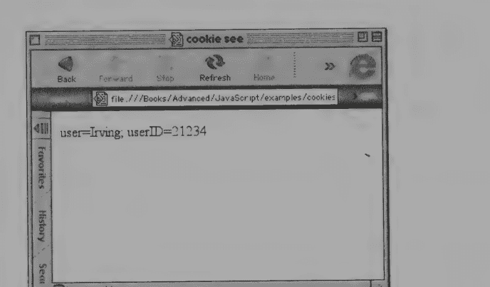

**图 16–1** 写入 cookie

如你所见，显示了以下字符串：

```text
user=Irving; userID=21234
```

请注意，两个 cookie 的值都被显示出来，中间用分号和空格分隔。这很好，但如果我们想知道`user` cookie 的值，而不仅仅是显示它呢？我写了一个小函数，它查看`document.cookie`中的所有 cookies 并返回正确的那个。你可以在示例 16–4 中看到它。

```javascript
EXAMPLE 16-4 *解析 JavaScript*

<html>
<head>
	<title>read cookie</title>
<script language="JavaScript">

❶function getCookie(varName)
{
	❷theCookie = document.cookie
	❸cookieArray = theCookie.split(";")

for(i=0; i<cookieArray.length; i++)
{
    equals = cookieArray[i].indexOf("=")

    if (equals != -1)
    {
        labelName = cookieArray[i].substring(0,equals)

        // 移除前导空格（如果有的话）

        if(labelName.indexOf(" ") == 0)
        {
            labelName = labelName.substring(1,labelName.length)
        }

        if(labelName == varName)
        {
            cookieLen = cookieArray[i].length
            value = cookieArray[i].substring(equals+1,cookieLen)
            return value
        }
    }
}

</script>
</head>

<body onLoad="getCookie('test2')">
</body>
</html>
```

#### 代码如何工作

1. 此函数接收一个位于某个 cookie 内的变量名作为参数。然后，该函数负责获取该变量名，遍历`document.cookie`中的所有 cookies，找到正确的 cookie，并返回正确的 name-value 键值对的值。
2. 我们将整个 cookie 读入`theCookie`变量。
3. 然后我们创建一个名为`cookieArray`的新数组，方法是查看 cookie 并将 cookie 字符串拆分成单独的数组元素，以分号为分隔符。
4. 现在所有的 cookie 都被分开了，我们可以开始遍历它们以找到正确的那个。为此，我们创建一个循环来遍历`cookieArray`中的所有元素。
5. 我们找出等号的位置。
6. 我们确保有一个等号。这几乎是必须的——这只是针对“安全”选项的一个安全措施。
7. `labelName`变量包含 cookie 名称-值对的名称（或者，当然，也可能是“expires”、“path”或“domain”）。
8. 当我们将 cookie 拆分为数组元素时，第一个名称-值对之后的每一个对前面都有一个空格，因为 cookie 不仅仅由分号分隔，而是由分号和一个空格分隔。我们想要去掉这个空格，所以我们检查 cookie 的第一个字符是否是空格。如果是，那么我们只需从变量中移除这个空格。
9. 然后我们检查从 cookie 中提取出的`labelName`是否与我们正在寻找的名称相同。
10. 如果是，那么我们就抓取名称-值对的值部分，并将其返回给调用此函数的任何程序。

这是一个小工具，如果你正在处理多个 cookie，它可能会派上用场。

公共领域中有一段很酷的代码片段，包含用于设置、显示和删除 cookie 的函数。它由 Bill Dortch 编写，非常酷。我们接下来将研究它。

### Bill 的 Cookie 代码

一个叫 Bill Dortch 的人编写了一些高效处理 cookie 的 JavaScript 代码。令人印象深刻的是，这段代码不仅运行良好，而且是他在 1996 年写的，现在依然有效！他甚至包含了针对 Mac 上 Netscape 2 的修复，这在当代的脚本中很少见。你上次在 Mac 上使用 Netscape 2 是什么时候？

Bill 的代码有几个函数：

- `SetCookie`（创建一个 cookie）
- `DeleteCookie`（删除一个 cookie）
- `GetCookie`（返回一个可显示的 cookie 值）
- `getCookieVal`（为`GetCookie`执行部分工作）
- `FixCookieDate`（用于那些 Mac/Netscape 2 浏览器）

我们现在不会查看整个代码，主要是因为它相当长（但主要是因为注释）。我们将从`SetCookie`开始，这个函数在示例 16–5 中实际创建了 cookie。

```javascript
function SetCookie (name, value) {
  var argv = SetCookie.arguments;
  var argc = SetCookie.arguments.length;
  var expires = (argc > 2) ? argv[2] : null;
  var path = (argc > 3) ? argv[3] : null;
  var domain = (argc > 4) ? argv[4] : null;
  var secure = (argc > 5) ? argv[5] : false;

  //if (expires!=null) FixCookieDate(expires); //***

  // Uncomment this line for automatic date correction (see
  // above)

  document.cookie = name + "=" + escape (value) +
    ((expires == null) ? "" : ("; expires=" +
    expires.toGMTString())) +
    ((path == null) ? "" : ("; path=" + path)) +
    ((domain == null) ? "" : ("; domain=" + domain)) +
    ((secure == true) ? "; secure" : "");
}
```

### 代码如何工作

1. 这个函数只需要两个参数：`name`和`value`。由于这些是 cookie 的唯一必需部分，我们需要这两个参数是有道理的。不过，这个函数的一个酷炫之处在于，它可以处理超过两个的参数。
2. 每当向函数传递参数时，会创建一个名为`arguments`的数组，该数组包含传递给函数的所有参数。
3. 然后我们查看实际传递了多少个参数给函数。我们这样做是因为该函数可以处理所有可选的 cookie 参数，例如过期时间、路径和域名。如果这些参数被传递给函数，我们需要一种方法来捕获它们。
4. 这行紧凑的代码检查是否传递了第三个参数给函数。如果是，我们假设第三个参数是过期日期，并将值放入`expires`变量中。否则，该值为`null`。
5. 如果存在第四个参数，我们假设路径参数是 cookie 的一部分，并将该值放入`path`变量中。
6. 如果存在第五个参数，我们假设要为 cookie 设置一个`domain`值。
7. 最后，如果存在第六个参数，我们将其赋值给`secure`变量。
8. 如果我们决定让 cookie 对 Mac 上的 Netscape 2 用户安全，我们会注释掉这一行。由于现在是 2002 年，我们将注释掉它。
9. 这行长长的代码是我们实际设置 cookie 的地方。注意我们对值进行了转义，这意味着我们对它进行了 URL 编码。接下来，我们检查`expires`是否为`null`。如果是，那么我们什么都不打印。否则，我们使用`toGMTString()`方法将日期转换为 GMT 格式。设置路径和域名参数的过程相同。对于安全参数，我们只需检查值是否为`true`，然后向 cookie 打印出相应的字符串。

这就是我们用 Bill 的方式设置 cookie 的方法。现在让我们看看他的更多代码。示例 16–6 出现在他所有的函数声明之后。

### Bill 的 Cookie 代码

#### 示例 16-6 立即调用的代码

```javascript
var expdate = new Date ();

// 24 hrs from now (mod Mac bug)

expdate.setTime (expdate.getTime() + (24*60*60*1000));

SetCookie ("ccpath", "http://www.hidaho.com/colorcenter/",
    expdate);

SetCookie ("ccname", "hIdaho Design ColorCenter", expdate);

SetCookie ("tempvar", "This is a temporary cookie.");

SetCookie ("ubiquitous", "This cookie will work anywhere in
    this domain",null,"/");

SetCookie ("paranoid", "This cookie requires secure
    communications",expdate,"/",null,true);

SetCookie ("goner", "This cookie must die!");

document.write (document.cookie + "<br>");

DeleteCookie ("goner");

document.write ("ccpath = " + GetCookie("ccpath")+"<br>");

document.write ("ccname = " + GetCookie("ccname")+"<br>");

document.write ("tempvar = "+ GetCookie("tempvar")+"<br>");
```

如你所见，我们首先设置一个等于当前时间的日期对象，然后向它添加一天。接着，我们使用许多不同的参数创建了六个 cookie。在这些 cookie 设置好之后，我们将整个 cookie 对象写入浏览器。

然后，我们销毁了`goner` cookie，并将其从`document.cookie`列表中移除。

最后，我们将三个 cookie 写入浏览器窗口。

让我们按顺序查看这些函数。我们已经看过了`SetCookie`，所以知道它是如何工作的。接下来我们看到的是`DeleteCookie`，所以让我们在示例 16-7 中查看它。

#### 示例 16-7 DeleteCookie 函数

```javascript
function DeleteCookie (name) {
    var exp = new Date();

    FixCookieDate (exp); // Correct for Mac bug

    // This cookie is history

    exp.setTime (exp.getTime() - 1);

    var cval = GetCookie (name);

    if (cval != null)
        document.cookie = name + "=" + cval +
            "; expires=" + exp.toGMTString();
}
```

### 代码如何工作

1. 这个函数唯一需要的就是要删除的 cookie 的名称。
2. 我们将`exp`设置为当前的日期和时间（并将其发送给`FixCookieDate`，但我们跳过这一步）。
3. 我们从`exp`日期中减去一毫秒。也就是说，我们将其设置为刚刚发生的那一刻。
4. 然后我们用`GetCookie`函数检索整个 cookie（我们接下来将查看那个函数）。
5. 我们确保 cookie 确实存在。没有必要删除一个不存在的 cookie。
6. 最后，我们用新的过期日期重置 cookie，这会立即将其从`document.cookie`的 cookie 列表中移除。

显然，接下来要看的是示例 16–8 中的`GetCookie`函数。

```javascript
function GetCookie (name) {
    var arg = name + "=";
    var alen = arg.length;
    var clen = document.cookie.length;
    var i = 0;

    while (i < clen) {
        var j = i + alen;

        if (document.cookie.substring(i, j) == arg)
            return getCookieVal (j);

        i = document.cookie.indexOf(" ", i) + 1;

        if (i == 0) break;
    }

    return null;
}
```


### ◆ 代码如何工作

1. 与`DeleteCookie`一样，此函数只需要 cookie 的名称。
2. 我们给名称加上一个等号。如果我们跟着代码走，`arg`现在将是`"goner="`。

## 第16章 • Cookies

3. 然后我们查看字符串的长度（本例中，`alen`的值为 6）。
4. 接着查看整个 cookie 字符串包含多少个字符。记住，这里`document.cookie`被视为一个字符串。当我们第一次运行此函数时，其值为 235。
5. 然后我们设置循环，遍历整个`document.cookie`字符串，搜索`"goner="`。
6. 我们设置一个变量来跟踪 cookie 中名称的结束位置。
7. 这里我们检查是否找到了正确的 cookie。在我们的例子中，找到`"goner="`的`i`值为 200。
8. 要获取 cookie 的实际值，我们访问另一个函数`getCookieVal`，并将此函数的结果返回给调用`GetCookie`的任何地方。
9. 如果我们没有找到想要的 cookie，我们跳到`document.cookie`中的下一个空格（记住，cookie 之间用分号和空格分隔），并加一，这样我们就在查看下一个 cookie 名称的第一个字符了。
10. 如果`i`为 0，这意味着`document.cookie.indexOf(" ", i)`等于 -1。这意味着没有找到空格，也就是说没有更多 cookie 可以查找了。如果我们仍在函数中（即我们尚未找到所需的 cookie）并且已经用完了所有 cookie，那就意味着`document.cookie`中不存在该 cookie，是时候退出 while 循环了。
11. 最后，我们返回`null`，因为我们无法找到相应的 cookie。

那么，还有一个函数需要分析：`getCookieVal`。让我们在示例 16-9 中看看它。

```javascript
function getCookieVal (offset) {

    var endstr = document.cookie.indexOf (";", offset);

    if (endstr == -1)

        endstr = document.cookie.length;

    return unescape(document.cookie.substring(offset, endstr));

}
```

### 代码如何工作

1. 这个函数与其他函数的工作方式略有不同——它接受一个数字作为参数。在本例中，它接受的是开始查找值的字符位置。在我们的 goner 例子中，传递的值是 206。
2. 然后我们查找下一个分号，它标志着下一个 cookie 的开始。
3. 如果没有分号，说明我们已到达`document.cookie`的末尾，我们正在查看最后一个 cookie。
4. 由于没有分号，我们只需将`endstr`设置为`document.cookie`的末尾。
5. 这里我们返回相关 cookie 的值。在我们的例子中，偏移量是 206，`endstr`是 235，因为 goner 是`document.cookie`中的最后一个 cookie。

就是这样！这就是比尔的代码，除了注释和 Netscape 2 的 bug 修复。请看下面示例 16-10 中的完整代码段。

```html
<html>

<head>

<title>Cookie Functions</title>

</head>

<body>

<script language="javascript">

<!-- begin script

//

// Cookie Functions -- "Toss Your Cookies" Version (22-Mar-96)

//

// Written by: Bill Dortch, hIdaho Design <bdortch@hidaho.com>

// The following functions are released to the public domain.

//
```

### 比尔的 Cookie 代码

**示例 16-10 比尔的完整 cookie 代码（续）**

```javascript
// This version modifies the DeleteCookie function to handle

// the Mac date bug. The fix method was proposed by Brendan Eich

// of Netscape.

//

// Background: A bug in the Macintosh version of Netscape

// Navigator

// versions 2.0 and 2.01 causes dates returned by the Date object to

// be off (ahead) by a day. Because the DeleteCookie function

// deletes

// cookies by setting the expiration date to one millisecond prior

// to

// the current time, cookies were not being deleted until a day

// after

// DeleteCookie was called on Mac platforms.

//

// The fix code for DeleteCookie recalibrates the date prior to

// deleting the cookie.

//

// ***** HERE IS THE FIX FUNCTION.  DO NOT DELETE IT!!!

function FixCookieDate (date) {

  var base = new Date(0);

  var skew = base.getTime(); // dawn of (Unix) time - should be 0

  if (skew > 0)  // Except on the Mac - ahead of its time

    date.setTime (date.getTime() - skew);

}

// ***** END OF FIX FUNCTION *****

//

// *IMPORTANT NOTE: The same bug that afflicted DeleteCookie will

// also

// affect dates you pass to SetCookie (see discussion below). I

// have

// included, but commented out, a line of code in SetCookie to

// call the

// function above. This line is commented out in SetCookie because

// many

// users of the cookie functions have already adjusted for this

// bug

// elsewhere in their code. If you would like SetCookie to

// automatically

// correct dates for you, just uncomment the call (remove the //).

//

// Note that the FixCookieDate() function could be used for dates

// elsewhere in your program as well -- not just in cookies.

// However,

// be very careful not to call it more than once for a given Date

// object.

//
```

**示例 16-10 比尔的完整代码（续）**

```javascript
//**********************************************

//

//  Cookie Functions - Second Helping  (21-Jan-96)

//

//  The Second Helping version of the cookie functions dispenses

//  with

//  my encode and decode functions, in favor of JavaScript's new

//  built-in

//  escape and unescape functions, which do more complete encoding,

//  and

//  which are probably much faster.

//

//  The new version also extends the SetCookie function, though in

//  a backward-compatible manner, so if you used the First Helping

//  of

//  cookie functions as they were written, you will not need to

//  change any

//  code, unless you want to take advantage of the new

//  capabilities.

//

//  The following changes were made to SetCookie:

//

//  1.  The expires parameter is now optional - that is, you can

//  omit

//  it instead of passing it null to expire the cookie at the

//  end

//  of the current session.

//

//  2.  An optional path parameter has been added.

//

//  3.  An optional domain parameter has been added.

//

//  4.  An optional secure parameter has been added.

//

//  For information on the significance of these parameters, and

//  and on cookies in general, please refer to the official cookie

//  spec, at:

//

//     http://www.netscape.com/newsref/std/cookie_spec.html

//

//

// "Internal" function to return the decoded value of a cookie

//

function getCookieVal (offset) {

  var endstr = document.cookie.indexOf (";", offset);

  if (endstr == -1)

    endstr = document.cookie.length;

  return unescape(document.cookie.substring(offset, endstr));

}

//

// Function to return the value of the cookie specified by "name".

// name - String object containing the cookie name.

// returns - String object containing the cookie value, or null

// if

// the cookie does not exist.

//

function GetCookie (name) {

  var arg = name + "=";

  var alen = arg.length;

  var clen = document.cookie.length;

  var i = 0;

  while (i < clen) {

    var j = i + alen;

    if (document.cookie.substring(i, j) == arg)

      return getCookieVal (j);

    i = document.cookie.indexOf(" ", i) + 1;

    if (i == 0) break;

  }

  return null;

}

//

// Function to create or update a cookie.

// name - String object containing the cookie name.

// value - String object containing the cookie value. May

// contain

//         any valid string characters.

// [expires] - Date object containing the expiration data of the

// cookie. If

//             omitted or null, expires the cookie at the end of the

//             current session.

// [path] - String object indicating the path for which the

// cookie is valid.

//         If omitted or null, uses the path of the calling document.

// [domain] - String object indicating the domain for which the

// cookie is valid. If omitted or null, uses the domain of the calling

// document.

// [secure] - Boolean (true/false) value indicating whether cookie

// transmission

//            requires a secure channel (HTTPS).

//

// The first two parameters are required. The others, if supplied, must

// be passed in the order listed above. To omit an unused optional field,

// use null as a place holder. For example, to call SetCookie using name,

// value and path, you would code:

//
```


# 第 17 章 正则表达式

## 本章内容

- 正则表达式简介
- 创建正则表达式
- 正则表达式对象属性
- 运行正则表达式
- 使用正则表达式进行测试、读取和替换文本

你们中来自 Perl 世界的人都对正则表达式了如指掌。如果你不太了解正则表达式，学习过程可能会有些曲线，但相信我——这非常值得。正则表达式允许你创建非常紧凑、健壮的模式，可以匹配任何类型的文本数据。这听起来可能没什么，但它能让你检查传入的数据、进行大规模的搜索和替换、测试文本格式是否正确，以及执行一般的文本处理。

## 正则表达式简介

作为一名 JavaScript 程序员，你永远不必绝对地使用正则表达式。你已经知道的 JavaScript 函数，如`indexOf()`和`lastIndexOf()`，可以被“哄骗”来达到同样的效果。然而，使用正则表达式通常要容易和快速得多。创建正则表达式的能力是你工具箱中一个强大的工具。

那么，这些正则表达式到底是什么？本质上，它们是定义特定文本字符模式的字符串。然而，它们也有属性，所以虽然正则表达式看起来很像字符串，但它们在技术上是对象，附带属性和方法。

换句话说，正则表达式是常规字符和特殊字符的序列，正是这些字符定义了模式。这个模式用于查找匹配的文本块。

JavaScript 还会自动创建一个静态的、主正则表达式对象，该对象具有一些有用的属性。不过，当你创建一个模式时，你是在创建那个大的静态正则表达式对象的一个实例。

## 创建正则表达式

假设我们有以下字符串：

```text
How many boards would the Mongols hoard, if the Mongol hordes were bored?<sup>1</sup>
```

再假设我们有以下正则表达式：

```javascript
var myRegExp = /mongol/
```

我们怎么知道创建了一个正则表达式？线索就是模式前后的斜杠，正好是你期望引号所在的位置。

所以我们有模式“mongol”。这个模式在字符串中有匹配项吗？实际上，没有。正则表达式是区分大小写的，虽然“Mongol”在文本中出现了两次，但“mongol”一次也没有出现。

1. 如果你知道这句话的出处，请发邮件到 `advjs@wire-man.com`。

所以我们可以将搜索模式改为“Mongol”，或者我们可以使模式不区分大小写，像这样：

```javascript
var myRegExp = /mongol/i
```

我们在最后一个斜杠后放了一个“i”，这使得搜索模式不关心文本是否大写。现在，不仅“Mongol”匹配该模式，“MONGOL”或“MoNgOl”或“MONGO”也会匹配。

文本中有两个“Mongol”。我们的正则表达式找到两个了吗？没有——正则表达式只找到模式的第一次出现。要使正则表达式继续搜索字符串，直到找到所有“Mongol”实例，我们可以这样做：

```javascript
var myRegExp = /mongol/gi
```

我们添加的“g”表示“全局”。我们稍后会看到更多这个修饰符。

让我们看另一个例子：

```text
Hey, listen to him list all those blistering reviews of the movie.
```

如果我们的正则表达式如下：

```javascript
newRegExp = /list/
```

你可以看到在上面的字符串中会有三次匹配，对吧？错了——我们忘记添加“g”了。

```javascript
newRegExp = /list/g
```

现在运行模式三次会在文本字符串中找到三个匹配项。否则，我们只会找到第一个“list”三次。但假设我们只想找到完整的单词“list”——我们不关心包含“list”的单词。为此，我们需要告诉模式“l”是单词的第一个字母，“t”是单词的最后一个字母。正则表达式有一个特殊字符专门用于设置单词边界：`\b`（这是一个反斜杠和字母 `b`）。

```javascript
newRegExp = /\blist\b/g
```

这确保了只有完整的单词“list”会匹配该模式。让我们看一些选项：

- `\blist\b` 匹配“list”
- `\blist` 匹配“list”和“listen”
- `\blist\b` 只匹配“blistering”中的“list”
- `list\b` 只匹配“list”

表 17-1 显示了最常见的匹配元字符。

### 表 17-1 常见匹配元字符

| 字符 | 匹配内容 | 示例 |
| :--- | :--- | :--- |
| `\b` | 单词边界 | `/\bas/` 匹配“asinine”但不匹配“has”<br>`/as\b/` 匹配“sherpas”但不匹配“peashooter”<br>`/\bas\b/` 只匹配完整的单词“as” |
| `\B` | 非单词边界 | `/\Bas/` 匹配“sherpas”但不匹配“ass”<br>`/as\B/` 匹配“aspen”但不匹配“goodfellas”<br>`/\Bas\B/` 匹配“peashooter”但不匹配“aspen”或“has” |
| `\d` | 数字 0-9（“d”代表“digits”） | `/\d\d\d/` 匹配“415”和“949”但不匹配“42”或“F14” |
| `\D` | 除数字外的任何字符 | `/\D\D\D/` 匹配“fob”但不匹配“B17”或“4U2” |
| `\s` | 单个空白字符 | `/slam\sdunk/` 匹配“slam dunk”但不匹配“slam-dunk” |
| `\S` | 除空白字符外的任何单个字符 | `/slam\Sdunk/` 匹配“slam-dunk”但不匹配“slam dunk” |
| `\w` | 字母、数字或下划线 | `/L\w/` 匹配“L7”和“LL”但不匹配“L*” |
| `\W` | 非字母、数字或下划线 | `/L\W/` 匹配“L$”和“L-“但不匹配“L_”或“LW” |
| `.` | 除换行符外的任何字符 | `/.../` 匹配“+++”、“ask”和“SR7” |
| `[...]` | 字符集 | `/s[ie]x/` 匹配“six”和“sex”但不匹配“sax” |
| `[^...]` | 否定字符集 | `/s[^ie]x/` 匹配“sax”和“sox”但不匹配“six”或“sex” |

---

408 • 第 16 章 • Cookies

### 示例 16-10 Bill 的完整 cookie（续）

```javascript
//       SetCookie ("myCookieName", "myCookieValue", null, "/");
//
// 注意：末尾省略的参数不需要占位符。
//
// 要为路径"/myPath"设置一个安全 cookie，该 cookie 在当前会话后过期，你可以这样编码：
//
//       SetCookie (myCookieVar, cookieValueVar, null, "/myPath", null,
//              true);
//

function SetCookie (name, value) {
  var argv = SetCookie.arguments;
  var argc = SetCookie.arguments.length;
  var expires = (argc > 2) ? argv[2] : null;
  var path = (argc > 3) ? argv[3] : null;
  var domain = (argc > 4) ? argv[4] : null;
  var secure = (argc > 5) ? argv[5] : false;

//if (expires!=null) FixCookieDate(expires);//***取消注释此行以进行
//自动日期修正（见上文）

  document.cookie = name + "=" + escape (value) +
    ((expires == null) ? "" : ("; expires=" + expires.toGMTString())) +
    ((path == null) ? "" : ("; path=" + path)) +
    ((domain == null) ? "" : ("; domain=" + domain)) +
    ((secure == true) ? "; secure" : "");
}

// 删除 cookie 的函数。（将过期日期设置为当前日期/时间）
//   name - 包含 cookie 名称的字符串对象

function DeleteCookie (name) {
  var exp = new Date();

  FixCookieDate (exp); // 修正 Mac 的 bug
  exp.setTime (exp.getTime() - 1);  // 此 cookie 已成为历史

  var cval = GetCookie (name);

  if (cval != null)
    document.cookie = name + "=" + cval + "; expires=" + exp.toGMTString();
}

//
//
// 示例
//

var expdate = new Date ();

expdate.setTime (expdate.getTime() + (24 * 60 * 60 * 1000)); // 从现在起 24 小时（修正 Mac 的 bug）

SetCookie ("ccpath", "http://www.hidaho.com/colorcenter/", expdate);
SetCookie ("ccname", "hIdaho Design ColorCenter", expdate);
SetCookie ("tempvar", "This is a temporary cookie.");
SetCookie ("ubiquitous", "This cookie will work anywhere in this domain",null,"/");
```

### 示例 15-10 Bill 的完整 cookie（续）

```javascript
SetCookie ("paranoid", "This cookie requires secure communications", expdate, "/", null, true);
SetCookie ("goner", "This cookie must die!");

document.write (document.cookie + "<br>");

DeleteCookie ("goner");

document.write ("ccpath = " + GetCookie("ccpath") + "<br>");
document.write ("ccname = " + GetCookie("ccname") + "<br>");
document.write ("tempvar = " + GetCookie("tempvar") + "<br>");

// 脚本结束 -->
</script>

</body>

</html>
```

字符集不仅可以处理单个字符——它们还可以包含值的范围。例如：

```javascript
myRegExp = /[a-zA-Z]\d\d\d/
```

这允许在三个数字前出现一个大写或小写字母。`\d` 特殊字符也可以被 `[0-9]` 替代。不过，这是可以修改的。如果你只想允许数字 1 和 5 到 9，你的字符集应该写成 `[15-9]`。

正则表达式不仅仅用于匹配字符——你还可以确定某个字符出现的次数。用于确定某物出现频率的特殊字符被称为计数量词。表 17-2 列出了它们，然后我们将看一些例子。

如果你一直在做 XML 作业并且了解 DTD，你可能会觉得其中一些字符很眼熟。

### 表 17-2 计数量词

| 字符 | 匹配上一个字符的次数 | 示例 |
| :--- | :--- | :--- |
| `*` | 零次或多次 | `/Gir*affe/` 匹配“Giaffe”和“Girrrrraffe” |
| `?` | 零次或一次 | `/Gir?affe/` 匹配“Giaffe”和“Giraffe”但不匹配“Girrraffe” |
| `+` | 一次或多次 | `/Gir+affe/` 匹配“Giraffe”和“Girrrrraffe”但不匹配“Giaffe” |
| `{n}` | 恰好 n 次 | `/Giraf{2}e/` 匹配“Giraffe”但不匹配“Giaffe”或“Girraffe” |
| `{n,}` | 至少 n 次 | `/Giraf{2,}e/` 匹配“Giraffe”和“Giraffffffe”但不匹配“Girafe” |
| `{n,m}` | 至少 n 次，但不超过 m 次。 | `/Giraf{2,4}e/` 匹配“Giraffe”和“Giraffffe”但不匹配“Girafe” |
| `{,m}` | 不允许 | 此语法会产生错误 |

除了匹配和计数量词，还有另一种叫做定位量词。让我们在表 17-3 中快速了解一下它们。

### 表 17-3 定位量词

| 字符 | 匹配 | 示例 |
|---|---|---|
| `^` | 在字符串（或行）开头 | `/^Mongol /` 匹配“Mongolian restaurant”但不匹配“Where's that Mongol” |
| `$` | 在字符串（或行）结尾 | `/Mongols$/` 匹配“You da Mongol”但不匹配“Mongolian empire” |

## 正则表达式对象属性

每当你创建一个正则表达式时，静态 `RegExp` 对象和你刚刚创建的正则表达式对象实例都会被赋予一些属性。让我们来看看它们。

首先，让我们看看当你首次创建一个正则表达式但尚未对其执行任何操作时，这些对象会发生什么。假设示例 17-1 包含了我们所有的代码。

```javascript
ordString = "How many boards would the Mongols hoard, if the Mongol hordes were bored?"

re = /\bmongol\b/ig
```

首先，让我们查看表 17-4，了解 `re` 对象现在拥有的所有属性。

### 表 17-4 正则表达式对象属性

| 属性 | 值 |
|---|---|
| `re.source` | `"\bmongol\b"` |
| `re.global` | `True` |
| `re.ignoreCase` | `True` |
| `re.lastIndex` | `0` |

`source` 属性就是模式的字符串，不包括前向斜杠（和像 `i` 和 `g` 这样的修饰符）。正如你猜测的，`g` 修饰符设置了 `global` 值，`i` 修饰符设置了 `ignoreCase` 属性。`lastIndex` 属性返回模式匹配搜索应开始的字符串位置——换句话说，就是正则表达式应在 `ordString` 中开始查找“mongol”的位置。该值目前为 0，因为我们还没有进行任何搜索，所以我们想从第一个字符（位于位置 0）开始搜索。你可以通过修改 `lastIndex` 属性来控制搜索过程，本质上就是说“我希望正则表达式从这里开始搜索”。

记住，有两个正则表达式对象：我们创建的那个和大的静态 `RegExp` 对象。这个对象跟踪脚本中发生的所有匹配。表 17-5 显示了我们创建小的 `re` 正则表达式后 `RegExp` 对象的属性。

### 表 17-5 `RegExp` 对象属性

| 属性 | 值 |
|---|---|
| `RegExp.input` | |
| `RegExp.multiline` | `false` |
| `RegExp.lastMatch` | |
| `RegExp.lastParen` | |
| `RegExp.leftContext` | |
| `RegExp.rightContext` | |
| `RegExp.$1` | |
| `...` | |
| `RegExp.$9` | |

如你所见，此时 `RegExp` 对象只设置了单个属性。一旦我们尝试将模式与字符串匹配，其中许多属性将被设置。以美元符号（`$1 ... $9`）开头的属性称为反向引用，它们处理由括号定义的子模式。我们稍后会讨论这些。现在，不用担心它们。

## 运行正则表达式

当我们想要实际将模式与字符串匹配时，我们使用 `exec()` 方法。该方法接受模式并将其与字符串进行比较。结果被放置在另一个对象（也是一个数组）中。

```javascript
foundMatch = re.exec(ordString)
```

我们也可以走个捷径，简单地编码如下：

```javascript
foundMatch = re(ordString)
```

但这并非在所有浏览器中都有效。关于匹配的信息存储在 `foundMatch` 对象中。关于匹配的信息也存储在 `re` 对象和 `RegExp` 对象中。当你使用正则表达式时，信息会分散在各个地方。下面是示例 17-2 中的一些代码，用于详细说明所有各种属性值是什么。

```html
<html>

<head>

<title>RegExp pages</title>

<script language="JavaScript">

ordString = "How many boards would the Mongols hoard, if the
    Mogol hordes were bored?"

re = /mongol/gi

//found = re.exec(ordString)

foundMatch = re(ordString)

if (foundMatch)
{
    matchString = foundMatch + "<br>"
    matchString += "re.source: " + re.source + "<br>"
    matchString += "re.global: " + re.global + "<br>"
```


```javascript
matchString += "re.ignoreCase: " + re.ignoreCase + "<br>"

matchString += "re.lastIndex: " + re.lastIndex + "<br>"

matchString += "RegExp.input: " + RegExp.input + "<br>"

matchString += "RegExp.multiline: " + RegExp.multiline + "<br>"

matchString += "RegExp.lastMatch: " + RegExp.lastMatch + "<br>"

matchString += "RegExp.lastParen: " + RegExp.lastParen + "<br>"

matchString += "RegExp.leftContext: " + RegExp.leftContext + "<br>"

matchString += "RegExp.rightContext: " + RegExp.rightContext + "<br>"

matchString += "foundMatch[0]: " + foundMatch[0] + "<br>"

matchString += "foundMatch.index: " + foundMatch.index + "<br>"

matchString += "foundMatch.input: " + foundMatch.input + "<br>"

document.write(matchString)

}

else

{

    document.write("no match found")

}

</script>

</head>

<body>

</body>

</html>
```

我建议你输入这个代码并在浏览器中运行它。你会得到示例 17-3。

**示例 17-3** 所有属性

```
Mongol

re.source: mongol

re.global: true

re.ignoreCase: true

re.lastIndex: 32

RegExp.input:

RegExp.multiline: false

RegExp.lastMatch: Mongol

RegExp.lastParen:

RegExp.leftContext: How many boards would the

RegExp.rightContext: s hoard, if the Mongol hordes were bored?

foundMatch[0]: Mongol

foundMatch.index: 26

foundMatch.input: How many boards would the Mongols hoard, if the Mongol hordes were bored?
```

### ◆ 关于结果

现在，我们有东西可看了。对于 `re` 对象，`lastIndex` 属性已经改变了。不再是搜索的起点 0，而是现在变成了 32。这是 `"Mongol"` 第一次出现后的字符位置。这意味着下次搜索将从位置 32 开始，因为那是字符串中未探索部分的起点。这是使用 `"g"` 修饰符的结果。如果我们没有使用它，`lastIndex` 将始终为 0。

接下来看 `RegExp` 对象，我们再次看到更多具有值的属性。我们看到 `lastMatch` 属性现在有 `"Mongol"`，因为这些是字符串中匹配模式的字符。如果字符串全是大写，`lastMatch` 属性将是 `"MONGOL"`。

我们在模式中没有使用任何括号（像这样），所以 `lastParen` 属性仍然是 `null`。`leftContext` 和 `rightContext` 属性是 `lastMatch` 文本左侧和右侧的字符串部分。

匹配到的值不仅可以在 `foundMatch` 和 `RegExp.lastMatch` 中找到，也可以在 `foundMatch[0]` 中找到。

此时，你可能会问自己为什么只有一个匹配，因为 `"Mongol"` 在字符串中出现了两次。例如，如果你现在查看，你会看到 `foundMatch[1]` 是未定义的。这可能看起来有违直觉，特别是因为我们使用了 `"g"` 修饰符，它应该找到字符串中模式的所有出现。发生这种情况的原因是正则表达式一次只找到一个匹配，该匹配的值进入 `[0]`。如果正则表达式中有括号，那么这些最小匹配的值将进入元素 `[1]` 及以后。

`foundMatch.index` 属性是匹配文本第一次出现的字符位置，`input` 属性是模式运行时针对的字符串。

所以现在，我们想要实际找到字符串中的第二个 `"Mongol"`。很简单：我们只需连续两次运行正则表达式。

```javascript
foundMatch = re.exec(ordString)
foundMatch = re.exec(ordString)
```

示例 17–4 展示了我们的结果。

```
Mongol

re.source: mongol

re.global: true

re.ignoreCase: true

re.lastIndex: 54

RegExp.input:

RegExp.multiline: false

RegExp.lastMatch: Mongol

RegExp.lastParen:

RegExp.leftContext: How many boards would the Mongols

    hoard, if the

RegExp.rightContext: hordes were bored?

foundMatch[0]: Mongol

foundMatch[1]: undefined

foundMatch.index: 48

foundMatch.input: How many boards would the Mongols hoard,

    if the Mongol hordes were bored?
```

唯一发生变化的属性是：

- `re.leftIndex`（现在指向第二个 `"Mongol"` 之后的字符）
- `RegEx.leftContent`（第二个 `"Mongol"` 左侧的文本）
- `RegEx.rightContent`（第二个 `"Mongol"` 右侧的文本）
- `foundMatch.index`（第二个 `"Mongol"` 开始的位置）

由于正则表达式会记住下次运行时应从何处开始搜索，因此你可以使用 `while` 循环来遍历正则表达式，直到找不到更多匹配项为止，如示例 17–5 所示。

### 第 17 章 • 正则表达式

```javascript
ordString = "How many boards would the Mongols hoard, if the Mongol hordes were bored?"

re = /mongol/gi

foundMatch = re.exec(ordString)

while (foundMatch)

{

    document.write("found match<br>")

    foundMatch = re.exec(ordString)

}
```

### ◆ 代码工作原理

如果正则表达式在文本字符串中找不到匹配项，它会返回 `null`，这意味着我们测试 `null` 值并反复运行正则表达式，直到找到匹配项。

重要提示：使用此代码时，必须使用 `"g"` 修饰符。记住，`"g"` 表示“全局”，用于在同一字符串中继续查找模式匹配。没有 `"g"`，正则表达式将只查找字符串中第一个出现的 `"Mongol"`，无论你运行多少次。并且由于它总会找到第一个出现的 `"Mongol"`，它永远不会是 `null`。既然永远不会是 `null`，脚本就永远不会退出 `while` 循环，你的浏览器会卡顿、阻塞并停止（如果你使用的是非 OS X 的 Mac，你可能需要重启机器）。

### 使用正则表达式测试、读取和替换文本

接下来的部分与我们在第 6 章查看表单元素时看到的内容有关。我们将对代码做一些更有用的事情。在第一个示例中，我们有一个简单的联系表单——一个电话号码。我们希望确保我们的电话号码采用特定格式，例如：`(111) 222-3333`。你当然可以使用 JavaScript 函数 `indexOf` 和 `lastIndexOf` 来完成此操作，但使用正则表达式要容易得多。

除了我们之前看到的 `exec` 方法外，还有两种方法可用于查看字符串是否与模式匹配：

- `regExpObject.test(string)`（返回 `true` 或 `false`）
- `string.search(regExpObject)`（返回匹配位置的字符位置，如果没有匹配则返回 `-1`）

我们将查看两种不同的模式：一种是严格定义的，另一种更灵活。示例 17-6 包含第一种模式的代码。

### 示例 17-6 测试电话号码

```html
<html>

<head>

    <title>RegExp pages</title>

<script language="JavaScript">

①function testForm(formObj)

{

    ②phone = formObj.phone.value

    ③phoneRE = /^\(\d{3}\)\s\d{3}-\d{4}$/

    ④phoneOK = phoneRE.test(phone)

    ⑤formObj.valid.value = phoneOK

}

</script>

</head>

<body>

<h1>Contact Form</h1>

<form>

Phone number (xxx) xxx-xxxx:

<input type="text" name="phone">

<p>

<input type="button" value="submit"

onClick="testForm(this.form)">

<br><br><br>

Is phone number OK? <input type="text" name="valid">
```

### ◆ 代码工作原理

1. 该函数将整个表单对象作为其传递的参数。
2. 我们查看电话表单字段中的值。
3. 这是我们的正则表达式。正则表达式中的括号有其自己的含义，因此要指定一个括号字符，我们必须在括号前加上反斜杠。所以这个模式是一个左括号、三个数字、一个右括号、一个空格、三个数字、一个连字符和最后四个数字。开头的插入符号表示左括号必须是字符串的第一个字符，结尾的美元符号表示最后四个数字的最后一位是字符串的最后一个字符。
4. 这是我们将模式应用于字符串的地方。注意 `test` 方法是正则表达式的一个方法（而 `search` 是字符串方法）。如果电话号码与模式匹配，则 `phoneOK` 为 `true`。
5. 我们将 `phoneOK` 的值复制到表单字段中。

现在让我们看一个更灵活的模式，它允许以下值：

- (415) 555-1234
- 415-555-1243
- 415.555.1234
- 4155551234
- 415 555-1234

这是更灵活模式的代码（也使用了 `search` 方法）。唯一需要更改的两行是：

```javascript
phoneRE = /^\(\d{3}\)?(\s|\.|\-)?\d{3}(-|\.|\s)?\d{4}$/

phoneOK = phone.search(phoneRE)
```

让我们在表 17-6 中进一步分解该正则表达式。

#### 表 17-6 解析模式

| 字符 | 描述 |
| :--- | :--- |
| `\(?` | `"("` 可以出现零次或一次。 |
| `\d{3}` | 三个数字 |
| `\)?` | `")"` 可以出现零次或一次。 |
| `(\s|\.| -)?` | 三个字符中的一个可以出现零次或一次：空格、句点或连字符。竖线表示“或”。另外，请注意我们使用括号来定义一组字符。句点在正则表达式中有特殊含义，因此要表示句点字符，我们必须在其前面加上反斜杠。 |
| `\d{3}` | 三个数字 |
| `(-|\.)?` | 单个连字符或句点可以出现零次或一次。 |
| `\d{4}` | 四个数字 |

当我们使用 `search` 方法时，我们得到一个数字作为结果。如果有匹配，在这种情况下它将是 0。如果没有匹配，则返回 -1。

### 提取数据

假设我们脚本需求的一部分是将电话号码的数字提取为一个长数字。为此，我们将创建另一个表单字段，用电话号码的数字填充，不包含任何额外字符。示例 17-7 显示了新的 HTML 是什么样的。

```html
<body>

<h1>Contact Form</h1>

<form>

Phone number (xxx) xxx-xxxx: <input type="text" name="phone">

<p>

<input type="button" value="submit" onClick="testForm(this.form)">

<br><br><br>

Is phone number OK? <input type="text" name="valid"><br>

Phone number - digits only <input type="text" name="digits">

</form>

</body>
```

唯一的真正区别是最后一个表单字段，`digits`。现在让我们看看示例 17–8 和相关的脚本。大部分内容与我们之前看到的相似。

```javascript
function testForm(formObj)

{

    ❶phoneNum = ""

    ❷phone = formObj.phone.value

    phoneRE = /\(?(\d{3})\)?(\s|\.| |-)?(\d{3})(-|\.)?(\d{4})/

    phoneOK = phone.search(phoneRE)

    ❸formObj.valid.value = phoneOK

    ❹phoneMatch = phoneRE.exec(phone)

    ❺if (phoneMatch)

    {

        ❻for (i = 0; i < phoneMatch.length; i++)

        {

            ❼findNum = /\D/

            ❽hasNonNum = findNum.exec(phoneMatch[i])

            ❾if (!hasNonNum)

            {

                ❿phoneNum += phoneMatch[i]

            }

        }

        ⓫formObj.digits.value = phoneNum

    }

}
```

### ◆ 代码工作原理

1. `phoneNum` 变量将仅保存电话号码的数字。
2. 与前面的示例一样，我们读取用户输入的电话号码值，创建一个正则表达式，并搜索字符串以查看它是否与模式匹配。你注意到模式有什么不同吗？我们在模式的 `\d` 部分周围添加了括号。我们这样做是因为模式中括号内的任何部分都可以作为匹配对象数组的一部分来访问（我们将在后面看到应用）。
3. 同样，我们将搜索结果放在 `valid` 表单字段中。
4. 由于我们需要访问括号中的值（称为反向引用），因此我们对正则表达式运行 `exec` 方法。这比仅使用 `search` 方法提供了更多信息。
5. 如果匹配成功（这意味着电话号码格式正确），则 `phoneMatch` 将具有非 `null` 值，并执行以下代码块。
6. 为了仅从结果中提取数字，我们将查看 `phoneMatch` 中的所有数组元素。如果用户输入 `"(415) 555-1234"`，这些数组元素是：
   - `phoneMatch[0] = (415) 555-1234`
   - `phoneMatch[1] = 415`
   - `phoneMatch[2] =`（单个空格）
   - `phoneMatch[3] = 555`
   - `phoneMatch[4] = -`
   - `phoneMatch[5] = 1234`
7. 由于我们的目标是仅提取包含数字的数组元素，一种方法是查找数组元素中的任何非数字字符。最简单的方法是使用另一个正则表达式。表示非数字字符的是 `\D`。
8. 然后我们查看数组元素中是否有任何非数字字符。如果找到任何非数字字符，`hasNonNum` 变量为 `true`，如果只有数字，则为 `false`。
9. 我们查看数组中是否只有数字。

### 替换文本

现在假设无论用户输入什么，我们都希望用点号来分隔区号、号码前缀和最后四位数字。示例 17-9 展示了对应的 HTML 代码：

### 示例 17-9 用于替换文本的 HTML

```html
<body>

<h1>联系表单</h1>

<form>

电话号码 (xxx) xxx-xxxx: <input type="text" name="phone">

<p>

<input type="button" value="提交" onClick="testForm(this.form)">

<br><br><br>

格式化的电话号码 <input type="text" name="formatted"><br>

</form>

</body>
```

我们新增了一个名为 `formatted` 的表单字段，用于存放我们使用正则表达式处理后的电话号码。

现在，让我们来看看示例 17-10 及其脚本代码。我们将多次使用 `replace` 方法。

```javascript
function testForm(formObj)

{

    re = /(\(|\)|\s|-)/

    period = /\./

    phone = formObj.phone.value

    while (re.test(phone))

    {

        phone = phone.replace(re, ".")
```


```javascript
}

phone = phone.replace(/\.{2,}/, ".")

phone = phone.replace(/^./, "")

formObj.formatted.value = phone

}
```

#### 代码工作原理

1. 这个正则表达式查找单个字符：可以是 `(`、`)`、` ` 或 `-`。
2. 我们创建了另一个名为 `period` 的正则表达式，它只包含一个点号。
3. 和之前一样，我们读取用户输入的电话号码。
4. 我们将所有非数字字符替换为点号（当然，已经是点号的除外）。
5. 这里我们执行实际的替换操作。这是 `replace` 方法的语法：`newString = oldString.replace(regExpObj, stringToReplace)`。
6. 由于用户可能输入类似 `(415) 555-1212` 这样的内容，这会导致产生 `.415..555.1212` 这样的结果，我们希望去掉那些双点号。为此，我们创建一个正则表达式来匹配两个（或更多）点号，并用单个点号替换它们。
7. 现在是时候移除开头的点号（如果有的话）。我们再次使用 `replace` 方法并创建另一个正则表达式。请记住，脱字符 `^` 表示行的开始，所以这个正则表达式查找字符串开头的点号。如果存在，则替换为空字符串，这相当于将其删除。
8. 最后，我们的字符串格式化完成，并在浏览器中呈现给用户。

正则表达式确实存在一定的学习曲线，对于新手来说通常意味着大量的实验。然而，这些时间是值得的。正则表达式是一种强大的工具，一旦你掌握了它们，你将节省大量时间。

### 18 XML

#### 本章内容

- 导入和读取 XML

你可能已经知道：无论你是否愿意，你都必须学习 XML。所有浏览器都开始更严格地遵循 W3C DOM，而 DOM 在很大程度上依赖 XML 作为结构化数据的方式。DOM 主要用于引用和操作 XML 文档。它也适用于 HTML，因为 HTML 与 XML 非常相似。如果你不熟悉 XML 并希望快速入门，请查看附录 A 中的 XML 入门。如果你想深入了解 XML，请阅读本人所著的《*Web专业人士必备的XML*》。

#### 导入和读取 XML

JavaScript 处理 XML 的能力目前还很有限。目前，只有 Windows 机器上的 IE5+ 浏览器可以导入 XML 文件并允许 JavaScript 对其进行处理。希望在你阅读本文时，各种浏览器已经足够发展，使得 Mac 和 Windows 上的 Netscape 和 IE 都能导入和读取 XML。首先，让我们看看示例 18–1，即我们将要导入和解析的 XML 文档。这是一家服装精品店从批发商处订购一批服装的订单。

```xml
<?xml version="1.0" ?>

<order>

    <shirts>

        <shirt quantity="4">

            <size>XXL</size>

            <color>紫色</color>

        </shirt>

        <shirt quantity="1">

            <size>M</size>

            <color>红色</color>

        </shirt>

    </shirts>

    <sweatshirts>

        <sweatshirt quantity="1">

            <size>XL</size>

            <color>蓝色</color>

        </sweatshirt>

        <sweatshirt quantity="2">

            <size>XL</size>

            <color>红色</color>

        </sweatshirt>

    </sweatshirts>

    <hats>

        <hat color="灰色" quantity="1" />

        <hat color="青铜色" quantity="342" />

    </hats>

    <mug quantity="1" />

    <martiniGlasses quantity="0" />

</order>
```

因此，我们的 XML 订单表格包含不同颜色、尺寸和数量的多种物品。部分数据的结构也不一致。例如，运动衫和衬衫的颜色信息存储在子元素中，而帽子的颜色信息则存储在属性中。我们的 JavaScript 若要获取此订单并在网页上显示，必须能够正确解析出这些信息，无论其形式如何。

我们的目标是将这个 XML 文件以更易于人类理解的形式呈现出来。完成后，页面效果应类似于图 18–1。

**图 18–1** 最终结果

示例 18–2 展示了我们如何实现这一点。

#### 示例 18–2 我们的页面和脚本

```html
<html>

<head>

<title>XML 示例</title>

<!-- 用于导入 XML 文档的 IE 特定标签 -->

<xml id="stitchXML" src="stitch.xml"></xml>

<script language="JavaScript">

function getOrder()

{

itemTypesOrdered = ""

// 用于引入 XML 文档的 IE 特定标签

rootXML = document.all("stitchXML").XMLDocument

orderXML = rootXML.documentElement

numDiffItems = orderXML.childNodes.length

if (numDiffItems)

{

    document.write("<table border=1 cellpadding=5>")

    document.write("<tr><td><b>物品</b></td>

        <td><b>数量</b></td>")

    document.write("<td><b>颜色</b></td>

        <td><b>尺寸</b></td></tr>")

    for (i=0; i<numDiffItems; i++)

    {

        hasItems = orderXML.childNodes[i].

            childNodes.length

        if (hasItems)

        {

            itemType = orderXML.childNodes[i]

            for (j=0; j<hasItems; j++)

            {

                singleItem = itemType.childNodes[j]

                itemName = singleItem.nodeName

                quantity = singleItem.getAttribute("quantity")

                // 检查尺寸和颜色是否为子元素

                if (singleItem.childNodes.length)

                {

                    // 遍历子节点以获取颜色、尺寸

                    for (k=0; k<singleItem.childNodes.length; k++)

                    {

                        subName = singleItem.childNodes[k].nodeName

                        if (subName == "size")

                        {

                            size = singleItem.childNodes[k].

                                firstChild.nodeValue

                        }

                        else if (subName == "color")

                        {

                            itemColor = singleItem.childNodes[k].

                                firstChild.nodeValue

                        }

                    }

                }

                else

                {

                    itemColor = singleItem.getAttribute("color")

                    size = "n/a"

                }

                document.write("<tr>")

                document.write("<td>" + itemName + "</td>")

                document.write("<td>" + quantity + "</td>")

                document.write("<td>" + itemColor + "</td>")

                document.write("<td>" + size + "</td>")

                document.write("</tr>")

            }

        }

        else

        {

            // 为马克杯和马提尼玻璃杯创建行，它们只使用数量属性

            itemName = orderXML.childNodes[i].nodeName

            quantity = orderXML.childNodes[i].

                getAttribute("quantity")

            document.write("<tr>")

            document.write("<td>" + itemName + "</td>")

            document.write("<td>" + quantity + "</td>")

            document.write("</tr>")

        }

    }

}

document.write("</table>")

}

</script>

</head>

<body onLoad="getOrder()">

</body>

</html>
```


#### 代码如何工作

1. 我们从 IE 中一个全新的、仅限 Windows 的标签 `<xml>` 开始。这个标签将 XML 文件导入浏览器，并根据其在 `id` 属性中指定的名称，将其保存在浏览器内存中。
2. 下面是另一行仅限 IE 的代码，它将 XML 文件读取为一个 XML 文档。在这里，我们将这个 XML 文档称为 `rootXML`。这是一个必要的步骤——你不能直接开始查看 `stitchXML` 文件的子节点。它必须被转换成某种更符合 DOM 规范的形式。
3. 我们还需要一个步骤来到达 XML 文档的根元素（我们在上一行中创建了它；我们称它为 `rootXML`）。使用 `documentElement` 可以指向 XML 文档的根元素。在这种情况下，根元素是 `<orders>`，所以 `rootXML.documentElement` 指向 XML 中的 `<order>` 节点。
4. 既然我们可以指向根节点，我们就可以真正开始工作了。我们想做的第一件事是确保订单里面有一些东西。这意味着我们需要知道是否有任何子元素。如果没有，那么订单就是空的，我们也就不再关心这个 XML 文档了。
5. 如果有子元素，我们就继续更详细地检查订单。
6. 我们的 HTML 文档主体不包含任何内容——我们将在遍历 XML 树时动态地编写所有内容。我们从编写表格的静态标题开始。
7. 然后，我们为订单中的所有子元素创建一个循环。在我们的示例中，这些元素是 `shirts`、`sweatshirts`、`hats`、`mug` 和 `martiniGlasses`。
8. 现在，其中一些子元素本身也有子元素（`shirts`、`sweatshirts` 和 `hats`）。如果这些子元素存在，我们就必须查看它们，因为那才是关于订单项的真实信息所在。
9. 如果存在子项（即，如果父元素是 `shirts`、`sweatshirts` 或 `hats`），那么我们需要一段特殊的代码来解析这些信息。
10. 为了使代码更具可读性，我们将使用这个简写。
11. 我们开始一个循环来处理所有子元素。例如，如果我们正在查看 `shirts` 元素，这将循环处理两个子 `shirt` 元素。
12. 同样，我们创建了一个简写。现在 `singleItem` 等同于 `orderXML.childNodes[i].childNodes[j]`。
13. 然后，我们通过查看 `nodeName` 来判断我们正在处理哪种类型的项，其值将是 `"shirts"`、`"sweatshirts"` 或 `"hats"`。
14. 幸运的是，获取属性值是一件简单的事情——只需使用 `getAttribute` 方法，并用引号括起属性名。
15. 由于颜色和尺寸信息可以存在于子元素中，或者颜色可以作为属性存在，所以我们检查是否存在任何子元素。如果存在，那么我们可以假定尺寸和颜色信息就在其中。
16. 然后我们开始一个循环来处理所有子元素。
17. 为了使代码更容易阅读，我们创建了 `subName` 来保存子元素的名称（这将是 `"size"` 或 `"color"`）。
18. 我们检查是否正在查看 `size` 元素。
19. 如果这是 `size`，那么我们获取文本节点的值。请记住，文本节点在技术上是其所属节点的子节点。一旦你通过 `firstChild` 指向一个文本节点，你必须使用 `nodeValue` 来提取节点中的实际文本。
20. 如果我们正在查看 `color` 元素，那么我们以与处理 `size` 节点相同的方式从文本节点中提取文本。
21. 如果没有任何子元素，那么我们假定没有尺寸信息，颜色信息存在于一个属性中。
22. 下面是我们实际将该项目信息写入浏览器的地方。
23. 对于马克杯和马天尼杯，我们需要不同的代码，因为数据的结构不同。我们能获得的唯一信息是订单中是什么类型的项（即 `nodeName`）以及项的数量（`quantity` 属性）。
24. 这里我们将马克杯和马天尼杯的信息写入浏览器。注意，我们跳过了最后两个表格单元格。
25. 最后，我们通过关闭表格标签来完成页面的 HTML。
26. 我们不是在页面加载时编写这段代码，而是在页面加载完成后才调用代码，但两种方式都可以。

你可以用 XML 做一些比这个例子中更多的事情。例如，你可以创建自己的 XML 元素和文档，以及修改现有的元素。表 18–1 包含了在解析 XML 时你可以使用的一些属性和方法列表。

#### 表 18–1 节点和属性的属性

| 属性和方法 | 描述 |
| :--- | :--- |
| `nodeName` | 节点标签的名称。例如，`<socks>` 的 `nodeName` 将是 `socks`。 |
| `nodeValue` | 文本节点的实际字符 |
| `nodeType` | 节点的类型（详情请见表 18–2） |
| `parentNode` | 指向包含当前节点的节点 |
| `childNodes` | 子节点数组 |
| `firstChild` | `childNodes` 数组中的第一个子节点 |
| `lastChild` | `childNodes` 数组中的最后一个子节点 |
| `previousSibling` | 在节点层次结构中位于当前节点同一级别的紧前节点 |
| `nextSibling` | 在节点层次结构中位于当前节点同一级别的紧后节点 |
| `tagName` | 获取元素的标签名称。返回的信息与 `nodeName` 相同。 |
| `getAttribute(attrName)` | 获取 `attrName` 属性的值 |
| `getElementsByTagName(name)` | 返回一个指定名称的嵌套元素数组 |
| `Attr.name` | 返回属性的名称 |
| `Attr.value` | 返回属性的值 |

以上就是使用 XML 和 JavaScript 所能完成的大部分工作。在结束之前，让我们看一下表 18–2，其中包含了 `nodeType` 的所有值。如果你的脚本需要知道它正在查看哪种类型的节点，这会很有帮助。例如，在文本节点中查找子元素是没有意义的。

#### 表 18–2 `nodeType` 常量

| 节点类型 | `nodeType` 常量 |
| :--- | :---: |
| 元素节点 | 1 |
| 属性节点 | 2 |
| 文本节点 | 3 |
| CDATA 节区节点 | 4 |
| 实体引用节点 | 5 |
| 实体节点 | 6 |
| 处理指令节点 | 7 |
| 注释节点 | 8 |
| 文档节点 | 9 |
| 文档类型节点（DOCTYPE） | 10 |
| 文档片段节点 | 11 |
| 表示法节点 | 12 |

440 第 18 章 • XML

### 回顾

在撰写本文时，你唯一能通过 JavaScript 处理的有趣 XML，必须在 Windows 机器上的 IE5.5+ 浏览器中进行。希望在你阅读本文时，情况会有所改变。毕竟，随着如此多的组织和个人推动将 XML 集成到当前应用程序中，我们每天都在与 XML 打交道只是时间问题，无论我们是否意识到。

## 19 JavaScript 与 ActionScript

### 本章内容

- 什么是 ActionScript？
- 使用 `getURL` 调用 JavaScript
- `FSCommand`

长期以来，Flash 一直是网页设计师的最爱工具：它能够组合大图像、图形、动画和交互性，使其难以被拒绝使用。这也导致了对 Flash 的许多滥用，我确信你时不时会遇到。Flash 的较新版本，从第 5 版开始，极大地增强了 ActionScript（Flash 背后的脚本语言）的健壮性。为了使本章对你有用，你应该对 Flash 有所了解，并且最好对 ActionScript 也有所了解。¹ ActionScript 能做的一件事是调用

> 1. 如果你想了解 Flash 和 ActionScript，请查看附赠的 CD-ROM 培训课程，Dan Livingston 的《高级 Macromedia Flash 培训课程》，或者直接购买书籍《高级 Flash 5：实战中的 ActionScript》（或等待 2002 年 9 月即将推出的《高级 Flash MX：实战中的 ActionScript》）。

### 什么是 ActionScript？

ActionScript 是你可以在 Flash 影片中使用的脚本语言。Flash 由影片、按钮、符号、图形等组成。ActionScript 可以放置在某些影片、符号或按钮上，也可以放置在 Flash 影片内的单个时间帧中。

ActionScript 看起来几乎和 JavaScript 一模一样，所以如果你懂 JavaScript，ActionScript 对你来说会很简单。ActionScript 和 JavaScript 一样有函数，并且调用方式也相同。有两种方式可以从 ActionScript 触发 JavaScript 函数：`getUrl` 方法（作用类似于普通的 JavaScript 方法）和 `fscommand` 方法（作用略有不同）。我们将探讨这两种方法。

### 使用 `getUrl` 调用 JavaScript

我们从简单的开始。假设我们有一个 Flash 影片，上面有一个按钮。这个 Flash 影片放在一个非常简单的网页上，网页中包含一个小的 JavaScript 函数。让我们看看示例 19-1 中的网页。

```html
<html>

<head>

<title>JavaScript and ActionScript</title>

<script language="javascript">

function showAlert()

{

    alert("zap");

}

</script>

</head>

<body>

<div align="center">

<object classid="clsid:D27CDB6E-AE6D-11cf-96B8-444553540000" codebase="http://download.macromedia.com/pub/shockwave/cabs/flash/swflash.cab" width="150" height="150" id="flashMovie">

  <param name="movie" value="flashMovie.swf">

  <param name="quality" value="high">

  <embed src="flashMovie.swf" quality="high" pluginspage="http://www.macromedia.com/go/getflashplayer" type="application/x-shockwave-flash" width="150" height="150"></embed>

</object>

</div>

</body>

</html>
```

唯一复杂的部分是嵌入 Flash 影片，这是当你直接从 Flash 发布页面时，Flash 自动插入到页面中的。这个 Flash 影片不过是一个简单的按钮。这个按钮上附加了一些 ActionScript，如示例 19-2 所示。

```actionscript
on(release)

{

    getURL("javascript:showAlert()")

}
```

你可能已经猜到这里发生了什么。当用户在 Flash 影片中点击按钮并释放鼠标按钮时，会发生 `release` 事件，`on(release)` 事件处理程序就会启动。`getURL` 方法使用与 HTML 链接中 `href` 属性相同的语法，这使我们的工作更简单。如果我们希望点击按钮将用户带到一个新的网页，代码会像这样：

```actionscript
on(release)

{

    getURL("/products/index.html")

}
```

在这些情况下，要么执行网页中的 `showAlert` 函数，要么浏览器跳转到网站的主页。当我们运行调用 `showAlert` 函数的 Flash 影片时，当用户点击 Flash 按钮，一个显示“zap”的警告框就会出现。当然，“zap”并不是特别有用。我们需要能够向 JavaScript 函数传递一些信息，最好是影片开始运行后 ActionScript 创建的一些信息。

为此，让我们考虑另一个 Flash 影片，这次带有一个表单字段（Flash 有用户可以输入的字段，类似于 HTML 表单字段）。对于这个简单的例子，用户可以在 Flash 字段中输入内容并点击按钮，他们输入的文本就会出现在警告框中。Flash 字段与一个名为 `userMessage` 的全局变量关联。要访问 Flash 中的全局变量，你需要在变量名前加上 `_root.`，所以我们将使用 `_root.userMessage`。我们的 Flash 代码将如下所示：

```actionscript
on(release)

{

    url =

    "javascript:showAlert('"+_root.userMessage+"')";

    getURL(url);

}
```

这意味着我们的 JavaScript 函数最好能够处理一些输入，这对于像你这样的 JavaScript 高手来说不是问题。

```javascript
function showAlert(message)

{

    alert(message);

}
```

你应该知道：不推荐以这种方式调用非用户自定义函数。例如，下面的代码可能会产生与用户点击浏览器“后退”按钮相同的效果。

```javascript
getURL("javascript:history.go(-1)");
```

然而，在实践中，这并不总是有效——有时你必须点击两次按钮才能让 `getURL` 执行你想要的操作。如果你在 HTML 页面中创建一个函数并将命令放在那里，它会更可靠地工作。例如，在你的 Flash 文件中放这个：

```actionscript
getURL("javascript:back()");
```

在你的 HTML 页面中放这个：

```javascript
function back()

{

    history.go(-1);

}
```

这样每次你都会得到想要的结果。

> **补充说明** 有时，尝试在“文件”→“发布设置”中将 Flash 的加载顺序设置为“从上到下”。这本不应产生影响的解决方案，但有时确实会。

### FSCommand

从 Flash 调用 JavaScript 命令的另一种方式是 `FSCommand`。Flash 5 中的 `FSCommand` 是一个有趣的东西。它可以用来访问特定的 JavaScript 函数，也可以用来控制独立的 Flash Player。请注意，`FSCommand` 在 Netscape 6 中不起作用（这就是为什么我不使用 `FSCommand`），但未来版本的 Flash 应该会修复这个问题。

让我们看看通过 `fscommand` 访问 JavaScript 的方式。这不是我推荐的从 Flash 访问 JavaScript 的方法——`getURL` 更简单。我们介绍它只是为了让你知道。假设你想模拟 JavaScript 函数 `showAlert`。你将使用以下代码。

```actionscript
on(release)

{

    fscommand("alert", _root.userMessage);

}
```

如果你在使用 Flash，当你使用 `FSCommand` 时，需要以不同的方式发布页面。处理方法如下：

1. 保存文件。先不要测试。
2. 转到“文件”→“发布设置”打开你的发布设置。
3. 点击“HTML”标签。
4. 从模板下拉菜单中，选择“带有 FSCommand 的 Flash”。
5. 点击“发布”按钮。
6. 启动你选择的文本编辑器。
7. 打开你刚刚创建的 HTML 文件。
8. 查看发布了什么：

```html
<SCRIPT LANGUAGE=JavaScript>

<!--

var InternetExplorer =

navigator.appName.indexOf("Microsoft") != -1;

// Handle all the FSCommand messages in a Flash movie

function javascript1_DoFSCommand(command, args) {

  var javascript1Obj = InternetExplorer ? javascript1 :

document.javascript1;

  //

  // Place your code here...

  //

}

// Hook for Internet Explorer

if (navigator.appName &&

navigator.appName.indexOf("Microsoft") != -1 &&

    navigator.userAgent.indexOf("Windows") != -1 &&

navigator.userAgent.indexOf("Windows 3.1") == -1) {

    document.write('<SCRIPT LANGUAGE=VBScript> \n');

    document.write('on error resume next \n');

    document.write('Sub javascript1_FSCommand(ByVal

command, ByVal args)\n');

    document.write('  call

javascript1_DoFSCommand(command, args)\n');

    document.write('end sub\n');

    document.write('</SCRIPT> \n');

}

//--> 

</SCRIPT>
```

为一个小小的警告框，这代码可真不少。将

```javascript
// Place your code here...
```

替换为

```javascript
alert(args)
```


保存 HTML 文件，然后启动你的浏览器并打开你的 HTML 文件。输入一些文本并点击按钮。

#### 代码如何工作

FSCommand 有一些限制，而且，如你所见，带有一些你可能并不总是需要的额外功能。`fscommand` 只能调用一个具有特定名称的 JavaScript 函数——即`movieName_DoFSCommand`。影片名称由 Flash 影片的文件名决定。此外，这个函数必须有两个参数：“command”和“args”。这就是 ActionScript 和 JavaScript 的全部。未来版本的 Flash 可能会增加两者之间的通信量，因为随着 Flash 的每次发布，ActionScript 都在变得越来越强大。

### 20

### FolderTree：创建树结构

**本章内容**

- FolderTree 的功能
- 创建文件夹和链接
- 创建子文件夹
- 添加文档/链接

FolderTree 是一款流行的 JavaScript 库，由 Marcelino Alves Martins 巧妙开发。它允许你创建类似 Windows 资源管理器的深度嵌套项目和文件夹。使用 FolderTree 的主要优势在于，别人已经完成了所有调试工作，且用户早已熟悉文件夹的操作方式。不过，理解 FolderTree 需要下些功夫：它是一个功能强大的系统，包含许多组件。在本章中，我们将学习如何创建树结构；接下来的两章将介绍如何绘制树结构并处理用户交互，以及如何为你的网站自定义 FolderTree。


### FolderTree 的功能

FolderTree 是一组 JavaScript 文件，允许你创建自己的文件夹、子文件夹和链接集合。它们在页面上的呈现方式使用户能够轻松浏览所有文件夹和链接。图 20-1 展示了一个部分展开的 FolderTree 的样子。

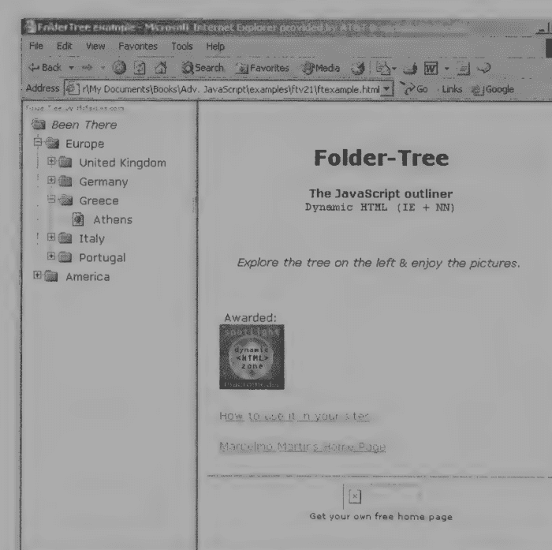

**图 20-1** 部分展开的 FolderTree

如图所示，FolderTree 位于其自己的框架内。你可以配置脚本使其在单个页面内运行，但目前，我们将先了解 Martins 先生提供的内容。

要创建图 20-2 中的图像，我们点击了“America”文件夹旁的加号，然后点击了“Boston”图标。随后，我们看到了一张（据推测是 Marcelino 拍摄的）波士顿海港的照片。这些文件夹通过点击加号或减号来打开和关闭，正如你所预期的那样。你可以在 Martins 先生的网站`www.mmartins.com/ft/`上查看 FolderTree 的示例。

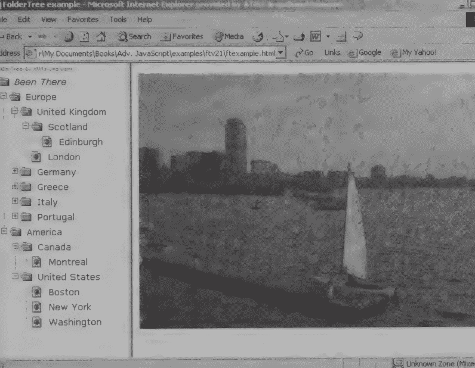

**图 20-2** Boston

### 创建文件夹和链接

FolderTree 包含许多部分，我们将逐一进行讲解。当页面首次加载时，会创建所有文件夹和链接的内部表示。这种内部表示有些复杂。首先要理解的是，每个文件夹和链接都是一个对象。记住，对象只是属性和方法的集合。仅此而已。要创建一个文件夹，我们创建一个`Folder`对象。为此，我们使用构造函数，如示例 20-1 所示。

452 第 20 章 • FolderTree：创建树结构

```javascript
//constructor

function Folder(folderDescription, hreference)

{

    //constant data

    this.desc = folderDescription

    this.hreference = hreference

    this.id = -1

    this.navObj = 0

    this.iconImg = 0

    this.nodeImg = 0

    this.isLastNode = 0

    //dynamic data

    this.isOpen = true

    this.iconSrc = "ftv2folderopen.gif"

    this.children = new Array

    this.nChildren = 0

    //methods

    this.initialize = initializeFolder

    this.setState = setStateFolder

    this.addChild = addChild

    this.createIndex = createEntryIndex

    this.escondeBlock = escondeBlock

    this.esconde = escondeFolder

    this.mostra = mostra

    this.renderOb = drawFolder

    this.totalHeight = totalHeight

    this.subEntries = folderSubEntries

    this.outputLink = outputFolderLink

    this.blockStart = blockStart

    this.blockEnd = blockEnd

}
```

#### 代码工作原理

1. 要启动文件夹对象，我们只需要一个描述和一个 href。要创建第一个名为“Been There”的文件夹，我们将使用：

   ```javascript
   foldersTree = new Folder("<i>Been There</i>", "startPage.html")
   ```

   这将创建一个名为`foldersTree`的文件夹，它包含了构造函数中的所有属性和方法。

2. 设置`desc`属性意味着以下内容为真：

   `foldersTree.desc = "<i>Been There</i>"`

3. 类似地，设置`hreference`属性将导致以下内容为真：

   `foldersTree.hreference = "startPage.html"`

这里还有许多其他属性，但我们暂时忽略大部分。

4. 文件夹包含其他文件夹和链接的方式是通过`children`数组。任何子文件夹或链接都作为`children`数组的元素存在。这很有趣，因为所有文件夹和链接本身都是对象。这意味着一个文件夹对象将包含一个数组，而该数组的元素是其他对象。我们很快会更详细地探讨这一点。

5. `nChildren`属性只是一种跟踪文件夹拥有多少子元素的方式。

6. 这里，我们通过指向脚本中的其他函数来创建多个方法。现在不必担心这个。我们很快会添加其他函数。

这就是创建文件夹的方法。不过，实际创建文件夹时有一点小技巧。创建主文件夹的实际代码行是：

```javascript
foldersTree = gFld("<i>Been There</i>", "startPage.html")
```

我们并不直接调用`Folder`构造函数。我们调用`gFld`函数，其代码如下：

```javascript
function gFld(description, hreference)

{

    folder = new Folder(description, hreference)

    return folder

}
```

这很简单。我们所做的就是创建一个新的`Folder`对象，然后将该对象返回给调用函数。在这个特定情况下，我们其实不需要`gFld`函数——我们可以直接调用`Folder`函数本身。但事实上，`gFld`很快就会变得有用，所以它很可能只是出于一致性而存在。现在我们已经创建了主文件夹，是时候添加一些子文件夹了。

### 创建子文件夹

既然我们有了 Been There 主文件夹，我们需要添加“Europe”文件夹。以下代码行既创建了 Europe 文件夹，又将该文件夹添加到 Been There 文件夹中：

```javascript
aux1 = insFld(foldersTree, gFld("Europe", "http://www.geocities.com/marcelino_martins/ftexample/beenthere_europe.gif"))
```

哇！这是什么？这样读可能更容易理解：

```javascript
aux1 = insFld(foldersTree, gFld("Europe", "europe.gif"))
```

这样好多了，对吧？现在更容易看出这短短一行代码中有两个函数调用。首先我们创建一个名为“Europe”的文件夹，但我们没有将其赋值给任何变量。相反，我们立即将该文件夹传递给一个名为`insFld`的新函数。这是另一种理解方式：

```javascript
aux1 = insFld(foldersTree, [Europe folder])
```

创建 Europe 文件夹后，我们将主文件夹和 Europe 文件夹传递给一个名为`insFld`的函数。让我们来看一下示例 20-2 中的这个函数。

```javascript
// 示例 20-2 insFld 函数

function insFld(parentFolder, childFolder)

{

    return parentFolder.addChild(childFolder)

}
```

#### 代码工作原理

嗯，看起来我们还没有触及代码的核心部分。我们可以看出一个父文件夹和一个子文件夹被传递给了`insFld`函数。然后，看起来我们正在调用一个名为`addChild`的方法。

如果我们用实际传递的文件夹替换通用的`parentFolder`和`childFolder`，代码将如下所示：

```javascript
return foldersTree.addChild([Europe folder])
```

这个`addChild`方法是什么？事实证明，我们在使用`Folder`构造函数创建文件夹时就已经定义了这个方法。该函数中的一行代码是：

```javascript
this.addChild = addChild
```

这意味着，当你使用`Folder`函数创建一个文件夹后，你可以通过以下方式调用名为`addChild`的函数：

```javascript
yourFolderName.addChild(folderToAdd)
```

让我们看一下示例 20-3 中的`addChild`函数。这将让我们更清楚地了解子文件夹是如何被添加到现有文件夹中的。

#### 示例 20-5：addChild 函数

```javascript
function addChild(childNode)

{

    this.children[this.nChildren] = childNode

    this.nChildren++

    return childNode

}
```

### ◆ 代码工作原理

1. 这个函数可能比你想象的要简单。添加子项只是向`children`数组中添加另一个元素。仅此而已。由于此函数充当对象的方法，唯一需要传递的参数是要附加到对象的实际文件夹（或节点）。在添加“Europe”文件夹的案例中，此函数作为`foldersTree`对象的方法被调用，这意味着“this”自动指代“foldersTree”。

我们希望将新的子文件夹添加到子文件夹数组的末尾。我们通过`nChildren`属性来跟踪数组中已有的子文件夹数量。当文件夹首次被创建时，我们将`nChildren`属性设置为零。换句话说，这行代码等价于：

```javascript
folderTree.children[0] = [Europe folder]
```

然后我们将`nChildren`增加一，这样下次向`foldersTree`添加内容时，就会添加到`children[1]`中。

请注意，返回的值不是`foldersTree`的主文件夹，而是被添加的那个文件夹。在这个例子中，函数返回的是欧洲文件夹。

由于涉及多个函数，这可能会让人有点困惑，所以让我们退一步再看一下。我们从这个开始：

```javascript
aux1 = insFld(foldersTree, gFld("Europe", "europe.gif"))
```

这可以理解为：

```javascript
aux1 = insFld(foldersTree, [Europe folder])
```

然后`insFld`函数会调用`addChild`，它做了两件事：将欧洲文件夹添加到主文件夹中，并将欧洲文件夹返回给`insFld`函数。`insFld`再返回这个值，所以我们最终得到：

```javascript
aux1 = [Europe folder]
```

相当巧妙！通过一行代码，我们创建了一个新文件夹，将其添加到主文件夹中，并使`aux1`等于欧洲文件夹。

这看起来可能做了很多不必要的工作和函数调用。如果我们的整个程序只是将一个文件夹添加到另一个文件夹，那么这确实是多余的工作。我们本可以简单地这样写：

```javascript
foldersTree = new Folder("<i>Been There</i>",
    "startPage.html")

europeFolder = new Folder("Europe", "europe.gif")

foldersTree.addChild(europeFolder)
```

然而，由于我们将要添加大量的文件夹和链接，长远来看，将每个步骤分解成不同的函数会更容易。相信我，最终它会变得有意义。

### 更多子文件夹

在我们的示例中，欧洲子文件夹本身有几个子文件夹。首先，它有一个“英国”文件夹，其中包含一个“苏格兰”文件夹。“苏格兰”文件夹包含一个指向“爱丁堡”的链接。我们将看看如何附加这些子文件夹，然后看看如何附加一个链接。

附加这两个额外子文件夹的代码如示例 20–4 所示。

```javascript
示例 20-4 附加子文件夹

aux2 = insFld(aux1, gFld("United Kingdom", "http://
  www.geocities.com/marcelino_martins/ftexample/
  beenthere_unitedkingdom.gif"))

aux3 = insFld(aux2, gFld("Scotland", "http://
  www.geocities.com/marcelino_martins/ftexample/
  beenthere_scotland.jpg"))
```

使用较短的 URL 更易于阅读：

1. `aux2 = insFld(aux1, gFld("United Kingdom", "unitedkingdom.gif"))`
2. `aux3 = insFld(aux2, gFld("Scotland", "scotland.jpg"))`

#### ◆ 代码的工作原理

1. 这里，我们正在创建一个“英国”文件夹，并将其附加到对象`aux1`上。记住，我们将欧洲文件夹对象放入了`aux1`，因此通过向`aux1`添加子文件夹，实际上就是将其添加到欧洲文件夹中。我们已经知道以下内容：

   `foldersTree.children[0] = [Europe folder]`

   由于欧洲文件夹是一个真正的`Folder`对象，它有自己的`children`数组。如果我们将一个文件夹放入欧洲文件夹中，实际上就是向欧洲文件夹的`children`数组添加一个元素。JavaScript 并不真正理解文件夹和子文件夹，但它理解对象和数组。向欧洲文件夹添加另一个文件夹看起来像这样：

   ```javascript
   foldersTree.children[0].children[0] = [UK folder]
   ```

   我们也可以说：

   ```javascript
   aux1.children[0] = [UK folder]
   ```

   这两个语句是等价的。

2. 我们继续向英国文件夹添加子文件夹。我们首先为苏格兰创建一个文件夹，然后将其附加到`aux2`，这等同于将其添加到英国文件夹。以下是引用苏格兰文件夹的几种方式：

   ```javascript
   aux3 = [Scotland folder]

   aux2.children[0] = [Scotland folder]

   aux1.children[0].children[0] = [Scotland folder]

   foldersTree.children[0].children[0].children[0] =
     [Scotland folder]
   ```

   快速回顾一下。我们总共有四个文件夹：`foldersTree`、欧洲文件夹、英国文件夹和苏格兰文件夹。以下是 JavaScript 如何理解这些文件夹之间的关系：

   ```javascript
   foldersTree = Been There 文件夹对象

   foldersTree.children[0] = 欧洲文件夹对象

   foldersTree.children[0].children[0] = 英国文件夹对象

   foldersTree.children[0].children[0].children[0] = 苏格兰文件夹对象
   ```

   小测验！你如何向`foldersTree`添加一个“美国”文件夹，使得欧洲和美国文件夹处于同一层级？请随意借鉴。让我们先看看我们是如何创建欧洲文件夹的。

   ```javascript
   aux1 = insFld(foldersTree, gFld("Europe", "europe.gif"))
   ```

   添加美国文件夹比你想象的要简单。

   ```


```javascript
aux1 = insFld(foldersTree, gFld("America", "america.gif"))
```

就这样！实际添加文件夹的函数是`addChild`，而`addChild`的工作方式是向`children`数组添加一个元素。快速提醒一下：

```javascript
function addChild(childNode)
{
    this.children[this.nChildren] = childNode
    this.nChildren++
    return childNode
}
```

当我们向`foldersTree`添加欧洲文件夹时，我们将该文件夹对象的`nChildren`属性从 0 递增到 1。它仍然是 1。如果这令人困惑，请记住每个文件夹对象都有自己独立的`nChildren`属性。欧洲文件夹有自己的`nChildren`属性，这与英国文件夹的`nChildren`属性完全不同，而后者又与苏格兰文件夹的`nChildren`属性完全不同。

所以，我们查看的是`folderTree`的`nChildren`属性，当我们添加欧洲文件夹时，该属性从 0 变为 1。这意味着：

```javascript
folderTree.children[1] = [America folder]
```

这一切都很好，但我们不能继续添加文件夹和子文件夹而不实际在其中放置任何内容。

### 添加文档/链接

在 FolderTree 代码中，位于文件夹内部的东西既被称为链接，也被称为文档。这有点令人困惑，但目前请记住，在 FolderTree 的世界里，文档和链接是同一回事。

在图 20-3 中，两个链接是“爱丁堡”和“伦敦”。点击这些链接将更改另一个框架（即图 20-2 中包含波士顿港口图片的那个框架）的内容。

### 460 第 20 章 • FolderTree：创建树

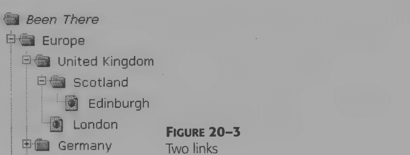

添加链接与添加文件夹非常相似。以下是我们如何将爱丁堡链接添加到苏格兰文件夹：

`insDoc(aux3, gLnk(2, "Edinburgh", "www.geocities.com/marcelino_martins/ftexample/beenthere_edinburgh.gif"))`

同样，让我们稍微缩短一下：

`insDoc(aux3, gLnk(2, "Edinburgh", "edinburgh.gif"))`

我们做的第一件事是用一个名为`gLnk`的函数创建一个链接。让我们在示例 20–5 中看看它。

```javascript
function gLnk(target, description, linkData)
{
    fullLink = ""
    if (target==0)
    {
        fullLink = "'"+linkData+"' target=\"basefrm\""
    }
    else
    {
        if (target==1)
            fullLink = "'http://"+linkData+"' target=_blank"
        else
            fullLink = "'http://"+linkData+"' target=\"basefrm\""
    }

    linkItem = new Item(description, fullLink)
    return linkItem
}
```

#### ◆ 代码的工作原理

1. `gLnk`函数接受三个参数：一个代表目标的数字、链接的描述（即用户将看到的文本），以及链接实际指向的 URL。

2. 此函数中的大部分代码都致力于创建一个字符串，该字符串将决定链接实际执行的操作。即，链接指向哪里、目标是哪个框架等等。我们将此信息放在一个名为`fullLink`的变量中。

3. 然后我们根据目标开始创建链接。在这个版本的 FolderTree 中，所有链接目标的值都是 2。我们稍后会看到这意味着什么。程序员可以为此函数发送任何目标值，但代码会查找 0、1 和其他所有值。

4. 如果目标参数是 0，则`fullLink`在构建时不带“http://”前缀，并且目标为“basefrm”框架。如果我们的代码是这样：

   `insDoc(aux3, gLnk(0, "Edinburgh", "edinburgh.gif"))`

   那么`fullLink`将是：

   `'edinburgh.gif' target="basefrm"`

5. 如果目标是 1，则`fullLink`在构建时前面带有“http://”，并且链接的目标是`_blank`，这意味着会出现一个新的浏览器窗口，链接在该窗口中显示。如果我们的代码是这样：

   `insDoc(aux3, gLnk(1, "Edinburgh", "www.geocities.com/marcelino_martins/ftexample/beenthere_edinburgh.gif"))`

   那么`fullLink`将是：

   `'http://www.geocities.com/marcelino_martins/ftexample/beenthere_edinburgh.gif' target=_blank`

6. 然而，我们的目标值是 2，所以我们的`fullLink`是：

   `'http://www.geocities.com/marcelino_martins/ftexample/beenthere_edinburgh.gif' target="basefrm"`

7. 然后我们创建一个对象来保存关于某个链接的所有信息。这个构造函数被称为`Item`，它类似于`Folder`构造函数……

这也意味着，对于文件夹内的链接，总共有三个术语来指代：文档、链接，现在还有项目。

8. 一旦`Item`对象被创建，该对象就会被传回给调用函数。换句话说，会发生以下情况：

   `insDoc(aux3, [Edinburgh link])`

让我们看看示例 20–6 中的`Item`构造函数，这样我们就知道我们的链接对象到底是什么了。

```javascript
// Constructor

function Item(itemDescription, itemLink)
{
    // constant data
    this.desc = itemDescription
    this.link = itemLink
    this.id = -1 //initialized in initalize()
    this.navObj = 0 //initialized in render()
    this.iconImg = 0 //initialized in render()
    this.iconSrc = "ftv2doc.gif"

    // methods
    this.initialize = initializeItem
    this.createIndex = createEntryIndex
    this.esconde = escondeBlock
    this.mostra = mostra
    this.renderOb = drawItem
    this.totalHeight = totalHeight
    this.blockStart = blockStart
    this.blockEnd = blockEnd
}
```

### ◆ 代码工作原理

1. 请记住，对象只是属性和方法的集合。`Item`对象也不例外。实际上，它比`Folder`对象更简单。例如，`Item`对象没有`children`数组。这是有道理的，因为链接不能包含其他链接。链接就只是链接。

2. 与 Folder 对象一样，对象的描述放在`desc`属性中。这稍后会显示给用户，作为小链接图标旁边的文本。

3. 我们在`gLnk`函数中看到的`fullLink`变量变成了`itemLink`参数，最终出现在`Item`对象的`link`属性中。

4. 我们还通过创建指向我们最终将添加的函数的指针，向`Item`对象添加了一堆方法。

好的，我们现在看了`gLnk`和`Item`函数。我们之所以看它们，是因为以下代码：

```javascript
insDoc(aux3, gLnk(2, "Edinburgh", "www.geocities.com/marcelino_martins/ftexample/beenthere_edinburgh.gif"))
```

引导我们到了这里。现在，我们有了这个：

```javascript
insDoc(aux3, [Edinburgh link])
```

因此，现在是时候看看示例 20-7，看看`insDoc`是做什么的了。

```javascript
function insDoc(parentFolder, document)
{
    parentFolder.addChild(document)
}
```

没有比这更简短的了，对吧？两个参数是一个 Folder 对象和要附加到它的 Item 对象。然后我们使用之前见过的同一个`addChild`方法将文档/链接/项目添加到文件夹中。

但是，一个添加文件夹的函数如何也能用来添加链接呢？答案是`addChild`函数并不关心被添加的是什么。它所做的只是将某些东西添加到文件夹的`children`数组中。仅此而已。

这意味着 Scotland 文件夹现在有了一个`children`数组，其中 Edinburgh 链接是数组中的唯一元素。换句话说，它看起来像这样：

```javascript
folderTree.children[0].children[0].children[0].children[0] = Edinburgh link/item object
```

明白了吗？有一点了吗？让我们来加深你的理解：你会如何将一个 "London" 链接添加到 UK 文件夹？想想看：我们需要添加一个链接，所以我们的代码会像这样：

```javascript
insDoc(folder, link)
```

我们知道 United Kingdom 文件夹也被称为`aux2`，所以我们可以将我们的代码更新为这样：

```javascript
insDoc(aux2, link)
```

我们上次创建链接的方式是使用`gLnk`函数，所以让我们再试一次。

```javascript
insDoc(aux2, gLnk(2, "London", some URL))
```

你不可能知道来自伦敦的图片的 URL，所以我会为你填上。

```javascript
insDoc(aux2, gLnk(2, "London", "www.geocities.com/marcelino_martins/ftexample/beenthere_london.jpg"))
```

这在所有的`children`数组上下文中看起来像什么？

```javascript
foldersTree = Been There folder object

foldersTree.children[0] = Europe folder object

foldersTree.children[0].children[0] = UK folder object

foldersTree.children[0].children[0].children[0] =
    Scotland folder object

folderTree.children[0].children[0].children[0].
    children[0] = Edinburgh link/item object

foldersTree.children[0].children[0].children[1] =
    London link/item object
```

我加粗了 London 链接对象的添加部分。完成文件夹树的其余部分没有更多内容了。当我们添加了所有的文件夹和链接后，结构看起来就像图 20–4（并且我们点击了 Pisa 链接）。

创建整个树的全部代码在下面，示例 20–8。你可能已经注意到文件夹和链接之间的两个区别。所有的文件夹都以`aux1 =`、`aux2 =`等等开头。它们都等于某个东西。然而，涉及链接的行没有一个是等于任何东西的。它们以`insDoc`开头，仅此而已。为什么呢？

### 添加文档/链接

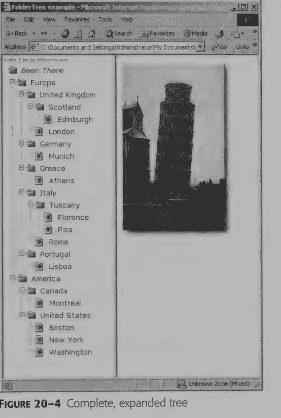

**图 20-4 完整、展开的树**

```javascript
示例 20-9 构建树

foldersTree = gFld("<i>Been There</i>", "startPage.html")

aux1 = insFld(foldersTree, gFld("Europe",
    "http://www.geocities.com/marcelino_martins/
    ftexample/beenthere_europe.gif"))

aux2 = insFld(aux1, gFld("United Kingdom",
    "http://www.geocities.com/marcelino_martins/
    ftexample/beenthere_unitedkingdom.gif"))

aux3 = insFld(aux2, gFld("Scotland",
    "http://www.geocities.com/marcelino_martins/
    ftexample/beenthere_scotland.jpg"))

insDoc(aux3, gLnk(2, "Edinburgh",
    "www.geocities.com/marcelino_martins/ftexample/
    beenthere_edinburgh.gif"))

insDoc(aux2, gLnk(2, "London",
    "www.geocities.com/marcelino_martins/ftexample/
    beenthere_london.jpg"))

aux2 = insFld(aux1, gFld("Germany",
    "http://www.geocities.com/marcelino_martins/
    ftexample/beenthere_germany.gif"))

insDoc(aux2, gLnk(2, "Munich",
    "www.geocities.com/marcelino_martins/ftexample/
    beenthere_munich.jpg"))

aux2 = insFld(aux1, gFld("Greece",
    "http://www.geocities.com/marcelino_martins/
    ftexample/beenthere_greece.gif"))

insDoc(aux2, gLnk(2, "Athens",
    "www.geocities.com/marcelino_martins/ftexample/
    beenthere_athens.jpg"))

aux2 = insFld(aux1, gFld("Italy",
    "http://www.geocities.com/marcelino_martins/
    ftexample/beenthere_italy.gif"))

aux3 = insFld(aux2, gFld("Tuscany",
    "http://www.geocities.com/marcelino_martins/
    ftexample/beenthere_tuscany.gif"))

insDoc(aux3, gLnk(2, "Florence",
    "www.geocities.com/marcelino_martins/ftexample/
    beenthere_florence.jpg"))

insDoc(aux3, gLnk(2, "Pisa",
    "www.geocities.com/marcelino_martins/ftexample/
    beenthere_pisa.jpg"))

insDoc(aux2, gLnk(2, "Rome",
    "www.geocities.com/marcelino_martins/ftexample/
    beenthere_rome.jpg"))

aux2 = insFld(aux1, gFld("Portugal",
    "http://www.geocities.com/marcelino_martins/
    ftexample/beenthere_portugal.gif"))

insDoc(aux2, gLnk(2, "Lisboa",
    "www.geocities.com/marcelino_martins/ftexample/
    beenthere_lisbon.jpg"))

aux1 = insFld(foldersTree, gFld("America",
    "http://www.geocities.com/marcelino_martins/
    ftexample/beenthere_america.gif"))

aux2 = insFld(aux1, gFld("Canada",
    "http://www.geocities.com/marcelino_martins/
    ftexample/beenthere_canada.gif"))

insDoc(aux2, gLnk(2, "Montreal",
```


```javascript
"www.geocities.com/marcelino_martins/ftexample/beenthere_montreal.jpg"))

aux2 = insFld(aux1, gFld("United States",
    "http://www.geocities.com/marcelino_martins/ftexample/beenthere_unitedstates.gif"))

insDoc(aux2, gLnk(2, "Boston",
    "www.geocities.com/marcelino_martins/ftexample/beenthere_boston.jpg"))

insDoc(aux2, gLnk(2, "New York",
    "www.geocities.com/marcelino_martins/ftexample/beenthere_newyork.jpg"))

insDoc(aux2, gLnk(2, "Washington",
    "www.geocities.com/marcelino_martins/ftexample/beenthere_washington.jpg"))
```

答案是文件夹在后面还会被使用。我们需要引用一个文件夹，以便向其中添加文档或添加更多子文件夹。如果文件夹有像`europeFolder`或`canadaFolder`这样的名字，代码会更容易阅读，但代码的工作方式不会有任何不同。然而，当我们向文件夹添加链接时，我们不需要记住那个链接。也就是说，我们不需要记住该链接的信息以备后用。它存储在适当的`children`数组中，这就足够了。

一旦整个树都在 JavaScript 的内存中，`foldersTree`对象就有这些`children`数组，如示例 20-9 所示。

```text
foldersTree = Been There folder object

foldersTree.children[0] = Europe folder object

foldersTree.children[0].children[0] = UK folder object

foldersTree.children[0].children[0].children[0] =
    Scotland folder object

foldersTree.children[0].children[0].children[0].children[0] =
    Edinburgh link/item object

foldersTree.children[0].children[0].children[0].children[1] =
    London link/item object

foldersTree.children[0].children[1] = Germany folder

foldersTree.children[0].children[1].children[0] =
    Munich link

foldersTree.children[0].children[2] = Greece folder
foldersTree.children[0].children[2].children[0] = Athens link
foldersTree.children[0].children[3] = Italy folder
foldersTree.children[0].children[3].children[0] = Tuscany folder
foldersTree.children[0].children[3].children[0].children[0] = Florence link
foldersTree.children[0].children[3].children[0].children[1] = Pisa link
foldersTree.children[0].children[3].children[1] = Rome link
foldersTree.children[0].children[4] = Portugal folder
foldersTree.children[0].children[4].children[0] = Lisboa link
foldersTree.children[1] = America folder
foldersTree.children[1].children[0] = Canada folder
foldersTree.children[1].children[0].children[0] = Montreal link
foldersTree.children[1].children[1] = United States folder
foldersTree.children[1].children[1].children[0] = Boston link
foldersTree.children[1].children[1].children[1] = New York link
foldersTree.children[1].children[1].children[2] = Washington link
```

至此，在 JavaScript 中创建树的部分就结束了。不过，还有很多内容。我们仍然需要显示树，并创建所有代码来显示和隐藏所有的子文件夹和链接。

## FolderTree：显示树

### 本章内容

- 显示树
- 绘制图层

现在我们已经知道如何在 JavaScript 的内存中创建树，是时候将这些分散存储在不同数组中的信息提取出来，并放置到浏览器中了。

### 显示树

在深入代码之前，让我们先仔细看看具体发生了什么。一旦你明确知道代码做了什么，再来看代码并理解其实现方式就更有意义。

#### 图像

查看 FolderTree 中使用的所有图像很有帮助。图 21–1 展示了所有这些图像及其名称。

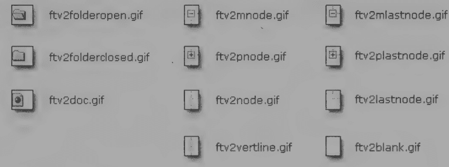

我保证，当我们进入代码部分时，你会经常参考这张图。Folder Tree 中的一切都由这些图像和纯文本构成。仅此而已。

#### 图层

`folderTree`中的每个文件夹和每个链接都有其自身的图层。例如，Europe 文件夹有其自身的图层，UK 文件夹、Scotland 文件夹和 Edinburgh 链接也各自有图层。每个图层包含一个单行双列的表格。图 21–2 展示了一个简单的示意图。

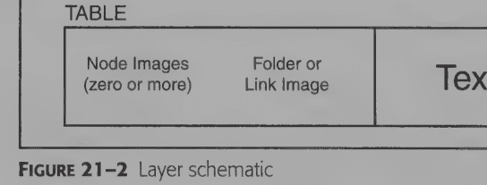

如果我们启用表格边框然后查看树，理解起来会更容易一些。图 21–3 显示了点击几个节点后的效果。

FolderTree 的主要工作是通过有选择地隐藏和显示图层来完成的。例如，我们来看一下图 21–4 中的 America 文件夹。

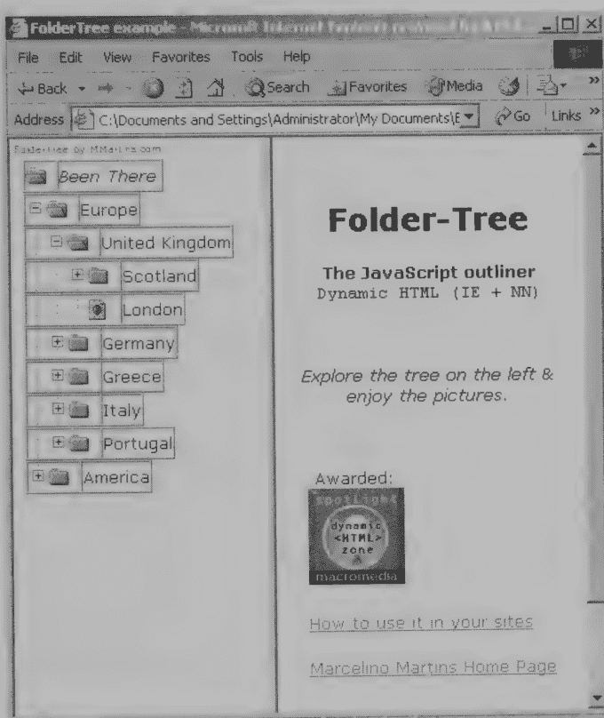

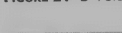

这里有两个图像：`ftv2plastnode.gif`和`ftv2folderclosed.gif`。当然，还有文本“America”。如果我们点击 America 文件夹旁边的加号，就会得到图 21–5 所示的结果。

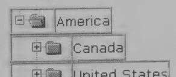

注意，America 文件夹（位于其自身的图层中）并没有移动。America 图层中唯一的变化是两个图像被替换了：

- `ftv2plastnode.gif`被替换为`ftv2mlastnode.gif`（区别在于“p”和“m”，推测分别代表“plus”加号和“minus”减号）
- `ftv2closedfolder.gif`被替换为`ftv2folderopen.gif`

此外，出现了两个新图层：包含 Canada 文件夹的图层和包含 United States 文件夹的图层。Canada 图层包含以下三个图像：

- `ftv2blank.gif`（一个空白图像）
- `ftv2pnode.gif`
- `ftv2folderclosed.gif`

United States 图层中并排放置着这些图像：

- `ftv2blank.gif`
- `ftv2plastnode.gif`
- `ftv2folderclosed.gif`

现在点击 Canada 文件夹旁边的加号，你会看到图 21–6。

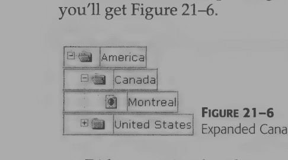

你注意到 Montreal 图层在 Canada 和 United States 文件夹之间弹出了吗？我们稍后会更详细地看到这一点，但 Montreal 图层实际上一直都在那里。然而，当它不可见时，它不占据任何空间。当它变得可见时，它就会将下方的所有内容向下推。你可以通过一个名为“display”的特殊属性并将其设置为“block”来实现这一点。世界上所有的图层，其`display`属性的默认设置都是“inline”。

同样重要的是要知道，代码会创建一个包含树中所有文件夹和链接的简单数组。对于我们的树，这个数组如示例 21–1 所示。

```text
清单 21-1 所有树元素的简单数组

indexOfEntries[0]  = Been There
indexOfEntries[1]  = Europe
indexOfEntries[2]  = United Kingdom
indexOfEntries[3]  = Scotland
indexOfEntries[4]  = Edinburgh
indexOfEntries[5]  = London
indexOfEntries[6]  = Germany
indexOfEntries[7]  = Munich
indexOfEntries[8]  = Greece
indexOfEntries[9]  = Athens
indexOfEntries[10] = Italy
indexOfEntries[11] = Tuscany
indexOfEntries[12] = Florence
indexOfEntries[13] = Pisa
indexOfEntries[14] = Rome
indexOfEntries[15] = Portugal
indexOfEntries[16] = Lisboa
indexOfEntries[17] = America
indexOfEntries[18] = Canada
indexOfEntries[19] = Montreal
indexOfEntries[20] = United States
indexOfEntries[21] = Boston
indexOfEntries[22] = New York
indexOfEntries[23] = Washington
```

不用担心这个数组是如何创建的——我们稍后会讲到。这里需要注意的是，所有文件夹和链接出现的顺序与树完全展开时的顺序相同。我们将会多次使用这个数组。

当然，如果我们将来需要引用这些图层，它们最好都有名称。让我们快速看看它们是如何工作的。再次强调，不要担心这些名称是如何生成的。我们很快就会讲到。记住，我们现在看的是发生了什么，稍后会看是如何发生的。

> **旁注** 葡萄牙的首都是里斯本。然而，如果你用葡萄牙语说，它的拼写是“Lisboa”。

让我们查看所有图层的`id`属性。由于每个项目和文件夹都有其自身的图层，每个图层都有其自身的名称。

```text
Been There        id='folder0'

Europe            id='folder1'

United Kingdom    id='folder2'

Scotland          id='folder3'

Edinburgh         id='item4'

London            id='item5'

Germany           id='folder6'

Munich            id='item7'

Greece            id='folder8'

Athens            id='item9'

Italy             id='folder10'

Tuscany           id='folder11'

Florence          id='item12'

Pisa              id='item13'

Rome              id='item14'

Portugal          id='folder15'

Lisboa            id='item16'

America           id='folder17'

Canada            id='folder18'

Montreal          id='item19'

United States     id='folder20'

Boston            id='item21'

New York          id='item22'

Washington        id='item23'
```

看出门道了吗？每个`id`属性值包含两部分信息：该图层包含的是文件夹还是项目，以及该图层在树中的位置。这些数字也与`indexOfEntries`数组的索引相对应。我们将会再次看到这一点。

### 绘制图层

虽然速度快得无法看清，但`folderTree`代码在页面加载时就绘制了整个树，包括每个文件夹和链接。整个树加载完成后，它会处于折叠状态，但 Europe 和 America 文件夹除外。这个过程听起来可能很简单，但它涉及大约二十几个不同的函数。我们会逐一讲解，但在那之前，我们应该退一步看看 HTML 是如何设置的。

如你所见，这是一个使用框架（frames）的页面。让我们看看示例 21–2，这个框架集页面。

```html
<html>

<head>

<title>FolderTree example</title>

</head>

<!--

（请保留所有版权声明。）

此框架集文档包含 FolderTree 脚本。

脚本位置：http://www.geocities.com/marcelino_martins/foldertree.html

作者：Marcelino Alves Martins (http://www.mmartins.com)

-->

<!-- 指示：

    - 在上方更改标题并添加其他 head 标签。

    - 不要更改左框架。

    - 你可以将右框架文档的名称从 "startPage.htm" 更改为其他名称，但在 defineMyTree.js 文件的第一个 gFld 的参数中使用相同的名称。

    - 不要更改框架的名称（"treeframe" 和 "basefrm"），否则树中的链接将无法工作。

    - 注意：该脚本并非设计用于在没有框架的独立页面中工作。 -->

<FRAMESET cols="200,*">

  <FRAME src="folderTreeLeftFrame.html" name="treeframe">

  <FRAME SRC="startPage.html" name="basefrm">

</FRAMESET>

</HTML>
```

你之前已经见过框架了，所以这一页我就不多评论了，只指出那个不包含文件夹树的页面名为`basefrm`。你稍后会看到它。现在，让我们看看示例 21-3 中的`startPage.html`，以便有个完整的了解。

```html
示例 21-3 startPage.html

<HTML>

<HEAD>

<style>

  BODY {background-color: white; font-size: 10pt; font-family: verdana,helvetica}

</style>

</HEAD>

<BODY BGCOLOR="#FFFFFF">

<CENTER>&nbsp;</CENTER>

<CENTER>

<H2>

Folder-Tree</H2></CENTER>

<CENTER><B>The JavaScript outliner</B></CENTER>

<CENTER><TT>Dynamic HTML (IE + NN)</TT></CENTER>

<CENTER>&nbsp;</CENTER>

<CENTER>&nbsp;</CENTER>

<CENTER>&nbsp;</CENTER>

<CENTER><I>Explore the tree on the left &amp; enjoy the pictures.</I></CENTER>

&nbsp;

<BR>&nbsp;

<BR>&nbsp;

<BR>&nbsp;

&nbsp;&nbsp;<font size=-1>Awarded:</font><br>

&nbsp;&nbsp;<a href=http://www.dhtmlzone.com target="_top"></a></center>

<P>&nbsp;&nbsp; <FONT SIZE=-1><A HREF="foldertree.html"

target="_top">How

to use it in your sites</A></FONT>
```

### 476 第21章 • FolderTree：显示树形结构


```html
<P>&nbsp;&nbsp;<FONT SIZE=-1><A HREF="http://www.geocities.com/Paris/LeftBank/2178/" target="_top">Marcelino

Martins Home Page</A></FONT>

<P>

<HR>

<CENTER><A HREF="http://www.geocities.com/" target="_top"></A></CENTER>

<CENTER><FONT SIZE=-2>Get your own free home

page</FONT></CENTER>


</BODY>

</HTML>
```

此页面直接取自马丁斯先生的网站，因此如果你直接将其输入到自己的计算机中，某些图像将无法显示。但你明白了大意——这个页面只是在说：“嗨。这是`FolderTree`。”

很好。现在让我们看看实际的`folderTree`页面，如示例21-4所示。

```html
<!--

    (请保留所有版权声明。)

    此框架集文档包含FolderTree脚本。

    脚本来源：http://www.geocities.com/marcelino_martins/foldertree.html

    作者：Marcelino Alves Martins (http://www.mmartins.com)

    说明：

    - 请勿在style标签之外对此文件进行任何更改。

    - 通过style标签，你可以更改颜色和字体类型，以适应你网站的特定需求。

    - 已为喜欢黑色背景的时尚人士预设了一个样式块。

-->

<html>

<head>

<!-- 如果你想要黑色背景，请移除此style块 -->

<style>

    BODY {background-color: white}

    TD {font-size: 10pt;

        font-family: verdana,helvetica;

        text-decoration: none;

        white-space:nowrap;}

    A  {text-decoration: none;

        color: black}

</style>

<!-- 如果你想要黑色背景，请移除此行和标记为XXXX的行，并保留下面的style块

<style>

    BODY {background-color: black}

    TD {font-size: 10pt;

        font-family: verdana,helvetica

        text-decoration: none;

        white-space:nowrap;}

    A  {text-decoration: none;

        color: white}

</style>

XXXX -->

<!-- 从此行开始请勿更改 -->

<!-- 浏览器检测代码 -->

<script src="ua.js"></script>

<!-- 树的基础架构代码 -->

<script src="ftiens4.js"></script>

<!-- 执行实际构建特定树形的代码。

变量foldersTree通过调用

gFld, insFld, 和 insDoc 来创建其结构 -->

<script src="defineMyTree.js"></script>

</head>

<body topmargin=16 marginheight=16>

<!-- 对此代码进行任何更改都违反了你的用户协议；

这对于企业用户尤其麻烦。

请查阅在线说明以获取不含链接的版本 - -->

<!-- 移除此链接将导致脚本停止工作 -->

<div style="position:absolute; top:0; left:0; "><table

border=0><tr><td><font size=-2><a style="font-size:6pt;text-

decoration:none;color:gray" href=http://www.mmartins.com

target=_top>FolderTree by MMartins.com</a></font></td></table></div>

<!-- 构建浏览器对象并显示树的默认视图。 -->

<script>initializeDocument()</script>

</html>
```

### 代码如何工作

1. 我们要做的第一件事是下载一个包含大量函数的`JavaScript`文件，但我们只用它来进行浏览器检测。你现在只需要知道，这组代码会产生一个名为`navigator.family`的变量，它告诉我们正在使用的是哪种浏览器。这里的代码在加载时就会执行，因此所有后续代码都可以访问`navigator.family`。稍后将详细介绍。
2. 这个`JavaScript`文件包含绘制文件夹和链接的所有功能，以及关闭和打开它们的功能。
3. `defineMyTree.js`文件包含创建`foldersTree`对象的所有信息，就像我们之前看到的那样。这段代码在加载到页面后也会立即运行。
4. 在`ua.js`和`defineMyTree.js`中的所有`JavaScript`加载完毕后，页面会调用`initializeDocument`函数，该函数让一切开始运行。

`initializeDocument`函数可以在示例21-5中找到。

```javascript
示例 21-5 initializeDocument()

// 主函数

// **************

// 此函数使用在主HTML页面（左框架）中导入的、在ua.js中定义的一个对象（navigator）。

function initializeDocument()

{

    switch(navigator.family)

    {

        case 'ie4':

            browserVersion = 1 //IE4

            break;

        case 'nn4':

            browserVersion = 2 //NS4

            break;

        case 'gecko':

            browserVersion = 3 //NS6

            break;

        default:

            browserVersion = 0 //其他

            break;

    }

    //foldersTree（包含网站数据）在一个外部.js文件中创建

    foldersTree.initialize(0, 1, "")

    if (browserVersion == 2)

        doc.write("<layer top="+indexOfEntries[nEntries-1].navObj.top+">&nbsp;</layer>")

    //树初始时完全展开

    if (!STARTALLOPEN)

        if (browserVersion > 0) {

            // 关闭整个树

            clickOnNode(0)

            // 打开根文件夹

            clickOnNode(0)

        }

    if (browserVersion == 0)

        doc.write("<table border=0><tr><td><br><br>

            <font size=-1>此树仅支持支持DHTML的浏览器展开或收缩</font></table>")

}
```

#### 代码如何工作

1. 此函数的一部分使用了在另一个函数中定义的对象。该函数位于`ua.js`文件中，我稍后会为你列出它，但你现在真的不需要了解它，只知道它进行了一些浏览器检测并创建了`navigator.family`来保存正在使用的浏览器类型。
2. 如果你以前没见过`switch/case`，它的作用类似于`if/else`语句。在这种情况下，我们将检查`navigator.family`对象的值。
3. 如果`navigator.family`的值是“ie4”，那么下面的这些行就会被执行。如果`navigator.family`等于“ie4”以外的任何值，那么代码将向前跳过，直到遇到下一个`case`语句。注意，“ie4”实际上指的是任何高于IE3的版本。因此，如果用户使用的是IE5或6，那么`navigator.family`将等于“ie4”。
4. 如果用户使用的是IE4或更高版本，那么`browserVersion`变量将被设置为1。就是这样。
5. 这里的`break`语句告诉JavaScript离开`switch/case`代码段，就像`break`会退出`for`循环一样。
6. 如果我们的用户不幸使用的是Netscape 4，我们将`browserVersion`设置为2。记住这个数字——我们稍后会再次见到它。
7. 如果浏览器属于“gecko”系列（这是Netscape 6使用的渲染引擎的名称），那么`browserVersion`就是“3”。
8. 如果浏览器是某种奇怪的、或不支持DHTML的浏览器，那么`browserVersion`将被设置为“0”。
9. 这里就是我们绘制整个树的地方。还记得在`Folder`函数中，我们将initialize方法设置为调用`initializeFolder`函数吗？嗯，这就是我们正在做的。我们是在说：“运行`initializeFolder`。”并且由于我们是通过调用对象的方法来完成的，所以在`initializeFolder`函数中看到“this”时，我们知道“this”就是“foldersTree”。这个函数绘制整个树并将其留在那里（别担心，我们很快会查看这个函数）。注意我们传递的参数：`1`、`0`和`""`。这意味着“这是一个一级文件夹（顶部），它不是其部分中的最后一个节点，并且在文件夹图像之前不应有任何图像。”
10. 当代码执行到这一行时，整个树及其所有文件夹和链接都已显示在用户的浏览器中。在这行代码中，我们正在检查正在使用的浏览器是否是Netscape 4。
11. 这行代码创建了一个包含一个空格的图层，并将其移动到与树中最后一个元素对齐的位置。在这种情况下，这意味着Washington链接。为什么要这样做？我不知道。注释掉这段代码不会影响树的性能，所以我怀疑这是遗留代码，保留下来是因为它没有造成任何伤害。如果有人能弄明白（或者能联系到马丁斯先生），请给我发邮件到`advjs@wire-man.com`，我会将答案发布在本书的网站上（`www.wire-man.com/advjs`）。
12. 这段代码为树的初始状态提供了两种方式：它可以完全打开并完全绘制（就像代码此时的状态），或者完全关闭，除了开放的根文件夹外。用于跟踪这一点的变量是`STARTALLOPEN`。如果该变量为`true`，那么我们就完成了！树已经绘制出来，我们现在不需要做任何其他事情。然而，如果`STARTALLOPEN`为`false`，则需要采取一些操作来关闭其中的许多文件夹。
13. 在我们开始任何真正花哨的操作之前，我们确保用户的浏览器能够处理DHTML……
14. ……就像这样。`clickOnNode`函数的作用就像用户点击文件夹旁边的加号或减号一样。要关闭整个树——也就是说，将所有内容折叠到根文件夹中——我们调用`clickOnNode(0)`，这会关闭我们树中的第一个项目，即Been There文件夹。一旦这个函数运行（你猜对了，我们稍后会深入研究它），就只显示根文件夹了。
15. 我们希望显示的不仅仅是根文件夹——我们想看看根文件夹里面有什么。为此，我们需要再次点击它，对吧？所以我们调用同一个函数并传递相同的变量：`clickOnNode(0)`。在此函数运行后，根文件夹及其两个子文件夹Europe和America就可见了。
16. 以防用户使用的是Netscape 2或IE 3或其他类似疯狂的版本，我们给他们一个小消息，说明我们需要支持DHTML的浏览器。

这就是页面加载时发生的情况概述。请注意，我们跳过了两个非常大的函数：`initializeFolder`，它绘制整个树并将所有内容放入层中；以及`clickOnNode`，它负责打开和关闭文件夹。我们将在下一章中逐一并缓慢地处理这些：每个函数都使用许多其他函数。

## FolderTree：完成它

# 22

## 本章内容

- 绘制树
- 打开和关闭文件夹

我们快完成了！现在是时候深入探究`FolderTree`的内部工作原理，看看它如何处理其多个元素、文件夹和嵌套。

### 绘制树

实际上将`foldersTree`对象中的信息提取并生成所有正确的层、图像、链接和文本的主要函数是`initializeFolder`函数。

这是该函数的一个伪代码版本：

```text
function initializeFolder(level, lastNode,

  leftSide)

  {

  - 向 indexOfEntries 数组添加另一个元素

  - 为节点图像（带有加号或减号的那个）创建链接

  - 绘制文件夹，包含层信息、图像、链接和文本

  - 设置节点是否是最后一个节点（即，是特定文件夹中出现的最后一个节点）

  - 如果节点有子节点（即，如果文件夹中有内容），则循环遍历该文件夹的所有子节点

  - 如果文件夹的子节点是文件夹，则调用 initializeFolder（是的，函数可以调用自身），这将绘制该文件夹

  - 如果文件夹的子节点是链接，则调用 initializeItem 函数（当链接被创建时，初始化方法指向 initializeItem，而不是 initializeFolder）

  }
```

这基本上就是`initializeFolder`所做的事情。它绘制一个文件夹，然后查看该文件夹是否有任何子文件夹。如果有，那么代码将循环遍历所有这些子文件夹并绘制每一个。如果这些子文件夹中的一个是另一个文件夹，那么该文件夹的内容也将被绘制。

### 递归函数

这种递归函数调用可能有点令人困惑，所以让我们更仔细地看看它。当代码开始运行时，第一个文件夹是主Been There文件夹。所以我们有一个函数在运行：

`initializeFolder(Been There)`

Been There有两个子文件夹：Europe和America文件夹。Europe文件夹是第一个，所以在绘制Been There文件夹之后，代码发现Been There的第一个子文件夹是Europe，于是`initializeFolder`函数被再次调用。

`initializeFolder(Been There) (等待)`

`initializeFolder(Europe) (运行)`

可以这样想：同时有两个`initializeFolder`实例在运行。负责Been There文件夹的那个只是在那里等待，等待Europe文件夹绘制完成，以便它可以处理America文件夹。

负责绘制Europe文件夹的`initializeFolder`只做这件事，并查看Europe是否有任何子文件夹。碰巧的是，Europe文件夹有子文件夹，所以另一个`initializeFolder`实例开始行动。

```text
initializeFolder (Been There) (等待)

initializeFolder (Europe) (等待)

initializeFolder (United Kingdom) (运行)
```

你可以猜到接下来是什么。UK文件夹还有另一个文件夹，所以`initializeFolder`再次被调用：

```text
initializeFolder (Been There) (等待)

initializeFolder (Europe) (等待)

initializeFolder (United Kingdom) (等待)

initializeFolder (Scotland) (运行)
```

当然，Scotland文件夹有一个子节点，但这个子节点是一个链接，而不是另一个文件夹。这意味着调用的是`initializeItem`，而不是`initializeFolder`。

```text
initializeFolder (Been There) (等待)

initializeFolder (Europe) (等待)

initializeFolder (United Kingdom) (等待)

initializeFolder (Scotland) (等待)

initializeItem (Edinburgh) (运行)
```

还有其他子节点吗？没有，谢天谢地。Edinburgh只是一个链接，所以那个`initializeItem`实例消失了。Scotland文件夹没有更多的子节点，所以那个`initializeFolder`也消失了。我们回到：

```text
initializeFolder (Been There) (等待)

initializeFolder (Europe) (等待)

initializeFolder (United Kingdom) (运行)
```

UK文件夹有另一个子节点：London。由于London是一个链接，所以调用`initializeItem`函数：

```text
initializeFolder (Been There) (等待)

initializeFolder (Europe) (等待)

initializeFolder (United Kingdom) (等待)
```


`initializeItem (London) (运行)`

这个过程一直持续，直到 Europe 文件夹中的所有内容都在浏览器中绘制完成。当 Europe 完成时，我们有：

`initializeFolder (Been There)`

这还有另一个子节点吗？当然：America！

`initializeFolder (Been There) (等待)`

`initializeFolder (America) (运行)`

这个循环继续，直到 America 文件夹中的所有内容都被绘制完成。此时，整个树中的所有内容都已绘制完成。

现在你已经对函数本身的工作原理有了一个概念，让我们看看示例 22-1，它展示了实际代码：

### 示例 22-1 绘制文件夹

```javascript
function initializeFolder(level, lastNode, leftSide)
{
    var j=0
    var i=0
    var numberOfFolders
    var numberOfDocs
    var nc

    nc = this.nChildren
    this.createIndex()

    var auxEv = ""

    if (browserVersion > 0)
        auxEv = "<a href='javascript:clickOnNode("+this.id+")'>"
    else
        auxEv = "<a>"

    if (level>0)
        if (lastNode) //子节点数组中的最后一个子节点
        {
            this.renderOb(leftSide + auxEv + "</a>")

            leftSide = leftSide +
            ""

            this.isLastNode = 1
        }
        else
        {
            this.renderOb(leftSide + auxEv +
            "</a>")

            leftSide = leftSide + ""

            this.isLastNode = 0
        }
    else
        this.renderOb("")

    if (nc > 0)
    {
        level = level + 1

        for (i=0 ; i < this.nChildren; i++)
        {
            if (i == this.nChildren-1)
                this.children[i].initialize(level, 1,
                leftSide)
            else
                this.children[i].initialize(level, 0,
                leftSide)
        }
    }
}
```

#### 代码如何工作

1. 准备好了吗？我们开始吧。这个函数接受三个参数：`level`，允许我们在没有任何加号或减号节点的情况下绘制 Been There 文件夹；`lastNode`，简单地表示该节点是否是节点列表中的最后一个；以及 `leftSide`，它包含所有节点前的图像，如垂直线和空白间隔图像。
2. 这里有一些遗留代码，变量 `j` 不再使用。
3. 遗留变量。不再使用。
4. 遗留变量。不再使用。
5. 变量 `nc` 包含此节点拥有的子节点数量。对于 Been There 文件夹（第一个），`nc` 的值为 2。
6. 我们通过调用 `createIndex` 方法向 `indexOfEntries` 数组添加一个条目。这个方法实际上指向 `createEntryIndex` 函数，我们将在完成这个函数后立即查看它。
7. 这里我们为小的加号/减号节点创建链接。因为我们希望点击该节点有意义，所以它需要一个链接。该链接指向 `clickOnNode` 函数（还记得在 `initializeDocument` 中见过它吗？），它切换文件夹是关闭还是打开。请注意，如果用户拥有支持 DHTML 的浏览器，则在变量 `auxEv` 中创建此链接。
8. 如果你使用的是非 DHTML 浏览器，那么只使用 `<a>`。这没有任何作用，但稍后会写入 `</a>`。
9. 如果 `level` 大于零（即，如果所讨论的文件夹是除根文件夹以外的任何文件夹）……
10. 我们查看所讨论的文件夹是否是其组中的最后一个文件夹。例如，America 文件夹符合条件，因为它出现在 Europe 文件夹之后，并且之后没有任何内容。
11. 这个对 `renderOb` 的冗长调用（该方法实际上指向 `drawItem` 函数）只传递一个参数：层中出现的所有代码和图像，不包括实际的文档/链接图像和文本。也就是说，所有在文件夹图标和文本（例如，“Europe”或“Scotland”）之前的垂直线和空白图像都被传递给 `drawItem` 函数。然后该函数实际绘制完整图层。我们稍后会更详细地查看此函数。在本例中，我们传递的是 `leftSide` 图像、节点的链接、节点图像，并以 `</a>` 结尾。请注意节点图像中包含一个“m”，这表示它是最后一个节点图像，但带有一个减号。这意味着我们假设正在绘制一个打开的文件夹（目前确实如此——我们正在绘制所有内容）。
12. `leftSide` 变量包含在小加号/减号节点（本身出现在文件夹图标之前）之前出现的所有图像信息。由于此代码段处理序列中的最后一个节点，因此添加了一个空白图标。需要这个额外的空白图像，以便打开文件夹的所有内容都向右移动一个空格，使其看起来是该文件夹的一部分。要看到这一点，请打开 America 和 United States 文件夹。注意文件夹的内容向右移动了。正是空白图像导致了这种移动。
13. 由于此节点是其部分中的最后一个，我们将文件夹的 `lastNode` 属性设置为 1，这等同于将其设置为 `true`。
14. 如果文件夹不是其部分中的最后一个节点，那么我们执行相同的操作，只是我们向 `drawItem` 函数发送不同的节点图像：我们发送 `ftv2mnode.gif` 而不是 `ftv2mlastnode.gif`。
15. 对于 `leftSide`，我们添加一条垂直线而不是空白图像。要了解这样做的原因，请打开 Europe 和 America 文件夹。Europe 文件夹下的项目有垂直线，而 America 文件夹下的项目有空白，如图 22-1 所示。
16. 如果此文件夹不是最后一个节点（例如，它是 Europe 文件夹而不是 America 文件夹），则 `lastNode` 属性设置为 0，这类似于将其设置为 `false`。
17. 如果层级不大于零（即层级为 0），则该文件夹是 Been There 根文件夹，我们不希望有任何节点图像。因此，我们调用 `drawItem` 函数时不传递任何内容。这意味着只有文件夹图标和文件夹名称将被写入浏览器。

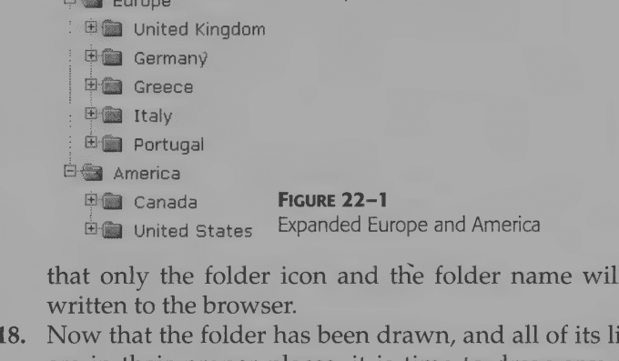

18. 既然文件夹已经绘制完成，所有链接都已就位，现在是时候绘制文件夹中可能包含的任何子项了。为确保这一点，我们检查 `nc`（即文件夹的子项数量）是否大于零。如果是，则文件夹内有子项。
19. 我们将层级增加一。只有当当前文件夹是根文件夹并且我们希望确保其子项获得其小节点图像时，才需要此行代码。也就是说，`level` 变量的唯一真正用途是确定文件夹是否为根文件夹。我们唯一想知道这一点的原因是根文件夹不使用节点图像绘制。因此，只要层级不为 0，文件夹就会使用其节点图像绘制。因此，如果当前层级为 0，我们希望文件夹的子项的层级大于零。然而，如果层级已经大于零，那么再增加它不会产生任何影响。如果这一点仍然不清楚，请尝试注释掉该行以查看会发生什么（你能猜到吗？所有节点信息都会消失，所有文件夹和链接将直接排列在彼此下方）。
20. 然后我们遍历当前文件夹的所有子项创建一个循环。
21. 我们查看正在查看的子项是否是最后一个子项。
22. 如果我们查看的是最后一个子项，那么我们在该子项上调用 `initialize` 方法。我们传递层级信息（现在大于零）、`lastNode` 信息（它是 `lastNode`，所以我们传递“1”，这等同于传递“true”）和 `leftSide`（所有节点图像信息）。但是等等！你会问，如果子项是链接而不是文件夹怎么办？`initialize` 方法不就是映射到 `initializeFolder` 函数吗？是的，如果子对象是文件夹，则是。如果子对象是链接，那么 `initialize` 方法实际上映射到 `initializeItem`。这一点很重要，所以请确保你理解这一点：如果我们查看的子项是链接，那么当该链接在 `Item` 函数中创建时，`initialize` 方法被映射到 `initializeItem` 函数。如果我们查看的子项是文件夹，那么当该文件夹在 `Folder` 函数中创建时，`initialize` 方法被映射到 `initializeFolder` 函数。这可能有点令人困惑，因为 `initialize` 方法可以指向两个不同的函数，这取决于子项是文件夹还是链接。
23. 如果子项不是该部分中的最后一个子项，则再次调用 `initialize` 方法。唯一的区别是，由于它不是最后一个节点，在 `lastNode` 参数中传递 0 而不是 1。

呼！代码真多。休息一下，喝杯水，去慢跑一下。我要去了。

好了，我回来了。

`initializeFolder` 调用了许多其他函数，所以让我们开始查看其中一些。

简单回顾一下，让我们记住我们是如何到达这里的。页面加载，`initializeDocument` 函数被调用。该函数又调用了我们刚刚查看的 `initializeFolder`。在 `initializeFolder` 内部调用的第一个函数之一是 `createEntryIndex`。让我们在示例 22–2 中看看它。

### 示例 22-2

```javascript
function createEntryIndex()
{
  ❶ this.id = nEntries
  ❷ indexOfEntries[nEntries] = this
  ❸ nEntries++
}
```

#### 代码工作原理

1. 此函数的目的只是向全局数组 `indexOfEntries` 添加一个条目，我们之前在本章中看到过。我们首先为对象设置 `id` 属性。例如，假设我们正在初始化 Been There 文件夹。变量 `nEntries` 是一个全局变量，从 0 开始，因此 Been There 文件夹的 `id` 属性为 0。
2. 然后我们在 `indexOfEntries` 数组中放置一个指向 Been There 文件夹的指针。即：

   `indexOfEntries[0] = Been There folder`

3. 然后我们将 `nEntries` 增加一，其作用等同于将其设置为 `indexOfEntries` 数组的长度。

就这样。这是一个非常简单的函数。

我们接下来遇到的函数是 `drawFolder`（由 `renderOb` 方法调用）。它显示在示例 22–3 中。

### 示例 22-3

```javascript
❶ function drawFolder(leftSide)
{
  ❷ var idParam = "id='folder" + this.id + "'"

  ❸ if (browserVersion == 2) {
    ❹ if (!doc.yPos)
      doc.yPos=20
  }

  ❺ this.blockStart("folder")
  ❻ doc.write("<tr><td>")
  ❼ doc.write(leftSide)
  ❽ this.outputLink()
  ❾ doc.write("</a>")
  ❿ doc.write("</td><td valign=middle nowrap>")

  ⓫ if (USETEXTLINKS)
  {
    ⓬ this.outputLink()
    ⓭ doc.write(this.desc + "</a>")
  }
  else
  ⓮ doc.write(this.desc)

  ⓯ doc.write("</td>")
  ⓰ this.blockEnd()

  ⓱ if (browserVersion == 1) {
    ⓲ this.navObj = doc.all["folder"+this.id]
    ⓳ this.iconImg = doc.all["folderIcon"+this.id]
    ⓴ this.nodeImg = doc.all["nodeIcon"+this.id]
  }
  else if (browserVersion == 2) {
    this.navObj = doc.layers["folder"+this.id]
    this.iconImg =
      this.navObj.document.images["folderIcon"+this.id]
    this.nodeImg =
      this.navObj.document.images["nodeIcon"+this.id]
    doc.yPos=doc.yPos+this.navObj.clip.height
  }
  else if (browserVersion == 3) {
    this.navObj = doc.getElementById("folder"+this.id)
    this.nodeImg =
      doc.getElementById("nodeIcon"+this.id)
  }
}
```

#### 代码工作原理

1. 这是实际绘制包含节点图像、文件夹图标、链接和文件夹名称的图层的函数。有一个单独的函数 `drawItem` 为链接执行相同的操作。传递给此函数的唯一参数是 `leftSide`，它是零个或多个空白图像或垂直线的图像标签，或包含加号或减号的其中一个图像。
2. 此行是遗留代码，我们在这里不使用它。不过，该变量在另一个函数中定义和使用。
3. 如果用户运行的是 Netscape 4，那么我们需要确保树的顶部不会碰到浏览器窗口的最上边缘。
4. 我们通过首先查看文档是否已被移动（当绘制 Been There 文件夹时它会被移动）来将文档向下移动 20 像素。如果它还没有被向下移动（即我们目前正在绘制 Been There 文件夹），那么我们将文档向下移动 20 像素。
5. 接下来，我们调用 `blockStart` 函数。此函数写入一个 `<layer>` 或 `<div>` 标签，以及一个 `<table>` 标签。
6. 现在我们有了一个 `<table>` 标签，我们写入 `<tr><td>`。
7. 我们现在位于一个表格单元格内，我们写出 `leftSide` 中的所有图像。
8. 在绘制文件夹图标本身之前，我们必须写出该图标的链接。在本例中，文件夹的链接指向图像。
9. 最后，是时候绘制实际的文件夹图标了。首先，我们确定图像的 `id`。它总是以 `folderIcon` 开头，以 `id` 属性结尾，后者始终是一个数字。例如，如果我们正在绘制 Europe 文件夹的文件夹图像，则 `id` 属性将是 `id='folderIcon1'`，因为 Europe 文件夹是树中的第二个元素。Tuscany 文件夹将包含 `id='folderIcon11'`，因为它是树中的第十二个元素。创建图像的名称完全相同，结果相同。要获取图像的实际源，我们查看 `this.iconSrc`，这是在 `Folder` 函数中首次创建文件夹对象时设置的。当运行此函数时，遇到了此行：

```javascript
this.iconSrc = "ftv2folderopen.gif"
```

因此，除非有变化，文件夹图标都绘制为打开状态。那么我们 Europe 文件夹的整个图像标签将如下所示：

```html

```


10. 现在我们已经绘制了所有需要的图像，因此结束表格单元格并开始另一个。

11. 此代码有一个选项，可以让文件夹旁边的文本也充当链接，这通过`USETEXTLINKS`变量设置。该变量的初始值为0，意思是“文本只是文本——不是链接”。

12. 如果`USETEXTLINKS`是1而不是0（唯一可以更改此设置的地方是在代码中直接修改），那么我们将编写与附加到文件夹图像相同的链接。

13. 然后我们编写文件夹的文本，如“Europe”或“Italy”，并以`</a>`结束。

14. 如果`USETEXTLINKS`是0，那么我们只需写出文本。

15. 在所有情况下，我们都以`</td>`结束表格单元格。

16. 我们通过调用`blockEnd`函数来结束层，该函数写入`</table></layer>`或`</table></div>`。

17. 文件夹现在已完全绘制并可见于用户。此函数的其余部分致力于更新三个不同的文件夹属性：`navObj`、`iconImg`和`nodeImg`。`navObj`指向整个层，`iconImg`指向文件夹图像，`nodeImg`指向紧挨文件夹图像的图像（即带有小加号或减号的图像）。为什么我们需要知道这些？稍后，当我们开始关闭和打开文件夹时，我们实际上是在隐藏和显示层，以及进行一些图像替换（将打开的文件夹图像更改为关闭的文件夹图像，将加号更改为减号等）。对于这行代码，我们正在查看用户是否在运行IE。

18. 我们通过使用`doc.all`（`doc`是我们在代码早期为`document`设置的快捷方式——它是全局变量之一）来设置`navObj`。IE的后续版本可以正常使用`document.getElementById`，但它们都仍然向后兼容`document.all`。如果我们刚刚绘制了Europe文件夹，`navObj`将指向`document.all["folder1"]`。层的名称在`blockStart`函数中设置，这就是为什么你还没有看到它。

19. 然后我们继续设置`iconImg`指向文件夹图像。对于我们Europe文件夹的示例，这是：

`this.iconImg = doc.all["folderIcon1"]`

20. 最后，`nodeImg`指向紧挨文件夹图像的图像。在我们的示例中，它看起来像这样：

`this.nodeImg = doc.all["nodeIcon1"]`

21. 我们还需要特殊的代码来处理Netscape 4。

22. 如果我们处理的是Netscape 4，那么我们使用`doc.layers`指向一个层。然后我们使用`navObj`指向各个图像。例如，要设置`iconImg`，我们想使用：

`doc.layers["folder1"].document.images["folderIcon1"]`

23. 最后，如果我们必须处理Netscape 6，我们使用与IE相同的代码，只是将“all”和方括号替换为“getElementById”和括号。

因此，在这个函数（`drawFolder`）完成后，文件夹层就完全绘制完成了。让我们退一步，快速回顾一下我们是如何开始研究这个函数的：

- 页面加载
- `initializeDocument`
- `initializeFolder`
- `createEntryIndex`
- `drawFolder`（`renderOb`方法）

你可能已经注意到`drawFolder`函数本身调用了另外三个函数：`blockStart`、`outputLink`（该函数的真实名称是`outputFolderLink`）和`blockEnd`。让我们从`blockStart`开始，依次看看这三个函数。

`blockStart`函数的目的，如示例22-4所示，是编写开始的`<layer>`或`<div>`标签，以及每个文件夹都使用的`<table>`标签。

```javascript
function blockStart(idprefix) {

    var idParam = "id='" + idprefix + this.id + "'"

    if (browserVersion == 2)

        doc.write("<layer " + idParam + " top=" +

        doc.yPos + " visibility=show>")

    if (browserVersion == 3)

    //N6 has bug on display property with tables

        doc.write("<div " + idParam +

        " 'style='display:block; position:block;'>")

    doc.write("<table border=0 cellspacing=0 cellpadding=0 ")

    if (browserVersion == 1)

        doc.write(idParam + " style='display:block; position:block; '>")

    else

        doc.write(">")

}
```

### 代码如何工作

1. 此函数只需要一个参数：`idprefix`。实际上，它只有两个值：“folder”和“item”。

2. 这就是`idParam`派上用场的地方。我们创建层（以及它可能包含的表格）的`id`。如果我们正处于Europe文件夹的示例中，那么结果将是`id='folder1'`。

3. 如果使用的是Netscape 4，我们编写带有正确`id`和位置的`<layer>`标签，然后确保该层可见。

4. 如果使用的是Netscape 6，则使用`<div>`，带有正确的`id`和一个你可能没见过的`display`属性：`block`。大多数网页不关心这个显示属性（其默认值是“inline”）。然而，使用`display:block`允许各个层以有用的方式折叠和重新出现。我们将在下一节研究打开和关闭文件夹时更详细地看到这种行为。

5. 然后我们开始渲染`<table>`标签。注意结束括号缺失了。

6. 如果我们使用的是IE（我们已经处理了Netscape浏览器），那么我们将`id`和显示信息放在表格标签本身中：我们不需要将表格放在单独的层中。我应该指出，移除`position:block`并没有影响表格的行为——似乎只需要`display:block`。然而，Martin先生可能在比我更多的浏览器上测试了他的代码，最终需要`position`属性。

7. 最后，我们为`<table>`标签添加结束尖括号。

所以这就是我们如何开始绘制文件夹：`blockStart`函数为我们开始绘制它。让我们快速回顾一下`drawFolder`：

```javascript
this.blockStart("folder")

doc.write("<tr><td>")

doc.write(leftSide)

this.outputLink()
```

`blockStart`函数绘制层信息（如果需要）和`<table>`标签。`drawFolder`函数负责行和单元格标签，以及`leftSide`图像（包括所有节点图像和用于加/减节点的链接）。接下来是为文件夹图像本身创建链接，这就是`outputLink`方法的作用（它导向`outputFolderLink`函数，如示例22-5所示）。

```javascript
function outputFolderLink()

{

    ❶if (this.hreference)

    {

        ❷doc.write("<a href='" + this.hreference +

            "' TARGET=\"basefrm\" ")

        ❸if (browserVersion > 0)

            ❹doc.write("onClick=

                'javascript:clickOnFolder("

                + this.id+")'"

            )

        ❺doc.write(">")

    }

    else

        ❻doc.write("<a>")

}
```

### 代码如何工作

1. 我们首先确保文件夹对象的`hreference`属性包含内容。此属性在`Folder`函数中首次创建文件夹时设置。

2. 如果存在`hreference`，那么我们继续开始编写链接。对于我们树中的所有文件夹（根文件夹除外），这些链接都只是指向图像的链接。因此，所有文件夹的链接都将包含类似以下内容：

   `<a href='some image' TARGET="basefrm"`

   `basefrm`目标是我们文件夹树右侧的框架。

3. 我们确保正在使用支持DHTML的浏览器。

4. 如果是，那么我们添加对`clickOnFolder`函数的调用，这是一种打开和关闭文件夹的方式。我们稍后会研究这个函数。注意我们将当前文件夹的`id`发送给此函数。例如，如果这是Tuscany文件夹的链接，我们将“11”发送给`clickOnFolder`函数。

5. 然后我们以必要的尖括号结束我们的链接。

### 第22章 • FolderTree：完成收尾

如果用户使用的是某种非DHTML浏览器，则会向浏览器写入一个不起作用的锚点（`<a>`）标签。

一旦表格标签写入完毕，节点图像已就位，带链接的文件夹图像就位，文件夹旁边的文本已渲染，表格单元格已关闭，就到了关闭表格和图层的时候了。为此，我们调用`blockEnd`函数，如示例22-6所示。

```javascript
function blockEnd() {

  doc.write("</table>")

  if (browserVersion == 2)

    doc.write("</layer>")

  if (browserVersion == 3)

    doc.write("</div>")

}
```

### 代码工作原理

1. 无论你使用什么浏览器，`</table>`都会写入你的浏览器。对于那些在家记录得分的人，你可能注意到一个`</tr>`被遗漏了：我们直接从`</td>`跳到了`</table>`。虽然这在技术上是不正确的，但在实际世界中这没有问题。表格渲染得很好。

2. 如果使用Netscape 4，则`</layer>`会出场。

3. 如果使用Netscape 6，则`</div>`会写入浏览器。请记住，IE不需要`</div>`，因为所有的id和样式信息都直接放在了`<table>`标签上。

绘制文件夹到此结束！不需要其他函数了。作为回顾，这是我们到达这一步所走的路径。

- 页面加载
  - `initializeDocument`
    - `initializeFolder`
      - `createEntryIndex`
      - `drawFolder`（`renderOb`方法）
        - `blockStart`
        - `outputFolderLink`（`outputLink`方法）
        - `blockEnd`
      - `drawItem`（`renderOb`方法）
        - `blockStart`
        - `blockEnd`

这可能有很多函数需要跟踪。当然，还有几个函数要看。毕竟，我们还没有看到如何显示链接。还记得在`initializeFolder`中，我们查看文件夹是否有子元素吗？文件夹的任何子元素随后会启动`initialize`方法，如果子元素是文件夹，则导向`initializeFolder`，如果子元素是链接，则导向`initializeItem`。文件夹部分我们已经掌握，但我们仍然需要研究特定于链接的函数。让我们开始想象我们正在查看Scotland文件夹并遇到了Edinburgh链接。`initializeItem`函数被调用，所以我们来看一下示例22-7。

```javascript
function initializeItem(level, lastNode, leftSide)

{

    this.createIndex()

    if (level>0)

        if (lastNode) //children数组中的最后一个'兄弟'

        {

            this.renderOb(leftSide +

                "")

            leftSide = leftSide +

                ""

        }

        else

        {

            this.renderOb(leftSide +

                "")

            leftSide = leftSide +

                ""

        }

    else

        this.renderOb("")

}
```

### 代码工作原理

1. `initializeItem`函数接受与`initializeFolder`相同的参数：

   - `Level`：确定链接是否为根节点；
   - `LastNode`：确定链接是否为其文件夹中的最后一项；以及
   - `LeftSide`：包含通往节点图像的所有图像标签。

2. 与文件夹一样，我们调用`createIndex`方法（对应`createEntryIndex`函数），该方法将我们的链接添加到文件夹树的主元素列表中。你还记得那个主列表的名称吗？¹

3. 我们查看链接是否是我们树中的根元素。这极不可能发生，因为那样的话我们的树就只是一个单独的链接，而链接不能有子元素（它们没有`children`数组）。

4. 然后我们查看链接是否是其文件夹中的最后一个节点。如果我们的链接是Edinburgh，那么它将是Scotland文件夹中的最后一个链接（它是该文件夹中唯一的链接）。

5. 如果我们的链接是其文件夹中的最后一个节点，我们将`leftSide`的内容以及一个最后节点图像发送到`drawItem`函数（当对象是链接时，`renderOb`映射到此；否则，它映射到`drawFolder`）。

6. 然后我们向`leftSide`中已有的内容添加一个空白图像。从技术上讲，这一步并非真正必要，因为如果我们查看的链接是其文件夹中的最后一个，下一行永远不会从我们的链接右侧开始。代码只会打印出比我们的链接高一级的文件夹或链接。例如，我们的链接是Edinburgh，它是其文件夹中的最后一个链接。在此代码中，一个空白图像被添加到`leftSide`。然而，这个特定的`leftSide`永远不会再次使用，因为代码会返回到等待中的`initializeFolder`函数，该函数使用不同的`leftSide`变量。

7. 如果我们的链接不是其文件夹中的最后一项，例如Tuscany文件夹中的Florence链接，那么一个常规节点图像标签会被发送到`drawItem`函数。

8. 同样，这行代码并非真正必要，因为链接永远不会有子元素。代码总是返回到等待中的`initializeFolder`函数，以查看下一个子元素是什么。

9. 最后，在极不可能的情况下，如果我们的链接是根节点，则绘制一个简单的链接图标和文本，没有任何节点图像。

这与`initializeFolder`函数的部分内容非常相似。

我们现在需要看的唯一另一个函数是`drawItem`函数。让我们用示例22-8来偷看一下。

```javascript
function drawItem(leftSide)

{

    this.blockStart("item")

    doc.write("<tr><td>")

    doc.write(leftSide)

    doc.write("<a href=" + this.link + ">")

    doc.write("")

    doc.write("</a>")

    doc.write("</td><td valign=middle nowrap>")

    if (USETEXTLINKS)

        doc.write("<a href=" + this.link + ">" +

            this.desc + "</a>")

    else

        doc.write(this.desc)

    this.blockEnd();

    if (browserVersion == 1) {

        this.navObj = doc.all["item"+this.id]

        this.iconImg = doc.all["itemIcon"+this.id]

    } else if (browserVersion == 2) {

        this.navObj = doc.layers["item"+this.id]

        this.iconImg = this.navObj.document.images["itemIcon"+this.id]

        doc.yPos=doc.yPos+this.navObj.clip.height

    } else if (browserVersion == 3) {

        this.navObj = doc.getElementById("item"+this.id)
```


```javascript
this.iconImg = doc.getElementById("itemIcon" + this.id)
```

### 代码工作原理

1. 与`drawFolder`函数一样，`drawItem`仅接受存储在`leftSide`变量中的图像标签列表作为参数。在绘制链接对象时，请记住节点图像没有链接。换句话说，文件夹旁边有带加号或减号的小节点图像，这些图像有链接。链接对象没有加号或减号（它们没有子元素，因此不能打开或关闭）。
2. 再次，与`drawFolder`一样，我们使用`blockStart`函数将图层和表格渲染到浏览器。无论是绘制文件夹还是链接，此函数的操作完全相同。
3. 必需的`<tr><td>`被写入浏览器，节点图像也是如此。
4. 然后，链接对象的实际链接被写入浏览器。链接的值存储在`link`属性中，该属性在链接最初使用`Item`函数创建时设置。
5. 然后我们开始写入链接图像本身。如果我们查看的是Edinburgh链接，图像的`id`将是`imageIcon4`。
6. 我们写入图像的实际源，该源在`Item`函数中创建链接对象时存储在`iconSrc`属性中。源是`"ftv2doc.gif"`，此代码中没有任何内容会更改它。
7. 我们在这里添加更多必要的HTML。
8. 与文件夹一样，如果我们希望文本像文件夹图标一样作为链接，我们在这里写入链接和文本。
9. 如果不是，我们只写入文本。
10. 最后，我们用`blockEnd`函数完成图层，该函数对链接的作用与对文件夹相同。
11. 我们的图层绘制完毕，现在必须设置此链接对象的`navObj`和`iconImg`属性的值。这就像设置文件夹的这些值一样，只是我们使用`"item"`而不是`"folder"`，并且我们跳过`nodeImg`属性。在这段代码中，我们为IE设置这些值。
12. 我们为Netscape 4用户设置`navObj`和`iconImg`。
13. 最后，我们为Netscape 6用户设置`navObj`和`iconImg`。

女士们先生们，这就是文件夹树最初被绘制的方式。以下是我们检查过的所有函数一览。

- 页面加载
  - `initializeDocument`
    - `initializeFolder`
      - `createEntryIndex`
      - `drawFolder`（`renderOb`方法）
        - `blockStart`
        - `outputFolderLink`（`outputLink`方法）
        - `blockEnd`
      - `drawItem`（`renderOb`方法）
        - `blockStart`
        - `blockEnd`

¹ 它是`indexOfEntries`数组。

### 打开和关闭文件夹

是的，我们几乎完成了`initializeDocument`函数的编写。我们还需要处理`clickOnNode`函数。事实证明，该函数负责打开和关闭文件夹，这个功能非常重要，值得单独用一节来讲解。

让我们回顾一下`initializeDocument`函数的最后几行：

```javascript
//The tree starts in full display

if (!STARTALLOPEN)

    if (browserVersion > 0) {

        // close the whole tree

        clickOnNode(0)

        // open the root folder

        clickOnNode(0)

    }
```

正如你所看到的，`clickOnNode`函数执行的操作就像用户鼠标点击一样：如果文件夹是打开的，`clickOnNode`会关闭它；如果文件夹是关闭的，`clickOnNode`会打开它。让我们在示例22-9中看看它是如何实现的。

```javascript
Example 22–9 clickOnNode function

function clickOnNode(folderId)

{

    var clickedFolder = 0

    var state = 0

    clickedFolder = indexOfEntries[folderId]

    state = clickedFolder.isOpen

    clickedFolder.setState(!state) //open<->close

}
```

### 代码工作原理

1. 这个函数唯一需要的是一个数字：要打开/关闭的文件夹的ID。例如，如果我们要关闭根文件夹（就像在`initializeDocument`中那样），那么传入0。如果我们要打开/关闭Scotland文件夹，那么我们向`clickOnNode`传递3。
2. 通过查看`indexOfEntries[folderId]`，我们实际上是在访问文件夹对象，并将该对象放入`clickedFolder`变量中。
3. `isOpen`属性的值是`true`或`false`，不同于许多其他使用0或1的属性。效果是一样的。所有文件夹的默认状态是打开，因此根文件夹的`isOpen`属性是`true`。在我们的例子中，`state`的值为`true`。
4. 然后我们调用`setState`方法，该方法被映射到`setStateFolder`函数。注意，我们向函数传递的是与当前状态相反的值。例如，我们的根文件夹一开始是打开的，`state`变量为`true`。我们想要关闭该文件夹，所以我们向`setStateFolder`传递`false`值。

嗯，这非常简单。我们真正做的只是显式地声明文件夹的开放状态，然后调用`setState`方法。那么，让我们在示例22-10中看看这个`setStateFolder`函数。

```javascript
function setStateFolder(isOpen)

{

    var subEntries

    var totalHeight

    var fIt = 0

    var i = 0

    if (isOpen == this.isOpen)

        return

    if (browserVersion == 2)

    {

        totalHeight = 0

        for (i = 0; i < this.nChildren; i++)

            totalHeight = totalHeight +

                this.children[i].navObj.clip.height

        subEntries = this.subEntries()

        if (this.isOpen)

            totalHeight = 0 - totalHeight

        for (fIt = this.id + subEntries + 1;

            fIt < nEntries; fIt++)

            indexOfEntries[fIt].navObj.moveBy(0,

                    totalHeight)

    }

    this.isOpen = isOpen

    propagateChangesInState(this)

}
```

### 代码工作原理

1. `setStateFolder`函数的目的是确保我们不是在尝试打开一个已经打开的文件夹或关闭一个已经关闭的文件夹，为Netscape 4设置层位置，并调用另一个执行所有实际打开/关闭工作的函数。此函数唯一需要的参数是要将文件夹转换成的状态。如果`isOpen`为false，这意味着文件夹现在是打开的，但我们希望它被关闭。本质上，我们传递的是希望`isOpen`成为的值，但它还不是。
2. 我们确保不是在尝试打开一个已打开的文件夹或关闭一个已关闭的文件夹。如果是，我们就退出函数。
3. 然后我们开始为Netscape 4用户进行一些复杂的操作。
4. 首先，我们对当前文件夹中的所有子项进行循环。
5. 然后我们开始计算文件夹所有组成部分的高度。例如，如果我们要打开或关闭Europe文件夹（并使用Netscape 4），`totalHeight`将是110，因为Europe文件夹中有五个子文件夹，每个层的高度为22像素。类似地，America文件夹的`totalHeight`仅为44，因为它只有两个子文件夹。
6. 我们找出当前文件夹包含的项目数量，包括所有子文件夹中的所有元素。例如，如果我们查看America文件夹（并使用Netscape 4），那么`subEntries`将等于6。
7. 如果文件夹当前是打开的，我们则取文件夹及其子条目高度的相反数。这一点稍后就会明白。请记住，如果文件夹当前是打开的，我们现在正尝试关闭它。
8. 然后创建一个循环。这个循环从目标文件夹之后的下一个节点开始，跳过其所有组成部分的文件夹。例如，假设我们正在尝试关闭United Kingdom文件夹。该文件夹的ID是2。它有3个子条目（Scotland、Edinburgh和London）。我们加1，就到了6作为循环的起始点。恰好`indexOfEntries[6]`是Germany文件夹，它是UK文件夹之后的下一个节点，不计算UK内部的所有内容。循环的上限是`nEntries`，即此树中元素的总数。因此，循环范围是从我们文件夹之后的所有内容到树的底部。
9. 这行代码将所有位于United Kingdom文件夹下方的文件夹向上移动`totalHeight`个像素。图22-2显示了层移动之后的样子，但Scotland文件夹和London链接尚未被隐藏。

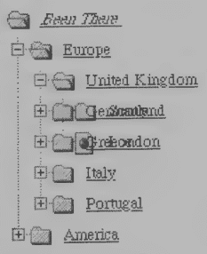

10. 在这里，我们将文件夹的`isOpen`属性设置为我们希望它成为的值。如果我们要关闭文件夹，那么`this.isOpen`就变为false，即使我们实际上还没有关闭该文件夹。
11. 实际关闭（或打开）文件夹的工作是由`propagateChangesInState`函数完成的。

还跟得上吗？我知道我们在FolderTree代码中已经看了大约四百万个函数，很容易迷失方向。如果需要，可以稍作复习，休息一下，然后再回来。如果这也不管用，就把头往书上撞一会儿吧。我当初对着这些代码的打印稿（不止一次）就是这么做的。我还被纸划伤了呢。

那么，我们继续深入研究打开和关闭文件夹的核心部分。让我们看看示例22-11。


```javascript
function propagateChangesInState(folder)

{

    var i = 0

    if (folder.isOpen)

    {

        if (folder.nodeImg)

        {

            if (folder.isLastNode)

            {

                folder.nodeImg.src =

                    "ftv2mlastnode.gif"

            }

            else

            {

                folder.nodeImg.src =

                    "ftv2mnode.gif"

            }

        }

        folder.iconImg.src = "ftv2folderopen.gif"

        for (i = 0; i < folder.nChildren; i++)

        {

            folder.children[i].mostra()

        }

    }

    else

    {

        if (folder.nodeImg)

        {

            if (folder.isLastNode)

            {

                folder.nodeImg.src =

                    "ftv2plastnode.gif"

            }

            else

            {

                folder.nodeImg.src =

                    "ftv2pnode.gif"

            }

        }

        folder.iconImg.src =

            "ftv2folderclosed.gif"

        for (i = 0; i < folder.nChildren; i++)

        {

            folder.children[i].esconde()

        }

    }

}
```

提示给纯粹主义者：我添加了许多不必要的花括号，以使代码更具可读性。

### 代码工作原理

1. 此函数的目的是更改所有受影响的图像（将打开的文件夹图像替换为关闭的，将加号变为减号，等等）。此函数接收文件夹对象本身作为传递的参数。这与代码中许多其他函数的工作方式略有不同。通常，函数被映射到对象方法。例如，`this.setState()`被映射到`setStateFolder`函数，该函数然后通过使用`this`来引用文件夹对象。这个函数是实现相同效果的另一种方式的绝佳例子。这里，`folder`参数携带了指向文件夹对象的指针。
2. 如果文件夹当前是关闭的但我们希望它打开，那么`this.isOpen`为true，并执行下面的代码。
3. 这个条件有点特别：所有文件夹都有节点图像，每个节点的源文件都放置在`nodeImg`属性中。因此，所有文件夹都将具有一个`nodeImg`属性。

### 22 • 文件夹树：收尾工作

#### 代码工作原理

1. 这整段代码很可能是遗留代码——移除它完全不影响功能。
2. 如果我们使用的是 IE 或 Netscape 6，则图层的`display`属性被设置为`"block"`，这会使图层可见。幸运的是，该图层下方的图层会友好地向下移动，为它们新出现的邻居腾出空间。
3. 如果使用的是 Netscape 4，那么我们只需显示该图层。幸运的是，我们已经在`setStateFolder`函数中为这个图层预留了空间。

这不太难，对吧？这个函数让一个图层可见，任务就完成了。现在让我们继续看示例22–13，它展示了关闭文件夹子节点的函数：`escondeFolder`。

```javascript
function escondeFolder()

{

    this.escondeBlock()

    this.setState(0)

}
```

#### 代码工作原理

嗯，这里没有太多有用的信息。`escondeBlock`方法对应`escondeBlock`函数，而该函数唯一的作用就是隐藏子图层。你还需要别的吗？很简单：假设我们试图关闭“欧洲”文件夹，整个树状结构都是可见且展开的。当我们关闭“欧洲”文件夹时，它的所有子文件夹都会消失：英国、德国、希腊、意大利和葡萄牙。但是，仅此而已。在那个时刻，所有那些文件夹的内容仍然是可见的：苏格兰、伦敦、罗马等等。实际上，它看起来很像图22–5。

我们需要确保所有这些文件夹的内容也被隐藏。我们通过调用`setState`方法并传递一个`"0"`来做到这一点，这表示“关闭此文件夹”。例如，如果我们想关闭“英国”文件夹，我们的函数执行流程将如下所示：

- `clickOnNode`
- `setStateFolder`（关闭英国文件夹）
  - `propagateChangesInState`（更改英国图像）
    - `escondeFolder`（隐藏英国文件夹元素）
      - `escondeBlock`（实际隐藏苏格兰文件夹，但不隐藏爱丁堡链接）
      - `setStateFolder`（关闭苏格兰文件夹）
        - `propagateChangesInState`（更改苏格兰图像，即使它们当前是隐藏的。由于链接的`esconde`方法直接调用`escondeBlock`，因此不会再遇到`escondeFolder`）
    - `escondeBlock`（实际隐藏爱丁堡链接）

快完成了！让我们看看示例22–14，`escondeBlock`。

```javascript
function escondeBlock()

{

    if (browserVersion == 1 || browserVersion == 3)

    {

        if (this.navObj.style.display == "none")

        {

            return

        }

        this.navObj.style.display = "none"

    }

    else

    {

        if (this.navObj.visibility == "hiden")

        {

            return

        }

        this.navObj.visibility = "hiden"

    }

}
```


#### 代码工作原理

1. 这是一个非常简单的函数。它唯一的目的就是隐藏一个图层。首先，我们检查用户是否在运行 IE 或 Netscape 6。
2. 如果图层已经被隐藏，那么我们就退出函数。
3. 如果我们仍在函数中，这意味着图层尚未被隐藏，所以我们将其 `display` 属性设置为 `"none"`。
4. 如果我们运行的是 Netscape 4，我们检查图层是否已经是 `"hiden"`（代码中的这个拼写错误可以正常工作。如果你自己输入，你可以使用 `"hidden"`）。如果图层已经隐藏，那么我们就离开函数。
5. 如果我们仍在函数中，那么图层仍然是可见的，是时候让它不可见了。

就是这样！这就是文件夹树！实际上，我们跳过了一个函数：`subFolderEntries`。它仅用于 Netscape 4 浏览器，用于计算一个文件夹拥有的子文件夹和链接的数量。当然，不以完整工作格式向你展示所有代码，只是零敲碎打地看是不公平的。整个代码都在附录 C 中。祝你好运！

### 23 • 新闻滚动器

**本章内容**

- 新闻滚动器

客户似乎喜欢小的滚动新闻条目。然而，这通常涉及一个有时能用有时不能用的 Java 小程序。总的来说，我尽可能避开网页中的 Java 小程序——它们太不可预测了。但是，一个叫 Dion 的人制作了一个非常棒、用途广泛的新闻滚动器，它在 JavaScript 中运行良好。我对代码进行了一些调整，使其能在 Netscape 6 上运行，但我在 Mac 上的某些 Netscape 4 版本中遇到了问题。如果你预期会有 Mac 上的 Netscape 4 用户，请跳过这段代码。

### 新闻滚动器

滚动器看起来像图 23-1。它的工作原理是在图层周围设置一个严格的裁剪框，然后以增量方式向上移动该图层。我们只需要一个函数，然后反复调用它。

让我们看看页面的 HTML，它在示例 23-1 中，然后我们将查看脚本。

#### 示例 23-1 HTML 代码

```html
<html>

<head>

<title>news scroller</title>

</head>

<body onLoad="scrollnews(0)">

<div id="news" style="position:

absolute;visibility:hidden;top:1;left:1;height:600;

cliprect(10,100,100,10); border-width:0px;">

<table border=0 cellpadding=1 cellspacing=0 bgcolor="white">

<tr>

<td>
```

### 示例 21-1 HTML（续）

```html
<script language="JavaScript">

document.write('')

</script>

</td>

</tr>

<tr>

<td>

<!-- Your News Items are Here -->

This news scroller begins<br>

Displaying text and images<br>

From the bottom of the box<br>

And restarts when all the<br>

Information scrolls above<br>

The top of the box.<br><br>

Any HTML page content can<br>

Be used in this JavaScript<br>

Scroller.<br>

<br>

<a href="mailto:yobo42@hotmail.com">yobo42@hotmail.com</a>

<!-- End of Your News Items -->

</td>

</tr>

<tr>

<td>

<script language="JavaScript">

document.write('')

</script>

</td>

</tr>

</table>

</div>

</body>

</html>
```

### ◆ 代码工作原理

这部分代码非常简洁明了。它本质上就是一个包含三个单元格的表格：两个空白图像夹着你想要滚动的内容。这不一定非得是文本——可以是图像、表单字段等等。另外请注意，新闻层的样式并没有像我们之前看到的那样在头部定义。在这个例子中，我们直接将其放置在 `<div>` 标签本身。两种方式都可以——不影响代码的功能。

另外请注意，在 `<body>` 标签中调用了 `scrollnews` 函数，并传入了值 0。

让我们来看一下示例 23-2 中的脚本部分。


```javascript
<script language="JavaScript">

❶blank = "clear_dot.gif"

❷topedge = 130

leftedge = 10

boxheight = 150

boxwidth = 210

❸scrollheight = 240

❹ function scrollnews (cliptop)

{

  ❺if (document.getElementById)

  {

    ❻newsDiv = document.getElementById("news").style

    newsDiv.clip = "rect(" + cliptop + "px " +

              (boxwidth + leftedge) + "px " + (cliptop +

              boxheight) + "px 0px)"

    newsDiv.left = leftedge

    newsDiv.top = topedge - cliptop

  }

  ❼else if(document.layers)

  {

    newsDiv = document.news

    newsDiv.clip.top = cliptop

    newsDiv.clip.bottom = cliptop + boxheight

    newsDiv.clip.left = 0

    newsDiv.clip.right = boxwidth + leftedge

    newsDiv.left = leftedge

    newsDiv.top = topedge - cliptop

  }

}

</script>
```

```javascript
else

{

    newsDiv = news.style

    newsDiv.clip = "rect(" + cliptop + "px " +

        (boxwidth + leftedge) + "px " + (cliptop +

        boxheight) + "px 0px)"

    newsDiv.pixelLeft = leftedge

    newsDiv.pixelTop = topedge - cliptop

}

cliptop = (cliptop+1) % (scrollheight + boxheight)

newsDiv.visibility = 'visible'

setTimeout("scrollnews(" + cliptop + ")",150)

}

</script>
```

### ◆ 代码工作原理

1. 我们首先定义用于夹住新闻项目的图像。
2. 这里，我们定义了新闻项目可见的框。换句话说，我们定义了新闻项目中可见的区域。
3. 这里，我们定义了新闻层的高度像素值。世界上最健壮的代码会动态计算层的高度，但这里我们直接硬编码了这个值。
4. 函数本身接受一个数字作为参数。`cliptop` 参数被使用了两次：一次用于将新闻层向上移动一个像素，另一次用于将裁剪矩形向下移动一个像素。
5. 此函数分为四个部分：一个用于 Netscape 6，一个用于 Netscape 4，一个用于 Internet Explorer，以及一个用于所有浏览器。此部分适用于 Netscape 6。
6. 这里，我们设置裁剪矩形和新闻层的位置。裁剪区域是相对于层本身，而不是相对于浏览器边缘。请注意，裁剪矩形的上下边缘都基于 `cliptop`。这意味着如果 `cliptop` 增大，那么裁剪矩形总是向下移动新闻层。如果 `cliptop` 随后减小，裁剪矩形则向上移动新闻层。还要注意，新闻层的顶部移动的因子是 `cliptop`，但方向与裁剪矩形相反。层向上移动，但裁剪矩形向下移动的最终效果是，裁剪矩形保持在同一位置，而层在其后方移动，就好像两者被分开了。
7. 这是 Netscape 4 的代码。正如我提到的，这段代码在 Mac 上效果不太好。
8. 这是 Internet Explorer 的代码。请注意，它与 Netscape 6 的代码几乎完全相同。
9. 如果你以前没用过取模运算符（这就是 `%` 所代表的含义），这是函数中最奇特的一行。取模运算的工作方式如下：

   `var1 % var2`

   这意味着你将 `var1` 除以 `var2`，看看余数是多少。例如，如果你有以下代码：

   `a = 5 % 2`

   那么 `a` 将等于 1，因为 2 可以除以 5 两次，余数为 1。不过，这段代码对取模的使用有所不同。例如，第一次运行函数时，代码计算结果如下：

   `cliptop = 1 % 450`

   那么在这种情况下，`cliptop` 会等于多少？毕竟，450 根本不能除以 1，更不用说有余数了。在这种情况下，值就是 1。如果 `var1` 小于 `var2`，那么运算结果的值始终是 `var1` 的值。这意味着 `cliptop` 的值将每次增加一，直到达到 450，此时取模结果为 0，我们重新开始。这具有重复新闻项目的效果。一旦它们滚动出裁剪框的顶部，层就会被移回裁剪框下方，并开始再次向上滚动。
10. 我们确保层是可见的。
11. 我们等待 150 毫秒，然后再次调用该函数。

基本上就是这些！这是较简单的章节之一。就算别的没学到，你现在也掌握了一个可能之前不会的取模技巧。

### 24 层滑动器

**本章内容**

- 滑动移动

一种便捷的交互方式是允许用户通过键盘控制来移动屏幕上的层，而不是通过拖拽。这并不太难实现，但用户习惯于按住一个键并让该键的效果持续生效。例如，当我在文字处理器上按下“a”键并按住不放时，我期望的不是单个“a”，而是“aaaaaaaaaaa”。访问你网站的访客也会有同样的期望。如果你使用键来移动屏幕上的层，用户会期望按住一个键就能持续移动层，而这正是本节代码的功能。

### 滑动移动

示例 24-1 展示了我们页面的 HTML 结构。

528 第 24 章 • 层滑动器

### 示例 24-1 滑动层的 HTML

```html
<html>

<head>

    <title>keypress slider</title>

</head>

<body onLoad="moveImage()">

<div id="blockDiv" style="position:absolute; left:317px; top:130px;">

<br><br><br><br>Hi there

</div>

Use <b>A</b> to move left, <b>D</b> to move right.

</body>

</html>
```

这里没有太多内容。我们有一个单独的层，一些不在层内的 HTML，以及在页面加载完成时调用的 `moveImage()` 函数。示例 24-2 展示了脚本部分：

### 示例 24-2 脚本部分

```javascript
<script language="JavaScript">

// credit Massimo Giari

n = (document.layers) ? 1 : 0

n6 = (document.getElementById) ? 1 : 0

ie = (document.all) ? 1 : 0

function moveImage()

{

    if (n)

    {

        block = document.blockDiv

    }

    if (ie)

    {

        block = blockDiv.style

    }

    if (n6)

    {

        block = document.getElementById("blockDiv").style

    }

Sliding Around

529
```

### 示例 24-2 脚本部分（续）

```javascript
❸block.xpos = parseInt(block.left)

❹block.active = 0

❺document.onkeydown = keyDown

document.onkeyup = keyUp

❻if (n6)

{

    document.getElementById("blockDiv").

        addEventListener("keydown",keyDown,false)

    document.getElementById("blockDiv").

        addEventListener("keyup",keyUp,false)

}

❼if (n)

{

    document.captureEvents(Events.keydown |

        Event.keyup)

}

❽function keyDown(e)

{

    ❾if (n)

    {

        var nKey = e.which

        var ieKey = 0

    }

    ❿if (ie)

    {

        var ieKey = event.keyCode

        var nKey = 0

    }

    ⓫if (n6)

    {

        var ieKey = e.which

        var nKey = 0

    }

    ⓬if ((nKey == 97 || ieKey == 65) && !block.active)

    {

        block.active = 1

        slideLeft()

    }

    ⓭if ((nKey == 100 || ieKey == 68) && !block.active)

    {

        block.active = 1
```

### 第 24 章 • 图层滑块

```javascript
slideRight()

}

}

function keyUp(e)

{

    if (n6)

    {

        var ieKey = e.which

        var nKey = 0

    }

    if (n)

    {

        var nKey = e.which

        var ieKey = 0

    }

    if (ie)

    {

        var ieKey = event.keyCode

        var nKey = 0

    }

    if ((nKey == 97) || (ieKey == 65) || (nKey == 100) || (ieKey == 68))

    {

        block.active = 0

    }

}

function slideRight()

{

    if (block.active)

    {

        block.xpos += 5

        block.left = block.xpos

        status = block.xpos

        setTimeout("slideRight()",25)

    }

}

function slideLeft ()

{

    if (block.active)

    {

        block.xpos -= 5

        block.left = block.xpos

        status = block.xpos

        setTimeout("slideLeft()",25)

    }

}

</script>
```


### 代码工作原理

1. 你之前见过类似的代码——我们需要某种方法来区分不同的浏览器。
2. 我们需要用不同的方式在不同浏览器中引用我们的图层，这就是这里正在发生的事情。
3. 这里，我们找到被移动图层的当前位置。
4. 这部分代码的用途是判断是否应该持续向右或向左滑动图层。我们通过`active`属性（我们正在创建并附加到图层对象上）来处理这一点。
5. 然后我们设置浏览器监听两个事件：`keyup`和`keydown`。在这两个事件发生时，会调用两个函数。
6. 不足为奇，Netscape 6需要不同的处理方式。Netscape 6处理事件的方式不同，因此我们需要一些单独的代码。我们必须强制图层感知特定事件，我们通过向图层附加特殊的事件监听器来实现。在这段代码中，我们为`keydown`和`keyup`事件附加了事件监听器。没有这段代码，Netscape 6中将不会发生任何事情。
7. 谈到事件，Netscape 4需要额外的“刺激”才能开始关注，我们通过`captureEvents`方法来实现。
8. 这是当用户按下键盘上的一个键时被调用的函数。传递的`e`参数是事件以及随事件传递的信息，例如发生了什么以及发生在哪里。在用户按下键盘按键的情况下，传递的唯一信息是被按下按键的字符代码。不幸的是，Netscape和Internet Explorer对相同字符使用不同的字符代码。如果你在Netscape 4中按下A键，它返回的字符代码与在Internet Explorer中按下时不同。
9. Netscape 4查看事件的`which`属性，该属性返回被按下按键的字符代码：按下左鼠标键返回1；按下中鼠标键返回2；按下右鼠标键返回3。
10. 如果使用Internet Explorer，那么你必须使用`event.keyCode`来获取代码。
11. 最后，为了使事情更加复杂，Netscape 6使用相同的`e.which`来获取字符代码，但返回的代码与IE相同。很奇怪吧？这就是为什么我们要设置`ieKey`而不是`nKey`。这会让后面的代码更易读。
12. 这里，我们检查是否按下了A键。如果使用Netscape 4，A键返回的值是97。Internet Explorer和Netscape 6将A键视为65。我们还确保图层当前不是活动状态（我们稍后将详细查看）。然后我们激活`active`值并调用`slideLeft`函数，该函数实际移动图层。
13. 如果按下了D键，我们做同样的事情，只是调用`slideRight`函数。
14. `keyUp`函数在事件分配方面与`keyDown`函数相同。
15. 我们检查用户是否释放了A或D键。
16. 如果用户确实释放了这些键，我们唯一做的就是停用`block`。我们接下来会看到原因。
17. 当用户按住D键时，`slideRight`函数被调用。只有当`active`属性开启时，代码才会执行，这意味着其中一个右方向键被按住。`xpos`增加五，图层被移动，并且其位置显示在状态栏中。然后在25毫秒后再次调用该函数。这样，只要用户保持按键按下，该函数就会被反复调用。
18. `slideLeft`函数执行相同的操作，只是图层向左移动五个像素。

就是这样！

# 附录A

## XML入门

**本附录内容**

- 什么是XML？
- 为什么XML很好
- XML的目标
- 元素和节点
- 结构和语法
- 特殊符号和注释

我确信你已经看过大量关于XML的文章，或者至少听过这个缩写到处被提及。它正变得无处不在，无论你做什么类型的编程或脚本编写，你迟早都会需要了解一些相关知识。

## 什么是XML？

XML在官方上被认为是“下一个大事件”。与之前的“大事件”不同，它实际上具有持久的生命力。XML代表可扩展标记语言，这意味着它应该被称为EML，但大家一致认为XML更酷。

这个名字有两个部分：“可扩展”和“标记语言”。我们来逐一介绍。

## 什么是标记语言？

标记语言是计算机语言最简单的形式。HTML就是一种标记语言。标记语言由文本和标签组成。就这样。标签可以有属性。标签也可以相互嵌套。大多数标签需要关闭标签。

标签本身主要用来描述文本。标签就是在“标记”文本。

由于HTML和XML都是设计成易于人类阅读的标记语言，它们看起来非常相似。示例A-1展示了一些XML：

```xml
示例A-1 XML示例

<?xml version="1.0" ?>

<customer_list>
    <customer number="050">
        <name>Cyndi Lauper</name>
        <customer_since year="1994" />
    </customer>
    <customer number="041">
        <name>Ozzy Osbourne</name>
        <customer_since year="2000" />
    </customer>
</customer_list>
```

标记语言之所以简单，是因为它们通常不包含条件逻辑、循环或函数。

## “可扩展”意味着什么？

可扩展意味着你可以创建自己的标签。这部分至关重要，因为从技术上讲，XML不是一种标记语言——它是一种元标记语言。换句话说，它是一套用于创建你自己标记语言的规则。

奇怪的是：你不仅可以创建自己的标签，而且必须这样做。不存在纯粹的XML标签——你必须自己创造。几乎任何东西都可以是一个XML标签：

```xml
<thisIsALongTagButThatsOkayBecauseXMLisExtensible>
确实如此！
</thisIsALongTagButThatsOkayBecauseXMLisExtensible>
```

这也意味着，从技术上讲，没有文档可以用纯XML编写——所有内容都必须用基于XML的标记语言来编写。所有这些自创的语言，包括上面的例子，都被称为XML应用程序。换句话说，你应用XML的规则，最终得到你自己的基于XML的语言。

如果你想深入探讨术语，也可以说XML“提供了任意结构”。从这个意义上说，XML有点像一大桶乐高积木。拼装方式只有有限的几种，但你可以用它们建造任何你想要的东西。

那么为什么还要使用XML呢？它实际上有什么好处？

## 为什么XML很好

XML之所以被需要，是因为互联网绝对是一个由不同应用程序、语言和服务器组成的混乱世界。其中一些计算机理解某些语言，而其他计算机理解其他语言。在XML出现之前，这些机器在不知道对方是谁以及对方计算机是否懂自己的语言的情况下，无法相互交流。HTML不算在内，因为它只是信息的图像，而不是真正的信息。人类通常可以弄清楚一个网站是什么以及某个页面上有什么信息，但计算机无法读取显示页面信息类型的图像。

简而言之，需要一种所有互联网上的计算机，无论运行什么软件，都能用来相互交流的语言。因此，一些非常聪明的人聚在一起，决定这种新语言可能是什么样子，他们提出了XML。

XML 是一项开放标准，这意味着没有任何人拥有它。任何人都可以像使用 HTML 一样，无需获得任何人的许可即可使用 XML。

XML 是纯粹的文本，几乎每台计算机都能理解。XML 的这一特性使其有望能以单一格式编写一次文档，然后让其他应用程序将其格式化为他们想要的任何形式。例如，你可以用 XML 创建一个文档，然后其他应用程序，如文字处理程序、Web 发布程序或 CD 刻录程序，都可以访问这单个 XML 文件。如果你需要对该文档进行更改，你只需在一个文档中进行一次更改，而不必在几个单独的文档中进行更改，应用程序便可以相应地更改它们的内容。

## XML 的目标

XML 在开发时，其发明者设定了一些目标，了解这些目标将有助于你理解 XML 为何如此。这些目标过去和现在如下：

1. XML 应能通过互联网直接使用。
2. XML 应支持各种各样的应用程序。
3. XML 应与 SGML 兼容。SGML 尽管复杂，但极其重要，XML 不能完全将其抛弃。
4. 处理 XML 文档的程序应该易于编写。在这种情况下，“易于”意味着计算机科学专业的研究生能在两周内编写出处理 XML 文档的程序。
5. XML 中的可选特性数量应保持在绝对最低限度，理想情况下为零。
6. XML 文档应易于人类阅读，并且相当清晰。
7. XML 设计应快速准备就绪。
8. XML 的设计应正式且简洁。
9. XML 文档应易于创建。这一点肯定已经实现了，因为任何简单的文本编辑器，包括 SimpleText 和记事本，都可以创建 XML 文档。
10. XML 标记的简洁性并不重要。这与第 6 点有关，即文档应具有可读性。通常，计算机相关数据越简洁，人们阅读起来就越困难。

XML 的发明者们实现了他们的目标吗？大多数人认为是的，而且值得赞赏。

## 元素和节点

构成 XML 的标签有特殊的名称。它们被称为*元素*或*节点*。这两个术语或多或少可以互换（至少就我们这里所关心的而言）。让我们用示例 A–2 来重新审视前面的例子。

```xml
示例 A–2 重新审视

<?xml version="1.0" ?>

<customer_list>
    <customer number="050">
        <name>Cyndi Lauper</name>
        <customer_since year="1994" />
    </customer>
    <customer number="041">
        <name>Ozzy Osbourne</name>
        <customer_since year="2000" />
    </customer>
</customer_list>
```

这里的元素包括若干个`customer_list`、`customer`、`name`和`customer_since`元素。

元素有不同的类型。例如，任何位于另一个元素内部的元素都称为*子元素*。在这个例子中，`customer`是`customer_list`的子元素，而`name`和`customer_since`都是`customer`的子元素。`name`和`customer_since`被称为兄弟节点。

还有一种称为文本节点的东西。文本节点由元素与其结束标签之间的文本构成。例如，在`<name>Cyndi Lauper</name>`中，有两个节点：“name”和“Cyndi Lauper”。“Cyndi Lauper”是文本节点。

你注意到`customer_since`元素了吗？它们不包含任何文本节点，也没有结束标签。当一个元素除了属性之外不包含任何内容时，如果只是用单个正斜杠结束元素，则不需要结束标签。这个斜杠表示“这个元素不需要结束标签。”

## 结构和语法

所有 XML 文档都以一个类似示例 A–3 的版本声明开始：

```xml
<?xml version="1.0"?>
```

版本声明是一种特殊的 XML 标签，称为*处理指令*。处理指令并非 XML 信息的一部分——它们是给任何处理 XML 文档的应用程序的指令。在撰写本文时，只有一个版本的 XML，那就是 1.0。

除了版本声明之外，所有 XML 文档都有一个根元素。该元素包含文档中的所有其他元素。在我们一直使用的例子中，`customer_list`是根元素。根元素只能有一个。例如，示例 A–4 就不是格式良好的 XML：

```xml
<?xml version="1.0" ?>

<customer_list>
    <customer number="050">
        <name>Cyndi Lauper</name>
        <customer_since year="1994" />
    </customer>
    <customer number="041">
        <name>Ozzy Osbourne</name>
        <customer_since year="2000" />
    </customer>
</customer_list>

<customer_list>
    <customer number="070">
        <name>Carl Hiaasen</name>
        <customer_since year="1997" />
    </customer>
    <customer number="450">
        <name>Space Ghost</name>
        <customer_since year="2000" />
    </customer>
</customer_list>
```

注意这里有两个`customer_list`元素。其中任何一个都不是根元素。因此，这个 XML 几乎会被任何 XML 应用程序拒绝——因为它不符合格式良好的 XML 规则。

现在还有两个规则要介绍：正确嵌套和属性值引号。正确嵌套意味着当一个元素包含另一个元素时，子元素的结束标签必须在父元素的结束标签之前。例如，`<a><b>Hi there</b></a>`是允许的，而`<a><b>Hi there</a></b>`则不允许。

在 XML 中，与 HTML 不同，所有属性值都必须加引号。没错，不能再写`border=0`，必须是`border="0"`。

## 属性还是文本节点？

关于属性和一些文本节点是否可以服务于相同的目的，一直存在争论。例如，以下两段代码中哪一段更好？

```xml
<shirt>
    <size>XXL</size>
</shirt>
```

还是：

```xml
<shirt size="XXL" />
```

没有一个确切的答案。这真的取决于你的应用程序的需求。人们普遍认为属性越少越好，因为对于大多数应用程序来说，解析元素比解析属性更容易。然而，没有一个硬性的规定。

## 特殊符号和注释

就像 HTML 一样，XML 也有一些特殊字符。然而，在 XML 中只有五个这样的字符，它们用于消除处理应用程序的混淆，而不是用来制作小版权符号或倒问号。

- `&amp;` – 显示和号 (`&`)
- `&lt;` – 显示小于号 (`<`)
- `&gt;` – 显示大于号 (`>`)
- `&quot;` – 显示双引号 (`"`)
- `&apos;` – 显示单引号 (`'`)

XML 中的注释看起来和 HTML 一样：它们以`<!--`开头，以`-->`结尾，并且可以占用多行，如示例 A–5 所示。

```xml
示例 A-5 XML 中的注释

<?xml version="1.0" ?>

<!--
    这是所有当前客户的列表，
    他们是音乐家。
-->

<customer_list>
    <!-- 流行音乐代表 -->
    <customer number="050">
        <name>Cyndi Lauper</name>
        <customer_since year="1994" />
    </customer>

    <!-- 稍微硬核一点 -->
    <customer number="041">
        <name>Ozzy Osbourne</name>
        <customer_since year="2000" />
    </customer>
</customer_list>
```

## 回顾

以上是对 XML 存在原因及其实际内容的简要介绍。若想更深入地了解，欢迎参阅由本人所著的《*Web 专业人士必备 XML*》。

# 附录 B

## FolderTree 代码

当你一次看到全部代码时，输入起来总是更容易。因此，结合第 20-22 章，这里是 FolderTree 程序的完整代码，直接摘自 Marcelino Alves Martins 先生的网站。

### ftexample.html

```html
<html>
<head>
<title>FolderTree 示例</title>
</head>

<!--
（请保留所有版权声明。）

此框架集文档包含 FolderTree 脚本。

脚本来源：

http://www.geocities.com/marcelino_martins/foldertree.html

作者：Marcelino Alves Martins (http://www.mmartins.com)
-->

<!-- 指示：

     - 请更改标题并在上方添加其他 head 标签。

     - 请勿更改左框架。

     - 你可以将右框架文档的名称从 "startPage.htm" 更改为其他名称，
```

### 附录 B • 文件夹树代码

但在`defineMyTree.js`文件的第一个`gFld`函数的参数中，请使用相同的名称。

- 不要更改框架（frames）的名称（"treeframe" 和 "basefrm"），否则树状结构中的链接将无法工作。
- 注意：此脚本并非为在无框架的独立页面中运行而设计。

```html
<FRAMESET cols="200,*">
  <FRAME src="folderTreeLeftFrame.html" name="treeframe">
  <FRAME SRC="startPage.html" name="basefrm">
</FRAMESET>
```

```html
</HTML>
```

### folderTreeLeftFrame.html

```html
<!--
    （请保留所有版权信息。）

    此框架集文档包含 FolderTree 脚本。

    脚本来源：

    http://www.geocities.com/marcelino_martins/foldertree.html

    作者：Marcelino Alves Martins

    http://www.mmartins.com)

    说明：

    - 请勿在 `<style>` 标签之外对此文件进行任何更改。

    - 通过 `<style>` 标签，您可以根据网站的特定需求更改颜色和字体类型。

    - 为拥有黑色背景的时尚人士预定义了一个样式块。
```


```html
<html>
<head>
  <!-- 如果您想要黑色背景，请移除此样式块 -->
  <style>
    BODY {
      background-color: white;
    }

    TD {
      font-size: 10pt;
      font-family: verdana, helvetica;
      text-decoration: none;
      white-space: nowrap;
    }

    A {
      text-decoration: none;
      color: black;
    }
  </style>

  <!-- 如果您想要黑色背景，请移除此行和标记为 XXXX 的行，并保留下面的样式块
  <style>
    BODY {
      background-color: black;
    }

    TD {
      font-size: 10pt;
      font-family: verdana, helvetica;
      text-decoration: none;
      white-space: nowrap;
    }

    A {
      text-decoration: none;
      color: white;
    }
  </style>

  XXXX -->

  <!-- 从此行开始，不要做任何更改 -->

  <!-- 浏览器检测代码 -->
  <script src="ua.js"></script>

  <!-- 树状结构的基础设施代码 -->
  <script src="ftiens4.js"></script>

  <!-- 执行实际构建特定树的代码。

       变量 foldersTree 通过调用

       gFld、insFld 和 insDoc 来创建其结构 -->
  <script src="defineMyTree.js"></script>
</head>

<body topmargin="16" marginheight="16">
  <!-- 对此代码进行任何更改都意味着您违反了您的用户协议；

       这对商业用户尤其麻烦。请查看在线说明以获取不含链接的版本 -->

  <!-- 移除此链接将导致脚本停止工作 -->
  <div style="position: absolute; top: 0; left: 0;">
    <table border="0">
      <tr>
        <td>
          <font size="-2">
            <a
              style="font-size: 6pt; text-decoration: none; color: gray"
              href="http://www.mmartins.com"
              target="_top"
            >
              FolderTreebyMMartins.com
            </a>
          </font>
        </td>
      </tr>
    </table>
  </div>

  <!-- 构建浏览器对象并显示树的默认视图。 -->
  <script>initializeDocument()</script>
</body>
</html>
```

### `startPage.html`

```html
<HTML>
<HEAD>
  <style>
    BODY {
      background-color: white;
      font-size: 10pt;
      font-family: verdana, helvetica;
    }
  </style>
</HEAD>

<BODY BGCOLOR="#FFFFFF">
  <CENTER>&nbsp;</CENTER>

  <CENTER>
    <H2>文件夹树</H2>
  </CENTER>

  <CENTER><B>JavaScript 大纲工具</B></CENTER>
  <CENTER><TT>动态 HTML (IE + NN)</TT></CENTER>

  <CENTER>&nbsp;</CENTER>
  <CENTER>&nbsp;</CENTER>
  <CENTER>&nbsp;</CENTER>

  <CENTER>
    <I>探索左侧的树状结构 &amp; 欣赏图片。</I>
  </CENTER>

  &nbsp;
  <BR>&nbsp;
  <BR>&nbsp;
  <BR>&nbsp;

  &nbsp;&nbsp;<font size="-1">获奖：</font><br>

  &nbsp;&nbsp;
  <a href="http://www.dhtmlzone.com" target="_top">
    
  </a>
  </center>

  <P>
    &nbsp;&nbsp;
    <FONT SIZE="-1">
      <A HREF="foldertree.html" target="_top">如何在您的网站中使用它</A>
    </FONT>
  </P>

  <P>
    &nbsp;&nbsp;
    <FONT SIZE="-1">
      <A
        HREF="http://www.geocities.com/Paris/LeftBank/2178/"
        target="_top"
      >
        Marcelino Martins 主页
      </A>
    </FONT>
  </P>

  <P>
    <HR>
  </P>

  <CENTER>
    <A HREF="http://www.geocities.com/" target="_top">
      
    </A>
  </CENTER>

  <CENTER><FONT SIZE="-2">获取您自己的免费主页</FONT></CENTER>

  
</BODY>
</HTML>
```

### `defineMyTree.js`

```javascript
// 您可以在此处找到此文件的说明：
// http://www.geocities.com/marcelino_martins/ftv2instructions.html

// 决定名称是链接还是仅为图标
USETEXTLINKS = 1; // 将 0 替换为 1 以启用超链接

// 决定树是全部展开开始，还是仅显示根文件夹
STARTALLOPEN = = 0; // 将 0 替换为 1 以显示整个树

foldersTree = gFld("<i>去过的地方</i>", "startPage.html");

aux1 = insFld(
  foldersTree,
  gFld(
    "欧洲",
    "http://www.geocities.com/marcelino_martins/ftexample/beenthere_europe.gif"
  )
);

aux2 = insFld(
  aux1,
  gFld(
    "英国",
    "http://www.geocities.com/marcelino_martins/ftexample/beenthere_unitedkingdom.gif"
  )
);

aux3 = insFld(
  aux2,
  gFld(
    "苏格兰",
    "http://www.geocities.com/marcelino_martins/ftexample/beenthere_scotland.jpg"
  )
);

insDoc(
  aux3,
  gLnk(
    2,
    "爱丁堡",
    "www.geocities.com/marcelino_martins/ftexample/beenthere_edinburgh.gif"
  )
);

insDoc(
  aux2,
  gLnk(
    2,
    "伦敦",
    "www.geocities.com/marcelino_martins/ftexample/beenthere_london.jpg"
  )
);

aux2 = insFld(
  aux1,
  gFld(
    "德国",
    "http://www.geocities.com/marcelino_martins/ftexample/beenthere_germany.gif"
  )
);

insDoc(
  aux2,
  gLnk(
    2,
    "慕尼黑",
    "www.geocities.com/marcelino_martins/ftexample/beenthere_munich.jpg"
  )
);

aux2 = insFld(
  aux1,
  gFld(
    "希腊",
    "http://www.geocities.com/marcelino_martins/ftexample/beenthere_greece.gif"
  )
);

insDoc(
  aux2,
  gLnk(
    2,
    "雅典",
    "www.geocities.com/marcelino_martins/ftexample/beenthere_athens.jpg"
  )
);

aux2 = insFld(
  aux1,
  gFld(
    "意大利",
    "http://www.geocities.com/marcelino_martins/ftexample/beenthere_italy.gif"
  )
);

aux3 = insFld(
  aux2,
  gFld(
    "托斯卡纳",
    "http://www.geocities.com/marcelino_martins/ftexample/beenthere_tuscany.gif"
  )
);

insDoc(
  aux3,
  gLnk(
    2,
    "佛罗伦萨",
    "www.geocities.com/marcelino_martins/ftexample/beenthere_florence.jpg"
  )
);

insDoc(
  aux3,
  gLnk(
    2,
    "比萨",
    "www.geocities.com/marcelino_martins/ftexample/beenthere_pisa.jpg"
  )
);

insDoc(
  aux2,
  gLnk(
    2,
    "罗马",
    "www.geocities.com/marcelino_martins/ftexample/beenthere_rome.jpg"
  )
);

aux2 = insFld(
  aux1,
  gFld(
    "葡萄牙",
    "http://www.geocities.com/marcelino_martins/ftexample/beenthere_portugal.gif"
  )
);

insDoc(
  aux2,
  gLnk(
    2,
    "里斯本",
    "www.geocities.com/marcelino_martins/ftexample/beenthere_lisbon.jpg"
  )
);

aux1 = insFld(
  foldersTree,
  gFld(
    "美洲",
    "http://www.geocities.com/marcelino_martins/ftexample/beenthere_america.gif"
  )
);

aux2 = insFld(
  aux1,
  gFld(
    "加拿大",
    "http://www.geocities.com/marcelino_martins/ftexample/beenthere_canada.gif"
  )
);

insDoc(
  aux2,
  gLnk(
    2,
    "蒙特利尔",
    "www.geocities.com/marcelino_martins/ftexample/beenthere_montreal.jpg"
  )
);

aux2 = insFld(
  aux1,
  gFld(
    "美国",
    "http://www.geocities.com/marcelino_martins/ftexample/beenthere_unitedstates.gif"
  )
);

insDoc(
  aux2,
  gLnk(
    2,
    "波士顿",
    "www.geocities.com/marcelino_martins/ftexample/beenthere_boston.jpg"
  )
);

insDoc(
  aux2,
  gLnk(
    2,
    "纽约",
    "www.geocities.com/marcelino_martins/ftexample/beenthere_newyork.jpg"
  )
);

insDoc(
  aux2,
  gLnk(
    2,
    "华盛顿",
    "www.geocities.com/marcelino_martins/ftexample/beenthere_washington.jpg"
  )
);
```

### `fteins4.js`

```javascript
//************************************************************

// 保留此版权声明：
// 此脚本副本是您所访问的特定网站所有者的财产。
// 请勿从那里下载脚本文件。
// 免费下载和完整说明请访问：
// http://www.geocities.com/marcelino_martins/foldertree.html
//
// 作者：Marcelino Alves Martins (http://www.mmartins.com)
// 1997--2001.

//************************************************************

// 变更日志：
//         2001年8月10日 - 支持 Netscape 6
//
//         1998年2月17日 - 修复 Netscape 的初始化闪烁问题 //
//
//         1998年1月27日 - 根文件夹初始打开；支持 //
//                           USETEXTLINKS；将 ftien4 设为 js 文件

// 类 Folder 的定义

//************************************************************

function Folder(folderDescription, hreference) // 构造函数
{
  // 常量数据
  this.desc = folderDescription;
  this.hreference = hreference;
  this.id = -1;
  this.navObj = 0;

  this.iconImg = 0;
  this.nodeImg = 0;
  this.isLastNode = 0;

  // 动态数据
  this.isOpen = true;
  this.iconSrc = "ftv2folderopen.gif";
  this.children = new Array();
  this.nChildren = 0;

  // 方法
  this.initialize = initializeFolder;
  this.setState = setStateFolder;
  this.addChild = addChild;
  this.createIndex = createEntryIndex;
  this.escondeBlock = escondeBlock;
  this.esconde = escondeFolder;
  this.mostra = mostra;
  this.renderOb = drawFolder;
  this.totalHeight = totalHeight;
  this.subEntries = folderSubEntries;
  this.outputLink = outputFolderLink;
  this.blockStart = blockStart;
  this.blockEnd = blockEnd;
}
```

### 附录 B • FolderTree 代码

```javascript
this.iconImg = 0;
this.nodeImg = 0;
this.isLastNode = 0;

// 动态数据
this.isOpen = true;
this.iconSrc = "ftv2folderopen.gif";
this.children = new Array();
this.nChildren = 0;

// 方法
this.initialize = initializeFolder;
this.setState = setStateFolder;
this.addChild = addChild;
this.createIndex = createEntryIndex;
this.escondeBlock = escondeBlock;
this.esconde = escondeFolder;
this.mostra = mostra;
this.renderOb = drawFolder;
this.totalHeight = totalHeight;
this.subEntries = folderSubEntries;
this.outputLink = outputFolderLink;
this.blockStart = blockStart;
this.blockEnd = blockEnd;
}

function initializeFolder(level, lastNode, leftSide)
{
  var j = 0;
  var i = 0;
  var numberOfFolders;
  var numberOfDocs;
  var nc;

  nc = this.nChildren;
  this.createIndex();

  var auxEv = "";

  if (browserVersion > 0) {
    auxEv = "<a href='javascript:clickOnNode(" + this.id + ")'>";
  } else {
    auxEv = "<a>";
  }

  if (level > 0) {
    if (lastNode) // children 数组中的最后一个子节点
    {
      this.renderOb(
        leftSide +
          auxEv +
          "</a>"
      );

      leftSide = leftSide + "";
      this.isLastNode = 1;
    } else {
      this.renderOb(
        leftSide +
          auxEv +
          "</a>"
      );

      leftSide = leftSide + "";
      this.isLastNode = 0;
    }
  } else {
    this.renderOb("");
  }

  if (nc > 0) {
```


```javascript
level = level + 1

for (i = 0; i < this.nChildren; i++) {
  if (i == this.nChildren - 1)
    this.children[i].initialize(level, 1, leftSide)
  else
    this.children[i].initialize(level, 0, leftSide)
}
}

}

function setStateFolder(isOpen) {
  var subEntries
  var totalHeight
  var fIt = 0
  var i = 0

  if (isOpen == this.isOpen)
    return

  if (browserVersion == 2) {
    totalHeight = 0

    for (i = 0; i < this.nChildren; i++)
      totalHeight = totalHeight + this.children[i].navObj.clip.height

    subEntries = this.subEntries()

    if (this.isOpen)
      totalHeight = 0 - totalHeight

    for (fIt = this.id + subEntries + 1; fIt < nEntries; fIt++)
      indexOfEntries[fIt].navObj.moveBy(0, totalHeight)
  }

  this.isOpen = isOpen
  propagateChangesInState(this)
}

function propagateChangesInState(folder) {
  var i = 0

  if (folder.isOpen) {
    if (folder.nodeImg)
      if (folder.isLastNode)
        folder.nodeImg.src = "ftv2mlastnode.gif"
      else
        folder.nodeImg.src = "ftv2mnode.gif"

    folder.iconImg.src = "ftv2folderopen.gif"

    for (i = 0; i < folder.nChildren; i++)
      folder.children[i].mostra()
  } else {
    if (folder.nodeImg)
      if (folder.isLastNode)
        folder.nodeImg.src = "ftv2plastnode.gif"
      else
        folder.nodeImg.src = "ftv2pnode.gif"

    folder.iconImg.src = "ftv2folderclosed.gif"

    for (i = 0; i < folder.nChildren; i++)
      folder.children[i].esconde()
  }
}

function escondeFolder() {
  this.escondeBlock()
  this.setState(0)
}

function drawFolder(leftSide) {
  var idParam = "id='folder" + this.id + "'"

  if (browserVersion == 2) {
    if (!doc.yPos)
      doc.yPos = 20
  }

  this.blockStart("folder")
  doc.write("<tr><td>")
  doc.write(leftSide)
  this.outputLink()
  doc.write("</a>")
  doc.write("</td><td valign=middle nowrap>")

  if (USETEXTLINKS) {
    this.outputLink()
    doc.write(this.desc + "</a>")
  } else
    doc.write(this.desc)

  doc.write("</td>")
  this.blockEnd()

  if (browserVersion == 1) {
    this.navObj = doc.all["folder" + this.id]
    this.iconImg = doc.all["folderIcon" + this.id]
    this.nodeImg = doc.all["nodeIcon" + this.id]
  } else if (browserVersion == 2) {
    this.navObj = doc.layers["folder" + this.id]
    this.iconImg = this.navObj.document.images["folderIcon" + this.id]
    this.nodeImg = this.navObj.document.images["nodeIcon" + this.id]
    doc.yPos = doc.yPos + this.navObj.clip.height
  } else if (browserVersion == 3) {
    this.navObj = doc.getElementById("folder" + this.id)
    this.iconImg = doc.getElementById("folderIcon" + this.id)
    this.nodeImg = doc.getElementById("nodeIcon" + this.id)
  }
}

function outputFolderLink() {
  if (this.hreference) {
    doc.write("<a href='" + this.hreference + "' TARGET=\"basefrm\"")

    if (browserVersion > 0)
      doc.write("onClick='javascript:clickOnFolder(" + this.id + ")'")

    doc.write(">")
  } else
    doc.write("<a>")

  // doc.write("<ahref='javascript:clickOnFolder("+this.id+")'>")
}

function addChild(childNode) {
  this.children[this.nChildren] = childNode
  this.nChildren++

  return childNode
}

function folderSubEntries() {
  var i = 0
  var se = this.nChildren

  for (i = 0; i < this.nChildren; i++) {
    if (this.children[i].children) // 是一个文件夹
      se = se + this.children[i].subEntries()
  }

  return se
}

// Item 类的定义（文件夹内的文档或链接）

// ****************************************************

function Item(itemDescription, itemLink) // 构造函数
{
  // 常量数据
  this.desc = itemDescription
  this.link = itemLink
  this.id = -1 // 在 initialize() 中初始化
  this.navObj = 0 // 在 render() 中初始化
  this.iconImg = 0 // 在 render() 中初始化
  this.iconSrc = "ftv2doc.gif"

  // 方法
  this.initialize = initializeItem
  this.createIndex = createEntryIndex
  this.esconde = escondeBlock
  this.mostra = mostra
  this.renderOb = drawItem
  this.totalHeight = totalHeight
  this.blockStart = blockStart
  this.blockEnd = blockEnd
}

function initializeItem(level, lastNode, leftSide) {
  this.createIndex()

  if (level > 0)
    if (lastNode) // children 数组中的最后一个“兄弟”
    {
      this.renderOb(leftSide + "")
      leftSide = leftSide + ""
    } else {
      this.renderOb(leftSide + "")
      leftSide = leftSide + ""
    }
  else
    this.renderOb("")
}

function drawItem(leftSide) {
  this.blockStart("item")
  doc.write("<tr><td>")
  doc.write(leftSide)
  doc.write("<a href=" + this.link + ">")
  doc.write("")
  doc.write("</a>")
  doc.write("</td><td valign=middle nowrap>")

  if (USETEXTLINKS)
    doc.write("<a href=" + this.link + ">" + this.desc + "</a>")
  else
    doc.write(this.desc)

  this.blockEnd()

  if (browserVersion == 1) {
    this.navObj = doc.all["item" + this.id]
    this.iconImg = doc.all["itemIcon" + this.id]
  } else if (browserVersion == 2) {
    this.navObj = doc.layers["item" + this.id]
    this.iconImg = this.navObj.document.images["itemIcon" + this.id]
    doc.yPos = doc.yPos + this.navObj.clip.height
  } else if (browserVersion == 3) {
    this.navObj = doc.getElementById("item" + this.id)
    this.iconImg = doc.getElementById("itemIcon" + this.id)
  }
}

// 两个对象共有的方法（伪继承）

// **************************************************

function mostra() {
  if (browserVersion == 1 || browserVersion == 3) {
    var str = new String(doc.links[0])

    if (str.slice(16, 20) != "ins.")
      return
  }

  if (browserVersion == 1 || browserVersion == 3)
    this.navObj.style.display = "block"
  else
    this.navObj.visibility = "show"
}

function escondeBlock() {
  if (browserVersion == 1 || browserVersion == 3) {
    if (this.navObj.style.display == "none")
      return

    this.navObj.style.display = "none"
  } else {
    if (this.navObj.visibility == "hiden")
      return

    this.navObj.visibility = "hiden"
  }
}

function blockStart(idprefix) {
  var idParam = "id='" + idprefix + this.id + "'"

  if (browserVersion == 2)
    doc.write("<layer " + idParam + " top=" + doc.yPos + " visibility=show>")

  if (browserVersion == 3) // N6 在表格的 display 属性上有 bug
    doc.write("<div " + idParam + " style='display:block; position:block;'>")

  doc.write("<table border=0 cellspacing=0 cellpadding=0 ")

  if (browserVersion == 1)
    doc.write(idParam + " style='display:block; position:block; '")
  else
    doc.write(">")
}

function blockEnd() {
  doc.write("</table>")

  if (browserVersion == 2)
    doc.write("</layer>")

  if (browserVersion == 3)
    doc.write("</div>")
}

function createEntryIndex() {
  this.id = nEntries
  indexOfEntries[nEntries] = this
}
```

### 558 附录 B • FolderTree 代码

```javascript
nEntries++

// 子项展开时的总高度

function totalHeight() // 在 browserVersion == 2 时使用
{
  var h = this.navObj.clip.height
  var i = 0

  if (this.isOpen) // 是文件夹且 _已_ 展开
    for (i = 0; i < this.nChildren; i++)
      h = h + this.children[i].totalHeight()

  return h
}

// 事件

// **************************************************

function clickOnFolder(folderId) {
  var clicked = indexOfEntries[folderId]

  if (!clicked.isOpen)
    clickOnNode(folderId)

  return

  if (clicked.isSelected)
    return
}

function clickOnNode(folderId) {
  var clickedFolder = 0
  var state = 0

  clickedFolder = indexOfEntries[folderId]
  state = clickedFolder.isOpen
```


`clickedFolder.setState(!state)` //展开<->折叠

}

// 用于文件夹树向后兼容的辅助函数

```javascript
// *********************************************************************************

function gFld(description, hreference)

{

    folder = new Folder(description, hreference)

    return folder

}

function gLnk(target, description, linkData)

{

    fullLink = ""

    if (target==0)

    {

        fullLink = "'"+linkData+"' target=\"basefrm\""

    }

    else

    {

        if (target==1)

            fullLink = "'http://"+linkData+"' target=_blank"

        else

            fullLink = "'http://"+linkData+"' target=\"basefrm\""

    }

    linkItem = new Item(description, fullLink)

    return linkItem

}

function insFld(parentFolder, childFolder)

{

    return parentFolder.addChild(childFolder)

}

function insDoc(parentFolder, document)

{

    parentFolder.addChild(document)

}

// 全局变量

// ******************

//如果需要，这两个变量会在 `defineMyTree.js` 中被覆盖

USETEXTLINKS = 0

STARTALLOPEN = 0

indexOfEntries = new Array

nEntries = 0

doc = document

browserVersion = 0

selectedFolder=0
```

#### 主函数

```javascript
// 此函数使用一个在主 HTML 页面（左框架）中导入的 `ua.js` 中定义的对象（navigator）。

function initializeDocument()

{

    switch(navigator.family)

    {

        case 'ie4':

            browserVersion = 1 //IE4

            break;

        case 'nn4':

            browserVersion = 2 //NS4

            break;

        case 'gecko':

            browserVersion = 3 //NS6

            break;

        default:

            browserVersion = 0 //其他

            break;

    }

    //foldersTree（包含网站数据）在一个外部的 .js 中创建

    foldersTree.initialize(0, 1, "")

    if (browserVersion == 2)

        doc.write("<layer top="+indexOfEntries[nEntries-1].navObj.top+">&nbsp;</layer>")

    //树开始时处于完全显示状态

    if (!STARTALLOPEN)

        if (browserVersion > 0) {

            // 关闭整棵树

            clickOnNode(0)

            // 打开根文件夹

            clickOnNode(0)

        }

    if (browserVersion == 0)

        doc.write("<table border=0><tr><td><br><br><font size=-1>此树仅能在支持 DHTML 的浏览器中展开或折叠</font></td></tr></table>")
```

### `ua.js`

```javascript
// ua.js - 检测浏览器

// 需要 JavaScript 1.1

/*

本文件内容受 Netscape 公共许可证 1.1 版（以下简称“许可证”）约束；除非遵守许可证，否则您不得使用本文件。您可以在 http://www.mozilla.org/NPL/ 获取许可证副本。

根据许可证分发的软件按“原样”分发，不附带任何明示或暗示的保证。有关许可证管辖的权利和限制的具体语言，请参阅许可证。

原始代码的初始开发者是 Bob Clary。

贡献者：Bob Clary，原始作品，版权 1999-2000

               Bob Clary，Netscape Communications，版权 2001

或者，本文件的内容可依据 GNU 公共许可证（以下简称“GPL”）的条款使用，在此情况下，GPL 的规定适用，而非上述规定。如果您希望仅允许在 GPL 条款下使用您的本文件版本，并且不允许其他人在 NPL 条款下使用您的本文件版本，请通过删除上述规定并替换为 GPL 要求的通知和其他规定来表明您的决定。如果您不删除上述规定，接收者可在 NPL 或 GPL 条款下使用您的本文件版本。

*/

// 解决 Mozilla 0.9.1 中 xpcdom 的错误

window.saveNavigator = window.navigator;

// 便捷函数

function noop() {}

function noerror() { return true; }

function defaultOnError(msg, url, line)

{

    // 为您的网站自定义此处

    if (top.location.href.indexOf('_files/errors/') == -1)

        top.location =

            '/evangelism/xbProjects/_files/errors/index.html?msg=' +

            escape(msg) + '&url=' + escape(url) + '&line=' + escape(line);

}

// 显示错误页面...

// XXX：此处需要做更多工作

//

function reportError(message)

{

    // 为您的网站自定义此处

    if (top.location.href.indexOf('_files/errors/') == -1)

        top.location =

            '/evangelism/xbProjects/_files/errors/index.html?msg=' +

            escape(message);

}

function pageRequires(cond, msg, redirectTo)

{

    if (!cond)

    {

        msg = '此页面需要 ' + msg;

        top.location = redirectTo + '?msg=' + escape(msg);

    }

    // 返回 cond，以便可在 <A> onclick 处理程序中使用，以排除不支持的浏览器。

    return cond;

}

function detectBrowser()

{

    var oldOnError = window.onerror;

    var element = null;

    window.onerror = defaultOnError;

    navigator.OS= '';

    navigator.version= 0;

    navigator.org= '';

    navigator.family= '';

    var platform;

    if (typeof(window.navigator.platform) != 'undefined')

    {

        platform = window.navigator.platform.toLowerCase();

        if (platform.indexOf('win') != -1)

            navigator.OS = 'win';

        else if (platform.indexOf('mac') != -1)

            navigator.OS = 'mac';

        else if (platform.indexOf('unix') != -1 ||

            platform.indexOf('linux') != -1 || platform.indexOf('sun') != -1)

            navigator.OS = 'nix';

    }

    var i = 0;

    var ua = window.navigator.userAgent.toLowerCase();

    if (ua.indexOf('opera') != -1)

    {

      i = ua.indexOf('opera');

      navigator.family= 'opera';

      navigator.org= 'opera';

      navigator.version= parseFloat('0' + ua.substr(i+6), 10);

    }

    else if ((i = ua.indexOf('msie')) != -1)

    {

      navigator.org= 'microsoft';

      navigator.version= parseFloat('0' + ua.substr(i+5), 10);

      if (navigator.version < 4)

        navigator.family = 'ie3';

      else

        navigator.family = 'ie4'

    }

    else if (typeof(window.controllers) != 'undefined' &&

        typeof(window.locationbar) != 'undefined')

    {

      i = ua.lastIndexOf('/')

      navigator.version = parseFloat('0' + ua.substr(i+1), 10);

      navigator.family = 'gecko';

      if (ua.indexOf('netscape') != -1)

        navigator.org = 'netscape';

      else if (ua.indexOf('compuserve') != -1)

        navigator.org = 'compuserve';

      else

        navigator.org = 'mozilla';

    }

    else if ((ua.indexOf('mozilla') !=-1) &&

        (ua.indexOf('spoofer')==-1) && (ua.indexOf('compatible') == -1) &&

        (ua.indexOf('opera')==-1)&& (ua.indexOf('webtv')==-1) &&

        (ua.indexOf('hotjava')==-1))

    {

        var is_major = parseFloat(navigator.appVersion);

        if (is_major < 4)

            navigator.version = is_major;

        else

        {

            i = ua.lastIndexOf('/')

            navigator.version = parseFloat('0' + ua.substr(i+1), 10);

        }

        navigator.org = 'netscape';

        navigator.family = 'nn' + parseInt(navigator.appVersion);

    }

    else if ((i = ua.indexOf('aol')) != -1 )

    {

        // aol

        navigator.family= 'aol';

        navigator.org= 'aol';

        navigator.version= parseFloat('0' + ua.substr(i+4), 10);

    }

    navigator.DOMCORE1=

        (typeof(document.getElementsByTagName) != 'undefined' &&

         typeof(document.createElement) != 'undefined');

    navigator.DOMCORE2= (navigator.DOMCORE1 &&

        typeof(document.getElementById) != 'undefined' &&

        typeof(document.createElementNS) != 'undefined');

    navigator.DOMHTML= (navigator.DOMCORE1 &&

        typeof(document.getElementById) != 'undefined');

    navigator.DOMCSS1= ( (navigator.family == 'gecko') ||

        (navigator.family == 'ie4') );

    navigator.DOMCSS2   = false;

    if (navigator.DOMCORE1)

    {

        element = document.createElement('p');

        navigator.DOMCSS2 = (typeof(element.style) == 'object');

    }

    navigator.DOMEVENTS= (typeof(document.createEvent) !=

        'undefined');

    window.onerror = oldOnError;

}

detectBrowser();
```


### 索引

- A
  - ActionScript
    - `getURL`，442–445
    - 概述，442
  - 《高级 Flash 5 中的 ActionScript 实战》（利文斯顿著），77，441
  - 高级表格配置，51–76
  - 阿尔伯斯，约瑟夫，234
  - `appendChild` 方法，53
  - 数组，273–283
  - 阿特金森，利昂，31
  - 属性，539–540
- B
  - 表格背景色，45–50
  - 表格背景底纹，65–66
  - 基础 DOM，186
  - 带有图像的基础 DOM，186–187
  - 贝莱西斯，彼得，263
  - 位运算符，160
- C
  - 层叠样式表（CSS），7
  - 复选框，复制文本框并使用，131–139
  - 类，167–174
  - 代码
    - cookies，398–409
    - `defineMyTree.js`，547–549
    - 下拉菜单，125–130
    - `folderTreeLeftFrame.html`，544–546
    - `fteins4.js`，549–561
    - `ftexample.html`，543–544
    - 拖动图层，379–387
    - `startPage.html`，546–547
    - `ua.js`，561–564
  - 颜色
    - 表格背景色，45–50
    - 旋转，259–261
  - 注释，540
  - 修改下拉菜单中的内容，115–124
  - Cookies
    - 相关代码，398–409
    - `DeleteCookie` 函数，401–402
    - 域名，394
    - 过期时间，392
    - `GetCookie` 函数，402–403
    - `GetCookieVal` 函数，404
    - 名称-值对，391–392
    - 概述，390–391
    - 参数，391–394
    - 路径，393
    - 使用原因，391
    - 检索，395–398
    - 保存，394–395
    - 安全参数，394
    - `SetCookie` 函数，399–400
  - 计数元字符，415
  - `createElement` 方法，52
  - 信用卡号码验证，157–164
- D
  - Dan Livingston's Advanced Macromedia Flash Training Course（CD-ROM 培训课程），441
  - 数据提取，425–428
  - `DefineMyTree.js`，547–549
  - `DeleteCookie` 函数，401–402
  - 文档对象模型。参见 DOM
  - 文档对象。另见 DOM
    - 事件处理程序，185
    - 方法，184–185
    - 概述，184
    - 属性，184
  - 添加文档/链接，459–468
  - DOM
    - 基础 DOM，186
    - 带有图像的基础 DOM，186–187
    - Internet Explorer 4 扩展，187–188
    - 层级，189
    - Netscape 4 扩展，187
    - 概述，181–183
    - W3C DOM。参见 W3C DOM
  - 域名，cookie，394
  - 多尔奇，比尔，398–399
  - `dragMolecule` 函数，372–374
  - 下拉菜单
    - 编码，125–130
    - 内容，修改，115–124
    - 即时导航，114–115
    - 导航，109–115
  - 重复行，44–45
- E
  - 元素，537–538
  - 《Web 专业人士必备的 CSS 与 DHTML》（利文斯顿著），7
  - 《Web 专业人士必备的 XML》（利文斯顿著），431
  - `eval` 方法，54
  - 事件冒泡，218–221
  - 事件捕获，209–218
  - 事件处理程序
    - 背景，207–208
    - 描述，185，207
  - 事件监听器，201–206
  - Event 对象，209
  - 事件对象
    - 浏览器之间的差异，208–209
    - Event 对象，209
    - 概述，207–208
    - 属性，227–231
    - 引用，226–231
    - 浏览器之间的相似性，208
  - 事件传播
    - 事件冒泡，218–221
    - 事件捕获，209–218
    - Internet Explorer 4，218–221
    - Netscape 4 事件传播，209–218
    - Netscape 6 事件传播，221–226
    - 概述，209
  - 事件
    - 背景，207–208
    - 描述，207
    - 拖动图层与，359，360–366
    - 处理程序。参见事件处理程序
    - 对象。参见事件对象
    - 传播。参见事件传播
  - Cookie 过期时间，392
  - 可扩展标记语言。参见 XML
  - 外部样式表，177–179
- F
  - 文件夹
    - 关闭，508–518
    - 创建，451–454
    - 打开，508–518
  - FolderTree
    - 代码。参见 FolderTree 代码
    - 显示，469–474
    - 添加文档/链接，459–468
    - 绘制，485–508
    - 文件夹，关闭，508–518
    - 文件夹，创建，451–454
    - 文件夹，打开，508–518
    - 图像，469–470
    - 显示图层，470–474
    - 绘制图层，474–483
    - 概述，450–451
    - 递归函数，486–508
    - 创建子文件夹，454–459
  - FolderTree 代码
    - `defineMyTree.js`，547–549
    - `folderTreeLeftFrame.html`，544–546
    - `fteins4.js`，549–561
    - `ftexample.html`，543–544
    - `startPage.html`，546–547
    - `ua.js`，561–564
  - `FolderTreeLeftFrame.html`，544–546
  - 表单
    - 位运算符，160
    - 信用卡号码验证，157–164
    - 提供信息，145–152
    - 验证用户数据，152–157
  - `FSCommand`，445–447
  - `Fteins4.js`，549–561
  - `Ftexample.html`，543–544
  - 函数
    - `DeleteCookie` 函数，401–402
    - `dragMolecule` 函数，372–374
    - `GetCookie` 函数，402–403
    - `GetCookieVal` 函数，404
    - `grabMolecule` 函数，367–369
    - `HideAll` 函数，334
    - `HideChildren` 函数，335–336
    - `HideParents` 函数，351
    - `HideSelf` 函数，352
    - `HideTop` 函数，351–352
    - `HideTree` 函数，350
    - `ItemOut` 函数，348–349
    - `ItemOver` 函数，338–341
    - `KeepInWindow` 函数，345–347
    - `MakeElement` 函数，317–318
    - `MakeItemElement` 函数，319–323
    - `MakeMenu` 函数，311–317
    - `MakeTrees` 函数，304–311
    - `MenuOut` 函数，349–350
    - `MenuOver` 函数，332–333
    - `MoveTo` 函数，348
    - `onmouseout` 函数，348–353
    - `onmouseover` 函数，332–341
    - `PopDown` 函数，352–353
    - `PopMenu` 函数，343–345
    - `PopUp` 函数，341–343
    - 递归函数，486–508
    - `releaseMolecule` 函数，375–378
    - `SetCookie` 函数，399–400
    - `SetItemProperties` 函数，324–326
    - `SetItemStyle` 函数，326–329
    - `SetMenuStyle` 函数，319
    - `setselectedElem` 函数，369–372
    - `setzIndex` 函数，369–372
    - `shiftTo` 函数，373–374
    - `ShowIt` 函数，336–337
    - `StartIt` 函数，302–304
  - `grabMolecule` 函数，367–369
- G
  - `GetCookie` 函数，402–403
  - `GetCookieVal` 函数，404
  - `getElementById` 方法，51
  - `getElementsByTagName` 方法，52
- H
  - `HideAll` 函数，334
  - `HideChildren` 函数，335–336
  - `HideParents` 函数，351
  - `HideSelf` 函数，352
  - `HideTop` 函数，351–352
  - `HideTree` 函数，350
  - 层级菜单
    - 数组，273–283
    - 行为。参见菜单行为
    - HierMenus，263–273
    - `HM_ScriptDOM`，285–302
    - `MakeElement` 函数，317–318
    - `MakeItemElement` 函数，319–323
    - `MakeMenu` 函数，311–317
    - `MakeTrees` 函数，304–311
    - 概述，263
    - `SetItemProperties` 函数，324–326
    - `SetItemStyle` 函数，326–329
    - `SetMenuStyle` 函数，319
    - `StartIt` 函数，302–304
  - HierMenus，263–273
  - `HM_ScriptDOM`，285–302
  - HTML
    - 创建简单页面，196–201
    - Palette Man，236–253
    - 修改标签，174–177
    - W3C DOM，189–190
- I
  - 图像映射
- K
  - `KeepInWindow` 函数，345–347
- L
  - 图层
    - 显示，470–474
    - 绘制，474–483
    - 定位，174
  - 拖动图层
    - 背景，355–358
    - 相关代码，379–387
    - `dragMolecule` 函数，372–374
    - 事件与，359，360–366
    - `grabMolecule` 函数，367–369
    - 对象与，360
    - `releaseMolecule` 函数，375–378
    - `setselectedElem` 函数，369–372
    - `setzIndex` 函数，369–372
    - `shiftTo` 函数，373–374
  - 图层滑块，527–532
- 列表
  - 添加项，97–100
  - 修改，97–107
  - 在特定位置插入列表项，104–105
  - 在无序列表和有序列表之间切换，101–103
- M
  - `MakeElement` 函数，317–318
  - `MakeItemElement` 函数，319–323
  - `MakeMenu` 函数，311–317
  - `MakeTrees` 函数，304–311
  - 标记语言
    - HTML。参见 HTML
    - 概述，534
    - XML。参见 XML
    - 马丁斯，马塞利诺·阿尔维斯，449，543
  - 匹配元字符，414–415
  - 菜单行为
    - `HideAll` 函数，334
    - `HideChildren` 函数，335–336
    - `HideParents` 函数，351
    - `HideSelf` 函数，352
    - `HideTop` 函数，351–352
    - `HideTree` 函数，350
    - `ItemOut` 函数，348–349
    - `ItemOver` 函数，338–341
    - `KeepInWindow` 函数，345–347
    - `MenuOut` 函数，349–350
    - `MenuOver` 函数，332–333
    - `MoveTo` 函数，348
    - `onmouseout` 函数，348–353
    - `onmouseover` 函数，332–341
    - 概述，331–332
    - `PopDown` 函数，352–353
    - `PopMenu` 函数，343–345
    - `PopUp` 函数，341–343
    - 弹出菜单，341–348
    - `ShowIt` 函数，336–337
  - `MenuOut` 函数，349–350
  - `MenuOver` 函数，332–333
  - 方法
    - `appendChild` 方法，53
    - `createElement` 方法，52
    - 文档对象，184–185
    - `eval` 方法，54
    - `getElementById` 方法，51
    - `getElementsByTagName` 方法，52
    - 节点，195
    - XML，438–439
  - 鼠标悬停。参见翻转效果
  - `MoveTo` 函数，348
  - HTML 中的多重图像映射，80–89
- N
  - 名称-值对，391–392
  - 下拉菜单的导航，109–115
  - 纳尔逊，史蒂夫，233
  - Netscape 4 事件传播，209–218
  - Netscape 6 事件传播，221–226
  - Netscape 4 扩展，187
  - 新闻滚动器，519–525
  - 节点
    - 描述，537–538
    - 创建简单 HTML 页面，196–201
    - 方法，195
    - 概述，191–192
    - 属性，193–195
    - 类型，192–193
    - `NodeType` 常量，439–440
  - 诺曼，唐纳德，233
- O
  - 对象属性，416–417
  - 对象
    - 文档对象。参见文档对象
    - 拖动图层与，360
    - 事件对象。参见事件对象
  - `onmouseout` 函数，348–353
  - `onmouseover` 函数，332–341
  - 有序列表，在无序列表和有序列表之间切换，101–103
- P
  - Palette Man
    - 旋转颜色，259–261
    - 组件，233–253
    - 添加功能，253–259
    - 相关 HTML，236–253
  - Cookie 路径，393
  - `PopDown` 函数，352–353
  - `PopMenu` 函数，343–345
  - `PopUp` 函数，341–343
  - 弹出菜单，341–348
  - 位置元字符，416
  - 图像预加载，14–17

处理指令，538

### 属性

- 文档对象，184
- 事件对象，227–31
- XML，438–39

### R

- 单选按钮，139–43
- 递归函数，486–508

### 正则表达式

- 计数元字符，415
- 创建，412–16
- 数据提取，425–28
- 匹配元字符，414–15
- 对象属性，416–17
- 概述，412
- 位置元字符，416
- 运行，418–22
- 测试，422–25
- 文本替换，428–30
- 使用，418–22

- `releaseMolecule` 函数，375–78
- 替换图像，3
- 报告制作，32–50

### 翻滚效果

- 层叠样式表（CSS），7
- 翻滚函数，8–13
- 工作原理，2–3
- 概述，1
- 预加载图像，14–17
- 替换图像，3
- Shelley Biotech 示例，3–13
- 样式表，22–29
- 子菜单，18–22

### 行

- 添加，55–63
- 删除，66–69

### S

- Secure 参数，394
- `SetCookie` 函数，399–400
- `SetItemProperties` 函数，324–26
- `SetItemStyle` 函数，326–29
- `SetMenuStyle` 函数，319
- `setselectedElem` 函数，369–72
- `setzIndex` 函数，369–72

### Shelley Biotech 示例

- 图像映射，78–80
- 翻滚效果，3–13

- `shiftTo` 函数，373–74
- `ShowIt` 函数，336–37
- XML 中的特殊字符，540
- `StartIt` 函数，302–4
- `StartPage.html`，546–47
- XML 的结构，538–40

### 样式表

- 类，167–74
- 外部样式表，177–79
- HTML 标签，修改，174–77
- 层，定位，174
- 概述，166–67
- 翻滚效果，22–29

- 子文件夹，创建，454–59
- 子菜单，18–22
- XML 的语法，538–40

### T

### 表格配置

- 添加行，55–63
- 高级表格配置，51–76
- `appendChild` 方法，53
- 背景颜色，45–50
- 背景阴影，65–66
- 元素方法，52
- 重复行，44–45
- `eval` 方法，54
- `getElementById` 方法，51
- `getElementsByTagName` 方法，52
- 维护背景，70–71
- 删除行，66–69
- 报告制作，32–50
- `<tbody>` 标签，54–55
- 表格单元格的文本格式化，64–65

- 文本区域，139–43
- 文本字段，131–39
- 表格单元格的文本格式化，64–65
- 文本替换，428–30

### U

- `Ua.js`，561–64
- 无序列表，在有序列表和无序列表之间切换，101–3

### V

验证用户数据，152–57

### W

### W3C DOM

- 描述，188
- 事件监听器，201–6
- HTML 与，189–90
- 节点，191–201

### X

### XML

- 优点，535–36
- 属性，539–40
- 注释，540
- 元素，537–38
- 目标，536–37
- 导入，431–40
- 方法，438–39
- 节点，537–38
- `nodeType` 常量，439–40
- 概述，533–35
- 处理指令，538
- 属性，438–39
- 读取，431–40
- 特殊字符，540
- 结构，538–40
- 语法，538–40

来自您信任的专家的解决方案。

- 文章
- 免费图书馆
- 电子书
- 专家问答
- 培训
- 职业中心
- 下载
- MyInformIT
- 登录
- 注册
- 关于 InformIT

### www.informit.com

- 操作系统
- Web 开发
- 编程
- 网络
- 认证
- 更多...
- 免费、深入的文章和补充资料
- 在需要时掌握所需技能
- 从行业领先的书籍、电子书和培训产品中选择
- 在需要时获得答案——来自实时专家或 InformIT 的综合库
- 获得行业认证并推进您的职业生涯

### 专家访问

### 免费内容

今天就访问 InformIT，获取来自 PH PTR 的精彩内容。

Prentice Hall 和 InformIT 是 Pearson plc 的商标 / 版权所有 © 2000 Pearson。

## PRENTICE HALL

### 专业技术参考

为当今专业人士提供明日解决方案。

### 通过 PH PTR 在线保持最新状态！

我们努力站在专业计算机科学和工程领域的前沿。当您访问 `www.phptr.com` 时，您会发现以下内容：

- **专业兴趣领域**，提供我们最新的书籍、系列图书、软件、当月特辑、相关链接和其他有用信息，帮助您完成工作。
- **优惠，优惠，优惠！** 访问我们的促销部分，获取由我们的零售商独家为您提供最新优惠。
- **需要找书店？** 很有可能，您附近的书店会广泛提供 PTR 图书。在 `www.phptr.com` 查找您附近的 Magnet 书店。
- **PH PTR 有什么新动态？** 我们不仅为专业界出版书籍，我们还是其中的一员。查看我们的会议日程，加入作者聊天，获取您感兴趣主题的最新评论和新闻稿。
- **今天就订阅！加入 PH PTR 的月度电子邮件通讯！**

想了解您感兴趣领域的最新动态吗？在我们的网站上选择一个目标类别，我们将让您了解您感兴趣的领域中最新的 PH PTR 产品、作者活动、评论和会议。

今天访问我们的邮件室订阅：`http://www.phptr.com/mail_lists`

## 互联网/JavaScript

### 100+ 真实世界解决方案，完全解释！

# 高级 JavaScript™

# 见解与创新技术

DAN LIVINGSTON

**《高级 JavaScript，见解与创新技术》涵盖：**

- 分层菜单：数组、主函数和行为
- FolderTree：复杂的文件夹和文档分层树视图
- 使用正则表达式提取数据和替换文本
- 使用 JavaScript 导入和读取 XML
- 从 Flash 影片调用 JavaScript
- 样式表、DHTML 和文档对象模型（DOM）
- 鼠标悬停：图像替换、翻滚函数、预加载、子菜单等
- 下拉菜单，包括导航和更改菜单内容
- 表单元素：文本字段、复选框、单选按钮和文本区域
- 验证用户数据、信用卡号码和其他表单输入
- 动态表格配置：从基本报告制作到高级技术
- 新闻滚动器、层滑块和其他高级应用
- Cookie、列表操作、在框架间通信、交换图像映射等等

> 专业 JavaScript 代码的权威来源！

《高级 JavaScript，见解与创新技术》提供了一系列强大的解决方案，以应对您最具挑战性的 Web 开发难题。Dan Livingston 剖析了顶级 JavaScript 开发人员创建的代码，揭示了大师的技巧。从分层菜单到 XML 和 Macromedia Flash™ 集成，体验 JavaScript 的前沿技术，并发现解决实际问题所需的新兴技术！

### 关于作者

DAN LIVINGSTON，Wire Man Productions 的创始人，拥有超过六年的尖端 Web 开发经验，曾为 Apple、Charles Schwab、Pacific Bell 和 Landor 等客户提供服务。他的网站曾获得 Yahoo! 和 USA Today 的奖项，曾被 CNN 报道，并获得 Los Angeles Times 和人机界面专家 Donald Norman 的赞誉。他的多本 Prentice Hall PTR 图书包括《Advanced SOAP for Web Development》、《Essential XML for Web Professionals》、《Advanced Flash 5: ActionScript in Action》和《Essential CSS & DHTML for Web Professionals, Second Edition》。

美国 $39.99  
加拿大 $62.99

## PRENTICE HALL

Upper Saddle River, NJ 07458  
`www.phptr.com/advancedweb/javascript`

`P6-BLK-920`
