# JavaScript 高级指南 第三版


## 第3章 JavaScript 基础

- “构建”脚本
- JavaScript 中的数据类型
- 空值 Null
- 变量
- 标识符
- 命名约定
- 变量声明
- JavaScript 实体
- 类型转换
- 字符串与数字混合
- 字面量
  - 整数字面量
    - 十进制整数
    - 八进制整数
    - 十六进制整数
  - 从十进制转换为其他进制
  - 从指定进制转换为十进制
  - 引用八进制和十六进制整数
  - 浮点数字面量
  - 布尔字面量
  - 字符串字面量
- 运算符
- 语句
  - 多语句
  - 嵌套语句
- 求值表达式
  - 测试求值
- 函数
  - 函数定义
  - 调用函数
- 控制结构
  - 对话框
    - 警告框
    - 确认框
    - 提示框
  - 条件语句
    - if 语句
    - else 语句
    - 嵌套的 if-else 语句
  - 循环语句
    - for 语句
    - while 语句
- 总结

## 第4章 面向对象编程

- 对象
  - 属性
    - 语法
  - 方法
    - 语法
  - 使用数组表示法
- 面向对象 vs. 基于对象
- 总结

## 第5章 函数与变量作用域

- 变量作用域与存储类别
  - 变量作用域
  - 变量存储类别
- 函数参数
- 什么是函数？
  - 定义与调用函数
  - 函数参数
  - 使用 `arguments` 数组
  - 创建带默认参数的函数
- 返回值
- 递归
- 总结

## 第6章 使用 JavaScript 运算符

- 运算符类别
- 算术运算符
  - 加法
  - 减法
  - 乘法
  - 除法
  - 取模
  - 不存在的整除运算符
- 自增
- 自减
- 取负
- 字符串连接
- 位运算符
  - 按位与
  - 按位或
  - 按位异或
  - 按位非
  - 移位运算符
    - 左移
    - 右移
    - 无符号右移
- 赋值运算符
- 关系运算符
  - 相等与不等
- 短路逻辑运算符
  - 逻辑或
  - 逻辑与
  - 逻辑非
  - 浮点数的相等性测试
- 更多逻辑运算符
  - 条件运算符
  - 逗号运算符
- 数据类型运算符
- void 运算符
- 运算符优先级


表达式 . . . . . . . . . . . . . . . . . . . . . . . . . . . . . . . . . . 88
副作用 . . . . . . . . . . . . . . . . . . . . . . . . . . . . . . . . . . . . . . 89
总结 . . . . . . . . . . . . . . . . . . . . . . . . . . . . . . . . . . . . . . . . . 90

## 第7章 JavaScript中的事件

事件 . . . . . . . . . . . . . . . . . . . . . . . . . . . . . . . . . . . . . . 91
事件处理器 . . . . . . . . . . . . . . . . . . . . . . . . . . . . . . . . . 93
    onLoad 和 onUnload . . . . . . . . . . . . . . . . . . . . . . . . . . . . 96
    onError . . . . . . . . . . . . . . . . . . . . . . . . . . . . . . . . . . . . . . 96
通过方法模拟事件 . . . . . . . . . . . . . . . . . . . . . . . . . . . . . . 100
显式调用事件处理器 . . . . . . . . . . . . . . . . . . . . . . . . . . . . 101
取消事件 . . . . . . . . . . . . . . . . . . . . . . . . . . . . . . . . . . . . . . 103
总结 . . . . . . . . . . . . . . . . . . . . . . . . . . . . . . . . . . . . . . . . . 103

## 第8章 构建和扩展对象

创建实例 . . . . . . . . . . . . . . . . . . . . . . . . . . . . . . . . . . . . 104
构造函数 . . . . . . . . . . . . . . . . . . . . . . . . . . . . . . . . . . . . 106
    定义对象属性 . . . . . . . . . . . . . . . . . . . . . . . . . . . . . . . . 106
嵌套对象 . . . . . . . . . . . . . . . . . . . . . . . . . . . . . . . . . . . . 108
    定义方法 . . . . . . . . . . . . . . . . . . . . . . . . . . . . . . . . . . . . 111
    创建对象——一个示例 . . . . . . . . . . . . . . . . . . . . . . . . . 113
原型与对象扩展 . . . . . . . . . . . . . . . . . . . . . . . . . . . . . . 115
总结 . . . . . . . . . . . . . . . . . . . . . . . . . . . . . . . . . . . . . . . . . 117

## 第9章 数组

什么是数组？ . . . . . . . . . . . . . . . . . . . . . . . . . . . . . . . . 118
一些历史 . . . . . . . . . . . . . . . . . . . . . . . . . . . . . . . . . . . . 118
创建简单数组 . . . . . . . . . . . . . . . . . . . . . . . . . . . . . . . . 119
引用数组元素 . . . . . . . . . . . . . . . . . . . . . . . . . . . . . . . . 120
创建稠密数组 . . . . . . . . . . . . . . . . . . . . . . . . . . . . . . . . . 122
数组类型 . . . . . . . . . . . . . . . . . . . . . . . . . . . . . . . . . . . . 122
数组属性 . . . . . . . . . . . . . . . . . . . . . . . . . . . . . . . . . . . . 125
数组方法 . . . . . . . . . . . . . . . . . . . . . . . . . . . . . . . . . . . . 126
    chop() . . . . . . . . . . . . . . . . . . . . . . . . . . . . . . . . . . . . . . 127
    grep() . . . . . . . . . . . . . . . . . . . . . . . . . . . . . . . . . . . . . . 127
    join() . . . . . . . . . . . . . . . . . . . . . . . . . . . . . . . . . . . . . . . 128
    pop() . . . . . . . . . . . . . . . . . . . . . . . . . . . . . . . . . . . . . . . 129
    push() . . . . . . . . . . . . . . . . . . . . . . . . . . . . . . . . . . . . . . 130
    reverse() . . . . . . . . . . . . . . . . . . . . . . . . . . . . . . . . . . . . 131
    shift() . . . . . . . . . . . . . . . . . . . . . . . . . . . . . . . . . . . . . . 131
    sort() . . . . . . . . . . . . . . . . . . . . . . . . . . . . . . . . . . . . . . . 132
    splice() . . . . . . . . . . . . . . . . . . . . . . . . . . . . . . . . . . . . . 135
    split() . . . . . . . . . . . . . . . . . . . . . . . . . . . . . . . . . . . . . 138
    unshift() . . . . . . . . . . . . . . . . . . . . . . . . . . . . . . . . . . . . . 139
arguments 数组 . . . . . . . . . . . . . . . . . . . . . . . . . . . . . . . . . 140
多维数组 . . . . . . . . . . . . . . . . . . . . . . . . . . . . . . . . . . . . . 142
    使用单个构造函数创建 . . . . . . . . . . . . . . . . . . . . . . . 144
    不使用构造函数创建 . . . . . . . . . . . . . . . . . . . . . . . . 145
关联数组 . . . . . . . . . . . . . . . . . . . . . . . . . . . . . . . . . . . . 146
    填充关联数组 . . . . . . . . . . . . . . . . . . . . . . . . . . . . . . . 147
    将字符串拆分为关联数组 . . . . . . . . . . . . . . . . . . . . . . 148
总结 . . . . . . . . . . . . . . . . . . . . . . . . . . . . . . . . . . . . . . . . . 149

## 第10章 JavaScript中的时间和日期

- Date 对象 . . . . . . . . . . . . . . . . . . . . . . . . . . . . . . . . 150
    - 创建 Date 实例 . . . . . . . . . . . . . . . . . . . . . . . . . . . . . 150
    - Date 构造函数的参数 . . . . . . . . . . . . . . . . . . . . . . . . 151
- 日期数值约定 . . . . . . . . . . . . . . . . . . . . . . . . . . . . . . . . 152
- 日期方法分类 . . . . . . . . . . . . . . . . . . . . . . . . . . . . . . . . 152
- get 方法 . . . . . . . . . . . . . . . . . . . . . . . . . . . . . . . . . . . 153
    - getYear() . . . . . . . . . . . . . . . . . . . . . . . . . . . . . . . . . 153
    - getMonth() . . . . . . . . . . . . . . . . . . . . . . . . . . . . . . . . . 154
    - getDate() . . . . . . . . . . . . . . . . . . . . . . . . . . . . . . . . . . 155
    - getDay() . . . . . . . . . . . . . . . . . . . . . . . . . . . . . . . . . . . 157
    - getHours() . . . . . . . . . . . . . . . . . . . . . . . . . . . . . . . . . 157
    - getMinutes() . . . . . . . . . . . . . . . . . . . . . . . . . . . . . . . . 157
    - getSeconds() . . . . . . . . . . . . . . . . . . . . . . . . . . . . . . . . 158
    - getTimezoneOffset() . . . . . . . . . . . . . . . . . . . . . . . . . . . 158
    - getTime() . . . . . . . . . . . . . . . . . . . . . . . . . . . . . . . . . . 159
- set 方法 . . . . . . . . . . . . . . . . . . . . . . . . . . . . . . . . . . . 159
    - setYear() . . . . . . . . . . . . . . . . . . . . . . . . . . . . . . . . . . 159
    - setMonth() . . . . . . . . . . . . . . . . . . . . . . . . . . . . . . . . . . 160
    - setDate() . . . . . . . . . . . . . . . . . . . . . . . . . . . . . . . . . . . 160
    - setHours() . . . . . . . . . . . . . . . . . . . . . . . . . . . . . . . . . . 160
    - setMinutes() . . . . . . . . . . . . . . . . . . . . . . . . . . . . . . . . . 160
    - setSeconds() . . . . . . . . . . . . . . . . . . . . . . . . . . . . . . . . . 160
    - setTime() . . . . . . . . . . . . . . . . . . . . . . . . . . . . . . . . . . 161
- to 方法 . . . . . . . . . . . . . . . . . . . . . . . . . . . . . . . . . . . 161
    - toGMTString() . . . . . . . . . . . . . . . . . . . . . . . . . . . . . . . 161
    - toLocaleString() . . . . . . . . . . . . . . . . . . . . . . . . . . . . . . 162
- parse 方法 . . . . . . . . . . . . . . . . . . . . . . . . . . . . . . . . . 162
    - parse() . . . . . . . . . . . . . . . . . . . . . . . . . . . . . . . . . . . . 162
    - UTC() . . . . . . . . . . . . . . . . . . . . . . . . . . . . . . . . . . . . . 163
- 其他对象的时间相关方法 . . . . . . . . . . . . . . . . . . . . . . . 163
    - setTimeout() . . . . . . . . . . . . . . . . . . . . . . . . . . . . . . . . . 163
    - clearTimeout() . . . . . . . . . . . . . . . . . . . . . . . . . . . . . . . . 165
- 时间和日期示例 . . . . . . . . . . . . . . . . . . . . . . . . . . . . 166
    - 一个简单的数字时钟 . . . . . . . . . . . . . . . . . . . . . . . 166
    - 月历 . . . . . . . . . . . . . . . . . . . . . . . . . . . . . . . . . . . . 170
        - getTime() . . . . . . . . . . . . . . . . . . . . . . . . . . . . . . . . . 174
        - leapYear(year) . . . . . . . . . . . . . . . . . . . . . . . . . . . . . . 174
        - getDays(month, year) . . . . . . . . . . . . . . . . . . . . . . . . . . 174
        - getMonthName(month) . . . . . . . . . . . . . . . . . . . . . . . . . . 175
        - setCal() . . . . . . . . . . . . . . . . . . . . . . . . . . . . . . . . . . 175
        - drawCal(firstDay, lastDate, date, monthName, year) . . . . . . . . 176
    - 随机引用 . . . . . . . . . . . . . . . . . . . . . . . . . . . . . . . . 179
- 总结 . . . . . . . . . . . . . . . . . . . . . . . . . . . . . . . . . . . . . 181

## 第11章 JavaScript 数学

- JavaScript 中的数学 . . . . . . . . . . . . . . . . . . . . . . . . . 182
- Math 对象 . . . . . . . . . . . . . . . . . . . . . . . . . . . . . . . . . 182
- 常量 . . . . . . . . . . . . . . . . . . . . . . . . . . . . . . . . . . . . 183
    - E . . . . . . . . . . . . . . . . . . . . . . . . . . . . . . . . . . . . . . . 183
    - LN2 . . . . . . . . . . . . . . . . . . . . . . . . . . . . . . . . . . . . . . 184
    - LN10 . . . . . . . . . . . . . . . . . . . . . . . . . . . . . . . . . . . . . 184
    - LOG2E . . . . . . . . . . . . . . . . . . . . . . . . . . . . . . . . . . . . 184


- LOG10E . . . . . . . . . . . . . . . . . . . . . . . . . . . . . . . . . . . . . . . . . . . . . . 185
- PI . . . . . . . . . . . . . . . . . . . . . . . . . . . . . . . . . . . . . . . . . . . . . . . . . . 185
- SQRT1_2 . . . . . . . . . . . . . . . . . . . . . . . . . . . . . . . . . . . . . . . . . . . . . 185
- SQRT2 . . . . . . . . . . . . . . . . . . . . . . . . . . . . . . . . . . . . . . . . . . . . . . . 186

数学方法 . . . . . . . . . . . . . . . . . . . . . . . . . . . . . . . . . . . . . . . . . 186

- 算术方法 . . . . . . . . . . . . . . . . . . . . . . . . . . . . . . . . . . . . . . . . 186
  - abs() . . . . . . . . . . . . . . . . . . . . . . . . . . . . . . . . . . . . . . . . . . . . 186
  - ceil() . . . . . . . . . . . . . . . . . . . . . . . . . . . . . . . . . . . . . . . . . . . . 187
  - exp() . . . . . . . . . . . . . . . . . . . . . . . . . . . . . . . . . . . . . . . . . . . . 187
  - floor() . . . . . . . . . . . . . . . . . . . . . . . . . . . . . . . . . . . . . . . . . . . 188
  - log() . . . . . . . . . . . . . . . . . . . . . . . . . . . . . . . . . . . . . . . . . . . . . 188
  - max(), min() . . . . . . . . . . . . . . . . . . . . . . . . . . . . . . . . . . . . . . . . 188
  - pow() . . . . . . . . . . . . . . . . . . . . . . . . . . . . . . . . . . . . . . . . . . . . 188
  - random() . . . . . . . . . . . . . . . . . . . . . . . . . . . . . . . . . . . . . . . . . . . 189
  - round() . . . . . . . . . . . . . . . . . . . . . . . . . . . . . . . . . . . . . . . . . . . . 189
  - sqrt() . . . . . . . . . . . . . . . . . . . . . . . . . . . . . . . . . . . . . . . . . . . . . 189

- 三角函数方法 . . . . . . . . . . . . . . . . . . . . . . . . . . . . . . . . . . . 190
  - cos() . . . . . . . . . . . . . . . . . . . . . . . . . . . . . . . . . . . . . . . . . . . . . 190
  - acos() . . . . . . . . . . . . . . . . . . . . . . . . . . . . . . . . . . . . . . . . . . . . . 190
  - sin() . . . . . . . . . . . . . . . . . . . . . . . . . . . . . . . . . . . . . . . . . . . . . 190
  - asin() . . . . . . . . . . . . . . . . . . . . . . . . . . . . . . . . . . . . . . . . . . . . . 190
  - tan() . . . . . . . . . . . . . . . . . . . . . . . . . . . . . . . . . . . . . . . . . . . . . 190
  - atan() . . . . . . . . . . . . . . . . . . . . . . . . . . . . . . . . . . . . . . . . . . . . . 191
  - atan2() . . . . . . . . . . . . . . . . . . . . . . . . . . . . . . . . . . . . . . . . . . . . 191

Number 对象 . . . . . . . . . . . . . . . . . . . . . . . . . . . . . . . . . . . . . . 192

- Number 属性 . . . . . . . . . . . . . . . . . . . . . . . . . . . . . . . . . . . . . . . 192
  - MAX_VALUE . . . . . . . . . . . . . . . . . . . . . . . . . . . . . . . . . . . . . . . . . 192
  - MIN_VALUE . . . . . . . . . . . . . . . . . . . . . . . . . . . . . . . . . . . . . . . . . 193
  - NaN . . . . . . . . . . . . . . . . . . . . . . . . . . . . . . . . . . . . . . . . . . . . . . . 193
  - NEGATIVE_INFINITY . . . . . . . . . . . . . . . . . . . . . . . . . . . . . . . . . . 193
  - POSITIVE_INFINITY . . . . . . . . . . . . . . . . . . . . . . . . . . . . . . . . . . 193

- Number 方法 . . . . . . . . . . . . . . . . . . . . . . . . . . . . . . . . . . . . . . . . 194

- 与数学相关的函数 . . . . . . . . . . . . . . . . . . . . . . . . . . . . . . . . . . . 194
  - parseInt() . . . . . . . . . . . . . . . . . . . . . . . . . . . . . . . . . . . . . . . . . . . 194
  - parseFloat() . . . . . . . . . . . . . . . . . . . . . . . . . . . . . . . . . . . . . . . . . . 194
  - eval() . . . . . . . . . . . . . . . . . . . . . . . . . . . . . . . . . . . . . . . . . . . . . . 195

数学示例 . . . . . . . . . . . . . . . . . . . . . . . . . . . . . . . . . . . . . . . . . 195

- 创建曲线 . . . . . . . . . . . . . . . . . . . . . . . . . . . . . . . . . . . . . . . . 195
  - drawBlank(num) . . . . . . . . . . . . . . . . . . . . . . . . . . . . . . . . . . . . . 198
  - drawDot() . . . . . . . . . . . . . . . . . . . . . . . . . . . . . . . . . . . . . . . . . . . . 198
  - getRadian(deg) . . . . . . . . . . . . . . . . . . . . . . . . . . . . . . . . . . . . . . . 199
  - getSpot(deg) . . . . . . . . . . . . . . . . . . . . . . . . . . . . . . . . . . . . . . . . . 199
  - get3DigitNum(num) . . . . . . . . . . . . . . . . . . . . . . . . . . . . . . . . . . . . 199
  - printDeg(deg) . . . . . . . . . . . . . . . . . . . . . . . . . . . . . . . . . . . . . . . . 200
  - drawLine(deg) . . . . . . . . . . . . . . . . . . . . . . . . . . . . . . . . . . . . . . . . 200
  - drawCurve(lastDeg, jump) . . . . . . . . . . . . . . . . . . . . . . . . . . . . . . 201
  - 全局语句 . . . . . . . . . . . . . . . . . . . . . . . . . . . . . . . . . . . . . . 202

- 通用绘图工具 . . . . . . . . . . . . . . . . . . . . . . . . . . . . . . . . . . . . . . . . . 202
  - root(a, b) . . . . . . . . . . . . . . . . . . . . . . . . . . . . . . . . . . . . . . . . . . . . 208
  - logab(a, b) . . . . . . . . . . . . . . . . . . . . . . . . . . . . . . . . . . . . . . . . . . . . 208
  - factorial(a) . . . . . . . . . . . . . . . . . . . . . . . . . . . . . . . . . . . . . . . . . . . 208
  - startWizard() . . . . . . . . . . . . . . . . . . . . . . . . . . . . . . . . . . . . . . . . . 208
  - drawBlank(num) . . . . . . . . . . . . . . . . . . . . . . . . . . . . . . . . . . . . . . . 210
  - drawDot(x, y) . . . . . . . . . . . . . . . . . . . . . . . . . . . . . . . . . . . . . . . . 210
  - replaceSpecialSequence(str) . . . . . . . . . . . . . . . . . . . . . . . . . . . . . . 210
  - splitFunc(func) . . . . . . . . . . . . . . . . . . . . . . . . . . . . . . . . . . . . . . . 211
  - getInput() . . . . . . . . . . . . . . . . . . . . . . . . . . . . . . . . . . . . . . . . . . . 212
  - yVal(xVal) . . . . . . . . . . . . . . . . . . . . . . . . . . . . . . . . . . . . . . . . . . 213
  - makeArray(min, max, dif) . . . . . . . . . . . . . . . . . . . . . . . . . . . . . . . . 213
  - printUnit(num) . . . . . . . . . . . . . . . . . . . . . . . . . . . . . . . . . . . . . . . 214
  - drawCurve() . . . . . . . . . . . . . . . . . . . . . . . . . . . . . . . . . . . . . . . . . 214
  - main() . . . . . . . . . . . . . . . . . . . . . . . . . . . . . . . . . . . . . . . . . . . . . 215
  - 全局语句 . . . . . . . . . . . . . . . . . . . . . . . . . . . . . . . . . . . . . . 215
  - 总结 . . . . . . . . . . . . . . . . . . . . . . . . . . . . . . . . . . . . . . . . . . . . 216

# 第12章 处理字符串 . . . . . . . . . . . . . . . . . . . . . . . . . . . . . . . . . . . . . . 217

- 字符 . . . . . . . . . . . . . . . . . . . . . . . . . . . . . . . . . . . . . . . . . . . . 217
- 创建字符串 . . . . . . . . . . . . . . . . . . . . . . . . . . . . . . . . . . . . . . . . 218
- 字符串长度 . . . . . . . . . . . . . . . . . . . . . . . . . . . . . . . . . . . . . . . . 218
- HTML 格式化方法 . . . . . . . . . . . . . . . . . . . . . . . . . . . . . . . . . 219
- 通用字符串方法 . . . . . . . . . . . . . . . . . . . . . . . . . . . . . . . . . . . 220
  - charAt() . . . . . . . . . . . . . . . . . . . . . . . . . . . . . . . . . . . . . . . . . . . . . 220
  - indexOf() . . . . . . . . . . . . . . . . . . . . . . . . . . . . . . . . . . . . . . . . . . . . 221
  - lastIndexOf() . . . . . . . . . . . . . . . . . . . . . . . . . . . . . . . . . . . . . . . . . 221
  - substring() . . . . . . . . . . . . . . . . . . . . . . . . . . . . . . . . . . . . . . . . . . 222
- escape() 和 unescape() . . . . . . . . . . . . . . . . . . . . . . . . . . . . . . 223
- 数字到字符串的转换 . . . . . . . . . . . . . . . . . . . . . . . . . . . . . . . 224
  - 空字符串连接 . . . . . . . . . . . . . . . . . . . . . . . . . . . . . . . . . . . . . . . . 224
  - 字符串实例构造 . . . . . . . . . . . . . . . . . . . . . . . . . . . . . . . . . . . . . . 225
  - toString() 方法 . . . . . . . . . . . . . . . . . . . . . . . . . . . . . . . . . . . . . . 225
- 字符串到数字的转换 . . . . . . . . . . . . . . . . . . . . . . . . . . . . . . . 226
  - parseInt() 和 parseFloat() . . . . . . . . . . . . . . . . . . . . . . . . . . . . . . . 227
  - 判断一个值是否为数字 . . . . . . . . . . . . . . . . . . . . . . . . . . . . . . 228
- 求值文本表达式 . . . . . . . . . . . . . . . . . . . . . . . . . . . . . . . . . . . 228
- 字符串处理示例 . . . . . . . . . . . . . . . . . . . . . . . . . . . . . . . . . . 229
  - 字符串加密 . . . . . . . . . . . . . . . . . . . . . . . . . . . . . . . . . . . . . . 229
  - encipher() . . . . . . . . . . . . . . . . . . . . . . . . . . . . . . . . . . . . . . . . . . . 231
  - encode(str, key) . . . . . . . . . . . . . . . . . . . . . . . . . . . . . . . . . . . . . . . 232
- 总结 . . . . . . . . . . . . . . . . . . . . . . . . . . . . . . . . . . . . . . . . . . . . . 232

# 第13章 文档对象模型 . . . . . . . . . . . . . . . . . . . . . . . . . . . . . . . . . . 233

- window 对象 . . . . . . . . . . . . . . . . . . . . . . . . . . . . . . . . . . . . . . 234
- navigator 对象 . . . . . . . . . . . . . . . . . . . . . . . . . . . . . . . . . . . . 235
- document 对象 . . . . . . . . . . . . . . . . . . . . . . . . . . . . . . . . . . . . 235
- history 对象 . . . . . . . . . . . . . . . . . . . . . . . . . . . . . . . . . . . . . . 238
- location 对象 . . . . . . . . . . . . . . . . . . . . . . . . . . . . . . . . . . . . . 239
- 总结 . . . . . . . . . . . . . . . . . . . . . . . . . . . . . . . . . . . . . . . . . . . . . 239

# 第14章 文档对象模型（续） . . . . . . . . . . . . . . . . . . . . . . . . . . . . . 240

- 使用 DOM 访问文档结构 . . . . . . . . . . . . . . . . . . . . . . . . . . . 242
- 使用文档对象模型 . . . . . . . . . . . . . . . . . . . . . . . . . . . . . . . 243
- 总结 . . . . . . . . . . . . . . . . . . . . . . . . . . . . . . . . . . . . . . . . . . . . . 246

# 第15章 利用状态栏 . . . . . . . . . . . . . . . . . . . . . . . . . . . . . . . . . . . . . . 247

- 状态栏 . . . . . . . . . . . . . . . . . . . . . . . . . . . . . . . . . . . . . . . . . . 247
- 写入状态栏 . . . . . . . . . . . . . . . . . . . . . . . . . . . . . . . . . . . . . . 248
- 设置状态栏的默认值 . . . . . . . . . . . . . . . . . . . . . . . . . . . . . . . 250
- 横幅 . . . . . . . . . . . . . . . . . . . . . . . . . . . . . . . . . . . . . . . . . . . . . 251
  - T-横幅 . . . . . . . . . . . . . . . . . . . . . . . . . . . . . . . . . . . . . . . . . . . 251
    - 全局语句 . . . . . . . . . . . . . . . . . . . . . . . . . . . . . . . . . . . . . . . . 253
    - stopBanner() . . . . . . . . . . . . . . . . . . . . . . . . . . . . . . . . . . . . . . 253
    - startBanner() . . . . . . . . . . . . . . . . . . . . . . . . . . . . . . . . . . . . . 254
    - showBanner() . . . . . . . . . . . . . . . . . . . . . . . . . . . . . . . . . . . . . 254
    - 事件处理程序 . . . . . . . . . . . . . . . . . . . . . . . . . . . . . . . . . . . . 255
  - R-横幅 . . . . . . . . . . . . . . . . . . . . . . . . . . . . . . . . . . . . . . . . . . . 255
    - 全局语句 . . . . . . . . . . . . . . . . . . . . . . . . . . . . . . . . . . . . . . . . 258
    - clearState() . . . . . . . . . . . . . . . . . . . . . . . . . . . . . . . . . . . . . . . 258
    - stopBanner() . . . . . . . . . . . . . . . . . . . . . . . . . . . . . . . . . . . . . . 259
    - startBanner() . . . . . . . . . . . . . . . . . . . . . . . . . . . . . . . . . . . . . 259
    - clearState() . . . . . . . . . . . . . . . . . . . . . . . . . . . . . . . . . . . . . . . 259
    - getRandom(max) . . . . . . . . . . . . . . . . . . . . . . . . . . . . . . . . . . . . . 259
    - getString() . . . . . . . . . . . . . . . . . . . . . . . . . . . . . . . . . . . . . . . . 259
    - showBanner() . . . . . . . . . . . . . . . . . . . . . . . . . . . . . . . . . . . . . . 260
    - 事件处理程序 . . . . . . . . . . . . . . . . . . . . . . . . . . . . . . . . . . . . 261
  - N-横幅 . . . . . . . . . . . . . . . . . . . . . . . . . . . . . . . . . . . . . . . . . . . 261
    - scrollBanner(seed) . . . . . . . . . . . . . . . . . . . . . . . . . . . . . . . . . . . . . 262
- 总结 . . . . . . . . . . . . . . . . . . . . . . . . . . . . . . . . . . . . . . . . . . . . . 264

# 第16章 URL 与 JavaScript . . . . . . . . . . . . . . . . . . . . . . . . . . . . . . . . . 265

- URL 速成课 . . . . . . . . . . . . . . . . . . . . . . . . . . . . . . . . . . . . . . . 265
- 通用 URL 语法 . . . . . . . . . . . . . . . . . . . . . . . . . . . . . . . . . . . . . 265
- URL 方案 . . . . . . . . . . . . . . . . . . . . . . . . . . . . . . . . . . . . . . 266
  - 超文本传输协议 (HTTP) . . . . . . . . . . . . . . . . . . . . . . . . . . . . . 266
  - 文件传输协议 (FTP) . . . . . . . . . . . . . . . . . . . . . . . . . . . . . . . 267
  - Gopher 协议 (Gopher) . . . . . . . . . . . . . . . . . . . . . . . . . . . . . . 267
  - 电子邮件 (mailto) . . . . . . . . . . . . . . . . . . . . . . . . . . . . . . . . . 267
  - Usenet 新闻 (News) . . . . . . . . . . . . . . . . . . . . . . . . . . . . . . . . 267
  - 主机特定文件名 (File) . . . . . . . . . . . . . . . . . . . . . . . . . . . . . 268
  - JavaScript 语句 (javascript) . . . . . . . . . . . . . . . . . . . . . . . . . 268
  - 其他方案 . . . . . . . . . . . . . . . . . . . . . . . . . . . . . . . . . . . . . . . . 268
- location 对象 . . . . . . . . . . . . . . . . . . . . . . . . . . . . . . . . . . . . . 268
  - location 属性 . . . . . . . . . . . . . . . . . . . . . . . . . . . . . . . . . . . . 269
    - href . . . . . . . . . . . . . . . . . . . . . . . . . . . . . . . . . . . . . . . . . . . . . . 269
    - hash . . . . . . . . . . . . . . . . . . . . . . . . . . . . . . . . . . . . . . . . . . . . . . 272
    - host . . . . . . . . . . . . . . . . . . . . . . . . . . . . . . . . . . . . . . . . . . . . . . 275
    - hostname . . . . . . . . . . . . . . . . . . . . . . . . . . . . . . . . . . . . . . . . . 275
    - pathname . . . . . . . . . . . . . . . . . . . . . . . . . . . . . . . . . . . . . . . . . 276
    - port . . . . . . . . . . . . . . . . . . . . . . . . . . . . . . . . . . . . . . . . . . . . . 276
    - protocol . . . . . . . . . . . . . . . . . . . . . . . . . . . . . . . . . . . . . . . . . . 276
    - search . . . . . . . . . . . . . . . . . . . . . . . . . . . . . . . . . . . . . . . . . . . 277
  - location 方法 . . . . . . . . . . . . . . . . . . . . . . . . . . . . . . . . . . . . 281
    - reload . . . . . . . . . . . . . . . . . . . . . . . . . . . . . . . . . . . . . . . . . . . . 281
    - replace . . . . . . . . . . . . . . . . . . . . . . . . . . . . . . . . . . . . . . . . . . . 282
  - 另一个 location—document.location (document.URL) . . . . . . . . . . . . . 283
- 搜索工具 . . . . . . . . . . . . . . . . . . . . . . . . . . . . . . . . . . . . . . . . 284
- 总结 . . . . . . . . . . . . . . . . . . . . . . . . . . . . . . . . . . . . . . . . . . . . . 288


## 第17章 文档对象与历史列表

- 文档对象
  - title 属性
  - 颜色
    - bgColor
      - 全局语句
      - display(triplet)
      - drawCell(red, green, blue)
      - drawRow(red, green, blue)
      - drawTable(blue)
      - drawCube()
      - toHex(dec)
      - setbgColor(red, green, blue)
      - fade(sred, sgreen, sblue, ered, egreen, eblue, step)
      - 事件处理器
    - fgColor
    - alinkColor
    - linkColor
    - vlinkColor
  - 输出方法与流
    - write 与 writeln
    - 数据流
- 什么是历史列表？
- history 对象
  - 历史列表长度
  - 历史列表条目索引
  - history 方法
    - back
    - forward
    - go
  - history 对象的安全方面
- 总结

## 第18章 表单

- 什么是 HTML 表单？
- JavaScript 表单引用
  - forms 数组
  - 表单名称
- form 对象
  - HTML 语法
  - 事件处理器
    - onSubmit
    - onReset
  - 方法
    - submit()
    - reset()
  - 属性
    - action
    - elements
    - encoding
    - method
    - target
  - 元素类型
  - 在事件处理器中使用 this
  - 利用 form 属性
- text 对象
  - HTML 语法
  - JavaScript 访问
  - 事件处理器
    - onBlur
    - onChange
    - onFocus
    - onSelect
  - 方法
    - blur()
    - focus()
    - select()
  - 属性
    - defaultValue
    - name
    - value
- password 对象
  - HTML 语法
  - JavaScript 访问
  - 事件处理器
  - 属性和方法
- textarea 对象
  - HTML 语法
  - JavaScript 访问
  - 事件处理器
  - 属性和方法
  - 插入换行符
  - 按行处理 textarea
- hidden 对象
  - HTML 语法
  - JavaScript 访问
  - 事件处理器
  - 属性和方法
- button、submit 和 reset 对象
  - HTML 语法
  - JavaScript 访问
  - 事件处理器
    - onClick
  - 方法
    - click()
  - 属性
    - name
    - value
- checkbox 对象
  - HTML 语法
  - JavaScript 访问
  - 事件处理器
    - onClick
  - 方法
    - click()


- 属性
  - checked
  - defaultChecked
  - name
  - value
- radio 对象
  - HTML 语法
  - JavaScript 访问
  - 事件处理程序
    - onClick
  - 方法
    - click()
  - 属性
    - checked
    - defaultChecked
    - name
    - value
- select 对象
  - HTML 语法
  - JavaScript 访问
  - 事件处理程序
    - onBlur
    - onChange
    - onFocus
  - 方法
    - blur, focus
  - 属性 (select 对象)
    - length
    - name
    - options
    - selectedIndex
  - 属性 (options 数组)
    - defaultSelected
    - index
    - length
    - selected
    - text
    - value
  - Option 对象——使用 Option 构造函数添加选项
- fileUpload 对象
  - HTML 语法
  - JavaScript 访问
  - 事件处理程序和方法
  - 属性
    - name
    - value
  - 总结

## 第19章 链接、锚点和图像映射

- 定义链接
- 定义锚点
- 定义图像映射区域
- links 数组
- anchors 数组
- 链接和区域事件处理程序
  - 显式调用事件处理程序
  - onClick
  - onMouseOver
  - onMouseOut
- 链接和区域属性
  - 与 Location 等价的属性
  - target
  - 引用文档
- 总结

## 第20章 实现 Cookie

- 维护状态
- Cookie 和 HTTP
  - 设置 HTTP Cookie
  - 获取 HTTP Cookie
  - 注意事项和限制
  - 示例
    - 第一个事务序列示例
    - 第二个事务序列示例
- Cookie 和 JavaScript
  - Cookie 函数
  - getInput(num, monthName)
  - initCookie(monthName)
  - getSpecificReminder(num, monthName)
  - setSpecificReminder(num, monthName, newValue)
  - Outliner
  - item(parent, text, depth)
  - makeArray(length)
  - makeDatabase()
  - setStates()
  - setImages()
  - toggle(num)
  - setStorage()
  - 全局语句
- 总结

## 第21章 图像和图形

- 在 HTML 中定义图像
- image 对象
- images 数组
- 属性
  - border
  - complete


xvii

- onAbort 423
- onError 424
- onLoad 424
- 演示 1：更新数字时钟 425
    - 全局语句 428
    - setClock() 429
    - update() 430
    - stopClock() 430
    - getHour(place) 431
    - getMinute(place) 431
    - getAmpm() 431
    - getPath(url) 432
- 演示 2：LED 标志牌 432
    - 全局语句 441
    - letterArray() 443
    - drawBlank() 443
    - setLight(state, x, y) 443
    - drawLetter(letter, startX) 444
    - drawSpace(startX) 444
    - computeIndex() 445
    - floodBoard(startX) 445
    - drawMessage(num) 445
    - startSign() 446
    - stopSign() 447
    - 更多全局语句 447
- 演示 3：Netris豪华版 448
    - 全局语句 465
    - drawScreen() 467
    - computeIndex(x, y) 467
    - state(x, y) 467
    - setSquare(x, y, state) 468
    - clearActive() 468
    - checkMoveX(step) 469
    - checkMoveY() 470
    - moveX(step) 470
    - smartX(x, y, step) 471
    - moveY 472
    - smartY(x, y) 473
    - shapeMap() 473
    - getRandom() 474
    - insertShape() 475
    - complexWarp() 475
    - checkWarp(startX, startY, endX, endY) 476
    - rotate() 476
    - flood(state) 476
    - noActive() 477
    - isLine(y) 477
    - warp(startX, startY, endX, endY) 478
    - start() 478
    - dropLines() 479
    - play() 480
    - characteristics(x, y) 481
    - fullMap() 481
    - pause() 481
    - 音乐 482
    - 总结 482

## 第22章 框架 483

- 什么是框架？ 483
    - 创建框架 483
    - 定位框架 486
    - 嵌套框架 487
    - JavaScript与框架 489
        - self 489
        - parent 489
        - top 490
        - frames 490
    - 示例：颜色中心 491
        - 设置框架的窗口 491
            - display(r, g, b) 496
            - makeAttribute(r, g, b) 496
            - 全局语句 496
            - select(r, g, b) 497
            - curAttribute() 497
            - bodyDefinition() 498
            - update() 498
            - save() 499
            - load() 499
        - HTML 500
        - “control”框架 501
            - display() 502
            - 事件处理器 502
        - “swatches”框架 502
        - “main”框架 504
    - 框架、事件和事件处理器 504
        - 在框架中使用事件处理器 504
        - 在设置框架的文档中使用事件处理器 505
            - onFocus和onBlur 505
        - 模拟事件 506
    - 定位多个框架 506
    - 总结 507

## 第23章 求值与编译 508

- 求值字符串 508
- 函数引用与调用 510
- 将代码编译为函数 511
    - 指定函数的主体 511
    - 将函数对象与变量一起使用 513
    - 指定参数 513
    - 将函数对象与事件处理器一起使用 514
    - 函数对象的属性 514
- 总结 515

## 第24章 JavaScript创作工具 516

- 简介 516
- ScrypTik 516


## 第25章 插件

在HTML中嵌入插件对象 ............................ 521
在JavaScript中引用插件 ............................ 522
使用JavaScript确定已安装的插件 ............................ 522
    mimeTypes对象的属性 ............................ 523
    plugins对象的属性 ............................ 525
LiveAudio和LiveVideo ............................ 526
    LiveAudio ............................ 526
    LiveVideo ............................ 530
    其他插件 ............................ 531
总结 ............................ 531

## 第26章 样式表

简介 ............................ 532
内容布局 ............................ 533
字体属性 ............................ 533
文本属性 ............................ 533
样式的继承 ............................ 533
创建样式表并分配样式 ............................ 534
    在头部使用<STYLE>标签定义样式 ............................ 535
    为单个元素指定样式 ............................ 535
    定义样式类 ............................ 535
格式属性 ............................ 536
    盒子模型 ............................ 536
    替换元素 ............................ 536
    设置边距 ............................ 537
    设置边框宽度 ............................ 537
    设置内边距大小 ............................ 538
总结 ............................ 538

## 第27章 安全性问题

历史 ............................ 539
URL到URL的访问安全 ............................ 540
数据污染的概念 ............................ 540
    启用数据污染 ............................ 541
    具体污染 ............................ 542
    窗口污染累加器 ............................ 543
总结 ............................ 544

## 第28章 调试脚本

错误类型 ............................ 545
错误消息 ............................ 546
    “字符串未定义” ............................ 547
    “字符串不是函数” ............................ 548
    “未终止的字符串字面量” ............................ 548
    “函数体后缺少 }” ............................ 548
    “字符串不是数字” ............................ 548
    “字符串没有名为 property 的属性” ............................ 548
    “字符串没有由 [i] 索引的属性” ............................ 548
    “字符串不能通过赋值设置” ............................ 549
    “是否将相等性测试 (==) 错误地写成了赋值 (=)？假设为相等性测试” ............................ 549
    “函数并非总是返回值” ............................ 549
    “不允许从 URL_1 处的脚本访问 URL_2 处的文档” ............................ 549
    “冗长的 JavaScript 仍在运行。是否继续？” ............................ 549
    “语法错误” ............................ 549
手动调试技术 ............................ 549
    匹配标签对 ............................ 550
    查看中间HTML源代码。 ............................ 550
    重新打开文件 ............................ 550
    打印消息 ............................ 550
    注释掉语句 ............................ 550
    监视和跟踪变量 ............................ 551
一次成功 ............................ 551
    先构建脚本骨架。 ............................ 551
    开发过程中持续测试 ............................ 552
    在源代码之外计算表达式。 ............................ 552
    在源代码之外测试函数。 ............................ 552
测试脚本 ............................ 553
总结 ............................ 553


## 致谢

本书是一项美妙的项目，也是我渴望已久的工作。《*高级JavaScript*》的前两个版本广受好评，是时候进行更新了。我想花点时间感谢几位对这个项目不可或缺的人：

Tim McEvoy 和 Wordware Publishing 的优秀同事们，他们与我一同努力完成了这项工作。

当然还有我的妻子 Misty，当我在书房里连续敲击几个小时键盘时，她从未抱怨过。

## 引言

## 第三版

本书有几处更新。首先，由于自上一版以来互联网和Web开发的变化，文本总体上已更新。我还删除了一些过时的内容（例如向旧版浏览器隐藏脚本），并扩展了诸如文档对象模型等主题的覆盖范围。我认为本书比上一版更好，并希望它能帮助你的JavaScript提升到一个新水平。

## 前提条件

JavaScript是一种设计用于在HTML文档中使用的脚本语言。因此，在学习或使用JavaScript之前，需要具备HTML的基本操作知识。对于那些缺乏此基础知识或需要复习的读者，附录A是一个基本的HTML入门教程，将教授你所需的所有技能。

## 如何阅读本书

正如标题所示，本书侧重于高级JavaScript编程，并以有经验的JavaScript程序员为目标读者。然而，前几章和附录A确实提供了HTML和JavaScript的基础入门。JavaScript经验有限的读者应仔细研究前几章，而经验更丰富的程序员可能想浏览这些章节或直接跳过。

## 本书结构

了解本书的结构很重要，以便你能以最佳方式规划学习过程。目录按章节名称列出了各章。如果你是只对特定主题寻找参考的有经验的JavaScript程序员，请随时直接跳到相关章节。

JavaScript是适用于Netscape和Internet Explorer的可行脚本语言，因此我将使用来自两种浏览器的示例，并指出任何差异。如果你有最新版本的Netscape或Internet Explorer，那么几乎所有示例都应该能正常工作。两种浏览器的旧版本，特别是3.0及更早版本，缺乏对某些JavaScript功能的支持。

## 编程风格

作为对读者的帮助并阐明良好的编程实践，我在整本文本以及配套文件（可在www.wordware.com/files/java0330获取）中的所有示例代码中使用了统一的风格。例如，所有变量都采用匈牙利命名法，即变量前加上一到三个字母来指定变量的类型。也就是说，用作循环计数器的整数可能命名为intcounter，而保存账户余额的浮点数可能命名为fltbalance。我还有大量注释的倾向；有些人会说注释太多。这源于教学和为学生创建代码示例的经验。我希望你会发现这有所帮助：

```
for (var intcounter = 0; intcounter < 10; ++intcounter)
{
    [JavaScript statements]
}// end of for loop
```

一些JavaScript脚本编写者喜欢使用不同的风格：

```
for (var num = 0; num < 10; ++num)
{
    [JavaScript statements]
}
```

我的许多风格偏好只是偏好——很难说一种风格正确而另一种错误。然而，我强烈建议你在编写代码时考虑到其他程序员可能需要在某个时候阅读你的代码。他们完全不知道你编写代码时的想法。我试图以这样的方式编写代码，即使是一个对当前项目没有任何先前知识的新手程序员，也能轻松推断出代码的预期目的。

## 阅读示例

这似乎显而易见，但要彻底阅读示例。确保你对它们如何以及为何工作有扎实的理解。实际运行它们也很有帮助。如果你不想运行它们，至少要彻底阅读并确保你完全理解每一行代码及其作用。


# 面向非程序员的鼓励

学习脚本语言比学习完整的编程语言如Java或C++要容易得多。幸运的是，JavaScript与Java非常相似，你会发现将你的JavaScript技能运用到Java编程中也相对容易。只需记住，计算机完全按照我们告诉它们的去做，而这可能并不总是我们打算让它们做的。大多数编程错误（称为“bug”）源于简单的错误。我有一个我认为是正确的公理：“任何需要超过15分钟才能找到的错误，最终都会是简单的东西。”根据我的经验，复杂或根本性的错误很容易发现，尽管它们可能很难修复。那些需要很长时间才能发现的错误几乎总是简单的错误。

# 面向程序员的警告

如果你的编程经验仅限于严格的程序性语言，如C和Pascal，请做好准备。JavaScript，像Java一样，是面向对象的。这对你来说将是一种全新的编程方法。但别担心——本书将一步步引导你。然而，如果你是一个经验丰富的面向对象程序员，特别是C++或Java程序员，那么这本书对你来说应该相当容易阅读。

# 第1章

# JavaScript简介

# 万维网

随着岁月的流逝，互联网已成为我们生活中不可或缺的一部分，而网页（连同电子邮件）可能是我们使用互联网最常见的方式。二十年前，网页很少，使用它们的人也不多。大多数网页非常朴素，只是简单的文本，偶尔插入一张图片，全部用简单的HTML完成。然而，随着越来越多的终端用户发现互联网，网页开发者发现这些用户对扩展图形和功能有着相当大的需求。

简单、朴素的HTML网页对终端用户不再有吸引力。新的技术应运而生，帮助增强网页，而JavaScript在过去十年中一直是HTML网页最常见的增强工具之一。使用JavaScript，你可以将静态HTML页面变为动态和交互式的。你可以添加真正的功能、计算，甚至一些有趣的图像效果。

# 网络上的竞争

随着可用网站数量的爆炸式增长，对访客的竞争与电视网络、广播电台和其他媒体之间的竞争一样激烈。由于在任何给定主题上都有大量网站争夺你的注意力，仅仅拥有一个网站是不够的。现在，拥有一个受欢迎的网站才是目标。

网站的受欢迎程度通常通过访问量或“点击量”来衡量。像www.yahoo.com这样的主要网站每天可能获得数万次点击。不太受欢迎的网站每天可能只获得几百次点击，而个人网页每周或每月可能只获得几次点击。吸引访客访问网站的竞争变得相当激烈。事实上，广告资金现在正涌入那些能够吸引大量访客的网站。整个业务现在完全基于网络。像www.amazon.com这样的图书销售商、像www.google.com这样的搜索引擎以及像www.kbb.com（凯利蓝皮书）这样的信息页面都在完全在线开展业务。没有流量，他们就根本没有业务。即使那些不完全在线开展业务的企业，也常常依赖网络来获取至少一部分客户。

吸引访客访问网站的显而易见的方法是添加内容，包括信息性/功能性和纯粹装饰性的内容。信息性内容，我指的是为访客提供有价值信息的内容。信息是人们上网的原因，而你的网站要想受欢迎，必须包含可用、易于搜索的信息。即使没有庞大的广告预算，丰富的内容和“口碑”也能为你的网站带来流量。这是JavaScript非常适合的领域。如果人们不访问你的网站，它就真正毫无用处。有几种方法可以吸引读者访问你的网站：

-   **广告。** 你可以通过在属于其他公司或个人的页面上放置一些文本或图片来为你的网站做广告。例如，用户在页面顶部看到一个横幅；当他或她点击该横幅时，就会加载广告商的网站。许多大公司也倾向于通过传统方法如报纸、杂志、电视和广播进行广告宣传。虽然这种方法效率稍低，但对于成熟的公司来说效果出奇地好，并且已成为相当普遍的做法。高流量网站（如www.yahoo.com）通过为其他网站做广告获得可观的收入。

-   **提交。** 一旦你有了一个网站，人们应该知道它的存在。大多数人和小企业没有足够的资源通过横幅广告进行推广，这种广告每月可能花费数万美元。最常见的免费推广方法是将网页的URL和描述提交给搜索引擎和目录。这些服务提供了一种检索所需网页的简便方式。例如，搜索引擎返回与用户搜索的特定主题相关的页面的URL。Google和Lycos只是这类搜索引擎中的一些例子；网络上有数百种可用的搜索引擎。像Yahoo!这样的目录按主题收集网页，以便用户可以找到与给定主题相关的页面。

-   **有吸引力的网站。** 吸引用户访问你的网站最重要的方法是创建一个引人入胜的网站。大多数读者倾向于坚持访问他们以前访问过的网站，并且每次访问都能发现有趣的新材料。阻止人们重访你的网站的最“有效”方式是让其变得陈旧。想想零售企业。他们都努力让企业的外观尽可能吸引人并为目标客户提供便利。你应该在你的网站上运用同样的理念。

# 扩展HTML

HTML是所有网络编程的核心，但它是一种有些局限性的文档格式化语言。它基于*标签*，这些标签指示浏览器如何显示一段文本或图像。因此，HTML仅限于与用户的静态、单向交互。网页在冲浪者的眼中可以尽可能复杂和吸引人，但用户无法与页面进行交互。换句话说，HTML只是摆在那里，就像报纸或书籍一样。作者制作了内容，无论你阅读多少次，该内容都将保持不变，并且对所有读者都是一样的。

交互式或动态网站为网络带来了更丰富的内容和个性化。交互不能是静态的——它需要像if语句和for循环这样的构造，而这些不属于HTML语法。

这些制作交互式网页所需的缺失构造可以在JavaScript中找到。这种面向对象的语言赋予网页作者在用户和文档之间实现高度交互的能力。该语言的力量在其于网络开发工具领域的长期存在中得到了最好的体现。JavaScript作为网络开发人员工具箱中的标准已有十多年，如今大多数网络开发工作仍然需要扎实的JavaScript工作知识。有些技术在我们甚至意识到它们是什么之前就来了又走了（爵士驱动器和虚拟现实建模语言就是例子），但JavaScript在Web开发中赢得了基石的地位。确实很难想象一个精通网络开发的人不精通JavaScript。

# 插件、小程序和ASP

网页制作包括应用各种技术和方法。这通常被概念化为分层开发网站。层越强大，编程就越复杂。最基本的层是HTML。HTML用于创建基本的网页。大多数其他Web技术用于增强和扩展该基本HTML页面。正如我们之前解释的，JavaScript将HTML扩展为动态的用户/页面交互。插件和小程序进一步扩展了JavaScript的功能。

# 插件

扩展浏览器功能的另一种方法是将应用程序插入其中。如果你曾经访问过包含Flash动画或视频的网页，你已经见过插件了。我们将在第25章深入讨论插件，该章专门讨论这些机制及其与JavaScript的强大连接。


## Java Applets（Java小程序）

有时我们会发现插件并不能胜任所有任务。比如你想在页面上放置一个旋转的地球仪。Sun Microsystems（太阳微系统公司）用Java编程语言回应了这一需求。虽然Java当然可以用于其他任务，但Java小程序是Java语言的常见应用。程序员可以使用Java构建小型应用程序（小程序），这些程序在访问相应页面时下载到浏览器，然后在加载新页面时自动从内存中丢弃。小程序的概念类似于图像文件的概念。就像.gif文件在访问调用该图像的页面时被加载一样，小程序是在浏览器请求时被加载的。然而，小程序不仅仅是一个静态的像素组合；它是一个独立的程序，在页面加载时执行，并在页面卸载时自动终止。小程序是一个自我维持、独立的模块，在执行过程中不提供任何用户交互的可能性。

小程序的一个经典例子是滚动LED横幅，类似于时代广场的滚动标志。这是告知访问者您页面更改的常用方法。您可以随时更改横幅，以引起用户对新内容的注意。这种动画效果可以让您的页面焕发生机，并营造出动态、最新网站的感知。

浏览器公司要支持Java小程序，需要从Sun获得技术许可，并在浏览器中构建适当的钩子。第一个这样做的是Sun自己，使用其HotJava浏览器。Netscape（网景）随后加入了支持，Microsoft（微软）也是如此。最近的Mozilla Firefox也支持Java小程序。近年来，微软已经停止直接支持Java；但是，微软确实提供了指向外部网站的链接，用户可以在那里获取Java。以下网站也包含Java下载：http://www.microsoft.com/mscorp/java/ 和 http://www.java.com/en/download/index.jsp。

> **注意：** 您可能已经问过自己Java的起源。Java语言派生自C和C++，面向经验更丰富的程序员。因此，许多网页作者和临时程序员无法像采用HTML或Visual Basic那样轻松地采用该语言。JavaScript的创建正是为了回应这一确切需求；然而，您会发现JavaScript的语法与Java或C非常相似。

## ASP和ASP.NET

有些任务无法由客户端的浏览器完成。诸如为工程部门构建公共数据库之类的任务必须依赖服务器接受所有用户的数据和请求，并将其存储以供将来访问和处理。此类应用程序以前几乎完全用通用网关接口编写；然而，如今更多的网站使用ASP或ASP.NET来完成此类任务。ASP是Microsoft（微软）的一项技术，必须在Microsoft Internet Information Server（IIS）Web服务器上运行，但可以从任何平台（Windows、Linux、Mac等）的任何浏览器查看。ASP代表Active Server Pages（活动服务器页面）。这个名称本身就暗示了它的工作方式。ASP页面位于服务器端，而不是客户端，并且它们是活动的和动态的。如果您的目标是专业的Web开发，那么在某个时候您应该考虑学习ASP/ASP.NET。不幸的是，ASP和ASP.NET远远超出了本书的范围。还有其他技术在使用，例如Ruby on Rails和JavaServer Pages。但截至撰写本文时，JavaScript是最常用的客户端脚本语言，而ASP/ASP.NET已成为最常用的服务器端工具。

## 什么是JavaScript？

我们已经讨论了各种主要的Web开发技术，并让您了解了JavaScript的定位，但JavaScript到底是什么？JavaScript是一种易于使用的面向对象脚本语言，旨在创建动态在线应用程序，将客户端和服务器上的对象和资源链接在一起。虽然Java被程序员用来创建新对象和小程序，但JavaScript是为HTML页面作者和企业应用程序开发人员设计的，用于动态脚本化运行在客户端或服务器上的对象行为。JavaScript的设计和概念代表了互联网软件的下一代。JavaScript是：

- 为创建以网络为中心的应用程序而设计
- 与Java互补并集成
- 与HTML互补并集成
- 开放且跨平台

这意味着JavaScript与HTML协同工作，并且可以在任何平台（Windows、Linux、Mac等）上运行。同样重要的是，您不需要任何特殊工具来使用JavaScript。您可以在任何文本编辑器中编写脚本，正如我们在本书大部分内容中所做的那样。我们将在后面的章节中讨论使编写JavaScript更容易的编辑器；然而，您当然可以在不使用此类编辑器的情况下编写JavaScript。

使用JavaScript，一个HTML页面可能包含一个在客户端处理数据的表单。服务器端JavaScript可能从关系数据库中提取数据并动态格式化为HTML。一个页面可能包含同时在客户端和服务器上运行的JavaScript脚本。

## 谁能从JavaScript中受益？

一般来说，访问您网站的人从JavaScript中获益最多，因为他们有机会以游戏、动画、交互等形式体验该语言的功能。Netscape Communications（网景通信公司）很早就从JavaScript中受益，因为它赋予了他们在Web浏览器方面的竞争优势。当然，您作为Web开发人员也受益匪浅，因为您可以创建更动态的Web内容。

## JavaScript的历史

JavaScript最初由Netscape（网景）以LiveScript的形式推出，与LiveWire服务器软件并行开发。LiveScript是为多种应用而开发的——我们将在此讨论其中两种。第一种应用是用HTML无法实现的方式增强网页。经典的例子是验证用户的表单条目。与其将数据原样发送到服务器并在那里验证数据类型，不如由客户端处理所有验证，然后才将数据发送到服务器进行进一步处理。LiveScript（JavaScript）的另一种应用是作为HTML文档和Java小程序之间的通信粘合剂。例如，滚动横幅可以使用来自用户自定义设置的信息，该信息由LiveScript发送给小程序。这种数据交换对服务器是透明的，并且由于没有服务器-客户端通信，因此没有响应时间损失。

1995年12月，Sun Microsystems（太阳微系统公司）接管了LiveScript的开发，并将其更名为JavaScript。一方面，JavaScript在C++对象风格方面与Java相关。另一方面，JavaScript的术语相比Java大大简化，以使其适合经验较少的程序员和脚本编写人员。JavaScript首要且最重要的优势在于其易于学习。此外，它的特性和功能对于网页交互性以及围绕预先编写的小程序定制解决方案非常重要。

1996年，Microsoft（微软）推出了其首个支持JavaScript的浏览器Internet Explorer 3.0。Netscape（网景）一周后推出了另一款支持JavaScript的浏览器Netscape Navigator。Internet Explorer在JavaScript支持方面远未达到Navigator 3.0的水平，并且缺少许多重要的特性和功能。1997年初，Netscape Navigator 4.0（Communicator）的测试版发布。当时Microsoft Internet Explorer仍然远未达到Navigator 3.0的水平。Internet Explorer和Navigator的5.5和6.0等早期版本已完全支持JavaScript。

## 浏览器中的JavaScript

### 客户端JavaScript

客户端JavaScript是该语言最常见的形式。脚本应包含在HTML文档中或由HTML文档引用，以便由浏览器解释代码。假设您加载一个带有JavaScript生成的横幅的网页。浏览器开始解释HTML代码，然后遇到一个JavaScript脚本。如果脚本没有语法错误，它将由浏览器的内置解释器执行。这是实现JavaScript最常见也是最简单的方法。只需将脚本直接写入HTML中，就完成了。

JavaScript客户端机制相比传统CGI服务器端脚本具有许多优势。例如，您可以使用JavaScript检查用户是否在表单字段中输入了有效的电子邮件地址。当用户提交表单时，JavaScript函数被执行，并且只有当输入是有效的电子邮件地址（包含@）时，表单才会被传输到服务器进行进一步处理、数据库存储等。在这种情况下，用户无需等待表单通过网络提交到服务器并返回客户端，却被告知缺少必需字符。

### 浏览器对象

JavaScript使用一个内置对象模型，该模型主要基于给定网页的HTML内容。这个对象模型被称为文档对象模型（或DOM），被许多Web技术用来访问HTML文档的内容以及浏览器本身。JavaScript与其他浏览器对象（如表单、浏览器窗口、框架和图像）之间的紧密交互提供了对各种页面元素的完全控制，并使程序员能够在“外部”对象和“内部”对象之间建立链接。此类链接的一个经典例子是一个JavaScript脚本，它从HTML表单调用一个Java小程序。

JavaScript公开了与浏览器的窗口、历史记录列表、状态栏、框架、表单、链接等相关的对象和属性。所有这些都属于该文档对象模型的一部分。此外，JavaScript可用于捕获用户发起的事件，例如按钮点击、链接导航以及用户显式或隐式启动的其他操作。您可以为每个事件创建一个独特的脚本，从而实现与用户的流畅、逻辑交互。

## JavaScript能做什么？

在本节中，我们将查看一些完全用JavaScript创建的有趣效果和程序。此时，我们将只关注嵌入HTML文档中或由HTML文档引用的客户端JavaScript。将这些项目视为本书后续内容的预览。


# 图像特效

使用 JavaScript 创建有趣的图像特效非常容易。图像悬停特效在许多网站上都很常见。你将在本书的后续内容中了解到，使用 JavaScript 实现这些特效是多么简单。

# 游戏

你可以用 JavaScript 创建许多有趣的游戏。在我们的 JavaScript 编程经验中，我们编写过井字棋游戏、猜数字游戏、俄罗斯方块游戏以及许多其他游戏。通过 JavaScript 创建的游戏基本上有两种类型：

-   静态游戏
-   动态游戏

静态游戏通常是逻辑型的，因此不需要太多动作或即时响应。例如，你可以无需任何即时操作就能玩井字棋，因为即使每次移动都刷新整个页面也不会干扰游戏本身（尽管可能会很无聊）。静态游戏不需要图像替换或动画。另一方面，动态游戏则需要实时操作和动画。例如，俄罗斯方块游戏要求方块在屏幕上平滑下落，而无需等待每次屏幕刷新。动态游戏通常对资源要求很高，因此编程时必须考虑效率。小型、简单的游戏通常嵌入在现有的网页中，而大型、复杂的游戏则大多放在单独的页面上。

# 横幅

JavaScript 是一门完整的脚本语言，因此你可以创建无数不同的脚本。然而，由于某些脚本易于使用并能产生有趣的效果，它们变得比其他脚本更受欢迎。横幅就是此类脚本的经典例子。横幅是一种在浏览器状态栏或表单文本字段中显示文本的脚本。最常见的横幅是滚动式和逐条输入消息式。

# 表单验证

JavaScript 与浏览器对象（包括表单及其元素）紧密相连；因此，它提供了对表单的大量控制。表单验证是 JavaScript 最常见的应用之一，也是我们本书肯定会使用到的功能。一个经典的与表单相关的脚本是在表单提交前验证其字段，并在发现某个字段存在错误时取消向服务器的提交。在这个特定示例中使用 JavaScript 的优势在于，客户端验证比通过传输到服务器再返回客户端的验证快得多。例如，假设你有一个从用户接收数据的表单，包括其电子邮件地址。我们假设电子邮件地址是必需的，并且包含“@”字符的字符串被认为是有效的电子邮件地址。有两种选择：

-   你可以选择不验证输入项。在这种情况下，当用户点击“提交”按钮时，表单将提交到服务器，由 CGI 脚本检查电子邮件地址字段是否有效，然后处理表单。如果电子邮件地址不包含“@”字符，提交将被拒绝，并向用户返回相应的消息。
-   你可以选择使用 JavaScript 进行客户端验证。在这种情况下，验证脚本作为纯文本加载（嵌入在 HTML 代码中的 JavaScript 代码）。当用户点击“提交”按钮时，会触发一个 JavaScript 函数来验证表单。如果电子邮件地址看起来有效，则表单会提交到服务器；否则，会立即显示一条相应的消息，并取消提交。请注意，用户不必等待表单提交到服务器并返回客户端，只是为了收到一条告知其电子邮件地址字段包含无效输入的消息。

# 杂项

我已经介绍了最重要的 JavaScript 实现。然而，与所有其他语言一样，显然不可能涵盖所有或大部分可能的脚本。你可以使用 JavaScript 来创建几乎任何你想要的东西。例如，你可以创建一个 LED 标牌，而这种标牌以前只能用 Java 来创建。

请记住，客户端 JavaScript 是在用户的机器上执行的。也就是说，你无法通过客户端 JavaScript 直接访问服务器的属性。虽然这似乎是一个缺点，但有时访问客户端属性而不是服务器端属性非常方便。例如，你可以创建一个数字时钟，显示客户端时区的当前时间，因为 JavaScript 从客户端操作系统（无论是 Windows、Macintosh、Unix 还是其他任何操作系统）中提取时间。

对浏览器对象的完全控制是客户端 JavaScript 如此强大的原因。你可以弹出窗口，并将它们用作与原始窗口链接的遥控器。（然而，弹出窗口已被严重滥用，现在许多网络开发者倾向于避免使用它们。）你可以使用一个链接执行多个操作或同时在单独的框架中加载各种文档。你还可以使用 JavaScript 创建在线计算器或绘制图形和曲线。为了吸引访问者，你可以通过多种不同的方式使用 JavaScript 来增强网页。

在本节中，我们介绍了几个客户端 JavaScript 脚本。尽管客户端 JavaScript 迄今为止是最重要的和最有用的，但该语言还有许多其他实现。例如，你可以使用 LiveWire 编译器将 JavaScript 用于服务器端应用程序。服务器端 JavaScript 实际上是通过 Perl 和 C++ 进行传统 CGI 编程的一种替代方案。JavaScript 是一门非常方便的语言；因此，它与许多其他语言一起使用，并用于各种目的。使用 JavaScript 的另一个例子是自动代理配置。你可能已经知道，Netscape Navigator 允许你通过代理服务器连接。你可以通过输入正确的值或输入自动代理配置脚本的 URL（实际上是 JavaScript 代码）来手动配置代理。JavaScript 代码位于服务器上的一个文本文件中，但不像服务器端 JavaScript 那样被编译。如你所见，JavaScript 可以做很多事情，它现在已成为网络开发中最重要的语言之一。我们将在本书中涵盖该语言最重要的实现。

# JavaScript 与 Java

## JavaScript 与 Java 相似

JavaScript 支持 Java 的大部分表达式语法和基本控制流结构。看一下以下 JavaScript 代码片段：

```
for (var i = 0; i < 10; ++i)
{
    /* statements come here */
}
```

现在看一下等效的 Java 代码：

```
for (int i = 0; i < 10; ++i)
{
    /* statements come here */
}
```

注意到它们的相似性。唯一的区别在于变量声明（JavaScript 是弱类型的）。JavaScript 和 Java 都是基于对象的，但它们的实现方式不同。在这两种语言中，许多内置函数都是作为各种对象的属性和方法来实现的。

## JavaScript 与 Java 不同

JavaScript 与 Perl 相似，它是解释型的，而非编译型的。Java 被称为编译型语言。然而，与大多数其他编程语言不同，Java 并不是编译成原生机器码，而是编译成 Java 字节码。Java 字节码是一种与体系结构无关的字节码编译语言。也就是说，一个小程序被编译成 Java 字节码，然后由依赖于机器的运行时解释器运行。因此，Java 比 C++ 等通用编程语言慢得多。由于 Java 是编译型的，普通用户无法看到程序背后的实际代码。当用户遇到 JavaScript 脚本时，他或她通常可以查看甚至复制（合法或非法地）代码，只需使用浏览器查看包含该脚本的 HTML 源文件即可（除非它是外部脚本）。编译型语言还有许多其他优势。例如，编译后的程序比总是直接从文本文件解释的程序（如 Perl 和 JavaScript）效率高得多。另一方面，有太多理由更倾向于使用解释型语言而非编译型语言。只需修改程序的文本文件而无需重新编译，调试和修改程序要容易和方便得多。此外，大多数用于网络使用的 Java 或 JavaScript 脚本和小程序不需要高效性，也不要求资源。因此，解释型语言在某种程度上更方便。

Java 和 JavaScript 都是基于对象的。然而，它们的对象实现方式不同。JavaScript 是一种基于对象的语言。它支持内置的、可扩展的对象，但没有类或继承。它的对象层次结构不像 Java 那样是继承层次结构。JavaScript 具有两种类型的对象：

-   静态对象——结合了通用函数（方法）和数据构造（属性）的对象。这类对象的属性值通常是只读的。静态对象是单个对象，因此不允许你创建其实例。例如，JavaScript 中的 Math 对象是静态的，因为你无法根据其模板创建实例。它的方法是通用的数学函数，而其属性大多是数学常量。
-   动态对象——用于创建实例的对象。动态对象类似于模板。你不会直接接触或使用该对象。为了利用这样的对象，你必须创建它的一个实例。例如，Date 对象是 JavaScript 中的一个动态对象。该对象的一个实例与给定日期相关联。你可以根据需要创建任意多个动态对象的实例。

Java 是完全可扩展的。程序员可以创建大量的类，将对象分组在一起。*类*是面向对象编程术语中使用的术语，指代一组具有共同特征的相关对象。Java 程序员可以为基本工具集或类创建自己的扩展。JavaScript 的对象模型在某种程度上比 Java 的等效模型更简单，因此 JavaScript 的对象实现比 Java 的模型更容易适应。

Java 和 JavaScript 的另一个区别是它们的绑定时间。JavaScript 具有动态绑定，因此所有对象引用都在运行时进行检查。而 Java 则基于静态绑定，这意味着所有对象引用必须在编译时存在且有效。然而，面向对象的语言可能需要动态方法绑定，因为多态性允许共享公共名称的方法的多重定义，而调用此类多态方法通常直到运行时才能解析。这种差异最明显的原因是 JavaScript 不是编译型的，因此在编译时检查对象引用没有意义。如果你不熟悉 Java，你应该不必理会这些令人困惑的术语——只需记住，JavaScript 中的对象实现与 Java 中的有很大不同。


## 第1章

编写脚本时，通常需要使用变量。要使用变量，就必须先声明它。Java 和 JavaScript 的另一个区别在于 Java 是强类型语言，而 JavaScript 是弱类型语言。也就是说，在 Java 中声明变量时，必须指定其数据类型。例如，创建用于存储整数值的变量时，必须使用 `int` 关键字。而在 JavaScript 中，所有变量的声明方式都相同。此外，一种数据类型的变量在脚本的其他位置可以包含不同数据类型的值。这种行为类似于 Perl 等其他流行语言，将在第 3 章中讨论。

我有意将最关键的区别放在最后。你可能已经注意到，目前讨论的所有区别都与语言本身相关。Java 和 JavaScript 之间一个非常重要的区别在于 JavaScript 与 HTML 是集成并嵌入在一起的。

我和许多人交谈过，他们认为 JavaScript 是 Java 的简化版。正如你可能已经知道的，事实并非如此。JavaScript 无法执行 Java 能做的许多任务，而 Java 也无法完成 JavaScript 能做的大多数事情。

JavaScript 得到了许多公司的支持。在 Netscape Communications 和 Sun Microsystems 同时宣布推出 JavaScript 时，超过 28 家公司也宣布将支持 JavaScript 作为互联网的开放脚本标准，许多公司表示他们正在考虑获得该技术的许可，将其纳入自己的产品中。

如果网页设计者想在该领域竞争，就绝不能忽视 JavaScript。然而，JavaScript 有其局限性，无法执行所有任务。以下是一些基于 JavaScript 的经典解决方案：

- 用户与表单元素交互（输入框、文本区域、按钮、单选按钮、复选框和选择列表）
- 以友好的界面分发类似数据库的小型信息集合
- 在提交到服务器之前在客户端处理数据
- 动画和实时图像切换

这个列表显然是一个简化的列表，不包括 JavaScript 所有可能的用途。

## 总结

本章你了解了 JavaScript 的概览以及与其他 Web 开发技术的比较。这应该让你清楚地了解 JavaScript 的用途以及它与其他技术的关系。最重要的一点是，JavaScript 可能是使用最广泛的 Web 技术（当然，仅次于 HTML），因此任何 Web 开发人员都必须掌握它。

## 第2章

## JavaScript 入门

我坚信学生和读者应尽快实际接触他们试图学习的技术。因此，在本章中，我们将直接开始，用 JavaScript 编写一些简单的脚本。目的是让你立刻开始使用 JavaScript。你越早熟悉基础知识，就越好。当然，如果你已经精通 JavaScript 并希望深入学习更高级的主题，请随时跳过本章。

## 基本创作工具

关于 JavaScript 的好消息是，你不需要任何特殊的工具或软件就能开始使用它。事实上，你的电脑上可能已经有了所需的一切。要开始编写脚本，你只需要任何标准的文本编辑器。获取文本编辑器应该不成问题，因为大多数操作系统都包含文本编辑器（Windows 自带记事本和写字板）。大多数 Linux 发行版也包含多个文本编辑器。

当然，你可以找到专门的编辑器来帮助你整理语法和调试 JavaScript。我们将在本书末尾的第 28 章中讨论其中一些。然而，你完全可以用基本的文本编辑器工作，许多专业的 Web 开发人员就是这么做的。

## 选择文本编辑器

如果你使用的是 Windows，那么你的 PC 上已经有记事本和写字板；两者都可以用于 HTML 和 JavaScript。使用标准文本编辑器的优点是它们是免费的。缺点是它们不提供任何调试工具来帮助你处理 JavaScript。我们将在第 24 章中讨论有助于 JavaScript 语法的编辑器。

## 选择浏览器

除了基本的编程工具，你还需要能够运行脚本并查看其输出。要运行 JavaScript，你需要一个兼容的浏览器。多年前这是一个问题，并非所有浏览器都支持 JavaScript，有些只支持部分 JavaScript。然而，这已经是很多年前的问题了。过去五年中任何版本的 Microsoft Internet Explorer、Netscape Navigator 或 Mozilla Firefox 都支持 JavaScript。许多较不知名的浏览器，如 Galeon 和 Opera，也支持 JavaScript。正如我之前所说，它已成为 Web 开发的标准，很难找到一个不支持 JavaScript 的浏览器，所以选择哪个浏览器并不重要。

> **注意：** 对于大多数 Web 开发技术（JavaScript、ASP .NET 等），在不同浏览器中的显示效果并不总是相同的。因此，大多数专业的 Web 开发人员会使用多个浏览器来测试他们的代码。我建议你至少拥有 Internet Explorer 和 Mozilla Firefox。由于几乎所有浏览器都是免费下载的，保留多个浏览器应该不是问题。

## 基本 JavaScript 结构

要在客户端运行 JavaScript，必须将代码嵌入到 HTML 文档中。显然，你不能在源代码的任意位置放置 JavaScript 语句。有几种不同的方法可以在 HTML 中嵌入 JavaScript 脚本：

- 使用 `<SCRIPT>` 标签作为语句和函数
- 使用 HTML 标签属性作为事件处理程序
- 使用类似于 URL 的简短语句

## `<SCRIPT>` 标签

## 内部脚本

`<SCRIPT>` 标签用于在 HTML 文档中包含 JavaScript 代码。以下是其一般语法：

```
<SCRIPT LANGUAGE="JavaScript">
[JavaScript statements...]
</SCRIPT>
```

`<SCRIPT LANGUAGE="JavaScript">` 标签的行为类似于所有其他 HTML 标签。注意它必须跟有其结束标签 `</SCRIPT>`。你放在这两个标签之间的每条语句都会被解释为 JavaScript 代码。这可能是将 JavaScript 插入 HTML 文档最常用的方法。

`LANGUAGE` 属性用于指定脚本语言。目前，`<SCRIPT>` 标签支持多种语言，包括 JavaScript 和 VBScript。JavaScript 是默认的脚本语言，因此不需要 `LANGUAGE` 定义。当浏览器遇到该语言名称时，它会加载内置的 JavaScript 解释器，然后解释脚本。然而，最好始终明确指定你正在使用的脚本语言。这可以确保你的脚本在未来版本的 HTML 和各种浏览器中都能正常工作。

JavaScript 区分大小写，而 HTML 不区分。书写 `<SCRIPT>` 或 `<script>` 都没关系，但请尽量保持一致。就个人而言，我在 HTML 中使用全大写。虽然这对浏览器来说并不重要，但对阅读我 HTML 代码的人来说很重要。请记住，HTML 和 JavaScript 与任何编程语言一样，你应该始终努力确保代码可读。

## 外部脚本

多年前，JavaScript 添加了 `<SCRIPT>` 标签，它支持使用外部脚本；也就是说，你可以使用位于另一个文件中的 JavaScript 脚本。现在所有支持 JavaScript 的浏览器（这意味着你可能遇到的每个浏览器）都支持此功能。有些人出于几个原因更喜欢将脚本放在外部文件中。首先，你的脚本不像 HTML 那样可以直接轻松查看。（在大多数浏览器中，只需选择“查看>源代码”即可查看 HTML 源代码。）此外，一些 Web 开发人员有在多个页面上使用的通用脚本。我在本书中很少使用外部脚本，但你应该记住它们的存在，因为你可能会发现它们很有用。当你需要将一个长而复杂的 JavaScript 脚本集成到 HTML 文件中时，外部脚本非常有用。

以下是使用外部文件的一些缺点：

- **无法反向引用。** JavaScript 脚本主要由用户触发的事件驱动。单击按钮调用函数，选择表单元素执行另一个函数，依此类推。如果你将整个脚本设计在外部文件中，你将难以引用原始文件中的 HTML 定义。因此，请仅将通用函数放在外部脚本中。
- **额外处理。** JavaScript 解释器会评估脚本头部中找到的所有函数，包括在外部文件中定义的函数，并将它们存储在内存中。在外部文件中加载不需要的函数会降低脚本性能。
- **额外的服务器访问。** 你知道等待窗口中另一个页面加载是多么烦人，尤其是在连接速度慢的情况下。这就是 `SRC` 属性的问题。当浏览器遇到告诉它解释另一个文件中 JavaScript 代码的标签时，它必须先加载该文件。这样的操作很耗时。大多数程序员说，效率不如可维护性和清晰度重要。然而，在网页开发中，外观就是一切。


加载缓慢的网站不太可能取得成功。请始终牢记，应避免向服务器发出不必要的 HTTP 请求。

理论介绍到此结束。以下是在 `<SCRIPT>` 标签中定义外部脚本的语法：

```html
<SCRIPT LANGUAGE="JavaScript" SRC="yourFile.js">
[additional JavaScript statements...]
</SCRIPT>
```

请注意，外部文件的扩展名必须是 `.js`，就像 HTML 文件的扩展名必须是 `.html` 或 `.htm` 一样。文件名不必包含完整路径；使用相对（虚拟）路径即可。显然，`.js` 代表 JavaScript。

假设 `abc1.js` 包含以下代码：

```javascript
var counter = 100
function alertMe(message)
{
    alert(message)
}
function writeMe(message)
{
    document.write(message)
}
```

此时，JavaScript 语句本身的具体含义并不重要。它们都将在后续章节中解释。以下是一个基本的 HTML 文件：

```html
<HTML>
<HEAD>
<TITLE>Using external files</TITLE>
<SCRIPT LANGUAGE="JavaScript" SRC="abc1.js">
<!--
var digit = 8
alertMe("Hello!")
writeMe("Howdy!")
// -->
</SCRIPT>
</HEAD>
</HTML>
```

前面的结构等同于以下 HTML 文档：

```html
<HTML>
<HEAD>
<TITLE>Equivalent Script</TITLE>
<SCRIPT LANGUAGE="JavaScript">
<!--
var counter = 100
function alertMe(message)
{
    alert(message)
}
function writeMe(message)
{
    document.write(message)
}
var digit = 8
alertMe("Hello!")
writeMe("Howdy!")
// -->
</SCRIPT>
</HEAD>
</HTML>
```

这两个脚本都会产生图 2-1 所示的输出。

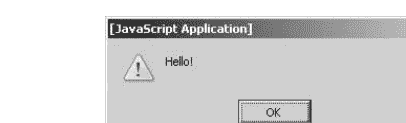

当你按下 OK 按钮时，你会看到图 2-2 所示的画面。

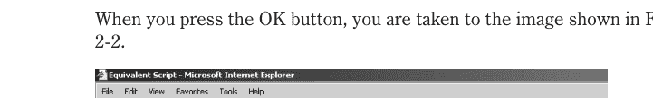

理解外部脚本的解释方式很重要，因为许多不同的规则适用于 JavaScript 和 HTML 布局。只需记住，外部脚本实际上被视为在本地脚本（由 `<SCRIPT>` 和 `</SCRIPT>` 标签包围）之前执行。

仅包含 JavaScript 的文件应具有文件名后缀 `.js`，并且服务器必须将 `.js` 后缀映射到 MIME 类型 `application/x-javascript`，并在 HTTP 响应头中将其发回。如果服务器没有将 `.js` 文件名扩展名映射到 `application/x-javascript`，Navigator 将无法正确加载 `SRC` 属性指定的 JavaScript 文件。简而言之，你的服务器必须配置为反映正确的 MIME 类型；否则，浏览器将无法正确处理对 `SRC` 发起的请求所返回的 HTTP 响应数据。

## 事件处理程序

你可以将 JavaScript 直接放入事件处理程序中。事件处理程序是 HTML 标签属性，它们引用与该表单元素相关的特定操作。例如，对于 HTML 按钮可能是 `onclick`，对于 HTML 文档本身可能是 `onload`。事件处理程序用于控制 JavaScript 何时执行。使用事件处理程序，相关脚本将在事件发生时执行。一个很好的例子是图像翻转，当鼠标指针移到图像上时，图像会发生变化。事件处理程序是 JavaScript 能够与最终用户交互的原因。一些常用的事件处理程序包括 `onMouseOver`、`onMouseOut`、`onLoad`、`onSubmit` 和 `onClick`。

像任何其他 HTML 标签属性一样，事件处理程序属于 HTML 标签内部，后跟等号，并将值包含在引号中。不同之处在于事件处理程序的值是 JavaScript。以下是一个在链接标签的实际事件中使用 JavaScript 更改图像源的示例：

```html
<a href="x.html" onMouseOver="document.mainimage.src='mypic.gif'" >
```

你会经常看到以这种方式使用的事件处理程序。这是 JavaScript 程序员中非常流行的技术。

## 短语句

短语句与你在事件处理程序中看到的类似。本质上，你只需在需要的地方编写一行 JavaScript 代码。事实上，事件处理程序只是短语句的特殊情况。

## 为旧浏览器隐藏脚本

你可能已经问过自己，当有人使用不支持 JavaScript 的旧浏览器加载你的页面时会发生什么。由于所有主要浏览器都已支持 JavaScript 多年，而且浏览器可以免费下载，有人使用五年或更旧的浏览器访问你网站的可能性几乎不存在。尽管许多 JavaScript 程序员仍然会添加处理过时浏览器的代码，但这更多是出于习惯而非必要。因此，尽管本书的早期版本涉及过此问题，我们在此不再讨论。

## 关于 JavaScript 的重要注意事项

互联网上的危险急剧增加。病毒、网络钓鱼和间谍软件都是互联网上非常真实的危险。今天很难找到任何计算机用户没有在某种程度上受到某种恶意软件的不利影响。因此，浏览器阻止任何可能被恶意使用的内容变得越来越普遍。

正如你将在本书后面的章节中看到的，JavaScript 可用于在客户端计算机上放置 cookie（包含信息的小文件），以收集有关该客户端的信息，例如其 IP 地址和所使用的浏览器类型。因此，许多浏览器提供了可选的更高安全级别来阻止 JavaScript。如果有人使用设置了高安全级别的 Internet Explorer 访问包含 JavaScript 的你的网站，他们会看到类似于图 2-3 所示的警告消息。

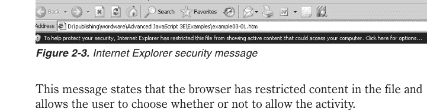

此消息表明浏览器已限制文件中的内容，并允许用户选择是否允许该活动。

这不是一个主要问题。用户只需点击弹出窗口，他或她就能查看你的 JavaScript。如果你是出于个人目的创建网站，你实际上无需对此做任何处理。然而，一些公司开始在其主页上放置隐私声明/政策。这些政策会告知访客可能放置在其计算机上的任何 cookie，以及可能收集的关于他们的具体数据类型。在任何商业网站上实施此措施可能都是个好主意。在我看来，在不远的将来，你会发现你网站的访客变得越来越关注安全和隐私。如果你不能缓解他们的担忧，你会发现网站的访问量会少得多。

# 总结

本章的目标是让你开始编写简单的 JavaScript 脚本。这应该能让你开始感受 JavaScript 的工作方式。学完本章后，你应该理解 JavaScript 的基本结构，并能够将 JavaScript 脚本插入到你的 HTML 页面中。

# 第 3 章

# JavaScript 基础

## “构建”脚本

在上一章中，我们介绍了 JavaScript 的基本结构和一些简单脚本。现在我们将开始探索 JavaScript 的细节。在本章中，你将学习所有 JavaScript 的基本元素。在开始讲解 JavaScript 基础知识时，请记住它与所有编程语言（包括其基本元素）有许多共同的基本概念。因此，如果你使用过任何其他编程语言，学习起来就不会太困难。它有存储数据的变量，有表达式或语句，还有函数。这些构建块用于构建你的 JavaScript 脚本。我将在本章中解释这些元素中的每一个。

## JavaScript 中的数据类型

变量存储的信息通常必须是特定类型。这些类型被称为 *数据类型*。请注意，JavaScript 允许你创建通用变量并将你希望的任何数据放入其中，这就是为什么 JavaScript 通常被称为“弱类型语言”。其他语言（Java、C、C++ 等）不允许你创建未指定类型的通用变量。这些语言被称为“强类型语言”。尽管在 JavaScript 中不必使用类型化变量，但许多程序员发现使用特定数据类型使他们的代码更具可读性，因此更易于维护。

如果你打算使用特定类型的数据变量，那么使用正确的数据类型来存储你的信息就很重要。例如，数字是 JavaScript 识别的一种信息类型。JavaScript 中有四种特定的数据类型：数字、字符串、布尔值和 null 值。与其他语言不同，变量数据类型不是显式声明的，而是根据其初始赋值隐式确定的。同样 JavaScript 独有的是，整数和实数之间没有明确的区分。

所有这些数据类型都在表 3-1 中列出。


# 表 3-1. JavaScript 中的数据类型

| 类型 | 描述 | 示例 |
| --- | --- | --- |
| number | 不带引号的任意数字 | 42 或 16.3 或 2e-16 |
| string | 用引号括起来的一系列字符 | "Hello!" 或 "10" 或 '' 或 "" |
| Boolean | 逻辑值 | true 或 false |
| null | 表示没有值的关键字 | null |

# Null 值

Null 值通常用于初始化没有任何特殊含义的变量（参见本章后面的“变量声明”）。你可以使用标准的赋值语句将其赋给变量：

```javascript
var name = null
```

Null 值的特殊之处在于，它会自动转换为其他数据类型的初始值。当用作数字时变为 0，当用作字符串时变为 ""，当用作布尔值时变为 false。由于许多 JavaScript 错误源于未初始化的变量，一种常见的调试技巧是将所有未初始化的变量（包括无意义的变量）初始化为 null 值。

JavaScript 解释器在两种情况下使用 null 值：(1) 内置函数在某些情况下返回 null，(2) 不存在的属性评估为 null。在检查 null 值时，应检查它是否为 false 或是否等于 null。

# 变量

在某种程度上，所有程序都存储数据，至少是短暂地存储，而数据暂时存放在变量中。因此，称变量为大多数编程和脚本语言的基石并不为过。它们是脚本中的简单单词与计算机分配内存之间的链接。可用内存的数量是有限的，但你几乎不可能达到那个极限。JavaScript 应用程序不是资源消耗大户，现代 PC 通常有大量内存。截至撰写本文时，很难买到内存少于 512 兆字节的 PC，因此超过可用内存可能表明浏览器中存在错误或你的程序存在重大缺陷（如意外的无限循环）。

因为你不会直接处理内存分配，所以你应该把变量看作装有不同数据的篮子。你可以把物品放入篮子，取出它，或者用另一个替换它。一个完全不使用任何变量的脚本可能做不了太多事情。因此，你肯定应该熟悉变量，因为你将在整本书中使用它们。

# 标识符

每个变量由一个*变量名*标识，也称为*标识符*。每个变量名都与一个特定的内存位置相关联，解释器使用它来确定其位置。命名变量有严格的规则，你需要学习它们：

- 标识符的第一个字符必须是字母（大写或小写）或下划线 (_)。
- 所有其他字符可以是字母、下划线或数字 (0 到 9)。
- 标识符不能是语言的保留字。保留字包括所有 JavaScript 关键字以及为未来版本保留的其他标记。

标识符长度不受限制，你应该利用这一特点选择有意义的名称。JavaScript 区分大小写（大写字母与小写字母不同）。例如，counter、Counter 和 COUNTER 是三个不同变量的名称。虽然这三个变量名是合法的，并且会创建三个独立且不同的变量，但使用如此相似的名称会给你自己或任何需要阅读或修改你的 JavaScript 的人带来很大的混淆。你应该始终避免在同一个脚本中使用如此相似的标识符。然而，你会希望使用与其包含的数据相关的变量名。例如，如果你有一个包含人姓氏的字符串变量，你可能希望将其命名为 LastName。

以下标识符是合法的：

```javascript
loopCounter
_AccountNumber
_123456789_
customer_name
0fficeNumber6
```

但以下标识符是非法的：

```javascript
with            // 保留字
^fastTimer      // 第一个字符非法
911phoneNumber  // 不能以数字开头
04-825-6408     // 第一个字符非法
                // "-" 是非法字符
***important*** // * 不是合法字符
10_guesses      // 第一个字符不能是数字
```

*关键字*是在编程语言中具有特殊含义的单词。你不能使用关键字来命名你在脚本中创建的变量或函数（如变量、函数等）。关键字列表是语言的基本词汇。例如，单词 *if* 就是一个关键字。你不必记住这个列表，因为你随着在脚本中使用这些单词会逐渐记住它们。

# 命名约定

JavaScript 中有一些普遍接受的约定：

- 变量名通常用小写字母书写。
- 变量名应表明其在程序中的用途和用法。
- 在多词标识符中，要么在单词之间放置下划线，要么将每个嵌入单词的首字母大写。

以下是多词标识符的示例。

```javascript
all_done    // 使用下划线
allDone     // 使用首字母大写
```

避免使用相似的变量名。以下展示了糟糕的变量名选择：

```javascript
digit       // 当前数字
digits      // 数字中的位数
```

更好的一组变量是：

```javascript
current_digit  // 当前数字
num_of_digits  // 数字中的位数
```

# 变量声明

你已经看到了如何命名变量，并且知道为什么需要变量，但如何创建它们呢？在使用变量之前，你需要创建它。JavaScript 是一种松散类型的语言，这意味着你在创建变量时不必显式指定其数据类型。根据需要，数据类型在脚本执行过程中会自动转换。在强类型语言中，变量必须创建为特定类型。

创建变量有两种方法，幸运的是这两种方法都非常简单。第一种声明类型包括 var 关键字后跟变量名：

```javascript
var variableName
```

第二种方法是简单地使用变量名并将其设置为初始值，而不使用 var 关键字。虽然这可行，但不推荐，因为它可能会让阅读脚本的人感到困惑。

当解释此语句时，浏览器会在变量名与其内存地址之间创建一个链接，因此后续的引用可以通过名称完成。与某些编程语言不同，声明不限于特定区域，可以在整个脚本的任何地方进行。

将初始值赋给变量的动作称为初始化。你使用最常见的赋值运算符（等号）给变量赋值：

```javascript
var variableName = initialValue
```

你只需在创建变量时使用 var 关键字。当你想要引用该变量时，只需使用其名称。按以下方式给变量赋值（在声明之后）：

```javascript
variableName = anyValue
```

每个变量只需使用一次 var。全局变量可以通过直接赋值而不使用 var 关键字来创建。另一方面，函数内的局部变量必须使用 var 关键字声明。与许多其他编程语言一样，JavaScript 允许你通过用逗号分隔在同一语句中声明多个变量：

```javascript
var variableName1 = initialValue1, variableName2 = initialValue2, ...
```

# JavaScript 实体

JavaScript 实体可以分配给 HTML 属性。这种属性替换使得创建更灵活的 HTML 结构成为可能，而无需编写完整的 JavaScript 脚本。

你可能熟悉 HTML 字符实体，你可以通过其数字代码或名称来显示字符。你在名称或数字前加上一个 (&) 符号，并以分号 (;) 结尾。以下是几个示例：

```html
&gt;
&lt;
&#169;
```

这些 HTML 实体解析为以下字符：

- > （大于号）
- < （小于号）
- © （版权符号）

JavaScript 实体也以 & 开始，以 ; 结束。你使用花括号 ({ 和 }) 括起来的 JavaScript 表达式来代替名称（如前两个示例）或数字（如第三个示例）。请注意，你只能使用 JavaScript 实体来分配 HTML 属性。考虑以下 HTML 文档：

```html
<HTML>
<HEAD>
<TITLE>JavaScript Entities</TITLE>
<SCRIPT LANGUAGE="JavaScript">
<!-- hide content from old browsers
var fontSize = "+4"
var fontColor = "red"
// end hiding content-->
</SCRIPT>
</HEAD>
<BODY>
<FONT COLOR="&{fontColor};" SIZE="&{fontSize};">
Flexible attributes with JavaScript entities
```


**示例 3-1 (ex3-1.htm)**

执行此脚本时，你将看到与图 3-1 所示类似的内容。

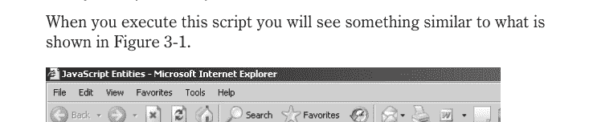

*图 3-1. JavaScript 实体*

实体 `&{fontColor};` 会被 `fontColor` 的当前值替换，而 `&{fontSize};` 会被 `fontSize` 的当前值替换。由于 JavaScript 只能使用在页面布局时存储在内存中的值，因此 JavaScript 实体应该在为其赋值的脚本调用之后才使用。

一旦布局完成，页面的显示只能在重新加载页面时才会更改。即使 JavaScript 实体变量的值发生变化，实体本身在重新加载页面之前也不会改变。

与可在任何脚本语句中使用的 HTML 字符实体不同，JavaScript 实体只能在标签语句中使用。另一个区别是，虽然 HTML 字符实体可以替代任何 HTML 元素，但 JavaScript 实体仅限于替换 HTML 属性。例如，你无法使用变量 `text = "<H1>Hi!</H1>"` 指定实体 `&{text};` —— 这不是一个有效的标签属性值。

## 类型转换

如上所述，数据类型在脚本执行过程中会根据需要自动转换。这可能非常方便，而许多其他编程语言不允许这样做。一个变量在脚本的某个时刻可能持有数值，而在另一个时刻可能持有字符串。以下语句构成了一个有效的 JavaScript 脚本：

```
var myVar = 12
myVar = "university"
```

第一条语句将数值赋给 `myVar`，而第二条语句将字符串赋给它。在像 C++ 和 Java 这样严格类型的语言中不允许进行这种转换。虽然在 JavaScript 中是可能的，但并不推荐。使用这种技术会导致编程非常不严谨。

## 混合字符串和数字

对于某些操作，混合字符串和数字有时是必要的。由于这很棘手并且可能产生意外结果，你应该熟悉其确切规则。当一个同时包含数字和字符串的表达式被求值为单个值时，该值会被求值为字符串。通常无法将其转换为数字。例如，数字 6 可以轻松转换为字符串 "6"，而字符串 "horse" 不能转换为数字。另一个重要规则是 JavaScript 解释器从左到右对表达式进行求值，只有括号可以改变求值顺序。请看以下表达式，按行编号。

```
/* 1 */  8 + 8           // 16
/* 2 */  "8" + 8         // "88"
/* 3 */  8 + "8"         // "88"
/* 4 */  "8" + "8"       // "88"
/* 5 */  8 + 8 + "8"     // "168"
/* 6 */  8 + "8" + 8     // "888"
```

这些表达式都使用了字符串连接运算符，它也是数字加法运算符。（运算符将在本章后面介绍。）第一个表达式只是使用数字格式将两个数字相加。它使用标准加法运算符，并将其操作数的和作为结果。第二个表达式则大不相同。它的第一个操作数是字符串而不是数字。为了将数字加到字符串上，数字被转换为对应的字符串，然后字符串被连接起来。第三个和第四个表达式类似，因为它们也至少包含一个字符串操作数。第五个表达式更棘手一些。前两个操作数因为是数字而被相加。表达式现在求值为 16 + "8"，你已经知道，这将求值为 "168"。使用括号可以改变结果。例如：

```
8 + (8 + "8") // "888"
```

在此表达式中，括号内的内容首先被求值为 "88"，整个表达式求值为 "888"。将第六个表达式与第五个进行比较，清楚地展示了从左到右求值的含义。

每当在表达式求值过程中发现一个字符串时，迄今为止累积的值就会被转换为字符串。当右侧剩余的数字值与此累积值连接时，会自动转换为字符串。

如果你想将单个数字转换为字符串，可以使用以下三种方法之一：

```
var newVar = " " + numericValue
var newVar = new String(numericValue)
var newVar = numericValue.toString()
```

第一种方法很简单。你使用连接运算符，它指示 JavaScript 将数字转换为字符串，然后将其附加到空字符串上。其他方法将在本书后面讨论。

## 字面量

*字面量*是你直接在应用程序源代码中提供的固定值，它们不是变量或任何其他数据结构。在其他编程语言中，相同的概念通常称为*常量*。它们是常量值的表示法，因此在整个脚本中不会改变。字面量为你提供一个值，而不仅仅是代表可能的值。与有五种字面量类型的 C++ 和 Java 不同，JavaScript 只有四种：整数、浮点数、布尔值和字符串。字符字面量只是长度为 1 的字符串。

## 整数字面量

*整数字面量*，也称为*整数*，是没有小数点或小数部分的数字。以下是一些整数字面量：

-   49
-   16
-   0
-   -18
-   -42

整数可以是正数、负数或零。JavaScript 与大多数其他编程语言一样，支持三种类型或进制的整数：十进制、八进制和十六进制。

## 十进制整数

*十进制整数*，也称为*基数为 10 的整数*，是我们日常使用的普通整数。它们使用数字 0、1、2、3、4、5、6、7、8 和 9 书写。除了数字 0 本身，十进制整数不能以 0 开头。将当前年份写为 02007 是没有意义的，而且 JavaScript 也不会将其求值为 2007。

## 十六进制整数

*十六进制整数*在编程环境中很常用，因为每个十六进制数字代表四个二进制位。*十六进制数字*是以下数字的任何序列：0、1、2、3、4、5、6、7、8、9、A、B、C、D、E、F。这些整数被称为十六进制，因为它们基于 16 个不同的数字。大小写敏感规则不适用于数字，因此你也可以使用小写字母。十六进制数字的前缀是 0x 或 0X。

十六进制数字对 HTML 作者来说可能很熟悉。在 Netscape Navigator 和 Internet Explorer 的早期版本中，颜色是用*十六进制三元组*格式指定的。尽管最新版本的 Netscape Navigator 和 Internet Explorer 允许你通过名称指定颜色，但有些人继续使用十六进制表示法。以下标签将背景色设置为默认灰色（即使对于将默认颜色更改为白色的用户也是如此）：

```
<BODY BGCOLOR="#c0c0c0">
```

你可能知道，显示器屏幕颜色在红、绿、蓝三者的相对贡献上有所不同。十六进制三元组组合了三个两位数的十六进制数（2 位数字 = 16 * 16 = 256 种可能性）。

## 从十进制转换为其他进制

你可以使用计算器将十进制整数转换为不同的进制。但如果计算器坏了怎么办？！用纸和笔进行转换出奇地简单。你首先将十进制数除以目标基数（例如，二进制为 2，八进制为 8，十六进制为 16）。写下余数。现在对商执行同样的操作，将新的余数写在之前操作得到的余数的左边。不断循环，直到商小于目标基数。下表显示了将十进制数 747 转换为十六进制表示法的过程：

**表 3-2.** *一个进制转换示例*

| 运算及整数商 | 余数（十进制） | 余数（十六进制） |
| :--- | :--- | :--- |
| 747 / 16 = 46 | 11 | B |
| 46 / 16 = 2 | 14 | E |
| 无运算 | 2 | 2 |

看看表格最右边的一列。从下往上读，我们得到 2EB₁₆，它正好是 747₁₀。

相同的过程可以将十进制整数转换为任何进制。


## 从指定进制转换为十进制

将一个数从指定进制转换为十进制表示法也同样简单。首先，我们来分析一个十进制数，比如276：

$276 = (6 * 10^0) + (7 * 10^1) + (2 * 10^2) = 6 + 70 + 200$

每一位数字贡献的值为 `digit * base^digitPlaceFromRight`，其中 `digit` 是当前数字，`digitPlaceFromRight` 是该数字的位置（从右侧的0位开始计数），而 `base` 是当前进制。该数字等于所有贡献值之和。从给定进制转换为十进制使用相同的技术，只是每个数字的值是其十进制表示法中的值。让我们将 $14728_8$ 转换为十进制：

$(2 * 8^0) + (7 * 8^1) + (4 * 8^2) + (1 * 8^3) = 2 + 56 + 256 + 512 = 826_{10}$

我们将在本书后面使用这些技术来创建自动转换函数。

## 引用八进制和十六进制整数

八进制整数以字符0开头。十六进制整数以0x或0X前缀开头。十进制整数是没有前缀的普通整数。那么我们如何处理这些前缀呢？

JavaScript 将所有整数都视为十进制。因此，如果你写 0x2EB，JavaScript 会存储这个数，并在十进制表示法中将其称为747。同样的规则适用于八进制整数。它们根据其十进制值被存储、显示和处理。计算机显然是将它们存储为二进制数，但对 JavaScript 程序员来说，它们似乎是按十进制形式处理的。

## 浮点字面量

*浮点数*（有时称为*实数*）具有小数部分。JavaScript 使用小数点来区分浮点数和整数。字面上看，像16.0这样的数字是浮点数，而16是整数。此外，浮点数可以包含指数规格，形式为 e±exp。由于 JavaScript 中没有明确的数据类型声明，浮点格式由赋值给变量的字面量隐式决定。以下是一些浮点数，附带一些解释：

```
-13.3
0.056
4.2e19   // equal to 4.2 * 10^19
-3.1E12  // equal to -3.1 * 10^12
.1e12    // equal to 0.1 * 10^12
2E-12    // equal to 2 * 10^-12
```

请注意，指数规格可以使用大写或小写字符。

浮点运算比整数运算困难得多，是许多错误的根源。*溢出*描述了浮点数的指数超过上限的情况。*下溢*发生在指数低于下限时。你应该避免可能导致溢出或下溢的计算。

浮点数一个更常见的问题是*舍入误差*。大家都知道5 + 5等于10，但1/3 + 1/3等于2/3吗？答案是：不一定。看看以下内容找出原因：

1/3 的浮点表示是 3.333E–1（已舍入）。
2/3 的浮点表示是 6.667E–1（已舍入）。

```
3.333E-1
+ 3.333E-1
= 6.666E-1
```

正如你所看到的，结果与2/3的正常值不同，因为6.666E–1 ≠ 6.667E–1。

每台计算机在浮点值上都有类似的问题。例如，分数0.2没有精确的二进制表示。因此，在进行计算之前，应始终对浮点值进行舍入，以避免这些不准确性。

## 布尔字面量

*布尔值*，也称为*逻辑值*，基本上是true或false。它们通常用于条件表达式和语句中。如果你熟悉C++，你可能认出这些术语是1和0，其中1代表true，0代表false。JavaScript 官方使用true和false值来表示布尔值，但在大多数情况下1和0也是可以接受的。true值，或1，通常可以被任何非零整数替换。避免使用这些数值作为布尔值，因为 Netscape 官方尚未认可这种用法，并且可能在未来的浏览器版本中选择使其无效。使用整数值表示布尔值，如同在其他编程语言中一样，会导致数据类型混淆，新手程序员完全不应这样做。

## 字符串字面量

*字符串字面量*由单引号或双引号分隔。你必须用与开始字符串相同类型的引号来终止字符串，因此 "Hi' 在 JavaScript 中不是合法字符串。与大多数编程语言和shell中的字符串不同，JavaScript 不区分单引号和双引号。它们的作用完全相同。JavaScript 中的字符串不受变量插值的影响，即你不能直接将变量嵌入字符串并期望它们被替换为变量所持有的值。例如，Perl 具有变量插值（或变量替换）功能，因为变量可以通过前面的 $ 字符来识别。

JavaScript 不支持替代分隔符 q/string/ 和 qq/string/。你必须始终使用传统引号来分隔字符串。

嵌套字符串在 JavaScript 中被广泛使用。嵌套字符串由一个字符串嵌套在另一个字符串内组成。交替使用引号可以正确解释嵌套字符串结构。以下语句演示了如何交替引号类型：

```
document.write("<FONT COLOR='red' SIZE=4>")
```

document.write() 语句需要引号，<FONT> 标签的 COLOR 属性也需要引号。你可以对字符串 'red' 使用单引号，对较长的外层字符串使用双引号。你也可以使用转义引号，如下所述。

请务必将结束引号放在字符串末尾。如果你忘记了，只有当 JavaScript 运行到文件末尾或在另一行找到匹配的引号字符时，才会报告相关错误。幸运的是，此类错误会立即作为下一行的语法错误被检测到。然而，有时错误信息不会提供任何关于失控字符串的线索，因此在处理字符串时要格外注意是一个好策略。

字符串通常包含转义序列，也称为转义字符、特殊字符或控制字符。这些序列具有特殊目的。例如，\t 是制表符。它们通常用于表示不可打印字符或其他有问题的字符。下表概述了转义序列：

**表 3-3. JavaScript 中的转义序列**

| 转义序列 | 字符 | 含义 |
| :--- | :--- | :--- |
| \ddd* | 0ddd | 八进制字符 |
| \xdd* | 0xdd | 十六进制字符 |
| \\ | \ | 反斜杠 |
| \' | ' | 单引号 |
| \" | " | 双引号 |
| \b | BS | 退格符 |
| \f | FF | 换页符 |
| \n | NL 或 LF | 换行符 |
| \r | CR | 回车符 |
| \t | HT | 水平制表符 |
| \\ | <换行符> | 续行符 |

* 字符 d 代表一个数字。

确保仅在需要时使用这些内联字符。你应该使用标准 HTML 标签进行换行 (<BR>) 和段落分隔 (<P>)。回车转义序列仅在对话框和文本区域对象中创建新行。大多数转义序列的作用方式相同。不要期望它们来格式化页面的外观，因为布局完全依赖于 HTML。

## 运算符

以下是一些利用转义序列的字符串：

```
"\x2499.99" // $99.99 ($ 字符的十六进制值为 24)
'c:\\games\\sc2000\\' // c:\games\sc2000\
'Let\'s learn JavaScript...' // Let's learn JavaScript...
"line1\rline2"
```

要查看回车符的效果，请尝试在警告框中显示最后一个字符串。

每种编程语言都有运算符。运算符只是一个符号，它告诉编译器（或解释器）执行特定的操作。最明显的运算符是数学运算符。基本算术运算符在大多数编程语言中是通用的。这些是加法（+）、减法（–）、乘法（*）和除法（/）。这些对大多数人来说应该非常熟悉。运算符的优先级顺序遵循标准的数学规则：乘法、除法、加法和减法。然而，当你的代码在一行中有多个操作时，使用括号来明确你想要发生什么通常是个好主意：3 * 4/2 + 1 可能有歧义，而 3 * ((4/2) + 1) 则非常清晰。

C、C++ 和 Java 程序员已经熟悉自增和自减运算符。自增运算符通过在变量后放置两个加号形成，如下所示：

```
var somenumber
somenumber++
```

这行代码将 somenumber 的值增加一。如果我们写成：

```
somenumber--
```

它将使值减少一。非常重要的一点是，你要意识到自增和自减运算符的位置至关重要。如果你将自增运算符放在变量之后，例如：

```
var somenumber = 10
var someothernumber
someothernumber = somenumber++
```

赋值操作将在求值操作之前发生。换句话说，首先 someothernumber 将被设置为等于 somenumber 的值，然后 somenumber 的值将增加。在我们的例子中，这意味着 someothernumber 将等于10，而 somenumber 将等于11。如果你希望重写这个语句，使自增操作首先发生，只需重新定位自增符号：

```
someothernumber = ++somenumber
```


在这种情况下，某个数字被递增至11，然后该值被赋给另一个数字。

你已经学会了如何使用等号赋值运算符为变量赋值或初始化它。如下面的代码所示，你也可以在赋值时执行计算：

```
/* 1 */ var answer
/* 2 */ answer = 4 * 2 + 9
/* 3 */ document.write(answer)
```

第1行包含变量 `answer` 的声明。第二行展示了如何将简单数学表达式的结果赋给变量 `answer`。此时，变量持有的值为17。引用变量 `answer` 等同于引用数字17。因此，第3行的语句打印数字17。

> **注意：** 一个非常常见的错误是使用单等号进行相等性检查。例如，在Visual Basic中，“=”既是相等性测试运算符，也是赋值运算符。然而，在JavaScript中，如同C++和Java一样，“=”（等号运算符）是赋值运算符，而“==”（双等号）是相等性测试运算符。

这只是对JavaScript中最简单运算符的粗略探讨。第6章将对运算符进行详细讨论。然而，你对本章及接下来两章的理解，有赖于对运算符的简要介绍。

## 语句

既然我们已经详细探讨了数据类型，现在来看看语句。*语句* 是一行执行特定任务的代码。例如，以下所有内容都是语句：

```
yourAge = 32
for(x=1;x<10,x++)
myname= "Chuck"
```

## 多语句

JavaScript解释器允许在同一行上接受多个语句。如果你选择使用此方法，必须用分号(;)分隔语句。该行最后一个语句后不必跟分号。这样的行如下所示：

```
statement1; statement2; statement3; ...
```

浏览器将这些语句解释为就像它们被列在单独的行上一样：

```
statement1
statement2
statement3
```

虽然JavaScript支持这样做，但我绝不推荐。将多个语句放在单行会使代码非常难以阅读。尽管JavaScript不要求每条语句后都加分号（除非它们在同一行），但如果你在每个语句末尾放置分号，它不会产生错误。因此，如果这是你的编程习惯之一，你可以用分号结束所有语句。

```
statement1;
statement2;
statement3;
```

然而请记住，这在JavaScript中并非必需，不像在C、Java和C++中那样。

## 嵌套语句

*命令块* 是由花括号包围的一组语句。理解块应作为单个语句来使用非常重要。块内的语句称为 *嵌套语句*：

```
{
    nested statement1
    nested statement2
    nested statement3
}
```

包含多个语句的循环实际上是一个带有多个嵌套语句的语句。此规则适用于函数、if-else语句和其他语言元素。

## 表达式求值

既然你知道如何创建变量，你需要知道如何使用它。如前所述，变量持有不同类型的值。“持有值”是什么意思？这个术语指的是表达式 *求值*。变量总是对其值进行求值。当你对变量执行操作时，实际上是在对与该变量关联的当前值执行操作。假设你使用以下语句创建了一个名为 `firstNumber` 的变量：

```
var firstNumber = 120 // declaration and initialization
```

此时，如果你引用变量 `firstNumber`，将返回其值120。也就是说，`firstNumber` 被求值为120。以下语句概述了 `firstNumber` 的求值过程：

```
secondNumber = firstNumber * 6
```

变量 `secondNumber` 现在持有的值是720，因为 `firstNumber` 求值为120。请记住，变量内存位置之间并未建立链接。因此，`secondNumber` 现在持有的值是720，即使 `firstNumber` 的值发生变化，它也不会改变。变量可以求值为任何类型的值（参见表3-1）。

## 测试求值

Netscape Navigator（以及一些其他浏览器）的一个隐藏功能使你可以在浏览器窗口中进行求值实验。你可以通过简单地在地址框中输入 `javascript:` 来进入此窗口。另一种方法是通过“文件”菜单选择“打开位置”。然后输入 `javascript:` 以打开求值窗口。

求值窗口包含两个框架。底部框架中的字段用于接受你的输入，顶部框架显示Navigator的计算结果。要尝试此工具，请在底部的javascript输入字段中输入以下语句：

```
var firstNumber = 120
var secondNumber = firstNumber - 60
firstNumber
secondNumber
var finalAverage = (firstNumber + secondNumber) / 2
finalAverage
secondNumber = firstNumber
finalAverage
finalAverage > secondNumber
```

在输入这些表达式之前，试着弄清楚它们的求值结果。然后将它们输入到下方框架的字段中，每条语句后按回车键（Enter）。

## 函数

### 函数定义

*函数* 是在具有共同名称的块中组织的语句分组。好的函数旨在完成一个单一目标。例如，一个函数可以根据给定的本金和利率计算抵押贷款的每月还款额。就像变量一样，你必须先定义函数才能调用它。

函数使用关键字 `function` 定义，后跟函数名称。适用于变量名的相同规则也适用于函数。由于函数通常除了存储值外还要执行其他操作，因此通常在其名称中包含一个动词。函数的参数写在名称后的括号中。参数后面是一个命令块。函数定义的语法是：

```
function functionName([parameters])
{
    [statements]
}
```

参数是调用函数时被赋予值的局部变量。本质上，参数是函数将要处理的原材料。在我们之前计算抵押贷款还款额的函数示例中，本金和利率将是该函数的参数。另一个你经常听到的用于参数的词是 *实参*。在编程中，实参和参数是同义词。此时，你应该始终为每个参数命名。

在正式的语法规范中，方括号([])通常表示可选元素。由于函数不一定必须有参数或语句，因此两者都用此类括号括起来。包围函数体的花括号可以放在参数部分之后的任何位置。以下函数是有效的：

```
function functionName([parameters]) {[statement1]; [statement2]; ...}

function functionName([parameters])
{
    [statement1]
    [statement2]
}
```

以下示例演示了一个函数声明：

```
<HTML>
<HEAD>
<SCRIPT LANGUAGE="JavaScript">
function square(number)
{
    document.write("The call passed ",
                   number, // the function's parameter
                   " to the function.<BR>",
                   number, // the function's parameter
                   " square is ",
                   number * number,
                   ".<BR>")
}
// *** add function call
</SCRIPT>
</HEAD>
<BODY>
</BODY>
</HTML>
```

示例3-2（ex3-2.htm）。函数定义（延迟代码）

示例3-2不会向浏览器窗口打印任何内容，也不会生成任何其他形式的输出。原因是函数仅在脚本中定义，但从未被调用。当浏览器定位到一个函数时，它会将函数的语句加载到内存中，准备稍后执行。

### 调用函数

为了执行函数块中的一组语句，你必须调用该函数。函数调用的语法是：

```
functionName([arguments])
```

通过在示例3-2的指定位置添加语句 `square(5)`，我们调用了该函数。函数中的语句被执行，并输出以下消息：

The call passed 5 to the function.
5 square is 25.

你也可以在另一个函数内部调用一个函数，如以下示例所示：

```
<HTML>
<HEAD>
<TITLE>Calling a function from within another function</TITLE>
<SCRIPT LANGUAGE="JavaScript">
function makeBar()
{
    var output = "<HR ALIGN='left' WIDTH=400>"
    document.write(output)
}
function makeHeader(text, color, size)
{
    var output = "<FONT COLOR='" + color + "' SIZE=" +
            size + ">" + text + "</FONT>"
    document.write(output)
    makeBar()
}
makeHeader("JavaScript Examples", "red", "+4")
</SCRIPT>
</HEAD>
<BODY>
</BODY>
</HTML>
```

*示例3-3（ex3-3.htm）。* 函数块中的函数调用

示例3-3总结了本章讨论的许多术语。它包含两个函数定义。在两个函数中，输出都被赋值给一个变量（output），然后使用 `document.write()` 方法打印到客户端窗口。在打印长字符串（即你想打印大量数据）之前，将字符串赋值给变量是非常有用的。你可以在图3-2中看到示例3-3的结果。


## 第 3 章

*图 3-2. 示例 3-3 的输出*

## 控制结构

## 对话框

在我们讨论 JavaScript 中的控制结构之前，需要了解一些基本的用户交互设备。这些设备将帮助我们创建既有用又有助于演示的示例。本章仅介绍对话框，后续将更详细地讨论它们。

JavaScript 提供了创建称为*对话框*的小窗口的能力。你可以创建警告框、确认框，甚至提示框。这些框允许你生成输出并从用户那里接收输入。

## 警告框

警告框是最简单的对话框。它允许你在单独的窗口中向用户显示一条简短的消息。请看以下脚本及其对应的输出：

```
alert("Click OK to continue...")
```

此函数的通用形式是 `alert(*message*)`。函数 `alert()` 实际上是 `window` 对象的一个方法。由于 `window` 是默认对象，所以没有必要显式指定它。这适用于所有对话框。

你也可以使用数据结构来显示消息。例如：

```
var message = "Click OK to continue"
alert(message)
```

如你所见，警告框通常用于暂停脚本的执行，直到用户批准其继续。

## 确认框

确认框与警告框的不同之处在于，它会根据用户的决定返回一个值。确认框不仅包含“确定”按钮，还包含“取消”按钮。

与警告框一样，`confirm` 也是 `window` 对象的一个方法。此方法返回一个布尔值，因为有两个选项。你可以使用确认框向用户提出一个是或否的问题，或确认一个操作。以下是一个示例：

```
var reply = confirm("OK to continue?")
```

如果用户选择“确定”，则 `reply` 被赋值为 `true`；如果用户选择“取消”，则被赋值为 `false`。

此函数的通用形式是 `confirm(message)`。

## 提示框

`prompt()` 方法显示一个带有消息和输入字段的提示对话框。你可以使用这些框从用户那里接收输入。它与确认框类似，不同之处在于它返回输入字段的值，而不是 `true` 或 `false`。以下是一个示例：

```
var name = prompt("Enter your name:", "anonymous")
```

如果用户选择“取消”，则此方法返回 `null` 值。图 3-3 显示了一个典型的提示框。

字段的值始终是字符串。如果用户在表单中输入 `16`，则返回字符串 `"16"` 而不是数字 `16`。当提示用户输入数字时，你必须将输入转换为数值。JavaScript 提供了一个内置函数来执行此操作——`parseInt()`。你可以使用以下语句要求用户输入一个数字：

```
var number = parseInt(prompt("Enter a number:", 0))
```

或

```
var number = prompt("Enter a number:", 0)
number = parseInt(number)
```

此函数的通用形式是 `prompt(message[, inputDefault])`。你可以通过使用 `typeof` 运算符进行测试来了解此函数的工作原理：

```
var number = prompt("Enter a number:", 0)
alert(number + " is a " + typeof(number)) // "... is a string"
number = parseInt(number)
alert(number + " is a " + typeof(number)) // "... is a number"
```

当然，输入必须是数字类型（例如，`99`）。

## 条件语句

条件语句是所有编程语言的关键。它们允许你的程序（或在此情况下的脚本）根据不同的条件执行不同的代码段。

## if 语句

```
if (condition)
    statement
```

`if` 语句让你在脚本中加入决策制定。没有任何决策的脚本每次执行时都执行相同的流程。这样的线性结构将你的脚本限制在简单的算法。JavaScript 使用 `if` 语句实现决策制定。`if` 语句将单个语句与一个真条件关联。该语句仅在条件表达式为真时执行；否则，根本不执行。条件必须求值为布尔值：`true` 或 `false`。数值也可以作为布尔条件的替代。`0` 等同于 `false`，所有其他值等同于 `true`。

`if` 语句将单个语句与一个真条件关联。语句可以是任何内容，从简单的 `document.write()` 到使用花括号 (`{}`) 的语句块。一些 `if` 语句需要多个语句，因此它们使用如下形式的块：

```
if (condition)
{
    statement1
    statement2
    statement3
}
```

嵌套语句可以是任何合法的语句，包括另一个 `if` 语句。下面是一个演示 `if` 语句的简单示例：

```
<HTML>
<HEAD>
<TITLE>A simple if statement</TITLE>
<SCRIPT LANGUAGE="JavaScript">
<!--
var age = parseInt(prompt("Please enter your age:", 15))
if (age < 21)
    alert("Sorry, you are too young to enter")
// -->
</SCRIPT>
</HEAD>
<BODY>
</BODY>
</HTML>
```

示例 3-4 (ex3-4.htm)。带有一个条件语句的脚本

首先，脚本要求用户输入其年龄。

*图 3-4. 请求用户年龄的提示框*

年龄以数字格式存储在变量 `age` 中。`if` 语句检查用户年龄是否小于 21。如果是，则表达式 `age < 21` 求值为 `true`。因为条件为真，所以下一条语句被执行，并显示一个警告框。请注意，如果 `age` 的值大于或等于 21，则不执行任何语句。这个问题的解决方法将在下一节中介绍。

以下是另一个示例，其中多个语句与一个真条件关联：

```
<HTML>
<HEAD>
<TITLE>An if statement with a command block</TITLE>
<SCRIPT LANGUAGE="JavaScript">
<!--
var name = prompt("Enter your name:", "John Doe")
// draw a horizontal rule of the specified width
function drawRule(width)
{
    document.write("<HR WIDTH=" + width + "%>")
}
var message = "Click OK if you are using Netscape 3.0 or above, or Internet Explorer 4.0 or above"
if (!confirm(message))
{
    document.write("<CENTER><B>")
    document.write("Hello " + name + "!<BR>")
    drawRule(50)
    document.write("Please download the latest ",
            "version of Netscape Navigator or Internet Explorer")
    document.write("</B></CENTER>")
}
// -->
</SCRIPT>
</HEAD>
<BODY>
</BODY>
</HTML>
```

示例 3-5 (ex3-5.htm)。与命令块关联的条件语句

如果你将此代码正确输入到编辑器中，并在 Netscape 或 Internet Explorer 中查看网页，你应该会看到类似于图 3-5 或图 3-6 的内容。

*图 3-5. 请求用户姓名的提示框*

## 42 ■ 第 3 章

*图 3-6. 验证浏览器版本号的确认框*

示例 3-5 展示了一个 `if` 语句，其中一组语句被组织在一个命令块中。请注意那个打印指定宽度水平分隔线的函数。在此示例中，用户必须回复两个对话框。如果用户通过点击确认对话框的“取消”进行响应，则页面如下所示：

*图 3-7. 依赖于用户输入的、由 JavaScript 生成的 HTML 内容*

## else 语句

```
if (condition)
    statement1
else
    statement2
```

你可能会觉得 `if` 语句的结构有限，因为它只让你在条件为真时执行一个语句。额外的 `else` 语句指定了一个在条件为假时执行的语句。这种结构涵盖了所有可能性，因为条件可以是真或假。以下是从示例 3-4 中提取并使用 `else` 语句改进的脚本片段：

var age = parseInt(prompt("请输入你的年龄：", 120))
if (age < 21)
    alert("抱歉，你太小了，无法进入")
else
    alert("欢迎光临...")

如果用户的年龄大于21，他会收到一条欢迎信息。

## 嵌套的 if-else 语句

一个 if 语句可以执行任何合法的语句。显然，一个简单的 if 语句就满足这个要求。命令块内部的语句被称为*嵌套语句*。
请看以下函数：

```
function testChar(ch)
{
    if (ch >= "A" && ch <= "Z")
        alert("一个大写字母")
    else
        if (ch >= "a" && ch <= "z")
            alert("一个小写字母")
        else
            alert("不是一个字母")
}
```

该函数接受一个字符（一个字符的字符串）作为其参数。如果该字符大于 A 且小于 Z，它必然是一个大写字母，此时会显示相应的信息。只有当该字符不是大写字母时，执行才会继续。如果它是小写字母，则会提供相应的信息。再次说明，只有当该字符不是小写字母（意味着它根本不是一个字母）时，执行才会继续。此时不再执行更多测试，因此会生成最后一条信息。
这个函数展示了简单的嵌套 *if-else* 语句。只有当条件为假时，执行才会继续。例如，如果 ch 是 "H"，则只有第一个表达式会被求值。会显示信息“一个大写字母”，而其他测试不会被执行。
虽然并非强制要求，但尝试将最有可能为真的条件放在顶部条件的位置。如果该条件为真，甚至不会执行其他测试。这样的做法会使你的脚本更高效，尤其是在测试条件复杂的情况下。
C++ 要求在第一条语句（*statement1*）之后有一个分号。JavaScript 则很友好——它让你自己选择。

```
statement1
else
    if (switchingVariable == value2)
        statement2
    else
        if (switchingVariable == value3)
            statement3
        else
            statement4 // 默认情况
```

## 第 3 章

## 循环语句

循环是一种控制结构，它能重复执行一组动作。所有人都同意，计算机的计算速度比人类快。使用循环，你可以重复计算，并利用计算机更快完成计算的能力。从理论上讲，循环只重复一条语句。然而，你已经知道一条语句可以是一个语句块，从而允许重复多条语句，甚至可能是整个程序。JavaScript 有两种基本的循环类型：
- for 循环
- while 循环
每种循环类型都有其自身的优点。然而，for 循环是最常用的循环，因此本章我们将主要关注它。

## for 语句

```
for ([initialExpression;] [condition;] [operation])
    statement
```

由于循环通常重复不止一条语句，你会使用以下格式的命令块：

```
for ([initialExpression;] [condition;] [operation])
{
    statements
}
```

initialExpression 通常是一条语句或一个变量声明。它应该求值为一个单一值，通常用于初始化一个计数器变量。此表达式可以选择性地使用 var 关键字声明新变量。
condition 是一个条件，它在每次循环后续执行之前被求值。只有当条件求值为 true 时，语句才会被执行。
operation 是一条在每次循环体执行之后执行的语句。它通常用于更新或递增计数器变量，该变量用于计算循环执行的次数。
考虑以下循环脚本片段：

```
var number1 = 1
var number2 = 1
for (var counter = 1; counter <= 10; counter++)
{
    document.write(number1 + " ")
    number2 = number2 + number1
    number1 = number2 - number1
}
```

这段代码打印斐波那契数列的前十个数字。斐波那契数列是一组在计算机科学中常用的数字序列，从数学角度来看也很有趣，因为某些自然现象呈现出斐波那契数列。斐波那契数列包括以下数字：
1 1 2 3 5 8 13 21 34 55 89 144 ... ($f_1 = 1, f_2=1, f_x = f_{x-1} + f_{x-2}$)
每个数字等于其前两个数字之和。前两个数字都等于1。

看一下这个脚本。`number1` 和 `number2` 被初始化为1，因为 $f_1 = 1$ 且 $f_2=1$。`for` 语句打印斐波那契数列中的数字。循环的初始表达式是 `var counter = 1`，它声明了循环计数器并将其值初始化为1。条件 `counter <= 10` 意味着当 counter 的值小于或等于10时，循环执行。请注意，条件仅在循环结束时才被求值。在此示例中，递增循环计数器的值是操作，并且是 `for` 循环的典型特征。简而言之，该循环的属性使其恰好执行十次。最终效果是计算并打印斐波那契数列的前十个数字。

理解循环的内容纯粹是数学问题。在打印当前数字后，`number2` 被赋值为数列中其前两个数字的和。`number1` 应该保存赋值语句之前 `number2` 的值。以下解释了这是如何完成的（`number2'` 是赋值语句之前 `number2` 的值）：

```
number1 = number2 - number1 == (number2' + number1) - number1 == number2'
```

尽管如果循环体只有一条语句，你不需要将一个命令块与循环关联起来，但这在本书中是一个常见的做法。计数器变量是一个普通变量。它的值可以在循环执行期间更改。

你可以使用 `for` 语句创建无限执行的循环。后文将讨论的 `break` 语句，通过提供一种终止其执行的方式，使此类循环变得有意义。无限循环的基本结构是：

```
for ( ; ; )
    statement
```

你也可以创建嵌套的 `for` 循环。以下循环打印一个星号矩形（25 x 10）：

```
for (var i = 1; i <= 10; i++)
{
    for (var j = 1; j <= 25; j++)
    {
        document.write("*")
    }
    document.write("<BR>")
}
```

## 第 3 章

## while 语句

这是 while 循环的基本结构：

```
while (condition)
{
    ...statements...
}
```

正如你所看到的，它实际上比 for 循环简单一些。没有循环计数器，也不需要递增该循环计数器。然而，这也可能是一个问题，因为很容易意外地陷入无限循环。

这是一个使用 while 循环的例子：

```
<SCRIPT LANGUAGE="javascript">
var i = 0;
do
{
document.write("Testing Do-While loop");
}
while(i != 0)
</SCRIPT>
```

你几乎可以用 for 循环完成所有需要的循环，但重要的是你要意识到 while 循环就在那里，如果你选择使用它，它是可用的。

## 总结

本章是一个关键章节，而且相当长。它为你提供了 JavaScript 的所有基础知识。在你能够继续学习我们将在后续章节中进行的所有有趣内容之前，你必须掌握本章的概念。如果你对这些内容不完全熟悉，重新阅读一遍可能是个好主意。你可能还想尝试这些示例，稍微修改它们，以便更好地理解这些示例中的元素。

## 第 4 章
面向对象编程

### 对象

面向对象的概念在现代编程中无处不在。如果你使用过 .NET（C# 或 VB .NET）、C++ 或 Java，那么你应该已经熟悉对象和面向对象编程了。如果没有，那么本章将在概念上向你介绍这个主题，并向你展示如何在 JavaScript 中使用它。

*对象*是一种编程抽象，它将数据与操作它的代码组合在一起。所有程序都包含不同类型的数据。变量和函数在上一章中分别介绍过。我定义了函数，也定义了变量，但我没有以任何方式将它们连接起来。对象将相关的数据和函数封装成一个单一的、内聚的单元。

最初在过程式编程（Cobol、C、Basic 等）中，代码和数据是分开的。例如，在 C 语言中，代码单元称为函数，而数据单元被称为结构体。在 C 语言中，函数和结构体没有形式上的连接。一个 C 函数可以操作多个数据结构，并且多个函数可以操作同一个结构体。在*面向对象（OO）*和*基于对象*的编程中，代码和数据被合并到一个对象中，这是一个单一的、不可分割的“对象”。

一个*对象*就是数据和处理这些数据的函数被放置在一个单一的包中。对象通常既有由变量表示的属性，也有本质上是对象一部分的函数的方法。

### 属性

任何物理对象都有自己独特的特征。例如，一辆汽车有尺寸、重量、型号、颜色、价格以及许多其他属性。这一整套属性将一辆汽车与所有其他对象区分开来。这些


在面向对象（OO）的术语中，属性被称为*属性*或字段。对象的属性存储与该对象相关的数据。
属性通常根据其含义命名。例如，存储汽车颜色的属性会被命名为`color`。可以通过为对象添加新属性来扩展它；Netscape Navigator 3.0最早支持了这一功能。尽管可以为现有对象添加新属性，但并非总能修改静态内置对象的值。例如，出于显而易见的原因，Math对象的PI属性无法被修改。

JavaScript支持两种不同类型的对象：

-   预定义的内置对象，例如Math对象
-   用户自定义对象

一个对象也可以是另一个对象的属性，从而形成对象层次结构。对象层次结构本质上是一个包含其他对象作为其组成部分的对象。包括Microsoft Office在内的大多数应用程序的对象模型都以层次结构构建。
图4-1展示了一个类似于家谱的对象层次结构。A仅是一个对象，而D、E、F、G和H仅是属性。B和C既是对象又是属性，因此它们位于层次结构的其他层级之间。

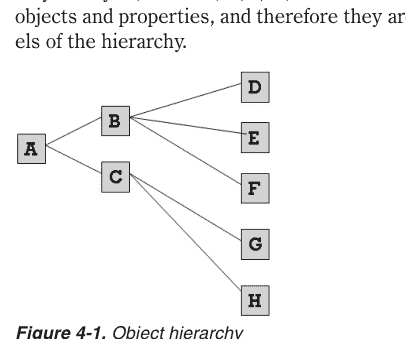

## **语法**

对象的属性存储其数据。显然，你将在某个时候需要引用这些数据，要么放入新数据，要么取出对象属性所包含的内容。你可以使用以下语法引用属性：

```
objectReference.propertyName
```

*objectReference*是属性所属对象的名称，或对该对象的任何其他有效引用。例如，你可以将一个对象赋值给一个变量，然后使用该变量后跟属性规范来引用其属性。*propertyName*是属性（数据字段）的名称。
点号分隔每个对象与其属性。具有不同层级对象和属性的层次结构对象结构使用相同的语法：

```
object1.object2Property1.object3Property2.property3
```

请注意，中间的所有元素既是对象又是属性。再次参考图4-1，假设结构元素具有以下值：

d ⇒ 16
e ⇒ 42
f ⇒ true
g ⇒ "king"
h ⇒ 13
i ⇒ 10

以下语句演示了如何引用层次结构对象结构中的元素：

```
var tempVar = ""
tempVar = a.b.d
document.write(tempVar) // prints 16
tempVar = a.b.e
document.write(tempVar) // prints 42
tempVar = a.c.f
document.write(tempVar) // prints true
tempVar = a.c.g
document.write(tempVar) // prints king
tempVar = a.c.h
document.write(tempVar) // prints 13
tempVar = a.c.i
document.write(tempVar) // prints 10
```

另一个重要概念是，一个属性属于一个对象，并且只属于一个对象。不同的对象可能有同名同类型的属性，但它们不是同一个属性。即使两个人可能拥有完全相同的高清电视，这些电视仍然是独立的实体。也就是说，内存中的同一个位置不能与两个不同的对象相关联。一个属性必须始终与一个对象相关联。因此，以下语句是合法的：

```
var d = a.b.d
document.write(d) // prints 16
var e = a.b.e
document.write(e) // prints 42
var f = a.c.f
document.write(f) // prints true
var g = a.c.g
document.write(g) // prints king
var h = a.c.h
document.write(h) // prints 13
var i = a.c.i
document.write(i) // prints 10
```

如你所见，变量可以与对象的属性同名。这是可能的，因为属性的作用域与变量不同。然而，变量不能与同一级别的对象同名。例如，语句`var a = a.b.d`是无效的（实际上它是有效的，但`a`的值会丢失）。主对象与变量在同一作用域，因为它们不是任何其他对象的属性。事实上，对象就是一个变量，而两个同名的变量关联到内存中的同一个位置。语句`var a = a.b.d`将`a`转换为一个包含值16的简单变量，而不是一个对象。通常最好避免用对象的属性或方法名来命名变量，至少在你熟悉对象和属性之前是这样。

语句`document.write(a)`的输出可能是`[object create]`，因为这是该对象的字符串等价表示。

## 方法

属性存储对象的数据，而方法是执行对象动作的部分。如果你稍加思考，就会意识到方法就是函数的另一个名称，前提是该函数是对象的一部分。在JavaScript脚本执行期间，一个对象可能调用一个或多个方法来完成一项任务。如你所知，对象由数据（属性）和处理数据的函数组成。这些函数被称为方法。方法使对象能够执行不同的动作，主要是针对其自身的属性。

如前所述，方法只是对象的一部分函数。然而，由于它们是对象的一部分，因此可以访问对象的属性，包括其他方式无法访问的私有属性。

OOP（面向对象编程）的大部分优势都与方法有关。JavaScript不完全支持外部库（除了`<SCRIPT>`标签的SRC属性），因此以下特性主要适用于内置对象：

-   因为对象将相关数据和函数（方法）封装成一个单一的内聚单元，所以执行维护活动很容易。
-   每种语言范式都会影响其应用程序设计。因此，用JavaScript开发的脚本通常会利用对象。虽然你可以用传统的面向过程的方式设计脚本，但你会发现使用对象和方法要容易得多。一旦你开始编写复杂的脚本，你就会注意到传统风格和OO风格之间的差异。

JavaScript的对象实现不如Java、C++或.NET强大，因此适用于Java的一些OO编程优势并不适用于JavaScript。

## 语法

一个方法可以存在于对象层次结构的不同级别。你可以使用引用属性相同的语法（即“点”语法）来调用方法。方法实际上是与对象关联的函数。因此，它们在许多方面类似于函数。方法的调用方式如下：

```
objectReference.methodName([arguments])
```

*objectReference*是对象的名称或任何其他引用。*methodName*是方法的名称，*arguments*是方法接受的参数。

因为方法是一个函数，所以方法名后面总是跟着一对圆括号。这一规则也适用于不接受参数的方法。

你可能觉得这个语法很熟悉。我们一直在使用`document.write ([expression])`将HTML表达式打印到页面。`write()`是属于内置`document`对象的一个方法。

## 使用数组表示法

你可以使用“点”语法或数组表示法来引用属性和方法。在数组表示法中，方括号代替点号。例如，以下表达式引用`a.b.d`：

```
a["b"]["d"]
```

你可以将数组表示法用于属性和方法。通用语法是：

```
objectReference["propertyName"]
objectReference["methodName"]([arguments])
```

理解这种替代语法很重要，因为你并非总是能使用传统的点语法。例如，使用点语法时，属性名的第一个字符不能是数字。当你使用内置的`Array`对象创建数组时，你只能通过数组表示法引用数组的元素（例如`myArray[0]`、`myArray[99]`）。当你引用一个非数组的对象属性时，必须始终使用双引号。以下是一些使用数组表示法引用方法和属性的示例：

```
document["write"]("hello!")
window["alert"]("howdy!") // note: alert() == window.alert()
Math["PI"]
```

有时你只能使用数组表示法。假设变量`str`持有字符串"write"。你可以使用以下语法代替`document.write()`：

```
document[str]()
```


然而，你不能使用 `document.str()`，因为这等同于 `document["str"]()`。另一种应该使用数组表示法的情况是，当你想要定义一个不符合标识符规则的属性名时。例如，`myObject["*"]` 只有使用数组表示法才可能实现。当你使用数组表示法时，方括号内的值应该是一个字符串，因为其内容会被求值。

## 面向对象 vs. 基于对象

JavaScript 基于一种简单的面向对象范式。这种范式通常被称为“基于对象”，而非“面向对象”。如果你习惯于使用如 C#、Java 或 C++ 这样真正的面向对象语言，你会发现 JavaScript 缺少其中的许多功能。例如，JavaScript 中不存在类（所有对象都属于同一个“类”），也不存在包（因为包用于将类分组）。JavaScript 中的对象层次结构是包含层次结构，而不是像 Java 和 C++ 中那样的继承层次结构。也就是说，对象并不继承自其他对象，但如果它是另一个对象的属性，则可以被该对象包含。大多数面向对象语言要求在编译时对对象进行静态解析。如果所有关于继承层次结构的讨论让你感到陌生，别担心。本节的目的是向习惯于真正面向对象编程的读者解释 JavaScript 中不可用的部分。

然而，面向对象语言可能需要动态方法绑定，因为多态性允许共享公共名称的多个方法定义。调用此类多态方法通常在运行时才能解析。JavaScript 完全基于动态绑定。也就是说，对象引用是在运行时检查的。JavaScript 中的对象范式与完整的面向对象语言（如 Java 和 C++）中的对象范式之间还存在许多其他差异。

## 总结

本章基于 JavaScript 的对象模型，讨论了基于对象编程的基础知识。其目的是向你介绍通用的面向对象和基于对象术语，以及一些 JavaScript 语法。每种语言范式都会极大地影响使用该语言设计的应用程序。因此，用 JavaScript 编写的脚本通常是基于对象的系统。过程式脚本在 JavaScript 中是可能的，但基于对象的脚本有许多优势。由于 JavaScript 有一套庞大的内置对象，包括非常有用的方法和属性，因此对对象结构的基本理解是必要的。如果你是初学者，觉得对象难以理解，请不要太担心。我保证，随着我们的深入，你将理解这些概念，主要是通过学习示例。

## 第5章
## 函数与变量作用域

## 变量作用域与存储类

请记住，JavaScript 是一种编程语言，因此它具有所有编程语言共有的某些特征。变量和函数的概念就是这样的两个共有特征。*变量* 基本上是预留出来用于存储数据的一段内存。该内存段通过你指定的一个名称来引用，从而允许你随时向其存入和取出数据。

所有 JavaScript 变量都有两个属性：
- 作用域
- 存储类

JavaScript 对这些特性的实现与其他编程语言略有不同，但概念是相似的。正如我们在本书中将看到的，作用域属性是两者中最重要的一个。

## 变量作用域

变量的 *作用域* 描述了变量在脚本中有效的区域。你只能在这个区域内引用该变量——它在其他地方不存在。全局变量的作用域是整个脚本。你可以在 `<SCRIPT>` 和 `</SCRIPT>` 标签之间的任何地方以及在变量定义之后执行的其他脚本（包括之前的事件处理脚本）中访问它。在 JavaScript 中，你可以使用或不使用关键字 `var` 来声明全局变量。这完全不会影响变量的作用域。

*局部变量* 是在函数中声明的。它只能被该函数内部的语句引用。因此，一个全局变量可能与一个给定的局部变量同名。在局部变量的作用域（即定义它的函数）内，只有局部变量存在。在该函数外部，只有全局变量存在。局部变量必须使用关键字 `var` 在函数内部声明。如果省略该关键字，则假定该变量是全局变量。以下脚本片段展示了变量的作用域如何影响各种结果：

```
// Script 1
function test()
{
    age = 43
}
age = 11
test()
document.write(age + "<BR>")
```

```
// Script 2
function test()
{
    var age = 43
}
age = 11
test()
document.write(age + "<BR>")
```

这两个脚本之间的唯一区别在于函数内部的语句。在第二个脚本片段中，我们使用 `var` 来定义变量 `age`，而在第一个语句中我们只是简单地声明了所需的变量名。

第一个脚本的输出是：
43

第二个脚本的输出是：
11

再看一下第一个脚本，尝试跟踪执行流程。值 11 被赋给全局变量 `age`，然后函数被调用。注意函数内部没有使用 `var` 这个词。因此，函数中的变量 `age` 被假定为全局变量，值 43 被赋给了全局的 `age`。因此，结果是 43。

在第二个脚本中，我们将值 11 赋给变量 `age`，然后调用函数。`var` 关键字意味着函数内部定义的变量 `age` 是局部的。它在函数外部不存在，因此函数内部的赋值语句不会修改全局变量 `age`（即在函数调用前定义的那个）的值。脚本的最后一行打印全局变量 `age` 的值，因为它是该作用域中唯一名为 `age` 的变量。因此，脚本的输出是 11——全局变量的初始值。

一旦使用 `var` 关键字声明了变量，后续引用该变量的语句不应再使用该前缀。`var` 告诉 JavaScript 你即将声明一个变量。在那之后，你已经声明了该变量，不再需要 `var` 关键字。以下是之前脚本的修改版，在函数内部添加了一条语句：

```
// Script 2 (additional statement in function)
function test()
{
    var age = 43
    age = 58
}
age = 11
test()
document.write(age + "<BR>")
```

脚本的输出仍然是 11。函数内部的变量使用关键字 var 声明。从那时起，该变量的作用域仅限于 test() 函数。它不存在于该函数的边界之外，因此脚本的输出是名为 age 的全局变量的值，而不是局部变量的值。请务必将作用域的概念牢记在心。变量仅在其被定义的作用域内存在和可用。

请注意，前一个脚本片段中的语句：
```
age = 11
```
等同于：
```
var age = 11
```
因为对于全局变量，`var` 关键字是可选的。

以下是另一个处理不同作用域的脚本片段：
```
function test()
{
    age = 5
}
test()
document.write(age + "<BR>")
```
该脚本的输出是 5，因为变量 age 在函数内部被声明为全局变量（没有使用 var），因此其作用域是整个脚本。下一个脚本生成相当意外的输出：
```
function test()
{
    var age = 5
}
test()
document.write(age + "<BR>")
```
该脚本没有产生输出，而是生成了一个错误，因为 age 是一个局部变量，而打印语句不在其作用域内。

## 变量存储类

变量的存储类比作用域稍微复杂一些。但好消息是，如果你愿意，你可以忽略这个属性，JavaScript 会使用默认值。事实上，许多人经常使用 JavaScript，甚至不知道变量有一个存储类属性。


## 第5章

变量的存储类别可以是永久的或临时的。你不能像在其他语言（如C#或C++）中那样直接修改这一属性（例如将变量声明为静态）。JavaScript中变量的存储类别仅取决于其作用域。局部变量是临时的，而全局变量是永久的。永久变量在整个脚本期间存在，甚至在其他脚本中也有效。即使在脚本终止后，全局变量依然存在，只有在页面卸载时才会被释放。临时变量在函数被调用时被分配在栈（内存的一个区域）中。函数局部（临时）变量所占用的空间在函数执行结束时被返还给栈。局部变量“消亡”后，它会为其他变量和对象留下可用的内存空间。

避免在函数内部声明大型局部数据结构，例如数组（将在后续章节讨论）。如果你尝试分配过多的临时变量或极其庞大的变量，很可能会收到错误（通常称为栈溢出）。出于同样的原因，避免向函数传递大型数据结构。对于这类任务，最好使用全局变量。

## 函数参数

函数参数与局部变量完全相同。它们只存在于函数内部，不影响函数外的任何变量。你可以将函数参数视为在函数开头声明并初始化了适当值的变量。以下脚本片段演示了这一点：

```
function test(age)
{
    age = 5
    document.write(age + "<BR>")
}
test(6)
```

打印的值是5，因为它被赋值给了变量 `age`（即函数的参数）。

JavaScript缺少其他语言中的一些特性：

- 函数的参数不能表现为全局变量。
- 不支持嵌套函数（如Pascal语言中的那样）。你不能在另一个函数内部声明一个函数。

看看下面的脚本。（注意：行号是为了你方便阅读；实际脚本中不会有行号。）

```
/* 1 */    function goFirst(pineapple)
/* 2 */    {
/* 3 */        var banana = 3
/* 4 */        pineapple = 6
/* 5 */        apple = 4
/* 6 */        goSecond()
/* 7 */        var peach = goThird()
/* 8 */        document.write(apple + "<BR>")
/* 9 */    }
/* 10 */    function goSecond()
/* 11 */    {
/* 12 */       var apple = 2
/* 13 */       document.write(apple + "<BR>")
/* 14 */    }
/* 15 */    function goThird() {
/* 16 */        var peach = apple
/* 17 */        document.write(peach + "<BR>")
/* 18 */        return peach
/* 19 */    }
/* 20 */    var pineapple = 8
/* 21 */    goFirst(5)
/* 22 */    document.write("apple = " + apple)
/* 23 */    document.write(", pineapple = " + pineapple)
```

如你所见，如果不深入理解变量的作用域和存储类别，就无法构建正确的脚本。上述脚本的输出是：

2
4
4
apple = 4, pineapple = 8

表5-1 跟踪了整个脚本执行过程中变量的值变化。

### 表5-1. 用于跟踪变量值的经典表格

| 行号 | pineapple | apple | banana | peach |
|---|---|---|---|---|
| 20 | 8 (g) | | | |
| 1 | 8 (g) | | | |
| | 5 (goFirst) | | | |
| 3 | 8 (g) | | 3 (goFirst) | |
| | 5 (goFirst) | | | |
| 4 | 8 (g) | | 3 (goFirst) | |
| | 6 (goFirst) | | | |
| 5 | 8 (g) | 4 (g) | 3 (goFirst) | |
| | 6 (goFirst) | | | |
| 12 | 8 (g) | 4 (g) | 3 (goFirst) | |
| | 6 (goFirst) | 2 (goSecond) | | |
| 16 | 8 (g) | 4 (g) | 3 (goFirst) | 4 (goThird) |
| | 6 (goFirst) | | | |
| 7 | 8 (g) | 4 (g) | 3 (goFirst) | 4 (goFirst) |
| | 6 (goFirst) | | | |
| 22 | 8 (g) | 4 (g) | | |

(g) 代表全局作用域，(functionName) 代表名为 `functionName` 的函数的局部作用域。

这个技巧非常有用，因为JavaScript没有一个像样的调试器。你可以找到一些第三方工具用于编辑和调试JavaScript，但你需要自己去寻找它们，而且这些工具的有效性各不相同。确保你理解表中的每一个值。如果你编程背景不多，表5-1可能会显得有些混乱。然而，要使用这个表格，你只需定位打印语句所在的行，然后从表格中提取变量的值。例如，假设你想知道第13行的语句打印什么。表格中第13行之前表达的最后一行是第12行。我们试图找出 `apple` 的值，所以你应该首先检查是否存在具有相应名称的局部变量，因为如果局部变量存在，它将“覆盖”全局变量。如你所见，局部变量 `apple` 的值是2。因此，JavaScript在第13行打印该值，后面跟着一个换行符。

以下脚本的输出可能会让你有点意外：

```
var num = 4
function funct1()
{
    alert(num)
    var num = 2
}
funct1()
```

此脚本的输出如图5-1所示：

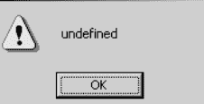

术语“undefined”表示变量在所需时刻没有值，尽管它之前已经被声明过。一般来说，JavaScript在任何执行开始前会扫描整个脚本。在这个扫描过程中（也称为解析），JavaScript会评估每一行代码，检查其是否存在基本的语法错误。它还会确定每个变量的作用域，无论该变量是否在函数内部。如果遇到带有关键字 `var` 的变量声明，那么即使存在同名的全局变量，该变量也被视为局部变量。变量的作用域可以是整个脚本，也可以只是一个函数。在前面的脚本片段中，全局变量 `num` 通过初始化为4来声明。该函数包含一个局部变量声明。注意，函数内部的变量 `num` 与全局变量 `num` 没有任何关系。该函数像往常一样从上到下执行。第一条语句指示JavaScript显示 `num` 的值，即函数内部的局部变量。JavaScript已经知道该局部变量是在函数内部声明的，因此不会产生错误。然而，在那个时刻，该变量尚未被赋予任何值，所以它是未定义的（undefined）。

以下函数定义是等效的：

```
// #1
function functionName
{
    [JavaScript statements...]
    var varName = initialValue
    [JavaScript statements...]
}
```

```
// #2
function functionName
{
    var varName
    [JavaScript statements...]
    varName = initialValue
    [JavaScript statements...]
}
```

一些程序员发现使用第二种形式更容易。每种形式都有各自的优缺点，所以你应该选择对你最方便的一种。在本书中，我们使用第一种形式，因为我们更喜欢在赋值语句中使用 `var` 关键字。

如果你在函数内部声明全局变量，你必须给变量赋一个初始值；否则，JavaScript会返回一个错误。以下脚本片段和屏幕截图演示了这一事实：

```
function foo()
{
    // local variable declarations
    var a        // without initialization
    var b = 0    // with initialization
    // global variable declarations
    c            // without initialization - error!
    d = 0        // with initialization
}
foo()
```

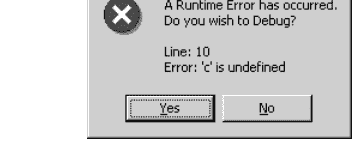

注意，该变量并不像使用 `var` 关键字声明时那样保持一个“未定义”的值——相反，它导致了一个错误。

`var` 关键字用于“正式地”声明变量。JavaScript只记住以这种方式声明的变量的作用域。它在脚本执行过程中识别其他变量，并自动将它们视为全局变量。虽然在主脚本中是否使用 `var` 来声明全局变量并不重要，但在某些情况下可能会影响脚本的结果。如果你不使用 `var`，并且在变量仍然是未定义状态时，在一个需要值的语句中使用它，就会发生错误。但这是一个容易解决的问题，因为你会收到一条消息。`var` 声明的问题在于，并非所有需要变量有确定值的语句，在变量没有值时都会使用“undefined”这个字符串。基本的 `document.write()` 语句如果变量是未定义的，可能什么也不会打印。

## 什么是函数？

我们已经在本书中使用过函数，但还没有真正定义它们。基本上，函数是一组执行某个任务的代码语句的逻辑分组。例如，一个函数可能计算抵押贷款还款额，或者计算你出生至今有多少天。

函数将一系列语句组合起来，以执行特定的任务或功能。JavaScript具有许多内置函数，将在本书后面介绍。这些函数是预先定义好供你使用的。在本章中，我们将重点放在那些你自己构建的函数上。

## 定义和调用函数

在使用函数之前，你必须先定义它。你已经在本书中见过函数定义，尽管我们没有明确指出它们是函数。函数定义的通用语法是：

```
function functionName([parameters])
{
    statements
}
```

而函数调用的形式是：

```
functionName(arguments)
```

函数定义的第一行被称为函数的签名。它告诉你函数的名称以及它接受哪些参数。

## 函数参数

参数（也称为实参）是你传递给函数的原材料。函数应该能够使用这些值来执行特定的任务。当你定义一个函数时，你应该指定你用来引用从外部传递给函数的自定义值的名称。这些名称必须遵循该语言中适用于标识符的规则。可以这样理解：参数是你必须提供给

为了使其产生所需的结果，你需要正确调用函数。例如，如果你正在创建一个计算抵押贷款还款额的函数，就必须提供本金、利率和贷款期限。因此，这三个就是你要传递给该函数的参数。

参数会成为函数的局部变量，因此它们只存在于定义它们的函数内部。因此，一个参数可以与全局变量或另一个函数中的局部变量同名。然而，我不建议这样做，因为使用相同的名称只会让阅读你代码的人感到困惑。你可以像操作普通变量一样操作和修改参数的值。无需在函数体内显式声明参数，就像声明普通变量那样。

JavaScript 是松散类型的，因此你不需要像 C++、Java、Pascal 和其他严格类型编程语言那样指定参数的数据类型。变量和字面量都可以传递给函数。函数定义头中的所有参数都应使用逗号运算符 (,) 分隔。这里是一个有两个参数的简单 JavaScript 函数：

```
function printName(name, ruleWidth)
{
    document.write("<CENTER><H1>" + name + "</H1></CENTER>")
    document.write("<HR WIDTH=" + ruleWidth + "%>")
}
```

你可以通过简单的函数调用来调用此函数，例如：

```
printName(prompt("Enter your name:", "John Doe"), 60)
```

## 使用 arguments 数组

JavaScript 支持接受可变数量参数的函数。第一个参数是 *functionName*.arguments[0]，第二个是 *functionName*.arguments[1]，第三个是 *functionName*.arguments[2]，依此类推。传递给函数的参数数量存储在 arguments 对象的 length 属性中：

*functionName*.arguments.length

以下脚本演示了这个概念：

```
function calc()
{
    document.write("The first argument is ", calc.arguments[0], "<BR>")
    document.write("The fourth argument is ", calc.arguments[3], "<BR>")
    document.write("There are ", calc.arguments.length, " arguments<BR>")
}
var company = "Yahoo"
calc(2, 999, "internet", company, 0.0)
```

脚本的输出是：
The first argument is 2
The fourth argument is Yahoo
There are 5 arguments

arguments 对象属性的作用域是当前函数，因此它只能在函数内部使用。你可以使用循环语句来打印传递给函数的参数列表：

```
function createList()
{
    var result = ""
    for (var i = 0; i < createList.arguments.length; ++i)
    {
        result += createList.arguments[i] + "\r"
    }
    alert(result)
}
```

这是一个简单的函数调用：

```
createList("C", "H", "U", "C", "K")
```

使用上述语句调用时，该函数会生成以下对话框：

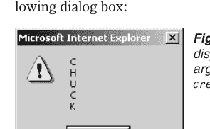

图 5-3. 每行显示的内容都是传递给 createList() 函数的不同参数。

## 使用默认参数创建函数

JavaScript 不支持带默认参数的函数。在 C++ 中，这些是函数原型中为参数提供的值。然而，有办法可以“伪造”它，使 JavaScript 的行为就像使用了默认参数一样。在函数开头调用以下函数是 JavaScript 中一个简单的变通方法：

```
function checkDefault(parameter, defaultValue)
{
    if (typeof parameter == "undefined")
        return defaultValue
    /* else */
        return parameter
}
```

调用此函数的正确方式是：

```
parameterName = checkDefault(parameterName, defaultValue)
```

只有在调用函数时未指定所需参数的情况下，才会为该参数分配其默认值。以下函数使用此技术来打印一行给定字符；星号是默认字符，30 个字符是默认长度：

```
function checkDefault(parameter, defaultValue)
{
    if (typeof parameter == "undefined")
        return defaultValue
    /* else */
        return parameter
}

function drawLine(character, numOfChars)
{
    character = checkDefault(character, "*")
    numOfChars = checkDefault(numOfChars, 30)
    for (var i = 0; i < numOfChars; i++)
    {
        document.write(character)
    }
}
```

以下是一些函数调用及其相应的输出：

```
drawLine() // prints 30 asterisks
******************************
drawLine("=") // prints 30 equal signs
==============================
drawLine("-", 10) // prints 10 dashes
----------
```

也可以使用未定义的变量（只需在使用前用 var 声明，而无需初始化）来指定第二个参数，而无需提供第一个参数。

## 返回值

有时函数只是执行你编程让它完成的任务并结束；其他时候它会返回一个值。这个值通常是一些计算的结果。函数可以返回一个值，因此可以将函数调用用作有效的 JavaScript 值。使用此特性为其他脚本创建通用函数。例如，你可以使用一个接受某个进制的数字并返回其不同表示形式的函数。此函数可用于创建进制转换表、对话框或进行额外的计算。

使用以下语法从函数内部返回值：

```
return value
```

return 语句返回一个值并终止函数，类似于 break 终止循环的方式。看看下面的函数：

```
function sum(op1, op2)
{
    return op1 + op2
}
var answer = sum(3, 5)
alert(answer)
```

函数返回的值是其参数的和。如你所见，函数会计算出一个值。一个函数只能返回一个值——一个变量、一个字面量或任何其他有效的数据结构。

有返回值的函数也可以生成输出。当你在表达式中使用该函数时，它会自动运行，执行所有语句，直到返回在表达式中使用的值。上述函数也可以在其函数内部显示其参数的和，前提是 alert() 语句在 return 语句（它会终止函数）之前：

```
function sum(op1, op2)
{
    var result = op1 + op2
    alert(result)
    return result
}
var answer = sum(3, 5)
```

请确保 return 语句放在应执行的语句之后，因为它会终止函数，之后函数的任何其他语句都不会执行。

你可以使用没有 else 语句的嵌套 if 结构，只要每个 if 语句在条件为真时调用一个 return 语句。消除 else 语句不会影响函数的效率，因为函数在满足真条件后会立即终止。以下函数将十六进制数字（不是数字）转换为其等效的十进制值：

```
function getValue(dig)
{
    if (dig == "A") return 10
    if (dig == "B") return 11
    if (dig == "C") return 12
    if (dig == "D") return 13
    if (dig == "E") return 14
    if (dig == "F") return 15
    return dig
    // return 语句终止函数，
    // 因此不需要 else 语句
}
```

如果数字是 0 到 9，则没有条件评估为真，因此函数返回它接受的相同数字：

```
return dig
```

## 递归

递归是一个高级主题，你当然可以不用它来编写 JavaScript。然而，在许多情况下，包括本书后面一些更有趣的例子，递归很有用。*递归*函数通常是指调用自身的函数。它类似于一个带或不带终止条件的循环。一些编程函数非常适合递归算法，例如阶乘。阶乘是一个经典的递归算法，因为它非常直观。阶乘运算的简单数学定义是：

```
fact(0) = 1
fact(n) = n * fact(n-1)
```

阶乘通常用感叹号 (!) 表示。使用此算法，让我们计算 3!：

1. fact(3) = 3 * fact(2)
2. fact(2) = 2 * fact(1)
3. fact(1) = 1 * fact(0)
4. fact(0) = 1

如你所见，该算法从给定的数字一路递减到零，因此当它到达 fact (0) 时，它必须一路返回到这些数字。

我们知道 fact (0) = 1。

```
fact(1) = 1 * fact(0) = 1 * 1 = 1
fact(2) = 2 * fact(1) = 2 * 1 = 2
fact(3) = 3 * fact(2) = 3 * 2 = 6
```

我们已经使用递归算法得到了期望的答案。在 JavaScript 中，这是：

```
function fact(num) 
{
    if (num == 0) 
        return 1
    /* else */ 
        return num * fact(num - 1)
}
```

你可以通过以下方式调用该函数：

```
var fiveFactorial = fact(5) // 120
```

注意 else 语句被注释掉了，因为它不是必需的。


## 第5章

`fact()`函数满足两个规则。首先，它有一个终止点。其次，它简化了问题，因为`fact(num - 1)`比`fact(num)`更简单。递归函数应始终遵循这两个规则。

-   不可否认，递归函数比其非递归的对应版本更清晰、更简洁、更短小，并且更容易理解。
-   程序直接反映了抽象的解决策略（算法）。例如，递归阶乘函数就使用了通用的数学策略来解决问题。

起初，递归函数可能看起来更难，但随着实践会变得更容易。

递归也可用于计算斐波那契数列（1, 1, 2, 3, 5, 8, 13, ...）中的一个值。基本算法是：

```
getVal(1) = 1
getVal(2) = 1
getVal(place) = getVal(place - 1) + getVal(place - 2)
```

## 总结

在本章中，我们讨论了变量和函数，这些是基本的编程概念。当然，仅凭对这两个主题的粗浅了解，你也能创建简单的网页和效果（如图像翻转）。但对于更高级的工作，绝对需要全面的理解。

## 第6章 使用JavaScript运算符

## 运算符类别

顾名思义，*运算符*执行某种操作。如果编程语言不为程序员提供可用的运算符，那么它们几乎是无用的。JavaScript有许多运算符，其中大部分借鉴自C和Java。种类繁多的运算符使得有必要将其分为以下几类：

-   算术运算符
-   字符串运算符
-   位运算符
-   赋值运算符
-   关系运算符
-   短路逻辑运算符
-   其他逻辑运算符
-   数据类型运算符
-   void运算符

本章我们将讨论JavaScript的运算符，按上述类别分组。每个类别中的运算符又分为两组：

-   一元运算符——作用于单个操作数的运算符
-   二元运算符——作用于两个操作数的运算符

## 算术运算符

最显而易见的运算符类别是算术运算符。*算术运算符*执行基本的数学运算。表6-1列出了JavaScript中的算术运算符：

### 表6-1. 算术运算符

| 语法 | 名称 | 类型 |
| :--- | :--- | :--- |
| + | 加法（加号） | 二元 |
| - | 减法（减号） | 二元 |
| * | 乘法（乘号） | 二元 |
| / | 除法（除号） | 二元 |
| % | 取模（模运算符） | 二元 |
| ++ | 递增 | 一元 |
| -- | 递减 | 一元 |
| - | 取反 | 一元 |
| += | 加后赋值 | 二元 |
| = | 赋值 | 二元 |
| == | 求值 | 二元 |

算术运算符接受数值字面量、变量或现有对象的属性作为其操作数。它们总是根据操作数的值返回一个单一的数值。

## 加法

```
operand1 + operand2
```

加法运算符是一个简单的算术运算符。它将两个任意类型的数字相加，并求值为其和。

```
-5 + 3 // 求值为 -2
2.4 + 3.6 // 求值为 6
1.1 + 7.8 // 求值为 8.9
```

## 减法

```
operand1 - operand2
```

另一个简单的算术运算符是减法运算符。它将一个数字从另一个数字中减去。

```
8 - 2 // 求值为 6
16.3 - 56 // 求值为 -39.7
13.3 - 13.3 // 求值为 0
```

## 乘法

```
operand1 * operand2
```

乘法运算符接受两个数字作为其操作数，并执行通常的算术转换。

## 除法

```
operand1 / operand2
```

除法运算符也执行通常的算术转换。但是，由于JavaScript是松散类型的，因此该运算符的行为并不完全与C、Perl和其他严格类型编程语言相同。在这些语言中，整数除法与浮点数除法不同，因为整数除法的结果始终是整数。另一方面，JavaScript并不明确区分整数和实数值数字，因此，除法运算的结果不保证是整数。事实上，大多数浮点数是除法运算符的结果。在调试脚本时，记住JavaScript中的除法运算会产生与袖珍计算器相同的值可能会有所帮助。你还应该记住，除法运算的余数永远不会被丢弃。

当操作数是浮点数且无法用二进制表示时，除法表达式通常会求值为不准确的结果。以下演示了JavaScript除法运算符的行为：

```
3 / 4       // 求值为 0.75
3.6 / 0.1   // 求值为 36
-20 / 4     // 求值为 -5
11.1 / 2.22 // 求值为 4.999999999999999
```

## 取模

```
operand1 % operand2
```

取模运算符返回除法运算的余数。执行除法，但只保留余数。结果的符号是商的符号。JavaScript中的取模运算符也与其他编程语言中的不同。它不仅作用于整数，也作用于浮点数。你应该意识到取模运算符偶尔会返回不准确的结果。取模的不准确性源于除法运算，后者有时会返回不准确的结果：

```
12 % 5     // 求值为 2
12.3 % 4   // 求值为 0.3000000000000007 (不准确)
0 % 99     // 求值为 0
12.75 % 4.25 // 求值为 0
11.1 % 2.22 // 求值为 2.219999999999999
```

## 不存在的整数除法运算符

JavaScript没有整数除法（也称为div）运算符。事实上，许多JavaScript程序员在没有它的情况下也能正常工作。但是，如果你绝对需要创建这样的运算符，可以使用以下函数来实现：

```
function div(op1, op2)
{
    return (op1 / op2 - op1 % op2 / op2)
}
```

关键字`return`指示函数返回一个值，因此函数调用本身会求值为一个值，就像由运算符组成的表达式一样。

现在我们可以定义新创建的`div`语法：

```
div(operand1, operand2)
```

以下是一些示例：

```
var a = div(23, 3)    // a 被赋值为 7
var b = div(12, 4)    // b 被赋值为 3
```

该函数求值为其参数的商，余数被丢弃。结果的符号是商的符号。

> **注意：** 对浮点数的各种操作可能返回不准确的结果。这看起来可能很奇怪，但这种不准确性在计算机中是常见现象。应尽可能避免使用浮点数值，因为这种不准确性常常导致意外行为。最重要的是，由于计算不准确而无法工作的脚本几乎不可能调试。

## 递增

```
operand1++
++operand1
```

递增运算符是一个一元运算符，可以用于后缀或前缀表示法。它将操作数的值递增1。如果用在操作数之后（后缀），运算符返回递增前的操作数值。如果用在操作数之前（前缀），运算符返回递增后的操作数值。当使用这些操作作为其他语句（如赋值语句）的副作用时，理解这些差异很重要。以下语句集概述了这个概念：

```
var a = 1
var b = ++a                           // 前缀
document.write("a is ", a, ", b is ", b)   // a is 2, b is 2
```

第一条语句将值1赋给a。第二条语句执行两个不同的操作：

-   将a递增到2
-   将a的新值赋给b

后缀表示法的递增运算符以相反的顺序执行操作，因此结果不同。后缀表示法在以下代码中演示：

```
var a = 1
var b = a++                                  // 后缀
document.write("a is ", a, ", ", "b is ", b)  // a is 2, b is 1
```

b被赋值为a的值，然后a被递增。
一条语句中的双重操作将在本章末尾的“副作用”一节中讨论。通常，应避免使用这种副作用。如果之前的代码写成这样会更简单：

```
var a = 1
var b = a
a++
document.write("a is ", a, ", ", "b is ", b)  // a is 2, b is 1
```

递增运算符只能与变量或现有对象的属性一起使用，不能用于字面量。
自然而然会得出一个结论：递增等同于在值上加1：

```
var a = 1
var b = 1
a++
b = b + 1   // 等同于 b += 1（见赋值运算符）
```

就脚本的正确性而言，这是正确的。但如果性能很重要，那就是不正确的。递增的优势在于它比标准赋值（上面代码段的第四行）快得多。当你想对一个变量（或对象的属性）加1时，应始终使用递增。如果加法操作只执行几次，那么这不那么重要。当你进行100,000次加法操作时，你肯定会感受到差异。递增运算符的另一个好处是，理解像`countTemp++`这样的语句比`countTemp = countTemp + 1`容易得多。

重要的是要记住，在某些情况下，布尔表达式等价于1和0。以下语句显示了递增布尔变量的效果：

```
var a = true
var b = false
a++
b++
document.write("a is ", a, ", ", "b is ", b)  // a is 2, b is 1
```


## 递减运算符

```
operand1--
--operand1
```

递减运算符与递增运算符类似。它将操作数的值减1，而递增运算符则将其加1。

## 取反运算符

```
-operand1
```

取反运算符在编程中相当于大喊“不是！”，并且非常实用。取反运算符位于数值（变量、现有对象的属性或数字字面量）之前。通过在操作数前放置此运算符（不要插入任何空格字符），JavaScript会将正数计算为其对应的负数，反之亦然。像之前一样，你可能认为这个运算符可以被一个将操作数乘以-1的语句所取代。再次强调，这是一个错误。由于JavaScript解释器的内部结构，特别是取反运算符，使用取反运算符对数值取反比将其乘以-1更快。如果你是一个传统的Pascal程序员，可能需要一段时间才能习惯取反和递增运算符，但这是值得的！

```
var a = 3
var b = 9
-a + b      // 计算结果为 6
-b          // 计算结果为 -9
```

## 字符串连接

连接是非常常见的字符串操作，其工作方式如下所示：

```
operand1 + operand2
```

字符串运算符的语法与加法运算符相同。它们的区别在于所操作的操作数类型。此运算符接受任何值作为操作数，前提是其中至少有一个是字符串。字符串实际上是一个对象，因此可以说字符串运算符操作的是字符串对象。它将它们连接在一起，就像由多个字符串运算符组成的表达式最终计算为一个单一字符串。基于此，以下是两种不同的语句：

```
document.write("I have " + 2 + " cookies.")
document.write("I have ", 2, " cookies.")
```

起初，你可能认为这些语句是等价的。但它们不是，因为第一个使用字符串运算符，而第二个使用逗号来分隔字符串和数字。它们不仅仅是风格上的不同。在第一个语句中，括号之间的表达式被计算为一个单一的字符串——“I have 2 cookies.”。因此，此语句中的`document.write()`方法只打印一个表达式。第二个语句打印多个表达式。字面量不像第一个语句中那样被计算为一个单一的值，而是被独立打印。两个语句都向页面打印相同的HTML，但它们的方式不同。为了理解每个语句的工作原理，请看以下语句序列。第一个序列等价于前面语句组中的第一个语句，第二个序列等价于第二个语句。

```
// 序列 #1
var stringToPrint = "I have " + 2 + " cookies."
document.write(stringToPrint)

// 序列 #2
document.write("I have ")
document.write(2)
document.write(" cookies.")
```

初学者常犯的一个错误是忘记在字符串中添加空格。空格和其他字符一样是一个字符。忘记空格字符并不是一个严重的错误，因为你可以很容易地找到添加它的地方。你应该使用以下语句之一来打印两个连续的数字，并在中间加上一个空格字符：

```
document.write(16 + " " + 18) // 第一种可能
document.write(16, " ", 18)    // 第二种可能
```

第一个语句是有效的，因为JavaScript的解释器使用了自动类型转换方法。

> **提示：** JavaScript中的加号（+）运算符不会将字符串操作数转换为数字值。其背后的原因是字符串连接运算符和加法运算符使用相同的字符：+。如果只有一个操作数是字符串，另一个会被转换为字符串值，然后运算符连接这些字符串。在Perl中，加法和减法运算符会在必要时将其参数从字符串转换为数字值，并返回数字结果。这个特性之所以成为可能，是因为Perl中的字符串连接运算符是.（点），而不是+，而后者在JavaScript中与另一个运算符（加法）共享。C++和Pascal则具有连接字符串的函数。

## 位运算符

首先，我要说明位运算对于许多程序员来说可能会令人困惑。我还应该指出，许多程序员工作多年也从未需要使用它们。即使本节内容对你来说不完全理解，你也可以成为一名成功的JavaScript程序员。然而，如果不包含这部分内容，那就是我的失职了。

位运算符用于位级操作。*位*是最小的信息单位，通常用0或1表示。位操作用于在最低级别控制机器。如果你计划在更高的级别编程，本节可以安全地跳过。在JavaScript中，你不会使用位运算符来在低级别控制机器，而是用于其他目的，例如加密和编码。

八个连续的位组成一个字节。有256（2^8）种字节变化。也就是说，一个字节可以是这256个八位序列中的任何一个。例如，11010001就是这256种可能性之一。在支持字符数据类型（如C、C++和Pascal）的编程语言中，一个字节由一个字符表示。

十六进制表示法对于表示二进制数据很方便，因为每个十六进制数字代表四个二进制位。表6-2列出了从0到F的十六进制值及其等效的二进制值。

**表6-2. 十六进制和二进制等效值**

| 十六进制 | 二进制 | 十六进制 | 二进制 |
|---|---|---|---|
| 0 | 0000 | 8 | 1000 |
| 1 | 0001 | 9 | 1001 |
| 2 | 0010 | A | 1010 |
| 3 | 0011 | B | 1011 |
| 4 | 0100 | C | 1100 |
| 5 | 0101 | D | 1101 |
| 6 | 0110 | E | 1110 |
| 7 | 0111 | F | 1111 |

位运算符使脚本编写者能够处理单个位。JavaScript中的位运算符列于表6-3中。

**表6-3. JavaScript中的位运算符**

| 语法 | 名称 | 类型 |
|---|---|---|
| & | 按位与 | 二元 |
| &#124; | 按位或 | 二元 |
| ^ | 按位异或（异或） | 二元 |
| ~ | 按位非 | 一元 |
| << | 左移 | 二元 |
| >> | 右移 | 二元 |
| >>> | 无符号右移 | 二元 |

## 按位与

```
operand1 & operand2
```

按位与运算符比较两个位。只有在两个位都为1时，结果才为1。此运算符的真值表如表6-4所示。

**表6-4. 按位与真值表**

| 位1 | 位2 | 位1 & 位2 |
|---|---|---|
| 0 | 0 | 0 |
| 0 | 1 | 0 |
| 1 | 0 | 0 |
| 1 | 1 | 1 |

> 重要提示：*真值表*是借自数学的概念，用于图形化地演示语句组合的真假性。

与所有其他位运算符一样，按位与运算符只能接受数值作为其操作数。

虽然你可能永远不会使用位运算符，但让我们学习一下结果是如何计算的。所有计算都将以十六进制和二进制基数进行，因为它们对于此任务最为方便。请记住，十六进制数字有一个“0x”前缀。

让我们看看以下数字，以及按位与如何对它们进行操作：

```
0x23   00100011₂
& 0x72   01110010₂
= 0x22   00100010₂
```

```
0x23 & 0x72 // 计算结果为 34 (= 0x22 = 22₁₆)
```

按位与运算符类似于逻辑与运算符，后者将在本章后面讨论。

你可以使用按位与运算符来测试一个数字是偶数还是奇数。在二进制（基数为2）中，奇数的最后一位是1，偶数的最后一位是0。以下函数使用按位与运算符来确定数字是奇数还是偶数。如果`decimalNumber`是偶数，它返回`true`；如果是奇数，则返回`false`。

```
function checkEven(decimalNumber)
{
    return (decimalNumber & 1 == 0)
}
```


如果你不熟悉“==”相等运算符也不用担心。本章后面会介绍它。等我们讨论完相等运算符后，再回来看这个脚本。

## 按位或

```
operand1 | operand2
```

或运算符，也称为*同或运算符*，用于比较其操作数。如果被比较的位中至少有一个是1，则返回1。表6-5展示了该运算符的真值表。

### 表6-5. 按位或真值表

| 位1 | 位2 | 结果 |
|------|------|--------|
| 0 | 0 | 0 |
| 0 | 1 | 1 |
| 1 | 0 | 1 |
| 1 | 1 | 1 |

在字节上进行操作时：

```
      0x46   01000110₂
|     0x79   01111001₂
---------------------------------
=     0x7F   01111111₂
```

## 按位异或

```
operand1 ^= operand2
```

异或是一个非常有趣且有用的运算符。它是*异或*运算。换句话说，它询问其中一个数字中是否有1，但两个数字中不能同时有1。表6-6展示了该运算符的真值表。

### 表6-6. 按位异或真值表

| 位1 | 位2 | 位1 ^ 位2 |
|------|------|-------------|
| 0 | 0 | 0 |
| 0 | 1 | 1 |
| 1 | 0 | 1 |
| 1 | 1 | 0 |

看下面这个例子：

```
      0x2C   00101100₂
^     0xA3   10100011₂
---------------------------------
=     0x8F   10001111₂
```

按位异或运算符用于一种称为*XOR加密*的简单密码技术中，本书后面会介绍。

## 按位非

按位非运算符返回其操作数的反转。因此，它也被称为*位翻转运算符*或*反转运算符*。所有1被转换为0，所有0被转换为1。以下是真值表：

### 表6-7. 按位非真值表

| 位 | ~位 |
| --- | --- |
| 0 | 1 |
| 1 | 0 |

例如，

~               70      00000000000000000000000001000110₂
=    -71      1111111111111111111111111111111110111001₂

请注意，该运算符将所有操作数（整数）都视为32位。如果它们不是32位整数，则会在操作前被转换，操作后再转换回初始形式。

## 移位运算符

移位运算符接受两个操作数：

- 要移动的量（值）
- 将第一个操作数移动的位位置数

移位运算符将其操作数转换为32位整数，并返回与左操作数相同类型的结果。移位运算符有三种：

- 左移（<<）
- 右移（>>）
- 无符号右移（>>>）

### 左移

```
operand1 << operand2
```

左移运算符将第一个操作数向左移动指定的位数。所有被移出（向左）的位都被丢弃。从右侧进来的新位是0。在下面的例子中，⌊_⌋代表4字节（32位）：

179 ⇒ 0xB3 ⇒ 10110011₂

179 << 0 ⇒ 0000000000000000000000010110011

179 << 2 ⇒ 00000000000000000000010110011

空位用0填充

⇒ 0000000000000000000001011001100

⇒ 1011001100₂ ⇒ 0x2CC ⇒ 716

你现在知道179 << 2等于716。你可能会意识到179 * 4也等于716——这并非巧合。通常，x << n等同于x * 2^n。左移n位等同于乘以2^n。这个规则也适用于负数——符号始终被保留。因此，你可以选择两种不同的方法来乘以2的幂。尽管移位更快，但对读者来说也更不清晰，应该避免使用。

### 右移

```
operand1 >> operand2
```

右移运算符也称为符号传播右移，因为它保留初始操作数的符号。与左移运算符类似，右移运算符将第一个操作数向右移动指定的位数。向右移出的多余位被丢弃。整数的符号存储在第一个位（从左数）。为了保留符号，第一个位保持不变。其他31位向右移动。从左侧进来的新位是0或1，取决于符号。如果第一个位是0，则所有新位都是0，反之亦然。因此，如果数字是正数，操作也将返回正数；如果是负数，操作结果就是负数。重要的是要记住，该运算符与所有移位运算符一样，将第一个操作数转换为32位整数，移位后返回其初始表示形式。这里有一个简单的例子：

176 ⇒ 0xB0 ⇒ 10110000₂

176 >> 0 ⇒ 0000000000000000000000010110000

176 >> 3 ⇒ 0 0000000000000000000010110000

⇒ 0000000000000000000000010110

⇒ 10110₂ ⇒ 0x16 ⇒ 22

让我们看看这个运算符如何处理负数，比如–17。

-17 ⇒ 11111111111111111111111111110111₂

```
-17 >> 0 ⇒ 1111111111111111111111111111101111
-17 >> 3 ⇒ 1 11111111111111111111111111111101111
⇒ 11111111111111111111111111111101
⇒ 1111111111111111111111111111101₂ ⇒ -3
```

你可以将右移运算符视为左移运算符的相反操作。左移运算符等同于乘以2的幂，而右移操作等同于除以2的幂。176 >> 3等于176 / 2³。通常，x >> n等同于x / 2ⁿ。

### 无符号右移

```
operand1 >>> operand2
```

无符号右移运算符将第一个操作数向右移动指定的位数。与符号传播右移类似，无符号右移会丢弃向右移出的多余位。然而，从左侧移入的位始终是0。数字的符号丢失，因为最左边的位始终是0。这是上一节的简单例子，这次使用无符号右移：

-17 ⇒ 11111111111111111111111111110111₂

```
-17 >>> 0 ⇒ 111111111111111111111111111101111
-17 >>> 3 ⇒ 11111111111111111111111111111101111
⇒ 00011111111111111111111111111101
⇒ 11111111111111111111111111111101₂ ⇒ 536870909
```

如果按位移位运算符看起来很难，也不用担心。很多JavaScript程序员多年编程都不需要使用位运算符，所以难以掌握它们不会是问题。

## 赋值运算符

```
operand1 □ = operand2
```

赋值运算是处理算术、字符串或位运算的二元运算符。它们对操作数执行常规运算，并将结果赋给第一个操作数。赋值运算符如下：

### 第6章

### 表6-8. 赋值运算符

| 语法 | 名称 |
| :--- | :--- |
| = | 等于 |
| += | 按值加/连接 |
| -= | 按值减 |
| *= | 按值乘 |
| /= | 按值除 |
| %= | 按值取模 |
| &= | 按值按位与 |
| \|= | 按值按位或 |
| ^= | 按位异或 |
| <<= | 按值左移 |
| >>= | 按值右移 |
| >>>= | 按值无符号右移 |

你已经知道简单的=赋值运算符的作用——它将表达式的值存储在数据结构中。对于所有其他运算符，JavaScript假设

```
var1 □ = var2
```

等同于

```
var1 = var1 □ var2
```

例如：

```
counter >>= 2
```

将counter的值向右移动两位，而

```
text += " Gates"
```

将单词Gates附加到存储在text中的字符串末尾。同样的规则适用于表6-8中列出的所有赋值运算符。由于赋值语句是从右到左求值的，你可以在同一语句中使用多个运算符。规则是：运算符右侧的值被求值，然后赋给运算符左侧的变量。

```
num1 = num2 = num3 = num4 = num5
```

num5的值被赋给num4，num4的值被赋给num3，依此类推。执行完这样的操作后，所有五个变量都持有相同的值。


## 关系运算符

```
operand1 \square{} operand2
```

关系运算符，也称为比较运算符，用于比较两个值并返回一个布尔结果。所有关系运算符都是二元运算符，因为它们比较两个值。这些运算符常用于条件语句中。以下是 JavaScript 中关系运算符的完整列表：

**表 6-9. 关系运算符**

| 语法 | 名称 |
| --- | --- |
| == | 等于 |
| != | 不等于 |
| < | 小于 |
| <= | 小于或等于 |
| > | 大于 |
| >= | 大于或等于 |

这些运算符接受数字或字符串值作为操作数。数值比较通常非常简单：

```
2 == 1      // 计算结果为 false
99.0 == 99  // 计算结果为 true
2 != 1      // 计算结果为 true
3 < 2.5     // 计算结果为 false
2 <= 2      // 计算结果为 true
9 > 9       // 计算结果为 false
9 >= -10    // 计算结果为 false
```

字符串操作数根据其字符的 ASCII 值进行比较。这种比较类似于单词在字典中的排序方式。唯一的区别在于，JavaScript 不是使用单一的字母集，而是使用 256 个不同的字符。如你所知，每个字符都有一个数值。这个值决定了一个字符是大于、等于还是小于另一个字符。

当你比较多字符字符串时，第一个操作数的第一个字符会与第二个操作数的第一个字符进行比较。只有当第一个字符的比较表明相等时，才会比较第二个字符。这个过程会持续进行，直到对应的字符不相等，或者直到其中一个字符串的末尾。以下是一些字符及其 ASCII 值：

0 – 48       A – 65      a – 97
9 – 57       Z – 90      z – 122

完整的 ASCII 表可以在附录 C 中找到。

这里有一个例子：

```
"computerA" > "computerB"
"c" == "c"
"o" == "o"
"m" == "m"
"p" == "p"
"u" == "u"
"t" == "t"
"e" == "e"
"r" == "r"
"A" < "B"      =>      ("computerA" > "computerB" => false)
```

为了更好地理解，请看以下结果：

```
"JavaScript" == "javascript"   // 计算结果为 false
"bill" != "bill"                // 计算结果为 false
" " < "  "                      // ([一个空格] < [两个空格]) 计算结果为 true
16 <= "16"                       // 计算结果为 true
"luck" > "Work"                  // 计算结果为 true!
"XT" >= "pentium pro    "        // 计算结果为 false
```

## 相等与不等

正如你所见，布尔相等运算符（==）类似于赋值运算符（=）。这种相似性是许多编程错误的根源，不仅在 JavaScript 中，在 C、C++ 和 Java 等其他语言中也是如此。相等运算符通常用于 if-else 语句中，在那里不能使用赋值运算符。（JavaScript 不允许在条件语句中产生副作用。）在这种情况下，解释器会产生一个有意义的错误，提示：“相等测试（==）是否误写为赋值（=）？假定为相等测试。”然而，在某些其他情况下，相等和赋值运算符都是有效的，浏览器也确实没有生成任何错误。这就是为什么这类错误非常难以调试。以下示例演示了一个两种运算符都可接受的情况：

```
var i = 1
document.write(i = 2)
var j = 1
document.write(j == 2)
```

第一个打印语句输出 2，因为赋值表达式求值为赋的值。第二个打印语句在 Netscape Navigator 下输出 false，在 Internet Explorer 下输出 0（Internet Explorer 将布尔值 false 转换为 0 进行打印），因为 1 不等于 2。在一个很长的脚本中，如果你不小心用一个运算符替换了另一个，你会很难找到错误。

相等运算符的另一个问题与计算机处理浮点数的方式有关。当你尝试以浮点数的形式存储整数（例如，3.0）时，这个问题尤其难以处理。根据底层机器的不同，结果可能会有所不同。你可能会发现（5. == 5.00）计算结果为 false，而（5.0 == 4.99999999）计算结果为 true。因此，避免对浮点数值使用相等运算符。本章后面将介绍解决这个问题的方法。

## 短路逻辑运算符

短路逻辑运算符，也称为布尔运算符或逻辑运算符，是二元运算符，接受布尔值作为操作数。它们将多个关系表达式组合在一起。有三个逻辑运算符：

*表 6-10. 逻辑运算符*

| 语法 | 名称 | 类型 |
|---|---|---|
| \|\| | 逻辑或 | 二元 |
| && | 逻辑与 | 二元 |
| ! | 逻辑非 | 一元 |

## 逻辑或

```
operand1 || operand2
```

逻辑或运算符接受两个布尔值作为其操作数，并求值为单个布尔值。如果至少有一个操作数为 true，则它求值为 true；换句话说，只有当两个操作数都为 false 时，它才求值为 false。请看表 6-11。

*表 6-11. 逻辑或真值表*

| 操作数1 | 操作数2 | 操作数1 \|\| 操作数2 |
|---|---|---|
| true | true | true |
| true | false | true |
| false | true | true |
| false | false | false |

这里有几个例子：

```
2 > 1 || 3 < 4           // true
1 == 1 || 99 >= 98        // true
"mouse" > "elephant" || 6 < 5 // true
1 == 2 || 5 <= 4          // false
```

注意不要将逻辑或运算符与按位或运算符混淆，因为它们的含义和语法相似（|| 与 |）。含义上唯一的区别是前者处理布尔操作数，而后者处理数值操作数。

逻辑或运算符是*短路*求值的。正如你从真值表中看到的，如果第一个操作数为 true，那么表达式必然求值为 true。在这种情况下，检查第二个操作数是不必要的，JavaScript 会避免这样做。

## 逻辑与

```
operand1 && operand2
```

逻辑与运算符与逻辑或运算符类似，只是两个操作数都必须为 true，表达式才求值为 true。该运算符类似于按位与运算符，只是操作数类型不同，并且逻辑与运算符一次性操作整个操作数，而不是操作一个小段（位）。

逻辑与表达式也是短路求值的。如果第一个操作数为 false，表达式显然为 false，因此不会求值第二个操作数。

这里有一些例子：

```
2 > 1 && 3 < 4                // true
1 == 1 && 99 >= 98            // true
"mouse" > "elephant" && 6 < 5  // false
1 == 2 && 5 <= 4              // false
```

## 逻辑非

```
!operand1
```

逻辑非运算符是一个简单的一元运算符，它接受一个布尔值并对其取反。这个运算符类似于取反运算符，后者对一个数字取反（改变其符号）。它甚至更类似于按位非运算符（~），后者将所有 1 位转换为 0 位，将 0 位转换为 1 位。虽然真值表很明显，但这里还是提供给你参考：

**表 6-12. 逻辑非真值表**

| 操作数 | !操作数 |
| :--- | :--- |
| true | false |
| false | true |

由于这是一元运算符，短路求值不适用。这里有一些例子：

```
!true         // 计算结果为 false
!(2 > 4)      // 计算结果为 true
!(7 == 7)     // 计算结果为 false
!false        // 计算结果为 true
```

> **注意：** 短路求值之所以有用，主要是因为它使你的脚本更高效。然而，有时这种求值方法是有害的。例如，你编写了一个复杂的脚本并想对其进行测试。根据脚本中的某些决策，会执行短路求值，解释器会忽略各种表达式的第二个操作数。你可能会认为脚本运行得非常完美，即使第二个操作数中存在数据类型错误或语法错误。这种类型的求值在这种情况下会误导你，但它是不可避免的。

## 浮点数的相等测试

我们前面提到，相等运算符（==）由于精度问题不适合用于浮点数。使用逻辑与和逻辑或运算符，你可以检查该数字是否接近指定值。例如，如果你想求值表达式 x == 10.0，你可以使用*模糊比较*，使用以下表达式之一，其中 α 代表一个小数（例如 0.001）。

```
(x - 10.0) < α || (10.0 - x) < α
```

或

```
x > (10.0 - α) && x < (10.0 + α)
```

## 更多逻辑运算符

条件运算符和逗号运算符也是逻辑运算符。

## 条件运算符

```
condition ? trueAlternative : falseAlternative
```

条件运算符是独特的，因为它是三元运算符（接受三个操作数），并且它返回所有类型的值。它可以返回数值、字符串、布尔值等。第一个操作数是条件。条件必须是一个求值为布尔值的表达式，即 true 或 false。第二个操作数是如果条件为 true 时运算符应返回的值。第三个操作数是如果条件为 false 时表达式求值的结果。条件运算符通常与赋值运算符一起使用。例如：

```
var level = (points > 500) ? "Second Level" : "First Level"
```

变量 `level` 被赋值为 "First Level" 或 "Second Level"，这取决于布尔表达式 `points > 500` 的值。如果 points 的值大于 500，条件表达式求值为字符串 "Second Level"，然后被赋给变量 `level`。如果 points 的值不超过 500，则字符串 "First Level"

被赋值给变量。第一个操作数（条件）必须是布尔值（单个布尔值或计算结果为单个布尔值的表达式）。其他操作数可以是任何类型。

## 逗号运算符

```
operand1, operand2, operand3, ...
```

逗号运算符很少使用。你可以用它来强制求值一组表达式。逗号运算符也被称为参数分隔符，因为它正是起这个作用。你可能还记得，当我们希望函数接受多个参数时，就在函数中使用了逗号运算符。

在这个例子中，逗号运算符分隔了方法的参数：

```
var beerNum = 99
document.write(beerNum, " bottles of beer on the wall")
```

这里是另一个例子：

```
var a = (b = "Hello", alert("Hi"), "Howdy")
```

逗号运算符强制对语句中的所有表达式求值。只有最后一个表达式被返回，所以 `a` 的值将是 `"Howdy"`。这个语句等同于以下一组语句：

```
b = "Hello"
alert("Hi")
var a = "Howdy"
```

## 类型运算符

```
typeof operand1
```

或

```
typeof (operand1)
```

JavaScript 提供了一个运算符来检查其操作数的数据类型。操作数可以是字面量，也可以是数据结构，如变量、函数或对象。该运算符返回数据类型。表达式包括 `typeof` 一词，后跟字面量或标识符。以下是一些例子：

```
typeof foo == "undefined"        // 当 foo 未定义时
typeof eval == "function"        // eval 是一个内置函数
typeof null == "object"          // null 是一个对象
typeof 3.14 == "number"
typeof true == "Boolean"
typeof "a string" == "string"
// 当然，所有这些表达式的结果都为 true
```

`typeof` 运算符在调试时非常有用。在出现强大的调试工具之前，你必须手动进行所有调试，而检测结构的数据类型有时至关重要。

## void 运算符

```
void operand1
void (operand1)

或

javascript:void operand1
javascript:void (operand1)
```

`void` 运算符与 `typeof` 一样，非常特别。它指定一个表达式被求值，但不返回任何值。看看以下脚本：

```
function foo()
{
    alert("Function entered")
    return true
}
alert(foo())
```

前面的脚本段将显示两个警告框，包含以下字符串：

+   - Function entered
- true

现在看看另一个函数及其调用：

```
function foo()
{
    alert("Function entered")
    return true
}
alert(void foo())
```

这个脚本也会生成两个警告，但第二个警告显示 "undefined"，因为 `void` 运算符对函数求值但不返回任何值。该运算符的一个更重要的用途是在超链接中，用于计算一个 JavaScript 表达式。该表达式会被求值，但不会加载以替换当前文档。

以下链接不起作用，因为表达式 `0` 在 JavaScript 中没有效果：

```
<A HREF="javascript:void(0)">Click here to do nothing</A>
```

以下代码在点击链接时会生成一个警告框：

```
<A HREF="javascript:void(alert('Wow'))">Click here to display message</A>
```

括号是可选的，所以是否使用它们取决于你自己。有些脚本编写者在 HTML 中指定它们，在 JavaScript 中省略它们，没有什么特别的原因。

## 运算符优先级

你可能记得 `2 + 6 * 9` 的结果是 `56` 而不是 `72`，因为乘法优先于加法。这正是 *运算符优先级* 的含义。没有必要记住优先级规则，因为可以使用括号来强制按所需的顺序进行求值。表达式根据优先级规则进行求值。同一级别的运算符从左到右求值。下表在定义复杂表达式时会有所帮助。

**表 6-13. 运算符优先级**

| 级别 | 运算符 | 备注 |
| :--- | :--- | :--- |
| 1 | () [] . | 调用、成员（包括 typeof 和 void） |
| 2 | ! ~ - ++ -- | 取反、递增 |
| 3 | * / % | 乘/除 |
| 4 | + - | 加/减 |
| 5 | << >> >>> | 按位移位 |
| 6 | < <= > >= | 关系 |
| 7 | == != | 相等 |
| 8 | & | 按位与 |
| 9 | ^ | 按位异或 |
| 10 | \| | 按位或 |
| 11 | && | 逻辑与 |
| 12 | \|\| | 逻辑或 |
| 13 | ?: | 条件 |
| 14 | = += -= *= /= %= <<= >>= >>>= &= \^= \|= | 赋值 |
| 15 | , | 逗号 |

## 表达式

术语 *expression* 在本章中已提及数十次。表达式是任何有效的字面量、变量、运算符和其他表达式的集合，它们计算出一个单一的值。这个值可以是数字、字符串或布尔值。从概念上讲，有两种类型的表达式：

+   - 将值赋给变量（或其他数据结构）的表达式
- 具有值的表达式

以下是表达式：

```
a = "Dog"
"Netscape"
256
false
b = true
```

第一种类型的表达式稍微难理解一些。在这种表达式中，执行了赋值操作。整个规范，包括赋值运算符的两个操作数和运算符本身，都被求值为被赋的值。考虑以下语句：

```
document.write(x = "Texas")
```

此语句打印 `Texas`，因为整个表达式被求值为被赋的值。下一节将讨论副作用，它利用了这类表达式。

## 副作用

*副作用* 是除主要操作外执行的操作。看看以下语句：

```
number = 3
answer = ++number
```

第一行是一个简单的赋值语句。第二行稍微复杂一些。它按以下顺序执行两个动作：

+   - 递增 `number`（副作用）
- 将 `number` 的值（4）赋给 **answer**（主要操作）

记住动作发生的顺序是必要的。你可以分解副作用，改用两条不同的语句：

```
number = 3
number++
answer = number
```

这组语句很容易理解。第一种方法的唯一“优势”是代码紧凑。紧凑的代码是计算早期时代的遗留，那时存储昂贵，程序员使用各种紧凑技术来节省磁盘空间。今天情况不同了，因为编程的首要规则是保持程序清晰简单。它甚至排在效率之前，尤其是在像 JavaScript 编写的简单程序中（你不会在这本高级书中找到任何 50 万行的脚本）。

其他副作用与递增和递减运算符无关。考虑以下 JavaScript 语句：

```
document.write(myName = "Chuck")
```

你已经知道这个语句打印 `Chuck`。赋值操作也在此语句中发生，所以执行后 `myName` 持有值 `Chuck`。赋值操作是副作用，打印操作是主要操作。前面的语句应拆分为两条独立的语句：

```
myName = "Chuck"
document.write(myName)
```

以下是一些你应该避免的语句（它们会让你忙上一阵子...）：

```
number = 0
answer = (number++ - 2) * (--number - 1)
document.write(number = answer++)
```

这组语句打印 `2`。让我们分析一下：

+   1.
1.1. `number` 被赋值为 0。
2.
2.1. `(number++ – 2)` 被求值为 –2。
2.2. `number` 递增到 1。
2.3. `number` 递减到 0。
2.4. `(--number – 1)` 被求值为 –1。
2.5. `answer` 被赋值为 2（因为 (-1) * (-2) 得到 2）。
3.
3.1. `number` 被赋值为 `answer` 的值（2）。
3.2. `number` 的值被打印。
3.3. `answer` 递增到 3。

最终结果：

+   - `number` 持有值 2。
- `answer` 持有值 3。
- 数字 2 被打印到文档。

以下脚本更长，但绝对更好：

```
number = 0
answer = number - 2
number++
number--
answer *= number - 1
number = answer
document.write(number)
number = answer
answer++
```

## 总结

本章为你介绍了严肃的 JavaScript 编程的一个关键部分：运算符。你可以编写一个没有任何运算符的脚本，但它可能不会特别有用或有趣。这些信息，结合第 5 章对变量和函数的讲解，应该能帮助你理解适用于 JavaScript 的一些基本编程基础知识。随着我们继续学习本书，你将在各种脚本中看到这些概念。


# 第7章
JavaScript中的事件

# 事件

虽然HTML是所有网页的基石，但它非常静态。HTML无法响应用户输入，并且只提供了有限的功能集。当你浏览一个基于HTML的网页时，你可以阅读文本、查看图形，或许还能听到它播放的声音。所有这些动作都是静态的，因为用户无法控制网页采取的行动。这样的页面让我们想起了在博物馆里看到的艺术杰作。你可以看看它们，也许拍张照片，但你无法与画作互动。我们使用JavaScript在HTML网页中产生动态的、交互式的内容。实现这一目标的最佳方式之一就是使用事件。

*事件*是对网站上特定用户操作的响应动作。例如，点击表单元素会触发一个点击事件。无论你是否提供了响应代码，事件都会发生。JavaScript为你提供了一种方法来响应这些事件，并基于它们采取行动。通过这种方式，你的网页变得非常动态，能够响应用户交互。JavaScript支持的事件列在表7-1中。

*表7-1. JavaScript中的事件*

| 事件 | 描述 |
|---|---|
| abort | 当用户中止加载图像时发生。 |
| blur | 当焦点从表单元素移开时发生（当用户点击表单元素外部时）。当用户将焦点从浏览器窗口移开时也会发生。 |
| change | 当用户更改表单字段的值时发生。 |
| click | 当用户点击链接、图像地图区域或表单元素时发生。 |
| error | 如果加载图像时发生错误则触发。 |
| focus | 当用户将输入焦点给予表单元素或窗口时发生。 |
| load | 当页面或图像加载到浏览器窗口完成时发生。 |
| mouseOut | 当用户将鼠标指针从链接或图像地图区域的边界框内移到其外部时发生。 |
| mouseOver | 当用户将指针移到超链接或图像地图区域上时发生。 |
| select | 当用户选择表单字段时发生。 |
| submit | 当用户通过“提交”按钮提交表单时发生。 |
| unload | 当用户退出页面时发生。 |

并非所有在浏览器中发生的动作都是事件。事件仅指发生在HTML页面区域内的动作，如加载图像和选择表单元素。如果动作直接发生在浏览器显示区域的边界内，它也是一个事件。简而言之，我要说的是，事件只关注网页本身的动作，而不是浏览器。请看图7-1。

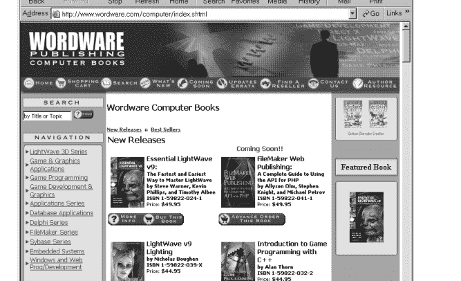

图7-1. 一个浏览器

在这个例子中，浏览器显示了网站www.wordware.com。你知道这个窗口由两部分组成：HTML页面和浏览器。你已经知道在图7-1所示的环境中可以发生许多动作。有些是事件，而其他是非事件动作。窗口的主要部分是HTML页面，即不包含周围菜单和按钮的内容窗口。

在实际包含网站本身区域内发生的所有动作都是事件。用户加载、卸载、点击链接，并在此区域引发许多其他事件。图像的其余部分包含浏览器的特性，如菜单栏、滚动条以及图7-2中看到的其他元素。

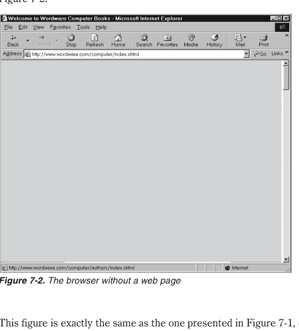

此图与图7-1中显示的完全相同，只是不包含HTML页面。在HTML页面之外不会发生任何事件。例如，按下图7-2中显示的任何按钮都不会触发事件，上下滚动窗口也不会。即使你更改了HTML页面的外观，你也没有触发事件。认识到事件和其他动作之间的区别非常重要，因为JavaScript只能处理事件，而不是其他动作。

# 事件处理程序

事件处理程序与它们关联的事件相对应。它们是在事件发生时自动执行的函数。许多JavaScript函数由事件处理程序调用。你之前已经看到，事件是没有直接影响的动作；它们只服务于事件处理程序。每个事件处理程序都与一个事件相关联。

事件处理程序作为HTML标签的属性嵌入到文档中，你在其中分配JavaScript代码。一般语法是：

```
<TAG eventHandler="JavaScript Code">
```

你可以使用事件处理程序来嵌入任何JavaScript代码。你可以将一个包含函数的500行脚本作为事件处理程序标签放置。你也可以在同一个HTML标签上使用多个事件处理程序。事件处理程序的名称由单词“on”加上事件名称构成。以下是支持的事件处理程序的完整列表：

- onAbort
- onBlur
- onChange
- onClick
- onError
- onFocus
- onLoad
- onMouseOut
- onMouseOver
- onSelect
- onSubmit
- onUnload

以下是一个HTML页面的代码，当你加载它时显示消息“Hello”，卸载时显示“Goodbye”。

```
<HTML>
<HEAD>
<TITLE>Hello / Goodbye</TITLE>
</HEAD>
<BODY onLoad="alert('Hello')" onUnload="alert('Goodbye')">
</BODY>
</HTML>
```

**示例7-1 (ex7-1.htm). 一个事件处理程序**

事件处理程序不区分大小写。例如，你可以使用ONLOAD或onLoad。虽然事件处理程序与JavaScript相关，但事件处理程序本身通常用作HTML属性，而HTML不区分大小写。这意味着事件处理程序在技术上是HTML的一部分，而不是JavaScript。但是，你可以在事件处理程序中放入JavaScript。为事件处理程序使用类似标识符的命名约定仍然是一个好习惯。

示例7-2是一个利用事件处理程序的经典脚本。

```
<HTML>
<HEAD>
<TITLE>Example 7-2</TITLE>
</HEAD>
<BODY>
<A HREF="http://www.wordware.com/"
    onMouseOver="window.status = 'Wordware Publishing'; return true"
        >Wordware</A>
</BODY>
</HTML>
```

**示例7-2 (ex7-2.htm). 一个事件处理程序示例**

有时在事件处理程序脚本中直接执行语句会带来问题。例如，如果你想包含一个长脚本，将其放在事件处理程序脚本中会使HTML页面变得笨重，并且维护变得困难。另一个可能出现困难的情况是，当你想要将包含字符串——引号——的脚本与事件处理程序关联时。引号本身可能会引起问题。正如你在示例7-2中看到的，事件处理程序需要引号来将指定的JavaScript代码与周围的HTML内容分隔开。JavaScript要求引号类型（单引号和双引号）交替使用，因此你可能会发现编写强调引号的脚本很烦人。事件处理程序接受任何有效的JavaScript脚本。因此，你应该将函数与事件处理程序关联起来。事件处理程序脚本中唯一需要的语句就是函数调用。

通常，你应该将所有函数放在页面顶部，或者更准确地说，放在文档的`<HEAD></HEAD>`部分。此操作强制JavaScript在继续布局页面之前先对你的函数进行求值。通过这种做法，你可以保证当浏览器在页面的HTML部分遇到事件处理程序时，如果该事件发生，它将成功调用与该事件关联的函数。唯一的限制是，在`<HEAD></HEAD>`部分的JavaScript脚本之前，你不要放置任何事件处理程序来捕获事件。这种限制也适用于通过`<SCRIPT>`标签的SRC属性实现的外部文件。此类页面的基本结构是：

```
<HTML>
<HEAD>
<TITLE>页面标题</TITLE>
<SCRIPT LANGUAGE="JavaScript" [SRC="path.js"]>
<!--
function functionName(parameters)
{
    statement1
    statement2
    statement3
}
// -->
</SCRIPT>
</HEAD>
<BODY>
<TAG otherAttributes eventHandler="functionName(arguments)">
</BODY>
</HTML>
```


如果你总是将函数的定义放在页面的 `<HEAD></HEAD>` 部分，那么要找到相关的函数就非常容易。页面的 HTML 部分会保持简单，就像 JavaScript 发明之前一样。使用带事件处理函数的另一个重要优势是，你可以在同一个 HTML 页面中多次使用同一个函数。例如，如果你有一个包含四个文本字段的表单，你可以通过为每个字段特定事件发生时调用同一个函数来验证每一个字段。

你可能已经注意到，标题是在 `<SCRIPT>` 标签之前指定的。虽然标题是通过 HTML 标签指定的，但它没有任何事件处理函数可能调用稍后定义的函数。如果你不遵循这个规则，可能也不会有任何问题，但这仍然是一个好习惯，因为它有助于页面的整洁组织，并保证你永远不会遇到布局问题。

## onLoad 和 onUnload

两个非常重要的事件处理函数是 onLoad 和 onUnload。它们对应的事件 load 和 unload 由这些操作触发。当页面加载完成时，会触发 load 事件。当用户以任何方式离开页面时，会触发 unload 事件。这些是最简单的事件处理函数，因为它们与最基本的 `<BODY>` 标签相关，并被指定为该标签的属性。以下文档在用户进入页面时通过警告框欢迎用户，并在用户离开时通过警告框说再见：

```html
<HTML>
<HEAD>
<TITLE>onLoad and onUnload event handlers</TITLE>
</HEAD>
<BODY onLoad="alert('Welcome to our page!')" onUnload="alert('Goodbye, and don\'t forget to come back!')">
</BODY>
</HTML>
```

onLoad 事件处理函数被广泛用于调用延迟脚本——函数。将函数调用作为事件处理函数的脚本，使你能够控制执行的时机，因此脚本只在页面完全布局后执行。

## onError

onError 事件处理函数扩展了 JavaScript 根据加载窗口或图像时发生的错误与用户交互的能力。早期的浏览器（如 Internet Explorer 3.0）不支持此事件处理函数，但现在大多数现代浏览器都广泛支持它。在本节中，我们讨论窗口加载错误。

onError 事件处理函数在发生错误事件时执行 JavaScript 脚本。

onError 事件处理函数非常有用，因为它可以设置为以下三种值之一：

- null——抑制所有错误对话框。将 `window.onerror` 设置为 null 意味着你的用户不会看到由你自己的代码引起的 JavaScript 错误。
- 一个处理错误的函数——替代 JavaScript 用于报告错误的标准对话框。
- 包含 null 或有效函数引用的变量。

以下 JavaScript 语句禁用 JavaScript 错误对话框：

```javascript
window.onerror = null
```

为了安全起见，你应该将此语句放在它自己的脚本中，直接放在 `<HEAD>` 标签之后，使用以下 HTML 文档结构：

```html
<HTML>
<HEAD>
<SCRIPT LANGUAGE="JavaScript">
<!--
window.onerror = null
// -->
</SCRIPT>
</HEAD>
<BODY>
</BODY>
</HTML>
```

同样的规则适用于你显式分配给此事件处理函数的所有值。

以下文档在遇到错误时不显示任何错误对话框。（如果你找不到它，你可能需要回顾前面的章节，或者看看 `alert()` 方法的参数作为线索。）

```html
<HTML>
<HEAD>
<SCRIPT LANGUAGE="JavaScript">
window.onerror = null
</SCRIPT>
</HEAD>
<BODY>
<SCRIPT LANGUAGE="JavaScript">
alert(Quotes missing)
</SCRIPT>
</BODY>
</HTML>
```

当你的脚本在公共页面上运行时，将 onError 事件处理函数设置为 null 是一个好习惯。然而，在编写脚本时这没有意义，因为它使调试变得不可能。

以下是另一个禁用错误的文档，从而避免报告堆栈溢出错误：

# 第 7 章

```html
<HTML>
<HEAD>
<TITLE>Disabling error messages</TITLE>
<SCRIPT LANGUAGE="JavaScript">
<!--
// disable error reports
window.onerror = null
// create an error-generating function (infinite recursion)
function testErrorFunction()
{
    testErrorFunction()
}
// -->
</SCRIPT>
</HEAD>
<BODY onload="testErrorFunction()">
</BODY>
</HTML>
```

无论是否将 null 分配给事件处理函数，都会发生错误。区别在于浏览器不会生成对错误的响应。有关通过 JavaScript 为事件处理函数分配值的讨论，请参阅本章后面的“显式调用事件处理函数”。

另一个选项是编写一个函数来处理错误，替代标准的 JavaScript 错误报告对话框。该函数应接受三个参数：

- 错误消息
- 导致错误的脚本的 URL
- 错误行号

该函数拦截 JavaScript 错误。它必须返回值 true。

以下是用于错误处理的经典函数和语句集：

```html
<HTML>
<HEAD>
<SCRIPT LANGUAGE="JavaScript">
<!--
// assign user-defined function to intercept errors
window.onerror = myOnError
// create array to hold error messages
messageArray = new Array(0)
// create array to hold URLs of errors
urlArray = new Array(0)
// create array to hold line numbers of errors
lineNumberArray = new Array(0)
// error-intercepting function
function myOnError(msg, url, lno)
{
    // assign message of current error to the array element following
    // the last element
    messageArray[messageArray.length] = msg
    // assign URL of current error to the array element following
    // the last element
    urlArray[urlArray.length] = url
    // assign line number of current error to the array element following
    // the last element
    lineNumberArray[lineNumberArray.length] = lno
    // return true to suppress the standard JavaScript error dialog box
    return true
}
urlArray[urlArray.length] = url
// assign line number of current error to the array element
// following the last element
lineNumberArray[lineNumberArray.length] = lno
// return true to intercept JavaScript errors
return true
}
function displayErrors()
{
  // open new browser window to report errors
  errorWindow = window.open('','errors','scrollbars=yes')
  // write header to window
  errorWindow.document.write('<B>Error Report</B><P>')
  // loop to print all error data
  for (var i = 0; i < messageArray.length; ++i)
  {
    errorWindow.document.write('<B>Error in file:</B> ' +
                               urlArray[i] + '<BR>')
    errorWindow.document.write('<B>Line number:</B> ' +
                               lineNumberArray[i] + '<BR>')
    errorWindow.document.write('<B>Message:</B> ' +
                               messageArray[i] + '<P>')
  }
  // close data stream
  errorWindow.document.close()
}
// -->
</SCRIPT>
</HEAD>
<BODY>
<FORM>
<INPUT TYPE="button" onClick="displayErrors()" VALUE="display errors">
</FORM>
</BODY>
</HTML>
```

**示例 7-3 (ex7-3.htm)**。一个复杂的事件处理函数示例

首先，函数引用被赋值给 `window.onerror`。然后创建三个数组；每个数组保存与可能发生的错误相关的不同数据。每个数组的长度设置为 0，因为到目前为止还没有发生错误。拦截 JavaScript 错误的函数是 `myOnError()`。其参数分别是错误消息、URL 和行号。

在现阶段你不需要理解这些函数，因为它们使用了尚未讨论的概念，比如数组和窗口。你应该注意到的唯一一点是函数返回 true，以指示 JavaScript 它打算拦截标准的 JavaScript 错误。通常，当用户单击按钮时，会在另一个窗口中打印由脚本生成的 JavaScript 错误列表。有关示例 7-3 (window.onerror) 中演示的事件处理函数实现的更多细节，请参见“显式调用事件处理函数”一节。


## 通过方法模拟事件

我们之前提到过，每个事件都属于一个特定对象。有些事件与多个对象相关联。对象的另一个特征是方法。这些是通常用于操作与该对象相关数据（即属性）的函数。实际上，某些包含事件处理器的方法会模拟这些事件。你可以使用这样的方法来触发事件。这些方法通常被称为*事件方法*。虽然我们将在后面深入讨论它们，但这里先列出一些常用方法：

- blur()
- click()
- focus()
- select()
- submit()

使用这些方法生成的事件就像任何其他方法一样。最重要的是，它们<u>不会</u>调用其对应的事件处理器。

模拟事件时，重要的是只能在浏览器完成页面布局之后进行，或者至少完成与该方法相关联的对象（通常是表单元素）的布局之后进行。以下页面会产生错误：

```
<HTML>
<HEAD>
<TITLE>Emulating an event of a nonexistent (thus far) form</TITLE>
<SCRIPT LANGUAGE="JavaScript">
document.form1.field1.focus()
</SCRIPT>
</HEAD>
<BODY>
<FORM NAME="form1" METHOD=POST>
<INPUT TYPE="text" NAME="field1">
</FORM>
</BODY>
</HTML>
```

错误信息如图 7-3 所示。

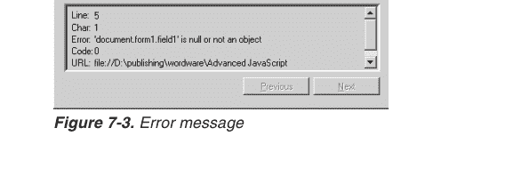

此错误在所有平台上不一定完全相同。模拟一个尚未布局的对象的事件只是导致此类错误的一个例子。一般来说，你无法引用页面中任何尚未布局的元素。延迟脚本可以引用在脚本之后布局的对象，前提是不要在对象布局完成之前执行该脚本。我们将在本书中深入讨论这个问题。

## 显式调用事件处理器

你可以在 JavaScript 脚本中设置事件处理器。这里有一个简短的例子：

```
<HTML>
<HEAD>
<TITLE>Emulating an event of a nonexistent (thus far) form</TITLE>
<SCRIPT LANGUAGE="JavaScript">
<!--
function alert1()
{
    alert("This is the first function.")
}
function alert2()
{
    alert("This is the second function.")
}
// -->
</SCRIPT>
</HEAD>
<BODY>
<FORM NAME="form1" METHOD=POST>
<INPUT TYPE="button" NAME="button1" VALUE="button1" onClick="alert1()">
</FORM>
<SCRIPT LANGUAGE="JavaScript">
<!--
document.form1.button1.onclick = alert2
// -->
</SCRIPT>
</BODY>
</HTML>
```

示例 7-4 (ex7-4.htm)。你可以通过事件处理器来调用 JavaScript 脚本。

尝试加载此页面并点击按钮。如果你使用的是 Netscape Navigator 的早期版本，尽管事件处理器将点击事件与第一个函数 alert1() 关联，但警告框会显示消息“This is the second function”。请注意表单后面的脚本。它将不同的函数与表单 form1 中按钮 button1 的点击事件关联起来。

> **注意：** 事件处理器是函数引用，而不是函数调用。因此，你必须赋值 alert2，而不是 alert2()，后者主要是一个函数调用，其值为函数返回的类型和值。另外，由于事件处理器 HTML 属性是字面量函数体，你不能在 HTML 源代码中使用 <INPUT ... onClick=alert2>。你必须调用该函数。

你可能想知道为什么我们使用 onclick 而不是 onClick。原因是 JavaScript 区分大小写，只识别 onclick（全小写），而 HTML 不区分大小写。在 HTML 中，你可以使用全小写、全大写或你选择的任何其他惯例。

显式调用事件处理器使得事件处理器非常灵活，因为你可以在脚本中的任何位置修改它们。你可以创建一个自定义页面，允许用户决定某个按钮在点击时应该执行什么操作。

使用此技术时，事件处理器不必事先存在。如果在 HTML 源代码中省略事件处理器规范，而使用以下行代替，前面的脚本将完全正常工作：

```
<INPUT TYPE="button" NAME="button1" VALUE="button1">
```

在这种情况下，你实际上是定义了一个与事件对应的新事件处理器。

另请注意，上述方法是将函数引用赋给事件处理器的唯一方式。你不能使用以下任何结构：

```
<SCRIPT LANGUAGE="JavaScript">
<!--
document.form1.button1.onclick = "alert2()"
// -->
```

```
<SCRIPT LANGUAGE="JavaScript">
<!--
document.form1.button1.onclick = alert2()
// -->
```

```
<SCRIPT LANGUAGE="JavaScript">
<!--
document.form1.button1.onclick = "var counter = 5"
// -->
```

此类尝试赋值非函数引用的语句，在点击按钮时会导致错误。

## 取消事件

Netscape Navigator、Internet Explorer 和 Firefox 都提供了取消点击事件的功能，无论是通过超文本链接还是客户端图像映射。onClick 事件处理器可以返回 false 来取消通常与点击事件关联的操作。下面是一个例子：

```
<HTML>
<HEAD>
<TITLE>Canceling events in onClick</TITLE>
</HEAD>
<BODY>
<A HREF="http://www.mozilla.org/" onClick="return confirm('Load Mozilla home page?')">Mozilla</a>
</BODY>
</HTML>
```

**示例 7-5 (ex7-5.htm)。** *尝试运行此脚本以取消事件。*

当你点击超文本链接时，会弹出一个确认框。如果你点击“确定”，该方法评估为 true，事件生效，新页面（Firefox 主页）加载。如果用户选择“取消”，该方法返回 false，与点击事件关联的新页面将不会加载。

## 总结

在本章中，你了解了事件和事件处理器。JavaScript 旨在为网页添加交互性，这意味着你可以响应用户执行的操作。事件描述此类操作，而事件处理器则负责处理它们。它们赋予 JavaScript 程序员与用户交互的能力。你在网络上很少发现不利用这一独特功能的脚本。虽然交互并不仅限于事件处理器（我们之前见过对话框），但它们可能是 JavaScript 中最重要的交互手段。正如你在上网时可能注意到的那样，它们扩展了网页的功能。本章除了 onLoad 和 onUnload 之外，我们没有详细展示任何事件或事件处理器，因为它们将在本书后面逐一深入讨论。每个事件及其对应的处理器都有重要的特征。正如你将看到的，所有事件都与特定对象相关联，因此在讨论事件处理器之前，先介绍这些对象是很重要的。

# 第 8 章

## 构建和扩展对象

### 创建实例

我们在第 4 章介绍了面向对象编程的概念，所以你可能已经意识到，JavaScript 不仅只支持有限的面向对象编程，而且这里使用的一些术语可能与其他语言（如 C++、C# 或 Java）的用法不同。在 JavaScript 中，*对象*是创建*实例*的模板。在纯粹的面向对象语言中，对象是从类创建的实例。如果你有真正的面向对象语言的经验，不要让这个术语困扰你。

例如，假设你定义了一个员工对象，其中包含员工的一些方法和属性，如他的或她的社会保障号码和地址。这个定义对脚本没有影响，因为没有更改或创建任何新的实体。只有当你将对象的定义应用于特定的人，比如 John Doe 时，才会创建一个新实体——该对象的一个实例。使用单个对象定义可以创建的实例数量是无限的。对象定义可以是你用函数定义的，也可以是内置的。创建内置对象的实例相对简单，因为对象是预定义的。与 C++ 和 Java 不同，你不能创建自己的对象（在 C++ 和 Java 中称为类）。你只能使用 JavaScript 内置的对象。

你应该使用以下语法来创建一个实例：

```
var name = new objectname([arguments])
```

因此，如果你想创建一个 String 对象的实例，可以使用以下语句：

```
var str1 = new String("Hello!")
```


此语句创建了一个名为 **str1** 的实例，并将字面量 "Hello!" 传递给它。如果愿意，你可以创建另一个实例：

```javascript
var str2 = new String("Hi!")
```

大多数对象，包括 **String**，都有所谓的构造函数。*构造函数* 是在该对象的实例被创建时自动触发的函数。当你在创建实例时向对象传递参数，实际上是将该参数传递给了该对象的构造函数。拥有构造函数的原因是，某些操作需要在其他任何操作发生之前进行。例如，对于 **String** 对象，在你对它进行任何操作之前，它里面确实需要有一串字符。因此，该字符序列通过 **String** 对象的构造函数传递。

在前面的示例中，实例 **str1** 和 **str2** 的行为与普通变量非常相似。事实上，你可以将它们视为 "**String**" 类型的变量。你可以将它们传递给函数，如下所示：

```javascript
function printValue(val)
{
    document.write("*** " + val + " ***")
}
printValue(str1)
```

你也可以返回对象：

```javascript
function printValue(obj)
{
    return obj
}
``

请记住，对象的工作方式与任何其他变量一样。这意味着，如果你在函数内部创建一个对象的实例，它被认为是局部的；也就是说，在函数当前执行过程中，它只在函数内部可见。如果你在函数外部声明该实例，最好使用 **var** 关键字。当你在函数内部不使用 **var** 创建对象的实例时，它是一个全局结构。请记住，如果你在函数内部创建一个全局实例，甚至是一个简单的变量，你必须先执行该函数，该全局数据结构才会在脚本中存在。之后，你可以在文档中的任何地方自由引用它。

当你通过 **new** 运算符创建一个对象的实例时，你实际上是根据该对象的定义声明了一个特定的数据类型，并为该数据类型分配了适当数量的内存。在构造函数中引用的所有属性都可以作为对象实例的属性进行访问。

创建对象实例后，引用该实例时就不必再使用 **new** 关键字了。但是，如果你希望实例的某个属性本身也是一个实例，你必须再次使用 **new** 来创建新的对象。对象的实例也具有其方法。*方法* 本质上是一个位于对象内部的函数。请看以下示例：

```javascript
var current = new Date() // the current date
var minutes = current.getMinutes()

var current2 = new Date() // the current date
var minutes2 = current2.getMinutes()
```

如你所见，两个实例都有方法。方法属于对象的一个特定实例。换句话说，与 current 对象关联的 getMinutes() 函数，与与 current2 对象关联的 getMinutes() 函数是不同的函数。这两个函数来自相同的模板，并执行相同的操作。

## 构造函数

我们已经简要定义了构造函数。记得我们说过，它是一个在对象实例化时立即被调用（即“触发”）的函数。然而，这个定义还有许多不足之处。让我们尝试对构造函数进行更完整的描述和讨论。*构造函数* 是一个函数，它定义了你从一个对象创建的实例的属性和方法。当对象的实例被创建时，它会自动触发。你可以将内置对象视为在 JavaScript 中预先定义了构造函数的对象，因此你不需要自己编写它们。

构造函数类似于饼干模具。你给它一些面团，它就能给面团一个合适的形状。饼干模具就像构造函数，因为它们都接收一个简单的结构，并根据指定的模板对其进行更改。

## 定义对象属性

关键字 *this* 可能是 JavaScript（以及许多其他面向对象语言）中与对象相关的最重要的词。它指的是你当前所在的对象的实例。在构造函数内部，它指的是调用该函数的那个实例。请看以下函数：

```javascript
function student(name, age, avgGrade)
{
    this.name = name
    this.age = age
    this.grade = avgGrade
}
```

此函数接受三个参数。它定义了一个学生对象类型。属性是 name、age 和 grade，它们通过传递给函数的值进行初始化。你可以使用以下语句创建此对象的一个实例——一个班级中的学生：

```javascript
var student1 = new student("Sharon", 16, 85)
```

现在你可以通过以下方式引用这些属性：

```javascript
alert(student1.name + " is a cute " + student1.age + " - year old.")
```

也可以在对象创建后添加属性。这些属性仅存在于被赋值的特定实例中。以下脚本片段演示了这一点：

```javascript
function student(name, age, avgGrade)
{
    this.name = name
    this.age = age
    this.grade = avgGrade
}
var student1 = new student("Sharon", 16, 85)
student1.sex = "female"
var message = student1.name + " is a cute " + student1.age
message += " - year old "
message += (student1.sex == "female") ? "girl." : "boy."
alert(message)
```

上述脚本的问题在于，它只向一个实例 student1 添加了新属性。因为构造函数就像任何其他函数一样，你可以在其中使用有效的 JavaScript 语句。因此，你可以使用以下构造函数向 student 对象的所有实例添加新属性：

```javascript
function student(name, age, avgGrade, sex)
{
    this.name = name
    this.age = age
    this.grade = avgGrade
    this.description = (sex == "female") ? "girl" : "boy"
}
```

现在你可以创建包含 "girl" 或 "boy" 描述的实例了：

```javascript
var student2 = new student("Joe", 16, 91, "male")
```

根据关键字 this 的确切定义，一些 JavaScript 代码倾向于为构造函数使用替代结构。以下是前面示例的另一种形式：

```javascript
function student(name, age, avgGrade, sex)
{
    obj = this
    obj.name = name
    obj.age = age
    obj.grade = avgGrade
    obj.description = (sex == "female") ? "girl" : "boy"
}
```

注意，调用对象（称为 this）被赋值给了一个变量。这个变量必须是全局的，因为构造函数的目的是创建一个在函数外部使用的实例。局部变量在声明它的函数外部没有任何效果。就个人而言，我从不使用这种方法，也没见过它被频繁使用。我在这里提及它，只是让你在别处看到时不会感到困惑。

你现在知道如何通过构造函数定义属性了。如果你只想创建一个对象的实例，你也必须使用一个构造函数。

你可以使用以下函数来查看对象的属性：

```javascript
function getProps(obj, objName)
{
    var result = ""     // initialize output string
    for (var i in obj)
    {
        result += objName + "." + i + " = " + obj[i] + "<BR>"
    }
    result += "<HR>"  // add horizontal rule to output string
    return(result)     // return output string
}
```

要调用此方法，请使用如下语句：

```javascript
document.write(getProps(student1, "student1"))
```

请注意，参数并非总是相同的。例如，如果你在另一个函数内部使用此语句，而该函数接受实例 student1 作为参数 person，你应该改用以下语句：

```javascript
document.write(getProps(person, "student1"))
```

如果对象的属性持有 null 值，则它不存在。将 null 值赋给属性会导致 getProps() 函数不计算该属性。请记住这一点，尤其是在调试脚本时。

## 嵌套对象

JavaScript 支持嵌套对象。嵌套对象是同时作为另一个对象属性的对象。或者换种说法，它是对象内部包含其他对象的情况。如果你思考一下，这应该不会太令人惊讶。请记住，对象有属性，在对象内部，这些属性只是变量。同时请记住，对象只是变量的一种复杂类型。当你将这两个事实结合起来，对象包含其他对象就真的不足为奇了。有几种方法可以创建嵌套对象。请看以下脚本片段：

function student(name, age, grade, father, mother)
{
    this.name = name
    this.age = age
    this.grade = grade
    this.parents = new parents(father, mother)
}
function parents(father, mother)
{
    this.father = father
    this.mother = mother
}
var student1 = new student("Sharon", 16, 85, "Mark", "Stacy")

此脚本包含两个函数。函数 `parents()` 创建一个包含 `father` 和 `mother` 两个属性的实例。它接受这两个值作为参数。
第一个函数 `student()` 创建一个包含四个属性的函数。前三个是像本章前面看到的简单属性。第四个属性是一个对象的实例。这个实例由前面描述的 `parents()` 函数创建。你可以使用“点”语法引用对象的所有元素：

```
student1.name
student1.age
student1.grade
student1.parents.father
student1.parents.mother
```

要打印普通对象的属性，可以使用以下递归函数：

```
function getProps(obj, objName)
{
    // 初始化累积变量
    var result = ""
    // 循环遍历属性
    for (var i in obj)
    {
        // 如果当前属性是一个对象，则为其调用函数
        if (typeof obj[i] == "object")
            result += getProps(obj[i], objName + "." + i)
        else
            result += objName + "." + i + " = " + obj[i] + "<BR>"
    }
    // 返回最终结果
    return result
}
```

该函数的算法相当简单。它遍历主对象的属性。如果当前属性（由 `i` 表示）是一个对象，则会再次调用该函数，将属性 `obj[i` 作为对象，并将属性的名称通过分隔点附加到对象的名称上（`objName + "." + i`）。每次调用函数都会返回列出当前级别属性的字符串。递归调用返回的值被赋值给调用函数中的局部变量 `result`。下面是一个完整的 HTML 文档及其输出，以帮助你理解这个概念：

```
<HTML>
<HEAD>
<TITLE>Printing properties of nested objects</TITLE>
<SCRIPT LANGUAGE="JavaScript">
<!--
function student(name, age, grade, father, mother)
{
    this.name = name
    this.age = age
    this.grade = grade
    this.parents = new parents(father, mother)
}
function parents(father, mother)
{
    this.father = father
    this.mother = mother
}
var student1 = new student("Sharon", 16, 85, "Mark", "Stacy")
function getProps(obj, objName)
{
    var result = ""
    for (var i in obj)
    {
        if (typeof obj[i] == "object")
            result += getProps(obj[i], objName + "." + i)
        else
            result += objName + "." + i + " = " + obj[i] + "<BR>"
    }
    return result
}
document.write(getProps(student1, "student1"))
// -->
</SCRIPT>
</HEAD>
<BODY>
</BODY>
</HTML>
```

**示例 8-1 (ex8-1.htm)。** 一个使用 `getProps()` 函数分析对象结构的脚本。

该脚本的输出如图 8-1 所示。

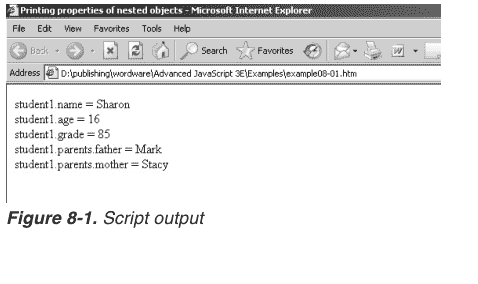

## 定义方法

对象将数据和处理这些数据的函数分组。数据以属性的形式出现。方法只是与对象关联的函数。考虑以下函数：

```
function displayStudent()
{
    var result = ""
    result += this.name + " -- "
    result += "a " + this.age + " - year old "
    result += this.grade + "% average student.<BR>"
    result += this.name + "'s parents -- "
    result += this.parents.father + ", " + this.parents.mother
    result += ".<BR>"
    document.write(result)
}
```

你需要在构造函数中包含对这个函数的引用。这与你定义属性的方式完全一样：

```
function displayStudent()
{
    var result = ""
    result += this.name + " -- "
    result += "a " + this.age + " - year old "
    result += this.grade + "% average student.<BR>"
    result += this.name + "'s parents -- "
    result += this.parents.father + ", " + this.parents.mother
    result += ".<BR>"
    document.write(result)
}

function student(name, age, grade, father, mother)
{
    this.name = name
    this.age = age
    this.grade = grade
    this.parents = new parents(father, mother)
    this.display = displayStudent
}
function parents(father, mother)
{
    this.father = father
    this.mother = mother
}
```

以下语句创建一个实例并调用 `display()` 方法：

```
var student1 = new student("Sharon", 16, 85, "Mark", "Stacy")
student1.display()
```

注意在函数内部广泛使用了关键字 `this` 来引用对象。方法的主要特点是它通常处理其对象的数据。你甚至可以以如下方式创建一个“构造函数方法”：

```
function construct(name, val)
{
    this[name] = val
}
function student(name, age, grade, father, mother)
{
    this.construct = construct
    this.name = name
    this.age = age
    this.grade = grade
    this.parents = new parents(father, mother)
}
function parents(father, mother)
{
    this.father = father
    this.mother = mother
}
var student1 = new student("Sharon", 16, 85, "Mark", "Stacy")
student1.construct("boyfriend", "Tom")
```

注意该方法（`construct()`）通过数组表示法引用新属性。你可能还记得第 4 章“面向对象编程”中，如果你想使用一个数据值，你必须使用这种表示法。只有当你使用字面量时，你才可以使用“点”语法。在这种情况下，`name` 是一个数据结构，而不是字面量（字面量是你可以看到的常量值，例如 "boyfriend"）。现在你可以使用前面介绍的递归函数来查看对象的元素，并观察它如何与方法一起工作。

注意递归函数既适用于方法也适用于属性。方法的语句放在同一行。如果你最初在函数中没有这样做，JavaScript 会自动添加分号来分隔语句，并使用统一的编码方案。

JavaScript 中的方法与属性一样，只属于一个实例。你只能从该实例调用它。与对象的所有“通信”都是通过方法完成的。调用对象在方法内部被视为全局。你可以使用关键字 `this` 来修改对象。

## 创建对象——一个例子

假设你想为一家销售电视机的商店创建一个类似数据库的对象结构。每种类型的电视机应该是同一对象的实例。某种型号电视机的库存数量应该是对象的一个属性。它还应包括该电视机的特性。此外，该对象应包括两个方法：一个在顾客购买电视机时调用，另一个在店主订购给定型号的一定数量电视机时调用。

示例 8-2 展示了最重要的几点。

```
<HTML>
<HEAD>
<SCRIPT LANGUAGE="JavaScript">
<!--
function television(brand, size, price, num)
{
    this.brand = brand       // 属性
    this.size = size         // 属性
    this.price = price       // 属性
    this.num = num           // 属性
    this.sell = sell         // 方法
    this.buy = buy           // 方法
    this.display = display   // 方法
}
function sell(quantity)
{
    if (quantity > this.num)
        alert("Not enough " + this.brand + " " + this.size + "\" sets in stock.")
    else
        this.num -= quantity
    if (quantity < 5)
        alert("Order more " + this.brand + " " + this.size + "\" sets urgently.")
}
function buy(quantity)
{
    this.num += quantity
}
function display()
{
    var result = ""
    result += "<TABLE BORDER=2><TR>"
    result += "<TD WIDTH = 60>" + this.brand + "</TD>"
    result += "<TD WIDTH = 30>" + this.size + "\"</TD>"
    result += "<TD WIDTH = 45>$" + this.price + "</TD>"
    result += "<TD WIDTH = 45>" + this.num + " left</TD>"
    result += "</TR></TABLE>"
    document.write(result)
}
```


## 8.2 使用通用对象实例存储数据的脚本

```javascript
var tel1 = new television("Sony", 27, 1200, 30)
var tel2 = new television("JVC", 20, 650, 20)
var tel3 = new television("Grundig", 14, 420, 45)
tel1.sell(27)   //售出27台“索尼”电视机
tel1.buy(16)    //订购（采购）16台“索尼”电视机
tel1.display()
tel2.sell(21)   //售出21台“JVC”电视机 -- 错误！
tel2.sell(1)    //售出1台“JVC”电视机
tel2.display()
tel3.display()
// -->
</SCRIPT>
</HEAD>
<BODY>
</BODY>
</HTML>
```

**示例 8-2 (ex8-2.htm)。** 一个使用通用对象实例存储数据的脚本

当你运行示例 8-2 时，应该会看到下图所示的输出：

| 品牌 | 尺寸 | 价格 | 剩余库存 |
| :--- | :--- | :--- | :--- |
| Sony | 27" | $1200 | 19 left |
| JVC | 20" | $650 | 19 left |
| Grundig | 14" | $420 | 45 left |

图 8-2. 一个显示电视机库存情况的表格

图 8-3. 一个在库存不足时提醒用户的提示框

图 8-4. 一个提示用户订购更多商品的提示框

**示例 8-2 的三个方法：**

-   `sell()`——此方法修改对象中指定型号的电视机数量。函数的唯一参数是接受售出的电视机数量。它检查是否有足够的库存，因为你不能销售超过你拥有的数量！如果该型号有足够的库存，则在交易前从该电视的总可用数量中减去该数量。
-   `buy()`——此方法简单地将电视机数量添加到对象的 `num` 属性或实例中。该方法接受的唯一参数是接受购买的电视机数量。
-   `display()`——此方法不接受任何参数。它只是以表格格式打印当前对象的所有属性。

注意，前两个方法实际上改变了对象的值。这是另一个例子，表明方法将其调用对象视为全局对象，因此在函数（方法）内部修改的所有对象属性在方法外部也会受到影响。

最后，该方法检查该类型电视机剩余数量是否少于五台。如果是，它会发送一条描述该情况的消息。

## 原型和对象扩展

原型是使用关键字 `new` 创建的任何对象的属性。原型类似于共享同一服务器的用户的公共电子邮件地址部分。同样，原型属于该原型所属对象的所有实例。原型不仅指属性，也指对象的方法。看一下以下脚本片段：

```javascript
var str1 = new String("a"), str2 = new String("b")
function repeat(n, delimiter)
{
    var text = ""
    var str = this.toString() // 确保对象是字符串
    while (n >= 0)
    {
        text += str
        text += delimiter
        n--
    }
    return text
}
String.prototype.repeat = repeat // String == 对象的名称
                                // 向对象添加一个 repeat() 方法
var str1 ="",str2=""
alert(str1.repeat(5, " ; "))
alert(str1)
alert(str2.repeat(7, " "))
alert(str2.repeat(3))
```

你可以看到函数 `repeat()` 是典型的方法。事实上，它就是作为一个方法实现的。此脚本中的关键语句是：

```javascript
String.prototype.repeat = repeat
```

此语句向对象的所有实例（`String`）添加了一个方法，即使它们是在定义原型之前创建的。单词 `prototype` 是常量，其作用仅仅是指定后面的属性或方法是一个原型。乍一看，`repeat()` 可能像是一个嵌套对象的方法。

然而，`prototype` 实际上不是一个属性，而是一个规范。以下是前面脚本片段生成的一些提示框：

重要的是要知道，对象原型既引用在定义原型之前创建的对象实例，也引用在定义原型之后创建的对象实例。原型仅从定义它的那一刻起存在。务必在创建原型之后才引用此类原型属性和方法。对脚本进行注释有助于确保你遵循此规则。

到目前为止，你已经看到方法用作原型。显然，属性也可以完成此任务。在下面的脚本中，我们将把一个属性视为用户定义对象的原型。以下是脚本：

```javascript
function car(make, model, year)
{
    this.make = make
    this.model = model
    this.year = year
}
var mine1 = new car("Dodge", "Charger", 2007)
car.prototype.wheels = 4                   // 请不要三轮车！
var mine2 = new car("Jaguar", "X-Type", 2007)
if (mine1.wheels == 4 && mine2.wheels == 4)  // 真！
    document.write("Both cars have ", mine2.wheels, " wheels.")
```

脚本末尾的消息被打印出来，因为 `car` 对象的所有实例，无论是在定义原型之前还是之后创建的，都包含一个名为 `wheels` 的属性，其值为 4，该值被分配给原型。创建没有赋值的数据属性原型，或者至少没有默认值的原型，实际上是无用的，因为你需要稍后引用该属性，而这样的引用会自动创建该属性。

原型可能对内置对象更有用，因为它们可以修改对象。你可以创建出色的、你从未梦想过 JavaScript 会支持的方法和属性。我们将在本书的许多示例中使用原型，特别是涉及字符串、日期和数组的示例。革命性的概念是你可以向语言本身添加功能。请注意，原型只能添加到支持实例的对象，而不是静态对象（例如 `Math`），后者由于明显的原因不适用于原型。

## 总结

在本章中，你学习了如何创建对象的实例。实例既指用户定义的对象，也指内置对象。你还学习了构建对象或对象类型的构造函数。正如你将在本书后面看到的，这种用户定义的对象扩展了语言的能力，并实现了结构化编程。最后，我介绍了对象原型——某个对象类型的所有实例的属性。尽管现在应该很清楚了，但不要太担心如何使用它们，因为它们将在本书后面的许多示例中使用。对象是 JavaScript 的支柱。语言的许多元素实际上是对象，尽管其他语言并不这样称呼它们。此类对象的经典示例是数组，将在下一章中深入讨论。

## 第 9 章 数组

## 什么是数组？

数组的概念存在于所有编程语言中。*数组* 实际上是变量，只是比你在本书中目前遇到的标准变量稍微复杂一点。你可以将数组视为一组同名的变量。当我们想要处理一组相关的、所有数据类型相同的数据时，我们就会使用数组。一个例子就是一组学生的年龄。这些都将是整数值，并且它们是相关的。作为程序员，如果你想处理数组的某个元素，你需要指定数组名称并指示正在引用哪个数组元素。特定的元素通过索引或下标来表示。

## 一些历史

早在 JavaScript 的远古时代（20 世纪 90 年代初），JavaScript 没有数组。指出这一点的一个原因是展示在计算机世界中事物变化得有多快。仅 15 到 20 年前的时间就是远古历史。认识到这一点很重要，因为作为 JavaScript 程序员，你会希望跟上变化的步伐。

JavaScript 的第一个版本（由 Navigator 2.x 支持的版本）没有数组功能。JavaScript 脚本编写者别无选择，只能想出一个简单的解决方法。每个人都使用（现在还有少数人仍在使用）以下函数来创建数组：

```javascript
function createArray(n, init)
{
    this.length = n
    for (i = 1 ; i <= n ; i++)
    {
        this[i] = init
    }
}
```


此方法现在很少使用，也没有必要。不过，你可能会在相关领域看到它，所以我在这里向你介绍，以免你在遇到时感到困惑。

## 创建简单数组

好了，你已经了解什么是数组，并且渴望使用它们，但如何创建一个数组呢？JavaScript 中的数组是简单的内置对象。你创建数组的方式就像创建一个对象实例一样，因为它本质上就是一个对象。该对象的正式名称是 Array——注意大写的"A"。通用语法如下：

```
var arrayObjectName = new Array()
var arrayObjectName = new Array(arrayLength)
```

*arrayObjectName* 是新对象的名称、一个已存在的变量，或一个已存在对象的属性。
*arrayLength* 是数组中单个元素的数量。
在 JavaScript 中，指定数组的长度或元素数量并非至关重要。数组和其他对象一样，就是一个对象。JavaScript 中没有显式的数组类型。
这里有一些数组示例：

```
var day = new Array(31)
var month = new Array(12)
var year = new Array() // 年数"未知"
```

数组的所有元素初始值均为 null。这一点很重要，因为这样的元素不会对你的脚本产生任何影响。值为 null 的元素实际上并不存在。你可以通过对一个新数组运行 getProps() 来证明这一点：

```
function getProps(obj, objName)
{
    var result = ""
    for (var i in obj)
    {
        if (typeof obj[i] == "object")
            result += getProps(obj[i], objName + "[" + i + "]")
        else
            result += objName + "[" + i + "] = " + obj[i] + "<BR>"
    }
    return result
}
var ar = new Array(3)
document.write(getProps(ar, "ar"))
```

此脚本不会产生任何输出，因为如果一个对象的属性具有 null 值，则它在计算机内存中不存在；因此不会被识别。

强类型编程语言要求你指定数组中的元素数量。在这些语言中，数组的所有元素必须包含相同类型（int、char，……）的值。数组在这些语言中是显式的数据结构。从声明数组的那一刻起，它就在内存中占据所需的存储区域，无论你是否初始化了它的值。然而，JavaScript 不要求你在创建数组时初始化其中的元素。理论上，如果你创建了一个未指定元素数量的数组，就好像创建了一个包含零个元素的数组。在这类语言中，通常无法扩展数组；因此，你必须在所有数组声明中指定长度。

在 JavaScript 中，null 值默认赋给数组的每个元素。当值为 null 时，该元素不会存储在计算机的内存中。因此，在 JavaScript 中创建一个具有无限多元素的数组是可行的。但是，不建议这样做，因为这会让阅读你的代码的人感到困惑，而且并没有特别的用处。请记住，持有 null 值的元素不占用内存空间，但它们被视为数组中的元素，因此会计入数组的 length 属性。

使用 JavaScript（与 C++ 不同），数组元素是否为相同数据类型并不重要。它们可以是数字、字符串、布尔值、对象，甚至是数组（数组本质上是对象）的混合体。

## 引用数组元素

创建数组是第一步，但你必须能够使用它。要使用数组，无论是存入数据还是取出数据，你都需要访问该数组的元素。请记住，JavaScript 中的数组是对象。像所有其他对象一样，它们拥有属性和方法：

```
arrayObjectName[subscript] // 例如 ar1[4]
```

*下标* 跟在数组名称之后，并包含在方括号中。下标是从零开始的简单整数。这里有一个简单的数组：

```
var ar = new Array(5)
```

这个数组有五个元素：ar[0]、ar[1]、ar[2]、ar[3] 和 ar[4]。
创建数组后，你可以通过为最高下标元素指定值来增加其长度。以下代码创建一个长度为零的数组，然后将 null 值分配给元素 99。这将数组的长度更改为 100。

```
accounts = new Array() // 包含零个元素的数组
accounts[99] = null    // 包含 100 个元素的数组
```

请注意，即使扩展后，该数组也不占用任何存储空间。

引用元素时，下标可以是字面量（例如 3）或变量（例如 num = 3）。
数组的元素可以是任何有效的值。它可以是字符串、数字、布尔值、null 值，甚至是另一个对象。例如，如果你想创建一个每个元素都是学生对象的数组，可以使用以下语句：

```
function student()
{
    // 构造函数
    // 属性未初始化为有意义的值
    this.name = ""
    this.age = ""
    this.grade = ""
}

var size = 35                       // 班级中的学生人数
var students = new Array(size)      // 数组已定义
for (var i = 0; i < size; i++)
{
    students[i] = new student()
}

students[0].name = "Mark"
students[32].grade = 88
```

首先，将数组所需的大小（班级中的学生人数）赋值给变量 size。然后创建一个该大小的数组。接着，使用构造函数 student() 定义数组的所有元素，从 students[0] 到 students[34]。在此示例中，数组中的所有元素都是相同类型。数组也可以包含不同类型的元素。这里有一个示例：

```
function student()
{
    // 构造函数
    // 属性未初始化为有意义的值
    this.name = ""
    this.age = ""
    this.grade = ""
}

function teacher(name, age)
{
    this.name = name
    this.age = age
}

var size = 35                            // 班级中的学生人数
var students = new Array(size + 1)       // 数组已定义
students[0] = new teacher("Kate", 45)
for (var i = 1; i < size + 1; i++)
{   // 或 i <= size
    students[i] = new student()
}

alert("     is the teacher." + students[0].name)
```

在此代码片段中，定义了一个大小为 size + 1 的数组，因为第一个元素 students[0] 存储的是 teacher 对象的一个实例。

最重要的规则是下标（或索引）从零开始。虽然这可能看起来有些别扭，但像使用数组的所有其他元素一样使用这个元素。

## 创建稠密数组

回想一下，我们前面提到过，你不需要在使用数组之前初始化其中的元素。然而，这并不意味着你不能初始化它们。这通常被称为稠密数组。*稠密数组* 是指每个元素都有值的数组。如果你为所有元素定义了初始值，你可以从索引（下标）0 开始构建一个包含两个或更多元素的稠密数组。它们在许多脚本语言中非常流行。你可以通过指定元素的值来填充数组：

```
var bb = "baseball"
var sports = new Array("football", bb, "basketball", "soccer")
```

你可以使用通用语法引用此数组的元素：

```
sports[0] == "football"
sports[1] == "baseball"
var val = 2
sports[val] == "basketball"
sports[3] == "soccer"
```

早期版本的 Netscape Navigator 中的 JavaScript 在稠密数组的某些方面存在问题，但除非你使用的是非常老的浏览器，否则你应该不会遇到这些问题：

- 你不能将一个元素列表赋值给数组（创建数组时除外）。
- 你不能将一个范围赋值给数组。
- 你不能将一个数组的元素值赋给另一个数组（结果数组是一个 *数组切片*）。

## 数组类型

你必须记住，JavaScript 是一种弱类型语言。因此，数组的元素可以是不同类型，这并不奇怪。给定数组的某些元素可以是字符串，而其他元素可以是数字、布尔值，甚至是对象。基本上，数组有五种类型：

- 字符串数组
- 数字数组
- 布尔数组
- 对象数组（包括 null 数组，因为 null 是一个对象）
- 混合数组


## 数组类型

有时你想知道正在处理的是哪种类型的数组。JavaScript 并不包含任何工具来方便地实现这一点。不过，通过使用原型（prototype），我们可以为所有数组（记住，数组是你可以在其中创建实例的对象）添加一个属性，该属性将返回数组的类型。以下是期望的方法：

```
function getType()
{
    var arrayType = typeof this[0]
    for (var i = 1; i < this.length; ++i)
    {
        if (typeof this[i] != arrayType)
        {
            arrayType = "mixed"
            break
        }
    }
    return arrayType
}
Array.prototype.getType = getType
```

以下脚本片段基于前面的原型定义：

```
var ar1 = new Array(3)
ar1[0] = "a"
ar1[1] = "b"
ar1[2] = ""
document.write(ar1.getType()) // string
var ar2 = new Array(2)
ar2[0] = 17
ar2[1] = 15.5
document.write(ar2.getType()) // number
var ar3 = new Array()
document.write(ar3.getType()) // object
var ar4 = new Array(0)
document.write(ar4.getType()) // object
var ar5 = new Array(1)
ar5[9999] = 5
document.write(ar5.getType()) // mixed
```

如果你试过第五个数组，你可能不得不等一会儿，因为循环执行了 10,000 次！你可以使用一个更高效的函数来实现相同的原型：

```
function getType()
{
    var arrayType = typeof this[0]
    for (var i in this)
    {
        if (typeof this[i] != arrayType)
        {
            arrayType = "mixed"
            break
        }
    }
}
```

这个函数的改进之处在于使用了 `for...in` 循环。`for...in` 结构仅遍历已存在的属性或元素，不包括空值。该函数的工作原理与前一个函数相同。首先，将数组第一个元素的数据类型赋值给 `arrayType`。在循环的每次迭代中，如果发现一个不同类型的元素，`arrayType` 的值就会被更改为“mixed”，因为数组中至少发现了两种不同的数据类型。一旦检测到“mixed”数组，循环就会立即使用 `break` 语句终止。该函数返回 `arrayType` 所持有的值。

有时你想引用一个同类型数组的所有元素。以下方法被设计为 Array 对象的原型，返回一个包含指定值所在元素下标的数组。以下是该方法：

```
function getSubscripts(type)
{
    var ar = new Array()
    var arSub = 0
    for (var i = 0; i < this.length; ++i)
    {
        if (typeof this[i] == type)
        {
            ar[arSub] = this[i]
            ++arSub
        }
    }
    return ar
}
Array.prototype.getSubscripts = getSubscripts
```

你可以将上述原型与数组一起使用。例如：

```
var ar1 = new Array(6)
ar1[1] = 5
ar1[2] = 7
ar1[3] = "a"
ar1[4] = 2
ar1[5] = "b"
var ar1Temp = ar1.getSubscripts("number")
alert("ar1 中有 " + ar1Temp.length + " 个数值")// 3
alert("ar1 中第三个数字是 " + ar1Temp[2])           // 2
alert(ar1Temp) // 5, 7, 2 (将在本章稍后讨论！)
```

此方法返回一个数组。你可以直接引用返回的数组：

```
var ar1 = new Array(6)
ar1[1] = 5
ar1[2] = 7
ar1[3] = "a"
ar1[4] = 2
ar1[5] = "b"
alert("ar1 中第三个数字是 " + ar1.getSubscripts("number")[2])
```

JavaScript 中的字符串是 String 对象，而不是数组。有许多有用的方法只对字符串进行操作，因此像其他语言中常见的那样将字符串作为字符数组来处理是无用的且几乎不可能的。第 12 章将深入讨论字符串。

如果你尝试打印一个数组，你会看到 JavaScript 会按顺序打印所有元素的值，中间用逗号分隔。你可以使用一个用户定义的原型方法，返回一个包含所有值、由用户提供的字符串分隔的字符串：

```
function getList(str)
{
    var text = ""
    for (var i = 0; i < this.length - 1; ++i)
    {
        text += this[i] + str
    }
    text += this[this.length - 1]
    return text
}
Array.prototype.getList = getList
var ar = new Array(5)
ar[1] = 3
ar[3] = "a"
ar[4] = "b b b"
document.write(ar.getList(" ; ")) // null ; 3 ; null ; a ; b b b
```

请注意，方法中的循环执行条件是 `i < this.length – 1`。原因是循环在每个数组元素后连接分隔符（方法的参数）。我们不想在最后一个元素后面放一个分隔符，所以在循环终止后，最后一个元素被连接到累积的字符串上。

## 数组属性

尽管你可以为 Array 对象添加自己的属性，但并非所有任务都可以通过 JavaScript 高级编程来实现。Array 对象唯一的内置属性是 `length`。幸运的是，这也是任何数组最常需要的属性。当你创建一个对象（数组）的实例时，属性（元素）的数量存储在 `length` 属性中。你可以像访问普通属性一样引用它。我们本章前面已经看到过这个属性的应用。

假设你想显示一些消息，一个接一个。你应该使用一个数组来存储消息：

```
var messages = new Array()
messages[0] = "message 1"
messages[1] = "message 2"
messages[2] = "message 3"
```

然后你可以使用循环来依次显示消息：

```
for (var i = 0; i < messages.length; i++)
{
    document.write(messages[i] + "<BR>")
}
```

`length` 属性也可以被修改；也就是说，你可以通过给属性赋值来改变数组的长度。下面是一个例子：

```
var ar = new Array(6)
ar[0] = "Mouse"
ar[1] = 8
ar[2] = 18
ar[3] = true
ar[4] = "Dog"
ar[5] = "Cat"
ar.length = 3
alert(ar[2]) // 18
alert(ar[3]) // null
```

这个由六个元素组成的数组被缩减为三个。最后三个值被切除了。当你缩减数组大小时要格外小心，因为被移走的值是无法恢复的。

## 数组方法

我们刚刚讨论了属性，或者更准确地说是单个属性 `length`。在本节中，我们将讨论许多数组方法，并使用原型方法模拟 Perl 中的一些数组函数。JavaScript 具有许多方法，其中三个是内置方法：

- join()
- reverse()
- sort()

在本节中，我们将使用在“数组类型”部分介绍的 `getList` 原型方法来打印数组。

## chop()

`chop()` 方法会移除数组所有字符串元素的最后一个字符。下面是一个例子：

```
function chop()
{
    for (var i in this)
    {
        if (typeof this[i] == "string")
            this[i] = this[i].substring(0, this[i].length - 1)
    }
}
Array.prototype.chop = chop
// 示例
var line = new Array("red", "green", "blue")
line.chop()
document.write(line.getList(" "))
```

脚本的输出是：

```
re gree blu
```

通用语法是：

```
arrayInstance.chop()
```

`substring()` 方法在第 12 章“处理字符串”中有解释。

## grep()

术语“grep”借鉴自 Unix 世界，其中 grep 是一个标准的搜索函数。我们在 JavaScript 中使用相同的概念。`grep()` 方法为数组的每个元素计算表达式（`expr`）。它返回另一个数组，由那些表达式求值结果为真（匹配模式）的元素组成。要理解这个方法，你需要知道，如果 `string2` 在 `string1` 中被找到，那么 `string1.indexOf(string2)` 不等于 -1。以下是该方法：

```
function grep(str)
{
    var ar = new Array()
    var arSub = 0
    for (var i in this)
    {
        if (typeof this[i] == "string" && this[i].indexOf(str) != -1)
        {
            ar[arSub] = this[i]
            arSub++
        }
    }
    return ar
}
Array.prototype.grep = grep
var line = new Array("mask", "Mascot", "mine", "amass", "hot")
document.write(line.grep("mas").getList(" "))
document.write("<BR>")
document.write(line.grep("mas").length)
```

这个脚本的输出是：

```
mask amass
2
```

通用语法是：

```
arrayInstance.grep(expr)
```

此方法使用的一个重要概念是短路求值（short-circuit evaluation）。如果 JavaScript 将第一个条件表达式（`typeof this[i] == "string"`）求值为假，那么最终表达式（`typeof this[i] == "string" && this[i].indexOf(str) != -1`）显然为假，因此第二个表达式（`this[i].indexOf(str) != -1`）甚至不会被求值。这至关重要，因为 `indexOf()` 方法仅适用于字符串，否则会产生错误。但是，如果当前元素（`this[i]`）不是字符串，由于短路求值，JavaScript 不会对第二个表达式进行求值。

## join()

`join()` 方法是 JavaScript 中的一个内置方法。它等同于 Perl 中的相同函数。它将数组的元素连接成一个字符串，并用给定的分隔符分隔每个元素。这个方法与我们之前创建的 `getList` 方法完全一样，所以从现在开始我们将使用它代替。

它的通用语法是：

```
arrayInstance.join(delimiter)
```

如果分隔符还不是字符串，它会自动转换为字符串。

以下是使用此方法的示例：

```
var line = new Array("a", "b", "c", "d", "e")
document.write(line.join(" : "))
var str = line.join(", ")
document.write("<BR>" + str)
```

它的输出如图 9-1 所示。


## pop()

`pop()` 方法会移除数组的最后一个元素并返回该元素。数组的大小会自动减一。
其通用格式为：

```
arrayInstance.pop()
```

此方法并非内置，因此我们需要定义它。以下脚本将其定义为 `Array` 对象的一个原型方法，并演示了其用法：

```
function pop()
{
    var lastElement = this[this.length - 1]
    this.length--
    return lastElement
}
Array.prototype.pop = pop
```

这是一个使用数组的 `pop()` 方法的示例：

```
var names = new Array("Tom", "Mark", "Bart", "John")
var last = names.pop()
document.write(last + "<BR>")
document.write(names.join(" ") + "<BR>")
document.write(names.length)
```

脚本的输出（按行）如图 9-2 所示。

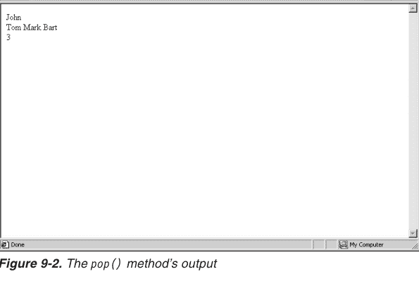

## push()

`push()` 方法将值添加到数组的末尾，从而增加其长度。以下是作为 `Array` 对象类型原型声明的方法：

```
function push()
{
    var sub = this.length
    for (var i = 0; i < push.arguments.length; ++i)
    {
        this[sub] = push.arguments[i]
        sub++
    }
}
Array.prototype.push = push
```

这是一个使用数组的 `push()` 方法的示例：

```
var names = new Array("Tom", "Mark", "Bart", "John")
names.push("Jim", "Richard", "Tim")
document.write(names.join(" "))
```

输出如图 9-3 所示。

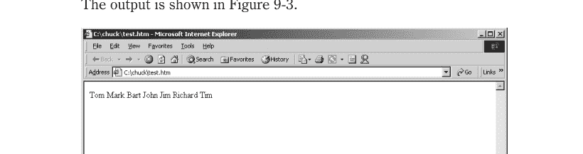

**图 9-3.** *`push()` 方法的输出*

其通用语法为：

```
arrayInstance.push(list)
```

> **注意：** 早期版本的 JavaScript 不支持此方法，但现在已支持。

## reverse()

`reverse()` 方法会反转调用它的数组对象的元素。如果之前是降序，现在会变成升序，依此类推。最后一个元素会变成第一个，反之亦然。这是一个内置方法。

其通用语法为：

```
arrayInstance.reverse()
```

以下脚本演示了 `reverse()` 函数：

```
var names = new Array("Tom", "Mark", "Bart", "John")
var colors = new Array("red", "orange", "yellow", "green", "blue", "purple")
document.write("<B>original names: </B>" + names.join(" ") + "<BR>")
names.reverse()
document.write("<B>reversed names: </B>" + names.join(" ") + "<BR>")
document.write("<B>original colors: </B>" + colors.join(" ") + "<BR>")
colors.reverse()
document.write("<B>reversed colors: </B>" + colors.join(" ") + "<BR>")
```

相应的输出如图 9-4 所示。

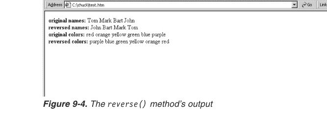

## shift()

`shift()` 方法在 JavaScript 中没有定义，因此我们必须创建它。它会移除并返回数组的第一个元素，同时将数组大小减一。

定义其原型后，此方法调用的通用格式为：

```
arrayInstance.shift()
```

以下是该方法及其示例：

```
function shift(str)
{
    var val = this[0]
    for (var i = 1; i < this.length; ++i)
    {
        this[i - 1] = this[i]
    }
    this.length--
    return val
}
Array.prototype.shift = shift
```

以下脚本演示了 `shift()` 方法的使用：

```
var line = new Array("aaa", "bbb", "ccc", "ddd", "eee")
document.write(line.shift() + "<BR>")
document.write(line.join(" "))
```

输出如图 9-5 所示。

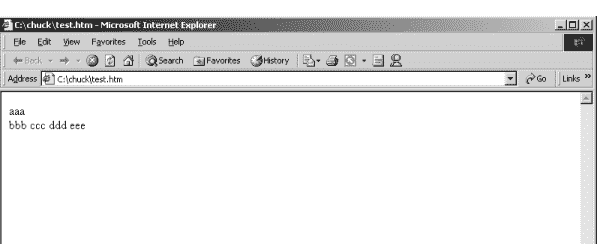

**图 9-5.** `shift()` 方法的输出

## sort()

幸运的是，`sort()` 方法是 JavaScript 的内置方法。此方法对数组的元素进行排序。可以可选地提供一个排序函数。如果未提供，则数组会根据每个元素的字符串转换，按字典顺序（比较顺序）进行排序。此方法的通用语法如下：

```
arrayInstance.sort(compareFunction)
```

如果未提供 *compareFunction*，元素将被转换为字符串，并按字典顺序进行比较排序。例如，在字典顺序中 "10" 排在 "9" 之前，但数值比较会将 9 排在 10 之前。

比较函数的结构非常具体。首先，它应该有两个参数，分别对应正在比较的两个元素。其次，它应该返回一个值。如果 `a` 和 `b` 是正在比较的两个元素，那么：

-   如果 *compareFunction(a, b)* 小于零（返回负数），则将 `b` 排在比 `a` 更低的索引位置。
-   如果 *compareFunction(a, b)* 返回零，则 `a` 和 `b` 在彼此方面的顺序保持不变（如果 `a` 原本在 `b` 之前，它将保持在 `b` 之前，反之亦然）。
-   如果 *compareFunction(a, b)* 为正数（大于零），则将 `b` 排在比 `a` 更高的索引位置。

比较函数的基本形式为：

```
function compare(a, b)
{
    if (a is less than b by some ordering criterion)
        return -1
    if (a is greater than b by the ordering criterion)
        return 1
    // a must be equal to b
    return 0
}
```

最简单的比较函数是对数字排序：

```
function compareNumbers(a, b)
{
    return a - b
}
```

JavaScript 使用稳定排序，因此如果根据比较函数 `a` 和 `b` 相等，则它们的相对顺序不会改变。

以下是一些比较函数：

```
// 1. 字典顺序 -- 内置
// 2. byIncNum（数字递增）
function byIncNum(a, b)
{
    return a - b
}

// 3. byFirstChar（仅首字符的字典顺序）
function byFirstChar(a, b)
{
    a += ""
    b += ""
    if (a.charAt(0) < b.charAt(0))
        return -1
    if (a.charAt(0) > b.charAt(0))
        return 1
    return 0
}
```

以下示例应能阐明此主题：

```
<HTML>
<HEAD>
<TITLE>数组排序</TITLE>
<SCRIPT LANGUAGE="JavaScript">
<!--

// 1. 字典顺序 -- 内置
// 2. byIncNum（数字递增）

function incNum(a, b)
{
    return a - b
}

stringArray = new Array("house", "hose", "chair")
numericStringArray = new Array("60", "8", "100")
numberArray = new Array(20, 1, 5, -11, 8)
mixedNumericArray = new Array("70", "9", "600", 3, 40, 70, 250)

function compareNumbers(a, b)
{
    return a - b
}

document.write("<U><B>stringArray</B></U><BR>")
document.write("<B>原始数组：</B> " + stringArray.join() +"<BR>")
document.write("<B>默认排序：</B> " + stringArray.sort() +"<P>")

document.write("<U><B>numberArray</B></U><BR>")
document.write("<B>原始数组：</B> " + numberArray.join() +"<BR>")
document.write("<B>默认排序：</B> " + numberArray.sort() +"<BR>")
document.write("<B>使用 compareNumbers 排序：</B> " +
                 numberArray.sort(compareNumbers) +"<P>")

document.write("<U><B>numericStringArray</B></U><BR>")
document.write("<B>原始数组：</B> " + numericStringArray.join() +"<BR>")
document.write("<B>默认排序：</B> " + numericStringArray.sort() +"<BR>")
document.write("<B>使用 compareNumbers 排序：</B> " +
                 numericStringArray.sort(compareNumbers) +"<P>")

document.write("<U><B>mixedNumericArray</B></U><BR>")
document.write("<B>原始数组：</B> " + mixedNumericArray.join() +"<BR>")
document.write("<B>默认排序：</B> " + mixedNumericArray.sort() +"<BR>")
document.write("<B>使用 compareNumbers 排序：</B> " +
                 mixedNumericArray.sort(compareNumbers) +"<BR>")
// -->
</SCRIPT>
</HEAD>
<BODY>
</BODY>
</HTML>
```

*示例 9-1 (ex9-1.htm)*。内置的 `sort()` 函数是替代许多使用指针的语言中指针排序的简单方法。

此脚本的结果如图 9-6 所示。

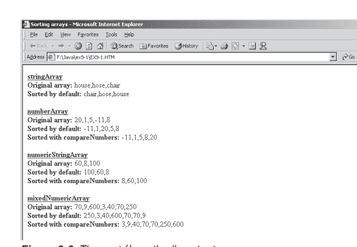

**图 9-6.** `sort()` 方法的输出

## splice()

JavaScript 尚未提供的另一个方法是 `splice()`。它用于移除和替换数组中的元素。其通用语法为：

```
arrayInstance.splice(offset, length, list)
```

*offset* 是要开始移除元素的起始位置。*length* 是要移除的元素数量，从 offset 开始计算。*list* 参数由用于替换被移除元素的新元素组成。以下是该方法：

```
function splice(offset, length)
{
    var ar1 = new Array()
    var ar2 = new Array()
    for (i = 0; i < length; ++i)
    {
        ar1[i] = this[i + offset]
    }
    for (i = 0; i < this.length - (offset + length); ++i)
    {
        ar2[i] = this[i + offset + length]
    }
    var args = new Array()
    for (i = 0; splice.arguments[i + 2] != null; ++i)
    {
        args[i] = splice.arguments[i + 2] // 第二个参数
    }
    j = offset
    for (i = 0; i < args.length; ++i)
    {
        this[j] = args[i]
        ++j
    }
    for (i = 0; i < ar2.length; ++i)
    {
        this[j] = ar2[i]
        ++j
    }
    this.length = this.length - length + args.length
}
```


## splice() 方法详解

此方法比前面介绍的方法更为复杂。首先，声明了两个数组。虽然可以计算它们的大小，但这完全没有必要，因为它们会随着元素的添加而自动扩展以容纳适当大小。函数中的第一个循环是：

```
for (i = 0; i < length; ++i)
{
    ar1[i] = this[i + offset]
}
```

这个循环根据 `offset` 和 `length` 参数的值，将所有要移除的元素赋值给数组 `ar1`。循环迭代的次数正好是 `length`，即指定要移除的元素数量。数组 `ar1` 从下标 0 开始填充。它被赋值了调用数组（`this`）中从 `offset` 开始的元素，因为只有 `offset` 之后（正好是 `length` 个）的元素需要被移除。当循环终止时，数组 `ar1` 已经包含了应该从调用数组中移除的元素。注意，这个数组在函数最后被返回。

现在看一下第二个循环：

```
for (i = 0; i < this.length - (offset + length); ++i)
{
    ar2[i] = this[i + offset + length]
}
```

这个循环将所有紧随被移除元素之后的元素赋值给数组 `ar2`。循环在完成所有这些元素的赋值后终止。`this.length - (offset + length)` 等于被移除元素集合之后的元素数量。被移除集合之后的第一个元素的下标是 `offset + length`。从调用数组的总长度中减去这个数，就得到了被移除集合之后的元素数量。

下一个循环如下：

```
for (i = 0; splice.arguments[i + 2] != null; ++i)
{
    args[i] = splice.arguments[i + 2] // 第二个参数
}
```

前面的循环将方法的第三个参数（即列表）中的所有项赋值给数组 `args`。这些项是传递给方法的所有参数，除了前两个。我们使用条件 `splice.arguments[i + 2] != null` 来终止循环，这是因为某些平台上 `arguments.length` 属性存在一些意外行为。也就是说，当函数遇到 `splice.arguments` 的第一个 `null` 元素时，它就会终止。这个操作基于一个事实：该方法永远不会被用来将调用数组中的一个元素替换为 `null`。这个概念将在本章后面深入解释。使用表达式 `i + 2` 是因为 `arguments` 数组中需要的元素是从第三个（下标 == 2）开始的。然而，在函数内部创建的 `args` 数组应该从下标 0 开始存储元素，因此 `i` 被用作该数组的下标。

我们现在有了四个数组：

-   `this`（调用数组）
-   `args`
-   `ar2`
-   `ar1`

请记住，`splice()` 方法需要修改调用它的脚本。它将这个数组的开头部分（到第一个被移除元素为止，不包含该元素）与 `args` 和 `ar2` 按顺序连接起来。脚本的最后一部分正是这样做的：

```
j = offset
for (i = 0; i < args.length; ++i)
{
    this[j] = args[i]
    j++
}
for (i = 0; i < ar2.length; ++i)
{
    this[j] = ar2[i]
    j++
}
this.length = j
```

首先，`j` 被设置为 `offset`，即数组 `this` 中第一个需要被修改的值（所有在它之前的现有元素应保持在数组的开头，就像调用该方法之前一样）。接下来的两个循环分别将其他数组 `args` 和 `ar2` 中的元素赋值给调用数组（`this`）。变量 `j` 很重要，因为它在两个循环中都保持着调用数组当前元素的下标。最后，调用数组（现在已修改）的长度被设置为 `j`，因此如果原始数组中有更多元素，它们会被截断。

`splice()` 函数的最后一条语句以数组 `ar1` 的形式返回被移除的元素。

既然你已经仔细研究了这段冗长且可能有些晦涩的解释，现在看一个例子可能是个好主意：

```
var cols = new Array("red", "orange", "yellow", "green", "blue", "purple")
var newCols = cols.splice(2, 3, "brown", "black")
document.write(newCols.join(" ") + "<BR>")
document.write(cols.join(" ") + "<BR>")

cols = new Array("red", "orange", "yellow", "green", "blue", "purple")
newCols = cols.splice(0, 1, "brown", "black")
document.write(newCols.join(" ") + "<BR>")
document.write(cols.join(" ") + "<BR>")

cols = new Array("red", "orange", "yellow", "green", "blue", "purple")
newCols = cols.splice(3, 0, "brown", "black")
document.write(newCols.join(" ") + "<BR>")
document.write(cols.join(" "))
```

此脚本段的输出如图 9-7 所示。

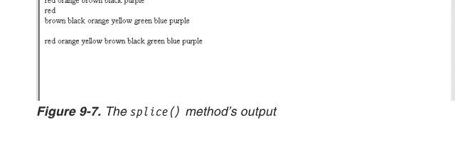

如果你试图移除数组元素而不插入新元素，该函数将无法正常工作。

## split()

`split()` 方法是 `join()` 的反向操作。它通过某个分隔符（默认为空格）拆分字符串（即对象），并返回一个数组。准确地说，这是 String 对象的方法，而不是 Array 对象的方法，但由于它与数组关系密切，我们选择在本节中讨论它。如果未提供分隔符或在整个字符串中找不到分隔符，则返回字符串本身。此方法是内置的，因此你只需调用它。一般格式为：

```
stringName.split(delimiter)
```

以下是一些示例：

```
var line1 = "a b c d e f"
var ar1 = new Array()
ar1 = line1.split(" ")
document.write(ar1.join(", ")) // a, b, c, d, e, f
document.write("<BR>")
ar2 = line1.split(";")
document.write(ar2) // a b c d e f
document.write("<BR>")
ar3 = line1.split()
document.write(ar3) // a b c d e f
document.write("<BR>")
ar4 = line1.split("")
document.write(ar4) // [无限循环！]
```

除了最后一个 `ar4`，所有这些示例都遵循了前面解释的规则。语句 `ar4 = line1.split("")` 会导致无限的方法执行，最终会使浏览器崩溃，甚至如果你使用的是 16 位版本的 Windows，还可能使操作系统崩溃。这种行为的原因很明显——JavaScript 试图用空字符串拆分字符串。众所周知，在两个字符之间以及两个空字符串之间都存在着无限多个空字符串！

## unshift()

`unshift()` 方法与 `shift()` 方法相反。它将一组元素附加到数组的开头。以下是作为 Array 对象类型原型定义的方法，以及一个演示它的示例：

```
function unshift()
{
    for (var i = 0; i < unshift.arguments.length; ++i)
    {
        if (unshift.arguments[i] == null)
            break
    }
    // i = 参数数量！（记住 ++i 是在最后一个循环中执行的）
    // i 保存了参数的数量
    for (var j = this.length - 1; j >= 0; --j)
    {
        this[j + i] = this[j]
    }
    // j == -1
    // i == 参数数量
    for (j = 0; j < i; ++j)
    {
        this[j] = unshift.arguments[j]
    }
}
Array.prototype.unshift = unshift
```

以下是 `unshift()` 函数的一个示例：

```
var line = new Array("ccc", "ddd", "eee")
line.unshift("aaa", "bbb")
document.write(line.join(" "))
```

## arguments 数组

`functionName.arguments` 数组按顺序保存传递给函数 `functionName` 的参数。以下是一个示例：

```
function func()
{
    document.write(func.arguments[2])
}
func(1, 2, 3, 4, 5)
document.write("<BR>")
func()
```

此脚本的输出是：

```
3
3
```

第二个 `3` 不是第二次调用时传递给函数的参数，而是第一次调用时传递给函数的参数。它仍然是数组中的一个元素，前提是后续调用的参数没有替换它。因此，你可以得出结论：`functionName.arguments` 数组具有永久的存储类别。

假设你想创建一个接受字符串参数并在每个之后打印换行符的函数。直观的函数应该是：

```
function printList()
{
    for (var i = 0; i < printList.arguments.length; ++i)
    {
        document.write(printList.arguments[i] + "<BR>")
    }
}
```

你可以以下列形式使用此函数：

```
printList("message 1", "message 2", "message 3", "message 4")
```

输出为：

```
message 1
message 2
message 3
message 4
```

你也可以连续两次使用该函数，如：

```
printList("message 1", "message 2", "message 3", "message 4")
printList("message 5", "message 6", "message 7", "message 8")
```


同样，预期输出是：

+   message 1
message 2
message 3
message 4
message 5
message 6
message 7
message 8

现在，让我们将函数改为以下代码：

```javascript
function printList()
{
    document.write("There are " + printList.arguments.length + " arguments.")
    document.write("<BR>")
    document.write("The fourth argument is " + printList.arguments[3] + ".")
    document.write("<BR>")
    for (var i = 0; i < printList.arguments.length; ++i)
    {
        document.write(printList.arguments[i] + "<BR>")
    }
}
```

该函数现在根据*functionName*.arguments.length属性显示参数的数量。它还会显示第四个参数，无论是否有四个参数。考虑以下语句：

```javascript
printList("message 1", "message 2", "message 3", "message 4")
printList("message 5", "message 6", "message 7")
```

输出是：

+   There are 4 arguments.
The fourth argument is message 4.
message 1
message 2
message 3
message 4
There are 3 arguments.
The fourth argument is message 4. (!!!)
message 5
message 6
message 7

请注意，该函数在每次调用时都会打印传递给它的第四个参数。然而，第二次调用只提供了三个参数！arguments.length属性保存了正确的值3。第四个参数实际上是第一次函数调用遗留下来的。

如你所见，arguments数组并不遵循作为Array对象实例的数组的规则。以下脚本演示了这种区别：

```javascript
var ar = new Array("message 1", "message 2", "message 3")
document.write("The array is: " + ar.join(", ") + "<BR>")
document.write("There are " + ar.length + " elements.<BR>")
document.write("The third element is " + ar[2] + ".<BR>")
ar.length = 2
document.write("There are " + ar.length + " elements.<BR>")
document.write("The third element is " + ar[2] + ".<BR>")
```

此脚本的输出是：

The array is: message 1, message 2, message 3
There are 3 elements.
The third element is message 3.
There are 2 elements.
The third element is null.

关于数组的简单规则是，最后一个元素的下标是*arrayName*.length – 1。当你通过为length属性赋一个更小的值来减小数组的大小时，所有原本在数组范围内但现在已经超出范围的元素都会丢失。如果你尝试引用它们，你会发现它们是null。*functionName*.arguments数组则不同，其最后一个元素与其长度无关。

## 多维数组

虽然JavaScript与C++等传统编程语言共享许多特性，但它只是一种为网页设计的脚本语言。因此，它有一些限制。例如，JavaScript不支持多维数组。然而，就像你在本书中将遇到的许多其他JavaScript限制一样，你可以为这个问题创建自己的变通方法。到目前为止，我们已经讨论了一维数组（1D数组）。这种数组由以行状结构排列的元素组成。一维数组的基本结构如下图所示：

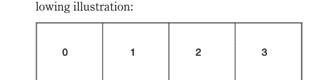

假设你想存储一名跑步者在不同年份和不同距离上的纪录时间。如果数组名为*curDis*，2005年的纪录时间可以放在*curDis*[0]中，2006年的纪录时间放在*curDis*[1]中，2007年的纪录时间放在*curDis*[2]中，依此类推。然而，你可能已经注意到，我们只能存储单个距离（例如400米跑）的纪录时间。使用类似表格或电子表格的数组，可以轻松地以这种格式存储各种跑步的纪录时间。这种数组被称为二维（2D）数组。

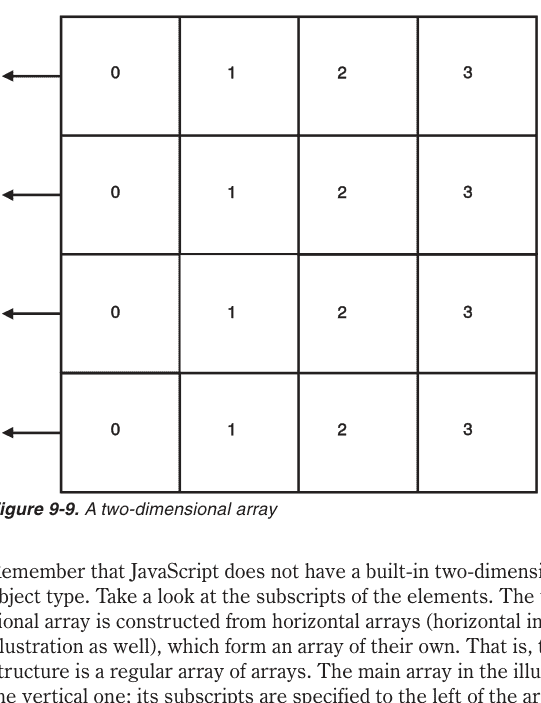

图9-9. 二维数组

请记住，JavaScript没有内置的二维数组对象类型。看看元素的下标。二维数组由水平数组（图中也是水平的）构成，这些数组本身形成一个数组。也就是说，其通用结构是数组的常规数组。图中的主数组是垂直的那个；其下标在箭头的左侧指定。

请注意，多维数组的各个维度不必相等。

引用二维数组（2DA）元素的标准方式是：

```javascript
ar[1][5]
ar[8][0]
ar[3][3]
```

第一个数字是第一维的下标，而第二个数字指定第二维的下标。

## 使用单个构造函数创建

创建二维数组（2DA）最简单的方法是使用如下所示的构造函数：

```javascript
function Array2D(dim1, dim2)
{
    for (var i = 0; i < dim1; ++i)
    {
        this[i] = new Array(dim2)
    }
    this.length = new Array(dim1, dim2)
}
```

以下脚本演示了通过此函数创建和使用数组的过程：

```javascript
var ar = new Array2D(4,7)
ar[2][1] = 6
ar[0][0] = "Hello"  // this is the "first" element
ar[3][6] = true     // this is the "last" element
alert("Length of first dimension is " + ar.length[0])
alert("Length of second dimension is " + ar.length[1])
alert("\"Last\" element: " + ar[ar.length[0] - 1][ar.length[1] - 1])
```

通过警报框显示的消息是：

Length of first dimension is 4
Length of second dimension is 7
"Last" element: true

构造函数使用了一个循环。第一个数组（ar）不是一个显式的Array对象。它只是一个普通对象，其属性使用数组符号指定。Array对象类型的内置方法不对此数组进行操作。循环执行dim1次，即第一维的长度。调用对象的每个属性（或元素）都被分配一个由dim2个元素组成的“真实”数组。由于这些是真实的数组，你可以使用Array对象类型的内置方法和属性。例如，ar[0]是一个包含dim2个元素的数组，因此你可以引用它的元素：ar[0][0]、ar[0][1]、ar[0][2]等。2DA实际上是一个一维数组，其所有元素都是一维数组。因此，你应该小心，不要通过向其主数组赋值来破坏2DA的结构，例如：

```javascript
ar[3] = "Do not do this to a 2DA!"
```

前面的构造方法还包括一个length属性，它是一个包含两个元素的数组。第一个元素保存主数组中的元素数量（指定的第一维长度），而第二个元素保存指定的第二维长度。这个例子最好地说明了这一点。请记住，这些是静态属性。向length属性的元素赋值不会影响数组，但当你需要关于数组各维度的正确长度值时，这可能会让你出错。

## 不使用构造函数创建

可以在不使用构造函数的情况下创建二维数组。此方法基于创建Array对象的实例：

```javascript
function addDim2(array1D, dim2)
{
    for (var i = 0; i < array1D.length; ++i)
    {
        array1D[i] = new Array(dim2)
    }
    return array1D
}
```

这个函数本身几乎没有意义，所以让我们看一个实际的例子：

```javascript
var dim1 = 4
var dim2 = 7
var ar = new Array(dim1)
ar = addDim2(ar, dim2)
ar[2][1] = 6
ar[0][0] = "Hello"    // this is the "first" element
ar[3][6] = true        // this is the "last" element
alert("Length of first dimension is " + ar.length)
alert("Length of second dimension is " + ar[0].length)
alert("\"Last\" element: " + ar[ar.length - 1][ar[0].length - 1])
```

首先，第一维的长度4被赋值给dim1。然后，第二维的长度被赋值给dim2。根据Array对象类型创建一个名为ar的新数组。它的长度是所需数组的第一维的长度。然后，用该数组和第二维的长度调用函数addDim2。它将最终的2DA返回给原始的一维数组ar。该函数基于一个简单的循环，将一个包含dim2个元素的数组分配给原始一维数组的每个元素。由于第一维数组和第二维数组都是Array对象类型的实例，你可以通过以下方式引用每个维度的长度：

```javascript
ar.length == length of first dimension
ar[0].length == length of second dimension == ar[1].length == ...
```

请注意，要使第二个表达式为true，你必须在脚本执行期间任何时候都不要更改2DA的长度。否则，它就不再是模拟2DA了。


## 关联数组

这个主题相当高级，当然即使不掌握它也能使用 JavaScript。但在某些情况下，它非常有用。*关联数组*使用字符串作为下标。例如，数组的一个元素可以是：

```
color["yellow"] = "FFFF00"
```

这类数组将相关数据分组在一起。这些数组实际上是对象，只不过你使用方括号而不是点号。另一个重要区别是，数组规范（方括号）允许你引用一个变量的值作为属性，而不是实际的字面量。例如：

```
var col = "yellow"
color[col] = "FFFF00"
```

这里还有一个有趣的例子：

```
var w = "write"
document[w]("Hello!") // 打印 "Hello!"
```

如果你用普通的点号表示法替换数组表示法，会收到一个错误：

```
var w = "write"
document.w("Hello!")
```

点号表示法要求指定实际的字面量，因为它不会计算书写的值。你可以使用关联数组来创建类似多维数组的嵌套对象。例如，你可以创建一个关联数组，其下标是班级中学生的名字，这样关联数组的每个元素都是一个包含学生年级、年龄等字段的对象。

请注意，关联数组不能作为内置 Array 对象的实例来创建。你必须使用构造函数来创建。这里有一个使用学生的示例：

```
function studentClass()
{
    for (var i = 0; i < arguments.length; ++i)
    {
        this[studentClass.arguments[i]] = new student()
    }
}
function student()
{
    // this.grade = null
    // this.age = null
}
var students = new studentClass("Bob", "John", "Frank", "Alfred",
                          "Sheila", "Mary")
```

```
students["Bob"].grade = 40
students["John"].age = 11
students["Frank"].grade = "N/A"
alert(students["Frank"].grade)
```

创建关联数组并不困难。数组元素是根据函数 studentClass() 接受的学生名字参数创建的。第二个函数有点奇怪——它不包含任何语句。当你创建一个实例时，可以使用一个“空的”构造函数。你可能从之前的讨论中记得，对象可以通过简单地给它们赋值来扩展。因此，语句 `this[studentClass.arguments[i]] = new student()` 只是确保关联数组的每个元素都是一个对象。后面的全局语句通过赋值来创建属性。

另一个需要记住的重要概念是，关联数组不是显式的数组。你也可以使用点语法来引用它们，比如：

```
students.John.age
```

假设你创建了一个数据库结构，列出了班级中所有学生的年龄和成绩。假设两个字段都输入了正确的值。你可以让用户通过提示对话框查看这些值。例如：

```
var grade = students[prompt("Enter name:", "John Doe")].grade
document.write(grade)
```

在这种情况下，你必须使用数组约定，因为你正在提示用户输入属性名称。只有当你知道属性名称时，才能使用点表示法。如果你使用点表示法：

```
students.prompt(...)
```

JavaScript 会假设你引用的是 students 对象的一个名为 prompt() 的方法，而该方法当然根本不存在。

## 填充关联数组

使用常规数组时，创建一个密集数组很简单。你只需用所需的值创建数组即可。然而，关联数组的每个元素需要两个实际值：键（下标）和值。你可以创建一个构造函数来创建和填充关联数组：

```
function AssociativeArray()
{
	for (var i = 0; i < arguments.length - 1; i += 2)
	{
		this[arguments[i]] = arguments[i + 1]
	}
}
```

你可以使用此函数按照以下格式创建关联数组：

```
var ar = new AssociativeArray("red", "FF0000", "green", "00FF00",
                           "blue", "0000FF")
document.write("green = " + ar["green"] + "<BR>")
var col = "blue"
document.write("blue = " + ar[col] + "<BR>")
document.write("red = " + ar.red)
```

此脚本的相对输出为：

```
green = 00FF00
blue = 0000FF
red = FF0000
```

让我们看看这个构造函数。它接受数组元素的键，后跟它们对应的值。每个键后面必须跟它自己的值。该函数遍历参数，并在到达倒数第二个参数后终止。在函数的每次执行过程中，调用对象的一个属性（在数组术语中是一个“元素”）被创建。属性（或元素）的键是当前参数，而其值则从下一个参数中提取。每次执行代码块后，循环计数器前进两步，因为关联数组的每个元素与两个参数相关——它的键和它的值。尽管关联数组主要是一个常规对象，但这个构造函数必须使用方括号（数组表示法）进行引用和初始化，因为键（下标）的值不是字面量，而是存储为参数的值。

## 将字符串分割成关联数组

split() 方法通过指定分隔符将字符串分割成 Array 对象的真实实例。例如：

```
var str = "a;b;c;d;e;f"
var ar = str.split(";") // ar[0] == "a", ar[1] == "b", ar[2] == "c", ...
```

让我们使用 split() 方法创建一个名为 associativeSplit() 的函数作为 String 对象的原型：

```
function associativeSplit(del)
{
    var tempAr = new Array()
    tempAr = this.split(del)
    var ar = new Obj()    // 不是数组，只是一个对象
    for (var i = 0; i < tempAr.length - 1; i += 2)
    {
        ar[tempAr[i]] = tempAr[i + 1]
    }
    return ar
}
function Obj() { }
String.prototype.associativeSplit = associativeSplit
```

注意使用空函数来创建对象。首先，该函数通过常规方法将字符串分割成一个常规数组。然后它遍历数组，使用下一个元素作为关联数组中某个元素的键，并使用其后的元素作为关联数组中同一个元素的值。完成后，该函数返回关联数组。然后该函数被声明为内置 String 对象的原型，适用于所有字符串。

现在看一个示例：

```
var str = "a b c d e f"
var ar1 = str.associativeSplit(" ")
document.write(ar1.a + "<BR>")
document.write(ar1.b + "<BR>")
document.write(ar1["c"] + "<BR>")
document.write(ar1["d"] + "<BR>")
// document.write(ar1[e] + "<BR>")
document.write(ar1.f + "<BR>")
```

请注意，“关联数组”不是一个 JavaScript 术语，而是一个常规对象。我们只是更喜欢通过数组表示法来引用它的属性。

## 总结

这是一个复杂但非常重要的章节。在本章中，我们学习了 JavaScript 中的数组。重要的是你要记住，在 JavaScript 中，数组是一个对象。我们讨论了 Array 对象，包括其属性和方法。本章汇集的其他重要概念是构造函数和原型，主要用于模拟 Perl 等语言中的数组方法。到现在，你应该已经掌握了数组和构造函数，这是该语言中两个非常重要的元素。你还应该知道如何创建和使用二维数组以及多维数组，尽管它们很少使用。在本章中，我们还引入了“关联数组”一词。这类数组是具有常规属性的常规对象，但它们让我们想起了在 Perl 等其他语言中广泛使用的关联数组。在接下来的章节中，我们将进一步探讨 JavaScript 的对象模型，而数组和构造函数将作为某些脚本的基础。


## 第10章
JavaScript中的时间与日期

在网页编程中，处理时间与日期是一项非常常见的任务。有许多场景需要用到时间与日期数据，例如确定当前日期、让用户为特定项目输入日期，甚至创建在线日历。本章我们将探讨JavaScript内置的时间与日期功能。你还将学习如何使用JavaScript的日期和时间函数为网页创建实用的附加功能。

## Date对象

对JavaScript程序员来说幸运的是，JavaScript内置了一个Date对象，使你能够轻松处理日期和时间数据及相关功能。JavaScript中的日期和时间都源自Date对象，其行为方式与其他对象非常相似。要在脚本中实现当前日期或时间，你必须首先创建该对象的一个新实例。然后你可以从该特定实例中提取所需的数据。JavaScript处理日期的方式与Java非常相似。两种语言实现了许多相同的方法，因此存在明显的相似性。所有日期都存储为自1970年1月1日00:00:00以来的毫秒数。正如你将在本章中看到的，使用Date对象是目前你在JavaScript中见过的最简单的事情之一。

## 创建Date实例

Date是一个内置对象，你可以通过它创建*实例*，以存储与某一时刻的日期和时间相关的编码数据（回想一下我们在第4章对面向对象编程的讨论）。Date对象是内置的，就像前一章深入讨论的Array对象一样。它在创建对象实例时充当模板。关于Date对象最基本的赋值语句显然是根据默认参数创建实例的语句：

```javascript
var dateInstance = new Date()
```

此语句只是将Date对象的一个实例赋值给名为dateInstance的数据结构。看看下面的脚本：

```javascript
var now = new Date()
alert(now)
```

输出如图10-1所示（当你尝试时，日期和时间会不同）。

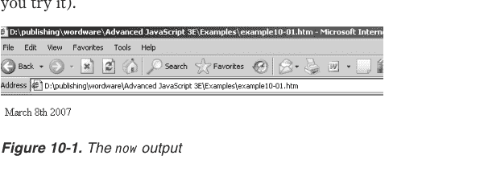

虽然`now`是Date对象实例的标识符，但在最高层级它包含一个部分字符串值。也就是说，如果你尝试打印它的值，它看起来像是一个字符串。然而，由于它不属于显式的String对象，因此字符串属性和方法不适用于它。

如果你想将Date对象的实例作为字符串引用，最好将其显式转换为字符串：

```javascript
var newObj = new Date()
var str = newObj.toString()
```

`toString`方法只是将对象转换为String对象。这类似于其他编程语言中的类型转换。你会看到许多对象都有`toString`方法，允许你将它们转换为字符串。

## Date构造函数的参数

到目前为止，我们创建Date对象实例时没有任何参数；也就是说，我们根据默认参数构建了实例。默认值是客户端机器上的当前日期和时间。JavaScript允许你创建特定日期的Date实例，你随后可以将其用于日期运算。例如，你可以创建一个代表某个特定历史日期的Date对象实例。

这是一个创建过去某个日期的实例的例子：

```javascript
var Xmas2006 = new Date("December 25, 2006 13:30:00")
```

你也可以根据以下格式的一组整数创建实例：
年，月，日，时，分，秒

这是一个使用此格式的示例：

```javascript
var Xmas2006 = new Date(106,11,25,9,30,0)
```

一个重要的概念是在两种格式（字符串和整数）中都需要指定年、月、日。如果你省略了小时、分钟或秒，它们默认设置为零。然而，省略前三个参数中的任何一个都会导致错误，甚至在某些操作系统下会使浏览器崩溃。

## 日期的数值约定

JavaScript中的日期与Java一样，使用整数来指定递增的值。例如，一个月的第一天是1，第二天是2，第三天是3，以此类推。所使用的数字并不总是如此明显。大多数日期属性实际上是从零开始的；也就是说，它们从零开始。例如，一小时的第一分钟是0，第二分钟是1，第三分钟是2，以此类推。下表总结了Date实例每个属性的数值约定：

**表10-1。** *日期属性的范围*

| 日期属性 | 范围 |
|---|---|
| 秒 | 0 - 59 |
| 分钟 | 0 - 59 |
| 小时 | 0 - 23 |
| 星期 | 0 - 6 |
| 日 | 1 - 31 |
| 月 | 0 - 11 |
| 年 | 自1900年起的年数（例如，107） |

最重要的是，当涉及客户端JavaScript时，日期和时间指的是客户端。所有值都是浏览器传递给脚本的值。你可能知道，特别是如果你是Mac或Windows环境的程序员，你计算机上的所有应用程序都可以访问机器时钟，包括当前时间和日期。如果系统时钟未设置为当前时间和日期，JavaScript将在脚本中使用这些不正确的值，可能会让用户感到惊讶。

## Date方法分类

JavaScript为程序员提供了多种处理Date对象实例的方法。然而，提取和操作它们的数据使它们成为该语言最重要的元素之一。如果一次接触所有方法，其庞大的数量可能会令人眼花缭乱。因此，我们选择根据它们的操作将它们分为四组：

- get方法
- set方法
- to方法
- parse方法

get方法返回一个与所需实例属性对应的整数。你可以“获取”年份、月份、小时等。set方法使你可以修改现有实例某个属性的值。这些方法接受整数值而不是返回它们。你实际上使用这些语句来“设置”属性的值。to方法根据传递给方法的参数将日期转换为字符串。然后你可以利用字符串格式和字符串方法与属性，例如`split()`方法。parse方法只是解析日期字符串。让我们从探索get方法开始。

## get方法

### getYear()

`getYear()`方法返回存储在Date对象类型实例中的当前年份。过去这是一个两位数日期，假设为20世纪。现在所有主要浏览器都使用四位数年份，因此你不必担心此问题。

```javascript
var now = new Date()
var year = now.getYear()
while (1)
{
  var guessYear = parseInt(prompt("Enter current year:", ""))
  if (guessYear == year)
  {
    alert("That's right!")
    break
  }
  else
    alert("Wrong answer! Try again...")
}
```

假设你能正确识别当前年份，此脚本的输出如图10-2和图10-3所示。

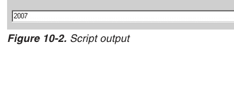

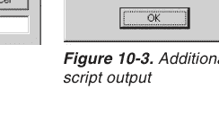

当前年份（基于系统时钟）从根据默认参数（当前时间与日期）创建的实例`now`中提取。接下来执行一个没有终止条件的循环。根据用户所知，系统会要求他或她输入当前年份。另一个if语句检查用户是否输入了正确的年份。如果是，则显示适当的消息，并使用`break`语句中断循环。否则，会有一条消息通知用户他或她的输入不正确，然后循环再次迭代。

`getYear()`的问题在于，Netscape仍然返回自1900年以来的年数（因此2007年返回107），而Internet Explorer则简单地返回四位数日期（使2007年返回“2007”）。你也可以使用较新的命令`getFullYear`，它将在两种浏览器中获取简单的四位数年份。

### getMonth()

`getMonth()`方法提取并返回其调用对象的月份。月份范围从一月到十二月，或者更准确地说，从0到11。之所以从0开始而不是1，是因为Date对象内部将月份存储为数组，而所有数组都从元素零开始。这是一个简单的例子，演示了这个方法以及一个数组实例：

```javascript
var now = new Date()
var month = now.getMonth()
var ar = new Array(12)
ar[0] = "January"
ar[1] = "February"
ar[2] = "March"
ar[3] = "April"
ar[4] = "May"
ar[5] = "June"
ar[6] = "July"
ar[7] = "August"
ar[8] = "September"
ar[9] = "October"
ar[10] = "November"
ar[11] = "December"
var message = "It is now " + ar[month] + ", my favorite.<BR>"
document.write(message)
```

此脚本的输出如图10-4所示。

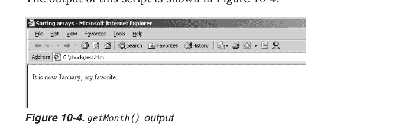


当前月份从 `now` 实例中提取，该实例包含当前时间（语句执行后）的属性。然后创建一个静态数组来保存所有月份的名称（作为字符串），每个名称对应 JavaScript 中的数字（从零开始）。这显然符合默认的数组结构，其第一个索引为零。因此，无需进行任何数学运算，只需通过当前月份的名称来构建消息（显然这是一个字符串），然后将该消息作为纯 HTML 打印。

## getDate()

`getDate()` 方法返回月份中的日期，其值为 1 到 31 之间的整数。以下是一个示例：

```
<HTML>
<HEAD>
<SCRIPT LANGUAGE = "JavaScript">
function datedemo()
{
    var now = new Date()
    var year = now.getYear()
    var month = now.getMonth()
    var date = now.getDate()
    var suf
    if (date < 10)
        var lastDigit = date
    else
        var lastDigit = date % 10
    var exp = ""
    // 确定后缀
    if (lastDigit == 1)
        suf = "st"
    else
        if (lastDigit == 2)
            suf = "nd"
        else
            if (lastDigit == 3)
                sf = "rd"
            else
                suf = "th"
    // 用于月份名称的数组
    var ar = new Array(12)
    ar[0] = "January"
    ar[1] = "February"
    ar[2] = "March"
    ar[3] = "April"
    ar[4] = "May"
    ar[5] = "June"
    ar[6] = "July"
    ar[7] = "August"
    ar[8] = "September"
    ar[9] = "October"
    ar[10] = "November"
    ar[11] = "December"
    var formDate = date + suf

    // 构建完整日期，例如 "May 5th, 2007"
    var totalDate
    totalDate = ar[month] + " " + formDate + " " + year
    document.write(totalDate)
}
</SCRIPT>
</HEAD>
<TITLE> 示例 10-01</TITLE>
<BODY bgcolor = white>
<INPUT TYPE = "button" onClick = "datedemo()" VALUE = "日期演示">
</BODY>
</HTML>
```

示例 10-1 (ex10-1.htm)

此脚本的输出如图 10-5 所示。

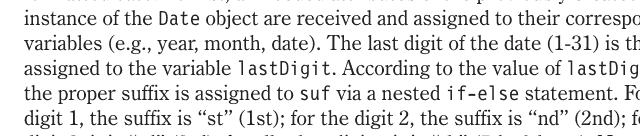

图 10-5. `getDate()` 输出

此脚本片段结合了迄今为止所学的所有方法，以显示格式美观的日期。首先，获取先前创建的 `Date` 对象实例的所有必要属性，并将其分配给相应的变量（例如 `year`、`month`、`date`）。然后，将日期（1-31）的最后一位数字赋值给变量 `lastDigit`。根据 `lastDigit` 的值，通过嵌套的 if-else 语句将适当的后缀分配给 `suf`。对于数字 1，后缀是 "st"（1st）；对于数字 2，后缀是 "nd"（2nd）；对于数字 3，后缀是 "rd"（3rd）；对于所有其他数字，后缀是 "th"（5th、6th 等）。请注意，最后一个 else 语句将 "th" 后缀与除 1、2 和 3 之外的所有数字关联。此后缀也适用于以 0 结尾的数字。如前所述，创建了一个月份名称数组。然后，将当前日期与其后缀组合以创建一个字符串，例如 "27th"。此字符串以及所有其他所需的值用于构建完整的日期格式，例如 "April 24th, 2007"。然后打印完整字符串。如果你理解了这个脚本，那么你对 JavaScript 中的日期和时间就有了很好的理解。

## getDay()

此方法返回星期几，其值为 0 到 6 之间的整数。星期几是根据其他属性计算出来的，因此此方法没有对应的 `setDay()` 方法。以下是一个示例：

```
ar = new Array(7)
ar[0] = "Sunday"
ar[1] = "Monday"
ar[2] = "Tuesday"
ar[3] = "Wednesday"
ar[4] = "Thursday"
ar[5] = "Friday"
ar[6] = "Saturday"
var birthday = new Date("January 3, 1978")
var day = birthday.getDay()
alert("You were born on " + ar[day])
```

## getHours()

`getHours()` 函数返回自午夜以来的小时数。也就是说，它根据 24 小时制返回当前小时。请注意，范围是从 0 到 23，从午夜（0）到晚上 11 点（23）。以下是一个示例：

```
var now = new Date()
var hour = now.getHours()
var text = ""
if (hour < 12)
    text = "morning"
else
    if (hour < 16)
        text = "afternoon"
    else
        if (hour < 20)
            text = "evening"
        else
            text = "night"
document.write("Good " + text + "!")
```

此脚本片段根据一天中的时间打印简短的问候语。例如，如果时间在 12:00（中午）到 16:00（下午 4 点）之间，它会打印 "Good afternoon!"。它基于嵌套的 if-else 结构。

## getMinutes()

`getMinutes()` 方法返回 `Date` 实例的分钟属性。返回的整数始终在 0 到 59 之间。下面是一个简短的示例来演示此方法：

```
var now = new Date()
var minute = now.getMinutes()
var hour = now.getHours()
var text = "Don't you have an appointment for " + (hour + 1)
text += ":00 ?"
if (minute > 49)
    document.write(text)
```

首先，构建包含最近一小时的消息。例如，如果当前时间是 15:55，则消息使用最近的一小时 16:00 来构建。如果当前时间距离下一小时不到十分钟，则打印该消息。请注意，如果时间是 23:59，则显示的小时是 24:00，而不是 00:00。

## getSeconds()

此方法返回给定 `Date` 实例的秒数，范围从 0 到 59。你可以使用它的方式与使用 `getMinutes()` 方法大致相同。

## getTimezoneOffset()

此方法返回当前区域设置的时区偏移量（以分钟为单位）。时区偏移量是本地时间与格林威治标准时间（GMT）之间的差值。夏令时使得这个值不是常数。返回的值是一个整数，表示以分钟为单位的差值。以下脚本展示了如何使用用户的时区偏移量来推断其居住地：

```
if (confirm("Are you in the United States?"))
{
    var now = new Date()
    var curOffset = now.getTimezoneOffset()
    curOffset /= 60 // 从分钟转换为小时
    var zone = ""
    var prep = ""
    if (curOffset == 8)
    {
        zone = "west coast"
        prep = "on"
    }
    else
        if (curOffset == 7)
        {
            zone = "mid-west"
            prep = "in"
        }
        else
            if (curOffset == 6)
            {
                zone = "mid-east"
                prep = "in"
            }
            else
            {
                zone = "east coast"
                prep = "on"
            }
    alert("I think you live " + prep + " the " + zone + "!")
}
else
    alert("Sorry, this script is intended for U.S. residents only")
```

该脚本首先询问用户是否居住在美国。如果不是，则显示一条消息。否则，将执行以下代码块。根据本地时区与 GMT 之间的小时差值来确定其在美国的地区。前置介词（例如 "in"、"on"）也在 if-else 结构中确定。然后，JavaScript 根据用户的当前位置以及适当的介词构建适当的消息。

## getTime()

`getTime()` 方法返回自 1970 年 1 月 1 日 00:00:00 以来的毫秒数。

## set 方法

正如 JavaScript 为你提供 get 方法以便你可以检索日期和时间信息一样，它也为你提供 set 方法，以便你可以将 `Date` 对象设置为特定的日期和时间。这可能非常有用。例如，你可以将 `Date` 对象设置为某人的生日，然后找出那天是星期几。

## setYear()

此方法设置给定 `Date` 实例的年份属性。以下示例计算去年今天的星期几：

```
var now = new Date()
var year = now.getYear()
now.setYear(year - 1)
ar = new Array(7)
ar[0] = "Sunday"
ar[1] = "Monday"
ar[2] = "Tuesday"
ar[3] = "Wednesday"
ar[4] = "Thursday"
ar[5] = "Friday"
ar[6] = "Saturday"
document.write("Last year, the current day was " + ar[now.getDay()])
```

首先，创建当前日期的实例，并将当前年份分配给变量 `year`。然后将实例 `now` 的年份属性设置为前一年。接着从修改后的实例中提取日期属性，并根据该日期构建消息，通过数组将其转换为字符串。


# setMonth()

此方法用于设置 Date 对象给定实例的月份属性。以下脚本将当前日期的月份属性设置为五月：

```javascript
var now = new Date()
now.setMonth(4)
```

# setDate()

setDate() 方法用于设置 Date 对象给定实例的日期属性。以下脚本打印出该月第一天是星期几：

```javascript
var now = new Date()
now.setDate(1)
ar = new Array(7)
ar[0] = "Sunday"
ar[1] = "Monday"
ar[2] = "Tuesday"
ar[3] = "Wednesday"
ar[4] = "Thursday"
ar[5] = "Friday"
ar[6] = "Saturday"
document.write("The first day of the month occurred on " + ar[now.getDay()])
```

# setHours()

此方法用于设置 Date 对象给定实例的小时属性。以下是一个示例：

```javascript
var obj = new Date("December 4, 2006 18:50:59") // JS press release
obj.setHours(obj.getHours() - 2)
alert(obj.getHours())              // 16
```

# setMinutes()

此方法用于设置 Date 对象给定实例的分钟属性。以下是一个简单示例：

```javascript
var obj = new Date("December 4, 2006 18:50:59") // JS press release
obj.setMinutes(obj.getMinutes() - 1)
alert(obj.getMinutes())             // 49
```

# setSeconds()

setSeconds() 方法用于设置 Date 对象类型给定实例的秒数属性。以下示例演示了其用法：

```javascript
var obj = new Date("December 4, 2006 18:50:59") // JS press release
obj.setSeconds(obj.getSeconds() - 9)
alert(obj.getSeconds())             // 50
```

# setTime()

此方法用于设置自 1970 年 1 月 1 日 00:00:00 以来的毫秒数。它实际上会修改其调用对象的所有字段。以下是一个示例：

```javascript
var obj = new Date()
obj.setTime(867999600000)
var date = obj.getDate()
var month = obj.getMonth()
if (date < 10)
    var lastDigit = date
else
    var lastDigit = date % 10
var exp = ""
// determine suffix
if (lastDigit == 1)
    suf = "st"
else
    if (lastDigit == 2)
        suf = "nd"
    else
        if (lastDigit == 3)
            suf = "rd"
        else
            suf = "th"
// array for name of month
var ar = new Array(12)
ar[0] = "January"
ar[1] = "February"
ar[2] = "March"
ar[3] = "April"
ar[4] = "May"
ar[5] = "June"
ar[6] = "July"
ar[7] = "August"
ar[8] = "September"
ar[9] = "October"
ar[10] = "November"
ar[11] = "December"
var text = ar[month] + " " + date + suf
alert(text) // July 4th (setTime modifies the entire instance)
```

# The to Methods

## toGMTString()

此方法将日期转换为字符串，使用 Internet GMT 约定。转换根据操作系统的时区偏移量进行，并返回一个类似于以下格式的字符串值：

Tue, 30 Jul 2006 01:03:46 GMT

确切的格式取决于平台。以下是一个简单示例：

```javascript
var now = new Date()
var ar1 = now.toGMTString().split(" ")
document.write("The current time in Greenwich is " + ar1[4])
```

此脚本段的一个示例输出为：

The current time in Greenwich is 01:08:21

## toLocaleString()

此方法以当前区域设置的约定，将日期以字符串形式返回。如果你尝试使用 toLocaleString 传递日期，请注意不同的区域设置会以不同的方式组合字符串。使用诸如 getHours、getMinutes 和 getSeconds 等方法会提供更具可移植性的结果。以下示例演示了该函数：

```javascript
var now = new Date()
var ar1 = now.toLocaleString().split(" ")
document.write("The current time is " + ar1[1])
```

该脚本的输出为：

The current time is 18:12:51

转换后字符串的通用格式为：

MM/DD/YY HH:MM:SS

# The parse Methods

解析方法用于从一种类型的信息中提取另一种类型的信息。例如，当使用 C、Java 或 C++ 编程时，在编译程序时，编译器会解析你的源代码以查找它识别的命令。当你加载一个网页时，浏览器会解析你的 HTML 以查找特定的标签。

## parse()

parse() 方法接受一个 IETF 标准的日期字符串，并将其转换为自 1970 年 1 月 1 日 00:00:00 以来的毫秒数。IETF 标准的日期表示法是：

DayAbb, date MonthAbb year HH:MM:SS TimeZoneAbb

此标准的一个示例是 "Mon, 25 Dec 2001 13:30:00 GMT."。此方法也理解美国大陆的时区缩写，例如 PST（太平洋标准时间）和 EST（东部标准时间）。然而，美国以外的时区（以及加拿大等地的等效时区）没有 JavaScript 接受的标准缩写。对于这样的时区，必须指定偏移量；也就是说，你必须指定当地时区与格林威治标准时间之间的小时和分钟差。例如，在 "Mon, 25 Dec 2001 13:30:00 GMT+0430" 中，GMT+0430 是格林威治子午线以西 4 小时 30 分钟的简写。如果你不指定时区，则根据操作系统中时钟的设置，假定为本地时区。如果你的时区设置不正确，你应该在 Mac 和基于 Windows 的机器的控制面板中更改它。GMT 也被称为世界协调时间，或 UTC。

parse() 方法是一个静态方法。它不属于 Date 对象的特定实例，而是属于对象类型本身。因此，它总是作为 Date.parse() 使用。以下是此方法的一个示例：

```javascript
var aDate = "Aug 27 2006"
var birthday = new Date()
birthday.setTime(Date.parse(aDate))
```

## UTC()

UTC() 方法接受一个逗号分隔的列表，并返回自 1970 年 1 月 1 日 00:00:00 格林威治标准时间（GMT，UTC）以来的毫秒数。这同样是一个静态方法，因此与通用的 Date 对象一起调用。你不能使用此方法来引用本地时区中的特定日期，因为它始终引用世界协调时间（GMT，UTC）。例如，以下语句使用 GMT 而不是本地时间创建了一个 Date 对象，如果使用的是本地时间，则会有所不同：

```javascript
gmtDate = new Date(Date.UTC(99, 11, 1, 0, 0, 0))
```

该方法的通用语法是：

```
Date.UTC(year, month, day [, hrs] [, min] [, sec])
```

所有属性都应指定为整数。

# 其他对象的时间相关方法

## setTimeout()

setTimeout() 方法在指定的毫秒数过去后计算一个表达式。其通用语法是：

```
timeoutID = setTimeout(expression, msec)
```

*timeoutID* 是用于标识当前超时的标识符。

*expression* 是一个字符串表达式或现有对象的属性。它通常是一个在指定时间过去后将执行的简单语句。

*msec* 是一个数值、一个数字字符串或以毫秒为单位的现有对象属性。

setTimeout() 方法在指定的时间过去后计算一个表达式。请看以下示例：

```html
<HTML>
<HEAD>
<TITLE>setTimeout() method</TITLE>
<SCRIPT LANGUAGE = "JavaScript">
function displayAlert()
{
    alert("5 seconds have elapsed since the button was clicked.")
}
</SCRIPT>
</HEAD>
<BODY>
<FORM>
Click the button on the left for a reminder in 5 seconds;
click the button on the right to cancel the reminder before
it is displayed.
<P>
<INPUT TYPE = "button" VALUE = "5-second reminder"
    NAME = "remind_button"
    onClick = "timerID = setTimeout('displayAlert()',5000)">
</FORM>
</BODY>
</HTML>
```

当你点击按钮时，事件处理程序的脚本设置一个超时。超时指定在 5000 毫秒，即五秒后，调用函数 displayAlert()。因此，在你点击按钮五秒后，会显示一个警报框。

此方法不会重复执行指定的语句。也就是说，它不会每五秒执行一次。当指定的时间限制倒数结束时，语句被执行，超时便不再存在。setTimeout() 是 window 或 frame 对象的方法，具体取决于它所使用的 HTML 文档的基本结构。

通常使用 setTimeout() 方法在两次连续调用用户定义的递归函数之间创建暂停。请看以下脚本：

```javascript
function alertNumbers(num)
{
    if (num > 10)
        return
    alert(num)
    val = ++num
    timerID = setTimeout("alertNumbers(val)", 3000)
}
alertNumbers(0)
```

此脚本段每隔三秒弹出一个警报框。显示的消息是一个数字。第一个警报框显示数字 0。三秒后，另一个显示数字 1。此过程持续到数字 10。如果你试图将数字打印到文档中，而不是在窗口（框）中显示，则会生成错误。产生此类错误的原因是，通过延迟写入文档，你

正在尝试修改布局，这已经完成了。另一个重要点是，如果提供给 `setTimeout()` 方法的表达式是一个函数调用，如本例所示，并且该函数需要一个参数，那么该参数必须是一个全局变量。局部变量不起作用，因为 `setTimeout()` 是框架或 window 对象的方法（如果未指定对象，则 `window` 是默认值）。尽管如此，你可以使用字面量作为参数。请记住，`setTimeout()` 需要一个字符串封装的表达式。你可以按照以下方式在该表达式中嵌入一个局部变量：

```
var cmd = "foo(" + num + ")"
timerID = setTimeout(cmd, 2000) // or any other time
```

## clearTimeout()

此方法取消使用 `setTimeout()` 方法设置的超时。它也是框架或 window 对象的方法，因此将在后面详细讨论。此时，重要的是你要知道如何使用它来取消超时。其一般语法如下：

```
clearTimeout(timeoutID)
```

`timeoutID` 是之前调用 `setTimeout()` 方法返回的超时设置。它必须与 `setTimeout()` 方法中使用的完全相同，因为它实际上根据此 ID 识别超时的设置。

`setTimeout()` 方法设置一个超时；也就是说，它在指定的时间量之后执行一条语句。如果你想在计时器“滴答”期间取消这个时间“炸弹”，你可以通过此方法清除它。如果你想更改 `setTimeout()` 方法设置的时间量，你必须先清除它，然后设置一个新的超时。下面是通过 `clearTimeout()` 方法增强了的先前示例：

```
<HTML>
<HEAD>
<TITLE>setTimeout() and clearTimeout() methods</TITLE>
<SCRIPT LANGUAGE = "JavaScript">
function displayAlert()
{
    alert("5 seconds have elapsed since the button was clicked.")
}
</SCRIPT>
</HEAD>
<BODY>
<FORM>
Click the button on the left for a reminder in 5 seconds;
click the button on the right to cancel the reminder before
it is displayed.
<P>
<INPUT TYPE = "button" VALUE = "5-second reminder"
    NAME = "remind_button"
    onClick = "timerID = setTimeout('displayAlert()',5000)">
<INPUT TYPE = "button" VALUE = "Clear the 5-second reminder"
NAME = "remind_disable_button"
onClick = "clearTimeout(timerID)">
</FORM>
</BODY>
</HTML>
```

## 时间和日期示例

在本章中，你已经探索了各种时间和日期函数，到现在你应该对它们感到熟悉了。时间和日期在脚本中被广泛使用，以实现许多目标并创建各种效果。然而，到目前为止你所看到的都不是在实际真实世界示例的背景下。现在让我们看看这些相同的函数，但放在真实场景中。在本节中，我们将介绍几个有用的脚本，演示本章所学的概念。

## 一个简单的数字时钟

时间和日期方法对于在 JavaScript 脚本中计算时间值很有用。下面的示例展示了如何使用这些值在 HTML 页面上创建一个吸引人的图形时钟。这种 JavaScript 可以立即用于你的网页。

```
<HTML>
<HEAD>
<TITLE>
Example 10-2
</TITLE>
</HEAD>
<BODY>
<!-- JavaScript immediate script -->
<SCRIPT LANGUAGE="JavaScript">
<!--
document.write(setClock())
function setClock()
{
    // initialize accumulative HTML variable to empty string
    var text = ""
    // set standard convention for digit and punctuation images
    var openImage = ""
    // initialize time-related variables with current time settings
    var now = new Date()
    var hour = now.getHours()
    var minute = now.getMinutes()
    now = null
    var ampm = ""

    // validate hour values and set value of ampm
    if (hour >= 12)
    {
        hour = hour - 12
        ampm = "pm"
    } else
        ampm = "am"
    hour = (hour == 0) ? 12 : hour
    // add zero digit to a one-digit minute as spaceholder
    if (minute < 10)
        minute = "0" + minute // do not parse this number!
    // convert minute and hour values to strings
    minute += ""
    hour += ""
    // assign image tags according to the value of hour
    for (var i = 0; i < hour.length; ++i)
    {
        text += openImage + hour.charAt(i) + closeImage
    }
    // assign image tag of colon separator to text variable
    text += openImage + "c.gif\" HEIGHT=21 WIDTH=9>"
    // assign image tags according to the value of minute
    for (var i = 0; i < minute.length; ++i)
    {
        text += openImage + minute.charAt(i) + closeImage
    }
    // assign am / pm image tag to text variable
    text += openImage + ampm + closeImage
    // return accumulative HTML string
    return text
}
function getPath(url)
{
    lastSlash = url.lastIndexOf("/")
    return url.substring(0, lastSlash + 1)
}
// -->
</SCRIPT>
</BODY>
</HTML>
```

**示例 10-2 (ex10-2.htm)。** 一个基于时间和日期方法的简单图形时钟

该脚本的输出如图 10-6 所示。

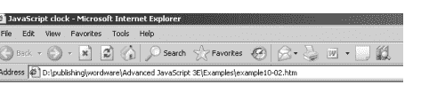

*图 10-6. JavaScript 数字时钟*

脚本的第一部分由所需的图像和一些说明组成。在每个公共领域的脚本中添加这些注释很重要，因为通常很难猜测脚本的作用以及需要哪些附加对象，例如图像。

`getPath()` 函数接受当前文档的 URL。这包括 URL 的所有部分，包括“http://...”和文件名。函数返回从 URL 开头到文件名（不包括文件名但包括最后一个斜杠）的部分。例如，考虑以下 URL：
`http://www.wordware.com/index.html`
接收到这个字符串后，函数将返回：
`http://www.wordware.com/`

脚本中的第一个函数 `setClock()` 实际上是从上到下创建了时钟。注意函数的每个部分都用注释进行了解释。看看以下直接从函数中提取的语句：

```
var openImage = ""
```

在此代码段中，声明了两个类似常量的变量并初始化为有意义的值。第一个被赋值为 HTML 中 `` 标签的开始结构。注意 `location.href` 是文档的当前 URL。还请注意转义字符（`\"`）的使用。赋值给 `closeImage` 的值不受本地影响（如文档 URL）的影响。它只是赋值为 `.gif\" HEIGHT = 21 WIDTH = 16>`。`HEIGHT` 和 `WIDTH` 属性基于用于显示时间的数字图像的实际高度和宽度。
以下是脚本的下一部分：

```
var now = new Date()
var hour = now.getHours()
var minute = now.getMinutes()
now = null
var ampm = ""
```

这一部分有两个重要任务：

+   1. 它将本地小时数赋值给 `hour`。
2. 它将当前时间的分钟属性赋值给 `minute`。

如果你不记得这是如何工作的，请重新阅读本章的开头。
以下脚本段只是根据美国和其他使用 12 小时制的国家/地区的常规惯例修改 `hour` 的值。首先，中午被视为 PM。此外，午夜写作 12:00，而不是 0:00。
看看下面的语句：

```
if (minute < 10)
    minute = "0" + minute // do not parse this number!
```

此语句确保分钟属性保持一个两位数。也就是说，如果它原本是一个个位数，则添加一个前导“0”数字。请注意，此数字实际上是一个字符串。尝试使用 `parseInt()` 等函数解析此字符串会将其转换为数字类型，导致其值发生变化，因为它使用八进制表示法（前导 0）。它必须在整个脚本中保持字符串值。

脚本中的下两个语句通过将一个空字符串连接到 `minute` 和 `hour` 的值上，将它们转换为字符串。这很重要，因为字符串属性只能在字符串上使用，将在脚本后面使用。

下面的语句是一个循环：

```
for (var i = 0; i < hour.length; ++i)
{
    text += openImage + hour.charAt(i) + closeImage
}
```

循环执行 `hour.length` 次。也就是说，如果 `hour` 是一个两位数，循环将执行两次，每个数字一次。在每次执行期间，一个对应于字符串中当前数字（`hour` 的值）的图像标签被连接到 `text`。例如，如果 `hour` 的值是 12，循环的命令块将执行两次。在第一次执行期间，以下字符串被赋值给 `text`：

```
text += ''
```

在第二次循环中，执行等效语句：

```
text += ''
```

如果 `hour` 的值是一个单字符字符串，循环显然只执行一次。

脚本中的下一条语句是：

```
text += openImage + "c.gif\" HEIGHT = 21 WIDTH = 9>"
```

此语句只是将与冒号图像相关的标签赋值给 `text`。注意，在此语句中未连接 `closeImage`，因为此图像的 `WIDTH` 属性与其他图像不同。

以下循环与之前描述的与变量 `hour` 关联的循环完全相同。它只与变量 `minute` 相关。

根据 `ampm` 的值，将 AM 或 PM 图像标签赋值给 `text`。

函数内的最后一条语句指示 JavaScript 返回 `text` 的值，即打印时钟所需的所有 HTML 标签的累积字符串。返回值通过全局语句 `document.write(text)` 打印到文档。


## 月度日历

下一个示例输出一个月度日历。在讨论代码之前，我们先看一些函数的输出示例：

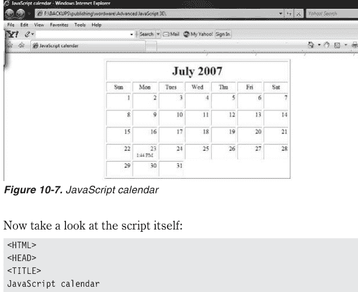

*图 10-7. JavaScript 日历*

现在来看一下脚本本身：

```
<HTML>
<HEAD>
<TITLE>
JavaScript calendar
</TITLE>
</HEAD>
<BODY>
<!-- JavaScript immediate script -->
<SCRIPT LANGUAGE = "JavaScript">
<!--
setCal()
function getTime()
{
    // initialize time-related variables with current time settings
    var now = new Date()
    var hour = now.getHours()
    var minute = now.getMinutes()
    now = null
    var ampm = ""
    // validate hour values and set value of ampm
    if (hour >= 12)
    {
        hour = hour - 12
        ampm = "PM"
    } else
        ampm = "AM"
    hour = (hour == 0) ? 12 : hour
    // add zero digit to a one-digit minute
    if (minute < 10)
        minute = "0" + minute    // do not parse this number!
    // return time string
    return hour + ":" + minute + " " + ampm
}
function leapYear(year)
{
    if (year % 4 == 0)  // basic rule
        return true     // is leap year
    /* else */          // else not needed when statement is "return"
        return false    // is not leap year
}

function getDays(month, year)
{
    // create array to hold number of days in each month
    var ar = new Array(12)
    ar[0] = 31  // January
    ar[1] = (leapYear(year)) ? 29 : 28 // February
    ar[2] = 31  // March
    ar[3] = 30  // April
    ar[4] = 31  // May
    ar[5] = 30  // June
    ar[6] = 31  // July
    ar[7] = 31  // August
    ar[8] = 30  // September
    ar[9] = 31  // October
    ar[10] = 30  // November
    ar[11] = 31  // December
    // return number of days in the specified month (parameter)
    return ar[month]
}

function getMonthName(month)
{
    // create array to hold name of each month
    var ar = new Array(12)
    ar[0] = "January"
    ar[1] = "February"
    ar[2] = "March"
    ar[3] = "April"
    ar[4] = "May"
    ar[5] = "June"
    ar[6] = "July"
    ar[7] = "August"
    ar[8] = "September"
    ar[9] = "October"
    ar[10] = "November"
    ar[11] = "December"
    // return name of specified month (parameter)
    return ar[month]
}
function setCal()
{
    // standard time attributes
    var now = new Date()
    var year = now.getYear()
    var month = now.getMonth()
    var monthName = getMonthName(month)
    var date = now.getDate()
    now = null
    // create instance of first day of month, and extract the day it occurs on
    var firstDayInstance = new Date(year, month, 1)
    var firstDay = firstDayInstance.getDay()
    firstDayInstance = null
    // number of days in current month
    var days = getDays(month, year)
    // call function to draw calendar
    drawCal(firstDay + 1, days, date, monthName, year)
}
function drawCal(firstDay, lastDate, date, monthName, year)
{
	// constant table settings
	var headerHeight = 50 		// height of the table's header cell
	var border = 2 				// 3D height of table's border
	var cellSpacing = 4 			// width of table's border
	var headerColor = "midnightblue" // color of table's header
	var headerSize = "+3" 		// size of table's header font
	var colWidth = 60 			// width of columns in table
	var dayCellHeight = 25 		// height of cells containing days of the week
	var dayColor = "darkblue" 	// color of font representing week days
	var cellHeight = 40 		// height of cells representing dates in the calendar
	var todayColor = "red" 		// color specifying today's date in the calendar
	var timeColor = "purple" 	// color of font representing current time

	// create basic table structure
	var text = "" 			// initialize accumulative variable to empty string
	text += '<CENTER>'
	text += '<TABLE BORDER = ' + border + ' CELLSPACING = ' + cellSpacing + '>'
								// table settings

	text += '<TH COLSPAN = 7 HEIGHT = ' + headerHeight + '>' // create table
								// header cell
	text += "<FONT COLOR = " + headerColor + " SIZE = " + headerSize + ">"
								// set font for table header
	text += monthName + ' ' + year
	text += '</FONT>' 	// close table header's font settings
	text += '</TH>' 		// close header cell

	// variables to hold constant settings
	var openCol = '<TD WIDTH = ' + colWidth + ' HEIGHT = ' + dayCellHeight + '>'
	openCol = openCol + '<FONT COLOR = "' + dayColor + '">'
	var closeCol = '</FONT></TD>'
	// create array of abbreviated day names
	var weekDay = new Array(7)
	weekDay[0] = "Sun"
	weekDay[1] = "Mon"
	weekDay[2] = "Tues"
	weekDay[3] = "Wed"
	weekDay[4] = "Thu"
	weekDay[5] = "Fri"
	weekDay[6] = "Sat"
	// create first row of table to set column width and specify week day
	text += '<TR ALIGN = "center" VALIGN = "center">'

	for (var dayNum = 0; dayNum < 7; ++dayNum)
	{
	    text += openCol + weekDay[dayNum] + closeCol
	}

	text += '</TR>'
	// declaration and initialization of two variables to help with tables
	var digit = 1
	var curCell = 1
	for (var row = 1; row <= Math.ceil((lastDate + firstDay - 1) / 7); ++row)
	{
	    text += '<TR ALIGN = "right" VALIGN = "top">'
	    for (var col = 1; col <= 7; ++col)
	    {
	        if (digit > lastDate)
	            break
	        if (curCell < firstDay)
	        {
	            text += '<TD></TD>'
	            curCell++
	        } else
	        {
	            if (digit == date)
	            { // current cell represent today's date
	                text += '<TD HEIGHT = ' + cellHeight + '>'
	                text += '<FONT COLOR = "' + todayColor + '">'
	                text += digit
	                text += '</FONT><BR>'
	                text += '<FONT COLOR = "' + timeColor + '" SIZE = 2>'
	                text += '<CENTER>' + getTime() + '</CENTER>'
	                text += '</FONT>'
	                text += '</TD>'
	            } else
	                text += '<TD HEIGHT = ' + cellHeight + '>' + digit + '</TD>'
	            digit++
	        }
	    }
	    text += '</TR>'
	}
	// close all basic table tags
	text += '</TABLE>'
	text += '</CENTER>'
	// print accumulative HTML string
	document.write(text)
}
// -->
</SCRIPT>
</BODY>
</HTML>
```

**示例 10-3 (ex10-3.htm).** 一个基于 HTML 表格、通过 JavaScript 打印的日历

让我们一步步地跟随脚本，解释每个函数的任务。

### getTime()

此函数简单地返回一个字符串，表示当前本地时间，格式如下：

*小时 : 分钟 AM/PM*

请注意，任何字符之间都没有空格。该函数基于示例 10-2 中 `setClock()` 第一部分的相同算法。关于该示例的更多信息，请参阅相关解释。

### leapYear(year)

如果当前年份是闰年，此函数返回 true；否则，返回 false。用于判断的基本规则是：每四年出现一次闰年，与夏季奥林匹克运动会的年份相同。更准确地说，如果年份能被 4 整除，它就是闰年。因此，模运算符非常适合这种情况。如果 `year % 4` 为零，则表示该年份能被 4 整除，意味着当前年份是闰年。否则，该年份不能被 4 整除，因此返回 false。一个明显的调用此函数的例子是：

```
if (leapYear(current year))
    // is a leap year
else
    // is not a leap year
```

另一种可能性是在条件语句、逻辑或运算符（? :）中使用返回值。

请注意，函数的参数必须接受一个整数值，这在计算年份时是合理的。

### getDays(month, year)

此函数接受两个参数：一个月份和一个年份。然后创建一个包含 12 个元素的数组。该数组是内置 `Array` 对象的一个实例，因此使用了关键字 `new`。数组的每个元素代表其对应月份的天数。`ar[0]` 保存一月份的天数（31）；`ar[11]` 保存十二月份的天数。数组只是根据每个月恒定的天数被赋予了适当的数据。然而，二月份的天数并非恒定。闰年的二月有 29 天，而其他年份则有 28 天。函数 `leapYear()` 用于判断指定年份是否为闰年。这种情况是条件运算符的典型用例，因为根据


## **getMonthName(month)**

此函数接受某个月份的整数值（1代表一月，11代表十二月），并返回该月份的完整名称，显然，它是以字符串形式返回的。与前一个函数一样，此函数使用一个Array对象的实例来存储常量值。所需月份的名称是通过其索引（下标）从数组中检索的。

## **setCal()**

首先，函数创建一个新的Date对象实例，用于保存当前本地时间的属性。当前年份通过getYear()方法赋值给year，当前月份通过getMonth()方法赋值给month。getMonthName()返回的月份名称赋值给monthName。当前日期赋值给date后，该实例现在被赋值为null，这是良好的JavaScript编程实践。

函数的下一条语句是：

```
var firstDayInstance = new Date(year, month, 1)
```

它创建一个新的Date对象实例；这次是为了当前月份的第一天。因此，使用值1来指定日期。这显然会影响该日期发生的星期几。此值在以下语句中被赋值给firstDay。然后，实例firstDayInstance被赋值为null。此脚本片段计算该月份开始于星期几（星期日、星期一、星期二等）。实现此目标的另一种可能方法是像往常一样创建当前日期的实例：

```
var firstDayInstance = new Date() // 还不是第一天！
```

然后你需要通过setDate()方法将日期设置为1。你应该使用以下语句来完成：

```
firstDayInstance.setDate(1)
```

函数的下一部分只包含一条语句。它将当前月份的天数赋值给days。

函数的最后一条语句绘制日历：

```
drawCal(firstDay + 1, days, date, monthName, 1900 + year)
```

参数是：
- 月份第一天的整数值 + 1；即，1代表星期日，2代表星期一，3代表星期二，以此类推。
- 指定月份的天数
- 指定的日期
- 指定月份的名称（例如，“一月”、“二月”、“三月”）
- 指定的年份，为四位数整数（例如，2001、2002）

## **drawCal(firstDay, lastDate, date, monthName, year)**

此函数的主要任务是打印日历表。在执行此操作之前，必须构建表格的HTML结构。函数的第一部分为与表格最终格式相关的属性赋值。这些属性包括单元格的大小、字体颜色等。以下是完整列表，包括变量名及其作用：

**表 10-2.** drawCal()中的变量及其在日历最终格式中的作用

| 变量 | 作用 |
| :--- | :--- |
| headerHeight | 表头单元格的高度。表头单元格是包含月份和年份名称的大字体单元格。高度以像素为单位指定。 |
| border | 表格的边框。你应该已经知道HTML表格有一个BORDER属性。此属性指定边框的三维高度。 |
| cellSpacing | 边框的宽度。表格边框的宽度也可以在HTML中设置。此值是边框内线与外线之间的距离。 |
| headerColor | 表头字体的颜色。这是日历顶部最大单元格中的字体颜色。 |
| headerSize | 表头字体的大小（参见headerHeight）。 |
| colWidth | 表格列的宽度。这实际上是每个单元格的宽度，或每列中最宽单元格的宽度。 |
| dayCellHeight | 包含日期名称（“星期日”、“星期一”、“星期二”等）的单元格的高度。 |
| dayColor | 表示星期几的字体的颜色。 |
| cellHeight | 表格中所有包含月份日期的常规单元格的高度。 |
| todayColor | 日历中指定当前日期的颜色。 |
| timeColor | 当前时间使用的字体颜色，位于当前日期的单元格中。 |

函数的后续部分创建基本的表格结构，包括所有引用表格轮廓的通用HTML标签。注意脚本中变量是如何实现的。现在看看脚本中的以下两条语句：

```
var openCol = '<TD WIDTH = ' + colWidth + ' HEIGHT = ' + dayCellHeight + '>'
openCol += '<FONT COLOR = "' + dayColor + '">'
var closeCol = '</FONT></TD>'
```

这些是用于创建每个包含日期名称的单元格的标签。例如，使用变量默认值的“星期日”的语法是：

```
<TD WIDTH = 60 HEIGHT = 25><FONT COLOR = "midnightblue"></FONT></TD>
```

以下是函数的接下来两个部分供参考：

```
// 创建日期缩写名称的数组
var weekDay = new Array(7)
weekDay[0] = "Sun"
weekDay[1] = "Mon"
weekDay[2] = "Tues"
weekDay[3] = "Wed"
weekDay[4] = "Thu"
weekDay[5] = "Fri"
weekDay[6] = "Sat"

// 创建表格的第一行，以设置列宽并指定星期几
text += '<TR ALIGN = "center" VALIGN = "center">'
for (var dayNum = 0; dayNum < 7; ++dayNum)
{
    text += openCol + weekDay[dayNum] + closeCol
}
text += '</TR>'
```

在第一段中，创建了一个普通数组。然后将日期的缩写名称赋值给它。此数组使我们能够通过数字引用每个名称。接下来的部分，为每天创建一个单元格，就利用了这种引用方法。每次循环迭代都会打印一个新日期。注意，与表格当前行的开始和结束相关的标签不在循环内部。在循环之前，开始了一个包含所有日期名称的新行。在“Sat”单元格相关的标签赋值给text之后，终止当前行。

函数的下一部分是：

```
var digit = 1
var curCell = 1
```

你稍后会在函数中看到这些变量的作用。

到目前为止，所有与表格表头和列标题相关的标签都已分配给累积字符串变量text。函数的剩余部分分配与所有表格单元格相关的标签。如你所知，日历是一个矩形表格。因此，我们倾向于使用嵌套循环结构来引用其单元格。如果你想练习你的技能，可以尝试用一个循环替换此结构，使用取模运算符计算新表格行的位置。

## **第10章**

循环中较困难的部分是其终止条件。它再次如下：

```
row <= Math.ceil((lastDate + firstDay - 1) / 7)
```

Math对象及其ceil()方法在第11章“JavaScript Math”中有详细解释。现在，你应该知道Math.ceil(num)的值是大于或等于num的最近整数（向上取整）。以下是一些例子：

```
Math.ceil(15.15) == 16
Math.ceil(16) == 16
Math.ceil(16.0001) == 17
```

你可能记得在setCal()函数中，传递给参数firstDay的值是从1到7，而不是从0到6。因此，在这个表达式中从firstDay中减去1。Math.ceil((lastDate + firstDay - 1) / 7)代表日历或表格所需的最少行数。日历中的单元格数（不包括主表头、列标题和最后一天之后的单元格）是lastDate + firstDay - 1，因为lastDate等于月份中的天数，firstDay - 1等于第一个日期之前的单元格数。该值除以7，以获得所需的准确最少行数。然而，循环必须执行整数次。因此，需要Math.ceil()方法。

其他更简单的日历只是每个月使用五行，无论什么情况。然而，这个简单的每月五行规则在(a)非闰年的二月的第一天是星期日时失败，这意味着只需要四行，以及(b)一个有31天的月份的第一天是星期五或星期六时失败，这意味着需要六行。虽然这些情况很少发生，但你必须考虑它们。如果在这个脚本中用简单的5替换行计算，像1987年2月这样的月份就不会正确显示。

嵌套循环并不那么困难，因为它总是执行七次，每周一次。在整个循环构造中，包括内部和外部循环，digit保存当前要创建的单元格。变量curCell保存到目前为止创建（赋值）的表格累积单元格数。这个变量只需要到创建月份第一天的单元格为止，之后不再处理；也就是说，在月份第一天之后，它就不再递增了。

`<TD>`和`</TD>`标签用于创建用作占位符的空白单元格。这些只需要在月份的第一天之前使用，因为在月份最后一天之后，循环通过break语句终止，行中的剩余部分以与空白单元格（占位符）相同的方式填充。每次内部循环的执行都创建表格的当前单元格。基本上有两种类型的单元格：


## 第十章

- 代表当前日期的单元格，使用特殊字体颜色并在单元格内显示时间。
- 所有其他单元格。

所使用的 HTML 标签是显而易见的，此处不深入讨论。

在内层循环之外但在容器循环之内有两条语句。第一条语句创建新的表格行，第二条语句结束当前行。内层循环的每次执行（七次执行或其命令块）负责创建一整行，或者是最后一行且当月的最后一天在行最后一个单元格之前出现时创建部分行——在这种情况下，循环通过 break 语句终止。“创建”一词指的是将适当的字符串和值连接起来并赋值给变量 text。

函数的最后，但绝非最不重要的语句，是实际将表格打印到 HTML 文档的语句。在该语句之前，HTML 文档一直以字符串形式存储在变量 text 中。

## 随机引用

本章的结尾是一个简单但有趣的脚本，每次页面加载时显示不同的消息。以下是脚本：

```html
<HTML>
<HEAD>
<TITLE>Random quote</TITLE>
<SCRIPT LANGUAGE = "JavaScript">
<!--
function getMessage()
{
    // create array of Murphy's laws
    var ar = new Array(20)
    ar[0] = "Nothing is as easy as it looks."
    ar[1] = "Everything takes longer than you think."
    ar[2] = "Anything that can go wrong will go wrong."
    ar[3] = "If there is a possibility of several things going wrong, the one that will cause the most damage will be the one to go wrong."
    ar[4] = "If there is a worse time for something to go wrong, it will happen then."
    ar[5] = "If anything simply cannot go wrong, it will anyway."
    ar[6] = "If you perceive that there are four possible ways in which a procedure can go wrong, and circumvent these, then a fifth way, unprepared for, will promptly develop."
    ar[7] = "Left to themselves, things tend to go from bad to worse."
    ar[8] = "If everything seems to be going well, you have obviously overlooked something."
    ar[9] = "Nature always sides with the hidden flaw."
    ar[10] = "Mother nature is a bitch."
    ar[11] = "It is impossible to make anything foolproof because fools are so ingenious."
    ar[12] = "Whenever you set out to do something, something else must be done first."
    ar[13] = "Every solution breeds new problems."
    ar[14] = "Trust everybody ... then cut the cards."
    ar[15] = "Two wrongs are only the beginning."
    ar[16] = "If at first you don't succeed, destroy all evidence that you tried."
    ar[17] = "To succeed in politics, it is often necessary to rise above your principles."
    ar[18] = "Exceptions prove the rule ... and wreck the budget."
    ar[19] = "Success always occurs in private, and failure in full view."

    var now = new Date()
    var sec = now.getSeconds()
    alert("Murphy's Law:\r" + ar[sec % 20])
}
//-->
</SCRIPT>
</HEAD>
<BODY onLoad = "getMessage()">
</BODY>
</HTML>
```

示例 10-4 (ex10-4.htm)。每次页面加载时显示随机消息的脚本。

函数中的第一条语句创建一个数组，这是内置 Array 对象的一个实例。该数组包含 20 个元素，从 ar[0] 开始到 ar[19] 结束。每个元素被赋予一个字符串，或者更准确地说，是一条墨菲定律。然后，创建 Date 对象的一个实例 now。通过 getSeconds() 方法从 now 中检索当前时间的秒数。如你所知，sec 的值是一个从 0 到 59 的整数，每个数字都有随机的可能性。总共有 60 个连续的整数。由于这个事实，表达式 sec % 20 返回一个从 0 到 19 的整数，每个数字的机会相等，因为 60 可被 20 整除（60 / 20 = 3！）。使用这种技术能够创建一个从 0 到 19 的随机数，使我们能够从数组中随机选择一条墨菲定律。选中的墨菲定律通过警告框显示。

脚本中需要特别注意的最重要的部分是使用事件处理程序来响应 load 事件——onLoad。当事件处理程序被触发（当页面完成加载时），调用函数 getMessage() 来显示如前所述的警告消息。还要注意转义序列的使用，即回车符（\r）。

## 总结

在本章中，我们讨论了 JavaScript 中与日期和时间相关的概念。这些概念基于 Date 对象。我们学习了这个内置对象，它是 JavaScript 中唯一没有任何属性的对象。在仔细研究了该对象之后，我们看到了如何创建它的实例以及如何在脚本中使用它们。到现在，你应该有足够的工具来创建各种类型的有趣脚本。随着我们在接下来的章节中进一步探讨这门语言，你将能够掌握 JavaScript 增强 HTML 文档的能力。在本章中，你已经看到无需太多努力，就可以为任何页面添加图形数字时钟。这可能看起来很神奇，但最好的还在后面，包括动画时钟等等。

## 第十一章 JavaScript 数学

### JavaScript 中的数学

计算机最著名的能力之一是能够非常精确和快速地执行数学运算。所有编程语言都包含允许程序员执行数学运算的特性、常量、函数和其他数学元素。同样，JavaScript 包含许多与数学相关的特性，使 JavaScript 程序员能够在脚本中调用数字计算。在本章中，我们将探索这些数学运算，并向你展示如何在网页中实现它们。

JavaScript 中的数学基于该语言的两个通用元素：

- 数学运算符
- 内置 Math 对象

数学运算符（+、-、*、/、%）在几乎每种语言中都很常见，并且之前在第 3 章中已经讨论过，因此我们不会在本章再次介绍运算符基础知识。然而，我还没有向你介绍 Math 对象，它可以执行各种数学运算。在本章中，我将让你熟悉这个对象，包括它的属性和方法。我们还将看看这个对象的一些可能用途。如果涉及任何你不熟悉的数学运算，请不要太过担心，因为那只是意味着你可能不需要在脚本中使用那种程度的数学。需要注意的是，Math 对象具有许多人可能不需要在其网页中使用的函数，但对数学很重要。

### Math 对象

JavaScript 的 Math 对象提供了许多算术和三角函数。这些函数中有很多可能是你已经知道的。这些函数扩展了 JavaScript 的数学能力，超越了基本的算术运算符。

你已经知道如何创建 JavaScript 对象的实例，例如 Date 对象。你需要实例化的对象称为动态对象。然而，JavaScript 中的一些对象是静态对象。你不需要实例化它们，因为它们已经在那里等待使用。你可以直接引用对象的方法和属性。这与像 Date 这样的动态对象不同。回想一下，要获取当前年份，你必须首先创建该对象的一个实例，然后引用该实例的方法。

JavaScript 的 Math 对象是一个静态对象，因此你不需要实例化它。它的属性实际上是基本常量，例如 pi（π）和 2 的平方根。它的方法是数学函数，例如 pow()（幂）、sin()、cos() 等。这些方法和属性被封装在一个对象中，因为对象旨在作为由相关数据和函数构造的实体。对数学函数和常量的需求促使 JavaScript 开发者创建了一个用于数学的内置对象——Math。

要访问 Math 对象的元素，你不需要创建实例。你可以通过 Math 对象本身直接发送的消息来访问它们。例如，PI 常量是 Math 对象的一个属性，可以通过以下语法访问：

```javascript
var pi = Math.PI
```

### 常量

常量是以浮点数的完全精度定义的。在本节中，我们将概述这些属性以供你参考和理解。请注意，所有属性都用大写字母指定，尽管这种约定在数学界并不常见。所有属性都指代众所周知的常量（如果你不记得，请查阅你的数学书！）；也就是说，它们不会改变。因此，这些属性是只读属性，访问它们以进行修改会导致 JavaScript 错误。

### E

数学中一个非常重要的常量是欧拉常数。其近似值为 2.718281828459045。它被四舍五入到小数点后 15 位。供你参考，方程式为：

e^(iπ) + 1 = 0

在 JavaScript 中，你用大写字母 "E" 来引用它；即 Math.E。

> 注意：在数学中，这通常用小写字母 "e" 表示。


## LN2

另一个作为 Math 对象属性的常量是 2 的自然对数。其近似值为 0.6931471805599453。定义方程如下：

e^LN2 = 2

JavaScript 将此数字称为 `LN2`。由于它是 Math 对象的一个属性，你应该将它们一起指定，如 `Math.LN2`。

你可以使用 `pow` 方法来验证上述方程是否成立：

```
document.write(Math.pow(Math.E, Math.LN2))
```

由于欧拉常数和 2 的自然对数都是近似值，因此此语句的输出也是近似值：

1.9999999999999998

## LN10

10 的自然对数也作为静态 Math 对象的一个属性。其值存储在对应的属性中，为 2.302585092994046。同样，你可以通过方程来理解这个值：

e^LN10 = 10

在 JavaScript 中，此值被称为 `Math.LN10`。

以下是一个定义 10 的自然对数的 JavaScript 语句：

```
document.write(Math.pow(Math.E, Math.LN10))
```

由于欧拉常数和 10 的自然对数都是近似值，因此此语句的输出也是近似值：

10.000000000000002

> 注意：某些浏览器会将此数字四舍五入为 10。

## LOG2E

数学领域的另一个重要常量是欧拉常数的以 2 为底的对数。其近似值为 1.4426950408889634。在数学中表示为：

2^LOG2E = e

如你所见，在 JavaScript 中，你将此常量称为 `Math.LOG2E`。以下是一个简单的语句来验证该值：

```
document.write(Math.pow(2, Math.LOG2E) – Math.E)
```

这次输出显然是精确的：
0

## LOG10E

以 10 为底的对数也广泛用于复杂的数学计算中。它在 JavaScript 中的值近似为 0.4342944819032518。以下方程演示了该常量的定义：
10^LOG10E = e

如你所见，该方程是根据基本对数规则之一构建的。在 JavaScript 中，欧拉常数的以 10 为底的对数是 Math 对象的一个属性：`Math.LOG10E`。

以下是一个简单的验证脚本：

```
document.write(Math.pow(10, Math.LOG10E) - Math.E)
```

同样，输出是精确的：
0

## PI

JavaScript 所有常量中最著名的值可能就是 PI（圆周率）。其近似值，受限于 JavaScript 中实数的精度限制，为 3.141592653589793。

正如你所料，在 JavaScript 中，你将圆周率称为 `Math.PI`。例如，要获得圆的周长，可以使用以下函数：

```
function circumference(diameter)
{
  if (typeof diameter == "number" && diameter >= 0)
    return Math.PI * diameter
}
```

注意，如果直径不是数字或不是正数，该函数将不返回值。

## SQRT1_2

存储在 JavaScript 对象模型中的 0.5 的平方根是 0.7071067811865476。你也可以通过计算 0.5 的平方根（使用 Math 对象的 `sqrt()` 方法）得到这个值，但访问现有属性比通过执行方法来计算要稍快且更直观。

你将此属性称为 `Math.SQRT1_2`。属性名中使用下划线的原因是属性名必须遵循标识符规则，只允许在名称中间使用字母、数字和下划线。

以下是一个验证该值是否正确的明确语句：

```
document.write(Math.pow(Math.SQRT1_2, 2))
```

不那么直观的输出是：
0.5000000000000001

## SQRT2

2 的平方根也是一个众所周知的常量。其近似值为 1.4142135623730951。你将其称为 `Math.SQRT2`。你可以使用以下语句来验证该值：

```
document.write(Math.pow(Math.SQRT2, 2))
```

正如你所料，结果不是精确的：
2.0000000000000004

## Math 方法

常量值只是 JavaScript 中数学实现全部功能的一部分。要利用 Math 对象的强大功能，你必须熟悉其可用的方法集合。

JavaScript 倾向于将函数和值组织在对象结构中，以便于引用和简单理解。因此，所有与数学相关的函数都实现为 Math 对象的方法。

Math 对象的方法可分为两类，每类对应数学的不同分支：

- 算术方法
- 三角函数方法

Math 对象的所有方法都指定为小写字母，这与作为该对象属性并指定为大写字母的常量形成对比。

## 算术方法

我们使用术语“算术方法”来描述所有与三角函数数学无关的方法。

### abs()

你可以通过此方法计算任何数字（整数或浮点数）的绝对值。一个数字的绝对值是其对应的正数；也就是说，如果数字是正数，其绝对值就是数字本身；如果数字是负数，其绝对值是相同的数字，但将负号（-）替换为正号（+）。你可以轻松地模拟此方法：

```
function abs(num)
{
	if (num < 0)
		return -num
	return num
}
```

例如，-5 的绝对值是 5。5 的绝对值也是 5。在 JavaScript 中，你可以通过 `Math.abs()` 方法计算数字的绝对值。此方法返回其参数的绝对值。你只能使用此方法计算一个参数的绝对值。如果你用多个参数调用该方法，只会返回第一个参数的绝对值。

如果你想要一个数字对应的负值，而不是正值，你可以对返回的值取反。例如：

```
var neg1 = -Math.abs(-3.7)
var neg2 = -Math.abs(3.7)
```

`Math.abs()` 方法可用于多种目的，而不仅仅是在数学算法中。

### ceil()

`Math.ceil()` 方法接受一个数字参数，并返回大于或等于该参数的下一个整数（向上取整）。因此，返回的值永远不会小于参数。以下是一些示例：

```
Math.ceil(16) == 16
Math.ceil(16.01) == 17
Math.ceil(-15.01) == -15
```

假设你需要将 `num1` 辆车停入停车场，每个停车场可容纳 `num2` 辆车。你可以使用 `Math.ceil()` 方法以及一个函数来计算所需的最少停车场数量：

```
function getNumLots(num1, num2)
{
    return Math.ceil(num1 / num2)
}
```

我们在上述函数中需要使用此方法的原因是你只能使用整个停车场，而不能使用其一部分；也就是说，我们正在尝试计算所需的最少停车场数量，而不是精确的空间。

### exp()

此方法返回欧拉常数的指定参数次幂（`e^参数`）。它大致等效于以下函数：

```
function exp(num)
{
    return Math.pow(Math.E, num)
}
```

其输出是：

```
54.598150033144236
```

### floor()

`Math.floor()` 方法返回小于或等于传递给它的值的最大整数。当处理非负数时，这等同于整数除法。它也等同于向下取整到最近的整数。以下是一些表达式，每个表达式求值结果都为 true：

```
Math.floor(16) == 16
Math.floor(16.01) == 16
Math.floor(-15.01) == -16
```

### log()

此方法返回传递给它的参数的自然对数。例如，e（欧拉常数）的自然对数（以 e 为底）是 1。你可以通过以下语句确认这一点：

```
document.write(Math.log(Math.E))
```

确实，输出是 1。

### max(), min()

这两个方法都接受两个数字参数。`max()` 返回两个数字中较大的一个，而 `min()` 返回较小的一个。以下函数先打印两个数字中较小的一个，然后打印较大的一个：

```
function printInOrder(num1, num2)
{
    document.write(Math.min(num1, num2) + ", " + Math.max(num1, num2))
}
```

以下函数调用向文档打印字符串 –5, 1：

```
printInOrder(1, -5)
```

以下是一些为 true 的表达式，用于演示基本的 `min()` 和 `max()` 方法：

```
Math.max(1, 2) == 2
Math.min(2, Math.abs(-2)) == 2
Math.min(2, -2) == -2
```

### pow()

给定两个数字参数，此方法返回第一个参数的第二个参数次幂。以下是一些为 true 的表达式，用于演示该方法：

```
Math.pow(10, 2) == 100
Math.pow(0.5, 0.5) == 0.7071067811865476
Math.pow(Math.SQRT2, 4) == 4.000000000000001
```


## random()

此方法返回一个介于0和1之间的随机数。显然这是一个浮点数。返回值的精度最高可达小数点后16位。以下是一个简单示例：

```javascript
for (var i = 0; i < 5; ++i)
{
    document.write(Math.random() + "<BR>")
}
```

此循环的输出取决于`random()`的返回值，可以保证你的结果不会与以下示例完全相同：

.924853870611902
.8248305636609181
.9539277224126104
.9806934571332098
.7639888801207115

此方法主要用于创建介于x和y之间的随机整数。假设x为0，y为给定数字。你需要将`random()`返回的值乘以y然后取整。例如，要生成0到37之间的随机数，可以使用以下表达式：

```javascript
Math.round(Math.random() * 37)
```

如果你想要15到37之间的整数，可以先创建0到22之间的随机整数，然后加上15。在创建随机数时要格外小心。

## round()

`Math.round()`方法返回与参数最接近的整数。如果参数的小数部分等于0.5，则向上取整。以下是几个演示此方法的正确表达式：

```javascript
Math.round(3.7) == 4
Math.round(4.5) == 5
Math.round(16.1) == 16
Math.round(0) == 0
```

## sqrt()

此方法返回参数的平方根。例如：

```javascript
Math.sqrt(4) == 2
Math.sqrt(0) == 0
Math.sqrt(0.25) == 0.5
```

如果参数是负数，该方法返回零，这恰好是错误的答案。最好是生成一个错误提示，因为这个错误答案可能不会被发现。

## 三角函数方法

三角函数方法显然是处理三角学的。你还应该知道如何将角度从度转换为弧度，反之亦然。以下是基本的转换表：

*表 11-1. 角度-弧度转换表*

| 角度 | 弧度 |
| :--- | :--- |
| 360 | 2π |
| 270 | 1.5π |
| 180 | 1π |
| 90 | 0.5π |

JavaScript中所有角度都以弧度为单位，因此此转换表可帮助你直观理解弧度角度的大小。

## cos()

`Math.cos()`方法接受一个参数，即三角形的角度。它返回该值的余弦值，必须以弧度指定。以下语句打印-1：

```javascript
document.write(Math.cos(Math.PI))
```

## acos()

`Math.acos()`方法也接受一个参数。它返回参数的反余弦值（以弧度为单位）；即它接受某个值的余弦值并返回该值——与`Math.cos()`方法相反。因此，以下语句打印PI的值：

```javascript
document.write(Math.acos(-1))
```

## sin()

`Math.sin()`函数返回其参数的正弦值。请记住，参数必须以弧度为单位。以下是打印1的语句：

```javascript
document.write(Math.sin(0.5 * Math.PI))
```

## asin()

`Math.asin()`方法接受一个参数并返回其反正弦值（以弧度为单位）。以下语句打印PI值的一半：

```javascript
document.write(Math.asin(1))
```

## tan()

`Math.tan()`方法返回其参数的正切值，它等于该值的正弦与余弦的商。请看以下脚本片段：

```javascript
var val = 0.25 * Math.PI
document.write("sine = " + Math.sin(val) + "<BR>")
document.write("cosine = " + Math.cos(val) + "<BR>")
document.write("tangent = " + Math.tan(val))
```

这些语句在Netscape Navigator中的输出是：

```
sine = .7071067811865475
cosine = .7071067811865476
tangent = .9999999999999999
```

从这个脚本你可以了解到：

- ½ * PI的正弦值等于其余弦值，也等于½的平方根。
- 余弦和正弦方法有时会返回不准确的结果。

要格外小心不准确性的问题。以下语句：

```javascript
var val = 0.25 * Math.PI
if (Math.tan(val) == 1)
    do_this
else
    do_that
```

应该替换为：

```javascript
var val = 0.25 * Math.PI
if (Math.tan(val) > 0.99 && Math.tan(val) < 1.01)
    do_this
else
    do_that
```

在这种情况下不准确性更为明显，因为结果甚至在不同的浏览器之间也存在差异。以下是从Microsoft Internet Explorer收到的输出：

```
sine = 0.707106781186547
cosine = 0.707106781186548
tangent = 1
```

注意正弦和余弦值不同。还要注意Internet Explorer为所有介于–1和1之间（不包括端点）的数字添加了前导零。

## atan()

正如你所料，`Math.atan()`方法返回其参数的反正切值。例如，以下返回PI值的四分之一：

```javascript
document.write(Math.atan(1))
```

## atan2()

`Math.atan2()`方法返回对应于指定笛卡尔坐标的极坐标（r, θ）的角度（θ分量）。你可能知道点的正常x、y坐标称为笛卡尔坐标。另一种测量系统是极坐标系统。你需要指定点的半径（到极点的距离）和角度（θ分量）。

## Number 对象

Number对象是一个内置的JavaScript对象，与Math对象非常相似，因为它封装了几个基本的数值。它与Math对象的不同之处在于Number对象是动态的，需要创建步骤，而Math对象是静态的，不需要任何实例化。

Number对象的主要用途是访问其常量属性，包括最大和最小可表示数字、正负无穷大以及非数字值。你也可以使用Number对象创建可以添加属性的数值对象。你不太可能需要使用Number对象，但这里为了完整性还是给出了说明。

要创建Number对象，请使用以下语句：

```javascript
numberObjectName = new Number()
```

其中*numberObjectName*是新对象的名称或现有对象的属性。要访问Number的属性，请使用以下格式：

```javascript
numberObjectName.propertyName
```

其中*numberObjectName*是现有Number对象的名称或现有对象的属性。*propertyName*是下一节中列出的属性之一。

## Number 属性

Number对象有多个属性。

### MAX_VALUE

这是JavaScript中可表示的最大数值。MAX_VALUE属性的值约为1.79E+308。大于MAX_VALUE的值表示为"无穷大"。因为MAX_VALUE是一个常量，所以它是Number的只读属性。以下代码演示了MAX_VALUE的使用。该代码乘以两个数值。如果结果小于或等于MAX_VALUE，则调用func1函数；否则，调用func2函数。

```javascript
if (num1 * num2 <= Number.MAX_VALUE)
    func1()
else
    func2()
```

### MIN_VALUE

MIN_VALUE属性是最接近零的数字，而不是JavaScript可以表示的最小数字。MIN_VALUE的值约为2.22E-308。小于MIN_VALUE的值（"下溢值"）会转换为零。因为MIN_VALUE是一个常量，所以它是Number的只读属性。以下代码除以两个数值。如果结果大于或等于MIN_VALUE，则调用func1函数；否则，调用func2函数。

```javascript
if (num1 / num2 >= Number.MIN_VALUE)
    func1()
else
    func2()
```

### NaN

未加引号的字面量常量NaN是一个表示非数字的特殊值。由于NaN总是与任何数字（包括NaN本身）不相等比较，它通常用于指示应该返回有效数字的函数的错误条件。因此，请注意，你不能通过与Number.NaN比较来检查非数字值。请改用isNaN()函数。因为NaN是一个常量，所以它是Number的只读属性。在以下代码段中，如果dayOfMonth大于31，则将其赋值为NaN，并显示一条消息指示有效范围：

```javascript
if (dayOfMonth < 1 || dayOfMonth > 31)
{
    dayOfMonth = Number.NaN
    alert("Day of Month must be from 1 to 31.")
}
```

### NEGATIVE_INFINITY

这是一个表示负无穷大的特殊数值。此值表示为"-Infinity"，其数学行为类似于无穷大。例如，任何数乘以NEGATIVE_INFINITY都是NEGATIVE_INFINITY，任何数除以NEGATIVE_INFINITY都是零。因为NEGATIVE_INFINITY是一个常量，所以它是Number的只读属性。

以下代码片段检查一个数是否为NEGATIVE_INFINITY，如果是，则调用不同的函数：

```javascript
if (smallNumber == Number.NEGATIVE_INFINITY)
    func1()
else
    func2()
```

### POSITIVE_INFINITY

这是一个表示正无穷大的特殊数值。此值表示为"Infinity"，其数学行为类似于无穷大。例如，任何数乘以POSITIVE_INFINITY都是POSITIVE_INFINITY，任何数除以POSITIVE_INFINITY都是零。因为POSITIVE_INFINITY是一个常量，所以它是Number的只读属性。

POSITIVE_INFINITY，以及任何数除以 POSITIVE_INFINITY 的结果都是零。因为 POSITIVE_INFINITY 是一个常量，它是 Number 对象的一个只读属性。
以下代码片段检查一个数是否为 POSITIVE_INFINITY，并在是时调用不同的函数：

```
if (bigNumber == Number.POSITIVE_INFINITY)
    func1()
else
    func2()
```

## Number 方法

Number 对象没有特定的方法；但是，你可以使用通用的方法 eval()、toString() 和 valueOf()，这些方法适用于每个对象。

## 数学相关函数

尽管本节介绍的函数稍后会在书中讨论，但重要的是你需要先基本了解，所以不要跳过以下解释。这些函数在本章后面的示例中会用到。

## parseInt()

这个内置函数接受一个整数的数字字符串，并返回其对应的数值。以下示例胜过千言万语：

```
var numStr = "99"
document.write("The initial " + typeof numStr + " is " + numStr)
document.write("<BR>")
var num = parseInt(numStr)
document.write("The converted " + typeof num + " is " + num)
```

脚本的输出是：
The initial string is 99
The converted number is 99
数据类型不是作为字面量提供给 document.write() 方法的，而是作为值。请注意，parseInt() 函数接受一个字符串并返回一个整数。如果给函数一个非整数的数字字符串，它会返回最接近的整数（作为数字，而不是字符串）。

## parseFloat()

这个函数与前一个完全相同，只是它不会对任何数字进行四舍五入。它将数字字符串转换为数字，而完全不改变数值。你应该对浮点数字字符串使用此函数，或者当你不确定正在使用什么类型的数字时使用。

## eval()

eval() 函数既强大又有用。目前，你只需要知道它接受一个代表数值或数学表达式的字符串，并返回该表达式计算得出的值。以下脚本段打印出 13：

```
var str = "6 + 7"
document.write(eval(str))
```

该函数返回一个数字，而不是字符串。请注意，此函数在 Netscape Navigator 上的行为与在 Microsoft Internet Explorer 上不同。例如，以下语句在 Internet Explorer 下可以正常工作，但在 Navigator 下会产生错误：

```
var str = "+7"
document.write(eval(str))
```

然而，当符号是减号（-）而不是加号（+）时，它工作正常。

## 数学示例

### 创建曲线

尽管 JavaScript 与自定义图形的对应关系不太好，但创建简单的图形、图表和曲线是可能的。在本节中，我们将使用 JavaScript 绘制一条正弦曲线。以下示例非常有趣，尽管有点长且复杂。首先，看看脚本。然后我们将讨论各个元素以及它们如何组合在一起。

```
<HTML>
<HEAD>
<TITLE>Sine curve</TITLE>
</HEAD>
<BODY>
<FONT COLOR="blue" SIZE=+4>JavaScript Sine Curve</FONT><BR><BR>
<SCRIPT LANGUAGE="JavaScript">
<!--

function drawBlank(num)
{
    // draw num blank dots
    for (var i = 0; i < num; ++i)
    {
        document.write("")
    }
}

function drawDot()
{
    document.write("")
}
```

```
function getRadian(deg) {
  // return deg in radians
  return Math.PI * deg / 180
}

function getSpot(deg)
{
  // convert from degrees to radians
  var rad = getRadian(deg)

  // assign sine to variable
  var sine = Math.sin(rad)

  // return spot in graph
  return Math.round(sine * 30)
}

function get3DigitNum(num)
{
  // convert num to string
  num += ""

  // assign number of digits in num to variable
  var length = num.length

  // add preceding zero digits to reach three digits
  for (var i = 0; i < 3 - length; i++)
  {
    num = "0" + num
  }

  // return three-digit number
  return num // do not parse number!
}

function printDeg(deg)
{
  // print degree in purple font
  document.write("<FONT COLOR='purple' SIZE=1>" + get3DigitNum(deg) + "</FONT>")
}

function drawLine(deg)
{
  // assign spot (-30 to 30)
  var spot = getSpot(deg)

  // if sine is negative
  if (spot < 0)
  {
    // draw blank images up to spot, not inclusive
    drawBlank(30 + spot)
```

```
// draw dot image
drawDot()

// draw remaining images until axis
drawBlank(-spot - 1) // 30 - ((30 + spot) + 1)

// print current degree
printDeg(deg)
} else
  // if sine is positive
  if (spot > 0)
  {
    // draw 30 blank images = left of axis
    drawBlank(30)

    // print current degree
    printDeg(deg)

    // draw blank images up to spot, not inclusive
    drawBlank(spot - 1)

    // draw dot image
    drawDot()
  } else {
    // draw 30 blank images = left of axis
    drawBlank(30)

    // print current degree
    printDeg(deg)
  }
  // move to next line
  document.write("<BR>")
}

function drawCurve(lastDeg, jump)
{
  // loop through plot vertically
  for (var deg = 0; deg <= lastDeg; deg += jump)
  {
    drawLine(deg)
  }
}

drawCurve(720, 15)

// -->
</SCRIPT>
</BODY>
</HTML>
```

**示例 11-1 (ex11-1.htm)。** 一个绘制正弦曲线的简单脚本

当你运行脚本时，你应该会看到图 11-1 所示的图像。

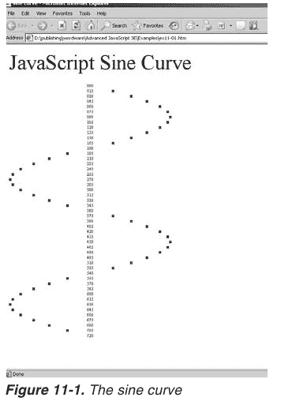

图 11-1. 正弦曲线

脚本被故意分成许多短函数，以便读者更好地理解。让我们分析每个函数，看看它是如何工作的。

**drawBlank(num)**

```
function drawBlank(num)
{
    // draw num blank dots
    for (var i = 0; i < num; ++i)
    {
        document.write("")
    }
}
```

这个函数使用一个 for 循环，以 num 指定的次数打印透明图像。请注意，透明（空白）图像的高度和宽度都等于 6。

**drawDot()**

```
function drawDot()
{
    document.write("")
}
```

这个函数只是绘制点图像。

## getRadian(deg)

```
function getRadian(deg)
{
    // return deg in radians
    return Math.PI * deg / 180
}
```

这个函数接受一个数字（实际上是角度的度数），并返回其弧度值。转换基于一个简单的线性方程。

## getSpot(deg)

```
function getSpot(deg)
{
    // convert from degrees to radians
    var rad = getRadian(deg)
    // assign sine to variable
    var sine = Math.sin(rad)
    // return spot in graph
    return Math.round(sine * 30)
}
```

这个函数接受角度的度数，并返回其正弦值乘以 30 的结果。首先，它将角度的弧度度量分配给局部变量 rad。然后，它将该角度的正弦值分配给局部变量 sine。然后函数将正弦值乘以 30，并返回四舍五入后的整数值。乘以 30 的原因是任何角度的正弦值都在 -1 和 1 之间。我们绘制的曲线通常由中心轴两侧各 30 张图像（透明或不透明）组成。如果你增加这个数字，曲线的水平宽度会变大。如你所见，30 张图像看起来不错。通过将 -1 和 1 之间的值乘以 30，我们得到一个 -30 到 30 之间的值。通过使用 Math.round() 方法进行四舍五入，函数返回 -30 到 30 之间的一个整数。

请注意，该图表就像一个二维数组，因为它由图像行组成。

## get3DigitNum(num)

```
function get3DigitNum(num)
{
    // convert num to string
    num += ""
    // assign number of digits in num to variable
    var length = num.length
    // add preceding zero digits to reach three digits
    for (var i = 0; i < 3 - length; i++)
    {
        num = "0" + num
    }
}
```

```
// return three-digit number
return num // do not parse number!
}
```

这个函数接受任何一位数、两位数或三位数，并返回一个三位数，根据需要添加前导零。首先，它将数字转换为字符串，这是使用 length 属性所必需的。字符串类型也是必需的，因为带前导 0 的数字被认为是八进制数。原始数字的位数（即长度）被分配给局部变量 length。下一条语句是一个循环，其命令块为补全三位数所缺少的每一位数字执行一次。例如，如果数字由两位数组成，循环的命令块执行一次（3 – 2 = 1, 1 – 0 = 1）。

## printDeg(deg)

```
function printDeg(deg)
{
    // print degree in purple font
    document.write("<FONT COLOR = 'purple' SIZE = 1>" + get3DigitNum(deg)
                 + "</FONT>")
}
```

这个函数接受一个数字，将其转换为三位数，并以紫色字体打印。

## drawLine(deg)

```
function drawLine(deg)
{
    // assign spot (-30 to 30)
    var spot = getSpot(deg)
    // if sine is negative
    if (spot < 0)
    {
        // draw blank images up to spot, not inclusive
        drawBlank(30 + spot)
        // draw dot image
        drawDot()
        // draw remaining images until axis
        drawBlank(-spot - 1) // 30 - ((30 + spot) + 1)
        // print current degree
        printDeg(deg)
    } else
        // if sine is positive
        if (spot > 0)
        {
            // draw 30 blank images = left of axis
            drawBlank(30)
            // print current degree
            printDeg(deg)
            // draw blank images up to spot, not inclusive
            drawBlank(spot - 1)
            // draw dot image
```


drawDot()
} else
{
    // 绘制30个空白图像 = 轴的左侧
    drawBlank(30)
    // 打印当前角度
    printDeg(deg)
}
// 移动到下一行
document.write("<BR>")
}

四舍五入后的正弦值乘以30被赋值给变量 `spot`。该函数基本上分为三个部分，每次只执行其中一部分。第一部分处理正弦值为负的情况，第二部分处理正弦值为正的情况，第三部分处理剩余情况，即正弦值为零的情况。

当正弦值（正弦值乘以30）为负时，会打印30 – `spot`个透明图像。例如，如果 `spot` 的值为 –20，则会打印10个透明图像。在这些透明图像之后，会打印圆点图像。然后，函数会打印 `–spot – 1` 个透明图像，直到中心轴。到目前为止，已打印了30 + `spot`个透明图像，以及一个代表曲线圆点的图像。总共有31 + `spot`个图像。请记住，轴的每一侧由30个图像组成，因此还需要打印30 – (31 + `spot`)个图像；即 `–spot – 1`。然后通过调用函数 `printDeg()` 打印当前角度。

当当前角度的正弦值为正时，会打印30个透明图像以填充中心轴的左侧。然后打印当前角度，以继续轴的垂直跨度。接着打印 `spot – 1` 个图像，直到需要放置曲线圆点的位置。然后打印圆点图像。当当前角度的正弦值为零时，会打印一行30个透明图像，后跟当前角度的度数。

该函数的最后一条语句在文档中附加一个换行符，开启新的一行图像。

## drawCurve(lastDeg, jump)

```
function drawCurve(lastDeg, jump)
{
    // 垂直循环遍历绘图
    for (var deg = 0; deg <= lastDeg; deg += jump)
    {
        drawLine(deg)
    }
}
```

该函数接受两个参数。第一个参数 `lastDeg` 接受曲线中包含的最后一个值；即最后一个正弦值出现的角度。第二个参数指定每两个角度之间的差值。

## 全局语句

该脚本只包含一条全局语句，一个函数调用。它使用所需的参数调用 `drawCurve()` 函数。

## 通用绘图工具

如您所见，使用两种不同的图像在JavaScript中绘制特定曲线并不困难。以下示例使您能够绘制几乎所有函数的曲线。显然，如果您不熟悉相关的数学知识，这个脚本可能难以理解。该脚本的目的是展示JavaScript `Math` 对象的强大功能。

```
<HTML>
<HEAD>
<TITLE>函数绘图工具</TITLE>
</HEAD>
<BODY>
<SCRIPT LANGUAGE = "JavaScript">
<!--
function root(a, b)
{
    // 返回b的a次方根
    return Math.pow(b, 1 / a)
}
function logab(a, b)
{
    // 返回以a为底b的对数
    return Math.log(b) / Math.log(a)
}
function factorial(a)
{
    // 设置递归终止条件
    if (a == 0)
        return 1
    return a * factorial(a - 1)
}
function startWizard()
{
    // 创建数组以保存消息
    var ar = new Array()
    ar[0] = "\r\r欢迎使用简易JavaScript函数绘图器！\r\r"
    ar[0] += "按“确定”继续，或按“取消”退出向导...\r\r"
    ar[1] = "\r\r使用此脚本，您几乎可以绘制任何想要的函数曲线。\r"
    ar[1] += "绘图器支持常用的算术和三角函数。\r"
    ar[1] += "它还支持广泛使用的数学常量。\r"
    ar[1] += "按“确定”查看支持的函数列表...\r\r"
    ar[2] = "\r\r"
    ar[2] += "abs(val) = val的绝对值\r"
    ar[2] += "acos(val) = val的反余弦值\r"
    ar[2] += "asine(val) = val的反正弦值\r"
    ar[2] += "atan(val) = val的反正切值\r"
    ar[2] += "atan2(val) = 对应于指定笛卡尔坐标(x,y)的"
    ar[2] += "极坐标(r,theta)的角度(theta分量)。\r"
    ar[2] += "ceil(val) = 大于或等于val的下一个整数\r"
    ar[2] += "cos(val) = val的余弦值\r"
    ar[2] += "exp(val) = 欧拉常数e的val次幂\r"
    ar[2] += "factorial(val) = val的阶乘(val!)\r"
    ar[2] += "floor(val) = 小于或等于val的下一个整数\r"
    ar[2] += "log(val1, val2) = 以val1为底val2的对数\r"
    ar[2] += "loge(val) = val的自然对数\r"
    ar[2] += "max(val1, val2) = val1和val2中的较大者\r"
    ar[2] += "min(val1, val2) = val1和val2中的较小者\r"
    ar[2] += "pow(val1, val2) = val1的val2次幂\r"
    ar[2] += "root(val1, val2) = val2的val1次方根\r"
    ar[2] += "round(val) = 四舍五入到最接近整数的val值\r"
    ar[2] += "sin(val) = val的正弦值\r"
    ar[2] += "sqrt(val) = val的平方根\r"
    ar[2] += "tan(val) = val的正切值\r"
    ar[2] += "\r* 所有三角函数仅处理弧度值 *\r\r"
    ar[2] += "按“确定”查看支持的常量...\r\r"
    ar[3] += "\r\r"
    ar[3] += "e = 欧拉常数\r"
    ar[3] += "ln2 = 2的自然对数\r"
    ar[3] += "ln10 = 10的自然对数\r"
    ar[3] += "log2e = 以2为底e的对数\r"
    ar[3] += "log10e = 以10为底e的对数\r"
    ar[3] += "pi = 圆周率(3.14...)\r"
    ar[3] += "sqrt1_2 = 0.5的平方根\r"
    ar[3] += "sqrt2 = 2的平方根\r"
    ar[3] += "\r\r尽情使用绘图器吧...\r\r"
    for (var i = 0; i < ar.length; ++i)
    {
        if (!confirm(ar[i]))
            break
    }
}
function drawBlank(num)
{
    // 绘制num个空白点
    for (var i = 0; i < num; ++i)
    {
        document.write("")
    }
}
function drawDot(x, y)
{
    // 打印圆点图像
    document.write("<A HREF = \"javascript:alert(\'X = " + x + ", Y = " + y + "\')\"></A>")
}
function replaceSpecialSequence(str)
{
    // 将所有指定的序列替换为其他序列
    str = str.split("cos").join("Math.cos")
    str = str.split("sin").join("Math.sin")
    str = str.split("tan").join("Math.tan")
    str = str.split("acos").join("Math.acos")
    str = str.split("asin").join("Math.asin")
    str = str.split("atan").join("Math.atan")
    str = str.split("pi").join("Math.PI")
    str = str.split("ln2").join("Math.LN2")
    str = str.split("ln10").join("Math.LN10")
    str = str.split("log2e").join("Math.LOG2E")
    str = str.split("log10e").join("Math.LOG10E")
    str = str.split("sqrt1_2").join("Math.SQRT1_2")
    str = str.split("sqrt2").join("Math.SQRT2")
    str = str.split("abs").join("Math.abs")
    str = str.split("ceil").join("Math.ceil")
    str = str.split("exp").join("Math.exp")
    str = str.split("floor").join("Math.floor")
    str = str.split("loge").join("Math.log")
    str = str.split("max").join("Math.max")
    str = str.split("min").join("Math.min")
    str = str.split("pow").join("Math.pow")
    str = str.split("round").join("Math.round")
    str = str.split("log").join("logab")
    str = str.split("sqrt").join("Math.sqrt")
    str = str.split("e").join("Math.E")
    // 返回字符串
    return str
}

function splitFunc(func)
{
    // 从func中排除“y =”
    var expr = func.substring(func.indexOf("=") + 1, func.length)
    // 将常规三角函数替换为JavaScript约定
    expr = replaceSpecialSequence(expr)
    // 将参数拆分到*全局*数组中，排除“x”字符
    funcArray = expr.split("x")
}

function getInput()
{
    // 通过提示框询问用户输入函数
    var input = prompt('输入函数（例如：“y = x * x + sin(x) - 5”）：', '')
    // 如果用户在字段中输入了值
    if (input)
    {
        // 将函数拆分到全局数组
        splitFunc(input)
        // 将函数打印到文档
        document.write("<TT><H1><B>" + input + "</B></H1></TT><BR>")
        // 返回true以指示用户输入了值
        return true
    }
    // 生成警报框以显示错误消息


## JavaScript 数学函数

```javascript
alert("Error in input...")
// return false to indicate cancellation
return false
}
function yVal(xVal)
{
    // build expression with xVal instead of x in original equation
    var expr = funcArray.join(xVal)
    // return evaluated expression
    return eval(expr)
}
function makeArray(min, max, dif)
{
    // create properties of array-like object
    for (var i = min; i <= max; i += dif)
    {
        this[i] = yVal(i)
    }
}
function printUnit(num)
{
    // print number in specified font and size, inside a table cell
    document.write("<FONT SIZE = 1 COLOR = 'purple'>" + num + "</FONT>")
}
function drawCurve()
{
    for (var x = minX; x <= maxX; x += dif)
    {
        // print opening table attributes and cell to hold current unit
        document.write("<TABLE BORDER = 0><TR><TD WIDTH = 90>")
        // print current number on axis
        printUnit(x)
        // close table cell and open new one
        document.write("</TD><TD>")
        // assign Y value to variable
        var y = ar[x]
        // get y value as integer from 1 to 100
        var ySpot = (y - minY) / (maxY - minY) * 100
        // draw transparent images
        drawBlank(ySpot - 1)
        // draw dot on curve
        drawDot(x, y)
        // close cell, row, and table (new line is automatic)
        document.write("</TD></TR></TABLE>")
    }
}
function main()
{
    // start wizard
    startWizard()
    // get input from user; if user cancels, function is terminated
    if (!getInput())
        return
    // accept minimum X value from user and assign to global variable
    minX = prompt("Enter minimum value on X axis:", "")
    // if user pressed "cancel" terminate function
    if (!minX)
        return
    // accept maximum X value from user and assign to global variable
    maxX = prompt("Enter maximum value on X axis:", "")
    // if user pressed "cancel" terminate function
    if (!maxX)
        return
    // assign difference between numbers on X axis global variable
    dif = prompt("Enter difference between each value on X axis:", "")
    // if user pressed "cancel" terminate function
    if (!dif)
        return
    // convert all input to numbers, replacing special sequences
    maxX = eval(replaceSpecialSequence(maxX))
    minX = eval(replaceSpecialSequence(minX))
    dif = eval(replaceSpecialSequence(dif))
    // create global array and assign Y values via function call
    ar = new makeArray(minX, maxX, dif)
    // assign maxY and minY (global variables) property of ar
    maxY = ar[minX]
    minY = ar[minX]
    // determine maximum and minimum Y values
    for (var i in ar)
    {
        if (ar[i] < minY)
            minY = ar[i]
        else
            if (ar[i] > maxY)
                maxY = ar[i]
    }
    // draw the final curve
    drawCurve()
}
main()
// -->
</SCRIPT>
</BODY>
</HTML>
```

示例 11-2 (ex11-2.htm)：一个通用的函数绘图器

当您加载页面时，会弹出一个“向导”。该向导通过几个确认框显示基本功能和使用说明。以下是其中的两个：

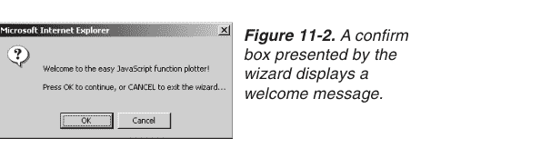

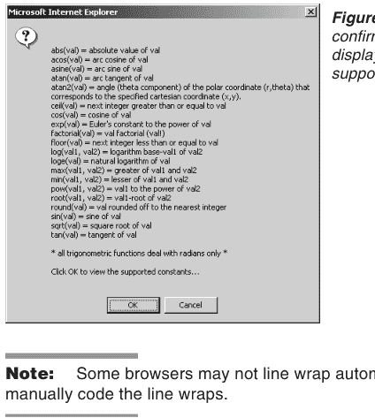

图 11-3. 一个显示支持函数列表的确认框

> 注意：某些浏览器可能不会自动换行，因此您可能需要手动编写换行符。

如果用户在任何确认框上按下“取消”，向导将终止，然后实际的绘图应用程序开始运行。绘图器的第一个输出是一个确认框，要求输入函数，该函数可以由 JavaScript 支持的数学函数、常量和运算符构成。

如果用户选择“取消”，将显示一个带有错误消息的警报框。否则，执行将继续，JavaScript 会要求用户输入 X 轴上的最小值。

取消此框将导致脚本终止。如果用户选择了“确定”，执行将继续，并出现另一个提示框。

再次说明，如果用户按下“取消”，脚本将终止。否则，将要求用户输入 X 轴上两个连续刻度线之间的差值（例如，如果用户希望看到 –4, -2, 0, 2, 4, 6，那么差值就是 2）。

现在脚本拥有了所有需要的信息，准备绘制函数的曲线。

首先请注意，X 轴是垂直的。通过对脚本进行一些修改，您可以交换 X 轴和 Y 轴（不可见的水平轴）。脚本会自动将绘图适应到一个恒定的宽度，因此在正常情况下（合理的窗口宽度），您不需要水平滚动。但是，这种自动设置要求您绘制的函数其 Y 值成比例。例如，如果您输入数据来绘制一条由一个 Y 值为 10,000 和其他值小于 100 组成的曲线，那么单个 Y 值（10,000）将被放置在右侧，而所有其他值看起来似乎都在同一个位置。还有另一个功能可以解决这个问题。您可以点击一个点，通过警报框查看其坐标。

既然我们确切知道了脚本的作用，让我们通过分析每个函数来看看它是如何实现的。

### root(a, b)

```javascript
function root(a, b)
{
    // return b to the root of a
    return Math.pow(b, 1 / a)
}
```

此函数返回 a\sqrt{b}，即 b<sup>1/a</sup>。

### logab(a, b)

```javascript
function logab(a, b)
{
    // return log base-a of b
    return Math.log(b) / Math.log(a)
}
```

此函数返回以 a 为底的 b 的对数。该值等于以 x 为底的 b 的对数除以以 x 为底的 a 的对数。在此例中，我们使用自然对数，其底数是欧拉常数。以下语句解释了这个计算：

```math
log_{eb} / log_{ea} = log_{ab}
```

### factorial(a)

```javascript
function factorial(a)
{
    // set recursion termination condition
    if (a == 0)
        return 1
    return a * factorial(a - 1)
}
```

此函数返回阶乘 (a!)。其算法是递归的。

### startWizard()

```javascript
function startWizard()
{
    // create array to hold messages
    var ar = new Array()
    ar[0] = "\r\rWelcome to the easy JavaScript function plotter!\r\r"
    ar[0] += "Press OK to continue, or CANCEL to exit the wizard...\r\r"
    ar[1] = "\r\rYou can plot almost any function you wish with this script.\r"
    ar[1] += "The plotter supports common arithmetic and trigonometric functions.\r"
    ar[1] += "It also supports widely used mathematical constants.\r"
    ar[1] += "For a list of the supported functions press OK...\r\r"
    ar[2] = "\r\r"
    ar[2] += "abs(val) = absolute value of val\r"
    ar[2] += "acos(val) = arc cosine of val\r"
    ar[2] += "asine(val) = arc sine of val\r"
    ar[2] += "atan(val) = arc tangent of val\r"
    ar[2] += "atan2(val) = angle (theta component) of the polar "
    ar[2] += "coordinate (r,theta) that corresponds to the specified "
    ar[2] += "cartesian coordinate (x,y).\r"
    ar[2] += "ceil(val) = next integer greater than or equal to val\r"
    ar[2] += "cos(val) = cosine of val\r"
    ar[2] += "exp(val) = Euler's constant to the power of val\r"
    ar[2] += "factorial(val) = val factorial (val!)\r"
    ar[2] += "floor(val) = next integer less than or equal to val\r"
    ar[2] += "log(val1, val2) = logarithm base-val1 of val2\r"
    ar[2] += "loge(val) = natural logarithm of val\r"
    ar[2] += "max(val1, val2) = greater of val1 and val2\r"
    ar[2] += "min(val1, val2) = lesser of val1 and val2\r"
    ar[2] += "pow(val1, val2) = val1 to the power of val2\r"
    ar[2] += "root(val1, val2) = val1-root of val2\r"
    ar[2] += "round(val) = val rounded off to the nearest integer\r"
    ar[2] += "sin(val) = sine of val\r"
    ar[2] += "sqrt(val) = square root of val\r"
    ar[2] += "tan(val) = tangent of val\r"
    ar[2] += "\r* all trigonometric functions deal with radians only *\r\r"
    ar[2] += "Click OK to view the supported constants...\r\r"
    ar[3] = "\r\r"
    ar[3] += "e = Euler's constant\r"
    ar[3] += "ln2 = Natural log of 2\r"
    ar[3] += "ln10 = Natural log of 10\r"
    ar[3] += "log2e = log base-2 of Euler's constant\r"
    ar[3] += "log10e = log base-10 of Euler's constant\r"
    ar[3] += "pi = pi (3.14...)\r"
    ar[3] += "sqrt1_2 = square root of 0.5\r"
    ar[3] += "sqrt2 = square root of 2\r"
    ar[3] += "\r\rEnjoy the plotter...\r\r"
    for (var i = 0; i < ar.length; ++i)
    {
        if (!confirm(ar[i]))
            break
    }
}
```

此函数负责向导。首先，创建一个数组作为 Array 对象的实例。四个不同的消息被赋值给数组作为元素。第一个存储在 ar[0] 中，第二个在 ar[1] 中，以此类推。请注意，分配的字符串非常长，因此赋值运算符通过将它们一个接一个地赋值给数组元素来进行连接。该函数使用 for 循环将消息打印到确认框中。如果用户按下“取消”，确认框的值为 false，执行 break 语句，导致循环立即终止。


## drawBlank(num)

```
function drawBlank(num)
{
    // draw num blank dots
    for (var i = 0; i < num; ++i)
    {
        document.write("")
    }
}
```

此函数将透明图像打印 num 次，num 作为唯一参数传递给该函数。图像通过一个简单的 for 循环被重复打印。

## drawDot(x, y)

```
function drawDot(x, y)
{
    // print dot image
    document.write("<A HREF = \"javascript:alert(\'X = " + x + ", Y = " +
        y + \')\'\"></A>")
}
```

此函数基本上打印点图像，但它以超文本链接的形式打印它。指定为链接的 URL 是一个 JavaScript 语句。当用户点击该图像时，会显示一个警告框，呈现该点的坐标。坐标作为参数传递给此函数。例如，如果参数是 -5 和 10，那么以下字符串将被打印到文档中：

> <A HREF = "javascript:alert('X = -5, Y = 10')"></A>

解码这个字符串是练习转义引号的好方法。你可能还记得，只要语句以 "javascript:" 开头，超文本链接的 URL 可以是一个 JavaScript 语句。

## replaceSpecialSequence(str)

```
function replaceSpecialSequence(str)
{
    // replace all specified sequences with other sequences
    str = str.split("cos").join("Math.cos")
    str = str.split("sin").join("Math.sin")
    str = str.split("tan").join("Math.tan")
    str = str.split("acos").join("Math.acos")
    str = str.split("asin").join("Math.asin")
    str = str.split("atan").join("Math.atan")
    str = str.split("pi").join("Math.PI")
    str = str.split("ln2").join("Math.LN2")
    str = str.split("ln10").join("Math.LN10")
    str = str.split("log2e").join("Math.LOG2E")
    str = str.split("log10e").join("Math.LOG10E")
    str = str.split("sqrt1_2").join("Math.SQRT1_2")
    str = str.split("sqrt2").join("Math.SQRT2")
    str = str.split("abs").join("Math.abs")
    str = str.split("ceil").join("Math.ceil")
    str = str.split("exp").join("Math.exp")
    str = str.split("floor").join("Math.floor")
    str = str.split("loge").join("Math.log")
    str = str.split("max").join("Math.max")
    str = str.split("min").join("Math.min")
    str = str.split("pow").join("Math.pow")
    str = str.split("round").join("Math.round")
    str = str.split("log").join("logab")
    str = str.split("sqrt").join("Math.sqrt")
    str = str.split("e").join("Math.E")
    // return string
    return str
}
```

此函数匹配参数中的某些字符串并将其替换为其他字符串。这里有一个例子：

```
str = str.split("max").join("Math.max")
```

字符串被分割成一个数组，其中子字符串 max 是分隔符，然后使用分隔符 Math.max 将元素重新连接成字符串。最终的结果是，无论字符串 max 出现在主字符串 (str) 中的哪个位置，它都会被字符串 Math.max 替换。这很重要，因为字符串必须构建为有效的 JavaScript 表达式（eval() 函数计算由有效 JavaScript 表达式组成的字符串）。所有支持的常量和数学函数都执行相同的过程。factorial() 函数保持不变，因为它在脚本中的引用也是 factorial()。

需要注意的一个重要点是，替换子字符串的顺序至关重要。例如，你不能在将 sqrt2 替换为 Math.SQRT2 之前，先将 sqrt 子字符串替换为 Math.sqrt，因为结果将是子字符串 sqrt2 被替换为 Math.sqrt2，而不是 Math.SQRT2。该函数必须首先替换包含其他需要替换的子字符串的子字符串。

在所有所需的子字符串替换完毕后，并且如果用户以有效格式输入了函数，该函数返回格式化后的字符串，此时它是一个有效的 JavaScript 表达式。

## splitFunc(func)

```
function splitFunc(func)
{
    // exclude "y =" from func
    var expr = func.substring(func.indexOf("=") + 1, func.length)
    // replace regular trigonometric functions with JavaScript convention
    expr = replaceSpecialSequence(expr)
    // split argument to *global* array, excluding "x" chars
    funcArray = expr.split("x")
}
```

此函数接受一个参数——函数。如你所知，函数的一般格式是 y = f(x)。首先，该函数将等号后面的所有内容赋给局部变量 expr。然后它将 expr 的值发送给函数 `replaceSpecialSequence()`，并接收一个字符串返回，其中特殊子字符串已被替换（参见关于该函数的解释）。通过不使用 var 关键字为其赋值，创建了一个全局数组 funcArray。存储在变量 expr 中的字符串使用字符 x 作为分隔符被分割到 funcArray 数组中。假设函数的参数是 y = x * sin(x)。变量 expr 被赋值为 x * sin(x)。这个值被发送给函数 `replaceSpecialSequence()`，字符串 x * Math.sin(x) 被赋值给 expr。这个字符串通过 x 被分割到全局数组 funcArray 中。它的元素现在是：

```
funcArray[0] == " "
funcArray[1] == " * Math.sin("
funcArray[2] == ")"
```

## getInput()

```
function getInput()
{
    // ask user for function via prompt box
    var input = prompt('Enter function (example: "y = x * x + sin(x) - 5"):', '')
    // if user enters value in field
    if (input)
    {
        // split function to global array
        splitFunc(input)
        // print function to document
        document.write("<TT><H1><B>" + input + "</B></H1></TT><BR>")
        // return true to indicate that user entered a value
        return true
    }
    // generate alert box to display error message
    alert("Error in input...")
    // return false to indicate cancellation
    return false
}
```

此函数负责提示用户输入他或她想要绘制的函数。用户在提示框中输入的函数首先被赋值给局部变量 input。如果用户输入了值并选择了“确定”，则会执行以下命令块。此命令块包括对函数 splitFunc() 的调用。它还包括一条将函数作为一级粗体标题打印到文档的语句。在返回布尔值 true 以指示用户输入了值并按下了“确定”后，函数终止。如果用户选择了“取消”，则不会执行命令块，因此执行立即继续到块之后。在警告框中显示错误消息，并返回 false。

## yVal(xVal)

```
function yVal(xVal)
{
    // build expression with xVal instead of x in original equation
    var expr = funcArray.join(xVal)
    // return evaluated expression
    return eval(expr)
}
```

此函数接受一个表示曲线上点的 x 坐标的值，并返回其对应的 y 坐标。第一条语句声明了一个局部变量 expr。它使用 xVal 作为每个两个元素之间的粘合剂，将全局数组 funcArray 的元素重新连接成字符串。回顾函数 splitFunc() 并阅读给出的示例 (y = x * sin(x))。数组元素的值如下：

```
funcArray[0] == " "
funcArray[1] == " * Math.sin(" 
funcArray[2] == ")"
```

函数 yVal() 使用 xVal 的值作为每个两个元素之间的粘合剂来连接这些元素。假设 xVal 的值是 5。在这种情况下，赋给 expr 的构造字符串是：

```
" 5 * Math.sin(5)"
```

函数返回此字符串的计算值。对于前面的字符串，返回的值是：

```
" 5 * Math.sin(5)" == -4.794621373315692
```

## makeArray(min, max, dif)

```
function makeArray(min, max, dif)
{
    // create properties of array-like object
    for (var i = min; i <= max; i += dif)
    {
        this[i] = yVal(i)
    }
}
```

makeArray() 是一个构造函数。它创建一个仅包含属性的对象。属性的名称是要绘制在曲线上的点的 x 值。它们的值是点的对应 y 坐标。该函数接受三个参数，所有这些参数都由用户在此函数外部通过提示框输入。该函数通过一个循环创建调用实例的属性。循环计数器从 min 开始，每次迭代后递增 dif。循环持续进行，直到计数器超过 max。


只要其计数器小于或等于最大值。每个 x 坐标对应的 y 坐标通过函数 `yVal()` 来获取。

## printUnit(num)

```
function printUnit(num)
{
  // 在表格单元格内，使用指定字体和大小打印数字
  document.write("<FONT SIZE = 1 COLOR = 'purple'>" + num + "</FONT>")
}
```

此函数接受一个数值，并使用指定的字体颜色和大小将其打印出来。

## drawCurve()

```
function drawCurve()
{
  for (var x = minX; x <= maxX; x += dif)
  {
    // 打印用于容纳当前单位的表格起始属性和单元格
    document.write("<TABLE BORDER = 0><TR><TD WIDTH = 90>")
    // 打印坐标轴上的当前数字
    printUnit(x)
    // 关闭当前表格单元格并打开一个新的
    document.write("</TD><TD>")
    // 将 Y 值赋给变量
    var y = ar[x]
    // 获取从 1 到 100 的整数 y 值
    var ySpot = (y - minY) / (maxY - minY) * 100
    // 绘制透明图像
    drawBlank(ySpot - 1)
    // 在曲线上绘制圆点
    drawDot(x, y)
    // 关闭单元格、行和表格（新行会自动添加）
    document.write("</TD></TR></TABLE>")
  }
}
```

此函数不接受任何参数。它负责打印曲线。要理解此函数，你必须首先理解位图的每一行是如何打印的。整行被放置在一个 HTML 表格中。x 值，或单位，被打印在表格的第一个单元格中。为了保持行与行之间的一致性，该单元格的宽度是固定的。表格的第二个，也是最后一个单元格，位于同一行，并包含所有图像，包括透明图像和圆点图像。显然，圆点图像是每行第二个单元格中的最后一个图像。请注意，左侧单元格（每个表格中的第一个）足够宽，几乎可以容纳任何数字。

整个函数由一个循环构成，该循环遍历需要放置在曲线上的点。关于循环算法的信息，请参阅函数 `makeArray()` 的说明。函数首先打印 `<TABLE>`、`<TR>` 和 `<TD>` 的开始标签。表格边框设置为零，因此不可见。单元格的宽度设置为 90 像素。第一个单元格中的值由 `printUnit()` 函数打印。然后关闭当前表格单元格，并打开一个新的。当前点的 y 值（作为属性存储在全局对象 `ar` 中）出于方便起见，被赋值给局部变量 `y`。整个曲线的最小和最大 y 坐标已分别存储在全局变量 `minY` 和 `maxY` 中。使用一个简单的线性方程将当前 y 坐标转换为 1 到 100 之间的值，其中整个曲线中的最小 y 坐标为 1，最大值为 100。此值被赋值给局部变量 `ySpot`。下一条语句调用 `drawBlank()` 函数来打印 `ySpot – 1` 个透明图像，这等于从开始到 `ySpot`（即放置圆点图像的位置）的图像数量。然后调用 `drawDot()` 函数，并传入当前坐标，以在假想的曲线上打印当前的圆点或项目符号。然后关闭表格的当前单元格和行，并关闭表格。关闭表格时，会自动附加一个换行符。

## main()

此函数的名称源自传统编程语言，如 C、C++ 和 Java，在这些语言中，`main()` 函数会自动执行，并且是程序的起点。在 JavaScript 中，你必须调用 `main()` 来绘制图形。该函数首先调用 `startWizard()` 函数来执行向导。然后执行 `getInput()` 函数。如果其求值为 false，意味着用户在被要求输入函数时按下了“取消”，则函数终止。否则，继续执行。函数会要求用户输入额外的信息，包括最小和最大的 x 坐标，以及 X 轴上两个连续刻度之间的差值。如果用户在任何这些请求中选择“取消”，函数将立即终止，不执行任何其他语句。在用户输入值（并按下“确定”）后，数据被发送到 `replaceSpecialSequence` 函数，从该函数返回一个字符串，并使用 `eval()` 函数转换为一个数字。

下一条语句创建一个类似全局数组的对象，并通过其构造函数 `makeArray()` 为它赋值。

现在，函数需要找到曲线的最小和最大 y 坐标。首先，它为每个变量 `maxY` 和 `minY` 赋予一个现有的 y 坐标。然后，一个 `for...in` 循环遍历 `ar` 对象的属性，如果它找到一个小于当前 `minY` 或大于当前 `maxY` 的值，它会更新该值。

该函数的最后一条语句绘制曲线本身。

## 全局语句

唯一的全局语句是调用 `main()` 函数。

## 总结

在本章中，你学习了 JavaScript 中数学的使用。我们几乎完全专注于 Math 对象及其属性和方法。讨论的方法包括算术和三角函数方法。算术方法几乎出现在每一个 JavaScript 脚本中，而三角函数方法则相当少见。你还学习了一些与 JavaScript 密切相关的内置函数的基础知识。这些函数将在后面深入讨论，所以如果你现在不太理解它们，也不必担心。为了增加趣味性，我们还展示了一个与数学相关的有趣示例，涉及曲线绘制。如果你理解了所有的脚本，或者至少是曲线绘制的那个，你肯定走在正确的道路上。然而，如果现阶段它们看起来很难，也不要担心，因为知识来自于实践。事实上，其中一些示例的复杂程度可能略高于你在现实世界中可能需要的，仅仅是为了向你展示 JavaScript Math 对象的强大功能。

## 第 12 章 处理字符串

字符串是任何编程语言的重要组成部分。无论你是存储一个人的姓氏还是库存中的产品名称，字符串通常是存储该值的最佳方式。但字符串究竟是什么？本质上，字符串只是单个字符的数组。这在所有编程语言中都是如此。一些语言，如 C 和 JavaScript，让你直接处理字符数组，而其他语言，如 Visual Basic，则向程序员隐藏了这一层细节。每个字符都有其位置或索引。字符串的索引与数组一样，是基于零的。字符串第一个字符的索引是 0，第二个的索引是 1，第三个的索引是 2，依此类推。

### 字符

JavaScript 与某些语言不同，它不包含显式的字符（char）数据类型。字符只是一个由单个字符构成的字符串。字符串的字符必须是可视的。也就是说，出现在字符串中的每个符号都是一个可以实际打印的字符。这对你来说似乎很明显，但并非所有出现在 ASCII 表中的字符都可以是字符串的字符，因为有些是不可视的。转义序列是一系列字符，代表一个通常难以通过键盘输入的特殊字符。例如，看看下面的字符串：

```
"car\'s wheel"
```

它看起来包含 12 个字符（c, a, r, \' , s, , w, h, e, e, l）。但是，当你打印该字符串时，只能看到 11 个字符（c, a, r, ', s, , w, h, e, e, l）。因此，该字符串由 11 个字符组成。第四个字符是撇号（或单引号），而不是反斜杠，因为序列“\’”是撇号的简写。此序列被称为 *转义序列*，因为它绕过了正常的字符处理，而是执行一个特殊命令。

### 创建字符串

字符串是一个非常特殊的内置对象，因为你可以通过多种方式创建它。所有字符串都属于内置的 String 对象，因此你可以将字符串创建为 String 对象的实例：

```
var str = new String("Hello!")
```

通用语法是：

```
stringObjectName = new String(string)
```

*stringObjectName* 是你正在创建的对象的名称，*string* 是任何字符串，包括如示例中带引号的字面字符串。通过此构造函数创建的字符串被视为对象。如果你使用 typeof 运算符测试它们的数据类型，你会发现它们是对象，而不是字符串。但是，所有字符串属性和方法都适用于此类对象。

另一种创建字符串的方法是简单地引用一系列字符。如果你想将它用作对象，你可以在标识符后面跟上所需的属性或方法。

### 字符串长度

String 对象结合了许多方法和一个属性，length。此属性反映其包含的字符数量，包括空格。这里有几个例子：

```
var str1 = "abc"
var str2 = "a b c"
var str3 = "\"abc\""
document.write(str1.length + "<BR>")
document.write(str2.length + "<BR>")
document.write(str3.length)
```

此脚本的输出是：

3
5
5

字符串最后一个字符的索引等于其长度（字符数）减去一。字符串的长度是紧随字符串最后一个字符之后的不存在字符的索引。


## HTML 格式化方法

你在本书中已经见过大量的 HTML 格式化内容。你可以通过组合字符串来打印所需的标签和属性值。下面是一个示例：

```
var openBold = "<B>"
var closeBold = "</B>"
var message = "Something"
document.write("<B>Something</B>")
```

此脚本的结果是字符串 Something 以粗体打印出来。JavaScript 提供了简化此过程的方法。例如，你可以使用以下语句创建相同的输出：

```
document.write("Something".bold())
```

下表列出了所有这些方法及其生成的 HTML：

**表 12-1. HTML 格式化方法**

| 方法名 | 示例 | 返回值 |
| :--- | :--- | :--- |
| anchor | "text".anchor("anchorName") | <A NAME="anchorName"> text</A> |
| big | "text".big() | <BIG>text</BIG> |
| blink | "text".blink() | <BLINK>text</BLINK> |
| bold | "text".bold() | <BOLD>text</BOLD> |
| fixed | "text".fixed() | <TT>text</TT> |
| fontcolor | "text".fontcolor("red") | <FONT COLOR="red">text</FONT> |
| fontsize | "text".fontsize(-1) | <FONT SIZE=-1>text</FONT> |
| italics | "text".italics() | <I>text</I> |
| link | "text".link("URL") | <A HREF="URL">text</A> |
| small | "text".small() | <SMALL>text</SMALL> |
| strike | "text".strike() | <STRIKE>text</STRIKE> |
| sub | "text".sub() | <SUB>text</SUB> |
| sup | "text".sup() | <SUP>text</SUP> |
| toLowerCase | "TexT".toLowerCase() | text |
| toUpperCase | "TexT".toUpperCase() | TEXT |

你也可以将方法"链式"调用，以应用多个格式化转换。例如，如果你想要一个斜体、粗体、大写的字符串，可以使用以下表达式：`toUpperCase().bold().italics()`。这里的求值从左到右进行。下面的列表概述了求值的各个阶段，其中调用字符串是字面量 "text"：

```
"text".toUpperCase().bold().italics()
"TEXT".bold().italics()
"<B>TEXT</B>".italics()
"<I><B>TEXT</B></I>"
```

## 第 12 章

由特定方法处理的值是该方法左侧表达式返回的累积值；也就是说，该表达式作为调用对象或字符串被实现。因此，你必须确保方法左侧的表达式返回一个对该方法有效的值。

HTML 文本格式化标签通常由两个标签组成，它们包围着文本。HTML 中的嵌套结构非常清晰，因为一组标签可以包围另一组标签。在前面的示例中，`<I></I>` 标签组包围了 `<B></B>` 标签组。通过 JavaScript 的 String 方法创建 HTML 时，请记住，最左侧指定的方法在格式化为 HTML 时表现为内层标签，而最右侧的方法负责外层标签。

## 通用字符串方法

正如你已经知道的，String 对象有许多方法。那些将字符串转换为常量 HTML 格式（并列在表 12-1 中）的方法只是 JavaScript 提供的部分方法。在本节中，我们将看看其余的 String 方法。

## charAt()

此方法返回索引等于方法参数的字符。字符串的字符索引从 0 到 length – 1。通用语法是：

```
anyString.charAt(index)
```

下面是一个示例：

```
var pres = "Kennedy"
document.write(pres.charAt(1))
```

此脚本段打印字符 "e"，因为它是字符串中的第二个字符。你也可以使用字面量调用此方法，如下例所示：

```
document.write("Kennedy".charAt(1))
```

你可以通过一个简单的循环打印字符串的字符：

```
var str = "I am a string!"
for (var i = 0; i < str.length; ++i)
{
    document.write(str.charAt(i))
}
```

首先，将字符串字面量赋值给变量 str。然后循环迭代 length 次。它从 0 开始，到 str.length – 1 结束（注意是小于运算符，不是小于等于）。在循环的第 i 次迭代中，打印索引为 i 的字符。由于命令块对每个 i 的整数值执行一次，因此字符串的每个字符都被打印一次且仅一次。前面脚本段的输出实际上就是字符串本身，一次打印一个字符（不，你无法察觉区别！）。

## indexOf()

此方法返回在调用 String 对象中指定子字符串首次出现的索引，搜索从字符串的开头开始。一个示例肯定会澄清这一点：

```
var str = "ababa"
document.write(str.indexOf("ba"))
```

此脚本的输出是数字 1。指定子字符串 "ba" 在调用 String 对象中首次出现在第二个字符处，其索引为 1。搜索从索引 0（字符串的开头）开始。但是，你也可以指示 JavaScript 从不同的索引开始搜索，例如字符串的中间某处。以下脚本段打印数字 3：

```
var str = "ababa"
document.write(str.indexOf("ba", 2))
```

此方法的通用语法是：

```
stringName.indexOf(searchValue, [fromIndex])
```

注意 *fromIndex* 必须是 0 到字符串长度减 1 之间的整数。*searchValue* 不一定必须是字符串。以下脚本打印数字 8：

```
var str = "August 27, 1985"
document.write(str.indexOf(7))
```

如果未指定开始查找子字符串的索引，则使用默认值 0。如果在整個字符串中未找到指定的子字符串，则方法返回比基数小 1 的值，即 -1。

此方法等同于 Perl 中的 index 函数。

## lastIndexOf()

此方法与 *indexOf* 方法相同，只是它返回指定值最后一次出现的索引，而不是第一次出现的索引。因此，其语法是相同的：

```
stringName.lastIndexOf(searchValue, [fromIndex])
```

以下脚本打印数字 3：

```
var str = "a/b/c"
document.write(str.lastIndexOf("/"))
```

有关此方法的更多详细信息，请参见 *indexOf* 方法。

## substring()

字符串由字符构成。substring() 方法返回其调用 String 对象中的一组字符。其通用语法是：

```
stringName.substring(indexA, indexB)
```

stringName 是任何字符串。indexA 和 indexB 都是 0 到 stringName.length – 1 之间的整数。indexA 是子字符串中第一个字符的索引，而 indexB 是子字符串中最后一个字符的索引加 1。以下脚本将字符串 "bc" 赋值给变量 seg：

```
var str = "abcd"
var seg = str.substring(1, 3)
```

注意子字符串的长度是 indexB – indexA。参数为 0 和 stringName.length 的子字符串等于字符串本身（stringName）。

此方法类似于 C# 中的等效函数 Substring。然而，指出差异很重要。首先，由于 Perl 不支持对象，普通的 substr() 函数接受字符串本身作为第一个参数，indexA 作为第二个参数。然而，第三个参数不是 indexB，而是子字符串的长度。另一个区别是，当你使用负值作为偏移量（indexA）调用函数时，子字符串从字符串末尾开始那么多字符。而在 JavaScript 中，负索引等同于零索引，即字符串的第一个字符。JavaScript 的原型使我们能够使用以下脚本段在 JavaScript 方法中重现 Perl 中的 substring 函数：

```
function substr(offset, length)
{
    if (offset < 0)
        offset = this.length + offset
    return this.substring(offset, offset + length)
}
String.prototype.substr = substr
```

你可以使用以下方式将此方法用于任何字符串：

```
var str = "abcd"
document.write(str.substr(-3, 2))
```

此语句打印字符串 "bc"。


## escape() 和 unescape()

JavaScript 为我们提供了一些处理字符串的内置函数，例如 `escape()` 和 `unescape()`。在介绍这些函数之前，我们必须先讨论 ISO Latin-1 字符集。ISO Latin-1 (ISO-8859-1) 是互联网上使用的标准字符集。该标准也是 Microsoft Windows 的 ANSI 字符集的基础，但自然，Microsoft 对其进行了扩展和改进。然而，只有 ISO Latin-1 字符保证在网站上得到支持。你已经通过 HTML 了解了 ISO Latin-1 字符集的标准编码方案，它允许你通过数字或名称将字符显示为实体。例如，字符 © 可以通过两种不同的表达方式显示在页面上：

- &#169;
- &copy;

第一种表达基于 ISO Latin-1 字符集中的字符编码。第二种方法基于赋予字符的名称。除了少数例外，几乎所有平台都兼容 ISO Latin-1 的字形。如果你对字符集或 ISO-8859-1 感兴趣，可以在网上搜索更多信息。ISO-8859-1 字符表可以在附录 C 中找到。

现在回到 JavaScript。`escape()` 函数返回其参数在 ISO Latin-1 字符集中的 ASCII 编码。通用语法是：

```
escape(string)
```

像所有方法一样，你可以传递一个变量、现有对象的属性或一个简单的字符串字面量。`escape()` 函数不是与任何对象相关联的方法，而是语言本身的一部分。`escape()` 函数返回的值是字符串参数，其中所有非字母数字字符都被替换为 “%xx” 形式的字符串，xx 是参数中字符的 ASCII 编码。

`unescape()` 函数负责相反的转换。也就是说，它将字符串从非字母数字 ASCII 编码转换为 ISO Latin-1 字符。其语法类似：

```
unescape(string)
```

以下示例演示了双向转换：

```
var str1 = "My phone # is 123-456-7890"
var str2 = escape(str1)
var str3 = unescape(str2)
document.write("After escape: " + str2 + "<BR>")
document.write("After unescape: " + str3)
```

该脚本的输出不言自明：

```
After escape: My%20phone%20%23%20is%20123-456-7890
After unescape: My phone # is 123-456-7890
```

## 数字到字符串的转换

有时，你需要将数字转换为字符串。例如，如果你想计算一个数字的位数，可以将其转换为字符串并使用 `length` 属性，该属性仅适用于字符串。在本节中，我们将探讨几种将数字转换为字符串的方法。

### 空字符串拼接

将数字转换为字符串最明显的方法是将一个空字符串拼接到数字上。以下是此类转换的示例：

```
var num = 987
num += ""
```

你也可以通过以下方式使用 `typeof` 运算符来确保变量的值是字符串：

```
var num = 987
document.write("num is a " + typeof num + "<BR>")
num += ""
document.write("num is a " + typeof num)
```

此脚本段的预期输出是：

```
num is a number
num is a string
```

你也可以将数字转换为字符串，并将数字字符串赋给另一个变量，或者更好的做法是，在一个语句中同时完成这两个操作：

```
var num = 987
var numericString = num + ""
```

此脚本产生两个不同的变量；第一个保存纯数值，第二个 `numericString` 保存字符串类型。空字符串拼接到变量的哪一边并不重要：

```
var num = 987
var numericString = "" + num
```

如果你拼接几个不同的字面量，其中一些是数字，另一些是字符串，则表达式的结果是字符串。这里有一个例子：

```
var str = 99 + " bottles of beer on the wall"
```

是以下字符串。因此，在这种情况下 `str` 的值是 `99 bottles of beer on the wall`。以下语句演示了一个略有不同的情况：

```
var str = "bottles of beer on the wall -- " + 50 + 49
```

像往常一样，求值从左到右进行。字符串 `bottles of beer on the wall -- ` 与 `50` 拼接，结果为 `bottles of beer on the wall -- 50`。这个值接着与数字 `49` 拼接，结果为 `bottles of beer on the wall -- 5049`，这当然不是我们想要的值。一个简单的解决方法是按以下形式将数字运算括在括号中：

```
var str = "bottles of beer on the wall -- " + (50 + 49)
```

括号指示 JavaScript 先对括号内的表达式求值，因此在这种情况下 `str` 的值是 `bottles of beer on the wall -- 99`。

### 字符串实例构造

另一种将数字转换为字符串的方法是将数字传递给 `String()` 构造函数，它返回一个常规的 String 对象。这里有一个简单的例子来演示这一点：

```
var num = 987
num = new String(num)
```

在这种情况下，变量 `num` 的数据类型不是字符串，而是对象。如前所述，通过 `String()` 构造函数创建的字符串是常规对象。但是，你仍然可以在此类对象上使用与字符串相关的任何属性或方法。通过构造函数将数字转换为字符串更明显的方法是按以下形式将新的字符串（或对象）赋给一个新变量：

```
var num = 987
var numericString = new String(num)
```

### toString() 方法

`toString()` 方法属于所有对象。其通用语法是：

```
objectName.toString([radix])
```

`objectName` 是要转换为字符串的对象，而 `radix` 是当调用对象是数字时，用于表示数值的基数。以下示例以十进制和二进制打印数字 0 到 9 的字符串等效值：

```
for (x = 0; x < 10; x++)
{
    document.write("Decimal: ", x.toString(10), " Binary: ", x.toString(2),
                "<BR>")
}
```

循环的输出是：

```
Decimal: 0 Binary: 0
Decimal: 1 Binary: 1
Decimal: 2 Binary: 10
Decimal: 3 Binary: 11
Decimal: 4 Binary: 100
Decimal: 5 Binary: 101
Decimal: 6 Binary: 110
Decimal: 7 Binary: 111
Decimal: 8 Binary: 1000
Decimal: 9 Binary: 1001
```

所有对象，包括数字，都有一个 `toString()` 方法。如果对象没有字符串值，则该方法返回 `[object *type*]`，其中 `*type*` 是对象类型（例如，Date、Array、Object（用户定义）、Image）。与数组一起使用时，`toString()` 连接数组元素并返回一个字符串，其中元素用逗号分隔。此操作与 `join()` 方法完全相同，后者使用指定的分隔符（可能是逗号）连接元素。

对于函数，`toString()` 将函数反编译回规范的源字符串。请看以下脚本段：

```
function foo()
{
    var a = 5
    alert(a)
    document.write("wow")
}
document.write(foo.toString())
```

该脚本的输出是：

```
function foo() { var a = 5; alert(a); document.write("wow"); }
```

## 字符串到数字的转换

例如，数学运算符接受数字字符串作为操作数并可以正确处理。这里有一个这样的操作示例：

```
var num1= "7"
var num2 = "2"
var result = num1 - num2
document.write(result)
```

此脚本打印 `5`，就像两个变量都被赋予了纯数值而不是数字字符串一样（我们使用术语 *数字字符串* 来描述包含数字的字符串，例如 "911"）。由数字字符串操作数组成的操作返回纯数值，而不是字符串。因此，理论上你可以通过对数字字符串执行算术运算来将其转换为数字。如果愿意，你甚至可以使用一个函数来执行以下形式的转换：

```
function convert(val)
{
    return val - 0
}
var num = "911"
num = convert(num)
```

请注意，你不能使用加号（+）运算符，因为它在 JavaScript 中也是一个字符串连接运算符。如果你不确定一个值是数字字符串还是数字，请务必进行转换。防患于未然总比花几个小时查找此类错误要好。通过数学运算进行转换有些烦人，因为它看起来像是一种变通方法。因此，JavaScript 为我们提供了一些转换函数，每个函数都有自己的特点。

### parseInt() 和 parseFloat()

这两个函数在第 11 章 “JavaScript Math” 中已简要讨论。它们是内置函数，因此不属于任何对象。它们将其参数从数字字符串转换为数字。如果参数是字符串但不是数字字符串，函数返回零。`parseFloat()` 函数更通用，因为它既适用于浮点数也适用于整数。`parseInt()` 函数仅适用于整数，当使用浮点数字字符串调用时返回四舍五入的值。如果给出的值是纯数字而不是数字字符串，这两个函数都返回原值。因此，如果你不确定一个值是数字还是数字字符串，只需将其传递给该函数。如果脚本中的某个值有可能是浮点数，请使用 `parseFloat()`。如果该值是整数，它同样适用。

以下是一些表达式来演示这些函数及其返回值：

```
parseInt("16")           // 16
parseInt("16.33")        // 16
parseFloat("16")         // 16
parseFloat("16.33")      // 16.33
parseInt("Howdy!")       // 0
```

这些函数在通过表单或提示从用户接收输入时非常有用，因为它们总是返回一个字符串，即使它代表一个数字。

请注意，当参数是布尔值时，两个函数都返回零。因此，如果你想检查用户是否按下了“取消”按钮来取消提示框，你必须在解析值之前评估条件。这里有一个例子：

```
var num = prompt("Enter a number from 0 to 9:")
if (num = false)
    alert("You must enter a value to continue.")
else
    num = parseInt(num)
```


一种常见但错误的做法是立即解析该值。这样做的结果是无法检查用户是否取消了对话框，因为用户可能输入了数字0，而0被解析为与布尔值相同的值。

## 确定一个值是否为数字

`isNaN()` 函数用于计算一个参数，以确定它是否不是数字或NaN。`parseFloat()` 和 `parseInt()` 函数在计算一个非数字或非数字字符串的值时返回NaN。NaN不是任何字符串中的数字。如果将NaN传递给算术运算，结果也是NaN。`isNaN()` 函数根据参数返回一个布尔值。请记住，Internet Explorer 3.0不支持此功能——`parseFloat()` 和 `parseInt()` 在参数既不是数字也不是数字字符串时都返回0。NaN不是字符串，也不是一种独立的数据类型。它本质上是一个数字！你可以通过以下语句自行证明：

```
alert(typeof parseInt("something"))
```

以下代码展示了如何实现 `isNaN()` 函数（为举例起见，使用了 `parseFloat()` 函数）：

```
var floatValue = parseFloat(valueToBeConvertedToFloat)
if isNaN(floatValue)
{
    functionToBeCalledIfFloat()
}
else
{
    functionToBeCalledIfNotFloat()
}
```

`isNaN()` 函数不如 `parseInt()` 和 `parseFloat()` 重要，但为了完整性，我们在此讨论它。

## 计算文本表达式

JavaScript支持通过 `eval()` 方法计算和执行文本表达式。以下是一些示例：

```
var str = "5 + 2"
var num = eval(str)
alert(num)
var al = "alert('This is an evaluated string.')"
eval(al)
```

这段脚本会弹出两个警告框。第一个显示数字7，因为表达式 "5 + 2" 的计算结果是7。第二次调用 `eval()` 函数不会使其返回值，而是执行封装在字符串中的语句。

你也可以使用 `eval()` 函数将表示数字的字符串转换为常规数字。`eval()` 函数接受以字符串形式表示的任何有效JavaScript代码片段。你可以将整个脚本存储为字符串，然后将其传递给此函数。该函数的经典用法是让用户在表单字段或提示框中输入数学表达式，然后显示结果。以下是一个简单示例：

```
var inp = prompt("Enter mathematical expression", "")
alert(inp + " = " + eval(inp))
```

## 字符串处理示例

在本节中，我们重点介绍一个利用JavaScript中String对象的各种内置函数和其他元素的脚本。

## 字符串加密

以下脚本会提示用户输入一个短字符串。然后要求输入一个数字密钥。密钥有63种可能的值——从1到63的所有整数。此脚本中使用的加密技术称为XOR运算，因为它主要基于按位XOR（异或）运算符。输入字符串（或密码）的每个字符的数值与数字密钥值进行混合。可以使用反向过程将加密后的字符串转换回原始字符串。由于转换过程只是根据密钥交换相同的两个字符，因此相同的JavaScript脚本既用作解码器也用作编码器。理论已足够——让我们进入正题！以下是脚本：

```
<HTML>
<HEAD>
<TITLE>Enciphering</TITLE>
<SCRIPT LANGUAGE="JavaScript">
<!--
// create list of valid characters
var list = "0123456789abcdefghijklmnopqrstuvwxyz._ABCDEFGHIJKLMNOPQRSTUVWXYZ"
function encipher()
{
    // prompt user for string
    var str = prompt("Enter string:", "")
    // terminate function if user selects CANCEL
    if (!str)
        return
    // check that each character of input string is valid
    for (var i = 0; i < str.length; ++i)
    {
        if (list.indexOf(str.charAt(i)) == -1)
        {
            alert("script terminated -- invalid character found")
            return
        }
    }
    // prompt user for key
    var key = prompt("Enter key (1-63):", "")
    // terminate function if user selects CANCEL
    if (!key)
        return
    // convert key to integer (number)
    key = parseInt(key)
    // alert enciphered string
    alert(encode(str, key))
}
function encode(str, key)
{
    // initialize accumulative string variable
    var code = ""
    // encipher all characters
    for (var i = 0; i < str.length; ++i)
    {
        var ind = list.indexOf(str.charAt(i))
        var converted = list.charAt(ind ^ key)
        code += converted
    }
    // return enciphered value
    return code
}
encipher()
// -->
</SCRIPT>
</HEAD>
<BODY>
</BODY>
</HTML>
```

示例 12-1 (ex12-1.htm)。一个简单的加密脚本

该脚本的输出如图12-1至图12-3所示。

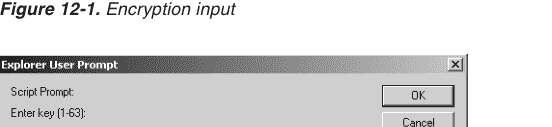

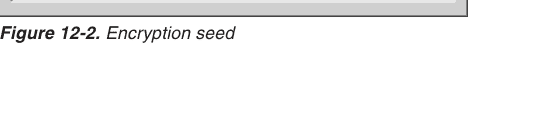

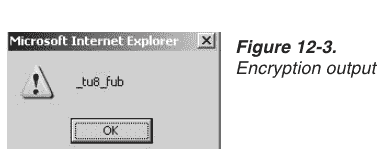

> **警告：** 这是一种极其原始的加密方案，很容易被破解。这里仅作为如何使用JavaScript的示例，不应用于加密敏感数据。

现在让我们看看这个脚本是如何工作的。

### encipher()

首先，encipher() 函数会提示用户输入他或她想要编码的字符串。该字符串存储在变量 **str** 中。如果该变量的值为布尔值 false，则函数和脚本本身都会终止。终止函数的逻辑是，布尔值 false 只能是用户按下“取消”的结果。然后使用 **for** 循环来检查字符串的所有字符是否也位于 **list** 所持有的字符串中。该循环遍历输入字符串的每个字符。看看用于测试字符是否受支持的条件：

```
list.indexOf(str.charAt(i)) == -1
```

str.charAt(i) 是循环代码块当前正在处理的字符。变量 **i** 从字符串第一个字符的索引 0 开始，每次递增，直到等于最后一个字符的索引。假设当前字符是 "t"。条件则如下所示：

```
list.indexOf("t") == -1
```

如果字符串 **list** 中没有找到字符 "t"，则以 "t" 为参数的方法 indexOf() 返回 -1——这正是返回值所要比较的数字。

如果字符无效（在 **list** 中未找到），则会显示一条消息并终止函数，间接导致脚本执行结束。

然后该函数要求用户输入密钥号，该密钥号必须是1到63之间的整数。由于这只是一个示例，因此不测试输入值。如果用户单击“取消”，则终止函数。否则，函数继续执行，并通过 parseInt() 函数将密钥号从数字字符串转换为数字。由函数 encode() 返回的编码字符串将被显示。

### encode(str, key)

首先将一个空字符串赋值给变量 code。使用一个循环将输入字符串的每个字符替换为另一个字符。当前字符（其在 str 中的索引等于循环计数器 i 的字符）在 list 字符串中的索引被赋值给变量 ind。按位 OR 运算符以密钥号和 ind 的值作为操作数。list 中索引等于按位 OR 运算返回值的字符，就是用于在新字符串中替换当前字符的字符，因此将其赋值给持有编码字符串的变量。函数返回新字符串。

## 总结

字符串是JavaScript中非常有用的数据类型。JavaScript倾向于将其元素组织成对象形式，因此所有与字符串相关的函数和数据被分组形成 String 对象。在本章中，我们讨论了 String 对象的方法，以及它的唯一属性 length。由于字符串是该对象的直接或间接（取决于你创建它们的方式）实例，因此你可以创建原型来扩展该对象的功能。本章末尾提供的JavaScript示例清晰地展示了 String 对象的强大功能。我们在本章中没有提供很多示例，因为字符串操作和处理在本书后面的几乎所有示例中都可以找到。


## 第13章
### 文档对象模型

文档对象模型（DOM）是Web开发者可用的强大工具之一，它是一个对象层次结构，用于表示网络浏览器、浏览器历史记录、当前加载的网页以及其他重要元素。你可以在图13-1中看到这个层次结构的描绘。

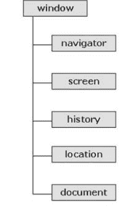

**图13-1.** *文档对象模型*

在本章和下一章中，我们将探讨DOM，并为你提供如何使用其各个方面的示例。我认为你会发现这些功能既令人兴奋又非常有用。DOM中的每个对象都有特定的用途，我们将在本章中探讨其中的大部分。

### window 对象

window对象位于DOM层次结构的顶部。这个对象代表浏览器窗口。你会发现，你并不经常直接与window对象打交道，而是将其作为你经常直接使用的其他对象的容器。这并不意味着你永远不直接使用window对象，只是它不像其他对象那样常用。

window对象包含适用于整个窗口的属性。例如，浏览器的状态栏就是这个对象的一个属性。它还包括一个实际上是对象本身的属性。听起来很奇怪？其实不然。我们将在讨论窗口和框架时，让你更深入地了解这个引用。当文档包含框架时，单个HTML文档中可能存在多个window对象。框架实际上将页面划分为“子”窗口，因此每个框架都有自己独立的浏览器对象层次结构。你必须小心处理这些子窗口，因为它们可能会导致冲突，原因是多个window对象共享一个属性。例如，无论你加载哪个页面，浏览器中只有一个状态栏（除非你打开一个没有状态栏的窗口）。

表13-1展示了一些window对象的各种方法和属性。

**表13-1. window对象的方法和属性**

| 方法/属性 | 用途 |
| :--- | :--- |
| focus() | 此函数将焦点设置到当前窗口。 |
| resizeBy(x,y) | 相对于窗口当前的宽度和高度调整其大小。 |
| resizeTo(x,y) | 将窗口大小调整为指定的 x 和 y 宽度和高度值。 |
| moveBy(x,y) | 将窗口在 x 和 y 方向上移动指定的像素数。 |
| moveTo(x,y) | 将窗口移动到指定的 x 和 y 像素位置。 |

表13-2展示了一些你可能会使用window对象的方式示例。

**表13-2. 使用window对象**

| 示例 | 用途 |
| :--- | :--- |
| var newwindow = window.open("http://www.chuckeasttom.com") | 打开一个新的浏览器窗口。 |
| newwindow.focus | 将焦点设置到该窗口。 |
| newwindow.close | 关闭该窗口。 |

### navigator 对象

此对象提供有关正在使用的浏览器的信息。这在收集访问你网站的用户信息时非常有用。事实上，你可以从此对象获取的信息量确实相当惊人。表13-3展示了一些navigator对象的方法和属性。

**表13-3. navigator对象的方法和属性**

| 方法/属性 | 用途 |
| :--- | :--- |
| appName | 最终用户的浏览器名称。 |
| appVersion | 最终用户的浏览器版本号。 |
| cookieEnabled | 最终用户的浏览器是否启用了cookie。 |
| platform | 最终用户的操作系统。 |
| javaEnabled() | 返回一个布尔值的方法，用于指示浏览器是否启用了JavaScript。 |

以下是使用navigator对象的代码片段示例。在这些示例中，document对象用于在浏览器中显示navigator对象的属性。我们将在下一节中介绍document对象本身。

```
document.write(navigator.appName)
document.write(navigator.appVersion)
document.write(navigator.platform)
document.write(navigator.cpuClass)
```

如你所见，这些方法和属性可以为网站访问者提供丰富的信息来源。

### document 对象

到目前为止，DOM中最有用的对象是document对象。它包含当前窗口中加载页面的属性。此对象的属性是内容相关的，因为每个页面都有自己独特的结构和元素。页面中的几乎所有内容都是document对象的属性，包括链接、图像、表单及其元素、锚点等等。因为每个框架都是一个窗口（window对象），所以它也包含一个document对象。甚至是背景和标题也是此对象的属性。我们将在本节中为你概述document对象，但你将在本书后面找到更多关于此对象的细节。表13-4列出了document对象的一些属性和方法。

**表13-4. document对象的方法和属性**

| 方法/属性 | 用途 |
| :--- | :--- |
| write() | 这是一个非常常用的方法，它会将传递给write函数的任何内容写入HTML页面。 |
| fileCreatedDate | 此属性显示已加载的HTML文件的创建时间。 |
| linkColor | 此属性显示文档中HTML链接的颜色。它在 <BODY> 标签中指定。 |
| open() | 此方法在新窗口中打开一个新文档。 |
| embeds | 包含文档中所有插件的数组。 |

让我们来看一个使用document对象的例子，因为它是一个如此常用的对象。

```
<HTML>
<HEAD>
<TITLE>Sample Color Cube</TITLE>
</HEAD>
<BODY>
<SCRIPT LANGUAGE="JavaScript">
<!--
// create six-element array
var hex = new Array(6)
// assign non-dithered descriptors
hex[0] = "FF"
hex[1] = "CC"
hex[2] = "99"
hex[3] = "66"
hex[4] = "33"
hex[5] = "00"
// accept triplet string and display as background color
function display(triplet)
{
  // set color as background color
  document.bgColor = '#' + triplet
  // display the color hexadecimal triplet
  alert('Background color is now ' + triplet)
}
// draw a single table cell based on all descriptors
function drawCell(red, green, blue)
{
  // open cell with specified hexadecimal triplet background color
  document.write('<TD BGCOLOR = "#' + red + green + blue + '">')
  // open a hypertext link with javascript: scheme to call display function
  document.write('<A HREF = "javascript:display(\'' + (red + green + blue) + '\')">')
  // print transparent image (use any height and width)
  document.write('')
  // close link tag
  document.write('</A>')
  // close table cell
  document.write('</TD>')
}
// draw table row based on red and blue descriptors
function drawRow(red, blue)
{
    // open table row
    document.write('<TR>')
    // loop through all non-dithered color descriptors as green hex
    for (var i = 0; i < 6; ++i)
    {
        drawCell(red, hex[i], blue)
    }
    // close current table row
    document.write('</TR>')
}
// draw table for one of six color cube panels
function drawTable(blue)
{
    // open table (one of six cube panels)
    document.write('<TABLE CELLPADDING=0 CELLSPACING=0 BORDER=0>')
    // loop through all non-dithered color descriptors as red hex
    for (var i = 0; i < 6; ++i)
    {
        drawRow(hex[i], blue)
    }
    // close current table
    document.write('</TABLE>')
}
// draw all cube panels inside table cells
function drawCube()
{
    // open table
    document.write('<TABLE CELLPADDING=5 CELLSPACING=0 BORDER=1><TR>')
    // loop through all non-dithered color descriptors as blue hex
    for (var i = 0; i < 6; ++i)
    {
        // open table cell with white background color
        document.write('<TD BGCOLOR="#FFFFFF">')
        // call function to create cube panel with hex[i] blue hex
        drawTable(hex[i])
        // close current table cell
        document.write('</TD>')
    }
    // close table row and table
    document.write('</TR></TABLE>')
}
// call function to begin execution
drawCube()
// -->
</SCRIPT>
</BODY>
</HTML>
```


*示例 13-1 (ex13-1.htm).* 文档 *对象示例*

你应该注意到，在这个例子中，*write* 方法被反复使用。正如我之前所说，它是文档对象最常用的方法之一。你可以在图 13-2 中看到示例 13-1 的输出。

![img/5461f58cbc49aee61d3cd10137081974_262_0.png]

**图 13-2.** 示例 13-1 的输出

## history 对象

history 对象也是 window 对象的一个属性。它包含了用户先前访问过的 URL 的属性。此信息存储在历史记录列表中，并且可以通过浏览器菜单访问。如果文档包含框架中的子文档，那么每个框架都有自己的历史记录列表，或 history 对象。此对象还包含一些方法，使你能将用户的浏览器发送到历史记录列表中找到的某个 URL。表 13-5 列出了一些 history 对象最重要的属性和方法。

*表 13-5. history 对象的方法和属性*

| 方法/属性 | 目的 |
| --- | --- |
| current | 当前文档的 URL。 |
| previous | 历史记录列表中上一个文档的 URL。 |
| next | 历史记录列表中下一个文档的 URL。 |
| length | 当前存储在 history 对象中的条目数量。 |

以下代码片段展示了如何使用 history 对象的一个示例。

```
<FORM>
<INPUT TYPE="button" VALUE="Go Back" onClick="history.back()">
</FORM>
```

## location 对象

location 对象包含了当前 URL 的属性。虽然你可能认为 URL 是简单的标准结构，但它们远不止于此。每个 URL 中有许多类型的协议和不同的部分。URL 中也有可选的部分，例如锚点名称和查询参数。看起来 history 对象和 location 对象似乎相似，但表 13-6 中显示的属性和方法应该能让你看出它们的不同之处。

*表 13-6. location 对象的方法和属性*

| 方法/属性 | 目的 |
| --- | --- |
| host | URL 的主机名和端口。 |
| href | 整个 URL。 |
| port | 正在使用的端口。 |
| search | URL 的查询字符串部分（即问号之后及包含问号的部分）。 |

以下代码片段展示了你可以如何使用 location 对象。

```
document.write(location.href)
document.write(window.location.protocol)
```

## 总结

在本章中，我们向你介绍了文档对象模型，并探讨了它更重要的方面。掌握这个对象模型是 JavaScript 成功的关键，因为 JavaScript 主要是通过这些对象来实现与用户的交互。在接下来的章节中，我们将更详细地讨论与这些对象相关的各种概念，包括它们的方法、属性和事件处理程序。

# 第 14 章
## 文档对象模型（续）

在上一章中，我们向你介绍了文档对象模型，并研究了该模型中最重要的和最广泛使用的对象。我们还了解了这些对象及其属性和方法的一些简单应用。在本章中，我们将更深入地探讨 DOM 及其实际应用。

文档对象模型的强大之处在于它是万维网联盟（W3C）的标准，该联盟负责网络上的大多数标准。这一地位确保了大多数浏览器和平台最终都将支持它。DOM 的发展与在网络上提供更多交互式内容的趋势相一致。提供这种交互内容的唯一方法是允许动态操作 HTML。文档对象模型使这一挑战更容易实现。

文档对象模型为程序员提供了一套标准对象，用于表示 HTML 甚至 XML 文档。DOM 还提供了一个标准接口，用于访问和操作这些文档及其组成对象。文档对象模型基本上是浏览器和网络各组成部分的表示，JavaScript 可以访问这些部分。由于文档对象模型是 W3C 规范，这意味着它的行为和用法不依赖于特定的供应商。DOM 在 Internet Explorer、Mozilla 或任何浏览器中应该是一样的。任何 W3C 标准和文档对象模型的一个重要目标是提供一个可以在各种环境和应用程序中使用的标准。DOM 设计用于与任何编程语言一起使用。

在 DOM 中，文档具有一种设计得像树一样的逻辑结构。这意味着对象有时会分支成子对象。这些子对象可以描述为*节点*。在第 13 章中，我们使用了 DOM 的一些对象。这些对象是作为独立对象呈现的，而不是与 DOM 树相关联。在本节中，我们将更仔细地研究这棵树。你当然可以继续使用像 document、navigator 和 history 这样的对象，而无需理解 DOM 树的结构，但如果你理解了，它可能有助于你编写更高级的脚本。同样重要的是要记住，DOM 是语言无关的，并不特定于 JavaScript。

每个文档包含零个或一个文档类型节点、一个文档元素节点，以及零个或多个注释或处理指令。文档元素作为文档元素树的根。然而，DOM 并未规定文档必须实现为树或丛林，也未规定对象之间的关系应如何实现。这种树结构允许“树遍历”方法。这仅仅意味着能够从树中的一个对象移动到下一个对象，并遍历所有相关对象。

DOM 起源于一个规范，旨在使 JavaScript 脚本和 Java 程序可以在 Web 浏览器之间移植。它起源于动态 HTML（DHTML）模型，该模型用于使网页更具动态性。现在，文档对象模型已成为几乎所有 Web 开发技术中使用的标准。尽管本书的重点是如何在 JavaScript 中使用 DOM，但其应用并不局限于 JavaScript。

W3C DOM 规范分为多个级别，每个级别都包含必需模块和可选模块。要使应用程序或技术声明达到某个给定的 DOM 级别，它必须实现该级别的所有要求。如果应用程序支持的供应商特定扩展不与 W3C 标准冲突，也可以支持这些扩展。微软在其 Web 开发工具中经常使用供应商特定的扩展。表 14-1 显示了各种 DOM 级别及其要求。

*表 14-1. DOM 级别*

| 级别 | 描述 |
| :--- | :--- |
| 级别 0 | 应用程序支持一种中间 DOM，它存在于 DOM 级别 1 创建之前。一个例子就是 DHTML 对象模型。级别 0 不是 W3C 发布的正式规范，只是对标准化过程之前存在的事物的描述。 |
| 级别 1 | 此级别的应用程序支持 DOM 文档树的导航和内容操作。HTML 特定的元素也包括在内。 |
| 级别 2 | 此级别支持 XML 命名空间支持、过滤视图和事件。此规范定义了文档对象模型级别 2 核心。文档对象模型级别 2 核心建立在文档对象模型级别 1 核心之上，因此包含级别 1。 |
| 级别 3 | 此级别基本上是对 DOM 级别 2 核心的增强。它完成了 DOM 和 XML 信息之间的映射，包括对 XML Base 的支持。它还增加了将用户信息附加到 DOM 节点的能力。 |

DOM 规范的一个目标是为 XML 和 HTML 定义一个编程接口。我们在表 14-1 中看到了各种级别的概述；然而，有几个细节该表未涉及。

DOM 级别 1 规范分为两部分：核心和 HTML。核心 DOM 级别 1 部分提供了一组可以表示任何结构化文档的基本接口。核心级别 1 还定义了用于表示 XML 文档的扩展接口。这些扩展的 XML 接口不需要由仅提供 HTML 文档访问的 DOM 实现来实现。

## 使用 DOM 访问文档结构

文档对象模型的主要功能是查看、访问和更改 HTML 文档的结构。你在第 13 章中看到了如何使用文档对象模型访问浏览器的各个部分，甚至可以写入 HTML 页面。你可以基于元素的 id 标识符访问某些 HTML 元素，或者根据它们的标签或 CSS 类类型分配元素数组。所有转换都是根据最新的 HTML 规范完成的。更重要的是，它们是动态发生的——任何转换发生时都不需要重新加载页面。表 14-2 列出了一些最常用的元素。

*表 14-2. 常用 DOM 元素*

| DOM 元素 | 描述 |
| --- | --- |
| document | 返回页面的文档对象。它也是 DOM 树的根节点。 |
| element | 代表 DOM 树中大多数结构和子结构的一个实例。例如，一个文本块可以是一个元素，或者是一个 HTML 表单中的一个项目。 |
| nodeList | nodeList 基本上是一个元素数组。你可以通过类似 myList[n] 的常用语法访问 nodeList 中的项目，其中 n 是一个整数。 |

文档对象模型指定了许多 JavaScript 方法，允许你访问其结构。表 14-3 列出了一些最常用的方法。

*表 14-3. 常用 DOM 方法*

| DOM 方法 | 描述 |
| --- | --- |
| element getElementById(id) | 返回由其 id 标识符唯一标识的元素。 |
| nodeList getElementsByTagName(name) | 返回一个 nodeList，其中包含所有具有给定标签（例如 <p> 标签）的元素，通过名称指定。 |


## DOM方法

| DOM 方法 | 描述 |
| :--- | :--- |
| element createElement(type) | 创建一个由 type 参数指定类型的元素（例如 `<p>` 标签）。 |
| void appendChild(node) | 将 node 参数指定的节点附加到接收节点或元素上。 |
| string style | 返回与元素关联的样式规则，以字符串形式表示。 |
| string innerHTML | 返回包含当前元素及其所有内部内容的 HTML。您也可以使用此属性设置元素的 `innerHTML`。 |
| void setAttribute(name, value) | 添加或更改目标元素的属性。 |
| string getAttribute(name) | 返回由 `name` 指定的元素属性的值。 |

## 使用文档对象模型

本节介绍一些代码示例，以帮助您熟悉文档对象模型。这些示例应能让您更自如地使用 DOM。

要使用这些 DOM 代码示例，您需要创建一个示例 HTML 文件。以下代码代表了您将在示例中使用的 HTML 文件：

```html
<HTML>
<HEAD>
    <TITLE>Open a New Window</TITLE>
    <SCRIPT LANGUAGE="JavaScript">
    function OpenWindow()
    {
        var NewWindow = window.open("advjscript.jpg", "NewWindow",
                                "width=350,height=400")
    }
    </SCRIPT>
</HEAD>
<BODY BGCOLOR=White>
    <A HREF="javascript:OpenWindow()">Advanced JavaScript</A>
</BODY>
</HTML>
```

这个脚本的核心是 `OpenWindow` 函数内的单行代码。传递给此函数的第一个参数是您希望打开的内容。这可以是另一个 HTML 文档或一张图片。传递的第二个参数是表示这个新窗口的变量名。在我们的例子中，它是 `NewWindow`。最后一个参数是我们要打开的新窗口的高度和宽度。

## 第14章

这个脚本相当简单易用，而且非常实用。例如，如果您的网站上有一个产品列表，而您不希望用每个产品的所有细节来使 HTML 文档变得杂乱，您可以使用这个脚本，让用户在点击产品名称后查看包含这些详情的页面。

我们示例中启动新窗口的唯一真正问题是，如果启动的项目大于您为其指定的尺寸参数，我们没有滚动条来查看整个图像。示例 14-1 与前面的代码非常相似，只是它在 `window.open` 方法调用中添加了一些内容，以包含滚动条。

```html
<HTML>
<HEAD>
    <TITLE>Open a New Window</TITLE>
    <SCRIPT LANGUAGE="JavaScript">
    function OpenWindow()
    {
        var NewWindow = window.open("anypage.htm", "NewWindow",
                                   "width=350,height=200,scrollbars=yes")
    }
    </SCRIPT>
</HEAD>
<BODY BGCOLOR=White>
    <A HREF="javascript:OpenWindow()">Advanced JavaScript</A>
</BODY>
</HTML>
```

示例 14-1 (ex14-1.htm)。*创建带有滚动条窗口的脚本*

只需在尺寸参数之后添加 `scrollbars=yes`，就能为您启动的新窗口提供滚动条！您也可以添加 `toolbar = yes` 行，这样如果您愿意，您的新窗口将具有浏览器的标准工具栏。

下一个示例结合了滚动条、工具栏，以及原始窗口关闭其启动窗口的方法。

```html
<HTML>
<HEAD>
<TITLE>Close Windows</TITLE>
<SCRIPT LANGUAGE="JavaScript">
    var childwindow = null
    function opennewwindow()
    {
        childwindow = window.open("anypage.htm","childwindow",
                                   "width=300,height=200,toolbar=yes,scrollbars=yes,"")
    }
    function closenewwindow()
    {
        if (childwindow && !childwindow.closed)
        {
            childwindow.close()
        }
    }
</SCRIPT>
</HEAD>
<BODY BGCOLOR=White>
    <CENTER>
    <H3>
        <A HREF="javascript:opennewwindow()">View Advanced JavaScript</A>
        <BR>
        <A HREF="javascript:closenewwindow()">Close Advanced JavaScript</A>
    </H3>
    </CENTER>
</BODY>
</HTML>
```

## 示例 14-2 (ex14-2.htm)。关闭窗口的脚本

这个脚本中唯一的真正区别是 `closenewwindow` 函数。在该函数中，我只是使用表示新启动窗口的变量名，并调用 `closewindow()` 方法。尽管这个区别很小，但它很重要。允许用户从启动它的父窗口关闭子窗口非常重要。

以下示例向您展示如何使用文档对象模型来检测客户端正在使用什么浏览器。这可能非常重要，因为某些浏览器可能不支持您希望实现的所有 JavaScript 功能。

```html
<HTML>
<HEAD>
    <TITLE>Browser Detection</TITLE>
</HEAD>
<BODY BGCOLOR=White>
<SCRIPT LANGUAGE="JavaScript">
var browsername= navigator.appName
var browserversion = navigator.appVersion
    if (browsername == "Microsoft Internet Explorer")
    {
        document.write("You are using MS Internet Explorer version " + browserversion)
    }
    else
    {
        document.write("You are using Netscape Navigator version " + browserversion)
    }
</SCRIPT>
</BODY>
</HTML>
```

## 示例 14-3 (ex14-3.htm)。检测浏览器版本的脚本

这些相当简单的示例阐明了您可以使用 navigator 对象完成的一些实际任务。

## 总结

在本章中，我们扩展了第 13 章的材料。我们更仔细地研究了文档对象模型的架构，并使用了一些简单的示例。凭借本章和前一章的材料，您应该对文档对象模型有了基本的工作知识。从第 15 章开始，许多后续章节将利用 DOM 的元素。

Mozilla Firefox 有一个名为 DOM Inspector 的有趣工具，您可能希望使用。您可以在任何 Mozilla 窗口的 Tools > Web Development 菜单下找到它。DOM Inspector 是一个可用于查看任何网页文档的实际 DOM 对象的工具。DOM 层次结构可以使用一个双窗格窗口来浏览，该窗口允许对文档及其中所有节点进行多种不同的视图查看。

## 第15章

### 利用状态栏

### 状态栏

正如我们在第 13 章和第 14 章中所学到的，您可以使用文档对象模型访问网页或浏览器的各种元素。状态栏就是您可以访问和利用的元素之一。状态栏位于浏览器窗口的底部。它存在于所有浏览器中，包括 Mozilla Firefox 和 Internet Explorer。它通常显示正在加载的文档的当前状态。除非窗口是由明确禁用状态栏的脚本打开的，否则状态栏存在于每个窗口中。图 15-1 显示了 Mozilla 的状态栏。


*图 15-1。Mozilla Firefox 状态栏*

状态栏是底部显示字符串 "Document: Done." 的灰色条。

就文档对象模型而言，状态栏是 window 对象的直接属性。在多框架文档中，每个框架都有一个表示状态栏的属性，但您应该只引用其中一个，以避免不必要的冲突。JavaScript 中的状态栏通常由 status 属性表示——`window.status`。您也可以通过 `self.status` 引用当前窗口的状态栏，因为 `self` 实际上是 window 对象本身的一个属性。

> **注意：**您也可以将状态栏称为 `status` 而不是 `window.status`；但是，为了清晰起见，我们将坚持使用后者。

切勿尝试读取状态栏代码，因为此类操作通常会产生错误。设置状态栏的值是允许的，但有一些限制。

**写入状态栏**

您可以通过按钮、链接以及用户触发的每个其他事件为 `window.status` 赋值。例如，要在用户点击按钮时显示一条消息，您可以使用以下形式：

```html
<HTML>
<HEAD>
<TITLE>status bar</TITLE>
<SCRIPT LANGUAGE = "JavaScript">
<!--
function showMessage()
{
    window.status = "Fascinating!"
}
// -->
</SCRIPT>
</HEAD>
<BODY>
<FORM>
<INPUT TYPE = "button" VALUE = "show message" onClick = "showMessage()">
</FORM>
</BODY>
</HTML>
```

**示例 15-1 (ex15-1.htm)**。您可以根据用户发起的事件（如按钮点击）在状态栏中显示任何您喜欢的字符串。您可以在图 15-2 中看到此脚本的输出。

> **注意：**此脚本以及其他一些脚本在 Firefox 中的功能可能与在 Internet Explorer 中不同。另请注意，在本书撰写期间，Internet Explorer 7.0 已发布，许多脚本尚未在该浏览器上进行测试。

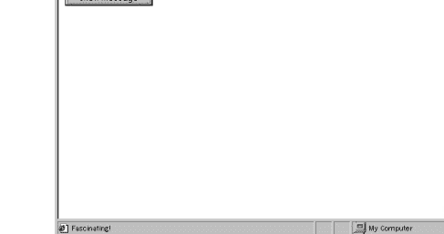

许多网页采用一种技术，当鼠标指针悬停在链接上时，状态栏会显示一段简短描述，而非URL。描述通常比URL更有意义。当用户将鼠标指针放在链接上时触发的事件处理程序是`onMouseOver`。在消息显示到状态栏后，该事件处理程序应始终返回布尔值`true`。在状态栏中分配与链接对应的正确消息的唯一方法是使用以下链接语法：

```
<A HREF = "URL" onMouseOver = "window.status = 'any string'; return true">
```
不要忘记返回`true`——这至关重要。

以下语句创建了一个指向Wordware Publishing网站的链接，当指针悬停其上时会显示一条简短消息：

```
<A HREF = "http://www.wordware.com" onMouseOver = "window.status = 'Get more cool computer books from Wordware'; return true">Wordware</A>
```

看一下下面的示例：

```
<HTML>
<HEAD>
<TITLE>status bar</TITLE>
<SCRIPT LANGUAGE = "JavaScript">
<!--
function showMessage(txt)
{
    window.status = txt
    setTimeout("clearMessage()", 2500)
}
function clearMessage()
{
    window.status = ""
}
// -->
</SCRIPT>
</HEAD>
<BODY>
<A HREF = "http://www.wordware.com" onMouseOver = "showMessage('Get more cool computer books from Wordware'); return true">Wordware</A>
</BODY>
</HTML>
```

示例 15-2 (ex15-2.htm)。一个在状态栏中显示字符串2.5秒的脚本

`setTimeout()`方法可以替代返回`true`的需要。这个脚本非常简单。当用户将指针悬停在链接上时，函数`showMessage()`被调用，并传入所需的字符串。该字符串被赋值给`status`属性，然后函数`clearMessage()`被调用，在2.5秒后通过将当前消息替换为空字符串来清除状态栏。

一种从状态栏中擦除由`onMouseOver`写入的字符串的更好方法是实现`onMouseOut`事件处理程序。此事件处理程序作为链接或客户端图像映射区域的属性，当鼠标指针从区域内部移出该区域或链接时触发（参见第19章“链接、锚点和图像映射”）。这种移出操作使我们能够在用户将指针从链接上移开时，将状态栏赋值为空字符串。

这是另一个示例：

```
<A HREF = "http://www.wordware.com" onMouseOver = "window.status = 'Get another cool computer book from Wordware'; return true" onMouseOut = "window.status = ''; return true">Wordware</A>
```

## 为状态栏设置默认值

你已经看到可以通过`status`属性向状态栏写入单行字符串。也可以为状态栏设置默认值。只要没有通过`status`属性向其写入值，这个值就会保留在状态栏中。该属性的通用语法是`window.defaultStatus`或`defaultStatus`。在事件处理程序中使用此属性时，必须返回`true`。

看一下下面的示例：

```
<HTML>
<HEAD>
<TITLE>status bar</TITLE>
<SCRIPT LANGUAGE = "JavaScript">
<!--
function statusSetter()
{
    window.defaultStatus = "Click the link for the Wordware Publishing home page"
    window.status = "Wordware home page"
}
// -->
</SCRIPT>
</HEAD>
<BODY>
<A HREF = "http://www.wordware.com" onMouseOver = "statusSetter();
         return true">Wordware</A>
</BODY>
</HTML>
```

示例 15-3 (ex15-3.htm)。为状态栏设置默认值

当你在浏览器中加载页面时，你会看到一个链接。此时，状态栏不包含任何字符串（它可能包含一个报告页面已加载的字符串）。当你将指针悬停在链接上时，消息“Wordware home page”被写入状态栏。当指针移离链接时，该字符串被另一个字符串替换——“Click the link for the Wordware Publishing home page。”这是使用`onMouseOut`事件处理程序的一个很好的替代方案。

## 横幅

你可以使用状态栏创建横幅。横幅是经典的JavaScript脚本。它们过去是，现在仍然是任何网页的吸引人之处。最初，横幅出现在状态栏中，依次滚动显示多条消息。一些程序员更喜欢将横幅放在文本框中，因为他们觉得基于状态栏的横幅对普通浏览者来说很烦人。横幅有时非常不稳定；它们的速度不均匀，有时会闪烁。没有解决办法让它们变得更好。但总的来说，它们仍然很有趣。在本节中，我们来看一些不同的类似横幅的脚本，其中大部分是专门为本书创建的。

### T型横幅

T型横幅模拟打字机，是我最喜欢的横幅之一。打字机风格的显示能吸引用户的目光，并确保消息被注意到。它通过逐字符输入来显示每条消息。看起来就像有人以一定速度输入消息，并在完成后将其删除。首先，看一下脚本：

```
<HTML>
<HEAD>
<TITLE>T-banner</TITLE>
<SCRIPT LANGUAGE = "JavaScript">
<!--
// 设置横幅速度（字符之间的暂停，以毫秒为单位）
var speed = 100 // 减小值以增加速度（必须为正数）
// 设置消息完成与开始下一条之间的暂停
var pause = 1000 // 增大值以增加暂停
// 设置初始值
var timerID = null
var bannerRunning = false
// 创建全局数组
var ar = new Array()
// 将字符串分配给数组的元素
ar[0] = "Welcome to this JavaScript page"
ar[1] = "I hope you enjoy the T-banner script"
ar[2] = "It's kind of a cool banner"
ar[3] = "Don't forget to check out my other scripts"
// 设置要首先显示的第一条消息的索引
var currentMessage = 0
// 设置要首先显示的最后一个字符的索引
var offset = 0
// 如果横幅当前正在运行，则停止它
function stopBanner()
{
   // 如果横幅当前正在运行
   if (bannerRunning)
   // 停止横幅
   clearTimeout(timerID)
   // 计时器现在已停止
   bannerRunning = false
}
// 启动横幅
function startBanner()
{
    // 确保横幅已停止
    stopBanner()
    // 从当前位置启动横幅
    showBanner()
}
// 输入当前消息
function showBanner()
{
    // 将当前消息赋值给变量
    var text = ar[currentMessage]
    // 如果当前消息尚未显示完成
    if (offset < text.length)
    {
        // 如果当前消息的最后一个字符是空格
        if (text.charAt(offset) == " ")
            // 跳过当前字符
            offset++
        // 赋值要显示的最新子字符串
        // 方法的第二个参数接受最后一个字符的索引加一
        var partialMessage = text.substring(0, offset + 1)
        // 在状态栏中显示部分消息
        window.status = partialMessage
        // 递增要显示的最后一个字符的索引
        offset++
        // 在指定时间后递归调用
        timerID = setTimeout("showBanner()", speed)
        // 横幅正在运行
        bannerRunning = true
    } else
    {
        // 重置偏移量
        offset = 0
        // 递增当前消息的下标（索引）
        currentMessage++
        // 如果当前消息的下标超出范围
        if (currentMessage == ar.length)
            // 循环返回（从开头开始）
            currentMessage = 0
        // 在指定时间后递归调用
        timerID = setTimeout("showBanner()", pause)
        // 横幅正在运行
        bannerRunning = true
    }
}
// -->
</SCRIPT>
</HEAD>
<BODY onLoad = "startBanner()">
</BODY>
</HTML>
```

示例 15-4 (ex15-4.htm)。一个T型横幅

### 全局语句

```
// 设置横幅速度（字符之间的暂停，以毫秒为单位）
var speed = 100 // 减小值以增加速度（必须为正数）
// 设置消息完成与开始下一条之间的暂停
var pause = 1000 // 增大值以增加暂停
// 设置初始值
var timerID = null
var bannerRunning = false
// 创建全局数组
var ar = new Array()
// 将字符串分配给数组的元素
ar[0] = "Welcome to this JavaScript page"
ar[1] = "I hope you enjoy the T-banner script"
ar[2] = "It is designed to be more stable than regular banners"
ar[3] = "Don't forget to check out my other scripts"
// 设置要首先显示的第一条消息的索引
currentMessage = 0
// 设置要首先显示的最后一个字符的索引
var offset = 0
```

首先，横幅的速度设置为100。这等于消息中每个字符之间的暂停时间（以毫秒为单位）。消息（字符串）完成与其删除之间的暂停时间（以毫秒为单位）被赋值给变量`pause`。当前超时的标识符被赋值为`null`，因为尚未设置超时。横幅的当前状态（因为尚未运行所以为`false`）被赋值给变量`bannerRunning`。然后创建一个数组来保存要作为横幅消息显示的字符串。第一个字符串被赋值给数组的第一个元素`ar[0]`，依此类推。数字0被赋值给`currentMessage`，因为首先显示的消息是`ar[0]`。在给定时刻状态栏中显示的最后一个字符的索引被赋值给全局变量`offset`。它被设置为零，因为横幅的首次出现仅包含一个字符——第一个字符——其索引为零。

### stopBanner()

```
// 启动横幅
function startBanner()
{
    // 确保横幅已停止
```


## stopBanner()

```javascript
stopBanner()
// start the banner from the current position
showBanner()
}
```

此函数用于停止横幅。如果横幅正在运行，则清除当前的超时。变量 `bannerRunning` 被设置为 `false`，因为横幅已停止。

## startBanner()

```javascript
// start the banner
function startBanner()
{
    // make sure the banner is stopped
    stopBanner()
    // start the banner from the current position
    showBanner()
}
```

此函数调用 `stopBanner` 函数以确保横幅停止，然后调用 `showBanner` 函数开始运行 T 型横幅。

## showBanner()

```javascript
// type in the current message
function showBanner()
{
    // assign current message to variable
    var text = ar[currentMessage]
    // if current message has not finished being displayed
    if (offset < text.length)
    {
        // if last character of current message is a space
        if (text.charAt(offset) == " ")
            // skip the current character
            offset++
        // assign the up-to-date to-be-displayed substring
        // second argument of method accepts index of last char plus one
        var partialMessage = text.substring(0, offset + 1)
        // display partial message in status bar
        window.status = partialMessage
        // increment index of last character to be displayed
        offset++
        // recursive call after specified time
        timerID = setTimeout("showBanner()", speed)
        // banner is running
        bannerRunning = true
    } else
    {
        // reset offset
        offset = 0
        // increment subscript (index) of current message
        currentMessage++
        // if subscript of current message is out of range
        if (currentMessage == ar.length)
            // wrap around (start from beginning)
            currentMessage = 0
        // recursive call after specified time
        timerID = setTimeout("showBanner()", pause)
        // banner is running
        bannerRunning = true
    }
}
```

当前消息被赋值给局部变量 `text`。然后函数沿两个方向之一继续执行。第一个方向在当前消息仍在显示时被选中；也就是说，如果当前消息中最后显示的字符的索引是最后一个字符或更前。在这种情况下，表达式 `offset < text.length` 的计算结果为 `true`。如果本次函数执行中要显示的最后一个字符是空格，则 `offset` 的值会递增，不会浪费时间来输入空格字符。需要在当前迭代中显示的子字符串被赋值给局部变量 `partialMessage`。由于 `substring` 方法的第二个参数是最后一个字符的索引加一，因此它被设置为 `offset + 1`。当前的子字符串被显示在状态栏中，并且 `offset` 的值被递增。函数在 `speed` 毫秒后再次被调用。

当到达当前消息的末尾时，会执行另一条路径。在这种情况下，变量 `offset` 被赋值为零（字符串第一个字符的索引）。为了显示数组中的下一条消息，存储当前消息的数组元素的索引会递增。如果 `currentMessage` 的新值超出范围，则将其设置为零，这样下一条消息就是第一条消息。函数在 `pause` 毫秒后被递归调用。这次函数应该走第一条路径，因为消息才刚刚开始。

## 事件处理器

`startBanner` 函数由 `onLoad` 事件处理器在文档加载完成后调用。

## R 型横幅

T 代表“打字机”，而 R 代表“随机”，表示这种特殊横幅的风格。消息通过以随机顺序弹出消息中的各种字符来显示。此横幅涉及的另一个特殊效果是从右到左的滚动动作。该效果通过让每个弹出的字符占据三个字符的空间来实现。看看这段脚本：

```html
<HTML>
<HEAD>
<TITLE>R-banner</TITLE>
<SCRIPT LANGUAGE = "JavaScript">
<!--
// set speed of banner (pause in milliseconds between addition of new character)
var speed = 10 // decrease value to increase speed (must be positive)
// set pause between completion of message and beginning of following one
var pause = 1500 // increase value to increase pause
// set initial values
var timerID = null
var bannerRunning = false
// create array
var ar = new Array()
// assign the strings to the array's elements
ar[0] = "Welcome to my JavaScript page"
ar[1] = "I hope you enjoy the R-banner script"
ar[2] = "It is pretty cool"
ar[3] = "Don't forget to check out my other scripts"
// assign index of current message
var message = 0
// empty string initialization
var state = ""
// no value is currently being displayed
clearState()
// stop the banner if it is currently running
function stopBanner()
{
    // if banner is currently running
    if (bannerRunning)
        // stop the banner
        clearTimeout(timerID)
    // banner is now stopped
    bannerRunning = false
}
// start the banner
function startBanner()
{
    // make sure the banner is stopped
    stopBanner()
    // start the banner from the current position
    showBanner()
}
// assign state a string of "0" characters of the length of the current message
function clearState()
{
    // initialize to empty string
    state = ""
    // create string of same length containing 0 digits
    for (var i = 0; i < ar[message].length; ++i)
    {
        state += "0"
    }
}
// display the current message
function showBanner()
{
    // if the current message is done
    if (getString())
    {
        // increment message
        message++
        // if new message is out of range wrap around to first message
        if (ar.length <= message)
            message = 0
        // new message is first displayed as empty string
        clearState()
        // display next character after pause milliseconds
        timerID = setTimeout("showBanner()", pause)
        // banner is now running
        bannerRunning = true
    } else
    {
        // initialize to empty string
        var str = ""
        // build string to be displayed (only characters selected thus far
        // are displayed)
        for (var j = 0; j < state.length; ++j)
        {
            str += (state.charAt(j) == "1") ? ar[message].charAt(j) : " "
        }
        // partial string is placed in status bar
        window.status = str
        // add another character after speed milliseconds
        timerID = setTimeout("showBanner()", speed)
        // banner is now running
        bannerRunning = true
    }
}
function getString()
{
    // set variable to true (it will stay true unless proven otherwise)
    var full = true
    // set variable to false if a free space is found in string (a
    // not-displayed char)
    for (var j = 0; j < state.length; ++j)
    {
        // if character at index j of current message has not been
        // placed in displayed string
        if (state.charAt(j) == 0)
            full = false
    }
    // return true immediately if no space found (avoid infinite loop later)
    if (full)
        return true
    // search for random until free space found (broken up via break statement)
    while (1)
    {
        // a random number (between 0 and state.length - 1 == message.length - 1)
        var num = getRandom(ar[message].length)
        // if free space found, break infinite loop
        if (state.charAt(num) == "0")
            break
    }
    // replace the 0 character with 1 character at place found
    state = state.substring(0, num) + "1" + state.substring(num + 1, state.length)
    // return false because the string was not full (free space was found)
    return false
}
function getRandom(max)
{
    return Math.round((max - 1) * Math.random())
}
// -->
</SCRIPT>
</HEAD>
<BODY onLoad = "startBanner()">
</BODY>
</HTML>
```

**示例 15-5 (ex15-5.htm). 一个 R 型横幅**

### 全局语句

```javascript
// set speed of banner (pause in milliseconds between addition of new character)
var speed = 10 // decrease value to increase speed (must be positive)
// set pause between completion of message and beginning of following one
var pause = 1500 // increase value to increase pause
// set initial values
var timerID = null
var bannerRunning = false
// create array
var ar = new Array()
// assign the strings to the array's elements
ar[0] = "Welcome to my JavaScript page"
ar[1] = "I hope you enjoy the R-banner script"
ar[2] = "It is pretty cool"
ar[3] = "Don't forget to check out my other scripts"
// assign index of current message
var message = 0
// empty string initialization
var state = ""
// no value is currently being displayed
```

### clearState()

首先，数字 10 被赋值给变量 `speed`，表示当前消息中两个连续字符弹出之间的毫秒数暂停。一个更长的暂停被赋值给变量 `pause`，表示当前消息完成和其删除之间的毫秒数。空值被赋值给全局变量 `timerID`，布尔值 `false` 被赋值给变量 `bannerRunning`。预定义的消息存储在一个数组中。变量


`message` 变量被初始化为零，这是要显示的数组的第一个元素 `ar[0]` 的索引。

全局语句部分的第二部分仅由两个语句组成，但它们对于理解整个脚本很重要。此部分中的第一条语句将一个空字符串赋给全局变量 `state`。接下来调用 `clearState()` 函数。它通过将全局变量 `state` 赋值为 *n* 个 "0" 字符来修改其值，其中 *n* 是当前消息的长度。变量 `state` 基本上由 0 和 1 构成。假设第一个字符是 0。这意味着当前消息的第一个字符尚未弹出。第二个字符和所有后续字符也是如此。因此，字符串开始时全部是 0，当所有字符都变为 1 时，消息完成。

## stopBanner()

请参阅 T-banner 部分中关于此函数的解释。

## startBanner()

请参阅 T-banner 部分中关于此函数的解释。

## clearState()

请参阅上面的“全局语句”部分以获取有关此函数的信息。

## getRandom(max)

这简单地返回一个介于 0 和 max – 1 之间的整数。（参见第 11 章中 `Math.random()` 的解释。）

## getString()

```javascript
function getString()
{
    // set variable to true (it will stay true unless proven otherwise)
    var full = true
    // set variable to false if a free space is found in string (a
    // not-displayed char)
    for (var j = 0; j < state.length; ++j)
    {
        // if character at index j of current message has not been
        // placed displayed string
        if (state.charAt(j) == "0")
            full = false
    }
    // return true immediately if no space found (avoid infinite loop later)
    if (full)
        return true
    // search for random until free space found (broken up via break statement)
    while (1)
    {
        // a random number (between 0 and state.length – 1 == message.length – 1)
        var num = getRandom(ar[message].length)
        // if free space found, break infinite loop
        if (state.charAt(num) == "0")
            break
    }
    // replace the 0 character with 1 character at place found
    state = state.substring(0, num) + "1" + state.substring(num + 1,
            state.length)
    // return false because the string was not full (free space was found)
    return false
}
```

首先，变量 `full` 被初始化为 true。使用一个无限循环（通过 break 语句终止）来遍历 state 字符串的所有 0 和 1 字符。如果找到一个 0 字符，变量 `full` 会被更改为 false。当找到一个空闲空间（即 0）时，不必中断循环（如上面 `getString()` 中所做的那样），因为在随机 banner 中效率不是考虑因素。

函数的其余部分仅在有空闲空间可用时才执行。

一个无限循环每次迭代生成一个新的随机索引，并检查该索引处的空间是否被占用。只要随机索引处的空间被占用，循环就继续执行。当最终找到一个空闲空间时，循环中断，返回空闲空间的索引 `num`。

`state` 的值通过将索引 `num` 处的 0 字符替换为 1 字符来更新。函数在终止时返回 false，表示消息尚未完成。

## showBanner()

与 T-banner 脚本类似，这是主函数。调用 `getString()` 函数以更新 `state` 的值并检查消息是否已完成。如果已完成，当前消息通过增加 `message` 的值（表示当前消息所在数组元素的索引）更新为下一个。如果新值超出范围，则将其重置为初始零值。如上文“全局语句”部分所述，调用 `clearState()` 函数来设置变量 `state`。然后，函数在 pause 毫秒后被递归调用。

在消息尚未完成的普通情况下，会生成特殊的显示效果。将一个空字符串赋给局部变量 `str`，准备累积要显示的字符。一个 for 循环遍历字符串 `ar[message]` 的字符。如果在字符串 `state` 的相同索引处有一个 1，则将 `ar[message]` 的字符附加到 `str` 的末尾。如果在字符串 `state` 中发现一个 0 字符，则附加一个替代字符串。创建从右到左滚动效果的唯一方法是使用一个相当长的包含几个空格的替代字符串。由于空格的水平跨度非常小（字符宽度不统一），单个空格的替代字符串将创建一个友好的从左到右移动！使用空替代字符串会挤压字符串并创建不同的从右到左移动。构建的字符串被放置在状态栏中，函数在 speed 毫秒后被递归调用。

## 事件处理器

当文档完全加载时，`startBanner()` 函数由 onLoad 事件处理器调用。

## N-banner

N-banner（代表“normal”）在状态栏中从右向左滚动。您可能在网页上见过数百个这样的 banner。以下是一个实现此类 banner 的脚本：

```html
<HTML>
<HEAD>
<TITLE>N-banner</TITLE>
<SCRIPT LANGUAGE = "JavaScript">
<!--
function scrollBanner(seed)
{
    // set pause in milliseconds between each movement
    var speed = 10
    // assign one-space string to variable (space pads left side of status bar)
    var str = " "
    // create global array
    var ar = new Array()
    // assign the strings to the array's elements
    ar[0] = "Welcome to my JavaScript page. "
    ar[1] = "I hope you enjoy the N-banner script. "
    ar[2] = "It is kind of cool. "
    ar[3] = "Don't forget to check out my other scripts. "
    // join all messages to one string variable with no delimiter
    var total = ar.join("")
    // if message has not yet reached the left side of the status bar
    if (seed > 0)
    {
        // assign string of seed spaces to variable
        for (var i = 0; i < seed; ++i)
        {
            str += " "
        }
        // append message to end of output string
        str += total
        // message moved one position to the left
        seed--
        // assign expression containing recursive call with literal
        // argument in form of string
        var cmd = "scrollBanner(" + seed + ")"
        // place computed message in status bar
        window.status = str
        // recursive call after speed milliseconds
        timerID = setTimeout(cmd, speed)
    } else
        // if a substring of the total message still remains in status bar
        if (-seed < total.length)
        {
            // assign part of message that has not slid off the left
            str += total.substring(-seed, total.length)
            // message has moved one position to the left
            seed--
            // assign expression containing recursive call with
            // literal argument in form of string
            var cmd = "scrollBanner(" + seed + ")"
            // place computed message in status bar
            window.status = str
            // recursive call after speed milliseconds
            timerID = setTimeout(cmd, speed)
        } else
        {
            // assign a one-space string to status bar
            window.status = str
            // recursive call after speed milliseconds at initial position
            timerID = setTimeout("scrollBanner(100)", speed)
        }
}
// -->
</SCRIPT>
</HEAD>
<BODY onLoad = "scrollBanner(100)">
</BODY>
</HTML>
```

示例 15-6 (ex15-6.htm)。一个 *N*-banner

这个 banner 的一个主要优点是它不包含任何全局语句，并且只有一个函数。

## scrollBanner(seed)

如前所述，banner 的速度和消息被指定。一个单空格字符串被赋给变量 `str`。它通过在边框和消息最左侧之间留出空格来填充状态栏的左侧。由于此 banner 一个接一个地滚动消息，所有消息通过 Array 对象的 `join()` 方法合并为单个字符串。

函数接受一个参数，该参数被赋给参数 `seed`。`seed` 的值决定了消息与状态栏左侧的距离。使用空格字符作为占位符。通常从左侧 100 个空格开始 banner，因此函数最初以值 100 调用。


## 总结

虽然第13章和第14章从理论上介绍了文档对象模型，但本章向你展示了实际使用该模型一部分的方法。请记住，状态栏仅仅是文档对象的一个属性，而你在本章中看到了几种使用该属性的方法。这应该向你展示了文档对象模型的强大威力。

在本章中，我们了解了如何在状态栏中显示与链接相关的信息，以及默认值。我们强调了JavaScript的先驱脚本之一——横幅（banner）。我们讨论了一些专门为本书开发的独特横幅，以及其他常见的横幅。在JavaScript方面，我们讨论了窗口对象的两个属性：`status` 和 `defaultStatus`。除了支持横幅等趣味功能外，状态栏还可以作为额外的输出设备，在调试脚本时显示关键值。

该函数选择三条路径之一。如果 `seed` 的值为正数，则选择第一条路径；也就是说，如果消息尚未到达状态栏的左侧面板。在这种情况下，使用循环将一个由 `seed` 个空格字符组成的字符串连接到变量 `str`。然后将整个消息连接到 `str`。请注意，如果放置在状态栏中的字符串超过了状态栏的最大长度，多余的字符将不会显示。将整个消息连接到累积字符串后，`seed` 的值递减，在下一次迭代时创建滚动效果。通过以下形式的字符串构造一个递归调用：

```
var cmd = "scrollBanner(" + seed + ")"
```

假设 `seed` 的值为50。那么 `cmd` 的值就是 "scrollBanner(50)"。这里使用字面量，因为局部变量或参数无法作为函数参数由 `setTimeout` 求值。然后将累积字符串放入状态栏，并在暂停 `speed` 毫秒后递归调用该函数。

如果消息的一部分已向左移出，但仍有部分保留在状态栏中，则采取第二条路径。通过以下表达式检查此状态：

```
-seed < total.length
```

如果 `seed` 的绝对值超过消息的长度，此表达式的求值结果为 `false`。这意味着向左移出范围的消息长度大于或等于消息本身的长度，意味着消息的任何部分实际上都没有保留在状态栏中。如果此表达式的求值结果为 `true`，则只有部分消息越过了左侧边界。

如果上述表达式的求值结果为 `true`，则子字符串 `total.substring(-seed, total.length)` 将被连接到变量 `str`。此子字符串表示尚未移出（`|seed|` 等于已移出的字符数）的消息部分。命令块的其余部分与函数采取第一条路径时使用的部分相同。

该函数可能采取的第三条路径是最简单的。它将 `str` 的值（一个单空格字符串）放入状态栏。然后使用初始参数100递归调用该函数。

## 第16章

# URL 和 JavaScript

## URL 速成课程

网络地址，更技术性的说法是 URL，是网络开发的重要组成部分。幸运的是，JavaScript 包含许多可用于操作这些 URL 的属性和方法。在讨论 JavaScript 的支持之前，有必要对 URL 进行一般性描述。

URL 是一个首字母缩写词，代表 **统一资源定位符**，是指定电子资源位置的标准方式。简而言之，它是一个网络地址，例如 http://www.wordware.com。URL 的定义源于万维网全球信息倡议（World Wide Web Global Information Initiative）自1990年以来一直使用的概念。URL 使得不同的互联网协议可以访问互联网资源。在上网冲浪时，你经常会在浏览器的“地址”框中遇到 URL。这样的 URL 通常以 "http:" 开头，但也支持 FTP 和 Gopher 等其他协议。甚至电子邮件地址也可以指定为 URL。

URL 是一种非常方便、简洁的方式，可以将人们和应用程序引导至文件或其他电子资源。如果网络不使用 URL，那么你将不得不记住你希望访问的每个网站的 IP 地址。这将使网络几乎变得难以使用。

## 通用 URL 语法

通常，URL 的书写格式如下：

<scheme>:<scheme-specific-part>

URL 包括所用方案的名称，后跟冒号和一个字符串。`scheme` 指的是所使用的协议。有效的方案包括 FTP（文件传输协议）和 HTTP（超文本传输协议）。作为方案支持的字符是小写字母 "a" 到 "z"，以及加号（+）、句点（.）和连字符（-）。像 Internet Explorer 和 Mozilla Firefox 这样的网络浏览器将大写字母视为小写字母。例如，HTTP 和 http 都是被接受的。方案的例子有 "http"、"ftp"、"gopher" 和 "news"。方案指示应用程序或人员如何处理该特定资源。

大多数方案包含两种不同类型的信息：

-   资源所在的互联网机器
-   该资源的完整路径

此类方案通常与机器地址用两个斜杠（//）分隔，而机器地址与完整路径之间仅用一个斜杠（/）分隔。因此，通用格式是：

`scheme://machine.domain/full-path-of-file`

作为练习，让我们看一个简单的 URL：
http://www.chuckeaston.com/index.htm

该 URL 的方案是 http，代表超文本传输协议。机器的互联网地址是 www.chuckeaston.com，到特定文件的路径是 /index.htm。你会发现路径部分有时以斜杠结尾。这表示该路径指向的是一个目录而不是文件。在这种情况下，服务器会返回所有文件的目录列表，或者如果可用，则返回一个默认文件。默认文件名通常是 index.htm 或 home.htm，但其他变体也可能被使用。

## URL 方案

URL 的“方案”是其协议的另一种说法。正如你可能已经知道的，所有网络，因而所有互联网通信，都是通过协议完成的。协议是为通信特定类型数据而商定的标准。

## 超文本传输协议 (HTTP)

HTTP 是专为万维网设计的互联网协议，因此是网络冲浪者最常看到的协议。其通用语法是：

`http://<host>:<port>/<path>?<searchpart>`

`host` 是 WWW 服务器的互联网地址，例如 www.geocities.com，而 `port` 是要连接的端口号。在大多数情况下，可以省略端口及其分隔符冒号，它默认为标准端口 "80"。`path` 告诉服务器请求的是哪个文件。`searchpart` 非常重要。它可用于将信息传递给服务器。它也可以被其他语言引用，包括 JavaScript，你很快就会发现。另一个常用的字符是井号 (#)。它用于引用命名锚点。锚点通常用于网页上，以便从页面的一部分链接到另一部分。

## 文件传输协议 (FTP)

FTP 通常用于在互联网上分发和传输文件。其通用语法是：

```
ftp://<user>:<password>@<host>:<port>/<cwd1>/<cwd2>/.../<cwdN>/<name>;type=<typecode>
```

当连接到提供匿名登录的站点时，可以省略 *用户* 和 *密码*，包括分隔它们的冒号和后面的 @ 符号。*主机* 和 *端口* 与 HTTP URL 规范中的完全相同。<cwd1>/<cwd2>/.../<cwdN> 指的是客户端必须使用的一系列“切换目录”（Unix 中的 cd）命令，以从主目录移动到所需文件所在的目录。由于大多数服务器使用 Unix 操作系统，你可以在命令行输入 `pwd` 来打印工作（当前）目录。*name* 是操作系统识别的所需文件的全名。*;type=<typecode>* 部分允许你指定传输模式（ASCII 与二进制）。大多数系统未配置为正确使用此尾部规范，有些甚至会被它误导。

## Gopher 协议 (Gopher)

Gopher 协议如今已不太常用，但曾经是从互联网获取文件的常用方式。其语法与 HTTP 非常相似：

```
gopher://<host>:<port>/<gopher-path>
```

## 电子邮件 (mailto)

mailto URL 方案与前三种方案不同，因为它不标识文件的位置，而是标识某人的电子邮件地址。其语法也有很大不同：

```
mailto:<account@site>
```

*account@site* 是你希望发送邮件到的人员的互联网电子邮件地址。大多数 WWW 浏览器，包括领头的 Navigator 和 Internet Explorer，都在 HTML 文档中编码时支持此方案。

## Usenet 新闻 (news)

news URL 方案允许你引用 Usenet 新闻组或该新闻组中的特定文章。语法是以下之一：

```
news:<newsgroup-name>
news:<message-id>
```

*newsgroup-name* 是 Usenet 的新闻组名称（例如 comp.lang.javascript），浏览器将从该新闻组检索所有标题文章（可以在浏览器设置中指定最大数量）。*message-id* 对应于要获取的特定文章的消息-ID。它可以在文章的标题信息中找到。


如今，大多数阅读Usenet新闻组的人都是通过如groups.google.com这样的网页界面进行的。

## 特定于主机的文件名（File）

File URL方案表示客户端机器可以获取的文件。File方案的语法如下：

```
file://<host>:<path>
```

*host*是系统的完全限定域名，*path*是所需文件的分层目录路径。将*host*留空或指定localhost以引用客户端的本地文件。

## JavaScript语句（javascript）

JavaScript URL方案则大不相同。其通用语法如下：

```
javascript:<valid-javascript-statement-expression-command>
```

此方案计算冒号后的表达式。如果表达式可以计算为字符串，则会打开一个新页面并显示该字符串。如果表达式未定义，则不会打开新页面。

## 其他方案

还有其他一些方案，但它们远超本书范围。请记住，我们正在讨论JavaScript，因此我们只关注脚本中可能需要的方案。对于大多数Web开发工作，你将使用http和ftp，因此其他方案在JavaScript中对你来说并不那么重要。

## location对象

正如你可能猜到的，location对象是文档对象模型的一部分。它非常有用，并且由于它代表一个完整的URL，它是window对象的一个属性。一如既往，在引用location的属性或方法时，指定window对象是可选的。location对象的每个属性代表URL的不同部分。以下URL语法显示了对象属性之间的关系：

```
protocol://hostname:port pathname search hash
```

location对象属于包含JavaScript脚本的窗口。单框架页面只有一个location对象。然而，使用多个框架的页面由每个框架的window.location（location）对象以及主框架集文档的一个对象组成。例如，一个包含两个框架的页面由三个URL组成，每个URL都有一个location对象。

由于window是脚本中的默认对象，你可以使用location而不是window.location。但是，如果你使用此对象来指定事件处理程序脚本，则必须指定完整的window.location。由于JavaScript中静态HTML对象的作用域，调用location而不指定对象名称等同于document.location，而document.location当前是document.URL的同义词。你应该避免使用document.location，因为它将来不会被支持。

## location属性

location对象像任何其他对象一样，由属性和方法组成。这些方法早在Navigator 3.0版本中就已添加。这意味着你极有可能遇到一个不支持location对象方法的浏览器。在本节中，我们将查看对象的属性，讨论基于前面的部分“URL速成课程”。

## href

href属性是HTML脚本中最常用的属性。标识符HREF代表“超文本引用”。此属性提供调用窗口对象的整个URL的字符串。此属性既可用于读取也可用于设置。通过将字符串赋值给此属性，你可以更改窗口中页面的URL。例如，如果你想在用户点击按钮时加载Wordware的主页，可以使用以下语法：

```html
<HTML>
<SCRIPT LANGUAGE="JavaScript">
<!--
function load()
{
    location.href = 'http://www.wordware.com'
}
// -->
</SCRIPT>
<FORM>
<INPUT TYPE="button" VALUE=" load page " onClick="load()">
</FORM>
</HTML>
```

*示例 16-1 (ex16-1.htm)。点击按钮时加载Wordware主页的脚本*

此脚本的输出可以在图16-1中看到。

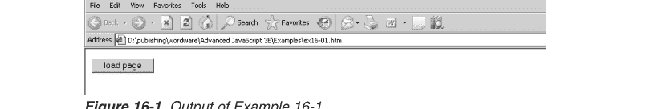

## 第16章

你也可以通过读取URL值来检索当前窗口（确切地说是当前窗口对象）的完整URL。例如，如果你想要当前文件的完整URL，不包括文件名本身，可以使用以下脚本片段：

```javascript
var url = location.href
var lastSlash = url.lastIndexOf("/")
var partialURL = url.substring(0, lastSlash + 1)
```

看看下面的脚本：

```javascript
var location = "Ben"
```

此语句不会产生任何错误，因为“location”不是保留字。然而，它会删除赋值location的函数内部的location对象。由于location不是浏览器对象而是一个简单的变量，因此可以从函数外部完全访问它。

Microsoft Internet Explorer和Netscape Navigator处理location.href属性以及location对象的方式不同。以下代码片段显示了差异：

```html
<HTML>
<HEAD>
<TITLE>location test</TITLE>
</HEAD>
<SCRIPT LANGUAGE="JavaScript">
<!--
function load()
{
    location.href = "http://www.microsoft.com"
    alert(location.href)
}
// -->
</SCRIPT>
<BODY onLoad="load()">
</BODY>
</HTML>
```

假设此文件位于http://www.geocities.com。当Netscape Navigator加载页面时，它会在内存中的某个位置保存已加载的URL。只有当另一个页面开始加载（数据正在传输）时，该单元格的值才会被修改以匹配新的URL。当你读取location.href的值时，你读取的是该单元格的值。但是，当你为其赋值一个代表另一个URL的字符串时，该单元格中保存的值不会立即更改。只有当且仅当服务器上找到指定URL的页面时，该单元格的值才会更新。Microsoft的浏览器在这种情况下有所不同。当用户为location.href赋值字符串时，它会自动更新内存中对应的单元格。因此，如果你在为location.href赋值后立即显示该属性的值，显示的是赋的值。另一方面，在Navigator中，由于尚未找到新URL处的文件，因此仍显示原始URL。让我们总结一下。上述脚本在每个主流浏览器上显示的值如下：

- Netscape Navigator—http://www.geocities.com
- Microsoft Internet Explorer—http://www.microsoft.com

根据你的浏览器，location.href的值可能使用非字母数字字符的ASCII等效字符进行编码。这些字符显示为百分号（%）后跟该字符的ASCII代码。最常用的编码字符是空格，%20。你可以在unescape()函数下运行此类URL，将它们转换为ISO Latin-1格式。

假设你有一个名为foo.html的HTML文件位于某个目录或文件夹中。在浏览器中加载此目录的完整路径通常应显示该目录中所有文件的列表，前提是该目录中不包含服务器支持的默认文件名。你可以使用以下脚本，让用户只需点击按钮即可查看文件列表：

```html
<HTML>
<HEAD>
<TITLE>Directory listing</TITLE>
</HEAD>
<SCRIPT LANGUAGE="JavaScript">
<!--
function getListing()
{
    var url = location.href
    var lastSlash = url.lastIndexOf("/")
    location.href = url.substring(0, lastSlash + 1)
}
// -->
</SCRIPT>
<BODY>
<FORM>
<INPUT TYPE="button" VALUE=" view directory listing " onClick="getListing()">
</FORM>
</BODY>
</HTML>
```

*示例 16-2 (ex16-2.htm)。点击按钮显示文件列表的脚本*

你可以在图16-2中看到此网页的样子。

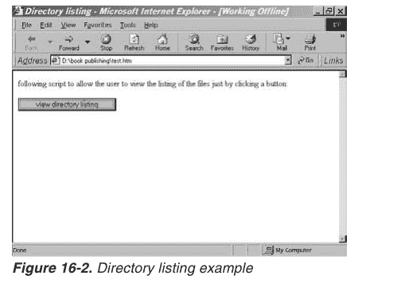

图16-2. 目录列表示例

## hash

锚点是其他数据可以指向的标记。它使你能够创建指向给定网页中特定位置的链接。假设你有一个网页，提供有关不同品牌各种DVD播放机型号的信息。寻找索尼DVD播放机特定信息的用户不应需要滚动浏览其他品牌，如JVC。因此，你可以在Sony名称附近某个位置创建一个命名锚点。锚点使用以下语法创建：

```html
<A NAME="sony1">Sony DVD players</A>
```

文本“Sony DVD players”在页面上正常显示，但它用作锚点。你可以通过简单的链接到锚点的方式，将用户定向到“Sony DVD players”部分，如下所示：

```html
<A HREF="#sony1">Get information on Sony DVD players</A>
```

在这种情况下，链接的URL是锚点名称前加井号（#）。当用户点击链接“Get information on Sony DVD players”时，浏览器会自动“滚动”到名为“sony1”的锚点（当然，你看不到滚动过程）。你也可以从另一个页面将用户定向到该锚点。例如，假设DVD播放机页面的完整URL是http://www.dvdplayer.com/information/index.html。现在，假设你想从页面http://www.electronics.com/dvdplayerlinks/new.html提供一个链接到包含DVD播放机信息的页面，特别是到Sony部分。你可以通过在electronics文件中的某处包含DVD播放机文件的URL以及Sony锚点名称来完成此任务：

```html
<A HREF="http://www.dvdplayer.com/information/index.html#sony1">Get information on Sony DVD players</A>
```

此表单允许您指定文档的URL以及特定的锚点名称。通过仅指定锚点名称，系统会假定该锚点位于当前文档中，正如您指定一个文件名而不带完整路径时，系统会假定它与HTML文档位于同一目录一样。此类URL引用被称为*相对*或*部分*引用。

当您点击一个包含命名锚点引用的URL链接时，新的URL或位置由井号（#）后跟锚点名称组成。URL的这一部分被视为URL的一部分，就像路径或文件名一样。链接到锚点后，用户主动滚动页面不会影响URL（或*location.href*的值）。

JavaScript为URL中的当前锚点引用提供了一个属性。该属性名为hash（*location.hash*），因为锚点引用存储在哈希表中。您可以向*location.hash*赋值，以指示浏览器跳转到当前页面内的指定锚点。与*href*属性一样，*hash*属性也是可读的。您应仅在处理当前文档中的本地锚点时使用此属性。假设以下文档已作为.html文件保存在服务器或您的计算机上：

```html
<HTML>
<HEAD>
<TITLE>status bar</TITLE>
<SCRIPT LANGUAGE="JavaScript">
<!--
function loadPage()
{
    location.href = "http://www.chuckeasttom.com/index.htm"
    location.hash = "authors"
}
// -->
</SCRIPT>
</HEAD>
<BODY onLoad="loadPage()">
</BODY>
</HTML>
```

函数*loadPage()*（通过*onLoad*事件处理程序调用）尝试加载页面 http://www.chuckeasttom.com/index.htm。由于浏览器不会等待页面加载完成，该函数继续执行，进入下一条语句。然而，此语句也试图通过*location.hash*属性指定锚点来修改页面的URL。由于锚点位于当前页面，它会被立即加载。尝试分配锚点会触发*onLoad*事件处理程序，从而再次执行该函数。由此产生的循环显然是无限的，会一直持续直到用户按下那个大的红色停止按钮。请务必记住，不要单独为*location.hash*赋值，而与*location.href*分开。您必须在同一条语句中为它们赋值：

```javascript
function loadPage()
{
    location.href = "http://www.chuckeasttom.com/index.htm#certifications"
}
```

与其尝试修改href的多个属性，不如直接赋值href属性，因为它指的是一个完整的URL，包括锚点引用、搜索规范以及location对象的所有其他属性。通常，location.hash属性是唯一可以单独赋值以调整当前文档内锚点引用位置的属性。同时请记住，属性赋值后会重新加载页面。

初学者常见的一个问题是，hash属性的值有时似乎不一致。例如，如果未引用任何锚点，location.hash的计算结果为空字符串。但是，如果指定了锚点，则井号（#）和锚点名称都是此属性的一部分。更改锚点值时，不要包含井号。

以下HTML文档将澄清这一点：

```html
<HTML>
<HEAD>
<TITLE>location.hash property</TITLE>
<SCRIPT LANGUAGE="JavaScript">
<!--
function goNext(nextAnchor)
{
    location.hash = nextAnchor
}
// -->
</SCRIPT>
</HEAD>
<BODY>
<A NAME="anchor1">Top</A>
<BR>
<FORM>
<INPUT TYPE="button" VALUE="advance" onClick="goNext('anchor2')">
</FORM>
<BR>
<HR>
<BR>
<A NAME="anchor2">Middle</A>
<BR>
<FORM>
<INPUT TYPE="button" VALUE="advance" onClick="goNext('anchor3')">
</FORM>
<BR>
<HR>
<BR>
<A NAME="anchor3">Bottom</A>
<BR>
<FORM>
<INPUT TYPE="button" VALUE="advance" onClick="goNext('anchor1')">
</FORM>
</BODY>
</HTML>
```

示例 16-3 (ex16-3.htm)。一个不使用常见链接而跳转到锚点的脚本

为了观察示例 16-3 中脚本的效果，您必须调整浏览器窗口大小，使其小于整个文档（应该出现滚动条），因为如果锚点已经在视野内，引用命名锚点将没有任何效果。通过点击页面上的四个按钮之一，焦点会放置在相应的锚点和不同的按钮上。点击第四个按钮会将页面滚动到第一个锚点，即页面的开头。由于HTML不支持将表单按钮链接到锚点，您必须使用JavaScript来完成此类任务。

## host

location.host属性不常用，但为了完整性，我们将介绍它。此属性代表URL的 <主机>:<端口> 部分，而不仅仅是<主机>（参见location.hostname）。当协议方案是file且文件是本地文件时，此属性为空字符串。当未指定端口时，location.host的值等于location.hostname，即<主机>。假设某个页面的完整URL是 http://www.geocities.com:80/SiliconValley/9000/index.html。如果在该页面上查询，location.host的值是 www.geocities.com:80。此值始终等于表达式 location.hostname + ":" + location.port。仅当明确指定了端口时才包含冒号。基本规则是，如果浏览器的“地址”框中不包含端口，那么它就不是location.host字符串的一部分。

由于80被认为是默认端口，以下函数显示URL的完整 <主机>:<端口> 部分：

```javascript
function alertHost()
{
    var colonIndex = location.host.lastIndexOf(":")
    var port = (colonIndex == -1) ? ":80" : ""
    alert("The complete host specification is: " + location.host + port)
}
```

如果您从页面 http://www.chuckeasttom.com/index.htm 调用此函数，警报框中显示的值是 www.geocities.com:80。如果页面是通过完整的主机规范直接加载的：http://www.chuckeasttom.com/index.htm，也会显示相同的值。

## hostname

location.hostname属性与location.host几乎相同，只是如果URL中指定了端口号，它不包含端口号。也就是说，它仅由完整URL的<主机>部分组成（参见本章开头的“URL速成”部分）。`location.hostname`就是托管机器的互联网地址。在以下两个URL上，此属性的计算结果为 `www.geocities.com`：

http://www.chuckeasttom.com/index.htm

http://www.geocities.com/~chuckeasttom/index.htm

## pathname

URL的pathname组件由一个目录结构组成，该结构相对于托管服务器的根卷。对于http协议，这是URL的 `<路径>` 部分。如果文件位于服务器的根目录中，pathname属性的计算结果为单个斜杠（/），后跟完整的文件名。pathname属性始终包含脚本所在文件的名称。此属性在Internet Explorer中返回一个非标准值。当文件位于客户机上时，使用反斜杠而不是斜杠来分隔路径中的目录名。

例如，如果托管文档的完整URL是 http://www.chuckeasttom.com/index.htm，location.pathname的值是 /~chuckeasttom.com/index.htm。

## port

正如预期的那样，`location.port`属性包含端口号，或者说是通用URL语法中的 `<端口>` 部分。如今，很少有网站需要在URL中显式指定端口号。当未指定端口时，它默认为标准的80，而这并不属于`location.port`属性的一部分。如果您打算根据端口和主机名属性的值构造URL，请记住用冒号将它们分隔开。

## protocol

URL的protocol组件通常被称为方案（`<方案>`）。`location.protocol`属性包含文档URL的方案组件，后跟一个冒号。方案组件通常是http:，但也支持其他方案。有关最流行方案的更多信息，请参阅本章开头的“URL速成”部分。

您可以通过将其中一种方案加载为文档的URL，然后输入 `alert(location.protocol)` 来显示mocha:或javascript:协议。您也可以尝试将以下字符串作为URL加载：

- javascript:alert(location.protocol)
- mocha:alert(location.protocol)


## 搜索

当您提交表单时，有时会发现检索到的文档URL后面跟着一个问号（?）和一个编码字符串。例如，Yahoo!上的一个典型搜索URL是 `http://search.yahoo.com/bin/search?p=perl+book&a=n`。`location.search` 的值正是这个字符串，包括问号。搜索规范的每个部分（`?p=perl+book&a=n`）通常由和号（`&`）分隔，如上述字符串所示。非字母数字字符会被编码并替换为对应的两位ASCII码，并在其前加上百分号（%）。如果文本字段或文本区域包含空格字符，则它们会被替换为加号（+）。问号后面的字符串被称为搜索查询字符串，尽管它并非直接提交给搜索引擎的查询。

虽然 `location.search` 属性的用途可能不那么显而易见，但它确实是JavaScript支持的最重要的属性之一。其重要性在于，您可以将其用于许多与CGI脚本或搜索引擎无关的目的。

首先，请记住，如果指定了搜索查询（包括问号），那么页面的实际URL是查询之前的那部分字符串。例如，您可以使用URL `http://www.intel.com/index.htm?Intel+home+page` 来加载Intel的主页，而不是该页面的标准URL `http://www.intel.com/index.htm`。由于Intel的页面不使用任何搜索查询，因此查询规范是多余的。您可以通过输入其常规URL后跟任意搜索查询字符串来加载网络上的任何页面。此功能使得在JavaScript中使用搜索查询成为可能。例如，您可以提示用户输入其姓名，并将其作为搜索查询传递给您网站上的所有其他页面。连同Cookie（在第20章“实现Cookie”中解释），`location.search` 属性可作为从外部资源获取的永久数据的存储方式。以下示例包含两个页面——`page1.html` 和 `page2.html`：

```html
<HTML>
<HEAD>
<TITLE>User first name input</TITLE>
</HEAD>
<BODY>
<SCRIPT LANGUAGE="JavaScript">
<!--
var usernm = prompt("Enter your first name:", "")
location.href = "page2.html?" + usernm
// -->
</SCRIPT>
</BODY>
</HTML>
```

page1.html

278 第16章

```html
<HTML>
<HEAD>
<TITLE>User first name output</TITLE>
</HEAD>
<BODY>
<SCRIPT LANGUAGE="JavaScript">
<!--
function getQuery()
{
    var query = location.search.substring(1, location.search.length)
    return query
}
alert("I know your name -- " + getQuery())
// -->
</SCRIPT>
</BODY>
</HTML>
```

page2.html

`page1.html` 的脚本提示用户输入其名字，然后使用一个以问号开头的搜索查询，将输入的名字加载到 `page2.html` 中。`page2.html` 的脚本调用一个函数，该函数剥离问号，返回原始的查询字符串，然后显示用户的名字。`location.search` 属性在此示例中展示了一种在文档之间传递少量信息的便捷方式。

示例16-4演示了在更复杂的脚本中使用此属性：

```html
<HTML>
<HEAD>
<TITLE>Matches game</TITLE>
</HEAD>
<BODY>
<SCRIPT LANGUAGE="JavaScript">
<!--
// 返回当前搜索查询（不包括问号）
function stripQuery()
{
    // 将 location.search 的值和长度赋值给局部变量
    var search = location.search
    var length = search.length
    // 如果没有指定查询
    if (search == "")
        // 返回游戏开始时的火柴数量
        return "25"
    // 从字符串中剥离问号
    var query = search.substring(1, length)
    // 返回剥离后的查询
    return query
}
// -->
</SCRIPT>
</BODY>
</HTML>
```

```html
// 打印所需行的火柴图片
function placeMatches(num)
{
	// 通过循环放置 num 根火柴
	for (var i = 1; i <= num; ++i)
	{
		document.write('<A HREF="' + getURL(i, num) + '">' +
				'  </A>')
	}
}
// 返回火柴图片链接的计算URL
function getURL(pos, num)
{
	// 从右边开始计算火柴在行中的位置
	var distance = num - pos + 1
	// 例如，一行20根火柴中的第19根，20-19+1 = 从右数第2根
	// 如果该火柴不是行中最后三根之一
	if (distance > 3)
		// 链接不做任何操作
		return "javascript:alert('Choose one of last three matches')"
	// 否则，因为 return 语句会终止函数，所以不需要 else
	// 返回下一次页面加载所需的火柴数量
	return "ex16-4.htm?" + (num - 4)
}
// 要显示的火柴数量
var num = parseInt(stripQuery())
// 将说明文字赋值给变量
var instructions = ""
instructions += "The objective of the game is to force the other Player "
instructions += "(the computer) to pick up the last match. On each turn "
instructions += "you may pick up some matches, but only 1, 2, or 3. The "
instructions += "computer does the exact same on its turn. Play smart, "
instructions += "or else you will be devastated."
// 如果没有指定查询
if (num == 25)
	// 显示说明文字
	alert(instructions)
// 如果只剩下一根火柴
if (num == 1)
{
	// 打印火柴图片和一个用于新游戏的链接
	document.write('<BR><BR><A HREF="ex16-4.htm">Play again?</A>')
	// 告诉用户他/她输了
	alert("I win -- come back when you improve!")
} else
	// 不可能的条件
	if (num < 1)
		// 告诉用户他/她作弊了
		alert("You cheated!")
	else
		// 放置所需数量的火柴
		placeMatches(num)
```

```html
// -->
</SCRIPT>
</BODY>
</HTML>
```

**示例16-4 (ex16-4.htm). 一个简单的游戏**

让我们解释一下示例16-4的游戏规则。当用户首次加载页面时游戏开始，显示一行25根火柴。用户必须通过点击相应的火柴来拾取一根、两根或三根火柴。例如，要只拾取一根火柴，用户必须点击最右边的火柴。点击从右数第二根火柴等同于拾取两根，三根同理。用户拾取一些火柴后，计算机按照与用户相同的规则进行它的回合。游戏的目标是迫使对方玩家拾取最后一根火柴。也就是说，拾取最后一根火柴的一方输掉游戏。

这个游戏被设计来证明计算机比人类更聪明，因为你无法获胜。无法击败计算机的真正原因是用户先走。计算机选择的火柴数量等于四减去用户选择的火柴数量。例如，如果用户拾取了两根火柴，计算机也拾取两根。如果用户选择了三根火柴，计算机选择一根。最后，如果用户选择一根火柴，计算机选择三根。因此，每次双重操作（用户和计算机的序列）总共会移除四根火柴。经过六次双重操作，移除了24（4 * 6）根火柴，只剩一根。此时轮到用户操作，这意味着计算机再次获胜。

`stripQuery()` 函数非常简单；它返回不带问号的搜索查询。如果未指定查询，则用户尚未开始游戏，返回的字符串默认为25。

`placeMatches()` 函数也很简单；它接受要打印的火柴数量，并使用循环打印相应数量的 `match.gif` 图像。每张图像也是一个超文本链接，其指定的URL由 `getURL()` 函数根据当前火柴的索引（正整数 `i`）和放置的火柴总数（`num`）来检索。

`getURL()` 函数接受给定火柴的索引以及要放置的火柴总数。最右边火柴对应的索引被赋值给变量 `distance`。例如，如果有25根火柴，`pos` 的值为23，那么赋值给 `distance` 的值是 25 – 23 + 1 = 3。如果赋值大于3，给定火柴的数据表明它不是行中最后三根火柴之一，因此返回的URL是一个JavaScript `alert` 语句（使用 `javascript:` 方案或协议）。如果给定的火柴不是最后三根之一，则函数终止，因此剩余部分仅适用于行中最后三根火柴。在这种情况下，返回的URL是文档的裸URL，其搜索查询等于剩余的火柴数量（当前火柴数量减去四），


因为计算机会自动完成玩家到四子的移动（具体算法请参阅上文的解释）。

全局语句也是脚本非常重要的一部分。首先，当前页面的查询参数从数字字符串转换为数字，然后赋值给变量 `num`。如果 `num` 的值是 25，表示游戏刚刚开始，指令会以警告框的形式显示。如果 `num` 的值是 1，表示游戏结束（计算机获胜），并显示相应消息，随后是一个重新启动游戏的链接，该链接通过加载不带查询参数的当前文档来实现。如果 `num` 的值小于 1，则意味着遇到了不可能的状态，即用户试图通过修改搜索查询来作弊或覆盖脚本，此时会弹出一个警告框报告此发现。对于所有其他 `num` 值，游戏正在进行中，因此会调用 `placeMatches()` 函数根据给定情况放置匹配项。

## location 方法

`location` 对象（`window.location`）也有几个方法。它们得到了最新的 Netscape 和 Microsoft 浏览器的支持。

### reload

`location.reload` 方法强制重新加载窗口的当前文档。其一般语法为：

```
location.reload([true])
```

将布尔值 `true` 作为方法的可选参数指定，会强制从服务器进行无条件的 HTTP 获取文档。无条件获取会直接从服务器检索文档，忽略浏览器缓存的内容（该缓存可能已包含该文档的所需数据）。因此，除非你有理由相信磁盘或内存缓存已损坏，或者服务器上有该文档的新版本，否则不应指定 `true`。如果存在这样的版本，你必须强制进行无条件的 HTTP 获取，因为缓存中存储的文档版本与服务器上的新版本不同。这种情况在 CGI 生成的文档中很常见。

`reload()` 方法只是重新加载其 URL 存储在 `location.href` 中的文档。它使用与“重新加载”或“刷新”按钮相同的策略。Microsoft 选择将该按钮标记为“刷新”而不是“重新加载”，但可能会保留相同的方法名称。确切的重新加载策略取决于缓存处理菜单选项。在 Netscape Navigator 中，用户通过从“选项”菜单中选择“网络首选项”，并在“首选项”对话框的“缓存”选项卡上指定“验证文档”来设置此策略的默认值。

“Since” HTTP 头。HTTP 头在从服务器检索文档时传递给浏览器。它包含有关当前文档的重要信息。如果用户将首选项设置为“每次”，浏览器会检查传输的 HTTP 头，根据“最后修改时间”属性查看文档是否已更新。如果已更新，则无法从存储了文件先前版本的缓存中加载文档。简而言之，除非用户指定了“每次”并且文档自上次加载并保存到缓存以来在服务器上已更改，否则 `reload()` 将加载缓存的版本。由于其大小有限，缓存可能会丢失长时间未重新加载的文档版本。在这种情况下，即使文档自上次加载以来未发生更改，也需要从服务器完全加载。

在事件处理程序中，你必须指定 `window.location.reload()`，而不是简单地使用 `location.reload()`。由于 JavaScript 中静态对象的作用域，调用 `location` 而不指定对象名等同于调用 `document.location`，它是 `document.URL` 的同义词。本章后面将更详细地解释这个概念。

你可能经历过这样的情况：你让电脑连接到主机然后出去休息，回来时发现连接已断开。通常原因是主机（服务器）因为你长时间没有通过服务器传输任何数据而断开了连接。你可以通过定期从服务器重新加载 JavaScript 文档来解决此问题。下次出去吃午饭时，在浏览器窗口中加载以下文档：

```
<HTML>
<HEAD>
<TITLE>保持连接</TITLE>
</HEAD>
<!-- 200000毫秒 == 200秒 -->
<BODY onLoad="timerID = setTimeout('window.location.reload(true)', 200000)">
</BODY>
</HTML>
```

**示例 16-5 (ex16-5.htm).** *一个保持连接活跃的简单 HTML 文档*

`onLoad` 事件处理程序用于调用 `reload()` 方法。`setTimeout()` 方法将重新加载过程从文档完全加载的时刻延迟 200,000 毫秒，即 200 秒。由于它以事件处理程序的形式使用，因此必须完全指定 `reload()` 方法，包括 `window` 对象引用。参数 `true` 强制与服务器进行事务处理。

### replace

`replace()` 方法也是 `location` 或 `window.location` 对象的一个属性。它用指定的 URL 覆盖当前历史记录条目。当前历史记录条目是添加到历史记录列表的最新 URL 或先前加载的页面的 URL。这是用户按下“后退”按钮时检索到的 URL（前提是“前进”按钮已灰显）。`replace()` 方法的一般语法如下：

```
location.replace("URL")
```

使用 `replace()` 方法后，用户无法通过“后退”按钮导航到上一个 URL。再次请记住，事件处理程序需要完整的方法规范。

假设你希望用户通过点击页面 A 上的链接加载页面 B。你可以调用此方法来加载页面 B（使用页面 B 的 URL 作为参数），而不是使用普通的超链接 `link`。一旦页面 B 加载完成，用户就无法通过“后退”按钮返回到页面 A。

## 另一个 location——document.location (document.URL)

到目前为止，任何对 `location` 对象的引用都默认为 `window.location`。但在 JavaScript 中还有另一个 `location`——`document.location`。为了避免混淆，Netscape 决定将 `document.location` 更改为 `document.URL`。

`document.URL` 属性保存当前文档的完整 URL。与 `window.location(.href)` 不同，它是一个只读值。它不区分窗口和框架；它只识别包含脚本的文档和对此属性的引用。请记住，URL 属于文档，而不是窗口。因此，当一个窗口包含多个文档（包括框架结构）时，单个框架的 `document.URL` 不同于 `window.location(.href)`，不同于任何其他框架的 `document.URL`，也不同于主框架集的 `document.URL`。

如果你想将新文档加载到浏览器窗口中，你必须使用可写的 `window.location`（`== window.location.href`）。如果你想获取特定框架的 URL，你应该使用 `document.URL`。你也可以使用此属性在文档没有框架且你确定不想更改 URL（加载另一个页面）的情况下检索窗口的 URL。

由于 `document.location` 仍在使用（尤其是在 Internet Explorer 3.0 中），在使用 `location` 属性时必须非常小心。如果你不是非常有经验的脚本编写者，或者不完全理解 JavaScript 中的对象作用域，一个好的做法是始终指定调用对象 `window` 或 `document`。当你在脚本中引用 `location` 时，它默认为 `window.location`，因为 `window` 是脚本内的默认对象。但是，当你在事件处理程序脚本中指定裸 `location` 时，调用对象默认为 `document`；即 `location` 默认为 `document.location`。

## 搜索工具

你可能已经注意到，多引擎搜索工具开始主导网络。例如，你可以使用一个表单同时搜索 Infoseek、AltaVista 和 Yahoo!。创建此类搜索界面基本上有两种方式：

- 通过服务器端 CGI 脚本
- 通过客户端 JavaScript 脚本

由于 CGI 超出了本书的范围，我们只讨论第二种方法。JavaScript 是一种非常灵活的跨平台语言。你可以用许多完全不同的脚本执行特定任务。例如，你可以在页面中放入一个长脚本来启用多引擎搜索界面。你也可以在页面中放置一个表单，将查询提交到包含脚本的另一个页面。你甚至可以调用外部脚本中的函数来完成这项工作。

你可能已经接触高级 HTML 一段时间了，所以应该知道如何提交表单。通常有两种提交方法：

- get
- post

get 方法在调用指定文件时会附带表单字段的内容。`ACTION` 属性指定表单提交时要调用的文档或脚本的名称。看下面这个表单：

```
<FORM METHOD="get" ACTION="file1.html">
<INPUT TYPE="text" SIZE=50 NAME="userid">
<INPUT TYPE="text" SIZE=30 NAME="passwd">
<INPUT TYPE="submit" VALUE="submit form">
</FORM>
```

这个结构创建了一个包含三个元素的表单。前两个是简单的文本框或字段。后者是一个提交按钮，它会触发提交。也就是说，当用户点击按钮时，表单将根据 `METHOD` 的 `ACTION` 进行提交。假设用户在第一个字段中输入“第一个框的输入”，在第二个字段中输入“第二个框的输入”，然后点击“提交表单”按钮。表单被提交。在这种情况下，方法是 get，因此浏览器会“获取”指定的文件 `file1.html`。文件（包括搜索查询）被检索。浏览器在这种情况下检索到的完整 URL 是 `file1.html?userid=input+of+first+box&passwd=input+of+second+box`。请注意，搜索查询中的每个值都由一个“&”分隔符分隔。此外，用户在每个字段中输入的值（或通常元素的值）前面是元素的名称，后跟一个等号 (=)。加载构造的 URL，如果加载的文件是带有 JavaScript 脚本的 HTML 文档，则可以使用搜索查询。现在让我们看一个实际的例子：

```
<HTML>
<HEAD>
```

## 多引擎搜索

搜索网络以获取关于以下内容的信息：

[输入框]

通过以下选项进行搜索：AltaVista、Excite、Infoseek、Lycos、Magellan、Yahoo。

点击搜索按钮。

示例 16-6a (ex16-6a.htm)。此搜索界面可以添加到任何页面。

此表单比之前的稍微复杂一些。它由两个贡献值的元素组成：一个字段（文本框）和一个 SELECT 对象，使用户能够从列表中选择一个选项。所选 OPTION 的值就是 SELECT 元素的贡献值。请查看图 16-3，其中演示了一个可能的用户输入：

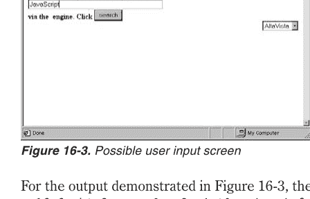

对于图 16-3 所示的输出，加载的 URL 是 ex16-6a.htm?query=JavaScript&engine=infoseek。文本框元素的名称是 "query"，这是加载 URL 搜索查询的第一个子字符串。本例中的值是 JavaScript，其中所有空格字符都被加号代替——这是常见的编码方式。提交的表单也包括 SELECT 对象。它的名称是 engine，跟在分隔符 `&` 之后。它的值是选中的 OPTION，即 infoseek。你现在理解了检索 URL 的所有组成部分，所以我们可以继续分析脚本本身。

```html
<HTML>
<HEAD>
<TITLE>Please wait</TITLE>
<SCRIPT LANGUAGE="JavaScript">
<!--
// create object of all prefixes
var prefix = new prefixObject()
// create object of query prefixes
function prefixObject()
{
    // lycos prefix
    this.lycos = "http://www.lycos.com/cgi-bin/pursuit?query="
    // altavista prefix
    this.altavista = "http://www.altavista.digital.com/cgi-bin/query?pg=q&q="
    // infoseek prefix
    this.infoseek = "http://guide-p.infoseek.com//Titles?qt="
    // yahoo prefix
    this.yahoo = "http://av.yahoo.com/bin/search?p="
    // magellan prefix
    this.magellan = "http://searcher.mckinley.com/searcher.cgi?query="
    // excite prefix
    this.excite = "http://www.excite.com/search.gw?search="
}
// execute search
function callSearch()
{
    // create array to hold search engine and search query
    var queryArray = location.search.split("=")
    // assign search query
    var query = queryArray[1].substring(0, queryArray[1].indexOf("&"))
    // assign search engine
    var engine = queryArray[2]
    // load the desired page to display search results
    location.href = prefix[engine] + query
}
// -->
</SCRIPT>
</HEAD>
<BODY BGCOLOR="white" onLoad="timerID = setTimeout('callSearch()', 3000)">
<CENTER>
<BR>
<B>P<FONT SIZE=-1>LEASE </FONT>W<FONT SIZE=-1>AIT...</FONT></B>
<BR>
<BR>
Click the button to terminate search...
<FORM>
<INPUT TYPE="button" VALUE="terminate search" onClick="clearTimeout(timerID)">
</FORM>
```

**示例 16-6b (ex16-6b.htm)**。解释用户输入并调用相应搜索引擎的脚本。

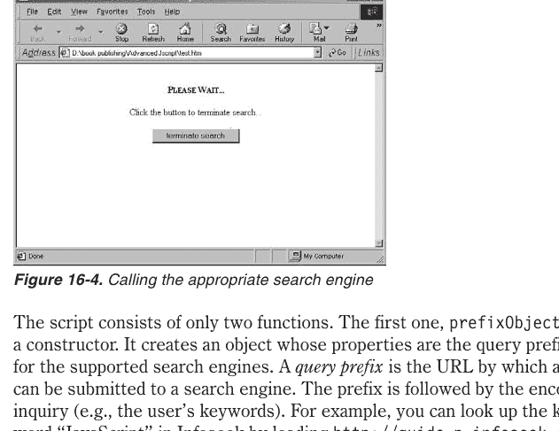

图 16-4。调用相应的搜索引擎。

该脚本仅由两个函数组成。第一个函数 `prefixObject()` 是一个构造函数。它创建一个对象，其属性是受支持搜索引擎的查询前缀。查询前缀是可以向搜索引擎提交查询的 URL。前缀后面是编码后的查询内容（例如，用户的关键词）。例如，你可以通过加载 `http://guide-p.infoseek.com//Titles?qt=JavaScript` 在 Infoseek 中查找关键词 "JavaScript"。每个搜索引擎都有其独特的前缀，因此必须为每个受支持的搜索引擎显式指定前缀。构造函数 `prefixObject()` 将每个前缀分配给一个属性，该属性的名称根据与其关联的搜索引擎命名。例如，Infoseek 的前缀按如下方式分配给名为 `infoseek` 的属性：

```javascript
this.infoseek = "http://guide-p.infoseek.com//Titles?qt="
```

如果你知道这些前缀，你可以轻松地扩展脚本以支持其他搜索引擎。找到这样的前缀并不困难——只需在所需的引擎上运行一次正常搜索，然后提取所需的前缀即可。由于前缀对于大多数引擎来说已经足够，后缀只是偶尔使用。搜索引擎的前缀可能会更改，应由脚本所有者（网站管理员）维护。

全局变量 `prefix` 是此对象的一个实例，因此其属性是搜索引擎的前缀。

`callSearch()` 函数也非常简单。首先，它将编码后的用户输入（关键词）分配给变量 `query`。它还将选定的搜索引擎分配给变量 `engine`。表达式 `prefix[engine]` 等于所选搜索引擎的前缀，因为表单的 OPTION 的值（参见示例 16-6a）等效于此脚本中使用的属性名称。存储在 `prefix[engine]` 和 `query` 中的表达式被组合以构造完整的所需 URL。然后，组合后的字符串通过赋值给 `location.href` 属性作为新 URL 加载。

你可能已经注意到该函数不是作为立即脚本调用的。它是通过 `onLoad` 事件处理程序调用的，该处理程序会延迟执行，直到页面完成加载。在这种情况下，使用 `setTimeout` 语句将执行再延迟三秒钟，给用户终止进程的机会。这一点极其重要，特别是当用户使用“后退”按钮“反向”浏览时。

使用由单个按钮组成的表单，通过 `clearTimeout()` 方法清除超时，该方法接收初始超时的标识符。用户可以单击此按钮，在指定搜索引擎实际被调用之前终止搜索过程。

## 总结

在本章中，我讨论了 JavaScript 的 URL。首先，我介绍了常见的 URL 术语，包括各种支持的方案（http、ftp、gopher 等）。然后，我介绍了 `window.location` 对象及其所有属性和方法。`href` 属性用于将文档相互链接。我还讨论了一个基于 URL 处理的多引擎搜索实用程序，并介绍了另一个与 URL 相关的元素——`document.URL` 属性，也称为 `document.location`。你现在应该已经掌握了 URL 处理，因为本书后面将介绍更高级的与 URL 相关的概念，例如框架。

## 第17章 文档对象与历史列表

### document 对象

`document` 对象是 `window` 对象的属性。每个 `window` 对象，无论是完整的浏览器窗口、框架还是 JavaScript 生成的窗口，都有一个 `document` 属性。此属性本身实际上是一个对象；你可以将其视为 `window` 对象的子对象。`document` 对象封装了浏览器窗口或框架内容区域中存在的所有内容。它是网页内容的父对象，包括链接、锚点、颜色、标题等。`document` 对象的属性分布在 HTML 文档的整个范围内。有些通常放在头部，而其他则通常位于正文部分。`document` 对象不包含任何事件处理程序。你可能认为 `onLoad`、`onUnload` 和 `onError` 属于此对象，但它们实际上是 `window` 对象的属性。

虽然使用 `document` 对象处理 HTML 内容很常见，但你应该记住，并非所有 `document` 对象的属性都是 HTML 驱动的内容。例如，`lastModified` 属性提供文档最后修改的日期，尽管此日期并非显式在文档中提供，而是在文档不可见的标题中提供。

`document` 对象将许多与内容相关的属性分组，如文本颜色、背景颜色等。它还包括更复杂的、实际上是对象的属性，如表单、链接和图像映射。

### title 属性

文档的标题默认设置为其完整 URL。大多数网页作者会用自己的文本替换此标题，该文本在头部的 `<TITLE></TITLE>` 标签对中指定。标题通常出现在标题栏中，也用于在操作系统环境中标识浏览器。当网页包含框架时，标题栏显示包含框架集的文档的标题。


文档的标题也可以通过JavaScript进行脚本编写。其通用引用是`document.title`。如果文档不构成主浏览器窗口，则该引用必须前缀该文档所属的特定窗口。框架文档的标题同样可以通过JavaScript使用相同的过程来访问。

`document.title`属性不能由任何JavaScript脚本设置，只能在构建整个文档期间设置。你可以以多种不同方式使用title属性。假设你希望文档有一个包含文档标题的大号标题。以下是一个此类页面的框架：

```html
<HTML>
<HEAD>
<TITLE>Chuck's Home Page</TITLE>
</HEAD>
<BODY>
<SCRIPT LANGUAGE="JavaScript">
<!--
document.write("<CENTER><H1>" + document.title + "</H1></CENTER>")
// -->
</SCRIPT>
</BODY>
</HTML>
```

你可以在图17-1中看到此脚本的输出。

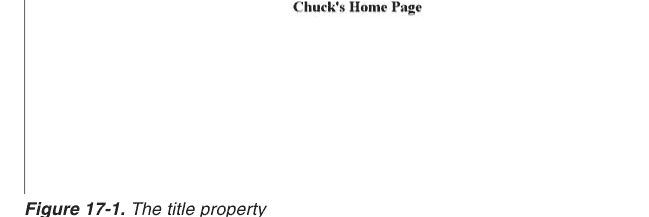

如果你不包含`<TITLE></TITLE>`标签对，标题默认为文档的完整URL，包括指定的任何搜索查询。如果你放置的`<TITLE></TITLE>`标签对之间没有文本，标题仍然默认为URL。如果开闭标签之间的文本不包含除一个或多个空格字符之外的任何字符，则文档被视为无标题，`document.title`保持为空字符串，或者在Microsoft Internet Explorer的情况下为空格填充的字符串。除非你明确在`<TITLE></TITLE>`标签之间编写URL，否则`document.title`属性的值永远不会求值为URL。

因为标题栏的值也标识操作系统环境中的浏览器应用程序，Netscape和Microsoft都没有提供显式修改它的功能。例如，将应用程序标识为滚动文本没有任何意义，因此标题栏的值只能通过`document.title`属性来赋值。

## 颜色

JavaScript支持多种网页颜色属性，例如背景色和激活链接颜色。它们都是通过相同的方法构造的。通常有两种构建颜色规格的方式：

-   Netscape颜色名称
-   十六进制三原色

网页设计者倾向于使用Netscape颜色名称规格，它更直观且更易于维护。例如，你可以通过以下方式设置文档的背景颜色：

```html
<BODY BGCOLOR="white">
```

在Netscape和Microsoft实现此类颜色名称之前，指定颜色的唯一方法是通过十六进制三原色。它们仍然受支持，因此你可以通过以下方式将背景颜色设置为白色，例如：

```html
<BODY BGCOLOR="#ffffff">
```

尽管这种方法不再必要，你仍会经常看到它被使用，因此对它的基本工作原理有所了解是个好主意。如你所见，三原色由三个两位十六进制数字组成。它们代表颜色描述符的红、绿、蓝分量。总共有大约1700万种组合，这等于典型Macintosh或SVGA彩色显示器所支持的颜色数量。然而，Netscape使用了一个更有限的颜色立方体。该立方体由每个颜色描述符的00、33、66、99、CC和FF的所有组合组成。结果是216（6 * 6 * 6）种不同的颜色。立方体偶尔会有变化。在Mac上，它包含完整的256色调色板。在Windows系统上，如果已使用超过40（256 – 216）种颜色，则立方体最小化为仅125（5 * 5 * 5）种颜色。目前，我们将基于标准的216色立方体进行讨论。通过抖动或混合产生的颜色超出了标准立方体的范围。

一个HTML文档可能包含多种颜色规格。以下脚本段落演示了它们：

```html
<BODY
   [BGCOLOR="#backgroundColor"]
   [TEXT="#foregroundColor"]
   [LINK="#unfollowedLinkColor"]
   [ALINK="#activatedLinkColor"]
   [VLINK="#followedLinkColor"]>
</BODY>
```

所有颜色属性都通过JavaScript作为文档对象的属性进行脚本编写。

## bgColor

`document.bgColor`属性表示为十六进制RGB三原色或字符串字面量（如“white”、“blue”等）。此属性是`<BODY>`标签BGCOLOR属性的JavaScript反映。你可以随时更改背景颜色，即使通过延迟脚本也是如此。如果将颜色表示为十六进制RGB三原色，则必须使用*rrggbb*格式（不区分大小写）。

`bgColor`属性是一个常用的脚本属性。你可以设置它来创建渐变效果、颜色立方体等，本章将予以演示。以下脚本创建一个示例颜色立方体，并将背景颜色设置为用户从立方体中选择的颜色：

```html
<HTML>
<HEAD>
<TITLE>Sample Color Cube</TITLE>
</HEAD>
<BODY>
<SCRIPT LANGUAGE="JavaScript">
<!--
// create 6-element array
var hex = new Array(6)
// assign non-dithered descriptors
hex[0] = "FF"
hex[1] = "CC"
hex[2] = "99"
hex[3] = "66"
hex[4] = "33"
hex[5] = "00"
// accept triplet string and display as background color
function display(triplet)
{
    // set color as background color
    document.bgColor = '#' + triplet
    // display the color hexadecimal triplet
    alert('Background color is now ' + triplet)
}
// draw a single table cell based on all descriptors
function drawCell(red, green, blue)
{
    // open cell with specified hexadecimal triplet background color
    document.write('<TD BGCOLOR="#' + red + green + blue + '">')
    // open a hypertext link with javascript: scheme to call display function
    document.write('<A HREF="javascript:display(\'' + (red + green + blue)
                   + '\')">')
    // print transparent image (use any height and width)
    document.write('')
// close link tag
document.write('</A>')
// close table cell
document.write('</TD>')
}
// draw table row based on red and blue descriptors
function drawRow(red, blue)
{
    // open table row
    document.write('<TR>')
    // loop through all non-dithered color descriptors as green hex
    for (var i = 0; i < 6; ++i)
    {
        drawCell(red, hex[i], blue)
    }
    // close current table row
    document.write('</TR>')
}
// draw table for one of six color cube panels
function drawTable(blue)
{
    // open table (one of six cube panels)
    document.write('<TABLE CELLPADDING=0 CELLSPACING=0 BORDER=0>')
    // loop through all non-dithered color descriptors as red hex
    for (var i = 0; i < 6; ++i)
    {
        drawRow(hex[i], blue)
    }
    // close current table
    document.write('</TABLE>')
}
// draw all cube panels inside table cells
function drawCube()
{
    // open table
    document.write('<TABLE CELLPADDING=5 CELLSPACING=0 BORDER=1><TR>')
    // loop through all non-dithered color descriptors as blue hex
    for (var i = 0; i < 6; ++i)
    {
        // open table cell with white background color
        document.write('<TD BGCOLOR="#FFFFFF">')
        // call function to create cube panel with hex[i] blue hex
        drawTable(hex[i])
        // close current table cell
        document.write('</TD>')
    }
    // close table row and table
    document.write('</TR></TABLE>')
}
// call function to begin execution
drawCube()
// -->
</SCRIPT>
</BODY>
</HTML>
```

示例17-1. (ex17-1.htm). *一个颜色立方体*

你可以在图17-2中看到其输出。

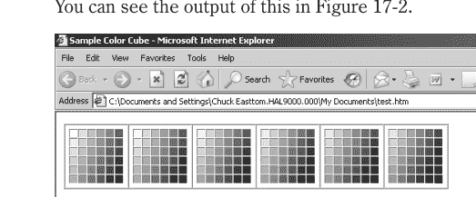

此脚本基本上打印表格。每个表格单元格包含一个定义单元格大小的透明图像。每个单元格还被分配一个背景颜色，该颜色决定填充该单元格的颜色。当你点击图像时，十六进制三原色通过警报框显示，并且背景颜色设置为所选颜色。

立方体的主要轮廓是一个具有一行和六个单元格（列）的表格。每个单元格包含一个所有非抖动颜色的表格，这些颜色具有给定的蓝色描述符。总共有六个表格，每个非抖动颜色一个：00、33、66、99、CC、FF。由于有六个非抖动十六进制值，每个表格是6 x 6。每一行表示一个红色十六进制值，每一列代表一个绿色十六进制值。

现在让我们分析脚本本身。

## 全局语句

```javascript
// create 6-element array
var hex = new Array(6)
// assign non-dithered descriptors
hex[0] = "FF"
hex[1] = "CC"
hex[2] = "99"
hex[3] = "66"
hex[4] = "33"
hex[5] = "00"
```

创建了一个六元素数组作为Array对象的实例。数组的元素被赋值为六个值，所有平台上支持的216种非抖动颜色都可以由这些值组合而成。脚本末尾的`drawCube()`函数调用也是全局的。


## display(triplet)

```javascript
// 接受三元组字符串并将其显示为背景颜色
function display(triplet) {
    // 将颜色设置为背景颜色
    document.bgColor = '#' + triplet
    // 显示颜色十六进制三元组
    alert('Background color is now ' + triplet)
}
```

此函数的单个参数是一个六字符字符串，代表颜色的十六进制RGB三元组。它设置文档的背景颜色，并通过一个警告框显示所选颜色的确切RGB三元组。

## drawCell(red, green, blue)

```javascript
// 根据所有描述符绘制单个表格单元格
function drawCell(red, green, blue) {
    // 打开具有指定十六进制三元组背景颜色的单元格
    document.write('<TD BGCOLOR="#' + red + green + blue + '">')
    // 打开一个使用javascript:方案的超文本链接以调用display函数
    document.write('<A HREF="javascript:display(\'' + (red + green + blue) + '\')">')
    // 打印透明图像（使用任意高度和宽度）
    document.write('')
    // 关闭链接标签
    document.write('</A>')
    // 关闭表格单元格
    document.write('</TD>')
}
```

此函数接受三个参数：红色、绿色和蓝色描述符。它创建一个表格单元格，并将组合后的三元组作为背景颜色。每个单元格的内容是一个gif89透明图像，place.gif。图像的高度和宽度规格决定了每个单元格的大小。每个图像也是一个指向“javascript:”方案URL的超文本链接，该URL调用`display()`函数。此函数的参数是一个十六进制三元组，该三元组也用作单元格的背景。请注意，所有全局数组描述符都是字符串，因此使用加号连接这三个双位十六进制值。

## drawRow(red, blue)

```javascript
// 根据红色和蓝色描述符绘制表格行
function drawRow(red, blue) {
    // 打开表格行
    document.write('<TR>')
    // 遍历所有非抖动的颜色描述符作为绿色十六进制值
    for (var i = 0; i < 6; ++i) {
        drawCell(red, hex[i], blue)
    }
    // 关闭当前表格行
    document.write('</TR>')
}
```

此函数接受红色和蓝色描述符，并打印一个表格行。表格的内容是通过六次调用`drawCell()`函数创建的，每次调用时“原样”传递红色和蓝色描述符，并传递一个不同的绿色描述符（来自全局hex数组）。

## drawTable(blue)

```javascript
// 为六个颜色立方体面板之一绘制表格
function drawTable(blue) {
    // 打开表格（六个立方体面板之一）
    document.write('<TABLE CELLPADDING=0 CELLSPACING=0 BORDER=0>')
    // 遍历所有非抖动的颜色描述符作为红色十六进制值
    for (var i = 0; i < 6; ++i) {
        drawRow(hex[i], blue)
    }
    // 关闭当前表格
    document.write('</TABLE>')
}
```

此函数与`drawRow()`函数非常相似。唯一的区别是它绘制一个6x6的表格，而不是一个6x1的行。它调用`drawRow()`函数六次，每次使用不同的红色描述符。所有表格属性都设置为0，以避免单元格之间的边界，从而营造出颜色在立方体上逐渐变化的效果。

## drawCube()

```javascript
// 在表格单元格内绘制所有立方体面板
function drawCube() {
    // 打开表格
    document.write('<TABLE CELLPADDING=5 CELLSPACING=0 BORDER=1><TR>')
    // 遍历所有非抖动的颜色描述符作为蓝色十六进制值
    for (var i = 0; i < 6; ++i) {
        // 打开具有白色背景颜色的表格单元格
        document.write('<TD BGCOLOR="#FFFFFF">')
        // 调用函数，使用hex[i]蓝色十六进制值创建立方体面板
        drawTable(hex[i])
        // 关闭当前表格单元格
        document.write('</TD>')
    }
    // 关闭表格行和表格
    document.write('</TR></TABLE>')
}
```

与其他函数不同，此函数不接受任何参数。它创建一个带有白色背景颜色的单行六单元格轮廓表格。该函数调用`drawTable()`六次，每个给定的蓝色描述符调用一次。将CELLPADDING属性设置为正数可以分隔表格。

另一个利用通过JavaScript设置背景颜色能力的经典示例是一个脚本，它在页面加载或卸载时创建淡入或淡出效果。以下是该脚本：

```html
<HTML>
<HEAD>
<TITLE>Fade in and out</TITLE>
<SCRIPT LANGUAGE="JavaScript">
<!--
// 将十进制值 (0 - 255) 转换为十六进制
// (使用Internet Explorer支持的 .toString(16) 方法)
function toHex(dec) {
    // 创建十六进制字符列表
    var hexCharacters = "0123456789ABCDEF"
    // 如果数字超出范围，返回限制值
    if (dec < 0)
        return "00"
    if (dec > 255)
        return "FF"
    // 转换后数字中第一个十六进制字符的十进制等价值
    var i = Math.floor(dec / 16)
    // 转换后数字中第二个十六进制字符的十进制等价值
    var j = dec % 16
    // 返回十六进制等价值
    return hexCharacters.charAt(i) + hexCharacters.charAt(j)
}

// 将背景颜色设置为指定的描述符
function setbgColor(red, green, blue) {
    document.bgColor = "#" + toHex(red) + toHex(green) + toHex(blue)
}

// 从起始描述符淡出到结束描述符（增加步长以增加过渡速度）
function fade(sred, sgreen, sblue, ered, egreen, eblue, step) {
    // 循环以创建淡入淡出效果
    for(var i = 0; i <= step; ++i) {
        // 设置当前红色描述符
        var red = Math.floor(sred * ((step - i) / step) + ered * (i / step))
        // 设置当前绿色描述符
        var green = Math.floor(sgreen * ((step - i) / step) + egreen * (i / step))
        // 设置当前蓝色描述符
        var blue = Math.floor(sblue * ((step - i) / step) + eblue * (i / step))
        // 根据描述符设置背景颜色
        setbgColor(red, green, blue)
    }
}
// -->
</SCRIPT>
</HEAD>
<BODY onLoad="fade(0, 0, 0, 255, 255, 255, 64)" onUnload="fade(255, 255, 255, 0, 0, 0, 64)">
<H1>Is this totally cool or what!!</H1>
</BODY>
</HTML>
```

示例 17-2 (ex17-2.htm)：创建淡入淡出效果的脚本

该脚本逐渐将文档的背景颜色从给定颜色更改为另一个指定颜色。它适用于以十六进制三元组格式表示的任何颜色。让我们来分析一下这个脚本。

## toHex(dec)

```javascript
// 将十进制值 (0 - 255) 转换为十六进制
// (使用Internet Explorer支持的 .toString(16) 方法)
function toHex(dec) {
    // 创建十六进制字符列表
    var hexCharacters = "0123456789ABCDEF"
    // 如果数字超出范围，返回限制值
    if (dec < 0)
        return "00"
    if (dec > 255)
        return "FF"
    // 转换后数字中第一个十六进制字符的十进制等价值
    var i = Math.floor(dec / 16)
    // 转换后数字中第二个十六进制字符的十进制等价值
    var j = dec % 16
    // 返回十六进制等价值
    return hexCharacters.charAt(i) + hexCharacters.charAt(j)
}
```

此函数接受一个参数，表示一个十进制数字，通常范围在0到255之间。它将其转换为十六进制等价值。十六进制数字列表被分配给字符串变量`hexCharacters`。如果十进制参数小于0，它返回最小字符串"00"；如果大于255，则返回最大"FF"，这在十六进制表示中等价于"FF"。值`Math.floor(dec / 16)`等于转换后数字中第一个十六进制数字的十进制表示。值`Math.floor(dec % 16)`等于转换后数字中第二个十六进制数字的十进制值。0到15的十进制数字的十六进制值是该`hexCharacters`的字符，其索引等于该十进制数字。

## setbgColor(red, green, blue)

```javascript
// 将背景颜色设置为指定的描述符
function setbgColor(red, green, blue) {
    document.bgColor = "#" + toHex(red) + toHex(green) + toHex(blue)
}
```

此函数接受三个RGB描述符，并将颜色组合赋值给`document.bgColor`属性，从而设置文档的背景颜色。参数以十进制表示，因此首先将它们转换为十六进制数字。

## fade(sred, sgreen, sblue, ered, egreen, eblue, step)

```javascript
// 从起始描述符淡出到结束描述符（增加步长以增加过渡速度）
function fade(sred, sgreen, sblue, ered, egreen, eblue, step) {
    // 循环以创建淡入淡出效果
    for(var i = 0; i <= step; ++i) {
        // 设置当前红色描述符
        var red = Math.floor(sred * ((step - i) / step) + ered * (i / step))
        // 设置当前绿色描述符
        var green = Math.floor(sgreen * ((step - i) / step) + egreen * (i / step))
        // 设置当前蓝色描述符
        var blue = Math.floor(sblue * ((step - i) / step) + eblue * (i / step))
        // 根据描述符设置背景颜色
        setbgColor(red, green, blue)
    }
}
```

此函数负责淡入淡出效果。它接受七个参数；前三个代表初始背景颜色的RGB描述符，接下来三个代表目标颜色的RGB值，最后一个参数决定淡入淡出的速度。该函数包含一个从0到`step`以1为增量进行迭代的循环。在每次循环迭代中，计算当前背景的RGB描述符并赋值给局部变量。计算出的红色、绿色或蓝色颜色是初始颜色值和目标颜色值之间的加权平均值。在第一次迭代中，`step - i`等于`step`，因此初始颜色描述符在表达式`Math.floor(scol * ((step - i) / step))`中实际上乘以了1。由于`i`是0，目标颜色的描述符在表达式`ecol * (i / step)`中乘以了0，其中`col`是红色、绿色或蓝色。因此，在第一次循环中，背景颜色被设置为初始颜色；在最后一次循环中，设置为目标颜色。循环中的最后一条语句实际上通过将计算出的描述符传递给`setbgColor()`来设置背景颜色。


# 事件处理器

通常会将淡入淡出效果与 `onLoad` 和 `onUnload` 事件处理器结合使用。如果你希望同时使用这两种效果，建议为每种效果生成相反的过渡动画。

# fgColor

`document.fgColor` 属性表示文档文本的颜色（前景色）。它反映了 `<BODY>` 标签的 `TEXT` 属性。该属性以十六进制 RGB 三元组或支持的颜色名称之一来表示。当你为其赋值一个三元组时，井号（#）是可选的。

为 `fgColor` 属性设置值等同于为 `<BODY>` 标签的 `TEXT` 属性设置值、使用 `<FONT COLOR="setColor"></FONT>` 标签对包裹整个文本，或使用 `String` 对象的 `fontcolor` 方法。

# alinkColor

`document.alinkColor` 属性是 `<BODY>` 标签 `ALINK` 属性在 JavaScript 中的体现。它是一个字符串，指定活动链接的颜色（在链接上按下鼠标按钮后，但尚未释放时）。该字符串必须表示颜色的十六进制 RGB 三元组或支持的颜色名称之一。

除了少数例外情况，你无法在页面加载完成后设置此属性的值，因为页面布局完成后无法再修改其内容。

# linkColor

`document.linkColor` 属性是 `<BODY>` 标签 `LINK` 属性在 JavaScript 中的体现。它指定文档中用户尚未访问过的超链接的颜色。该颜色必须以十六进制 RGB 三元组或支持的颜色名称之一的形式表示。如上所述，你无法在 HTML 源代码经过布局阶段后设置此属性。你仍然可以通过即时脚本或延迟脚本随时读取该属性的值。

# vlinkColor

`document.vlinkColor` 属性是 `<BODY>` 标签 `VLINK` 属性在 JavaScript 中的体现。该颜色必须以十六进制 RGB 三元组或支持的颜色名称之一的形式表示。此属性代表已访问过的超链接的颜色。只要 HTML 源代码尚未经过布局，你就可以设置它。

# 输出方法和流

## write 和 writeln

`document.write` 方法可以在文档窗口中显示任意数量的表达式。要打印的表达式可以是任何类型，包括数字、字符串和逻辑值。

此方法将其参数打印到纯 HTML 文档窗口。它不会向打印的参数附加任何外部字符。方法 `document.write`（也可以通过 `window.document.write` 访问）既可以从纯脚本（`<SCRIPT LANGUAGE="JavaScript">...</SCRIPT>`）中使用，也可以从事件处理器中使用。

请记住，事件处理器脚本仅在 HTML 源代码经过布局后执行。如果你在调用 `document.write()` 之前没有显式调用 `document.open()` 方法，`write()` 方法会隐式地打开一个 mimeType 为 `text/html` 的新文档。

`writeln()` 方法的行为与 `write()` 方法完全相同，只是它在输出末尾附加一个换行符。HTML 通常会忽略此字符，但某些标签（如 `<PRE>`）会使用它：

```html
<PRE>
one
two
three
<PRE>
```

解释后，网页显示为：

one
two
three

你可以通过以下 JavaScript 方式创建相同的输出：

```javascript
document.write("<PRE>")
document.writeln("one")
document.writeln("two")
document.writeln("three")
document.write("</PRE>")
```

## 数据流

`document.open()` 方法打开一个流，用于收集 `write()` 和 `writeln()` 方法的输出。其一般语法为：

```javascript
document.open(["mimeType"])
```

`mimeType` 指定文档类型，可以是以下之一：
- `text/html`
- `text/plain`
- `image/gif`
- `image/jpeg`
- `image/x-bitmap`
- `plugIn`

*plugIn* 是用户浏览器支持的任何两部分插件。

一般来说，如果 *mimeType* 是文本或图像类型之一，则该流将打开用于布局，该布局由浏览器指令生成。否则，该流将打开到目标插件，你确信该插件能理解你提供的数据。由于 `document` 是 `window` 的属性，`document.open()` 或 `window.document.open()` 会为目标窗口中的文档打开特定的流。如果目标窗口中已存在文档，`open` 方法会清除它。如果你没有将 *mimeType* 指定为方法的参数，则假定最常见的 `text/html`。请注意，你不应使用此方法在包含 JavaScript 方法本身的文档中打开流。它总是用于向其他窗口中的文档打开数据流。

在完成向打开的流提供数据后，你应该通过 `document.close()` 方法关闭它。其语法如下：

```javascript
document.close()
```

此方法主要用于关闭由 `document.open()` 方法打开的流。如果脚本未显式关闭，所有字体样式标签对将被隐式关闭。例如，如果你提供了一个 `<BIG>` 标签但稍后没有提供关闭标签 `</BIG>`，JavaScript 会自动提供它。`close()` 方法还会停止 Netscape 图标中的“流星雨”或 Internet Explorer 图标的旋转，并在状态栏中显示“文档：完成”。

`document.close()` 方法非常重要，因为它指示浏览器的解释器显示数据流。如果你不调用它，输出可能不会对页面内容产生任何影响。

由于我们尚未讨论窗口，此讨论似乎有点理论性。我们将在深入讨论窗口主题时再参考这些方法。

另一个相关的方法是 `document.clear()`。通过此方法清除文档会清除该文档中的所有 HTML 输出，并重置与该文档对应的对象模型。通常，由于 JavaScript 在你打开新流时会自动清除旧文档，因此你无需在打开或重写文档之前清除它。你应该清除文档的唯一情况是在关闭其流之后。由于 `document.clear()` 方法在 Netscape 4.5 之前的版本中不起作用，你可以通过打开文档、写入换行符然后关闭它来清除文档。查看以下示例：

```javascript
windowReference.document.open("text/html")
windowReference.document.write("<BR>")
windowReference.document.close()
```

出于某种原因，此清除方法需要向流中写入至少一个字符。这里使用换行符是因为它对用户是透明的。

# 什么是历史列表？

当你浏览网页时，你会加载许多不同的页面，每个页面都有自己的 URL。浏览器会维护一个最近 URL 的列表，可以在 Mozilla Firefox、Netscape Navigator 和 Internet Explorer 中轻松查看。此历史记录允许你返回之前访问过的站点。此历史列表非常易于使用，但也非常信息化。

历史列表的行为类似于 LIFO（后进先出）队列，其中“后退”按钮在列表中向上移动，因此通过“后退”按钮加载的 URL 不会被输入到历史列表中。因此，历史列表并不总是包含所有最近访问过的页面。例如，如果你到达名为“a.html”的页面并按“后退”按钮加载名为“b.html”的页面，则其 URL 会替换“a.html”的 URL。

# history 对象

历史列表在 JavaScript 中由 `window.history` 对象表示。此对象允许你处理历史列表，但无法处理其确切数据。也就是说，该列表中维护的实际 URL 无法被脚本提取或以其他方式修改。此对象的唯一属性是 `length`。其方法允许你加载列表中的条目，但无法显式操作 URL。

你可以利用此对象自动将用户的浏览器向后导航。另一个可能的应用是在文档中直接创建等效于浏览器“后退”按钮的功能。

由于 `history` 对象是顶层 `window` 对象的属性，你可以选择将其引用为 `window.history` 或简称为 `history`。

# 历史列表长度

你可以通过 `history.length` 属性访问历史列表中的条目数。它的工作方式与 `String` 和 `Array` 对象的 `length` 属性完全相同。你可以使用此属性来查找用户最近访问了多少页面：

```javascript
// 根据条目数量显示消息
if (history.length > 10)
    alert("您本次会话已访问了 " + history.length + " 个网页")
else
    alert("您本次会话仅访问了 " + history.length + " 个网页")
```


## 历史列表条目索引

与数组类似，历史列表的每个条目都有一个索引，用于将其与列表中的其他元素区分开来。然而，这种索引方法与字符串的字符索引和数组的元素索引有很大不同。与这些索引算法相反，历史列表索引方案没有最小值限制。当前加载到浏览器窗口的文档索引为0。在当前文档之前加载的文档，即可以通过按下“后退”按钮访问的文档，其索引为–1。再往前的文档索引为–2，依此类推。同样，在当前文档之后首先加载的文档按正数索引。在当前文档之后加载的第一个文档，即可以通过“前进”按钮检索的文档，索引为1。接下来的文档索引为2，依此类推。完整的索引类似于一条两端都无限延伸的轴线。历史列表是动态的（变化迅速），因为每当浏览器窗口中的页面被新文档替换时，当前条目就变成了前一个条目，而新文档则取而代之。索引方面所需的移位操作由浏览器自动执行，因此您无需担心。由于大多数人倾向于在不同时间访问不同地点，历史列表的内容几乎从不重复。您可能认为，通过创建一个结构非常清晰的站点，可以控制用户浏览您站点的方式，从而能够预测历史列表的内容。这通常是不可能的，您甚至不应该尝试这样做。

## 历史记录方法

您可以在脚本中实现 history 对象的方法，以允许用户在列表的 URL 之间导航。您无法访问任何 URL 的字符串值，但可以将它们中的任何一个加载到浏览器窗口中。

### back

此方法执行与浏览器工具栏中的“后退”按钮相同的操作。它加载历史列表中最近的条目——索引为 –1 的条目。以下 HTML 代码可用于在网页中创建“后退”按钮：

```html
<FORM>
<INPUT TYPE="button" VALUE="Back" onClick="history.back()">
</FORM>
```

### 文档对象与历史列表

305

### forward

history.forward 方法等同于浏览器工具栏中的“前进”按钮。它加载索引为 1 的条目。它比前一个方法用处更小，因为当前文档通常是列表中最新的，因此调用此方法时没有可加载的 URL。使用此方法时必须特别小心，因为它通常没有任何效果。只有在您确信完全控制用户的导航路径时才应使用它。以下代码序列为网页创建一个“前进”按钮：

```html
<FORM>
<INPUT TYPE="button" VALUE="Back" onClick="history.forward()">
</FORM>
```

### go

go 方法也是 JavaScript 中那些用处不大的方法之一。它允许您在浏览器窗口中加载历史列表条目。您必须完全控制用户的导航路径，才能有效地使用此方法。

此方法接受一个参数，即您想要检索的历史列表索引。这可以是任何具有对应历史列表条目的整数。如果参数是 0，则加载（或者说重新加载）当前页面。例如，以下调用等同于调用 history.back() 方法：

```javascript
history.go(-1)
```

当您想跳回到索引为 -1 的条目时，使用 history.go(-1) 而不是 history.back()，原因包括但不限于，您只需更改参数即可后退多步，而不仅仅是一步。这同样适用于 history.forward()，它等同于以下调用：

```javascript
history.go(1)
```

还要记住，此方法不返回任何值，而是立即导致导航。

或者，您可以指定其中一个 URL 作为此方法的参数。只需指定所需 URL 的一部分也足够了，只要它是某个条目的唯一子字符串。在这两种情况下，指定的字符串（字面量或值）都会与所有条目进行比较，并加载其 URL 包含指定子字符串的那个条目。

不幸的是，您无法提取 URL；只能加载它。以下脚本片段会检索 Netscape 的主页（www.netscape.com 或 home.netscape.com），前提是它存在于历史列表中：

```html
<FORM>
<INPUT TYPE="button" VALUE="Go" onClick="history.go('netscape.com')">
</FORM>
```

以下调用重新加载当前文档：

```javascript
history.go(0)
```

在很长一段时间里，Netscape Navigator 也提供了此方法来重新加载当前页面：

```javascript
location.reload()
```

### history 对象的安全方面

如果能够提取和处理历史列表中的 URL，那将非常有用。出于安全原因，此功能至今已被排除。首先，任何人都不应该使用后门来了解用户访问过哪里；其次，数据很容易通过电子邮件从客户端提交到服务器。Netscape 通过在发送电子邮件时显示警告（用户从邮件窗口明确发送的除外）解决了电子邮件安全漏洞。Netscape 的解决方案并非万无一失，因为用户可能已禁用此警告、可能不注意或完全忽略它。

历史列表条目的问题在于它们包含完整的 URL。URL 可能包含极其机密的信息，尤其是以搜索查询的形式。例如，用户可能最近提交了一个包含信用卡号字段的表单。该表单可能加载了另一个包含信用卡号搜索查询的页面。因此，信用卡号或其他机密信息可能会被泄露并被恶意个人获取。

## 总结

本章首先聚焦于 document 对象，最后讨论了 history 列表。在本章中，我向您展示了 document 对象的几个属性和方法。重点是颜色，以及定义颜色的十六进制三元组。您学习了如何通过脚本设置各种文档颜色，例如背景色、链接色等。还分析了两个与颜色相关的有趣示例。我们还讨论了其他属性和方法。我介绍了基本的输出方法 document.write() 和 document.writeln()，以及数据流。数据流和文档清除在脚本编写窗口和框架时扮演着重要角色，稍后将进行解释。

由于 history 对象不是那么重要且用途不多，我们保持了讨论的简短。history 对象最重要的属性是 go 方法。除了其独特的功能外，go 方法可以替代其他 history 方法。因为它与 URL 密切相关，与 history 相关的 replace 函数在前一章中已经讨论过。

## 第 18 章

## 表单

### 什么是 HTML 表单？

HTML 表单由按钮、菜单和文本框组成，是客户端计算机从用户那里收集信息的方式。它们创建了一个图形界面，用户可以通过逻辑且易于遵循的方法输入数据。所有主流浏览器都支持表单，因此您可以放心地使用它们。您肯定在许多页面上使用过表单。最常见的例子是在企业网站的“联系我们”字段中填写信息时，您就是在使用 HTML 表单。

表单标签从 HTML 2.0（撰写本文时的当前规范是 HTML 4.01）起就一直是 HTML 的一部分，并受到所有知名浏览器（Internet Explorer、Netscape、Mozilla Firefox、Opera、Galleon 等）的支持。这是 JavaScript 大力支持表单的原因之一。正如您将在本章中看到的，JavaScript 通过使用客户端应用程序，为表单内容操作和验证提供了便捷的方式。

单独的 HTML 表单用处有限。如果没有一些代码在表单按钮被点击时执行，或者在您希望将数据加载到表单中时执行，那么这个表单就不是很有用。这就是 JavaScript 的用武之地，它提供了与表单配合使用的代码。您会发现这实际上并不太困难。

### JavaScript 表单参考

JavaScript 使您能够通过表单与用户交互。您必须知道如何在脚本中引用表单，才能实现它们。在 JavaScript 中，表单是一个对象。它具有属性、方法，甚至事件处理程序。有很多可能的引用方式可供选择。在本节中，我将概述所有这些可能性，以便您可以自由选择最便捷的方法。


## 表单数组

假设你有一个包含多个表单的HTML文档，每个表单都由一对常规的`<FORM></FORM>`标签定义。你可以通过`forms`数组中的索引来引用每个表单。`forms`数组是文档对象的一个属性，因此它被称为`document.forms`。页面中第一个表单的对象是`document.forms[0]`，第二个表单是`document.forms[1]`，第三个是`document.forms[2]`，依此类推。`forms`数组按照源代码顺序，包含了文档中每个表单（`<FORM>`标签）的一个条目。引用表单的通用格式如下：

```
document.forms[index]
```

与JavaScript中的所有数组一样，`forms`数组包含一个`length`属性，表示页面上表单的数量。因此，文档中的最后一个表单是：

```
document.forms[document.forms.length - 1]
```

`forms`数组中的元素只能由HTML文档设置，因此对于JavaScript来说它们是只读的。例如，以下语句没有任何效果：

```
document.forms[0] = "work hard"
```

表单的字符串值是`<object nameAttribute>`，其中`nameAttribute`是表单的NAME属性。

### 表单名称

你可以通过表单的名称，而不是索引来引用它：

```
document.formName
```

为了利用这种引用方法，你必须通过NAME属性为表单显式分配一个名称。我强烈建议使用这种方法。如果你的HTML页面有多个表单，`forms`数组的索引不如表单名称有意义。

> **注意：**术语*引用*用于描述对象的脚本协议。单个对象可以通过不同但等效的协议来引用。

## form对象

### HTML语法

所有表单基本上都只是一组HTML标签。顶级标签是`<FORM></FORM>`标签对。所有表单元素必须放置在这些标签内，才能被正确解释。`<FORM>`标签的通用语法如下：

```
<FORM
	[NAME="formName"]
	[TARGET="windowName"]
	[ACTION="serverURL"]
	[METHOD="get" | "post"]
	[ENCTYPE="encodingType"]
	[onSubmit="handlerText"]
	[onReset="handlerText"]>
</FORM>
```

其属性如下：
- NAME—指定表单的名称。此属性很少使用，因为在使用服务器端脚本时它没有任何效果。不过，在使用客户端JavaScript时，建议为表单命名以便于引用。由于表单的名称主要由JavaScript脚本使用，因此也更倾向于使用JavaScript标识符命名标准。
- TARGET—指定表单响应发送到的窗口。此属性指示浏览器在指定的窗口中显示服务器响应，而不是在表单所在的默认窗口中。指定的值不能是JavaScript对窗口的引用——它必须是普通的HTML框架或窗口引用。
- ACTION—指定处理表单提交数据的服务器端脚本的URL。此属性仅在处理脚本位于服务器上时才是必要的。在这种情况下，脚本将用C或Perl编写，并遵循CGI（通用网关接口）协议。URL方案必须是HTTP。
- METHOD—指定如何提交表单。可以是get或post。后者更受欢迎，因为它允许客户端向处理脚本发送更大量的数据。不过，get更容易使用，也适用于JavaScript脚本。如果表单使用get返回，数据将放在QUERY_STRING环境变量中。而post则指示客户端通过其操作系统的标准输入方法将数据传递给服务器。
- ENCTYPE—指定提交数据的MIME类型，例如纯文本的"text/plain"。发送数据的默认MIME编码是"application/x-www-form-urlencoded"。

第18章

## 第18章

虽然`<FORM></FORM>`标签对代表一个HTML表单，但你仍然可以在其中放置任何其他有效的HTML标签。例如，将表格与表单混合使用通常用于实现简单的布局。虽然在语法上有效，但将表单嵌套在另一个表单内没有任何意义，你应该避免这样做。

> **注意：**Microsoft Internet Explorer允许你在`<FORM></FORM>`标签对之外放置表单元素。不过，你应该避免使用此类元素，因为它们无法通过完整的对象层次结构访问。但是，它们可以通过JavaScript的`this`方案访问（参见本章后面对`this`的解释）。

### 事件处理程序

#### onSubmit

当提交表单时会发生提交事件，该事件由onSubmit事件处理程序反映。此属性是必需的；否则，对表单的提交将没有任何响应。

onSubmit事件处理程序是`<FORM>`标签的一个属性，因为它的操作涉及整个表单，而不仅仅是其“提交”按钮。表单可以通过多种方式提交；“提交”按钮只是众多方式中的一种。

单击“提交”按钮、按Enter键或通过任何其他方法，提交事件会立即发生。由于JavaScript在将数据发送到服务器之前触发该事件，因此在表单数据实际提交到服务器进行进一步处理之前，事件处理程序的脚本就会执行。这里的时序非常重要。例如，假设你要求用户通过填写你放在页面上的表单中的一个文本框来向你发送评论。你可能想通过将文本区域框中的用户评论替换为“谢谢”通知来感谢用户。你不能使用onSubmit事件处理程序来执行此操作，因为“谢谢”通知将在用户输入有机会提交到服务器之前将其替换。最终结果将是你收到“谢谢”通知而不是用户的评论。解决此问题的一种方法是使用警报框而不是覆盖表单的文本区域框。

onSubmit事件处理程序通常用于验证表单元素的内容。客户端表单验证正变得越来越流行，因为用户无需等待服务器端CGI脚本响应，就能立即收到关于无效条目的反馈。假设你有一个带文本框的表单，要求用户输入他们的电子邮件地址。你可以使用一个简单的JavaScript脚本，确保（在提交时）用户的输入是一个包含“@”符号的字符串，这是所有电子邮件地址所必需的。

你不仅可以使用onSubmit事件处理程序来验证表单元素，还可以用它来完全取消表单的提交。当事件处理程序返回false值时，表单的提交将被中止，如以下示例所示：

```
<FORM NAME="form1" onSubmit="return false">
```

显然，这个示例不是很有用，因为它无条件地禁用了表单提交。通常，一个函数会验证表单并相应地返回true或false值。你可以使用以下结构来取消或继续提交表单，具体取决于函数返回的值：

```
<FORM NAME="form1" onSubmit="return checkData()">
```

以下示例展示了如何创建一个包含文本区域框和提交按钮的表单，该按钮在提示用户确认后，将文本区域的内容通过电子邮件发送给你：

```
<SCRIPT LANGUAGE="JavaScript">
<!--
function proceedSubmission()
{
    return confirm("Click OK to mail this information")
}
// -->
</SCRIPT>
<FORM ACTION="mailto:chuckeasttom@yahoo.com" METHOD="post" ENCTYPE="text/plain" onSubmit="return proceedSubmission()">
<TEXTAREA NAME="inputField" COLS=40 ROWS=10></TEXTAREA><BR>
<INPUT TYPE="submit" VALUE="mail it!">
</FORM>
```

此脚本的输出如图18-1所示。

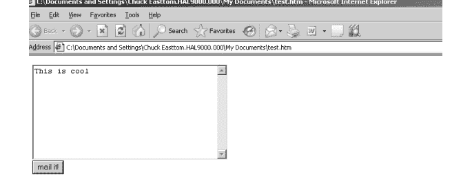

onSubmit事件处理程序返回的布尔值实际上是呈现给用户的确认框的结果。尽管稍后会讨论此表单的某些元素，但你应该注意，为了接收表单内容为未加密的纯文本电子邮件，你需要将"text/plain"值分配给ENCTYPE属性。


## **onReset**

`<FORM>`标签的另一个事件处理程序是`onReset`。重置事件通常在用户点击重置按钮时发生。除了触发事件不同，`onReset`事件处理程序的行为与`onSubmit`事件处理程序类似。

以下示例在执行重置操作前，会要求用户确认：

```
<FORM ACTION="mailto:chuckeasttom@yahoo.com" METHOD="post" ENCTYPE="text/plain"
    onReset='return confirm("Click OK to reset form to default status")'>
<TEXTAREA NAME="input" COLS=40 ROWS=10></TEXTAREA><BR>
<INPUT TYPE="reset" VALUE="reset it!">
</FORM>
```

> 注意：`onReset`事件处理程序是在多年前的Navigator 3.0中首次实现的。

## **方法**

### **submit()**

`submit()`方法提交表单的方式与提交按钮非常相似。`submit()`方法通过get或post提交方案将数据发送回HTTP服务器。其通用语法如下：

```
formName.submit()
```

`formName`是表单对象的精确引用。你可以在用户点击特定的超文本链接时调用此方法。请看以下示例：

```
<HTML>
<HEAD>
<TITLE>hypertext link submission</TITLE>
<SCRIPT LANGUAGE="JavaScript">
<!--
function submitForm(sub)
{
    document.forms[sub].submit()
}
function proceedSubmission()
{
    return confirm("Click OK to mail this information")
}
// -->
</SCRIPT>
</HEAD>
<BODY>
<FORM METHOD="post" ACTION="mailto:chuckeasttom@yahoo.com" ENCTYPE=
    "text/plain" onSubmit="return proceedSubmission()">
<TEXTAREA NAME="inputField" COLS=40 ROWS=10></TEXTAREA><BR>
<A HREF="example18-01b.htm" onClick="submitForm(0)">Mail it!</A>
</FORM>
</BODY>
</HTML>
```

**示例 18-1a (ex18-1a.htm).** 一个用于提交表单的超文本链接，其功能就像提交按钮一样。

在示例18-1a中，表单通过`submitForm`函数提交，该函数通过链接对象的`onClick`事件处理程序调用。在通过`onSubmit`事件处理程序提示用户确认后，通过其`submit()`方法提交表单（该表单引用为`document.forms[0]`，即页面中的第一个也是唯一一个表单）。示例18-1b显示了文件ex18-1b.htm，它显示了示例18-1a中引用的“感谢”通知：

```
<HTML>
<HEAD>
<TITLE>Thank you</TITLE>
</HEAD>
<BODY>
Thank you very much for your feedback
</BODY>
</HTML>
```

**示例 18-1b (ex18-1b.htm).** 在示例18-1a中提交邮件后显示的“感谢”消息。

> **注意：**`submit`方法在Navigator 4.5之前的许多版本以及Internet Explorer 4.0之前的版本中存在问题。在使用每个新版本之前，请务必进行测试。

### **reset()**

`reset()`方法重置给定的表单，相当于点击重置按钮。其语法和用法与`submit()`方法完全相同。有关重置表单的更多信息，请参见`onReset`事件处理程序。

## **属性**

### **action**

`action`属性反映了`<FORM>`标签的`ACTION`属性的值。其值是服务器上需要执行的CGI或LiveWire应用程序的URL。如果没有为服务器端应用程序指定显式URL，则在Navigator中，`action`的值默认为当前文档（包含表单的文档）的URL。Microsoft Internet Explorer则将该属性默认为空字符串。

`formReference.action`属性也可以通过JavaScript赋值。你可以利用此功能，在页面布局完成后，根据用户的偏好修改表单的行为。

通常，你可以通过JavaScript而不是HTML属性来赋值表单的属性。请看以下表单示例：

```
<FORM NAME="form1" METHOD="post" ACTION="http://www.foo.com/trash.cgi">
</FORM>
```

此结构的另一种替代方案是以下HTML和JavaScript的组合：

```
<FORM NAME="form1" METHOD="post">
</FORM>
<SCRIPT LANGUAGE="JavaScript">
<!--
document.form1.action = "http://www.foo.com/trash.cgi"
// -->
</SCRIPT>
```

### **elements**

`elements`属性是一个对应于表单元素的对象数组。它是任何表单的一个属性，通过`formReference.elements`引用。

如你所知，由于所有表单对象都是`document.forms`对象的元素，如果你知道某个特定表单相对于文档中其他表单的索引，就可以引用它。同样，特定表单的元素是`elements`数组的元素。该数组的第一个元素是对第一个表单元素（按钮、复选框、隐藏字段、密码框、单选按钮、重置按钮、选择列表、提交按钮、文本框或文本区域对象）的引用，第二个条目是对第二个表单元素的引用，依此类推，按源顺序排列。例如，如果一个表单有一个文本框和三个单选按钮，你可以将这些元素引用为`formReference.elements[0]`、`formReference.elements[1]`、`formReference.elements[2]`和`formReference.elements[3]`。

与`forms`数组类似，`elements`数组是通过名称引用的另一种方式。一些程序员更喜欢使用数组反射，而另一些则更喜欢按名称跟踪元素。当一个表单包含许多与索引相关的元素时，使用`elements`数组会很方便。例如，一个包含十个各接受一个电话号码的文本框的表单，应该通过`elements`数组来引用。这样的引用允许你使用循环来遍历这十个不同的元素。

不过，通常情况下，你会使用表单来收集具有不同含义且彼此不相似的数据字段，就像前面示例中的电话号码那样。在这些情况下，通过名称引用要方便得多，也更容易理解、遵循和维护。你可以轻松地重新设计表单的物理布局，甚至在中间添加新元素，同时保持旧的引用不变。另一方面，如果你使用`elements`数组，任何布局修改都会导致索引偏移，从而使所有先前的引用失效。

表单中元素的数量是`formReference.elements.length`。因此，表单中的最后一个元素由`formReference.elements[formReference.elements.length - 1]`条目表示。

`elements`数组中的元素是只读的，因此以下语句没有任何效果：

```
formReference.elements[0] = "do not do this"
```

`elements`数组的前几个元素代表表单元素。下面的`length`属性反映了表单元素的数量。

假设一个表单元素的值为`foo`。那么，以下所有引用的求值结果都是`foo`：

```
document.forms[0].elements[0].value
document.forms[0].elements.elements[0].value
document.forms[0].elements.elements.elements[0].value
```

这些奇怪的引用之所以可能，是因为`elements`对象除了包含其表单的元素外，还包含其表单的所有属性。一个表单，比如`document.forms[0]`，也可以有一个名为`name`的属性，该属性反映相应`<FORM>`标签的`NAME`属性的值。在Navigator中，你也可以使用以下已知方法之一来引用此属性：

```
document.forms[0].name
document.forms[0].elements.name
document.forms[0].elements.elements.name
```

你可能还记得第5章的内容，`for...in`循环语句提供了从上到下列出对象属性的能力。以下函数可用于按名称（而非索引）列出典型`elements`对象的属性：

```
function printElements(form, formString)
{
  // initialize output string
  var result = ""
  for (var i in form.elements)
  {
    result += formString + ".elements." + i + " = " + form.elements[i] + "\r"
  }
  alert(result)
}
```

你可以通过传递特定表单的引用来调用此函数。考虑以下简单的HTML表单：

```
<FORM NAME="form1" ACTION="http://www.yourserver.com/filename.cgi"
       METHOD="post">
<INPUT TYPE="text" NAME="num1" VALUE="bla">
<INPUT TYPE="hidden" NAME="num2" VALUE="foo">
<TEXTAREA NAME="num3">wow</TEXTAREA>
</FORM>
```


前面提到的 `printElements()` 函数在接收 `document.forms[0]` 和 `"document.forms[0]"` 作为参数时，会返回以下输出：

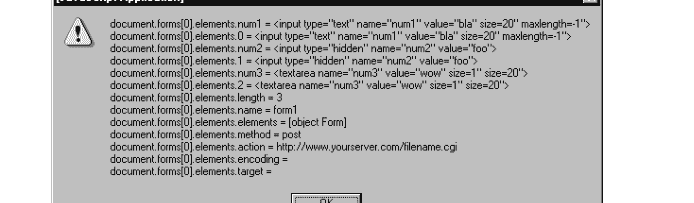

*图 18-2. elements 对象的属性列表*

请注意，前四行列出了 elements 对象的专有属性。后续各行则表示那些与表单自身（此处为 `document.forms[0]`）属性相同的元素属性。理论上，你可以将给定表单的所有属性作为其 elements 对象的属性来引用。

如果你认为这种丰富的引用方法令人困惑，那你是对的。最好的解决方案是坚持一些标准。假设你在文档中有一个表单，它可以通过 `document.forms[index]`、`document.formName` 或 `formReference` 来引用。以下对象包含了所有的表单属性：

```
formReference
formReference.elements
```

`formReference` 的 `elements` 属性只是访问同一个对象的另一个接口。由于网景公司最初（现在仍然）将上述两个对象记录为不同的对象，因此通常在访问表单的通用属性时引用 `formReference`，而在访问表单元素的属性时引用 `formReference.elements`。理论上，你也可以通过以下方式访问表单的第一个元素：

```
formReference[0]
```

正如你已经知道的，任何表单元素对象都可以通过其名称来引用。例如，页面第一个表单中名为 `field1` 的文本对象可以这样访问：

```
document.forms[0].field1
```

当两个或更多元素具有相同的名称时，它们会形成一个数组，其中的索引根据它们的布局顺序确定。例如，如果一个表单中有三个名为 `inputField` 的文本对象，你可以按如下方式引用这些元素：

```
document.forms[0].inputField[0]
document.forms[0].inputField[1]
document.forms[0].inputField[2]
```

## **编码 (encoding)**

表单的内容在提交给服务器之前会被编码。有多种编码类型或 MIME 编码——有些适用于文件，而另一些则适用于纯文本或其他目的。编码方法最初通过将其分配给 `<FORM>` 标签的 `ENCTYPE` 属性来指定。默认的编码方法是 `application/x-www-form-urlencoded`，但也有其他选项，如 `multipart/form-data` 和 `text/plain` 可用。

每个 HTML 表单都有一个 MIME 编码规范，即使它没有明确显示。JavaScript 的 `formReference.encoding` 的值最初是分配给 HTML `ENCTYPE` 属性的值。此属性不是只读的，因此可以随时设置，即使在布局完成后也可以。设置 `encoding` 会覆盖 `ENCTYPE` 属性，并指示浏览器（主要是 Navigator）使用新的 MIME 编码方法。

供您参考，该属性的通用语法是：

```
formReference.encoding
```

如果未在表单的 `ENCTYPE` 属性中指定值，则默认为 `application/x-www-form-urlencoded`。然而，`formReference.encoding` 的值仍然是一个空字符串。

## **方法 (method)**

`<FORM>` 标签的 `METHOD` 属性接受 `get` 或 `post` 值。JavaScript 以 `method` 属性的形式反映了该属性的值。你可以像使用所有其他表单属性一样使用此属性。它可以随时读取或设置，即使在布局完成后。此处的术语 “method” 与面向对象解释中的术语（与对象关联的函数）毫无关系。

`formReference.method` 属性在客户端 JavaScript 脚本与特定的服务器端 CGI 或 LiveWire 应用程序交互时是活动的。在这种情况下，你可以设置 `method` 属性以及其他与表单相关的属性来动态修改表单的布局。引用此属性的通用语法是：

```
formReference.method
```

HTML `METHOD` 属性的默认值是 `get`。然而，JavaScript `method` 属性的值没有默认值，并保持为空。

## **目标 (target)**

当你“上网冲浪”时，经常会遇到将数据提交到服务器并返回结果的 HTML 表单，例如站点列表或简单的“感谢”页面。由于大多数表单是与用户交互的一种手段，你很少会发现提交到服务器却没有响应的表单。此外，即使只是从用户那里接收输入并将其提交到服务器端脚本的表单，也期望得到响应并给用户一个表单内容已正确提交的指示。

大多数服务器端应用程序在与表单相同的窗口中返回一个新的 HTML 页面。然而，有时你可能更愿意在不同的窗口或框架中接收结果。你可以通过设置 `<FORM>` 标签的 `TARGET` 属性来指定返回页面的目标。此值由 JavaScript 的 `target` 属性反映，该属性属于表单对象。引用此属性的通用语法是：

```
formReference.target
```

此属性可以随时读取和设置，即使在页面布局完成后。尽管 `TARGET` 属性默认为当前窗口或框架的 HTML 文档，但 JavaScript 的 `target` 属性并不默认为任何字符串。JavaScript 的 `target` 属性的值，就像 HTML 的 `TARGET` 属性一样，可以是窗口名称或框架名称。除了这些显而易见的值之外，还有几个常见的引用：`_top`、`_parent`、`_self` 和 `_blank`。当我们讨论框架和窗口时，将再次介绍这些值，有关详细信息，您也可以参考 HTML 文档。将窗口或框架对象分配给此属性可能看起来很方便，但遗憾的是它只接受 HTML 规范。

## 元素类型 (Element Types)

每个表单元素（按钮、单选按钮、文本区域等）都有一个反映该表单元素类型的 `type` 属性。按照 JavaScript 语法的惯例，`type` 属性跟在元素引用之后。例如，你可以通过以下方式访问第一个表单的第一个元素的类型：

```
document.forms[0].elements[0].type
```

表 18-1 列出了各种表单元素及其对应的类型。

**表 18-1. 表单元素**

| HTML 元素 | type 属性的值 |
| :--- | :--- |
| INPUT TYPE="button" | "button" |
| INPUT TYPE="checkbox" | "checkbox" |
| INPUT TYPE="file" | "file" |
| INPUT TYPE="hidden" | "hidden" |
| INPUT TYPE="password" | "password" |
| INPUT TYPE="radio" | "radio" |
| INPUT TYPE="reset" | "reset" |
| INPUT TYPE="submit" | "submit" |
| INPUT TYPE="text" | "text" |
| SELECT | "select-one" |
| SELECT MULTIPLE | "select-multiple" |
| TEXTAREA | "textarea" |

右列中列出的所有值都是表示元素类型的普通字符串。

## 与事件处理程序结合使用

当你通过事件处理程序调用函数时，你可以引用触发事件处理程序的表单元素，例如文本对象或按钮。以下脚本片段和图表演示了这个概念：

```
<SCRIPT LANGUAGE="JavaScript">
<!--
function process()
{
    document.forms[0].elements[0].value = "thank you"
}
// -->
</SCRIPT>
<FORM>
<INPUT TYPE="text" NAME="myField" VALUE="email..." onChange="process()">
</FORM>
```

你可以在图 18-3 中看到此脚本的输出。

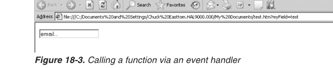

**图 18-3.** 通过事件处理程序调用函数

此时，理解这个脚本具体做什么并不是那么重要。`INPUT TYPE="text"` 定义在其中创建了一个简单的文本框，用户可以在其中输入值。该文本框（或文本对象）被分配了字符串 "email..." 作为其默认值（表单出现时框内带有此文本）。`onChange` 事件处理程序捕获当用户更改文本对象的值并单击其外部时发生的更改事件。当发生此类事件时，函数 `process` 被调用，并将字符串 "thank you" 分配给该文本对象的 `value` 属性。请注意，使用了一个完整的对象路径规范，从文档浏览器对象向下，来访问文本对象。这种引用有两个缺点：

- 路径相当长且复杂。
- 如果你更改了表单或元素的位置或名称，则必须修改路径以反映此更改，这使得维护非常困难。


此问题的答案是使用关键字 `this` 来指代“当前”对象。例如，你可以通过以下方式实现 `this` 引用来简化前面的代码：

```html
<SCRIPT LANGUAGE="JavaScript">
<!--
function process(callingElement)
{
    callingElement.value = "thank you"
}
// -->
</SCRIPT>
<FORM>
<INPUT TYPE="text" NAME="myField" VALUE="email..." onChange="process(this)">
</FORM>
```

使用上述方案，你可以更改元素的位置、名称或其他任何可选属性（事件处理程序除外），而脚本无需任何修改即可继续工作。关键字 `this` 指代提供事件处理程序的元素。在此例中，`this` 的值等于 `document.forms[0].elements[0]`。当调用函数 `process` 时，分配给 `callingElement` 参数的值是 `this`，因此 `callingElement.value` 等同于 `document.forms[0].elements[0].value`。

事件处理程序脚本中的关键字 `this` 指代该事件处理程序所属的表单元素。例如，一个事件处理程序属于文档中第一个表单的第一个元素，那么该事件处理程序中的关键字 `this` 可以安全地替换为 `document.forms[0].elements[0]`。

当你使用单个函数来引用不同的表单元素时，使用对象 `this` 非常方便。

你可以在事件处理程序脚本中将 `this` 用于函数参数以外的目的。你也可以将 `this` 对象的任何属性传递给一个函数，如下所示的脚本片段所演示：

```html
<SCRIPT LANGUAGE="JavaScript">
<!--
function display(str)
{
    alert(str)
}
// -->
</SCRIPT>
<FORM>
<INPUT TYPE="text" NAME="myField1" VALUE="d" onChange="display(this.value)">
<INPUT TYPE="text" NAME="myField2" VALUE="f" onChange="display(this.value)">
</FORM>
```

> **注意：** 对象、属性和方法引用可以作为函数参数传递。就像赋值任何其他值一样，它们也可以被赋值给一个变量。例如，你可以使用以下脚本片段来替代 `window.document.write` 语句：
> ```javascript
> var obj = window.document
> obj.write("Cool<BR>")
> ```
> 注意不要将对象引用放在引号中——它不是字符串。

到目前为止，特殊对象 `this` 一直被用作表单元素完整路径的替代品。JavaScript 还允许你通过此对象的 `form` 属性从元素的事件处理程序脚本中引用表单。前面的源代码可以重写为以下形式：

```html
<SCRIPT LANGUAGE="JavaScript">
<!--
function process(callingElement)
{
    callingElement.elements[0].value = "thank you"
}
// -->
</SCRIPT>
<FORM>
<INPUT TYPE="text" NAME="myField" VALUE="email..." onChange=
            "process(this.form)">
</FORM>
```

代表表单的对象等同于 `document.forms[0]`。

一般来说，每个表单元素都包含一个 `form` 属性，该属性支持反向访问；即，能够从其元素访问表单（尽管元素实际上是表单的属性）。因此，你可以使用以下任一表达式来访问给定文档中第一个表单的第一个元素：

```javascript
document.forms[0].elements[0]
document.forms[0].elements[0].form.elements[0]
document.forms[0].elements[0].form.elements[0].form.elements[0]
```

你可能永远不会在脚本中独立使用此属性，因为你总是可以直接通过窗口的 `document` 对象的属性来引用表单。然而，这种引用在处理表单时经常使用，因为事件处理程序的脚本将事件处理程序引用为 `this`，而 `form` 属性使你能够通过后门引用表单。

除了与表单元素关联的事件处理程序外，你还可以将 `this` 与 `<FORM>` 标签的事件处理程序一起使用。在这种情况下，`this` 代表包含整个表单的对象（例如 `document.forms[0]`）。假设你想从 `onSubmit` 事件处理程序中调用一个函数。你可以使用以下大纲将一个代表表单对象的对象引用传递给该函数：

```html
<FORM ... onSubmit="functionName(this)">
```

在这种情况下，表达式 `this.form` 没有逻辑意义。

## 利用 `form` 属性

在本章中，我们讨论反映 HTML 表单元素的各种对象。每个表单元素都是其所属表单的直接属性。请看以下示例：

```html
<FORM NAME="myForm">
<INPUT TYPE="text" NAME="myField" SIZE=10>
</FORM>
```

在这个简单的例子中，`text` 对象可以被引用为 `document.myForm.myField`。这种自上而下的层次结构使你能够在已经访问到表单对象本身的情况下访问任何表单元素对象。但是，你可能会遇到一种情况，例如，你将一个表单元素对象传递给一个函数，并且你希望通过一个后门引用表单对象。JavaScript 允许你使用 `form` 属性来做到这一点。例如，假设你有一个变量 `myField`，它保存了一个表单元素对象。（现在，只需忽略该对象是如何被赋值给变量的。）假设该变量名为 `objRef`，并且对象引用是通过以下语句显式赋值给它的：

```javascript
var objRef = document.myForm.myField
```

请记住，你在脚本中没有这条语句——你只有变量 `objRef`，并且你正试图引用表单对象 `myForm`。你可以使用 `form` 属性来做到这一点：

```javascript
var formObjRef = objRef.form
```

`form` 是每个表单元素对象的属性，无一例外。在事件处理程序中以 `this` 作为参数来调用函数非常方便。例如，考虑以下脚本片段：

```html
<SCRIPT LANGUAGE="JavaScript">
<!--
function getValue(otherElement)
{
    alert(otherElement.form.elements[1].value)
}
// -->
</SCRIPT>
<FORM>
<INPUT TYPE="button" VALUE="click me" onClick="getValue(this)">
<INPUT TYPE="text" VALUE="Baruch Spinoza" SIZE=10>
</FORM>
```

此脚本的输出如图 18-4 所示。

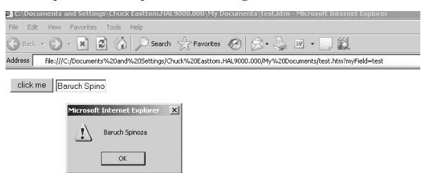

图 18-4. 表单元素

第一个文本对象（表单元素）使用 `this` 对象作为参数来调用 `getValue` 函数。该函数旨在打印第二个元素 `elements[1]` 的值。传递给函数的值（代表第一个表单元素的对象）与第二个表单元素之间唯一的联系是，它们都是同一个“父级”的“子级”。该函数接受反映第一个元素的对象，因此它必须通过共同的父级（即表单对象）来访问第二个元素。因此，正确的语法必须包含 `form` 属性（它也是一个对象）：

```javascript
firstElement.form.secondElement
```

在这种情况下，`form` 属性充当连接器。如果你实现一个函数来引用表单的各种元素，你可能想最初将 `this.form` 用作函数的参数。那么你应该使用以下代码来替代前面的脚本片段：

```html
<SCRIPT LANGUAGE="JavaScript">
<!--
function getValue(form)
{
    alert(form.elements[1].value)
}
// -->
</SCRIPT>
<FORM>
<INPUT TYPE="button" VALUE="click me" onClick="getValue(this.form)">
<INPUT TYPE="text" VALUE="Baruch Spinoza" SIZE=10>
</FORM>
```

## `text` 对象

### HTML 语法

`text` 对象由以下普通 HTML 语法定义：

```html
<INPUT
  TYPE="text"
  NAME="*textName*"
  [VALUE="contents"]
  [SIZE="integer"]
  [MAXLENGTH="integer"]
  [onBlur="handlerStatement"]
  [onChange="handlerStatement"]
  [onFocus="handlerStatement"]
  [onSelect="handlerStatement"]>
```

`NAME` 属性使你能够为此 HTML 对象分配一个名称，该名称在服务器端查询和 JavaScript 脚本中都用于标识它。`VALUE` 属性接受在页面加载时应在框中显示的初始字符串。此字符串不仅是文本框中的初始值，也是默认值。当你通过重置按钮或 `reset()` 方法重置表单时，此字符串会重新出现在文本框中。`SIZE` 属性至关重要，因为它决定了文本框的大小（以字符为单位）。`MAXLENGTH` 属性指定此字段允许的最大输入长度。如果用户输入的字符串长于 `MAXLENGTH`，则只有前 `MAXLENGTH` 个字符会被输入。当请求特定字符串（例如密码）时，此选项尤其方便，因为密码本身就会限制在给定长度。以下脚本片段演示了在 HTML 文档中使用 `text` 对象：

```html
Processor: <INPUT TYPE="text" NAME="comp" SIZE=15 MAXLENGTH=20
VALUE="Intel Xeon">
```

`text` 对象最多只能容纳一行。你可以使用 `textarea` 对象来显示多行。

### JavaScript 访问

基本上有四种方式可以通过 JavaScript 访问 `text` 对象：

```javascript
[window.]document.*formName*.*textName*
[window.]document.*formName*.elements[index]
[window.]document.forms[index].*textName*
[window.]document.forms[index].elements[index]
```

你已经知道表单可以通过其名称访问，或者在表单索引已知时通过 `forms` 对象访问。同样，你可以通过其名称或通过 `elements` 数组（如果元素索引已知）来访问表单的元素。


前面的表达式展示了如何单独访问文本对象。通常，你不会直接访问文本对象，而是访问其属性、方法或事件处理器。

## 事件处理器

文本对象是输入和输出的非常便捷的方式。文本对象拥有丰富的事件处理器可供你使用。

### onBlur

当文本字段失去焦点时，会发生模糊事件。当用户在文本框内点击时，字段会获得焦点；当用户点击文本框外的页面任意位置时，焦点会丢失。onBlur 事件处理器在模糊事件发生时执行 JavaScript 代码。请看下面的表单和函数：

```
<SCRIPT LANGUAGE="JavaScript">
<!--
function checkInput(element)
{
   if (element.value == "")
      alert("Please enter a value!")
}
// -->
</SCRIPT>
<FORM>
<INPUT TYPE="text" NAME="myField" VALUE="" onBlur="checkInput(this)">
</FORM>
```

此脚本的输出如图 18-5 所示。

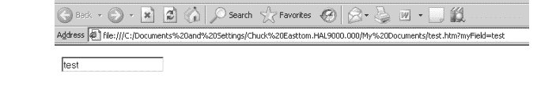

如果文本框留空，一个警告对话框会告知用户必须输入值。只有当用户先访问该字段，然后在未输入任何值的情况下退出时，对话框才会显示。

### onChange

当模糊事件发生且文本对象的值已被修改时，会发生更改事件。onChange 事件处理器（同样定义为 HTML 标签属性）在更改事件发生时执行 JavaScript 代码。

onChange 事件处理器可能是文本对象（框或字段）最常用的事件处理器。你可以在验证用户输入数据时使用此事件处理器。也就是说，当用户修改文本框内容时，会调用一个函数来验证更改。通过 JavaScript 进行验证（而不是 CGI 或 LiveWire）可以节省宝贵的网络传输时间。

为了演示 onBlur 事件处理器，已经实现了一个简单的表单元素和相应的函数。此示例的问题在于，文本框的值在每次失去焦点时都会被验证。通常，最好仅在更改后验证表单。因此，onChange 事件处理器更适合此类任务。将前面的示例重写如下会好得多：

```
<SCRIPT LANGUAGE="JavaScript">
<!--
function checkInput(element)
{
    if (element.value == "")
        alert("Please enter a value!")
}
// -->
</SCRIPT>
<FORM>
<INPUT TYPE="text" NAME="myField1" VALUE="" onChange="checkInput(this)">
</FORM>
```

为了充分理解此事件处理器，以下双重规则非常重要：

- 每当发生更改事件时，模糊事件自然会发生。
- 只有当模糊事件发生且文本对象的值已被修改并获得焦点时，才会发生更改事件。

### onFocus

当字段通过键盘 Tab 键或鼠标点击获得输入焦点时，会发生焦点事件。onFocus 事件处理器显然在焦点事件发生时执行预定义的代码。此外，在许多浏览器中，当页面加载时也会发生焦点事件。这种行为并非所有浏览器都通用，因此你应该使用你使用的各种浏览器检查脚本，以确保它按你预期的方式工作。以下脚本在文本对象中滚动 T 型横幅。当用户点击文本框（文本对象）内的某处时，它会启动，触发 onFocus 事件处理器。以下是脚本：

```
<HTML>
<HEAD>
<TITLE>T-banner</TITLE>
<SCRIPT LANGUAGE="JavaScript">
<!--
// set speed of banner (pause in milliseconds between characters)
var speed = 100 // decrease value to increase speed (must be positive)
// set pause between completion of message and beginning of following one
var pause = 1000 // increase value to increase pause
// set initial values
var timerID = null
var bannerRunning = false
// create global array
var ar = new Array()
// assign the strings to the array's elements
ar[0] = "Welcome to our JavaScript page"
ar[1] = "We hope you enjoy the T-banner script"
ar[2] = "It is designed to be more stable than regular banners"
ar[3] = "Don't forget to check out my other scripts"
// set index of first message to be displayed first
var currentMessage = 0
// set index of last character to be displayed first
var offset = 0
// stop the banner if it is currently running
function stopBanner()
{
    // if banner is currently running
    if (bannerRunning)
    {
        // stop the banner
        clearTimeout(timerID)
        // timer is now stopped
        bannerRunning = false
    }
}
// start the banner
function startBanner()
{
    // make sure the banner is stopped
    stopBanner()
    // start the banner from the current position
    showBanner()
}
// type in the current message
function showBanner()
{
    // assign current message to variable
    var text = ar[currentMessage]
    // if current message has not finished being displayed
    if (offset < text.length)
    {
        // if last character of current message is a space
        if (text.charAt(offset) == " ")
        {
            // skip the current character
            offset++
        }
        // assign the up-to-date to-be-displayed substring
        // second argument of method accepts index of last character plus one
        var partialMessage = text.substring(0, offset + 1)
        // display partial message in text field
        document.bannerForm.bannerField.value = partialMessage
        // increment index of last character to be displayed
        offset++ // IE sometimes has trouble with "++offset"
        // recursive call after specified time
        timerID = setTimeout("showBanner()", speed)
        // banner is running
        bannerRunning = true
    } else
    {
        // reset offset
        offset = 0
        // increment subscript (index) of current message
        currentMessage++
        // if subscript of current message is out of range
        if (currentMessage == ar.length)
            // wrap around (start from beginning)
            currentMessage = 0
        // recursive call after specified time
        timerID = setTimeout("showBanner()", pause)
        // banner is running
        bannerRunning = true
    }
}
// -->
</SCRIPT>
</HEAD>
<BODY>
<FORM NAME="bannerForm">
<INPUT TYPE="text" NAME="bannerField" VALUE="Click here..." SIZE=50
       onFocus="if (!bannerRunning) { startBanner() }">
</FORM>
</BODY>
</HTML>
```

示例 18-2 (ex18-2.htm)。当用户点击文本框时，T 型横幅在其中开始滚动。

首先，请注意 HTML 主体中名为 bannerForm 的表单。该表单仅由一个元素组成，即一个名为 bannerField 的文本对象。其大小设置为 50 个字符，默认值为字符串 "Click here . . ."。提供了 onFocus 事件处理器。当用户点击文本框内部时，会发生焦点事件，并调用 startBanner() 函数以开始滚动。请注意，此语句仅在横幅未运行时执行。变量 bannerRunning 保存横幅的当前状态，并且在页面加载时已经为 true。

本书前面基于状态栏的 T 型横幅脚本与示例 18-2 中基于文本框的脚本之间的唯一区别是，属性 window.status 被 document.bannerForm.bannerField.value 替换，后者是对文本对象反映内容的属性的引用。

### onSelect

当用户选择文本字段内的部分文本时，会发生选择事件。onSelect 事件处理器使你能够响应此类事件。

以下是实现此事件处理器的通用语法：

```
<INPUT TYPE="text" VALUE="" NAME="valueField" onSelect="selectState()">
```

由于选择事件相当罕见且不重要，此事件处理器并不常用。它在 Navigator 4.5 之前的某些版本中也曾出现故障。

## 方法

### blur()

你已经知道模糊事件是什么。你可以使用对象的 blur() 方法显式地模糊文本对象，从而从该字段移除焦点。此方法会取消选择字段中可能被选中的任何文本，并从字段中移除文本插入指针。此时，没有字段或表单元素获得焦点。手动模糊文本对象的一种方法是按 Tab 键，这会将焦点按顺序推进到下一个字段，并从当前字段（模糊它）移除焦点。但是，JavaScript 的 blur() 方法仅从其对象移除焦点，而不会将焦点赋予表单或页面中的任何其他字段。只读文本字段是使用 blur() 方法的典型示例。创建此类字段的算法非常简单。当用户明确地给字段焦点以便在其中写入时，一个事件处理器（onFocus）会调用 blur() 方法以立即移除焦点。这是一个只读文本字段示例：

```
<INPUT TYPE="text" NAME="myField" VALUE="" SIZE=15 onFocus="this.blur()">
```

你可以将表达式 onFocus="this.blur()" 视为只读 <INPUT TYPE="text"> 元素的一个属性。

### focus()

focus() 方法聚焦于文本对象（或其他表单元素对象）。聚焦于表单元素通常意味着窗口滚动，直到文本字段可见，并且光标定位在字段中文本的开头。虽然不是强制性的，但在访问文本对象之前先给予它焦点是一个好的做法。它将对脚本的健壮性产生积极贡献。当页面包含许多字段时，你可以使用脚本驱动的 focus() 方法来强调其中一个，从而“吸引”用户到它。focus() 方法类似于相机的对焦：它强调一个特定对象并为进一步使用做准备。以下 HTML 标签可用于将焦点保持在文本对象上（如果你有多个文本对象并且只允许用户修改其中一个，这可能很有用）：

```
<INPUT TYPE="text" NAME="myField" VALUE="" SIZE=15 onBlur="this.focus()">
```


## 第18章

当文本字段失去焦点时，会发生一个失焦事件，`onBlur`事件处理程序被触发，并且焦点会再次回到该字段上。
`focus()`方法通常属于文本对象（字段），但正如本章后面将要解释的，其他类型的对象也会使用它。

### select()

文本对象最有用的方法是`select()`方法。当你通过JavaScript选中一个字段时，该字段中的所有文本都会被选中。
在某些平台上的Navigator中，你必须在选中文本字段之前先赋予它焦点。假设你有一个文档，其中包含一个表单，该表单里有一个元素——一个文本对象。为了通过JavaScript选中这个文本字段，需要以下脚本片段：

```
document.forms[0].elements[0].focus()
document.forms[0].elements[0].blur()
```

`select()`方法在客户端验证表单时极其有用且非常方便。例如，假设你有一个表单，它接收用户对多个元素的输入，并在将数据提交到服务器之前依次验证每个元素。报告错误最基本的方式是在警告对话框中显示消息。更复杂的错误报告包括自动为用户更正错误做好准备。这种准备可以通过同时使用`focus()`和`select()`方法来实现。当脚本遇到包含无效数据的文本字段时，你可以将光标定向到该字段，并自动高亮显示其中的文本。然后用户可以直接写入新的、正确的值，而无需删除无效的输入。这对程序员来说听起来相当复杂，但实际上非常简单。以下脚本和表单演示了简单的验证和便捷的错误报告：

```
<HTML>
<HEAD>
<TITLE>Simple form validation</TITLE>
</HEAD>
<SCRIPT LANGUAGE="JavaScript">
<!--
function checkName(field)
{
    if (field.value == "")
    {
        alert("Value is required")
        field.focus()
        field.select()
    } else
        if (field.value.split(" ").length < 2)
        {
            alert("Enter full name")
            field.focus()
            field.select()
        }
}
function checkEmail(field)
{
    if (field.value.indexOf("@") == -1)
    {
        alert("Enter a valid e-mail address")
        field.focus()
        field.select()
    }
}
// -->
</SCRIPT>
<BODY>
<FORM>
Full name: <INPUT TYPE="text" NAME="userName" VALUE="" SIZE=15
                         onChange="checkName(this)">
<BR>
Email address: <INPUT TYPE="text" NAME="email" VALUE="" SIZE=15
                         onChange="checkEmail(this)">
</FORM>
</BODY>
</HTML>
```

示例 18-3 (ex18-3.htm)。一个简单的表单验证和错误处理脚本

示例 18-3 中的表单包含两个文本对象：用户的全名和电子邮件地址。元素（文本字段）对象作为参数传递给两个不同的事件处理函数。`value`属性反映了文本字段中的当前字符串。

    `checkName()`函数检查其调用对象（文本字段）的值是否非空，并且是否包含恰好两个单词（由空格分隔）。如果违反了其中一条规则，将显示相应的消息，并且调用元素（userName文本对象）将被聚焦和选中，以指示无效的文本字段。

    `checkEmail()`函数检查其调用的文本对象值是否包含一个“at”字符（@）。如果未找到，则显示相应的消息，并且调用元素（email文本对象）将被聚焦和选中。字段内的文本通过表单中第二个文本对象的`select()`方法被高亮显示。如你所见，脚本方便地使用了这一点来引用所有表单元素对象。另请注意，字段检查是在窗口内任何位置进行鼠标点击时完成的。

### 属性

#### defaultValue

`defaultValue`属性是一个字符串，表示文本对象的默认值。默认值最初被分配给HTML标签的`VALUE`属性，也反映在JavaScript的`defaultValue`属性中。在JavaScript中设置此属性会覆盖初始的HTML值。你可以在任何时候设置和读取`defaultValue`属性，即使在布局完成之后。由于它仅反映字段的默认值（页面加载时或重置表单后看到的值），因此此属性不能用于动态更新字段中的文本。

如果HTML属性`VALUE`未指定，`defaultValue`默认为空字符串，就像显式指定了`VALUE=""`一样。

以下脚本片段演示了`defaultValue`属性的一个简单用法，用于重置特定的表单元素（本例中是文本对象），而不是使用重置按钮或`reset()`方法重置整个表单。请注意，此脚本使用了`value`属性，我们稍后将进行讨论。

```
<SCRIPT LANGUAGE="JavaScript">
<!--
function resetField(sub)
{
    document.forms[0].elements[sub].value = document.forms[0]
                .elements[sub].defaultValue
}
// -->
</SCRIPT>
<FORM NAME="fields">
<INPUT TYPE="text" NAME="field1" VALUE="enter first" SIZE=15>
<A HREF="javascript:resetField(0)">reset</A><BR>
<INPUT TYPE="text" NAME="field2" VALUE="enter second" SIZE=15>
<A HREF="javascript:resetField(1)">reset</A><BR>
<INPUT TYPE="text" NAME="field3" VALUE="enter third" SIZE=15>
<A HREF="javascript:resetField(2)">reset</A><BR>
</FORM>
```

由于我们尚未讨论按钮，因此此脚本使用链接来调用JavaScript函数。链接不是表单元素，因此你不能在`resetField()`函数内部引用`this`或`this.form`。为了解决这个问题，每个链接都通过相应文本对象的索引来标识，并作为参数传递给函数。例如，第一个链接负责重置表单中的第一个文本对象，因此它向`resetField()`函数传递一个0。该函数不是重置表单元素，而是将相应文本字段的当前值设置为其默认值。

#### name

通常，为每个表单元素（尤其是文本对象）命名是一个好习惯。CGI脚本强制要求有名称，因为它们使用名称来标识字段和提取值。由于它允许更逻辑、更方便地访问JavaScript文本对象，通过名称标识文本对象显著提高了脚本的健壮性和可维护性。因此，所有名称都应该是有意义的，并且遵循JavaScript的命名约定。

`name`属性最初反映HTML的`NAME`属性的值。更改此属性的值会覆盖初始的HTML设置。通过向`name`属性分配新的字符串，你可以在任何时候设置文本对象的名称。

不要将此属性与字段中显示的文本混淆。字段的内容由`VALUE`属性表示，而不是`NAME`属性。因此，如果你修改`name`的值，你不会注意到页面外观有任何变化。

你应该记得，表单元素可以通过其索引或其名称来引用。如果一个表单包含多个同名元素，它们会形成一个数组。尽管这种情况在单选按钮中尤其常见，正如你将在本章后面看到的，但你也可能在文本对象中遇到它。以下示例演示了如何使用此类数组来处理复杂的表单：

```
<HTML>
<HEAD>
<TITLE>Form element arrays</TITLE>
<SCRIPT LANGUAGE="JavaScript">
<!--
function correctName()
{
    for (var i = 0; i < document.fields.username.length; ++i)
    {
        var field = document.fields.username[i]
        field.value = field.value.charAt(0).toUpperCase() + field
                               .value.substring(1, field.value.length)
    }
}
function checkEmail()
{
    for (var i = 0; i < document.fields.email.length; ++i)
    {
        var field = document.fields.email[i]
        if (field.value.indexOf("@") == -1)
        {
            alert("Error in email address!")
            field.focus()
            field.select()
            return
        }
    }
}
// -->
</SCRIPT>
</HEAD>
<BODY>
<FORM NAME="fields">
Employee #1: <INPUT TYPE="text" NAME="username" VALUE="first name" SIZE=10>
<INPUT TYPE="text" NAME="username" VALUE="last name" SIZE=10>
<INPUT TYPE="text" NAME="email" VALUE="email" SIZE=10><BR>
Employee #2: <INPUT TYPE="text" NAME="username" VALUE="first name" SIZE=10>
<INPUT TYPE="text" NAME="username" VALUE="last name" SIZE=10>
<INPUT TYPE="text" NAME="email" VALUE="email" SIZE=10><BR>
Employee #3: <INPUT TYPE="text" NAME="username" VALUE="first name" SIZE=10>
<INPUT TYPE="text" NAME="username" VALUE="last name" SIZE=10>
<INPUT TYPE="text" NAME="email" VALUE="email" SIZE=10><BR>
</FORM>
</BODY>
</HTML>
```


## 示例 18-4（ex18-4.htm）

一个基于数组的表单验证脚本，用于反映具有相同名称的元素

要理解此代码清单，你必须了解页面的初始外观：

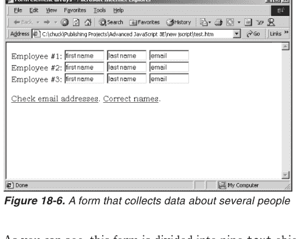

如你所见，此表单被划分为九个文本对象。所有六个用于输入名字和姓氏的文本对象都被命名为 `username`。例如，`document.forms[0].elements[0].name` 的值等于字符串 `"username"`。三个用于输入电子邮件地址的文本对象被命名为 `email`。

基本上有两个元素组：`username` 和 `email`。由于所有表单元素都是命名字段，你可以通过以下语法将这两个组作为数组引用：

```
document.fields.username
document.fields.email
```

两个数组都有一个 `length` 属性，表示共享给定名称的元素数量。例如，`username` 数组的长度和元素可以如下引用：

```
document.fields.username.length  // 与名字相关的元素数量
document.fields.username[0]     // 第一个 First Name 对象
document.fields.username[1]     // 第一个 Last Name 对象
document.fields.username[2]     // 第二个 First Name 对象
document.fields.username[3]     // 第二个 Last Name 对象
document.fields.username[4]     // 第三个 First Name 对象
document.fields.username[5]     // 第三个 Last Name 对象
```

同样的语法也用于引用 `email` 数组的元素。再次查看示例 18-4 中的脚本。它包含两个函数，一个用于处理名字输入字段，另一个用于处理电子邮件。第一个函数 `correctName()` 遍历所有 `username` 元素并将它们的首字母大写。第二个函数使用相同的技术，如果任何电子邮件地址不包含 "at" 字符（`@`），则会提醒用户。如果找到这样的字段，该函数会聚焦并选中它，以引起用户对无效字段的注意。

你通常应该为每个表单元素分配一个唯一的名称。示例 18-4 演示了在某些情况下，重用特定名称以便对具有相似特征的元素进行基于循环的处理要方便得多。

### value 属性

`value` 属性反映给定文本对象（字段）中当前的文本。它不等同于任何 HTML 属性。你可以在任何时候读取和设置此属性。设置后，字段的内容会立即更新。尽管我们在本章中一直使用此属性，但这里是另一个示例，展示如何引用页面中第一个表单的第一个元素的 `value` 属性：

```
document.forms[0].elements[0].value
```

## password 对象

### HTML 语法

`TYPE` 属性的另一个可能值是 `"password"`。它类似于 `"text"` 选项，不同之处在于它不显示用户的输入，而是对输入的任何字符都用预定义的单个字符（如星号（*））来响应。此对象的一般语法如下：

```
<INPUT
    TYPE="password"
    NAME="passwordName"
    [VALUE="contents"]
    [SIZE="integer"]
    [MAXLENGTH="integer"]
    [onBlur="handlerStatement"]
    [onChange="handlerStatement"]
    [onFocus="handlerStatement"]
    [onSelect="handlerStatement"]>
```

`value` 属性是一个星号字符（或浏览器选择的任何其他字符）。其他属性与 `text` 输入类型相同。这是一个简单的密码框代码：

```
Password: <INPUT TYPE="password" NAME="pswrd" SIZE=15 MAXLENGTH=20 VALUE="">
```

密码框的值是输入的字符串，而不是出现的星号（或其他字符）。该值被隐藏，因此用户旁边的人无法看到。

### JavaScript 访问

像所有其他元素一样，有四种方式可以通过 JavaScript 访问密码对象：

```
[window.]document.formName.passwordName
[window.]document.formName.elements[index]
[window.]document.forms[index].passwordName
[window.]document.forms[index].elements[index]
```

所有方法和元素引用都遵循其中一种替代方式。

### 事件处理程序

密码事件处理程序在各方面与文本对象相同。请参考本章及前面章节的讨论。

### 属性和方法

密码对象的属性有：

-   `defaultValue`
-   `name`
-   `value`

密码对象的方法与文本对象相同：

-   `focus`
-   `blur`
-   `select`

在 Netscape Navigator 2.0 中，密码对象并不是很有用，因为 JavaScript 不允许访问其值。从 3.0 版本开始，Navigator 和 Internet Explorer 上的 JavaScript 可以像访问文本对象一样自由地访问 `VALUE` 属性。从 JavaScript 的角度来看，密码对象与文本对象是相同的。唯一的区别是密码字段的值从未显示。

## textarea 对象

### HTML 语法

可以通过文本区域在表单中输入多行文本，文本区域由 `<TEXTAREA></TEXTAREA>` 标签对定义。你应该始终为文本区域命名并指定其大小。`<TEXTAREA>` 标签的一般语法如下：

```
<TEXTAREA
    NAME="textareaName"
    ROWS="integer"
    COLS="integer"
    WRAP="off | virtual | physical"
    [onBlur="handlerStatement"]
    [onChange="handlerStatement"]
    [onFocus="handlerStatement"]
    [onSelect="handlerStatement"]>
    textToDisplay
</TEXTAREA>
```

属性有：

-   `NAME` —— 指定文本区域元素的名称（标签）。处理未命名的文本区域非常困难，因此请始终根据 JavaScript 命名约定为文本区域命名。
-   `ROWS` —— 指定文本区域中文本的行数。由于 Netscape Navigator 和 Microsoft Internet Explorer 在文本字段中使用不同大小的字体，你无法通过设置 `ROWS` 以像素为单位设置文本区域的大小。
-   `COLS` —— 指定文本区域中文本的列数。它等于一行文本中的字符数。

可以通过在 `<TEXTAREA>` 和 `</TEXTAREA>` 标签之间放置文本来初始化文本区域，如下所示：

```
<TEXTAREA NAME="comments" COLS=35 ROWS=5>
Write any comments regarding this page here.
Don't forget to mention your e-mail address.
</TEXTAREA>
```

在此文本区域中，回车符被解释为换行符。Netscape Navigator 允许你通过将脚本放在开始和结束 `<TEXTAREA>` 标签之间来在文本区域中编写 HTML 标签。

`<TEXTAREA>` 标签接受的另一个属性是 `WRAP`。它可以设置为以下值之一：

-   `off` —— 不换行（默认值）。
-   `virtual` —— 在屏幕上换行，但将它们视为一行。
-   `physical` —— 在字符串中插入实际的换行符（CR 字符）。

### JavaScript 访问

有四种方式可以通过 JavaScript 访问 textarea 对象：

```
[window.]document.formName.textareaName
[window.]document.formName.elements[index]
[window.]document.forms[index].textareaName
[window.]document.forms[index].elements[index]
```

### 事件处理程序

textarea 对象的事件处理程序与文本对象相同。

### 属性和方法

与事件处理程序一样，textarea 对象的所有属性和方法与文本对象和密码对象完全相同。请参考之前关于文本对象的清单，以了解其属性、方法和事件处理程序。

### 插入换行符

文本区域字段实际上是多行文本字段。由于换行插入的额外复杂性，向 textarea 对象打印输出比向文本对象打印稍微复杂一些。当 `WRAP` 属性设置为 `off` 并且你希望避免出现长水平文本跨度时，这一点尤其重要。

由于换行符在不同平台上不统一，插入换行符不像插入任何其他可打印字符那么简单。基于 Unix 和 Macintosh 的机器上的换行符是 `"\n"`，而 Windows 操作系统需要 `"\r\n"` 组合。解决此问题的最简单方法是测试实际平台并插入相应的换行符。这是一个自动为用户的平台返回正确字符串的函数：

```
function getNL()
{
    if (navigator.appVersion.lastIndexOf('Win') != -1)
        return "\r\n"
    /* else */
        return "\n"
}
```

你可以按以下方式分配换行符：

```
var NL = getNL()
```

现在，你可以使用函数的返回值将多行文本放入 textarea 对象。这是一个简单的示例：

```
document.forms[0].elements[0].value = "line 1" + NL + "line 2"
```

> 重要提示：Netscape Navigator 在所有平台上都支持 `"\n"` 作为换行符。


## 按行处理文本域

通常情况下，无法处理文本域内容的特定行。以下函数通过将文本逐行分配给数组来克服这一缺陷：

```
function getLines(textareaReference)
{
    var str = escape(textareaReference.value)
    var ar = str.split("%0D%0A") // "%0D%0A" <=> "\r\n"
    if (ar.length == 0)
        ar = str.split("%0A") // "%0A" <=> "\n"
    for (var i = 0; i < ar.length; ++i)
    {
        ar[i] = unescape(ar[i])
    }
    return ar
}
```

这个函数有些技巧性。它首先通过`escape`函数对文本域的值进行编码，并将“转义后”的字符串赋值给一个局部变量`str`。你可能还记得，`escape`之后，任何非字母数字字符都以“%XX”格式表示。转义序列“\n”表示为“%0A”（零 + A），而“\r”转换为“%0D”（零 + D）。然后，使用`split()`方法，以“%0D%0A”或“%0A”字符串作为分隔符，对整个编码后的字符串进行拼接。这个“技巧”在于，仅在第一个分隔符（“%0D%0A”）无法分割文本时，才使用第二个分隔符（“%0A”）。最后，数组`ar`的每个元素都通过`unescape`函数解码，并返回最终的行数组。

## hidden 对象

### HTML 语法

隐藏表单字段是在 HTML 页面上不显示的字段。它用于在提交时传递唯一的标识值。由于用户无法修改或与隐藏元素交互，页面加载时给出的初始值在页面的整个生命周期内保持不变。因此，hidden 对象对用户没有用处，而是对程序员有用。例如，在一个大型网站上，服务器端应用程序可以使用 hidden 对象来区分提交给服务器的不同表单。

除了不可见之外，你应该基本上将 hidden 元素完全像 text 类型一样对待。该元素的通用语法是：

```
<INPUT
    TYPE="hidden"
    NAME="hiddenName"
    [VALUE="textValue"]>
```

NAME 属性指定 hidden 对象的名称，而 VALUE 指定字段的值。尽管不可见，但它们与其他任何元素类型的属性一样，是表单内容的一部分。

### JavaScript 访问

有四种方法可以引用 hidden 对象：

```
[window.]document.formName.hiddenName
[window.]document.formName.elements[index]
[window.]document.forms[index].hiddenName
[window.]document.forms[index].elements[index]
```

### 事件处理程序

由于 hidden 对象在页面上不可见，因此无法将其与任何事件关联，因此不支持为 hidden 对象设置事件处理程序。

### 属性和方法

由于与表单元素对象相关的所有方法都模拟事件，因此 hidden 对象没有任何方法。
hidden 对象确实有几个你可以通过 JavaScript 访问的属性。该对象的属性是：

-   defaultValue
-   name
-   value

这些属性等同于 text、password 和 textarea 对象的属性。例如，你可以随时读取和设置 value 属性。value 属性可用于标记提交给服务器的表单，以便服务器端应用程序进行识别。

## button、submit 和 reset 对象

### HTML 语法

最精确的输入事件是按钮点击。submit、reset 和 button 对象都是具有相同属性和特性的按钮。button 对象的通用语法如下：

```
<INPUT
   TYPE="button" | "submit" | "reset"
   NAME="buttonName"
   VALUE="buttonText"
   [onClick="handlerText"]>
```

尽管普通按钮（`<INPUT TYPE="button">`）在 HTML 中没有任何明确的含义，但它在 JavaScript 脚本中非常有用。Submit 按钮在所有提交到服务器的表单中扮演着非常重要的角色。Reset 按钮会重置它所在的表单。
按钮的样式取决于客户端的平台。例如，Macintosh 按钮与 Windows 按钮不同。你对按钮外观的唯一控制是确定其标签，该标签最初由 VALUE 属性定义。由于按钮大小完全由标签字符串决定，因此你只能通过在其两端填充空格来修改其宽度。这种“复杂”技术可能非常烦人，但它是唯一能显式控制按钮大小的方法。
Submit 按钮的语法与普通按钮和 Reset 按钮的不同之处仅在于分配给 TYPE 属性的值“submit”。此按钮主要为服务器端应用程序设计。当用户点击此类按钮时，表单的数据将发送到 `<FORM>` 标记的 ACTION 属性中指定的 URL。Reset 按钮的 TYPE 是“reset”，点击时，它会重置整个表单。普通按钮（没有 HTML 含义）通过为 TYPE 属性分配“button”来定义。

### JavaScript 访问

你可以通过 JavaScript 引用按钮的四种方式是：

```
[window.]document.formName.buttonName
[window.]document.formName.elements[index]
[window.]document.forms[index].buttonName
[window.]document.forms[index].elements[index]
```

### 事件处理程序

所有按钮对象（button、reset 和 submit）都与单个事件相关联，因此仅支持一个事件处理程序。这个事件处理程序可能是所有与表单相关的事件处理程序中最重要的。

### onClick

顾名思义，按钮只有一个功能——被点击。因此，它的事件处理程序仅响应点击事件。当用户按下按钮然后在指针仍在按钮上方时释放按钮时，就会发生这种事件。当用户按下按钮时，事件不会立即发生，以便用户有机会通过在按钮区域外释放来取消点击操作。
你也可以将此事件处理程序与 Submit 和 Reset 按钮一起使用。onClick 事件处理程序脚本在执行与按钮关联的内置操作之前执行。例如，你可以使用此事件来计算某个表达式并将其值赋给现有表单元素对象的 value 属性。
此事件处理程序的通用语法如下：

```
<INPUT TYPE=... onClick="handlerScript">
```

Netscape Navigator 支持取消点击事件的选项。Mozilla Firefox 也支持此选项。这可以通过让事件处理程序返回 false 来实现，就像你取消表单的提交或重置一样。被取消的操作是由按钮（或支持此事件处理程序的其他对象）定义的操作。例如，取消 Submit 按钮的点击事件将取消表单的提交。

示例 18-5 演示了使用 onClick 事件处理程序调用处理表单其他元素的函数的用法：

```
<HTML>
<HEAD>
<TITLE>Expression evaluator</TITLE>
<SCRIPT LANGUAGE="JavaScript">
<!--
function compute(form)
{
   form.result.value = eval(form.expression.value)
}
// -->
</SCRIPT>
</HEAD>
<BODY>
<FORM>
<INPUT TYPE="text" NAME="expression" VALUE="" SIZE=15> = 
<INPUT TYPE="text" NAME="result" VALUE="" SIZE=8 onFocus="this.blur()">
<P>
<INPUT TYPE="button" NAME="computeButton" VALUE="compute" onClick=
                              "compute(this.form)">
<INPUT TYPE="button" NAME="clear" VALUE="clear result" onClick=
                              "this.form.result.value = ''">
</FORM>
</BODY>
</HTML>
```

### *示例 18-5（ex18-5.htm）。一个简单的表达式求值脚本*

用户在左上方的字段中键入任何数字表达式（例如 4 + 6 * 15），按下“计算”后，结果显示在右上方的字段中。“清除结果”按钮会删除该字段中的值。
该表单包含四个元素。前两个是文本对象——每个都有其独特的属性。第一个名为 computeButton 的按钮使用 onClick 事件处理程序调用 `compute` 函数，并将反映整个表单的对象传递给它。第二个按钮提供了清除结果字段（右上方的那个）的唯一方式。
该对象的 onClick 事件处理程序是一条单独的即时语句。其 onFocus 事件处理程序通过调用 blur 方法创建一个只读字段。
由于整个表单对象被分配给 `compute` 的 `form` 参数，因此属性 `form.result.value` 指的是右上方文本对象的内容，而 `form.expression.value` 指的是第一个字段内的文本。对第一个字段中的文本进行求值，数字结果成为其值。例如，如果左边的字段包含表达式 5 * 3 - 2，


## 方法

### click()

按钮的 click() 方法模拟用户点击该按钮的操作。它会引发与人工点击相同的行为，唯一的区别是按钮的 onClick 事件处理程序不会被触发。由于该方法的唯一用途就是触发 onClick 事件处理程序，因此对于 TYPE="button" 的按钮来说，此方法并不实用。在某些平台上，调用此方法时会产生视觉边框效果。

您可能永远不需要使用此方法，但这里有一个示例供您参考：

```
document.forms[0].elements[0].click()
```

## 属性

### name

按钮的 name 属性是 NAME 属性的直接反映，并且是只读的。为了正确响应事件，onClick 事件处理程序函数通常会使用此属性来确定点击了哪个按钮。以下是引用此属性的示例：

```
var buttonName = document.forms[0].elements[0].name
```

### value

按钮的 value 是您通过将其分配给 <INPUT> 标签的 VALUE 属性而赋予按钮的可见标签。所有由 <INPUT> 标签定义的表单元素都具有此属性。就按钮而言，字符串的长度决定了按钮的大小。VALUE 属性可以包含多个单词，通常应该用引号括起来。

VALUE 属性在 JavaScript 中由 value 属性反映。虽然您可能永远不需要提取该属性的值，但修改它可能会很有用。假设您有一个网页，上面有一个按钮，并且您希望每当用户点击该按钮时，其标签都会发生变化。您可以通过响应点击事件修改 value 属性来实现这种行为。Netscape Navigator 从 3.0 版本开始支持显式地用 JavaScript 设置事件处理程序，因此您甚至可以在修改按钮标签的同时修改事件处理程序的脚本，从而动态创建一个“新”按钮（而无需重新加载页面）。示例 18-6 使用这些功能创建了一个简单的秒表。

```
<HTML>
<HEAD>
<TITLE>stopwatch (timer)</TITLE>
<SCRIPT LANGUAGE="JavaScript">
<!--
// set initial values
var timerRunning = false
var timerID = null
// create instance of Date object representing current time
var initial = new Date()
// start timer
function start()
{
	// set the button's label to "stop"
	document.forms[0].general.value = "stop"
	// assign the stop function reference to the button's onClick event handler
	document.forms[0].general.onclick = stop
	// ask if the user wants to reset the timer
	if (confirm("Would you like to reset the timer?"))
		// set global variable to new time
		initial = new Date()
	// assign milliseconds since 1970 to global variable
	startTime = initial.getTime()
	// make sure the timer is stopped
	stopTimer()
	// run and display timer
	showTimer()
}
// set button to initial settings
function stop()
{
	// set the button's label to "start"
	document.forms[0].general.value = "start"
	// assign the start function reference to the button's onClick event handler
	document.forms[0].general.onclick = start
	// stop timer
	stopTimer()
}
// stop timer
function stopTimer()
{
	// if the timer is currently running
	if (timerRunning)
		// clear the current timeout (stop the timer)
		clearTimeout(timerID)
		// assign false to global variable because timer is not running
	timerRunning = false
}
function showTimer()
{
	// create instance of Date representing current timer
	var current = new Date()
	// assign milliseconds since 1970 to local variable
	var curTime = current.getTime()
	// assign difference in milliseconds since timer was cleared
	var dif = curTime - startTime
	// assign difference in seconds to local variable
	var result = dif / 1000
	// if result is not positive
	if (result < 1)
		// attach an initial "0" to beginning
		result = "0" + result
	// convert result to string
	result = result.toString()
	// if result is integer
	if (result.indexOf(".") == -1)
		// attach ".00" to end
		result += ".00"
	// if result contains only one digit after decimal point
	if (result.length - result.indexOf(".") <= 2)
		// add a second digit after point
		result += "0"
	// place result in text field
	document.forms[0].display.value = result
	// call function recursively immediately (must use setTimeout to
	// avoid overflow)
	timerID = setTimeout("showTimer()", 0)
	// timer is currently running
	timerRunning = true
}
// -->
</SCRIPT>
</HEAD>
<BODY>
<FORM>
<INPUT TYPE="text" NAME="display" VALUE="" onFocus="this.blur()">
<INPUT TYPE="button" NAME="general" VALUE="start" onClick="start()">
</FORM>
</BODY>
</HTML>
```

**示例 18-6 (ex18-6.htm)。一个带有动态按钮的简单计时器**

请花几分钟浏览一下脚本，确保您理解了递归流程和时间相关功能的处理方式。由于本脚本中的大部分功能您现在应该已经很熟悉了，我们只介绍新出现的和较难的部分。

看看来自 start() 函数的以下语句：

```
// set the button's label to "stop"
document.forms[0].general.value = "stop"
// assign the stop function reference to the button's onClick event handler
document.forms[0].general.onclick = stop
```

第一条语句通过给按钮标签分配一个新值——“stop”来调整它。第二条语句将一个函数引用（没有括号，因为它是函数引用，而不是函数调用）分配给按钮的 onClick 事件处理程序。请注意，事件处理程序必须用小写字母指定。这些语句将“开始”按钮转换为“停止”按钮。来自 stop() 函数的以下语句则动态地将“停止”按钮转换回“开始”按钮：

```
// set the button's label to "start"
document.forms[0].general.value = "start"
// assign the start function reference to the button's onClick event handler
	document.forms[0].general.onclick = start
```

请注意，当计时器运行时，按钮标签显示为“stop”，否则显示为“start”。

示例 18-6 中的表单由两个元素组成。第一个是只读的文本对象（通过事件处理程序设置），而第二个是一个简单的按钮。

设置按钮的值存在一些问题。首先，按钮的尺寸不会根据新标签进行调整，因此任何多余的文本在两侧都会被截断。另一个问题是，由于按钮标签是居中的，您无法控制它与其他不同表单元素中按钮的对齐方式。如果您通过 HTML 属性将按钮初始化为一个非常长的字符串（尝试为 VALUE 分配一个包含许多空格的字符串），您甚至可以在按钮上运行 T 型横幅！

## checkbox 对象

### *HTML 语法*

复选框是一个反映“开”或“关”状态的小方框。HTML 复选框是一种表单元素，与纸质表单上的复选框非常相似。如果在方框中做了标记，则当前状态被视为“真”。如果复选框未被选中，则当前状态为“假”。

复选框在基于服务器的表单中使用很多。如果一个复选框被选中，它就会包含在提交的数据中；而如果它是空的，它就会被排除在提交给服务器的数据之外。由于复选框是一个独立的表单元素，不会与其他元素分组，因此您应该为表单中的每个复选框应用一个唯一的名称。用户可以在页面布局完成后的任何时候选中或取消选中一个复选框。

复选框对象的一般语法如下：

```
<INPUT
    TYPE="checkbox"
    NAME="checkboxName"
    VALUE="checkboxValue"
    [CHECKED]
    [onClick="handlerText"]>
```

NAME 和 VALUE 属性都指定了未在页面上显示的内部值。要为复选框添加标签，您应该简单地将标签直接放在复选框之后，使其看起来像是与对象相连。以下代码片段演示了这种技巧：

选择您业务中使用的所有计算机：
-   PC
-   Macintosh
-   Unix（X-Windows）

要创建一个初始状态为已选中的复选框，只需指定 CHECKED 属性，而无需为其赋值。该属性的存在与否决定了页面加载时复选框的初始状态。
JavaScript 复选框提供了多种功能，但您不应将其用作常规按钮（例如，支持 onClick 事件处理程序）；而应仅将其用作是/否选择界面。不过，您可以使用点击事件来触发副作用语句。重要的是要认识到，复选框主要是一个切换开关。

## JavaScript 访问

引用复选框主要有四种方式：
-   [window.]document.formName.checkboxName
-   [window.]document.formName.elements[index]
-   [window.]document.forms[index].checkboxName
-   [window.]document.forms[index].elements[index]

## 事件处理程序

### onClick
由于复选框仅响应点击事件，因此复选框对象不支持 onClick 以外的事件处理程序。当您希望在用户点击复选框时立即调用函数或执行语句，请使用此事件处理程序。当用户点击复选框时，无论其是否被选中，都会发生点击事件。
同样，使用此事件处理程序时应极其保守。复选框应仅用于是/否选择。

## 方法

### click()
复选框对象仅支持 click() 方法，该方法等同于手动点击复选框。您可以使用此方法来实现不可修改的复选框，例如，每当用户点击复选框时都模拟点击该复选框，从而始终抵消用户的操作并保持复选框状态不变。以下是定义此类“只读”复选框的方法：
```html
<INPUT TYPE="checkbox" onClick="this.click()">
```

此方法的另一个有用实现是在两个或多个复选框之间建立不可见的关联。以下是一个示例脚本，它始终保持两个复选框状态相同（选中或未选中）：
```html
<SCRIPT LANGUAGE="JavaScript">
<!--
function connectMe(destination)
{
    document.forms[0].elements[destination].click()
}
// -->
</SCRIPT>
</HEAD>
<BODY>
<FORM>
<INPUT TYPE="checkbox" onClick="connectMe(1)"> Number 1<BR>
<INPUT TYPE="checkbox" onClick="connectMe(0)"> Number 2
</FORM>
```

每个复选框的 onClick 事件处理程序都以目标复选框的索引作为参数调用 connectMe() 函数。例如，第二个复选框的事件处理程序调用 connectMe(0)，因为它与第一个复选框（其索引为 0）关联。connectMe() 函数只是模拟对给定索引处的表单元素执行点击事件。
click() 方法不会触发 onClick 事件处理程序，因此您无需担心脚本会陷入无限循环。您可以将 connectMe() 函数扩展为使用 for 循环处理一组复选框。

## 属性

### checked

复选框的布尔属性 checked 反映按钮的当前状态。true 值表示指定的复选框已选中，而 false 值表示未选中。在复选框对象支持的属性中，此属性既是最简单的也是最有用的。您可以在任何时候读取和调整此属性，即使在布局完成之后。
要选中或取消选中复选框，只需将相应的布尔值分配给对象的 checked 属性即可。以下语句取消选中一个复选框：
```javascript
document.forms[0].elements[0].checked = false
```

由于复选框无论当前状态如何都可以设置为两种可能状态中的任何一种，因此您不必使用 if 语句来确定当前状态，然后相应地调用操作。请注意，通过赋值 checked 来设置复选框的状态，比探测当前状态并调用复选框的 click() 方法要高效得多。
示例 18-7 演示了在一个简单游戏中使用 checked 属性。它展示了如何读取 checked 属性以及如何设置它。游戏的目标是在 20 秒（20,000 毫秒）内尽可能多地选中复选框。当前已选中复选框的累计数量显示在顶部的文本对象中。时间耗尽后，所有复选框变为只读状态，并在底部放置一个“开始”按钮以重新开始游戏。

```html
<HTML>
<HEAD>
<TITLE>复选框游戏</TITLE>
<SCRIPT LANGUAGE="JavaScript">
<!--
// 为全局变量赋初始值
var total = 0
var play = false
// 响应复选框中的点击（element == 被点击的复选框对象）
function display(element)
{
    // 将表示当前时间的 Date 对象实例赋值给变量
    var now = new Date()
    // 如果游戏尚未开始
    if (!play)
    {
        // 游戏现在开始
        play = true
        // 记录开始时自 1970 年以来的毫秒数
        startTime = now.getTime()
    }
    // 如果距离 startTime 上次设置已过去超过 20 秒
    if (now.getTime() - startTime > 20000)
    {
        // 拒绝修改（设为“只读”）
        element.checked = !element.checked
        // 终止函数
        return
    }
    // 如果被点击的复选框现在已选中
    if (element.checked)
        // 增加总数
        total++
    else
        // 减少总数
        total--
    // 在文本对象中显示总数
    element.form.num.value = total
}
function restart(form)
{
    // 将全局变量重置为初始值
    total = 0
    play = false
    // 取消选中所有 100 个复选框
    for (var i = 1; i <= 100; ++i)
    {
        // 取消选中当前复选框
        form.elements[i].checked = false
    }
}
-->
<!-- --></SCRIPT>
</HEAD>
<BODY>
<SCRIPT LANGUAGE="JavaScript">
<!--
// 立即脚本（由于是延迟脚本，因此在其他脚本之前执行）
document.write("<FORM><CENTER>")
document.write('<INPUT TYPE="text" VALUE="0" NAME="num" SIZE=10 onFocus=
    "this.blur()"><BR>')
document.write("<HR SIZE=1 WIDTH=40%>")
// 使用循环创建 10 x 10 的复选框方阵
for (var i = 0; i < 10; ++i)
{
    for (var j = 0; j < 10; ++j)
    {
        // 写入一个复选框，其事件处理程序脚本为 "display(this)"
        document.write('<INPUT TYPE="checkbox" onClick="display(this)">')
    }
    document.write("<BR>")
}
document.write("<HR SIZE=1 WIDTH=40%>")
// 创建按钮以调用 restart 函数重新开始游戏
document.write('<INPUT TYPE="button" VALUE="restart" onClick=
    "restart(this.form)">')
document.write("</CENTER></FORM>")
// -->
</SCRIPT>
</BODY>
</HTML>
```

## 示例 18-7（ex18-7.htm）。一个演示复选框使用的游戏

`<HEAD></HEAD>` 部分中的全局语句定义了变量 `total`（用于存储已选中复选框的累计数量）和变量 `play`（用于存储一个布尔值，指示游戏是否正在进行中（计时器是否在运行））。

由于其所有语句都是立即执行的，因此要执行的第一个脚本段是页面 `<BODY></BODY>` 部分内的那个。该脚本只是打印游戏的 HTML 界面：一个文本对象、100 个复选框、一个按钮和两条水平线。所有复选框都有一个 `onClick` 事件处理程序，该程序调用 `display()` 函数，并将复选框对象本身（`this`）作为参数传递。

`display()` 函数接受一个参数——被触发的复选框对象。首先，一个表示调用 `display()` 函数时的时间的 Date 对象实例被赋值给局部变量 `now`。函数的下一部分检查游戏是否已经在进行。如果未进行，则将 `play` 设置为 true，并将自 1970 年以来的毫秒数赋值给全局变量 `startTime`。如果当前时间与游戏开始时的时间差大于 20 秒，则反转调用复选框的 checked 属性（拒绝用户在时间耗尽后继续游戏的尝试），并终止函数。


## **defaultChecked**

复选框定义可以包含一个CHECKED规范，用于指示该复选框的默认状态为“开启”或true。如果您未指定此HTML属性，它将默认为false。您可以通过JavaScript的`defaultChecked`属性访问复选框的默认状态。您可以随时设置`defaultChecked`，从而覆盖CHECKED属性。使用以下语句将复选框的状态重置为其默认值：

```
this.checked = this.defaultChecked
```

这里的`this`指的是您要重置的特定复选框。

## **name**

复选框对象的`name`属性反映了`<INPUT>`元素定义中的NAME属性。它是一个只读属性，因此您无法修改它。选择NAME属性时应尽可能具有描述性，特别是对于那些仅通过其名称访问复选框值的服务器端应用程序。如果您的表单主要用于JavaScript处理，您可以使用NAME属性来模拟第二个VALUE属性的功能。

## **value**

`value`属性最初反映`<INPUT>`定义中的VALUE属性，但可以通过JavaScript脚本随时进行调整。

就像文本对象的`string`值一样，`value`属性代表复选框对象的值，因此对于服务器处理的表单非常重要。通过设置VALUE属性，您可以显式地影响提交给服务器的表单内容。

虽然您可以在不使用`value`属性的情况下完成许多任务，但有时使用此属性会非常方便。以下示例演示了如何使用复选框列表打印您的公司所使用的所有操作系统：

```
<HTML>
<HEAD>
<TITLE>Checkbox value property</TITLE>
<SCRIPT LANGUAGE="JavaScript">
<!--
function displayList(list)
{
  var total = ""
  for (var i = 0; i < list.length; ++i)
  {
      if (list[i].checked)
          total += list[i].value + "\r"
  }
  if (total == "")
      alert("No OS selected!")
  else
      alert(total)
}
// -->
</SCRIPT>
</HEAD>
<BODY>
<FORM>
<INPUT TYPE="checkbox" VALUE="DOS / Windows" NAME="computer">DOS /
Windows XP<BR>
<INPUT TYPE="checkbox" VALUE="Windows Vista" NAME="computer">Windows Vista<BR>
<INPUT TYPE="checkbox" VALUE="Macintosh" NAME="computer">Macintosh<BR>
<INPUT TYPE="checkbox" VALUE="Linux" NAME="computer">Linux<BR>
<INPUT TYPE="button" VALUE="display list" onClick="displayList(this.form.computer)">
</FORM>
</BODY>
</HTML>
```

首先，请注意该表单由四个复选框和一个按钮组成。按钮的onClick事件处理程序调用displayList()函数，并将computer表单元素作为参数传递。由于有四个元素与该名称匹配，`this.form.computer`实际上是一个包含四个复选框元素的数组。复选框的VALUE属性指定了与该复选框关联的操作系统。

displayList()函数基于一个简单的for循环，该循环将复选框的值连接到局部变量`total`中，并插入换行符作为分隔符。当循环终止时，`total`包含用户勾选的所有操作系统的列表。如果`total`的值是空字符串，则表示用户未勾选任何复选框，并会显示相应的消息。否则，将在警报框中显示已选操作系统的列表。

## **单选按钮对象**

### **HTML语法**

单选按钮提供了一个从多个选项中选择一个的接口。与矩形的复选框不同，单选按钮是圆形的。这两种按钮的另一个区别在于，单选按钮属于一个按钮组，而不是独立的。一组单选按钮的行为完全类似于旧式汽车收音机上的频道按钮。它有两种可能的状态：一个按钮被按下（开启）或所有按钮都释放（关闭）。当一个按钮被按下时，先前按下的按钮会自动释放。

同一组的所有按钮共享相同的名称。实际上，相同的名称是告诉浏览器将选中的单选按钮数量限制为一个的标志。点击一个按钮会自动取消选择同一组中当前已选的按钮。单个单选按钮的一般语法如下：

```
<INPUT
  TYPE="radio"
  NAME="groupName"
  VALUE="buttonValue"
  [CHECKED]
  [onClick="handlerText"]>
```

请记住，您应该只使用这种按钮类型来在多个选项中启用单选。例如，以下构造提供了从三个选项中选择计算机类型的方法：

```
您最常使用哪种计算机：
<P>
<INPUT TYPE="radio" NAME="computers" VALUE="unix">Unix (X-Windows)
<P>
<INPUT TYPE="radio" NAME="computers" VALUE="pc">PC
<P>
<INPUT TYPE="radio" NAME="computers" VALUE="mac">Macintosh
```

### **JavaScript访问**

尽管单选按钮是一个简单的表单元素，但它的引用方式很不寻常。您可以通过以下表达式之一引用单选按钮组：

```
[window.]document.formName.radioGroupName
[window.]document.formName.elements[ElementIndex]
[window.]document.forms[FormIndex].radioGroupName
[window.]document.forms[FormIndex].elements[ElementIndex]
```

正如本章开头所解释的，具有相同名称的元素会被组合并索引到一个数组中。因此，上述引用实际上是数组，其中每个元素都是一个单独的单选按钮。因此，引用特定单选按钮的四种方式如下：

```
[window.]document.formName.radioGroupName[ButtonIndex]
[window.]document.formName.elements[ElementIndex][ButtonIndex]
[window.]document.forms[FormIndex].radioGroupName[ButtonIndex]
[window.]document.forms[FormIndex].elements[ElementIndex][ButtonIndex]
```

您可以通过访问组的LENGTH属性来查找组中单选按钮的数量。有关更多详细信息，请查看本章前面关于文本对象name属性的部分。

某些版本的Internet Explorer与单选按钮对象的兼容性并不完美，因此请务必测试您的脚本。

当一个单选按钮组仅包含一个单选按钮时，它不被视为一个组。因此，您无法访问数组，类似以下的引用是无效的：

```
[window.]document.formName.radioGroupName[index]
[window.]document.formName.radioGroupName.length
```

相反，您必须直接访问单选按钮，而不使用数组：

```
[window.]document.formName.radioButtonName
```

引用单个按钮与引用多个按钮组之间的差异使脚本变得相当复杂。如果单选按钮是用纯HTML创建的，您显然知道单选按钮的数量是否大于1，并相应地进行访问。如果单选按钮是由脚本自动生成的，那么您必须添加一个计数器来指示按钮的数量是否大于1。

### **事件处理程序**

#### **onClick**

单选按钮对象只支持一个事件处理程序——onClick事件。当用户选中（勾选）一个单选按钮时，会发生一个click事件，并执行指定的语句。有关更多详细信息、语法和示例，请参阅复选框对象的清单。

### **方法**

#### **click()**

click()方法模拟在调用的单选按钮对象上执行点击操作。但是，它不会触发按钮的onClick事件处理程序。示例18-8演示了如何使用此方法创建“圣诞灯”效果。

```
<HTML>
<HEAD>
<TITLE>Blinking lights</TITLE>
</HEAD>
<BODY onLoad="animate()">
<SCRIPT LANGUAGE="JavaScript">
<!--
// create row of radio buttons
lay(20)
// set index of lamp to start animation
var current = 0
// set speed (pause in milliseconds between each movement)
var speed = 100
function lay(num)
{
    // assign "greater than" character to variable
    var gt = unescape("%3e")
    // open form
```


## **示例 18-8（ex18-8.htm）。单选按钮动画**

函数 *lay()* 会打印一个包含指定数量单选按钮的表单。请注意一个编码大于号字符的重要技巧。这个字符（>）通过 `unescape()` 函数被赋值给变量 `gt`。你可能从第 2 章“JavaScript 入门”中回忆到，Netscape 使用与其他浏览器不同的 HTML 注释。标准浏览器使用大于号字符（>）结束注释，而 Navigator 则使用一个三字符字符串（`-->`）来结束。因此，如果一个大于号字符真的被放置在脚本中，它会终止那个用于在不支持 JavaScript 的浏览器（由 `<SCRIPT>` 标签指定）中隐藏脚本的注释。当创建一个由 JavaScript 驱动的网页时，你应该尽可能确保使用这种技巧，尤其是在通过 `document.write` 打印 HTML 标签来关闭它们时。你也可以通过简单地反转条件语句的操作数顺序，用小于运算符代替大于运算符。不过，如果你的页面是基于 JavaScript 构建的，你可能会选择忽略其他浏览器，因为它们无论如何可能都无法显示该页面。但是，如果你仅使用 JavaScript 来添加一些特殊效果，你应该使用这种技巧，以确保它在任何浏览器（甚至是不支持 JavaScript 的浏览器）中都能清晰可见。例如，Yahoo! 在其页面中使用了这种技巧来创建“Yahoo Remote”。启动这个 JavaScript 设备的按钮是由脚本打印的，因此没有 JavaScript 的浏览器甚至看不到这个按钮。如果没有对大于号字符进行编码，整个页面（而不仅仅是一个按钮）对于没有启用 JavaScript 的浏览器的用户来说都会变得混乱不堪。回到 *lay()* 函数。为表单命名以便后续访问非常重要——这里选择了 *animation*。一个简单的 `for` 循环被执行，用于打印 `num`（参数）个名为 `lamps`（属于同一组）的单选按钮对象。注意所有的 HTML 标签都以如下方式打印：

```
document.write("<TAG ATTRIBUTES" + gt)
```

如上所述，`gt` 的值是一个大于号字符（一个单字符字符串）。关于此编码的完整动机，请参阅前一页。

第二个函数 `animate()` 负责实际的动画效果。一个全局变量 `current` 已经被定义并初始化为 0。该函数的主要任务是调用与索引为 `current` 的单选按钮对象关联的 `click()` 方法。请注意，所有单选按钮对象都是一个唯一数组的元素——`document.animation.lamps`。第二条语句处理检查循环需要从一行中的最后一个按钮前进到第一个按钮（循环回绕）的边界情况。当 `current` 的值等于 `document.animation.lamps` 数组中最后一个元素（最后一个单选按钮）的索引时，表达式 `current == document.animation.lamps.length - 1` 的求值结果为 `true`。在这种情况下，`current` 被设置为 0，强制下一行被选中的按钮是第一个。在所有其他情况下，`current` 的值会递增，前进到下一个被选中的单选按钮。请注意，当一组中的一个单选按钮被点击时，任何先前被选中的按钮都会被取消选中。该函数的最后一条语句在暂停 `speed` 毫秒（`speed` 是一个全局变量）后递归地调用自身。

## 属性

### **checked**

`checked` 属性返回一个布尔值。如果其调用的单选按钮对象被选中（高亮显示），则 `checked` 的值为 `true`；否则为 `false`。由于单选按钮组的结构，组中单个单选按钮的 `checked` 属性总是 `true`。

你可以设置 `checked` 的值来修改单选按钮对象的显示。由于一组中的所有按钮都可以被取消选中，将 `checked` 属性设置为 `false` 只会取消调用单选按钮的选中状态，而不会对其他按钮产生任何副作用。然而，选中一个空的单选按钮确实会取消组中先前高亮显示成员的选中状态。有关此属性的完整内容，请参阅复选框对象部分。

### **defaultChecked**

`defaultChecked` 属性反映了 HTML 的 `CHECKED` 属性。有关更多详细信息，请参阅复选框对象部分。

### **name**

`name` 属性最初反映了 HTML 定义中的 `NAME` 属性。有关完整解释，请参阅复选框对象的 `name` 属性部分。

### **value**

`value` 属性最初对应于单选按钮 HTML 标签的 `VALUE` 属性，但可以调整为任何有效的字符串。再次，请参考复选框对象部分以获取语法和完整描述。

## select 对象

### HTML 语法

滚动菜单是你可以在表单中使用的灵活输入方式。`<SELECT>` 标签用于创建各种类型的滚动菜单。这是让用户从列表中选择选项的常用方式。`<SELECT>` 标签由一对 `<SELECT></SELECT>` 指定。你应该始终按照以下方式指定菜单的名称：

```
<SELECT NAME="anyName">
```

建议使用符合 JavaScript 标识符命名约定的名称。正如你可能预料的那样，`<SELECT></SELECT>` 部分的内部包含列表的选项。一个选项通过以下形式指定：

```
<OPTION VALUE="optionValue">optionText
```

例如，以下元素创建了一个包含电脑公司的简单菜单：

```
<SELECT NAME="comp">
<OPTION VALUE="http://www.microsoft.com/">Microsoft
<OPTION VALUE="http://www.mozilla.org//">Firefox
<OPTION VALUE="http://www.sun.com/">Sun
</SELECT>
```

你可以使用 `SELECTED` 属性（不需要值）在页面加载时自动选择一个默认选项。例如，以下脚本创建了一个菜单，其中默认选项（也是框中高亮显示的值）是“Sun”：

```
<SELECT NAME="comp">
<OPTION VALUE="http://www.microsoft.com/">Microsoft
<OPTION VALUE="http://www.mozilla.org//">Firefox
<OPTION VALUE="http://www.sun.com/" SELECTED>Sun
</SELECT>
```

框中的文本不是 `<OPTION>` 标签内指定的 `VALUE` 属性，而是放置在 `<OPTION>` 标签外部的字符串。该字符串除了作为菜单标签外没有其他效果。

该菜单的主要优点是，由于其弹出式配置，它不会在页面上占用太多空间。其缺点是用户只能选择一个选项。为了弥补这个缺陷，你可以指定 `MULTIPLE` 属性，但是，由于所有选项都展开显示而不是弹出，因此你会失去空间优势。这里有一个简单的例子：

```
<SELECT NAME="comp" MULTIPLE>
<OPTION VALUE="http://www.microsoft.com/">Microsoft
<OPTION VALUE="http://www.mozilla.org/">Firefox
<OPTION VALUE="http://www.sun.com/" SELECTED>Sun
</SELECT>
```

你可以通过按住 Shift 键并从菜单中选择或取消选择选项来选择多个选项。也可以按住 Control 键来单独选择每个选项。这些键在所有主要操作系统中都是通用的。`select` 对象的完整语法如下：

```
<SELECT
    NAME="selectName"
    [SIZE="integer"]
    [MULTIPLE]
    [onBlur="handlerText"]
    [onChange="handlerText"]
    [onFocus="handlerText"]>
    <OPTION VALUE="optionValue" [SELECTED]>textToDisplay
    [...<OPTION VALUE="optionValue" [SELECTED]>textToDisplay]
</SELECT>
```

除了事件处理程序（稍后解释）外，你应该能识别所有属性。

### **JavaScript 访问**

有几种方法可以引用一个 select 对象：

```
[window.]document.formName.selectName
[window.]document.formName.elements[index]
[window.]document.forms[index].selectName
[window.]document.forms[index].elements[index]
```

你可以通过向其引用附加一个 `options` 属性来访问 select 对象中的特定选项。这个属性实际上是一个从索引 0 开始的选项数组。例如，你可以通过以下方式引用一个 select 对象的第一个选项：

```
[window.]document.formName.selectName.options[0]
```

`options` 数组将在稍后作为 select 对象的一个属性进行讨论。


## 事件处理程序

### onBlur

当一个 `select` 对象失去焦点时，会发生一个 blur 事件。`onBlur` 事件处理程序的脚本在 blur 事件发生时执行。生成 blur 事件有几种方式：

-   从列表中选择一个选项，然后点击 `select` 对象外部的区域，可以是页面主体部分，也可以是另一个表单元素。
-   从菜单中选择一个选项，然后将浏览器的窗口移到后台。你聚焦的新窗口可能是一个不同的浏览器窗口，或者是一个与任何外部应用程序关联的窗口。

这个事件处理程序用处不大，因为它依赖于用户从对象上移开焦点，而这并不那么直观。

### onChange

当用户更改 `select` 对象的选中选项时，会发生一个与其关联的 change 事件。与与其他对象关联的 change 事件不同，`select` 对象无需失去焦点即可触发该事件。`onChange` 事件处理程序在 change 事件发生时执行。

`onChange` 事件处理程序通常用于与用户交换信息。我们将在后续讨论 `select` 对象的方法和属性时，用示例演示这个事件处理程序。

### onFocus

当用户使 `select` 对象获得焦点时，会发生一个 focus 事件；即当用户尝试从菜单中选择一个选项，但菜单尚未弹出或修改当前选中选项之前。`onFocus` 事件处理程序响应 focus 事件。例如，当用户在 `select` 对象内部点击时，你可以弹出一个警报框，显示该特定菜单的用户操作说明。以下源代码演示了这个建议：

```
<FORM>
<SELECT NAME="comp" onFocus="alert('Simply select the desired home')">
<OPTION VALUE="http://www.microsoft.com/">Microsoft
<OPTION VALUE="http://www.mozilla.org/">Firefox
<OPTION VALUE="http://www.sun.com/" SELECTED>Sun
</SELECT>
</FORM>
```

## 方法

### blur, focus

`select` 对象唯一明确的方法是 `blur()` 和 `focus()`。关于这些方法的完整内容，请参阅本章开头关于文本对象的列表。

## 属性 (select 对象)

`select` 对象具有各种属性，但最有用的实际上是 `options` 数组的属性，你将在后文了解。本节我们只讨论直接属于 `select` 对象的属性。

### length

你可以通过 `length` 属性访问 `select` 对象中的选项数量。由于该值也被引用为 `options` 数组的 `length` 属性，你可以自由选择使用哪个 `length`。由于 `length` 众所周知是 JavaScript 中所有数组的标准属性，我们个人更倾向于通过 `options` 数组来引用 `length`。Netscape Navigator 接受以下任何对 `select` 对象中选项数量的引用方式：

```
selectName.length
selectName.options.length
selectName.options.options.length
selectName.options.options.options.length
```

Microsoft Internet Explorer（自 3.0 版本起）仅接受前两种，但由于第三种没有任何意义，无论如何你都应该避免使用它。`length` 属性的值不应通过脚本赋值。它是动态的，因此每当向对应的 `select` 对象添加一个选项时，它就会改变。

### name

`name` 属性反映了 `<SELECT>` 标签的 `NAME` 属性。你可以自由修改此属性。通过脚本调整它会覆盖初始的 HTML 设置。以下脚本片段展示了如何通过警报对话框显示 `name` 属性（"products"）：

```
<SCRIPT LANGUAGE="JavaScript">
<!--
function sayName(selectObject)
{
  alert(selectObject.name)
}
// -->
</SCRIPT>
<FORM>
<SELECT NAME="products" onChange="sayName(this)">
<OPTION VALUE="sny">Sony
<OPTION VALUE="jvc">JVC
<OPTION VALUE="tsh">Toshiba
</SELECT>
</FORM>
```

### options

你可以通过 `options` 属性引用 `select` 对象中的选项。通常，该数组包含 `select` 对象（`<SELECT>`）中每个选项（`<OPTION>`）的一个条目。假设文档中第一个表单的第一个元素是一个包含三个选项的 `select` 对象。这些选项在 JavaScript 中可以这样引用：

```
document.forms[0].elements[0].options[0]
document.forms[0].elements[0].options[1]
document.forms[0].elements[0].options[2]
```

一如既往，数组的长度（等于给定 `select` 对象中的选项数量）存储在数组的 `length` 属性中。在前面的例子中，那将是：

```
document.forms[0].elements[0].options.length
```

`options` 数组的元素是只读的。虽然不会产生 JavaScript 错误，但为任何元素赋值没有任何效果。

简单的 `selectObject.options` 引用计算结果为用于创建指定 `selectObject` 的完整 HTML 语法。

请注意，你也可以像访问 `options` 数组的直接属性一样访问 `select` 对象的属性。

### selectedIndex

`selectedIndex` 属性是一个整数，指定 `select` 对象中选中选项的索引。`select` 对象中的选项按定义顺序索引，即与它们在 `options` 数组中输入的顺序相同。你也可以在脚本中设置 `selectedIndex` 的值，以立即更新 `select` 对象的状态（选中的选项）。

`selectedIndex` 属性对于多选 `select` 对象没有用，因为它只能引用列表中第一个选中的选项。你可以通过使用 `options` 数组的 `selected` 属性和一个简单的循环来解决这个问题。有关详细信息，请参阅下一节“属性 (options 数组)”中的 `selected` 属性。

示例 18-9 演示了 `selectedIndex` 属性。虽然我们尚未讨论 `value` 属性，但它的作用是显而易见的。如果需要，请参考本章后面的描述。

```
<HTML>
<HEAD>
<TITLE>URL option</TITLE>
<SCRIPT LANGUAGE="JavaScript">
<!--
function loadPage(list)
{
    location.href = list.options[list.selectedIndex].value
}
// -->
</SCRIPT>
</HEAD>
<BODY>
<FORM>
<SELECT onChange="loadPage(this)">
<OPTION VALUE="http://www.cnn.com/">CNN
<OPTION VALUE="http://www.msnbc.com/">MSNBC
<OPTION VALUE="http://www.usatoday.com/">USA TODAY
</SELECT>
</FORM>
</BODY>
</HTML>
```

**示例 18-9 (ex18-9.htm)。一个 URL 选择器**

当用户在 `select` 对象中选择一个选项时，`onChange` 事件处理程序调用 `loadPage()` 函数，并将 `select` 对象作为参数传递。与每个选项关联的 URL 存储为选项的 `VALUE` 属性，或者用 JavaScript 的术语来说是 `value` 属性。选中的选项是 `list.options[list.selectedIndex]`，因为 `list.selectedIndex` 是一个表示选中选项索引的整数。使用 `value` 属性来访问选中对象的 URL，然后将其赋值给 `location.href`，以便在浏览器窗口中加载该页面。你可能更喜欢使用按钮来代替 `onChange` 事件处理程序：

```
<HTML>
<HEAD>
<TITLE>URL option with button</TITLE>
<SCRIPT LANGUAGE="JavaScript">
<!--
function loadPage(list)
{
    location.href = list.options[list.selectedIndex].value
}
// -->
</SCRIPT>
</HEAD>
<BODY>
<FORM>
<SELECT>
<OPTION VALUE="http://www.cnn.com/">CNN
<OPTION VALUE="http://www.msnbc.com/">MSNBC
<OPTION VALUE="http://www.usatoday.com/">USA TODAY
</SELECT>
<INPUT TYPE="button" VALUE="load page" onClick=
         "loadPage(this.form.elements[0])">
</FORM>
</BODY>
</HTML>
```

**示例 18-10 (ex18-10.htm)。URL 选择器的另一个版本——这个版本使用了一个按钮**

示例 18-9 和示例 18-10 之间的唯一区别在于，示例 18-9 中事件处理程序附加到一个 `select` 对象上，而示例 18-10 中它附加到一个按钮对象上。为了避免更改函数，我们修改了传递给函数的参数，以继续传递 `select` 对象。表达式 `this.form` 引用表单，`elements[0]` 引用 `select` 对象，它是表单中的第一个元素。

## 属性 (options 数组)

`options` 数组中的一个元素反映了 HTML 中由 `<OPTION>` 标签定义的 `select` 对象的一个选项。`options` 数组的属性是 `select` 对象中特定选项的属性。

### defaultSelected

`defaultSelected` 属性计算结果为一个布尔值。如果指定的选项是用 `SELECTED` 属性（`<OPTION … SELECTED>`）定义的，那么 `defaultSelected` 的值为 true。否则，它为 false。

`defaultSelected` 最初反映了 `<OPTION>` 标签中是否使用了 `SELECTED` 属性。通过脚本设置 `defaultSelected` 属性会覆盖初始的 HTML 设置。

在没有 `MULTIPLE` 规范的 `select` 对象中，默认情况下只能有一个选项被选中。因此，将给定选项的 `defaultSelected` 属性设置为 true 会清除任何先前的默认选择，包括那些用 `SELECTED` 设置的。然而，如果你在一个定义了 `MULTIPLE` 属性的 `select` 对象中设置 `defaultSelected`，先前的默认选择不会被清除。

### index

`select` 对象中单个选项的 `index` 属性是标识该对象在选择列表中位置的数字，从零开始。在正常情况下，`index` 属性的存在没有理由，因为为了引用一个选项，你需要知道它的索引：

```
document.selectObject.options[indexValue]
```

而当你引用 `index` 属性时，你理应已经知道索引了：

```
document.selectObject.options[indexValue].index
```

### length

请参阅前一节“属性 (select 对象)”中 `length` 属性的列表。

### selected

`selected` 属性是一个布尔值，指定 `select` 对象中一个选项的当前选择状态。其通用语法如下：

```
selectName.options[index].selected
```


如果选中对象（`selectName.options[index]`）中的一个选项被选中，则 `selected` 属性的求值结果为 `true`。否则，其求值结果为 `false`。您可以随时设置此属性，这会立即影响选中对象的显示。

`selected` 和 `defaultSelected` 属性非常有用。假设您想创建一个按钮，用户可以通过它重置选中对象。使用重置按钮并不理想，因为它会重置整个表单，而不仅仅是选中对象。您可以通过使用一个简单的 JavaScript 函数来解决这个问题，该函数将选中对象恢复到其默认状态。以下是按钮应调用的函数：

```html
<HTML>
<HEAD>
<TITLE>Reset select object</TITLE>
<SCRIPT LANGUAGE="JavaScript">
<!--
function setDefault(selectName)
{
    for (var i = 0; i < selectName.options.length; ++i)
    {
        selectName.options[i].selected = selectName.options[i].defaultSelected
    }
}
// -->
</SCRIPT>
</HEAD>
<BODY>
<FORM>
<SELECT NAME="myMenu" MULTIPLE>
<OPTION> First option
<OPTION SELECTED> Second option
<OPTION> Third option
<OPTION> Fourth option
<OPTION SELECTED> Fifth option
</SELECT>
<INPUT TYPE="button" VALUE="reset menu" onClick="setDefault(this.form.myMenu)">
</FORM>
</BODY>
</HTML>
```

> 示例 18-11 (ex18-11.htm)。一个重置选中对象的简单函数

`setDefault()` 函数适用于任何类型的选中对象，无论是否为多选。它只是循环遍历选中对象的选项，并将每个选项的 `selected` 属性设置为其 `defaultSelected` 属性，从而将所有选项恢复到其默认选择状态。传递给函数的值是选中对象，引用为 `this.form.myMenu`。

**注意：** Microsoft Internet Explorer 不完全支持 `select` 对象。整个讨论基于 Navigator，因为它在 Microsoft 的浏览器中根本无法工作。如您所见，Microsoft 专注于其浏览器的用户界面，但没有太多关注通过 JavaScript 进行的脚本级访问。普通网络冲浪者感觉不到这些缺点，因为网页内容提供者只使用两种浏览器都支持的功能。

## text

没有定义选项标签的 HTML 属性。查看示例 18-11。字符串“First option”、“Second option”等并非如您所预期的那样在任何 HTML 属性中指定。它们只是简单地附加到 `<OPTION>` 定义后面。

`text` 属性可以随时设置，立即影响显示。示例 18-12 演示了此属性的用法。当用户从列表中选择一个选项时，该选项会自动放置在列表顶部，将所有其他选项向下移动。如果这还不完全清楚，请参阅 `value` 属性的代码清单。

```html
<HTML>
<HEAD>
<TITLE>Swapping options</TITLE>
<SCRIPT LANGUAGE="JavaScript">
<!--
var choiceIndex = -1
function swap(opt1, opt2)
{
    var tempText = opt1.text
    var tempValue = opt1.value
    var tempDefault = opt1.defaultSelected
    opt1.text = opt2.text
    opt1.value = opt2.value
    opt1.defaultSelected = opt2.defaultSelected
    opt2.text = tempText
    opt2.value= tempValue
    opt2.defaultSelected = tempDefault
}
function shift(selectName)
{
    if (choiceIndex == -1)
    {
        choiceIndex = selectName.selectedIndex
        swap(selectName.options[choiceIndex], selectName.options[0])
    }
    else
    {
        swap(selectName.options[choiceIndex], selectName.options[0])
        choiceIndex = selectName.selectedIndex
        swap(selectName.options[choiceIndex], selectName.options[0])
    }
    selectName.options[0].selected = true
}
// -->
</SCRIPT>
</HEAD>
<BODY>
<FORM>
<SELECT onChange="shift(this)">
<OPTION VALUE="val1"> First option
<OPTION VALUE="val2" SELECTED> Second option
<OPTION VALUE="val3"> Third option
<OPTION VALUE="val4"> Fourth option
<OPTION VALUE="val5"> Fifth option
</SELECT>
</FORM>
</BODY>
</HTML>
```

*示例 18-12 (ex18-12.htm)。* 您可以通过交换它们的值来交换选中对象中的选项。

当用户从选中对象中选择一个选项时，顶部的选项被交换回其原始位置，然后被选中的选项与第一次交换产生的顶部选项进行交换。

首先，当页面加载且选中对象尚未进行布局时，全局变量 `choiceIndex` 被初始化为 -1。由于选中对象中选项的索引始终为非负数，因此 -1 用于表示这是第一次执行，并且选中对象的当前状态是其初始状态。

`swap()` 函数接受两个与选中对象关联的选项，并通过交换它们的三个属性来简单地交换它们：

-   `text`
-   `value`
-   `defaultSelected`

您不能直接交换两个选项，因为选项数组是只读的。

`shift()` 函数接受一个参数——一个选中对象。如果 `choiceIndex` 的值为 -1，则将 `choiceIndex` 赋值为所选选项的索引，并将所选选项与列表顶部的选项（索引为 0）进行交换。由于 `choiceIndex` 是全局变量，其值将保持不变，直到下一次调用 `shift()` 函数。当 `choiceIndex` 的值不为 -1 时，函数运行一组不同的语句。首先，它将菜单顶部的选项与第 `choiceIndex` 号选项进行交换。由于 `choiceIndex` 在函数的当前执行期间尚未设置，因此它保存着用户在上一轮中选择的选项的索引。也就是说，该函数只是将选中对象恢复到上一次函数执行之前的状态。以下两条语句与当 `choiceIndex` 的值为 -1 时执行的语句相同。没有必要将这些语句指定两次。相反，您可以有条件地执行第一条语句（如果 `choiceIndex` 不为 -1），然后无条件地执行另外两条。

## value

`value` 属性最初反映 `<OPTION>` 定义的 `VALUE` 属性。您可以通过随时将此属性赋予一个值来覆盖初始设置。我们之前已经在实际操作中见过此属性。有关工作示例，请参阅选中对象的 `defaultSelected` 属性以及前面关于 `text` 属性的代码清单。

## Option 对象 - 使用 Option 构造函数添加选项

Netscape Navigator 的 JavaScript（从 3.0 版本开始）使您能够通过 Option 构造函数显式创建选项。您创建的选项是 option 对象的实例。创建选项的语法如下：

```javascript
var optionName = new Option([optionText, optionValue, defaultSelected,
selected])
```

以下是通常应传递给构造函数的参数的简要说明：

-   `optionText` - 一个表示选项 `text` 属性的字符串。
-   `optionValue` - 一个表示选项 `value` 属性的字符串。
-   `defaultSelected` - 一个表示选项 `defaultSelected` 属性的字符串。
-   `selected` - 一个表示选项 `selected` 属性的字符串。

有关每个属性的更多详细信息，请参阅相应的代码清单。您可以按照以下方式将选项添加到现有选中对象：

```javascript
selectName.options[index] = optionName
```

在您创建一个选项并将其添加到选中对象后，必须刷新文档。您可以通过 JavaScript 使用以下语句来执行此操作：

```javascript
history.go(0)
```

您也可以使用浏览器控件选项刷新文档，方法是在“位置”框中单击并按 Enter，或从“视图”菜单中选择“刷新”。

您可以通过将选项赋值为 `null` 来从选中对象中删除选项。一般语法如下：

示例 18-13 演示了使用 Option 构造函数创建嵌套选中对象结构。

```html
<HTML>
<HEAD>
<TITLE>Nested select structure</TITLE>
<SCRIPT LANGUAGE="JavaScript">
<!--
var menu = new Array(3)
for (var i = 0; i < menu.length; ++i)
{
    menu[i] = new Array()
}
menu[0][0] = new Option("Option 1-1", "", true, true)
menu[0][1] = new Option("Option 1-2")
menu[0][2] = new Option("Option 1-3")
menu[0][3] = new Option("Option 1-4")
menu[0][4] = new Option("Option 1-5")
menu[1][0] = new Option("Option 2-1", "", true, true)
menu[1][1] = new Option("Option 2-2")
menu[1][2] = new Option("Option 2-3")
menu[2][0] = new Option("Option 3-1", "", true, true)
menu[2][1] = new Option("Option 3-2")
menu[2][2] = new Option("Option 3-3")
menu[2][3] = new Option("Option 3-4")
function updateSub(index, subMenu)
{
    // delete all options in submenu
    for (var j = 0; j < subMenu.options.length; ++j)
    {
        subMenu.options[j] = null
    }
    // add options to submenu
    for (var k = 0; k < menu[index].length; ++k)
    {
        subMenu.options[k] = menu[index][k]
    }
    history.go(0)
}
// -->
</SCRIPT>
</HEAD>
<BODY>
<FORM>
<SELECT NAME="main" onChange="updateSub(this.selectedIndex, this.form.sub)">
<OPTION SELECTED> Option 1
<OPTION> Option 2
<OPTION> Option 3
</SELECT>
<SELECT NAME="sub">
<SCRIPT LANGUAGE="JavaScript">
<!--
for (var ind = 0; ind < menu[0].length; ++ind)
{
```


# fileUpload 对象

## HTML 语法

HTML 表单中的文件上传元素允许用户选择本地文件作为输入。通常，其语法如下：

```
<INPUT
    TYPE="file"
    NAME="fileUploadName">
```

请注意，*fileUploadName* 不是文件的名称，而是允许用户提供文件的表单元素的名称。

## JavaScript 访问方式

常规语法如下：

```
[window.]document.formName.fileUploadName
[window.]document.formName.elements[index]
[window.]document.forms[index].fileUploadName
[window.]document.forms[index].elements[index]
```

## 事件处理器和方法

关于此对象的各种事件处理器和方法的讨论超出了本书的范围。

## 属性

*fileUpload* 对象包含以下两个属性。

**name**
name 属性最初反映 HTML 定义中的 NAME 属性。你可以随时设置其值。

**value**
此只读属性反映 *fileUpload* 元素字段的当前值——即要上传的文件名。

## 总结

如果你有动力读完这冗长的一章，你值得获得奖励。我相信，你已经获得了实施交互式表单（包括其事件处理器）的知识作为回报。表单是收集用户输入的一种便捷方式，无需生成恼人的对话框。某些表单元素，如 text 和 textarea 对象，在你需要显示变化的输出（例如时钟或横幅）时也非常有用。如果你不记得本章讨论的每个对象的每个方法和属性，也不必担心。当你在实际需要创建一个由 JavaScript 驱动的表单时，本书将作为一个易于使用的参考。至此，你应该了解了 JavaScript 中表单元素的基础知识以及如何使用它们，以及 text 对象和常规按钮的属性、方法和事件处理器。

# 链接、锚点和图像映射

## 定义链接

*链接* 基本上是一段 HTML 代码，允许你将浏览器重定向到互联网上的不同资源。该重定向可以是你网站上的另一个页面、完全不同的网站、电子邮件地址，甚至是用于文件下载的 FTP 地址。以下是通用 HTML 语法：

```
<A HREF="locationOrURL"
    [NAME="anchorName"]
    [TARGET="windowName"]>
    linkText
</A>
```

HREF 属性定义你要链接到的文档或锚点。HREF 字面意思是超文本引用。NAME 属性指定一个标签，该标签成为当前文档中可用的超文本目标。如果存在此属性，链接对象也是锚点对象。

TARGET 属性指定链接文档应加载到的窗口（例如，窗口的名称、框架的名称、特殊的文字框架名称，如 _top、_parent、_self 和 _blank）。

你可以像上面所示那样使用普通的 HTML 标签创建链接，但也可以使用 JavaScript 来实现。以下脚本片段演示了如何用 JavaScript 创建链接：

```
document.write(linkText.link(hrefAttribute))
```

此语句使用 *String* 对象的 *link()* 方法。有关使用此方法的说明，请参见第 12 章 “处理字符串”。

使用 JavaScript 创建链接的另一种显而易见的方法是通过 *document.write* 打印普通 HTML 语法，格式如下：

```
document.write('<A HREF="locationOrURL" [NAME="anchorName"]
    [TARGET="windowName"]>linkText</A>')
```

尽管此语法在启用 JavaScript 的浏览器上有效，但它存在一些缺陷，当在不支持 JavaScript 的浏览器中查看时会破坏页面的外观。问题在于，脚本中的大于号 (>) 字符会终止代码隐藏。不过，目前大多数常见浏览器都支持 JavaScript。

## 定义锚点

锚点的普通 HTML 定义如下：

```
<A [HREF=locationOrURL]
    NAME="anchorName"
    [TARGET="windowName"]>
    anchorText
</A>
```

其属性与链接的属性相同。

你也可以使用 String 对象的 anchor() 方法，按照以下格式创建锚点：

```
text.anchor(nameAttribute)
```

## 定义图像映射区域

客户端图像映射的通用语法如下：

```
<MAP NAME="mapName">
    <AREA
    [NAME="areaName"]
    COORDS="x1,y1,x2,y2,... " | "x-center,y-center,radius"
    HREF="location"
    [SHAPE="rect" | "poly" | "circle" | "default"]
    [TARGET="windowName"]>
</MAP>
```

第一个 NAME 属性指定包含各个区域的图像映射的名称，而第二个 NAME 属性指定图像映射中单个区域的名称。一个图像映射可以包含任意数量的区域。COORDS 属性指定映射中特定区域的坐标。如果区域定义为矩形，则此属性包含四个坐标（左上角和右下角的 x 和 y）；如果区域是圆形，则包含三个坐标（圆心的 x 和 y 以及半径）。HREF 指定用户点击该区域时要加载的文档的 URL。图像映射中任何没有此属性的区域都不会充当超文本链接。你可以为 location 使用任何方案（协议），包括通过 javascript: 使用 JavaScript 语句。SHAPE 属性确定图像映射中区域的形状。如果未指定，则默认形状为 rect。TARGET 指定加载目标文档的窗口或框架。有关此属性的更多信息，请参阅上面关于链接定义的部分。

示例 18-13 (ex18-13.htm). *通过 JavaScript 连接的“嵌套” select 对象*

页面首次加载时，会创建两个 select 对象。第一个包含三个选项，在任何阶段都不会被修改。第二个是一个动态 select 对象，即其选项和长度会变化。页面 `<HEAD></HEAD>` 部分中的脚本定义了一个二维数组。第一个索引对应第一个 select 对象（一个从 0 到 2 的整数）。第二个索引是一个介于 0 和第二个 select 对象最后一个选项索引之间的整数。第二个 select 对象中的选项数量取决于从第一个 select 对象中选择的选项。

听起来很难，但并非如此！首先你必须理解脚本的作用。当用户从第一个菜单（select 对象）中选择一个选项时，第二个 select 对象会用相应的选项列表进行更新。例如，如果选中主菜单中的第二个选项，脚本会使用其索引 (1) 来确定应构成第二个 select 对象选项的元素数组 (menu[1])。为了举例，我们使用 text 属性来标识结构 (1-1, 0-3 等)。

当用户首次加载页面时，第一个 select 对象根据其 HTML 定义进行布局，而第二个 select 对象则通过一个 JavaScript for 循环生成，该循环遍历 menu[0] 数组并写出其元素。

第一个 select 对象包含一个 onChange 事件处理器，该处理器调用 updateSub() 函数，并将表单和所选索引作为参数传递。该函数基于两个循环。第一个循环通过为每个选项赋值 null 来删除第二个菜单的当前选项。第二个循环根据所选菜单数组的元素向第二个菜单添加新选项。请注意，我们并未为所有选项添加属性，而只是为每个菜单数组的第一个选项添加了属性（一个 value 属性、一个 default 属性和一个 defaultSelected 属性）。菜单数组的元素显然是 option 对象的实例。文档通过 history.go(0) 刷新。

option 对象的实例与 select 对象的 elements 数组的元素结构相同。这两个对象都包含相同的属性，并且都没有方法。


## links 数组

在代码中引用 `link` 对象的唯一方式是使用 `links` 数组。这个数组类似于你在前一章见过的 `forms` 数组。它也是 `document` 对象的一个属性，因此你可以通过以下方式访问这个数组：

```
[window.]document.links
```

这个 `links` 数组包含文档中每个 `link` (<A HREF="...">) 和 `area` (<AREA HREF="...">) 对象的一个条目。假设你有一个包含三个链接的文档。你可以使用以下语法来引用这些链接：

```
document.links[0]
document.links[1]
document.links[2]
```

这些引用同样适用于包含三个 `area` 对象（在一个或多个图像映射中）的文档，也适用于包含两个链接和一个图像映射区域的文档。符合条件的链接和图像映射区域的总数由数组的 `length` 属性反映：

```
document.links.length
```

这可能是最有用的与链接相关的属性。`links` 数组中的元素显然是只读的，但为给定元素赋值并不会导致错误——它只是不起作用。

## anchors 数组

你可以在代码中通过 `anchors` 数组来引用锚点。这个数组包含文档中每个带有 `NAME` 属性的标签的一个条目，按源码顺序排列。例如，如果一个文档包含三个命名的锚点，那么这些锚点将分别表示为 `document.anchors[0]`、`document.anchors[1]` 和 `document.anchors[2]`。你可以像使用 `links` 数组或 `forms` 数组一样，使用这个数组：

```
document.anchors[index]
document.anchors.length
```

`document.anchors` 数组的每个元素都持有 `null` 值，并且没有任何方法或属性。例如，无论文档中是否存在锚点，`document.anchors[0]` 的值都是 `null`。`anchors` 数组在任何脚本中都不起作用，但它的 `length` 属性偶尔会用到。如果你对文档中的所有锚点使用系统化的命名方案，你就可以利用 `length` 属性（`document.anchors.length`）。假设一个文档包含可变数量的锚点。你可以将这些锚点命名为 `anchor0`、`anchor1`、`anchor2` 等等，或者，如果你愿意，也可以命名为 `test0`、`test1` 和 `test2`。后者将使用以下语法：

```
<A ... NAME="test0" ...></A>
<A ... NAME="test1" ...></A>
<A ... NAME="test2" ...></A>
```

看看下面的函数：

```
function goAnchor(num)
{
  if (num >= document.anchors.length)
    alert("Anchor does not exist!")
  else
    location.hash = "test" + num
}
```

这个函数接受一个现有锚点的索引，并通过将其名称赋值给 `location.hash` 属性来将页面滚动到该锚点。它还展示了锚点数组，或者更准确地说，是其 `length` 属性的一种可能用法。有关 `location.hash` 属性的详细信息，请参见第 16 章“URL 和 JavaScript”。

## 链接和区域事件处理程序

锚点没有任何事件处理程序，但链接和图像映射区域确实提供了它们。其中一些事件处理程序非常有用，因此了解如何使用它们很重要。

### 显式调用事件处理程序

由于 `document.links` 数组保存了文档中每个链接和图像映射区域的一个条目，因此通过将其赋值给相应的数组元素，可以相当简单地为特定链接或区域显式调用事件处理程序。你可以使用以下语句显式调用第一个链接或区域（无论哪个在源码顺序中先出现）的事件处理程序 `doSomething`：

```
document.links[0].onmouseover = doSomething
```

### onClick

你可以通过以下方式添加 `onClick` 事件处理程序：

```
<A ... onClick="validJavaScriptCode">
<AREA ... onClick="validJavaScriptCode">
```

当用户点击链接或区域的内容（可以是纯文本、图像等）时，就会发生与链接对象或区域对象相关联的点击事件。对于区域对象，链接内容（通常）是图像的一部分。

你为 `onClick` 事件处理程序指定的 JavaScript 语句会在加载 `HREF` 属性定义的 URL 之前执行。它们可用于进行任何最后的准备工作。

通常，你只是希望在用户点击链接或图像映射区域时执行 JavaScript 代码。你可以通过简单地使用基于 javascript: 协议的 URL 作为 HREF 属性来实现这一任务。当用户点击时，以下链接会调用一个名为 register 的函数：

```
<a href="javascript:register()">Register Profile</A>
```

如果你希望创建一个完全不响应链接点击但仍然启用 onMouseOver 和 onMouseOut 事件处理程序的链接，你可以使用 void 运算符（仅与 Netscape Navigator 3.0 及以上版本和 Internet Explorer 5.5 及以上版本兼容）：

```
<a href="javascript:void(0)">Register Profile</A>
```

### onMouseOver

每次鼠标指针从对象或区域外部移入该对象或区域时，就会发生 mouseOver 事件。在此事件发生时，onMouseOver 事件处理程序将执行 JavaScript 代码。执行此操作的一般脚本语法如下：

```
<A ... onMouseOver="validJavaScriptCode">
<AREA ... onMouseOver="validJavaScriptCode">
```

如果鼠标在客户端图像映射中的一个区域移动到另一个区域，那么触发的是目标区域（你正在移动到的那个）的 onMouseOver 事件处理程序。

此事件处理程序通常用于在鼠标悬停时显示与链接相关联的消息，而不是在状态栏中默认显示其 URL。（你必须从事件处理程序返回 true。）例如，以下链接在用户将鼠标悬停在标有“Jumbo”的链接上时，在状态栏中显示“Cool shareware stuff”：

```
<a href="http://www.jumbo.com" onMouseOver="window.status = 'Cool shareware stuff'; return true">Jumbo</a>
```

如果你更喜欢使用函数，你应该按以下方式返回 true：

```
<SCRIPT LANGUAGE="JavaScript">
<!--
function displayStatus(str)
{
    window.status = str
    return true
}
// -->
</SCRIPT>
<A HREF="http://www.jumbo.com" onMouseOver="return displayStatus('Cool shareware stuff')">Jumbo</a>
```

或者，你可以选择通过在事件处理程序代码中添加一条语句来显式返回一个真值。

### onMouseOut

每次鼠标指针从客户端图像映射中的区域或链接内部离开该区域或链接时，就会发生 mouseOut 事件。onMouseOut 事件处理程序在此事件上执行 JavaScript 代码。

如果鼠标在客户端图像映射中的一个区域移动到另一个区域，那么源区域的 onMouseOut 事件处理程序会被触发，而目标区域的 onMouseOver 事件处理程序会被触发。

如果你希望一个区域使用 onMouseOut 或 onMouseOver 事件处理程序，你应该指定 <AREA> 标签的 HREF 属性。结合使用 onMouseOver 和 onMouseOut 可以实现良好的效果。例如，当指针悬停在链接或图像映射区域上时，你可以在状态栏中显示一条消息，然后，无需等待任意秒数，而是在鼠标指针移开后立即删除它。以下代码演示了如何实现这种效果：

```
<A HREF="http://www.jumbo.com" onMouseOver="window.status = 'Cool shareware stuff'; return true" onMouseOut="window.status = ''; return true">Jumbo</a>
```

请注意，使用图像映射区域而不是链接也可以实现类似的效果。示例 19-1 演示了客户端图像映射的两个 onMouse 事件处理程序。图像映射如图 19-1 所示。

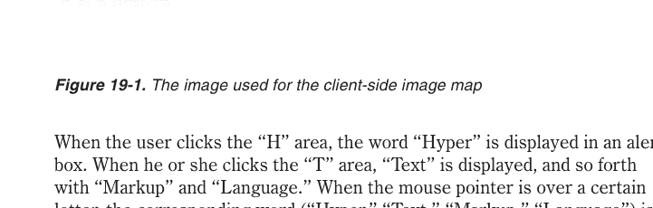

当用户点击“H”区域时，警报框中会显示“Hyper”。当他或她点击“T”区域时，会显示“Text”，而“Markup”和“Language”也是如此。当鼠标指针悬停在某个字母上时，状态栏中会显示相应的单词（“Hyper”、“Text”、“Markup”、“Language”）。当鼠标指针移开图像映射时，状态栏会被清空。现在，看看示例 19-1，了解这是如何工作的。

```
<HTML>
<HEAD>
<TITLE>Client-side image map</TITLE>
</HEAD>
<BODY BGCOLOR="#ffffff">
```


```

<MAP NAME="html_map">
<AREA
NAME="H"
COORDS="0, 0, 55, 69"
HREF="javascript:alert('Hyper')"
SHAPE="rect"
onMouseOver="window.status = 'Hyper'; return true"
onMouseOut="window.status = ''; return true">
<AREA
NAME="T"
COORDS="56, 0, 101, 69"
HREF="javascript:alert('Text')"
SHAPE="rect"
onMouseOver="window.status = 'Text'; return true"
onMouseOut="window.status = ''; return true">
<AREA
NAME="M"
COORDS="102, 0, 161, 69"
HREF="javascript:alert('Markup')"
SHAPE="rect"
onMouseOver="window.status = 'Markup'; return true"
onMouseOut="window.status = ''; return true">
<AREA
NAME="L"
COORDS="161, 0, 194, 69"
HREF="javascript:alert('Language')"
SHAPE="rect"
onMouseOver="window.status = 'Language'; return true"
onMouseOut="window.status = ''; return true">
</MAP>
</BODY>
</HTML>
```

*示例 19-1 (ex19-1.htm)。处理图像地图区域的 JavaScript*

首先，注意创建图像的 HTML 标签：

```

```

除了最后一个属性，所有属性的含义都不言自明。USEMAP 指定了该图像所使用的图像地图定义（`<MAP>`）的名称，并以井号字符开头。图像地图定义本身使用以下开始标签：

```
<MAP NAME="html_map">
```

你应该如上所示设置地图的名称；否则，图像将无法引用它。在图 19-1 的图像地图中，基本上有四个区域，分别对应“HTML”横幅的每个字母。由于除了触发的消息和坐标外，所有四个区域都是相同的，这里只讨论一个。让我们看看最后一个区域：

```
<AREA
    NAME="L"
    COORDS="161, 0, 194, 69"
    HREF="javascript:alert('Language')"
    SHAPE="rect"
    onMouseOver="window.status = 'Language'; return true"
    onMouseOut="window.status = ''; return true">
```

首先，注意这个区域被定义为一个矩形（`SHAPE="rect"`）。左上角的 x 和 y 坐标分别为 161 和 0。坐标以像素为单位测量，起始于图像的第一个像素 (0, 0)。右下角的 x 和 y 坐标分别为 194 和 69，它们分别是图像的 HEIGHT 和 WIDTH 属性值。当用户将鼠标指针移到此区域上方时，状态栏会显示字符串“Language”（代表“L”）（该字符串被赋值给 status 属性），并返回布尔值 true。当用户将鼠标从此区域移开时，状态栏会清空（被赋值为空字符串）。由于目标区域的 `onMouseOver` 事件处理程序会立即接管源区域的 `onMouseOut` 操作，因此当用户将指针移动到相邻的图像地图区域之一时，通常不会注意到这个中间状态。当用户将鼠标指针从该区域移出到整个图像之外时，状态栏会被清除并保持为空，直到明确地将不同的值分配给状态栏，或者鼠标移回图像地图区域。当用户单击此区域时，HREF 中指定的位置将被加载，并且由于该属性的值是一个以 `javascript:` 方案开头的 JavaScript 语句，它不会加载新文档，而是弹出一个带有字符串“Language”的警报对话框。

## 链接和区域属性

## 等效位置属性

链接或区域对象 (`document.links[index]`) 的大部分属性都与 HREF 定义的 URL 相关联。这些都是 `window.location` 对象的属性，我们将在下面简要描述。引用链接或区域对象属性的唯一方法是使用以下语法：

```
document.links.propertyName
```

请注意，链接没有任何方法。以下是 `document.links` 属性与 `window.location` 属性之间的对应列表：

- `hash` 指定 URL 中的锚点名称。
- `host` 指定 URL 的 `hostname:port` 部分。
- `hostname` 指定网络主机的主机名和域名，或 IP 地址。
- `href` 指定整个 URL。
- `pathname` 指定 URL 的 *url-path* 部分。
- `port` 指定服务器用于通信的通信端口（默认为 80）。
- `protocol` 指定 URL 的开头，包括冒号（也称为 scheme）。
- `search` 指定查询。

## target

target 属性最初反映 `<A HREF="...">` 或 `<AREA HREF="...">` HTML 定义的 TARGET 属性。设置此属性的值将覆盖初始定义。
target 属性 (`document.links[index].target`) 不能被赋值为 JavaScript 表达式或变量。

## 引用文档

当用户单击一个文档中的链接并导致在相同或另一个窗口中加载新页面时，调用文档被称为*引用文档*。当用户通过来自另一个页面的链接（而不是来自他或她的书签、历史记录列表、收藏夹等）到达一个页面时，引用页面的 URL 会作为只读属性 `document.referrer` 反映在新页面中。引用文档也称为*源文档*，而 referrer 文档链接到的新页面被称为*目标文档*。
属性 `document.referred` 对于在你维护的大型站点内跟踪用户的移动非常有用。如果用户浏览到外部页面，它就完全无用了，因此，除非 *Playboy* 提供了指向你页面的链接，否则你将无法用诸如“顽皮的小男孩——Playboy 只适合成年人！”之类的消息来问候用户。
假设你的站点上有一个页面 C.html，它被两个不同的页面 A.html 和 B.html 链接。假设 A.html 包含关于 C.html 上提供的共享软件产品的重要版权信息，而 B.html 提供有关安装软件包的重要说明。你可以在 C.html 上使用以下 JavaScript 脚本来检查用户来自哪里，并打印指向第三个页面的链接：

```
<SCRIPT LANGUAGE="JavaScript">
<!-- begin JavaScript *immediate* script
// assign greater than character without literally displaying it
var gt = unescape("%3E")
if (document.referred.indexOf("A.html") == -1)
    document.write('<A HREF="A.html"' + gt + 'Copyright notice</A>' + gt)

if (document.referred.indexOf("B.html") == -1)
    document.write('<A HREF="B.html"' + gt + 'Installation instructions</A>' + gt)

// -->
</SCRIPT>
```

此脚本打印指向用户未来自的文档的链接。如果用户未来自 A.html，则打印 A.html；如果用户未来自 B.html，则打印 B.html；或者如果用户显然来自不同的文档或根本不是通过链接到达的，则打印两个链接。

## 总结

在本章中，我们讨论了链接、区域和锚点对象。你了解到引用这些对象的唯一方法是通过 `document.links` 或 `document.anchors`。你应该从本章记住三个重要的概念：

- `javascript:` 方案为链接或图像地图区域的 HREF 属性指定一个 JavaScript 语句。
- 链接和图像地图区域的 `onMouseOver` 事件处理程序可以执行 JavaScript 语句。当用户将鼠标指针移到链接上方时，表明他或她对其感兴趣，因此在这种情况下在状态栏中显示相关信息可能非常有用。
- `onMouseOut` 事件处理程序也是链接或图像地图区域的一个属性。它的用法类似于 `onMouseOver` 事件处理程序。

# 第 20 章 实现 Cookie

## 维护状态

当你创建一个网站时，你期望用户加载 HTML 文档、查看它们、从一个页面导航到另一个页面等。偶尔，让网页能够维护状态很重要。也就是说，页面会“记住”用户在之前的会话中执行的某些操作。
维护给定状态的一个经典示例是购物车应用程序，正如你几乎在任何商业网站上看到的那样。用户通过简单的 HTML 链接从一个产品评论跳转到另一个。当他或她遇到一个有趣的产品时，点击按钮会将所选产品的数据放入“购物车”。购物车有时在页面上以可视化方式显示，本质上是存储机制的一个名称。由于无法将每个用户的数据存储在服务器上，因此数据被保存在客户端，也就是所谓的购物车中。

Cookie 是服务器端应用程序（如 CGI）和客户端 JavaScript 脚本可以使用的一种通用机制，用于在客户端存储文本数据，以便稍后检索。“cookie”这个名字没有任何技术上的重要意义。它只是发明者认为很酷的一个名字。你可能已经知道，cookie 近年来名声不佳。一些不道德的网站开发者创建 cookie 来存储许多人认为应该是私人的信息。一个常见的策略是，合法的网络开发者在他们的网站上发布一个策略声明，确切地说明该网站在 cookie 中存储了什么以及为什么这样做，这可能有助于缓解客户的担忧。正如你将在本章中看到的，cookie 是一个非常有用的工具。

Cookie 是信息片段，以依赖于浏览器的格式存储在客户端机器上。例如，Netscape Navigator 将所有 cookie 存储在一个名为 cookies.txt 的常规文本文件中（在 Navigator 安装的目录中），而 Internet Explorer 则将 cookie 存储在用户提供的目录中的多个文件中。


## Cookies 与 HTTP

服务器与客户端之间建立的连接使用超文本传输协议（HTTP）。虽然该协议在实现层面非常复杂，但从概念上理解却相当简单。当用户请求一个页面时，会向服务器发送一个 *HTTP 请求*，该请求通过一些额外的属性来明确指定用户的请求内容。作为用户，你通常不会察觉到请求触发了哪些发送到服务器的数据。HTTP 请求包含多个组成部分，其中一个重要的部分是头部（header），它定义了诸如请求页面 URL 等关键属性。此外，HTTP 请求还会包含所有有效的 Cookies。

当服务器响应客户端的请求时，它会返回一个 *HTTP 响应*，该响应也包含一个头部。此头部包含了关于返回文件的重要信息，例如其 MIME 类型（在第 25 章详细讨论）。

HTTP 头部的一般语法如下所示：

```
字段名: 信息
```

当服务器向客户端返回一个 HTTP 对象时，它可能还会传输一些状态信息，供客户端存储为 Cookie。由于 Cookie 本质上是简单的文本，因此服务器端脚本无法滥用客户端机器。除了文本值外，Cookie 还包含多个属性，例如该 Cookie 有效的 URL 范围。客户端未来向上述范围内任一 URL 发起的 HTTP 请求，都会将当前 Cookie 的值传回服务器。

## 设置 HTTP Cookie

HTTP Cookie 通常通过 CGI 脚本在 HTTP 响应中引入客户端，使用以下语法：

```
Set-Cookie: NAME=VALUE; expires=DATE; path=pathName; domain=DOMAIN_NAME; secure
```

其属性如下：

- *name=value* —— name 是 Cookie 的名称，后续可通过它来引用该 Cookie。请注意，访问 Cookie 的唯一方式就是使用这个名称。*value* 是要存储为 Cookie 的常规字符串。建议使用“%XX”样式（等同于 JavaScript 的 `escape` 函数输出）对该字符串进行编码。一般来说，*name=value* 是 Set-Cookie 字段唯一必需的属性。
- *expires=date* —— expires 是一个可选属性，用于指定 Cookie 的过期日期。超过该日期后，Cookie 将不再被存储或获取。日期字符串的格式如下：
  *Wdy, DD-Mon-YYYY HH:MM:SS GMT*

你稍后会看到，此日期格式等同于 `toGMTString()` 日期方法返回的值。如果未指定 `expires`，则 Cookie 将在用户会话结束时过期。
- `path=pathName` —— path 指定了域名中 Cookie 有效的一个 URL 子集。在进行域名匹配后，会比较 URL 的路径名部分与 path 属性，如果匹配成功，则认为该 Cookie 有效，并会随该 URL 的请求一起发送。例如，路径 `/foo` 会匹配 `/foobar` 和 `/foo/bar/html`。路径 `/` 是最通用的。如果未指定 path，则假设其与 Cookie 头部中指定的文档路径相同。
- `domain=domainName` —— 在查找有效 Cookie 时，浏览器会将每个 Cookie 的 domain 属性与即将检索其 URL 的主机的 Internet 域名进行比较。如果存在尾部匹配（tail match），则 Cookie 会进行完整的路径匹配。*尾部匹配*意味着将 domain 属性与主机完全限定域名的尾部进行匹配。例如，domain 属性 `ac.il` 会匹配 `mis.study.ac.il` 以及 `mba.haifa.ac.il`。
- `secure` —— 如果 Cookie 被标记为 secure，则它只会在客户端与主机之间的安全通信信道上传输。如果未指定 `secure`，Cookie 将通过非安全信道发送。

domain 属性确保只有指定域内的主机才能为该域设置 Cookie。常见的顶级域名有七个——“com”、“edu”、“net”、“org”、“gov”、“mil” 和 “int”——此外还有一些最近提出的其他顶级域。

`domain` 的默认值是生成 Cookie 响应的服务器的主机名。

## 获取 HTTP Cookie

当脚本（客户端或服务器端）向 HTTP 服务器请求一个 URL 时，浏览器会将该 URL 与所有 Cookie 进行匹配，如果存在任何匹配项，则会有一行包含所有匹配 Cookie 的名称和值对的信息被包含在 HTTP 请求中。格式非常直接：

```
Cookie: name1=value1; name2=value2 ...
```

请注意，请求头中的 `Cookie` 字段仅包含所有有效 Cookie 的名称和值。响应头中的 `Set-Cookie` 字段则包含额外的属性，例如过期日期。这些属性实际上不是 Cookie 的一部分，而是用于确定特定 Cookie 是否有效，以便将其纳入 HTTP 请求头。

## 注意事项与限制

覆盖一个 Cookie 的唯一方法是创建另一个具有相同名称和路径的 Cookie。创建一个与现有 Cookie 名称相同但路径不同的 Cookie 将添加一个新的 Cookie。即时删除 Cookie 的唯一方法是用一个已过期的 Cookie 来覆盖它。Cookie 可能在其过期日期之前被浏览器删除，但前提是 Cookie 的数量超过了其内部限制。

当向服务器发送 Cookie 时，所有具有更具体路径映射的 Cookie 应优先于路径映射不那么具体的 Cookie 发送。如果两者都发送，例如，路径映射为 `/` 的 Cookie `name1=foo` 应该在路径映射为 `/bar` 的 Cookie `name1=foo2` 之后发送。

对于客户端在任何给定时间可以存储的 Cookie 的大小和数量，存在一些极其重要的限制：

- 客户端最多可容纳 300 个 Cookie。
- 单个 Cookie 最大可达 4KB，包括其名称和值。超过此长度的 Cookie 会被截断以适应限制，因此请务必注意保持在此长度范围内。
- 每个服务器或域最多允许 20 个 Cookie。

客户端不应超出这些限制。如果违反此规则，最旧的 Cookie 将被删除。

代理服务器应传播 `Set-Cookie` 头部到客户端，无论响应是 304（“未修改”）还是 200（“正常”）。代理服务器能正常处理 Cookie。

## 示例

以下是一些来自 Netscape 文档的示例交互，用于说明 Cookie 的使用。

### 第一个事务序列示例

客户端请求一个文档并在响应中收到：

```
Set-Cookie: CUSTOMER=WILE_E_COYOTE; path=/; expires=Wednesday,
 09-Nov-11 23:12:40 GMT
```

当客户端请求此服务器上路径 `/` 下的 URL 时，它会发送：

```
Cookie: CUSTOMER=WILE_E_COYOTE
```

客户端请求一个文档并在响应中收到：

```
Set-Cookie: PART_NUMBER=ROCKET_LAUNCHER_0001; path=/
```

当客户端请求此服务器上路径 `/` 下的 URL 时，它会发送：

```
Cookie: CUSTOMER=WILE_E_COYOTE; PART_NUMBER=ROCKET_LAUNCHER_0001
```

客户端收到：

```
Set-Cookie: SHIPPING=FEDEX; path=/foo
```

当客户端请求此服务器上路径 `/` 下的 URL 时，它会发送：

```
Cookie: CUSTOMER=WILE_E_COYOTE; PART_NUMBER=ROCKET_LAUNCHER_0001
```

当客户端请求此服务器上路径 `/foo` 下的 URL 时，它会发送：

```
Cookie: CUSTOMER=WILE_E_COYOTE; PART_NUMBER=ROCKET_LAUNCHER_0001; SHIPPING=FEDEX
```

### 第二个事务序列示例

假设上述所有映射都已被清除。
客户端收到：

```
Set-Cookie: PART_NUMBER=ROCKET_LAUNCHER_0001; path=/
```

当客户端请求此服务器上路径 `/` 下的 URL 时，它会发送：

```
Cookie: PART_NUMBER=ROCKET_LAUNCHER_0001
```

客户端收到：

```
Set-Cookie: PART_NUMBER=RIDING_ROCKET_0023; path=/ammo
```

当客户端请求此服务器上路径 `/ammo` 下的 URL 时，它会发送：

```
Cookie: PART_NUMBER=RIDING_ROCKET_0023; PART_NUMBER=ROCKET_LAUNCHER_0001
```

请注意，由于存在两个不同的路径 `/` 和 `/ammo`，因此有两个名为 PART_NUMBER 的属性。

## Cookies 与 JavaScript

使用服务器端应用程序设置和获取 Cookie 依赖于 HTTP 头部。你无法在页面加载后设置或检索 Cookie。然而，JavaScript 脚本是一种客户端应用程序，因此使你能够在任何时间处理 Cookie，而无需联系服务器。
document 对象的 cookie 属性反映了对于托管脚本的网页有效的所有 Cookie；也就是说，`document.cookie` 等同于 HTTP 请求头中的 `Cookie` 字段。
就像你通过 HTTP 响应头中的 `Set-Cookie` 字段设置 Cookie 一样，你也可以通过 JavaScript，通过为 `document.cookie` 赋值来设置 Cookie。

## Cookie 函数

你应该注意到，我们既没有演示也没有强调在 JavaScript 中使用 Cookie。这样做的原因是，明确处理 `document.cookie` 属性既困难又几乎无用。此外，与 Cookie 相关的定义操作只有三个：


当你想执行上述任一操作时，可能会发现以下函数很有用。所有函数都是不言自明的，并且带有完整注释：

```
// 布尔变量，指定当 cookie 超过 4KB 时是否显示警告
var caution = false
// name - cookie 的名称
// value - cookie 的值
// [expires] - cookie 的过期日期（默认为当前会话结束）
// [path] - cookie 有效的路径（默认为调用文档的路径）
// [domain] - cookie 有效的域（默认为调用文档的域）
// [secure] - 布尔值，指示 cookie 传输是否需要安全传输
// * 参数在分配为 null 作为占位符时会使用默认值
// * 对于末尾省略的参数，不需要 null 占位符
function setCookie(name, value, expires, path, domain, secure)
{
    var curCookie = name + "=" + escape(value) +
        ((expires) ? "; expires=" + expires.toGMTString() : "") +
        ((path) ? "; path=" + path : "") +
        ((domain) ? "; domain=" + domain : "") +
        ((secure) ? "; secure" : "")
    if (!caution || (name + "=" + escape(value)).length <= 4000)
        document.cookie = curCookie
    else
        if (confirm("Cookie exceeds 4KB and will be cut!"))
            document.cookie = curCookie
}
// name - 所需 cookie 的名称
// * 返回包含指定 cookie 值的字符串，如果 cookie 不存在则返回 null
function getCookie(name)
{
    var prefix = name + "="
    var cookieStartIndex = document.cookie.indexOf(prefix)
    if (cookieStartIndex == -1)
        return null
    var cookieEndIndex = document.cookie.indexOf(";", cookieStartIndex +
                                               prefix.length)
    if (cookieEndIndex == -1)
        cookieEndIndex = document.cookie.length
    return unescape(document.cookie.substring(cookieStartIndex +
                                               prefix.length, cookieEndIndex))
}
// name - cookie 的名称
// [path] - cookie 的路径（必须与用于创建 cookie 的路径相同）
// [domain] - cookie 的域（必须与用于创建 cookie 的域相同）
// * path 和 domain 在分配为 null 时使用默认值，或者如果前面没有显式参数则可以省略
function deleteCookie(name, path, domain)
{
    if (getCookie(name))
    {
        document.cookie = name + "=" +
        ((path) ? "; path=" + path : "") +
        ((domain) ? "; domain=" + domain : "") +
        "; expires=Thu, 01-Jan-70 00:00:01 GMT"
    }
}
// date - Date 对象的任何实例
// * 你应该将所有 Date 对象的实例交给此函数进行“修复”
// * 此函数摘自《Advanced JavaScript, Third Edition》第 10 章 "Time and Date in JavaScript"

function fixDate(date)
{
    var base = new Date(0)
    var skew = base.getTime()
    if (skew > 0)
        date.setTime(date.getTime() - skew)
}
```

请通读这些函数和注释，以便了解如何使用它们。这些函数最基本的应用是一个脚本，它计算用户访问托管该代码的页面的次数：

```
<HTML>
<HEAD>
<TITLE>Remember number of visits</TITLE>
<SCRIPT LANGUAGE="JavaScript">
<!--
// 布尔变量，指定当 cookie 超过 4KB 时是否显示警告
var caution = false
// name - cookie 的名称
// value - cookie 的值
// [expires] - cookie 的过期日期（默认为当前会话结束）
// [path] - cookie 有效的路径（默认为调用文档的路径）
// [domain] - cookie 有效的域（默认为调用文档的域）
// [secure] - 布尔值，指示 cookie 传输是否需要安全传输
// * 参数在分配为 null 作为占位符时会使用默认值
// * 对于末尾省略的参数，不需要 null 占位符
function setCookie(name, value, expires, path, domain, secure)
{
    var curCookie = name + "=" + escape(value) +
        ((expires) ? "; expires=" + expires.toGMTString() : "") +
        ((path) ? "; path=" + path : "") +
        ((domain) ? "; domain=" + domain : "") +
        ((secure) ? "; secure" : "")
    if (!caution || (name + "=" + escape(value)).length <= 4000)
        document.cookie = curCookie
    else
        if (confirm("Cookie exceeds 4KB and will be cut!"))
            document.cookie = curCookie
}
// name - 所需 cookie 的名称
// * 返回包含指定 cookie 值的字符串，如果 cookie 不存在则返回 null
function getCookie(name)
{
    var prefix = name + "="
    var cookieStartIndex = document.cookie.indexOf(prefix)
    if (cookieStartIndex == -1)
        return null
    var cookieEndIndex = document.cookie.indexOf(";", cookieStartIndex +
                                       prefix.length)
    if (cookieEndIndex == -1)
        cookieEndIndex = document.cookie.length
    return unescape(document.cookie.substring(cookieStartIndex +
                                    prefix.length, cookieEndIndex))
}
// name - cookie 的名称
// [path] - cookie 的路径（必须与用于创建 cookie 的路径相同）
// [domain] - cookie 的域（必须与用于创建 cookie 的域相同）
// * path 和 domain 在分配为 null 时使用默认值，或者如果前面没有显式参数则可以省略
function deleteCookie(name, path, domain)
{
    if (getCookie(name))
    {
        document.cookie = name + "=" +
        ((path) ? "; path=" + path : "") +
        ((domain) ? "; domain=" + domain : "") +
        "; expires=Thu, 01-Jan-70 00:00:01 GMT"
    }
}
// date - Date 对象的任何实例
// * 你应该将所有 Date 对象的实例交给此函数进行“修复”
function fixDate(date)
{
    var base = new Date(0)
    var skew = base.getTime()
    if (skew > 0)
        date.setTime(date.getTime() - skew)
}
var now = new Date()
fixDate(now)
now.setTime(now.getTime() + 365 * 24 * 60 * 60 * 1000)
var visits = getCookie("counter")
if (!visits)
    visits = 1
else
    visits = parseInt(visits) + 1
setCookie("counter", visits, now)
document.write("You have been here " + visits + " time(s).")
// -->
</SCRIPT>
</HEAD>
</HTML>
```

## 实现 Cookie

**示例 20-1 (ex20-1.htm). 一个简单的基于 cookie 的计数器**

你可以在图 20-1 中看到此脚本的输出。

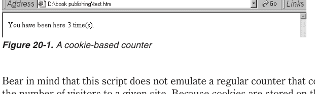

*图 20-1. 一个基于 cookie 的计数器*

请记住，此脚本并不模拟计算给定网站访客数量的常规计数器。因为 cookie 存储在客户端，它们只能用于计算特定客户端的访问次数。首先，一个反映当前日期的 Date 对象实例被赋值给变量 `now`。然后，该实例被传递给 `fixDate()` 函数，该函数对于正确格式化 Macintosh OS 用户的日期值是必需的。`now.setTime(now.getTime() + 365 * 24 * 60 * 60 * 1000)` 语句将 cookie 的过期日期设置为未来一年。此过期日期在设置 cookie 时会用到。脚本获取一个名为 `counter` 的 cookie 并从中检索访问次数。如果不存在指定名称的 cookie，变量 `visits` 被初始化为 1；否则，cookie 中的访问次数将增加 1。然后，脚本通过 `setCookie()` 将新的访问次数写回 cookie。脚本的最后一条语句通知用户在当前页面上访问了多少次。

下面的脚本与前面的类似，但它询问用户其姓名并“记住”它。脚本如下：

```
<HTML>
<HEAD>
<TITLE>Remember user's name</TITLE>
<SCRIPT LANGUAGE="JavaScript">
<!--
// 布尔变量，指定当 cookie 超过 4KB 时是否显示警告
var caution = false
// name - cookie 的名称
// value - cookie 的值
// [expires] - cookie 的过期日期（默认为当前会话结束）
// [path] - cookie 有效的路径（默认为调用文档的路径）
// [domain] - cookie 有效的域（默认为调用文档的域）
// [secure] - 布尔值，指示 cookie 传输是否需要安全传输
// * 参数在分配为 null 作为占位符时会使用默认值
// * 对于末尾省略的参数，不需要 null 占位符
function setCookie(name, value, expires, path, domain, secure)
{
    var curCookie = name + "=" + escape(value) +
        ((expires) ? "; expires=" + expires.toGMTString() : "") +
        ((path) ? "; path=" + path : "") +
        ((domain) ? "; domain=" + domain : "") +
        ((secure) ? "; secure" : "")
    if (!caution || (name + "=" + escape(value)).length <= 4000)
        document.cookie = curCookie
    else
        if (confirm("Cookie exceeds 4KB and will be cut!"))
            document.cookie = curCookie
}
// name - 所需 cookie 的名称
// * 返回包含指定 cookie 值的字符串，如果 cookie 不存在则返回 null
function getCookie(name)
{
    var prefix = name + "="
    var cookieStartIndex = document.cookie.indexOf(prefix)
    if (cookieStartIndex == -1)
        return null
    var cookieEndIndex = document.cookie.indexOf(";", cookieStartIndex +
                                               prefix.length)
    if (cookieEndIndex == -1)
        cookieEndIndex = document.cookie.length
    return unescape(document.cookie.substring(cookieStartIndex +
                                               prefix.length, cookieEndIndex))
}
// name - cookie 的名称
// [path] - cookie 的路径（必须与用于创建 cookie 的路径相同）
// [domain] - cookie 的域（必须与用于创建 cookie 的域相同）
// * path 和 domain 在分配为 null 时使用默认值，或者如果前面没有显式参数则可以省略
function deleteCookie(name, path, domain)
{
    if (getCookie(name))
    {
        document.cookie = name + "=" +
        ((path) ? "; path=" + path : "") +
        ((domain) ? "; domain=" + domain : "") +
        "; expires=Thu, 01-Jan-70 00:00:01 GMT"
    }
}
// date - Date 对象的任何实例
// * 你应该将所有 Date 对象的实例交给此函数进行“修复”
// * 此函数摘自《Advanced JavaScript, Third Edition》第 10 章 "Time and Date in JavaScript"

function fixDate(date)
{
    var base = new Date(0)
    var skew = base.getTime()
    if (skew > 0)
        date.setTime(date.getTime() - skew)
}
```

## 第 20 章


## 示例 20-2 (ex20-2.htm)。*一个记住用户名字并每次显示问候语的脚本*

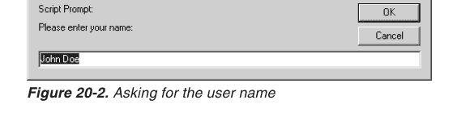

*图 20-2。询问用户名字*


*图 20-3。显示问候语*

本示例的输出如图 20-2 和 20-3 所示。这个脚本与前一个脚本的差异仅限于脚本的最后五条语句。在当前脚本中，cookie 的名称是 `name`，从其中检索的是用户的名字。请注意，你将 `getCookie()` 的值赋给的变量不一定与 cookie 同名，就像这里所做的这样。如果未找到 cookie，则会提示用户输入其姓名。脚本随后用用户名字设置 cookie 并打印个性化的欢迎消息。

示例 20-1 和 20-2 相当简单，因为它们只设置和读取一个 cookie。示例 20-3 演示了以一种稍有不同的方式使用 cookie。它创建一个日历，使用户能够为特定日期输入提醒。这个提醒日历即使在用户关闭计算机后也能存储整个月的数据。由于一个月最多有 31 天，并且每个域或服务器限用 20 个 cookie，因此脚本将所有提醒存储在一个 cookie 中，使用特殊的分隔序列。假设一条提醒不超过 100 个字符，存储 31 个值将占用 31 * 100，即 3100 个字符，这小于 4KB 的上限。以下是脚本：

```html
<HTML>
<HEAD>
<TITLE>
JavaScript calendar
</TITLE>
</HEAD>
<BODY>
<SCRIPT LANGUAGE="JavaScript">
<!--
//
// Cookie 函数，用于存储和检索 cookie
//
// 布尔变量，指定当 cookie 超过 4KB 时是否显示警报
var caution = false

// name - cookie 的名称
// value - cookie 的值
// [expires] - cookie 的过期日期（默认为当前会话结束）
// [path] - cookie 有效的路径（默认为调用文档的路径）
// [domain] - cookie 有效的域（默认为调用文档的域）
// [secure] - 布尔值，指示 cookie 传输是否需要安全传输
// * 当参数赋值为 null 作为占位符时，该参数使用默认值
// * 对于尾部省略的参数，不需要 null 占位符
function setCookie(name, value, expires, path, domain, secure)
{
  var curCookie = name + "=" + escape(value) +
    ((expires) ? "; expires=" + expires.toGMTString() : "") +
    ((path) ? "; path=" + path : "") +
    ((domain) ? "; domain=" + domain : "") +
    ((secure) ? "; secure" : "")
  if (!caution || (name + "=" + escape(value)).length <= 4000)
    document.cookie = curCookie
  else
    if (confirm("Cookie exceeds 4KB and will be cut!"))
      document.cookie = curCookie
}

// name - 所需 cookie 的名称
// * 返回包含指定 cookie 值的字符串，如果 cookie 不存在则返回 null
function getCookie(name)
{
    var prefix = name + "="
    var cookieStartIndex = document.cookie.indexOf(prefix)
    if (cookieStartIndex == -1)
        return null
    var cookieEndIndex = document.cookie.indexOf(";", cookieStartIndex + prefix.length)
    if (cookieEndIndex == -1)
        cookieEndIndex = document.cookie.length
    return unescape(document.cookie.substring(cookieStartIndex + prefix.length, cookieEndIndex))
}

// name - cookie 的名称
// [path] - cookie 的路径（必须与创建 cookie 时使用的路径相同）
// [domain] - cookie 的域（必须与创建 cookie 时使用的域相同）
// * 如果 path 和 domain 被赋值为 null 或被省略，则使用默认值（前提是前面没有显式参数）
function deleteCookie(name, path, domain)
{
    if (getCookie(name))
    {
        document.cookie = name + "=" +
        ((path) ? "; path=" + path : "") +
        ((domain) ? "; domain=" + domain : "") +
        "; expires=Thu, 01-Jan-70 00:00:01 GMT"
    }
}

// date - Date 对象的任何实例
// * 你应该将所有 Date 对象的实例传递给此函数以进行“修复”
function fixDate(date)
{
    var base = new Date(0)
    var skew = base.getTime()
    if (skew > 0)
        date.setTime(date.getTime() - skew)
}

function initCookie(monthName)
{  // 以以下格式初始化 cookie：
    // ^1^^2^^3^^4^..^30^^31^
    // 初始化累加变量
    var text = ""
    for (var i = 1; i <= 31; ++i)
    {
        text += "^" + i + "^"
    }
    var now = new Date()
    fixDate(now)
    // 将时间设置为一个月（31 天）后
    now.setTime(now.getTime() + 1000 * 60 * 60 * 24 * 31)
    setCookie(monthName + "Calendar", text, now)
}

function getSpecificReminder(num, monthName)
{
    var prefix = "^" + num + "^"
    var totalCookie = getCookie(monthName + "Calendar")
    var startIndex = totalCookie.indexOf(prefix, 0)
    var startData = totalCookie.indexOf("^", startIndex + 1) + 1
    if (num == 31)
        var endData = totalCookie.length
    else
        var endData = totalCookie.indexOf("^", startData)
    return totalCookie.substring(startData, endData)
}

function setSpecificReminder(num, monthName, newValue)
{
    var prefix = "^" + num + "^"
    var totalCookie = getCookie(monthName + "Calendar")
    var startIndex = totalCookie.indexOf(prefix, 0)
    var startData = totalCookie.indexOf("^", startIndex + 1) + 1
    if (num == 31)
        var endData = totalCookie.length
    else
        var endData = totalCookie.indexOf("^", startData)
    var now = new Date()
    fixDate(now)
    // 将时间设置为一个月（31 天）后
    now.setTime(now.getTime() + 1000 * 60 * 60 * 24 * 31)
    setCookie(monthName + "Calendar", totalCookie.substring(0, startData)
    + newValue + totalCookie.substring(endData, totalCookie.length), now)
}

function getInput(num, monthName)
{
    if (!getCookie(monthName + "Calendar"))
        initCookie(monthName)
    var newValue = prompt("Enter reminder for current date:",
                         getSpecificReminder(num, monthName))
    if (newValue)    // 用户未取消
        setSpecificReminder(num, monthName, newValue)
}

function getTime()
{
    // 使用当前时间设置初始化与时间相关的变量
    var now = new Date()
    var hour = now.getHours()
    var minute = now.getMinutes()
    now = null
    var ampm = ""
    // 验证小时值并设置 ampm 的值
    if (hour >= 12)
    {
        hour -= 12
        ampm = "PM"
```

# 394 ■ 第 20 章


```javascript
}
else
    ampm = "AM"
hour = (hour == 0) ? 12 : hour
// 为个位数的分钟添加前导零
if (minute < 10)
    minute = "0" + minute  // 不要解析这个数字！
// 返回时间字符串
return hour + ":" + minute + " " + ampm
}
function leapYear(year)
{
    if (year % 4 == 0)       // 基本规则
        return true         // 是闰年
    return false            // 不是闰年
}
function getDays(month, year)
{
    // 创建数组以保存每个月的天数
    var ar = new Array(12)
    ar[0] = 31  // 一月
    ar[1] = (leapYear(year)) ? 29 : 28  // 二月
    ar[2] = 31  // 三月
    ar[3] = 30  // 四月
    ar[4] = 31  // 五月
    ar[5] = 30  // 六月
    ar[6] = 31  // 七月
    ar[7] = 31  // 八月
    ar[8] = 30  // 九月
    ar[9] = 31  // 十月
    ar[10] = 30  // 十一月
    ar[11] = 31  // 十二月
    // 返回指定月份（参数）的天数
    return ar[month]
}
function getMonthName(month)
{
    // 创建数组以保存每个月的名称
    var ar = new Array(12)
    ar[0] = "January"
    ar[1] = "February"
    ar[2] = "March"
    ar[3] = "April"
    ar[4] = "May"
    ar[5] = "June"
    ar[6] = "July"
    ar[7] = "August"
    ar[8] = "September"
    ar[9] = "October"
    ar[10] = "November"
    ar[11] = "December"
    // 返回指定月份（参数）的名称
    return ar[month]
}
function setCal()
{
    // 标准时间属性
    var now = new Date()
    var year = now.getYear()
    var month = now.getMonth()
    var monthName = getMonthName(month)
    var date = now.getDate()
    now = null
    // 创建月份第一天的实例，并提取它出现的星期几
    var firstDayInstance = new Date(year, month, 1)
    var firstDay = firstDayInstance.getDay()
    firstDayInstance = null
    // 当前月份的天数
    var days = getDays(month, year)
    // 调用函数绘制日历
    drawCal(firstDay + 1, days, date, monthName, 1900 + year)
}
function drawCal(firstDay, lastDate, date, monthName, year)
{
    // 常量表设置
    var headerHeight = 50           // 表头单元格的高度
    var border = 2                  // 表格边框的3D高度
    var cellspacing = 4             // 表格边框的宽度
    var headerColor = "midnightblue"    // 表头的颜色
    var headerSize = "+3"           // 表头字体的大小
    var colWidth = 60               // 表格中列的宽度
    var dayCellHeight = 25          // 包含星期几的单元格的高度
    var dayColor = "darkblue"       // 表示工作日的字体颜色
    var cellHeight = 40             // 表示日历中日期的单元格的高度
    var todayColor = "red"          // 指定日历中今天日期的颜色
    var timeColor = "purple"        // 表示当前时间的字体颜色
    // 创建基本表格结构
    var text = ""                   // 将累积变量初始化为空字符串
    text += '<CENTER>'
    text += '<TABLE BORDER=' + border + ' CELLSPACING=' + cellspacing + '>'
    // 表格设置
    text += '<TH COLSPAN=7 HEIGHT=' + headerHeight + '>'
    // 创建表头单元格
    text += '<FONT COLOR="' + headerColor + '" SIZE=' + headerSize+ '>'
    // 设置表头字体
    text += monthName + ' ' + year
    text += '</FONT>'               // 关闭表头字体设置
    text += '</TH>'                 // 关闭表头单元格
    // 保存常量设置的变量
    var openCol = '<TD WIDTH=' + colWidth + ' HEIGHT=' + dayCellHeight + '>'
    openCol += '<FONT COLOR="' + dayColor + "">"
    var closeCol = '</FONT></TD>'
    // 创建星期名称的缩写数组
    var weekDay = new Array(7)
    weekDay[0] = "Sun"
    weekDay[1] = "Mon"
    weekDay[2] = "Tues"
    weekDay[3] = "Wed"
    weekDay[4] = "Thu"
    weekDay[5] = "Fri"
    weekDay[6] = "Sat"
    // 创建表格的第一行以设置列宽并指定星期几
    text += '<TR ALIGN="center" VALIGN="center">'
    for (var dayNum = 0; dayNum < 7; ++dayNum)
    {
        text += openCol + weekDay[dayNum] + closeCol
    }
    text += '</TR>'
    // 声明和初始化两个变量以帮助处理表格
    var digit = 1
    var curCell = 1
    for (var row = 1; row <= Math.ceil((lastDate + firstDay - 1) / 7);++row)
    {
        text += '<TR ALIGN="right" VALIGN="top">'
        for (var col = 1; col <= 7; ++col)
        {
            if (digit > lastDate)
                break
            if (curCell < firstDay)
            {
                text += '<TD></TD>';
                curCell++
            }
            else
            {
                if (digit == date) { // 当前单元格代表今天的日期
                    text += '<TD HEIGHT=' + cellHeight + '>'
                    text += '<FONT COLOR="' + todayColor + '">' 
                    text += '<A HREF="javascript:getInput(' + digit + 
                        ', \'' + monthName + '\')" onMouseOver
                        ="window.status = \'Store or retrieve data
                        for ' + monthName + ' ' + digit + '\';
                        return true"><FONT COLOR="' + todayColor + 
                        '">' + digit + '</FONT></A>'
                    text += '<BR>'
                    text += '<FONT COLOR="' + timeColor + '" SIZE=2>'
                    text += '<CENTER>' + getTime() + '</CENTER>'
                    text += '</FONT>'
                    text += '</TD>'
                }
                else
                {
                    text += '<TD HEIGHT=' + cellHeight + '><A HREF=
                        "javascript:getInput(' + digit + ', \'' + 
                        monthName + '\')" onMouseOver="window.
                        status = \'Store or retrieve data for
                        ' + monthName + ' ' + digit + '\';
                        return true">' + digit + '</A></TD>'
                }
            }
        }
        digit++
    }
    text += '</TR>'
    // 关闭所有基本表格标签
    text += '</TABLE>'
    text += '</CENTER>'
    // 打印累积的HTML字符串
    document.write(text)
}
setCal()
// -->
</SCRIPT>
</BODY>
</HTML>

**示例 20-3 (ex20-3.htm). 一个基于 cookie 的提醒日历**

setCal() 函数创建日历。该日历是使用与示例 10-3（第 10 章，“JavaScript 中的时间和日期”）相同的函数创建的。唯一的区别如下：

```javascript
if (digit == date)
{ // 当前单元格代表今天的日期
    text += '<TD HEIGHT=' + cellHeight + '>'
    text += '<FONT COLOR="' + todayColor + '">' 
    text += '<A HREF="javascript:getInput(' + digit + ', \'' + monthName + '\')" onMouseOver="window.status = \'Store or retrieve data for ' + monthName + ' ' + digit + '\'; return true">'
           + '<FONT COLOR="' + todayColor + '">' + digit + '</FONT></A>'
    text += '<BR>'
    text += '<FONT COLOR="' + timeColor + '" SIZE=2>'
    text += '<CENTER>' + getTime() + '</CENTER>'
    text += '</FONT>'
    text += '</TD>'
}
else
    text += '<TD HEIGHT=' + cellHeight + '><A HREF="javascript:getInput(' + digit + ', \'' + monthName + '\')" onMouseOver="window.status = \'Store or retrieve data for ' + monthName + ' ' + digit + '\'; return true">' + digit + '</A></TD>'
```

此语句与示例 10-3 中对应的语句不同之处在于，它不是将日期作为纯数字写入，而是将每个数字转换为一个链接，该链接使用 `javascript:getInput()` URL 调用 `getInput()` 函数。该 URL 的确切语法如下：

```javascript
javascript:getInput(digit, monthName)
```

第一个参数是作为链接的数字（一个从 1 到 28、29、30 或 31 的整数）。第二个参数是一个字符串——日历所反映的当前月份的全名。

请注意，当用户将鼠标指针悬停在链接上时，一条相关信息会被分配到状态栏。我们将只讨论负责 cookie 处理和存储的函数，因为创建日历的函数在第 10 章，“JavaScript 中的时间和日期”中已经讨论过。

# getInput(num, monthName)

```javascript
function getInput(num, monthName)
{
    if (!getCookie(monthName + "Calendar"))
        initCookie(monthName)
    var newValue = prompt("Enter reminder for current date:",
                        getSpecificReminder(num, monthName))
    if (newValue) // 用户没有取消
        setSpecificReminder(num, monthName, newValue)
}
```

`getInput()` 函数通常从 cookie 中读取提醒，要求用户修改它或首次输入它，然后将提醒保存回 cookie。首先，它从名称由当前月份名称和 "Calendar" 字符串组成的 cookie 中获取提醒文本。这种名称选择算法防止了不同月份或不同应用程序之间的 cookie 混淆。如果未找到 cookie，则调用 `initCookie()` 函数创建一个具有空提醒（每月每天一个）的 cookie。然后，脚本会提示用户输入提醒，并在表单的输入字段中显示旧提醒。请注意，提醒通过指定 `getSpecificReminder()` 返回的值作为 `prompt()` 方法的第二个参数，显示在提示对话框的字段中。如果用户没有按“取消”来响应请求表单，新信息将通过 `setSpecificReminder()` 函数保存在 cookie 中。

# initCookie(monthName)

```javascript
function initCookie(monthName)
{
    // 使用以下格式初始化 cookie：
    // ^1^^2^^3^^4^...^30^^31^
    // 初始化累积变量
    var text = ""
    for (var i = 1; i <= 31; ++i)
    {
        text += "^" + i + "^"
    }
    var now = new Date()
    fixDate(now)
    // 将时间设置为未来一个月（31天）
    now.setTime(now.getTime() + 1000 * 60 * 60 * 24 * 31)
    setCookie(monthName + "Calendar", text, now)
}
```


`initCookie()` 函数创建一个提醒为空的 cookie，为每月的每一天都创建一个。cookie 的文本是所有 31 个提醒的字符串拼接，彼此之间用 "^" 分隔。该函数构建空字符串，修复 Mac 电脑的日期，计算时间，最后设置 cookie，将空提醒、日期和时间保存在其中。

## getSpecificReminder(num, monthName)

```javascript
function getSpecificReminder(num, monthName)
{
    var prefix = "^" + num + "^"
    var totalCookie = getCookie(monthName + "Calendar")
    var startIndex = totalCookie.indexOf(prefix, 0)
    var startData = totalCookie.indexOf("^", startIndex + 1) + 1
    if (num == 31)
        var endData = totalCookie.length
    else
        var endData = totalCookie.indexOf("^", startData)
    return totalCookie.substring(startData, endData)
}
```

此函数从 cookie 中检索当月的特定提醒。它首先在 prefix 中构建“搜索键”。它由一个 "^" 后跟月份的天数和另一个 "^" 组成。获取 cookie 并将字符串读入 totalCookie 字符串对象后，该函数根据 prefix “搜索键”搜索相关提醒的位置，得到 startIndex 位置。查找下一个 "^" 会跳过当天的数字本身，并跳转到提醒第一个字符的字符串索引 startData。提醒的最后一个字符通过搜索下一个 "^" 字符或到达 cookie 末尾来找到。一旦知道 startData 和 endData，就返回这两个索引之间的子字符串。请注意，因为索引依赖于 "^" 字符，所以用户不应在提醒文本中提供该字符。

## setSpecificReminder(num, monthName, newValue)

```javascript
function setSpecificReminder(num, monthName, newValue)
{
    var prefix = "^" + num + "^"
    var totalCookie = getCookie(monthName + "Calendar")
    var startIndex = totalCookie.indexOf(prefix, 0)
    var startData = totalCookie.indexOf("^", startIndex + 1) + 1
    if (num == 31)
        var endData = totalCookie.length
    else
        var endData = totalCookie.indexOf("^", startData)
    var now = new Date()
    fixDate(now)
    // set time to one month (31 days) in the future
    now.setTime(now.getTime() + 1000 * 60 * 60 * 24 * 31)
    setCookie(monthName + "Calendar", totalCookie.substring(0,
        startData) + newValue + totalCookie.substring(
        endData, totalCookie.length), now)
}
```

与 `setSpecificReminder()` 类似，第一部分确定相关提醒的第一个和最后一个字符（分别是 startData 和 endData）的索引。然后创建一个 Date 对象实例并为 Mac 电脑修复。过期日期被计算为未来一个月。函数的最后一条语句设置 cookie。第一个参数是 cookie 的名称，而第二个参数是由新提醒之前的子字符串（所有先前的天数不会被修改）、当天的 newValue 以及旧字符串的其余部分（所有后续的天数也不会被修改）组成的提醒字符串。过期日期作为最后一个参数传递给函数。

## 大纲器

正如你在本章中所看到的，你可以使用 JavaScript 以客户端 cookie 的形式存储数据。大纲器是使用 cookie 的另一个示例。它是一种用于存储索引或目录的可展开/折叠结构。用户可以展开或折叠大纲中的项目。大纲器最初在 Windows 3.1 中流行起来，至今仍在使用。用 JavaScript 编写的大纲器使用户能够利用该结构在许多网页和锚点之间进行便捷导航。网站的主要主题是大纲中最顶层的项目，而更详细的项目通常深度嵌套。请看以下内容：


图 20-4 展示了一个完全展开的大纲。当用户单击“software”左侧的向下三角形时，图标变为向右的三角形。“Netscape”和“Microsoft”项目随后消失，因为它们的父级已被折叠。基本思想应该很清楚。你可以将单个项目（仅当它是父级时）在两种不同状态（展开或折叠）之间切换。

在我们讨论脚本本身之前，重要的是你必须完全理解脚本的功能以及它与网上其他可用的 JavaScript 大纲器有何不同。与你在网上可能找到的其他变体相比，我们的大纲器脚本具有以下优势：

- 你可以对项目使用任何 HTML 标签。你可以使用彩色文本、超文本链接甚至小图像。
- 大纲结构的当前状态以 cookie 的形式存储，因此即使你离开页面，它也是安全的。
- 你可以使用任意多的嵌套项。一些大纲设计将你限制在两级，这是非常受限的。
- 大纲器设计不局限于框架文档。因为你可以对项目的文本使用任何 HTML，所以你可以将任何链接定向到你想要的任何框架或窗口。

首先，研究脚本（示例 20-4）并尝试尽可能多地理解：

```html
<HTML>
<HEAD>
<TITLE>Outliner</TITLE>
<SCRIPT LANGUAGE="JavaScript">
<!--
// Boolean variable specified if alert should be displayed if cookie exceeds 4KB
var caution = false
// name - name of the cookie
// value - value of the cookie
// [expires] - expiration date of the cookie (defaults to end of current session)
// [path] - path for which the cookie is valid (defaults to path of calling document)
// [domain] - domain for which the cookie is valid (defaults to domain of calling document)
// [secure] - Boolean value indicating if the cookie transmission requires a secure transmission
// * an argument defaults when it is assigned null as a placeholder
// * a null placeholder is not required for trailing omitted arguments
function setCookie(name, value, expires, path, domain, secure)
{
    var curCookie = name + "=" + escape(value) +
        ((expires) ? "; expires=" + expires.toGMTString() : "") +
        ((path) ? "; path=" + path : "") +
        ((domain) ? "; domain=" + domain : "") +
        ((secure) ? "; secure" : "")
    if (!caution || (name + "=" + escape(value)).length <= 4000)
        document.cookie = curCookie
    else
        if (confirm("Cookie exceeds 4KB and will be cut!"))
            document.cookie = curCookie
}
// name - name of the desired cookie
// * return string containing value of specified cookie or null if cookie does not exist
function getCookie(name)
{
    var prefix = name + "="
    var cookieStartIndex = document.cookie.indexOf(prefix)
    if (cookieStartIndex == -1)
        return null
    var cookieEndIndex = document.cookie.indexOf(";", cookieStartIndex +
        prefix.length)
    if (cookieEndIndex == -1)
        cookieEndIndex = document.cookie.length
    return unescape(document.cookie.substring(cookieStartIndex + prefix.length,
        cookieEndIndex))
}
// name - name of the cookie
// [path] - path of the cookie (must be same as path used to create cookie)
// [domain] - domain of the cookie (must be same as domain used to create cookie)
// * path and domain default if assigned null or omitted if no explicit argument proceeds
function deleteCookie(name, path, domain)
{
    if (getCookie(name))
    {
        document.cookie = name + "=" +
        ((path) ? "; path=" + path : "") +
        ((domain) ? "; domain=" + domain : "") +
        "; expires=Thu, 01-Jan-70 00:00:01 GMT"
    }
}
// date - any instance of the Date object
// * you should hand all instances of the Date object to this function for "repairs"
function fixDate(date)
{
    var base = new Date(0)
    var skew = base.getTime()
    if (skew > 0)
        date.setTime(date.getTime() - skew)
}
// constructor function to create an entry (parent or child)
function item(parent, text, depth)
{
    this.parent = parent      // is this item a parent?
    this.text = text           // text for link (may include HTML)
    this.depth = depth         // nested depth
}
// constructor function to create array (compatible with all browsers)
function makeArray(length)
{
    this.length = length     // length of array (integer)
}
// create items of outline
function makeDatabase()
{
```


outline = new makeArray(9) // 创建全局对象
// 在大纲中创建条目
outline[0] = new item(true, '计算机公司', 0)
outline[1] = new item(false, '<A HREF="http://www.intel.com">英特尔</A>', 1)
outline[2] = new item(true, '软件', 1)
outline[3] = new item(false, '<A HREF="http://www.netscape.com">网景</A>', 2)
outline[4] = new item(false, '<A HREF="http://www.microsoft.com">微软</A>', 2)
outline[5] = new item(false, '<A HREF="http://www.apple.com">苹果</A>', 1)
outline[6] = new item(true, '共享软件网站', 0)
outline[7] = new item(false, '<A HREF="http://www.jumbo.com">Jumbo</A>', 1)
outline[8] = new item(false, '<A HREF="http://www.tucows.com">Tucows</A>', 1)

// 确定每个条目的当前状态并分配给状态属性
setStates()
// 为每个条目设置图像（仅状态为true的条目）
setImages()
}

function setStates()
{
    // 将当前cookie赋值给局部变量
    var storedValue = getCookie("outline")
    // 如果未找到所需的cookie（为null）
    if (!storedValue)
    {
        // 如果未找到cookie，则将状态设置为默认值
        for (var i = 0; i < outline.length; ++i)
        {
            // 默认情况下，只有最顶层是可见的
            if (outline[i].depth == 0)
                outline[i].state = true
            else
                outline[i].state = false
        }
    }
    else
    {
        // 从cookie中提取当前状态（0 => false， 1 => true）
        for (var i = 0; i < outline.length; ++i)
        {
            if (storedValue.charAt(i) == '1')
                outline[i].state = true
            else
                outline[i].state = false
        }
    }
}

function setImages()
{
    // 遍历大纲“数组”（对象）的所有元素
    for (var i = 0; i < outline.length; ++i)
    {
        if (outline[i].state)
        if (outline[i].parent)            // outline[i] 是一个父节点
            if (outline[i + 1].state)  // outline[i] 已展开
                outline[i].pic = '<A HREF="javascript:toggle(' +
                i + ')"></A>'
            else // outline[i] 已折叠
                outline[i].pic = '<A HREF="javascript:toggle(' +
                i + ')"></A>'
        else // outline[i] 只是一个子节点（不是父节点）
            outline[i].pic = ''
    }
    // 在展开和折叠状态之间切换
    function toggle(num)
    {
        // 循环从参数之后的条目开始
        // 当满足以下条件时终止循环：
        // a) 到达大纲“数组”的最后一个元素
        // b) 当前条目（outline[i]）的深度不大于被切换条目
        //    （outline[num]）的深度
        for (var i = num + 1; i < outline.length && outline[i].depth >=
             outline[num].depth + 1; ++i)
        {
            // 如果当前条目（outline[i]）是
            //    outline[num]的直接子节点
            if (outline[i].depth == outline[num].depth + 1)
                outline[i].state = !outline[i].state // 切换状态
        }
        // 将新状态存储到cookie中
        setStorage()
        // 重新加载页面
        history.go(0)
    }
    function setStorage()
        // 将局部变量初始化为空字符串
        var text = ""
        // 遍历大纲“数组”的所有属性
        for (var i = 0; i < outline.length; ++i)
        {
            // 使用字符"1"表示true状态，"0"表示
            //    false状态
            text += (outline[i].state) ? "1" : "0"
        }
        // 创建名为"outline"的cookie，值为"二进制"字符串
        setCookie("outline", text)
    }
    // 更新数据库
    makeDatabase()
    // -->
</SCRIPT>
</HEAD>
<BODY>
<SCRIPT LANGUAGE="JavaScript">
<!--
    // 使用 <PRE> 通过空格实现缩进
    document.write('<PRE><H4>')
    // 遍历大纲“数组”的元素
    for (var i = 0; i < outline.length; ++i)
    {
        // 如果当前条目的状态为true
        if (outline[i].state)
        {
            // 根据嵌套深度（depth * 3个空格）放置三个空格
            for (var j = 0; j < outline[i].depth * 3; ++j)
            {
                document.write(' ')
            }
            // 在缩进后跟上图片、另一个空格、文本和
            // 换行符
            document.write(outline[i].pic, ' ', outline[i].text, '<BR>')
        }
        else
        {
            // 当前条目的状态为false（跳过其所有子节点）
            var previous = i
            for (var k = i + 1; k < outline.length && outline[k].depth >=
                                    outline[previous].depth; ++k)
            {
                ++i
            }
        }
    }
    // 结束 <PRE> 以恢复正常的格式
    document.write('</H4></PRE>')
    // -->
</SCRIPT>
</BODY>
</HTML>

*示例 20-4 (ex20-4.htm).* 这个大纲脚本包含了延迟脚本和即时脚本。

粗略查看示例20-4就足以得出结论：该脚本使用了cookie。我们的一组cookie相关函数嵌入在脚本中。虽然并非所有函数都被调用，但我们认为无论是否需要，您都应该始终提供所有函数。还要注意，HTML文档包含两个脚本——一个在 `<HEAD></HEAD>` 部分，另一个在 `<BODY></BODY>` 部分。第一个脚本负责设置大纲式的表格和内容，并执行计算和操作。第二个脚本则简单地解释数据并将其打印到网页上。首先，让我们看看 `<HEAD></HEAD>` 部分的脚本。

### item(parent, text, depth)

```javascript
// 构造函数，用于创建一个条目（父或子）
function item(parent, text, depth)
{
    this.parent = parent      // 该条目是否是一个父节点？
    this.text = text          // 链接的文本（可能包含HTML）
    this.depth = depth        // 嵌套深度
}
```

构造函数 `item()` 接受三个参数，并创建三个与函数参数同名的属性：`parent`、`text` 和 `depth`。第一个参数（也是属性）`parent` 接受一个布尔值，指示该条目是否为父节点。只有当一个条目有子节点或嵌套条目时，它才被视为父节点。函数的第二个参数 `text` 接受一个HTML有效的字符串，例如图20-4中“Jumbo”条目的 `<A HREF="http://www.jumbo.com">Jumbo</A>`。您可以使用几乎任何有效的HTML字符串，例如纯文本、链接（如“Jumbo”示例），甚至一个小图像。最后一个参数 `depth` 是正在创建的条目的深度，即它指定了条目嵌套的深度。最顶层条目的depth属性为0，而其子节点的depth属性为1，依此类推。

### makeArray(length)

```javascript
// 构造函数，用于创建数组（兼容所有浏览器）
function makeArray(length)
{
    this.length = length     // 数组的长度（整数）
}
```

此函数是Navigator和Internet Explorer内置的 `Array()` 构造函数的替代方案。我们决定自己编写一个数组构造函数，以便使脚本与所有支持JavaScript的浏览器兼容。我们利用JavaScript支持为对象添加属性的特性，显式地创建了 `length` 属性，该属性准确地说，保存着数组的元素数量，或其属性的数量（不包括 `length` 本身）。

### makeDatabase()

```javascript
// 创建大纲的条目
function makeDatabase()
{
    outline = new makeArray(9) // 创建全局对象
    // 在大纲中创建条目
    outline[0] = new item(true, '计算机公司', 0)
    outline[1] = new item(false, '<A HREF="http://www.intel.com">英特尔</A>', 1)
    outline[2] = new item(true, '软件', 1)
    outline[3] = new item(false, '<A HREF="http://www.netscape.com">网景</A>', 2)
    outline[4] = new item(false, '<A HREF="http://www.microsoft.com">微软</A>', 2)
    outline[5] = new item(false, '<A HREF="http://www.apple.com">苹果</A>', 1)
    outline[6] = new item(true, '共享软件网站', 0)
    outline[7] = new item(false, '<A HREF="http://www.jumbo.com">Jumbo</A>', 1)
    outline[8] = new item(false, '<A HREF="http://www.tucows.com">Tucows.com</A>', 1)
    // 确定每个条目的当前状态并分配给状态属性
    setStates()
    // 为每个条目设置图像（仅状态为true的条目）
    setImages()
}
```

此函数创建了用于大纲结构的主要数组。请注意，`outline` 数组在声明时没有使用关键字 `var`，因此它是全局的。尝试在此语句中添加 `var`，以了解“一个小小的词”有多么重要。此函数的下一部分处理 `outline` 数组的属性（元素）。每个属性都成为 `item` 对象的一个实例。数组中元素的顺序非常重要。一个条目的子节点应紧随该条目之后，因此 `outline` 中的顺序就是条目在完全展开的目录中从上到下出现的顺序。

然后，该函数调用 `setStates()` 和 `setImages()`。

### setStates()

```javascript
function setStates()
{
    // 将当前cookie赋值给局部变量
    var storedValue = getCookie("outline")
    // 如果未找到所需的cookie（为null）
    if (!storedValue)
    {
        // 如果未找到cookie，则将状态设置为默认值
        for (var i = 0; i < outline.length; ++i)
        {
            // 默认情况下，只有最顶层是可见的
            if (outline[i].depth == 0)
                outline[i].state = true
            else
                outline[i].state = false
        }
    }
    else
    {
        // 从cookie中提取当前状态（0 => false， 1 => true）
        for (var i = 0; i < outline.length; ++i)
        {
            if (storedValue.charAt(i) == '1')
                outline[i].state = true
            else
                outline[i].state = false
        }
    }
}
```


setStates() 函数为大纲对象（数组）的所有属性添加一个 state 属性。如果未找到名为“outline”的 cookie，则使用默认状态，即整个大纲结构折叠，仅顶层可查看。如果找到所需的 cookie，则提取当前状态。cookie 本质上是一个由“0”和“1”字符组成的字符串，前者代表 false 状态，后者代表 true 状态。字符串的第一个字符与数组的第一个元素（outline[0].state）相关联，依此类推。一个项目的 state 决定了该项目的父项是否展开。因此，在一个两级大纲风格的目录中，如果一个项目具有 true 状态，则它是可查看的。

## setImages()

```
function setImages()
{
    // loop through all elements of the outline "array" (object)
    for (var i = 0; i < outline.length; ++i)
    {
        if (outline[i].state)
            if (outline[i].parent)       // outline[i] is a parent
                if (outline[i + 1].state)  // outline[i] is exploded
                    outline[i].pic = '<A HREF="javascript:toggle
                        (' + i + ')"></A>'
                else // outline[i] is collapsed
                    outline[i].pic = '<A HREF="javascript:toggle
                        (' + i + ')"></A>'
            else // outline[i] is only a child (not a parent)
                outline[i].pic = ''
    }
}
```

此函数遍历 outline 对象的所有元素，并为每个 state 为 true 的元素分配一个图片到其 pic 属性。请注意，此属性是原始项目对象实例的一个扩展。如果一个元素是父元素，则有两种可能的图片——一种表示展开的项目，另一种表示折叠的项目。请注意，如果布尔表达式 outline[i + 1].state 为 true，则 outline[i] 是展开的。您可能还记得，根据定义，如果一个元素的父项是展开的，则其 state 属性为 true。由于在这种情况下 outline[i] 肯定是一个父元素（if (outline[i].parent)…），所以 outline[i + 1] 是它的子项。如果 outline[i + 1] 的当前 state 为 false，则选择表示折叠项目的图片。如果 outline[i] 根本不是父元素，则图片只有一个选项——表示子项目的图片。从这个函数得出的直接结论是，要使用大纲生成器，您必须拥有三张图片：

- exploded.gif
- collapsd.gif
- child.gif

## toggle(num)

```
// change from expanded to collapsed and vice versa
function toggle(num)
{
    // loop starts at item following argument
    // terminate loop when:
    // a) last element of outline "array" reached
    // b) current item (outline[i]) is not deeper than toggled
    //    item (outline[num])
    for (var i = num + 1; i < outline.length && outline[i].depth >=
            outline[num].depth + 1; ++i)
    {
        // if current item (outline[i]) is a direct child of
        //    outline[num]
        if (outline[i].depth == outline[num].depth + 1)
            outline[i].state = !outline[i].state // toggle state
    }
    // store new states in cookie
    setStorage()
    // reload page
    history.go(0)
}
```

当用户点击图片（exploded.gif 或 collapsd.gif）时，与其关联的项目会根据其当前状态折叠或展开。toggle() 函数接受一个整数参数，该参数反映用户点击其图标的项目索引，然后切换该所有直接子项目的 state 属性。根据定义，当一个项目的所有子项目的 state 均为 false 时，该项目被折叠；当一个项目的所有子项目的 state 均为 true 时，该项目被展开。因此，切换所选项目的子项目的 state 属性，就会切换该项目的当前状态（展开或折叠）。在所有操作完成后，该函数调用 setStorage() 函数，将当前状态存储到 cookie 中，覆盖先前用于大纲生成器的任何 cookie。Cookie 写入后，该函数通过 history.go() 方法重新加载页面，参数为 0 表示应加载当前页面。我们选择使用 go(0) 而不是 reload()，因为它适用于所有兼容 JavaScript 的浏览器，并且非常适合刷新文档，这正是该脚本所做的。

## setStorage()

```
function setStorage()
{
    // initialize local variable to empty string
    var text = ""
    // loop through all properties of outline "array"
    for (var i = 0; i < outline.length; ++i)
    {
        // use "1" character to represent true state, and "0" for false state
        text += (outline[i].state) ? "1" : "0"
    }
    // create cookie named "outline" with "binary" string
    setCookie("outline", text)
}
```

setStorage() 函数创建一个包含二进制字符（0 和 1）的字符串。字符串的第一个字符与 outline 数组的第一个元素相关联，依此类推。字符“0”表示项目的 state 属性值为 false，而字符“1”表示项目的 state 属性值为 true。此函数的最后一条语句通过 setCookie() 函数设置 cookie，使用“outline”作为名称，累积的字符串作为值。未指定路径或过期日期，因此该 cookie 特定于创建它的页面，并在用户当前会话结束时过期。

## 全局语句

第一个脚本中唯一的全局语句是调用 makeDatabase() 函数的那句。另一方面，第二个脚本仅由全局语句组成，负责打印大纲风格的目录。`<PRE></PRE>` 标签很重要，因为它们使我们能够使用常规空格进行缩进。

第二个脚本中最重要的语句是循环本身，它遍历全局 outline 数组（由第一个脚本中的 makeDatabase() 函数创建）的所有元素。每个缩进级别由三个空格组成，可以配置为任何其他整数以进行自定义缩进。最顶层的项目根本不缩进（0 * 3 = 0），第二层缩进三个空格（1 * 3 = 3），第三层缩进六个空格（2 * 3 = 6），依此类推。请注意，只有当项目的 state 属性值为 true 时，才会打印该项目（根据定义，如果为 false，其父项是折叠的，因此您不应该看到该项目）。每个打印的项目由其小图片（outline[i].pic）后跟一个空格及其文本（outline[I].text）组成。每个项目后附加一个换行符（`<BR>`）。当遇到 state 属性为 false 的元素时，i 会按所需次数递增，直到其索引是同一级别或更高级别的下一个项目的索引。它会跳过所有较低级别的项目，因为它们不会出现。

## 总结

在本章中，您已经学习了 cookie 的基础和用法，这是 JavaScript 最强大的功能之一。它使网页程序员能够在一个会话中存储信息，并在另一个会话中检索它。我提供了三个重要函数，您可以使用它们来获取 cookie、设置 cookie 和删除 cookie。所有操作以及存储都在客户端处理。Cookie 对服务器是透明的。客户端对 cookie 施加了两个限制：每个服务器或域最多 20 个 cookie，每个 cookie 最大 4KB。我在本章中展示了几个脚本：一个使用 cookie 记录对网站的访问次数，一个使用 cookie 存储用户名，还有一个使用 cookie 记住用户每月每天的提醒事项。我还包含了一个高级折叠/展开大纲风格的目录，它也使用了 cookie。

# 第 21 章

## 图像与图形

### 在 HTML 中定义图像

没有图像，网页将会相当乏味。事实上，很难想象一个没有图形的现代网站。在 HTML 中插入图像非常简单。但是，通过 HTML 插入的图像只是静态地放置在那里；它们不会执行任何动态操作。值得庆幸的是，使用 JavaScript 添加这种动态行为并不是一项艰巨的任务。在 HTML 中定义图像的语法如下：

```

```

属性说明：

- NAME="*imageName*" 指定图像对象的名称。
- SRC="*Location*" 指定要在文档中显示的图像的 URL。
- LOWSRC="*Location*" 指定要在文档中显示的图像的低分辨率版本的 URL。当提供此参数时，较小的图像会首先加载，然后被 SRC 指定的较大图像替换。首先加载低分辨率版本给用户一种周转时间更短的印象。


-   HEIGHT="像素" | "值"% 指定图像的高度，可以是像素值或占窗口高度的百分比。如有必要，图像会按此属性指定的空间进行缩放。
-   WIDTH="像素" | "值"% 指定图像的宽度，可以是像素值或占窗口宽度的百分比。如有必要，图像会按此属性指定的空间进行缩放。
-   HSPACE="像素" 指定图像左右边缘与周围文本之间的边距，以像素为单位。此属性仅适用于ALIGN属性值为"left"或"right"的图像。
-   VSPACE="像素" 指定图像上下边缘与周围文本之间的边距，以像素为单位。此属性仅适用于ALIGN属性值为"top"或"bottom"的图像。
-   BORDER="像素" 指定图像边框的宽度，以像素为单位。可通过将其值设为0来隐藏边框。但如果图像位于锚点内部，用户将看不到表示超链接的彩色边框。
-   ALIGN 指定图像相对于周围文本的对齐方式。左对齐或右对齐的图像会分别浮动到页面左侧或右侧的下一个可用空间，而文本则填充图像旁边的空白区域。其他ALIGN值指定图像相对于所在文本行的对齐方式（无填充）。如果省略，则使用"bottom"，这意味着图像底部与文本行对齐。
-   ISMAP 将图像指定为服务器端图像映射。
-   USEMAP="位置#映射名称" 将图像指定为客户端图像映射。此属性必须指定包含映射定义的文件URL，后跟#符号，然后是映射名称。例如，USEMAP="http://www.HomeWorld.com/maplist.html#areaMap"。如果图像映射规范与引用位于同一文档中，则可以省略URL。

## image对象

image对象允许你创建实例，以反映任何支持格式（通常是GIF或JPG）的给定图像。通过引入移动和动画，image对象极大地扩展了JavaScript的功能。你可以利用此对象创建动画，例如，完全控制事件的计时和顺序。你还可以创建基于动画的游戏，如俄罗斯方块、扫雷等。

使用image对象的主要动机是加速浏览器窗口中的图像显示。无需在需要显示时等待图像从服务器传输到客户端，而是提前加载并存储在浏览器的缓存中，并在请求时立即显示。为了使用image对象，你必须创建一个与给定图像关联的实例。通用语法如下：

```
var imageName = new Image([width, height])
```

*width* 是图像的宽度（以像素为单位），*height* 是其高度。

image对象的实例在任何给定时间只能与一个图像关联。要将实例与现有图像关联，必须按以下方式为其分配源：

```
var imageName = new Image([width, height])
imageName.src = "imageLocation"
```

*imageLocation* 是图像的完整URL。前面脚本片段中的第二条语句为实例的src属性赋值。浏览器将从服务器检索图像，并将其保存在缓存中，直到需要。请注意，*width* 和 *height* 属性是可选的。

创建HTML文档时，通常会包含多个图像（由定义）。JavaScript有一个反映文档中所有图像的数组——document.images。数组的每个元素反映一个现有图像。例如，文档中的第一张图像是document.images[0]。显然，文档中的图像总数存储在length属性中——document.images.length。在延迟脚本中使用该数组可确保所有图像已加载，并且数组反映文档的所有图像。

另一种引用图像的方式是通过其名称，该名称由 HTML标签的NAME属性定义。更多详情和说明请参见示例21-5。

图像在文档中的大小和位置是在文档显示在浏览器窗口时设定的，无法更改。因此，创建动画时，通常应使用相同高度和宽度的图像。你只能通过设置src和lowsrc属性来更改图像本身。（有关SRC和LOWSRC的描述，请参阅上一节“在HTML中定义图像”。）

考虑以下HTML文档：

```
<HTML>
<HEAD>
<TITLE>images</TITLE>
<SCRIPT LANGUAGE="JavaScript">
<!--
function swapImages(a, b)
{
    var asource = document.images[a].src
    document.images[a].src = document.images[b].src
    document.images[b].src = asource
}
// -->
</SCRIPT>
</HEAD>
<BODY>

<P>
<FORM>
<INPUT TYPE="button" VALUE="swap" onClick="swapImages(0, 1)">
</FORM>
</BODY>
</HTML>
```

**示例 21-1 (ex21-1.htm)**. 一个按钮使用户能够交换两张给定的图像。

你可以在图21-1中看到此脚本的输出。


图21-1. 交换图像

当用户点击按钮时，swapImages()函数被调用，带有两个参数：0和1。索引为第一个参数的图像的src属性被赋值给局部变量asource。第二张图像的src属性被赋值给第一张图像的src属性，而第二张图像的src属性则被赋值为第一张图像之前的src属性，该值存储在本地变量asource中。

document.images数组是只读的——你不能显式地为其任何元素赋值。但是，你可以为数组元素的属性赋值，正如前面的示例通过src属性所展示的。

如前所述，动画应由相同尺寸的图像组成。示例21-2演示了一个由七张尺寸相同的图像组成的简单动画。请注意，最新的浏览器发展可能会使此示例在某些浏览器中无法正常工作。

```
<HTML>
<HEAD>
<TITLE>images</TITLE>
<SCRIPT LANGUAGE="JavaScript">
<!--
var pause = 250
var on = new Array()
on[0] = new Image(12, 12)
on[1] = new Image(12, 12)
on[2] = new Image(12, 12)
on[3] = new Image(12, 12)
on[4] = new Image(12, 12)
on[5] = new Image(12, 12)
on[6] = new Image(12, 12)
for (var i = 0; i < 7; ++i)
{
    on[i].src = "1" + i + ".gif"
}
timerID = setTimeout("", 0)
function animate(num, imageIndex)
{
    document.images[imageIndex].src = on[num].src
    num = (num == on.length - 1) ? 0 : (++num)
    var str = "animate(" + num + ", " + imageIndex + ")"
    timerID = setTimeout(str, pause)
}
// -->
</SCRIPT>
</HEAD>
<BODY onLoad="timerID = setTimeout('animate(1, 0)', pause)">

</BODY>
</HTML>
```

**示例 21-2 (ex21-2.htm)**. 一个使用相同尺寸图像的简单动画

该脚本包含一些立即执行的语句和一段延迟执行的代码。首先，创建一个名为`on`的数组来存储动画的图像。每个元素实际上是image对象的一个实例。

看看下面的语句：

```
timerID = setTimeout("", 0)
```

此语句将`timerID`的值设置为null，但它没有显式地分配该值。此语法在Internet Explorer中很有用，因为如果你对一个持有null值的变量使用`clearTimeout()`，它会产生错误。

```
function animate(num, imageIndex)
{
    document.images[imageIndex].src = on[num].src
    num = (num == on.length - 1) ? 0 : (++num)
    var str = "animate(" + num + ", " + imageIndex + ")"
    timerID = setTimeout(str, pause)
}
```

`animate()`函数接受两个参数。第一个参数指定动画中第一张图像在`on`数组中的索引。看看`animate()`中的以下语句，这是最重要的：

```
document.images[imageIndex].src = on[num].src
```


当前显示在文档 `document.images` 数组中 `imageIndex` 索引位置的图像，会被 `on` 数组中索引等于函数第一个参数的图像替换。该函数中的第二条语句将 `num` 的值设置为 0（如果当前值超过了 `on` 数组最后一个条目的索引）。否则，它会递增 `num` 的值，以便在下一次执行该函数时显示下一张图像。

## 属性

图像对象的实例具有许多属性，其中一些比其他的更为实用。你还可以通过创建原型来添加更多属性。本节将深入描述每个属性。

### border

图像的边框仅在图像用于超链接且 `BORDER` 属性的值设置为正整数时才会显示。通用引用如下：

```
imageName.border
```

`imageName` 可以是图像对象实例的名称，也可以是 `document.images` 数组中的一个元素。`border` 属性是只读的。以下函数在图像的边框不为 0 时显示其边框：

```
function checkBorder(theImage)
{
  if (theImage.border == 0)
    alert('The image has no border!')
  else
    alert('The image\'s border is ' + theImage.border)
}
```

### complete

`complete` 属性是一个布尔值，表示浏览器是否已完成加载图像的尝试。通用规范如下：

```
imageName.complete
```

`imageName` 可以是图像对象实例的名称，也可以是 `document.images` 数组中的一个元素。

### height

`height` 属性指定图像的高度，以像素为单位或作为窗口总高度的百分比。通用语法如下：

```
imageName.height
```

`imageName` 可以是图像对象实例的名称，也可以是 `document.images` 数组中的一个元素。`height` 属性反映了 `` 标签的 `HEIGHT` 属性。对于使用 `Image()` 构造函数创建的图像，`height` 属性的值是实际高度，而非显示高度。`height` 属性是只读的。示例 21-3 中的脚本展示了如何在单击按钮时显示一个警报框，其中包含图像的高度、宽度和周围间距。

```
<HTML>
<HEAD>
<TITLE>images</TITLE>
<SCRIPT LANGUAGE="JavaScript">
<!--
function showImageSize(theImage)
{
    alert('height=' + theImage.height +
        '; width=' + theImage.width +
        '; hspace=' + theImage.hspace +
        '; vspace=' + theImage.vspace)
}
// -->
</SCRIPT>
</HEAD>
<BODY>

<FORM>
<INPUT TYPE="button" VALUE="show image size" onClick=
        "showImageSize(document.images[0])">
</FORM>
</BODY>
</HTML>
```

**示例 21-3 (ex21-3.htm)**。一个显示图像高度、宽度和周围间距的脚本


**图 21-2。** 一个显示图像高度、宽度和周围间距的警报框

### hspace

`hspace` 属性指定图像左右边缘与周围文本之间的边距（以像素为单位）。通用语法如下：

```
imageName.hspace
```

`imageName` 可以是图像对象实例的名称，也可以是 `document.images` 数组中的一个元素。`hspace` 属性反映了 `` 标签的 `HSPACE` 属性。对于使用 `Image()` 构造函数创建的图像，`hspace` 属性的值为 0。`hspace` 属性是只读的。示例 21-3 中的脚本展示了如何在单击按钮时显示一个警报框，其中包含图像的高度、宽度和周围间距。

### lowsrc

`lowsrc` 是一个字符串，指定要在文档中显示的图像的低分辨率版本的 URL。通用语法如下：

```
imageName.lowsrc
```

`imageName` 可以是图像对象实例的名称，也可以是 `document.images` 数组中的一个元素。`lowsrc` 属性最初反映了 `` 标签的 `LOWSRC` 属性。浏览器会加载 `lowsrc` 指定的较小图像，然后将其替换为 `src` 属性指定的较大图像。你可以随时更改 `lowsrc` 属性。示例 21-4 中的脚本允许用户从三个可用图像中显示一个。每个选择都有两个版本：低分辨率和高分辨率。加载所选图像时，会先加载低分辨率图像，然后再加载高分辨率图像：

```
<HTML>
<HEAD>
<TITLE>Aircraft</TITLE>
<SCRIPT LANGUAGE="JavaScript">
<!--
function displayImage(lowRes, highRes)
{
    document.images[0].lowsrc = lowRes
    document.images[0].src = highRes
}
// -->
</SCRIPT>
</HEAD>
<BODY>
<FORM NAME="imageForm">
<B>Choose an image:</B>
<BR><INPUT TYPE="radio" NAME="imageChoice" VALUE="image1" CHECKED
onClick="displayImage('img1l.gif', 'img1h.gif')"> IMAGE 1
<BR><INPUT TYPE="radio" NAME="imageChoice" VALUE="image2"
    onClick="displayImage('img2l.gif', 'img2h.gif')"> IMAGE 2
<BR><INPUT TYPE="radio" NAME="imageChoice" VALUE="image3"
    onClick="displayImage('img3l.gif', 'img3h.gif')"> IMAGE 3
<BR>
<BR>
</FORM>
</BODY>
</HTML>
```

示例 21-4 (ex21-4.htm)。一个脚本，用于显示三张图像中的一张，并首先加载低分辨率图像

### name

`name` 属性反映了 `` HTML 定义的 `NAME` 属性。`name` 属性是只读的。与表单类似，你可以使用图像的名称来引用它。例如，如果文档中的第一个图像由以下语法定义，那么你可以通过 `document.myImage` 以及 `document.images[0]` 来引用它：

```

```

### src

`src` 指定要在文档中显示的图像的 URL。通用语法如下：

```
imageName.src
```

`imageName` 可以是图像对象实例的名称，也可以是 `document.images` 数组中的一个元素。`src` 属性几乎在本章的所有示例中都会用到。考虑以下语句：

```
var myImage = new Image()
```

这会使用 `Image()` 构造函数创建一个名为 `myImage` 的图像对象实例。以这种方式创建图像对象实例时，它不会与任何图像关联。为了将其与现有图像关联，你必须按以下方式为其 `src` 属性赋值：

```
myImage.src = "myPicture.gif"
```

你可以使用绝对 URL 或相对 URL。以这种方式将图像与实例关联时，图像会被缓存。由于它已经存储在客户端（通常是缓存所在的位置），当你决定显示该图像时，用户无需等待从服务器接收图像。当你调整 `document.images` 数组中某个元素（或页面上可见的图像）的 `src` 属性时，图像会立即更改为新 URL 处的图像。

### vspace

此属性是一个字符串，指定图像顶部和底部边缘与周围文本之间的边距（以像素为单位）。通用语法如下：

```
imageName.vspace
```

*imageName* 可以是图像对象实例的名称，也可以是 `document.images` 数组中的一个元素。`vspace` 属性反映了 `` 标签的 `VSPACE` 属性。对于使用 `Image()` 构造函数创建的图像，`vspace` 属性的值为 0。`vspace` 属性是只读的。示例 21-3 中的脚本展示了如何在单击按钮时显示一个警报框，其中包含图像的高度、宽度和周围间距。

### width

`width` 是一个字符串，指定图像的宽度，以像素为单位或作为窗口宽度的百分比。通用语法如下：

```
imageName.width
```

*imageName* 可以是图像对象实例的名称，也可以是 `document.images` 数组中的一个元素。`width` 属性反映了 `` 标签的 `WIDTH` 属性。对于使用 `Image()` 构造函数创建的图像，`width` 属性的值是实际宽度，而非显示宽度。`width` 属性是只读的。示例 21-3 中的脚本展示了如何在单击按钮时显示一个警报框，其中包含图像的高度、宽度和周围间距。

## 事件处理程序

### onAbort

当用户中止图像的加载时（例如，通过单击链接或“停止”按钮），会发生中止事件。`onAbort` 事件处理程序在中止事件发生时执行 JavaScript 代码。在示例 21-5 中，属于图像对象的 `onAbort` 处理程序在用户中止图像加载时显示一条消息：

```
<HTML>
<HEAD>
<TITLE>Aircraft</TITLE>
<SCRIPT LANGUAGE="JavaScript">
<!--
function displayImage(lowRes, highRes)
{
    document.images[0].lowsrc = lowRes
    document.images[0].src = highRes
}
// -->
</SCRIPT>
</HEAD>
<BODY>
```


## 第21章

```
<FORM NAME="imageForm">
<B>选择一张图片：</B>
<BR><INPUT TYPE="radio" NAME="imageChoice" VALUE="image1" CHECKED
    onClick="displayImage('img1l.gif', 'img1h.gif')"> 图片 1
<BR><INPUT TYPE="radio" NAME="imageChoice" VALUE="image2"
    onClick="displayImage('img2l.gif', 'img2h.gif')"> 图片 2
<BR><INPUT TYPE="radio" NAME="imageChoice" VALUE="image3"
    onClick="displayImage('img3l.gif', 'img3h.gif')"> 图片 3
<BR>
<BR>
</FORM>
</BODY>
</HTML>
```

*示例 21-5 (ex21-5.htm)。示例 21-4 中带有 onAbort 事件处理器的脚本*

## onError

当加载图片时发生错误，会触发错误事件。`onError` 事件处理器在发生错误事件时执行 JavaScript 代码。

可以将 `onError` 事件处理器赋值为 `null` 以抑制所有错误对话框。当您将 `imageName.onerror` 设置为 `null` 时，用户将不会看到由图片引起的任何 JavaScript 错误。

错误事件仅在发生 JavaScript 语法或运行时错误时发生，而在发生浏览器错误时不会发生。例如，如果您尝试设置 `imageName.src = 'notThere.gif'`，而 `notThere.gif` 不存在，则产生的错误消息是 Navigator 错误消息，`onError` 事件处理器不会拦截该消息。

在下面的 `` 标签中，如果图片加载时发生错误，`onError` 事件处理器将调用 `badImage` 函数：

```
<SCRIPT LANGUAGE="JavaScript">
<!--
function badImage(theImage)
{
    alert('Error: ' + theImage.name + ' did not load properly.')
}
// -->
</SCRIPT>

```

## onLoad

当图片显示时，`onLoad` 事件处理器被触发。不要混淆显示图片与加载图片。您可以加载多张图片，然后通过设置实例的 `src` 属性，在同一图片对象实例中逐一显示它们。如果通过这种方式更改显示的图片，则每次显示图片时都会执行 `onLoad` 事件处理器，而不仅仅是在图片加载到内存时。

如果为显示循环 GIF 动画（多图 GIF）的图片对象指定 `onLoad` 事件处理器，则动画的每个循环都会触发 `onLoad` 事件，并且事件处理器在每个循环中执行一次。

通过重复设置图片 JavaScript 映射的 `src` 属性，您可以使用 `onLoad` 事件处理器创建 JavaScript 动画。

## 演示 1：更新数字时钟

以下 JavaScript 脚本在您的页面上显示一个每分钟更新一次的数字时钟。该时钟包含小时的两位数、分隔冒号、分钟的两位数以及 am/pm 下标：

```
<HTML>
<HEAD>
<TITLE>
JavaScript clock
</TITLE>
</HEAD>
<BODY>
<!-- JavaScript immediate script -->
<SCRIPT LANGUAGE="JavaScript">
<!--
// create array of all digit images
var digit = new Array()
digit[0] = new Image(16, 21)
digit[1] = new Image(16, 21)
digit[2] = new Image(16, 21)
digit[3] = new Image(16, 21)
digit[4] = new Image(16, 21)
digit[5] = new Image(16, 21)
digit[6] = new Image(16, 21)
digit[7] = new Image(16, 21)
digit[8] = new Image(16, 21)
digit[9] = new Image(16, 21)
digit[10] = new Image(16, 21) // am
digit[11] = new Image(16, 21) // pm
digit[12] = new Image(9, 21) // colon
digit[13] = new Image(9, 21) // blank
// assign sources to digit image objects (0 - 9)
for (var i = 0; i < 10; ++i)
{
    digit[i].src = getPath(location.href) + "dg" + i + ".gif"
}
// assign sources to other image objects
digit[10].src = getPath(location.href) + "dgam.gif"
digit[11].src = getPath(location.href) + "dgpm.gif"
digit[12].src = getPath(location.href) + "dgc.gif"
digit[13].src = getPath(location.href) + "dgb.gif"
// set initial time values to impossible ones
var hour1 = getHour(0)
var hour2 = getHour(1)
var minute1 = getMinute(0)
var minute2 = getMinute(1)
var ampm = getAmpm()
var colon = false
// get array substring of first clock image in document.images array
var start = document.images.length // number of images in document
// print initial clock
var openImage = ""
document.write(openImage + hour1 + closeImage)
document.write(openImage + hour2 + closeImage)
document.write(openImage + "c.gif\" HEIGHT=21 WIDTH=9>")
document.write(openImage + minute1 + closeImage)
document.write(openImage + minute2 + closeImage)
document.write(openImage + ((ampm == 10) ? "am" : "pm") + closeImage)
var timerID = null
var timerRunning = false
update()
function setClock()
{
    if (getHour(0) != hour1)
    {
        // not getHours()!
        hour1 = getHour(0)
        document.images[start].src = digit[hour1].src
    }
    if (getHour(1) != hour2)
    {
        // not getHours()!
        hour2 = getHour(1)
        document.images[start + 1].src = digit[hour2].src
    }
    colon = !colon
    if (!colon)
        document.images[start + 2].src = digit[13].src
    else
        document.images[start + 2].src = digit[12].src
    if (getMinute(0) != minute1)
    {
        // not getMinutes()!
        minute1 = getMinute(0)
        document.images[start + 3].src = digit[minute1].src
    }
    if (getMinute(1) != minute2)
    {
        // not getMinutes()!
        minute2 = getMinute(1)
        document.images[start + 4].src = digit[minute2].src
    }
    if (getAmpm() != ampm)
    {
        ampm = getAmpm()
        document.images[start + 5].src = digit[ampm].src
    }
    timerID = setTimeout("setClock()",1000)
    timerRunning = true
}
function update()
{
    stopClock()
    setClock()
}
function stopClock()
{
    if (timerRunning)
        clearTimeout(timerID)
    timerRunning = false
}
function getHour(place)
{
    var now = new Date()
    var hour = now.getHours()
    if (hour >= 12)
        hour -= 12
    hour = (hour == 0) ? 12 : hour
    if (hour < 10)
        hour = "0" + hour   // do not parse number!
    hour += ""
    return parseInt(hour.charAt(place))
}
function getMinute(place)
{
    var now = new Date()
    var minute = now.getMinutes()
    if (minute < 10)
        minute = "0" + minute   // do not parse number!
    minute += ""
    return parseInt(minute.charAt(place))
}
function getAmpm()
{
    var now = new Date()
    var hour = now.getHours()
    if (hour >= 12)
        return 11   // pm
    /* else */
        return 10   // am
}
function getPath(url)
{
    lastSlash = url.lastIndexOf("/")
    return url.substring(0, lastSlash + 1)
}
// -->
</SCRIPT>
</BODY>
</HTML>
```

*示例 21-6 (ex21-6.htm)。一个更新的时钟*

## 全局语句

脚本首先创建数字数组，其中包含14个图像对象实例，分别对应数字0到9、am、pm、冒号和空白符号。所有图像的高度为21像素，宽度为16像素，除了冒号和空白图像，它们较窄（9像素）：

```
// create array of all digit images
var digit = new Array()
digit[0] = new Image(16, 21)
digit[1] = new Image(16, 21)
digit[2] = new Image(16, 21)
digit[3] = new Image(16, 21)
digit[4] = new Image(16, 21)
digit[5] = new Image(16, 21)
digit[6] = new Image(16, 21)
digit[7] = new Image(16, 21)
digit[8] = new Image(16, 21)
digit[9] = new Image(16, 21)
digit[10] = new Image(16, 21) // am
digit[11] = new Image(16, 21) // pm
digit[12] = new Image(9, 21) // colon
digit[13] = new Image(9, 21) // blank
```

由于每个符号的艺术表现形式以 GIF 格式给出，我们将 GIF 文件名分配给数字数组每个元素的 `src` 属性。GIF 文件位于与 URL 相同的目录中，命名算法基于将 `dg` 子字符串与图像所代表的字符（0 到 9、am、pm）连接起来。冒号符号用字符“c”表示，空白用“b”表示。

```
// assign sources to digit image objects (0 - 9)
for (var i = 0; i < 10; ++i)
{
    digit[i].src = getPath(location.href) + "dg" + i + ".gif"
}
// assign sources to other image objects
digit[10].src = getPath(location.href) + "dgam.gif"
digit[11].src = getPath(location.href) + "dgpm.gif"
digit[12].src = getPath(location.href) + "dgc.gif"
digit[13].src = getPath(location.href) + "dgb.gif"
```

然后，我们找到当前时间并将其存储在六个变量中：小时和分钟的四位数字，一个用于 ampm 值，以及一个用于闪烁冒号的布尔变量。在初始化时间变量后，脚本关闭冒号，准备在下次打开：


// 将初始时间值设置为当前时间
var hour1 = getHour(0)
var hour2 = getHour(1)
var minute1 = getMinute(0)
var minute2 = getMinute(1)
var ampm = getAmpm()
var colon = false

我们需要探测并记住文档中已显示的图片数量：

```
// 获取文档images数组中第一个时钟图像的数组子字符串
var start = document.images.length // 文档中的图像数量
```

页面加载时，脚本会显示时钟。由于JavaScript不支持图像创建，所有图像都通过HTML构建：

```
// 打印初始时钟
var openImage = ""
document.write(openImage + hour1 + closeImage)
document.write(openImage + hour2 + closeImage)
document.write(openImage + "c.gif\" HEIGHT=21 WIDTH=9>")
document.write(openImage + minute1 + closeImage)
document.write(openImage + minute2 + closeImage)
document.write(openImage + ((ampm == 10) ? "am" : "pm") + closeImage)
```

timerID变量用于保存下一次时钟更新前的已用时间，在时钟开始运行前初始化为null。出于同样的原因，timerRunning变量被设置为false。update()函数启动运行时钟的无限循环：

```
var timerID = null
var timerRunning = false
update()
```

## setClock()

```
function setClock()
{
    if (getHour(0) != hour1)
    {
        // 注意不是getHours()！
        hour1 = getHour(0)
        document.images[start].src = digit[hour1].src
    }
    if (getHour(1) != hour2)
    {
        // 注意不是getHours()！
        hour2 = getHour(1)
        document.images[start + 1].src = digit[hour2].src
    }
    colon = !colon
    if (!colon)
        document.images[start + 2].src = digit[13].src
    else
        document.images[start + 2].src = digit[12].src
    if (getMinute(0) != minute1)
    {
        // 注意不是getMinutes()！
        minute1 = getMinute(0)
        document.images[start + 3].src = digit[minute1].src
    }
    if (getMinute(1) != minute2)
    {
        // 注意不是getMinutes()！
        minute2 = getMinute(1)
        document.images[start + 4].src = digit[minute2].src
    }
    if (getAmpm() != ampm)
    {
        ampm = getAmpm()
        document.images[start + 5].src = digit[ampm].src
    }
    timerID = setTimeout("setClock()",1000)
    timerRunning = true
}
```

此函数获取时钟中每个数字（和符号）的当前值，并仅更新必要的图像，即仅更新自上次迭代以来已更改的数字。闪烁的冒号效果是通过简单地反转colon的值来实现的。请注意，图像数组的索引是相对于文档最后一张图像的偏移量，不计算时钟的图像。变量timerID现在被修改为在1000毫秒后递归执行setClock()函数。

## update()

```
function update()
{
    stopClock()
    setClock()
}
```

update()函数停止时钟，然后重新启动它。

## stopClock()

```
function stopClock()
{
    if (timerRunning)
        clearTimeout(timerID)
    timerRunning = false
}
```

此函数清除超时并将timerRunning变量设置为false，表示计时器未运行，因为没有设置超时。

## getHour(place)

```
function getHour(place)
{
    var now = new Date()
    var hour = now.getHours()
    if (hour >= 12)
        hour -= 12
    hour = (hour == 0) ? 12 : hour
    if (hour < 10)
        hour = "0" + hour // 注意不要解析数字！
    hour += ""
    return parseInt(hour.charAt(place))
}
```

getHour()函数之前已被多次提及。它查找两位数小时表示中place位置的数字。请注意将24小时军用时间表示法转换为12小时表示法的计算。同时注意，连接一个空字符串以强制转换为字符串，这对于charAt()方法是必需的。返回值被转换回整数格式。

## getMinute(place)

```
function getMinute(place)
{
    var now = new Date()
    var minute = now.getMinutes()
    if (minute < 10)
        minute = "0" + minute // 注意不要解析数字！
    minute += ""
    return parseInt(minute.charAt(place))
}
```

此函数类似于getHour()函数。请参阅该函数的代码清单。

## getAmpm()

```
function getAmpm()
{
    var now = new Date()
    var hour = now.getHours()
    if (hour >= 12)
        return 11 // 下午
    /* 否则 */
        return 10 // 上午
}
```

getAmpm()函数在当前时间为下午时返回11，上午时返回10。请注意，由于return语句会立即终止函数，此处不需要else关键字，因此被注释掉了。

## getPath(url)

```
function getPath(url)
{
    lastSlash = url.lastIndexOf("/")
    return url.substring(0, lastSlash + 1)
}
```

脚本的最后一个函数getPath()，用于提取文档目录（或文件夹）的完整URL。它简单地找到URL中的最后一个斜杠，并返回从URL开头到最后一个斜杠的子字符串。

## 演示2：LED标志

你可能在机场和滚动式公告牌上见过LED标志。这个LED标志显示给定的消息列表，一个接一个地显示，并在列表用完时返回到第一个消息。每个字符由开启和关闭的点组成，每个点（或灯光）是一个小型的5 x 5 GIF图像。

```
<HTML>
<HEAD>
<TITLE>LED标志</TITLE>
</HEAD>
<BODY>
<SCRIPT LANGUAGE="JavaScript">
<!--
// 设置消息（用双反斜杠指定反斜杠，即 \\）
var messages = new Array()
messages[0] = "欢迎来到我的主页"
messages[1] = "提供免费脚本"
messages[2] = "可按需获取新脚本"
messages[3] = "本站定期更新..."
messages[4] = "几乎每天如此"
messages[5] = "我热爱javascript..."
messages[6] = "而且我热爱..."
messages[7] = "wordware出版社!!!"
messages[8] = "联系我获取更多信息"
// 两条消息之间的暂停毫秒数
var pause = 3000
// 设置两个字符之间的正常间距（之间没有空格）
var space = 1
// 设置每个字符的高度和宽度
var height = 5
var width = 3
// 创建字体中所有支持字符的对象
var letters = new letterArray()
// 初始化图像变量
var on = new Image(5, 5)
var off = new Image(5, 5)
// 设置图像URL
on.src = "on.gif"
off.src = "off.gif"
// 获取页面中已布局的图像数量
var imageNum = document.images.length
// 计算板宽
// var boardWidth = longest * (width + space) - space
// 设置以图像为单位的最大消息长度
var boardWidth = 0
for (var i = 0; i < messages.length; ++i)
{
    var lengthWithNoSpaces = messages[i].split(" ").join("").length
    var numberOfSpaces = messages[i].length - lengthWithNoSpaces
    var currentBoardWidth = lengthWithNoSpaces * (width + space) -
                           space + numberOfSpaces * space * 2
    if (boardWidth < currentBoardWidth)
        boardWidth = currentBoardWidth
}
// 标志当前未运行
var running = false
var timerID = null
function letterArray()
{
    this.a = new Array(height)
    this.a[0] = " * "
    this.a[1] = "* *"
    this.a[2] = "****"
    this.a[3] = "* *"
    this.a[4] = "* *"
    this.b = new Array(height)
    this.b[0] = "*** "
    this.b[1] = "* *"
    this.b[2] = "*** "
    this.b[3] = "* *"
    this.b[4] = "*** "
    this.c = new Array(height)
    this.c[0] = "****"
    this.c[1] = "*  "
    this.c[2] = "*  "
    this.c[3] = "*  "
    this.c[4] = "****"
    this.d = new Array(height)
    this.d[0] = "*** "
    this.d[1] = "* *"
    this.d[2] = "* *"
    this.d[3] = "* *"
    this.d[4] = "*** "
    this.e = new Array(height)
    this.e[0] = "**** "
    this.e[1] = "*   "
    this.e[2] = "****"
    this.e[3] = "*   "
    this.e[4] = "****"
    this.f = new Array(height)
    this.f[0] = "****"
    this.f[1] = "* "
    this.f[2] = "****"
    this.f[3] = "* "
    this.f[4] = "* "
    this.g = new Array(height)
    this.g[0] = "****"
    this.g[1] = "* "
    this.g[2] = "****"
    this.g[3] = "* *"
    this.g[4] = "****"
    this.h = new Array(height)
    this.h[0] = "* *"
    this.h[1] = "* *"
    this.h[2] = "****"
    this.h[3] = "* *"
    this.h[4] = "* *"
    this.i = new Array(height)
    this.i[0] = "****"
    this.i[1] = " * "
    this.i[2] = " * "
    this.i[3] = " * "
    this.i[4] = "****"
    this.j = new Array(height)
    this.j[0] = " *"
    this.j[1] = " *"
    this.j[2] = " *"
    this.j[3] = "* *"
    this.j[4] = "****"
    this.k = new Array(height)
    this.k[0] = "* *"
    this.k[1] = "* *"
    this.k[2] = "** "
    this.k[3] = "* *"
    this.k[4] = "* *"
    this.l = new Array(height)
    this.l[0] = "* "
    this.l[1] = "* "
    this.l[2] = "* "
    this.l[3] = "* "
    this.l[4] = "****"
    this.m = new Array(height)
    this.m[0] = "* *"
    this.m[1] = "****"
    this.m[2] = "****"
    this.m[3] = "* *"
    this.m[4] = "* *"
    this.n = new Array(height)
    this.n[0] = "* *"
    this.n[1] = "***"
    this.n[2] = "****"
    this.n[3] = "****"
    this.n[4] = "* *"
    this.o = new Array(height)
    this.o[0] = "****"
}
```


## 第21章

```javascript
this.o[1] = "* *"
this.o[2] = "* *"
this.o[3] = "* *"
this.o[4] = "****"
this.p = new Array(height)
this.p[0] = "** "
this.p[1] = "* *"
this.p[2] = "** "
this.p[3] = "*  "
this.p[4] = "*  "
this.q = new Array(height)
this.q[0] = "****"
this.q[1] = "* *"
this.q[2] = "* *"
this.q[3] = "****"
this.q[4] = "****"
this.r = new Array(height)
this.r[0] = "** "
this.r[1] = "* *"
this.r[2] = "** "
this.r[3] = "* *"
this.r[4] = "* *"
this.s = new Array(height)
this.s[0] = "****"
this.s[1] = "*  "
this.s[2] = "****"
this.s[3] = "  *"
this.s[4] = "****"
this.t = new Array(height)
this.t[0] = "****"
this.t[1] = " * "
this.t[2] = " * "
this.t[3] = " * "
this.t[4] = " * "
this.u = new Array(height)
this.u[0] = "* *"
this.u[1] = "* *"
this.u[2] = "* *"
this.u[3] = "* *"
this.u[4] = "****"
this.v = new Array(height)
this.v[0] = "* *"
this.v[1] = "* *"
this.v[2] = "* *"
this.v[3] = "* *"
this.v[4] = " * "
this.w = new Array(height)
this.w[0] = "* *"
this.w[1] = "* *"
this.w[2] = "****"
this.w[3] = "****"
this.w[4] = "****"
this.x = new Array(height)
this.x[0] = "* *"
this.x[1] = "* *"
this.x[2] = " * "
this.x[3] = "* *"
this.x[4] = "* *"
this.y = new Array(height)
this.y[0] = "* *"
this.y[1] = "* *"
this.y[2] = "****"
this.y[3] = " * "
this.y[4] = " * "
this.z = new Array(height)
this.z[0] = "****"
this.z[1] = "  *"
this.z[2] = " * "
this.z[3] = "*  "
this.z[4] = "****"
this['!'] = new Array(height)
this['!'][0] = " * "
this['!'][1] = " * "
this['!'][2] = " * "
this['!'][3] = "   "
this['!'][4] = " * "
this[':'] = new Array(height)
this[':'][0] = "   "
this[':'][1] = " * "
this[':'][2] = "   "
this[':'][3] = " * "
this[':'][4] = "   "
this['.'] = new Array(height)
this['.'][0] = "   "
this['.'][1] = "   "
this['.'][2] = "   "
this['.'][3] = "   "
this['.'][4] = " * "
this['='] = new Array(height)
this['='][0] = "   "
this['='][1] = "****"
this['='][2] = "   "
this['='][3] = "****"
this['='][4] = "   "
this['+'] = new Array(height)
this['+'][0] = "   "
this['+'][1] = " * "
this['+'][2] = "****"
this['+'][3] = " * "
this['+'][4] = "   "
this['-'] = new Array(height)
this['-'][0] = "   "
this['-'][1] = " "
this['-'][2] = "****"
this['-'][3] = " "
this['-'][4] = " "
this['/'] = new Array(height)
this['/'][0] = " *"
this['/'][1] = " *"
this['/'][2] = " * "
this['/'][3] = "*  "
this['/'][4] = "*  "
this['\\'] = new Array(height)
this['\\'][0] = "*  "
this['\\'][1] = "*  "
this['\\'][2] = " * "
this['\\'][3] = "  *"
this['\\'][4] = "  *"
this['\\'] = new Array(height)
this['\\'][0] = "*  "
this['\\'][1] = "*  "
this['\\'][2] = " * "
this['\\'][3] = "  *"
this['\\'][4] = "  *"
this['"'] = new Array(height)
this['"'][0] = "** **"
this['"'][1] = "** **"
this['"'][2] = "** **"
this['"'][3] = "   "
this['"'][4] = "   "
this['\''] = new Array(height)
this['\''][0] = " * "
this['\''][1] = " * "
this['\''][2] = " * "
this['\''][3] = "   "
this['\''][4] = "   "
this['('] = new Array(height)
this['('][0] = "  *"
this['('][1] = " * "
this['('][2] = " * "
this['('][3] = " * "
this['('][4] = "  *"
this[')'] = new Array(height)
this[')'][0] = "*  "
this[')'][1] = " * "
this[')'][2] = " * "
this[')'][3] = " * "
this[')'][4] = "*  "
this['*'] = new Array(height)
this['*'][0] = "   "
this['*'][1] = "****"
this['*'][2] = "****"
this['*'][3] = "****"
this['*'][4] = "   "
this['?'] = new Array(height)
this['?'][0] = "** "
this['?'][1] = " * "
this['?'][2] = " * "
this['?'][3] = " "
this['?'][4] = " * "
this['0'] = new Array(height)
this['0'][0] = " * "
this['0'][1] = "* *"
this['0'][2] = "* *"
this['0'][3] = "* *"
this['0'][4] = " * "
this['1'] = new Array(height)
this['1'][0] = " * "
this['1'][1] = " * "
this['1'][2] = " * "
this['1'][3] = " * "
this['1'][4] = " * "
this['2'] = new Array(height)
this['2'][0] = "****"
this['2'][1] = "   *"
this['2'][2] = "****"
this['2'][3] = "*   "
this['2'][4] = "****"
this['3'] = new Array(height)
this['3'][0] = "****"
this['3'][1] = "   *"
this['3'][2] = "****"
this['3'][3] = "   *"
this['3'][4] = "****"
this['4'] = new Array(height)
this['4'][0] = "* *"
this['4'][1] = "* *"
this['4'][2] = "****"
this['4'][3] = "   *"
this['4'][4] = "   *"
this['5'] = new Array(height)
this['5'][0] = "****"
this['5'][1] = "*   "
this['5'][2] = "****"
this['5'][3] = "   *"
this['5'][4] = "**  "
this['6'] = new Array(height)
this['6'][0] = "**  "
this['6'][1] = "*   "
this['6'][2] = "****"
this['6'][3] = "* *"
this['6'][4] = "****"
this['7'] = new Array(height)
this['7'][0] = "****"
this['7'][1] = "   *"
this['7'][2] = " * "
this['7'][3] = "*   "
this['7'][4] = "*   "
this['8'] = new Array(height)
this['8'][0] = "****"
this['8'][1] = "* *"
this['8'][2] = "****"
this['8'][3] = "* *"
this['8'][4] = "****"
this['9'] = new Array(height)
this['9'][0] = "****"
this['9'][1] = "* *"
this['9'][2] = "****"
this['9'][3] = "  *"
this['9'][4] = "****"
}
function drawBlank()
{
    // 将大于号赋值给变量
    var gt = unescape("%3e")
    document.write('<TABLE BORDER=2 CELLPADDING=8' + gt + '<TR' + gt +
                  '<TD BGCOLOR ALIGN="center" VALIGN="center"' + gt)
    // 打印整个熄灭状态的显示板
    for (var y = 0; y < height; ++y)
    {
        for (var x = 0; x < boardWidth; ++x)
        {
            document.write('' + gt + '</TR>' + gt + '</TABLE>' + gt)
}
function setLight(state, x, y)
{
    // 将标识中的特定灯光设置为开(true)或关(false)
    if (state)
        document.images[computeIndex(x, y)].src = on.src
    else
        document.images[computeIndex(x, y)].src = off.src
}
function drawLetter(letter, startX)
{
    // 在给定的x坐标处绘制一个字母
    for (var x = 0; x < width; ++x)
    {
        for (var y = 0; y < height; ++y)
        {
            setLight(letters[letter][y].charAt(x) == "*", startX + x, y)
        }
    }
}
function drawSpace(startX)
{   // 在两个字符之间创建一个小空格
    for (var x = 0; x < space; ++x)
    {
        for (var y = 0; y < height; ++y)
        {
            setLight(false, startX + x, y)
        }
    }
}
function computeIndex(x, y)
{
    // 根据x-y坐标计算标识中图像的文档索引
    return (y * boardWidth + x) + imageNum
}
function floodBoard(startX)
{
    // 将从startX开始的所有灯光设置为关闭
    for (var x = startX; x < boardWidth; ++x)
    {
        for (var y = 0; y < height; ++y)
        {
            setLight(false, x, y)
        }
    }
}
function drawMessage(num)
{
    // 将变量初始化为当前消息
    var text = messages[num]
    // 初始化两个计数器（j - 消息中的当前字符，i - 当前x坐标）
    var i = 0
    var j = 0
    while (1)
    {
        if (text.charAt(j) != " ")
        {
            // 绘制当前字母
            drawLetter(text.charAt(j), i)
            // i增加一个图像的恒定宽度
            i += width
        }
        else
        {
            // 添加一个额外的空格（此时不要推进j）
            drawSpace(i)
            i += space
        }
        // 如果j小于最后一个字符的索引
        if (j < text.length - 1)
        {
            drawSpace(i)
            i += space
        } else // j是最后一个字符的索引（最后一个字符已经打印）
            break
        // 由于打印了一个字母，将j加一
        ++j
    }
    // 清空标识的剩余部分（将其关闭）
    floodBoard(i)
    // 如果本次打印的消息不是数组中的最后一条
    if (num < messages.length - 1)
        // val *必须*是一个全局变量，用于超时调用
        val = ++num
    else
        val = 0 // 重新开始循环
    // 等待3秒后递归调用（打印过程已消耗部分时间）
    timerID = setTimeout("drawMessage(val)", pause)
}
function startSign()
{
    running = true
    // 等待3秒，然后调用函数打印第一条消息
    drawMessage(0)
}
function stopSign()
{
    if(running)
        clearTimeout(timerID)
    running = false
}
// 打开表单
document.write('<FORM>')
// 创建初始标识（所有灯光熄灭）
drawBlank()
document.write('<INPUT TYPE="button" VALUE="start" onClick="startSign()">')
document.write('<INPUT TYPE="button" VALUE="stop" onClick="stopSign(); floodBoard(0)"')
document.write('</FORM>')
// -->
</SCRIPT>
</BODY>
</HTML>
```

示例 21-7 (ex21-7.htm)。一个纯JavaScript的LED标识

## 全局语句

脚本首先用九条消息填充messages数组：

```javascript
// 设置消息（指定反斜杠的双字符形式（即 \\））
var messages = new Array()
messages[0] = "welcome to my page"
messages[1] = "free scripts are available"
messages[2] = "new scripts by request"
messages[3] = "this site is updated..."
messages[4] = "almost every day"
messages[5] = "I love javascript..."
messages[6] = "And I love..."
messages[7] = "wordware publishing!!!"
messages[8] = "contact me for more info"
```


## letterArray()

`letterArray()` 是一个构造函数。创建此对象实例的通用语法如下：

```
var instanceName = new letterArray()
```

该对象具有多个属性但没有方法。每个属性表示脚本支持的一个字符。例如，"A" 字符定义如下：

```
this.a = new Array(height)
this.a[0] = " * "
this.a[1] = "** **"
this.a[2] = "*****"
this.a[3] = "** **"
this.a[4] = "** **"
```

请注意，每个属性都被定义为一个包含五个三字符字符串的数组。本章后面将介绍如何使用该对象的实例。

注意，所有消息必须以小写字母书写。以下变量的定义以行内注释的形式记录：

```
// 消息之间的暂停毫秒数
var pause = 3000
// 设置两个字符之间的常规间距（中间无空格）
var space = 1
// 设置每个字符的高度和宽度
var height = 5
var width = 3
// 创建字体中所有支持字符的对象
var letters = new letterArray()
// 初始化图像变量
var on = new Image(5, 5)
var off = new Image(5, 5)
```

`on` 和 `off` 图像分别代表点亮和熄灭的灯。这些点的艺术化表示存储在 `on.gif` 和 `off.gif` 中：

```
on.src = "on.gif"
off.src = "off.gif"
```

与示例 1 一样，我们在开始显示 LED 标志之前，将所有图像加载到浏览器中：

```
// 获取页面中已布局的图像数量
var imageNum = document.images.length
```

下一节通过将非空白字符的数量乘以一个普通字符与字符间空格的组合宽度，然后加上空白字符的宽度，来计算最长消息的长度。非空白字符的数量通过先按空格分割消息，然后连接各部分，最后提取拼接后的长度来计算：

```
// 以图像为单位设置最大消息长度
var boardWidth = 0
for (var i = 0; i < messages.length; ++i)
{
    var lengthWithNoSpaces = messages[i].split(" ").join("").length
    var numberOfSpaces = messages[i].length - lengthWithNoSpaces
    var currentBoardWidth = lengthWithNoSpaces * (width + space) -
                           space + numberOfSpaces * space * 2
    if (boardWidth < currentBoardWidth)
        boardWidth = currentBoardWidth
}
```

在将运行变量设置为 `false` 并将 `timerID` 设置为 `null`（参见示例 1）之后，我们通过 `letterArray()` 函数定义了字母表中每个字符的点阵。

## drawBlank()

```
function drawBlank()
{
    // 将大于号赋值给变量
    var gt = unescape(">")
    document.write('<TABLE BORDER=2 CELLSPACING=8' + gt + '<TR' + gt +
                   '<TD BGCOLOR ALIGN="center" VALIGN="center"' + gt)
    // 打印由 off 图像组成的整个板面
    for (var y = 0; y < height; ++y)
    {
        for (var x = 0; x < boardWidth; ++x)
        {
            document.write('' + gt + '</TR>' + gt + '</TABLE>' + gt)
}
```

下一个函数 `drawBlank()` 绘制 LED 标志的边框，然后用熄灭的点（GIF 图像）覆盖整个板面。请注意，板面的宽度和高度存储在全局变量中，因此不会作为参数传递给 `drawBlank()` 函数。同时，请注意 `unescape()` 是如何被用来避免使用 `">"` 字面量的。

## setLight(state, x, y)

```
function setLight(state, x, y)
{
    // 将标志中的特定灯光设置为开启（true）或关闭（false）
    if (state)
        document.images[computeIndex(x, y)].src = on.src
    else
        document.images[computeIndex(x, y)].src = off.src
}
```

`setLight()` 函数接受三个参数。第一个是布尔值或二进制数字（0 或 1）。第二个参数接受灯光的 x 坐标，第三个指定其 y 坐标。例如，以下语句将 LED 标志中从左数第二、从上数第三的图像替换为开启图像，无论当前显示的是哪张图像：

```
setLight(true, 1, 2)
```

将此函数定义为开启或关闭 LED 标志中特定灯光的函数是正确的。

## drawLetter(letter, startX)

```
function drawLetter(letter, startX)
{
    // 在给定的 x 坐标处绘制一个字母
    for (var x = 0; x < width; ++x)
    {
        for (var y = 0; y < height; ++y)
        {
            setLight(letters[letter][y].charAt(x) == "*", startX + x, y)
        }
    }
}
```

此函数接受两个参数：
- 需要绘制的字母
- 该字母在整个 LED 标志中的 x 坐标

此函数通过扫描 `letters` 对象的相应属性来读取字母的坐标。LED 标志通过连续添加字符来更新，产生从上到下、从左到右移动的效果。

## drawSpace(startX)

```
function drawSpace(startX)
{
    // 在两个字符之间创建小的间距
    for (var x = 0; x < space; ++x)
    {
        for (var y = 0; y < height; ++y)
        {
            setLight(false, startX + x, y)
        }
    }
}
```

此函数与 `drawLetter()` 函数非常相似。它只是创建由熄灭图像组成的空白列，模拟消息中的空格字符。

## computeIndex()

```
function computeIndex(x, y)
{
    // 根据 x-y 坐标计算标志中图像的文档索引
    return (y * boardWidth + x) + imageNum
}
```

`computeIndex()` 函数接受一个点的 x 和 y 坐标，并返回 `document.images` 一维数组中相应图像的索引。

## floodBoard(startX)

```
function floodBoard(startX)
{
    // 将从 startX 开始的所有灯光设置为熄灭
    for (var x = startX; x < boardWidth; ++x)
    {
        for (var y = 0; y < height; ++y)
        {
            setLight(false, x, y)
        }
    }
}
```

`floodBoard()` 函数将给定坐标右侧的所有点（图像）设置为熄灭，一次一列，从上到下，从左到右。

## drawMessage(num)

```
function drawMessage(num)
{
    // 将变量初始化为当前消息
    var text = messages[num]
    // 初始化两个计数器（j - 消息中的当前字符，
    //                         i - 当前的 x 坐标）
    var i = 0
    var j = 0
    while (1)
    {
        if (text.charAt(j) != " ")
        {
            // 绘制当前字母
            drawLetter(text.charAt(j), i)
            // i 按图像的恒定宽度递增
            i += width
        } else
        {
            // 添加一个额外的空格（暂时不增加 j）
            drawSpace(i)
            i += space
        }
        // 如果 j 小于最后一个字符的索引
        if (j < text.length - 1)
        {
            drawSpace(i)
            i += space
        } else // j 是最后一个字符的索引（最后一个字符已打印）
            break;
        // 因为打印了一个字母，所以 j 递增 1
        ++j
    }
    // 用熄灭的点填充标志的剩余部分（将其关闭）
    floodBoard(i)
    // 如果本次打印的消息不是数组中的最后一条
    if (num < messages.length - 1)
        // val *必须*是用于 timeout 的全局变量
        val = ++num
    else
        val = 0 // 重新开始循环
    // 暂停 3 秒后递归调用自身（打印过程中已经过去了一些时间）
    timerID = setTimeout("drawMessage(val)", pause)
}
```

下一个函数 `drawMessage()` 可能是最重要的，但仍然很简单。初始化一些变量后，`while` 语句遍历消息字符，并使用 `drawLetter()` 或 `drawSpace()` 函数显示它们。消息处理完毕后，板面的其余部分用熄灭的点填充。在确定下一条要显示的消息索引（下一条或第一条）之后，函数结束，并在暂停 `pause` 毫秒后递归调用自身。

## startSign()

```
function startSign()
{
    running = true
    // 等待 3 秒，然后调用函数打印第一条消息
    drawMessage(0)
}
```

此函数只是将全局变量 `running` 的值设置为 `true`，表示滚动条已启动，然后调用 `drawMessage()` 函数实际开始显示第一条消息（0）。


## stopSign()

```javascript
function stopSign()
{
  if(running)
    clearTimeout(timerID)
  running = false
}
```

此函数通过使用 `clearTimeout()` 方法清除最后的超时设置来停止 LED 滚动字幕。为了反映横幅的状态，`running` 的值被设置为 `false`。请注意，`stopSign()` 函数不会清除当前 LED 标志的显示。

## 更多全局语句

```javascript
// 打开表单
document.write('<FORM>')
// 创建初始标志（所有标志关闭）
drawBlank()
document.write('<INPUT TYPE="button" VALUE="start" onClick="startSign()">')
document.write('<INPUT TYPE="button" VALUE="stop" onClick="stopSign(); floodBoard(0)">')
document.write('</FORM>')
```

脚本末尾的第二段全局语句创建了包含“开始”和“停止”按钮的表单（它们是表单元素）。然后我们定义按钮及其 `onClick` 事件处理程序脚本。请注意，“停止”按钮的事件处理程序包含两个函数调用，一个用于停止 LED 标志，另一个用于清除（填充）它。在 `drawBlank()` 函数创建 LED 标志之前打开表单很重要，因为 `<FORM>` 标签会从上方的 HTML 元素开始新的一行，并带有一些垂直间距。为了确保按钮紧贴 LED 标志的边框，我们将 LED 标志本身包含在表单中。

要移除按钮并让 LED 标志自行启动，只需删除打开和关闭表单的行，以及定义按钮的行：

- document.write('<FORM>')
- document.write('<INPUT TYPE="button" VALUE="start" onClick="startSign()">')
- document.write('<INPUT TYPE="button" VALUE="stop" onClick="stopSign(); floodBoard(0)">')
- document.write('</FORM>')

然后你应该使用 `onLoad` 事件处理程序在文档加载完成后启动 LED 标志：

```html
<BODY onLoad="startSign()">
```

448

第 21 章

## 演示 3：Netris Deluxe

“Netris Deluxe”是我们纯 JavaScript 编写的俄罗斯方块游戏的名称。Netris Deluxe 脚本大约有 1,000 行代码（包括注释），我们建议你通读其完整描述。虽然我们有更高效的版本，但我们决定包含原始版本，因为它展示了更多样化的 JavaScript 特性和概念。首先，看一下脚本，找出你熟悉的函数：

```html
<HTML>
<HEAD>
<TITLE>Tetris</TITLE>
<SCRIPT LANGUAGE="JavaScript">
<!--
// 数组，用于保存每种形状已使用的数量
var statistics = new Array(7)
for (var shapeNum = 0; shapeNum < 7; ++shapeNum)
{
    statistics[shapeNum] = 0
}
// 将暂停状态设置为 false
var paused = false
// 游戏当前正在运行
var timerRunning = false
// 当前没有形状下落
var shape = -1
// 计时器未运行
var timerID = null
// 为七种形状初始化图像变量
var on = new Array()
on[0] = new Image(12, 12)
on[1] = new Image(12, 12)
on[2] = new Image(12, 12)
on[3] = new Image(12, 12)
on[4] = new Image(12, 12)
on[5] = new Image(12, 12)
on[6] = new Image(12, 12)
// 创建一个透明方块
var off = new Image(12, 12)
// 设置图像 URL
on[0].src = "10.gif"
on[1].src = "11.gif"
on[2].src = "12.gif"
on[3].src = "13.gif"
on[4].src = "14.gif"
on[5].src = "15.gif"
on[6].src = "16.gif"
off.src = "0.gif"
// 获取页面中已放置的图像数量
var firstImage = document.images.length
// 创建初始屏幕
drawScreen()
// 屏幕数组（10 x 19）
var ar = new Array()
for (var i = 0; i < 10; ++i)
{
    ar[i] = new Array(19)
    for (var j = 0; j < 19; ++j)
    {
        ar[i][j] = 0
    }
}
// 绘制初始空屏幕
function drawScreen()
{
    with (document)
    {
        // 使整个游戏居中
        write('<CENTER>')
        // 开始主表格
        write('<TABLE BORDER=1 CELLPADDING=0 CELLSPACING=0><TR><TD>')
        // 创建游戏板（10 x 19）
        for (var i = 0; i < 19; ++i)
        {
            for (var j = 0; j < 10; ++j)
            {
                write('')
            }
            write('<BR>')
        }
        // 关闭表格单元格
        write('</TD><TD VALIGN="top" ALIGN="center">')
        // 制作小标题（“Netris Deluxe”）
        write('<B><FONT SIZE=+2>N</FONT>ETRIS <FONT SIZE=+2>D</FONT>ELUXE</B><BR>')
        // 创建用于显示行数和等级的表单
        write('<FORM NAME="lineslevel"><TABLE BORDER=0 CELLPADDING=5 CELLSPACING=0>')
        // 创建“LINES”表格单元格和标题
        write('<TR><TD WIDTH=100 ALIGN="center"><FONT SIZE=2>LINES</FONT><BR><INPUT TYPE="text" NAME="lines" VALUE="" SIZE=5></TD>')
        // 创建“LEVEL”表格单元格和标题
        write('<TD WIDTH=100 ALIGN="center"><FONT SIZE=2>LEVEL</FONT><BR><INPUT TYPE="text" NAME="level" VALUE="" SIZE=5></TD></TR>')
        // 创建开始按钮链接
        write('<TR><TD WIDTH=100 ALIGN="center"><A HREF="javascript:start()" onMouseOver="window.status=\'Start game\'; return true">')
        // 创建开始按钮图像
        write('</A></TD>')
        // 创建暂停按钮链接
        write('<TD WIDTH=100 ALIGN="center"><A HREF="javascript:pause()" onMouseOver="window.status=\'Pause / unpause game\'; return true">')
        // 创建暂停按钮图像
        write('</A></TD></TR>')
        // 关闭开始+暂停表格和表单
        write('</TABLE></FORM>')
        // 创建形状统计表格（两行，七列）
        write('<FORM NAME="stats"><TABLE BORDER=0 CELLPADDING=5 CELLSPACING=0><TR>')
        // 在上一行的每个单元格中放置一个每种类型的方块
        for (var k = 0; k < 7; ++k)
        {
            write('<TD ALIGN="center"></TD>')
        }
        // 开始新的表格行
        write('</TR><TR>')
        // 创建 7 个名为 "0"、"1"、"2"、...、"6" 的文本字段
        for (var l = 0; l < 7; ++l)
        {
            write('<TD ALIGN="center"><INPUT TYPE="text" SIZE=2 VALUE="0" NAME="'
                + l + '"></TD>')
        }
        // 关闭统计表格和表单
        write('</TR></TABLE></FORM>')
        // 关闭用于标题、开始+暂停按钮和统计信息的表格单元格，
        //               并在主表格中开始新的行
        write('</TD></TR><TR><TD>')
        // 居中控制面板（左、右、下、旋转）
        write('<CENTER>')
        // 在表格中组织控制面板
        write('<TABLE BORDER=0>')
        // 创建左侧表格单元格和按钮
        write('<TR><TD><A HREF="javascript:moveX(-1)" onMouseOver="window.status=\'Move left\'; return true" onMouseOut="window.status=\'\'; return true"></A></TD>')
        // 创建旋转表格单元格和按钮
        write('<TD><A HREF="javascript:rotate()" onMouseOver="window.status=\'Rotate\'; return true" onMouseOut="window.status=\'\'; return true"></A></TD>')
        // 创建右侧表格单元格和按钮
        write('<TD><A HREF="javascript:moveX(1)" onMouseOver="window.status=\'Move right\'; return true" onMouseOut="window.status=\'\'; return true"></A></TD></TR>')
        // 创建向下表格单元格和按钮，前后各有一个
        //   黑色单元格（占位符）
        write('<TR><TD></TD><TD><A HREF="javascript:moveY()" onMouseOver="window.status=\'Move down\'; return true" onMouseOut="window.status=\'\'; return true"></A></TD><TD></TD></TR>')
        // 关闭控制面板表格
        write('</TABLE>')
        // 关闭控制面板居中
        write('</CENTER>')
        // 关闭控制面板表格单元格（主表格）并创建另一个
        //   包含致谢信息的主表格单元格
        write('</TD><TD ALIGN="center">JavaScript code: Tomer Shiran<BR><FONT SIZE=2>Graphics: Dr. Clue</FONT><BR><FONT SIZE=2>Music: Brian Kobashikawa</FONT></TD></TR></TABLE>')
        // 关闭主表格居中
        write('</CENTER>')
    }
}

// 根据给定的 x 和 y 坐标返回图像的索引
function computeIndex(x, y)
{
    return (y * 10 + x) + firstImage
}

// 返回方块的状态（true / false）
function state(x, y)
{
    // 将给定坐标处图像的 URL 分配给局部变量
    var source = document.images[computeIndex(x, y)].src
    // 表达式求值为 0 或 1
    return (source.charAt(source.lastIndexOf('/') + 1) == '0') ? false : true
}

// 将方块设置为 1 / 0
function setSquare(x, y, state)
{
    if (state == 0)
        document.images[computeIndex(x, y)].src = off.src
    else
        document.images[computeIndex(x, y)].src = on[shape].src
    // 如果状态为 1，则方块是活动的，因此将 1 赋给 ar[x][y]
    // 否则方块不活动，因此将 0 赋给 ar[x][y]
    ar[x][y] = state
}

// 清除数组，使不存在活动的方块
function clearActive()
```


## 扫描整个数组并将所有元素赋值为0（无活跃方格）
```javascript
for (var i = 0; i < 10; ++i)
{
    for (var j = 0; j < 19; ++j)
    {
        ar[i][j] = 0
    }
}
// 当前屏幕上没有方块
shape = -1
```

// 检查指定的移动（左或右）是否有效
```javascript
function checkMoveX(step)
{
    // 扫描屏幕（方向无关紧要）
    for (var x = 0; x < 10; ++x)
    {
        for (var y = 0; y < 19; ++y)
        {
            // 如果当前方格是活跃的
            if (ar[x][y] == 1)
            {
                // 检查所有条件：
                // 不超出范围且不与现有活跃方块碰撞
                if (x + step < 0 || x + step > 9 || (state(x + step, y) &&
                    ar[x + step][y] == 0))
                    // 如果移动（新情况）不合法，则返回 false
                    return false
            }
        }
    }
    // 如果没有遇到无效状态，则返回 true
    return true
}
```

// 检查指定的移动（向下）是否有效
```javascript
function checkMoveY()
{
    // 唯一可能的步长是向下一步
    var step = 1
    // 扫描屏幕（方向无关紧要）
    for (var x = 0; x < 10; ++x)
    {
        for (var y = 0; y < 19; ++y)
        {
            // 如果当前方格是活跃的
            if (ar[x][y] == 1)
            {
                // 检查所有条件：
                // 不超出范围且不与现有活跃方块碰撞
                if (y + step > 18 || (state(x, y + step) && ar[x][y + step] == 0))
                    // 如果移动（新情况）不合法，则返回 false
                    return false
            }
        }
    }
    // 如果没有遇到无效状态，则返回 true
    return true
}
```

// 将所有活跃方格在x轴上移动指定步数
```javascript
function moveX(step)
{
    // 如果指定的移动不合法
    if (!checkMoveX(step))
        // 终止函数（活跃方块不移动）
        return
    // 如果是向左移动，则从左到右扫描屏幕
    if (step < 0)
    {
        for (var x = 0; x < 10; ++x)
        {
            for (var y = 0; y < 19; ++y)
            {
                // 如果当前方格是活跃的
                if (ar[x][y] == 1)
                    // 调用函数处理移动
                    smartX(x, y, step)
            }
        }
    } else
    // 如果是向右移动，则从右到左扫描屏幕
    if (step > 0)
    {
        for (var x = 9; x >= 0; --x)
        {
            for (var y = 0; y < 19; ++y)
            {
                // 如果当前方格是活跃的
                if (ar[x][y] == 1)
                    // 调用函数处理移动
                    smartX(x, y, step)
            }
        }
    }
}
```

// 负责方块的水平移动
```javascript
function smartX(x, y, step)
{
    // 如果向左移动一步
    if (step < 0)
        // 如果目标方格需要被显式激活
        if (ar[x + step][y] == 0)
            // 如果当前方块右侧有一个方块
            if (x != 9 && ar[x - step][y] == 1)
                // 在不清除当前方块的情况下，将左侧方格激活
                setSquare(x + step, y, 1)
            else
                // 清除当前方块，并激活左侧方格
                warp(x, y, x + step, y)
        else
            // 如果当前方块右侧没有方块
            if (x == 9 || ar[x - step][y] == 0)
                // 清除当前方块
                setSquare(x, y, 0)
    // 如果向右移动一步
    if (step > 0)
        // 如果目标方格需要被显式激活
        if (ar[x + step][y] == 0)
            // 如果当前方块左侧有一个方块
            if (x != 0 && ar[x - step][y] == 1)
                // 在不清除当前方块的情况下，将右侧方格激活
                setSquare(x + step, y, 1)
            else
                // 清除当前方块，并激活右侧方格
                warp(x, y, x + step, y)
        else
            // 如果当前方块左侧没有方块
            if (x == 0 || ar[x - step][y] == 0)
                // 清除当前方块
                setSquare(x, y, 0)
}
```

// 将所有活跃方格在y轴上移动一步（向下）
```javascript
function moveY()
{
    // 如果指定的移动不合法（方块停在另一个方块或底部面板上）
    if (!checkMoveY())
    {
        // 活跃方格不再活跃（后续不应移动）
        clearActive()
        // 终止函数（活跃方块不移动）
        return
    }
    // 从底部到顶部扫描屏幕
    for (var y = 18; y >= 0; --y)
    {
        for (var x = 0; x < 10; ++x)
        {
            // 如果当前方格是活跃的
            if (ar[x][y] == 1)
                // 调用函数处理移动
                smartY(x, y)
        }
    }
}
```

// 负责方块的垂直（向下）移动
```javascript
function smartY(x, y)
{
    // 如果目标方格需要被显式激活
    if (ar[x][y + 1] == 0)
        // 如果当前方块上方有一个方块
        if (y != 0 && ar[x][y - 1] == 1)
            // 在不清除当前方块的情况下，将下方方格激活
            setSquare(x, y + 1, 1)
        else
            // 清除当前方块，并激活下方方格
            warp(x, y, x, y + 1)
    else
        // 如果当前方块上方没有方块
        if (y == 0 || ar[x][y - 1] == 0)
            // 清除当前方块
            setSquare(x, y, 0)
}
```

// 构造包含形状的对象
```javascript
function shapeMap()
{
    // 将最小和最大坐标设置为相反的极值（迄今为止找到的最小和最大值）
    var minX = 9
    var minY = 18
    var maxX = 0
    var maxY = 0
    // 扫描屏幕以找到活跃方格的实际最小和最大坐标
    for (var y = 0; y < 19; ++y)
    {
        for (var x = 0; x < 10; ++x)
        {
            // 如果当前坐标对应活跃方格
            if (ar[x][y] == 1)
            {
                if (x < minX)
                    minX = x
                if (x > maxX)
                    maxX = x
                if (y < minY)
                    minY = y
                if (y > maxY)
                    maxY = y
            }
        }
    }
    // 创建一个表示x坐标跨度的 length 属性
    this.length = maxX - minX + 1
    // 创建属性以保存两个轴的最小坐标
    this.offsetX = minX
    this.offsetY = minY
    // 构造包含所有活跃方格的最小数组
    for (x = 0; x <= maxX - minX; ++x)
    {
        this[x] = new Array()
        for (y = 0; y <= maxY - minY; ++y)
        {
            this[x][y] = ar[x + minX][y + minY]
        }
    }
}
```

// 随机函数，返回0到6之间的整数
```javascript
function getRandom()
{
    // 使用随机数方法找到0到8之间的整数
    var randomNum = Math.round(Math.random() * 8)
    // 如果随机数为0或8，则再次调用函数
    if (randomNum == 0 || randomNum == 8)
        return getRandom()
    // 1 到 7 => 0 到 6
    randomNum--
    // 更新所选形状的统计数据
    statistics[randomNum]++
    // 更新统计显示形式（更新*所有*字段，以便用户不能在字段中输入任何值）
    for (var shape = 0; shape < 7; ++shape)
    {
        document.stats[shape].value = statistics[shape]
    }
    // 返回随机数
    return randomNum
}
```

// 当没有活跃形状时插入一个形状
```javascript
function insertShape()
{
    // 初始化*全局*变量
    shape = getRandom()
    // 以下部分检查所选形状是否有空间进入。
    // 如果没有空间，游戏结束（函数返回 false）。
    // 如果有空间，函数通过设置其初始坐标来插入形状。
    if (shape == 0)
    {
        if (state(3, 2) || state(3, 2) || state(3, 2) || state(3, 2))
            return false
        setSquare(3, 2, 1)
        setSquare(4, 2, 1)
        setSquare(5, 2, 1)
        setSquare(6, 2, 1)
    }
    else
    if (shape == 1)
    {
        if (state(4, 2) || state(5, 2) || state(4, 3) || state(5, 3))
            return false
        setSquare(4, 2, 1)
        setSquare(5, 2, 1)
        setSquare(4, 3, 1)
        setSquare(5, 3, 1)
    }
    else
    if (shape == 2)
    {
        if (state(3, 2) || state(4, 2) || state(5, 2) || state(3, 3))
            return false
```


## 第21章

```
setSquare(3, 2, 1)
setSquare(4, 2, 1)
setSquare(5, 2, 1)
setSquare(3, 3, 1)
}
else
if (shape == 3)
{
    if (state(3, 2) || state(4, 2) || state(4, 3) || state(5, 3))
        return false
    setSquare(3, 2, 1)
    setSquare(4, 2, 1)
    setSquare(4, 3, 1)
    setSquare(5, 3, 1)
}
else
if (shape == 4)
{
    if (state(4, 2) || state(5, 2) || state(3, 3) || state(4, 3))
        return false
    setSquare(4, 2, 1)
    setSquare(5, 2, 1)
    setSquare(3, 3, 1)
    setSquare(4, 3, 1)
}
else
if (shape == 5)
{
    if (state(3, 2) || state(4, 2) || state(5, 2) || state(4, 3))
        return false
    setSquare(3, 2, 1)
    setSquare(4, 2, 1)
    setSquare(5, 2, 1)
    setSquare(4, 3, 1)
}
else
if (shape == 6)
{
    if (state(3, 2) || state(4, 2) || state(5, 2) || state(5, 3))
        return false
    setSquare(3, 2, 1)
    setSquare(4, 2, 1)
    setSquare(5, 2, 1)
    setSquare(5, 3, 1)
}
// 返回 true，因为形状已成功进入屏幕
return true
}
// 如果可能，则同时移动多个方块
// 初始 x1，初始 y1，目标 x1，目标 y1，初始 x2，初始
// y2，目标 x2，目标 y2，等等。
function complexWarp()
{
    // 遍历所有参数，检查每次移动是否有效
    for (var i = 0; i < arguments.length; i += 4)
    {
        // 如果移动无效
        if (!checkWarp(arguments[i], arguments[i + 1], arguments[i + 2],
arguments[i + 3]))
        // 终止函数——没有方块被移动
        return
    }
    // 再次遍历所有参数——移动方块
    for (var i = 0; i < arguments.length; i += 4)
    {
        // 调用函数，根据参数坐标移动当前方块
        warp(arguments[i], arguments[i + 1], arguments[i + 2], arguments[i + 3])
    }
}

// 检查移动是否有效（被 complexWarp 函数使用）
function checkWarp(startX, startY, endX, endY)
{
    // 如果目标坐标无效或目标方块位置不为空
    // state(endX, endY) 必须放在最后，利用短路求值特性
    if (endX < 0 || endX > 9 || endY < 0 || endY > 18 || state(endX, endY))
        // 返回 false，因为移动无效
        return false
    // 返回 true，因为移动未被证明无效（它是有效的）
    return true
}

// 旋转当前活动形状
function rotate()
{
    // 创建 shapeMap 对象的实例（类似于反映活动形状的最小二维数组）
    var curMap = new shapeMap()
    // 注意：传递给 complexWarp 的所有参数都在该函数中有解释
    // 如果形状是 4 x 1 的直线
    if (shape == 0)
        // 如果直线处于水平状态
        if (curMap.length == 4) complexWarp(curMap.offsetX, curMap.offsetY,
            curMap.offsetX + 1, curMap.offsetY + 1, curMap.offsetX + 2,
            curMap.offsetY, curMap.offsetX + 1, curMap.offsetY - 1,
            curMap.offsetX + 3, curMap.offsetY, curMap.offsetX + 1,
            curMap.offsetY - 2)
        // 否则直线处于垂直状态
        else
            complexWarp(curMap.offsetX, curMap.offsetY + 3, curMap.offsetX - 1,
                curMap.offsetY + 2, curMap.offsetX, curMap.offsetY + 1,
                curMap.offsetX + 1, curMap.offsetY + 2, curMap.offsetX,
                curMap.offsetY, curMap.offsetX + 2, curMap.offsetY + 2)
    // 如果形状是正方形
    if (shape == 1)
        // 不旋转形状，因为正方形旋转后外观不变
        return
    // 如果形状是 L
    if (shape == 2)
        // 如果形状是向右旋转 90 度的 L
        if (state(curMap.offsetX, curMap.offsetY) && curMap.length == 3)
            complexWarp(curMap.offsetX, curMap.offsetY + 1, curMap.offsetX + 1,
curMap.offsetY + 1, curMap.offsetX + 2, curMap.offsetY,
curMap.offsetX + 1, curMap.offsetY - 1, curMap.offsetX,
curMap.offsetY, curMap.offsetX, curMap.offsetY - 1)
else
    // 如果形状是旋转 180 度的 L
    if (state(curMap.offsetX + 1, curMap.offsetY) && curMap.length == 2)
        complexWarp(curMap.offsetX + 1, curMap.offsetY + 2, curMap.offsetX,
            curMap.offsetY + 1, curMap.offsetX + 1, curMap.offsetY,
            curMap.offsetX + 2, curMap.offsetY, curMap.offsetX,
            curMap.offsetY, curMap.offsetX + 2, curMap.offsetY + 1)
    else
        // 如果 L 向左旋转了 90 度
        if (curMap.length == 3)
            complexWarp(curMap.offsetX, curMap.offsetY + 1,
                curMap.offsetX + 1, curMap.offsetY, curMap.offsetX + 2,
                curMap.offsetY, curMap.offsetX + 2, curMap.offsetY + 2,
                curMap.offsetX + 2, curMap.offsetY + 1,
                curMap.offsetX + 1, curMap.offsetY + 2)
        // 否则 L 没有倾斜
        else
            complexWarp(curMap.offsetX, curMap.offsetY,
                curMap.offsetX + 1, curMap.offsetY + 1,
                curMap.offsetX, curMap.offsetY + 2,
                curMap.offsetX - 1, curMap.offsetY + 2,
                curMap.offsetX + 1, curMap.offsetY + 2,
                curMap.offsetX - 1, curMap.offsetY + 1)
if (shape == 3)
    if (curMap.length == 3)
        complexWarp(curMap.offsetX + 1, curMap.offsetY + 1,
            curMap.offsetX, curMap.offsetY + 1, curMap.offsetX + 2,
            curMap.offsetY + 1, curMap.offsetX + 1, curMap.offsetY - 1)
    else
        complexWarp(curMap.offsetX, curMap.offsetY + 2,
            curMap.offsetX + 1, curMap.offsetY + 2,
            curMap.offsetX + 1, curMap.offsetY,
            curMap.offsetX + 2, curMap.offsetY + 2)
if (shape == 4)
    if (curMap.length == 3)
        complexWarp(curMap.offsetX, curMap.offsetY + 1,
            curMap.offsetX, curMap.offsetY, curMap.offsetX + 2,
            curMap.offsetY, curMap.offsetX, curMap.offsetY - 1)
    else
        complexWarp(curMap.offsetX, curMap.offsetY, curMap.offsetX + 2,
            curMap.offsetY + 1, curMap.offsetX, curMap.offsetY + 1,
            curMap.offsetX, curMap.offsetY + 2)
if (shape == 5)
    if (curMap.length == 3 && state(curMap.offsetX, curMap.offsetY))
        complexWarp(curMap.offsetX + 2, curMap.offsetY, curMap.offsetX
            + 1, curMap.offsetY - 1)
    else
        if (curMap.length == 2 && state(curMap.offsetX + 1,
            curMap.offsetY))
            complexWarp(curMap.offsetX + 1, curMap.offsetY + 2,
                curMap.offsetX + 2, curMap.offsetY + 1)
else
    if (curMap.length == 3)
        complexWarp(curMap.offsetX, curMap.offsetY + 1,
                    curMap.offsetX + 1, curMap.offsetY + 2)
    else
        complexWarp(curMap.offsetX, curMap.offsetY, curMap
                    .offsetX - 1, curMap.offsetY + 1)
if (shape == 6)
    if (curMap.length == 3 && state(curMap.offsetX + 1, curMap.offsetY))
        complexWarp(curMap.offsetX, curMap.offsetY, curMap.offsetX,
                    curMap.offsetY + 1, curMap.offsetX + 2, curMap.offsetY + 1,
                    curMap.offsetX + 1, curMap.offsetY + 1, curMap.offsetX + 2,
                    curMap.offsetY, curMap.offsetX + 1, curMap.offsetY - 1)
    else
        if (curMap.length == 2 && state(curMap.offsetX + 1,
                                       curMap.offsetY + 1))
            complexWarp(curMap.offsetX, curMap.offsetY + 2,
                        curMap.offsetX, curMap.offsetY, curMap.offsetX + 1,
                        curMap.offsetY + 2, curMap.offsetX, curMap.offsetY + 1,
                        curMap.offsetX + 1, curMap.offsetY, curMap.offsetX + 2,
                        curMap.offsetY + 1)
        else
            if (curMap.length == 3)
                complexWarp(curMap.offsetX + 1, curMap.offsetY + 1,
                            curMap.offsetX + 1, curMap.offsetY, curMap.offsetX + 2,
                            curMap.offsetY + 1, curMap.offsetX, curMap.offsetY + 2)
            else
                complexWarp(curMap.offsetX, curMap.offsetY, curMap.offsetX + 1,
                            curMap.offsetY + 1, curMap.offsetX + 1, curMap.offsetY,
                            curMap.offsetX + 2, curMap.offsetY + 1, curMap.offsetX,
                            curMap.offsetY + 2, curMap.offsetX + 2, curMap.offsetY + 2)
}
// 用给定状态填充整个屏幕
function flood(state)
{
    for (var x = 0; x < 10; ++x)
    {
        for (var y = 0; y < 19; ++y)
        {
            if (state == 0)
                document.images[computeIndex(x, y)].src = off.src
            else
                document.images[computeIndex(x, y)].src = on[3].src
        }
    }
}
// 如果没有找到活动方块则返回 true，否则返回 false
function noActive()
{
    // 从上到下扫描游戏板
    for (var y = 0; y < 19; ++y)
    {
        for (var x = 0; x < 10; ++x)
        {
```

图像与图形    459

## 第21章

# 460  第21章


如果 `ar[x][y] == 1`
    返回 false
}
}
// 在棋盘上未找到活动方块
返回 true
}
// 如果给定坐标的行已填满则返回 true
function isLine(y)
{
    // 水平扫描当前行
    for (var x = 0; x < 10; ++x)
    {
        // 如果某个方块未激活，则该行未完成
        if (!state(x, y))
            return false
    }
    // 未发现未激活的方块
    return true
}
// 将方块从一个位置移动到另一个位置
function warp(startX, startY, endX, endY)
{
    document.images[computeIndex(endX, endY)].src = document.images
        [computeIndex(startX, startY)].src
    document.images[computeIndex(startX, startY)].src = off.src
    // 新位置的方块现在变为活动状态
    ar[endX][endY] = 1
    // 之前的位置不再活动
    ar[startX][startY] = 0
}
// 启动游戏的函数（*仅使用全局变量*）
function start()
{
    // 接受用户输入的关卡（为节省空间未做验证）
    tempLevel = prompt("输入关卡以开始游戏 (0 – 10):", "0")
    // 如果用户取消了提示
    if (!tempLevel)
        // 终止函数
        return
    // tempLevel 即为实际关卡
    level = tempLevel
    // 清除状态、方块和计时器
    clearActive()
    flood(0)
    clearTimeout(timerID)
    // 清除统计数据
    for (var i = 0; i < 7; ++i)
    {
        statistics[i] = 0
    }
    // 将输入从字符串转换为整数
    level = parseInt(level)
    // 计算速度
    speed = 800 - (level * 80)
    // 游戏开始时没有完成的行！
    lines = 0
    // 游戏开始
    timerRunning = true
    // 游戏肯定未暂停
    paused = false
    // 开始实际游戏
    play()
}
// 检查是否有行被完成并相应下落
function dropLines()
{
    // 发现了一行
    var aLine = -1
    // 从屏幕顶部到底部扫描，当找到并赋值第一个完整行时停止
    for (var y = 0; y < 19; ++y)
    {
        if (isLine(y))
        {
            aLine = y
            break
        }
    }
    // 如果发现了一行完整的行
    if (aLine != -1)
    {
        // 增加行数
        lines++
        // 如果完成了足够的行，增加关卡
        if (lines > level * 10 + 9)
            level++
        if (level == 11)
            alert("你是冠军！")
        // 从完整行上面的一行扫描到屏幕顶部
        for (y = aLine - 1; y >= 0; --y)
        {
            for (var x = 0; x < 10; ++x)
            {
                // 如果当前方块是激活的
                if (state(x, y))
                {
                    // 调用函数将其下移
                    warp(x, y, x, y + 1)
                }
                else
                {
                    // 清除下方的方块（类似于 warp，因为初始方块是关闭的）
                    setSquare(x, y + 1, 0)
                }
            }
        }
        // 递归调用（可能有多行被完成）
        dropLines()
    }
}
}
    }
    // 不应有活动方块
    clearActive()
}
// 负责游戏动作的主函数
function play()
{
    // 在表单字段中放置值（显示）
    document.lineslevel.lines.value = lines
    document.lineslevel.level.value = level
    // 如果没有形状正在下落
    if (noActive())
    {
        // 检查行是否完成并下落它们
        dropLines()
        // 插入一个新形状（如果形状无法进入）
        if (!insertShape())
        {
            // 将屏幕填充为黑色
            flood(1)
            // 将屏幕填充为空白
            flood(0)
            // 显示最终结果
            alert('游戏结束！\r\r关卡 = ' + level + '\r行数 = ' + lines)
            // 清除超时
            clearTimeout(timerID)
            // 计时器未运行
            timerRunning = false
            // 终止函数（和游戏）
            return
        }
    }
    else
        // 一个形状当前正在下落，所以将其向下移动一个方块
        moveY()
    // 在速度毫秒后调用
    timerID = setTimeout('play()', speed)
}
// 构造一个代表特定位置的对象
function characteristics(x, y)
{
    // 创建属性以保存状态（方块或空）
    this.state = state(x, y)
    // 如果在指定位置找到方块
    if (state(x, y))
    {
        // 局部变量以保存指定位置图像的 URL
        var src = document.images[computeIndex(x, y)].src
        // 局部变量以保存颜色（0, 1, 2, ..., 6）
        var color = src.charAt(src.lastIndexOf('/') + 2)
    }
    else
        // 没有颜色，因为未在指定位置找到方块
        color = -1
    // 将颜色从字符串转换为整数并分配给属性
    this.color = parseInt(color)
    // 创建属性以保存方块的当前状态（活动或不活动，1 或 0）
    this.activity = ar[x][y]
}
// 构造整个棋盘和状态的映射
function fullMap()
{
    for (var x = 0; x < 10; ++x)
    {
        this[x] = new Array(10)
        for (var y = 0; y < 19; ++y)
        {
            this[x][y] = new characteristics(x, y)
        }
    }
    this.shape = shape
}
// 暂停和取消暂停游戏
function pause()
{
    // 如果游戏未暂停
    if (!paused)
    {
        // 停止计时器
        clearTimeout(timerID)
        // 游戏现在暂停
        paused = true
        // 创建棋盘的全局映射
        map = new fullMap()
        // 填充棋盘，使玩家无法看到当前状态
        flood(1)
        // 没有活动方块，因此用户无法用按钮移动任何东西
        clearActive()
        alert('哦不，老板来了...')
    } else
    {
        // 根据映射对象，将棋盘恢复到游戏暂停之前的状态
        for (var x = 0; x < 10; ++x)
        {
            for (var y = 0; y < 19; ++y)
            {
                if (!map[x][y].state)
                    document.images[computeIndex(x, y)].src = off.src
                else
                    document.images[computeIndex(x, y)].src = on[map
                        [x][y].color].src
                ar[x][y] = map[x][y].activity
            }
        }
        shape = map.shape
        // 游戏不再暂停
        paused = false
        // 开始玩！
        play()
    }
}
// -->
</SCRIPT>
</HEAD>
<BODY>
<EMBED SRC="tetris1a.mid" AUTOSTART=TRUE LOOP=TRUE HIDDEN=TRUE>
</BODY>
</HTML>

示例 21-8 (ex21-8.htm)。一个 1,000 行的脚本在网页上创建了一个俄罗斯方块游戏。

## 全局语句

```
// 用于保存每种类型已使用形状数量的数组
var statistics = new Array(7)
for (var shapeNum = 0; shapeNum < 7; ++shapeNum)
{
    statistics[shapeNum] = 0
}
```

俄罗斯方块基于七种形状，因此首先创建一个名为 statistics 的七元素数组，并将其元素初始化为零。第一个元素 statistics[0] 与第一个形状关联，依此类推。该数组保存从游戏开始时的形状统计数据，因此例如元素 statistics[2] 保存形状 3 出现的次数。

```
// 将 pause 设置为 false
var paused = false
// 游戏当前正在运行
var timerRunning = false
// 当前没有形状下落
var shape = -1
// 计时器未运行
var timerID = null
```

由于游戏仅在用户点击暂停按钮时暂停，我们将 paused 变量设置为 false。第二个变量 timerRunning 也设置为 false，因为 setTimeout() 方法尚未设置超时。shape 变量通常保存当前在屏幕上向下移动的形状的索引。它初始化为 -1，表示尚无形状下落（游戏尚未开始）。另一个全局变量 timerID 初始化为 null。

```
// 初始化七种形状的图像变量
var on = new Array()
on[0] = new Image(12, 12)
on[1] = new Image(12, 12)
on[2] = new Image(12, 12)
on[3] = new Image(12, 12)
on[4] = new Image(12, 12)
on[5] = new Image(12, 12)
on[6] = new Image(12, 12)
```

## 466 ■ 第21章

```javascript
// 创建一个透明方块
var off = new Image(12, 12)
```

与LED标志一样，《俄罗斯方块豪华版》基于图像处理。在此脚本中，我们创建一个名为`on`的七元素全局数组和一个名为`off`的变量，并将图像对象的实例分别赋值给数组的每个元素和该变量。请注意，所有图像大小相同，均为12像素×12像素。`off`变量用于保存背景的透明GIF图像。

```javascript
// 设置图像URL
on[0].src = "10.gif"
on[1].src = "11.gif"
on[2].src = "12.gif"
on[3].src = "13.gif"
on[4].src = "14.gif"
on[5].src = "15.gif"
on[6].src = "16.gif"
off.src = "0.gif"
```

创建图像实例后，我们将每个实例的`src`属性设置为其图像的URL。用于构成形状的七种颜色方块的图像为`10.gif`到`16.gif`。透明图像的URL是`0.gif`。请注意，所有方块图像的第一个字符是"1"，而"关闭图像"（即透明图像）的第一个字符是"0"。

```javascript
// 获取页面中已布局的图像数量
var firstImage = document.images.length
// 创建初始屏幕
drawScreen()
// 屏幕数组（10 x 19）
var ar = new Array()
for (var i = 0; i < 10; ++i)
{
    ar[i] = new Array(19)
    for (var j = 0; j < 19; ++j)
    {
        ar[i][j] = 0
    }
}
```

一旦图像对象的基本实例准备就绪，我们便计算第一个图像的文档索引。由于`document.images`数组从索引0开始，在加载游戏之前，文档中最后一个图像的索引是`document.images.length - 1`。因此，赋值给`firstImage`的值是游戏中第一个图像的索引，等于`document.images.length`。`drawScreen()`函数创建游戏的初始屏幕。

全局语句的最后一部分创建一个简单的10×19二维数组。由于俄罗斯方块屏幕的实际高度是17个方格而不是19个，所有形状在顶行之上两行进入。这个两行的边距使用户能够看到整个形状，即使他或她在进入游戏（第17行）后立即旋转它。

## drawScreen()

`drawScreen()`函数只是使用`document.write()`语句来生成游戏。请注意，我们使用`with(document)`结构，以便可以使用`write()`而不是`document.write()`。该函数创建多个表单和按钮：

- 第一个表单包含LINES和LEVEL文本字段，分别引用为`document.lineslevel.lines`和`document.lineslevel.level`。
- Start和Pause按钮是链接到`start()`和`pause()`函数的图像。
- 第二个表单名为"stats"。它包含七个双字符文本字段，分别命名为0到6。
- 控制面板还包括方向和旋转按钮。左移按钮使用参数-1调用`moveX()`，右移按钮使用参数1调用`moveX()`，下移按钮无参数调用`moveY()`函数，旋转按钮调用`rotate()`函数。

## computeIndex(x, y)

有关此函数的详细说明，请参见演示2的清单。

## state(x, y)

```javascript
// 返回方格的状态（true / false）
function state(x, y)
{
    // 将给定坐标处图像的URL赋值给局部变量
    var source = document.images[computeIndex(x, y)].src
    // 表达式求值为0或1
    return (source.charAt(source.lastIndexOf('/') + 1) == '0') ? false : true
}
```

此函数首先找到位于给定x和y坐标处的图像的URL，并将其赋值给局部变量`source`。您可能还记得我们讨论的开头，图像的文件名以"0"（表示关闭图像）或"1"（表示颜色方块）开头。由于`source.lastIndexOf('/') + 1`是图像文件名第一个字符的索引，因此以下表达式求值为"1"或"0"：

```javascript
source.charAt(source.lastIndexOf('/') + 1)
```

`source.lastIndexOf('/') + 1`得到索引0，即第一个字符的索引。

如果给定坐标处的图像是方块（其文件名以"1"开头），`state()`函数返回`true`；如果是透明图像（其文件名以"0"开头），则返回`false`。

## setSquare(x, y, state)

```javascript
// 将方格设置为1 / 0
function setSquare(x, y, state)
{
    if (state == 0)
        document.images[computeIndex(x, y)].src = off.src
    else
        document.images[computeIndex(x, y)].src = on[shape].src
    // 如果state为1，则方格处于活动状态，因此将1赋值给ar[x][y]
    // 否则方格不活动，因此将0赋值给ar[x][y]
    ar[x][y] = state
}
```

`setSquare()`函数接受三个参数：方格的x坐标、y坐标和状态（0或1）赋值。如果`state`的值为0，则通过将`off.src`赋值给其`src`属性来清除给定位置的方格。另一方面，如果`state`为1（或任何其他值），则将索引为`shape`的方块图像赋值给给定位置的方格，其中`shape`是0到6之间的全局整数。指定位置方格的当前状态存储在全局数组`ar`中。有关此语句的更多解释，请参见内联注释。

## clearActive()

```javascript
// 清除数组，使不存在活动方格
function clearActive()
{
    // 扫描整个数组并将所有元素赋值为0（没有活动方格）
    for (var i = 0; i < 10; ++i)
    {
        for (var j = 0; j < 19; ++j)
        {
            ar[i][j] = 0
        }
    }
    // 当前屏幕上没有形状
    shape = -1
}
```

10×19的`ar`数组跟踪所有当前“活动”方块，即属于下落形状的方块。移动方块只需访问所有活动方块并为其分配下一个位置。每当方块撞击棋盘底部或位于另一个方块之上时，下落的形状通过`clearActive()`函数被停用，该函数清除整个棋盘。该函数的最后一个语句将`shape`设置为-1，表示棋盘上没有下落的形状。

## checkMoveX(step)

```javascript
// 检查指定的移动（左或右）是否有效
function checkMoveX(step)
{
    // 扫描屏幕（方向无关紧要）
    for (var x = 0; x < 10; ++x)
    {
        for (var y = 0; y < 19; ++y)
        {
            // 如果当前方格是活动的
            if (ar[x][y] == 1)
            {
                // 检查所有条件：
                // 未超出范围且未与现有非活动方块碰撞
                if (x + step < 0 || x + step > 9 || (state(x + step,
                    y) && ar[x + step][y] == 0))
                    // 如果移动（新情况）不合法，则返回false
                    return false
            }
        }
    }
    // 如果没有遇到无效状态，则返回true
    return true
}
```

此函数接受一个参数（1或-1），并检查是否可以将活动形状向右（如果参数为1）或向左（如果参数为1）移动一个方格。该函数查找棋盘上所有活动的方格，并对每个活动方格评估以下条件：

```javascript
x + step < 0 || x + step > 9 || (state(x + step, y) && ar[x + step][y] == 0)
```

如果活动方块向右移动`step`个位置后发现自身超出棋盘范围或处于非活动方块的区域（活动方块显然属于同一形状），则此表达式求值为`true`。如果指定的移动无效，该函数返回`false`。否则，返回`true`。

此函数的效率可以通过两种方式提高。首先，为了减少检查次数，该函数可以被拆分为`CheckMoveXright()`和`CheckMoveXleft()`。其次，可以设计一种更局部化的算法，利用当前形状和位置信息，而不是搜索整个棋盘以查找活动方块。


## checkMoveY()

```javascript
// 检查指定的移动（向下）是否有效
function checkMoveY()
{
    // 唯一可能的步长是向下一步
    var step = 1
    // 扫描屏幕（方向无关紧要）
    for (var x = 0; x < 10; ++x)
    {
        for (var y = 0; y < 19; ++y)
        {
            // 如果当前方格是激活状态
            if (ar[x][y] == 1)
            {
                // 检查所有条件：
                // 不超出范围且不与现有的非激活方块碰撞
                if (y + step > 18 || (state(x, y + step) && ar[x]
                    [y + step] == 0))
                    // 如果移动（新情况）不合法，则返回 false
                    return false
            }
        }
    }
    // 如果没有遇到无效状态，则返回 true
    return true
}
```

此函数与 checkMoveX() 非常相似，不同之处在于，由于移动总是向下的，它不接受任何参数。变量 step 出现在此函数中是出于历史原因；它本可以被数字 1 替代。

## moveX(step)

```javascript
// 将所有激活的方格在 x 轴上移动 step 个方格
function moveX(step)
{
    // 如果指定的移动不合法
    if (!checkMoveX(step))
        // 终止函数（激活的方块不移动）
        return
    // 如果是向左移动，则从左到右扫描屏幕
    if (step < 0)
    {
        for (var x = 0; x < 10; ++x)
        {
            for (var y = 0; y < 19; ++y)
            {
                // 如果当前方格是激活状态
                if (ar[x][y] == 1)
                // 调用函数处理移动
                smartX(x, y, step)
            }
        }
    }
    // 如果是向右移动，则从右到左扫描屏幕
    else
    {
        for (var x = 9; x >= 0; --x)
        {
            for (var y = 0; y < 19; ++y)
            {
                // 如果当前方格是激活状态
                if (ar[x][y] == 1)
                // 调用函数处理移动
                smartX(x, y, step)
            }
        }
    }
}
```

`moveX()` 函数接受一个参数，指定所有激活方格需要移动的位置数。正值表示它们应向右移动，而负值表示它们应向左移动。扫描算法与移动方向协调，因此它不会再次访问已经移动过的同一个方格。移动本身由 `smartX()` 函数完成。有关具体语句的说明，请参考内联注释。

## smartX(x, y, step)

```javascript
// 负责方块的水平移动
function smartX(x, y, step)
{
    // 如果向左移动一步
    if (step < 0)
        // 如果目标方格需要明确打开
        if (ar[x + step][y] == 0)
            // 如果当前方块右侧有一个方块
            if (x != 9 && ar[x - step][y] == 1)
                // 打开左侧方格而不清除当前方块
                setSquare(x + step, y, 1)
            else
                // 清除当前方块并打开左侧方格
                warp(x, y, x + step, y)
        else
            // 如果当前方块右侧没有方块
            if (x == 9 || ar[x - step][y] == 0)
                // 清除当前方块
                setSquare(x, y, 0)
    // 如果向右移动一步
    if (step > 0)
        // 如果目标方格需要明确打开
        if (ar[x + step][y] == 0)
            // 如果当前方块左侧有一个方块
            if (x != 0 && ar[x - step][y] == 1)
                // 打开右侧方格而不清除当前方块
                setSquare(x + step, y, 1)
            else
                // 清除当前方块并打开右侧方格
                warp(x, y, x + step, y)
        else
            // 如果当前方块左侧没有方块
            if (x == 0 || ar[x - step][y] == 0)
                // 清除当前方块
                setSquare(x, y, 0)
}
```

`smartX()` 函数负责受影响方块的水平移动。请注意，例如，当你将一个由四个方块组成的横向条形状向右移动时，你只需要将形状最右边的方块向右移动，并清除移动前最左边的方块。将一个由四个方块组成的形状向右移动一步，需要设置两个方块并清除另外两个方块。

## moveY()

```javascript
// 将所有激活的方格在 y 轴上移动 step 个方格
function moveY()
{
    // 如果指定的移动不合法（形状放置在方块或底板上）
    if (!checkMoveY())
    {
        // 激活的方格不再激活（之后不应再移动）
        clearActive()
        // 终止函数（激活的方块不移动）
        return
    }
    // 从底部到顶部扫描屏幕
    for (var y = 18; y >= 0; --y)
    {
        for (var x = 0; x < 10; ++x)
        {
            // 如果当前方格是激活状态
            if (ar[x][y] == 1)
                // 调用函数处理移动
                smartY(x, y)
        }
    }
}
```

`moveY()` 函数与 `moveX()` 函数相同，不同之处在于，如果移动不可能，会调用 `clearActive()` 函数，使整个棋盘非激活。此外，由于移动总是向下的，因此不需要参数。

## smartY(x, y)

```javascript
// 负责方块的垂直（向下）移动
function smartY(x, y)
{
    // 如果目标方格需要明确打开
    if (ar[x][y + 1] == 0)
    {
        // 如果当前方块上方有一个方块
        if (y != 0 && ar[x][y - 1] == 1)
        {
            // 打开下方方格而不清除当前方块
            setSquare(x, y + 1, 1);
        }
        else
        {
            // 清除当前方块并打开下方方格
            warp(x, y, x, y + 1);
        }
    }
    else
    {
        // 如果当前方块上方没有方块
        if (y == 0 || ar[x][y - 1] == 0)
        {
            // 清除当前方块
            setSquare(x, y, 0);
        }
    }
}
```

此函数是前面介绍的 `smartX()` 函数在 y 轴上的等效函数。请参阅该函数的代码清单。

## shapeMap()

```javascript
// 构造包含形状的对象
function shapeMap()
{
    // 将最小和最大坐标设置为相反值（迄今为止找到的最小值和最大值）
    var minX = 9;
    var minY = 18;
    var maxX = 0;
    var maxY = 0;
    // 扫描屏幕以找到激活方格的实际最小和最大坐标
    for (var y = 0; y < 19; ++y)
    {
        for (var x = 0; x < 10; ++x)
        {
            // 如果当前坐标反映的是激活方格
            if (ar[x][y] == 1)
            {
                if (x < minX)
                    minX = x;
                if (x > maxX)
                    maxX = x;
                if (y < minY)
                    minY = y;
                if (y > maxY)
                    maxY = y;
            }
        }
    }
    // 创建一个 length 属性，表示 x 坐标的跨度
    this.length = maxX - minX + 1
    // 创建属性以保存两个轴的最小坐标
    this.offsetX = minX
    this.offsetY = minY
    // 构建最小数组，分别包含所有激活方格
    for (x = 0; x <= maxX - minX; ++x)
    {
        this[x] = new Array()
        for (y = 0; y <= maxY - minY; ++y)
        {
            this[x][y] = ar[x + minX][y + minY]
        }
    }
}
```

在脚本旋转形状之前，它必须知道当前激活的是哪个形状及其精确位置。`shapeMap()` 构造函数构建包围当前形状的最小二维数组。

除了数组元素外，`shapeMap` 的一个实例还包含棋盘的 x 和 y 坐标（`offsetX` 和 `offsetY`），它们是包围矩形左上角方格（`shapeMapInstance[0][0]`）的坐标。二维数组和这两个属性足以确定当前激活的形状及其位置。有关函数中每条语句的完整讨论，请参阅注释。

## getRandom()

```javascript
// 随机函数，返回从 0 到 6 的整数
function getRandom()
{
    // 使用随机数方法找到从 0 到 8 的整数
    var randomNum = Math.round(Math.random() * 8)
    // 如果随机数是 0 或 8，则再次调用函数
    if (randomNum == 0 || randomNum == 8)return getRandom()
    // 1 到 7 => 0 到 6
    randomNum--
    // 更新所选形状的统计信息
    statistics[randomNum]++
    // 更新统计信息显示表单（更新*所有*字段，以便用户无法在字段中输入任何值）
    for (var shape = 0; shape < 7; ++shape)
    {
        document.stats[shape].value = statistics[shape]
    }
    // 返回随机数
    return randomNum
}
```

`getRandom()` 函数返回一个从 0 到 6 的随机整数。首先，它使用 `Math` 对象的 `random()` 方法生成一个随机数。


说来也怪，我们发现随机生成器更倾向于生成内部整数（1、2、3、4和5），而不是边界整数（0和6）。为了解决这个问题，我们决定生成0到8之间的随机整数，然后通过一些处理将结果调整到0到6的范围内。如果整数是0或8，函数会递归调用自身，直到随机生成1到7之间的整数。然后该数字减1以适应0到6的范围，并由函数返回。更新统计数组后，代表每个形状出现次数的文本字段也会相应更新。

## insertShape()

此函数插入一个新形状，其索引是存储在全局变量`shape`中的随机整数。请看以下代码片段：

```
if (shape == 4)
{
    if (state(4, 2) || state(5, 2) || state(3, 3) || state(4, 3))
        return false
    setSquare(4, 2, 1)
    setSquare(5, 2, 1)
    setSquare(3, 3, 1)
    setSquare(4, 3, 1)
}
```

`insertShape()`函数为支持的七种形状中的每一种都包含了这样一个脚本段。

条件语句使用函数`state()`检查四个方格是否都为空。如果四个方格中有一个被占用，`insertShape()`函数返回false并终止。否则，函数通过四次调用`setSquare()`函数继续执行，每次为新形状的一个方块设置。

## complexWarp()

```
// warp several squares if possible
// initial x1, initial y1, destination x1, destination y1, initial x2,
// initial y2, destination x2, destination y2, etc.
function complexWarp()
{
    // loop through arguments checking that each warp is valid
    for (var i = 0; i < arguments.length; i += 4)
    {
        // if warp is not valid
        if (!checkWarp(arguments[i], arguments[i + 1], arguments[i + 2],
            arguments[i + 3]))
            // terminate the function -- no squares warped
            return
    }
    // loop through arguments again -- warp squares
    for (var i = 0; i < arguments.length; i += 4)
    {
        // call function to warp the current square corresponding to
        // argument coordinates
        warp(arguments[i], arguments[i + 1], arguments[i + 2],
              arguments[i + 3])
    }
}
```

此函数将形状的方块从当前位置移动到新位置。参数列表包含四组坐标：这些位置的x和y值。由于组数取决于形状类型，参数是通过`arguments`数组访问的，而不是作为参数声明。

首先，函数调用`checkWarp()`检查目标方格是否已被占用。只要其中一个方格被占用，`complexWarp()`函数就会立即终止。传送本身通过调用`warp()`函数实现，每组四个参数调用一次。

## checkWarp(startX, startY, endX, endY)

```
// check if warp is valid (used by complexWarp function)
function checkWarp(startX, startY, endX, endY)
{
    // if a destination coordinate is invalid or destination square is off
    // state(endX, endY) must be last due to short-circuit evaluation
    if (endX < 0 || endX > 9 || endY < 0 || endY > 18 || state(endX,endY))
    {
        // return false because warp is invalid
        return false
    }
    // return true because warp has not been proved to be invalid (it is valid)
    return true
}
```

该函数接受四个参数，它使用最后两个参数（endX, endY）来检查给定位置是否已被占用。

## rotate()

首先，`rotate()`将`shapeMap`对象的一个实例赋值给局部变量`curMap`。`shapeMap`对象用于找出形状的当前角度。例如，“L”形有四个不同的角度，而“正方形”（2x2）形状只有一个角度。然后，它使用需要在旋转过程中“传送”的方块的坐标调用`complexWarp()`函数。

## flood(state)

```
// flood entire screen with given state
function flood(state)
{
    for (var x = 0; x < 10; ++x)
    {
        for (var y = 0; y < 19; ++y)
        {
            if (state == 0)
                document.images[computeIndex(x, y)].src = off.src
            else
                document.images[computeIndex(x, y)].src = on[3].src
        }
    }
}
```

当参数为0时，`flood()`函数通过将所有图像的URL设置为`off.src`来清除整个棋盘。如果参数不为0，所有棋盘图像都会替换为`on[3].src`。请注意，除了使用双重嵌套循环，你也可以使用单个循环来填充`document.images`一维数组。由于不需要为每个位置调用`computeIndex()`函数，这样填充的效率会更高。

## noActive()

```
// return true if no active squares are found and false otherwise
function noActive()
{
    // scan board from top to bottom
    for (var y = 0; y < 19; ++y)
    {
        for (var x = 0; x < 10; ++x)
        {
            if (ar[x][y] == 1)
                return false
        }
    }
    // no active square found on the board
    return true
}
```

此函数不言自明。

## isLine(y)

```
// return true if the line with the given coordinate is completed
function isLine(y)
{
    // horizontal scan of current line
    for (var x = 0; x < 10; ++x)
    {
        // if a square is off the line is not completed
        if (!state(x, y))
            return false
    }
    // no square was found off
    return true
}
```

此函数用于查找完整的行，即所有方格都已被占用的行。

## warp(startX, startY, endX, endY)

```
// move block from one position to another
function warp(startX, startY, endX, endY)
{
    document.images[computeIndex(endX, endY)].src = document.images
                                        [computeIndex(startX, startY)].src
    document.images[computeIndex(startX, startY)].src = off.src
    // block in new position is now active
    ar[endX][endY] = 1
    // previous position is no longer active
    ar[startX][startY] = 0
}
```

`warp()`函数通过将目标图像的URL设置为源图像的URL，然后将源图像的URL设置为透明图像的`off.src`，从而将方块从一个位置“传送”到另一个位置。`ar`数组也根据方格分配的最新更改进行了更新。

## start()

```
// function that starts game (*works with global variables only*)
function start()
{
    // accept level from user (no validation to save space)
    tempLevel = prompt("Enter level to begin game (0 - 10):", "0")
    // if user cancelled prompt
    if (!tempLevel)
        // abort function
        return
    // tempLevel is the actual level
    level = tempLevel
    // clear states, blocks, and timer
    clearActive()
    flood(0)
    clearTimeout(timerID)
    // clear statistics
    for (var i = 0; i < 7; ++i)
    {
        statistics[i] = 0
    }
    // convert input from string to integer
    level = parseInt(level)
    // calculate speed
    speed = 800 - (level * 80)
    // game begins with no lines completed!
    lines = 0
    // game starts
    timerRunning = true
    // game is not paused for sure
    paused = false
    // start actual playing
    play()
}
```

此函数文档和解释非常完善。可以将其作为如何注释脚本的范例。

## dropLines()

```
// check if lines have been completed and drop accordingly
function dropLines()
{
    // no line has been found
    var aLine = -1
    // scan screen from top to bottom and stop when first complete
    // line is found and assigned
    for (var y = 0; y < 19; ++y)
    {
        if (isLine(y))
        {
            aLine = y
            break
        }
    }
    // if a complete line has been found
    if (aLine != -1)
    {
        // increment lines
        lines++
        // if enough lines have been made increment level
        if (lines > level * 10 + 9)
            level++
        if (level == 11)
            alert("You are a champion!")
        // scan screen from one line above the complete one to top of screen
        for (y = aLine - 1; y >= 0; --y)
        {
            for (var x = 0; x < 10; ++x)
            {
                // if current square is on
                if (state(x, y))
                    // call function to warp it down
                    warp(x, y, x, y + 1)
                else
                {
                    // clear square below (similar to a warp because
                    // initial square is off)
                    setSquare(x, y + 1, 0)
                }
            }
        }
        // recursive call (maybe more than one line was completed)
```

## dropLines()

```javascript
dropLines()
}
// no square should be active
clearActive()
}
```

`dropLines()` 函数从上到下遍历游戏盘面的行，搜索被完全填满的行并将其清除。找到一行后，该行上方的所有方块向下移动一个位置，然后递归调用 `dropLines()` 函数来搜索和清除其他行。由于清除后没有活动的方块，因此会调用 `clearActive()` 函数来清除所有游戏盘面的方格。脚本还会检查用户是否完成了足够的行数以提升当前的游戏等级。

## play()

```javascript
// main function responsible for game action
function play()
{
    // place values in form fields (display)
    document.lineslevel.lines.value = lines
    document.lineslevel.level.value = level
    // if no shape is falling
    if (noActive())
    {
        // check for line completions and drop them
        dropLines()
        // insert a new shape (if shape is not able to enter)
        if (!insertShape())
        {
            // flood screen to black
            flood(1)
            // flood screen to blank
            flood(0)
            // display final results
            alert('Game over!\r\rlevel = ' + level + '\rlines = '+lines)
            // clear timeout
            clearTimeout(timerID)
            // timer is not running
            timerRunning = false
            // terminate function (and game)
            return
        }
    } else
        // a shape is currently falling so move it one square downward
        moveY()
    // call after speed milliseconds
    timerID = setTimeout('play()', speed)
}
```

## characteristics(x, y)

```javascript
// constructs an object representing a specific position
function characteristics(x, y)
{
    // create property to hold status (block or empty)
    this.state = state(x, y)
    // if block found in specified position
    if (state(x, y))
    {
        // local variable to hold URL of image at specified location
        var src = document.images[computeIndex(x, y)].src
        // local variable to hold color (0, 1, 2, ..., 6)
        var color = src.charAt(src.lastIndexOf('/') + 2)
    } else
        // no color because no block found at specified position
        color = -1
    // convert color from string to integer and assign to property
    this.color = parseInt(color)
    // create property to hold square's current state (active or not, 1 or 0)
    this.activity = ar[x][y]
}
```

## fullMap()

```javascript
// constructs a map of entire board and status
function fullMap()
{
    for (var x = 0; x < 10; ++x)
    {
        this[x] = new Array(10)
        for (var y = 0; y < 19; ++y)
        {
            this[x][y] = new characteristics(x, y)
        }
    }
    this.shape = shape
}
```

## pause()

```javascript
// pause and unpause game
function pause()
{
    // if game is not paused
    if (!paused)
    {
        // stop timer
        clearTimeout(timerID)
        // game is now paused
        paused = true
        // create global map of board
        map = new fullMap()
        // flood board so player cannot see current status
        flood(1)
        // no active blocks so user cannot move anything with buttons
        clearActive()
        alert('Oh no, not the boss...')
    }
    else
    {
        // return board to status before game was paused, according to the map object
        for (var x = 0; x < 10; ++x)
        {
            for (var y = 0; y < 19; ++y)
            {
                if (!map[x][y].state)
                    document.images[computeIndex(x, y)].src = off.src
                else
                    document.images[computeIndex(x, y)].src=
                        on[map[x][y].color].src
                ar[x][y] = map[x][y].activity
            }
        }
        shape = map.shape
        // game is no longer paused
        paused = false
        // play ball!
        play()
    }
}
```

`pause()` 函数负责根据游戏当前状态暂停和恢复游戏。

## 音乐

Netris Deluxe 特色的背景音乐通过一个 HTML 语句嵌入：

```html
<EMBED SRC="tetris1a.mid" AUTOSTART=TRUE LOOP=TRUE HIDDEN=TRUE>
```

## 总结

在本章中，我讨论了图像对象及其在客户端 JavaScript 中的实现。掌握图像对象和 `document.images` 数组的使用并非易事，但随着经验的积累会变得更加容易。这就是为什么我包含了三个基于图像的综合演示，包括一个 1,000 行的脚本（Netris Deluxe）。当您想与用户交互（如游戏）或动画是自定义的（如更新时钟和 LED 标志）时，JavaScript 非常有用。纯动画最好使用 gif89 创建，而不是使用 JavaScript。

# 第 22 章 框架

## 什么是框架？

框架提供了将浏览器窗口分成几个部分的能力，每个部分包含一个独立的 HTML 文档。尽管一些开发者和 Web 开发书籍建议避免使用框架，但它们是组织网站并允许轻松导航的一种完全有效且相当简单的方法。使用框架有许多不同的方式。例如，您可以在窗口的一侧显示目录，而在另一侧显示内容本身。然后，您可以将目录中的所有链接定向到另一个框架中加载文档，从而确保目录始终存在。在浏览网页时，您偶尔可以通过框架的边框识别框架分隔的窗口。然而，无边框框架变得更加流行。

## 创建框架

框架基本上是父文档加载的普通 HTML。为了在顶层文档中指定框架，您必须使用 `<FRAMESET>` 定义。此标签指定如何划分窗口。单个 `<FRAMESET>` 标签可以根据所需的设计将文档划分为一组行或列。例如，以下定义将文档划分为两个框架：

```html
<FRAMESET COLS="50, *">
```

这两个框架按列组织。左框架宽 50 像素，而另一个框架填充文档的其余部分。星号（*）表示在为其他框架分配空间后，文档中剩余的空间。

您还可以指定列框架宽度占窗口宽度的百分比，或行框架高度占窗口高度的百分比。例如，以下定义将文档划分为两个框架（按行布局），其中上方的框架占文档的四分之一，下方的框架占四分之三：

**484** ■ **第 22 章**

```html
<FRAMESET ROWS="25%, *">
```

以下标签等同于上面的标签：

```html
<FRAMESET ROWS="*, 75%">
<FRAMESET ROWS="25%, 75%">
```

`<FRAMESET>` 标签必须始终与其结束标签 `</FRAMESET>` 一起指定。`<FRAMESET>` 标签的基本属性是 `COLS` 和 `ROWS`（它们不能同时存在）。Netscape Navigator 3.0 引入了另外两个属性：

-   FRAMEBORDER
-   BORDERCOLOR

`FRAMEBORDER` 属性接受 `no` 或 `yes`。或者，您可以将 `no` 替换为数字 `0`，将 `yes` 替换为数字 `1`。此属性允许您创建由具有不可见边框的框架组成的文档。`BORDERCOLOR` 属性接受颜色，可以是十六进制三元组的形式，也可以是已识别的颜色名称。由于两个无边框框架之间有一条纯灰色过渡线，因此即使将 `FRAMEBORDER` 设置为 `no`，也应指定白色边框。

`<FRAMESET>` 标签指定一组框架，每个框架由 `<FRAME>` 标签定义，通常还包括一个反映框架中初始文档的 URL。以下构造创建一个由两个框架组成的文档：

```html
<FRAMESET COLS="100, *">
    <FRAME SRC="frame1.html">
    <FRAME SRC="frame2.html">
</FRAMESET>
```

`SRC` 属性指定框架中文档的 URL。您总是可以通过单击链接、提交表单等方式在该框架中加载不同的文档。上面的源代码需要三个文档：包含 `<FRAMESET>` 定义的父 HTML 文档、frame1.html 和 frame2.html（注意您可以使用相对或绝对 URL）。看看以下文档：

```html
<HTML>
<HEAD>
<TITLE>Frames</TITLE>
</HEAD>
<FRAMESET COLS="150, *">
    <FRAME SRC="example22-01a.htm">
    <FRAME SRC="example22-01b.htm">
</FRAMESET>
<NOFRAMES>
You must download a frame-capable browser in order to view this document.
</NOFRAMES>
</HTML>
```

示例 22-1 (ex22-1.htm)。顶层 `<FRAMESET>` 文档


你可以在图22-1中查看其输出结果。


图22-1. 框架集的顶层

```
<HTML>
<HEAD>
<TITLE>First frame</TITLE>
</HEAD>
<BODY BGCOLOR="white">
Frame #1
<HR>
</BODY>
</HTML>
```

**示例 22-1a—第一个框架 (ex22-1a.htm)**. 左框架的初始文档

```
<HTML>
<HEAD>
<TITLE>Second frame</TITLE>
</HEAD>
<BODY BGCOLOR="white">
Frame #2
<HR>
</BODY>
</HTML>
```

**示例 22-1b—第二个框架 (ex22-1b.htm)**. 右框架的初始文档

你可以通过用以下定义替换示例22-1中的 `<FRAMESET>` 标签来删除边框：

```
<FRAMESET COLS="150, *" FRAMEBORDER="no" FRAMESPACING=0 BORDER="0" BORDERCOLOR="#ffffff">
```

现在再看一下示例22-1，并注意 `<NOFRAMES> </NOFRAMES>` 部分。这些标签为不支持框架的浏览器封装了替代内容。它们类似于为不支持JavaScript或用户禁用了JavaScript的浏览器指定替代内容的 `<NOSCRIPT></NOSCRIPT>` 标签。

除了 `SRC` 属性外，`<FRAME>` 标签还有其他几个属性，其中 `NAME` 属性最为重要。你可以通过框架的名称来定位链接或表单提交返回。名称必须以字母数字字符开头。

有两个属性处理框架的边距：

- MARGINHEIGHT
- MARGINWIDTH

边距是框架内容与其边框之间的间距。边距宽度或高度的最小值为1，最大值为框架的厚度。`MARGINHEIGHT` 和 `MARGINWIDTH` 都以像素为单位指定边距值（分别为高度和宽度）。

`SCROLLING` 属性是另一个重要属性。它接受以下三个值之一：

- "yes"
- "no"
- "auto"

默认值 "auto" 指示浏览器在需要时创建滚动框架（带滚动条）。浏览器的算法非常简单——如果框架内容的长度或宽度超过框架的物理尺寸，就会提供滚动条。其他选项 "yes" 和 "no" 则强制浏览器做出决定。

框架的一个强大功能是用户可以通过拖动来调整其大小。你可以通过指定 `NORESIZE` 选项来禁用此选项。

## 定位框架

框架之所以强大，是因为它们使内容提供者能够将各种文档定向到特定的框架。将文档定向到框架被称为*定位*。HTML通过 `TARGET` 属性支持定位，你可以按以下方式将其添加到各种标签中：

```
TARGET="windowName"
```

由于框架充当独立的浏览器窗口，它们通常也被称为窗口。`TARGET` 属性的经典用法是与超链接一起使用，语法如下：

```
<A HREF="URL" TARGET="windowName">text or image</A>
```

你应该将此类链接放置在框架内的文档中。*windowName* 是URL文档应在其中加载的框架名称。

你可以使用 `<BASE>` 标签的 `TARGET` 属性将文档中的大多数链接定位到一个共同的框架。`TARGET` 属性建立了一个默认的 *windowName*，文档中的所有链接都将定向到该名称。此默认值可被各个锚标签中的 `TARGET` 属性的具体实例所覆盖。`<BASE>` 标签的 `TARGET` 属性的通用语法如下：

```
<BASE TARGET="windowName">
```

请注意，此定义应放在HTML文档的开头。

如你所见，可以将文档定位到一个命名的框架。有一些保留名称定义了特定位置：

- TARGET="_blank" 加载一个新的空白窗口。
- TARGET="_self" 加载锚点被点击所在的同一窗口。
- TARGET="_parent" 加载 `<FRAMESET>`（父）文档。
- TARGET="_top" 加载浏览器窗口的完整主体。

## 嵌套框架

嵌套框架基本上有两种方式。

最简单的方法是在顶层文档中使用简单的 `<FRAMESET>` 标签来定义几行或几列框架，然后在一个或多个框架文档中使用另一个 `<FRAMESET>` 标签来进一步划分它。假设你想将一个窗口分成两列，其中第二列被分成两行。你可以在父文档中定义一个双框架的 `<FRAMESET COLS="...">` 结构，如下所示：

```
<FRAMESET COLS="50%, *">
    <FRAME SRC="left.html" NAME="left">
    <FRAME SRC="right.html" NAME="right">
</FRAMESET>
```

然后，right.html 文档需要通过包含以下定义来细分为框架：

```
<FRAMESET ROWS="50%,50%">
    <FRAME SRC="topRight.html" NAME="topRight">
    <FRAME SRC="bottomRight.html" NAME="bottomRight">
</FRAMESET>
```

你可以在图22-2中查看其输出结果，该图展示了深层嵌套的框架层次结构：


一种更方便的嵌套框架方式如下：

```
<FRAMESET COLS="50%, *">
    <FRAME SRC="left.html" NAME="left">
    <FRAMESET ROWS="50%,50%">
        <FRAME SRC="topRight.html" NAME="topRight">
        <FRAME SRC="bottomRight.html" NAME="bottomRight">
    </FRAMESET>
</FRAMESET>
```

在此代码中，我们定义了一组两个框架，其中第二个框架不是通过 `<FRAME>` 标签指定的，而是作为另一个内部 `<FRAMESET>` 定义的。请注意，这种技术与前一种不同，因为所有框架都是在顶层文档中直接定义的。图22-3说明了此类文档的结构。


请注意，文档中的框架彼此之间没有直接连接。但是，HTML允许你直接从一个框架引用另一个框架。

## JavaScript 和框架

在JavaScript中，每个框架都充当一个功能完备的窗口对象。一个框架由一套完整的浏览器对象组成，包括其自身的文档对象、状态对象（这有点棘手）等等。

## self

`self` 对象类似于面向对象语言中的 "this" 术语。它指代你所在的窗口。可以在单框架窗口中的文档背景颜色通过以下任一方式引用：

```
window.document.bgcolor
self.document.bgcolor
document.bgcolor
```

虽然在单框架窗口中组合多个引用在技术上是可能的，如 `window.self.document.bgcolor`，但你应该仅在多框架窗口中使用此类引用。假设你有一个多框架文档，并且你想从同一框架中引用属于特定框架的对象。一个选项是使用通用语法简单地指定该对象。但是，指定 `self` 对象可以使脚本非常清晰，并且调试起来也更容易。例如，你可以使用以下代码来显示该框架的标题：

```
alert(self.document.title)
```

总之，当HTML文档出现在多框架文档的一个框架中时，建议在所有窗口对象引用前加上 `self` 对象。请注意，你也可以在所有函数调用前加上 `self` 对象规范：

```
self.functionName()
```

## parent

在多框架文档的一个框架中运行的脚本可以通过 `parent` 属性引用其父文档（即设置框架的那个文档）的对象或属性。请注意，设置框架的文档的窗口对象等同于其中一个框架中文档的 `window.parent`（或 `self.parent` 或 `parent`）。在某种意义上，由于它指向更高层次的层次结构，`parent` 属性可能看似违反了对象层次规则。

子窗口也可以调用父窗口的函数。引用方式如下：

```
parent.functionName([arguments])
```

框架的窗口对象的 `parent` 属性并不总是指向顶层窗口。如果顶层窗口的一个子窗口也是设置框架的窗口，那么你最终会得到三个层次的层次结构。底层层次结构的 `parent` 属性指向第二层。

我建议你在设计具有深层嵌套框架的网站时绘制流程图。（有关不同类型嵌套的讨论，请参见本章前面的“嵌套框架”一节。）

## top

窗口对象的 `top` 属性指JavaScript层次结构中最顶层的窗口。对于单框架窗口，`top` 等同于 `window`，而 `window` 又等同于 `self` 和 `parent`。在多框架窗口中，`top` 对象总是反映定义第一个框架集的最顶层窗口。在一个包含多个框架（其中至少一个框架也包含框架集）的窗口中，所有窗口对象（包括层次结构中的所有世代）的 `top` 属性都指向具有第一个框架集的窗口。就流程图而言，`top` 属性总是指最高的矩形。

可以从“最年轻”的子窗口通过 `parent.parent`、`top`、`window.top` 或 `self.top` 引用顶层窗口。

## frames

在多框架窗口中，所有框架都像功能完备的窗口对象一样工作。当一个框架中的语句必须访问位于不同框架中的对象或属性时，`frames` 属性起着重要作用。

`frames` 属性是一个数组，反映给定窗口对象的所有直接子节点。从该窗口对象的角度来看，`window.frames.length` 属性反映了直接子节点的数量。

浏览器将所有可见框架的信息存储在一个索引数组中，其中第一个框架存储在索引0中：

```
window.frames[0]
```

由于你不应该使用多个框架设置文档来深度嵌套框架，因此 `frames` 数组通常应该被引用为 `parent.frames` 或 `top.frames`。假设你有一个被分成三个框架的窗口。你可以从第一个框架的脚本中访问第二个框架的标题，方法是 `parent.frames[1].document.title`。


你也可以通过名称来访问框架。你可以使用以下语法从任何框架中检索名为 myFrame 的框架中文档的背景颜色：

```
parent.myFrame.document.bgcolor
```

你也可以将框架数组作为关联数组来引用，方法如下：

```
parent.frames["myFrame"].document.bgcolor
```

## 示例：色彩中心

色彩中心是一个 JavaScript 应用程序，允许用户测试各种颜色，以便为他们的网站找到最佳配置。有五个不同的属性在该工具中起作用：

-   bgcolor——背景颜色
-   link——标准链接的颜色
-   alink——活动链接的颜色
-   vlink——已访问链接的颜色
-   text——纯文本的颜色

色彩中心兼容 Internet Explorer 和 Navigator。它被划分为三个框架。上方的框架包含红、绿、蓝文本字段，用于显示当前颜色的 RGB 值。它还具有一个菜单，允许用户选择他或她想要自定义的属性（五个之一）。一个“保存”按钮将设置存储在 cookie 中，一个“加载”按钮从 cookie 中检索它们。

左侧框架显示颜色立方体——一组完整的 216 种无抖动颜色。用户可以从颜色立方体中选择一种颜色，并将其分配给上方框架中选定的属性。

右侧框架是最简单的一个。其初始文档除了基本的 HTML 标签外不包含任何数据。其内容由在父框架设置文档中执行的 document.write() 语句生成。

## 框架设置窗口

示例 22-2 展示了框架设置文档。

```
<HTML>
<HEAD>
<TITLE>Color Center</TITLE>
<SCRIPT LANGUAGE="JavaScript">
<!--
// 布尔变量，指定当 cookie 超过 4KB 时是否应显示警告
var caution = false
deleteCookie("slot")
// name - cookie 的名称
// value - cookie 的值
// [expires] - cookie 的过期日期（默认为当前会话结束时）
// [path] - cookie 有效的路径（默认为调用文档的路径）
// [domain] - cookie 有效的域（默认为调用文档的域）
// [secure] - 布尔值，指示 cookie 传输是否需要安全传输
// * 当参数被赋值为 null 作为占位符时，该参数使用默认值
// * 尾部省略的参数不需要 null 占位符
function setCookie(name, value, expires, path, domain, secure)
{
    var curCookie = name + "=" + escape(value) +
        ((expires) ? "; expires=" + expires.toGMTString() : "") +
        ((path) ? "; path=" + path : "") +
        ((domain) ? "; domain=" + domain : "") +
        ((secure) ? "; secure" : "")
    if (!caution || (name + "=" + escape(value)).length <= 4000)
        document.cookie = curCookie
    else
        if (confirm("Cookie 超过 4KB 将被截断！"))
            document.cookie = curCookie
}
// name - 所需 cookie 的名称
// * 返回包含指定 cookie 值的字符串，如果 cookie 不存在则返回 null
function getCookie(name)
{
    var prefix = name + "="
    var cookieStartIndex = document.cookie.indexOf(prefix)
    if (cookieStartIndex == -1)
        return null
    var cookieEndIndex = document.cookie.indexOf(";", cookieStartIndex + prefix.length)
    if (cookieEndIndex == -1)
        cookieEndIndex = document.cookie.length
    return unescape(document.cookie.substring(cookieStartIndex + prefix.length, cookieEndIndex))
}
// name - cookie 的名称
// [path] - cookie 的路径（必须与创建 cookie 时使用的路径相同）
// [domain] - cookie 的域（必须与创建 cookie 时使用的域相同）
// * 如果赋值为 null 或在没有明确参数的情况下省略，则 path 和 domain 使用默认值
function deleteCookie(name, path, domain)
{
    if (getCookie(name))
    {
        document.cookie = name + "=" +
        ((path) ? "; path=" + path : "") +
        ((domain) ? "; domain=" + domain : "") +
        "; expires=Thu, 01-Jan-70 00:00:01 GMT"
    }
}
}
}
// date - Date 对象的任何实例
// * 你应该将所有 Date 对象的实例交给此函数进行“修复”
function fixDate(date)
{
    var base = new Date(0)
    var skew = base.getTime()
    if (skew > 0)
        date.setTime(date.getTime() - skew)
}
// 更新 R、G 和 B 文本字段（作为方法调用）
function display()
{
    frames[0].document.forms[0].red.value = this.r
    frames[0].document.forms[0].green.value = this.g
    frames[0].document.forms[0].blue.value = this.b
}
// 构造一个属性
function makeAttribute(r, g, b)
{
    this.r = r + ""
    this.g = g + ""
    this.b = b + ""
    this.display = display
}
// 为所有属性创建实例
var link = new makeAttribute("00", "00", "00")          // 黑色
var alink = new makeAttribute("00", "00", "00")         // 黑色
var vlink = new makeAttribute("00", "00", "00")         // 黑色
var text = new makeAttribute("00", "00", "00")          // 黑色
var bgcolor = new makeAttribute("FF", "FF", "FF")        // 白色
// 当用户从色板中选择颜色时调用
function select(r, g, b)
{
    // 分配反映所选属性（“text”、“bgcolor”等）的字符串
    var attribute = curAttribute()
    // 分配新的描述符
    eval(attribute).r = r
    eval(attribute).g = g
    eval(attribute).b = b
    // 在 R、G 和 B 文本字段中显示新的描述符
    eval(attribute).display()
    // 更新主框架
    update()
}
// 返回反映所选属性（“text”、“bgcolor”等）的字符串
function curAttribute()
{
    var list = frames[0].document.forms[0].attribute
    return list.options[list.selectedIndex].value
}
// 返回反映所有选择的 <BODY> 标签（不包括“>”和“<”）
function bodyDefinition()
{
    var str = 'BODY '
    str += 'BGCOLOR="#' + bgcolor.r + bgcolor.g + bgcolor.b + "'"
    str += 'LINK="#' + link.r + link.g + link.b + "'"
    str += 'ALINK="#' + alink.r + alink.g + alink.b + "'"
    str += 'VLINK="#' + vlink.r + vlink.g + vlink.b + "'"
    str += 'TEXT="#' + text.r + text.g + text.b + "'"
    return str
}
// 更新主窗口
function update()
{
    var bodyDef = bodyDefinition()
    var result = ""
    result += '<HTML><HEAD><TITLE>Main</TITLE></HEAD>'
    result += '<' + bodyDef + '>'
    result += '<CENTER>'
    result += 'Text <B>Text</B><HR WIDTH=50%>'
    result += '<FONT COLOR="#' + link.r + link.g + link.b + "\""
        + 'Link <B>Link</B><HR WIDTH=50%></FONT>'
    result += '<FONT COLOR="#' + alink.r + alink.g + alink.b + "\""
        + 'Alink <B>Alink</B><HR WIDTH=50%></FONT>'
    result += '<FONT COLOR="#' + vlink.r + vlink.g + vlink.b + "\""
        + 'Vlink <B>Vlink</B><HR WIDTH=50%></FONT>'
    result += '<BR><FONT SIZE=2>&lt;' + bodyDef + '&gt;</FONT>'
    result += '</CENTER></HTML>'
    // 将主框架的文档对象分配给局部变量
    var doc = frames[2].document
    // 关闭到文档的数据流
    doc.close()
    // 打开到文档的新数据流（text/html）
    doc.open('text/html')
    // 打印 HTML 内容
    doc.write(result)
    // 关闭到文档的数据流
    doc.close()
}
// 将所有选择存储为 cookie
function save()
{
    var slot = link.r + link.g + link.b +
              alink.r + alink.g + alink.b +
              vlink.r + vlink.g + vlink.b +
              text.r + text.g + text.b +
              bgcolor.r + bgcolor.g + bgcolor.b
    var now = new Date()
    fixDate(now)
    now.setTime(now.getTime() + 31 * 22 * 60 * 60 * 1000) // 一个月
    setCookie("slot", slot, now)
}
// 从 cookie 加载值（save() 中的连接顺序很重要！）
function load()
{
    var slot = getCookie("slot")
    if (slot != null)
    {
        link.r = slot.substring(0, 2)
        link.g = slot.substring(2, 4)
        link.b = slot.substring(4, 6)
        alink.r = slot.substring(6, 8)
        alink.g = slot.substring(8, 10)
        alink.b = slot.substring(10, 12)
        vlink.r = slot.substring(12, 14)
        vlink.g = slot.substring(14, 16)
        vlink.b = slot.substring(16, 18)
        text.r = slot.substring(18, 20)
        text.g = slot.substring(20, 22)
        text.b = slot.substring(22, 24)
        bgcolor.r = slot.substring(24, 26)
        bgcolor.g = slot.substring(26, 28)
        bgcolor.b = slot.substring(28, 30)
        eval(curAttribute()).display()
        update()
    }
}
// -->
</SCRIPT>
</HEAD>
<FRAMESET
    ROWS="50, *"
    BORDER="0"
    FRAMEBORDER="no"
    FRAMESPACING="0"
    BORDERCOLOR="#ffffff">
    <FRAME
        NAME="control"
        SRC="ex22-3.htm"
        NORESIZE
        SCROLLING="no">
    <FRAMESET
        COLS="80, *"
        BORDER="0"
        FRAMEBORDER="no"
        FRAMESPACING="0"
        BORDERCOLOR="#ffffff">
        <FRAME
            NAME="swatches"
            SRC="ex22-4.htm"
            NORESIZE
            SCROLLING="no">
        <FRAME
            NAME="main"
            SRC="ex22-5.htm"
            NORESIZE>
```


## 示例 22-2 (ex22-2.htm). *使用框架中心作为控制中心*

示例 22-2 中的脚本第一部分包含了一套完整的 cookie 函数，此处不再重复。本章重点介绍 Color Center 应用程序特定的函数。

## display(r, g, b)

```javascript
// 更新 R、G 和 B 文本字段（作为方法调用）
function display()
{
    frames[0].document.forms[0].red.value = this.r
    frames[0].document.forms[0].green.value = this.g
    frames[0].document.forms[0].blue.value = this.b
}
```

所有属性都被定义为支持 display() 方法的实例。你可以调用此函数，例如，来显示 bgcolor 的颜色：
`bgcolor.display()`

display() 方法将上层框架中 R、G 和 B 字段的值设置为调用实例对应的 RGB 值。这些名为 r、g 和 b 的值作为属性存储在调用实例中。

上层框架是第一个被定义的框架，因此我们用 frames[0] 来引用它。你也可以使用 self.frames[0]、window.frames[0]、parent.frames[0] 或 top.frames[0]。

## makeAttribute(r, g, b)

```javascript
// 构造一个属性
function makeAttribute(r, g, b)
{
    this.r = r + ""
    this.g = g + ""
    this.b = b + ""
    this.display = display
}
```

makeAttribute() 是一个构造函数。所有属性都是作为此对象的实例创建的，因此每个属性有三个属性（r、g 和 b）和一个方法（display()）。该函数接受三个参数，分别代表红色、绿色和蓝色描述符。为了安全起见，参数被转换为字符串。

## 全局语句

```javascript
// 为所有属性创建实例
var link = new makeAttribute("00", "00", "00")    // 黑色
var alink = new makeAttribute("00", "00", "00")   // 黑色
var vlink = new makeAttribute("00", "00", "00")  // 黑色
var text = new makeAttribute("00", "00", "00")   // 黑色
var bgcolor = new makeAttribute("FF", "FF", "FF")  // 白色
```

我们在此代码段中定义了五个全局变量。所有变量都定义为 makeAttribute 对象的实例。传递给 makeAttribute() 函数的参数反映了每个属性的默认颜色。

## select(r, g, b)

```javascript
// 当用户从调色板中选择颜色时调用
function select(r, g, b)
{
    // 分配反映所选属性（"text"、"bgcolor" 等）的字符串
    var attribute = curAttribute()
    // 分配新的描述符
    eval(attribute).r = r
    eval(attribute).g = g
    eval(attribute).b = b
    // 在 R、G 和 B 文本字段中显示新的描述符
    eval(attribute).display()
    // 更新主框架
    update()
}
```

当用户从左侧框架的调色板中选择颜色时，select() 函数被调用，它接受所选颜色的红色、绿色和蓝色描述符。该函数首先将当前选择的属性分配给局部变量 attribute。例如，如果当前属性（从上层框架的菜单中选择）是“已访问链接”，则 attribute 的值是 "vlink"。因此，eval(attribute) 是 makeAttribute 对象的一个实例，持有该属性的红色、绿色和蓝色描述符。

## curAttribute()

```javascript
// 返回反映所选属性（"text"、"bgcolor" 等）的字符串
function curAttribute()
{
    var list = frames[0].document.forms[0].attribute
    return list.options[list.selectedIndex].value
}
```

此函数以字符串形式返回当前选择的属性。首先，将表示上层框架中表单 select 元素的对象分配给局部变量 list。然后返回所选选项的文本值。如上所示，将对象引用分配给局部变量通常很方便，尤其是当该引用非常长时。在这种情况下，我们指定了两次变量 list，而不是两次指定整个对象引用（frames[0].document.forms[0].attribute）。

## bodyDefinition()

```javascript
// 返回反映所有选择的 <BODY> 标签（不包括 ">" 和 "<"）
function bodyDefinition()
{
    var str = 'BODY '
    str += 'BGCOLOR="#' + bgcolor.r + bgcolor.g + bgcolor.b + '"'
    str += ' LINK="#' + link.r + link.g + link.b + '"'
    str += ' ALINK="#' + alink.r + alink.g + alink.b + '"'
    str += ' VLINK="#' + vlink.r + vlink.g + vlink.b + '"'
    str += ' TEXT="#' + text.r + text.g + text.b + '"'
    return str
}
```

bodyDefinition() 函数根据每个属性描述符的当前值，构建并返回一个完整的 <BODY> 标签。例如，该函数可能返回以下字符串：

```
BODY BGCOLOR="#FFFFCC" LINK="#FF00CC" ALINK="#00FF99" VLINK="#006633"
     TEXT="#0000FF"
```

请注意，我们不在最终字符串中包含小于（<）和大于（>）字符。

## update()

```javascript
// 更新主窗口
function update()
{
    var bodyDef = bodyDefinition()
    var result = ""
    result += '<HTML><HEAD><TITLE>主窗口</TITLE></HEAD>'
    result += '<' + bodyDef + '>'
    result += '<CENTER>'
    result += '文本 <B>文本</B><HR WIDTH=50%>'
    result += '<FONT COLOR="#' + link.r + link.g + link.b + '">' +
    '           链接 <B>链接</B><HR WIDTH=50%></FONT>'
    result += '<FONT COLOR="#' + alink.r + alink.g + alink.b + '">' +
    '           活动链接 <B>活动链接</B><HR WIDTH=50%></FONT>'
    result += '<FONT COLOR="#' + vlink.r + vlink.g + vlink.b + '">' +
    '           已访问链接 <B>已访问链接</B><HR WIDTH=50%></FONT>'
    result += '<BR><FONT SIZE=2>&lt;' + bodyDef + '&gt;</FONT>'
    result += '</CENTER></BODY></HTML>'
    // 将主框架的文档对象分配给局部变量
    var doc = frames[2].document
    // 关闭到文档的数据流
    doc.close()
    // 为文档（text/html）打开新的数据流
    doc.open('text/html')
    // 打印 HTML 内容
    doc.write(result)
    // 关闭到文档的数据流
    doc.close()
}
```

update() 函数生成主框架（右侧框架）的 HTML 内容。函数的第一部分只是将新的 HTML 文档分配给局部变量 result。然后我们将该框架窗口的文档对象分配给局部变量 doc。为了用新生成的内容替换旧的 HTML 内容，我们关闭当前到右侧框架文档的数据流，并重新打开一个新的数据流。由于没有明显的理由需要当前数据流保持打开状态，关闭它是可选的，这里只是为了安全起见而这样做。然而，在某些情况下，忘记重新打开数据流会导致浏览器崩溃。由于我们打印的是带有 HTML 格式的 ASCII 文本，我们将 MIME 类型指定为 text/html，这也是默认的 MIME 值。通过 write() 方法将整个 HTML 内容打印到框架的文档后，我们关闭数据流。请注意，在打印到文档之前打开流，并在之后关闭流，这一点非常重要。close() 方法显示之前发送给布局的文本或图像。

## save()

```javascript
// 将所有选择存储为一个 cookie
function save()
{
    var slot = link.r + link.g + link.b +
              alink.r + alink.g + alink.b +
              vlink.r + vlink.g + vlink.b +
              text.r + text.g + text.b +
              bgcolor.r + bgcolor.g + bgcolor.b
    var now = new Date()
    fixDate(now)
    now.setTime(now.getTime() + 31 * 22 * 60 * 60 * 1000) // 一个月
    setCookie("slot", slot, now)
}
```

此函数将所有属性的描述符合并成一个字符串，并将其存储为一个 cookie，设置为一个月后过期。由于 load() 函数依赖于描述符连接的顺序，因此不能更改该顺序。

## load()

```javascript
// 从 cookie 加载值（save() 中的连接顺序很重要！）
function load()
{
    var slot = getCookie("slot")
    if (slot != null)
    {
        link.r = slot.substring(0, 2)
        link.g = slot.substring(2, 4)
        link.b = slot.substring(4, 6)
        alink.r = slot.substring(6, 8)
        alink.g = slot.substring(8, 10)
        alink.b = slot.substring(10, 12)
    }
}
```


## display()

```
function display()
{
    top[top.curAttribute()].display()
}
```

"control"框架文档中的脚本只包含一个函数：display()。框架设置文档中也有一个名为display()的函数，但由于JavaScript的对象层次结构，每个函数实际上是不同对象的方法。"control"框架文档中的display()函数将框架设置文档中的display()函数作为所选属性实例的方法来调用。例如，如果所选属性是"Background"，则该函数的语句等效于：

```
top.bgcolor.display()
```

## 事件处理程序

"control"框架的文档包含一个onLoad事件处理程序，该程序调用本地的display()函数。这就是为什么当你首次加载Color Center应用程序时，上部框架中的文本字段不是空的。当用户选择一个新选项时，与select对象关联的onChange事件处理程序会调用本地的display()函数。

请注意，此框架中的文本字段是只读的，这要归功于onFocus事件处理程序。每当用户试图获取焦点时，该程序会立即调用blur()方法以移除该字段的焦点。

## "swatches"框架

```
<HTML>
<HEAD>
<TITLE>Swatches</TITLE>
</HEAD>
<BODY BGCOLOR="#ffffff">
<SCRIPT LANGUAGE="JavaScript">
<!--
// create 6-element array
var hex = new Array(6)
// assign non-dithered descriptors
hex[0] = "FF"
hex[1] = "CC"
hex[2] = "99"
hex[3] = "66"
hex[4] = "33"
hex[5] = "00"
// accept triplet string and display as background color
function display(triplet)
{
    // set color as background color
    self.document.bgColor = '#' + triplet
    // display the color hexadecimal triplet
    self.alert('Background color is now ' + triplet)
}
// draw a single table cell based on all descriptors
function drawCell(red, green, blue)
{
    // open cell with specified hexadecimal triplet background color
    self.document.write('<TD BGCOLOR="#' + red + green + blue + '">')
    // open a hypertext link with javascript: scheme to call display function
    self.document.write("<A HREF=\"javascript:top.select('" + (red + '\'',
        '\' + green + '\', \'' + blue + '\')")\'>")
    // print transparent image (use any height and width)
    self.document.write('')
    // close link tag
    self.document.write('</A>')
    // close table cell
    self.document.write('</TD>')
}
// draw table row based on red and blue descriptors
function drawRow(red, blue)
{
    // open table row
    self.document.write('<TR>')
    // loop through all non-dithered color descriptors as green hex
    for (var i = 0; i < 6; ++i)
    {
        drawCell(red, hex[i], blue)
    }
    // close current table row
    self.document.write('</TR>')
}
// draw table for one of six color cube panels
function drawTable(blue)
{
    // open table (one of six cube panels)
    self.document.write('<TABLE CELLPADDING=0 CELLSPACING=0 BORDER=0>')
    // loop through all non-dithered color descriptors as red hex
    for (var i = 0; i < 6; ++i)
    {
        drawRow(hex[i], blue)
    }
    // close current table
    self.document.write('</TABLE>')
}
// draw all cube panels inside table cells
function drawCube()
{
    // open table
    self.document.write('<TABLE CELLPADDING=0 CELLSPACING=5 BORDER=0>')
    // loop through all non-dithered color descriptors as blue hex
    for (var i = 0; i < 6; ++i)
    {
        // open table cell with white background color
        self.document.write('<TR><TD>')
        // call function to create cube panel with hex[i] blue hex
        drawTable(hex[i])
        // close current table cell
        self.document.write('</TD></TR>')
    }
    // close table row and table
    self.document.write('</TABLE>')
}
// call function to begin execution
drawCube()
// -->
</SCRIPT>
</BODY>
</HTML>
```

示例 22-4 (ex22-4.htm)。 "swatches"框架

## "main"框架

以下是"main"框架的完整源代码：

```
<HTML>
<HEAD>
<TITLE>Main</TITLE>
</HEAD>
<BODY onLoad="top.update()">
</BODY>
</HTML>
```

示例 22-5 (ex22-5.htm)。 "main"框架

请注意onLoad事件处理程序，它调用框架设置文档脚本中的update()函数。

## 框架、事件和事件处理程序

## 在框架中使用事件处理程序

子框架通常包含一个HTML文档。与框架设置文档不同，子框架中的HTML文档是按照标准HTML文档结构组织的：

```
<HTML>
<HEAD>
<TITLE></TITLE>
</HEAD>
<BODY>
</BODY>
</HTML>
```

它可以在`<BODY>`标签中包含onLoad事件处理程序，在`<FORM>`标签中包含onSubmit事件处理程序，等等。

用户在多框架浏览器窗口的框架中看到的HTML文档与框架设置文档不同，因为后者始终保留在内存中，并且对用户不可见。它只是指示浏览器将窗口划分为多个区域，并为每个区域分配一个可见文档。由于子框架的文档是可见的，因此它可以包含表单、链接、图像映射、图像等，这些内容富含事件和事件处理程序。由于框架中的文档的行为与单框架浏览器窗口中的文档完全相同，因此通用的事件处理程序规则适用。

## 在框架设置文档中使用事件处理程序

框架设置文档与常规HTML文档的不同之处在于它是不可见的，因此不包含任何生成输出的HTML标签。然而，框架设置文档可以包含几个对框架集非常重要的事件处理程序。

你通常在`<BODY>`标签中使用的所有事件处理程序都可以在`<FRAMESET>`标签中使用。例如，`<FRAMESET>`标签中的onLoad事件处理程序指定了在该框架集中定义的所有框架完成加载后要执行的JavaScript代码。因此，子框架`<BODY>`标签中的onLoad事件处理程序会在`<FRAMESET>`标签中的onLoad事件处理程序之前触发。当其控制下的所有框架完成加载时，控制这些框架的框架集会接收到一个单独的load事件。

## onFocus和onBlur

Netscape Navigator 3.0为onFocus和onBlur事件处理程序引入了一项新功能。你可以使用这些事件处理程序来捕获与框架关联的焦点和失焦事件。当用户在该框架中的任意位置单击或在该框架的元素中触发焦点事件时，该框架会获得焦点。当框架失去焦点时，其blur事件会发生。

为单个框架指定onFocus或onBlur事件处理程序有两种等效的方式：

- 在框架文档的`<BODY>`标签中。
- 在框架设置文档的`<FRAMESET>`标签中。例如，你可以从框架设置文档中的脚本执行语句`frames[0].onfocus = display`。使用此技术指定的事件处理程序会覆盖在子框架`<BODY>`标签中指定的事件处理程序。

切勿在框架的onFocus事件处理程序中使用alert()方法或任何其他对话框。这样做会导致无限循环：当你按下"确定"关闭警告框时，底层窗口会再次获得焦点，并产生另一个焦点事件。

以下帧文档的`<BODY>`定义展示了`onBlur`和`onFocus`事件处理程序的常见用法：

```html
<BODY BGCOLOR="lightgray" onBlur="document.bgColor='lightgray'"
onFocus="document.bgColor='antiquewhite'">
```

帧的背景颜色取决于该帧是否获得焦点。

## 模拟事件

与其他许多事件类似，你可以通过对应的方法来模拟`blur`和`focus`事件。例如，你可以使用以下语句从另一个帧的视角来聚焦到第一个帧：

```javascript
self.parent.frames[0].focus()
```

`blur()`方法同理：

```javascript
self.parent.frames[0].blur()
```

由于帧获得或失去焦点时几乎难以察觉，这些方法并不那么实用。

## 定位多个帧

在一个帧中创建链接以在不同帧中加载文档，需要一个简单的HTML属性——`TARGET`。考虑以下框架集：

```html
<FRAMESET ROWS="150, *">
    <FRAME NAME="one" SRC="docA.htm">
    <FRAMESET COLS="120, *">
        <FRAME NAME="two" SRC="docB.htm">
        <FRAME NAME="three" SRC="docC.htm">
    </FRAMESET>
</FRAMESET>
```

在`docA.htm`中，若要在右侧帧（"three"）中加载Netscape主页的链接，需使用以下语法：

```html
<A HREF="http://www.netscape.com/" TARGET="three">Netscape</A>
```

```javascript
// -->
</SCRIPT>
<A HREF="javascript:loadPages()">Microsoft and Netscape</A>
```

## 总结

虽然有些人倾向于完全避免使用框架，但另一些人则广泛使用它们。并且完全没有逻辑上的理由不使用它们。框架被广泛使用，是因为它们使网站设计师能够以清晰、结构化的格式组织数据。框架非常易于用JavaScript处理。要利用该语言强大的框架处理功能，需要理解JavaScript对象模型。某些框架操作只能通过JavaScript完成。例如，当用户点击链接时，要在不同框架中加载多个文档的唯一方法，就是通过JavaScript编写链接的事件处理程序。在JavaScript中，可以使用`self`、`window`或根本不使用前缀来引用对象。掌握框架需要实践。在创建了几个使用框架的JavaScript应用程序后，你将具备几乎处理任何框架相关任务的知识。

# 第23章
## 求值与编译

JavaScript拥有大量允许你对各种项目进行求值的函数。其基本思想是，这些内置函数使你能够提取关于某个对象（例如字符串）的数据。这是一个有些高级的主题，许多JavaScript开发者工作多年也从未使用过这些函数。因此，如果你在本章的函数学习上遇到困难，别担心——尽力掌握即可。随着时间的推移，当你遇到可以使用它们的地方时，它们的用途会变得更加清晰。

## 求值字符串

`eval`函数执行括号内包含的JavaScript代码。在某些情况下，这可能会返回一个可以赋给变量的值。它用于求值传递给它的内容，然后运行它。`eval()`函数是求值字符串表达式的最简单方法。然而，还有其他几种方式：

```javascript
var abc = "def"
document.write(abc)                     // 1
document.write("<BR>")
document.write(eval("abc"))             // 2
document.write("<BR>")
document.write(window.abc)              // 3
document.write("<BR>")
document.write(window["abc"])           // 4
document.write("<BR>")
document.write(window.eval("abc"))      // 5
```

在前面的脚本片段中，所有五行（1, 2, 3, 4, 5）都打印相同的输出：`def`（除了在5.0之前的Internet Explorer版本中，第五行可能不同）。

- **第1行** `document.write()`方法会自动求值其参数，无论该参数是存储在变量中还是以字面量形式传递给函数。在这个特定情况下，我传递给函数一个数据结构（一个变量），它求值为`def`。此方法总是求值其参数，因此你必须用引号（任何类型）将字符串字面量括起来。

- **第2行** `eval()`函数求值其参数并原样返回。与`document.write()`函数不同，`eval()`除了返回值之外不会对值做任何处理。在这种情况下，函数返回`abc`（而不是`"abc"`），因此`document.write(eval("abc"))`等同于`document.write(abc)`，如上所述，它输出`def`。

- **第3行** 由于文档中的所有变量都是`window`对象的实际属性，因此变量`abc`可以用完整的对象引用来指定，如本行所示。

- **第4行** 你可以使用数组表示法代替点语法（`window["abc"]`等同于`window.abc`）。由于方括号会对其中的内容进行求值，你应该在其中放置带引号的字符串。

- **第5行** 基于前面的讨论，`window.eval("abc")`等同于`window.abc`。

以下是一组稍微复杂一点的语句：

```javascript
var abc = "def"
var def = "abc"
document.write(eval('eval("abc")'))       // 1
document.write("<BR>")
document.write(eval(eval("abc")))         // 2
document.write("<BR>")
document.write(eval('window.eval("def")')) // 3
document.write("<BR>")
document.write(eval(window.eval("def")))   // 4
document.write("<BR>")
document.write(window[eval("def")])        // 5
document.write("<BR>")
document.write(eval(window[eval("def")]))  // 6
```

这些语句输出不同的字符串，如下所述。

- **第1行** `eval('eval("abc")')`求值为`eval("abc")`，因为顶层的`eval()`去除了引号。表达式`eval("abc")`求值为`abc`，因此该语句的输出是`"def"`。

- **第2行** `eval("abc")`首先被求值，因为同一表达式中最内层的函数调用总是在任何其他函数调用之前求值。（在前面的语句中，由于“内部”函数调用实际上是一个字符串，因此除了`document.write()`语句外，只有一个函数调用。）因此，`eval("abc")`求值为`abc`，`eval(eval("abc"))`求值为`eval("def")`，而`eval("def")`又求值为`def`。该语句的输出是`"def"`。

- **第3行** 你应该已经猜到，该语句的输出因浏览器（Internet Explorer和Mozilla）而异。在两种浏览器上，`eval('window.eval("def")')`都求值为`window.eval("def")`。该语句在Internet Explorer上求值为`"def"`，在Netscape Navigator上求值为`"abc"`。（参见前面脚本片段中对最后一个语句的解释。）

- **第4行** 我已经知道`window.eval("def")`在Internet Explorer上求值为`"def"`，在Netscape Navigator上求值为`"abc"`。因此，`eval(window.eval("def"))`求值的结果正好相反：在Internet Explorer上为`"abc"`，在Netscape Navigator上为`"def"`。

- **第5行** `eval("def")`求值为`def`，所以`window[eval("def")]`求值为`window[def]`，而`window[def]`求值为`window["abc"]`。因此，该语句打印`"def"`。

- **第6行** `eval(window[eval("def")])`实际上是前一个语句传递给`document.write()`方法的值，由另一个`eval()`函数调用求值。因此，它求值为`eval("def")`，而`eval("def")`求值为`def`，所以该语句打印`"abc"`。

## 函数引用与调用

看一下下面的函数定义：

```javascript
function multiply(op1, op2)
{
    var result = op1 * op2
    return result
}
```

函数调用是调用函数的表达式。例如，以下语句包含一个函数调用：

```javascript
var num = multiply(5, 8)
```

函数调用非常方便，因为你可以为函数指定参数并接受返回的值。然而，JavaScript并不总是允许函数调用。例如，你不能使用函数调用作为构造函数的方法。相反，你应该使用函数引用：

```javascript
function makeOperator()
{
    this.multiply = multiply // not multiply()
}
```

JavaScript中的所有函数都是对象，因此函数引用实际上是一个对象引用。假设你想在一个窗口中使用一个函数作为位于不同窗口中的构造函数的方法。你应该使用以下格式指定完整的函数引用：

```javascript
this.methodName = windowReference.functionName
```

函数引用与函数调用不同，它不是命令——JavaScript解释器无法执行它。你应该像对待JavaScript中的任何其他对象一样对待函数：将其赋给一个变量，传递给一个函数，等等。下面是一个例子：


## 将代码编译为函数

函数对象用于指定一段要被编译为函数的JavaScript代码。其通用语法如下：

```
var functionTarget = new Function ([arg1, arg2, ..., argn], functionBody)
```

`functionTarget` 是一个变量名或现有对象的属性名。它也可以是浏览器对象，后跟一个事件处理程序，例如 `window.onerror`。
`arg1`, `arg2`, ..., `argn` 是函数将用作形式参数名的字符串参数。
`functionBody` 是一个指定要被编译为函数体的JavaScript代码的字符串。

函数对象在Netscape和Internet Explorer的早期版本中受到支持。函数对象的实例在每次使用时都会被求值。这比在代码中声明一个函数并调用它的效率低得多，因为声明的函数是经过编译的。声明的函数在页面加载时被求值，并以机器码的形式存储在内存中。而函数对象的实例在内存中以对象（由字符串组成）的形式存储，并在每次执行时转换为机器码。

## 指定函数体

函数体 `functionBody` 是一个由JavaScript语句组成的字符串。例如，你可以使用以下字符串：

```
"document.bgColor='antiquewhite'"
```

当你想创建一个包含多条语句的函数体时，情况会变得更复杂。此时字符串应包含用分号分隔的所有语句。尽管你很少会使用这个特性，但我将向你展示如何根据个人偏好编写函数，并使用一个独立的脚本将其转换为有效的、单行的JavaScript代码。

看看下面的函数：

```
function getCookie(name)
{
    var prefix = name + "="
    var cookieStartIndex = document.cookie.indexOf(prefix)
    if (cookieStartIndex == -1)
        return null
    var cookieEndIndex = document.cookie.indexOf(";", cookieStartIndex +
                                            prefix.length)
    if (cookieEndIndex == -1)
        cookieEndIndex = document.cookie.length
    return unescape(document.cookie.substring(cookieStartIndex + prefix.length,
                                            cookieEndIndex))
}
```

示例 23-1 将这个函数的函数体打印在一行中，包括在需要的地方添加分号。

```
<HTML>
<HEAD>
<TITLE>Function body string</TITLE>
</HEAD>
<BODY>
<SCRIPT LANGUAGE="JavaScript">
<!--
function getCookie(name)
{
    var prefix = name + "="
    var cookieStartIndex = document.cookie.indexOf(prefix)
    if (cookieStartIndex == -1)
        return null
    var cookieEndIndex = document.cookie.indexOf(";", cookieStartIndex +
                                            prefix.length)
    if (cookieEndIndex == -1)
        cookieEndIndex = document.cookie.length
    return unescape(document.cookie.substring(cookieStartIndex + prefix.length,
                                            cookieEndIndex))
}
// print function body
document.write(getCookie)
// -->
</SCRIPT>
</BODY>
</HTML>
```

*示例 23-1 (ex23-1.htm).* 你可以打印一个函数引用，以查看其单行形式。

## 与变量一起使用函数对象

以下语句将一个函数赋值给一个变量：

```
var setBGColorBeige = new Function("document.bgColor = 'beige'")
```

由于它充当函数，一个好习惯是在变量名中包含一个动词形式。你可以像调用普通函数一样调用该变量：

```
setBGColorBeige()
```

将函数赋值给变量类似于声明函数，但存在一些差异，如表 23-1 所述。

表 23-1. 声明函数与将函数赋值给变量的区别

| 将函数赋值给变量 | 声明函数 |
| :--- | :--- |
| `functionName = new Function("...")` | `function functionName() {...}` |
| `functionName` 是一个变量，其当前值是对使用 `new Function()` 创建的函数的引用。 | `functionName` 是函数名，而不是变量。 |
| 函数体在每次调用该函数时都会被求值。 | 函数体只被求值一次——在浏览器解析脚本时。 |
| 函数的参数和函数体以字符串形式指定。 | 函数的参数和函数体是普通代码，而不是显式的数据类型。 |

## 指定参数

你已经知道，可以创建接受参数的函数对象实例。看看以下语句：

```
var multiply = new Function("x", "y", "return x * y")
```

传递给 `Function()` 构造函数的最后一个参数是函数体（以字符串形式）。之前的字符串参数是在函数体中使用的形式参数名。虽然它们在函数中并不充当字符串，但参数必须以字符串形式指定。如果你不将它们指定为字符串字面量，JavaScript会尝试对它们求值。例如，如果你使用以下语句，JavaScript将寻找两个名为 `x` 和 `y` 的变量：

```
var multiply = new Function(x, y, "return x * y")
```

## 与事件处理程序一起使用函数对象

你已经见过如何将函数引用赋值给事件处理程序。这是一个简单的例子：

```
<SCRIPT LANGUAGE="JavaScript">
<!--
function bye()
{
    alert("Bye!")
}
window.onunload = bye
// -->
</SCRIPT>
```

我将一个函数引用赋值给窗口的 `onunload` 事件处理程序，而不是一个函数调用。请注意，你不能将参数与事件处理程序一起使用。当你想使用此技术将一条语句赋值给事件处理程序时，即使只想指定一条语句，如前面的脚本所示，你也必须使用函数引用。为每个事件处理程序都创建一个函数可能显得非常烦人。因此，你可以通过 `Function()` 构造函数将函数引用赋值给事件处理程序。这样，前面的脚本将变得更加简单和有条理：

```
<SCRIPT LANGUAGE="JavaScript">
<!--
window.onunload = new Function('alert("Bye!")')
// -->
</SCRIPT>
```

当用户卸载包含此脚本的文档时，会弹出一个警告对话框。当你以这种方式将函数引用赋值给事件处理程序时，事件处理程序就变成了对函数对象的引用。当你将其用作函数时，事件处理程序方法将从对象转换为函数：

```
window.onunload()
```

## 函数对象的属性

函数对象的实例没有任何属性。但是，与JavaScript中所有其他动态对象一样，你可以使用其 `prototype` 属性通过向其添加属性来扩展该对象。这里有一个有趣的例子：

```
function execute(x, y)
{
    var now = new Date()
    if (now.getDay() == 5 && now.getDate() == 13) // Friday 13
        alert("This function does not execute on Friday the 13th")
    else
        this(x, y)
}
```

```
Function.prototype.execute = execute
var add = new Function("x", "y", "alert(x + y)")
add.execute(3, 4)
```

我使用一个函数引用 `execute` 作为 `Function.prototype` 的一个属性（方法），因此 `execute()` 函数就成了所有函数对象实例的一个方法。注意，我本可以直接使用 `Function()` 而不是声明一个函数并赋值其引用。现在，让我们看看 `execute()` 函数。它首先创建一个反映当前日期和时间的 `Date` 对象实例。我检查当前日期是否恰好是星期五的13号，如果是，则通过 `window.alert()` 方法显示相应的消息。如果不是星期五13号，则执行语句 `this(x, y)`。我将引用我们的具体实例 `add` 来阐明这一点。当我将一个函数对象的实例赋值给变量 `add` 时，它就变成了一个对象。你可以像调用函数一样调用该对象：

```
add(3, 4)
```

你也可以通过以下方式调用其方法 `execute()`：

```
add.execute(3, 4)
```

当你将 `execute()` 作为 `add` 对象的方法调用时，其调用对象显然是 `add`。因此，关键字 `this` 指向 `add`，而 `this(x, y)` 等同于 `add(x, y)`。

## 总结

在本章中，我主要讨论了 `eval` 函数和函数引用。请记住，所有函数都是对象，而括号仅用于调用函数。正如你将通过实践发现的那样，除了调用函数，你还可以用函数做很多事情。


## 第24章 JavaScript创作工具

## 引言

坦白说，我是个老派程序员，在简单文本编辑器里完成HTML、JavaScript、Java甚至C语言的编写。但这并不适合所有人。许多人更喜欢使用创作工具来简化开发流程。近来出现了几款创作工具，旨在帮助你更快掌握HTML和JavaScript。让我们看看目前广泛使用的几款JavaScript创作工具。

## ScrypTik

这款编辑器可从http://www.scryptik.com/下载，操作非常简单。主界面如图24-1所示。它拥有简洁的界面，工作区外观和操作方式与基本文本编辑器相似。


工具栏如图24-2所示，操作简便且大多数工具功能一目了然，但我们将讨论几个不太熟悉的工具。输入HTML和JavaScript后，只需点击工具栏的对勾按钮，ScrypTik就会检查JavaScript代码，并返回错误行号及错误描述信息。工具栏上的V按钮允许你在浏览器中查看脚本输出结果。


除工具栏外，下拉菜单允许选择多种设置。特别重要的是"选项"菜单，可设置界面颜色和属性。"选项"窗口还可选择"错误与警告"标签页，设置编辑器处理错误的方式。该界面如图24-3所示。


ScrypTik非常易用，短暂使用即可完全掌握。这类工具对减少调试时间很有帮助。

## Komodo

这款产品由ActiveState（www.activestate.com）提供，也有免费试用版。Komodo的启动页面（如图24-4所示）包含许多实用链接，如常见问题页面和各种Komodo帮助信息链接。


要创建新页面，只需进入"文件"菜单选择"新建"。然后输入HTML和JavaScript即可。使用该工具时，你会发现它需要稍长的学习时间。你可能还会发现某些功能对你并不适用，因为它们是为大型开发团队设计的。例如，在"文件"菜单中可以将Komodo与源代码控制工具集成。这款工具可能不是初学者的首选，但可能是寻找JavaScript编辑解决方案的团队的选择。

## 1st JavaScript Editor Pro

可在http://www.yaldex.com/JSFactory_Pro.htm获取该产品。启动界面如图24-5所示。如图所示，这款编辑器与其他大多数编辑器一样，会提供HTML/JavaScript基础页面。左侧显示行号，这对调试大型脚本非常有用。


也许该工具最重要的功能是输入时提供提示。如果忘记特定关键字或函数具体语法，它会显示出来（参见图24-6）。


顶部的菜单更加实用。选择"函数"菜单会显示常用函数下拉列表，如focus、alert和document.write，可直接插入脚本。"语句"菜单提供类似功能的语句（如if-end if等）。"HTML"菜单为HTML标签（如粗体、斜体等）提供相同功能。

由于这些便捷工具能直接在代码中插入HTML和JavaScript，我认为这是最适合新手的工具之一。初学者经常忘记正确语法，需查阅书籍或网页来确认特定写法。而这款工具能帮你完成大量此类工作。

## 总结

显然，可以使用任何文本编辑器编写HTML和JavaScript；但许多程序员发现编辑器能帮助他们更快编写代码和调试。本章我们简要介绍了几款可从网络下载的JavaScript编辑工具。希望其中一款能满足你的编辑需求。简单网络搜索就能发现更多类似产品，用于编辑HTML和JavaScript。

## 第25章 插件

插件是网页的常见组成部分。例如，你可能见过插入HTML页面的Flash动画。多种内容可以作为插件嵌入HTML。本章我们将讨论一些更常见的插件及嵌入插件对象的方法。

### 在HTML中嵌入插件对象

*插件*是浏览器调用的软件，用于处理HTML文档中引用的数据。要在HTML标签中引用此类数据，必须使用`<EMBED>`标签。该标签的基本语法如下：

```html
<EMBED
    SRC=source
    NAME=appletName
    HEIGHT=height
    WIDTH=width>
    [<PARAM NAME=parameterName VALUE=parameterValue>]
    [...</PARAM>]
</EMBED>
```

SRC=source 指定包含插件解释源内容的URL。
NAME=appletName 指定文档中嵌入对象的名称。
HEIGHT=height 指定小程序在浏览器窗口中的高度（像素）。
WIDTH=width 指定小程序在浏览器窗口中的宽度（像素）。
<PARAM> 为嵌入对象定义参数。
NAME=parameterName 指定参数名称。
VALUE=parameterValue 指定参数值（参数）。

我们将此类`<EMBED>`定义称为插件，尽管这并不完全准确。

## 在JavaScript中引用插件

可通过使用document对象的embeds数组在代码中引用插件。该数组包含文档中每个插件对象（`<EMBED>`标签）的条目，按源顺序排列。即文档中第一个插件对象对应数组第一个元素，例如document.embeds[0]。该数组的length属性document.embeds.length保存文档中插件对象的数量。embeds数组元素为只读，因此以下语句无效：

```javascript
document.embeds[0]="myVideo.avi"
```

重要的是理解embeds数组的每个元素都是插件对象。本章后面将看到，引用插件对象非常有用，因为某些插件具有JavaScript方法。也可通过名称引用插件对象。查看以下HTML定义：

```html
<EMBED SRC="rabin.avi" AUTOSTART=FALSE LOOP=FALSE HEIGHT=120 WIDTH=159
NAME="rabin">
```

假设这是HTML文档中的第一个插件，可通过两种方式在JavaScript中引用：

- document.embeds[0]
- document.rabin

我们推荐使用第二种方式，因为它更方便。它不依赖于插件定义顺序，因此即使更改文档中插件顺序也无需修改脚本。其次，可为插件选择有意义的名称，使代码更易理解。

## 使用JavaScript确定已安装的插件

可以使用JavaScript确定用户是否安装了插件（软件）。如果已安装则显示嵌入的插件数据，否则显示替代内容。还可确定客户端是否支持特定MIME（多用途互联网邮件扩展）类型。navigator对象有两个检查已安装插件的属性：

- mimeTypes对象是客户端支持的所有MIME类型数组。MIME类型可通过内部方式、辅助应用程序或插件支持。该数组的每个元素都是对象，包含类型、描述、文件扩展名和已启用插件等属性。该数组名为mimeTypes，每个元素是mimeTypes对象。


`plugins`对象是一个包含客户端上所有已安装插件的数组。该数组的每个元素都具有名称和描述属性，以及一个`mimeTypes`对象的数组，表示该插件支持的MIME类型。`plugins`数组的每个元素都是一个`plugins`对象。

为了检查是否支持某个插件，你必须知道该插件的名称。检查特定插件是否安装的一般语法如下：

```
if (navigator.plugins["插件名称"]) ...
```

名称通常包含空格字符或其他非字母数字字符，因此即使可以使用点语法，使用数组表示法也是一种常见做法。以下脚本片段检查Shockwave插件是否已安装，如果已安装则提供该插件的数据：

```
if (navigator.plugins["Shockwave"])
    document.writeln("<EMBED SRC='myMovie.dir' HEIGHT=100 WIDTH=100>")
else
    document.writeln("您没有安装Shockwave！")
```

一旦您在计算机上安装了插件，查找其名称就非常容易。一些JavaScript程序员喜欢编写一个简单的布尔函数来辅助判断给定插件是否已安装。示例如下：

```
function isInstalled(plugName)
{
    if (navigator.plugins[plugName])
        return true
    else
        return false
}
```

以下脚本检查客户端是否能够显示QuickTime电影。

```
if (navigator.mimeTypes["video/quicktime"])
    document.writeln("点击<A HREF='movie.qt'>此处</A>查看QuickTime电影")
else
    document.writeln("抱歉，无法为您显示任何电影。")
```

您应谨慎使用此类插件检测例程，因为它们通常与同一文档中的LiveConnect例程冲突。

## mimeTypes对象的属性

`mimeTypes`对象（在`mimeTypes`数组中作为一个元素存在）具有以下属性：

-   type——MIME类型的名称，例如“video/mpeg”或“audio/x-wav”。此属性显然是一个字符串。
-   description——MIME类型的描述，例如“JPEG图像”。
-   enabledPlugin——引用处理该MIME类型的`plugins`对象。
-   suffixes——一个字符串，列出该MIME类型的可能文件名扩展名（后缀）。此属性是一个字符串，由任何有效的后缀组成（通常为三个字母），并用逗号分隔。
-   length——数组中的元素数量。

示例25-1显示了浏览器支持的MIME类型列表，包括每个*mimeTypes*对象的所有三个字符串属性。

```
<HTML>
<HEAD>
<TITLE>支持的MIME类型</TITLE>
</HEAD>
<BODY>
<SCRIPT LANGUAGE="JavaScript">
<!--
// 注意，您无需发出</TH>和</TD>标签！
document.write("<TABLE BORDER=1><TR VALIGN=TOP>" +
                "<TH ALIGN=left><I>i</I>" +
                "<TH ALIGN=left><I>type</I>" +
                "<TH ALIGN=left><I>description</I>" +
                "<TH ALIGN=left><I>suffixes</I></TH>")
for (var i = 0; i < navigator.mimeTypes.length; ++i)
{
    document.writeln("<TR VALIGN=TOP><TD>" +
    i +
    "<TD>" +
    navigator.mimeTypes[i].type +
    "<TD>" +
    navigator.mimeTypes[i].description +
    "<TD>" +
    navigator.mimeTypes[i].suffixes +
    "</TR>")
}
document.writeln("</TABLE>")
// -->
</SCRIPT>
</BODY>
</HTML>
```

**示例25-1 (ex25-1.htm)。** 我们使用表格来组织支持的MIME类型列表。

您可以在图25-1中看到演示效果。

尝试在您的浏览器中加载示例25-1。您应该会看到一个相当长的MIME类型列表。图25-1显示了该列表在我们计算机上显示时的开头部分。


图25-1. 插件列表

请注意，在示例25-1中，我们通过索引引用了`mimeTypes`数组的元素。您也可以使用MIME类型的名称，如本章前面所示。以下是一些示例：

```
navigator.mimeTypes["image/jpeg"].type
navigator.mimeTypes["image/jpeg"].description
navigator.mimeTypes["image/jpeg"].suffixes
```

## plugins对象的属性

`plugins`对象具有以下属性：

-   name——插件的名称。
-   filename——磁盘上插件文件的名称。
-   description——插件本身提供的描述。
-   length——数组中的元素数量。
-   […]——`mimeTypes`对象的数组，可通过数字或类型索引，表示该插件可以处理的MIME类型。

例如，以下语句为预定义的Shockwave属性分配了简写变量：

```
var myPlugin = navigator.plugins["Shockwave"].name
var myPluginFile = navigator.plugins["Shockwave"].filename
var myPluginDesc = navigator.plugins["Shockwave"].description
```

示例25-2列出了已安装的插件，包括每个插件的名称、文件名、描述及其处理的MIME类型。

```
<HTML>
<HEAD>
<TITLE>已安装的插件</TITLE>
</HEAD>
<BODY>
<SCRIPT LANGUAGE="JavaScript">
<!--
// 注意，您无需发出</TH>和</TD>标签！
document.write("<TABLE BORDER=1>")
for (i = 0; i < navigator.plugins.length; ++i)
{
    document.writeln("<TR><TD><FONT SIZE=2>" +
    "<U><B>" + navigator.plugins[i].name + "</B></U><BR>" +
    "<FONT SIZE=1>文件名: " +
    navigator.plugins[i].filename + "<BR>" +
    "描述: " +
    navigator.plugins[i].description + "<BR>" +
    "MIME类型: " +
    "<UL>" +
    "</FONT></FONT></TD></TR>");
    for (j = 0; j < navigator.plugins[i].length; ++j)
        document.writeln("<LI>" +
        navigator.plugins[i][j].type +
        "/" + navigator.plugins[i][j].subtype);
```

```
"<U>文件名:</U> " + navigator.plugins[i].filename + "<BR>" +
"<U>描述:</U> " + navigator.plugins[i].description + "<BR>" +
"<U>MIME类型:</U> " )
for (var j = 0; j < navigator.plugins[i].length; ++j)
{
    document.write(navigator.plugins[i][j].type + "; ")
}
document.write("</FONT></TD></TR>")
}
document.write("</TABLE>")
// -->
</SCRIPT>
</BODY>
</HTML>
```

**示例25-2 (ex25-2.htm)**。*我使用navigator.plugins列出已安装的插件及其属性。*

以下语句将字符串"LiveAudio"赋值给一个变量：

```
var audioPlugin = navigator.mimeTypes["audio/basic"].enabledPlugin.name
```

`name`属性属于一个`plugins`对象，因为`navigator.mimeTypes["audio/basic"].enabledPlugin`等价于`navigator.plugins["LiveAudio"]`。

## LiveAudio与LiveVideo

LiveAudio和LiveVideo是内置于Netscape Navigator 6.0及更高版本中的插件。LiveAudio使您能够将音频嵌入网页，而LiveVideo则支持多种视频格式。由于LiveAudio和LiveVideo都是插件，因此您可以通过标准的`<EMBED>`标签将它们包含在HTML文档中。

### LiveAudio

LiveAudio播放WAV、AIFF、AU和MIDI格式的音频文件。音频控件会根据`<EMBED>`标签中WIDTH和HEIGHT参数指定的大小显示。您可以使用以下任意控件创建音频控制台：

-   console——包含“播放”、“暂停”、“停止”和音量控制杆。这是最完整的控件套件。
-   smallConsole——包含“播放”、“停止”和音量控制杆。此视图中的按钮比控制台中的按钮略小。
-   playButton——开始播放声音的按钮。
-   pauseButton——在声音播放时暂停（不卸载）的按钮。
-   stopButton——结束声音播放并卸载声音的按钮。
-   volumeLever——调节声音播放音量级别（并调节系统音量级别）的控制杆。

以下是LiveAudio控件的一般HTML语法：

```
<EMBED SRC=[URL] AUTOSTART=[TRUE|FALSE] LOOP=[TRUE|FALSE|INTEGER]
STARTTIME=[MINUTES:SECONDS] ENDTIME=[MINUTES:SECONDS] VOLUME=[0-100]
WIDTH=[#PIXELS] HEIGHT=[#PIXELS] ALIGN=[TOP|BOTTOM|CENTER|BASELINE
|LEFT|RIGHT|TEXTTOP|MIDDLE|ABSMIDDLE|ABSBOTTOM] CONTROLS=[CONSOLE
|SMALLCONSOLE|PLAYBUTTON|PAUSEBUTTON|STOPBUTTON|VOLUMELEVER] HIDDEN=[TRUE]
MASTERSOUND NAME=[用于将控件分组以控制同一声音的唯一名称]...->
```

该语法可能看起来非常复杂，但仔细观察会发现它并不包含很多属性。这有点误导性，因为每个属性可以赋予许多不同的值。以下是每个属性及其接受的值的简要说明：

-   SRC=[URL]——源音频文件的URL。可以是相对URL或完整URL（包括服务器标识）。
-   AUTOSTART=[TRUE|FALSE]——设置为TRUE时，声音将在加载网页时自动开始播放。默认为FALSE。
-   LOOP=[TRUE|FALSE|INTEGER]——设置为TRUE时，声音将连续播放，直到单击控制台上的“停止”按钮或用户转到另一个页面。如果使用INTEGER值，声音将重复指定的次数。
-   STARTTIME=[MINUTES:SECONDS]——使用STARTTIME指定播放开始的位置。如果您希望从30秒处开始播放声音，应将值设置为00:30。
-   ENDTIME=[MINUTES:SECONDS]——使用ENDTIME指定您希望声音文件播放结束的位置。如果您希望在1.5分钟处停止声音，应将值设置为01:30。
-   VOLUME=[0-100]——此值必须是0到100之间的数字，表示0%到100%。此属性设置正在播放声音的音量，或者如果使用MASTERVOLUME（见下文NAME属性），则设置整个系统的音量。默认音量级别是当前系统音量。
-   WIDTH=[#PIXELS]——使用WIDTH更改控制台或控制台元素的宽度。对于CONSOLE和SMALLCONSOLE，默认为WIDTH=144。对于VOLUMELEVER，默认为WIDTH=74。对于按钮，默认为WIDTH=37（WIDTH=34看起来更好）。我们建议您无论是否为默认值都指定此属性。
-   HEIGHT=[#PIXELS]——使用HEIGHT更改控制台的高度。对于CONSOLE，默认为HEIGHT=60。对于SMALLCONSOLE，默认为HEIGHT=15。对于VOLUMELEVER，默认为HEIGHT=20。对于按钮，默认为HEIGHT=22。即使这是默认值，我们也强烈建议指定此属性。
-   ALIGN=[TOP|BOTTOM|CENTER|BASELINE|LEFT|RIGHT|TEXTTOP|MIDDLE|ABSMIDDLE|ABSBOTTOM]——虽然RIGHT和LEFT指定控制台相对于页面的位置，但其他选项告诉浏览器您希望文本在流过控制台时如何对齐。它的工作方式

类似于 `` 标签的 `ALIGN` 属性。默认值是 `BOTTOM`。

-   **CONTROLS=[CONSOLE | SMALLCONSOLE | PLAYBUTTON | PAUSEBUTTON | STOPBUTTON | VOLUMELEVER]** — 使用此属性选择要放置在页面上的控件。此字段的默认值是 `CONSOLE`。

-   **HIDDEN=[TRUE]** — 此属性的值应为 `TRUE`，否则不应包含在 `<EMBED>` 标签中。如果指定为 `TRUE`，则不会加载任何控件，声音将作为背景音播放。

-   **MASTERSOUND** — 此值必须在将声音分组到一个 `NAME` 组中使用。它不带值（只需存在于 `<EMBED>` 标签中），但它会告诉 LiveAudio 哪个文件是真正的声音文件，并允许它忽略任何存根文件。为了将多个 `<EMBED>` 与一个声音文件关联起来，所有 `<EMBED>` 应该具有相同的名称（参见 `NAME` 属性）。其中一个 `<EMBED>` 的 `SRC` 属性应该是实际声音文件的 URL，而其他 `SRC` 属性应指定一个存根文件的 URL。*存根文件* 是一个只包含单个空格的文本文件（这是推荐的内容）。其名称应包含声音扩展名（例如，.mid、.wav、.aif）。要创建一个包含四个 LiveAudio 元素（播放、暂停、停止和音量）且都控制同一文件的页面，你需要创建三个声音存根，并且当然要有一个合法的声音文件（总共四个 `<EMBED>`）。当你在 LiveAudio `<EMBED>` 中使用 `NAME` 属性时，也必须使用 `MASTERSOUND` 属性。当存在 `NAME` 属性但没有对应的 `MASTERSOUND` 属性时，LiveAudio 将不会播放任何声音，即使它是页面上具有该名称的唯一 `<EMBED>`。由于你不希望 LiveAudio 尝试播放存根文件（它不包含声音数据），你应该指定一个带有 `NAME` 属性但没有 `MASTERSOUND` 属性的 `<EMBED>`。另一方面，反映合法声音文件的 `<EMBED>` 应具有 `MASTERSOUND` 属性才能播放。

-   **NAME=[UNIQUE_NAME]** — 此属性为一组 `<EMBED>`（每个具有不同的 `CONTROLS` 属性）设置一个唯一的 ID，以便它们在播放时都作用于同一个声音。`<EMBED>` 语法的缺陷在于，它只接受一个 `CONTROLS` 值。例如，如果内容创作者希望一个声音由两个嵌入对象（一个 `PLAYBUTTON` 和一个 `STOPBUTTON`）控制，他或她必须使用两个独立的 `<EMBED>`，并通过 `NAME` 属性将它们分组。在这种情况下，`MASTERSOUND` 是必要的，用于向 LiveAudio 标记并让它知道这两个 `<EMBED>` 标签中哪一个实际包含了你希望控制的声音文件。LiveAudio 会忽略任何没有 `MASTERSOUND` 属性的 `<EMBED>`。

如果你想让一个 `VOLUMELEVER` 控制多个 `NAME`（或系统音量），请创建一个使用 `VOLUMELEVER` 作为 `CONTROLS` 的 `<EMBED>`。然后将 `NAME` 设置为 `"_MASTERVOLUME"`。

示例 25-3 很好地总结了 LiveAudio 的功能。

```html
<HTML>
<HEAD>
<TITLE>LiveAudio</TITLE>
</HEAD>
<BODY>
<TABLE BORDER=1><TR>
<TD BGCOLOR="black" ALIGN="center">
<FONT COLOR="white" SIZE=2>Beverly Hills</FONT><BR>
<EMBED SRC="bhl90210.mid"
    AUTOSTART=FALSE
    LOOP=FALSE
    CONTROLS=PLAYBUTTON
    WIDTH=34
    HEIGHT=22
    MASTERSOUND
    NAME="90210">
<EMBED SRC="stub1.aif"
    AUTOSTART=FALSE
    LOOP=FALSE
    CONTROLS=STOPBUTTON
    WIDTH=34
    HEIGHT=22
    NAME="90210">
<EMBED SRC="stub2.aif"
    AUTOSTART=FALSE
    LOOP=FALSE
    CONTROLS=PAUSEBUTTON
    WIDTH=34
    HEIGHT=22
    NAME="90210">
</TD>
<TD BGCOLOR="black" ALIGN="center">
<FONT COLOR="white" SIZE=2>Melrose</FONT><BR>
<EMBED SRC="melrose.mid"
    AUTOSTART=FALSE
    LOOP=FALSE
    CONTROLS=PLAYBUTTON
    WIDTH=34
    HEIGHT=22
    MASTERSOUND
    NAME="melrose">
<EMBED SRC="stub1.aif"
    AUTOSTART=FALSE
    LOOP=FALSE
    CONTROLS=STOPBUTTON
    WIDTH=34
    HEIGHT=22
    NAME="melrose">
<EMBED SRC="stub2.aif"
    AUTOSTART=FALSE
    LOOP=FALSE
    CONTROLS=PAUSEBUTTON
    WIDTH=34
    HEIGHT=22
    NAME="melrose">
</TD>
</TR></TABLE>
</BODY>
</HTML>
```

*示例 25-3 (ex25-3.htm)。两个声音文件，每个对应三个 `<EMBED>`，以及一个用于控制系统音量的 `<EMBED>`*

由于每个 `<EMBED>` 语句只能指定一个控件对象，我们需要三个来分别放置 `PLAYBUTTON`、`STOPBUTTON` 和 `PAUSEBUTTON`。以下是主音量控件的语法：

```html
<EMBED SRC="stub1.aif"
       CONTROLS=VOLUMELEVER
       WIDTH=74
       HEIGHT=20
       NAME="_MASTERVOLUME">
```

请注意，对象名称的第一个字符是


## 内容布局

使用样式表，你可以为页面上的单个元素或所有元素设置边距。例如，以下代码规定所有段落的右边距为20像素：

```html
<STYLE>
tags.P.rightmargin=20;
</STYLE>
```

## 字体属性

你可以创建样式来定义字体大小和字体样式（如粗体）。例如，以下代码规定所有引用块元素将以粗体显示：

```html
<STYLE>
document.blockquote.fontStyle="bold";
</STYLE>
```

## 文本属性

文本属性的可修改属性包括行高、文本属性（如下划线）、文本的水平和垂直对齐方式以及文本缩进（允许段落缩进和凸出）。例如：

```javascript
<STYLE>
// 引用块的行高增加150%
tags.blockquote.lineHeight* = 1.5
// 四级标题带下划线
tags.H4.textDecoration = "underline"
// 粗体元素与其父元素顶部垂直对齐
tags.B.verticalAlign = "top"
// 五级标题以大写形式显示
tags.H5.textTransform = "uppercase"
// 所有段落的文本居中对齐
tags.P.align = "center"
// 每个段落的第一行缩进20像素
tag.P.indent = 20
</STYLE>
```

## 样式的继承

基于JavaScript的样式表使用父元素和子元素的概念。例如，在以下HTML源代码中，`<H1>`元素是父元素，而`<EM>`元素是`<H1>`元素的子元素。

```html
<H1>The headline <EM>is</EM> important!</H1>
```

通常，子元素会获取或继承其父元素的样式。看以下示例：

```html
<H1 CLASS="boldBlue">The headline <EM>is</EM> important!</H1>
```

子元素（`<EM>`元素）继承了其父元素的样式，因此单词"is"将以boldBlue样式强调显示。但是，如果你之前设置了指定`<EM>`元素应以红色显示的样式，那么单词"is"将显示为红色，因为在子元素上设置的属性会覆盖从父元素继承的属性。继承从最顶层的祖先元素开始，即HTML中的`<HTML>`元素，其后是`<BODY>`。

要设置默认样式属性，只需在`<BODY>`元素之前定义样式即可。例如，以下代码将默认文本颜色设置为绿色：

```html
<STYLE>document.tags.BODY.color="green";</STYLE>
```

如果你想在特定位置更改颜色，可以为不同类型的元素设置样式，或者可以建立样式类。某些样式属性不能从父元素继承，例如背景颜色。

## 创建样式表和分配样式

使用基于JavaScript的样式表指定样式有三种方式：(1) 创建外部样式表并将其链接到文档中，(2) 在文档内创建样式表，或(3) 在文档内为特定元素指定特定样式。

分配样式最简单的方法是将其应用于所有特定类型的元素。例如，以下代码表示所有一级标题将以绿色显示：

```html
<STYLE>document.tags.H1.color = "green"</STYLE>
```

在文档内建立样式类（例如boldBlue样式）将允许你将样式应用于某些元素而非其他元素。然后，每当你想让一个元素以该样式显示时，你只需告诉浏览器使用哪种样式类。例如：

```html
<STYLE TYPE="text/javascript">
    classes.boldBlue.all.color = "blue";
    classes.boldBlue.all.fontlight = "bold";
</STYLE>
<P CLASS="boldBlue">This paragraph appears in bold, blue style</P>
<P>This should be in the normal document color<P>
```

本节的其余部分描述了分配样式的不同方法。

### 在头部使用`<STYLE>`标签定义样式

你可以在文档的头部使用`<STYLE>`标签为文档中使用的指定元素定义样式。例如，你可以指定所有一级标题为蓝色，所有引用块为红色，所有段落为强调样式等等。例如：

```html
<HTML>
  <HEAD>
    <TITLE>A Grand Title</TITLE>
    <STYLE TYPE="text/javascript">
      tags.H1.color = "blue"
    </STYLE>
  </HEAD>
  <BODY>
    <H1>This heading is in blue</H1>
```

### 为单个元素指定样式

你可以使用STYLE属性为元素的特定实例指定样式。例如，你可以指定特定段落为绿色或特定引用块为粗体。这种方法将样式与内容混合在一起，这与将样式和内容分开的样式表相反。例如：

```html
<BODY>
  <P STYLE="color = 'green'">This paragraph is green.</P>
  <P>This paragraph is in the usual color </P>
</BODY>
```

### 定义样式类

你可以使用`<STYLE>`标签内的CLASSES属性来声明样式类。例如，你可以定义一个绿色、粗体的类。每当你想让一个元素显示为绿色和粗体时，你可以指定该元素是greenbold类的成员。例如：

```html
<HTML>
  <HEAD>
    <TITLE>Title</TITLE>
    <STYLE TYPE="text/javascript">
      classes.greenbold.all.color = "#00FF00"
      classes.greenbold.all.fontlight = "bold"
    </STYLE>
  </HEAD>
  <BODY>
    <H1 CLASS=greenbold>This heading is way too green</H1>
```

你可以使用关键字`all`来指定该类中的所有标签都受STYLE属性影响，或者你可以选择性地标识哪些元素属于该类。例如，以下代码创建了一个名为red1的类。只有段落和引用块将以此样式显示：

```html
<HTML>
    <HEAD>
        <TITLE>Title</TITLE>
        <STYLE TYPE="text/javascript">
            classes.red1.P.color = "red"
            classes.red1.blockquote.color = "red"
        </STYLE>
    </HEAD>
<BODY>
    <H1 CLASS=red1>This paragraph is in red</H1>
    <P>This paragraph is in the default color, since it is not a member of class red1.</P>
    <BLOCKQUOTE CLASS="red1">Oh what a beautifully red quote this is.
    </BLOCKQUOTE>
```

## 格式属性

JavaScript可访问的样式表将每个块级元素视为被一个框包围。（块级元素从新行开始；例如，`<H1>`和`<P>`是块级元素，但`<EM>`不是。）每个框可以有内边距、边框和外边距。你可以为上、下、左、右内边距和外边距设置值。内边距区域使用与元素本身相同的背景（通过background属性设置）。外边距始终是透明的，因此父元素会透视过来。框的宽度是元素宽度（即格式化文本或图像的宽度）、内边距和边框的总和。内边距和外边距属性不会被继承，但是，由于元素的位置是相对于其祖先和兄弟元素的，父元素的内边距和外边距属性会影响其子元素。

## 框的计算

七个长度单位影响框的水平维度：左边距、左边框、左内边距、宽度、右内边距、右边框、右边距。元素的宽度必须等于这些单位的总和。因此，你不能指定所有七个属性的值并期望它们都被尊重。
默认情况下，width属性的值会根据其他属性的值自动计算（auto）。但是，如果width被赋予另一个值，或者由于其他原因尺寸不匹配，则排名最低（最接近7）的属性将被自动计算（auto）。

## 置换元素

置换元素是由元素指向的内容所替换的元素。例如，在HTML中，``元素被SRC属性指向的图像替换。

置换元素通常具有其自身的固有宽度和高度。如果width的值为auto，则使用固有宽度作为元素的宽度。如果在样式表中指定了auto以外的值，则使用该值，并且置换元素应相应调整大小（调整方法将取决于媒体类型）。元素的高度以类似方式确定。

## 设置外边距

你可以通过指定marginLeft、marginRight、marginTop和marginBottom属性来设置块级元素的外边距大小。你也可以使用预定义的margins()方法同时设置所有四个属性。例如：

```javascript
// 手动赋值
with(tags.P)
{
    marginTop = 30;
    marginBottom = 40;
    marginRight = 50;
    marginLeft = 60;
}
```

上述手动赋值与下面所示的margins()方法调用结果相同：

```javascript
// 使用方法赋值
// margins(top, right, bottom, left)
tags.P.margins(30, 50, 40, 60);
```

要设置文档中所有内容的默认外边距，请为`<BODY>`标签指定外边距属性。例如，以下代码将左右边距设置为20：

```javascript
tags.BODY.margins(0, 20, 0, 20);
```

框之间的实际距离等于两个相邻外边距的总和。一个没有边框、内边距或内容的框是合法的元素，可用于增加两个真实框之间的外边距。如果存在负外边距，则从正相邻外边距的最大值中减去负相邻外边距的绝对最大值。

## 设置边框宽度

你可以通过指定borderTopWidth、borderRightWidth、borderBottomWidth和borderLeftWidth属性来设置包围块级元素的边框宽度。你也可以使用预定义的borderWidths()方法同时设置所有四个属性。边框的样式可以使用borderStyle属性指定。


## 第26章

## 设置内边距大小

你可以通过指定 `paddingTop`、`paddingRight`、`paddingBottom` 和 `paddingLeft` 属性来设置围绕块级元素的内边距大小。你也可以使用预定义的 `padding()` 方法同时设置这四个属性。

## 总结

在本章中，我介绍了通过样式表指定页面样式的新方法。你可以为特定的元素类型或实例指定特定的样式。样式表可以在页面外部指定并链接到页面中，也可以在文档内部创建。本章解释了样式类和样式继承的概念。我描述了如何指定页面的内边距和外边距，以及控制页面设置的数学规则。如果你的目标是成为一名专业的程序员，我强烈建议你深入研究样式表的主题。

## 第27章

## 安全问题

安全是所有开发者日益关注的问题，因为它也是所有最终用户日益关注的问题。任何网络开发工具也必须关注安全问题。由于微软的大部分安全工作都集中在 ActiveX 组件而非 JavaScript 上，本章将重点讨论 Netscape Navigator 的安全性。本章展示的一些脚本在 Internet Explorer 中将不会产生任何结果。

安全是每个网民在上网或发布主页时的首要关注点。安全问题有几种类型。本章涉及的问题与保护你的私人信息有关，例如电子邮件地址、目录结构、用户会话历史记录以及已加载页面的对象和属性。

## 历史

Netscape Navigator 2.0 是第一个包含 JavaScript 支持的浏览器。该语言为内网管理者提供了一些非常强大的方法，用于获取用户信息以实现有益的目的。但 JavaScript 也允许黑客将这些方法用于不那么有益的目的。他们拦截客户端计算机信息，例如文件目录、用户历史记录，甚至是你可能输入以访问安全站点的密码。商业媒体甚至大众媒体都对 Netscape 损害用户隐私和安全的行为大加批评。

Netscape Navigator 3.0 及更高版本会在加载的文档即将揭示通常隐藏的信息时向你发出警告，即使触发此操作的是你自己的操作。一个典型的例子是点击“提交”按钮，除非你不同意，否则该按钮会将你的电子邮件地址暴露给站点的作者。

## URL 之间的访问安全性

当你尝试访问位于不同服务器上的 URL 的安全性时，会弹出一条错误消息，指明你的脚本 URL 和你试图未经授权访问的文档 URL。请注意，你仍然可以从另一个域将文档加载到你的任何窗口或框架中，但你将无法读取该文档的任何信息，包括其位置属性或表单元素值。让我们通过尝试获取 Yahoo! 首页的标题来演示这种情况，如示例 27-1 所示。

```html
<HTML>
<HEAD>
<TITLE>Security</TITLE>
<SCRIPT LANGUAGE="JavaScript">
<!--
var URL = "http://www.yahoo.com/index.html"
function openYahoo()
{
    win = window.open(URL, "win")
}
function alertTitle()
{
    alert(win.document.title)
}
// -->
</SCRIPT>
</HEAD>
<BODY>
<FORM>
<INPUT TYPE="button" VALUE="open Yahoo!" onClick="openYahoo()">
<INPUT TYPE="button" VALUE="display title" onClick="alertTitle()">
</FORM>
</BODY>
</HTML>
```

**示例 27-1 (ex27-1.htm)。** 一个尝试访问不同服务器上文档属性的脚本

`alert()` 函数尝试访问 Yahoo! 窗口文档的 title 属性。

## 污染的概念

显然，安全措施使脚本编写者的生活变得困难，特别是当一个站点由多个服务器组成，并且来自不同服务器的文档需要相互交互时。按需安全是 Netscape 对脚本编写者需求的回应，并通过*数据污染*的概念实现。此功能允许页面的发布者标记他或她希望保护的特定属性。数据污染默认关闭，你可以从脚本中将其打开，如后文所示。当启用数据污染时，一个窗口中的 JavaScript 可以看到另一个窗口的属性，无论另一个窗口的文档是从哪个服务器加载的。然而，另一个窗口的作者会污染（标记）应被视为安全或私有的属性值或其他数据，并且在没有用户许可的情况下，JavaScript 无法将这些被污染的值传递给任何服务器。当禁用数据污染时，脚本无法访问任何属性。再次请注意，页面的读者无法控制数据污染；这是发布者的专有权利。显然，数据污染仅受启用污染功能的浏览器的支持。

污染术语适用于页面作者和浏览器。发布者对其文档具有污染控制权。浏览器必须由浏览器用户手动启用，才能识别数据是否已被污染。如果浏览器没有启用数据污染，它会忽略文档的污染属性，并且不允许访问文档属性。

从被污染的数据元素派生的值也是被污染的。如果将被污染的值传递给函数，则函数的返回值是被污染的。如果字符串被污染，则其任何子字符串也将被污染。如果脚本在 `if`、`for` 或 `while` 语句中检查被污染的值，则脚本本身会在后面“窗口污染累加器”一节中解释的方面积累污染。

## 启用数据污染

要启用数据污染，最终用户按如下方式设置 `NS_ENABLE_TAINT` 环境变量：

- 在 Unix 上，在 csh 中使用 `setenv` 命令——`setenv NS_ENABLE_TAINT`。
- 在 Windows 上，在 `autoexec.bat` 或 NT 用户设置中使用 `SET`——`SET NS_ENABLE_TAINT=1`。确保等号两边没有空格。该变量适用于所有版本的 Navigator（适用于不同语言）。
- 在 Macintosh 上，通过删除资源末尾 `NS_ENABLE_TAINT` 文本前的两个 ASCII 斜杠（`//`），编辑 Netscape 应用程序中类型为“Envi”、编号为 128 的资源。

`NS_ENABLE_TAINT` 可以是任何值；`1` 即可。如果最终用户未启用污染并且脚本尝试访问另一个 URL 上窗口的属性，则会显示一条消息，表明不允许访问。要确定是否启用了污染，请使用 `taintEnabled()` 方法。以下代码在启用数据污染时执行 `function1()`；否则执行 `function2()`：

```javascript
if (navigator.taintEnabled())
{
    function1()
}
else function2()
```

你也可以在浏览器中交互式地启用污染。导航到 `javascript:` URL 并输入 `navigator.taintEnabled()`。

## 特定污染

Navigator 将一组特定的对象、它们的属性和方法标记为被污染的。用户无需关心 Navigator 分配给它们的污染值。这些项目被确定为如果被滥用可能构成安全风险的来源。以下列表显示了在文档中自动被污染的项目。

- `window.status`
- `window.defaultStatus`
- `location.href`
- `location.protocol`
- `location.host`
- `location.hostname`
- `location.port`
- `location.pathname`
- `location.hash`
- `location.search`
- `location.toString()`
- `document.length`
- `document.element`
- `document.forms[]`
- `document.links[]`
- `document.title`
- `document.location`
- `document.referrer`
- `document.lastModified`
- `document.cookie`
- `document.domain`
- `form.action`
- `history.previous`
- `history.current`
- `history.next`
- `history.toString()`
- `inputObject.name`
- `inputObject.value`
- `inputObject.defaultValue`
- `inputObject.status`
- `inputObject.defaultStatus`
- `inputObject.toString()`
- `option.text`
- `option.value`
- `option.defaultSelected`
- `option.selected`

启用污染的浏览器可以查看被污染的项目，但它们无法将信息发送到互联网上非同一域和服务器的任何位置。另一方面，如果你希望某些窥探脚本将你的主页信息（例如表单条目）传播到它们想要的任何地方，你可以使用 `untaint()` 方法创建一个未污染的对象引用：

```javascript
var prevHistoryFree = untaint(history.previous)
```

通过创建对前一个链接的未污染引用，你已明确向全世界授予了获取数据并将其传播到任何地方的权限。当然，此类窥探脚本的作者必须研究你的 HTML 源代码，以弄清楚你是如何命名未污染数据的。

有时你想保护的内容比默认被污染的内容更多。你可能有一些自定义函数或全局变量，你不


## 窗口污点累积器

浏览器通过更新每个窗口的污点累积器来跟踪窗口之间被污染数据的交换。污点累积器是一种机制，用于监视当您的脚本与其他窗口中的项目交互时，您的窗口的污点状态。当文档加载到窗口中时，其污点累积器被初始化为 `identity`，这是一个空值。每当与其他服务器进行被污染的数据交换时，累积器会混合不同的污点代码以创建新的代码，这些代码标识数据来源（服务器1、服务器2、服务器3……）。请注意，来自同一服务器的所有数据元素共享相同的服务器污点代码。

每当尝试通过网络传递数据时，都会检查累积器中的污点代码。检查三个污点代码：脚本累积的污点、目标服务器的污点代码和数据的污点代码。为了使传输操作成功，要么两个污点代码相等，要么至少一个是 `identity`（空）。如果发现不兼容性，将弹出一个对话框，要求确认或取消 URL 加载或表单提交。

污点累积器在与另一个服务器交互时会动态变化，但也可以被页面作者操纵。通常，污点会累积，直到文档被卸载，且仅当它包含当前文档的原始代码时才重置为 `identity`。此外，所有从同一服务器加载文档的窗口共享相同的污点累积器。要操纵污点累积器，请调用 `taint()` 或 `untaint()`，不带参数。调用 `taint()` 时，JavaScript 会将当前文档的污点代码添加到累积器中。调用 `untaint()` 仅当累积器包含当前窗口的污点时才会移除污点。如果当前窗口已被其他服务器污染，`untaint()` 将无效。从累积器中移除污点将重置污点代码为 `identity`。

## 总结

本章介绍了互联网的安全问题以及 Netscape 的污点机制，该机制回答了其中一些问题。污点可以应用于特定元素、整个文档或窗口。描述了污点累积器的概念。Navigator 3.0 及更高版本的用户会发现自己需要比 Navigator 2.0 回答更多的对话框。除了取消特定元素的污点外，无法绕过这种情况。网络上的安全对于其增长和商业使用至关重要。Netscape 在这方面没有最终决定权，因此您可以预期在这方面会发生一些变化。变化的范围可能从革命性的（采用数字签名算法）到演进性的（改进当前的污点和污点累积器方法）。

# 第28章：调试脚本

事实是，编程过程中不可能完全避免错误的出现。发现并修复这些错误是任何编程项目的关键部分。这个过程称为调试。了解如何在给定的编程语言或工具中进行调试对于使用该语言或工具至关重要。

开发环境通常至少包含一个强大的调试器，有时甚至有多个。事实上，经验丰富的程序员在接触一种新语言时，首先关注的就是调试器的强大功能和生产效率。调试器是高级计算机科学家用来查找其错误的最强大工具，我们还没有遇到过一个其代码中没有错误的程序员。错误的来源范围很广，从简单的拼写错误到像俄罗斯方块游戏这样非常复杂的应用程序中的逻辑问题。

如我们在前面章节中看到的，有许多开发环境。其中大多数环境为程序员提供了所有语言特性的在线帮助，因此可以帮助您编写更好、错误更少的代码。但最终，您仍然可能得到一个包含错误但没有调试器来查找它们的脚本。您必须回归到人们过去调试程序的老方法：打印消息和逐行注释。

## 错误类型

在像 C 这样的传统语言中，主要有两种类型的错误：编译时错误（语法错误）和运行时错误。由于 JavaScript 不是编译语言，这两种错误类型之间的界限变得模糊。随着页面的加载，浏览器首先查找的是语法错误。这些错误相对容易检测和修复。在 if-else 结构中将 `else` 拼错就是语法错误的一个例子。运行时错误涉及函数定义与函数调用之间的不匹配、赋值运算符右侧的未声明变量、对象类型之间的不匹配等。如果脚本行在页面加载时执行，未声明的变量将立即被标记。其他错误将在罪魁祸首函数执行时被检测到，这可能发生在加载时或响应用户操作时。事实上，有些错误如果不是作为对用户操作的响应而被调用，可能永远不会被检测到。这类问题属于更广泛的覆盖率分析领域。对于主流语言，有方法论和工具可以衡量特定测试套件覆盖的代码百分比，覆盖率可以通过套件执行的行或函数百分比来衡量。这样的工具尚未为 JavaScript 开发出来。

## 错误消息

Navigator 和 Internet Explorer 在检测到问题时的行为非常相似。它们会生成一个大的警告框，指明：

- 导致问题的文档的 URL 或文件名
- 行号
- 对问题的非常简洁和简短的描述
- JavaScript 无法处理的代码摘录
- 指向出错单词的箭头标记

警告框中显示的行号正是警告框中显示的代码摘录的行数，其中文件的第一行在第 1 行。一些作者错误地认为行号是从包含代码摘录的 `<SCRIPT>` 标签的开始处计算的。


*图 28-1a. 典型的 Navigator 错误警告框*


*图 28-1b. 典型的 Internet Explorer 错误警告框*

调试 JavaScript 有时可能很棘手。您必须从显示的代码摘录中推断出真正的问题可能是什么。例如，在图 28-1a 和 1b 中，问题是在显示的 `getAmpm()` 函数之前定义的函数缺少一个右花括号。有些错误消息，如图 28-2 所示，没有提供代码摘录，而是提供了出错的元素（例如，属性名）。


*图 28-2*

错误消息类型有很多种。本章的其余部分将讨论最重要的一些类型，并解释如何正确修复问题，同时提供有关如何预防错误的信息。

## "string 未定义"

此错误通常指向一个未初始化的变量被引用到另一个变量（双操作数语句）或自身（一元操作数语句）。显然，该变量在错误消息窗口中提供的行之前没有被声明或赋值。此错误可能有几个原因：

1. 变量 *string* 已在另一个函数中被初始化为局部变量。在您的文件中搜索 *string* 以检查是否是这种情况。
2. 您打算将 *string* 用引号括起来但忘记了。检查是否是这种情况。
3. 您拼写错误了一个之前已声明的变量。检查在罪魁祸首语句之前是否有一个名称相似的变量已被初始化。此外，由于 JavaScript 区分大小写，请查看变量名的大小写是否与先前定义的变量名不同。使用编辑器的不区分大小写选项来搜索此类匹配项。
4. 如果错误语句以函数开头，则可能是您在标志行上方的脚本中存在错误（例如，未能平衡花括号），或者是调用在另一个窗口或框架中定义的函数，但您忘记了包含对该窗口或框架的引用。


**“string is not a function”**

此类错误最常见的根源如下：

- 调用语句与函数定义之间存在字母大小写不匹配。
- 你使用了与函数名相同的变量或HTML对象名称进行复用。请使用编辑器搜索 *string*。
- 错误消息窗口中指定的函数上方脚本存在问题。请进行一些排查工作。

**“unterminated string literal”**

此错误消息通常指向它认为未终止的字符串的第一个引号。当尝试连接字符串或嵌套字符串时，这是一个非常常见的错误。你可以通过使用一对内联引号符号（\"）或使用变量间接引用来避免嵌套字符串。

**“missing } after function body”**

函数中某处缺少一个花括号，但不一定在错误消息指定的位置。当函数包含多个嵌套项（如 if..else 或 for 循环结构）时，花括号缺失的位置并不明显。智能编辑器可以在这里提供帮助，逐对匹配花括号。

**“string is not a number”**

错误行中有一个需要数字的运算符，但发现的是不同类型的变量。你可能已声明变量（使用 var 语句）但未初始化，或者根本未声明。始终建议使用 `parseInt()` 或 `parseFloat()` 将字符串转换为数字。

**“string has no property named property”**

JavaScript 在指定行号引用的对象中未找到提供的属性。此错误可能有几种解释：你可能试图引用相关对象不存在的属性，或未能引用正确的对象。后者通常发生在你忘记指定数组对象索引时。仔细查看错误消息，看它是否包含对整个数组而非仅其一个元素的引用。常见的数组包括表单、链接和按钮。

**“string has no property indexed by [i]”**

此错误与前一个相反。查看最后一项并确认它不是数组元素。当引用变得非常长且繁琐时，尤其是在创建单选按钮和选择选项时，这是一个非常常见的错误。只需逐一扫描引用元素，确定哪些是简单对象名称，哪些是数组。

**“string cannot be set by assignment”**

你可能试图将值赋给只读属性，或将值赋给必须通过构造函数而非简单赋值创建的对象引用。

**“test for equality (==) mistyped as assignment (=)? Assuming equality test”**

JavaScript 在这里通常是正确的。你本意是使用相等比较测试（==），但只输入了一个等号。

**“function does not always return a value”**

JavaScript 检查每个函数的组织结构，并验证是否始终返回值。在设计深层嵌套的 if..else 循环时，专注于单一逻辑路径而忽略其他决策过程“贯穿”到底部而未返回任何值的情况，这是非常常见的。

**“access disallowed from scripts at URL_1 to documents at URL_2”**

此消息表明存在跨域安全违规。

**“Lengthy JavaScript still running. Continue?”**

JavaScript 提供了针对臭名昭著的无限循环错误的保护措施。在处理大量循环后，JavaScript 会询问用户是否应继续脚本。这个安全网既为开发者也为用户服务。开发者用它来调试无限循环并释放本应永远锁定的浏览器。安全网也保护用户免受 JavaScript 有害黑客的攻击。

**“syntax error”**

这是每个编译器的经典错误消息。警报框为你提供代码片段和错误确切位置的指针。

## 手动调试技巧

### 匹配标签对

在检查代码本身之前，仔细检查文档，确保所有标签都有匹配的对。确保每个标签都以右尖括号关闭。

### 查看中间 HTML 源代码

只需单击框架以选中它，然后从“查看”菜单中选择“框架源代码”。显示的结果包括脚本生成的 HTML 代码。调试通常涉及检查中间结果。HTML 源代码是验证计算机是否执行你意图的绝佳手段。你也可以打印并保存此 JavaScript 编写的 HTML。

### 重新打开文件

有时重新加载 URL 并不能释放浏览器内存以调试你试图调试的错误。尝试通过文件菜单重新打开文件。它可能完全清除浏览器内存并重新加载源文件的固定版本。如果这没有帮助，尝试退出浏览器并重新启动。如果你仍然无法加载固定源代码，重新启动计算机也可能有帮助。

### 打印消息

资深程序员可能会认同这种方法，在没有调试器的年代非常流行。只需在你的脚本中放置警报对话框，并附上你将能识别的简要消息（例如 `alert("Just before calling function xyz")`）。这些对话框将准确告知哪些部分正在工作，哪些部分已断开且无法到达。你可以从上到下逐个排查，或使用二分查找机制。这种方法在经典搜索和排序算法中非常流行。在脚本中间插入一个警报对话框。如果流程到达脚本的此点，则将精力集中在后半部分，因为问题就在某处。如果流程未到达脚本的中点，则在第一半的中间插入一个警报框，并持续进行直到你隔离出错误。

### 注释掉语句

有时，错误消息提供的行号并不直接指向问题代码。要找到错误，请从给定行号开始，逐行注释掉代码。每注释一行后，重新加载源文件，并观察错误消息何时消失（通常会被下一个按顺序的错误消息替代）。在这个阶段，你确切知道哪一行是问题源代码。

### 监视和跟踪变量

监视和跟踪变量以及单步执行是任何编程环境最强大的功能之一。大多数严重错误发生在变量持有意外值时，唯一的方法是单步执行代码并在每次赋值时检查每个变量。不幸的是，JavaScript 不支持这些基本功能，你需要通过警报框模拟它们。每次通过赋值或调用 String、Math 或 Date 方法更改变量时，在下一行插入 alert() 方法并在其中显示变量的内容。重复此编辑-保存-切换-重新加载序列，直到找到变量内容与你预期不符的情况。

此技术可能看起来非常繁琐且耗时，确实如此。但在某些情况下，你将没有其他方法来找到错误。这些情况通常涉及值返回为 <undefined> 或 null。检查不完整的对象引用（缺少顶级父级）、对象名称拼写错误或访问未定义的属性。

有时你没有意识到对象属性已被更改。要查找此类情况，请使用以下函数在警报框中列出所有对象属性：

```
function listProperties(object, objectName)
{
    var message = ""
    for (var i in object)
    {
        message += objectName + "," + i + " = " + object[i] + "\n"
    }
    alert(message)
}
```

你使用对象类型（不加引号）和实例名称（加引号的字符串）调用此函数。

### 第一次就做对

一些错误预防编程技术对 JavaScript 与对任何其他语言同样有效，并且应始终使用它们以首先防止错误。JavaScript 中缺乏复杂的调试器，这更强调了通过使用这些技术所能获得的杠杆作用。

### 首先构建脚本骨架

以自顶向下的方式构建你的脚本。首先开始布局你的 HTML 部分，包括所有表单定义。在设计好页面布局后，你可以开始填充 JavaScript 部分。当开始一个函数、重复循环或 if 语句时，在进入


例如，假设你想定义一个 `showProperties()` 函数。首先，输入以下结构：

```javascript
function showProperties()
{
}
```

然后添加参数和 `for` 结构：

```javascript
function showProperties(object, objectName)
{
    var message = ""
    for ( )
    {
    }
}
```

以此类推。这种技术有两个优点：它确保结束字符始终附着在结构的末尾，并且能对齐缩进。如果需要，你可以准备一个包含所有 JavaScript 结构模板的文件，以便复制粘贴到你的文档中。你也可以使用 JavaScript 编辑器应用程序。

## 在开发过程中持续测试

这一点再怎么强调都不为过。每次进行增量开发后，务必测试你的代码。不要写了几页代码才进行测试。每当有新功能、新函数、新算法或任何其他可以独立测试的完整模块时，就测试脚本。

## 在源代码外部求值表达式

与其通过警告框打印变量内容，不如在独立、隔离的环境中（例如一个只包含几个文本或文本区域对象的单独文档）求值某些表达式，这会快得多。你也可以使用内部的 `javascript:` URL 来测试表达式。这种技术尤其推荐给初学者，有助于他们建立对不同方法（如 `String`、`Math` 和 `Date`）返回值的信心。

## 在源代码外部测试函数

上述关于表达式的论点同样适用于函数。在独立、隔离的环境中调试函数，远比在复杂的脚本文档中调试容易。在一个单独的文档中开发你的函数，该文档只包含测试所需的最少量的用户界面元素。当然，你会发现，将函数与原始文档中的众多对象完全隔离开发会越来越困难，但这样做会鼓励你开发出更通用、与环境依赖更少的函数。

## 测试你的脚本

编写 JavaScript 是一项开发工作，当你测试自己的“作品”时，应以此态度对待。开发项目的管理机构通常将 50% 的资源用于测试。你应该在自己的工作计划中预估类似的比例。

为万维网用户制作健壮的脚本并非易事，不应掉以轻心。你必须预判用户在任何时刻可能做出的操作，并确保你的代码能正确处理。你不应该对用户将遵循的操作顺序或在表单中输入的数据类型做出任何假设。相反，你应该假设用户不会遵循你的说明（无论偶然还是故意）。用户会在数字字段中输入字符，会从下往上填写表单。你的脚本应该处理所有奇怪和不正确的数据，并向用户提供适当的反馈。如果某个表单字段仅接受字符值，请向用户显示错误消息。确保你的脚本在输入无效时不会导致系统崩溃。特别检查以下项目：

-   **意外重新加载**。检查它如何影响帧之间的关系。
-   **暂停文档加载**。这会影响你的脚本吗？
-   **错误数据**。当数据无效时，脚本会崩溃吗？

在尽可能多的浏览器上广泛测试你的页面。用户期望你的脚本具有与世界上发布的最专业软件同等的健壮性。

## 总结

本章我提供了一些调试 JavaScript 脚本的技巧。我首先列出了常见的错误消息，解释了它们的含义以及如何利用它们来查找 Bug。我还提供了一些手动调试技术，这在 JavaScript 中非常重要，因为与其他语言不同，它没有内置调试器。

## 附录 A：HTML 入门

本附录旨在为你提供 HTML 的基础知识。如果你之前没有 HTML 知识，那么在继续学习之前，彻底研究本附录至关重要。然而，如果你是一位经验丰富的 HTML 程序员，你可能希望浏览或完全跳过本附录。JavaScript 是一种嵌入到 HTML 文档中的脚本语言，旨在为这些网页添加重要功能。因此，掌握 HTML 的基本知识对于理解和使用 JavaScript 是不可或缺的。

HTML，即超文本标记语言，是一种相对简单的脚本语言，Web 浏览器可以用它来显示网页。HTML 的美妙之处在于你不需要任何特殊软件；HTML 可以用任何文本编辑器编写，包括 Windows 记事本。只需记住将文件另存为 `.htm` 或 `.html` 文件。HTML 历史悠久，经历了多次修订。每次修订都为 HTML 添加了更多功能，当前版本的 HTML（版本 4.1）是一种功能非常强大的语言，可能需要一些时间来学习。幸运的是，大多数网页制作只需使用 HTML 的基础知识即可，而这正是本附录将要教给你的。现在让我们从 HTML 基础开始。

## HTML 标签

第一个问题是，我们如何让 Web 浏览器知道我们的文档中有 HTML 代码供它读取？简而言之，创建一个网页不仅仅是获取一个文档并将其扩展名更改为 `.htm`。在文档开头放置 `<HTML>` 命令（或标签），在结尾放置 `</HTML>`；Web 浏览器就会知道两者之间的代码应该是 HTML。

```html
<HTML>
在此处放置代码
</HTML>
```

现在你必须承认，这相当简单。但这个网页几乎什么也不会显示。所以让我们做每个编程书都从“Hello World”示例开始的必做练习。它将向你展示如何使用一些基本的 HTML 输入文本。

```html
<HTML>
<HEAD>
<TITLE>我的第一个 HTML 页面</TITLE>
</HEAD>
<BODY>
<P><CENTER>
<B><FONT SIZE="+2">Hello World</FONT></B>
</CENTER></P>
</BODY>
</HTML>
```

信不信由你，这个小代码片段向你展示了你需要了解的大部分 HTML 知识。首先，请注意所有内容都包含在 `<HTML>` 和 `</HTML>` 标签之间。这两个命令定义了 HTML 文档的开始和结束。Web 浏览器将忽略这些命令之外的任何项目。接下来，我们有一个包含在 `<HEAD>` 和 `</HEAD>` 命令之间的部分。这是 HTML 文档的头部部分。`<TITLE>` 和 `</TITLE>` 命令包含将实际出现在浏览器标题栏中的标题。

然后我们有 `<BODY>` 和 `</BODY>` 命令。正如你可能猜到的，这是 HTML 文档的主体部分。你网页的所有代码（包括像 JavaScript 这样的脚本代码）都将放在这里。主体部分内包含一些文本和一些附加命令，这些命令将定义文本在浏览器中的显示方式。`<P>` 和 `</P>` 命令定义段落的开始和结束。`<B>` 和 `</B>` 命令告诉浏览器将其之间的文本加粗。`<FONT SIZE="+2">` 告诉浏览器文本应该有多大（有多种方法可以实现这一点，正如我们将看到的）。`</FONT>` 命令结束 HTML 代码的字体部分。

到现在为止，我相信你已经注意到了一个模式。所有上述命令都有一个开始命令和一个结束命令。除极少数 HTML 命令外，所有命令都是如此。只需记住这个规则：你以与打开命令相反的顺序关闭它们。在上面的示例代码中，我在文本之前像这样打开命令：`<P><CENTER><B><FONT SIZE="+2">`，然后像这样关闭它们：`</FONT></B></CENTER></P>`。记住这一点很重要。你可以将其视为从你的命令中“退出”。

现在这为你提供了一个非常简单的网页，以粗体显示一个短语。诚然不是非常令人印象深刻，但如果你理解了使用 HTML 命令所涉及的概念，那么你就理解了 HTML。

让我们继续介绍更多 HTML。通常网页不仅仅包含标题和一些文本。你可能在网页中包含的其他项目包括图像和到其他网页的链接。将图像放在 HTML 文档上相当简单：

```html

```

你只需提供图像的路径和名称，包括其文件扩展名（如 `.gif`、`.bmp`、`.jpg` 等）。其他属性在...


## 附录 A

此命令允许您更改图像的放置位置和大小。您也可以更改其宽度、高度以及对齐方式。

放置指向另一个网站或电子邮件地址的超链接也同样简单：

```
<A HREF="http://www.wordware.com">
```

此链接将连接到引号内包含的 URL（统一资源定位符）。为了使用此方法创建电子邮件链接，只需使用：

```
<A HREF="mailto:sombody@somemail.com">
```

您只需将“http://”部分更改为“mailto:”。请注意，前面的三种方法都有一个共同点：它们不像其他 HTML 命令那样以典型的方式关闭命令。现在，让我们来分析一个简单但完整的 HTML 文档的源代码：

```
<HTML>
<HEAD>
<TITLE>Example A-1</TITLE>
</HEAD>
<BODY BGCOLOR="white">
<P><CENTER><B><FONT SIZE="+2">My First web page </FONT></B>
</CENTER></P>
<P>I am learning HTML! I <B><I>LOVE</I></B> HTML!</P>
<P><CENTER></CENTER></P>
<P><CENTER>You can e-mail me at</CENTER></P>
<P><CENTER><A HREF="mailto:myemail@someemail.com">Email ME</A>
</CENTER></P>
<P><CENTER>Or go to this publisher's Web Site </CENTER></P>
<P><CENTER><A HREF="http://www.wordware.com">Wordware Publishing</A>
</CENTER></P>
</BODY>
</HTML>
```

您会注意到开头有一个新命令：

```
<BODY BGCOLOR="white">
```

您可以使用此命令和任何标准颜色来更改页面的背景色。您也可以使用类似的命令为 HTML 文档设置背景图片：

```
<BODY background="mypicture.gif">
```

comp1.gif 图像包含在可下载文件中。如果您正确输入了代码并使用了该图像，您的网页应该看起来与图 A-1 类似。


**图 A-1.** 您的第一个网页

现在，我首先承认这个示例网页非常简单。但它确实包含了 HTML 的基础知识。利用我们迄今为止涵盖的内容，您可以显示图像、文本、链接、电子邮件链接、背景颜色和背景图片。仅仅几页内容就做到这些，已经相当不错了。您可能还想查看附带文件中的示例 HTML 文件夹，其中包含几个适用于各种目的的 HTML 示例文档。这些可以用作您自己网页的模板。研究它们可以让您更深入地理解基础 HTML。

让我们看看我们还可以添加到 HTML 文档中的其他几个简单项目。第一个是更改文本颜色。您可以设置整个文档的默认文本颜色，也可以更改特定文本的颜色。您使用一种与更改文档背景色非常类似的技术来更改整个文档的默认文本颜色：

```
<BODY TEXT="blue">
```

此命令只是告诉浏览器，除非另有指定，否则此文档中的所有文本都应为蓝色。除了更改文档中所有文本的默认颜色外，您可能还想简单地更改特定文本部分的颜色。这也很容易做到。我们不使用 `<BODY TEXT>` 命令，而是使用 `<FONT COLOR>` 命令：

```
<FONT COLOR="red">This is red text</FONT>
```

这与其他颜色命令一样，可以指定任何标准颜色。

有各种各样的标签可以用来改变文本和图像的外观和行为。另外几个供您考虑的是 `<BLINK>` 和 `</BLINK>` 标签，顾名思义，它会使文本闪烁（这仅受 Netscape 支持，在 Internet Explorer 中无效）。另一个例子是 `<STRIKE></STRIKE>`，它使文本显示为带有删除线。

我们要研究的最后一个 HTML 命令是 `<TABLE>`。表格是组织网页数据的一种非常好的方式。您可以使用有边框或无边框的表格，我将解释使用这两种方式的各种原因。

以下是创建带边框表格的方法：

```
<TABLE BORDER=1>
    <TR>
        <TD>
            <P>This
        </TD><TD>
            <P>Is a
        </TD></TR>
    <TR>
        <TD>
            <P>Table
        </TD><TD>
            <P>With a border
        </TD></TR>
</TABLE>
```

到现在您应该能够识别出 `<TABLE>` 和 `</TABLE>` 标签实际上包含了表格。每个 `<TR>` 标签指定表格中的另一行。`<TD>` 和 `</TD>` 标签在该行内创建一个单元格。使用这三个标签，您可以创建任意数量的行或列的表格。注意此代码的第一行中 BORDER 属性设置为 1。这意味着边框有宽度，因此是可见的。

在某些情况下，您可能不希望显示边框。表格可以简单地用于以相对位置存放图像和文本。在这种情况下，您可能不希望显示边框。下面是一个边框不会显示的表格示例：

```
<TABLE BORDER=0 CELLSPACING=0 CELLPADDING=0>
    <TR>
        <TD>
            <P>This
        </TD><TD>
            <P>is a
        </TD></TR>
    <TR>
        <TD>
            <P>Table
        </TD><TD>
            <P>With no borders or padding
        </TD></TR>
</TABLE>
```

请注意，BORDER、CELLPADDING 和 CELLSPACING 属性都设置为 0。这导致表格本身不被显示。然而，表格的内容将会显示。您还应该注意到，在两个示例中，我都在每个单元格中放置了文本。

既然本书的全部目的是教您 JavaScript，那么您心中显而易见的问题应该是，我如何将脚本插入 HTML？好吧，幸运的是这并不特别困难。浏览器处理脚本代码（包括 JavaScript）的方式与处理 HTML 代码类似，从左到右、从上到下扫描源代码。JavaScript 有自己的“标签”，用它来指示浏览器并确定布局。然而，JavaScript 并不完全像 HTML 那样被读取。在 HTML 中，浏览器会根据它识别的元素立即执行。并非所有 JavaScript 代码都引用页面加载时发生的操作。有些部分只是保存在内存中，直到被调用。例如，如果您编写了一个函数但没有调用它，浏览器不会对其执行任何操作。这部分脚本将保留在内存中，并可以在以后被调用。但您真正想知道的问题是，我如何将脚本放入我的 HTML 文档中？任何脚本都可以非常容易地放入，只需将您编写的脚本包含在两个命令中：

```
<SCRIPT LANGUAGE = "whateverscriptlanguageyouareusing">
```

和

```
</SCRIPT>
```

网上有许多可用的脚本语言，包括 VBScript（基于 Visual Basic 编程语言）、CGI，当然还有 JavaScript。下面是将 JavaScript 插入 HTML 代码的示例。

```
<SCRIPT LANGUAGE="JavaScript">
    alert("Wonderful!")
</SCRIPT>
```


我要强调的是，我只涵盖了编写 HTML 代码的基础知识。您可以找到许多比本书更深入探讨 HTML 的书籍。

## 附录 B

### JavaScript 对象规范语法

#### anchor 对象

##### 创建

```
<A NAME="anchorName">
    textOrImageAnchor
</A>
```

#### applet 对象

##### 创建

```
<APPLET
    CODE="AppletURL"
    HEIGHT="PixelCount"
    NAME="AppletName"
    WIDTH="PixelCount"
    [ALIGN="AlignmentLocation"]
    [ALT="AlternateTextDisplay"]
    [CODEBASE="ClassFileDirectory"]
    [HSPACE="MarginPixelCount"]
    [VSPACE="MarginPixelCount"]>
        <PARAM NAME="AppletParameterName" VALUE="ParameterValue">
        ...
        <PARAM NAME="AppletParameterName" VALUE="ParameterValue">
</APPLET>
```

##### 属性

- name（字符串）（Java 变量）

##### 事件处理程序

- onMouseOut=
- onMouseOver=

##### 方法

- （Java 方法）

#### area 对象

##### 创建

```
<MAP NAME="areaMapName">
  <AREA
    COORDS="x1,y1,x2,y2..." | "x-center,y-center,radius"
    HREF="URLorLocation"
    [NOHREF]
    [SHAPE="rect" | "poly" | "circle" | "default" ]
    [TARGET="windowName"]
    [onFocus="EventHandlerTextOrFunction"]
    [onMouseOut="EventHandlerTextOrFunction"]
    [onMouseOver="EventHandlerTextOrFunction"]>
</MAP>
```

##### 属性

- links[index].target（窗口名称）
- [location 对象属性]

##### 事件处理程序

- onMouseOut=
- onMouseOver=

#### Array 对象

##### 创建

```
var myArray = new Array([integer] | [val1 [ , val2 ... [ , valn]]])
```

##### 属性

- length（整数）
- prototype（表达式）


## button、submit 和 reset 对象

### 创建方式

```
<FORM>
  <INPUT
    TYPE="button" | "submit" | "reset"
    [NAME="buttonName"]
    [VALUE="labelText"]
    [onClick="EventHandlerTextOrFunction"]
    [onFocus="EventHandlerTextOrFunction"]
    [onLoad="EventHandlerTextOrFunction"]
    [onUnLoad="EventHandlerTextOrFunction"]>
</FORM>
```

### 属性

name (字符串)
type (字符串)
value (字符串)

### 方法

click()

### 事件处理程序

onClick=

## checkbox 对象

### 创建方式

```
<FORM>
  <INPUT
    TYPE="checkbox"
    [CHECKED]
    [NAME="boxName"]
    [VALUE="buttonValue"]
    [onClick="EventHandlerTextOrFunction"]>
    buttonText
</FORM>
```

### 属性

checked (布尔值)
defaultChecked (布尔值)
name (字符串)
type (字符串)
value (字符串)

### 方法

click()

### 事件处理程序

onClick=

## Date 对象

### 创建方式

```
var myDate = new Date("Month dd, yyyy, hh:mm:ss")
var myDate = new Date("Month dd, yyyy")
var myDate = new Date("yy,mm,dd,hh,mm,ss")
var myDate = new Date("yy, mm, dd")
var myDate = new Date(millisecondsInteger)
```

### 属性

prototype (表达式)

### 方法

```
myDate.getDate() (1-31)
myDate.getDay() (0-6)
myDate.getHours() (0-23)
myDate.getMinutes() (0-59)
myDate.getMonth() (0-11)
myDate.getSeconds() (0-59)
myDate.getTime() (0-...)
myDate.getTimezoneOffset() (0-...)
myDate.getYear() (70-...)
myDate.setDate() (1-31)
myDate.setDay() (0-6)
myDate.setHours() (0-23)
myDate.setMinutes() (0-59)
myDate.setMonth() (0-11)
myDate.setSeconds() (0-59)
myDate.setTime() (0-...)
myDate.setYear() (70-...)
myDate.toGMTString() (String)
myDate.toLocaleString() (String)
Date.parse("dateString")
Date.UTC("date values")
```

## document 对象

### 创建方式

```
<BODY
    [ALINK="#activatedLinkColor"]
    [BACKGROUND="backgroundImageURL"]
    [BGCOLOR="#backgroundColor"]
    [LINK="#unfollowedLinkColor"]
    [TEXT="#foregroundColor"]
    [VLINK="#followedLinkColor"]
    [onLoad="#handlerTextOrFunction"]
    [onUnload="#handlerTextOrFunction"]
</BODY>
```

### 属性

- alinkColor（十六进制三元组或常量）
- anchors（数组）
- applets（数组）
- bgColor（十六进制三元组或常量）
- cookie（字符串）
- domain（字符串）
- embeds（数组）
- fgColor（十六进制三元组或常量）
- forms（数组）
- images（数组）
- lastModified（日期字符串）
- linkColor（十六进制三元组或常量）
- links（数组）
- location（字符串）
- referrer（字符串）
- title（字符串）
- URL（字符串）
- vlinkColor（十六进制三元组或常量）

### 方法

- write("string1" [,"string2",..., "stringn"])
- write("string1" [,"string2",..., "stringn"])
- write("string1" [,"string2",..., "stringn"])
- open("mimeType")
- close()
- clear()

## fileUpload 对象

### 创建方式

```
<FORM>
<INPUT
  TYPE="file"
  [NAME="fieldName"]
  [SIZE="numberOfCharacters"]>
</FORM>
```

### 属性

- name (字符串)
- value (字符串)
- type (字符串)

### 方法

- blur()
- focus()
- select()

### 事件处理程序

- onBlur=
- onChange=
- onFocus=
- onSelect=

## form 对象

### 创建方式

```
<FORM
  [ACTION="serverURL"]
  [ENCTYPE="MIMEType"]
  [METHOD=GET | POST]
  [NAME="formName"]
  [onSubmit="eventHandlerTextOrFunction"]
  [onReset="eventHandlerTextOrFunction"]
</FORM>
```

### 属性

- action (URL)
- elements (数组)
- encoding (MIME 类型)
- method (GET 或 POST)
- name (字符串)
- target (窗口名称)

566 附录 B

### 方法

- reset()
- submit()

### 事件处理程序

- onReset=
- onSubmit=

## function 对象

### 创建方式

```
function functionName( [parameter1]...[, parameterN] )
{
    statements
}
var myFunction = new function([parameter1]...[, parameterN],
                             statements)
```

### 属性

- arguments (数组)
- caller (函数)
- prototype (表达式)

### 方法

- reset()
- submit()

### 事件处理程序

- onReset=
- onSubmit=

## hidden 对象

### 创建方式

```
<FORM>
    <INPUT
    NAME="fieldName"
    TYPE="hidden"
    [VALUE="contents"]>
</FORM>
```

### 属性

defaultValue (字符串)
name (字符串)
type (字符串)
value (字符串)

## history 对象

### 属性

length (整数)

### 方法

back()
forward()
go(relativeNumber | "URLorTitleSubstring")

## image 对象

### 创建方式

```

```

### 属性

border (整数)
complete (布尔值)
height (整数)
hspace (整数)
lowsrc (字符串)
src (字符串)
vspace (整数)

568 附录 B

### 事件处理程序

- onAbort=
- onError=
- onLoad=

## layer 对象

### 属性

| 属性 | 类型/值 |
| --- | --- |
| above | |
| background | (colorValue) |
| below | (layerObject) |
| bgColor | (colorValue) |
| clip.top | (pixelCount) |
| clip.left | (pixelCount) |
| clip.right | (pixelCount) |
| clip.bottom | (pixelCount) |
| clip.width | (pixelCount) |
| clip.height | (pixelCount) |
| height | (pixelCount) |
| left | (pixelCount) |
| layers | (array) |
| name | (string) |
| parentLayer | (layerObject) |
| siblingAbove | (layerObject) |
| siblingBelow | (layerObject) |
| top | (pixelCount) |
| visibility | (hide|show|inherit) |
| width | (pixelCount) |
| zIndex | (integer) |

### 方法

- offset()
- moveTo()
- resize()
- moveAbove()
- moveBelow()

## link 对象

### 创建方式

```
<A HREF="URLorLocation"
    [NAME="anchorName"]
    [TARGET="windowName"]
    [onClick="EventHandlerTextOrFunction"]
    [onMouseOut="EventHandlerTextOrFunction"]
    [onMouseOver="EventHandlerTextOrFunction"]>
```

```
TextOrImageLink
</FORM>
```

### 属性

links[index].target (窗口名称)
[location 对象属性]

### 事件处理程序

onClick=
onMouseOut=
onMouseOver=

## Math 对象

### 属性

- Math.E
- Math.LN2
- Math.LN10
- Math.LOG2E
- Math.LOG10E
- Math.PI
- Math.SQRT1_2
- Math.SQRT2

### 方法

- Math.abs()
- Math.acos()
- Math.asin()
- Math.atan()
- Math.atan2()
- Math.ceil()
- Math.cos()
- Math.exp()
- Math.floor()
- Math.log()
- Math.max()
- Math.min()
- Math.pow()
- Math.random()
- Math.round()
- Math.sin()
- Math.sqrt()
- Math.tan()

## mimeType 对象

### 属性

description (字符串)
enabledPlugin (字符串)
type (字符串)
suffixes (字符串)

## navigator 对象

### 属性

appName (字符串)
appVersion (字符串)
appCodeName (字符串)
mimeTypes (字符串)
plugins (字符串)
userAgent (字符串)

### 方法

```
javaEnabled()
taintEnabled()
```

## plugin 对象

### 属性

description (字符串)
enabledPlugin (字符串)
type (字符串)
suffixes (字符串)

### 方法

```
javaEnabled()
taintEnabled()
```

## radio 对象

### 创建方式

```
<FORM>
<INPUT
NAME="buttonGroupName"
TYPE="radio"
[CHECKED]
[VALUE="buttonValue"]
[onClick="EventHandlerTextOrFunction"]
buttonText
</FORM>
```

### 属性

| 属性 | 类型/值 |
| --- | --- |
| checked | (布尔值) |
| defaultChecked | (布尔值) |
| name | (字符串) |
| value | (字符串) |
| type | (字符串) |

### 方法

```
click()
```

### 事件处理程序

onClick=

## select 对象

### 创建方式

```
<FORM>
  <SELECT
  NAME="listName"
  [MULTIPLE]
  [SIZE="NumberOfCharacters"]
  [onBlur="EventHandlerTextOrFunction"]
  [onChange="EventHandlerTextOrFunction"]
  [onFocus="EventHandlerTextOrFunction"]>
  <OPTION [SELECTED] [VALUE="string"]>listItem
  [...<OPTION [VALUE="string"]>listItem
  </SELECT>
</FORM>
```

### 属性

| 属性 | 类型/值 |
| --- | --- |
| length | (整数) |
| name | (字符串) |
| options[index] | (数组) |
| options[index].defaultSelected | (布尔值) |
| options[index].index | (整数) |
| options[index].value | (字符串) |
| options[index].selected | (布尔值) |
| options[index].text | (字符串) |
| selectedIndex | (整数) |
| type | (字符串) |


## 附录 B

## 方法

- blur()
- focus()

## 事件处理器

- onBlur=
- onChange=
- onFocus=

## 字符串对象

### 创建

```javascript
var myString = new String(["stringExpression"])
```

### 属性

| length | (整数) |
|---|---|
| prototype | (表达式) |

### 方法

- myString.anchor("anchorName")
- myString.big()
- myString.blink()
- myString.bold()
- myString.charAt(index)
- myString.fixed()
- myString.fontcolor(colorValue)
- myString.fontsize(integer1to7)
- myString.indexOf(searchString [ , startIndex])
- myString.italics()
- myString.lastIndexOf(searchString [ , startIndex])
- myString.link(locationOrURL)
- myString.small()
- myString.split("delimitingChar")
- myString.strike()
- myString.sub()
- myString.substring(beginIndex, endIndex)
- myString.sup()
- myString.toLowerCase()
- myString.toUpperCase()

## text、textarea 和 password 对象

### 创建

```html
<FORM>
    <INPUT
    NAME="fieldName"
    TYPE="text"
    [MAXLENGTH="MaxLengthAllowed"]
    [SIZE="NumberOfCharacters"]
    [VALUE="contents"]
    [onBlur="EventHandlerTextOrFunction"]
    [onChange="EventHandlerTextOrFunction"]
    [onFocus="EventHandlerTextOrFunction"]
    [onSelect="EventHandlerTextOrFunction"]>
</FORM>
```

```html
<FORM>
    <TEXTAREA
    COLS="NumberOfColumns"
    NAME="fieldName"
    ROWS="NumberOfRows"
    [WRAP="off" | "virtual" | "physical"]
    [onBlur="EventHandlerTextOrFunction"]
    [onChange="EventHandlerTextOrFunction"]
    [onFocus="EventHandlerTextOrFunction"]
    [onSelect="EventHandlerTextOrFunction"]>
    defaultText
    </TEXTAREA>
</FORM>
```

```html
<FORM>
    <INPUT
    NAME="fieldName"
    TYPE="password"
    [MAXLENGTH="MaxLengthAllowed"]
    [SIZE="CharacterLength"]
    [VALUE="contents"]>
</FORM>
```

### 属性

defaultValue (字符串)
name (字符串)
value (字符串)
type (字符串)

## 方法

- blur()
- focus()
- select()

## 事件处理器

- onBlur=
- onChange=
- onFocus=
- onSelect=

## window 和 frame 对象

### 创建

```javascript
windowObject = window.open([parameters])
```

```html
<BODY
   ...
   [onBlur="EventHandlerTextOrFunction"]
   [onFocus="EventHandlerTextOrFunction"]
   [onLoad="EventHandlerTextOrFunction"]
   [onUnLoad="EventHandlerTextOrFunction"]>
</BODY>
```

```html
<FRAMESET
   COLS="valueList"
   ROWS="valueList"
   [BORDER=pixelSize]
   [BORDERCOLOR=colorSpecs]
   [FRAMEBORDER=YES | NO]
   [onBlur="EventHandlerTextOrFunction"]
   [onFocus="EventHandlerTextOrFunction"]
   [onLoad="EventHandlerTextOrFunction"]
   [onUnLoad="EventHandlerTextOrFunction"]>
   <FRAME
      SRC="locationOrURL"
      NAME="firstFrameName"
      [BORDER=pixelsize]
      [BORDERCOLOR=colorSpecs]>
      ...
</FRAMESET>
```

### 属性

defaultStatus (字符串)
frames (数组)
name (字符串)
onerror (函数)
opener (window 对象)
parent (window 对象)
self (window 对象)
status (window 对象)
top (window 对象)
window (window 对象)

### 方法

- alert(message)
- blur()
- clearTimeout(timeoutIDnumber)
- close()
- confirm(message)
- focus()
- open("URL", "windowName"[,"windowSpecification"])
- prompt(message,defaultReply)
- scroll(horizontalPixel, verticalPixel)
- setTimeout("expression", millisecondsDelay)

### 事件处理器

- onBlur=
- onFocus=
- onLoad=
- onUnload=

### 控制结构

```javascript
if (condition)={
  statements
}
if (condition)={
  statements
}
else
{
  statements
}
variable = (condition) ? val1 : val2

for ( [ initial expression]; [condition]; [update expression])
{
  statements
}
}
while (condition)
{
    statements
}
for (var in object)
{
    statements
}
with (object)
{
    statements
}
```

## 运算符

### 比较

- == 等于
- != 不等于
- > 大于
- >= 大于或等于
- < 小于
- <= 小于或等于

### 二元和一元

- + 加
- - 减
- * 乘
- / 除
- % 取模
- ++ 递增
- -- 递减
- -val 取反

### 赋值

- = 等于
- += 加上右侧值
- -= 减去右侧值
- *= 乘以右侧值
- /= 除以右侧值
- %= 对右侧值取模
- <<= 按位左移右侧值
- >>= 按位右移右侧值
- >>>= 零填充按位右移右侧值
- &= 按位与右侧值
- |= 按位或右侧值
- ^= 按位异或右侧值

### 布尔

- && 与
- || 或
- ! 非

### 位运算

- & 按位与
- | 按位或
- ^ 按位异或
- ~ 按位非
- << 左移
- >> 右移
- >>> 零填充右移

### 杂项

- new
- typeOf
- void

## JavaScript 函数和方法

- eval("string")
- isNaN(expression)
- object.toString()
- parseFloat("string")
- parseInt("string")
- taint([object])
- untaint([object])

## 附录 C

### ASCII 字符集

| 字符 | 八进制 | 十进制 | 十六进制 | 控制键 | 控制动作 |
| :--- | :--- | :--- | :--- | :--- | :--- |
| NUL | 0 | 0 | 0 | ^@ | 空字符 |
| SOH | 1 | 1 | 1 | ^A | 标题开始，= 控制台中断 |
| STX | 2 | 2 | 2 | ^B | 文本开始，HP 控制台上的维护模式 |
| ETX | 3 | 3 | 3 | ^C | 文本结束 |
| EOT | 4 | 4 | 4 | ^D | 传输结束；与 ETB 不同 |
| ENQ | 5 | 5 | 5 | ^E | 询问；与 ACK 配合（旧的 HP 流控制） |
| ACK | 6 | 6 | 6 | ^F | 确认；清除 ENQ 登录挂起 |
| BEL | 7 | 7 | 7 | ^G | 响铃；使铃响 |
| BS | 10 | 8 | 8 | ^H | 退格；在 HP 终端/计算机上有效 |
| HT | 11 | 9 | 9 | ^I | 水平制表符；移动到下一个制表位 |
| LF | 12 | 10 | a | ^J | 换行 |
| VT | 13 | 11 | b | ^K | 垂直制表符 |
| FF | 14 | 12 | c | ^L | 换页，换页符 |
| CR | 15 | 13 | d | ^M | 回车 |
| SO | 16 | 14 | e | ^N | 移出，备用字符集 |
| SI | 17 | 15 | f | ^O | 移入，恢复默认字符集 |
| DLE | 20 | 16 | 10 | ^P | 数据链路转义 |
| DC1 | 21 | 17 | 11 | ^Q | XON，与 XOFF 配合以暂停列表；"可以发送" |
| DC2 | 22 | 18 | 12 | ^R | 设备控制 2，块模式流控制 |
| DC3 | 23 | 19 | 13 | ^S | XOFF，与 XON 配合是 TERM=18 流控制 |
| DC4 | 24 | 20 | 14 | ^T | 设备控制 4 |
| NAK | 25 | 21 | 15 | ^U | 否定确认 |
| SYN | 26 | 22 | 16 | ^V | 同步空闲 |
| ETB | 27 | 23 | 17 | ^W | 传输块结束；与 EOT 不同 |
| CAN | 30 | 24 | 18 | ^X | 取消行；MPE 回显 |
| EM | 31 | 25 | 19 | ^Y | 介质结束；Control-Y 中断 |
| SUB | 32 | 26 | 1a | ^Z | 替换 |
| ESC | 33 | 27 | 1b | ^[ | 转义；下一个字符不回显 |
| FS | 34 | 28 | 1c | ^\ | 文件分隔符 |
| GS | 35 | 29 | 1d | ^] | 组分隔符 |
| RS | 36 | 30 | 1e | ^^ | 记录分隔符，块模式终止符 |
| US | 37 | 31 | 1f | ^_ | 单位分隔符 |
| SP | 40 | 32 | 20 | | 空格 |
| ! | 41 | 33 | 21 | | 感叹号 |
| " | 42 | 34 | 22 | | 引号（HTML 中的 "） |
| # | 43 | 35 | 23 | | 井号（数字符号） |
| $ | 44 | 36 | 24 | | 美元符号 |
| % | 45 | 37 | 25 | | 百分号 |
| & | 46 | 38 | 26 | | 和号 |
| ' | 47 | 39 | 27 | | 结束单引号（撇号） |
| ( | 50 | 40 | 28 | | 左括号 |
| ) | 51 | 41 | 29 | | 右括号 |
| * | 52 | 42 | 2a | | 星号（星号，乘号） |
| + | 53 | 43 | 2b | | 加号 |
| , | 54 | 44 | 2c | | 逗号 |
| - | 55 | 45 | 2d | | 连字符（减号） |
| . | 56 | 46 | 2e | | 句点 |
| / | 57 | 47 | 2f | | 斜线（除号） |
| 0 | 60 | 48 | 30 | | 零 |
| 1 | 61 | 49 | 31 | | 一 |
| 2 | 62 | 50 | 32 | | 二 |
| 3 | 63 | 51 | 33 | | 三 |
| 4 | 64 | 52 | 34 | | 四 |
| 5 | 65 | 53 | 35 | | 五 |
| 6 | 66 | 54 | 36 | | 六 |
| 7 | 67 | 55 | 37 | | 七 |
| 8 | 70 | 56 | 38 | | 八 |
| 9 | 71 | 57 | 39 | | 九 |
| : | 72 | 58 | 3a | | 冒号 |
| ; | 73 | 59 | 3b | | 分号 |
| < | 74 | 60 | 3c | | 小于号（HTML 中的 <） |
| = | 75 | 61 | 3d | | 等号 |
| > | 76 | 62 | 3e | | 大于号（HTML 中的 >） |
| ? | 77 | 63 | 3f | | 问号 |
| @ | 100 | 64 | 40 | | 艾特符号 |
| A | 101 | 65 | 41 | | 大写 A |
| B | 102 | 66 | 42 | | 大写 B |
| C | 103 | 67 | 43 | | 大写 C |
| D | 104 | 68 | 44 | | 大写 D |
| E | 105 | 69 | 45 | | 大写 E |
| F | 106 | 70 | 46 | | 大写 F |
| G | 107 | 71 | 47 | | 大写 G |
| H | 110 | 72 | 48 | | 大写 H |
| I | 111 | 73 | 49 | | 大写 I |
| J | 112 | 74 | 4a | | 大写 J |
| K | 113 | 75 | 4b | | 大写 K |
| L | 114 | 76 | 4c | | 大写 L |
| M | 115 | 77 | 4d | | 大写 M |
| N | 116 | 78 | 4e | | 大写 N |
| O | 117 | 79 | 4f | | 大写 O |
| P | 120 | 80 | 50 | | 大写 P |
| Q | 121 | 81 | 51 | | 大写 Q |
| R | 122 | 82 | 52 | | 大写 R |
| S | 123 | 83 | 53 | | 大写 S |
| T | 124 | 84 | 54 | | 大写 T |
| U | 125 | 85 | 55 | | 大写 U |
| V | 126 | 86 | 56 | | 大写 V |
| W | 127 | 87 | 57 | | 大写 W |
| X | 130 | 88 | 58 | | 大写 X |
| Y | 131 | 89 | 59 | | 大写 Y |
| Z | 132 | 90 | 5a | | 大写 Z |
| [ | 133 | 91 | 5b | | 左方括号 |
| \ | 134 | 92 | 5c | | 反斜线（反斜杠） |
| ] | 135 | 93 | 5d | | 右方括号 |
| ^ | 136 | 94 | 5e | | 脱字符（插入符） |
| _ | 137 | 95 | 5f | | 下划线 |
| ` | 140 | 96 | 60 | | 开始单引号 |
| a | 141 | 97 | 61 | | 小写 a |
| b | 142 | 98 | 62 | | 小写 b |


# ASCII 字符集 581

| 字符 | 八进制 | 十进制 | 十六进制 | 控制键 | 控制动作 |
|---|---|---|---|---|---|
| c | 143 | 99 | 63 | | 小写 c |
| d | 144 | 100 | 64 | | 小写 d |
| e | 145 | 101 | 65 | | 小写 e |
| f | 146 | 102 | 66 | | 小写 f |
| g | 147 | 103 | 67 | | 小写 g |
| h | 150 | 104 | 68 | | 小写 h |
| i | 151 | 105 | 69 | | 小写 i |
| j | 152 | 106 | 6a | | 小写 j |
| k | 153 | 107 | 6b | | 小写 k |
| l | 154 | 108 | 6c | | 小写 l |
| m | 155 | 109 | 6d | | 小写 m |
| n | 156 | 110 | 6e | | 小写 n |
| o | 157 | 111 | 6f | | 小写 o |
| p | 160 | 112 | 70 | | 小写 p |
| q | 161 | 113 | 71 | | 小写 q |
| r | 162 | 114 | 72 | | 小写 r |
| s | 163 | 115 | 73 | | 小写 s |
| t | 164 | 116 | 74 | | 小写 t |
| u | 165 | 117 | 75 | | 小写 u |
| v | 166 | 118 | 76 | | 小写 v |
| w | 167 | 119 | 77 | | 小写 w |
| x | 170 | 120 | 78 | | 小写 x |
| y | 171 | 121 | 79 | | 小写 y |
| z | 172 | 122 | 7a | | 小写 z |
| { | 173 | 123 | 7b | | 左花括号 |
| \| | 174 | 124 | 7c | | 竖线 |
| } | 175 | 125 | 7d | | 右花括号 |
| ~ | 176 | 126 | 7e | | 波浪号（近似） |
| DEL | 177 | 127 | 7f | | 删除（擦除），交叉填充框 |

# 附录 D

# 在线资源

本附录包含我认为网络上最好的 JavaScript 网站列表。你可以参考这些网站以获取教程、源代码以及更多内容。我强烈建议你熟悉这些资源。

# JavaScript 网站

JavaScript.com 是首屈一指的 JavaScript 网站之一。它拥有数百个教程和示例。你一定会想使用这个网站。
http://www.javascript.com/

Doc JavaScript 是另一个值得参考的优秀网站。
http://www.webreference.com/js/

A1 JavaScripts 是一个拥有一些你可能希望查阅的有趣源代码的网站。
http://www.aljavascripts.com/

JavaScript.com 是一个优秀的网站，包含大量源代码和教程。
http://www.javascript.com/

Webdeveloper.com 包含文章、资源目录以及涵盖多个主题（包括 JavaScript）的广泛 Web 开发者论坛。
http://webdeveloper.com/

JavaScript Games 是一个包含多个用 JavaScript 编写的游戏的页面。它是了解你能用 JavaScript 做什么的好页面。
http://plaza.harmonix.ne.jp/~jimmeans/

# HTML 网站

WebMonkeys HTML 速查表是一个非常好的网站。
http://www.webmonkey.com/webmonkey/reference/html_cheatsheet/

官方的 HTML 4.01 规范是了解 HTML 4 和 4.01 具体包含什么的绝佳资源。
http://www.w3.org/TR/REC-html40/

# 组织网站

HTML 作家协会是一个 HTML 作者的协会。
http://www.hwg.org/

国际 Web 管理员协会是一个 Web 管理员和 Web 开发者的协会。他们提供各种有趣的会员福利。
http://www.irwa.org/

# 认证网站

如果你想证明自己已经学会了 JavaScript，BrainBench 提供了一个你可以在线参加的 JavaScript 认证测试。
www.brainbench.com

# 求职网站

如果你正在寻求编程领域的工作，有几个网站你应该查看一下。
Computer Jobs.com www.computerjobs.com
Jobs for Programmers www.prgjobs.com

## 索引

1st JavaScript Editor Pro，519-520

## A

abort 事件，91
abs()，186-187
acos()，190
action 属性，313-314
Active Server Pages，*参见* ASP
加法运算符，68
alert 框，38
alert()，38
alinkColor 属性，300
锚点，272
    创建，272
    定义，373
    引用，374-375
anchor 对象，372，560
anchor()，373
anchors 数组，374-375
AND 运算符，75-76，84
applet 对象，560-561
area 对象，561
    事件处理程序，375-379
    属性，379-380
参数，*参见* parameters
arguments 数组，61-62，140-142
数组表示法，51-52
Array 对象，119，561
    方法，126-139
    属性，125-126
数组切片，122
数组，118
    关联数组，146-147
    创建，119-120，144-145，147-148
    稠密数组，122
    查找类型，123-124
    方法，126-139
    多维数组，142-143
    属性，125-126
    引用元素，120-122，124-125
    将字符串分割为关联数组，148-149
    二维数组，143
    类型，122
    使用，333-335
    解决方法，118-119
ASCII 字符集，578-581
asin()，190
ASP，4-5
ASP .NET，4-5
赋值运算符，33，79-80，576
关联数组，146-147
    创建，147-148
    将字符串分割为关联数组，148-149
atan()，191
atan2()，191-192
创作工具，13，516-520

## B

back()，304
横幅，251-263
    和 JavaScript，8
八进制整数，*参见 octal integers*
十进制整数，*参见 decimal integers*
bgColor 属性，292-294
二元运算符，67，576
绑定，11
位运算符，74-79，577
创建闪烁灯光，354-356
blur 事件，91
blur()，329
bodyDefinition()，498
布尔数据类型，21
布尔运算符，577
布尔值，30
border 属性，419
设置边框宽度，537
盒子数学，536
break 语句，45
浏览器，
    选择，14
    对浏览器隐藏脚本，18
防止错误，551-553
button 对象，340-341，562
    访问，341
    事件处理程序，341-343
    方法，343
    属性，343

## C

创建日历，170-179，393-400
区分大小写，15，22，102
ceil()，187
change 事件，91
characteristics(x, y)，481
charAt()，220-221
创建复选框游戏，349-351
创建复选框列表，351-352
checkbox 对象，346-347，562-563
    访问，347
    事件处理程序，347
    方法，347-348
    属性，348-352
checked 属性，348-349，356
checkMoveX(step)，469
checkMoveY()，470
checkWarp(startX, startY, endX, endY)，476
chop()，127
类，11
clear()，302-303
clearActive()，468-469
clearState()，258-259
clearTimeout()，165-166
click 事件，91
click()，254，343，347-348
客户端 JavaScript，7，9
创建时钟，166-169，425-428
close()，302
将代码编译为函数，511
创建颜色立方体，292-294
颜色，
    指定，291
    测试，491-496
逗号运算符，86
命令块，34
注释，550
比较运算符，576
编译时错误，545
complete 属性，419
complexWarp()，475-476
computeIndex()，445
连接，
    空字符串，224-225
    运算符，72-73
条件运算符，85-86
条件语句，39-43
confirm 框，38-39
confirm()，38-39
常量，参见 literals
构造函数，105
构造函数，106
控制结构，38-46
转换，
    整数，28-29
    数字到字符串，224-226
    字符串到数字，226-228
    类型，25-26
cookies，19，382
    函数，386-388
    使用，383-386
cos()，190
curAttribute()，497
创建曲线，195-198

## D

处理数据流，301-303
数据污染，540-541
    自动，542-543
    启用，541-542
数据类型运算符，86
数据类型，20-21
    转换，25-26
Date 对象，150，563
    方法，152-163
    数字约定，152
    参数，151-152
    使用以创建实例，150-151
调试，545，550-551
十进制整数，27
自减运算符，32，72
默认参数的解决方法，62-63
defaultChecked 属性，351，356
defaultSelected 属性，363
defaultValue 属性，331-332
稠密数组，122
目标文档，380
对话框，38-39
创建数字时钟，166-169，425-428
display()，502
display(r, g, b)，496
display(triplet)，295
除法运算符，69
document 对象，235-236，289，564
    方法，295-299
    属性，289-294，300
    使用，236-238
Document Object Model，参见 DOM
document.URL 属性，283
DOM，7，233，240-242
    使用它访问文档结构，242-243
    级别，241-242
    方法，242-243
    使用，243-245
点语法，51
drawBlank()，443
drawBlank(num)，198，210
drawCal(firstDay, lastDate, date, monthName, year)，176-179
drawCell (red, green, blue)，295
drawCube()，296-297
drawCurve()，214-215
drawCurve(lastDeg, jump)，201-202
drawDot()，198
drawDot(x, y)，210
drawLetter(letter, startX)，444
drawLine(deg)，200-201
drawMessage(num)，445-446
drawRow(red, blue)，295-296
drawScreen()，467


## 索引

-   drawSpace(startX), 444-445
-   drawTable(blue), 296
-   dropLines(), 479-480
-   动态对象, 11, 183
-   for 语句, 44-45
-   表单元素, 318-319
-   表单对象, 309-310, 565-566
    -   事件处理函数, 310-312
    -   方法, 312-313
    -   属性, 313-318
-   form 属性, 322-323
-   表单验证与 JavaScript, 8-9
-   表单,
    -   引用, 308
    -   与 JavaScript 一起使用, 307-308
-   表单数组, 308
-   forward(), 305
-   框架对象, 574-576
-   框架集文档, 505
    -   在其中使用事件处理函数, 505-506
-   框架, 483
    -   创建, 483-486
    -   嵌套, 487-489
    -   目标定位, 486-487, 506-507
    -   在其中使用事件处理函数, 504-505
    -   使用, 500-504
-   frames 属性, 490-491
-   FTP, 267
-   fullMap(), 481
-   函数，作为代码编译, 511
-   函数调用, 510-511
-   function 关键字, 35-36
-   函数对象, 511, 566
    -   属性, 514-515
    -   为函数对象指定参数, 513
    -   与事件处理函数一起使用, 514
    -   与变量一起使用, 513
-   函数参数, 56-60
-   函数引用, 510-511
-   函数, 35, 60
    -   调用, 37-38, 60
    -   构造函数, 106
    -   定义, 35-37, 60
    -   递归, 65-66
    -   签名, 60
    -   测试, 552-553

## E

-   元素,
    -   在数组中引用, 120-122, 124-125
    -   已替换的, 536-537
-   elements 数组, 314-315
-   elements 属性, 314-317
-   else 语句, 42-43
-   embeds 数组, 522
-   encipher(), 231
-   encode(str, key), 232
-   encoding 属性, 317
-   实体, 24-25
-   相等运算符, 33, 76, 82-83
-   error 事件, 91
-   错误消息, 546-549
-   错误, 545-546
-   转义序列, 31-32, 217
-   escape(), 223
-   欧拉常数, 183
-   eval(), 195, 228-229, 508-510
-   求值, 34-35
-   事件处理函数, 18, 93-96
    -   调用, 101-102, 375
    -   在框架集文档中使用, 505-506
    -   在框架中使用, 504-505
    -   与函数对象一起使用, 514
    -   与 this 关键字一起使用, 319-322
-   事件, 91
    -   取消, 103
    -   模拟, 100-101, 506
    -   在 JavaScript 中, 91-93
-   exp(), 187-188
-   表达式, 88-89
    -   求值, 34-35, 228-229
-   外部脚本, 15-17

## F

-   factorial(a), 208
-   fade(sred, sgreen, sblue, ered, egreen, eblue, step), 299
-   fgColor 属性, 300
-   字段，请参见属性
-   文件传输协议，请参见 FTP
-   文件 URL 协议, 268
-   fileUpload 对象, 370, 565
-   浮点数, 29-30
    -   以及相等性测试, 85
-   flood(state), 476-477
-   floodBoard(startX), 445
-   floor(), 188
-   focus 事件, 91
-   focus(), 329-330
-   字体，使用样式表设置, 533

## G

-   游戏，创建, 448-465
-   get3DigitNum(num), 199-200
-   getAmpm(), 431
-   getDate(), 155-156
-   getDay(), 157
-   getDays(month, year), 174-175
-   getHour(place), 431
-   getHours(), 157
-   getInput(), 212-213
-   getInput(num, monthName), 400
-   getLines(), 339
-   getMinute(place), 431
-   getMinutes(), 157-158
-   getMonth(), 154-155
-   getMonthName(month), 175
-   getPath(url), 432
-   getRadian(deg), 199
-   getRandom(), 474-475
-   getRandom(max), 259
-   getSeconds, 158
-   getSpecificReminder(num, monthName), 401
-   getSpot(deg), 199
-   getString(), 259-260
-   getTime(), 159, 174
-   getTimezoneOffset(), 158-159
-   getYear(), 153-154
-   全局变量, 24, 53-55
-   go(), 305-306
-   Gopher 协议, 267
-   grep(), 127-128
-   `<SCRIPT>`, 14-17, 559
-   `<SELECT>`, 357-358
-   `<STRIKE>`, 557
-   `<STYLE>`, 535
-   `<TABLE>`, 557-558
-   `<TD>`, 558
-   `<TEXTAREA>`, 337
-   `<TITLE>`, 555
-   `<TR>`, 558
-   HTTP, 266
    -   请求, 383
    -   响应, 383
    -   与 cookies 一起使用, 383-386
-   超文本标记语言，请参见 HTML
-   超文本传输协议，请参见 HTTP

## H

## I

-   hash 属性, 272-275
-   height 属性, 419-420
-   十六进制整数, 28, 29
-   十六进制三元组, 28, 291
-   hidden 对象, 339-340, 566-567
    -   访问, 340
    -   属性, 340
-   历史记录列表, 303
    -   索引, 304
-   history 对象, 238, 303, 567
    -   以及安全性, 306
    -   方法, 304-306
    -   属性, 303-304
-   host 属性, 275
-   hostname 属性, 275-276
-   href 属性, 269-272
-   hspace 属性, 421
-   HTML, 3, 554
    -   与 JavaScript, 12
    -   实体, 24-25
    -   表单, 307
    -   资源, 583
    -   源代码, 550
-   HTML 标签, 219-220
    -   `<A>`, 373
    -   `<B>`, 555
    -   `<BLINK>`, 557
    -   `<BODY>`, 555, 557
    -   `<EMBED>`, 482, 521, 527-528, 530
    -   `<FONT>`, 555, 557
    -   `<FORM>`, 309-310
    -   `<FRAMESET>`, 483-484
    -   `<HEAD>`, 555
    -   `<HREF>`, 372, 556
    -   `<HTML>`, 554-555
    -   ``, 414-415, 555-556
    -   `<INPUT>`, 324, 335-336, 339-340, 340-341, 346-347, 353, 370
    -   `<MAP>`, 373
    -   `<P>`, 555
-   标识符, 22
-   if 语句, 40-42
-   if-else 嵌套语句, 43
-   图像映射, 373
    -   定义, 373
    -   使用, 377-379
-   image 对象, 415-416, 567-568
    -   事件处理函数, 423-425
    -   属性, 419-423
-   图像,
    -   动画化, 417-419
    -   定义, 414-415
    -   加载低分辨率, 421-422
    -   交换, 416-417
-   images 数组, 416
    -   使用, 416-419
-   自增运算符, 32, 70-72
-   index 属性, 363
-   indexOf(), 221
-   无限循环, 45
-   initCookie(monthName), 400-401
-   初始化, 23
-   insertShape(), 475
-   实例, 104
    -   创建, 104-105
-   整数字面量, 27-29
-   整数,
    -   转换, 28-29
    -   十进制, 27
    -   十六进制, 28, 29
    -   八进制, 27, 29
-   整除运算符, 69-70
-   内部脚本, 14-15
-   isLine(y), 477
-   ISO Latin-1 字符, 223
-   item(parent, text, depth), 408

## J

-   Java, 4
    -   小程序, 4
    -   与 JavaScript 的区别, 10-12

-   JavaScript, 5-6
    -   以及横幅广告, 8
    -   以及表单验证, 8-9
    -   以及游戏, 8
    -   以及 HTML, 12
    -   以及图像效果, 8
    -   以及安全性, 18-19
    -   创作工具, 516-520
    -   客户端, 7, 9
    -   实体, 24-25
    -   其中的事件, 91-93
    -   命名约定, 23
    -   其中的对象, 11
    -   资源, 582
    -   服务器端, 9-10
    -   结构, 14-18
    -   URL 协议, 268
    -   用途, 7-10
    -   与表单一起使用, 307-308
    -   与 Java 的区别, 10-12
-   join(), 128
-   关键字, 22
-   Komodo, 518

## L

-   lastIndexOf(), 221
-   layer 对象, 568
-   leapYear(year), 174
-   LED 标志，创建, 432-441
-   左移运算符, 77-78
-   length 属性, 125-126, 218, 303-304, 360
-   letterArray(), 443
-   链接, 372
    -   定义, 372-373
-   link 对象, 568-569
    -   事件处理函数, 375-379
    -   属性, 379-380
    -   引用, 374
-   linkColor 属性, 300
-   links 数组, 374
-   字面量, 27
    -   布尔值, 30
    -   浮点数, 29-30
    -   整数, 27-29
    -   字符串, 30-32
-   LiveAudio, 526, 531
    -   用其创建控制台, 527-530
-   LiveVideo, 526, 530, 531
-   load 事件, 91
-   load(), 499-500
-   局部变量, 24, 53-54
-   location 对象, 239, 268-269
    -   方法, 281-283
    -   属性, 269-281
-   log(), 188
-   logab(a, b), 208
-   对数, 184-185
-   逻辑运算符, 85-86
-   逻辑值，请参见布尔值
-   循环, 44-46
-   低分辨率图像，加载, 421-422
-   lowsrc 属性, 421

## M

-   Mailto 协议, 267
-   main(), 215
-   makeArray(length), 408
-   makeArray(min, max, dif), 213-214
-   makeAttribute(r, g, b), 496
-   makeDatabase(), 408-409
-   边距，设置, 533, 537
-   Math 对象, 182-183, 569
    -   算术方法, 186-189
    -   常数, 183-186
    -   三角函数方法, 190-192
-   算术运算符, 67-72
-   max(), 188
-   method 属性, 317
-   方法, 50, 106
    -   定义, 111-113
    -   语法, 51
    -   用于模拟事件, 100-101
-   mimeType 对象, 570
-   mimeTypes 对象, 522
    -   属性, 523-525
-   min(), 188
-   取模运算符, 69
-   mouseOut 事件, 92
-   mouseOver 事件, 92
-   moveX(step), 470-471
-   moveY(), 472
-   多维数组, 142-143
-   乘法运算符, 68
-   音乐，嵌入, 482

## N

-   name 属性, 332-333, 343, 351, 356, 360, 370, 422
-   NaN(), 228
-   navigator 对象, 235, 570
    -   属性, 522-523
-   N 型横幅广告, 261-262
-   一元取反运算符, 72
-   嵌套
    -   框架, 487-489
    -   if-else 语句, 43
    -   对象, 108-111
    -   语句, 34
    -   字符串, 31
-   new 关键字, 105, 115
-   换行符，插入, 338
-   noActive(), 477
-   节点, 240-241
-   非数字, 193, 228
-   NOT 运算符, 77, 84

-   null 数据类型, 21
-   null 值, 21
-   数字数据类型, 21
-   Number 对象, 192
    -   属性, 192-194
-   数字,
    -   将字符串转换为数字, 226-228
    -   转换为字符串, 224-226
    -   与字符串一起使用, 26-27
-   数字字符串, 226

## O

-   对象层次结构, 48
-   基于对象的编程, 52
-   面向对象编程, 52
-   对象, 47, 104
    -   创建, 113-115
    -   为其定义属性, 106-108
    -   动态, 11, 183
    -   在 JavaScript 中, 11
    -   嵌套, 108-111
    -   静态, 11, 183
    -   使用, 105-106
-   八进制整数, 27, 29
-   onAbort 事件处理函数, 423-424
-   onBlur 事件处理函数, 325, 359, 505-506
-   onChange 事件处理函数, 325-326, 359
-   onClick 事件处理函数, 341-343, 347, 354, 375-376
-   onError 事件处理函数, 96-99, 424
-   onFocus 事件处理函数, 326-328, 359, 505-506
-   onLoad 事件处理函数, 96, 424-425
-   onMouseOut 事件处理函数, 377
-   onMouseOver 事件处理函数, 376
-   onReset 事件处理函数, 312
-   onSelect 事件处理函数, 328-329
-   onSubmit 事件处理函数, 310-311
-   onUnload 事件处理函数, 96
-   open(), 301-302
-   运算符优先级, 32, 88
-   运算符, 32-33, 67
    -   赋值, 33, 79-80, 576
    -   二元, 576
    -   位运算, 74-79, 577
    -   布尔, 577
    -   比较, 576
    -   逻辑, 85-86
    -   算术, 67-72
    -   优先级, 32, 88
    -   关系, 81-83
    -   短路逻辑, 83-85
    -   字符串, 72-73
    -   三元, 85-86
    -   一元, 576
-   Option 构造函数, 367
    -   使用, 368-369
-   options 数组属性, 363-367
-   options 属性, 361
-   OR 运算符, 76, 83-84
-   大纲, 402
    -   创建, 403-407
-   溢出, 29-30

## P

-   填充大小，设置, 538
-   参数分隔符, 86
-   参数, 36, 60-61
    -   默认, 62-63
    -   为函数对象指定, 513
-   parent 属性, 489-490
-   parse(), 162-163
-   parseFloat(), 194, 227-228
-   parseInt(), 194, 227-228
-   解析, 58
-   password 对象, 335-336, 573-574
-   pathname 属性, 276
-   pause(), 481-482
-   play(), 480
-   绘图工具，创建, 202-208
-   plugin 对象, 522, 570
-   plugins 对象, 523
    -   属性, 525-526
-   插件, 3, 521
    -   确定已安装, 522-523
    -   嵌入, 521
    -   引用, 522
-   pop(), 129
-   port 属性, 276
-   pow(), 188
-   printDeg(deg), 200
-   printUnit(num), 214
-   提示框, 39
-   prompt(), 39
-   属性, 47-48
    -   为对象定义, 106-108
    -   语法, 48-50
-   protocol 属性, 276
-   协议, 266
    -   URL, 266-268
-   原型, 115-116
-   push(), 130

## Q

-   引用，显示随机, 179-180

## R

-   radio 对象, 352-353, 570-571
    -   访问, 353-354
    -   事件处理函数, 354
    -   方法, 354-356
    -   属性, 356-357
-   random(), 189
-   R 型横幅广告, 255-258
-   实数，请参见浮点数
-   递归, 65-66
-   引用文档, 380
    -   创建, 380-381


## 590 索引

-   关系运算符，81-83
-   `reload()`，281-282
-   `replace()`，282-283
-   `replaceSpecialSequence(str)`，210-211
-   重置对象，参见按钮对象
-   `reset()`，313
-   返回语句，64-65
-   `reverse()`，131
-   右移运算符，78-79
-   `root(a, b)`，208
-   `rotate()`，476
-   `round()`，189
-   舍入误差，30
-   运行时错误，545
-   `setStates()`，409-410
-   `setStorage()`，412
-   `setTime()`，161
-   `setTimeout()`，163-165
-   `setYear()`，159
-   `shapeMap()`，473-474
-   `shift()`，131-132
-   购物车，382
-   短路逻辑运算符，83-85
-   `showBanner()`，254-255，260-261
-   副作用，89-90
-   `sin()`，190
-   `smartX(x, y, step)`，471-472
-   `smartY(x, y)`，473
-   `sort()`，132-135
-   源文档，380
-   `splice()`，135-138
-   `split()`，138-139
-   `splitFunc(func)`，211-212
-   `sqrt()`，189
-   `src` 属性，422
-   栈，56
-   栈溢出，56
-   `start()`，478-479
-   `startBanner()`，254
-   `startSign()`，446
-   `startWizard()`，208-209
-   状态，382
-   `state(x, y)`，467-468
-   语句，33
    -   多语句，33-34
    -   嵌套语句，34，43
-   静态对象，11，183
-   状态栏，247
    -   为状态栏设置默认值，250
    -   向状态栏写入，248-250
-   `status` 属性，247
-   `stopBanner()`，253-254
-   `stopClock()`，430
-   `stopSign()`，447
-   秒表，创建，343-346
-   字符串连接，72-73
-   字符串数据类型，21
-   字符串字面量，30-32
-   `String` 对象，218，572
    -   方法，220-222
    -   属性，218
-   字符串运算符，72-73
-   使用 `String()` 构造函数，225
-   字符串，217
    -   连接空字符串，224-225
    -   将数字转换为字符串，224-226
    -   将字符串转换为数字，226-228
    -   创建字符串，218
    -   加密字符串，229-231
    -   求值字符串，508-510
    -   嵌套字符串，31
    -   拆分为关联数组，148-149

## S

-   `save()`，499
-   作用域，变量，53-55
-   脚本，
    -   调试，550-551
    -   外部脚本，15-17
    -   对旧浏览器隐藏脚本，18
    -   内部脚本，14-15
    -   测试，553
-   `scrollBanner(seed)`，262-263
-   ScrypTik，516-517
-   搜索接口，创建，284-288
-   `search` 属性，277-281
-   搜索实用程序，284
-   安全，539
    -   与 URL，306，540
    -   JavaScript 中的安全，18-19
-   `select` 事件，92
-   `select` 对象，357-358，571-572
    -   访问，358
    -   创建嵌套结构，368-369
    -   事件处理程序，359
    -   方法，359
    -   属性，360-363
-   `select()`，330-331
-   `select(r, g, b)`，497
-   `selected` 属性，363-365
-   `selectedIndex` 属性，361-363
-   `self` 对象，489
-   服务器端 JavaScript，9-10
-   `setbgColor(red, green, blue)`，299
-   `setCal()`，175-176
-   `setClock()`，429-430
-   `setDate()`，160
-   `setHours()`，160
-   `setImages()`，410-411
-   `setLight(state, x, y)`，443-444
-   `setMinutes()`，160
-   `setMonth()`，160
-   `setSeconds`，160
-   `setSpecificReminder(num, monthName, newValue)`，401-402
-   `setSquare(x, y, state)`，468

## U

-   一元运算符，67，576
-   下溢，30
-   `unescape()`，223
-   统一资源定位符，参见 URL
-   事件，92
-   `unshift()`，139
-   `update()`，430，498-499
-   URL，265
    -   与安全，306，540
    -   协议，266-268
    -   语法，265-266
-   Usenet 新闻协议，267-268
-   用户名，记住，390-392
-   `UTC()`，163

## T

-   标签，3 另见 HTML 标签
    -   闭合标签，555
    -   匹配标签，550
-   污点累加器，543
-   污染，参见数据污染
-   `tan()`，190-191
-   `target` 属性，317-318，380
-   T 型横幅，251-253，326-328
-   文本，使用 HTML 标签格式化，219-220
-   文本编辑器，选择，13
-   文本表达式，求值，228-229
-   `text` 对象，324，573-574
    -   访问，324-325
    -   事件处理程序，325-329
    -   方法，329-331
    -   属性，331-335
-   文本属性，使用样式表设置，533
-   `text` 属性，365-367
-   `textarea` 对象，336-337，573-574
    -   访问，337
    -   事件处理程序，338
    -   方法，338
    -   属性，338
    -   使用，339
-   `this` 关键字，106
    -   与事件处理程序一起使用，319-322
-   `title` 属性，289-291
-   `toggle(num)`，411
-   `toGMTString()`，161-162
-   `toHex(dec)`，298
-   `toLocaleString()`，162
-   `top` 属性，490
-   `toString()`，225-226
-   三元运算符，85-86
-   二维数组，143
    -   创建，144-145
-   `typeof` 关键字，86

## V

-   值，返回，63-65
-   `value` 属性，335，343，351，357，367，370
-   `var` 关键字，23-24，53-54，59-60
-   变量，20，21，53
    -   声明，23-24
    -   全局变量，24，53-55
    -   局部变量，24，53-54
    -   命名，22
    -   作用域，53-55
    -   存储类，55-56
    -   追踪，551
    -   与函数对象一起使用，513
    -   监视，551
-   `vlinkColor` 属性，300
-   `void` 运算符，87
-   `vspace` 属性，423

## W

-   `warp(startX, startY, endX, endY)`，478
-   网页，1
    -   增强，1-2
-   网站访问，记录访问次数，388-390
-   `while` 语句，46
-   整数，参见整数字面量
-   `width` 属性，423
-   `window` 对象，234，574-576
    -   属性，489-491
-   `write()`，301
-   `writeln()`，301

## X

-   XOR 运算符，76

## Y

-   `yVal(xVal)`，213

## Z

-   零填充右移运算符，79

## 想了解更多？

请查阅 Wordware 领先市场的应用程序库，包含以下书目。

### 最新发布

-   **Essential LightWave v9**
    1-59822-024-1 • $49.95
    6 x 9 • 992 pp.
-   **LightWave v9 Texturing**
    1-59822-029-2 • $44.95
    6 x 9 • 648 pp.
-   **LightWave v9 Lighting**
    1-59822-039-X • $44.95
    6 x 9 • 616 pp.
-   **管理虚拟团队：从维基、博客及其他协作工具中获取最大价值**
    1-59822-028-4 • $29.95
    6 x 9 • 400 pp.
-   **Microsoft Excel 函数与公式**
    1-59822-011-X • $29.95
    6 x 9 • 416 pp.
-   **Oracle 10g 高级 SQL 函数**
    1-59822-021-7 • $36.95
    6 x 9 • 416 pp.
-   **Microsoft Access 的 SQL**
    1-55622-092-8 • $39.95
    6 x 9 • 360 pp.
-   **使用 VBA、XML、XSLT 和智能文档的 Word 2003 文档自动化**
    1-55622-086-3 • $36.95
    6 x 9 • 464 pp.
-   **使用 VBA、XML 和 ASP 的 Access 2003 编程示例**
    1-55622-223-8 • $39.95
    6 x 9 • 704 pp.
-   **使用 XML 和 ASP 的 Excel 2003 VBA 编程**
    1-55622-225-4 • $36.95
    6 x 9 • 968 pp.

### 不容错过

-   **Camtasia Studio 4：权威指南**
    1-59822-037-3 • $39.95
    6 x 9 • 600 pp.
-   **C++ 游戏编程入门**
    1-59822-032-2 • $44.95
    6 x 9 • 392 pp.
-   **FileMaker Web 发布：使用 PHP API 的完整指南**
    1-59822-041-1 • $49.95
    6 x 9 • 472 pp.
-   **FileMaker Pro 商业应用（适用于版本 8 和 8.5）**
    1-59822-014-4 • $49.95
    6 x 9 • 648 pp.
-   **学习 FileMaker Pro 9**
    1-59822-046-2 • $39.95
    6 x 9 • 550 pp.

访问我们的网站 **www.wordware.com** 了解更多信息。
使用以下优惠券代码享受在线特惠：**Java0330**
