# 高级 JavaScript 解锁指南

掌握原型、符号、生成器等高级 JavaScript 概念。

## 什么是 JavaScript

### 课程概述

JavaScript 可以说是地球上使用最广泛的编程语言，关于 JavaScript 的学习资料也浩如烟海。问题在于，并非所有网络内容都能很好地解释 JavaScript 中复杂或令人困惑的概念。

本课程旨在教授 JavaScript 中一些难以掌握的概念，尤其适合初学者。诸如闭包、类型强制转换、JavaScript 的异步特性等主题，都是大多数初学者感到吃力的典型例子，因为它们不易理解。本课程的目标就是为这些令人困惑的主题提供深入浅出的解释。

即使是那些使用 JavaScript 数年的人，也可能需要帮助来理解本课程涵盖的一些概念，或者在理解上存在一些空白。本课程的目标就是填补这些空白。

本课程不仅会对提升、类型强制转换、事件循环等基础 JavaScript 主题提供易于理解的解释，还会以让学生易于理解的方式涵盖 Promise 和 async-await 语法等高级主题。

课程结束时，学生将对本课程涵盖的概念有深刻的理解。通过对大多数 JavaScript 初学者都感到吃力的主题的扎实掌握，他们将在 JavaScript 方面变得更出色。通过深入理解基础但令人困惑的 JavaScript 主题，学生将能够更好地调试 JavaScript 代码，并避免常见的陷阱。

### 先决条件

本课程假设学生对 JavaScript 及通用编程有基本的理解。假定学生已经理解变量、循环、对象、数组、函数等主题。

### 运行代码示例

您可以从购买本书的同一位置下载代码示例。

如果您在查找或下载代码示例时遇到任何问题，请通过电子邮件联系我们：`us@fullstack.io`。

## 本课程适合谁？

本课程适合那些：

- 难以深入理解 JavaScript 的人
- 理解从基础到高级的 JavaScript 概念，但希望填补对成为优秀 JavaScript 开发者所必需的不同 JavaScript 主题（如闭包、类型强制转换、事件循环、异步 JavaScript、Promise 等）的理解空白的人
- 希望深入理解 JavaScript 并提升 JavaScript 工作能力的人
- 希望提升调试 JavaScript 和准备面试能力的人，因为本课程将提供对 JavaScript 语言的更深入理解
- 希望巩固对 JavaScript 基础主题理解的人
- 希望避免因不理解 JavaScript 的复杂主题而感到沮丧的人
- 希望在使用 JavaScript 方面表现出色的人

本课程不同于那些在线文章/博客以及许多 JavaScript 视频课程。它们要么未能对初学者难以理解的 JavaScript 主题提供深入、易于理解的解释，要么未能涵盖一个优秀的 JavaScript 开发者必须理解的所有必要主题（从基础到高级）。

本课程将基础但令人复杂的 JavaScript 主题整合到一门课程中，旨在为学生提供扎实的理解，并涵盖深入理解 JavaScript 所需的所有关键主题。

JavaScript 目前是使用最广泛的编程语言。随着现代前端框架和 Node.js 等平台的兴起，在可预见的未来，JavaScript 似乎将成为使用最广泛的编程语言。

它是 Web 的编程语言，最常用于为网页添加交互性。借助 Node.js 等技术的帮助，这些技术允许我们在浏览器环境之外编写 JavaScript，软件开发者现在只需学习一门编程语言就能编写全栈应用程序。

那么，我们今天所知的这门编程语言是如何诞生的呢？让我们简要回顾一下它的历史。

## JavaScript 的历史

在早期的 Web 浏览器中，网页只能是静态的，没有任何动态行为或交互性。即使是像表单输入验证这样简单的事情也需要服务器。在当时互联网速度有限的情况下，仅仅为了输入验证就需要与服务器进行往返通信是非常不可取的。

当时需要一种客户端脚本语言，使我们能够为网页添加交互性。1995 年，网景公司的一位软件开发者开始开发这样一种语言，最初称为“Mocha”，后来改名为“LiveScript”。

该语言本应成为网景导航者 2 浏览器的一部分，但就在浏览器发布之前，LiveScript 被更名为“JavaScript”。

当网景公司发布其网景导航者 3 浏览器时，微软推出了其名为 Internet Explorer 3 的网络浏览器，其中包含了微软对 JavaScript 语言的实现。

这就带来了一个问题：现在有了 JavaScript 语言的两种独立实现。需要一个负责推进 JavaScript 语言发展的标准化组织。

### JavaScript 语言的标准化

JavaScript 多版本的问题促使网景公司将 JavaScript 语言作为提案提交给国际标准化组织 Ecma 国际。

JavaScript 被标准化为“ECMAScript”，其标准为 [ECMA-262](https://www.ecma-international.org/publications-and-standards/standards/ecma-262/)。

如前一课所述，JavaScript 的最初名称是 Mocha，后来改为 LiveScript，就在网景导航者 2 浏览器发布之前，名称被更改为 JavaScript。

那么，当已经有一个流行的名为“Java”的编程语言时，为什么要在“JavaScript”这个名称中使用“Java”这个词呢？

这两个语言之间是否有关系的问题，几乎每个熟悉其中一种语言而又接触到另一种语言的人都会想到。

这只是一个营销手段。Java 在当时很流行，网景公司想借助 Java 语言的流行来获利。这就是网景公司将该语言从 LiveScript 更名为 JavaScript 的原因。

除了在语法上——当然也在名称上——有一些相似之处之外，这两种语言彼此非常不同。

### Ecma 国际与 TC39

JavaScript 被 Ecma 国际标准化为 ECMAScript。

在 Ecma 国际内部，负责开发 JavaScript 语言的人员属于第 39 技术委员会（TC39）。该委员会由来自 JavaScript 社区的不同利益相关者组成。大多数来自谷歌、微软等大公司的人员都是该小组的成员。

其他人也可以成为 TC39 的一部分，为 JavaScript 语言的发展做出贡献。关于任何人如何以成员身份参与贡献或参加 TC39 会议的详细信息，可以在 [TC39 网站](https://tc39.es/)上找到。

TC39 还有一个 [GitHub 账户](https://github.com/tc39)，托管着多个与其工作相关的代码仓库。这些仓库包括 TC39 会议记录、JavaScript 语言的不同提案、TC39 运作方式的详情等。

### 提案流程

TC39 有一个明确定义的流程，提案在被添加到 ECMAScript 规范并最终成为 JavaScript 语言的一部分之前，必须通过该流程。每个提案都要经过以下五个阶段：

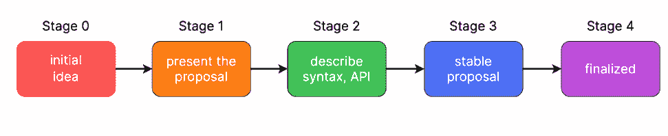

#### 阶段 0

第一阶段代表某人认为值得成为 JavaScript 语言一部分的想法。并非所有处于此阶段的提案都会进入下一阶段，但进入下一阶段的提案是那些获得足够兴趣并且有 TC39 委员会成员愿意研究这个想法的提案。在此阶段获得足够兴趣的提案会在 TC39 会议上讨论。如果讨论顺利，提案将进入下一阶段。

#### 阶段 1

此阶段的提案由社区（包括非委员会成员）讨论和开发，如果提案仍有足够兴趣，并且被认为如果添加到规范中会有潜在益处，则会在 TC39 会议上开发和讨论初始规范语言和 API。如果一切顺利，提案将进入下一阶段。

#### 阶段 2

在此阶段，使用正式规范语言对 API、语法等进行更精细和详细的描述。可以在此阶段为提案的解决方案开发 Polyfill 和 Babel 插件，以便进行实际实验。

一旦提案被足够详细地描述，就可以考虑进入下一阶段。

#### 阶段 3

此阶段的提案几乎已准备好被纳入 ECMAScript 规范。

提案要进入最终阶段，需要满足以下两个标准：

- 一套测试
- 两个通过测试的、兼容的提案实现

一旦满足上述条件，并且委员会达成共识认为该提案已准备好成为 ECMAScript 规范的一部分，它将被移至下一阶段。

#### 阶段 4

在此阶段，提案已完成，并准备被纳入 ECMAScript 规范，最终添加到 JavaScript 语言中。

向 `ecma262` GitHub 仓库发送一个 Pull Request，以将其包含在规范中。一旦 Pull Request 被批准，该提案就成为规范的一部分，并准备在仍需实现它的 JavaScript 引擎中实现。

有关此流程的更多详细信息，请参阅 TC39 网站上的流程文档，该文档解释了提案经过的各个阶段。

### 追踪即将到来的功能

近年来对 JavaScript 语言的添加已完全将 JavaScript 转变为一种编程语言，有时可能难以跟上语言的新添加内容。

让我们自己了解新变化是一回事，但我们如何追踪那些可能在未来成为 JavaScript 一部分的变化呢？

这个问题的答案在于 TC39 的 GitHub 仓库⁶，其中包含会议记录⁷和处于前一课所述提案流程各个阶段的提案⁸。记录和提案仓库是追踪即将发生的变化的好地方，总的来说，TC39 GitHub 仓库对于追踪 TC39 委员会的工作非常有用。

### ECMAScript 的版本如何划分？

ECMAScript 第 5 版，也称为“ES5”，于 2009 年发布。在那之前，ECMAScript 规范是按其版本号来指代的，但随着 ECMAScript 第 6 版的引入，也称为“ES6”，TC39 在该语言的名称中添加了年份数字。由于第 6 版于 2015 年发布，因此称为“ECMAScript 2015”，简称“ES2015”。后来的版本也使用其发布年份来命名，例如“ES2016”等。您也会看到这些版本被称为“ES6”、“ES7”等，这种命名约定也可以使用。选择哪种取决于您的偏好。大多数时候，您会看到两种类型名称交替使用。在撰写本文时，ECMAScript 2023 是 ECMAScript 的最新版本。

许多人认为 JavaScript 是一种“解释型”语言，因为其执行方式的性质，但仅仅将 JavaScript 称为一种“解释型”语言并不完全正确。

对于编译型语言，编译器通常编译源代码并生成二进制可执行文件，然后可以分发和执行。另一方面，对于解释型语言，解释器不会生成可执行输出文件；与编译器提前编译源代码不同，解释器读取并即时执行代码。对于 JavaScript，JavaScript 引擎不输出可执行文件，这是它被认为是解释型语言的原因之一。然而，JavaScript 代码会被编译成一种称为字节码的中间形式，然后由虚拟机执行。虚拟机解释字节码，但现代 JavaScript 引擎不仅仅解释字节码；它们包含所谓的“即时编译器（JIT Compiler）”，将字节码编译成原生机器代码，其执行速度比字节码更快。

### JIT 编译器

即时编译（JIT）是许多现代 JavaScript 引擎用来提高 JavaScript 代码执行速度的一种技术。

JavaScript 代码会被转换为字节码，然后 JavaScript 引擎会执行这些字节码。然而，现代 JavaScript 引擎会执行许多优化以提升 JavaScript 代码的性能。这些优化是基于引擎在执行代码时收集的信息来进行的。

提升性能的一种方法是将字节码编译为机器码，因为机器码的执行速度比字节码更快。为了实现这一点，JavaScript 引擎会识别代码中的“热点”部分——即那些被频繁执行的部分。

这些代码的“热点”部分随后会被编译为原生机器码，执行时会直接运行这些机器码，而不是执行相应的字节码。

那么 JIT 编译器与 C++ 等传统语言使用的传统编译器有何不同呢？与传统编译器在代码执行前就完成编译（ahead of time）不同，JIT 编译器在代码运行时、执行过程中进行编译。

尽管 JavaScript 代码仍然以源代码格式（而非可执行格式）进行分发，但它会被编译成字节码，并且可能进一步编译为原生机器码。

所以，回到最初的问题：JavaScript 是编译型语言还是解释型语言？可以稳妥地说，它两者兼有——既是编译型语言，也是解释型语言。

我们不一定需要理解编写的 JavaScript 代码究竟是如何被执行的细枝末节，但为了深入理解这门语言，了解我们的 JavaScript 代码是如何被转换成机器能够理解和执行的内容的基本原理是很重要的。

同样重要的是，要理解在代码执行过程中有哪些不同的因素参与进来；诸如“执行上下文”、“调用栈”等概念对于理解 JavaScript 语言的运行时行为，并能够高效地运用和调试它至关重要。

### JavaScript 引擎

要执行 JavaScript 代码，我们需要另一种称为 JavaScript 引擎的软件。这个引擎包含了将代码转换为机器可执行内容的所有必要组件。

不同的浏览器厂商通常会创建自己的 JavaScript 引擎；每个主要厂商都开发了一个 JavaScript 引擎来在他们的浏览器中执行 JavaScript 代码。

下表展示了一些主要浏览器及其 JavaScript 引擎。

| 浏览器 | 引擎 |
|---|---|
| Google Chrome | V8 |
| Edge | Chakra |
| Mozilla Firefox | Spider Monkey |
| Safari | JavaScriptCore |

尽管每个 JavaScript 引擎执行 JavaScript 代码的步骤存在差异，但主要步骤大同小异，我们将通过了解 Google Chrome 的 V8 引擎来对我们的代码如何被 JavaScript 引擎转换和执行有一个高层次的概览。

下图展示了 V8 引擎执行流程的高级概览：

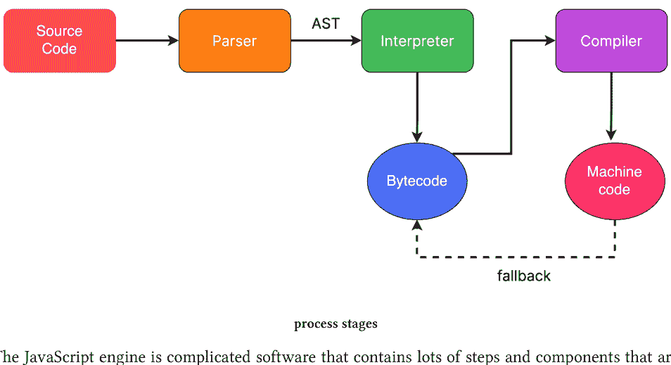

JavaScript 引擎是一个复杂的软件，包含许多用于转换和执行 JavaScript 代码的步骤和组件，但上图展示了一个简化的 V8 引擎执行流程版本。

> **注意：** 请注意，V8 引擎的开发团队正在持续改进它；因此，上图所示的简化执行流程未来可能会发生变化。

让我们通过了解此流程中每个步骤发生的情况，来更好地理解上图所示的执行流程是如何工作的。

### 源代码

在 JavaScript 引擎开始工作之前，源代码需要从某个来源下载。这可以是网络、缓存，或者是预获取了代码的 Service Worker。

引擎本身没有下载代码的能力。由浏览器完成下载，然后将代码传递给引擎，引擎随后开始转换并最终执行它。

### 解析器

下载源代码后，下一步是将其转换为令牌（tokens）。可以将这一步理解为识别代码的不同部分；例如，“function”这个词就是一个被识别为“关键字”的令牌。其他令牌可能包括字符串、运算符等。将代码划分为令牌的过程由“扫描器”完成，这个过程称为“令牌化（tokenization）”。

以下 JavaScript 代码：

```javascript
function add(num1, num2) {
  return num1 + num2;
}
```

可以被令牌化为如下所示：

```json
[
  { "type": "keyword", "value": "function" },
  { "type": "identifier", "value": "add" },
  { "type": "openRoundParen", "value": "(" },
  { "type": "identifier", "value": "num1" },
  { "type": "identifier", "value": "," },
  { "type": "identifier", "value": "num2" },
  { "type": "closeRoundParen", "value": ")" },
  { "type": "openCurlyParen", "value": "{" },
  { "type": "keyword", "value": "return" },
  { "type": "identifier", "value": "num1" },
  { "type": "addOperator", "value": "+" },
  { "type": "identifier", "value": "num2" },
  { "type": "closeCurlyParen", "value": "}" }
]
```

一旦生成了令牌，解析器会使用它们生成一个[抽象语法树（AST）](https://en.wikipedia.org/wiki/Abstract_syntax_tree)，这是一组代表源代码结构的对象。

[AST Explorer](https://astexplorer.net/) 是一个很酷的网站，你可以用它来可视化 AST。请继续，将上面的代码粘贴到 AST Explorer 中并探索生成的 AST。

### 解释器

字节码生成器使用解析器生成的 AST 来生成字节码。生成的字节码随后由字节码解释器接收并进行解释执行。

V8 还会将生成的字节码传递给一些优化器，这些优化器会进行一些优化，以确保字节码解释器能够高效地执行字节码。

### 编译器

在执行字节码的同时，JavaScript 引擎会收集有关正在执行的代码的信息。引擎随后使用这些信息进一步优化代码。

例如，JavaScript 引擎可以识别出代码中被频繁执行的部分，也称为代码的“热点”部分。代码的“热点”部分随后会被编译为原生机器码，以确保这些部分能够尽可能快地执行。

然而，优化的原生机器码有时必须被反优化（deoptimize）回字节码生成器生成的字节码，这是因为代码的编写方式所致。

需要回退到字节码的原因在于 JavaScript 是一种动态类型语言。动态特性意味着我们可以用不同类型的值来调用同一个 JavaScript 函数。

考虑以下代码：

```javascript
function print(obj) {
  console.log(obj);
}
```

上面的函数可以用不同“形状”的对象来调用。


```javascript
print({ a: 1, b: 2, c: 3 });
print({ a: 1, c: 3 });
print({ b: 2 });
```

这意味着，如果`print`函数被多次调用时传入的都是以下形状的对象：

```javascript
{ a: 1, b: 2, c: 3 }
```

并且如果它被编译成了原生机器码，但随后当同一个函数被一个具有*不同*形状的对象调用时，JavaScript 引擎就无法使用优化后的机器码，而必须回退到字节码。

优化的原生机器码是使用 JavaScript 代码执行过程中收集的信息生成的。原生机器码需要进行某些检查，以确保在生成原生机器码期间所做的假设没有被违反。如果检查失败，JavaScript 引擎就必须执行字节码而不是原生机器码。这个过程称为**反优化（deoptimization）**。

### 参考资料

以下资源可用于了解更多关于 JavaScript 代码如何执行的信息：

- [理解 V8 JavaScript 引擎 - (freeCodeCamp 演讲 by Lydia Hallie)](https://www.youtube.com/watch?v=xckH5s3UuX4)

### 执行上下文的类型

以下是我们将要讨论的两种主要执行上下文类型：

- 全局执行上下文
- 函数执行上下文

:::info

还有第三种执行上下文类型，它是为了在`eval`函数内执行代码而创建的。但是，由于安全原因，不建议使用`eval`函数，因此我们只讨论上述提到的执行上下文类型。

:::

### 全局执行上下文

全局执行上下文是在加载 JavaScript 代码以供执行时创建的基准上下文。全局代码，即不在函数内部的代码，在全局执行上下文中执行。

全局上下文包含全局变量、函数等。它还包含`this`的值和对外部环境的引用，在全局执行上下文的情况下，该引用为`null`。

### 函数执行上下文

每次调用 JavaScript 函数时，都会为该函数的执行创建一个新的执行上下文。就像全局执行上下文一样，函数执行上下文包含：

- 函数内部声明的变量和函数。
- 当前函数调用时，函数内部`this`的值。
- 对外部环境的引用。

函数执行上下文还包含传递给函数的参数。

### 执行上下文阶段

执行上下文有以下两个阶段：

- 创建阶段
- 执行阶段

### 创建阶段

顾名思义，执行上下文（全局和函数）是在创建阶段创建的。

在此阶段，变量声明和函数引用被作为键值对保存在执行上下文中。`this`的值和对外部环境的引用也在此阶段设置。

在创建阶段不分配变量的值。然而，引用函数的变量在此阶段确实指向函数。使用`var`声明的变量在此阶段被赋予`undefined`作为其值，而使用`let`声明的变量或使用`const`声明的常量则保持未初始化状态。

:::info

对于全局上下文，没有外部环境，因此对外部环境的引用被设置为`null`，但对于函数上下文，`this`的值取决于函数的调用方式，因此`this`的值会相应设置。

:::

### 词法环境和变量环境

在创建阶段，会创建以下两个组件：

- 词法环境
- 变量环境

词法环境和变量环境是内部使用的结构，用于保存变量、函数、对外部环境的引用以及`this`值的键值映射。词法环境和变量环境的区别在于，变量环境仅保存使用`var`关键字声明的变量的键值映射，而函数声明和使用`let`声明的变量或使用`const`声明的常量则位于词法环境中。

考虑以下代码：

```javascript
let name = "Jane Doe";
var age = 20;

function introduce(name, age) {
  console.log("Hello, I am " + name + " and I am " + age + " years old");
}
```

上述代码在创建阶段的执行上下文可以概念化地可视化为下图所示：

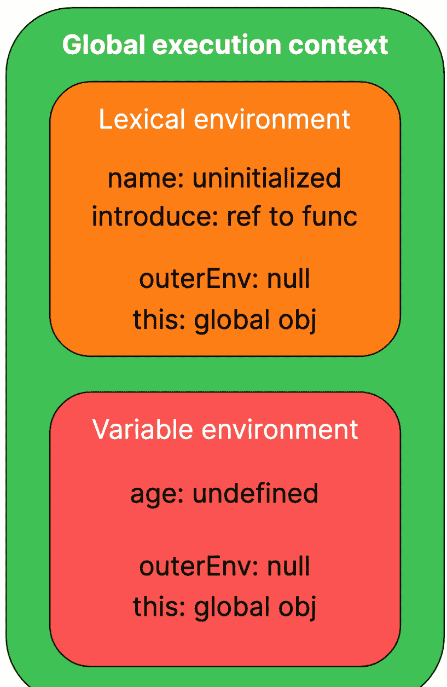

### 执行阶段

如前所述，在创建阶段之后，执行上下文中的不同变量尚未分配各自的值。赋值在执行阶段完成，代码最终得以执行。

### 参考资料

以下资源可用于了解更多关于 JavaScript 中执行上下文的信息：

- 理解 JavaScript 中的执行上下文和执行栈 - （博客）
- JavaScript 执行上下文 – JS 在幕后如何工作 - （freeCodeCamp 博客）
- JavaScript 底层原理 - 执行上下文 - （YouTube 视频）

调用栈是 JavaScript 引擎内部使用的一种数据结构，用于跟踪当前正在执行的代码片段。调用栈本质上是一个栈数据结构，通过跟踪当前执行的代码来帮助执行 JavaScript 代码。你也可以将 JavaScript 中的调用栈视为执行上下文的集合。

在执行任何 JavaScript 代码之前，会创建一个全局执行上下文并将其推入调用栈。这可以使用浏览器开发者工具中的调试器轻松可视化。

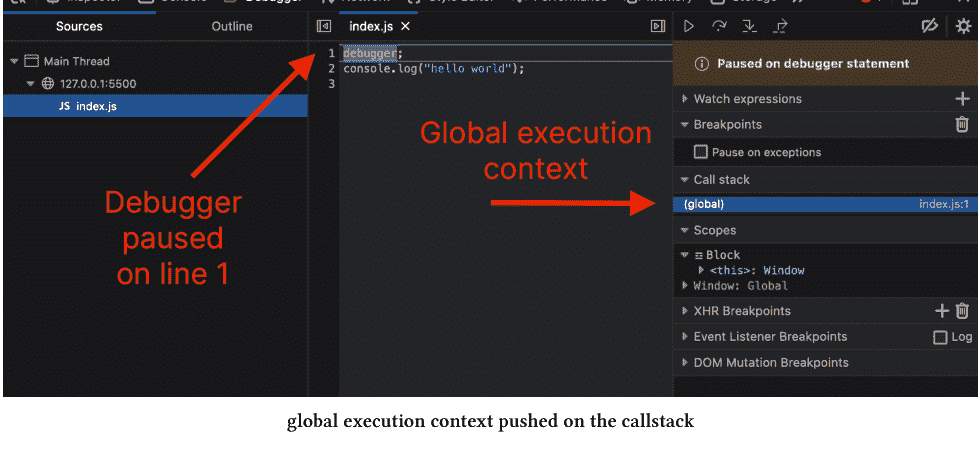

`debugger`关键字只是创建一个断点，迫使调试器在包含`debugger`关键字的行处停止。我们将在后面的章节中介绍调试。

注意，在上面的图像中，在执行`console.log`语句之前，调用栈中有一个名为“global”的条目。这是一个在执行代码之前创建并推入调用栈的全局执行上下文。

标签“global”并不重要，不同的浏览器可能使用不同的标签来表示调用栈中的全局执行上下文。例如，Google Chrome 浏览器中的调试器显示“(anonymous)”而不是“global。”上述截图是使用 Firefox 浏览器截取的。

在将全局执行上下文推入调用栈后，在代码执行过程中遇到的任何函数调用都会导致调用栈中出现更多条目。对于每个函数调用，在函数开始执行之前，会向调用栈添加一个新条目，一旦函数执行结束，该条目就会从栈中弹出。考虑以下代码：

```javascript
function bar() {
  console.log("hello world");
}

function baz() {
  bar();
}

function foo() {
  baz();
}

foo();
```

在执行上述代码之前，全局执行上下文被推入调用栈。

### 调用栈

全局执行上下文

一旦调用`foo`函数，就会为`foo`函数的执行向调用栈添加一个新条目。

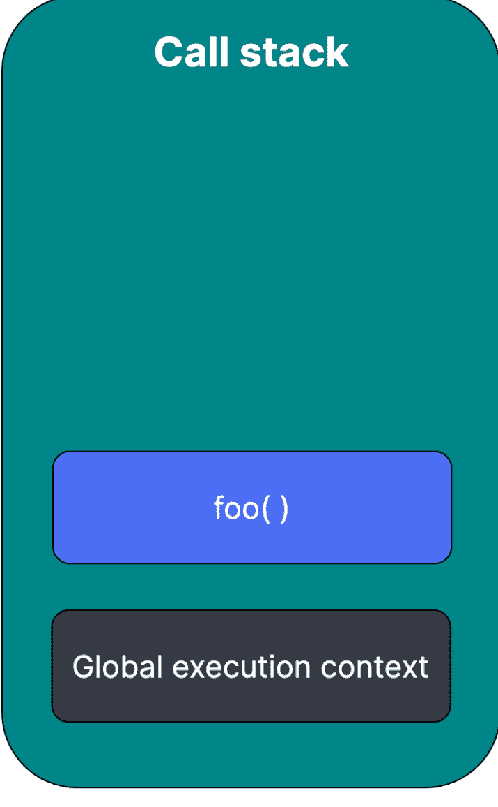

`foo`函数包含对`baz`函数的调用。因此，为`baz`函数调用将另一个条目推入调用栈。

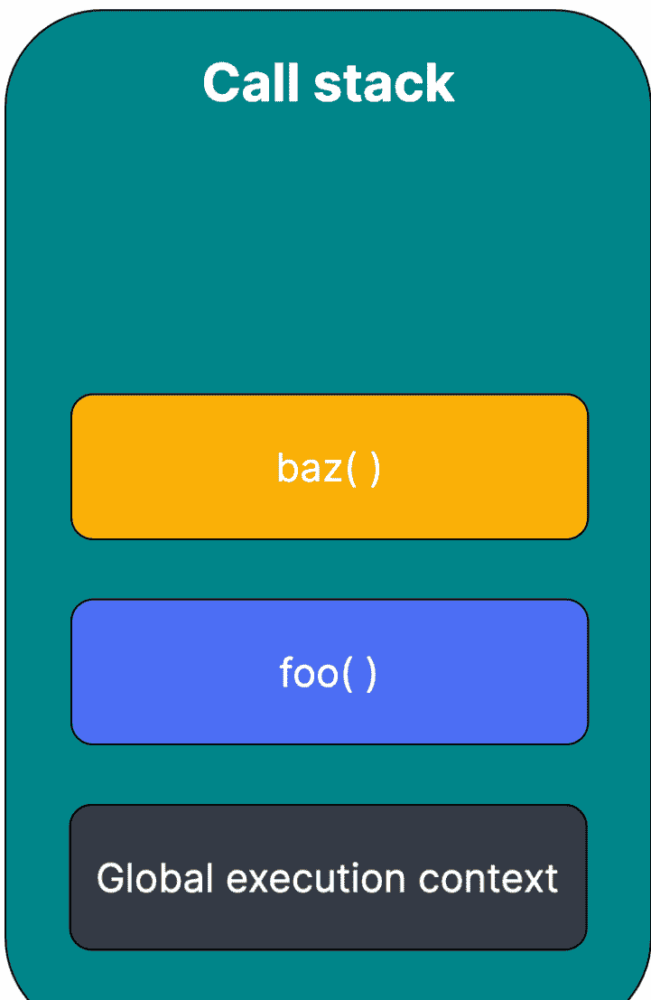

`baz`函数包含对`bar`函数的调用。因此，为`bar`函数调用将另一个条目推入调用栈。

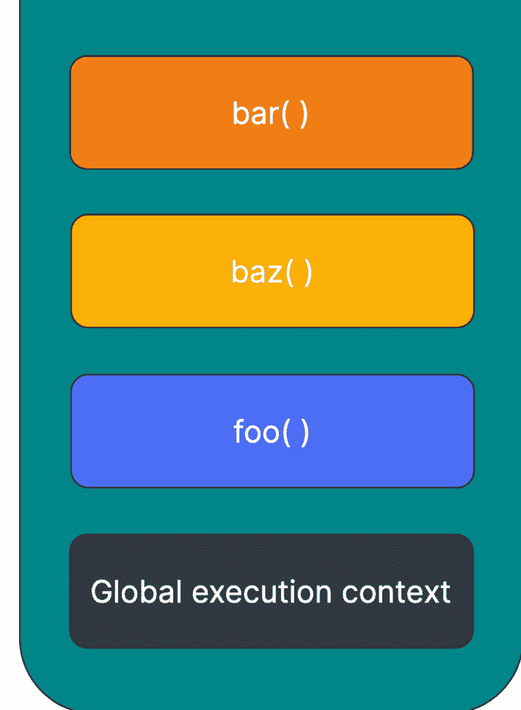

请注意，调用栈中的顶部元素代表当前正在执行的代码片段。一旦`bar`函数执行结束，其在调用栈中的条目就会被移除。最终，代码执行完成，调用栈变为空。

你可以在下面的 Replit 中运行上述代码，以查看调用栈的实际运作：

<ReplitEmbed src="https://replit.com/@newlineauthors/Lesson-9-callstack" />

### 栈溢出

“栈溢出”这个术语对每个软件开发者来说都很熟悉，要么是因为每个软件开发者最喜欢的网站 [stackoverflow](https://stackoverflow.com/)，要么是因为无限递归导致的栈溢出错误。

我们将在调用栈的上下文中讨论“栈溢出”这个术语。调用栈具有固定大小，只能包含有限数量的条目。

那么，如果我们创建一个只是调用自身的函数会发生什么？

```javascript
function foo() {
  foo();
}
```

还记得调用函数时会发生什么吗？会向调用栈添加一个新条目。在上述只是调用自身且永不完成执行的函数的情况下，我们只是不断地向调用栈添加新条目，而从不移除任何条目。这是无限递归，它会导致一个称为**栈溢出**的错误。当调用栈填满到其极限且无法再容纳更多条目时，就会抛出此错误。

互联网上有许多资源声称基本类型分配在栈上，对象分配在堆上，但现实并非如此简单。

官方 ECMAScript 规范并未说明 JavaScript 引擎应如何为不同类型的值分配内存，或者在程序不再需要时应如何释放内存。因此，不同的 JavaScript 实现可以自由选择如何处理 JavaScript 中的内存管理。

因此，我们不应简单地相信基本类型的值存储在栈上，而对象存储在堆上，而应理解 JavaScript 中的内存分配是一个实现细节，不同的 JavaScript 引擎可能会以不同的方式处理内存，因为语言规范并未规定 JavaScript 中应如何处理内存。

例如，在 V8 引擎中，几乎所有内容都存储在堆上。来自 [V8 官方博客](https://v8.dev/blog/pointer-compression#value-tagging-in-v8) 的以下引文否定了关于 JavaScript 中内存分配的常见误解。

V8 中的 JavaScript 值以对象的形式表示，并分配在 V8 堆上，无论它们是对象、数组、数字还是字符串。这使我们能够将任何值表示为指向对象的指针。

但这并不意味着我们应该假设所有内容都分配在堆上。JavaScript 引擎可能将*大部分*值分配在堆上，但也会利用栈进行优化，存储那些可能不会持续超过函数调用时间的临时值。

JavaScript 引擎是经过高度优化的复杂软件。假设它们都遵循*原始值在栈上，对象在堆上*这一简单规则是不合理的。

从本课程中你需要掌握的最重要一点是，不同的 JavaScript 引擎可能以不同方式处理内存，而“JavaScript 中的原始值简单地位于栈上”是一个**错误观念**。

### 延伸阅读

- JavaScript 内存模型揭秘 - (博客)<sup>25</sup>
- JavaScript 变量由什么构成 - (博客)<sup>26</sup>
- JavaScript 为函数调用的结果分配内存在哪里？栈还是堆？ - (Stack Overflow 帖子)<sup>27</sup>

### 自动垃圾回收

与 C 等其他语言不同，在那些语言中程序员负责在内存不再需要时将其释放，JavaScript 通过自动处理内存，使程序员的工作变得更加轻松。

不再需要的内存由 JavaScript 引擎自动释放，这个过程被称为**垃圾回收**。现代 JavaScript 引擎包含一个垃圾回收器，负责确定哪些内存部分不再需要并可以被释放。一旦确定了这样的内存块，这些块就会被垃圾回收器释放。

使用不同的算法来确定哪些内存块不再需要并有资格进行垃圾回收。目前，现代 JavaScript 引擎使用[标记-清除算法](https://developer.mozilla.org/en-US/docs/Web/JavaScript/Memory_Management#mark-and-sweep_algorithm)<sup>28</sup>。

该算法确定哪些内存块是“不可达的”；这样的内存块被认为有资格进行垃圾回收。该算法是对[引用计数算法](https://developer.mozilla.org/en-US/docs/Web/JavaScript/Memory_Management#reference-counting_garbage_collection)<sup>29</sup>的改进，后者有其局限性。

Java 语言也具有自动垃圾回收机制，但在 Java 中，程序员可以手动触发垃圾回收过程，而 JavaScript 程序员对垃圾回收没有这种级别的控制。有些人可能认为这是一种限制，但毫无疑问，自动垃圾回收对于帮助程序员避免在那些不自动处理此问题的语言中经常遇到的内存泄漏问题非常有帮助。

### 变量提升

在 JavaScript 中，变量和函数可以在其实际声明*之前*被访问，JavaScript 中描述此现象的术语是“**变量提升**”。

#### `"var"`声明

“变量提升”一词主要与函数声明和使用`"var"`关键字声明的变量相关联。让我们看看*变量提升*如何与`"var"`变量相关。

考虑以下代码示例：

```javascript
console.log(result); // undefined
var result = 5 + 10;
```

你可以在下面的 Replit 中运行上述代码：

<ReplitEmbed src="https://replit.com/@newlineauthors/hoisting-example1" />

上述代码的输出展示了*变量提升*的实际效果。上述代码的第一行在控制台输出`undefined`，但这是如何做到的呢？我们如何能够在`result`变量于第二行实际声明*之前*访问它？

这是因为在代码执行之前的**解析**步骤使之成为可能。JavaScript 代码在执行前的预处理允许 JavaScript 引擎在任何代码执行之前尽早检测到一些错误。以下代码示例展示了这一点：

```javascript
function print(obj) {
  console.log(obj; // error
}

console.log(“hello world”);
```

以下是运行上述代码的 Replit：

<ReplitEmbed src="https://replit.com/@newlineauthors/hoisting-example2" />

如果不进行任何代码预处理，JavaScript 引擎将无法检测到`print`函数内部的语法错误，除非该函数被调用或执行，并且由于包含语法错误的函数未被调用，上述代码应该在控制台记录“hello world”而不会抛出任何错误。但上述代码抛出了一个错误，而不是在控制台记录“hello world”。这是为什么呢？答案是代码执行前的处理步骤。

JavaScript 引擎在执行代码之前会扫描代码，使其能够在任何代码执行之前检测到一些错误。这还使引擎能够通过注册当前作用域中声明的变量来处理变量声明。在任何作用域开始之前，该作用域中声明的所有变量都已注册。换句话说，一个作用域中声明的所有变量在该作用域中的代码执行之前就已为该作用域保留。代码在执行前的这种预处理正是*变量提升*得以实现的原因。这允许我们在代码中实际声明`"var"`变量*之前*引用它们。

让我们重新审视上面给出的控制台记录`undefined`的代码示例。

```javascript
console.log(result); // undefined
var result = 5 + 10;
```

如果`"var"`变量被*提升*，并且我们可以在其声明*之前*引用它们，那么为什么控制台记录的是`undefined`而不是`result`变量的实际值（应该是15）呢？

关于`"var"`变量的提升，关键在于只有它们的**声明**被提升，而不是它们的值。这些变量被赋值为`undefined`，而实际值（在上述代码示例中为 15）是在代码逐步执行过程中，当它们的声明被执行时才被赋值的。

#### 函数声明

函数声明，就像使用`"var"`关键字声明的变量一样，也会被提升。以下代码示例展示了函数声明的提升：

```javascript
startCar(); // starting the car...

function startCar() {
  console.log("starting the car...");
}
```

以下是运行上述代码的 Replit：

<ReplitEmbed src="https://replit.com/@newlineauthors/hoisting-example4" />

如果`"var"`变量在声明执行前被赋值为`undefined`，那么我们如何能够在函数声明*之前*调用它呢？函数声明的提升与使用`"var"`关键字声明的变量的提升有何不同？这里的区别在于，在函数声明的情况下，函数的名称作为变量注册在包含函数声明的作用域中，并使用函数本身进行初始化。

在上面的代码示例中，`startCar`作为变量注册在全局作用域中，并被赋值为该函数。与`"var"`变量不同，在函数声明的情况下，没有使用`undefined`值进行初始化。

在看到函数声明的提升之前，很难理解变量提升对编程语言来说如何成为一个有用的功能。能够在函数声明之前或之后调用函数确实非常有用，它使开发者不必以每个函数声明都必须在调用*之前*的方式来安排代码。这有助于代码组织，因为我们可以将函数一起声明在代码文件的顶部或底部，并在文件中的任何地方调用它们。

#### 块内的函数声明

长期以来，块内的函数声明不属于 ECMAScript 规范的一部分，但随着 ES2015 的引入，情况发生了变化。由于函数声明在2015年之前不属于规范的一部分，而是由 JavaScript 引擎允许在语言中使用，因此不同引擎对它们的处理方式不同。

在 ES2015 中，ECMAScript 规范定义了处理函数声明的**标准**和**遗留**规则。

#### 标准规则

根据标准规则，块内的函数声明被*提升*到块的顶部，转换为函数表达式，并赋值给使用`let`关键字声明的变量。

在块内提升的函数仅限于该包含块，无法被包含函数的块外部的代码访问。

> **注意**

> 需要注意的是，标准规则仅在严格模式<sup>30</sup>下生效。

以下代码示例将帮助你更好地理解块内函数声明的标准规则：

<sup>25</sup>https://www.zhenghao.io/posts/javascript-memory

<sup>26</sup>https://www.zhenghao.io/posts/javascript-variables


<sup>27</sup>https://stackoverflow.com/questions/67356107/where-does-javascript-allocate-memory-for-the-result-of-a-function-call-stack-o

<sup>28</sup>https://developer.mozilla.org/en-US/docs/Web/JavaScript/Memory_Management#mark-and-sweep_algorithm

<sup>29</sup>https://developer.mozilla.org/en-US/docs/Web/JavaScript/Memory_Management#reference-counting_garbage_collection

根据标准规则，`if`块内的函数应按如下方式处理：

```javascript
"use strict";

function process() {
  if (true) {
    let fnInsideBlock = function fnInsideBlock() {
      console.log("I am inside a block");
    };

    console.log("processing...");
  }
}
```

上述代码中的`fnInsideBlock`函数只能从`if`块内部调用。

### 旧版规则

旧版规则[^1]适用于Web浏览器中的非严格模式代码。根据旧版规则，除了块内函数声明的`let`变量外，还会在包含的函数作用域中产生一个`var`变量。

让我们以本节给出的代码示例为例，并添加函数调用：

> [^1]: https://262.ecma-international.org/13.0/#sec-block-level-function-declarations-web-legacy-compatibility-semantics

```javascript
1  "use strict";
2  
3  function process() {
4    if (true) {
5      console.log("processing...");
6  
7      function fnInsideBlock() {
8        console.log("I am inside a block");
9      }
10   }
11  
12   fnInsideBlock();
13 }
14 
15 process(); // error
```

你可以在下面的Replit中运行上述代码：

<ReplitEmbed src="https://replit.com/@newlineauthors/hoisting-example7" />

由于上述代码在严格模式下执行，适用标准规则；因此，上述代码会抛出一个错误，因为正如本节前面所解释的，块内的函数被提升到包含作用域的顶部，并且只能在该块内访问。因此，在`if`块外部调用函数会导致错误。

如果从上述代码中移除`"use strict"`指令，它将执行而不会出现任何错误。为什么？这是因为在非严格模式下，适用于块内函数声明的旧版规则生效，根据旧版规则，块内被提升的函数被分配给在包含函数作用域中声明的一个`var`变量。

上述代码在非严格模式下执行时，JavaScript引擎将其视为如下所示：

```javascript
1  function process() {
2    var fnInsideBlockVar;
3  
4    if (true) {
5      let fnInsideBlock = function fnInsideBlock() {
6        console.log("I am inside a block");
7      };
8  
9      console.log("processing...");
10 
11     fnInsideBlockVar = fnInsideBlock;
12   }
13     fnInsideBlockVar();
14 }
15
16 process();
```

以下是一个Replit演示上述代码：

<ReplitEmbed src="https://replit.com/@newlineauthors/hoisting-example8" />

> 在上面转换后的代码中，`fnInsideBlockVar`和`fnInsideBlock`是JavaScript引擎在幕后处理的相同变量。名称显示为不同只是为了说明根据旧版规则如何处理块内的函数声明。

现在，应该清楚为什么移除`"use strict"`指令可以让代码执行而不会出错。块内被提升的函数被分配给在函数作用域中定义的一个`var`变量。因此，块内的函数在包含的`if`块外部也可以访问。

> 旧版规则复杂且令人困惑；因此，我们不应该依赖依赖旧版规则处理块内函数声明的代码。我们应该在严格模式下编写代码，以避免令人困惑的复杂性进入我们的代码。

### 延伸阅读

- [ES6中块级函数的精确语义是什么？- (stackoverflow帖子)](https://stackoverflow.com/questions/31419897/what-are-the-precise-semantics-of-block-level-functions-in-es6)
- [为什么块内赋值会改变全局变量？- (stackoverflow帖子)](https://stackoverflow.com/questions/61191014/why-does-block-assigned-value-change-global-variable)
- [块内的函数声明是否会将临时值移出块外？- (stackoverflow帖子)](https://stackoverflow.com/questions/58619924/function-declaration-in-block-moving-temporary-value-outside-of-block)

### 类声明

与函数声明类似，类声明也会被提升，但它们被提升的方式与函数声明不同。

1. https://stackoverflow.com/questions/31419897/what-are-the-precise-semantics-of-block-level-functions-in-es6
2. https://stackoverflow.com/questions/61191014/why-does-block-assigned-value-change-global-variable
3. https://stackoverflow.com/questions/58619924/function-declaration-in-block-moving-temporary-value-outside-of-block

虽然我们可以在函数声明之前访问它，但在类声明的情况下我们不能这样做。这是否意味着类声明没有被提升？不，它们被提升了，只是方式不同。

让我们首先借助以下代码示例验证类声明确实被提升了：

```javascript
1 let Car = "Honda";
2 
3  if (true) {
4    console.log(typeof Car); // error
5  
6    class Car {}
7  }
```

以下是一个Replit演示上述代码：

<ReplitEmbed src="https://replit.com/@newlineauthors/hoisting-example9" />

上述代码抛出一个错误，证明类声明确实被提升了。

如果类声明没有被提升，那么`console.log`函数调用应该会向控制台打印“Honda”，但事实并非如此，这是因为`if`块内的类声明被提升了，并且在块内`Car`声明之前或之后访问`Car`的任何代码，都会访问类声明，而不是在`if`语句之前声明的`Car`变量。`if`块内的标识符`Car`引用的是类声明，而不是在`if`语句之前声明的`Car`变量，这一事实证明了类声明确实被提升了。

那么，如果类声明被提升了，为什么我们不能在声明之前访问它们？这个问题的答案是“暂时性死区 (TDZ)”。

### 暂时性死区 (TDZ)

暂时性死区 (TDZ)[^35]是指块作用域变量（`let`、`const`）或类声明无法访问的时间段。时间从作用域开始一直持续到声明被执行。以下代码示例将帮助我们可视化TDZ：

[^35]: https://developer.mozilla.org/en-US/docs/Web/JavaScript/Reference/Statements/let#temporal_dead_zone_tdz

```javascript
1  {
2    // TDZ开始
3    console.log("hello");
4    console.log("world");
5    let count = 5; // TDZ结束
6
7    // TDZ结束后才能访问 "count"
8  }
```

TDZ是类声明在代码逐步执行过程中，其声明被执行之前无法访问的原因。

### `let`和`const`

由于TDZ也适用于`let`和`const`，那么使用`let`声明的变量或使用`const`声明的常量是否也被提升了？是的，它们也被提升了，但和类声明一样，由于TDZ的存在，它们被提升的方式不同。

> 一个常见的误解是块作用域变量和常量没有被提升，但正如我们上面讨论的，它们被提升了；只是它们的提升方式与使用`var`关键字声明的变量不同。

```javascript
1  var count = 5;
2
3  {
4    console.log(count); // 被提升但由于TDZ无法访问
5    let count = 10;
6  }
```

你可以在以下Replit中查看上述代码示例的实际运行效果：

<ReplitEmbed src="https://replit.com/@newlineauthors/hoisting-example11" />

### 函数和类表达式

函数和类表达式不会被提升。考虑以下代码示例：

```javascript
1 console.log(typeof Car); // undefined
2 console.log(typeof Person); // undefined
3
4 var Car = class {
5   constructor(model) {
6     this.model = model;
7   }
8 };
9
10 var Person = function (name) {
11   this.name = name;
12 };
```

以下是在Replit中上述代码示例的实际运行效果：

<ReplitEmbed src="https://replit.com/@newlineauthors/hoisting-example12" />

在上述代码示例中，由于变量`Car`和`Person`是使用`var`关键字声明的，我们可以在声明之前访问它们，它们的值是undefined。这是因为只有声明被提升了，它们的值没有被提升。在上述代码示例中，值是表达式，它们没有被提升。

如果我们尝试创建`Car`类的实例或调用`Person`构造函数，我们会得到一个错误。值得注意的是，这种情况下我们得到的错误不是引用错误（在未声明标识符的情况下抛出的错误），而是类型错误，这是因为`Car`和`Person`被提升了并初始化为`undefined`的值，而我们不能将undefined作为构造函数调用。回顾一下，这种情况下只有声明被提升了，它们的值没有。

提升是一个令人困惑的概念，尤其是对于初学者，因为提升与`var`变量、函数声明以及ES2015的更改（即块作用域变量/常量和ES2015类）的关联方式存在差异。

### 关于提升的常见误解

许多JavaScript初学者对提升的概念有一个误解，那就是JavaScript引擎移动提升的声明到文件的顶部。虽然这使得理解提升的概念变得容易，但事实并非如此。

JavaScript引擎并不会将提升的声明移动到文件的顶部。相反，它们只是在代码逐步执行之前处理这些声明。对于`var`变量，在声明被执行之前，它们被赋予`undefined`的值。对于块作用域变量，它们被标记为“未初始化”。

### 作用域

作用域是计算机科学领域的一个通用概念，指的是程序中特定变量、函数等可以被访问的部分。换句话说，标识符（变量、函数等）的作用域就是它可见或可被引用的程序部分。

现代JavaScript有四种主要作用域，如下所述：

- 全局作用域
- 函数作用域
- 块级作用域
- 模块作用域

在讨论JavaScript中上述类型的作用域之前，我们需要理解什么是“词法”作用域。

### 词法作用域

在JavaScript中，不同标识符（变量、函数等）的作用域是在**编译时**确定的。在编译期间，JavaScript引擎通过分析代码结构来确定代码中声明的各种标识符的作用域。这意味着，在JavaScript代码开始逐步执行之前，JavaScript引擎就已经确定了代码中各种声明的作用域。

作用域可以嵌套在其他作用域内，每个嵌套作用域都可以访问其外部或父级作用域。

```javascript
const myName = "John doe";

function hello() {
  const greeting = "hello " + myName;
  console.log(greeting);
}
```

在上面的代码示例中，有三个不同的声明：

- `myName`变量声明
- `hello`函数声明
- `greeting`变量声明

上述声明的作用域取决于它们在上述代码结构中的位置。`myName`变量和`hello`函数都位于全局作用域，因此它们在上面的代码中是全局可用的。`greeting`变量声明位于`hello`函数内部，因此其作用域仅限于`hello`函数。

这种通过分析代码结构在编译时确定的作用域，被称为词法作用域。JavaScript并非唯一具有词法作用域的语言。其他语言，如Java，也有词法作用域。

> 词法作用域也称为“静态”作用域。另一种作用域类型是[动态作用域](https://en.wikipedia.org/wiki/Scope_(computer_science)#Lexical_scope_vs._dynamic_scope)。

全局作用域通常是最外层的作用域，包含所有其他嵌套在其中的作用域。每个嵌套作用域都可以访问全局作用域。在JavaScript中，全局作用域就是浏览器窗口，或者更准确地说，是浏览器窗口标签页。全局作用域通过`window`对象暴露给JavaScript代码。

使用`var`关键字创建的变量或在全局作用域中声明的函数声明，会作为属性添加到`window`对象上。以下代码示例验证了这一说法：

```javascript
var todoList = ["grocery", "exercise", "meeting"];

function emptyTodoList() {
  todoList = [];
}

console.log(window.hasOwnProperty("todoList")); // true
console.log(window.hasOwnProperty("emptyTodoList")); // true
```

如果`todoList`是用`let`或`const`声明的，它就不会作为属性添加到`window`对象上，但它仍然是一个全局变量。类似地，如果`emptyTodoList`是一个函数表达式而不是函数声明，并且引用该函数表达式的标识符是用`let`或`const`声明的，它也不会作为属性成为`window`对象的一部分。相反，它只是一个全局函数表达式。

```javascript
const todoList = ["grocery", "exercise", "meeting"];

let emptyTodoList = function () {
  todoList = [];
};

console.log(window.hasOwnProperty("todoList")); // false
console.log(window.hasOwnProperty("emptyTodoList")); // false
```

### 避免污染全局作用域

“避免污染全局作用域”——作为一名JavaScript开发者，要么你已经听过这个建议，要么迟早会从别人那里听到。但“污染”全局作用域到底是什么意思？为什么应该避免它？

在全局作用域中（不必要地）声明所有内容就被认为是“污染”全局作用域。全局作用域中声明过多会导致不必要的问题。

全局作用域是所有其他作用域的父作用域；因此，全局作用域内的声明对所有其他作用域都是可见的。这可能导致变量名冲突、遮蔽等问题。全局作用域的另一个特点是，除非应用程序关闭，否则它不会被销毁。因此，如果我们不小心，全局作用域中的声明无论是否需要，都会一直保留在内存中，直到应用程序关闭。

话虽如此，全局作用域中的声明通常是不可避免的。所以，我们能做的就是尽可能避免使用全局作用域。将全局声明保持在最低限度。如果一个变量只在函数内部使用，就没有必要在全局作用域中声明它。

所以，如果你以前没听过，现在你听到了：“避免污染全局作用域。”

### 隐式全局变量

JavaScript作为一门语言有很多怪癖。其中之一就是隐式创建全局变量。每当对一个未声明的变量进行赋值时，JavaScript会将该未声明的变量声明为一个**全局**变量。这很可能是程序员的错误，JavaScript没有抛出错误，而是通过自动声明同名的全局变量来掩盖了这个错误。


```javascript
function printSquare(num) {
  result = num * num;
  console.log(result); // 64
}

printSquare(8);

console.log("implicit global: " + result); // WHAT??!!
```

以下是上述代码在 Replit 中的实际效果：

```html
<ReplitEmbed src="https://replit.com/@newlineauthors/global-scope-example3" />
```

注意，`result` 变量未被声明。它被赋予了乘法的结果，就好像它已经被声明了一样。在这种情况下，人们通常会期望一个错误，但 JavaScript 会为你声明`result`为一个全局变量。

需要提到的是，这种奇怪的行为只发生在非严格模式下。在严格模式下，正如预期的那样，JavaScript 会抛出一个错误，通知程序员关于对未声明变量的赋值。

这也是为什么总是要在严格模式下编写 JavaScript 代码的原因之一。使用严格模式可以避免 JavaScript 的这些令人困惑的行为影响我们的代码。

### HTML 属性

除了对未声明变量的赋值，还有另一种方式会产生*隐式*全局变量。HTML 元素的`id`属性或`name`属性的值也会作为变量添加到 JavaScript 的全局作用域中。

```html
<h1 id="mainHeading">Hello World!</h1>
```

上面`h1`元素的`id`会作为变量添加到全局作用域。我们可以在 JavaScript 代码中使用`mainHeading`作为变量来访问`h1`元素。这个特性被称为[Window 对象上的命名访问](https://html.spec.whatwg.org/multipage/nav-history-apis.html#named-access-on-the-window-object)。

这个特性最初由 Internet Explorer 浏览器添加，后来也逐渐在其他浏览器中实现，仅仅是为了兼容性原因。有些网站依赖于这种行为，所以为了向后兼容，浏览器别无选择，只能实现这种行为。

尽管大多数浏览器都支持这个特性，但不应该依赖它，我们应该始终使用标准机制来定位 HTML 元素。应该使用`getElementById`或`querySelector`等函数，而不是依赖这种行为。

> [37] https://html.spec.whatwg.org/multipage/nav-history-apis.html#named-access-on-the-window-object

编写依赖此特性的代码是一个坏主意，因为它会导致难以阅读和维护的代码。想象一下，在代码中看到一个标识符却无法识别它是在哪里声明的。这样的代码很容易与我们代码中的其他变量发生名称冲突。另外，请记住，编写依赖 HTML 标记的代码在 HTML 标记更改时很容易中断。简而言之，避免依赖这个特性，在你的 JavaScript 代码中使用更好的替代方案来定位 HTML 元素。

### 延伸阅读

- 全局变量是不好的 - (文章)<sup>38</sup>
- 带有 ID 的 DOM 树元素会成为全局属性吗？ - (stackoverflow 帖子)<sup>39</sup>

函数作用域指的是函数体内的代码区域。函数作用域从函数体的左花括号开始，到右花括号之前结束。函数作用域内的声明仅限于该函数的作用域，不能被该函数外的代码直接访问。

### 遮蔽声明

嵌套作用域内的声明可以“遮蔽”外部作用域中*同名*的声明。这被称为“遮蔽声明”，或简称“遮蔽”。

考虑以下代码示例：

```javascript
let hobby = "reading";

function printHobbies() {
  const hobby = "traveling";
  console.log(hobby); // traveling
}

printHobbies();
```

以下是上述代码的 Replit 示例：

```html
<ReplitEmbed src="https://replit.com/@newlineauthors/function-scope-example1">
```

函数内部的变量`hobby`遮蔽了在全局作用域中声明的`hobby`变量。

通常，遮蔽其他声明并不理想，因为这可能会降低代码的可读性。它还可能使得嵌套作用域内的代码无法访问被遮蔽的声明。考虑以下代码示例：

### 函数参数作用域

一个常见的误解是，函数参数是在函数的局部作用域中定义的，或者参数的行为表现得像是在函数的局部作用域中定义的，但事实并非总是如此。

首先，我们需要区分“简单”和“非简单”参数列表。如果函数参数的定义方式使用了 ES2015+ 特性，例如[默认参数](https://developer.mozilla.org/en-US/docs/Web/JavaScript/Reference/Functions/Default_parameters)、[解构赋值](https://developer.mozilla.org/en-US/docs/Web/JavaScript/Reference/Operators/Destructuring_assignment)或[剩余参数](https://developer.mozilla.org/en-US/docs/Web/JavaScript/Reference/Functions/rest_parameters)，则这些参数被视为**非简单**参数；如果参数未使用这些特性中的任何一个，则被视为**简单**参数。

```javascript
function simpleParameters(val1, val2) {
  // 代码...
}

function nonSimpleParameters(val1 = 12, ...restParams) {
  // 代码...
}
```

如果参数是简单的，它们的行为表现得像是在函数的局部作用域中声明的；但如果参数是非简单的，它们则在自己的作用域中声明。非简单参数作用域可以被认为介于函数作用域和包含该函数的作用域之间。

如果具有非简单参数的函数定义在全局作用域中，其参数作用域可以在概念上如下图所示：

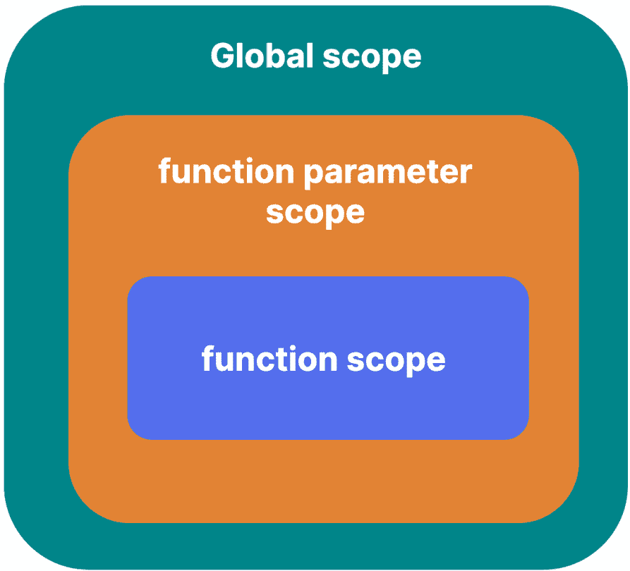

函数参数作用域

以下的代码示例证明了非简单参数确实存在于与函数局部作用域不同的作用域中：

```javascript
function paramScope(arr = ["initial array"], buff = () => arr) {
  var arr = [1, 2, 3];
  console.log(arr); // [1, 2, 3]
  console.log(buff()); // ["initial array"]
}

paramScope();
```

以下是上述代码的 Replit 链接：

```html
<ReplitEmbed src="https://replit.com/@newlineauthors/function-scope-example4">
```

上面的代码示例中的`paramScope`函数具有非简单参数列表；第一个参数`arr`的默认值是一个数组，而第二个参数`buff`的默认值是一个函数。

函数内部有一个与`paramScope`函数第一个参数同名的`var`声明。函数内部的两个`console.log`调用向控制台输出了两个不同的值；这是为什么？为什么`buff`参数返回的是`arr`参数的默认值，而不是函数局部作用域中`arr`的值？

答案是`arr`参数和函数内部的`arr`变量是存在于两个*不同*作用域中的两个*不同*变量。函数内部的`arr`遮蔽了`arr`参数，但调用`buff`函数返回的是参数`arr`。如果参数和局部的`arr`是同一个变量，`buff`函数将返回`[1, 2, 3]`而不是`arr`参数的默认值。

移除函数内部的`var`关键字以展示不同的输出：

```javascript
function paramScope(arr = ["initial array"], buff = () => arr) {
  arr = [1, 2, 3];
  console.log(arr); // [1, 2, 3]
  console.log(buff()); // [1, 2, 3]
}

paramScope();
```

以下是上述代码的 Replit 链接：

```html
<ReplitEmbed src="https://replit.com/@newlineauthors/function-scope-example5">
```

现在函数内部的`arr`引用的是`arr`参数，因此在调用`buff`函数时，函数内部对`arr`的任何赋值都会反映出来。

### 函数表达式名称作用域

函数表达式大多被写成匿名函数表达式，如下所示：

```javascript
let fn = function () {
  // 代码 ...
};
```

这是一个赋值给`fn`变量的匿名函数表达式。

我们也可以写一个*命名*函数表达式，如下所示：

```javascript
let fn = function namedFn() {
  // 代码 ...
};
```

在上面的代码示例中，函数表达式的名称`namedFn`只能在函数体内部访问。因此，有些人可能会错误地认为命名函数表达式的名称是在函数体内部声明的，但这是不正确的；该名称是在一个*不同*的作用域中声明的。以下代码证明了这一说法：

```javascript
let fn = function namedFn() {
  let namedFn = 123;
  console.log(namedFn);
};
```

以下是上述代码的 Replit 链接：

```html
<ReplitEmbed src="https://replit.com/@newlineauthors/function-scope-example8">
```

`let`不允许重新声明变量。因此，如果`nameFn`是在函数作用域内声明的，那么上面的代码示例应该会抛出一个错误；然而，没有错误，这段代码是有效的。函数体内的`nameFn`实际上遮蔽了函数表达式的名称。

命名函数表达式的名称作用域嵌套在包含该函数表达式的作用域和该函数表达式自身局部作用域之间，类似于上面讨论的非简单参数列表的作用域。

### 延伸阅读

- 参数在词法环境中处于什么位置？ - (stackoverflow 帖子)<sup>43</sup>
- 隐含作用域<sup>44</sup>
- 命名函数表达式 - (MDN)<sup>45</sup>

### 块级作用域

JavaScript 中的块级作用域指的是存在于代码块之间的作用域，例如`if`语句块或循环块。

在 JavaScript 语言中添加块级作用域的`let`和`const`之前，在块内使用`var`关键字定义的变量可以在该块外部访问。这是因为使用`var`关键字声明的变量具有函数作用域。然而，使用`let`声明的变量或使用`const`声明的常量，其作用域仅限于定义它们的块，除非它们是在全局作用域中声明的，那样它们就是全局变量。

块级作用域的`let`和`const`解决了诸如变量在块外不必要的暴露、循环内的闭包等问题。我们将在一个与闭包主题相关的模块中讨论循环内的闭包问题。

关于块级作用域需要了解的另一点是如何处理块内的函数声明。这在一个与变量提升相关的模块中已讨论过。

### 模块作用域

模块也是近年来添加到 JavaScript 中的特性之一。模块解决了涉及多个 JavaScript 文件的代码库中与代码管理相关的许多问题。模块允许我们将代码分割成可管理的部分。

ES 模块内的代码存在于模块作用域中。换句话说，模块内的声明仅限于该模块，并且不会在模块外部暴露，除非代码是从模块中*显式*导出的。模块顶层的声明仅限于模块，不属于全局作用域的一部分。

### 延伸阅读

- [JavaScript 模块 - (MDN)](https://developer.mozilla.org/en-US/docs/Web/JavaScript/Guide/Modules#other_differences_between_modules_and_standard_scripts)<sup>46</sup>
- [ES 模块：卡通深入解析 - (MDN)](https://hacks.mozilla.org/2018/03/es-modules-a-cartoon-deep-dive/)<sup>47</sup>

### 作用域链

不同的作用域可以嵌套在其他作用域内部，形成一个作用域链。这就是所谓的**作用域链**。

每当创建一个新的作用域时，它都会与它的封闭作用域链接在一起。不同作用域之间的这种链接创建了一个作用域链，该链可用于查找在当前作用域中无法找到的标识符。

当在特定作用域中遇到一个标识符时，JavaScript 引擎将在当前作用域的父作用域中查找该变量的声明。如果在父作用域中没有找到声明，那么 JavaScript 引擎将在父作用域的外部（父）作用域中查找该变量声明。这个遍历作用域链的过程将继续，直到到达全局作用域并且没有其他作用域可供查找声明。

考虑以下代码示例：

```javascript
const myName = "John doe";

function hello() {
  const greeting = "hello " + myName;

  function greet() {
    console.log(greeting);
  }

  greet();
}

hello();
```

你可以在 Replit 中预览上面的代码：

```html
<ReplitEmbed src="https://replit.com/@newlineauthors/scope-chain-example1">
```

`hello`函数调用后产生的作用域链，在概念上可以可视化为下图所示：

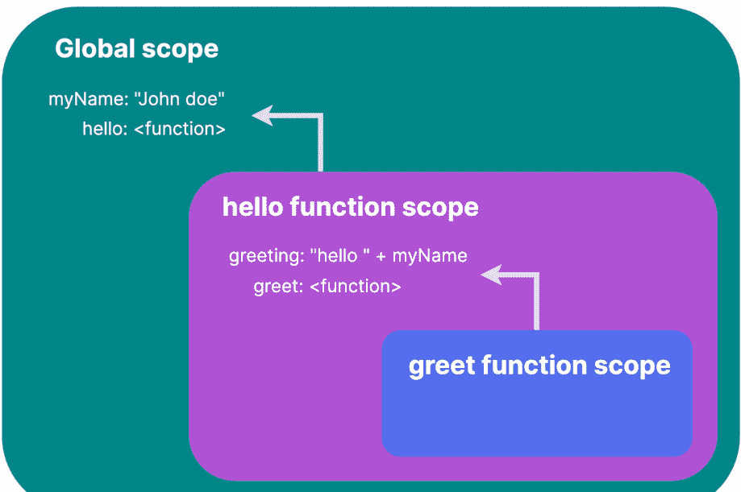

**作用域链**

作用域链使得在当前作用域中未声明的标识符的查找成为可能。

### 优化作用域链查找

现代 JavaScript 应用程序包含大量 JavaScript 代码，这些代码必须在尽可能短的时间内编译和执行，以确保应用用户不会遇到糟糕的应用性能。因此，现代 JavaScript 引擎会对我们编写的 JavaScript 代码进行大量优化，以使其能够尽可能高效地执行。在代码执行前的转换过程中，会对代码进行不同的优化。优化不仅限于代码执行*之前*的步骤，在代码执行期间也会进行优化（回想一下 JIT 编译）。

由于 JavaScript 中的作用域在编译时确定，在大多数情况下，这些信息使得 JavaScript 引擎能够避免在代码执行期间遍历作用域链。如果 JavaScript 已经知道某个变量定义在哪个作用域中，那么每次在当前作用域中找不到特定变量声明时都遍历作用域链是非常低效的。

因此，除非变量的作用域无法在编译时确定，否则 JavaScript 引擎在运行时不需要遍历作用域链。但是，可能存在某些情况，其中特定标识符的作用域无法在编译时确定；在这些情况下，JavaScript 引擎别无选择，只能在运行时遍历作用域链，以确定该标识符声明在哪个作用域中。

### 延伸阅读

- [作用域链<sup>48</sup>](https://github.com/getify/You-Dont-Know-JS/blob/2nd-ed/scope-closures/ch3.md)

<sup>48</sup> https://github.com/getify/You-Dont-Know-JS/blob/2nd-ed/scope-closures/ch3.md

### 类型转换

JavaScript 中的强制类型转换是将一种类型的值转换为另一种类型的值。

[MDN 将强制类型转换<sup>49</sup>](https://developer.mozilla.org/en-US/docs/Glossary/Type_coercion) 定义为：

> 强制类型转换是将值从一种数据类型自动或隐式转换为另一种数据类型（例如字符串转换为数字）。

根据 MDN 的定义，如果值的转换是*隐式*的，那么它就是*强制类型转换*，而*类型转换*可以是*隐式*的或*显式*的。

因此，如果开发者表达了将一种类型的值转换为另一种类型的意图，那么这只是类型转换。以下代码示例是*显式*类型转换的示例：

```javascript
const age = Number(ageStr);
```

如果类型转换是隐式的，即开发者没有表达将任何值转换为另一个值的意图，那么它就是隐式类型转换或强制类型转换。以下代码是强制类型转换的示例：

```javascript
const result = "50" - 20; // 30
```

每当 JavaScript 在期望某种类型值的上下文中看到另一种类型的值时，它就会尝试强制转换或转换该值为预期类型。在上面的代码示例中，"50" 是意外的值类型，因为该操作是减法。减法是数字之间的运算，而不是字符串和数字之间。因此，"50" 作为一个意外的值，被转换成了一个数字，即 50。

然而，有些人可能会认为，在动态类型语言中，任何类型的转换都可以被视为强制类型转换。此外，*隐式*和*显式*类型转换之间的区别取决于人们如何看待*隐式*和*显式*类型转换。

话虽如此，重要的是我们理解 JavaScript 中类型转换的过程。本模块的目标是帮助你理解 JavaScript 如何将一种类型的值转换为另一种类型，并使类型转换（隐式或显式）不再那么可怕。

强制类型转换是许多 JavaScript 开发者通常会误解的主题之一，这是因为大多数在线资源建议远离强制类型转换，并将其呈现为一个应该避免的主题，而不是花时间理解它并在可能的情况下利用它。


# JavaScript 中的强制类型转换

让许多 JavaScript 开发者，尤其是初学者，感到强制类型转换可怕的原因是缺乏对该主题的理解。强制类型转换被呈现为一个最好避免而不是理解的 JavaScript 特性。

强制类型转换是 JavaScript 的核心主题之一，理解它是深入理解 JavaScript 的关键。无论有多少在线资源告诉你避开这个主题，如果你使用 JavaScript，它都是不可避免的。与其避免它，何不努力去理解它呢？基于这个想法，在本模块中，我们将深入探讨这个主题，希望在本模块结束时，你能够对类型转换有一个扎实的理解。

强制类型转换是 JavaScript 的核心主题之一，理解它是深入理解 JavaScript 的关键。无论有多少在线资源告诉你避开这个主题，如果你使用 JavaScript，它都是不可避免的。所以，与其避免它，何不尝试去理解它呢？基于这个想法，在本模块中，我们将深入探讨这个主题，希望在本模块结束时，你能够对类型转换有一个扎实的理解。

要深入理解强制类型转换，我们需要理解 JavaScript 如何将一个值转换为另一种类型的值。我们需要理解 JavaScript 为执行类型转换所采用的算法或步骤。

为了深入了解强制类型转换的世界，让我们理解以下内容：

- 抽象操作
- 抽象相等运算符（`==`）
- 加法操作（`+`）
- 关系运算符（`<`、`>`、`<=`、`>=`）

理解上述主题将帮助我们为理解 JavaScript 中的类型转换过程奠定基础。那么，事不宜迟，让我们从理解列表中的第一项开始，即抽象操作。

## 抽象操作

ECMA 规范记录了 JavaScript 语言用于将一种类型的值转换为另一种类型的值的几种机制。这些机制被称为“抽象操作”；这里的“抽象”意味着它们不是 JavaScript 代码可以引用或调用的真实函数；相反，它们只是语言内部用于执行类型转换的算法步骤。

这些抽象操作在规范中被编写得就像它们是实际函数一样。例如，`operationName(arg1, arg2, ...)`，但规范明确指出，抽象操作是算法，而不是可以调用的实际函数。

ECMA 规范中提到了许多[抽象操作](https://262.ecma-international.org/13.0/#sec-abstract-operations)<sup>50</sup>，但在处理强制类型转换时经常涉及的一些常见操作如下所述：

- `ToPrimitive`
- `ToNumber`
- `ToString`
- `ToBoolean`

尽管上述抽象操作的名称是自描述性的，但让我们理解它们究竟如何辅助类型转换。

<sup>50</sup> https://262.ecma-international.org/13.0/#sec-abstract-operations

### `ToPrimitive`

`ToPrimitive`<sup>51</sup> 抽象操作用于将对象转换为原始值。此操作接受两个参数：

- `input`：应转换为原始值的对象
- `preferredType`：一个可选的第二个参数，指定在将对象转换为原始值时应优先考虑的类型

### `OrdinaryToPrimitive`

此操作调用另一个称为 `OrdinaryToPrimitive`<sup>52</sup> 的抽象操作来执行实际转换，它也接受两个参数：

- `O`：应转换为原始值的对象
- `hint`：将对象转换为原始值时应优先考虑的类型

`ToPrimitive` 抽象操作调用 `OrdinaryToPrimitive` 抽象操作，将要转换为原始值的对象作为第一个参数传入，第二个参数 `hint` 根据 `preferredType` 参数的值设置如下：

- 如果 `preferredType` 是 `"string"`，则将 `hint` 设置为字符串
- 如果 `preferredType` 是 `"number"`，则将 `hint` 设置为数字
- 如果未指定 `preferredType`，则将 `hint` 设置为数字

JavaScript 中的每个对象都从继承层次结构顶部的对象（即 `Object.prototype` 对象）继承以下两个方法：

- `toString()`
- `valueOf()`

#### `toString()`

`toString` 方法用于将对象转换为其字符串表示形式。`toString` 方法的默认行为是将对象转换为以下（不太有用的形式）：

<sup>51</sup> https://262.ecma-international.org/13.0/#sec-toprimitive

<sup>52</sup> https://262.ecma-international.org/13.0/#sec-ordinarytoprimitive

#### `valueOf()`

`valueOf` 方法用于将对象转换为原始值。该方法的默认实现与 `toString` 方法类似，几乎没有实际作用，因为它只是返回调用该方法的对象本身。

```javascript
const arr = [];
arr.valueOf() === arr; // true
```

以下是上述代码的实际运行效果：

<ReplitEmbed src="https://replit.com/@newlineauthors/abstract-operations-example3" />

该方法旨在被其他对象重写。许多内置对象都重写了此方法。例如，对于 `Date` 对象，该方法返回自 1970 年 1 月 1 日 UTC 午夜起的毫秒数。

```javascript
// 毫秒数会因你执行下方代码的时间而不同
new Date().valueOf(); // 1675526929129
```

以下是上述代码的实际运行效果：

<ReplitEmbed src="https://replit.com/@newlineauthors/abstract-operations-example4" />

`OrdinaryToPrimitive` 抽象操作通过调用 `toString` 和 `valueOf` 方法将对象转换为原始值。在这两个方法中，有时只会调用其中一个；有时则会调用两者。

`OrdinaryToPrimitive` 抽象操作接收的 `hint` 参数决定了这两个方法中哪一个会被首先调用。

### 优先转换为字符串

如果 `hint` 参数为 `"string"`，则 `OrdinaryToPrimitive` 抽象操作会首先调用对象的 `toString` 方法。如果 `toString` 方法返回一个原始值，即使该原始值不是字符串类型，那么这个原始值将被用作该对象的原始表示。

如果 `toString` 方法不存在或未返回原始值，则会调用 `valueOf` 方法。如果 `valueOf` 方法返回原始值，则使用该值；否则，将抛出 `TypeError`，表明无法将该对象转换为原始值。

```javascript
const obj = {
  toString() {
    console.log("toString invoked");
    return "hello world";
  },
  valueOf() {
    console.log("valueOf invoked");
    return 123;
  }
};

console.log(`${obj}`);
// toString invoked
// hello world
```

以下是上述代码的实际运行效果：

<ReplitEmbed src="https://replit.com/@newlineauthors/abstract-operations-example5" />

在上面的代码示例中，我们有一个包含 `toString` 和 `valueOf` 方法重写实现的对象。在代码示例的最后，我们尝试将 `obj` 嵌入到一个[模板字面量](https://developer.mozilla.org/en-US/docs/Web/JavaScript/Reference/Template_literals)中并输出到控制台。在这种情况下，`obj` 将被转换为字符串。

如上所述，当 `OrdinaryToPrimitive` 抽象操作的 `hint` 参数为 `"string"` 时，会调用 `toString` 方法将对象转换为原始值，首选转换为字符串类型的值。

由于 `obj` 对象的 `toString` 实现返回了一个字符串原始值，因此 `valueOf` 方法未被调用，`obj` 对象的对象到原始值转换过程在此完成。`obj` 对象的 `toString` 方法返回的原始值被模板字面量使用。

但上文提到，`toString` 方法返回的值可以是字符串以外的原始类型。以下的代码示例验证了这一点：

```javascript
const obj = {
  toString() {
    console.log("toString invoked");
    return true;
  },
  valueOf() {
    console.log("valueOf invoked");
    return 123;
  }
};

console.log(`${obj}`);
// toString invoked
// true
```

以下是上述代码的实际运行效果：

<ReplitEmbed src="https://replit.com/@newlineauthors/abstract-operations-example6" />

上面代码示例中的 `toString` 方法返回了一个布尔值（非字符串）原始值。它没有调用 `valueOf` 方法，也没有将 `toString` 方法的非字符串返回值转换为字符串值，而是直接接受了这个布尔值作为 `obj` 对象的原始表示。

下一个需要验证的情况是，如果 `toString` 方法没有返回原始值会发生什么。以下代码示例演示了这种情况：

```javascript
const obj = {
  toString() {
    console.log("toString invoked");
    return [];
  },
  valueOf() {
    console.log("valueOf invoked");
    return 123;
  }
};

console.log(`${obj}`);
// toString invoked
// valueOf invoked
// 123
```

以下是上述代码的实际运行效果：

<ReplitEmbed src="https://replit.com/@newlineauthors/abstract-operations-example7" />

如前所述，如果 `toString` 方法没有返回原始值，将调用 `valueOf` 方法以获取对象的原始表示。在上面的代码示例中，`toString` 方法返回了一个对象类型的空数组；结果，`valueOf` 方法被调用。

即使对象未定义 `toString` 方法，`valueOf` 方法也会被调用。以下的代码示例展示了这种行为：

```javascript
const obj = {
  toString: undefined,
  valueOf() {
    console.log("valueOf invoked");
    return 123;
  }
};

console.log(`${obj}`);
// valueOf invoked
// 123
```

以下是上述代码的实际运行效果：

<ReplitEmbed src="https://replit.com/@newlineauthors/abstract-operations-example8" />

我们需要验证的最后一种情况是，即使在调用 `toString` 和 `valueOf` 方法后，JavaScript 仍无法获取原始值时会发生什么。

```javascript
const obj = {
  toString() {
    console.log("toString invoked");
    return [];
  },
  valueOf() {
    console.log("valueOf invoked");
    return [];
  }
};

console.log(`${obj}`);
// toString invoked
// valueOf invoked
// TypeError ...
```

以下是上述代码的实际运行效果：

<ReplitEmbed src="https://replit.com/@newlineauthors/abstract-operations-example9" />

当 JavaScript 在调用这两个方法后仍无法获取原始值时，将抛出 `TypeError`，表明无法将该对象转换为原始值。因此，在重写这些方法时，重要的是要记住其中至少有一个方法必须返回一个原始值。

我们已经讨论了在对象到原始值转换过程中，当首选类型是字符串时会发生什么。接下来，让我们讨论当首选类型是数字时会发生什么。

### 优先转换为数字

如果 `hint` 参数是 `"number"`，那么 `OrdinaryToPrimitive` 抽象操作会首先调用 `valueOf` 方法，如果需要，然后再调用 `toString` 方法。

这与上面讨论的“优先转换为字符串”的情况类似，只是 `valueOf` 和 `toString` 方法的调用顺序相反。

```javascript
const obj = {
  toString() {
    console.log("toString invoked");
    return "hello";
  },
  valueOf() {
    console.log("valueOf invoked");
    return 123;
  }
};

console.log(obj + 1);
// valueOf invoked
// 124
```

以下是上述代码的实际运行效果：

<ReplitEmbed src="https://replit.com/@newlineauthors/abstract-operations-example10" />

上面的代码示例与上一节中的示例相同，只是我们没有将 `obj` 嵌入到模板字面量中并输出到控制台，而是将 `obj` 加上 1。我们将 `obj` 视为一个数字来使用。

因此，当 JavaScript 在期望数字的上下文中获得一个对象时，它会尝试将该对象强制转换为原始类型，首选转换为数字类型。

在这种情况下，传递给 `OrdinaryToPrimitive` 抽象操作的 `hint` 参数是 `"number"`；结果，`valueOf` 方法首先被调用。由于它返回了一个原始值，因此无需再调用 `toString` 方法。

其余的情况与“偏好字符串”一节中讨论的相同。唯一的区别是，当偏好类型为“数字”时，`valueOf` 方法会先被调用。

如果 `valueOf` 方法返回一个布尔值会发生什么？它是一个原始值。它不是数字，但仍然是一个原始值。那么 JavaScript 应该会接受它作为 `obj` 对象的原始表示，对吧？

考虑以下代码示例：

```javascript
const obj = {
  valueOf() {
    console.log("valueOf invoked");
    return true;
  }
};

console.log(obj + 1);
// valueOf invoked
// 2
```

以下是上述代码的实际运行效果：

<ReplitEmbed src="https://replit.com/@newlineauthors/abstract-operations-example11" />

为什么我们得到的结果是 2？答案是 `true` 被接受为 `obj` 对象的原始表示，但我们不能将 `true` 和 1 相加。JavaScript 在这种情况下期望一个数字。因此，它尝试将 `true` 强制转换为期望的类型值，在这种情况下就是 1。如果 `valueOf` 方法返回的是 `false`，它将被强制转换为 0。

### 无偏好类型

当 `ToPrimitive` 抽象操作在没有偏好类型或提示的情况下被调用，或者如果提示被设置为“默认”时，此操作通常的行为就像提示是“数字”一样。因此，默认情况下，`ToPrimitive` 偏好转换为数字类型。

然而，对象可以通过实现 `Symbol.toPrimitive` 函数来覆盖此默认的 `ToPrimitive` 行为。此函数接收一个偏好类型作为参数，并返回对象的原始表示。

```javascript
const obj = {
  [Symbol.toPrimitive](hint) {
    if (hint === "string") {
      return "hello";
    } else {
      return 123;
    }
  }
};

console.log(`${obj}`); // hello
console.log(obj + 1); // 124
```

以下是上述代码的实际运行效果：

<ReplitEmbed src="https://replit.com/@newlineauthors/abstract-operations-example12" />

在内置对象中，只有 `Date` 和 `Symbol` 对象覆盖了 `ToPrimitive` 抽象操作的默认行为。`Date` 对象实现的默认行为是偏好类型或提示为“字符串”。

```javascript
new Date()[Symbol.toPrimitive]("default"); // Tue Feb 07 2023 23:47:42 GMT+0500
```

以下是上述代码的实际运行效果：

<ReplitEmbed src="https://replit.com/@newlineauthors/abstract-operations-example13" />

> :::note
>
> 我们很少需要显式调用 `Symbol.toPrimitive` 函数。当 JavaScript 需要将对象转换为原始值时，会自动调用此函数。
>
> :::

`ToPrimitive` 抽象操作总结如下图所示：

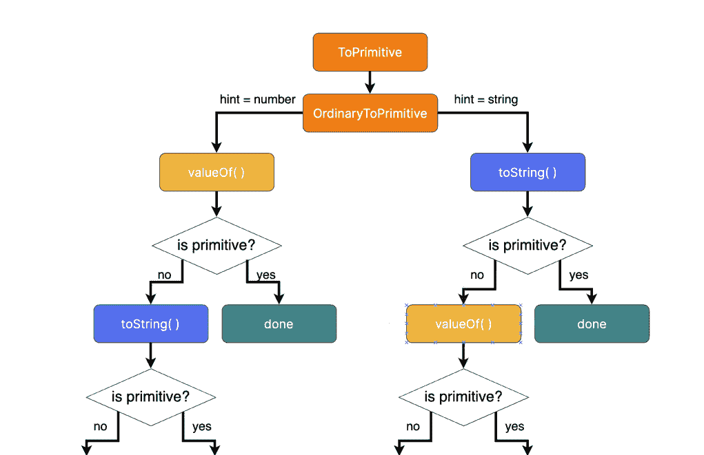


### ToNumber

每当 JavaScript 需要将任何非数字值转换为数字时，就会使用 `ToNumber` 抽象操作。

下表显示了将此抽象操作应用于某些非数字值的结果：

| 值 | `ToNumber(value)` |
| :--- | :--- |
| `""` | `0` |
| `"0"` | `0` |
| `"-0"` | `-0` |
| `"123"` | `123` |
| `"45"` | `45` |
| `"abc"` | `NaN` |
| `false` | `0` |
| `true` | `1` |
| `undefined` | `NaN` |
| `null` | `0` |

就对象而言，`ToNumber` 抽象操作首先使用偏好类型为“数字”的 `ToPrimitive` 抽象操作将对象转换为原始值，然后将结果值转换为数字。

`BigInt` 值允许*显式*转换为数字类型，但*隐式*转换是不允许的；隐式转换会抛出 `TypeError`。

```javascript
console.log(Number(10n)); // 10
console.log(+10n); // TypeError...
```

以下是上述代码的实际运行效果：

<ReplitEmbed src="https://replit.com/@newlineauthors/abstract-operations-example14" />

### ToString

`ToString` 抽象操作用于将任何值转换为字符串。

下表显示了将此抽象操作应用于某些非字符串值的结果：

| 值 | `ToString(value)` |
| :--- | :--- |
| `null` | `"null"` |
| `undefined` | `"undefined"` |
| `0` | `"0"` |
| `-0` | `"0"` |
| `true` | `"true"` |
| `false` | `"false"` |
| `123` | `"123"` |
| `NaN` | `"NaN"` |

对于对象，`ToString` 抽象操作首先使用偏好类型为“字符串”的 `ToPrimitive` 抽象操作将对象转换为原始值，然后将结果值转换为字符串。

### ToBoolean

`ToBoolean` 抽象操作用于将值转换为布尔值。

与上述抽象操作不同，此操作只是查找一个值是否为假值。如果是，我们得到 `false` 作为返回值；对于所有其他值，此操作返回 `true`。

以下是假值列表：

- `false`
- `0`、`-0`、`0n`
- `undefined`
- `null`
- `NaN`
- `""`

如前所述，ECMAScript 规范中提到了许多用于类型转换的抽象操作；在本课中，我们只讨论了常见的几个。

### 延伸阅读

- 数字强制转换 - (MDN)^61
- 字符串强制转换 - (MDN)^62
- 布尔强制转换 - (MDN)^63
- 强制转换值 - (You Don't Know JS Yet)^64

让我们来讨论一下声名狼藉的“双等于”运算符，它用于宽松地比较两个值。它也被称为“抽象相等”运算符。

这个运算符声名狼藉，因为许多在线资源和 JavaScript 开发者普遍不鼓励使用它，因为它具有强制转换行为。与其盲目地忽略双等号运算符，我们应该尝试理解它的行为，然后我们就可以自己决定是否要在我们的代码中完全不使用它，或者在可以安全使用的地方使用它。

尽管你听说过关于这个运算符的事情，但它的行为是根据一些预定义的算法步骤进行的，如果我们理解它的工作原理，这个运算符就不会吓到我们，我们甚至可能在某些情况下更喜欢这个运算符而不是它的表亲，严格相等运算符（`===`）。

当使用双等号运算符比较两个值时，JavaScript 用于比较这两个值的步骤由一个称为 `IsLooselyEqual` 的抽象操作描述。

### 抽象相等运算符总结

双等号运算符的工作原理大致总结在以下步骤中：

- 如果被比较的值类型相同，则执行严格相等比较。
- 如果一个值是 `undefined` 或 `null`，而另一个值也是 `undefined` 或 `null`，则返回 `true`。
- 如果一个或两个值是对象，则将它们转换为原始类型，偏好数字类型。
- 如果两个值都是原始值但类型不同，则转换类型直到匹配，偏好数字类型进行强制转换。

### 委托给严格相等比较

思考一下上面提到的第一点。如果使用此运算符比较的值的类型相同，那么在底层，这两个值会使用三个等号或严格相等运算符进行比较。因此，如果我们知道在某些代码中只会比较相同类型的值，那么使用双等号还是三个等号运算符没有任何区别；在这种情况下，我们总是会得到严格相等运算符。

### null vs undefined

第二点也值得深思。与严格相等运算符不同，抽象或宽松相等运算符认为 `null == undefined` 的比较结果为真。

```javascript
console.log(null === null); // true
console.log(undefined === undefined); // true
console.log(null === undefined); // false

console.log(null == null); // true
console.log(undefined == undefined); // true
console.log(null == undefined); // true
```

你可以在下面看到上述代码的实际运行效果：

<ReplitEmbed src="https://replit.com/@newlineauthors/abstract-equality-operator-example1" />

根据抽象相等运算符，`null` 和 `undefined` 彼此相等的事实为抽象相等运算符提供了一个有趣的用例。编写 JavaScript 代码时，通常需要检查一个值是否既不是 `null` 也不是 `undefined`。

使用严格相等运算符，我们的检查看起来会像这样：

```javascript
if (someVal !== null && someVal !== undefined) {
  // code
}
```

而使用抽象相等运算符，我们可以将此检查缩短为只有一个条件：

```javascript
if (someVal != null) {
  // code
}

// 或者

if (someVal != undefined) {
  // code
}
```

考虑到我们需要在 JavaScript 代码中防范 `null` 和 `undefined` 的频率，我觉得抽象相等运算符是这种情况的理想选择。话虽如此，如果你在这种情况下使用严格相等运算符，你也不会错。

### “if”条件

尽管抽象相等运算符的强制转换行为是可预测的，如上所述，但人们经常因为在这种运算符在 `if` 语句条件中的使用方式而陷入陷阱。考虑以下代码示例：

#### 抽象相等运算符

```javascript
const someVal = {};

if (someVal == true) {
    console.log("if");
} else {
    console.log("else");
}
```

你可以在下方实际运行上面的代码：

<ReplitEmbed src="https://replit.com/@newlineauthors/abstract-equality-operator-example4" />

根据我们之前的课程，我们知道对象是**真值**⁶⁷。因此，在上面的代码示例中，假设 `if` 条件会被求值为 `true`，从而执行 `if` 代码块，这似乎很合理。但是，如果你执行上面的代码，你可能会惊讶地发现，执行的不是 `if` 代码块，而是 `else` 代码块，因为 `someVal == true` 的检查结果是 `false`。

如果抽象相等运算符的任一操作数是布尔值，它会首先被转换成一个数字 - `false` 转换为 `0`，`true` 转换为 `1`。因此，上面代码示例中的 `if` 条件将按如下步骤求值：

1. 一个操作数是对象，另一个是布尔值，因此根据 `IsLooselyEqual`⁶⁸ 抽象操作的**第 10 步**，如果任一操作数是布尔值，则使用 `ToNumber` 抽象操作将其转换为数字。所以我们的条件会变成：

   ```javascript
   someVal == 1;
   ```

2. 将布尔值强制转换为数字后，我们得到一个对象和一个数字的比较。根据 `IsLooselyEqual` 抽象操作的**第 12 步**，对象 `someVal` 将使用 `ToPrimitive` 抽象操作被转换成一个原始值，并将 `"number"` 作为首选类型。对象字面量的默认原始表示是 `"[object Object]"`，因此强制转换后的条件变成：`"[object Object]" == 1;`

3. 现在，我们有一个字符串和一个数字的比较。根据 `IsLooselyEqual` 抽象操作的**第 6 步**，如果一个操作数是字符串，另一个是数字，则将字符串转换为数字。将 `"[object Object]"` 转换成数字会得到 `NaN`⁶⁹。所以我们的条件会变成：

   ```javascript
   NaN == 1;
   ```

4. 经过三次强制转换后，我们得到一个 `NaN` 值和一个数字的比较。它们彼此不相等。（`NaN` 值不等于任何其他值，包括它自身。）。因此，我们的条件无法求值为 `true`。

上述讨论的目的是理解，使用抽象相等运算符检查一个值是否为 `true` 或 `false` 并不总是像人们预期的那样工作。在这种情况下，人们很容易责怪抽象相等运算符。但事实是，编写这种代码的人需要帮助来理解或记住抽象相等运算符的工作原理。

在需要检查一个值是真值还是假值的情况下，我们不应使用抽象相等运算符，而是应该利用 `if` 语句的强制转换行为。我的意思是，上面代码中的 `if` 条件应该写成：

```javascript
if (someVal) {
    // 代码
}
```

使用上述条件，我们将得到预期的结果，因为系统将检查 `someVal` 是否为一个真值；如果是，条件将求值为 `true`，从而执行 `if` 代码块。

因此，作为一条建议，避免使用 `someVal == true` 这样的检查，其中一个是布尔值操作数。在这种情况下，利用 `if` 语句的隐式强制转换特性，它将检查该值是否是一个有效的值。

### 扩展阅读

- [布尔值陷阱 - 你还未了解的 JavaScript⁷⁰](#)
- [`"if"` 语句的运行时语义（ECMAScript 规范）⁷¹](#)

### 加法运算符

加法运算符可用于执行两个数字的加法，或用于连接两个字符串，也称为字符串连接。

此运算符的工作基于 `ApplyStringOrNumericBinaryOperator`⁷²。其工作方式是，如果任一或两个操作数是非原始值，它们将使用 `ToPrimitive` 抽象操作被转换为原始值，并且不指定首选类型。因此，在这种情况下，“number” 是首选类型，因为这是 `ToPrimitive` 抽象操作的默认行为。

在检查非原始操作数并将其（如果存在）强制转换为原始值之后，下一步是检查任一或两个操作数是否为字符串。如果是这种情况，那么非字符串操作数（如果存在）将被强制转换为字符串，并执行字符串连接。

如果两个操作数都不是字符串，那么在将非数字操作数强制转换为数字之后执行加法。

### 关系运算符

关系运算符（`<`、`>`、`<=`、`>=`）用于比较字符串和数字。在关系运算符的情况下调用的抽象操作是 `IsLessThan` 抽象操作<sup>73</sup>。尽管其名称如此，此操作也处理 “<=”、 “>” 和 “>=” 比较。

如果任一操作数是对象，它将被转换为以 `"number"` 作为首选类型的原始值。如果两个操作数都是字符串，则根据其 Unicode 码点进行比较。如果不是字符串，则操作数通常被转换为数字，然后进行比较。

我们还可以使用关系运算符比较日期对象。回想一下，当使用不带首选类型的 `ToPrimitive` 操作将 Date 对象转换为原始值时，它们会被转换为字符串，但在关系运算符的情况下，Date 对象在转换为原始值时会得到数字表示，因为在关系运算符的情况下，`ToPrimitive` 抽象操作会传入 `"number"` 作为首选类型。

```javascript
const d1 = new Date("2022-11-03");
const d2 = new Date("2023-05-10");

console.log(d1 < d2); // true
```

这是上述代码在 Replit 中的实际运行：

<ReplitEmbed src="https://replit.com/@newlineauthors/relational-operators-example1" />

现在我们已经更深入地了解了强制转换以及一些常见抽象操作如何实现强制转换，让我们来测试一下我们在本模块中学到的知识。接下来的练习将让我们巩固对强制转换主题的理解。

以下是一些涉及强制转换的表达式。尝试根据你在本模块中学到的知识猜测输出。如果你不理解所有表达式，不必担心。它们的解释也在下面给出。你显然可以参考规范以及本模块中的早期课程来理解和猜测下面表达式的输出。

```javascript
0 == false

"" == false

0 == []

[123] == 123

[1] < [2]

10 
11 [] == ![]
12 
13 !!"true" == !!"false"
14 
15 [1, 2, 3] + [4, 5, 6]
16 
17 [undefined] == 0
18 
19 [[]] == ''
20 
21 [] + {}
```

下面是上述每个表达式输出的解释。

### `0 == false`

让我们从一个简单的开始，大多数人即使没有阅读本模块也可能做对。现在我们知道了抽象相等运算符的工作原理，让我们理解将此表达式求值为 `true` 所采取的步骤。

1. 由于类型不相等且其中一个操作数是布尔值，因此布尔操作数使用 `ToNumber`⁷⁴ 抽象操作被转换为数字。所以，第一个强制转换步骤是将 `false` 转换为数字，即 `0`。表达式变为：

   ```javascript
   0 == 0
   ```

2. 现在类型相等，因此执行严格相等比较，即 `0 === 0`，输出 `true`。

### `"" == false`

1. 由于类型不相等且其中一个操作数是布尔值，因此布尔操作数使用 `ToNumber` 抽象操作被转换为数字。所以，第一个强制转换步骤是将 `false` 转换为数字，即 `0`。表达式变为：

   ```javascript
   "" == 0
   ```

2. 现在，我们有一个字符串和一个数字。回想一下，抽象相等运算符首选数字比较，因此字符串操作数使用 `ToNumber` 抽象操作被转换为数字。空字符串转换为数字时输出 `0`。因此表达式变为：

   ```javascript
   0 == 0
   ```

> ⁷⁴ https://tc39.es/ecma262/multipage/abstract-operations.html#sec-tonumber

### `0 == 0`

3. 类型相等，因此执行严格相等比较，即 `0 === 0`，输出为 `true`。

### `0 == []`

1. 数组通过 `ToPrimitive` 抽象操作转换为原始值。由于抽象相等运算符倾向于进行数字比较，数组将被转换为以数字为首选类型的原始值。空数组转换为原始值时，输出为空字符串。因此表达式变为：

   ```javascript
   0 == ""
   ```

2. 接下来，字符串将被转换为数字。空字符串转换为数字输出为 `0`。因此表达式变为：

   ```javascript
   0 == 0
   ```

3. 类型相等，因此执行严格相等比较，即 `0 === 0`，输出为 `true`。

### `[123] == 123`

1. 这里是数组和数字之间的比较。因此，数组通过 `ToPrimitive` 抽象操作转换为原始值，首选类型为数字。由于首选类型是数字，`valueOf` 方法将首先被调用。但我们知道 `valueOf` 方法的默认实现只是返回调用它的对象本身。因此接下来会调用 `toString` 方法。对于数组，`toString` 方法对空数组返回空字符串；对于像 `[1, 2, 3]` 这样的数组，它将数组内容转换为以逗号分隔的字符串，即 `"1,2,3"`。每个数组元素都会被强制转换为字符串，然后用逗号连接。

   在我们的例子中，数组中只有一个元素，即 `[123]`，所以它将被强制转换为 `"123"`。因此表达式变为：

   ```javascript
   "123" == 123
   ```

2. 接下来，字符串将被转换为数字。因此表达式变为：

   ```javascript
   123 == 123
   ```

3. 类型相等，因此执行严格相等比较，即 `123 === 123`，输出为 `true`。

:::info
关于数组转换为原始值的奇怪事实：包含 `null` 或 `undefined` 的数组会被强制转换为空字符串，即 `[null] -> ""` 且 `[undefined] -> ""`。类似地，同时包含两者的数组会被强制转换为包含单个逗号的字符串，即 `[null, undefined] -> ","`。为什么这些数组不会分别得到 `"null"`、`"undefined"` 和 `"null,undefined"`？这只是强制转换的边界情况之一。
:::

### `[1] < [2]`

1. 这是两个对象之间的比较。两个数组都通过 `ToPrimitive` 抽象操作转换为原始值，首选类型为数字。如前面的示例所述，最终会调用 `toString` 将两个数组转换为原始值，分别得到输出 `"1"` 和 `"2"`。因此表达式变为：

   ```javascript
   "1" < "2"
   ```

2. 现在，我们有两个字符串。类型相等，因此执行严格相等比较，即 `"1" < "2"`，输出为 `true`，因为字符串是通过它们的 Unicode 码点进行比较的。

### `[] == ![]`

1. 在这个比较中，有两个运算符：抽象相等运算符和逻辑非（`!`）运算符。逻辑非运算符的优先级高于相等运算符，因此首先计算子表达式 `![]`。


逻辑非运算符将`true`转换为`false`，反之亦然。但这里它用于一个非布尔值。那么当 JavaScript 在期望某种类型的值时遇到另一种类型的值时会发生什么？强制转换！因此`[]`将通过 ToBoolean 抽象操作被强制转换为布尔值，因为布尔值是预期的类型。由于`[]`是 truthy 值，它被强制转换为`true`，然后逻辑非运算符对其取反，将`true`转换为`false`。因此表达式变为：

```
[] == false
```

2. 接下来，布尔操作数，即`false`被转换为数字，即`0`。表达式现在是：

```
[] == 0
```

3. 现在我们有一个对象和数字之间的比较。回想抽象相等运算符的工作原理，对象将被转换为原始值，首选数字类型。如前面的某个示例所述，空数组被转换为空字符串，因此表达式变为：

```
"" == 0
```

4. 接下来，空字符串通过 ToNumber 抽象操作转换为数字，即`0`。

```
0 == 0
```

5. 类型相等，因此执行严格相等比较，即`0 === 0`，输出为`true`。

:::note
如果你好奇我是如何知道哪个操作数（左边或右边）先被强制转换以及执行了什么强制转换，我只是参考了 ECMAScript 规范中提到的步骤。例如，对于涉及使用抽象相等运算符进行比较的表达式，我参考的是 `IsLooselyEqual`<sup>77</sup> 抽象操作的步骤。

你也应该这样做。不需要记住每一步。只需理解强制转换是如何执行的，涉及哪些抽象操作，然后参考规范即可。
:::

### `!!"true" == !!"false"`

1. 同样，表达式中有两个运算符。如前所述，逻辑非运算符的优先级更高，因此子表达式`!!"true"`和`!!"false"`将首先被计算。

表达式`!!"true"`中的字符串`"true"`是一个 truthy 值，因此它将被强制转换为布尔值`true`。所以表达式将变为`!!true`。接下来，我们有两个逻辑非运算符。对`true`应用两次将首先将其转换为`false`，然后又变回`true`。

第二个子表达式`!!"false"`也将计算为`true`，因为字符串`"false"`是一个 truthy 值，所以与第一个子表达式相同，表达式将变为`!!true`，然后应用两次逻辑非运算符将得到`true`。因此，在子表达式被强制转换和计算后，我们的表达式将变为：

`true == true`

2. 类型相等，因此执行严格相等比较，即`true === true`，输出为`true`。

### `[1, 2, 3] + [4, 5, 6]`

1. 回想加法运算符的工作原理。这里涉及的抽象操作是 [ApplyStringOrNumericBinaryOperator](https://tc39.es/ecma262/multipage/ecmascript-language-expressions.html#sec-applystringornumericbinaryoperator)<sup>78</sup>。

由于两个操作数都是对象，它们首先通过 ToPrimitive 抽象操作转换为原始值，没有指定首选类型。因此，默认情况下，首选类型是`"number"`。数组在被强制转换为原始值时，使用`toString`方法进行转换。对于表达式中的数组，我们将分别得到`"1,2,3"`和`"4,5,6"`。因此表达式变为：

`"1,2,3" + "4,5,6"`

2. 由于两个操作数在强制转换后都是字符串，因此执行的是连接而不是加法，将两个字符串连接起来，输出为`"1,2,34,5,6"`。

<sup>77</sup> [https://tc39.es/ecma262/multipage/abstract-operations.html#sec-islooselyequal](https://tc39.es/ecma262/multipage/abstract-operations.html#sec-islooselyequal)

<sup>78</sup> [https://tc39.es/ecma262/multipage/ecmascript-language-expressions.html#sec-applystringornumericbinaryoperator](https://tc39.es/ecma262/multipage/ecmascript-language-expressions.html#sec-applystringornumericbinaryoperator)

### `[undefined] == 0`

1. 正如我们在本课中多次看到的，当使用抽象相等运算符比较对象和数字时，对象首先被转换为原始值。回想本课前面的一个注释，`[undefined]`在转换为原始值时输出为空字符串。因此表达式变为：

```
"" == 0
```

2. 空字符串转换为数字时得到`0`。因此表达式变为：

```
0 == 0
```

3. 类型相等，因此执行严格相等比较，即`0 === 0`，输出为`true`。

### `[[]] == ''`

1. 在这个表达式中，我们有一个包含空数组的数组和一个空字符串。数组操作数首先被转换为原始值。回想数组如何转换为原始值。除了前面提到的一些边界情况外，数组通过将其元素强制转换为字符串，然后用逗号连接来转换为原始值。因此，嵌套的空数组将被转换为原始值。空数组转换为原始值时得到什么？是的，一个空字符串。因此，外部数组也被转换为空字符串。强制转换后的表达式变为：

```
"" == ""
```

2. 空字符串等于空字符串，因此输出为`true`。

### `[] + {}`

1. 由于运算符是加法运算符，且两个操作数都是对象，因此它们都被转换为没有首选类型的原始值。因此，默认情况下，首选类型设置为`"number"`。空数组被转换为空字符串，而对象字面量的默认原始表示形式是字符串`"[object Object]"`。因此表达式变为：

```
"" + "[object Object]"
```

2. 现在两个操作数都是字符串，它们被连接，输出为`"[object Object]"`。

### 参考

上面的一些表达式取自以下 github 仓库：wtfjs<sup>79</sup>

<sup>79</sup> [https://github.com/denysdovhan/wtfjs](https://github.com/denysdovhan/wtfjs)

## 闭包

闭包是 JavaScript 的核心概念之一，对初学者来说可能难以理解。它是一个强大的特性，深入理解这个主题至关重要。在本模块中，我们将深入探讨闭包是什么以及它们如何工作。

### 什么是闭包？

闭包是以下两个要素的组合：

- 一个函数
- 对该函数创建时所处环境/作用域的引用

换句话说，每当我们在 JavaScript 中定义一个函数时，该函数都会保存对其创建环境的引用。这就是所谓的闭包：一个函数及其创建时所处环境的引用。

闭包允许嵌套函数访问包含函数内部的声明，即使在包含函数执行结束后也是如此。

```javascript
function outerFn() {
  const outerVar = 123;

  return function inner() {
    console.log(outerVar);
  };
}

const innerFn = outerFn();
innerFn();
```

以下是上述代码的 Replit 示例：

<ReplitEmbed src="https://replit.com/@newlineauthors/Example1">

`outerFn`返回的函数`innerFn`如何在`outerFn`执行完成后仍然能访问在`outerFn`中声明的`outerVar`变量？

上述代码之所以有效，是因为 JavaScript 函数在创建时总是会创建闭包。在某些编程语言中，函数局部定义的变量仅存在于该函数执行期间；当函数执行结束时，其局部作用域中定义的变量就会被销毁。但在 JavaScript 中情况并非如此，正如上面的代码示例所示。那么，闭包是如何工作的呢？

### 闭包是如何工作的？

要理解闭包如何工作，我们需要了解 JavaScript 如何解析任何标识符的作用域。

尽管我们在之前专门讨论作用域的模块中已经详细讨论过作用域，但让我们再次简要回顾一下词法作用域是如何解析的。考虑以下代码示例：

```javascript
let isReading = true;

function learnJavaScript() {
  console.log(isReading);
}

learnJavaScript();
```

以下是上述代码的 Replit 示例：

<ReplitEmbed src="https://replit.com/@newlineauthors/Example2">

当调用`learnJavaScript`函数以记录`isReading`变量的值时，JavaScript 首先需要确定其定义位置。JavaScript 搜索的第一个位置将是`learnJavaScript`函数的局部作用域，因为这是找到`isReading`变量引用的地方。

由于`isReading`变量未在`learnJavaScript`函数的局部作用域中定义，JavaScript 将在外层作用域中搜索该变量，在本例中即全局作用域。JavaScript 会在全局作用域中找到`isReading`变量的声明，从而获取其值并传递给`console.log`函数，以便将其记录到控制台。

让我们看另一个涉及嵌套函数的代码示例：

```javascript
let isReading = true;

function learnJavaScript() {
  function stepsToLearnJavaScript() {
    console.log(isReading);
  }

  stepsToLearnJavaScript();
}

learnJavaScript();
```

以下是上述代码的 Replit 示例：

<ReplitEmbed src="https://replit.com/@newlineauthors/Example3">

在这个代码示例中，我们有一个嵌套函数`stepsToLearnJavaScript`，它记录一个在全局作用域中定义的变量的值。如果 JavaScript 尚未确定`isReading`变量的作用域，它将如何找到其声明？回想一下作用域链！

JavaScript 需要遍历作用域链来找到`isReading`变量的声明。与前面的示例一样，首先在当前作用域中搜索声明，在本例中即`stepsToLearnJavaScript`函数的局部作用域。如果当前作用域不包含 JavaScript 正在寻找的声明，搜索将顺序扩展到外层作用域。在我们的示例中，`stepsToLearnJavaScript`函数不包含`isReading`变量的声明，因此搜索移动到外层作用域，在本例中即`learnJavaScript`函数的局部作用域。该作用域中也不存在声明；JavaScript 会遍历到`learnJavaScript`函数作用域的外层作用域。现在的外层作用域是全局作用域。

在上面的代码示例中，变量声明在全局作用域中找到，因此当搜索到达全局作用域时，变量声明的搜索就会停止。但是，如果我们从上面的代码示例中删除变量声明，会发生什么？

```javascript
function learnJavaScript() {
  function stepsToLearnJavaScript() {
    console.log(isReading);
  }

  stepsToLearnJavaScript();
}

learnJavaScript();
```

以下是上述代码的 Replit 示例：

<ReplitEmbed src="https://replit.com/@newlineauthors/Example4">

现在，`stepsToLearnJavaScript`函数正在记录一个未声明的变量。那么，当变量声明的搜索到达全局作用域时会发生什么？此时，JavaScript 将执行以下两种操作之一：

- 如果代码在严格模式下，则抛出错误
- 在非严格模式下为你声明一个全局变量（回想作用域模块中的“隐式全局变量”）

### 不同作用域如何链接？

至此，我们已经了解了作用域是如何解析的，以及不同的作用域如何链接在一起，形成一个称为“作用域链”的链条。但你想过不同作用域是如何链接的吗？这不可能是魔法；必定有某种机制将不同的作用域连接在一起。JavaScript 如何确定当前作用域的外层作用域？

让我们重新审视本课前面展示的一个代码示例：

```javascript
let isReading = true;

function learnJavaScript() {
  console.log(isReading);
}

learnJavaScript();
```

以下是上述代码的 Replit 示例：

<ReplitEmbed src="https://replit.com/@newlineauthors/Example5">

我们知道当`learnJavaScript`函数被调用时，该函数的局部作用域会链接到全局作用域，但这是如何做到的？答案是名为`[[Environment]]`<sup>80</sup>的隐藏内部槽。这个`[[Environment]]`内部槽存在于函数上，它包含对外层作用域/环境的引用。换句话说，这个内部槽包含对包含函数已闭合或形成“闭包”的作用域的引用。

:::info
ECMAScript 规范中提到了许多隐藏的内部槽<sup>81</sup>。规范使用这些隐藏的内部槽来定义所需的行为。这些隐藏的内部槽，就像抽象操作一样，可能是也可能不是由不同 JavaScript 引擎实际实现的东西。
:::

在上面的代码示例中，当`learnJavaScript`函数被创建时，由于它是在全局作用域中创建的，一个对全局环境的引用被保存在函数对象的内部`[[Environment]]`槽中。稍后，当函数被调用时，会为函数内代码的执行创建一个新的环境。这个环境（函数的局部作用域）通过获取保存在`learnJavaScript`函数的`[[Environment]]`槽中的值，并将其保存到名为`[[OuterEnv]]`<sup>82</sup>的内部槽中，从而链接到全局环境。每个环境对象都有一个内部槽，其中包含对外层环境的引用。

上面示例中的作用域链接可以在概念上可视化为下图：

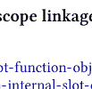

<sup>80</sup> [https://tc39.es/ecma262/#table-internal-slots-of-ecmascript-function-objects](https://tc39.es/ecma262/#table-internal-slots-of-ecmascript-function-objects)

<sup>81</sup> [https://stackoverflow.com/questions/33075262/what-is-an-internal-slot-of-an-object-in-javascript](https://stackoverflow.com/questions/33075262/what-is-an-internal-slot-of-an-object-in-javascript)

<sup>82</sup> [https://tc39.es/ecma262/#sec-environment-records](https://tc39.es/ecma262/#sec-environment-records)

让我们重新审视本课前面涉及嵌套函数的一个示例：

```javascript
let isReading = true;

function learnJavaScript() {
  function stepsToLearnJavaScript() {
    console.log(isReading);
  }

  stepsToLearnJavaScript();
}

learnJavaScript();
```

以下是上述代码的 Replit 示例：

<ReplitEmbed src="https://replit.com/@newlineauthors/Example6">

在这个代码示例中，我们有三个不同的环境：

- 全局环境
- `learnJavaScript`函数的局部环境（在函数调用时创建）
- `stepsToLearnJavaScript`函数的局部环境（在函数调用时创建）

不同作用域之间的链接可以在下图中可视化：

### 作用域链接

希望上面的两个代码示例和图片已经阐明了不同的作用域是如何链接在一起，形成一个作用域链的。这个作用域链会被 JavaScript 引擎遍历（如果需要），以解析任何标识符的作用域。

不同环境之间的这种链接，即作用域链，是 JavaScript 中闭包得以实现的原因。由于这个作用域链，即使外部函数的执行已经结束，嵌套函数仍然可以访问外部函数的变量。只要内部函数对其有引用，这个外部环境就会一直保存在内存中。

现在，让我们重新回顾本课中的第一个代码示例，它涉及从一个与定义嵌套函数不同的作用域调用该嵌套函数。

```javascript
function outerFn() {
  const outerVar = 123;

  return function inner() {
    console.log(outerVar);
  };
}

const innerFn = outerFn();
innerFn();
```

以下是上述代码的一个 Replit 演示：

<ReplitEmbed src="https://replit.com/@newlineauthors/Example7">

希望你现在能够解释，即使在`outerFn`执行完成后，嵌套函数是如何访问`outerVar`变量的。

`inner`函数对其外部函数`outerFn`的局部作用域有一个引用，该引用保存在它的`[[Environment]]`内部槽中。当`inner`函数从`outerFn`函数返回时，尽管`outerFn`的执行已经结束，但`inner`函数仍然持有对`outerFn`局部作用域的引用。当调用`inner`函数时，`inner`函数的`[[Environment]]`槽的值会被保存在为`inner`函数执行创建的新环境的`[[OuterEnv]]`内部槽中。


总结一下，每次创建一个 JavaScript 函数时，都会形成一个闭包，该闭包允许该函数访问其被定义时生效的作用域链。每次创建函数时，JavaScript 都会将函数对其周围环境的引用保存在函数对象内部的`[[Environment]]`槽中。当调用该函数时，会为该函数调用创建一个新环境，JavaScript 会将函数`[[Environment]]`槽中的值保存在环境对象的`[[OuterEnv]]`槽中。

初学者中常见的一个误解是，闭包只在函数返回嵌套函数时才会形成。但事实并非如此。

在 JavaScript 中，每次创建一个函数时，都会在其被创建的环境上形成一个闭包。形成闭包是一种花哨的说法，意思是当函数被创建时，它会保存对其被创建环境的一个引用。

这种误解的原因是什么？这是因为以下两个原因：

- 许多在线资源在介绍闭包概念时，使用的代码示例都包含一个返回嵌套函数的函数。
- 闭包只有在从与函数定义不同的作用域调用该函数时，才会变得明显。

### 闭包

大多数函数通常都是从与其定义相同的作用域中调用的。这使得闭包不那么引人注意。只有当从一个与函数定义不同的作用域调用该函数时，闭包才会变得明显。

在下面的代码示例中，定义了一个函数并从全局作用域调用它，因此该函数形成的闭包是不明显的。

```javascript
let score = 150;

function logScore() {
  console.log(score);
}

logScore();
```

你可以在这个 Replit 中查看上述代码：

```text
<ReplitEmbed src="https://replit.com/@newlineauthors/closure-misconception-example1">
```

与上面的代码示例不同，在下面的代码示例中，闭包是明显的，因为即使在`createGreeting`函数执行完成后，嵌套的`greet`函数仍然可以访问其包含函数`createGreeting`的`greetMsg`参数。闭包之所以明显，是因为`greet`函数是从一个与其定义不同的作用域调用的。`greet`函数定义在`createGreeting`函数的局部作用域中，但却从全局作用域调用。

```javascript
function createGreeting(greetMsg) {
  function greet(personName) {
    console.log(`${greetMsg} ${personName}!`);
  }

  return greet;
}

const sayHello = createGreeting("Hello");
sayHello("Mike");
```

以下是上述代码的一个 Replit 演示：

```text
<ReplitEmbed src="https://replit.com/@newlineauthors/closure-misconception-example2">
```

你期望下面这个代码示例输出什么？

```javascript
for (var i = 1; i <= 3; i++) {
    setTimeout(() => {
        console.log(i);
    }, 1000);
}
```

你可能期望得到如下输出：

```text
1;
2;
3;
```

尽管上述输出看起来合理，但这并非我们从上面代码示例中得到的输出。实际输出如下所示：

```text
4;
4;
4;
```

以下是上述代码示例在 Replit 中的输出：

```text
<ReplitEmbed src="https://replit.com/@newlineauthors/closures-in-loops-example1">
```

如果这个输出让你感到惊讶，那么本课正是为你准备的。即使没有，你理解这个输出背后的原因吗？在本课中，我们将探讨导致这个问题（也称为“循环中的闭包”问题）的原因，以及如何修复它。

### 是什么导致了这个问题？

上面的代码示例之所以会遇到这个臭名昭著的“循环中的闭包”问题，是因为每个`setTimeout`的回调函数都在同一个变量`i`上形成了一个闭包。由于我们的示例中总共有三次循环迭代，所以`setTimeout`被调用了三次，因此我们得到了三个回调函数，它们都在同一个变量`i`上形成了一个闭包。

每个`setTimeout`调用的回调函数都是在循环执行之后被调用的。循环最后一次迭代后，变量`i`的值是“4”，并且由于每个`setTimeout`的回调函数都在同一个变量`i`上形成了一个闭包，所以它们看到的`i`的值都是“4”。这就是它们都在控制台打印“4”的原因。

上述代码示例的作用域链接可以在下图中可视化：

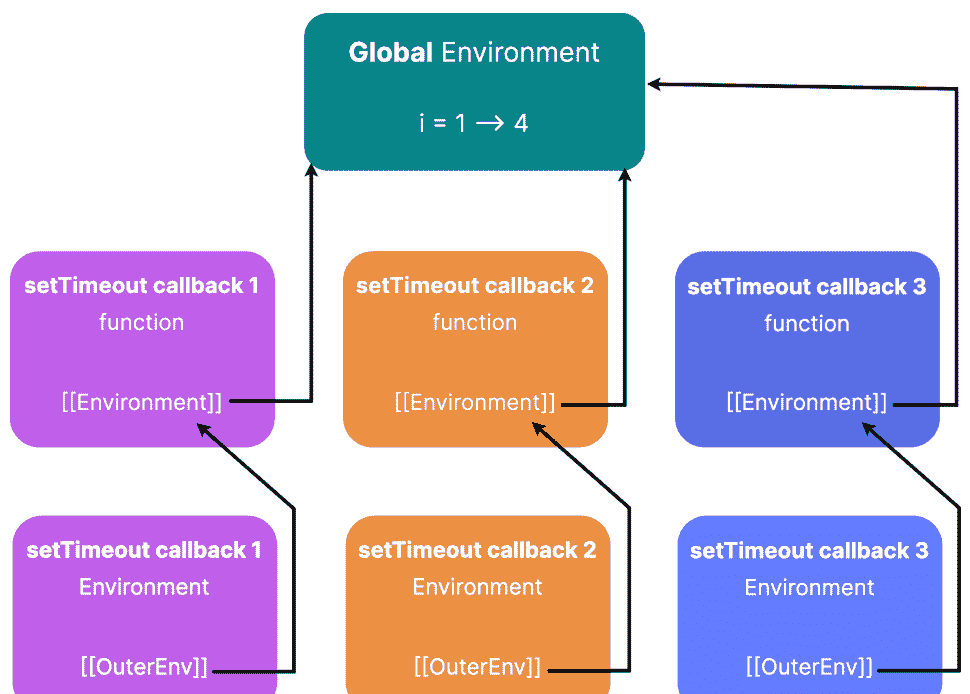

需要注意的是，函数是在变量上形成闭包，而不是在其值上形成闭包。在变量上形成闭包意味着每个函数都记录其闭包变量的最新值；如果函数是在值上而不是在变量上形成闭包，那么它们记录的将是闭包形成时生效的值的快照。

在我们的例子中，如果闭包是在`i`的值上形成而不是在`i`变量上形成，那么每个回调函数都会记录其被创建时的那次迭代中`i`的值。这意味着我们将得到期望的输出，即 1 2 3 而不是 4 4 4。但从代码示例的输出可以明显看出，闭包是在变量上形成的。结果，`setTimeout`的每个回调函数都在变量`i`上形成了一个闭包，当每个回调函数执行时，它看到的都是`i`的最新值。

### 如何解决这个问题？

既然我们已经理解了“循环中的闭包”问题是什么以及是什么导致了它，让我们讨论一下在 ES2015 之前是如何解决这个问题的。

### ES2015 之前的解决方案

在 ES2015（也称为 ES6）引入之前，解决这个问题的一种方法是使用[IIFE（立即调用函数表达式）](https://developer.mozilla.org/en-US/docs/Glossary/IIFE)。以下代码示例展示了如何使用 IIFE 来解决这个问题。

```javascript
for (var i = 1; i <= 3; i++) {
  ((counter) => {
    setTimeout(() => {
      console.log(counter);
    }, 1000);
  })(i);
}

/* output
----------
1
2
3
----------
*/
```

以下是上述代码示例在 Replit 中的输出：

```text
<ReplitEmbed src="https://replit.com/@newlineauthors/closures-in-loops-example2">
```

使用 IIFE 是如何解决这个问题的呢？

回想一下，这个问题是由于不同回调函数在同一个变量上形成闭包而导致的。但是通过使用 IIFE，我们可以将每次迭代中`i`的值作为参数传递给 IIFE。这个参数（`counter`）随后在`setTimeout`函数的回调函数内部使用。这解决了问题，因为`counter`参数被每个回调函数所闭包，并且在每次迭代中，都会创建一个新的 IIFE 以及`setTimeout`的新回调函数。每个新的 IIFE 实例都会接收到一个新的`i`值，即第一次迭代为“1”，第二次迭代为“2”，依此类推。所以现在，通过使用 IIFE，每个回调函数都在不同的`counter`变量上形成了一个闭包。

下图有助于可视化上述代码示例中的作用域链（为了简单起见，下图中未显示函数对象）：

尽管`setTimeout`函数的回调记录了计数器变量，但它们仍然可以访问变量`i`。如果我们同时记录`counter`和`i`会怎样？输出会如何变化？

```javascript
for (var i = 1; i <= 3; i++) {
  ((counter) => {
    setTimeout(() => {
      console.log(counter, i);
    }, 1000);
  })(i);
}

/* output
---------
 1 4
 2 4
 3 4
----------
*/
```

上述代码示例的输出可以在下方的 Replit 中看到：

```text
<ReplitEmbed src="https://replit.com/@newlineauthors/closures-in-loops-example3">
```

每个回调都形成了对计数器变量不同实例的闭包，但它们仍然共享来自全局作用域的同一个变量`i`。因此，它们记录的是`i`的最新值，即 "4"。

### ES2015 解决方案

ES2015 引入了块级作用域的变量和常量，分别使用`let`和`const`关键字。我们只需将原来存在此问题的代码示例中的`var`关键字替换为`let`关键字，即可解决“循环中的闭包”问题。

```javascript
for (let i = 1; i <= 3; i++) {
  setTimeout(() => {
    console.log(i);
  }, 1000);
}

/* output
----------
1
2
3
----------
*/
```

上述代码示例在 Replit 中的输出如下：

```text
<ReplitEmbed src="https://replit.com/@newlineauthors/closures-in-loops-example4">
```

使用`let`关键字可以解决这个问题，因为与每个回调函数都关闭在同一个变量`i`上不同，`let`的块级作用域特性导致循环的每次迭代都有变量`i`的一个不同副本。这是解决“循环中的闭包”问题的关键思想。每次迭代都有自己独立的变量`i`副本，这意味着在每次迭代中创建的`setTimeout`回调都关闭在该特定循环迭代所限定的变量`i`副本上。

在我们的代码示例中，我们有循环的三次迭代和变量`i`的独立副本，每个副本都受限于特定的循环迭代。尽管看起来我们只有一个变量`i`，但在幕后，每次迭代都获得变量`i`的自己的副本。

要理解每次迭代如何获得变量`i`的自己的副本，以下步骤解释了上述代码是如何执行的：

1. 在`for`循环开始执行之前，会创建一个环境对象（我们称之为`initEnv`），它包含在`for`循环初始化部分声明的变量。在我们的例子中，只有一个变量`i`，所以`initEnv`环境对象包含变量`i`的一个副本。这个环境对象通过在`[[OuterEnv]]`内部槽中保存对外部环境的引用来链接到外部环境。在这种情况下，外部环境是全局环境。
2. 要开始`for`循环的第一次迭代，会创建一个新的环境对象（我们称之为`iter1Env`）。这个环境对象也以全局环境作为其外部环境。变量`i`通过从`initEnv`对象（在步骤 1 中创建）复制到这个新创建的`iter1Env`对象中。
3. 循环条件`i <= 3`为`true`，因此作为循环第一次迭代的一部分，执行了循环体。为`setTimeout`创建的回调函数被创建，将对第一次循环迭代的环境对象`iter1Env`（在步骤 2 中创建）的引用保存在其内部`[[Environment]]`槽中。之后，该回调函数作为参数传递给`setTimeout`函数，以便稍后执行。

第一次迭代已完成。下图显示了迄今为止创建的不同环境之间的链接关系：

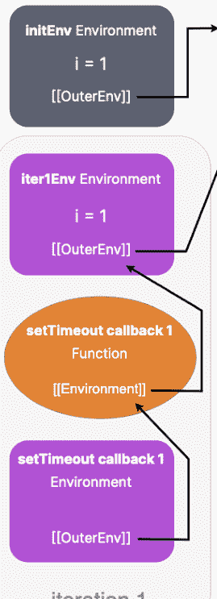

循环中的闭包 - 迭代 1

1. 现在，要开始第二次迭代，会创建一个新的环境对象（我们称之为`iter2Env`）。变量`i`从`initEnv`环境对象（在步骤 1 中创建）复制，但`iter2Env`中`i`的值是`iter1Env`（在步骤 2 中创建）中`i`的值。然后，由于`for`循环的递增部分（`i++`），`iter2Env`中`i`的值被递增。
2. 与前一次迭代一样，创建了一个新的回调函数，并将对`iter2Env`的引用保存在其`[[Environment]]`内部槽中。然后将该回调函数作为参数传递给`setTimeout`函数。
3. 对于第三次也是最后一次迭代，此过程会重复进行。

下图显示了在循环的三次迭代之后，不同环境是如何链接在一起的：

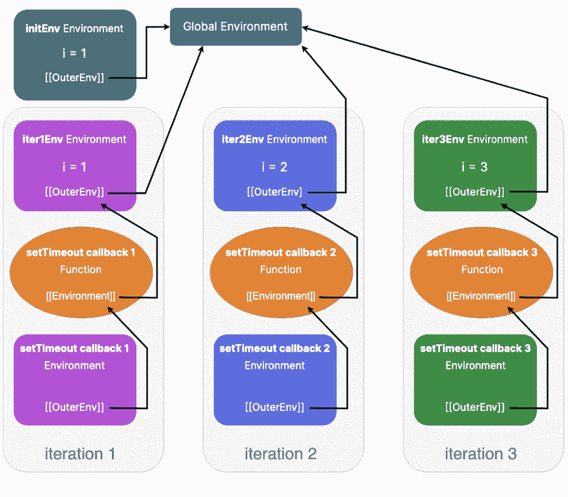

循环中的闭包 - 所有迭代

希望最后的示意图阐明了为什么使用`let`关键字可以解决“循环中的闭包”问题。由于为循环的每次迭代创建的每个环境对象都有自己独立的变量`i`副本，因此在循环的不同迭代中创建的每个回调的闭包都形成了对变量`i`独立副本的闭包。因此，它们记录了各自闭包所捕获的值，给出了我们预期的输出，即`1 2 3`。

随着 JavaScript 语言的最新更新，现在可以在 JavaScript 中拥有[私有字段和方法](https://developer.mozilla.org/en-US/docs/Web/JavaScript/Reference/Classes/Private_class_fields)。然而，在这些更改引入该语言之前，闭包是从公共访问中隐藏数据的首选选项。在面向对象编程术语中，这被称为“数据隐藏”和“封装”。

以下是我们如何使用闭包实现私有变量和方法的示例：

<sup>84</sup>https://developer.mozilla.org/en-US/docs/Web/JavaScript/Reference/Classes/Private_class_fields

```javascript
const bank = (function () {
  // 私有数据
  const accounts = [];

  // 私有函数
  function getInternalBankLogs() {
    // ...
  }

  /*** 公共函数 ***/

  function openAccount(data) {
    // 一些逻辑...
    // ...
    accounts.push(newAccount);
  }

  function deposit(accountNum, amount) {
    // ...
  }

  function withdraw(accoutNum, amount) {
    // ...
  }

  return {
    openAccount,
    deposit,
    withdraw
  };
})();

bank.openAccount({}); // 正常
bank.accounts(); // 错误，无法访问
```

IIFE 内部的代码被执行，然后从 IIFE 返回一个对象并赋值给`bank`变量。返回的对象仅包含需要从 IIFE 外部访问的数据。本应私有的代码没有被返回；因此，该数据保持私有，仅限于 IIFE 的边界之内。然而，得益于闭包，从 IIFE 返回的公共暴露数据仍然可以访问 IIFE 内部的私有数据。

### 延伸阅读

- [使用闭包模拟私有方法 - (MDN)85](https://developer.mozilla.org/en-US/docs/Web/JavaScript/Closures#emulating_private_methods_with_closures)

85 https://developer.mozilla.org/en-US/docs/Web/JavaScript/Closures#emulating_private_methods_with_closures

### 原型

**继承**是一个通用的面向对象编程概念，允许对象继承其他对象的方法和属性。这减少了代码重复，并促进了不同对象之间的代码共享。

与传统的面向对象编程语言（如 Java 或 C#）不同，JavaScript 有处理继承的不同方式。JavaScript 中的对象与其他对象链接，这种链接允许一个对象使用与其链接的另一个对象的功能。

JavaScript 中对象之间的链接形成了一个链。这个链被称为**“原型链”**。想想作用域链，其中每个作用域都链接到另一个作用域，直到我们到达全局作用域。原型链类似：一个对象链接到另一个对象。这另一个对象又链接到另一个对象，形成对象之间的链。

原型链允许对象之间共享属性，这是 JavaScript 中继承的思想，被称为**“原型继承”**。在原型继承中，其他对象继承其属性的对象被称为这些对象的**“原型”**。

当我们在 JavaScript 中创建一个对象字面量时，默认情况下它链接到内置的`Object.prototype`对象。

```javascript
const obj = {};
```

在上面的代码示例中，`Object.prototype`对象是`obj`对象的**原型**。

#### 对象是如何链接的？

JavaScript 中的对象有一个名为`[[Prototype]]`的隐藏内部槽。当一个对象被创建时，它通过在新创建对象的`[[Prototype]]`内部槽中保存对另一个对象的引用来链接到另一个对象。保存在内部槽中的另一个对象的引用将作为新创建对象的“原型”。

在上面的代码示例中，`obj`对象的`[[Prototype]]`槽包含对`Object.prototype`对象的引用。因此，`obj.[[Prototype]]`给出了`obj`对象的原型，即`obj`链接并继承其属性的对象。但由于`[[Prototype]]`是一个 JavaScript 无法访问的内部槽，在本课后面，我们将看到如何访问任何对象的原型。

### “prototype”属性


在我们目前对原型继承的讨论中，你可能已经注意到“prototype”这个术语在两个不同的上下文中使用：一是作为一个属性，即`Object.prototype`；另一个是作为一个通用术语，用来描述与另一个对象共享其属性的对象。这种命名上的冲突在许多初学者开始学习 JavaScript 原型继承时造成了困惑。

由于函数在 JavaScript 中也是对象，它们可以像任何其他对象一样拥有属性。“prototype”这个属性名就是函数的属性之一。箭头函数没有这个属性。

函数的`prototype`属性指向一个对象，当该函数使用`new`关键字作为“构造函数”调用时，这个对象将用作其他对象的“原型”。同样，“prototype”这个术语在这里也有两个不同的含义：

- 函数上的“prototype”属性。
- 当一个对象与其他对象链接并共享其属性时，该对象被称为“原型”。

下面的代码示例展示了名为“prototype”的属性确实存在于函数上：

```javascript
function Car(name, model) {
  this.name = name;
  this.model = model;
}

console.log(Object.getOwnPropertyNames(Car));

// [ "prototype", "length", "name" ]
```

你可以在下面的 Replit 中运行上述代码：

<ReplitEmbed src="https://replit.com/@newlineauthors/prototypal-inheritance-example1" />

从上面的代码中，你大概可以看出`Car`函数旨在用作构造函数。然而，它确实只是一个普通函数。“prototype”属性只有在我们以构造函数调用函数时，即使用`new`关键字时，才有用。

任何添加到`Car.prototype`对象上的属性，都将由通过`Car`构造函数创建的所有实例共享。`Car.prototype`对象将作为`Car`构造函数所有实例的“原型”。

最初，任何函数上`prototype`属性所指向的对象只包含一个名为“constructor”的属性。这个“constructor”属性的值是对构造函数的引用。以`Car.prototype`对象为例，`Car.prototype.constructor`指的是`Car`构造函数。

```javascript
// Car.prototype
{
  constructor: <Car function>
}
```

以下代码示例验证了`Car.prototype.constructor`指向`Car`函数：

```javascript
function Car(name, model) {
  this.name = name;
  this.model = model;
}

console.log(Car.prototype.constructor === Car); // true
```

你可以在下面的 Replit 中运行上述代码：

<ReplitEmbed src="https://replit.com/@newlineauthors/prototypal-inheritance-example2" />

> 在我们编写的 JavaScript 代码中，`constructor`属性很少使用，甚至可以说几乎不用。

让我们在`Car.prototype`对象上添加一个属性：

```javascript
Car.prototype.start = function () {
  console.log("starting the engine of " + this.name);
};

const honda = new Car("honda", "1996");
const toyota = new Car("toyota", "2000");

honda.start(); // starting the engine of honda
toyota.start(); // starting the engine of toyota
```

你可以在下面的 Replit 中运行上述代码：

<ReplitEmbed src="https://replit.com/@newlineauthors/prototypal-inheritance-example3" />

当使用`new`关键字调用函数时，在创建新对象的步骤之一是，新创建对象的`[[Prototype]]`内部槽被指向函数的`prototype`属性所引用的对象。因此，新创建的对象能够访问构造函数的`prototype`属性所指向对象上定义的属性。

### 获取任何对象的原型

`Object`函数有一个名为[`getPrototypeOf()`](https://developer.mozilla.org/en-US/docs/Web/JavaScript/Reference/Global_Objects/Object/getPrototypeOf)的静态方法，可用于获取任何对象的原型。它返回该对象内部`[[Prototype]]`属性的值。

对于在前面代码示例中创建的`honda`对象，`Object.getPrototypeOf()`函数返回`Car.prototype`对象，因为`Car.prototype`对象是`Car`构造函数所有实例的原型。

```javascript
function Car(name, model) {
  this.name = name;
  this.model = model;
}

Car.prototype.start = function () {
  console.log("starting the engine of " + this.name);
};

const honda = new Car("honda", "1996");

console.log(Object.getPrototypeOf(honda) === Car.prototype); // true
```

你可以在下面的 Replit 中运行上述代码：

<ReplitEmbed src="https://replit.com/@newlineauthors/prototypal-inheritance-example4" />

现在我们知道了什么是原型继承，接下来让我们探索原型链。

### `Object.prototype`——所有对象的父级

原型继承层次结构的顶端是`Object.prototype`对象。它是根对象或所有对象的父级。当我们创建一个对象字面量时，它的原型就是`Object.prototype`对象。

```javascript
const obj = {};

console.log(Object.getPrototypeOf(obj) === Object.prototype);
// true
```

你可以在下面的 Replit 中运行上述代码：

<ReplitEmbed src="https://replit.com/@newlineauthors/prototype-chain-example1" />

我们没有在`obj`对象上定义任何属性。但我们仍然可以在它上面调用一些方法。

```javascript
const obj = {};

console.log(obj.toString()); // [object Object]
```

你可以在下面的 Replit 中运行上述代码：

<ReplitEmbed src="https://replit.com/@newlineauthors/prototype-chain-example2" />

我们没有在`obj`对象上定义名为`toString()`的方法；那么在上面的代码示例中它是如何可访问的呢？你猜对了：它定义在`Object.prototype`对象上，由于`Object.prototype`是`obj`的原型，所以`obj`继承了定义在`Object.prototype`上的属性，`toString()`就是其中之一。

以这种方式创建的对象是`Object`构造函数的实例。我们也可以像下面这样定义`obj`：

```javascript
const obj = new Object();
```

这具有相同的效果：它创建了一个空对象。正如在上一课中讨论的，函数有一个`prototype`属性，该属性指向一个对象，当该函数作为“构造函数”调用时，该对象用作该函数所有实例的“原型”。因此，`Object.prototype`对象充当通过`new Object()`或对象字面量语法创建的所有对象的“原型”。

此时，你可能会问：`toString()`不是在所有对象上都可调用吗？是的，确实如此；有些对象从`Object.prototype`对象继承它，而其他对象，如数组，则从它们的原型（即`Array.prototype`对象）继承它，该对象覆盖了`Object.prototype`中定义的`toString()`实现。

有些对象直接链接到`Object.prototype`对象，而另一些则间接链接。例如，数组是间接链接的。每个数组实例直接链接到`Array.prototype`对象。`Array.prototype`对象链接到`Object.prototype`对象。这形成了一个以`Object.prototype`对象结束的原型链。

```javascript
const arrayPrototype = Object.getPrototypeOf([]);
const prototypeOfArrayPrototype = Object.getPrototypeOf(arrayPrototype);

console.log(arrayPrototype === Array.prototype);
// true
console.log(prototypeOfArrayPrototype === Object.prototype);
// true
```

你可以在下面的 Replit 中运行上述代码：

<ReplitEmbed src="https://replit.com/@newlineauthors/prototype-chain-example3" />

上面代码中演示的原型链可以在下图中可视化：

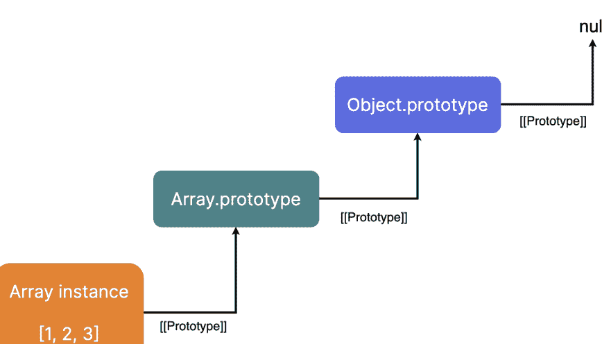

`Array.prototype`对象包含可在每个数组上调用的方法，例如`map()`、`filter()`等。`Object.prototype`对象包含所有对象都可用的方法，例如`toString()`方法。

正如 JavaScript 遍历作用域链以找到在当前作用域中找不到的标识符的声明一样，JavaScript 也遍历原型链以找到在当前对象中找不到的属性。原型链必须在某处结束。否则，JavaScript 将一直遍历一个无尽的链条；它在`Object.prototype`对象处结束。访问`Object.prototype`的原型返回`null`。

```javascript
console.log(Object.getPrototypeOf(Object.prototype));
// null
```

你可以在下面的 Replit 中运行上述代码：

<ReplitEmbed src="https://replit.com/@newlineauthors/prototype-chain-example4" />

字符串的原型链与数组的原型链相似，只是没有`Array.prototype`对象，而是有`String.prototype`对象，它作为所有字符串实例的原型。这个`String.prototype`对象又链接到`Object.prototype`对象，其中`Object.prototype`对象充当`String.prototype`对象的原型。

### “Function”函数

尽管听起来可能令人困惑，但确实存在一个名为`Function`<sup>88</sup>的函数。JavaScript 中的函数是对象，并且是这个“Function”构造函数的实例。`Function.prototype`对象提供了所有函数都可以访问的属性；例如，`bind()`、`apply()`等方法。

`Function.prototype`对象作为函数的原型，包括`Object`函数。即使是`Function`函数本身（`Function.prototype`对象属于它），也从`Function.prototype`对象继承属性，因为`Function`说到底本身也只是一个函数。因此，让它从包含函数通用属性的`Function.prototype`对象继承是有道理的。

```javascript
console.log(Object.getPrototypeOf(Object) == Function.prototype);
// true

console.log(Object.getPrototypeOf(Function) == Function.prototype);
// true
```

你可以在下面的 Replit 中运行上述代码：

<ReplitEmbed src="https://replit.com/@newlineauthors/prototype-chain-example5" />

上面描述的原型链可以在下面的图片中可视化：

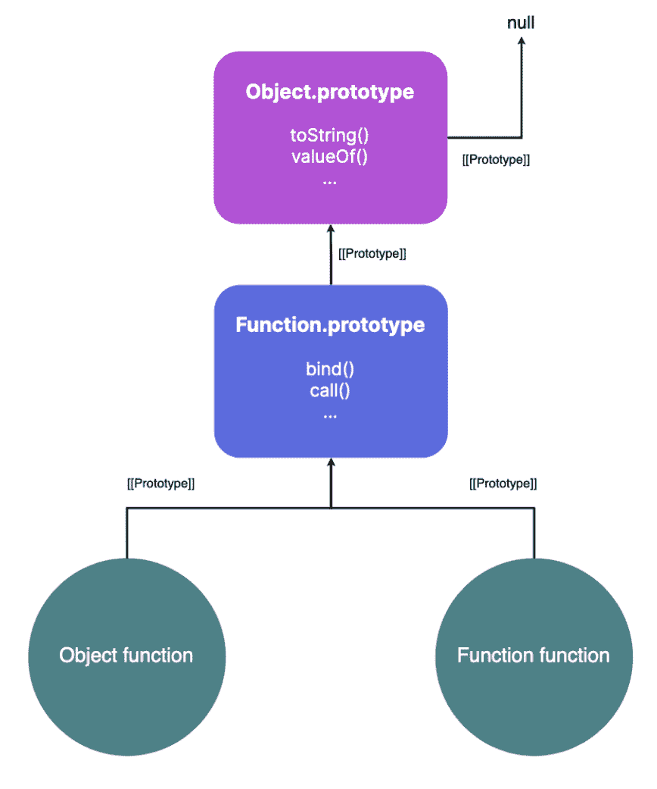

### 数组原型链

由于`Object.prototype`对象是根对象或父对象，它是原型链的一部分，直接链接到`Function.prototype`对象。

`__proto__`属性定义在`Object.prototype`对象上。它是一个 getter 和一个 setter，用于返回或设置对象的原型。换句话说，它返回或设置对象的内部`[[Prototype]]`属性的值。

虽然这个属性可以用来设置和获取对象的原型，但不建议使用它。该属性已被弃用，并且已经提供了更好的替代方法来获取和设置对象的原型。

```javascript
const user = { name: "John Doe" };

console.log(user.__proto__);
// 输出 Object.prototype 对象
```

你可以在下面的 Replit 中运行上述代码：

<ReplitEmbed src="https://replit.com/@newlineauthors/proto-property-example1" />

上面的代码示例展示了使用`__proto__`属性作为*getter*来获取`user`对象的原型。它也可以作为*setter*来设置对象的`[[Prototype]]`内部属性的值。同样，不建议使用它，并且有更好的替代方案。要设置原型，我们可以使用[`setPrototypeOf()`](https://developer.mozilla.org/en-US/docs/Web/JavaScript/Reference/Global_Objects/Object/setPrototypeOf)方法。

上面代码示例中`user`对象的原型是`Object.prototype`对象。因此，`user`对象可以访问`__proto__`属性。由于`__proto__`属性在用作 getter 时只是暴露对象的内部`[[Prototype]]`属性的值，在`user`的情况下，它返回`Object.prototype`对象。

### 使用 `__proto__` 的问题

有多种原因要避免使用`__proto__`属性来获取或设置对象的原型。如前所述，`__proto__`属性已被弃用，并且有设置和获取对象原型的更好替代方案。该属性直到 2015 年才被标准化，因此在此之前，它作为 JavaScript 语言的一个非标准特性存在。即使`__proto__`属性现在是 ECMAScript 规范的一部分，该属性被 ECMAScript 规范标准化也并不是为了促进或鼓励其使用；而是因为它已经存在于几个运行在浏览器中的 JavaScript 引擎中。

`__proto__`属性的另一个问题是它可能并非对所有对象都可用。你可能会问这怎么可能。难道所有对象不是直接或间接从`Object.prototype`对象继承吗？它可能不可用的原因在于，我们可以创建不从任何其他对象继承的对象（我们将在下一课中讨论这一点）。

到目前为止，我们已经看到内置对象，如`Object.prototype`，自动被设置为对象的原型。我们如何使用自己的对象作为其他对象的原型呢？例如，我们有以下对象，我们想将其用作某些其他对象的原型：

<sup>89</sup> https://developer.mozilla.org/en-US/docs/Web/JavaScript/Reference/Global_Objects/Object/setPrototypeOf

```javascript
const propertyPrinter = {
  printOwnPropertyNames: function () {
    // "this" 指向调用此函数的对象
    for (let prop of Object.getOwnPropertyNames(this)) {
      console.log(prop);
    }
  }
};
```

我们如何将此对象用作另一个对象的原型呢？我们可以使用`setPrototypeOf()`方法：

```javascript
const propertyPrinter = {
  printOwnPropertyNames: function () {
    // "this" 指向调用此函数的对象
    for (let prop of Object.getOwnPropertyNames(this)) {
      console.log(prop);
    }
  }
};

const user = {
  firstName: "John",
  lastName: "Doe",
  age: 25
};

// 设置 "user" 对象的原型
Object.setPrototypeOf(user, propertyPrinter);

// 现在可以访问原型方法了
user.printOwnPropertyNames();
// firstName
// lastName
// age
```

你可以在下面的 Replit 中运行上述代码：


<ReplitEmbed src="https://replit.com/@newlineauthors/Custom-prototypes-example2" />

已弃用的`__proto__`属性也可以用来实现相同的结果，但由于它已被弃用，我们将讨论另一个选项来明确设置对象的原型。

### `Object.create`方法

`Object.create`方法用于创建一个新对象，并将作为第一个参数传递的对象作为新创建对象的原型。此方法让我们可以明确设置对象的原型。上面的代码示例可以用`Object.create`重写，如下所示：

```javascript
// 创建一个新对象，并将 "propertyPrinter"
// 对象设置为其原型
const user = Object.create(propertyPrinter);

user.firstName = "John";
user.lastName = "Doe";
user.age = 25;

// 可以访问原型方法
user.printOwnPropertyNames();
// firstName
// lastName
// age
```

你可以在下面的 Replit 中运行上述代码：

<ReplitEmbed src="https://replit.com/@newlineauthors/Custom-prototypes-example3" />

### 空原型对象

所有对象最终都从`Object.prototype`对象继承，因为它位于原型链的顶端，是所有对象的父对象。然而，我们可以创建不从任何对象继承属性的对象。我们只需要使用上面讨论的方法，将内部`[[Prototype]]`属性的值设置为`null`。

```javascript
const obj = Object.create(null);

console.log(obj.toString());
// 错误：toString 未定义
```

你可以在下面的 Replit 中运行上述代码：

<ReplitEmbed src="https://replit.com/@newlineauthors/Custom-prototypes-example4" />

上面示例中的`obj`对象没有原型。如果它的原型没有被显式设置为`null`，它的原型本来应该是`Object.prototype`对象，并且它会继承`toString`方法，但正如上面的代码示例所示，`obj`无法访问`toString`方法。

空原型对象可能看起来没用，但在某些情况下它们很有用。例如，这样的对象可以抵御原型污染<sup>90</sup>攻击，恶意代码可能会向对象的原型链添加一些属性，从而改变代码的正常执行流程。

考虑以下简化示例：

```javascript
const user = {};

// 恶意代码在原型对象中添加 "isAdmin"
// 属性
Object.prototype.isAdmin = true;

if (user.isAdmin) {
  console.log("授予权限");
}
```

你可以在下面的 Replit 中运行上述代码：

<ReplitEmbed src="https://replit.com/@newlineauthors/Custom-prototype-example5" />

如果`user`对象的原型是`null`，恶意代码就不会对我们的代码产生影响。

```javascript
const user = Object.create(null);

// 恶意代码在原型对象中添加 "isAdmin"
// 属性
Object.prototype.isAdmin = true;

if (user.isAdmin) {
  console.log("授予权限");
} else {
  console.log("拒绝访问");
}
```

你可以在下面的 Replit 中运行上述代码：

<ReplitEmbed src="https://replit.com/@newlineauthors/Custom-prototype-example6" />

在像 Java 或 C# 这样的传统面向对象语言中，我们可以扩展或继承一个类来重用其功能。扩展一个类会创建一个父子关系，其中子类扩展了父类。它促进了代码的重用。

<sup>90</sup> https://learn.snyk.io/lessons/prototype-pollution/javascript/

直到2015年，JavaScript才引入了类。在此之前，开发者使用构造函数来创建对象。为了从构造函数实现继承，JavaScript开发者需要通过`Object.create`方法，在两个不同的构造函数的原型属性之间显式地创建链接。以下代码示例展示了如何让一个构造函数扩展另一个构造函数以复用某些功能：

```javascript
function Person(name, age) {
  this.name = name;
  this.age = age;
}

Person.prototype.introduce = function () {
  console.log(`My name is ${this.name} and I am ${this.age} years old`);
};

function Student(name, age, id) {
  // 将初始化"name"和"age"属性的
  // 责任委托给Person构造函数
  Person.call(this, name, age);
  this.id = id;
}

// 将"Person.prototype"对象设置为
// "Student.prototype"对象的原型
Student.prototype = Object.create(Person.prototype);

// 在新创建的Student.prototype对象上
// 设置constructor属性
Student.prototype.constructor = Student;

const mike = new Student("Mike", 20, 222);
mike.introduce();
```

这里有一个 Replit 嵌入，可以运行上面的代码：

```html
<ReplitEmbed src="https://replit.com/@newlineauthors/ES6-classes-and-prototypes-example1" />
```

在上面的代码示例中，有以下三点值得注意：

- `Person.call(...)`在`Student`构造函数内部被调用，以*委托*在`Student`的新实例或对象上添加和初始化`name`和`age`属性的责任。
- `Object.create`用于创建一个`Student.prototype`对象，并将`Person.prototype`设置为该新创建对象的原型。
- 通常，函数的`prototype`属性所指向的对象拥有一个`constructor`属性，该属性指回该函数本身。由于`Object.create`方法创建的对象没有`constructor`属性，我们显式地将`constructor`属性添加到了新创建的`Student.prototype`对象上。

`Student.prototype`对象和`Person.prototype`对象之间的这种链接，使得`Student`的实例能够使用定义在`Person.prototype`对象上的属性。

下图有助于可视化我们代码示例所创建的原型链：

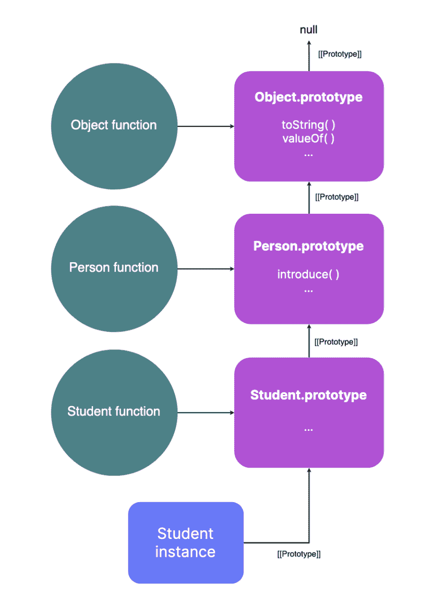

构造函数原型链

虽然上面的代码可以工作，但它容易出错，因为要正确设置两个构造函数之间的原型链接需要多个步骤。想象一下，如果有超过两个构造函数需要像这样链接起来，很容易忘记正确设置原型链接所必需的任何步骤。理想情况下，我们希望有一种更具声明性的方式来达到相同的效果。声明式的解决方案将使我们能够在不需要显式地在`Student.prototype`和`Person.prototype`对象之间创建链接的情况下，获得相同的结果。

### ES2015类

从2015年开始，JavaScript引入了类。它们提供了一种更具声明性的代码编写方式，减少了出错的可能性。类附带了`extends`[^1]关键字，它有助于在类之间创建父子关系。上面的代码示例可以使用类重写，如下所示：

```javascript
class Person {
  constructor(name, age) {
    this.name = name;
    this.age = age;
  }

  introduce() {
    console.log(`My name is ${this.name} and I am ${this.age} years old`);
  }
}

class Student extends Person {
  constructor(name, age, id) {
    // 将初始化"name"和"age"属性的
    // 责任委托给父类
    super(name, age);
    this.id = id;
  }
}
```

上面的代码与使用构造函数的代码给出了相同的结果。它也创建了相同的原型链接。我们可以通过以下比较来验证：

```javascript
console.log(Object.getPrototypeOf(mike) === Student.prototype);
// true
console.log(Object.getPrototypeOf(Student.prototype) === Person.prototype);
// true
console.log(Object.getPrototypeOf(Person.prototype) === Object.prototype);
// true
```

这里需要提及的重要一点是，类只是传统构造函数的语法糖。在底层，我们仍然在使用构造函数，但类允许我们以更声明性的方式编写代码。

`extends`关键字所做的另一件事是，除了设置`Student.prototype`和`Person.prototype`对象之间的链接外，它还链接了构造函数。它通过将`Person`类设置为`Student`类的原型来实现这一点。以下代码验证了`extends`关键字在幕后为我们设置的第二个原型链。

```javascript
console.log(Object.getPrototypeOf(Student) === Person);
// true
```

`extends`关键字设置的两个原型链服务于两个不同的目的：

- `Student.prototype ---> Person.prototype`允许实例属性的继承。
- `Student ---> Person`允许静态属性的继承。

### `this`关键字

`this`关键字是 JavaScript 语言中最令人困惑的概念之一。困惑的原因在于，在不同的上下文中，`this`关键字的值的设置方式各不相同。

在本模块中，我们将尝试揭开`this`关键字的神秘面纱。我们将理解设置`this`值的不同方式。`this`关键字可以在不同的上下文中使用：在函数内部、全局作用域、模块内部等。我们将探索不同的上下文，以及`this`在这些上下文中是如何设置的。

#### 函数上下文

`this`关键字主要用于函数内部，以引用调用该函数时所使用的对象。换句话说，当一个函数作为“方法”被调用（通过一个对象调用）时，`this`关键字就适用于引用调用该函数时使用的对象。

`this`关键字就像是一个传递给函数的隐式参数。就像显式函数参数一样，隐式参数`this`的值在函数被*调用*时设置。这是一个重要的一点。函数内部`this`的值取决于该函数被*如何调用*。

考虑以下代码示例：

```javascript
const student = {
  id: 123,
  name: "John Doe",
  email: "john@email.com",
  printInfo: function() {
    console.log(`${this.id} - ${this.name} - ${this.email}`);
  }
};

student.printInfo();
// 123 - John Doe - john@email.com
```

这是上述代码的 Replit 链接：

<ReplitEmbed src="https://replit.com/@newlineauthors/what-is-this-example1" />

在上面的代码示例中，`printInfo`函数使用了`this`关键字。观察代码，我们可以看出`printInfo`函数假设其内部的`this`值将是一个具有 id、name 和 email 三个属性的对象。但如前所述，函数内部`this`的值取决于该函数如何被调用。

在上面的代码示例中，`printInfo`函数是通过`student`对象调用的。当一个函数通过对象调用时，该函数内部的`this`指向调用该函数时使用的对象。因此，在我们的代码示例中，`printInfo`内部的`this`指向`student`对象。由于`student`对象拥有在`printInfo`函数内部通过`this`关键字访问的三个属性，因此它们的值被记录到控制台。

如果函数没有作为“方法”被调用，`this`会指向什么？考虑以下代码示例：

```javascript
function orderFood() {
  console.log("Order confirmed against the name: " + this.fullName);
}

orderFood();
// Order confirmed against the name: undefined
```

这是上述代码的 Replit 链接：

<ReplitEmbed src="https://replit.com/@newlineauthors/what-is-this-example2" />

在`orderFood`函数内部，`this`指向什么？

上述问题的答案取决于我们的代码是否在严格模式下执行。如果在非严格模式下，函数内部的`this`，当未作为方法调用时，指向全局对象，在浏览器环境中就是`window`对象。但是，在严格模式下，当函数未作为方法调用时，其内部的`this`值是`undefined`。

你能从上述代码的输出中猜出代码是在哪种模式下执行的吗？由于`this.fullName`的求值结果是`undefined`，所以代码是在非严格模式下执行的。

如果我们在严格模式下执行上面的代码：

```javascript
"use strict";

function orderFood() {
  console.log("Order confirmed against the name: " + this.fullName);
}

orderFood();
// Uncaught TypeError: this is undefined
```

这是上述代码的 Replit 链接：

----------------------------------------

<sup>92</sup> https://developer.mozilla.org/en-US/docs/Web/JavaScript/Reference/Strict_mode

一个错误？为什么？

回想一下在严格模式下，"函数"内部的`this`值是什么。它是`undefined`。所以`this.fullName`会抛出一个错误，因为我们无法在`undefined`值上访问任何属性。

### 全局上下文

在全局作用域中，`this`的值取决于执行 JavaScript 代码的环境。

JavaScript 代码可以在不同的环境中执行，例如浏览器、NodeJS等。在不同环境中，全局作用域中`this`的值是不同的。对于浏览器而言，全局作用域中`this`的值是`window`对象。

在 NodeJS 中，`this`的值取决于我们使用的是 ECMAScript 模块还是 CommonJS 模块。在 ECMAScript 模块中，模块顶层的`this`值是`undefined`。这是因为 ECMAScript 模块中的代码是以严格模式执行的。在 CommonJS 模块中，在模块顶层，`this`指向`module.exports`对象。

> 在 Node.js 中，JavaScript 代码从技术上讲并不是在全局作用域中执行的。相反，它是在模块作用域中执行的，常用的模块是 CommonJS 和 ECMAScript 模块。

在 Web Worker 中，顶层的`this`指向 Web Worker 自身的全局作用域，这与浏览器中包含`window`对象的全局作用域不同。Web Worker 内部的代码在其独立的上下文中执行，拥有自己的全局作用域。

### 构造函数上下文

当一个函数使用`new`关键字作为构造函数被调用时，构造函数内部的`this`关键字指向新创建的对象。`new`关键字创建一个新对象，并将新创建的对象设置为`this`的值。因此，我们可以在构造函数内部使用`this`向新创建的对象添加属性。

```javascript
function Recipe(name, ingredients) {
  this.name = name;
  this.ingredients = ingredients;
}
```

上面的函数，当作为构造函数调用时，将向新创建的对象添加两个属性：name和ingredients。

### 类上下文

JavaScript 中类内部的代码是以严格模式执行的。因此，方法内部`this`的值要么是`undefined`（如果未在对象上调用），要么是调用该方法的类实例本身。


```javascript
class Shape {
  constructor(color) {
    this.color = color;
  }

  printColor() {
    console.log(this.color);
  }
}

const circle = new Shape("Red");
const printColorFn = circle.printColor;
printColorFn();
// 错误：this 是 undefined
```

以下是上述代码的 Replit 示例：

<ReplitEmbed src="https://replit.com/@newlineauthors/what-is-this-example5"></ReplitEmbed>

上面的代码示例抛出了一个错误，因为我们以“函数”形式调用了`printColor`方法。如前所述，类内部的代码以严格模式执行，所以，就像严格模式下的函数一样，方法内部的`this`是`undefined`。

### DOM 事件处理程序上下文

我们已经知道，函数内部的`this`取决于函数的调用方式。但是，我们并不亲自调用的回调函数呢？我指的是像 DOM 事件处理程序这样的回调，我们并不调用它们，而是在点击事件触发时由 JavaScript 调用它们。在这种情况下，`this`的值是多少？

事件监听器回调被调用时，其`this`被设置为触发事件的 HTML 元素。

考虑以下代码示例：

```html
<button>Submit</button>

<script>
  const btn = document.querySelector("button");

  class FormHandler {
    constructor(submitBtn) {
      submitBtn.addEventListener("click", this.submitForm);
    }

    submitForm() {
      console.log("form submitted");
      console.log(this);
    }
  }

  new FormHandler(btn);
</script>
```

以下是上述代码的 Replit 示例：

<ReplitEmbed src="https://replit.com/@newlineauthors/what-is-this-example6"></ReplitEmbed>

在浏览器中运行上述代码，并在浏览器开发者工具中查看控制台。特别注意`submitForm`方法记录的`this`值。当这个方法作为事件监听器回调被调用时，其内部的`this`值是触发事件的按钮元素，而不是像我们通常预期的类实例。

如果我们不仔细在事件监听器回调函数中使用`this`，这可能会导致问题。想象一下，我们需要在`FormHandler`类中调用另一个方法的场景：

```html
<button>Submit</button>

<script>
  const btn = document.querySelector("button");

  class FormHandler {
    constructor(submitBtn) {
      submitBtn.addEventListener("click", this.submitForm);
    }

    submitForm() {
      this.sendRequest();
      // 错误：this.sendRequest 不是一个函数
    }

    sendRequest() {
      console.log("sending request...");
    }
  }

  new FormHandler(btn);
</script>
```

从`submitForm`方法内部调用`sendRequest`方法会抛出错误，因为正如讨论的，事件处理函数（本例中是`submitForm`）内部的`this`是触发事件的 HTML 元素。所以，与我们预期的不同，`this.sendRequest`会抛出错误。如果`submitForm`方法内部的`this`是`FormHandler`类的实例，它本可以正常工作。那么，我们如何从`submitForm`方法中调用`sendRequest`方法呢？有多种方法可以实现这一点，但我们将在本模块的后续课程中讨论它们。

在深入探讨箭头函数中`this`的工作原理之前，让我们先探索在常规函数中使用`this`关键字的问题。考虑以下代码示例：

```javascript
function Counter(startingValue) {
  this.value = startingValue;
}

Counter.prototype.incrementFactory = function (incrementStep) {
  return function () {
    this.value += incrementStep;
    console.log(this.value);
  };
};

const counter = new Counter(0);
const increment5 = counter.incrementFactory(5);
increment5(); // NaN
increment5(); // NaN
increment5(); // NaN
```

您可以在下面的 Replit 中运行上述代码：

<ReplitEmbed src="https://replit.com/@newlineauthors/arrow-functions-and-this-example1"></ReplitEmbed>

为什么我们得到 NaN 作为输出？意外输出的原因是`incrementFactory`函数返回的函数内部`this`的值不正确。

回想一下函数内部`this`的值是如何设置的。它取决于函数的调用方式。在上面的代码示例中，`increment5`函数是如何调用的？它是作为“方法”调用还是作为独立函数调用？它是作为“函数”调用的，所以`this`的值取决于我们的代码是否在严格模式下。假设我们的代码在非严格模式下，`increment5`函数内部的`this`值是全局对象，即浏览器中的`window`对象。所以，`this.value`实际上是`window.value`，而它是`undefined`，因为`window`对象默认没有`value`属性。结果，当`undefined`加上一个数字（即`incrementStep`参数的值）时，我们得到了 NaN 值。

我们如何解决这个问题？我们如何确保`increment5`函数内部的`this`值是我们想要的？有多种方法可以处理这个问题。一种方法是在返回函数之前，将`incrementFactory`函数中的`this`值保存到一个变量中，然后在返回的函数中，使用包含`this`值的变量，而不是直接使用`this`。以下代码示例展示了这种方法的实际应用：

```javascript
function Counter(startingValue) {
  this.value = startingValue;
}

Counter.prototype.incrementFactory = function (incrementStep) {
  const thisVal = this; // 保存 `this` 值
  return function () {
    // 使用 `thisVal` 变量代替 `this`
    thisVal.value += incrementStep;
    console.log(thisVal.value);
  };
};

const counter = new Counter(0);
const increment5 = counter.incrementFactory(5);
increment5(); // 5
```

你可以在下方的 Replit 中运行上面的代码：

<ReplitEmbed src="https://replit.com/@newlineauthors/arrow-functions-and-this-example2" />

上述方法通常用于解决这类问题：我们需要的是来自周围上下文的`this`值，而不是实际使用`this`的当前函数的`this`值。在上面的代码示例中，我们需要`incrementFactory`函数周围上下文的`this`值，而不是`increment5`函数内部的`this`值。

### 箭头函数来救援

解决上述问题的另一种方法是使用箭头函数。让我们将上面的代码示例改为使用箭头函数：

```javascript
function Counter(startingValue) {
  this.value = startingValue;
}

Counter.prototype.incrementFactory = function (incrementStep) {
  // 使用箭头函数
  return () => {
    this.value += incrementStep;
    console.log(this.value);
  };
};

const counter = new Counter(0);
const increment5 = counter.incrementFactory(5);
increment5(); // 5
increment5(); // 10
increment5(); // 15
```

你可以在下方的 Replit 中运行上面的代码：

<ReplitEmbed src="https://replit.com/@newlineauthors/arrow-functions-and-this-example3" />

使用箭头函数可以解决问题，因为与普通函数（在调用时会获得自己的`this`值）不同，箭头函数没有自己的`this`值；相反，箭头函数内部的`this`值取自周围的上下文。

周围的上下文是箭头函数被定义时的环境。在我们的代码示例中，箭头函数是在使用`counter`对象调用`incrementFactory`函数时创建的。因此，`incrementFactory`函数内部的`this`指的是`counter`对象，这就是从`incrementFactory`函数返回的箭头函数的周围上下文。结果就是，当箭头函数被调用时，其内部的`this`值也是`counter`对象，而这正是我们希望`increment5`函数内部的`this`所指向的，以便让我们的代码示例正常工作。

让我们回顾一下我们在上一课中讨论的例子：

```html
<button>Submit</button>

<script>
  const btn = document.querySelector("button");

  class FormHandler {
    constructor(submitBtn) {
      submitBtn.addEventListener("click", this.submitForm);
    }

    submitForm() {
      this.sendRequest();
      // 错误: this.sendRequest 不是一个函数
    }

    sendRequest() {
      console.log("sending request...");
    }
  }

  new FormHandler(btn);
</script>
```

在上面的代码示例中，点击提交按钮会抛出一个错误，因为`submitForm`方法内部的`this`值是按钮元素，而不是`FormHandler`类的实例。结果，`this.sendRequest()`调用会抛出错误，因为`this`需要引用`FormHandler`类的实例，才能允许我们在`submitForm`方法内部调用该类的其他方法。所以问题在于，我们如何从`submitForm`方法内部调用`sendRequest`方法？我们在上一课中说过，有不止一种方法可以解决这个问题。其中一种就是使用箭头函数。

为了修复这个问题，在`FormHandler`类的构造函数中，我们可以传递一个箭头函数而不是`this.submitForm`作为点击事件监听器的回调函数。在箭头函数内部，我们可以调用`submitForm`方法来处理点击事件。

```javascript
class FormHandler {
  constructor(submitBtn) {
    submitBtn.addEventListener("click", () => this.submitForm());
  }

  // 方法...
}
```

为什么传递一个箭头函数作为回调函数就能修复这个问题？我们仍然在箭头函数内部调用`submitForm`方法，那么这与直接传递`this.submitForm`作为回调函数有什么不同呢？

箭头函数修复了这个问题的原因在于，如前所述，箭头函数没有自己的`this`值；它们从周围的环境中获取`this`值。在这个案例中，周围的环境就是构造函数。那么，构造函数内部的`this`值是什么呢？当使用`new`关键字调用构造函数时，它的值是一个`FormHandler`类的实例。因此，在这个事件处理回调函数中，`this`不再像前一个示例中那样指向一个 HTML 元素，而是箭头函数内部的`this`值与构造函数中的相同，即`FormHandler`类的一个实例。所以，当我们在箭头函数内部调用`submitForm`方法时，`submitForm`方法内部的`this`值也是`FormHandler`类的一个实例。因此，我们可以从`submitForm`方法内部调用任何其他方法。

在那个抛出错误的旧版本代码中，事件处理器是`this.submitForm`方法。它不是被我们的代码显式调用的。相反，每当点击提交按钮时，它都会被 JavaScript 调用。我们知道，函数内部的`this`值取决于函数的调用方式。在这种情况下，由于我们没有显式调用该函数，我们无法控制`submitForm`方法内部的`this`值。使用箭头函数允许我们显式地调用`submitForm`方法，因此允许我们控制其内部的`this`值。

箭头函数非常有用，是 JavaScript 语言的一个受欢迎的补充。它们解决的问题也可以用其他方式解决，但其他解决方案比箭头函数更冗长。

到目前为止，我们已经讨论了`this`的值要么取决于执行 JavaScript 代码的环境，要么在函数的情况下取决于函数的调用方式。我们还讨论了箭头函数没有自己的`this`值；相反，它们从周围的上下文中获取`this`值。

我们目前看到的所有设置`this`值的方法都是自动设置其值。JavaScript 还为我们提供了显式地将`this`设置为任意值的方法。

我们可以使用以下三个内置方法中的任何一个来显式地设置`this`的值：

- [Function.prototype.call()](https://developer.mozilla.org/en-US/docs/Web/JavaScript/Reference/Global_Objects/Function/call)
- [Function.prototype.apply()](https://developer.mozilla.org/en-US/docs/Web/JavaScript/Reference/Global_Objects/Function/apply)
- [Function.prototype.bind()](https://developer.mozilla.org/en-US/docs/Web/JavaScript/Reference/Global_Objects/Function/bind)

我们不会详细讨论这些方法的工作原理；你可以通过上面给出的链接来了解每个方法的工作方式。然而，我们将看到显式设置`this`会如何发挥作用。

让我们回顾一下上一课中关于箭头函数的代码示例：

```javascript
function Counter(startingValue) {
  this.value = startingValue;
}

Counter.prototype.incrementFactory = function (incrementStep) {
  return function () {
    this.value += incrementStep;
    console.log(this.value);
  };
};

const counter = new Counter(0);
const increment5 = counter.incrementFactory(5);
increment5(); // NaN
increment5(); // NaN
increment5(); // NaN
```

你可以在下方的 Replit 中运行上面的代码：

<ReplitEmbed src="https://replit.com/@newlineauthors/binding-this-example1" />

在上一课中，我们看到了如何使用箭头函数修复上面的代码示例。我们也可以通过显式地将`this`的值设置为期望的值来修复这段代码，即用于调用`incrementFactory`函数的`counter`对象。我们可以使用`bind`方法来设置`this`的值，而不是使用箭头函数。


```javascript
function Counter(startingValue) {
  this.value = startingValue;
}

Counter.prototype.incrementFactory = function (incrementStep) {
  const incrementFn = function () {
    this.value += incrementStep;
    console.log(this.value);
  };

  // 返回一个函数，其`this`被绑定到
  // 调用`incrementFactory`方法的对象
  return incrementFn.bind(this);
};

const counter = new Counter(0);
const increment5 = counter.incrementFactory(5);
increment5(); // 5
increment5(); // 10
increment5(); // 15
```

你可以在下方的 Replit 中运行上面的代码：

<ReplitEmbed src="https://replit.com/@newlineauthors/binding-this-example2" />

### 借用方法

想象有一个对象包含一些方法，这些方法可能对其他对象也有用。我们如何将这些方法用于其他对象呢？一种选择是为每个需要这些方法的对象复制方法的定义。但我们不想重复定义。有没有办法避免重复并重用现有方法呢？

```javascript
const john = {
  name: "John",
  sayHello() {
    console.log("Hello, I am " + this.name);
  }
};

const sarah = {
  name: "Sarah"
};
```

我们可以在函数内部显式设置 `this` 的值，并通过上述三种方法中的任何一种与其他对象一起使用。这使我们能够避免重复并重用代码。

此时，你可能会问：难道我们不能创建一个构造函数，允许我们创建对象并在构造函数原型属性中添加通用方法吗？你说得对。创建一个构造函数是处理我们想要创建相似对象的情况的正确方式。然而，显式设置 `this` 的值允许我们在不相关的对象之间重用代码。这是一个不错的选项，可以在适当的时候使用。

### 链式构造函数调用

在 JavaScript 引入类之前，从另一个构造函数继承的传统方法是显式设置原型链，并重用被继承的构造函数来为新创建的对象添加通用属性。下面的代码示例展示了我们如何将责任委托给现有构造函数，为新创建的对象添加一些属性：

```javascript
function Employee(name, age, id) {
  this.name = name;
  this.age = age;
  this.id = id;
}

function BankEmployee(name, age, id, bankName) {
  // delegate the responsibility of adding
  // "name", "age", and "id" properties to
  // the Person constructor
  Employee.call(this, name, age, id);
  this.bankName = bankName;
}
```

在上面的代码示例中，`call` 方法被用来调用 `Employee` 构造函数，并传入 `Employee` 构造函数可以设置在新创建对象上的三个属性。但是，我们如何告诉 `Employee` 构造函数将这些属性添加到新创建的 `BankEmployee` 对象上呢？这就是传递给 `call` 方法的第一个参数的作用。我们将 `this` 作为第一个参数传递。回想一下函数内部 `this` 的值是如何设置的：它取决于函数的调用方式。在这种情况下，我们期望 `BankEmployee` 函数使用 `new` 关键字作为构造函数来调用。因此，`BankEmployee` 函数内部的 `this` 将是新创建的对象。这个新创建的对象被显式设置为 `Employee` 构造函数内部 `this` 的值。

换句话说，`Employee` 构造函数从 `BankEmployee` 构造函数内部被调用，其中 `this` 被显式设置为新创建的 `BankEmployee` 对象。因此，在 `Employee` 构造函数内部添加到 `this` 的属性实际上会将这些属性添加到新创建的 `BankEmployee` 对象上。这就是我们如何使用现有的构造函数并减少代码重复的方法。

### 重温“this”问题

让我们重温一下我们在第一课中讨论的例子。

```html
<button>Submit</button>

<script>
  const btn = document.querySelector("button");

  class FormHandler {
    constructor(submitBtn) {
      submitBtn.addEventListener("click", this.submitForm);
    }

    submitForm() {
      this.sendRequest();
      // ERROR: this.sendRequest is not a function
    }

    sendRequest() {
      console.log("sending request...");
    }
  }

  new FormHandler(btn);
</script>
```

我们试图解决的问题是，我们想从事件处理回调中调用同一类的其他方法，但尝试这样做会抛出错误，因为事件处理程序内部的 `this` 是触发 DOM 事件的 HTML 元素。在上一课中，我们看到了箭头函数如何解决这个问题。还有另一种方法可以解决这个问题，那就是在 `submitForm` 方法内部显式设置 `this` 的值。

```javascript
class FormHandler {
  constructor(submitBtn) {
    submitBtn.addEventListener("click", this.submitForm.bind(this));
  }

  // methods...
}
```

使用 `bind` 方法在 `submitForm` 方法内部显式设置 `this` 的值可以解决问题，因为它覆盖了事件回调函数内部 `this` 的默认值。我们已将其显式设置为 `FormHandler` 类构造函数内部 `this` 的值，即 `FormHandler` 类的一个实例。

将 `this.submitForm` 与 `this.submitForm.bind(this)` 传递给 `addEventListener` 方法的区别在于，使用 `this.submitForm` 时，`submitForm` 方法内部 `this` 的值取决于 `submitForm` 方法的调用方式。在这种情况下，我们知道其内部的 `this` 值将是 HTML 按钮元素，这不是我们想要的。另一方面，传递 `this.submitForm.bind(this)` 解决了这个问题，因为与之前不同，`submitForm` 方法内部的 `this` 的值被显式绑定为 `FormHandler` 类的一个实例。

`globalThis` 是 JavaScript 中一个全局可用的属性，它允许我们访问全局对象，而不管我们的 JavaScript 代码在哪个环境中执行。它为我们提供了一种跨不同 JavaScript 环境访问全局对象的标准方式。

众所周知，JavaScript 可以在不同的环境中执行，例如浏览器、Node.js 运行时等。这些环境中的每一个都有一个不同的全局对象可供执行其中的 JavaScript 代码使用。在 `globalThis` 之前，没有标准的跨环境访问全局对象的方式。这使得我们的代码可移植性较差。

`globalThis` 属性使得访问全局对象成为可能，而无需担心环境。如果我们知道我们的代码可以在不同的环境中执行，那么使用 `globalThis` 来访问全局对象是现代 JavaScript 代码中的正确方式。

想象一个场景，你想检查全局对象是否包含某个属性，而不管你的代码是在浏览器还是 Node.js 环境中执行。没有标准的方式来访问全局对象，你可能会编写以下代码：

```javascript
if (typeof window !== "undefined" && window.secretProperty) {
  // execute code for browser
} else if (typeof global !== "undefined" && global.secretProperty) {
  // execute code for nodejs
}
```

使用 `globalThis`，我们可以简化上述代码，如下所示：

```javascript
if (globalThis.secretProperty) {
  // execute code
}
```

尽管此属性在现代浏览器中得到很好支持，但旧版本的浏览器并不支持它。因此，在使用此属性时，可能需要考虑浏览器的支持情况。

### “this” vs globalThis

`globalThis` 不应与 `this` 关键字混淆。我们在这个模块中讨论了 `this` 的值如何根据不同的执行上下文而变化，但 `globalThis` 只是在不同 JavaScript 环境中访问全局对象的标准方式。它的值仅根据代码执行的环境而变化。它不受函数调用方式或代码是否在严格模式下的影响。

在 ECMAScript 模块中，代码以严格模式执行。因此，模块作用域中 `this` 的值是 `undefined`，但 `globalThis` 的值是执行环境的全局对象；在 Node.js 中，它是 `global` 对象，在浏览器中，它是 `window` 对象。

本模块全部关于 `this` 关键字；我们讨论了其值在不同上下文中设置的不同方式；我们还讨论了由于 `this` 的意外值可能产生的问题，并探讨了解决此类问题的不同选项。

由于 `this` 在不同的上下文中可以有不同的值，让我们总结一下 `this` 在不同上下文中的值：

- 对于箭头函数，`this` 的值取自周围的上下文。
- 对于普通函数，`this` 的值取决于函数的调用方式以及代码是否在严格模式下执行。
  - 如果使用 `new` 关键字作为构造函数调用函数，则 `this` 的值是新创建的对象。
  - 如果使用 `bind`、`call` 或 `apply` 函数显式设置 `this` 的值，则 `this` 的值是作为第一个参数传递给这些函数的任何值。
- 如果一个函数是作为“方法”被调用的，那么 `this` 的值就是调用该方法的对象。
- 如果函数在没有对象的情况下被调用，即作为“函数”调用，那么在非严格模式下 `this` 的值是全局对象，在严格模式下则是 `undefined`。
- 在 DOM 事件处理回调中，`this` 的值是触发事件的 HTML 元素。
- 在浏览器的全局作用域中，`this` 指向全局的 `window` 对象。
- 在 NodeJS 中，顶层代码在模块作用域中执行。在 ECMAScript 模块中，由于其代码隐式地在严格模式下执行，模块顶层的 `this` 是 `undefined`。在 CommonJS 模块中，顶层的 `this` 指向 `module.exports` 对象。

> ⁹⁷ https://caniuse.com/?search=globalThis

希望这个模块能让你更好地理解 `this` 关键字，并帮助你理解它的值在不同上下文中是如何设置的。本模块还旨在帮助你理解一个意外的 `this` 值可能在我们的代码中引起的问题，以及我们有哪些不同的选项来解决这些问题。

### Symbol

`Symbol` 是一种原始值，可以通过名为 `Symbol` 的函数创建。这种原始值的有趣之处在于它保证是唯一的。这种唯一性的保证是符号的卖点。

随着 ES2015 中符号的引入，JavaScript 中发生了两件事：

- 语言中引入了一种新的值类型。
- 此前只允许将字符串作为对象的属性键添加到对象中。现在，符号也可以作为键了。

在我们讨论如何在代码中使用符号之前，让我们先理解将符号添加到 JavaScript 语言背后的动机。

符号最初旨在作为向对象添加私有属性的机制，并被计划称为“私有名称对象”。但后来，它们的名称更改为符号，并被制作为原始值。

结果证明，每个符号都是一个唯一的值非常有用，因为它允许 JavaScript 语言扩展并保持向后兼容性。符号允许 JavaScript 向对象添加新的属性，这些属性不会与其他人在其代码中可能已使用的现有属性冲突。

TC39 的主要目标之一是保持 JavaScript 的向后兼容性。考虑到这一目标，添加到语言中的任何新特性都不得破坏现有代码。符号有助于兑现向后兼容的承诺。

JavaScript 语言中的一些特性需要在对象上查找属性。对于这些特性，可能选择了什么属性键呢？选择任何字符串属性名都是不可能的，因为有人可能已经在他们的代码中使用了该属性，而将该属性用于新特性可能会破坏他们的代码。

例如，对于将对象转换为原始值，类型转换算法会在对象上查找一个名为 [`Symbol.toPrimitive`](https://developer.mozilla.org/en-US/docs/Web/JavaScript/Reference/Global_Objects/Symbol/toPrimitive) 的特殊属性。如果存在这样的属性且其值是一个函数，则其返回值被用作对象的原始表示。否则，将使用在之前关于强制转换的模块中解释过的默认机制，即以不同顺序调用 `toString` 和 `valueOf` 方法。

思考一下，这样一个特性如何才能通过字符串属性添加到语言中呢？选择什么名称才能保证不会破坏现有代码呢？

这就是符号大放异彩的地方。使用符号作为属性，可以通过向对象添加唯一的属性来实现这样的特性，而这些属性不可能破坏现有代码，因为：

- 符号在 ES2015 之前不存在，并且
- 每个符号都是一个唯一的值。

符号值可以使用 `Symbol` 函数创建。需要注意的是，`Symbol` 函数必须在没有 `new` 关键字的情况下调用。尝试使用 `new` 关键字调用 `Symbol` 函数将导致错误。这是因为这会阻止围绕符号创建对象包装器。每次调用 `Symbol` 函数都必须创建一个新的唯一符号值。

```javascript
const sym = Symbol();
```

一旦创建了符号，就可以使用方括号表示法将其作为属性添加到现有对象中：

```javascript
const sym = Symbol();

const obj = {};
obj[sym] = "hello";

console.log(obj[sym]); // hello
```

你可以在下面的 Replit 中运行上述代码：

<ReplitEmbed src="https://replit.com/@newlineauthors/creating-symbols-example2" />

或者，也可以使用计算属性表示法将符号作为属性添加到对象：

```javascript
const sym = Symbol();

const obj = {
  [sym]: "hello"
};

console.log(obj[sym]); // hello
```

你可以在下面的 Replit 中运行上述代码：

<ReplitEmbed src="https://replit.com/@newlineauthors/creating-symbols-example3" />

#### Symbol 与隐私

对象上的常规 `string` 属性可以通过多种方式访问。例如，考虑以下代码示例：

```javascript
const name = "name";

const person = {
  [name]: "John Doe"
};

console.log(person.name); // John Doe
console.log(person["name"]); // John Doe
console.log(person[name]); // John Doe
```

你可以在下面的 Replit 中运行上述代码：

<ReplitEmbed src="https://replit.com/@newlineauthors/creating-symbols-example4" />

在此示例中，属性键 `"name"` 是通过计算属性名添加到 `person` 对象的。如上面的代码示例所示，此属性可以通过多种方式访问。但是，如果 `name` 变量的值从字符串更改为符号会发生什么？

```javascript
const name = Symbol();

const person = {
  [name]: "John Doe"
};

console.log(person.name); // undefined
console.log(person["name"]); // undefined
console.log(person[name]); // John Doe
```

你可以在下面的 Replit 中运行上述代码：

<ReplitEmbed src="https://replit.com/@newlineauthors/creating-symbols-example5" />

会注意到 `person.name` 和 `person["name"]` 输出 `undefined`，但最后的 `console.log` 语句按预期输出了名字。那么，前两个语句和最后一个语句有什么区别呢？前两个语句输出 `undefined`，因为符号属性在获得对原始符号的访问之前是无法访问的。上面的代码示例中只有最后一个 `console.log` 语句使用了原始符号，这就是为什么它输出了名字而不是 `undefined`。


那么，如果原始符号不可访问，这是否使符号属性成为私有属性呢？如果对象的属性被迭代会发生什么？让我们找出对象的符号属性是否可以被获取。

```javascript
const name = Symbol();

const person = {
  [name]: "John Doe",
  age: 20
};

// 只能看到 "age" 属性
for (const prop in person) {
  console.log(prop);
}

console.log(Object.keys(person)); // ["age"]

console.log(Object.getOwnPropertyNames(person)); // ["age"]
```

你可以在下面的 Replit 中运行上述代码：

<ReplitEmbed src="https://replit.com/@newlineauthors/creating-symbols-example6" />

查看上述代码示例的输出，可能会认为符号属性确实是私有的。然而，这个假设是不正确的。符号属性不是私有的，正如下一个代码示例所演示的。

```javascript
const name = Symbol();

const person = {
  [name]: "John Doe",
  age: 20
};

console.log(Object.getOwnPropertyDescriptors(person));

console.log(Object.getOwnPropertySymbols(person));
```

你可以在下面的 Replit 中运行上述代码：

<ReplitEmbed src="https://replit.com/@newlineauthors/creating-symbols-example7" />

上述代码示例表明，可以使用`Object.getOwnPropertyDescriptors`或`Object.getOwnPropertySymbols`等方法发现符号属性。虽然与字符串属性相比，符号属性的访问可能稍微不方便一些，但它们不是私有的。JavaScript 有真正的私有属性，而符号并非旨在用作私有属性。

### Symbol.toPrimitive

如本模块之前课程所述，`Symbol.toPrimitive`代表一个符号属性，该属性用于 JavaScript 中对象到原始值的转换过程。它的值是一个函数，该函数接收一个*提示*或表示要转换对象的原始值的*首选类型*。返回值用作该对象的原始值。

以下代码示例钩入了`movie`对象到原始值的转换过程，并根据`hint`参数的值返回该对象的不同表示形式。

```javascript
const movie = {
  name: "Jurassic Park",
  releaseDate: "09,June,1993",
  [Symbol.toPrimitive](hint) {
    if (hint === "number") {
      return new Date(this.releaseDate).getTime();
    } else {
      return this.name;
    }
  }
};

console.log(Number(movie));
console.log(String(movie));
```

你可以在以下 Replit 中查看上述代码示例的输出：

<ReplitEmbed src="https://replit.com/@newlineauthors/well-known-symbols-example1" />

### Symbol.toStringTag

`Object.prototype.toString`方法的默认实现对于用户自定义对象来说并不十分有用。

```javascript
console.log({}.toString()); // [object Object]
```

对于某些内置对象，`toString`方法的默认实现也不实用。因此，许多对象会覆盖默认的`toString`实现。

```javascript
const arr = [1, 2, 3];
// 覆盖的实现
console.log(arr.toString()); // "1,2,3"

// 来自 Object.prototype 的默认实现
console.log(Object.prototype.toString.call(arr)); // [object Array]
```

你可以在以下 Replit 中查看上述代码示例的输出：

<ReplitEmbed src="https://replit.com/@newlineauthors/well-known-symbols-example3" />

请注意默认`toString`实现输出中的“Array”部分。它被称为标签。对于某些内置对象，标签就是值的类型，例如，在数组的情况下是“Array”，在字符串的情况下是“String”。

对于用户自定义对象，默认的`toString`输出如上所示是`[object Object]`，其中的标签是“Object”——这不太有用。

著名的符号`Symbol.toStringTag`允许我们更改标签的值。

```javascript
const task = {
  title: "exercise",
  isComplete: false,
  [Symbol.toStringTag]: "Task"
};

console.log(task.toString()); // [object Task]
```

你可以在以下 Replit 中查看上述代码示例的输出：

<ReplitEmbed src="https://replit.com/@newlineauthors/well-known-symbols-example4" />

### Symbol.isConcatSpreadable

数组的`concat`方法会查找`Symbol.isConcatSpreadable`属性，以确定传递给`concat`方法的数组或类数组对象的元素是否应该被展开或扁平化。

```javascript
const arr = [1, 2, 3];
console.log([].concat(arr));
// [1, 2, 3]

arr[Symbol.isConcatSpreadable] = false;
console.log([].concat(arr));
// [[1, 2, 3]]
```

你可以在以下 Replit 中查看上述代码示例的输出：

<ReplitEmbed src="https://replit.com/@newlineauthors/well-known-symbols-example5" />

如上述代码示例的输出所示，数组的默认行为是展开其元素。可以通过将`Symbol.isConcatSpreadable`设置为`false`来覆盖此默认行为。

对于类数组对象¹⁰²，默认行为是不展开其属性。可以通过将`Symbol.isConcatSpreadable`设置为`true`来覆盖此行为。

```javascript
const obj = {
  0: 123,
  1: 456,
  length: 2,
  [Symbol.isConcatSpreadable]: true
};

console.log([].concat(obj));
// [123, 456]
```

你可以在以下 Replit 中查看上述代码示例的输出：

<ReplitEmbed src="https://replit.com/@newlineauthors/well-known-symbols-example6" />

还有其他著名的符号允许我们钩入 JavaScript 中不同的内置操作。完整列表可在 ECMAScript 规范¹⁰³ 或 MDN - Symbol¹⁰⁴ 中查看。

> ¹⁰³ https://tc39.es/ecma262/#sec-well-known-symbols
>
> ¹⁰⁴ https://developer.mozilla.org/en-US/docs/Web/JavaScript/Reference/Global_Objects/Symbol

### 异步 JavaScript

在本模块中，我们将介绍 JavaScript 中的异步编程。我们将学习异步编程的含义以及 JavaScript 中传统上是如何实现它的。我们还将讨论在 JavaScript 中处理异步代码的传统方式存在的问题，以及 ES2015 中引入的 promise 如何改变了我们处理 JavaScript 异步代码的方式。我们将详细讨论 promise，并学习简化 promise 使用的`async-await`语法。

### 什么是异步？

在编程上下文中，“异步”意味着程序启动一个可能长时间运行的任务，并在该长时间运行的任务在后台执行时，可以自由地执行其他任务。这里需要理解的关键点是，程序不必等待长时间运行的任务完成；它可以自由地执行其他任务。一旦任务完成，程序会收到通知并获得任务的结果。

需要异步编程是因为传统同步编程存在问题。在同步程序中，每条指令按顺序依次执行。指令按照它们在程序中出现的顺序执行。因此，同步程序更容易理解，但它们也带来了由异步编程解决的问题。

同步程序的问题在于，一个可能长时间运行的任务会阻塞程序的执行，直到它完成。这会导致程序性能差、用户体验不佳以及资源利用效率低下等问题。

尽管异步程序解决了同步程序带来的问题，但异步程序也有其自身的挑战，例如错误处理、管理共享状态和资源、管理程序不同部分之间的协调等。

### 异步 JavaScript

在我们深入探讨如何在 JavaScript 中编写异步代码以及它如何在幕后处理之前，让我们退一步，看看在 JavaScript 中执行一些长时间运行的代码（如以下示例中的循环）时会遇到什么问题：

**JavaScript 异步编程**

```javascript
function block() {
  const start = new Date();

  while (new Date() - start < 3000) {
    // 模拟一个耗时约3秒的长时运行操作
  }
}
```

```javascript
console.log("Before long running operation");
// 会立即被记录
```

```javascript
block();
```

```javascript
console.log("After long running operation");
// 大约3秒后才会被记录
```

你可以在下面的 Replit 中查看上述代码：

```html
<ReplitEmbed src="https://replit.com/@newlineauthors/overview-example1">
```

JavaScript 是一种单线程语言，这既有利有弊。JavaScript 开发者通常无需担心多线程程序带来的问题，比如竞态条件[105]和死锁[106]。然而，单线程的局限性在上面的代码示例中显而易见。

上述代码示例旨在模拟一段耗时约3秒的长时运行代码。在这3秒内，执行我们 JavaScript 代码的主线程被阻塞；在这3秒内，其他任何事情都不会执行。如果这段 JavaScript 代码附加到 HTML 文件并在浏览器中执行，界面将冻结，直到循环结束。

要看到冻结界面的实际效果，尝试将上述 JavaScript 代码添加到名为`index.js`的文件中，并将其附加到一个包含以下 HTML 的 HTML 文件：

```html
<h1>hello world</h1>
<button onclick="alert('hello')">Click</button>
```

你可以在下面的 Replit 中查看上述代码：

```html
<ReplitEmbed src="https://replit.com/@newlineauthors/overview-example2">
```

在页面初次加载时，你会注意到按钮在几秒钟内不可点击。界面将保持冻结状态，直到 JavaScript 代码执行完毕，具体来说是那个长时运行的循环。

这在 Web 应用中会造成糟糕的用户体验。单线程对我们能在主线程上用 JavaScript 做什么设置了硬性限制。

105 https://stackoverflow.com/questions/34510/what-is-a-race-condition

106 https://stackoverflow.com/questions/34512/what-is-a-deadlock

如今，JavaScript 引擎已经足够强大，能够以非常好的速度执行代码；引擎被设计为对 JavaScript 代码进行深度优化，以尽可能高效地执行。尽管如此，仍需注意，主线程不应被任何可能耗时足够长、导致延迟变得明显的代码所阻塞。

> :::info
>
> JavaScript 也允许我们使用 [Web Workers](https://developer.mozilla.org/en-US/docs/Web/API/Web_Workers_API) 在另一个独立于主线程的线程中执行一些代码。
>
> :::

接下来，让我们讨论使用回调函数在 JavaScript 中编写异步代码的传统方式。我们还将讨论使用回调函数所带来的问题。

使用回调函数处理异步代码一直是 JavaScript 中编写异步代码的传统方式。回调函数是一个作为参数传递给另一个函数的函数，旨在某个异步操作完成后被调用。接收回调函数作为参数的函数，通常会用异步操作的结果或异步操作失败时的错误来调用回调函数。

像 HTTP 请求这样的操作是异步的，但它们并非由 JavaScript 处理。我们编写的代码只是发起异步操作；对于客户端 JavaScript，实际的异步操作由浏览器处理，而在 NodeJS 运行时环境中，则由后台线程或操作系统本身处理。

简单来说，异步操作在后台（JavaScript 世界之外）发生，与此同时，其他事情可以在主线程上（JavaScript 世界内）执行。

当异步操作完成时，我们的 JavaScript 代码会收到通知，从而执行我们在发起异步操作时提供的回调函数。

这就是 JavaScript 绕过其单线程限制的方式。异步操作实际上由运行时（浏览器、NodeJS 等）处理。与此同时，JavaScript 可以做其他事情。

以下代码示例展示了一个回调函数的用法，它通过向一个假的 REST API 发送 HTTP 请求来演示：

```javascript
function fetchUser(url) {
  const xhr = new XMLHttpRequest();

  xhr.addEventListener("load", function () {
    // 检查操作是否完成
    if (xhr.readyState === 4) {
      if (xhr.status === 200) {
        // 请求成功
        const data = JSON.parse(xhr.responseText);
        console.log(data);
      } else {
        // 请求失败
        const error = new Error("Failed to fetch todo");
        console.log(error);
      }
    }
  });

  xhr.open("GET", url);
  xhr.send();
}

fetchUser("https://jsonplaceholder.typicode.com/todos/1");
```

你可以在下面的 Replit 中运行上述代码：

```html
<ReplitEmbed src="https://replit.com/@newlineauthors/callbacks-example1" />
```

一个传递给`addEventListener`方法的回调函数处理 HTTP 请求的结果。不同的 DOM 事件，例如点击事件，也是使用回调函数异步处理的。回调函数被注册为事件处理器，并在事件触发时被调用。

```javascript
const submitBtn = document.getElementById("submit");

submitBtn.addEventListener("click", function (event) {
  // 处理点击事件的代码
});
```

同样，不同的定时器函数，如`setTimeout`，也提供一个回调函数，该函数旨在指定的时间间隔过后被调用。

```javascript
setTimeout(function () {
  console.log("logged after 2 seconds");
}, 2000);
```

你可以在下面的 Replit 中运行上述代码：

```html
<ReplitEmbed src="https://replit.com/@newlineauthors/callbacks-example3" />
```

一个常见的误解是，传递给`setTimeout`的回调函数恰好在指定的时间过去后被调用。我们调用`setTimeout`时指定的时间是提供的回调函数将被调用的*最小*时间间隔。

在上面提供的代码示例中，我们指定了 2 秒（2000 毫秒）作为回调应被调用的时间。但回调不会恰好在 2 秒后被调用。想象一个场景，我们同时还有一个大约需要 4 秒才能运行完毕的长时循环。正如我们在上一课中讨论的，JavaScript 是单线程的，因此一个长时循环会阻塞主线程，这意味着传递给`setTimeout`的回调函数在循环结束前无法执行。以下代码示例演示了这种情况：


```javascript
setTimeout(function () {
  console.log("logged after approximately 4 seconds instead of 2");
}, 2000);

const start = new Date();

// 大约需要4秒来执行
while (new Date() - start < 4000) {}
```

你可以在下面的 Replit 中运行上述代码：

```html
<ReplitEmbed src="https://replit.com/@newlineauthors/callbacks-example4" />
```

上面的代码示例表明，`setTimeout` 回调或传递给`setInterval`函数的回调可能不会在指定时间过去后被调用；其他一些代码可能会阻止它们在指定时间后被调用。

JavaScript 是单线程的；同一时间在主线程上只能执行一件事。目前，正在执行的代码不能被中断以执行其他代码，比如上面代码示例中`setTimeout`的回调函数。

回调函数是 JavaScript 异步代码的核心。使用回调可以工作，但它们也带来了一些问题。

### 回调的问题

使用传统的回调方式来处理异步代码带来了多个问题，使得有效使用回调变得困难。

#### 回调地狱

想象一个场景，多个异步操作需要按顺序启动，因为每个操作都依赖于前一个操作的结果。为了处理这种情况，我们必须嵌套回调，根据异步操作的数量，这可能导致代码难以阅读和维护。以下代码示例展示了这种情况：

```javascript
asyncOperation1((result1) => {
  asyncOperation2(result1, (result2) => {
    asyncOperation3(result2, (result3) => {
      asyncOperation4(result3, (result4) => {
        // ...更多嵌套的回调和操作
      });
    });
  });
});
```

这就是所谓的**回调地狱**或**厄运金字塔**，因为每一层的嵌套都创建了一个看起来像金字塔的结构。

看着上面的代码示例，不难想象，随着更多操作被添加到异步操作序列中，它将变得更难阅读。不仅难以阅读，而且难以维护和重构。请注意，上面的代码示例不包含任何错误处理；将错误处理添加到上面的代码中，你会得到如下结果：

```javascript
asyncOperation1((error1, result1) => {
  if (error1) {
    // 处理错误
  } else {
    asyncOperation2(result1, (error2, result2) => {
      if (error2) {
        // 处理错误
      } else {
        asyncOperation3(result2, (error3, result3) => {
          if (error3) {
            // 处理错误
          } else {
            asyncOperation4(result3, (error4, result4) => {
              if (error4) {
                // 处理错误
              } else {
                // ...更多嵌套的异步操作和回调
              }
            });
          }
        });
      }
    });
  }
});
```

上面的代码确实名副其实：“回调地狱”。没有人愿意处理这样的代码。它难以理清逻辑。我们将在本模块的后续课程中，了解如何使用 Promise 和`async-await`语法重写相同的代码，使其更具可读性和可维护性。

### 错误处理

如上所示，使用回调编写错误处理代码并非愉快的体验。在上面的代码中，我们需要在每个回调中处理错误，这可能导致错误处理逻辑的重复。没有一个集中的地方可以捕获和处理所有异步操作的错误。

在本课中，我们讨论了如何在 JavaScript 中使用回调来编写异步代码。尽管存在像 Promise 和`async-await`这样的更好替代方案，它们解决了上面讨论的回调问题，但回调仍然被广泛使用。虽然 Promise 解决了回调的问题，但它们仍然使用回调，只是以一种更易于管理的方式，帮助我们避免回调地狱。

正如我们所知，JavaScript 语言是单线程的。主线程上长时间运行的代码会阻塞该线程；对于浏览器来说，阻塞主线程意味着浏览器无法响应用户交互，也无法渲染 UI 上的更改。这就是为什么当某些长时间运行的代码阻塞主线程时，屏幕会冻结。对于 NodeJs 来说，在应用服务器的上下文中，阻塞主线程意味着服务器无法处理传入的 HTTP 请求，直到主线程解除阻塞。

为了绕过 JavaScript 代码执行的单线程限制，正如前一课所讨论的，任何异步操作都在后台处理，与此同时，主线程可以做其他事情。

像 HTTP 请求这样的异步操作由浏览器在后台处理，当 HTTP 请求完成时，我们的 JavaScript 代码使用启动 HTTP 请求时提供的回调来执行。其他异步操作也是如此，比如 NodeJS 中的文件处理。NodeJs 中的每个异步操作要么由 NodeJS 的内部线程池处理，要么由操作系统本身处理。

如果我们把主线程看作“JavaScript 世界”，那么异步操作实际上发生在 JavaScript 世界之外。一旦操作完成，为了返回 JavaScript 世界，会使用回调，这些回调被调用以响应操作的成功完成或失败来执行 JavaScript 代码。

所以，简而言之，我们在主线程上执行的代码只是启动了异步操作。主线程不会等待操作完成，而是空闲下来做其他事情。异步操作由执行我们 JavaScript 代码的环境在后台处理。它可以是浏览器或像 NodeJS 这样的运行时。但是，执行是如何从后台返回到执行我们代码的主线程的呢？这就是**事件循环**的用武之地。

### 什么是事件循环？

JavaScript 中的事件循环是那些被抽象解释的概念之一，目的是让其他人更容易理解。本课旨在对事件循环建立扎实的理解。

事件循环有助于以非阻塞的方式执行异步操作。当后台的异步操作完成时，为了执行我们在启动异步操作时提供的 JavaScript 回调，它需要被推送到调用栈。

调用栈是一个栈数据结构，用于跟踪当前正在执行的代码。每个函数调用都作为一个栈帧添加到栈中。当函数执行结束时，该帧从栈中弹出。

让我们通过以下代码示例来理解事件循环：

```javascript
setTimeout(() => {
  console.log("hello world");
}, 2000);

console.log("after setTimeout");

// output:
// ------
// after setTimeout
// hello world
```

你可以在下面的 Replit 中运行上面的代码：

```html
<ReplitEmbed src="https://replit.com/@newlineauthors/event-loop-example1" />
```

上面的代码在`setTimeout`回调内的“hello world”之前输出了“after setTimeout”。以下步骤解释了上面的代码是如何执行的：

1. 要执行代码，会创建一个任务并将其推送到调用栈。这就是通常所说的“全局执行上下文”。

2. 一旦代码执行开始，首先要做的是调用`setTimeout`函数，传入一个大约 2 秒后被调用的回调。调用`setTimeout`会在后台启动一个计时器，在我们的代码示例中，它将在 2 秒后到期。与此同时，主线程继续执行代码，而不是等待计时器到期。这就是为什么“after setTimeout”会在“hello world”之前被记录。

3. 接下来，执行`console.log`，在控制台上输出“after setTimeout”。

4. 此时，我们代码的同步执行已经结束。因此，为执行代码而创建的任务（步骤 1）从调用栈中弹出。现在，JavaScript 准备执行任何预定的回调。这一点很重要：在代码的同步执行结束之前，不能调用任何异步回调。请记住，主线程一次只执行一件事，并且当前正在执行的代码不能被打断。

5. 同步执行结束后，让我们假设到此时计时器已经到期（实际上，我们的代码执行会在远早于 2 秒的时间结束）。一旦计时器到期，一个任务就会被排入**任务队列**以执行`setTimeout`的回调。任务队列是不同任务排队等待被推送到调用栈执行的地方。

6. **事件循环**是处理任务队列中的任务并将每个任务推送到调用栈执行的实体。任务按照它们在任务队列中排入的顺序进行处理。在我们的例子中，任务队列中只有一个任务。这个任务被推送到调用栈，但事件循环只在调用栈为空时才将任务推送到调用栈。在我们的例子中，调用栈为空，因此可以执行`setTimeout`的回调。结果，“hello world”被记录在控制台上。

如上所述，事件循环的作用是处理任务队列中的任务（如果调用栈为空且任务队列中有一个或多个任务等待执行）。因此，事件循环是一个允许在 JavaScript 中以非阻塞方式执行异步代码的实体。事件循环可以被认为是一个持续检查是否有任务等待执行的循环。

事件循环连接了这两个世界：我们代码执行的“JavaScript 世界”和异步操作实际执行的“后台世界”。

上述步骤可以在下面的图像中可视化：

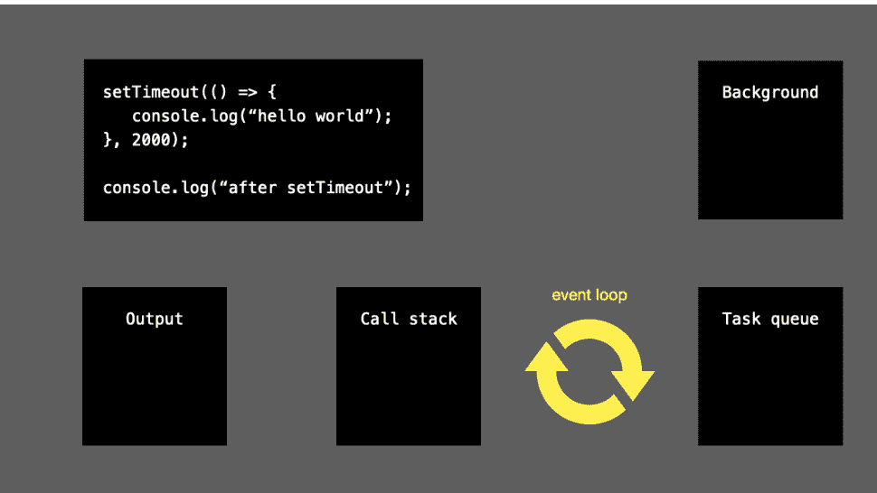

### 函数参数作用域

花点时间去理解幕后到底发生了什么。计时器被故意显示为超过 2 秒，以便可视化更容易理解。在看图之前理解上面的步骤，将使我们很容易理解代码示例是如何执行的。

任何用户交互，如点击事件，都需要安排一个任务；执行定时函数（如`setTimeout`）的回调也是如此。任务在被事件循环处理之前会排队进入任务队列。任务队列也称为**事件队列**或**回调队列**。

事件循环在每次轮询中处理单个任务，通常称为“事件循环 tick”或简称“tick”。下一个任务将在事件循环的下一次轮询或 tick 中处理。浏览器可以选择在任务之间渲染 UI 更新。

事件循环可以有多个任务源，浏览器决定在事件循环的每次 tick 中从哪个源处理任务。另一个队列称为微任务队列，我们将在本模块后面讨论。事件循环也会处理微任务，但事件循环处理任务和微任务的方式有所不同。当我们讨论微任务队列时，这个区别将会变得清晰。

在本课中，我们讨论了什么是事件循环以及任务是如何被处理的：事件循环每次 tick 处理一个任务。

### 可视化事件循环的工具

以下是一个使用我们的代码可视化事件循环工作原理的好工具：

### 进一步阅读

推荐以下资源以加深我们对事件循环的理解：

- [事件循环 (MDN)](https://developer.mozilla.org/en-US/docs/Web/JavaScript/Event_loop)¹⁰⁹
- [到底什么是事件循环？| Philip Roberts (YouTube 视频)](https://www.youtube.com/watch?v=8aGhZQkoFbQ)¹¹⁰
- [Jake Archibald 讲解浏览器事件循环、setTimeout、微任务、requestAnimationFrame (YouTube 视频)](https://www.youtube.com/watch?v=cCOL7MC4Pl0)¹¹¹

ES2015 引入的 Promise 改变了我们处理 JavaScript 异步代码的方式。Promise 旨在解决我们之前讨论过的回调函数所存在的问题。

Promise 代表一个对象，它充当一个值的占位符，这个值通常是异步操作的结果。换句话说，Promise 对象代表一个异步操作的成功完成或失败。初学者中存在一个常见的误解，认为 Promise 使我们的代码变得异步；它们并非如此。可以将 Promise 看作一种通知机制，它通知我们某个已经是异步的操作的成功或失败。Promise 包装了异步操作，允许我们在异步操作成功完成或失败时执行代码。这就是 Promise 的全部作用。不多也不少。它仅仅是用于观察异步操作，并在该操作完成时通知我们。

在学习如何创建 Promise 对象之前，让我们先学习如何使用内置的`fetch`函数来处理 Promise，该函数允许我们从浏览器中运行的 JavaScript 代码发出 HTTP 请求。

当调用`fetch`函数时，它不会让调用代码等待 HTTP 请求完成，而是返回一个 Promise 对象。我们可以将回调函数与返回的 Promise 对象关联，以便在 HTTP 请求完成时执行代码。我们仍然在 Promise 中使用回调，但我们在本模块前面课程中讨论过的与回调相关的问题，在使用 Promise 时并不存在。与回调相比，Promise 提供了一种干净且结构化的方式来处理 JavaScript 中的异步操作。

```javascript
const p1 = fetch(/* some url */);
```

`fetch`函数返回的 Promise 可以理解为`fetch`函数向我们承诺，在未来某个时间点 HTTP 请求完成后将提供一个值。与此同时，主线程可以自由地处理其他事情。

我们可以用返回的 Promise 做什么呢？我们可以向 Promise 对象注册回调函数，这些函数将在网络请求完成时被调用。我们可以注册单独的回调函数来处理网络请求的成功或失败。

¹⁰⁸ http://latentflip.com/loupe

¹⁰⁹ https://developer.mozilla.org/en-US/docs/Web/JavaScript/Event_loop

¹¹⁰ https://www.youtube.com/watch?v=8aGhZQkoFbQ

¹¹¹ https://www.youtube.com/watch?v=cCOL7MC4Pl0

### Promise 状态

在它们的生命周期中，Promise 可以处于以下三种状态之一：

- **pending**：初始状态，通常在创建 Promise 时开始。它表示与 Promise 关联的异步操作正在进行中。
- **fulfilled**：表示与 Promise 关联的异步操作已成功完成。
- **rejected**：表示与 Promise 关联的异步操作已失败。

在 Promise 的生命周期中，其状态会从 pending 变为 fulfilled 或 rejected。Promise 的状态保存在一个名为`[[PromiseState]]`<sup>112</sup>的隐藏内部槽中。

处于 pending 状态的 Promise 被认为是未定的。一旦 Promise 从 pending 状态转换为 fulfilled 或 rejected 状态，就称其已敲定。

### Promise 实例方法

我们可以在 Promise 实例上调用三个实例方法：

- `Promise.prototype.then()`
- `Promise.prototype.catch()`
- `Promise.prototype.finally()`

### then 方法

`then`方法用于注册一个回调，该回调在 Promise 被 fulfill 时（即 Promise 包装的异步操作成功完成时）被异步调用。此方法允许我们在异步操作成功完成时执行代码。考虑以下代码示例：

```javascript
const p1 = fetch(/* some url */);

p1.then((response) => {
  // Promise fulfilled 时执行的代码
});
```

`then`方法接受两个回调函数作为参数：**onFulfilled 处理程序**和 **onRejected 处理程序**。onFulfilled 处理程序是第一个参数，如上面的代码示例所示。onRejected 处理程序是可选的第二个参数，它会在调用`then`方法的 Promise 被 reject 时被调用。

```javascript
const p1 = fetch(/* some url */);

p1.then(
  (response) => {
    // Promise fulfilled 时执行的代码
  },
  (error) => {
    // Promise rejected 时执行的代码
  }
);
```

onFulfilled 处理程序接收异步操作的结果作为参数。换句话说，onFulfilled 处理程序接收 Promise 被 fulfill 的值。在 HTTP 请求的情况下，Promise 使用服务器响应进行 fulfill，因此 onFulfilled 处理程序接收服务器响应作为参数。另一方面，如果 Promise 被 reject，onRejected 处理程序接收拒绝原因作为参数。

### catch 方法

我们在上一节中了解到，可以将 onRejected 处理程序作为第二个参数传递给`then`方法来处理 Promise 的 reject。还有另一种注册 onRejected 处理程序的方式，那就是通过`catch`方法。我们可以调用 Promise 上的`catch`方法来注册 onRejected 处理程序，而不是将其传递给`then`方法。

```javascript
const p1 = fetch(/* some url */);

p1.then((response) => {
  // Promise fulfilled 时执行的代码
});

p1.catch((error) => {
  // Promise rejected 时执行的代码
});
```

`catch`方法类似于只传入 onRejected 处理程序的`then`方法，如下所示：


```javascript
p1.then(null, (error) => {
  // Promise rejected 时执行的代码
});
```

然而，使用`catch`方法注册`onRejected`处理程序比使用`then`方法的第二个参数更为常见。

### `finally`方法

想象一个场景，我们想要向服务器发送一个 HTTP 请求，并且在请求进行期间，我们向用户显示一个加载旋转器以表示正在加载数据。当请求完成时，无论是成功还是失败，我们都想隐藏加载旋转器。为了实现这一点，我们不得不在`onFulfilled`和`onRejected`处理程序中重复隐藏加载旋转器的代码，如下面的代码示例所示：

```javascript
const p1 = fetch(/* some url */);

p1.then((response) => {
  // 隐藏加载旋转器
  document.getElementById("spinner").style.display = "none";
});

p1.catch((error) => {
  // 隐藏加载旋转器
  document.getElementById("spinner").style.display = "none";
});
```

我们希望避免代码重复，而`finally`方法可以帮助我们消除代码重复。`finally`方法允许我们无论 Promise 是 fulfill 还是 reject 都执行代码。就像`then`和`catch`方法一样，`finally`方法也接受一个回调函数，该函数在 Promise fulfill 以及 reject 之后被异步调用。传递给`finally`方法的回调函数是我们希望执行的代码（无论异步操作是失败还是成功完成）的理想位置。我们可以将上面的代码重构如下：

```javascript
const p1 = fetch(/* some url */);

p1.then((response) => {
  // Promise fulfilled 时执行的代码
});

p1.catch((error) => {
  // Promise rejected 时执行的代码
});

p1.finally(() => {
  // 隐藏加载旋转器
  document.getElementById("spinner").style.display = "none";
});
```

与`then`和`catch`方法的回调不同，传递给`finally`方法的回调不接收任何参数。

### 创建 Promise

我们可以使用`Promise`构造函数来创建新的 Promise 对象，如下所示：

```javascript
const p = new Promise((resolve, reject) => {
  // 启动异步操作...
});
```

`Promise`构造函数接受一个回调函数作为参数，该函数被称为执行器函数，它会被同步调用以创建 Promise 对象。常见的错误是假定执行器函数内部的任何代码都是异步执行的，但事实并非如此。执行器函数被同步调用以创建 Promise 对象。执行器函数内部的代码应该是启动某个异步操作的代码。新创建的 Promise 对象将观察该异步操作。Promise 对象会通知我们执行器函数内部启动的异步操作的成功或失败状态。

异步操作如何与新创建的 Promise 关联起来呢？通过执行器函数作为参数接收的`resolve`和`reject`函数。这些参数可以被赋予不同的名称，但通常的做法是将它们命名为`resolve`和`reject`，以清晰地表明其目的。`resolve`函数用于解决或完成 Promise，而`reject`函数用于拒绝 Promise。让我们看一个具体的例子，它将阐明如何创建一个包装异步操作的 Promise 对象，并根据异步操作的成功或失败来解决或拒绝该 Promise。

```javascript
const p = new Promise((resolve, reject) => {
  const xhr = new XMLHttpRequest();

  xhr.addEventListener("load", function () {
    // 检查操作是否完成
    if (xhr.readyState === 4) {
      if (xhr.status === 200) {
        // 请求成功
        const data = JSON.parse(xhr.responseText);
        // 调用 resolve 函数并传递数据作为参数
        // 以完成 Promise 并传递数据
        resolve(data);
      } else {
        // 请求失败
        const error = new Error("Failed to fetch todo");
        // 调用 reject 函数并传递拒绝原因
        // 或错误作为参数
        reject(error);
      }
    }
  });

  const url = "https://jsonplaceholder.typicode.com/todos/1";
  xhr.open("GET", url);
  xhr.send();
});

// 注册完成处理器
p.then((todo) => {
  console.log(todo);
});

// 注册拒绝处理器
p.catch((error) => {
  console.log(error.message);
});
```

你可以在下方的 Replit 中运行上述代码：

<ReplitEmbed src="https://replit.com/@newlineauthors/promises-example9" />

上面的代码示例展示了如何将一个 Promise 对象包装在一个异步操作周围，并在异步操作成功或失败时解决或拒绝该 Promise。作为对 Promise 被完成或拒绝的响应，相应的处理器（完成或拒绝）会被异步调用。

需要注意的是，在执行器函数内部调用`resolve`或`reject`函数之前，Promise 不会被完成或拒绝。因此，任何注册的完成或拒绝处理器在 Promise 最终敲定之前都不会被调用。

上面的代码示例可能还没让你看到 Promise 相比于传统使用回调处理异步代码的方式有何改进，但请等待我们在本模块的后续课程中讨论 Promise 链和`async-await`语法。这两个主题将帮助你理解 Promise 如何解决回调的两个主要问题：回调地狱和错误处理。

### 在基于回调的 API 中使用 Promise

如果你注意到了上一节的代码示例，我们只是将一个 Promise 包装在了基于回调的 XMLHttpRequest API 周围。我们将其包装成 Promise，以便能够使用 Promise 与之交互。

类似于我们上面所做的，我们可以将任何基于回调的 API 转换为基于 Promise 的 API。我们需要做的就是将基于回调的代码放在执行器函数中，并在适当的位置调用`resolve`和`reject`函数，以完成或拒绝 Promise。以下是一个将 Promise 包装在`setTimeout`周围以在代码中添加人为延迟的示例：

```javascript
function timeout(delayInSeconds) {
  const delayInMilliseconds = delayInSeconds * 1000;

  return new Promise((resolve) => {
    setTimeout(() => resolve(), delayInMilliseconds);
  });
}

timeout(2).then(() => {
  console.log("done"); // 在 2 秒后记录
});
```

你可以在下方的 Replit 中运行上述代码：

<ReplitEmbed src="https://replit.com/@newlineauthors/promises-example10" />

在上面的代码示例中，我们将`setTimeout`包装在一个 Promise 中，以在代码中添加人为延迟。为了在指定的延迟（上面代码中的 2 秒）后解决 Promise，我们在`setTimeout`的回调函数内部调用`resolve`函数。请注意，我们没有调用或使用`reject`函数，因为我们不需要它来拒绝 Promise。我们只是希望 Promise 在指定的延迟后被完成。

### Promise 规范

[Promises/A+](https://promisesaplus.com/) 是一个定义 JavaScript 中 Promise 行为的标准。它确保了不同环境中 Promise 的不同实现都符合该规范定义的标准行为，以确保 Promise 在不同环境中的行为一致性。

### Promise 与 thenable

如果你阅读了 Promise 规范，你会多次看到 "thenable" 这个词。thenable 是任何定义了名为`then`的方法但不是 Promise 的对象。它是具有名为`then`的方法的对象的通用术语。由于 Promise 有一个名为`then`的方法，我们可以说所有 Promise 都是 thenable，但反过来并不成立：每个 thenable 并不是 Promise。

总结一下区别：thenable 是一个具有`then`方法的对象，而 Promise 是一个具有`then`方法且符合 [Promises/A+](https://promisesaplus.com/) 规范的对象。

在上一课中，我们讨论了 Promise 的以下实例方法：

- `Promise.prototype.then()`
- `Promise.prototype.catch()`
- `Promise.prototype.finally()`

我们讨论了这些方法各自允许我们做什么，但我们没有讨论的是这些方法各自返回什么。它们的返回值很重要，因为它允许 Promise 链式调用，而这正是本课的主题。

Promise 的每个实例方法都返回一个新的 Promise，这使我们能够创建方法调用链，从而有效地创建一个异步操作链。Promise 链式调用有助于解决我们使用回调时面临的两个主要问题：“回调地狱”和错误处理。

以下代码示例展示了我们如何为`fetch`函数返回的 Promise 注册完成和拒绝处理器：

```javascript
const p = fetch(/* some url */);

// 注册一个完成处理器
p.then((response) => {
  // 代码...
});

// 注册一个拒绝处理器
p.catch((error) => {
  // 代码...
});
```

由于每个 Promise 实例方法都返回一个新的 Promise，我们可以将上述代码重写如下：

```javascript
fetch(/* some url */)
  .then((response) => {
    // 代码...
  })
  .catch((error) => {
    // 代码...
  });
```

重构后的代码与第一个代码示例达到相同的结果，但技术上讲，第一个代码示例与重构后的代码是不同的。在第一个代码示例中，拒绝处理器是在`fetch`函数返回的 Promise 上注册的，而在重构后的代码中，拒绝处理器是在`then`方法返回的 Promise 上注册的。重构后的代码中的 Promise 链可以拆分成不同的部分，如下所示，以便更容易理解：

```javascript
const pFetch = fetch(/* some url */);

const pThen = pFetch.then((response) => {
  // 代码...
});

const pCatch = pThen.catch((error) => {
  // 代码...
});
```

注意为哪些 Promise 注册了完成和拒绝处理器。完成处理器是在`fetch`函数返回的 Promise 上注册的，但与第一个代码示例不同的是，拒绝处理器是在`then`方法返回的 Promise 上注册的。那么，这是否意味着如果`fetch`函数返回的 Promise 被拒绝，就没有注册拒绝处理器来处理拒绝呢？不是的，注册在`pThen` Promise 上的拒绝处理器将处理该拒绝。要理解其工作原理，我们必须了解 Promise 链的工作原理。

本课后续的代码示例将使用以下函数来模拟一个大约需要两秒才能完成的 HTTP 请求：

```javascript
function fakeRequest(isSuccessRequest = true) {
  return new Promise((resolve, reject) => {
    setTimeout(() => {
      if (isSuccessRequest) {
        const data = { name: "John Doe", favouriteLanguage: "JavaScript" };
        resolve(data);
      } else {
        const error = new Error("request failed");
        reject(error);
      }
    }, 2000);
  });
}
```

上述函数将帮助我们轻松理解 Promise 链。该函数接受一个布尔参数，用于指定我们的模拟请求是应该被履行还是被拒绝。该参数的默认值为`true`，因此只有在希望请求失败时才需要传递该参数。函数内部返回一个 Promise，该 Promise 包裹了`setTimeout`，以模拟一个大约需要两秒钟才能完成的请求。计时器到期后，Promise 会被履行或拒绝，具体取决于`isSuccessRequest`参数的值。

定义了`fakeRequest`函数后，让我们深入探索 Promise 链的世界。

### `then`方法

在 Promise 上调用`then`方法会为其注册一个履行处理程序。`then`方法本身返回一个新的 Promise，它与调用`then`方法的那个原始 Promise 不同。

```javascript
const pRequest = fakeRequest();

const pThen = pRequest.then((response) => {
  console.log(response);
});

console.log(pThen === pRequest); // false
```

你可以在下方的 Replit 中运行上述代码：

<ReplitEmbed src="https://replit.com/@newlineauthors/promise-chaining-example5" />

`then`方法返回的 Promise 是基于以下两个问题得到履行或拒绝的：

- 调用`then`方法的那个 Promise 会发生什么？在我们的例子中，`then`方法是在`pRequest`这个 Promise 上调用的。
- 传递给`then`方法的履行或拒绝处理程序返回了什么？哪个处理程序会影响`then`方法返回的 Promise，取决于当调用`then`方法的那个原始 Promise 稳定（settled）时，哪个处理程序被调用。

记住以上两个问题，让我们讨论一下可能影响`then`方法返回的 Promise 的不同场景：

### 场景 1：原始 Promise 被履行

如果调用`then`方法的那个原始 Promise 被履行，那么`then`方法返回的 Promise 取决于履行处理程序内部发生的情况。以下是履行处理程序可能采取的、会影响`then`方法返回的 Promise 的不同操作：

- 如果注册了履行处理程序，并且它返回了一个非 Promise 且非 thenable 的值，那么`then`方法返回的 Promise 就会以该返回值被履行。

```javascript
// pRequest 将被履行
const pRequest = fakeRequest();

const pThen = pRequest.then((response) => {
  console.log(response);
  return "success";
});

pThen.then((data) => {
  console.log(data); // success
});
```

你可以在下方的 Replit 中运行上述代码：

<ReplitEmbed src="https://replit.com/@newlineauthors/promise-chaining-example6" />

- 如果履行处理程序没有显式返回任何值，那么`then`方法返回的 Promise 就会以`undefined`作为履行值被履行。

```javascript
// pRequest 将被履行
const pRequest = fakeRequest();

const pThen = pRequest.then((response) => {
  console.log(response);
});

pThen.then((data) => {
  console.log(data); // undefined
});
```

你可以在下方的 Replit 中运行上述代码：

<ReplitEmbed src="https://replit.com/@newlineauthors/promise-chaining-example7" />


- 如果在 Promise 上调用了 `then` 方法，但没有提供履行处理程序，那么 `then` 方法返回的 Promise 就会以与原始 Promise 相同的履行值被履行。

```js
// pRequest 将被履行
const pRequest = fakeRequest();

// 未提供履行处理程序
const pThen = pRequest.then();

pThen.then((data) => {
  // 记录 pRequest 履行时的值
  console.log(data);
});
```

你可以在下方的 Replit 中运行上述代码：

<ReplitEmbed src="https://replit.com/@newlineauthors/promise-chaining-example8" />

- 如果履行处理程序抛出了任何值或错误，那么 `then` 方法返回的 Promise 就会以抛出的值作为拒绝原因或值而被拒绝。

```js
// pRequest 将被履行
const pRequest = fakeRequest();

const pThen = pRequest.then((response) => {
  throw new Error("something bad happened");
});

pThen.catch((error) => {
  console.log(error.message); // something bad happened
});
```

你可以在下方的 Replit 中运行上述代码：

<ReplitEmbed src="https://replit.com/@newlineauthors/promise-chaining-example9" />

- 如果履行处理程序返回一个 Promise，那么 `then` 方法返回的 Promise 将解析（resolve）为履行处理程序返回的那个 Promise。一个 Promise 解析为另一个 Promise 意味着，其中一个 Promise（我们称之为 p1）的命运取决于另一个 Promise（我们称之为 p2）。如果 p2 被履行，p1 也会以相同的履行值被履行；如果 p2 被拒绝，p1 也会以相同的拒绝值被拒绝。Promise p1 会等待 p2 稳定，然后自己再稳定，并最终与 p2 有相同的命运。

```js
// pRequest 将被履行
const pRequest = fakeRequest();

const pThen = pRequest.then((response) => {
  // 返回一个将被履行的 Promise
  return fakeRequest();
});

pThen.then((response) => {
  // 记录来自 pRequest Promise 的履行处理程序
  // 返回的 Promise 的履行值
  console.log(response);
});
```

你可以在下方的 Replit 中运行上述代码：

<ReplitEmbed src="https://replit.com/@newlineauthors/promise-chaining-example10" />

在上面的代码示例中，`then` 方法返回的 `pThen` Promise 解析（resolve）为 `pRequest` Promise 的履行处理程序返回的 Promise。

### 场景 2：原始 Promise 被拒绝

如果调用 `then` 方法的那个原始 Promise 被拒绝，那么 `then` 方法返回的 Promise 取决于以下情况：

- 如果只向 `then` 方法传递了履行处理程序，那么 `then` 方法返回的 Promise 也会以与原始 Promise 被拒绝时相同的拒绝原因或值而被拒绝。

```js
// pRequest 将被拒绝
const pRequest = fakeRequest(false);

const pThen = pRequest.then((response) => {
  console.log(response);
});

pThen.catch((error) => {
  console.log(error.message); // request failed
});
```

你可以在下方的 Replit 中运行上述代码：

<ReplitEmbed src="https://replit.com/@newlineauthors/promise-chaining-example11" />

- 如果向 `then` 方法传递了拒绝处理程序，那么 `then` 方法返回的 Promise 取决于拒绝处理程序内部发生的情况。这与履行处理程序的情况类似：

  - 如果拒绝处理程序返回了一个非 Promise 的值，那么 `then` 方法返回的 Promise 就会以该拒绝处理程序返回的值而被履行。
  - 如果拒绝处理程序没有显式返回任何值，那么 `then` 方法返回的 Promise 就会以 `undefined` 作为履行值被履行。
  - 如果在原始 Promise 上调用了 `then` 方法，但没有提供拒绝处理程序，那么 `then` 方法返回的 Promise 就会以与原始 Promise 相同的拒绝值而被拒绝。
  - 如果拒绝处理程序抛出了任何值或错误，那么 `then` 方法返回的 Promise 就会以抛出的值作为拒绝原因或值而被拒绝。
  - 如果拒绝处理程序返回一个 Promise，那么 `then` 方法返回的 Promise 将解析（resolve）为拒绝处理程序返回的 Promise，这与前面讨论的履行处理程序情况相同。

既然我们已经讨论了 `then` 方法在不同场景下返回的 Promise 如何稳定，接下来我们将讨论 `catch` 方法返回的 Promise。

### `catch` Promise

`catch` 方法用于为它被调用所在的 promise 注册一个拒绝处理程序。就像 `then` 方法一样，`catch` 方法也返回一个新的 promise，并且就像 `then` 方法返回的 promise 一样，`catch` 方法返回的 promise 的最终状态取决于以下两个问题：

- 调用 `catch` 方法的那个 promise 发生了什么？
- 传递给 `catch` 方法的拒绝处理程序返回了什么？

#### 场景 1：原始 promise 变为 fulfilled

假设调用 `catch` 方法的那个原始 promise 变为 fulfilled。在这种情况下，使用 `catch` 方法注册的拒绝处理程序不会被调用，并且 `catch` 方法返回的 promise 会以与原始 promise 相同的 fulfillment 值变为 fulfilled。

```js
// pRequest 将会 fulfilled
const pRequest = fakeRequest();

const pCatch = pRequest.catch((error) => {
  console.log(error.message);
});

pCatch.then((data) => {
  // 记录 pRequest promise fulfilled 时使用的
  // fulfillment 值
  console.log(data);
});
```

你可以在下面的 Replit 中运行上述代码：

<ReplitEmbed src="https://replit.com/@newlineauthors/promise-chaining-example12" />

#### 场景 2：原始 promise 被拒绝

当调用 `catch` 方法的那个原始 promise 被拒绝时，使用 `catch` 处理程序注册的拒绝处理程序会被调用。如果原始 promise 被拒绝，那么 `catch` 方法返回的 promise，就像 `then` 方法返回的 promise 一样，取决于拒绝处理程序内部发生了什么：

- 如果拒绝处理程序返回一个非 promise 值，那么 `catch` 方法返回的 promise 会以该拒绝处理程序返回的值变为 fulfilled。

```js
// pRequest 将会被拒绝
const pRequest = fakeRequest(false);

const pCatch = pRequest.catch((error) => {
  return "default value";
});

pCatch.then((data) => {
  console.log(data); // default value
});
```

你可以在下面的 Replit 中运行上述代码：

<ReplitEmbed src="https://replit.com/@newlineauthors/promise-chaining-example13" />

- 如果拒绝处理程序没有显式返回任何值，那么 `catch` 方法返回的 promise 会以 `undefined` 作为 fulfillment 值变为 fulfilled。

```js
// pRequest 将会被拒绝
const pRequest = fakeRequest(false);

const pCatch = pRequest.catch((error) => {
  console.log(error.message); // request failed
});

pCatch.then((data) => {
  console.log(data); // undefined
});
```

你可以在下面的 Replit 中运行上述代码：

<ReplitEmbed src="https://replit.com/@newlineauthors/promise-chaining-example14" />

- 如果在原始 promise 上调用了 `catch` 方法但没有提供拒绝处理程序，那么 `catch` 方法返回的 promise 会以与原始 promise 相同的拒绝原因被拒绝。

```js
// pRequest 将会被拒绝
const pRequest = fakeRequest(false);

// 未注册拒绝处理程序
const pCatch = pRequest.catch();

pCatch.catch((error) => {
  // 记录原始 pRequest promise 的
  // 拒绝原因
  console.log(error.message); // request failed
});
```

你可以在下面的 Replit 中运行上述代码：

<ReplitEmbed src="https://replit.com/@newlineauthors/promise-chaining-example15" />

- 如果拒绝处理程序抛出任何值或错误，那么 `catch` 方法返回的 promise 会以该抛出的值作为拒绝原因被拒绝。

```js
// pRequest 将会被拒绝
const pRequest = fakeRequest(false);

const pCatch = pRequest.catch((error) => {
  throw error;
});

pCatch.catch((error) => {
  console.log(error.message); // request failed
});
```

你可以在下面的 Replit 中运行上述代码：

<ReplitEmbed src="https://replit.com/@newlineauthors/promise-chaining-example16" />

- 如果拒绝处理程序返回一个 promise，那么 `catch` 方法返回的 promise 会解析为该拒绝处理程序返回的 promise，这与之前讨论的 fulfillment 处理程序的情况相同。

```js
// pRequest 将会被拒绝
const pRequest = fakeRequest(false);

const pCatch = pRequest.catch((error) => {
  // 返回一个将会 fulfilled 的 promise
  return fakeRequest();
});

pCatch.then((data) => {
  // 记录从 pRequest promise 的拒绝
  // 处理程序返回的 promise 的 fulfillment 值
  console.log(data);
});
```

你可以在下面的 Replit 中运行上述代码：

<ReplitEmbed src="https://replit.com/@newlineauthors/promise-chaining-example17" />

### `finally` Promise

`finally` 方法用于注册一个回调函数，该函数在 promise settle 后异步调用。无论调用它的 promise 是 fulfilled 还是 rejected，传递给 `finally` 方法的回调都会被调用。就像 `then` 和 `catch` 方法一样，`finally` 方法也返回一个新的 promise，并且 `finally` 方法返回的 promise 的最终状态取决于以下两个问题：

- 调用 `finally` 方法的那个 promise 发生了什么？
- 传递给 `finally` 方法的回调函数返回了什么？

#### 场景 1：原始 promise 变为 fulfilled

假设调用 `finally` 方法的那个原始 promise 变为 fulfilled。在这种情况下，如果满足以下条件，`finally` 方法返回的 promise 也会以与原始 promise 相同的 fulfillment 值变为 fulfilled：

- `finally` 回调没有抛出错误或值。
- `finally` 回调没有返回一个被拒绝的 promise 或最终会被拒绝的 promise。

```js
// pRequest 将会 fulfilled
const pRequest = fakeRequest();

const pFinally = pRequest.finally(() => {
  console.log("finally called");
});

pFinally.then((data) => {
  // 记录原始 pRequest promise 的
  // fulfillment 值
  console.log(data);
});
```

以下是 Replit 中的代码：

<ReplitEmbed src="https://replit.com/@newlineauthors/promise-chaining-example18" />

请注意，`finally` 回调没有显式返回任何值，但 `finally` promise 却以原始 `pRequest` promise 的 fulfillment 值变为 fulfilled。这种行为与 `then` 和 `catch` 方法不同；如果它们的回调隐式返回 `undefined`，它们的 promise 会以值 `undefined` 变为 fulfilled。

#### 场景 2：原始 promise 被拒绝

假设调用 `finally` 方法的那个原始 promise 被拒绝。在这种情况下，如果满足之前提到的两个相同条件，`finally` 方法返回的 promise 也会以与原始 promise 相同的拒绝原因被拒绝：

- `finally` 回调没有抛出错误或值。
- `finally` 回调没有返回一个被拒绝的 promise 或最终会被拒绝的 promise。

```js
// pRequest 将会被拒绝
const pRequest = fakeRequest(false);

const pFinally = pRequest.finally(() => {
  console.log("finally called");
});

pFinally.catch((error) => {
  // 记录原始 pRequest promise 的
  // 拒绝原因
  console.log(error.message);
});
```

以下是 Replit 中的代码：

<ReplitEmbed src="https://replit.com/@newlineauthors/promise-chaining-example19" />

#### 场景 3：覆盖原始 promise 的最终状态

与 `then` 和 `catch` 方法不同，`finally` 回调的返回值会被忽略，并且 `finally` 方法返回的 promise 只是与其被调用所在的原始 promise 遭受同样的命运；如果原始 promise fulfilled，`finally` promise 也会 fulfilled；如果原始 promise 被拒绝，`finally` promise 也会被拒绝。

然而，前两个场景中提到的两个条件是此规则的例外。如果 `finally` 回调抛出错误，`finally` promise 会以该抛出的值被拒绝。

```js
// pRequest 将会被拒绝
const pRequest = fakeRequest(false);

const pFinally = pRequest.finally(() => {
  throw new Error("finally error");
});
```


```javascript
pFinally.catch((error) => {
  console.log(error.message); // finally error
});
```

你可以在下面的 Replit 中运行上述代码：

<ReplitEmbed src="https://replit.com/@newlineauthors/promise-chaining-example20" />

`finally`方法的拒绝覆盖了原始`pRequest` promise 的拒绝。如果`pRequest` promise 是 fulfilled，也会发生同样的情况。从`finally`回调中抛出错误只会拒绝`finally` promise，而不管原始 promise 发生了什么。

同样地，从`finally`回调中返回一个被拒绝的 promise 也会拒绝`finally` promise，而不管原始 promise 发生了什么。

### 理解 Promise 链式调用

我们已经讨论了每个 Promise 实例方法返回的 Promise 可能被拒绝或实现的所有场景。现在，我们可以理解 Promise 链是如何工作的了。我们将通过一系列示例来巩固我们的理解。

#### 示例 1

```javascript
fakeRequest()
  .then((response) => {
    console.log(response);
    return "hello world";
  })
  .then((data) => {
    console.log(data);
    return "123";
  })
  .catch((error) => {
    console.log(error.message);
  });
```

你可以在下面的 Replit 中运行上述代码：

<ReplitEmbed src="https://replit.com/@newlineauthors/promise-chaining-example22" />

在上述代码示例中，你预期的输出是什么？请记住，每个实例方法都返回一个新 Promise，其实现或拒绝取决于两件事：

- 在该方法被调用的原始 Promise 上发生了什么？
- 该方法的回调函数内部发生了什么？

考虑到上面讨论过的不同场景（这些场景可能实现或拒绝每个 Promise 实例方法返回的 Promise），试着通过猜测上述代码的输出来测试你的理解。以下是上述代码产生的输出的解释：

1. 从 Promise 链的顶部开始，`fakeRequest`函数返回的 Promise 将被实现，这将调用使用第一次`then`方法调用注册的其实现处理程序。结果，控制台记录以下内容：

   ```json
   {
     "favouriteLanguage": "JavaScript",
     "name": "John Doe"
   }
   ```

2. `fakeRequest`函数返回的 Promise 已经 settled。链中的下一个 Promise 是第一次`then`方法调用返回的 Promise。由于原始 Promise 已实现，第一个`then` Promise 现在取决于其回调函数内部发生了什么。由于它返回了字符串`"hello world"`，第一个`then` Promise 将以`"hello world"`作为实现值而被实现。

   结果，调用了其在第二次`then`方法调用中注册的实现处理程序。第一个`then` Promise 的实现处理程序接收其实现值（即`"hello world"`）作为参数。这导致`"hello world"`被记录到控制台。到目前为止，控制台输出如下：

   ```json
   {
     "favouriteLanguage": "JavaScript",
     "name": "John Doe"
   }
   ```

   ```json
   "hello world"
   ```

3. 此时，Promise 链中的两个 Promise 已经 settled。链中的下一个 Promise 是第二次`then`方法返回的 Promise。就像第一个`then`方法一样，第二个`then`方法返回的 Promise 取决于它被调用的原始 Promise，即第一个`then`方法返回的 Promise。由于原始 Promise 已实现，第二个`then` Promise 现在取决于其回调函数内部发生了什么。它的回调返回字符串`"123"`。因此，第二个`then` Promise 以`"123"`作为其实现值而实现。

   但是，没有为第二个`then` Promise 注册实现处理程序；只有通过`catch`方法注册的拒绝处理程序。因此，为了响应第二次`then`方法的实现，不会调用任何实现处理程序。Promise 链移动到链中的最后一个 Promise，即`catch`方法返回的 Promise。

4. `catch`方法返回的 Promise 是在第二次`then`方法返回的 Promise 上调用的。由于第二个`then` Promise 已实现，`catch` Promise 也将以与第二个`then` Promise 相同的实现值而实现。但是，没有为`catch` Promise 注册实现或拒绝处理程序，所以其实现被简单地忽略了。代码的最终输出如下所示：

   ```json
   {
     "favouriteLanguage": "JavaScript",
     "name": "John Doe"
   }
   ```

   ```json
   "hello world"
   ```

#### 示例 2

```javascript
fakeRequest()
  .then((response) => {
    console.log(response);
    return fakeRequest();
  })
  .then((data) => {
    console.log(data);
  })
  .catch((error) => {
    console.log(error.message);
  });
```

你可以在下面的 Replit 中运行上述代码：

<ReplitEmbed src="https://replit.com/@newlineauthors/promise-chaining-example23" />

以下是上述代码产生的输出的解释：

1. 从 Promise 链的顶部开始，`fakeRequest`函数返回的 Promise 将被实现，这将调用使用第一次`then`方法调用注册的其实现处理程序。结果，控制台记录以下内容：

   ```json
   {
     "favouriteLanguage": "JavaScript",
     "name": "John Doe"
   }
   ```

2. `fakeRequest`函数返回的 Promise 已经 settled。链中的下一个 Promise 是第一次`then`方法调用返回的 Promise。由于原始 Promise 已实现，第一个`then` Promise 现在取决于其回调函数内部发生了什么。由于它通过调用`fakeRequest`函数返回一个新 Promise，第一个`then` Promise 将被解析为其回调函数返回的 Promise。`then` Promise 将等待其回调函数返回的 Promise settled 后再 settle 自身。

   第一个`then`方法的回调函数返回的 Promise 将在大约两秒后实现。一旦它实现，`then`方法返回的 Promise 也将以与其回调返回的 Promise 相同的实现值而实现。结果，调用了其在第二次`then`方法调用中注册的实现处理程序。第一个`then` Promise 的实现处理程序接收其实现值作为参数，该参数在实现处理程序内部被记录。到目前为止，控制台输出如下：

   ```json
   {
     "favouriteLanguage": "JavaScript",
     "name": "John Doe"
   }
   ```

   ```json
   {
     "favouriteLanguage": "JavaScript",
     "name": "John Doe"
   }
   ```

3. 此时，Promise 链中的两个 Promise 已经 settled。链中的下一个 Promise 是第二次`then`方法返回的 Promise。就像第一个`then`方法一样，第二个`then`方法返回的 Promise 取决于它被调用的原始 Promise，即第一个`then`方法返回的 Promise。由于原始 Promise 已实现，第二个`then` Promise 现在取决于其回调函数内部发生了什么。它的回调隐式返回`undefined`。因此，第二个`then` Promise 以`undefined`作为其实现值而实现。但是，没有为第二个`then` Promise 注册实现处理程序；只有通过`catch`方法注册的拒绝处理程序。因此，为了响应第二次`then`方法的实现，不会调用任何实现处理程序。Promise 链移动到链中的最后一个 Promise，即`catch`方法返回的 Promise。

4. `catch`方法返回的 Promise 是在第二次`then`方法返回的 Promise 上调用的。由于第二个`then` Promise 已实现，`catch` Promise 也将以与第二个`then` Promise 相同的实现值而实现。但是，没有为`catch` Promise 注册实现或拒绝处理程序，所以其实现被简单地忽略了。代码的最终输出如下所示：

   ```json
   {
     "favouriteLanguage": "JavaScript",
     "name": "John Doe"
   }
   ```

   ```json
   {
     "favouriteLanguage": "JavaScript",
     "name": "John Doe"
   }
   ```

#### 示例 3

```javascript
fakeRequest(false)
  .then((response) => {
    console.log(response);
  })
  .catch((error) => {
    console.log(error.message);
  });
```

你可以在下面的 Replit 中运行上述代码：

<ReplitEmbed src="https://replit.com/@newlineauthors/promise-chaining-example24" />

以下是上述代码产生的输出的解释：

1. 从 Promise 链的顶部开始，`fakeRequest(false)`函数返回的 Promise 将被拒绝，但没有为该 Promise 注册拒绝处理程序；只注册了一个实现处理程序。因此，不会为此 Promise 调用任何拒绝处理程序。我们继续处理链中的下一个 Promise。

2. `fakeRequest(false)`函数返回的 Promise 已经 settled。链中的下一个 Promise 是第一次`then`方法调用返回的 Promise。由于原始 Promise 被拒绝，并且没有将拒绝处理程序传递给`then`方法，`then`方法返回的 Promise 也将以与原始 Promise 相同的拒绝值而被拒绝。结果，调用了使用`catch`方法注册的其拒绝处理程序，在控制台记录以下内容：

   ```json
   "request failed"
   ```

   第一个 Promise 被拒绝时所用的错误对象，与`then`方法返回的 Promise 被拒绝时所用的值相同。Promise 链移动到链中的最后一个 Promise，即`catch`方法返回的 Promise。

3. 此时，Promise 链中的两个 Promise 已经完成。链中的下一个 Promise 是由`catch`方法返回的。由于`then` Promise 被拒绝，`catch`方法返回的 Promise 取决于其回调内部发生的情况。其回调隐式返回`undefined`，导致`catch` Promise 以`undefined`作为完成值而被兑现。但该`catch` Promise 没有注册兑现处理器，因此其兑现被直接忽略。代码的最终输出如下所示：

   ```text
   request failed
   ```

在上面的代码示例中需要注意的一点是，`fakeRequest(false)`函数返回的 Promise 的最终拒绝，是由为`then`方法返回的 Promise 注册的拒绝处理器处理的。这就是 Promise 链的威力之一。与回调不同（我们需要在每个回调中检查错误），使用 Promise 链，我们可以注册一个拒绝处理器，它就能处理 Promise 链中其之前所有 Promise 的拒绝。我们可以在 Promise 链中有多个`then`方法调用，而只需在链的末尾使用`catch`方法注册一个拒绝处理器。这使得在 Promise 链中管理错误变得简单。

### 示例 4

```javascript
fakeRequest()
  .then((response) => {
    return fakeRequest(false);
  })
  .catch((error) => {
    return { data: "default data" };
  })
  .then((data) => {
    console.log(data);
  })
  .then(() => {
    throw new Error("error occurred");
  })
  .catch((error) => {
    console.log(error.message);
  });
```

你可以在下方的 Replit 中运行上述代码：

<ReplitEmbed src="https://replit.com/@newlineauthors/promise-chaining-example25" />

以下是上述代码产生的输出解释：

1. 从 Promise 链的顶部开始，`fakeRequest()`函数返回的 Promise 将被兑现，从而调用其兑现处理器（通过第一次`then`方法调用注册），并将兑现值作为参数传递给其兑现处理器。

2. `fakeRequest()`函数返回的 Promise 已完成。链中的下一个 Promise 是由第一次`then`方法调用返回的。由于原始 Promise 已兑现，第一个`then` Promise 现在取决于其回调函数内部发生的情况。由于它通过调用`fakeRequest(false)`函数返回了一个新 Promise，第一个`then` Promise 将解析为其回调函数返回的 Promise。`then` Promise 将等待其回调函数返回的 Promise 完成，然后才会完成自身。

   第一次`then`方法的回调函数返回的 Promise 将在大约两秒后被拒绝。一旦被拒绝，`then`方法返回的 Promise 也将以与其回调函数返回的 Promise 相同的拒绝值而被拒绝。因此，其拒绝处理器（通过第一次`catch`方法调用注册）被调用。第一个`then` Promise 的拒绝处理器接收其拒绝值作为参数。

3. 此时，Promise 链中的前两个 Promise 已完成。链中的下一个 Promise 是由第一次`catch`方法返回的。由于调用`catch`方法的 Promise 被拒绝，第一个`catch` Promise 现在取决于其回调函数内部发生的情况。它返回一个对象字面量。因此，第一个`catch` Promise 将返回的对象作为其兑现值兑现。

   请注意，`catch`方法不一定非要在 Promise 链的末尾；不过，`catch`方法最常放在 Promise 链的末尾。根据要求，`catch`方法可以放在链中的任何位置。在我们的代码示例中，它在第一次`then`方法之后被调用，以通过返回默认数据并让链继续来处理第一个`then` Promise 可能的拒绝。如果第一个`then` Promise 的拒绝未被处理，那么第一次`then`方法之后的所有`then` Promise 也会以与第一个`then` Promise 相同的拒绝值而被拒绝，最终拒绝将在最后一次`catch`方法调用中处理。

4. 此时，Promise 链中的前三个 Promise 已完成。链中的下一个 Promise 是由第二次`then`方法调用返回的。由于第二次`then`方法调用其上的 Promise（第一个`catch` Promise）已兑现，第二次`then`方法返回的 Promise 现在取决于其回调函数内部发生的情况。其回调函数记录第一个`catch` Promise 的兑现值并隐式返回`undefined`，导致第二个`then` Promise 以`undefined`作为完成值而被兑现。以下是到目前为止的控制台输出：

   ```javascript
   {
     data: "default data"
   }
   ```


5. 此时，Promise 链中的前四个 Promise 已完成。链中的下一个 Promise 是由第三次 `then` 方法调用返回的。由于第三次 `then` 方法调用其上的 Promise（第二个 `then` Promise）已兑现，第三次 `then` 方法返回的 Promise 现在取决于其回调函数内部发生的情况。其回调函数抛出一个错误，导致第三个 `then` Promise 以抛出的错误作为拒绝原因或值而被拒绝。因此，其拒绝处理器（通过最后一次 `catch` 方法注册）被调用，并将拒绝值作为参数传入。

6. 由于最后一次 `catch` 方法调用其上的 Promise（第三个 `then` Promise）被拒绝，最后一次 `catch` Promise 取决于其回调函数内部发生的情况。其回调函数记录第三个 `then` Promise 的拒绝值并隐式返回 `undefined`，导致最后一次 `catch` Promise 以 `undefined` 作为完成值而被兑现。但最后一次 `catch` Promise 没有注册兑现处理器，因此其兑现被直接忽略。代码的最终控制台输出如下所示：

```text
1 {

2   data: "default data"

3 }

4

5 "error occurred"
```

希望上述示例，加上本课之前关于可能拒绝或兑现每个 Promise 实例方法返回的 Promise 的不同场景的讨论，为你理解 Promise 链并在自己的代码中使用它们奠定了坚实的基础。

### `then` 与 `catch` 中的拒绝处理器

在上一课中提到，可以通过向 `then` 方法传递第二个参数来注册拒绝处理器，如下所示：

```javascript
1 fakeRequest().then(null, (error) => {

2   // 处理错误

3 });
```

使用 `then` 方法注册拒绝处理器时需要记住一件事：如果作为参数传递给拒绝处理器的那个 `then` 方法本身返回的 Promise 被拒绝，那么该拒绝处理器**不会**被调用。以下代码示例展示了这一点：

```javascript
1 fakeRequest().then(

2   (response) => {

3     // 拒绝 "then" 方法

4     // 返回的 Promise

5     throw new Error("error");

6   },

7   (error) => {

8     // 此回调不会被调用

9     console.log(error.message);

10  }

11);
```

使用 `then` 方法注册的拒绝处理器仅在 `then` 方法被调用的那个原始 Promise 被拒绝时才会被调用。因此，在上面的代码示例中，我们有一个*未处理的 Promise 拒绝*，在最坏的情况下，它可能会终止程序。因此，在使用 Promise 时，请务必记住处理代码中所有可能的 Promise 拒绝。

在本课中，我们将讨论 Promise 的两个[静态方法](https://developer.mozilla.org/en-US/docs/Web/JavaScript/Reference/Global_Objects/Promise#static_properties)的几个常见用例，并了解它们如何发挥作用。其他 Promise 静态方法也很有用，但在我看来，以下两个用例是最常见的：

- 发起并发请求
- 实现请求超时

### 并发请求

想象一个场景，我们想同时发起多个 HTTP 请求并等待它们的集体结果。我们不能使用 Promise 链，如下所示，因为它将以顺序方式执行每个请求。

```javascript
1 const url1 = "https://jsonplaceholder.typicode.com/todos/1";

2 const url2 = "https://jsonplaceholder.typicode.com/todos/2";

3 const url3 = "https://jsonplaceholder.typicode.com/todos/3";

4

5 function parseFetchResponse(response) {

6   if (response.ok) {

7     return response.json(); // 返回一个 Promise

8   } else {

9     throw new Error("request failed");

10  }

11 }
```

### Promise 静态方法

你可以在下面的 Replit 中运行上述代码：

<ReplitEmbed src="https://replit.com/@newlineauthors/static-promise-methods-example1" />

由于上述代码中的每个请求都是独立的，我们希望发起并发请求，而不是以顺序方式发起请求。这可以通过使用 `Promise.all` 方法来实现。它允许我们一个接一个地启动每个请求，而无需等待一个请求完成再启动下一个。结果是，三个请求同时发起，我们可以等待它们的集体结果。

`Promise.all` 方法接受一个 promise 的可迭代对象作为输入，并返回一个在传给它的所有 promise 都已兑现时才兑现的 promise。此方法返回的 promise 的兑现值是一个数组，包含了所有传入 promise 的兑现值。如果任何输入的 promise 被拒绝，则此方法返回的 promise 也会被拒绝。我们可以使用 `Promise.all` 方法重写上面的代码示例，如下所示：

> 116 https://en.wikipedia.org/wiki/Concurrent_computing  
> 117 https://developer.mozilla.org/en-US/docs/Web/JavaScript/Reference/Iteration_protocols

```javascript
const url1 = "https://jsonplaceholder.typicode.com/todos/1";

const url2 = "https://jsonplaceholder.typicode.com/todos/2";

const url3 = "https://jsonplaceholder.typicode.com/todos/3";

function parseFetchResponse(response) {
  if (response.ok) {
    return response.json();
  } else {
    throw new Error("request failed");
  }
}

Promise.all([
  fetch(url1).then(parseFetchResponse),
  fetch(url2).then(parseFetchResponse),
  fetch(url3).then(parseFetchResponse)
])
  .then((dataArr) => {
    console.log(dataArr);
  })
  .catch((error) => console.log(error.message));
```

你可以在下面的 Replit 中运行上述代码：

<ReplitEmbed src="https://replit.com/@newlineauthors/static-promise-methods-example2" />

### 请求超时

HTTP 请求有时会因为服务器端的某些问题而挂起。我们不希望请求处于挂起状态超过几秒钟。为了避免较长的请求挂起时间，我们可以实现请求超时功能，让我们的代码知道一个请求花费的时间超过了预期。这使我们能够采取适当的行动。

使用 `Promise.race` 方法，我们可以发起一个带有超时的 HTTP 请求。此方法与 `Promise.all` 方法类似，接受一个 promise 的可迭代对象，并返回一个在作为输入提供给此方法的一个或多个 promise 中任何一个兑现时就兑现的 promise。同样，如果任何输入的 promise 被拒绝，则此方法返回的 promise 也会被拒绝。

以下代码示例展示了使用 `Promise.race` 方法实现的请求超时：

```javascript
// simulate a request that takes
// approximately 8 seconds to complete
function delayedRequest() {
  return new Promise((resolve, reject) => {
    setTimeout(() => {
      resolve("hello world");
    }, 8000);
  });
}

// timeout promise that is rejected
// after approximately 3 seconds
function timeout() {
  return new Promise((resolve, reject) => {
    setTimeout(() => {
      const error = new Error("request timed out");
      reject(error);
    }, 3000);
  });
}

Promise.race([delayedRequest(), timeout()])
  .then((response) => {
    console.log(response);
  })
  .catch((error) => console.log(error.message));
```

你可以在下面的 Replit 中运行上述代码：

<ReplitEmbed src="https://replit.com/@newlineauthors/static-promise-methods-example3" />

在本课中，我们只讨论了两个静态方法，但值得学习 `Promise` 构造函数上可用的其他[静态方法](https://developer.mozilla.org/en-US/docs/Web/JavaScript/Reference/Global_Objects/Promise#static_methods)。每个静态方法都有其自己的用例；我们只讨论了我认为最常需要的两个用例。

虽然 promise 改变了我们在 JavaScript 中编写异步代码的方式，但我们仍然使用回调来为 promise 注册兑现和拒绝处理程序。有些人可能认为在 promise 中使用回调显得冗长，尽管 promise 解决了“回调地狱”问题以及使用传统回调方式处理错误的问题。如果有一种更简单、更简洁、更直观的方式来处理 promise 呢？如果我们能在使用 promise 时摆脱回调呢？那就使用 `async await`！

`async await` 可以被视为对传统 promise 使用方式的语法糖。它允许我们使用异步执行但看起来像同步的代码来处理 promise。它还允许我们编写更简洁、更容易理解的代码，因为代码不包含回调，并且代码流程看起来像同步代码。

> 118 https://developer.mozilla.org/en-US/docs/Web/JavaScript/Reference/Global_Objects/Promise#static_methods

让我们看看以下使用 promise 链的代码示例：

```javascript
function fetchTodo(url) {
  fetch(url)
    .then((response) => {
      if (response.ok) {
        return response.json();
      } else {
        throw new Error("request failed");
      }
    })
    .then((data) => {
      console.log(data);
    })
    .catch((error) => {
      console.log(error.message);
    });
}

const url = "https://jsonplaceholder.typicode.com/todos/1";

fetchTodo(url);
```

以下是一个你可以运行上述代码的 Replit：

<ReplitEmbed src="https://replit.com/@newlineauthors/async-await-example1" />

上面的代码相对于使用传统回调方式编写异步代码确实有所改进，但它仍有改进空间，至少在可读性方面如此。`async await` 语法可用于重写上述代码示例，如下所示：

```javascript
async function fetchTodo(url) {
  try {
    const response = await fetch(url);

    if (response.ok) {
      const data = await response.json();
      console.log(data);
    } else {
      throw new Error("request failed");
    }
  } catch (error) {
    console.log(error.message);
  }
}

const url = "https://jsonplaceholder.typicode.com/todos/1";

fetchTodo(url);
```

以下是一个你可以运行上述代码的 Replit：

<ReplitEmbed src="https://replit.com/@newlineauthors/async-await-example2" />

修改后的代码实现了相同的结果，但与之前使用 promise 链的示例相比，它更具可读性，不使用任何回调，并且更容易理解。虽然代码看起来像同步代码，但它是异步的。让我们理解一下 `async await` 是如何工作的。

在使用 `async await` 语法的上述代码示例中，应注意两点：函数签名中的 `async` 关键字和函数内部的 `await` 关键字。以下是使用 `async await` 语法的两个主要步骤：

1. 使用 `async` 关键字将任何函数标记为“async”。这是必要的，因为 `await` 关键字只能在“async”函数内部使用。
2. 在 async 函数内部使用 `await` 关键字来等待任何 promise 的敲定。

> :::info 虽然 `await` 关键字主要用于 async 函数内部，因为在最近语言变更之前，`await` 关键字只允许在 async 函数内部使用，该变更允许在模块顶层使用 `await` 关键字<sup>119</sup>
> :::

### async 函数

async 函数允许在其函数体内使用 `await` 关键字。async 函数与非 async 函数不同，因为 async 函数总是返回一个 promise。async 函数隐式地创建并返回一个 promise，类似于每个 promise 实例方法创建并返回一个新 promise 的方式。以下代码验证了这一说法：

```javascript
async function foo() {}

const result = foo();

console.log(result instanceof Promise); // true
```

### async 函数的返回值

`async` 函数返回的 promise 是被履行还是被拒绝，取决于其函数体内部发生了什么，这与每个 promise 实例方法返回的 promise 的解决情况取决于其回调函数中发生的事件类似。以下几点总结了 `async` 函数 promise 的解决情况：

- 从 `async` 函数返回任何非 promise 值会导致 `async` 函数 promise 被履行，使用返回的值作为履行值。

  ```javascript
  async function foo() {
    return 123;
  }

  foo().then(console.log); // 123
  ```

- 不从函数返回任何值会隐式返回 `undefined`。这导致函数 promise 被履行，其履行值为 `undefined`。

  ```javascript
  async function foo() {}

  foo().then(console.log); // undefined
  ```

- 在 `async` 函数内部抛出错误会拒绝 `async` 函数 promise，使用抛出的值作为拒绝原因。

  ```javascript
  async function foo() {
    throw new Error("some error occurred");
  }

  foo().catch((error) => console.log(error.message)); // some error occurred
  ```

- 从 `async` 函数返回一个 promise 会导致 `async` 函数 promise 被*解决*（resolve）为函数体内部返回的 promise。正如我们在本模块的早期课程中所学到的，一个 promise 可以*解决*为另一个 promise，`async` 函数创建的 promise 将等待其函数体内部返回的 promise 的解决。最终，`async` 函数 promise 将根据其函数体内部返回的 promise 的解决情况而被履行或拒绝。

  ```javascript
  // 返回一个在大约 2 秒后被履行的 promise

  function getPromise() {
  ```


```javascript
return new Promise((resolve, reject) => {
  setTimeout(() => {
    resolve("hello world");
  }, 2000);
});
}

async function foo() {
  return getPromise();
}

foo().then(console.log); // hello world
```

### `await`关键字

`await`关键字，也称为`await`操作符，用于等待一个promise解决。以下是使用`await`关键字等待一个promise解决的示例：

```javascript
// 假设以下语句位于async函数内部
const response = await fetch(url);
```

`await fetch(url)`是一个表达式，它要么求值为`fetch`函数返回的promise的履行值，要么在`fetch`函数返回的promise被拒绝时抛出拒绝值。抛出的值可以在周围的`try-catch`块的`catch`块中捕获，或者如果`await`语句周围没有包裹`try-catch`，被等待的promise的拒绝可以拒绝`async`函数promise，从而允许调用代码处理promise拒绝。

与promise链不同，我们必须注册履行处理器才能获取promise的履行值，而`await`表达式会求值promise的履行值，我们可以将其保存在变量中。但这是如何工作的？它在等待promise解决时会阻塞主线程吗？

每当调用`async`函数时，它会同步执行，直到遇到第一个`await`表达式。函数的执行会被挂起或暂停，直到被等待的promise解决。它不会阻塞主线程，函数的执行被暂停，在此期间，主线程可以自由地处理其他事情。当promise最终解决时，函数的执行会恢复。如果promise被履行，则从`await`表达式之后恢复代码执行；如果被等待的promise被拒绝，则抛出promise的拒绝值。

需要注意的是，`async`函数内部的代码会同步执行，直到第一个`await`表达式。如果`async`函数内部没有`await`关键字会怎样？函数会同步执行吗？是的，它会，但请记住，`async`函数总是返回一个promise，并且它将根据`async`函数内部发生的情况被履行或拒绝。这意味着以下代码的工作方式可能与预期不同：

```javascript
async function foo() {
  return "123";
}

const result = foo();
```

上面的代码示例中，`async`函数没有使用`await`关键字，所以它内部的代码是同步执行的，但它会同步返回值“123”吗？不会。函数是`async`的，这意味着它返回一个promise，所以上面的示例中`result`包含的是promise而不是值“123”。要获取promise的履行值，我们可以使用promise链，如下所示：

```javascript
async function foo() {
  return "123";
}

foo().then(console.log); // "123"
```

或者使用`async` `await`语法等待`foo`函数返回的promise，如下所示：

```javascript
async function foo() {
  return "123";
}

async function bar() {
  const result = await foo();
  console.log(result); // "123"
}

bar();
```

### 多个`await`表达式

`async`函数不限于在其函数体内部仅使用一次`await`关键字。你可以在`async`函数内部多次使用`await`关键字。关于多个`await`表达式需要注意的一点是，它们不是并行执行的；相反，它们是顺序执行的，一个接一个。函数执行将在每个`await`表达式处暂停，下一个`await`表达式只能在其前面的表达式执行完毕后才能执行。

```javascript
// 返回一个在大约1秒后被履行的promise
function promisifiedRandomNumber() {
  return new Promise((resolve, reject) => {
    setTimeout(() => {
      // 在范围0 - 9内生成一个随机数
      const randomNum = Math.floor(Math.random() * 10);
      resolve(randomNum);
    }, 1000);
  });
}

async function random() {
  const num1 = await promisifiedRandomNumber();
  const num2 = await promisifiedRandomNumber();
  const num3 = await promisifiedRandomNumber();
  console.log(num1, num2, num3);
}

random();
```

上面的代码示例中，每个`await`表达式大约需要1秒，因此函数大约需要3秒来求值所有`await`表达式，最后记录它们的值。

```javascript
// 返回一个在大约1秒后被履行的promise
function promisifiedRandomNumber() {
  return new Promise((resolve, reject) => {
    setTimeout(() => {
      // 在范围0 - 9内生成一个随机数
      const randomNum = Math.floor(Math.random() * 10);
      resolve(randomNum);
    }, 1000);
  });
}

async function random() {
  const randomSum =
    (await promisifiedRandomNumber()) + (await promisifiedRandomNumber());
  console.log(randomSum);
}

random();
```

上面的代码示例中的两个`await`表达式也不是并行执行的；相反，它们是从左到右依次执行的。

假设我们想在`async`函数内部并发执行异步操作。在这种情况下，我们可以使用`Promise.all`函数，将所有的promise作为输入提供，并等待`Promise.all`返回的promise。

### 错误处理

要在异步函数内部处理 Promise 拒绝，我们可以像下面这样，用`try-catch`代码块包裹`await`表达式：

```javascript
async function getUsersAndTasks() {
  try {
    const users = await fetchUsers();
    const tasks = await fetchTasks();
  } catch (error) {
    // 处理错误
  }
}
```

如果`try`代码块中等待的任何 Promise 被拒绝，那么该`await`表达式之后的代码将不会被执行，执行流程会跳转到`catch`代码块。`await`关键字会抛出 Promise 的拒绝值，从而允许`catch`代码块捕获这个拒绝。

或者，我们可以省略`try-catch`代码块，但在这种情况下，调用异步函数的代码必须处理 Promise 的拒绝，可以使用 Promise 链：

```javascript
async function getUsersAndTasks() {
  const users = await fetchUsers();
  const tasks = await fetchTasks();
  // 对 users 和 tasks 进行一些操作。
}

getUsersAndTasks().catch((error) => {
  /* 处理错误 */
});
```

或者如果我们在调用代码中使用`async await`语法，则可以使用`try-catch`代码块：

```javascript
async function getUsersAndTasks() {
  const users = await fetchUsers();
  const tasks = await fetchTasks();
  // 对 users 和 tasks 进行一些操作。
}

async function initApp() {
  try {
    await getUsersAndTasks();
  } catch (error) {
    // 处理错误
  }
}
```

### 返回 Promise 与等待 Promise

在异步函数内部忘记`await`一个 Promise 可能会导致 Bug，产生意外的输出。下面的代码展示了它可能引发的问题：

```javascript
// 返回一个 Promise，该 Promise 会随机
// fulfilled（兑现）或 rejected（拒绝）
function getPromise() {
  return new Promise((resolve, reject) => {
    setTimeout(() => {
      if (Math.random() < 0.5) {
        resolve("success");
      } else {
        reject(new Error("failed"));
      }
    }, 1000);
  });
}

async function foo() {
  getPromise();
}

foo()
  .then(() => console.log("foo promise fulfilled"))
  .catch(() => console.log("foo promise rejected"));
```

`getPromise`函数返回一个可能被拒绝的 Promise，但`foo`函数返回的 Promise 总是会 fulfilled。为什么？`foo`函数有一个问题：它没有返回（`return`）或等待（`await`）`getPromise`函数返回的 Promise。结果就是，`foo`函数不会等待`getPromise`返回的 Promise 完成（settled）；相反，它只是调用了`getPromise`函数，然后函数执行就结束了，隐式地返回了`undefined`，导致`foo`函数的 Promise 以`undefined`作为 fulfillment 值而 fulfilled。

后续的代码示例将使用上面定义的`getPromise`函数。要捕获`getPromise`函数返回的 Promise 的拒绝，我们有以下选项：

- 返回（`return`）`getPromise`函数返回的 Promise。

```javascript
async function foo() {
  return getPromise();
}

foo()
  .then(() => console.log("foo promise fulfilled"))
  .catch(() => console.log("foo promise failed"));
```

返回 Promise 使得`foo`函数的返回值就是其内部返回的 Promise。因此，无论`getPromise`返回的 Promise 发生什么情况，`foo`函数返回的 Promise 都会面临相同的命运。

- 等待（`await`）`getPromise`函数返回的 Promise。

```javascript
async function foo() {
  await getPromise();
}

foo()
  .then(() => console.log("foo promise fulfilled"))
  .catch(() => console.log("foo promise failed"));
```

如前所述，如果被等待的 Promise 被拒绝，其拒绝值会在异步函数内部抛出。由于`foo`函数内部没有`try-catch`代码块，Promise 的拒绝会导致`foo`函数返回的 Promise 也以相同的拒绝原因被拒绝。

然而，在这个代码示例中需要注意的一点是，如果`getPromise`返回的 Promise fulfilled 了，`foo`函数返回的 Promise 并不会以其 fulfillment 值 fulfilled；相反，它以`undefined`作为 fulfillment 值 fulfilled，因为我们没有显式地从`foo`函数返回任何值，而且我们知道当函数内部没有显式返回值时，异步函数 Promise 会如何处理：异步函数 Promise 会以`undefined`作为 fulfillment 值 fulfilled。

- 等待（`await`）`getPromise`函数返回的 Promise 并用`try-catch`代码块包裹它。

```javascript
async function foo() {
  try {
    await getPromise();
  } catch (error) {
    console.log("inside catch block of foo function");
    return "error caught in foo";
  }
}

foo()
  .then(() => console.log("foo promise fulfilled"))
  .catch(() => console.log("foo promise failed"));
```

等待`getPromise`调用会捕获 Promise 的拒绝，导致`catch`代码块执行。然而，`foo`函数返回的 Promise 总是会 fulfilled。为什么？因为`catch`代码块没有抛出错误或返回一个被拒绝的 Promise。结果就是，`foo`函数返回的 Promise 总是以`catch`代码块的返回值 fulfilled。我们可以从`catch`代码块中抛出错误来修复这个问题。话虽如此，如果我们在`catch`代码块中所做的只是抛出错误，那么最好直接省略`try-catch`代码块，让 Promise 的拒绝自动拒绝`foo`函数返回的 Promise。

这个代码示例中的另一个问题是，我们没有显式地返回任何值（以防 Promise fulfilled 且`catch`代码块从未执行）。所以`foo`函数返回的 Promise 将以`undefined` fulfilled。在`await`表达式前添加`return`关键字就能解决这个问题。

:::caution
我们不能直接用`return getPromise();`而不用`return await getPromise();`吗？如果`await`表达式没有被`try-catch`代码块包裹，我们本来是可以的。`try-catch`会带来什么不同？有了`try-catch`代码块，`return getPromise();`会导致`foo`函数内部的`catch`代码块永远不执行。要使`foo`函数内部的`catch`代码块执行，我们需要在`try`代码块内部`await`这个 Promise，而不仅仅是返回它。更多详情，请阅读：[await vs return vs return await](https://jakearchibald.com/2017/await-vs-return-vs-return-await/)。
:::

### 等待非 Promise 值

`await`关键字通常用于等待 Promise 完成（settled），但它也可以与非 Promise 值一起使用。以下代码示例展示了这种行为：

```javascript
const printRandomNumber = async () => {
  const randomNum = await Math.floor(Math.random() * 10);
  console.log(randomNum);
};

printRandomNumber();
console.log("before printing random number");
```


如果你执行上面的代码示例，你会注意到代码示例末尾的`console.log`语句会在随机数打印之前被记录，尽管函数是在最后一个`console.log`语句之前调用的。为什么会这样？我们没有等待任何 Promise，那么这里发生了什么？

当`await`关键字与非 Promise 值一起使用时，会创建一个新的 Promise，这个 Promise 会以我们用于`await`关键字的值 fulfilled。在我们的代码示例中，我们等待了一个随机数；它不是一个 Promise，所以创建了一个新的 Promise 并以生成的随机数 fulfilled。`await`表达式之后的代码就像在一个 fulfillment 处理器中一样执行。结果就是，当 Promise fulfilled 时，`await`表达式之后的代码不会立即执行。它是异步执行的，正如我们在关于事件循环的课程中所学到的，任何异步代码都只在同步代码执行结束之后才会执行。最后一个`console.log`语句是我们代码同步执行的一部分。结果就是，它会在随机数之前被记录。

将`await`与非 Promise 值一起使用几乎没什么用，但你需要知道这是可能的，并且该值会被隐式包装在一个 Promise 中。

我们在本模块前面的一节课中学到，执行 DOM 事件监听器或`setTimeout`/`setInterval`回调函数需要调度一个“任务（task）”。任务被放入任务队列中排队，直到事件循环处理它们。那么 Promise 的 fulfillment 或 rejection 处理器呢？它们的执行也需要调度任务吗？不完全是任务，而是“微任务（microtask）”。

微任务，ECMAScript 规范称之为作业（jobs）¹²¹，是为比“任务”优先级更高的事物调度的。微任务在以下情况之后被处理：

- 每个回调函数执行完毕后（前提是调用栈为空）。
- 每个任务执行完毕后。

而“任务”则按照它们在任务队列中排队的顺序执行，在事件循环的每一轮或每一个 tick 中只执行一个任务。

¹²¹ <https://tc39.es/ecma262/#sec-promise-jobs>

关于微任务还需要注意的一点是，虽然事件循环每次处理一个任务，但微任务会被处理直到微任务队列为空。如果一个任务调度了另一个任务，它不会在下一轮或事件循环的下一个滴答中被处理，但在微任务的情况下，如果任何微任务排队了另一个微任务，被排队的微任务也会被处理。这意味着，如果每个微任务都持续排队另一个微任务，事件循环可能会陷入无限循环。

考虑以下代码示例：

```javascript
console.log("start");

setTimeout(() => {
  console.log("setTimeout callback with 500ms delay");
}, 500);

Promise.resolve()
  .then(() => {
    console.log("first 'then' callback");
  })
  .then(() => {
    console.log("second 'then' callback");
  })
  .then(() => {
    console.log("third 'then' callback");
  });

setTimeout(() => {
  console.log("setTimeout callback with 0ms delay");
}, 0);

console.log("end");

/*
start
end
first 'then' callback
second 'then' callback
third 'then' callback
setTimeout callback with 0ms delay
setTimeout callback with 500ms delay
*/
```

这里是上述代码实际运行的 Replit 演示：

<ReplitEmbed src="https://replit.com/@newlineauthors/microtasks-example1" />

执行上述代码需要调度任务和微任务。以下步骤解释了如何调度不同的任务和微任务来执行上述代码：

1. 创建一个任务来执行脚本，开始代码的同步执行。
2. 执行第一个`console.log`语句，在控制台上输出 `"start"`。

```text
output:
-------
start
```

3. 接下来，我们有一个延迟 500ms 的`setTimeout`调用。这会在后台启动一个计时器，计时器到期将导致一个执行`setTimeout`回调的任务被放入任务队列。

```text
task queue:
-----------
[task(execute setTimeout callback)]

output:
-------
start
```

4. 继续代码的同步执行，调用`Promise.resolve`¹²²，这会创建一个已解决的 promise。为了执行其兑现处理程序，一个微任务或作业被放入微任务队列。

```text
task queue:
-----------
[task(execute setTimeout callback)]

microtask queue:
----------------
[job(execute fulfillment callback)]

output:
-------
start
```

5. 接下来，我们有一个延迟 0ms 的`setTimeout`调用。这也会调度一个任务来执行其回调。

> ¹²² <https://developer.mozilla.org/en-US/docs/Web/JavaScript/Reference/Global_Objects/Promise/resolve>

```text
task queue:
-----------
[
  task(execute setTimeout callback),
  task(execute setTimeout callback)
]

microtask queue:
----------------
[job(execute fulfillment callback)]

output:
-------
start
```

6. 最后，同步执行在最后一个`console.log`语句处结束，在控制台上输出 `"end"`。此时，调用栈为空，事件循环可以开始处理已调度的任务和微任务。

```text
task queue:
-----------
[
  task(execute setTimeout callback),
  task(execute setTimeout callback)
]

microtask queue:
----------------
[job(execute fulfillment callback)]

output:
-------
start
end
```

7. 如前所述，微任务在每个任务之后以及每个回调之后处理，前提是调用栈为空。代码的同步执行是一个任务，当它结束时，调用栈为空，因此微任务队列中的任何微任务都准备由事件循环处理。我们在微任务队列中只有一个微任务。它将通过在控制台上输出 `"first 'then' callback"` 来被处理。

```text
task queue:
-----------
[
  task(execute setTimeout callback),
  task(execute setTimeout callback)
]

microtask queue:
----------------
[]

output:
-------
start
end
first 'then' callback
```

8. 第一个`then`方法的回调函数隐式返回了`undefined`，因此，由`then`方法返回的 promise 以`undefined`作为兑现值而被兑现。这会在微任务队列中排队另一个微任务，以执行由第一个`then`方法返回的 promise 的兑现处理程序。

```text
task queue:
-----------
[
  task(execute setTimeout callback),
  task(execute setTimeout callback)
]

microtask queue:
----------------
[job(execute fulfillment callback)]

output:
-------
start
end
first 'then' callback
```

9. 如前所述，微任务会一直被处理直到微任务队列为空，因此新排队的微任务也会被处理，在控制台上输出 `"second 'then' callback"`。

```text
task queue:
-----------
[
  task(execute setTimeout callback),
  task(execute setTimeout callback)
]

microtask queue:
----------------
[]

output:
-------
start
end
first 'then' callback
second 'then' callback
```

10. 与步骤 8 类似，第二个`then`方法的回调函数隐式返回了`undefined`，因此，由`then`方法返回的 promise 以`undefined`作为兑现值而被兑现。这会在微任务队列中排队另一个微任务，以执行由第二个`then`方法返回的 promise 的兑现处理程序。

```text
task queue:
-----------
[
  task(execute setTimeout callback),
  task(execute setTimeout callback)
]

microtask queue:
----------------
[job(execute fulfillment callback)]

output:
-------
start
end
first 'then' callback
second 'then' callback
```

11. 这导致`"third 'then' callback"`被输出到控制台。

```text
task queue:
-----------
[
  task(execute setTimeout callback),
  task(execute setTimeout callback)
]

microtask queue:
----------------
[]

output:
-------
start
end
first 'then' callback
second 'then' callback
third 'then' callback
```

12. 我们没有对第三个`then`方法返回的 promise 做任何处理，因此其兑现被忽略。此时，所有微任务都已处理完毕，微任务队列为空。事件循环现在可以处理任务队列中的第一个任务。

13. 任务队列中的第一个任务是第二个`setTimeout`调用，因为它比第一个`setTimeout`调用延迟更少，所以它在另一个有 500ms 延迟的`setTimeout`回调任务之前被排队。处理它会在控制台上输出`"setTimeout callback with 0ms delay"`。

```text
task queue:
-----------
[task(execute setTimeout callback)]

microtask queue:
----------------
[]

output:
-------
start
end
first 'then' callback
second 'then' callback
third 'then' callback
setTimeout callback with 0ms delay
```

14. 最后，任务队列中的最后一个任务是第一个有 500ms 延迟的`setTimeout`调用，导致`"setTimeout callback with 500ms delay"`被输出到控制台。

```text
task queue:
-----------
[]

microtask queue:
----------------
[]

output:
-------
start
end
first 'then' callback
second 'then' callback
third 'then' callback
setTimeout callback with 0ms delay
setTimeout callback with 500ms delay
```

> **注意：**在本模块中，我们使用术语“已解决”来指代正在等待另一个 promise 确定的 promise。换句话说，我们使用术语“已解决”来指代处于挂起状态的 promise。  
> 话虽如此，术语“已解决”也可用于指代已被兑现或拒绝的 promise。更多详情请阅读：promises-unwrapping - 状态与命运¹²³。

### 进一步阅读

以下是我回答的一些与微任务相关的 Stack Overflow 问题链接，这些问题解释了与上述讨论类似的代码示例的执行过程：

- 如何解释这段代码片段的输出顺序？¹²⁴
- JavaScript 测验：结合`promise.then`和`async`函数的打印顺序¹²⁵
- Promise 链`.then .catch`¹²⁶
- JavaScript 中的异步执行顺序¹²⁷

以下是一篇通过交互式示例来解释任务与微任务执行过程的文章：

### 任务、微任务、队列与调度¹²⁸

在本课中，我们将讨论一些应该避免的常见 Promise 反模式。以下是我们将讨论的反模式列表：

- 不必要地使用 Promise 构造函数
- 错误的错误处理
- 将 Promise 拒绝转换为履行
- 异步执行器函数

### 不必要地使用 Promise 构造函数

JavaScript 开发者，尤其是那些对 Promise 经验不多的人，最常犯的错误之一就是不必要地使用`Promise`构造函数来创建 Promise。让我们看一个例子：

```javascript
function fetchData(url) {
  return new Promise((resolve, reject) => {
    fetch(url)
      .then((res) => res.json(res))
      .then(resolve)
      .catch(reject);
  });
}
```

如果你将一个 URL 传递给`fetchData`函数，然后等待 Promise 解决，上述代码会正常工作。但在上面的代码示例中，使用`Promise`构造函数是不必要的。`fetch`函数本身已经返回一个 Promise，因此，我们不必用 Promise 构造函数包裹`fetch`函数调用，可以将上述函数重写如下：

```javascript
function fetchData(url) {
  return fetch(url).then((res) => res.json(res));
}
```

¹²⁸ <https://jakearchibald.com/2015/tasks-microtasks-queues-and-schedules/>

修改后的`fetchData`函数更简洁、易读，避免了创建任何不必要的 Promise，并且允许调用`fetchData`的代码捕获和处理任何错误。旧版本的`fetchData`函数也允许调用代码处理错误，但修改后的版本在不使用`catch`方法调用的情况下做到了这一点。

不必要地使用 Promise 构造函数可能导致另一个问题：如果我们忘记在`Promise`构造函数内部的 Promise 链上添加`catch`方法调用，那么在 HTTP 请求期间抛出的任何错误都不会被捕获。忘记在执行器函数内部调用`reject`函数可能会将异步操作的失败隐藏在执行器函数内部。

### 错误的错误处理

在编写使用 Promise 的代码时，需要记住的最重要规则之一是：*要么捕获并处理错误，要么返回该 Promise 以允许调用代码捕获并处理它。*这条基本原则可以帮助你避免使用 Promise 的代码中隐藏的错误。

让我们看一个违反上述规则、错误处理的示例：

```javascript
function fetchData(url) {
  fetch(url).then((response) => response.json());
}

fetchData("https://jsonplaceholder.typicode.com/todos/1")
  .then((data) => console.log(data))
  .catch((error) => console.log(error));
```

这是上述代码运行时的 Replit 示例：

<ReplitEmbed src="https://replit.com/@newlineauthors/promise-anti-patterns-example3" />

上述代码会抛出错误，因为`fetchData`函数没有返回 Promise。它也没有允许调用代码进行任何形式的错误处理。

有两种方法可以修复上述代码：

- 在`fetch(...)`前添加`return`关键字，从`fetchData`函数返回该 Promise。

```javascript
function fetchData(url) {


```javascript
return fetch(url).then((response) => response.json());
```

这是上述代码运行时的 Replit 示例：

<ReplitEmbed src="https://replit.com/@newlineauthors/promise-anti-patterns-example4" />

由于上述函数只是发出 HTTP 请求并在调用响应对象的 `json()` 方法后返回响应数据，因此调用代码负责使用响应数据以及处理任何错误。

```javascript
fetchData(/* some url */)
  .then((data) => {
    /* 对数据进行某些操作 */
  })
  .catch((error) => {
    /* 处理错误 */
  });
```

- 通过将`catch`方法链式调用到`then`方法之后，在`fetchData`函数内部处理错误。

```javascript
function fetchData(url) {
  fetch(url)
    .then((response) => response.json())
    .then((data) => {
      /* 对数据进行某些操作 */
    })
    .catch((err) => {
      /* 错误处理代码 */
    });
}
```

你像下面这样调用上述函数：

```javascript
fetchData(/* some url */);
```

### 将 Promise 拒绝转换为履行

`Promise.prototype`对象上的每个方法都会返回一个新的 Promise。如果我们不小心，可能会写出隐式地将 Promise 拒绝转换为 Promise 履行的代码。让我们看一个例子：

```javascript
function getData(url) {
  return Promise.reject(new Error()).catch((err) => {
    console.log("getData 函数内部的 catch 块中");
  });
}

getData()
  .then((data) => console.log("then 块"))
  .catch((error) => console.log("catch 块"));
```

这是上述代码运行时的 Replit 示例：

<ReplitEmbed src="https://replit.com/@newlineauthors/promise-anti-patterns-example8" />

你预期输出是什么？输出如下所示：

```text
"getData 函数内部的 catch 块中"

"then 块"
```

我们在`getData`函数内部调用了`Promise.reject`<sup>129</sup>，那么为什么打印的不是“catch 块”，而是“then 块”？为什么调用的是`then`方法的回调函数，而不是`catch`块？让我们理解一下上述代码的执行过程：

1. 调用`getData`函数。
2. `Promise.reject(new Error())`创建一个被拒绝的 Promise。
3. 由于 Promise 被拒绝，`catch`方法的回调函数被调用。
4. “getData 函数内部的 catch 块中”被打印到控制台。
5. 由于`catch`方法的回调函数没有显式返回任何内容，该回调函数隐式返回`undefined`。
6. `catch`方法返回的 Promise 以其回调函数的返回值（即`undefined`）被履行。
7. `getData`函数将这个被履行的 Promise 返回给其调用代码。
8. 由于`getData`函数返回的 Promise 以值`undefined`被履行，调用代码中`then`方法的回调被调用，打印出“then 块”。

参见这个 [stackoverflow 帖子](https://stackoverflow.com/questions/62859190/handle-promise-catches-in-typescript)<sup>130</sup>，它更详细地解释了这种行为。

尽管上述代码是一个人为构造的例子，但设想一下，如果在`getData`函数中是一个`fetch`函数调用而不是`Promise.reject`；如果 HTTP 请求成功，我们的代码将正常工作，但如果 HTTP 请求失败，`getData`函数中的`catch`方法会将 Promise 拒绝转换为 Promise 履行。结果，`getData`函数将返回一个被履行的 Promise，而不是一个被拒绝的 Promise。

> :::info
>
> 有时候，你确实想将 Promise 拒绝转换为 Promise 履行，以处理该拒绝并让 Promise 链继续。如果是有意为之，这是可以的。只是要注意，如果你不小心，Promise 拒绝可能会变成 Promise 履行。这样做肯定会导致你的代码出现错误。
>
> :::

假设你想知道为什么`catch`方法返回的 Promise 被履行而不是被拒绝。那么，答案是，正如前一课所解释的，如果`then`或`catch`方法的回调函数显式或隐式地返回了一个值，而不是抛出错误或返回一个被拒绝的 Promise 或一个最终会被拒绝的 Promise，那么它们返回的 Promise 就会被履行。

<sup>129</sup> https://developer.mozilla.org/en-US/docs/Web/JavaScript/Reference/Global_Objects/Promise/reject

<sup>130</sup> https://stackoverflow.com/questions/62859190/handle-promise-catches-in-typescript

那么，我们如何修复上述代码示例以避免这个问题呢？有两种方法可以解决这个问题：

- 从`catch`方法的回调函数中抛出错误。

```javascript
function getData(url) {
  return Promise.reject(new Error()).catch((err) => {
    throw err;
  });
}
```

这是上述代码运行时的 Replit 示例：

<ReplitEmbed src="https://replit.com/@newlineauthors/promise-anti-patterns-example9" />

这将使`catch`方法返回的 Promise 被拒绝，`getData`函数将返回这个被拒绝的 Promise。结果，正如预期的那样，调用代码中的`catch`方法回调会被调用。

- 移除`catch`方法调用。

```javascript
function getData(url) {
  return Promise.reject(new Error());
}
```

这是上述代码运行时的 Replit 示例：

<ReplitEmbed src="https://replit.com/@newlineauthors/promise-anti-patterns-example10" />

这也会调用调用代码中的 catch 块，因为现在`getData`函数返回的是调用`Promise.reject`的结果，如前所述，`Promise.reject`会创建一个被拒绝的 Promise。

> :::tip
>
> 就我个人而言，我建议使用这种方法，而不是从`catch`方法回调中抛出错误。直接让调用代码来捕获和处理错误即可。只是重新抛出错误的`catch`方法回调是不必要的。
>
> :::

### 异步执行器函数

当使用`Promise`构造函数创建新的 Promise 时，我们会向`Promise`构造函数传递一个函数。这个函数被称为**执行器**函数。执行器函数永远不应该是`async`函数。为什么？

假设执行器函数是一个`async`函数。在这种情况下，异步执行器函数抛出的任何错误都不会被捕获，并且抛出的错误不会导致新构造的 Promise 被拒绝。

### 迭代器与生成器

像数组这样的内置对象可以使用`for...of`循环进行迭代。相比于使用简单的`for`循环遍历数组——我们需要通过索引访问值，在每次迭代后递增索引，并且还要知道何时结束迭代以避免访问越界的索引——`for...of`循环为我们处理了所有这些事情。我们无需担心索引或循环终止条件。

```javascript
const arr = [1, 2, 3];

for (const num of arr) {
  console.log(num);
}
```

这是一个你可以运行上述代码的 Replit：

<ReplitEmbed src="https://replit.com/@newlineauthors/iterators-example1" />

`for...of`循环如何帮助我们遍历数组？它如何知道何时结束迭代？

要理解这一点，我们需要了解以下两个概念：

- 可迭代对象
- 迭代器

#### 可迭代对象

可迭代对象是实现了[可迭代协议](https://developer.mozilla.org/en-US/docs/Web/JavaScript/Reference/Iteration_protocols#the_iterable_protocol)的对象。根据可迭代协议，如果一个对象定义了迭代行为，可以被`for...of`循环用于遍历其内部的值，那么这个对象就是可迭代的。该对象可以实现一个方法，该方法通过[`Symbol.iterator`](https://developer.mozilla.org/en-US/docs/Web/JavaScript/Reference/Global_Objects/Symbol/iterator)属性来引用；这个属性是定义迭代行为的著名符号（well-known symbols）之一。关于这些著名符号，在之前的符号相关模块中已经讨论过。

对于数组而言，这个方法定义在`Array.prototype`对象上。该方法为数组定义了合适的迭代行为。其他对象也可以实现此方法来定义适合自身的迭代行为。

`Symbol.iterator`返回什么，以便像`for...of`循环这样的结构能够用来遍历对象？它返回一个迭代器对象。

[^131]: https://developer.mozilla.org/en-US/docs/Web/JavaScript/Reference/Statements/for...of

[^132]: https://developer.mozilla.org/en-US/docs/Web/JavaScript/Reference/Iteration_protocols#the_iterable_protocol

[^133]: https://developer.mozilla.org/en-US/docs/Web/JavaScript/Reference/Global_Objects/Symbol/iterator

#### 迭代器

迭代器是实现了[迭代器协议](https://developer.mozilla.org/en-US/docs/Web/JavaScript/Reference/Iteration_protocols#the_iterator_protocol)<sup>134</sup>的对象。根据迭代器协议，如果一个对象实现了一个名为`next`的方法，该方法接受零个或一个参数，并返回一个具有以下属性的对象，那么该对象就是一个迭代器：

- **done**：表示迭代器是否能够产生或返回另一个值。如果可以，其值为`false`，否则为`true`。`true`值等同于在`next`方法返回的对象中省略此属性。
- **value**：迭代器对象返回的值。如果`done`属性的值为`true`，则可以省略此属性或将其值设为`undefined`。

以下是具有上述属性的迭代器对象示例：

```javascript
{ value: 45, done: false }

// 或者

{ value: undefined, done: true }
```

当我们使用`for...of`循环遍历数组时，它内部会从数组获取迭代器，并不断调用其`next`方法，直到迭代器返回所有值。通过`for...of`循环，我们间接地使用了迭代器。我们也可以直接使用迭代器。数组是可迭代对象，我们知道可迭代对象实现了`Symbol.iterator`方法，该方法返回一个包含`next`方法的迭代器对象。以下代码示例展示了如何获取数组迭代器并直接使用它来获取数组中的值：

```javascript
const arr = [2, 4, 6, 8, 10];

// 获取数组迭代器对象
const arrayIterator = arr[Symbol.iterator]();

// 获取第一个迭代器结果对象
let result = arrayIterator.next();

// 持续获取新的迭代器结果对象
// 直到迭代器结果对象的 "done" 属性
// 变为 false
while (!result.done) {
  console.log(result.value);
  result = arrayIterator.next();
}

/*
2
4
6
8
10
*/
```

这是一个你可以运行上述代码的 Replit：

<ReplitEmbed src="https://replit.com/@newlineauthors/iterators-example2" />

每个内置的迭代器对象<sup>135</sup>都提供了迭代器，这些迭代器为可迭代对象定义了特定的迭代行为。以下是直接使用`Map`对象迭代器的示例：

```javascript
const myMap = new Map();

myMap.set("a", 1);
myMap.set("b", 2);
myMap.set("c", 3);

// 获取 Map 迭代器对象
const mapIterator = myMap[Symbol.iterator]();

// 获取第一个迭代器结果对象
let result = mapIterator.next();

// 持续获取新的迭代器结果对象
// 直到迭代器结果对象的 "done" 属性
// 变为 false
while (!result.done) {
  console.log(result.value);
  result = mapIterator.next();
}

/*
["a", 1]
["b", 2]
["c", 3]
*/
```

这是一个你可以运行上述代码的 Replit：

<ReplitEmbed src="https://replit.com/@newlineauthors/iterators-example3" />

`Map`对象迭代器结果对象的`value`属性的值是一个包含在数组中的键值对。你可以使用`Map.prototype.values()`<sup>136</sup>来获取一个仅返回`Map`中值的迭代器，或者使用`Map.prototype.keys()`<sup>137</sup>来获取一个返回`Map`中所有键的迭代器。

#### 迭代器原型

每个迭代器对象都继承自相应的迭代器原型对象。例如，数组迭代器继承自数组迭代器原型对象。类似地，字符串迭代器继承自字符串迭代器原型对象。所有的迭代器原型对象都继承自`Iterator.prototype`对象。

```javascript
const arr = [2, 4, 6, 8, 10];

// 获取数组迭代器对象
const arrayIterator = arr[Symbol.iterator]();

// 这是所有数组迭代器共享的原型对象
const arrayIteratorPrototype = Object.getPrototypeOf(arrayIterator);

console.log(Object.getOwnPropertyNames(arrayIteratorPrototype));

// ["next"]
```


这是一个你可以运行上述代码的 Replit：

<ReplitEmbed src="https://replit.com/@newlineauthors/iterators-example4" />

上面的代码示例展示了获取数组迭代器原型对象的一种方法，同时也表明 `next` 方法是从数组迭代器原型对象继承而来的。如果我们获取数组迭代器原型对象的原型，我们将得到 `Iterator.prototype` 对象，它是所有迭代器原型对象共享的。

<sup>134</sup> https://developer.mozilla.org/en-US/docs/Web/JavaScript/Reference/Iteration_protocols#the_iterator_protocol  
<sup>135</sup> https://developer.mozilla.org/en-US/docs/Web/JavaScript/Reference/Global_Objects/Iterator#description  
<sup>136</sup> https://developer.mozilla.org/en-US/docs/Web/JavaScript/Reference/Global_Objects/Map/values  
<sup>137</sup> https://developer.mozilla.org/en-US/docs/Web/JavaScript/Reference/Global_Objects/Map/keys  

```javascript
const arr = [2, 4, 6, 8, 10];

// 获取数组迭代器对象
const arrayIterator = arr[Symbol.iterator]();

// 这是所有数组迭代器共享的原型对象
const arrayIteratorPrototype = Object.getPrototypeOf(arrayIterator);

// 这是所有迭代器原型共享的 Iterator.prototype 对象
const iteratorPrototype = Object.getPrototypeOf(arrayIteratorPrototype);
```

> 我们无法直接访问 `Iterator.prototype` 对象，因为它是一个隐藏的全局对象，所有内置迭代器都继承自它。

`Iterator.prototype` 对象本身是一个可迭代对象，这意味着它实现了可迭代协议。但它实现的 `Symbol.iterator` 方法只是简单地返回调用此方法的那个迭代器。这意味着任何迭代器对象本身都是可迭代的，即我们可以将它用于像 `for...of` 循环这样的构造。

```javascript
const arr = [1, 2, 3];

const arrayIterator = arr[Symbol.iterator]();

// 使用数组迭代器对象代替数组
for (const num of arrayIterator) {
  console.log(num);
}

/*
1
2
3
*/
```

这里有一个 Replit，你可以运行上面的代码：

<ReplitEmbed src="https://replit.com/@newlineauthors/iterators-example6" />

### 创建自定义可迭代对象

至此，我们已经学习了足够的关于可迭代对象和迭代器的知识，可以创建自定义可迭代对象了。要创建一个自定义可迭代对象，我们需要实现 `Symbol.iterator` 方法，该方法返回一个包含 `next` 方法的迭代器对象。让我们考虑一个学生对象的例子，我们希望使其可迭代，以便可以使用 `for...of` 循环轻松打印其属性。

```javascript
function Student(name, age, id, courses) {
  this.name = name;
  this.age = age;
  this.id = id;
  this.courses = courses;
}
```

这是用于创建学生对象的 `Student` 构造函数。为了使所有学生对象可迭代，我们需要在 `Student.prototype` 对象中实现 `Symbol.iterator` 方法，如下所示：

```javascript
Student.prototype[Symbol.iterator] = function () {
  // "this" 指向调用此方法的学生对象
  const currentStudent = this;
  const studentProps = Object.getOwnPropertyNames(currentStudent);
  let propIndex = 0;

  const studentIterator = {
    next: () => {
      if (propIndex < studentProps.length) {
        const key = studentProps[propIndex];
        const value = currentStudent[key];
        propIndex++;

        const formattedValue = `${key.padStart(7)} => ${value}`;

        return {
          value: formattedValue,
          done: false
        };
      }

      return {
        value: undefined,
        done: true
      };
    }
  };

  return studentIterator;
};
```

现在，如果我们尝试遍历任何学生实例，我们将得到如学生迭代器的 `next` 方法中定义的格式化值，如下所示：

```javascript
const jack = new Student("Jack", 20, "21A", ["Maths", "Biology", "Physics"]);

for (const val of jack) {
  console.log(val);
}

/*
name => Jack
    age => 20
      id => 21A
courses => Maths,Biology,Physics
*/
```

这里有一个 Replit，你可以运行上面的代码：

<ReplitEmbed src="https://replit.com/@newlineauthors/iterators-example9" />

我们可以根据任何想要的逻辑定义迭代行为，并以任何想要的方式格式化迭代器结果对象中返回的值。这给了我们灵活性，可以为任何特定对象或一组相关对象定义适当的迭代行为。

记住，每个迭代器原型对象，例如数组迭代器原型对象，都继承自 `Iterator.prototype` 对象，但 `studentIterator` 对象没有。因此，`studentIterator` 对象不是可迭代的。

```javascript
const jack = new Student("Jack", 20, "21A", ["Maths", "Biology", "Physics"]);

const studentIterator = jack[Symbol.iterator]();

for (const val of studentIterator) {
  console.log(val);
}

// 错误...
```

这里有一个 Replit，你可以运行上面的代码：

<ReplitEmbed src="https://replit.com/@newlineauthors/iterators-example10" />

我们可以通过两种方式修复这个问题：要么在 `Iterator.prototype` 对象和我们的 `studentIterator` 对象之间显式地设置原型链链接，或者更简单的方法是在 `studentIterator` 对象中实现 `Symbol.iterator` 方法使其可迭代：

```javascript
Student.prototype[Symbol.iterator] = function () {
  // 为保持代码示例简短而省略代码

  const studentIterator = {
    next() {
      // 为保持代码示例简短而省略代码
    },

    [Symbol.iterator]() {
      return this;
    }
  };

  return studentIterator;
};
```

现在 `studentIterator` 对象是可迭代的了，因此如果需要，我们可以将它用于 `for...of` 循环。我们还可以对上面的代码示例进行一点改进。我们已经在 `Student.prototype` 对象中定义了 `Symbol.iterator` 方法，但它是可枚举的[^138]，这并不理想。我们可以通过使用 `Object.defineProperty`[^139] 方法来定义它，使其变为不可枚举，如下所示：

```javascript
Object.defineProperty(Student.prototype, Symbol.iterator, {
  value: function () {
    // 从上面复制 Symbol.iterator 方法内的代码
  },
  configurable: true,
  writable: true
});
```

生成器是 JavaScript 中的特殊函数，它们可以在执行过程中不同的点暂停其执行，然后从暂停的点恢复。就像迭代器一样，生成器函数可用于产生一个值序列，这些值可以被像 `for...of` 循环这样的构造消费。事实上，生成器函数返回一个生成器对象，它是一个迭代器。因此，我们可以像使用任何其他迭代器一样使用生成器函数的返回值。以下是一个生成从 0 到 10 的奇数的生成器函数示例：

[^138]: https://developer.mozilla.org/en-US/docs/Web/JavaScript/Enumerability_and_ownership_of_properties  
[^139]: https://developer.mozilla.org/en-US/docs/Web/JavaScript/Reference/Global_Objects/Object/defineProperty  

```javascript
function* odds() {
  for (let i = 1; i <= 10; i += 2) {
    yield i;
  }
}

for (const num of odds()) {
  console.log(num);
}

/*
1
3
5
7
9
*/
```

这里是上述代码运行的 Replit：

<ReplitEmbed src="https://replit.com/@newlineauthors/generators-example1" />

请注意上面生成器函数中的以下两点：

- `function*` 语法将函数标记为生成器函数。`*` 和 `function` 之间的空格也是有效语法：`function *`。
- `yield` 关键字产生一个值。`yield` 关键字右边的值就是我们调用从生成器函数返回的迭代器对象上的 `next` 方法时得到的值。`yield` 关键字也标志着生成器函数暂停的位置。

### 无限序列

生成器函数也可用于创建无限序列，如下所示：

```javascript
function* randomNumberGenerator(max) {
  while (true) {
    yield Math.floor(Math.random() * max);
  }
}

const randomNumGen = randomNumberGenerator(10);

// 记录 10 个随机数
for (let i = 0; i < 10; i++) {
  console.log(randomNumGen.next().value);
}
```

这里是上述代码运行的 Replit：

<ReplitEmbed src="https://replit.com/@newlineauthors/generators-example2" />

上面的代码示例只记录了 10 个随机数，但可以使用生成器生成无限数量的随机数。这是可能的，因为生成器函数是惰性求值的；它们的执行会暂停，直到请求新值。

在上面的代码示例中，我们使用 `next` 方法来消费生成器。请注意，调用生成器函数并不会执行它；相反，它返回一个生成器对象。生成器对象既是迭代器也是可迭代对象。因此，我们可以通过调用其上的 `next` 方法来像使用迭代器一样使用它。在生成器对象上调用 `next` 方法会返回生成器产生的值。多次调用 `next` 方法会持续返回生成器产生的值，直到生成器对象停止产生值。此时，我们得到一个 `done` 属性设置为 `true` 的对象。然而，上面的生成器函数可以无限地产生值。

### 实现迭代器

由于生成器函数返回一个迭代器对象，因此生成器函数使得编写迭代器变得方便。我们可以使用生成器函数重写上一节课中的学生迭代器示例，如下所示：

```javascript
function Student(name, age, id, courses) {
  this.name = name;
  this.age = age;
  this.id = id;
  this.courses = courses;
}

Student.prototype[Symbol.iterator] = function* () {
  // "this" 指向调用此方法的学生对象
  const currentStudent = this;
  const studentProps = Object.getOwnPropertyNames(currentStudent);

  for (let i = 0; i < studentProps.length; i++) {
    const key = studentProps[i];
    const value = currentStudent[key];
    const formattedValue = `${key.padStart(7)} => ${value}`;

    yield formattedValue;
  }
};

const jack = new Student("Jack", 20, "21A", ["Maths", "Biology", "Physics"]);

for (const val of jack) {
  console.log(val);
}

/*
  name => Jack
   age => 20
    id => 21A
courses => Maths,Biology,Physics
*/
```

以下是上述代码的 Replit 实际运行示例：

<ReplitEmbed src="https://replit.com/@newlineauthors/generators-example3" />

比较上一课中 `Symbol.iterator` 方法的实现和现在这个使用生成器函数实现学生迭代器的新版本。代码更简单、简洁且易于阅读。生成器函数确实让实现迭代器变得非常容易。

作为额外的好处，生成器函数返回的迭代器对象本身就是可迭代的；因此，学生迭代器也是可迭代的，我们无需手动设置原型链链接或在迭代器对象中实现 `Symbol.iterator` 方法。

### 消费值

简单的迭代器只能产生值，而生成器还可以消费值。我们可以使用 `next` 方法向生成器传递一个值。传递给生成器的值将成为 `yield` 表达式的值。请看以下生成器消费值的代码示例：

```javascript
function* myGenerator() {
  const name = yield "What is your name?";

  yield `Hello ${name}!`;
}

const gen = myGenerator();

console.log(gen.next().value); // What is your name?
console.log(gen.next("John").value); // Hello John!
```


以下是上述代码的 Replit 实际运行示例：

<ReplitEmbed src="https://replit.com/@newlineauthors/generators-example4" />

第一次调用 `next` 方法会产生第一个值，即 "What is your name?"。此时，生成器函数暂停。`yield` 表达式的值将取决于我们如何再次调用 `next` 方法来计算。如果我们向第二次调用 `next` 方法传递一个参数，该参数将成为 `yield` 表达式的值。在上面的代码示例中，提供的参数是字符串 "John"，因此第一个 `yield` 表达式的值是 "John"，并将其保存在生成器函数内部的 `name` 常量中。

第二次调用 `next` 方法为第一个 `yield` 表达式提供了一个值，并导致生成器函数产生下一个值，在上面的代码示例中也是一个字符串。第二个 `yield` 值使用 `name` 常量的值计算得出。因此，我们从生成器函数得到的第二个值是 "Hello John!"。

> :::note
> 我们没有向第一次调用的 `next` 方法传递任何参数；这是因为传递给第一次 `next` 方法调用的任何值都会被忽略。第一次 `next` 方法调用无法为第一个 `yield` 表达式提供值。第一个 `yield` 表达式的值将由第二次 `next` 方法调用提供；类似地，第二个 `yield` 表达式的值可以由第三次 `next` 方法调用提供，依此类推。
> :::

以下是一个生成器示例，它可以无限产生随机数字，并允许我们传递随机数应产生的范围上限。我们传递的数字不包含在范围内。

```javascript
function* generatorRandomNumber(limit) {
  while (true) {
    const randomNumber = Math.floor(Math.random() * limit);
    limit = yield randomNumber;
  }
}

const randomNumGenerator = generatorRandomNumber(10);

console.log(randomNumGenerator.next());
console.log(randomNumGenerator.next(20));
console.log(randomNumGenerator.next(40));
console.log(randomNumGenerator.next(60));
console.log(randomNumGenerator.next(80));
console.log(randomNumGenerator.next(100));
```

以下是上述代码的 Replit 实际运行示例：

<ReplitEmbed src="https://replit.com/@newlineauthors/generators-example5" />

### 委托给其他迭代器

生成器另一个很酷的特性是允许我们将产生值的责任委托给其他迭代器，例如生成器。为了委托责任，我们需要使用 `yield*` 操作符。此操作符接受任何迭代器并从中产生值，直到迭代器完成。以下是使用 `yield*` 操作符将产生偶数或奇数的责任委托给相应生成器函数的示例：

```javascript
function* evens() {
  yield 2;
  yield 4;
  yield 6;
}

function* odds() {
  yield 1;
  yield 3;
  yield 5;
}

function* printNums(isEven) {
  if (isEven) {
    yield* evens();
  } else {
    yield* odds();
  }
}

for (const num of printNums(false)) {
  console.log(num);
}

// 1
// 3
// 5
```

以下是上述代码的 Replit 实际运行示例：

<ReplitEmbed src="https://replit.com/@newlineauthors/generators-example6" />

`printNums` 生成器根据 `isEven` 参数的值，将产生值的责任委托给另外两个生成器函数中的一个。

### 延伸阅读

- [Generator (MDN 文章)](https://developer.mozilla.org/en-US/docs/Web/JavaScript/Reference/Global_Objects/Generator)
- [yield* (MDN 文章)](https://developer.mozilla.org/en-US/docs/Web/JavaScript/Reference/Operators/yield*)

我们在本模块的第一课中学习了可迭代对象和迭代器。可迭代对象是实现了可迭代协议的对象，而迭代器是实现了迭代器协议的对象。我们之前学习的迭代器是同步的。

JavaScript 还有异步迭代器，其工作方式与同步迭代器类似。同步迭代器包含一个名为 `next` 的方法，调用时返回一个具有两个属性的对象：`done` 和 `value`。异步迭代器也包含一个名为 `next` 的方法，但它不是返回具有前述属性的对象，而是返回一个 Promise。

对象通过实现 `Symbol.iterator` 方法来实现可迭代协议。对象可以通过实现 [`Symbol.asyncIterator`](https://developer.mozilla.org/en-US/docs/Web/JavaScript/Reference/Global_Objects/Symbol/asyncIterator) 方法来实现[异步可迭代协议](https://developer.mozilla.org/en-US/docs/Web/JavaScript/Reference/Iteration_protocols#the_async_iterator_and_async_iterable_protocols)。

以下是使用异步迭代器从 API 获取用户的示例：

### 迭代器与生成器

216

```javascript
function fetchUsers(userCount) {
  // 最大用户数限制为10
  if (userCount > 10) {
    userCount = 10;
  }

  const BASE_URL = "https://jsonplaceholder.typicode.com/users";
  let userId = 1;

  const userAsyncIterator = {
    async next() {
      if (userId > userCount) {
        return { value: undefined, done: true };
      }

      const response = await fetch(`${BASE_URL}/${userId++}`);

      if (response.ok) {
        const userData = await response.json();
        return { value: userData, done: false };
      } else {
        throw new Error("failed to fetch users");
      }
    },

    [Symbol.asyncIterator]() {
      return this;
    }
  };

  return userAsyncIterator;
}

async function getData() {
  const usersAsyncIterator = fetchUsers(3);
  let userIteratorResult = await usersAsyncIterator.next();

  while (!userIteratorResult.done) {
    console.log(userIteratorResult.value);
    userIteratorResult = await usersAsyncIterator.next();
  }
}
```

这是上面代码在 Replit 中的实际运行效果：

<ReplitEmbed src="https://replit.com/@newlineauthors/async-iterators-example1" />

在上面的代码示例中，我们直接使用了异步迭代器，而不是使用像 `for...of` 循环这样的结构。在本模块的后续部分，我们将了解如何使用循环来消费异步迭代器。

请注意上面的代码示例，`fetchUsers` 函数内部的 `userAsyncIterator` 对象实现了 `Symbol.asyncIterator` 方法，以实现异步可迭代协议。我们在关于迭代器的课程中讨论过，每个内置迭代器都继承自 `Iterator.prototype` 对象，其本身也是可迭代的。为了使我们的自定义迭代器也成为可迭代的，我们可以让我们的迭代器继承自 `iterator.prototype` 对象，或者在我们的迭代器对象中实现 `Symbol.iterator` 方法，使其成为可迭代的。类似地，异步迭代器继承自 `AsyncIterator.prototype` 对象，这也是一个隐藏的全局对象，就像 `Iterator.prototype` 对象一样。我们可以让我们的 `userAsyncIterator` 对象继承自 `AsyncIterator.prototype` 以使其成为可迭代的，或者我们可以实现 `Symbol.asyncIterator` 方法，如上面的代码示例所示。

简而言之，同步迭代器和异步迭代器之间的主要区别在于，异步迭代器的 `next` 方法返回的是一个 promise。接下来，我们将讨论异步生成器，它们与常规生成器一样，可以让我们轻松实现异步迭代器。

### 延伸阅读

- [AsyncIterator (MDN 文章)](https://developer.mozilla.org/en-US/docs/Web/JavaScript/Reference/Global_Objects/AsyncIterator)

类似于同步迭代器和异步迭代器之间的差异，常规生成器和异步生成器之间的主要区别在于异步生成器 `yield` 的是一个 promise。

异步生成器是 `async` 函数和生成器的结合。因此，我们可以在异步生成器内部同时使用 `await` 和 `yield` 关键字。调用一个异步生成器会返回一个 `AsyncGenerator` 对象，该对象同时实现了异步迭代器和异步可迭代协议。`AsyncGenerator` 对象的 `next` 方法返回一个 promise。

让我们用异步生成器重写上一课中的异步迭代器示例：

```javascript
async function* fetchUsers(userCount) {
  // keep max user count to 10
  if (userCount > 10) {
    userCount = 10;
  }

  const BASE_URL = "https://jsonplaceholder.typicode.com/users";

  for (let userId = 1; userId <= userCount; userId++) {
    const response = await fetch(`${BASE_URL}/${userId}`);

    if (response.ok) {
      const userData = await response.json();
      yield userData;
    } else {
      throw new Error("failed to fetch users");
    }
  }
}

async function getData() {
  const usersAsyncGenerator = fetchUsers(3);
  let userGeneratorResult = await usersAsyncGenerator.next();

  while (!userGeneratorResult.done) {
    console.log(userGeneratorResult.value);
    userGeneratorResult = await usersAsyncGenerator.next();
  }
}

getData();
```

这是上面代码在 Replit 中的效果：

<ReplitEmbed src="https://replit.com/@newlineauthors/async-generators-example1" />

> :::info
> 在 `fetchUsers` 函数内部，我们可以简单地 `yield response.json()`，而不是等待 `response.json()` 的结果再 yield `userData` 对象。这也能正常工作，因为从一个 `async` 函数返回 promise 会使其自身 promise 解析为函数体内返回的 promise。同样的原则适用于此：如果我们 `yield` 一个 promise，`async` 生成器的 promise 将被解析为其内部 `yield` 的那个 promise。
> :::

异步生成器使得实现异步迭代器变得非常容易，这也是你通常实现异步迭代器的方式。

### `for await...of` 循环

到目前为止，我们通过直接调用 `next` 方法来消费异步迭代器。帮助我们遍历可迭代对象的 `for...of` 循环有一个对应的循环，即 `for await...of` 循环，它帮助我们遍历异步可迭代对象。下面的代码示例展示了我们如何重写 `getData` 函数以使用 `for await...of` 循环：

```javascript
async function getData() {
  for await (const user of fetchUsers(3)) {
    console.log(user);
  }
}
```

`for await...of` 循环只能在我们能够使用 `await` 关键字的上下文中使用，即在异步函数和模块内部。

### 延伸阅读

- [async function* (MDN 文章)](https://developer.mozilla.org/en-US/docs/Web/JavaScript/Reference/Statements/async_function*)

## 调试 JavaScript

调试是发现并修复代码中问题或错误的过程。大多数软件开发者，如果不是所有的话，花在调试代码上的时间比编写代码的时间还多。因此，调试是任何软件开发者必备的技能。编写无错误的代码是不可能的，因此学会有效地调试自己或他人的代码，可以极大地提高你作为软件开发者的生产力。作为软件开发者，我们无法逃避调试，所以我们不妨学会有效地去做。

在本模块中，我们将学习调试 JavaScript 代码的不同方法。每个 JavaScript 开发者都会使用 `console.log` 和 `alert` 函数来调试他们的代码，这样做是可以的，但也有其他方法来调试 JavaScript。本模块的目标是介绍以下三种可以帮助我们有效调试 JavaScript 代码的方法：

- 使用 `debugger` 语句
- 在浏览器开发者工具中使用断点
- 使用 VS Code 调试器

上述调试策略依赖于[调试器](https://en.wikipedia.org/wiki/Debugger)来帮助我们有效地调试代码。

接下来的几节课将分别介绍上述每种方法。

`debugger` 语句允许我们在代码中设置一个点，调试器可以在该点暂停代码的执行。这类似于在代码中设置断点，代码执行可以暂停，使我们能够检查代码中不同变量的值。

在浏览器中运行以下代码示例并输入值“18”。下面的代码可以正常工作，但对于值“18”给出了不正确的输出。

```javascript
function isOldEnoughToDrive() {
  const age = prompt("What is your age?");
  let result;

  debugger;

  if (age === 18) {
    result = "You are just about the right age to drive!";
  } else if (age < 18) {
    result = "Not allowed to drive";
  } else if (age > 18) {
    result = "Allowed to drive!";
  } else {
    result = "invalid age value provided";
  }

  const resultElm = document.querySelector("#result");
  resultElm.innerHTML = result;
}

isOldEnoughToDrive();
```

```html
<body>
  <h2 id="result"></h2>
  <script src="index.js"></script>
</body>
```


这是上面代码在 Replit 中的实际运行效果：

<ReplitEmbed src="https://replit.com/@newlineauthors/debugger-statement-example1" />

> :::info
> 你可以使用 VS Code 的 Live Server 扩展在浏览器中打开上面的代码示例。
> :::

值“18”是一个有效的值，但我们得到的输出是“invalid age value provided”。为什么呢？

让我们使用 `debugger` 语句来调试一下。

> :::note
> 本模块中使用 Firefox 浏览器来展示不同的调试策略。你可以使用 Firefox、Microsoft Edge 或 Chrome 浏览器来跟进操作。
> :::

你可能已经注意到代码中已经添加了 `debugger` 语句。它仅在调试代码时需要，调试完成后可以移除。但它在代码中没有做任何事情；我们的代码并没有在 `debugger` 语句处暂停。为什么呢？要使 `debugger` 语句暂停代码执行，我们需要打开浏览器开发者工具。只需打开[浏览器开发者工具](https://balsamiq.com/support/faqs/browserconsole/)即可。

打开后，刷新浏览器窗口，你将注意到代码执行已暂停，如下图所示：

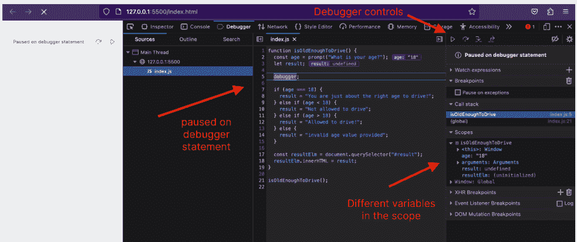

你可能需要拖动开发者工具窗口以增加其宽度，以匹配上图所示的布局。窗口宽度较窄可能会显示与上图中高亮区域不同的布局。

现在代码执行已暂停，我们可以专注于调试器的两个区域：调试器控件和当前作用域中不同变量的值；这两个区域在上图中都有高亮显示。

调试器控件允许我们一次执行一行代码，使我们更容易看到每行代码是如何执行的以及它如何影响不同变量的值。

你可以将鼠标悬停在调试器控件中的每个按钮上，以了解其功能。

你还可以在上图的“Scopes”部分上方看到调用栈。这允许我们查看当前函数是如何被调用的。我们也可以将鼠标悬停在代码中的不同变量上以查看它们的值。

你可以通过双击值来更改“Scopes”部分中不同变量的值。这使我们能够看到如果当前作用域中的变量值发生改变，我们的代码将如何表现。

让我们来调试一下为什么当值为“18”时代码无法工作。注意 `age` 变量的值（悬停查看或查看“作用域”部分）；你会看到它的值是字符串而非数字。这意味着接收用户输入的 `prompt` 函数返回的是一个字符串。因此当执行到第一个 `if` 条件，即 `age === 18` 时，它的计算结果不会为 `true`。你能猜到为什么吗？因为使用三等号（严格相等）运算符比较字符串和数字时，结果总是 `false`——你可能已经知道了，但如果你不知道，调试器会帮你发现 `age` 的值是字符串而你在和数字比较，因此它确实能帮助你更好地理解代码。

既然我们知道了问题所在，可以通过在比较前将 `age` 转换为数字来修复它：

```js
const age = Number(prompt("What is your age?"));
```

这是一个简单的例子，向你展示如何使用 `debugger` 语句来调试代码。浏览器内置的调试器功能非常强大，值得深入探索它的每一项功能以提升你的调试技能。

在上一课中，我们使用了 `debugger` 语句来暂停代码执行并调试代码。还有另一种暂停代码执行的方法，那就是使用**断点**。断点的作用类似于 `debugger` 语句，不同之处在于我们不需要在代码中编写任何特殊关键字。相反，我们在浏览器开发者工具中打开 JavaScript 代码并设置断点。

如上一课所示，我们的 JavaScript 代码在“调试器”标签页中打开。在 Chrome 中，对应的标签页名为“Sources”（源代码）。两个浏览器调试器的整体功能大致相同。以下是 Chrome 浏览器“Sources”标签页的截图，其中包含我们的 JavaScript 代码：

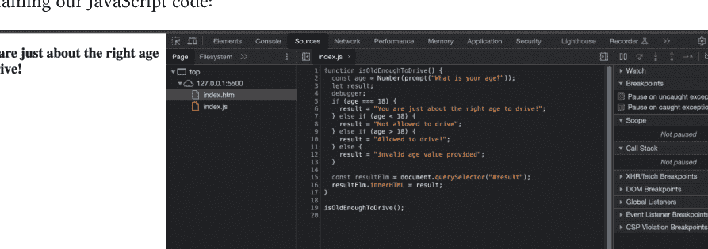

现在，让我们不用 `debugger` 语句，改用断点来暂停代码执行。我们将使用与上一课相同的例子，但不包含 `debugger` 语句。要设置断点，首先需要在浏览器中打开代码，打开开发者工具，然后打开“Sources”（或如果你使用的是 Firefox 浏览器或 Chrome，则是“Debugger”）标签页（其他浏览器也会有类似的标签页）。

如果你是接着上一课学习的，你可能已经将代码在浏览器中打开了；如果没有，你可以在浏览器中打开上一课的代码示例。你可以使用 VS Code 的 Live Server 扩展来打开代码示例。

一旦代码在浏览器开发者工具中打开，设置断点就像单击代码行号一样简单。下图显示了在代码中设置的两个断点：

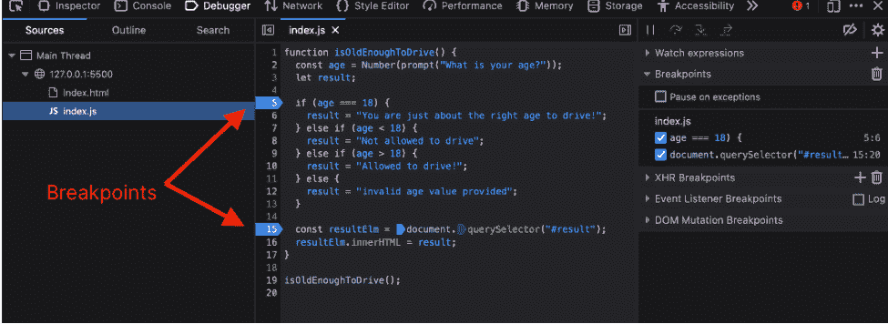

*浏览器开发者工具中断点的屏幕截图*

只需单击你想要设置断点的行号，然后刷新浏览器窗口。就像使用 `debugger` 语句一样，当执行到达我们代码中设置的断点时，代码执行将会暂停，之后我们就可以使用浏览器调试器提供的不同功能来调试代码了。

### 延伸阅读

- [调试 JavaScript（Chrome 开发者工具文档）](https://developer.chrome.com/docs/devtools/javascript/)

## 使用 VS Code 调试代码

Visual Studio Code (VS Code) 是当今最常用的编辑器之一，这得益于它所提供的功能和灵活性，以及大量可用的扩展。在 VS Code 提供的众多功能中，其中一个是内置的调试器，允许我们在 VS Code 内调试代码。除了内置调试器，还有许多可用于调试不同语言编写的代码的扩展。

要使用 VS Code 调试我们的代码，请在 VS Code 中打开我们在过去两节课中一直在处理的同一个代码示例。打开后，在包含代码（HTML 和 JavaScript 文件）的文件夹中创建一个名为 `.vscode` 的文件夹。在 `.vscode` 文件夹内，创建一个名为 `launch.json` 的文件，并将以下 JSON 粘贴到此文件中：

```json
{
  "version": "0.2.0",
  "configurations": [
    {
      "type": "chrome",
      "request": "launch",
      "name": "Launch Chrome against localhost",
      "file": "${workspaceFolder}/index.html"
    }
  ]
}
```

在运行调试器之前，我们需要设置断点。我们可以使用代码中的 `debugger` 语句，或者通过单击在 VS Code 中打开的 JavaScript 代码文件中的行号来设置断点。下图显示了在 VS Code 中打开的 JavaScript 代码文件中添加的一个断点：

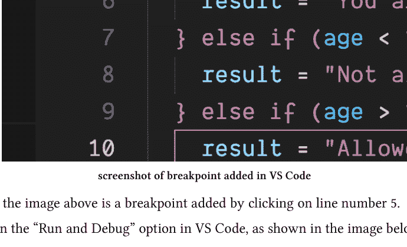

*在 VS Code 中添加断点的屏幕截图*

上图中的红点是通过单击第 5 行添加的断点。

之后，在 VS Code 中打开“运行和调试”选项，如下图所示：

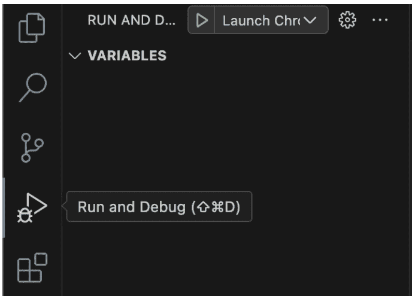

*VS Code 中“运行和调试”选项的屏幕截图*

一旦“运行和调试”窗口打开，如上图所示，单击顶部的绿色播放按钮。这将打开 Chrome 浏览器，调试器会在到达断点时暂停代码执行。如上图所示，断点添加在第 5 行，因此调试器会在获取用户输入后暂停执行。根据你添加断点的位置，代码执行在到达该点时都会暂停。

下图显示了代码执行在断点处暂停时 VS Code 的状态：

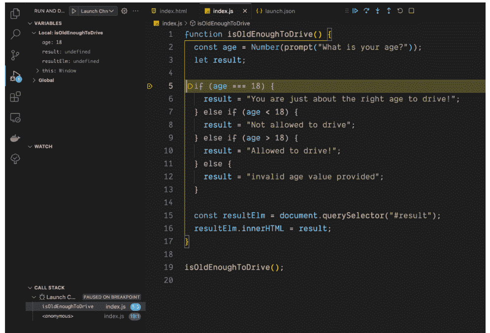

你可以看到顶部的调试器控件，其功能与浏览器中的调试器控件类似。高亮显示的行显示了代码执行暂停的位置，左侧边栏显示了调用堆栈和当前作用域中的变量。我们可以使用调试器控件向前推进或恢复调试器，并查看作用域中不同变量的执行流程和值，以调试我们的代码。

### 延伸阅读

在 VS Code 中，你还可以使用调试器做更多事情。我们手动创建的 `launch.json` 文件，可以通过 VS Code 只需单击一下按钮自动生成。这以及 VS Code 调试器能够实现的其他功能，在 VS Code 文档中有详细说明：

- [调试（VS Code 文档）](https://code.visualstudio.com/docs/editor/debugging)

### 总结

恭喜你！你已经到达了本课程的终点。希望这门课程能够达到甚至超出你的预期。

尽管存在种种特性，JavaScript 仍是一门非常值得学习的奇妙语言。本课程的目的并非涵盖整个 JavaScript 语言。相反，它旨在涵盖那些核心主题，这些主题，尤其是初学者，常常理解得不够深入。关于 JavaScript，有很多内容是本课程无法涵盖的。但是，通过对核心主题的扎实理解，你肯定可以继续深入学习它。

学习 JavaScript 不仅为你打开了使用现代前端框架进行前端开发的大门，也为你打开了使用 NodeJS 等技术进行后端开发的大门。

### 下一步

以下是一些可以用来继续你学习 JavaScript 旅程的资源：

- [MDN 上的 JavaScript 参考文档](https://developer.mozilla.org/en-US/docs/Web/JavaScript) 是参考不同 JavaScript 主题的绝佳资源。不要试图记住每个 JavaScript 主题，而是在需要时使用 MDN 来阅读相关内容。
- [ECMAScript 规范](https://www.ecma-international.org/publications-and-standards/standards/ecma-262/) 主要面向那些在浏览器中实现该规范的开发者。话虽如此，它也可以用于深入研究特定主题，以理解其实际工作原理或底层预期工作方式。
- [exploringjs.com](https://exploringjs.com/) 是一个很棒的网站，你可以在这里找到与 JavaScript 相关的书籍。这个网站的妙处在于书籍是免费的，并且可以在线阅读。

除了上述资源，以下是我个人非常喜欢的几本书（付费资源），它们也可以作为学习 JavaScript 的绝佳资源：

- Javascript: The Definitive Guide by David Flanagan
- Javascript: The New Toys by T.J. Crowder
- Professional JavaScript for Web Developers by Nicholas C. Zakas

在此，我要感谢你投入时间学习本课程，希望它能帮助你更深入地理解 JavaScript 语言。
