# React 高级 Web 开发

# 献给

我的家人和朋友

我的妈妈、爸爸、姐姐以及亲密的朋友们，他们一直对我充满信心。

# 关于作者

`Mehul Mohan`是一位企业家、开发者和安全研究员。目前，他正在印度理工学院比尔拉分校攻读计算机科学与工程学士学位。他是WWDC’19 学者，并运营着`codedamn`——一个供人们学习编程的平台。你经常会发现他在他的YouTube频道`codedamn`上制作编程教程，该频道拥有超过 100,000 名订阅者。他曾获得谷歌、微软、索尼等公司对其作为安全研究员所做贡献的认可。

# 关于审稿人

自驱力强、富有魅力的程序员，目前担任美国Verizon公司的技术分析师，专注于前端编程。参与了将Verizon网站页面从`Angular`迁移到`React Js`的工作。拥有印度莫迪科技大学计算机科学学位。

技术爱好者，热爱UI设计。在软件开发、前端开发方面拥有丰富经验，包括分析、设计、开发和测试基于面向对象`JavaScript`、`HTML5`、`CSS3`、`BootStrap`、`ReactJS`、`JSON`、`Redux`、`JQuery`的Web应用程序。以高度承诺和灵活应对多重角色而闻名。参与过Sprint规划、每日 Scrum会议、Sprint演示和Sprint回顾会议。在UI开发、Web UI分析、响应式设计、编码、单元测试、实施和支持等多个项目中拥有广泛经验。

在敏捷软件开发团队中使用`SCRUM`、`TDD`（测试驱动开发）。精通使用核心`Java`概念（如`OOPS`）开发应用程序。优秀的沟通和人际交往能力，自驱力强，喜欢作为团队成员与他人协作。在Verizon之前，我曾在法国电信（`Orange France`）担任`Java`开发人员。参与将Orange的计费系统从`DML`（一种遗留代码语言）迁移到`Java`。由于拥有法语文凭，掌握的法语知识对该项目帮助很大，并且曾为同事们开设法语课程，这也很有趣。

还曾在HCL和C-DOT实习。喜欢在线上为开源项目做贡献。喜欢在空闲时间做自由职业项目。爱好：探索全球新地方、结识新朋友以及阅读关于太空的书籍。

# 致谢

我要感谢一些人在撰写本书期间给予我的持续支持。首先，我要感谢我的妈妈`Ritu Mohan`女士和我的爸爸`Vinay Kumar Mohan`先生，无论我何时需要他们，他们总是在那里。

我还要感谢我的姐姐`Ishumita Mohan`女士，她恰好也是本书的技术编辑，感谢她一直以来的持续支持。

最后，我要感谢BPB Publications的`Nrip Jain`，感谢他给我这个机会，让我为他们撰写我的第一本书。

# 前言

随着网络在过去5-6年的快速发展，建立在现有市场最佳实践之上而不是从零开始，这已是不言而喻。React就是这样一种工具，用于构建高度响应和可扩展的Web应用程序，并带来了行业最佳实践，被Facebook等互联网前端巨头所使用。因此，对于开发者来说，提升他们的Web开发技能，将`React`纳入他们的工具箱变得极为重要。

随着企业对优化用户体验以及搜索引擎优化需求的增加，诸如服务器端渲染（`SSR`）和渐进式Web应用（`PWA`）之类的技术可以使公司能够构建更好的产品，同时减少现有代码库的技术维护。

本书是希望学习React前沿功能、温习React技能、或开始使用`Next.js`和React进行`SSR/PWA`工作的开发者的首选手册，这最终将帮助他们基于高度维护和值得信赖的开源代码扩展现有应用程序。本书将带你了解构建适用于SSR部署或转换为PWA的应用程序所需的不同离散概念。在本书的9章中，你将学习以下内容。

**第1章**向你介绍React。我们将深入探讨React是什么，以及为什么它是当今构建高度可扩展应用的绝佳选择。我们还将快速温习未来章节所需的一些必要`JS`概念。

**第2章**将涵盖使用各种方法设置React，并讨论每种方法的优缺点。我们还将开始用React编写基本应用程序，并开始了解React开箱即用的优势。

**第3章**将介绍在React中创建组件的两种方式，并讨论React在组件方面的现代方法——函数式。我们还会在本章中使用`hooks`，并了解为什么它们比其对应物——类组件更有意义。

**第4章**介绍React中的状态管理。在这里我们讨论使用React管理状态的可能选项。我们将了解使用`Redux`管理状态，以及使用最新的`hooks`——`useContext`和`useReducer`来模拟`Redux store`。

**第5章**介绍React中的服务器端渲染，我们将了解什么是`SSR`，以及它是如何工作的。我们将在本章中从零开始自己实现SSR，并讨论其优缺点。

**第6章**本章将向你介绍`Next.js`——在使用React进行SSR时，一个流行的SSR框架选择。我们将了解如何设置`Next.js`以及它内置的各种功能。

**第7章**我们将在本章中探索更多高级`Next.js`功能，深入框架内部，并使用`Next.js`框架设置API端点。

**第8章**本章介绍渐进式Web应用以及如何使用`Next.js`和React框架创建PWA。

**第9章**本章涵盖React的前沿功能，以及一些关于React内部工作原理的信息。

## 1. React 入门

`JavaScript`:它是网络的编程语言。自网络诞生以来，开发者们就渴望在交互性、动画、效果和稳定性方面为终端用户提供越来越好的体验。JavaScript让这一切成为可能。随着它的发展，由于一些显而易见的原因，为了更快的开发和更好的稳定性，引入框架和库变得很有必要。

React是这个生态系统的一部分。React将自己定位为“一个用于构建用户界面的JavaScript库”。但老实说，尽管这句话是正确的，我们认为React远不止于此。它可以被构建成一个完整的生态系统，为一些最复杂的网络应用程序系统提供动力，例如Facebook。

我们将快速浏览React的基础知识，然后从入门到高级主题，这将真正让你领会React的精髓，并最终帮助你开始使用React编写生产就绪的应用程序。

简单来说，React是一个用户界面（UI）库。让我们分解一下：

1. React本身声明它是一个库，意味着它不会试图将所有东西都打包在一起。相反，你可以选择在你的项目中挑选你需要的东西并加以实现。
2. React说它是一个UI 库，用于构建用户可见的界面。这意味着什么意思？简单来说，就是创建和维护用户在屏幕上看到的内容。

### 结构

- 引言
- 理解React
- 基本理解React如何作为UI库工作
- 声明式编程与命令式编程
- React后续主题的速查表

### 目标

在本章中，我们将理解React具体在做什么，以及为什么应该关注它。我们将从表面了解它如何作为UI库工作，以及React的声明式方法在创建更好的UI系统方面为何如此强大。最后，我们将开始React编程，但会在章节末尾提供一些笔记，这些笔记作为JavaScript复习可能会很方便。

### React是基于组件的

React使用组件。其理念很简单——React认为，与其把所有东西都写在同一个地方（就像我们编写简单的HTML页面时通常做的那样），不如将页面的不同（通常是独立的）部分拆分成不同的组件。这成倍地增加了代码的可维护性，让开发者拥有更快、更干净的代码库。我们将有专门的章节来讨论组件的使用，因为它是React的核心。

### React是声明式的

我们将主要关注两种编程范式——声明式编程和命令式编程。让我们从一个简单的例子开始。

当你编写代码时，你可以指定：

1. 你想做什么？
2. 你想怎么做？

如果你同时指定了两者，你就是在使用命令式编程实践。如果你只指定了你想做什么，那么你就在使用声明式编程方式。这里有一个简单的例子。

假设你想在一个盒子周围画一个边框。在CSS中，你只需说`border:2px solid black`。这是声明式的。你说了你想做什么，而不是怎么做。另一方面，如果你尝试在JavaScript中绘制边框，你必须指定坐标，然后手动绘制。这将是命令式的方式。

声明式编程有其缺点，但优点：

1. 声明式代码可以使用高度优化的。由于“如何做”对用户是抽象的，命令式模型可以使用复杂的代码来提供性能提升，同时为用户暴露一个简单的声明式接口。
2. 声明式编程带来了好处，如扩展性、减少错误和易于理解的代码。

回到React，它是声明式的。这意味着你只需要告诉React“做什么”，而不是“怎么做”。React在底层高度优化的方式为你一切。我们将在最后一章详细讨论DOM、协调以及其他高级功能。

### 快速复习

在我们深入React生态系统之前，想列出一些处理React时应该的知识点。让我们快速浏览这一部分，稍后需要再回来。

#### this

在JavaScript中，`this`对很多人来说出意料地复杂。记住，在一个函数中，`this`总是指向该函数调用的方式，箭头函数除外：

```javascript
function myName() {
  return this
}
```

## 2. 设置

### 结构

- 选择编辑器
- 第一名 – VSCode
- 第二名 – Sublime Text
- 第三名 – Atom
- 设置Node和NPM
- Windows
- 设置React项目
- 第一名 – 使用create-react-app
- JSX
- 迁移到TypeScript

### 目标

## 3. 组件

### 结构

- 关于组件
- 类组件与函数组件
- 函数组件
- Props
- Children
- Hooks
- `useState`
- `useState`
- `useEffect`
- `useEffect`依赖项
- `useEffect`cleanup
- `useCallback`
- 自定义Hooks
- 类组件
- Props
- State
- 生命周期方法
- `constructor`
- `static getDerivedStateFromProps`
- `render`
- `componentDidMount`
- `componentDidUpdate`
- `componentWillUnmount`

### 目标

## 4. React中的状态管理

### 结构

- 组件间通信
- Props逐层传递（Prop drilling）
- Refs
- Context API
- `Context.Provider`
- `useContext`
- `useReducer`

### 目标

## 5. 服务端React

### 结构

- React在服务器上
- 什么是服务端渲染？
- 为什么服务端渲染？
- 从SSR开始
- ReactDOM
- SSR配置
- 更多组件
- SSR路由
- 客户端React
- ReactDOM.hydrate

### 目标

## 6. Next.js简介

### 结构

- 什么是Next.js？
- 为什么选择Next.js？
- 安装
- Next.js默认设置
- 页面
- 热载
- 静态文件
- 路由
- Link
- Link只是高阶组件（HoC）
- 关于Link的更多信息
- Next.js组件
- Styled JSX
- 导入CSS文件

### 目标

## 7. Next.js进阶

### 结构

- Next.js应用
- 启动项目
- 迁移到TypeScript
- Redux
- `getInitialProps`
- 创建App
- 使用Next.jsAPI
- `_app.js`文件
- 分发Actions
- `useSelector`
- `useDispatch`
- 创建Dashboard页面
- 条件路由

## 8. 渐进式Web应用

### 结构

- 什么是渐进式Web应用？
- Hello World
- manifest.json
- Service workers
- 生命周期
- 使用Next.js构建PWA
- config: object
- getRequestHandler()
- serveStatic()
- document.js

### 目标 

## 9. 前沿React

### 结构

- React如何工作？
- 协调器（Reconciler）
- 渲染器（Renderer）
- 摒弃类组件
- 并发模式
- 选择并发模式
- Suspense – 代码获取
- Suspense – 数据获取

### 目标

### 下载代码包和图片

按照以下链接下载本书的代码包和图片：https://rebrand.ly/5ino

### 勘误

我们在BPB Publications为自己的工作感到无比豪，并遵循最佳实践以确保内容的准确性。我们的读者是镜子，我们利用他们的反馈反思并改进出版过程中出现的人为错误。为了保持质量并帮助我们联系到任何因不可见的错误而遇到困难的读者，请写信给我们：[errata@bpbonline.com](mailto:errata@bpbonline.com)

BPB Publications大家非常感谢您的支持、建议和反馈。

```javascript
const myNameButArrow = () =>console.log(this.myname)
const person1 = {myname: "Mehul", myName }
const person2 = {myname: "James", myName }
const person3 = {myname: "Enzo", myNameButArrow }

console.log(person1.myName())
console.log(person2.myName())
console.log(person3.myName())
```

输出结果在以下图中展示：

img/bf8e5efd984d24a7dcd00bdb61e5b_20_0.png

图1.1：输出

### 箭头函数

箭头函数允许你编写更精简的函数，具有词法作用域绑定到`this`的特性，并且不能使用`new`关键字实例化：

```javascript
const obj = {
myFunction: function() {
  return this
},
coolFunction: () => {
  return this
}
```

```javascript
console.log(obj.myFunction()) // 输出原始的obj 对象
console.log(obj.coolFunction()) // 输出window（全局对象）
```

这里我们看到与前面相同的代码及其输出，如以下所示。如前所述，第一条语句输出原始对象，第二条语句输出整个window 对象：

img/bf8e5efd984d24a7dcd00bdb61e5b_21_0.png

### .map

`.map`允许你在不改变原数组的情况下操作数组——也就是说，`.map`作用于数组的每个元素，并返回一个新数组，该数组由你传递给`.map`的函数内部返回的元素组成。

以下是一个快速示例，展示`.map`在情况下如何工作：

```javascript
const arr = [{
  name: "Mehul Mohan",
  country: "India"
}, {
  name: "James Paul",
  country: "USA"
}]
const component = arr.map(name =>arr.name)
```

```javascript
console.log(component) // 输出 ["Mehul Mohan", "James Paul"]
console.log(arr) // 输出原始对象
```

如你所料，前面的代码输出了经过`map`函数处理后的数组。然而，这并没有修改原始数组。

### .reduce

`.reduce`允许你将数组规约为单一值。这是通过一个累加器和它当前迭代的值来实现。让我们看一个例子来：

```javascript
x = [1,2,3,4,5]
x.reduce((acc, val) => acc + val, 0)
```

在前面的例子中，`reduce`接受一个函数，该函数每次被调用时传入两个值：累加器和当前值。函数返回的任何值，将成为下一次函数调用的累加器值。你可以选择将初始累加器值作为`.reduce`函数的第二个参数传递。如果未提供，则会使用数组的第一个元素初始化累加器，并从第二个值开始规约数组。

### 类

ES6中的类只是函数的语法糖。JavaScript不是面向对象编程。它遵循原型继承模型，类也是如此。尽管如此，提议的语法使其看起来非常类似于面向对象编程。以下是一个ES6类的例子：

```
class ILoveNumbers {
  constructor(num) {
    this.anothernum = num
  }
  getNum() {
    console.log(this.anothernum)
  }
};
```

```
class IHateNumbers extends ILoveNumbers {
  constructor(num) {
    super(num**num)
    this.num = num
  }
  getNum() {
    console.log(this.num)
  }
  getNumFromParent() {
    console.log(super.getNum())
  }
};
let obj = new IHateNumbers(5)
obj.getNum() // 5
obj.getNumFromParent() // 3125
```

关于前面代码的一些重要点：

1. 这里我们创建了一个简单的类`ILoveNumbers`，它只是存储一个数字。

2. 我们创建了另一个类`IHateNumbers`，它继承自我们之前的类。“继承”在基于类的语法中仅仅意味着你将父类（函数）添加到当前类（函数）的原型链中。

3. 我们使用了一个特殊的`super` 关键字。使用`super`，我们可以访问父类。记住，当在方法中使用`super`时，`super`指的是定义该方法的对象的原型链。这意味着，如果我将`IHateNumbers`的原型链更改为其他内容，`super.getFav()`应该不会按预期工作。

考虑以下代码：

```
class C1{ method() { return 1 } }
class C2 extends C1{ method() { return super.method() } }
class C3{ method() { return 3 } }
class C4 extends C3{ method() { return 4 } }
const obj = new C4
```

```
console.log(obj.method()) // 输出 4
C4.prototype.method = C2.prototype.method
console.log(obj.method()) // 输出 1
```

4. 这里你可以清楚地看到，`super.method()`并没有调用`C3`的方法。相反，它调用了`C1`的方法。但是，如果你定义了`C4`的方法返回`super.method()`，它将会调用`C3`的方法。

### 闭包

闭包是 JavaScript 中实现的一个基本概念，它极其强大且美丽。用一句话定义闭包：函数记住了。作为计算机科学家，我们通常理解当函数返回时，它们会移除所有相关的局部变量信息。当你使用闭包时，这种情况就改变了。例如，考虑以下代码：

```
function a() {
  let value = 1
  return () => value++
}
const func = a()
func() // 1
func() // 2
func() // 3
```

在前面的函数中，我们可以看到尽管`value`是一个局部变量，但在函数`a`执行完成后它并没有被销毁。相反，函数记住了它。

### 更多 JavaScript 主题

当你继续阅读本书时，你会意识到，作为一个框架，你总是需要使用比 React 本身更多的 JavaScript。尽管我们上面讨论了一些常见的 JavaScript 主题，但我们建议如果你对 JavaScript 的基础巩固和基础知识感兴趣，可以阅读更多关于以下主题的内容。由于这不是一本核心 JS 书籍，我们不会过多关注仅限于 JavaScript 的主题，但你可以随时使用此列表来学习更多：

1. 解构
2. 展开运算符
3. ES6 `import/export` 模块语法
4. `Async/Await`
5. JavaScript 可选链
6. 空值合并运算符
7. 原型继承模型
8. 变量提升/变量作用域

### 结论

本章涵盖了一些基本的 React 概念和基础的 JavaScript 知识。在下一章中，我们将学习如何设置 React 开发环境并有效地使用它。我们将探索 React 基础知识，并逐步深入到服务端渲染框架 Next.js，最终涵盖渐进式 Web 应用程序的相关信息。请坐稳，准备开始代码之旅！

# 第 2 章 设置 React

在本章中，我们将看到一些常见和不那么常见的方法，将 React 设置到你的开发工作流中。我们将从最基础的内容开始，比如你应该选择哪个编辑器，一直到引导启动你的 React 应用程序的最佳方式，使其符合你的需求并方便你将其投入生产。让我们开始吧！

有些人喜欢一直使用集成开发环境（IDE）。我们将采取不同的方法。对于 Web 开发等工作，IDE 往往会变得非常庞大。此外，IDE 抽象了很多东西，所以你能学到的比你预期的要少得多。我们将使用（并学习）命令行，使用轻量级文本编辑器编写代码，并构建出色的应用程序！让我们继续本章的内容。

### 结构

- 选择文本编辑器
- 设置 Node 和 NPM
- 设置 React 项目的方式
- React Hello World
- JSX
- 为 React 转向 TypeScript

### 目标

我们将从一个简单的选择开始本章——选择一个你喜欢用来编写代码的文本编辑器。然后，我们将进行所需技术的安装和设置，这将帮助我们探索设置第一个 React 项目的方式。我们还将探索 JSX 是什么以及它如何工作。最后，我们将把重点转向 React 的 TypeScript，并在本书中一直使用它，以获得更好的类型系统和无错误的代码。

### 选择文本编辑器

首先 - 你需要一个编写代码的地方。以下是我们个人推荐的文本编辑器列表。

#### 1 – VSCode

这是目前最流行的文本编辑器，你会发现很大一部分 Web 开发人员一直在使用 VSCode。VSCode 完全可定制，拥有大量额外插件以提高你的工作效率。它是跨平台的（macOS/Linux/Windows），你可以在这里获取适合你平台的稳定版二进制文件：`https://code.visualstudio.com/#alt-downloads`。

#### 2 – Sublime Text

另一个很棒的文本编辑器是 Sublime Text。如果你对 VSCode 不满意，Sublime Text 可以是第二选择。你可以购买它，但不是强制。Sublime Text 允许你免费使用很长时间，每周左右屏幕上弹出一个小提示要求升级。它还附带了强大的包管理和出色的主题。从这里下载：`https://www.sublimetext.com/3`。

#### 3 – Atom

如果你在寻找文本编辑器，Atom 也是一个不错的选择。它包含一个包管理器，完全可定制且免费！你可以从这里下载 Atom 文本编辑器：`https://atom.io/`。

### 设置 Node 和 NPM

一旦你的文本编辑器安装并准备就绪（这应该相对需要 5-10 分钟），就该设置 Node 和 npm 了。如果你的系统中已经有了它们，可以跳过本节。Node 基本上是将 JavaScript 引擎（负责运行你编写的代码）放在你的计算机上，而不是仅仅嵌入到浏览器中。而 npm 是它的包管理器，用于添加和删除包。

#### Windows

对于 Windows 系统，按照以下步骤安装 Node.js 和 npm 的最新版本：

1. 访问`https://nodejs.org/en/download/`。
2. 下载安装程序（`.msi`）文件。根据您的操作系统选择 32 位或 64 位。
3. 按照向导完成安装。
4. 在 `cmd` 中输入 `node -v` 验证安装。

#### Linux

对于 Linux 系统，按照以下步骤安装 Node.js 和 npm 的最新版本：

1. 打开命令行（终端）。
2. 输入 `sudo apt-get update && sudo apt-get install npm`。
3. 根据您的发行版，`apt-get` 作为包管理器。
4. 完成后，输入 `sudo npm install -g n`。
5. `n` 是一个 Node.js 版本管理器。
6. 完成后，输入 `n stable`。
7. 最终将安装 Node.js 和 npm 的稳定版本，将其添加到路径中。
8. 退出终端并重新启动，输入 `node -v`。

#### macOS

如果你使用的是 macOS 系统，按照以下步骤安装 Node.js 和 npm：

1. 在 macOS 上需要 `brew` 包管理器。如果你不知道它，可能尚未安装。在命令行中输入以下命令：`/bin/bash -c "$(curl -fsSL https://raw.githubusercontent.com/Homebrew/install/master/install.sh)"`。
2. 你也可以在此处找到 `brew` 安装说明：`https://brew.sh`。
3. 输入 `brew install node`。
4. 完成。

### 设置 React 项目

现在，让我们讨论一下引导 React 项目的方法。我们将从基础开始，逐步介绍。

#### #1 – 使用 CDN

这是用 React 编写“Hello World”最直接的方式。你只需通过 CDN 引入 React 库就可以开始了。考虑以下代码：

```html
<!doctype HTML>
<html>
<head>
<title>React hello world</title>
</head>
<body>
<div id="root"></div>
<script src="https://unpkg.com/react@16/umd/react.min.js"></script>
<script src="https://unpkg.com/react-dom@16/umd/react-dom.min.js"></script>
<script src="https://unpkg.com/babel-standalone@6/babel.min.js"></script>

<script type="text/babel">
    class HelloWorld extends React.Component {
        render() {
            return (<p>Hello world</p>);
        }
    }

ReactDOM.render(
  <HelloWorld />,
  document.getElementById('root')
);
</script>
</body>
</html>
```

这段代码中有很多内容，让我们快速分解一下：

1. 首先，加载了两个脚本：`React` 和 `React-DOM`。为什么是两个？正如您所看到的，`React` 不限于 Web，你也会看到 `React Native` 在移动设备上使用。这意味着 `React` 独立于 DOM对象模型（DOM 是浏览器用来渲染 HTML 的）。由于我们处理的是网页，我们需要核心库（即 `React`），以及一个将 `React` 和 DOM 粘合在一起的协调器。
2. 然后我们加载了名为 `babel` 的库。
3. 最后，您看到创建了一个 `type="text/babel"` 的 `script` 标签。这是因为我们不会在这个标签中编写纯 JavaScript。我们将编写一些需要预处理的代码，然后作为常规 JavaScript 执行。
4. 最后，看到了一些 React 构造（类和 `ReactDOM`），但现在我们先忽略它们。有趣的是，我们直接写了 `<p>Hello world</p>` 没有任何引号。这不是错误。实际上，这是 JSX。

#### #2 – 使用 create-react-app`

`create-react-app` 是一个工具，允许以最少的配置快速地引导 React 项目。方法如下：

1. 再次打开终端（Windows 上为 `cmd`，macOS/Linux 上为 `Terminal`）。
2. 输入 `npm install create-react-app -g`。
3. 完成后，输入 `create-react-app hello-world`。
4. 等待完成。执行 `cd hello-world` 并输入 `npm start`。
5. 将启动本地开发服务器。

#### #3 – 从头开始设置

对于开始 React 来说，这有点高级，意味着您正在微调和控制应用程序的各个方面。我们将遵循类似 `create-react-app` 的模型，但这次所有配置文件和文件夹都对我们可见：

1. 创建名为 `hello-world-scratch` 的文件夹：
   `cd hello-world-scratch`
2. 执行 `npm init -y`，创建 `package.json` 文件。
3. 执行 `npm install react react-dom -save`。
4. 执行 `npm install webpack webpack-dev-server webpack-cli @babel/core babel-loader @babel/preset-env @babel/preset-react html-webpack-plugin --save-dev`。
5. 这些 `devDependencies` 的用途：
   - `Webpack`: 模块打包器系统，将各种资源（JS、CSS 等）组合。
   - `webpack-cli`: 运行 webpack 命令。
   - `webpack-dev-server`: 启动服务器。
   - `@babel/core` 和 `babel-loader`: 让 webpack 使用 babel 处理文件。
   - `@babel/preset-env` 和 `@babel/preset-react`: Babel 预设。
   - `html-webpack-plugin`: 动态生成 HTML 页面。
6. 在目录执行 `touch .babelrc`。
7. 写入内容：
   ```json
   {
     "presets": ["@babel/preset-env", "@babel/preset-react"]
   }
   ```
8. 最后，我们需要告诉 webpack 让 babel 处理适当文件。创建 `webpack.config.js` 文件。

```markdown

```javascript
const path = require('path');
const HtmlWebpackPlugin = require('html-webpack-plugin');

module.exports = {
  entry: path.join(__dirname, 'src/index.js'),
  output: {
    path: path.join(__dirname, 'bundle'),
    filename: 'bundle.js'
  },
  module: {
    rules: [
      {
        test: /\.(js|jsx)$/,
        exclude: /node_modules/,
        use: ['babel-loader']
      }
    ]
  },
  mode: process.env.NODE_ENV || 'development',
  resolve: {
    extensions: ['*', '.js', '.jsx']
  },
  devServer: {
    contentBase: path.join(__dirname, 'src')
  },
  plugins: [new HtmlWebpackPlugin({
    template: path.join(__dirname, 'src/index.html')
  })]
};
```

- 这简单地告诉`webpack`:嘿，当你处理`.js`或`.jsx`文件时，加载`babel`。
- 我们需要在想要查看输出时启动`webpack`开发服务器，因此我们将此添加到`package.json`文件的`scripts` 键中：`"start": "webpack-dev-server --open"`。
- 现在我们将为这个创建一个静态的HTML文件，用于`src/index.html`：

```html
<!DOCTYPE html>
<html lang="en">
<head>
    <meta charset="UTF-8">
    <meta name="viewport" content="width=device-width, initial-scale=1.0">
    <meta http-equiv="X-UA-Compatible" content="ie=edge">
    <title>React Hello World!</title>
</head>
<body>
    <div id="root"></div>
</body>
</html>
```

+ 最后，我们来操作 `src/index.js` 文件，在其中写入以下内容：

```javascript
import React from 'react'
import ReactDOM from 'react-dom'

ReactDOM.render(<div>Hello World</div>,
document.getElementById('root'))
```

- 就这样！现在，在你的项目根目录下运行`npm start`。你的网页浏览器应该会打开，并且屏幕上会显示 "Hello World"。

然而，对于本课程，我们将采用 `create-react-app` 的方式，因为它抽象掉了所有 `webpack`和`babel`的配置，为我们提供了一个专注于编写 React 代码的绝佳机会。

### JSX

让我们稍微深入了解一下 JSX，也就是我们刚刚在 JavaScript 文件中编写的那种奇特的 HTML 语法：

```
ReactDOM.render(<div>Hello World</div>,
document.getElementById('root'))
```

你看到我们在那里做了什么了吗？你可以看到一个 `div` 标签被直接书写，没有使用引号。这就是 JSX。JSX 代表 JavaScript 可扩展标记语言。

JSX 是一种不同的语法。它让你能够利用 HTML 标记的简洁性，同时结合强大的 JavaScript 计算能力。你可以包含 JavaScript 表达式、动态的 props（属性，或者在普通 HTML 中我们称之为 attributes），并同时处理 UI 和功能。

你也可以在 JSX 中使用花括号来书写表达式。看看下面的 JSX 示例：

```javascript
const elem = <div>Hello World { document.location.href } { 5 + 5 }
{ 'Regular string' } </div>
```

这是一个完全有效的 JSX 语法，但绝对不是有效的 JavaScript。那么，底层发生了什么呢？

### JSX 转换

React 将 JSX 编译成普通的 ES5 代码。请看以下示例：

```javascript
const elem = <div className="a-classy-div">JSX seems so cool!</div>
```

这个示例被编译成以下代码：

```javascript
const elem = React.createElement('div', { className: 'a-classy-div' }, 'JSX seems so cool!')
```

后者看起来绝对是有效的 JavaScript 语法。这就是 JSX 的魔力。它为你编写 React 组件提供了一种视觉辅助，因为现在你可以轻松地避免为 UI 部分编写繁琐的、额外的 JavaScript 代码。

事实上，前面两个代码片段是等价的，意味着你可以直接编写 `React.createElement` 部分来替代 JSX。但是当然，对于 UI 开发来说，JSX 比纯粹的 JS 对眼睛更友好。

### 迁移到 TypeScript

既然我们已经启动并运行了一个基于 React 的基本 JavaScript 项目，现在是时候引入 TypeScript 了。我们不会立刻深入探讨 TypeScript 的所有方面，比如所有类型转换、接口等等。相反，我们将只使用 TypeScript 的优点（即自动补全和无错误代码实践），并在整本书中使用它。以下是开始一个 TypeScript 项目的步骤：

- 删除我们之前创建的 JS hello world 文件夹。
- 假设你已经按照上面的说明安装了 `create-react-app` 工具，在你的命令行中，输入 `create-react-app hello-world-ts --template typescript`。
- 这将使用 TypeScript 初始化你的 React 项目。
- 你最终的文件结构应该如下所示：

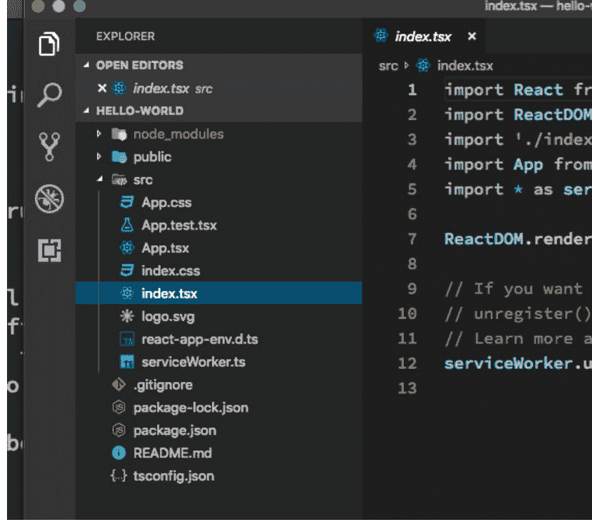

最后，我们准备好使用 React 了！

### 结论

我们学习了什么是 JSX，如何使用 React 创建项目，并最终迁移到 TypeScript，因为它提供了更好的类型检查，并允许你更容易地编写无错误的代码。在后面的章节中，我们将深入探讨 React，了解其基本原理以及相关的核心概念。

## 第 3 章 组件

组件是 React 的一个基本组成部分。其理念是这样的：网页上的所有内容都可以被分解成组件的可用视图。这些组件可以相互关联，也可以完全独立，感知其父组件。

让我们进一步了解如何使用它们。

### 结构

- 关于组件
- 类组件与函数式组件
- 函数式组件
- Props
- Children
- Hooks
- useState
- useEffect
- useCallback
- 自定义 Hooks
- 类组件
- Props
- State
- 生命周期方法
- getDerivedStateFromProps
- Render
- getSnapshotBeforeUpdate
- componentDidDidMount
- componentDidUpdate
- 结论

### 学习目标

本章旨在向你介绍 React 中的组件以及创建组件的两种方式。我们将从函数式组件开始，很快意识到，与类的方法相比，这是一种更好、更简洁的方式。我们将组件概念奠定基础。

### 关于组件

组件是 React 的核心。可以将组件看作是从主包中解耦出来的代码，以提供维护性并使功能在页面中出现变得容易。从 React 16.8 及版本开始，编写具有功能的组件只有两种方式。

### 类组件与函数式组件

类组件在 React 中已经存在很长时间。事实上，几乎是它是创建具有状态组件的唯一方式。随着 `hooks` 的引入，这种情况发生了变化。

1. **函数式组件**（`hooks` 之后）：是在 React 中创建组件更好的方式，因为它们比类更简洁，避免了许多类组件中常见的陷阱（例如 `this` 的绑定），避免了状态的直接修改（mutation）。
2. **类组件**：React 推荐使用 `hooks`，虽然基于类的组件短期内不会消失。

### 函数式组件

函数式组件在 React 中已经存在很长时间。首先，让我们从函数式组件开始看看这个例子：

```javascript
import React from 'react'
import ReactDOM from 'react-dom'

function App() {
  return <p>Hello World</p>
}
ReactDOM.render(<App />, document.getElementById('root'))
```

你可以看到，这里使用了一个名为 `App` 的函数。那么，人们如何知道它是一个组件呢？当你像使用 `<App />` 时，它转换成以下代码：

```javascript
import React from 'react';
import ReactDOM from 'react-dom';

function App() {
  return React.createElement("p", null, "Hello World");
}
ReactDOM.render(React.createElement(App, null), document.getElementById('root'));
```

那么发生了什么？

1. 你在 JSX 中编写的所有内容都会转换成等效（我们在第 1 章讨论过）的语法。
2. `React.createElement` 返回一个对象，看起来像这样：


我们不想深入探讨 React 的内部机制，但最终 React 使用对象来创建组件树。让我们回到函数式组件的一些属性。

### Props

`props`（properties 的缩写）是一个常见场景，几乎总是这样做，将数据传递给子组件。React 的工作方式是父组件将数据传递给子组件。使用上下文你可以神奇地将数据传递到多层之下。让我们看看这个例子：

```typescript
interface props {
  name: string
}

const App: React.FC<props> = props => {
  return <p>{props.name}</p>
}
ReactDOM.render(<App name="Mehul" />, document.getElementById('root'))
```

这里我们可以看到利用 TypeScript 来增强 React。我们没有使用 `function` 关键字来创建函数，而是采用了箭头函数表示，因为目前（React中）无法为函数添加类型注解。`React.FC` 或 `FunctionalComponent` 类型定义了组件，此外，你可以在定义的接口中列出所有的 props 及其数据类型。

### Children

一个名为 `children` 的特殊 prop 用于 React 组件，它基本上包含了开闭标签之间的所有内容。我提到的是“传递任何东西”而非“传递组件”，因为你实际上可以传递任何你喜欢的东西——组件、字符串、函数等等。看看下面的例子：

```tsx
const App: React.FC<{ name: string }> = props => {
  return <div>
    Hello {props.name}
    <div className="children">{props.children}</div>
  </div>
}
```

我们可以这样调用这个组件：

```tsx
<App name="Mehul">
  <p>Hey there!</p>
</App>
```

这是使用 `children` prop 的方式。另一种方式是通过函数。看这个例子：

```tsx
const App: React.FC<{ name: string, children: (one: string, two: string) => JSX.Element }> = props => {
  return <div>
    Hello {props.name}
    <div className="children">{props.children('one', 'two')}</div>
  </div>
}
```

我们将这样使用这个组件：

```tsx
<App name="Mehul">
  {(one: string, two: string) => <p>Hey there! Passed attributes: { one } { two }</p>}
</App>
```

以下是我们在最后一个例子中所内容的快速总结：

1. 我们创建了自定义的 `children` 类型，该类型接收两个字符串参数并返回一个 `JSX.Element`（即那个 `<p>` 标签）。
2. 在组件中，我们将 `props.children` 作为函数使用，并传递两个值来调用它（而不是简单地渲染它）。
3. 父组件使用子组件传递给父组件的值来渲染。这是一个将少量数据从子组件传递到父组件的巧妙技巧；通常数据是从父组件传递到子组件，但通过这种方式你可以实现反传递。

事实上，我们之前所做的被称为**渲染属性（render props）**方法。它简单地指的是当一个属性（在我们的例子中是 `children`）是一个函数而不是一个 JSX 元素或常规值时的数据传递。

### Hooks

在 React 16.8 之前，仅使用函数是无法创建有状态函数组件的。你会发现问题所在，除非像类组件一样，否则没有办法使用任何 `state` 对象。但随着 `hooks` 的引入，这一切都改变了。通过 `hooks` 引入 `state` 可以带来巨大的好处。函数组件现在可以记住它们的上下文。让我们从 React 中各种有用的 `hooks` 开始，以及如何使用它们。

### useState

`useState` hook允许你将类组件中的 `this.state` 和 `this.setState` 功能带到函数组件中。下面是一个如何使用的快速示例：

```jsx
function App() {
  const [name, setName] = useState('Mehul')
  return <p>Hello {name}</p>
}
```

让我们关注这一行 `const [name, setName] = useState('Mehul')`。`useState` 方法返回一个包含两个元素的数组，第一个是 getter，第二个是 setter。如果你只是在你的函数组件中调用 `console.log(useState("Mehul"))`，你会看到类似这样的输出：

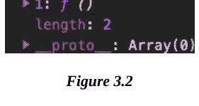

图 3.2

这里，我们可以清晰地看到数组的第一个值是 getter，第二个值是一个函数。当调用这个函数时，它会更新我们的 setter 变量，类似于调用 `this.setState` 所做的那样。让我们看一个简单的例子：

```jsx
function App() {
  const [name, setName] = useState('Mehul')
  setTimeout(() => {
    setName(Math.random())
  }, 1000)
  return <p>Hello {name}</p>
}
```

```

markdown
这里，当你运行这段代码时，你会看到`name`每秒都会变成0到1之间的随机数。注意，使用`x`和`setX`作为getter和setter的变量名是一种约定。不过，你可以使用任何你喜欢的名字，但我建议遵循约定，因为这样更容易区分。

### `useState`不是同步的

这意味着，每当你调用`useState`时，不能保证在调用后立即使用`getter`就能获取到更新后的值。例如，考虑这个例子：

```tsx
const App: React.FC = props => {
  const [currentNumber, setCurrentNumber] = useState(Math.random())
  function changeState() {
    setCurrentNumber(Math.random())
    console.log(`New number => ${currentNumber}`)
  }
  return <button onClick={changeState}>Click Me { currentNumber }</button>
}
```

以下是代码的输出：


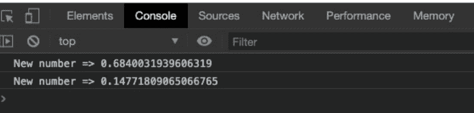

**图 3.3**

如果你使用这个组件，你会看到控制台输出的内容与UI中反映的不一致。这是因为`useState`是异步运行的，不会立即更新变量。

现在还有另一个问题，如果`setX`不是异步的，这意味着如果变量的下一个状态依赖于前一个状态，我们不能在`setX`中直接使用`x`！幸运的是，对于这种情况，React允许你在`setX`中传递一个函数，该函数的第一个参数保证是最新值。让我们看这个例子来了解更多：

```tsx
const App: React.FC = props => {
  const [counter, setCounter] = useState(0)
  function add() {
    setCounter(counter => counter + 1)
  }
  function sub() {
    setCounter(counter => counter - 1)
  }
  return <>
    <p>{ counter }</p>
    <button onClick={add}>+++</button>
    <button onClick={sub}>---</button>
  </>
}
```

这里需要注意几点：

1. 我们可以使用无名JSX元素（直接用`<>`和`</>`）——这不会显示在DOM结构中。
2. 我们可以在`setX`中传递一个函数，而不是直接传递更新后的值。如果你传递一个函数，React会用最新的状态变量值调用该函数，然后该函数返回的任何内容都会被赋值为最新状态。

一个通用的经验法则是：如果你的状态变更涉及基于前一个状态的结果，请使用函数参数方式；否则，你可以直接传递新值。

### useState 回调

在基于类的组件中，我们有一个与`this.setState`关联的回调，如果你希望等待状态变量更新然后再触发一个动作，就可以使用它。使用hooks时，情况并非如此直接，但你可以利用另一个hook来实现相同的效果。现在让我们来看看那个hook。

### `useEffect`

这个hook允许你在某些东西*变化*时执行一段代码。可以把`useEffect`想象成一个基于React内置基础设施的自定义观察实现。

这是一个非常简单的`useEffect`示例：

```tsx
const App: React.FC = props => {
  const [counter, setCounter] = useState(0)
  useEffect(() => {
    document.title = 'Counter is at ' + counter
  })
  return <>
    <p>{ counter }</p>
    <button onClick={() => setCounter(c => c + 1)}>Increment</button>
  </>
}
```

好的，这里我们可以看到，我们通过向`useEffect`传递一个函数来使用这个hook。这个函数在React每次渲染（或重新渲染）我们的组件时都会执行。这个函数最终将文档的标题设置为我们的计数器值。并且在这个函数中，你总是能获取到状态变量的最新值。这是因为React根本没有变更状态变量！在使用函数组件和hooks时，React永远不会变更状态。通过我们在简单字符串/数字值上使用`const`关键字也能相当清楚地看到这一点。相反，每当React重新渲染我们的组件时，`useState()`函数会返回新更新的状态给状态变量，而`useEffect`函数则在每次渲染时调用传递进来的函数。

### `useEffect` 依赖项

你可以很快看到`useEffect`如何可能变得对性能负担，因为即使都没改变，它也会一遍一遍运行。让我们看看下面的例子：

```jsx
const [counter1, setCounter1] = useState(0)
const [counter2, setCounter2] = useState(0)
useEffect(() => {
  document.title = 'Counter is at ' + counter1
  console.log('Effect called')
})
return <span>{counter1}</span>
```

### `useEffect` 清理机制

`useEffect`钩子为你提供了一个选项，用于在组件卸载或重新渲染（即`useEffect`再次调用）之前，清理任何想要移除的东西。也就是说，在前面的例子中，你可以使用`useEffect`清理函数，在状态渲染时调用。让我们通过一个例子更好地理解：

```javascript
const App: React.FC = props => {
  const [counter, setCounter] = useState(0)
  useEffect(() => {
    document.title = 'Counter is at ' + counter
    return function cleanup() {
      console.log('This will fire whenever function gets called/component unmounts')
    }
  }, [counter])
  return (
    <span>{counter}</span>
  )
}
<button onClick={() => setCounter(c => c + 1)}>Increment</button>
```

初次运行这段代码时，控制台不会显示任何东西，如下图所示：

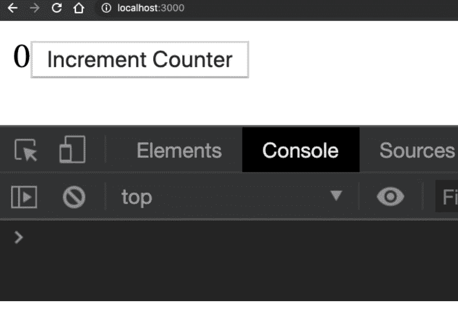

但是，一旦我点击了Increment（增加）按钮，控制台里就会出现有趣的内容：

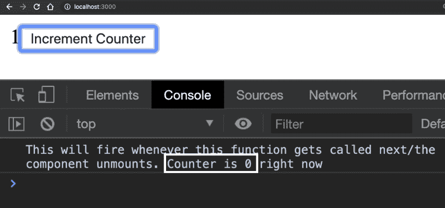

好的！我们看到屏幕上显示的计数器实际上是1，但在控制台中收到的日志是0。我们漏掉了什么？这是一个bug？不是，这是预期的行为。你可以看到，清理函数的目的就是在新实例创建之前移除任何想要的东西。因此，React需要调用旧的`useEffect`清理函数，以便它能够访问旧的环境变量。

### useCallback

还记得我们在`useEffect`钩子中是如何传递依赖数组，以告知React我们关心哪些变量吗？这让React在不需要时反复运行effect函数。但是，对于那些在`useEffect`函数内部调用的函数呢？这样的问题很容易被忽略：

```javascript
const [result, setResult] = useState(null)
const [url, setUrl] = useState(null)
async function someOperation() {
    // some more code
    return await fetch(url)
}

useEffect(() => {
  // some long code....
  someOperation().then(r => {
    setResult(r)
  })
}, [])
```

哎呀！你能指出代码片段中可能的问题吗？你看，虽然从effect函数表面看不需要依赖（因为我们没有直接使用任何状态变量），但仔细观察就会发现，我们实际上是在`someOperation`函数内部使用了状态变量`url`！这意味着，如果在其他地方调用了`setUrl`，effect函数不会重新运行，因此不会重新获取URL，从而导致出错。这种情况确实会发生，而且随着代码库的增长，很难察觉。那么，如何确保你没有遗漏在`useEffect`钩子中添加依赖项呢？你不用费心去检查。你应该将函数作为依赖项传递，因为这样更有意义！你看，`someOperation`这个实际函数的行为由于状态变量`url`的改变而改变的，因此它才是应该作为依赖项添加的。这不仅使事情简化，而且看起来更合逻辑。

然而，React无法在不实际执行函数并查看结果的情况下，将一个函数与其先前版本进行比较，但一旦你执行了函数，就没有回头路了。记得我们之前是如何在`useEffect`中解决类似问题的吗？是的，依赖数组！但是，如何为一个独立的函数指定依赖数组呢？

这里，你可以使用一个名为`useCallback`的新钩子。这个钩子允许你创建记忆化的函数，该函数只有在传递给它的依赖数组发生变化时才会改变其标识。以下是上面同一个例子，但这次使用了记忆化函数：

```javascript
const someAsyncOperation = useCallback(async () => {
  // some more code
  return await fetch(url)
}, [url])

useEffect(() => {
  // some long code....
  someAsyncOperation().then(r => {
    setResult(r)
  })
}, [someAsyncOperation])
```

在这里，我们可以看到现在将`someAsyncOperation`作为主side effect函数的依赖项传递，并将`url`作为`someAsyncOperation`函数自身的依赖项传递。这使得事物保持有序，并允许你编写可读且清晰的代码。

React还有更多内置的钩子，我们将在后续章节中逐步了解。

### 自定义钩子

既然我们已经掌握了React钩子的工作原理及其底层机制，为自己的用例创建简单的自定义钩子就相当简单了。让我们从一个简单的例子开始。记得我们讨论过`useState`在状态更新时不提供回调函数吗？让我们将其作为一个自定义钩子来实现。

```tsx
import { useState, useEffect } from 'react'

function useCounter(initialValue) {
  const [count, setCount] = useState(initialValue)
  useEffect(() => {
    document.title = 'Counter is at ' + count
  }, [count])
  return [count, setCount] as [number, React.Dispatch<React.SetStateAction<number>>]
}

function App() {
  const [count, setCount] = useCounter(0)
  return (
    <>
      <p>{count}</p>
      <button onClick={() => setCount(c => c + 1)}>Increment</button>
    </>
  )
}

export default App
```

上面的代码展示了如何将多个hooks逻辑封装到一个自定义钩子中。这种方法可以复用逻辑，并使组件变得更加简洁。


如果你有面向对象编程的背景，你会知道 `constructor` 是创建对象时运行的第一个方法。虽然 JavaScript 不遵循基于类的继承，但它在 ES6 中引入的类语法与之非常相似。这不是 React 提供的生命周期方法，而是语言本身提供的。然而，你可以在这里完成所有初始化工作，即初始化你的状态、设置任何全局事件监听器（如窗口调整大小等），并为组件挂载做好准备。

### static getDerivedStateFromProps

此方法在 v16.3 中添加，它简单地允许你在需要时更新状态以匹配 `props`。`getDerivedStateFromProps` 方法在首次挂载和后续挂载时都在 `render` 方法之前运行。它是静态的，你不应该在此方法中执行副作用（如动画或网络请求）。

事实上，React 文档建议在大多数情况下你不需要实现这个生命周期方法。你的大部分工作可以通过我们现在将要讨论的其他方法完成：

```jsx
static getDerivedStateFromProps(props, state) {
  if (props.email !== state.email) {
    return {
      email: props.email
    }
  }
  return null
}
```

你会看到，如果没有更新，我们返回 `null`，表示我们不打算更新组件的状态。无论你返回什么，都会作为组件的状态进行更新。

### render

这是类组件中必须存在的唯一方法。这是因为 React 是一个 UI 库，使用组件的目的是向用户输出一些可视信息。所以，如果你使用 React 组件，`render` 方法是必须定义的。从这个方法返回的内容会显示在屏幕上。这里有一个简单的例子：

```jsx
render() {
  return <p>Hello world!</p>
}
```

### getSnapshotBeforeUpdate

React 在实际将任何内容写入浏览器（即 DOM）之前调用此方法。此时，`render` 已调用，但 DOM 尚未更新。同样，正如文档所说，此方法有特定的用例，但了解可用的方法总是好的。你必须从这个方法返回一个“快照”值，然后你可以在另一个名为 `componentDidUpdate` 的生命周期方法中访问它。这里有一个例子：

```jsx
getSnapshotBeforeUpdate(prevProps, prevState) {
  if (prevProps.prop1 !== this.props.prop1) {
    return "Prop mismatch";
  }
  return null
}
```

返回 `null` 表示没有快照需要捕获。然后我们可以在 `componentDidUpdate` 中访问它，我们接下来会看到。

### componentDidMount

`componentDidMount` 方法在 React 完成组件挂载后调用。但先别急！组件对用户仍然不可见，因为它还没有写入 DOM。那么，挂载是什么意思呢？它意味着组件已经在 React 的虚拟 DOM 中挂载好，准备被推送到 DOM。此时，如果你调用 `setState`，React 会执行组件的重新渲染，但不会显示组件的中间状态。

### componentDidUpdate

当你的组件更新时，React 调用此方法。在初始挂载时，此方法不会被调用。它会被传入三个参数：`prevProps`、`prevState` 和 `snapshot`，分别是之前的 `props`、之前的组件状态，以及上面讨论过的 `getSnapshotBeforeUpdate` 方法的快照。这里有一个简单的例子：

```jsx
componentDidUpdate(prevProps, prevState, snapshot) {
  if (this.props.id !== prevProps.id) {
    // perform a new network request and update state
  }
}
```

### componentWillUnmount

顾名思义，此方法在你的组件即将卸载时触发。这是清理全局事件监听器、取消网络请求和定时器等的最佳位置。这是 React 在组件生命周期中最后一次调用的方法。

这是我为 React 生命周期周期方法找到的一个漂亮的开源插图：

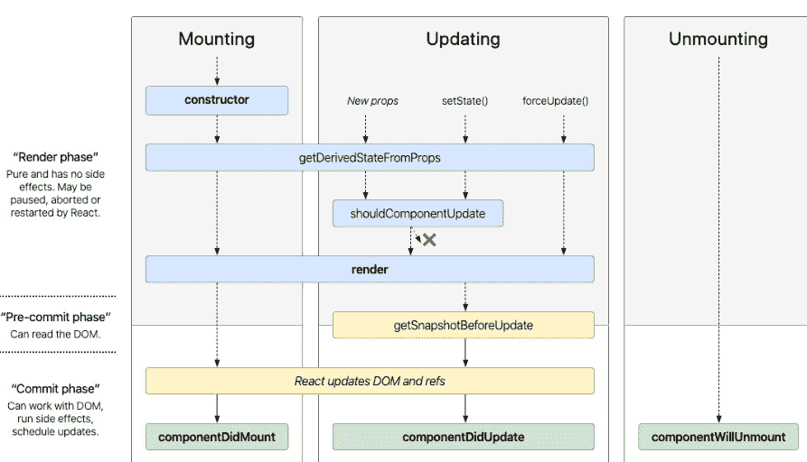

*图 3.8*

### 结论

本章非常重要，因为它向我们介绍了组件——函数组件和类组件。此外，我们学习了钩子、它们的底层工作原理以及如何创建自定义钩子。进一步，我们看到了如何使用类组件，以及为什么 React 将函数组件视为其未来的方向。在后续章节中，我们将继续深入介绍更多 React 主题。

### 问题

- 类组件和函数组件有什么区别？
- 将以下内容转译为有效的 JS：`<p><span>Hello</span> World</p>`
- `useState` 是同步的吗？为什么/为什么不？
- `useEffect` 钩子的依赖数组有什么作用？
- `useEffect` 钩子是在组件渲染/更新之前还是之后运行？
- 为什么钩子没有“生命周期方法”概念？它与基于类的生命周期模型有何根本不同？

# 第 4 章

## React 中的应用状态管理

在上一章中，我们对组件有了基本且扎实的理解，以及创建和使用它们的方法。我们注意到的一件事是，大多数组件只有在与某种状态相关联时才真正有用，即组件能“记住”东西。话虽如此，React 在钩子（如 `useState`）和 `this.state` 对象（分别用于函数和类组件）方面做得很好。但随着你的代码增长，有必要以更有条理的方式管理状态，避免属性传递（prop drilling），并使事情更清晰，尤其是在不同嵌套级别的不同组件之间必须交换信息时。

这可以称为管理应用状态。让我们看看如何处理它。

### 结构

- 组件间的通信
- 使用 Context API
  - `createContext`
  - `useContext`
- `useReducer` 钩子
- Redux 作为替代方案

### 目标

在本章中，我们旨在涵盖 React 开箱即用提供的基本功能，用于管理应用中的状态。在大多数情况下，这将是你的项目所需要的全部，甚至可能超出一点。对于非常高级的情况，我们将使用基于 reducer 的模式，如 Redux。

### 组件间的通信

细想一下，管理应用状态大致等同于在众多组件间高效传递某些信息。

虽然可以在组件内使用局部状态，但当需要在组件间通信时，事情就变得复杂了，尤其是当通信发生在组件层级向上时，甚至是树中相距甚远的“远亲”组件之间。这种情况时常发生。例如，当你在网站的内容区域点击链接注销时，这个信息需要分发给页头——一个完全不同的组件——以便页头能更新链接，恢复为向未认证用户显示的状态。

让我们看看本章将学习的一些常见的组件间通信方式：

- Props（父到子的数据流）
- Refs（从父组件调用子组件方法）
- Context API
- Redux（集中式状态管理）（将在后续章节介绍）

有趣的是，通过一点技巧，使用 Context API 可以实现双向通信，而 Redux 则是真正解耦的集中式状态存储。对于中大型应用，Redux 是首选，因为它具有单向数据流。React 16.8 引入了 Hooks，提供了一个开箱即用的解决方案（但功能弱于 Redux）。本章我们将全面学习这个方案。

### Props逐层传递（Prop drilling）

想象一下，你的 React 应用中有一个 UI主题，包含了颜色和字体等值。这些值需要被组件访问。然而，首先要在层级中到达这些值本身就是繁琐的。你需要将 `prop` 一路“钻”到输入框，即使中间组件都不需要它。让我们看看这是怎么回事。使用 `props` 将数据向下传递给组件。这是一个非常简单的例子：

```jsx
import React from 'react'
import ReactDOM from 'react-dom'

const App = () => {
  return (
    <div>
      <Parent name="John" />
    </div>
  )
}

const Parent = (props) => {
  return (
    <div>
      <Child name={props.name} />
    </div>
  )
}

const Child = (props) => {
  return <span>{props.name}</span>
}

ReactDOM.render(<App />);
```

如果你观察这里的代码，你会意识到 `App` 和 `Profile` 组件根本不需要 `name` 和 `age` 这两个 prop。只有 `NameFormatter` 和 `AgeFormatter` 需要相应的值来正确渲染。由于 `name` 和 `age` 这两个 prop 在 `App` 组件层级上是可用的，将它们传递到 `NameFormatter` 和 `AgeFormatter` 组件层级这种做法被称为“逐层传递”，通常我们拥有更高级、更复杂的层级通信。

### Refs

React 中的 Ref 指的是创建一个对象的引用。`ref` 是 React 的“逃生口”，允许你直接访问组件或 DOM，无论你想要。因此应该谨慎处理。因为使用 `ref` 做的事情通常遵循命令式模式，这在某种程度上打破了 React 希望你以声明式工作的方式。但有时有用，因为 React 自身提供的能力是有限的。使用 `ref`，不仅可以与 DOM 直接通信，还可以让父组件调用组件的方法。我们知道用 `props` 可以轻松做到相反（子调父），但使用 `props` 无法做到父组件调用组件的方法。让我们看一个例子：这是 `Parent.tsx` 文件：

```tsx
// Parent.tsx
import React, { useRef } from 'react'
import ReactDOM from 'react-dom'
import ChildInput, { ChildInputHandles } from './Child'

const Parent: React.FC = () => {
  const ref = useRef<ChildInputHandles>(null)
  function setFocus() {
    if (ref.current) {
      ref.current.setFocus()
    }
  }
  return (
    <div>
      <ChildInput ref={ref} defaultValue="Hello World" />
      <button onClick={setFocus}>Set focus to input</button>
    </div>
  )
}
ReactDOM.render(<Parent />, document.getElementById('root'))
```

这是 `Child.tsx` 文件：

```tsx
// Child.tsx
import React, { RefForwardingComponent, forwardRef,
  useImperativeHandle, useRef } from 'react'
export interface ChildInputHandles {
  setFocus(): void
}
export interface ChildInputProps {
  defaultValue: string
}

const ChildInput: RefForwardingComponent<ChildInputHandles,
  ChildInputProps> = (props, ref) => {
  const inputRef = useRef<HTMLInputElement>(null)
  useImperativeHandle(ref, () => ({
    setFocus() {
      if (inputRef.current) {
        inputRef.current.focus()
      }
    }
  }))
  return <input {...props} defaultValue={props.defaultValue} ref={inputRef} />
}

export default forwardRef(ChildInput)
```

通过这种方式，我们可以将 `ref` 作为“逃生口”，从父组件访问子组件内的函数和值。然而，像这样的方法在大多数场景下通常不被推荐，它真正促使我们思考：开发者试图实现的功能是否有更好的实现方式。现在，让我们继续学习 Context API，看看如何使用它在数据传递中创建虫洞。

### Context API

在 Props 逐层传递的例子中，我们看到了一个 UI主题如何需要将其 `prop` 一路“钻”到真正需要它的组件，同时将其暴露给所有其他甚至不需要知道这些值的组件。认识一下 React 中的 Context。Context 允许你在组件中创建虫洞，也就是说，你可以将数据从一个组件直接传送到树中下方的另一个组件，而中间的组件对传递的数据一无所知。让我们先看代码，通过一个迷你应用了解 Context API 是如何工作的：

```react
import React from 'react'

import Sidebar from './Sidebar'

import RightArticle from './RightArticle'

const Content: React.FC = () => {
  return (
    <section>
      <Sidebar />
      <RightArticle />
    </section>
  )
}

export default Content
```

这是我们的 `Sidebar.tsx` 文件：

```react
import React from 'react'

const Sidebar: React.FC = () => {
  return (
    <aside>
      <h2>哇，这是一个很棒的侧边栏</h2>
      <p>看看我的 logo</p>
      
    </aside>
  )
}

export default Sidebar
```

这是我们的 `RightArticle.tsx` 文件：

```react
import React from 'react'
const RightArticle: React.FC = () => {
  return (
    <article>
      <h2>这是我的网站！</h2>
      <p>它很棒</p>
      <p>当前模式是：light（亮色模式）</p>
      <button>点击此处开启暗色模式</button>
    </article>
  )
}

export default RightArticle
```

这是我们的 `Footer.tsx` 文件：

```react
import React from 'react'
const Footer: React.FC = () => {
  return (
    <footer>
      <p>版权所有 &copy; 我。</p>
      
    </footer>
  )
}

export default Footer
```

最后，为了添加一些 CSS，这是我们的样式表 `global.css`：

```css
* {
  margin: 0;
  padding: 0;
  font-family: Arial;
}
header {
  text-align: center;
  padding: 10px;
  border-bottom: 1px solid #eee;
}
section {
    min-height: 80vh;
    display: flex;
    width: 960px;
    margin: 10px auto;
    justify-content: space-between;
}
article {
    flex-grow: 1;
    margin-left: 10px;
    background: rgb(226, 226, 226);
}
aside {
    max-width: 250px;
    background: rgb(226, 226, 226);
}
img {
    height: 80px;
}
footer {
    display: flex;
    flex-direction: row-reverse;
    justify-content: center;
    align-items: center;
}
footer img {
    height: 50px;
    margin-right: 20px;
}
```

这会在你的屏幕上大致渲染出这样的效果：

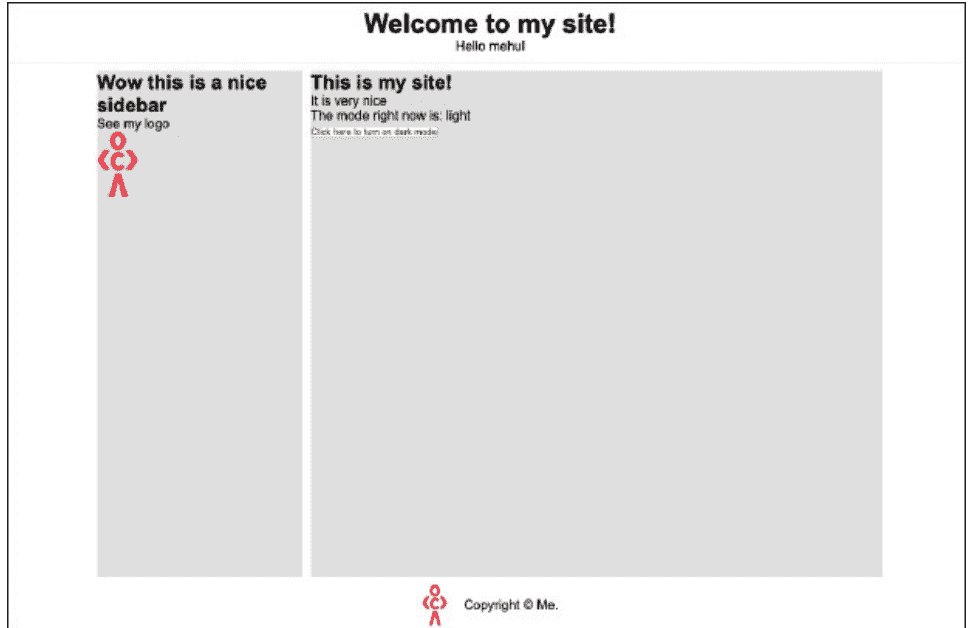

### 图 4.1

为了让你更清楚，以下是文件结构的示意图：

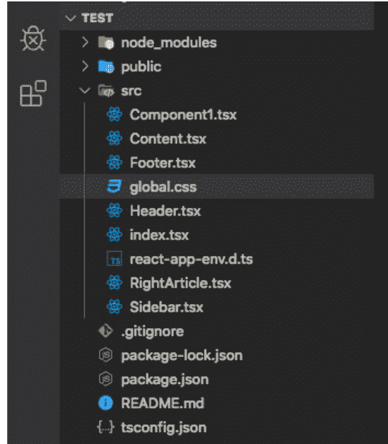

请注意，我们使用的是 `create-react-app`。

好的，现在你可以看到我们有一个按钮，上面写着 **点击此处开启暗色模式**。点击它，我们会在 `body` 上添加 `dark` 类，CSS 就会处理样式变化。但是其他变化怎么办呢？比如我们想在暗色模式下将 logo 从红色 logo 换成白色 logo，将登录（假设）用户的用户名传递给 `Header` 组件，并确保文章组件了解全局的暗色模式状态。

让我们使用 `context API` 来填补这些空白。我们将创建一个 `context`，它会在不同的组件中使用。

### Context.Provider

在我们之前的工作基础上，让我们来看一下 `Component1.tsx` 文件：

```react
import React, { createContext, useState } from 'react'
import Header from './Header'
import Content from './Content'
import Footer from './Footer'
import './global.css'

type Context = {
    theme: string
    name: string
    logo: string
}

const StateContext = createContext<Partial<Context>>({})

export { StateContext }

const Component1: React.FC = () => {
    const [theme, setTheme] = useState<string>('light')
    const defaults = {
        get theme() {
            return theme
        },
        set theme(value) {
            document.body.classList.remove('dark', 'light')
            document.body.classList.add(value)
            setTheme(value)
        },
        name: 'Mehul',
        get logo() {
            return this.theme === 'dark' ? 'white-logo' : 'red-logo'
        }
    }
    return (
        <StateContext.Provider value={defaults}>
            <Header />
        </StateContext.Provider>
    )
}
```

```javascript
import React, { useReducer } from 'react'
import Header from './Header'
import Content from './Content'
import Footer from './Footer'
import './global.css'
import { Provider, defaultState, reducer } from './state'
const Component1: React.FC = () => {
  const [state, dispatch] = useReducer(reducer, defaultState)
  return (
    <Provider value={{ state, dispatch }}>
      <Header />
      <Content />
      <Footer />
    </Provider>
  )
}
export default Component1
```

现在你可以看到我们正在使用一个名为 `useReducer` 的新钩子。这个钩子的作用是返回一个包含两个元素的数组，就像我们之前使用 `useState` 钩子一样。第一个元素是状态，第二个元素是 `dispatch` 函数。

`useState` 和 `useReducer` 在这里的一个主要区别是：对于 `useState`，你的第二个函数是状态的设置器，即你在 `useState` 的函数中作为参数传递的任何内容都会被设置为状态；而在 `useReducer` 中，每当你调用 `dispatch` 方法时，`useReducer` 会调用你的 `reducer`，从 `reducer` 方法返回的任何内容都会被设置为状态。考虑这个：

```javascript
const [state, setState] = useState(0)
setState(1) // <- 将状态变量设置为 1
const [state, dispatch] = useReducer(reducer, 1)
dispatch({ type: 'do something', value: 100 }) // 现在 reducer 被调用
// 背后逻辑：reducer(state, { type: 'do something', value: 100 }) -> 返回 101
// 状态变为 101
```

这对于大规模数据管理很重要，因为现在你可以对数据流进行更精细的控制。

现在，让我们更新其他文件以相应配合 `useReducer` 钩子：

### Footer.tsx：

```javascript
import React, { useContext } from 'react'
import { context } from './state'
const Footer: React.FC = () => {
  const { state: { logo } } = useContext(context)
  return (
    <footer>
      <p>Copyright &copy; Me.</p>
      
    </footer>
  )
}
export default Footer
```

### Header.tsx：

```javascript
import React, { useContext } from 'react'
import { context } from './state'
const Header: React.FC = () => {
  const { state: { name } } = useContext(context)
  return (
    <header>
      <h1>Welcome to my site!</h1>
      <p>Hello {name}</p>
    </header>
  )
}
export default Header
```

### RightArticle.tsx：

```javascript
import React, { useContext } from 'react'
import { context } from './state'
const RightArticle: React.FC = () => {
  const { state: { theme }, dispatch } = useContext(context)
  function toggleTheme() {
    if(theme === 'dark') {
      dispatch({ type: 'SET_THEME', payload: 'light' })
    } else {
      dispatch({ type: 'SET_THEME', payload: 'dark' })
    }
  }
  return (
    <article>
      <h2>This is my site!</h2>
      <p>It is very nice</p>
      <p>The mode right now is: {theme}</p>
      <button onClick={toggleTheme}>Click here to turn on dark mode</button>
    </article>
  )
}
export default RightArticle
```

看到我们上面如何使用 `dispatch` 函数了吗？它调用我们的 `reducer`，而我们的 `reducer` 修改状态，这个状态会传播到使用它的组件！

以及 Sidebar.tsx：

```javascript
import React, { useContext } from 'react'
import { context } from './state'
const Sidebar: React.FC = () => {
  const { state: { logo } } = useContext(context)
  return (
    <aside>
      <h2>Wow this is a nice sidebar</h2>
      <p>See my logo</p>
      
    </aside>
  )
}
export default Sidebar
```

一旦我们完成所有这些更改，我们将看到屏幕上仍然有相同的输出。但请考虑这一点。现在在应用程序中实现更多有状态的事情变得非常容易。例如，假设你想在点击按钮时更改登录的用户名。

你只需要在任何组件中使用 `dispatch` 方法，并派发一个具有类型（比如 `CHANGE_USERNAME`）和你想要执行的操作的 `payload` 的操作。

现在在一个完全不同的文件，即 `state.tsx` 中，你将在你的 `reducer` 中添加当操作是 `CHANGE_USERNAME` 时你希望执行的操作，如下：

```javascript
switch(type) {
// ..
  case 'CHANGE_USERNAME':
    return {
      ...state,
      name: payload
    }
// ..
}
```

这样你就完成了！没有比这更简洁的了！

### 结论

在本章中，我们学习了如何利用像 Context API 这样的 React 内置解决方案，无需任何外部库即可实现非常简洁的状态管理。在后面的后的章节中，我们将探讨如何将更复杂的技术与 React 结合使用以实现更多。

### 问题

1. React 中的 `Context API` 是什么？
2. `useReducer` 钩子是如何工作的？
3. `Context.Consumer` 是什么？`Context.Provider` 与 `Context.Consumer` 有何不同？

# 第 5 章 服务端 React

到目前为止，我们已经了解了 React 如何在前端工作，使用 React 的各种方法管理状态，甚至为我们创建了一个首页！我们可以用 React 做更多的事情，特别是把它移动到服务器端时。现在，考虑在服务器上运行 React 是很奇怪的，当我接触这个概念时！服务器上使用 React 意味着什么？它带来了什么好处？将在本章中回答这些问题以及更多。让我们开始吧。在本章中，我们将探讨如何将 React 移动到服务器，本质上使用 Node.js 将 React 代码发送到浏览器之前进行渲染，以便为用户和搜索引擎提供无缝体验。

### 结构

- 服务端渲染的为什么需要它
- SSR 入门 Hello World
- ReactDOM 如何工作
- 为 SSR 添加更多
- 路由
- 数据获取

### 目标

本章向你介绍使用 React 进行服务端渲染的概念，如果你刚开始项目并且需要 SEO 和性能时，这是一个不错的选择。我们将看看如何通过创建一个简单的项目来用 React 实现 Hello World，然后逐步添加功能。最后，我们将总结并论证为什么选择像 Next.js 这样的服务端渲染框架来构建 React 应用程序。

### 服务器上的 React

当使用 React 应用程序时，会发生以下情况：

1. 你访问页面（假设是 `http://example.com`）。
2. 页面向服务器发出请求。
3. 服务器发送给你一个小的 HTML 响应。
4. 浏览器理解这个请求，如果你仔细看，发现请求不包含任何内容，只是一堆 CSS 和 JS 文件。
5. 浏览器下载那些 JS 文件。
6. 浏览器解析并运行那些 JS 文件（实际上是你编写 React 代码）。
7. 根据 React 代码，浏览器向服务器发出所需的数据。
8. 最后，当数据可用时，用户完成首次渲染。
9. DOM 现在填充了你期望的所有 HTML。

### 什么是服务端渲染？

顾名义，服务端渲染是在服务器上渲染页面并交付给客户端，而不是让客户端（浏览器）使用你编写的 JavaScript 渲染页面。服务端渲染将工作回到服务器，即解析 React 代码。从本质上讲，SSR 意味着后端完成了大部分工作，并将页面交付给前端，而不是客户端大量 JS 进行路由和状态管理。这就是过去使用 PHP 应用程序的方式。但随着 JavaScript 标准的改进以及设备性能的提升，客户端渲染如今越来越流行。

### 为什么要使用服务端渲染？

如果客户端渲染这么好，为什么在 2020 年我们还在考虑服务端渲染呢？SSR 有不可忽视的优势，其中包括：

1. **SEO**：搜索引擎喜欢阅读 HTML 标记从中理解页面内容。大多数搜索引擎（除了一些像 Google 这样的高级搜索引擎外）无法真正解析大量 JavaScript，因此不得不依赖“源代码”。对于客户端网站，源代码根本不包含实际内容，搜索引擎无法索引你的网站，会影响你的排名。
2. **性能**：使用 SSR 时性能会有明显提升。由于 SSR 在交付前就已经渲染了页面，你无需担心 JS 代码中不同的浏览器支持、不同设备的 API 等问题，因为它们大部分根本不会交付。

因此，出于与搜索引擎兼容的原因，实施 SSR 至关重要，这样才能全其美。

### 开始使用 SSR

在没有框架的情况下使用 React 进行 SSR 是棘手的。但无论如何，我们将从这里开始，以便了解在使用其他框架时底层发生了什么。在开始之前，我们将关注 React 中的一个特殊东西：`ReactDOM`。

### ReactDOM

当我们执行 `ReactDOM.render(<App />, element)` 时，我们实际上是在告诉 React 将 DOM 树（你看到的 Web 应用 UI）与宿主树（JavaScript 中包含的 React 代码）进行匹配。我们在上面讨论了 `App` 如何展开为一个嵌套对象（本质上是一棵树）。`ReactDOM` 是那个特定树的一个渲染器。你能想到其他例子吗？React Native 可以被视为另一个渲染器。

还有另一个渲染器叫 `ReactDOMServer`。顾名义，`ReactDOMServer` 使你能够编写 React 代码，然后不是将其渲染到类浏览器环境中，而是将其在服务器上渲染为一个字符串，以（接近）静态标记的形式发送给客户端。

### 项目配置

### SSR 项目配置

1. 首先创建一个名为 `react-ssr` 的空目录。
2. 使用你的终端进入该目录。
3. 执行 `npm init -y` 以使用默认的 npm 配置进行初始化。

安装相关的 npm 包，运行以下命令：

```bash
npm install react react-dom express --save
```

其他的开发依赖包括：

```bash
npm install @babel/core @babel/preset-react @babel/register webpack webpack-cli --save-dev
```

此时，你的 `package.json` 依赖和开发依赖部分应该大致如下：

```json
"dependencies": {
    "express": "^4.16.3",
    "react": "^16.9.0",
    "react-dom": "^16.9.0"
},
"devDependencies": {
    "babel-loader": "^8.0.6",
    "@babel/core": "^7.6.0",
    "@babel/preset-react": "^7.0.0",
    "@babel/register": "^7.0.0",
    "webpack": "^4.19.1",
    "webpack-cli": "^3.3.2"
}
```

4. 好的。一旦我们正确设置了依赖，现在让我们编写一些代码。这是我们的 `index.js` 文件：

```javascript
// index.js
require("@babel/register")({
    presets: ["@babel/preset-react"]
})
require("./src/server")
```

5. 好的，一旦 `index.js` 文件设置好，让我们看看 `server.js` 文件：

```javascript
// server.js
const express = require("express")
const app = express()
const React = require("react")
const { renderToString } = require("react-dom/server")

app.get("/*", (req, res) => {
    const jsx = <div>Hello</div>
    const reactDom = renderToString(jsx)
    res.send(template(reactDom))
});

app.listen(1337)

function template(reactDom) {
    return `
<!DOCTYPE html>
<html>
<head>
<meta charset="utf-8">
<title>React SSR</title>
</head>
<body>
<div id="root">${reactDom}</div>
</body>
</html>
`
}
```

```markdown

## 5. 注意我们使用 `template` 函数将构建好的字符串注入到响应中。

一旦我们使用 `node index.js` 启动服务器，你可以看到我们得到了正确的响应：

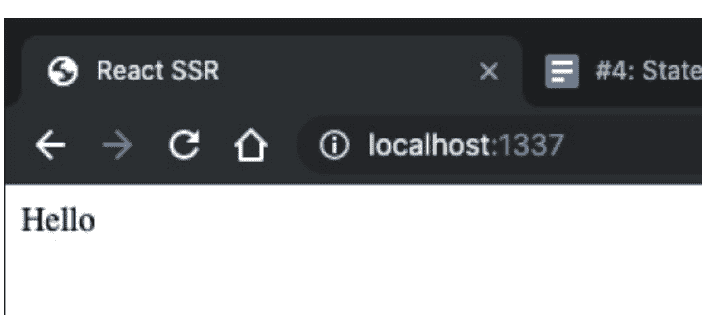

图 5.4

在前面的截图中，你可以看到我们得到了服务器发送的 `Hello`，这实际上是运行React` 代码的结果：

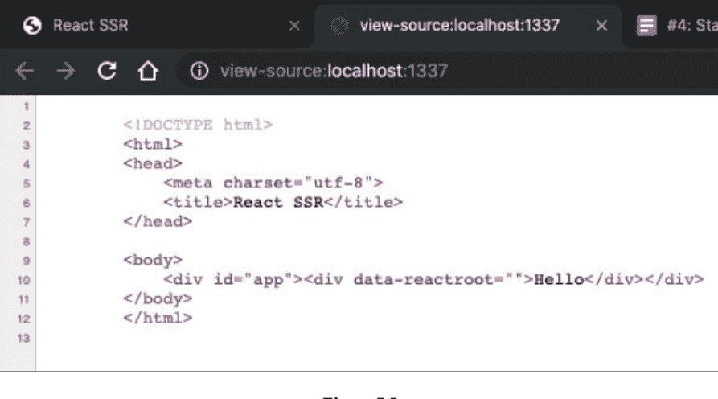

图 5.5

一旦你查看页面的源代码，如前面的截图所示，你会看到这确实是服务器发送的，而不是客户端渲染的。

### 编写更多组件

我们上面用 React SSR 完成了基本的 Hello World，这让我们首次使用 React 进了服务端渲染。让我们添加更多组件。让我们从主页和关于页面开始：

```javascript
// Home.js
const React = require('react')
function Home(props) {
    return <div className="home">
        <h2>你好，这是主页！前往 <a href="/about">关于页面</a></h2>
    </div>
}
module.exports = Home
```

以及 `About.js` 页面：

```javascript
// About.js
const React = require('react')
function About(props) {
    return <div className="about">
        <h2>这是关于页面</h2>
    </div>
}
module.exports = About
```

但你看出上面的问题了吗？如何将它们链接起来，也就是说，当你点击主页上的链接时，应该打开页面？同样，当你直接访问 `/about` 端点时，它应该提供特定的页面。

### 在SSR中实现路由

路由是Web应用程序最重要的方面之一，特别是当它稍微复杂时。它允许你在不同的路径上提供不同的内容。让我们从安装 `react-router` 开始，这将帮助我们实现路由。

```bash
npm install react-router-dom --save
```

完成安装后，我们就可以进行更改了。让我们稍微修改一下 `server.js` 文件：

```javascript
// server.js
const express = require("express")
const React = require("react")
const ReactDOMServer = require("react-dom")
const { StaticRouter, Switch, Route } = require("react-dom")
const Home = require('./components/Home')
const About = require('./components/About')

const app = express()

app.get('/*', (req, res) => {
    const jsx = (
        <StaticRouter location={req.url}>
            <Switch>
                <Route path="/" component={Home} />
                <Route path="/about" component={About} />
            </Switch>
        </StaticRouter>
    )
    const reactDom = ReactDOMServer.renderToString(jsx)
    res.send(template(reactDom))
})

app.listen(1337)

function template(reactDom) {
  return `
<!DOCTYPE html>
<html>
<head>
<meta charset="utf-8">
<title>React SSR</title>
</head>
<body>
<div id="root">${reactDom}</div>
<script src="./app.bundle.js"></script>
</body>
</html>
  `
}
```

请注意上述行。首先，在 Express 服务器中，我们配置了静态文件（即我们上面创建的客户端打包文件）。然后我们在 HTML 响应中包含了脚本本身。

### 客户端

React是一个客户端库。然而，在上面的 SSR 中，我们可以在服务器上编写类似 React 的标记，并使用静态路由系统将其发送到客户端。在这个过程中，我们在前端丢失了真正的“React”代码。让我们把它回来。

我们来创建一个 `client.js` 的文件，并在其中编写以下代码：

```javascript
import React from 'react'
import ReactDOM from 'react-dom'
import Home from './components/Home'
import About from './components/About'
import { BrowserRouter as Router, Route, Switch } from 'react-router-dom'

const jsx = (
    <Router>
        <Switch>
            <Route path="/" component={Home} />
            <Route path="/about" component={About} />
        </Switch>
    </Router>
)

const app = document.getElementById('root')
ReactDOM.hydrate(jsx, app)
```

我们将这个文件与 `server.js` 文件放在一起。为了明确结构，以下是目前整理的文件：

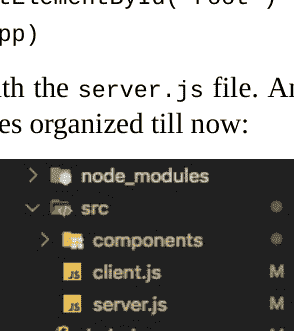

图 之前的截图显示了项目的组织结构。你可能注意到，在前面的代码中，我们使用了一个名为 `hydrate` 的方法而不是 `render`，我们将在本节详细讨论这个方法。首先，让我们设置其他东西。我们还需要修改 `server.js` 文件以包含我们的 `client.js`。`server.js` 文件最终应该所示：

```javascript
const path = require('path')
module.exports = {
  mode: 'development',
  devtool: 'source-map',
  entry: {
    app: './src/client.js',
  },
  module: {
    rules: [
      {
        test: /\.jsx?$/,
        exclude: /(node_modules|bower_components)/,
        loader: "babel-loader",
      }
    ],
  },
  output: {
    path: path.resolve(__dirname, 'dist'),
    filename: '[name].bundle.js',
  }
}
```

好的！让我们快速看看 webpack 配置中发生了什么：

- 我们将入口点设置为 `src/client.js` 文件。
- 我们只有一条规则：无论何时看到 JS 或 JSX 文件，都让 `babel-loader` 处理它。
- Babel loader 将使用我们接下来要创建的 `.babelrc` 文件。
- 最后，将文件输出到 `dist` 目录中，文件名为 `app.bundle.js`（`[name]` 被 `app` 替换，即入口点的键名）。

我们的 `.babelrc` 文件将如下所示：

```json
{
  "presets": [
    "@babel/preset-react"
  ],
  "plugins": ["@babel/plugin-syntax-dynamic-import"]
}
```

请记住，我们之前已经安装了这些内容，所以可以直接使用它们。最后，让我们转到 `package.json` 并创建：

```json
"scripts": {
  "start": "nodemon server.js",
  "build": "webpack"
}
```

### ReactDOM.hydrate

我们没有使用 `ReactDOM.render`，而是使用 `ReactDOM.hydrate`。`ReactDOM.hydrate` 顾名义，只是 `hydrate`（注水）现有的布局，它不会创建布局并在 DOM 中替换。`ReactDOM.hydrate` 知道布局字符串来自服务器，因此只需要将客户端 JavaScript（即事件和监听器）与即将来的服务器端 代码同步。因此，我们使用 `hydrate` 方法。

这里需要注意的一个有趣之处是，`ReactDOM.hydrate` 期望你在前端（在 `client.js` 中）提供的布局与来自后端（`server.js`）的布局相近，否则会给你带来问题。

最后，让我们为前端设置 webpack，以便我们可以使用 `import/export` 语法并在前端真正使用 React。我们之前已经安装了 webpack，所以只需继续像这样创建一个 `webpack.config.js` 文件：

```

作为高级文档工程师，我已根据你提供的注意事项对文本进行了深度排版。我优化了标题层级，清理了冗余空行，并对变量、函数、路径及代码块进行了规范化处理。

以下是排版后的 Markdown 文档：

---

# 第 6 章 Next.js 简介

在上一章中，我们学习了如何从零开始使用 React 进行服务端渲染（SSR），看到了客户端和服务器之间同步数据的复杂性。现在，让我们进入 Next.js 世界，了解它以及为什么它是一个极好的选择。

## 结构
- 什么是 Next.js
- 安装
- Next.js 中的页面
- 静态资源
- 路由
- 组件
- CSS

## 目标
本章旨在向你介绍 Next.js，这是一个用于 React 服务端渲染的框架。它为开发者简化了大量工作流，可以将更多的精力投入到应用逻辑上，而不是基础设施部分。我们将学习如何设置以及如何有效地使用它。

## 什么是 Next.js？

Next.js 是一个用于构建服务端 React 应用程序的框架。它提供了许多开箱即用的功能，开箱即解决了路由、页面管理、服务端渲染、缓存等问题，并且极其容易设置。它的易用性与 `create-react-app` 相似，而手动设置 React SSR 项目是非常繁琐的。Next.js 拯救了我们！

## 为什么选择 Next.js？

根据其官方网站，以下是为什么它是一个好选择的原因：

1. **服务端渲染**：这是使用 Next.js 的主要原因。
2. **静态导出**：这意味着你可以通过简单的命令生成网站的静态包（如果你需要的话）。
3. **CSS-in-JS**：CSS-in-JS 是一种流行的技术，人们直接在 JS 中编写样式。有些人对此做法并不认同，但社区提供了众多解决方案，Next.js 支持所有方案。
4. **零配置**：它的设置和 `create-react-app` 一样简单。你可以在几分钟内启动 Next.js 并运行 Hello World 程序。
5. **完全扩展**：你可以控制 Babel 和 webpack 配置。一旦你控制了这些，就可以控制项目的每一个细节。
6. **生产就绪**：它是一个开源且高度优化的框架，现在已经成熟，适合使用 React 创建生产级应用。

如果你考虑基于 React 的 SSR 方案，这些都是选择 Next.js 的原因之一。

## 安装

让我们从为项目设置 Next.js 开始：

1. 创建名为 `react-ssr-next` 的目录。
2. 使用命令行 `cd` 进入该目录。
3. 运行命令：
```bash
npm init -y
npm install react react-dom next
```
这些命令基本上设置了你的 `package.json` 文件并安装了所需的依赖项。你注意到总共只需要三个包吗？`react`、`react-dom` 和 `next`！

4. 最后，对你的 `package.json` 文件的 `scripts` 部分进行如下修改：

```json
"scripts": {
  "dev": "next",
  "build": "next build",
  "start": "next start"
}
```

你的 `package.json` 大致会如下（版本号可能不同）：

```json
{
  "name": "nextjs",
  "version": "1.0.0",
  "main": "index.js",
  "scripts": {
    "dev": "next",
    "build": "next build",
    "start": "next start"
  },
  "keywords": [],
  "author": "",
  "license": "ISC",
  "description": "",
  "dependencies": {
    "next": "^9.1.1",
    "react": "^16.9.0",
    "react-dom": "^16.9.0"
  }
}
```

5. 现在，我们在根文件夹内创建一个 `pages` 目录。Next.js 框架需要这个目录。
6. 在同一个目录中执行 `npm run dev`。它将启动 Next.js 进程。


我们上面创建了 `pages` 文件夹。这个文件夹并不是我随意起的名字。你在该文件夹内创建的任何文件名；它都会在你的应用程序中被创建为一个路由！让我们从简单的 `index.js` 页面开始，它是应用程序的根页面：

在 `pages/index.js` 文件中，让我们编写以下简单的 React 组件：

```
// pages/index.js
export default () => <h1>Hello World</h1>
```

就这样！继续刷新 `localhost:3000` 页面（它无论如何都会自动刷新，因为热重载是开启的），然后我们就看到了：

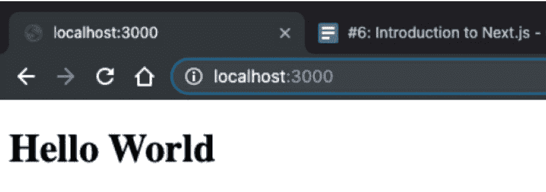

**图 6.2**

在上一个截图中，我们可以看到我们成功地使用 Next.js 在屏幕上获得了 Hello World 输出。

查看源代码时，我们会看到以下内容：

```
<!DOCTYPE html><html><head><meta charSet="utf-8"/><meta name="viewport" content="width=device-width,minimum-scale=1,initial-scale=1"/><meta name="next-head-count" content="2"/><link rel="preload" href="/_next/static/development/pages/index.js?ts=1569413352906" as="script"/><link rel="preload" href="/_next/static/development/pages/_app.js?ts=1569413352906" as="script"/><link rel="preload" href="/_next/static/runtime/webpack.js?ts=1569413352906" as="script"/><link rel="preload" href="/_next/static/runtime/main.js?ts=1569413352906" as="script"/></head><body><div id="__next"><h1>Hello World</h1>div><script src="/_next/static/development/dll/dll_397dc449097af0b4e992.js?ts=1569413352906"></script><script id="__NEXT_DATA__" type="application/json">{"dataManager":"[]","props":{"pageProps":{}},"page":"/","query":{},"buildId":"development","nextExport":true,"autoExport":true}</script><script async="" data-next-page="/"
```

src="/_next/static/development/pages/index.js?ts=1569413352906">

</script><script async="" data-next-page="/_app"

src="/_next/static/development/pages/_app.js?ts=1569413352906">

</script><script src="/_next/static/runtime/webpack.js?

ts=1569413352906" async=""></script><script

src="/_next/static/runtime/main.js?ts=1569413352906" async="">

</script></body></html>
```

这其中大部分只是开发环境相关的脚本和热重载脚本。但我们可以清楚地看到，Hello World 标记是在源代码中渲染的，而不是通过 JavaScript 动态创建的。这就是服务端渲染（SSR）！

现在我们来创建一个 `about.js` 文件：

```
// pages/about.js
const AboutMe = () => {
  return (
    <div id="about-me">
      <h1>Hey Guys!</h1>
      <p>My name is Mehul and I'm the author of this book.</p>
      <p>This book covers React and stuff</p>
      <p>I like React</p>
    </div>
  )
}
export default AboutMe
```

基本上就是这样！保存文件，然后访问 `localhost:3000/about`，你将看到以下页面：


前面的页面展示了作为 React 组件写在 `about.js` 文件中的内容，我们没有进行额外的配置。Next.js 在底层处理了路由。

### 热重载

你看，当我们修改代码，并且服务器正在运行（使用 `npm run dev` 命令）时，我们不需要手动去浏览器刷新。

Next.js 会自动与文件系统通信检测是否有更改。如果有更改，它会重新构建并将消息推送浏览器，让浏览器获取更改并相应更新。使用 Next.js 时，这个功能是开箱即用的。

### 静态文件服务

Next.js还可以使用一个特殊的目录来提供静态文件（图片、字体等）。请在项目根目录下创建一个 `static` 的目录。你放在此目录下的任何内容都将在 `/static/` 路由下服务。

让我们试着在 `public/static` 文件夹中放入一张图片。最终的结构如下：


图 6.4

前面的截图展示了文件应该是什么样子。完成后，你应该能够导航到 `localhost:3000/static/profile.jpeg`：


图 6.5

你可以将所有的静态资源放在项目中的 `static` 目录下。在 Next.js 的早期版本中，你必须将静态资源放在根目录下的 `static` 文件夹中。现在，你可以将任何想要的东西放在 `public` 文件夹中，它将在你的根 URL 路径可用。不过为了清晰哪些资源是静态的，哪些不是，我们仍然会将静态资源存储在 `public/static` 路径下。

### 路由

在 Next.js 中，路由是非常简单的。上面我们看到了一个基础的演示——只需在文件夹内创建 JavaScript 文件。但我们需要将这些页面链接在一起。我们该怎么做呢？

当然，我们可以使用常规的锚点标签 `<a>` 进行链接，但记住，就像原生的 SSR 一样，这会执行一次完整的页面重定向。我们不想这样做，因为我们有能力通过 React 在后台获取数据并更新 UI，这正是使用 React 的全部意义！所以，让我们使用 Next.js 提供的 `Link` 组件。

#### Link

Next.js 中的 `Link` API 允许你执行导航，就像我们使用 `react-router-dom` 包中的 `Link` 组件一样。下面是使用方法。我们将更新 `index.js` 文件使其链接到关于页面：

```javascript
// pages/index.js
import Link from 'next/link'
const Home = () => {
  return <div id="home">
    <h1>This is a nice homepage</h1>
    <p>Click <Link href="/about"><a>here</a></Link> to go to about page</p>
  </div>
}
export default Home
```

这里是具体的操作步骤：

- 首先，我们导入 `Link` 组件以供使用。
- 接下来，我们用 `Link` 组件包裹我们希望作为超链接的文本。
- 注意我们给 `Link` 组件添加了 `href` 属性，并且在其内部再次使用了锚点标签。这很重要，我们稍后会讲到。
- 最后，在 `href` 属性中，我们传递了我们希望导航到的链接。让我们看看它生成了什么输出：


图 6.6

前面的截图展示了 `Link` 组件在渲染时如何被转换为 HTML 中的常规锚点标签。

- 很棒！我们可以看到我们的超链接就在源代码中。但使用 `Link` 组件，Next.js 还会自动使用 HTML5 History API 处理客户端导航，而我们无需触碰任何代码。
- 现在，当你点击 About 链接时，它将无缝导航到关于页面。

现在，让我们进一步了解这个 `Link` 组件，以及它与我们习惯使用的 `react-router-dom` 中的 `Link` 有何不同。

#### Link 只是一个高阶组件（HoC）

如果你是从 `react-router-dom` 的 `Link` 组件转过来的，你可能会混淆这个 `Link` 和那个。在 `react-router-dom` 中，你实际上可以将 props 传递给组件本身，它变成一个超链接并使用 `className`、`onClick` 等。但使用 Next.js 提供的 `Link` API，它只是一个高阶组件（Higher Order Component），也就是说它只是将子组件包裹。它不会将提供的 props 传递给子组件。例如，考虑以下代码。这是为标签分配 `className` 的错误方式：

```javascript
<p>Click <Link href="/about" className="mylink"><a>here</a></Link> to go to about page</p>
```

事实上，如果你运行前面的代码，你会看到 `className` 类并没有附加到标签上。这是为标签添加 `className` 的正确方式：

```javascript
<p>Click <Link href="/about"><a className="mylink">here</a></Link> to go to about page</p>
```

#### 关于 Link 的更多内容

`Link` 组件基本上是将其点击 事件附加到子组件上。因此，如果子组件支持 `onClick` 事件，`Link` 就能工作。考虑以下情况：

```javascript
<Link href="/about"></Link>
```

在这种情况下，导航也会发生，但你不会在 HTML 标记中看到带有 `href` 的属性，这可能会对 SEO 不利。因此，你应该将其包装在一个锚点标签中。如果你让 Next.js 在锚点标签上显示 `href` 属性（用于调试），你可以像这样给 `Link` 组件传递 `passHref` 属性：

```javascript
<Link href="/about" passHref>
  <a></a>
</Link>
```

这将渲染以下：

```html
<a href="/about"></a>
```

#### Next.js 组件

页面是很好的，但是可用的代码片段呢？我们当然可以创建组件，然后在其他页面引入它们。让我们创建一个名为 `components` 的目录，但记住，与 `pages` 或 `static` 不同，这次目录名称并不重要。这是一个简单的例子：

```javascript
// components/Header.js
import Link from 'next/link'
const Header = () => (
  <header>
    <Link href="/">
      <a>Home</a>
    </Link>
    <Link href="/about">
      <a>About</a>
    </Link>
  </header>
)
export default Header
```

现在，让我们在 `index.js` 文件中使用上面创建的 `Header` 组件：

```javascript
// pages/index.js
import Link from 'next/link'
import Header from '../components/Header'
const Home = () => {
  return <div id="home">
    <Header />
    <h1>This is a nice homepage</h1>
    <p>Click <Link href="/about" passHref><a></a></Link> to go to about page</p>
  </div>
}
export default Home
```

`About.js` 文件：

```javascript
// pages/about.js
import Header from '../components/Header'
const AboutMe = () => {
  return (
    <div id="about-me">
      <Header />
      <h1>Hey Guys!</h1>
      <p>My name is Mehul and I'm the author of this book.</p>
      <p>This book covers React and stuff</p>
      <p>I like React</p>
    </div>
  )
}
export default AboutMe
```

文件结构如下所示：


图 6.7

上面的截图展示了此时文件结构应该是什么样子的。现在，你会看到我们能够在两个页面（关于和主页）上重用 `Header` 组件。同时，请注意，正如上文所述，组件只是一个选择，你可以将此文件夹命名为任何你喜欢的名字，并仍然使用它（因为我们使用相对路径来引用该文件夹）。

### Next.js + CSS

有多种方式可以在 Next.js 框架中使用 CSS，而如今在应用中总是用到 CSS。让我们来探索一些常见的方法。

### Styled JSX

这种方法要求你直接在 JSX 模板中编写 CSS。我们先来看一个例子。让我们修改 `Header` 组件以包含一些样式：

```javascript
// Header.js
import Link from 'next/link'
const Header = () => (
<header>
<style jsx>{`
header {
padding: 20px;
background: #1e1e1e;
border-bottom: 1px solid black;
font-size: 30px;
}
a {
color: white;
margin-right: 30px;
}
`}</style>
<Link href="/">
<a>Home</a>
</Link>
<Link href="/about">
<a>About</a>
</Link>
</header>
)
export default Header
```

这会生成以下界面原型：


图 6.8

正如代码所描述的，上面的截图显示了我们预期的输出。现在，让我们看看渲染后的 HTML。当你看到它时，你会看到类似这样的的内容：


```javascript
import Link from 'next/link'
const Header = () => (
<header>
<style jsx global>{`
header {
padding: 20px;
background: #1e1e1e;
border-bottom: 1px solid black;
font-size: 30px;
}
a {
color: white;
margin-right: 30px;
}
`}</style>
<nav>
<Link href="/">
<a>Home</a>
</Link>
<Link href="/about">
<a>About</a>
</Link>
</nav>
</header>
)
export default Header
```

这与上面的例子完全相同，除了现在我们在 `style` 标签中有了一个 `global` 属性。虽然 HTML 部分仍然包含用于自定义作用域的语法，但 CSS 部分现在是真正全局的，正如你在渲染输出中看到的：

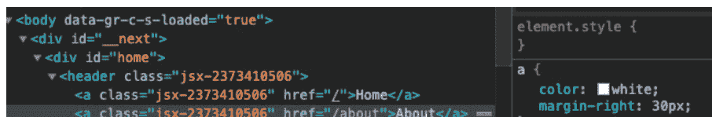

上面的截图展示了我们的 Next.js 代码如何渲染 `anchor` 标签。

看，在右侧的 `style` 部分，我们只是简单地定位了 `anchor` 标签，而不是与之关联的长类名。这意味着我们定位了页面上的所有 `anchor` 标签。

### Importing CSS files

老实说，对我来说，直接在 JSX 中编写 CSS 有点让人不知所措，我更喜欢将它们分开以保持清晰。此外，在单独的文件中，你将能够获得更好的语法高亮和错误处理。让我们看看如何在页面中设置导入 CSS 文件。

与 `styled-jsx` 不同，CSS 导入并非 Next.js 默认内置，因为实现这一点的方式有很多。让我们先安装 `@zeit/next-css` 包。按照以下步骤操作：

1. 在你的项目根目录中，执行 `npx i @zeit/next-css --save`

2. 现在，我们需要在项目的根目录中创建一个 `next.config.js` 文件。文件内容如下所示：

```javascript
// next.config.js
const withCSS = require('@zeit/next-css')
module.exports = withCSS({})
```

3. 此时重启你的开发服务器。

4. 你可以在 `withcss` 函数中传递额外的选项，例如，使用 CSS modules。

5. 完成后，让我们将样式移到单独的文件中。

最终，我们的 `Header.js` 组件看起来像这样：

```javascript
// components/Header/index.js
import Link from 'next/link'
import './style.css'
const Header = () => (
<header>
<Link href="/">
<a>Home</a>
</Link>
<Link href="/about">
<a className="special">About</a>
</Link>
</header>
)
export default Header
```

而 `style.css` 文件的内容如下：

```css
/* components/Header/style.css */
header {
padding: 20px;
background: #1e1e1e;
border-bottom: 1px solid black;
font-size: 30px;
}
a {
color: white;
margin-right: 30px;
}
a.special {
color: yellow;
}
```

这将产生以下输出：

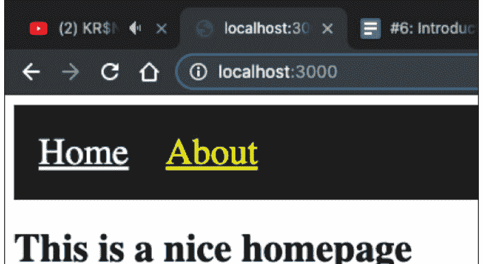

图 6.1。上面的截图展示了我们的 Next.js 代码如何渲染 `anchor` 标签。

看，在右侧的 `style` 部分，我们只是简单地定位了 `anchor` 标签，而不是与之关联的长类名。这意味着我们定位了页面上的所有 `anchor` 标签。

同时，组件目录结构也发生了。看下方：


图 6.2。上面的截图展示了当前结构的样子。

太棒了！现在让我们使用 CSS modules。我们可以将网站切换为 CSS modules，这意味着类名将被随机化，这样不同组件中的相同类名就不会冲突。让我们看看如何完成。将 `next.config.js` 文件更改如下：

```javascript
// next.config.js
const withCSS = require('@zeit/next-css')
module.exports = withCSS({
  cssModules: true
})
```

一旦你完成此操作并重启服务器，你会看到 HTML 标记中 `special` 类不再是黄色的了。因为现在你有了 CSS modules。现在，为了将类应用于特定元素，你必须导入样式。更改 `Header.js`：

```javascript
import Link from 'next/link'
import css from './style.css'
const Header = () => (
<header>
<Link href="/">
<a>Home</a>
</Link>
<Link href="/about">
<a className={css.special}>About</a>
</Link>
</header>
)
export default Header
```

现在应该可以工作了！看看 HTML 标记，它是一个完全随机的类名。本质上是 `webpack loader`，你可以使用 webpack 文档进一步自定义它：https://github.com/webpack/css-loader

### 结论

本章向我们介绍了 Next.js 框架，并帮助我们理解它的一些核心概念以便入门。我们了解了 Next.js 是什么，如何用它快速启动第一个项目，并探究了发送给浏览器的响应是如何真正渲染成 HTML 的。

在下一章中，我们将更深入地使用这个框架，探究其底层原理，看看 Next.js 是如何工作的，以及我们如何根据需求调整它。

### 问题

1. Next.js 与我们在上一章中运行的 React 有何不同？
2. 假设 `pages/myroute/index.js` 处有一个组件。在开发模式运行时，它能在 `localhost:3000` 访问吗？
3. 如何将一个 `robots.txt` 文件托管在根路径（即 `localhost:3000/robots.txt`）？你应该将文件放在哪里？
4. Next.js 中的 `Link` 与 `react-router-dom` 中的 `Link` 有什么区别？
5. 列举一些在 Next.js 组件中使用 CSS 的方法。

## 第 7 章

### 深入 Next.js

在上一章中，我们学习了 Next.js 是什么以及如何用它快速启动一个基本的 SSR 项目。然而，应用程序通常比这复杂，需要处理许多细节和复杂情况。在本章中，我们将探索 Next.js 的一些精细部分，并看看如何将它们整合到我们的代码中。这很重要，因为大多数应用程序有时需要根据需求进行定制或调整。让我们深入其中。

### 结构

- 创建 Next.js 项目
- Redux 简介
- 将 Redux 与 Next.js 一起设置
- TypeScript + Next
- 使用 Next.js 创建 API 端点
- Next.js 自定义文件
- 动态路由

### 目标

本章的目标是花时间整体熟悉 Next.js 框架，以便我们能够熟悉其生态系统，并在 Next.js 中从头开始启动项目，在此过程中探索各种 Next.js 概念。

### Next.js 应用

在本章中，让我们在讨论应用重要概念的同时，创建一个 Next.js 应用。

### 启动项目

首先，让我们从一个全新的 Next.js 项目开始。这很简单，我们在上一章已经做过。这里有几个关键点我们需要处理：

- 目前项目我们需要一个登录页面、一个注册和一个仪表盘页面。
- 为了简单起见，我们将登录页面作为首页。
- 在开始之前，让我们为 Next.js 切换到 TypeScript（就像我们之前为 React 做的那样）。

### 切换到 TypeScript

TypeScript 本身已经证明，它是在大规模开发中编写 JavaScript 的一种非常可靠的方法。几乎每个达到一定规模的代码库都会遇到常见的 JavaScript 缺陷，例如没有类型检查。TypeScript 在这个意义上非常实用。它编译成 JavaScript，同时允许我们使用对开发者来说最佳 JavaScript 来编写代码。

- 要创建一个 TypeScript 项目，我们直接使用 `npx` 的 `create-next-app` 工具。
- 进入你想要设置 Next.js（或者我们应该称之为 Next.ts）项目的目录。
- 运行以下命令：`npx create-next-app --example with-typescript my-custom-app`
- 这个命令会拉取 `create-next-app` 包并使用提供的参数运行它。它会拉取一个使用 TypeScript 的示例仓库，然后创建项目 `my-custom-app`，并且所有 `npm install` 和 `package.json` 的事情都已经处理好了。
- 完成后，在你的文本编辑器中打开项目。

这是你现在的文件结构应该看起来的样子：

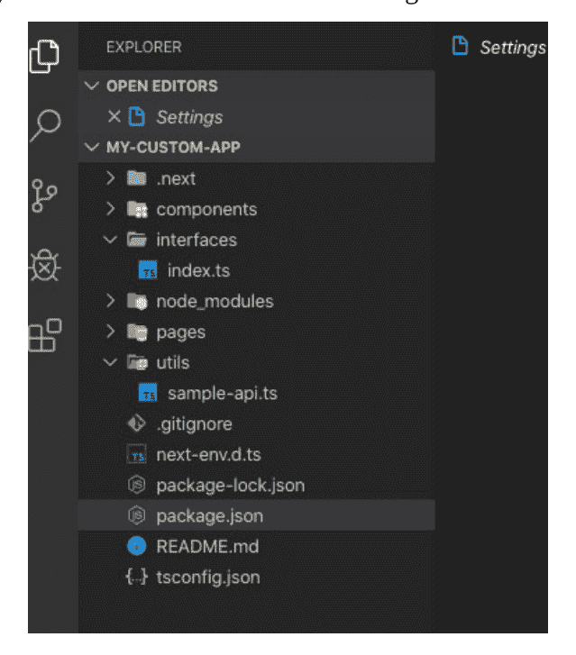

上面的截图显示了当前的文件结构。

使用 `npm run dev` 启动应用程序，它将在 `localhost:3000` 启动本地服务器。现在，让我们看看一个名为 Redux 的状态工具。

### Redux

Redux 是一个通用的状态管理工具，作为 React 之一使用。它基本上管理状态并使数据流单向。还记得我们在状态管理章节中使用的 `Context` 吗？让我们看看将 Redux 与 Next.js 集成。在此之前，让我们看看 Next.js 中叫做 `getInitialProps` 的方法。

### getInitialProps

在 Next.js 中，如果你需要在组件渲染之前填充 props，可以使用 `getInitialProps`。这个方法在客户端和服务器端执行。让我们通过代码修改 `about.ts` 文件：

```typescript
import * as React from 'react'
import Link from 'next/link'
import Layout from '../components/Layout'
import { NextPage, NextPageContext } from 'next'

type Props = {
  someprop: string
}

const AboutPage: NextPage<Props> = (props: Props) => (
  <Layout title="Next.js TypeScript Example">
    <h1>About</h1>
    <p>This is the about page</p>
    <p>
      <Link href="/">
        <a>Home {props.someprop}</a>
      </Link>
    </p>
  </Layout>
)

AboutPage.getInitialProps = async ({pathname, query}: NextPageContext) => {
  console.log(pathname, query)
  return {
    someprop: 'custom'
  }
}

export default AboutPage
```

加粗的行是在文件中做的。注意我们向 `AboutPage` 添加了一个名为 `getInitialProps` 的函数。这个函数在组件挂载之前运行，正如所见，这个函数返回一个 `Promise`。因此你可以在里面做各种活动。因为这是从 Next.js 的，它是同构的，既在服务器端运行，也在客户端运行。

在浏览器中，它产生输出：


图 7.2。上面的截图显示了浏览器的输出。

控制台看起来这样：

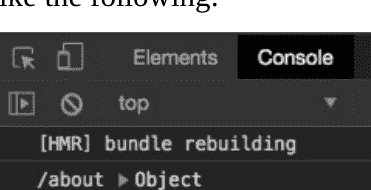

图 7.3。上面的截图显示了浏览器的输出。好的，让我们开始我们的应用程序。

### 创建应用

让我们从 `index.ts` 页面开始，这将是登录页面：

1. 这是一个可以使用 `index.ts` 文件的快速示例：

```typescript
// pages/index.ts
import React, { useState } from 'react'
import { NextPage } from 'next'
import './styles.css'

const IndexPage: NextPage = () => {
    const [username, setUsername] = useState<string>('')
    const [password, setPassword] = useState<string>('')
    return (
        <form method="POST">
            <div className="box">
                <h1>Login</h1>
                <input 
                    type="text" 
                    placeholder="Username" 
                    className="field"
                    value={username} 
                    onChange={e => setUsername(e.target.value)}
                />
                <input 
                    type="password" 
                    placeholder="Password" 
                    className="field" 
                    value={password} 
                    onChange={e => setPassword(e.target.value)} 
                />
                <div className="btn">Sign In</div>
            </div>
        </form>
    )
}
export default IndexPage
```

上面的组件在 React 中创建了一个简单的受控登录表单，我们很快就会看到。

2. 与 `index.js` 文件关联的 `styles.css` 文件应该是：

```css
    .field {
      background: #ecf0f1;
      border: #ccc 1px solid;
      border-bottom: #ccc 2px solid;
      padding: 8px;
      width: 100%;
      color: #AAA;
      margin-top: 10px;
      font-size: 1em;
      border-radius: 4px;
    }
    .btn {
      background: #2ecc71;
      width: 100%;
      cursor: pointer;
      padding: 5px 0;
      color: white;
      border-radius: 4px;
      border: #27ae60 1px solid;
      margin-top: 20px;
      font-weight: 800;
      font-size: 0.8em;
    }
    .btn:hover {
      background: #2CC06B;
    }
```

注意，我正在从不同的文件导入 `styles.css`，因此我们还需要在项目根目录中创建一个自定义的 `next.config.js` 文件（如上一章所述）：

```javascript
// next.config.js
const withCSS = require('@zeit/next-css')
module.exports = withCSS({})
```

并且安装 `@zeit/next-css` npm 模块：

```
npm i @zeit/next-css -S
```

完成后，别忘了重启服务器。

这将为我们提供以下漂亮的输出：


图 7.4。上面的截图展示了我们上面创建的登录表单的输出。
```


注意我们现在如何使用 `useState` hook 来管理这个组件的用户名和密码。这是正确的做法，因为我们不需要将这个组件的本地状态存储到 `redux` 存储中。让我们继续。

现在我们将在 `Next.js` 中设置一个快速后端来接收登录并处理它。

### 使用 Next.js 的 API

当我们创建 TypeScript 示例时，你一定已经看到在 `pages` 文件夹下有一个名为 `api` 的文件夹。这个文件夹很特别。在 `Next.js` v9 之前，我们必须自己设置服务器来处理 API 调用。这是很麻烦的，因为维护两个 Node 服务器来处理单一目的是很累的。但现在，`Next.js` 原生支持处理 API 调用。我们很快也会介绍动态路由。

删除 `api` 文件夹中的所有内容，创建一个名为 `login` 的新文件夹，并在其中创建一个名为 `index.ts` 的文件。以下内容应该如下所示：

```
// pages/api/login/index.ts
import { NextApiRequest, NextApiResponse } from 'next'
export default async (req: NextApiRequest, res: NextApiResponse)
=> {
  const { username, password } = req.body
  if(username === 'admin' && password === 'admin') {
    return res.json({
      status: 'ok',
      data: {
        name: 'Mehul Mohan',
        age: 21,
        favQuote: 'Nobody cares about your feelings bro.'
      }
    })
  }
  return res.json({ status: 'error', message: 'Invalid login' })
}
```

好了！那么，这个文件中发生了什么？

- 我们在 `pages/api/login/index.ts` 下创建了一个文件。
- 在这个文件中，我们导出一个函数而不是一个 React 组件。这是因为这是我们的 API 端点，我们被允许在这里编写逻辑。
- 有两个参数，`Next.js` 传递给我们使用。第一个是 `req`（请求处理器），第二个是 `res`（响应处理器）。
- 第参数 `req` 包含关于击中该特定端点的当前请求的所有相关信息。这可能包括 `POST` 主体数据、身份验证 cookie、自定义头等等。
- 第二个参数 `res` 是可由你，即开发者编写的。它有可以调用的方法，这些方法反过来会在底层创建一个 HTTP 响应，API 端点应该将其发送回客户端。

### 设置 Redux + Next.js

首先，我们来安装 `redux` 和 `next-redux-wrapper`，它们将为 `Next.js` 项目提供 Redux.js 的封装器。使用以下命令在你的系统上安装该包：

```
npm install react-redux redux next-redux-wrapper --save
```

接下来，我们将设置我们的 Redux store。回想一下我们使用 `Context API` 时设置默认状态的方式。这与此非常相似。`store` 本质上是一个集中化的场所，供你所有的组件存储数据并从该特定区域检索数据。

因为它集中化且与你的组件解耦，所以读取/写入该区域的值可能会存在问题；因此，必须有一种精简的方法，让组件只能访问它需要读取的值。

同样，如果你想写入（更新`redux` 状态，你不能直接这样做。你必须为它编写一个 `reducer`，也就是一个能缩减你状态的东西。一旦你为 `store` 编写了 `reducer`，你就可以编写 `dispatchers`。这些函数被称为 `dispatcher`，是因为它们向这些 `reducer` 分发特定的动作，而 `reducer` 接收到动作后，会更新状态。下图展示了 Redux 架构：


#### 图 7

如果你感到困惑，别担心。当我们再次讲解这个内容，但使用代码时，它会更容易理解。让我们看看我们的 `reducer`：

1. 在项目目录 `redux` 文件夹（创建 `redux` 文件夹）中创建一个名为 `reducer.ts` 的文件。以下是 `reducer` 代码：

```
// reducer.ts
type Action = {
  type: string
  payload?: any
}
export type UserDetails = {
  name: string
  age: number
  favQuote: string
}
export type State = {
  user: UserDetails | null
}
const defaultState: State = {
  user: null
}
const reducer = (state: State, action: Action) => {
  switch (action.type) {
    case 'SET_USER_DETAILS':
      return {
        ...state,
        user: action.payload
      }
    default:
      return state
  }
}
export default reducer
```

这里，你可以看到我们正在创建一个 Redux store 和 `reducer`。如所述，`store` 是一个存储数据的地方，而 `reducer` 是一个使用某些动作来更新。让我们了解一下这段代码：

- 首先我们定义了一些类型。
- 然后我们创建了一个 `reducer` 函数。
- `reducer` 函数接受两个参数，第一个是实际应用程序状态，由 `reducer` 被调用之前填充。
- 第二个参数是 `action`。这个 `action` 实际上是一个对象，由 `type` 和 `payload` 组成。
- `type` 属性定义了这个 `action` 应该什么。
- `payload` 属性你可以传递给 `reducer` 更新状态。

文件结构所示：


#### 图 8

上面的截图显示了当前的文件结构完成以上步骤后，现在我们必须在应用中集成 Redux。我们使用特殊的 `pages/_app.js`（实际上是 `_app.tsx`）文件来完成。让我们来讨论它。

### _app.js 文件

根据文档：

- `Next.js` 使用 `App` 组件来初始化页面
- 要覆盖它，请创建 `./pages/_app.js` 文件并覆盖 `App` 类

基本上，这个文件允许你覆盖 `Next.js` 用于页面的一些配置。由于我们希望 Redux 在每个页面都可用，我们可以在特定的文件中包裹 Redux 的 `Provider`（就像我们包裹 `Context API` 一样）。

因为我们使用的是 `TypeScript`，我们将创建一个名为 `_app.tsx` 的文件来代替。让我们继续创建它：

```
// pages/_app.tsx
import React from 'react'
import { createStore, Store, compose } from 'redux'
import { Provider } from 'react-redux'
import withRedux from 'next-redux-wrapper'
import reducer, { State } from '../redux/reducer'
import { NextPage } from 'next'
import { NextComponentType, NextPageContext } from 'next/dist/next-server/lib/utils'
let devTools = (f: any) => f
if(process.browser) {
  const _window = window as any
  if(_window.__REDUX_DEVTOOLS_EXTENSION__) {
    devTools = _window.__REDUX_DEVTOOLS_EXTENSION__()
  }
}
const makeStore = (initialState: State) => {
  return createStore(reducer, initialState, compose(devTools))
}
type Props = {
  Component: NextComponentType<NextPageContext>,
  pageProps: any,
  store: Store
}
const MyApp: NextPage<Props> = props => {
  const { Component, pageProps, store } = props
  return (
    <Provider store={store}>
      <Component {...pageProps} />
    </Provider>
  )
}
export default withRedux(makeStore)(MyApp)
```

让我们来看看这个文件中发生了什么：

- 我们从 `redux` 包导入了 `createStore` 和 `Store`。`store` 是我们将要使用的存储的接口。
- 我们获取了 `withRedux` 高阶组件。
- 然后我们注册了 `redux` 开发工具以使其正常工作。为此，您必须在浏览器中安装 `Redux DevTools` Chrome 扩展程序。您可以在扩展商店中免费找到它。
- 之后我们像编写普通 `Next.js` 页面一样编写文件，并带有类型化的 `props`。
- 注意我们从 `MyApp` 的 `props` 中解构出 `Component`、`pageProps` 和 `store` 的地方？这是因为此文件在每个页面发送之前由 `Next.js` 运行，您可以在此渲染（或发送）之前修改它。
- 我们只是将原始的 `Component`（本应被发送的）包装在 `react-redux` 包提供的 `Provider` 组件中。
- 底层的 `next-redux-wrapper` 包在客户端和服务器上都初始化存储，并处理技术部分。

此时，如果您查看您的应用程序并下载 Chrome 的 `Redux DevTools` 扩展程序，在您的 Chrome 开发工具中，您应该能看到 Redux 正在工作，并且看到 Redux 正在工作，并且看到 Redux 正在工作，并且看到 Redux 正在工作，并且看到 Redux 正在工作，并且看到 Redux 正在工作，并且看到 Redux 正在工作，并且看到 Redux 正在工作，并且看到 Redux 正在工作，并且看到 Redux 正在工作，并且看到 Redux 正在工作，并且看到 Redux 正在工作，并且看到 Redux 正在工作，并且看到 Redux 正在工作，并且看到 Redux 正在工作，并且看到 Redux 正在工作，并且看到 Redux 正在工作，并且看到 Redux 正在工作，并且看到 Redux 正在工作，并且看到 Redux 正在工作，并且看到 Redux 正在工作，并且看到 Redux 正在工作，并且看到 Redux 正在工作，并且看到 Redux 正在工作，并且看到 Redux 正在工作，并且看到 Redux 正在工作，并且看到 Redux 正在工作，并且看到 Redux 正在工作，并且看到 Redux 正在工作，并且看到 Redux 正在工作，并且看到 Redux 正在工作，并且看到工作，并且看到 Redux 正在工作，并且看到 Redux 正在工作，

```
import React, { useState } from 'react'
import { NextPage } from 'next'
import './styles.css'
import { useSelector, useDispatch } from 'react-redux'
import { setUserDetails } from '../redux/actions'
const IndexPage: NextPage = () => {
  const dispatch = useDispatch()
  const name = useSelector((state: any) =>state.user&&state.user.name)
  const [username, setUsername] = useState<string>('')
  const [password, setPassword] = useState<string>('')
  async function submitForm() {
    const req = await fetch('/api/login', {
      method: 'POST',
      headers: {
        'Content-Type': 'application/json'
      },
      body: JSON.stringify({ username, password })
    })
    const json = await req.json()
    console.log(json)
    dispatch(setUserDetails(json.data))
  }
  return (
    <form method="POST">
      <div className="box">
        <h1>Login</h1>
        {name || 'na'}
        <input type="text" placeholder="Username" className="field"
          value={username} onChange={e =>setUsername(e.target.value)} />
        <input type="password" placeholder="Password" className="field"
          value={password} onChange={e =>setPassword(e.target.value)} />
        <div className="btn" onClick={submitForm}>Sign In</div>
      </div>
    </form>
  )
}
export default IndexPage
```

以下是发生的情况：

- 显然，我们可以看到这段代码比上面的看起来更简洁、更清晰，此外，当我们不在主组件上方使用 `HoC` 时，我们避免了额外的组件层次结构。

- `useDispatch()` `hook` 只是返回给我们一个 `dispatch` 函数，我们需要用它来包装我们的 `dispatch` 方法。记住，函数 `setUserDetails` 实际上返回一个普通对象，我们实际上只是将一个普通 `JSON` 对象作为第一个参数调用 `dispatch`。我们之前不需要调用 `dispatch` 的原因是，当我们将其传递给 `connect` 方法时，`redux` 在底层已经完成了。

- `useSelector()` `hook` 允许您传递一个函数，该函数允许您过滤出您想要提取的值。`useSelector()` 在更改时默认执行浅层比较，如果浅层比较检测到任何更改，则会重新渲染组件。对于我们当前的情况，我们的 `user` 对象从 `null` 变为一个定义明确的对象，所以这应该对我们没问题。

现在如果我们查看输出，应该没有任何区别，它应该工作得很好。这就是我们如何在 `React + Redux` 中使用 `hooks`。

### 创建仪表板页面

让我们继续，在 `pages/` 目录下创建一个仪表板页面 `dashboard/index.tsx` 文件。文件结构如下所示：

### 条件路由

前面的截图展示了当前文件结构的样子。

目前我们将保持仪表板页面简单，只会在 `dashboard/index.tsx` 文件中放入以下代码：

```jsx
import React from 'react'
import { NextPage } from 'next'
import { useSelector } from 'react-redux'

const DashboardPage: NextPage = () => {
  const user = useSelector((state: any) => state.user)
  if(!user) return <p>User not available</p>
  return (
    <div id="dashboard">
      <h1>Hello {user.name}</h1>
      <p>Your favorite quote: {user.favQuote}</p>
    </div>
  )
}

export default DashboardPage
```

好了！现在是时候在登录正确时将用户重定向到 `/dashboard` 路由了。让我们更新 `pages/index.tsx` 文件。

为了有条件地将用户重定向到不同的页面，我们将使用来自 `next/router` 的 `Router` 包。让我们开始使用它：

```jsx
// pages/index.tsx
import React, { useState } from 'react'
import { NextPage } from 'next'
import './styles.css'
import { useSelector, useDispatch } from 'react-redux'
import { setUserDetails } from '../redux/actions'
import Router from 'next/router'

const IndexPage: NextPage = () => {
  const dispatch = useDispatch()
  const name = useSelector((state: any) => state.user &&
    state.user.name)
  const [username, setUsername] = useState<string>('')
  const [password, setPassword] = useState<string>('')

  async function submitForm() {
    const req = await fetch('/api/login', {
      method: 'POST',
      headers: {
        'Content-Type': 'application/json'
      },
      body: JSON.stringify({ username, password })
    })
    const json = await req.json()
    if(json.status === 'ok') {
      dispatch(setUserDetails(json.data))
      Router.push('/dashboard')
    } else {
      alert('Incorrect Login')
    }
  }

  return (
    <form method="POST">
      <div className="box">
        <h1>Login</h1
        {name || 'na'}
        <input type="text" placeholder="Username" className="field"
          value={username} onChange={e => setUsername(e.target.value)} />
        <input type="password" placeholder="Password" className="field"
          value={password} onChange={e => setPassword(e.target.value)} />
        <div className="btn" onClick={submitForm}>Sign In</div>
      </div>
    </form>
  )
}

export default IndexPage
```

现在，当你使用正确的凭据登录时，你应该会看到类似这样的内容：


前面的截图展示了仪表板页面的样子。当你刷新页面时，你应该会看到 **User not found** 消息，这在逻辑上是正确的，因为我们没有持久化我们的 `redux` 存储，也没有尝试查看用户是否已经登录应用程序，如果是，则检索用户数据。我们稍后会修复这个问题。

让我们先看看嵌套路由。

### 嵌套路由

让我们从一个简单的用例开始。我们已经创建了顶层路径（即 `/home` 或 `/about` 等等），但是 `/home/page-x` 呢？嗯，事实证明在 `Next.js` 中，只需将文件夹相互嵌套就很简单了。让我们创建以下文件：

`pages/path1/path2`

```jsx
import React from 'react'
import { NextPage } from 'next'
import { useSelector } from 'react-redux'

const DashboardPage: NextPage = () => {
  const user = useSelector((state: any) => state.user)
  if(!user) return <p>User not available</p>
  return (
    <div id="dashboard">
      <h1>Hello {user.name}</h1>
      <p>Your favorite quote: {user.favQuote}</p>
    </div>
  )
}

export default DashboardPage
```

`pages/path1/path2/index.tsx`

```jsx
// pages/register/index.tsx
import React, { useState } from 'react'
import { NextPage } from 'next'
import './styles.css'
import { useDispatch } from 'react-redux'
import { setUserDetails } from '../../redux/actions'
import Router from 'next/router'

const RegisterPage: NextPage = () => {
  const dispatch = useDispatch()
  const [username, setUsername] = useState<string>('')
  const [password, setPassword] = useState<string>('')
  const [name, setName] = useState<string>('')
  const [age, setAge] = useState<string>('')
  const [quote, setQuote] = useState<string>('')

  async function submitForm() {
    const req = await fetch('/api/register', {
      method: 'POST',
      headers: {
        'Content-Type': 'application/json'
      },
      body: JSON.stringify({ username, password, name, age, quote })
    })
    const json = await req.json()
    if(json.status === 'ok') {
      dispatch(setUserDetails(json.data))
      Router.push('/dashboard')
    } else {
      alert('Error Registering')
    }
  }

  return (
    <form method="POST">
      <div className="box">
        <h1>Register</h1>
        <input type="text" placeholder="Username" className="field"
          value={username} onChange={e => setUsername(e.target.value)} />
        <input type="text" placeholder="Name" className="field"
          value={name} onChange={e => setName(e.target.value)} />
        <input type="text" placeholder="Age" className="field"
          value={age} onChange={e => setAge(e.target.value)} />
        <input type="text" placeholder="Fav. Quote" className="field"
          value={quote} onChange={e => setQuote(e.target.value)} />
        <input type="password" placeholder="Password" className="field"
          value={password} onChange={e => setPassword(e.target.value)} />
        <div className="btn" onClick={submitForm}>Register</</div>
      </div>
    </form>
  )
}

export default RegisterPage
```

在这里，我们只是从用户那里获取所有需要的信息，并将其发送到我们的 API 后端。

我们将直接从 `IndexPage` 本身复制粘贴样式：

```css
// pages/register/styles.css
```

### 第7章：总结

在本章中，我们花时间深入探讨了 Next.js 生态系统。我们还详细研究了 Redux、如何在 Next.js 中设置 Redux、使用 Next.js 进行路由以及如何在不离开 Next.js 框架的情况下创建 API。现在我们已经掌握了足够的知识，可以使用 Next.js 创建从基础到中等复杂度的服务端渲染后端。在下一章中，我们将学习更多关于使用 React 技术在渐进式 Web 应用领域可以实现的内容。

### 问题

1. `TypeScript` 和 `JavaScript` 有什么区别？所有有效的 `JavaScript` 代码在 `TypeScript` 中也有效吗？
2. 什么是 `Redux`？它是如何工作的？
3. `getInitialProps` 在 `Next.js` 中是做什么？
4. `Next.js` 中的 `pages` 文件夹和 `api` 文件夹有什么区别？
5. 你所说的 `Redux` 中的 `reducer` 是什么？
6. `_app.js` 文件是做什么？`Next.js` 中另一个类似的文件 `_document.js` 能找出它的作用吗？
7. 嵌套路由和动态路由有什么区别？在 `Next v9` 中可以嵌套吗？

# 第8章：渐进式 Web 应用

上一章中，我们学习了 `Next.js` 技术及其如何为 `React` 的 SSR 支持。当 Web 应用与原生应用遇时，一种类型的应用诞生了，这就是渐进式 Web 应用。在本章中，我们将全面了解 PWA，并学习如何使用 `React` 作为我们的主要库来创建。

### 结构

- 什么是渐进式 Web 应用 (PWA)
- PWA 入门
- `manifest.json` 文件
- `Service Workers`
- 使用 `Next.js` 的自定义服务器

### 目标

在本章中，我们的主要目标是理解渐进式 Web 应用，以及如何在 `React` 和 `Next.js` 项目中设置它们。在此过程中，我们将进一步了解这些技术。

### 什么是渐进式 Web 应用？

渐进式 Web 应用本质上还是 Web 应用，但更好。它利用现代 Web 功能提供卓越的类似于原生应用的体验。一些渐进式 Web 应用特点如下：

1. 响应式：你的应用应该适配所有屏幕。幸运的是，创建一个响应式站点（或将现有站点转换为响应式）并不难。
2. 离线：你的 PWA 将使用叫做 `service workers` 的东西，使它们能够在离线或低速网络下工作。
3. HTTPS：仅在 HTTPS 上运行。
4. 安装：你的 PWA 可以像普通应用一样在手机上安装。
5. 链接：可以通过简单的 URL 进行分享。

### Hello World

让我们用 `create-react-app` 创建一个新的 React 项目，并实现我们的 PWA。我们将使用 TypeScript 开始：

```bash
create-react-app pwa-app --typescript
```

项目准备好后，我们会看到类似的文件结构：

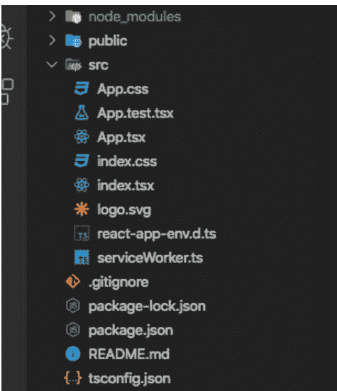
图 8.1

让我们看看 `src/index.tsx` 文件中以下代码：

```typescript
import React from 'react';
import ReactDOM from 'react-dom';
import './index.css';
import App from './App';
import * as serviceWorker from './serviceWorker';
ReactDOM.render(<App />, document.getElementById('root'));
// If you want your app to work offline and load faster, you can change
// unregister() to register() below. Note this comes with some pitfalls.
// Learn more about service workers: https://bit.ly/CRA-PWA
serviceWorker.unregister();
```

我们导入了一个名为 `serviceWorker` 的文件。我们很快会讲到 service workers 是什么，但现在，我们将 `unregister` 方法更改为 `register`，然后使用以下命令构建应用：

```bash
npm run build
```

这将在你的项目根目录创建一个 `build` 文件夹。现在，在这个目录内运行一个简单的开发服务器。这取决于你安装了哪些依赖项。如果你安装了 `Python`（macOS 和 Linux 默认安装），请在 `build` 文件夹内运行以下命令：

```bash
python -m SimpleHTTPServer 1234 # for python 2
```

如果你使用的是 `Python 3`，请使用以下命令：

```bash
python3 -m http.server 1234
```

如果你安装了 `PHP` 命令行，也可以通过以下命令启动本地开发服务器：

```bash
php -S localhost:1234
```

确保在命令行中位于 `build` 文件夹内运行所有这些命令，因为它们将作为 `http://localhost:1234` 的根目录。

现在，让我们访问站点 `localhost:1234`。没什么奇怪，除了两点。如果我们查看 Chrome 开发者工具中的网络请求标签页，会看到一些特殊文件被请求，它们前面有一个齿轮图标（称为 `service workers`）：

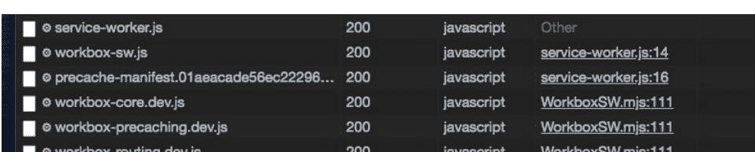
图 8.2

另一点是我们在 Chrome 的地址栏中看到一个小的添加图标（`+`）：


图 8.3

点击它会弹出一个对话框，提示将此应用添加到 Chrome，就像我们正在向浏览器安装某种应用一样！让我们添加它：


图 8.4

一旦我们安装了这个应用，它就成为一个独立的应用程序，你可以在 Chrome Apps 文件夹中看到它。双击该应用实际上会打开一个单独的窗口，我们会在其中看到相同的应用程序，但这一次，它感觉就像我们正在运行一个真正的应用程序。

### 服务工作者

可以将服务工作者想象成一个位于你的应用程序和网络层之间的 JavaScript 文件。这意味着，当当浏览器尝试连接到网络时，请求都会经过服务工作者。同样，当网络有响应时，响应在你的应用程序之前也会经过服务工作者。一个需要注意事项是，服务工作者和 Web Workers 一样，运行在一个独立的中（这并不意味着 JavaScript 是多线程的），所以你的 UI 永远被阻塞。

#### 生命周期

这里有一张很好的图片，展示了服务工作者的生命周期：


图 8.6

```javascript
self.__precacheManifest = [].concat(self.__precacheManifest || []);
workbox.precaching.precacheAndRoute(self.__precacheManifest, {});
workbox.routing.registerNavigationRoute(workbox.precaching.getCacheKeyForURL("/index.html"), {
  blacklist: [/^\/_/,/[^\/?]+\.[^\/]+$/],
});
```

简而言之，此脚本将 `precache-manifest` 文件中描述的所有路由注册到服务工作者，并告诉它们缓存这些资源。由于 React 应用程序本质上是`单页应用程序 (SPA)`，我们使用 `workbox.routing` API 的 `registerNavigationRoute` 方法，以便在我们的应用从用户那里收到任何路由访问时，都返回我们的 `index.html` 文件。这使得 React 能够重新控制路由系统，并使用 `react-router` 或其他现有的实现进行必要的内部路由。

### 使用 Next.js 的 PWA

既然我们已经对 PWA 是什么以及它基本上是如何工作的有了很好的理解，现在让我们把重点转向如何使用 Next.js 实现 PWA。让我们从创建一个简单的 Next.js 项目开始。你可以像我们在前几章那样手动设置 Next.js，或者我们可以使用像下面这样方便的 `create-next-app` 工具来完成同样的事情：

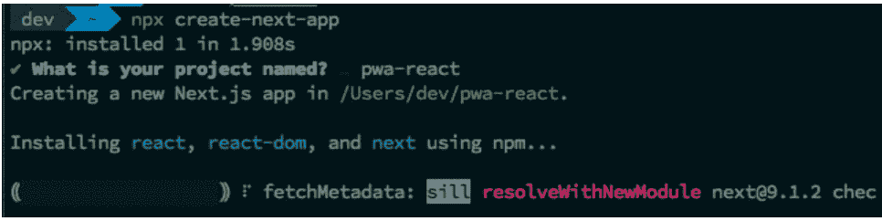

*图 8.7*

这基本上以与我们之前相同的方式初始化我们的设置。完成后，我们需要安装另一个名为 `next-offline` 的包。这将为我们的应用启用服务工作者支持，并最终支持 PWA。

```bash
npm install --save next-offline
```

这将安装 `next-offline` 包。完成后，在项目中创建一个名为 `next.config.js` 的新文件，文件内容如下：

```javascript
// next.config.js
const withOffline = require('next-offline')
const nextConfig = {}
module.exports = withOffline(nextConfig)
```

`next-offline` 包使用了很多默认配置，默认情况下，我们可以安全地坚持使用它。基本上，`withOffline` 函数的作用是，在为 Next.js 准备打包包时，注入一个带有传递选项的服务工作者脚本。让我们使用 `npm run build` 来构建我们的 Next 项目。在 `build` 文件夹中，你会在 `main-<hash>.js` 文件的某个地方看到以下压缩后的代码片段：

```javascript
navigator.serviceWorker.register("/service-worker.js",
{scope:"/"}).then...
```

现在，就像我们对上面的 React 应用所做的那样，我们需要提供我们的 `service-worker.js` 文件。别担心，我们不需要自己编写它，因为它再次由 Next 自动生成！但我们确实需要在 `/service-worker.js` URL 上提供它，而且你知道，在 Next 中静态文件是在 `static` 目录下提供的。

现在，虽然我们可以将服务工作者文件移动到 `static` 目录并使用上述配置更改服务工作者的路径，但我们将继续尝试将所有发往 `/service-worker.js` 的请求重定向到我们文件系统上的文件，并通过创建自定义服务器让 Next 处理其余的请求。

### 自定义 Next.js 服务器

在项目根目录创建一个名为 `server.js` 的文件，并将以下内容写入其中：

```javascript
const { createServer } = require('http')
const { join } = require('path')
const { parse } = require('url')
const next = require('next')
const app = next({ dev: process.env.NODE_ENV !== 'production' })
const handle = app.getRequestHandler()
app.prepare()
  .then(() => {
    createServer((req, res) => {
      const parsedUrl = parse(req.url, true)
      const { pathname } = parsedUrl
```

这段代码取自 Next.js 官方文档，让我们来梳理一下发生了什么：

- 这个脚本直接由 `node` 执行，它经过 `webpack` 或 `babel`，所以必须在这里使用 CommonJS 导入。
- 然后我们从 `http` 包中引入了 `createServer` 方法来创建一个服务器。
- 我们还引入了 `next` 包。这是 Next 的工作方式。

`config` 对象包含内容：

- `dev`：布尔值，表示开发模式（默认值：`false`）。
- `dir`：项目所在的位置（默认值：`'.'`）。
- `quiet`：是否包含服务器信息的（默认值：`false`）。
- `conf`：Next.js 配置对象（与 `next.config.js` 文件读取相同）。

我们返回了 `app` 对象，该对象有一系列关联用于自定义路由。不过只会关注 `RequestHandler` 和 `serveStatic`。

`RequestHandler()`

此方法允许 Next 以默认方式处理路由，本质上，当我们不想让自定义介入时，我们将使用 `createServer` 方法传入的适当 `req` 和 `res` 对象来调用此方法。它为我们返回另一个函数 `handle`，可以使用来自服务器的请求和响应对象来调用。

`serveStatic()`

使用另一个名为 `url` 的包将 URL 解析为不同的部分——主机名、路径名、端口等。最后我们检查路径名是否与 `/service-worker.js` 匹配。如果是，我们使用 `app.serveStatic()` 方法。基本上，我们传入 `req` 和 `res` 对象以及静态资源的路径。在我们的例子中，`service-worker.js` 直接存在于 `.next` 文件夹中，所以我们使用 `path.join` 直接获取路径。

完成这些操作后，我们还需要对 `package.json` 文件进行更改。JSON 文件中的 `scripts` 部分如下：

```json
"scripts": {
  "dev": "node server.js",
  "build": "next build",
  "start": "NODE_ENV=production node server.js"
}
```

最后，让我们像上次一样创建一个 `manifest.json` 文件，将其放入 `.next` 文件夹，并添加自定义路由。因此 `manifest.json` 文件应所示：

```json
{
  "short_name": "React App",
  "name": "Create React Sample",
  "icons": [
    {
      "src": "favicon.ico",
      "sizes": "64x64 32x32 24x24 16x16",
      "type": "image/x-icon"
    },
    {
      "src": "logo192.png",
      "type": "image/png",
      "sizes": "192x192"
    },
    {
      "src": "logo512.png",
      "type": "image/png",
      "sizes": "512x512"
    }
  ],
  "start_url": ".",
  "display": "standalone",
  "theme_color": "#000000",
  "background_color": "#ffffff"
}
```

我们的 `server.js` 文件应所示：

```javascript
const { createServer } = require('http')
const { join } = require('path')
const { parse } = require('url')
const next = require('next')
const app = next({ dev: process.env.NODE_ENV !== 'production' })
const handle = app.getRequestHandler()
app.prepare()
.then(() => {
  createServer((req, res) => {
    const parsedUrl = parse(req.url, true)
    const { pathname } = parsedUrl
    // 处理对 /service-worker.js 的 GET 请求
    if (pathname === '/service-worker.js' || pathname === '/manifest.json' || pathname === '/logo512.png' || pathname === '/logo192.png') {
      const filePath = join(__dirname, '.next', pathname)
      app.serveStatic(req, res, filePath)
    } else {
      handle(req, res, parsedUrl)
    }
  })
  .listen(3000, () => {
    console.log('> Ready on http://localhost:3000')
  })
})
```

别忘了也把你的图标放在 `.next` 文件夹中！最后，为了提供我们的 `manifest.json` 文件，我们需要在每个页面中将其作为 `link` 标签包含（就像我们之前在 React 示例中所做的那样）。让我们在 Next.js 中使用 `_document.js` 文件来完成这个操作。

### _document.js

`pages` 文件夹中的这个文件允许我们在各种位置（如页面的头部）注入自定义标记。我们将使用以下文件来注入 `manifest.json`：

```javascript
// pages/_document.js
import Document, { Html, Head, Main, NextScript } from 'next/document'
class MyDocument extends Document {
  static async getInitialProps(ctx) {
    const initialProps = await Document.getInitialProps(ctx)
    return { ...initialProps }
  }
  render() {
    return (
      <Html>
        <Head>
          <link rel="manifest" href="/manifest.json" />
        </Head>
        <body>
          <Main />
          <NextScript />
        </body>
      </Html>
    )
  }
}
```

```markdown
请注意，我只是为了清晰起见，从上面的对象中移除了一些属性。但我们之前看到的是 `React` 在内存中存在的一个对象。实际上，这就是 `vDOM`。请注意，尽管这里没有任何“DOM”，我们仍然称其为虚拟 DOM，这其实有点不准确。

### 渲染器

React 的第二部分是渲染器。现在，DOM 是可以使用 React 的宿主环境之一。还有其他宿主环境，比如 `React Native`（用于移动端），或者可能是 `React Hardware`。渲染器基本上允许协调器与宿主环境进行通信。

例如，对于 DOM，我们知道元素是使用浏览器暴露的 `document.createElement` API 创建的的。对于移动宿主环境，比如 `Android`，可能就不是这样了。在那里，你必须使用其他方式在屏幕上创建 UI 元素，但这会影响协调器吗？不会！这就是为什么将协调器和渲染器拆分成不同的包是一个很棒的决定。当你为网页安装 `react` 时，你安装的是 `react` 和 `react-dom` 这两个包。这里的 `react` 包基本上是协调器，而 `react-dom` 包是渲染器。

### 从类转向

我完全理解 `React` 为基于类的组件提供了头等支持，但本章旨在介绍 React 相关的未来技术和实验性技术，并且团队已经非常明确地表示，在未来，函数式组件将是开发的重点。借助 `Hooks`，函数式组件完全能够完成基于类组件的所有功能。如果你刚开始学习 `React`，我建议你只需了解足以重构它们的基于类组件知识，但如果你在创建自己的组件，始终选择函数式组件。

基于类的组件有其自身的优缺点，例如，它们实际上会改变 `state` 和 `props`，而函数式组件实际上是在渲染时捕获 `props` 和 `state`。这避免了棘手的 bug。此外，函数式组件比类更友好，因为 JavaScript 没有类；它只是函数上的语法糖。

### 并发模式

`React` 中的并发模式是一种全新的 React 工作方式。在计算机科学中，并发通常意味着基于时间片执行多个任务。`React` 在完成 `vDOM` 差异比较后，现在必须将这些更改提交到 DOM。计算 `vDOM` 中的更改是非阻塞的，即使现在也是如此，这也是 `React` 内部的工作方式（通过在浏览器中调用 `requestIdleCallback` 函数使用浏览器的空闲时间，在其他宿主环境中使用不同的线程），然而提交阶段，即写入 DOM 是同步的。并发模式的一些显著特性：

- 1. **可中断渲染**：考虑一个由大量项目组成的列表，你可以对项目进行过滤。如果你曾经使用过这样的应用程序，你就会知道，除非有某种防抖函数在用户停止输入（例如检查最后一次按键是否在 200 毫秒前）之前不运行搜索 JavaScript 逻辑，否则它可能会变得抖动和滞后。并发模式通过使渲染可被高优先级中断来解决这个问题。用户与输入框交互的优先级高于 `React` 渲染更新视图的优先级，因此 `React` 暂停其执行并释放主线程来处理输入。

- 2. **加载序列**：你是否遇到过这样的情况：即使你在快速网络连接下，加载旋转器也只闪烁一瞬？并发模式也解决了这个问题。

- 3. **并发**：最后但同样重要的是，`React` 现在可以真正并发地工作，即它可以同时处理多个状态更新。这意味着如果你有一些 I/O 绑定的数据（HTTP 网络请求）来获取一些数据，`React` 可以暂时跳过这些数据并渲染视图。
```