# OpenLaszlo 的 AJAX 和 Flash 开发：教程（教程系列）


摘要


## 引言

欢迎阅读*《OpenLaszlo AJAX与Flash开发教程》*。本书将教你使用OpenLaszlo这一令人兴奋的技术来编写AJAX和Flash应用程序。AJAX（异步JavaScript和XML）有望成为开发下一代Web应用的技术。Flash，你可能已经知道，是一种流行的、用于编写高度交互式Web应用的技术，通常涉及电影、动画或游戏。更吸引人的是，与需要几百美元的Macromedia Flash不同，OpenLaszlo是免费且开源的，它采用通用公共许可证（CPL）1.0版本（http://www.opensource.org/licenses/cpl.php）授权。CPL由IBM提供，为源代码的商业重用提供了灵活性。难怪像Yahoo、Earthlink等许多公司都依赖OpenLaszlo作为他们的开发平台。

OpenLaszlo附带一个应用程序编程接口（API），包含内置类和一套丰富的用户界面组件。这些类和组件允许你绘制图形、创建动画、布局组件、绑定数据、与服务器通信、制作电影和游戏，以及实际上任何成熟编程语言允许你做的所有事情。有了OpenLaszlo套件，你拥有富客户端程序员所需的一切。此外，一个用于快速OpenLaszlo开发的集成开发环境（IDE）可通过OpenLaszlo Eclipse插件获得。

本引言的其余部分将讨论AJAX、Flash和OpenLaszlo。它还将为你提供必要的软件安装准备，并概述本书每一章的内容。

### AJAX

AJAX是由Adaptive Path公司的Jesse James Garrett为两项旧技术——JavaScript和XML——创造的新名称。基本上，AJAX应用程序异步连接到服务器以收集更多数据，这些数据可以显示在当前的Web页面中。因此，无需刷新页面即可显示新信息。Google率先通过其Gmail和Google Maps应用推广了这一策略。然而，Google并非第一个充分利用实现异步连接的引擎（即XMLHttpRequest对象）的公司。微软在Internet Explorer 5中添加了它，而经验丰富的开发人员发现了利用其优势的方法。不久之后，Mozilla浏览器也拥有了自己的该对象版本。在XMLHttpRequest之前，人们使用DHTML和HTML框架以及iframe来实现无需刷新页面的更新。

尽管客户端技术不断进步，编写JavaScript代码（即AJAX应用程序）仍然令人生畏。即使有用于编写JavaScript脚本的IDE，程序员仍需克服编写客户端应用程序的最大挑战：浏览器兼容性。现实是，每个浏览器实现JavaScript的方式都略有不同。即使是同一个浏览器在不同操作系统中解释JavaScript的方式也不同。因此，你必须在各种操作系统中使用各种浏览器测试你的脚本，并编写多个版本的代码以确保在所有浏览器中都能工作。

这正是OpenLaszlo发挥作用的地方。使用OpenLaszlo，你只需编写和测试一次，它会负责处理浏览器兼容性问题。不用说，使用OpenLaszlo作为你的AJAX平台可以节省大量时间。从OpenLaszlo 4.0（代号Legals）开始支持AJAX。在此版本之前，OpenLaszlo只能生成Flash。现在你可以在AJAX和Flash之间进行选择。

### Flash

Flash是一项用于让静态网站变得生动的技术。它的历史始于才华横溢的软件开发人员Jonathan Gay在1996年5月推出FutureSplash Animator。正如其名，该产品专注于动画。当时，在Web浏览器中播放动画的唯一方式是通过动画GIF文件和Java小程序。Gay的产品最初基于Java小程序，正如Gay后来承认的那样，它慢得可怕。然而，它很有趣，因为它无需编程就能提供简单的动画。

Gay的运气在1996年8月到来了，他与微软达成了一笔交易，微软被FutureSplash Animator的能力所吸引，用Gay的话说，它创造了“互联网上最接近电视的体验”。Gay惊讶于微软推出了依赖于这家六人公司的新动画技术的MSN！

另一个成功故事随之而来，Gay与Disney Online签约，后者将使用FutureSplash Animator开发Disney Daily Blast，这是一个面向小孩子的网站。1996年11月，Macromedia收购了这个产品，1996年12月，FutureSplash Animator成为Macromedia Flash 1.0。很快，Macromedia将其转变为历史上最成功的软件产品之一。Macromedia Flash成为互联网动画的代名词。Adobe可能至今还在懊恼当初拒绝了Gay，因为Gay在与微软会面之前曾提出出售FutureSplash Animator。

**注意**
更多关于Flash历史的细节可在此处找到：
http://www.macromedia.com/macromedia/events/john_gay/

Flash最初推出时，仅用于制作可以在Web浏览器中播放的动画。它在创建无需编程的动画方面的竞争对手是动画GIF文件，但Flash影片加载更快，并且可以编程以提供交互性。Flash迅速走红，此后发展成为一个成熟的通用编程平台，可用于处理用户输入、连接数据库、创建游戏和电子学习网站等等。在内部，Flash使用矢量图形，因此图像在调整大小时质量不会受到影响。

如今，Flash播放器（目前为8.0版）已集成在大多数浏览器中，包括Internet Explorer、Netscape Navigator和Mozilla Firefox。总的来说，超过95%的现有浏览器无需手动重新安装播放器即可播放Flash。包含Flash播放器的浏览器列表可在此处找到：
http://www.macromedia.com/cfusion/knowledgebase/index.cfm?id=tn_14159


## 4 简介

然而，最新版本的开源浏览器 Mozilla FireFox 1.5 默认会阻止 Flash。原因在于：许多人对过多的动画感到厌烦。不过，该浏览器对 Flash 的支持依然可用，因为用户只需点击被阻止的动画，即可让它播放。

> **注意**
> 如果你的浏览器不支持 Flash，可以从 http://www.macromedia.com/downloads/ 下载 Flash 播放器。

Flash 以 ShockWave 格式（swf）文件形式部署，该格式规范可通过同意 Macromedia 的规范许可获得，该许可允许软件开发者使用 ShockWave 格式创建能生成 Flash 文件的应用程序。然而，该许可协议并未授予你制作 Flash 播放器的权利。你可以在此处查看许可条款：

- http://www.macromedia.com/licensing/developer/fileformat/license/

OpenLaszlo 得以实现正是得益于该许可协议。它现在通过提供编写 Flash 的免费软件，正在挑战 Macromedia。

### OpenLaszlo

OpenLaszlo 由位于加利福尼亚州圣马特奥的 Laszlo Systems 公司发明。OpenLaszlo 与 Macromedia Flash 的主要区别在于，OpenLaszlo 被建模为一套应用程序开发套件，而非用于制作影片的工具。

OpenLaszlo 附带一种名为 LZX 的语言，该语言基于我们熟悉的 XML 和 JavaScript。因此，许多 OpenLaszlo 初学者甚至在开始之前就已经感到得心应手。LZX 是一种面向对象的编程语言，区分大小写且基于事件。JavaScript 主要用于编写事件处理程序。

一个 LZX 应用程序会生成一个 Flash 文件或动态 HTML（DHTML）。如果你想将你的程序部署为 AJAX 应用程序，请选择后者。你可以用它来编写动画、播放 MP3 文件、创建电子商务应用程序、开发 Web Services 客户端等等。你可以访问 www.openlaszlo.com 查看演示。此外，LaszloMail (www.laslomail.com) 是一个完全用 LZX 编写的精美 Web 邮件应用程序。

OpenLaszlo 提供了一个编译器，可以将 lzx 源文件转换为 Flash 或 DHTML。该编译器是用 Java 编写的，但理解 Java 对于编写 LZX 应用程序并非必需。你只需要安装 Java 和 OpenLaszlo 套件。此外，为了顺利编译，OpenLaszlo 使用 Apache Tomcat，一个开源的 servlet/JSP 容器。你可以在其网站上找到更多关于 Tomcat 的信息：

http://tomcat.apache.org/

## Java 安装

如前所述，OpenLaszlo 编译器基于 Java。因此，在你开始编译 LZX 程序之前，你需要下载并安装 Java 开发工具包（JDK），并配置一些系统环境变量。

### 下载并安装 JDK

Windows、Linux 和 UNIX 的 JDK 可以从此 URL 下载：

http://java.sun.com/j2se/1.5.0/download.jsp

> **注意**
> 上面的链接将下载 Java 版本 5。如果你愿意，也可以使用 Java 6，它同样已经可用。

一旦你点击链接，你将被重定向到一个页面，让你选择适合你平台的安装程序：Windows、Linux 或 Unix。某些平台提供 64 位版本。另外，请注意，该链接也提供 Java 运行时环境（JRE）。然而，你需要的是 JDK，而 JDK 包含 JRE。

> **注意**
> 对于 Macintosh，请从此 URL 下载 JDK：
> http://developer.apple.com/java/download/

## 简介

获得 JDK 后，你需要安装它。安装过程因操作系统而异。以下小节将详细介绍安装过程。

#### 在 Windows 上安装

在 Windows 上的安装很简单。只需双击你下载的可执行文件的图标，然后按照说明操作即可。

#### 在 UNIX 和 Linux 上安装

在这些平台上，JDK 有两种安装格式。

- 自解压二进制文件。此格式可用于将 JDK 安装到你选择的位置，并且你不需要是 root 用户。
- 软件包。一个包含要安装的软件包的压缩文件。

如果你使用的是自解压二进制文件安装，请按照以下步骤操作。

1. 使用 **chmod** 赋予文件执行权限：

   `chmod +x shFile`

   其中，*shFile* 是你平台下载的 sh 文件。
2. 切换目录到你希望安装文件的位置。
3. 运行自解压二进制文件。在下载的文件前加上路径来执行它。例如，如果文件在当前目录下，在其前面加上 "./"（如果 "." 不在 PATH 环境变量中，则需要这样做）：

   `./shFile`

如果你下载的是软件包格式的 JDK，请参阅以下 URL：

```
http://java.sun.com/j2se/1.5.0/install-linux.html
http://java.sun.com/j2se/1.5.0/install-solaris.html
```

#### 配置系统环境变量

安装 JDK 后，你就可以开始编译和运行 Java 程序了。然而，你只能从 **javac** 和 **java** 程序的位置调用编译器和 JRE，或者在命令中包含安装路径。为了更方便地编译和运行程序，重要的是在你的计算机上设置 **PATH** 环境变量，以便你可以从任何目录调用 **javac** 和 **java**。

##### 在 Windows 上设置 Path 环境变量

要在 Windows NT、Windows 2000 和 Windows XP 上设置 **PATH** 环境变量，请执行以下步骤：

1. 点击 **开始**，**设置**，**控制面板**。
2. 双击 **系统**。
3. 在 Windows NT 上，选择 **环境** 选项卡。在 Windows 2000 和 Windows XP 上，选择 **高级** 选项卡，然后点击 **环境变量**。
4. 在 **用户变量** 或 **系统变量** 窗格中找到 **Path** 环境变量。**Path** 的值是一系列用分号分隔的目录。现在，将你的 Java 安装目录下 **bin** 目录的完整路径添加到现有 **Path** 值的末尾。该目录类似于：
   `C:\Program Files\Java\jdk1.5.0_<version>\bin`
5. 点击 **设置**、**确定** 或 **应用**。

##### 在 UNIX 和 Linux 上设置 Path 环境变量

在这些操作系统上设置路径环境变量取决于你使用的 shell。

对于 C shell，请将以下内容添加到你的 **~/.cshrc** 文件末尾：
`set path=(path/to/jdk/bin $path)`

其中 *path/to/jdk/bin* 是你 JDK 安装目录下的 bin 目录。

对于 Bourne Again shell，请将此行添加到你的 **~/.bashrc** 或 **~/.bash_profile** 文件末尾：
`export PATH=/path/to/jdk/bin:$PATH`

这里，*path/to/jdk/bin* 是你 JDK 安装目录下的 **bin** 目录。

#### 测试安装

要确认你已正确安装 JDK，请在你的计算机上的任何目录的命令行中输入 **javac**。如果你看到关于如何正确运行 **javac** 的说明，那么你已经成功安装了它。另一方面，如果你只能从 JDK 安装目录的 **bin** 目录运行 **javac**，那么你的 **PATH** 环境变量没有配置正确。

### 下载并安装 OpenLaszlo

你可以从以下站点下载 OpenLaszlo：
http://www.openlaszlo.org/download/

这里提供二进制文件和源代码。为了测试和运行本书中的示例，你需要二进制文件。该二进制文件附带适用于不同操作系统的安装程序：Windows、Macintosh 和 Linux/Unix。

> **注意**
> OpenLaszlo 开发套件包含 Tomcat，一个开源的 servlet/JSP 容器，默认情况下在端口 8080 上运行。请确保在安装前没有其他程序占用此端口。

#### 在 Windows 上安装

OpenLaszlo 的 Windows 发行版包含一个安装程序，使安装变得简单轻松。发行文件名为 openlaszlo-x.y.z-windows.exe，其中 x.y.z 是版本号。例如，OpenLaszlo 4.0 的发行文件是 **openlaszlo-4.0.x-windows.exe**。

要安装 OpenLaszlo，请运行安装程序并按照说明操作。安装程序还会创建启动和停止 OpenLaszlo 服务器的快捷方式。


#### 在 Linux/Unix 上安装

在开始安装之前，请确保您的浏览器已安装 Flash。以下是下载和安装 Flash 的地址：

http://www.macromedia.com/shockwave/download/download.cgi

适用于 Unix/Linux 的 OpenLaszlo 发行版是一个经过 gzip 压缩的 tar 文件。其名称类似于 `openlaszlo-x.y.z-unix.tar.gz`。例如，对于 4.0.0 版本，文件名将是 `openlaszlo-4.0.0-unix.tar.gz`。请按照以下步骤进行安装。

-   将发行版文件解压到一个工作目录
-   运行 **Server/tomcat-a.b.c/bin** 目录中的 **startup.sh** 文件。这里 *a.b.c* 是 OpenLaszlo 附带的 Tomcat 版本。

#### 在 Mac OS X 上安装

适用于 Macintosh 的 OpenLaszlo 以 dmg 文件形式分发。其名称类似于 `openlaszlo-x.y.z-osx-dev-install.dmg`，其中 `x.y.z` 是版本号。例如，4.0.0 版本的发行版是 `openlaszlo-4.0.0-osx-dev-install.dmg`。

#### 目录结构

如图 I.1 所示，成功安装后会创建三个目录。

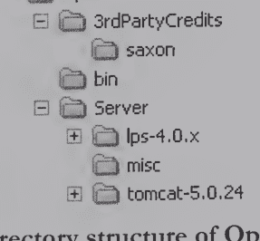

图 I.1：OpenLaszlo 安装的目录结构

## 简介

这些目录包括：

-   **3rdPartyCredits**。包含 OpenLaszlo 服务器使用的开源项目的许可信息。
-   **bin**。包含用于设置环境变量的脚本。OpenLaszlo 在内部使用这些脚本，您无需直接处理它们。
-   **Server**。包含 OpenLaszlo 开发套件。

Server 目录有两个子目录：

-   **lps-x.y.z**，其中 *x.y.z* 是 OpenLaszlo 的版本号。
-   **misc**。此目录存储 OpenLaszlo 的各种图标文件。
-   **tomcat-a.b.c**。这里，*a.b.c* 是用于运行 OpenLaszlo servlet/JSP 应用程序以编译脚本的 Tomcat 版本。

#### 测试安装

要测试您的安装，请启动 OpenLaszlo 服务器，并在浏览器中访问此 URL：

`http://localhost:8080/lps-x.y.z/laszlo-explorer/index.jsp`

请注意，您需要将 *lps-x.y.z* 部分替换为您下载的 OpenLaszlo 版本。例如，如果您下载了 4.0.x 版本，则 URL 为

`http://localhost:8080/lps-4.0.x/laszlo-explorer/index.jsp`

您将看到如图 I.2 所示的 OpenLaszlo 欢迎页面。

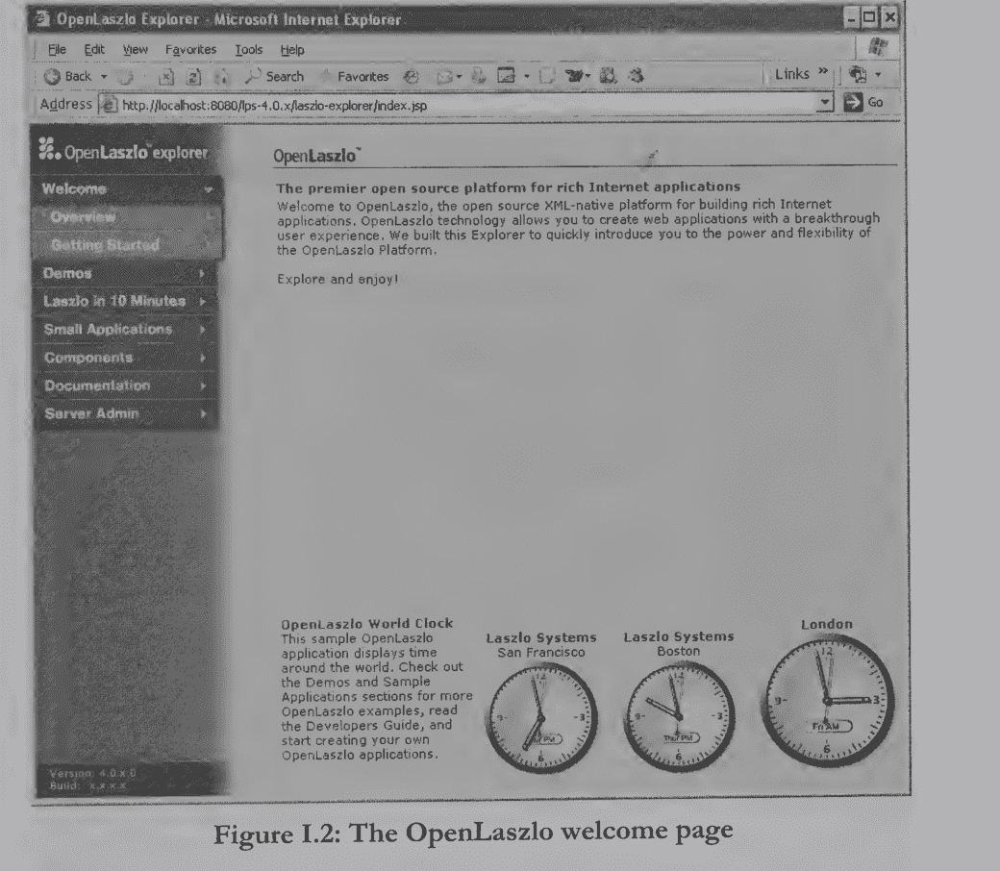

## 探索 OpenLaszlo

OpenLaszlo 服务器附带示例应用程序和文档。最好花点时间了解一下 OpenLaszlo 的功能。现在，请点击左侧菜单开始探索。下面给出了每个菜单的说明。

### 演示

演示菜单展示了展示 OpenLaszlo 功能的示例应用程序。演示页面如图 I.3 所示。

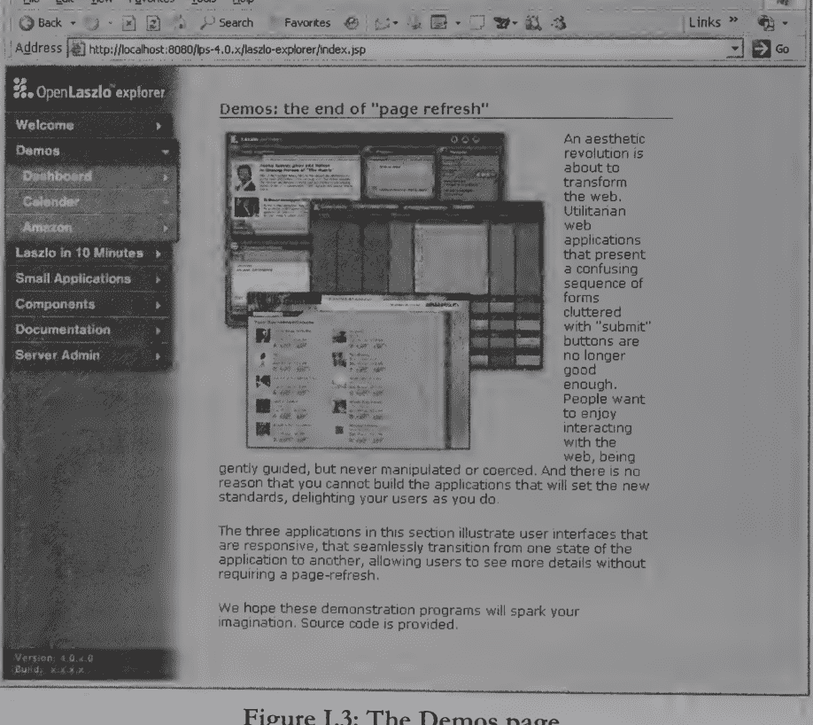

目前，演示展示了这些功能齐全的应用程序。

-   仪表盘
-   日历
-   亚马逊

亲自试用它们，感受 OpenLaszlo 的强大功能，并准备好为之惊叹。

### 10 分钟上手 Laszlo

如图 I.4 所示的“10 分钟上手 Laszlo”允许您即时开发应用程序。这在第 1 章“启动 OpenLaszlo”中进行了说明。

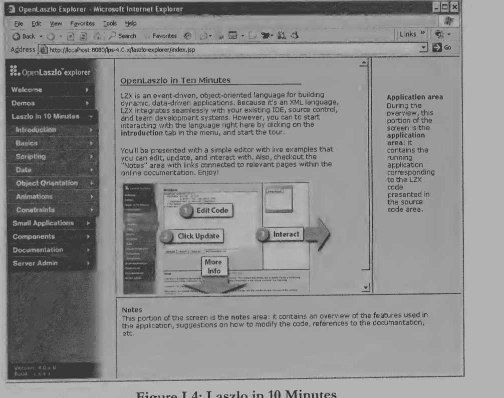

**图 I.4：** 10 分钟上手 Laszlo

### 小型应用程序

本节介绍小型的 OpenLaszlo 应用程序。页面如图 I.5 所示。

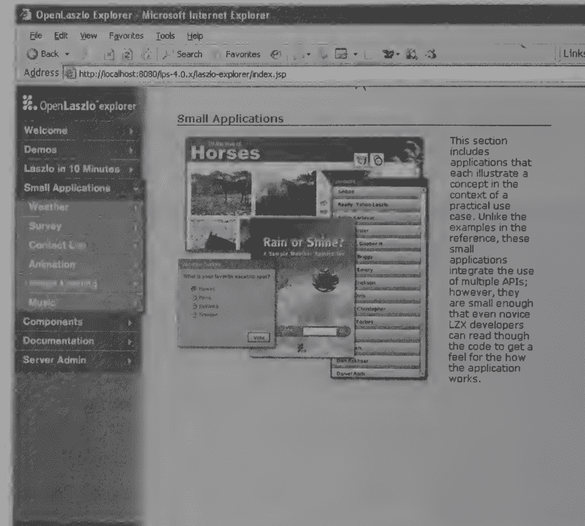

以下是精选的小型应用程序：

-   天气
-   调查
-   联系人列表
-   动画
-   图像加载
-   音乐

同样，您应该尝试这些应用，以熟悉 OpenLaszlo 的功能。

### 组件

OpenLaszlo 提供内置组件，使编程更加迅速。图 I.6 所示的组件菜单展示了其中一些组件。

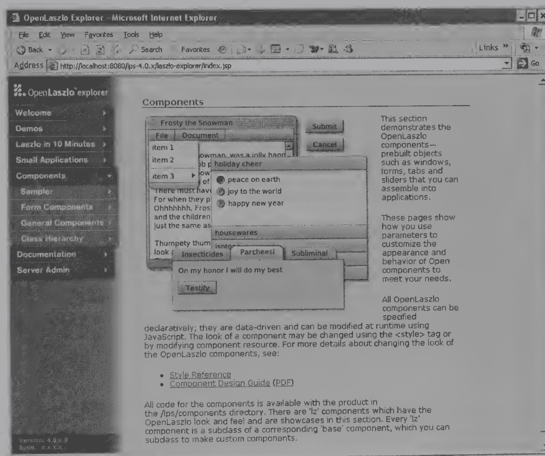

提供了各种组件，从简单的 Button 到更复杂的 DatePicker。所有这些组件及其使用方法将在后续章节中解释。

### 文档

OpenLaszlo 是一个成熟的项目，拥有丰富的文档。文档面向软件开发人员和系统管理员。此外，还有 LZX 参考手册和组件指南。图 I.7 展示了 OpenLaszlo 中可用的各类文档。

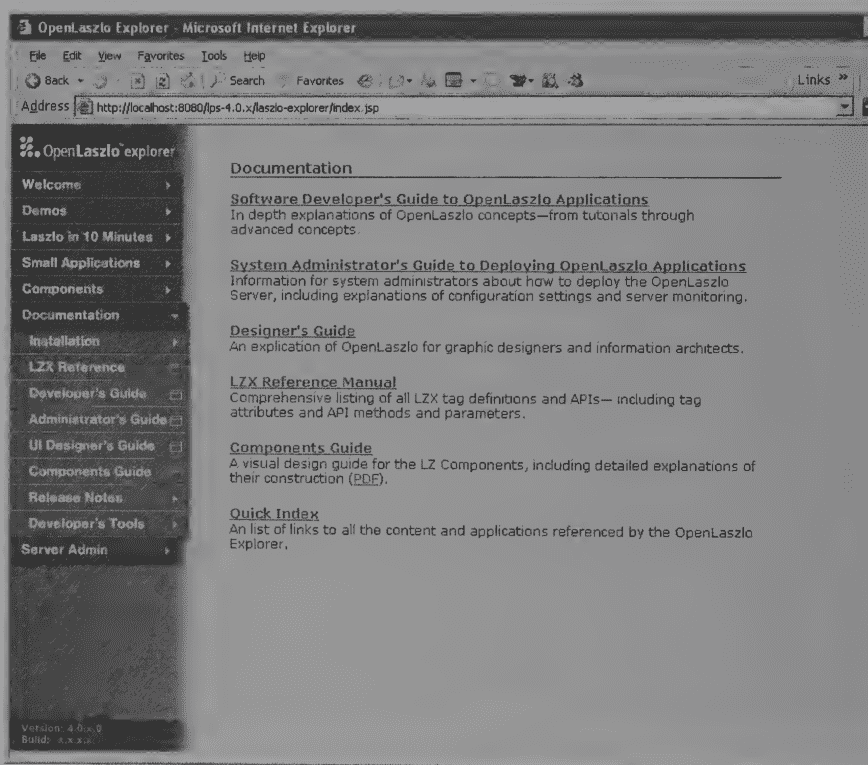

图 I.7：文档

### 服务器管理

OpenLaszlo Explorer 中的最后一个菜单项提供了用于管理 OpenLaszlo 服务器的工具。图 I.8 展示了这些工具。

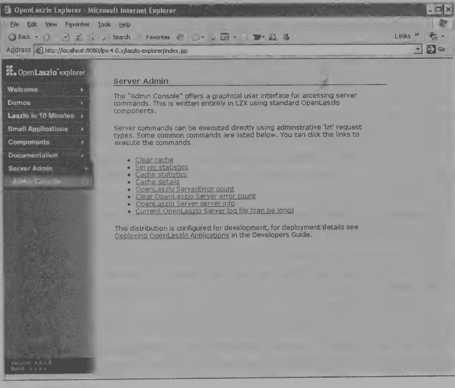

图 I.8：服务器管理

### OpenLaszlo 论坛

OpenLaszlo 是一个受欢迎的项目，吸引了来自世界各地的 Flash 和 AJAX 开发人员。Laszlo Systems 也为此类开发人员创建了一个交流论坛。您可以在此处访问论坛：

http://www.laszlosystems.com/developers/community/forums/

在此论坛中，您可以获得编程帮助，找到专业的 OpenLaszlo 开发人员来协助您的项目，发布应用程序，或寻找 OpenLaszlo 相关的工作。

## 关于本书

本节概述了本书各章节的内容。

第 1 章“启动 OpenLaszlo”介绍了 OpenLaszlo 服务器，展示了您编写和运行的第一个 OpenLaszlo 应用程序，以及随 OpenLaszlo 提供的 LZX 编程语言。OpenLaszlo 还提供了一组所有类都派生自 **LzNode** 类的类。

第 2 章“基本组件”解释了如何在 OpenLaszlo 中使用基本组件，例如视图、按钮、窗口、警告框、组合框和单选按钮。

第 3 章“处理文本”展示了如何使用 **LzText**、**LzInputText** 和 **LzFont** 类来处理文本和字体。

当您将组件添加到容器时，需要以适当的方式布局这些组件。第 4 章“布局管理”介绍了可以在 OpenLaszlo 中使用的各种布局管理器。

LZX 是 OpenLaszlo 的核心语言，是一种基于事件的语言。第 5 章“事件处理”向您展示了如何将对象与事件处理程序绑定。您还将在本章中学习如何使用 **method** 和 **handler** 标签。

在 OpenLaszlo 中，约束是表达式的求值结果，而状态是一种条件约束。两者都提供了一种便捷的方式来监控动态值并将该值分配给属性。第 6 章“约束和状态”解释了约束和状态。

第 7 章“动画”讨论了如何在 OpenLaszlo 中使用 **animator** 和 **animatorGroup** 标签制作动画。在本章中，您还将学习如何使用 **LzTimer** 类创建计时器。

第 8 章“处理数据”解释了如何使用 XPath 和以下 OpenLaszlo 类来访问和操作数据：**LzDataset**、**Grid** 和 **LzDataPointer**。

第 9 章“处理菜单”教您如何在 OpenLaszlo 应用程序中创建和使用菜单栏、菜单和菜单项。菜单很方便，因为它们只占用很少的用户屏幕空间。

第 10 章“自定义绘制”教您如何使用 **LzDrawView** 类绘制自定义形状。在标准组件不足以满足需求的情况下，自定义绘制非常有用。

第 11 章“高级组件”介绍了比第 2 章涵盖的更丰富的组件。它们包括以下类：**Slider**、**DatePicker**、**ScrollBar**、**Tabs**、**Tabpane** 和 **Tree**。

OpenLaszlo 附带数百个构成框架的类。然而，在某些情况下，您需要为现有类添加更多功能，或通过继承更改类的行为。第 12 章“扩展类”展示了如何实现这一点。

第 13 章“与浏览器通信”面向那些希望将 OpenLaszlo 应用程序部署为 Flash 的开发人员。本章讨论了嵌入 Flash 文件的包装 HTML 页面，并解释了如何从 LZX 程序调用浏览器。

第 14 章“调试和部署”解释了 OpenLaszlo 开发过程中的两个主题。首先，它教您如何激活调试器窗口并评估变量值和表达式。其次，它解释了如何轻松部署 OpenLaszlo 应用程序。

第 15 章“Google 地图应用程序”展示了一个使用 Google Maps API 显示各种位置地图的示例应用程序。

附录 A“XML 简介”简要介绍了 XML 以及使用 DTD 和模式进行 XML 文档验证。

附录 B“JavaScript 简介”提供了 JavaScript 入门知识。

### 下载程序示例

本书附带的程序示例可从此处下载：
http://www.brainysoftware.com/download/openLaszloSamples.zip


## 简介

将压缩文件解压到 OpenLaszlo 安装目录下的 **Server/lps-x.y.z** 目录。图 I.9 显示了您应该将示例应用程序解压到的位置。

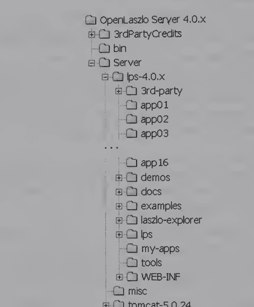

图 I.9：示例应用程序解压后的 OpenLaszlo 安装目录

# 第 1 章：启动 OpenLaszlo

OpenLaszlo 程序是 XML 文档，因此您可以使用任何文本编辑器来编写。然后，您可以使用 LZX 编译器将其转换为 SWF 文件或 DHTML。将 OpenLaszlo 程序传递给编译器的一种便捷方式是通过 Web 浏览器向 OpenLaszlo 服务器发送消息。以这种方式编译 OpenLaszlo 程序可以节省时间，因为 OpenLaszlo 服务器会将结果直接发送到浏览器，然后浏览器将执行生成的 Flash/DHTML。

由于 OpenLaszlo 服务器的重要性，我们将花时间对其进行研究，学习如何安装它，并了解其架构。OpenLaszlo 服务器是本章讨论的第一个主题。之后，我将向您介绍用于编写 OpenLaszlo 程序的语言 LZX。LZX 是一种面向对象编程语言，OpenLaszlo 附带数百个内置 LZX 类，可帮助您更快地编写应用程序。所有这些类都直接或间接派生自 **LzNode** 类。因此，本章的语言课程首先介绍 OOP 教程，然后详细探讨 **LzNode** 类。

## OpenLaszlo 服务器

OpenLaszlo 服务器是一个 Java servlet/JSP 应用程序。该服务器使 LZX 应用程序开发变得轻而易举。您可以通过将 Web 浏览器定向到 OpenLaszlo 服务器来编译代码。服务器检查 URL 并编译相应的源代码（LZX 文件）。然后，它将生成的输出发送到浏览器，以便您可以查看您的应用程序。如果编译失败，服务器会发送编译错误，告诉您哪一行或哪几行代码导致了错误。如果存在错误但编译可以继续，服务器会生成输出并发送警告消息。

由于 OpenLaszlo 服务器是一个 servlet/JSP 应用程序，您需要一个 servlet/JSP 引擎，它通常被称为 servlet/JSP 容器。您不需要了解 servlet 编程来开发 LZX 应用程序，但您需要知道如何安装和运行 servlet/JSP 容器。

市场上有几种免费的 servlet/JSP 容器。Jetty 和 Tomcat 是其中的两个。OpenLaszlo 的开发者选择了 Tomcat 作为他们的 servlet/JSP 容器，尽管其他产品也可以使用。或者，您可以使用 J2EE 应用程序服务器来运行 OpenLaszlo 服务器。J2EE 应用程序服务器总是包含一个 servlet/JSP 容器，但其功能比 servlet/JSP 容器强大得多。以下是 J2EE 应用程序服务器的示例。

- BEA 的 WebLogic
- IBM 的 WebSphere
- Sun Microsystems 的 Sun Java Application Server
- Oracle 的 10g Application Server
- GlassFish
- JBoss
- Jonas
- Apache Geronimo

JBoss、Jonas 和 Geronimo 是开源应用程序服务器。然而，它们有不同的许可证，因此请务必在使用产品前阅读它们。

OpenLaszlo 服务器可以在两种不同的环境中使用：

1. 作为开发平台，用于轻松快速地编译 OpenLaszlo 应用程序。
2. 作为部署平台，用于快速分发和运行 OpenLaszlo 应用程序。

请注意，尽管更困难，但您也可以在没有 OpenLaszlo 服务器的情况下编译您的 OpenLaszlo 脚本。

OpenLaszlo 开发平台的架构如图 1.1 所示。该图显示了一个客户端请求将输出作为 Flash 文件发送。对于 DHTML，浏览器中不需要 Flash 播放器。

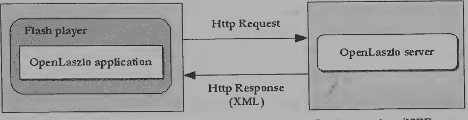

开发过程可以总结如下。您编写代码并将其作为 lzx 文件保存在指定目录中。然后，您使用 Web 浏览器向 OpenLaszlo 服务器发送 HTTP 请求，该服务器随后编译您的代码并生成 Flash 文件。OpenLaszlo 服务器将 Flash 文件发送到浏览器，浏览器自动播放它。

现在，让我们创建一个 OpenLaszlo 应用程序来体验开发过程。

## 您的第一个 OpenLaszlo 应用程序

开发 OpenLaszlo 应用程序的步骤如下。

1. 使用文本编辑器编写您的 OpenLaszlo 程序（使用 XML 和 JavaScript）。
2. 将文件保存为 lzx 文件。
3. 手动或通过使用 OpenLaszlo 服务器将 lzx 文件编译为 swf 文件或 DHTML。

然后您可以在 Web 浏览器中运行输出。

这些步骤将在以下小节中描述。

### 编写 OpenLaszlo 应用程序

如前所述，OpenLaszlo 应用程序是一个 XML 文档。因此，您可以使用任何文本编辑器来编写代码。代码清单 1.1 是一个简单的 LZX 应用程序。

**代码清单 1.1：一个简单的示例**

```
<canvas height="150" width="200" bgcolor="yellow" >
    <view width="150" height="100" bgcolor="white">
        <button text="OpenLaszlo"
                onclick="setAttribute('text', 'rocks')"/>
    </view>
</canvas>
```

### 保存源文件

现在，将脚本保存为 **firstLaszlo.lzx** 文件。该文件必须保存在 OpenLaszlo 服务器安装目录下的 **Server/lps-4.0.x** 目录或其下的某个目录中。如果您已经下载了包含本书示例应用程序的 zip 文件并按照简介中的说明进行了解压缩，那么您已经在 **Server/lps-4.0.x** 目录下拥有子目录。您可以在 **app01** 子目录下找到 **firstLaszlo.lzx** 文件。

### 编译和运行脚本

编译 lzx 文件最简单的方法是使用 OpenLaszlo 服务器。确保 Tomcat 在您的计算机上运行，然后将浏览器定向到以下 URL：

```
http://localhost:8080/lps-4.0.x/path
```

此处，*path* 是相对于 OpenLaszlo 服务器安装目录下 **Server/lps-4.0.x** 目录的 lzx 文件路径。例如，如果您的脚本保存在 **Server/lps-4.0.x** 目录下的 **app01** 目录中的 **firstLaszlo.lzx** 文件，您可以使用此 URL 来编译您的 OpenLaszlo 应用程序。

```
http://localhost:8080/lps-4.0.x/app01/firstLaszlo.lzx
```

servlet 容器会将您的 HTTP 请求传递给 OpenLaszlo 服务器。后者打开并编译正确的 lzx 文件，生成输出并将其保存在临时目录中。OpenLaszlo 服务器随后将生成的输出发送到浏览器。

如果应用程序编译为 Flash，生成的 swf 文件及相关文件将被缓存，因此后续对相同未修改的 lzx 文件的请求会快得多，因为无需重新编译。如果编译失败，浏览器上将显示错误消息。

对于这个 OpenLaszlo 应用程序，您将在浏览器中看到一个 Flash 应用程序，如图 1.2 所示。

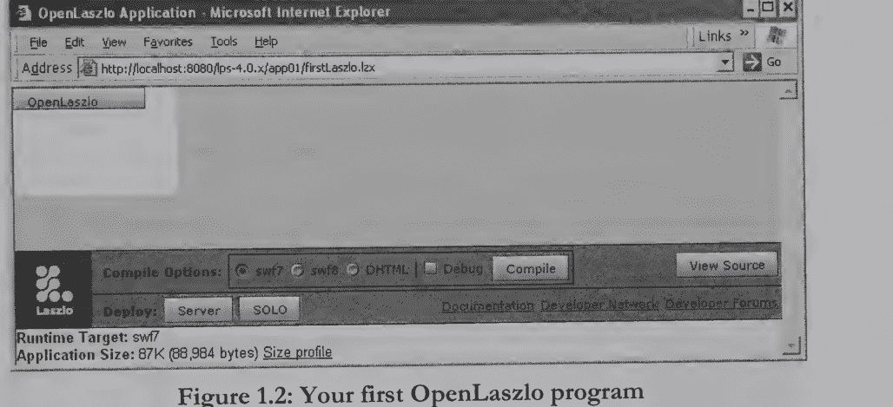

浏览器窗口中有两个部分。顶部部分是您应用程序的输出。有一个写着“OpenLaszlo”的按钮位于一个白色矩形上方，该白色矩形放置在一个更大的黄色矩形内。如果您单击该按钮，其上的文本将更改为“rocks”。

底部部分是一个开发工具，包含允许您查看 OpenLaszlo 源代码、部署应用程序、重新编译源代码以及执行其他功能的按钮。图 1.2 底部还有一些信息，说明运行时目标是 Flash 7，Flash 文件的大小为 88,984 字节。

为节省篇幅，本书中其他应用程序的底部部分将不再显示。

## 即时开发

发明 OpenLaszlo 的公司 Laszlo Systems 提供了即时开发模式。在这种模式下，您甚至不需要编写代码


## 第1章：OpenLaszlo入门

您无需在lzx文件中编写代码或安装Tomcat。只需打开一个网页，在其中输入您的代码即可。

要测试即时开发模式，请将Web浏览器定向到此URL。

http://www.laszlosystems.com/lps/laszlo-in-ten-minutes/

如果您已安装Tomcat和OpenLaszlo服务器，即时开发模式也可在本地使用。请确保Tomcat正在运行，然后将浏览器定向到以下页面：

http://localhost:8080/lps-4.0.x/laszlo-explorer/index.jsp

在左侧菜单中，点击**10分钟掌握Laszlo**，然后点击其**简介**子菜单。您将看到类似图1.3的内容。

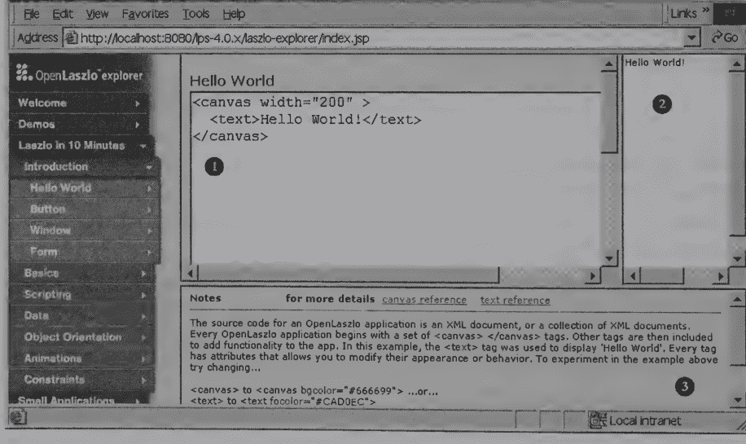

**图1.3：即时开发**

您将看到三个编号为1、2和3的窗格。在第一个窗格中编写脚本。完成后，点击第一个窗格底部的“更新”按钮。这将向服务器发送一个HTTP请求，服务器随后会编译您的代码。结果显示在第二个窗格中。请务必通过点击“另存为”按钮不时保存您的脚本。

第三个窗格提供了OpenLaszlo语言语法的快速参考。

### 面向对象编程概述

既然您已经了解了编写OpenLaszlo应用程序是如此简单，让我们来看看面向对象编程。由于LZX是一种面向对象编程语言，掌握OOP技能对于创建高效的OpenLaszlo应用程序至关重要。

面向对象编程通过建模应用程序来模拟现实世界中的对象。OOP有三个核心原则：封装、继承和多态。LZX支持所有这三个原则。

OOP的好处是实实在在的。这就是为什么大多数现代编程语言（包括LZX）都是面向对象的原因。我甚至可以举出两个语言转型支持OOP的著名例子：C语言演变成了C++，Visual Basic升级到了Visual Basic.NET。

本节将解释OOP的好处，并评估学习OOP的难易程度。

### OOP的好处

OOP的好处包括易于维护代码、代码重用和可扩展性。下面详细说明这些好处。

1.  **易于维护。** 现代软件应用程序往往非常庞大。曾经，“大型”系统只包含几千行代码。如今，即使是百万行代码的系统也不算特别大。当系统变得越来越大时，它开始给开发者带来问题。C++之父Bjarne Stroustrup曾说过类似这样的话。小项目可以用任何方式、任何方法来写。只要你有毅力，最终总能搞定。但大型项目就完全是另一回事了。如果不运用“良好编程”技术，旧错误修复的速度将赶不上新错误出现的速度。原因在于大型程序的不同部分之间存在相互依赖。当你修改程序某一部分的某些内容时，可能意识不到这种修改会如何影响其他部分。OOP使应用程序模块化变得容易，而模块化让维护不再那么令人头疼。模块化是OOP固有的，因为类（对象的模板）本身就是一个模块。一个好的设计应该允许一个类包含相似的功能和相关数据。一个在OOP中经常使用的重要且相关的术语是耦合，它表示两个模块之间的交互程度。各部分之间的松散耦合使得代码重用——OOP的另一个好处——更容易实现。

2.  **可重用性。** 可重用性意味着先前编写的代码可以被代码编写者和其他需要相同功能的人重复使用。因此，面向对象语言通常附带一套现成的库，这并不奇怪。以LZX为例，该语言附带数百个经过精心设计和测试的内置类。编写和分发自己的库也很容易。编程平台对可重用性的支持非常有吸引力，因为它缩短了开发应用程序所需的时间。

    类重用性的主要挑战之一是为类库创建良好的文档。程序员能多快找到提供他/她所需功能的类？是找到这样一个类更快，还是从头编写一个新的类更快？幸运的是，LZX核心类附带了不错的文档和示例。

    可重用性不仅适用于通过重用类和其他类型进行的编码阶段；在面向对象系统中设计应用程序时，面向对象设计问题的解决方案也可以重用。这些解决方案称为设计模式。为了更容易地引用每个解决方案，每个模式都有一个名称。可重用设计模式的早期目录可以在Erich Gamma、Richard Helm、Ralph John和John Vlissides所著的经典书籍《设计模式：可复用面向对象软件的基础》中找到。

3.  **可扩展性。** 每个应用程序都是独一无二的。它有自己的需求和规范。就可重用性而言，有时你找不到提供应用程序所需确切功能的现有类。但是，你可能会找到一个或两个提供部分功能的类。可扩展性意味着你仍然可以通过扩展这些类来满足你的需求。你仍然节省了时间，因为你不必从头开始编写代码。

    在OOP中，可扩展性是通过继承实现的。你可以扩展现有类，为其添加一些方法或数据，或者更改你不喜欢的方法的行为。如果你知道在许多情况下将使用的基本功能，但不想让你的类提供非常特定的函数，你可以提供一个泛型类，以便以后扩展以提供特定于应用程序的功能。

### 什么是LZX对象？

在使用面向对象编程语言开发应用程序时，你会创建一个类似于现实世界情况的模型来解决你的问题。以公司工资单应用程序为例，它可以计算员工的实得工资和应缴所得税。这样的应用程序会有一个**公司**对象来表示使用该应用程序的公司，**员工**对象来表示公司中的员工，**税务**对象来表示每个员工的税务详情等等。然而，在你开始编程此类应用程序之前，你需要理解什么是对象以及如何创建它们。

让我们先来看看生活中的对象。对象无处不在，包括有生命的（人、宠物等）和无生命的（汽车、房子、街道等）；具体的（书、电视等）和抽象的（爱、知识、税率、法规等）。每个对象都有两个特征：属性和对象能够执行的动作。例如，汽车有以下一些属性：

- 颜色
- 轮胎数量
- 车牌号
- 气门数量

此外，汽车可以执行以下动作：

- 行驶
- 刹车

再比如，狗有以下属性：颜色、年龄、品种、体重等。它还可以吠叫、奔跑、排尿、嗅探等。

LZX对象也有属性并能执行动作。在LZX中，方法被称为函数。在其他语言中，属性通常称为字段。

属性和方法都是可选的，这意味着一些**LZX**对象可能有方法但没有属性，另一些可能有属性但没有方法。当然，有些对象两者兼有，有些则两者皆无。

如何创建LZX对象？这与问“如何制造汽车？”是一样的。汽车是昂贵的物体，需要仔细设计，考虑到许多因素，比如安全性和成本效益。你需要一个好的蓝图来制造好汽车。要创建LZX对象，你需要类似的蓝图：类。

### LZX类

类是创建相同类型对象的蓝图或模板。如果你有一个**员工**类，你可以创建任意数量的**员工**对象。要创建**街道**对象，你需要一个**街道**类。类决定了你获得什么样的对象。例如，如果你创建一个具有**年龄**和**职位**属性的**员工**类，那么从这个**员工**类创建的所有**员工**对象也将具有**年龄**和**职位**属性。不多也不少。类决定了对象。

总之，类是OOP的一种工具，使程序员能够创建问题的抽象。在OOP中，抽象是使用编程对象来表示现实世界对象的行为。因此，编程对象不需要具备现实世界对象的所有细节。例如，如果工资单应用程序中的一个**员工**对象只需要能够工作并领取工资，那么**员工**类只需要两个方法：**工作**和**领取工资**。OOP抽象忽略了现实世界中的员工还能做许多其他事情，包括吃饭、跑步、亲吻和踢腿。

类是OpenLaszlo程序的基本构建块。LZX中的所有程序元素都必须存在于一个类中，并且每个类都必须保存为一个lzx文件。编写类时，你需要考虑三件事：

- 类名
- 属性
- 方法


在本书的前几章中，你将学习如何使用LZX编译器自带的标准类。第12章“扩展类”讨论了如何编写自己的类。

> **注意**
> 在UML类图中，一个类由一个分为三部分的矩形表示：最顶部的部分是类名，中间部分是属性列表，底部部分是方法列表。（参见图1.4）如果不显示属性和方法并不重要，它们可以被隐藏。

| Employee |
| :--- |
| age<br>salary |
| receiveSalary()<br>work() |

**图1.4：** UML类图中的Employee类

#### 属性

属性是变量。例如，图1.4中的**Employee**类有两个属性：**age**和**salary**。一个属性可以引用一个简单数据类型，如整数，或一个复杂类型，如对象。

### 方法

方法定义了类的对象（或实例）可以执行的动作。一个方法包含声明部分和主体部分。声明部分由返回值、方法名和参数列表组成。主体部分包含执行动作的代码。

要声明一个方法，请使用**method**标签。

```
<method name="*methodName*" [args="*listOfArguments*"]>
```

**args**属性是可选的。

## 第1章：启动OpenLaszlo

例如，这里有一个名为**addNumbers**的方法，它接受两个参数。

```
<method name="add" args="a,b">
    return (a + b);
</method>
```

> **注意**
> 实际上，LZX中还有另外两种类成员：事件和处理程序，这将在第5章“事件处理”中进行解释。

### UML类图中的类成员

图1.4描绘了一个UML类图中的类。该图提供了所有属性和方法的快速摘要。在UML中你可以做更多。UML允许你包含属性类型和方法签名。例如，图1.5展示了包含五个属性和一个方法的**Book**类。

| Book |
| --- |
| height : Integer |
| isbn : String |
| numberOfPages : Integer |
| title : String |
| width : Integer |
| --- |
| getChapter(Integer chapterNumber) : Chapter |

**图1.5：在类图中包含类成员信息**

注意，在UML类图中，冒号用于分隔属性及其类型。方法的参数列表用括号表示，其返回类型写在冒号之后。

### 区分大小写

OpenLaszlo 4应用程序可以编译为swf7、swf8或DHTML。如果未指定版本，将使用swf7。LZX程序中的标识符是区分大小写（Case-sensitive）的。例如，拥有两个名为**myData**和**MyData**的全局变量将产生编译错误。

## LZX程序

一个LZX程序也是一个有效的XML文档。如果你不熟悉XML，请花时间阅读并理解附录A“XML简介”。

在LZX程序内部，你使用类似于JavaScript的编程语法。附录B提供了JavaScript的简要教程。

### 创建对象

在LZX中创建对象有两种方式：使用与类关联的标签，以及在JavaScript脚本中使用**new**关键字。例如，每个应用程序必须恰好有一个画布（canvas），所有其他组件都被添加到其中。要创建一个画布，你可以像这样使用**canvas**标签。

```
<canvas>
</canvas>
```

你可以嵌套标签在对象内部创建对象。例如，以下代码创建一个画布，然后在画布内部创建一个视图（view）组件。

```
<canvas>
    <view bgcolor="0x00ffdd">
    </view>
</canvas>
```

在这种情况下，视图将是画布的子对象。

> **注意**
> 一个LZX应用程序的根必须是**canvas**。

你可以使用**script**标签来编写JavaScript代码。注意，**script**标签只能嵌套在**canvas**标签内。将其作为其他标签的子标签编写会导致编译错误。例如，清单1.2展示了一个使用脚本将视图的背景色从青柠色（lime）改为红色的LZX应用程序。

**清单1.2：使用脚本**

```
<canvas width="400">
    <view name="v1" width="150" height="100" bgcolor="lime"/>
    <script>
        canvas.v1.setAttribute("bgcolor", 0xFF0000);
    </script>
</canvas>
```

你可以使用以下URL编译并运行此程序：
http://localhost:8080/lps-4.0.x/app01/scriptTest.lzx

要以编程方式创建对象，你可以将**new**关键字与类的构造函数一起使用：
var obj = new LzView();

例如，清单1.3中的代码展示了如何使用**new**关键字创建一个视图。

**清单1.3：使用new关键字创建对象**

```
<canvas width="400">
    <script>
        var v1 = new LzView(canvas, {width: 200, height: 50,
                    bgcolor: green, name: "myView"});
        myView.setX(100);
    </script>
</canvas>
```

要测试此程序，请使用以下URL：
http://localhost:8080/lps-4.0.x/app01/newKeywordTest.lzx

因为LZX源文件必须是有效的XML文档，所以你必须对脚本中出现的XML特殊字符进行编码，例如 < 和 >。一个更简单的方法是用 <![CDATA[ 和 ]]> 包裹脚本。例如，清单1.4是清单1.3代码的重写版本。

**清单1.4：使用特殊块保护脚本**

```
<canvas width="400">
    <script>
    <![CDATA[
        var v1 = new LzView(canvas, {width: 200, height: 50,
                    bgcolor: green, name: "myView"});
        myView.setX(100);
    ]]>
    </script>
</canvas>
```

随着你阅读本章和下一章，你将了解更多关于使用LZX编程的内容。

### 使用attribute标签

你可以通过在对象的标签中指定属性名和值来设置对象的属性。例如，以下**view**标签指定了**width**属性。

```
<view width="50"></view>
```

你也可以使用**attribute**标签来设置属性。上面的**view**标签可以重写为：

```
<view>
    <attribute name="width" value="50"/>
</view>
```

注意，你在**attribute**标签内使用**name**和**value**属性来分别指定属性的名称和值。要从方法中访问和设置属性，你需要使用**LzNode**的**getAttribute**和**setAttribute**方法（参见下一节“LzNode类”）。

### 使用调试工具

OpenLaszlo提供了一个有用的调试工具。你可以显示变量的值并显示任何运行时错误消息。要使用调试工具，请使用**canvas**标签的**debug**属性：

```
<canvas debug="true">
```

使用**debug**属性将显示调试器窗口，如图1.6所示。


#### 图1.6：调试器窗口

你可以使用**debug**标签配置调试器窗口。例如，这个**debug**标签设置了将要显示的调试器窗口的宽度和高度。

```
<debug width="400" height="130"/>
```

请记住，**debug**标签只能作为**canvas**标签的直接子标签编写。

在LZX应用程序内部，你可以通过使用其**write**方法写入调试器窗口：

```
Debug.write("a = " + a);
```

调试器窗口将在第14章“调试与部署”中进一步讨论。

## LzNode类

**LzNode**类是所有LZX类的最终父类。它定义了所有LZX对象继承的属性、方法和事件。以下是**LzNode**类的构造函数：

```
LzNode(parent, args)
```

这里，*parent*是新的**LzNode**对象的父对象，*args*是要应用于新对象的属性名/值对的集合。

**LzNode**的更重要的子类如图1.7所示。

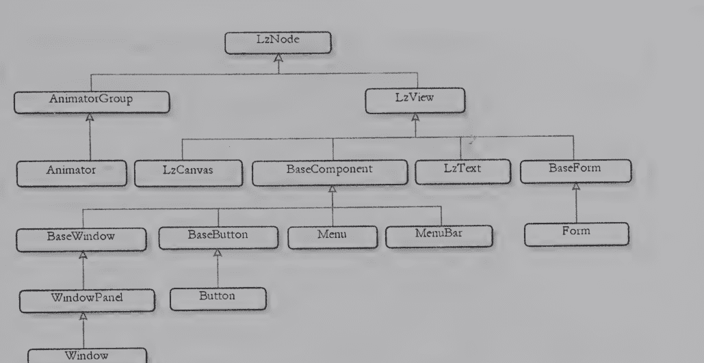

### 图1.7：LzNode的更重要子类

这些类将在第2章及后续章节中讨论。

我们现在将检查**LzNode**类的属性和方法。表1.1列出了**LzNode**类的属性。你将把它作为参考，所以如果第一次阅读时不理解它们，也不必担心。现在，请记住有两个重要的属性用于标识一个**LzNode**对象：**id**和**name**。**id**属性在整个应用程序中必须唯一，并提供了一种方便的引用对象的方式。**name**属性在一个上下文中必须唯一，你必须限定其父对象才能引用它。

**注意**

表1.1用法列中的JS表示Javascript。

| 名称 | 用法 | 类型 | 默认值 | 可访问性 |
| :--- | :--- | :--- | :--- | :--- |
| classroot | 仅JS | LzNode | | 只读 |
| 描述。对定义此节点的**class**标签实例的引用。这是从嵌套在节点层次结构深处的另一个节点访问节点的便捷捷径。例如，你可以使用**classroot.aMethod**而不是编写**parent.parent.parent.aMethod**。 | | | | |
| cloneManager | 仅JS | LzNode | | 只读 |


## 第1章：启动OpenLaszlo

| 属性 | 类型 | 值 | 描述。 |
| --- | --- | --- | --- |
| datapath | 标签和JS | LzDataPath | 只读 |
| | | | **描述。** 指向附加到此节点的 **LzDataPath** 对象的指针（如果存在）。 |
| defaultplacement | 标签和JS | string | 只读 |
| | | | **描述。** 一个非空值会强制此节点对其任何子节点运行 **determinePlacement** 方法。如果子节点具有不同的 **placement** 属性，则将使用该值调用 **determinePlacement**。 |
| id | 标签和JS | string | 只读 |
| | | | **描述。** 此节点的全局标识符，必须在整个应用程序中唯一。请将其与仅在上下文中必须唯一的 **name** 属性进行比较。 |
| ignoreAttribute | 仅JS | boolean | 只读 |
| | | | **描述。** 在 **LzNode** 子类的构造例程中，将参数属性设置为此值将阻止对该属性进行进一步处理。 |
| immediateparent | 仅JS | LzNode | 只读 |
| | | | **描述。** 此节点的直接父节点。**immediateparent** 与 **parent** 属性的不同之处在于，当类使用 **placement** 或 **defaultplacement** 为子节点分配特定位置时。例如，您始终使用 immediateparent 来获取视图的鼠标位置。 |
| initstage | 仅标签 | | normal | final |
| | | | **描述。** 确定 **init** 方法的执行。有效值如下：<br>**immediate.** init方法在实例化过程的最后阶段立即被调用。<br>**early.** 在视图及其子节点实例化后立即调用init方法。<br>**normal.** 当此节点的父节点初始化时调用init方法。<br>**late.** 在空闲时间调用init方法。调用init方法后，**isinited** 属性将被设置为 **true**。<br>**defer.** 除非由 **completeInstantiation** 方法专门调用，否则不会调用 **init** 方法。 |
| name | 标签和JS | string | 只读 |
| | | | **描述。** 此节点的标识符，必须在上下文中唯一。请与必须在整个应用程序中唯一的 **id** 属性进行比较。 |
| nodeLevel | 仅JS | number | 只读 |
| | | | **描述。** 此节点在节点层次结构中的深度。 |
| onconstruct | 仅JS | script | 事件处理程序 |
| | | | **描述。** **construct** 事件的事件处理程序，该事件在实例化过程结束时但在任何子节点被创建或任何引用被解析之前触发。 |
| oninit | 仅标签 | script | 事件处理程序 |
| | | | **描述。** 在元素的子元素初始化后调用此事件处理程序。此处理程序仅被调用一次。 |
| parent | 仅JS | LzNode | 只读 |
| | | | **描述。** 此节点的父节点。如果此节点是使用标签创建的，则父节点是包含该标签的标签。 |
| placement | 仅标签 | String | final |
| | | | **描述。** 定义此节点在其容器内部层次结构中的放置位置。 |
| subnodes | 仅JS | array | 只读 |
| | | | **描述。** 所有子节点的数组。 |

表1.1：LzNode类的属性

以下是 **LzNode** 类的方法

**animate(property, to, duration, isRelative, args)**

为属性添加动画效果。参数如下。

- *property*。指定要添加动画效果的属性。
- *to*。动画的结束值。
- *duration*。动画持续时间，以毫秒为单位。
- *isRelative*。指定 to 参数的值是相对于当前值应用还是绝对值。
- *args*。传递给 **LzAnimator** 构造函数的属性字典。

有关动画的完整讨论，请参阅第7章“动画”。

**applyConstraint(property, cFunction, dep)**

将约束应用于指定的属性。参数如下。

- *property*。要应用此约束的属性。
- *cFunction*。指定约束的函数。
- *dep*。约束所依赖的属性对数组。

**applyData(data)**

当匹配的数据发生变化时，如果此 **LzNode** 的数据路径与终端选择器（如 **text()** 或 **@attribute**）匹配，则会在此节点上调用。

**childOf(node)**

测试指定的节点是否是此节点的父节点（直接或间接）。返回 **true** 或 **false**。

**completeInstantiation()**

确保此节点的子节点已创建并且此节点已初始化。

**construct(parent, args)**

当构造此 **LzNode** 时，这是第一个被调用的方法。如果您覆盖此方法，则必须调用 **super.construct(parent, args)**。
参数如下。

- *parent*。此节点的父节点，即要附加此节点的节点。
- *args*。用于初始化此节点的属性名/值对字典。

**createChildren(children)**

实例化子节点。参数 *children* 是子节点数组。

**dataBindAttribute(attribute, path)**

将指定的属性绑定到相对于此节点数据路径的指定路径。当存在 `$path{}` 约束时，将调用此方法。
参数如下。

- *attr*。要绑定到指定路径的属性名称。
- *path*。要绑定属性的xpath。

**destroy(recursive)**

删除节点和所有子节点。*recursive* 参数为 **true** 或 **false**，仅供内部使用。

**determinePlacement(subnode, placement, args)**

返回指定子节点的直接父节点，该子节点必须是此节点的直接或间接子节点。参数如下

- *subnode*。要确定其直接父节点的子节点。
- *placement*。返回子节点的placement属性。
- *args*。返回子节点的属性名/值对字典。

**getAttribute(attribute)**

返回指定属性的值。

**getOption(key)**

返回指定键的值。

**getUID()**

返回此节点的唯一标识符。

**init()**

当触发 **oninit** 事件时，将调用此方法。

**lookupSourceLocator(sourceLocator)**

返回与 *sourceLocator* 参数匹配的 **LzNode**。如果未找到匹配项，则返回 **undefined**。

**searchSubnodes(attribute, value)**

返回与指定属性和值匹配的子节点。

**setAttribute(attribute, value)**

将指定的值分配给指定的属性。

**setDatapath(xpath)**

将节点的数据上下文设置为指定的xpath。

**setID(id)**

将指定的标识符分配给此节点。

**setName(name)**

设置此节点的名称。

**setOption(key, value)**

将指定的键设置为指定的值。

### 包含库

OpenLaszlo允许出于模块化的目的将程序分成更小的文件。它通过引入 **include** 标签来实现这一点。要包含在另一个文件中的资源必须将 **library** 标签作为其最顶层标签。例如，清单1.5中的代码包含了清单1.6中的代码。

**清单1.5：使用include标签**

```
<canvas height="100">
    <include href="include.lzx"/>
</canvas>
```

**清单1.6：被包含的资源**

```
<library>
    <radiogroup>
        <radiobutton text="New York"/>
        <radiobutton text="Chicago"/>
        <radiobutton text="Seattle"/>
    </radiogroup>
</library>
```

它实际上与以下代码相同：

```
<canvas height="100">
    <radiogroup>
        <radiobutton text="New York"/>
        <radiobutton text="Chicago"/>
        <radiobutton text="Seattle"/>
    </radiogroup>
</canvas>
```

请注意，对包含文件的更改将在下次调用LZX应用程序时反映出来。

### 注释

适当的注释有助于提高代码可读性。在LZX应用程序中可以使用三种类型的注释。

1. XML注释：`<!-- -->`
2. OpenLaszlo注释：`<?ignore ... ?>`
3. 脚本注释（用于脚本中），与JavaScript注释相同：
   `//` 或 `/* */`

例如，清单1.7中的代码使用了三种注释类型中的两种：

**清单1.7：使用注释**

```
<!-- the main file -->
<canvas height="100">
    <?ignore you can select one of three cities ?>
    <radiogroup>
        <radiobutton text="New York"/>
```


## 总结

本章介绍了LZ -- p - -- g -- - -- -- -- --- - -- 如何编写LZX应用程序，并讲解了面向对象编程。章节末尾讨论了**LzNode**类、**include**标签以及三种注释类型。

# 第2章

基本组件

OpenLaszlo提供了一系列类，这些类代表了简单和丰富的组件，使得LZX编程更加便捷高效。由于这些组件数量众多，讲解不得不分为多个章节。本章解释了你最常用的基本组件。第3章“处理文本”侧重于文本和字体的处理，而第11章“丰富组件”则讨论了更复杂、功能更强大但使用频率较低的组件。

本章的讨论从**LzView**类开始，这是一个表示可见矩形区域的类，可以容纳其他组件。接着讨论了**LzCanvas**类。然后解释了**Basecomponent**类。后者是所有OpenLaszlo组件的父类。本章涵盖的基本组件包括**Window**、**Button**、**RadioButton**、**ComboBox**和**List**。

## 视图

视图代表一个可以显示文本和其他元素的矩形区域。你可以使用**view**标签创建一个视图，或者通过实例化**LzView**类来创建。因为**LzView**是每个LZX组件类的超类，所以学习它的所有方法和属性非常重要。表2.1列出了可以在**view**标签内使用的**LzView**属性。

| 名称 | 用途 | 类型 | 默认值 | 访问权限 | 描述 |
| :--- | :--- | :--- | :--- | :--- | :--- |
| align | 仅限标签 | string | left | final | 子视图的对齐方式。有效值为**left**、**center**和**right**。 |
| bgcolor | 标签和JS | color value | 0x000000 | read-write | 此视图的背景颜色。请参阅边栏“颜色值”。 |
| clickable | 标签和JS | boolean | false | read-write | 决定此视图是否可点击。可点击的视图可以触发**onclick**事件并响应鼠标点击。 |
| clip | 仅限标签 | boolean | false | final | 如果此属性设置为**true**，则此视图的资源和子项将仅显示到此视图的宽度和高度范围内。 |
| cursor | 标签和JS | string | | read-write | 引用一个资源（如图标），当鼠标指针悬停在此视图上时，该资源将作为光标显示。 |
| fgcolor | 标签和JS | color value | | read-write | 前景色。 |
| focusable | 标签和JS | boolean | false | read-only | 如果此属性设置为**true**，则此视图可以接收焦点，因此可以触发与焦点相关的事件。 |
| focustrap | 标签和JS | boolean | | read-write | 如果此属性设置为**true**，则此视图可以捕获焦点。 |
| font | 标签和JS | string | | read-write | 用于绘制此视图中文本元素的字体。 |
| fontsize | 标签和JS | number | 8 | read-write | 用于渲染此视图中文本的像素大小。 |
| fontstyle | 仅限JS | string | plain | read-write | 用于绘制此视图中文本元素的字体样式。有效值为**plain**、**bold**、**italic**和**bolditalic**。 |
| frame | 标签和JS | number | 0 | read-write | 指定此视图引用的资源正在显示的帧。 |
| framesloadratio | 仅限JS | number | | read-only | 已加载帧数与总帧数的比例。该值必须在0到1之间（包含0和1）。 |
| hassetwidth | 仅限JS | boolean | | read-only | 值为**true**表示已在此视图上调用了**setWidth**方法，并且视图不会调整大小以适应其内容。 |
| height | 标签和JS | number | | read-write | 此视图的高度。 |
| layout | 标签和JS | string | | read-write | 用于布局子视图的布局管理器。请参阅第4章中关于布局管理器的讨论。 |
| loadratio | 仅限JS | number | | read-only | 已加载的字节数与此视图关联的资源的总字节数之比。该值在0到1之间（包含0和1）。 |
| mask | 仅限JS | LzView | | read-only | 引用此视图层次结构上方最近的被遮罩视图。 |
| onblur | 仅限标签 | script | | event handler | 分配给此属性的脚本在**onblur**事件触发时被调用。 |
| onclick | 仅限标签 | script | | event handler | 分配给此属性的脚本在**onclick**事件触发时被调用。 |
| ondata | 标签和JS | script | | event handler | 分配给此属性的脚本在**ondata**事件触发时被调用。 |
| ondblclick | 仅限标签 | script | | event handler | 分配给此属性的脚本在**ondblclick**事件触发时被调用。 |
| onfocus | 仅限标签 | script | | event handler | 分配给此属性的脚本在**onfocus**事件触发时被调用。 |
| onkeydown | 标签和JS | script | | event handler | 分配给此属性的脚本在**onkeydown**事件触发时被调用。 |
| onkeyup | 标签和JS | script | | event handler | 分配给此属性的脚本在**onkeyup**事件触发时被调用。 |
| onmousedown | 仅限标签 | script | | event handler | 分配给此属性的脚本在**onmousedown**事件触发时被调用。 |
| onmouseout | 仅限标签 | script | | event handler | 分配给此属性的脚本在**onmouseout**事件触发时被调用。 |
| onmouseover | 仅限标签 | script | | event handler | 分配给此属性的脚本在**onmouseover**事件触发时被调用。 |
| onmouseup | 仅限标签 | script | | event handler | 分配给此属性的脚本在**onmouseup**事件触发时被调用。 |
| onselect | 标签和JS | script | | event handler | 分配给此属性的脚本在**onselect**事件触发时被调用。 |
| opacity | 标签和JS | number | 1.0 | read-write | 此视图的不透明度。值为0.0使此视图完全透明。 |
| options | 仅限标签 | css | | final | 一个CSS属性名和值的列表，用于配置在此视图上操作的相应对象（如数据绑定和视图布局）的行为。 |
| pixellock | 仅限标签 | boolean | false | final | 值为**true**会开启对齐网格功能。 |
| play | 标签和JS | boolean | true | read-write | 值为**true**会导致此视图播放附加的资源。 |
| resource | 标签和JS | string | | read-write | 与此视图关联的资源的名称。 |
| resourceheight | 仅限JS | number | | read-only | 与此视图关联的资源的高度。 |
| resourcewidth | 仅限JS | number | | read-only | 与此视图关联的资源的宽度。 |
| rotation | 标签和JS | number | 0 | read-write | 旋转值（度）。该值必须在0到360之间（包含0和360）。 |
| selected | 仅限JS | | | read-only | 设置此属性会调用**setSelected**方法。 |


### 第2章：基本组件

| 属性 | 类型 | 默认值 | 读写权限 | 描述 |
| :--- | :--- | :--- | :--- | :--- |
| selectiontype | 标签和JS字符串 | any | 读写 | **描述。** 此视图的选中类型。其值可以是以下之一：**none**、**single**、**toggle**、**multi**、**range**。 |
| showhandcursor | 标签和JS布尔值 | | 读写 | **描述。** 显示或隐藏此视图的手形光标（如果此视图是可点击的）。 |
| source | 仅JS字符串 | | 读写 | **描述。** 从此URL加载此视图的资源。 |
| stretches | 标签和JS字符串 | any | 读写 | **描述。** 决定视图应如何伸展以适应资源和子视图。有效值为 **width**、**height**、**both** 和 **any**。值为 **any** 时会禁用伸展。 |
| subviews | 仅JS | | 只读 | **描述。** 返回一个子视图数组。 |
| totalframes | 仅JS数字 | | 只读 | **描述。** 此视图资源的总帧数。 |
| unstretchedheight | 仅JS数字 | | 只读 | **描述。** 如果关闭伸展，此视图的高度（以像素为单位）。 |
| unstretchedwidth | 仅JS数字 | | 只读 | **描述。** 如果关闭伸展，此视图的宽度（以像素为单位）。 |
| valign | 标签和JS字符串 | top | 读写 | **描述。** 垂直对齐方式。有效值为 top、middle 和 bottom。 |
| visible | 标签和JS布尔值 | true | 读写 | **描述。** 指示此视图是否可见。 |
| width | 标签和JS数字 | | 读写 | **描述。** 此视图的宽度。 |
| x | 标签和JS数字 | | 读写 | **描述。** 此视图的x位置。 |
| xoffset | 标签和JS数字 | 0 | 读写 | **描述。** 此视图距离容器的左边距。 |
| xscale | 标签和JS数字 | 1.0 | 读写 | **描述。** 应用于视图资源的水平缩放比例。 |
| y | 标签和JS数字 | 0 | 读写 | **描述。** 此视图的y位置。 |
| yoffset | 标签和JS数字 | 0 | 读写 | **描述。** 此视图距离容器的上边距。 |
| yscale | 标签和JS数字 | 1.0 | 读写 | **描述。** 应用于视图资源的垂直缩放比例。 |

**表 2.1：LzView 类的属性**

**颜色代码**

在编写 OpenLaszlo 程序时，你将一直与颜色打交道。你会设置组件的背景色和前景色、文本组件的颜色、边框的颜色等等。因此，理解 OpenLaszlo 如何将一个值转换为颜色表示至关重要。如果你有使用 HTML 的经验，这对你来说没什么新鲜的。

一个颜色由三个分量组成：红、绿、蓝（RGB）。每个分量可以有 256 个强度级别，用十六进制数 00 到 FF 表示。一个颜色是这三个分量的组合。例如，黑色是一种颜色，其所有分量的强度级别均为 0，即 0x000000。白色是所有分量都达到最大强度级别，即 0xFFFFFF。因此，在 OpenLaszlo 中，共有 256 x 256 x 256 种，即约 167 万种可能的颜色。

因为使用颜色名称比使用数字更容易，OpenLaszlo 定义了以下常量供你使用：

- black 000000
- green 008000
- silver C0C0C0
- lime 00FF00
- gray 808080
- olive 808000
- white FFFFFF
- yellow FFFF00
- maroon 800000
- navy 000080
- red FF0000
- blue 0000FF
- purple 800080
- teal 008080
- fuchsia FF00FF
- aqua 00FFFF

因此，你可以简单地使用 “red” 代替编写 0xFF0000。

以下是 **LzView** 类中定义的方法。

```
addProxyPolicy(function)
```
添加一个函数，用于决定如何加载由给定 URL 引用的媒体。函数参数指定了该函数，该函数接收一个 URL 并返回以下之一：“server”、“none” 或 null。“server” 表示请求应由 LPS 服务器代理；“none” 表示应直接向服务器发出请求。Null 表示应将请求传递给策略函数列表中的下一个函数。

```
addSubview(subview)
```
将指定的子视图添加到此视图。

```
bringToFront()
```
使此视图成为其父级最前面的子视图。

```
containsPt(x, y)
```
如果坐标 (x, y) 在此视图内，则返回 **true**。

```
getAttributeRelative(attribute, referenceView)
```
将 **width**/**height**/**x**/**y** 属性设置为与 *referenceView* 的对应属性匹配。

```
getBounds()
```
返回一个对象，包含以下属性：**x**、**y**、**width**、**height**、**xoffset** 和 **yoffset**，反映了此视图的边界。

```
getColor()
```
返回一个数字，描述视图颜色的 RGB 分量。例如，0x00ff00 是绿色。

```
getColorTransform()
```
返回一个对象，表示应用于此视图的颜色变换。该对象具有以下键：

- o.ra。红色分量的 alpha 百分比（-100 到 100）
- o.rb。红色分量的偏移量（-255 到 255）
- o.ga。绿色分量的 alpha 百分比（-100 到 100）
- o.gb。绿色分量的偏移量（-255 到 255）
- o.ba。蓝色分量的 alpha 百分比（-100 到 100）
- o.bb。蓝色分量的偏移量（-255 到 255）
- o.aa。整体 alpha 百分比（-100 到 100）
- o.ab。整体偏移量（-255 到 255）

```
getCurrentTime()
```
返回自视图资源开始播放以来经过的时间。

```
getDepthList()
```
返回按深度顺序排列的子视图数组。

```
getHeight()
```
返回视图的高度。

```
getID3()
```
如果此视图的资源是与禁用代理加载的 MP3 文件关联的，此方法返回一个包含媒体 id3 标签的对象。

```
getMouse(axis)
```
如果 axis 是 x，则返回鼠标相对于此视图的水平位置。如果 axis 是 y，则返回鼠标相对于此视图的垂直位置。

```
getPan()
```
返回一个介于 -100 到 100 之间的数字，表示关联资源的声相级别。

```
getTotalTime()
```
返回播放资源所需的总时间。

```
getVolume()
```
返回一个介于 0 到 100 之间的数字，表示关联资源的音量级别。

```
getWidth()
```
返回此视图的宽度。

```
init()
```
此方法在初始化时调用，就在视图显示之前。

```
measureHeight()
```
返回视图内容的高度。

```
measureWidth()
```
返回视图内容的宽度。

```
play(frame, relative)
```
开始播放关联资源。可选参数 frame 指示起始帧。如果未指定，资源将从当前帧开始播放。如果 relative 参数为 true，则 frame 是相对于当前帧的。否则，是相对于第一帧的。

```
removeProxyPolicy(function)
```
移除指定的代理策略函数。

```
searchParents(property)
```
搜索具有指定属性的父视图，并返回找到的第一个作为 **LzView** 对象。

```
searchSubviews(property, value)
```
搜索所有具有指定属性名和值的子视图，并返回找到的第一个。

```
seek(seconds)
```
将关联资源向前或向后跳过指定秒数。负秒数表示向后跳过。

```
sendBehind(anotherView)
```
将此视图置于指定视图的后面。指定视图必须是此视图的同级视图。

```
sendInFrontOf(anotherView)
```
将此视图置于指定视图的前面，指定视图必须是此视图的同级视图。

```
sendToBack()
```
将此视图置于所有同级视图的后面。

```
setAlign(align)
```
设置此视图的对齐方式。其值可以是 “left”、“center” 或 “right”。

```
setAttributeRelative(property, refView)
```
将 refView 的指定属性的值赋给此视图的相同属性。

```
setBGColor(color)
```
设置此视图的背景颜色。

```
setClickable(clickable)
```
clickable 参数是一个布尔值。值为 **true** 使此视图可点击，值为 **false** 使其不可点击。


## 第二章：基础组件

`setColor(color)`
设置此视图及其子视图的颜色。

`setColorTransform(dictionary)`
使用指定的字典变换此视图的颜色（背景色除外）。该字典必须包含以下键：

- o.ra. 红色分量的百分比 alpha（-100 到 100）
- o.rb. 红色分量的偏移量（-255 到 255）
- o.ga. 绿色分量的百分比 alpha（-100 到 100）
- o.gb. 绿色分量的偏移量（-255 到 255）
- o.ba. 蓝色分量的百分比 alpha（-100 到 100）
- o.bb. 蓝色分量的偏移量（-255 到 255）
- o.aa. 整体百分比 alpha（-100 到 100）
- o.ab. 整体偏移量（-255 到 255）

`setContextMenu(contextMenu)`
添加当用户点击鼠标右键时将显示的菜单项。

`setCursor(cursor)`
当鼠标悬停在此视图上时，将光标设置为给定的资源。*cursor* 参数指定要使用的资源的名称。

`setHeight(height)`
设置此视图的高度。

`setLayout(layout)`
设置此视图的布局管理器。*layout* 参数指定描述布局的属性字典。有关布局管理器的更多信息，请参见第四章关于布局管理的内容。

`setOpacity(opacity)`
设置此视图的不透明度。*opacity* 参数必须是介于 0.0 和 1.0 之间的数字。

`setPan(pan)`
设置关联资源的平移值。

`setPlay(start)`
如果 *start* 为 true，则开始播放关联资源。如果 *start* 为 false，则停止播放关联资源。

`setResource(resourceName)`
设置此视图的资源。

`setResourceNumber(number)`
如果在关联资源具有多个帧的视图上调用此方法，则此方法生效。*number* 参数指定要显示的帧的索引。

`setRotation(angle)`
设置视图的旋转角度。

`setShowHandCursor(show)`
如果 *show* 为 **true**，则显示手形光标。如果 *show* 为 **false**，则隐藏手形光标。

`setSource(url, cache, headers)`
使此视图在运行时从指定的 URL 加载其媒体。*cache* 参数控制缓存行为。其值可以是 "none"、"clientonly"、"serveronly" 和 "both"（默认值）之一。*headers* 参数是随请求发送的字符串。

`setValign(vAlign)`
设置此视图的垂直对齐方式。*vAlign* 参数可以是以下之一："top"、"middle" 和 "bottom"。

`setVisible(visible)`
如果 *visible* 参数为 **true**，则使此视图可见。如果 *visible* 参数为 **false**，则使此视图不可见。

`setVolume(volume)`
设置关联资源的音量级别。*volume* 参数必须是介于 0 和 100（含）之间的数字。

`setWidth(width)`
设置此视图的宽度。

`setX(x)`
设置此视图的 x 位置。

`setY(y)`
设置此视图的 y 位置。

`stop(frameIndex, relative)`
停止播放关联资源。如果存在 *frameIndex* 参数，则在指定帧处停止播放。如果 *relative* 参数为 **true**，则 *frameIndex* 参数是相对于当前帧的。如果为 **false**，则 *frameIndex* 参数是相对于第一帧的。

`stretchResource(axis)`
将视图拉伸到关联资源的高度和/或宽度。*axis* 参数为 "x" 或 "y"。如果未提供 *axis* 参数，则在两个方向上拉伸视图。

`unload()`
卸载关联资源。

`updateResourceSize()`
强制视图更新其大小。

除了属性和方法之外，**LzView** 类还定义了多个事件。这些事件将在第五章“事件处理”中讨论。

例如，清单 2.1 展示了一个使用 **view** 标签的 LZX 应用程序。

### 清单 2.1：viewTest1.lzx 文件

```
<canvas width="300" bgcolor="#dddddd">
    <view align="center" bgcolor="white" width="200"
          height="150"/>
</canvas>
```

你可以通过使用以下 URL 调用此应用程序：
http://localhost:8080/lps-4.0.x/app02/viewTest1.lzx

图 2.1 显示了由 **viewTest1.lzx** 文件生成的输出。

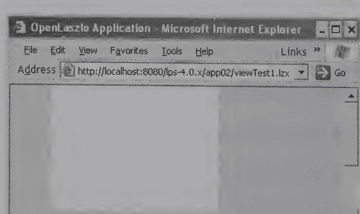

**图 2.1：使用 View**

如图 2.1 所示，视图显示为一个白色矩形。

### 嵌套视图

在典型的 LZX 应用程序中，你经常会使用多个视图，彼此嵌套。清单 2.2 展示了一个具有嵌套视图的 LZX 应用程序。

#### 清单 2.2：嵌套视图

```
<canvas height="370">
    <view width="150" height="150" bgcolor="black">
        <view width="100" height="100" bgcolor="white">
            <view width="50" height="50" bgcolor="gray"/>
        </view>
    </view>
</canvas>
```

通过将浏览器定向到此 URL 来调用 LZX 应用程序：
http://localhost:8080/lps-4.0.x/app02/viewTest2.lzx

图 2.2 显示了嵌套视图。

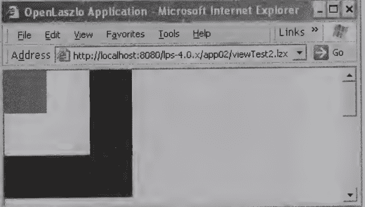

**图 2.2：嵌套视图**

第一个视图的宽度和高度均为 150 像素。它是黑色的。第二个视图绘制在第一个视图之上，为白色，大小为 100 x 100 像素。第三个视图（灰色的那个）位于第二个视图之上。

### 显示外部资源

你可以使用 **view** 标签来显示或播放外部资源，例如图像、MP3 文件和其他 Flash 文件。支持的媒体类型包括 JPG (JPEG)、GIF、PNG、MP3 和 SWF。请注意，对 MP3 的支持仅限于采样率为 44.1 khz、22 Khz、11 Khz、8khz 和 5.5Khz 的音频文件。

例如，清单 2.3 展示了一个使用 **view** 显示图像的 LZX 应用程序。

#### 清单 2.3：显示图像

```
<canvas height="360" bgcolor="white">
    <view align="center" resource="panda.jpg"/>
</canvas>
```

使用此资源定位符调用 LZX 应用程序：

http://localhost:8080/lps-4.0.x/app02/viewTest3.lzx

图 2.3 显示了生成的 Flash 文件。

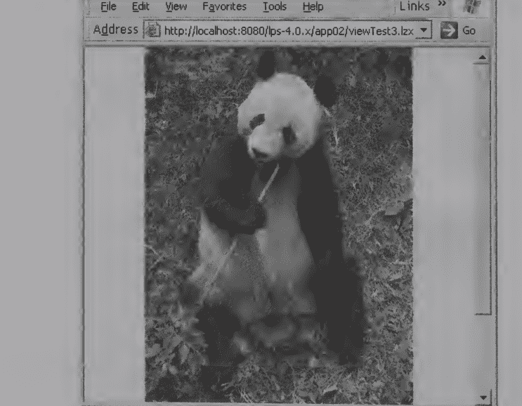

**图 2.3：显示图像**

清单 2.3 中的 **resource** 属性被赋值为一个相对 URL。在这种情况下，文件 **panda.jpg** 必须与 lzx 文件在同一目录中。但是，你可以将互联网上资源的绝对 URL 赋值给它。

另一个例子是清单 2.4 中的代码，这是一个使用 **view** 播放 Flash 文件的 LZX 应用程序。

#### 清单 2.4：播放 Flash

```
<canvas height="360" bgcolor="white">
    <view align="center"
          resource="logo.swf"/>
</canvas>
```

使用此 URL 编译并运行清单 2.4 中的代码：
`http://localhost:8080/lps-4.0.x/app02/viewTest4.lzx`

结果如图 2.4 所示。

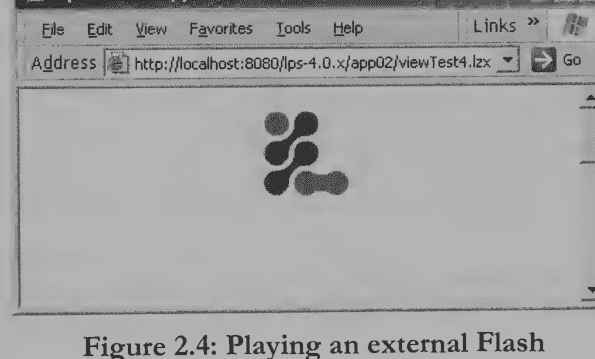

**图 2.4：播放外部 Flash**

## Canvas

**canvas** 标签代表 LZX 应用程序中所有视图和元素的最顶层容器，并且每个 LZX 应用程序只有一个 canvas。**LzCanvas** 类是在 LZX 编译器遇到 **canvas** 标签时将被实例化的类。此类是 **LzView** 的子类。
表 2.2 列出了 **LzCanvas** 类中定义的属性。

| 名称 | 用途 | 类型 | 默认值 | 可访问性 |
| :--- | :--- | :--- | :--- | :--- |
| build | 仅 JS | string | | 只读 |
| | **描述。** 生成此 Flash 的 LPS 的构建号。对于 .lzo 文件，此属性指定生成优化文件的服务器，而不是提供它的服务器。 | | | |
| dataloadtimeout | 标签和 JS | number | | 只读 |
| | **描述。** 应用程序在数据加载超时前等待的毫秒数。 | | | |
| datasets | 仅 JS | | | 只读 |
| | **描述。** 此应用程序中所有命名数据集的字典。 | | | |
| debug | 标签和 JS | boolean | false | 读写 |
| | **描述。** 指示是否启用调试。如果启用调试，将显示调试窗口。 | | | |
| embedfonts | 标签和 JS | boolean | true | 读写 |
| | **描述。** 指示是否应嵌入此应用程序中使用的字体。 | | | |
| expires | 仅 JS | string | | 只读 |
| | **描述。** 此应用程序的过期日期。 | | | |
| libraries | 标签和 JS | string | | 读写 |
| | **描述。** 此应用程序中包含的库的名称列表。 | | | |
| lpsrelease | 仅 JS | string | | 只读 |
| | **描述。** 生成此应用程序的 LPS 的发行号。对于 .lzo 文件，这是生成优化文件的服务器的发行号，而不是提供它的服务器。 | | | |
| lpsversion | 仅 JS | string | | 只读 |
| | **描述。** 生成此应用程序的 LPS 的版本号。对于 lzo 文件，这是生成优化文件的服务器的版本号，而不是提供它的服务器。 | | | |
| maxtextheight | 标签和 JS | number | | 读写 |
| | **描述。** 任何输出文本字段的最大高度（以像素为单位）。 | | | |
| maxtextwidth | 标签和 JS | number | | 读写 |
| | **描述。** 任何输出文本字段的最大宽度（以像素为单位）。 | | | |
| medialoadtimeout | 标签和 JS | number | | 只读 |
| | **描述。** 应用程序在媒体加载操作超时前等待的毫秒数。 | | | |
| onpercentcreated | 仅 JS | | | 只读 |


| 名称 | 用途 | 类型 | 默认值 | 可访问性 |
| :--- | :--- | :--- | :--- | :--- |
| percentcreated | 仅 JS | | | 只读 |
| **描述。** 当创建的节点数量发生变化时调用。 | | | | |
| 一个介于 0 到 1（包含）之间的数字，表示应用程序已实例化的百分比。 | | | | |
| proxied | 标签和 JS | boolean | | 只读 |
| **描述。** 指示是否应代理运行时请求。 | | | | |
| title | 标签和 JS | string | Laszlo Application | 读写 |
| **描述。** 播放生成的 Flash 的浏览器的标题。 | | | | |
| validate | 标签和 JS | boolean | true | 读写 |
| **描述。** 指示在编译期间是否将根据模式验证应用程序源代码。 | | | | |
| version | 标签和 JS | string | | 只读 |
| **描述。** 此 LZX 应用程序的版本。 | | | | |

表 2.2：LzCanvas 类中定义的属性

以下是 **LzCanvas** 类中定义的方法：

`compareVersion(version, anotherVersion)`
比较两个版本字符串。如果 `version` 参数小于 `anotherVersion`，则返回 -1；如果 `version` 等于 `anotherVersion`，则返回 0；如果 `version` 大于 `anotherVersion`，则返回 1。

`setContextMenu(cMenu)`
将 `cMenu` 设置为画布的右键菜单。

`setDefaultContextMenu(cMenu)`
将 `cMenu` 设置为画布上的右键菜单以及所有视图的默认菜单。

例如，清单 2.5 中的代码展示了如何使用 canvas 标签及其一些属性。

**清单 2.5：使用 canvas 标签**

```
<canvas title="Testing Canvas" width="300" height="200"
    bgcolor="#dddddd">
    <text>OpenLaszlo is cool.</text>
</canvas>
```

# 第 2 章：基础组件

您可以使用双引号或单引号来括住属性值。但是，为了保持一致性，本书将始终使用双引号。您可以使用以下 URL 编译并运行清单 2.5 中的代码：http://localhost:8080/lps-4.0.x/app02/canvasTest1.lzx

结果如图 2.5 所示。

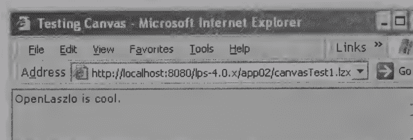

请注意，清单 2.5 中的 **canvas** 标签指定了字符串 "Testing Canvas" 作为其 title 属性的值。此值显示为浏览器标题。HTML 页面的背景遵循画布背景颜色。因此，这里的右边框不可见。但是，如果您将宽度减小到 100，您将看到文本被截断。

如果未指定宽度，生成的输出将占据浏览器的整个宽度。如果不存在 height 属性，生成的输出将填满浏览器的整个高度。

## BaseComponent 类

**BaseComponent** 类是 **LzView** 的子类，也是所有 LZX 组件的超类。因此，值得花一些时间来检查它的属性和方法。

**BaseComponent** 类中定义的属性见表 2.3。

BaseComponent 类

| 名称 | 用途 | 类型 | 默认值 | 可访问性 |
| :--- | :--- | :--- | :--- | :--- |
| doesenter | 标签和 JS | boolean | false | 读写 |
| **描述。** 如果设置为 **true**，组件管理器将在此组件上调用 **doEnterDown** 和 **doEnterUp** 方法。 | | | | |
| enabled | 标签和 JS | boolean | true | 读写 |
| **描述。** 指示组件是否已启用。已启用的组件也可点击，而禁用的组件不可点击。 | | | | |
| hasdefault | 标签和 JS | boolean | false | 读写 |
| **描述。** 指示此组件是否可以接收回车键事件。 | | | | |
| isdefault | 标签和 JS | boolean | false | 读写 |
| **描述。** 指示此组件是否将成为默认组件，从而接收回车键。 | | | | |
| style | 标签和 JS | boolean | | 读写 |
| **描述。** 如果此属性的值为 null，则样式设置为从父组件继承的样式。 | | | | |
| styleable | 标签和 JS | boolean | true | 读写 |
| **描述。** 指示是否应将样式应用于此组件。 | | | | |
| text | 标签和 JS | html | | 读写 |
| **描述。** 此组件的标签或标题。 | | | | |

**表 2.3：BaseComponent 类的属性**

以下是添加到 **BaseComponent** 类的方法。

- **doEnterDown()**
  当回车键按下且组件获得焦点，并且其 **doesenter** 属性设置为 **true** 时调用。
- **doEnterUp()**
  当回车键释放且组件获得焦点，并且其 **doesenter** 属性设置为 **true** 时调用。
- **doSpaceDown()**
  当空格键按下且组件获得焦点时调用。
- **doSpaceDown()**
  当空格键释放且组件获得焦点时调用。
- **setStyle(style)**
  设置此组件的样式。

`setTint(subview, color, brightness)`
为视图着色，使 50% 灰色显示为给定的颜色，并带有该颜色较深或较浅的阴影。brightness 参数必须是介于 –255 和 255（包含）之间的数字。
`updateDefault()`
强制默认按钮更新。

## Window

**Window** 对象表示一个可调整大小的窗口。**Window** 类是 **WindowPanel** 的子类，而 **WindowPanel** 本身又是 **BaseWindow** 的子类。**BaseWindow** 是 **BaseComponent** 的直接子类。类层次结构如图 2.6 所示。

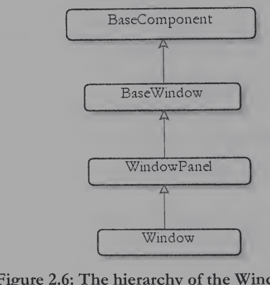

表 2.4、2.5 和 2.6 分别介绍了 **BaseWindow** 类、**WindowPanel** 类和 **Window** 类的属性。

| 名称 | 用途 | 类型 | 默认值 | 可访问性 |
| :--- | :--- | :--- | :--- | :--- |
| datacontrolvisibility | 仅标签 | boolean | false | final |
| **描述。** 指示与此窗口关联的数据路径是否会导致窗口在不匹配任何数据时不可见，在匹配数据时可见。 | | | | |
| haswindowfocus | 标签和 JS | boolean | false | 读写 |
| **描述。** 指示此窗口是否具有焦点。 | | | | |
| minheight | 仅标签 | number | 50 | final |
| **描述。** 此窗口的最小高度（以像素为单位）。 | | | | |
| minwidth | 仅标签 | number | 60 | final |
| **描述。** 此窗口的最小宽度（以像素为单位）。 | | | | |
| state | 标签和 JS | number | 1 | 只读 |
| **描述。** 此窗口的状态。值为以下之一：1（已选择）、2（未选择）、3（拖动中）、4（已禁用）和 5（调整大小中）。 | | | | |

表 2.4：BaseWindow 类的属性

| 名称 | 用途 | 类型 | 默认值 | 可访问性 |
| :--- | :--- | :--- | :--- | :--- |
| closeable | 标签和 JS | boolean | false | 读写 |
| **描述。** 指示此窗口面板是否可以关闭。 | | | | |
| inset_bottom | 标签和 JS | number | 20 | 读写 |
| **描述。** 内容区域的底部内边距（以像素为单位）。 | | | | |
| inset_left | 标签和 JS | number | 6 | 读写 |
| **描述。** 内容区域的左侧内边距（以像素为单位）。 | | | | |
| inset_right | 标签和 JS | number | 11 | 读写 |
| **描述。** 内容区域的右侧内边距（以像素为单位）。 | | | | |
| inset_top | 标签和 JS | number | 22 | 读写 |
| **描述。** 内容区域的顶部内边距（以像素为单位）。 | | | | |
| title | 标签和 JS | string | | 读写 |
| **描述。** 此窗口面板的标题。 | | | | |
| titlearea_inset_top | 标签和 JS | number | 6 | 读写 |
| **描述。** 窗口标题区域的顶部内边距（以像素为单位）。 | | | | |

表 2.5：WindowPanel 类的属性

| 名称 | 用途 | 类型 | 默认值 | 可访问性 |
| :--- | :--- | :--- | :--- | :--- |
| resizable | 标签和 JS | boolean | false | 读写 |
| **描述。** 指示此窗口是否可以调整大小。可调整大小的窗口在其右下角有一个手柄，用户可以拖动它来调整窗口大小。 | | | | |

表 2.6：Window 类的属性

**BaseWindow** 类添加了三个方法：

`close()`
隐藏窗口，与将 **visible** 属性设置为 **false** 相同。


### 第2章：基本组件

```
open()
    显示窗口，等同于将 **visible** 属性设置为 **true**。

setVisible(visible)
    设置 **visible** 属性。
```

**WindowPanel** 和 **Window** 类未添加新方法。

清单 2.6 中的 **windowTest1.lzx** 文件展示了一个显示可调整大小窗口的 LZX 应用。

### 清单 2.6：一个可调整大小的窗口

```
<canvas height="200" width="400">
    <window resizable="true" width="200" height="200">
        <text>OpenLaszlo is cool!</text>
    </window>
</canvas>
```

你可以使用以下 URL 调用此 LZX 应用：
http://localhost:8080/lps-4.0.x/app02/windowTest1.lzx

生成的输出如图 2.7 所示。

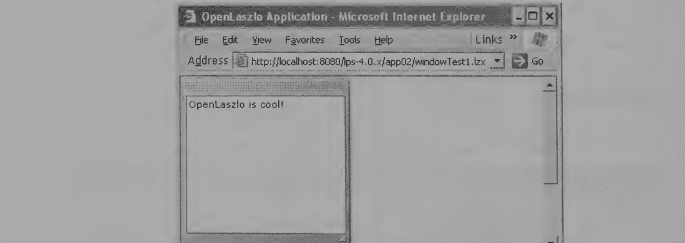

### 图 2.7：一个 Window 对象

你可以通过拖动右下角的箭头来调整窗口大小。你也可以围绕画布绘制窗口。如果窗口嵌套在容器（例如视图）内，窗口可以移动到容器之外。

# # Alert（警告框）

**Alert** 对象代表一个用于显示消息的模态对话框。**Alert** 框配有一个 **OK** 按钮，默认情况下不显示。你必须调用其 **open** 方法才能使其可见。

**Alert** 类是 **ModalDialog** 类的子类，而 **ModalDialog** 类派生自 **WindowPanel**。**ModalDialog** 对象代表一个可移动的浮动视图。当模态对话框打开时，应用程序的其他部分将无法访问，直到用户关闭该对话框。

图 2.8 展示了 **Alert** 类的层次结构。

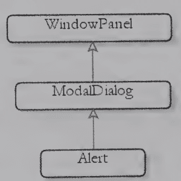

**图 2.8：Alert 类的层次结构**

表 2.7 显示了 **ModalDialog** 类的属性，表 2.8 则列出了 **Alert** 类的属性。

| 名称 | 用途 | 类型 | 默认值 | 可访问性 |
|---|---|---|---|---|
| content_inset_bottom | 标签和 JS | number | 10 | 可读写 |
| | 描述。内容底部的内边距，单位为像素。 | | | |
| content_inset_left | 标签和 JS | number | 14 | 可读写 |
| | 描述。内容左侧的内边距，单位为像素。 | | | |
| content_inset_right | 标签和 JS | number | 14 | 可读写 |
| | 描述。内容右侧的内边距，单位为像素。 | | | |
| content_inset_top | 标签和 JS | number | 10 | 可读写 |
| | 描述。内容顶部的内边距，单位为像素。 | | | |

**表 2.7：ModalDialog 类中定义的属性**

# # 第2章：基本组件

| 名称 | 用途 | 类型 | 默认值 | 可访问性 |
| :--- | :--- | :--- | :--- | :--- |
| button1 | 标签和 JS | string | OK | 可读写 |
| | **描述。** 要显示在 Alert 框第一个按钮上的文本。 | | | |
| button2 | 标签和 JS | string | | 可读写 |
| | **描述。** Alert 框第二个按钮的文本。 | | | |
| maxtextwidth | 标签和 JS | number | | 可读写 |
| | **描述。** 一行文本在换行前的最大长度。默认值为父级宽度（减去窗口装饰和边距的宽度）的三分之一。 | | | |
| onresult | 标签和 JS | expression | null | 可读写 |
| | **描述。** 当按下按钮时调用。 | | | |
| result | 标签和 JS | boolean | | 可读写 |
| | **描述。** 用户关闭此 **Alert** 框后，将设置此属性的值。如果用户按下第一个按钮，值为 **true**；如果用户按下第二个按钮，值为 **false**。 | | | |
| text_x | 标签和 JS | number | 0 | 可读写 |
| | **描述。** 按钮文本的 x 位置。 | | | |
| text_y | 标签和 JS | number | 0 | 可读写 |
| | **描述。** 按钮文本的 y 位置。 | | | |

表 2.8：Alert 类中定义的属性

**ModalDialog** 类中定义了两个方法：

close()
    关闭此对话框。
open()
    打开对话框并使其可见。

例如，清单 2.7 中的代码展示了如何使用 **Alert** 框。

# ## 清单 2.7：使用 Alert 框

```
<canvas>
    <alert name="warning">Press OK to continue.</alert>
    <script>
        canvas.warning.open();
    </script>
</canvas>
```

要测试此应用，请调用以下 URL：

http://localhost:8080/lps-4.0.x/app02/alertTest1.lzx

生成的输出如图 2.9 所示。

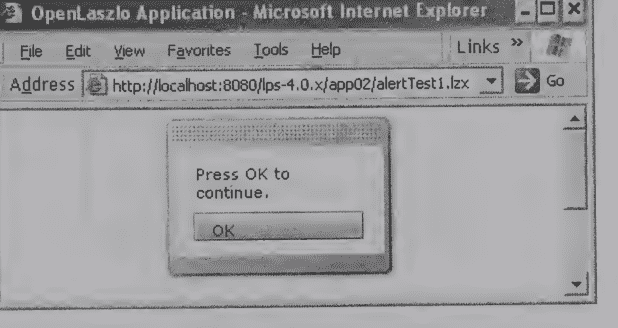

图 2.9：Alert 框

另一个例子是清单 2.8 中的代码，它显示了一个带有两个按钮（“是”按钮和“否”按钮）的 Alert 框。如果按下“确定”按钮，则显示“你选择了‘是’”。否则，显示“你选择了‘否’”。请注意，清单 2.3 中的代码使用了事件处理程序，我们将在第 5 章“事件处理”中讨论。

### 清单 2.8：一个带有两个按钮的 Alert 框

```
<canvas>
    <alert name="warning" button1="Yes" button2="No">
        Do you want to continue?
        <handler name="onresult">
            if (this.result) {
                parent.message.setText("You said 'Yes'");
            } else {
                parent.message.setText("You said 'No'");
            }
        </handler>
    </alert>
    <script>
        canvas.warning.open();
    </script>
    <text name="message">What do you think?</text>
</canvas>
```

你可以通过将浏览器指向以下 URL 来运行此应用：

http://localhost:8080/lps-4.0.x/app02/alertTest2.lzx

结果显示在图 2.10 中：

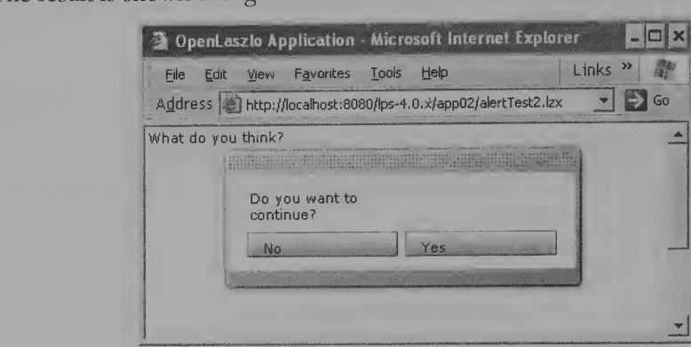

**图 2.10：一个带有两个按钮的 Alert 框**

# # Button（按钮）

**Button** 对象代表一个可点击的按钮。按钮也用于触发事件，以便在点击按钮时执行操作。我们将在第 5 章“事件处理”中讨论事件处理。

**Button** 类是创建 **Button** 对象的模板。此类是 **BaseButton** 的子类，而 **BaseButton** 又是 **BaseComponent** 的子类。类层次结构如图 2.11 所示。

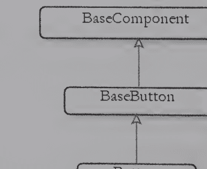

**图 2.11：Button 类的层次结构**

**BaseButton** 和 **Button** 的属性分别列在表 2.7 和 2.8 中。

| 名称 | 用途 | 类型 | 默认值 | 可访问性 |
|---|---|---|---|---|
| disabledResourceNumber | 仅标签 | number | 4 | 只读 |
| downResourceNumber | 仅标签 | number | 3 | 只读 |
| maxframes | 仅标签 | number | | 只读 |
| normalResourceNumber | 仅标签 | number | 1 | 只读 |
| onresourceviewcount | 标签和 JS | boolean | | 可读写 |
| overResourceNumber | 标签和 JS | boolean | | 只读 |
| reference | 仅标签 | string | | 只读 |
| resourceviewcount | 标签和 JS | number | 0 | 可读写 |
| respondtomouseout | 标签和 JS | boolean | true | 可读写 |

### 表 2.7：BaseButton 类的属性

| 名称 | 用途 | 类型 | 默认值 | 可访问性 |
|---|---|---|---|---|
| text_padding_x | 标签和 JS | number | 11 | 可读写 |
| text_padding_y | 标签和 JS | number | 4 | 可读写 |

### 第2章：基本组件

| (属性名) | 描述。调整按钮大小以适应其文本时垂直方向上添加的空间量。 |
| :--- | :--- |
| text_x | 标签和 JS number 可读写
描述。按钮文本的 x 位置。默认为居中。 |
| text_y | 标签和 JS number 可读写
描述。按钮文本的 y 位置。默认为居中。 |

表 2.8：Button 类的属性

**BaseButton** 类定义了以下方法：
`doSpaceDown()`
显示按下状态。此方法仅在空格键被按下时生效。
`doSpaceUp()`
显示抬起状态。此方法仅在空格键被抬起时生效。
`setResourceViewCount(resourceViewCount)`
设置 **resourceviewcount** 属性。
`showDown(sd)`
当按钮的可视状态应显示为按下时调用。参数 *sd* 未被使用。
`showOver(sd)`
当按钮的可视状态应显示为抬起（表示可点击）时调用。
`showUp(sd)`
当按钮的可视状态应显示为抬起时调用。

以下是 **Button** 类中定义的方法。
`doEnterDown()`
当此按钮是默认按钮时，由按钮管理器调用。
`doEnterUp()`
当此按钮是默认按钮时，由按钮管理器调用。

清单 2.9 中的 **buttonTest1.lzx** 文件展示了一个使用按钮的 LZX 应用。按钮文本为“Click Here”。


### 第2章：基本组件

### 清单2.9：使用按钮

```
<canvas width="150">
    <button>Click Here</button>
</canvas>
```

要编译 LZX 应用程序，请将您的浏览器定向到此 URL：
http://localhost:8080/lps-4.0.x/app02/buttonTest1.lzx

图 2.12 显示了生成的输出。

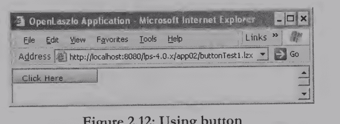

## ComboBox

**ComboBox** 类代表一个组合框。该类是 **BaseComboBox** 的直接子类，而 **BaseComboBox** 扩展自 **BaseFormItem**。**BaseFormItem** 派生自 **BaseValueComponent** 类，后者本身是 **BaseComponent** 的直接子类。类层次结构如图 2.13 所示。

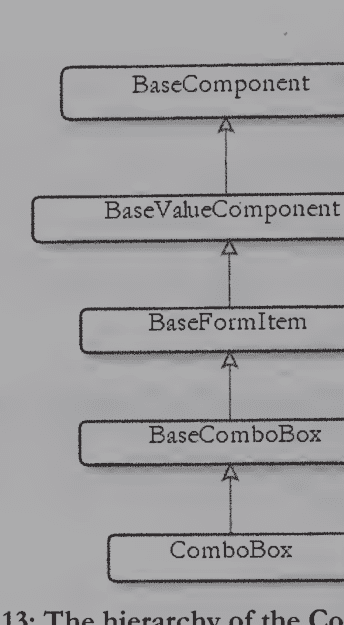

图 2.13：ComboBox 类的层次结构

表 2.9、2.10 和 2.11 分别列出了 **BaseValueComponent** 类、**BaseFormItem** 类和 **BaseComboBox** 类中定义的属性。**ComboBox** 类没有添加新的属性。

| 名称 | 用途 | 类型 | 默认值 | 访问权限 |
|---|---|---|---|---|
| value | 标签和JS | 任意 | null | 读写 |
| | 描述。此条目代表的值。 | | | |

表 2.9：BaseValueComponent 类中定义的属性

| 名称 | 用途 | 类型 | 默认值 | 访问权限 |
|---|---|---|---|---|
| submit | 标签和JS | boolean | true | 读写 |
| | 描述。指示此元素的值是否将随包含的表单一起提交。 | | | |
| submitname | 标签和JS | string | | 读写 |
| | 描述。包含的表单提交时，用于此值的参数名称。 | | | |

表 2.10：BaseFormItem 类中定义的属性

| 名称 | 用途 | 类型 | 默认值 | 访问权限 |
|---|---|---|---|---|
| **attachoffset** | 标签和JS | number | -1 | 读写 |
| | **描述。** 附加到此组合框的浮动列表的垂直偏移量，以像素为单位。 | | | |
| **autoscrollbar** | 标签和JS | boolean | true | 读写 |
| | **描述。** 指示当项目数量超过 shownitems 属性的值时，是否应显示滚动条。 | | | |
| **bordersize** | 标签和JS | number | 1 | 读写 |
| | **描述。** 弹出列表的边框大小，以像素为单位。 | | | |
| **dataoption** | 标签和JS | string | none | 读写 |
| | **描述。** 可以是 "lazy"、"resize"、"pooling" 或 "none" 之一。 | | | |
| **defaultselection** | 标签和JS | number | | 读写 |
| | **描述。** 最初选中的项目编号。 | | | |
| **editable** | 标签和JS | boolean | true | 读写 |
| | **描述。** 指示此组合框中的项目是否可编辑。 | | | |
| **isopen** | 标签和JS | boolean | false | 读写 |
| | **描述。** 指示弹出列表是否正在显示。 | | | |
| **itemclassname** | 标签和JS | string | | 读写 |
| | **描述。** 当分配了 itemdatapath 时，要实例化的类的名称。 | | | |
| **ondefaultselection** | 标签和JS | expression | | 读写 |
| | **描述。** 当设置默认选择时调用。 | | | |
| **shownitems** | 标签和JS | number | -1 | 读写 |
| | **描述。** 一次显示的项目数量。 | | | |
| **spacing** | 标签和JS | number | 0 | 读写 |
| | **描述。** 弹出列表中项目之间的间距，以像素为单位。 | | | |
| **text_width** | 标签和JS | number | | 读写 |
| | **描述。** 文本宽度。默认值是此组合框的宽度 – 19。 | | | |
| **text_x** | 标签和JS | number | 2 | 读写 |
| | **描述。** 文本的 x 位置。 | | | |
| **text_y** | 标签和JS | number | 2 | 读写 |
| | **描述。** 文本的 y 位置。 | | | |

表 2.11：BaseComboBox 类中定义的属性

**BaseValueComponent** 类添加了一个方法，即 **getValue**。其签名如下：

**getValue()**
返回 **BaseValueComponent** 对象包含的值。

**BaseFormItem** 类没有添加新方法。

**BaseComboBox** 类添加了以下方法：

**addItem(text, value)**
添加指定的文本/值对。*text* 参数的类型为 string，*value* 参数的类型为 **Object**。

**clearSelection()**
清除选择列表。

**getItem(value)**
将指定值作为 Object 返回；如果组合框不包含指定值，则返回 null。

**getItemAt(index)**
返回指定索引处的项目。

**getSelection()**
返回当前选择。

**getText()**
返回显示的文本。

**getValue()**
返回组合框的值。

**removeItem(value)**
移除指定的项目。

**removeItemAt(index)**
移除指定索引处的项目。

**select(item)**
选择指定的项目。

**selectItem(value)**
按值选择一个项目。

**selectItemAt(index)**
选择指定索引处的项目。

**setDefaultSelection(position)**
设置指定位置的项目。

**setItemclassname(name)**
指定在必要时，浮动列表中要实例化的类的名称。

**setOpen(open, withKey)**
设置弹出列表的打开/关闭状态。open 和 withKey 参数都是 boolean 类型。

**setText(text)**
设置显示的文本。

**toggle(withKey)**
切换弹出列表的打开/关闭状态。

**ComboBox** 类没有添加新方法。

作为示例，清单 2.10 中的代码展示了一个使用 **combobox** 标签创建 **ComboBox** 对象的 LZX 应用程序。

### 清单 2.10：使用组合框 (comboboxTest1.lzx)

```
<canvas width="150" height="150">
    <combobox id="genre" x="5" y="3" width="100" editable="false">
        <textlistitem text="Jazz"/>
        <textlistitem text="Pop"/>
        <textlistitem text="Blues"/>
    </combobox>
</canvas>
```

要调用 LZX 应用程序，请使用此 URL：
http://localhost:8080/lps-4.0.x/app02/comboboxTest1.lzx

生成的输出如图 2.14 所示。

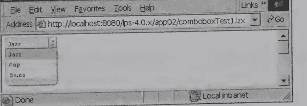

图 2.14：组合框

如果项目的值与显示文本不同，您也可以在 **textlistitem** 元素中使用 **value** 属性，如清单 2.11 所示。

### 清单 2.11：使用 textlistitem 的 value 属性

```
<canvas width="150" height="150">
    <combobox id="genre" x="5" y="3" width="100" editable="false">
        <textlistitem text="Jazz" value="1"/>
        <textlistitem text="Pop" value="2"/>
        <textlistitem text="Blues" value="3"/>
    </combobox>
</canvas>
```

## 列表

**List** 对象代表用户可以选择的项目列表。**List** 类派生自 **BaseList**，而 **BaseList** 是 **BaseFormItem** 的子类。**List** 的类层次结构如图 2.15 所示。

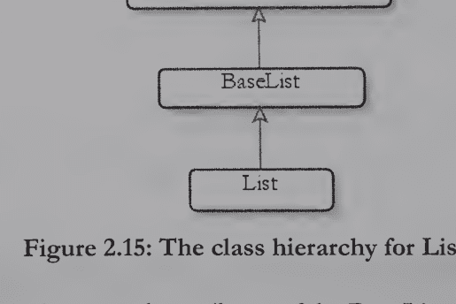

表 2.12 和 2.13 分别介绍了 **BaseList** 和 **List** 类的属性。

| 名称 | 用途 | 类型 | 默认值 | 访问权限 |
|---|---|---|---|---|
| dataoption | 标签和JS | string | none | 读写 |
| | **描述。** 可以是 "lazy"、"resize"、"pooling" 或 "none" 之一。 | | | |
| defaultselection | 标签和JS | Object | null | 读写 |
| | **描述。** 默认选中项的索引。 | | | |
| itemclassname | 标签和JS | string | | 读写 |
| | 描述。调用 addItem 方法时要实例化的类的名称。 | | | |
| multiselect | 标签和JS | boolean | false | 读写 |
| | 描述。指示是否允许多选。 | | | |
| toggleselected | 标签和JS | boolean | false | 读写 |
| | 描述。指示单击是否切换选择。 | | | |

表 2.12：BaseList 类中定义的属性

| 名称 | 用途 | 类型 | 默认值 | 访问权限 |
|---|---|---|---|---|
| autoscrollbar | 标签和JS | boolean | true | 读写 |
| | 描述。指示当项目数量超过 shownitems 属性的值时，是否应显示滚动条。 | | | |
| border_bottom | 标签和JS | number | | 读写 |
| | 描述。底部边框的大小，以像素为单位。 | | | |
| border_left | 标签和JS | number | none | 读写 |
| | 描述。左边框的大小，以像素为单位。 | | | |
| border_right | 标签和JS | number | | 读写 |
| | 描述。右边框的大小，以像素为单位。 | | | |
| border_top | 标签和JS | number | | 读写 |
| | 描述。顶部边框的大小，以像素为单位。 | | | |
| bordersize | 标签和JS | number | 1 | 读写 |
| | 描述。此列表的边框大小，以像素为单位。 | | | |
| minheight | 标签和JS | number | 24 | 读写 |
| | 描述。列表的最小高度，以像素为单位。 | | | |
| scrollable | 标签和JS | boolean | false | 读写 |
| | 描述。指示此 List 是否可滚动。 | | | |
| shownitems | 标签和JS | number | -1 | 读写 |
| | 描述。一次显示的项目数量。 | | | |
| spacing | 标签和JS | number | 0 | 读写 |
| | 描述。弹出列表中项目之间的间距，以像素为单位。 | | | |
| tracking | 标签和JS | boolean | false | 读写 |
| | 描述。指示是否启用鼠标按下跟踪。 | | | |

表 2.13：List 类中定义的属性

BaseList 和 List 都定义了新方法。以下是 BaseList 定义的方法。

```
addItem(text, value)
```


### 第2章：基本组件

添加指定的文本/值对。*text* 参数是字符串类型，*value* 参数是 **Object** 类型。

clearSelection()
清除选择列表。

getItem(*value*)
将指定值作为对象返回；如果组合框不包含指定值，则返回 null。

getItemAt(*index*)
返回指定索引处的项目。

getNumItems()
返回列表中的项目数量。

getSelection()
返回当前选择。

getText()
返回显示的文本。

getValue()
返回列表的值。

moveSelection(*direction*)
如果 *direction* 为 -1，则将选择移动到下一个视图；如果 *direction* 为 1，则移动到上一个视图。

removeItem(*value*)
移除指定项目。

removeItemAt(*index*)
移除指定索引处的项目。

select(*item*)
选择指定项目。

selectItem(*value*)
通过值选择项目。

selectItemAt(*index*)
选择指定索引处的项目。

selectNext()
选择下一个项目。

selectPrev()
选择上一个项目。

setHilite(view)
突出显示指定的视图。

以下是在 List 类中添加的方法：

ensureItemInView(item)
滚动列表，使指定项目出现在列表顶部。

select(view)
选择指定的视图。

清单 2.12 展示了一个使用 **List** 对象的 LZX 应用程序。

### 清单 2.12：使用列表（listTest1.lzx）

```
<canvas height="150">
    <list shownitems="3">
        <textlistitem>Jazz</textlistitem>
        <textlistitem>Pop</textlistitem>
        <textlistitem>Heavy Metal</textlistitem>
        <textlistitem>Fusion</textlistitem>
        <textlistitem>Rock</textlistitem>
    </list>
</canvas>
```

使用此 URL 编译并运行清单 2.12 中的 LZX 应用程序。

`http://localhost:8080/lps-4.0.x/app02/listTest1.lzx`

图 2.16 展示了生成的应用程序。

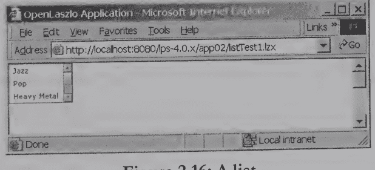

### 图 2.16：一个列表

请注意，图 2.16 中的列表有五个项目，但只显示了三个项目，因为列表的 **showitems** 属性被设置为 3。

## # RadioButton

**RadioButton** 对象表示一个单选按钮。**RadioButton** 类是 **BaseListItem** 的子类，而 **BaseListItem** 派生自 **BaseValueComponent**。**RadioButton** 的类层次结构如图 2.17 所示。


表 2.14 显示了在 **BaseListItem** 类中定义的属性，表 2.15 显示了在 **RadioButton** 中定义的属性。

| 名称 | 用途 | 类型 | 默认值 | 可访问性 |
| :--- | :--- | :--- | :--- | :--- |
| onselected | 标签和 JS | 表达式 | null | 可读写 |
| **描述。** | 当此项目被选中时调用。 | | | |

| 名称 | 用途 | 类型 | 默认值 | 可访问性 |
| :--- | :--- | :--- | :--- | :--- |
| text_y | 标签和 JS | 数字 | 居中 | 可读写 |
| **描述。** | 文本标签的 y 位置。 | | | |

**BaseListItem** 和 **RadioButton** 中没有定义新方法。

清单 2.13 中的代码展示了使用 **RadioButton** 的 LZX 应用程序。请注意，你可以使用 **radiobutton** 标签创建 **RadioButton**。**radiogroup** 标签用于将同一选择中的单选按钮分组。

```
<canvas height="150">
    <radiogroup>
        <radiobutton text="Red"/>
        <radiobutton text="Green"/>
        <radiobutton text="Blue"/>
    </radiogroup>
</canvas>
```

你可以使用以下 URL 调用清单 2.13 中的代码：`http://localhost:8080/lps-4.0.x/app02/radioTest1.lzx`

生成的输出如图 2.18 所示。

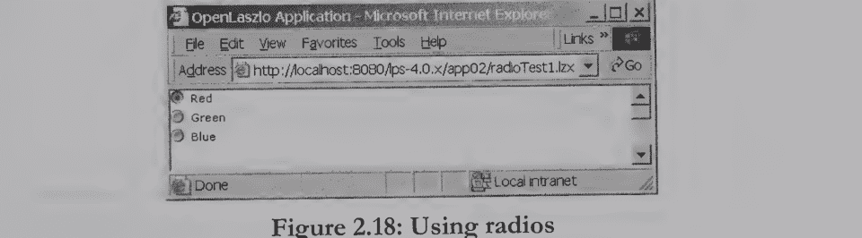

## resource 标签

你已经看到 LzView 类有一个 resource 属性，可以为其分配外部属性的 URL。使用此属性，你可以分配图像或 Flash。但是，它的用途相当有限。例如，resource 属性无法播放 MP3 歌曲。

resource 标签在功能上与 LzView 类的 resource 属性相似。但是，它为你提供了更大的灵活性和功能。首先，与帧一起使用时，你可以将资源与多个图像关联，每个图像链接到一个帧。其次，resource 标签可用于播放 MP3 歌曲，这是 LzView 类无法做到的。

resource 标签有两个属性，列于表 2.16。

| 名称 | 用途 | 类型 | 默认值 | 可访问性 |
|---|---|---|---|---|
| name | 仅标签 | 字符串 | | final |
| | | | **描述。** 此资源的标识符。 | |
| src | 仅标签 | 字符串 | | final |
| | | | **描述。** 要与此资源关联的外部文件的 URL。 | |

**表 2.16：resource 标签的属性**

清单 2.14 展示了一个使用 **resource** 标签链接 MP3 文件的 LZX 应用程序。

### 清单 2.14：播放 MP3 歌曲

```
<canvas height="150">
    <simplelayout axis="x"/>
    <resource src="mySong.mp3" name="mp3"/>
    <button text="Play"
            onclick="LzAudio.playSound('mp3');"/>
    <button text="Stop"
            onclick="LzAudio.stopSound('mp3');"/>
</canvas>
```

请注意，清单 2.14 中的 **resource** 标签链接到 **mySong.mp3** 文件。此文件未随包含本书示例应用程序的 zip 文件一起部署。要测试该应用程序，请找到一个 MP3 文件并重新分配 src 属性。

要运行清单 2.14 中的应用程序，请使用此 URL：
`http://localhost:8080/lps-4.0.x/app02/resourceTest1.lzx`

图 2.19 显示了成功编译的结果。单击“播放”按钮播放 MP3 歌曲，单击“停止”按钮停止歌曲。

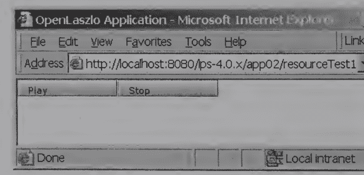

### 注意

另请参阅“frame 标签”部分，了解更多关于 **resource** 标签的用法。

## # frame 标签

**frame** 标签在 **resource** 标签内使用，用于定义多帧资源的单个帧。**frame** 标签的属性如表 2.17 所示。

| 名称 | 用途 | 类型 | 默认值 | 可访问性 |
|---|---|---|---|---|
| name | 仅标签 | 字符串 | | final |
| | **描述。** 此帧的标识符。 | | | |
| src | 仅标签 | 字符串 | | final |
| | **描述。** 要与此帧关联的外部文件的 URL。 | | | |

**表 2.17：frame 标签的属性**

清单 2.15 中的 LZX 应用程序展示了如何使用带有两个帧的 **resource** 标签。

**清单 2.15：使用帧**

```
<canvas>
    <resource name="arrow">
        <frame src="arrow1.gif"/>
        <frame src="arrow2.gif"/>
    </resource>
    <view resource="arrow"
        onmousedown="setResourceNumber(2)"
        onmouseup="setResourceNumber(1)"
    />
</canvas>
```

清单 2.15 中的 **view** 标签链接到名为 **arrow** 的 resource 标签。**setResourceNumber** 方法接受一个索引号，并将指定索引处的帧分配给视图。因此，当你单击视图时，将使用第二帧。当你释放鼠标时，将使用第一帧。

要测试该应用程序，请将浏览器定向到此 URL：

```
http://localhost:8080/lps-4.0.x/app02/frameTest1.lzx
```

结果如图 2.20 所示：

### 第2章：基本组件

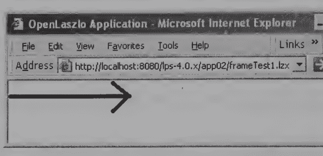

### 图 2.20：使用帧

## 总结

OpenLaszlo 提供标准类库，用于快速开发 AJAX 和 Flash 应用程序。本章展示了一些代表你将经常使用的基本组件的类。第 11 章“丰富组件”讨论了更多组件。

# 第3章

## 处理文本

与其他基于 GUI 的平台一样，OpenLaszlo 提供了一种显示文本的方法。一段文本由一个 **LzText** 对象表示。不仅如此，你还可以使用任何可用的字体来渲染文本。默认字体是 Tahoe，默认大小是 10px。

本章讨论了几个与文本相关的类：**LzText**、**LzInputText** 和 **LzFont**。

### LzText 类

**LzText** 对象表示一个不可编辑的文本组件。**LzText** 类是 **LzView** 的直接子类。你可以使用 **text** 标签创建 **LzText** 的实例。表 3.1 显示了 **LzText** 类的属性。

| 名称 | 用途 | 类型 | 默认值 | 可访问性 |
| :--- | :--- | :--- | :--- | :--- |
| embedfonts | 标签和 JS | 布尔值 | | 可读写 |
| | **描述。** 指示是否嵌入字体。 | | | |
| label | 标签和 JS | 字符串 | | 可读写 |
| | **描述。** 此 **LzText** 对象的标签。 | | | |
| maxlength | 标签和 JS | 数字 | | 只读 |
| | **描述。** 此字段允许的最大字符数。 | | | |
| multiline | 仅标签 | 布尔值 | false | final |
| | **描述。** 指示此文本是否支持多行。 | | | |
| pattern | 标签和 JS | 字符串 | | 只读 |
| | **描述。** 描述此字段中允许的字符集的正则表达式。 | | | |
| resize | 标签和 JS | 布尔值 | false | 只读 |
| | **描述。** 指示是否调整此字段的宽度以适应文本。 | | | |


### 第三章：处理文本

| 可选 | 标签和JS | 布尔值 | false | 读写 |
| --- | --- | --- | --- | --- |
| | **描述。** 指示文本是否可被选中。 | | | |
| text | 标签和JS | 字符串 | | 读写 |
| | **描述。** 此字段的文本。 | | | |

表 3.1：LzText 类的属性

以下是 **LzText** 类中定义的方法：

- `addText(text)` 将指定的字符串追加到当前文本中。
- `clearText()` 清除此文本字段。
- `escapeText(string)` 转义指定的字符串。
- `getSelectionPosition()` 返回文本中光标的位置。如果文本光标当前不在此字段内，则返回 -1。
- `getSelectionSize()` 返回此对象中选定的字符数。如果文本光标当前不在此对象内，则返回 -1。
- `getText()` 返回此对象中的文本。
- `getTextHeight()` 返回文本高度。
- `getTextWidth()` 返回文本宽度。
- `setColor(color)` 设置文本颜色。
- `setMultiline(multiline)` 设置多行属性。
- `setResize(resize)` 设置调整大小属性。
- `setSelectable(selectable)` 设置可选择属性。
- `setSelection(start, end)` 选择从 start 到 end 的部分或全部文本。
- `setText(text)` 设置文本。
- `setXScroll(x)` 设置文本字段的 x 滚动位置。
- `setYScroll(y)` 设置文本字段的 y 滚动位置。

**LzText** 类添加了一个事件：**ontext**。当文本发生变化时，会触发此事件。

例如，代码清单 3.1 中的代码是一个使用 **text** 标签的 LZX 应用程序。

**代码清单 3.1：使用 text**

```
<canvas>
    <simplelayout axis="y"/>
    <view height="200" width="100">
        <text>This is an LzText object</text>
    </view>
</canvas>
```

要测试此应用程序，请将浏览器定向到此 URL：
http://localhost:8080/lps-4.0.x/app03/textTest1.lzx

图 3.1 显示了生成的输出。

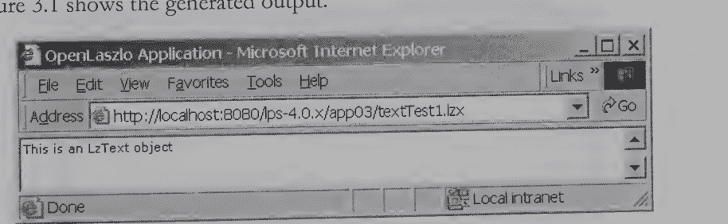

**图 3.1：使用 text 标签显示文本**

请注意，文本组件的内容显示为 **text** 标签的文本。不过，您也可以使用 **text** 属性来替代：

```
<text text="This is an LzText object"/>
```

**text** 标签理解 HTML 并会正确解释 HTML 标签。例如，以下 **text** 标签会将其文本显示为斜体。

```
<text><i>Italicized text</i></text>
```

默认情况下，**text** 标签只能显示单行文本。要显示多行文本，请将 **text** 标签的 **multiline** 属性设置为 **true**。代码清单 3.2 中的代码展示了一个多行文本组件。

**代码清单 3.2：多行文本**

```
<canvas>
    <simplelayout axis="y"/>
    <view height="200" width="50">
        <text width="50" multiline="true">This is a very very long piece of text</text>
    </view>
</canvas>
```

请注意，使用 **multiline** 属性时，还必须指定 **width** 属性。否则，文本将不会换行。

要测试多行文本示例，请将浏览器定向到此 URL：
http://localhost:8080/lps-4.0.x/app03/textTest2.lzx

结果如图 3.2 所示。

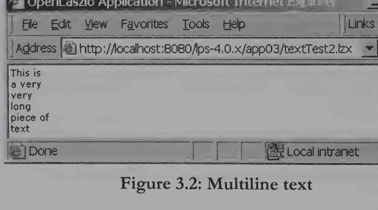

### LzInputText

**LzInputText** 类是 **LzText** 的直接子类。一个 **LzInputText** 对象代表一个可编辑的文本组件。您可以使用 **inputtext** 标签创建一个 **LzInputText** 对象，并可以将其 **password** 属性设置为 **true** 以构造一个密码框。

表 3.2 展示了在 **LzInputText** 类中定义的属性。

| 名称 | 用法 | 类型 | 默认值 | 访问性 |
| :--- | :--- | :--- | :--- | :--- |
| password | 标签和JS | 布尔值 | false | 读写 |
| | **描述。** 指示此输入文本是否将其每个字符都显示为星号（即密码掩码）。 | | | |
| resizable | 标签和JS | 布尔值 | false | 读写 |
| | **描述。** 指示此输入文本是否可调整大小。 | | | |

**表 3.2：** LzInputText 类中定义的属性

**LzInputText** 类定义了四个方法：

- `setEnabled(enabled)` 指定此输入文本是否启用。用户可以编辑已启用文本输入中的文本。
- `setHTML(html)` 在此文本视图上设置 HTML 标志。
- `setText(text)` 设置要显示的文本。
- `updateData()` 检索文本字段的内容以供数据路径使用。

例如，代码清单 3.3 展示了一个名为 **inputField** 的输入文本，并带有高亮显示其文本的脚本。

**代码清单 3.3：高亮文本**

```
<canvas>
    <simplelayout axis="y"/>
    <view height="20" width="140" bgcolor="yellow" clip="true">
        <inputtext id="nameField">[Enter your name]</inputtext>
    </view>
    <script>
        var length = nameField.getText().length;
        nameField.setSelection(0, length);
    </script>
</canvas>
```

要运行此程序，请使用此 URL：
http://localhost:8080/lps-4.0.x/app03/textTest3.lzx

生成的输出如图 3.3 所示。

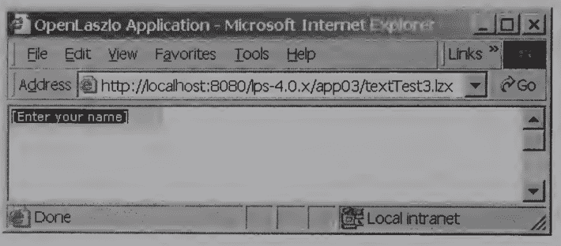

再举一个例子，代码清单 3.4 中的代码展示了一个用作密码框的输入文本组件。

**代码清单 3.4：使用密码**

```
<canvas>
    <view height="20" width="140" bgcolor="silver">
        <inputtext password="true">secret</inputtext>
    </view>
</canvas>
```

请将浏览器定向到此处来尝试此示例：
http://localhost:8080/lps-4.0.x/app03/textTest4.lzx

输出如图 3.4 所示。

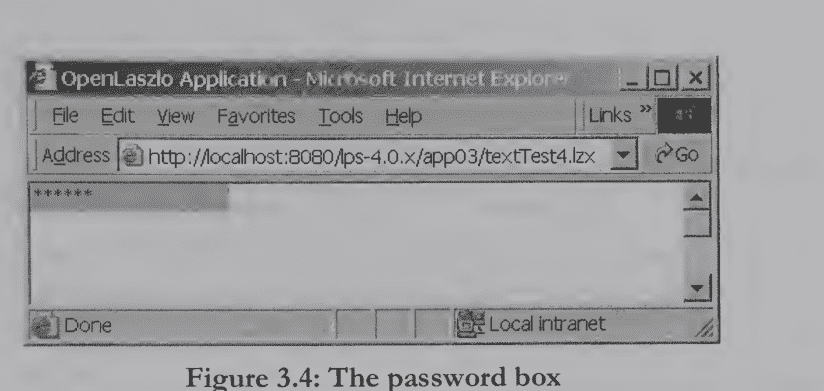

**图 3.4：密码框**

### LzFont

一个 **LzFont** 对象代表一种字体。您可以使用 **font** 标签创建一个 **LzFont** 类的实例。**font** 标签必须是 **canvas** 标签或 **library** 标签的直接子元素。

表 3.3 展示了 **LzFont** 类的属性。

| 名称 | 用法 | 类型 | 默认值 | 访问性 |
|---|---|---|---|---|
| **advancetable** | 仅JS | 数字数组 | | 只读 |
| | **描述。** 一个按字符代码（通常是 ASCII）索引的字符宽度数组。 | | | |
| **ascent** | 仅JS | 数字 | | 只读 |
| | **描述。** 此字体在基线上方的高度（以像素为单位）。 | | | |
| **descent** | 仅JS | 数字 | | 只读 |
| | **描述。** 此字体在基线下方的高度（以像素为单位）。 | | | |
| **height** | 仅JS | 数字 | | 只读 |
| | **描述。** 此字体的高度（以像素为单位）。 | | | |
| **lsbtable** | 仅JS | 数字数组 | | 只读 |
| | **描述。** 一个按字符代码（通常是 ASCII）索引的字符左侧边距数组。 | | | |
| **name** | 标签和JS | 字符串 | | 只读 |
| | **描述。** 此字体的标识符。 | | | |
| **rsbtable** | 仅JS | 数字数组 | | 只读 |
| | **描述。** 一个按字符代码（通常是 ASCII）索引的字符右侧边距数组。 | | | |
| **src** | 仅标签 | 字符串 | | 读写 |
| | **描述。** 相对于安装目录下 lps/fonts 目录的字体文件路径。 | | | |
| **style** | 标签和JS | 字符串 | plain | 只读 |
| | **描述。** 此字体的样式。其值为 "bold"、"italic"、"bold italic"、"italic bold" 和 "plain" 之一。 | | | |

**表 3.3：** LzFont 类中定义的属性

例如，代码清单 3.5 展示了如何使用 **font** 标签：

**代码清单 3.5：使用字体**

```
<canvas height="50" fontsize="18">
    <font src="lztahoe8.ttf" name="tahoe"/>
    <text font="tahoe">
        You can use any TTF font
        as long as you have the source
    </text>
</canvas>
```

要测试和运行此程序，请将浏览器定向到此 URL：
http://localhost:8080/lps-4.0.x/app03/fontTest1.lzx

您将在浏览器中看到类似图 3.5 的内容。

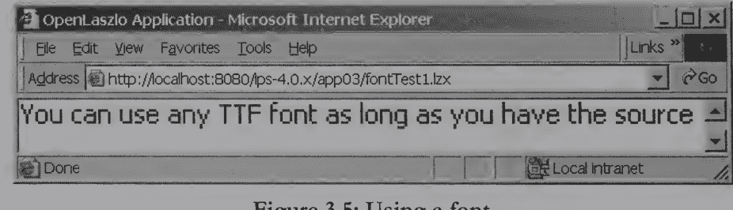

OpenLaszlo 将在 **lps/fonts** 目录中搜索字体文件。因此，您可以在代码中指定如下内容：

```
<font src="congab.ttf" name="Conga"/>
```

请注意，您不需要指定 **congab.ttf** 文件的路径，因为该文件位于 **lps/fonts** 目录中。但是，如果字体文件位于 fonts 目录下的某个子目录中，则需要同时包含该文件夹。


### 第3章：处理文本

例如：

```
<font src="verity/verity9.ttf" name="Verity"/>
```

这告诉 OpenLaszlo 服务器，**verity9.ttf** 文件可以在 **lps/fonts/verity** 文件夹下找到。

如果一个组件在其 **font** 属性中指定了一个未识别的字体名称，OpenLaszlo 将会发送一个运行时错误消息。但是，编译将继续，并且将使用默认字体。

再举一个例子，清单3.6中的代码中的按钮使用了verity字体。

**清单3.6：在按钮中使用不同的字体**

```
<canvas height="50" fontsize="12">
    <font src="verity/verity9.ttf" name="verity"/>
    <button font="verity" text="Register"/>
</canvas>
```

你可以使用这个URL来调用应用程序：

```
http://localhost:8080/lps-4.0.x/app03/fontTest2.lzx
```

图3.6显示了结果。

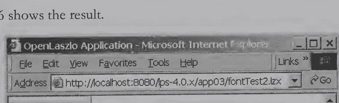

**图3.6：使用非默认字体的按钮**

## 总结

文本是任何GUI应用程序的重要组成部分。**OpenLaszlo** 允许你通过提供 **LzText** 类及其子类来显示文本。**LzText** 是不可编辑文本组件的模板。对于可编辑的文本，你使用 **LzInputText**。此外，你可以通过使用 **LzFont** 类以任何你希望的字体渲染文本。

### 第4章：布局管理

如果你熟悉Java Swing，你可能已经使用过布局管理器在容器中排列组件。OpenLaszlo通过 **LzLayout** 类支持类似的概念。在本章中，我们将研究这个类及其各种子类，并了解不同的布局管理器如何以不同的方式管理组件。

## 绝对定位

所有视图和组件都有 **x** 和 **y** 属性，用于指定它们在容器坐标空间中的位置。更改 **x** 和 **y** 的值会更改视图或组件的位置。然而，虽然这种定位策略很灵活，但它并不总是最好或最简单的方案。首先，你必须计算每个组件的宽度和高度，以避免它们重叠。此外，当容器大小调整时，视图会保持其绝对位置。例如，考虑清单4.1中的LZX应用程序。

**清单4.1：绝对定位**

```
<canvas height="60">
    <view x="0" y="0" bgcolor="silver" width="20" height="20"/>
    <view x="40" y="0" bgcolor="gray" width="20" height="20"/>
    <view x="80" y="0" bgcolor="black" width="20" height="20"/>
</canvas>
```

要测试此应用程序，请将浏览器定向到此URL：
`http://localhost:8080/lps-4.0.x/app04/absolutePositionTest1.lzx`

生成的应用程序如图4.1所示。

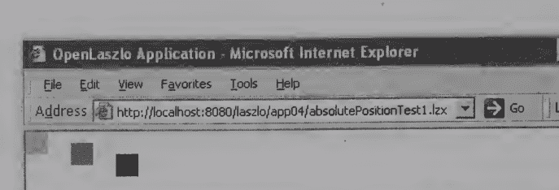

图4.1：绝对定位

然而，当Web浏览器调整大小时，一些组件可能不再可见。显然，我们需要一种不同的方法。

## LzLayout 类

LzLayout类是LzNode的一个子类，负责布局视图。LzLayout类是一个提供此功能的基类。你永远不会直接实例化这个类，而是总是创建其子类的实例。LzLayout的子类如图4.2所示。

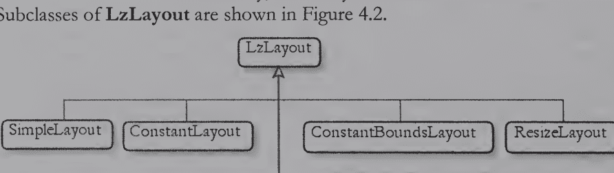

图4.2：LzLayout的子类

在LzLayout类中定义的属性见表4.1。

| 名称 | 用法 | 类型 | 默认值 | 可访问性 | 描述 |
|---|---|---|---|---|---|
| delegates | 仅JS | LzDelegate对象的数组 |  | 只读 | 布局使用的所有委托。 |
| locked | 标签和JS | 布尔值 |  | 读写 | 指示布局是否被锁定更新。 |
| subviews | 仅JS | 视图的数组 |  | 只读 | 此布局管理的所有视图。 |
| updateDelegate | 仅JS | LzDelegate |  | 只读 | 负责更新布局的委托。 |

表4.1：在LzLayout类中定义的属性

以下是在 **LzLayout** 类中定义的方法。

- `addSubview(subview)`：添加指定的子视图。
- `ignore(subview)`：忽略指定的子视图。
- `lock()`：锁定布局，不允许更新。
- `releaseLayout()`：从视图中移除布局，并注销布局使用的委托。
- `removeSubview(subview)`：移除指定的子视图。
- `setLayoutOrder(subView1, subView2)`：重新排序，使subView2紧跟在subView1之后。
- `swapSubviewOrder(subView1, subView2)`：交换subView1和subView2的位置。
- `unlock()`：解锁布局，允许更新。

你可以通过使用 **LzView** 类的 **layout** 属性来指定布局，或者如后续部分所示，通过实例化 **LzLayout** 的子类来指定布局。

## SimpleLayout

你可以使用 **SimpleLayout** 将组件水平或垂直地并排放置。你可以使用 **simplelayout** 标签创建一个 **SimpleLayout** 的实例。

**SimpleLayout** 类添加了三个属性，如表4.2所述。

| 名称 | 用法 | 类型 | 默认值 | 可访问性 | 描述 |
|---|---|---|---|---|---|
| axis | 标签和JS | 字符串 | y | 读写 | 布局组件的轴。此属性的值是“x”或“y”。 |
| spacing | 标签和JS | 数字 | 0 | 读写 | 两个视图之间的距离（以像素为单位）。 |
| inset | 标签和JS | 数字 | 0 | 读写 | 容器边框与第一个视图之间的距离（以像素为单位）。 |

表4.2：SimpleLayout类中定义的属性

你可以在视图中使用 **simplelayout** 标签来布局添加到该视图的组件和子视图。例如，考虑清单4.2中的代码，它将三个视图水平放置。

**清单4.2：水平排列视图**

```
<canvas height="60">
    <simplelayout axis="x" spacing="4"/>
    <view bgcolor="silver" width="20" height="20"/>
    <view bgcolor="gray" width="20" height="20"/>
    <view bgcolor="black" width="20" height="20"/>
</canvas>
```

要测试此应用程序，请使用此URL：
`http://localhost:8080/lps-4.0.x/app04/simpleLayoutTest1.lzx`

生成的输出如图4.3所示。

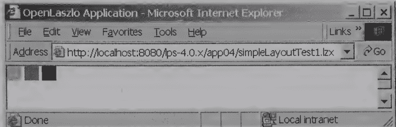

图4.3：使用SimpleLayout水平布局组件

清单4.3中的代码将其组件垂直布局。

**清单4.3：垂直布局视图**

```
<canvas height="200">
    <view x="5" y="4">
        <simplelayout axis="y" spacing="6" inset="6"/>
        <view bgcolor="silver" width="20" height="20"/>
        <view bgcolor="gray" width="20" height="20"/>
        <view bgcolor="black" width="20" height="20"/>
    </view>
</canvas>
```

请注意，**simplelayout** 被添加到一个位置在（5, 4）的视图中，并且第一个视图位于像素6处（这要归功于 **inset** 属性）。

要测试此应用程序，请将浏览器定向到以下URL：
`http://localhost:8080/lps-4.0.x/app04/simpleLayoutTest2.lzx`

图4.4显示了生成的输出。

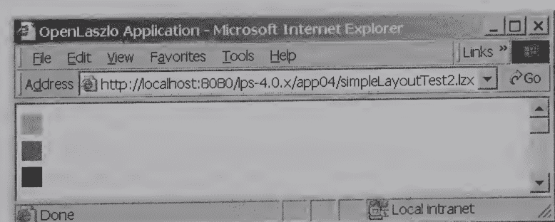

图4.4：使用SimpleLayout垂直布局组件

除了使用标签，你还可以使用 **LzView** 类的 **layout** 属性来布局视图的子视图。你为这个属性分配类名和布局管理器属性的值。

例如，清单4.4中的LZX应用程序显示了一个使用layout属性的 **LzView**。

**清单4.4：使用layout属性**

```
<canvas height="200">
    <view layout="class:simplelayout;axis:x;spacing:50">
        <button>OK</button>
        <button>Cancel</button>
    </view>
</canvas>
```

要测试此应用程序，请将浏览器定向到以下URL：

`http://localhost:8080/lps-4.0.x/app04/layoutAttributeTest1.lzx`

生成的输出显示在图4.5中。

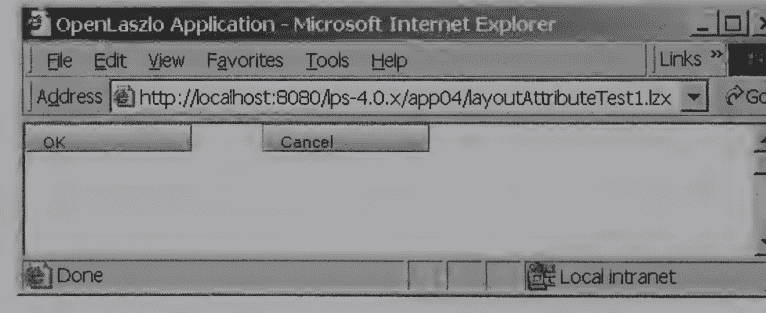

图4.5：使用layout属性

## ResizeLayout

**ResizeLayout** 与 **SimpleLayout** 类似，允许你水平或垂直地放置视图。然而，使用 **ResizeLayout**，你还可以调整被管理视图的大小。你可以使用 **resizelayout** 标签来构造一个 **ResizeLayout** 对象。


要调整一个视图的大小，请将您想要调整大小的视图的 **options** 属性赋值为 "releasetolayout"。此属性会导致相应的视图被调整大小，以填充容器中未被固定长度视图占用的宽度或高度。如果多个视图的 **options** 属性都被赋值为 "releasetolayout"，则可用空间将在这些视图之间平均分配。

**ResizeLayout** 类的属性如表 4.3 所示。

| 名称 | 用途 | 类型 | 默认值 | 可访问性 |
|---|---|---|---|---|
| axis | 标签和 JS | string | y | 可读写 |
| | **描述。** 用于布局组件的轴。此属性的值为 "x" 或 "y"。 | | | |
| spacing | 标签和 JS | number | 0 | 可读写 |
| | **描述。** 两个视图之间的距离，以像素为单位。 | | | |

表 4.3：ResizeLayout 类中定义的属性

以下是 **ResizeLayout** 类中定义的方法。

hold(subview)
    防止指定的子视图在父视图调整大小时被调整大小。

release(subview)
    允许在被 hold 之后调整指定子视图的大小。

setAxis(axis)
    设置 **axis** 属性。

例如，清单 4.5 中的 LZX 应用程序演示了一个使用 **resizelayout** 的画布。

清单 4.5：使用 resizelayout

```
<canvas height="200">
    <resizelayout axis="y" spacing="5"/>
    <view width="20" height="20" bgcolor="silver"/>
    <view width="20" height="20" bgcolor="gray"/>
    <view width="20" height="20" bgcolor="black"
          options="releasetolayout"/>
</canvas>
```

要测试清单 4.5 中的应用程序，请使用此 URL：
http://localhost:8080/lps-4.0.x/app04/resizeLayoutTest1.lzx

图 4.5 显示了结果。

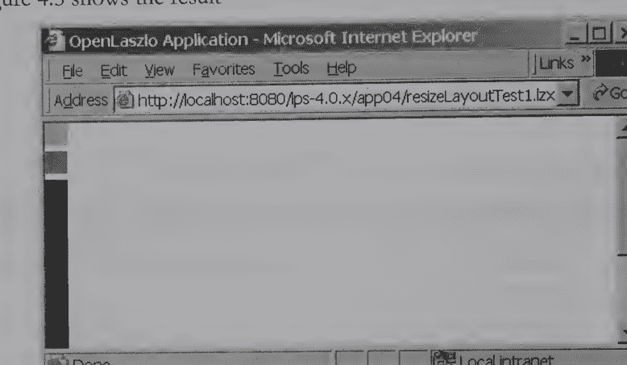

图 4.5：使用 ResizeLayout

## SimpleBoundsLayout

SimpleBoundsLayout 类似于 SimpleLayout，用于水平或垂直定位视图。但是，SimpleBoundsLayout 确保在视图旋转时，没有视图与其他视图重叠。

表 4.4 显示了 SimpleBoundsLayout 中的属性。

| 名称 | 用途 | 类型 | 默认值 | 可访问性 |
|---|---|---|---|---|
| axis | 标签和 JS | string | y | 可读写 |
| | **描述。** 用于布局组件的轴。此属性的值为 “x” 或 “y”。 | | | |
| spacing | 标签和 JS | number | 0 | 可读写 |
| | **描述。** 两个视图之间的距离，以像素为单位。 | | | |

表 4.4：SimpleBoundsLayout 类中定义的属性

例如，清单 4.6 中的 LZX 应用程序使用了 SimpleBoundsLayout。

清单 4.6：使用 SimpleBoundsLayout

```
<canvas height="100">
    <include href="utils/layouts/simpleboundslayout.lzx"/>
    <simpleboundslayout axis="x"/>
    <view width="60" height="60" bgcolor="silver"/>
    <view width="60" height="60" bgcolor="gray" rotation="30"/>
    <view width="60" height="60" bgcolor="black"/>
</canvas>
```

请注意，要使用此布局，您必须包含 **utils/layouts** 下的 **simpleboundslayout.lzx** 文件。要编译应用程序，请调用此 URL：

http://localhost:8080/lps-4.0.x/app04/simpleBoundsLayoutTest1.lzx

生成的输出如图 4.6 所示。

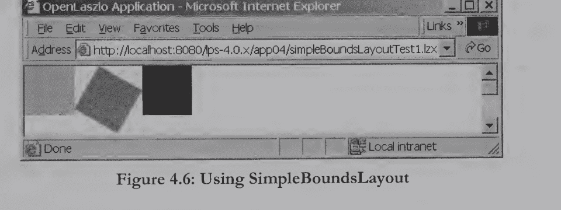

作为对比，清单 4.7 显示了使用 **SimpleLayout** 的类似代码。

清单 4.7：在 SimpleLayout 中视图可能重叠

```
<canvas height="100">
    <simplelayout axis="x"/>
    <view width="60" height="60" bgcolor="silver"/>
    <view width="60" height="60" bgcolor="gray" rotation="30"/>
    <view width="60" height="60" bgcolor="black"/>
</canvas>
```

使用此 URL 来编译和运行清单 4.7 中的代码。

http://localhost:8080/lps-4.0.x/app04/simpleBoundsLayoutTest2.lzx

结果如图 4.7 所示。

## ReverseLayout

**ReverseLayout** 类似于 **SimpleLayout**，但是视图是从右到左（对于 x 轴）或从底部到顶部（对于 y 轴）进行布局的。

**ReverseLayout** 中定义的属性列于表 4.5 中。

| 名称 | 用途 | 类型 | 默认值 | 可访问性 |
|---|---|---|---|---|
| axis | 标签和 JS | string | y | 可读写 |
| | **描述。** 用于布局组件的轴。此属性的值为 “x” 或 “y”。 | | | |
| spacing | 标签和 JS | number | 0 | 可读写 |
| | **描述。** 两个视图之间的距离，以像素为单位。 | | | |
| inset | 标签和 JS | number | 0 | 可读写 |
| | **描述。** 容器边框与第一个视图之间的距离，以像素为单位。 | | | |
| end | 标签和 JS | boolean | true | 可读写 |
| | **描述。** 指示布局是否会将子视图推送到包含视图的右侧或底部。 | | | |

表 4.5：ReverseLayout 类中定义的属性

例如，清单 4.8 显示了一个使用 **ReverseLayout** 的 LZX 应用程序。

清单 4.8：使用 reverselayout

```
<canvas height="100">
    <include href="utils/layouts/reverselayout.lzx"/>
    <reverselayout axis="x" end="false" spacing="10"/>
    <view width="60" height="60" bgcolor="silver"/>
    <view width="60" height="60" bgcolor="gray"/>
    <view width="60" height="60" bgcolor="black"/>
</canvas>
```

请注意，要使用 **ReverseLayout**，您必须包含 **utils/layouts/reverselayout.lzx** 文件。

要编译应用程序，请使用此 URL：
http://localhost:8080/lps-4.0.x/app04/reverseLayoutTest1.lzx

图 4.8 显示了结果。

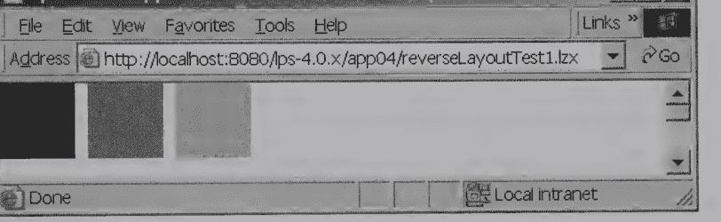

请注意，图 4.8 中的黑色视图是最左边的视图。

## StableBorderLayout

**StableBorderLayout** 类似于 **SimpleLayout**。然而，两者之间有两个区别。**StableBorderLayout** 中不允许使用 **spacing** 属性，并且它会忽略除最后三个之外的所有视图。倒数第二个视图将被拉伸以填充容器其余的宽度/高度。

表 4.6 显示了 **StableBorderLayout** 中的属性。

| 名称 | 用途 | 类型 | 默认值 | 可访问性 |
| --- | --- | --- | --- | --- |
| axis | 标签和 JS | string | y | 可读写 |
| | **描述。** 用于布局组件的轴。此属性的值为 “x” 或 “y”。 | | | |

表 4.6：StableBorderLayout 类中定义的属性

清单 4.9 显示了一个使用 **StableBorderLayout** 的 LZX 应用程序。

清单 4.9：使用 stableborderlayout

```
<canvas height="100">
    <stableborderlayout axis="x"/>
    <view width="60" height="60" bgcolor="red"/>
    <view width="30" height="60" bgcolor="silver"/>
    <view width="30" height="60" bgcolor="black"/>
    <view width="60" height="60" bgcolor="gray"/>
</canvas>
```

要编译代码，请使用此 URL：

http://localhost:8080/lps-4.0.x/app04/stableLayoutTest1.lzx

生成的输出如图 4.9 所示。

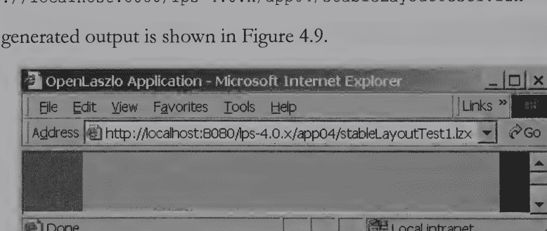

请注意，红色视图被忽略了。灰色视图占据了第一个位置，而银色视图被拉伸了。

## ConstantLayout

此布局将视图彼此重叠放置。与 **SimpleLayout** 一样，您需要指定 **axis** 属性。**value** 属性指定轴偏移的像素数。由 **ConstantLayout** 管理的任何视图都可以将其 **xoffset** 和 **yoffset** 属性赋值。**xoffset** 属性将视图向右或向左偏移。**yoffset** 属性导致视图垂直偏移。

表 4.7 显示了 **ConstantLayout** 类中定义的属性。

| 名称 | 用途 | 类型 | 默认值 | 可访问性 |
|---|---|---|---|---|
| axis | 标签和 JS | string | y | 可读写 |
| | **描述。** 用于沿其布局组件的轴。此属性的值为 “x” 或 “y”。 | | | |
| value | 标签和 JS | string | | 可读写 |
| | **描述。** 轴偏移的像素数。 | | | |

表 4.7：ConstantLayout 类中定义的属性

例如，清单 4.10 中的代码展示了如何使用 **ConstantLayout**。

清单 4.10：使用 ConstantLayout

```
<canvas height="80">
    <constantlayout axis="x" value="10"/>
    <view width="80" height="80" bgcolor="silver" xoffset="-5"/>
    <view width="60" height="60" bgcolor="gray"/>
    <view width="40" height="40" bgcolor="black"/>
</canvas>
```

要编译此代码，请调用以下 URL：

http://localhost:8080/lps-4.0.x/app04/constantLayoutTest1.lzx

编译成功后，您将在浏览器中看到类似于图 4.10 的内容。


### 第4章：布局管理

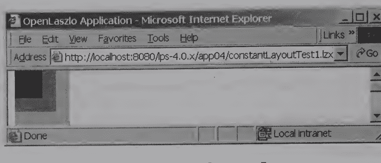

## ConstantBoundsLayout

**ConstantBoundsLayout** 类似于 **ConstantLayout**，但如果布局的 **axis** 属性设置为 "x"，它会忽略任何视图的 **xoffset** 属性值；如果布局的 **axis** 属性值为 "y"，则忽略任何视图的 **yoffset** 属性值。

表4.8显示了在 **ConstantBoundsLayout** 类中定义的属性。

| 名称 | 用途 | 类型 | 默认值 | 可访问性 |
|---|---|---|---|---|
| axis | 标签和JS | string | y | 可读写 |
| | **描述。** 沿其布局组件的轴。此属性的值为 "x" 或 "y"。 | | | |
| value | 标签和JS | string | | 可读写 |
| | **描述。** 轴偏移的像素数。 | | | |

表4.8：ConstantLayout类中定义的属性

例如，清单4.11中的代码展示了如何使用 **ConstantBoundsLayout**。

### 清单4.11：使用ConstantBoundsLayout

```
<canvas height="80">
    <include href="utils/layouts/constantboundslayout.lzx"/>
    <constantboundslayout axis="x" value="10"/>
    <view width="80" height="80" bgcolor="silver" xoffset="-5"/>
    <view width="60" height="60" bgcolor="gray"/>
    <view width="40" height="40" bgcolor="black"/>
</canvas>
```

请注意，要使用 **ConstantBoundsLayout**，您需要在 **utils/layouts** 目录中包含 **constantboundslayout.lzx** 文件。
要编译代码，请使用此URL：
http://localhost:8080/lps-4.0.x/app04/constantBoundsLayoutTest1.lzx
图4.11显示了生成的输出。

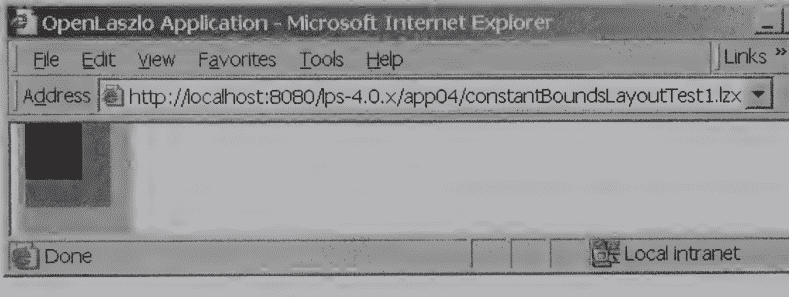

## WrappingLayout

**WrappingLayout** 类似于 **SimpleLayout**，但它会通过换行或换列来“包裹”其管理的视图。表4.9显示了在 **WrappingLayout** 中定义的属性。

| 名称 | 用途 | 类型 | 默认值 | 可访问性 |
|---|---|---|---|---|
| axis | 标签和JS | string | y | 可读写 |
| | **描述。** 布局组件的轴。此属性的值为 “x” 或 “y”。 | | | |
| spacing | 标签和JS | number | 1 | 可读写 |
| | **描述。** 两个视图在两个轴上的间距（像素）。默认情况下，**xspacing** 和 **yspacing** 都被赋予此值。 | | | |
| xinset | 标签和JS | number | 0 | 可读写 |
| | **描述。** 容器边框与第一个视图在x轴上的距离（像素）。 | | | |
| yinset | 标签和JS | number | 0 | 可读写 |
| | **描述。** 容器边框与第一个视图在y轴上的距离（像素）。 | | | |
| xspacing | 标签和JS | number | | 可读写 |
| | **描述。** 两个视图在x轴上的间距（像素）。 | | | |
| yspacing | 标签和JS | number | | 可读写 |
| | **描述。** 两个视图在y轴上的间距（像素）。 | | | |
| duration | 标签和JS | number | 0 | 可读写 |
| | **描述。** 用于动画布局视图的毫秒数。 | | | |

表4.9：WrappingLayout类中定义的属性

例如，清单4.12展示了一个使用 **WrappingLayout** 的LZX应用程序。

### 清单4.12：使用wrappinglayout

```
<canvas height="100" width="80">
    <wrappinglayout axis="x" spacing="5"/>
    <view width="30" height="40" bgcolor="silver"/>
    <view width="30" height="40" bgcolor="black"/>
    <view width="60" height="40" bgcolor="gray"/>
</canvas>
```

要编译程序，请使用以下URL：
http://localhost:8080/lps-4.0.x/app04/wrappingLayoutTest1.lzx

图4.12显示了结果。

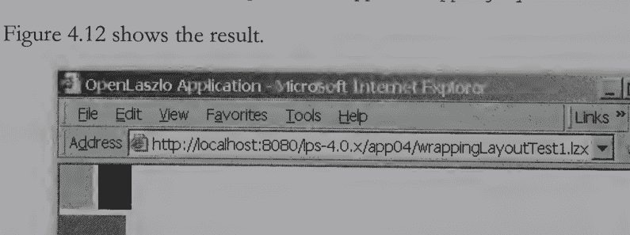

如您所见，第三个视图显示在第二行。否则，如果使用 **SimpleLayout**，它将被截断。

## 总结

在本章中，您学习了如何使用 **LzLayout** 类及其子类在容器中布局视图和组件。

# 第5章 事件处理

OpenLaszlo对象可以触发事件。有些事件是作为用户操作的响应而触发的，例如鼠标点击或键盘输入。有些是通过编程触发的，例如作为数据更改的响应。您可以利用此功能使您的应用程序更具交互性。如果您曾经编写过JavaScript，您会发现OpenLaszlo事件编程非常熟悉。要响应事件，您只需编写一个事件处理程序并将该处理程序链接到相关事件即可。

如何编写事件处理程序？在第1章“开始使用OpenLaszlo”中，您已经看到可以使用 **script** 标签编写一个JavaScript脚本，该脚本将在应用程序加载时执行。事件处理程序本质上是方法或函数。因此，您可以在 **script** 标签内编写JavaScript函数。但是，由于脚本只能直接出现在 **<canvas>** 中，因此您使用 **script** 标签来定义将在应用程序多个点调用的全局函数。如果您的函数是对象的本地函数，则应该在创建触发事件的对象的标签下编写一个方法。

本章向您展示如何处理事件和事件处理程序。大多数事件在 **LzNode** 和 **LzView** 类中定义。因此，首先将给出这两个类中的事件列表。

> **注意**
如果您不熟悉JavaScript，请确保在阅读本章之前阅读附录B“JavaScript简介”。

## handler 标签

您使用 **handler** 标签编写事件处理程序。此标签的属性总结在表5.1中。

| 名称 | 用途 | 类型 | 默认值 | 可访问性 |
| :--- | :--- | :--- | :--- | :--- |
| args | 仅标签 | string | | final |
| method | 仅标签 | string | | final |
| name | 仅标签 | reference | this | final |
| reference | 仅标签 | string | | final |

表5.1：handler标签的属性

您将在接下来的章节中看到 **handler** 标签的示例。

## LzNode和LzView类中定义的事件

由于所有OpenLaszlo类都直接或间接派生自 **LzNode** 类，并且所有视图和组件都是 **LzView** 的子类，因此在这两个类中定义的事件会被在LZX应用程序中创建的大多数对象继承，因此值得讨论。

OpenLaszlo中的事件名称以 **on** 开头，后跟一个动作。例如，由用户点击引起的事件是 **onclick**。当鼠标按钮释放时触发的事件是 **onmouseup**。

以下是在 **LzNode** 类中定义的事件。

**onconstruct**
此事件在节点实例化过程开始时触发。

**ondata**
当此节点的数据路径引用的数据更改时触发此事件。

**oninit**
此事件在节点变为活动状态之前触发。

在这三者中，**oninit** 事件使用最频繁。您使用此事件来编写在对象初始化时需要执行的初始化代码。

例如，清单5.1展示了一个使用 **Alert** 类的 **oninit** 事件来调用 **Alert** 对象的 **open** 方法的LZX应用程序。

### 清单5.1：在Alert窗口上使用oninit

```
<canvas>
    <alert name="warning" button1="Yes" button2="No">
        Do you want to continue?
        <handler name="oninit">
            this.open();
        </handler>
    </alert>
</canvas>
```

您可以使用此URL测试代码：
http://localhost:8080/lps-4.0.x/app05/oninitTest1.lzx

图5.1显示了生成的结果。


如果没有事件处理程序，**Alert** 窗口将不会显示。
**LzView** 类有数十个事件，列在表5.2中。

| 事件 | 描述 |
|---|---|
| onaddsubresource | 当子视图添加资源时触发。 |
| onaddsubview | 当此视图添加子视图时触发。 |
| onblur | 当可聚焦视图失去焦点时触发。 |
| onclick | 当可点击视图被点击时触发。 |


### 第五章：事件处理

| 事件 | 描述 |
|---|---|
| ondblclick | 如果该事件有对应的事件处理程序，则在可点击视图被双击时触发。如果没有注册事件处理程序，则会改为发送两个连续的onclick事件。 |
| onerror | 当加载视图关联资源发生错误时触发。该事件会将错误信息发送给事件处理程序。 |
| onfocus | 当可获得焦点的视图获得焦点时触发。 |
| onheight | 当视图高度发生变化时触发。 |
| onlastframe | 当视图将其帧设置为最后一帧时触发。此事件可用于在视图完成播放其关联资源时发送通知。 |
| onload | 当视图加载其关联资源时触发。 |
| onmousedown | 当鼠标按钮在可点击视图上按下时触发。 |
| onmousedragin | 当鼠标被点击并且其指针被拖入可点击视图时触发。 |
| onmousedragout | 当鼠标在可点击视图上被点击并被拖出时触发。 |
| onmouseout | 当鼠标指针移出可点击视图时触发。 |
| onmouseover | 当鼠标在可点击视图上滚动时触发。 |
| onmouseup | 当鼠标按钮在可点击视图上释放时触发。 |
| onmouseupoutside | 当已在可点击视图上被点击的鼠标按钮在视图外部释放时触发。 |
| onopacity | 当视图的不透明度发生变化时触发 |
| onplay | 当视图开始播放其关联资源时触发 |
| onremovesubview | 当子视图被移除时触发。 |
| onstop | 当关联资源停止播放时触发。 |
| ontimeout | 当加载视图媒体的请求超时时触发。 |
| onwidth | 当视图宽度发生变化时触发。 |
| onx | 当视图的x属性发生变化时触发。 |
| onxscale | 当在x轴上调整大小的视图改变其宽度时触发。 |
| ony | 当视图的y属性发生变化时触发。 |
| onyscale | 当在y轴上调整大小的视图改变其高度时触发。 |

表5.2：LzView中定义的事件

如你所见，**LzView** 类的许多事件都是在属性值发生变化时触发的。例如，**onwidth** 事件在视图宽度发生变化时触发。

## OpenLaszlo 事件编程

事件编程意味着你可以响应对象触发的事件。为此，你需要将事件与一个事件处理程序关联起来，该处理程序包含当对象触发事件时要执行的代码。处理程序本质上是一个函数或方法。如果你是Java程序员，这种关联方式与Java编程语言中注册事件监听器的方式相同。

有几种方法可以将事件与事件处理程序关联起来。

1.  在对象的标签声明中，将事件处理程序的名称赋给事件名称。事件处理程序可以是嵌套在对象标签声明内部的方法，也可以是一个JavaScript函数。例如，以下标签创建了一个 **Window** 对象，其 **onx** 事件与事件处理程序 **myHandler** 相关联。

    `<window name="win" onx="myHandler">`

2.  在对象的标签声明中编写一个嵌套的方法，然后将该事件处理程序赋给方法的事件属性。例如，以下代码片段将按钮的 **onclick** 事件与其标签内的事件处理程序相关联。

    ```
    <button>
        <handler name="onclick">
            // 按钮被点击时执行的代码
        </handler>
    </button>
    ```

例如，当用户点击按钮时，按钮会发出 **onclick** 事件。要将此事件与处理程序关联，你需要指定作为该事件处理程序的方法名称。清单5.2向你展示了如何做。

#### 清单5.2：将事件与事件处理程序关联

```
<canvas>
    <button>点击此处
        <handler name="onclick">
            setAttribute("text", "Hello");
            setAttribute('width', 200);
        </handler>
    </button>
</canvas>
```

按钮的 **onclick** 事件与定义在 **button** 标签主体内的处理程序相关联。当按钮被点击时，将执行两行代码：

```
setAttribute("text", "Hello");
setAttribute('width', 200);
```

第一行将按钮的文本更改为 **Hello**。第二行将按钮的宽度更改为200像素。注意，**setAttribute** 方法定义在 **LzNode** 类中：
`setAttribute(name, value)`

属性名可以用双引号或单引号括起来。

由于 **handler** 标签写在 **button** 标签内部，因此 **setAttribute** 方法是在 **Button** 对象上调用的。

你可以通过以下URL编译清单5.2中的代码：
http://localhost:8080/lps-4.0.x/app05/onclickTest1.lzx

图5.2显示了一个将响应点击的按钮。


或者，你也可以将方法体嵌入到定义对象的标签中，如清单5.3所示。

#### 清单5.3：在标签中嵌入代码

```
<canvas>
    <button onclick="setAttribute('text', 'Hello');
    setAttribute('width', 200);">
点击此处
    </button>
</canvas>
```

然而，这只适用于事件处理程序只包含一条语句的情况。如果处理程序更长，不推荐使用此语法，因为它会降低代码可读性。如果必须这样做，请确保不要在事件处理程序中使用双引号，因为双引号的出现会向编译器表明你的事件处理程序到此结束。

#### 向处理程序传递参数

方法也可以用作事件处理程序，使用 `<method>` 而不是 `<handler>` 允许你从触发事件的对象传递参数。例如，清单5.4中的代码展示了如何向响应onclick事件的处理程序传递两个参数。

#### 清单5.4：向处理程序传递参数

```
<canvas>
    <button onclick="myHandler('Welcome', 300)">点击此处
        <method name="myHandler" args="text, componentWidth">
            setAttribute("text", text);
            setAttribute('width', componentWidth);
        </method>
    </button>
</canvas>
```

你可以通过以下URL测试清单5.4中的代码：http://localhost:8080/lps-4.0.x/app05/argumentPassingTest1.lzx

#### 函数作为事件处理程序

方法与类相关联。因此，它通常只与该类的实例一起使用。如果你想要一个可以从多个对象调用的全局事件处理程序，你不能使用方法。相反，你应该使用JavaScript函数。

例如，清单5.5中的代码定义了 **myHandler** 函数，该函数可以从程序中的任何位置调用。

#### 清单5.5：使用函数作为事件处理程序

```
<canvas>
    <button id="button1" onclick="myHandler()">
        点击此处
    </button>
    <script>
    <![CDATA[
        function myHandler() {
            button1.setAttribute("text", "Hello");
            button1.setAttribute("width", 200);
        }
    ]]>
    </script>
</canvas>
```

使用此URL来编译和运行清单5.5中的代码。

http://localhost:8080/lps-4.0.x/app05/functionTest1.lzx

#### 传递对象的引用

在OpenLaszlo中，你可以将值以及对象引用传递给方法。清单5.6中的示例展示了如何将对象传递给函数。

#### 清单5.6：传递对象引用

```
<canvas>
    <simplelayout axis="x"/>
    <button id="button1" onclick="myHandler(this)">
        点击此处
    </button>
    <button id="button2" onclick="myHandler(this)">
        点击此处
    </button>
    <script>
    <![CDATA[
        function myHandler(b) {
            b.setAttribute("text", "Hello");
            b.setAttribute("width", 200);
        }
    ]]>
    </script>
</canvas>
```

清单5.6中的LZX应用程序中有两个按钮，每个按钮都与 **myHandler** 函数相关联。每个 **onclick** 通过传递按钮（使用 **this** 关键字）来调用 **myHandler**。这实际上导致将按钮的引用作为 **b** 传递给 **myHandler**。然后你可以使用 **b** 来访问被点击的按钮。无论点击哪个按钮，其属性都会被更改。

你可以通过以下URL测试此应用程序：
http://localhost:8080/lps-4.0.x/app05/referencePassingTest1.lzx

图5.3显示了生成的结果。


#### 处理鼠标事件

到目前为止，你已经看到了展示如何处理点击事件的例子。还有几十个你可能感兴趣的其他事件。其中之一是 **onmouseover** 事件。清单5.7展示了一个这样的例子。它包含一个视图，当用户将鼠标移动到其上方时会移动。

#### 清单5.7：处理onmouseover

```
<canvas>
    <view width="280" bgcolor="silver">
        <view bgcolor="0x123456" height="50" width="50">
            <handler name="onmouseover">
                var newX = parent.getMouse("x") + 2;
                // 如果newX会导致视图被裁剪
                // 将移动的视图向左移动
                if ((newX + this.width) > parent.width) {
                    // 向左移动
                    newX = parent.getMouse("x") - 2;
                }
                this.setX(newX);
            </handler>
```


### 第5章：事件处理

```
    </view>
    </view>
</canvas>
```

如您所见，第二个 **view** 标签嵌套了一个 **handler** 标签，其 **name** 属性被赋值为“onmouseover”。这使得每次用户将鼠标悬停在视图上时，该方法都会被执行。还要注意，**getMouse** 方法返回鼠标指针的 x 或 y 坐标位置。

您可以使用以下 URL 测试此应用程序：
http://localhost:8080/lps-4.0.x/app05/onmouseoverTest1.lzx

图 5.4 展示了该应用程序。


#### 图 5.4：处理 onmouseover 事件

#### 委托

正如您所见，通过使用 **handler** 和 **method** 标签，您可以轻松地将事件与事件处理程序关联起来。然而，情况并非总是如此。有些对象是使用 **new** 关键字创建的，而不是通过其标签描述。在这种情况下，由于不涉及标签，无法使用传统方式将事件连接到事件处理程序。然而，OpenLaszlo 引入了委托的概念，允许动态地进行事件绑定。

在 LZX 中，由 **LzDelegate** 类表示的委托，是一个在运行时用于将事件与事件处理程序绑定的对象。**LzDelegate** 类的构造函数签名如下：

```
LzDelegate(context, functionName, eventSender, eventName)
```

这里，*context* 是对要调用对象（包含事件处理程序的对象）的引用，*functionName* 是事件处理程序的名称，*eventSender* 是触发事件的对象，*eventName* 是要将此委托注册到的事件。*eventSender* 和 *eventName* 都是可选的，但如果提供了前者，则后者必须存在。

如果创建 **LzDelegate** 实例时没有提供 *eventName* 和 *eventSender* 参数，则可以使用委托的 **register** 方法将委托注册到事件。

表 5.3 展示了 **LzDelegate** 中定义的属性。

| 名称 | 用法 | 类型 | 默认值 | 可访问性 |
|---|---|---|---|---|
| c | 仅 JS | 对象 | | 只读 |
| | **描述。** 调用方法的上下文。 | | | |
| f | 仅 JS | 字符串 | | 只读 |
| | **描述。** 要调用的方法。 | | | |

**表 5.3：** LzDelegate 类中定义的属性

**LzDelegate** 类具有以下方法：

`disable()`
禁用委托。

`enable()`
启用委托。

`execute(data)`
在给定的上下文中，使用指定的数据执行名为 functionName 的方法。

`register(eventSender, eventName)`
在给定上下文中，为指定事件注册委托。

`unregisterAll()`
取消委托对所有已注册事件的注册。

`unregisterFrom(event)`
取消委托对指定事件的注册。

例如，
`var del = new LzDelegate( this, "changeText", b, "onclick");`

等同于

`var del = new LzDelegate( this, "changeText");`
`del.register(b, "onclick");`

例如，清单 5.8 中的代码是一个使用委托将事件与事件处理程序绑定的 LZX 应用程序。

**清单 5.8：使用委托**

```
<canvas height="60">
    <button id="b">Click Here</button>
    <method name="changeText">
        b.setAttribute("text", "Hello");
    </method>

    <handler name="oninit">
        var del = new LzDelegate( this, "changeText", b, "onclick");
    </handler>
</canvas>
```

在这种情况下，当 canvas 初始化时，会触发 **oninit** 事件的处理程序，创建一个委托对象，该对象将按钮的 **onclick** 事件与 **changeText** 方法绑定。

诚然，清单 5.8 中的代码有些刻意，因为在编译时将按钮与处理程序绑定更容易。然而，下一节中的 LZX 应用程序展示了委托的实际用法。

#### 一个简单的游戏

清单 5.9 中的示例展示了一个可以移动和射击的飞船。使用左右箭头键移动，上箭头键射击。该应用程序展示了委托的实际应用以及如何处理键盘事件。

**清单 5.9：飞船游戏**

```
<canvas height="500">
    <resource name="spaceShip" src="spaceShip.jpg"/>
    <view>
        <simplelayout axis="x" spacing="4"/>
        <view bgcolor="silver" width="40" height="40">
            <text>1</text>
        </view>
        <view bgcolor="silver" width="40" height="40">
            <text>2</text>
        </view>
        <view bgcolor="silver" width="40" height="40">
            <text>3</text>
        </view>
        <view bgcolor="silver" width="40" height="40">
            <text>4</text>
        </view>
        <view bgcolor="silver" width="40" height="40">
            <text>5</text>
        </view>
    </view>
    <view y="400" bgcolor="black" width="${parent.width}">
        <view id="spaceShip" resource="spaceShip" clickable="true" focusable="true">
            <handler name="onkeydown" args="k">
                <![CDATA[
                if (k == 38) {
                    var bullet = new LzView(canvas,
                            {width: 2, height: 5,
                             bgcolor: green, name: "bullet"});
                    bullet.setX(this.x + 18);
                    bullet.setY(400);
                    bullet.animate("y", -10, 1000, false);
                } else if (k == 37 && this.x > 0) {
                    this.setX(this.x - 6);
                } else if (k == 39 && this.x < parent.width) {
                    this.setX(this.x + 6);
                }
                ]]>
            </handler>
        </view>
    </view>
    <handler name="oninit">
        LzFocus.setFocus(spaceShip);
    </handler>
</canvas>
```

要测试此应用程序，请使用以下 URL：
http://localhost:8080/lps-4.0.x/app05/spaceShip.lzx

图 5.5 展示了该应用程序。


图 5.5：一个简单的游戏

清单 5.9 中的程序显示了一个视图，该视图使用图像 **spaceship.jpg** 作为资源。其 **clickable** 和 **focusable** 属性均设置为 **true**，因此它可以接收键盘输入。该视图的 **onkeydown** 事件被连接到以下方法：

```
<handler name="onkeydown" args="k">
    <![CDATA[
    if (k == 38) {
        var bullet = new LzView(canvas,
            {width: 2, height: 5,
             bgcolor: green, name: "bullet"});
        bullet.setX(this.x + 18);
        bullet.setY(400);
        bullet.animate("y", -10, 1000, false);

    } else if (k == 37 && this.x > 0) {
        this.setX(this.x - 6);
    } else if (k == 39 && this.x < parent.width) {
        this.setX(this.x + 6);
    }
    ]]>
</handler>
```

对象的 **onkeydown** 事件在对象获得焦点且用户按下键盘按键时发生。它将按键代码作为参数（*k*）传递。如果按下的是上、左或右箭头键，事件处理程序将做出响应。左右箭头键移动飞船。上箭头键会动态创建另一个视图并为其添加动画（动画将在第7章讨论）。

还要注意，您使用 **LzFocus** 类的 **setFocus** 方法来确保在应用程序加载时，飞船视图获得焦点。

```
<handler name="oninit">
    LzFocus.setFocus(spaceShip);
</handler>
```

## 总结

LZX 是一种事件驱动语言，事件编程非常容易。本章展示了如何将事件连接到事件处理程序，并介绍了委托。

# 第6章 约束和状态

约束是表达式的返回值，通常被赋给一个属性。如果您希望属性拥有一个根据某些外部状态动态变化的值，就可以使用约束。状态是条件约束。约束和状态都是 OpenLaszlo 中非常有用的功能。
本章将讨论约束和状态，并展示如何使用它们。

## 约束简介

约束可以被赋给标签的属性。其语法如下。
`$when{expression}`
这里，*expression* 是一个 JavaScript 表达式，*when* 是以下编译器指令之一：**immediately**、**once** 或 **always**。`$always{expression}` 可以简写为 `${expression}`。
例如，清单 6.1 中的 LZX 应用程序将约束用作文本组件 **text** 属性的值。

**清单 6.1：使用约束**

```
<canvas>
    <text x="110" text="${win.x}"/>
    <window id="win" width="100" height="100"/>
</canvas>
```

此例中的约束是：
`${win.x}`


### 第六章：约束与状态

**win.x** 是一个表达式，代表**win**（一个**Window**组件）的**x**属性的值。你可以通过将浏览器指向以下地址来编译此应用程序：

```
http://localhost:8080/lps-4.0.x/app06/constraintTest1.lzx
```

文本和窗口如图6.1所示。


最初，**x**属性的值为0，但是如果你拖动窗口，**x**的值会改变，并且这种变化会反映在文本中。

另一个例子，请考虑清单6.2中的LZX应用程序。

#### 清单6.2：使用约束跟踪鼠标移动

```
<canvas>
    <view y="0" bgcolor="0xbbccdd" height="4"
          width="${parent.width}">
        <view width="4" height="4" bgcolor="red"
              x="${parent.parent.getMouse('x')}"/>
    </view>
</canvas>
```

你可以使用此URL来编译和运行示例。

```
http://localhost:8080/lps-4.0.x/app06/constraintTest2.lzx
```

图6.2展示了该应用程序。


图6.2：跟踪鼠标运动

图6.2中的小红色视图会跟随你的鼠标移动，因为它的x属性被赋予了这个约束：

```
${parent.parent.getMouse('x')}
```

这是另一个约束的实际应用。

清单6.3中的代码展示了使用约束的另一个例子。这次使用滑块来控制视图的不透明度。

#### 清单6.3：控制不透明度

```
<canvas height="300" width="700">
    <view bgcolor="red" id="display" width="200" height="200"
           opacity="${parent.adjuster.value/100}"/>
    <slider x="0" y="200" name="adjuster" value="100"/>
</canvas>
```

我们为清单6.3中视图的**opacity**属性分配了以下约束：

```
opacity="${parent.adjuster.value/100}"
```

这样，不透明度值将根据滑块的值而变化。你可以使用此URL来编译和运行示例：
http://localhost:8080/lps-4.0.x/app06/constraintTest3.lzx

图6.3展示了生成的输出。拖动滑块，见证视图不透明度的变化。


图6.3：控制不透明度

#### 使用 once 的约束

约束是动态评估的，这对性能造成了一定的影响。有时，你不希望或不需要约束被持续评估，而只在对象初始化时评估一次。为此，你可以使用 **once** 关键字。例如，清单6.4中视图的约束 `${parent.width}` 可能只需要初始化一次，因为画布宽度在其生命周期内从不改变。

#### 清单6.4：持续评估的约束

```
<canvas>
    <view y="0" bgcolor="0xbbccdd" height="4"
          width="${parent.width}">
</canvas>
```

在这种情况下，你可以使用 **once** 来获得更好的性能，如清单6.5所示：

#### 清单6.5：只评估一次的约束

```
<canvas>
    <view y="0" bgcolor="0xbbccdd" height="4"
          width="$once{parent.width}">
</canvas>
```

如果 $ 和 { 之间没有关键字，则隐含使用 **always**。
使用 **once** 可以帮助你的应用程序获得更好的性能。

#### 使用 applyConstraint 方法

就像你可以在运行时使用委托将事件与事件处理程序连接起来一样，
你也可以在对象创建后为其属性设置约束。如果表达式很长，不适合放在一行中，你可能也想这样做。

为此，你可以使用 **LzNode** 类的 **applyConstraint** 方法。该方法具有以下签名。

```
applyConstraint(property, function, dependencies)
```

其中 *property* 是要分配约束的属性，*function* 是将属性设置为值的函数，*dependencies* 是约束所依赖的引用/属性对数组。

例如，回顾清单6.1中的LZX应用程序，为方便阅读，此处重新打印。

```
<canvas>
    <text x="110" text="${win.x}"/>
    <window id="win" width="100" height="100"/>
</canvas>
```

清单6.6中的代码重写了清单6.1的代码，以便在运行时应用约束。

#### 清单6.6：在运行时应用约束

```
<canvas>
    <text x="110">
        <method event="oninit">
            var f = function() {
                this.setAttribute("text", win.x)
            }
            var d = [win, "x"];
            this.applyConstraint("text", f, d);
        </method>
    </text>
    <window id="win" width="100" height="100"/>
</canvas>
```

现在 **text** 标签的 **text** 属性没有分配约束。但是，它现在有一个方法，将在 **text** 标签初始化时被调用。该方法定义了一个名为 f 的函数：

```
var f = function() {
    this.setAttribute("text", win.x)
}
```

这会将 **text** 属性设置为 **win.x** 的值，即 **win** 的 **x** 属性。

该方法还定义了一个依赖数组 (d)：

```
var d = [win, "x"];
```

最后，该方法调用 text 组件的 **applyConstraint** 方法：

```
this.applyConstraint("text", f, d);
```

这有效地为 **text** 标签的 text 属性设置了一个约束。

#### 状态

状态是一种条件约束。通过状态，你可以确定LZX约束引擎工作的特定条件。看看清单6.3中的约束，我们在此重新打印。

```
<canvas height="300" width="700">
    <view bgcolor="red" id="display" width="200" height="200"
          opacity="${parent.adjuster.value/100}"/>
    <slider x="0" y="200" name="adjuster" value="100"/>
</canvas>
```

这里，视图的 **opacity** 属性的值是滑块值的函数。如你所见，当不透明度小于18左右时，视图会变得不可见。如果你不希望视图颜色变得太淡，你可以使用一个状态来限制约束，使其在滑块移动到比如说50以下时不跟随滑块变化。

要使用状态，你首先要确定当前正在为其应用约束的属性。然后，在具有受约束属性的对象内部编写 **state** 标签。重写上面的代码，我们得到清单6.7中的LZX应用程序。

#### 清单6.7：使用状态

```
<canvas height="300" width="700">
    <view bgcolor="red" id="display" width="200" height="200">
        <state apply="${adjuster.value > 50}">
            <attribute name="opacity"
                value="${adjuster.value/100}"/>
        </state>
    </view>
    <slider x="0" y="200" id="adjuster" value="100"/>
</canvas>
```

现在，只有当滑块的值在50到100之间时，不透明度才会改变。你可以使用此URL测试程序：
http://localhost:8080/lps-4.0.x/app06/constraintTest7.lzx

状态对象由 **LzState** 类表示，它是 **LzNode** 类的直接子类。**LzState** 类的属性见表6.1。

#### 表6.1：LzState 类的属性

| 名称 | 用途 | 类型 | 默认值 | 可访问性 |
| :--- | :--- | :--- | :--- | :--- |
| apply | 标签和JS | boolean | | 读写 |
| | **描述。** 使相关约束生效必须满足的条件。 | | | |
| isapplied | 仅JS | boolean | | 只读 |
| | **描述。** 指示此状态当前是否已应用。 | | | |
| onapply | 仅标签 | script | | 事件处理程序 |
| | **描述。** 当状态应用到其父级时将执行的脚本。 | | | |
| onremove | 仅标签 | script | | 事件处理程序 |
| | **描述。** 当状态从其父级移除时将执行的脚本。 | | | |
| pooling | 标签和JS | boolean | false | 读写 |
| | **描述。** 值为 true 表示该状态将汇集其创建的任何视图。这意味着当状态被移除时，视图将被隐藏，而不是被销毁。 | | | |

**LzState** 类添加了以下方法：

`apply()`
: 将状态应用于其父对象。

`remove()`
: 移除应用状态时创建的约束和视图。

此外，**LzState** 对象可以触发以下事件：

`onapply`
: 当状态被应用时触发。

`onremove`
: 当状态被移除时触发。

## 总结

约束是 JavaScript 表达式的返回值，你可以编写持续评估或仅评估一次的约束。状态是一种条件约束。本章向你介绍了如何使用约束和状态。

# 第七章：动画

动画是 OpenLaszlo 如此吸引人的特性之一。在 OpenLaszlo 中实现动画非常容易。基本上，要使一个对象产生动画效果，你需要动态地更改其属性值。一个**x**属性每秒递增的视图将沿 X 轴移动。持续更改视图的**rotation**属性，你将看到它旋转。

你需要学习两个相关的标签：**animator** 和 **animatorGroup**。你在一个对象内使用 **animator** 标签来执行移动。**animatorGroup** 标签用于将多个 **animator** 标签分组，以执行多种动画类型。使用 **animator** 标签，你还可以将一个移动重复多次甚至无限次。执行动画的另一种方法是使用 **LzNode** 类的 **animate** 方法。

此外，**LzTimer** 类可用于在指定时间段过后调用一个方法。多次调用 **LzTimer** 对象也可以模拟动画。我们将在本章末尾讨论 **LzTimer** 类。

## LzAnimatorGroup 和 LzAnimator 类

**animator** 标签应嵌套在要设置动画的对象的标签内。**animator** 标签创建一个 **LzAnimator** 对象。**LzAnimator** 类是 **LzAnimatorGroup** 的子类，而 **LzAnimatorGroup** 本身又是 **LzNode** 的子类。**LzAnimator** 中的所有属性都继承自 **LzAnimatorGroup**，并在表 7.1 中给出。

**表 7.1：AnimatorGroup 类中定义的属性**

| 名称 | 用途 | 类型 | 默认值 | 可访问性 |
| --- | --- | --- | --- | --- |
| attribute | 标签和 JS | string | | 读写 |
| **描述。** 其值将被更改以创建动画的属性。 | | | | |
| duration | 标签和 JS | number | | 读写 |
| **描述。** 动画持续时间，以毫秒为单位。 | | | | |
| ease | 仅 JS | | | 读写 |
| **描述。** 动画器的运动方式。 | | | | |
| from | 标签和 JS | number | | 读写 |
| **描述。** 属性的起始值，作为动画的基础。 | | | | |
| motion | 标签和 JS | string | | 读写 |
| **描述。** 动画的运动方式。值是以下之一：“linear”、“easein”、“easeout”和“easeboth”。 | | | | |
| onrepeat | 仅 JS | script | | 只读 |
| **描述。** 每次重复开始时将调用的脚本。 | | | | |
| onstart | 仅标签 | script | | 事件处理器 |
| **描述。** 动画开始时将调用的脚本。 | | | | |
| onstop | 仅标签 | script | | 事件处理器 |
| **描述。** 动画完成时将调用的脚本。 | | | | |
| paused | 标签和 JS | boolean | false | 读写 |
| **描述。** 指示动画是否已暂停。 | | | | |
| process | 标签和 JS | string | sequential | 只读 |
| **描述。** 指示动画操作是顺序执行还是同时执行。有效值为“sequential”或“simultaneous”。 | | | | |
| relative | 标签和 JS | boolean | false | 读写 |
| **描述。** 指示 to 属性的值是否相对于初始值。 | | | | |
| repeat | 标签和 JS | boolean | | 读写 |
| **描述。** 动画重复的次数。值必须是正整数或“Infinity”，以表示动画应无限重复。 | | | | |
| start | 标签和 JS | boolean | true | 读写 |
| **描述。** 指示动画是否应在加载后立即执行。 | | | | |
| started | 仅 JS | boolean | | 只读 |
| **描述。** 指示动画是否已开始。 | | | | |
| target | 标签和 JS | reference | | 读写 |
| **描述。** 要设置动画的对象。 | | | | |
| to | 标签和 JS | number | | 读写 |
| **描述。** 要设置动画的属性的最终值。 | | | | |

以下是 **LzAnimatorGroup** 类中定义的方法。

`doStart()`
此方法被调用以设置起始标志和值，触发 **onstart** 事件，并注册将在主空闲循环中处理的动画器。

`pause(arg)`
如果 *arg* 为 **true**，则暂停动画；如果 *arg* 为 **false**，则恢复动画。

`setTarget(target)`
设置动画的目标。*target* 参数必须是对象的引用。

`stop()`
当动画完成或动画器被销毁时调用此方法。

**Animator** 类添加了两个方法：

`setMotion(motion)`
设置动画器的运动样式。motion 参数可以是以下之一：“easein”、“easeout”、“linear”或“easeboth”。默认值为“easeboth”。

`setTo(value)`
将 *value* 赋值给目标值。

此外，**animator** 和 **animatorgroup** 标签具有以下事件：

- `onstart`
动画开始时触发。
- `onstop`
动画停止时触发。
- `onrepeat`
动画重复时触发。

还有一个已弃用的 **onfinish** 事件，已被 **onstop** 取代。

例如，清单 7.1 中的 LZX 应用程序显示一个沿水平线移动的按钮。

### 清单 7.1：一个简单的动画

```
<canvas height="400">
    <button width="70" text="Example">
        <animator attribute="x" from="0" to="300" duration="1000"/>
    </button>
</canvas>
```

清单 7.1 中的按钮从 x=0 移动到 x=300。如果缺少 **from** 属性，则假定 **x** 的当前值为起始值。

要测试此应用程序，请将浏览器定向到此 URL：
http://localhost:8080/lps-4.0.x/app07/animationTest1.lzx

图 7.1 显示了清单 7.1 中的应用程序。


### 使用相对值

如果 **animator** 标签的 **relative** 属性设置为 **true**，则 **to** 属性指定一个相对于当前值的值。例如，清单 7.1 中的代码在清单 7.2 中重写。

### 清单 7.2：使用相对值

```
<canvas height="400">
    <button x="70" width="70" text="Example">
        <animator attribute="x" relative="true" to="70"
            duration="1000"/>
    </button>
</canvas>
```

因为 x 的初始值是 70，动画之后，按钮的 x 属性将是 140。如果从清单 7.2 的 **animator** 标签中移除 **relative** 属性，按钮将根本不会移动。

你可以使用以下 URL 测试清单 7.2 中的代码：

http://localhost:8080/lps-4.0.x/app07/animationTest2.lzx

### 多个动画部分

通过使用多个 **animator** 标签，你可以同时使对象沿两个或更多方向移动。考虑清单 7.3 中的代码。它将沿 X 轴移动的同时旋转。

#### 清单 7.3：使用多个动画器标签

```
<canvas>
    <view y="100" x="100" width="70" height="50" bgcolor="gray">
        <animator attribute="x" to="200" duration="3000"/>
        <animator attribute="rotation" to="360" duration="3000"/>
    </view>
</canvas>
```

要测试此应用程序，请使用以下链接：

http://localhost:8080/lps-4.0.x/app07/animationTest3.lzx

图 7.2 显示了结果。


### 手动启动

前面示例中的动画在生成的应用程序加载后立即开始移动。要使其仅在被告知时启动，请将 **animator** 标签的 **start** 属性设置为 **false**。考虑清单 7.4 中的代码。

#### 清单 7.4：手动启动动画

```
<canvas height="400">
    <button width="70" text="Click here" onclick="this.a.start()">
        <animator name="a" attribute="x" start="false"
            from="0" to="300" duration="1000" motion="easein"/>
    </button>
</canvas>
```

这一次，按钮将保持静止，直到被点击。按钮的 **onclick** 事件被设置为调用动画器的 **start** 方法。如果有多个 **animator** 标签，你必须启动所有这些标签。

要编译和运行清单 7.4 中的应用程序，请使用此 URL：
http://localhost:8080/lps-4.0.x/app07/animationTest4.lzx

### 重复动画

**animator** 标签的 **duration** 属性可用于确定动画重复多少次。将其设置为 "Infinity" 可使动画无限期重复。

例如，清单 7.5 中的 OpenLaszlo 应用程序显示了一个重复三次的动画。

#### 清单 7.5：重复动画

```
<canvas width="200" height="200" bgcolor="silver">
    <view bgcolor="black" x="100" y="100" width="40" height="40">
        <animator attribute="rotation" from="0" to="360"
            duration="3000" repeat="3"/>
    </view>
</canvas>
```

要测试此应用程序，请使用此 URL：
http://localhost:8080/lps-4.0.x/app07/animationTest5.lzx


作为另一个例子，清单7.6中的代码展示了一个使另一个视图沿圆形路径移动的视图。

### 清单7.6：沿圆形路径移动

```
<canvas height="400">
    <view bgcolor="red" x="98" y="98" width="4" height="4"/>
    <view width="20" height="20" bgcolor="silver"
          x="${ 100 + 30 * Math.cos(angle*Math.PI/180) }"
          y="${ 100 + 30 * Math.sin(angle*Math.PI/180) }">
        <attribute name="angle" value="0"/>
        <animator motion="linear" attribute="angle" from="0"
                 to="360" duration="2000" repeat="Infinity"/>
        <animator motion="linear" attribute="rotation" from="0"
                 to="360" duration="2000" repeat="Infinity"/>
    </view>
</canvas>
```

你可以使用这个URL来编译并运行清单7.6中的动画。

图7.3展示了结果。


**图7.3：沿圆形路径移动**

### 使用 animate 方法

在前面的例子中，我们使用了**animator**标签来创建动画。**LzNode**类的**animate**方法也可用于实现相同的效果。该方法具有以下签名。

```
animate(property, to, duration, isRelative, args)
```

第7章：动画

参数如下。

- *property*。指定要进行动画处理的属性。
- *to*。动画的结束值。
- *duration*。动画的持续时间（以毫秒为单位）。
- *isRelative*。指定*to*参数的值是否相对于当前值应用。
- *args*。传递给**LzAnimator**构造函数的属性字典。

例如，清单7.7中的代码展示了一个使用**animate**方法的LZX应用程序。

### 清单7.7：使用 animate 方法

```
<canvas height="300">
    <view width="200">
        <simplelayout axis="y"/>
        <button>Help
            <method event="onclick">
                if (parent.helpView.height==0) {
                    parent.helpView.animate("height",70, 300, false);
                } else {
                    parent.helpView.animate("height",0, 300, false);
                }
            </method>
        </button>
        <view name="helpView" bgcolor="#dddddd" height="0"
              width="${parent.width}" clip="true" >
            <text y="10" multiline="true" width="${parent.width}">
                You can use the animator and animatorgroup tags to create animation
            </text>
        </view>
    </view>
</canvas>
```

在清单7.7的代码中，按钮有一个如下的**onclick**事件处理器：

```
<method event="onclick">
    if (parent.helpView.height==0) {
        parent.helpView.animate("height",70, 300, false);
    } else {
        parent.helpView.animate("height",0, 300, false);
    }
}
</method>
```

**parent**关键字指的是按钮的父级，即视图。**animate**方法会检查**helpView**视图的**height**属性值，如果其为0则赋值70，否则赋值0。

这个**if**代码块可以被替换成一行代码：

```
parent.helpView.animate("height",
    parent.helpView.height==0?70:0, 300, false);
```

你可以使用以下URL来编译并运行清单7.7中的代码。
http://localhost:8080/lps-4.0.x/app07/animationTest7.lzx

图7.4展示了结果。


### 使用 animatorgroup

你可以使用**animatorgroup**标签来组合多个**animator**标签。这样，各个单独的动画可以同时运行（通过将**process**属性设置为**simultaneous**）或顺序运行（通过将**process**属性赋值为**sequential**）。默认情况下，**animatorgroup**中的**process**属性是**sequential**。

例如，清单7.8中的代码展示了**animatorGroup**的用法。

### 清单7.8：使用 animatorGroup

```
<canvas height="400">
    <button width="70" text="Click here">
        <animatorgroup process="sequential">
            <animator attribute="x" from ="0" to="300"
duration="1000"/>
    <animator attribute="rotation" from ="0" to="90"
    duration="1000"/>
  </animator>
</button>
</canvas>
```

你可以通过这个URL测试清单7.8中的动画：
http://localhost:8080/lps-4.0.x/app07/animationTest8.lzx

你也可以在一个**animatorgroup**标签内嵌套另一个**animatorgroup**标签。清单7.9展示了一个例子。

### 清单7.9：嵌套 animatorgroup

```
<canvas height="400">
    <button width="70" text="Click here">
        <animatorgroup >
            <animator attribute="x" to="300" duration="1000"/>
            <animator attribute="rotation" to="90" duration="1000"/>
            <animatorgroup process="simultaneous">
                <animator attribute="x" to="0" duration="1000"/>
                <animator attribute="rotation" to="0"
                    duration="1000"/>
            </animatorgroup>
        </animatorgroup>
    </button>
</canvas>
```

请注意，嵌套的**animatorgroup**的**process**属性值为**simultaneous**。你可以使用这个URL来测试清单7.9中的代码：
http://localhost:8080/lps-4.0.x/app07/animationTest9.lzx

### 滚动文本

作为动画的另一个例子，清单7.10中的LZX应用程序展示了一段滚动的文本。

### 清单7.10：滚动文本

```
<canvas height="90">
    <view width="400" bgcolor="white">
        <text id="t1" height="30" width="${parent.width}"
            fgcolor="red">
<font face="Verdana" size="18">AJAX and Flash Development</font>
</text>
</view>
<view width="400" bgcolor="white">
    <text id="t2" height="30" width="${parent.width}" fgcolor="green">
        <font face="Verdana" size="18">with OpenLaszlo</font>
    </text>
    <animatorgroup process="sequential" repeat="Infinity">
        <animator attribute="width" from ="0" to="400" duration="2000"/>
        <animator attribute="width" from ="400" to="400" duration="1000"/>
        <animator attribute="width" from ="400" to="0" duration="2000"/>
        <animator attribute="width" from ="0" to="0" duration="1000"/>
    </animatorgroup>
</view>
</canvas>
```

要尝试此应用程序，请将浏览器定向到这个URL：http://localhost:8080/lps-4.0.x/app07/animationTest10.lzx

图7.5展示了结果。


**图7.5：滚动文本**

### 使用 Timer

计时器是一个可以在指定时间段过去后调用方法的对象。例如，你可以在用户无操作十分钟后显示一条消息。**LzTimer**类封装了**OpenLaszlo**中所有计时器对象的行为。

表7.2展示了**LzTimer**类的属性。

| 名称 | 用途 | 类型 | 默认值 | 可访问性 |
| :--- | :--- | :--- | :--- | :--- |
| timerList | 仅限JS | LzTimer数组 | | 只读 |
| | **描述。** 活动计时器数组。 | | | |

**表7.2：LzTimer 类的属性**

以下是**LzTimer**类中定义的方法。

- `addTimer(delegate, timeElapse)`：添加一个计时器，该计时器将在指定的毫秒数过去后调用指定的委托。
- `removeTimer(delegate)`：移除与该委托关联的计时器。如果有多个计时器链接到指定的委托，则会移除第一个计时器。
- `resetTimer(delegate, time)`：为指定的委托重置计时器到新的时间。

例如，清单7.11中的代码在加载后十秒显示一个**Alert**框。

### 清单7.11：使用 LzTimer

```
<canvas>
    <alert id="alertBox">Your session will expire in 10 minutes</alert>
    <method event="oninit">
        var delegate = new LzDelegate(this, "showAlertBox");
        LzTimer.addTimer(delegate, 3000);
    </method>
    <method name="showAlertBox">
        alertBox.open();
    </method>
</canvas>
```

要测试此应用程序，请将浏览器定向到此处：
http://localhost:8080/lps-4.0.x/app07/animationTest11.lzx

图7.6展示了生成的结果。


**图7.6：使用 LzTimer**

作为另一个例子，考虑清单7.12中的应用程序。它是一个依赖**LzTimer**对象的数字时钟。

### 清单7.12：数字时钟

```
<canvas fontsize="48">
    <text id="display" width="250" bgcolor="0x99DDEE"/>
    <method event="oninit">
        this.myDelegate = new LzDelegate (this, "updateClock");
        LzTimer.addTimer( myDelegate, 1000);
    </method>
    <method name="updateClock">
        LzTimer.addTimer(this.myDelegate, 1000);
        var now = new Date();
        var hour = now.getHours();
        var minute = format(now.getMinutes());
        var second = format(now.getSeconds());
        display.setText(hour + ":" + minute + ":" + second);
    </method>

    <method name="format" args="n">
    <![CDATA[
        if (n < 10) {
```


## 图 7.7：数字时钟

## 总结

动画是 OpenLaszlo 中一项强大的功能。你可以使用 **animator** 标签或 **animate** 方法来执行动画。本章已经展示了如何使用这两种方法。此外，你还学习了如何使用 **LzTimer** 类，并创建了一个数字时钟作为示例。

# 第 8 章 处理数据

OpenLaszlo 的功能远不止于动画。事实上，OpenLaszlo 接近于一个典型的通用编程平台。OpenLaszlo 的一个特性使你能够使用 XPath 访问和操作数据。本章的第一节是 XPath 入门。接下来的章节将解释如何在 OpenLaszlo 中访问和操作数据。

## XPath 入门

XPath，全称为 XML 路径语言，是一种用于在 XML 文档中检索信息的语言。XPath 通过遍历文档中的元素和属性来查找信息。你通过指定一个表达式来访问 XML 节点，该表达式根据节点的位置（相对或绝对）、类型、内容或其他条件来引用节点。

> 注意
> XPath 是万维网联盟 (W3C) 的标准，该机构为 Web 制定规范、指南、软件和工具。XPath 规范目前版本为 2.0，可在 http://www.w3.org/TR/xpath20/ 找到。

请查看清单 8.1 中的 XML 文档。

### 清单 8.1：library.xml 文档

```
<library>
    <book available="true">
        <isbn>1234567890</isbn>
        <title>In the Middle of the Night</title>
        <author>Jane Volvic</author>
        <pageCount>256</pageCount>
        <price>19.95</price>
    </book>
    <book available="false">
        <isbn>1234567893</isbn>
        <title>The Man who Never Grows Old</title>
        <author>Anthony Hophop</author>
        <pageCount>400</pageCount>
        <price>29.95</price>
    </book>
    <book available="true">
        <isbn>1234567894</isbn>
        <title>No Excuses</title>
        <author>Sherma Shaun</author>
        <pageCount>160</pageCount>
        <price>9.95</price>
    </book>
</library>
```

XML 文档的根节点是 **library**。它描述了图书馆中的藏书。其中有两个使用 **book** 元素指定的书籍。每本书都有 **isbn, title, author,** 和 **pageCount** 子元素。此外，**book** 元素的 **available** 属性表示该书在图书馆中是否可用。

在 XPath 中，你使用正斜杠 `/` 来访问根节点。因此，**/library** 引用 **library.xml** 文档中的根节点。要引用 **<library>** 下的第一个 **book** 元素，你需要指定子节点的名称，后跟索引号。例如，下面的表达式引用 **<library>** 的第一个 book 子元素。

```
/library/book[1]
```

要引用 **<library>** 下的所有 **book** 元素，去掉索引：

```
/library/book
```

以下表达式引用 XML 文档中第一本书的第一个作者：

```
/library/book[1]/author[1]
```

要无需限定完整路径即可到达节点，你可以使用 **//** 字符，后跟元素的名称。例如，此表达式表示 XML 文档中所有 **book** 元素，无论它们位于何处：

```
//book
```

对于清单 8.1 中的 XML 文档，//book 返回的值与 /library/book 相同。然而，情况并非总是如此。如果 <book> 除了直接位于 <library> 下之外还能在其他地方找到，那么 //book 也会包括那些不直接位于 <library> 下的 book 元素，而 /library/book 仅返回直接位于 <library> 下的 book 元素。

除了指定节点位置，你还可以使用 @ 字符按属性搜索节点。例如，以下表达式引用所有 available 属性为 true 的 book 元素。

```
//book[@available='true']
```

以下表达式引用所有具有 available 属性的 book 元素，因为未指定属性的值。

```
//book[@available]
```

XPath 还允许你在表达式中传递搜索条件。例如，以下表达式返回价格低于 20 美元的书的标题。

```
/library/book[price<20.00]/title
```

XPath 具有内置函数，提供了另一种检索信息的方式。以下是一些函数：

```
first()
    指定第一个元素。
last()
    指定最后一个元素。
position()
    指定元素的索引号。
```

例如，以下表达式返回 <library> 下的第一个 book 元素：

```
/library/book[first()]
```

而这个表达式返回 <library> 下的最后一个 book 元素：

```
/library/book[last()]
```

另一方面，这个表达式引用整个 XML 文档中的第二个 book 元素。

```
//book[first() + 1]
```

以下表达式指定文档中的前两个 **book** 元素：

```
//book[position() < 3]
```

## LzDataset 类

你通过使用 **LzDataset** 对象来访问数据，并通过使用所有 LZX 对象从 **LzNode** 类继承的 **datapath** 属性将数据与对象绑定。本节解释 **LzDataSet** 类，下一节解释 **datapath** 属性。

**LzDataset** 类层次结构如图 8.1 所示。


表 8.1 列出了在 **LzDataset** 类中定义的属性。

| 名称 | 用途 | 类型 | 默认值 | 访问权限 |
| --- | --- | --- | --- | --- |
| acceptencodings | 标签和 JS | boolean | | 只读 |
| | **描述。** 指示此 LzDataset 对象是否接受编码的响应。 | | | |
| cacheable | 标签和 JS | boolean | false | 只读 |
| | **描述。** 指示 OpenLaszlo 服务器是否将尝试缓存响应。 | | | |
| getresponseheaders | 标签和 JS | boolean | true | 只读 |
| | **描述。** 指示服务器是否将编码的 HTTP 响应头与数据一起发送。此属性在 SOLO 部署中将不起作用。 | | | |
| ondata | 仅标签 | script | | |
| | **描述。** 当新数据到达时调用。 | | | |
| onerror | 仅标签 | script | | |
| | **描述。** 当发生错误时调用。 | | | |
| ontimeout | 仅标签 | script | | |
| | **描述。** 当请求超时时调用。 | | | |
| querystring | 标签和 JS | string | | 只读 |
| | **描述。** 请求 URL 的查询字符串。 | | | |
| querytype | 仅标签 | string | | 读写 |
| | **描述。** 请求的方法。值可以是 get 或 post。 | | | |
| queuerequests | 标签和 JS | boolean | | 读写 |
| | **描述。** 指示客户端是否应确保每个请求都排队。 | | | |
| request | 标签和 JS | boolean | false | 读写 |
| | **描述。** 指示数据集是否在初始化后立即发出请求。 | | | |
| secure | 标签和 JS | boolean | false | 读写 |
| | **描述。** 指示是否应使用安全连接。 | | | |
| timeout | 标签和 JS | number | | 读写 |
| | **描述。** 数据集在超时前等待响应的秒数。 | | | |
| trimwhitespace | 标签和 JS | boolean | true | 只读 |
| | **描述。** 指示 XML 数据中的空白是否将被修剪。 | | | |
| type | 标签和 JS | string | | 读写 |
| | **描述。** 值为 'http' 将使数据集从 src 属性指定的 URL 加载其内容，而不是作为内联的静态 XML 文件。 | | | |

表 8.1：LzDataset 类中定义的属性

以下是添加到 **LzDataset** 类的方法。

```
abort ()
    中止请求。
```

```
clearRequestHeaderParams ()
    清除所有请求头。
```


### 第八章：数据处理

- **doRequest**
  发送请求。

- **getAllResponseHeaders()**
  返回一个**LzParam**对象，其中包含响应头的名称/值对。

- **getErrorString()**
  返回错误字符串（如果有的话）。

- **getLoadTime()**
  返回加载上一个请求所花费的毫秒数。

- **getParams()**
  返回一个**LzParam**对象，其中包含请求参数。

- **getPointer()**
  返回一个指向数据集根节点的datapointer。

- **getQueryString()**
  返回查询字符串。

- **getRequestHeaderParams()**
  返回一个**LzParam**对象，其中包含请求头。

- **getResponseHeaderParams()**
  返回一个**LzParam**对象，其中包含响应头。

- **getResponseHeader(headerName)**
  返回指定头部的值。

- **getSrc()**
  返回数据集的src属性。

- **setHeader(headerName, headerValue)**
  设置指定的头部。

- **setProxyRequests(value)**
  赋值一个布尔值，用于指示请求是否将通过代理。

- **setQueryParam(name, value)**
  添加指定的查询参数。

- **setQueryParams(object)**
  添加指定对象中的查询参数。

- **setQueryString(queryString)**
  设置查询字符串。

- **setQueryType(type)**
  设置请求方法。*type*的值必须是"post"或"get"。

- **setRequest(value)**
  指示数据集是否在初始化时发出其请求。

- **setSrc(src)**
  设置**src**属性。

## datapath属性

既然你已经了解了XPath的基础知识，就可以在OpenLaszlo中应用这些知识了。各种标签都拥有**datapath**属性，该属性接受一个XPath表达式。

让我们看看**datapath**属性的实际应用。考虑清单8.2中的LZX应用程序。

#### 清单8.2：绑定XML数据

```
<canvas height="200" width="500">
    <dataset name="myData">
        <library>
            <book available="true">
                <isbn>1234567890</isbn>
                <title>In the Middle of the Night</title>
                <author>Jane Volvic</author>
                <pageCount>256</pageCount>
                <price>19.95</price>
            </book>
            <book available="false">
                <isbn>1234567893</isbn>
                <title>The Man who Never Grows Old</title>
                <author>Anthony Hophop</author>
                <pageCount>400</pageCount>
                <price>29.95</price>
            </book>
            <book available="true">
                <isbn>1234567894</isbn>
                <title>No Excuses</title>
                <author>Sherma Shaun</author>
                <pageCount>160</pageCount>
                <price>9.95</price>
            </book>
        </library>
    </dataset>
    <view layout="axis:y">
        <text width="200"
            datapath="myData:/library/book[1]/title/text()"/>
        <text width="200"
            datapath="myData:/library/book[2]/title/text()"/>
        <text width="200"
            datapath="myData:/library/book[3]/title/text()"/>
    </view>
</canvas>
```

你使用**dataset**标签来嵌入XML数据。要绑定数据，请使用**datapath**属性，并传递一个XPath表达式。**datapath**属性值的格式如下：

```
dataset:xpathExpression
```

这里，*dataset*是包含数据的**dataset**标签的名称。你还需要调用**text**函数来打印返回的值。

你可以通过调用以下URL来运行清单8.2中的LZX应用程序：
http://localhost:8080/lps-4.0.x/app08/datasetTest1.lzx

结果显示在图8.1中。


在我们进一步探索OpenLaszlo更多数据绑定功能之前，让我们先讨论一个在处理数据时需要的相关问题：数据（XML文档）与业务逻辑（LZX应用程序）之间的分离。

### 包含XML文档

在清单8.1和8.2中，你看到可以将包含数据的XML文档嵌入到你的LZX应用程序中。当数据量较小时，这样做是可以的，但这并不总是最佳方法。有些数据庞大且复杂，如果放在一起可能会使代码变得模糊。有些数据是动态的，来自其他服务器，在编译时并不知道。

**dataset**标签有一个**src**属性，允许你从外部源包含XML数据。根据数据是静态的还是动态的，此属性有两种用法。

#### 包含静态数据

如果数据是静态的，唯一的要求是将其存储在文件中。然后，你将文件存储在OpenLaszlo编译器在编译时可以找到的资源中。例如，清单8.3中的代码与清单8.2中嵌入数据的应用程序具有相同的效果。

#### 清单8.3：包含静态数据

```
<canvas height="200" width="500">
    <dataset name="myData" src="library.xml"/>
    <view layout="axis:y">
        <text width="200"
            datapath="myData:/library/book[1]/title/text()"/>
        <text width="200"
            datapath="myData:/library/book[2]/title/text()"/>
        <text width="200"
            datapath="myData:/library/book[3]/title/text()"/>
    </view>
</canvas>
```

#### 包含动态数据

如果数据是动态的且来自Web服务器，你不会在编译时包含它。相反，你告诉应用程序在运行时下载它。清单8.4展示了如何包含动态数据。

#### 清单8.4：包含动态数据

```
<canvas height="200" width="500">
    <dataset name="myData" request="true"
        src="http://localhost:8080/lps-4.0.x/test/library.xml"/>
    <view layout="axis:y">
        <text width="200"
            datapath="myData:/library/book[1]/title/text()"/>
        <text width="200"
            datapath="myData:/library/book[2]/title/text()"/>
        <text width="200"
            datapath="myData:/library/book[3]/title/text()"/>
    </view>
</canvas>
```

**dataset**标签中的**request="true"**部分告诉生成的输出在应用程序加载后立即下载数据。

> **注意：**
> **autorequest**属性与request的作用相同，但**autorequest**已被弃用。

在清单8.4中，**src**属性被赋予一个绝对URL。你也可以赋予它一个相对URL，如清单8.5所示。

#### 清单8.5：使用相对URL

```
<canvas height="200" width="500">
    <dataset name="myData" request="true" type="http"
        src="library.xml"/>
    <view layout="axis:y">
        <text width="200"
            datapath="myData:/library/book[1]/title/text()"/>
        <text width="200"
            datapath="myData:/library/book[2]/title/text()"/>
        <text width="200"
            datapath="myData:/library/book[3]/title/text()"/>
    </view>
</canvas>
```

请注意，**src**属性的值以**http:**开头。在这种情况下，**library.xml**文档与编译后的LZX文件位于同一目录中。

### 在网格中显示数据

在类似表格的网格中显示数据是一项非常常见的任务。为此，你可以使用**grid**标签。**grid**标签用于创建**Grid**对象。**Grid**类是**BaseGrid**的子类，而**BaseGrid**本身派生自**BaseComponent**。

表8.2展示了在**BaseGrid**类中定义的属性，表8.3展示了在**Grid**类中定义的属性。

| 名称 | 用法 | 类型 | 默认值 | 可访问性 |
| :--- | :--- | :--- | :--- | :--- |
| bgcolor0 | 标签和JS | 颜色代码 | | 读写 |
| bgcolor1 | 标签和JS | 颜色代码 | | 读写 |
| columns | 标签和JS | 对象 | | 读写 |
| contentdatapath | 仅标签 | 字符串 | * | 读写 |
| hilite | 标签和JS | LzView | | 读写 |
| multiselect | 标签和JS | 布尔值 | true | 读写 |
| rowheight | 标签和JS | 数字 | | 读写 |
| selectable | 标签和JS | 布尔值 | true | 读写 |
| showhlines | 标签和JS | 布尔值 | false | 读写 |
| shownitems | 标签和JS | 数字 | -1 | 读写 |
| showvlines | 标签和JS | 布尔值 | false | 读写 |
| sizetoheader | 标签和JS | 布尔值 | | 读写 |
| spacing | 标签和JS | 数字 | 0 | 只读 |

**描述：**
- bgcolor0：偶数行的背景颜色。
- bgcolor1：奇数行的背景颜色。
- columns：一个包含此网格使用的basegridcolumns的数组。
- contentdatapath：用于网格内容的数据路径。
- hilite：当前高亮显示的视图。
- multiselect：指示是否允许多选。
- rowheight：行高，以像素为单位。
- selectable：指示行是否可选。
- showhlines：指示是否显示两列之间的线。
- shownitems：一次可见的行数。
- showvlines：指示是否显示两行之间的线。
- sizetoheader：指示网格是否将其宽度保持为标题的大小。


第8章：处理数据

表8.2：BaseGrid类中定义的属性

| 名称 | 用途 | 类型 | 默认值 | 可访问性 |
|---|---|---|---|---|
| showhscroll | 标签和JS | 布尔值 | true | 读写 |
| | **描述。** 指示是否显示水平滚动条。 | | | |

表8.3：Grid类新增的属性

清单8.6中的代码展示了如何在网格中显示数据。

清单8.6：使用网格

```
<canvas height="300" width="500">
    <dataset name="myData" src="library.xml"/>
    <grid datapath="myData:/library" contentdatapath="book">
        <gridcolumn width="100">
            ISBN
            <text datapath="isbn/text()"/>
        </gridcolumn>
        <gridcolumn width="200">
            Title
            <text datapath="title/text()"/>
        </gridcolumn>
        <gridcolumn width="100">
            Price
            <text datapath="price/text()"/>
        </gridcolumn>
        <gridcolumn width="100">
            Available
            <view>
                <checkbox align="center"
                    value="$path{'@available'}"/>
            </view>
        </gridcolumn>
    </grid>
</canvas>
```

请注意，复选框被放置在一个视图中以便居中显示。

```
<view>
    <checkbox align="center"
        value="$path{'@available'}"/>
</view>
```

要测试清单8.6中的应用，请将浏览器定向到此URL：
http://localhost:8080/lps-4.0.x/app08/gridTest1.lzx
图8.2展示了结果。


此外，您还可以使用**gridtext**标签，它是**gridcolumn**的扩展。**gridtext**标签新增了**editable**属性。**editable**属性为true（默认值）的列将是可编辑的。
清单8.7中的应用展示了如何使用**gridtext**。

清单8.7：使用gridtext

```
<canvas height="300" width="500">
    <dataset name="myData" src="library.xml"/>
    <grid datapath="myData:/library" contentdatapath="book">
        <gridtext width="100" editable="false"
                  datapath="isbn/text()">
            ISBN
        </gridtext>
        <gridtext width="200" datapath="title/text()">
            Title
        </gridtext>
        <gridtext width="100" datapath="price/text()">
            Price
        </gridtext>
        <gridcolumn width="100">
            Available
            <view>
                <checkbox align="center"
                          value="$path{'@available'}"/>
            </view>
        </gridcolumn>
    </grid>
</canvas>
```

请注意，使用**gridtext**时，您无需使用**text**标签。相反，您可以使用**gridtext**标签的**datapath**属性。

您可以通过以下URL运行清单8.7中的LZX应用：
http://localhost:8080/lps-4.0.x/app08/gridTextTest1.lzx

生成的应用如图8.3所示。请注意，“Title”和“Price”列是可编辑的。


### 使用Datapointer和Dataelement

**Dataset**对象内部使用指针来引用XML数据的当前节点。此数据指针由**LzDataPointer**类表示，它是**LzNode**的直接子类。表8.4展示了**Datapointer**类中定义的属性。

表8.4：LzDataPointer类中的属性

| 名称 | 用途 | 类型 | 默认值 | 可访问性 |
|---|---|---|---|---|
| p | 标签和JS | 字符串 | | 读写 |
| | **描述。** 指针引用的LzDataNode对象。 | | | |
| rerunxpath | 标签和JS | 布尔值 | | 读写 |
| | **描述。** 指示在数据集被编辑后是否重新计算XPath表达式。 | | | |
| spacing | 标签和JS | 数字 | 0 | 读写 |
| | **描述。** 元素之间的间距，以像素为单位。 | | | |

**LzDataPointer**类定义了以下方法：

```
addNode(name, text, attributes)
    在当前上下文下方添加一个新的子节点。

addNodeFromPointer(pointer)
    将指定指针指向的节点复制到当前节点。

comparePointer(pointer)
    指示指定的指针是否引用与该指针相同的节点。

deleteNode()
    删除指针指向的节点。

deleteNodeAttribute(attribute)
    从当前节点删除指定的属性。

dupePointer()
    克隆此指针并返回新指针。

getDataset()
    返回与此指针关联的数据集。

getNodeAttribute(attribute)
    返回当前节点中指定属性的值。

getNodeAttributes()
    返回一个包含当前节点所有属性的对象。

getNodeCount()
    返回作为当前节点子节点的元素节点数量。

getNodeName()
    返回当前节点的名称。

getNodeText()
    返回当前节点的文本。

isValid()
    测试此指针是否引用有效节点。

selectChild(howMany)
    沿数据层次结构向下移动howMany级。

selectNext(howMany)
    移动到下一个兄弟节点。

selectParent(howMany)
    沿数据层次结构向上移动howMany级。

selectPrev(howMany)
    移动到上一个兄弟节点。

serialize()
    将当前节点及其子节点序列化为字符串。

setFromPointer(pointer)
    将此数据指针设置为指定指针引用的位置。

setNodeAttribute(name, value)
    设置当前节点中的指定属性。

setNodeName(name)
    更改当前节点的名称。

setNodeText(text)
    更改当前节点的文本。

setPointer(node)
    将此指针指向指定的节点。

setXPath(path)
    设置此指针的XPath。

xpathQuery(path)
    返回查询路径的结果而不更改指针。
```

例如，清单8.8中的代码展示了如何使用数据指针。

清单8.8：使用数据指针

```
<canvas height="300">
    <simplelayout axis="y"/>
    <dataset name="myData">
        <phoneBook>
            <contact>
                <firstName>Linda</firstName>
                <lastName>Carter</lastName>
                <phone>999-789-8998</phone>
            </contact>
            <contact>
                <firstName>Amy</firstName>
                <lastName>Grant</lastName>
                <phone>992-123-1231</phone>
            </contact>
        </phoneBook>
    </dataset>

    <datapointer id="dataPointer" xpath="myData:/phoneBook"/>

    <grid datapath="myData:/phoneBook" contentdatapath="contact">
        <gridtext width="100" editable="false"
            datapath="firstName/text()">
            First Name
        </gridtext>
        <gridtext width="100" datapath="lastName/text()">
            Last Name
        </gridtext>
        <gridtext width="100" datapath="phone/text()">
            Phone
        </gridtext>
        <gridcolumn width="70">
            <view datapath="position()">
                <button text="delete">
                    <method event="onclick">
                        parent.datapath.deleteNode();
                    </method>
                </button>
            </view>
        </gridcolumn>
    </grid>
    <button>Add New Contact
        <method event="onclick">
            parent.addContactWindow.setVisible(true);
            LzFocus.setFocus(firstName);
        </method>
    </button>
    <window name="addContactWindow" title="Add Contact"
            width="180" visible="false">
        <simplelayout axis="y"/>
        <view>
            <simplelayout/>
            <text>First Name:</text>
            <edittext id="firstName" x="30"/>
        </view>
        <view>
            <simplelayout/>
            <text>Last Name:</text>
            <edittext id="lastName" x="30"/>
        </view>
        <view>
            <simplelayout/>
            <text>Phone:</text>
            <edittext id="phone" x="30"/>
        </view>
        <view>
            <button text="Add" x="85">
                <method event="onclick">
                    var newNode = new LzDataElement("contact");
                    dataPointer.p.insertBefore(newNode,
                        dataPointer.p.getFirstChild());
                    var childNode1 = new LzDataElement("firstName");
                    childNode1.appendChild(
                        new LzDataText(firstName.getText()));
                    var childNode2 = new LzDataElement("lastName");
                    childNode2.appendChild(
                        new LzDataText(lastName.getText()));
                    var childNode3 = new LzDataElement("phone");
                    childNode3.appendChild(
                        new LzDataText(phone.getText()));
                    newNode.appendChild(childNode1);
                    newNode.appendChild(childNode2);
                    newNode.appendChild(childNode3);
                    parent.parent.setVisible(false);
                    firstName.clearText();
                    lastName.clearText();
                    phone.clearText();
                </method>
            </button>
        </view>
    </window>
</canvas>
```

此示例是一个应用程序，它接受用户输入，并将输入用作它将添加到当前数据集的下一个节点的值。

要试用此示例，请使用以下URL：

http://localhost:8080/lps-4.0.x/app08/gridPointerTest1.lzx

图8.4和图8.5展示了生成的应用程序。


**图8.4：使用数据指针**

如果你点击“添加新联系人”按钮，你将看到一个用于输入新联系人详情的窗口。该窗口如图8.5所示。


**图8.5：添加联系人**

172 第8章：处理数据

### 刷新数据

从前面的章节中你已经了解到，可以使用 **dataset** 标签来检索XML数据。但不仅如此。正如你很快将看到的，**dataset** 也可以刷新数据。

考虑代码清单8.9中的LZX应用程序。这个应用程序显示服务器的当前时间，你可以点击按钮强制它加载新数据。

#### 代码清单8.9：提交用户输入

```
<canvas width="340">
    <simplelayout axis="y"/>
    <dataset name="myDataset"
             request="true" src="http://localhost:8080/lps-
             4.0.x/app08/getTime.jsp"/>
    <text width="340" datapath="myDataset:/serverTime/text()"/>
    <button onclick="myDataset.doRequest()">Update Time</button>
</canvas>
```

它使用 **dataset** 标签从服务器下载数据。更准确地说，它向这个JSP页面发送一个HTTP请求：

```
http://localhost:8080/lps-4.0.x/test/getTime.jsp
```

**注意**

如果你使用不同版本的OpenLaszlo，请相应地更改上述URL。

要测试该应用程序，你必须将 **getTime.jsp** 页面放在与代码清单8.9中应用程序相同的目录下。**getTime.jsp** 页面如代码清单8.10所示。

#### 代码清单8.10：getTime.jsp 页面

```
<serverTime>
<%
    out.println(new java.util.Date());
%>
</serverTime>
```

该JSP页面生成以下XML：

```
<serverTime>
    currentTime
</serverTime>
```

其中 *currentTime* 是服务器上的当前时间。

你可以使用此URL来测试代码清单8.9中的LZX应用程序。

```
http://localhost:8080/lps-4.0.x/app08/submitTest1.lzx
```

图8.6展示了应用程序的样子。


**图8.6：刷新数据**

此外，你还可以使用 **dataset** 标签的 **ondata** 事件来获取数据到达时的通知。例如，你可以显示一个请求用户耐心的启动画面，然后在数据到达时将其隐藏。

代码清单8.11中的LZX应用程序演示了 **ondata** 的使用。

#### 代码清单8.11：使用 ondata 事件

```
<canvas width="340">
    <simplelayout axis="y"/>
    <dataset name="myDataset"
             request="true" src="http://localhost:8080/lps-
             4.0.x/app08/getTime.jsp"
             ondata="splash.setAttribute('visible', false)"
    />
    <text name="myText" width="340"
          datapath="myDataset:/serverTime/text()"/>
    <button onclick="splash.setAttribute('visible',
            true);myDataset.doRequest()">Update Time</button>
    <view width="100" height="20" name="splash" bgcolor="silver">
        <text>Loading</text>
    </view>
</canvas>
```

第8章：处理数据

当应用程序加载时，它将显示充当启动画面的视图。当数据到达时，启动画面消失。

要测试代码清单8.11中的应用程序，请使用此URL。

```
http://localhost:8080/lps-4.0.x/app08/ondatalTest1.lzx
```

图8.7展示了启动画面。


### 与服务器通信

你甚至可以使用 **dataset** 标签与HTTP服务器进行通信。例如，代码清单8.12中的应用程序是一个接受用户注册的页面。在用户注册后，该应用程序将咨询 **checkUserName.jsp**（见代码清单8.13）以查询用户名是否已被占用。

#### 代码清单8.12：注册页面

```
<canvas width="280">
    <dataset name="myDataset"
        src="http://localhost:8080/lps-4.0.x/app08/checkUserName.jsp"
    >
    </dataset>
    <datapointer id="mydp" xpath="myDataset:/response[1]">
        <method event="ondata">
            if (mydp.getNodeText() == "OK") {
                screen1.setAttribute('visible', false);
                screen2.setAttribute('visible', true);
            } else {
                userNameErrorText.setAttribute('text',
                                               'User name already taken.');
                userNameErrorView.setAttribute('visible', true);
            }
        </method>
    </datapointer>

    <view id="screen1" x="10" y="20">
        <simplelayout axis="y"/>
        <view>
            <text x="10">User Name:</text>
            <edittext id="userName" x="140"/>
        </view>
        <view visible="false" id="userNameErrorView">
            <text fgcolor="red" resize="true" id="userNameErrorText"
                  x="10"/>
        </view>
        <view>
            <text x="10">Password:</text>
            <edittext id="password" password="true" x="140"/>
        </view>
        <view visible="false" id="passwordErrorView">
            <text fgcolor="red" resize="true" id="passwordErrorText"
                  x="10"/>
        </view>
        <view align="right">
            <button onclick="validateUser()">Register
                <method name="validateUser">
                    var validated = true;
                    userNameErrorView.setAttribute('visible',
                                                  false);
                    passwordErrorView.setAttribute('visible',
                                                   false);
                    if (userName.text.length < 4) {
                        userNameErrorText.setAttribute('text',
                            'User name must be at least 4 characters.');
                        userNameErrorView.setAttribute('visible',
                                                       true);
                        validated = false;
                    }
                    if (password.text.length < 4) {
                        passwordErrorText.setAttribute('text',
                            'Password must be at least 4 characters.');
                        passwordErrorView.setAttribute('visible',
                                                       true);
                        validated = false;
                    }
                    if (validated) {
                        myDataset.setQueryString("userName=" + userName.text);
                        myDataset.doRequest();
                    }
                </method>
            </button>
        </view>
    </view> <!-- end of screen1 -->
    <view id="screen2" visible="false" x="10" y="20">
        <text>Thank you for registering.</text>
    </view>
</canvas>
```

#### 代码清单8.13：checkUserName.jsp 页面

```
<response>
<%
    String userName = request.getParameter("userName");
    if (userName!=null && !userName.equals("pandora")) {
        out.println("OK");
    } else {
        out.print("Error");
    }
%>
</response>
```

**checkUserName.jsp** 页面并未连接数据库。事实上，它硬编码了用户名 **pandora** 作为唯一已使用的用户名。因此，你可以使用除 **pandora** 以外的任何名称进行注册。

要测试注册应用程序，请使用以下URL：
http://localhost:8080/lps-4.0.x/app08/registration.lzx

图8.8展示了结果。


**图8.8：注册页面**


**图8.9：一次失败的注册尝试**

另一个例子是，代码清单8.14中的代码提供了一个客户表单，用于获取用户的姓名和电子邮件。注册后，将显示一条消息。

#### 代码清单8.14：客户表单

```
<canvas height="600" width="500">
    <dataset name="myData" type="http"
            src="http:contact.jsp"/>
    <simplelayout axis="x"/>
    <form>
        <submit name="contact" data="${myData}"/>
        <text>Customer Name</text>
        <edittext name="customerName"/>
        <text>Email</text>
        <edittext name="email"/>
        <radiogroup name="customerType">
            <radiobutton>Individual</radiobutton>
            <radiobutton>Organization</radiobutton>
        </radiogroup>
        <button isdefault="true"
            onclick="parent.contact.submit()">Submit</button>
    </form>
    <view layout="axis:y">
        <text multiline="true" width="400"
            datapath="myData:/response/message/text()"/>
    </view>
</canvas>
```

#### 代码清单8.15：contact.jsp 页面

```
<response>
    <message>
        <![CDATA[
Thank you <b><%=request.getParameter("customerName")%></b>.
Our &quot;<%=request.getParameter("customerType")%> Customer&quot;
manager
will contact you at <%=request.getParameter("email")%>.
        ]]>
    </message>
</response>
```

你可以使用以下URL来测试和运行代码清单8.14中的应用程序：
http://localhost:8080/lps-4.0.x/app08/customerForm.lzx

图8.10展示了生成的应用程序。


**图8.10：第一个客户表单**


如果你点击提交按钮，你会看到类似于图8.11的内容。


## 总结

使用XML数据是OpenLaszlo提供的内置功能之一。你通常会用到**dataset**标签和**LzNode**类的**datapath**属性。本章向你展示了如何读取数据并将其显示在表格中。此外，对于XML数据操作，你可以使用数据指针。

### 第9章：使用菜单

几乎没有严肃的UI应用程序会没有菜单。菜单之所以方便，是因为它们只占用很少的屏幕空间。而且，通常只有菜单栏需要始终显示。大多数菜单项实际上是隐藏的，并不占用任何空间。要使用菜单，首先要向容器添加菜单栏，然后向菜单栏添加菜单。接着，向菜单添加菜单项。为了支持层级菜单，你可以向菜单项添加菜单项。

在OpenLaszlo中，菜单栏由**Menubar**类表示，菜单由**Menu**类表示，菜单项由**MenuItem**类表示。在本章中，你将学习菜单以及如何使用它们。

## Menubar类

**Menubar**类是**Basecomponent**的直接子类。**MenuBar**没有添加新属性，但添加了一个方法：

`openMenu(menuRef, open)`

打开或关闭指定的菜单。`open`参数是一个布尔值。值为true时打开菜单，值为false时关闭它。

要创建一个**Menubar**并将其添加到应用程序中，你只需将**menubar**标签嵌套在**canvas**标签内即可：

```
<canvas>
    <menubar>
        在此处添加菜单
    </menubar>
</canvas>
```

## Menu类

**Menu**类表示一个菜单，是**Basecomponent**的直接子类。其属性在表9.1中给出。

| 名称 | 用途 | 类型 | 默认值 | 可访问性 |
|---|---|---|---|---|
| attach | 标签和JS | 字符串 | bottom（底部） | 读写 |
| | **描述。** 指定弹出式或浮动菜单如何附加到视图。有效值为“top”（顶部）、“bottom”（底部）、“left”（左）和“right”（右）。 | | | |
| opened | 标签和JS | 布尔值 | false | 读写 |
| | **描述。** 指示此菜单是否已打开。 | | | |

**表9.1：Menu类的属性**

以下是**Menu**类中定义的方法：

- **close()**
  关闭此菜单及其所有子菜单。
- **createChildren(array)**
  将*array*中指定的子项添加到此菜单。
- **getTopMenu()**
  返回层级结构中最顶层的菜单。
- **open(open)**
  如果*open*为**true**，则显示此菜单以及层级结构中的其他菜单；如果*open*为**false**，则隐藏它们。
- **setOpen(open)**
  如果*open*为true，则仅显示此菜单，不影响层级结构中的其他菜单；如果*open*为**false**，则关闭它。

大多数情况下，你无需做任何事情，只需将**menu**标签添加到**menubar**标签中，并插入菜单项即可。OpenLaszlo会负责在正确的位置显示菜单和菜单项。

## MenuItem类

**MenuItem**类是创建菜单项的模板。其层次结构如图9.1所示。


图9.1：MenuItem类层次结构

**Baselistitem**类的属性在表9.2中给出，**Textlistitem**类的属性在表9.3中给出，**MenuItem**类的属性在表9.4中给出。**Listitem**类没有添加新属性。**Basecomponent**和**Basevaluecomponent**类在第2章中讨论。

| 名称 | 用途 | 类型 | 默认值 | 可访问性 |
|---|---|---|---|---|
| onselected | 标签和JS | 表达式 | null | 读写 |
| **描述。** 当选中此项时触发的事件。 | | | | |

表9.2：Baselistitem类的属性

| 名称 | 用途 | 类型 | 默认值 | 可访问性 |
|---|---|---|---|---|
| text_x | 标签和JS | 数字 | 4 | 读写 |
| **描述。** 显示文本的x坐标位置。 | | | | |
| text_y | 标签和JS | 数字 | | 读写 |
| **描述。** 文本标签的y坐标位置。 | | | | |

表9.3：Textlistitem类的属性

| 名称 | 用途 | 类型 | 默认值 | 可访问性 |
|---|---|---|---|---|
| command | 标签和JS | 表达式 | null | 读写 |
| | **描述。** 当选中此菜单项时要执行的命令对象。 | | | |

表9.4：Menuitem类的属性

通常，你会向selected事件添加一个事件处理器。当菜单项被选中时，会执行此事件处理器。你将在下一节中了解如何实现这一点。

## Menuseparator类

**Menuseparator**类是**Basecomponent**的直接子类。它添加了一个属性，在表9.5中描述。

| 名称 | 用途 | 类型 | 默认值 | 可访问性 |
|---|---|---|---|---|
| xinset | 标签和JS | 数字 | 3 | 读写 |
| | **描述。** 以像素为单位的左边界距。 | | | |

表9.5：Menuseparator类的属性

菜单分隔符类似于菜单项，你可以将其添加到菜单中。然而，与菜单项不同，菜单分隔符没有文本，也不会响应用户操作。

### 一个简单示例

首先，回顾一下清单9.1中的LZX应用程序。它使用了一个菜单栏、几个菜单和一个分隔符。

清单9.1：使用菜单

```
<canvas>
    <menubar>
        <menu text="File" width="100">
            <menuitem text="New"/>
            <menuitem text="Open"/>
            <menuitem text="Save"/>
            <menuseparator/>
            <menuitem text="Exit"/>
        </menu>
        <menu text="Help" width="100">
            <menuitem text="About"/>
        </menu>
    </menubar>
</canvas>
```

你可以通过将浏览器指向此URL来编译和测试清单9.1中的代码：

http://localhost:8080/lps-4.0.x/app09/menuTest1.lzx

图9.2展示了该应用程序。


图9.2：一个使用菜单的LZX应用程序

### 创建子菜单

你可以通过向菜单项添加菜单，然后向该菜单添加更多菜单项来创建子菜单。清单9.2中的代码展示了如何创建子菜单。

清单9.2：使用子菜单

```
<canvas>
    <menubar>
        <menu text="File" width="100">
            <menuitem text="New"/>
            <menuitem text="Open">
                <menu>
                    <menuitem text="From File"/>
                    <menuitem text="From the Internet"/>
                </menu>
            </menuitem>
            <menuitem text="Save"/>
            <menuseparator/>
            <menuitem text="Exit"/>
        </menu>
        <menu text="Help" width="100">
            <menuitem text="About"/>
        </menu>
    </menubar>
</canvas>
```

要测试应用程序，请使用此URL：
http://localhost:8080/lps-4.0.x/app09/menuTest2.lzx

图9.3展示了结果。


**图9.3：使用子菜单**

### 创建弹出菜单

除了位于菜单栏内的菜单外，还有可以在应用程序中任意位置出现的弹出菜单。通常，这些菜单用作上下文相关的菜单。清单9.3展示了创建弹出菜单的代码。

清单9.3：创建弹出菜单

```
<canvas>
    <view name="main" width="$once{parent.width}"
          height="$once{parent.height}" clickable="true">
        <view name="dummy">
            <menu x="100" name="topmenu" attach="left">
                <menuitem text="Stop All Applications"/>
                <menuitem text="Icon Manager">
                    <menu>
                        <menuitem text="Arrange Icons"/>
                        <menuitem text="Default"/>
                    </menu>
                </menuitem>
            </menu>
        </view>
        <method event="onmousedown">
            this.dummy.x = this.getMouse("x");
            this.dummy.y = this.getMouse("y");
            this.dummy.topmenu.setOpen(true);
        </method>
    </view>
</canvas>
```

你不能直接将菜单添加到canvas中，因此我们用一个不可见的view覆盖canvas，该view包含另一个名为**dummy**的view，它也是不可见的。每次点击主view时，都会调用**onmousedown**事件处理器，它会将dummy view移动到点击位置，然后打开菜单。

使用此URL编译并运行应用程序：

http://localhost:8080/lps-4.0.x/app09/menuTest3.lzx

该应用程序如图9.4所示。点击应用程序中的任意位置即可显示弹出菜单。


### 第9章：使用菜单

#### 添加事件处理器

菜单项只有在被选中时执行某些操作才有用。菜单项与其他 OpenLaszlo 对象一样。要使其响应事件，只需为其 **selected** 事件添加一个事件处理器。

清单 9.4 中的代码展示了一个 LZX 应用程序，其中的菜单项在被选中时会调整窗口大小。

#### 清单 9.4：响应选择

```
<canvas>
    <window id="win" title="Demo" width="150" height="200"/>
    <menubar>
        <menu text="Action" width="100">
            <menuitem text="Minimize">
                <method event="onselect">
                    win.setWidth(50);
                    win.setHeight(50);
                </method>
            </menuitem>
            <menuitem text="Maximize">
                <method event="onselect">
                    win.setWidth(150);
                    win.setHeight(200);
                </method>
            </menuitem>
        </menu>
    </menubar>
</canvas>
```

使用此 URL 编译清单 9.4 中的程序：
http://localhost:8080/lps-4.0.x/app09/menuTest4.lzx

图 9.5 显示了结果。

## 总结

在本章中，你已经学习了如何创建菜单和菜单项。你可以使用四个类：**Menubar**、**Menu**、**Menuitem** 和 **Menuseparator**。

# 第10章：自定义绘制

OpenLaszlo 附带了大量开箱即用的组件，使开发更加快速。然而，有时你可能想要绘制自定义形状。在 OpenLaszlo 中，通过 **LzDrawView** 类可以实现自定义绘制。本章将向你展示如何使用 **LzDrawView** 类绘制线条、矩形、椭圆、圆弧和二次曲线。你还将学习如何用颜色填充形状和创建渐变颜色。

## LzDrawView 类

**LzDrawView** 对象代表一个你可以在其上绘制各种形状的视图。正如你猜测的那样，**LzDrawView** 类是 **LzView** 的子类。你可以通过使用 **drawview** 标签轻松创建一个 **LzDrawView** 对象。你可以在表 10.1 中查看 **LzDrawView** 类的属性列表。

| 名称 | 用法 | 类型 | 默认值 | 可访问性 |
|---|---|---|---|---|
| fillStyle | 仅 JS | 颜色或 **LzCanvasGradient** |  | 只读 |
| globalAlpha | 仅 JS | 数字 | 1.0 | 只读 |
| lineWidth | 仅 JS | 数字 |  | 只读 |
| strokeStyle | 仅 JS | 颜色 |  | 只读 |

**表 10.1：LzDrawView 类中定义的属性**

**fillStyle 描述：** 用于填充形状的颜色或样式。

**globalAlpha 描述：** 在形状和图像绘制到画布之前应用的 alpha 值。有效值范围从 0.0 到 1.0（包含两端）。

**lineWidth 描述：** 线条宽度。

**strokeStyle 描述：** 用于形状周围线条的颜色。

以下是 **LzDrawView** 类中定义的方法。

**`arc(x, y, radius, startAngle, endAngle, clockwise)`**

在此 **LzDrawView** 上绘制以 (x, y) 为中心的圆弧，从 *startAngle* 开始，到 *endAngle* 结束。*radius* 参数指定以像素为单位的半径，*clockwise* 参数是一个布尔值，指示圆弧是否顺时针绘制。

**`beginPath()`**

重置子路径列表并移动到坐标 (0, 0)。

**`clear()`**

清除绘图区域。

**`closePath()`**

从当前位置绘制一条线到上一个子路径的第一个点，并将子路径标记为封闭（如果尚未封闭）。如果上一个路径中只有一个点，则此方法不执行任何操作。

**`createLinearGradient(x0, y0, x1, y1)`**

在坐标空间中创建从 (x0, y0) 到 (x1, y1) 的渐变，并返回一个以该线初始化的线性 **CanvasGradient** 对象。

**`createRadialGradient(x0, y0, r0, x1, y1, r1)`**

创建从 (x0, y0) 和旋转 *r0* 到 (x1, y1) 和旋转 *r1* 的径向渐变。返回值是一个 **LzCanvasGradient** 对象。

**`fill(m)`**

使用当前的 fillstyle 和非零环绕数规则填充当前路径的每个子路径。填充一个开放的子路径时，它也会变为封闭。

**`lineTo(x, y)`**

从当前位置绘制一条线到指定的坐标 (x, y)，并将 (x, y) 添加到子路径的点列表中。

**`moveTo(x, y)`**

将当前位置移动到指定的 (x, y) 坐标。

**`oval(x, y, radius, yRadius)`**

在原点 (x, y) 绘制一个半径为 *radius* 的椭圆。如果 *yRadius* 参数不存在，则被视为与 *xRadius* 相同，结果将是一个圆。

**`quadraticCurveTo(cpx, cpy, x, y)`**

绘制一条控制点为 (cpx, cpy) 的二次曲线，并将当前位置设置为 (x, y)。

**`rect(x, y, width, height, cornerRadius)`**

绘制一个以 (x, y) 为左上角，宽度为 width，高度为 height 的矩形。圆角半径由 cornerRadius 指定。

**`stroke()`**

使用 strokeStyle 和 lineWidth 属性描绘当前路径的每个子路径。

特别值得注意的是 **moveTo** 和 **stroke** 方法。**LzDrawView** 对象使用一个内部数字笔进行绘制。你使用 **moveTo** 方法将此笔移动到将成为你正在绘制的形状原点的位置。要实际绘制可见的形状，你必须在绘制结束时调用 **stroke** 方法。

接下来的部分将讨论如何使用 **LzDrawView** 类中的方法来绘制各种形状。

### 绘制线条

你可以通过在 **LzDrawView** 对象上使用 **lineTo** 方法来绘制线条。首先，将内部数字笔移动到线条的起点。例如，要从坐标 (0, 100) 绘制一条线到 (80, 100)，你需要按此顺序调用 **moveTo**、**lineTo** 和 **stroke** 方法：

```
moveTo(0, 100);
lineTo(80, 100);
stroke();
```

例如，清单 10.1 中的小程序展示了如何绘制几条线。请注意，你必须调用 **stroke** 方法才能实际绘制你的形状。

#### 清单 10.1：绘制线条

```
<canvas height="200">
    <drawview height="200" width="200">
        <method event="oninit">
            this.moveTo(0, 100);
            this.lineTo(80, 100);
            this.lineTo(100, 140);
            this.lineTo(120, 100);
            this.lineTo(200, 100);
            this.stroke();
        </method>
    </drawview>
</canvas>
```

要测试程序，请将浏览器指向此位置：
http://localhost:8080/lps-4.0.x/app10/lineTest1.lzx

生成的 OpenLaszlo 应用程序如图 10.1 所示。

### 绘制矩形

你可以使用 **LzDrawView** 类的 **rect** 方法来绘制矩形。清单 10.2 中的 LZX 应用程序绘制了三个矩形。第一个矩形的左上角在 (10, 10)，第二个在 (10, 50)，第三个在 (10, 90)。所有矩形的宽度都是 100 像素，高度是 30 像素。它们之间的区别在于圆角半径。

#### 清单 10.2：绘制矩形

```
<canvas height="200">
    <drawview height="200" width="200">
        <method event="oninit">
            this.rect(10, 10, 100, 30);
            this.rect(10, 50, 100, 30, 5);
            this.rect(10, 90, 100, 30, 15);
            this.stroke();
        </method>
    </drawview>
</canvas>
```

你可以使用此 URL 测试和运行清单 10.2 中的代码：
http://localhost:8080/lps-4.0.x/app10/rectTest1.lzx

图 10.2 显示了这些矩形。

**图 10.2：绘制矩形**

### 绘制圆弧

使用 LzDrawView 类中定义的 arc 方法绘制圆弧很容易。你只需传递圆弧中心的位置、半径、起始角度和结束角度，以及 OpenLaszlo 是否应顺时针或逆时针绘制它。以下是 arc 方法的签名。

```
arc(x, y, radius, startAngle, endAngle, clockwise)
```

在此 LzDrawView 上绘制以 (x, y) 为中心的圆弧，从 startAngle 开始，到 endAngle 结束。radius 参数指定以像素为单位的半径，clockwise 参数是一个布尔值，指示圆弧是否顺时针绘制。

清单 10.3 中的 LZX 应用程序绘制了三个圆弧。

#### 清单 10.3：绘制圆弧

```
<canvas height="200">
    <drawview height="200" width="600">
```


### 第10章：自定义绘图

```
<method event="oninit">
    this.arc(100, 100, 75, 0, 90, true);
    this.arc(200, 100, 75, 0, 90, false);
    this.arc(400, 100, 75, 0, 360, false);
    this.stroke();
</method>
</drawview>
</canvas>
```

请注意，第三个弧线跨越了360度以形成一个圆形。你可以通过以下URL测试并运行清单10.3中的应用程序：http://localhost:8080/lps-4.0.x/app10/arcTest1.lzx。生成的应用程序显示在图10.3中。


## 绘制椭圆

你可以使用`oval`方法来绘制椭圆。该方法的签名如下。

`oval(x, y, radius, yRadius)`

在原点(x,y)处绘制一个半径为`radius`的椭圆。如果未提供`yRadius`，则将其视为与x半径相同，结果将是一个圆形。例如，清单10.4中的代码展示了两个椭圆。

### 清单10.4：绘制椭圆

```
<canvas height="200">
    <drawview height="200" width="600">
        <method event="oninit">
            this.oval(100, 100, 75, 30);
            this.oval(300, 100, 75);
            this.stroke();
        </method>
    </drawview>
</canvas>
```

你可以使用此URL来测试并运行应用程序：http://localhost:8080/lps-4.0.x/app10/ovalTest1.lzx。图10.4展示了绘制的椭圆。


## 绘制二次曲线

你使用定义在**LzDrawView**类中的**quadraticCurveTo**方法来绘制二次曲线。清单10.5中的代码展示了如何实现这一点。

### 清单10.5：绘制二次曲线

```
<canvas height="200">
<drawview height="200" width="600">
    <method event="oninit">
        this.moveTo(200,100);
        this.quadraticCurveTo(40, 200, 100, 50);
        this.moveTo(400, 100);
        this.quadraticCurveTo(40, 200, 300, 50);
        this.stroke()
    </method>
</drawview>
</canvas>
```

要测试清单10.5中的代码，请使用此URL：http://localhost:8080/lps-4.0.x/app10/quadTest1.lzx。图10.5展示了这些曲线。


## 使用不同的描边样式和线宽

如前面的示例所示，你使用数字笔来绘制形状。我尚未提及的是，你可以通过更改`LzDrawView`对象的`strokeStyle`和`lineWidth`属性的值来配置这支数字笔。例如，清单10.6中的代码展示了如何使用非标准的笔来绘制椭圆。

### 清单10.6：配置LzDrawView画笔

```
<canvas height="200">
    <drawview height="200" width="600">
        <method event="oninit">
            this.lineWidth = 5;
            this.strokeStyle = 0xff00ff;
            this.oval(100, 100, 75, 30);
            this.stroke();

            this.beginPath();
            this.lineWidth = 10;
            this.strokeStyle = 0xff0000;
            this.oval(300, 100, 75);
            this.stroke();

        </method>
    </drawview>
</canvas>
```

你需要调用**beginPath**方法，以便后续设置的`lineWidth`和`strokeStyle`不会影响之前的设置。要测试此应用程序，请将浏览器导航至此URL：http://localhost:8080/lps-4.0.x/app10/strokeStyleTest1.lzx。图10.6展示了生成的应用程序。


## 使用填充

为了使你的绘图更具吸引力，可以用颜色填充你的形状。清单10.7中的LZX应用程序显示了一个用不同颜色填充的矩形和一个椭圆。

### 清单10.7：使用填充

```
<canvas height="200">
    <drawview height="200" width="600">
        <method event="oninit">
            this.rect(10, 10, 100, 30);
            this.stroke();
            this.moveTo(60, 20);
            this.fillStyle = 0x00ee00;
            this.fill();

            this.beginPath();
            this.oval(350, 100, 75, 10);
            this.stroke();
            this.moveTo(150, 100);
            this.fillStyle = 0x330000;
            this.fill();
        </method>
    </drawview>
</canvas>
```

请注意，在调用`fill`之前，你需要将画笔移动到形状内部的一个坐标点。另外，在开始绘制下一个形状之前，请调用**beginPath**。要测试清单10.7中的应用程序，请使用此URL：http://localhost:8080/lps-4.0.x/app10/fillTest1.lzx。图10.7展示了色彩丰富的形状。


## 设置不透明度

OpenLaszlo绘图工具包令人惊叹的地方在于它支持高级和复杂的功能。其中一项功能就是能够更改形状的不透明度。你可以通过更改**globalAlpha**属性的值来实现。考虑清单10.8中的代码，它为不同的形状使用了不同的不透明度。

### 清单10.8：更改不透明度

```
<canvas height="200">
    <drawview height="200" width="600">
        <method event="oninit">
            this.rect(10, 10, 100, 80);
            this.stroke();
            this.moveTo(60, 20);
            this.fillStyle = 0x00ee00;
            this.fill();

            this.beginPath();
            this.globalAlpha = 1;
            this.oval(100, 100, 75, 60);
            this.stroke();
            this.moveTo(150, 100);
            this.fillStyle = 0x330000;
            this.fill();

            this.beginPath();
            this.rect(310, 10, 100, 80);
            this.stroke();
            this.moveTo(60, 20);
            this.fillStyle = 0x00ee00;
            this.fill();

            this.beginPath();
            this.globalAlpha = 0.2;
            this.oval(300, 100, 75, 60);
            this.stroke();
            this.moveTo(150, 100);
            this.fillStyle = 0x330000;
            this.fill();
        </method>
    </drawview>
</canvas>
```

第一个矩形和第一个椭圆以不透明度1绘制，这是最不透明的。第二个矩形和第二个椭圆以不透明度0.2绘制。你可以通过将浏览器导航至以下位置来测试应用程序：http://localhost:8080/lps-4.0.x/app10/opacityTest1.lzx。图10.8显示了两个具有不同不透明度的形状。你能看出区别吗？


## 使用渐变

到目前为止，你一直在使用单色来填充形状。事实上，OpenLaszlo绘图工具包的功能远不止于此。它允许你使用**createLinearGradient**和**createRadialGradient**方法来生成渐变颜色。清单10.9中的代码展示了一个运行中的**LzDrawView**对象。它绘制了几个形状并用渐变颜色填充它们。

### 清单10.9：使用渐变颜色

```
<canvas height="200">
    <drawview>
        <method event="oninit">
            // 绘制一个矩形;
            this.rect(5, 5, 145, 150);
            this.stroke();
            // 创建一个渐变
            // 起点为 (5, 100)，终点为 (150, 100)
            var g = this.createLinearGradient(5, 5, 150, 5);
            // 设置黑色作为起始颜色
            g.addColorStop(0, 0x000000);
            // 设置白色作为结束颜色
            g.addColorStop(1, 0xffffff);
            this.fillStyle = g;
            this.fill();
        </method>
    </drawview>
</canvas>
```

要测试并运行清单10.9中的应用程序，请使用以下URL：http://localhost:8080/lps-4.0.x/app10/gradientTest1.lzx。图10.9展示了渐变颜色。


作为比较，请看清单10.10中的代码。它绘制了与清单10.9中相同的矩形，但渐变效果略有不同。清单10.10代码中使用的渐变从渐变的左上角开始，到其右下角结束。

### 清单10.10：另一种径向渐变

```
<canvas height="200">
    <drawview>
        <method event="oninit">
            // 绘制一个矩形;
            this.rect(5, 5, 145, 150);
            this.stroke();
            // 创建一个渐变
            // 起点为 (5, 100)，终点为 (150, 100)
            var g = this.createLinearGradient(5, 5, 150, 55);
            // 设置黑色作为起始颜色
            g.addColorStop(0, 0x000000);
            // 设置白色作为结束颜色
            g.addColorStop(1, 0xffffff);
            this.fillStyle = g;
            this.fill();
        </method>
    </drawview>
</canvas>
```

将浏览器导航到以下地址来测试应用程序：http://localhost:8080/lps-4.0.x/app10/gradientTest2.lzx。


### 第十章：自定义绘制

图10.10展示了另一种线性渐变。


除了线性渐变，你也可以使用径向渐变。清单10.11中给出了一个例子。

#### 清单10.11：使用径向渐变

```
<canvas height="200">
    <drawview>
        <method event="oninit">
            // draw a rectangle;
            this.oval(100, 100, 75);
            this.stroke();
            // create a gradient
            // that starts at the (5, 100) and ends at (150, 100)
            var g =
                this.createRadialGradient(0, 0, .2, 300, 250, 1);
            // set black as the starting color
            g.addColorStop(0, 0x000000);
            // set white as the ending color
            g.addColorStop(1, 0xffffff);
            this.fillStyle = g;
            this.fill();
        </method>
    </drawview>
</canvas>
```

你可以使用此URL来测试和运行清单10.11中的应用。
http://localhost:8080/lps-4.0.x/app10/gradientTest3.lzx

图10.11展示了生成的LZX应用。


图10.11：径向渐变

#### 小结

OpenLaszlo内置了一个绘图工具包，你可以使用它来绘制各种形状，并用纯色和渐变色填充它们。你在本章的示例中已经看到了如何实现这一点。

# 第十一章：丰富组件

在第二章中，你了解了OpenLaszlo中的一些基本组件。远不止于此。本章将介绍更复杂的组件，这些组件可以在任何LZX应用中直接使用。

## 滑块

**滑块**是一个允许通过拖动按钮来选择值的组件。图11.1展示了一个滑块。


**图11.1：滑块**

**滑块**类是所有滑块的模板。它是**Baseslider**类的直接子类。而**Baseslider**类又扩展了**Basevaluecomponent**类，后者是**Basecomponent**的直接后代。图11.2展示了**滑块**类的类层次结构。


图11.2：滑块类层次结构

**Basevaluecomponent**类是一个表示值的抽象类。它定义了一个新属性**value**和一个新方法**getValue**。**Basevaluecomponent**类的属性见表11.1。

| 名称 | 用途 | 类型 | 默认值 | 可访问性 |
| --- | --- | --- | --- | --- |
| value | 标签和JS | string | null | 可读写 |
| | **描述。** Basevaluecomponent中包含的值。 | | | |

表11.1：Basevaluecomponent类的属性

`getValue()`方法具有以下签名。

`getValue()`
返回**value**属性的值。

**Baseslider**类定义了滑块中的许多属性。这些属性见表11.2。

| 名称 | 用途 | 类型 | 默认值 | 可访问性 |
| --- | --- | --- | --- | --- |
| bordersize | 标签和JS | number | 1 | 可读写 |
| | **描述。** 边框大小（像素）。 | | | |
| keystep | 标签和JS | number | 2 | 可读写 |
| | **描述。** 每次滑块滑动时，值增加或减少的单位数。 | | | |
| maxvalue | 标签和JS | number | 100 | 可读写 |
| | **描述。** 允许的最大值。 | | | |
| minvalue | 标签和JS | number | 0 | 可读写 |
| | **描述。** 允许的最小值。 | | | |
| showfill | 标签和JS | boolean | true | 可读写 |
| | **描述。** 指示是否应显示滑块的填充区域。 | | | |
| showrange | 标签和JS | boolean | true | 可读写 |
| | **描述。** 指示在拖动滑块时是否应显示范围文本。 | | | |
| showvalue | 标签和JS | boolean | true | 可读写 |
| | **描述。** 指示在拖动滑块时是否应显示值文本。 | | | |
| thumbheight | 标签和JS | number | 18 | 可读写 |
| | **描述。** 滑块按钮的高度（像素）。 | | | |
| thumbwidth | 标签和JS | number | 10 | 可读写 |
| | **描述。** 滑块按钮的宽度（像素）。 | | | |
| trackheight | 标签和JS | number | 8 | 可读写 |
| | **描述。** 滑道的高度（像素）。 | | | |

表11.2：Baseslider类的属性

**Baseslider**类添加了几个方法来访问其一些属性：

-   `getMaxValue()`
    -   返回最大值。
-   `getMinValue()`
    -   返回最小值。
-   `getPercentage()`
    -   返回当前值所选范围的百分比。
-   `setMaxValue(value)`
    -   设置最大值。
-   `setMinValue(value)`
    -   设置最小值。
-   `setPercentage(percentage)`
    -   设置从最小值到最大值范围的百分比。

**滑块**类是**Baseslider**的视觉实现，没有添加新的属性或方法。

例如，清单11.1中的代码使用滑块来控制视图的透明度。

### 清单11.1：使用滑块

```
<canvas width="500" height="250">
    <simplelayout axis="y"/>
    <view width="100" height="100" bgcolor="black"
        opacity="${parent.s.value/100}"/>
    <slider name="s" width="100" value="50"/>
</canvas>
```

你可以使用此URL来测试和运行该应用。
http://localhost:8080/lps-4.0.x/appl1/sliderTest1.lzx

生成的应用程序看起来像图11.3中的画面。


图11.3：使用滑块

## 日期选择器

顾名思义，日期选择器组件允许你轻松选择日期。该组件由**Datepicker**类表示，它是**Basedatepicker**类的直接后代。**Basedatepicker**是一个抽象类，是**Basecomponent**的子类。

**Basedatepicker**类添加了十一个属性，而**Datepicker**类添加了一个。**Basedatepicker**类中定义的属性列于表11.3。

| 名称 | 用途 | 类型 | 默认值 | 可访问性 |
|---|---|---|---|---|
| dayclass | 标签和JS。**描述。** 此日期选择器中要使用的dayclass。 | string | | 可读写 |
| earliestdate | 标签和JS。**描述。** 最早的可选日期。 | Date | | 可读写 |
| latestdate | 标签和JS。**描述。** 最晚的可选日期。 | Date | | 可读写 |
| selecteddate | 标签和JS。**描述。** 当前选定的日期。 | Date | | 可读写 |
| selecteddatepickerday | 标签和JS。**描述。** 选定的datepickerday。 | Date | null | 可读写 |
| showingdate | 标签和JS。**描述。** 表示要显示的月份的Date对象。 | Date | | 可读写 |
| showingmonth | 标签和JS。**描述。** 当前显示的月份。 | number | | 可读写 |
| showingyear | 标签和JS。**描述。** 当前显示的年份。 | number | | 可读写 |
| weekclass | 标签和JS。**描述。** 此日期选择器中要使用的weekclass。 | string | | 可读写 |
| xinset | 标签和JS。**描述。** 日期部分的左边距（像素）。 | number | | 可读写 |
| yinset | 标签和JS。**描述。** 日期部分的上边距（像素）。 | number | | 可读写 |

表11.3：Basedatepicker类中定义的属性

| 名称 | 用途 | 类型 | 默认值 | 可访问性 |
| :--- | :--- | :--- | :--- | :--- |
| startAsIcon | 标签和JS。**描述。** 指示是否以图标形式显示日期选择器。 | Boolean | | 可读写 |

表11.4：Datepicker类的属性

Basedatepicker和Datepicker类都添加了新方法。以下是Basedatepicker类中定义的方法。

`focusOnDay(week, day)`
将焦点设置在指定的日期上。week参数的值必须为0到5（含），day参数的值必须为0到6（含）。

`focusOnFirstDayInMonth()`
向当月的第一天发送通知，表明它已获得焦点。

`focusOnLastDayInMonth()`
向当月的最后一天发送通知，表明它已获得焦点。

`getNumberOfDaysInMonth(month, year)`
返回指定月份和年份中的天数。

`handleKeyDown(key)`
当日期选择器获得焦点且有按键按下时，将调用此方法。按键作为参数传递给此方法。

`handleKeyUp(key)`
当日期选择器获得焦点且有按键释放时，将调用此方法。按键作为参数传递给此方法。

`isDayDisabled(week, day)`


### 第11章：丰富组件

指定给定日期和星期是否被选中。

`isLastWeekInMonth(week)`
指定给定星期是否是当月的最后一周。

`removeFocusFromDay(week, day)`
从某日移除焦点。

`selectFocusDay()`
返回当前具有焦点的日期。

`setMonthToShow(month, year)`
设置日期选择器中要显示的月份。

`setStartingDay(day, max)`
设置月份第一天应具有的日期编号，以及后续所有日期的编号。

`showNextMonth()`
显示下一个月。

`showPreviousMonth()`
显示上一个月。

**Datepicker** 类重写了其父类的多个方法，但并未添加新方法。

例如，清单 11.2 中的代码允许用户选择日期，并将所选日期显示在 **text** 标签中。

## 清单 11.2：使用日期选择器

```
<canvas height="200">
    <script>
        var today = new Date();
        var lastYear = new Date(today.getFullYear() - 1,
                today.getMonth(), today.getDate());
        var nextYear = new Date(today.getFullYear() + 1,
                today.getMonth(), today.getDate());

    </script>
    <simplelayout axis="y" spacing="5"/>
    <datepicker earliestdate="$once{lastYear}"
        selecteddate="$once{today}"
        latestdate="$once{lastYear}">
        <method event="onselecteddate">
            if( this.selecteddate != null ) {
                display.year.setText(
                    this.selecteddate.getFullYear() );
                display.month.datapath.setXPath(
                    "datepicker_strings_en:/months/month[@index='" +
                        this.selecteddate.getMonth() + "']/@full" );
                display.date.setText( this.selecteddate.getDate() );
            }
        </method>
    </datepicker>

    <view id="display">
        <text name="month" resize="true" datapath="."/>
        <text name="date" resize="true"/>
        <text name="year" resize="true"/>
        <simplelayout axis="x" spacing="2"/>
    </view>
</canvas>
```

要测试此代码，请将浏览器导航至此链接。

http://localhost:8080/lps-4.0.x/app11/datePickerTest1.lzx

图 11.4 展示了生成的应用程序。


图 11.4：运行中的日期选择器

## ScrollBar（滚动条）

滚动条组件由 **Scrollbar** 类表示。它是 **Basescrollbar** 的子类，而后者是 **Basecomponent** 的直接子类。此处将讨论 **Scrollbar** 和 **Basescrollbar** 的成员。

表 11.5 展示了 **Basescrollbar** 类的属性，表 11.6 展示了 **Scrollbar** 类的属性。

| 名称 | 用途 | 类型 | 默认值 | 可访问性 |
|---|---|---|---|---|
| axis | 仅标签 | string | y | final |
| | **描述。** 滚动条的方向。有效值为 "x" 和 "y"。 | | | |
| focusview | 标签与 JS | string | | read-write |
| | **描述。** 滚动条必须监听鼠标滚轮激活事件的视图。如果此属性未设置，它将被设置为 scrolltarget 或滚动条的 immediateparent。 | | | |
| mousewheelactive | 标签与 JS | boolean | false | read-only |
| | **描述。** 指示鼠标滚轮是否对 focusview 属性处于活动状态。 | | | |
| mousewheelevent_off | 标签与 JS | string | onblur | read-write |
| | **描述。** 当从 focusview 发送时，使鼠标滚轮停用的事件。 | | | |
| mousewheelevent_on | 标签与 JS | string | onfocus | read-write |
| | **描述。** 当从 focusview 发送时，激活鼠标滚轮的事件。 | | | |
| pagesize | 仅标签 | number | | final |
| | **描述。** 最大滚动距离。默认值为滚动条的高度或宽度。 | | | |
| scrollable | 标签与 JS | Boolean | true | read-only |
| | **描述。** 指示滚动目标是否大于包含视图。值为 true 表示滚动条处于活动状态。 | | | |
| scrollattr | 仅标签 | string | | final |
| | **描述。** 被滚动条修改的滚动目标的属性。默认情况下，是 axis 属性。 | | | |
| scrollmax | 仅标签 | number | | final |
| | **描述。** 最大滚动距离。默认值与滚动目标的高度（对于垂直滚动条）和滚动目标的宽度（对于水平滚动条）相同。 | | | |
| scrolltarget | 仅标签 | reference | | final |
| | **描述。** 由滚动条控制的视图。 | | | |
| stepsize | 标签与 JS | number | 10 | read-write |
| | **描述。** 当用户点击滚动轨道或调用 step 方法时，滚动目标移动的量。 | | | |
| usemousewheel | 标签与 JS | boolean | true | read-write |
| | **描述。** 指示滚动条是否监听鼠标滚轮事件。 | | | |

**表 11.5：Basescrollbar 类的属性**

| 名称 | 用途 | 类型 | 默认值 | 可访问性 |
|---|---|---|---|---|
| disabledbgcolor | 标签与 JS | number | | read-write |
| | **描述。** 滚动条被禁用时的背景色。如果未定义此属性，则使用其直接父级的背景色。 | | | |

**表 11.6：Scrollbar 类的属性**

**Basescrollbar** 类添加了两个新方法：

page (*n*)
&nbsp;&nbsp;&nbsp;&nbsp;向前翻页（传入 1）或向后翻页（传入 –1）。

step (*n*)
&nbsp;&nbsp;&nbsp;&nbsp;向前移动（传入 1）或向后移动（传入 –1）。

Scrollbar 类没有定义新方法。

清单 11.3 中的代码展示了一个使用一个垂直滚动条和一个水平滚动条的 LZX 应用程序。

### 清单 11.3：使用滚动条

```
<canvas height="100">
  <view name="main" width="100" height="100" clip="true">
    <text multiline="true">
      The OpenLaszlo Server is a Java servlet/JSP <br/>
      application. This server makes LZX application <br/>
      development process supereasy.<br/>
      You can compile your code by directing your Web<br/>
      browser to the OpenLaszlo server. The server examines the URL and compiles the appropriate source code (LZX file). It then sends the generated Flash file to the browser so that you can view your application. If the compilation fails, the server sends a compile error, telling you which line or lines of code are causing the error. If there is an error but compilation can continue, the server generates the Flash file and sends warning messages.
    </text>
    <scrollbar axis="y"/>
    <scrollbar axis="x"/>
  </view>
</canvas>
```

你可以通过访问此 URL 来测试清单 11.3 中的代码。

http://localhost:8080/lps-4.0.x/app11/scrollbarTest1.lzx

图 11.5 展示了运行清单 11.3 中代码后你将看到的效果。


## 标签页和标签面板

标签页是一个可以包含标签面板的视图。每个标签面板都有一个标题，并可以存储其他组件。标签页和标签面板是在小区域内排列组件的好方法。

本节讨论 **Tabs** 和 **Tabpane** 两个类，并提供一个示例。

## Tabs 类

标签页组件包含一个或多个标签面板。除非你专门设置了标签页的 height 和/或 width 属性，否则标签页的大小将调整为最大的标签面板的大小。**Tabs** 类表示标签页，并派生自 **Basetabs** 类。**Basetab** 是 **Basecomponent** 的子类。因此，同时列出 **Tabs** 和 **Basetabs** 的属性和方法是合适的。

表 11.7 列出了 **Basetabs** 类的属性。

| 名称 | 用途 | 类型 | 默认值 | 可访问性 |
|---|---|---|---|---|
| bar | 标签与 JS | string | null | read-only |
| barclass | 仅标签 | string | basetabsbar | final |
| bordersize | 标签与 JS | number | 0 | read-write |
| content | 标签与 JS | string | null | read-only |
| contentclass | 仅标签 | string | basetabscontent | final |
| inset_bottom | 标签与 JS | number | 8 | read-write |
| inset_left | 标签与 JS | number | 8 | read-write |
| inset_right | 标签与 JS | number | 8 | read-write |
| inset_top | 标签与 JS | number | 8 | read-write |
| tabclass | 仅标签 | string | basetab | final |

**表 11.7：Basetabs 类的属性**


### 第11章：富组件

**Tabs** 类添加了两个属性，如表 11.8 所列。

**表 11.8：Tabs 类的属性**

| 名称 | 用法 | 类型 | 默认值 | 可访问性 | 描述 |
|---|---|---|---|---|---|
| tabalign | 标签和JS | string | left | 可读写 | 标签页对齐方式。有效值为“left”、“center”和“right”。 |
| tabspacing | 标签和JS | number | -15 | 最终 | 标签页之间的间距（像素）。默认值为 –15，因此标签页默认会重叠。 |

**Basetabs** 和 **Tabs** 类都没有添加新的方法或事件。

## Tabpane 类

**Tabpane** 类代表一个可以添加到标签页的标签窗格。此类是 **Basetabpane**（**Basecomponent** 的直接子类）的子类。表 11.9 显示了 **Basetabpane** 的属性。

**表 11.9：Basetabpane 类的属性**

| 名称 | 用法 | 类型 | 默认值 | 可访问性 | 描述 |
|---|---|---|---|---|---|
| datacontrolsvisibility | 标签和JS | boolean | false | 可读写 | 指示数据控件是否可见。 |
| inset_bottom | 标签和JS | number | | 可读写 | 标签窗格的底部内边距（外边距）。 |
| inset_left | 标签和JS | number | | 可读写 | 标签窗格的左侧内边距（外边距）。 |
| inset_right | 标签和JS | number | | 可读写 | 标签窗格的右侧内边距（外边距）。 |
| inset_top | 标签和JS | number | | 可读写 | 标签窗格的顶部内边距（外边距）。 |
| selected | 标签和JS | boolean | false | 可读写 | 指示此标签窗格是否被选中。 |
| tab | 标签和JS | string | null | 只读 | 对包含标签页的引用。 |
| tabclass | 仅标签 | string | | 最终 | 用于包含标签页的类。 |

**表 11.10：Tabpane 类的属性**

| 名称 | 用法 | 类型 | 默认值 | 可访问性 | 描述 |
|---|---|---|---|---|---|
| tabwidth | 标签和JS | number | -1 | 可读写 | 标签窗格的宽度。值为 -1 表示标签窗格将调整大小以适应其组件。 |

### 使用 Tabs 和 Tabpane

现在您已经熟悉了 **Tabs** 和 **Tabpane** 类，让我们来看一下清单 11.4 中的示例。

**清单 11.4：使用 Tabs 和 Tabpane**

```
<canvas height="600" width="500">
    <form inset_top="10">
        <tabs tabalign="right">
            <tabpane text="Name" tabwidth="80">
                <simplelayout axis="y"/>
                <text>Customer Name</text>
                <edittext name="customerName"/>
                <text>Email</text>
                <edittext name="email"/>
                <radiogroup name="customerType">
                    <radiobutton>Individual</radiobutton>
                    <radiobutton>Organization</radiobutton>
                </radiogroup>
                <button>Submit</button>
            </tabpane>
            <tabpane text="Address" tabwidth="80">
                <simplelayout axis="y"/>
                <text>Address</text>
                <edittext name="address"/>
                <text>City</text>
                <edittext name="city"/>
                <text>State</text>
                <edittext name="state"/>
                <text>Zip Code</text>
                <edittext name="zipcode"/>
            </tabpane>
        </tabs>
    </form>
</canvas>
```

您可以使用此 URL 调用 OpenLaszlo 编译器来测试和运行清单 11.5 中的代码。
http://localhost:8080/lps-4.0.x/app11/tabTest1.lzx

如果您运行清单 11.5 中的代码，您将看到一个带有两个标签窗格的标签页，如图 11.6 所示。


## 树

树是一种 OpenLaszlo 组件，用于显示分层数据，例如 XML。**Tree** 类代表一个树，是 **Basetree** 的子类。**Basetree** 本身是 **Basecomponent** 的子类。本节将讨论 **Basetree** 和 **Tree** 并提供示例。

表 11.11 列出了 **Basetree** 类中定义的属性，表 11.12 展示了 Tree 类的属性。

**表 11.11：Basetree 类的属性**

| 名称 | 用法 | 类型 | 默认值 | 可访问性 | 描述 |
|---|---|---|---|---|---|
| autoscroll | 标签和JS | Boolean | false | 可读写 | 指定是否启用自动滚动。 |
| closechildren | 标签和JS | Boolean | false | 可读写 | 指示当此树关闭时，是否应关闭所有直接子项。 |
| closesiblings | 标签和JS | Boolean | false | 可读写 | 指示当此树打开时，是否应关闭所有同级节点。 |
| focused | 标签和JS | boolean | false | 只读 | 指示此树是否获得焦点。 |
| focusoverlay | 标签和JS | boolean | false | 可读写 | 此属性仅当树是根节点且其 focusselect 属性为 false 时生效。指定是否在获得焦点的树上显示可视的括号覆盖层。 |
| focusselect | 仅标签 | Boolean | false | 可读写 | 此属性仅当树是根节点时生效。在焦点时选择树的标志。 |
| isleaf | 标签和JS | Boolean | false | 可读写 | 指示这是否是叶节点。 |
| multiselect | 仅标签 | Boolean | false | 最终 | 仅当此树是根节点时生效。指示是否允许多选。 |
| onfocused | 标签和JS | expression | null | 可读写 | 当此树获得焦点时触发此事件。 |
| onopen | 仅标签 | expression | null | 可读写 | 当树打开时触发此事件。 |
| onselected | 标签和JS | expression | null | 可读写 | 当树被选中时触发此事件。 |
| open | 标签和JS | boolean | false | 可读写 | 指示此树是否打开。 |
| recurse | 仅标签 | boolean | true | 最终 | 此属性仅在数据复制时有意义。值为 true 表示将递归地跟随数据路径的子节点。 |
| showroot | 仅标签 | boolean | true | 最终 | 指示根项是否可见及其子项是否显示。此属性仅当此树是根节点时生效。 |
| toggleselected | 仅标签 | boolean | true | 最终 | 仅当此树是根节点时生效。指示是否切换选中的节点。 |
| xindent | 标签和JS | number | 10 | 可读写 | 在 x 轴上缩进的像素数。 |
| yindent | 标签和JS | number | 20 | 可读写 | 在 y 轴上缩进的像素数。 |

**表 11.12：Tree 类的属性**

| 名称 | 用法 | 类型 | 默认值 | 可访问性 | 描述 |
|---|---|---|---|---|---|
| expander | 仅标签 | string | lztree_arrow_rsc | 最终 | 用作展开图标的资源。该资源应有三帧，第一帧用于节点关闭时，第二帧用于节点打开时，第三帧用于叶节点。 |
| icon | 仅标签 | string | lztree_folder_rsc | 最终 | 用作物品图标的资源。该资源应有三帧，第一帧用于节点关闭时，第二帧用于节点打开时，第三帧用于叶节点。 |
| onactivate | 标签和JS | expression | null | 可读写 | 当图标或文本被双击时触发此事件。 |

以下是 **Basetree** 类中定义的方法。


### 第11章：树组件方法

#### 树类方法

`changeFocus(*focusedTree*)`
将焦点更改到指定的树。

`getChildClass()`
返回用于实例化复制树子节点的类。如果此树是叶子节点，则返回 null。

`getChildIndex(*child*)`
返回指定子节点的索引。

`getRoot()`
返回此树的根节点。

`getSelection()`
返回当前选中的树。

`isRoot()`
如果此树是根节点，则返回 true。否则返回 false。

`keySelect()`
当使用键盘选中树时调用此方法。

Tree 类增加了一个方法：

`toggleOpenAndFocus()`
将焦点设置到树上，并切换其展开状态（如果此树不是叶子节点且不属于多选的一部分）。

#### 示例：一个简单的树

例如，代码清单 11.6 展示了如何构建和使用一个树。

**代码清单 11.6：一个简单的树**

```
<canvas width="450" height="250">
    <include href="../lps/components/lz/tree.lzx"/>
    <view width="200" height="200">
        <tree open="true" text="OpenLaszlo Tutorial">
            <tree text="Chapter 1: Get Started" isleaf="true"/>
            <tree open="true" text="Chapter 2: First Projects">
                <tree text="Section 1: Animation" isleaf="true"/>
                <tree text="Section 2: Games" isleaf="true"/>
            </tree>
        </tree>
    </view>
</canvas>
```

调用此 URL 来编译和查看你的 LZX 应用程序。
`http://localhost:8080/lps-4.0.x/app11/treeTest1.lzx`

运行 LZX 应用程序，你将看到图 11.7 中的树。注意，根节点有两个子树。第二个子根节点又依次包含两个叶子节点。


**图 11.7：使用 Tree 组件**

默认情况下，**Tree** 组件对具有子节点的节点使用文件夹图标。展开和折叠的节点用不同的图标表示。没有子节点的树称为叶子节点，它们用文档图标表示。

你可以通过将资源赋给 `icon` 属性来更改树的图标。例如：

```
<resource name="r">
    <frame src="myIcon1.gif"/>
    <frame src="myIcon2.gif"/>
</resource>
<tree icon="r">
```

你猜对了。因为树可以表示分层数据，所以它也可以映射到数据集。

#### 示例：将树映射到数据集

作为另一个例子，代码清单 11.7 展示了将树映射到数据集的代码。

**代码清单 11.7：将树映射到数据集**

```
<canvas width="450" height="450">
    <include href="../lps/components/lz/tree.lzx"/>
    <dataset name="phoneBook">
        <phoneBook text="Phone Book">
            <contact text="Contact">
                <firstName text="Linda" leaf="true"/>
                <lastName text="Carter" leaf="true"/>
                <phone text="999-0789-8998" leaf="true"/>
            </contact>
            <contact text="Contact">
                <firstName text="Amy" leaf="true"/>
                <lastName text="Grant" leaf="true"/>
                <phone text="992-907-1234" leaf="true"/>
            </contact>
        </phoneBook>
    </dataset>

    <view width="200" height="400">
        <tree datapath="phoneBook:/" icon="null" showroot="false">
            <tree datapath="*" text="$path{'@text'}" open="true"
                icon="null" isleaf="$path{'@leaf'}"/>
        </tree>
    </view>
</canvas>
```

要测试代码清单 11.7 中的应用程序，请使用此 URL。
`http://localhost:8080/lps-4.0.x/app11/treeTest2.lzx`

如果你的代码编译成功，你将在浏览器中看到一个类似于图 11.8 的结果。


**图 11.8：将树映射到数据集**

## 总结

作为开发快速 Flash 和 AJAX 应用程序的框架，OpenLaszlo 提供了现成的组件。第2章讨论了基本组件，本章介绍了更复杂的 OpenLaszlo 组件。

# 第12章：扩展类

OpenLaszlo 附带了数百个构成该框架的类。你可以使用它们快速构建应用程序。然而，有时——很多时候——存在你需要向现有类添加更多功能或改变类行为的情况。你可以通过创建一个封装了所需功能的新类来实现这一点。在面向对象编程中，基于另一个类创建新类的过程称为继承。

本章将介绍 LZX 语言如何支持继承。它还将教你如何编写可在你的项目或其他项目中使用的新组件。

## 继承概述

你通过创建一个新类来扩展一个类。这样，前者和后者之间就形成了一种父子关系。原始类是父类（或基类、超类）。新类称为父类的子类（或派生类）。在面向对象编程中，扩展类的过程称为继承。在子类中，你可以添加新的方法和字段，也可以覆盖父类中的现有方法以改变它们的行为。

请注意，LZX 不支持方法重载（Java、C# 和许多其他面向对象语言中的特性）。方法重载允许你在同一个类中拥有多个同名的方法。

图 12.1 显示了描述类及其子类之间父子关系的 UML 类图。


**图 12.1：父类和子类的 UML 类图**

请注意，像图 12.1 中那样的带箭头的线用于描述泛化关系，即父子关系。

继承的好处是显而易见的。继承让你有机会添加一些原始类中不存在的功能。它也让你有机会改变现有类的行为以更好地满足你的需求。

## class 标签

在 OpenLaszlo 中，你使用 **class** 标签来创建一个类。默认情况下，你定义的任何类都隐式继承自 **LzView** 类。

> **注意**
> 你可以在包含将使用新类的代码的同一个 LZX 文件中编写你的类。在这种情况下，你可以直接将 **class** 标签写在 **canvas** 标签下面。或者，你可以将新类隔离在一个单独的文件中，以便于分发，并且该类可以被不同的应用程序使用。在后一种情况下，**class** 标签应包含在 **library** 标签内。

例如，代码清单 12.1 中的 LZX 应用程序定义了一个名为 **square** 的新类。正方形类似于视图，但默认情况下其宽度始终等于其高度。

**代码清单 12.1：square 类**

```
<canvas width="500" height="80">
    <class name="square" width="80" height="${this.width}">
    </class>

    <square bgcolor="#336699"/>
</canvas>
```

在代码清单 12.1 中，你使用 **class** 标签定义了一个类：

```
<class name="square" width="80" height="${this.width}">
</class>
```

由于你没有指定自定义类的父类，它将继承 **LzView** 类。不用说，**square** 类继承了 **LzView** 类的所有属性、方法和事件。要实例化该类，你使用 **square** 标签：

```
<square bgcolor="#336699"/>
```

使用 **square** 类，你覆盖了 **height** 属性，使其始终默认为正方形的宽度。

请注意，在声明自定义类时，不得在 **class** 标签中定义 **id** 属性。

要测试代码清单 12.1 中的应用程序，请使用此 URL。

`http://localhost:8080/lps-4.0.x/app12/customClassTest1.lzx`

图 12.2 显示了结果。


如果你不希望新类继承 **LzView**，你可以在 **class** 标签中使用 **extends** 属性来继承不同的类。例如，以下类继承自 **drawview**。

```
<class name="roundwindow" extends="drawview">
```

你只能继承一个类。然而，你的自定义类本身又可以成为其他类的父类。

另一个例子是，代码清单 12.2 中的 **borderedview** 类向 **drawview** 添加了新的行为。正如类名所示，**borderedview** 的实例具有边框。请注意，**borderedview** 类是在单独的类文件中编写的。这样，它就可以轻松地被其他应用程序使用。**class** 标签位于 **library** 标签内，并保存为 **borderedview.lzx** 文件。

**代码清单 12.2：borderedview 类**

```
<library>
    <class name="borderedview" extends="drawview">
        <method name="init">
            super.init();
            this.rect(0, 0, this.width, this.height);
            this.stroke();
        </method>
    </class>
</library>
```

代码清单 12.3 中的代码展示了如何使用 **borderedview** 类。

**代码清单 12.3：使用 borderedview**

```
<canvas height="200">
    <include href="borderedview.lzx"/>
    <borderedview bgcolor="silver" x="40" y="40" width="50"
                  height="50"/>
</canvas>
```

要编译代码清单 12.3 中的代码，请将你的浏览器定向到以下 URL。

`http://localhost:8080/lps-4.0.x/app12/borderedviewTest1.lzx`

图 12.3 显示了结果。


## 使用 super 关键字

在子类中重写父类方法时，子类实例对该方法的调用将触发子类中定义的实现。**super** 关键字使你能够从子类中调用超类定义的方法实现。

例如，考虑清单 12.4 中显示的 **thickborderedview** 类的代码。该类扩展了清单 12.2 中给出的 **borderedview** 类。

### 清单 12.4：使用 super 关键字

```
<library>
    <class name="thickborderedview" extends="borderedview">
        <method name="init">
            super.init();
            this.lineWidth = 10;
            this.stroke();
        </method>
    </class>
</library>
```

**thickborderedview** 的实例绘制的边框比其父类的实例更粗。如清单 12.4 所示，**thickborderedview** 类重写了 **borderedview** 中的 **init** 方法。它首先调用 **super.init()** 来执行父类中的 **init** 方法。然后，它将 **lineWidth** 的值设置为 10 并调用 **stroke** 方法。通过调用 **super.init**，**thickborderedview** 类无需自己绘制矩形。清单 12.5 展示了使用 **thickborderedview** 类的示例。

### 清单 12.5：使用 thickborderedview

```
<canvas height="200">
    <include href="borderedview.lzx"/>
    <include href="thickborderedview.lzx"/>
    <thickborderedview x="40" y="40" width="50"
        height="50"/>
</canvas>
```

你可以使用此 URL 编译清单 12.5 中的代码：
`http://localhost:8080/lps-4.0.x/app12/thickborderedviewTest1.lzx`
图 12.4 展示了 **thickborderedview** 的实例。

## 使用 classroot 属性

**View** 类的 **classroot** 属性指的是类实例的根节点。它通常用于从深层嵌套的视图或方法中引用类根附近的视图。例如，考虑清单 12.6 中的代码。

### 清单 12.6：使用 classroot 关键字

```
<canvas>
<class name="root">
    <simplelayout axis="x"/>
    <view height="100" width="100">
        <button x="20" y="20" text="Red">
            <handler name="onclick">
                classroot.setAttribute("bgcolor", "0xff0000");
            </handler>
        </button>
    </view>
    <view height="100" width="100">
        <button x="20" y="20" text="Blue">
            <handler name="onclick">
                classroot.setAttribute("bgcolor", "0x0000ff");
            </handler>
        </button>
    </view>
</class>

<root bgcolor="#cecece" height="400" width="400"/>
</canvas>
```

你可以使用以下 URL 来编译清单 12.6 中的代码。
`http://localhost:8080/lps-4.0.x/app12/classrootTest1.lzx`
结果显示在图 12.5 中。

这些按钮可用于更改 **root** 实例的背景色。点击红色按钮将其更改为红色，点击蓝色按钮将其更改为蓝色。

## 重写事件处理器

与方法不同，事件处理器不能被重写。然而，你可以使用这个技巧来达到类似的效果。

如果你怀疑人们可能想更改自定义类中事件处理器的行为，请不要在事件处理器下放置代码。相反，使用处理器标签的 method 属性来引用一个方法：

```
<handler name="oninit" method="handleInit">
```

想要更改 **oninit** 的人就可以重写 **handleInit** 来更改 **oninit** 的行为。

## 使用自定义属性

你可以在 LZX 应用程序中使用一个属性。该属性将充当全局变量，可从代码中的任何位置访问。例如，清单 12.7 中的代码展示了在 **canvas** 标签内使用属性。

### 清单 12.7：使用自定义属性

```
<canvas width="200">
    <reverselayout axis="x"/>
    <attribute name="counter" type="number" value="1"/>
    <button text="Increment">
        <method event="onclick">
            var oldValue = parent.getAttribute("counter");
            parent.setAttribute("counter", oldValue + 1);
        </method>
    </button>
    <text name="my" text="${parent.counter}"/>
</canvas>
```

注意清单 12.7，要读取一个属性，你需要使用 **getAttribute** 方法。要赋值，请使用 **setAttribute** 方法。

属性可以有类型。在清单 12.7 的代码中，**attribute** 标签的 **type** 属性用于定义属性类型。以下是 OpenLaszlo 中的属性类型。

- string
- number
- text
- html

通常，你的自定义属性使用 number 或 string 类型。但是，如果属性名为 **text**，你可以为它使用 text 或 html 类型。

text 和 html 类型是特殊的，因为除了设置属性值的常规方式外，它还允许你通过将值作为元素的值传递来赋值。例如，**text** 标签的 **text** 属性是 html 类型。因此，你可以这样设置 **text** 标签的 **text** 属性的值：

```
<text name="id1">This is a description</text>
```

这与以下方式效果相同：

```
<text name="id1" text="This is a description"/>
```

使用 text 类型的优点是你可以方便地分配一个长字符串。你甚至不需要转义包含双引号的字符串。

例如，要将字符串 **John "The Great" O'Connor** 赋值给 **myclass** 标签的一个 text 属性，你可以写：

```
<myclass>John "The Great" O'Connor</myclass>
```

如果要用常规方式赋值，你需要将字符串中的双引号更改为其实体代码（`&quot;`）。

```
<myclass text="John &quot;The Great&quot; O'Connor"/>
```

## 总结

继承是面向对象编程中的一个强大特性。LZX 语言也支持继承。如本章所示，你可以通过使用 **class** 标签创建自己的类来扩展一个类。

# 第 13 章：与浏览器通信

如果你决定将 OpenLaszlo 应用程序部署为 Flash，那么本章就是为你准备的。AJAX 应用程序由于其中的 J（JavaScript）而与浏览器自然地融合在一起。

OpenLaszlo 生成的 Flash 文件嵌入在包装器 HTML 页面中。它们可以使用以下技术之一相互交互。

1. Flash 应用程序可以从浏览器接收参数值。
2. JavaScript 脚本可以调用 Flash 应用程序中的方法并设置其属性。
3. Flash 可以运行 JavaScript 方法并访问 JavaScript 变量。

本章将讨论这些类型的通信，包括如何使用代表浏览器的 **LzBrowser** 类。不过，首先我们将讨论如何创建包装器。

## 创建包装器

为了使 Flash 及其包装器之间的交互发生，要做的第一件事是创建一个将嵌入生成的 Flash 的 HTML 页面。你可以在调用应用程序时添加 **lzt=html** 查询参数来生成包装器。例如：

`http://localhost:8080/lps-4.0.x/app13/test1.lzx?lzt=html`

清单 13.1 展示了生成的包装器。

### 清单 13.1：用于向 LZX 应用程序传递值的包装器

```
<!DOCTYPE html
PUBLIC "-//W3C//DTD HTML 4.01 Transitional//EN"
    "http://www.w3.org/TR/html4/loose.dtd">
<html>
    <head>
        <meta http-equiv="Content-Type" content="text/html;
            charset=utf-8">

        <link rel="SHORTCUT ICON"
            href="http://www.laszlosystems.com/favicon.ico">
        <title>Laszlo Application</title>
        <style type="text/css">
            html, body { margin: 0; padding: 0; height: 100%; }
            body { background-color: #ffffff; }
        </style>
        <script language="JavaScript1.1"
            src="/laszlo/lps/includes/vbembed.js"
            type="text/javascript">
        </script>
        <script src="/laszlo/lps/includes/embed.js"
            type="text/javascript">
        </script>
    </head>
    <body>
        <script type="text/javascript">
            lzLPSRoot = '/laszlo';
            lzCanvasRuntimeVersion = 7 * 1;
            if (lzCanvasRuntimeVersion == 6) {
                lzCanvasRuntimeVersion = 6.65;
            }
            if (isIE && isWin || detectFlash() >=
                lzCanvasRuntimeVersion) {
                lzEmbed({url: 'test.lzx?
                    lzt=swf&__lzhistconn='+top.connuid+'&__lzhisturl=' +
                escape('/laszlo/lps/includes/h.html?h='), bgcolor: '#ffffcc',
                width: '280', height: '100%', id: 'lzapp'},
                lzCanvasRuntimeVersion);
                lzHistEmbed(lzLPSRoot);
            } else {
                document.write('This application requires Flash player '
                + lzCanvasRuntimeVersion + '. <a
                href="http://www.macromedia.com/go/getflashplayer"
                target="fpupgrade">Click here</a> to upgrade.');
            }
        </script>
        <noscript>
            Please enable JavaScript in order to use this application.
        </noscript>
```


### 第13章：与浏览器通信

当包装HTML页面加载时，它将运行 **lzEmbed** 函数，该函数位于OpenLaszlo安装目录下的 **lps/includes** 目录中的 **embed.js** 或 **vbembed.js** 文件中。此JavaScript文件包含用于嵌入Flash的重要函数。**embed.js** 文件如代码清单13.2所示。

#### 代码清单13.2：embed.js 文件

```javascript
// A_LZ_COPYRIGHT_BEGIN

/*
 * JavaScript library for embedding Laszlo applications
 *
 * Usage:
 * In the <html><head> of an HTML document that embeds a Laszlo
 * application, add this line:
 *   <script src="{$lps}/embed.js" language="JavaScript"
 *     type="text/javascript"/>
 * At the location within the <html><body> where the application is
 * to be embedded, add this line:
 *   <script language="JavaScript" type="text/javascript">
 *     lzEmbed({url: 'myapp.lzx?lzt=swf', bgcolor: '#000000', width:
 *       '800', height: '600'});
 *   </script>
 * where the url matches the URI that the application is served
 * from, and the other properties match the attributes of the
 * application's canvas.
 */

if (typeof(lzCanvasRuntimeVersion) == "undefined") {
    lzCanvasRuntimeVersion = 7;
}

/* Write a tag start.  This code assumes that the attribute values
 * don't require inner quotes; for instance, {x: '100'} works, but
 * {url: 'a>b'} or {url: 'a"b'} won't. */
function lzWriteElement(name, attrs, closep, escapeme) {
    var lt = escapeme ? '&lt;' : '<';
    var o = lt + name;
    for (var p in attrs)
        o += ' ' + p + '="' + attrs[p] + '"';
    if (closep)
        o += '/';
    o += '>';
    return o;
}

function containskey (arr, key) {
    return (arr[key] != null);
}

/* Update each property of a with the value of the same-named
 * property on b. For example, lzUpdate({a:1, b:2}, {b:3, c:4})
 * mutates the first argument into {a:1, b:3}.
 */
function lzUpdate(a, b) {
    for (var p in a)
        if (containskey(b,p)) {
            a[p] = b[p];
        }
}

__lzwroteiediv = false;
/* Write an <object> and <embed> tag into the document at the
 * location where this function is called. Properties is an Object
 * whose properties override the attributes and <param> children of
 * the <object> tag, and the attributes of the <embed> tag.
 */
function lzEmbed(properties, iegradversion, escapeme) {
    // don't upgrade IE activex control unless asked
    if (iegradversion == null) iegradversion = 6;

    var url = properties.url;

    // strip query string and use FlashVars instead
    var sp = properties.url.split('?');
    url = sp[0];
    if (sp.length == 1) sp[1] = ''
    var flashvars = new Query(sp[1]);

    var query = '?'
    for (var i in flashvars.d) {
        // add lps vars to query string
        if (i == 'lzr' || i == 'lzt'
            || i == 'krank' || i == 'debug' || i == 'profile'
            || i == 'lzdebug' || i == 'lzkrank' || i == 'lzprofile'
            || i == 'fb' || i == 'sourcelocators') {
            query += i + '=' + flashvars.d[i] + '&';
        }
    }
    query = query.substr(0, query.length - 1);
    url += query;

    var width = properties.width;
    var height = properties.height;
    var id = properties.id;
    var o = '';
    var lt = escapeme ? '&lt;' : '<';

    var wmode = properties.wmode;
    objectAttributes = {
        type: 'application/x-shockwave-flash',
        data: url,
        width: 0, height: 0, name: 'lzapp', id: 'lzapp'
    };
    lzUpdate(objectAttributes, properties);
    if (objectAttributes.name != objectAttributes.id)
        objectAttributes.name = objectAttributes.id;
    if (wmode) objectAttributes['wmode'] = wmode;

    objectParams = {
        movie: url,
        scale: 'noscale',
        quality: 'high',
        menu: lzCanvasRuntimeVersion > 6,
        salign: 'lt',
        // The properties parameter should override these.
        width: 0, height: 0, bgcolor: 0};
    lzUpdate(objectParams, properties);
    // only add wmode if it's specified
    if (wmode) objectParams['wmode'] = wmode;

    embedAttributes = {
        type: 'application/x-shockwave-flash',
        pluginspage: "http://www.macromedia.com/go/getflashplayer",
        scale: 'noscale',
        src: url,
        quality: 'high',
        salign: 'lt',
        menu: lzCanvasRuntimeVersion > 6,
        // The properties parameter should override these.
        width: 0, height: 0, bgcolor: 0, name: 'lzapp', id: 'lzapp'};
    lzUpdate(embedAttributes, properties);
    if (embedAttributes.name != embedAttributes.id)
        embedAttributes.name = embedAttributes.id;
    // only add wmode if it's specified
    if (wmode) embedAttributes['wmode'] = wmode;

    // Prehistoric netscape (not Mozilla)
    var ns = (document.layers)? true:false;
    // Some windows browser
    var win = navigator.appVersion.indexOf('Win') != -1;
    // Safari requires an embed tag to use flash vars
    var safari = navigator.appVersion.indexOf('Safari') != -1;
    var opera = navigator.userAgent.indexOf('Opera') != -1;
    var macie52 = navigator.userAgent.indexOf('MSIE 5.2') != -1 && !win;
    var isie = navigator.userAgent.indexOf('MSIE') != -1;
    //alert('win: ' + win + ', ns ' + ns + ', safari ' + safari)

    if (flashvars) {
        objectParams.FlashVars = flashvars.toString();
        embedAttributes.FlashVars = flashvars.toString();
    }

    if (ns || macie52 || (win && isie)) {
        o = lzWriteElement('embed', embedAttributes, true, escapeme);
        if (win && isie && __lzwroteiediv != true && (window.lzLPSRoot || top.lzLPSRoot)) {
            // write out a hidden div with an object tag to force an upgrade in IE only
            o += '<div style="position:absolute;left:0px;top:0px;display:none"><object><param name="movie" value="' + lzLPSRoot + '/lps/includes/h.swf"></object></div>';
            __lzwroteiediv = true;
        }
    } else {
        o = lzWriteElement('object', objectAttributes, false, escapeme);
        for (var p in objectParams)
            o += lt + 'param name="' + p + '" value="' + objectParams[p] + '" />\n';
        // More invalid XHTML, used only by windows
        // required by safari
        // must be omitted for opera
        if (win && ! opera || safari) {
            o += lzWriteElement('embed', embedAttributes, true, escapeme);
        }
        o += lt + '/object>\n';
    }
    //alert(o);
    document.write(o);
    return o;
}

// Based on moock fpi, cleaned up and simplified by Max Carlson
// Javascript 1.1 / VBScript block must run/be included before this is called
//
// moock fpi [f.lash p.layer i.nspector]
// version: 1.3.6
// written by colin moock
// code maintained at:
//    http://www.moock.org/webdesign/flash/detection/moockfpi/
// terms of use posted at: http://www.moock.org/terms/

function detectFlash() {
    var actualVersion = 0;
    var isIE = navigator.appVersion.indexOf("MSIE") != -1;    // true if we're on ie
    if (navigator.plugins &&
        (navigator.plugins["Shockwave Flash 2.0"] ||
         navigator.plugins["Shockwave Flash"]) ) {

        // Some version of Flash was found. Time to figure out which.
        // Set convenient references to flash 2 and the plugin description.
        var isVersion2 = navigator.plugins["Shockwave Flash 2.0"] ? " 2.0" : "";
        var flashDescription = navigator.plugins["Shockwave Flash" + isVersion2].description;

        var flashVersion = parseInt(flashDescription.substring(16));
        var minorVersion = flashDescription.substring(flashDescription.indexOf('r') + 1);
    } else if (! isIE) {
        var flashVersion = 0;
        var minorVersion = 0;
    } else {
        var vbver = eval('VBFlashVer');
        if (vbver) {
            vbver = vbver.substring(vbver.indexOf(' ') + 1).split(',');
            var flashVersion = vbver[0];
            var minorVersion = vbver[2];
        }
    }

    actualVersion = parseFloat(flashVersion + '.' + minorVersion)

    // If we're on msntv (formerly webtv), the version supported is
    // 4 (as of January 1, 2004). Note that we don't bother sniffing
    // varieties
    // of msntv. You could if you were sadistic...
    if (navigator.userAgent.indexOf("WebTV") != -1) actualVersion = 4;

    return actualVersion;
}

Query = function(s) {
    this.parse(s);
}

Query.prototype.parse = function(s) {
    if (s.indexOf('=') == -1) return;
    var p = s.split('&');
    this.d = {};
    for (i in p) {
        var nv = p[i].split('=');
        var n = nv[0];
        var v = nv[1];
        this.d[n] = v;
    }
}

Query.prototype.toString = function(del) {
```


## LzBrowser 类

**LzBrowser** 对象提供允许你访问浏览器和 Flash 播放器环境的服务。例如，你可以通过调用 **LzBrowser** 对象的方法来启动一个 URL、检查 Flash 播放器的版本等等。

**LzBrowser** 类具有以下方法：

`getInitArg(queryParameter)`

返回指定查询参数的值。

`getLoadURL()`

返回用于请求应用程序的 URL。

`getLoadURLAsLzURL()`

以新的 `LzURL` 对象形式返回 `getLoadURL` 方法的返回值。

`getVersion()`

返回用户 Flash 播放器的版本。

`loadJS(jsUrl, target)`

在目标中运行由 `jsUrl` 指定的 JavaScript 脚本。如果未指定目标，JavaScript 脚本将在当前浏览器框架中运行。

`loadURL(url, target)`

加载指定 URL 的内容。如果未指定目标，新页面将在当前浏览器框架中运行。

`urlEscape(string)`

对指定字符串应用 URL 编码。

`urlUnescape(string)`

对已应用 URL 编码的指定字符串进行反转义。

`xmlEscape(string)`

转义 XML 特殊字符，例如 '<' 和 '>'，以便它们可以在浏览器中正确显示。

例如，清单 13.3 中的 LZX 应用程序会告诉用户他们的 Flash 播放器版本。

### 清单 13.3：查询 Flash 播放器版本

```
<canvas>
    <text width="300">
        <handler name="oninit">
            this.setText("You are using Flash version " +
                     LzBrowser.getVersion());
        </handler>
    </text>
</canvas>
```

## 向 Flash 应用程序传递值

能够向 Flash 应用程序传递值是一个有用的功能。例如，你可以传递应用程序的背景颜色值、窗口的默认大小、初始化组件的状态等，从而能够满足用户的个性化需求。实现此目的的一种方法是使用 **LzBrowser** 对象的 `getInitArg` 方法。

例如，清单 13.4 中的代码打印 **firstName** 查询参数的值。

### 清单 13.4：检索查询参数。

```
<canvas debug="true">
    <script>
        Debug.write(LzBrowser.getInitArg("firstName"));
    </script>
</canvas>
```

要测试该代码，请使用以下 URL 来请求代码：
`http://localhost:8080/lps-4.0.x/app13/browserTest1.lzx?firstName=Ron`
你将在调试器窗口中看到查询参数 **firstName** 的值被打印出来。

使用 URL 时，你经常会使用到 **LzUrl** 类。以下是其方法：

`parseURL(url)`

解析指定的字符串并返回一个新的 LzURL 对象。然后你可以调用 LzURL 对象的 host、port、path、file 和 query 属性。

`toString()`

返回此 LzURL 对象的字符串表示形式。

例如，清单 13.5 中的 LZX 程序向你展示如何使用 **LzUrl** 类。

### 清单 13.5：使用 LzUrl

```
<canvas debug="true">
    <script>
        var url = LzBrowser.getLoadURLAsLzURL();
        Debug.write("protocol:" + url.protocol);
        Debug.write("host:" + url.host);
        Debug.write("port:" + url.port);
        Debug.write("path:" + url.path);
        Debug.write("file:" + url.file);
        Debug.write("query:" + url.query);
    </script>
</canvas>
```

要测试该代码，请使用以下 URL 来请求代码：

`http://localhost:8080/lps-4.0.x/app13/lzUrlTest1.lzx`

如果你运行该程序，将在调试器窗口中看到类似以下内容。

```
protocol:http
host:localhost
port:8080
path:/lps-4.0.x/app13/
file:lzUrlTest1.lzx
query:lzt=swf
```

**LzUrl** 类的另一个用途是防止盗版。例如，清单 13.6 中的代码总是会将用户重定向到一个错误页面（或任何其他页面），如果 Flash 是从 localhost 以外的任何主机加载的。

### 清单 13.6：使用 LzUrl 防止盗版

```
<canvas debug="true">
    <script>
        var url = LzBrowser.getLoadURLAsLzURL();
        if (url.host != "myHost.com") {
            LzBrowser.loadURL("http://www.mydomain.com/error.html");
        }
        Debug.write("protocol:" + url.protocol);
        Debug.write("host:" + url.host);
        Debug.write("port:" + url.port);
        Debug.write("path:" + url.path);
        Debug.write("file:" + url.file);
        Debug.write("query:" + url.query);
    </script>
</canvas>
```

## 总结

浏览器集成是一项重要功能，它允许你的应用程序与浏览器进行通信。本章向你展示了 OpenLaszlo 如何促进部署为 Flash 的应用程序与浏览器之间的通信。

# 第 14 章
## 调试与部署

调试是软件开发中的一个过程，旨在使你的应用程序更加健壮和无缺陷。对于 OpenLaszlo 开发者来说，好消息是 OpenLaszlo 自带了一个功能强大的调试工具。调试是本章的主要话题。第二个话题是部署。部署 OpenLaszlo 应用程序是一个非常简单和直接的过程。

### 调试

OpenLaszlo 提供了一个用于调试目的的复杂工具。此工具允许你查看运行时错误消息、评估变量值等。

在开发 OpenLaszlo 应用程序时，你可以显示调试器窗口。它看起来像图 14.1 中的那个。


图 14.1：调试器窗口

你可以通过执行以下操作之一来激活调试器窗口。

- 1. 将 **canvas** 标签的 **debug** 属性设置为 **true**：


### 第14章：调试与部署

```xml
<canvas debug="true">
```

2.  在用于请求OpenLaszlo应用程序的URL末尾附加查询参数 **debug=true**。例如：

```
http://localhost:8080/lps-4.0.x/app14/debugTest.lzx?debug=true
```

3.  点击Debug单选按钮，然后点击Compile按钮。参见图14.2。


**图14.2：Debug单选按钮**

激活后，你可以像控制其他视图一样控制调试器窗口。调试器窗口是 **Debug** 类的一个实例，该类是 **LzView** 的子类。因此，**LzView** 类中的所有属性在 **Debug** 类中也可用。这意味着你可以指定 **x**、**y**、**width**、**height** 和其他属性。某些属性，如 **bgcolor**，无法更改。

要更改调试器窗口的外观，请使用 **debug** 标签。示例如下：

```xml
<canvas width="580" height="400" debug="true">
    <debug width="200" height="100" x="10" y="10"/>
</canvas>
```

还需注意，**debug** 标签只能是 **<canvas>** 的直接子元素。

下一节将讨论 **Debug** 类。

## Debug类

**Debug** 类有一个属性，**showInternalProperties**。该属性在表14.1中描述。

| 名称 | 用法 | 类型 | 默认值 | 可访问性 |
| --- | --- | --- | --- | --- |
| showInternalProperties | 标签和JS | boolean | | 读写 |
| | **描述。** 指示是否应显示内部属性。 | | | |

**表14.1：Debug类的属性**

以下是 **Debug** 类中定义的方法。

`backtrace(frameCount)`

将当前调用栈的快照复制到一个 **LzBacktrace** 对象中，然后可以打印或检查该对象。此方法仅在应用程序使用 --option debugBacktrace=true 编译时可用。frameCount 参数指定从回溯中省略的帧数（默认为1）。

`error(control, args)`

在控制台上显示错误。*control* 参数指定格式控制，*args* 参数表示任意数量的参数。

`format(control, args)`

使用 **formatToString** 方法格式化输出。control 参数指定格式控制，*args* 参数表示任意数量的参数。

`formatToString(control, args)`

此方法类似于C语言中的 **printf** 函数。*control* 参数指定格式控制，*args* 参数表示任意数量的参数。

`inspect(object, reserved)`

在调试控制台上显示指定对象的属性。*reserved* 参数保留供将来使用。

`log(message)`

将消息发送到日志文件。

`monitor(object, property)`

监视指定对象的指定属性。每当属性值更改时，调试器窗口中将显示一条消息。

`pad(string, length, dec, pad, sign, radix, force)`

填充或修剪字符串至指定长度。以下是参数：

- *string*。要填充的值。
- *length*。最小宽度。如果值为负数，则在右侧填充。
- *dec*。确保小数点右侧有dec个字符，不足时用0填充。
- *pad*。左侧填充的字符。
- *sign*。以下之一：`'`, `+`。默认为 `-`。
- *radix*。表示数字的基数。默认为10。
- *force*。一个布尔值，指示数字是否始终显示小数点。

`trace(object, method)`

监视指定对象中指定方法的使用。每次调用该方法时，调试器窗口中将打印一条消息。

`unmonitor(object, property)`

取消监视指定对象上的指定属性。

`untrace(object, method)`

取消监视指定对象上的指定监视。

`warn(control, args)`

使用指定的格式控制在控制台上显示警告消息。args 参数表示任意数量的参数。

### 格式化输出

**write** 方法方便快捷地向调试器窗口写入消息。然而，如果输出需要格式化，则需要使用 **Debug** 类的 **format** 方法。

以下是 **format** 方法的签名：`format(control, args)`

其中 *control* 是格式控制，一个包含待打印文本的字符串，可以包含格式标签，这些标签将被 *args* 中指定的值替换。*args* 参数表示任意数量的参数。例如，以下使用带两个参数的format：

```
Debug.format("%*d", 15, 10);
```

这将打印10，并在其前面加上15个空格。

**format** 方法类似于ANSI C中定义的 **printf** 函数。所有标准的 **printf** 转换说明符都被接受，除了 'a'、'n' 和 'p'。'e'、'f' 和 'g' 转换说明符被接受，但等同于 'f'。'h' 和 'l' 长度修饰符被接受但被忽略。对于无效的格式控制或参数不足，不会报错。

例如，清单14.1中的LZX代码展示了 **Debug.format** 的强大功能。

#### 清单14.1：使用format方法

```xml
<canvas width="580" height="400" debug="true">
    <debug width="400" height="200" x="10" y="10"/>
    <script>
        Debug.format("100 in hexadecimal: %#x", 100);
    </script>
</canvas>
```

调试控制台中的输出为

```
100 in hexadecimal: 0x64
```

在此示例中，control 参数被赋值为 "%*d"，args 参数包含两个参数，15 和 10。

control 参数中的格式标签具有以下格式：

```
%[flags][width][.precision][modifiers]type
```

表14.2、14.3、14.4、14.5和14.6总结了可以与format方法一起使用的类型、标志、宽度和精度值。

#### 表14.2：类型值

| 类型 | 描述 | 示例 |
|---|---|---|
| c | 字符 | A |
| d 或 I | 有符号十进制整数 | 125 |
| e 或 E | 科学记数法（尾数/指数） | 1.24e2, 1.24E2 |
| f | 十进制浮点数 | 124.42 |
| o | 有符号八进制 | 342 |
| s | 字符串 | "Holla" |
| u | 无符号十进制整数 | 3911 |
| x 或 X | 无符号十六进制整数 | DEF0 |

#### 表14.3：标志值

| 标志 | 描述 |
|---|---|
| - | 在给定宽度内左对齐 |
| + | 强制在结果前加上 + 或 – 符号。 |
| 空格 | 如果参数是正有符号值，则插入一个空格。 |
| # | 与 o、x 或 X 类型一起使用，表示值应以前缀 0、0x 或 0X 开头。如果与 e、E 或 f 一起使用，即使后面只有零，也会强制输出值包含小数点。如果与 g 或 G 一起使用，结果与 e 或 E 相同，但不会删除尾随零。 |

#### 表14.4：宽度值

| 宽度 | 描述 |
|---|---|
| 数字 | 要打印的最小字符数。如果要打印的字符长度短于该数字，结果将用空格填充。 |
| 0数字 | 类似于数字，但使用0而非空格填充。 |
| * | 宽度未在控制字符串中指定，而是由要格式化的参数之前的整数值指定。 |

#### 表14.5：精度值

| 精度 | 描述 |
|---|---|
| 数字 | 如果类型是 d、I、o、u、x、X 之一，精度指定要打印的最小十进制位数。如果要打印的值短于指定的精度，结果将用空格填充。如果类型是 e、E 或 f，精度指定小数点后要打印的位数。如果类型是 s，精度指定要打印的字符数。如果类型是 c，精度值无效。 |

#### 表14.6：修饰符值

| 修饰符 | 描述 |
|---|---|
| h | 参数应被解释为短整数。 |
| l | 参数应被解释为长整数或双精度数。 |
| L | 参数应被解释为长双精度浮点数 |


### 求值器

除了显示运行时错误信息和输出调试信息外，调试器窗口也可用于求值 JavaScript 全局变量和表达式，以及执行 JavaScript 语句。求值器位于调试器窗口底部的文本字段和 EVAL 按钮。图 14.3 展示了如何使用调试器窗口进行求值。


图 14.3：使用调试器窗口求值

要使用求值器，你只需输入一个表达式或语句，然后点击 EVAL 按钮。如果是表达式，其值将显示在调试控制台。如果是语句，它将被执行。

例如，如果你输入 **canvas.width**，将打印 canvas 的 width 属性值。假设存在一个名为 v1 的视图，输入 **v1.height** 将打印该视图的像素高度。

求值器能识别特殊字符。下划线 (_) 指代前一个表达式的值。两个下划线 (__) 指代前一个表达式之前的结果。三个下划线 (___) 指代 __ 表达式之前的结果。

### 部署

既然你已经学会了如何开发 OpenLaszlo 应用程序，现在该关注部署了。OpenLaszlo 中有两种部署模式：

- 代理部署。在此模式下，你的应用运行在 OpenLaszlo 服务器上，而该服务器又运行在一个 J2EE 服务器或 servlet/JSP 容器上。在此部署模式下，你只需确保你的 lzx 文件位于正确的目录中。仅此而已。
- 独立 OpenLaszlo 输出 (SOLO) 部署。在此模式下，你将应用编译为一个 Flash 文件或一个 AJAX 应用程序，并部署它及其相关资源。不需要 J2EE 容器或 servlet/JSP 容器，因为应用文件将从一个 HTML 文件中调用。此模式通常称为无服务器部署。

SOLO 应用程序更易于部署，且通常性能更佳。这是生产环境的更好选择。代理部署适用于开发，因为在此部署模式下，你只需在 Web 浏览器中请求应用即可编译代码。

## 总结

调试工具是编程语言中一项宝贵的特性。OpenLaszlo 程序员很幸运能拥有一个——一个功能强大的调试工具。本章展示了如何使用调试器窗口执行各种调试任务。本章最后一节讨论了应用部署，在 OpenLaszlo 中这是一个非常简单的过程。

# 第 15 章：谷歌地图应用

本章介绍一个使用 Google Maps API 的 OpenLaszlo 应用程序。该应用的代码由 laszlo.jp 的网站管理员 Togawa Manabu 编写。我想感谢 Togawa Manabu 的出色工作，并感谢他允许我们在此转载。

## 注册

Google 希望知道谁在使用他们的服务。因此，在允许你下载地图之前，他们希望你进行注册。你可以从这里完成注册：

http://www.google.com/apis/signup.html

只要你每天的页面浏览量不超过 50,000 次，你可以自由使用它。在此页面上，你还可以阅读使用条款和条件。

注册后，你将被分配一个密钥。该密钥与你的域名关联。要测试此应用，请输入 http://localhost:8080。

## Google Maps API

你使用 Google Maps API 来显示地图。例如，代码清单 15.1 显示了一个 Palo Alto 地图。

代码清单 15.1：Palo Alto 地图

```html
<!DOCTYPE html PUBLIC "-//W3C//DTD XHTML 1.0 Strict//EN"
  "http://www.w3.org/TR/xhtml1/DTD/xhtml1-strict.dtd">
<html xmlns="http://www.w3.org/1999/xhtml">
<head>
<script src="http://maps.google.com/maps?file=api&v=1&key=
ABQIAAAAIgThCNv3JZ4GZTXeVZ1XLxTwM0brOpm-
AlI5BF6PoaKBxRWERT1zOfmjyhFP8UxLMMXlEFUICYGmg"
      type="text/javascript"></script>
</head>
<body>
<div id="map" style="width: 500px; height: 400px"></div>

<script type="text/javascript">
//<![CDATA[
var map = new GMap(document.getElementById("map"));
map.addControl(new GSmallMapControl());
map.centerAndZoom(new GPoint(-122.1419, 37.4419), 4);

//]]>
</script>
</body>
</html>
```

检查第一个 **script** 标签。**src** 属性指向 http://maps.google.com/maps。URL 后跟着三个查询参数：**file**、**v** 和 **key**。查询参数 v 指定了 API 的版本。该应用使用版本 1。然而，版本 2 也是可用的。当新版本发布时，Google 会在 Google Code (http://code.google.com/) 和 Maps API 讨论组 (http://groups.google.com/group/Google-Maps-API) 发布通知。Google 不承诺向后兼容。

查询参数 **key** 指定了用户密钥。你应该用你自己的密钥替换此密钥。要运行示例，请使用此 URL 调用它：http://localhost:8080/lps-4.0.x/gmaps/gmapsTest1.html

图 15.1 显示了该地图。


图 15.1：Palo Alto 的 Google 地图

在我们深入更多细节之前，让我们先研究 Google Maps API 中的主要类。

## GMap

一个 **GMap** 对象代表页面上的一个地图。要创建一个 **GMap** 对象，你使用 **GMap** 类的构造函数，其签名如下：

```
GMap(container, mapTypes?, width?, height?)
```

参数后的问号表示该参数是可选的。

*container* 参数指定了地图将嵌套其中的容器。它通常是一个 **div** 标签。*mapTypes* 参数指定了地图类型。默认的地图类型集合是 ([**G_MAP_TYPE**, **G_HYBRID_TYPE**, 或 **G_SATELLITE_TYPE**])。*width* 和 *height* 参数分别指定了地图的宽度和高度。如果未提供宽度或高度，将使用容器的宽度或高度。

例如，以下代码行在名为 **map** 的 **div** 元素内构造了一个 **GMap** 对象，并将该实例赋值给 **map** 变量。

```javascript
var map = new GMap(document.getElementById("map"));
```

**GMap** 类中定义了多种方法。这些方法按类别展示如下。

以下是与配置相关的方法：

- **enableDragging()**：启用动态拖拽。默认启用拖拽，但可以通过调用 **disableDragging** 方法禁用。
- **disableDragging()**：禁用动态拖拽。
- **draggingEnabled()**：指示动态拖拽是否已启用。
- **enableInfoWindow()**：启用此地图上的信息窗口。默认启用信息窗口，但可以通过调用 disableInfoWindow 方法禁用。
- **disableInfoWindow()**：禁用此地图上的信息窗口。
- **infoWindowEnabled()**：指示此地图上的信息窗口是否已启用。

以下是与控件相关的方法：

- **addControl(control)**：将指定的地图控件添加到此地图。
- **removeControl(control)**：从此地图移除指定的控件。

以下是与状态相关的方法：

- **getCenterLatLng()**：返回地图视口中心点的纬度/经度坐标。
- **getBoundsLatLng()**：返回地图视口的纬度/经度边界。
- **getSpanLatLng()**：以纬度/经度刻度返回地图视口的宽度和高度。
- **getZoomLevel()**：返回指定地图缩放级别的整数。
- **centerAtLatLng(point)**：将地图中心定位到指定点。
- **recenterOrPanToLatLng(point)**：将地图中心定位到指定点，如果该点在当前地图视口内，则执行平滑平移到该点。
- **zoomTo(zoomLevel)**：缩放到指定的缩放级别。
- **centerAndZoom(point, zoomLevel)**：原子性地将地图中心定位到指定点，并将地图缩放到指定缩放级别。
- **getMapTypes()**：返回此地图支持的地图类型数组（当前为 **G_MAP_TYPE、G_HYBRID_TYPE** 和 **G_SATELLITE_TYPE**）。
- **getCurrentMapType()**：返回当前使用的地图类型。
- **setMapType(mapType)**：为此地图指定地图类型。

以下是与覆盖物相关的方法：

- **addOverlay(overlay)**：将指定的覆盖物对象（**GMarker** 或 **GPolyline** 的实例）添加到此地图。
- **removeOverlay(overlay)**：从此地图移除指定的覆盖物。
- **clearOverlays()**：从此地图移除所有覆盖物。


第15章：Google Maps 应用

以下是与信息窗口相关的方法：

`openInfoWindow(point, htmlElement, pixelOffset?, onOpenFn?, onCloseFn?)`
在指定的经纬度点，使用给定的HTML内容显示信息窗口。*htmlElement* 参数应是一个HTML DOM元素。如果提供了 *pixelOffset* 参数，信息窗口将偏移指定的像素数。如果 *onOpenFn* 参数指定了一个JavaScript函数，该函数将在窗口显示时被调用。*onCloseFn* 参数指定了一个JavaScript函数，该函数将在窗口关闭时被调用。

`openInfoWindowHtml(marker, htmlStr, pixelOffset?, onOpenFn?, onCloseFn?)`
此方法类似于 **openInfoWindow**，但它接收一个HTML字符串而不是HTML DOM元素。

`openInfoWindowXslt(marker, xmlElement, xsltUri, pixelOffset?, onOpenFn?, onCloseFn?)`
此方法类似于 **openInfoWindow**，但它接收一个XML元素和一个XSLT文档的URI来生成信息窗口的内容。

`showMapBlowup(point, zoomLevel?, mapType?, pixelOffset?, onOpenFn?, onCloseFn?)`
在指定的 **GPoint** 处显示此地图的放大视图。如果未提供 *zoomLevel* 和 *mapType* 参数，地图将默认为缩放级别1和当前地图类型。

`closeInfoWindow()`
如果信息窗口是打开的，则关闭它。

## GMarker

**GMarker** 对象是一种地图叠加类型，用于在地图上的单个点显示一个图标。构造函数接受一个 **GIcon** 实例，该实例指示其应显示的点。你使用其构造函数创建一个 **GMarker** 点：

`GMarker(point, icon?)`

以下是 **GMarker** 类中定义的方法。

`openInfoWindow(htmlElement)`
在此标记上方打开一个包含指定HTML元素的信息窗口。*htmlElement* 参数应指定一个HTML DOM元素。

`openInfoWindowHtml(htmlString)`
此方法类似于 **openInfoWindow**，但它接收一个HTML字符串而不是HTML DOM元素。

`openInfoWindowXslt(xmlElement, xsltUri)`
此方法类似于 **openInfoWindow**，不同之处在于它接收一个XML元素和一个XSLT文档的URI来生成信息窗口的内容。

`showMapBlowup(zoomLevel?, mapType?)`
在此标记上方显示地图的放大视图。如果未提供参数，将使用默认的缩放级别1和当前地图类型。

## GPolyline

**GPolyline** 对象表示地图上的矢量折线叠加。你使用此构造函数创建一个 **GPolyline** 对象：

`GPolyline(points, color?, weight?, opacity?)`

*points* 参数应分配一个经纬度点的数组。color 参数指定一个十六进制HTML颜色（例如，#ff0000 表示红色），weight 参数指定线的粗细（以像素为单位），opacity 参数指定不透明度，其值在 0.0 到 1.0 之间。

## GIcon

**GIcon** 对象表示用于在地图上显示标记的图标。你使用此构造函数创建一个 **GIcon** 对象：

`GIcon(anotherIcon?)`

*anotherIcon* 参数必须是 **GIcon** 的实例。如果提供了此参数，*anotherIcon* 的属性将被复制到新实例。

**GIcon** 类具有以下属性：

`image`
图标的前景图像URL。

`shadow`
图标的阴影图像URL。

`iconSize`
图标前景图像的大小（以像素为单位）。

`shadowSize`
阴影图像的大小（以像素为单位）。

`iconAnchor`
此图标应锚定到地图的像素坐标，该坐标相对于图标图像的左上角。

`infoWindowAnchor`
信息窗口应锚定到此图像的像素坐标，该坐标相对于图标图像的左上角。

`printImage`
用于打印地图的前景图标图像的URL。

`mozPrintImage`
用于Firefox/Mozilla中打印地图的前景图标图像的URL。

`printShadow`
用于打印地图的阴影图像的URL。应使用GIF图像，因为大多数浏览器无法打印PNG图像。

`transparent`
一个几乎透明的前景图标图像版本的URL，用于捕获IE点击事件。此图像应是主图标图像的24位PNG版本，不透明度为1%，但具有与主图标相同的形状和大小。

`imageMap`
一个整数数组，表示图像映射的 (x, y) 坐标，用于在非IE浏览器中指定图标图像的可点击部分。

## GEvent

**GEvent** 类处理所有事件注册和触发。它具有以下方法，所有这些方法都是静态的。

`addListener(source, eventName, listenerFn)`
当在指定的源对象上触发给定事件时，调用指定的 *listenerFn* 函数。

`removeListener(listener)`
移除指定的监听器。

`clearListeners(source, eventName)`
移除之前已注册用于监听源上指定事件的所有监听器。

`trigger(source, eventName, args...)`
在源上使用给定的参数列表触发指定事件。

`bind(source, eventName, object, method)`
将指定对象的指定方法绑定到指定的源事件。

## GXmlHttp

**GXmlHttp** 类提供了一个无参数的静态方法，用于创建跨浏览器的 **XmlHttpRequest**。此方法被恰当地命名为 **create**。

## GPoint

**GPoint** 对象表示一个点。构造函数如下。

`GPoint(x, y)`

其中 `(x, y)` 是一个二维坐标或一对经度/纬度。

**GPoint** 类有两个属性：

- **x**：点的x坐标或经度
- **y**：点的y坐标或纬度

## GSize

**GSize** 的实例表示一个二维尺寸。以下是其构造函数：

`GSize(width, height)`

如果 **GSize** 表示经度/纬度跨度，则 *width* 表示经度度数，*height* 表示纬度度数。

**GSize** 类有两个属性：

- **width**：**GSize** 的宽度。
- **height**：**GSize** 的高度。

## GBounds

**GBounds** 对象表示一个二维边界框。以下是 **GBounds** 类的构造函数：

`GBounds(minX, minY, maxX, maxY)`

**GBounds** 类的属性如下：

- **minX**：边界框左上角的x坐标。
- **minY**：边界框左上角的y坐标。
- **maxX**：边界框右下角的x坐标。
- **maxY**：边界框右下角的y坐标。

## 示例

现在，让我们回顾一个使用 Google Maps API 的 LZX 应用程序。此应用程序展示了如何使用 Google Maps API 中的类，以及如何从 OpenLaszlo 应用程序内部控制 JavaScript 控件。

该应用程序显示了日本主要城市及其经度和纬度的列表。当你点击一个城市时，该城市的地图将显示出来。

该应用程序有几个部分：

1. 列出所有地点的 **ken.xml** 文件。
2. LZX 应用程序。
3. HTML 封装应用程序

**ken.xml** 文件在清单 15.2 中给出。注意，ken 在日语中是“地点”的意思。经度由 **lon** 元素给出，纬度由 **lat** 元素给出。

### 清单 15.2：ken.xml 文件

```xml
<?xml version="1.0" encoding="utf-8" ?>
<lists>
  <items>
    <ken>Hokkaido</ken>
    <lon>141.35046</lon>
    <lat>43.06197</lat>
  </items>
  <items>
    <ken>Aomori</ken>
    <lon>140.74365</lon>
    <lat>40.82178</lat>
  </items>
  <items>
    <ken>Akita</ken>
    <lon>140.10626</lon>
    <lat>39.71539</lat>
  </items>
  <items>
    <ken>Iwate</ken>
    <lon>141.15547</lon>
    <lat>39.70096</lat>
  </items>
  <items>
    <ken>Yamagata</ken>
    <lon>140.36702</lon>
    <lat>38.23746</lat>
  </items>
  <items>
    <ken>Miyagi</ken>
    <lon>140.87549</lon>
    <lat>38.26594</lat>
  </items>
  <items>
    <ken>Hukushima</ken>
    <lon>140.47157</lon>
```


### 第15章：谷歌地图应用

<items>
    <ken>新潟</ken>
    <lon>139.02640</lon>
    <lat>37.89942</lat>
</items>
<items>
    <ken>东京</ken>
    <lon>139.69487</lon>
    <lat>35.68627</lat>
</items>
<items>
    <ken>群马</ken>
    <lon>139.0638</lon>
    <lat>36.38779</lat>
</items>
<items>
    <ken>栃木</ken>
    <lon>139.88673</lon>
    <lat>36.56242</lat>
</items>
<items>
    <ken>茨城</ken>
    <lon>140.45047</lon>
    <lat>36.33791</lat>
</items>
<items>
    <ken>埼玉</ken>
    <lon>139.65221</lon>
    <lat>35.85421</lat>
</items>
<items>
    <ken>千叶</ken>
    <lon>140.12637</lon>
    <lat>35.60131</lat>
</items>
<items>
    <ken>神奈川</ken>
    <lon>139.64578</lon>
    <lat>35.44445</lat>
</items>
<items>
    <ken>山梨</ken>
    <lon>138.57152</lon>
    <lat>35.66302</lat>
</items>
<items>
    <ken>静冈</ken>
    <lon>138.38623</lon>
    <lat>34.97353</lat>
</items>
<items>
    <ken>长野</ken>
    <lon>138.18398</lon>
    <lat>36.64779</lat>
</items>
<items>
    <ken>富山</ken>
    <lon>137.21463</lon>
    <lat>36.69237</lat>
</items>
<items>
    <ken>石川</ken>
    <lon>136.62853</lon>
    <lat>36.59171</lat>
</items>
<items>
    <ken>岐阜</ken>
    <lon>136.72688</lon>
    <lat>35.38808</lat>
</items>
<items>
    <ken>爱知</ken>
    <lon>136.90973</lon>
    <lat>35.17691</lat>
</items>
<items>
    <ken>三重</ken>
    <lon>136.51149</lon>
    <lat>34.72701</lat>
</items>
<items>
    <ken>福井</ken>
    <lon>136.22368</lon>
    <lat>36.06207</lat>
</items>
<items>
    <ken>滋贺</ken>
    <lon>135.87238</lon>
    <lat>35.00097</lat>
</items>
<items>
    <ken>京都</ken>
    <lon>135.75781</lon>
    <lat>35.01786</lat>
</items>
<items>
    <ken>大阪</ken>
    <lon>135.52233</lon>
    <lat>34.68347</lat>
</items>
<items>
    <ken>奈良</ken>
    <lon>135.83568</lon>
    <lat>34.68179</lat>
</items>
<items>
    <ken>和歌山</ken>
    <lon>135.17028</lon>
    <lat>34.22273</lat>
</items>
<items>
    <ken>兵库</ken>
    <lon>135.18575</lon>
    <lat>34.6878</lat>
</items>
<items>
    <ken>�的取</ken>
    <lon>134.2408</lon>
    <lat>35.50033</lat>
</items>
<items>
    <ken>冈山</ken>
    <lon>133.93787</lon>
    <lat>34.65815</lat>
</items>
<items>
    <ken>岛根</ken>
    <lon>133.05305</lon>
    <lat>35.46919</lat>
</items>
<items>
    <ken>广岛</ken>
    <lon>132.46188</lon>
    <lat>34.39309</lat>
</items>
<items>
    <ken>山口</ken>
    <lon>131.47297</lon>
    <lat>34.18288</lat>
</items>
<items>
    <ken>香川</ken>
    <lon>134.04599</lon>
    <lat>34.33718</lat>
</items>
<items>
    <ken>德岛</ken>
    <lon>134.56094</lon>
    <lat>34.06277</lat>
</items>
<items>
    <ken>爱媛</ken>
    <lon>132.76865</lon>
    <lat>33.83861</lat>
</items>
<items>
    <ken>高知</ken>
    <lon>133.53367</lon>
    <lat>33.55634</lat>
</items>
<items>
    <ken>福冈</ken>
    <lon>130.41806</lon>
    <lat>33.60078</lat>
</items>
<items>
    <ken>佐贺</ken>
    <lon>130.30139</lon>
    <lat>33.24616</lat>
</items>
<items>
    <ken>长崎</ken>
    <lon>129.87575</lon>
    <lat>32.74123</lat>
</items>
<items>
    <ken>大分</ken>
    <lon>131.61493</lon>
    <lat>33.23479</lat>
</items>
<items>
    <ken>熊本</ken>
    <lon>130.7438</lon>
    <lat>32.78617</lat>
</items>
<items>
    <ken>宫崎</ken>
    <lon>131.42601</lon>
    <lat>31.90745</lat>
</items>
<items>
    <ken>�的鹿儿岛</ken>
    <lon>130.5600</lon>
    <lat>31.55750</lat>
</items>
<items>
    <ken>冲绳</ken>
    <lon>127.68269</lon>
    <lat>26.20836</lat>
</items>
</lists>

LZX 应用由两个 LZX 文件组成，分别是 **gmaps.lzx** 和 **googlemaps_sample1.lzx**，如代码清单 15.3 和 15.4 所示。

## 代码清单 15.3：gmaps.lzx 文件

```
<library>
    <class name="gmaps">
        <attribute name="mapname" type="string" value="map" />
        <method name="centerAndZoom" args="lat, lon, zoom">
            evalscript(mapname + ".centerAndZoom(new GPoint(" + lat
            + "," + lon +
            ")," + zoom + "))" );
        </method>

        <method name="centerAndZoomJp" args="lat, lon, zoom">
            var nlat = lon - lon * 0.00010695  + lat * 0.000017464 +
            0.0046017;
            var nlon = lat - lon * 0.000046038 - lat * 0.000083043 +
            0.010040;
            evalscript(mapname + ".centerAndZoom(new GPoint(" + nlat
            + "," + nlon +
            ")," + zoom + "))" );
        </method>

        <method name="openInfoWindowHtmlAtMapCenter" args="msg">
            evalscript(mapname + ".openInfoWindowHtml(" + mapname +
            ".getCenterLatLng(), '" + msg + "'");
        </method>

        <method name="openInfoWindowHtmlJp" args="lat, lon, msg">
            var nlat = lon - lon * 0.00010695  + lat * 0.000017464 + 0.0046017;
            var nlon = lat - lon * 0.000046038 - lat * 0.000083043 + 0.010040;
            evalscript(mapname + ".openInfoWindowHtml(new GPoint(" + nlat + "," + nlon + "), '" + msg + "'");
        </method>

        <method name="evalscript" args="script">
            var str = "evalscript(\"" + script + "\")";
            LzBrowser.loadJS(str);
        </method>
    </class>
</library>
```

## 代码清单 15.4：googlemaps_sample1.lzx 文件

```
<canvas>
    <include href="gmaps.lzx/" />
    <gmaps name="map"/>

    <class name="kenitem" extends="view" focusable="true" bgcolor="#9999CC">
        <attribute name="ken" value="$path{'ken/text()'}" />
        <attribute name="lat" value="$path{'lat/text()'}" />
        <attribute name="lon" value="$path{'lon/text()'}" />

        <simplelayout axis="y"/>

        <text text="${classroot.ken}" />
        <view name="hint" height="0" clip="true" x="5">
            <simplelayout axis="y"/>
            <text text="${'lat:' + classroot.lat}" />
            <text text=" ${'lon:' + classroot.lon}" />

            <animator name="open" attribute="height" to="30"
                duration="100" start="false"/>
            <animator name="close" attribute="height" to="0"
                duration="50" start="false"/>
        </view>

        <method event="onclick">
            map.openInfoWindowHtmlJp(lat, lon, getHtmlMsg());
        </method>
        <method name="getHtmlMsg">
            <![CDATA[
                var msg ='<nobr>'+ this.ken +' is selected.<br />'
                        + '<b>lat: </b>'+ this.lon +'<br />'
                        + '<b>lon: </b>'+ this.lat +'<br /></nobr>'
                return msg;
            ]]>
        </method>
        <method event="onblur">
            this.hint.close.doStart();
            this.setBGColor(0x9999CC);
        </method>
        <method event="onfocus">
            this.setBGColor(0xFFFFFF);
            this.hint.open.doStart();
        </method>
    </class>
    <dataset name="ken" src="ken.xml" />
    <view width="200" height="400" datapath="ken:/lists"
        clip="true">
        <view name="contents">
            <simplelayout axis="y" spacing="2" />
            <kenitem datapath="items" />
        </view>
        <scrollbar/>
    </view>
</canvas>
```

要测试此应用，您需要一个包装器，对于此应用，该包装器是代码清单 15.5 中的 index.html 文件。

## 代码清单 15.5：index.html 文件

```
<!DOCTYPE HTML PUBLIC "-//W3C//DTD HTML 4.01 Transitional//EN"
    "http://www.w3.org/TR/1999/REC-html401-19991224/loose.dtd">
<html>
<head>
<title>LaszloJapan - Google Maps + OpenLaszlo 演示</title>
<script language="JavaScript1.1"
    src="/lps-4.0.x/lps/includes/vbembed.js" type="text/javascript"></script>

<script src="/lps-4.0.x/lps/includes/embed.js"
        type="text/javascript"></script>

<script
        src="http://maps.google.co.jp/maps?file=api&v=1&key=ABQIAAAAIgThCNv3JZ4GZTXeVZlXLxTwM0br0pm-A1l5BF6PoaKBxRWERT1zOfmjyhFP8UxLMMX1EFUICYGmg"
        type="text/javascript"></script>

<body>
    <div id="map" style="width: 500px; height: 400px; float: left"></div>

    <div id="laszloapp" style="margin:0px">
        <script type="text/javascript">
            lzLPSRoot = '/lps-4.0.x';
            lzCanvasRuntimeVersion = 7 * 1;
            if (lzCanvasRuntimeVersion == 6) {
                lzCanvasRuntimeVersion = 6.65;
            }
            if (isIE && isWin || detectFlash() >=
            lzCanvasRuntimeVersion) {
                lzEmbed({url:
                'googlemaps_sample1.lzx.swf'+window.location.search.substring
                (1), bgcolor: '#ffffff', width: '200', height: '400', id:
                'lzapp'}, lzCanvasRuntimeVersion);
                lzHistEmbed(lzLPSRoot);
            } else {
                document.write('This application requires Flash player '
                + lzCanvasRuntimeVersion + '. <a
                href="http://www.macromedia.com/go/getflashplayer"
                target="fpupgrade">Click here</a> to upgrade.');
            }
        </script>
    </div>

    <script type="text/javascript">
        var map = new GMap(document.getElementById("map"));
        map.addControl(new GLargeMapControl());
        map.centerAndZoom(new
        GPoint(139.69512732988332,35.685483113982414), 0);
```


### 第15章：谷歌地图应用

```javascript
function evalscript (str) {
    eval(str);
}
</script>

<noscript>请启用 JavaScript 以使用此应用程序。
</noscript>
</body>
</html>
```

请注意，如果您在测试此应用程序时未使用 OpenLaszlo 4.0.x，需要编辑 **lzLPSRoot** 变量（位于加粗行中）的值。

要编译并运行此应用程序，请使用以下 URL：
http://localhost:8080/lps-4.0.x/gmaps/index.html

图 15.2 展示了该应用程序。


## 总结

本章中的示例应用程序演示了一个 LZX 应用程序如何与浏览器无缝交互。该应用程序读取日本数十个城市的位置信息，并显示其对应的谷歌地图。

# 附录A：XML 简介

本附录提供关于 XML 的简要教程。它远非完整，因为 XML 是一个非常广泛的领域，彻底的讨论需要一本书才能涵盖。但是，如果您是 XML 的新手，本教程应能提供基础知识，帮助您理解本书附带的示例应用程序并编写自己的应用程序。

## XML 的优势

XML 文档是纯文本文件，您可以使用任何文本编辑器来编写、查看和编辑它。当您第一次看到 XML 文档时，会立即注意到一些词被括在尖括号中：`< ... >`。尖括号中的词称为*标签*。如果您已经熟悉超文本标记语言（HTML），那么学习 XML 时会感觉很熟悉。然而，与 HTML 不同，XML 中没有预定义的标签。每个标签都是量身定制的——换句话说，您创建自己的标签！

XML 的主要用途是存储数据，就像关系数据库那样。如果关系数据库已经工作得很好，为什么还需要 XML 呢？XML 相对于关系数据库具有以下优势。

- XML 使用来自 W3C (www.w3c.org) 的标准开放格式，使数据交换变得容易。相比之下，关系数据库的专有数据格式使数据交换成为一个复杂的过程。
- XML 可以表示分层数据。
- 编写 XML 时必须遵守规则。这些规则使得检查 XML 文档的数据完整性成为可能。
- 同样的规则也使得验证 XML 文档成为可能。
- XML 是可扩展的。您可以创建自定义标签来适应您拥有的任何类型的数据。

> **注意**
您可以在 http://www.w3.org/TR/REC-xml 找到 XML 1.0 推荐标准（最新版本）。

例如，考虑一个包含产品信息的表，如表 A.1 所示。

| ProductId | Name | Description | Price | SupplierId |
| :--- | :--- | :--- | :--- | :--- |
| 1 | ChocChic | Mint chocolate 100g | 1.50 | 1 |
| 2 | Chocnuts | Chocolate with peanuts, 200g | 2.95 | 2 |

表 A.1：产品表

如果表 A.1 中的两条记录要以 XML 格式编写，您将得到清单 A.1 中的 XML 文档。

### 清单 A.1：包含产品信息的 XML 文档

```xml
<?xml version="1.0" standalone="yes" encoding="UTF-8"?>
<products>
    <product>
        <product_id>1</product_id>
        <name>ChocChic</name>
        <description>Mint Chocolate 100g</description>
        <price>1.50</price>
        <supplier_id>1</supplier_id>
    </product>
    <product>
        <product_id>2</product_id>
        <name>Chocnuts</name>
        <description>Chocolate with peanuts, 200gr</description>
        <price>2.95</price>
        <supplier_id>2</supplier_id>
    </product>
</products>
```

第一行告诉您，这是一个符合 1.0 版本的 XML 文档，它是一个独立文档（意味着它不引用任何外部实体），并且使用 UTF-8 编码。

第二行开始数据部分，数据表示为一个元素集合。XML 文档中的第一个元素是 **products**，表示一个产品的集合。第一个元素被称为*根*。因此，`<products>` 是清单 A.1 中 XML 文档的根元素。

一个元素可以包含其他元素，这些元素被称为第一个元素的*子元素*。如前所述，XML 适用于分层数据。因此，具有子元素的子元素的元素在 XML 中很常见。例如，**product** 元素是 **products** 元素的子元素。**product** 元素具有子元素 **product_id、name、description、price** 和 **supplier_id**。

XML 文档中的元素可以包含*属性*，类似于 HTML 标签中的属性。例如，下面是一个添加了 **in_stock** 属性的 **product** 元素：
`<product in_stock="yes">`

> **注意**
元素名和属性名区分大小写。

## 格式正确的 XML 文档

我们来定义一个您在处理 XML 时会经常遇到的术语：*格式正确性*。格式正确的 XML 文档遵循由万维网联盟 (W3C) 在 XML 1.0 规范中制定的语法规则。格式正确性意味着以下几点：

- XML 文档必须至少包含一个元素，即根元素。
- 只能有一个根元素。所有其他元素都直接或间接地嵌套在根元素内部。

清单 A.1 中的 XML 文档格式是正确的，但清单 A.2 中的*不是*，因为关闭的 **name** 元素出现在 **description** 开始标签之后。

### 清单 A.2：格式不正确的 XML 文档

```xml
<product>
    <name>
        ChocChic
    <description>
        chocolate with mint 100g
    </name>
    </description>
</product>
```

编写格式正确的 XML 文档需要满足什么条件？简而言之，文档必须满足 W3C 的 XML 1.0 推荐标准中规定的所有格式正确性约束：一个 XML 文档包含三个部分——序言、元素部分和杂项部分。

## 序言

序言是 XML 文档的开始部分。它包含 XML 声明、杂项部分和 DTD。（我稍后会解释 DTD）。序言中的所有部分都是可选的。因此，即使序言为空，XML 文档仍然可以是格式正确的。但是，序言为空的 XML 文档不是有效的。

序言的 XML 声明部分包含版本信息、可选的编码声明和可选的独立文档声明。这些序言示例只包含 XML 声明部分：

```xml
<?xml version="1.0"?>
<?xml version="1.0" encoding="UTF-8"?>
<?xml version="1.0" standalone="yes"?>
<?xml version="1.0" encoding="UTF-8" standalone="yes"?>
```

目前，XML 文档的唯一有效版本号是 1.0。编码声明是文档的语言编码。编码声明的默认值是 UTF-8。独立声明的值为 “yes” 表示 XML 文档不引用任何外部文档；“no” 则表示相反。

## 元素部分

紧接序言之后是元素部分。一个 XML 元素以开始标签开始，以结束标签结束。开始标签以 `<` 开始，以 `>` 结束。结束标签以 `</` 开始，以 `>` 结束。这里是一个 XML 元素，标签名是 **productId**：

`<productId>1</productId>`

标签名以字母、下划线或冒号开头。第一个字符之后可以是字母、数字、下划线、连字符、句点和冒号。标签名中不能包含空格。

空元素也是可能的。例如：

```xml
<bodyNumber></bodyNumber>
```

空元素可以只用一个标签编写：

```xml
<bodyNumber/>
```

一个元素可以有*属性*，属性是包含元素附加数据的名称-值对。您使用等号分隔属性中的名称和值。属性名遵循与标签名相同的规则。您必须将属性值括在引号中，可以是双引号或单引号。使用双引号更常见，但如果值本身包含双引号，您可以使用单引号。如果属性值同时包含单引号和双引号，您可以对单引号和双引号字符进行编码。**&apos;** 代表单引号，**&quot;** 代表双引号。

> **注意**
`<`、`>` 和 `&` 字符也是必须进行编码的特殊字符。您可以使用 **&amp;** 表示与符号 (&)，**&lt;** 表示 `<`，**&gt;** 表示 `>`。

例如，以下 **product** 元素有一个名为 in_stock 的属性。该属性的值为 6。

```xml
<product in_stock="6">
    <name>ChicChoc</name>
</product>
```

人们经常困惑是应该将与元素相关的数据编写为属性还是子元素。例如，您可以将前面的 **product** 元素重写如下：

```xml
<product>
    <in_stock>6</in_stock>
    <name>ChicChoc</name>
</product>
```

是使用属性还是子元素完全取决于您自己。然而，一般的经验法则是，一个元素中的属性不应超过 10 个。


## 杂项部分

此部分可包含注释或处理指令。XML 注释以 `<!--` 开头，以 `-->` 结尾。

## 验证 XML 文档

XML 的一个优点是你可以通过验证来检查 XML 文档的数据完整性。一个有效的 XML 文档必须格式良好，并遵循一套规则。你可以根据两种类型的规则之一来检查 XML 文档的有效性：文档类型定义 (DTD) 和模式。

一个有效的 XML 文档必须关联一个 DTD 或模式，用于验证 XML 文档的正确性。例如，一个包含某些产品数据结构的 XML 文档可能定义根元素为 `<products>`，其下有五个子元素：`<name>`、`<description>`、`<product_id>`、`<price>` 和 `<supplier_id>`。如果一个文档以 `products` 元素作为其根，但缺少 `supplier_id` 元素，那么即使该文档格式良好，它也是无效的。

DTD 的规范比模式的规范发布得更早，但模式比 DTD 功能更强大。两者至今仍广泛使用，我们将依次介绍它们。

## 文档类型定义

你可以在 XML 文档本身、外部文件或两者中定义 DTD。在接下来的章节中，我们首先查看内部 DTD 的基础知识，然后讨论具有外部 DTD 的文档。最后一小节讨论实体和属性。

> **注意**
> 你可以在 www.w3.org/TR/REC-xml 找到 XML 1.0 中 DTD 的正式规则。

首先要注意的是，你使用 **`<!DOCTYPE>`** 来编写 DTD，它总是出现在 XML 文档序言中。**`<!DOCTYPE>`** 有几种语法形式，本附录使用以下格式：

```
<!DOCTYPE *rootName* [DTD]>
```

其中 *rootName* 是文档中根的名称，[DTD] 是定义所有元素的部分——换句话说，就是根本身以及所有嵌套在根内的其他元素。每个元素都由 `<!ELEMENT>` 定义。因为一个 XML 文档必须有一个根，所以 DTD 至少必须有一个定义根本身的元素。例如，下面是一个带有内部 DTD 的 XML 文档。DTD 规定文档必须有一个名为 **products** 的根，并且 **`<products>`** 内部不能嵌套任何元素：

```
<?xml version="1.0" standalone="yes"?>
<!DOCTYPE products [
<!ELEMENT products (#PCDATA)>
]>
<products/>
```

请注意，序言中的 XML 声明包含了值为“yes”的 **standalone** 属性。这意味着此 XML 文档不引用任何外部文档。还要注意，DTD 为 products 定义了 **`<!ELEMENT>`**。**#PCDATA** 代表已解析的字符数据，意味着不包含标记的文本。

你也可以使用 **EMPTY** 关键字声明一个元素必须为空。一个空元素不能有值或子元素，但可以有属性。例如，下面是一个带有 DTD 的 XML 文档，该 DTD 规定根元素（**products**）必须为空：

```
<?xml version="1.0" standalone="yes"?>
<!DOCTYPE products [
<!ELEMENT products EMPTY>
]>
<products></products>
```

一个只有根而没有其他元素的 XML 文档用处不大。DTD 中的 **`<!ELEMENT>`** 允许你定义另一个元素。例如，以下 DTD 规定 XML 文档必须有 **`<products>`** 作为其根，并且 **`<products>`** 必须有一个 **product** 元素。该 DTD 还规定 **product** 元素必须有 **name** 和 **product_id** 元素：

### 附录 A：XML 简介

```
<!DOCTYPE products [
<!ELEMENT products (product)>
<!ELEMENT product (name,product_id)>
<!ELEMENT name (#PCDATA)>
<!ELEMENT product_id (#PCDATA)>
]>
```

清单 A.3 展示了一个使用上述 DTD 的有效 XML 文档。

**清单 A.3：一个带有内部 DTD 的有效 XML 文档**

```
<?xml version="1.0" standalone="yes"?>
<!DOCTYPE products [
<!ELEMENT products (product)>
<!ELEMENT product (name,product_id)>
<!ELEMENT name (#PCDATA)>
<!ELEMENT product_id (#PCDATA)>
]>
<products>
    <product>
        <name>ChicChoc</name>
        <product_id>10</product_id>
    </product>
</products>
```

在声明子元素时，你可以使用具有特殊含义的以下运算符。这里 *x* 表示一个子元素：

- **x***: 零个或多个 x 实例
- **x+**: 一个或多个 x 实例
- **x?**: 零个或一个 x 实例
- **x, y**: x 后跟 y
- **x | y**: x 或 y

例如，如果你想在 DTD 中表示 **`<products>`** 可以有零个或多个 **product** 元素，并且一个 **product** 元素可以有一个可选的 **name** 元素但必须有一个 **product_id** 元素，请使用此 DTD：

```
<!DOCTYPE products [
<!ELEMENT products (product)*>
<!ELEMENT product (name?,product_id)>
<!ELEMENT name (#PCDATA)>
<!ELEMENT product_id (#PCDATA)>
]>
```

## 外部 DTD

如果 DTD 将被多个 XML 文档使用，使用外部 DTD 是有意义的。此外，对于很长的 DTD，外部 DTD 会使使用它的 XML 文档更整洁。

外部 DTD 有两种：私有和公共。私有 DTD 供特定人员或应用程序在组内私下使用。你使用 `<!DOCTYPE>` 中的 **SYSTEM** 关键字指定一个外部私有 DTD。另一方面，公共外部 DTD 可以被任何人使用。要使外部 DTD 公共化，请在 `<!DOCTYPE>` 中使用 **PUBLIC** 关键字。

实际上，使用外部 DTD 与内部 DTD 的唯一区别在于，对于外部 DTD，你有一个单独的 DTD 文件，并且这个 DTD 文件是从 XML 文档内部引用的。清单 A.4 展示了一个引用名为 **products.dtd** 的私有 DTD 的 XML 文档。因为 **products.dtd** 文件在没有指定路径信息的情况下被引用，它必须与 XML 文档位于同一目录中。

#### 清单 A.4：一个引用私有外部 DTD 的有效 XML 文档

```
<?xml version="1.0" standalone="no"?>
<!DOCTYPE products SYSTEM "products.dtd">
<products>
    <product>
        <name>ChocChic</name>
        <product_id>12</product_id>
    </product>
    <product>
        <name>Waftel Chocolate</name>
        <product_id>15</product_id>
    </product>
</products>
```

以下是 **products.dtd** 文件的内容。

```
<!ELEMENT products (product)+>
<!ELEMENT product (name, product_id)>
<!ELEMENT name (#PCDATA)>
<!ELEMENT product_id (#PCDATA)>
```

### 附录 A：XML 简介

你也可以使用其统一资源定位符 (URL) 引用私有外部 DTD。在这种情况下，你只需在 SYSTEM 关键字后指定一个 URL：

```
<!DOCTYPE products SYSTEM
    "http://www.brainysoftware.com/dtd/products.dtd">
```

公共外部 DTD 与私有 DTD 类似，不同之处在于你必须在 `<!DOCTYPE>` 的 PUBLIC 关键字后定义一个正式公共标识符 (FPI)。FPI 有四个字段，每个字段之间用双斜杠 (//) 分隔。FPI 中的第一个字段指示 DTD 的正式程度。对于你自己定义的 DTD，你使用减号 (-)。如果 DTD 已被非标准机构批准，你使用加号 (+)。对于正式标准，使用指向标准本身的引用。FPI 中的第二个字段是维护该 DTD 的组织的名称。第三个字段指示所描述文档的类型，第四个字段指定 DTD 所使用的语言。例如，EN 代表英语。

这是一个引用外部公共 DTD 的 `<!DOCTYPE>` 示例：

```
<!DOCTYPE products PUBLIC "-//bs//Exports//EN"
    "http://brainysoftware.com/products.dtd">
```

## 实体

你可以在 DTD 中定义 *实体*。你可能会问，那么实体是什么？要向像你这样的程序员解释它，最好将 XML 文档中的实体类比为计算机程序中的常量。你声明一个常量（在 Visual Basic 中使用 **Const** 关键字）并赋予它一个值，以便你可以在代码中通过该常量引用该值。同样，你在 **DTD** 中定义一个实体，以便你可以在 XML 文档中的任何地方使用它。你使用以下语法定义实体：

```
<!ENTITY name definition>
```

当 XML 文档被解析时，实体将被实体的值替换。要使用该实体，你需要在实体名称前加上和号 (&)，并在名称后加上分号。例如，要引用名为 **myEntity** 的实体，你写 **&myEntity;**。


### 附录 A：XML 简介

例如，清单 A.5 展示了一个 XML 文档，其中在 DTD 中声明了一个名为 **company** 的实体。该实体的值为 "Cooper Wilson and Co."。

#### 清单 A.5：包含实体的 XML 文档

```xml
<?xml version="1.0" standalone="yes"?>
<!DOCTYPE products [
<!ELEMENT products (manufacturer, (product)*)>
<!ELEMENT manufacturer (#PCDATA)>
<!ELEMENT product (name, product_id)>
<!ELEMENT name (#PCDATA)>
<!ELEMENT product_id (#PCDATA)>
<!ENTITY company "Cooper Wilson and Co.">
]>
<products>
    <manufacturer>&company;</manufacturer>
    <product>
        <name>ChocChic</name>
        <product_id>12</product_id>
    </product>
    <product>
        <name>Waftel Chocolate</name>
        <product_id>15</product_id>
    </product>
</products>
```

当 XML 解析器读取此 XML 文档时，它会将实体替换为其值，如清单 A.6 所示。

#### 清单 A.6：包含实体值的 XML 文档

```xml
<?xml version="1.0" standalone="yes" ?>
<!DOCTYPE products (View Source for full doctype...)>
<products>
    <manufacturer>Cooper Wilson and Co.</manufacturer>
    <product>
        <name>ChocChic</name>
        <product_id>12</product_id>
    </product>
    <product>
        <name>Waftel Chocolate</name>
        <product_id>15</product_id>
    </product>
</products>
```

你可以在 XML 文档中使用五个预定义的实体，而无需在 DTD 中声明它们：`&apos;`、`&quot;`、`&amp;`、`&lt;` 和 `&gt;`。

#### 属性

你可以使用以下语法指定元素所具有的属性：

```
<!ATTLIST elementName
    attributeName_1 type_1 defaultValue_1
    attributeName_2 type_2 defaultValue_2
    .
    .
    attributeName_n type_n defaultValue_n>
```

例如，要定义 **product** 元素必须具有 **id** 属性，你可以编写清单 A.7 中的代码。

#### 清单 A.7：包含元素和属性的 XML 文档

```xml
<?xml version="1.0" standalone="yes"?>
<!DOCTYPE products [
<!ELEMENT products (product)*>
<!ELEMENT manufacturer (#PCDATA)>
<!ELEMENT product (name, product_id)>
<!ELEMENT name (#PCDATA)>
<!ELEMENT product_id (#PCDATA)>
<!ATTLIST product
    supplier_id CDATA #IMPLIED>
]>
<products>
    <product supplier_id="1">
        <name>ChocChic</name>
        <product_id>12</product_id>
    </product>
    <product supplier_id="2">
        <name>Waftel Chocolate</name>
        <product_id>15</product_id>
    </product>
</products>
```

默认值 **#IMPLIED** 表示该属性是可选的。

#### Schema

与 DTD 类似，Schema 用于验证 XML 文档。然而，Schema 更加强大。Schema 相对于 DTD 具有以下优势：

- 使用 Schema 可以使用额外的数据类型。
- Schema 支持自定义数据类型。
- Schema 使用 XML 语法。
- Schema 支持面向对象的概念，如多态性和继承。

**注意**
Schema 本质上就是 XML 文档。按照惯例，Schema 文件的扩展名为 `.xsd`。术语 *实例文档* 常用于描述符合特定 Schema 的 XML 文档。不过，Schema 不一定必须存放在文件中。它可以是一个字节流、数据库记录中的一个字段，或是一组 XML 信息集“信息项”。

在讨论 Schema 时，将元素称为 *简单类型* 和 *复杂类型* 会比较方便。包含子元素或具有属性的元素是复杂类型，而包含数字（以及字符串、日期等）但不包含子元素的元素是简单类型。一些元素具有属性；属性总是简单类型。

W3C 推荐标准在以下位置的三部分文档中定义了 Schema：

http://www.w3.org/TR/xmlschema-0/
http://www.w3.org/TR/xmlschema-1/
http://www.w3.org/TR/xmlschema-2/

Schema 中的每个元素都带有前缀 **xsd:**，该前缀通过 schema 元素中出现的声明 `xmlns:xsd="http://www.w3.org/2001/XMLSchema"` 与 XML Schema 命名空间相关联。按照惯例，前缀 **xsd:** 表示 XML Schema 命名空间，尽管你可以使用任何前缀。同样的前缀，因此同样的关联，也出现在内置简单类型的名称上——例如 **xsd:string**。这种关联的目的是将元素和简单类型标识为属于 XML Schema 语言的词汇，而不是 Schema 作者自己的词汇。为清晰起见，我们只提及元素和简单类型的名称，而省略前缀。

**注意**
与 DTD 类似，Schema 可以出现在 XML 文档内部，也可以作为外部文档。`schemaLocation` 和 `xsi:schemaLocation` 属性指定了 XML 文档所引用的外部 Schema 的位置。感兴趣的读者应阅读位于 http://www.w3.org/TR/xmlschema-0/ 的文档。

在 XML Schema 中，允许在其内容中包含元素并可具有属性的复杂类型，与不能拥有元素内容且不能具有属性的简单类型之间，存在着基本区别。同时，在定义（创建新的简单和复杂类型）与声明（允许具有特定名称和类型（简单和复杂）的元素和属性出现在文档实例中）之间也存在着重大区别。在本节中，我们将重点介绍定义复杂类型以及声明其中出现的元素和属性。

你使用 `complexType` 元素来定义新的复杂类型；此类定义通常包含一组元素声明、元素引用和属性声明。这些声明本身不是类型，而是将名称与控制该名称在关联 Schema 约束下的文档中出现的约束相关联。你使用 `element` 元素来声明元素，使用 `attribute` 元素来声明属性。清单 A.8 是一个使用内联 Schema 的 XML 文档示例。

#### 清单 A.8：使用内联 Schema

```xml
<xs:schema
    xmlns:xs='http://www.w3.org/2001/XMLSchema'
    xmlns='xsdBook'
    targetNamespace='xsdBook'
>
    <xs:element name='Book'>
        <xs:complexType>
            <xs:sequence>
                <xs:element name='Title' type='xs:string' maxOccurs='1'/>
                <xs:element name='Author' type='xs:string' maxOccurs='1'/>
            </xs:sequence>
            <xs:attribute name='Edition' type='xs:string' use='optional'/>
        </xs:complexType>
    </xs:element>
</xs:schema>
```

```xml
<hc:Book Edition='1' xmlns:hc='xsdBook'>
    <Title>Dogs are from Mars, Cats are from Venus</Title>
    <Author>T. Sakhira</Author>
</hc:Book>
```

#### 相关 XML 资源

为了结束对 XML 基础知识的讨论，以下是一些有用文档的链接，可帮助你更好地使用和理解 XML：

- http://www.w3c.org/xml：XML 的官方网站
- http://www.w3c.org/TR/REC-xml：W3C XML 1.0 推荐标准
- http://www.w3c.org/DOM/：W3C 文档对象模型
- http://www.w3.org/TR/REC-xml：XML 1.0 中 DTD 的正式规则
- http://www.w3.org/TR/xmlschema-0/：XML Schema 第 0 部分：入门
- http://www.w3.org/TR/xmlschema-1/：XML Schema 第 1 部分：结构
- http://www.w3.org/TR/xmlschema-2/：XML Schema 第 2 部分：数据类型
- http://www.xml.com：一个致力于提供 XML 资源、讨论等的网站
- http://msdn.microsoft.com/xml/tutorial/default.asp：Microsoft 的 XML 教程

### 附录 B：JavaScript 简介

JavaScript 是一种非常流行的脚本语言，它在当今几乎所有现代浏览器中都能运行。由于 OpenLaszlo 中的 LZX 语言与 JavaScript 具有相同的语法，因此掌握 JavaScript 是编写健壮高效的 OpenLaszlo 应用程序的前提。

本附录为你提供一个简要的 JavaScript 教程。

## 你的第一个脚本

你使用 **script** 标签将 JavaScript 嵌入到 HTML 页面中。例如，清单 B.1 展示了一个简单的脚本。

**清单 B.1：一个简单的 JavaScript 脚本。**

```html
<html>
<head>
<title>Your First Script</title>
<body>
<script type="text/javascript">
    document.write("Hi there! I am JavaScript!")
</script>
</body>
</html>
```

在这个例子中，脚本只包含一行代码：

`document.write("Hi there! I am JavaScript!")`

它使用了可用的对象之一 **document**，该对象稍后将被讨论，它基本上就是你在浏览器中看到的页面。在任何浏览器中打开此 HTML 页面，你应该会看到一个空白页面，上面打印着 "Hi there! I am JavaScript!"。


### 附录 B：JavaScript 简介

如果你是 Java 或 C++ 程序员，你可能会忍不住在代码行末加上分号。好吧，那就加上吧！在 JavaScript 中，分号是可选的，除非你在同一行代码中有多个语句。建议总是在语句末尾使用分号。

你是否曾查看过嵌入了 JavaScript 的网页源代码？如果是，那么很可能你见过一些不寻常的注释，就像这里的这个：

```html
<script type="text/javascript">
<!--
  document.write("Hi there! I am JavaScript!")
//--> 
</script>
```

这是为了不支持 JavaScript 的 Web 浏览器。这些非常古老的浏览器不理解 `<script>` 的含义，只会将你的 JavaScript 代码直接打印在页面上。在 `<script>` 之后添加注释，较旧的浏览器就不会显示该脚本。

如果你的脚本很长，最佳实践是将脚本放在一个单独的文件中，然后通过 **script** 标签的 **src** 属性从 HTML 文件中引用它。例如，以下 **script** 标签引用了一个名为 **try.js** 的外部文件。

```html
<script type="text/javascript" src="try.js"></script>
```

## 变量

与其他编程语言一样，JavaScript 使用变量，变量本质上是用于存储数据的、有名称的内存块。变量帮助你操作和更改代码中的数据。

重要的是要记住 JavaScript 区分大小写，因此 **myVar** 与 **myvar** 是不同的。

在声明变量方面，JavaScript 是一门相当宽容的语言。你可以这样声明一个变量：

```javascript
var aVariable;
```

或者，你可以在声明的同时赋值。

```javascript
var aVariable = someValue;
```

请记住，JavaScript 不关心变量中存储的数据类型。你可以在同一个变量中放入字符串、整数、浮点数，甚至是一个对象。例如，考虑清单 B.2 中的代码。

### 清单 B.2：使用变量

```javascript
var myVar = 100;
document.write("myVar is an integer: " + myVar);
myVar = myVar + 23;
document.write("<br/>Now its value is: " + myVar);
myVar = "one hundred";
document.write("<br/>And now it is a string: " + myVar);
myVar = myVar + 23;
document.write("<br/>Finally, the string is modified: " + myVar);
```

此脚本的输出是：

```
myVar is an integer: 100
Now its value is: 123
And now it is a string: one hundred
Finally, the string is modified: one hundred23
```

## 数组

如果你需要存储一个值/对象的集合，数组会很方便。在 JavaScript 中，数组由 **Array** 类表示。例如，以下代码构造了一个 JavaScript 数组：

```javascript
var averageTemps = new Array();
```

一旦你有了一个 **Array** 实例，你就可以根据需要添加任意数量的元素。JavaScript 数组可以按需增长。不过请记住，JavaScript 数组的编号从零开始：

```javascript
averageTemps[0] = 10;
averageTemps[1] = 12;
averageTemps[2] = 8;
```

如果你知道要存储在数组中的确切值数量，比如 30，你可以这样声明数组：

```javascript
var averageTemps = new Array(30);
```

这将使你的脚本稍微更高效，但在大多数情况下，差异不会很明显。

创建数组的另一种方式是直接列出其所有成员，如下所示：

```javascript
var averageTemps = new Array(10, 12, 8, 15, 11, 10, 9);
```

数组创建后，你可以检索存储在其成员中的值，或者为它们分配新值，就像这样：

```javascript
averageTemps[1];
averageTemps[2] = 14;
```

## 运算符

JavaScript 提供了用于各种操作的运算符。本节将讨论这些运算符。

### 算术运算符

这些可能是最常用的运算符。我将用示例来解释它们。以下是第一个示例。

```javascript
var result;
var a = 5;
var b = 17;
var c = "some string";
var d = "another string";

result = a + b; // 加法
document.write("The result of addition is " + result);

result = a - b; // 减法
document.write("<br/>The result of subtraction is " + result);

result = a * b; // 乘法
document.write("<br/>The result of multiplication is " + result);

result = b / a; // 除法
document.write("<br/>The result of division is " + result);

result = b % a; // 取模
document.write("<br/>The division remainder is " + result);

// 递增
document.write("<br/>The incremented value of a is " + ++a);

// 另一种递增值的方法
document.write("<br/>The value of a is " + a++);
document.write("<br/>And now it is " + a);

/* 以及两种递减值的方法
（这也演示了一种不同类型的
注释） */
document.write("<br/>Decremented b: " + --b);
document.write("<br/>Another way, b = " + b--);
document.write("<br/>And now b is " + b);

// 连接字符串
document.write("<br/>Concatenating strings: " + c + d);
document.write("<br/>Same with an integer: " + b + c);
```

你应该在浏览器中看到的结果如下：

```
The result of addition is 22
The result of subtraction is -12
The result of multiplication is 85
The result of division is 3.4
The division remainder is 2
The incremented value of a is 6
The value of a is 6
And now it is 7
Decremented b: 16
Another way, b = 16
And now b is 15
Concatenating strings: some stringanother string
Same with an integer: 15some string
```

加法、减法、乘法和除法都很简单。取模运算符也很直接，如果你知道它的作用的话。它产生除法的余数。

递增和递减运算符有点棘手，因为它们可以以两种方式使用。如果你将运算符放在变量前面，如 `++a` 和 `--b`，则变量首先被递增或递减，然后用于表达式中（在我们的例子中，就是显示在网页上）。

但是，如果你将运算符放在变量后面，像这样：`a++`、`b--`，那么变量的值首先用于表达式中，之后才被递增或递减。要理解它的工作原理，请查看代码示例及其结果。

如果加法运算符用于字符串，这些字符串会被连接在一起。而且，即使只有一个操作数是字符串，所有其他操作数也会被视为字符串。事实上，我们在许多示例中都使用了这个连接运算符，就像这样：

```javascript
document.write("myVar is an integer: " + myVar);
```

本例中还展示了两种类型的注释。其中一种是双斜杠 (`//`)，它将同一行中其右侧的所有内容都变为注释。

另一种编写注释的方式（对多行注释最有用）是 `/*` 和 `*/` 符号的组合。它们之间的所有内容都是注释。

### 赋值运算符

基本赋值运算符非常简单，它计算右侧表达式的值，并将结果值赋给左侧的变量。例如，在这个语句中：

```javascript
a = 3 + 4;
```

右侧的表达式被计算，结果为 7，然后这个结果被存储在变量 **a** 中。

赋值运算符的其他版本看起来有点奇怪，但在许多情况下非常方便。用一个例子来解释它们的工作原理更容易：

- `a += b` 等同于 `a = a + b`
- `a -= b` 等同于 `a = a - b`
- `a *= b` 等同于 `a = a * b`
- `a /= b` 等同于 `a = a / b`
- `a %= b` 等同于 `a = a % b`

### 比较运算符

比较运算符用于比较两个值并返回一个布尔值，即 **true** 或 **false**。正如你即将看到的，它们通常用于 JavaScript 中的循环和条件结构。

要了解这些运算符如何工作，请运行以下脚本：

```javascript
// 相等
document.write("5 == 5 returns " + (5 == 5));
document.write("<br/> 7 == 3 returns " + (7 == 3));
document.write("<br/> '5' == 5 returns " + ('5' == 5));

// 严格相等
document.write("<br/> 5 === 5 returns " + (5 === 5));
document.write("<br/> 7 === 3 returns " + (7 === 3));
document.write("<br/> '5' === 5 returns " + ('5' === 5));

// 不相等
document.write("<br/> 10 != 1 returns " + (10 != 1));
document.write("<br/> 5 != 5 returns " + (5 != 5));

// 大于和小于
document.write("<br/> 10 > 1 returns " + (10 > 1));
document.write("<br/> 10 < 1 returns " + (10 < 1));

// 大于等于，小于等于
document.write("<br/> 10 >= 10 returns " + (10 >= 10));
document.write("<br/> 10 <= 11 returns " + (10 <= 11));
```

结果如下。

```
5 == 5 returns true
7 == 3 returns false
'5' == 5 returns true
5 === 5 returns true
7 === 3 returns false
'5' === 5 returns false
10 != 1 returns true
5 != 5 returns false
10 > 1 returns true
```


10 < 1 返回 false
10 >= 10 返回 true
10 <= 11 返回 true

这里的一切应该都相当明了，除了 `===`（严格相等）运算符，它检查的是值**和**类型的相等性。两个字符串可以相等，两个数字也可以相等。但使用此运算符时，字符串和数字不可能相等。

## 逻辑运算符

逻辑运算符只有三个：`&&`（逻辑与）、`||`（逻辑或）和 `!`（逻辑非）。同样，通过示例来演示它们的工作方式会更简单。请在浏览器中尝试以下代码：

```
// && 运算符，表示逻辑与
// 如果两个条件都为 true，则返回 true
document.write("(5 > 3) && (7 > 1) 返回 " + ((5 > 3) &&
				(7 > 1)));
document.write("<br/> (5 > 3) && (7 < 1) 返回 " + ((5 > 3) &&
				(7 < 1)));

// || 运算符，表示逻辑或
// 如果至少一个条件为 true，则返回 true
document.write("<br/> (5 > 3) || (7 > 1) 返回 " + ((5 > 3) ||
				(7 > 1)));
document.write("<br/> (5 > 3) || (7 < 1) 返回 " + ((5 > 3) ||
				(7 < 1)));
document.write("<br/> (5 < 3) || (7 < 1) 返回 " + ((5 < 3) ||
				(7 < 1)));

// ! 运算符，表示逻辑非
// 将 true 变为 false，反之亦然
document.write("<br/> !(7 > 1) 返回 " + !(7 > 1));
document.write("<br/> !(7 < 1) 返回 " + !(7 < 1));
```

结果应该如下所示：

```
(5 > 3) && (7 > 1) 返回 true
(5 > 3) && (7 < 1) 返回 false
(5 > 3) || (7 > 1) 返回 true
(5 > 3) || (7 < 1) 返回 true
(5 < 3) || (7 < 1) 返回 false
!(7 > 1) 返回 false
!(7 < 1) 返回 true
```

## 条件运算符

条件运算符的语法如下。

```
aVariable = (condition)? value1 : value2
```

如果 *condition* 为 true，则将 *value1* 赋给 *aVariable*。否则，将 *value2* 赋给 *aVariable*。

现在，试一下这个。

```
var t = -5;
var weather;
weather = (t > 10)? "温暖": (t >= 0)? "寒冷" : "严寒!";
document.write(weather);
```

## 循环

计算机非常擅长重复做同一件事。它们从不感到厌倦。为了要求计算机一遍又一遍地重复同一段代码，程序员使用循环。JavaScript 中有三种可用的循环。

## while 循环

**while** 循环会在某个条件保持为 true 时执行其内部的代码。一般形式可以这样表示：

```
while (condition) {
    // 你希望重复执行的代码
}
```

这是一个此类循环的实际示例：

```
var i = 3;

while (i < 10000) {
  document.write(i + " ")
  i *= i
}
```

在浏览器中尝试此代码，它应该显示四个数字：3 9 81 6561。所以，只要 i 变量的值小于 10000，它就会持续显示该值。

当你不知道代码应该重复多少次时，while 循环最为有用。你只需让它在某个条件为 true 时进行迭代。但请注意，作为程序员，你负责定义循环何时结束。如果你犯了错误，循环可能会变成无限循环。例如，尝试注释掉更改 i 值的那一行，像这样：

```
while (i < 10000) {
  document.write(i + " ")
  // i *= i
}
```

如果你尝试运行此代码，那么根据你使用的浏览器，浏览器起初会冻结，但其内部的容错机制会发现你的循环有问题，并应该以某种方式报告该问题。

如果循环条件从一开始就是 false，例如，如果 i 的初始值是 10001，那么循环内的代码将永远不会运行。根据脚本的逻辑，你可能希望代码在条件被检查之前至少运行一次。在这种情况下，另一种循环结构将很有用，它看起来像这样：

```
do {
  // 要重复执行的代码
} while (condition)
```

这里有一个你可以在浏览器中运行的例子：

```
var i = 33333;

do {
  document.write(i + " ")
  i *= i
} while (i < 10000)
```

你会看到 i 的值被显示了一次。

## for 循环

假设你有一个包含十个数字的数组，并且你想求它们的平均值。实现此目的的一种方法是使用 **for** 循环，它会将内部的代码重复指定的次数。其结构如下所示：

```
for (initialization; condition; incrementing) {
    // 要重复执行的代码
}
```

**for** 循环使用一个变量来计算它已经执行代码的次数。在最开始，执行任何其他操作之前，该变量接收其初始值。然后检查循环条件，如果为 true，则执行循环内的代码。之后，变量递增，并再次检查条件，如果为 true，则再次执行代码，以此类推。让我们看一个例子：

```
var numbers = new Array(10, 12, 37, 54, 23, 6, 73, 59, 28, 81);
var sum = 0;
var i;

for (i = 0; i < 10; i++) {
    sum += numbers[i]
}

document.write("简单平均值是 " + sum / 10);
```

我们在这里使用 **for** 循环将数组中的所有数字逐一加到 **sum** 变量中，然后将其除以 10（即数字的个数）。i 变量用作计数器，由于数组成员从 0 开始编号，我们将其初始化为 0，然后在循环内的代码运行后递增它。这是使用 **for** 循环最常见的方法，但你也可以发挥创造力，就像这里：

```
var i = 100;

for (; i > 1; i /= 3) {
  document.write(i + " ")
}
```

## for ... in 循环

**for ... in** 循环用于遍历数组的所有元素或对象的属性。考虑这个例子。

```
var sum = 0;
var numbers = new Array(10, 12, 37, 54, 23, 6, 73, 59, 28, 81);
for (i in numbers) {
    sum += numbers[i]
}
document.write("平均值是 " + sum / numbers.length)
```

这段代码与之前的版本看起来没有太大不同。首先，我们不需要知道数组中有多少个元素就可以遍历所有元素。而且因为我们可能不知道这个数组中有十个元素，所以我们使用了 **Array** 对象的 **length** 属性，它告诉我们元素的数量。

## JavaScript 中的分支

在许多情况下，你需要根据脚本中的某些条件来决定是执行某段代码还是另一段代码。这正是编程中使用分支结构的时刻。在 JavaScript 中，有两种分支结构：**if ... else** 和 **switch**。

## If 和 If ... Else 语句

决定是否执行某些代码的最简单方法是使用 **if** 语句。它非常简单：

```
if (condition) {
    // 如果条件求值为 true 则要执行的代码
}
```

例如：

```
if (temp > 20) {
    document.write("我喜欢温暖的时候！")
}
```

如果你想在条件为 true 时执行一个版本的代码，否则执行另一个版本的代码，请使用 **if ... else** 语句：

```
if (condition) {
    // 如果条件求值为 true 则要执行的代码
}
else {
    // 如果条件求值为 false 则要执行的代码
}
```

例如，

```
if ((temp > 20) && (temp < 30)) {
    document.write("我喜欢温暖的时候！ ")
}
else {
    document.write("不，这不舒适！ ")
}
```

最后，我们可以链接多个 **if ... else** 语句：

```
if (temp < 0) {
    document.write("严寒！")
}
else if (temp < 10) {
    document.write("寒冷")
}
else {
    document.write("足够温暖")
}
```

## switch 语句

这个语句允许我们根据变量的值字面意思上地切换脚本的执行。看看这个例子。

```
var x = 1;

switch (x) {
  case 1:
    document.write("值为一。")
    break
  case 2:
    document.write("值为二。")
    break
  case 3:
    document.write("值为三。")
    break
  default:
    document.write("其他值。")
}
```

**switch** 语句对其括号内的值（在我们的例子中是变量 **x**）求值，然后将结果与每个 **case** 条目的值进行比较。一旦找到匹配项，就会执行该 case 条目内的代码。如果没有找到匹配项，则执行 **default** 条目下的代码。

你看到了 **break** 语句，它在每个 case 条目之后终止代码。它是干什么用的？尝试移除或注释掉上面代码中的 **break** 语句，然后在浏览器中运行它。你会得到：

```
值为一。值为二。值为三。其他值。
```

这意味着如果选择一个 **case** 条目后，执行没有遇到 **break** 语句，它就会“贯穿”（fall through），即继续执行下一个条目的代码。在某些情况下，这可能正是你程序所需要的。但如果不需要，请在需要的地方使用 **break** 语句。

当执行遇到 **switch** 构造内部的这样一个 **break** 语句时，它只是退出整个 **switch** 块，然后继续到 switch 块之后的下一行代码。


## 中断循环

在某些情况下，你可能想在循环自然终止之前中断它，也就是在其条件值变为 **false** 之前。这可以通过两种方式实现。

首先，你可以使用同样的 **break** 语句。如果在循环内遇到它，执行就会离开循环，并继续执行其后的下一行代码。让我们看看这是如何发生的。

```
var i = 0;
while (i < 10) {
  if (i == 5) break
  document.write(i + " ")
  i++
}
```

在你的浏览器中运行这段代码后，你应该看到以下结果：

0 1 2 3 4

当 **i** 的值等于 5 时，**break** 语句被执行。结果是，我们的 **while** 循环被跳过，并且由于我们的简单脚本中没有更多代码，它就此结束。

但我们也可以选择另一种方式：**continue** 语句。像这样修改前面的代码：

```
var i = 0;

while (i < 10) {
  i++
  if (i == 5) continue
  document.write(i + " ")
}
```

然后在你的浏览器中运行它。你应该看到：

1 2 3 4 6 7 8 9 10

你能弄清楚这里发生了什么吗？当 **i** 的值等于 5 时，**continue** 语句被执行。结果是循环内的代码执行停止了，5 没有被打印出来。然而，循环也没有终止，它只是 *继续* 进行下一次迭代。

## 函数

在许多程序中，我们需要反复使用同一段代码。与其重写它，不如将这段代码放在一个特殊的位置，给它一个名字，然后在需要时使用该名字来调用我们的代码，这样更合理。这正是 JavaScript 中函数的声明和使用方式。

考虑以下示例：

```
<html>
<head>
<title>JavaScript Function Test</title>

<script type="text/javascript">
function simpleFunction(x) {
  var y = "Your simple function says: " + x;
  return y
}
</script>

</head>
<body>

<script type="text/javascript">
var aVar = "hi there!";
document.write(simpleFunction(aVar))
</script>

</body>
</html>
```

这不是一个非常有用的函数示例，但它仍然展示了所有要点。

首先，函数通常在 HTML 页面的 <head> 部分声明。因此，它们保证在 body 中的任何事情发生之前就被加载到内存中。然后，在 body 中，函数通常被使用。

我们的函数接受一个参数，在其声明中显示为 x。调用函数时，我们通过这个参数传递某个值或某个变量。函数被调用时，会执行某些逻辑。然后，使用 **return** 语句，它将其工作结果发送回来。在我们的例子中，我们只是将结果打印到页面上。

在你的浏览器中运行这段代码，你应该看到：

```
Your simple function says: hi there!
```

## 对象

对象是一组值和方法（实际上是函数的一种特殊形式）的集合，用于处理这些值。**Array** 是一个对象的例子，其元素是一组值，预定义的函数如 **sort()** 可以对其元素进行一些操作。**Array** 还有一个有用的属性 **length**，它可以告诉我们数组中的元素数量。

但 JavaScript 中还有更重要的内置对象。首先，字符串在 JavaScript 中被视为对象。**String** 对象具有 **length** 属性和许多有用的方法。尝试以下代码以查看其中一些方法的效果：

```
var aString = "hi there!"
document.write(aString.length + " " + aString.toUpperCase() +
      "<br/>" + aString.bold() + "<br/>" + aString.blink() +
      "<br/>" + aString.toUpperCase().sub());
```

**Date** 是一个非常有用的对象，它允许你轻松显示或修改日期。尝试以下代码：

```
// 创建一个新的 Date 对象
// 并包含当前的日期和时间
var aDate = new Date()

// 以默认格式显示日期
document.write(aDate + "<br/>");

// 返回一周中的某一天（0 代表星期日等）
document.write(aDate.getDay() + " ");

// 返回当前的小时、分钟和秒
document.write(aDate.getHours() + " ");
document.write(aDate.getMinutes() + " ");
document.write(aDate.getSeconds() + "<br/>");
```

```
// 你可以设置其他日期
aDate.setFullYear(2007, 6, 12)
document.write(aDate + "<br/>");
```

以及，这是我刚刚得到的输出（当然，你的输出会有所不同）：

Sun Feb 26 2006 13:12:03 GMT+0000 (GMT Standard Time)
0 13 12 3
Thu Jul 12 2007 13:12:03 GMT+0100 (GMT Daylight Time)

### 附录 B：JavaScript 简介

## 索引

-   绝对定位, 97
-   抽象, 30
-   动作, 29
-   Alert 类, 67
    -   属性, 68
-   动画, 139
-   Animator 类
    -   方法, 141
-   animator 标签, 139
-   AnimatorGroup 类
    -   属性, 141
-   animatorgroup 标签, 147
-   答案, 19
-   Apache Geronimo, 22
-   应用服务器
    -   开源, 22
-   Array 类, 305
-   属性, 29
-   attribute 标签, 35
-   基类, 231
-   BaseButton 类
    -   属性, 71
    -   方法, 72
-   BaseComboBox 类
    -   属性, 75
    -   方法, 76
-   Basecomponent 类, 185
-   BaseComponent 类, 62
    -   属性, 63
    -   方法, 63
-   Basedatepicker 类, 214
    -   属性, 215
    -   方法, 215
-   BaseFormItem 类
    -   属性, 74
-   BaseGrid 类, 163
    -   属性, 164
-   BaseList 类
    -   属性, 79
    -   方法, 79
-   Baselistitem 类, 185
    -   属性, 185
-   Basescrollbar 类, 218
    -   属性, 219
    -   方法, 219
-   Baseslider 类, 211, 212
    -   属性, 213
-   Basetabpane 类
    -   属性, 223
-   Basetabs 类, 221
    -   属性, 221
-   Basetree 类
    -   属性, 226
    -   方法, 226
-   Basevaluecomponent 类, 185, 211, 212
    -   属性, 212
-   BaseValueComponent 类
    -   属性, 74
    -   方法, 75
-   BaseWindow 类
    -   属性, 65
    -   方法, 65
-   Bjarne Stroustrup, 27
-   Button 类, 70
    -   属性, 72
    -   方法, 72
-   canvas 标签, 59
-   子类, 231
-   Class, 30
-   class 标签, 232
-   classroot 关键字, 236
-   颜色代码, 50
-   ComboBox 类, 73
-   注释, 42
-   与服务器通信, 174
-   ConstantBoundsLayout 类, 110
-   ConstantLayout 类, 108
    -   属性, 109, 110
-   约束, 131
    -   性能, 134
-   自定义属性, 238
-   自定义绘制, 193
-   dataset 标签, 160
-   日期选择器, 214
-   Datepicker 类, 214
    -   属性, 215
-   Debug 类
    -   属性, 258
-   debug 标签, 258
-   Debugger 窗口, 258
-   调试, 257
-   委托, 122
-   部署, 263
-   派生类, 231
-   drawview 标签, 193
-   易于维护, 27
-   环境变量配置, 6
-   求值器, 262
-   事件处理程序
    -   传递对象引用, 120
-   事件编程, 117
-   事件, 113
-   可扩展性, 28
-   font 标签, 93
-   frame 标签, 85
    -   属性, 85
-   GBounds 类, 274
-   GEvent 类, 272
-   GIcon 类, 271
-   GlassFish, 22
-   GMap 类, 267
-   GMarker 类, 270
-   Google Maps API, 265
-   GPoint 类, 273
-   GPolyline 类, 271
-   Grid 类, 163
    -   属性, 164
-   grid 标签, 163
-   gridcolumn 标签, 165
-   gridtext 标签, 165, 166
-   GSize 类, 273
-   GXmlHttp 类, 273
-   handler 标签, 113
    -   属性, 114
    -   传递参数, 119
-   include 标签, 42
-   继承, 231
-   J2EE 应用服务器, 22
-   Java 软件安装, 5
    -   在 Linux 上, 6
    -   在 Unix 上, 6
    -   在 Windows 上, 6
    -   测试, 8
-   JavaScript, 303
-   JBoss, 22
-   Jetty, 22
-   Jonas, 22
-   键盘事件, 124
-   library 标签, 42
-   List 类, 78
    -   属性, 79
-   Listitem 类, 185
-   循环, 311
-   LzAnimator 类, 139
-   LzAnimatorGroup 类, 139
    -   方法, 141
-   LzBrowser 类, 252
    -   方法, 252
-   LzCanvas 类, 59
    -   属性, 59
    -   方法, 61
-   LzDataPointer 类, 166
    -   属性, 167
    -   方法, 167
-   LzDataset 类, 156
    -   属性, 157
    -   方法, 157
-   LzDelegate 类
    -   属性, 123
-   LzDrawView 类, 193, 197
    -   属性, 193
    -   方法, 193
-   LzFond 类
    -   属性, 93
-   LzFont 类, 93
-   LzInputText 类, 91
    -   属性, 91
    -   方法, 91
-   LzLayout 类, 97, 98
    -   属性, 98
-   LzNode 类, 36
    -   属性, 39
    -   构造函数, 36
    -   其派生类, 37
    -   事件, 114
    -   方法, 39
-   LzState 类, 137
    -   属性, 137
-   LzText 类, 87
    -   属性, 88
    -   方法, 88
-   LzTimer 类, 150
    -   属性, 150
    -   方法, 150
-   LzUrl 类, 254
-   LzView 类, 45
    -   属性, 50
    -   事件, 116
    -   方法, 51
-   Menu 类, 184
    -   属性, 184
    -   方法, 184
-   menu 标签, 184
-   Menubar 类, 183
-   MenuBar 类
    -   方法, 183
-   menubar 标签, 183
-   Menuitem 类, 184
    -   属性, 186
-   Menuseparator 类, 186
    -   属性, 186
    -   方法, 31
-   方法重载, 231
-   ModalDialog 类
    -   属性, 67
    -   方法, 68
-   模型, 29
-   鼠标事件, 121
-   对象, 29
    -   创建, 30
-   面向对象编程
    -   优势, 27
    -   语言演进, 27
    -   概述, 27
    -   原则, 27
-   OOP, 27
-   OpenLaszlo
    -   架构, 23
-   OpenLaszlo Server
    -   简介, 21
-   运算符, 306
-   Oracle's 10g Application Server, 22
-   父类, 231
-   PATH 环境变量, 7
-   弹出菜单, 188
-   程序示例, 19
-   RadioButton 类, 82
    -   属性, 82
-   ResizeLayout 类, 102
    -   属性, 103
-   resizelayout 标签, 102
-   resource 标签, 83
    -   属性, 84
-   可重用性, 28
-   ReverseLayout 类, 106
    -   属性, 106
-   Scrollbar 类, 218
    -   属性, 219
-   servlet/JSP 容器, 22
-   servlet/JSP 引擎, 22
-   SimpleBoundsLayout 类, 104
    -   属性, 104
-   SimpleLayout 类, 100
    -   属性, 100
-   simplelayout 标签, 100
-   滑块, 211
-   StableBorderLayout 类, 107
    -   属性, 108
-   状态, 131
-   子类, 231
-   Sun Java Application Server, 22
-   super 关键字, 235
-   超类, 231
-   Tabs 类, 221
    -   属性, 222
-   模板, 30
-   text 标签, 87, 166
-   Textlistitem 类
    -   属性, 185
-   计时器, 150
-   Tomcat, 22
-   Tree 类, 224
    -   属性, 226
-   UML 类图, 3i
-   view 标签, 45
-   WebLogic, 22


# Java™ 5

入门教程
作者：Budi Kurniawan
448页，2005年4月
ISBN：0-9752128-5-0
定价：39.95美元

Java是一门易于学习的语言。然而，要成为一名专业的Java程序员，你不仅需要掌握语言语法，还需要精通更多技能。其中，面向对象编程（OOP）技能是开发健壮高效Java应用程序的关键。此外，了解如何使用庞大的库集合能使开发工作更加迅速。

本书将向您介绍重要的编程概念，并教授如何使用Java核心库。它是一本构建现实世界应用程序（包括桌面和Web应用）的指南。其内容覆盖范围之广，在入门书籍中堪称最为全面。以下是本书涵盖的一些主题：

- Java语言语法
- 面向对象编程
- 集合框架
- 处理数字和日期
- 错误处理
- 输入/输出
- Swing
- 数据库访问
- 国际化
- 网络编程
- Applet
- 多线程
- Servlet与JavaServer Pages
- API文档
- 安全性
- 应用部署

此外，本书还讨论了Java 5的新特性，包括：

- 枚举类型
- 装箱/拆箱
- 可变参数
- 静态导入
- 注解

# Struts设计与编程

教程
作者：Budi Kurniawan
448页，2005年4月
ISBN：0-9752128-1-8
定价：**44.99美元**

这是第一本全面介绍Apache Struts设计与编程的书籍。第一部分提供了最新版Struts的完整参考，并教导初学者如何开始使用Struts进行编码。第二章讨论了最佳实践和流行设计模式，指导Struts开发人员/架构师如何设计应用程序。

本书涉及的编程与设计问题包括：

- Action表单及其属性类型的选择
- Struts如何处理Action表单
- 输入验证与Validator插件
- 使用Jakarta Commons BeanUtil类进行数据转换
- HTML、Bean、Logic标签库
- 表达式语言与JSTL
- 数据访问对象设计模式
- 会话提前失效
- 缓存、分页与排序
- 请求包装器

# Tomcat工作原理：

**开发您自己的Java Servlet容器指南**

作者：Budi Kurniawan 和 Paul Deck
464页，2004年4月
ISBN：0-9752128-0-X
定价：49.99美元 / 77.99加元

《Tomcat工作原理》是唯一一本解释Tomcat内部工作机制的书籍，Tomcat是被数百万Java开发人员使用的开源项目。与其他Tomcat书籍不同，它的独特之处在于，它不仅仅是介绍Tomcat的配置或Servlet开发。本书被列入Tomcat官方网站（http://jakarta.apache.org/tomcat/resources.html）的推荐书目，并在Java Pro在线（最负盛名的Java杂志）上获得专题介绍。本书面向希望编写自己的Tomcat模块或对超越Servlet/JSP编程有深入了解的高级读者。本书的出版引起了巨大反响，已有超过3000人下载了随书附带的应用程序。

本书作者深入剖析了Tomcat 4和5，揭示了每个组件的内部工作原理。理解本书内容后，您将能够开发自己的Tomcat组件或扩展现有组件。

# 使用OpenLaszlo进行AJAX与Laszlo开发

浏览器兼容性是当今富交互应用程序（RIA）开发人员面临的最大挑战。程序员可能需要花费数周甚至数月的时间来确保他们的程序能在多种操作系统和浏览器上运行。OpenLaszlo是一项开源技术，致力于解决这个问题。它类似于Java为企业应用开发提供的“一次编写，随处运行”的理念。OpenLaszlo应用程序可以编译为Flash和DHTML，使其成为编写AJAX和Flash应用程序的最佳工具之一。

OpenLaszlo附带一个应用程序编程接口（API），其中包含内置类和丰富的用户界面组件集合。这些类和组件允许您绘制图形、创建动画、布局组件、绑定数据、与服务器通信、制作电影和游戏，基本上能实现通用编程语言所能实现的所有功能。拥有OpenLaszlo套件，您将获得富客户端程序员所需的一切。此外，通过OpenLaszlo Eclipse插件，可以获得一个用于快速OpenLaszlo开发的集成开发环境（IDE）。

本书通过易于理解的课程教授您OpenLaszlo。它不仅解释了如何使用OpenLaszlo GUI组件，还深入介绍了LZX语言。LZX是一种面向对象的编程语言，随OpenLaszlo一同提供，基于两个广泛使用的标准：XML和JavaScript。以下是您可以在本书中找到的一些主题：

- 基本与丰富的GUI组件
- 动画
- 事件处理
- 布局管理
- 约束与状态
- 使用LZX进行面向对象编程
- 调试与部署
- Google地图应用

**关于作者**
Chris Coremans是一名拥有10年专业IT经验的独立顾问。他专注于富客户端应用程序开发，包括Flash和Flex。他的兴趣领域包括面向对象编程、网络、安全和企业应用程序。他是Flash/Web编程社区的活跃贡献者。
