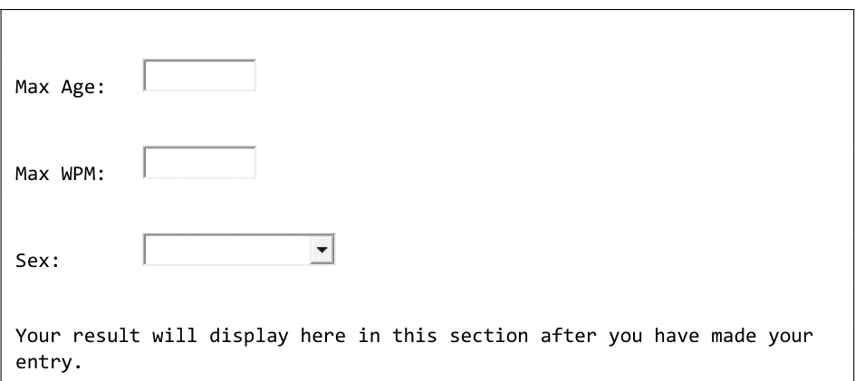

# AJAX：异步 JavaScript 和 XML

## 关于本教程

AJAX 是一种用于创建交互式 Web 应用程序的 Web 开发技术。如果你了解 JavaScript、HTML、CSS 和 XML，那么你只需要花一个小时就能上手 AJAX。

## 受众

本教程对希望学习如何创建交互式网页，以及希望使用 AJAX 提高网页速度和可用性的 Web 开发者有所帮助。

## 先决条件

强烈建议你在学习本教程之前熟悉 HTML 和 JavaScript。

## 1. 概述

AJAX 代表**异步 JavaScript 和 XML**。AJAX 是一种借助 XML、HTML、CSS 和 JavaScript 创建更好、更快、更具交互性的 Web 应用程序的新技术。

- AJAX 使用 XHTML 作为内容，CSS 作为展示样式，同时使用文档对象模型和 JavaScript 进行动态内容显示。
- 传统的 Web 应用程序使用同步请求与服务器之间传输信息。这意味着你填写表单，点击提交，然后被定向到一个包含服务器新信息的新页面。
- 使用 AJAX 时，当你点击提交，JavaScript 会向服务器发出请求，解释结果，并更新当前屏幕。从最纯粹的意义上说，用户永远不会知道有任何信息被传输到了服务器。
- XML 通常用作接收服务器数据的格式，尽管可以使用任何格式，包括纯文本。
- AJAX 是一种独立于 Web 服务器软件的 Web 浏览器技术。
- 客户端程序在后台向服务器请求信息时，用户可以继续使用应用程序。
- 直观自然的用户交互。不需要点击，鼠标移动就足以触发事件。
- 数据驱动而非页面驱动。
- 在后台使用浏览器的 XMLHttpRequest 对象获取数据。
- JavaScript 使一切得以实现。

### 富互联网应用技术

AJAX 是目前最可行的富互联网应用（RIA）技术。它正获得巨大的行业动力，多个工具包和框架正在涌现。但与此同时，AJAX 存在浏览器不兼容问题，并且它由 JavaScript 支持，而 JavaScript 难以维护和调试。

### AJAX 基于开放标准

AJAX 基于以下开放标准：

- 使用 HTML 和层叠样式表（CSS）进行基于浏览器的展示。
- 数据以 XML 格式存储并从服务器获取。

## 2. AJAX 中使用的技术

AJAX 无法独立工作。它与其他技术结合使用以创建交互式网页。

### JavaScript

- 松散类型的脚本语言。
- 当页面中发生事件时，会调用 JavaScript 函数。
- 整个 AJAX 操作的粘合剂。

### DOM

- 用于访问和操作结构化文档的 API。
- 表示 XML 和 HTML 文档的结构。

### CSS

- 允许将展示样式与内容清晰分离，并且可以通过 JavaScript 以编程方式更改。

### XMLHttpRequest

- 执行与服务器异步交互的 JavaScript 对象。

## 3. 示例

以下是一些使用 AJAX 的著名 Web 应用程序列表。

### Google 地图

用户可以使用鼠标拖动整个地图，而不是点击按钮。

- http://maps.google.com/

### Google 建议

当你输入时，Google 会提供建议。使用箭头键浏览结果。

- http://www.google.com/webhp?complete=1&hl=en

### Gmail

Gmail 是一款基于电子邮件可以更直观、更高效、更有用这一理念构建的网络邮件。

- http://gmail.com/

### Yahoo 地图（新版）

现在前往目的地变得更容易、更有趣了！

- http://maps.yahoo.com/

### AJAX 与传统 CGI 程序的区别

依次尝试这两个示例，你会感受到差异。在尝试 AJAX 示例时，没有中断，你会很快得到响应，但当你尝试标准 CGI 示例时，你必须等待响应，而且你的页面也会刷新。

#### AJAX 示例

#### 标准示例


**注意：** 我们在 [AJAX 数据库](https://www.tutorialspoint.com/ajax/ajax_database.htm) 中提供了一个更复杂的示例。


## 4. 浏览器支持

并非所有可用浏览器都支持 AJAX。以下是支持 AJAX 的主要浏览器列表：

- Mozilla Firefox 1.0 及更高版本。
- Netscape 7.1 及更高版本。
- Apple Safari 1.2 及更高版本。
- Microsoft Internet Explorer 5 及更高版本。
- Konqueror。
- Opera 7.6 及更高版本。

在编写下一个应用程序时，请务必考虑那些不支持 AJAX 的浏览器。

> **注意**：当我们说浏览器不支持 AJAX 时，这仅仅意味着该浏览器不支持创建 JavaScript 对象——XMLHttpRequest 对象。

### 编写浏览器特定代码

使你的源代码与浏览器兼容的最简单方法是在 JavaScript 中使用 `try...catch` 块。

```html
<html>
<body>
<script language="javascript" type="text/javascript">
<!--
//Browser Support Code
function ajaxFunction(){
var ajaxRequest; // The variable that makes Ajax possible!

try{
// Opera 8.0+, Firefox, Safari
ajaxRequest = new XMLHttpRequest();
}catch (e){
// Internet Explorer Browsers
try{
    ajaxRequest = new ActiveXObject("Msxml2.XMLHTTP");
}catch (e) {
    try{
        ajaxRequest = new ActiveXObject("Microsoft.XMLHTTP");
    }catch (e){
        // Something went wrong
        alert("Your browser broke!");
        return false;
    }
}

// -->
</script>
<form name='myForm'>
Name: <input type='text' name='username' /> <br />
Time: <input type='text' name='time' />
</form>
</body>
</html>
```

在上面的 JavaScript 代码中，我们尝试了三次来创建 XMLHttpRequest 对象。我们的第一次尝试：

- `ajaxRequest = new XMLHttpRequest();`

这是针对 Opera 8.0+、Firefox 和 Safari 浏览器的。如果失败，我们再尝试两次，为 Internet Explorer 浏览器创建正确的对象：

- `ajaxRequest = new ActiveXObject("Msxml2.XMLHTTP");`
- `ajaxRequest = new ActiveXObject("Microsoft.XMLHTTP");`

如果仍然不行，那么我们使用的是一个非常过时的浏览器，它不支持 XMLHttpRequest，这也意味着它不支持 AJAX。

不过，很可能我们的变量 `ajaxRequest` 现在会被设置为浏览器所使用的任何 `XMLHttpRequest` 标准，我们就可以开始向服务器发送数据了。AJAX 的分步工作流程将在下一章中解释。

## 5. AJAX 实战

本章将清晰地展示 AJAX 操作的精确步骤。

### AJAX 操作步骤

1. 发生一个客户端事件。
2. 创建一个 XMLHttpRequest 对象。
3. 配置 XMLHttpRequest 对象。
4. XMLHttpRequest 对象向 Web 服务器发出异步请求。
5. Web 服务器返回包含 XML 文档的结果。
6. XMLHttpRequest 对象调用回调函数 `callback()` 并处理结果。
7. 更新 HTML DOM。

让我们逐步来了解这些步骤。

### 发生客户端事件

- 由于某个事件而调用一个 JavaScript 函数。
- 示例：`validateUserId()` JavaScript 函数被映射为一个事件处理程序，响应一个 `id` 设置为 `"userid"` 的输入表单字段上的 `onkeyup` 事件。
- `<input type="text" size="20" id="userid" name="id" onkeyup="validateUserId();">`

### 创建 XMLHttpRequest 对象

```javascript
var ajaxRequest;  // The variable that makes Ajax possible!
function ajaxFunction(){
    try{
        // Opera 8.0+, Firefox, Safari
        ajaxRequest = new XMLHttpRequest();
    }catch (e){
        // Internet Explorer Browsers
try{
    ajaxRequest = new ActiveXObject("Msxml2.XMLHTTP");
}catch (e) {
    try{
        ajaxRequest = new ActiveXObject("Microsoft.XMLHTTP");
    }catch (e){
        // Something went wrong
        alert("Your browser broke!");
        return false;
    }
}
}
```

### 配置 XMLHttpRequest 对象

在这一步中，我们将编写一个函数，该函数将由客户端事件触发，并注册一个回调函数 `processRequest()`。

```javascript
function validateUserId() {
    ajaxFunction();
    // Here processRequest() is the callback function.
    ajaxRequest.onreadystatechange = processRequest;
    if (!target) target = document.getElementById("userid");
    var url = "validate?id=" + escape(target.value);
    ajaxRequest.open("GET", url, true);
    ajaxRequest.send(null);
}
```

### 向 Web 服务器发出异步请求

源代码在上面的代码片段中可用。以粗体书写的代码负责向 Web 服务器发出请求。所有这些操作都是通过 XMLHttpRequest 对象 `ajaxRequest` 完成的。


```javascript
function validateUserId() {
    ajaxFunction();
    // Here processRequest() is the callback function.
    ajaxRequest.onreadystatechange = processRequest;

    if (!target) target = document.getElementById("userid");
    var url = "validate?id=" + escape(target.value);
    ajaxRequest.open("GET", url, true);
    ajaxRequest.send(null);
}
```

假设你在 userid 框中输入了 `Zara`，那么在上面的请求中，URL 被设置为 `"validate?id=Zara"`。

### Web 服务器返回包含 XML 文档的结果

你可以用任何语言实现服务器端脚本，但其逻辑应如下：

- 从客户端获取请求。
- 解析来自客户端的输入。
- 执行必要的处理。
- 将输出发送给客户端。

如果我们假设你打算编写一个 servlet，那么这是相应的代码片段：

```java
public void doGet(HttpServletRequest request, HttpServletResponse response)
    throws IOException, ServletException
{
    String targetId = request.getParameter("id");

    if ((targetId != null) && !accounts.containsKey(targetId.trim()))
    {
        response.setContentType("text/xml");
        response.setHeader("Cache-Control", "no-cache");
        response.getWriter().write("true");
    }
else
{
    response.setContentType("text/xml");
    response.setHeader("Cache-Control", "no-cache");
    response.getWriter().write("false");
}
}
```

### 调用回调函数 `processRequest()`

XMLHttpRequest 对象被配置为在 XMLHttpRequest 对象的 `readyState` 发生状态变化时调用 `processRequest()` 函数。现在这个函数将接收服务器的结果，并进行所需的处理。如下例所示，它根据 Web 服务器返回的值将变量 `message` 设置为 true 或 false。

```javascript
function processRequest() {
  if (req.readyState == 4) {
    if (req.status == 200) {
      var message = ...;

... 
}
```

### 更新 HTML DOM

这是最后一步，在这一步中，你的 HTML 页面将被更新。它按以下方式发生：

- JavaScript 使用 DOM API 获取对页面中任何元素的引用。
- 获取元素引用的推荐方式是调用。
- 现在可以使用 JavaScript 来修改元素的属性；修改元素的样式属性；或者添加、删除或修改子元素。以下是示例：

```javascript
document.getElementById("userIdMessage"),

// where "userIdMessage" is the ID attribute

// of an element appearing in the HTML document
```

```html
<script type="text/javascript">
<!--
function setMessageUsingDOM(message) {
  var userMessageElement =
      document.getElementById("userIdMessage");
  var messageText;
  if (message == "false") {
    userMessageElement.style.color = "red";
    messageText = "Invalid User Id";
  } else {
    userMessageElement.style.color = "green";
    messageText = "Valid User Id";
  }
  var messageBody = document.createTextNode(messageText);


  // if the messageBody element has been created simple
  // replace it otherwise append the new element


  if (userMessageElement.childNodes[0]) {
    userMessageElement.replaceChild(messageBody,
    userMessageElement.childNodes[0]);
  } else {
    userMessageElement.appendChild(messageBody);
  }
}
-->
</script>
<body>
<div id="userIdMessage"><div>
</body>
```

如果你理解了上面提到的七个步骤，那么你就几乎掌握了 AJAX。在下一章中，我们将详细讨论 `XMLHttpRequest` 对象。

## 6. XMLHttpRequest

XMLHttpRequest 对象是 AJAX 的关键。它自 2000 年 7 月 Internet Explorer 5.5 发布以来就已存在，但直到 2005 年 AJAX 和 Web 2.0 普及后才被充分发现和利用。


`XMLHttpRequest (XHR)` 是一个 API，可被 `JavaScript`、`JScript`、`VBScript` 等网页浏览器脚本语言使用，通过 HTTP 传输和操作与 Web 服务器之间的 XML 数据，从而在网页的客户端和服务器端之间建立独立的通信通道。

`XMLHttpRequest` 调用返回的数据通常由后端数据库提供。除了 XML，`XMLHttpRequest` 还可用于获取其他格式的数据，例如 JSON 甚至是纯文本。

你已经见过几个如何创建 `XMLHttpRequest` 对象的例子了。

以下列出了一些你需要熟悉的方法和属性。

### XMLHttpRequest 方法

- `abort()`

  取消当前请求。

- `getAllResponseHeaders()`

  以字符串形式返回完整的 HTTP 头信息集合。

- `getResponseHeader(headerName)`

  返回指定 HTTP 头的值。

- `open(method, URL)`

- `open(method, URL, async)`

- `open(method, URL, async, userName)`

- `open(method, URL, async, userName, password)`

  指定请求的方法、URL 以及其他可选属性。

`method` 参数的值可以是 `"GET"`、`"POST"` 或 `"HEAD"`。其他 HTTP 方法如 `"PUT"` 和 `"DELETE"`（主要用于 REST 应用）也可能是有效的。

`async` 参数指定请求是否应异步处理。`"true"` 表示脚本处理在调用 `send()` 方法后继续执行，无需等待响应；`"false"` 表示脚本会等待收到响应后才继续执行后续处理。

- `send(content)`

  发送请求。

- `setRequestHeader(label, value)`

  向要发送的 HTTP 头添加一个标签/值对。

### XMLHttpRequest 属性

- `onreadystatechange`

  在每次状态变化时触发的事件处理程序。

- `readyState`

  `readyState` 属性定义了 `XMLHttpRequest` 对象的当前状态。

下表列出了 `readyState` 属性可能的值：

| 状态 | 描述 |
| :---: | :--- |
| 0 | 请求尚未初始化。 |
| 1 | 请求已建立。 |
| 2 | 请求已发送。 |
| 3 | 请求正在处理中。 |
| 4 | 请求已完成。 |

`readyState = 0`：在你创建了 `XMLHttpRequest` 对象之后，但在调用 `open()` 方法之前。

`readyState = 1`：在你调用了 `open()` 方法之后，但在调用 `send()` 之前。

`readyState = 2`：在你调用了 `send()` 之后。

`readyState = 3`：在浏览器与服务器建立连接之后，但在服务器完成响应之前。

`readyState = 4`：在请求完成，并且从服务器完全接收到响应数据之后。

- `responseText`

  以字符串形式返回响应。

- `responseXML`

  以 XML 形式返回响应。此属性返回一个 XML 文档对象，可以使用 W3C DOM 节点树方法和属性进行检查和解析。

- `status`

  以数字形式返回状态（例如，404 表示 `"Not Found"`，200 表示 `"OK"`）。

- `statusText`

  以字符串形式返回状态（例如 `"Not Found"` 或 `"OK"`）。

## 7. 数据库操作

为了清晰地展示使用 AJAX 从数据库中获取信息是多么容易，我们将动态构建 MySQL 查询，并在 `"ajax.html"` 上显示结果。但在我们开始之前，让我们先做些基础工作。使用以下命令创建一个表。

**注意**：我们假设你有足够的权限执行以下 MySQL 操作。

```sql
CREATE TABLE 'ajax_example' (
  'name' varchar(50) NOT NULL,
  'age' int(11) NOT NULL,
  'sex' varchar(1) NOT NULL,
  'wpm' int(11) NOT NULL,
  PRIMARY KEY  ('name')
)
```

现在，使用以下 SQL 语句将数据导入此表：

```sql
INSERT INTO 'ajax_example' VALUES ('Jerry', 120, 'm', 20);
INSERT INTO 'ajax_example' VALUES ('Regis', 75, 'm', 44);
INSERT INTO 'ajax_example' VALUES ('Frank', 45, 'm', 87);
INSERT INTO 'ajax_example' VALUES ('Jill', 22, 'f', 72);
INSERT INTO 'ajax_example' VALUES ('Tracy', 27, 'f', 0);
INSERT INTO 'ajax_example' VALUES ('Julie', 35, 'f', 90);
```

### 客户端 HTML 文件

现在，让我们来编写客户端的 HTML 文件，即 `ajax.html`，它将包含以下代码：

```html
<html>
<body>
<script language="javascript" type="text/javascript">
<!--
//浏览器支持代码
function ajaxFunction(){
  var ajaxRequest;  // 使得 Ajax 成为可能的变量！

try{
  // Opera 8.0+, Firefox, Safari
  ajaxRequest = new XMLHttpRequest();
}catch (e){
  // Internet Explorer 浏览器
  try{
    ajaxRequest = new ActiveXObject("Msxml2.XMLHTTP");
  }catch (e) {
    try{
      ajaxRequest = new ActiveXObject("Microsoft.XMLHTTP");
    }catch (e){
      // 出错了
      alert("您的浏览器出故障了！");
      return false;
    }
  }
}
// 创建一个函数，用于接收从服务器发送的数据
// 并更新同一页面中的 div 部分。
ajaxRequest.onreadystatechange = function(){
  if(ajaxRequest.readyState == 4){
    var ajaxDisplay = document.getElementById('ajaxDiv');
    ajaxDisplay.innerHTML = ajaxRequest.responseText;
  }
}
// 现在从用户那里获取值并传递给服务器脚本。
var age = document.getElementById('age').value;
var wpm = document.getElementById('wpm').value;
var sex = document.getElementById('sex').value;
var queryString = "?age=" + age ;
queryString += "&wpm=" + wpm + "&sex=" + sex;
ajaxRequest.open("GET", "ajax-example.php" + queryString, true);
ajaxRequest.send(null);
}
//--> 
</script>
<form name='myForm'>
Max Age: <input type='text' id='age' /> <br />
Max WPM: <input type='text' id='wpm' />
<br />
Sex: <select id='sex'>
<option value="m">m</option>
<option value="f">f</option>
</select>
<input type='button' onclick='ajaxFunction()' value='Query MySQL'/>
</form>
<div id='ajaxDiv'>Your result will display here</div>
</body>
</html>
```

**注意：** 在查询字符串中传递变量的方式遵循 HTTP 标准，形式如下。

`URL?variable1=value1;&variable2=value2;`

上述代码将为你生成如下所示的屏幕：



**注意：** 这是一个示例屏幕。

### 服务器端 PHP 文件

你的客户端脚本已准备就绪。现在，我们必须编写服务器端脚本，该脚本将从数据库中获取 `age`、`wpm` 和 `sex`，并将其发送回客户端。将以下代码放入文件 `"ajax-example.php"`。

```php
<?php
$dbhost = "localhost";
$dbuser = "dbusername";
$dbpass = "dbpassword";
$dbname = "dbname";

//连接到 MySQL 服务器
mysql_connect($dbhost, $dbuser, $dbpass);

//选择数据库
mysql_select_db($dbname) or die(mysql_error());

// 从查询字符串中检索数据
$age = $_GET['age'];
$sex = $_GET['sex'];
$wpm = $_GET['wpm'];

// 转义用户输入以帮助防止 SQL 注入
$age = mysql_real_escape_string($age);
$sex = mysql_real_escape_string($sex);
$wpm = mysql_real_escape_string($wpm);

//构建查询
$query = "SELECT * FROM ajax_example WHERE sex = '$sex'";
if(is_numeric($age))
    $query .= " AND age <= $age";
if(is_numeric($wpm))
    $query .= " AND wpm <= $wpm";

//执行查询
 qry_result = mysql_query($query) or die(mysql_error());

//构建结果字符串
$display_string = "<table>";
$display_string .= "<tr>";
$display_string .= "<th>Name</th>";
$display_string .= "<th>Age</th>";
$display_string .= "<th>Sex</th>";
$display_string .= "<th>WPM</th>";
$display_string .= "</tr>";

// 为返回的每个人在表格中插入一个新行
while($row = mysql_fetch_array($qry_result)){
    $display_string .= "<tr>";
    $display_string .= "<td>$row[name]</td>";
    $display_string .= "<td>$row[age]</td>";
    $display_string .= "<td>$row[sex]</td>";
    $display_string .= "<td>$row[wpm]</td>";
    $display_string .= "</tr>";
}

echo "Query: " . $query . "<br />";
$display_string .= "</table>";
echo $display_string;
?>
```

现在试着在*最大年龄*或任何其他输入框中输入一个有效值（例如，120），然后点击“查询 MySQL”按钮。

如果你成功完成了这一课程，那么你就知道如何协同使用 MySQL、PHP、HTML 和 Javascript 来编写 AJAX 应用程序了。

## 8. 安全性

### AJAX 安全性：服务器端

- 基于 AJAX 的 Web 应用程序使用与常规 Web 应用程序相同的服务器端安全方案。
- 你可以在 `web.xml` 文件中（声明式）或在程序中（编程式）指定身份验证、授权和数据保护要求。
- 基于 AJAX 的 Web 应用程序面临与常规 Web 应用程序相同的安全威胁。

### AJAX 安全性：客户端

- JavaScript 代码对用户/黑客是可见的。黑客可以利用 JavaScript 代码推断服务器端的弱点。
- JavaScript 代码从服务器下载并在客户端执行（`"eval"`），恶意代码可能会危害客户端。
- 下载的 JavaScript 代码受到沙箱安全模型的限制，对于已签名的 JavaScript 可以放宽限制。

## 9. 当前问题

AJAX 发展非常迅速，这就是它存在许多问题的原因。我们希望随着时间的推移，这些问题将得到解决，AJAX 将成为 Web 应用程序的理想选择。下面我们列出 AJAX 目前存在的一些问题。

### 复杂性增加

- 服务器端开发人员需要了解，表示逻辑将同时需要 HTML 客户端页面和服务器端逻辑中。
- 页面开发人员必须具备 JavaScript 技术技能。

### 基于 AJAX 的应用程序难以调试、测试和维护

- JavaScript 难以测试——自动化测试很困难。
- JavaScript 的模块化较弱。
- 尚缺乏设计模式或最佳实践指导。

### 工具包/框架尚不成熟

- 它们大多数仍处于测试阶段。

### XMLHttpRequest 尚未标准化

- IE 的未来版本将解决此问题。

### 旧版浏览器不支持 XMLHttpRequest

- Iframe 可以提供帮助。

### JavaScript 技术依赖性和不兼容性

- 必须启用 JavaScript 应用程序才能正常运行。
- 仍存在一些浏览器不兼容问题。

### JavaScript 代码对黑客可见

- 设计不佳的 JavaScript 代码可能会带来安全问题。
