# Ajax 圣经

**构建交互式 Web 应用程序；创建实时搜索和在线电子表格；发现应避免的编程错误；配套网站包含书中所有代码**

- 使用 Ajax 构建交互式 Web 应用程序
- 创建实时搜索和在线电子表格
- 发现并避免编程错误！

助你成功的必备之书！

## 关于作者

`Steven Holzner` 是一位屡获殊荣的计算机图书作者，著有 102 本书。他撰写了多本畅销书，其中包括一些广受好评的 Ajax 相关书籍，例如《Ajax 入门经典》和《Ajax 可视化蓝图》。他还是《PC 杂志》的前特约编辑，并曾在麻省理工学院和康奈尔大学任教。他的书已售出数百万册，被翻译成全球 20 多种语言。

谨以此书献给南希。

## 致谢

### 产品开发主管

Courtney Allen

### 项目协调员

Patrick Redmond

### 项目编辑

Katharine Dvorak

### 图形与制作专家

Carrie A. Foster  
Jennifer Mayberry  
Barbara Moore  
Amanda Spagnuolo

### 技术编辑

Steve Wright

### 质量控制技术员

Laura Albert  
Christine Pingleton

### 文案编辑

Scott Tullis

### 校对与索引

Linda Seifert  
Broccoli Information Management

### 编辑经理

Robyn Siesky

### 业务经理

Amy Knies

### 副总裁兼执行集团出版商

Richard Swadley

### 副总裁兼执行出版商

Bob Ipsen

### 副总裁兼出版商

Barry Pruett

本书的核心内容在于如何让您的 Web 应用程序拥有桌面应用程序般的外观和体验，这正是 Ajax 的全部理念。如今，Web 应用程序正变得越来越流行，但“提交”按钮的问题依然存在：当您点击它时，整个页面会闪烁并刷新，您必须等待页面重新下载完毕。

这正是 Ajax 大显身手的地方。借助 Ajax，您可以与浏览器进行后台通信，获取所需数据，并将其显示在网页上。无需页面刷新，无需等待，浏览器中也不会再有闪烁现象。

这非常酷，因为这意味着您的 Web 应用程序开始拥有桌面应用程序般的外观和体验。随着用户网络连接速度的不断提升，用不了多久，Web 应用程序和桌面应用程序之间几乎将无法区分。

Ajax 是 Web 编程的未来。借助 Ajax，浏览器中的应用程序可以像安装在用户计算机上的应用程序一样工作。Ajax 成为多年来最热门的 Web 编程话题也就不足为奇了。

## 关于本书

本书涵盖了 Ajax 的方方面面。第一部分从引导您了解 Ajax 当前应用方式开始。在此过程中，您将看到一些非常酷的应用程序，甚至还有一些游戏。

Ajax 基于 JavaScript，本部分包含一个关于 JavaScript 操作的章节。如果您不了解 JavaScript，您需要学习它，而您可以在这里完成学习。如果您已经了解 JavaScript，您可以跳过本书的这一部分，直接进入更高级的主题，例如 Ajax 与 PHP 的协同工作以及安全问题。

第二部分则深入 Ajax 编程，向您展示如何从零开始创建支持 Ajax 的应用程序。这里包含几章关于 Ajax 基础知识的内容，以及一些关于更高级、更强大方面的内容。您还将了解如何通过使用 Ajax 框架来避免几乎所有编程工作。这些框架大多免费提供，它们能为您执行 Ajax 编程，让您轻松快速地创建完整的 Ajax 应用程序。

然而，Ajax 远不止 JavaScript 那么简单。第三部分全面介绍了 XML、层叠样式表和服务器端编程的使用，包括针对这些主题各设一章。

## 前言

第四部分包含关于安全性的章节，以及其他高级主题的章节，例如在 Ajax 中使用 Web 服务器过滤器。

所有这些以及更多内容都将在本书中呈现。换句话说，您将在本书中获得关于 Ajax 的完整故事，从头到尾，一应俱全。Ajax 将成为您的一套丰富的工具集，随时准备投入工作。

## 本书约定

有些书有许多约定，您甚至需要在开始阅读前了解它们。但本书并非如此。您需要知道的是，当引入新的代码行时，它们会以粗体显示，如下所示：

```javascript
function getDataReturnText(url, callback)
{
    var XMLHttpRequestObject = false;

    if (window.XMLHttpRequest) {
        XMLHttpRequestObject = new XMLHttpRequest();
    } else if (window.ActiveXObject) {
        XMLHttpRequestObject = new
            ActiveXObject("Microsoft.XMLHTTP");
    }

        .

        .

        .
}
```

请注意，被省略的代码已用三个垂直点表示。

您可以在 `www.wiley.com/go/ajaxbible` 下载本书中使用的代码。

## 准备工作

要充分利用本书，您需要了解一些基本的 HTML——不需要太多，只需足以编写一个像样的网页。如果您需要学习 HTML，请查看互联网上众多优秀的教程之一。本书中使用的 HTML 并不十分高级，即使您不熟悉，您很可能仅通过阅读本书就能掌握。

您还需要了解 JavaScript。这不是问题，因为本书将专门介绍您需要了解的所有 JavaScript 知识。不过，如果您觉得需要更多，请查看在线 JavaScript 教程，或参阅《JavaScript 圣经》。

## 前言

由于 Ajax 涉及与服务器通信，本书也将涉及一些 PHP。如果您不熟悉 PHP，这也不是问题，因为本书包含几章内容帮助您快速掌握 PHP。

您还需要一个浏览器，例如 Microsoft Internet Explorer 或 Mozilla Firefox，来使用本书。然而，由于浏览器已变得如此普遍，您在计算机上几乎无法做任何事而不遇到一个浏览器，所以这应该不成问题——只需使用您习惯的浏览器即可。

就是这样！您已准备好出发了。翻到第 1 章，看看 Ajax 的实际应用。

您手中的这本书是许多人辛勤工作的成果。我特别要感谢责任编辑 Courtney Allen、项目编辑 Katharine Dvorak、技术编辑 Steve Wright、文字编辑 Scott Tullis 以及项目协调员 Patrick Redmond。

# 第一部分：Ajax 基础

## 本部分内容

| 章节 | 标题 |
| :--- | :--- |
| 第 1 章 | **Ajax 精要** |
| 第 2 章 | **认识您的 JavaScript** |
| 第 3 章 | **创建 Ajax 应用程序** |
| 第 4 章 | **严肃的 Ajax 编程** |

# 第 1 章：Ajax 精要

欢迎来到《Ajax 圣经》！这里是所有 Ajax 事物的家园。Ajax 是席卷互联网、点燃各地网站的新技术。Ajax 革命已经到来，它正在改变互联网。事实上，Ajax 是所谓的 Web 2.0 的基础，也就是万维网的下一个版本。

那么，它到底是关于什么的？核心理念是让 Web 应用程序看起来和感觉起来就像桌面应用程序。例如，看看图 1.1，您看到了熟悉的 Google 搜索页面。输入一个搜索词，比如“Ajax”，然后点击 Google 搜索按钮。

## 本章内容

- 介绍 Ajax
- 观看 Ajax 实际应用
- 进行 Ajax 实时搜索
- 使用 Ajax 聊天
- 实现自动完成
- 使用 Ajax 进行拖放
- 使用支持 Ajax 的购物车

## 图 1.1

Google 搜索与您输入的词匹配的内容。

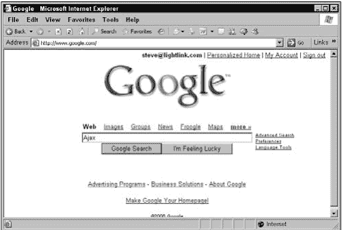

屏幕闪烁着更新新数据，Google 找到的与您搜索词匹配的结果出现，如图 1.2 所示。

## 图 1.2

Google 显示其找到的匹配结果。

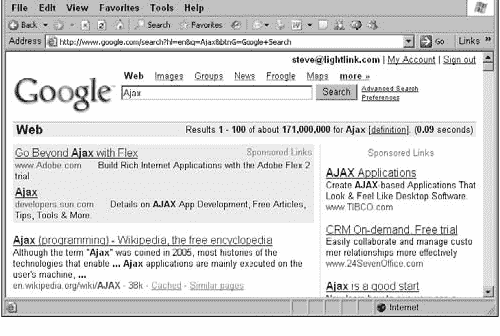

这工作得还可以，但这不是 Ajax 的行事方式。使用 Ajax，您可以在幕后操作，连接服务器获取数据，而不会导致浏览器页面刷新。例如，看看 Google Suggest 页面，网址为 `www.google.com/webhp?complete=1&hl=en`，如图 1.3 所示。

## Google Suggest 页面

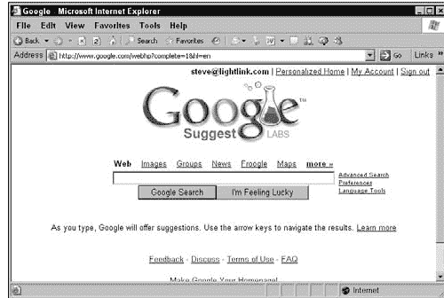

当您输入时，浏览器中的页面实际上会连接到 Google 服务器，并查找与您输入的部分搜索词匹配的内容。例如，输入“aj”，您会看到一个下拉列表框出现，如图 1.4 所示，其中显示了您在输入时 Google 找到的匹配项。

## Google Suggest 在您输入时查找匹配项

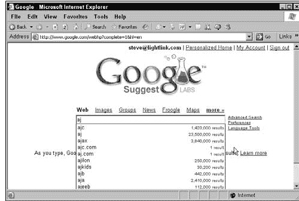

在幕后，使用 Ajax 技术，网页会连接到 Google Suggest，并在您输入时搜索与您搜索词匹配的内容。然后它会显示一个包含匹配项的下拉列表框，让您从这些匹配项中进行选择——所有这些都无需页面刷新。这是关键点：不需要页面刷新。在过去，当您想向服务器发送数据时，必须点击一个按钮，比如 Google 搜索按钮。然后您必须等待屏幕闪烁并刷新。现在，网页可以在完全不引起页面刷新的情况下向服务器发送数据，正如您在这个例子中看到的，您的搜索词自动发送到了服务器，服务器又发回数据以在下拉列表中显示。

您不再需要在向服务器发送数据或从服务器接收数据时执行页面刷新。相反，网页现在可以表现得更像桌面应用程序，在幕后向服务器发送数据并接收数据。

这种 Web 应用程序的转换，使其感觉更像桌面应用程序，就是 Web 2.0 的含义。想象一下，如果您每次输入一个新字符时，文字处理器都会闪烁，并且整个文档会重新显示，光标会重置到文档开头，您会喜欢这样吗？这可不是一个吸引人的想法。使用 Ajax，您可以创建与桌面版本几乎无法区分的在线文字处理器——没有闪烁，没有抖动，输入时光标位置不会重置。只有流畅的文字处理体验，就像同一应用程序的桌面版本一样。

您可以看出为什么 Ajax 正在引起 Web 应用程序的革命：现在可以创建外观和感觉与其桌面对应应用程序完全一样的在线应用程序。

本章将帮助您入门。您将了解术语 Ajax 含义的概述，然后了解 Ajax 当前的应用方式。这个概述是本书非常重要的一部分，因为 Ajax 正越来越多地出现在各种地方——有时出乎意料——如果您熟悉 Ajax 的用途，您就会知道可以在自己的 Web 应用程序中使用它的地方。

## “Ajax”是什么意思？

那么，术语“Ajax”究竟从何而来呢？看看图 1.5，它展示了关于 Ajax 非常重要的第一篇文章，这篇创造了术语并开启一切的文章。您可以在 `www.adaptivepath.com/publications/essays/archives/000385.php` 找到这篇文章。这篇文章来自 Adaptive Path 的 Jesse James Garrett，他是第一个称这项技术为 Ajax 的人。

这篇文章的开头是这样的：

> “如果说当前的交互设计中有什么可以被称为‘魅力四射’的，那就是创建 Web 应用程序。毕竟，上次您听到有人对不在网上的产品的交互设计赞不绝口是什么时候？（好吧，除了 iPod。）所有酷炫、创新的新项目都是在线的。
>
> “尽管如此，Web 交互设计师不禁对我们这些创建桌面软件的同事感到一丝羡慕。桌面应用程序具有丰富性和响应性，这在 Web 上似乎遥不可及。正是使 Web 得以迅速普及的简单性，在我们能提供的体验和用户可以从桌面应用程序获得的体验之间制造了鸿沟。
>
> “这道鸿沟正在缩小。”

## 图 1.5

原始 Ajax 文章

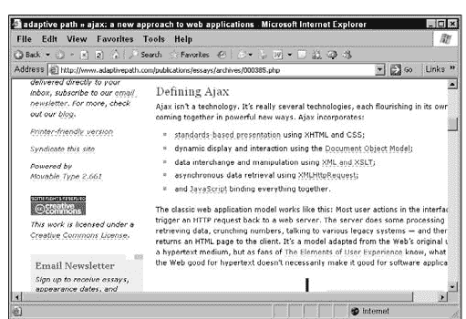

得益于 Ajax，这个鸿沟确实在弥合。那么，根据这篇文章，“Ajax”实际上代表什么？它代表 *Asynchronous JavaScript and XML*（异步 JavaScript 和 XML）。正如你从它的名字开始了解到的，以及你在 Jesse James Garrett 文章中读到的，Ajax 实际上是多种技术的集合。

“异步”部分意味着浏览器不会等待服务器返回数据，而是可以在数据被送回时处理它，无论它何时被送回。换句话说，数据传输在后台进行，不会让浏览器暂停并等待事情发生。这是 Ajax 的一个关键部分：你可以在服务器发送数据时就处理来自服务器的数据。你不必将整个应用程序挂起，直到数据到达。如果你必须等待数据，你的应用程序将是同步的；在互联网连接缓慢的情况下，这可能会是个问题。

Ajax 术语中的 JavaScript 部分也非常重要，因为正是它在浏览器中实现了 Ajax。Ajax 依赖于浏览器中的 JavaScript 来连接服务器和处理服务器发回的数据。你在本书中将要开发的所有 Ajax 应用程序都使用 JavaScript 在后台连接服务器，上传和下载数据。当你的数据被下载后，你可以使用浏览器中的 JavaScript 来处理这些数据，根据需要进行显示或处理。

那么 Ajax 术语中的 XML 部分呢？正如你可能知道的，XML 已经成为 Web 的通用语言，提供了一种基于文本的方式在互联网上来回发送数据。XML 变得如此流行的原因是它确实是基于文本的，这意味着你可以在互联网上自由传输 XML，因为互联网被设计用来处理基于文本的文档（即 HTML）。因此，Ajax 应用程序通常被编写为处理使用 XML 从服务器发回的数据。换句话说，当你联系服务器时，它会以 XML 文档的形式将数据发送回给你。

## 第一部分：Ajax 基础

事实上，XML 只是处理从服务器发送给你的数据的方式之一。你也可以发送纯文本，你将在本书中广泛看到这两种技术。

除了 JavaScript 和 XML，Ajax 还与动态 HTML 和层叠样式表（CSS）一起工作。这两种技术都允许你更新网页中显示的数据，而且，由于你使用 Ajax 时不会重绘整个网页，而只是其中的一部分，所以你很大程度上依赖于动态 HTML 和 CSS；它们都允许你更新网页的特定部分。你将在本书中看到更多关于动态 HTML 和 CSS 的内容，因为它们允许你仅刷新网页的一部分，这是 Ajax 支持的应用程序的核心。

使 Ajax 成为可能的 JavaScript 部分是 `XMLHttpRequest` 对象。这是所有现代浏览器 JavaScript 版本中内置的一个特殊对象。正如你将看到的，这使得在后台连接服务器和处理从服务器发回的数据成为可能。使 Ajax 运作的不仅仅是 JavaScript，而是 JavaScript 内部的 `XMLHttpRequest` 对象。

所以，总结一下；Ajax 是多种技术的集合，而不仅仅是一项单一技术。你使用 JavaScript 中内置的 `XMLHttpRequest` 对象连接服务器，然后使用 JavaScript 处理服务器发回的 XML——或纯文本。并且你使用动态 HTML 和 CSS 在浏览器中显示结果。幸运的是，Ajax 应用程序的所有部分都如它们这样汇集在一起——JavaScript、`XMLHttpRequest` 对象、动态 HTML 和 CSS——因为它们共同使你的在线应用程序看起来像桌面应用程序成为可能。

实际上，Ajax 技术自 1998 年以来就已经存在，并且已经被许多应用程序使用，例如 Microsoft 的 Outlook Web Access。但直到 2005 年初，一些高知名度的应用程序如 Google Suggest 开始使用它，并且 Jesse James Garrett 撰写了他那篇提出“Ajax”一词的文章，将所有内容统一到一个概念下，它才真正流行起来。

从那时起，事情就爆发了，因为开发者们意识到 Web 软件终于可以开始像桌面软件一样运行和行为了。那么你能用 Ajax 做什么呢？本章的其余部分将讨论这个问题。

# 你能用 Ajax 做什么？

用 Ajax 你可以做很多事情，接下来的几页将详细介绍这个宝库。接下来是对当今 Ajax 使用方式的一个很好的概述。

## 创建 Ajax 实时搜索

Ajax 最流行的用途之一是创建 *实时搜索*，你已经在本章开头的 Google Suggest 示例中看到了。通过实时搜索，用户可以输入部分搜索词，使用 Ajax，Web 应用程序连接服务器并查找与该部分搜索词匹配的结果。

除了 Google Suggest，网上还有很多其他实时搜索。例如，看看 `http://gollum.easycp.de/en/` 上的 Gollum，它是对在线免费百科全书 `www.wikipedia.org` 的维基百科进行实时搜索的工具。图 1.6 显示了 Gollum。

### 图 1.6

Gollum 对维基百科进行实时搜索。

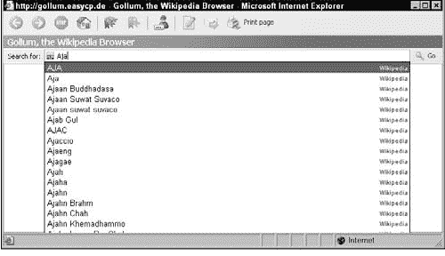

在 Gollum 中输入部分搜索词，例如代表 Ajax 的“Aja”，你可以在图 1.6 中看到结果，Gollum 已在后台连接到维基百科并找到了与你部分搜索词匹配的结果。这些匹配项通常在实时搜索中显示在一个下拉列表中，你可以选择你正在寻找的项目。当你这样做时，匹配的维基百科文章就会在你的浏览器中打开。

## 创建支持 Ajax 的计算器

任何需要在后台向服务器发送数据并处理发回数据的情况都非常适合 Ajax。那么一个支持 Ajax 的计算器怎么样？你可以在 `www.funwithjustin.com/ajax-toybox-demo/calculator.html` 找到一个，如图 1.7 所示。

要使用计算器，只需输入两个要操作的数字，例如图 1.7 中的 5 和 7，然后单击你要执行的运算——加法、减法、乘法或除法。使用 Ajax，这个网页将你的操作数发送到服务器上的一个程序，该程序根据需要对你的数字进行加、减、乘或除运算，并将结果发送回。

结果随后出现在底部的文本框中，正如你在图 1.7 中看到的，其中 5 和 7 相加。整个过程无需刷新页面——浏览器没有闪烁。这个应用程序，就像其他 Ajax 应用程序一样，看起来就像一个桌面应用程序。

### 图 1.7

一个支持 Ajax 的计算器

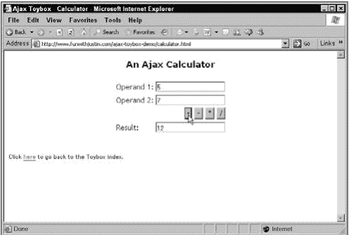

## 使用 Ajax 聊天应用程序交谈


Ajax 在任何需要密集更新的地方都非常出色，例如聊天应用程序，在这里任意数量的用户可以输入他们的文本，并自动显示给当前登录的所有人。Ajax 在这里是一个很好的选择，因为显示的文本总是在更新，如果必须看着整个页面更新时产生的闪烁，那将非常烦人。

然而，使用 Ajax，你可以轻松地更新页面中任何位置的文本，无需页面刷新。例如，看看`www.phpfreechat.net/demo.en.php`，即 PHP Free Chat 页面。该页面连接到服务器上的一个 PHP 脚本，以支持聊天应用程序。当你第一次访问 PHP Free Chat 时，它会要求你输入一个用户名，如图 1.8 所示。

**图 1.8**

登录 PHP Free Chat

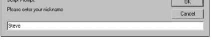

登录后，你可以在图 1.9 底部出现的文本框中输入你的文本；当你按下回车键时，该文本通过 Ajax 发送到服务器，服务器将该文本添加到其他人输入的文本中，结果显示在聊天框中，正如你在图 1.9 中所看到的。

10

## 图 1.9

PHP Free Chat 允许你输入其他人可见的文本。

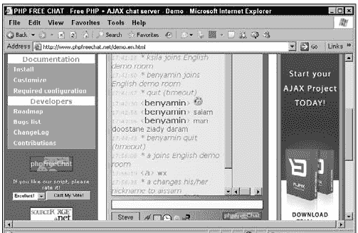

目前有许多 Ajax 聊天应用。例如，请查看`www.plasticshore.com/projects/chat/`，其效果如图 1.10 所示。要使用此聊天应用，你只需输入你的名字（或接受默认名称）和你的文本，然后点击提交按钮。当你这样做时，你的文本就会出现在聊天框中，和其他人的文本一起显示。

## 图 1.10

一个支持 Ajax 的免费聊天应用

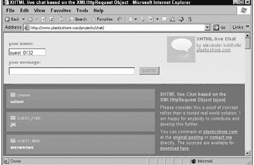

## 第一部分 Ajax 基础

> 注意 还有更多支持 Ajax 的聊天应用。例如，请查看`http://treehouse.ofb.net/chat/?lang=en`以了解另一个优秀的应用。

### 用电子表格处理数据

得益于 Ajax，越来越多的桌面型应用正迁移到 Web 上。最新的应用之一是电子表格，你现在可以在网上许多地方找到它。

例如，请查看 Num Sum，这是一个免费的在线电子表格，其功能与桌面版一样，网址是`http://numsum.com/spreadsheet/new`。你可以在图 1.11 中看到 Num Sum 的工作情况。

### 图 1.11

Num Sum 是一个在线 Ajax 电子表格应用。

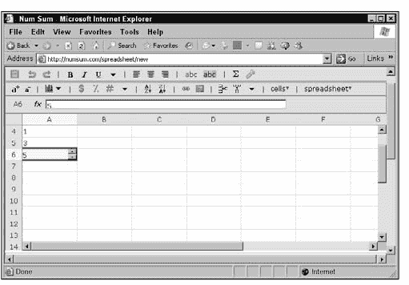

使用 Num Sum，你可以创建真正的电子表格，包括使用公式，并将你的数据保存在 Num Sum 的服务器上。使用此应用与桌面版几乎无法区分，你输入数据并看着它被更新——这一切都无需刷新浏览器。

### 浏览亚马逊

这是一个有趣的应用：一个可以让你浏览 Amazon.com 在售产品的应用。此应用让你使用可点击的树形结构来显示 Amazon.com 的所有内容，该树形结构通过 Ajax 更新。只需访问`http://1map.co.nr/Amazon1.htm`并点击一个节点来展开它，查看亚马逊的产品，如图 1.12 所示。

## 图 1.12

浏览 Amazon.com

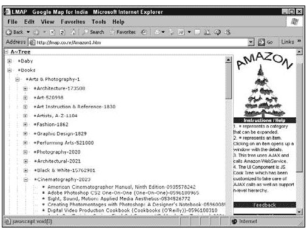

### 使用 Ajax 自动完成获取答案

Ajax 自动完成应用非常类似于实时搜索。使用实时搜索，你可以在文本字段中输入部分术语。然而，使用自动完成，则不涉及搜索；自动完成只是提供补全你正在输入的术语的建议（如果你使用过手机发短信，你可能熟悉这个概念——许多手机在你输入时会提供建议来补全一个词）。

你可以在`www.papermountain.org/demos/live/`看到一个自动完成示例，如图 1.13 所示。

只需如图 1.13 所示在文本字段中输入部分英文单词，应用就会将你的部分单词发送到服务器，服务器找到与该单词匹配的项，并发回自动完成建议。如你在图 1.13 中所见，这些建议会显示出来，你可以从中选择。当你选择时，你选择的术语会替换你已经输入的部分术语。

你可以在 SWATO（一个 Ajax 工具包）的`https://swato.dev.java.net/`找到另一个可供下载的自动完成示例。你可以在图 1.14 中看到此示例的效果。

此示例匹配国家名称，如图 1.14 所示。你所要做的就是输入，例如，“A”，就会显示一组可能的补全项，包括阿尔及利亚、奥地利、澳大利亚等等。

## 图 1.13

使用自动完成

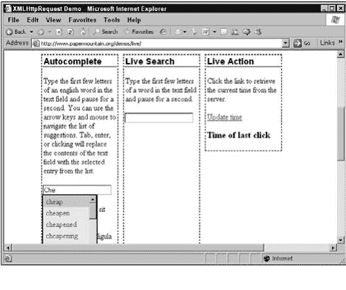

## 图 1.14

使用 SWATO 进行自动完成

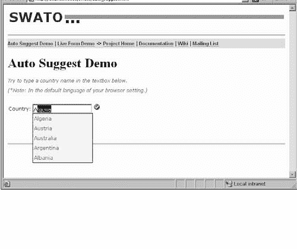

### 使用 Ajax 登录

这是另一个好方法：与其要求用户浏览几个页面来登录网站，你可以使用 Ajax 让这个过程更简单，在后台检查他们输入的用户名和密码。

例如，请查看`www.jamesdam.com/ajax_login/login.html`，其效果如图 1.15 所示。此页面让你使用 Ajax 自动登录，无需页面刷新。

## 图 1.15

一个支持 Ajax 的登录页面

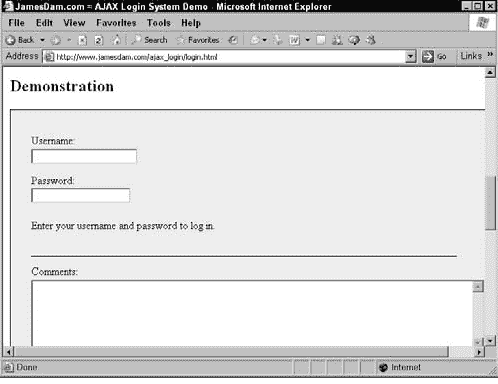

如果你输入错误的用户名和密码，例如`Steve`和`opensesame`，然后点击页面任意位置，你会看到一条错误消息，如图 1.16 所示。

## 图 1.16

登录被阻止。

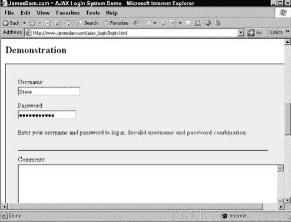

另一方面，如果你输入正确的用户名和密码——这里使用`user1`和`pass1`即可——然后点击页面，你会看到你已登录，如图 1.17 所示。

## 图 1.17

一次成功的 Ajax 登录

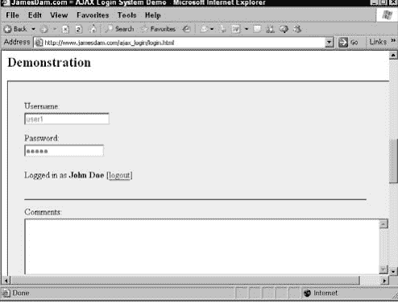

### 下载图片

使用 Ajax，你只能下载文本和 XML。或者，真的如此吗？本书中你将看到的一个示例让你将 Ajax 与动态 HTML 结合起来下载图片。此示例如图 1.18 所示。

在此示例中，你可以下载图片。

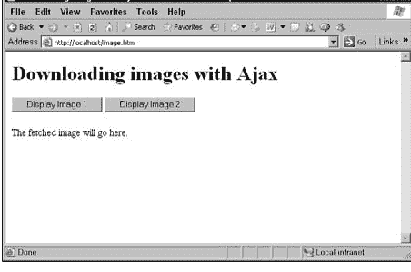

当你点击一个按钮时，此示例会下载并显示一张图片，如图 1.19 所示。那么，Ajax 真的下载了那张图片吗？Ajax 不是仅限于下载文本和 XML 吗？

在此示例中，你可以下载新图片而无需刷新页面。

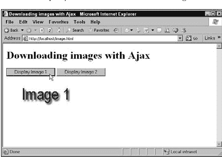

此示例中真正发生的是，Ajax 下载了新图片的`名称`。然后，示例使用 JavaScript 重写网页中的 HTML``元素，使用要下载的文件名。当浏览器看到``元素被重写时，它就会下载``元素引用的图片，这得益于动态 HTML 的魔力。

最终结果是你点击一个按钮，一张新图片出现，无需刷新浏览器。这是 Ajax 与动态 HTML 结合工作的结果，它表明在本书中你确实能够使用 Ajax 下载二进制数据。

### 使用 Ajax 实现拖放

随着 Web 应用变得越来越像桌面应用，许多你在桌面应用中习以为常的功能开始出现在在线应用中。例如，拖放操作可以让用户的生活轻松很多；现在，当你在网页中拖放项目时，服务器可以在后台收到你操作的通知。这意味着下次你再看这个页面时，你拖放的内容会出现在你放置的新位置。

例如，请查看`www.broken-notebook.com/magnetic/`上的冰箱磁贴文字，如图 1.20 所示。

当你将一个“磁贴”拖到一个新位置时，该新位置会使用 Ajax 技术发送到服务器，并存储该位置数据。其他访问该页面的人会看到磁贴在你设置的位置，当你再次回到该页面时，磁贴会在你放置的位置——除非有人已经移动了它们。

## 图 1.20

冰箱磁贴文字会停留在你放置的位置，除非有人过来移动它们。

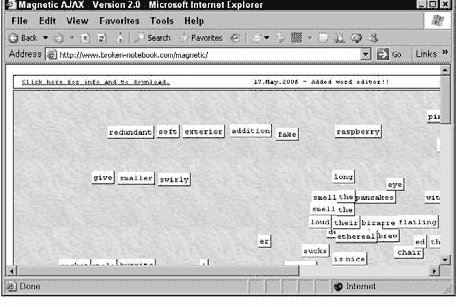

这是另一个拖放示例：`thebroth.com`上的马赛克。这里的想法是你和其他人可以使用 Ajax 拖动瓷砖来创建共享的艺术作品。当你拖动一块瓷砖时，其新位置会通过 Ajax 发送到服务器，并且瓷砖的位置会在每个人的浏览器中更新。你可以在`www.thebroth.com/mosaic`找到这个马赛克，如图 1.21 所示。

## 图 1.21

创建共享的马赛克

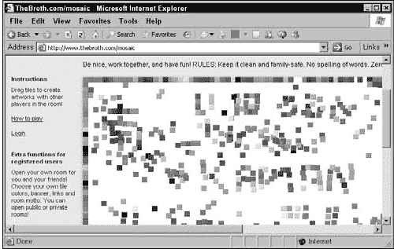

拖放并不总是涉及单个项目。例如，请查看 Ideo Technologies 的数据网格，如图 1.22 所示，位于`http://sweetdev-ria.ideotechnologies.com/sweetdev-ria-demo-1.1-RC3/welcome.do`。数据网格控件允许你通过拖动来重新排列列，如图所示。

当你拖动一列时，新的列排列会被发送到服务器并存储，这意味着当你导航到同一数据网格的其他页面（使用数据网格下方的页码链接）时，该排列会被保留。

Ajax 拖放最大的用途之一是实现购物车。通常，当你想在线将一件商品添加到购物车时，你必须经过几个页面：当你点击“添加到购物车”按钮后，你会看到一个对应于购物车的新页面，然后你必须返回才能继续购物。

如果你永远不需要离开你正在购物的页面，那不是容易得多吗？如果你可以简单地将一件商品拖到购物车，并且服务器在后台收到你购买的通知，岂不是没有了繁琐和忙乱？

## 第一部分 Ajax 基础

**图 1.22**

在 Ideo Technologies 的数据网格中拖动列

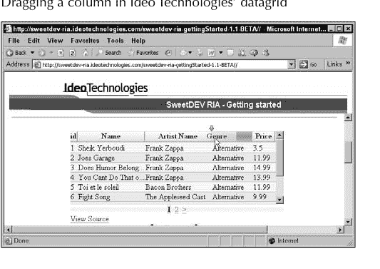

这正是`www.puterpet.com/index.php?sel=crafted&menu=crafted&selection=rocks`网站上购物车的工作原理，如图 1.23 所示。

当你将商品拖放到页面中支持 Ajax 的购物车时，服务器会收到你购买的通知，并且当前总价会出现在购物车中，如图 1.24 所示。

**图 1.23**

将商品拖放到支持 Ajax 的购物车

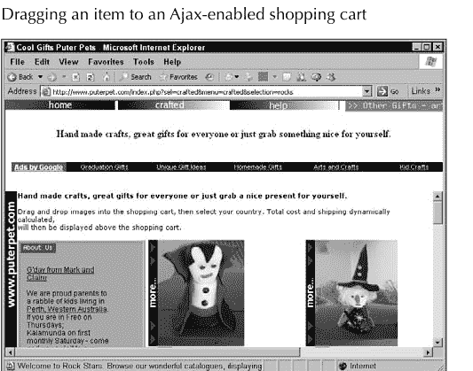

**图 1.24**

向支持 Ajax 的购物车添加商品

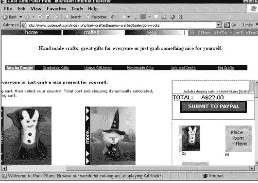

## 用 Ajax 玩游戏

这是 Ajax 的另一个有趣应用：一个基于《哈利·波特》的“日记”，它使用 Ajax 回复你输入的内容。你可以在`http://pandorabots.com/pandora/talk?botid=c96f911b3e35f9e1`找到它，如图 1.25 所示。

**图 1.25**

使用基于《哈利·波特》的日记

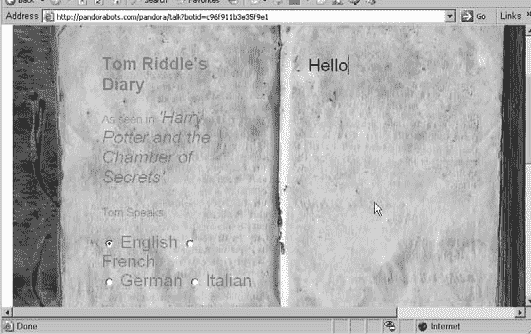

试着在日记中输入“Hello”。单词“Hello”会短暂出现，然后消失，接着是日记的回复——使用 Ajax 获取——你可以在图 1.26 中看到。

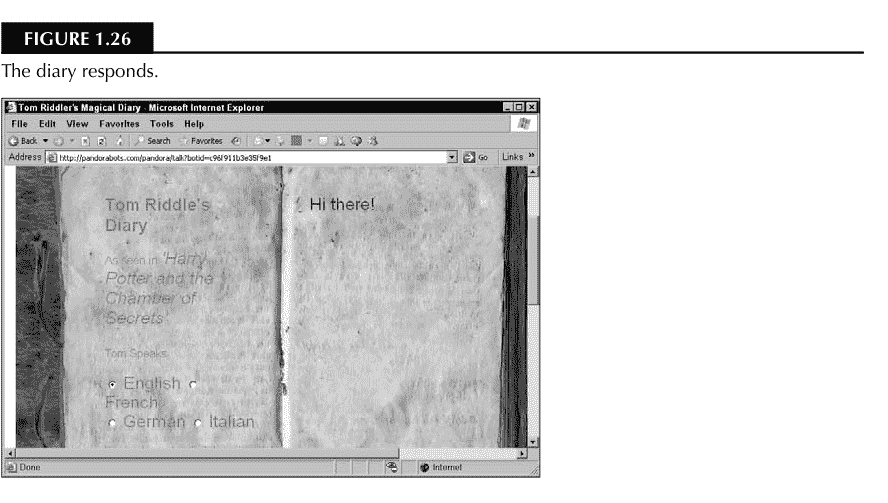

你可以向日记询问相当高级的问题，如图 1.27 所示，其中正在询问日记它在哪里。

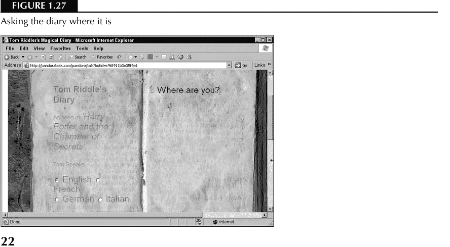

你可以在图 1.28 中看到日记的回复。

**图 1.28**

日记指出了它的位置。

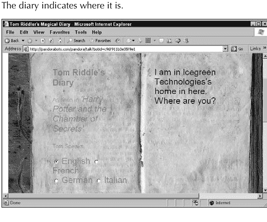

来一局支持 Ajax 的国际象棋如何？看看`www.JesperOlsen.Net/PChess/`，如图 1.29 所示。要移动一个棋子，你只需点击它，然后点击它的新位置，棋子就会自动移动。游戏在后台使用 Ajax 将所有需要的数据发送到服务器，并获取所需的数据回来。然后它使用 CSS 相应地移动它的棋子。

**图 1.29**

玩 Ajax 国际象棋

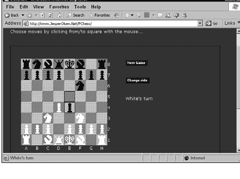

## 动态修改网页

Ajax 的一大特点是能够在用户观看时更新或修改网页。因为 Ajax 应用程序避免了完整的页面刷新，以及随之而来的闪烁和闪现，所以你必须在浏览器中更新网页的特定部分。有成千上万的 Ajax 应用程序以这种方式运行，而在这本书中，你也将创建一些这样的应用。

这是一个已经上线的例子：`http://openrico.org/rico/demos.page?demo=ricoAjaxInnerHTML.html`，你可以在图 1.30 中看到。

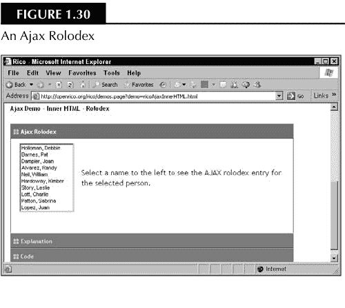

这个例子是一个支持 Ajax 的 Rolodex（电子名片夹）。你只需点击一个人的名字，他或她的“名片”信息就会出现，如图 1.31 所示。

**图 1.31**

使用 Ajax Rolodex

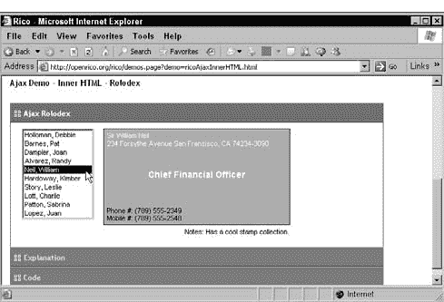

这个 Rolodex 使用 CSS 来显示其数据。每次你点击一个人的名字，应用程序就会从服务器获取该人的数据，组装一张 Rolodex 卡片，然后使用 CSS 动态修改网页来显示该卡片。

这就是它的工作原理：你在运行时在网页中显示操作的结果。你不会导致页面刷新。

另一个展示如何修改网页的例子位于`http://digg.com/spy`，如图 1.32 所示。这个网站展示用户实时投票的新闻文章，并使用 CSS 和动态 HTML 的组合不断更新自身。你看到的文章列表会随着用户投票而不断变化，并且每篇文章都会获得一个拇指向上或拇指向下的图标。所有这些都是通过 Ajax 从服务器获取数据完成的，而不会导致页面刷新。

**图 1.32**

Digg Spy 应用程序不断自我更新。


SaneBull Market Monitor 是另一个使用 Ajax 持续刷新自身的例子。这个页面位于`www.sanebull.com`，如图 1.33 所示。

**图 1.33**

SaneBull 使用 Ajax 不断更新其股票行情。

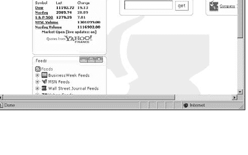

当你观看时，SaneBull 监视器会更新网页左侧的“市场观察”信息，通过修改网页为你提供市场报价。

Ajax 应用程序有时通过更新网页中的 HTML 控件来工作，而不仅仅是页面本身的显示。你可以在`www.jsquery.com/java-jsquery/examples/sql/zipform.jsp`看到一个例子，这是一个反向邮政编码查找器。你输入一个邮政编码，应用程序会告诉你该邮政编码对应的城市和州。你可以在图 1.34 中看到这个反向邮政编码查找器的工作情况。

**图 1.34**

反向邮政编码查找器

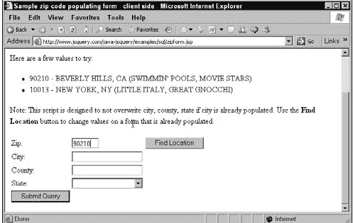

当你点击“查找位置”按钮时，与你输入的邮政编码匹配的城市、县和州会出现在网页的文本字段中，如图 1.35 所示，这都归功于 Ajax 和动态 HTML 的魔力。

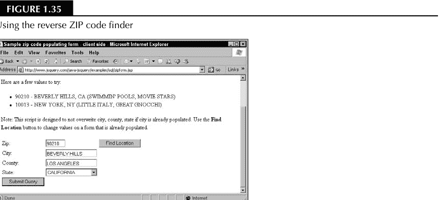

网页修改领域的常青树之一，并且是任何 Ajax 评测都不能遗漏的应用程序，就是`http://docs.google.com`上的 Writely。Writely 是一个完整的在线文字处理应用程序，这种应用程序只有 Ajax 才能实现，你可以在图 1.36 中看到 Writely 网站的一个示例。

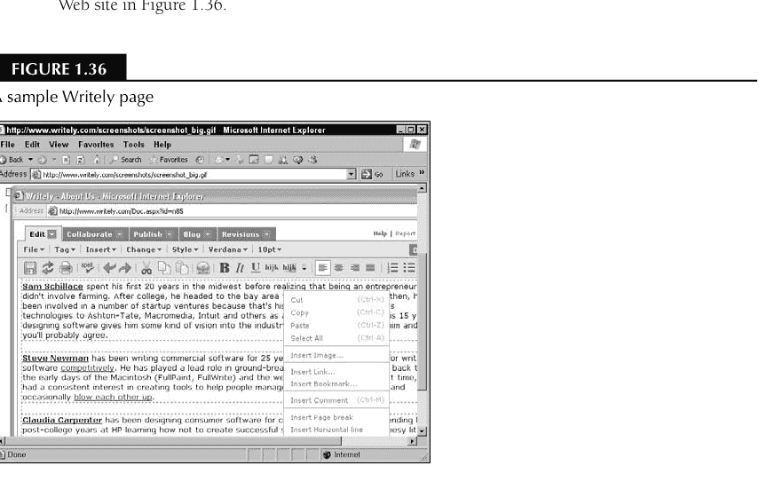

Writely 让你像在桌面电脑上使用它一样创建和编辑文档，并且它严重依赖 Ajax 来避免用户处理文档时的页面刷新。Writely 是另一个从桌面迁移到 Web 的应用程序。你已经见过在线电子表格应用程序；现在你又见到了在线文字处理器——两者通常都是桌面应用程序，现在都可以在线实现了。

## 为地图添加交互性


最初的 Ajax 应用程序之一，也是开启一切的应用，是 Google Maps，位于 `http://maps.google.com`，在图 1.37 中，它正在放大旧金山的 Market Street 10 号。

看到那个弹出窗口和指向 Market Street 10 号的箭头了吗？这些项目的数据是通过 Google Maps 后台使用 Ajax 下载的。很酷吧。

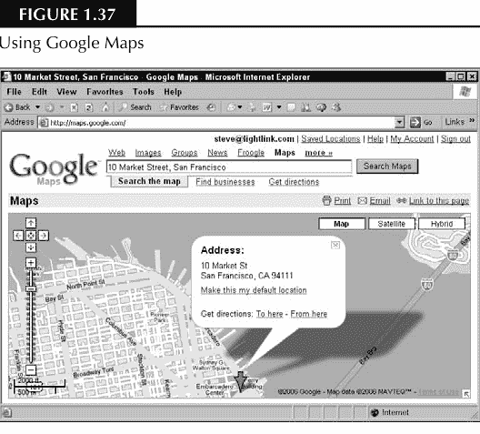

自 Google Maps 首次推出以来，许多其他地图网站如雨后春笋般涌现。例如，看看 `www.gtraffic.info`，它为你提供英国的交通信息。你在图 1.38 中看到的地图上的箭头就是支持 Ajax 的。

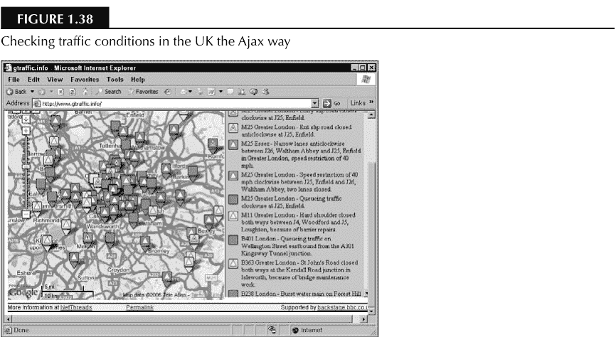

## 以 Ajax 方式收发电子邮件

Ajax 的另一个流行用途是支持基于浏览器的电子邮件，你可以在 `http://demo.nextapp.com/Email/app` 看到一个例子，如图 1.39 所示。

基于浏览器的电子邮件的问题在于，你会看到一个待读邮件列表，但每次你点击一封邮件，都会被带到一个全新的页面。然后你不得不返回邮件列表并再次向下滚动以检查其他邮件。

以 Ajax 方式处理电子邮件则不同。你可以在图 1.39 中看到邮件列表；点击一封邮件会自动下载并显示该邮件——无需浏览器刷新——如图 1.40 所示。邮件正文出现在应用程序的底部。

换句话说，Ajax 再次成功地将桌面应用程序转变为在线应用程序，解决了在线应用程序通常面临的问题。

**图 1.39**

浏览器支持的电子邮件

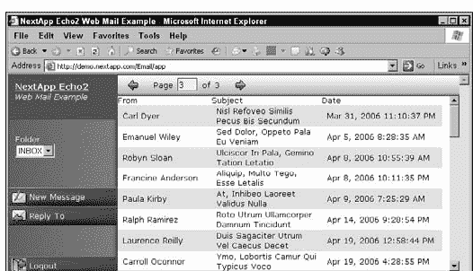

**图 1.40**

使用 Ajax 收发电子邮件

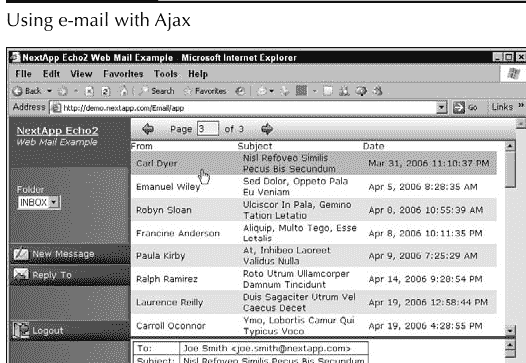

## Ajax 支持的弹出窗口

在线地图应用程序并非唯一使用 Ajax 弹出窗口的应用；你随处可见它们。例如，看看 `www.netflix.com/Top100` 上的 Netflix 前 100 名影片，如下图所示。

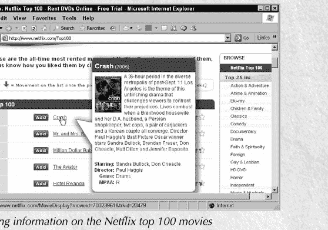

获取 Netflix 前 100 名电影的信息

要获取更多关于某部电影的信息，你只需将鼠标光标悬停在电影名称上，应用程序就会自动使用 Ajax 从服务器下载数据，并在弹出窗口中显示该数据，如图所示。这又是 Ajax 在工作：无需页面刷新，也无需点击浏览器的“后退”按钮返回原始显示。

## 总结

本章向你介绍了 Ajax 当今的使用方式并进行了概览。正如你所看到的，重点在于让在线应用程序感觉像桌面应用程序，这正是 Ajax 的擅长之处。实现这一点很大程度上与在浏览器中使用 JavaScript 有关，而这正是下一章的内容：快速掌握 Ajax 的基石——JavaScript。

# 第二章

## 了解你的 JavaScript

Ajax 基于 JavaScript，而本章将全面介绍 JavaScript。要学习 Ajax，你需要扎实的 JavaScript 基础，而本章将涵盖你需要的所有 JavaScript 知识。如果你已经精通 JavaScript，可以跳过本章，直接阅读深入讲解 Ajax 的第三章。

## JavaScript 在 Ajax 中处于什么位置？

JavaScript 在整个体系中处于什么地位？事实证明，它处于绝对核心的位置；正是 JavaScript 使 Ajax 得以工作。要理解这一点，请看一个示例。

这个示例从服务器下载并显示文本。（你将在下一章详细看到它是如何工作的。）你可以在图 2.1 的 Web 浏览器中看到这个示例。

**本章内容**

- 理解 JavaScript 的属性和方法
- 在变量和数组中存储数据
- 使用 `if` 语句进行判断
- 使用 `for` 和 `while` 循环
- 将 JavaScript 与 HTML 按钮关联

33

# 第一部分 Ajax 基础

### 图 2.1

Ajax 演示

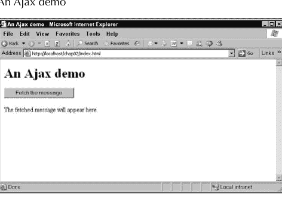

当此应用程序托管在 Web 服务器上时，点击“获取消息”按钮会导致应用程序在后台使用 Ajax 技术连接到服务器并下载文本文件 `data.txt` 的内容。以下是 `data.txt` 中的内容：

```
This text was fetched from the server with Ajax.
```

点击按钮可以从服务器下载消息，无需刷新页面。下载的文本直接显示出来，如图 2.2 所示。

### 图 2.2

使用 Ajax 下载文本

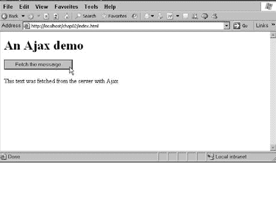

34

你已经知道这个示例只是使用服务器上的一个简单文本文件 `data.txt`，所以所有的魔法必定存在于 Web 页面 `index.html` 本身。确实如此，而且它就在 JavaScript 中。以下是 `index.html` 中的 JavaScript 代码：

```
<html>
  <head>
    <title>An Ajax demo</title>

    <script language = "javascript">
      var XMLHttpRequestObject = false;

      if (window.XMLHttpRequest) {
        XMLHttpRequestObject = new XMLHttpRequest();
      } else if (window.ActiveXObject) {
        XMLHttpRequestObject = new
          ActiveXObject("Microsoft.XMLHTTP");
      }

      function getData(dataSource, divID)
      {
        if(XMLHttpRequestObject) {
          var obj = document.getElementById(divID);
          XMLHttpRequestObject.open("GET", dataSource);

          XMLHttpRequestObject.onreadystatechange = function()
          {
            if (XMLHttpRequestObject.readyState == 4 &&
                XMLHttpRequestObject.status == 200) {
                  obj.innerHTML =
                    XMLHttpRequestObject.responseText;
            }
          }

          XMLHttpRequestObject.send(null);
        }
      }
    </script>
  </head>

  <body>

    <H1>An Ajax demo</H1>

    <form>
      <input type = "button" value = "Fetch the message"
        onclick = "getData('data.txt', 'targetDiv')">
    </form>

<div id="targetDiv">
  <p>The fetched message will appear here.</p>
</div>
</body>
</html>
```

如你所见，这里几乎所有的操作都是 JavaScript。JavaScript 是此应用程序的基础，也是许多 Ajax 应用程序的基础。事实上，任何 Ajax 编程讨论的起点都是 JavaScript，所以是时候开始深入 JavaScript 了，先从一点背景知识讲起。

## JavaScript 简史

JavaScript 的故事始于 1995 年，起源于网景通信公司一位名叫布兰登·艾奇的开发者。他创建了 JavaScript 的早期版本，最初名为 LiveScript，但很快更名为 JavaScript。当时 Java 编程语言正如日中天，所以人们只能推测这导致了 JavaScript 的命名，因为 JavaScript 本身与 Java 语言几乎没有共同之处。事实上，Java 的创建者 Sun Microsystems 拥有 Java 名称的商标权，因此 “JavaScript” 这个名字实际上是 Sun Microsystems 的商标，JavaScript 是在 1995 年 12 月网景和 Sun 的联合新闻发布会上宣布的。

JavaScript 流行起来；它很有趣，很酷，易于使用。使用 JavaScript，你可以在网页中编写脚本，实现各种出色的效果，从响应鼠标悬停到点击鼠标改变颜色方案。

这意味着微软也必须加入这场竞争。微软当时是网景在浏览器领域的竞争对手；那是 Netscape Navigator 对阵 Internet Explorer 的时代。微软也决定支持 JavaScript，但因为 JavaScript 是网景的产品，微软创建了自己的版本，称为 JScript。

JScript 于 1996 年 7 月 16 日随 Internet Explorer 3.0 发布。现在既有 JavaScript 又有 JScript，这种语言在网景和微软之间的分裂人格一直延续至今，产生了深远影响。于是开始了跨浏览器和跨浏览器版本的战争，从此让 JavaScript 程序员的生活变得异常有趣。程序员们开始发现，虽然 JScript 看起来和 JavaScript 一样，但有些脚本只能在 Netscape 中运行，不能在 Internet Explorer 中运行，反之亦然。

结果是混乱，最终，网景和微软都意识到必须采取行动。他们求助于第三方，即标准机构欧洲计算机制造商协会（ECMA）。你可能预期标准化的语言被称为 JavaScript，或者可能是 JScript，但它都不是。它被称为 ECMAScript，不过通用名称仍然是 JavaScript。

结果是，尽管仍然存在差异（你将在本书中看到），JavaScript 现在正在浏览器之间趋同——至少其核心部分符合 ECMAScript 3.0 版本。

微软、网景和 ECMA 三方都发布了 JavaScript 的参考文档。你可以在 `http://web.archive.org/web/20040211195031/devedge.netscape.com/library/manuals/2000/javascript/1.5/guide/` 找到 JavaScript 1.5 用户指南。你也可以在线找到 JScript 5.6 的文档，网址是 `http://msdn.microsoft.com/library/default.asp?url=/library/en-us/script56/html/29f83a2c-48c5-49e2-9ae0-7371d2cda2ff.asp`。

ECMAScript 规范也在线可查：

- ECMAScript 语言规范第 3 版在 `www.ecma-international.org/publications/standards/Ecma-262.htm`。
- ECMAScript 组件规范在 `www.ecma-international.org/publications/standards/Ecma-290.htm`。
- ECMAScript 第 3 版精简配置规范在 `www.ecma-international.org/publications/standards/Ecma-327.htm`。

## JavaScript 入门

是时候开始编写一些 JavaScript 了。要编写 JavaScript，你需要在 Web 页面中使用 `<script>` 元素，就像这样：

```
<html>
  <head>
    <title>A first JavaScript example</title>
    <script language="javascript">
      .
      .
      .
    </script>
  </head>

  <body>
    <h1>A first JavaScript example</h1>
  </body>
</html>
```

请注意，`<script>` 元素就像其他 HTML 元素一样；它甚至有一个属性，即 language 属性，在本例中设置为 “javascript”——在 Internet Explorer 中也是如此。你编写的实际 JavaScript 代码放在 `<script>` 元素中，而 `<script>` 元素通常放在 Web 页面的 `<head>` 部分。

那么，第一个 JavaScript 示例可以做什么呢？向 Web 页面写入一条消息怎么样？这听起来是个好主意。下一个问题当然是，如何从 JavaScript 代码内部访问 Web 页面呢？

事实证明，你可以通过各种内置的对象从 JavaScript 访问 Web 页面和浏览器本身。可供使用的对象包括 `document` 对象（指代一个 Web 页面）、`window` 对象（指代浏览器窗口）和 `history` 对象（指代一个历史列表，允许浏览器前进和后退）。

每个这些对象都有方法和属性。你可以调用一个方法来使某事发生（例如向 Web 页面写入内容），并设置属性的值来配置这些对象（例如设置 Web 页面的背景色）。以下是一些有用的对象方法：

- `document.write` 允许你向当前 Web 页面写入文本。
- `history.go` 将浏览器移动到历史记录中的某个页面。
- `window.open` 打开一个新的浏览器窗口。

以下是一些可用的有用属性：

- `document.bgcolor` 保存当前页面的背景色。
- `document.fgcolor` 保存当前页面的前景色。
- `document.lastmodified` 保存页面最后修改的日期。
- `document.title` 保存页面的标题。
- `location.hostname` 保存页面主机的名称。
- `navigator.appName` 保存浏览器的类型。

那么，这些在我们尝试从 JavaScript 向 Web 页面写入内容时有什么用呢？你可以使用 `document.write` 方法来做到这一点。以下是它在 JavaScript 中的样子，在代码文件 `first.html` 中：

```
<html>
  <head>
    <title>A first JavaScript example</title>

    <script language="javascript">
      document.write("You are using JavaScript");
    </script>
  </head>

  <body>
    <h1>A first JavaScript example</h1>
  </body>
</html>
```

就是这样，只有一行 JavaScript 代码，旨在将文本 “You are using JavaScript” 写入 Web 页面。这行代码在浏览器遇到它时就会执行，也就是在加载 Web 页面时。浏览器首先遇到页面的 `<head>` 部分，然后才是 `<body>` 部分，这意味着你会看到图 2.3 所示的结果，其中 JavaScript 写入的文本（“You are using JavaScript”）在 `<head>` 部分，出现在 `<body>` 部分的标题（“A first JavaScript example”）之前。

## 图 2.3

第一个 JavaScript 示例

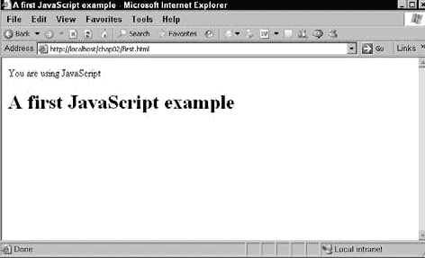

现在，你已经用一行 JavaScript 代码向网页写入了内容。请注意，这条 JavaScript 语句以分号结尾：

```html
<script language="javascript">
    document.write("You are using JavaScript");
</script>
```

所有的 JavaScript 语句都像这样以分号结尾，这是你在编写 JavaScript 时需要记住的一点。

## 修复错误

假设某人急于完成程序，结果犯了编程错误怎么办？来看看前一个示例的这个版本。你能发现错误吗？

```html
<html>
    <head>
        <title>A first JavaScript example</title>

        <script language="javascript">
            document.writ("You are using JavaScript");
        </script>
    </head>

    <body>
        <h1>A first JavaScript example</h1>
    </body>
</html>
```

# 第一部分 Ajax 基础

如果你发现 `document.write` 被错误地写成了 `document.writ`，那么你是对的。因为 `document` 对象没有名为 `writ` 的方法，所以任何浏览器都无法运行此示例。然而，不同浏览器处理此问题的方式各不相同，这意味着每个浏览器提供的修复问题的工具也不同。


Internet Explorer 会显示如图 2.4 所示的界面。你只能看到 `<body>` 元素中的 `<h1>` 标题——没有任何来自 JavaScript 的输出。

## 图 2.4

Internet Explorer 中的 JavaScript 错误

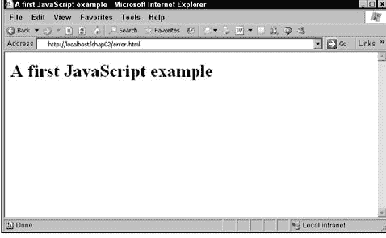

请特别注意 Internet Explorer 窗口左下角的小图标，它显示一个带有感叹号的三角形。这是 Internet Explorer 表示存在 JavaScript 问题的方式。双击该图标会打开一个对话框，如图 2.5 所示。

## 图 2.5

在 Internet Explorer 中检查 JavaScript 错误

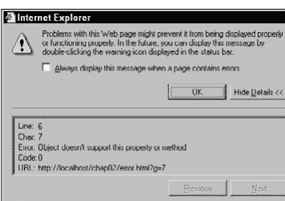

你可以看到图 2.5 中的错误消息写着“对象不支持此属性或方法”，并指出了正确的行号。利用此信息检查你的代码，就可以纠正问题。

看起来 Internet Explorer 在调试 JavaScript 方面会很有帮助，对吧？不幸的是，并非如此。你在图 2.5 中看到的错误消息几乎是 Internet Explorer 显示的唯一消息。即使你的 JavaScript 代码错得离谱，完全无法运行，你仍然只会得到“对象不支持此属性或方法”这条消息。

Ajax 开发者理应获得更好的支持，而作为 Internet Explorer 的替代品，Firefox 提供了更好的方案。在开发 Ajax 应用程序时，你应该手头备有 Firefox，这不仅是因为许多人使用 Firefox，所以你应该为这个浏览器以及 Internet Explorer 进行开发，更是因为它出色的调试帮助。Firefox 真的会告诉你脚本哪里出了问题，而 Internet Explorer 只会让你挠头。

此示例在 Firefox 中的显示如图 2.6 所示。如图所示，你没有得到预期的结果；没有任何内容通过 JavaScript 写入浏览器窗口。

## 图 2.6

Firefox 中的 JavaScript 问题

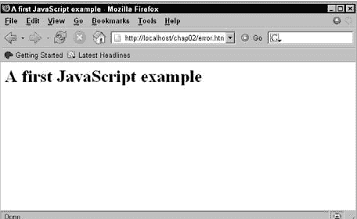

如何确定问题所在？选择“工具 > JavaScript 控制台”以打开 JavaScript 控制台，如图 2.7 所示。

## 第一部分 Ajax 基础

## 图 2.7

在 Firefox 的 JavaScript 控制台中检查 JavaScript 问题

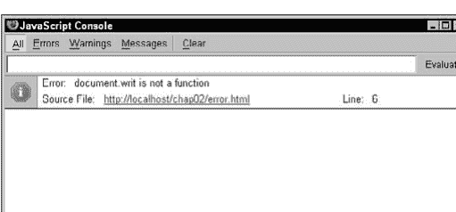

JavaScript 控制台是一个非常有用的工具，因为与 Internet Explorer 不同，它被设计用来真正定位问题并告知你。如你所见，这里的错误消息明确指出了 `document.writ` 是问题所在。

如果你打算开发大量的 JavaScript——哪个 Ajax 开发者不会呢？——在你的机器上运行 Firefox 是个好主意。这样做可以使调试过程变得非常、非常容易。

## 为你的代码添加注释

与大多数编程语言一样，你也可以在 JavaScript 脚本中添加注释。注释是人类可读的文本，用于注解你的代码。在 JavaScript 中，你可以使用 `//` 开始一条注释，为代码添加注释可以使人们更容易理解代码中的内容。

例如，要向你的第一个脚本添加注释“使用 document.write 来显示消息”，你可以这样做：

```html
<html>
    <head>
        <title>A first JavaScript example</title>

        <script language="javascript">
            //Use document.write to display a message
            document.write("You are using JavaScript");
        </script>
    </head>

    <body>
        <h1>A first JavaScript example</h1>
    </body>
</html>
```

你也可以在行尾使用 `//` 创建注释，像这样：

```html
<html>
    <head>
        <title>A first JavaScript example</title>

        <script language="javascript">
            document.write("You are using JavaScript"); //Display message
        </script>
    </head>

    <body>
        <h1>A first JavaScript example</h1>
    </body>
</html>
```

JavaScript 中还有另一种注释，即 `/* */` 注释，它允许你将注释内容跨多行书写。当浏览器在你的脚本中看到 `/*` 时，它会停止读取，直到遇到 `*/`，无论这跨越多少行。换句话说，`//` 用于单行注释，而 `/* */` 用于多行注释。这是一个例子：

```html
<html>
    <head>
        <title>A first JavaScript example</title>

        <script language="javascript">
            /* Use document.write
                to display
                a message */
            document.write("You are using JavaScript");
        </script>
    </head>

    <body>
        <h1>A first JavaScript example</h1>
    </body>
</html>
```

`//` 标记会阻止浏览器从该点到行尾读取任何更多文本，因此可以随意在你的代码中添加注释。

## 将代码放入外部脚本文件

这是你在本书以及使用 Ajax 时需要的另一项 JavaScript 技能：将你的 JavaScript 代码放入外部 JavaScript 文件中。它的原理很简单：只需将你的 JavaScript 代码——这里就是这一条语句：

```javascript
document.write("You are using JavaScript");
```

放入一个单独的脚本文件中，例如命名为 `script.js`。

> 注意：JavaScript 文件的扩展名是 `.js`。

然后，你可以使用 `<script>` 元素的 `src` 属性来引用 `script.js` 并将其包含在你的网页中，如下所示：

```html
<html>
  <head>
    <title>A first JavaScript example</title>
    <script language="javascript" src="script.js">
  </head>

  <body>
    <h1>A first JavaScript example</h1>
  </body>
</html>
```

就这么简单。现在你可以将 JavaScript 存储在外部文件中，如果你的 JavaScript 代码变得很长，或者你希望在多个网页之间共享它，这就非常好了。正如你将在本书中看到的，网上有许多免费的 Ajax 框架可用。这些框架为你进行 Ajax 编程，为你节省大量时间和精力，而这些框架通常就是外部 JavaScript 文件。

## 响应浏览器事件

到目前为止，你编写的代码是在包含它的网页加载时运行的。这是因为代码只是存储在 `<script>` 元素中：

```html
<html>
  <head>
    <title>A first JavaScript example</title>
    <script language="javascript">
      document.write("You are using JavaScript");
    </script>
  </head>

  <body>
    <h1>A first JavaScript example</h1>
  </body>
</html>
```

## 了解你的 JavaScript

像这样直接放置在 `<script>` 元素中的代码会在网页加载时立即执行。但 Ajax 应用程序不是这样工作的。它们通常会等待用户执行某些操作：点击按钮、输入内容等等。它们通过响应用户事件来做到这一点。

当浏览器中发生某些事情时，事件就会发生：鼠标移动或被点击、滚动条滚动、按钮被按下等等。当事件发生时，你的 JavaScript 代码会收到关于该事件的通知，这意味着你的代码可以适当地响应该事件。

有哪些可用的事件？以下是你在 Ajax 应用程序中可能看到的一些常见事件：

- `onabort`：当操作被中止时发生。
- `onblur`：当元素失去输入焦点时发生。
- `onchange`：当控件（如文本框）中的数据发生变化时发生。
- `onclick`：当元素被点击时发生。
- `ondblclick`：当元素被双击时发生。
- `ondragdrop`：当进行拖放操作时发生。
- `onerror`：当发生 JavaScript 错误时发生。
- `onfocus`：当元素获得焦点时发生。
- `onkeydown`：当按键被按下时发生。
- `onkeypress`：当按键被按下且按键代码可用时发生。
- `onkeyup`：当按键被释放时发生。
- `onload`：当页面加载时发生。
- `onmousedown`：当鼠标按钮被按下时发生。
- `onmousemove`：当鼠标移动时发生。
- `onmouseout`：当鼠标离开元素时发生。
- `onmouseover`：当鼠标移动到元素上时发生。
- `onmouseup`：当鼠标按钮被释放时发生。
- `onreset`：当用户点击重置按钮时发生。
- `onresize`：当元素或页面的大小被调整时发生。
- `onsubmit`：当用户点击提交按钮时发生。
- `onunload`：当页面被卸载时发生。

这些是你与 HTML 标签一起使用的事件属性。这是如何工作的呢？例如，文档本身由 `<body>` 元素表示，因此你可以使用像 `onmousedown` 这样的属性来捕获鼠标按钮被按下的时刻。

# 第一部分 基础 Ajax

那么，如何将这些知识付诸实践呢？这里有一个简单的例子，它利用了 JavaScript 可以创建内联脚本的特性——即，可以赋值给 `onmousedown` 这样的事件属性的短脚本，无需 `<script>` 元素。这个例子使用 JavaScript 显示一个名为 alert box 的对话框，其中包含文本“You clicked the page”：

```html
<html>
	<head>
		<title>
			Using JavaScript events
		</title>
	</head>
	<body onmousedown="alert('You clicked the page.')">
		<h1>
			Clicking this page will display an alert box.
		</h1>
		Give it a try.
	</body>
</html>
```

这个例子的运作方式是：用户按下鼠标按钮，`onmousedown` 事件发生，该事件会执行与此事件关联的所有代码。在这个例子中，执行的 JavaScript 代码是 `alert('You clicked the page.')`，它会显示一个如图 2.8 所示的警告框。

## 图 2.8

处理 `onmousedown` 事件

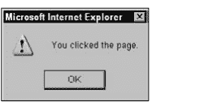

关于此类内联脚本需要注意的一点：由于你将它们赋值给像 `onmousedown` 这样的事件属性，因此必须将它们放在引号内。如果你的代码本身必须使用引号，请使用单引号，像这样：

```html
<body onmousedown="alert('You clicked the page.')">
```

为什么用单引号？JavaScript 可以处理单引号和双引号，并且允许在需要时交替使用它们。换句话说，这是合法的 JavaScript：

```javascript
alert('You clicked the page.')
```

这样写也是：

```javascript
alert("You clicked the page.")
```

这意味着，如果你交替使用双引号和单引号，就可以将内联 JavaScript 放在双引号内。例如，如果你像这样全部使用双引号：

```html
<body onmousedown="alert("You clicked the page.")">
```

JavaScript 会感到困惑。引号从哪里开始，到哪里结束？因此，请像这样交替使用双引号和单引号：

```html
<body onmousedown="alert('You clicked the page.')">
```

到目前为止一切顺利，但内联脚本是为非常短的代码片段设计的。如果你想将像 `onmousedown` 这样的事件属性连接到 `<script>` 元素中的代码呢？为此，你必须使用 JavaScript 函数。

### 创建 JavaScript 函数

这是你本章早些时候编写的用于显示消息的脚本：

```html
<html>
    <head>
        <title>A first JavaScript example</title>

        <script language="javascript">
            document.write("You are using JavaScript");
        </script>
    </head>

    <body>
        <h1>A first JavaScript example</h1>
    </body>
</html>
```

JavaScript 代码 `document.write("You are using JavaScript");` 在 `<head>` 部分加载后立即执行，这意味着消息“You are using JavaScript”会在页眉“A first JavaScript example”之前出现在网页中，正如你在前面的图 2.3 中看到的那样。

这在某种程度上是可以的，但不是有点本末倒置吗？毕竟，页眉不应该先出现吗？你如何让它按那个顺序工作呢？

方法是这样的：将 `<script>` 元素放在网页的 `<body>` 中，这意味着 `<script>` 元素中的代码要等到页眉显示后才会执行，就像这样：

```html
<html>
    <head>
        <title>A first JavaScript example</title>

    </head>

    <body>
        <h1>A first JavaScript example</h1>
        <script language="javascript">
            document.write("You are using JavaScript");
        </script>
    </body>
</html>
```

在这里，页眉首先出现，然后是文本“You are using JavaScript”。换句话说，你在网页中放置 `<script>` 元素的位置决定了它的执行时机。

另一方面，现代做法是将 `<script>` 元素放在网页的 `<head>` 部分。那么，如何才能做到这一点呢？如何让你的 `<script>` 元素中的代码只在你想要的时候执行呢？

这就是函数的全部意义所在。通过将代码放在函数中，该代码在你调用函数之前不会被执行。一个 JavaScript 函数是一组代码语句，专门只在需要时执行。这些语句通过在函数体中用 `{` 和 `}` 围绕起来，与代码的其余部分区分开来。

> **注意**：函数就像你已经见过的方法——比如 `document` 对象的 `write` 方法——只是函数没有与对象关联。

例如，假设你想创建一个名为 `showMessage` 的函数。在 `<script>` 元素中，它看起来像这样：

```html
<html>
    <head>
        <title>A first JavaScript example</title>
        <script language="javascript">
            function showMessage ()
            {
                .
                .
                .
            }
        </script>
    </head>
    <body>
        <h1>A first JavaScript example</h1>
    </body>
</html>
```

注意它的工作方式：你使用关键字 `function` 来定义一个新函数，然后给出函数名称，后跟一对括号（本章稍后会更多地介绍这些括号的用途）。然后你使用花括号 `{` 和 `}` 来包含你希望在调用函数时运行的 JavaScript 语句。

你如何调用这个函数？你只需将它的名称用作一个 JavaScript 语句。在这个例子中，你可以使用浏览器事件来调用这个函数。特别是，你希望在 `<body>` 元素加载后调用该函数。你可以使用 `onload` 事件属性来确保 `<body>` 元素已加载，像这样：


```html
<html>
  <head>
    <title>A first JavaScript example</title>

    <script language="javascript">
      function showMessage ()
      {
        .
        .
        .
      }
    </script>
  </head>

  <body onload="">
    <h1>A first JavaScript example</h1>
  </body>
</html>
```

那么，你如何使用`onload`属性实际调用`showMessage`函数呢？你只需将函数名后跟括号用作 JavaScript 语句，这样当`<body>`元素完全加载时，你就调用该函数，像这样：

```html
<html>
  <head>
    <title>A first JavaScript example</title>

    <script language="javascript">
      function showMessage ()
      {
        .
        .
        .
      }
    </script>
  </head>

  <body onload="showMessage()">
    <h1>A first JavaScript example</h1>
  </body>
</html>
```

很好；你正在取得进展。

你现在可能想知道，是否可以简单地将`document.write`调用放在`showMessage`函数中来显示消息 “You are using JavaScript”，像这样：

```html
<html>
  <head>
    <title>A first JavaScript example</title>

    <script language="javascript">
      function showMessage ()
      {
        document.write("You are using JavaScript");
      }
    </script>
  </head>

  <body onload="showMessage()">
    <h1>A first JavaScript example</h1>
  </body>
</html>
```

遗憾的是，答案是否定的。`showMessage`函数确实会在页面主体加载后被调用，这没问题。但有个问题：当主体加载后，你不能再使用`document.write`方法，因为此时文档被视为*已关闭*。重新打开它进行写入会清除其中的所有文本，因此这里不行。你只会看到 “You are using JavaScript”消息，因为 “A first JavaScript example”页眉将被覆盖。

那么你能做什么呢？你可以做所有 Ajax 应用程序在面对这个问题时所做的：你可以将消息写入网页的特定部分。例如，假设你添加一个`<div>`元素并将其命名为`targetDiv`，像这样：

```html
<html>
  <head>
    <title>A first JavaScript example</title>

    <script language="javascript">
      function showMessage ()
      {
        document.write("You are using JavaScript");
      }
    </script>
  </head>

  <body onload="showMessage()">
    <h1>A first JavaScript example</h1>
```

## 第一部分 Ajax 基础

现在，当调用`showMessage`函数时，你可以将消息写入目标`<div>`元素。你可以通过 JavaScript 表达式`document.getElementById('targetDiv')`获取对应于该`<div>`元素的 JavaScript 对象。对应于`<div>`元素的对象支持多个属性，例如`innerHTML`属性，它对应于`<div>`元素内部的 HTML。要重写该 HTML 从而显示消息，你只需在`messager.html`中将消息文本赋值给`<div>`元素的`innerHTML`属性，如下所示：

```html
<html>
  <head>
    <title>A first JavaScript example</title>

    <script language="javascript">
      function showMessage ()
      {
        document.getElementById('targetDiv').innerHTML =
          "You are using JavaScript";
      }
    </script>
  </head>

  <body onload="showMessage()">
    <h1>A first JavaScript example</h1>

    <div id="targetDiv">
    </div>
  </body>
</html>
```

你可以在图 2.9 中看到结果。消息确实被写入了标题之后的页面主体，这一切都归功于函数的魔力，它让你在准备好执行代码时调用 JavaScript 代码。

**图 2.9**

将消息写入网页

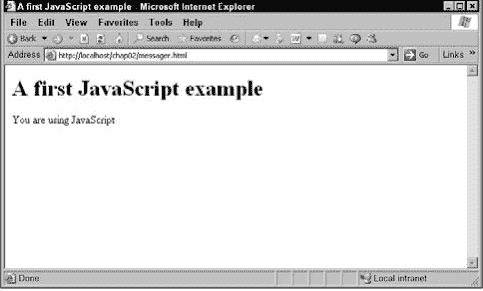

注意本章前面的以下代码行：

`document.write("You are using JavaScript");`

在这里，你正在将文本 "You are using JavaScript" 写入网页。你通过将要写的文本传递给`write`方法来实现这一点。事实上，你也可以将数据传递给你编写的函数（记住，函数和方法之间的区别仅仅是方法是内置在对象中的函数），这将在接下来讨论。

## 向函数传递参数

能够向函数传递数据是 JavaScript 的重要组成部分，因为向函数传递数据意味着这些函数可以处理这些数据，甚至可以将结果返回给你。例如，你可能有一个函数用于将两个数字相加并给出结果，要使用该函数，你必须能够传递要相加的两个数字。

假设，例如，你想将要在网页中显示的消息文本传递给`showMessage`函数，而不是简单地让该函数自动显示文本 "You are using JavaScript"。你该怎么做呢？

首先，在函数体中指定一个你想用来引用消息文本的名称。例如，如果你想通过名称 "message"引用该文本，你可以通过在`showMessage`函数名后面的括号中放置名称`message`来实现。`message`现在被称为`showMessage`函数的参数：

```html
<html>
  <head>
    <title>Passing function arguments</title>

    <script language="javascript">
      function showMessage (message)
      {
        document.getElementById('targetDiv').innerHTML =
          "You are using JavaScript";
      }
    </script>
  </head>

  <body onload="showMessage()">
    <h1>Passing function arguments</h1>

    <div id="targetDiv">
    </div>
  </body>
</html>
```

在`showMessage`函数的主体中，你可以使用名称`message`来引用传递给函数的文本，这意味着你可以像这样将该文本赋值给目标`<div>`元素：

```html
<html>
  <head>
    <title>Passing function arguments</title>

    <script language="javascript">
      function showMessage (message)
      {
        document.getElementById('targetDiv').innerHTML = message;
      }
    </script>
  </head>

  <body onload="showMessage()">
    <h1>Passing function arguments</h1>

    <div id="targetDiv">
    </div>

  </body>
</html>
```

很好！这就设置好了`showMessage`函数。现在你只需在调用函数时将文本放在括号内，就可以将文本传递给该函数。例如，你可能想显示消息 "You are seeing this thanks to JavaScript." 你可以在网页`messagerArguments.html`中这样做：

```html
<html>
  <head>
    <title>Passing function arguments</title>

    <script language="javascript">
      function showMessage (message)
      {
        document.getElementById('targetDiv').innerHTML = message;
      }
    </script>
  </head>

  <body onload="showMessage(
    'You are seeing this thanks to JavaScript')">
    <h1>Passing function arguments</h1>

    <div id="targetDiv">
    </div>

  </body>
</html>
```

结果如图 2.10 所示，其中你传递给`showMessage`函数的文本确实被忠实地显示了出来。效果不错。

**图 2.10**

使用函数参数将消息写入网页

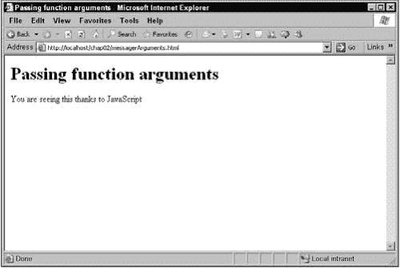

请注意，此示例使用`<div>`元素来显示文本。你将在 Ajax 应用程序中经常使用的另一个元素是`<span>`元素。`<div>`元素是一个块级元素，这意味着它在浏览器显示中会独占一行。而`<span>`元素是一个内联元素，这意味着你可以使用它来改变句子或其他文本内的文本。

看看这个示例`span.html`，它在一个`<span>`元素中显示文本：

```html
<html>
  <head>
    <title>Using a &lt;span&gt; to display text</title>

    <script language="javascript">
      function showMessage (message)
      {
        document.getElementById('targetSpan').innerHTML = message;
      }
    </script>
  </head>

  <body onload="showMessage(
    'You are seeing this thanks to JavaScript')">
    <h1>Using a &lt;span&gt; to display text</h1>

    Here is the message: <span id="targetSpan">
    </span>.

  </body>
</html>
```

结果如图 2.11 所示。请注意，消息文本内联显示在页面底部的句子中。

**图 2.11**

使用`<span>`元素书写文本


> 注意：当使用 Ajax 时，能够将数据插入网页的所需位置非常重要；而最常用的技巧之一就是使用`<div>`和`<span>`元素，正如你刚才看到的那样。`<div>`元素最流行，但它是一个块级元素，这意味着它在显示中会独占一行；如果你不想要那样，你总是可以使用一个内联的`<span>`元素。

向 JavaScript 函数传递参数时，还有更多需要考虑的地方。你可以传递多个参数，而不仅仅是你目前看到的单个参数。处理多个参数与处理单个参数几乎一样简单：在创建函数时，你只需在括号内用逗号分隔列出它们即可。例如，假设你想在`showMessage`函数中传递要在其中显示文本的`<div>`元素的名称。你可以在一个新的网页`multipleArguments.html`中这样做：

```html
<html>
  <head>
    <title>Passing multiple function arguments</title>

    <script language="javascript">
      function showMessage (message, divName)
      {
        document.getElementById(divName).innerHTML = message;
      }
    </script>
  </head>

  <body onload="showMessage(
    'You are seeing this thanks to JavaScript', 'targetDiv')">
    <h1>Passing multiple function arguments</h1>

    <div id="targetDiv">
    </div>

  </body>
</html>
```

当你向函数传递多个参数时，你也用逗号分隔这些参数：

这就是你需要的全部。这个网页给你与之前的`messagerArguments.html`网页相同的结果。

关于函数，你还可以做更多事情：你可以从函数中*返回值*。

## 从函数返回值

函数充当独立的代码段。顾名思义，每个函数通常被设计为具有单一功能，即执行单一任务。其理念是，你可以通过将其分解为独立的函数来分而治之地进行编程。你已经知道可以将数据传递给函数，以便它们执行其任务。那么让它们将这些任务的结果传回给你呢？

这就是从函数返回值的用武之地。你可以让一个函数处理你发送给它的数据，并将其计算结果发送回给你。例如，假设你想使用一个名为`adder`的函数将两个数字相加并显示结果。为此，你可能创建一个新函数`adder`，并将要相加的两个数字传递给该函数。

以下是你可能将两个数字 5 和 3 传递给`adder`并显示结果的方式：

```html
<html>
  <head>
    <title>Returning values from functions</title>

    <script language="javascript">
      function showMessage ()
      {
        document.getElementById("targetDiv").innerHTML =
          "5 + 3 = " + adder(5, 3);
      }
    </script>
  </head>

  <body onload="showMessage()">
    <h1>Returning values from functions</h1>

    <div id="targetDiv">
    </div>
  </body>
</html>
```

## 第一部分 Ajax 基础

## 从函数返回值

```html
<html>
  <head>
    <title>Returning values from functions</title>

    <script language="javascript">
      function showMessage ()
      {
        document.getElementById("targetDiv").innerHTML =
          "5 + 3 = " + adder(5, 3);
      }

      function adder(operand1, operand2)
      {
        return operand1 + operand2;
      }
    </script>
  </head>

  <body onload="showMessage()">
    <h1>Returning values from functions</h1>

    <div id="targetDiv">
    </div>
  </body>
</html>
```


这里有两点需要注意：第一，表达式`adder(5, 3)`将被`adder`函数返回的结果（即 8）替换。第二，注意在 JavaScript 中，你可以使用`+`来连接字符串，就像这样：`"5 + 3 = " + adder(5, 3)`。这会得到`"5 + 3 = 8"`。

那么如何创建`adder`函数呢？它看起来像这样：

```html
<html>
  <head>
    <title>Returning values from functions</title>
    <script language="javascript">
      function showMessage ()
      {
        document.getElementById("targetDiv").innerHTML =
          "5 + 3 = " + adder(5, 3);
      }

      function adder(operand1, operand2)
      {
        .
        .
        .
      }
    </script>
  </head>
  <body onload="showMessage()">
    <h1>Returning values from functions</h1>
    <div id="targetDiv">
    </div>
  </body>
</html>
```

那么，如何实际将两个数字相加并从`adder`函数返回一个值呢？你可以使用 JavaScript 中的`+`来将传递给`adder`函数的两个数字相加，并使用`return`语句从函数中返回一个值，所以`adder`函数的主体看起来像这样：

```html
<html>
  <head>
    <title>Returning values from functions</title>
    <script language="javascript">
      function showMessage ()
      {
        document.getElementById("targetDiv").innerHTML =
          "5 + 3 = " + adder(5, 3);
      }

      function adder(operand1, operand2)
      {
        return operand1 + operand2;
      }
    </script>
  </head>
  <body onload="showMessage()">
    <h1>Returning values from functions</h1>
    <div id="targetDiv">
    </div>
  </body>
</html>
```

很好；这就是你所需要的全部。你可以在图 2.12 中看到结果，其中 5 和 3 确实被传递给了`adder`函数，该函数返回了一个值 8。

### 图 2.12

从函数返回值


## 将数据存储在变量中

通常，Ajax 应用程序会大量使用 JavaScript，这意味着要处理诸如音乐 CD 的当前价格、LCD 显示器的库存数量、旧金山的温度等数据。而在 JavaScript 中，你可以使用变量来存储数据。

例如，假设你想将消息 “This data was stored in a variable” 存储在一个变量中，并使用该变量显示该消息。你可以通过创建一个名为（例如）`message`的变量来包含该文本来实现。你使用 JavaScript 的`var`语句创建一个变量；创建变量并为其赋值后，你可以在语句中使用该变量，就像在`variables.html`中这样，其中`message`变量的值被赋给了目标`<div>`元素：

```html
<html>
<head>
    <title>Working with variables</title>
    <script language="javascript">
        var message = "This data was stored in a variable.";
        function showMessage ()
        {
            document.getElementById('targetDiv').innerHTML = message
        }
    </script>
</head>
<body onload="showMessage()">
    <h1>Working with variables</h1>
    <div id="targetDiv">
    </div>
</body>
</html>
```

图 2.13 显示了结果。现在你已经将数据存储在 JavaScript 变量中，并检索该数据以进行显示。

### 图 2.13

将数据存储在变量中


除了文本，你还可以将数字存储在变量中。例如，假设你想修改`adder`函数，使其将传递给它的两个数字相加到一个名为`sum`的变量中，然后从函数中返回该变量的值？你可以这样做：

```html
<html>
  <head>
    <title>Returning values from functions</title>
    <script language="javascript">
      function showMessage ()
      {
        document.getElementById("targetDiv").innerHTML =
          "5 + 3 = " + adder(5, 3);
      }
      function adder(operand1, operand2)
      {
        var sum = operand1 + operand2;
        return sum;
      }
    </script>
  </head>
  <body onload="showMessage()">
    <h1>Returning values from functions</h1>
    <div id="targetDiv"></div>
  </body>
</html>
```

关于变量还有一点需要说明，这与函数有关。你注意到`message`变量是在任何函数之外声明的吗？

```javascript
var message = "This data was stored in a variable.";

function showMessage ()
{
    document.getElementById('targetDiv').innerHTML = message
}
```

而`sum`变量是在`adder`函数内部声明的？

```javascript
function adder(operand1, operand2)
{
    var sum = operand1 + operand2;
    return sum;
}
```

这使得`message`成为一个全局变量，而`sum`是一个局部变量，即仅限于`adder`函数的局部变量。全局变量——在任何函数之外声明的变量——在代码中的任何地方都可用，而局部变量——在函数内部声明的变量——仅在该函数中可用。

关于变量还需要知道另一件事：在函数内部创建的变量将在每次调用函数时重置为其原始值。许多 JavaScript 程序员都曾因不了解这一点而受挫。如果你不想发生这种情况，请将创建要使用的变量的`var`语句放在函数外部。

## 使用运算符操作数据

你已经看到可以使用`+`将两个数字相加：

```javascript
function adder(operand1, operand2)
{
    return operand1 + operand2;
}
```

这里的`+`是一个 JavaScript 运算符，你使用运算符来处理数据。除了`+`，还有许多其他 JavaScript 运算符；例如，你可以使用`*`将两个数字相乘：

```javascript
function multiplier(operand1, operand2)
{
    return operand1 * operand2;
}
```

加法运算符是`+`，乘法运算符是`*`，减法运算符是`-`，除法运算符是`/`。还有哪些其他运算符可用？你可以在表 2.1 中看到所有运算符。（不要试图记住那里看到的内容。在整个学习过程中，根据需要随时参考此表。）

### 表 2.1 JavaScript 运算符

| 运算符 | 描述 |
| :--- | :--- |
| **算术运算符** | |
| `+` | 将两个数字相加。 |
| `++` | 将变量的值增加一。 |
| `-` | 从一个数字中减去另一个数字。也可以改变其操作数的符号，如：`-variableName`。 |
| `--` | 将变量的值减少一。 |
| `*` | 将两个数字相乘。 |
| `/` | 将两个数字相除。 |
| `%` | 计算两个数字整除后的余数。 |
| **字符串运算符** | |
| `+` | 连接（串联）两个字符串。 |
| `+=` | 连接（串联）两个字符串，并将连接后的字符串赋值给第一个操作数。 |
| **逻辑运算符** | |
| `&&` | 如果两个操作数都为 true，则结果为 true；否则，结果为 false。 |
| `\|\|` | 如果任一操作数为 true，则结果为 true。但是，如果两个操作数都为 false，则结果为 false。 |
| `!` | 如果其操作数为 true，则结果为 false；如果其操作数为 false，则结果为 true。 |
| **位运算符** | |
| `&` | 对两个操作数的每一位执行与运算。如果两个操作数的对应位都为 1，则结果位为 1。 |
| `^` | 对两个操作数的每一位执行异或运算。如果只有一个操作数的对应位为 1，则结果位为 1。 |
| `\|` | 对两个操作数的每一位执行或运算。如果任一操作数的对应位为 1，则结果位为 1。 |
| `~` | 对操作数的每一位执行取反操作。 |
| `<<` | 将第一个操作数的位向左移动第二个操作数指定的位数。 |
| `>>` | 将第一个操作数的位向右移动第二个操作数指定的位数，符号位保持不变。 |
| `>>>` | 将第一个操作数的位向右移动第二个操作数指定的位数，高位用零填充。 |

**续表**

### 表 2.1（续）

| 运算符 | 描述 |
| :--- | :--- |
| **赋值运算符** | |
| `=` | 将第二个操作数的值赋给第一个操作数。 |
| `+=` | 将两个操作数相加，并将结果赋给第一个操作数。 |
| `-=` | 将两个操作数相减，并将结果赋给第一个操作数。 |
| `*=` | 将两个操作数相乘，并将结果赋给第一个操作数。 |
| `/=` | 将两个操作数相除，并将结果赋给第一个操作数。 |
| `%=` | 计算两个操作数的模，并将结果赋给第一个操作数。 |
| `&=` | 对两个操作数执行按位与运算，并将结果赋给第一个操作数。 |
| `^=` | 对两个操作数执行按位异或运算，并将结果赋给第一个操作数。 |
| `\|=` | 对两个操作数执行按位或运算，并将结果赋给第一个操作数。 |
| `<<=` | 对两个操作数执行左移运算，并将结果赋给第一个操作数。 |
| `>>=` | 对两个操作数执行带符号右移运算，并将结果赋给第一个操作数。 |
| `>>>=` | 对两个操作数执行无符号右移运算，并将结果赋给第一个操作数。 |
| **比较运算符** | |
| `==` | 如果两个操作数相等，则结果为 true。 |
| `!=` | 如果两个操作数不相等，则结果为 true。 |
| `===` | 如果两个操作数相等且类型相同，则结果为 true。 |
| `!==` | 如果两个操作数不相等和/或类型不同，则结果为 true。 |
| `>` | 如果第一个操作数的值大于第二个操作数的值，则结果为 true。 |
| `>=` | 如果第一个操作数的值大于或等于第二个操作数的值，则结果为 true。 |
| `<` | 如果第一个操作数的值小于第二个操作数的值，则结果为 true。 |
| `<=` | 小于或等于运算符。如果第一个操作数的值小于或等于第二个操作数的值，则结果为 true。 |

## 2.2 运算符

| 运算符 | 描述 |
| :--- | :--- |
| **特殊运算符** | |
| `?:` | 执行“if…else”测试。 |
| `,` | 计算两个表达式，并返回第二个表达式的计算结果。 |
| `delete` | 删除一个对象并将其从内存中移除，或删除对象的一个属性，或删除数组中的一个元素。 |
| `function` | 创建一个匿名函数。（详见第3章。） |
| `in` | 如果你正在测试的属性是特定对象支持的，则计算结果为 true。 |
| `instanceof` | 如果给定对象是指定类型的实例，则计算结果为 true。 |
| `new` | 从指定的对象类型创建一个新对象。 |
| `typeof` | 计算结果为操作数类型的名称。 |
| `Void` | 允许在不返回任何值的情况下计算表达式。 |

你可以使用组合运算符，如`+=`，来一步完成运算并将运算结果赋值给变量。例如，你可以使用这种方式将`temperature`的值增加 5：

```javascript
var temperature;
temperature = 72;
temperature = temperature + 5;
```

但你也可以使用快捷运算符`+=`将加法和赋值合二为一，像这样：

```javascript
var temperature;
temperature = 72;
temperature += 5;
```

类似地，还有`-=`, `*=`, 以及其他组合运算符。

那么表 2.1 中的`==`, `>`, `<`, `<=`运算符呢？你使用它们在 JavaScript 中做出决策，如果某个条件为真则执行一些代码，如果该条件为假则执行另一些代码，接下来将对此进行讨论。

## 2.3 使用 If 语句进行决策

在 JavaScript 中，你可以使用`if`语句来测试某个条件是否为真，并根据结果执行代码。例如，你可能想测试你的银行账户里是否有超过 1000 美元，如果有，则采取相应行动（是时候开个派对了！）。

`if`语句还包括一个可选的`else`子句，其中包含在测试条件为假时执行的代码。从形式上讲，该语句的语法如下所示（注意要执行的代码位于花括号`{`和`}`之间，而标准方括号`[`和`]`中的部分是可选的）：

```javascript
if (condition) {
    statements1
}
[else {
    statements2
}]
```

举个例子怎么样？你的银行账户里有超过 1000 美元吗？如果是，下一个示例`if.html`将显示消息“是时候开个派对了！”：

```html
<html>
  <head>
    <title>使用 if 语句</title>
    <script language="javascript">
      function showMessage()
      {
        var account = 2000;
        if(account > 1000) {
          document.getElementById('targetDiv').innerHTML = 
              "Time for a party!";
        }
      }
    </script>
  </head>
  <body onload="showMessage()">
    <h1>Using the if statement</h1>
    <div id="targetDiv">
    </div>
  </body>
</html>
```

它是如何工作的？为了检查`account`变量中的金额，此示例使用了`>`大于运算符（见表 2.1）。表达式`account > 1000`在`account`大于 1000 时为真，而事实确实如此。这意味着`if`语句主体内（即`{`和`}`之间的部分）的代码将被执行：

```javascript
var account = 2000;
if(account > 1000) {
    document.getElementById('targetDiv').innerHTML = 
        "Time for a party!";
}
```

结果显示在图 2.14 中。如你所见，是时候开个派对了。

### 图 2.14

使用`if`语句


如果`account`中的金额是 1000 美元或更少呢？你可以使用`else`语句在那种情况下执行代码。也就是说，如果`if`语句的条件为假，那么`else`语句中的代码（如果有的话）将被执行。在那种情况下，不会有派对，每个人都应该回去工作。代码示例如下所示，在`else.html`中——注意`account`现在是 900 美元，所以将触发`else`语句：


```html
<html>
    <head>
        <title>使用 else 语句</title>
        <script language="javascript">
            function showMessage()
            {
                var account = 900;
                if(account > 1000) {
                    document.getElementById('targetDiv').innerHTML =
                        "Time for a party!";
                }
                else {
                    document.getElementById('targetDiv').innerHTML =
                        "Get back to work!";
                }
            }
        </script>
    </head>
    <body onload="showMessage()">
        <h1>Using the else statement</h1>
        <div id="targetDiv"></div>
    </body>
</html>
```

你可以在图 2.15 中看到结果。不幸的是，是时候回去工作了。


### 在不同浏览器中执行不同代码

正如你将在本书中看到的，JavaScript 的问题之一是你必须以不同的方式处理不同的浏览器。这是因为每个浏览器支持的对象集不同，并且使用它们的方式也不同。幸运的是，既然你了解了 `if` 语句，你就可以以不同的方式处理主要的浏览器。

以下示例通过检查用户使用的是哪种浏览器来工作，并相应地执行代码。例如，创建 `XMLHttpRequest` 对象的方式（它是 Ajax 的核心）在 Internet Explorer 和 Firefox 中是非常不同的。要检查用户使用的是哪种浏览器，你可以使用 `navigator` 对象，它内置在所有支持 JavaScript 的浏览器中。以下是该对象的相关属性：

- `navigator.appName`：浏览器的类型。
- `navigator.appVersion`：浏览器的版本。
- `navigator.userAgent`：关于浏览器的附加信息。

例如，这是一个在网页中显示这些属性的脚本 `browsers.html`：

```html
<html>
    <head>
        <title>
            获取浏览器信息
        </title>
        <script language="javascript">
            function showMessage()
            {
                var text = "Your browser is " + navigator.appName;
                text += "<br><br>";
                text += "Your browser's version is " +
                    navigator.appVersion;
                text += "<br><br>";
                text += "Here is the full information: " +
                    navigator.userAgent;
                document.getElementById("targetDiv").innerHTML =
                    text;
            }
        </script>
    </head>
    <body onload="showMessage()">
        <h1>Getting browser information</h1>
        <div id="targetDiv">
        </div>
    </body>
</html>
```

你可以在图 2.16 中看到此页面在 Firefox 中的样子，在图 2.17 中看到它在 Internet Explorer 中的样子。

### 图 2.16

确定用户的浏览器是 Firefox


### 图 2.17

确定用户的浏览器是 Internet Explorer


根据用户使用哪种浏览器来执行代码怎么样？这是另一个允许你这样做的示例，它使用了 `if` 和 `else` 语句，以及一些 JavaScript 字符串处理属性和方法：

- 字符串的 `length` 属性返回字符串的长度。
- `indexOf` 方法在字符串中查找子字符串的出现，并返回第一个匹配的位置，如果没有匹配则返回 `-1`。注意字符串的第一个字符被认为是字符 0。
- `substring` 方法从较大的字符串中提取子字符串。你向此方法传递要提取的子字符串的起始和结束位置。

这个示例 `checkBrowser.html` 是这样工作的：它使用 JavaScript 搜索 `navigator.userAgent` 属性（你已经在本章中看到，它包含浏览器名称和版本），提取该信息并显示它。你可以看到代码如何使用 `if` 语句选择浏览器类型（不必费心记住此代码，只需在你自己的 Ajax 应用程序中使用它）。你可以轻松地修改此示例中的 `if` 语句，仅为特定浏览器执行代码——如果用户使用的是 Firefox，则执行第一个 `if` 语句中的代码：

```html
<html>
  <head>
    <title>
      确定浏览器类型和版本
    </title>
    <script language="javascript">
    var begin, end
    function showMessage()
    {
      if(navigator.appName == "Netscape") {
        if(navigator.userAgent.indexOf("Firefox") > 0) {
          begin = navigator.userAgent.indexOf("Firefox") +
                  "Firefox".length + 1;
          end = navigator.userAgent.length;
          document.getElementById("targetDiv").innerHTML =
            "You are using Firefox " +
            navigator.userAgent.substring(begin, end);
        }
      }
    ...
```

而如果用户使用的是 Internet Explorer，则执行另一个 `if` 语句中的代码：

```html
      if(navigator.appName == "Microsoft Internet Explorer") {
        ...
      }
```

## 第一部分 Ajax 基础

```html
begin = navigator.userAgent.indexOf("Firefox") +
    "Firefox".length + 1;
end = navigator.userAgent.length;
document.getElementById("targetDiv").innerHTML =
    "You are using Firefox " +
    navigator.userAgent.substring(begin, end);
}
}

if (navigator.appName == "Microsoft Internet Explorer") {
    begin = navigator.userAgent.indexOf("MSIE ") +
        "MSIE ".length;
    if(navigator.userAgent.indexOf(";", begin) > 0) {
        end = navigator.userAgent.indexOf(";", begin);
    } else {
        end = navigator.userAgent.indexOf(")", begin)
            + 2;
    }
    document.getElementById("targetDiv").innerHTML =
        "You are using Internet Explorer " +
        navigator.userAgent.substring(begin, end);
}
}
</script>
</head>
<body onload="showMessage()">
    <h1>Determining browser type and version</h1>
    <div ID="targetDiv"></div>
</body>
</html>
```

目前，这个应用程序使用 `if` 语句来显示浏览器类型和版本。Firefox 中的结果如图 2.18 所示，Internet Explorer 中的结果如图 2.19 所示。正如你所看到的，这两个浏览器中执行了不同的代码。非常酷。

好的，你已经见过了 `if` 语句和 `else` 语句，它们让你在运行时做出选择，并根据你测试的真/假条件执行不同的代码。JavaScript 编程的下一步是开始使用循环。

**图 2.18**

确定用户的 Firefox 版本


**图 2.19**

确定用户的 Internet Explorer 版本


## 使用循环

循环让你能够一遍又一遍地执行相同的代码；尽管每次执行的代码相同，但你处理的数据会变化。这对计算机来说尤其重要，因为计算机非常擅长处理大量数据。你将在本章看到的第一个循环是最受欢迎的一个：`for` 循环。

## 使用 `for` 循环

假设你负责一家大型公司的库存，并负责确定所有库存商品的平均价格。你可以用 `for` 循环轻松完成这项工作，它让你可以循环遍历多个项目。`for` 循环是 JavaScript 中最常用的循环，其工作原理如下：

```javascript
for ([initial-expression]; [condition]; [increment-expression]) {
    statements
}
```

你通常将 `for` 循环与循环索引（也称为循环计数器）一起使用。循环索引是一个变量，用于跟踪循环已执行的次数。在 `initial-expression` 部分，你通常将循环索引设置为一个起始值；在 `condition` 部分，你测试该值以确定是否仍要继续循环；`increment-expression` 则让你递增循环计数器。

是时候看个例子了。假设你想要计算从 1 到 1,000 的数字之和并显示结果。下面是使用 `for` 循环（`for.html`）的示例：

```html
<html>
    <head>
        <title>Using a for loop</title>

        <script language="javascript">

            function showMessage()
            {
                var loopIndex;
                var total = 0;

                for(loopIndex = 1; loopIndex <= 1000; loopIndex++) {
                    total += loopIndex;
                }

                document.getElementById('targetDiv').innerHTML =
                    "The total of 1 to 1000 is " + total;
            }
        </script>

    </head>

    <body onload="showMessage()">

        <h1>Using a for loop</h1>

        <div id="targetDiv">
        </div>

    </body>
</html>
```

下面是这个例子中的 `for` 循环：

```javascript
for(loopIndex = 1; loopIndex <= 1000; loopIndex++) {
  total += loopIndex;
}
```

注意其工作原理：循环索引被初始化为 1，循环体使用该值在 `loopIndex` 中执行。循环体执行后，表达式 `loopIndex++` 被执行；`++` 运算符（见表 2.1）将其值增加 1，因此 `loopIndex` 最终变为 2。然后 JavaScript 测试条件是否仍然为真。因为条件是 `loopIndex <= 1000`——即 `loopIndex` 小于或等于 1000——条件为真，循环体再次执行。如此循环往复，直到 1 到 1000 的所有数字都被加在一起。

结果如何？你可以在图 2.20 中看到答案：将 1 到 1000 的所有数字相加得到 500,500。

想象一下手动进行这个计算。将 1 加到 1000 将花费很长时间，而且这个计算很容易出错。但使用 JavaScript，这不成问题。

除了 `for` 循环，还有另一种你应该了解的循环——`while` 循环。`while` 循环让你在测试条件为真时持续执行循环体，接下来我们将介绍它。

**图 2.20**

使用 `for` 循环将 1 加到 1000


## 使用 `while` 循环

除了 `for` 循环，你还可以使用 `while` 循环来循环执行代码。实际上，`while` 循环比 `for` 循环更简单——它只是在测试条件为真时持续循环：

```javascript
while (condition) {
  statements
}
```

是时候看个例子了。这个例子将遍历多个客户，从 Anne 到 Zack，搜索一个特定的客户。你如何跟踪你的客户？你可以使用数组，JavaScript 的另一个部分。与简单变量不同，数组可以保存多个数据项，并且使用数字索引进行索引。例如，假设你想创建一个名为 `customers` 的数组来跟踪你的客户；你可以这样做：

```javascript
var customers = new Array(8);
```

这创建了一个包含八个客户的数组。现在你可以像使用简单变量一样引用这八个中的每一个，使用数组索引，该索引放在方括号内，如下所示：

```javascript
customers[0] = "Anne";
customers[1] = "Tom";
customers[2] = "Frank";
customers[3] = "Sam";
customers[4] = "Elizabeth";
customers[5] = "Nancy";
customers[6] = "Ralph";
customers[7] = "Zack";
```

注意第一个客户的数组索引是 0。这是因为 JavaScript 数组总是从数组索引 0 开始。现在你可以通过数字引用数组中的每个元素。例如，`customers[1]` 保存着 Tom，`customers[3]` 保存着 Sam，依此类推。这样，数组就起到了一组简单变量的作用，通过数字索引。

因为数组使用数字索引，所以它们非常适合与循环一起使用，因为它们充当了一组可以通过数字访问的变量，并且你可以在循环中递增该数字（例如，该数字可以是 `for` 循环中的循环索引）。

在这个例子中，你想要在你的客户中搜索一个特定的客户，比如 Nancy。也就是说，你想一直循环直到找到 Nancy。要检查相等性，你可以使用 JavaScript 的 `==` 运算符，如下所示：

```javascript
customers[loopIndex] == "Nancy"
```

当 `customers[loopIndex]` 保存着 `"Nancy"` 这个词时，此表达式将为真。

然而，在这种情况下，这并不是你真正想要的。你希望当当前客户不是 Nancy 时（目的是找到 Nancy），使用 `while` 循环继续循环。因此，你想使用不等于运算符 `!=` 作为 `while` 循环的测试条件，如下所示：

```javascript
customers[loopIndex] != "Nancy"
```

`while` 循环将如下所示：

```javascript
var loopIndex = 0;

while(customers[loopIndex] != "Nancy"){
    loopIndex++;
}
```


当这个循环结束时，`loopIndex` 变量应该保存着持有 Nancy 的数组元素的索引。但这里有个问题：如果 `customers` 列表中没有 Nancy 怎么办？你可以限制 `loopIndex` 可以取的值，这样就不会试图搜索数组末尾之后的内容。你可以通过使用数组的 `length` 属性确定数组中的元素数量来做到这一点；此属性对 `customers` 数组返回 8，因为它有八个元素。然而，因为这个例子使用数组索引，范围从 0 到 7，你必须将循环索引与 `customers.length - 1` 进行比较，而不仅仅是 `customers.length`。

那么，如何将条件 `loopIndex < customers.length - 1` 添加到 `while` 循环的当前条件 `customers[loopIndex] != "Nancy"` 中呢？你可以使用 `&&`“与”运算符（见表 2.1），它要求两个条件都为真时整体条件才为真；它在 `while` 循环中的样子如下：

```javascript
while(customers[loopIndex]  !=  "Nancy"  && loopIndex <
    customers.length - 1){
    loopIndex++;
}
```

还有一个“或”运算符 `||`，如果两个条件中的一个或另一个为真，条件就为真——如果 `a` 或 `b` 为真，或者 `a` 和 `b` 都为真，则 `a || b` 为真；否则为假。

好的，这个 `while` 循环准备就绪。搜索 Nancy 的网页（`while.html`）如下所示：

```html
<html>
    <head>
        <title>Using the while loop</title>

        <script language="javascript">

            function showMessage()
            {
                var loopIndex = 0, customers = new Array(6);

                customers[0] = "Anne";
                customers[1] = "Tom";
                customers[2] = "Frank";
                customers[3] = "Sam";
                customers[4] = "Elizabeth";
                customers[5] = "Nancy";
                customers[6] = "Ralph";
                customers[7] = "Zack";

                while(customers[loopIndex] != "Nancy" && loopIndex <
                      customers.length - 1){
                    loopIndex++;
                }
```

## 基础 Ajax

```javascript
if(loopIndex < customers.length - 1){
  document.getElementById('targetDiv').innerHTML = 
  "I found Nancy at customer index " + loopIndex;
}
else {
  document.getElementById('targetDiv').innerHTML = 
  "I did not find Nancy.";
}
</script>
</head>

<body onload="showMessage()">

  <h1>使用 while 循环</h1>

  <div id="targetDiv">
  </div>

</body>
</html>
```

那么这个网页能找到 Nancy 吗？看看图 2.21。是的，它确实找到了。

**图 2.21**

使用 `while` 循环查找 Nancy


至此，你已经掌握了本书所需的全部 JavaScript 基础。你已经了解了基本的 JavaScript、变量的使用、运算符、`if` 语句以及各种循环。你还剩最后一项技能需要掌握：在网页中使用 HTML 控件，例如按钮。

# 将 JavaScript 连接到 HTML 按钮

运行 Ajax 应用程序时，通常需要等待用户执行某些操作，而不是像本章前面的示例那样，在页面加载时直接执行代码：

```html
<body onload="showMessage()">
    <h1>使用 while 循环</h1>
    <div id="targetDiv"></div>
</body>
```

要等待用户执行操作，可以等待浏览器事件的发生。事件通常由 HTML 控件触发，例如按钮、列表框、文本框、复选框等。

本示例展示了如何将 JavaScript 代码连接到按钮。要创建按钮，可以在 HTML `<form>` 元素中使用 HTML `<input type="button">` 元素：

```html
<form>
    <input type="button" value="点击此处">
</form>
```

如何将此按钮连接到一个名为，例如 `showMessage` 的 JavaScript 函数？你可以使用 `onclick` 事件处理程序来实现：

```html
<form>
    <input type="button" onclick="showMessage()"
           value="点击此处">
</form>
```

这会将按钮连接到 `showMessage` 函数，因此当用户点击按钮时，将调用 `showMessage` 函数。在 `showMessage` 函数中，你可以在网页 `buttons.html` 的 `<div>` 元素中显示一条消息，例如“你点击了按钮”：

```html
<html>
    <head>
        <title>使用按钮</title>
        <script language="javascript">
            function showMessage()
            {
                document.getElementById('targetDiv').innerHTML = 
                "你点击了按钮。";
            }
        </script>
    </head>
```

第一部分 基础 Ajax

```html
<body>
    <h1>使用按钮</h1>
    <form>
        <input type="button" onclick="showMessage()"
               value="点击此处">
    </form>

    <div id="targetDiv">
    </div>
</body>
</html>
```

你可以看到此页面的外观，如图 2.22 所示。

**图 2.22**

启用了 JavaScript 的按钮


当用户点击按钮时，浏览器会调用 `showMessage` 函数，该函数会显示消息，如图 2.23 所示。所有这些都证明了 JavaScript 的 `showMessage` 函数确实与按钮相连。

**图 2.23**

响应按钮点击


## 总结

就是这样！本章关于 JavaScript 的内容到此结束。至此，你已经掌握了足够的 JavaScript 知识来处理本书中的 Ajax 编程。Ajax 以 JavaScript 为核心，没有 JavaScript 就无法进行任何 Ajax 操作。既然你已准备就绪，现在是时候开始在第 3 章中编写 Ajax 应用程序了。

# 第 3 章：创建 Ajax 应用程序

是时候编写一些 Ajax 了。在本章中，你将看到如何从头到尾编写完整的 Ajax 应用程序。特别是，你将了解如何创建和使用 `XMLHttpRequest` 对象。由于该对象是 Ajax 的核心对象，因此 `XMLHttpRequest` 对象将成为你编写的所有 Ajax 应用程序的核心。

### 本章内容

- 创建 `XMLHttpRequest` 对象
- 配置 `XMLHttpRequest` 对象
- 使用匿名函数处理来自服务器的数据下载
- 从服务器获取文本数据
- 使用 Ajax 和 GET、PUT HTTP 方法向服务器传递数据
- 从服务器获取并解码 XML 数据
- 通过向服务器传递数据来获取 XML 数据

# 编写 Ajax

本章首先深入分析你在第 2 章首次看到的示例——`index.html`，如图 3.1 所示。

**图 3.1**

第一个 Ajax 应用程序


此应用程序有一个标题为“获取消息”的按钮。当你点击该按钮时，应用程序会使用 Ajax 技术在后台下载文本并显示它。

应用程序从服务器读取的数据存储在一个名为 `data.txt` 的文件中。以下是该文件的内容：

`This text was fetched from the server with Ajax.`

当你点击此应用程序中的按钮时，应用程序会下载此文本并显示它，而无需刷新页面。你可以在图 3.2 中看到结果。

**图 3.2**

使用 Ajax 技术下载文本


此应用程序的代码如下所示：

```html
<html>
  <head>
    <title>An Ajax demo</title>

    <script language="javascript">
      var XMLHttpRequestObject = false;

      if (window.XMLHttpRequest) {
        XMLHttpRequestObject = new XMLHttpRequest();
      } else if (window.ActiveXObject) {
        XMLHttpRequestObject = new
          ActiveXObject("Microsoft.XMLHTTP");
      }

      function getData(dataSource, divID)
      {
        if(XMLHttpRequestObject) {
          var obj = document.getElementById(divID);
          XMLHttpRequestObject.open("GET", dataSource);

          XMLHttpRequestObject.onreadystatechange = function()
          {
            if (XMLHttpRequestObject.readyState == 4 &&
                XMLHttpRequestObject.status == 200) {
              obj.innerHTML =
                XMLHttpRequestObject.responseText;
            }
          }

          XMLHttpRequestObject.send(null);
        }
      }
    </script>
  </head>

  <body>

    <H1>An Ajax demo</H1>

    <form>
      <input type="button" value="Fetch the message"
        onclick="getData('data.txt', 'targetDiv')">
    </form>

    <div id="targetDiv">
      <p>The fetched message will appear here.</p>
    </div>
  </body>
</html>
```

我们现在将分析这段代码。

# 设置应用程序

此应用程序首先在一个 ID 为 `targetDiv` 的 `<div>` 元素中显示文本“The fetched message will appear here”。这是许多操作将要发生的地方：此应用程序中的代码将在此 `<div>` 元素中显示从服务器获取的文本。`<div>` 如下所示：

```html
<body>

    <H1>An Ajax demo</H1>

    <form>
        <input type="button" value="Fetch the message"
            onclick="getData('data.txt', 'targetDiv')">
    </form>

    <div id="targetDiv">
        <p>The fetched message will appear here.</p>
    </div>

</body>
```

还有一个按钮，其 `onclick` 事件属性连接到一个名为 `getData` 的 JavaScript 函数：

```html
<body>

    <H1>An Ajax demo</H1>

    <form>
        <input type="button" value="Fetch the message"
            onclick="getData('data.txt', 'targetDiv')">
    </form>

    <div id="targetDiv">
        <p>The fetched message will appear here.</p>
    </div>

</body>
```

请注意，`getData` 函数被传递了两个文本字符串：要从服务器获取的文件名，以及用于显示结果的 `<div>` 元素的 ID。那么下一步是什么？看看此应用程序中的 JavaScript 是如何工作的。

## 编写 JavaScript

`getData` 函数位于应用程序网页的 `<script>` 元素中，它被设置为接受两个参数：`dataSource`（要从服务器获取的文件名）和 `divID`（用于显示结果的 `<div>` 元素的 ID）：

```javascript
<script language = "javascript">

    function getData(dataSource, divID)
    {
        .
        .
        .
    }
</script>
```

然后代码会检查一个名为 `XMLHttpRequestObject` 的变量，看它包含的是一个对象还是 null：

```javascript
<script language = "javascript">

    function getData(dataSource, divID)
    {
        if (XMLHttpRequestObject) {
            .
            .
            .
        }
    }
</script>
```

那么这个 `XMLHttpRequestObject` 对象是什么呢？这正是构成 Ajax 基础的对象。`XMLHttpRequest` 对象内置于现代浏览器中，它使你能够在后台与服务器进行通信。

此示例应用程序在网页加载到服务器后，会立即创建一个 `XMLHttpRequest` 对象，以便该对象在代码中可用。所有这些都意味着，现在是时候创建你自己的 `XMLHttpRequest` 对象了。

## 创建 XMLHttpRequest 对象

当此应用程序加载时，它会创建一个名为 `XMLHttpRequestObject` 的变量并将其设置为 `false`，如下所示：

```javascript
<script language = "javascript">
    var XMLHttpRequestObject = false;
</script>
```

基本 Ajax

```javascript
function getData(dataSource, divID)
{
    if(XMLHttpRequestObject) {
        .
        .
        .
    }
}</script>
```

此变量最初被设置为 false，这样即使创建 `XMLHttpRequest` 对象的尝试失败，该变量仍将保持 false 值，这在代码中很容易测试。

> 你也可以将 JavaScript 变量设置为 true 值。True 和 false 在 JavaScript 中被称为布尔值。

Netscape Navigator（7.0 及更高版本）、Apple Safari（1.2 及更高版本）和 Firefox 允许你直接使用如下代码创建 `XMLHttpRequest` 对象：

```javascript
XMLHttpRequestObject = new XMLHttpRequest();
```


那么，你如何知道自己是否正在处理一个能够以这种方式创建`XMLHttpRequest`对象的浏览器呢？`XMLHttpRequest`对象是浏览器`window`对象的一部分；你可以使用以下`if`语句来测试它是否存在：

```javascript
<script language = "javascript">
    var XMLHttpRequestObject = false;

    if (window.XMLHttpRequest) {
        .
        .
        .
    }
        .
        .
        .
</script>
```

如果浏览器能够以这种方式创建`XMLHttpRequest`对象，你就可以创建这样一个对象并将其存储在`XMLHttpRequestObject`变量中，如下所示：

```javascript
<script language = "javascript">
    var XMLHttpRequestObject = false;
</script>
```

```javascript
if (window.XMLHttpRequest) {
    XMLHttpRequestObject = new XMLHttpRequest();
}
.
.
.
</script>
```

这处理了 Navigator、Safari 和 Firefox 的情况。如果你正在处理 Microsoft Internet Explorer 怎么办？在这种情况下，`window.XMLHttpRequest`是未定义的；你需要检查的是`window.ActiveXObject`，如下所示：

```javascript
<script language = "javascript">

    var XMLHttpRequestObject = false;

    if (window.XMLHttpRequest) {
        XMLHttpRequestObject = new XMLHttpRequest();
    } else if (window.ActiveXObject) {
        .
        .
        .
    }
        .
        .
        .

</script>
```

如果`window.ActiveXObject`存在，你可以通过这种方式在 Internet Explorer（5.0 及更高版本）中创建`XMLHttpRequest`对象（你将在下一章中看到在 Internet Explorer 中创建`XMLHttpRequest`对象的更多方法）：

```javascript
<script language = "javascript">

    var XMLHttpRequestObject = false;

    if (window.XMLHttpRequest) {
        XMLHttpRequestObject = new XMLHttpRequest();
    } else if (window.ActiveXObject) {
        XMLHttpRequestObject = new
        ActiveXObject("Microsoft.XMLHTTP");
    }
        .
        .
        .

</script>
```

# 第一部分 基本 Ajax

现在你已经拥有了一个`XMLHttpRequest`对象——很好。该对象的基本属性和方法在所有支持它的浏览器中是相同的，但在不同浏览器中，该对象的高级功能存在显著差异。那么，这些对象在不同浏览器中有哪些可用的属性和方法呢？Internet Explorer `XMLHttpRequest`对象的属性列于表 3.1，其方法列于表 3.2。Mozilla、Netscape Navigator 和 Firefox 中该对象的属性列于表 3.3，方法列于表 3.4。目前，Apple 尚未发布其`XMLHttpRequest`对象属性和方法的完整版本，但已发布了一组常用属性（见表 3.5）和常用方法（见表 3.6）。

## 表 3.1

**Internet Explorer 的 XMLHttpRequest 对象属性**

| 对象属性 | 描述 |
| :--- | :--- |
| `onreadystatechange` | 包含当`readyState`属性值更改时应调用的事件处理程序的名称。可读/写。 |
| `readyState` | 包含请求的状态。只读。 |
| `responseBody` | 包含响应体，这是 HTTP 响应可以返回的一种方式。只读。 |
| `responseStream` | 包含响应流，即到服务器的二进制流。只读。 |
| `responseText` | 以字符串形式包含响应体。只读。 |
| `responseXML` | 以 XML 形式包含响应体。只读。 |
| `Status` | 包含请求返回的 HTTP 状态码。只读。 |
| `statusText` | 包含 HTTP 响应状态文本。只读。 |

## 表 3.2

**Internet Explorer 的 XMLHttpRequest 对象方法**

| 对象方法 | 描述 |
| :--- | :--- |
| `abort` | 中止 HTTP 请求。 |
| `getAllResponseHeaders` | 返回所有 HTTP 头。 |
| `getResponseHeader` | 返回一个 HTTP 头的值。 |
| `Open` | 打开一个到服务器的请求。 |
| `Send` | 向服务器发送一个 HTTP 请求。 |
| `setRequestHeader` | 设置一个 HTTP 头的名称和值。 |

## 表 3.3

**Mozilla、Firefox 和 Netscape Navigator 的 XMLHttpRequest 对象属性**

| 对象属性 | 描述 |
| --- | --- |
| `channel` | 包含用于执行请求的通道。只读。 |
| `readyState` | 包含请求的状态。只读。 |
| `responseText` | 以字符串形式包含响应体。只读。 |
| `responseXML` | 以 XML 形式包含响应体。只读。 |
| `status` | 包含请求返回的 HTTP 状态码。只读。 |
| `statusText` | 包含 HTTP 响应状态文本。只读。 |
| `onreadystatechange` | 包含当`readyState`属性值更改时应调用的事件处理程序的名称。可读/写。 |

## 表 3.4

**Mozilla、Firefox 和 Netscape Navigator 的 XMLHttpRequest 对象方法**

| 对象方法 | 描述 |
| --- | --- |
| `abort` | 中止 HTTP 请求。 |
| `getAllResponseHeaders` | 返回所有 HTTP 头。 |
| `getResponseHeader` | 返回一个 HTTP 头的值。 |
| `openRequest` | 打开请求的原始（非脚本）方法。 |
| `overrideMimeType` | 覆盖服务器返回的 MIME 类型。 |
| `Open` | 打开一个到服务器的请求。 |
| `Send` | 向服务器发送一个 HTTP 请求。 |

## 表 3.5

**Apple Safari 的 XMLHttpRequest 对象属性**

| 对象属性 | 描述 |
|---|---|
| `onreadystatechange` | 包含当`readyState`属性值更改时应调用的事件处理程序的名称。可读/写。 |
| `readyState` | 包含请求的状态。只读。 |
| `responseText` | 以字符串形式包含响应体。只读。 |
| `responseXML` | 以 XML 形式包含响应体。只读。 |
| `status` | 包含请求返回的 HTTP 状态码。只读。 |
| `statusText` | 包含 HTTP 响应状态文本。只读。 |

## 表 3.6

**Apple Safari 的 XMLHttpRequest 对象方法**

| 对象方法 | 描述 |
|---|---|
| `abort` | 中止 HTTP 请求。 |
| `getAllResponseHeaders` | 返回所有 HTTP 头。 |
| `getResponseHeader` | 返回一个 HTTP 头的值。 |
| `open` | 打开一个到服务器的请求。 |
| `send` | 向服务器发送一个 HTTP 请求。 |
| `setRequestHeader` | 设置一个 HTTP 头的名称和值。 |

既然你已经拥有了所需的`XMLHttpRequest`对象，你该如何实际使用它呢？你从打开它开始，这发生在`getData`函数中。

## 打开 XMLHttpRequest 对象

创建`XMLHttpRequest`对象后，当用户点击应用程序页面中的按钮时，它就准备好使用了。绑定到该按钮点击的函数是`getData`：

```javascript
<script language = "javascript">

function getData(dataSource, divID)
{
    .
    .
    .
}
</script>
```

现在该使用你已创建的`XMLHttpRequest`对象了，它用于连接服务器并下载数据。`getData`函数首先检查你是否已创建一个有效的`XMLHttpRequest`对象，如果无法创建，则直接退出：

```javascript
function getData(dataSource, divID)
{
  if(XMLHttpRequestObject) {
    .
    .
    .
  }
}
```

你还可以在用户的浏览器无法处理 Ajax（即无法创建`XMLHttpRequest`对象）时显示一条错误信息。你可以这样做：代码使用目标`<div>`元素的 ID 获取对应的对象，并将其 HTML 内容设置为文本 "Sorry, your browser can't do Ajax."：

```javascript
function getData(dataSource, divID)
{
  if(XMLHttpRequestObject) {
    .
    .
    .
  }
  else {
    var obj = document.getElementById(divID);
    obj.innerHTML = "Sorry, your browser can't do Ajax.";
  }
}
```

使用`XMLHttpRequest`对象的第一步是打开它。打开一个`XMLHttpRequest`对象会配置它以与服务器通信；以下是使用该方法的方式（方括号`[`和`]`内的项目是可选的）：

```text
open("method", "URL"[, asyncFlag[, "userName"[, "password"]]])
```

以下是这些参数的含义：

- **method：** 用于打开连接的 HTTP 方法，例如 GET、POST、PUT、HEAD 或 PROPFIND。
- **URL：** 请求的 URL。
- **asyncFlag：** 一个布尔值，指示调用是否为异步。默认值为 true。
- **username：** 用户名。
- **password：** 密码。

# 第一部分 Ajax 基础

以下是如何在本示例中使用`XMLHttpRequest`对象的`open`方法。在此情况下，它使用 GET 方法联系服务器，并传递所请求文件的 URL，该 URL 作为`divID`参数传递给`getData`函数：

```javascript
function getData(dataSource, divID)
{
    if(XMLHttpRequestObject) {
        XMLHttpRequestObject.open("GET", dataSource);
        .
        .
        .
    }
}
```

在 Ajax 中用于访问服务器的两个主要 HTTP 方法是 GET 和 POST，本示例使用了 GET 方法。你将在本章后面看到如何使用 POST；使用 POST 时，你与`XMLHttpRequest`对象的交互方式略有不同。

还要注意，传递给`open`方法的 URL 只是文件`data.txt`的名称，该文件在按钮被点击时传递给`getData`函数：

```html
<form>
    <input type = "button" value = "Fetch the message"
           onclick = "getData('data.txt', 'targetDiv')">
</form>
```

要使此功能正常工作，请确保`data.txt`位于服务器上应用程序 Web 页面`index.html`的同一目录中。如果它位于另一个目录中，例如`index.html`所在目录的`data`子目录，你可以将其作为 URL 使用：

```html
<form>
    <input type = "button" value = "Fetch the message"
           onclick = "getData('data/data.txt', 'targetDiv')">
</form>
```

`"data.txt"`和`"data/data.txt"`都是相对 URL。你也可以使用绝对 URL，它指定了`data.txt`的完整路径，如下所示：

```html
<form>
    <input type = "button" value = "Fetch the message"
           onclick = "getData('http://localhost/chap03/data.txt',
                  'targetDiv')">
</form>
```

但是，如果你想访问与`index.html`不同域上的数据，就像这样：

```html
<form>
    <input type = "button" value = "Fetch the message"
           onclick = "getData('http://www.someOtherHost.com/data.txt',
                  'targetDiv')">
</form>
```

你会遇到问题，因为浏览器认为这存在安全风险。

> 交叉引用：关于这种感知到的安全风险以及如何绕过它，在第 4 章有更多介绍。

为保持简单，本书中的示例从启用 Ajax 的页面所在的同一目录下载数据。对于本示例，这意味着你必须确保将`data.txt`与`index.html`放在同一目录中（它们随本书的可下载代码位于同一目录）。

## 处理数据下载

从服务器传来的数据是异步处理的，也就是说，应用程序不会阻塞所有操作并等待它。毕竟，这就是 Ajax 中大写 A 的含义：异步（Asynchronous），对吧？这对你意味着什么？

这意味着你必须设置一个回调函数，该函数将在数据下载完成或正在下载时被调用。`XMLHttpRequest`对象将通知该回调函数下载的进度。

你可以将一个函数分配给`XMLHttpRequest`对象的`onreadystatechange`属性，从而将回调函数连接到`XMLHttpRequest`对象。这看起来可能像这样，你将一个名为`callbackFunction`的函数分配给`onreadystatechange`属性：

```javascript
function getData(dataSource, divID)
{
    if(XMLHttpRequestObject) {
        XMLHttpRequestObject.open("GET", dataSource);

        XMLHttpRequestObject.onreadystatechange = callbackFunction;

    }
}

function callbackFunction()
{
    .
    .
    .
}
```

然而，在 Ajax 应用程序中通常不这样做。在 Ajax 应用程序中，你通常使用匿名 JavaScript 函数，你用`function`关键字在适当位置创建它，后面跟上用于包围函数体的花括号：

```javascript
function getData(dataSource, divID)
{
    if(XMLHttpRequestObject) {
        XMLHttpRequestObject.open("GET", dataSource);

        XMLHttpRequestObject.onreadystatechange = function()
        {
            .
            .
            .
        }
    }
}
```

这些函数被称为匿名的，因为它们没有名字：你直接提供它们的代码，放在`function`关键字后的花括号内。

这个新的匿名函数为你处理数据下载；当服务器在数据方面发生某些情况时，它会得到通知。`XMLHttpRequest`对象在新的匿名函数中有两个属性需要检查：`readyState`属性和`status`属性。

`readyState`属性告诉你数据下载的进度。以下是该属性可能的值：

- 0 未初始化
- 1 加载中
- 2 已加载
- 3 交互中
- 4 完成


值为`4`是你想看到的，因为这意味着数据已完全下载。

`status`属性是包含下载实际状态的属性。这实际上是你在尝试下载网页时获得的正常 HTTP 状态码。例如，如果你要查找的数据未找到，`status`属性的值将为`404`。以下是一些可能的值：

- `200 OK`
- `201 Created`
- `204 No Content`
- `205 Reset Content`
- `206 Partial Content`
- `400 Bad Request`
- `401 Unauthorized`
- `403 Forbidden`
- `404 Not Found`
- `405 Method Not Allowed`
- `406 Not Acceptable`
- `407 Proxy Authentication Required`
- `408 Request Timeout`
- `411 Length Required`
- `413 Requested Entity Too Large`
- `414 Requested URL Too Long`
- `415 Unsupported Media Type`
- `500 Internal Server Error`
- `501 Not Implemented`
- `502 Bad Gateway`
- `503 Service Unavailable`
- `504 Gateway Timeout`
- `505 HTTP Version Not Supported`

> **注意：** 你会希望在此处看到值`200`，这意味着下载已正常完成。

在匿名函数中，你可以先检查`XMLHttpRequest`对象的`readyState`属性，确保其为`4`，这表示数据下载已完成：

```html
<script language = "javascript">
    .
    .
    .
    function getData(dataSource, divID)
    {
        if(XMLHttpRequestObject) {

            XMLHttpRequestObject.open("GET", dataSource);

            XMLHttpRequestObject.onreadystatechange = function()
            {
                if (XMLHttpRequestObject.readyState == 4)
                .
                .
                .
            }
        }
    }
</script>
```

## Ajax 基础

你还可以检查`XMLHttpRequest`对象的`status`属性是否持有值`200`，表示下载成功，如下所示：

```html
<script language = "javascript">
          .
          .
          .
function getData(dataSource, divID)
{
    if(XMLHttpRequestObject) {

        XMLHttpRequestObject.open("GET", dataSource);

        XMLHttpRequestObject.onreadystatechange = function()
        {
            if (XMLHttpRequestObject.readyState == 4 &&
                XMLHttpRequestObject.status == 200) {
              .
              .
              .
            }
        }

        XMLHttpRequestObject.send(null);
    }
}
</script>
```

因此下载成功，并且此时已完成；你已使用 Ajax 从服务器获取了请求的数据。那么，你实际上如何访问这些数据呢？

## 获取你的数据

如果`XMLHttpRequest`对象的`status`属性为`200`且其`readyState`属性为`4`，则表示你已下载了数据。太好了。现在如何获取这些数据？

有两种方式，都涉及`XMLHttpRequest`对象：

- 如果你下载的数据是简单文本格式，你可以从`XMLHttpRequest`对象的`responseText`属性读取，如下所示：`XMLHttpRequestObject.responseText`。
- 如果你下载的是 XML 格式的数据，你可以使用`XMLHttpRequest`对象的`responseXml`属性，如下所示：`XMLHttpRequestObject.responseXml`。

在本例中，你从`data.txt`文件下载了文本数据，因此此应用程序使用`responseText`属性。此第一个应用程序的目标是在网页中显示获取的数据，你可以使用一些动态 HTML 来实现。你首先获取一个 JavaScript 与网页中目标`targetDiv` `<div>`元素相对应的对象，此示例用于显示其文本：

```javascript
<script language = "javascript">
...
...
function getData(dataSource, divID)
{
  if(XMLHttpRequestObject) {
    var obj = document.getElementById(divID);
    XMLHttpRequestObject.open("GET", dataSource);

    XMLHttpRequestObject.onreadystatechange = function()
    {
      if (XMLHttpRequestObject.readyState == 4 &&
          XMLHttpRequestObject.status == 200) {
          .
          .
          .
      }
    }
  }
}
</script>
```

然后，你可以像这样将当前存储在`responseText`属性中的获取到的文本，显示在`targetDiv` `<div>`元素中：

```javascript
<script language = "javascript">
...
...
function getData(dataSource, divID)
{
  if(XMLHttpRequestObject) {
    var obj = document.getElementById(divID);
    XMLHttpRequestObject.open("GET", dataSource);

    XMLHttpRequestObject.onreadystatechange = function()
    {
      if (XMLHttpRequestObject.readyState == 4 &&
          XMLHttpRequestObject.status == 200) {
          obj.innerHTML = XMLHttpRequestObject.responseText;
      }
    }
  }
}
</script>
```

# 第一部分 基础 Ajax

那么，就这样了吗？你准备好开始了吗？别急，还差一步。你已经配置了`XMLHttpRequest`对象以连接服务器并下载`data.txt`，并且设置好了处理下载所需的代码。但是，你还没有实际启动下载，这将是接下来的内容。

## 下载数据

你已经使用`open`方法配置了`XMLHttpRequest`对象，并为其`onreadystatechange`属性分配了一个匿名函数。那么，你实际上如何通过连接服务器来启动下载呢？

使用`XMLHttpRequest`对象的`send`方法将你的请求发送到服务器。当你使用`GET` HTTP 方法连接服务器时，所有配置都在`open`方法中完成；你只需使用`send`方法向服务器发送一个`null`值。代码如下所示：

```javascript
<script language = "javascript">
    var XMLHttpRequestObject = false;

    if (window.XMLHttpRequest) {
        XMLHttpRequestObject = new XMLHttpRequest();
    } else if (window.ActiveXObject) {
        XMLHttpRequestObject = new
            ActiveXObject("Microsoft.XMLHTTP");
    }

    function getData(dataSource, divID)
    {
        if(XMLHttpRequestObject) {
            var obj = document.getElementById(divID);
            XMLHttpRequestObject.open("GET", dataSource);

            XMLHttpRequestObject.onreadystatechange = function()
            {
                if (XMLHttpRequestObject.readyState == 4 &&
                    XMLHttpRequestObject.status == 200) {
                    obj.innerHTML = XMLHttpRequestObject.responseText;
                }
            }

            XMLHttpRequestObject.send(null);
        }
    }
</script>
```

就是这样！你已经创建了你的第一个 Ajax 应用程序，它的功能如前面图 3.1 和图 3.2 所示。

以下是你创建这个第一个重要 Ajax 应用程序所遵循步骤的回顾：

1. 你创建了一个`XMLHttpRequest`对象。
2. 你使用其`open`方法对其进行配置。
3. 你将一个匿名 JavaScript 函数连接到`XMLHttpRequest`对象的`onreadystatechange`属性，以处理下载。
4. 因为你使用`GET` HTTP 方法获取数据，所以你向服务器发送了一个`null`参数以实际启动数据下载。

这个过程就是 Ajax 的精髓。

既然你已经完成了第一个 Ajax 应用程序，是时候对其进行扩展了。你已经在这个主题上打下了良好的基础，但这仅仅是个开始。例如，创建`XMLHttpRequest`对象还有其他方法。

## 创建 XMLHttpRequest 对象的更多方法

你已经在刚刚完成的 Ajax 应用程序中看到了一种创建`XMLHttpRequest`对象的方法，在 JavaScript 中如下所示：

```javascript
<script language = "javascript">
    var XMLHttpRequestObject = false;

    if (window.XMLHttpRequest) {
        XMLHttpRequestObject = new XMLHttpRequest();
    } else if (window.ActiveXObject) {
        XMLHttpRequestObject = new
            ActiveXObject("Microsoft.XMLHTTP");
    }
}
```

事实上，你可以扩展这段代码，因为在 Internet Explorer 中创建`XMLHttpRequest`对象不止一种方法（并且在使用 XML 时，关于在 Firefox 和 Mozilla 中创建`XMLHttpRequest`对象还有更多内容，如本章后面所述）。这段代码足以满足本书的目的，但在 Internet Explorer 中存在各种版本的`XMLHttpRequest`对象。你使用`Microsoft.XMLHTTP` ActiveX 对象创建此对象的普通版本，但有一个更新的版本可用：`MSXML2.XMLHTTP`，甚至还有更新的版本，例如`MSXML2.XMLHTTP.3.0`、`MSXML2.XMLHTTP.4.0`或现在的`MSXML2.XMLHTTP.5.0`。

技巧在于检查你的浏览器是否可以创建这些较新的`XMLHttpRequest`对象，同时避免在无法创建时导致应用程序突然中断。你可以使用 JavaScript 的`try/catch`结构来实现这一点，它允许你测试敏感代码，并在失败时继续执行。例如，假设你想用一个`try`语句创建一个`MSXML2.XMLHTTP`对象，如下所示：

```javascript
<script language = "javascript">
    var XMLHttpRequestObject = false;
```

## 基础 Ajax

```javascript
try {
    XMLHttpRequestObject = new
        ActiveXObject("MSXML2.XMLHTTP");
}
```

如果尝试创建新的`XMLHttpRequest`对象的代码失败，则使用 JavaScript 的`catch`语句。它的工作原理通常是：如果`try`语句中的代码失败，控制权将传递给后面的`catch`语句。信息，例如`try`语句失败的原因，会通过一个异常对象传递给`catch`语句，如下所示：

```javascript
<script language = "javascript">
    var XMLHttpRequestObject = false;

    try {
        XMLHttpRequestObject = new
            ActiveXObject("MSXML2.XMLHTTP");
    } catch (exception1) {
        .
        .
        .
    }
</script>
```

如果使用`ActiveXObject("MSXML2.XMLHTTP")`创建`XMLHttpRequest`对象的尝试失败，你可以在一个新的`try`语句中使用标准方法`ActiveXObject("Microsoft.XMLHTTP")`来创建一个`XMLHttpRequest`对象，如下所示：

```javascript
<script language = "javascript">
    var XMLHttpRequestObject = false;

    try {
        XMLHttpRequestObject = new
            ActiveXObject("MSXML2.XMLHTTP");
    } catch (exception1) {
        try {
            XMLHttpRequestObject = new
                ActiveXObject("Microsoft.XMLHTTP");
        }
    }
</script>
```

如果这样可以工作，很好，你就有了一个`XMLHttpRequest`对象。但是，如果不行，你可能想显式地将`XMLHttpRequestObject`变量设置为`false`，你可以像这样做：

```javascript
<script language = "javascript">
    var XMLHttpRequestObject = false;

    try {
        XMLHttpRequestObject = new
            ActiveXObject("MSXML2.XMLHTTP");
    } catch (exception1) {
```

```javascript
try {
    XMLHttpRequestObject = new
    ActiveXObject("Microsoft.XMLHTTP");
} catch (exception2) {
    XMLHttpRequestObject = false;
}
```

如果此时`XMLHttpRequestObject`变量的值仍然是`false`，你就知道当前不是 Internet Explorer 5.0 或更高版本。这意味着你必须在示例应用程序`index2.html`中使用 Mozilla/Firefox 的方法来创建`XMLHttpRequest`对象，如下所示：


```javascript
<script language = "javascript">
    var XMLHttpRequestObject = false;

    try {
        XMLHttpRequestObject = new
        ActiveXObject("MSXML2.XMLHTTP");
    } catch (exception1) {
        try {
            XMLHttpRequestObject = new
            ActiveXObject("Microsoft.XMLHTTP");
        } catch (exception2) {
            XMLHttpRequestObject = false;
        }
    }

    if (!XMLHttpRequestObject && window.XMLHttpRequest) {
        XMLHttpRequestObject = new XMLHttpRequest();
    }
</script>
```

就是这样！这段代码会在 Internet Explorer 中，如果可能的话，创建一个 `MSXML2.XMLHTTP` 的 `XMLHttpRequest` 对象。

到目前为止，你已经从一个文本文件中下载了一些文本，但 Ajax 不仅限于此。Ajax 是关于在幕后连接服务器并与该服务器进行交互。这意味着需要处理服务器端的编程。

## 与服务器端代码交互

Ajax 的真正威力在于服务器端的代码，因为这才是 Ajax 的全部意义：与服务器交互。为了让事情在服务器上发生，你需要使用服务器端代码。本书使用 PHP（超文本预处理器）作为其服务器端代码，但不用担心，你不需要了解 PHP 就能阅读本书（尽管第 11 章介绍了 PHP 和 Ajax）。这里使用的 PHP 是基础的，如果你知道 JavaScript，你就能理解它。

## 第一部分 Ajax 基础

本书选用 PHP 作为连接 Ajax 的后端语言，因为它是最常见的选择。PHP 易于编写和使用。数千台网络服务器都支持 PHP，因此如果你想找一台这样的服务器，会很容易。你当前使用的服务器很可能已经支持 PHP 了——因为现在大多数服务器都支持——只需询问确认即可。出于测试目的，你也可以在自己的电脑上安装 PHP。你可以从 `www.php.net` 免费获取 PHP，其中包含完整的安装说明（在 Windows 系统上，安装过程可能就像运行一个 `.exe` 文件那样简单）。

例如，假设你不是从静态文件 `data.txt` 下载文本，而是在服务器上安装了这个 PHP 脚本 `data.php`：

```php
<?php
    echo 'This text was also fetched from the server with Ajax.';
?>
```

这个脚本会将文本 `"This text was also fetched from the server with Ajax"` 发送（回显）给浏览器，因此如果你从服务器获取它，应该能够在你的 Ajax 应用程序中显示该文本。从服务器获取那段文本很简单；你需要做的就是从 URL `data.php` 而不是 `data.txt` 获取数据，如下所示（`index3.html`）：

```html
<html>
  <head>
    <title>An Ajax demo</title>

    <script language = "javascript">
      var XMLHttpRequestObject = false;

      if (window.XMLHttpRequest) {
        XMLHttpRequestObject = new XMLHttpRequest();
      } else if (window.ActiveXObject) {
        XMLHttpRequestObject = new
          ActiveXObject("Microsoft.XMLHTTP");
      }

      function getData(dataSource, divID)
      {
        if(XMLHttpRequestObject) {
          var obj = document.getElementById(divID);
          XMLHttpRequestObject.open("GET", dataSource);

          XMLHttpRequestObject.onreadystatechange = function()
          {
            if (XMLHttpRequestObject.readyState == 4 &&
                XMLHttpRequestObject.status == 200) {
                obj.innerHTML =
                  XMLHttpRequestObject.responseText;
            }
          }
          XMLHttpRequestObject.send(null);
        }
      }
    </script>
  </head>

  <body>
    <H1>An Ajax demo</H1>

    <form>
      <input type = "button" value = "Fetch the message"
        onclick = "getData('data.php', 'targetDiv')">
    </form>

    <div id="targetDiv">
      <p>The fetched message will appear here.</p>
    </div>
  </body>
</html>
```

你可以在图 3.3 中看到这个网页 `index3.html`。

**图 3.3**

使用 Ajax 从 PHP 脚本读取文本


当用户点击此页面中的按钮时，来自 PHP 脚本 `data.php` 的文本将被下载并显示，如图 3.4 所示。瞧！你已经在使用服务器端脚本和 Ajax 了。不错。

**图 3.4**

从 PHP 脚本下载文本


## 向服务器端脚本传递数据

那么 `data.php` 是可以工作的。不过，它返回的文本是静态的。它怎么可能不是静态的呢，因为你没有传递任何数据给 `data.php` 来定制它的返回内容！但你可以向服务器传递数据，传递方式根据你使用 GET 还是 POST 方法而有所不同。

使用 GET 是最简单的，所以先从这里开始。

### 使用 GET 向服务器传递数据

假设你想让服务器根据传递的数据返回两条不同的消息。例如，如果你向服务器传递一个值为 1，你会收到 `'You sent the server a value of 1'`；如果你传递一个值为 2，你会收到 `'You sent the server a value of 2'` 作为回复。

在 PHP 中安排这个很简单。当你向服务器发送数据时，你会将数据赋值给一个参数。在这种情况下，为了方便起见，你可能就将该参数命名为 `"data"`。你可能将这个 PHP 脚本命名为 `datahandler.php`，并且因为你使用 GET HTTP 方法传递数据，所以你可以在 PHP 代码中使用一个名为 `$_GET` 的特殊 PHP 数组来获取你发送的数据。例如，如果你将参数 `data` 赋值为 1 并发送给 `datahandler.php` 脚本，那么下面这个 `if` 语句的主体就会执行：

```php
<?
if ($_GET["data"] == "1") {
    .
    .
    .
}
?>
```

在这种情况下，你可以像这样将消息 `'You sent the server a value of 1'` 发送回浏览器：

```php
<?
if ($_GET["data"] == "1") {
    echo 'You sent the server a value of 1';
}
?>
```

另一方面，如果你将 `data` 参数赋值为 2，你可以像这样发送回消息 `'You sent the server a value of 2'`：

```php
<?
if ($_GET["data"] == "1") {
    echo 'You sent the server a value of 1';
}
if ($_GET["data"] == "2") {
    echo 'You sent the server a value of 2';
}
?>
```

这在 PHP 代码中处理了这种情况：当你传递一个名为 `data` 且赋值为 1 的参数时，你会收到第一条消息；当你传递一个赋值为 2 的 `data` 参数时，你会收到第二条消息。

那么，当你使用 GET 方法和 Ajax 时，如何将数据传递给服务器呢？当你使用 GET 方法从服务器获取数据时，数据是通过 URL 编码从网页发送回服务器的，这意味着数据被附加到发送到服务器的实际 URL 之后。

例如，如果你使用 GET 方法，并且有一个标准网页，其中包含一个名为 `"a"` 且值为 5 的文本字段、一个名为 `"b"` 且值为 6 的文本字段，以及一个名为 `"c"` 且文本为 `"Now is the time"` 的文本字段，所有这些数据都会被编码并添加到你正在访问的 URL 中。文本字段的名称 `a`、`b` 和 `c` 是你发送给服务器的参数，而每个文本字段中的文本是赋给每个参数的数据。

当数据被 URL 编码时，会在 URL 末尾添加一个问号（`?`），然后数据以 `name=data` 的格式添加到问号之后。文本中的空格被转换为加号（`+`），并且 `name=data` 项的对之间用和号（`&`）分隔。因此，要将来自 `"a"`、`"b"` 和 `"c"` 文本字段的数据进行编码并发送到 `http://www.servername.com/user/scriptname`，你会使用这个 URL：

```text
http://www.servername.com/user/scriptname?a=5&b=6&c=Now+is+the+time
```

**注意** 你以这种方式发送的数据始终是文本；即使你发送的是数字，它们也会被当作文本来处理。

所以，这就是你如何从文本字段等控件发送数据：将赋予文本字段的名称视为参数，并将数据赋值给这些参数。然而，这里你没有文本字段，因此这个示例 `datahandler.html` 只是将一个值 1 或 2 赋给 `data` 参数，以便 PHP 脚本可以获取并读取该数据。例如，这个 URL 将值 1 赋给一个名为 `data` 的参数并将其发送到 `datahandler.php` 脚本：

```text
datahandler.php?data=1
```

以下是如何在 `datahandler.html` 应用程序中显示两个按钮，让用户可以显示第一条和第二条消息：

```html
<html>
  <head>
    <title>An Ajax demo</title>
    <script language = "javascript">
      var XMLHttpRequestObject = false;
      
      if (window.XMLHttpRequest) {
        XMLHttpRequestObject = new XMLHttpRequest();
      } else if (window.ActiveXObject) {
        XMLHttpRequestObject = new
          ActiveXObject("Microsoft.XMLHTTP");
      }

      function getData(dataSource, divID)
      {
        if(XMLHttpRequestObject) {
          var obj = document.getElementById(divID);
          XMLHttpRequestObject.open("GET", dataSource);

          XMLHttpRequestObject.onreadystatechange = function()
          {
            if (XMLHttpRequestObject.readyState == 4 &&
              XMLHttpRequestObject.status == 200) {
                obj.innerHTML =
                  XMLHttpRequestObject.responseText;
            }
          }

          XMLHttpRequestObject.send(null);
        }
      }
    </script>
  </head>

  <body>
    <H1>An Ajax demo</H1>

    <form>
      <input type = "button" value = "Fetch message 1"
        onclick = "getData('datahandler.php?data=1',
        'targetDiv')">
      <input type = "button" value = "Fetch message 2"
        onclick = "getData('datahandler.php?data=2',
        'targetDiv')">
    </form>

    <div id="targetDiv">
      <p>The fetched message will appear here.</p>
    </div>
  </body>
</html>
```

你可以在图 3.5 中看到这个网页 `index3.html`。

**图 3.5**

通过传递数据与服务器交互


当用户点击一个按钮时，相应的消息会被下载并显示，如图 3.6 所示。你现在已通过 Ajax 和 GET 方法向服务器端脚本传递了数据。

使用 GET 方法时，一切工作正常，但有一点需要考虑：你的数据非常公开。这是因为数据被附加到了你正在访问的 URL 末尾，这意味着它可能很容易地被他人读取。一个更安全的方法是 POST 方法，它将你的数据编码在 HTTP 头中。

## 使用 POST 向服务器传递数据

使用 POST HTTP 方法意味着你发送到服务器的所有数据都包含在 HTTP 请求头中，因此不像 GET 方法那样显眼（这并不代表它更安全）。事实上，正因如此，POST 正逐渐比 GET 更受青睐。

当你使用 POST 方法和 Ajax 时，你需要在代码中采取稍有不同的处理方式，正如你将看到的。PHP 端也有所不同；你不再使用 `$_GET` 数组：

```php
<?
if ($_GET["data"] == "1") {
    echo 'You sent the server a value of 1';
}
if ($_GET["data"] == "2") {
    echo 'You sent the server a value of 2';
}
?>
```

而是使用 `$_POST` 数组，如下所示，在 `datahandlerpost.php` 文件中：

```php
<?
if ($_POST["data"] == "1") {
    echo 'You sent the server a value of 1';
}
if ($_POST["data"] == "2") {
    echo 'You sent the server a value of 2';
}
?>
```

现在你必须修改你的 Ajax 应用程序以使用 POST 代替 GET。第一步是显而易见的：你需要更改这一行，将使用 GET 方法的代码：

```javascript
function getData(dataSource, divID)
{
    if(XMLHttpRequestObject) {
        var obj = document.getElementById(divID);
        XMLHttpRequestObject.open("GET", dataSource);
        .
        .
        .
    }
}
```

改为使用 POST 方法的代码：

```javascript
function getData(dataSource, divID)
{
    if(XMLHttpRequestObject) {
        var obj = document.getElementById(divID);
        XMLHttpRequestObject.open("POST", dataSource);
        .
        .
        .
    }
}
```

为了使用 POST 方法并向服务器发送数据，你还必须设置一个 HTTP 请求头，即 `Content-Type` 请求头，将其值设为 `"application/x-www-form-urlencoded"`。如果你不确定这意味着什么，只需确保包含以下代码：


```javascript
function getData(dataSource, divID)
{
    if(XMLHttpRequestObject) {
        var obj = document.getElementById(divID);
        XMLHttpRequestObject.open("POST", dataSource);
        XMLHttpRequestObject.setRequestHeader('Content-Type',
            'application/x-www-form-urlencoded');
        .
        .
        .
    }
}
```

接下来是用于处理下载的标准匿名函数，在`datahandlerpost.html`文件中它看起来像这样：

```javascript
function getData(dataSource, divID)
{
    if(XMLHttpRequestObject) {
        var obj = document.getElementById(divID);
        XMLHttpRequestObject.open("POST", dataSource);
        XMLHttpRequestObject.setRequestHeader('Content-Type',
            'application/x-www-form-urlencoded');
    }
}
```

## 第一部分：Ajax 基础

```javascript
XMLHttpRequestObject.onreadystatechange = function()
{
    if (XMLHttpRequestObject.readyState == 4 &&
        XMLHttpRequestObject.status == 200) {
        obj.innerHTML =
            XMLHttpRequestObject.responseText;
    }
}
.
.
.
```

到目前为止一切顺利，但如果你不能对使用 POST 方法发送的数据进行 URL 编码，那么你实际上如何根据用户点击的按钮为`data`参数分配值 1 或 2，并将该数据发送到服务器呢？

你或许可以先修改每个按钮，使其调用`getData`函数时传入要获取的消息编号，即 1 或 2：

```javascript
function getData(dataSource, divID)
{
    if(XMLHttpRequestObject) {
        var obj = document.getElementById(divID);
        XMLHttpRequestObject.open("POST", dataSource);
        XMLHttpRequestObject.setRequestHeader('Content-Type',
            'application/x-www-form-urlencoded');

        XMLHttpRequestObject.onreadystatechange = function()
        {
            if (XMLHttpRequestObject.readyState == 4 &&
                XMLHttpRequestObject.status == 200) {
                    obj.innerHTML =
                        XMLHttpRequestObject.responseText;
            }
        }
        .
        .
        .
    }
}
</script>
</head>

<body>

<H1>An Ajax demo</H1>
```

```html
<form>
    <input type="button" value="Fetch message 1"
           onclick="getData('datahandlerpost.php', 'targetDiv', 1)">
    <input type="button" value="Fetch message 2"
           onclick="getData('datahandlerpost.php', 'targetDiv', 2)">
</form>
```

然后你修改`getData`函数以接受第三个参数，即`data`参数，该参数将根据点击的按钮以及用户想要查看的消息被设置为 1 或 2：

```javascript
function getData(dataSource, divID, data)
{
    if (XMLHttpRequestObject) {
        var obj = document.getElementById(divID);
        XMLHttpRequestObject.open("POST", dataSource);
        XMLHttpRequestObject.setRequestHeader('Content-Type',
            'application/x-www-form-urlencoded');

        XMLHttpRequestObject.onreadystatechange = function()
        {
            if (XMLHttpRequestObject.readyState == 4 &&
                XMLHttpRequestObject.status == 200) {
                obj.innerHTML =
                    XMLHttpRequestObject.responseText;
            }
        }
        .
        .
        .
    }
}
```

现在到了关键点：在使用 GET 方法时，你在`send` XMLHttpRequest 对象中发送的是`null`值；而当你使用 POST 方法时，你通过`send`方法将实际数据发送到服务器。并且你发送数据的方式就像发送一个经过 URL 编码的字符串一样。例如，要发送分配给名为`data`的参数的数据，你需要这样做：

```javascript
function getData(dataSource, divID, data)
{
    if (XMLHttpRequestObject) {
        var obj = document.getElementById(divID);
        XMLHttpRequestObject.open("POST", dataSource);
        XMLHttpRequestObject.setRequestHeader('Content-Type',
            'application/x-www-form-urlencoded');
```

```javascript
XMLHttpRequestObject.onreadystatechange = function()
{
  if (XMLHttpRequestObject.readyState == 4 &&
      XMLHttpRequestObject.status == 200) {
        obj.innerHTML =
            XMLHttpRequestObject.responseText;
    }
}

XMLHttpRequestObject.send("data=" + data);
}
```

就是这样。你现在正在使用 POST 而不是 GET 向服务器发送数据。你可以在图 3.7 中看到这个网页`datahandlerpost.html`。

**图 3.7** 使用 POST 传递数据与服务器交互


就像使用 GET 方法一样，当用户点击按钮时，相应的消息会被下载并显示，如图 3.8 所示。

**图 3.8** 使用 POST 从服务器检索消息


你已经掌握了相当多的 Ajax 基础知识，但仍然存在一个明显的缺口：XML 怎么办？毕竟，Ajax 代表的是异步 JavaScript 和 XML，不是吗？接下来就是 XML 部分。

## 将 Ajax 与 XML 一起使用

到目前为止，你在本章看到的 Ajax 示例都是使用文本与服务器交换数据，但你当然也可以以 XML 格式发送数据。这样做需要使用`XMLHttpRequest`对象的`responseXml`属性而不是`responseText`属性，但这还涉及到更多内容。例如，你必须使用 JavaScript 来解析从服务器收到的 XML，而这绝非易事。（事实上，第 12 章专门讨论了这个主题。）

要不要看一个使用 Ajax 从服务器下载 XML 的例子？你可以在图 3.9 中的`lunch.html`页面看到这样一个例子。

**图 3.9** `lunch.html`页面


你可以使用此页面在两个菜单之间进行选择。当你通过点击按钮选择一个菜单时，该菜单的项会以 XML 格式从服务器下载，并显示在下拉列表框中，如图 3.10 所示。

**图 3.10** 使用 XML 从服务器检索菜单项


当你从下拉列表中选择一个项时，该项将出现在网页中，如图 3.11 所示。

**图 3.11** 选择一个菜单项


那么这一切在幕后是如何工作的呢？

### 创建 XML

此示例的 XML 将存储在两个菜单 XML 文件中：`menu1.xml`和`menu2.xml`。每个 XML 文件都必须像任何 XML 文件一样以 XML 声明开头：

```xml
<?xml version = "1.0" ?>
```

每个菜单 XML 文件使用`<menu>`项作为其文档元素（在 XML 中，所有元素都必须包含在一个单一的文档元素内）：

```xml
<?xml version = "1.0" ?>
<menu>
    .
    .
    .
</menu>
```

接下来，你使用`<menuitem>`元素在每个菜单中列出菜单项，就像`menu1.xml`中这样：

```xml
<?xml version = "1.0" ?>
<menu>
    <menuitem>Ham</menuitem>
    <menuitem>Turkey</menuitem>
    <menuitem>Beef</menuitem>
</menu>
```

以下是`menu2.xml`的内容：

```xml
<?xml version = "1.0" ?>
<menu>
    <menuitem>Tomato</menuitem>
    <menuitem>Cucumber</menuitem>
    <menuitem>Rice</menuitem>
</menu>
```

这些 XML 文件与主网页`lunch.html`放在服务器上的同一个目录中。好的，XML 准备好了。现在如何下载并使用它呢？

## 下载 XML

现在需要编写一些 JavaScript 来下载并解码`menu1.xml`和`menu2.xml`中的 XML。与简单文本处理的第一个不同之处早在创建`XMLHttpRequest`对象的过程中就出现了。如果你使用的是 Netscape/Firefox 浏览器，在处理 XML 时必须添加这一行代码：

```html
<html>
    <head>
        <title>Using Ajax with XML</title>
        <script language = "javascript">
            var menu;
            var XMLHttpRequestObject = false;
            if (window.XMLHttpRequest) {
                XMLHttpRequestObject = new XMLHttpRequest();
                XMLHttpRequestObject.overrideMimeType("text/xml");
            } else if (window.ActiveXObject) {
                XMLHttpRequestObject = new
                    ActiveXObject("Microsoft.XMLHTTP");
            }
```

为什么需要这行代码，它的作用是什么？在某些情况下，Mozilla、Firefox 和 Netscape 可以将`XMLHttpRequest`对象期望的数据类型设置为非 XML 值，因此下载 XML 时务必使用这行代码将期望的数据类型设置为 XML。

接下来是网页中你看到的控件：一个下拉列表框（即`<select>`控件）、两个按钮，以及一个用于显示结果的`<div>`元素：

```html
<body>
    <h1>Using Ajax with XML</h1>
    <form>
        <select size="1" id="menuList"
            onchange="setmenu()">
            <option>Select a menu item</option>
        </select>
        <br>
        <br>
        <input type = "button" value = "Select menu 1"
            onclick = "getmenu1()">
        <input type = "button" value = "Select menu 2"
            onclick = "getmenu2()">
    </form>

    <div id="targetDiv" width =100 height=100>Your lunch
        selection will appear here.</div>
</body>
```

注意这些控件所绑定的 JavaScript 函数：两个按钮（让用户在菜单 1 和菜单 2 之间选择）分别连接到`getmenu1`和`getmenu2`函数。而显示菜单项供选择的下拉列表则绑定到一个名为`setmenu`的函数，该函数将用户选择的菜单显示在`<div>`元素中。

那么`getmenu1`和`getmenu2`函数是怎样的呢？你通过配置`XMLHttpRequest`对象来获取`menu1.xml`，从而开始`getmenu1`，如下所示：

```javascript
function getmenu1()
{
    if(XMLHttpRequestObject) {
        XMLHttpRequestObject.open("GET", "menu1.xml");
        .
        .
        .
```

当响应返回时，你想使用`responseXML`属性，而不是`responseText`；以下是代码的处理方式，其中 XML 存储在名为`xmlDocument`的变量中：

```javascript
function getmenu1()
{
    if(XMLHttpRequestObject) {
        XMLHttpRequestObject.open("GET", "menu1.xml");

        XMLHttpRequestObject.onreadystatechange = function()
        {
            if (XMLHttpRequestObject.readyState == 4 &&
                XMLHttpRequestObject.status == 200) {
                var xmlDocument = XMLHttpRequestObject.responseXML;
                .
                .
                .
            }
        }

        XMLHttpRequestObject.send(null);
    }
}
```

你下载的 XML 以 JavaScript XML 文档对象的形式存储，你将在本书中学习如何处理这个 XML。在本例中，你下载的 XML 如下所示：

```xml
<?xml version = "1.0" ?>
<menu>
    <menuitem>Ham</menuitem>
    <menuitem>Turkey</menuitem>
    <menuitem>Beef</menuitem>
</menu>
```

关键在于提取这里`<menuitem>`元素中的数据，并在下拉列表中显示该数据。你可以使用`getElementsByTagName`方法获取一个`<menuitem>`元素数组，传入元素名`"menuitem"`：


```javascript
function getmenu1()
{
    if(XMLHttpRequestObject) {
        XMLHttpRequestObject.open("GET", "menu1.xml");

        XMLHttpRequestObject.onreadystatechange = function()
        {
            if (XMLHttpRequestObject.readyState == 4 &&
                XMLHttpRequestObject.status == 200) {
                var xmlDocument = XMLHttpRequestObject.responseXML;
                menu = xmlDocument.getElementsByTagName("menuitem");
```

120

```javascript
.
.
}
}
XMLHttpRequestObject.send(null);
}
}
```

现在需要从包含`<menuitem>`元素的`menu`对象中提取菜单项的名称。最好在一个新函数`listmenu`中完成：

```javascript
function getmenu1()
{
  if(XMLHttpRequestObject) {
    XMLHttpRequestObject.open("GET", "menu1.xml");

    XMLHttpRequestObject.onreadystatechange = function()
    {
      if (XMLHttpRequestObject.readyState == 4 &&
          XMLHttpRequestObject.status == 200) {
        var xmlDocument = XMLHttpRequestObject.responseXML;
        menu = xmlDocument.getElementsByTagName("menuitem");
        listmenu();
      }
    }

    XMLHttpRequestObject.send(null);
  }
}
```

在`listmenu`函数中，你可以遍历`menu`数组中的`<menuitem>`元素：

```javascript
function listmenu ()
{
  var loopIndex;

  for (loopIndex = 0; loopIndex < menu.length; loopIndex++)
  {
    .
    .
    .
  }
}
```

在这个循环内部，你需要将新的菜单项存储到下拉`<select>`控件中。你可以通过控件的`options`数组访问`<select>`控件的项，如下所示：

```javascript
function listmenu ()
{
    var loopIndex;
    var selectControl = document.getElementById('menuList');

    for (loopIndex = 0; loopIndex < menu.length; loopIndex++)
    {
        selectControl.options[loopIndex] =
                    .
                    .
                    .
    }
}
```

剩下的就是从`<menuitem>`元素中提取每个菜单项的名称：

```xml
<menuitem>Ham</menuitem>
<menuitem>Turkey</menuitem>
<menuitem>Beef</menuitem>
```

这里需要一些 XML 知识。例如，第一个`<menuitem>`元素中的文本"Ham"实际上被认为是一个文本节点，它是`<menuitem>`元素的第一个子节点。因此，要访问该文本节点，你需要使用表达式：`menu[0].firstChild`。但还没完成；你还需要访问文本节点中的数据以恢复"Ham"文本，这需要使用表达式：`menu[0].firstChild.data`。

这意味着你可以恢复菜单项的文本并将其放入`<select>`控件中，如下所示：

```javascript
function listmenu ()
{
    var loopIndex;
    var selectControl = document.getElementById('menuList');

    for (loopIndex = 0; loopIndex < menu.length; loopIndex++)
    {
        selectControl.options[loopIndex] = new
                Option(menu[loopIndex].firstChild.data);
    }
}
```

这样就使用从服务器通过 XML 恢复的菜单项填充了下拉列表。

本例的最后一段代码是`setmenu`函数，它处理下拉列表中的选择。当用户选择一个菜单项时，你应该显示他们的选择，如前面图 3.11 所示。以下是`setmenu`函数的工作方式：

```javascript
function setmenu()
{
  document.getElementById('targetDiv').innerHTML =
    "You selected " + menu[document.getElementById
      ('menuList').selectedIndex].firstChild.data;
}
```

就这样，本例完成了。

另一方面，本例使用的是静态 XML 文件。如果你想与服务器交互，发送数据并获取 XML 返回怎么办？例如，如果你想将此例从使用两个 XML 文件（`menu1.xml`和`menu2.xml`）改为使用一个 PHP 文件（`menus.php`）怎么办？`menus.php`文件可以将两个菜单的数据传递回浏览器。你需要做的就是传递一个名为`menu`的参数，设置为 1 表示菜单 1，2 表示菜单 2。

`menus.php`文件首先将要发送回浏览器的数据的`Content-type`头设置为`text/xml`，这样浏览器就会知道数据是 XML：

```php
<?
header("Content-type: text/xml");
.
.
.
?>
```

接下来，`menus.php`根据`menu`参数的值创建一个菜单项数组：

```php
<?
header("Content-type: text/xml");
if ($_GET["menu"] == "1")
  $menuitems = array('Ham', 'Turkey', 'Beef');
if ($_GET["menu"] == "2")
  $menuitems = array('Tomato', 'Cucumber', 'Rice');
.
.
.
?>
```

## 基础 Ajax

最后，这个 PHP 脚本遍历数组，创建要发回浏览器的 XML 文本：

```php
<?php
header("Content-type: text/xml");
if ($_GET["menu"] == "1")
    $menuitems = array('Ham', 'Turkey', 'Beef');
if ($_GET["menu"] == "2")
    $menuitems = array('Tomato', 'Cucumber', 'Rice');
echo '<?xml version="1.0" ?>';
echo '<menu>';
foreach ($menuitems as $value)
{
    echo '<menuitem>';
    echo $value;
    echo '</menuitem>';
}
echo '</menu>';
?>
```

这处理了 PHP 那边的事情。那 Ajax 应用程序本身呢？你可能称之为`lunch2.html`。

这里的改动很简单：你可以将`getmenu1`和`getmenu2`函数合并成一个单一的`getmenu`函数，向其传递你想要的菜单编号。然后，当用户点击按钮时，你只需使用正确的菜单编号调用`getmenu`：

```html
<form>
    <select size="1" id="menuList"
        onchange="setmenu()">
        <option>Select a menu item</option>
    </select>
    <br>
    <br>
    <input type = "button" value = "Select menu 1"
        onclick = "getmenu('1')">
    <input type = "button" value = "Select menu 2"
        onclick = "getmenu('2')">
</form>
```

在`getmenu`函数中，你可以对要获取的菜单编号进行 URL 编码，并像这样将该编号传递给`menus.php`：

```javascript
function getmenu(menuNumber)
{
    if(XMLHttpRequestObject) {
        XMLHttpRequestObject.open("GET", "menus.php?menu=" + menuNumber);

        XMLHttpRequestObject.onreadystatechange = function()
        {
          if (XMLHttpRequestObject.readyState == 4 &&
            XMLHttpRequestObject.status == 200) {
            var xmlDocument = XMLHttpRequestObject.responseXML;
            menu = xmlDocument.getElementsByTagName("menuitem");
            listmenu();
          }
        }

        XMLHttpRequestObject.send(null);
    }
}
```

这就是全部所需。现在，当用户请求菜单 1 时，菜单 1 将被获取；当用户请求菜单 2 时，菜单 2 将被获取。很酷。现在你正从服务器获取动态 XML 数据。

## 总结

在本章中，你概览了如何创建`XMLHttpRequest`对象，以及如何开始创建 Ajax 应用程序。你看到了如何使用 GET 和 POST 方法获取文本，以及如何开始处理 XML。这些材料为你学习本书其余部分奠定了良好的基础。

# 第 4 章：深入 Ajax 编程

在第 3 章中，你通过编写完整的 Ajax 应用程序对 Ajax 有了初步了解。本章在此基础上，为你提供应对本书其余部分所需技能的实用知识。换句话说，你将在这里看到一些*深入的* Ajax。

本章首先处理多个`XMLHttpRequest`对象。例如，如果你向用户提供两个按钮，每个按钮从服务器下载不同的数据，你不能指望用户不会同时按下两个按钮并等待服务器的结果。这是个问题，因为 Ajax 是*异步的*，记得吗？在收到服务器结果之前，它不会阻塞代码的执行。因此，如果你只有一个`XMLHttpRequest`对象，并且每次用户点击按钮时，你都为它的`onreadystatechange`属性附加一个匿名函数，那么你是在响应哪个`XMLHttpRequest`请求——来自第一个按钮点击的，还是来自第二个按钮点击的？你将在本章首先解决这个问题。

你还将看到，除了文本和 XML 数据，一些 Ajax 应用程序返回 JavaScript 供你执行。当你连接到一个大规模的、基于 Ajax 的界面（如 Google Suggest）时，通常就是这种情况。你通常可以自己使用 Ajax 连接到这些应用程序，其中许多应用程序返回 JavaScript 供你执行，而不是简单的文本或 XML 数据。（你从 Google Suggest 获取的 JavaScript 用于显示匹配项的下拉列表。）你将在本章中了解其工作原理。

## 本章内容

- 处理多个`XMLHttpRequest`请求
- 使用两个`XMLHttpRequest`请求
- 使用`XMLHttpRequest`请求数组
- 使用内部函数和多个`XMLHttpRequest`请求
- 处理从服务器发送的 JavaScript
- 克服浏览器缓存

> **交叉参考** 有关 Google Suggest 工作原理的示例，请参阅第 1 章中的示例，该示例使用 Google Suggest 来显示与部分搜索词匹配的下拉列表。你也可以在`www.google.com/webhp?complete=1&hl=en`找到 Google Suggest。

## 基础 Ajax

此外，你将了解如何将 Ajax 与 HTTP HEAD 请求结合使用，允许你检查服务器上文件是否存在、它们的长度和创建日期等等。随着你开始深入 Ajax 编程，你还将看到如何击败 Microsoft Internet Explorer 等浏览器中的缓存，以及许多其他主题。

## 处理多个并发 XMLHttpRequest 请求

正如你可能记得的，第 3 章以一个午餐示例结束，该示例允许用户使用 Ajax 下载他们选择的菜单。那个示例有一个微妙的缺陷：它显示了两个按钮，一个用于午餐菜单 1，另一个用于午餐菜单 2。点击按钮 1 在下拉列表中显示菜单 1 的项目，点击按钮 2 显示菜单 2 的项目。

到目前为止一切顺利。但有个问题。如果用户不耐烦，在点击按钮 1 后，没有等待按钮 1 的菜单数据下载完成就点击了按钮 2，会怎样？午餐示例只使用一个`XMLHttpRequest`对象连接到服务器，因此当服务器的响应返回时，这个响应是针对哪个请求的？查看代码就能发现问题：只有一个`XMLHttpRequest`对象，但有两个按钮使用它：


```html
<html>
    <head>

        <title>Using Ajax with XML</title>

        <script language = "javascript">

            var menu;

            var XMLHttpRequestObject = false;

            if (window.XMLHttpRequest) {
                XMLHttpRequestObject = new XMLHttpRequest();
                XMLHttpRequestObject.overrideMimeType("text/xml");
            } else if (window.ActiveXObject) {
                XMLHttpRequestObject = new
                    ActiveXObject("Microsoft.XMLHTTP");
            }

            function getmenu1()
            {
                if(XMLHttpRequestObject) {
                    XMLHttpRequestObject.open("GET", "menu1.xml");

                    XMLHttpRequestObject.onreadystatechange = function()
                    {
                        if (XMLHttpRequestObject.readyState == 4 &&
                            XMLHttpRequestObject.status == 200) {
                            var xmlDocument = XMLHttpRequestObject.responseXML;
                            menu = xmlDocument.getElementsByTagName("menuitem");
                            listmenu();
                        }
                    }

                    XMLHttpRequestObject.send(null);
                }
            }

            function getmenu2()
            {
                if(XMLHttpRequestObject) {
                    XMLHttpRequestObject.open("GET", "menu2.xml");

                    XMLHttpRequestObject.onreadystatechange = function()
                    {
                        if (XMLHttpRequestObject.readyState == 4 &&
                            XMLHttpRequestObject.status == 200) {
                            var xmlDocument = XMLHttpRequestObject.responseXML;
                            menu = xmlDocument.getElementsByTagName("menuitem");
                            listmenu();
                        }
                    }

                    XMLHttpRequestObject.send(null);
                }
            }

            function listmenu ()
            {
                var loopIndex;
                var selectControl = document.getElementById('menuList');

                for (loopIndex = 0; loopIndex < menu.length; loopIndex++)
                {
                    selectControl.options[loopIndex] = new
                        Option(menu[loopIndex].firstChild.data);
                }
            }

            function setmenu()
            {
                document.getElementById('targetDiv').innerHTML =
                    "You selected " + menu[document.getElementById
                    ('menuList').selectedIndex].firstChild.data;
            }
        </script>
    </head>

    <body>

        <h1>Using Ajax with XML</h1>

        <form>
          <select size="1" id="menuList"
              onchange="setmenu()">
              <option>Select a menu item</option>
          </select>
          <br>
          <br>
          <input type = "button" value = "Select menu 1"
              onclick = "getmenu1()">
          <input type = "button" value = "Select menu 2"
              onclick = "getmenu2()">
        </form>

        <div id="targetDiv" width =100 height=100>Your lunch
          selection will appear here.</div>

    </body>

</html>
```

你可以看到问题所在：`getmenu1` 和 `getmenu2` 都使用同一个 `XMLHttpRequest` 对象，这对于大多数目的可能没问题，但并非全部。你可能会遇到服务器响应缓慢的情况，而不耐烦的用户点击了另一个按钮。然后你就不确定服务器正在响应哪个 `XMLHttpRequest` 了。

那么解决方案是什么？一种方法是使用多个 `XMLHttpRequest` 对象。

## 使用多个 `XMLHttpRequest` 对象

解决有多个选项问题的一个方法是为每个请求创建一个 `XMLHttpRequest` 对象。例如，你可能将 `lunch.html` 修改为，比如 `double.html`，创建两个 `XMLHttpRequest` 对象：`XMLHttpRequestObject` 和 `XMLHttpRequestObject2`，如下所示：

```javascript
var XMLHttpRequestObject = false;

if (window.XMLHttpRequest) {
    XMLHttpRequestObject = new XMLHttpRequest();
    XMLHttpRequestObject.overrideMimeType("text/xml");
} else if (window.ActiveXObject) {
    XMLHttpRequestObject = new
        ActiveXObject("Microsoft.XMLHTTP");
}
```

```javascript
var XMLHttpRequestObject2 = false;

if (window.XMLHttpRequest2) {

    XMLHttpRequestObject2 = new XMLHttpRequest();

    XMLHttpRequestObject2.overrideMimeType("text/xml");

} else if (window.ActiveXObject) {

    XMLHttpRequestObject2 = new ActiveXObject("Microsoft.XMLHTTP");

}
```

这样，当用户点击一个按钮时，一个 `XMLHttpRequest` 对象就会响应。由于有两个按钮和两个 `XMLHttpRequest` 对象，你已经降低了请求之间发生混淆的概率。以下是新代码 `double.html` 的样子：

```html
<html>
  <head>
    <title>Using two XMLHttpRequest objects</title>
    <script language="javascript">
    var menu;
    var XMLHttpRequestObject = false;

    if (window.XMLHttpRequest) {
      XMLHttpRequestObject = new XMLHttpRequest();
      XMLHttpRequestObject.overrideMimeType("text/xml");
    } else if (window.ActiveXObject) {
      XMLHttpRequestObject = new ActiveXObject("Microsoft.XMLHTTP");
    }

    var XMLHttpRequestObject2 = false;

    if (window.XMLHttpRequest2) {
      XMLHttpRequestObject2 = new XMLHttpRequest();
      XMLHttpRequestObject2.overrideMimeType("text/xml");
    } else if (window.ActiveXObject) {
      XMLHttpRequestObject2 = new ActiveXObject("Microsoft.XMLHTTP");
    }

    function getmenu1() {
      if (XMLHttpRequestObject) {
        XMLHttpRequestObject.open("GET", "menu1.xml");

        XMLHttpRequestObject.onreadystatechange = function() {
          if (XMLHttpRequestObject.readyState == 4 && XMLHttpRequestObject.status == 200) {
            var xmlDocument = XMLHttpRequestObject.responseXML;
            menu = xmlDocument.getElementsByTagName("menuitem");
            listmenu();
          }
        };

        XMLHttpRequestObject.send(null);
      }
    }

    function getmenu2() {
      if (XMLHttpRequestObject2) {
        XMLHttpRequestObject2.open("GET", "menu2.xml");

        XMLHttpRequestObject2.onreadystatechange = function() {
          if (XMLHttpRequestObject2.readyState == 4 && XMLHttpRequestObject2.status == 200) {
            var xmlDocument = XMLHttpRequestObject2.responseXML;
            menu = xmlDocument.getElementsByTagName("menuitem");
            listmenu();
          }
        };

        XMLHttpRequestObject2.send(null);
      }
    }

    function listmenu() {
      var loopIndex;
      var selectControl = document.getElementById('menuList');

      for (loopIndex = 0; loopIndex < menu.length; loopIndex++) {
        selectControl.options[loopIndex] = new Option(menu[loopIndex].firstChild.data);
      }
    }

    function setmenu() {
      document.getElementById('targetDiv').innerHTML =
        "You selected " + menu[document.getElementById('menuList').selectedIndex].firstChild.data;
    }
    </script>
  </head>
  <body>
    <h1>Using two XMLHttpRequest objects</h1>
    <form>
      <select size="1" id="menuList" onchange="setmenu()">
        <option>Select a menu item</option>
      </select>
      <br>
      <br>
      <input type="button" value="Select menu 1" onclick="getmenu1()">
      <input type="button" value="Select menu 2" onclick="getmenu2()">
    </form>
    <div id="targetDiv" width="100" height="100">Your lunch selection will appear here.</div>
  </body>
</html>
```

这种方式是可行的，正如你在图 4.1 中看到的那样。

然而，这种解决方案仍然有些问题。你并不真的想为每个 `XMLHttpRequest` 对象都编写显式代码；如果你的应用程序使用了一百个这样的对象呢？一种更好的做法是将这些对象存储在一个数组中，并根据需要创建新的 `XMLHttpRequest` 对象。

## 将 `XMLHttpRequest` 对象存储在数组中

创建两个 `XMLHttpRequest` 对象可以缓解多个并发请求的问题，但如果你需要几十个这样的对象呢？一种解决方案是将它们放在一个对象数组中，如 `objectarray.html` 所示。

你可以从创建一个名为 `XMLHttpRequestObjects` 的 `XMLHttpRequest` 对象数组开始：

```javascript
<script language="javascript">
var menu;
var XMLHttpRequestObjects = new Array();
// ...
```

然后，在 `getmenu1` 和 `getmenu2` 中，你可以创建一个新的 `XMLHttpRequest` 对象，并使用该数组的内置 `push` 方法（将对象添加到数组末尾）将其添加到 `XMLHttpRequestObjects` 数组中，同时将当前 `XMLHttpRequest` 对象的索引添加到数组中：

```javascript
function getmenu1() {
    if (window.XMLHttpRequest) {
        XMLHttpRequestObjects.push(new XMLHttpRequest());
    } else if (window.ActiveXObject) {
        XMLHttpRequestObjects.push(new ActiveXObject("Microsoft.XMLHTTP"));
    }

    index = XMLHttpRequestObjects.length - 1;
    // ...
```


从那时起，你可以通过`XMLHttpRequestObjects[index]`来引用新的`XMLHttpRequest`对象，这样就能确保每次请求都有一个新的`XMLHttpRequest`对象。以下是它在`objectarray.html`中的工作方式：

```html
<html>
<head>
<title>Using an array of XMLHttpRequest objects</title>
<script language="javascript">
var menu;
var index = 0;
var XMLHttpRequestObjects = new Array();

function getmenu1() {
    if (window.XMLHttpRequest) {
        XMLHttpRequestObjects.push(new XMLHttpRequest());
    } else if (window.ActiveXObject) {
        XMLHttpRequestObjects.push(new ActiveXObject("Microsoft.XMLHTTP"));
    }

    index = XMLHttpRequestObjects.length - 1;

    if (XMLHttpRequestObjects[index]) {
        XMLHttpRequestObjects[index].open("GET", "menu1.xml");

        XMLHttpRequestObjects[index].onreadystatechange = function() {
            if (XMLHttpRequestObjects[index].readyState == 4 && XMLHttpRequestObjects[index].status == 200) {
                var xmlDocument = XMLHttpRequestObjects[index].responseXML;
                menu = xmlDocument.getElementsByTagName("menuitem");
                listmenu();
            }
        };

        XMLHttpRequestObjects[index].send(null);
    }
}

function getmenu2() {
    if (window.XMLHttpRequest) {
        XMLHttpRequestObjects.push(new XMLHttpRequest());
    } else if (window.ActiveXObject) {
        XMLHttpRequestObjects.push(new ActiveXObject("Microsoft.XMLHTTP"));
    }

    index = XMLHttpRequestObjects.length - 1;

    if (XMLHttpRequestObjects[index]) {
        XMLHttpRequestObjects[index].open("GET", "menu2.xml");

        XMLHttpRequestObjects[index].onreadystatechange = function() {
            if (XMLHttpRequestObjects[index].readyState == 4 && XMLHttpRequestObjects[index].status == 200) {
                var xmlDocument = XMLHttpRequestObjects[index].responseXML;
                menu = xmlDocument.getElementsByTagName("menuitem");
                listmenu();
            }
        };

        XMLHttpRequestObjects[index].send(null);
    }
}

function listmenu() {
    var loopIndex;
    var selectControl = document.getElementById('menuList');

    for (loopIndex = 0; loopIndex < menu.length; loopIndex++) {
        selectControl.options[loopIndex] = new Option(menu[loopIndex].firstChild.data);
    }
}

function setmenu() {
    document.getElementById('targetDiv').innerHTML =
        "You selected " + menu[document.getElementById('menuList').selectedIndex].firstChild.data;
}
</script>
</head>
<body>
<h1>Using an array of XMLHttpRequest objects</h1>
<form>
    <select size="1" id="menuList" onchange="setmenu()">
        <option>Select a menu item</option>
    </select>
    <br>
    <br>
    <input type="button" value="Select menu 1" onclick="getmenu1()">
    <input type="button" value="Select menu 2" onclick="getmenu2()">
</form>
<div id="targetDiv" width="100" height="100">Your lunch selection will appear here.</div>
</body>
</html>
```

这种方式也是可行的，正如你在图 4.2 中看到的那样。

像这样创建一个`XMLHttpRequest`对象数组可以让你处理多个`XMLHttpRequest`请求，而不会把它们全部搞混。但这有点笨拙，除非你在不再需要这些对象时将它们从数组中删除，否则最终会得到一个很大的`XMLHttpRequest`对象数组。

事实证明，有一种比对象数组更好的方式来处理多个`XMLHttpRequest`对象，那就是在 JavaScript 中使用内部函数。

## 使用内部函数

通常处理多个`XMLHttpRequest`请求的方式是在 Ajax 中使用内部函数。JavaScript 的内部函数就是在另一个函数内部定义的函数。这里有一个例子，其中名为`inner`的函数就是一个内部函数：

```javascript
function outer(data) {
    var variable1 = data;

    function inner(variable2) {
        alert(variable1 + variable2);
    }
}
```

现在假设你用值 4 调用外部函数，像这样：`outer(4)`。这会将此函数中的`variable1`变量设置为 4。即使在调用外部函数完成后，内部函数仍然可以访问外部函数的数据。因此，如果你现在调用内部函数并传递值 5，那将会把内部函数中的`variable2`设置为 5——而`variable1`仍然是设置为 4。因此，调用内部函数的结果将是 4 + 5 = 9，也就是在此情况下 JavaScript`alert`函数将显示的值。

好处在于：每次调用外部函数时，该函数都会创建一个新的副本，这意味着一个新值将被存储为`variable1`。而内部函数将能访问到该值。所以，如果你开始从思考`variable1`转向思考变量`XMLHttpRequestObject`，你就能看到每次调用这样的函数时，JavaScript 都会创建一个带有新`XMLHttpRequest`对象的函数副本，并且该对象可被任何内部函数访问。

这正是此场景所需要的，因为你已经编写的代码使用了一个匿名内部函数，它连接到`getData`函数中的`onreadystatechange`属性。其工作原理如下：`XMLHttpRequest`对象被创建，然后在匿名内部函数中这样使用：

```javascript
var XMLHttpRequestObject = false;

if (window.XMLHttpRequest) {
    XMLHttpRequestObject = new XMLHttpRequest();
} else if (window.ActiveXObject) {
    XMLHttpRequestObject = new
        ActiveXObject("Microsoft.XMLHTTP");
}

function getData(dataSource, divID)
{
    if(XMLHttpRequestObject) {
        var obj = document.getElementById(divID);
        XMLHttpRequestObject.open("GET", dataSource);

        XMLHttpRequestObject.onreadystatechange = function()
        {
            if (XMLHttpRequestObject.readyState == 4 &&
                XMLHttpRequestObject.status == 200) {
                    obj.innerHTML =
                        XMLHttpRequestObject.responseText;
            }
        }

        XMLHttpRequestObject.send(null);
    }
}
```

要为每个请求使用一个新的`XMLHttpRequest`对象，请将创建`XMLHttpRequest`对象的代码部分移动到`getData`函数内部，因为`getData`函数是包围匿名内部函数的外部函数。这样操作，每次调用`getData`时，都会创建一个新的`XMLHttpRequest`对象供匿名内部函数使用。并且每次调用`getData`时，都会创建一个新的`getData`函数副本。这正是你想要的：每个新请求都自动创建一个新的`XMLHttpRequest`对象。

## 第一部分：Ajax 基础

下面是代码示例：

```javascript
function getData(dataSource, divID)
{
    var XMLHttpRequestObject = false;

    if (window.XMLHttpRequest) {
        XMLHttpRequestObject = new XMLHttpRequest();
    } else if (window.ActiveXObject) {
        XMLHttpRequestObject = new
            ActiveXObject("Microsoft.XMLHTTP");
    }

    if(XMLHttpRequestObject) {
        var obj = document.getElementById(divID);
        XMLHttpRequestObject.open("GET", dataSource);

        XMLHttpRequestObject.onreadystatechange = function()
        {
            if (XMLHttpRequestObject.readyState == 4 &&
                XMLHttpRequestObject.status == 200) {
                    obj.innerHTML =
                        XMLHttpRequestObject.responseText;
            }
        }

        XMLHttpRequestObject.send(null);
    }
}
```

就是这样——完成了。通过将创建代码移动到`getData`函数内部，此应用程序现在可以处理多个并发的`XMLHttpRequest`请求，无论用户点击你网页中的按钮多少次。每次调用`getData`函数时，都会创建一个新的函数副本，其中包含一个新的`XMLHttpRequest`对象，然后就可以使用了。

这对于午餐菜单应用来说非常完美，完美到你甚至不再需要两个函数`getmenu1`和`getmenu2`（因为你不再需要依赖不同的函数来创建不同的`XMLHttpRequest`对象）。在这个新版本的午餐应用`inner.html`中，你只需要一个函数`getmenu`：


```html
<html>
    <head>
        <title>Using multiple XMLHttpRequest objects</title>

        <script language = "javascript">

            var menu;

            var XMLHttpRequestObject = false;

            if (window.XMLHttpRequest) {
                XMLHttpRequestObject = new XMLHttpRequest();
                XMLHttpRequestObject.overrideMimeType("text/xml");
            } else if (window.ActiveXObject) {
                XMLHttpRequestObject = new
                    ActiveXObject("Microsoft.XMLHTTP");
            }

            function getMenu(menuNumber)
            {
                if(XMLHttpRequestObject) {
                    XMLHttpRequestObject.open("GET", "menus.php?menu=" +
                        menuNumber);

                    XMLHttpRequestObject.onreadystatechange = function()
                    {
                        if (XMLHttpRequestObject.readyState == 4 &&
                            XMLHttpRequestObject.status == 200) {
                            var xmlDocument = XMLHttpRequestObject.responseXML;
                            menu = xmlDocument.getElementsByTagName("menuitem");
                            listmenu();
                        }
                    }

                    XMLHttpRequestObject.send(null);
                }
            }

            function listmenu ()
            {
                var loopIndex;
                var selectControl = document.getElementById('menuList');

                for (loopIndex = 0; loopIndex < menu.length; loopIndex++)
                {
                    selectControl.options[loopIndex] = new
                        Option(menu[loopIndex].firstChild.data);
                }
            }

            function setmenu()
            {
                document.getElementById('targetDiv').innerHTML =
                    "You selected " + menu[document.getElementById
                    ('menuList').selectedIndex].firstChild.data;
            }
        </script>
    </head>
    <body>
        <h1>Using multiple XMLHttpRequest objects</h1>
        <form>
            <select size="1" id="menuList"
                    onchange="setmenu()">
                <option>Select a menu item</option>
            </select>
            <br>
            <br>
            <input type = "button" value = "Select menu 1"
                   onclick = "getmenu('1')">
            <input type = "button" value = "Select menu 2"
                   onclick = "getmenu('2')">
        </form>
        <div id="targetDiv" width =100 height=100>Your lunch
selection will appear here.</div>
    </body>
</html>
```

要处理多个并发的`XMLHttpRequest`请求，只需将`XMLHttpRequest`对象移动到`getmenu`函数内部，`inner.html`就完成了：

```html
<html>
<head>
<title>Using multiple XMLHttpRequest objects</title>
<script language = "javascript">
var menu;

function getmenu(menuNumber)
{
    var XMLHttpRequestObject = false;

    if (window.XMLHttpRequest) {
        XMLHttpRequestObject = new XMLHttpRequest();
        XMLHttpRequestObject.overrideMimeType("text/xml");
    } else if (window.ActiveXObject) {
        XMLHttpRequestObject = new
            ActiveXObject("Microsoft.XMLHTTP");
    }

    if(XMLHttpRequestObject) {
        XMLHttpRequestObject.open("GET", "menus.php?menu=" + menuNumber);

        XMLHttpRequestObject.onreadystatechange = function()
        {
            if (XMLHttpRequestObject.readyState == 4 &&
                XMLHttpRequestObject.status == 200) {
                var xmlDocument = XMLHttpRequestObject.responseXML;
                menu = xmlDocument.getElementsByTagName("menuitem");
                listmenu();
            }
        }

        XMLHttpRequestObject.send(null);
    }
}

function listmenu ()
{
    var loopIndex;
    var selectControl = document.getElementById('menuList');

    for (loopIndex = 0; loopIndex < menu.length; loopIndex++)
    {
        selectControl.options[loopIndex] = new
            Option(menu[loopIndex].firstChild.data);
    }
}

function setmenu()
{
    document.getElementById('targetDiv').innerHTML =
        "You selected " + menu[document.getElementById
            ('menuList').selectedIndex].firstChild.data;
}
</script>
</head>

<body>

<h1>Using multiple XMLHttpRequest objects</h1>

<form>
    <select size="1" id="menuList"
            onchange="setmenu()">
        <option>Select a menu item</option>
    </select>
    <br>
    <br>
    <input type = "button" value = "Select menu 1"
           onclick = "getmenu('1')">
    <input type = "button" value = "Select menu 2"
           onclick = "getmenu('2')">
</form>

<div id="targetDiv" width =100 height=100>Your lunch
selection will appear here.</div>

</body>

</html>
```

以下是此应用程序与之交互的 PHP 脚本`menus.php`：

```php
<?
header("Content-type: text/xml");
if ($_GET["menu"] == "1")
    $menuitems = array('Ham', 'Turkey', 'Beef');
if ($_GET["menu"] == "2")
    $menuitems = array('Tomato', 'Cucumber', 'Rice');
echo '<?xml version="1.0" ?>';
echo '<menu>';
foreach ($menuitems as $value)
{
    echo '<menuitem>';
    echo $value;
    echo '</menuitem>';
}
echo '</menu>';
?>
```

你可以在图 4.3 中看到最终结果。随意多次点击按钮；你发送到服务器的`XMLHttpRequest`请求不会被混淆。

> 注意：尽管此技术将`XMLHttpRequest`请求分开了，但仍然无法保证服务器不会乱序响应这些请求，尤其是如果用户快速连续点击按钮。Ajax 开发者有时会使用一种技术来处理这个问题：他们不执行代码来处理服务器返回的（可能乱序的）数据，而是返回要执行的实际 JavaScript 代码。在许多情况下，此技术可以确保你的应用程序做正确的事情。许多大型在线应用程序也使用了这种技术，它们提供应用程序编程接口（API）让你连接。

> 交叉引用：你将在本章后面看到如何使用这样的 API 连接到 Google Suggest。Google Suggest 会发送回 JavaScript 供你执行，因此值得了解如何处理这种 Ajax 结果。

## 处理服务器发送的 JavaScript

将实际的 JavaScript 代码从服务器发送回来供你执行，是一种相当常见的 Ajax 技术，并被许多大型在线 API 所使用。然而，我并不真正推荐这种技术。服务器端代码其实没有必要了解你客户端（也就是浏览器端）代码的细节，而且以这种方式分离内容可能会使你的应用程序更难维护和调试。

不过，确实有一种情况是不可避免地需要处理服务器发送过来的 JavaScript：当你处理一个无法控制的服务器端 API 时，比如 Google Suggest。在这种情况下，你别无选择：你必须能够下载并处理 JavaScript。

## 返回 JavaScript

你可以在图 4.4 中看到一个示例，`javascript.html`。这个示例下载一个由 PHP 脚本`javascript.php`生成的 JavaScript 并执行它。

图 4.3

使用多个 XMLHttpRequest 对象


当点击这个应用程序中的按钮时，代码通过 Ajax 连接到服务器端脚本`javascript.php`，并下载要执行的 JavaScript。在这种情况下，要执行的 JavaScript 只是一个对`display`函数的调用（这个函数已经在网页中定义好了）；以下是`javascript.php`的内容：

```php
<?php
    echo 'display()';
?>
```

图 4.4

下载 JavaScript


浏览器中的应用程序下载要执行的代码（`'display()'`）并执行它，调用`display`函数，该函数显示一条消息，如图 4.5 所示。

图 4.5

执行 JavaScript


这个应用程序以你在图 4.4 中看到的按钮开始：

```html
<body>

    <H1>Reading JavaScript with Ajax</H1>

    <form>
        <input type = "button" value = "Get the JavaScript"
               onclick = "getData('javascript.php')">
    </form>

    <div id="targetDiv">
        <p>The data will go here.</p>
    </div>

</body>
```

这个按钮被连接到一个名为`getData`的 JavaScript 函数，并将要调用的服务器脚本的相对 URL（`javascript.php`）传递给该函数。以下是该函数调用 PHP 脚本的方式：

```html
<html>
    <head>
        <title>Reading JavaScript with Ajax</title>

        <script language = "javascript">

            function getData(dataSource)
            {
                var XMLHttpRequestObject = false;

                if (window.XMLHttpRequest) {
                    XMLHttpRequestObject = new XMLHttpRequest();
                } else if (window.ActiveXObject) {
                    XMLHttpRequestObject = new
                        ActiveXObject("Microsoft.XMLHTTP");
                }

                if(XMLHttpRequestObject) {

                    XMLHttpRequestObject.open("GET", dataSource);

                    XMLHttpRequestObject.onreadystatechange = function()
                    {
                        if (XMLHttpRequestObject.readyState == 4 &&
                            XMLHttpRequestObject.status == 200) {
                            .
                            .
                            .
                        }
                    }

                    XMLHttpRequestObject.send(null);
                }
            }
            .
            .
            .
```

`javascript.php`脚本返回文本`'display()'`；正如你所看到的：

```php
<?php
    echo 'display()';
?>
```


如何执行这个 JavaScript？你可以使用 JavaScript 的`eval`函数，它的设计目的正是如此：执行你以文本形式传递给它的 JavaScript。在这种情况下，你只需将服务器响应中`responseText`属性返回的文本传递给`eval`函数即可：

```javascript
function getData(dataSource)
{
    var XMLHttpRequestObject = false;

    if (window.XMLHttpRequest) {
        XMLHttpRequestObject = new XMLHttpRequest();
    } else if (window.ActiveXObject) {
        XMLHttpRequestObject = new
            ActiveXObject("Microsoft.XMLHTTP");
    }

    if(XMLHttpRequestObject) {

        XMLHttpRequestObject.open("GET", dataSource);

        XMLHttpRequestObject.onreadystatechange = function()
        {
            if (XMLHttpRequestObject.readyState == 4 &&
                XMLHttpRequestObject.status == 200) {

                eval(XMLHttpRequestObject.responseText);
            }
        }

        XMLHttpRequestObject.send(null);
    }
}
```

这次对`eval`的调用执行了从服务器返回的 JavaScript，即`display();`，它调用了`display`方法。该方法在网页`javascript.html`中如下所示：

```javascript
function display()
{
    .
    .
    .
}
```

在这个函数中，你可以像这样在网页的`<div>`元素中显示消息“It worked!”：

```javascript
function display()
{
    var targetDiv = document.getElementById("targetDiv");
    targetDiv.innerHTML = "It worked!";
}
```

你可以在图 4.5 中看到结果。它确实工作了，这要归功于 JavaScript 的`eval`函数。

事实证明，你不仅可以返回要执行的 JavaScript，还可以从服务器返回 JavaScript 对象。

## 返回 JavaScript 对象

那么，如何从服务器返回 JavaScript 对象呢？你只能从服务器返回文本和 XML 吗？没错，但你实际上可以将 JavaScript 对象格式化为文本，然后在下载后将其转换回对象。

下面是代码中的样子。假设你有一个名为`multiplier`的函数，它接受两个操作数，将它们相乘，并在`<div>`元素中显示结果：

```javascript
function multiplier(operand1, operand2)
{
    var product = operand1 * operand2;
    var targetDiv = document.getElementById("targetDiv");
    targetDiv.innerHTML = operand1 + " x " + operand2 + " = " + product;
}
```

现在假设你想创建一个对象，该对象包含要调用的函数名（`multiplier`）和要传递给该函数的两个操作数；这正是服务器端程序可能返回给你的对象类型。在这种情况下，返回给你的脚本的对象可能包含这三个属性：

- `function`：要调用的函数，`multiplier`
- `variable1`：要传递给`multiplier`函数的第一个操作数
- `variable2`：要传递给`multiplier`函数的第二个操作数

在 JavaScript 中，从文本创建具有这三个属性的对象非常简单。设置一个名为`text`的变量来保存在创建对象时要使用的文本，并创建一个名为`object`的变量来保存要创建的对象，列出三个属性 `function`、`variable1` 和 `variable2` 的设置：

```javascript
var text = "{function: 'multiplier', operand1: 2, operand2: 3};";
var object;
```

你可以使用 JavaScript 的`eval`函数创建新对象并将其赋给`object`变量，如下所示：

```javascript
eval('object = ' + text);
```

然后你可以使用存储在新对象中的数据来调用`multiplier`函数：

```html
<html>
<head>
  <title>
    Converting text to a JavaScript object
  </title>

  <script>
    function convert()
    {
      var text = "{method: 'multiplier', operand1: 2, operand2: 3};";
      var object;

      eval('object = ' + text);

      eval(object.method + '(' + object.operand1 + ',' + object.operand2 + ');');
    }

    function multiplier(operand1, operand2)
    {
      var product = operand1 * operand2;
      var targetDiv = document.getElementById("targetDiv");
      targetDiv.innerHTML = operand1 + " x " + operand2 + " = " + product;
    }
  </script>
</head>

<body>
  <h1>
    Converting text to a JavaScript object
  </h1>
  <form>
    <input type = "button" value =
      "Create JavaScript object from text"
      onclick = "convert()">
  </form>

  <div id="targetDiv">
  </div>
</body>
</html>
```

当用户点击按钮时，会调用`convert`函数，该函数从文本创建 JavaScript 对象。然后，方法（`multiplier`）可以通过名称这样访问：`object.method`，两个操作数`operand1`和`operand2`可以通过`object.operand1`和`object.operand2`访问。所以你可以看到，你确实可以从文本创建（有限的）对象，当然在 Ajax 应用程序中，这些文本可以从服务器下载。

一个著名的在线 Ajax 应用程序会向你发送要执行的 JavaScript，那就是 Google Suggest，接下来将讨论它。

## 连接到 Google Suggest

在著名的 Ajax 应用程序中，有几个脱颖而出，比如 Google Suggest（`www.google.com/webhp?complete=1&hl=en`）。它在图 4.6 中展示。

### 图 4.6 Google Suggest


当你输入一个部分搜索词时，如图所示，Google Suggest 使用 Ajax 连接到 Google 服务器，找到与你部分搜索词匹配的可能结果并显示它们——无需刷新页面。点击下拉列表中的超链接会在 Google 中打开相应的搜索页面。

## 第一部分 基础 Ajax

你可以创建一个连接到 Google Suggest 的搜索页面，并从 Google Suggest 下载 JavaScript 来实现。你可以在图 4.7 中看到这个示例的实际运行效果。

### 图 4.7 使用自定义页面连接到 Google Suggest


那么，如何连接到 Google Suggest 呢？假设你已将部分搜索词存储在一个名为`searchTerm`的变量中。然后，你可以通过以下地址连接到 Google Suggest：

```text
http://www.google.com/complete/search?hl=en&js=true&qu=" + searchTerm;
```

Google Suggest 如何与你通信？它会返回调用名为`sendRPCDone`函数的 JavaScript 代码。以下是传递给该函数的参数：

```javascript
sendRPCDone(unusedVariable, searchTerm, arrayTerm, arrayResults, unusedArray)
```

那么，你从 Google Suggest 收到的 JavaScript 调用实际是什么样子的？如果你正在搜索`ajax`，你将从 Google 收到类似这样的 JavaScript：

```javascript
sendRPCDone(frameElement, "ajax", new Array("ajax", "ajax amsterdam",
"ajax fc", "ajax ontario", "ajax grips", "ajax football club",
"ajax public library", "ajax football", "ajax soccer", "ajax
pickering transit"), new Array("3,840,000 results", "502,000
results", "710,000 results", "275,000 results", "8,860 results",
"573,000 results", "40,500 results", "454,000 results", "437,000
results", "10,700 results"), new Array(""));
```

你需要在此基础上，编写自己的`sendRPCDone`函数来显示从 Google Suggest 返回的结果。

现在开始创建`google.html`。当用户在 ID 为`textField`的搜索文本框中输入搜索词时，操作就开始了：

```html
<body>

    <H1>Connecting to Google Suggest</H1>

    Search for <input id = "textField" type = "text"
        name = "textField" onkeyup = "connectGoogleSuggest(event)">

        <div id = "targetDiv"><div></div></div>

</body>
```

注意其工作原理。每次按键释放时，`onkeyup`事件属性都会调用名为`connectGoogleSuggest`的函数，这意味着你可以实时监视用户的输入。每当用户按下一个键，`connectGoogleSuggest`函数就会被调用：

```javascript
function connectGoogleSuggest(keyEvent)
{
    .
    .
    .
}
```

你可以通过创建与用户正在输入的文本框相对应的对象来启动`connectGoogleSuggest`函数：

```javascript
function connectGoogleSuggest(keyEvent)
{
    var input = document.getElementById("textField");
    .
    .
    .
}
```

接下来，你可以检查该文本框是否包含文本，如果不包含，则可以清除用于显示 Google Suggest 下拉列表的`targetDiv` `<div>`元素：

```javascript
function connectGoogleSuggest(keyEvent)
{
    var input = document.getElementById("textField");

    if (input.value) {
        .
        .
        .
    }
    else {
        var targetDiv = document.getElementById("targetDiv");
        targetDiv.innerHTML = "<div></div>";
    }
}
```

另一方面，如果输入文本框包含文本，你可以将该文本传递给`getData`函数，以连接到 Google Suggest 并获取建议。你可以像这样将相对 URL `google.php?qu=` 和搜索词传递给`getData`：

```javascript
function connectGoogleSuggest(keyEvent)
{
    var input = document.getElementById("textField");

    if (input.value) {
        getData("google.php?qu=" + input.value);
    }
    else {
        var targetDiv = document.getElementById("targetDiv");
        targetDiv.innerHTML = "<div></div>";
    }
}
```

`getData`函数以通常的方式创建一个`XMLHttpRequest`对象：

```javascript
function getData(dataSource)
{
    var XMLHttpRequestObject = false;

    if (window.XMLHttpRequest) {
        XMLHttpRequestObject = new XMLHttpRequest();
    } else if (window.ActiveXObject) {
        XMLHttpRequestObject = new
            ActiveXObject("Microsoft.XMLHTTP");
    }
    .
    .
    .
}
```

然后连接到传递给它的相对 URL，即`google.php?qu=`加上搜索词：

```javascript
function getData(dataSource)
{
    var XMLHttpRequestObject = false;

    if (window.XMLHttpRequest) {
        XMLHttpRequestObject = new XMLHttpRequest();
    } else if (window.ActiveXObject) {
        XMLHttpRequestObject = new
            ActiveXObject("Microsoft.XMLHTTP");
    }

    if (XMLHttpRequestObject) {
        XMLHttpRequestObject.open("GET", dataSource);

        XMLHttpRequestObject.onreadystatechange = function()
        {
            .
            .
            .
        }

        XMLHttpRequestObject.send(null);
    }
}
```

从 Google Suggest 返回的文本将是需要执行的 JavaScript，你可以使用`eval`函数来执行该 JavaScript：

```javascript
function getData(dataSource)
{
    var XMLHttpRequestObject = false;

    if (window.XMLHttpRequest) {
        XMLHttpRequestObject = new XMLHttpRequest();
    } else if (window.ActiveXObject) {
        XMLHttpRequestObject = new
            ActiveXObject("Microsoft.XMLHTTP");
    }

    if (XMLHttpRequestObject) {
        XMLHttpRequestObject.open("GET", dataSource);

        XMLHttpRequestObject.onreadystatechange = function()
        {
            if (XMLHttpRequestObject.readyState == 4 &&
                XMLHttpRequestObject.status == 200) {
                eval(XMLHttpRequestObject.responseText);
            }
        }

        XMLHttpRequestObject.send(null);
    }
}
```


如你所知，Google Suggest 返回的 JavaScript 是调用名为 `sendRPCDone` 的函数，并传递一个搜索词匹配数组和此类匹配的数量来调用 `sendRPCDone`，因此开始编写 `sendRPCDone` 的方式如下：

```javascript
function sendRPCDone(unusedVariable, searchTerm, arrayTerm,
    arrayResults, unusedArray)
{
    .
    .
    .
}
```

在此应用程序中，从 Google Suggest 返回的结果显示在一个 ID 为 `targetDiv` 的 `<div>` 元素中，使用 HTML 表格。为了组装应放入该表格的文本，`sendRPCDone` 函数创建一个名为 `data` 的变量，并首先在 `data` 变量中存储 `<table>` 标签：

```javascript
function sendRPCDone(unusedVariable, searchTerm, arrayTerm,
    arrayResults, unusedArray)
{
    var data = "<table>";
    .
    .
    .
}
```

要将项目添加到表格中，你可以遍历传递给你的数组，为每个数组项目添加新的表格行和单元格：

```javascript
function sendRPCDone(unusedVariable, searchTerm, arrayTerm,
    arrayResults, unusedArray)
{
    var data = "<table>";
    var loopIndex;

    if (arrayResults.length != 0) {
        for (var loopIndex = 0; loopIndex <
            arrayResults.length;
            loopIndex++) {
            data += "<tr><td>" +
            .
            .
            .
        }
    }
}
```

每个匹配搜索词的项都应是一个超链接，当用户点击时，会将其带到 Google，因此你可以这样在下拉列表中格式化每个匹配项：

```javascript
function sendRPCDone(unusedVariable, searchTerm, arrayTerm,
    arrayResults, unusedArray)
{
    var data = "<table>";
    var loopIndex;

    if (arrayResults.length != 0) {
        for (var loopIndex = 0; loopIndex <
            arrayResults.length;
            loopIndex++) {
            data += "<tr><td>" +
                "<a href='http://www.google.com/search?q=" +
                arrayTerm[loopIndex] + "'>" + arrayTerm[loopIndex] +
                "'</a></td><td>" + arrayResults[loopIndex] +
                "</td></tr>";
        }
    }
}
```

最后，你用 `</table>` 标签结束表格，并在 `<div>` 元素中显示该表格，从而模拟下拉列表的效果：

```javascript
function sendRPCDone(unusedVariable, searchTerm, arrayTerm,
    arrayResults, unusedArray)
{
    var data = "<table>";
    var loopIndex;

    if (arrayResults.length != 0) {
        for (var loopIndex = 0; loopIndex <
            arrayResults.length;
            loopIndex++) {
            data += "<tr><td>" +
                "<a href='http://www.google.com/search?q=" +
                arrayTerm[loopIndex] + "'>" + arrayTerm[loopIndex] +
                "'</a></td><td>" + arrayResults[loopIndex] +
                "</td></tr>";
        }
    }

    data += "</table>";

    var targetDiv = document.getElementById("targetDiv");
    targetDiv.innerHTML = data;
}
```

# 第一部分 基础 Ajax

目标 `<div>` 元素被设置为浅红色，以便在 `<style>` 元素中像这样突出显示：

```html
<html>
  <head>
    <title>Connecting to Google Suggest</title>
    <style>
      #targetDiv {
        background-color: #FFAAAA;
        width: 40%;
      }
    </style>
    .
    .
    .
```

剩下要做的就是 PHP 脚本 `google.php`；你使用此脚本连接到 Google Suggest。首先，你组装要打开的 URL，即 `www.google.com/complete/search?hl=en&js=true&qu=`，然后在末尾附加要搜索的词。该词作为名为 `qu` 的参数传递给 `google.php`，因此你可以通过 `$_GET["qu"]` 获取要搜索的词，并像这样拼凑出要打开的 URL（PHP 的点运算符 `.` 用于连接两个字符串）：

```php
http://www.google.com/complete/search?hl=en&js=true&qu=" .
$_GET["qu"]
```

在 PHP 中，你可以像打开文件一样打开 URL，使用 `fopen` 函数，该函数返回一个文件句柄，用于从 URL 读取数据。注意第二个参数 `r`，它表示你正在打开 URL 以供读取：

```php
<?php
$filehandle =
  fopen("http://www.google.com/complete/search?hl=en&js=true&qu=" .
  $_GET["qu"], "r");
.
.
.
?>
```

然后，你可以使用 `while` 循环和 `feof` 函数从 URL 持续读取数据，`feof` 函数在到达文件末尾时返回 true。你需要在未到达文件末尾时持续循环，因此使用 `!feof`（与 JavaScript 一样，`!` 运算符会反转其操作数的逻辑值）：

```php
<?php
$filehandle =
  fopen("http://www.google.com/complete/search?hl=en&js=true&qu=" .
$_GET["qu"], "r");
while (!feof($filehandle)){
    .
    .
    .
}
?>
```

要从 Google Suggest 获取数据并将其回显到浏览器，你可以使用 PHP 的 `fgets` 函数读取数据，并使用 `echo` 函数将其发送回浏览器：

```php
<?php
$filehandle =
fopen("http://www.google.com/complete/search?hl=en&js=true&qu=" .
     $_GET["qu"], "r");
while (!feof($filehandle)){
    $download = fgets($filehandle);
    echo $download;
}
?>
```

最后，你使用 `fclose` 函数关闭文件句柄：

```php
<?php
$filehandle =
fopen("http://www.google.com/complete/search?hl=en&js=true&qu=" .
     $_GET["qu"], "r");
while (!feof($filehandle)){
    $download = fgets($filehandle);
    echo $download;
}
fclose($filehandle);
?>
```

这会将从 Google Suggest 发送过来的数据回显出来。但为什么你一开始就需要使用 `google.php` 呢？为什么你不能直接在 `google.html` 中从浏览器访问 URL `www.google.com/complete/search?hl=en&js=true&qu=" . $_GET["qu"]` 呢？答案与浏览器在 Ajax 中允许你调用域名的方式有关，这将在下一部分介绍。

## 在 Ajax 中调用另一个域

你会发现，如果你尝试从支持 Ajax 的网页直接访问 Google Suggest，将会出现问题：浏览器会在对话框中显示警告消息。换句话说，当 Ajax 脚本尝试访问一个并非其来源的 Web 域（例如 `www.google.com`）时，浏览器出于安全考虑会变得谨慎。（如果尝试访问其来源域，则没有问题。）

然而，每次有人使用你的脚本时都弹出警告对话框也不是一个可行的选项。那么你能做什么呢？你会在 Ajax 社区中找到各种建议，例如更改浏览器的安全设置。显然，这也不是一个可行的选项；你如何说服你的数百万用户更改他们浏览器的安全设置？

解决方案是使用服务器端脚本为你访问敏感域名。因为访问该域名的不是你的浏览器，所以没有问题。你已经在 `google.php` 中看到了这一点，它为你访问了 Google Suggest：

```php
<?php
$filehandle =
fopen("http://www.google.com/complete/search?hl=en&js=true&qu=" .
$_GET["qu"], "r");
while (!feof($filehandle)){
$download = fgets($filehandle);
echo $download;
}
?>
```

这就是解决问题的方法。如果你需要访问一个并非你的 Ajax 页面来源的域名，请使用服务器端代码进行实际的访问。

## 一个登录示例

请注意，前面讨论的 Google Suggest 应用程序表明了 Ajax 的一种新用途：你现在可以在每次按键时检查输入。你可能不想在应用程序的每个地方都这样做；检查每个按键可能是一个相当大的瓶颈，但在特殊情况下你可能需要它，例如当用户输入密码或用户名，而你想立即判断他们输入的内容是否已被使用时。

请看本书可下载代码中的一个示例：`username.html` 和 `username.php`。`username.html` 文档要求用户输入他们想要的用户名，如图 4.8 所示。

### 图 4.8

检查用户建议的用户名


如果用户选择了一个已被占用的用户名，例如 `nancy`，应用程序会立即通知他们该用户名不可用，如图 4.9 所示。

### 图 4.9

拒绝用户建议的用户名


`username.php` 脚本非常简单；它所做的就是如果用户名是 `nancy` 则回显 `no`，否则回显 `yes`：

```php
<?php
    if ($_GET["qu"] == "nancy"){
        echo "no";
    }
    else {
        echo "yes";
    }
?>
```

`username.html` 是如何工作的？它只是监视用户输入的按键，每次按键时调用一个名为 `checkUsername` 的函数：

```html
<body>

    <H1>Select a username</H1>

    Select your username <input id = "username" type = "text" name = "username" onkeyup = "checkUsername(event)">

    <div id = "targetDiv"><div></div></div>

</body>
```

在 `checkUsername` 函数中，用户输入的用户名作为名为 `qu` 的参数传递给 `username.php` 函数：

```javascript
function checkUsername(keyEvent)
{
    var targetDiv = document.getElementById("targetDiv");
    targetDiv.innerHTML = "<div></div>";
    var input = document.getElementById("username");

    if (input.value) {
        getData("username.php?qu=" + input.value);
    }
}
```

剩下的就是处理从 `username.php` 返回的值，`yes` 或 `no`，这在 `getData` 函数中完成：

```javascript
function getData(dataSource)
{
    var XMLHttpRequestObject = false;

if (window.XMLHttpRequest) {
    XMLHttpRequestObject = new XMLHttpRequest();
} else if (window.ActiveXObject) {
    XMLHttpRequestObject = new
        ActiveXObject("Microsoft.XMLHTTP");
}

if(XMLHttpRequestObject) {
    XMLHttpRequestObject.open("GET", dataSource);

    XMLHttpRequestObject.onreadystatechange = function()
    {
        if (XMLHttpRequestObject.readyState == 4 &&
            XMLHttpRequestObject.status == 200) {
            if(XMLHttpRequestObject.responseText == "no"){
                var targetDiv =
                    document.getElementById("targetDiv");

                targetDiv.innerHTML =
                    "<div>That username is not available.</div>";
            }
        }
    }

    XMLHttpRequestObject.send(null);
}
}
```

## 使用 Ajax 和 HEAD 请求

到目前为止，你已经使用 GET 和 POST HTTP 方法与服务器进行交互，但还有其他方法，例如 HEAD 方法，它用于检索服务器上文档的相关数据。你只需使用 `HEAD` 作为 HTTP 方法来与服务器交互，即可发出 HEAD 请求。

### 获取所有头部数据

看一下图 4.10 中的示例，它正在对服务器上的文件 `data.txt` 发出 HEAD 请求。你可以看到图中返回了大量来自服务器的信息。

### 图 4.10

HEAD 请求


这是来自此 HEAD 请求的 `data.txt` 的数据：

```text
Server: Microsoft-IIS/5.1 Date: Tue, 08 Aug 2006 17:21:43 GMT
Content-Type: text/plain Accept-Ranges: bytes Last-Modified: Thu, 28
Jul 2006 16:29:44 GMT ETag: "94125909193c51:9c9" Content-Length: 38
```

如你所见，HEAD 请求为你提供了关于服务器以及你正在访问的文档的数据。

此示例 `head.html` 通过以下方式发送 HEAD 请求：


```javascript
function getData(dataSource, divID)
{
    var XMLHttpRequestObject = false;

    if (window.XMLHttpRequest) {
        XMLHttpRequestObject = new XMLHttpRequest();
    } else if (window.ActiveXObject) {
        XMLHttpRequestObject = new
            ActiveXObject("Microsoft.XMLHTTP");
    }

    if(XMLHttpRequestObject) {
        XMLHttpRequestObject.open("HEAD", dataSource);
```

# 第一部分：Ajax 基础

## 获取特定头部数据

`getAllResponseHeaders` 方法非常适合获取所有响应头，还有一个方法用于获取你感兴趣的特定响应头，即`getResponseHeader`。例如，你可能想查找某个文件（如`data.txt`）的最后修改日期。你可以通过`Last-Modified`头来实现。

请看图 4.11 中的`headdate.html`，它获取了`data.txt`的`Last-Modified`头。

### 图 4.11

获取特定的 HEAD 数据


这个例子简单地获取了`data.txt`文件的 HEAD 数据，然后使用`getResponseHeader`方法获取`Last-Modified`数据：

```javascript
function getData(dataSource, divID)
{
    if(XMLHttpRequestObject) {
        var obj = document.getElementById(divID);
        XMLHttpRequestObject.open("HEAD", dataSource);

        XMLHttpRequestObject.onreadystatechange = function()
        {
            if (XMLHttpRequestObject.readyState == 4 &&
                XMLHttpRequestObject.status == 200) {
                obj.innerHTML =
                    "The file data.txt was last modified on " +
                    XMLHttpRequestObject.getResponseHeader(
                        "Last-Modified");
            }
        }
    }
}

XMLHttpRequestObject.send(null);
}
```

你可以在图 4.11 中看到结果。

## 消除缓存

在开发你自己的 Ajax 应用程序时，最棘手的问题之一是浏览器缓存。当浏览器（尤其是 Internet Explorer）已经访问过一个 URL 时，就会发生缓存；它会存储服务器响应的副本，而实际上不再直接访问该 URL。

当你在修改，比如一个 PHP 脚本的输出，并希望浏览器读取该脚本返回的新数据时，这可能会令人抓狂。例如，你在本章前面访问`javascript.php`的这个例子中：

```html
<body>
    <H1>Reading JavaScript with Ajax</H1>

    <form>
        <input type = "button" value = "Get the JavaScript"
            onclick = "getData('javascript.php')">
    </form>

    <div id="targetDiv">
        <p>The data will go here.</p>
    </div>

</body>
```

如果你在调试`javascript.php`，你会希望浏览器持续从它读取数据。但是，因为它已经缓存了`javascript.php`，所以它不会这样做；你会一次又一次地得到旧数据。如何解决这个问题？Ajax 程序员中最流行的解决方案是通过添加一些无意义的数据来修改 URL 本身；因为浏览器以前没有见过这个 URL，所以它会回到服务器，而不是缓存，以更新该 URL 的数据。例如，你只需在`javascript.php`相对 URL 的末尾添加`?r=6`，如下所示：

```html
<body>
    <H1>Reading JavaScript with Ajax</H1>

    <form>
        <input type = "button" value = "Get the JavaScript"
            onclick = "getData('javascript.php?r=6')">
    </form>

    <div id="targetDiv">
      <p>The data will go here.</p>
    </div>
</body>
```

`r`参数并未被`javascript.php`使用，但包含它足以改变 URL，使得浏览器认为`javascript.php`和`javascript.php?r=6`是不同的 URL，因此不会从缓存获取数据，而是直接访问该 URL。

这对于调试目的是可行的，因为你可以不断更新`r`参数的值，创建新的 URL。但对于发布版本的代码呢？如果缓存是个问题，也就是说，如果你需要不断回到一个将向你发送新数据的服务器端脚本，你可以使用当前时间作为 URL 参数，像这样：

```html
<body>
  <H1>Reading JavaScript with Ajax</H1>
  <form>
    <input type = "button" value = "Get the JavaScript"
      onclick = "getData('javascript.php?r=' +
        new Date().getTime())">
  </form>
  <div id="targetDiv">
    <p>The data will go here.</p>
  </div>
</body>
```

## 小结

本章向你展示了一些严肃的 Ajax 编程，从创建多个`XMLHttpRequest`对象开始。你了解了如何使用两个`XMLHttpRequest`对象，以及如何使用这样的对象数组。然后你看到了 Ajax 编程中最常处理这个问题的方式，即使用内部函数。此外，你还了解了如何在 Ajax 中调用其他域，如何克服缓存，以及如何进行 HEAD 请求。

# 第二部分：深入 Ajax

## 本部分包括

- 第 5 章 Ajax 框架入门
- 第 6 章 更高级的 Ajax 框架
- 第 7 章 使用服务器端 Ajax 框架

# 第 5 章 Ajax 框架入门

想避免自己编写 Ajax 代码的全部麻烦吗？如果是这样，那你就走运了，因为确实有几十个 Ajax 框架可以为你完成这项工作。Ajax 框架包含了你需要支持 Ajax 的代码，而这些代码已经为你编写好了。要使用 Ajax 框架，你所要做的就是下载它并投入使用（大多数是免费的）。想用 Ajax 节省时间吗？那就使用 Ajax 框架吧。

## 本章内容

- 构建 Ajax 工具库
- 创建`getText`函数
- 创建`getXml`函数
- 创建`postDatagetText`函数
- 创建`postDatagetXml`函数
- 使用`libXmlRequest` Ajax 框架
- 使用`AJAXLib` Ajax 框架

正如你将在本章和下一章中看到的，大多数 Ajax 框架都是客户端 JavaScript 代码库，你可以将其添加到你自己的页面中。添加后，你只需调用这些库中的函数来使用 Ajax。其他类型的 Ajax 框架是服务器端框架，你将在第 7 章中了解它们。

因为这些 Ajax 框架是免费的，并且通常由爱好者开发，所以它们有时并不是在最佳编程实践的指导下开发的。因此，本讨论从一个特殊的 Ajax 框架开始，即 Ajax 工具库，它是为本书开发的，并且使用了良好的编程实践。Ajax 工具库易于使用且安装简单。

## 使用 Ajax 工具库

请看图 5.1，它显示了一个使用 Ajax 工具库的页面。要使用 Ajax 工具库下载文本，你只需点击一个按钮。

### 图 5.1

使用 Ajax 工具库


当你点击按钮时，Ajax 工具库就会开始行动，下载文本，正如你在图 5.2 中看到的。

### 图 5.2

使用 Ajax 工具库下载文本


这是本书涵盖的第一个 Ajax 框架，它将在本章中开发。使用这个 Ajax 框架有多简单？只需在你的网页中包含 JavaScript 文件`ajaxutility.js`，如下所示：

```html
<script type = "text/javascript" src = "ajaxutility.js"></script>
```

> 注意：这假设`ajaxutility.js`在服务器上与包含它的网页位于同一目录中；否则，请确保提供`ajaxutility.js`的完整 URL，否则你的浏览器将无法找到它。

现在你可以自由使用`ajaxutility.js`的函数，如`getText`，通过 Ajax 技术从服务器获取文本。要调用`getText`，你只需提供要获取的数据的 URL（可以是相对 URL）以及回调函数的名称。Ajax 工具函数会使用你下载的数据调用该回调函数。

例如，在你在图 5.1 中看到的页面中，按钮被绑定到 Ajax 工具的`getText`函数，以下载`data.txt`或`data1.txt`，回调函数分别是`callbackMessage1`和`callbackMessage2`：

```html
<H1>Getting text with the Ajax Utility Library</H1>

<form>
  <input type = "button" value = "Display text 1"
    onclick = "getText('data.txt', callbackMessage1)">
  <input type = "button" value = "Display text 2"
    onclick = "getText('data2.txt', callbackMessage2)">
</form>
```

然后你只需要创建回调函数。例如，在`callbackMessage1`中，当`data.txt`下载完成时，下载的文本会被传递进来，你可以在名为`targetDiv`的`<div>`元素中显示该文本：

```javascript
<script language = "javascript">

function callbackMessage1(text)
{
  document.getElementById("targetDiv").innerHTML = text;
}
.
.
.
</script>
```

然后你将`targetDiv`元素添加到`<body>`元素中：

```html
<body>

<H1>Getting text with the Ajax Utility Library</H1>
```

## 第二部分：深入 Ajax

```html
<form>
    <input type="button" value="Display text 1"
           onclick="getText('data.txt', callbackMessage1)">
    <input type="button" value="Display text 2"
           onclick="getText('data2.txt', callbackMessage2)">
</form>

<div id="targetDiv">
    <p>The fetched data will go here.</p>
</div>
```

同样，你可以设置`callbackMessage2`函数，它将接收从`data2.txt`下载的文本：

```javascript
function callbackMessage1(text)
{
    document.getElementById("targetDiv").innerHTML = text;
}

function callbackMessage2(text)
{
    document.getElementById("targetDiv").innerHTML = text;
}
```

现在你正在使用一个 Ajax 框架，因此不必编写任何 Ajax 代码。你只需在网页中包含`ajaxutility.js`，然后调用 Ajax 工具函数即可。

`ajaxutility.js`支持哪些函数？`ajaxutility.js`中有四个函数，两个用于使用 GET 方法获取文本和 XML，另外两个用于使用 POST 方法发送数据到服务器以获取文本和 XML。这些函数如下：

- `getText(urlToCall, functionToCallBack)`：使用 GET 方法从服务器获取文本。
- `getXml(urlToCall, functionToCallBack)`：使用 GET 方法从服务器获取 XML。
- `postDataGetText(urlToCall, dataToSend, functionToCallBack)`：使用 POST 方法将`dataToSend`发送到服务器，并获取文本返回。以`value=100`这样的参数/值对形式传递要发送的数据。
- `postDataGetXml(urlToCall, dataToSend, functionToCallBack)`：使用 POST 方法将`dataToSend`发送到服务器，并获取 XML 返回。以`value=100`这样的参数/值对形式传递要发送的数据。

这些函数在`ajaxutility.js`中是如何工作的？详细内容即将介绍。

交叉引用：有关使用 GET 方法将数据传递给服务器的更多信息，请参阅第 3 章。

## 使用`getText`从服务器获取文本

Ajax 工具库中的第一个函数是`getText`函数，它简单地从服务器下载文本。要使用此函数，你需要传递要访问的 URL，以及当下载完成时希望用下载的文本调用的回调函数名。此函数使用 GET 方法与服务器通信。

以下是代码的开始部分：创建`getText`函数，包含你传递给它的参数（要调用的 URL，以及下载完成后用下载的文本调用的回调函数）：

```javascript
function getText(urlToCall, functionToCallBack)
{
    .
    .
    .
}
```

下一步是创建此函数用于在后台与服务器通信的`XMLHttpRequest`对象：

```javascript
function getText(urlToCall, functionToCallBack)
{
    var XMLHttpRequestObject = false;
    .
    .
    .
}
```

> 注意：`XMLHttpRequest`的创建过程位于`getText`函数本身内部，这意味着你可以按照任何顺序、任意多次地调用`getText`或 Ajax 工具库中的任何其他函数，并且每个函数仍将使用自己的`XMLHttpRequest`对象，即使被多次调用也是如此。

首先，`getText`尝试为 Internet Explorer 7/ Netscape/Firefox 系列的浏览器创建一个`XMLHttpRequest`对象：

```javascript
function getText(urlToCall, functionToCallBack)
{
    var XMLHttpRequestObject = false;

    if (window.XMLHttpRequest) {
        XMLHttpRequestObject = new XMLHttpRequest();
    }
    .
    .
    .
}
```

如果这不起作用，`getText`尝试在 Microsoft Internet Explorer 中创建一个`XMLHttpRequest`对象：

```javascript
function getText(urlToCall, functionToCallBack)
{
    var XMLHttpRequestObject = false;

    if (window.XMLHttpRequest) {
        XMLHttpRequestObject = new XMLHttpRequest();
    } else if (window.ActiveXObject) {
        XMLHttpRequestObject = new
        ActiveXObject("Microsoft.XMLHTTP");
    }
    .
    .
    .
}
```


`getText` 函数中其余的代码被一个 `if` 语句包围，以确保在尝试做任何进一步操作之前已经创建了 `XMLHttpRequest` 对象：

```javascript
function getText(urlToCall, functionToCallBack)
{
    var XMLHttpRequestObject = false;

    if (window.XMLHttpRequest) {
        XMLHttpRequestObject = new XMLHttpRequest();
    } else if (window.ActiveXObject) {
        XMLHttpRequestObject = new ActiveXObject("Microsoft.XMLHTTP");
    }

    if(XMLHttpRequestObject) {
        .
        .
        .
    }
}
```

如果存在 `XMLHttpRequest` 对象，`getText` 函数会打开 `XMLHttpRequest` 对象，使用 GET 方法和要调用的 URL 进行配置，如下所示：

```javascript
function getText(urlToCall, functionToCallBack)
{
    var XMLHttpRequestObject = false;

    if (window.XMLHttpRequest) {
        XMLHttpRequestObject = new XMLHttpRequest();
    } else if (window.ActiveXObject) {
        XMLHttpRequestObject = new ActiveXObject("Microsoft.XMLHTTP");
    }

    if(XMLHttpRequestObject) {
        XMLHttpRequestObject.open("GET", urlToCall);
        .
        .
        .
    }
}
```

接下来，代码将 `XMLHttpRequest` 对象的 `onreadystatechange` 属性连接到一个匿名内部函数：

```javascript
function getText(urlToCall, functionToCallBack)
{
    var XMLHttpRequestObject = false;

    if (window.XMLHttpRequest) {
        XMLHttpRequestObject = new XMLHttpRequest();
    } else if (window.ActiveXObject) {
        XMLHttpRequestObject = new ActiveXObject("Microsoft.XMLHTTP");
    }

    if(XMLHttpRequestObject) {
        XMLHttpRequestObject.open("GET", urlToCall);

        XMLHttpRequestObject.onreadystatechange = function()
        {
            .
            .
            .
        }
    }
}
```

在此函数中，你需要等待 `XMLHttpRequest` 对象的 `readyState` 属性值为 4 且 `status` 属性值为 200，以确保数据已正确下载：

```javascript
function getText(urlToCall, functionToCallBack)
{
    var XMLHttpRequestObject = false;

    if (window.XMLHttpRequest) {
        XMLHttpRequestObject = new XMLHttpRequest();
    } else if (window.ActiveXObject) {
        XMLHttpRequestObject = new ActiveXObject("Microsoft.XMLHTTP");
    }

    if(XMLHttpRequestObject) {
        XMLHttpRequestObject.open("GET", urlToCall);

        XMLHttpRequestObject.onreadystatechange = function()
        {
            if (XMLHttpRequestObject.readyState == 4 &&
                XMLHttpRequestObject.status == 200) {
                .
                .
                .
            }
        }
    }
}
```

以下是此函数的关键部分：当文本数据下载完成后，它使用该文本数据调用回调函数：

```javascript
function getText(urlToCall, functionToCallBack)
{
    var XMLHttpRequestObject = false;

    if (window.XMLHttpRequest) {
        XMLHttpRequestObject = new XMLHttpRequest();
    } else if (window.ActiveXObject) {
        XMLHttpRequestObject = new ActiveXObject("Microsoft.XMLHTTP");
    }

    if(XMLHttpRequestObject) {
        XMLHttpRequestObject.open("GET", urlToCall);

        XMLHttpRequestObject.onreadystatechange = function()
        {
            if (XMLHttpRequestObject.readyState == 4 &&
                XMLHttpRequestObject.status == 200) {
                functionToCallBack(XMLHttpRequestObject.responseText);
                .
                .
                .
            }
        }
    }
}
```

为确保 `XMLHttpRequest` 对象在不再需要时不会残留，代码按如下方式删除它：

```javascript
function getText(urlToCall, functionToCallBack)
{
    var XMLHttpRequestObject = false;

    if (window.XMLHttpRequest) {
        XMLHttpRequestObject = new XMLHttpRequest();
    } else if (window.ActiveXObject) {
        XMLHttpRequestObject = new ActiveXObject("Microsoft.XMLHTTP");
    }

    if(XMLHttpRequestObject) {
        XMLHttpRequestObject.open("GET", urlToCall);

        XMLHttpRequestObject.onreadystatechange = function()
        {
            if (XMLHttpRequestObject.readyState == 4 &&
                XMLHttpRequestObject.status == 200) {
                functionToCallBack(XMLHttpRequestObject.responseText);
                delete XMLHttpRequestObject;
                XMLHttpRequestObject = null;
            }
        }
    }
}
```

最后，你向服务器发送一个 `null` 值，就像使用 GET 方法时你总是做的那样：

```javascript
function getText(urlToCall, functionToCallBack)
{
    var XMLHttpRequestObject = false;
            .
            .
            .
    XMLHttpRequestObject.onreadystatechange = function()
    {
        if (XMLHttpRequestObject.readyState == 4 &&
            XMLHttpRequestObject.status == 200) {
                functionToCallBack(XMLHttpRequestObject.responseText);
                delete XMLHttpRequestObject;
                XMLHttpRequestObject = null;
        }
    }

    XMLHttpRequestObject.send(null);
}
```

## 第二部分：深入 Ajax

你已经了解了如何在文档 `testGetText.html`（之前在图 5.1 中展示过）中使用 `getText` 函数。这很简单：你只需调用该函数，并传入从服务器获取数据的 URL 和回调函数：

```html
<form>
  <input type="button" value="Display text 1"
    onclick="getText('data.txt', callbackMessage1)">
  <input type="button" value="Display text 2"
    onclick="getText('data2.txt', callbackMessage2)">
</form>
```

回调函数会接收到下载的文本，你可以随心所欲地使用该文本，例如将其显示在你的网页中：

```html
<script language="javascript">
  function callbackMessage1(text)
  {
    document.getElementById("targetDiv").innerHTML = text;
  }

  function callbackMessage2(text)
  {
    document.getElementById("targetDiv").innerHTML = text;
  }
</script>
```

以上处理了最简单的情况：从服务器获取文本。那么获取一些 XML 呢？这正是 Ajax 工具库中 `getXML` 函数的用途。

## 使用 `getXml` 从服务器获取 XML

Ajax 工具库的 `getXML` 函数允许你使用 GET 方法从服务器下载 XML。与 `getText` 类似，你只需要传入 XML 源的 URL 和一个回调函数来处理下载的 XML。

以下是该函数在 `ajaxutility.js` 中的起始部分：

```javascript
function getXml(urlToCall, functionToCallBack)
{
  .
  .
  .
}
```

正如你所料，该函数的工作方式与 `getText` 类似，但由于它处理的是 XML 而非纯文本，所以有一些不同。

特别是，它使用 `XMLHttpRequest` 对象的 `responseXML` 属性来读取下载的 XML：

```javascript
function getXml(urlToCall, functionToCallBack)
{
    var XMLHttpRequestObject = false;

    if (window.XMLHttpRequest) {
        XMLHttpRequestObject = new XMLHttpRequest();
    } else if (window.ActiveXObject) {
        XMLHttpRequestObject = new ActiveXObject("Microsoft.XMLHTTP");
    }

    if(XMLHttpRequestObject) {
        XMLHttpRequestObject.open("GET", urlToCall);

        XMLHttpRequestObject.onreadystatechange = function()
        {
            if (XMLHttpRequestObject.readyState == 4 &&
                XMLHttpRequestObject.status == 200) {
                functionToCallBack(XMLHttpRequestObject.responseXML);
                delete XMLHttpRequestObject;
                XMLHttpRequestObject = null;
            }
        }

        XMLHttpRequestObject.send(null);
    }
}
```

就是这样！`getXml` 函数完成了。

那么如何运用这个函数呢？例如，你可能会修改第 3 章中的页面 `lunch.html`，该页面之前下载了两个 XML 文档 `menu1.xml` 和 `menu2.xml`，并将其菜单项显示在下拉列表控件中。

要开始这个新页面 `textGetXml.html`，你需要包含 `ajaxutility.js`：

```html
<html>
    <head>
        <title>Getting XML with the Ajax Utility Library</title>
        <script type="text/javascript" src =
            "ajaxutility.js"></script>
        .
        .
        .
```

接下来，添加所需的控件：一个用于显示菜单项的 `<select>` 控件，两个允许用户在菜单间进行选择的按钮，以及一个 `<div>` 元素，用于显示用户选择的午餐项目：

```html
<form>
    <select size="1" id="menuList"
        onchange="setmenu()">
        <option>Select a menu item</option>
    </select>
    <br>
    <br>
    <input type="button" value="Select menu 1"
        onclick="getXml('menu1.xml', getmenu1)">
    <input type="button" value="Select menu 2"
        onclick="getXml('menu2.xml', getmenu2)">
</form>

<div id="targetDiv" width=100 height=100>Your lunch
selection will appear here.</div>
```

> 注意：每个按钮都与 `getXml` 函数关联，指示该函数下载 `menu1.xml` 或 `menu2.xml`，并使用 `getmenu1` 或 `getmenu2` 作为回调函数。

`getmenu1` 和 `getmenu2` 回调函数会接收到从服务器下载的 XML，格式为 JavaScript XML 文档对象。它们解码该 XML 并将其传递给一个名为 `listmenu` 的函数，该函数在 `<select>` 控件中显示菜单选项：


```html
<html>
<head>
    <title>Getting XML with the Ajax Utility Library</title>
    <script type="text/javascript" src =
        "ajaxutility.js"></script>

    <script language="javascript">
        var menu;

        function getmenu1(xmlDocument)
        {
            menu = xmlDocument.getElementsByTagName("menuitem");
            listmenu();
        }

        function getmenu2(xmlDocument)
        {
            menu = xmlDocument.getElementsByTagName("menuitem");
            listmenu();
        }

        function listmenu ()
        {
            var loopIndex;
            var selectControl = document.getElementById('menuList');

            for (loopIndex = 0; loopIndex < menu.length; loopIndex++)
            {
                selectControl.options[loopIndex] = new
                    Option(menu[loopIndex].firstChild.data);
            }
        }
        .
        .
        .
```

最后，剩下的就是`setmenu`函数，当用户做出菜单选择后，`<select>`控件会调用此函数，以便在网页中显示该选择：

```html
<html>
    <head>
        <title>Getting XML with the Ajax Utility Library</title>
        <script type="text/javascript" src =
            "ajaxutility.js"></script>
        <script language="javascript">
            var menu;

            function getmenu1(xmlDocument)
            {
                menu = xmlDocument.getElementsByTagName("menuitem");
                listmenu();
            }

            function getmenu2(xmlDocument)
            {
                menu = xmlDocument.getElementsByTagName("menuitem");
                listmenu();
            }

            function listmenu ()
            {
                var loopIndex;
                var selectControl = document.getElementById('menuList');

                for (loopIndex = 0; loopIndex < menu.length; loopIndex++ )
                {
                    selectControl.options[loopIndex] = new
                        Option(menu[loopIndex].firstChild.data);
                }
            }

            function setmenu()
            {
                document.getElementById('targetDiv').innerHTML =
                    "You selected " + menu[document.getElementById
                    ('menuList').selectedIndex].firstChild.data;
            }
```

这两个菜单是什么样子的？`menu1.xml`文档包含火鸡肉、火鸡肉和牛肉这几个项目：

```xml
<?xml version="1.0" ?>
<menu>
    <menuitem>Ham</menuitem>
    <menuitem>Turkey</menuitem>
    <menuitem>Beef</menuitem>
</menu>
```

`menu2.xml`文档包含番茄、黄瓜和米饭：

```xml
<?xml version="1.0" ?>
<menu>
    <menuitem>Tomato</menuitem>
    <menuitem>Cucumber</menuitem>
    <menuitem>Rice</menuitem>
</menu>
```

你可以在图 5.3 中看到这个新页面`testGetXml.html`在浏览器中运行的效果。

## 图 5.3

使用 Ajax 工具库下载 XML


当用户点击“Select menu 1”按钮时，菜单 1——火鸡肉、火鸡肉和牛肉——会出现在下拉列表中，如图 5.4 所示。

## 图 5.4

下载菜单 1


而当用户点击“Select menu 2”按钮时，第二个菜单——番茄、黄瓜和米饭——会出现在下拉列表中，如图 5.5 所示。

## 图 5.5

下载菜单 2


如你所见，Ajax 工具库可以从服务器下载 XML，并将该 XML 传递给你自己的代码。当然，你必须知道如何自己处理该 XML，因为它会以 JavaScript XML 文档对象的形式呈现。

让获取的 XML 更易于处理的一种方法是向 Ajax 工具库添加辅助的便捷函数。例如，你可以添加一个名为`getElements`的函数，该函数会解包 XML 文档对象，返回一个你正在查找的元素数组。你可以将要搜索的元素名称传递给`getElements`函数：

```javascript
function getElements(elementName)
{
    . .
    .
}
```

该函数会使用 XML 文档对象的`getElementsByTagName`方法来搜索该对象，并返回一个请求元素的数组，如果未找到此类元素，则返回`null`，如下所示：

```javascript
function getElements(elementName)
{
    return xmlDocument.getElementsByTagName(elementName);
}
```

你已经学会了如何使用`getText`和`getXml`函数从服务器获取文本和 XML。那么，如何向服务器发送一些数据并获取文本回复呢？

## 向服务器发送数据并获取文本回复

众所周知，Ajax 应用程序通常会向服务器发送一些数据，然后接收返回的数据。Ajax Utility 库通过两个函数来支持这一过程：`postDataGetText`和`postDataGetXml`。首先是`postDataGetText`函数：这个函数允许你向服务器发送数据并获取文本数据回复。

> 提示：你并不需要使用 POST 方法来发送数据。你也可以使用 Ajax Utility 库的`getText`和`getXML`函数将数据传递给服务器。只需对数据进行 URL 编码，并将其附加到 GET 请求的 URL 末尾即可，例如：`scripter.php?data=Now+is+the_time`。

你需要向`postDataGetText`函数传递要访问的 URL、要发送到该 URL 的数据，以及要调用的回调函数：

```javascript
function postDataGetText(urlToCall, dataToSend, functionToCallBack)
{
    .
    .
    .
}
```

与 Ajax Utility 库中的其他函数一样，`postDataGetText`首先创建一个`XMLHttpRequest`对象：

```javascript
function postDataGetText(urlToCall, dataToSend, functionToCallBack)
{
    var XMLHttpRequestObject = false;

    if (window.XMLHttpRequest) {
        XMLHttpRequestObject = new XMLHttpRequest();
    } else if (window.ActiveXObject) {
        XMLHttpRequestObject = new
            ActiveXObject("Microsoft.XMLHTTP");
    }
    .
    .
    .
}
```

然后代码会检查以确保`XMLHttpRequest`对象创建成功：

```javascript
function postDataGetText(urlToCall, dataToSend, functionToCallBack)
{
    var XMLHttpRequestObject = false;

    if (window.XMLHttpRequest) {
        XMLHttpRequestObject = new XMLHttpRequest();
    } else if (window.ActiveXObject) {
        XMLHttpRequestObject = new
        ActiveXObject("Microsoft.XMLHTTP");
    }

    if(XMLHttpRequestObject) {
        .
        .
        .
    }
}
```

连接服务器从`XMLHttpRequest`对象的`open`方法开始，在其中你需要指明使用的是 POST 方法，并配置`XMLHttpRequest`对象以连接传递给`postDataGetText`函数的 URL：

```javascript
function postDataGetText(urlToCall, dataToSend, functionToCallBack)
{
    var XMLHttpRequestObject = false;

    if (window.XMLHttpRequest) {
        XMLHttpRequestObject = new XMLHttpRequest();
    } else if (window.ActiveXObject) {
        XMLHttpRequestObject = new
            ActiveXObject("Microsoft.XMLHTTP");
    }

    if(XMLHttpRequestObject) {
        XMLHttpRequestObject.open("POST", urlToCall);
        .
        .
        .
    }
}
```

当你在 Ajax 中使用 POST 方法时，还需要将`Content-Type`请求头设置为`application/x-www-form-urlencoded`，如下所示：

```javascript
function postDataGetText(urlToCall, dataToSend, functionToCallBack)
{
    var XMLHttpRequestObject = false;

    if (window.XMLHttpRequest) {
        XMLHttpRequestObject = new XMLHttpRequest();
    } else if (window.ActiveXObject) {
        XMLHttpRequestObject = new
            ActiveXObject("Microsoft.XMLHTTP");
    }

    if(XMLHttpRequestObject) {
        XMLHttpRequestObject.open("POST", urlToCall);
        XMLHttpRequestObject.setRequestHeader('Content-Type',
            'application/x-www-form-urlencoded');
        .
        .
        .
    }
}
```

现在，你需要将一个匿名内部函数连接到`XMLHttpRequest`对象的`onreadystatechange`属性，并等待下载完成：

```javascript
function postDataGetText(urlToCall, dataToSend, functionToCallBack)
{
    var XMLHttpRequestObject = false;

    if (window.XMLHttpRequest) {
        XMLHttpRequestObject = new XMLHttpRequest();
    } else if (window.ActiveXObject) {
        XMLHttpRequestObject = new
            ActiveXObject("Microsoft.XMLHTTP");
    }

    if(XMLHttpRequestObject) {
        XMLHttpRequestObject.open("POST", urlToCall);
        XMLHttpRequestObject.setRequestHeader('Content-Type',
            'application/x-www-form-urlencoded');

        XMLHttpRequestObject.onreadystatechange = function()
        {
            if (XMLHttpRequestObject.readyState == 4 &&
                XMLHttpRequestObject.status == 200) {
                .
                .
                .
            }
        }
    }
}
```

数据下载完成后，`postDataGetText`函数会将其传递给你指定的回调函数，然后删除`XMLHttpRequest`对象：

```javascript
function postDataGetText(urlToCall, dataToSend, functionToCallBack)
{
    var XMLHttpRequestObject = false;

    if (window.XMLHttpRequest) {
        XMLHttpRequestObject = new XMLHttpRequest();
    } else if (window.ActiveXObject) {
        XMLHttpRequestObject = new
            ActiveXObject("Microsoft.XMLHTTP");
    }

    if (XMLHttpRequestObject) {
        XMLHttpRequestObject.open("POST", urlToCall);
        XMLHttpRequestObject.setRequestHeader('Content-Type',
            'application/x-www-form-urlencoded');

        XMLHttpRequestObject.onreadystatechange = function()
        {
            if (XMLHttpRequestObject.readyState == 4 &&
                XMLHttpRequestObject.status == 200) {
                functionToCallBack(XMLHttpRequestObject.responseText);
                delete XMLHttpRequestObject;
                XMLHttpRequestObject = null;
            }
        }
        .
        .
        .
    }
}
```

一切准备就绪。你只需要传递要发送给服务器的数据，代码如下：


```javascript
function postDataGetText(urlToCall, dataToSend, functionToCallBack)
{
    var XMLHttpRequestObject = false;
    .
    .
    .
    XMLHttpRequestObject.onreadystatechange = function()
    {
        if (XMLHttpRequestObject.readyState == 4 &&
            XMLHttpRequestObject.status == 200) {
              functionToCallBack(XMLHttpRequestObject.responseText);
              delete XMLHttpRequestObject;
              XMLHttpRequestObject = null;
        }
    }
}

XMLHttpRequestObject.send(dataToSend);
}
```

至此，`postDataGetText`函数就完成了。我们来测试一下它吧？

你可以使用本章下载文件中的`testpostDataGetText.html`文件来测试`postDataGetText`函数。这个页面只是将文本通过`message`参数 POST 到一个小型 PHP 脚本`echoer.php`，该脚本会将文本回显出来。以下是`echoer.php`的内容：

```php
<?
echo ($_POST["message"]);
?>
```

那么测试页面`testpostDataGetText.html`是什么样子的呢？它首先包含了 Ajax Utility 库，从而使其 JavaScript 代码可以使用`postDataGetText`函数：

```html
<html>
  <head>
    <title>使用 Ajax Utility 库发送数据并获取文本</title>
    <script type = "text/javascript" src =
      "ajaxutility.js"></script>
    .
    .
    .
```

然后它显示一个 "Get the text" 按钮，该按钮连接到`postDataGetText`函数。页面传递了要发送数据的 URL (`echoer.php`) 以及要发送的数据。因为你以`parameter=value`的格式发送数据，所以这个例子将数据`message=Hello from Ajax Utility`发送到`echoer.php`。你还需要传递接收下载数据的回调函数名，本例中是`display`：

```html
<body>
    <h1>使用 Ajax Utility 库发送数据并获取文本</h1>
    <form>
        <input type = "button" value = "Get the text"
        onclick = "postDataGetText('echoer.php',
        'message=Hello from Ajax Utility.', display)">
    </form>
    .
    .
    .
</body>
```

当用户点击按钮时，数据`message=Hello from Ajax Utility`会被发送到`echoer.php`，该脚本回显出 Hello from Ajax Utility，然后`postDataGetText`函数将这段文本传递给回调函数`display`。`display`函数将下载的文本显示在一个`<div>`元素中：

```html
<html>
<head>
    <title>使用 Ajax Utility 库发送数据并获取文本</title>
    <script type = "text/javascript" src =
    "ajaxutility.js"></script>
    <script language = "javascript">
        function display(text)
        {
            document.getElementById('targetDiv').innerHTML = text;
        }
    </script>
</head>
```

这是它运行时的样子。你可以在图 5.6 中看到`testpostDataGetText.html`页面的工作情况。

Ajax Utility 库还有一个函数要添加——`postDataGetXml`，它向服务器发送数据并获取 XML 回复。

## 向服务器发送数据并获取 XML

有时你可能需要向服务器发送数据并获取 XML 响应，而不是文本。Ajax 实用程序库通过`postDataGetXml`函数可以胜任此任务。你需要将访问的 URL、要发送的数据以及回调函数传递给此函数，如下所示：

```javascript
function postDataGetXml(urlToCall, dataToSend,
    functionToCallBack)
{
    .
    .
    .
}
```

与其他函数一样，代码首先创建一个`XMLHttpRequest`对象：

```javascript
function postDataGetXml(urlToCall, dataToSend,
    functionToCallBack)
{
    var XMLHttpRequestObject = false;

    if (window.XMLHttpRequest) {
        XMLHttpRequestObject = new XMLHttpRequest();
    } else if (window.ActiveXObject) {
        XMLHttpRequestObject = new
            ActiveXObject("Microsoft.XMLHTTP");
    }
}
```

如果`XMLHttpRequest`对象创建成功，代码将打开该对象，将方法设置为 POST，并配置对象连接到传递给`postDataGetXml`函数的 URL：

```javascript
function postDataGetXml(urlToCall, dataToSend,
    functionToCallBack)
{
    var XMLHttpRequestObject = false;

    if (window.XMLHttpRequest) {
        XMLHttpRequestObject = new XMLHttpRequest();
    } else if (window.ActiveXObject) {
        XMLHttpRequestObject = new
            ActiveXObject("Microsoft.XMLHTTP");
    }

    if(XMLHttpRequestObject) {
        XMLHttpRequestObject.open("POST", urlToCall);
        XMLHttpRequestObject.setRequestHeader('Content-Type',
            'application/x-www-form-urlencoded');
        .
        .
        .
    }
}
```

接下来，你需要将一个匿名内部函数连接到`XMLHttpRequest`对象的`onreadystatechange`属性：

```javascript
function postDataGetXml(urlToCall, dataToSend,
    functionToCallBack)
{
    var XMLHttpRequestObject = false;

    if (window.XMLHttpRequest) {
        XMLHttpRequestObject = new XMLHttpRequest();
    } else if (window.ActiveXObject) {
        XMLHttpRequestObject = new
            ActiveXObject("Microsoft.XMLHTTP");
    }

    if(XMLHttpRequestObject) {
        XMLHttpRequestObject.open("POST", urlToCall);
        XMLHttpRequestObject.setRequestHeader('Content-Type',
            'application/x-www-form-urlencoded');

        XMLHttpRequestObject.onreadystatechange = function()
        {
            if (XMLHttpRequestObject.readyState == 4 &&
                XMLHttpRequestObject.status == 200) {
                .
                .
                .
            }
        }
    }
}
```

当 XML 下载完成后，代码将其传递给回调函数，然后删除`XMLHttpRequest`对象：

```javascript
function postDataGetXml(urlToCall, dataToSend,
    functionToCallBack)
{
    var XMLHttpRequestObject = false;

    if (window.XMLHttpRequest) {
        XMLHttpRequestObject = new XMLHttpRequest();
    } else if (window.ActiveXObject) {
        XMLHttpRequestObject = new
            ActiveXObject("Microsoft.XMLHTTP");
    }

    if(XMLHttpRequestObject) {
        XMLHttpRequestObject.open("POST", urlToCall);
        XMLHttpRequestObject.setRequestHeader('Content-Type',
            'application/x-www-form-urlencoded');

        XMLHttpRequestObject.onreadystatechange = function()
        {
            if (XMLHttpRequestObject.readyState == 4 &&
                XMLHttpRequestObject.status == 200) {
                functionToCallBack(XMLHttpRequestObject.responseXML);
                delete XMLHttpRequestObject;
                XMLHttpRequestObject = null;
            }
        }
    }
}
```

剩下的就是实际将数据发送到服务器，代码如下：

```javascript
function postDataGetXml(urlToCall, dataToSend,
functionToCallBack)
{
    var XMLHttpRequestObject = false;
    .
    .
    .
    XMLHttpRequestObject.onreadystatechange = function()
    {
        if (XMLHttpRequestObject.readyState == 4 &&
            XMLHttpRequestObject.status == 200) {
                functionToCallBack(XMLHttpRequestObject.responseXML);
                delete XMLHttpRequestObject;
                XMLHttpRequestObject = null;
        }
    }
    XMLHttpRequestObject.send(dataToSend);
}
```

至此，`postDataGetXml`函数就完成了。是时候在新页面`testPostDataGetText.html`中测试它了，该页面包含在本章的下载文件中。你可以创建一个测试脚本`menus.php`，向其传递数据并获取你之前见过的两个菜单的 XML。例如，如果你向`menus.php`传递一个名为`menu`且值为 1 的参数，你将得到第一个菜单：

```php
<?
header("Content-type: text/xml");
if ($_POST["menu"] == "1")
    $menuitems = array('Ham', 'Turkey', 'Beef');
    .
    .
    .
?>
```

如果你传递`menu`参数为 2，你将得到第二个菜单：

```php
<?
header("Content-type: text/xml");
if ($_POST["menu"] == "1")
    $menuitems = array('Ham', 'Turkey', 'Beef');
if ($_POST["menu"] == "2")
    $menuitems = array('Tomato', 'Cucumber', 'Rice');
    .
    .
    .
?>
```

剩下的就是将菜单以 XML 形式存储并传递回浏览器：

```php
<?
header("Content-type: text/xml");
if ($_POST["menu"] == "1")
    $menuitems = array('Ham', 'Turkey', 'Beef');
if ($_POST["menu"] == "2")
    $menuitems = array('Tomato', 'Cucumber', 'Rice');
echo '<?xml version="1.0" ?>';
echo '<menu>';
foreach ($menuitems as $value)
{
    echo '<menuitem>';
    echo $value;
    echo '</menuitem>';
}
echo '</menu>';
?>
```

因此，如果你向`menus.php`传递`menu=1`，你会得到菜单 1；如果你传递`menu=2`，你会得到菜单 2。

剩下的就是编写网页`testPostDataGetXml.html`，该页面将`menus.php`和`postDataGetXml`结合起来工作。你可以先添加用于显示菜单的`<select>`控件的 HTML：

```html
<form>
    <select size="1" id="menuList"
        onchange="setmenu()">
        <option>Select a menu item</option>
    </select>
    .
    .
    .
</form>
```

然后你可以添加两个按钮的 HTML，让用户可以在菜单之间选择：

```html
<form>
    <select size="1" id="menuList"
        onchange="setmenu()">
        <option>Select a menu item</option>
    </select>
    <br>
    <br>
    <input type = "button" value = "Select menu 1"
        onclick = "postDataGetXml('menus.php', 'menu=1',
          getmenu)">
    <input type = "button" value = "Select menu 2"
        onclick = "postDataGetXml('menus.php', 'menu=2',
          getmenu)">
</form>
```

> 注意：这些按钮的区别在于传递给`postDataGetXml`的数据；一个传递`menu=1`，另一个传递`menu=2`，这使得`menus.php`返回正确的菜单。

最后，你需要一个`<div>`元素来显示用户从显示的菜单中选择的内容：

```html
<div id="targetDiv" width =100 height=100>Your lunch
      selection will appear here.</div>
```

HTML 控件部分就到此为止了。当然，Ajax 实用程序函数`postDataGetXml`在这里完成了大部分工作，将数据传递给服务器并获取 XML 响应；你只需使用`postDataGetXml`函数来包含`ajaxutility.js`：


```html
<html>
    <head>
        <title>Posting data and getting XML with the Ajax Utility Library</title>

        <script type="text/javascript" src="ajaxutility.js"></script>
        .
        .
        .
```

回调函数（此处是`getmenu`）接收一个 JavaScript XML 文档，其中包含来自服务器的 XML：

```html
<html>
    <head>
        <title>Posting data and getting XML with the Ajax Utility Library</title>

        <script type="text/javascript" src="ajaxutility.js"></script>

        <script language="javascript">

            function getmenu(xmlDocument)
            {
                .
            }
                .
                .
                .
```

在`getmenu`中，你可以恢复`<menuitem>`元素，将它们存储在一个名为`menus`的数组中，然后调用一个名为`listmenu`的函数来处理将菜单项填充到`<select>`控件中的工作：

```html
<html>
    <head>
        <title>Posting data and getting XML with the Ajax Utility Library</title>

        <script type="text/javascript" src="ajaxutility.js"></script>

        <script language="javascript">

            var menu;

            function getmenu(xmlDocument)
            {
                menu = xmlDocument.getElementsByTagName("menuitem");
                listmenu();
            }
                .
                .
                .
```

## 第二部分：深入 Ajax

`listmenu`函数以这种方式将菜单项存储在`<select>`控件中：

```html
<html>
    <head>
        <title>Posting data and getting XML with the Ajax Utility Library</title>
        <script type="text/javascript" src="ajaxutility.js"></script>
        <script language="javascript">
            var menu;
            function getmenu(xmlDocument)
            {
                menu = xmlDocument.getElementsByTagName("menuitem");
                listmenu();
            }
            function listmenu ()
            {
                var loopIndex;
                var selectControl = document.getElementById('menuList');
                for (loopIndex = 0; loopIndex < menu.length; loopIndex++)
                {
                    selectControl.options[loopIndex] = new Option(menu[loopIndex].firstChild.data);
                }
            }
            .
            .
            .
        </script>
    </head>
</html>
```

当用户选择菜单项时，`<select>`控件会调用一个名为`setmenu`的函数：

```html
<html>
    <head>
        <title>Posting data and getting XML with the Ajax Utility Library</title>
        <script type="text/javascript" src="ajaxutility.js"></script>
        <script language="javascript">
          .
          .
          .
          function setmenu()
          {
            document.getElementById('targetDiv').innerHTML =
              "You selected " + menu[document.getElementById
              ('menuList').selectedIndex].firstChild.data;
          }
        </script>
    </head>
</html>
```

你可以在图 5.7 中看到`testPostDataGetXml.html`的运行效果。

**图 5.7**

发布数据并获取 XML


通过点击第一个按钮，你可以从`menus.php`以 XML 格式获取菜单 1，如图 5.8 所示。要获取菜单 2，请点击第二个按钮，如图 5.9 所示。

**图 5.8**

获取菜单 1


**图 5.9**

获取菜单 2


恭喜！你已经让`postDataGetXml`函数工作起来了，并且通过它，也掌握了 Ajax Utility Library。

如你所见，Ajax Utility Library 是一个处理 Ajax 的实用工具库。所有的 Ajax 编程都已为你完成；你无需自己编写。你只需选择想用来在后台连接服务器的函数，Ajax Utility Library 会处理其余部分。以下是可供选择的函数：

- `getText(urlToCall, functionToCallBack)`
- `getXml(urlToCall, functionToCallBack)`
- `postDataGetText(urlToCall, dataToSend, functionToCallBack)`
- `postDataGetXml(urlToCall, dataToSend, functionToCallBack)`

这就是 Ajax 框架背后的理念：Ajax 代码已经为你写好了，你所要做的就是调用框架函数。Ajax Utility Library 就是一个 Ajax 框架的例子，接下来你将看到其他你可能更喜欢的免费框架，首先是`libXmlRequest`。

## 使用 libXmlRequest 下载 XML

流行的 Ajax 框架之一是 Ajax`libXmlRequest`框架，你可以在`www.whitefrost.com/reference/2003/06/17/libXmlRequest.html`免费获取。你实际下载的是`libXmlRequest.js`，一个类似于`ajaxutility.js`的 JavaScript 函数库。

`libXmlRequest`框架围绕两个主要的 Ajax 函数展开：`getXML`和`postXML`。这个库以 XML 为中心，包含许多可以让你处理 XML 的函数。以下是`libXmlRequest`库中 Ajax 函数的概述：

- `getXml(url)`：这是一个*同步*的 GET 请求，返回`null`或一个 XML 文档对象。
- `getXml(url, handler, 1)`：这是一个异步的 GET 请求。如果请求成功，此调用返回`1`，并在 XML 下载完成后调用回调函数`handler`。
- `postXml(url, data)`：这是一个*同步*的 POST 请求，返回`null`或一个 XML 文档对象。
- `postXml(url, data, handler, 1)`：这是一个异步的 POST 请求，如果请求成功，此调用返回`1`，并在 XML 下载完成后调用回调函数`handler`。

回调函数（此处称为`handler`）被调用时带有两个参数，第二个参数是你感兴趣的，因为它包含下载的 XML。该参数的`xdom`属性是包含你数据的 XML 对象。

当你使用这个库时，必须在这些函数名前加上`org.cote.js.xml`来调用它们。例如，如果你想调用`postXml`函数，你需要调用`org.cote.js.xml.postXml`。

## 第二部分：深入 Ajax

我们来将`libXmlRequest`框架付诸实践，看一个例子`testlibXmlRequest.html`？例如，你可能想读取名为`message.xml`的文件中`<text>`元素内的文本：

```xml
<?xml version="1.0" ?>
<text>
This text was fetched using libXmlRequest.
</text>
```

那么，如何使用`libXmlRequest`框架下载并获取`message.xml`中的数据呢？你自然首先需要在`testlibXmlRequest.html`中包含`libXmlRequest.js`库：

```html
<html>
  <head>
    <title>Using the libXmlRequest Ajax framework</title>
    <script src="libXmlRequest.js"></script>
    .
    .
    .
```

接下来，你可以添加一个标题为“获取消息”的按钮：

```html
<form>
  <input type="button" value="Get the message"
  .
  .
  .
</form>
```

当用户点击该按钮时，你可以调用`org.cote.js.xml.getXml`函数的异步版本来下载`message.xml`，并调用一个简单的名为`callback`的回调函数：

```html
<form>
  <input type="button" value="Get the message"
  onclick="org.cote.js.xml.getXml('message.xml',
  callback, 1)">
</form>
```

你可能还需要添加一个`<div>`元素来显示下载的数据，如下所示：

```html
<div id="targetDiv">
  <p>The fetched data will go here.</p>
</div>
```

回调函数将被调用时带有两个参数：

```html
<html>
  <head>
    <title>Using the libXmlRequest Ajax framework</title>

    <script src="libXmlRequest.js"></script>

    <script language="javascript">

      function callback(a, b)
      {
        .
        .
        .
      }
    </script>
  </head>
```

第二个参数是关键；它的`xdom`属性让你可以访问下载的 XML。你可以使用`getElementsByTagName`方法获取一个 XML 元素数组；在这个例子中，唯一的 XML 元素是`<text>`元素，所以你可以像这样获取`<text>`元素的数组：

```html
<html>
  <head>
    <title>Using the libXmlRequest Ajax framework</title>

    <script src="libXmlRequest.js"></script>

    <script language="javascript">

      function callback(a, b)
      {
        var xmlData = b.xdom.getElementsByTagName("text");
        .
        .
        .
      }
    </script>
  </head>
```

实际上，这个数组应该只包含一个`<text>`元素，因为`messages.xml`中只有一个`<text>`元素。你可以通过`xmlData[0]`来访问那个`<text>`元素。该元素内的文本存储在一个文本节点中，该节点是`xmlData[0]`的第一个子节点。你可以通过它的`data`属性访问文本节点内的文本，所有这些意味着你可以恢复`<text>`元素内的文本并像这样显示该文本：

```html
<html>
    <head>
        <title>Using the libXmlRequest Ajax framework</title>

        <script src="libXmlRequest.js"></script>

        <script language="javascript">

            function callback(a, b)
            {
                var xmlData = b.xdom.getElementsByTagName("text");

                var div = document.getElementById('targetDiv');

                div.innerHTML = xmlData[0].firstChild.data;

            }
        </script>
    </head>
```

但它能工作吗？看看图 5.10，它展示了`testlibXmlRequest.html`的运行情况。当你点击按钮时，`libXmlRequest`函数`getXML`在后台运行，从`message.xml`获取数据并显示出来。

**图 5.10**

使用`libXmlRequest`下载 XML 数据


`libXmlRequest`库是一个 Ajax 框架。再来看一个怎么样？接下来看看 AJAXLib。

# 使用 AJAXLib 下载 XML

AJAXLib 是一个非常简单的 Ajax 框架，你可以从`http://karaszewski.com/tools/ajaxlib/`免费获取。该框架的实际 JavaScript 库名为`ajaxlib.js`。

如何使用它？这个框架易于使用：你只需调用该库的`loadXMLDoc`函数，并向该函数传入 XML 源的 URL、XML 下载完成后要调用的回调函数，以及一个`true`/`false`参数，用于指定是否移除下载的 XML 中的空白字符（`true`表示 AJAXLib 应移除空白字符）。当 XML 下载完成后，XML 数据将存储在一个名为`resultXML`的变量中供访问。

来个例子如何？假设你想从一个新的 XML 文档`message2.xml`中读取文本，其内容如下：

```xml
<?xml version="1.0" ?>
<text>
This text was fetched using AJAXLib.
</text>
```

使用 AJAXLib 库来实现这一点很简单。首先，如你所料，你需要在你的网页`testAJAXLib.html`中包含`ajaxlib.js`：

```html
<html>
  <head>
    <title>Using the AJAXLib Ajax framework</title>
    <script src="ajaxlib.js"></script>
    .
    .
    .
```

要下载 XML，你可以将一个按钮连接到 AJAXLib 的`loadXMLDoc`函数，表明你想下载`message2.xml`，在 XML 下载完成后调用一个名为`callback`的函数，并且不移除 XML 中的空白字符：


```html
<body>
  <H1>Using the AJAXLib Ajax framework</H1>
  <form>
    <input type = "button" value = "Get the message"
      onclick = "loadXMLDoc('message2.xml', callback, false)">
  </form>
```

你还需要一个`<div>`元素来显示下载的 XML 数据：

```html
<form>
  <input type = "button" value = "Get the message"
    onclick = "loadXMLDoc('message2.xml', callback, false)">
</form>
```

## 第二部分 深入 Ajax

```html
<div id="targetDiv">
    <p>The fetched data will go here.</p>
</div>
```

`loadXMLDoc`函数执行其操作，如果成功，则调用回调函数。在该函数中，你可以访问由 AJAXLib 引入到页面中的`resultXML`变量。该变量保存下载的 XML，存储为一个 JavaScript XML 文档对象，因此你可以使用`getElementsByTagName`方法来获取所有已下载的`<text>`元素：

```html
<html>
    <head>
        <title>Using the AJAXLib Ajax framework</title>
        <script src = "ajaxlib.js"></script>
        <script language = "javascript">
            function callback()
            {
                var xmlData = resultXML.getElementsByTagName("text");
                .
                .
                .
            }
        </script>
    </head>
```

因为使用`getElementsByTagName`创建的数组中只有一个`<text>`元素，你可以通过`xmlData[0]`来访问该元素。从该元素中提取文本数据的其余过程与使用`libXmlRequest`库相同，所以以下是如何显示下载数据的方法：

```html
<html>
    <head>
        <title>Using the AJAXLib Ajax framework</title>
        <script src = "ajaxlib.js"></script>
        <script language = "javascript">
            function callback()
            {
                var xmlData = resultXML.getElementsByTagName("text");
                var div = document.getElementById('targetDiv');
                div.innerHTML = xmlData[0].firstChild.data;
            }
        </script>
    </head>
```

实际效果如何？正如你所预期的。看看图 5.11，用户点击了按钮，`loadXMLDoc`函数完成了工作，下载了数据，并由页面进行了显示。非常好。

**图 5.11**

使用 AJAXLib 下载 XML 数据


## 总结

本章介绍了三个 Ajax 框架：Ajax Utility 框架、libXmlRequest 框架和 AJAXLib 框架。这些只是众多可用框架中的三个；接下来的两章将介绍更多。

# 第 6 章：更多高级 Ajax 框架

许多客户端 Ajax 框架可以免费下载，本章将介绍其中一些最受欢迎的。本章介绍的框架都是 JavaScript 库。你可以通过`<script>`元素将它们添加到你的网页中来使用它们。完成此操作后，你就可以调用这些库中的函数，这意味着你无需自己编写任何 Ajax 代码。

JavaScript Ajax 框架范围广泛，从轻量级的 Ajax 客户端到完整的在线应用“解决方案”（包含丰富的客户端控件，如数据库网格，供你直接使用）应有尽有。这些框架在安装和使用上所需的工作量各不相同；你可以在本章中阅读有关它们的介绍，并自行判断。

让我们从一个简单的客户端 Ajax 框架开始：Majax。

## 本章内容

- 使用 Majax 框架
- 使用 Sack 框架
- 使用 XHConn 框架
- 使用 uniAjax 框架
- 使用 AjaxGear 框架
- 使用 AjaxRequest 框架
- 使用 Http 框架
- 使用交互式网站框架

## 使用 Majax 框架

Majax 代表什么？它代表“极简 Ajax”，而这个包确实相当接近地实现了这一点——提供了一种简单的使用 Ajax 的方式。这里主要有两个支持 Ajax 的函数：`majax_get`，使用 GET 方法下载 Ajax 内容；`majax_post`，使用 POST 方法。

> 网络资源
>
> 你可以从 http://sourceforge.net/projects/unips/ 免费获取 Majax。点击绿色的“Download unips — Universal Portal Scripting”按钮，下载 unips 包，解压后即可获得`majax.js`。

## 第二部分 深入 Ajax

来个 Majax 应用的示例如何？例如，假设你想从服务器上的文件`majax.txt`下载以下文本：

> This text was downloaded with Majax.

你可能会创建一个名为`testMajax.html`的网页来使用 Majax 框架下载此文本。你首先在`testMajax.html`中包含`majax.js`，如下所示：

```html
<html>
  <head>
    <title>Testing the Majax framework</title>

    <script type="text/javascript" src="majax.js"></script>
          .
          .
          .
  </head>
```

这样你就可以访问`majax_get`和`majax_post`函数了。要开始操作，请在网页中添加一个标题为“Display the text”的按钮：

```html
<H1>Testing the Majax framework</H1>

<form>
  <input type = "button" value = "Display the text"
         .
         .
         .
</form>
```

你可以将这个新按钮连接到一个函数，例如名为`useMajax`的函数，以便在用户点击按钮时调用 Majax 来下载文本：

```html
<H1>Testing the Majax framework</H1>

<form>
  <input type = "button" value = "Display the text"
         onclick = "useMajax()">
</form>
```

你还需要一个`<div>`元素来显示结果：

```html
<H1>Testing the Majax framework</H1>

<form>
  <input type = "button" value = "Display the text"
         onclick = "useMajax()">
</form>

<div id="targetDiv">
  <p>The fetched data will go here.</p>
</div>
```

接下来，在页面的`<script>`元素中添加`useMajax`函数：

```html
<html>
  <head>
    <title>Testing the Majax framework</title>
    <script type="text/javascript" src="majax.js"></script>
    <script language = "javascript">
      function useMajax()
      {
        .
        .
        .
      }
```

从服务器获取文本很容易：只需使用像`majax_get`这样的函数。首先声明一个包含你想要访问的 URL 的变量：

```html
<html>
  <head>
    <title>Testing the Majax framework</title>
    <script type="text/javascript" src="majax.js"></script>
    <script language = "javascript">
      function useMajax()
      {
        var url = "majax.txt";
        .
        .
        .
      }
```

然后使用 URL 和要发送到服务器的数据（当使用 GET 方法时为`null`）调用`majax_get`：

```html
<html>
  <head>
    <title>Testing the Majax framework</title>
    <script type="text/javascript" src="majax.js"></script>
    <script language = "javascript">
      function useMajax()
      {
```

类似地，如果你想向服务器发送数据，可以使用`majax_post(url, data)`。

如何读取从服务器下载的数据呢？与大多数客户端 Ajax 框架一样，你可以使用一个回调函数。在这个例子中，你可能会将这个回调函数命名为`handler`：

```javascript
<script language = "javascript">
function useMajax()
{
    var url = "majax.txt";
    majax_get (url, null);
}

function handler()
{
    .
    .
    .
}
</script>
```

使用`MAJAXCM_COMPLETE.register`方法将这个回调函数注册到 Majax：

```javascript
<script language = "javascript">
function useMajax()
{
    var url = "majax.txt";
    majax_get (url, null);
}

function handler()
{
    .
    .
    .
}

MAJAXCM_COMPLETE.register(handler);
</script>
```

下载的数据存储在名为`MAJAX_RESPONSE`的变量中。当`handler`函数被调用时，这些数据就可以使用了。这个示例只是简单地显示下载的文本，你可以在`handler`函数中这样做：

```javascript
<script language = "javascript">
function useMajax()
{
    var url = "majax.txt";
    majax_get (url, null);
}

function handler()
{
    var div = document.getElementById ("targetDiv");
    div.innerHTML = MAJAX_RESPONSE;
}

MAJAXCM_COMPLETE.register(handler);
</script>
```

这就完成了`testMajax.html`文件。你可以在图 6.1 中看到它的实际效果。

使用 Majax Ajax 框架


当用户点击按钮时，`majax.txt`中的文本会被下载并显示，如图 6.2 所示。


Majax 只是众多可用的 JavaScript 客户端框架之一。另一个流行的框架是 Sack 框架，接下来我们将讨论它。

## 使用 Sack 框架

Sack Ajax 框架是一个流行的框架，它同样是免费的，可以随时下载。

> **在网页上**
>
> Sack，代表 Simple Ajax Code Kit，可以在 http://twilightuniverse.com/resources/code/sack/ 免费获取。你实际使用的 JavaScript 库叫做`tw-sack.js`。

以下是使用 Sack 框架的主要函数：

- `sack`：Sack 对象的初始化函数
  - 用法：`object sack(file)`
- `file`（可选）：使用 XMLHttpRequest 访问的文件名
- `setVar`：允许你以名称/值对的形式向 URL 添加数据。不对数据进行编码
  - 用法：`void setVar(name, value)`
- `name`：你希望传递的数据的名称
- `value`：你希望传递的相应数据
- `runAJAX`：运行 AJAX 请求，并用适当的响应填充类变量
  - 用法：`string runAJAX(url)`
- `url`（可选）：一个以 GET URL 字符串样式格式化的名称/值对字符串（例如，`var1=data1&var2=data2`）

这里有一个示例`testSack.html`，它读取并下载文件`sack.txt`，该文件在服务器上有以下内容：

```text
This text was downloaded with Sack.
```

`testSack.html`页面以一个“显示文本”按钮开始，该按钮连接到一个名为`useSack`的 JavaScript 函数：

```html
<H1>Testing the Sack framework</H1>
<form>
    <input type = "button" value = "Display the text"
           onclick = "useSack()">
</form>
```

页面中还有一个用于显示下载文本的`<div>`元素：

```html
<H1>Testing the Sack framework</H1>
<form>
    <input type = "button" value = "Display the text"
           onclick = "useSack()">
</form>

<div id="targetDiv">
    <p>The fetched data will go here.</p>
</div>
```

当然，你还必须引入 Sack JavaScript 库，即`tw-sack.js`：

```html
<html>
  <head>
    <title>Testing the Sack framework</title>

    <script src = "tw-sack.js"></script>
    .
    .
    .
```

## 第二部分 深入 Ajax

你还需要添加`useSack`函数，该函数连接到此网页中的按钮：

```html
<html>
<head>
    <title>Testing the Sack framework</title>
    <script src = "tw-sack.js"></script>
    <script language = "javascript">
        function useSack()
        {
            .
            .
            .
        }
    </script>
```

接下来，创建一个`Sack`对象，使用名为`sack`的初始化函数，如下所示：

```html
<html>
<head>
    <title>Testing the Sack framework</title>
    <script src = "tw-sack.js"></script>
    <script language = "javascript">
        function useSack()
        {
            var sackObject = new sack();
            .
            .
            .
        }
    </script>
```

要使用`Sack`，请配置`Sack`对象，然后调用其`runAjax`方法。通过设置以下属性来配置`Sack`对象：

- `AjaxFailedAlert`：包含一个警告消息，用于提醒用户其浏览器不支持`XMLHttpRequest`对象。要关闭警告，请将此属性设置为`null`。包含一条默认的警告消息。
- `element`：其内容应被响应文本内容替换的元素。


- `encodeURIString`：设置为 `true`/`false`；表示是否转义 URL 字符串中的数据。设置为 `false` 以自行转义文本。默认值为 `true`。
- `execute`：如果你希望将响应文本作为 JavaScript 代码来评估并运行，请设置为 `true`。默认值为 `false`。
- `failed`：允许你检测软件是否支持 `XMLHttpRequest` 对象（`true`）或不支持（`false`）。
- `method`：设置用于与 URL 通信的 HTTP 方法。你可以使用任何有效的方法；`GET` 和 `POST` 可能是最常见的。默认值为 `POST`。
- `onCompletion`：将此属性设置为一个 JavaScript 函数（无参数），你希望在下载完成时运行该函数。
- `onInteractive`：将此属性设置为一个 JavaScript 函数（无参数），你希望在代码连接到服务器时运行该函数。
- `onLoaded`：将此属性设置为一个 JavaScript 函数（无参数），你希望在数据已下载后运行该函数。
- `onLoading`：将此属性设置为一个 JavaScript 函数（无参数），你希望在数据正在下载时运行该函数。
- `requestFile`：设置为请求将被发送到的 URL。
- `response`：包含从服务器发送的响应文本。
- `responseStatus`：返回的响应状态数组。索引 0 是响应代码（例如，404、300 等），索引 1 是文本描述。
- `responseXML`：包含从服务器接收的响应 XML。
- `URLString`：包含以名称/值对形式列出的参数和值。

例如，要下载文件 `sack.txt`，请将 Sack 对象的 `requestFile` 属性设置为 `sack.txt`：

```html
<html>
    <head>
        <title>Testing the Sack framework</title>
        
        <script src = "tw-sack.js"></script>
        
        <script language = "javascript">
        
            function useSack()
            {
                var sackObject = new sack();
                
                sackObject.requestFile = "sack.txt";
                .
                .
                .
            }
        </script>
```

你还可以使用 Sack 对象的 `method` 属性将与服务器通信时使用的 HTTP 方法设置为 `GET`：

## 第二部分 深入 Ajax

```html
<html>
  <head>
    <title>Testing the Sack framework</title>
    <script src = "tw-sack.js"></script>
    <script language = "javascript">
      function useSack()
      {
        var sackObject = new sack();
        sackObject.requestFile = "sack.txt";
        sackObject.method = "GET";
        .
        .
        .
      }
    </script>
```

实际上，你甚至可以指定其内容应被下载文本替换的 HTML 元素。在这个例子中，那就是 `targetDiv` 元素，因此你可以告诉 Sack 将下载的文本放在 `targetDiv` 元素中，如下所示：

```html
<html>
  <head>
    <title>Testing the Sack framework</title>
    <script src = "tw-sack.js"></script>
    <script language = "javascript">
      function useSack()
      {
        var sackObject = new sack();
        sackObject.requestFile = "sack.txt";
        sackObject.method = "GET";
        sackObject.element = "targetDiv";
        .
        .
        .
      }
    </script>
```

剩下的就是调用 Sack 对象的 `runAjax` 方法，并传递一个空字符串，这样它就不会向服务器发送任何数据：

```html
<html>
  <head>
```

## 测试 Sack 框架

```html
<title>Testing the Sack framework</title>
<script src = "tw-sack.js"></script>
<script language = "javascript">
function useSack()
{
    var sackObject = new sack();
    sackObject.requestFile = "sack.txt";
    sackObject.method = "GET";
    sackObject.element = "targetDiv";
    sackObject.runAJAX("");
}
</script>
```

这就是你需要做的全部。Sack 会接手后续工作，下载 `sack.txt` 文件并将其内容显示在目标 `<div>` 元素中。你可以在图 6.3 中看到 `testSack.html` 的运行效果。点击按钮，即可看到此示例下载 `sack.txt` 并显示其内容。

### 图 6.3

使用 Sack Ajax 框架下载文本


## 使用 XHConn 框架

基于 JavaScript 的 XHConn 框架与 Sack 框架类似。这个框架易于使用：只需创建一个 `XHConn` 对象并调用其 `connect` 方法。它会用下载的数据调用你的回调函数。

你可以免费获取 XHConn 框架，地址为 [http://xkr.us/code/javascript/XHConn/](http://xkr.us/code/javascript/XHConn/)。

要使用此框架，你必须在网页中包含 JavaScript 文件 `XHConn.js` 并使其生效。

这是一个示例。在这个例子中，代码下载文件 `xhconn.txt`，该文件在服务器上包含以下文本：

This text was downloaded with XHConn.

此示例的代码以按钮开始，与之前类似，这次连接到一个名为 `useXHConn` 的函数：

```html
<h1>Testing the XHConn framework</h1>
<form>
    <input type = "button" value = "Display the text"
           onclick = "useXHConn()">
</form>
```

你需要一个 `<div>` 元素来显示下载的文本：

```html
<div id="targetDiv">
    <p>The fetched data will go here.</p>
</div>
```

要使用 XHConn，你需要在页面中包含文件 `XHConn.js`，如下所示：

```html
<html>
<head>
    <title>Testing the XHConn framework</title>
    <script src = "XHConn.js"></script>
    .
    .
    .
```

此网页中的按钮连接到一个名为 `useXHConn` 的函数。通过创建一个 `XHConn` 对象来开始使用 XHConn：

```html
<head>
    <title>Testing the XHConn framework</title>
    <script src = "XHConn.js"></script>
    <script language = "javascript">
        function useXHConn()
        {
            var xhconnObject = new XHConn();
            .
            .
            .
        }
    </script>
</head>
```

如果该对象创建失败，XHConn 建议你向用户发出如下警报：

```html
<head>
    <title>Testing the XHConn framework</title>
    <script src = "XHConn.js"></script>
    <script language = "javascript">
        function useXHConn()
        {
            var xhconnObject = new XHConn();
            if (!xhconnObject) {
                alert("XHConn object creation failed.");
            }
            .
            .
            .
        }
    </script>
</head>
```

如果一切正常，你可以使用 XHConn 对象的 `connect` 方法连接到服务器并下载数据：

```javascript
xhconnObject.connect(url, method, data, callback);
```

此方法的参数包括：

- `url`：要连接的 URL。
- `method`：HTTP 方法，可以是 `GET` 或 `POST`。
- `data`：一个参数/值对的字符串，编码格式为 `parameter1=data1& parameter2=data2&.....`。这是提交给服务器的数据。
- `callback`：数据下载完成后被调用的函数。该函数会接收一个参数，即 `XMLHttpRequest` 对象。

以下是此示例中为下载 `xhconn.txt` 中的文本而调用 `connect` 方法的代码：

```html
<head>
    <title>Testing the XHConn framework</title>
    <script src = "XHConn.js"></script>
    <script language = "javascript">
        function useXHConn()
        {
            var xhconnObject = new XHConn();
            if (!xhconnObject) {
                alert("XHConn object creation failed.");
            }
            xhconnObject.connect("xhconn.txt", "GET", "", callback);
        }
    </script>
</head>
```

你还需要一个回调函数，它会被传入 `XMLHttpRequest` 对象，如下所示：

```html
<head>
    <title>Testing the XHConn framework</title>
    <script src = "XHConn.js"></script>
    <script language = "javascript">
        function useXHConn()
        {
            var xhconnObject = new XHConn();

            if (!xhconnObject) {
                alert("XHConn object creation failed.");
            }

            xhconnObject.connect("xhconn.txt", "GET", "", callback);
        }

        function callback(XMLHttpRequestObject)
        {
            .
            .
            .
        }
    </script>
</head>
```

最后，你可以使用传递给回调函数的 `XMLHttpRequest` 对象来获取响应文本并显示，如下所示：

```html
<head>
<title>Testing the XHConn framework</title>
<script src = "XHConn.js"></script>
<script language = "javascript">
function useXHConn()
{
    var xhconnObject = new XHConn();

    if (!xhconnObject) {
        alert("XHConn object creation failed.");
    }

    xhconnObject.connect("xhconn.txt", "GET", "", callback);
}

function callback(XMLHttpRequestObject)
{
    document.getElementById("targetDiv").innerHTML
        = XMLHttpRequestObject.responseText;
}
</script>
</head>
```

完成了！图 6.4 显示了此页面 `testXHConn.html` 的运行效果。

### 图 6.4 使用 XHConn Ajax 框架下载文本


从前面的示例可以看出，XHConn 是一个易于使用的 Ajax 框架。只需创建一个 `XHConn` 对象并使用其 `connect` 方法即可。接下来，我们将介绍另一个类似的框架——uniAjax 框架。

## 使用 uniAjax 框架

uniAjax 框架可从 http://aka-fotos.de/web/?ajax/uniajax 免费获取。下载 `uniAjax.js`，你就可以使用了。

使用 uniAjax 很简单。例如，假设你想下载文件 `uniAjax.txt` 中的文本，该文件包含以下内容：

This text was downloaded with uniAjax.

此示例将命名为 `testUniAjax.html`。如前面示例所述，你创建一个按钮，这次连接到一个名为 `useUniAjax` 的函数。你还需要一个 `<div>` 元素来显示下载的数据：

```html
<form>
    <input type = "button" value = "Display the text"
           onclick = "useUniAjax()">
</form>

<div id="targetDiv">
    <p>The fetched data will go here.</p>
</div>
```

通过包含 `uniAjax.js` 来启动此示例，如下所示：

```html
<head>
    <title>Testing the uniAjax framework</title>
    <script language="JavaScript" src="uniAjax.js"></script>
    .
    .
    .
```

按钮连接到 `useUniAjax` 函数。在此函数中，创建一个新的 `uniAjax` 对象：

```html
<head>
    <title>Testing the uniAjax framework</title>
    <script language = "JavaScript" src = "uniAjax.js"></script>
    <script language = "javascript">
        function useUniAjax()
        {
            ajax = new uniAjax();
            .
            .
            .
        }
    </script>
</head>
```

然后调用 uniAjax 对象的 `request` 方法，传递要访问的 URL 和回调函数。uniAjax 的 `request` 方法使用 JavaScript 命名参数，你传递的方式如下：`'url': 'uniAjax.txt'`。

以下是调用 `request` 方法的代码：


```html
<head>
    <title>Testing the uniAjax framework</title>
    <script language="JavaScript" src="uniAjax.js"></script>
    <script language="javascript">
        function useUniAjax()
        {
            ajax = new uniAjax();
            ajax.request({'url': 'uniAjax.txt', 'func': callback});
        }
    </script>
</head>
```

你还需要一个回调函数来处理来自服务器的响应文本并显示该文本。代码如下：

```html
<head>
    <title>Testing the uniAjax framework</title>
    <script language="JavaScript" src="uniAjax.js"></script>
    <script language="javascript">
        function useUniAjax()
        {
            ajax = new uniAjax();
            ajax.request({'url': 'uniAjax.txt', 'func': callback});
        }

        function callback(response, id)
        {
            document.getElementById("targetDiv").innerHTML
                = response;
        }
    </script>
</head>
```

你可以在图 6.5 中看到此页面 `testUniAjax.html` 的运行效果。

## 使用 AjaxGear 框架

AjaxGear 是一个易于使用且功能强大的框架，支持 Ajax 自动完成、表单验证器、进度条控件等更多功能。

[ON the WEB] 你可以在 `www.ajaxgear.com` 免费获取 AjaxGear。

下面是一个展示 AjaxGear 工作原理的示例。假设你想下载 `AjaxGear.txt` 的内容：

这段文字是用 AjaxGear 下载的。

你可能会像之前的示例一样，首先将一个按钮连接到一个 JavaScript 函数，这次函数名为 `useAjaxGear`。你可以像这样在 `<div>` 元素中显示下载的文本：

```html
<form>
    <input type="button" value="Display the text"
           onclick="useAjaxGear()">
</form>

<div id="targetDiv">
    <p>The fetched data will go here.</p>
</div>
```

AjaxGear 附带了许多按功能分类的 JavaScript 库。本例中要使用的是 `AjaxGear.Core.js`。像这样将其包含在此示例 `testAjaxGear.html` 中：

```html
<head>
    <title>Testing the AjaxGear framework</title>
    <script language="JavaScript"
        src="AjaxGear.Core.js"></script>
    .
    .
    .
```

按钮连接到一个名为 `useAjaxGear` 的函数，该函数通过使用 AjaxGear Ajax 函数创建一个新的 Ajax 对象来启动：

```html
<head>
    <title>Testing the AjaxGear framework</title>
    <script language="JavaScript"
        src="AjaxGear.Core.js"></script>
    <script language="javascript">
        var ajax;

        function useAjaxGear()
        {
            ajax = new AjaxGear.Ajax();
            .
            .
            .
        }
    </script>
</head>
```

接下来，你可以配置 `ajax` 对象。以下是你可以使用的可用成员：

- `getIsAsynchronous`：指示调用是否为异步。默认值为 `true`。
- `getMethod`：包含所使用的 HTTP 方法。
- `getRequestData`：包含发送到服务器的数据。
- `getResponseText`：包含从服务器读取的文本数据。
- `getResponseXml`：包含从服务器读取的 XML 数据。
- `onRequestComplete`：当下载完成时调用指定的函数。
- `setIsAsynchronous`：设置调用是否为异步。
- `setMethod`：设置用于请求的 HTTP 方法。AjaxGear 同时支持 `GET` 和 `POST` 方法。
- `setPagePath`：设置你想要访问的 URL。
- `setRequestData`：设置将要传递给服务器的数据。当你使用 `GET` 方法时，此属性也用于查询字符串。
- `startRequest`：启动与服务器的异步通信。

要设置用于连接到服务器的 HTTP 方法，请使用 `setMethod` 方法：

```html
<head>
    <title>Testing the AjaxGear framework</title>
    <script language="JavaScript" src="AjaxGear.Core.js"></script>
    <script language="javascript">
        var ajax;

        function useAjaxGear()
        {
            ajax = new AjaxGear.Ajax();
            ajax.setMethod("GET");
            .
            .
            .
        }
    </script>
</head>
```

使用 `setPagePath` 方法设置访问 `ajaxGear.txt` 的 URL：

```html
<head>
    .
    .
    .
    <script language="javascript">
        var ajax;

        function useAjaxGear()
        {
            ajax = new AjaxGear.Ajax();
            ajax.setMethod("GET");
            ajax.setPagePath("ajaxGear.txt");
            .
            .
            .
        }
    </script>
</head>
```

你可以使用 `onRequestComplete` 属性将回调函数连接到 `ajax` 对象。此示例简单地使用了一个名为 `callback` 的回调函数：

```html
<head>
    .
    .
    .
    <script language="javascript">
        var ajax;

        function useAjaxGear()
        {
            ajax = new AjaxGear.Ajax();
            ajax.setMethod("GET");
            ajax.setPagePath("ajaxGear.txt");
            ajax.onRequestComplete = callback;
            .
            .
            .
        }
    </script>
</head>
```

最后，使用 `startRequest` 方法启动 Ajax 下载：

```html
<head>
    .
    .
    .
    <script language="javascript">
        var ajax;

        function useAjaxGear()
        {
            ajax = new AjaxGear.Ajax();
            ajax.setMethod("GET");
            ajax.setPagePath("ajaxGear.txt");
            ajax.onRequestComplete = callback;
            ajax.startRequest();
        }
    </script>
</head>
```

当数据下载完成后，你如何处理它？`ajax` 对象支持一个名为 `getResponseText` 的方法，它允许你访问 `responseText` 属性。以下是你如何在网页中显示下载的文本的方法：

```html
<head>
    <title>Testing the AjaxGear framework</title>
    <script language="JavaScript" src="AjaxGear.Core.js"></script>
    <script language="javascript">
        var ajax;

        function useAjaxGear()
        {
            ajax = new AjaxGear.Ajax();
            ajax.setMethod("GET");
            ajax.setPagePath("ajaxGear.txt");
            ajax.onRequestComplete = callback;
            ajax.startRequest();
        }

        function callback()
        {
            document.getElementById("targetDiv").innerHTML
                = ajax.getResponseText();
        }
    </script>
</head>
```

这就是你所需要的全部。你可以在图 6.6 中看到这个页面 `testAjaxGear.html` 的实际工作情况。

另一个基于 JavaScript 的框架是 AjaxRequest 框架，它为 Ajax 开发者提供了一个非常便捷的功能。

## 使用 AjaxRequest 框架

Ajax 应用程序可以使用的一个便捷功能是某种处理*超时*的方式，即服务器未响应请求的情况。此功能内置在 AjaxRequest 框架中。

ON the WEB 从 `www.ajaxtoolbox.com` 下载 AjaxRequest 框架。

以下是其工作原理。例如，假设你想下载文件 `AjaxRequest.txt` 中的以下文本：

这段文字是用 AjaxRequest 下载的。

你可以像之前的示例一样，从一个按钮开始，这次连接到一个名为 `useAjaxRequest` 的 JavaScript 函数和一个 `<div>` 元素：

```html
<form>
    <input type="button" value="Display the text"
           onclick="useAjaxRequest()">
</form>

<div id="targetDiv">
    <p>The fetched data will go here.</p>
</div>
```

这里的 JavaScript 库是 `AjaxRequest.js`，你可以像这样将其包含在网页 `testAjaxRequest.html` 中：

```html
<head>
    <title>Testing the AjaxRequest framework</title>
    <script src="AjaxRequest.js"></script>
    ...
</head>
```

你可以直接使用 AjaxRequest 库，而无需创建任何对象；只需调用 `AjaxRequest.get` 方法。按钮绑定到一个名为 `useAjaxRequest` 的函数，你可以在该函数中调用 `AjaxRequest.get`：

```html
<head>
    ...
    <script language="javascript">
        function useAjaxRequest()
        {
            AjaxRequest.get(
            {
                ...
            }
            );
        }
    </script>
</head>
```

`AjaxRequest.get` 方法使用命名参数，就像 uniAjax 请求方法一样。首先像这样设置要访问的 URL：

```html
<head>
    ...
    <script language="javascript">
        function useAjaxRequest()
        {
            AjaxRequest.get(
            {
                'url': 'AjaxRequest.txt',
                .
                .
                .
            }
            );
        }
    </script>
</head>
```

你也可以使用 `onSuccess` 命名参数连接回调函数：

```html
<head>
    .
    .
    .
    <script language="javascript">
        function useAjaxRequest()
        {
            AjaxRequest.get(
            {
                'url': 'AjaxRequest.txt',
                'onSuccess': callback,
                .
                .
                .
            }
            );
        }
    </script>
</head>
```

你也可以使用 AjaxRequest 设置超时。例如，要将超时设置为 1000 毫秒（即 1 秒），你可以使用此代码：

```html
<head>
    .
    .
    .
    <script language="javascript">
        function useAjaxRequest()
        {
            AjaxRequest.get(
            {
                'url': 'AjaxRequest.txt',
                'onSuccess': callback,
                'timeout': 1000,
                .
                .
                .
            }
            );
        }
    </script>
</head>
```

AjaxRequest 如何处理超时？你可以将一个函数连接到 `onTimeout` 命名参数。这是一个将匿名内部函数连接到该参数的示例，它会显示一个警告框：

```html
<head>
    .
    .
    .
    <script language="javascript">
        function useAjaxRequest()
        {
            AjaxRequest.get(
            {
                'url': 'AjaxRequest.txt',
                'onSuccess': callback,
                'timeout': 1000,
                'onTimeout': function(){alert('Sorry, it timed out.');}
            }
            );
        }

        function callback(XMLHttpRequestObject)
        {
            document.getElementById("targetDiv").innerHTML
                = XMLHttpRequestObject.responseText;
        }
    </script>
</head>
```

接下来是回调函数，当请求的数据下载完成后，它会传递给 XMLHttpRequest 对象。因为这是一个真正的 XMLHttpRequest 对象，你可以直接使用其 `responseText` 属性来获取下载的文本：

## 深入 Ajax


```html
<head>
    .
    .
    .
    <script language = "javascript">

        function useAjaxRequest()
        {
            AjaxRequest.get(
            {
                'url':'AjaxRequest.txt',
                'onSuccess': callback,
                'timeout':1000,
                'onTimeout':function(){alert('Sorry, it timed out.');}
            }
            );
        }

        function callback(XMLHttpRequestObject)
        {
            document.getElementById("targetDiv").innerHTML
                = XMLHttpRequestObject.responseText;
        }

    </script>
</head>
```

这个示例已经准备就绪。你可以在图 6.7 中看到这个页面`testAjaxRequest.html`的运行效果。

## 图 6.7

使用`AjaxRequest` Ajax 框架下载文本


## 使用 Http 框架避免缓存

像 Microsoft Internet Explorer 这样的浏览器会缓存你从服务器读取的数据，这意味着当你尝试下载一个 URL 时，常常会反复看到相同的数据。如果该 URL 的数据已经更改（例如数据库被修改并给你发送新数据），但 Internet Explorer 仍然显示旧的缓存数据，这就是个问题。这只会发生在 GET 方法上；POST 方法不应该被缓存。

正如第 4 章所讨论的，你可以通过在 URL 中添加日期来使 Internet Explorer 避免缓存从服务器读取的数据，而 Http 框架会为你处理这件事。

**在网上**你可以免费获取 Http 框架，地址是`http://adamv.com/dev/javascript/http_request`。只需下载`request.js`并投入使用即可。

这是一个名为`testHttp.html`的示例。这个示例从服务器上名为`request.txt`的文件中下载以下文本：

> 这段文本是用 Http 框架下载的。

你首先需要一个按钮，它连接到一个函数——在这个例子中是`useRequest`函数——以及一个用于显示下载文本的`<div>`元素：

```html
<form>
    <input type = "button" value = "Display the text"
           onclick = "useRequest()">
</form>
<div id="targetDiv">
    <p>The fetched data will go here.</p>
</div>
```

你需要`request.js`库，所以首先引入它：

```html
<html>
    <head>
        <title>Testing the Http Ajax framework</title>
        <script language="JavaScript" src="request.js"></script>
        .
        .
        .
```

你可以在`useRequest`函数中使用`Http.get`方法连接到服务器。与本章中一些其他框架类似，Http 框架使用命名参数，所以你可以这样设置 URL 来访问`request.txt`：

## 第二部分 深入 Ajax

```html
<head>

    <title>Testing the Http Ajax framework</title>

    <script language="JavaScript" src="request.js"></script>

    <script language = "javascript">

        function useRequest()

        {

            Http.get({'url':'request.txt',

            .

            .

        }

    </script>

</head>
```

你可以将缓存级别设置为`"no cache"`，以避免在 Internet Explorer 等浏览器中缓存：

```html
<head>

    <title>Testing the Http Ajax framework</title>

    <script language="JavaScript" src="request.js"></script>

    <script language = "javascript">

        function useRequest()

        {

            Http.get({'url':'request.txt',

            'cache':Http.Cache.GetNoCache,

            .

            .

        }

    </script>

</head>
```

以下是缓存选项：

- `Http.Cache.Get`：执行正常请求，并且不将结果添加到本地缓存中。在 Internet Explorer 中，使用 GET 多次请求相同的 URL 会导致 Internet Explorer 在内部缓存结果。
- `Http.Cache.GetCache`：执行请求，如果成功则缓存结果。如果请求的 URI 的响应已在本地缓存，则不执行服务器请求。
- `Http.Cache.GetNoCache`：执行请求，并在查询字符串中添加一个基于时间的变量，以强制 Internet Explorer 不缓存结果。结果不会放入本地缓存。
- `Http.Cache.FromCache`：如果请求的 URL 的响应已在本地缓存，则在本地缓存的版本上调用提供的回调函数。

最后，你这样设置回调函数：

```html
<head>
	<title>Testing the Http Ajax framework</title>
	<script language="JavaScript" src="request.js"></script>
	<script language = "javascript">
		function useRequest()
		{
			Http.get({'url':'request.txt',
				'cache':Http.Cache.GetNoCache,
				'callback':callback});
		}
	</script>
</head>
```

你可以与`Http.get`一起使用的另一个命名参数是`method`，它允许你设置访问服务器的 HTTP 方法。你可以将该参数设置为 GET 或 POST。

当你使用 Http 框架时，回调函数会以`XMLHttpRequest`对象作为参数被调用。你所要做的就是使用该对象的`responseText`属性来获取文本，像这样：

```html
<head>
	<title>Testing the Http Ajax framework</title>
	<script language="JavaScript" src="request.js"></script>
	<script language = "javascript">
		function useRequest()
		{
			Http.get({'url':'request.txt',
				'cache':Http.Cache.GetNoCache,
				'callback':callback});
		}

		function callback(XMLHttpRquestObject)
```

## 第二部分 深入 Ajax

```html
{
    document.getElementById("targetDiv").innerHTML = XMLHttpRequestObject.responseText;
}
</script>
</head>
```

这样你就完成了。你可以在图 6.8 中看到这个无缓存页面的运行效果。

## 图 6.8

使用 Http Ajax 框架下载文本


## 使用 Sarissa 框架处理 XML

Sarissa 是一个处理 XML 的 JavaScript 库，它允许你从 XML 文档中提取数据，使用可扩展样式表语言将 XML 转换为其他格式（如 HTML），使用 XML 的 XPath 来访问 XML 文档中的数据，等等。Sarissa 还允许你使用`XMLHttpRequest`通过 Ajax 下载数据。

> **在网上**你可以从`https://sourceforge.net/projects/sarissa/`获取 Sarissa。

Sarissa 框架可能是一个不错的选择，因为它让你可以轻松地处理已下载的 XML。下面是一个示例`testSarissa.html`，它允许你下载并提取 XML 文档`sarissa.xml`中`<data>`元素的数据：

```xml
<?xml version="1.0" ?>
<ajax>
    <response>
        <data>This text was downloaded with Sarissa.</data>
    </response>
</ajax>
```

像往常一样，你需要一个按钮，它连接到一个 JavaScript 函数，这次是`useSarissa`函数，以及一个用于显示结果的`<div>`元素：

```html
<form>
    <input type = "button" value = "Display the text"
           onclick = "useSarissa()">
</form>

<div id="targetDiv">
    <p>The fetched data will go here.</p>
</div>
```

你需要引入 Sarissa 附带的两个 JavaScript 库：`sarissa.js`和`sarissa_ieemu_xpath.js`：

```html
<head>
    <title>Testing the Sarissa framework</title>

    <script src = "sarissa.js"></script>
    <script src = "sarissa_ieemu_xpath.js">
    .
    .
    .
</head>
```

`useSarissa`函数首先创建一个 Sarissa `DomDocument`对象，这是 Sarissa 处理 XML 的方式：

```html
<head>
    <title>Testing the Sarissa framework</title>

    <script src = "sarissa.js"></script>
    <script src = "sarissa_ieemu_xpath.js">

    </script>

    <script language = "javascript">

        function useSarissa()
        {
            var domDocument = Sarissa.getDomDocument();
            .
            .
```

## 第二部分 深入 Ajax

```html
.
}
</script>
</head>
```

要使用 Ajax，将`DomDocument`对象的`async`属性设置为 true：

```html
<head>
  <title>Testing the Sarissa framework</title>
  <script src = "sarissa.js"></script>
  <script src = "sarissa_ieemu_xpath.js">
  </script>
  <script language = "javascript">
    function useSarissa()
    {
      var domDocument = Sarissa.getDomDocument();
      domDocument.async = true;
      .
      .
      .
    }
  </script>
</head>
```

然后将一个匿名函数连接到`DomDocument`对象的`onreadystatechange`以处理下载：

```html
<head>
  <title>Testing the Sarissa framework</title>
  <script src = "sarissa.js"></script>
  <script src = "sarissa_ieemu_xpath.js">
  </script>
  <script language = "javascript">
    function useSarissa()
    {
      var domDocument = Sarissa.getDomDocument();
      domDocument.async = true;
      domDocument.onreadystatechange = function ()
      {
        if (domDocument.readyState == 4) {
```

244

## 第二部分 Ajax 深入探讨

### 使用 Sarissa 框架

要从`<data>`元素中恢复数据，请使用 Sarissa 方法`selectSingleNode`，并将指向该`<data>`元素的 XPath 表达式`//data`传递给该方法：

```html
<head>
  <title>Testing the Sarissa framework</title>

  <script src="sarissa.js"></script>
  <script src="sarissa_ieemu_xpath.js"></script>

  <script language="javascript">
    function useSarissa()
    {
      var domDocument = Sarissa.getDomDocument();
      domDocument.async = true;

      domDocument.onreadystatechange = function ()
      {
        if (domDocument.readyState == 4) {
          var element = domDocument.selectSingleNode("//data");
        }
      }
    }
  </script>
</head>
```

分离出`<data>`元素后，你可以使用 Sarissa 序列化方法从该元素中提取文本，并按如下方式显示该文本：

```html
<head>
  <title>Testing the Sarissa framework</title>

  <script src="sarissa.js"></script>
  <script src="sarissa_ieemu_xpath.js"></script>

  <script language="javascript">
    function useSarissa()
    {
      var domDocument = Sarissa.getDomDocument();
      domDocument.async = true;

      domDocument.onreadystatechange = function ()
      {
        if (domDocument.readyState == 4) {
          var element = domDocument.selectSingleNode("//data");
          document.getElementById("targetDiv").innerHTML =
            Sarissa.serialize(element);
        }
      }
    }
  </script>
</head>
```

剩下的就是使用 Sarissa 的`load`方法连接到服务器：


```html
<head>
  <title>Testing the Sarissa framework</title>

  <script src="sarissa.js"></script>
  <script src="sarissa_ieemu_xpath.js"></script>

  <script language="javascript">
    function useSarissa()
    {
      var domDocument = Sarissa.getDomDocument();
      domDocument.async = true;

      domDocument.onreadystatechange = function ()
      {
        if (domDocument.readyState == 4) {
          var element = domDocument.selectSingleNode("//data");
          document.getElementById("targetDiv").innerHTML =
            Sarissa.serialize(element);
        }
      }
    }
    domDocument.load("sarissa.xml");
  }
  </script>
</head>
```

这样就完成了。你可以在图 6.9 中看到这个 Sarissa 页面的实际运行效果。

**图 6.9**

使用 Sarissa 框架下载 XML


## 使用交互式网站框架处理 XML

交互式网站框架 (IWF) 是另一个专门处理 XML 的框架，并且也内置了 Ajax 功能。

**网上资源** 你可以在`http://sourceforge.net/projects/iwf/`免费获取 IWF。

该框架允许同时进行多个 XMLHttpRequest，并通过向服务器发送唯一的 URL 来防止缓存。其自定义 XML 解析器使处理 XML 变得更加容易，因此你可以在 JavaScript 中使用如下语法从 XML 文档中提取数据：

```javascript
var dressing = doc.pizza.topping[0].dressing;
```

而不是像这样的方式：

```javascript
var dressing = doc.documentElement.firstChild
.getAttribute("dressing");
```

> **交叉引用** 关于使用 JavaScript 从 XML 文档中提取 XML 数据的更多信息，请参阅第 9 章。

IWF 为你提供了许多内置工具，例如允许你在网页上移动元素以支持拖放操作的函数，或允许你获取 XML 数据并将其插入网页 HTML 元素中的函数。

这里有一个示例。你需要使用特定的 XML 元素来配合 IWF 使用；就像在这个名为`iwf.xml`的 XML 文档中一样：

```xml
<?xml version="1.0" ?>
<response>
  <action type='html'>
    This text was downloaded using IWF.
  </action>
</response>
```

示例页面`testIWF.html`下载并提取此文档中的文本。从一个按钮开始，该按钮连接到一个名为`useIWF`的函数：

```html
<input type="button" value="Display the text"
       onclick="useIWF()">
</form>
```

不要使用通常的`<div>`元素，而是为这个页面中的`<div>`元素指定一个特殊名称——`iwfContent`——这是 IWF 将要查找的名称：

```html
<div id='iwfContent'>The fetched text will appear here.</div>
```

然后包含 IWF JavaScript 库：`iwfcore.js`、`iwfxml.js` 和 `iwfajax.js`：

```html
<html>
<head>
  <title>Testing IWF</title>

  <script src='iwfcore.js'></script>
  <script src='iwfxml.js'></script>
  <script src='iwfajax.js'></script>
</head>
```

剩下的就简单了。只需调用`iwfRequest`函数，并将要下载的 URL 传递给它，像这样：

```html
<html>
<head>
  <title>Testing IWF</title>

  <script src='iwfcore.js'></script>
  <script src='iwfxml.js'></script>
  <script src='iwfajax.js'></script>

  <script>
    function useIWF()
    {
      iwfRequest('iwf.xml')
    }
  </script>
</head>
```

当`iwf.xml`被下载后，IWF 会自行解包数据并将其显示在 ID 为`iwfContent`的 HTML 元素中。这就是全部过程。你可以在图 6.10 中看到此页面的实际运行效果。

**图 6.10**

使用 IWF 框架下载 XML


## 第二部分 Ajax 深入探讨

## 总结

正如你所看到的，客户端 Ajax 框架功能强大。有许多客户端框架可供你使用——选择哪一个取决于个人偏好。事实上，服务器端 Ajax 框架的功能甚至更强大，这将在下一章中介绍。

### 使用服务器端 Ajax 框架

除了你在前两章看到的客户端 Ajax 框架外，还有许多服务器端 Ajax 框架，本章将介绍它们。

服务器端 Ajax 框架通过帮助处理 Ajax 应用程序的服务器端编程和客户端编程，让你的工作变得更轻松。它们可以自动生成浏览器中所需的 JavaScript。例如，你只需要编写服务器端代码——框架会处理其余部分。

服务器端 Ajax 框架有多种语言版本。也许最流行的是服务器端脚本语言 PHP，因此本章首先讨论基于 PHP 的服务器端框架。你还将看到基于 Java 的服务器端框架以及 Ruby on Rails 框架。

### 本章内容

- 使用 Sajax 框架
- 使用 Xajax 框架
- 使用 LibAjax 框架
- 使用 Direct Web Remoting 框架
- 使用 Ajax Tags 框架
- 使用 SWAT0 框架
- 结合 Ajax 和 Ruby on Rails 进行开发

## 使用基于 PHP 的框架

最流行的服务器端脚本语言之一是 PHP。它特别适合 Web 开发，并且可以嵌入到 HTML 中。

### 使用 Sajax 和 PHP

Sajax 是一个服务器端 Ajax 框架，允许你在服务器端创建 Ajax 应用程序所需的 JavaScript。你只需要服务器端代码，这些代码可以使用多种不同的编程语言编写，包括 ASP、ColdFusion、Io、Lua、Perl、PHP、Python 或 Ruby。Sajax 适用于所有这些语言。


你可以从`http://www.modernmethod.com/sajax/`免费获取 Sajax。你只需要下载最新版本的 Sajax 并将其放置在你的服务器上。

以下是 Sajax 的工作方式：你使用它在网页中创建 JavaScript 函数。Sajax 可以将这些 JavaScript 函数连接到你为服务器端程序编写的代码。Sajax 为你创建的 JavaScript 会获取在网页中输入的数据，并将其发送到你的服务器端代码进行处理。

因此，当用户导航到一个使用 Sajax 的基于 PHP 的网页时，Sajax 会在服务器上创建该网页，并创建将客户端代码连接到服务器端代码所需的所有 JavaScript。例如，如果你在服务器上有一个名为`adder`的 PHP 函数，Sajax 可以创建所需的 JavaScript，将用户在网页中输入的数据传递给服务器上的该函数。

因为 Sajax 为你的应用程序创建 JavaScript，所以你自己只需要编写少量的 JavaScript。Sajax 本身处理网页和服务器端代码之间的连接，将数据发送到服务器端代码，并读取该代码传递回浏览器的结果。

例如，看看图 7.1 所示的网页，它使用了 Sajax 框架。当在此示例中单击“相加”按钮时，两个文本框中的数字会被相加，结果显示如图所示。

**使用 Sajax Ajax 框架将两个数字相加**


## 第二部分 深入 Ajax

这个示例如何工作？它从 PHP 开始，位于文件`adder.php`中，你通过包含`Sajax.php`文件来引入 Sajax 支持：

```php
<?php
require("Sajax.php");
...
?>
```

> **交叉引用**：可以查看第 11 章了解 PHP 入门。（别担心，要完成本章中的示例，你不需要了解太多 PHP 知识。）

此示例创建了一个名为`adder`的服务器端 PHP 函数，该函数将两个值相加并返回结果。你将需要相加的两个操作数传递给此函数：

```php
<?php
require("Sajax.php");

function adder($operand1, $operand2)
{
    ...
}
?>
```

`adder`函数将两个操作数相加并返回结果以创建 adder 函数：

```php
<?php
require("Sajax.php");

function adder($operand1, $operand2)
{
    return $operand1 + $operand2;
}
?>
```

你如何将这个函数连接到浏览器中的客户端代码，以便用户能够进行数字加法？你首先调用`sajax_init`函数来设置 Sajax：

```php
<?php
require("Sajax.php");

function adder($operand1, $operand2)
{
    return $operand1 + $operand2;
}
```

然后你使用`sajax_export`函数导出`adder`函数，使其可用于你的网页：

```php
<?php
require("Sajax.php");

function adder($operand1, $operand2)
{
    return $operand1 + $operand2;
}

sajax_init();
sajax_export("adder");
...
?>
```

代码随后调用`sajax_handle_client_request`方法，将`adder`函数连接到 Sajax 并开始设置将在浏览器中显示的 JavaScript：

```php
<?php
require("Sajax.php");

function adder($operand1, $operand2)
{
    return $operand1 + $operand2;
}

sajax_init();
sajax_export("adder");
sajax_handle_client_request();
?>
```

`adder`函数如何连接到你网页中的 JavaScript？以一个`<script>`元素开始此页面的 HTML 部分：

```php
<?php
require("Sajax.php");

function adder($operand1, $operand2)
{
    return $operand1 + $operand2;
}

sajax_init();
sajax_export("adder");
sajax_handle_client_request();

?>
<html>
    <head>
        <title>使用 Sajax 服务器端框架</title>
        <script>
            ...
        </script>
    </head>
</html>
```

然后在`<script>`元素内插入一些 PHP，这是通过添加对 Sajax 的`sajax_show_javascript`函数的调用来完成的，如下所示：

```php
<?php
require("Sajax.php");

function adder($operand1, $operand2)
{
    return $operand1 + $operand2;
}

sajax_init();
sajax_export("adder");
sajax_handle_client_request();

?>
<html>
    <head>
        <title>使用 Sajax 服务器端框架</title>
        <script>
            <?php
            sajax_show_javascript();
            ?>
            ...
        </script>
    </head>
</html>
```

此调用会触发 Sajax 编写连接到服务器上`adder`函数所需的 JavaScript 代码。

是时候为`adder`函数提供一些数据了。如你在图 7.1 中所见，此应用程序显示两个文本字段，让用户输入要相加的数字；它们在 HTML 中是这样的：

```html
<body>
  <center>
    <h1>使用 Sajax 服务器端框架</h1>
    <input type="text" name="operand1" id="operand1" value="4" size="3">
    +
    <input type="text" name="operand2" id="operand2" value="5" size="3">
    =
    ...
  </center>
</body>
```

你需要一个文本字段来显示答案，在这个示例中该文本字段名为`result`：

```html
<body>
  <center>
    <h1>使用 Sajax 服务器端框架</h1>
    <input type="text" name="operand1" id="operand1" value="4" size="3">
    +
    <input type="text" name="operand2" id="operand2" value="5" size="3">
    =
    <input type="text" name="result" id="result" value="" size="3">
    ...
  </center>
</body>
```

最后，你可以编写将数字发送到服务器上`adder`函数的 HTML 添加按钮。在该示例中，此按钮与一个名为`do_adder`的 JavaScript 函数相关联：

```html
<body>
  <center>
    <h1>使用 Sajax 服务器端框架</h1>
    <input type="text" name="operand1" id="operand1" value="4" size="3">
    +
    <input type="text" name="operand2" id="operand2" value="5" size="3">
    =
    <input type="text" name="result" id="result" value="" size="3">
    <input type="button" name="check" value="Add"
        onclick="do_adder(); return false;">
  </center>
</body>
```

当用户点击添加按钮时，`do_adder`函数被调用；在该函数中，要相加的两个操作数存储在变量`operand1`和`operand2`中：

```php
<?php
require("Sajax.php");

function adder($operand1, $operand2)
{
    return $operand1 + $operand2;
}
...
?>
<html>
<head>
    <title>使用 Sajax 服务器端框架</title>
    <script>
        <?php
        sajax_show_javascript();
        ?>

        function do_adder()
        {
            var operand1, operand2;

            operand1 = document.getElementById("operand1").value;
            operand2 = document.getElementById("operand2").value;
            ...
        }
    </script>
</head>
```


你实际上如何将这些操作数传递给服务器上的`adder`函数？调用一个名为`x_adder`的函数，这是 Sajax 在 JavaScript 中给 PHP 函数的名称，如下所示：

```php
<?php
require("Sajax.php");

function adder($operand1, $operand2)
{
    return $operand1 + $operand2;
}

sajax_init();
sajax_export("adder");
sajax_handle_client_request();

?>
<html>
<head>
<title>使用Sajax服务器端框架</title>
<script>
<?php
sajax_show_javascript();
?>

function do_adder()
{
    var operand1, operand2;

    operand1 = document.getElementById("operand1").value;
    operand2 = document.getElementById("operand2").value;
    x_adder(operand1, operand2, show_results);
}
</script>
</head>
```

注意这是如何工作的：你传递将要传递给服务器上 PHP`adder`函数的两个操作数，以及一个函数`show_results`，该函数将被传递`adder`函数返回的值。剩下的就是创建`show_results`函数。在此函数中，你可以简单地将结果显示在结果文本字段中，如下所示：

```php
<?php
require("Sajax.php");

function adder($operand1, $operand2)
{
    return $operand1 + $operand2;
}

sajax_init();
sajax_export("adder");
sajax_handle_client_request();

?>
<html>
<head>
<title>使用Sajax服务器端框架</title>
<script>
<?php
sajax_show_javascript();
?>

function show_results(result)
{
    document.getElementById("result").value = result;
}

function do_adder()
{
    var operand1, operand2;

    operand1 = document.getElementById("operand1").value;
    operand2 = document.getElementById("operand2").value;
    x_adder(operand1, operand2, show_results);
}
</script>
</head>
```

就是这样。你将要相加的数字传递给`x_adder`函数，然后它们被传递到服务器上的 PHP`adder`函数。和被传递回回调函数`show_results`。

> 注意：Sajax 不仅仅适用于简单的 Ajax 下载。请查看 <http://cyberdummy.co.uk/test/dd.php>，你在图 7.2 中看到的那个。在此示例中，Sajax 用于支持启用 Ajax 的拖放功能。

### 图 7.2

使用 Sajax 进行拖放


## 使用 Xajax 和 PHP

与 Sajax 类似，Xajax 是一个服务器端 Ajax 框架，可以使用服务器上的 PHP 来支持浏览器中的 Ajax。与 Sajax（允许你使用多种不同的编程语言）相比，你需要使用 PHP 来配合 Xajax。

**在线资源** 你可以在 <http://xajax.sf.net> 获取 Xajax。

查看图 7.3 中的网页，它使用了 Xajax 服务器端框架来添加两个数字。当用户点击添加按钮时，这两个数字使用 Ajax 技术传递到服务器，然后和被发送回浏览器，显示在第三个文本字段中，如你在图中所见。

### 图 7.3

使用 Xajax 框架进行数字相加


这个网页如何工作？你从 PHP 开始，需要`xajax.inc.php`库：

```php
require("xajax.inc.php");
```

接下来，你可以创建 PHP 的`adder`函数，该函数将传递给它的两个操作数相加：

```php
require("xajax.inc.php");

function adder($operand1, $operand2)
```

## 第二部分 深入 Ajax

```php
<?php
require("xajax.inc.php");

function adder($operand1, $operand2)
{
    $response = new xajaxResponse();
    $response->addAssign("result", "value", $operand1 + $operand2);
    return $response->getXML();
}
?>
```

要在 Xajax 中将结果返回给浏览器，你需要一个`xajaxResponse`对象，因此你通过创建该对象`$response`来开始`adder`函数：

```php
<?php
require("xajax.inc.php");

function adder($operand1, $operand2)
{
    $response = new xajaxResponse();
    // ...
}
?>
```

要将结果添加到`$response`对象，你需要使用该对象的`addAssign`方法。你需要向此方法传递应包含答案的 HTML 控件的 ID、应使用的该控件的 HTML 属性（用于存储答案）以及要显示的值。因为答案应该出现在名为`result`的文本框中，并且你使用文本框的`value`属性来显示文本，所以以下是将两个操作数的和传回浏览器的方式：

```php
<?php
require("xajax.inc.php");

function adder($operand1, $operand2)
{
    $response = new xajaxResponse();
    $response->addAssign("result", "value", $operand1 + $operand2);
    // ...
}
?>
```

在准备好`$response`对象后，你需要以 XML 格式返回其结果，而你可以使用`$response`对象的`getXML`方法来获取该 XML，因此以下是将结果返回给浏览器的方式：

```php
<?php
require("xajax.inc.php");

function adder($operand1, $operand2)
{
    $response = new xajaxResponse();
    $response->addAssign("result", "value", $operand1 + $operand2);
    return $response->getXML();
}
?>
```

现在，你必须将新的`adder`函数注册到 Xajax。为此，你需要创建一个名为`$xajax`的新 Xajax 对象：

```php
<?php
require("xajax.inc.php");

function adder($operand1, $operand2)
{
    $response = new xajaxResponse();
    $response->addAssign("result", "value", $operand1 + $operand2);
    return $response->getXML();
}

$xajax = new xajax();
// ...
?>
```

然后将`adder`函数注册到`$xajax`对象：

```php
<?php
require("xajax.inc.php");

function adder($operand1, $operand2)
{
    $response = new xajaxResponse();
    $response->addAssign("result", "value", $operand1 + $operand2);
    return $response->getXML();
}

$xajax = new xajax();
$xajax->registerFunction("adder");
// ...
?>
```

要告诉 Xajax 连接到网页中的 JavaScript，请这样使用 Xajax 的`processRequests`方法：

```php
<?php
require("xajax.inc.php");

function adder($operand1, $operand2)
{
    $response = new xajaxResponse();
    $response->addAssign("result", "value", $operand1 + $operand2);
    return $response->getXML();
}

$xajax = new xajax();
$xajax->registerFunction("adder");
$xajax->processRequests();
?>
```

PHP 部分几乎完成了。剩下的就是在页面的`<head>`元素内调用 PHP 的`printJavascript`方法，以允许 Xajax 编写将你的网页与服务器连接的 JavaScript：

```php
<?php
require("xajax.inc.php");

function adder($operand1, $operand2)
{
    $response = new xajaxResponse();
    $response->addAssign("result", "value", $operand1 + $operand2);
    return $response->getXML();
}

$xajax = new xajax();
$xajax->registerFunction("adder");
$xajax->processRequests();
?>
<html>
<head>
<title>使用 Xajax 服务器端框架</title>
<?php
$xajax->printJavascript();
?>
</head>
```

页面中的 HTML 创建了两个用于保存待加数字的文本框：

```html
<body>
<center>
<h1>使用 Xajax 服务器端框架</h1>
<input type="text" name="operand1" id="operand1" value="4" size="3" />
+
<input type="text" name="operand2" id="operand2" value="5" size="3" />
=
</body>
```

你已经告诉 Xajax 将答案显示在名为`result`的文本框中，因此你也需要那个文本框：

```html
<body>
<center>
<h1>使用 Xajax 服务器端框架</h1>
<input type="text" name="operand1" id="operand1" value="4" size="3" />
+
<input type="text" name="operand2" id="operand2" value="5" size="3" />
=
<input type="text" name="result" id="result" value="" size="3" />
</body>
```

最后，你可以添加一个连接到名为`useXajax`的 JavaScript 函数的按钮，当用户点击该按钮时，将调用该函数：

```html
<body>
<center>
<h1>使用 Xajax 服务器端框架</h1>
<input type="text" name="operand1" id="operand1" value="4" size="3" /> +
<input type="text" name="operand2" id="operand2" value="5" size="3" /> =
<input type="text" name="result" id="result" value="" size="3" />
<input type="button" value="Add" onclick="useXajax();return false;" />
</body>
```

这就是与服务器的连接部分。Xajax 已经创建了一个名为`xajax_adder`的 JavaScript 函数，该函数调用服务器上的 PHP`adder`函数。你所要做的就是像下面这样在`useXAjax`中将两个要相加的操作数传递给`xajax_adder`，该函数在用户点击 Add 按钮时被调用：

```html
<html>
  <head>
    <title>使用 Xajax 服务器端框架</title>
    <?php
      $xajax->printJavascript();
    ?>
    <script>
      function useXajax()
      {
        xajax_adder(document.getElementById('operand1').value,
            document.getElementById('operand2').value);
      }
    </script>
  </head>
```

就是这样。你已经将服务器上的`adder`函数连接到了浏览器中的`xajax_adder`。你的 Ajax 应用程序已经准备就绪。

## 使用 LibAjax 和 PHP

LibAjax 是一个基于 PHP 的服务器端 Ajax 框架，其工作方式类似于 Sajax 和 Xajax。细节和语法有所不同，但主要思想——你在服务器上编写 PHP 并允许框架生成 JavaScript——应该已经为你所熟悉。

**ON the WEB** 你可以从`http://sourceforge.net/projects/libajax`免费获取 LibAjax。

你可以在图 7.4 中看到 LibAjax 的工作情况，它正在为用户将数字相加。

**FIGURE 7.4** 使用 LibAjax 框架将数字相加


以下是其工作原理。LibAjax 下载包含框架的 PHP 支持文件`libajax.php`，你需要在页面的 PHP 文件`adder.php`中包含它：

```php
<?php
    require("libajax.php");
    // ...
?>
```

然后你可以编写实际执行两个操作数相加的 PHP 函数，即`adder`函数：

```php
<?php
    require("libajax.php");

    function adder($operand1, $operand2)
    {
        print $operand1 + $operand2;
    }
?>
```

要将此函数连接到 LibAjax，你需要创建一个 Ajax 对象`$ajax`：

```php
<?php
    require("libajax.php");

    function adder($operand1, $operand2)
    {
        print $operand1 + $operand2;
    }

    $ajax = new Ajax();
?>
```

你可以通过设置其属性来配置此对象。例如，要设置此示例使用的 HTTP 方法，请设置`mode`属性：

```php
<?php
require("libajax.php");

function adder($operand1, $operand2)
{
    print $operand1 + $operand2;
}

$ajax = new Ajax();
$ajax->mode = "GET";
?>
```

你可以导出`adder`函数，使其对你的网页可用；要在 LibAjax 中导出函数，你需要将这些函数的数组传递给`export`方法。在这种情况下，数组只包含一个函数，即`adder`函数：

```php
<?php
require("libajax.php");

function adder($operand1, $operand2)
{
    print $operand1 + $operand2;
}

$ajax = new Ajax();
$ajax->mode = "GET";
$ajax->export = array("adder");
?>
```

现在你让 LibAjax 接管。调用其`client_request`方法，让它开始处理客户端请求，如下所示：


```php
<?php
require("libajax.php");

function adder($operand1, $operand2)
{
    print $operand1 + $operand2;
}

$ajax = new Ajax();
$ajax->mode = "GET";
$ajax->export = array("adder");
$ajax->client_request();
?>
```

要完成 PHP 部分，调用`$ajax`对象的`output`方法来编写服务器与浏览器之间的 JavaScript 接口：

```php
<?php
require("libajax.php");

function adder($operand1, $operand2)
{
    print $operand1 + $operand2;
}

$ajax = new Ajax();
$ajax->mode = "GET";
$ajax->export = array("adder");
$ajax->client_request();
?>
<html>
    <head>
        <title>使用 LibAjax 服务器端框架</title>
        <script>
            <?php
                $ajax->output();
            ?>
            // ...
        </script>
```

注意`$ajax->output`方法是在`<script>`元素内调用的，以便浏览器可以执行它编写的 JavaScript。

## 深入 Ajax

在`<body>`元素中，添加用于放置两个待相加数字的文本框的 HTML 代码：

```html
<body>
  <center>
    <h1>Using the LibAjax server-side framework</h1>
    <form>
      <input type="text" name="operand1" id="operand1"
        value="4"
        size="5">
      +
      <input type="text" name="operand2" id="operand2"
        value="5"
        size="5">
      =
      .
      .
      .
    </form>
  </center>
</body>
```

然后，你可以像之前一样，将结果存储在名为`result`的文本框中：

```html
<body>
  <center>
    <h1>Using the LibAjax server-side framework</h1>
    <form>
      <input type="text" name="operand1" id="operand1"
        value="4"
        size="5">
      +
      <input type="text" name="operand2" id="operand2"
        value="5"
        size="5">
      =
      <input type="text" name="result" id="result" value=""
        size="5">
      .
      .
      .
    </form>
  </center>
</body>
```

图 7.4 中所示的“Add”按钮连接到一个名为`useLibAjax`的 JavaScript 函数：

```html
<body>
  <center>
    <h1>Using the LibAjax server-side framework</h1>
    .
    .
    .
    <input type="text" name="result" id="result" value="" size="5">
    <input type="button" name="check" value="Add"
           onclick="useLibAjax()">
    </form>
  </center>
</body>
```

在`useLibAjax`方法中，你读取要相加的两个数字，并将它们传递给 LibAjax 创建的 JavaScript 接口函数`ajax_adder`。你还需要传递一个回调函数（这里称为`display`），该函数将在计算出两数之和后被调用：

```html
<html>
  <head>
    <title>Using the LibAjax server-side framework</title>
    <script>
      <?php
        $ajax->output();
      ?>

      function useLibAjax()
      {
        var operand1 = document.getElementById("operand1").value;
        var operand2 = document.getElementById("operand2").value;
        ajax_adder(operand1, operand2, display);
      }
    </script>

  </head>
```

最后，只需添加`display`回调函数：

```html
<html>
  <head>
    <title>Using the LibAjax server-side framework</title>
    <script>
      <?php
        $ajax->output();
      ?>

      function display(result)
      {
        document.getElementById("result").value = result;
      }

      function useLibAjax()
      {
          var operand1 = document.getElementById("operand1").value;
          var operand2 = document.getElementById("operand2").value;
          ajax_adder(operand1, operand2, display);
      }
    </script>

  </head>
```

就这样。你的 Ajax 应用程序已经准备就绪。

## 使用基于 Java 的框架

你已经了解了基于 PHP 的框架的工作原理：编写你的 PHP 代码，然后让框架生成将该 PHP 连接到浏览器代码的 JavaScript。现在是时候来看看基于 Java 的框架了。

### 使用 DWR（Direct Web Remoting）和 Java

DWR（Direct Web Remoting）是一个 Ajax 框架，它允许你使用 JavaScript 代码来调用服务器上的 Java 方法。使用 DWR，你可以在幕后访问服务器上 Java 的全部强大功能——这非常棒，因为 Java 是一种比 JavaScript 强大得多的语言，并且包含各种数据库支持。


你可以在`http://getahead.ltd.uk/dwr`免费获取 DWR，并在`http://getahead.ltd.uk/dwr/documentation`阅读文档。在`www.getahead.ltd.uk/dwr/intro.html`还有一个介绍。

DWR 的工作方式与你在本章前面看到的 PHP 框架非常相似：你可以调用服务器端的代码，DWR 会处理将你的代码连接到这些函数的细节。数据下载完成后，DWR 会调用你指定的回调函数。

查看图 7.5 中显示的 DWR 示例，你可以在`http://getahead.ltd.uk/dwr/examples/text`访问它。这个示例使用 Ajax 下载并显示有关服务器幕后信息，并将该信息显示在网页中。

**图 7.5** 使用 DWR


当你点击“Execute”按钮时，服务器信息被下载并显示，如图 7.6 所示。

**图 7.6** 使用 DWR 下载文本


在 DWR 网站`http://getahead.ltd.uk/dwr/examples/chat`上还有一个 Ajax 聊天示例。你可以在图 7.7 中看到这个示例。只需在文本字段中输入你的消息，然后点击“Send”按钮。

**图 7.7** DWR 聊天应用程序


当你这样做时，你的消息会出现在聊天框中，所有这些操作都无需刷新页面（图 7.8）。

**图 7.8** 使用 DWR 聊天应用程序


另一个 DWR 示例位于`http://getahead.ltd.uk/dwr/examples/table`。这个示例允许你在浏览器中编辑表格中的文本，并在不刷新页面的情况下进行更改。要编辑记录，只需点击该记录的“Edit”按钮，数据将加载到编辑字段中，如图 7.9 所示。

**图 7.9** 在 DWR 表格应用程序中编辑表格


进行编辑后，点击“Save”按钮，新数据将加载到表格中，如图 7.10 所示——同样无需刷新页面。

**图 7.10** 在 DWR 表格应用程序中保存更改


还有一个示例，位于`http://getahead.ltd.uk/dwr/examples/lists`，它在下拉列表框中显示一组数字，如图 7.11 所示。但是，当你勾选“Big Numbers”复选框时，将使用 Ajax 技术加载一组大数字到列表框中，如图 7.12 所示。

**图 7.11** DWR 列表应用程序


**图 7.12** 在 DWR 列表应用程序中重新加载列表框


如你所见，DWR 提供了所有 Ajax 功能，这次是在服务器上使用 Java。

### 使用 Ajax 标签库和 Java

另一个 Java Ajax 框架是 Ajax 标签库，这是一个依赖于 JavaServer Pages（JSP）自定义标签来生成所需 JavaScript 的 Ajax 框架。

> **在 Web 上** 你可以在`http://ajaxtags.sourceforge.net`获取 Ajax 标签库。

Ajax 标签库附带以下一组可直接用于 Ajax 应用程序的 JSP 标签：

- **自动完成：** 获取与用户在字段中输入的文本相匹配的术语列表，用于自动补全。
- **Callout：** 显示一个连接到网页中某个元素的弹出气泡。
- **Select/dropdown：** 根据用户在另一个下拉控件中的选择，设置下拉控件的内容。
- **Toggle：** 允许你在两个不同的图像之间切换。
- **更新字段：** 根据用户在另一个字段中输入的数据，更新字段中的文本。

你可以在`http://ajaxtags.no-ip.info`查看 Ajax 标签库的演示。例如，一个演示显示，当你输入部分搜索词时，会出现一个汽车类型的下拉列表，如图 7.13 所示。当你在下拉列表中选择一个项目时，具体的汽车制造商名称将出现在下方的文本框中，如图 7.14 所示。


**图 7.14** 在 Ajax 标签库应用程序中选择汽车制造商


另一个示例如图 7.15 所示——一个速度转换器，将英里每小时转换为公里每小时。当你在英里每小时字段中输入要转换的速度并点击“Calculate”按钮时，结果将显示在网页中，如图 7.16 所示。

**图 7.15** 使用 Ajax 标签库速度转换器


## 第二部分：深入 Ajax


你也可以使用 Ajax 标签库创建支持 Ajax 的提示框，如图 7.17 所示，当鼠标悬停在一个超链接上时，会出现一个气泡框。气泡框中的文本是通过 Ajax 获取的。


## 在 Java 中使用 SWATO

另一个基于 Java 的 Ajax 框架是 SWATO。SWATO 内置了用于常见 Ajax 操作的组件，例如自动补全文本字段、实时表单、实时列表等。你可以在 SWATO 附带的示例中看到自动补全控件，如图 7.18 所示。

> 你可以从`https://swato.dev.java.net`获取 SWATO。有关 SWATO 的介绍，请访问`https://swato.dev.java.net/doc/html/quickstart.html`。


当你在搜索框中输入一个部分搜索词（对应部分国家名称）时，此示例会搜索匹配项并将其显示出来，如图 7.19 所示。

**图 7.19**

匹配项已显示。


另一个 SWATO 示例——一个 Ajax 表单示例——如图 7.20 所示。当你在此表单的文本字段中输入数据并点击文本字段外部时，发送到服务器的数据会显示在网页上，如图 7.21 所示。

**图 7.20**

在 Ajax 表单示例中使用 SWATO


**图 7.21**

数据显示。


以上就是基于 PHP 和 Java 的 Ajax 框架。还有其他框架吗？当然有——有很多，包括接下来要讲的 Ruby on Rails。

## 使用 Ajax 和 Ruby on Rails

Ruby on Rails 是一个内置 Ajax 支持的在线应用框架。Ruby 是一门独立的编程语言，近年来变得流行，而 Rails 是允许你将 Ruby 部署到线上的 Web 框架。

**网络资源** 你可以从`http://www.rubyonrails.com/down`免费下载 Ruby on Rails。

安装 Ruby on Rails 很容易：只需按照`http://www.rubyonrails.com/down`上的说明操作即可。例如，有一个方便的 Windows 一键安装程序，下载地址是`http://rubyinstaller.rubyforge.org`。还有什么能比这更容易吗？只需使用下载链接，运行安装程序即可。就这样——你就有了 Ruby。

在 Windows 上设置 Rails 也同样简单。只需打开一个 DOS 命令提示符窗口，在命令提示符下输入：

```bash
gem install rails --include-dependencies
```

就这样；你就有了 Ruby，也有了 Rails。

在其他平台上的安装同样容易——甚至更容易。例如，从 Mac OS X 版本 10.4 开始，安装变得非常简单：Ruby 是内置的。要在 Mac 上下载 Rails，你需要 RubyGems，可以从`http://docs.rubygems.org`获取。下载 RubyGems 后，在终端应用程序中转到包含下载的目录，并在命令提示符下输入以下命令：


```bash
tar xzf rubygems-0.8.10.tar.gz
cd rubygems-0.8.10
sudo ruby setup.rb
```

最后一步是使用 RubyGems 下载 Rails，因此输入以下命令：

```bash
sudo gem install rails --include-dependencies
```

就这样；你应该已经踏上 Rails 之路了。

如果你使用的是 Linux 或 Unix，很可能你已经安装了 Ruby（如果没有，请查看 `www.rubyonrails.com/down`）。你还需要 Rails，而使用 RubyGems 是最简单的安装方式。要获取 RubyGems，请访问 `http://docs.rubygems.org` 并点击下载链接。然后转到包含下载的目录，并按照前面针对 Mac 描述的说明进行操作。

## 使用 Ajax 下载文本

现在来看一个 Ruby on Rails 示例。在接下来的代码中，`%` 符号代表你的命令提示符，无论你使用的是 Windows、Mac 还是 Linux/Unix。首先，你需要创建一个新的 Rails 应用程序，这很容易完成。要创建一个名为 Ajax 的应用程序，只需在命令提示符下输入（在你想要创建应用程序的任何目录中）：

```bash
%rails ajax
```

这会让 Rails 创建新的 Ajax 应用程序：

```text
%rails ajax
        create  
        create  app/controllers
        create  app/helpers
        create  app/models
        create  app/views/layouts
        create  config/environments
        create  components
        create  db
        create  doc
        create  lib
        .
        .
        .
        create  public/javascripts/prototype.js
        create  public/javascripts/effects.js
        create  public/javascripts/dragdrop.js
        create  public/javascripts/controls.js
        create  public/javascripts/application.js
        create  doc/README_FOR_APP
        create  log/server.log
        create  log/production.log
        create  log/development.log
        create  log/test.log
```

接下来，将目录更改为新的 Ajax 目录：

```bash
%cd ajax
```

现在，你为 Ajax 应用程序创建一个名为 Look 的控制器；控制器处理与用户的交互，并将应用程序的流程路由到应用程序的正确部分。创建控制器的方法如下：

```bash
%ruby script/generate controller Look
    exists  app/controllers/
    exists  app/helpers/
    create  app/views/look
    exists  test/functional/
    create  app/controllers/look_controller.rb
    create  test/functional/look_controller_test.rb
    create  app/helpers/look_helper.rb
```

然后编辑文件 `ajax\app\controllers\look_controller.rb`，创建一个名为 `at` 的动作。动作由控制器调用，以在 Ruby on Rails 应用程序中执行特定任务。将此代码添加到 `look_controller.rb`：

```ruby
class LookController < ApplicationController

  def at
  end

end
```

现在你可以创建应用程序的视图。视图是一个带有 `.rhtml` 扩展名的 Ruby 启用 HTML 页面，用户在他们的浏览器中看到它。现在创建 `ajax\app\views\look\at.rhtml`，并将此代码放入其中（你将在本章稍后看到此代码如何工作）：

```html
<html>
  <head>
    <title>使用Ajax</title>
    <%= javascript_include_tag "prototype" %>
  </head>
  <body>
    <h1>使用Ajax</h1>
    <br>
    <%= link_to_remote("点击我使用Ajax",
      :update => "displayDiv",
      :url => { :action => :replacer }) %>
    <br>
    <div id = "displayDiv">新文本将显示在这里。</div>
  </body>
</html>
```

此代码使用了一个名为 `replacer` 的动作，因此你需要将该动作添加到文件 `ajax\app\controllers\look_controller.rb` 中的代码中。此动作读取要下载的文本，因此你在这里将 `:layout` 符号设置为 `false`，表示你不想刷新页面：

```ruby
class LookController < ApplicationController
  def at
  end

  def replacer
    render(:layout => false)
  end
end
```

最后，为 `replacer` 动作创建视图 `ajax\app\views\look\replacer.rhtml`，并将此代码放入其中：

```text
此文本是使用Ajax下载的。
```

要测试此应用程序，你可以运行 Rails 附带的 Web 服务器。为此，请在 Ajax 应用程序的目录中输入以下命令：

```bash
%ruby script/server
```

你会看到以下内容：

```text
%ruby script/server
=> Booting WEBrick...
=> Rails application started on http://0.0.0.0:3000
=> Ctrl-C to shutdown server; call with --help for options
[2006-09-12 11:52:40] INFO  WEBrick 1.3.1
[2006-09-12 11:52:40] INFO  ruby 1.8.2 (2004-12-25) [i386-mswin32]
[2006-09-12 11:52:40] INFO  WEBrick::HTTPServer#start: pid=2304 port=3000
```

这会启动 Rails Web 服务器；要查看此应用程序的实际运行情况，请将你的浏览器导航到 `http://localhost:3000/look/at`，如图 7.22 所示，然后点击链接。你应该能看到下载的文本，如图 7.23 所示。

**一个 Ruby on Rails Ajax 应用程序**


**使用 Ruby on Rails Ajax 应用程序下载文本**


这个应用程序是如何实现其功能的？在这里，你使用了 Ajax 来获取文本并将其显示在 `<div>` 元素中。你首先在想要使用 Ajax 的视图中包含了 Rails 的 `prototype.js` JavaScript 库：

```html
<html>
  <head>
    <title>使用Ajax</title>
    <%= javascript_include_tag "prototype" %>
  </head>
  <body>
    <h1>使用Ajax</h1>
    <br>
    <%= link_to_remote("点击我使用Ajax",
      :update => "displayDiv",
      :url => {:action => :replacer }) %>
    <br>
```

## 第二部分 深入 Ajax

```html
<div id = "displayDiv">新文本将显示在此处。</div>
</body>
</html>
```

现在你可以使用 `link_to_remote` 创建一个超链接，该链接将获取一个动作的结果并将其显示在 `<div>` 元素中。要设置一个显示文本 "Click me to use Ajax" 的超链接，将获取的数据更新到名为 `displayDiv` 的 `<div>` 元素中，并从 `replacer` 动作获取要显示的文本，你需要调用 `link_to_remote`：

```html
<html>
<head>
<title>使用 Ajax</title>
<%= javascript_include_tag "prototype" %>
</head>
<body>
<h1>使用 Ajax</h1>
<br>
<%= link_to_remote("Click me to use Ajax",
  :update => "displayDiv",
  :url => {:action => :replacer }) %>
<br>
<div id = "displayDiv">新文本将显示在此处。</div>
</body>
</html>
```

在 HTML 中，这会在 Rails 处理 `at.rhtml` 文档后创建的 HTML 代码中生成对 Rails `prototype.js` 库函数 `Ajax.Updater` 的调用：

```html
<html>
<head>
<title>使用 Ajax</title>
<script
src="/javascripts/prototype.js?1151422045"
type="text/javascript"></script>
</head>
<body>
<h1>使用 Ajax</h1>
<br>
<a href="#" onclick="new Ajax.Updater('displayDiv',
'/look/replacer', {asynchronous:true, evalScripts:true});
return
false;">Click me to use Ajax</a>
<br>
<br>
<h3><div id = "displayDiv">新文本将显示在此处。</div></h3>
</body>
</html>
```

`replacer` 动作只是渲染其输出而不包含任何布局，这意味着它只显示 `replacer` 动作视图（即 `replacer.rhtml`）中的文本。以下是 `replacer` 动作的代码：

```ruby
class LookController < ApplicationController
  def at
  end

  def replacer
    render(:layout => false)
  end
end
```

以下是 `replacer` 视图 `ajax/app/views/look/replacer.rhtml` 返回的文本：

```text
This text was downloaded using Ajax.
```

这将是显示在 `displayDiv` `<div>` 元素中的文本。以下是该 `<div>` 元素中最初的文本：

```html
<html>
  <head>
    <title>使用 Ajax</title>
    <%= javascript_include_tag "prototype" %>
  </head>
  <body>
    <h1>使用 Ajax</h1>
    <br>
    <%= link_to_remote("Click me to use Ajax", :update =>
      "displayDiv",
      :url => {:action => :replacer }) %>
    <br>
    <h3><div id = "displayDiv">新文本将显示在此处。</div></h3>
  </body>
</html>
```

以下是使用 Ajax 下载文本后，该页面在浏览器中的样子：

```html
<html>
  <head>
    <title>使用 Ajax</title>
    <script src="/javascripts/prototype.js?1151422045"
      type="text/javascript"></script>
  </head>
  <body>
    <h1>使用 Ajax</h1>
    <br>
    <a href="#" onclick="new Ajax.Updater('displayDiv',
'/look/replacer', {asynchronous:true, evalScripts:true});
return false;">Click me to use Ajax</a>
<br>
<br>
<h3><div id = "displayDiv">This text was downloaded
using Ajax.</div></h3>
</body>
</html>
```

这是 Ajax 和 Ruby on Rails 的一个良好开端，但这仅仅是个开始。在这里，Rails 为你处理了细节，将下载的文本放入 `<div>` 元素中。但如果你想自己访问 Ajax 数据呢？这就是接下来要介绍的内容。

## 在代码中访问下载的数据

你可以配置 `link_to_remote`，以便在 Ajax 数据下载完成时调用一个 JavaScript 函数，这更符合本章描述的其他 Ajax 框架的风格。以下是你可以传递给 `link_to_remote` 的参数，用于指定何时调用你的 JavaScript 函数：

- `:loading` — 数据正在被浏览器加载。
- `:loaded` — 浏览器已完成获取数据。
- `:interactive` — 用户可以与数据进行交互，即使数据尚未加载完成。
- `:success` — Ajax 下载成功完成。
- `:failure` — Ajax 下载失败。
- `:complete` — Ajax 请求已完成（无论成功或失败）。

下一个示例使用 `:success` 参数，以便在下载的数据可用时调用一个 JavaScript 函数，这样你就可以在代码中处理这些数据。要开始这个新的应用 `ajaxdata`，请按如下方式创建它：

```text
%rails ajaxdata
   create
   create  app/controllers
   create  app/helpers
   create  app/models
   create  app/views/layouts
   create  config/environments
   create  components
   create  db
   create  doc
   create  lib
         .
         .
         .
   create  public/javascripts/prototype.js
create public/javascripts/effects.js
create public/javascripts/dragdrop.js
create public/javascripts/controls.js
create public/javascripts/application.js
doc/README_FOR_APP
create log/server.log
create log/production.log
create log/development.log
create log/test.log
```

288

然后切换到 `ajaxdata` 目录：

```bash
%cd ajaxdata
```

并为 `ajaxdata` 应用创建一个名为 `Look` 的控制器：

```text
%ruby script/generate controller Look
      exists  app/controllers/
      exists  app/helpers/
      create  app/views/look
      exists  test/functional/
      create  app/controllers/look_controller.rb
      create  test/functional/look_controller_test.rb
      create  app/helpers/look_helper.rb
```

现在编辑 `ajaxdata/app/controllers/look_controller.rb`，添加以下代码以创建名为 `at` 的动作：

```ruby
class LookController < ApplicationController

  def at
  end

end
```

接下来，创建文件 `ajaxdata/app/views/look/at.rhtml`，并将此代码放入其中，包括一个 JavaScript 函数，该函数将下载的文本显示在此网页的 `<div>` 元素中：


```html
<html>
  <head>
    <title>处理 Ajax 数据</title>
    <%= javascript_include_tag "prototype" %>

    <script language="JavaScript">
      function handleData(request)
      {
          var displayDiv = document.getElementById("displayDiv");
          displayDiv.innerHTML = request.responseText;
      }
    </script>
  </head>
  <body>
    <h1>处理 Ajax 数据</h1>
    <br>
    <%= link_to_remote("Click me to handle Ajax data", :success =>
      "handleData(request)", :url => {:action => :getter }) %>
    <br>
    <br>
    <h3><div id = "displayDiv">新文本将显示在此处。</div></h3>
  </body>
</html>
```

然后编辑`ajaxdata/app/controllers/look_controller.rb`，添加此代码以创建`getter`动作：

```ruby
class LookController < ApplicationController
  def at
  end

  def getter
    render(:layout => false)
  end
end
```

最后，创建`ajaxdata/app/views/look/getter.rhtml`，并将此代码放入其中：

```
This text was downloaded using Ajax.
```

好的，就是这样；启动 Rails Web 服务器：

```
%ruby script/server
=> Booting WEBrick...
=> Rails application started on http://0.0.0.0:3000
=> Ctrl-C to shutdown server; call with --help for options
[2006-09-12 11:52:40] INFO  WEBrick 1.3.1
[2006-09-12 11:52:40] INFO  ruby 1.8.2 (2004-12-25) [i386-mswin32]
[2006-09-12 11:52:40] INFO  WEBrick::HTTPServer#start: pid=2304 port=3000
```

打开你的浏览器并导航到`http://localhost:3000/look/at`，如图 7.24 所示。

290

图 7.24

一个允许你处理数据的 Ruby on Rails Ajax 应用


然后点击链接；你应该会看到下载的文本，如图 7.25 所示。

图 7.25

一个数据处理型的 Ruby on Rails Ajax 应用


这个 Ruby on Rails 示例允许你设置一个回调函数来处理下载的数据。该应用首先在视图文件`at.rhtml`中包含 Rails`prototype.js` Ajax 库：

```html
<html>
  <head>
    <title>处理 Ajax 数据</title>
    <%= javascript_include_tag "prototype" %>

    <script language="JavaScript">
      function handleData(request)
      {
        var displayDiv = document.getElementById("displayDiv");
        displayDiv.innerHTML = request.responseText;
    }
</script>
</head>
<body>
    <h1>处理 Ajax 数据</h1>
    <br>
    <%= link_to_remote("Click me to handle Ajax data", :success => "handleData(request)", :url => {:action => :getter }) %>
    <br>
    <br>
    <h3><div id = "displayDiv">新文本将显示在此处。</div></h3>
</body>
</html>
```

在这个示例中，你将来自名为`getter`的动作的成功下载连接到一个 JavaScript 函数`handleData`，该函数接收从`getter`动作发送到浏览器的数据：

```html
<html>
<head>
    <title>处理 Ajax 数据</title>
    <%= javascript_include_tag "prototype" %>

    <script language="JavaScript">
        function handleData(request)
        {
            var displayDiv = document.getElementById("displayDiv");
            displayDiv.innerHTML = request.responseText;
        }
    </script>
</head>
<body>
    <h1>处理 Ajax 数据</h1>
    <br>
    <%= link_to_remote("Click me to handle Ajax data", :success => "handleData(request)", :url => {:action => :getter }) %>
    <br>
    <br>
    <h3><div id = "displayDiv">新文本将显示在此处。</div></h3>
</body>
</html>
```

在代码中，`getter`动作渲染其视图，不包含布局：

```ruby
class LookController < ApplicationController
  def at
  end

  def getter
    render(:layout => false)
  end
end
```

`getter`视图将这段文本数据传回浏览器：

这段文本是通过 Ajax 下载的。

在浏览器中，该文本存储在`XMLHttpRequest`对象的`responseText`属性中，然后该对象作为请求参数传递给 JavaScript 的`handleData`函数，如下所示：

```html
<html>
  <head>
    <title>Handling Ajax Data</title>
    <%= javascript_include_tag "prototype" %>

    <script language="JavaScript">
      function handleData(request)
      {
        .
        .
        .
      }
    </script>
  </head>
  <body>
    <h1>Handling Ajax Data</h1>
    <br>
    <%= link_to_remote("Click me to handle Ajax data", :success => "handleData(request)", :url => {:action => :getter }) %>
    <br>
    <br>
    <h3><div id = "displayDiv">The new text will appear here.</div></h3>
  </body>
</html>
```

你可以使用 JavaScript`handleData`函数中的代码，在`<div>`元素中显示文本：

```html
<script language="JavaScript">
  function handleData(request)
  {
    var displayDiv = document.getElementById("displayDiv");
    displayDiv.innerHTML = request.responseText;
  }
</script>
```

此操作在浏览器中的 HTML 里是什么样子？如下所示：

```html
<html>
<head>
<title>Handling Ajax Data</title>
<script src="/javascripts/prototype.js?1151428997"
type="text/javascript"></script>

<script language="JavaScript">
function handleData(request)
{
    var displayDiv = document.getElementById("displayDiv");
    displayDiv.innerHTML = request.responseText;
}
</script>

</head>
<body>
<h1>Handling Ajax Data</h1>
<br>
<a href="#" onclick="new Ajax.Request('/look/getter',
{asynchronous:true, evalScripts:true,
onSuccess:function(request){handleData(request)}}); return
false;">Click me to handle Ajax data</a>
<br>
<br>
<h3><div id = "displayDiv">The new text will appear
here.</div></h3>
</body>
</html>
```

正是这段代码让你得到了图 7.24 和 7.25 中看到的结果。

## 总结

本章介绍了一些可用的服务器端 Ajax 框架。如你所见，服务器端框架种类繁多，选择哪一个取决于你服务器上使用的语言，如 PHP、Java、Ruby 等等。每种语言都有多种框架可供选择。尝试它们，并选择你最喜欢的一个。

# 第三部分：Ajax 与 DOM、XML、CSS 及动态 HTML

## 本部分包含

- **第 8 章**：DOM 与事件处理
- **第 9 章**：XML 与 Ajax
- **第 10 章**：层叠样式表与 Ajax
- **第 11 章**：动态 HTML 与 Ajax


# 第 8 章：DOM 与事件处理

本章将深入探讨在 Ajax 应用程序中的工作。本章将描述文档对象模型（DOM）和事件处理。Ajax 编程中很大一部分工作当然涉及 Web 页面操作，而 DOM 让你可以进行这类工作。使用 DOM，你可以向现有内容追加元素、替换元素、搜索并查找元素等等。事件处理在使用 Ajax 时也很重要，本章你将学习如何处理事件以创建一个支持拖放的、基于 Ajax 的购物车。

本章首先介绍 DOM，它使你能够在 JavaScript 代码中访问 Web 页面的所有部分。

## 本章内容

- 介绍 DOM
- 使用 DOM 追加元素
- 使用 DOM 替换元素
- 创建 Ajax 购物车
- 处理 Ajax 超时

## 介绍 DOM

你的 Web 浏览器将 HTML 文档视为一个节点树，这些节点支持你可以用来实时导航或编辑该页面的属性和方法。这些属性和方法在 HTML 文档对象模型（DOM）中指定。

> 注意：DOM 是万维网联盟（W3C）的成果。有关 DOM 的严格细节，请查看`http://www.w3.org/DOM/`。

例如，这里有一个看起来很简单的网页代码：

```html
<html>
    <head>
        <title>
            Hello from HTML
        </title>
    </head>
</html>
```

## 第三部分：Ajax 与 DOM、XML、CSS 及动态 HTML

```html
</title>
</head>

<body>
 <h1>
   Hello from HTML!
 </h1>
</body>
<html>
```

在这里，一切都是节点——从你看到的元素到文本（存储在文本节点中）。以下是你的浏览器看到的对应于该网页的节点树：


JavaScript 有内置属性，你可以使用它们来处理像这个一样的 Web 文档中的节点。它们是：

- `attributes`：此节点的属性
- `childNodes`：子节点数组
- `documentElement`：文档元素
- `firstChild`：第一个子节点
- `lastChild`：最后一个子节点
- `localName`：节点的本地名称
- `name`：节点的名称，包含命名空间
- `nextSibling`：下一个兄弟节点
- `nodeName`：节点的名称
- `nodeType`：节点类型
- `nodeValue`：节点的值
- `previousSibling`：上一个兄弟节点

你将在本章后面和第 9 章中看到如何在 JavaScript 中使用这些属性。特别注意`nodeType`属性保存节点的类型，在 HTML 文档中由数字表示：

- `1`：元素
- `2`：属性
- `3`：文本节点

这是你之前看到的 HTML 文档中的各种节点类型：


除了这些属性，节点还支持以下方法：

- `replaceNode(a, b)`：用节点`a`替换节点`b`
- `insertBefore(a, b)`：在节点`b`之前插入节点`a`
- `appendChild(a)`：将一个子节点`a`追加到你调用此方法的节点上

如何获取一个节点以便用 JavaScript 处理？你可以使用`documentElement`属性，它返回对应于`<html>`元素的节点，然后使用`nextSibling`、`lastChild`、`firstChild`等属性导航到你想要的节点。或者你可以使用`document.getElementById`之类的方法，通过 ID 值访问元素来创建节点对象。

现在，如何将这个讨论应用到 Ajax 示例中呢？

## 使用 DOM 追加元素

这是一个让 DOM 为你工作的示例。到目前为止，你使用 Ajax 从服务器下载的文本都是通过`<div>`元素的`innerHTML`属性显示在`<div>`元素中的，像这样：

```javascript
function getData(dataSource, divID)
{
    if(XMLHttpRequestObject) {
        var obj = document.getElementById(divID);
        XMLHttpRequestObject.open("GET", dataSource);

        XMLHttpRequestObject.onreadystatechange = function()
        {
            if (XMLHttpRequestObject.readyState == 4 &&
                XMLHttpRequestObject.status == 200) {
                obj.innerHTML =
                    XMLHttpRequestObject.responseText;
            }
        }
    }
}
```

这可以工作，但严格来说，`innerHTML`不是 DOM 的属性。如何创建一个使用严格的 DOM 技术显示下载文本的示例呢？

> **注意**：尽管`innerHTML`不是 DOM 的属性，但这可能会改变。`innerHTML`最初由微软在 Internet Explorer 中引入，很有可能会在某个时候被添加到 DOM 中。

你将看到的第一种工作方式是在一个名为`appender.html`的示例中，它使用 DOM 的`appendChild`方法来显示下载的文本。你可以在图 8.1 中看到准备工作的`appender.html`。

## 图 8.1：使用`appender.html`


图 8.1 中看到的页面包含一个空的`<div>`元素。当你点击按钮时，应用程序下载文本并使用 DOM 技术将该文本追加到`<div>`元素中，如图 8.2 所示。

## 图 8.2：使用`appender.html`下载文本


当你再次点击按钮时，文本被下载并追加到已显示的文本后面，如图 8.3 所示。

## 图 8.3：使用`appender.html`追加下载的文本


那么这个示例如何在代码中工作呢？它从 Web 页面中的按钮开始，该按钮连接到一个名为`getData`的函数：

```html
<body>
    <h1>Using the DOM to append elements</h1>
    <form>
```

## 第三部分：Ajax 与 DOM、XML、CSS 及动态 HTML


```html
<input type = "button" value = "Get the message"
    onclick = "getData()">
</form>
.
.
.
```

你还需要创建一个`<div>`元素，以便将下载的文本追加到其中（注意，它最初包含一个空的`<p>`元素）：

```html
<body>

    <h1>Using the DOM to append elements</h1>

    <form>
        <input type = "button" value = "Get the message"
            onclick = "getData()">
    </form>

    <div id="targetDiv" width =100 height=100>
        <p id="text"></p>
    </div>
        .
        .
        .
```

在`getData`函数中，像往常一样创建一个`XMLHttpRequest`对象：

```html
<html>
    <head>

        <title>Using the DOM to append elements</title>

        <script language = "javascript">

            function getData()
            {
                var XMLHttpRequestObject = false;

                if (window.XMLHttpRequest) {
                    XMLHttpRequestObject = new XMLHttpRequest();
                } else if (window.ActiveXObject) {
                    XMLHttpRequestObject = new
                        ActiveXObject("Microsoft.XMLHTTP");
                }
            .
            .
            .
```

然后像往常一样下载文本：

```html
<html>
  <head>
    <title>Using the DOM to append elements</title>
    <script language = "javascript">
      function getData()
      {
        .
        .
        .
        if(XMLHttpRequestObject) {
          XMLHttpRequestObject.open("GET", "data1.txt");
          XMLHttpRequestObject.onreadystatechange = function()
          {
            if (XMLHttpRequestObject.readyState == 4 &&
                XMLHttpRequestObject.status == 200) {
              .
              .
              .
            }
          }
          .
          .
          .
        }
      </head>
```

现在你已经下载了文本，如何将该文本追加到`targetDiv` `<div>`元素中呢？首先，你可以将下载的文本包裹在一个`<p>`元素中，然后将该`<p>`元素追加到`<div>`元素中。

要创建一个新的`<p>`元素，可以使用`document`对象的DOM方法`createElement`：

```javascript
XMLHttpRequestObject.onreadystatechange = function()
{
  if (XMLHttpRequestObject.readyState == 4 &&
      XMLHttpRequestObject.status == 200) {
    var newP = document.createElement("p");
    .
    .
    .
  }
}
```

要将下载的文本作为文本节点放入新的`<p>`元素中，请使用`document`对象的`createTextNode`方法创建一个包含下载文本的新文本节点：

```javascript
XMLHttpRequestObject.onreadystatechange = function()
{
  if (XMLHttpRequestObject.readyState == 4 &&
      XMLHttpRequestObject.status == 200) {
    var newP = document.createElement("p");
    var newText =
        document
        .createTextNode(XMLHttpRequestObject.responseText);
          .
          .
          .
  }
}
```

要使文本节点成为`<p>`元素的子节点，请将文本节点追加到`<p>`元素中：

```javascript
XMLHttpRequestObject.onreadystatechange = function()
{
  if (XMLHttpRequestObject.readyState == 4 &&
      XMLHttpRequestObject.status == 200) {
    var newP = document.createElement("p");
    var newText =
        document
        .createTextNode(XMLHttpRequestObject.responseText);
    newP.appendChild(newText);
          .
          .
          .
  }
}
```

然后你就可以将新的`<p>`元素追加到网页中的`targetDiv`元素。具体实现如下：

```javascript
XMLHttpRequestObject.onreadystatechange = function()
{
  if (XMLHttpRequestObject.readyState == 4 &&
      XMLHttpRequestObject.status == 200) {
    var newP = document.createElement("p");
    var newText =
        document
        .createTextNode(XMLHttpRequestObject.responseText);
    newP.appendChild(newText);
    var div = document.getElementById("targetDiv");
          .
          .
          .
  }
}
```

```javascript
div.appendChild(newP);
}
}
```

这样就完成了。此示例允许你将下载的文本追加到先前下载的文本之后。

## 使用DOM替换元素

如果你不想将新文本追加到已显示的文本中，而是想用新下载的文本替换已有的内容呢？请看`replacer.html`，如图8.4所示。

当你点击第一个按钮时，一条消息被下载并显示，如图8.5所示。

### 图8.4

使用`replacer.html`


### 图8.5

使用`replacer.html`下载文本


点击第二个按钮会用新下载的文本替换当前文本，如图8.6所示。

### 图8.6

使用`replacer.html`用下载的文本替换现有文本


代码是如何工作的？你需要两个按钮来获取两条消息：

```html
<body>

    <h1>Using the DOM to replace elements</h1>

    <form>
        <input type = "button" value = "Get message 1"
            onclick = "getData('1')">
        <input type = "button" value = "Get message 2"
            onclick = "getData('2')">
    </form>
    .
    .
    .
</body>
```

此示例使用一个ID为`text`的`<p>`元素（包含在一个ID为`targetDiv`的`<div>`元素中）来显示下载的文本：

```html
<body>

    <h1>Using the DOM to replace elements</h1>

    <form>
        <input type = "button" value = "Get message 1"
            onclick = "getData('1')">
        <input type = "button" value = "Get message 2"
            onclick = "getData('2')">
    </form>

    <div id="targetDiv" width =100 height=100>
        <p id="text">The fetched text will appear here.</p>
    </div>

</body>
```

在`getData`函数中，创建一个`XMLHttpRequest`对象，准备下载此示例中服务器上的文本文件`data1.txt`或`data2.txt`：

```javascript
function getData(number)
{
    var XMLHttpRequestObject = false;

    if (window.XMLHttpRequest) {
        XMLHttpRequestObject = new XMLHttpRequest();
    } else if (window.ActiveXObject) {
        XMLHttpRequestObject = new
            ActiveXObject("Microsoft.XMLHTTP");
    }
    .
    .
    .
```

然后调用`XMLHttpRequest`对象的`open`方法，配置该对象以根据点击的按钮下载`data1.txt`或`data2.txt`：

```javascript
function getData(number)
{
    var XMLHttpRequestObject = false;

    if (window.XMLHttpRequest) {
        XMLHttpRequestObject = new XMLHttpRequest();
    } else if (window.ActiveXObject) {
        XMLHttpRequestObject = new
            ActiveXObject("Microsoft.XMLHTTP");
    }

    if(XMLHttpRequestObject) {

        XMLHttpRequestObject.open("GET", "data" + number +
            ".txt");
    .
    .
    .
```

最后，添加代码来处理下载的文本：

```html
<html>
  <head>
    <title>Using the DOM to replace elements</title>
    <script language = "javascript">
      .
      .
      .
      if(XMLHttpRequestObject) {

        XMLHttpRequestObject.open("GET", "data" + number + ".txt");

        XMLHttpRequestObject.onreadystatechange = function()
        {
          if (XMLHttpRequestObject.readyState == 4 &&
              XMLHttpRequestObject.status == 200) {
            .
            .
            .
          }
        }
      }
```

要用新下载的文本替换网页中ID为`text`的`<p>`元素中的当前文本，首先创建一个新的`<p>`元素，同样带有ID `text`（这样下次用户点击按钮时就可以再次替换）。要创建这个`<p>`元素，请使用`document`对象的`createElement`方法。要向`<p>`元素添加ID属性，请使用该元素的`setAttribute`方法：

```javascript
XMLHttpRequestObject.onreadystatechange = function()
{
  if (XMLHttpRequestObject.readyState == 4 &&
      XMLHttpRequestObject.status == 200) {
    var newP = document.createElement("p");
    newP.setAttribute("id", "text");
    .
    .
    .
  }
}
```

然后，你可以创建将持有新下载文本的文本节点，并将其放入`<p>`元素中：

```javascript
XMLHttpRequestObject.onreadystatechange = function()
{
  if (XMLHttpRequestObject.readyState == 4 &&
      XMLHttpRequestObject.status == 200) {
    var newP = document.createElement("p");
```

## 第三部分 Ajax 与 DOM、XML、CSS 及动态 HTML

现在，你可以用新的`<p>`元素替换旧的`<p>`元素，就像这样：

```javascript
XMLHttpRequestObject.onreadystatechange = function()
{
  if (XMLHttpRequestObject.readyState == 4 &&
      XMLHttpRequestObject.status == 200) {
    var newP = document.createElement("p");
    newP.setAttribute("id", "text");
    var newText =
      document
        .createTextNode(XMLHttpRequestObject.responseText);
    newP.appendChild(newText);
    var div = document.getElementById("targetDiv");
    var oldP = document.getElementById("text");
    div.replaceChild(newP, oldP);
  }
}
```

这样就完成了！`replacer.html`的代码编写到此结束。

## 创建支持 Ajax 的购物车

Ajax 常用于支持鼠标拖放操作的应用程序。例如，拖放式购物车应用似乎就是为 Ajax 量身定做的。目前，在大多数电子商务网站上，当你在在线应用中使用购物车时，必须点击“添加到购物车”按钮，这会跳转到一个新页面，然后你还需要从那里返回购物区。

Ajax 可以极大地改善这种状况。使用 Ajax，你只需将想要的商品拖放到同一页面上的购物车中。在后台，页面可以向服务器发送数据并接收确认响应。例如，你可以将一台 DVD 播放器拖到购物车图标上，当你将商品放入购物车时，你的购买请求就已在服务器上登记——无需刷新页面。

例如，看一下图8.7所示的支持 Ajax 的购物车示例。

### 图8.7

一个支持 Ajax 的购物车示例


在这个示例中，你可以像图8.8所示的那样用鼠标拖动 DVD 播放器。

### 图8.8

拖动 DVD 播放器


当你将 DVD 播放器放入购物车后，服务器会返回消息“恭喜，您刚刚购买了一台优质的 DVD 播放器”，如图8.9所示。

### 图8.9

购买 DVD 播放器


这个示例向你展示如何处理拖放操作（包括处理鼠标事件）以及 Ajax。它首先为 DVD 播放器创建一个 `<div>` 元素。你在图 8.7 中看到的 DVD 播放器文本只是被包裹在 `<div>` 元素中：

```html
<body>
    <h1>Buy a DVD player--drag it to the shopping cart</h1>

    <div id="dvdplayer"
         style="left:180px; top:150px; width:80px; height:60px;">
        DVD Player</div>
    .
    .
    .
</body>
```

你还可以在页面 `<head>` 元素中的 `<style>` 元素里为购物车添加额外的样式：

```css
<style type="text/css">
    #dvdplayer {
        .
        .
        .
    }
</style>
```

例如，你应该将 DVD 播放器 `<div>` 元素的 `position` 样式设置为 `absolute`，这意味着你可以使用鼠标定位这个 `<div>` 元素：

```css
<style type="text/css">
  #dvdplayer {
    position:absolute;
    .
    .
    .
  }
</style>
```

并且你应该为 DVD 播放器设置一个较高的 `z-index` 属性值。该属性设置了 `<div>` 相对于页面中其他元素的“堆叠顺序”。你需要给 DVD 播放器的 `<div>` 元素一个较高的堆叠顺序值，以便它能位于页面其他元素之上——特别是，这样用户才能将其拖到购物车 `<div>` 元素之上。以下是本例中设置 `z-index` 属性的方法：

```css
<style type="text/css">
  #dvdplayer {
    position:absolute;
    z-index:200;
    .
    .
    .
  }
</style>
```

你还可以设置 DVD 播放器 `<div>` 元素的背景颜色和文本颜色：

```css
<style type="text/css">
  #dvdplayer {
    position:absolute;
    z-index:200;
    background: #eecc00;
    color:#0000FF;
  }
</style>
```

DVD 播放器的 `<div>` 元素就完成了。你还需要一个用于购物车的 `<div>` 元素：

```html
<body>
  <h1>Buy a DVD player--drag it to the shopping cart</h1>

  <div id="dvdplayer"
    style="left:180px; top:150px; width:80px; height:60px;">
    DVD Player</div>

  <div id="cart"
    style="left:350px; top:250px; width:200px; height:100px;">
    Shopping Cart</div>
</body>
```

你可以在页面 `<head>` 元素中的 `<style>` 元素里为购物车设置额外的属性。例如，要将购物车定位到你想要的位置，你必须将其 `position` 属性设置为 `absolute`：

```css
<style type="text/css">
    #dvdplayer {
        position:absolute;
        z-index:200;
        background: #eecc00;
        color:#0000FF;
    }

    #cart {
        position:absolute;
        .
        .
        .
    }
</style>
```

你也可以在这里设置它的颜色和背景颜色：

```css
<style type="text/css">
    #dvdplayer {
        position:absolute;
        z-index:200;
        background: #eecc00;
        color:#0000FF;
    }

    #cart {
        position:absolute;
        background: #00ff00;
        color:#000000;
    }
</style>
```

购物车的 `<div>` 元素就设置好了。注意，你还需要一个 `<div>` 元素来显示服务器对你购买行为的确认，即 `targetDiv`，它看起来像这样：

```html
<body>
    <h1>Buy a DVD player--drag it to the shopping cart</h1>
    <div id="targetDiv"></div>

    <div id="dvdplayer"
         style="left:180px; top:150px; width:80px; height:60px;">
        DVD Player</div>

    <div id="cart"
         style="left:350px; top:250px; width:200px;
         height:100px;">
        Shopping Cart</div>
</body>
```

这就为购物车、DVD 播放器和服务器通知设置好了 `<div>` 元素。现在你可以开始处理鼠标操作了。一切都从 DVD 播放器的 `<div>` 元素开始，你需要为它启用拖放功能。当用户按下 DVD 播放器 `<div>` 元素上的鼠标按钮时，过程开始，`onmousedown` 事件将鼠标按下操作连接到一个名为 `processMouseDown` 的 JavaScript 函数，如下所示：

```html
<body>
    <h1>Buy a DVD player--drag it to the shopping cart</h1>
    <div id="targetDiv"></div>

    <div id="dvdplayer"
         style="left:180px; top:150px; width:80px; height:60px;"
         onmousedown="processMouseDown(event);">DVD Player</div>

    <div id="cart"
         style="left:350px; top:250px; width:200px;
         height:100px;">
        Shopping Cart</div>
</body>
```

当用户在 DVD 播放器上按下鼠标按钮时，整个拖放过程开始，`onmousedown` 事件将鼠标按下操作连接到一个名为 `processMouseDown` 的 JavaScript 函数。这启动了本示例的鼠标处理。

## 创建跨浏览器的鼠标事件对象

当用户按下鼠标按钮时，`processMouseDown` 函数被调用；该函数首先创建一个新的 `MouseEvent` 对象：

```javascript
function processMouseDown(e)
{
    var e = new MouseEvent(e);
    .
    .
    .
}
```

## 第三部分：Ajax 与 DOM、XML、CSS 和动态 HTML

这一切是关于什么呢？事实证明，不同浏览器中操作鼠标的方式存在根本性差异。因此，本示例从一开始就创建了一个鼠标对象，使其无论用户使用哪种浏览器，都具有相同的属性。本示例中所有的鼠标处理函数都使用了这个跨浏览器的鼠标对象。

事实上，操作鼠标从最开始就不一样——当鼠标按钮按下的瞬间。`onmousedown` 事件被连接到 `processMouseDown` 函数，并将当前事件对象传递给该函数：

```html
<body>
  <h1>购买DVD播放器——将其拖放到购物车</h1>
  <div id="targetDiv"></div>

  <div id="dvdplayer"
       style="left:180px; top:150px; width:80px; height:60px;"
       onmousedown="processMouseDown(event);">DVD播放器</div>

  <div id="cart"
       style="left:350px; top:250px; width:200px;
              height:100px;">
    购物车</div>

</body>
```

这个事件对象实际上只在 Mozilla/Netscape/Firefox 类型的浏览器中才会被传递到 `processMouseDown` 函数。在 Internet Explorer 中，这个事件对象简单地为 `null`——你需要改用 `window.event` 对象。

因此，`MouseEvent` 函数首先测试传递给它的事件对象；如果它存在，就使用语法 `this.e`（“this”指代当前对象）将其存储为新的 `MouseEvent` 对象的属性：

```javascript
function MouseEvent(e)
{
  if(e) {
    this.e = e;
  }
  .
  .
  .
}
```

另一方面，如果事件对象为 `null`，那么你应该使用 `window.event` 对象作为事件对象，看起来像这样：

```javascript
function MouseEvent(e)
{
  if(e) {
    this.e = e;
  } else {
    this.e = window.event;
  }
  .
  .
}
```

这样就将事件对象存储在了 `MouseEvent` 对象的 `e` 属性中。现在该确定鼠标事件在网页中发生的坐标了。网页坐标从客户区的左上角开始。正 X 方向向右，正 Y 方向向下。

> 注意：客户区是显示内容的区域，不包括工具栏、菜单栏等。

在 Mozilla/Netscape/Firefox 类型的浏览器中，你使用事件对象的 `pageX` 属性来获取鼠标事件的 X 坐标。你可以测试该属性是否存在，如果存在，就将其存储为 `MouseEvent` 对象的 `x` 属性，像这样：

```javascript
function MouseEvent(e)
{
    if(e) {
        this.e = e;
    } else {
        this.e = window.event;
    }

    if(e.pageX) {
        this.x = e.pageX;
    }
}
```

另一方面，如果 `pageX` 属性不存在，你应该使用 Internet Explorer 的 X 坐标属性 `clientX`：

```javascript
function MouseEvent(e)
{
    if(e) {
        this.e = e;
    } else {
        this.e = window.event;
    }

    if(e.pageX) {
        this.x = e.pageX;
    } else {
        this.x = e.clientX;
    }
    .
    .
}
```

类似地，当你创建鼠标位置的 Y 坐标，存储在 `MouseEvent` 对象的 `y` 属性中时，首先要检查 Mozilla/Netscape/Firefox 浏览器的 `pageY`：

```javascript
function MouseEvent(e)
{
    if(e) {
        this.e = e;
    } else {
        this.e = window.event;
    }

    if(e.pageX) {
        this.x = e.pageX;
    } else {
        this.x = e.clientX;
    }

    if(e.pageY) {
        this.y = e.pageY;
    }
    .
    .
    .
}
```

如果 `pageY` 属性不存在，你应该改用 Internet Explorer 的 `clientY` 属性：

```javascript
function MouseEvent(e)
{
    if(e) {
        this.e = e;
    } else {
        this.e = window.event;
    }

    if(e.pageX) {
        this.x = e.pageX;
    } else {
        this.x = e.clientX;
    }

    if(e.pageY) {
        this.y = e.pageY;
    } else {
        this.y = e.clientY;
    }
    .
    .
    .
}
```

这就创建了 `MouseEvent` 对象的 `e`（保存原始事件对象）、`x` 和 `y` 属性。

该对象还支持一个属性：`target` 属性，它保存鼠标事件发生所在的元素。如果你使用的是 Mozilla/Netscape/Firefox 类型的浏览器，目标元素存储为事件对象的 `target` 属性：

```javascript
function MouseEvent(e)
{
    if(e) {
        this.e = e;
    } else {
        this.e = window.event;
    }

    if(e.pageX) {
        this.x = e.pageX;
    } else {
        this.x = e.clientX;
    }

    if(e.pageY) {
        this.y = e.pageY;
    } else {
        this.y = e.clientY;
    }

    if(e.target) {
        this.target = e.target;
    }
    .
    .
    .
}
```

如果 `target` 属性不存在，你应该使用 Internet Explorer 的 `srcElement` 属性：

```javascript
function MouseEvent(e)
{
    if(e) {
        this.e = e;
    } else {
        this.e = window.event;
    }

    if(e.pageX) {
        this.x = e.pageX;
    } else {
        this.x = e.clientX;
    }

    if(e.pageY) {
        this.y = e.pageY;
    } else {
        this.y = e.clientY;
    }

    if(e.target) {
        this.target = e.target;
    } else {
        this.target = e.srcElement;
    }
}
```

如你所见，跨浏览器的 `MouseEvent` 对象已经处理了各个浏览器的私有属性——`srcElement`、`clientX`、`pageY` 等等——并创建了一套无论你使用哪个浏览器，都便于在代码中使用的属性：

- `e`：浏览器创建的原始事件对象
- `x`：鼠标的 x 坐标
- `y`：鼠标的 y 坐标
- `target`：鼠标事件发生的目标元素

现在，你不必在代码中担心使用 `pageX`、`clientX`、`target` 还是 `srcElement`，你所要做的就是创建一个新的 `MouseEvent` 对象并使用上述四个跨浏览器属性。

## 处理鼠标按下事件

当浏览器中的鼠标按钮被按下时，`processMouseDown` 函数被调用：

```html
<body>
    <h1>购买DVD播放器——将其拖放到购物车</h1>
    <div id="targetDiv"></div>

    <div id="dvdplayer"
        style="left:180px; top:150px; width:80px; height:60px;"
        onmousedown="processMouseDown(event);">DVD播放器</div>

    <div id="cart"
        style="left:350px; top:250px; width:200px;
        height:100px;">
        购物车</div>

</body>
```

该函数中的代码首先创建一个新的跨浏览器鼠标事件对象：

```javascript
function processMouseDown(e)
{
  var e = new MouseEvent(e);
  .
  .
  .
}
```


然后，`processMouseDown`中的代码通过将鼠标“监听器”函数连接到鼠标移动事件（用户拖动DVD播放器时发生的事件）和鼠标释放事件（DVD播放器被放下时发生的事件）来启动拖拽过程。跟踪鼠标移动的函数是`processMouseMove`，跟踪鼠标释放事件的函数是`processMouseUp`。你通过连接能够捕获鼠标移动和鼠标释放事件的函数来启动拖放过程：

```javascript
function processMouseDown(e)
{
  var e = new MouseEvent(e);
  addListener("mousemove", processMouseMove);
  addListener("mouseup", processMouseUp);
  .
  .
  .
}
```

`addListener`函数是什么？它是所有浏览器内建的（令人惊叹的）跨浏览器编程功能吗？不，它是本示例自己创建的一个函数，因为将事件连接到函数的方式因浏览器而异。`addListener`函数接收你要跟踪的事件类型以及当该事件发生时应被调用的回调函数：

```javascript
function addListener(type, callback)
{
  .
  .
  .
}
```

如果浏览器的文档对象支持`addEventListener`方法，你可以使用该方法将回调函数连接到事件，像这样：

```javascript
function addListener(type, callback)
{
  if (document.addEventListener) {
    document.addEventListener(type, callback, false);
  }
  .
  .
  .
}
```

另一方面，如果浏览器的文档对象支持`attachEvent`方法，你可以使用它来将回调函数连接到事件：

```javascript
function addListener(type, callback)
{
    if (document.addEventListener) {
        document.addEventListener(type, callback, false);
    } else if (document.attachEvent) {
        document.attachEvent("on" + type, callback, false);
    }
}
```

这就是你在`processMouseDown`中用来将鼠标移动和鼠标释放事件连接到`processMouseMove`和`processMouseUp`函数的函数。

既然你已经在跟踪这些事件，接下来该做什么？

当用户移动鼠标时，你必须自己移动他们正在拖动的HTML元素。为此，你应该记录鼠标在该元素内部被按下的位置。要使用动态样式移动一个元素，你可以将其左上角定位到与新的鼠标位置匹配，但如果用户在元素内部的某个位置按下了鼠标，你必须记住左上角不一定对应于元素内部的鼠标位置。考虑到这一点，你可以存储鼠标相对于被拖动元素左上角的X和Y偏移量。例如，以下是在`processMouseDown`中存储X偏移量`offsetX`的方式：

```javascript
var offsetX;

function processMouseDown(e)
{
    var e = new MouseEvent(e);
    addListener("mousemove", processMouseMove);
    addListener("mouseup", processMouseUp);
    offsetX = e.x - parseInt(e.target.style.left);
    .
    .
    .
}
```

这里是正在发生的情况：偏移量是鼠标在被拖动元素内部的位置，在X方向上，它等于鼠标的x位置——`e.x`——减去被拖动元素的左位置。要找到被拖动元素的左位置，你可以使用元素的`left`样式属性。被拖动元素可以通过`e.target`访问，其样式属性可以通过样式对象`e.target.style`访问。元素的左边缘位于位置`e.target.style.left`，但该属性存储为文本。要从文本转换为数字，你可以使用JavaScript的`parseInt`函数，所以得到`offsetX = e.x - parseInt(e.target.style.left);`。

类似地，以下是计算鼠标在被拖动元素内部Y偏移量的方法：

```javascript
var offsetX, offsetY;

function processMouseDown(e)
{
    var e = new MouseEvent(e);
    addListener("mousemove", processMouseMove);
    addListener("mouseup", processMouseUp);
    offsetX = e.x - parseInt(e.target.style.left);
    offsetY = e.y - parseInt(e.target.style.top);
    .
    .
    .
}
```

在本章后续对被拖动元素进行定位时，你将使用`offsetX`和`offsetY`。

最后，既然鼠标按钮已被按下，开始了一个新的拖放流程，你可以清除`targetDiv` `<div>`元素中的任何文本，该元素将用于显示来自服务器的文本：

```javascript
function processMouseDown(e)
{
    var e = new MouseEvent(e);
    addListener("mousemove", processMouseMove);
    addListener("mouseup", processMouseUp);
    offsetX = e.x - parseInt(e.target.style.left);
    offsetY = e.y - parseInt(e.target.style.top);
    document.getElementById("targetDiv").innerHTML = "";
}
```

这就是`processMouseDown`函数：它将函数连接到鼠标移动和鼠标按钮释放事件，并计算鼠标位置在被拖动元素中的偏移量。

下一步发生在用户开始拖动鼠标时。

## 处理鼠标移动事件

在可拖动的HTML元素中按下鼠标按钮开始拖动操作后，用户会移动鼠标。你的目标是确保可拖动元素跟随鼠标移动。当用户在DVD播放器 `<div>`元素中按下鼠标按钮时，`onmousemove`事件被连接到`processMouseMove`函数，该函数在代码中如下所示：

```javascript
function processMouseMove(e)
{
  .
  .
  .
}
```

第一步是将鼠标事件转换为跨浏览器的`MouseEvent`事件对象：

```javascript
function processMouseMove(e)
{
  var e = new MouseEvent(e);
  .
  .
  .
}
```

然后你需要获取被拖动元素的新位置。你可以这样找到元素的新x位置：

```javascript
function processMouseMove(e)
{
  var e = new MouseEvent(e);
  var x = e.x - offsetX;
  .
  .
  .
}
```

> 注意：此操作减去了鼠标在被拖动元素内部实际位置的x偏移量，以找到左边缘的真实新位置。

然后，你可以这样设置被拖动元素左边缘的位置：

```javascript
function processMouseMove(e)
{
  var e = new MouseEvent(e);
  var x = e.x - offsetX;
  e.target.style.left = x + "px";
  .
  .
  .
}
```

类似地，你可以使用鼠标的新y位置来定位被拖动元素的顶部：

```javascript
function processMouseMove(e)
{
  var e = new MouseEvent(e);
  var x = e.x - offsetX;
  e.target.style.left = x + "px";
  var y = e.y - offsetY;
  e.target.style.top = y + "px";
}
```

这会将被拖动元素移动到鼠标的新位置。但是，当用户释放元素时会发生什么？

## 处理鼠标按钮释放事件

当用户释放鼠标按钮时，该操作会触发一个鼠标按钮释放事件，这意味着如果用户拖动了一个元素，该元素就会被放下。例如，如果用户拖动DVD播放器 `<div>`元素，放下事件会与`processMouseUp`函数关联：

```javascript
function processMouseUp(e)
{
   .
   .
   .
}
```

`processMouseUp`中的代码首先创建一个跨浏览器的事件对象：

```javascript
function processMouseUp(e)
{
   var e = new MouseEvent(e);
   .
   .
   .
}
```

然后代码使用名为`removeListener`的函数移除鼠标移动和鼠标按钮释放事件处理程序：

```javascript
function processMouseUp(e)
{
   var e = new MouseEvent(e);
   removeListener("mousemove", processMouseMove);
   removeListener("mouseup", processMouseUp);
   .
   .
   .
}
```

`removeListener`函数会从事件中移除一个回调函数，前提是文档对象支持`removeEventListener`方法：

```javascript
function removeListener (type, callback)
{
   if (document.removeEventListener) {
      document.removeEventListener(type, callback, false);
   }
   .
   .
   .
}
```

在其他浏览器中，你可以使用`detachEvent`方法来实现相同的功能：

```javascript
function removeListener (type, callback)
{
  if (document.removeEventListener) {
    document.removeEventListener(type, callback, false);
  } else if (document.detachEvent) {
    document.detachEvent("on" + type, callback, false);
  }
}
```

在移除了鼠标按钮释放和鼠标移动监听函数后，你需要确定被拖动的元素是否被放到了`cart` `<div>`元素内部。首先，获取与`cart`对应的对象：

```javascript
function processMouseUp(e)
{
  var e = new MouseEvent(e);
  removeListener("mousemove", processMouseMove);
  removeListener("mouseup", processMouseUp);

  var cart = document.getElementById("cart");
  .
  .
  .
}
```

获取`cart`的位置以及其宽度和高度：

```javascript
function processMouseUp(e)
{
  var e = new MouseEvent(e);
  removeListener("mousemove", processMouseMove);
  removeListener("mouseup", processMouseUp);

  var cart = document.getElementById("cart");
  var x = parseInt(cart.style.left);
  var y = parseInt(cart.style.top);
  var width = parseInt(cart.style.width);
  var height = parseInt(cart.style.height);
  .
  .
  .
}
```

然后测试以确保被拖动的元素被放到了`cart`内部：

```javascript
function processMouseUp(e)
{
  var e = new MouseEvent(e);
  removeListener("mousemove", processMouseMove);
  removeListener("mouseup", processMouseUp);

  var cart = document.getElementById("cart");
  var x = parseInt(cart.style.left);
  var y = parseInt(cart.style.top);
  var width = parseInt(cart.style.width);
  var height = parseInt(cart.style.height);

  if(e.x > x && e.x < x + width &&
     e.y > y && e.y < y + height){
    .
    .
    .
  }
}
```

至此，你已经确定用户将DVD播放器放到了`cart`内部。现在是时候从服务器获取消息了，该消息存储在名为`buy.txt`的文件中。你可以通过创建一个新的`XMLHttpRequest`对象并配置它来下载`buy.txt`来实现：

```javascript
function processMouseUp(e)
{
  var e = new MouseEvent(e);
  .
  .
  .
  if(e.x > x && e.x < x + width &&
     e.y > y && e.y < y + height){
      var XMLHttpRequestObject = false;

      if (window.XMLHttpRequest) {
          XMLHttpRequestObject = new XMLHttpRequest();
      } else if (window.ActiveXObject) {
          XMLHttpRequestObject = new
          ActiveXObject("Microsoft.XMLHTTP");
      }

      if(XMLHttpRequestObject) {
          XMLHttpRequestObject.open("GET", "buy.txt");
          .
          .
          .
      }
  }
}
```

最后，你可以处理下载并将来自`buy.txt`的“恭喜，您刚刚购买了一台优质的DVD播放器”文本显示在网页的`targetDiv`元素中：

```javascript
function processMouseUp(e)
{
    var e = new MouseEvent(e);
    .
    .
    .
    if (window.XMLHttpRequest) {
        XMLHttpRequestObject = new XMLHttpRequest();
    } else if (window.ActiveXObject) {
        XMLHttpRequestObject = new
        ActiveXObject("Microsoft.XMLHTTP");
    }

    if(XMLHttpRequestObject) {
        XMLHttpRequestObject.open("GET", "buy.txt");

        XMLHttpRequestObject.onreadystatechange = function()
        {
            if (XMLHttpRequestObject.readyState == 4 &&
                XMLHttpRequestObject.status == 200) {
                    document.getElementById("targetDiv").innerHTML =
                    XMLHttpRequestObject.responseText;
                    delete XMLHttpRequestObject;
                    XMLHttpRequestObject = null;
            }
        }

        XMLHttpRequestObject.send(null);
    }
}
```

这就完成了购物车示例，它运用了拖放和Ajax技术。

## 使用Ajax下载图像

那么，如何使用Ajax下载图像呢？你可能会问，这怎么可能？下载*图像*？

难道不能只使用Ajax下载基于文本的数据吗？


确实如此，但借助动态 HTML 的一点帮助，你也可以使用 Ajax 下载图像。诀窍是：你下载图像文件的名称，然后使用一个``元素让浏览器下载该图像。例如，看看图 8.10，`image.html`应用程序。

## 图 8.10

Ajax 图像应用程序


当你点击第一个按钮时，会下载图像 1，如图 8.11 所示。当你点击第二个按钮时，会下载图像 2，如图 8.12 所示。

## 图 8.11

下载第一张图像


## 图 8.12

下载第二张图像


以下是其工作原理。按钮连接到一个名为`getData`的函数。该函数传递一个包含图像名称的文本文件名和一个回调函数。此外，还添加了一个`<div>`元素用于显示下载的图像：

```html
<form>
  <input type = "button" value = "Show image 1"
         onclick = "getData('imageName1.txt', callback)">
  <input type = "button" value = "Show image 2"
         onclick = "getData('imageName2.txt', callback)">
</form>

<div id="targetDiv">
  <p>The fetched image will appear here.</p>
</div>
```

在`getData`函数中，你可以这样创建一个新的`XMLHttpRequest`对象：

```javascript
function getData(dataSource, callback)
{
    var XMLHttpRequestObject = false;

    if (window.XMLHttpRequest) {
        XMLHttpRequestObject = new XMLHttpRequest();
    } else if (window.ActiveXObject) {
        XMLHttpRequestObject = new
            ActiveXObject("Microsoft.XMLHTTP");
    }
}
```

如果`XMLHttpRequest`对象创建成功，你可以连接到服务器并下载请求的图像名称：

```javascript
function getData(dataSource, callback)
{
    var XMLHttpRequestObject = false;

    if (window.XMLHttpRequest) {
        XMLHttpRequestObject = new XMLHttpRequest();
    } else if (window.ActiveXObject) {
        XMLHttpRequestObject = new
            ActiveXObject("Microsoft.XMLHTTP");
    }

    if(XMLHttpRequestObject) {
        XMLHttpRequestObject.open("GET", dataSource);

        XMLHttpRequestObject.onreadystatechange = function()
        {
            if (XMLHttpRequestObject.readyState == 4 &&
                XMLHttpRequestObject.status == 200) {
                .
                .
                .
            }
        }

    }
}
```

然后你可以用那个图像名称调用回调函数：

```javascript
function getData(dataSource, callback)
{
    var XMLHttpRequestObject = false;

    if (window.XMLHttpRequest) {
        XMLHttpRequestObject = new XMLHttpRequest();
    } else if (window.ActiveXObject) {
        XMLHttpRequestObject = new
            ActiveXObject("Microsoft.XMLHTTP");
    }

    if(XMLHttpRequestObject) {
        XMLHttpRequestObject.open("GET", dataSource);

        XMLHttpRequestObject.onreadystatechange = function()
        {
            if (XMLHttpRequestObject.readyState == 4 &&
                XMLHttpRequestObject.status == 200) {
                    callback(XMLHttpRequestObject.responseText);
                    .
                    .
                    .
            }
        }

        XMLHttpRequestObject.send(null);
    }
}
```

最后，在`getData`函数中，当`XMLHttpRequest`对象完成使命后将其删除，并从服务器获取数据：

```javascript
function getData(dataSource, callback)
{
    .
    .
    .
    XMLHttpRequestObject.onreadystatechange = function()
    {
        if (XMLHttpRequestObject.readyState == 4 &&
            XMLHttpRequestObject.status == 200) {
                callback(XMLHttpRequestObject.responseText);
                delete XMLHttpRequestObject;
                XMLHttpRequestObject = null;
        }
    }

    XMLHttpRequestObject.send(null);
}
```

动态 HTML 的魔法发生在回调函数中：

```javascript
function callback(text)
{
    .
    .
    .
}
```

这个函数接收要下载的图像文件名。它需要做的就是使用该名称创建一个``元素，并将该``元素存储在目标`<div>`元素中：

```javascript
function callback(text)
{
    document.getElementById("targetDiv").innerHTML =
        "";
}
```

就是这样！现在你正在使用 Ajax 下载图像。

### 处理 Ajax 超时

Ajax 中一个值得关注的问题是服务器访问是否会超时。换句话说，如果服务器没有响应怎么办？你不希望你的 Ajax 应用程序永远等待下去。

你可以使用一些 JavaScript 来处理超时。看看图 8.13 中的`timeout.html`。


当你点击按钮时，应用程序尝试下载一个不存在的文件`data.txt`，然后超时，如图 8.14 所示。

## 图 8.14

应用程序超时


那么如何编写这个应用程序呢？通常，从一个按钮开始，它使用一个名为`getData`的函数下载`data.txt`，以及一个`<div>`元素用于显示下载的数据：

```html
<body>
    <H1>Handling timeouts</H1>
    <form>
        <input type = "button" value = "Display Message"
            onclick = "getData('data.txt', 'targetDiv')">
    </form>
    <div id="targetDiv">
        <p>The fetched data will go here.</p>
    </div>
</body>
```

通过创建`XMLHttpRequest`对象并配置它来启动`getData`函数：

```javascript
function getData(dataSource, divID)
{
    var XMLHttpRequestObject = false;
    if (window.XMLHttpRequest) {
        XMLHttpRequestObject = new XMLHttpRequest();
    } else if (window.ActiveXObject) {
        XMLHttpRequestObject = new
            ActiveXObject("Microsoft.XMLHTTP");
    }
    if(XMLHttpRequestObject) {
        var obj = document.getElementById(divID);
        XMLHttpRequestObject.open("GET", dataSource);
    .
    .
    .
    }
```

然后你需要两个变量`timeoutSet`和`downloadOK`，它们最初都为 false：

```javascript
function getData(dataSource, divID)
{
    var XMLHttpRequestObject = false;

    if (window.XMLHttpRequest) {
        XMLHttpRequestObject = new XMLHttpRequest();
    } else if (window.ActiveXObject) {
        XMLHttpRequestObject = new
            ActiveXObject("Microsoft.XMLHTTP");
    }

    if(XMLHttpRequestObject) {
        var obj = document.getElementById(divID);
        XMLHttpRequestObject.open("GET", dataSource);

        var timeoutSet = false;
        var downloadOK = false;
        .
        .
        .
    }
}
```

当与服务器建立连接时（`XMLHttpRequest`对象的`readyState`属性将为 1），你可以请求在你指定的特定时间后调用一个 JavaScript 函数。本例使用 1000 毫秒（一秒）：

```javascript
function getData(dataSource, divID)
{
    var XMLHttpRequestObject = false;

    if (window.XMLHttpRequest) {
        XMLHttpRequestObject = new XMLHttpRequest();
    } else if (window.ActiveXObject) {
        XMLHttpRequestObject = new
            ActiveXObject("Microsoft.XMLHTTP");
    }

    if(XMLHttpRequestObject) {
        var obj = document.getElementById(divID);
        XMLHttpRequestObject.open("GET", dataSource);

        var timeoutSet = false;
        var downloadOK = false;

        XMLHttpRequestObject.onreadystatechange = function()
        {
            if (XMLHttpRequestObject.readyState == 1) {
                if(!timeoutSet){
                    window.setTimeout(function(){
                        .
                        .
                        .
                    },
                    1000);
                    timeoutSet = true;
                }
            }
            .
            .
            .
        }
    }
}
```

这个超时函数应该检查`downloadOK`变量。如果它仍然是 false，说明下载尚未发生，因此超时函数应该显示一个提示框说操作已超时，并中止`XMLHttpRequest`对象与服务器的连接：

```javascript
function getData(dataSource, divID)
{
    var XMLHttpRequestObject = false;
    .
    .
    .
    XMLHttpRequestObject.onreadystatechange = function()
    {
        if (XMLHttpRequestObject.readyState == 1) {
            if(!timeoutSet){
                window.setTimeout(function(){
                    if(!downloadOK){
                        alert("Sorry, timed out.");
                        XMLHttpRequestObject.abort();
                    }
                },
                1000);
                timeoutSet = true;
            }
        }
        .
        .
        .
    }
}
```

另一方面，如果下载操作在超时前已完成，代码应设置`downloadOK`变量，以确保不会显示超时警告框：

```javascript
function getData(dataSource, divID)
{
    var XMLHttpRequestObject = false;
    .
    .
    .
    XMLHttpRequestObject.onreadystatechange = function()
    {
        if (XMLHttpRequestObject.readyState == 1) {
            if(!timeoutSet){
                window.setTimeout(function(){
                    if(!downloadOK){
                        alert("Sorry, timed out.");
                        XMLHttpRequestObject.abort();
                    }
                },
                1000);
                timeoutSet = true;
            }
        }

        if (XMLHttpRequestObject.readyState == 4 &&
            XMLHttpRequestObject.status == 200) {
                downloadOK = true;
                obj.innerHTML =
            XMLHttpRequestObject.responseText;
        }
    }

    XMLHttpRequestObject.send(null);
}
}
```

至此，这个示例就完成了。现在你可以处理 Ajax 操作超时的情况了。

## 总结

本章向你介绍了 HTML DOM，包括使用 DOM 的各种技巧。Ajax 应用程序在处理下载的数据时经常使用 DOM。此外，你还看到了一个综合的购物车示例，其中运用了 Ajax 应用程序中的拖放功能。你还了解了如何处理 Ajax 中的超时以及如何下载图片。

# 第 9 章


## XML 与 Ajax

正如你可能从第 1 章记得的，Ajax 代表*异步 JavaScript 和 XML*。本章是关于 Ajax 中的 XML 部分。在浏览器中使用 JavaScript 处理 XML 远非直观，本章将涵盖相关细节——如果你需要从服务器下载 XML，这些知识是必须了解的。

JavaScript 内置了一些强大的 XML 处理函数，但除非你知道如何使用它们以及 XML 在浏览器中是如何被处理的，否则它们用处不大。但别担心：你将在本章获得所需的专业知识。

| 本章内容 |
| :--- |
| **在 JavaScript 中使用 XML** |
| 浏览 XML 文档 |
| 检索 XML 元素数据 |
| 检索 XML 元素属性数据 |
| 验证下载的 XML 数据 |

### 创建 XML

XML 的核心是数据存储，这正是 XML 的长处。XML 之所以如此流行，是因为它是一种基于文本的数据存储方式，而互联网正是基于文本传输的。因此，XML 成为互联网传输数据的方式，正如你现在已经了解的，作为一名 Ajax 开发者。

当你创建一个 XML 文档时，你也创建了其中的标签。与 HTML 不同，XML 没有必须使用的固定元素标签名；你可以自由创建自己的标签，并按照自己的意愿构建数据结构。然而，创建 XML 有一些规则，你将在此看到最重要的几条。

> **提示** 要全面了解 XML，请参阅由万维网联盟（负责 XML 规范的组织）发布的 XML 规范，网址为 `www.w3.org/TR/REC-xml`。

要开始一个 XML 文档，你需要使用 *XML 声明*，它指明了你所使用的 XML 版本。目前，只有两个版本：版本 1.0（最常见）和版本 1.1。版本 1.1 与版本 1.0 的主要区别在于合法 Unicode 字符的数量，但这与当前讨论关系不大。

XML 声明如下所示（请记住，每个 XML 文档都必须以 XML 声明开头）：

```xml
<?xml version="1.0"?>
.
.
```

此外，每个 XML 文档都必须包含一个文档元素，即一个包含 XML 文档中所有其他元素的单一元素：

```xml
<?xml version="1.0"?>
<party>
.
.
.
</party>
```

文档内的每个其他元素都必须包含在文档元素内：

```xml
<?xml version="1.0"?>
<party>
  <frank>
  .
  .
  .
  </frank>
  <mary>
  .
  .
  .
  </mary>
  <tom>
  .
  .
  .
  </tom>
</party>
```

每个 XML 文档都以开始标签开始，以结束标签结束：

```xml
<tom>
.
.
.
</tom>
```

并且可以包含其他元素：

```xml
<tom>
    <address>
        .
        .
        .
    </address>
    <phone>
        .
        .
        .
    </phone>
</tom>
```

和/或文本：

```xml
<tom>
    Tom is a pretty good guy.
</tom>
```

除非该元素是空元素，这种情况下它不能包含任何内容——无论是其他元素还是文本。在 XML 中，空元素的简写形式是：

```xml
<tom />
```

> **注意** 注意元素末尾的 `/>` 吗？你使用它来避免为空元素同时使用开始标签和结束标签。

在 XML 中，你可以创建自己的标签名，但关于哪些标签名是合法的有一些规则。标签名不能以数字开头，不能包含空格，也不能包含一些其他非法字符，例如引号。以下是一些非法的标签名：

```xml
<12steps>
<big dog>
<"ok">
```

元素也可以包含属性，就像 HTML 中一样，用于提供关于元素的更多信息。你在元素的开始标签中定义属性。以下是一些示例：

```xml
<wife name="Sally Rogers">
<movie title="Withnail and I">
<dinner type="turkey" side="potatoes">
```

空元素也可以有属性：

```xml
<tom phone="555-1212"/>
```

请注意这里的语法。如果你使用属性，你总是必须为该属性赋一个值（这与 HTML 不同），并且该值必须用引号括起来（这也与 HTML 不同，HTML 浏览器对未加引号的值非常宽容）。因此，在 XML 中，属性必须是属性名/值对，用法如下：

`type = "Swedish"`

此外，每个 XML 元素都必须正确*嵌套*。例如，你不能混合使用不同元素的开始和结束标签，像这样：

```xml
<?xml version="1.0"?>
<party>
    <frank>
        .
        .
        .
        <mary>
        </frank>
        .
        .
        .
        </mary>
        <tom>
        .
        .
        .
        </tom>
</party>
```

下面是一个正确嵌套的 XML 文档示例，`event.xml`：

```xml
<?xml version="1.0"?>
<events>
    <event type="fundraising">
        <event_title>National Awards</event_title>
        <event_number>3</event_number>
        <subject>Pet Awards</subject>
        <date>5/5/2007</date>
        <people>
            <person attendance="present">
                <first_name>June</first_name>
                <last_name>Allyson</last_name>
            </person>
            <person attendance="absent">
                <first_name>Virginia</first_name>
                <last_name>Mayo</last_name>
            </person>
            <person attendance="present">
                <first_name>Jimmy</first_name>
                <last_name>Stewart</last_name>
            </person>
        </people>
    </event>
</events>
```

XML 文档有两个主要的正确性标准：*结构良好性*和*有效性*。XML 规范包含了结构良好性的规则，其中最主要的是元素必须正确嵌套。

当你创建一个 XML 文档时，你可以指定其语法规则（例如，哪些元素可以嵌套在哪些元素内，以及按什么顺序），一个符合你指定的语法规则的文档被称为有效的。指定文档的语法规则有两种方式：你可以使用文档类型定义（DTD）或 XML Schema。

> **在线资源** 要获取关于 DTD 的更多信息，请参阅 `www.w3.org/TR/REC-xml`。要获取关于 XML Schema 的更多信息，请参阅 `www.w3.org/XML/Schema`。

如何创建 DTD 和 Schema 超出了本书的范围，但一些浏览器，如 Internet Explorer，允许你在提供 DTD 或 Schema 的情况下验证 XML。以下是一个示例，说明了 `event.xml` 对应的 DTD 可能是什么样子：

```xml
<?xml version="1.0"?>
<!DOCTYPE events [
<!ELEMENT events (event*)>
<!ELEMENT event (event_title, event_number, subject, date,
       people*)>
<!ELEMENT event_title (#PCDATA)>
<!ELEMENT event_number (#PCDATA)>
<!ELEMENT subject (#PCDATA)>
<!ELEMENT date (#PCDATA)>
<!ELEMENT first_name (#PCDATA)>
<!ELEMENT last_name (#PCDATA)>
<!ELEMENT people (person*)>
<!ELEMENT person (first_name,last_name)>
<!ATTLIST event
       type CDATA #IMPLIED>
<!ATTLIST person
       attendance CDATA #IMPLIED>
]>
<events>
    <event type="fundraising">
        <event_title>National Awards</event_title>
        <event_number>3</event_number>
        <subject>Pet Awards</subject>
        <date>5/5/2007</date>
        <people>
            <person attendance="present">
                <first_name>June</first_name>
                <last_name>Allyson</last_name>
            </person>
            <person attendance="absent">
                <first_name>Virginia</first_name>
                <last_name>Mayo</last_name>
            </person>
```

## 使用 JavaScript 处理 XML

正如第 8 章所讨论的，浏览器将 XML 文档视为节点树，如果你想在 JavaScript 中处理 XML，理解这一点至关重要。例如，看看这个简单的 XML 文档：

```xml
<?xml version="1.0" ?>
<document>
    <greeting>
        Welcome to XML
    </greeting>
    <info>
        This is an XML document.
    </info>
</document>
```

在这个例子中，`<document>` 节点有两个子节点：`<greeting>` 和 `<info>` 节点。这些节点是 `<document>` 节点的子节点，同时也是彼此的兄弟节点。`<greeting>` 和 `<info>` 元素本身都包含一个子节点：一个保存字符数据的文本节点。就节点树而言，这个文档的结构如下所示：

```text
<document>
       |
------------------------------
|                            |
<greeting>                    <info>
   |                            |
Welcome to XML             This is an XML document.
```

JavaScript 提供了内置属性，可用于处理像 `XMLHTTPRequest` 对象的 `responseXML` 属性返回的 XML 文档中的节点。JavaScript 的内置属性在第 8 章中列出，但为帮助你回忆，它们包括：

- `attributes`：此节点的属性
- `childNodes`：子节点数组
- `documentElement`：文档元素
- `firstChild`：第一个子节点
- `lastChild`：最后一个子节点
- `localName`：节点的本地名称（不含命名空间）
- `name`：节点的名称
- `nextSibling`：下一个兄弟节点
- `nodeName`：节点的名称
- `nodeType`：节点类型
- `nodeValue`：节点的值
- `previousSibling`：上一个兄弟节点

本章后面将介绍如何在 JavaScript 中使用这些属性。请特别注意，`nodeType` 属性保存节点的类型，该类型可以是以下任一值：

- 1 元素
- 2 属性
- 3 文本节点
- 4 CDATA（XML 字符数据）节
- 5 XML 实体引用
- 6 XML 实体节点
- 7 XML 处理指令
- 8 XML 注释
- 9 XML 文档节点
- 10 XML 文档类型定义 (DTD)
- 11 XML 文档片段
- 12 XML 表示法

现在是时候开始使用一些代码了。举个例子，假设你想从将 XML 文档加载到 JavaScript 对象开始，创建一个对应于 XML 文档文档元素的对象。XML 文档中的所有数据都可以从文档元素访问，因为文档元素包含了文档中的所有数据（你可以使用文档元素上的 `firstChild`、`childNodes`、`lastChild` 和其他属性来访问文档中的数据）。

那么，如何将 XML 文档加载到 JavaScript 中并获取文档元素的对象呢？来看看 `documentElement.html`，它出现在图 9.1 中。

## 图 9.1

`documentElement.html` 应用程序


此应用程序在你点击按钮时读取 `event.xml` 并创建一个对应于 `event.xml` 文档元素的对象，如图 9.2 所示。

## 图 9.2

`documentElement.html` 应用程序运行中


此应用程序让你正式开始使用 Ajax 处理 XML。首先创建你在图 9.1 中看到的按钮，以及用于显示结果的 `<div>` 元素：

```html
<body>

  <h1>Getting the Document Element</h1>

  <form>
    <input type = "button" value = "Get the document element"
           onclick = "getDocumentElement()">
  </form>

  <div id="targetDiv" width =100 height=100>
    The result will appear here.
  </div>

</body>
```

该按钮与一个名为 `getDocumentElement` 的 JavaScript 函数关联，该函数首先创建一个 `XMLHttpRequest` 对象：

```javascript
function getDocumentElement()
{
  var XMLHttpRequestObject = false;

  if (window.XMLHttpRequest) {
    XMLHttpRequestObject = new XMLHttpRequest();
  } else if (window.ActiveXObject) {
    XMLHttpRequestObject = new
        ActiveXObject("Microsoft.XMLHTTP");
  }
  .
  .
  .
}
```

如果 `XMLHttpRequest` 对象已创建，你可以下载 `event.xml`，并通过 `XMLHttpRequest` 对象的 `responseXML` 属性将其作为 XML 文档对象获取其 XML：

```javascript
function getDocumentElement()
{
  var XMLHttpRequestObject = false;

  if (window.XMLHttpRequest) {
    XMLHttpRequestObject = new XMLHttpRequest();
  } else if (window.ActiveXObject) {
    XMLHttpRequestObject = new
        ActiveXObject("Microsoft.XMLHTTP");
  }

  if(XMLHttpRequestObject) {
    XMLHttpRequestObject.open("GET", "event.xml", true);

    XMLHttpRequestObject.onreadystatechange = function()
    {
        if (XMLHttpRequestObject.readyState == 4 &&
            XMLHttpRequestObject.status == 200) {
            var xmlDocument = XMLHttpRequestObject.responseXML;
            .
            .
            .
        }
    }
  }
}
```

要获取文档元素对象，请使用文档对象的 `documentElement` 属性：


```javascript
function getDocumentElement()
{
    var XMLHttpRequestObject = false;

    if (window.XMLHttpRequest) {
        XMLHttpRequestObject = new XMLHttpRequest();
    } else if (window.ActiveXObject) {
        XMLHttpRequestObject = new
        ActiveXObject("Microsoft.XMLHTTP");
    }

    if(XMLHttpRequestObject) {
        XMLHttpRequestObject.open("GET", "event.xml", true);

        XMLHttpRequestObject.onreadystatechange = function()
        {
            if (XMLHttpRequestObject.readyState == 4 &&
                XMLHttpRequestObject.status == 200) {
                var xmlDocument = XMLHttpRequestObject.responseXML;
                var documentElement = xmlDocument.documentElement;
                .
                .
                .
            }
        }
    }
}
```

如果文档元素对象已创建，你可以通知用户这一事实：

```javascript
function getDocumentElement()
{
  var XMLHttpRequestObject = false;

  if (window.XMLHttpRequest) {
    XMLHttpRequestObject = new XMLHttpRequest();
  } else if (window.ActiveXObject) {
    XMLHttpRequestObject = new
        ActiveXObject("Microsoft.XMLHTTP");
  }

  if(XMLHttpRequestObject) {
    XMLHttpRequestObject.open("GET", "event.xml", true);

    XMLHttpRequestObject.onreadystatechange = function()
    {
      if (XMLHttpRequestObject.readyState == 4 &&
          XMLHttpRequestObject.status == 200) {
        var xmlDocument = XMLHttpRequestObject.responseXML;
        var documentElement = xmlDocument.documentElement;
        if(documentElement){
          document.getElementById("targetDiv").innerHTML =
              "Got the document element.";
        }
      }
    }

    XMLHttpRequestObject.send(null);
  }
}
```

至此，示例完成——你已成功获取了文档元素。那么，现在如何实际使用这个元素呢？

## 从 XML 文档中检索数据

来看看`event.html`，如图 9.3 所示。

### 图 9.3

event.html 应用程序运行中


此应用程序读取`event.xml`，并从该 XML 文档的嘉宾列表中检索第三位嘉宾的姓名：

```xml
<?xml version="1.0"?>
<events>
    <event type="fundraising">
        <event_title>National Awards</event_title>
        <event_number>3</event_number>
        <subject>Pet Awards</subject>
        <date>5/5/2007</date>
        <people>
            <person attendance="present">
                <first_name>June</first_name>
                <last_name>Allyson</last_name>
            </person>
            <person attendance="absent">
                <first_name>Virginia</first_name>
                <last_name>Mayo</last_name>
            </person>
            <person attendance="present">
                <first_name>Jimmy</first_name>
                <last_name>Stewart</last_name>
            </person>
        </people>
    </event>
</events>
```

你可以从图 9.4 中看到其工作原理，该应用程序显示了第三位嘉宾 Jimmy Stewart 的姓名。

### 图 9.4

访问第三位来宾


这在代码中是如何工作的呢？你从按钮开始，这里它连接到一个名为`getData`的函数，以及一个用于显示结果的`<div>`元素：

```html
<body>
    <h1>Retrieving XML data</h1>
    <form>
        <input type="button" value="Get the third guest"
               onclick="getData()" />
    </form>
    <div id="targetDiv" width=100 height=100>
        Who was the third guest?
    </div>
</body>
```

在`getData`函数中，你下载`event.xml`文件，并将 XML 文档对象传递给一个新函数`displayThirdGuest`，如下所示：

```javascript
function getData()
{
    .
    .
    .
    if (XMLHttpRequestObject) {
        XMLHttpRequestObject.open("GET", "event.xml", true);
        XMLHttpRequestObject.onreadystatechange = function()
        {
            if (XMLHttpRequestObject.readyState == 4 &&
                XMLHttpRequestObject.status == 200) {
                var xmlDocument = XMLHttpRequestObject.responseXML;
                displayThirdGuest(xmlDocument);
            }
        }

        XMLHttpRequestObject.send(null);
    }
}
```

在`displayThirdGuest`函数中，你希望显示第三位来宾吉米·斯图尔特的名字。首先，获取一个与文档元素`<events>`对应的对象：

```xml
<?xml version="1.0"?>
<events>
    <event type="fundraising">
        <event_title>National Awards</event_title>
        <event_number>3</event_number>
        <subject>Pet Awards</subject>
        <date>5/5/2007</date>
        <people>
            .
            .
            .
            <person attendance="present">
                <first_name>Jimmy</first_name>
                <last_name>Stewart</last_name>
            </person>
        </people>
    </event>
</events>
```

`displayThirdGuest`函数接收一个 XML 文档对象，因此你可以像这样获取一个与`<events>`节点对应的对象：

```javascript
function displayThirdGuest (xmldoc)
{
    var eventsNode;

    eventsNode = xmldoc.documentElement;
    .
    .
    .
}
```

接下来，你希望获取一个与`<event>`元素对应的对象：

```xml
<?xml version="1.0"?>
<events>
    <event type="fundraising">
        .
        .
        <person attendance="present">
            <first_name>Jimmy</first_name>
            <last_name>Stewart</last_name>
        </person>
    </event>
</events>
```

为此，在`displayThirdGuest`函数中，你可以像这样使用文档元素的`firstChild`属性：

```javascript
function displayThirdGuest (xmldoc)
{
    var eventsNode, eventNode;

    eventsNode = xmldoc.documentElement;
    eventNode = eventsNode.firstChild;
    .
    .
    .
}
```

要获取一个与`<people>`元素对应的对象，请使用`<event>`元素的`lastChild`属性：

```xml
<?xml version="1.0"?>
<events>
    <event type="fundraising">
        <event_title>National Awards</event_title>
        <event_number>3</event_number>
        <subject>Pet Awards</subject>
        <date>5/5/2007</date>
        <people>
            <person attendance="present">
                <first_name>June</first_name>
                <last_name>Allyson</last_name>
            </person>
            <person attendance="absent">
                <first_name>Virginia</first_name>
                <last_name>Mayo</last_name>
            </person>
            <person attendance="present">
                <first_name>Jimmy</first_name>
                <last_name>Stewart</last_name>
            </person>
        </people>
    </event>
</events>
```

代码如下所示：

```javascript
function displayThirdGuest (xmldoc)
{
    var eventsNode, eventNode, peopleNode;

    eventsNode = xmldoc.documentElement;
    eventNode = eventsNode.firstChild;
    peopleNode = eventNode.lastChild;
    .
    .
    .
}
```

接下来，获取一个与第三个人对应的对象：

```xml
<?xml version="1.0"?>
<events>
    .
    .
    .
    <people>
        <person attendance="present">
            <first_name>June</first_name>
            <last_name>Allyson</last_name>
        </person>
        <person attendance="absent">
            <first_name>Virginia</first_name>
            <last_name>Mayo</last_name>
        </person>
        <person attendance="present">
            <first_name>Jimmy</first_name>
            <last_name>Stewart</last_name>
        </person>
    </people>
</events>
```

为此，请使用`<people>`元素对象的`lastChild`属性：

```javascript
function displayThirdGuest (xmldoc)
{
    var eventsNode, eventNode, peopleNode;
    var personNode;

    eventsNode = xmldoc.documentElement;
    eventNode = eventsNode.firstChild;
    peopleNode = eventNode.lastChild;
    personNode = peopleNode.lastChild;
    .
    .
    .
}
```

接下来，获取第三位来宾的`<first_name>`元素：

```xml
<?xml version="1.0"?>
<events>
    <event type="fundraising">
        .
        .
        .
        <people>
            <person attendance="present">
                <first_name>June</first_name>
                <last_name>Allyson</last_name>
            </person>
            <person attendance="absent">
                <first_name>Virginia</first_name>
                <last_name>Mayo</last_name>
            </person>
            <person attendance="present">
                <first_name>Jimmy</first_name>
                <last_name>Stewart</last_name>
            </person>
        </people>
    </event>
</events>
```

要获取`<first_name>`元素，请使用`<person>`元素节点的`firstChild`属性：


```javascript
function displayThirdGuest (xmldoc)
{
    var eventsNode, eventNode, peopleNode;
    var personNode, firstNameNode, lastNameNode, displayText;

    eventsNode = xmldoc.documentElement;
    eventNode = eventsNode.firstChild;
    peopleNode = eventNode.lastChild;
    personNode = peopleNode.lastChild;
    firstNameNode = personNode.firstChild;
    .
    .
    .
}
```

你还需要第三位来宾的姓氏：

```xml
<?xml version="1.0"?>
<events>
    <event type="fundraising">
        .
        .
        .
        <people>
            <person attendance="present">
                <first_name>June</first_name>
                <last_name>Allyson</last_name>
            </person>
            <person attendance="absent">
                <first_name>Virginia</first_name>
                <last_name>Mayo</last_name>
            </person>
            <person attendance="present">
                <first_name>Jimmy</first_name>
                <last_name>Stewart</last_name>
            </person>
        </people>
    </event>
</events>
```

代码如下所示：

```javascript
function displayThirdGuest (xmldoc)
{
    var eventsNode, eventNode, peopleNode;
    var personNode, firstNameNode, lastNameNode, displayText;

    eventsNode = xmldoc.documentElement;
    eventNode = eventsNode.firstChild;
    peopleNode = eventNode.lastChild;
    personNode = peopleNode.lastChild;
    firstNameNode = personNode.firstChild;
    lastNameNode = firstNameNode.nextSibling;
    .
    .
    .
}
```

现在你已经有了一个与第三位来宾的`<first_name>`和`<last_name>`元素对应的节点对象，如何检索该人的实际姓名呢？名和姓嵌入在`<first_name>`和`<last_name>`元素中：

```xml
<person attendance="present">
    <first_name>Jimmy</first_name>
    <last_name>Stewart</last_name>
</person>
```

事实上，名和姓是`<first_name>`和`<last_name>`元素节点内的文本节点，因此你可以从组装一个将显示第三位来宾姓名的文本字符串开始：

```javascript
function displayThirdGuest (xmldoc)
{
    var eventsNode, eventNode, peopleNode;
    var personNode, firstNameNode, lastNameNode, displayText;

    eventsNode = xmldoc.documentElement;
    eventNode = eventsNode.firstChild;
    peopleNode = eventNode.lastChild;
    personNode = peopleNode.lastChild;
    firstNameNode = personNode.firstChild;
    lastNameNode = firstNameNode.nextSibling;

    displayText = "The third guest was " +
    .
    .
    .
}
```

要引用该人名字的文本节点，请使用表达式`firstNameNode.firstChild`。要从该文本节点提取文本，请使用`nodeValue`属性，因此以下是你恢复该人名字的方法：

```javascript
function displayThirdGuest (xmldoc)
{
    var eventsNode, eventNode, peopleNode;
    var personNode, firstNameNode, lastNameNode, displayText;

    eventsNode = xmldoc.documentElement;
    eventNode = eventsNode.firstChild;
    peopleNode = eventNode.lastChild;
    personNode = peopleNode.lastChild;
    firstNameNode = personNode.firstChild;
    lastNameNode = firstNameNode.nextSibling;

    displayText = "The third guest was " +
```

## 第三部分 Ajax与DOM、XML、CSS以及动态HTML

```
firstNameNode.firstChild.nodeValue + ' ' . . . }
```

类似地，这是获取此人姓氏的方法：

```javascript
function displayThirdGuest (xmldoc)
{
  var eventsNode, eventNode, peopleNode;
  var personNode, firstNameNode, lastNameNode, displayText;

  eventsNode = xmldoc.documentElement;
  eventNode = eventsNode.firstChild;
  peopleNode = eventNode.lastChild;
  personNode = peopleNode.lastChild;
  firstNameNode = personNode.firstChild;
  lastNameNode = firstNameNode.nextSibling;

  displayText = "The third guest was " +
    firstNameNode.firstChild.nodeValue + ' ' +
    lastNameNode.firstChild.nodeValue;
  .
  .
  .
}
```

剩下的就是使用`displayText`字符串来显示这个人的名字：

```javascript
function displayThirdGuest (xmldoc)
{
  var eventsNode, eventNode, peopleNode;
  var personNode, firstNameNode, lastNameNode, displayText;

  eventsNode = xmldoc.documentElement;
  eventNode = eventsNode.firstChild;
  peopleNode = eventNode.lastChild;
  personNode = peopleNode.lastChild;
  firstNameNode = personNode.firstChild;
  lastNameNode = firstNameNode.nextSibling;

  displayText = "The third guest was " +
    firstNameNode.firstChild.nodeValue + ' ' +
    lastNameNode.firstChild.nodeValue;

  var target = document.getElementById("targetDiv");
  target.innerHTML=displayText;
}
```

这样就完成了`event.html`，它恢复并显示了第三个人的姓名。然而，如代码所示，这个例子只在 Internet Explorer 中有效。为什么它在 Mozilla、Netscape 和 Firefox 浏览器中不工作呢？

## 在 Mozilla、Netscape 和 Firefox 浏览器中处理空白符

默认情况下，Mozilla、Netscape 和 Firefox 浏览器不会省略用于 XML 文档缩进的空白符。看看`event.xml`，其中充满了缩进空白符：

```xml
<?xml version="1.0"?>
<events>
    <event type="fundraising">
        <event_title>National Awards</event_title>
        <event_number>3</event_number>
        <subject>Pet Awards</subject>
        <date>5/5/2007</date>
        <people>
            <person attendance="present">
                <first_name>June</first_name>
                <last_name>Allyson</last_name>
            </person>
            .
            .
            .
        </people>
    </event>
</events>
```

要从`<events>`节点导航到`<event>`节点，你必须导航过那个空白符文本节点，该节点是`<events>`节点的第一个子节点（此处用 xxxx 标记）：

```xml
<?xml version="1.0"?>
<events>
xxxx<event type="fundraising">
    .
    .
    .
```

这意味着你需要使用这段代码才能到达`<event>`元素节点（注意使用了`nextSibling`属性来跳过缩进空白符文本节点）：

```javascript
eventsNode = xmldoc.documentElement;
eventNode = eventsNode.firstChild.nextSibling;
.
.
.
```

类似地，你可以导航过空白符文本节点以到达`<people>`元素：

```xml
<?xml version="1.0"?>
<events>
    <event type="fundraising">
        <event_title>National Awards</event_title>
        <event_number>3</event_number>
        <subject>Pet Awards</subject>
        <date>5/5/2007</date>
        <people>
            <person attendance="present">
                <first_name>June</first_name>
                <last_name>Allyson</last_name>
            </person>
            .
            .
            .
        </people>
    </event>
</events>
```

在这种情况下，`<event>`元素的最后一个子节点不是`<people>`元素，而是跟在`</people>`标签后面的空白符文本节点。为了将那个空白符节点考虑在内，你可以使用这个表达式来获取对应于`<people>`元素的节点：

```javascript
eventsNode = xmldoc.documentElement;
eventNode = eventsNode.firstChild.nextSibling;
peopleNode = eventNode.lastChild.previousSibling;
.
.
.
```

以下是如何重写`displayThirdGuest`函数，以考虑 Mozilla、Netscape 和 Firefox 中的默认空白符处理方式：

```javascript
function displayThirdGuest(xmldoc)
{
    var eventsNode, eventNode, peopleNode;
    var personNode, firstNameNode, lastNameNode, displayText;

    eventsNode = xmldoc.documentElement;
    eventNode = eventsNode.firstChild.nextSibling;
    peopleNode = eventNode.lastChild.previousSibling;
    personNode = peopleNode.firstChild.nextSibling
        .nextSibling.nextSibling.nextSibling.nextSibling;
    firstNameNode = personNode.firstChild.nextSibling;
    lastNameNode = firstNameNode.nextSibling.nextSibling;

    displayText = "The third guest is: " +
        firstNameNode.firstChild.nodeValue + ' ' +
        lastNameNode.firstChild.nodeValue;
    var target = document.getElementById("targetDiv");
    target.innerHTML=displayText;
}
```

你可以在图 9.5 中看到结果。

## 图 9.5

在 Firefox 中访问第三位访客


Internet Explorer 和 Mozilla、Netscape 及 Firefox 浏览器处理空白符节点的不同方式很麻烦。难道没有办法使用同一个 Ajax 应用程序来处理这两种类型的浏览器吗？有的：你可以在处理 XML 文档之前，先将空白符从中去除。

## 跨浏览器处理空白符的方式

你可以编写一个函数，在处理 XML 之前先去除其中的空白符，这意味着你的代码可以同时适用于 Internet Explorer 以及 Mozilla、Netscape 和 Firefox 浏览器。为此，你可以创建一个名为`removeWhitespace`的函数：

```javascript
function removeWhitespace(xml)
{
    .
    .
    .
}
```

然后你可以遍历传递给此函数的所有 XML 对象节点：

```javascript
function removeWhitespace(xml)
{
    var loopIndex;

    for (loopIndex = 0; loopIndex < xml.childNodes.length; loopIndex++) {
        .
        .
        .
    }
}
```

然后获取一个对应于循环中当前节点的对象：

```javascript
function removeWhitespace(xml)
{
    var loopIndex;

    for (loopIndex = 0; loopIndex < xml.childNodes.length; loopIndex++) {

        var currentNode = xml.childNodes[loopIndex];
        .
        .
        .
    }
}
```

如果当前节点是一个元素节点（`nodeType = 1`），你应该遍历该元素的所有子节点，检查是否有空白符节点，这可以通过再次调用`removeWhitespace`来实现：


```javascript
function removeWhitespace(xml)
{
    var loopIndex;

    for (loopIndex = 0; loopIndex < xml.childNodes.length; loopIndex++) {

        var currentNode = xml.childNodes[loopIndex];

        if (currentNode.nodeType == 1) {
            removeWhitespace(currentNode);
        }
        .
        .
        .
    }
}
```

另一方面，如果你处理的是文本节点（`nodeType = 3`），你必须检查它是否是纯空白符节点。为此，此代码使用正则表达式来检查文本节点是否仅包含空格：

```javascript
function removeWhitespace(xml)
{
    var loopIndex;

    for (loopIndex = 0; loopIndex < xml.childNodes.length;
        loopIndex++) {

        var currentNode = xml.childNodes[loopIndex];

        if (currentNode.nodeType == 1) {
            removeWhitespace(currentNode);
        }

        if (((/^\s+$/.test(currentNode.nodeValue))) &&
            (currentNode.nodeType == 3)) {
            .
            .
            .
        }
    }
}
```

> **注意** 关于正则表达式的完整讨论超出了本书的范围。如果你想了解所有细节，请查看 <http://perldoc.perl.org/perlre.html>。

如果你发现了一个纯空白符节点，你可以用`removeChild`方法将其从 XML 对象中移除，并像这样递减循环索引：

```javascript
function removeWhitespace(xml)
{
    var loopIndex;

    for (loopIndex = 0; loopIndex < xml.childNodes.length;
        loopIndex++) {

        var currentNode = xml.childNodes[loopIndex];

        if (currentNode.nodeType == 1) {
            removeWhitespace(currentNode);
        }

        if (((/^\s+$/.test(currentNode.nodeValue))) &&
            (currentNode.nodeType == 3)) {
```

## 第三部分 Ajax 与 DOM、XML、CSS 以及动态 HTML

```javascript
xml.removeChild(xml.childNodes[loopIndex--]);
}
}
}
```

至此，`removeWhitespace`函数就完成了。现在，如果你正在处理 Mozilla/Netscape/Firefox 类型的浏览器，你必须将从服务器获得的 XML 传递给该函数。为了检查你是否在处理那种类型的浏览器，你可以在`event.html`中设置一个名为`mozillaFlag`的真/假变量：

```html
<html>
  <head>
    <title>Retrieving XML data</title>
    <script language = "javascript">
      function getData()
      {
        var mozillaFlag = false;
        var XMLHttpRequestObject = false;
        .
        .
        .
```

如果你正在处理 Mozilla/Netscape/Firefox 类型的浏览器，你可以将`mozillaFlag`变量设置为 true，你可以在确定如何创建`XMLHttpRequest`对象时进行检查：

```html
<html>
  <head>
    <title>Retrieving XML data</title>
    <script language = "javascript">
      function getData()
      {
        var mozillaFlag = false;
        var XMLHttpRequestObject = false;

        if (window.XMLHttpRequest) {
          XMLHttpRequestObject = new XMLHttpRequest();
          mozillaFlag = true;
        } else if (window.ActiveXObject) {
          XMLHttpRequestObject = new
            ActiveXObject("Microsoft.XMLHTTP");
        }
        .
        .
        .
```

如果你正在使用需要从其 XML 文档中删除空白字符的浏览器，你可以在获取第三个来宾信息之前调用`removeWhitespace`函数：

```html
<html>
  <head>
    <title>Retrieving XML data</title>
    <script language = "javascript">
      function getData()
      {
        var mozillaFlag = false;
        var XMLHttpRequestObject = false;
        .
        .
        .
        if(XMLHttpRequestObject) {
          XMLHttpRequestObject.open("GET", "event.xml", true);

          XMLHttpRequestObject.onreadystatechange = function()
          {
            if (XMLHttpRequestObject.readyState == 4 &&
                XMLHttpRequestObject.status == 200) {
              var xmlDocument = XMLHttpRequestObject.responseXML;
              if(mozillaFlag){
                removeWhitespace(xmlDocument);
              }
              displayThirdGuest(xmlDocument);
            }
          }

          XMLHttpRequestObject.send(null);
        }
      }
    </script>
  </head>
  <body onload="getData()">
  </body>
</html>
```

这使你能够以跨浏览器的方式处理空白字符问题。

## 直接访问 XML 数据

如果你想简单地从特定的 XML 元素中抓取数据，有一种更直接的方法：你可以使用`getElementsByTagName`方法搜索该 XML 元素。此方法返回一个元素数组，这使得在 XML 文档中导航变得非常容易。你可以在图 9.6 中看到一个示例`event2.html`。

### 图 9.6

直接访问第三个来宾的示例


当你在此示例中单击按钮时，将从`event.xml`中获取第三个来宾并显示出来，与之前一样，你可以看到图 9.7。

### 图 9.7

直接访问第三个来宾


以下是`event2.html`的工作原理。它首先创建你在图 9.6 中看到的按钮，并将该按钮连接到一个名为`getData`的函数：

```html
<body>

    <h1>Accessing an XML element directly</h1>

    <form>
        <input type = "button" value = "Get the third guest"
               onclick = "getData()">
    </form>

    <div id="targetDiv" width =100 height=100>
        Who was the third guest?
    </div>

</body>
```

接下来，在`getData`函数中，代码创建了一个`XMLHttpRequest`对象：

```javascript
function getData()
{
    var XMLHttpRequestObject = false;

    if (window.XMLHttpRequest) {
        XMLHttpRequestObject = new XMLHttpRequest();
    } else if (window.ActiveXObject) {
        XMLHttpRequestObject = new
            ActiveXObject("Microsoft.XMLHTTP");
    }
    .
    .
    .
}
```

如果该对象创建成功，代码将下载 XML 数据，并将其传递给一个名为`displayThirdGuest`的函数：

```javascript
function getData()
{
    var XMLHttpRequestObject = false;

    if (window.XMLHttpRequest) {
        XMLHttpRequestObject = new XMLHttpRequest();
    } else if (window.ActiveXObject) {
        XMLHttpRequestObject = new
            ActiveXObject("Microsoft.XMLHTTP");
    }
```

```javascript
if(XMLHttpRequestObject) {
    XMLHttpRequestObject.open("GET", "event.xml", true);

    XMLHttpRequestObject.onreadystatechange = function()
    {
        if (XMLHttpRequestObject.readyState == 4 &&
            XMLHttpRequestObject.status == 200) {
            var xmlDocument = XMLHttpRequestObject.responseXML;
            displayThirdGuest(xmlDocument);
        }
    }

    XMLHttpRequestObject.send(null);
}
}
```

现在，由`displayThirdGuest`函数来处理 XML 文档：

```javascript
function displayThirdGuest (xmldoc)
{
    .
    .
    .
}
```

这里的代码首先使用`getElementsByTagName`方法获取`<first_name>`元素的数组：

```javascript
function displayThirdGuest (xmldoc)
{
    firstnamenodes =
        xmldoc.getElementsByTagName("first_name");
    .
    .
    .
}
```

这就是你使用`getElementsByTagName`访问元素的方法：你将感兴趣元素的名称传递给此方法，它会返回一个与你提供的名称匹配的元素数组，如果没有找到匹配的元素，则返回`null`。

你也可以获取`<last_name>`元素的数组：

```javascript
function displayThirdGuest (xmldoc)
{
    firstnamenodes =
        xmldoc.getElementsByTagName("first_name");
```

```javascript
lastnamenodes = xmldoc.getElementsByTagName("last_name");
.
.
}
```

要获取第三个来宾的名字，你可以访问`firstnamenodes[2]`：

```javascript
function displayThirdGuest (xmldoc)
{
    firstnamenodes =
        xmldoc.getElementsByTagName("first_name");
    lastnamenodes = xmldoc.getElementsByTagName("last_name");

    var displayText = "The third guest was: " +
        firstnamenodes[2]...
    .
    .
    .
}
```

访问`firstnamenodes[2]`会给你`<first_name>`节点，你需要该元素内部文本节点的值：

```xml
<?xml version="1.0"?>
<events>
    .
    .
    .
    <people>
        <person attendance="present">
            <first_name>June</first_name>
            <last_name>Allyson</last_name>
        </person>
        <person attendance="absent">
            <first_name>Virginia</first_name>
            <last_name>Mayo</last_name>
        </person>
        <person attendance="present">
            <first_name>Jimmy</first_name>
            <last_name>Stewart</last_name>
        </person>
    </people>
</events>
```

你可以通过`<first_name>`元素的第一个子节点访问该文本节点，并通过`nodeValue`属性获取该文本节点的内容：

```javascript
function displayThirdGuest (xmldoc)
{
    firstnamenodes =
        xmldoc.getElementsByTagName("first_name");
    lastnamenodes = xmldoc.getElementsByTagName("last_name");

    var displayText = "The third guest was: " +
        firstnamenodes[2].firstChild.nodeValue + ' '
    .
    .
    .
}
```

同样，你可以访问第三个来宾的姓氏：

```javascript
function displayThirdGuest (xmldoc)
{
    firstnamenodes =
        xmldoc.getElementsByTagName("first_name");
    lastnamenodes = xmldoc.getElementsByTagName("last_name");

    var displayText = "The third guest was: " +
        firstnamenodes[2].firstChild.nodeValue + ' '
        + lastnamenodes[2].firstChild.nodeValue;
    .
    .
    .
}
```

剩下的就是显示第三个来宾的姓名：


```javascript
function displayThirdGuest (xmldoc)
{
    firstnamenodes =
        xmldoc.getElementsByTagName("first_name");
    lastnamenodes = xmldoc.getElementsByTagName("last_name");

    var displayText = "The third guest was: " +
        firstnamenodes[2].firstChild.nodeValue + ' '
        + lastnamenodes[2].firstChild.nodeValue;

    var target = document.getElementById("targetDiv");
    target.innerHTML=displayText;
}
```

就是这样；你用极少的代码就访问到了第三个来宾。你所做的只是使用了方便的`getElementsByTagName`方法，它省去了你遍历整个文档的麻烦。正如你所看到的，`getElementsByTagName`方法非常方便，省去了你事先了解文档详细结构的麻烦。

## 访问 XML 属性值

`event.xml`文档中的`<person>`元素包含一个`attendance`属性，该属性被设置为`present`或`absent`：

```xml
<?xml version="1.0"?>
<events>
    .
    .
    <people>
        <person attendance="present">
            <first_name>June</first_name>
            <last_name>Allyson</last_name>
        </person>
        <person attendance="absent">
            <first_name>Virginia</first_name>
            <last_name>Mayo</last_name>
        </person>
        <person attendance="present">
            <first_name>Jimmy</first_name>
            <last_name>Stewart</last_name>
        </person>
    </people>
</events>
```

你如何检索，例如，第三位客人的`attendance`值？看一下`attributes.html`应用程序，你可以在图 9.8 中看到它。要确定第三位客人是否在场，你只需点击按钮，正如你在图中所见，Jimmy Stewart 被列为在场。

**图 9.8**

访问第三位客人的`attendance`属性


## 第三部分：Ajax 与 DOM、XML、CSS 和动态 HTML

该应用程序首先将其按钮连接到一个`getData`函数：

```html
<body>
    <h1>Accessing XML attributes</h1>
    <form>
        <input type="button" value="Get the third guest's attendance"
        onclick="getData()">
    </form>
    <div id="targetDiv" width=100 height=100>
        Was the third guest present?
    </div>
</body>
```

在`getData`中，代码创建一个`XMLHttpRequest`对象，并设置`mozillaFlag`变量，以防需要删除空白字符。然后你可以读入 XML，根据需要删除空白字符，并将 XML 数据传递给另一个函数`displayThirdGuest`：

```javascript
<html>
    <head>
        <title>Accessing XML attributes</title>
        <script language="javascript">
            function getData()
            {
                var mozillaFlag = false;
                var XMLHttpRequestObject = false;

                if (window.XMLHttpRequest) {
                    XMLHttpRequestObject = new XMLHttpRequest();
                    mozillaFlag = true;
                } else if (window.ActiveXObject) {
                    XMLHttpRequestObject = new ActiveXObject("Microsoft.XMLHTTP");
                }

                if(XMLHttpRequestObject) {
                    XMLHttpRequestObject.open("GET", "event.xml", true);

                    XMLHttpRequestObject.onreadystatechange = function()
                    {
                        if (XMLHttpRequestObject.readyState == 4 &&
                            XMLHttpRequestObject.status == 200) {
                            var xmlDocument = XMLHttpRequestObject.responseXML;
                            if(mozillaFlag){
                                removeWhitespace(xmlDocument);
                            }
                            displayThirdGuest(xmlDocument);
                        }
                    }
                    XMLHttpRequestObject.send(null);
                }
            }
        </script>
    </head>
</html>
```

在`displayThirdGuest`函数中，你可以这样访问第三位客人的`<first_name>`和`<last_name>`节点：

```javascript
function displayThirdGuest (xmldoc)
{
    var eventsNode, eventNode, peopleNode;
    var firstNameNode, lastNameNode, displayText;

    eventsNode = xmldoc.documentElement;
    eventNode = eventsNode.firstChild;
    peopleNode = eventNode.lastChild;
    personNode = peopleNode.lastChild;
    firstNameNode = personNode.firstChild;
    lastNameNode = firstNameNode.nextSibling;
    .
    .
    .
}
```

此外，你想要获取第三位客人`attendance`属性的值，它是`<person>`元素的一个属性。你可以使用`personNode`对象的`attributes`属性获取一个包含`attendance`属性的`NamedNodeList`对象：

```javascript
function displayThirdGuest (xmldoc)
{
    var eventsNode, eventNode, peopleNode;
    var firstNameNode, lastNameNode, displayText;

    eventsNode = xmldoc.documentElement;
    eventNode = eventsNode.firstChild;
    peopleNode = eventNode.lastChild;
    personNode = peopleNode.lastChild;
    firstNameNode = personNode.firstChild;
    lastNameNode = firstNameNode.nextSibling;
    attributes = personNode.attributes
    .
    .
    .
}
```

要获取`attendance`属性的值，你可以像这样使用`NamedNodeList`的`getNamedItem`方法：

```javascript
function displayThirdGuest (xmldoc)
{
    var eventsNode, eventNode, peopleNode;
    var firstNameNode, lastNameNode, displayText;

    eventsNode = xmldoc.documentElement;
    eventNode = eventsNode.firstChild;
    peopleNode = eventNode.lastChild;
    personNode = peopleNode.lastChild;
    firstNameNode = personNode.firstChild;
    lastNameNode = firstNameNode.nextSibling;
    attributes = personNode.attributes
    attendancePerson = attributes.getNamedItem("attendance");
    .
    .
    .
}
```

现在，你要做的就是显示`attendance`属性的值：

```javascript
function displayThirdGuest (xmldoc)
{
    var eventsNode, eventNode, peopleNode;
    var firstNameNode, lastNameNode, displayText;

    eventsNode = xmldoc.documentElement;
    eventNode = eventsNode.firstChild;
    peopleNode = eventNode.lastChild;
    personNode = peopleNode.lastChild;
    firstNameNode = personNode.firstChild;
    lastNameNode = firstNameNode.nextSibling;
    attributes = personNode.attributes
    attendancePerson = attributes.getNamedItem("attendance");

    var displayText = firstNameNode.firstChild.nodeValue
    + ' ' + lastNameNode.firstChild.nodeValue
    + " was " + attendancePerson.nodeValue;

    var target = document.getElementById("targetDiv");
    target.innerHTML=displayText;
}
```

现在你可以从 XML 数据中检索属性值了。

## 验证你的 XML

如果你使用像 Internet Explorer 这样的浏览器，你可以在下载后验证你的 XML 数据。例如，假设你向`event.xml`添加了一个文档类型定义（DTD），创建了`eventdtd.xml`：

```xml
<?xml version="1.0"?>
<!DOCTYPE events [
<!ELEMENT events (event*)>
<!ELEMENT event (event_title, event_number, subject, date, people*)>
<!ELEMENT event_title (#PCDATA)>
<!ELEMENT event_number (#PCDATA)>
<!ELEMENT subject (#PCDATA)>
<!ELEMENT date (#PCDATA)>
<!ELEMENT first_name (#PCDATA)>
<!ELEMENT last_name (#PCDATA)>
<!ELEMENT people (person*)>
<!ELEMENT person (first_name,last_name)>
<!ATTLIST event
    type CDATA #IMPLIED>
<!ATTLIST person
    attendance CDATA #IMPLIED>
]>
<events>
    <event type="informal">
        <event_title>National Awards</event_title>
        <event_number>3</event_number>
        <subject>Pet Awards</subject>
        <date>5/5/2007</date>
        <peoples>
            <person attendance="present">
                <first_name>June</first_name>
                <last_name>Allyson</last_name>
            </person>
            <person attendance="absent">
                <first_name>Virginia</first_name>
                <last_name>Mayo</last_name>
            </person>
            <person attendance="present">
                <first_name>Jimmy</first_name>
                <last_name>Stewart</last_name>
            </person>
        </peoples>
    </event>
</events>
```

这个 DTD 允许你检查 XML 文档的语法，这很好，因为这个文档中有一个错误：`<peoples>`元素替代了`<people>`。但正如你在图 9.9 中所看到的，你可以在 Ajax 应用程序中捕获这类验证错误。

## 第三部分：Ajax 与 DOM、XML、CSS 和动态 HTML

**图 9.9**

验证 XML 文档


工作原理如下。在 Internet Explorer 中下载 XML 数据后，你可以创建一个`MSXML2.DOMDocument`对象来解析你下载的 XML：

```javascript
function getData()
{
    var XMLHttpRequestObject = false;

    XMLHttpRequestObject = new
    ActiveXObject("Microsoft.XMLHTTP");

    if(XMLHttpRequestObject) {
        XMLHttpRequestObject.open("GET", "eventdtd.xml?k=4",
            true);

        XMLHttpRequestObject.onreadystatechange = function()
        {
            if (XMLHttpRequestObject.readyState == 4 &&
                XMLHttpRequestObject.status == 200) {
                var xmlDoc = XMLHttpRequestObject.responseXML;

                var parser = new
                ActiveXObject("MSXML2.DOMDocument");
                .
                .
                .
            }
        }
    }
}
```


## 第三部分 Ajax 与 DOM、XML、CSS 及动态 HTML

然后你将解析器对象的`validateOnParse`属性设置为`true`，并加载已经下载的 XML：

```javascript
function getData()
{
    var XMLHttpRequestObject = false;

    XMLHttpRequestObject = new
        ActiveXObject("Microsoft.XMLHTTP");

    if(XMLHttpRequestObject) {
        XMLHttpRequestObject.open("GET", "eventdtd.xml?k=4",
            true);

        XMLHttpRequestObject.onreadystatechange = function()
        {
            if (XMLHttpRequestObject.readyState == 4 &&
                XMLHttpRequestObject.status == 200) {
                var xmlDocument = XMLHttpRequestObject.responseXML;

                var parser = new
                    ActiveXObject("MSXML2.DOMDocument");
                parser.validateOnParse = true;
                parser.load(XMLHttpRequestObject.responseXML);
                .
                .
                .
        }
    }
}
```

在解析 XML 之后，你可以检查`parser.parseError.errorCode`属性，如果不为`0`，则表示存在错误。你可以通过`parseError`属性获取关于错误的更多数据，例如`line`、`url`、`errorCode`和`srcText`：

```javascript
function getData()
{
    var XMLHttpRequestObject = false;

    XMLHttpRequestObject = new
        ActiveXObject("Microsoft.XMLHTTP");

    if(XMLHttpRequestObject) {
        XMLHttpRequestObject.open("GET", "eventdtd.xml?k=4",
            true);

        XMLHttpRequestObject.onreadystatechange = function()
        {
            if (XMLHttpRequestObject.readyState == 4 &&
                XMLHttpRequestObject.status == 200) {
                var xmlDocument = XMLHttpRequestObject.responseXML;

                var parser = new
                    ActiveXObject("MSXML2.DOMDocument");
                parser.validateOnParse = true;
                parser.load(XMLHttpRequestObject.responseXML);
                var target = document.getElementById("targetDiv");

                if (parser.parseError.errorCode != 0) {
                    target.innerText = "Error in " +
                        parser.parseError.url +
                        " line " + parser.parseError.line +
                        " position " + parser.parseError.linepos +
                        ".\nError source: " + parser.parseError.srcText +
                        "\n" + parser.parseError.reason +
                        "\n" + "Error: " +
                        parser.parseError.errorCode;
                }
                else {
                    displayThirdGuest(xmlDocument);
                }

                XMLHttpRequestObject.send(null);
            }
        }
    }
}
```

这样处理 XML 文档可以让你检查其有效性。

## 总结

本章向你介绍了在 Ajax 中使用 XML，特别是如何在 JavaScript 中处理 XML。你学习了如何下载 XML，以及如何通过多种方式（例如使用`nextSibling`、`previousSibling`等方法）遍历 XML 以检索所需数据。你还学习了如何处理空白符以及如何验证 XML 文档。

# 第 10 章

## 层叠样式表与 Ajax

当你使用 Ajax 时，通常需要动态更新网页，而实现这一点的最佳方式之一就是使用层叠样式表（CSS）。CSS 是与 Ajax 相关的重要主题之一，这实际上是因为更新网页在 Ajax 中如此重要。

> **在线提示** 本章你将看到 Ajax 与 CSS 的结合使用；关于 CSS 的完整正式细节，请参阅`www.w3.org/TR/CSS21/`上的 CSS 规范。

CSS 非常擅长在网页中定位元素，并允许你处理这些元素（例如通过鼠标操作）。本章正是从这样一个例子开始：一个支持 Ajax 的菜单系统，它使用 CSS 来显示下拉菜单并处理其中的鼠标事件。虽然这个例子使用的是菜单系统，但其中的技术向你展示了如何在网页中创建通用的弹出窗口，从而将文本或其他元素放置在任何你想要的位置。

### 本章内容

- 创建一个支持 Ajax 的菜单系统
- 让文本受到注意
- 在状态栏中滚动文本
- 设置字体样式
- 设置颜色样式
- 设置绝对定位

### Ajax 驱动的菜单

看看图 10.1 中展示的 Ajax 驱动的菜单系统，其中有两个菜单：水果和蔬菜。


当用户将鼠标悬停在其中一个菜单上时，下拉菜单的项目会通过 Ajax 下载并显示，如图 10.2 所示。


用户可以从菜单中选择项目，如图 10.3 所示。（注意，在 Internet Explorer 中，鼠标指针在菜单中会变成手形。）当用户做出选择后，该选择会被显示出来，如图 10.4 所示。

#### 图 10.3 选择菜单项


#### 图 10.4 显示菜单选择


这个应用程序让你可以下载 Ajax 数据并使用 CSS 显示这些数据，它是 CSS 与 Ajax 协作的一个好例子。

### 创建样式

你可以通过多种方式使用 CSS 样式，首先是从使用 HTML`style`属性的内联样式开始。例如，要定位第一个菜单图像（即存储在图像文件`image1.jpg`中的“水果”菜单），你可以像这样使用 HTML``元素的`style`属性：

```html
<body onclick = "hide()" onmousemove = "checkMenu(event)">

    <H1>一个支持Ajax的菜单系统</H1>

        
        .
        .
        .
        <div id = "targetDiv"></div>
</body>
```

**注意：** 注意这里添加了一个`<div>`元素`targetDiv`，用于显示用户的菜单选择。

这设置了“水果”图像的位置和尺寸，将其左上角定位在浏览器客户区（客户区是你可供操作的区域——即浏览器的显示区域减去边框、菜单栏、工具栏等）的（30, 50）坐标处。也就是说，图像左上角的 x 坐标是 30 像素，y 坐标是 50 像素。在浏览器中，正 x 方向是向右（客户区的左边缘 x=0），正 y 方向是向下（客户区的顶部 y=0）。这种度量方式——特别是正 y 方向向下而不是向上——如果你以前从未接触过，可能会觉得很奇怪，但其理念是遵循你在页面上阅读文本的方式：向右，并向下。

你赋给`style`属性的文本`"left:30; top:50; width:200; height:40;"`由样式规则组成，例如`left:30;`。每条规则由一个样式属性（例如`left`）和一个赋给它的值（例如`30`）组成。这就是你使用 CSS 的方式：你为样式属性赋值，浏览器则根据新的值按你的指示进行排列。

类似地，你可以设置第二个菜单（蔬菜菜单）的位置：

```html
<body onclick = "hide()" onmousemove = "checkMenu(event)">

    <H1>一个支持Ajax的菜单系统</H1>

        
        
        .
        .
        .
        <div id = "targetDiv"></div>
</body>
```

除了``元素，你还需要某种方式来显示下拉菜单本身。你可以在`<div>`元素`menuDiv1`和`menuDiv2`中显示下拉菜单。

以下是创建这些`<div>`元素的方法：

```html
<body onclick = "hide()" onmousemove = "checkMenu(event)">

    <H1>一个支持Ajax的菜单系统</H1>

        
        <div id = "menuDiv1" style="left:30; top:100; width:100;
            height: 70; visibility:hidden;"><div></div></div>
        
        <div id = "menuDiv2" style="left:270; top:100; width:100;
            height: 70; visibility:hidden;"><div></div></div>
        <div id = "targetDiv"></div>
</body>
```

要特别注意这里的`visibility`样式属性。该属性允许你指定网页元素是否在浏览器中显示或不可见。你将其设置为`hidden`（如此处所示）以使元素不可见，或设置为`visible`以使元素显示。换句话说，这里的两个`<div>`元素最初都是不可见的。

除了使用`style`属性的内联样式外，你还可以使用`<style>`元素来分配样式，该元素通常放在页面的`<head>`部分。在这种情况下，你指定要设置样式的元素，并将要使用的样式规则（用分号分隔）放在花括号内。

这是一个为`<body>`元素设置样式的示例，设置前景（文本）颜色、背景颜色和使用的字体：

```html
<style>
    body {
        color: #000000;
        background-color: #FFFFFF;
        font-family: times;
    }

    .
    .
    .
</style>
```

**注意：** 你可以使用与 HTML 中相同的十六进制颜色值来指定颜色，其形式像这样：`#rrggbb`（颜色三元组）。

## 第三部分 Ajax 与 DOM、XML、CSS 和动态 HTML

你可以通过`type`属性来指定所使用的样式类型。对于 CSS 样式，你需要将其设置为`text/css`——不过这已经是默认值，因此可以省略此属性：

```css
<style type="text/css">
    body {
        color: #000000;
        background-color: #FFFFFF;
        font-family: times;
    }
    .
    .
    .
</style>
```

某些元素，如`<a>`锚点元素，允许你对元素的特定方面进行样式设置，例如链接颜色（你将链接引用为`a:link`）、已访问链接的颜色（`a:visited`）以及链接被点击时显示的颜色（`a:active`）：

```css
<style>
    body {background: white; color: black}
    a:link {color: red}
    a:visited {color: blue}
    a:active {color: green}
    .
    .
    .
</style>
```

你也可以使用`<style>`元素为多个同类型的元素设置样式，例如`<div>`元素。但是，如何在`<style>`元素中区分两个`<div>`元素呢？当前示例`menus.html`包含多个`<div>`元素，你可以为它们在`<style>`元素中提供样式：

```html
<body onclick = "hide()" onmousemove = "checkMenu(event)">

    <H1>An Ajax-enabled menu system</H1>

        
        <div id = "menuDiv1" style="left:30; top:100; width:100;
            height: 70; visibility:hidden;"><div></div></div>
        
        <div id = "menuDiv2" style="left:270; top:100; width:100;
            height: 70; visibility:hidden;"><div></div></div>
        <div id = "targetDiv"></div>
</body>
```

每个这样的`<div>`元素都有一个不同的 ID 值。要为具有特定 ID 的标签分配样式，你需要在`<style>`元素中将该 ID 前加上井号（`#`），如下所示：

```css
<style>
  #menuDiv1 {
    .
    .
    .
  }
  .
  .
  .
</style>
```

然后你就可以在`menus.html`中为`menuDiv1`设置样式规则了。例如，你可以使用`color`样式属性来设置此菜单`<div>`元素中文本的颜色，并使用`background-color`属性来设置背景颜色：

```css
<style>
  #menuDiv1 {
    color: #222222;
    background-color: #FFCCFF;
    .
    .
    .
  }
  .
  .
  .
</style>
```

你可以使用`font-weight`和`font-family`属性来更详细地指定`<div>`元素中的文本。例如，`font-weight`属性允许你指定文本为粗体，而`font-family`属性允许你指定要使用的字体（本章稍后将详细介绍这些属性）：


```css
<style>
  #menuDiv1 {
    color: #222222;
    background-color: #FFCCFF;
    font-weight: bold;
    font-family: arial;
    .
    .
    .
  }
  .
  .
  .
</style>
```

对于像菜单`<div>`元素这样的弹出元素，你还需要将`position`样式属性设置为`absolute`（你可以在`<style>`元素中或通过 HTML 的`style`属性来实现），以便能够将`<div>`元素放置在你想要的位置：

```css
<style>
#menuDiv1 {
color: #222222;
background-color: #FFCCFF;
font-weight: bold;
font-family: arial;
position: absolute;
.
.
.
}
.
.
.
</style>
```

你还可以将`cursor`样式属性设置为`hand`，这会使（仅）Internet Explorer 在鼠标悬停在`<div>`元素上时将鼠标光标更改为手形：

```css
<style>
#menuDiv1 {
color: #222222;
background-color: #FFCCFF;
font-weight: bold;
font-family: arial;
position: absolute;
visibility: hidden;
cursor: hand;
}
.
.
.
</style>
```

以下是`<style>`元素在`menus.html`中的样子：

```css
<style>
#menuDiv1 {
color: #222222;
background-color: #FFCCFF;
font-weight: bold;
font-family: arial;
position: absolute;
visibility: hidden;
cursor: hand;
}
</style>
```

```css
#menuDiv2 {
    color: #222222;
    background-color: #FFCCFF;
    font-weight: bold;
    font-family: arial;
    position: absolute;
    visibility: hidden;
    cursor: hand;
}

#targetDiv {
    color: #9900FF;
    font-size: 24pt;
    font-weight: bold;
    font-family: arial;
}
</style>
```

处理样式的另一种方式（此示例`menus.html`未使用）是使用外部样式表。例如，你可以将前面`<style>`元素中的样式规则放入一个外部文件中，假设命名为`style.css`，该文件将包含以下内容：

```css
#menuDiv1 {
    color: #222222;
    background-color: #FFCCFF;
    font-weight: bold;
    font-family: arial;
    position: absolute;
    visibility: hidden;
    cursor: hand;
}

#menuDiv2 {
    color: #222222;
    background-color: #FFCCFF;
    font-weight: bold;
    font-family: arial;
    position: absolute;
    visibility: hidden;
    cursor: hand;
}

#targetDiv {
    color: #9900FF;
    font-size: 24pt;
    font-weight: bold;
    font-family: arial;
}
```

## 第三部分 Ajax 与 DOM、XML、CSS 和动态 HTML

你可以使用`<link>`元素将外部样式表连接到网页，将`rel`属性设置为`stylesheet`，并将`href`属性设置为样式表的 URL，如下所示：

```html
<html>
    <head>
        <title>
            Using An External Style Sheet
        </title>

        <link rel="stylesheet" href="style.css">

    </head>

    <body>

        <center>
            <h1>
                Using An External Style Sheet
            </h1>

            <p>
                This page uses an external style sheet.
            </p>
        </center>

    </body>
</html>
```

这会将新的样式表`style.css`包含在页面中，并应用其中定义的适当样式。这就是设置外部样式表的方法（当前示例`menus.html`使用`<style>`元素和内联样式来设置其样式，而不是外部样式表）。

现在样式已经设置好并准备就绪，你实际如何让某些事情发生呢？你将与鼠标交互，这将在接下来描述。

## 处理鼠标

注意本示例`<body>`元素中的`onclick`和`onmousemove`属性：

```html
<body onclick = "hide()" onmousemove = "checkMenu(event)">

    <H1>An Ajax-enabled menu system</H1>

        
        <div id = "menuDiv1" style="left:30; top:100; width:100;
            height: 70; visibility:hidden;"><div></div></div>
        
```

```html
<div id = "menuDiv2" style="left:270; top:100; width:100;
height: 70; visibility:hidden;"><div></div></div>
<div id = "targetDiv"></div>
</body>
```

`onclick`属性处理鼠标点击，并连接到一个名为`hide`的 JavaScript 函数，该函数在用户做出选择后隐藏菜单，这将在几页后讨论。`onmousemove`属性是这里值得关注的，因为当用户移动鼠标时，你可能需要显示一个菜单。

因此，`onmousemove`属性连接到一个名为`checkMenu`的 JavaScript 函数，该函数检查是否应该显示菜单。此函数接收一个鼠标事件对象（通常，在 Internet Explorer 中为`null`）：

```javascript
function checkMenu(evt)
{
    .
    .
    .
}
```

`checkMenu`中的第一步是获取一个跨浏览器的鼠标事件对象，正如你在第 8 章创建拖放购物车时所看到的。与购物车一样，你通过调用一个名为`MouseEvent`的函数来创建这个跨浏览器的鼠标对象：

```javascript
function checkMenu(evt)
{
    var e = new MouseEvent(evt);
    .
    .
    .
}
```

`MouseEvent`函数创建一个新对象，并将鼠标事件存储在对象的`e`成员中：

```javascript
function MouseEvent(e)
{
    if(e) {
        this.e = e;
    } else {
        this.e = window.event;
    }
    .
    .
    .
}
```

## 第三部分 Ajax 与 DOM、XML、CSS 和动态 HTML

它还创建一个`x`成员和一个`y`成员来保存鼠标事件发生的位置：

```javascript
function MouseEvent(e)
{
    if(e) {
        this.e = e;
    } else {
        this.e = window.event;
    }

    if(e.pageX) {
        this.x = e.pageX;
    } else {
        this.x = e.clientX;
    }

    if(e.pageY) {
        this.y = e.pageY;
    } else {
        this.y = e.clientY;
    }
    .
    .
    .
}
```

最后，鼠标对象将鼠标事件的目标元素存储在名为`target`的成员中：

```javascript
function MouseEvent(e)
{
    .
    .
    .
    if(e.pageY) {
        this.y = e.pageY;
    } else {
        this.y = e.clientY;
    }

    if(e.target) {
        this.target = e.target;
    } else {
        this.target = e.srcElement;
    }
}
```

既然你已经创建了一个跨浏览器的鼠标事件对象，就可以检查鼠标的位置了。例如，如果鼠标移动后悬停在第一个图像上，你可以调用一个名为`getData`的函数，通过传递值 1 来下载并显示第一个菜单：

```javascript
function checkMenu(evt)
{
    var e = new MouseEvent(evt);
    var img;

    img = document.getElementById("image1");

    if(e.target == img){
        getData(1);
    }
    .
    .
    .
}
```

如果鼠标移动后悬停在第二个图像上，你可以传递值 2 来调用`getData`以下载并显示第二个菜单：

```javascript
function checkMenu(evt)
{
    var e = new MouseEvent(evt);
    var img;

    img = document.getElementById("image1");

    if(e.target == img){
        getData(1);
    }

    img = document.getElementById("image2");

    if(e.target == img){
        getData(2);
    }
    .
    .
    .
}
```

除了使用尚未编写的`getData`函数打开菜单外，当鼠标移开特定菜单时，你还必须隐藏菜单。如果菜单当前是可见的，你就可以做到这一点；你可以像这样检查第一个菜单：

```javascript
function checkMenu(evt)
{
  var e = new MouseEvent(evt);
  var target = null;
  var img;

  img = document.getElementById("image1");

  if(e.target == img){
    getData(1);
  }

  img = document.getElementById("image2");

  if(e.target == img){
    getData(2);
  }

  target = document.getElementById("menuDiv1");

  if (target.style.visibility == "visible"){
  .
  .
  .
  }
  .
  .
  .
}
```

然后，你可以检查鼠标是否在菜单图像和菜单的`<div>`元素之外。为此，你可以检查`target.style.left`等样式属性，它表示`<div>`元素的左边缘位置。然而，这些样式属性是以文本形式存储的，因此你必须将它们转换为数字，可以使用 JavaScript 的`parseInt`函数来实现。例如，以下是如何检查鼠标位置是否在`<div>`元素的左侧：

```javascript
function checkMenu(evt)
{
  var e = new MouseEvent(evt);
  var target = null;
  .
  .
  .
  target = document.getElementById("menuDiv1");

  if (target.style.visibility == "visible"){
    if(e.x < parseInt(target.style.left)
    .
    .
    .
```

你可以通过以下方式添加一个检查，以确定鼠标是否在图像顶部的上方：

```javascript
function checkMenu(evt)
{
  var e = new MouseEvent(evt);
  var target = null;
  var img;
  .
  .
  .
  target = document.getElementById("menuDiv1");
  img = document.getElementById("image1");

  if (target.style.visibility == "visible"){
    if(e.x < parseInt(target.style.left)
      || e.y < parseInt(img.style.top))
    .
    .
    .
    }
  }
  .
  .
  .
}
```

如果鼠标在菜单的`<div>`元素和图像之外，你可以调用名为`hide`的函数来隐藏菜单：

```javascript
function checkMenu(evt)
{
  var e = new MouseEvent(evt);
  var target = null;
  var img;
  .
  .
  .
  target = document.getElementById("menuDiv1");
  img = document.getElementById("image1");

  if (target.style.visibility == "visible"){
    if(e.x < parseInt(target.style.left) || e.y <
       parseInt(img.style.top) ||
```

```javascript
e.x > (parseInt(img.style.left) +
    parseInt(img.style.width))
    || e.y > (parseInt(target.style.top) +
    parseInt(target.style.height))){
    hide();
}
}
.
.
.
}
```

你也可以对第二个菜单执行相同的操作，如果需要，调用`hide`方法：


```javascript
function checkMenu(evt)
{
    var e = new MouseEvent(evt);
    var target = null;
    var img;
    .
    .
    .
    target = document.getElementById("menuDiv1");
    img = document.getElementById("image1");

    if (target.style.visibility == "visible"){
        if(e.x < parseInt(target.style.left) || e.y <
            parseInt(img.style.top) ||
            e.x > (parseInt(img.style.left) +
            parseInt(img.style.width))
            || e.y > (parseInt(target.style.top) +
            parseInt(target.style.height))){
            hide();
        }
    }

    target = document.getElementById("menuDiv2");
    img = document.getElementById("image2");

    if (target.style.visibility == "visible"){
        if(e.x < parseInt(target.style.left) || e.y <
            parseInt(img.style.top) ||
            e.x > (parseInt(img.style.left) +
            parseInt(img.style.width))
            || e.y > (parseInt(target.style.top) +
            parseInt(target.style.height))){
            hide();
        }
    }
}
```

这就完成了`checkMenu`函数，它检查鼠标是否在菜单内部或外部，并决定菜单是否应该显示或隐藏。如果菜单应该显示，`checkMenu`会调用`getData`函数来下载菜单项。

## 下载菜单项

`getData`函数负责使用 Ajax 从服务器下载菜单项。该函数首先获取一个`XMLHttpRequest`对象：

```javascript
function getData(menu)
{
    var XMLHttpRequestObject = false;

    if (window.XMLHttpRequest) {
        XMLHttpRequestObject = new XMLHttpRequest();
    } else if (window.ActiveXObject) {
        XMLHttpRequestObject = new
            ActiveXObject("Microsoft.XMLHTTP");
    }
}
```

```javascript
function getData(menu)
{
    var XMLHttpRequestObject = false;

    if (window.XMLHttpRequest) {
        XMLHttpRequestObject = new XMLHttpRequest();
    } else if (window.ActiveXObject) {
        XMLHttpRequestObject = new
            ActiveXObject("Microsoft.XMLHTTP");
    }

    var dataSource = (menu == 1) ? "items1.txt" :
        "items2.txt";
```

你将菜单编号（1 或 2）传递给`getData`函数，该函数中的代码使用 JavaScript 条件运算符决定是下载菜单 1 的项目（在`items1.txt`中），还是下载菜单 2 的项目（在`items2.txt`中）：

## 第三部分 Ajax 与 DOM、XML、CSS 和动态 HTML

然后，`getData`函数下载所请求菜单的项目，并将这些项目传递给一个名为`show`的函数：

```javascript
function getData(menu)
{
    var XMLHttpRequestObject = false;

    if (window.XMLHttpRequest) {
        XMLHttpRequestObject = new XMLHttpRequest();
    } else if (window.ActiveXObject) {
        XMLHttpRequestObject = new
            ActiveXObject("Microsoft.XMLHTTP");
    }

    var dataSource = (menu == 1) ? "items1.txt" :
        "items2.txt";

    if(XMLHttpRequestObject) {
        XMLHttpRequestObject.open("GET", dataSource);

        XMLHttpRequestObject.onreadystatechange = function()
        {
            if (XMLHttpRequestObject.readyState == 4 &&
                XMLHttpRequestObject.status == 200) {
                    show(menu, XMLHttpRequestObject.responseText);
            }
        }

        XMLHttpRequestObject.send(null);
    }
}
```

现在你已经下载了菜单项，剩下的就是显示它们了。

## 显示菜单

`show`方法旨在显示菜单，你需要向它传递要显示的菜单编号（1 或 2）以及要显示的菜单项。菜单项存储在一个用逗号分隔的字符串中，对于菜单 1 来说，就像这样：

```text
Apples, Bananas, Oranges
```

`show`函数的工作是分隔这些项目并在弹出菜单中显示它们。将字符串`"Apples, Bananas, Oranges"`拆分为数组中的单独项目非常简单：你只需使用 JavaScript 的`split`函数，告诉它你想根据字符串`", "`来分割文本，就像这样：

396

```javascript
function show(menu, items)
{
    arrayItems = items.split(", ");
    .
    .
    .
}
```

现在你有了一个字符串数组形式的菜单项。要显示这些项目，你可以使用一个 HTML 表格。该表格的 HTML 可以存储在一个名为，比如说，`data`的字符串中，它以如下方式开始：

```javascript
function show(menu, items)
{
    var data = "<table width = '100%'>";
    arrayItems = items.split(", ");
    .
    .
    .
}
```

这里还有一个需要考虑的问题：你需要让用户能够点击显示的菜单项并产生相应的反应。为此，你可以将每个表格`<td>`元素的`onclick`事件属性连接到一个新的函数`display`，该函数将显示类似“你选择了 Bananas”的文本。那么，以下是组装基于表格的菜单显示 HTML 的方式：

```javascript
function show(menu, items)
{
    var data = "<table width = '100%'>";
    var loopIndex;
    arrayItems = items.split(", ");

    if (arrayItems.length != 0) {
        for (var loopIndex = 0; loopIndex < arrayItems.length; loopIndex++) {
            var text = "display(" + loopIndex + ")";
            data += "<tr><td "
            + "onclick='" + text + "'">" +
            arrayItems[loopIndex] +
            "</td></tr>";
        }
    }

    data += "</table>";
    .
    .
    .
}
```

现在你已经拥有了菜单表格的 HTML 代码，它存储在一个名为`data`的字符串中。现在你只需确定应该显示哪个菜单，然后将其显示出来。具体实现如下：

```javascript
function show(menu, items)
{
  var data = "<table width = '100%'>";
  var loopIndex;
  arrayItems = items.split(", ");
  var target;

  if (arrayItems.length != 0) {
    for (var loopIndex = 0; loopIndex < arrayItems.length;
         loopIndex++) {
      var text = "display(" + loopIndex + ")";
      data += "<tr><td "
        + "onclick='" + text + "'>" +
        arrayItems[loopIndex] +
        "</td></tr>";
    }
  }

  data += "</table>";

  if(menu == "1"){
    target = document.getElementById("menuDiv1");
  }

  if(menu == "2"){
    target = document.getElementById("menuDiv2");
  }

  if(target.style.visibility == "hidden"){
    target.innerHTML = data;
    target.style.visibility = "visible";
  }
}
```

下一步是处理用户点击菜单项的情况。

## 处理菜单项点击

当用户点击菜单项时，会调用一个名为`display`的函数，你可以在名为`targetDiv`的`<div>`元素中显示用户选择的项目（例如：你选择了香蕉。）。`display`函数接收的是所选项目在名为`arrayItems`的数组中的索引，该数组包含了菜单项的文本，因此你只需从该数组中恢复相应的文本并显示它即可。

首先，你可以获取一个对应于目标`<div>`元素的对象，用于显示文本：

```html
<script language = "javascript">
var arrayItems;
.
.
.
function display(index)
{
    var targetDiv = document.getElementById("targetDiv");
    .
    .
    .
}
</script>
```

然后，你可以像这样在目标`<div>`元素中显示所选项：

```html
<script language = "javascript">
var arrayItems;
.
.
.
function display(index)
{
    var targetDiv = document.getElementById("targetDiv");
    targetDiv.innerHTML = "你选择了 "
        + arrayItems[index] + "。";
}
</script>
```

在此应用中，目标`<div>`元素的样式设置如下：

```css
#targetDiv {
    color: #9900FF;
    font-size: 24pt;
    font-weight: bold;
    font-family: arial;
}
```

因此，显示在此`<div>`中的文本会显得很大，正如之前图10.4所示。

这样就完成了显示过程。剩下的就是在需要时使用`hide`函数隐藏菜单。

## 隐藏菜单

在此应用中，`hide`函数负责在需要时隐藏菜单：

```javascript
function hide()
{
  .
  .
  .
}
```

隐藏菜单实际上就是隐藏它所在的`<div>`元素（`menuDiv1`或`menuDiv2`）。

以下是针对菜单 1 的实现：

```javascript
function hide()
{
  var menuDiv1 = document.getElementById("menuDiv1");

  if(menuDiv1.style.visibility == "visible"){
    menuDiv1.innerHTML = "<div></div>";
    menuDiv1.style.visibility = "hidden";
  }
  .
  .
  .
}
```

以下是菜单 2 的实现：

```javascript
function hide()
{
  var menuDiv1 = document.getElementById("menuDiv1");

  if(menuDiv1.style.visibility == "visible"){
    menuDiv1.innerHTML = "<div></div>";
    menuDiv1.style.visibility = "hidden";
  }

  var menuDiv2 = document.getElementById("menuDiv2");

  if(menuDiv2.style.visibility == "visible"){
    menuDiv2.innerHTML = "<div></div>";
    menuDiv2.style.visibility = "hidden";
  }
}
```

至此，`menus.html`应用就完成了。很酷吧。

## 在 Ajax 应用中让文本引起注意

Ajax 应用的一个问题是，你下载并显示的新文本很可能不会被注意到，因为页面没有刷新。CSS 包含了多种让文本引起注意的方法；例如，你可以更改文本的颜色。

示例`changeColor.html`（你可以在图10.5中看到它运行的效果）下载文本并将其显示为红色，持续半秒，然后变为黑色。这很难不被注意到。

图10.5

更改文本颜色以引起注意


此应用从一个按钮和一个用于显示文本的`<div>`元素开始：

```html
<body>
    <H1>吸引文本注意</H1>
    <form>
        <input type = "button" value = "显示文本"
               onclick = "getData('message.txt', 'targetDiv')">
    </form>
    <div id="targetDiv">
        <p>获取的数据将显示在这里。</p>
    </div>
</body>
```

## 第三部分 Ajax 与 DOM、XML、CSS 和动态 HTML

该按钮连接到一个名为`getData`的函数，该函数首先创建一个`XMLHttpRequest`对象：

```javascript
function getData(dataSource, divID)
{
    var XMLHttpRequestObject = false;

    if (window.XMLHttpRequest) {
        XMLHttpRequestObject = new XMLHttpRequest();
    } else if (window.ActiveXObject) {
        XMLHttpRequestObject = new
            ActiveXObject("Microsoft.XMLHTTP");
    }
    .
    .
    .
}
```

如果`XMLHttpRequest`对象创建成功，代码将继续下载文件`message.txt`，其中包含文本“This text will be red for half a second, then change to black.”：


```html
<html>
    <head>
        <title>吸引文本注意</title>

        <script language="javascript">
            function getData(dataSource, divID)
            {
                var XMLHttpRequestObject = false;

                if (window.XMLHttpRequest) {
                    XMLHttpRequestObject = new XMLHttpRequest();
                } else if (window.ActiveXObject) {
                    XMLHttpRequestObject = new
                        ActiveXObject("Microsoft.XMLHTTP");
                }

                if (XMLHttpRequestObject) {
                    var obj = document.getElementById("targetDiv");
                    XMLHttpRequestObject.open("GET", dataSource);

                    XMLHttpRequestObject.onreadystatechange = function()
                    {
                        if (XMLHttpRequestObject.readyState == 4 &&
                            XMLHttpRequestObject.status == 200) {
                                obj.style.color = "#FF0000";
                                obj.innerHTML =
                                    XMLHttpRequestObject.responseText;
                                setTimeout(changer, 500);
                        }
                    }

                    XMLHttpRequestObject.send(null);
                }
            }
        </script>
    </head>
    <body>
        <H1>吸引文本注意</H1>
        <form>
            <input type="button" value="显示文本"
                   onclick="getData('message.txt', 'targetDiv')">
        </form>
        <div id="targetDiv">
            <p>获取的数据将显示在这里。</p>
        </div>
    </body>
</html>
```

关键在于：此时，代码调用了一个名为 `setTimeout` 的 JavaScript 函数，该函数允许你在经过一段时间间隔后执行代码。在这种情况下，你传递了你编写的函数名（此处为 `changer`），以及在调用 `changer` 之前必须经过的时间间隔：

```javascript
setTimeout(changer, 500);
```

> 时间间隔以毫秒（千分之一秒）为单位，因此为了确保 `changer` 在半秒后被调用，你向 `setTimeout` 传递了 500。

现在你快要完成了。`changer` 函数负责将下载文本的颜色从红色变为黑色，它会在文本下载并显示半秒后被调用。剩下要做的就是编写 `changer` 函数：

```javascript
function changer()
{
.
.
.
}
```

`changer` 函数首先获取一个对应于目标 `<div>` 元素的对象：

```javascript
function changer()
{
    var target = document.getElementById("targetDiv");
    .
    .
    .
}
```

接下来，你可以使用 CSS 将目标 `<div>` 元素中的文本颜色更改为黑色，通过 `target.style.color` 来访问该文本颜色：

```javascript
function changer()
{
    var target = document.getElementById("targetDiv");

    target.style.color = "#000000";
}
```

这就是你所需要的全部内容。

这个应用展示了 CSS 在 Ajax 应用中的一个重要用途：确保用户看到你在网页中所做的更改。这是 Ajax 应用中需要牢记的一个重要点，因为如果没有页面刷新，用户甚至可能没有注意到任何变化。

除了更改下载文本的颜色，你还可以更改其大小。例如，如果你最初以 24 点字体显示文本，你可以在 `changer` 函数中将其改回 12 点，如下所示：

```javascript
function changer()
{
    var target = document.getElementById("targetDiv");

    target.style.font-size = "12pt";
}
```

`setTimeout` 函数的另一个用途是显示滚动文本，这将在下一节中讨论。

## 滚动文本

你是否见过网页底部状态栏中的滚动文本？这是让文本引起注意的另一种技术，它使用了 `setTimeout` 方法。你可以在图 10.6 中看到一个例子 `scroller.html`，它在窗口底部的状态栏中滚动文本“Hello from JavaScript!”。

### 图 10.6

滚动文本以引起注意


此示例在页面加载时调用名为 `scroller` 的函数：

```html
<body onload="scroller()">
    <h1>
        Scrolling status bar text with JavaScript
    </h1>
</body>
```

在 `scroller` 函数中，代码首先使用 `window.status` 属性将文本“Hello from JavaScript! Hello from JavaScript!”存储在状态栏中，如下所示：

```html
<html>
    <head>
        <title>
            Scrolling with JavaScript
        </title>
        <script language="JavaScript">
            var text = "Hello from JavaScript! Hello from JavaScript! "

            function scroller()
            {
                window.status = text
                .
                .
                .
            }
        </script>

    </head>
```

然后代码使用 JavaScript 的 `substring` 函数对文本进行位移，使其变为“ello from JavaScript! Hello from JavaScript! H”：

```javascript
<script language="JavaScript">
    var text = "Hello from JavaScript! Hello from JavaScript! "
    function scroller()
    {
        window.status = text
        text = text.substring(1, text.length) +
            text.substring(0, 1)
        .
        .
        .
    }
</script>
```

接着代码使用 `setTimeout` 函数在 150 毫秒后再次调用 `scroller`：

```javascript
<script language="JavaScript">
    var text = "Hello from JavaScript! Hello from JavaScript! "
    function scroller()
    {
        window.status = text
        text = text.substring(1, text.length) +
            text.substring(0, 1)
        setTimeout("scroller()", 150)
    }
</script>
```

下一次调用 `scroller` 时，它会显示当前文本，然后对该文本进行位移，并在另一个 150 毫秒后再次调用自身以显示新文本，从而给人状态栏中的文本确实在滚动的印象。

## 使用 CSS 设置文本样式

CSS 支持许多不同的文本样式，你可以用它们来使新下载的文本脱颖而出。以下是最流行的样式属性列表及其功能：

- `font-family`：指定实际字体，如 Arial 或 Helvetica。如果你想列出替代字体以防目标计算机缺少你的首选字体，请指定一个以逗号分隔的列表（像这样：`{font-family: Arial, Helvetica}`）。
- `font-style`：指定文本的渲染方式。设置为 `normal`、`italic` 或 `oblique`。
- `font-weight`：指用于渲染文本的字形的粗细或轻重，相对于同一字体系列中的其他字体。设置为 `normal`、`bold`、`bolder`、`lighter`、`100`、`200`、`300`、`400`、`500`、`600`、`700`、`800` 或 `900`。
- `line-height`：表示每行的高度。
- `font-size`：指字体的大小。
- `text-decoration`：为文本添加下划线。设置为 `none`、`underline`、`overline`、`line-through` 或 `blink`。
- `text-align`：居中文本。设置为 `left`、`right` 或 `center`。

以下是一个示例 `fontStyles.html`，它运用了这些字体属性。此示例在一个 `<style>` 元素中设置 `<body>` 元素的样式：

```html
<html>
    <head>
        <title>
            Setting fonts with CSS
        </title>
        <style type="text/css">
            body {
                .
                .
                .
            }
        </style>
    </head>

    <body>
        <h1>Setting fonts with CSS</h1>
        <br>
        This page displays a CSS example styling text.
    </body>
</html>
```

以下是你可以如何运用这些样式属性：

```html
<html>
    <head>
        <title>
            Setting fonts with CSS
        </title>
        <style type="text/css">
            body {font-style: italic; font-weight: bold;
                font-size: 16pt; line-height: 12pt;
                font-family: arial, helvetica; text-align: center}
        </style>
    </head>
    <body>
        <h1>Setting fonts with CSS</h1>
        <br>
        This page displays a CSS example styling text.
    </body>
</html>
```

以下是此示例的 CSS 样式设置：

```css
font-style: italic
font-weight: bold
font-size: 16pt
line-height: 12pt
font-family: arial, helvetica
text-align: center
```

特别注意 `font-family` 样式属性，你可以将其设置为以逗号分隔的字体名称列表，如 `arial`、`helvetica`、`times` 等。如果浏览器找不到第一种字体，它会依次查找下一个，依此类推。你可以在图 10.7 中看到此页面，其中样式已应用于文本。


另一个示例 `textStyles.html` 也运用了这些样式：

- `font-style` 使文本斜体化
- `font-weight` 使文本加粗
- `font-size` 设置字体大小
- `font-family` 设置字体
- `text-decoration` 为文本添加下划线
- `text-align` 使文本居中

`textStyles.html` 示例为页面中的 `<p>` 元素文本设置样式：

```html
<html>
    <head>
        <title>
            Styling text using CSS
        </title>
        <style>
            p {font-size: 16pt; font-style: italic;
               text-align: center; font-family: Arial, Helvetica;}
        </style>
    </head>
    <body>
        <h1>
            Styling text using CSS
        </h1>
        .
        .
        .
    </body>
</html>
```

它还使用了 `<span>` 元素的 `style` 属性进行一些内联样式设置，使文本加粗和斜体化：

```html
<html>
    <head>
        <title>
            Styling text using CSS
        </title>
        <style>
            p {font-size: 16pt; font-style: italic;
               text-align: center; font-family: Arial, Helvetica;}
        </style>
    </head>
    <body>
        <h1>
            Styling text using CSS
        </h1>
        <p>
            This text is styled in italics. Some of this text is
            <span style="font-weight: bold">bold</span>,
            and some of it is even
            <span style="text-decoration: underline">underlined</span>.
        </p>
    </body>
</html>
```

结果如图 10.8 所示。

### 图 10.8

使用 CSS 设置文本样式


## 使用 CSS 设置颜色和背景

正如你所料，CSS 支持多种设置颜色和背景的样式。以下是最流行的颜色和背景样式列表：

- `color`：设置前景色（十六进制格式，如 `#FFFFFF`），或颜色名称。
- `background-color`：设置背景色（十六进制格式，如 `#FFFFFF`），或颜色名称。
- `background-image`：设置背景图像（作为 URL）。
- `background-repeat`：指定背景图像是否应平铺，设置为 `repeat`、`repeat-x`、`repeat-y` 或 `no-repeat`。
- `background-attachment`：指定背景是否随文档的其余部分滚动，设置为 `scroll` 或 `fixed`。
- `background-position`：设置背景的初始位置，设置为 `top`、`center`、`bottom`、`left` 或 `right`。

## 第三部分 Ajax 与 DOM、XML、CSS 和动态 HTML


`colorStyles.html`是一个展示这些样式实际应用的示例：

```html
<html>
    <head>
        <title>
            Styling foregrounds and backgrounds using CSS
        </title>
    </head>

    <body style="background-color: #55DDDD">

        <div align="left">
            CEO
            <br>
            Terrific HTML Designs, Inc.
            <br>
            New York
        </div>

        <p>
            Dear you:
            <div align="center"
                 style="color: #FF0000; background-color: #FFFFFF;
                        font-style: italic">
                <br>
                How's this for styling?
                <br>
                <br>
            </div>

            <div align="right">
                <p>
                CEO
                <br>
                Exceptional CSS Styles, Inc.
                <br>
                San Francisco
            </div>
        </p>
    </body>
</html>
```

你可以在图10.9中看到`colorStyles.html`的实际运行效果。

## 层叠样式表与Ajax

### 图10.9

使用CSS设置颜色样式


> **注意**：你可以使用标准的HTML颜色三元组来指定颜色，格式为：`#rrggbb`。在CSS中，你也可以使用`rgb`函数来指定颜色，该函数接收三个颜色值作为参数：红、绿、蓝值，范围从0到255。

这是一个名为`colorTable.html`的示例，它在表格中显示颜色：

```html
<html>
<head>
<title>
Setting colors
</title>
</head>
<body style="background-color: #55DDDD">
<h1>Setting colors</h1>
<table border="2" width="400" height="200"
style="text-align:center">
<tr>
<th style="background-color: rgb(255, 0,
0)">Now</th>
<th style="background-color: rgb(255, 0,
0)">is</th>
<th style="background-color: rgb(0, 255,
0)">the</th>
<th style="background-color: rgb(255, 0,
0)">time</th>
</tr>
.
.
.
```

413

## 第三部分 Ajax与DOM、XML、CSS和动态HTML

事实上，你可以在CSS中使用颜色名称来设置颜色，例如`red`、`blue`、`orange`、`cyan`、`white`等等。以下是`colorTable.html`中的实现方式：

```html
<html>
    <head>
        <title>
            Setting colors
        </title>
    </head>

    <body style="background-color: #55DDDD">

        <h1>Setting colors</h1>

        <table border="2" width="400" height="200"
          style="text-align:center">
          <tr>
              <th style="background-color: rgb(255, 0,
                0)">Now</th>
              <th style="background-color: rgb(255, 0,
                0)">is</th>
              <th style="background-color: rgb(0, 255,
                0)">the</th>
              <th style="background-color: rgb(255, 0,
                0)">time</th>
          </tr>
          <tr>
              <td style="background-color: rgb(0, 0,
                255)">Now</td>
              <td style="background-color: rgb(0, 0, 0); color:
                rgb(255, 255, 255)">
                  is
              </td>
              <td style="background-color: rgb(0, 255,
                0)">the</td>
              <td style="background-color: green">time</td>
          </tr>
          <tr>
              <td style="background-color: rgb(0, 0, 0);
                color: white">
                  Now
              </td>
              <td
                style="background-color: rgb(255, 255,
                255)">is</td>
              <td style="background-color: rgb(0, 0, 0); color:
                rgb(255, 255, 255)">
                  the
              </td>
          </tr>
```

```html
<td style="background-color: rgb(255, 255, 255)">time</td>
</tr>
<tr>
    <td style="background-color: rgb(255, 255,
        0)">Now</td>
    <td style="background-color: rgb(0, 0, 0); color:
            rgb(255, 255, 255)">
                is
            </td>
    <td style="background-color: cyan">the</td>
    <td style="background-color: blue">time</td>
</tr>
</table>

</body>
</html>
```

你可以在图10.10中看到`colorTable.html`的运行效果（至少是黑白版本）。

### 图10.10

设置颜色


除了绿色、红色等标准颜色外，大多数现代浏览器还支持大量颜色名称，如`ivory`、`sand`、`viridian`等等。不妨试一试！

## 网页中的样式定位

使用CSS的Ajax最常见的用途之一是设置网页元素的绝对定位，例如创建弹出菜单、对话框、下拉自动完成列表框等。以下是设置绝对定位时使用的CSS样式：

- `position`：设置为`absolute`以进行绝对定位。
- `top`：元素顶部在屏幕上的偏移量。
- `bottom`：元素底部在浏览器客户区中的偏移量。
- `left`：元素左边缘在浏览器客户区中的偏移量。
- `right`：元素右边缘在浏览器客户区中的偏移量。

> **注意**：默认情况下，`top`、`bottom`、`left`和`right`的测量单位被认为是像素。你可以在值后面添加`px`以确保浏览器将测量值解释为像素，例如`50px`。

- `z-order`：设置该项目相对于其他元素的堆叠顺序。数值越大，堆叠位置越靠前。

这是一个名为`absolute.html`的示例，它在`<div>`元素中定位图片：

```html
<html>
    <head>
        <title>
            Absolute Positioning
        </title>
    </head>
    <body>
        <h1 align="center">
            Absolute Positioning
        </h1>

        <div style="position:absolute; left:40; top:60;">
            
            <br>
            Image 1
        </div>

        <div style="position:absolute; left:195; top:90;">
            
            <br>
            Image 2
        </div>
    </body>
</html>
```

```html
<div style="position:absolute; left:350; top:120;">
    
    <br>
    Image 3
</div>

</body>

</html>
```

你可以在图10.11中看到结果，其中的图片已经进行了堆叠。

### 图10.11

设置网页元素的位置


事实上，你可以使用`z-order` CSS属性自行设置网页元素的堆叠顺序。例如，`z-order`值较高的元素会显示在其他元素之上。以下是一个示例，它将`absolute.html`中第二张图片的`z-order`设置为200：

```html
<html>
.
.
.
<div style="position:absolute; left:40; top:60;">
    
    <br>
    Image 1
</div>

<div style="position:absolute; left:195; top:90; z-index:200">
```

## 第三部分 Ajax与DOM、XML、CSS和动态HTML

```html
        
        <br>
        Image 2
    </div>

    <div style="position:absolute; left:350; top:120;">
        
        <br>
        Image 3
    </div>

</body>

</html>
```

你可以在图10.12中看到结果。如图所示，第二张图片已被移到其他图片之上，这是因为它的`z-order`高于其他图片。

### 图10.12

设置网页元素的`z-order`


## 总结

在本章中，你学习了如何使用CSS创建支持Ajax的菜单系统。你还了解了如何让Ajax应用中的文本更醒目，以及如何设置颜色和字体的样式。最后，你学习了如何设置网页中元素的绝对位置。

# 第11章

## 动态HTML与Ajax

动态处理网页是Ajax的核心。第10章介绍了使用层叠样式表处理网页的方法。本章将讨论另一种动态处理网页的方法：动态HTML。

动态HTML是Ajax程序员的强大工具库，你将在本章中看到其精髓。

### 创建鼠标悬停效果

第一个动态HTML示例展示了如何使用`onmouseover`属性处理鼠标悬停，从而运用动态样式。在此示例中，将鼠标悬停在某些文本上会改变文本的大小，使其放大。你可以在图11.1中看到这个名为`mouseOver.html`的示例。

当你将鼠标悬停在此应用程序中的文本上时，该文本会放大，如图11.2所示。

### 本章内容

- 创建鼠标悬停效果
- 使用动态样式表
- 向浏览器写入文档
- 使用动态HTML方法更新页面的一部分
- 使用动态HTML属性更新页面的一部分
- 动态创建元素
- 使用数据更新表格
- 使用动画吸引用户注意

## 第三部分 Ajax 与 DOM、XML、CSS 和动态 HTML

### 图11.1

`mouseOver`应用


### 图11.2

使用动态样式放大文本


此示例简单地使用了`<span>`元素的`onmouseover`属性来更改字体大小：

```html
<html>
    <head>
        <title>
            Using Dynamic Styles
        </title>
    </head>
    <body>
        <center>
            <h1>
                Using Dynamic Styles
            </h1>
            <span onmouseover="this.style.fontSize = '48'">
                Move the mouse over this text to make it bigger.
            </span>
        </center>
    </body>
</html>
```

如果您希望鼠标离开时将字体大小（或样式）恢复，请使用`onmouseout`属性。下面是一个示例，当鼠标悬停在`<h1>`标题上时，文本会变红，鼠标离开后会恢复为黑色：

```html
<html>
    <head>
        <title>
            Using Dynamic Styles
        </title>
    </head>
    <body>
        <center>
            <h1 onmouseover="this.style.color = 'red';"
                onmouseout="this.style.color = 'black';">
                Turn this text red with the mouse.
            </h1>
        </center>
    </body>
</html>
```

事实上，如果您只对创建鼠标悬停效果感兴趣，可以使用`hover`属性，该属性现已在 Microsoft Internet Explorer 和 Mozilla Firefox 等浏览器中得到支持。这是一个名为`hover.html`的示例，它显示了两个超链接，当鼠标滚过它们时，它们的样式会发生变化。您可以在图11.3中看到此应用程序。

当您让鼠标滚过一个超链接时，该超链接的样式会发生变化，如图11.4所示。

### 图11.3

`hover`应用


### 图11.4

使用鼠标设置新样式


以下是其工作原理。此应用程序首先为`<a>`元素设置各种样式，包括为`hover`属性设置一个样式：


# 使用 `hover` 属性

```html
<html>
    <head>
        <title>
            Using The hover Attribute
        </title>
        <style>
            a {
                font-family: verdana;
                font-weight: normal;
                color: blue
            }
            a:hover {
                font-weight: bold;
                color: red;
                font-size: 24
            }
            a:active {
                font-weight: bold;
                color: red;
                background-color: darkgray
            }
            a:visited {
                font-weight: bold;
                color: gray;
                background-color: darkgray
            }
        </style>
    </head>
    ...
```

然后您只需创建两个新的 `<a>` 元素，就完成了：

```html
    <body>
        <center>
            <h1>
                Using The hover Attribute
            </h1>
        </center>
        <a href="http://www.ajaxsuperpower.com">
            Roll the mouse over me
        </a>
        <a href="http://www.ajaxsuperpower.com">
            No, over me!
        </a>
    </body>
```

## 使用动态样式

使用动态 HTML，您还可以根据需要为整个网页设置样式，这对于突出显示文本非常有用。以下示例 `dynamicStyles.html` 允许您在两个样式表之间切换。图 11.5 中所示的网页示例演示了正常样式。

当您单击“戏剧性样式”按钮时，应用程序使用的样式表会更改为图 11.6 中所示的戏剧性样式。

### 图 11.5

`dynamicStyles` 应用


### 图 11.6

设置新的样式表


此示例首先创建一个 ID 为 `dramatic` 的样式表，用于一组戏剧性样式：

```html
<html>
<head>
<title>
Setting style sheets dynamically
</title>
...
<style id="dramatic">
    body {
        font-family: verdana;
        color: white;
        background-color: black
    }
</style>
...
```

然后继续创建一个名为 `normal` 的样式表，该样式表初始时处于禁用状态：

```html
<html>
    <head>
        <title>
            Setting style sheets dynamically
        </title>
        <style id="dramatic">
            body {
                font-family: verdana;
                color: white;
                background-color: black
            }
        </style>
        <style id="normal" disabled="true">
            body {
                font-family: 'times new roman';
                color: black;
                background-color: white
            }
        </style>
        ...
```

此示例中有两个按钮，一个用于设置正常样式，另一个用于设置戏剧性样式。两个按钮都连接到一个名为 `setStyle` 的 JavaScript 函数：

```html
    <body>
        <h1>
            Setting style sheets dynamically
        </h1>
        <center>
            <input type=button value="Normal Style"
                onclick="setStyle('normal')">
            <input type=button value="Dramatic Style"
                onclick="setStyle('dramatic')">
        </center>
        <p>
            Set the style sheet for this page by clicking a
            button.
        </p>
    </body>
```

## Ajax 与 DOM、XML、CSS 和动态 HTML

`setStyle` 函数接收要设置的样式表名称：

```html
<script language="javascript">
function setStyle(styleName)
{
    ...
}
</script>
```

您可以通过 `document.styleSheets` 访问文档中的样式表，它包含一个命名样式表的数组。要处理这些样式表，您可以遍历该数组：

```html
<script language="javascript">
function setStyle(styleName)
{
    for (var loopIndex = 0; loopIndex < document.styleSheets.length; loopIndex++) {
        ...
    }
}
</script>
```

您可以在遍历时禁用所有样式表：

```html
<script language="javascript">
function setStyle(styleName)
{
    var sheet
    for (var loopIndex = 0; loopIndex < document.styleSheets.length; loopIndex++) {
        sheet = document.styleSheets[loopIndex]
        sheet.disabled = true
        ...
    }
}
</script>
```

然后仅启用请求的样式表：

```html
<script language="javascript">
function setStyle(styleName)
{
    var sheet
    for (var loopIndex = 0; loopIndex <
        document.styleSheets.length; loopIndex++) {
        sheet = document.styleSheets[loopIndex]
        sheet.disabled = true
        if (sheet.id == styleName) {
            sheet.disabled = false
        }
    }
}
</script>
```

### 使用 `document.write`

动态 HTML 的主要手段之一是 `document.write` 方法，它允许您即时重写网页。您可以在页面加载时使用此方法，使用 Ajax 技术联系服务器以获取如何编写页面的指示。通过这种方式，网页可以变成自修改的。

这是一个名为 `selfModifying.html` 的示例。此应用程序可以显示两张图形图像中的一张：较大的图像或较小的图像。打开时，此页面首先询问用户想要哪张图像，如图 11.7 所示。

### 图 11.7

`selfModifying` 应用


如果用户单击“确定”按钮，网页将被即时重写以显示较大的图像，如图 11.8 所示。

如果用户单击另一个按钮，则网页将被重写为显示较小的图像，如图 11.9 所示。

### 图 11.8

显示较大的图像


### 图 11.9

显示较小的图像


此应用程序在页面的 `<body>` 元素中使用 `<script>` 元素，而不是在页面的 `<head>` 元素中，因为当脚本在 `<head>` 元素中执行时，`<body>` 元素尚未加载，因此无法访问。此示例首先显示图 11.7 所示的确认框：

```html
<html>
    <head>
        <title>
            A self-modifying Web page
        </title>
    </head>
    <body>
        <center>
            <h1>
                A self-modifying Web page
            </h1>
            <script language="JavaScript">
            if(confirm("Do you want the larger graphics?")) {
            ...
```

如果用户单击“确定”按钮，代码将使用 `document.write` 将一个 `` 元素写入页面，该元素在本示例中使用较大的图像 `image1.jpg`：

```html
<html>
    <head>
        <title>
            A self-modifying Web page
        </title>
    </head>
    <body>
        <center>
            <h1>
                A self-modifying Web page
            </h1>
            <script language="JavaScript">
            if(confirm("Do you want the larger graphics?")) {
                document.write("<br></IMG>")
            }
            ...
```

另一方面，如果用户没有单击“确定”按钮，代码将向网页写入一个显示较小图像 `image1small.jpg` 的 `` 元素：

```html
<html>
    <head>
        <title>
            A self-modifying Web page
        </title>
    </head>
    <body>
        <center>
```

## 第三部分 Ajax 与 DOM、XML、CSS 以及动态 HTML

```html
<h1>
    A self-modifying Web page
</h1>

<script language="JavaScript">
    if(confirm("Do you want the larger graphics?")) {
        document.write("<br></IMG>")
    }
    else {
        document.write("<br></IMG>")
    }
</script>

</center>

</body>

</html>
```

你也可以使用 `document.write` 来重写整个网页，如果你愿意的话。对于 Ajax 开发者来说，这是一种危险的技术，因为它看起来很像页面刷新，但确实可以实现。请看一下示例应用程序 `rewrite.html`，如图 11.10 所示。

### 图 11.10

重写应用程序


该页面使用 `document.write` 在点击时重写自身，如图 11.11 所示。

### 图 11.11 动态重写网页


此应用程序将页面的 `onmousedown` 属性连接到一个名为 `rewrite` 的函数：

```html
<body onmousedown="rewrite()">
    <h1>
        Click this page.
    </h1>
</body>
```

在 `rewrite` 函数中，代码使用 `document.write` 方法重写整个页面——你不能使用 `document.write` 仅写入页面的一部分：

```html
<html>
    <head>
        <title>
            Rewriting a Web page
        </title>
        <script>
            function rewrite()
            {
                document.write("<h1>Welcome to the new page!</h1>")
            }
        </script>
    </head>

    <body onmousedown="rewrite()">
        <h1>
            Click this page.
        </h1>
    </body>
</html>
```

事实上，你甚至可以根据一天中的时间来重写网页。示例 `restaurant.html` 使用 `document.write` 根据一天中的时间显示不同的菜单——早餐、午餐或晚餐。


```html
<html>
    <head>
        <script language="JavaScript">
            var dateNow = new Date();
            var hourNow = dateNow.getHours();
            document.write("<center>");
            document.write("<h1>");
            document.write("Welcome to the Dynamic HTML Restaurant");
            document.write("</h1>");
            document.write("</center>");

            if (hourNow < 5 || hourNow > 23) {
                document.write("<center>");
                document.write("<h1>");
                document.write("Sorry, we're closed.");
                document.write("</h1>");
                document.write("</center>");
            }

            if (hourNow > 6 && hourNow < 12) {
                document.write("<center>");
                document.write("<table border>");
                document.write("<tr><th colspan = 2>Breakfast</th></tr>");
                document.write("<tr><td>Eggs</td><td>$2.50</td></tr>");
                document.write("<tr><td>Pancakes</td><td>$2.00</td></tr>");
                document.write("<tr><td>Oatmeal</td><td>$1.00</td></tr>");
                document.write("<tr><td>Waffles</td><td>$1.50</td></tr>");
                document.write("</table>");
                document.write("</center>");
            }

            if (hourNow >= 12 && hourNow < 17) {
                document.write("<center>");
                document.write("<table border>");
                document.write("<tr><th colspan = 2>Lunch</th></tr>");
                document.write("<tr><td>Turkey Sandwich</td><td>$3.50</td></tr>");
                document.write("<tr><td>Chicken Sandwich</td><td>$3.50</td></tr>");
                document.write("<tr><td>Ham Sandwich</td><td>$3.00</td></tr>");
                document.write("<tr><td>Alligator Nuggets</td><td>$5.00</td></tr>");
                document.write("<tr><td>Ostrich</td><td>$4.50</td></tr>");
                document.write("<tr><td>Chili</td><td>$2.00</td></tr>");
                document.write("<tr><td>Crocodile Soup</td><td>$1.50</td></tr>");
                document.write("</table>");
                document.write("</center>");
            }

            if (hourNow >= 17 && hourNow < 22) {
                document.write("<center>");
                document.write("<table border>");
                document.write("<tr><th colspan = 2>Dinner</th></tr>");
                document.write("<tr><td>Lobster</td><td>$7.50</td></tr>");
                document.write("<tr><td>Filet Mignon</td><td>$8.00</td></tr>");
                document.write("<tr><td>Flank Steak</td><td>$7.00</td></tr>");
                document.write("<tr><td>Tube Steak</td><td>$3.50</td></tr>");
                document.write("<tr><td>Salad</td><td>$2.50</td></tr>");
                document.write("<tr><td>Potato</td><td>$1.50</td></tr>");
                document.write("<tr><td>Eggplant</td><td>$1.50</td></tr>");
                document.write("</table>");
                document.write("</center>");
            }
        </script>
    </head>

    <body>
    </body>
</html>
```

你可以在图 11.12 中看到 `restaurant.html` 的运行效果。

### 图 11.12：`restaurant.html` 应用程序


这很好，但有时你可能不想重写整个页面。

## 使用动态 HTML 方法更新页面的一部分

在 Ajax 中，你经常只想更新网页的一部分，而不是整个页面。有两种方法可以让你做到这一点：`insertAdjacentHTML` 方法，它允许你在已存在的元素旁边插入 HTML；以及 `insertAdjacentText` 方法，它允许你以同样的方式插入文本。

你可以通过向 `insertAdjacentHTML` 和 `insertAdjacentText` 传递常量 `BeforeBegin`、`AfterBegin`、`BeforeEnd` 或 `AfterEnd`，来确定新的文本或 HTML 相对于已存在元素的位置。

示例 `insertAdjacent.html` 使用了 `insertAdjacentHTML` 方法。此页面开始时只有一个按钮，如图 11.13 所示。当你点击按钮时，代码会向网页插入一个新的文本字段，如图 11.14 所示。

### 图 11.13：`insertAdjacent.html` 应用程序


### 图 11.14：向页面插入新的文本字段


以下是其工作原理：该应用程序包含一个 ID 为 `div1` 的 `<div>` 元素：

```html
<body>
    <center>
        <h1>
            Updating part of a page
        </h1>
    </center>

    <div id="div1">
    .
    .
    .
    </div>
</body>
```

而该 `<div>` 元素包含一个按钮，该按钮连接到一个名为 `update` 的 JavaScript 函数：

```html
<body>
    <center>
        <h1>
            Updating part of a page
        </h1>
    </center>

    <div id="div1">
        <input type=button value="Click Me!"
               onclick="update()">
    </div>
</body>
```

在 `update` 函数中，你可以调用 `<div>` 元素的 `insertAdjacentHTML` 方法，在 `<div>` 元素旁边插入文本字段：

```html
<head>
    <title>
        Updating part of a page
    </title>

    <script language="JavaScript">
        function update()
        {
            div1.insertAdjacentHTML(...);
        }
    </script>
</head>
```

以下是你如何在 `<div>` 元素末尾之后插入新的文本字段：

```html
<head>
    <title>
        Updating part of a page
    </title>

    <script language="JavaScript">
        function update()
        {
            div1.insertAdjacentHTML("AfterEnd",
                "<p>Here's A new text field: <input
                type=text value='Hello!'></p>");
        }
    </script>
</head>
```

使用 `insertAdjacentHTML` 和 `insertAdjacentText`，你可以将 HTML 和文本插入到网页中，位于另一个网页项目的旁边。事实上，除了这些方法之外，还有另一种将文本和 HTML 插入网页的方式：你可以使用动态 HTML 属性，这比 `insertAdjacentHTML` 和 `insertAdjacentText` 方法提供了更精细的控制。

## 使用动态 HTML 属性更新页面的一部分

网页中的每个项目都支持以下动态 HTML 属性：

- `innerText`：允许你更改元素起始标签和结束标签之间的文本。（Mozilla、Netscape 或 Firefox 浏览器不支持 `innerText`。）
- `outerText`：允许你更改元素的所有文本，包括起始标签和结束标签。（Mozilla、Netscape 或 Firefox 浏览器不支持 `outerText`。）
- `innerHTML`：更改元素起始标签和结束标签之间的内容，可以包含 HTML。
- `outerHTML`：更改元素的内容，包括起始标签和结束标签，并将文本视为 HTML。

你已经在这本书中看到了 `innerHTML` 的应用，当你编写使用下载数据更新 `<div>` 元素的应用程序时：

```html
<html>
    <head>
        <title>An Ajax demo</title>

        <script language="javascript">
            var XMLHttpRequestObject = false;

            if (window.XMLHttpRequest) {
                XMLHttpRequestObject = new XMLHttpRequest();
            } else if (window.ActiveXObject) {
                XMLHttpRequestObject = new
                ActiveXObject("Microsoft.XMLHTTP");
            }

            function getData(dataSource, divID)
            {
                if (XMLHttpRequestObject) {
                    var obj = document.getElementById(divID);
                    XMLHttpRequestObject.open("GET", dataSource);

                    XMLHttpRequestObject.onreadystatechange = function()
                    {
                        if (XMLHttpRequestObject.readyState == 4 &&
                            XMLHttpRequestObject.status == 200) {
                            obj.innerHTML =
                            XMLHttpRequestObject.responseText;
                        }
                    }

                    XMLHttpRequestObject.send(null);
                }
            }
        </script>
    </head>

    <body>
        <h1>An Ajax demo</h1>

        <form>
            <input type="button" value="Fetch the message"
                onclick="getData('data.txt', 'targetDiv')">
        </form>

        <div id="targetDiv">
            <p>The fetched message will appear here.</p>
        </div>
    </body>
</html>
```

## 第三部分：Ajax 与 DOM、XML、CSS 以及动态 HTML

你也可以使用 `innerText` 属性来设置元素的内部文本，而不是完全重写它。示例 `innerText.html` 让你能够重写 `<h1>` 头部元素的文本。你可以这样开始设置头部，为其指定 ID `header`，并将其连接到一个名为 `changeHeader` 的函数：

```html
<body>
    <center>
        <h1 id="header"
            onclick="changeHeader()">
            Changing text on the fly
        </h1>
        Click the above header to make it change.
    </center>
</body>
```

然后，在 `changeHeader` 函数中，你使用头部的 `innerText` 属性来更改头部中的文本，同时保持头部和 `<h1>` 头部元素本身不变（即其 HTML 不会改变）：

```html
<head>
    <title>
        Changing text on the fly
    </title>

    <script language="JavaScript">
        function changeHeader()
        {
            var header = document.getElementById("header");
            header.innerText = "Here is the new text";
        }
    </script>
</head>
```

你可以在图 11.15 中看到结果，即 `innerText.html` 页面。

### 图 11.15：`innerText.html` 应用程序


当你点击头部时，其文本会改变，如图 11.16 所示。

### 图 11.16

在`innerText.html`应用程序中替换文本


你本可以使用`innerHTML`属性来插入浏览器将解释为 HTML 的文本。例如，你可能会使用（仅限 Internet Explorer）`<marquee>`元素，以水平滚动的跑马灯形式显示头部中的新文本：

```html
<html>
    <head>
        <title>
            Changing text on the fly
        </title>
        <script language = "JavaScript">
        function changeHeader()
        {
            var header = document.getElementById("header");
            header.innerHTML =
            "<marquee>This is a new marquee</marquee>"
        }
        </script>
    </head>
    <body>
    <center>
        <h1 id = header
            onclick = "changeHeader()">
            Changing text on the fly
        </h1>

        Click the above header to make it change.
    </center>

    </body>

</html>
```

你可以在图 11.17 中看到结果，即`innerHTML.html`页面，其中新文本正在水平跑马灯中滚动。

### 图 11.17

`innerHTML.html`应用程序


如果你愿意，可以使用`outerHTML`属性完全替换`<h1>`头部。这里有一个示例，`outerHTML.html`，它用一个`<h3>`头部替换了`<h1>`头部：

```html
<html>

<head>
    <title>
        Changing text on the fly
    </title>
    <script language = "JavaScript">
        function changeHeader()
        {
            var header = document.getElementById("header");
            header.outerHTML =
                "<h3>This is the new header</h3>"
        }
    </script>

</head>

<body>
    <center>
        <h1 id = header
            onclick = "changeHeader()">
            Changing text on the fly
        </h1>
        Click the above header to make it change.
    </center>
</body>

</html>
```

你可以在图 11.18 中看到结果，即`outerHTML.html`页面。

### 图 11.18

`outerHTML.html`应用程序


当你点击头部时，它会被重写为一个`<h3>`头部，如图 11.19 所示。

### 图 11.19

在`outerHTML.html`应用程序中替换文本


在 Internet Explorer 中更新页面部分内容的另一种方法是使用文本范围，这将在下一节中讨论。

## 使用文本范围更新页面部分内容

Internet Explorer 支持文本范围，你可以使用它们来替换网页中的文本。对文本范围的全面讨论超出了本书的范围，但这里有一个入门示例，`textranges.html`，如图 11.20 所示。

### 图 11.20

`textranges.html`应用程序


当你点击按钮时，页面中的文本会被选中并重写，如图 11.21 所示。

### 图 11.21

在`textranges.html`应用程序中替换文本


此示例从一个连接到名为`replaceText`函数的按钮开始：

```html
<body>
    <center>
        <h1>
            Using TextRanges
        </h1>
    </center>

    <input type="button" value="Click me"
        onclick="replaceText()">

    <br>
    <br>
    .
    .
    .
</body>
```

你还可以添加一个 ID 为`div1`的`<div>`元素：

```html
<body>
    <center>
        <h1>
            Using TextRanges
        </h1>
    </center>

    <input type="button" value="Click me"
           onclick="replaceText()">

    <br>
    <br>

    <div id="div1">
        Click the button to replace this text.
    </div>

</body>
```

当用户点击按钮时，会调用`replaceText`函数，该函数首先创建一个可以选中文本的文本范围：

```html
<head>
    <title>
        Using TextRanges
    </title>

    <script language="JavaScript">
        function replaceText()
        {
            var range = document.body.createTextRange();
            .
            .
            .
        }
    </script>
</head>
```

接下来，你创建一个对应于`<div>`元素的对象：

```html
<head>
    <title>
        Using TextRanges
    </title>

    <script language="JavaScript">
        function replaceText()
        {
            var range = document.body.createTextRange();
            var div = document.getElementById("div1");
            .
            .
            .
        }
    </script>
</head>
```

然后，你可以使用文本范围的`moveToElementText`方法，将文本范围移动到包含该`<div>`元素的位置：

```html
<head>
    <title>
        Using TextRanges
    </title>

    <script language="JavaScript">
        function replaceText()
        {
            var range = document.body.createTextRange();
            var div = document.getElementById("div1");
            range.moveToElementText(div);
            .
            .
            .
        }
    </script>
</head>
```

现在你已经将`<div>`元素包含在文本范围内，你可以使用文本范围的`pasteHTML`方法来覆盖`<div>`元素的 HTML，像这样：

```html
<head>
    <title>
        Using TextRanges
    </title>

    <script language="JavaScript">
        function replaceText()
        {
            var range = document.body.createTextRange();
            var div = document.getElementById("div1");
            range.moveToElementText(div);
            range.pasteHTML("Here is the new text.");
        }
    </script>
</head>
```

除了将 HTML 粘贴到文本范围内外，你还可以在网页中移动它们。当然，主要缺点是文本范围仅在 Internet Explorer 中受支持。

## 使用`createElement`动态创建新元素

动态 HTML 还有更多方法可以动态更改网页。例如，你可以使用`createElement`方法来创建全新的元素。让我们看看`createElement.html`应用程序，如图 11.22 所示。

当你点击按钮时，一个包含文本的新`<div>`元素以及一个新的文本框会通过`createElement`方法被创建出来，如图 11.23 所示。

当你再次点击按钮时，另一个新的`<div>`元素和文本框就会被创建，如图 11.24 所示。

### 图 11.24

在`createElement.html`应用程序中创建更多新元素

在此应用程序中，按钮连接到一个名为`create`的函数：

```html
<body>
    <center>
        <h1>
            Using createElement to create new elements
        </h1>
    </center>

    <div id="InitialDIV">
        <input type="button" value="Click me" onclick="create()">
    </div>

</body>
```

`create`函数首先使用文档的`createElement`方法创建一个新`<div>`元素：

```javascript
<head>
    <title>
        Using createElement to create new elements
    </title>

    <script language="JavaScript">
        function create()
        {
            var newDiv;

            newDiv = document.createElement("div");
            newDiv.id = "NewDIV";
            .
            .
            .
        }
    </script>
</head>
```

然后代码为文本框创建一个新`<input>`元素：

```javascript
<head>
    <title>
        Using createElement to create new elements
    </title>

    <script language="JavaScript">
        function create()
        {
            var newDiv, newTextField;

            newDiv = document.createElement("div");
            newDiv.id = "NewDIV";

            newTextField = document.createElement("input");
            .
            .
            .
        }
    </script>
</head>
```

你可以将新元素的属性配置为其对象的属性。例如，以下是如何设置新文本框的`type`和`value`属性：

```javascript
<head>
    <title>
        Using createElement to create new elements
    </title>

    <script language="JavaScript">
        function create()
        {
            var newDiv, newTextField, newText;

            newDiv = document.createElement("div");
            newDiv.id = "NewDIV";

            newTextField = document.createElement("input");
            newTextField.type = "text";
            newTextField.value = "Hello!"

             .
             .
             .
        }
    </script>
</head>
```

要向`<div>`元素中插入一些文本，你需要创建一个新的文本节点，这可以通过文档元素的`createTextNode`方法来完成。这个新的文本节点包含文本 “Here is a new text field:”。

```javascript
<head>
    <title>
        Using createElement to create new elements
    </title>

    <script language="JavaScript">
        function create()
        {
            var newDiv, newTextField, newText;

            newDiv = document.createElement("div");
            newDiv.id = "NewDIV";

            newTextField = document.createElement("input");
            newTextField.type = "text";
            newTextField.value = "Hello!"

            newText =
                document.createTextNode("Here is a new text field: ");
            .
            .
            .
        }
    </script>
</head>
```

然后，你可以使用`insertBefore`方法将文本节点插入到网页中的`<div>`元素之前：

```javascript
<head>
    <title>
        Using createElement to create new elements
    </title>

    <script language="JavaScript">
        function create()
        {
            var newDiv, newTextField, newText;

            newDiv = document.createElement("div");
            newDiv.id = "NewDIV";

            newTextField = document.createElement("input");
            newTextField.type = "text";
            newTextField.value = "Hello!"

            newText =
                document.createTextNode("Here is a new text field: ");

            newDiv.insertBefore(newText, null);
            .
            .
            .
        }
    </script>
</head>
```

你也可以将文本框插入到`<div>`元素之前：


```javascript
<head>
    <title>
        Using createElement to create new elements
    </title>

    <script language="JavaScript">
        function create()
        {
            var newDiv, newTextField, newText;

            newDiv = document.createElement("div");
            newDiv.id = "NewDIV";

            newTextField = document.createElement("input");
            newTextField.type = "text";
            newTextField.value = "Hello!"

            newText =
                document.createTextNode("Here is a new text field: ");

            newDiv.insertBefore(newText, null);
            newDiv.insertBefore(newTextField, null);
            .
            .
            .
        }
    </script>
</head>
```

然后，你插入新的 `<div>` 元素：

```javascript
<head>
    <title>
        Using createElement to create new elements
    </title>

    <script language="JavaScript">
        function create()
        {
            var newDiv, newTextField, newText;

            newDiv = document.createElement("div");
            newDiv.id = "NewDIV";

            newTextField = document.createElement("input");
            newTextField.type = "text";
            newTextField.value = "Hello!"

            newText =
                document.createTextNode("Here is a new text field: ");

            newDiv.insertBefore(newText, null);
            newDiv.insertBefore(newTextField, null);

            document.body.insertBefore(newDiv, null);
        }
    </script>
</head>
```

这样就完成了。现在你已经学会了创建新元素，这是 Ajax 程序员一项实用的技能。当你需要下载并显示新数据时，你可以创建新元素（例如列表控件）来显示这些数据。事实上，你甚至可以创建动态表格。

## 创建动态表格

一些 Ajax 应用程序在 HTML 表格中显示数据。更新 HTML 表格的一种方法是完全重写其 HTML，但这会导致屏幕闪烁。相反，一系列方法使你能够在 Internet Explorer、Mozilla、Netscape 和 Firefox 等浏览器中更新表格。以下是 `<table>` 元素的内置方法：

- `object.rows(index)`：返回表格中行的集合（数组）。
- `object.insertRow(index)`：插入一个新行。返回插入的 `<tr>` 元素（将是空的），失败则返回 `null`。如果未提供 `index`，`<tr>` 元素将被插入到表格末尾。
- `object.deleteRow(index)`：删除一行。`index` 值表示要删除的行的索引。

以下是 `<tr>` 元素的方法：

- `object.cells(index)`：返回行中单元格的集合（数组）。
- `object.rowIndex`：返回行的索引。对于插入和删除行很有用。
- `object.insertCell(index)`：插入一个新单元格，并返回插入的 `<td>` 元素（将是空的），失败则返回 `null`。如果未提供 `index`，`<td>` 元素将被插入到行末尾。
- `object.deleteCell(index)`：删除一个单元格。`index` 值表示要删除的单元格在单元格集合中的位置。

以下是一个展示如何创建动态表格的示例。此示例使用 `insertRow` 方法在表格中插入一个新行，使用 `insertCell` 方法向新行中插入三个单元格，并使用 `innerText` 属性设置单元格的内容。你可以在图 11.25 中看到这个名为 `dynamicTable.html` 的示例。

### 图 11.25

`dynamicTable.html` 应用程序

当你点击按钮时，会出现一个新的表格行，如图 11.26 所示。当你再次点击按钮时，会创建另一个新的表格行，如图 11.27 所示。

### 图 11.26

在 `dynamicTable.html` 应用程序中创建一个新表格行

### 图 11.27

在 `dynamicTable.html` 应用程序中创建另一个新表格行

此示例首先创建如图 11.25 所示的 HTML 表格：

```html
<body>
    <center>
        <h1>
            Updating dynamic tables
        </h1>
```

## Ajax 与 DOM、XML、CSS 和动态 HTML

| 数据 | 数据 | 数据 |
|------|------|------|
| 数据 | 数据 | 数据 |
| 数据 | 数据 | 数据 |

还有一个按钮，它绑定了一个名为 `addRow` 的 JavaScript 函数：

```html
<body>
    <center>
        <h1>
            Updating dynamic tables
        </h1>

        <table id="table1" border="2">
            <tr>
                <td>data</td>
                <td>data</td>
                <td>data</td>
            </tr>
            <tr>
                <td>data</td>
                <td>data</td>
                <td>data</td>
            </tr>
            <tr>
                <td>data</td>
                <td>data</td>
                <td>data</td>
            </tr>
        </table>
    </center>
</body>
```

在 `addRow` 函数中，你首先获取对应表格的对象：

```javascript
<script language="javascript">
    function addRow()
    {
        var table1 = document.getElementById("table1");
        .
        .
        .
    }
</script>
```

然后，使用表格的 `insertRow` 方法在表格末尾插入一个新行，并向该方法传递一个值 3，表示你希望在当前最后一行（即第 2 行）之后添加一行：

```javascript
<script language="javascript">
    function addRow()
    {
        var table1 = document.getElementById("table1");
        var newRow = table1.insertRow(3);
        .
        .
        .
    }
</script>
```

接下来，你需要在新行中创建单元格，这可以通过行的 `insertCell` 方法完成。以下是创建第一个单元格的方法：

```javascript
<script language="javascript">
    function addRow()
    {
        var table1 = document.getElementById("table1");
        var newRow = table1.insertRow(3);
        var newCell = newRow.insertCell(0);
        .
        .
        .
    }
</script>
```

你可以使用新单元格的 `innerHTML` 属性将数据写入其中：

```javascript
<script language="javascript">
    function addRow()
    {
        var table1 = document.getElementById("table1");
        var newRow = table1.insertRow(3);
        var newCell = newRow.insertCell(0);
        newCell.innerHTML = "data";
        .
        .
        .
    }
</script>
```

你还可以这样创建另外两个单元格并将它们插入行中：

```javascript
<script language="javascript">
    function addRow()
    {
        var table1 = document.getElementById("table1");
        var newRow = table1.insertRow(3);
        var newCell = newRow.insertCell(0);
        newCell.innerHTML = "data";
        newCell = newRow.insertCell(1);
        newCell.innerHTML = "data";
        newCell = newRow.insertCell(2);
        newCell.innerHTML = "data";
    }
</script>
```

这个示例到此完成。正如你所看到的，在表格中创建、删除（使用 `deleteRow` 和 `deleteCell`）和编辑（使用单元格的 `innerHTML` 属性）数据非常容易。

## 通过动画吸引用户注意

在 Ajax 应用程序中，吸引用户注意力的一个可靠方法是使用动画。利用动态 HTML，你可以让网页元素动起来，随意移动它们。不过，要确保跨浏览器兼容性需要花点功夫。

看看图 11.28 中的示例 `animation.html`。该页面中有三个彩色的 `<div>` 元素，它们以不同的速度左右移动。

### 图 11.28：在 `animation.html` 应用程序中创建动画


这个示例首先创建了三个可以在网页上移动的彩色 `<div>` 元素：`div1`、`div2` 和 `div3`：

```html
<body>
    <center>
        <h1>
            Animation with dynamic HTML
        </h1>
    </center>

    <div id="div1" style="position: absolute; top: 80; left: 0;
        width: 100; background: cyan; font-size: 16">
        Hello from dynamic HTML.
    </div>

    <div id="div2" STYLE="position: absolute; top: 140; left:
        expression(div1.style.posLeft * 0.75);
        width: 100; background: pink; font-size: 16">
        Hello again from dynamic HTML!
    </div>

    <div id="div3" STYLE="position: absolute; top: 200; left:
        expression(div1.style.posLeft * 0.5);
        width: 100; background: yellow; font-size: 16">
        Hello once again from dynamic HTML!
    </div>

</body>
```

你可以通过在页面加载时调用一个名为 `setPosition` 的 JavaScript 函数来启动动画：

```html
<body onload="setPosition()">
    <center>
        <h1>
            Animation with dynamic HTML
        </h1>
    </center>

    <div id="div1" style="position: absolute; top: 80; left: 0;
        width: 100; background: cyan; font-size: 16">
        Hello from dynamic HTML.
    </div>
    .
    .
    .
    <div id="div3" STYLE="position: absolute; top: 200; left:
        expression(div1.style.posLeft * 0.5);
        width: 100; background: yellow; font-size: 16">
        Hello once again from dynamic HTML!
    </div>

</body>
```

`setPosition` 函数首先创建对应每个 `<div>` 元素的对象：

```javascript
<script language="JavaScript">

    function setPosition()
    {
        var div1 = document.getElementById("div1");
        var div2 = document.getElementById("div2");
        var div3 = document.getElementById("div3");
        .
        .
        .
    }
</script>
```

你需要设置一个增量值，每次调用 `setPosition` 函数时，该值将被添加到 `<div>` 元素的水平位置。在这个示例中，增量是 1 像素：

```javascript
<script language="JavaScript">

    var increment = 1;
```

这是比较棘手的部分：Internet Explorer 支持一个名为 `posLeft` 的样式属性，它以数字形式保存网页元素的左边距位置（它还支持 `posTop` 表示顶部位置）。不幸的是，Mozilla 系列的浏览器（包括 Firefox）不支持 `posLeft`，因此你必须使用 `left` 样式属性通过 JavaScript 来移动元素。

这有点麻烦，因为 `left` 样式属性是以文本形式存储的，以 `"px"` 结尾表示像素。将该文本转换为数字有点复杂；如果你只处理 Internet Explorer，你可以使用 `parseInt` 函数（实际上，你甚至不需要这样做，因为你可以使用 `posLeft` 属性，它以数字形式保存左边距位置）将 `left` 属性的值转换为数字，但 Mozilla、Netscape 和 Firefox 浏览器不支持 `parseInt`。因此，当你想增加 `left` 样式属性的值时，你需要提取 `<div>` 元素的左边距位置，并去掉末尾的 `"px"`，像这样：

```javascript
div1.style.left = div1.style.left.substring(0,
    div1.style.left.indexOf('px'))....
```

你通过乘以一个数字将文本字符串转换为数字。在这里，你可以直接乘以 1：

```javascript
div1.style.left = div1.style.left.substring(0,
    div1.style.left.indexOf('px')) * 1...
```

你加上增量值，将 `<div>` 元素移动一像素：


```javascript
div1.style.left = div1.style.left.substring(0,
    div1.style.left.indexOf('px')) * 1 + increment...
```

然后，你在末尾追加 `"px"`，将新的左边距属性转换为以 `"px"` 结尾的字符串，像这样：

```javascript
div1.style.left = div1.style.left.substring(0,
    div1.style.left.indexOf('px')) * 1 + increment +
    'px';
```

这就是每次调用`setPosition`函数时移动第一个`<div>`元素的方法。第二个`<div>`元素以第一个元素速度的 3/4 移动，所以你只需要乘以 0.75 而不是 1：

```javascript
div2.style.left = div1.style.left.substring(0,
    div1.style.left.indexOf('px')) * .75 + increment
    + 'px';
```

第三个`<div>`元素的移动速度是第一个`<div>`元素的一半，因此你在那里乘以 0.5。以下是在`setPosition`函数中移动所有三个`<div>`元素的示例：

```javascript
<script language="JavaScript">
    var increment = 1;

    function setPosition()
    {
        var div1 = document.getElementById("div1");
        var div2 = document.getElementById("div2");
        var div3 = document.getElementById("div3");

        div1.style.left = div1.style.left.substring(0,
            div1.style.left.indexOf('px')) * 1 + increment
            + 'px';

        div2.style.left = div1.style.left.substring(0,
            div1.style.left.indexOf('px')) * .75 +
            increment + 'px';

        div3.style.left = div1.style.left.substring(0,
            div1.style.left.indexOf('px')) * .5 + increment
            + 'px';

        .
        .
        .
    }
</script>
```

你不希望动画`<div>`元素完全滚出屏幕，因此你可能会让它们在 0 到 600 像素之间来回移动。为此，需要检查顶部的`<div>`是否已在浏览器的客户区中移动超过 600 像素：

```javascript
<script language="JavaScript">
    var increment = 1;

    function setPosition()
    {
        var div1 = document.getElementById("div1");
        var div2 = document.getElementById("div2");
        var div3 = document.getElementById("div3");

        div1.style.left = div1.style.left.substring(0,
            div1.style.left.indexOf('px')) * 1 + increment
            + 'px';

        div2.style.left = div1.style.left.substring(0,
            div1.style.left.indexOf('px')) * .75 +
            increment + 'px';

        div3.style.left = div1.style.left.substring(0,
            div1.style.left.indexOf('px')) * .5 + increment
            + 'px';

        if (div1.style.left.substring(0,
            div1.style.left.indexOf('px')) * 1 >= 600

        .
        .
        .
    }
</script>
```

或者检查它是否已移动到负位置——如果顶部的`<div>`已移出边界，则反转增量的符号，使`<div>`元素开始向相反方向移动：

```javascript
<script language="JavaScript">
    var increment = 1;

    function setPosition()
    {
        var div1 = document.getElementById("div1");
        var div2 = document.getElementById("div2");
        var div3 = document.getElementById("div3");

        div1.style.left = div1.style.left.substring(0,
            div1.style.left.indexOf('px')) * 1 + increment
            + 'px';

        div2.style.left = div1.style.left.substring(0,
            div1.style.left.indexOf('px')) * .75 +
            increment + 'px';

        div3.style.left = div1.style.left.substring(0,
            div1.style.left.indexOf('px')) * .5 + increment
            + 'px';

        if (div1.style.left.substring(0,
            div1.style.left.indexOf('px')) * 1 >= 600
            || div1.style.left.substring(0,
            div1.style.left.indexOf('px')) * 1 < 0) {
            increment = -1 * increment;
        }

        .
        .
        .
    }
</script>
```

剩下的就是调用 JavaScript 的`setTimeout`函数，以确保在短时间间隔后调用`setPosition`函数，例如 50 毫秒，如下所示：

```javascript
<script language="JavaScript">
    var increment = 1;

    function setPosition()
    {
        var div1 = document.getElementById("div1");
        var div2 = document.getElementById("div2");
        var div3 = document.getElementById("div3");

        div1.style.left = div1.style.left.substring(0,
            div1.style.left.indexOf('px')) * 1 + increment
            + 'px';

        .
        .
        .

        if (div1.style.left.substring(0,
            div1.style.left.indexOf('px')) * 1 >= 600 ||
            div1.style.left.substring(0,
            div1.style.left.indexOf('px')) * 1 < 0) {
            increment = -1 * increment;
        }

        setTimeout("setPosition()", 50)
    }
</script>
```

这就完成了这个示例。动画是 Ajax 程序员手中的一件强大工具。它是让网页变化被注意到的绝佳方式。

## Ajax 与 DOM、XML、CSS 和动态 HTML

## 总结

在本章中，你了解了动态 HTML 及其与 Ajax 相关的技术。你看到了如何创建动态鼠标悬停效果和动态样式表。你看到了如何将文档写入浏览器，以及如何使用动态 HTML 技术仅更新页面的一部分。你还看到了如何动态创建元素，以及如何用数据更新表格。

## 第 IV 部分 高级 Ajax

| 本部分内容 |
| --- |
| 第 12 章<br>介绍 Ajax 和 PHP |
| 第 13 章<br>PHP：函数和 HTML 控件 |
| 第 14 章<br>处理 PHP 中的用户输入 |
| 第 15 章<br>Ajax 与安全 |
| 第 16 章<br>过滤器、MVC 和 Ajax |


## 第 12 章：介绍 Ajax 和 PHP

当然，Ajax 开发人员既在服务器端工作，也在浏览器端工作。如今，与 Ajax 一起使用的最常见的服务器端语言是 PHP。因此，本章和第 13 章将向你介绍如何在 Ajax 中使用 PHP。

### PHP 入门

如果你将 PHP 脚本放在特殊标记内，就可以将它们嵌入到 HTML 页面中。在代码中，你应该将 PHP 脚本（存储在扩展名为`.php`的文件中）放在标记`<?php`和`?>`中，如下所示：

```php
<?php

.
.
.

PHP goes here

.
.
.

?>
```

- 本章内容
- 将 PHP 与 HTML 混合
- 向浏览器回显文本
- 使用变量
- 使用数组
- 使用`if`语句
- 使用`switch`语句
- 使用`for`循环
- 使用`while`循环
- 使用`foreach`循环

467

## 第 IV 部分 高级 Ajax

然而，在实践中，你可以使用`<?`和`?>`，服务器仍然能理解：

```php
<?

.
.
.

PHP goes here

.
.
.

?>
```

支持 PHP 的服务器将执行`<? . . . ?>`标记内的 PHP 代码。这里有一个运行内置 PHP 函数`phpinfo`的示例`phpinfo.php`，它创建一个 HTML 表格来告诉你关于 PHP 安装的信息。

> 请特别注意本示例`phpinfo.php`中 HTML 和 PHP 是如何交错的。另请注意，与 JavaScript 一样，每个 PHP 语句以分号（`;`）结尾。

```html
<html>
    <head>
        <title>
            A first PHP example
        </title>
    </head>

    <body>
        <h1>
            A first PHP example
        </h1>

        <?
            phpinfo();
        ?>
    </body>
</html>
```

这在浏览器中看起来是什么样子？你可以在图 12.1 中看到结果。具体细节会因你的 PHP 安装而异，但原理相同：`phpinfo`函数显示了你在图中看到的表格。

这就开启了 PHP 的大门。那么，如何将你自己选择的一些文本发送回浏览器呢？

468

## 图 12.1

`phpinfo.php`应用程序


### 将文本发送回浏览器

要将文本发送回浏览器，请使用 PHP 的`echo`语句，即将要发送回浏览器的文本传递给`echo`语句。

这是一个示例`echo.php`。首先在网页的 HTML 中包含一个 PHP 部分，如下所示：

```html
<html>
    <head>
        <title>
            Using the echo statement
        </title>
    </head>

    <body>
        <h1>
            Using the echo statement
        </h1>

        <?
        .
        .
        .
        ?>
    </body>
</html>
```

使用 PHP 的`echo`语句来显示一些自定义文本：

```html
<html>
    <head>
        <title>
            Using the echo statement
        </title>
    </head>

    <body>
        <h1>
            Using the echo statement
        </h1>

        <?
            echo "Greetings from PHP.";
        ?>
    </body>
</html>
```

你可以在图 12.2 中看到`echo.php`的工作情况，该图显示了`echo`语句将文本发送回浏览器。

## 图 12.2

将文本回显到浏览器


这向浏览器发送了文本；那么，如何将 XML 数据发送回浏览器呢？

## 将 XML 发送回浏览器

`echo`语句将文本发送回浏览器，但有时在 Ajax 中你不仅仅想发送文本——你想发送 XML 数据。毕竟，Ajax 的意思是 *Asynchronous JavaScript and XML*。你如何将 XML 发送回浏览器呢？

此示例将以下 XML 数据发送回浏览器：

```xml
<?xml version="1.0" ?>

<document>
    <data>Here</data>
    <data>is</data>
    <data>some</data>
    <data>XML.</data>
</document>
```

为确保发送回浏览器的文本被浏览器解释为 XML，你应该使用 PHP 的`header`函数将 HTTP Content-Type 头设置为`text/xml`。

这是一个示例`xml.php`。从 PHP 标记`<?...?>`和`header`函数开始：

```php
<?

header('Content-Type: text/xml');

. . .

?>
```

然后 echo XML 声明，每个 XML 文档开头都需要它：

```php
<?

header('Content-Type: text/xml');

echo '<?xml version="1.0" ?>';

. . .

?>
```

然后开始文档元素，在这里就是`<document>`，只需向浏览器 echo`<document>`：

```php
<? 

header('Content-Type: text/xml');

echo '<?xml version="1.0" ?>';

echo '<document>';

.
.
.

?>
```

接下来，向浏览器 echo`<data>`元素：

```php
<?

header('Content-Type: text/xml');

echo '<?xml version="1.0" ?>';

echo '<document>';

echo '<data>';
echo 'Here';
echo '</data>';

echo '<data>';
echo 'is';
echo '</data>';

echo '<data>';
echo 'some';
echo '</data>';

echo '<data>';
echo 'XML.';
echo '</data>';

.
.
.

?>
```

最后，通过关闭`<document>`元素结束示例：

```php
<?

header('Content-Type: text/xml');

echo '<?xml version="1.0" ?>';

echo '<document>';

echo '<data>';
```


```php
echo 'Here';

echo '</data>';

echo '<data>';

echo 'is';

echo '</data>';

echo '<data>';

echo 'some';

echo '</data>';

echo '<data>';

echo 'XML.';

echo '</data>';

echo '</document>';

?>
```

那么这在浏览器中是什么样子的呢？你可以在图 12.3 中看到这个示例 `xml.php`，其中显示了它发送回浏览器的 XML。（注意 Internet Explorer 正确地将 `xml.php` 的输出视为真正的 XML。）

这为你提供了使用 PHP 将文本和 XML 发送回浏览器的基础知识。现在是时候看看你可以进行的 PHP 编程了。我们将从一些简单的东西开始：为你的代码添加注释。

## 图 12.3：将 XML 发送回浏览器


## 为你的 PHP 添加注释

PHP 中有三种类型的注释。第一种类似于 JavaScript 中的单行注释，以 `//` 开头：

```php
<html>
    <head>
        <title>
            Using the echo statement
        </title>
    </head>
    <body>
        <h1>
            Using the echo statement
        </h1>
        <?
            //Send text back to the browser.
            echo "Greetings from PHP.";
        ?>
    </body>
</html>
```

在 PHP 中，你也可以使用 `#` 符号代替 `//`：

```php
<html>
    <head>
        <title>
            Using the echo statement
        </title>
    </head>
    <body>
        <h1>
            Using the echo statement
        </h1>
        <?
            #Send text back to the browser.
            echo "Greetings from PHP.";
        ?>
    </body>
</html>
```

你也可以使用多行注释。多行注释以 `/*` 开头，直到遇到 `*/`。这里有一个例子：

```php
<html>
    <head>
        <title>
            Using the echo statement
        </title>
    </head>
    <body>
        <h1>
            Using the echo statement
        </h1>
        <?
            /* This code sends the text
               "Greetings from PHP."
               back to the browser.
            */
            echo "Greetings from PHP.";
        ?>
    </body>
</html>
```

现在是时候开始了解如何在 PHP 中使用变量了。

## 使用变量

在 PHP 中使用变量几乎和在 JavaScript 中一样容易。在 PHP 中，变量可以存储数字、字符串或对象，就像在 JavaScript 中一样。然而，与 JavaScript 不同的是，在 PHP 中变量名以 `$` 开头，并且你不需要像在 JavaScript 中使用 `var` 语句那样声明它们。

例如，这是如何将名为 `$sandwiches` 的变量设置为 1：

```php
$sandwiches = 1;
```

这是如何使用 `echo` 语句显示此变量中的值：

```php
echo "Number of sandwiches: ", $sandwiches, "<br>";
```

> 如果用逗号分隔，你可以将多个项目传递给 `echo` 语句。此外，你在这里是向浏览器 `echo` HTML，所以可以包含像 `<br>` 这样的 HTML 元素。

这是一个示例 `variables.php`，它演示了变量的使用。此示例首先将变量 `$sandwiches` 赋值为 2：

```php
<html>
	<head>
		<title>
			Using variables
		</title>
	</head>
	<body>
		<h1>
			Using variables
		</h1>
		<?
			echo "Setting number of sandwiches to 2.<br>";
			$sandwiches = 2;
			.
			.
			.
		?>
	</body>
</html>
```

然后它将三明治的数量 `echo` 到浏览器：

```php
<html>
	.
	.
	.
	<?
		echo "Setting number of sandwiches to 2.<br>";
		$sandwiches = 2;
		echo "Number of sandwiches: ", $sandwiches, "<br>";
		.
		.
		.
	?>
	</body>
</html>
```

然后代码使用 PHP 的 `+` 运算符（其作用与 JavaScript 的 `+` 运算符相同）在总数上添加了两个三明治：

```php
<html>
.
.
.
	<?
	echo "Setting number of sandwiches to 2.<br>";
	$sandwiches = 2;
	echo "Number of sandwiches: ", $sandwiches, "<br>";
	echo "Adding 2 more sandwiches.<BR>";
	$sandwiches = $sandwiches + 2;
	.
	.
	.
	?>
</body>
</html>
```

然后代码显示新的三明治数量：

```php
<html>
.
.
.
	<?
	echo "Setting number of sandwiches to 2.<br>";
	$sandwiches = 2;
	echo "Number of sandwiches: ", $sandwiches, "<br>";
	echo "Adding 2 more sandwiches.<BR>";
	$sandwiches = $sandwiches + 2;
	echo "Number of sandwiches now: ", $sandwiches, "<br>";
	?>
</body>
</html>
```

你可以在图 12.4 中看到结果。

## 图 12.4：使用变量


除了将数字赋值给变量之外，你还可以赋值文本字符串，如这里所示：

```php
$string = "Hello from PHP.";
```

在 JavaScript 中，你使用 `+` 运算符连接字符串，但在 PHP 中，你使用点（`.`）运算符：

```php
$string = "Hello " . "from " . "PHP.";
```

为了提供更强大的字符串功能，PHP 内置了许多字符串函数：

- `trim` 函数修剪字符串开头和结尾的空格。
- `substr` 函数从字符串中提取子字符串。
- `strpos` 函数在字符串中查找子字符串的位置。
- `substr_replace` 函数替换字符串中的文本。
- `strtoupper` 函数将整个字符串转换为大写。

示例 `string.php` 将这些字符串函数付诸实践。它首先使用 `trim` 函数修剪字符串 `" I like PHP."` 上的多余空白：

```php
<html>
    <head>
        <title>
            Using strings
        </title>
    </head>
    <body>
        <h1>
            Using strings
        </h1>
        <?
            echo trim("       I like PHP."), "<br>";
            .
            .
            .
        ?>
    </body>
</html>
```

然后它使用 `substr` 函数从字符串 `"I like PHP."` 中提取文本 PHP：

```php
<html>
    <head>
        <title>
            Using strings
        </title>
    </head>
    <body>
        <h1>
            Using strings
        </h1>
        <?
            echo trim("       I like PHP."), "<br>";
            echo substr("I like PHP.", 7, 3), "<br>";
            .
            .
            .
        ?>
    </body>
</html>
```

然后代码使用 `strpos` 函数定位 `"I like PHP."` 文本中 PHP 的首次出现位置，如下所示：

```php
<html>
.
.
.
	?>

	echo trim("    I like PHP."), "<br>";
	echo substr("I like PHP.", 7, 3), "<br>";
	echo "'PHP' starts at position ", strpos("I like PHP.", 
		"PHP"), "<br>";
	.
	.
	?>

</body>
</html>
```

然后代码确定字符串 `"I like PHP."` 的长度：

```php
<html>
.
.
.
	?>

	echo trim("    I like PHP."), "<br>";
	echo substr("I like PHP.", 7, 3), "<br>";
	echo "'PHP' starts at position ", strpos("I like PHP.", 
		"PHP"), "<br>";
	echo "'I like PHP.' is ", strlen("I like PHP."), 
		" characters long.<br>";
	.
	.
	?>

</body>
</html>
```

此示例还使用 `substr_replace` 将 `"I like PHP."` 中的 `"like"` 替换为 `"love"`：

```php
<html>
.
.
.

<?
    echo trim("        I like PHP."), "<br>";
    echo substr("I like PHP.", 7, 3), "<br>";
    echo "'PHP' starts at position ", strpos("I like PHP.",
        "PHP"), "<br>";
    echo "'I like PHP.' is ", strlen("I like PHP."),
        " characters long.<br>";
    echo substr_replace("I like PHP.", "love", 2, 4),
        "<br>";
.
.
.
?>

</body>
</html>
```

并且该示例最后通过 `strtoupper` 将 `"I like PHP."` 转换为大写：

```php
<html>
.
.
.

<?
    echo trim("        I like PHP."), "<br>";
    echo substr("I like PHP.", 7, 3), "<br>";
    echo "'PHP' starts at position ", strpos("I like PHP.",
        "PHP"), "<br>";
    echo "'I like PHP.' is ", strlen("I like PHP."),
        " characters long.<br>";
    echo substr_replace("I like PHP.", "love", 2, 4),
        "<br>";
    echo strtoupper("I like PHP."), "<br>";
?>

</body>
</html>
```


你可以在图 12.5 中看到结果。

## 图 12.5：使用字符串函数


表 12.1 列出了所有 PHP 字符串函数及其功能。

## 表 12.1：字符串函数

| 函数 | 功能 |
|---|---|
| `addslashes` | 用反斜杠转义字符串中的特殊字符 |
| `bin2hex` | 将二进制数据转换为十六进制表示 |
| `chop` | `trim` 函数的别名 |
| `chr` | 根据 ASCII 码返回对应的字符 |
| `chunk_split` | 将字符串分割成小块 |
| `convert_cyr_string` | 在一种西里尔字符集和另一种之间转换 |
| `count_chars` | 返回关于字符串中字符的信息 |
| `crc32` | 计算字符串的 crc32 多项式 |
| `crypt` | 支持单向字符串加密（哈希） |
| `echo` | 输出一个或多个字符串 |
| `explode` | 按子字符串分割字符串 |
| `fprintf` | 将格式化的字符串写入流 |
| `get_html_translation_table` | 返回翻译表 |
| `hebrev` | 将希伯来语文本转换为视觉文本 |
| `hebrevc` | 将逻辑希伯来语文本转换为视觉文本 |
| `html_entity_decode` | 将所有 HTML 实体转换为对应的字符 |
| `htmlentities` | 将所有对应的字符转换为 HTML 实体 |
| `htmlspecialchars` | 将特殊字符转换为 HTML 实体 |
| `implode` | 用字符串连接数组元素 |
| `join` | `implode` 函数的别名 |
| `levenshtein` | 计算两个字符串之间的莱文斯坦距离 |
| `localeconv` | 获取数字格式化信息 |
| `ltrim` | 删除字符串开头的空白字符 |
| `md5_file` | 计算给定文件的 md5 哈希值 |
| `md5` | 计算字符串的 md5 哈希值 |
| `metaphone` | 计算字符串的变音键 |
| `money_format` | 将数字格式化为货币字符串 |
| `nl_langinfo` | 查询语言和区域设置信息 |
| `nl2br` | 在字符串中的所有换行符前插入 HTML 换行符 |
| `number_format` | 使用千位分隔符格式化数字 |
| `ord` | 返回字符的 ASCII 值 |
| `parse_str` | 将字符串解析为变量 |
| `print` | 输出字符串 |
| `printf` | 输出格式化的字符串 |
| `quoted_printable_decode` | 将 quoted-printable 字符串转换为 8 位字符串 |
| `quotemeta` | 转义元字符 |
| `rtrim` | 删除字符串末尾的空白字符 |
| `setlocale` | 设置区域设置信息 |
| `sha1_file` | 计算文件的 sha1 哈希值 |
| `sha1` | 计算字符串的 sha1 哈希值 |
| `similar_text` | 计算两个字符串之间的相似度 |
| `soundex` | 计算字符串的 soundex 键 |
| `sprintf` | 返回格式化的字符串 |
| `sscanf` | 根据格式从字符串中解析输入 |
| `str_ireplace` | `str_replace` 函数的不区分大小写版本 |
| `str_pad` | 用另一个字符串填充字符串 |
| `str_repeat` | 重复一个字符串 |
| `str_replace` | 将搜索字符串的所有出现替换为替换字符串 |
| `str_rot13` | 对字符串执行 rot13 变换 |
| `str_shuffle` | 随机打乱字符串 |
| `str_split` | 将字符串转换为数组 |
| `str_word_count` | 返回字符串中使用单词的信息 |
| `strcasecmp` | 二进制不区分大小写的字符串比较 |
| `strchr` | `strstr` 函数的别名 |
| `strcmp` | 二进制安全的字符串比较 |
| `strcoll` | 基于区域设置的字符串比较 |
| `strcspn` | 查找不匹配掩码的初始段的长度 |
| `strip_tags` | 从字符串中去除 HTML 和 PHP 标签 |
| `stripcslashes` | 反引用用 `addslashes()` 引用的字符串 |
| `stripos` | 查找不区分大小写的字符串首次出现的位置 |
| `stripslashes` | 反引用用 `addslashes()` 引用的字符串 |
| `stristr` | `strstr` 函数的不区分大小写版本 |
| `strlen` | 获取字符串长度 |
| `strnatcasecmp` | 不区分大小写的字符串比较 |
| `strnatcmp` | 使用“自然顺序”算法进行字符串比较 |
| `strncasecmp` | 前 n 个字符的二进制不区分大小写比较 |
| `strncmp` | 前 n 个字符的二进制安全比较 |
| `strpos` | 查找字符串首次出现的位置 |
| `strrchr` | 查找字符串中某个字符的最后一次出现 |
| `strrev` | 反转字符串 |
| `stripos` | 查找不区分大小写的字符串最后一次出现的位置 |
| `strrpos` | 查找字符串中某个字符最后一次出现 |
| `strspn` | 查找匹配掩码的初始段的长度 |
| `strstr` | 查找字符串的首次出现 |
| `strtok` | 将字符串分割为标记 |
| `strtolower` | 将字符串转换为小写 |
| `strtoupper` | 将字符串转换为大写 |
| `strtr` | 转换某些字符 |
| `substr_compare` | 从偏移量开始二进制安全（可选不区分大小写）比较两个字符串 |
| `substr_count` | 计算子字符串出现的次数 |
| `substr_replace` | 替换字符串部分中的文本 |
| `substr` | 返回字符串的一部分 |
| `trim` | 删除字符串首尾的空白字符 |
| `ucfirst` | 将字符串的首字母转换为大写 |
| `ucwords` | 将字符串中每个单词的首字母转换为大写 |
| `vprintf` | 输出格式化的字符串 |
| `vsprintf` | 返回格式化的字符串 |
| `wordwrap` | 按指定字符数换行 |

## 在字符串中插值变量

正如本章前面所讨论的，在 PHP 中你可以这样显示变量的值：

```php
$sandwiches = 1;

echo "Number of sandwiches: ", $sandwiches, ".";
```

但是，这里有一个捷径可以使用。如果你将变量放入双引号（不是单引号）字符串中，变量的值会被插值，这意味着它们的值会被直接插入到字符串中。你可以用这种方式转换上一个代码示例：

```php
$sandwiches = 1;

echo "Number of sandwiches: $sandwiches.";
```

正如你所料，这个示例显示 `Number of sandwiches: 1`。

这是一个更完整的变量插值示例，`interpolation.php`：

```php
<html>
    <head>
        <title>
            Interpolating variables with PHP
        </title>
    </head>
    <body>
        <h1>
            Interpolating variables with PHP
        </h1>
        <?
            echo "Setting number of sandwiches to 2.<br>";
            $sandwiches = 2;
            echo "Number of sandwiches: $sandwiches <BR>";
            echo "Adding 2 more sandwiches.<BR>";
            $sandwiches = $sandwiches + 2;
            echo "Number of sandwiches now: $sandwiches <BR>";
        ?>
    </body>
</html>
```

你可以在图 12.6 中看到结果。

## 图 12.6：使用插值


插值可能很有用，但应谨慎使用。假设你想将一个名为 `$data`、包含单词“hot”的变量插值到文本“dog”中，那会是什么样子呢？它可能看起来像这样：

```php
<?
    $data = "hot";

    echo "Want a $datadog? <br>";
?>
```

然而，这是行不通的，因为 PHP 会开始查找名为 `$datadog` 的变量，正如你在这里看到的：

```text
PHP Notice: Undefined variable: datadog in hotdog.php on line 3
```

相反，正确的方法是用花括号 `{` 和 `}` 将你要插值的变量 `$text` 括起来，像这样：

```php
<html>
    <head>
        <title>
            Interpolating variables with PHP
        </title>
    </head>
    <body>
        <h1>
            Interpolating variables with PHP
        </h1>
        <?
            $data = "hot";

            echo "Want a ${data}dog? <br>";
        ?>
    </body>
</html>
```

你确实会从这个例子中得到“Want a hotdog?”。一般来说，变量插值是一个便捷的快捷方式，你会在 PHP 中经常看到它。

## 使用数组

PHP 数据处理的下一步是从简单变量进阶到使用数组，数组是存储在单个名称下的数据项集合，就像在 JavaScript 中一样。数组中的每个元素都可以通过索引轻松寻址。

## 创建数组

在 PHP 中创建数组很容易。正如你可以通过为变量赋值来创建变量一样，你也可以通过为数组元素赋值来创建数组。PHP 知道，如果你在变量名后使用数组索引操作符 `[]`，你就是在处理数组。

例如，看这条 PHP 语句：

```php
$sandwiches[1] = "ham";
```

这条语句实际上创建了一个名为 `$sandwiches` 的数组，并将索引为 1 的元素设置为 `ham`。从现在开始，你可以像引用任何简单变量一样引用这个元素；你只需使用索引值来确保引用到你想要的数据，像这样：

```php
echo $sandwiches[1];
```

这条语句会输出“ham”。你可以用不同的数字索引添加新值：

```php
$sandwiches[2] = "turkey";
$sandwiches[3] = "roast beef";
```

现在你可以引用 `$sandwiches[1]`（即 ham）、`$sandwiches[2]`（即 turkey）和 `$sandwiches[3]`（即 roast beef）。

当然，你也可以存储数值：

```php
$sandwiches[2] = 200;
$sandwiches[3] = 300;
```

到目前为止，你看到的代码都是使用数字索引存储字符串，但有趣的是，你也可以使用字符串索引。这是一个例子：

```php
$sandwich_inventory["Pittsburgh"] = 2343;
$sandwich_inventory["Albany"] = 5778;
$sandwich_inventory["Houston"] = 18843;
```

你可以通过字符串引用这个数组中的值，例如 `$sandwich_inventory["Pittsburgh"]`（存储 2343）、`$sandwich_inventory["Albany"]`（存储 5778）和 `$sandwich_inventory["Houston"]`（存储 18843）。实际上，在 PHP 中，同一个数组可以同时使用数字和文本索引。

你也可以使用 `array` 语句来创建数组。这里有一个示例展示其工作方式：

```php
$data = array(15, 18, 22);
```

这创建了一个名为 `$data` 的数组，内容为 15、18、22。

默认情况下，PHP 从 0 开始对数组元素编号。如果你希望从索引值 1 开始呢？你可以使用 `=>` 操作符来指定，像这样：

```php
$sandwiches = array(1 => "ham", "turkey", "roast beef");
```

现在数组将如下所示：

```php
$sandwiches[1] = "ham";
$sandwiches[2] = "turkey";
$sandwiches[3] = "roast beef";
```

你也可以用同样的方式创建以文本为索引值的数组：

```php
$sandwich_inventory = array(
    "Pittsburgh" => 2343,
    "Albany" => 5778,
    "Houston" => 18843
);
```

这会创建以下数组：

```php
$sandwich_inventory["Pittsburgh"] = 2343;
$sandwich_inventory["Albany"] = 5778;
$sandwich_inventory["Houston"] = 18843;
```

`=>` 操作符让你可以指定键/值对。例如，“Pittsburgh”是第一个元素的键，而 2343 是值。

实际上，还有另一个创建数组的快捷方式。如果你有一个定义明确的数据范围，你可以使用 `range` 函数自动创建数组元素来匹配该范围，例如数字 1 到 10 或字符 a 到 z，像这样：

```php
$values = range("a", "z");
```

与 JavaScript 一样，你可以像修改其他变量一样轻松地修改数组中的值。例如，假设你有这个数组：

```php
$sandwiches[1] = "ham";
$sandwiches[2] = "turkey";
$sandwiches[3] = "roast beef";
```

现在假设你想将 `$sandwiches[2]` 的值更改为 egg。你可以这样做：

```php
$sandwiches[1] = "ham";
$sandwiches[2] = "turkey";
$sandwiches[3] = "roast beef";
$sandwiches[2] = "egg";
```

现在假设你想向数组末尾添加一个新元素 pastrami。你可以通过引用 `$sandwiches[]` 来做到这一点，这是 PHP 添加新元素的快捷方式：

```php
$sandwiches[0] = "ham";
$sandwiches[1] = "turkey";
$sandwiches[2] = "roast beef";
$sandwiches[2] = "egg";
$sandwiches[] = "pastrami";
```

想验证这个数组现在是否包含你认为它应该包含的内容吗？你可以使用 PHP 的 `for` 循环来遍历该数组，这将在后面介绍，但它的用法与 JavaScript 的 `for` 循环完全一样。

以下是如何使用 `for` 循环遍历数组，代码在 `array.php` 中：

```php
<html>
    <head>
        <title>
            Displaying an array
        </title>
    </head>
    <body>
        <h1>
            Displaying an array
        </h1>
        <?
            $sandwiches[0] = "ham";
            $sandwiches[1] = "turkey";
            $sandwiches[2] = "roast beef";
            $sandwiches[2] = "egg";
            $sandwiches[] = "pastrami";

            for ($index = 0; $index < count($sandwiches); $index++) {
                echo $sandwiches[$index], "<br>";
            }
        ?>
    </body>
</html>
```

结果显示在图 12.7 中。如你所见，代码不仅能够修改 `$sandwiches[2]`，还能将 pastrami 添加到数组末尾。

## 图 12.7：使用数组


## 复制数组

除了创建数组，你还可以复制数组。例如，你可以通过将整个数组赋值给另一个数组来一次性复制它，像这样：

```php
<html>
    <head>
        <title>
            Copying an array
        </title>
    </head>
    <body>
        <h1>
            Copying an array
        </h1>
        <?
            $sandwiches[0] = "ham";
```


```php
$sandwiches[1] = "turkey";
$sandwiches[2] = "roast beef";
$sandwiches[2] = "egg";
$sandwiches[] = "pastrami";
$lunch = $sandwiches;
echo $lunch[2];
?>
```

这段代码（`copyArray.php`）输出“egg”，如图 12.8 所示。

## 图 12.8

复制数组


以上就是关于在 PHP 中存储数据的概览，包括变量、字符串和数组。那么，如何对这些数据进行操作呢？这就引出了 PHP 运算符的话题。

## 使用运算符处理数据

PHP 中有许多运算符，其中大多数的功能与在 JavaScript 中相同。以下是 PHP 运算符的列表：

- `+`
- `-`
- `new`
- `[`
- `! ~ ++ --`
- `* / %`
- `+ - .`
- `== !=`
- `&`
- `|`
- `&&`
- `||`
- `? :`
- `= += -= *= /= .= %= &= |= ^= <<= >>=`

示例文件 `operators.php` 将其中一些运算符付诸实践：

```php
<html>
    <head>
        <title>
            Using PHP operators
        </title>
    </head>
    <body>
        <h1>
            Using PHP operators
        </h1>
        <?
            echo "4 + 6 = ", 4 + 6, "<br>";
            echo "4 - 6 = ", 4 - 6, "<br>";
            echo "4 * 6 = ", 4 * 6, "<br>";
            echo "4 / 6 = ", 4 / 6, "<br>";
        ?>
    </body>
</html>
```

`operators.php` 的结果如图 12.9 所示，你可以看到 PHP 运算符执行了它们应有的操作。


## 使用 `if` 语句进行选择

与 JavaScript 类似，PHP 也支持 `if` 语句：

```php
if (expression)
    statement
```

与 JavaScript 一样，在上面的代码中，`expression` 是一个求值为 true 或 false 的表达式。如果它求值为 true，则执行 `statement`（通常用花括号括起来）；否则，不执行 `statement`。

这是一个例子。以下代码检查 `$temperature` 以确保其低于 80 度，由于确实如此，因此显示文本“Not too hot.”：

```php
<html>
    <head>
        <title>
            Using the if statement
        </title>
    </head>
    <body>
        <h1>
            Using the if statement
        </h1>
        <?
            $temperature = 75;
            if ($temperature < 80)
                echo "Not too hot.";
        ?>
    </body>
</html>
```

如果你想执行多个语句怎么办？你可以将它们用花括号 `{` 和 `}` 括起来：

```php
<html>
    <head>
        <title>
            Using the if statement
        </title>
    </head>
    <body>
        <h1>
            Using the if statement
        </h1>
        <?
            $temperature = 75;
            if ($temperature < 80){
                echo "Not ";
                echo "too ";
                echo "hot.";
            }
        ?>
    </body>
</html>
```

如你所见，你可以在 `if` 语句中使用像 `<` 这样的比较运算符。表 12.2 列出了所有可用的 PHP 条件运算符。

### 比较运算符

| 运算符 | 操作 | 示例 | 结果 |
| :--- | :--- | :--- | :--- |
| `==` | 等于 | `$a == $b` | 如果 `$a` 等于 `$b` 则为 true |
| `===` | 完全相同 | `$a === $b` | 如果 `$a` 等于 `$b`，并且它们是同一类型，则为 true |
| `!=` | 不等于 | `$a != $b` | 如果 `$a` 不等于 `$b` 则为 true |
| `<>` | 不等于 | `$a <> $b` | 如果 `$a` 不等于 `$b` 则为 true |
| `!==` | 不完全相同 | `$a !== $b` | 如果 `$a` 不等于 `$b`，或者它们不是同一类型，则为 true |
| `<` | 小于 | `$a < $b` | 如果 `$a` 小于 `$b` 则为 true |
| `>` | 大于 | `$a > $b` | 如果 `$a` 大于 `$b` 则为 true |
| `<=` | 小于或等于 | `$a <= $b` | 如果 `$a` 小于或等于 `$b` 则为 true |
| `>=` | 大于或等于 | `$a >= $b` | 如果 `$a` 大于或等于 `$b` 则为 true |

例如，如果你想检查变量 `$temperature` 中的值是否恰好是 75 度，你可以使用等号运算符（`==`）：

```php
<html>
    <head>
        <title>
            Using the if statement
        </title>
    </head>
    <body>
        <h1>
            Using the if statement
        </h1>
        <?
            $temperature = 75;
            if ($temperature == 75){
                echo "Not ";
                echo "too ";
                echo "hot.";
            }
        ?>
    </body>
</html>
```

## 第四部分 高级 Ajax

与 JavaScript 类似，你也可以使用逻辑运算符来连接你测试的条件。例如，如果你想确保温度在 70 到 80 之间，你可以在代码中这样做：

```php
<html>
    <head>
        <title>
            Using the if statement
        </title>
    </head>
    <body>
        <h1>
            Using the if statement
        </h1>
        <?
            $temperature = 75;
            if ($temperature >= 70 && $temperature <= 80){
                echo "Not ";
                echo "too ";
                echo "hot.";
            }
        ?>
    </body>
</html>
```

表 12.3 列出了 PHP 中可用的逻辑运算符。

### 逻辑运算符

| 运算符 | 操作 | 示例 | 结果 |
| :--- | :--- | :--- | :--- |
| `and` | 与 | `$a and $b` | 如果 `$a` 和 `$b` 都为 true 则为 True |
| `or` | 或 | `$a or $b` | 如果 `$a` 或 `$b` 为 true 则为 True |
| `xor` | 异或 | `$a xor $b` | 如果 `$a` 或 `$b` 为 true，但不同时为 true 则为 True |
| `!` | 非 | `! $a` | 如果 `$a` 不为 true 则为 True |
| `&&` | 与 | `$a && $b` | 如果 `$a` 和 `$b` 都为 true 则为 True |
| `\|\|` | 或 | `$a \|\| $b` | 如果 `$a` 或 `$b` 为 true 则为 True |

### 使用 `else` 语句

你还可以在 PHP 中将 `else` 语句与 `if` 语句一起使用。`else` 语句包含在 `if` 语句的语句未执行时将执行的代码。例如，如果温度低于 80，你可能会显示 Not too hot，但如果温度是 80 或更高，你可能会显示 Too hot。在代码 `ifelse.php` 中看起来像这样：

```php
<html>
    <head>
        <title>
            Using the if statement
        </title>
    </head>
    <body>
        <h1>
            Using the if statement
        </h1>
        <?
            $temperature = 85;
            if ($temperature < 80){
                echo "Not too hot.";
            }
            else {
                echo "Too hot.";
            }
        ?>
    </body>
</html>
```

结果显示在图 12.10 中，如你所见，天气太热了。

### 图 12.10

使用 `if/else` 语句


### 使用 `elseif` 语句

PHP 的 `if` 语句甚至内置了更强大的功能。你还可以在 PHP 中使用 `elseif` 语句，这是 JavaScript 做不到的。`elseif` 语句允许你测试额外的条件——相对于 `if` 语句中的主要条件而言的额外条件——并执行匹配的代码。

例如，如果你想在温度低于 80 时执行一些代码，在温度低于 85 时执行其他代码，以此类推呢？你可以在代码 `elseif.php` 中这样做：

```php
<html>
    <head>
        <title>
            Using the elseif statement
        </title>
    </head>
    <body>
        <h1>
            Using the elseif statement
        </h1>
        <?
            $temperature = 85;
            if ($temperature < 80){
                echo "Not too hot.";
            }
            elseif ($temperature < 85) {
                echo "Still not too bad.";
            }
            elseif ($temperature < 90) {
                echo "Getting pretty hot.";
            }
            else {
                echo "Definitely too hot.";
            }
        ?>
    </body>
</html>
```

你可以在图 12.11 中看到结果，这表明天气变得相当热了。

### 图 12.11

使用 `elseif` 语句


但是，如果你有数十个条件想要测试呢？一个接一个地用 `elseif` 语句测试它们会有点繁琐。这就是 `switch` 语句存在的原因。

### 使用 `switch` 语句

你使用关键字 `switch` 创建一个 `switch` 语句，并通过将其放在括号中来指示你正在测试的项目。你使用 `case` 语句创建多个测试，为每个 `case` 语句指定一个值。如果 `switch` 的测试值与某个 `case` 语句的值匹配，则执行该 `case` 语句内部的语句，直到遇到 `break` 语句，该语句结束 `case` 语句。如果没有 `case` 匹配，则执行 `default` 语句（如果存在）中的语句。

`switch` 语句看起来像这样：

```php
switch (expression){
    case data:
        statement
        break;
    case data:
        statement
        break;
    case data:
        statement
        break;
    [default:
        statement]
}
```

> **注意** 如果 `expression` 的值不匹配任何 `data` 项，则将执行可选的 `default` 语句中的代码。

在这个例子中，根据温度显示不同的文本，`switch.php` 如下所示：

```php
<html>
    <head>
        <title>
            Using the switch statement
        </title>
    </head>
    <body>
        <h1>
            Using the switch statement
        </h1>
        <?
            $temperature = 75;
            switch ($temperature){
                case 75:
                    echo "Nice weather.";
                    break;
                case 76:
                    echo "Still nice weather.";
                    break;
                case 77:
                    echo "Getting warmer.";
                    break;
                default:
                    echo "Temperature outside the range.";
            }
        ?>
    </body>
</html>
```

你可以在图 12.12 中看到 `switch.php` 的实际运行情况，图中显示天气很好。

### 图 12.12

使用 `switch` 语句


### 使用循环语句

除了像 `if/else` 和 `switch` 这样的条件语句外，PHP 还支持循环。

### 使用 `for` 循环进行循环

`for` 循环用于重复执行一个语句，在 PHP 中看起来像这样：

```php
for (expression1; expression2; expression3)
    statement
```

在这里，与 JavaScript 一样，`expression1` 允许你初始化循环，通常是通过初始化一个循环计数器（也称为循环索引）来跟踪循环执行了多少次。下一个表达式 `expression2` 是测试表达式；只要此表达式保持为 true，循环就会继续。你通常在这里测试循环计数器中的值。最后一个表达式 `expression3` 在每次循环执行后执行。你通常在该表达式中递增循环计数器变量。每次循环时，`statement`（可以是由许多包含在花括号中的单个语句组成的复合语句）都会被执行。

## 使用 `for` 循环

这是一个示例，`for.php`。在此示例中，代码使用 `for` 循环将一行文本显示六次。循环首先将名为 `$loop_counter` 的循环计数器变量设置为 0，每次循环运行后递增该变量，并测试以确保循环计数器不超过 6：

```php
<html>
    <head>
        <title>
            Using the for loop
        </title>
    </head>
    <body>
        <h1>
            Using the for loop
        </h1>
        <?
            for ($loop_counter = 0; $loop_counter < 6;
                 $loop_counter++){
                .
                .
                .
            }
        ?>
    </body>
</html>
```


然后你添加循环体，即在网页中显示文本的部分：

```php
<html>
    <head>
        <title>
            Using the for loop
        </title>
    </head>
    <body>
        <h1>
            Using the for loop
        </h1>
        <?
            for ($loop_counter = 0; $loop_counter < 6;
                 $loop_counter++){
                echo "You're going to see this six times.<BR>";
            }
        ?>
    </body>
</html>
```

此代码的结果出现在图 12.13 中，如你所见，文本被显示了六次。


## 使用 while 循环

while 循环在表达式保持为 true 时持续执行其代码。此循环的结构如下：

```
while (expression)
    statement
```

在此情况下，`statement` 可以是复合语句，用花括号括起来。只要条件表达式保持为 true，此循环就会一直进行。

这是一个示例，`while.php`。此示例显示一个变量中的值并递增它，直到它变得大于 8。

while 循环的设置如下：

```php
<html>
    <head>
        <title>
            Using the while loop
        </title>
    </head>
    <body>
        <h1>
            Using the while loop
        </h1>
        <?
            $data = 1;
            while ($data < 8){
                .
                .
                .
            }
        ?>
    </body>
</html>
```

然后你可以像这样显示变量的当前值并递增该值：

```php
<html>
    <head>
        <title>
            Using the while loop
        </title>
    </head>
    <body>
        <h1>
            Using the while loop
        </h1>
        <?
            $data = 1;
            while ($data < 8){
                echo "New data:", $data, "<br>";
                $data += 1;
            }
        ?>
    </body>
</html>
```

结果如图 12.14 所示，当变量中的值达到 8 时循环终止。

### 图 12.14 使用 while 循环


## 使用 do…while 循环

while 循环有另一个版本：do…while 循环，它在循环结束时检查条件，而不是在开始时。这意味着循环的语句总是至少执行一次（如果该语句设置你想测试的条件以查看循环是否应该继续循环，这很好）：

```
do
    statement
while (expression)
```

这是将前面的 while 循环示例改为 do…while 循环后的样子，`dowhile.php`：

```php
<html>
    <head>
        <title>
            Using the do…while loop
        </title>
    </head>
    <body>
        <h1>
            Using the do…while loop
        </h1>
        <?
            $data = 1;
            do {
                echo "New data:", $data, "<br>";
                $data += 1;
            } while ($data < 8)
        ?>
    </body>
</html>
```

你可以在图 12.15 中看到结果。

### 图 12.15 使用 do...while 循环


PHP 中还有一个循环，它也很重要：`foreach` 循环，用于处理像数组这样的数据项集合。

## 使用 foreach 循环

PHP 的 `foreach` 循环设计用于处理数据项集合，例如数组。以下是使用此循环的一种方式：

```
foreach ($array as $value)
    $statement
```

在此情况下，`$array` 是一个数组，`$value` 是一个变量。每次循环时，`$value` 保存数组中的下一个元素。

这是一个示例，`foreach.php`。在此示例中，你可以创建一个 foreach 循环将要遍历的数组，并像这样设置 foreach 循环：

```php
<html>
    <head>
        <title>Using the foreach loop</title>
    </head>
    <body>
        <h1>Using the foreach loop</h1>
        <?
            $array = array("ham", "turkey", "tuna",
                "cheese");
            foreach ($array as $sandwich) {
                .
                .
                .
            }
        ?>
    </body>
</html>
```

现在每次循环时，`$sandwich` 将保存 `$array` 中的下一个连续元素，因此你可以像这样显示当前的三明治：

```php
<html>
    <head>
        <title>Using the foreach loop</title>
    </head>
    <body>
        <h1>Using the foreach loop</h1>
        <?
            $array = array("ham", "turkey", "tuna",
                "cheese");
            foreach ($array as $sandwich) {
                echo "Current sandwich: $sandwich <br>";
            }
        ?>
    </body>
</html>
```

这就是你需要的全部。结果如图 12.16 所示。如你所见，foreach 循环能够自动遍历数组中的所有项目。

### 图 12.16 使用 foreach 循环


foreach 循环非常适合用于像数组这样的集合，因为你不必担心在 for 循环中设置循环索引是否完全正确，从而确保在遍历集合中的每个项目后循环终止。

## 总结

在本章中，介绍了 PHP 与 Ajax 相关的基础知识。你了解了如何编写 PHP 页面以及如何使用其基本语法。你使用了 PHP 运算符、`if` 语句和 `elseif` 语句。你还了解了如何在 PHP 中使用循环，以及如何读取从服务器发送的数据。并且你也了解了如何使用像数组这样的数据结构。

# 第 13 章 PHP：函数和 HTML 控件

本章通过处理 PHP 函数和 HTML 控件，继续你对 PHP 的引导之旅。PHP 函数在 PHP 中与在 JavaScript 中同样重要，但与 JavaScript 相比，PHP 具有一些额外的强大功能。对于许多开发者来说，使用 HTML 控件是使用服务器端脚本的全部重点。你将在本章中看到这两者。

> 交叉引用：关于使用 PHP 与 Ajax 的介绍，请参见第 12 章。

### 本章内容

- 创建函数
- 将数据传递给函数
- 创建默认参数
- 创建可变长度参数列表
- 从函数返回数据
- 从函数返回多个项目
- 使用文本字段、复选框和单选按钮
- 处理多选 HTML 控件
- 上传文件

## 使用函数

表面上看，PHP 中的函数与 JavaScript 中的工作方式大致相同。以下是函数的设置方式：

```php
function function_name([argument_list...])
{
    [statements;]
    [return return_value;]
}
```

通过示例最容易理解这一点。例如，你可能想使用一个函数在网页底部显示版权符号。你可以像这样开始显示网页内容：

```php
<html>
  <head>
    <title>Using functions to create a copyright
mark</title>
  </head>
  <body>
    <h1>Using functions to create a copyright mark</h1>
    <?
      echo "<h3>Welcome to my web page!</h3>";
      echo "<br>";
      echo "How do you like it?";
      echo "<br>";
      echo "<br>";
      .
      .
      .
    ?>
  </body>
</html>
```

然后你在此示例中调用函数 `print_copyright()` 来打印版权符号：

```php
<html>
  <head>
    <title>Using functions to create a copyright mark</title>
  </head>
  <body>
    <h1>Using functions to create a copyright mark</h1>
    <?
      echo "<h3>Welcome to my web page!</h3>";
      echo "<br>";
      echo "How do you like it?";
      echo "<br>";
      echo "<br>";
      print_copyright();
        .
        .
        .
    ?>
  </body>
</html>
```

`print_copyright()` 函数在被调用时将版权打印到网页上，如下所示：

```php
<html>
  <head>
    <title>Using functions to create a copyright mark</title>
  </head>
```

## 使用函数创建版权标记

```php
<body>
    <h1>使用函数创建版权标记</h1>
    <?
        echo "<h3>欢迎来到我的网页！</h3>";
        echo "<br>";
        echo "你觉得它怎么样？";
        echo "<br>";
        echo "<br>";
        print_copyright();
        function print_copyright()
        {
            echo "<hr>";
            echo "<center>";
            echo "&copy; 2007 PHP Masters, Inc.";
            echo "</center>";
        }
    ?>
</body>
</html>
```

你可以在网页底部看到版权标记，即 `functions.php`，如图 13.1 所示。

## 图 13.1

`functions.php` 应用程序


并且，与 JavaScript 类似，你也可以在 PHP 中向函数传递数据，这将在下一节讨论。

## 向函数传递数据

参数通过参数列表传递给函数，参数列表是一个以逗号分隔的数据项列表，如下所示：

```
function function_name([argument_list...])
{
    [statements;]
    [return return_value;]
}
```

例如，假设你想自定义显示的版权信息，将日期和版权所有者传递给函数。你可以像下面这样在 `passData.php` 中将数据传递给函数：

```php
<html>
  <head>
    <title>向函数传递数据</title>
  </head>
  <body>
    <h1>向函数传递数据</h1>
    <?
      echo "<h3>欢迎来到我的网页！</h3>";
      echo "<br>";
      echo "你觉得它怎么样？";
      echo "<br>";
      echo "<br>";
      $date = "2007";
      $holder = "PHP Masters, Inc.";
      print_copyright($date, $holder);
      .
      .
      .
    ?>
  </body>
</html>
```

你可以通过以下方式在 `print_copyright()` 函数中读取传递的数据：

```php
<html>
  <head>
    <title>向函数传递数据</title>
  </head>
  <body>
    <h1>向函数传递数据</h1>
    <?
      echo "<h3>欢迎来到我的网页！</h3>";
      echo "<br>";
      echo "你觉得它怎么样？";
      echo "<br>";
      echo "<br>";
      $date = "2007";
      $holder = "PHP Masters, Inc.";
      print_copyright($date, $holder);
      function print_copyright($copyright_date, $copyright_holder)
      {
          echo "<hr>";
          echo "<center>";
          echo "&copy; $copyright_date $copyright_holder";
          echo "</center>";
      }
    ?>
  </body>
</html>
```

结果显示在图 13.2 中。

## 图 13.2

`passData.php` 应用程序


# 第四部分 高级 Ajax

## 设置默认参数

在 PHP 中，你也可以设置*默认*参数。

`print_copyright()` 函数显示两个项目：`$copyright_date` 和 `$copyright_holder`：

```
function print_copyright($copyright_date,
  $copyright_holder)
{
  echo "<hr>";
  echo "<center>";
  echo "&copy; $copyright_date $copyright_holder";
  echo "</center>";
}
```

但如果你只向函数传递一个数据项，例如只有日期，会怎么样呢？

```php
<html>
 <head>
   <title>向函数传递数据</title>
 </head>
 <body>
   <h1>向函数传递数据</h1>
   <?
     echo "<h3>欢迎来到我的网页！</h3>";
     echo "<br>";
     echo "你觉得它怎么样？";
     echo "<br>";
     echo "<br>";
     $date = "2007";
     print_copyright($date);
     .
     .
     .
```


`?>

</body>

</html>`

通常，这会是一个问题，但如果你为版权所有者设置了默认参数，就不会了。你在参数列表中通过等号和默认值来实现这一点，如果未分配其他参数，参数将具有该默认值，如下所示：

```php
<html>

<head>

<title>向函数传递数据</title>

</head>

<body>

<h1>向函数传递数据</h1>

<?

echo "<h3>欢迎来到我的网页！</h3>";

echo "<br>";

echo "你觉得它怎么样？";

echo "<br>";

echo "<br>";

$date = "2007";

print_copyright($date);

function print_copyright($copyright_date,

$copyright_holder = "PHP Masters, Inc.")

{

echo "<hr>";

echo "<center>";

echo "&copy; $copyright_date $copyright_holder";

echo "</center>";

}

?>

</body>

</html>
```

结果与图 13.2 所示的结果相同，但这次版权所有者由默认参数提供。

> **注意：** 你可以为任意数量的参数提供默认值，但如果你为某个特定参数提供了默认值，则必须为参数列表中所有后续参数也提供默认参数；否则，PHP 将无法确定你的默认值适用于哪个参数。

## 创建可变长度参数列表

你也可以向函数传递可变长度参数列表。这与设置默认参数不同；在这种情况下，你可以用不同数量的参数调用同一个函数，并且你可以使用特殊函数检索所有参数，而不是为每个参数分配默认值。你可以传递任意数量的参数。

例如，如果你有一个名为`combiner`的函数用于连接字符串，你可能会这样调用它：

```
combiner("No", "problems");

combiner("No", "problems", "here.");

combiner("No", "problems", "at", "all.");
```

在`combiner`函数中，你可以使用三个 PHP 函数来获取传递给你的参数数量、按编号指定的单个参数以及包含所有传递给你的参数的数组。这些函数是：

- `func_num_args`：返回传递的参数数量
- `func_get_arg`：返回单个参数
- `func_get_args`：以数组形式返回所有参数

以下是使用`func_get_args`以数组形式获取所有传递的参数的`combiner`函数可能的样子：

```
function combiner()

{

$arg_list = func_get_args();

.

.

.

}
```

然后你可以循环遍历传递的参数数量，你可以通过`func_num_args`这样找到：

```
function combiner()

{

$arg_list = func_get_args();

for ($loop_index = 0;$loop_index < func_num_args();

$loop_index++) {

.

.

.

}

}
```

你可以将传递的文本组合成单个文本字符串：

```
function combiner()

{

$text_string = "";

$arg_list = func_get_args();

for ($loop_index = 0;$loop_index < func_num_args();

$loop_index++) {

$text_string .= $arg_list[$loop_index] . " ";

}

.

.

.

}
```

剩下的就是回显组合后的文本字符串：

```
function combiner()

{

$text_string = "";

$arg_list = func_get_args();

for ($loop_index = 0;$loop_index < func_num_args();

$loop_index++) {

$text_string .= $arg_list[$loop_index] . " ";

}

echo $text_string;

}
```

你可以在`variableArguments.php`中看到此函数的实际应用：

```php
<html>

<head>

<title>

使用可变长度参数列表

</title>

</head>

<body>

<h1>使用可变长度参数列表</h1>

<?

echo "combiner(No, problems) =  ", combiner("No",

"problems"), "<br>";

echo "combiner(No, problems, here.) =  ",

combiner("No", "problems", "here."), "<br>";

echo "combiner(No, problems, at, all.) =  ",

combiner("No", "problems", "at", "all."), "<br>";

function combiner()

{

$text_string = "";

$arg_list = func_get_args();

for ($loop_index = 0;$loop_index < func_num_args();

$loop_index++) {

$text_string .= $arg_list[$loop_index] . " ";

}

echo $text_string;

}

}

?>

</body>

</html>
```

结果显示在图 13.3 中，其中传递给`combiner`函数的所有参数都被使用了。

## 图 13.3

`variableArguments.php`应用程序


## 从函数返回值

你也可以在 PHP 中从函数返回值。要从 PHP 函数返回一个值，你只需使用`return`语句，如下所示：

```
return (value);
```

括号是可选的；你也可以像这样使用`return`语句：

```
return value;
```

例如，你可能有一个名为`adder`的函数，它接受两个数字并返回它们的和；以下是`adder.php`中的样子：

```php
<html>

<head>

<title>

从函数返回值

</title>

</head>
```

## 从函数返回值

```php
<body>

<h1>从函数返回值</h1>

<?

echo "adder(3, 2) = ", adder(3, 2), "<br>";

echo "adder(5, 7) = ", adder(5, 7), "<br>";

echo "adder(9, 17) = ", adder(9, 17), "<br>";

function adder($operand_1, $operand_2)

{

return $operand_1 + $operand_2;

}

?>

</body>

</html>
```

你可以在图13.4中看到此应用程序的样子。

**图 13.4**

`adder.php`应用程序


### 从函数返回多个值

这里有一些你可能意想不到的事情：在 PHP 中，你可以从一个函数返回多个值。例如，你可能有一个函数`returner`，它返回六种不同的颜色：红色、绿色、黄色等等。你该如何处理所有六个返回值呢？

你可以使用 PHP 的`list`函数来处理它们，这个函数允许你操作一种称为`list`的数据结构。以下是如何接受`returner`函数的所有六个返回值，并将它们分别赋值给变量`$first`、`$second`等的方法：

```php
<html>

<head>

<title>

从函数返回多个值

</title>

</head>

<body>

<h1>

从函数返回多个值

</h1>

<?

list($first, $second, $third, $fourth, $fifth,

$sixth) = returner();

.

.

.

?>

</body>

</html>
```

然后你可以像这样输出多个返回值：

```php
<html>

<head>

<title>

从函数返回多个值

</title>

</head>

<body>

<h1>

从函数返回多个值

</h1>

<?

list($first, $second, $third, $fourth, $fifth,

$sixth) = returner();

echo "\$first: $first<BR>";

echo "\$second: $second<BR>";

echo "\$third: $third<BR>";

echo "\$fourth: $fourth<BR>";

echo "\$fifth: $fifth<BR>";

echo "\$sixth: $sixth<BR>";

.

.

?>

</body>

</html>
```

在 PHP 中，如何从一个函数返回多个值？一种方法是简单地将它们放入一个数组中，然后返回该数组，看起来像这样：

```php
<html>

<head>

<title>

从函数返回多个值

</title>

</head>

<body>

<h1>

从函数返回多个值

</h1>

<?

list($first, $second, $third, $fourth, $fifth,

$sixth) = returner();

echo "\$first: $first<BR>";

echo "\$second: $second<BR>";

echo "\$third: $third<BR>";

echo "\$fourth: $fourth<BR>";

echo "\$fifth: $fifth<BR>";

echo "\$sixth: $sixth<BR>";

function returner()

{

$array = array("Red", "Green", "Yellow", "Blue",

"Orange", "Magenta");

return $array;

}

?>

</body>

</html>
```

你可以在图13.5中看到此应用程序`multipleReturns.php`的结果。

**multipleReturns.php 应用程序**


现在是时候转向使用 PHP 最强大的部分之一：处理 HTML 控件。

## 处理 HTML 控件

这一节将使你基于 PHP 的网页开始变得具有交互性。在这里，你将能够开始接收信用卡号、用户名、反馈等信息。你将看到 HTML 控件，如文本字段、复选框、单选按钮、列表框等。

要从 HTML 控件中读取数据，你需要将这些控件放在使用`<form>`元素的 HTML 表单中。以下是该元素的重要属性：

- **action：** 此属性给出处理表单数据的 URL。请注意，你可以省略此属性，在这种情况下，其默认值为当前文档的 URL。
- **method：** 指定将数据发送到目标操作 URL 的方法或协议。如果将其设置为 GET（默认值），此方法会在类似以下格式的 URL 中发送所有表单名称/值对信息：`URL?name=value&name=value&name=value`。如果你使用 POST 方法，表单的内容会像 GET 方法一样进行编码，但是会通过隐藏的头变量发送。
- **target：** 指示浏览器在哪个命名框架中显示表单结果。

例如，假设你希望使用与`reader.html`在同一目录中的名为`reader.php`的 PHP 脚本来读取用户在网页控件中输入的数据。为此，你可以将表单的`action`属性设置为`reader.php`，如下所示：

```php
<html>

<head>

<title>

使用 HTML 表单

</title>

</head>

<body>

<h1>

使用 HTML 表单

</h1>

<form method="post" action="reader.php">

.

.

.

</form>

</body>

</html>
```

> 注意：如果`reader.php`不在同一目录中，你必须提供其 URL，可以是相对于当前页面的，也可以是绝对路径，如`http://the_isp.com/php/reader.php`。

现在你可以在表单中放置控件，例如文本字段和列表框。你还需要一个“提交”按钮，当单击时，它会将表单中的所有数据发送回服务器上的`reader.php`；这是“提交”按钮可能的样子：

```php
<html>

<head>

<title>

使用 HTML 表单

</title>

</head>

<body>

<h1>

使用 HTML 表单

</h1>

<form method="post" action="reader.php">

.

.

.

<input type="submit" value="提交">

</form>

</body>

</html>
```

除了“提交”按钮，你还可以显示一个“重置”按钮，它会将表单控件中的数据重置为默认值（通常意味着空白）。在这种情况下，“重置”按钮可能如下所示：

```php
<html>

<head>

<title>

使用 HTML 表单

</title>

</head>

<body>

<h1>

使用 HTML 表单

</h1>

<form method="post" action="reader.php">

.

.

.

<input type="submit" value="提交">

<input type="reset" value="重置">

</form>

</body>

</html>
```

在 PHP 方面，如何获取用户输入的数据？正如你将看到的，如果你使用了 POST 方法，可以使用名为`$_POST`的数组；如果你使用了 GET 方法，可以使用名为`$_GET`的数组。你也可以使用`$_REQUEST`数组，它同时包含了`$_GET`和`$_POST`数组中的数据。

是时候看看一些实际运行的 HTML 控件了，从文本字段开始。

## 使用文本字段

要创建 HTML 文本字段，你需要在 HTML `<form>`元素中使用`<input type="text">`元素。这个例子围绕两个 Web 文档：一个包含文本字段的 HTML 页面，和一个读取用户输入到该文本字段中数据的 PHP 页面。

在 HTML 页面中，你从 HTML 表单开始，指明表单中的数据应发送到`text.php`：

```php
<html>

<head>

<title>

使用文本字段

</title>

</head>

<body>

<center>

<h1>

使用文本字段

</h1>

<form method="post" action="text.php">

.
```


```html
                .

                .

            </form>

        </center>

    </body>

</html>
```

然后你添加文本字段和一个询问用户姓名的提示，以及一个“提交”按钮：

```php
<html>
    <head>
        <title>
            使用文本字段
        </title>
    </head>
    <body>
        <center>
            <h1>
                使用文本字段
            </h1>
            <form method="post" action="text.php">
                请输入你的名字：
                <input name="name" type="text">
                <br>
                <br>
                <input type="submit" value="提交">
            </form>
        </center>
    </body>
</html>
```

如何从文本字段中检索数据？这就是`text.php`的工作，它开头如下：

```php
<html>
    <head>
        <title>
            从文本字段读取数据
        </title>
    </head>
    <body>
        <center>
            <h1>
                从文本字段读取数据
            </h1>
            你的名字是
            .
            .
            .
        </center>
    </body>
</html>
```

实际上要从文本字段检索文本，你只需要使用文本字段的名称（这里是`name`）作为`$_POST`或`$_REQUEST`数组的索引。在`text.php`中如下所示：

```php
<html>
    <head>
        <title>
            从文本字段读取数据
        </title>
    </head>
    <body>
        <center>
            <h1>
                从文本字段读取数据
            </h1>
            你的名字是
            <?
                echo $_REQUEST["name"];
            ?>
        </center>
    </body>
</html>
```

`text.html`网页如图13.6所示。用户输入姓名并单击“提交”按钮后，该姓名将由`text.php`显示，如图13.7所示。

## 图 13.6

`text.html`网页


## 图 13.7

`text.php`应用运行效果


## 使用复选框

复选框是另一种你需要了解如何与PHP一起使用的基本HTML控件。在本例中，`checkboxes.html`将其数据发送到页面`checkboxes.php`：

```html
<html>
<head>
<title>Using Checkboxes</title>
</head>
<body>
<center>
<h1>Using Checkboxes</h1>
<form method=post action="checkboxes.php">
    .
    .
    .
    <input type="submit" value="Submit">
</form>
</center>
</body>
</html>
```

你可能会询问用户“需要搭配薯条吗？”，并在页面中添加两个复选框`check1`和`check2`：

```html
<html>
    <head>
        <title>Using Checkboxes</title>
    </head>
    <body>
        <center>
            <h1>Using Checkboxes</h1>
            <form method=post action="checkboxes.php">
                Do you want fries with that?
                <input name="check1" type="checkbox" value="Yes">
                Yes
                <input name="check2" Type="checkbox" value="No">
                No
                <br>
                <br>
                <input type="submit" value="Submit">
            </form>
        </center>
    </body>
</html>
```

那么，读取复选框数据的 PHP 页面`checkboxes.php`呢？关键在于：你不能仅仅使用像`$_REQUEST["check1"]`这样的表达式，因为如果`check1`复选框未被选中，尝试访问`$_REQUEST["check1"]`会导致错误。因此，你必须首先使用表达式`isset($_REQUEST["check1"])`测试`check1`是否被选中，如果`check1`被选中，则该表达式返回`true`：

```php
<html>
    <head>
        <title>
            Reading data from checkboxes
        </title>
    </head>
    <body>
        <center>
            <h1>Reading data from checkboxes</h1>
            You checked
            <?
                if (isset($_REQUEST["check1"]))
                    .
                    .
                    .
            ?>
        </center>
    </body>
</html>
```

如果`check1`被勾选，你可以报告与该复选框关联的文本（即`"Yes"`）：

```php
<html>
	<head>
		<title>
			Reading data from checkboxes
		</title>
	</head>
	<body>
		<center>
			<h1>Reading data from checkboxes</h1>
			You checked
			<?
				if (isset($_REQUEST["check1"]))
					echo $_REQUEST["check1"], "<br>";
					.
					.
					.
			?>
		</center>
	</body>
</html>
```

对于第二个复选框`check2`，你进行相同的操作：

```php
<html>
	<head>
		<title>
			Reading data from checkboxes
		</title>
	</head>
	<body>
		<center>
			<h1>Reading data from checkboxes</h1>
			You checked
			<?
				if (isset($_REQUEST["check1"]))
					echo $_REQUEST["check1"], "<br>";

				if (isset($_REQUEST["check2"]))
					echo $_REQUEST["check2"], "<br>";
			?>
		</center>
	</body>
</html>
```

这两个复选框如图13.8所示。用户选择复选框并点击提交按钮后，结果如图13.9所示。

> **注意**：本示例提供了两个互斥的选项：用户想要薯条或者不想要。尽管这里使用复选框可行，但更好的方法是使用单选按钮，它们是为互斥选项设计的，并在下一节讨论。


## 使用单选按钮

你可以轻松地将前面的示例转换为使用单选按钮而非复选框。你从与之前相同的基本 HTML 页面开始，将其命名为`radios.html`：

```html
<html>
    <head>
        <title>Using radio buttons</title>
    </head>
    <body>
        <center>
        <h1>Using radio buttons</h1>
        <form method=post action="radios.php">
            Do you want fries with that?
            .
            .
            .
            <input type="submit" value="Submit">
        </form>
        </center>
    </body>
</html>
```

然后你像这样添加两个单选按钮：

```html
<html>
    <head>
        <title>Using radio buttons</title>
    </head>
    <body>
        <center>
        <h1>Using radio buttons</h1>
        <form method=post action="radios.php">
            Do you want fries with that?
            <input name="radio1" type="radio" value="Yes">
            Yes
            <input name="radio1" Type="radio" value="No">
            No
            <br>
            <br>
            <input type="submit" value="Submit">
        </form>
        </center>
    </body>
</html>
```

> 注意：本示例为单选按钮设置了相同的名称`radio1`，这使它们协同工作，以便一次只能选择一个。

要读取哪个单选按钮被选中，你必须首先在`radios.php`中检查任一单选按钮是否被选中：

```php
<html>
    <head>
        <title>
            Reading data from radio buttons
        </title>
    </head>
    <body>
        <center>
            <h1>Reading data from radio buttons</h1>
            You selected
            <?
                if (isset($_REQUEST["radio1"]))
                    .
                    .
                    .
            ?>
        </center>
    </body>
</html>
```

如果其中一个单选按钮确实被选中，你可以像这样显示它：

```php
<html>
    <head>
        <title>
            Reading data from radio buttons
        </title>
    </head>
    <body>
        <center>
            <h1>Reading data from radio buttons</h1>
            You selected
            <?
                if (isset($_REQUEST["radio1"]))
                    echo $_REQUEST["radio1"], "<br>";
            ?>
        </center>
    </body>
</html>
```

你可以在图13.10中看到这两个单选按钮。

**图 13.10**

`radios.html`网页


当用户选择一个单选按钮并点击提交按钮时，你可以看到结果，如图13.11所示。

**图 13.11**

`radios.php`应用运行效果


以上就是基本的HTML控件：文本框、复选框和单选按钮。是时候进入更复杂的层次了，列表框。

## 使用列表框

你已经看到的HTML控件——文本框、复选框和单选按钮——只能处理单选，但列表框可以处理多选。在PHP中如何处理多选呢？

这是一个示例`lists.html`，它允许用户选择他们喜欢的三明治类型。你像这样开始`lists.html`：

```html
<html>
<head>
<title>Using Lists</title>
</head>
<body>
<center>
<h1>
Using Lists
</h1>
<form method="get" action="lists.php">
Select your favorite sandwiches(s):
.
.
.
<br>
<br>
<input type="submit" value="Submit">
</form>
</center>
</body>
</html>
```

然后添加列表框，这是一个 HTML `<select>` 控件，使用独立的`multiple`属性让用户可以在此控件中进行多选。注意`<select>`控件的名称`sandwiches[]`，它告诉PHP这个控件可以有多个选择。还要注意，本示例使用`multiple`属性允许用户在浏览器中的`<select>`控件中进行多选：

```html
<html>
<head>
<title>Using Lists</title>
</head>
<body>
<center>
<h1>
Using Lists
</h1>
<form method="get" action="lists.php">
Select your favorite sandwiches(s):
<br>
<br>
<select name="sandwiches[]" multiple>
.
.
.
</select>
<br>
<br>
<input type="submit" value="Submit">
</form>
</center>
</body>
</html>
```

然后你可以使用`<option>`元素在`<select>`控件中添加各种项目：

```html
<html>
<head>
	<title>Using Lists</title>
</head>
<body>
	<center>
		<h1>
			Using Lists
		</h1>
		<form method="get" action="lists.php">
			Select your favorite sandwiches(s):
			<br>
			<br>
			<select name="sandwiches[]" multiple>
				<option>Ham</option>
				<option>Turkey</option>
				<option>Salami</option>
				<option>Chicken</option>
			</select>
			<br>
			<br>
			<input type="submit" value="Submit">
		</form>
	</center>
</body>
</html>
```


至此，`lists.html` 的 HTML 部分就完成了。下一步是创建 PHP 代码来读取列表控件中的选择项。

## 第四部分：高级 Ajax

以下是如何在 PHP 中处理多选控件。你已将该控件命名为 `sandwiches[]`，因此不能像这样简单地获取选中项：`$_REQUEST["sandwiches"]`。此表达式实际返回的是一个包含所选项目的数组。你可以像这样获取第一个选中的项目：`$_REQUEST["sandwiches"][0]`；第二个选中的项目：`$_REQUEST["sandwiches"][1]`；以此类推。要获取所有选中项，可以使用 `for` 或 `foreach` 循环。

以下是读取用户选择的 `lists.php` 应用程序的开头部分：

```php
<html>

    <head>

        <title>Using Lists</title>

    </head>

    <body>

        <center>

            <h1>Retrieving Data From Lists</h1>

            You selected:<br>

            <?

            .

            .

            .

            ?>

        </center>

    </body>

</html>
```

要显示用户的选择，你可以像这样使用 `foreach` 循环，它将当前的三明治类型名称放入一个名为 `$sandwich` 的变量中：

```php
<html>

    <head>

        <title>Using Lists</title>

    </head>

    <body>

        <center>

            <h1>Retrieving Data From Lists</h1>

            You selected:<br>

            <?

            foreach($_REQUEST["sandwiches"] as $sandwich){

            .

            .

            .

            }

            ?>

```

然后你可以这样显示当前的三明治类型：

```php
<html>

    <head>

        <title>Using Lists</title>

    </head>

    <body>

        <center>

            <h1>Retrieving Data From Lists</h1>

            You selected:

            <br>

            <?

            foreach($_REQUEST["sandwiches"] as $sandwich){

                echo $sandwich, "<br>";

            }

            ?>

        </center>

    </body>

</html>
```

`lists.html` 网页如图 13.12 所示，用户做出了两个选择。


用户点击提交按钮后，他们做出的选择将在 `list.php` 页面中回显，如图 13.13 所示。

**图 13.13**

运行中的 `lists.php` 应用程序


## 使用密码控件

在与 PHP 配合使用的网页中，另一种常见的控件是密码控件。此控件允许用户输入密码，你可以在 PHP 中对其进行检查。用户在密码控件中只能看到星号（`*`），但你可以轻松地在 PHP 中读取密码控件中的文本。

下面是一个示例 `password.html`，它允许用户在密码控件中输入密码：

```html
<html>

	<head>

		<title>

			Using Password Controls

		</title>

	</head>

	<body>

		<center>

			<h1>

				Using Password Controls

			</h1>

			<form method="post" action="password.php">

				Enter the password:

				<input name="password" type="password">

				<br>

				<br>

				<input type="submit" value="Submit">

			</form>

		</center>

	</body>

</html>
```

你所要做的就是在 `password.php` 中从密码控件读取文本：

```php
<html>

    <head>

        <title>

            Reading data from password controls

        </title>

    </head>

    <body>

        <center>

            <h1>

                Reading data from password controls

            </h1>

            You entered:

            <?

                echo $_REQUEST["password"];

            ?>

        </center>

    </body>

</html>
```

`password.html` 网页如图 13.14 所示，用户已输入密码。

**图 13.14**

`password.html` 网页


`password.php` 读取密码并将其显示在屏幕上，如图 13.15 所示。

**图 13.15**

运行中的 `password.php` 应用程序


## 使用图像地图

你也可以将图像地图与 PHP 结合使用。图像地图是一张可点击的图片。通过 PHP，你可以获取用户点击的位置。

下面是一个示例 `map.html`，它连接到 `map.php`：

```html
<html>

    <head>

        <title>

            Using Image Maps

        </title>

    </head>

    <body>

        <center>

            <h1>

                Using Image Maps

            </h1>

            <form method="post" action="map.php">

            .

            .

            .

            </form>
```

你通过 `<input type="image">` 元素创建图像地图。此示例使用名为 `map.jpg` 的地图图像：

```html
<html>

<head>

	<title>

		Using Image Maps

	</title>

</head>

<body>

	<center>

		<h1>

			Using Image Maps

		</h1>

		<form method="post" action="map.php">

			Click anywhere in the image map.

			<br>

			<br>

			<input name="map" type="image" src="map.jpg">

		</form>

	</center>

</body>

</html>
```

当用户点击图像地图时，鼠标位置将被发送到 `map.php`，其开头如下：

```php
<html>

<head>

	<title>Retrieving Image Map Data</title>

</head>

<body>

	<center>

            <h1>Retrieving Image Map Data</h1>

            <br>

            You clicked the image map at location (

             .

             .

             ).

        </center>

    </body>

</html>
```

现在的问题是：如何读取鼠标的 x 和 y 坐标？在此示例中，图像地图控件被命名为 `map`，在 PHP 中，这意味着你可以通过 `map_x` 访问鼠标位置的 x 坐标，通过 `map_y` 访问 y 坐标（这些坐标相对于地图的左上角点）。代码示例如下：

```php
<html>

    <head>

        <title>Retrieving Image Map Data</title>

    </head>

    <body>

        <center>

            <h1>Retrieving Image Map Data</h1>

            <br>

            You clicked the image map at location (

            <?

                echo $_REQUEST["map_x"], ", ",

                     $_REQUEST["map_y"];

            ?>

            ).

        </center>

    </body>

</html>
```

现在来测试一下。你可以在图 13.16 中看到 `map.html` 中图像地图的运行情况，用户即将点击该图像地图。

**图 13.16**

`map.html` 网页


你可以在图 13.17 中看到用户点击地图时的鼠标位置（以 (x, y) 形式给出），该位置由 `map.php` 报告。

**图 13.17**

运行中的 `map.php` 应用程序


## 上传文件

使用 PHP 上传文件很常见。文件上传后，其数据即可供你的 PHP 代码访问。

例如，假设你想上传一个名为 `file.txt` 的文件，其内容如下：

```text
Now

is

the

time.
```

为了实现这一点，你需要在上传此文件的网页 `file.html` 中使用一个支持多部分（multi-part）的 `<form>` 元素。通过将表单的 `enctype` 属性设置为 `multipart/form-data`，你可以创建一个多部分表单：

```html
<html>

    <head>

        <title>

            Uploading Files

        </title>

    </head>

    <body>

        <center>

            <h1>

                Uploading Files

            </h1>

            <form

                enctype="multipart/form-data"

                .

                .

                .

            </form>

        </center>

    </body>

</html>
```

然后，将 `action` 设置为处理上传文件的 PHP 应用程序，并将 `method` 设置为 POST：

```html
<html>

    <head>

        <title>

            Uploading Files

        </title>

    </head>

    <body>

        <center>

            <h1>

                Uploading Files

            </h1>

            <form

                enctype="multipart/form-data"

                action="file.php" method="POST">

                .

                .

            </form>

        </center>

    </body>

</html>
```

最后，你可以添加一个 HTML 文件上传控件，即 `<input type="file">` 元素，如下所示（注意在此示例中，我将此控件命名为 `userfile`）：

```html
<html>

<head>

<title>

Uploading Files

</title>

</head>

<body>

<center>

<h1>

Uploading Files

</h1>

<form

enctype="multipart/form-data"

action="file.php" method="POST">

Upload this file: <input name="userfile"

type="file" />

<br>

<br>

<input type="submit" value="Upload File" />

</form>

</center>

</body>

</html>
```

现在你必须在 PHP 中读取文件内容。你使用 PHP 数组 `$_FILES` 来处理上传的文件。以下是你可用的具体元素及其含义（注意，第一个索引是文件上传控件的名称，此处为 `userfile`）：

- `$_FILES['userfile']['name']`：用户机器上文件的名称。
- `$_FILES['userfile']['type']`：文件的 MIME 类型。例如，可以是 `image/gif` 或 `text/plain`。
- `$_FILES['userfile']['size']`：上传文件的大小，以字节为单位。
- `$_FILES['userfile']['tmp_name']`：上传文件在服务器上存储的临时文件名。
- `$_FILES['userfile']['error']`：与此文件上传相关的错误代码。

要从 `file.php` 文件中读取文本，请这样开始：

```html
<html>

    <head>

        <title>Reading uploaded files</title>

    </head>

    <body>

        <center>

            <h1>Reading uploaded files</h1>

            <br>

            Here is what's in the file:

            <br>

            <br>

            <b>

                .

                .

                .

            </b>

        </center>

    </body>

</html>
```

当你上传文件时，它会存储为一个临时文件，你可以通过 `$_FILES['userfile']['tmp_name']` 访问。以下是如何恢复并显示该文件内容的方法：首先使用 `fopen()` 函数（文件打开——这里的 `r` 参数表示你希望 PHP 以只读方式打开文件）获取一个文件句柄，该句柄代表该文件：

```html
<html>

    <head>

        <title>Reading uploaded files</title>

    </head>

    <body>

        <center>

            <h1>Reading uploaded files</h1>

            <br>

            Here is what's in the file:
```

```php
<?

    $handle = fopen($_FILES['userfile']['tmp_name'],

        "r");

    .

    .

    .

?>
```

```html
</b>

</center>

</body>

</html>
```

既然你已经获得了临时文件的文件句柄，你就可以遍历该文件中的各行。你可以使用 `while` 循环来实现这一点，它会一直执行直到到达文件末尾——你可以使用 PHP 函数 `feof()` 来测试是否到达文件末尾，该函数在到达文件末尾时返回 `true`：

```html
<html>
```


```html
<head>
  <title>Reading uploaded files</title>
</head>

<body>
  <center>
    <h1>Reading uploaded files</h1>
    <br>
    Here is what's in the file:
    <br>
    <br>
    <b>
```

```php
<?
$handle = fopen($_FILES['userfile']['tmp_name'], "r");

while (!feof($handle)) {
    .
    .
    .
}
?>
```

```html
    </b>
  </center>
</body>

</html>
```

你可以使用 PHP 的`fgets`（文件获取字符串）函数读取当前行的文本，并将该行内容回显到浏览器，如下所示：

```html
<html>
<head>
  <title>Reading uploaded files</title>
</head>

<body>
  <center>
    <h1>Reading uploaded files</h1>
    <br>
    Here is what's in the file:
    <br>
    <br>
    <b>
```

```php
<?
$handle = fopen($_FILES['userfile']['tmp_name'], "r");

while (!feof($handle)) {
    $text = fgets($handle);
    echo $text, "<BR>";
}
?>
```

```html
    </b>
  </center>
</body>

</html>
```

完成操作后，你可以使用`fclose`函数这样关闭文件：

```html
<html>
<head>
  <title>Reading uploaded files</title>
</head>

<body>
  <center>
    <h1>Reading uploaded files</h1>
    <br>
    Here is what's in the file:
    <br>
    <br>
    <b>
```

```php
<?
$handle = fopen($_FILES['userfile']['tmp_name'], "r");

while (!feof($handle)) {
    $text = fgets($handle);
    echo $text, "<BR>";
}

fclose($handle);
?>
```

```html
    </b>
  </center>
</body>

</html>
```

这就是你需要的所有内容。`file.html`网页如图 13.18 所示，你可以使用“浏览”按钮来定位要上传的文件。

## 图 13.18

`file.html`网页


当用户点击“上传文件”按钮时，文件上传完成，其内容会显示出来，如图 13.19 所示。

## 图 13.19

`file.php`应用程序运行中


## 总结

本章介绍了 PHP 函数以及如何在 PHP 中使用 HTML 控件。你了解了如何创建函数、向函数传递数据、从函数返回数据等等——一直到使用默认值。本章还介绍了如何在 PHP 中处理 HTML 控件，涵盖了从文本框到复选框和单选按钮的所有标准控件。

# 第 14 章

## 在 PHP 中处理用户输入

本章包含两个主要部分：使用 PHP 内置的用户输入处理支持（例如处理 PHP 附带的强大服务器变量以及如何确定用户使用的浏览器），以及编写代码来验证用户输入。

| 本章内容 |
| --- |
| 显示表单中的所有数据 |
| 读取数组中的数据 |
| 创建单页 PHP 应用程序 |
| 验证用户输入 |
| 验证数字 |
| 验证文本 |
| 处理用户插入的 HTML |

PHP 提供了大量用于处理用户输入的内置支持，你将在本章中看到这些支持。验证用户输入也是在线编程的重要组成部分——检查确认应该是整数的值确实是整数，或者应该是文本字符串的值确实是文本字符串，等等。

下面将概述其工作流程。你调用一个名为`validate_data`的函数来验证用户输入。如果有任何错误，它们将存储在一个名为`$errors`的数组中。如果该数组包含任何错误，你可以调用另一个函数`show_errors`来显示错误，然后调用`display_welcome`函数显示应用程序的欢迎页面，以便用户可以重新开始。否则，没有错误，你可以继续处理应用程序的其余部分：

```php
validate_data();

if (count($errors) != 0) {
    show_errors();
    display_welcome();
} else {
    handle_data();
}
```

但关于这一点，本章后面会详细介绍。本章首先介绍如何显示表单中的所有数据，这是一个非常适合调试和开发 PHP 页面的主题。

## 显示表单中的所有数据

你可以使用 PHP 显示表单的所有数据。下面是一个示例`formdata.html`，其中包含一个带有文本框的表单：

```html
<html>
  <head>
    <title>Reading All Form Data</title>
  </head>

  <body>
    <center>
      <h1>Reading All Form Data</h1>

      <form method="post" action="formdata.php">
        Please enter your name:
        <input name="name" type="text">
        .
        .
        .
        <br>
        <br>
        <input type="submit" value="Submit">
      </form>
    </center>
  </body>
</html>
```

以及一个`<select>`控件：

```html
<html>
  <head>
    <title>Reading All Form Data</title>
  </head>

  <body>
    <center>
      <h1>Reading All Form Data</h1>

      <form method="post" action="formdata.php">
        Please enter your name:
        <input name="name" type="text">

        <br>
        <br>

        Select your favorite sandwiches(s):

        <br>
        <br>

        <select name="sandwiches[]" multiple>
          <option>Ham</option>
          <option>Turkey</option>
          <option>Salami</option>
          <option>Chicken</option>
        </select>

        <br>
        <br>

        <input type="submit" value="Submit">
      </form>
    </center>
  </body>
</html>
```

要读取此表单中的所有数据，你可以在一个新的 PHP 页面`formdata.php`中使用一种特殊形式的`foreach`循环：

```html
<html>
  <head>
    <title>Reading all form data</title>
  </head>

  <body>
    <center>
      <h1>Reading all form data</h1>

      Here is the form's data:
      <br>
      .
      .
      .
    </center>
  </body>
</html>
```

你可以使用像`$_REQUEST`这样的数组，其索引是字符串而非数字，通过像这样的`foreach`循环进行遍历：`foreach($_REQUEST as $index => $value)`，每次循环时将索引放入`$index`，将关联的值放入`$value`：

```html
<html>
  <head>
    <title>Reading all form data</title>
  </head>

  <body>
    <center>
      <h1>Reading all form data</h1>

      Here is the form's data:
      <br>

      <?
      foreach ($_REQUEST as $index => $value) {
          .
          .
          .
      }
      ?>
    </center>
  </body>
</html>
```

请注意，`$_REQUEST`数组中的某些值本身可能就是数组（例如多选`<select>`控件），在这种情况下，你需要另一个`foreach`循环：

```html
<html>
  <head>
    <title>Reading all form data</title>
  </head>

  <body>
    <center>
      <h1>Reading all form data</h1>

      Here is the form's data:
      <br>

      <?
      foreach ($_REQUEST as $index => $value) {
          if (is_array($value)) {
              foreach ($value as $item) {
                  echo $index, " => ", $item, "<br>";
              }
          }
          .
          .
          .
      }
      ?>
    </center>
  </body>
</html>
```

否则，你可以直接显示当前的`$index/$value`对：

```html
<html>
  <head>
    <title>Reading all form data</title>
  </head>

  <body>
    <center>
      <h1>Reading all form data</h1>

      Here is the form's data:
      <br>

      <?
      foreach ($_REQUEST as $index => $value) {
          if (is_array($value)) {
              foreach ($value as $item) {
                  echo $index, " => ", $item, "<br>";
              }
          } else {
              echo $index, " => ", $value, "<br>";
          }
      }
      ?>
    </center>
  </body>
</html>
```

填满数据的`Formdata.html`如图 14.1 所示。

**图 14.1**

`formdata.html`页面


当你点击提交按钮时，所有表单数据都会出现，如图 14.2 所示。

**图 14.2**

`formdata.php`应用程序


## 查看服务器变量

PHP 有一个特殊的内置数组，称为`$_SERVER`，其中包含许多有用的信息，例如`$_SERVER['PHP_SELF']`，它保存当前脚本的名称，以及`$_SERVER['REQUEST_METHOD']`，它保存使用的请求方法（GET、POST 等）。

`$_SERVER`中最有用的服务器变量列于表 14.1。

**表 14.1**

服务器变量

| 服务器变量 | 描述 |
| --- | --- |
| `AUTH_TYPE` | 在 Apache 下运行并使用经过身份验证的 HTTP 时，此变量保存身份验证类型。 |
| `DOCUMENT_ROOT` | 包含脚本执行所在的文档根目录。 |
| `GATEWAY_INTERFACE` | 包含服务器使用的 CGI 规范的版本。 |
| `HTTP_ACCEPT` | 包含当前请求的 Accept: 头中的文本。 |
| `HTTP_ACCEPT_CHARSET` | 包含当前请求的 Accept-Charset: 头中的文本。 |
| `HTTP_ACCEPT_ENCODING` | 包含当前请求的 Accept-Encoding: 头中的文本。 |
| `HTTP_ACCEPT_LANGUAGE` | 包含当前请求的 Accept-Language: 头中的文本。 |
| `HTTP_CONNECTION` | 包含当前请求的 Connection: 头中的文本。 |
| `HTTP_HOST` | 包含当前请求的 Host: 头中的文本。 |
| `HTTP_REFERER` | 包含将用户代理引导至当前页面的页面地址（如果有）。由浏览器设置。 |
| `HTTP_USER_AGENT` | 包含当前请求的 User-Agent: 头中的文本。 |
| `PATH_TRANSLATED` | 指定基于文件系统的脚本路径。 |
| `PHP_AUTH_PW` | 在 Apache 下使用 HTTP 身份验证运行时，此变量保存用户提供的密码。 |
| `PHP_AUTH_USER` | 在 Apache 下使用 HTTP 身份验证运行时，此变量保存用户提供的用户名。 |
| `PHP_SELF` | 包含当前执行脚本的文件名，相对于文档根目录。 |
| `QUERY_STRING` | 包含查询字符串（如果有）。 |
| `REMOTE_ADDR` | 包含用户查看当前页面的 IP 地址。 |
| `REMOTE_HOST` | 包含用户查看当前页面的主机名。 |
| `REMOTE_PORT` | 包含用户计算机上用于与 Web 服务器通信的端口。 |
| `REQUEST_METHOD` | 指定用于访问页面的请求方法；例如 GET、HEAD、POST、PUT。 |
| `REQUEST_URI` | 用于访问此页面的 URL，例如`/index.html`。 |
| `SCRIPT_FILENAME` | 当前执行脚本的绝对路径名。 |
| `SCRIPT_NAME` | 包含当前脚本的路径。对于需要指向自身的页面很有用。 |
| `SERVER_ADMIN` | 包含 Web 服务器配置文件中 SERVER_ADMIN 指令给定的值。 |
| `SERVER_NAME` | 包含脚本执行所在的服务器主机名。 |
| `SERVER_PORT` | 包含服务器上 Web 服务器用于通信的端口。 |
| `SERVER_PROTOCOL` | 包含请求页面所用的信息协议的名称和版本。 |
| `SERVER_SIGNATURE` | 包含服务器版本和虚拟主机名。 |
| `SERVER_SOFTWARE` | 包含服务器标识字符串。 |

## 在 PHP 中处理用户输入

假设你想确定用户使用的浏览器类型；例如，你可能想使用`<marquee>`元素，它仅由 Microsoft Internet Explorer 支持。你可以从这个页面`browser.html`开始：

```html
<html>
  <head>
    <title>Finding browser type</title>
  </head>

  <body>
    <center>
      <h1>Finding browser type</h1>

      <form method="post" action="browser.php">
        <input type="submit" value="Submit">
      </form>
    </center>
  </body>
</html>
```

在`browser.php`中，你可以通过使用 PHP 的`strpos`函数搜索`$_SERVER["HTTP_USER_AGENT"]`中的文本`"MSIE"`来检查是否是 Internet Explorer（如果是 Internet Explorer，该字符串会包含此文本）：

```html
<html>
  <head>
    <title>Finding browser type</title>
  </head>
```


```html
<body>
  <center>
    <h1>Finding browser type</h1>
    <br>
    <?
      if (strpos($_SERVER["HTTP_USER_AGENT"], "MSIE")) {
        .
        .
        .
      }
    ?>
  </center>
</body>
</html>
```

如果你使用的是 Internet Explorer，你可以显示一个`<marquee>`元素；否则，你可能只是显示一条消息：

```html
<html>
  <head>
    <title>Finding browser type</title>
  </head>
  <body>
    <center>
      <h1>Finding browser type</h1>
      <br>
      <?
        if (strpos($_SERVER["HTTP_USER_AGENT"], "MSIE")) {
          echo("<marquee><h1>Welcome to my page!</h1></marquee>");
        } else {
          echo("<h1>Please get Internet Explorer</h1>");
        }
      ?>
    </center>
  </body>
</html>
```

`browser.html`页面如图 14.3 所示。

**图 14.3**

`browser.html`页面


当你点击提交按钮时，如果你使用的是 Internet Explorer，你会看到滚动字幕，如图 14.4 所示。

**图 14.4**

`browser.php`应用程序


你也可以将表单中的数据分组到一个数组中，以便在 PHP 中更容易处理，这将在下一节讨论。

### 以数组形式获取用户输入

很容易将从 HTML 表单发送给你的数据组织成一个单一数组。例如，假设你想询问用户的姓名和年龄。你可以将这些项目存储在一个名为`$data`的数组中，即`$data['name']`和`$data['age']`。你可以在`formarray.html`中这样创建这些数组条目：

```html
<html>
  <head>
    <title>Using form arrays</title>
  </head>
  <body>
    <center>
      <h1>Using form arrays</h1>
      <form method="post" action="formarray.php">
        Enter your name:
        <input name="data[name]" type="text">
        <br>
        <br>
        Enter your age:
        <input name="data[age]" type="text">
        <br>
        <br>
        <input type="submit" value="Submit">
      </form>
    </center>
  </body>
</html>
```

在`formarray.php`中，你可以这样获取`$data`数组：

```html
<html>
  <head>
    <title>Reading form data in arrays</title>
  </head>
  <body>
    <center>
      <h1>Reading form data in arrays</h1>
      Your name is
      <?
        $data = $_REQUEST['data'];
        .
        .
        .
      ?>
    </center>
  </body>
</html>
```

现在你可以像访问`$data['name']`一样访问用户的名字。以下是执行此操作并获取用户年龄，然后将它们回显到浏览器的方法：

```html
<html>
  <head>
    <title>Reading form data in arrays</title>
  </head>
  <body>
    <center>
      <h1>Reading form data in arrays</h1>
      Your name is
      <?
        $data = $_REQUEST['data'];
        echo $data['name'], "<br>";
      ?>
      Your age is
      <?
        $data = $_REQUEST['data'];
        echo $data['age'], "<br>";
      ?>
    </center>
  </body>
</html>
```

你可以在图 14.5 中看到带有两个文本字段的`formarray.html`。

**图 14.5**

`formarray.html`页面


在图 14.6 中，你可以看到从`formarray.php`中这些文本字段恢复的文本，其中应用程序能够从`$data`数组中读取文本。

## 将 PHP 应用程序包装在单个页面中

你现在已经掌握了 PHP 的一些好技巧，但到目前为止，每个应用程序都依赖于两个页面：一个 HTML 起始页面和一个处理用户输入的 PHP 页面。难道你不能在单个 PHP 页面中完成所有事情吗？

假设，例如，你想使用单个页面来获取用户名并显示该名称。此示例中的文本字段将被命名为“text”，因此你可能首先检查网页`single.php`中是否有名为“text”的数据等待你处理（即用户已经输入了他或她的名字）：

```php
<html>
  <head>
    <title>Putting everything in a single page</title>
  </head>
  <body>
    <center>
      <h1>Putting everything in a single page</h1>
      <?
        if (isset($_REQUEST["name"])) {
      ?>
      .
      .
      .
    </center>
```

如果有数据等待你——即用户名——你可以这样显示它：

```php
<html>
  <head>
    <title>Putting everything in a single page</title>
  </head>
  <body>
    <center>
      <h1>Putting everything in a single page</h1>
      <?
        if (isset($_REQUEST["name"])) {
      ?>
      Your name is
      <?
        echo $_REQUEST["name"];
        }
        .
        .
        .
      ?>
    </center>
  </body>
</html>
```

另一方面，如果没有数据等待你，你可以显示一个 HTML 表单来获取用户名：

```php
<html>
  <head>
    <title>Putting everything in a single page</title>
  </head>
  <body>
    <center>
      <h1>Putting everything in a single page</h1>
      <?
        if (isset($_REQUEST["name"])) {
      ?>
      Your name is
      <?
        echo $_REQUEST["name"];
        }
        else {
      ?>
      <form method="post" action="single.php">
        .
        .
        .
      </form>
      <?
        }
      ?>
    </center>
  </body>
</html>
```

> **注意**：此表单的`action`设置为将用户名发送回同一个 PHP 页面`single.php`。

然后你可以向该表单添加文本字段，以及给用户的提示和一个提交按钮：

```php
<html>
  <head>
    <title>Putting everything in a single page</title>
  </head>
  <body>
    <center>
      <h1>Putting everything in a single page</h1>
      <?
        if (isset($_REQUEST["name"])) {
      ?>
      Your name is
      <?
        echo $_REQUEST["name"];
        }
        else {
      ?>
      <form method="post" action="single.php">
        Enter your name:
        <input name="name" type="text">
        <br>
        <br>
        <input type="submit" value="Submit">
      </form>
      <?
        }
      ?>
    </center>
  </body>
</html>
```

如果用户尚未输入姓名，此页面将显示一个文本框；如果他们已经输入了，则会显示他们的姓名。你可以在图 14.7 中看到这个页面`single.php`的样子，它正在询问你的名字。

**图 14.7**

`single.php`页面询问你的名字。

输入姓名并单击“提交”按钮后，同一个页面会告诉你输入了什么名字，如图 14.8 所示。

**图 14.8**

`single.php`页面显示你的名字。

看到了吧，不需要 HTML 起始页面——一切都用 PHP 完成。

## 使用隐藏控件检查页面是否已被访问过

要检查页面是否以前被查看过，上一节说明的示例可以工作，但它可能并不总是给你正确的结果。例如，检查文本框中的数据以查看用户是否已经看到该页面在某些时候可能有效，但在某些情况下，文本框可能留空也是一个合理的选项。

为了避免使用用户可以操作的 HTML 控件来检查该用户是否已经看到该页面，你可以使用隐藏控件，它在页面中存储隐藏的文本。

例如，你可以将上一节中说明的示例`single.php`修改为`single2.php`，它的外观和行为与`single.php`完全相同，但使用一个隐藏控件来确定用户是否以前见过该页面。这意味着你需要检查名为`already_shown`的隐藏控件，以确定是否应该显示文本框：

```php
<html>
  <head>
    <title>Putting everything in a single page</title>
  </head>
  <body>
    <center>
      <h1>Putting everything in a single page</h1>
      <?
        if (isset($_REQUEST["already_shown"])) {
      ?>
      .
      .
      .
      ?>
    </center>
  </body>
</html>
```

如果你应该显示文本框，你可以创建隐藏控件并将其添加到与文本框相同的表单中，并将文本数据放在隐藏控件中：

```php
<html>
  <head>
    <title>Putting everything in a single page</title>
  </head>
  <body>
    <center>
      <h1>Putting everything in a single page</h1>
      <?
        if (isset($_REQUEST["already_shown"])) {
      ?>
      Your name is
      <?
        echo $_REQUEST["name"];
        }
        else {
      ?>
      <form method="post" action="single.php">
        Enter your name:
        <input name="name" type="text">
        <input name="already_shown" type="hidden" value="data">
        <br>
        <br>
        <input type="submit" value="Submit">
      </form>
      <?
        }
      ?>
    </center>
  </body>
</html>
```

这个页面`single2.php`的工作方式与`single.php`相同，但它有一个优点，即你用来检查用户是否以前见过该页面的控件在你的控制之下，而不是用户。

## 验证用户输入、数字和文本

验证用户输入是 Web 编程的重要组成部分。

### 验证用户输入

以下是一个展示如何验证用户输入的示例；在这种情况下，你可以要求用户在文本框中输入一些文本。一切都从一个名为`$errors`的数组开始，如果存在验证错误消息，该数组将保存它们：

```php
<html>
  <head>
    <title>Validating user input</title>
  </head>
  <body>
    <center>
      <h1>Validating user input</h1>
      <?
        $errors = array();
        .
        .
        .
      ?>
    </center>
  </body>
</html>
```

接下来，你可以检查用户是否已经看到过该网页，在这种情况下，你应该检查他或她输入的文本。你可以通过查看隐藏控件`already_shown`是否包含任何数据来进行检查：

```php
<html>
  <head>
    <title>Validating user input</title>
  </head>
  <body>
    <center>
      <h1>Validating user input</h1>
      <?
        $errors = array();
        if (isset($_REQUEST["already_shown"])) {
```


```php
.
.
.

?>

</center>

</body>

</html>
```

如果用户已经看到过该页面，大概会有数据等待你检查，因此你可以调用一个名为`validate_data`的函数：

```php
<html>
<head>
    <title>Validating user input</title>
</head>
<body>
    <center>
        <h1>Validating user input</h1>
        <?
        $errors = array();

        if (isset($_REQUEST["already_shown"])) {
            validate_data();

            .
            .
            .

            function validate_data()
            {
                .
                .
            }
        ?>
    </center>
</body>
</html>
```

你在`validate_data`函数的开头使用`global $errors`这一行，这使你在外部创建的全局数组`$errors`在该函数内部可访问——这是在PHP中使全局数据在函数内部可用所需的操作：

```php
<html>
<head>
    <title>Validating user input</title>
</head>
<body>
    <center>
        <h1>Validating user input</h1>
        <?
        $errors = array();

        if (isset($_REQUEST["already_shown"])) {
            validate_data();

            .
            .
            .

            function validate_data()
            {
                global $errors;
                .
            }
        ?>
    </center>
</body>
</html>
```

现在你可以检查文本框是否为空，如果是，则在`validate_data`中以这种方式向`$errors`数组添加错误消息：

```php
<html>
<head>
    <title>Validating user input</title>
</head>
<body>
    <center>
        <h1>Validating user input</h1>
        <?
        $errors = array();

        if (isset($_REQUEST["already_shown"])) {
            .
            .
            .

            function validate_data()
            {
                global $errors;

                if ($_REQUEST["name"] == "") {
                    $errors[] = "<font color='red'>Enter your name</font>";
                }
            }
        ?>
```

## 第六部分 高级Ajax

在验证用户输入后，接下来要检查是否存在任何错误。如果有错误，则调用名为`show_errors`的函数来显示错误信息，然后调用名为`display_welcome`的函数再次显示起始页面，以便用户可以重新开始。否则，如果用户输入的数据正确，则可以调用名为`handle_data`的函数来处理用户输入的数据：

```php
<html>
<head>
    <title>Validating user input</title>
</head>
<body>
    <center>
        <h1>Validating user input</h1>
        <?
        $errors = array();

        if (isset($_REQUEST["already_shown"])) {
            validate_data();

            if (count($errors) != 0) {
                show_errors();
                display_welcome();
            } else {
                handle_data();
            }
        } else {
            display_welcome();
        }

        function validate_data()
        {
            global $errors;

            if ($_REQUEST["name"] == "") {
                $errors[] = "<font color='red'>Enter your name</font>";
            }
        }

        .
        .
        .
?>
```

接下来是`show_errors`函数，它通过循环遍历`$errors`数组来显示其中的错误信息：

```php
<html>
<head>
    <title>Validating user input</title>
</head>
<body>
    <center>
        <h1>Validating user input</h1>
        <?
        $errors = array();

        if (isset($_REQUEST["already_shown"])) {
            validate_data();

            if (count($errors) != 0) {
                show_errors();
                display_welcome();
            } else {
                handle_data();
            }
        } else {
            display_welcome();
        }

        .
        .
        .

        function show_errors()
        {
            global $errors;

            foreach ($errors as $error) {
                echo $error, "<br>";
            }
        }
```

`handle_data`函数在用户成功输入数据后被调用，用于显示这些数据：

```php
<html>
<head>
    <title>Validating user input</title>
</head>
<body>
    <center>
        <h1>Validating user input</h1>
        <?
        $errors = array();

        if (isset($_REQUEST["already_shown"])) {
            validate_data();

            if (count($errors) != 0) {
                show_errors();
                display_welcome();
            } else {
                handle_data();
            }
        } else {
            display_welcome();
        }

        function handle_data()
        {
            echo "Your name is ";
            echo $_REQUEST["name"];
        }
      ?>
```

574

```php
?>

</center>

</body>

</html>
```

最后，`show_welcome`函数显示一个Web页面，用于询问用户的名字。以下是整个页面的示例：

```php
<html>
<head>
    <title>Validating user input</title>
</head>
<body>
    <center>
        <h1>Validating user input</h1>
        <?
        $errors = array();

        if (isset($_REQUEST["already_shown"])) {
            validate_data();

            if (count($errors) != 0) {
                show_errors();
                display_welcome();
            } else {
                handle_data();
            }
        } else {
            display_welcome();
        }

        function validate_data()
        {
            global $errors;

            if ($_REQUEST["name"] == "") {
                $errors[] = "<font color='red'>Enter your name</font>";
            }
        }

        function show_errors()
        {
            global $errors;

            foreach ($errors as $error) {
                echo $error, "<br>";
            }
        }

        function handle_data()
        {
            echo "Your name is ";
            echo $_REQUEST["name"];
        }

        function display_welcome()
        {
            echo "<form method='post' action='validate.php'>";
            echo "Please enter your name";
            echo "<br>";
            echo "<input name='name' type='text'>";
            echo "<br>";
            echo "<br>";
            echo "<input type='submit' value='Submit'>";
            echo "<input type='hidden' name='already_shown' ",
                "value='data'>";
            echo "</form>";
        }
        ?>
    </center>
</body>
</html>
```

您可以在图14.9中看到欢迎页面。

## 图14.9

`validation.php`页面要求您输入姓名。


如果您没有输入姓名就点击“提交”，会出现错误信息，如图14.10所示。

## 图14.10

`validation.php`页面显示错误。


如果您输入了姓名并点击“提交”，页面会回显该姓名，如图14.11所示。

## 图14.11

`validation.php`页面显示您的姓名。


# 验证数字

您已经了解了可以使用的验证框架。那么，如何将其应用于要求用户输入特定类型的数据呢？例如，您可以要求用户在新页面`validateinteger.php`中输入一个整数。该页面首先通过隐藏控件`already_shown`检查用户是否已经看过该页面：

```php
<html>
<head>
    <title>Validating integers</title>
</head>
<body>
    <center>
        <h1>Validating integers</h1>
        <?
        if (isset($_REQUEST["already_shown"])) {
            .
            .
            .
```

然后，如果用户已经看过该页面，您需要验证数据。如果有任何错误，则显示它们，然后显示欢迎页面，以便用户可以重新输入数据：

```php
<html>
<head>
    <title>Validating integers</title>
</head>
<body>
    <center>
        <h1>Validating integers</h1>
        <?
        $errors = array();

        if (isset($_REQUEST["already_shown"])) {
            validate_data();

            if (count($errors) != 0) {
                show_errors();
                display_welcome();
            }

            .
            .
            .
```

如果没有错误，您可以处理用户输入的数据：

```php
<html>
<head>
    <title>Validating integers</title>
</head>
<body>
    <center>
        <h1>Validating integers</h1>
        <?
        $errors = array();

        if (isset($_REQUEST["already_shown"])) {
            validate_data();

            if (count($errors) != 0) {
                show_errors();
                display_welcome();
            } else {
                handle_data();
            }
        } else {
            display_welcome();
        }

        .
        .
        .


在`validate_data`函数中，您可以检查用户输入的数字——存储在参数`number`下——是否为整数。一种方法是将从用户传递给您的数据使用 PHP 的`intval`函数转换为整数。然后，您可以使用`strval`函数将该整数转换回字符串，并将该字符串与`$_REQUEST`数组中的原始字符串进行比较。

例如，如果用户输入“12.16”，将其转换为整数会得到 12，再转换回字符串会得到“12”——这显然与“12.16”不同。

您可以使用 PHP 的`strcmp`函数比较这两个字符串，如下所示：

```php
function validate_data()
{
    if (strcmp(
        $_REQUEST["number"],
        strval(intval($_REQUEST["number"]))
    )) {
        .
        .
        .
    }
}
```

如果存在错误，您可以将其添加到全局`$errors`数组中：

```php
function validate_data()
{
    global $errors;

    if (strcmp(
        $_REQUEST["number"],
        strval(intval($_REQUEST["number"]))
    )) {
        $errors[] = "<font color='red'>Please enter an integer</font>";
    }
}
```

并在`show_errors`函数中显示该错误：

```php
function show_errors()
{
    global $errors;

    foreach ($errors as $err) {
        echo $err, "<BR>";
    }
}
```

`show_errors`函数在用户尚未看过页面或出现错误时被调用，显示一个提示用户输入整数的文本框：

```php
function display_welcome()
{
    echo "<form method='post' action='validateinteger.php'>";
    echo "Please enter an integer.";
    echo "<br>";
    echo "<input name='number' type='text'>";
    echo "<br>";
    echo "<br>";
    .
    .
    .
}
```

然后，您添加一个“提交”按钮和名为`already_shown`的隐藏控件：

```php
function display_welcome()
{
    echo "<form method='post' action='validateinteger.php'>";
    echo "请输入一个整数。";
    echo "<br>";
    echo "<input name='number' type='text'>";
    echo "<br>";
    echo "<br>";

    echo "<input type='submit' value='提交'>";
    echo "<input type='hidden' name='already_shown' " .
        "value='data'>";
    echo "</form>";
}
```

如果一切顺利，你可以在`handle_data`函数中显示用户输入的整数：

```php
function handle_data()
{
    echo "你输入了 ";
    echo $_REQUEST["number"];
}
```

`validateinteger.php`页面如图 14.12 所示，它要求用户输入一个整数。然而，你可以看到，用户输入的是文本 hello? 而非整数。

**图 14.12**

`validateinteger.php`页面要求输入一个整数。


当用户点击提交按钮时，页面会显示一个错误，如图 14.13 所示。

## 第六部分 高级 Ajax

**图 14.13**

`validateinteger.php`页面显示一个错误。


如果你确实输入了一个整数，页面会显示输入的整数，如图 14.14 所示。

**图 14.14**

`validateinteger.php`页面显示你的整数。


以上就是整数的验证。那么，如何验证一些文本呢？

# 验证文本

假设你想确保用户输入的文本遵循某种模式，你可能想用正则表达式来检查。你能用 PHP 做到吗？当然可以，正如你将在新页面`validatetext.php`中看到的。

PHP 包含一个名为`preg_match`的函数，其作用是查找正则表达式匹配。`validatetext.php`示例的开始部分与往常一样——验证用户发送的文本，如有错误则显示错误，并根据需要显示欢迎页面：

```php
<html>
    <head>
        <title>验证文本</title>
    </head>

    <body>
        <center>
            <h1>验证文本</h1>

            <?
                $errors = array();

                if (isset($_REQUEST["already_posted"])) {
                    validate_data();

                    if (count($errors) != 0) {
                        show_errors();
                    }
                    else {
                        display_welcome();
                    }
                }
                else {
                    display_welcome();
                }
            ?>
        </center>
    </body>
</html>
```

`show_errors`和`handle_data`函数的工作方式与往常一样：

```php
function show_errors()
{
    global $errors;

    foreach ($errors as $err) {
        echo $err, "<br>";
    }
}

function handle_data()
{
    echo "你输入了 ";
    echo $_REQUEST["text"];
}
```

在`display_welcome`函数中，你可以要求用户输入包含单词 hello 的文本，如下所示：

```php
function display_welcome()
{
    echo "<form method='post' action='validatetext.php'>";
    echo "请输入包含 'hello' 的文本";
    echo "<br>";
    echo "<input name='text' type='text'>";
    echo "<br>";
    echo "<br>";
    echo "<input type='submit' value='提交'>";
    echo "<input type='hidden' name='already_shown' " .
        "value='hidden_data'>";
    echo "</form>";
}
```

然后，在`validate_data`函数中，你可以检查输入的文本是否包含字符串 hello：

```php
function validate_data()
{
    if (!preg_match('/hello/i', $_REQUEST["text"])) {
        .
        .
        .
    }
}
```

如果文本没有包含字符串 hello，你可以向`$errors`数组添加一条记录：

```php
function validate_data()
{
    global $errors;

    if (!preg_match('/hello/i', $_REQUEST["text"])) {
        $errors[] = "<font color='red'>请在你的文本中包含
            'hello'。</font>";
    }
}
```

你可以看到这个页面`validatetext.php`，如图 14.15 所示。注意，用户在本例中输入的文本不包含字符串`hello`。

**图 14.15**

`validatetext.php`页面要求输入文本。


当你点击提交按钮时，会出现一条错误消息，如图 14.16 所示。

**图 14.16**

`validatetext.php`页面显示一个错误。


另一方面，如果你的文本确实包含字符串`hello`，页面会显示你的文本，如图 14.17 所示。

**图 14.17**

`validatetext.php`页面显示你的文本。


# 处理用户发送的 HTML

这里还有另一个验证方面的考虑：如果用户在他们发送给你的数据中包含了 HTML，而你不希望他们这样做呢？这样的 HTML 可能是恶意的，例如它包含了将浏览器重定向到其他页面的 JavaScript。

有办法去除不需要的 HTML。例如，假设你要求用户对你的网页发表评论，并且你想显示这些评论——但不显示任何 HTML？你可以在一个新页面`handlehtml.php`中完成。这个页面中的一切都如你所料，只是在显示用户评论时：此时你可以使用 PHP 的`strip_tags`函数来去除所有 HTML，如下所示：

```php
<html>
  <head>
    <title>处理 HTML</title>
  </head>

  <body>
    <center>
      <h1>处理 HTML</h1>
      <?
        $errors = array();

        if (isset($_REQUEST["already_shown"])) {
          validate_data();

          if (count($errors) != 0) {
            show_errors();
            display_welcome();
          }
          else {
            handle_data();
          }
        }
        else {
          display_welcome();
        }

        function validate_data()
        {
          global $errors;

          if ($_REQUEST["comments"] == "") {
            $errors[] = "<font color='red'>请输入你的评论</font>";
          }
        }

        function show_errors()
        {
          global $errors;

          foreach ($errors as $err) {
            echo $err, "<br>";
          }
        }

        function handle_data()
        {
          echo "你的评论是 ";
          $text = strip_tags($_REQUEST["comments"]);
          echo $text;
        }

        function display_welcome()
        {
          echo "<form method='post' action='handlehtml.php'>";
          echo "输入你的评论<br>";
          echo "<input name='comments' type='text'>";
          echo "<br><br>";
          echo "<input type='submit' value='提交'>";
          echo "<input type='hidden' name='already_shown'
              value='hidden_data'>";
          echo "</form>";
        }
      ?>
    </center>
  </body>
</html>
```

现在用户可以在他们的评论中输入 HTML，如图 14.18 所示。

**图 14.18**

`handlehtml.php`页面接受 HTML。


并且该 HTML 在最终结果中被去除了，如图 14.19 所示。

**图 14.19**

HTML 已被去除。


事实上，还有另一种处理 HTML 文本的方法：你可以使用`htmlentities`函数，它能使 HTML 无害。该函数通过将敏感字符（如`<`转换为`&lt;`，`>`转换为`&gt;`等）进行“转义”，这意味着浏览器会将`<`这样的字符显示为`<`，而不是作为一个标签的开始。

目前，`handle_data`函数如下所示：

```php
function handle_data()
{
    echo "你的评论是 ";
    $text = strip_tags($_REQUEST["comments"]);
    echo $text;
}
```

你可以用`htmlentities`函数代替`strip_tags`，如下所示：

```php
function handle_data()
{
    echo "你的评论是 ";
    $text = htmlentities($_REQUEST["comments"]);
    echo $text;
}
```

现在，当用户输入 HTML 时，该 HTML 将被转义并在最终结果中显示出来，如图 14.20 所示。

**图 14.20**

HTML 已被转义。


## 总结

本章为你介绍了处理用户输入和验证用户数据的一些新 PHP 技术。你看到了如何显示表单中的所有数据，如何在自定义数组中读取用户输入，以及如何创建单页 PHP 应用程序。你还看到了如何验证用户输入，包括如何强制要求数据必须存在，或者是数字或文本。

## 第 15 章

# Ajax 与安全

本章讨论 Ajax 与安全，这是一个特别重要的主题，因为 Ajax 涉及与服务器端编程的通信，这使其容易受到滥用。本章包含关于 Ajax 安全问题及其应对措施的讨论。

## 本章内容

- 处理恶意用户
- 抵御 JavaScript 和 SQL 注入攻击
- 实现密码保护
- 在服务器上实现密码保护
- 使用`XMLHttpRequest`对象向服务器发送用户名和密码
- 使用公钥/私钥加密保护密码

# 防御恶意用户

不幸的是，恶意用户确实存在，从随意的到非常严肃的。如果你的 Ajax 应用程序涉及信用卡使用或其他敏感数据，那么该应用程序可能容易被滥用。

Ajax 应用程序的问题在于，你与服务器交互的方式是使用 JavaScript，而 JavaScript 对所有人都是可见的。即使将该 JavaScript 放在服务器上的`.js`文件中也无法缓解——这些`.js`文件很容易被下载。即使你动态创建 JavaScript，例如使用 PHP 脚本，用户仍然可以轻松访问，只需查看页面源代码即可。

这意味着你必须假设，在安全方面，用户可以访问你的 JavaScript，这意味着他们可以弄清楚你的应用程序如何与服务器交互。简单来说，例如，你可能会访问服务器上的这个 URL 来记录用户的得分：

```
scorekeeper.cgi?score=21
```

几乎没有什么能阻止用户发现这一点并上传虚构的分数，像这样：

```
scorekeeper.cgi?score=2221
```


所有这些意味着你必须非常小心从浏览器发送给你的数据——并且永远不要将该数据作为代码执行，这是黑客进入的主要途径之一。

> 注意：即使附加一个校验和，通过基于你提出的分数的某种算法唯一生成，也无济于事：  
> `scorekeeper.cgi?score=2221;checksum=3949503`

附加校验和没有帮助，因为你用来生成该校验和的代码就在你的应用程序 JavaScript 中，清晰可见，容易被复制和使用。

Ajax 应用程序中的 JavaScript 总是非常公开的。因此，Ajax 安全的一个首要规则是将业务规则代码（即深入的核心代码）保留在服务器上。你绝不应暴露比必要更多的代码。

> 提示：你也可以尝试让你的 JavaScript 不可读，这个过程称为混淆，它将字符替换为字符代码等。当然，混淆的程度是有限制的，因为浏览器需要读取你的 JavaScript，但如果你感兴趣，请查看`www.semdesigns.com/Products/Obfuscators/ECMAScriptObfuscationExample.html`。

## JavaScript 插入

另一种恶意技术是 JavaScript 插入，用户在其响应中插入 JavaScript，当你在浏览器中显示该响应时，该 JavaScript 就会执行。例如，雅虎邮箱最近被 Yamanner 蠕虫劫持，该蠕虫利用了该软件在电子邮件中包含 JavaScript 的能力。

以下是一个示例`comments.html`，它接受并显示用户评论。要完成本章中的示例，你需要访问一个 Web 服务器，因为安全解决方案通常在服务器上实现。Apache Tomcat 服务器是一个很好的选择，因为它以非常强大且易于泛用的方式处理安全。

> 注意：你可以免费获取一份 Tomcat 的副本，这是一个基于 Java 的服务器，地址为`http://tomcat.apache.org/`。

以下是`comments.html`的样子；它只是一个简单的 Ajax 应用程序，用于读取和显示用户评论：

```html
<html>
  <head>
    <title>Display your comments</title>
    <script language = "javascript">
var XMLHttpRequestObject = false;

if (window.XMLHttpRequest) {
    XMLHttpRequestObject = new XMLHttpRequest();
} else if (window.ActiveXObject) {
    XMLHttpRequestObject = new ActiveXObject("Microsoft.XMLHTTP");
}

function getData(dataSource, divID)
{
    if(XMLHttpRequestObject) {
        var obj = document.getElementById(divID);
        XMLHttpRequestObject.open("GET", dataSource +
            "?text=" + escape(document.getElementById
            ("text").value));
        XMLHttpRequestObject.onreadystatechange = function()
        {
            if (XMLHttpRequestObject.readyState == 4 &&
                XMLHttpRequestObject.status == 200) {
                obj.innerHTML = XMLHttpRequestObject.responseText;
            }
        }
        XMLHttpRequestObject.send(null);
    }
}
    </script>
  </head>
  <body>
    <H1>Display your comments</H1>
    <form>
        Enter your comments:
        <input type = "text" name="text">
        <br>
        <br>
        <input type = "button" value = "Display your comments"
            onclick = "getData('comments.jsp', 'targetDiv')">
    </form>
    <div id="targetDiv">
        <p>The fetched data will go here.</p>
    </div>
  </body>
</html>
```

Tomcat Web 服务器支持 JavaServer Pages (JSP) 和 Java servlets 中的 Java 代码。JSP 更易于使用，并使用此标记来包围 Java 代码：

```jsp
<%
    .
    .
    .
%>
```

你可以获取用户输入的评论，通过参数名`text`发送到服务器，像这样：

```jsp
<%
    String text = request.getParameter("text");
    .
    .
    .
%>
```

这创建了一个包含用户评论的 Java String 对象。要显示这些评论，你可以使用 JSP `out`对象的`println`方法，该方法将文本发送回浏览器：

```jsp
<%
    String text = request.getParameter("text");
    out.println("You typed ");
    out.println(text);
%>
```

这工作得很好，但它确实允许用户插入 HTML，如图 15.1 所示，用户输入了一些评论。

### 图 15.1：`comments.html`页面


在本例中，用户输入了相对无害的 HTML `"<i>Hello</i> there."`。但如果他或她输入了包含 JavaScript 代码的 HTML 呢？例如，这个 JavaScript 旨在将浏览器重定向到恶意网站：

```html
<script>location.href=www.malicious-site.com</script>
```

这是一个 JavaScript 插入的例子，对抗它的一种方法是将敏感的 HTML 字符（如 `<` 和 `>`）转换为其转义后的无害等效字符 `&lt;` 和 `&gt;`。像这样转义 HTML 字符可以使 HTML 元素变得无害。

你可以在 Java 中使用 String 类的`replaceAll`方法执行此类转换，像这样：

```jsp
<%
  String text = request.getParameter("text");
  text = text.replaceAll("<", "&lt;");
  text = text.replaceAll(">", "&gt;");
  out.println("You typed ");
  out.println(text);
%>
```

现在，当你点击“显示你的评论”按钮时，你会看到 HTML 本身，如图 15.2 所示。

### 图 15.2：阻止 HTML


前面的示例演示了一种消除 JavaScript 插入的方法。另一种你应该防范的恶意插入类型是 SQL 插入。信不信由你，一些 Ajax 应用程序直接将 SQL 发送到服务器，当然，很容易恶意修改该 SQL。SQL 插入的主要解决方案，就像许多 Ajax 安全问题的解决方案一样，是将业务规则，包括 SQL 生成，保留在服务器上。

你应该仔细检查来自浏览器的所有数据；黑客破坏或控制应用程序的一种方法是向其提供无效数据。

例如，看看`array.html`，它询问用户想从服务器上的数组中获取哪个元素。代码如下所示：

```html
<html>
  <head>
    <title>Display an array element</title>
    <script language = "javascript">
      var XMLHttpRequestObject = false;

      if (window.XMLHttpRequest) {
        XMLHttpRequestObject = new XMLHttpRequest();
      } else if (window.ActiveXObject) {
        XMLHttpRequestObject = new ActiveXObject("Microsoft.XMLHTTP");
      }

      function getData(dataSource, divID)
      {
        if(XMLHttpRequestObject) {
          var obj = document.getElementById(divID);
          XMLHttpRequestObject.open("GET", dataSource +
            "?index=" + escape(document.getElementById
              ("index")));
          XMLHttpRequestObject.onreadystatechange = function()
          {
            if (XMLHttpRequestObject.readyState == 4 &&
              XMLHttpRequestObject.status == 200) {
              obj.innerHTML = XMLHttpRequestObject.responseText;
            }
          }
          XMLHttpRequestObject.send(null);
        }
      }
    </script>
  </head>
```

# 第四部分 高级 Ajax

## 显示数组元素

```html
<body>
    <H1>显示数组元素</H1>
    <form>
        你想要哪个数组元素？
        <input type = "text" name="index">
        <br>
        <br>
        <input type = "button" value = "显示该元素"
            onclick = "getData('array.jsp', 'targetDiv')">
    </form>
    <div id="targetDiv">
        <p>获取的数据将显示在此处。</p>
    </div>
</body>
</html>
```

在服务器端脚本`array.jsp`中，你可以像这样在 Java 中创建一个字符串数组：

```jsp
<%
    String[] array = {"tic", "tac", "toe"};
    .
    .
    .
%>
```

这创建了数组`["tic", "tac", "toe"]`。你可以使用表达式`request.getParameter("index")`获取用户请求的元素索引，但这会返回一个字符串形式的索引。要将这个字符串转换为你可以使用的整数数组索引，你可以像这样使用`Integer`类的`parseInt`方法：

```jsp
<%
    String[] array = {"tic", "tac", "toe"};
    int index = Integer.parseInt(request.getParameter("index"));
    .
    .
    .
%>
```

现在，你可以像这样在浏览器中显示请求的数组元素：

```jsp
<%
    String[] array = {"tic", "tac", "toe"};
    int index = Integer.parseInt(request.getParameter("index"));
    out.println("数组元素是 ");
    out.println(array[index]);
%>
```

只要你输入 0 到 2 之间的数组索引，这就可以正常工作，如图 15.3 所示。

### 图 15.3：`array.html`页面


但如果你输入一个非法的值，你将看不到服务器的任何响应，因为发生了错误，`out.println`语句没有被执行，如图 15.4 所示。

### 图 15.4：`array.html`应用程序中的错误


这种错误很容易被忽视，但它是导致一些重大问题的原因。在微软修补该问题之前，Windows 遭受了大量数组越界漏洞的攻击，黑客利用非法的数组索引覆盖了合法的 Windows 代码。

这里的解决方案就是进行一些边界检查，以确保索引对你的数组是合法的。以下是你如何检查是否遇到了非法索引，并将错误消息发送回浏览器的方法：

```jsp
<%
    String[] array = {"tic", "tac", "toe"};
    int index = Integer.parseInt(request.getParameter("index"));

    if(index < 0 || index > array.length){
        out.println("抱歉，该数组元素超出边界。");
    }
    .
    .
    .
%>
```

如果数组索引是合法的，你可以发回数组元素，如下所示：

```jsp
<%
    String[] array = {"tic", "tac", "toe"};
    int index = Integer.parseInt(request.getParameter("index"));

    if(index < 0 || index > array.length){
        out.println("抱歉，该数组元素超出边界。");
    }
    else {
        out.println("数组元素是 ");
        out.println(array[index]);
    }
%>
```


现在，如果你输入一个非法的值，你将收到一条错误消息，如图15.5所示。


## 探讨代理服务器的安全问题

作为Ajax程序员，你首先必须面对浏览器试图保护其用户免受我们（程序员）影响的情况。作为Ajax程序员，你必须面对的最大问题是浏览器不允许你访问自身域名以外的域。这实际上实现得相当不智能，因此你必须小心。浏览器仅基于域名进行检查，这导致了一些奇怪的结果。例如，你可以访问同一域名上的其他账户，即使它们不属于你，浏览器也会允许。另一方面，如果你用IP地址代替实际域名，浏览器将不允许你那样访问数据。

看看表15.1，它总结了浏览器用于确定你是否可以访问服务器端资源的规则。

### 表15.1：在服务器上使用代理

| 请求URL | 结果 |
|---|---|
| `www.ajaxsuperduperco.com/a` | 允许 |
| `www.ajaxsuperduperco.com/b` | 允许 |
| `www.ajaxsuperduperco.com:8080/a` | 不允许 |
| `www.ajaxsuperduperco.com/b` | 不允许 |
| `http://www.ajaxsuperduperco.com/a` | 不允许 |
| `https://www.ajaxsuperduperco.com/b` | 不允许 |
| `www.ajaxsuperduperco.com/a` | 不允许 |
| `www.203.217.555.201/b` | 不允许 |
| `www.ajaxsuperduperco.com/a` | 不允许 |
| `dave.ajaxsuperduperco.com/b` | 不允许 |
| `www.ajaxsuperduperco.com/sam/a` | 允许 |
| `www.ajaxsuperduperco.com/frank/b` | 允许 |

尽管你可能会恼火地看着表15.1，因为它对你的代码施加了限制，但它也有助于保护你的Ajax应用程序不被那些进行跨服务器脚本攻击、将其URL放入你的应用程序的用户劫持。然而，正如你从表15.1中也可以看到的，这个方案远非完美。例如，最近的“Samy”蠕虫利用跨服务器脚本攻击了流行的网站MySpace，为作者的朋友列表添加了一百万个“朋友”。

你对跨服务器脚本攻击做不了太多事情，因为黑客操作的是客户端代码。你能做的最好的事情可能是将用户限制为那些拥有密码的用户，并在安全成为问题时记录他们的活动。

## 在Ajax应用程序中处理安全

那么，你如何在Ajax应用程序中处理安全呢？一般答案是，如果安全性很重要，你就要求用户登录，提供用户名和密码，并记录两者。在接下来的章节中，你将看到在Ajax应用程序中这样做的多种方式。

### 简单的密码保护

实现密码保护最简单的方法是自己动手，要求用户输入密码，然后自己在服务器上进行检查。因为用户无法下载服务器端脚本，所以你的密码检查代码是安全的。

这是一个示例`checker.html`。这个示例显示一个密码字段，要求用户输入其密码：

```html
<body>

    <H1>简单的密码保护</H1>

    <form>

        输入你的密码：

        <input type = "password" name="text">

        <br>

        <br>

        <input type = "button" value = "显示消息"

               onclick = "getData('checker.jsp', 'targetDiv')">

    </form>

    <div id="targetDiv">

        <p>获取的数据将显示在此处。</p>

    </div>

</body>
```

这个示例还显示一个按钮，当用户点击该按钮时，JavaScript将密码传递给服务器端脚本，一个JavaServer Page，`checker.jsp`。一切照常开始，通过获取一个`XMLHttpRequest`对象：

```html
<html>

  <head>

    <title>简单的密码保护</title>

    <script language = "javascript">

      var XMLHttpRequestObject = false;

      if (window.XMLHttpRequest) {

        XMLHttpRequestObject = new XMLHttpRequest();

      } else if (window.ActiveXObject) {

        XMLHttpRequestObject = new

          ActiveXObject("Microsoft.XMLHTTP");

      }

      function getData(dataSource, divID)

      {

        if(XMLHttpRequestObject) {

          var obj = document.getElementById(divID);

          .

          .

          .

        }

        XMLHttpRequestObject.send(null);

      }

    </script>

  </head>
```

密码被添加到发送到服务器的URL的末尾，像这样：

```javascript
XMLHttpRequestObject.open("GET", dataSource + "?password=" +

    document.getElementById("text").value);

XMLHttpRequestObject.onreadystatechange = function()

{

    if (XMLHttpRequestObject.readyState == 4 &&

        XMLHttpRequestObject.status == 200) {

        obj.innerHTML =

            XMLHttpRequestObject.responseText;

    }

}

XMLHttpRequestObject.send(null);
```

在服务器端脚本`checker.jsp`中，你需要一种方法来恢复密码。你可以使用JSP中的表达式`request.getParameter("password")`恢复在参数名`password`下编码的密码。你可以这样检查该密码是否等于你期望的值——比如，`opensesame`：

```jsp
<%

    if(request.getParameter("password").equals("opensesame")){

        .

        .

        .

    }

%>
```

如果密码匹配，你可以使用Ajax和JSP的`out.println`方法发回确认消息，该方法将文本发送回浏览器：

```jsp
<%

    if(request.getParameter("password").equals("opensesame")){

        out.println("你已进入。");

    }

%>
```

否则，你可以让用户知道他或她未被接受：

```jsp
<%

    if(request.getParameter("password").equals("opensesame")){

        out.println("你已进入。");

    }

    else {

        out.println("密码错误");

    }

%>
```

# 第四部分 高级Ajax

你可以在图15.6中看到`checker.html`的实际运行效果，用户已输入了密码。

**图15.6**

`checker.html`页面


当你点击“显示消息”按钮时，Ajax会获取数据，如图15.7所示。

**图15.7**

`checker.html`应用程序允许你进入。


另一方面，如果你输入了错误的密码，你将不被允许进入，如图15.8所示。

**图15.8**

`checker.html`应用程序拒绝访问。


这是在Ajax应用程序中支持密码验证的一种方式。但还有许多其他方式。

## 服务器端用户身份验证

在Ajax应用程序中支持密码验证的另一种方式是实现服务器端用户身份验证，这样当用户与你的网站交互时，系统会要求他们输入用户名和密码。通常的做法是让服务器要求浏览器显示那个熟悉的登录对话框，向用户询问其用户名和密码。

该登录对话框通常在你首次导航到某个页面时出现，但事实证明，使用`XMLHttpRequest`对象访问网站也会触发该对话框。要看到实际效果，你必须首先为一个虚构用户创建登录名和密码，你可以通过编辑Tomcat `conf`目录下的`tomcat-users.xml`文件来完成此操作。

目前，该文件内容如下：

```xml
<!--

  NOTE:  By default, no user is included in the "manager" role required

         to operate the "/manager" web application.  If you wish to use

         this app, you must define such a user - the username and password are

         arbitrary.

-->

<tomcat-users>

  <user name="tomcat" password="tomcat" roles="tomcat" />

  <user name="role1"  password="tomcat" roles="role1" />

  <user name="both"   password="tomcat" roles="tomcat,role1" />

</tomcat-users>
```

这里，用户有用户名、密码和角色。角色对应服务器上的一个区域，用户登录后会被允许访问该区域，你将在接下来的一两页中看到如何设置角色。要创建新用户，你可以给他们设置密码`tomcat`和角色`ajax`：

```xml
<!--

    NOTE: By default, no user is included in the "manager" role required

    to operate the "/manager" web application. If you wish to use this app,

    you must define such a user - the username and password are arbitrary.

-->

<tomcat-users>

    <user name="tomcat" password="tomcat" roles="tomcat" />

    <user name="role1"  password="tomcat" roles="role1"  />

    <user name="steve"  password="tomcat" roles="ajax"  />

    <user name="both"   password="tomcat" roles="tomcat,role1" />

</tomcat-users>
```

接下来，你必须将你希望通过Ajax下载的数据限制为具有新的`ajax`角色的用户。你可以在一个名为`web.xml`的文件中进行此操作，该文件用于配置启用了Java的Web应用程序。你可以按文件夹划分Web应用程序，例如将本章的示例放在名为`chap15`的文件夹中：

```text
tomcat

|

|__chap15
```

在`chap15`文件夹内，你需要一个名为`WEB-INF`的目录，其中包含配置数据，并且必须有两个必需的子文件夹`classes`和`lib`（即使它们是空的，也必须存在）：

```text
tomcat

|

|__chap15

    |

    |__WEB-INF

        |

        |__classes

        |

        |__lib
```

`web.xml`文件放在`WEB-INF`目录中，你可以使用此文件来指定Web应用程序的哪些部分属于特定角色。例如，假设你有一个名为`data.txt`的文件，你想限制对它的访问，并将其放在名为`data`的文件夹中：

```text
tomcat

|__chap15

|  |__data

|  |  |__data.txt

|  |__WEB-INF

     |__classes

     |__lib
```

你如何将访问该文件的权限限制为以`ajax`角色登录的用户呢？你可以在`web.xml`中实现。以下是`web.xml`的开始部分，其中包含一个用于配置Web应用程序的`<web-app>`元素：

```xml
<?xml version="1.0" encoding="ISO-8859-1"?>

<!DOCTYPE web-app

    PUBLIC "-//Sun Microsystems, Inc.//DTD Web Application

    2.3//EN"

    "http://java.sun.com/j2ee/dtds/web-app_2_3.dtd">

<web-app>

    .

    .

    .

</web-app>
```

要指定你想为`data`文件夹的内容配置角色，你可以使用一个`<security-constraint>`元素，其中包含一个`<web-resource-collection>`元素，如下所示：

```xml
<?xml version="1.0" encoding="ISO-8859-1"?>

<!DOCTYPE web-app

    PUBLIC "-//Sun Microsystems, Inc.//DTD Web Application

    2.3//EN"

    "http://java.sun.com/j2ee/dtds/web-app_2_3.dtd">

<web-app>

    <security-constraint>

        <web-resource-collection>

            <web-resource-name>Secure Area</web-resource-name>

            .

            .

            .
```

然后你可以使用`<url-pattern>`元素指定`data`文件夹的内容：

```xml
<?xml version="1.0" encoding="ISO-8859-1"?>

<!DOCTYPE web-app

	PUBLIC "-//Sun Microsystems, Inc.//DTD Web Application

	2.3//EN"

	"http://java.sun.com/j2ee/dtds/web-app_2_3.dtd">

<web-app>

	<security-constraint>

		<web-resource-collection>

			<web-resource-name>Secure Area</web-resource-name>

			<url-pattern>/data/*</url-pattern>

		</web-resource-collection>

		.

		.

		.

	</security-constraint>

	<login-config>

		<auth-method>BASIC</auth-method>

		<realm-name>Ajax Area</realm-name>

	</login-config>

</web-app>
```

最后，你可以使用一个`<auth-constraint>`元素指定`data`文件夹内容所属的角色，即`ajax`角色：

```xml
<?xml version="1.0" encoding="ISO-8859-1"?>

<!DOCTYPE web-app

	PUBLIC "-//Sun Microsystems, Inc.//DTD Web Application

	2.3//EN"

	"http://java.sun.com/j2ee/dtds/web-app_2_3.dtd">

<web-app>

	<security-constraint>

		<web-resource-collection>

			<web-resource-name>Secure Area</web-resource-name>

			<url-pattern>/data/*</url-pattern>

		</web-resource-collection>

		<auth-constraint>

			<role-name>ajax</role-name>

		</auth-constraint>

	</security-constraint>

	.

	.

	.

</web-app>
```


接下来，你通过一个`<login-config>`元素，表示你希望浏览器使用对话框询问用户名和密码——这个过程称为“基本”身份验证：

```xml
<?xml version="1.0" encoding="ISO-8859-1"?>

<!DOCTYPE web-app
    PUBLIC "-//Sun Microsystems, Inc.//DTD Web Application 2.3//EN"
    "http://java.sun.com/j2ee/dtds/web-app_2_3.dtd">

<web-app>
    <security-constraint>
        <web-resource-collection>
            <web-resource-name>Secure Area</web-resource-name>
            <url-pattern>/data/*</url-pattern>
        </web-resource-collection>
        <auth-constraint>
            <role-name>ajax</role-name>
        </auth-constraint>
    </security-constraint>

    <login-config>
        .
        .
        .
    </login-config>
</web-app>
```

在`<login-config>`元素内部，你可以通过以下方式指定要使用基本身份验证：

```xml
<?xml version="1.0" encoding="ISO-8859-1"?>

<!DOCTYPE web-app
    PUBLIC "-//Sun Microsystems, Inc.//DTD Web Application 2.3//EN"
    "http://java.sun.com/j2ee/dtds/web-app_2_3.dtd">

<web-app>
  <security-constraint>
    <web-resource-collection>
      <web-resource-name>Secure Area</web-resource-name>
      <url-pattern>/data/*</url-pattern>
    </web-resource-collection>
    <auth-constraint>
      <role-name>ajax</role-name>
    </auth-constraint>
  </security-constraint>

  <login-config>
    <auth-method>BASIC</auth-method>
    <realm-name>Ajax Area</realm-name>
  </login-config>
</web-app>
```

这样就设置了登录用户名和密码。现在，即使你使用`XMLHttpRequest`对象访问`data`文件夹中的`data.txt`，你仍然会被要求输入用户名和密码。

你可以在一个新示例`password.html`中看到实际效果，该页面首先简单地显示一个按钮，让用户使用 Ajax 获取数据：

```html
<body>
  <H1>Ajax security at work</H1>
  <form>
    <input type="button" value="Display Message"
      onclick="getData('data/data.txt', 'targetDiv')">
  </form>

  <div id="targetDiv">
    <p>The fetched data will go here.</p>
  </div>
</body>
```

当用户点击按钮时，`getData`函数会连接到服务器并尝试下载`data/data.txt`：

```html
<html>
  <head>
    <title>Ajax security at work</title>
    <script language="javascript">
      var XMLHttpRequestObject = false;

      if (window.XMLHttpRequest) {
          XMLHttpRequestObject = new XMLHttpRequest();
      } else if (window.ActiveXObject) {
          XMLHttpRequestObject = new
              ActiveXObject("Microsoft.XMLHTTP");
      }

      function getData(dataSource, divID)
      {
          if (XMLHttpRequestObject) {
              var obj = document.getElementById(divID);
              XMLHttpRequestObject.open("GET", dataSource);

              XMLHttpRequestObject.onreadystatechange = function()
              {
                  if (XMLHttpRequestObject.readyState == 4 &&
                      XMLHttpRequestObject.status == 200) {
                      obj.innerHTML =
                          XMLHttpRequestObject.responseText;
                  }
              }

              XMLHttpRequestObject.send(null);
          }
      }
    </script>
  </head>
</html>
```

然而，如你所知，这在用户输入其用户名和密码之前是不会成功的。你可以参阅图 15.9 中的`password.html`。

## 图 15.9

`password.html`页面


## 第四部分 高级 Ajax

当你点击“Display Message”按钮时，登录对话框就会出现，如图 15.10 所示。

### 图 15.10

`password.html`应用程序的登录对话框


在登录对话框中输入用户名和密码后，你就可以访问 Ajax 数据了，数据下载过程如图 15.11 所示。

### 图 15.11

下载受密码保护的 Ajax 数据


正如你所见，即使处理的是`XMLHttpRequest`对象，访问也可以受到密码保护。

你也可以使用启用了 Java 的 Web 应用程序做更多事情：你可以追踪谁在登录，如一个名为`password2.html`的新示例所示，该示例调用一个 JSP 页面`user.jsp`来报告当前用户的用户名：

**612**

```html
<html>
    <head>
        <title>Ajax security at work</title>

        <script language="javascript">
            var XMLHttpRequestObject = false;

            if (window.XMLHttpRequest) {
                XMLHttpRequestObject = new XMLHttpRequest();
            } else if (window.ActiveXObject) {
                XMLHttpRequestObject = new
                    ActiveXObject("Microsoft.XMLHTTP");
            }

            function getData(dataSource, divID)
            {
                if (XMLHttpRequestObject) {
                    var obj = document.getElementById(divID);
                    XMLHttpRequestObject.open("GET", dataSource);

                    XMLHttpRequestObject.onreadystatechange = function()
                    {
                        if (XMLHttpRequestObject.readyState == 4 &&
                            XMLHttpRequestObject.status == 200) {
                                obj.innerHTML =
                                    XMLHttpRequestObject.responseText;
                        }
                    }

                    XMLHttpRequestObject.send(null);
                }
            }
        </script>
    </head>

    <body>
        <H1>Ajax security at work</H1>

        <form>
            <input type="button" value="Display Message"
                onclick="getData('data/user.jsp', 'targetDiv')">
        </form>

        <div id="targetDiv">
            <p>The fetched data will go here.</p>
        </div>
    </body>
</html>
```

`user.jsp`页面首先导入`java.security`包，以便页面中的代码能够访问恢复用户用户名所需的方法：

```jsp
<%@ page import="java.security.*" %>
.
.
.
```

然后，`user.jsp`中的代码使用请求对象的`getUserPrincipal`方法，以如下方式获取一个`Principal`对象中的用户数据：

```jsp
<%@ page import="java.security.*" %>
<%
    Principal principal = request.getUserPrincipal();
    .
    .
    .
%>
```

现在，代码可以使用`Principal`对象的`getName`方法将用户的用户名返回给浏览器：

```jsp
<%@ page import="java.security.*" %>
<%
    Principal principal = request.getUserPrincipal();
    out.println("Your username is: " + principal.getName());
%>
```

这就全部完成了。现在，当用户登录时，你可以将他或她的用户名回显到浏览器，如图 15.12 所示。

## 图 15.12

回显用户的用户名


事实上，使用`XMLHttpRequest`对象时，你可以完全避免整个登录对话框。该对象的`open`方法通常如下所示：

```javascript
open("method", "URL"[, asyncFlag[, "userName"[, "password"]]])
```


以下是这些不同参数的含义——请特别注意，你可以指定登录用户名和密码：

- `method`：这是用于打开连接的 HTTP 方法，例如 GET、POST、PUT、HEAD 或 PROPFIND。
- `URL`：这是请求的 URL。
- `asyncFlag`：一个布尔值，指示调用是否是异步的。默认值为 true。
- `userName`：用户名。
- `password`：密码。

这是一个示例 `password3.html`，它首先要求用户输入他或她的用户名：

```html
<body>

    <H1>Ajax security at work</H1>

    <form>
        Enter your username:
        <input type = "text" name = "username">
        <br>
        <br>
        .
        .
        .
        <input type = "button" value = "Display Message"
            onclick = "getData('data/user.jsp', 'targetDiv')">
    </form>

    <div id="targetDiv">
        <p>The fetched data will go here.</p>
    </div>

</body>
```

然后在密码控件中要求用户输入密码：

```html
<body>

    <H1>Ajax security at work</H1>

    <form>

        Enter your username:
        <input type = "text" name = "username">
        <br>
        <br>
        Enter your password:
        <input type = "password" name = "password">
        <br>
        <br>
        <input type = "button" value = "Display Message"
             onclick = "getData('data/user.jsp', 'targetDiv')">
    </form>

    <div id="targetDiv">
        <p>The fetched data will go here.</p>
    </div>

</body>
```

然后代码以通常的方式创建 `XMLHttpRequest` 对象：

```html
<html>
    <head>
        <title>Ajax security at work</title>
        <script language = "javascript">
            var XMLHttpRequestObject = false;
            if (window.XMLHttpRequest) {
                XMLHttpRequestObject = new XMLHttpRequest();
            } else if (window.ActiveXObject) {
                XMLHttpRequestObject = new
                    ActiveXObject("Microsoft.XMLHTTP");
            }
            function getData(dataSource, divID)
            {
                .
                .
                .
            }
        </script>
    </head>
```

在 `getData` 函数中，你可以通过包含用户的用户名和密码来配置 `open` 方法调用，如下所示：

```html
<html>
    <head>
        <title>Ajax security at work</title>

        <script language = "javascript">
            var XMLHttpRequestObject = false;

            if (window.XMLHttpRequest) {
                XMLHttpRequestObject = new XMLHttpRequest();
            } else if (window.ActiveXObject) {
                XMLHttpRequestObject = new
                    ActiveXObject("Microsoft.XMLHTTP");
            }

            function getData(dataSource, divID)
            {
                if(XMLHttpRequestObject) {
                    var obj = document.getElementById(divID);
                    XMLHttpRequestObject.open("GET", dataSource, true,
                        document.getElementById("username").value,
                        document.getElementById("password").value);
                    .
                    .
                    .
                }
            }
        </script>
    </head>
```

配置好 `XMLHttpRequest` 对象以包含用户名和密码后，你可以设置 Ajax 回调并向服务器发送一个 null 值：

```html
<html>
  <head>
    <title>Ajax security at work</title>

    <script language = "javascript">
      var XMLHttpRequestObject = false;

      if (window.XMLHttpRequest) {
        XMLHttpRequestObject = new XMLHttpRequest();
      } else if (window.ActiveXObject) {
        XMLHttpRequestObject = new
          ActiveXObject("Microsoft.XMLHTTP");
      }

      function getData(dataSource, divID)
      {
        if(XMLHttpRequestObject) {
          var obj = document.getElementById(divID);
          XMLHttpRequestObject.open("GET", dataSource, true,
            document.getElementById("username").value,
            document.getElementById("password").value);

          XMLHttpRequestObject.onreadystatechange = function()
          {
            if (XMLHttpRequestObject.readyState == 4 &&
              XMLHttpRequestObject.status == 200) {
                obj.innerHTML =
                  XMLHttpRequestObject.responseText;
            }
          }

          XMLHttpRequestObject.send(null);
        }
      }
    </script>
  </head>
```

在服务器端，你可以使用与之前相同的密码保护 JSP，即 `user.jsp`：

```jsp
<%@ page import="java.security.*" %>

<%
    Principal principal = request.getUserPrincipal();

    out.println("Your username is: " + principal.getName());
%>
```

现在用户可以在你的应用程序中输入用户名和密码，如图 15.13 所示。

### 图 15.13

输入用户的用户名和密码


这个登录过程可以工作，如图 15.14 所示，用户的用户名被回显到浏览器中。

### 图 15.14

回显用户的用户名


使用用户名和密码是你确保 Ajax 应用程序安全性的最强有力的技术之一，尤其是当你记录了谁在何时登录时。但是谁来保护密码呢？当你的用户通过互联网登录时，他们的用户名和密码是公开可访问的，因此安全性可能成为一个严重的问题。

为了保护用户名和密码，你可以使用安全协议，例如 HTTPS。然而，HTTPS 涉及一些额外的设置，并且并非所有 Web 服务器都可用。一个易于实现的替代方案是使用公钥和私钥，这将在下一节中讨论。

## 使用公钥和私钥保护密码

密码在互联网上是自由可见的，并且很容易被窃取。公钥/私钥加密通过在用户想要登录时创建加密代码来提供帮助。

这个过程涉及两个密钥。在本次讨论中，密码是私钥，公钥是从服务器发送的随机字符串。其工作原理如下：假设密码是 `opensesame`。当用户登录时，该密码可以简单地使用 GET 或 POST 方法发送到服务器，这将其公开暴露。这意味着恶意人员可以窃取它并自己使用它登录。

但是，你可以在登录时巧妙地改变这种暴露方式，让服务器上的代码发送一个随机文本字符串，例如 `abcd`。然后你将密码和随机字符串组合起来，得到例如 `opensesameabcd`。接下来，你可以使用算法（例如 MD5 算法）加密生成的字符串 `opensesameabcd`。这将产生一个可以发送到服务器的字节字符串。

该字节字符串也可能被窃取，但它对恶意人员没有太大用处，因为下次他们尝试登录时，随机字符串已经改变，因此他们窃取的字节字符串将无法使用。

这不是一个完美的方案——尤其是当恶意实体能够读取随机字符串公钥并弄清楚它的用法时——但它确实提供了一定程度的保护。

下面是一个示例，展示了如何在浏览器和服务器中处理 MD5 编码的文本字符串。这个示例采用一个简单的文本字符串——`test`——对其进行编码，并将其发送到服务器。服务器也编码相同的文本字符串，并比较这两个字符串；如果它们匹配，则向浏览器发送确认消息。

互联网上有各种 MD5 加密工具可用。此示例使用 JavaScript 库 `webtoolkit.md5.js`（可从 `www.webtoolkit.info/javascript/utils/md5/index.html` 获取），并在页面 `md5.html` 中包含它：

```html
<html>

  <head>

    <title>Using public and private keys</title>

    <script src="webtoolkit.md5.js"></script>

        .
        .
        .
```

然后 `md5.html` 显示一个标题为“检查加密文本”的按钮：

```html
<body>

    <H1>Using public and private keys</H1>

    <form>

        <input type = "button" value = "Check encrypted text"

            .
            .
            .

    </form>

    <div id="targetDiv">

        <p>The fetched message will appear here.</p>

    </div>

</body>

</html>
```

该按钮连接到一个名为 `getData` 的函数，该函数调用服务器上的 JSP 文档 `md5.jsp`：

```html
<body>

    <H1>Using public and private keys</H1>

    <form>

        <input type = "button" value = "Check encrypted text"
               onclick = "getData('md5.jsp', 'targetDiv')">

    </form>

    <div id="targetDiv">

        <p>The fetched message will appear here.</p>

    </div>

</body>

</html>
```

页面的 JavaScript 部分首先使用 `webtoolkit.md5.js` 库的 `MD5` 方法将文本字符串 `test` 编码为 32 字节的字符串 `md5String`：

```html
<html>

    <head>

        <title>Using public and private keys</title>

        <script src="webtoolkit.md5.js"></script>

        <script language = "javascript">

            var md5String = MD5("test");

            .
            .
            .

        </script>

    </head>

</html>
```

然后代码创建用于与服务器通信的 `XMLHttpRequest` 对象：

```html
<html>

    <head>

        <title>Using public and private keys</title>

        <script src="webtoolkit.md5.js"></script>

        <script language = "javascript">

            var md5String = MD5("test");

            var XMLHttpRequestObject = false;

            if (window.XMLHttpRequest) {

                XMLHttpRequestObject = new XMLHttpRequest();

            } else if (window.ActiveXObject) {

                XMLHttpRequestObject = new

                    ActiveXObject("Microsoft.XMLHTTP");

            }

        </script>

    </head>

</html>
```

当按钮被点击时调用的 `getData` 函数使用 POST 方法设置对 `md5.jsp` 的调用：

```javascript
function getData(dataSource, divID)
{
  if(XMLHttpRequestObject) {
    var obj = document.getElementById(divID);
    XMLHttpRequestObject.open("POST", dataSource);
    XMLHttpRequestObject.setRequestHeader('Content-Type',
        'application/x-www-form-urlencoded');

    XMLHttpRequestObject.onreadystatechange = function()
    {
      if (XMLHttpRequestObject.readyState == 4 &&
          XMLHttpRequestObject.status == 200) {
        obj.innerHTML =
            XMLHttpRequestObject.responseText;
      }
    }
  }
}
```

要发送的数据是 MD5 编码的字符串，`getData` 函数在参数名 `data` 下发送它：

```javascript
XMLHttpRequestObject.send("data=" + md5String);
    }
  }
```

现在轮到 JSP 页面 `md5.jsp` 来加密文本字符串 `test` 并将其与从浏览器发送的内容进行比较。在 Java 中，你可以使用 `java.security.MessageDigest` 包来加密 MD5 字符串，因此你首先需要导入该包使其在你的代码中可用：

```jsp
<%@ page import="java.security.MessageDigest" %>

<html>

  <head>

    <title>
      Using public and private keys
    </title>

  </head>

  .
  .
  .
```

接下来，你恢复浏览器发送的 MD5 字符串，将其存储在名为 `browserString` 的变量中，如下所示：

```jsp
<%@ page import="java.security.MessageDigest" %>

<html>

  <head>

    <title>
      Using public and private keys
    </title>

  </head>

<body>

<%
```


```java
String browserString = request.getParameter("data");
```

现在是时候编码文本 `test` 了。你首先获取一个 `MessageDigest` 对象——你将此代码包含在一个 Java `try` 块中，该块用于包含可能引起问题的敏感代码：

```java
<%
String browserString = request.getParameter("data");

try
{
```

## 高级 Ajax

```java
MessageDigest md = MessageDigest.getInstance("MD5");

bytes = md.digest("test".getBytes());

}
catch(Exception ex)
{
    out.println("Error.");
}

for (int loopIndex = 0; loopIndex < bytes.length; loopIndex++)
{
    byte b = bytes[loopIndex];
    Integer i = new Integer(b);

    .
    .
    .
}

.
.
.
```

这有什么好处？`Integer` 类有一个便捷的方法叫做 `toHexString`，可以将一个整数转换成十六进制字符串，所以这里是将当前字节转换成十六进制字符串表示的方法（例如，数值字节 `4D` 会被转换为文本 `4D`）：

```java
<%
String browserString = request.getParameter("data");

.
.
.

for (int loopIndex = 0; loopIndex < bytes.length; loopIndex++)
{
    byte b = bytes[loopIndex];
    Integer i = new Integer(b);
    String s = Integer.toHexString(i.intValue());

    .
    .
    .
}

.
.
.
```

这里你需要稍微小心一点，因为每个字节在 `serverString` 变量中必须组成两个字符，而当前字节的值可能是 9 或更小——这意味着它的字符串表示只会有一个字符（例如，9 会被转换成 9，而不是 09）。为了解决这个问题，你可以在需要时添加一个前导 0：

```java
<%
String browserString = request.getParameter("data");

.
.
.

for (int loopIndex = 0; loopIndex < bytes.length; loopIndex++)
{
    byte b = bytes[loopIndex];
    Integer i = new Integer(b);
    String s = Integer.toHexString(i.intValue());

    if (java.lang.Math.abs(i.intValue()) < 10)
    {
        s = "0" + s;
    }

    .
    .
    .
}

.
.
.
```

事实上，还有另一件事需要注意：如果当前字节的值大于 `7F`，`toHexString` 会将其视为负值，这意味着该方法返回的字符串最终会包含六个前导的十六进制 F 字符——例如，E8 会被转换为字符串 FFFFFFE8，这是遵循负数的标准二进制表示。为了解决这个问题，你可以这样去掉前导的十六进制 F 字符：

```java
<%
String browserString = request.getParameter("data");

.
.
.

for (int loopIndex = 0; loopIndex < bytes.length; loopIndex++)
{
    byte b = bytes[loopIndex];
    Integer i = new Integer(b);
    String s = Integer.toHexString(i.intValue());

    if (java.lang.Math.abs(i.intValue()) < 10)
    {
        s = "0" + s;
    }

    if (s.indexOf("ffffff") >= 0)
    {
        s = s.substring(6);
    }
}
```

## 第四部分 高级 Ajax

```java
.
.
.
}

.
.
.
```

然后，你可以将当前字节的字符串表示追加到 `serverString` 变量，完成 `for` 循环。接着，你使用 Java `String` 类的 `equals` 方法，检查生成的字符串 `serverString` 是否与 `browserString` 变量匹配：

```java
String browserString = request.getParameter("data");

.
.
.

for (int loopIndex = 0; loopIndex < bytes.length; loopIndex++)
{
    byte b = bytes[loopIndex];
    Integer i = new Integer(b);
    String s = Integer.toHexString(i.intValue());

    if (java.lang.Math.abs(i.intValue()) < 10)
    {
        s = "0" + s;
    }

    if (s.indexOf("ffffff") >= 0)
    {
        s = s.substring(6);
    }

    serverString += s;
}

if (browserString.equals(serverString))
{
    .
    .
    .
}
```

如果浏览器字符串与服务器字符串匹配，你可以在浏览器中显示确认文本 `"You're in"`；否则，你可以显示一个错误信息：

```java
String browserString = request.getParameter("data");

.
.
.
```

628

```java
for (int loopIndex = 0; loopIndex < bytes.length; loopIndex++)
{
    byte b = bytes[loopIndex];
    Integer i = new Integer(b);
    String s = Integer.toHexString(i.intValue());

    if (java.lang.Math.abs(i.intValue()) < 10)
    {
        s = "0" + s;
    }

    if (s.indexOf("fffffff") >= 0)
    {
        s = s.substring(6);
    }

    serverString += s;
}

if (browserString.equals(serverString))
{
    out.println("You're in.");
}
else
{
    out.println("No go.");
}
```

现在，浏览器中的 `md5.html` 将加密字符串 `test` 并将其发送到服务器，服务器将检查该字符串是否与 `test` 的 MD5 加密结果匹配。

你可以在图 15.15 中看到 `md5.html` 的实际工作效果。当用户点击 `"Check encrypted text"` 按钮时，此页面会对 `test` 进行 MD5 加密，并将其发送到 JSP `md5.jsp`。

## 图 15.15

`md5.html` 页面


## 第四部分 高级 Ajax

加密字符串发送到 `md5.jsp` 后，该 JSP 返回文本 `"You're in"`，如图 15.16 所示。


这个示例演示了在浏览器和服务器之间发送 MD5 数据的一种方法。在实践中，你会使用这种技术来处理密码。服务器向浏览器发送一个随机字符串，浏览器将该字符串与密码组合、加密，然后将结果发送回服务器进行检查——这意味着密码本身永远不会在互联网上传输。

## 总结

本章讨论了 Ajax 和安全，包括如何处理恶意用户以及防范 JavaScript 和 SQL 注入。你看到了如何在代码和服务器中实现密码保护。你还看到了如何使用 `XMLHttpRequest` 对象将用户名和密码发送到服务器，以及如何使用公钥/私钥加密来保护密码。

## 第 16 章：过滤器、MVC 和 Ajax

本章涵盖一些高级 Ajax 技术：使用过滤器和模型-视图-控制器（MVC）架构。

### 本章内容

- 使用过滤器
- 创建 Ajax 密码过滤器
- 创建 Ajax 日志过滤器
- 创建 Ajax 时间过滤器
- 创建支持 Ajax 的模型-视图-控制器应用程序

你可以将过滤器与 Ajax 结合使用，以限制对服务器上资源的访问。过滤器可以在用户请求传递到目标 Web 资源之前获取控制权；因此，你可以将过滤器用于密码检查、用户日志记录，甚至根据一天中的时间来限制对 Web 资源的访问。

MVC 架构旨在用于你的 Web 应用程序变得越来越大的时候。这种架构提供了一种将你的应用程序划分为不同部分的方法，遵循分而治之的策略。通过将你的 Web 应用程序划分为定义明确的部分，你可以使其更易于维护和调试。

### 使用过滤器限制访问

在支持 Java 的服务器上，过滤器让你可以在用户访问 Web 资源之前和之后都进行控制。通常，浏览器和 Web 资源（如 HTML 页面、Java servlet 或 JSP 页面）之间是直接连接的：


不过，您安装的过滤器会在 Web 资源有机会响应**之前和之后**获得控制权：


这使得过滤器在限制 Ajax 应用程序对 Web 资源的访问方面非常有用。这里有一个名为 `password.html` 的示例，它根据密码限制访问。此应用程序首先显示一个密码字段，并要求用户输入他们的密码——请注意，该按钮将要调用的 JSP 页面名称 `password.jsp` 传递给 `getData` 函数：

```html
<body>
    <H1>Using a filter for authentication</H1>

    <form>
        Enter your password:

        <input type="password" name="password">

        <br>
        <br>

        <input
            type="button"
            value="Get the message"
            onclick="getData('password.jsp', 'targetDiv')"
        >
    </form>

    <div id="targetDiv">
        <p>The fetched message will appear here.</p>
    </div>
</body>
```

`getData` 函数使用 POST 方法访问 `password.jsp`，将密码作为名为 `password` 的参数发送到服务器：

```html
<html>
<head>
    <title>Using a filter for authentication</title>

    <script language="javascript">
        var XMLHttpRequestObject = false;

        if (window.XMLHttpRequest)
        {
            XMLHttpRequestObject = new XMLHttpRequest();
        }
        else if (window.ActiveXObject)
        {
            XMLHttpRequestObject = new ActiveXObject("Microsoft.XMLHTTP");
        }

        function getData(dataSource, divID)
        {
            if (XMLHttpRequestObject)
            {
                var obj = document.getElementById(divID);

                XMLHttpRequestObject.open("POST", dataSource);

                XMLHttpRequestObject.setRequestHeader(
                    "Content-Type",
                    "application/x-www-form-urlencoded"
                );

                XMLHttpRequestObject.onreadystatechange = function()
                {
                    if (
                        XMLHttpRequestObject.readyState == 4 &&
                        XMLHttpRequestObject.status == 200
                    )
                    {
                        obj.innerHTML =
                            XMLHttpRequestObject.responseText;
                    }
                };

                XMLHttpRequestObject.send(
                    "password=" +
                    document.getElementById("password").value
                );
            }
        }
    </script>
</head>
```

`password.jsp` 文件很简单，只是显示一条欢迎消息：

```html
<html>
    <head>
        <title>Filters And User Authentication</title>
    </head>

    <body>
        Congratulations, you're in!
        <br>
    </body>
</html>
```

如果仅此而已，用户每次都会成功登录，无论他们输入什么密码：


## 第四部分 高级 Ajax

这正是名为 `PasswordFilter` 的过滤器发挥作用的地方，因为它被插入到浏览器和 `password.jsp` 之间：

```text
-------------------      -------------------      -------------------
|                 |----->|                 |----->|                 |
|     browser     |      | PasswordFilter  |      |  password.jsp   |
|                 |<-----|                 |<-----|                 |
-------------------      -------------------      -------------------
```

`PasswordFilter` 过滤器由一个名为 `PasswordFilter.java` 的 Java 文件支持，该文件首先导入它将使用的 Java 包：

```java
import java.io.*;

import javax.servlet.*;
import javax.servlet.http.*;

.
.
.
```

要创建一个支持 Java 的过滤器类，必须实现 `Filter` 接口：

```java
import java.io.*;

import javax.servlet.*;
import javax.servlet.http.*;

public final class PasswordFilter implements Filter
{
    .
    .
    .
}
```

要实现 `Filter` 接口，必须添加三个方法：`doFilter`、`init` 和 `destroy`：

```java
import java.io.*;

import javax.servlet.*;
import javax.servlet.http.*;
```


```java
public final class PasswordFilter implements Filter
{
    public void doFilter(ServletRequest request, ServletResponse response,
                         FilterChain chain)
        throws IOException, ServletException
    {
        .
        .
        .
    }

    public void destroy()
    {
    }

    public void init(FilterConfig filterConfig)
    {
    }
}
```

在`doFilter`方法中，您需要在允许用户访问`password.jsp`之前检查密码。您可以使用`request`对象的`getParameter`方法这样获取密码：

```java
import java.io.*;
import javax.servlet.*;
import javax.servlet.http.*;

public final class PasswordFilter implements Filter
{
    public void doFilter(ServletRequest request, ServletResponse response,
                         FilterChain chain)
        throws IOException, ServletException
    {
        String password = ((HttpServletRequest)
            request).getParameter("password");

        .
        .
        .
    }

    public void destroy()
    {
    }

    public void init(FilterConfig filterConfig)
    {
    }
}
```

如果密码正确——例如，`opensesame`——那么您可以将控制权传递给`password.jsp`，后者返回 Ajax 应用程序显示的欢迎消息。

您可以通过在`web.xml`文件中将过滤器连接到该 JSP 页面来将控制权传递给`password.jsp`，该文件位于 Tomcat 的`WEB-INF`目录中。此目录是`chap16`目录的子目录，而`chap16`目录本身位于 Tomcat 的`webapps`目录中：

## 第四部分 高级 Ajax

```text
webapps
|
|__chap16
   |
   |__WEB-INF
      | |
      | |__web.xml
      |__classes
      |__lib
```

以下是`web.xml`当前的内容：

```xml
<?xml version="1.0" encoding="ISO-8859-1"?>
<!DOCTYPE web-app
    PUBLIC "-//Sun Microsystems, Inc.//DTD Web Application
    2.3//EN"
    "http://java.sun.com/j2ee/dtds/web-app_2_3.dtd">

<web-app>
</web-app>
```

目标是将编译后的`PasswordFilter.java`文件（名为`PasswordFilter.class`）连接到`password.jsp`。您首先为新过滤器命名，例如`Authentication`，并将其连接到`.class`文件`PasswordFilter.class`：

```xml
<?xml version="1.0" encoding="ISO-8859-1"?>
<!DOCTYPE web-app
    PUBLIC "-//Sun Microsystems, Inc.//DTD Web Application
    2.3//EN"
    "http://java.sun.com/j2ee/dtds/web-app_2_3.dtd">

<web-app>
    <filter>
        <filter-name>Authentication</filter-name>
        <filter-class>PasswordFilter</filter-class>
    </filter>
    .
    .
    .
</web-app>
```

然后，您将该新过滤器连接到`password.jsp`：

```xml
<?xml version="1.0" encoding="ISO-8859-1"?>
<!DOCTYPE web-app
    PUBLIC "-//Sun Microsystems, Inc.//DTD Web Application
    2.3//EN"
    "http://java.sun.com/j2ee/dtds/web-app_2_3.dtd">

<web-app>
    <filter>
        <filter-name>Authentication</filter-name>
        <filter-class>PasswordFilter</filter-class>
    </filter>

    <filter-mapping>
        <filter-name>Authentication</filter-name>
        <url-pattern>/password.jsp</url-pattern>
    </filter-mapping>
</web-app>
```

这将`PasswordFilter`插入为`password.jsp`上的过滤器，这意味着在`PasswordFilter.java`中，您可以通过调用传递给`PasswordFilter.java`中`doFilter`方法的`chain`对象的`doFilter`方法来将控制权传递给`password.jsp`：

```java
import java.io.*;
import javax.servlet.*;
import javax.servlet.http.*;

public final class PasswordFilter implements Filter
{
    public void doFilter(ServletRequest request, ServletResponse response,
                         FilterChain chain)
        throws IOException, ServletException
    {
        String password = ((HttpServletRequest)
            request).getParameter("password");

        if (password.equals("opensesame")) {
            chain.doFilter(request, response);
        }

        .
        .
        .
    }

    public void destroy()
    {
    }

    public void init(FilterConfig filterConfig)
    {
    }
}
```

另一方面，如果密码不正确，您需要某种方式将错误消息发送回浏览器。您首先通过将`response`对象的内容类型头设置为`text/html`来启动该过程——`response`对象是将发送回浏览器的内容，因此这告诉浏览器您正在发回基于文本的响应。您还可以获取一个`PrintWriter`对象`out`，这是您将用于在`response`对象中放置文本的对象：

```java
import java.io.*;
import javax.servlet.*;
import javax.servlet.http.*;

public final class PasswordFilter implements Filter
{
    public void doFilter(ServletRequest request, ServletResponse response,
                         FilterChain chain)
        throws IOException, ServletException
    {
        String password = ((HttpServletRequest)
            request).getParameter("password");

        if (password.equals("opensesame")) {
            chain.doFilter(request, response);
        }
        else {
            response.setContentType("text/html");
            PrintWriter out = response.getWriter();

            .
            .
            .
        }
    }

    public void destroy()
    {
    }

    public void init(FilterConfig filterConfig)
    {
    }
}
```

# 第四部分 高级 Ajax

现在，你可以使用`out`对象的`println`方法在浏览器中显示HTML，指示密码不正确：

```java
import java.io.*;
import javax.servlet.*;
import javax.servlet.http.*;

public final class PasswordFilter implements Filter
{
    public void doFilter(ServletRequest request, ServletResponse response,
                         FilterChain chain)
        throws IOException, ServletException
    {
        String password = ((HttpServletRequest)
            request).getParameter("password");

        if (password.equals("opensesame")) {
            chain.doFilter(request, response);
        }
        else {
            response.setContentType("text/html");
            PrintWriter out = response.getWriter();

            out.println("<html>");
            out.println("<head>");
            out.println("<title>");
            out.println("Incorrect Password");
            out.println("</title>");
            out.println("</head>");
            out.println("<body>");
            out.println("<H1>Incorrect Password</H1>");
            out.println("Sorry, that password was incorrect.");
            out.println("</body>");
            out.println("</html>");
        }
    }

    public void destroy()
    {
    }

    public void init(FilterConfig filterConfig)
    {
    }
}
```

要编译`PasswordFilter.java`，你需要让`servlet.jar`或`servlet-api.jar`（取决于你的Tomcat版本）对Java可用。你可以在Tomcat的`common\lib`目录中找到这个`.jar`文件——无论是`servlet.jar`还是`servlet-api.jar`。你可以将这个`.jar`文件复制到你正在复制`PasswordFilter.java`的目录，并将`.jar`文件添加到`classpath`环境变量中。在Windows中，这可以这样操作：

```bat
set classpath=servlet.jar
```

如果你不想将`.jar`文件复制到编译`PasswordFilter.java`的目录，你可以像这样给出`.jar`文件的完整路径：

```bat
set classpath=C:\[Tomcat path including version]\coom\lib\servlet.jar
```

接下来，使用Java编译器工具`javac`编译`PasswordFilter.java`：

```bat
javac PasswordFilter.java
```

如果`javac`不在你的路径中，你必须给出它的路径，在Windows中类似这样（请将此路径更改为与你的Java安装匹配——`javac`工具位于Java安装目录的`bin`文件夹中）：

```bat
C:\jdk\bin\javac PasswordFilter.java
```

这将编译`PasswordFilter.java`并创建`PasswordFilter.class`，这正是你所需要的。

`PasswordFilter.class`文件应放置在`webapps\chap16\WEB-INF\classes`目录中，如下所示，以使其对服务器可访问：

```text
webapps
|
|__chap16
    |
    |__WEB-INF
        |
        |__web.xml
        |
        |__classes
            |
            |__PasswordFilter.class
        |
        |__lib
```

这就设置了应用程序。现在，如果你使用的是Tomcat的本地安装，你应该重启它（如果你更改了XML文件和/或添加了`.class`文件，你应该重启Tomcat——你可以配置Tomcat来监测此类更改，但默认情况下它不会这样做）。

`password.html`页面如图16.1所示。

**图 16.1**

`password.html`页面


如果你输入了错误的密码，它将使用Ajax技术发送到`password.jsp`。但过滤器`PasswordFilter`会拦截该密码并返回错误消息，如图16.2所示。

**图 16.2**

不正确的密码


另一方面，如果你输入了正确的密码，将出现欢迎消息，如图16.3所示。

**图 16.3**

使用正确的密码


如你所见，即使使用`XMLHttpRequest`对象，过滤器也能工作。

## 使用过滤器记录用户访问

Ajax应用程序中过滤器的主要用途之一是记录用户访问，这在涉及安全问题时尤为重要。这里有一个例子，`log.html`，它访问服务器上的`log.jsp`：

```html
<html>
<head>
    <title>Using a filter for user logging</title>
    <script language="javascript">
        var XMLHttpRequestObject = false;

        if (window.XMLHttpRequest) {
            XMLHttpRequestObject = new XMLHttpRequest();
        }
        else if (window.ActiveXObject) {
            XMLHttpRequestObject = new ActiveXObject("Microsoft.XMLHTTP");
        }

        function getData(dataSource, divID)
        {
```


```html
if (XMLHttpRequestObject) {
    var obj = document.getElementById(divID);

    XMLHttpRequestObject.open("GET", dataSource);

    XMLHttpRequestObject.onreadystatechange = function() {
        if (XMLHttpRequestObject.readyState == 4 &&
            XMLHttpRequestObject.status == 200) {
            obj.innerHTML = XMLHttpRequestObject.responseText;
        }
    };

    XMLHttpRequestObject.send(null);
}
```

```html
</script>
</head>
<body>
    <h1>Using a filter for user logging</h1>

    <form>
        <input type="button" value="Get the message"
               onclick="getData('log.jsp', 'targetDiv')">
    </form>

    <div id="targetDiv">
        <p>The fetched message will appear here.</p>
    </div>
</body>
</html>
```

被访问的 JSP，`log.jsp` 如下所示：

```html
<html>
    <head>
        <title>Logging user access</title>
    </head>
    <body>
        <h1>Logging user access</h1>

        You have been logged.
        <br>
    </body>
</html>
```

这里的技巧是使用一个过滤器（本例中称为 `LogFilter`）来记录用户访问。以下是如何在 `web.xml` 中将 `LogFilter` 连接到 `log.jsp` 的方法：

```xml
<?xml version="1.0" encoding="ISO-8859-1"?>

<!DOCTYPE web-app
    PUBLIC "-//Sun Microsystems, Inc.//DTD Web Application
    2.3//EN"
    "http://java.sun.com/j2ee/dtds/web-app_2_3.dtd">

<web-app>
    <filter>
        <filter-name>Log Filter</filter-name>
        <filter-class>LogFilter</filter-class>
    </filter>

    <filter>
        <filter-name>Authentication</filter-name>
        <filter-class>PasswordFilter</filter-class>
    </filter>

    <filter-mapping>
        <filter-name>Log Filter</filter-name>
        <url-pattern>/log.jsp</url-pattern>
    </filter-mapping>

    <filter-mapping>
        <filter-name>Authentication</filter-name>
        <url-pattern>/password.jsp</url-pattern>
    </filter-mapping>
</web-app>
```

现在是时候用 Java 编写过滤器 `LogFilter.java` 了。该过滤器的开头如你所料：

```java
import java.io.*;
import javax.servlet.*;
import javax.servlet.http.*;

public final class LogFilter implements Filter
{
    .
    .
    .
}
```

如你所知，你必须在一个过滤器中支持三个方法：`doFilter`、`init` 和 `destroy`：

```java
import java.io.*;
import javax.servlet.*;
import javax.servlet.http.*;

public final class LogFilter implements Filter
{
    public void doFilter(ServletRequest request, ServletResponse response,
                         FilterChain chain)
        throws IOException, ServletException
    {
        .
        .
        .
    }

    .
    .
    .

    public void destroy() { }

    public void init(FilterConfig filterConfig)
    {
        .
        .
        .
    }
}
```

这个过滤器与 `PasswordFilter` 的不同之处在于，它将需要传递给 `init` 方法的 `FilterConfig` 对象来写入日志文件。这意味着你应该像这样保存 `FilterConfig` 对象，使其在 `doFilter` 方法中可访问——Java 的 `this` 关键字指向当前对象，因此 `this.filterConfig` 指的是存储在过滤器中的 `filterConfig` 变量；`filterConfig` 变量也被声明为 `private`，这使得它在当前过滤器对象外部不可访问：

```java
import java.io.*;
import javax.servlet.*;
import javax.servlet.http.*;

public final class LogFilter implements Filter
{
    private FilterConfig filterConfig = null;

    public void doFilter(ServletRequest request,
                         ServletResponse response,
                         FilterChain chain)
        throws IOException, ServletException
    {
        .
        .
        .
    }

    .
    .
    .

    public void destroy() { }
}
```

## 第四部分 高级 Ajax

```java
import java.io.*;
import javax.servlet.*;
import javax.servlet.http.*;

public final class LogFilter implements Filter
{
    private FilterConfig filterConfig = null;

    public void doFilter(ServletRequest request,
                         ServletResponse response,
                         FilterChain chain)
        throws IOException, ServletException
    {
        long start = System.currentTimeMillis();
        ...
    }

    public void destroy() { }

    public void init(FilterConfig filterConfig)
    {
        this.filterConfig = filterConfig;
    }
}
```

此过滤器会记录用户的 IP 地址（你也可以记录用户的用户名，如第 15 章所述，但这要求你的用户必须先登录）、他们访问的资源（例如 JSP 页面），以及他们在该资源上花费的时间。要跟踪花费的时间，首先在将控制权移交给用户想查看的资源之前，以毫秒为单位获取当前系统时间：

```java
import java.io.*;
import javax.servlet.*;
import javax.servlet.http.*;

public final class LogFilter implements Filter
{
    private FilterConfig filterConfig = null;

    public void doFilter(ServletRequest request,
                         ServletResponse response,
                         FilterChain chain)
        throws IOException, ServletException
    {
        long start = System.currentTimeMillis();
        ...
    }

    public void destroy() { }

    public void init(FilterConfig filterConfig)
    {
        this.filterConfig = filterConfig;
    }
}
```

接下来，你可以像这样使用 `request` 对象的 `getRemoteAddr` 方法获取用户的 IP 地址：

```java
import java.io.*;
import javax.servlet.*;
import javax.servlet.http.*;

public final class LogFilter implements Filter
{
    private FilterConfig filterConfig = null;

    public void doFilter(ServletRequest request,
                         ServletResponse response,
                         FilterChain chain)
        throws IOException, ServletException
    {
        long start = System.currentTimeMillis();
        String address = request.getRemoteAddr();
        ...
    }

    public void destroy() { }

    public void init(FilterConfig filterConfig)
    {
        this.filterConfig = filterConfig;
    }
}
```

你也可以使用 `request` 对象的 `getRequestURI` 方法获取用户正尝试访问的 Web 资源（JSP 页面、servlet、HTML 页面等）的 URL：

```java
import java.io.*;
import javax.servlet.*;
import javax.servlet.http.*;

public final class LogFilter implements Filter
{
    private FilterConfig filterConfig = null;

    public void doFilter(ServletRequest request,
                         ServletResponse response,
                         FilterChain chain)
        throws IOException, ServletException
    {
        long start = System.currentTimeMillis();
        String address = request.getRemoteAddr();
        String file = request.getRequestURI();
        ...
    }

    public void destroy() { }

    public void init(FilterConfig filterConfig)
    {
        this.filterConfig = filterConfig;
    }
}
```

> **注意**

URI 代表通用资源标识符，在实践中目前通常指 URL，即通用资源定位符。

然而，按上述编写的代码将无法工作，因为目前 `request` 对象是一个 Java `ServletRequest` 类的对象，你可以在 `doFilter` 方法的声明中看到这一点：

```java
public void doFilter(ServletRequest request,
                     ServletResponse response,
                     FilterChain chain)
    throws IOException, ServletException
{
    ...
}
```

`ServletRequest` 类不支持 `getRequestURI` 方法，因此你必须修改此处的代码以避免编译器错误。事实上，由于我们的过滤器是在线的，传递给 `doFilter` 方法的 `request` 对象实际上是一个基于 `ServletRequest` 类的子类的对象，即 `HttpServletRequest` 类，而 `HttpServletRequest` 类确实支持 `getRequestURI` 方法。所以你可以像这样告诉 Java 你实际处理的是一个 `HttpServletRequest` 对象：

```java
import java.io.*;
import javax.servlet.*;
import javax.servlet.http.*;

public final class LogFilter implements Filter
{
    private FilterConfig filterConfig = null;

    public void doFilter(ServletRequest request,
                         ServletResponse response,
                         FilterChain chain)
        throws IOException, ServletException
    {
        long start = System.currentTimeMillis();
        String address = request.getRemoteAddr();
        String file = ((HttpServletRequest) request).getRequestURI();
        ...
    }

    public void destroy() { }

    public void init(FilterConfig filterConfig)
    {
        this.filterConfig = filterConfig;
    }
}
```

现在你有了用户的 IP 地址和请求的 URL，以及他或她访问 Web 资源的开始时间。现在是时候用 `chain.doFilter` 将控制权传递给该 Web 资源了：

```java
import java.io.*;
import javax.servlet.*;
import javax.servlet.http.*;

public final class LogFilter implements Filter
{
    private FilterConfig filterConfig = null;

    public void doFilter(ServletRequest request,
                         ServletResponse response,
                         FilterChain chain)
        throws IOException, ServletException
    {
        long start = System.currentTimeMillis();
        String address = request.getRemoteAddr();
```


```java
String file = ((HttpServletRequest) request).getRequestURI();

chain.doFilter(request, response);

...

}

public void destroy() { }

public void init(FilterConfig filterConfig)

{

    this.filterConfig = filterConfig;

}

}

```

这将调用用户正尝试访问的 Web 资源，在该资源完成其处理后，控制权将返回给你所在的过滤器，此时你可以将信息写入日志。为此，你可以使用 `FilterConfig` 对象的 `getServletContext` 方法获取当前的 servlet 上下文（Web 应用的 servlet 上下文允许你存储数据，并在 servlet 之间以及 JSP 之间共享这些数据等）。servlet 上下文对象有一个允许你写入日志文件的方法，即 `log` 方法，你可以像这样使用该方法：

```java
import java.io.*;

import javax.servlet.*;

import javax.servlet.http.*;

public final class LogFilter implements Filter

{

    private FilterConfig filterConfig = null;

    public void doFilter(ServletRequest request, ServletResponse response,

        FilterChain chain)

        throws IOException, ServletException

    {

        long start = System.currentTimeMillis();

        String address = request.getRemoteAddr();

        String file = ((HttpServletRequest) request).getRequestURI();

        chain.doFilter(request, response);

        filterConfig.getServletContext().log(

            ...

        );

    }

    public void destroy() { }

    public void init(FilterConfig filterConfig)

    {

        this.filterConfig = filterConfig;

    }

}

```

要写入 `log` 方法，你需要向它传递一个字符串。在这个例子中，该字符串包含用户正在访问的 URL、用户的 IP 地址，以及他或她在 Web 资源上花费的时间，这个时间可以通过从当前时间减去开始时间来获得，像这样：

```java
import java.io.*;

import javax.servlet.*;

import javax.servlet.http.*;

public final class LogFilter implements Filter

{

    private FilterConfig filterConfig = null;

    public void doFilter(ServletRequest request, ServletResponse response,

        FilterChain chain)

        throws IOException, ServletException

    {

        long start = System.currentTimeMillis();

        String address = request.getRemoteAddr();

        String file = ((HttpServletRequest) request).getRequestURI();

        chain.doFilter(request, response);

        filterConfig.getServletContext().log(

            "用户访问！" +

            " 用户 IP：" + address +

            " 资源：" + file +

            ...

        );

    }

    public void destroy() { }

    public void init(FilterConfig filterConfig)

    {

        this.filterConfig = filterConfig;

    }

}

```

# 第四部分 高级 Ajax

```java
" Milliseconds used: " + (System.currentTimeMillis() -

start)

);

}

public void destroy() { }

public void init(FilterConfig filterConfig)

{

    this.filterConfig = filterConfig;

}

}

```

`LogFilter.java` 代码到此完成。编译后，将其放入应用程序的 `WEB-INF\classes` 目录下：

```text
webapps

|

|__chap16

|

|__WEB-INF

|   |

|   |__web.xml

|

|__classes

|   |

|   |__LogFilter.class

|

|__lib
```

你可以在图 16.4 中看到此应用程序中的 HTML 页面 `log.html`。当你点击 `log.html` 中的“Get the message”按钮时，对 `log.jsp` 的访问将被记录，`log.jsp` 会告知你这一点，如图 16.5 所示。

## 图 16.4

`log.html` 页面


## 图 16.5

`log.jsp` 页面


那么，日志文本去了哪里呢？这取决于服务器。在 Tomcat 中，它会被写入 Tomcat `logs` 目录下的一个日志文件，文件名取决于日期。本例中，写入的日志文件是 `localhost_log.2006-10-26.txt`，你可以在其中找到如下内容：

```text
2006-10-27 11:51:04 invoker: init

2006-10-27 11:51:04 jsp: init

2006-10-27 11:51:04 StandardHost[localhost]: Installing web application at context path /webdav from URL file:C:\tomcat\jakarta-tomcat-4.0.3\webapps\webdav

2006-10-27 11:51:04 WebappLoader[/webdav]: Deploying class repositories to work directory C:\tomcat\jakarta-tomcat-4.0.3\work\localhost\webdav

2006-10-27 11:51:04 StandardManager[/webdav]: Seeding random number generator class java.security.SecureRandom

2006-10-27 11:51:04 StandardManager[/webdav]: Seeding of random number generator has been completed

2006-10-27 11:51:04 ContextConfig[/webdav]: Added certificates -> request attribute Valve

2006-10-27 11:51:04 StandardWrapper[/webdav:default]: Loading container servlet default

2006-10-27 11:51:04 default: init

2006-10-27 11:51:04 StandardWrapper[/webdav:invoker]: Loading container servlet invoker

2006-10-27 11:51:04 invoker: init

2006-10-27 11:51:04 jsp: init

2006-10-27 11:52:00 jsp: init

2006-10-27 11:52:00 User access!  User IP: 127.0.0.1 Resource: /chap16/log.jsp Milliseconds used: 672
```

如你所见，你想要记录的文本确实已被记录下来，而且用户无需知道他们被记录了，这对于安全目的很有用。

## 基于一天中的时间限制访问

你还可以使用过滤器根据一天中的时间来限制对网页的访问；例如，你可以限制对游戏、需要更新的数据等的访问。

这是一个例子，`time.jsp`，只有在一天中的时间合适时你才能访问它：

```html
<html>

  <head>

    <title>Using Filters to Restrict Access</title>

  </head>

  <body>

    <h1>Using Filters to Restrict Access</h1>

    Congratulations, you're in!

    <br>

  </body>

</html>
```

要编写基于时间的过滤器 `TimeFilter.java`，你首先像这样开始，声明 `TimeFilter` 类：

```java
import java.io.*;

import java.util.*;

import javax.servlet.*;

import javax.servlet.http.*;

public final class TimeFilter implements Filter

{

    public void doFilter(ServletRequest request, ServletResponse response,

        FilterChain chain)

        throws IOException, ServletException

    {

        .

        .

        .

    }

    public void destroy()

    {

    }

    public void init(FilterConfig filterConfig)

    {

    }

}

```

在 `doFilter` 方法中，你需要首先获取当前时间。假设你想限制对 `time.jsp` 的访问，使其在上午 9 点到下午 5 点之间不可用。你可以在 Java 中通过创建 `GregorianCalendar` 对象和 `Date` 对象来开始这个过程：

```java
import java.io.*;

import java.util.*;

import javax.servlet.*;

import javax.servlet.http.*;

public final class TimeFilter implements Filter

{

    public void doFilter(ServletRequest request, ServletResponse response,

        FilterChain chain)

        throws IOException, ServletException

    {

        GregorianCalendar calendar = new GregorianCalendar();

        Date date1 = new Date();

            .

            .

            .

    }

    public void destroy()

    {

    }

    public void init(FilterConfig filterConfig)

    {

    }

}

```

然后，你使用 `setTime` 方法设置 `GregorianCalendar` 对象中的时间，将 `Date` 对象传递给该方法，并使用 `GregorianCalendar` 对象的 `get` 方法获取当天的当前小时数：

```java
import java.io.*;

import java.util.*;

import javax.servlet.*;

import javax.servlet.http.*;

public final class TimeFilter implements Filter

{

    public void doFilter(ServletRequest request, ServletResponse response,

        FilterChain chain)

        throws IOException, ServletException

    {

        GregorianCalendar calendar = new GregorianCalendar();

        Date date1 = new Date();

        calendar.setTime(date1);

        int hour = calendar.get(Calendar.HOUR_OF_DAY);

        .

        .

        .

    }

    public void destroy()

    {

    }

    public void init(FilterConfig filterConfig)

    {

    }

}

```

如果小时数不在 9 到 17 之间，你可以调用链中的下一个环节，即 `time.jsp`：

```java
import java.io.*;

import java.util.*;

import javax.servlet.*;

import javax.servlet.http.*;

public final class TimeFilter implements Filter

{

    public void doFilter(ServletRequest request, ServletResponse

        response,

        FilterChain chain)

        throws IOException, ServletException

    {

        GregorianCalendar calendar = new GregorianCalendar();

        Date date1 = new Date();

        calendar.setTime(date1);

        int hour = calendar.get(Calendar.HOUR_OF_DAY);

        if(hour < 9 || hour > 17) {

            chain.doFilter(request, response);

        }

        .

        .

        .

    }

    public void destroy()

    {

    }

    public void init(FilterConfig filterConfig)

    {

    }

}

```

否则，你想限制对 `time.jsp` 的访问，你可以通过向浏览器发回一个不友好的页面来实现，如下所示：

```java
import java.io.*;

import java.util.*;

import javax.servlet.*;

import javax.servlet.http.*;

public final class TimeFilter implements Filter

{

    public void doFilter(ServletRequest request, ServletResponse

        response,

        FilterChain chain)

        throws IOException, ServletException

    {

        GregorianCalendar calendar = new GregorianCalendar();

        Date date1 = new Date();

        calendar.setTime(date1);

        int hour = calendar.get(Calendar.HOUR_OF_DAY);

        if(hour < 9 || hour > 17) {

            chain.doFilter(request, response);

        }
```


```java
else {
    response.setContentType("text/html");
    PrintWriter out = response.getWriter();

    out.println("<html>");
    out.println("<head>");
    out.println("<title>");
    out.println("Get Back to Work!");
    out.println("</title>");
    out.println("</head>");
    out.println("<body>");
    out.println("<H1>Get Back to Work!</H1>");
    out.println("Sorry, that resource is not available now.");
    out.println("</body>");
    out.println("</html>");
}

}

public void destroy() {
}

public void init(FilterConfig filterConfig) {
}

}
```

`TimeFilter.java` 到此完成。编译后，将其放入应用程序的 `WEB-INF\classes` 目录下：

```
webapps
  |
  |__chap16
        |
        |__WEB-INF
              |  |
              |  |__web.xml
              |
              |__classes
                    |
                    |__TimeFilter.class
              |
              |__lib
```

你还需要在 `web.xml` 中安装 `TimeFilter`，将其作为 `time.jsp` 页面的过滤器，你可以这样做：

```xml
<?xml version="1.0" encoding="ISO-8859-1"?>

<!DOCTYPE web-app
    PUBLIC "-//Sun Microsystems, Inc.//DTD Web Application
    2.3//EN"
    "http://java.sun.com/j2ee/dtds/web-app_2_3.dtd">

<web-app>
  <filter>
    <filter-name>Log Filter</filter-name>
    <filter-class>LogFilter</filter-class>
  </filter>

  <filter>
    <filter-name>Authentication</filter-name>
    <filter-class>PasswordFilter</filter-class>
  </filter>

  <filter>
    <filter-name>Time</filter-name>
    <filter-class>TimeFilter</filter-class>
  </filter>

  <filter-mapping>
    <filter-name>Log Filter</filter-name>
    <url-pattern>/log.jsp</url-pattern>
  </filter-mapping>

  <filter-mapping>
    <filter-name>Authentication</filter-name>
    <url-pattern>/password.jsp</url-pattern>
  </filter-mapping>

  <filter-mapping>
    <filter-name>Time</filter-name>
    <url-pattern>/time.jsp</url-pattern>
  </filter-mapping>
</web-app>
```

当你在一天中的中午时分导航到 `time.jsp` 时，你可以看到结果，如图 16.6 所示，过滤器正在阻止访问。

## 图 16.6

Time 过滤器正在工作。


## 模型-视图-控制器应用程序

当你的 Web 应用程序变得更大时，将其各部分划分开来可以使其更易于管理。一种实现方式是将你的应用程序划分为模型-视图-控制器（MVC）部分。用户与控制器进行交互，控制器进而调用模型进行数据处理，并调用视图向用户显示结果。

以下是这三个部分的概述：

- **模型：** 实现应用程序的数据处理。这是实际执行深入（非表示）工作的代码，例如检查税率等。模型对视图一无所知。模型通常使用 JavaBeans 实现。
- **视图：** 实现向用户呈现数据。视图接收并显示提供给它的数据（通常来自控制器）。视图通常用 JSP 实现。
- **控制器：** 通过响应用户发送的数据来监督模型和视图。接受用户输入，调用模型中适当的 bean 方法，并将数据发送到视图进行呈现。通常作为 servlet 实现。

使用 Ajax 实现 MVC 架构有几种方式。例如，你可以将模型视为在服务器上，浏览器作为视图，而浏览器中的 JavaScript 作为控制器。这是一种在 Ajax 应用程序中实现 MVC 的方式；然而，更常见的做法是将模型、视图和控制器都托管在服务器上，这也是你在这里将看到的方式。

以下是一个展示其工作原理的示例。控制器是服务器上的一个 Java servlet，它调用模型中的一个方法，该模型实现为一个 JavaBean。从模型检索到数据后，控制器将该数据传递给视图，即一个 JSP 页面。视图不会在浏览器中直接可见；相反，JSP 通过浏览器中的 `XMLHttpRequest` 对象进行访问，并使用 JavaScript 显示。

一切都始于控制器。

## 控制器

本示例中的控制器是一个名为 `Controller` 的 Java servlet。`servlet` 是可以直接通过浏览器导航访问的 Java 代码，`Controller` servlet 的开头如下所示：

```java
import java.io.*;
import javax.servlet.*;
import javax.servlet.http.*;

public class Controller extends HttpServlet
{
    .
    .
    .
}
```

当用户导航到控制器时，控制器创建一个名为 `Model` 的 `Model` 类的对象，并调用该对象的 `msg` 方法来读取必须发送回浏览器的文本。模型实现为一个名为 `Model.java` 的 Java 文件，它将是一个位于 `Controller` servlet 所在目录下名为 `beans` 的目录中的 JavaBean。要访问该 `bean` 类，你需要将其导入为 `beans.Model`，然后就可以在代码中创建 `Model` 类的对象：

```java
import java.io.*;
import javax.servlet.*;
import javax.servlet.http.*;
import beans.Model;

public class Controller extends HttpServlet
{
    Model model = new Model();
    .
    .
    .
}
```

当此应用程序的 Ajax 部分调用控制器时，它使用 GET 方法，你在 servlet 中通过 `doGet` 方法处理该方法：

```java
import java.io.*;
import javax.servlet.*;
import javax.servlet.http.*;
import beans.Model;

public class Controller extends HttpServlet
{
    Model model = new Model();

    public void doGet(HttpServletRequest request,
                      HttpServletResponse response)
            throws ServletException, IOException
    {
        .
        .
        .
    }
}
```

在 `doGet` 方法中，你可以将名为 `message` 的 `request` 对象的属性设置为从模型中检索到的、视图应该显示的消息。设置 `request` 对象属性是在 MVC 应用程序中传递数据的方式——`request` 对象被发送到你从控制器转发的所有应用程序组件，这些组件可以从 `request` 对象中检索你发送给它们的数据——并且你使用属性将数据存储在 `request` 对象中。

以下是你如何将消息——从模型获取以便发送回浏览器——以属性名 `message` 存储在 `request` 对象中的方式：

```java
import java.io.*;
import javax.servlet.*;
import javax.servlet.http.*;
import beans.Model;

public class Controller extends HttpServlet
{
    Model model = new Model();

    public void doGet(HttpServletRequest request,
                      HttpServletResponse response)
            throws ServletException, IOException
    {
        request.setAttribute("message", model.msg());
        .
        .
        .
    }
}
```

现在你必须将请求对象转发给视图，该视图将 `request` 对象中 `message` 属性当前包含的数据发送回浏览器。本示例中的视图是一个名为 `view.jsp` 的 JSP，你可以使用 `RequestDispatcher` 对象将请求对象转发给它：

```java
import java.io.*;
import javax.servlet.*;
import javax.servlet.http.*;
import beans.Model;

public class Controller extends HttpServlet
{
    String target = "view.jsp";
    Model model = new Model();

    public void doGet(HttpServletRequest request,
                      HttpServletResponse response)
            throws ServletException, IOException
    {
        request.setAttribute("message", model.msg());

        RequestDispatcher dispatcher =
            request.getRequestDispatcher(target);
    }
}
```

现在你可以像这样将请求对象——以及响应对象（你用它来配置发送回浏览器的数据）——转发给视图：

```java
import java.io.*;
import javax.servlet.*;
import javax.servlet.http.*;
import beans.Model;

public class Controller extends HttpServlet
{
    String target = "view.jsp";
    Model model = new Model();

    public void doGet(HttpServletRequest request,
                      HttpServletResponse response)
            throws ServletException, IOException
    {
        request.setAttribute("message", model.msg());

        RequestDispatcher dispatcher =
            request.getRequestDispatcher(target);

        dispatcher.forward(request, response);
    }
}
```

这就完成了控制器，浏览器中的 `XMLHttpRequest` 对象将与之交互。由于这是一个 Java servlet，你必须在 `web.xml` 中添加 `<servlet>` 和 `<servlet-mapping>` 元素，以便服务器知道如何处理这个 servlet；如下所示：

```xml
<?xml version="1.0" encoding="ISO-8859-1"?>

<!DOCTYPE web-app
    PUBLIC "-//Sun Microsystems, Inc.//DTD Web Application
    2.3//EN"
    "http://java.sun.com/j2ee/dtds/web-app_2_3.dtd">

<web-app>
    .
    .
    .

    <servlet>
        <servlet-name>Controller</servlet-name>
        <servlet-class>Controller</servlet-class>
    </servlet>

    <servlet-mapping>
        <servlet-name>Controller</servlet-name>
        <url-pattern>/Controller</url-pattern>
    </servlet-mapping>
</web-app>
```

接下来，你创建视图。

## 视图

视图相当简单。它的工作仅仅是检索控制器存储在 `request` 对象的 `message` 属性中的数据，并将该数据发送回浏览器。视图可以显示任何你想要的 HTML：

```html
<html>
  <head>
    <title>Using MVC Architecture</title>
  </head>

  <body>
    <h1>Using MVC Architecture</h1>

    Here is the message:

    .
    .
    .
  </body>
</html>
```

以下是从请求对象中检索消息并将其发送回浏览器的 Java 代码：

```html
<html>
  <head>
    <title>Using MVC Architecture</title>
  </head>

  <body>
    <h1>Using MVC Architecture</h1>

    Here is the message:

    <% out.println(request.getAttribute("message")); %>
  </body>
</html>
```

这就完成了控制器和视图。接下来是模型。

## 模型

模型是 MVC 应用程序中进行数据处理的地方。理想情况下，模型对视图一无所知——它与呈现逻辑完全分离，这是按照 MVC 架构划分应用程序各部分的一个重要方面。本示例中的模型是一个名为 `Model` 的类，位于名为 `beans` 的 Java 包中：

```java
package beans;

public class Model
{
    .
    .
    .
}
```

如同所有 JavaBeans 必须拥有的，模型有一个不带参数的 Java 构造函数：

```java
package beans;

public class Model
{
    public Model()
    {
    }
}
```

你还需要添加控制器可以调用以获取 `Hello from Ajax!` 消息的 `msg` 方法：

```java
package beans;

public class Model
{
    public String msg()
    {
        return "Hello from Ajax!";
    }

    public Model()
    {
    }
}
```

这就完成了模型、视图和控制器。下一步是将此 MVC 应用程序安装到服务器上。

# 第四部分 高级 Ajax

## 安装 MVC 应用程序

要在服务器上安装 MVC 应用程序，首先将视图 JSP 文件 `view.jsp` 放置在服务器上的 `chap16` 文件夹中：

```
chap16
|____WEB-INF
    |____classes
        |____beans
```


接下来，将`Model.java`文件放入`classes\beans`目录并在那里编译它，以创建`Model.class`，过程如下：

```
chap16

|____WEB-INF

    |____classes

        |____beans                    Model.class
```

要编译 Controller servlet，你需要设置`classpath`，以便 Java 能够找到`servlet.jar`（或`servlet-api.jar`，取决于你的 Tomcat 版本）以及 beans 目录中的`Model.class`文件。为此，请将 servlet 的 Java 代码`Controller.java`放入`classes`目录，并将`servlet.jar`（或`servlet-api.jar`）也复制到`classes`目录。然后在命令行中将`classpath`设置为`servlet.jar;.`：

```
set classpath=servlet.jar;.
```

`classpath`末尾的点号表示 Java 应包含当前目录，并告知 Java 在查找`beans.Model`类时，尝试查找名为 beans 的目录，该目录包含一个名为 Model 的类。在`classes`目录中编译`Controller.java`后，你将在同一目录中得到`Controller.class`，这正是你需要的位置：

```
chap16

|____WEB-INF

    |____classes

        |____beans                    Controller.class

                                      Model.class
```

这样就完成了服务器上代码的设置。现在，是时候从浏览器调用这些代码了。

## 使用 Ajax 访问 MVC

与你在服务器上设置的 MVC 代码交互并不困难——你只需使用 Ajax 代码访问控制器即可。以下是在启用了 Ajax 的页面`mvc.html`中的示例，该页面放在服务器的`chap16`目录中。请注意，由于你在`web.xml`中进行了适当配置，可以简单地将控制器 servlet 引用为`Controller`：

```html
<html>
  <head>
    <title>Ajax 和 MVC</title>
    <script language="javascript">
      var XMLHttpRequestObject = false;

      if (window.XMLHttpRequest) {
        XMLHttpRequestObject = new XMLHttpRequest();
      } else if (window.ActiveXObject) {
        XMLHttpRequestObject = new ActiveXObject("Microsoft.XMLHTTP");
      }

      function getData(dataSource, divID) {
        if (XMLHttpRequestObject) {
          var obj = document.getElementById(divID);

          XMLHttpRequestObject.open("GET", dataSource);

          XMLHttpRequestObject.onreadystatechange = function() {
            if (
              XMLHttpRequestObject.readyState == 4 &&
              XMLHttpRequestObject.status == 200
            ) {
              obj.innerHTML = XMLHttpRequestObject.responseText;
            }
          };

          XMLHttpRequestObject.send(null);
        }
      }
    </script>
  </head>

  <body>
    <h1>Ajax 和 MVC</h1>

    <form>
      <input
        type="button"
        value="显示消息"
        onclick="getData('Controller', 'targetDiv')"
      >
    </form>

    <div id="targetDiv">
      <p>获取的数据将显示在这里。</p>
    </div>
  </body>
</html>
```


结果显示在图 16.7 中。当你点击“显示消息”按钮时，`XMLHttpRequest` `GET` 请求会发送到控制器，控制器调用模型以获取要返回的数据，然后控制器将数据转发给视图。视图将消息发送回浏览器，浏览器显示该消息，如图 16.7 所示。任务完成。

## 图 16.7

运行中的 MVC 应用程序


关于 MVC 架构的实践应用就介绍到这里，本书的内容也到此结束。祝你 Ajax 编程愉快！

## 总结

本章介绍了一些高级 Ajax 主题：使用过滤器和 MVC 架构。你了解了如何创建基本过滤器。你看到了如何使用过滤器强制执行密码，以及如何创建日志过滤器和时间过滤器。你还掌握了 MVC 架构的基础知识，并附有一个完整的工作示例。

## 索引

- `-` 算术运算符，JavaScript，63
- `$_` 请求数组，524, 526, 553, 554, 579
- `$_FILES['userfile']['error']` 元素，PHP，546
- `$_FILES['userfile']['name']` 元素，PHP，546
- `$_FILES['userfile']['size']` 元素，PHP，546
- `$_FILES['userfile']['tmp_name']` 元素，PHP，546
- `$_FILES['userfile']['type']` 元素，PHP，546
- `$_GET` 数组，110, 524
- `$_POST` 数组，110, 524, 526
- `$ajax->output` 方法，268
- `%` 算术运算符，JavaScript，63
- `%=` 赋值运算符，JavaScript，64
- `&` 运算符，PHP，492
- `&&` 运算符
  - JavaScript，63
  - PHP，492, 497
- `&=` 赋值运算符，JavaScript，64
- `* / %` 运算符，PHP，492
- `/* */` 注释，43
- `*` 算术运算符，JavaScript，63
- `/*` 注释，43
- `*/` 注释，43
- `*=` 赋值运算符，JavaScript，64
- `[` 运算符，PHP，492
- `^` 位运算符，JavaScript，63
- `^=` 赋值运算符，JavaScript，64
- `|` 位运算符，JavaScript，63
- `|` 运算符，PHP，492
- `||` 逻辑运算符
  - JavaScript，63
  - PHP，497
- `||` 运算符，PHP，492
- `|=` 赋值运算符，JavaScript，64
- `~` 位运算符，JavaScript，63
- `+ - .` 运算符，PHP，492
- `+` 运算符
  - JavaScript，62, 63, 76, 476
  - PHP，476
- `++` 算术运算符，JavaScript，63
- `+=` 赋值运算符，JavaScript，64
- `+=` 字符串运算符，JavaScript，63
- `<` 比较运算符
  - JavaScript，64
  - PHP，495
- `<<` 位运算符，JavaScript，63
- `<<=` 赋值运算符，JavaScript，64
- `<=` 比较运算符
  - JavaScript，64
  - PHP，495
- `<>` 比较运算符，PHP，495
- `= += -= *= /= .= %= &= |= ^= <<= >>=` 运算符，PHP，492
- `--` 赋值运算符，JavaScript，64
- `/=` 赋值运算符，JavaScript，64
- `=` 赋值运算符，JavaScript，64
- `!=` 比较运算符
  - JavaScript，64
  - PHP，495
- `== !=` 运算符，PHP，492
- `==` 比较运算符
  - JavaScript，64
  - PHP，495
- `!==` 比较运算符
  - JavaScript，64
  - PHP，495
- `===` 比较运算符，PHP，495
- `>` 比较运算符，JavaScript，64
- `>=` 比较运算符
  - JavaScript，64
  - PHP，495
- `>>` 位运算符，JavaScript，63
- `>>=` 赋值运算符，JavaScript，64
- `>>>` 位运算符，JavaScript，63
- `>>>=` 赋值运算符，JavaScript，64
- `.`（点运算符），158
- `,` 特殊运算符，JavaScript，65
- `? :` 运算符，PHP，492
- `!` `~` `++` `--` 运算符，PHP，492
- `/` 算术运算符，JavaScript，63
- `-` 算术运算符，JavaScript，63
- `!` 逻辑运算符
  - JavaScript，63
  - PHP，497
- `?:` 特殊运算符，JavaScript，65

## A

- `<a>` 元素，423
- `abort` 对象方法，XMLHttpRequest，90, 91, 92
- `action` 属性，`<form>` 元素，522
- 添加到购物车按钮，19
- `adder` 函数，57–58, 258–260, 265
- `addEventListener` 方法，321
- `addslashes` 字符串函数，PHP，482
- Ajax 概览
  - 访问模型-视图-控制器，666–668
  - 为地图添加交互性，29–30
  - 自动完成，13–14
  - 浏览亚马逊，12–13
  - Ajax 启用的计算器，9–10
  - 聊天应用程序，10–12
  - 下载图像，17–18
  - 拖放，18–21
  - 电子邮件，30–32
  - 实时搜索，8–9
  - 登录，15–16
  - Ajax 启用的菜单
    - 创建样式，382–388
    - 下载菜单项，395–396
    - 处理菜单项点击，398–399
    - 隐藏菜单，400
    - 显示菜单，396–398
    - 使用鼠标，388–395
  - 修改网页，24–29
  - 起源，6–8
  - 概览，3–6
  - 使用 Ajax 玩游戏，21–23
  - Ajax 启用的购物车
    - 创建跨浏览器鼠标事件对象，315–320
    - 处理鼠标按下事件，320–323
    - 处理鼠标移动事件，323–324
    - 处理鼠标释放事件，325–328
    - 概览，310–315
  - 电子表格，12
  - 结合 XML 使用 Ajax
    - 创建 XML，117–118
    - 下载 XML，118–125
  - 编写
    - 下载数据，100–101
    - 获取数据，98–100
    - 处理数据下载，95–98
    - 设置应用程序，86
    - 编写 JavaScript，87
  - `XMLHttpRequest` 对象，87–95, 101–103
- Ajax 标签库，276–278
- Ajax 工具库，171–203
  - `getText`，175–180
  - `getXml`，180–187
  - `postDataGetText`，187–193
  - `postDataGetXml`，193–203
- `AjaxFailedAlert` 属性，Sack 框架，218
- AjaxGear 框架，211, 229–234
- AJAXLib，207–209
- AjaxRequest 框架，234–238
- `alert` 函数，JavaScript，139

亚马逊，浏览，12–13

与逻辑运算符，PHP，497

动画，457–464

`Animation.html` 应用程序，458

匿名函数，96

API（应用程序编程接口），144

`appendChild` 方法，299，300

应用程序编程接口（API），144

应用程序

- `Animation.html` 应用程序，458
- `array.html` 应用程序，600
- `Browser.php` 应用程序，560
- 聊天应用程序，10–12
- 桌面应用程序，3，6，8，18，29，32
- `DocumentElement.html` 应用程序，346
- `dynamicTable.html` 应用程序，454
- `Element.html` 应用程序，448
- `formarray.php` 应用程序，563
- 获取文本关注，401–405
- Google Suggest 应用程序，151–159，160
- `InnerText.html` 应用程序，440
- 与服务器端代码交互，103–106
- 概述，83
- 向服务器端脚本传递数据
  - 使用 `GET` 方法，106–110
  - 使用 `POST` 方法，110–115
- `Textranges.html` 应用程序，444

使用 Ajax 和 XML

- 创建 XML，117–118
- 下载 XML，118–125

编写 Ajax

- 创建 `XMLHttpRequest` 对象，87–92，101–103
- 下载数据，100–101
- 获取数据，98–100
- 处理数据下载，95–98
- 打开 `XMLHttpRequest` 对象，92–95
- 设置应用程序，86
- 编写 JavaScript，87

参数列表，可变长度，515–518

参数

- 默认 PHP，514–515
- 传递给函数，52–57

`<array>` 元素，77

`array.html` 应用程序，600

数组

- `$_request` 数组，524，526，553，554，579
- `$_GET` 数组，110，524
- `$_POST` 数组，110，524，526
- 复制，491–492
- 创建，488–491
- 在其中获取 PHP 用户输入，560–563
- 概述，76
- 在其中存储 `XMLHttpRequest` 对象，134–138

`asyncFlag` 参数，93，615

ATTLIST 事件，343，375

属性

- `action` 属性，`<form>` 元素，522
- `hover` 属性，422
- `ID` 属性，308
- `method` 属性，`<form>` 元素，522
- `onclick` 事件属性，86
- `onload` 属性，JavaScript，49
- `src` 属性，`<script>` 元素，43
- `Style` 属性，382
- `target` 属性，`<form>` 元素，522
- 值，访问，371–374

`attributes` 属性，JavaScript，298，344

`AUTH_TYPE` 服务器变量，`$_SERVER`，556

`<auth-constraint>` 元素，608

身份验证，服务器端用户，605–619

自动完成，13–14

Autocomplete 标签，Ajax 标签库，276

## B

`background-attachment` 样式，CSS，411

`background-color` 样式，CSS，411

`background-image` 样式，CSS，411

`background-position` 样式，CSS，411

`background-repeat` 样式，CSS，411

背景，使用 CSS 设置样式，411–415

`bean` 方法，660

`bin2hex` 字符串函数，PHP，482

`<block>` 元素，54

`<body>` 元素，49，173，383，388，408

布尔值，88

`bottom` 样式，CSS，416

浏览按钮，549

浏览器事件，44–47

Browser 对象，663

`Browser.php` 应用程序，560

浏览器

- 在其中执行不同的代码，68–73
- 使用 PHP 将文本发送回，469–470
- 使用 PHP 将 XML 发送回，471–473

浏览亚马逊，12–13

按钮

- 添加到购物车按钮，19
- 浏览按钮，549
- 计算按钮，277
- 购物车按钮，19，310
- 显示消息按钮，604，612，668
- 戏剧性样式按钮，423
- 执行按钮，272
- 获取消息按钮，34
- 查找位置按钮，27
- Google 搜索按钮，3，6
- 消息按钮，34，604，612，668
- 单选按钮，HTML，531–533
- 重置按钮，45，524
- 保存按钮，274
- 发送按钮，272
- 提交按钮，11，45，523，525，526，530，533，537，556，559，565，566，580，581，585
- 通用门户脚本按钮，211
- 上传文件按钮，549

计算按钮，277

使用 Ajax 启用的计算器，9–10

`connect` 方法的 `callback` 参数，224

回调函数，95

callout 标签，Ajax 标签库，276

购物车按钮，19，310

使用 Ajax 启用的购物车

- 创建跨浏览器鼠标事件对象，315–320
- 处理鼠标按下事件，320–323
- 处理鼠标移动事件，323–324
- 处理鼠标释放事件，325–328
- 概述，310–315

层叠样式表（CSS）

- 使用 Ajax 的菜单
  - 创建样式，382–388
  - 下载菜单项，395–396
  - 处理菜单项点击，398–399
  - 隐藏菜单，400
  - 显示菜单，396–398
  - 处理鼠标，388–395
- 在应用程序中获取文本关注，401–405
- 滚动文本，405–407
- 设置颜色和背景样式，411–415
- 设置网页中的位置样式，416–418
- 使用 CSS 设置文本样式，407–411

`channel` 属性，XMLHttpRequest，91

聊天应用程序，10–12

复选框，HTML，527–530

`childNodes` 属性，JavaScript，298，344

`chop` 字符串函数，PHP，482

`chr` 字符串函数，PHP，482

`chunk_split` 字符串函数，PHP，482

类

- `HttpServletRequest` 类，649–651，661–663
- `Integer` 类，626
- Java `String` 类
  - `equals` 方法，628
  - `getBytes` 方法，624
- `Model.class` 文件，666
- `Public` 类，660–663，665

## C

缓存

- 消除，167–168
- 使用 Http 框架避免，239–242

`servletRequest` 类，634，635，637–639，644–651，654–657

`TimeFilter` 类，654–659

点击，菜单项，398–399

客户区域，317

`clientY` 属性，Internet Explorer，318

代码，在其中访问下载的数据，288–294

`color` 样式，CSS，411

颜色，使用 CSS 设置样式，411–415

注释

- JavaScript，42–43
- PHP，474–475

`:complete` 参数，288

条件部分，74

`connect` 方法，`xHConn` 对象，223，226

`connectGoogleSuggest` 函数，JavaScript，153

控制器，MVC，660–664

控制器 servlet，660，661，666

控制器，283

控件，隐藏，567–568

`convert_cyr_string` 字符串函数，PHP，482

复制数组，491–492

`count_chars` 字符串函数，PHP，483

`crc32` 字符串函数，PHP，483

`createElement` 方法，308，447–452

`createTextNode` 方法，304，450

跨浏览器鼠标事件对象，315–320

跨浏览器空白，361–365

`crypt` 字符串函数，PHP，483

CSS（层叠样式表）

- 使用 Ajax 的菜单
  - 创建样式，382–388
  - 下载菜单项，395–396
  - 处理菜单项点击，398–399
  - 隐藏菜单，400
  - 显示菜单，396–398
  - 处理鼠标，388–395
- 在应用程序中获取文本关注，401–405
- 滚动文本，405–407
- 设置颜色和背景样式，411–415
- 设置网页中的位置样式，416–418
- 使用 CSS 设置文本样式，407–411

## D

数据

- 直接访问，365–370
- 在代码中访问已下载的，288–294
- 下载，95–98，100–101
- 表单，552–556
- 获取，98–100
- 使用 PHP 传递给函数，512–513
- 传递给服务器端脚本
  - 使用 GET 方法，106–110
  - 使用 POST 方法，110–115
- 从文档中检索，349–359

`data` 参数，`connect` 方法，224

Data 对象，655

Date 对象，655

默认参数，PHP，514–515

`delete` 特殊运算符，JavaScript，65

桌面应用程序，3，6，8，18，29，32

`detachEvent` 方法，326

Digg Spy 应用程序，26

Direct Web Remoting（DWR），271–276

`display` 函数，Ajax，146

显示消息按钮，604，612，668

`<div>` 元素，JavaScript，56

DOCTYPE 事件，343，375

Document 元素，345

Document 对象，297，303

`document` 对象，JavaScript，37

文档对象模型（DOM）

- 使用其追加元素，299–305
- 创建使用 Ajax 的购物车
  - 创建跨浏览器鼠标事件对象，315–320
  - 处理鼠标按下事件，320–323
  - 处理鼠标移动事件，323–324
  - 处理鼠标释放事件，325–328
- 使用 Ajax 下载图像，328–333
- 处理 Ajax 超时，333–337
- 介绍，297–299
- 使用其替换元素，305–310

文档类型定义（DTD），375

`DOCUMENT_ROOT` 服务器变量，`$_SERVER`，556

`document.bgcolor` 属性，JavaScript，37

`documentElement` 属性，JavaScript，298，344

`DocumentElement.html` 应用程序，346

`document.fgcolor` 属性，JavaScript，37

`document.lastmodified` 属性，JavaScript，37

文档，从其中检索数据，349–359

`document.title` 属性，JavaScript，37

`document.write` 方法，37，50，427–434

`doFilter` 方法，635，637，645，649，655

`doGet` 方法，661

DOM（文档对象模型）

- 使用其追加元素，299–305
- 创建使用 Ajax 的购物车
  - 创建跨浏览器鼠标事件对象，315–320
  - 处理鼠标按下事件，320–323
  - 处理鼠标移动事件，323–324
  - 处理鼠标释放事件，325–328
- 使用 Ajax 下载图像，328–333
- 处理 Ajax 超时，333–337
- 介绍，297–299
- 使用其替换元素，305–310

域，调用，159–160

`DomDocument` 对象，243，244

`dot` 运算符（`.`），158

`do...while` 循环，505–506

在代码中访问已下载的数据，288–294

下载

- 数据，95–98，100–101
- 图像，17–18
- 使用 Ajax 下载图像，328–333
- 菜单项，395–396
- 使用 Ajax 下载文本，282–288
- XML，118–125

拖放，18–21

`Dramatic Style` 按钮，423

DTD（文档类型定义），375

DWR（Direct Web Remoting），271–276

动态 HTML

- 使用动画吸引用户注意，457–464
- `createElement`，447–452
- `document.write`，427–434
- 动态样式，423–427
- 动态表格，452–457
- 方法，419，434
- 鼠标悬停，419–423
- 概述，419
- 属性，419，437
- 更新页面部分
  - 使用方法，434–437
  - 使用属性，437–443
  - 使用文本范围，443–446

`dynamicTable.html` 应用程序，454

## E

- `e` 属性，`MouseEvent` 对象，317，320
- `echo` 语句，469，470
- `echo` 字符串函数，PHP，483
- ECMA（欧洲计算机制造商协会），36，37
- ECMAScript 第3版简档规范，37
- ECMAScript 组件规范，37
- ECMAScript 语言规范，37
- Brendan Eich，36
- `ELEMENT` 日期，343，375
- `ELEMENT` 事件，343，352，375
- `Element` 节点，299，359，362
- `element` 属性，Sack 框架，218
- `Element.html` 应用程序，448
- 元素
  - `$_FILES['userfile']['error']` 元素，PHP，546
  - `$_FILES['userfile']['name']` 元素，PHP，546
  - `$_FILES['userfile']['size']` 元素，PHP，546
  - `$_FILES['userfile']['tmp_name']` 元素，PHP，546
  - `$_FILES['userfile']['type']` 元素，PHP，546
  - `<a>` 元素，423
  - `<array>` 元素，77
  - `<auth-constraint>` 元素，608
  - `<block>` 元素，54
  - `<body>` 元素，49, 173, 383, 388, 408
  - `<first_name>` 元素，355
  - `<form>` 元素，81, 522, 524, 526
  - `<greeting>` 元素，303, 344
  - `` 元素，18, 333, 429
  - `<info>` 元素，303, 344
  - `<input>` 元素，449
  - `<input type="button">` 元素，79
  - `<input type="file">` 元素，545
  - `<input type="image">` 元素，541
  - `<last_name>` 元素，368
  - `<link>` 元素，388
  - `<login-config>` 元素，609
  - `<marquee>` 元素，559
  - `<menuitem>` 元素，118, 120, 121, 122, 199
  - `<p>` 元素，304, 308, 309, 310
  - `<people>` 元素，353, 360
  - `<peoples>` 元素，375
  - `<person>` 元素，355, 371
  - `<script>` 元素，37, 43, 44, 45, 46, 48, 87, 255, 268, 428, 450
  - `<security-constraint>` 元素，605
  - `<span>` 元素，52, 56, 408, 418
  - `<style>` 元素，158, 314, 384, 385, 386, 408
  - `<table>` 元素，452
  - `<td>` 元素，397
  - `<text>` 元素，205, 208
  - `<tr>` 元素，452, 453
- `else` 子句，`if` 语句，66
- `else` 语句，497–498
- `elseif` 语句，498–499
- 电子邮件，30–32
- `encodeURIComponent` 属性，Sack 框架，218
- 加密，密码，619–630
- `equals` 方法，Java `String` 类，628
- 错误，JavaScript，39–42
- 欧洲计算机制造商协会 (ECMA)，36, 37
- `eval` 函数，JavaScript，148–150
- `event` 元素，353, 359, 360
- 事件处理
  - 启用 Ajax 的购物车
    - 创建跨浏览器鼠标事件对象，315–320
    - 处理鼠标按下事件，320–323
    - 处理鼠标移动事件，323–324
    - 处理鼠标释放事件，325–328
  - 文档对象模型
    - 使用其追加元素，299–305
    - 简介，297–299
    - 使用其替换元素，305–310
  - 使用 Ajax 下载图片，328–333
  - 处理 Ajax 超时，333–337
  - 概述，297
- 事件
  - ATTLIST 事件，343, 375
  - 浏览器事件，44–47
  - 跨浏览器鼠标事件对象，315–320
  - DOCTYPE 事件，343, 375
  - ELEMENT 事件，343, 352, 375
  - 处理鼠标移动，323–324
  - 鼠标按下，320–323
  - 鼠标释放，325–328
  - `onabort` 事件，45
  - `onblur` 事件，45
  - `onchange` 事件，45
  - `onclick` 事件，45, 86
  - `ondblclick` 事件，45
  - `ondragdrop` 事件，45
  - `onerror` 事件，45
  - `onfocus` 事件，45
  - `onkeydown` 事件，45
  - `onkeypress` 事件，45
  - `onkeyup` 事件，45
  - `onload` 事件，45
  - `onmousedown` 事件，45, 46, 315
  - `onmousemove` 事件，45
  - `onmouseout` 事件，45
  - `onmouseover` 事件，45
  - `onmouseup` 事件，45
  - `onreset` 事件，45
  - `onresize` 事件，45
  - `onsubmit` 事件，45
  - `onunload` 事件，45
- 执行按钮，272
- `execute` 属性，Sack 框架，218
- `explode` 字符串函数，PHP，483
- 可扩展标记语言 (XML)
  - 访问属性值，371–374
  - 直接访问数据，365–370
  - AJAXLib 下载，207–209
  - 属性，372
  - 创建，117–118, 339–344
  - 下载，118–125
  - 使用 JavaScript 处理，344–349
  - 交互式网站框架，247–249
  - libXmlRequest 下载，203–206
  - 从文档检索数据，349–359
  - Sarissa 框架，242–247
  - 使用 PHP 发送回浏览器，471–473
  - 配合 Ajax 使用
    - 创建 XML，117–118
    - 下载 XML，118–125
    - 概述，115–117
  - 验证，375–378
  - 空白
    - 跨浏览器方式，361–365
    - 在 Mozilla、Netscape 和 Firefox 网页浏览器中，359–361
- 可扩展样式表语言 (XSLT)，242
- 外部 JavaScript 文件，43–44
- 外部样式表，387

## F

- `failed` 属性，Sack 框架，219
- `:failure` 参数，288
- 获取消息按钮，34
- `file` 函数，Sack 框架，216
- 文件，使用 PHP 上传，544–550
- `Filter` 接口，634
- `FilterChain`，634, 635, 637–639, 644–651, 654–657
- `FilterConfig` 对象，645, 650
- 过滤器
  - 使用其记录用户访问，642–653
  - 概述，631
  - 基于一天中的时间限制访问，654–659
  - 使用其限制访问，631–642
- 查找位置按钮，27
- Firefox 浏览器，41, 88, 318, 359–361, 437
- `<first_name>` 元素，355
- `firstChild` 属性，JavaScript，298, 345
- `firstname` 节点，369
- `font-family` 样式属性，407, 409
- `font-size` 样式属性，408, 409
- `font-style` 样式属性，408
- `font-weight` 样式属性，408, 409
- `for each` 循环，506–508
- `for` 循环，33, 74–75, 490, 501–503
- 表单数据，552–556
- `<form>` 元素，81, 522, 524, 526
- `formarray.php` 应用程序，563
- `fprintf` 字符串函数，PHP，483
- 框架
  - Ajax Utility Library
    - `getText`，175–180
    - `getXml`，180–187
    - `postDataGetText`，187–193
    - `postDataGetXml`，193–203
  - AjaxGear，229–234
  - AJAXLib，207–209
  - AjaxRequest，234–238
  - Http，239–242
  - Interactive Website，247–249
  - libXmlRequest，203–206
  - Majax，211–216
  - 概述，171, 211
  - Sack Ajax，216–221
  - Sarissa，242–247
  - 服务器端
    - 基于 Java，271–281
    - 概述，251
    - 基于 PHP，251–271
  - Ruby on Rails，281–294
  - uniAjax，226–229
  - XHConn Ajax，221–226
- `file` 函数，Sack 框架，216
- `fprintf` 字符串函数，PHP，483
- `func_get_arg` 函数，PHP，516
- `func_get_args` 函数，PHP，516
- `func_num_args` 函数，PHP，516
- `function` 属性，JavaScript，149
- `function` 特殊运算符，JavaScript，65
- `get_html_translation_table` 字符串函数，PHP，483
- `getData` 函数，86, 87, 92–93, 112, 113, 139, 140, 147, 154, 162, 302, 307, 330, 332, 334, 351, 367, 395, 396, 610, 616, 622, 632
- `getText` 函数，174, 175–180, 203
- `getXml` 函数，174, 203
- `getXML` 函数，180–187
- hebrev 字符串函数，PHP，483
- hebrevc 字符串函数，PHP，483
- `html_entity_decode` 字符串函数，PHP，483
- `htmlentities` 字符串函数，PHP，483
- `htmlspecialchars` 字符串函数，PHP，483
- `implode` 字符串函数，PHP，483
- Initializing 函数，216, 218
- 内部函数，127, 138–145
- `intval` 函数，PHP，579
- JavaScript
  - 概述，47–52
  - 向其传递参数，52–57
  - 从中返回值，57–59
- `join` 字符串函数，PHP，483
- `levenshtein` 字符串函数，PHP，483
- `list` 函数，PHP，519
- `loadXMLDoc` 函数，ajaxlib.js，207
- `localeconv` 字符串函数，PHP，483
- `ltrim` 字符串函数，PHP，483
- `md5` 字符串函数，PHP，483
- `md5_file` 字符串函数，PHP，483
- `metaphone` 字符串函数，PHP，483
- `money_format` 字符串函数，PHP，483
- `MouseEvent` 函数，316–319, 389, 390

## 函数

- `adder` 函数，57–58, 258–260, 265
- `addslashes` 字符串函数，PHP，482
- `alert` 函数，JavaScript，139
- 匿名函数，96
- `bin2hex` 字符串函数，PHP，482
- 回调函数，95
- `chop` 字符串函数，PHP，482
- `chr` 字符串函数，PHP，482
- `chunk_split` 字符串函数，PHP，482
- `connectGoogleSuggest` 函数，JavaScript，153
- `convert_cyr_string` 字符串函数，PHP，482
- `count_chars` 字符串函数，PHP，483
- `crc32` 字符串函数，PHP，483
- `crypt` 字符串函数，PHP，483
- `display` 函数，Ajax，146
- `echo` 字符串函数，PHP，483
- `eval` 函数，JavaScript，148–150
- `explode` 字符串函数，PHP，483
- 函数参数，54, 512
- `function` 属性，JavaScript，65, 149
- JavaScript
  - 概述，47–52
  - 向其传递参数，52–57
  - 从中返回值，57–59
- 返回多个值，从 PHP 函数返回，519–522
- `name` 函数，Sack 框架，217
- `nl_langinfo` 字符串函数，PHP，483
- `nl2br` 字符串函数，PHP，483
- `number_format` 字符串函数，PHP，483
- `ord` 字符串函数，PHP，483
- `parse_str` 字符串函数，PHP，483
- `parseInt` 函数，322, 392
- PHP
  - 默认参数，514–515
  - 向其传递数据，512–513
  - 从中返回多个值，519–522
  - 从中返回值，518–519
  - 可变长度参数列表，515–518
- `postDataGetText` 函数，Ajax Utility Library，174, 187, 203
- `postDataGetXml` 函数，Ajax Utility Library，174, 187, 203
- `postXml` 函数，Ajax libXmlRequest 库，203
- `print` 字符串函数，PHP，483
- `printf` 字符串函数，PHP，483
- `quoted_printable_decode` 字符串函数，PHP，483
- `quotemeta` 字符串函数，PHP，483
- 从函数返回值，57–59
- `rtrim` 字符串函数，PHP，483
- `runAJAX` 函数，Sack 框架，217
- `sack` 函数，Sack 框架，216
- `setlocale` 字符串函数，PHP，483
- `setTimeout` 函数，JavaScript，463
- `setVar` 函数，Sack 框架，216
- `sha1` 字符串函数，PHP，484
- `sha1_file` 字符串函数，PHP，484
- `showMessage` 函数，JavaScript，49–50, 80
- `similar_text` 字符串函数，PHP，484
- `soundex` 字符串函数，PHP，484
- `split` 函数，JavaScript，396
- `sprintf` 字符串函数，PHP，484
- `sscanf` 字符串函数，PHP，484
- `str_ireplace` 字符串函数，PHP，484
- `str_pad` 字符串函数，PHP，484
- `str_repeat` 字符串函数，PHP，484
- `str_replace` 字符串函数，PHP，484
- `str_rot13` 字符串函数，PHP，484
- `str_shuffle` 字符串函数，PHP，484
- `str_split` 字符串函数，PHP，484
- `str_word_count` 字符串函数，PHP，484
- `strcasecmp` 字符串函数，PHP，484
- `strchr` 字符串函数，PHP，484
- `strcmp` 函数，579
- `strcmp` 字符串函数，PHP，484
- `strcoll` 字符串函数，PHP，484
- `strcspn` 字符串函数，PHP，484
- `strip_tags` 字符串函数，PHP，484
- `stripcslashes` 字符串函数，PHP，484
- `stripos` 字符串函数，PHP，484
- `stripslashes` 字符串函数，PHP，484
- `strstr` 字符串函数，PHP，484
- `strlen` 字符串函数，PHP，484
- `strnatcasecmp` 字符串函数，PHP，484
- `strnatcmp` 字符串函数，PHP，484
- `strncasecmp` 字符串函数，PHP，484
- `strncmp` 字符串函数，PHP，484
- `strpos` 函数，PHP，478, 558
- `strpos` 字符串函数，PHP，484
- `strrchr` 字符串函数，PHP，484
- `strrev` 字符串函数，PHP，485
- `strripos` 字符串函数，PHP，485
- `strrpos` 字符串函数，PHP，485
- `strspn` 字符串函数，PHP，485
- `strstr` 字符串函数，PHP，485
- `strtok` 字符串函数，PHP，485
- `strtolower` 字符串函数，PHP，485
- `strtoupper` 函数，PHP，478
- `strtoupper` 字符串函数，PHP，485
- `strtr` 字符串函数，PHP，485
- `substr` 函数，PHP，478
