# AJAX：使用异步 JavaScript 和 XML 创建网页

> Bruce Perens 开源系列

本文档由未注册的 ChmMagic 创建，请前往 `http://www.bisenter.com` 注册。谢谢。

---

## 内容简介

### 面向每位 Web 开发者的 Ajax 轻松实例指南

使用 Ajax，你可以构建具有传统桌面应用程序的复杂性和可用性的 Web 应用程序，而且你可以使用标准和开源软件来实现。现在，首次出现了一本面向每位 Web 和开源开发者的、轻松易懂的 Ajax 实例指南，无论你的经验水平如何。

Edmond Woychowsky 从仅涉及 HTML 和基础 JavaScript 的简单技术开始。然后，一步一步地，他介绍了构建越来越丰富的应用程序的技术。如果你不是 Ajax 底层技术的专家，也不用担心；Woychowsky 提供了这些技术的快速复习，从 JavaScript 到 `XMLHttpRequest` 对象。你还会发现书中贯穿了多种开源技术和开放标准，从 Firefox 到 Ruby 和 MySQL。

你不仅会学习如何编写“功能性”代码，还会掌握编写坚如磐石、高性能 Ajax 应用程序的设计模式。你还将学习如何使用 Ruby on Rails 等框架来快速完成工作。

- 了解 Ajax 的工作原理、演变历程及其优势
- 理解 Ajax 应用程序中的处理流程
- 使用 XML 和 `XMLHttpRequest` 对象构建 Ajax 应用程序
- 集成后端代码，从 PHP 到 C#
- 使用 XSLT 和 XPath，包括 XPath 轴
- 开发客户端 Ajax 库以支持代码复用
- 使用 Ruby on Rails 和 Ruby 编程语言简化开发
- 使用跨浏览器的 HTML DOM 更新页面部分内容
- 发现最佳 Ajax Web 资源，包括支持 Ajax 的 JavaScript 库

本文档由未注册的 ChmMagic 创建，请前往 `http://www.bisenter.com` 注册。谢谢。

本文档由未注册的 ChmMagic 创建，请前往 `http://www.bisenter.com` 注册。谢谢。

## 谨以此书献给

> 谨以此书献给我的妻子玛丽·安，以及我的孩子们本杰明和克里斯塔。没有 Digitek 黑科技公司的支持，你手中的这本书肯定无法面世。


## 布鲁斯·佩伦斯开源系列

[`www.prenhallprofessional.com/perens`](http://www.prenhallprofessional.com/perens)

**布鲁斯·佩伦斯开源系列**是一套关于 Linux 和开源技术的权威丛书，由世界上许多顶尖的开源专业人士撰写。它也为崭露头角的开源作者提供了发声平台。该系列中的每本书均根据开放出版许可协议（[`www.opencontent.org`](http://www.opencontent.org)）出版，这是一种与开源兼容的图书许可协议，意味着这些图书的电子版在印刷出版六个月后免费提供。

- *Java™ Linux® 应用开发*

  卡尔·阿尔宾和迈克尔·施瓦茨

- *Qt 3 C++ GUI 编程*

  贾斯敏·布兰切特和马克·萨默菲尔德

- *使用 Webmin 管理 Linux 系统：系统管理与模块开发*

  杰米·卡梅隆

- *用户模式 Linux®*

  杰夫·戴克

- *C++ Qt 4 设计模式导论*

  艾伦·埃祖斯特和保罗·埃祖斯特

- *深入理解 Linux 虚拟内存管理器*

  梅尔·戈尔曼

- *PHP 5 高级编程*

  安迪·古特曼斯、斯蒂格·巴克肯和德里克·雷坦斯

- *Linux® 快速修复笔记*

  彼得·哈里森

- *实现 CIFS：通用互联网文件系统*

  克里斯托弗·赫特尔

- *开源安全工具：安全应用程序实用指南*

  托尼·豪利特

- *Apache Jakarta Commons：可复用 Java™ 组件*

  威尔·艾弗森

- *Linux® 补丁管理：让 Linux® 系统保持最新*

  迈克尔·姜

- *使用 eCos 进行嵌入式软件开发*

  安东尼·马萨

- *使用 Mozilla 快速开发应用程序*

  奈杰尔·麦克法兰

- *Subversion 版本控制：在开发项目中使用 Subversion 版本控制系统*

  威廉·内格尔

- *使用 SNORT 进行入侵检测：使用 SNORT、Apache、MySQL、PHP 和 ACID 的高级 IDS 技术*

  拉菲克·乌尔·雷曼

- *使用 wxWidgets 进行跨平台 GUI 编程*

  朱利安·斯马特和凯文·霍克，斯特凡·索莫尔

- *Samba-3 实战案例，第二版：成功部署的实践练习*

  约翰·H·特普斯特拉

- *Samba-3 官方 HOWTO 与参考指南，第二版*

  约翰·H·特普斯特拉和耶尔默·R·维尔诺伊编辑

- *自助式 Linux®：掌握问题诊断的艺术*

  马克·威尔丁和丹·贝曼

- *AJAX：使用异步 JavaScript 和 XML 创建网页*

  埃德蒙·沃伊乔夫斯基

## 关于作者

埃德蒙·沃伊乔夫斯基毕业于米德尔塞克斯县学院和宾夕法尼亚州立大学，职业生涯始于贝尔实验室，当时他还是一只“恐龙”，为 DOSS 订单输入系统编写递归汇编语言程序。在他的职业生涯中，埃德曾在银行、保险、制药和制造业工作，逐渐羽翼丰满，进化成为一名 Web 开发者。他以在 TechRepublic 网站上经常发表独到见解的文章，以及能够用简单的语言解释 Münchian 分组原理而闻名。目前，他在新泽西州担任顾问，经常以奇特的方式将 Ajax 和 XSLT 应用于解决各种问题，并期待着他的下一顿饭。

## 前言

你手中这本书——*Ajax：使用异步 JavaScript 和 XML 创建网页*——的目的，就是向你展示开发 Ajax 应用程序的基本原理。

### 本书内容

在过去几年里，Web 应用程序开发领域正在悄然发生一场革命。事实上，这场革命是如此安静，以至于直到 2005 年 2 月，这场革命才有了一个名字，甚至在革命者自己中间也是如此。实际上，除了偶尔提到诸如 joining、XML 或 SOAP 之类的短语，开发者们其实并不怎么谈论它，大概是出于某种对涉足反自然力量的恐惧。但现在秘密已经公开，就没有理由不展示 Ajax 是如何工作的了。

因为我是“在做中学”教派的成员（不需要面膜），你会发现书中的代码示例多到你应接不暇。所以，这本书适合那些喜欢实验胜过听讲的人。如果“喜欢”这个词用得不对，你可以随意替换成“学到更多”。

直到 2005 年左右，“在做中学”的开发者群体一直被一种观念所掩盖，那就是一张叫做认证的纸比实践经验更重要。我想，在某种意义上，确实如此。不幸的是，当工作机会越来越少时，开发者们开始像 Imelda 收藏鞋子一样收集认证。百科全书般的知识或许有助于获得面试和后续的工作机会，但对于保住这些工作却帮助甚微。然而，现在钟摆已经开始向另一个方向摆动，真正掌握一门学科的知识开始变得比获得认证更重要。这就引出了“为什么要学习 Ajax？”这个问题。

这个问题的答案可以简短而甜美，也可以像 Ajax 这个概念本身一样丰富多样。让我们从第一个答案开始，因为它在简历上很好看。我们都知道，当某样东西在简历上好看时，它有助于让我们保持已经习惯的生活方式——住在室内，定期进食。将此与真正具备实践知识相结合，保住工作的几率就会大大增加。

丰富而多样的答案是，像半数撰写 Web 开发趋势的人那样鹦鹉学舌地说，Ajax 是未来浪潮。当然，这会导致这样的说法：“我听说 DHTML 时也是这么说的，而已经五年没人提起它了。”没错，DHTML 也被说过同样的话，但这次不同了。

不同之处在于，这一次技术是自然演进而来的，而不是为了开发者们能在简历上玩流行语宾果游戏而突然降临于世。这一次，除了跟随鼠标指针的精灵粉尘之外，还有实际可用的例子。这一次，使用这些技术的公司是真实存在的公司，其历史可以追溯到上周四之前。这一次，做事有其背后的原因，不仅仅是“它很酷”这个因素。

### 阅读本书之前你需要了解什么

本书假设你具备 WYSIWYG 拖拽之外的基本 Web 开发技术理解。不要求手写 HTML，只需要知道 HTML 存在即可。本书有望填补空白，让你能够掌握基本的内容摆放。

除了我对拖拽式 Web 开发方法的蔑视之外，需要了解 HTML 还有一个合乎逻辑的原因——基本上，我们要在 HTML 文档加载到浏览器后对其进行修改。不会做什么太过出格的事情……

- [第 11 章](http://www.bisenter.com)“使用 XSLT 实现 Ajax”，将前四章涵盖的内容通过引入 XSLT 推向逻辑的下一步。直到最近，这通常被认为是个坏主意。然而，只要稍加注意，情况已不再如此。XSLT 是那些可以进一步提升网站访客体验的工具之一。

- [第 12 章](http://www.bisenter.com)“通过代码复用实现更美好的生活”，介绍了一个自家培育的客户端 JavaScript 库，本书中的示例都使用它。虽然不一定非要用这个库，但这些示例提供了目前大多数现有 Ajax 库背后运作原理的注解式剖析。

- [第 13 章](http://www.bisenter.com)“Ruby on Rails 之旅”，是对开源 Ruby on Rails 框架的温和介绍。从获取各种组件及其安装开始，本章展示了如何启动 WEBrick Web 服务器。在这些示例之后，演示了一个访问 MySQL 数据库的简单页面。

- [第 14 章](http://www.bisenter.com)“更深入的 Ruby 之旅”，更深入地探讨 Ruby on Rails，介绍了一个使用 Rails 内置 JavaScript 库的简单 Ajax 应用程序。

- [第 15 章](http://www.bisenter.com)“跨浏览器 HTML DOM 精要”，描述了跨浏览器 HTML 文档对象模型这个黑暗而神秘的领域。作为 Ajax 的另一个未被提及的组成部分，HTML DOM 本质上是如何访问 HTML 或 XHTML 文档的各个部分。这正是 Ajax“只更新文档的一部分”这一特性得以实现的基础。

- [第 16 章](http://www.bisenter.com)“其他感兴趣的内容”，介绍了通过万维网可用的一些资源。这些资源范围从预编写的支持 Ajax 的 JavaScript 库到众多可用于个人电脑的浏览器。

### 本书使用的约定

本书中的清单、代码片段和正文中的代码使用等宽字体。这意味着代码可以按照所示方式用你的编辑器输入，结果将如下所示：

```javascript
if (enemy = 'troll')
    runaway();
```

### 致谢

尽管这本书本质上属于“我”，但它已受到许多人的影响（且皆属正面）。由于这些人在创作过程中所扮演的角色极为重要，我想借此机会感谢所有我能记得住的他们。

- *Mary Ann Wojchowsky*，感谢她在写作时理解我的走神，以及在我本该写作时被发现正玩着《上古卷轴 3：晨风》后问道：“我想这本书已经写完了吧？”
- *Benjamin Wojchowsky*，感谢他每次我问是否该玩游戏时都问：“你不应该去写作吗？”
- *Crista Wojchowsky*，感谢她在我本该写作却被发现正在看《星际之门 SG-1》时，将整个季度的剧集都带走了（或说“消失”了）。
- 我的母亲 *Nan Gerling*，感谢她分享对阅读的热爱并为我储备阅读材料。
- *Eric Garulay*（Prentice Hall），感谢他营销这本书并让我结识 *Catherine Nolan*。
- *Catherine Nolan*（Prentice Hall），感谢她相信这本书以及协助我开始写书。
- *Bruce Perens*，感谢他的信念：因为我使用 Firefox，所以我不太可能走上通往黑暗面的道路。
- *Denise Mickelson*（Prentice Hall），感谢她确保我持续提交章节。
- *Chris Zahn*（Prentice Hall），感谢他的编辑工作、回答我那些古怪的问题以及他对各类事物的通识。
- 感谢 *George Nedeff* 管理编辑和制作工作流，感谢 *Heather Fox* 保持项目同步并推进进展。任何遗留的错误均是我自己的责任。

我想感谢已故的 *Jack Chalker* 在撰写合同时应注意的事项方面给予帮助，并几乎用我能理解的语言为我讲解了整个流程。同时也感谢他撰写的多部科幻小说影响了我的世界观。毕竟，归根结底，一切关乎我们如何看待这个世界。

感谢 *Dossy Shiobara* 回答了我关于 MySQL 的若干古怪问题。

感谢 *Richard Behrens* 在我整理思路方面给予的帮助。

感谢 *Joan Susski* 确保我在开发本书中的许多技术时没有彻底走火入魔。

感谢 *Premkumar Ekkaladevi*，他在决定推进技术的界限方面起到了关键作用。

感谢 *Jon (Jack) Foreman* 向我解释我无法知晓一切。

感谢 *David Sarisohn*，他在几年前给出了为什么代码不应晦涩难懂的非常易懂的理由。

最后，向 *Francis Burke*、*Shirley Tainow*、*Thomas Dunn*、*Marion Sackrowitz*、*Frances Mundock*、*Barbara Hershey*、*Beverly Simon*、*Paul Bhatia*、*Joseph Muller*、*Rick Good*、*Jane Liefert*、*Joan Litt*、*Albert Nicolai* 和 *Bill Ricker* 致谢，感谢他们教会我如何学习。

# 第 1 章 Web 页面类型

在我上大学期间（或许是在上新世时期），我上过一门科幻课程。这门课有趣之处在于，直到期中考试前才有一位学生意识到它并非生理学期程。我之所以提及此事，是因为如果你拿起这本书期望看到科林斯头盔和希腊重装步兵（顺便一提，他们的脂肪含量比普通啤酒花少三分之一，这对正在节食的海德拉很有用），那么你选错书了。

根据传说，万维网最初由蒂姆·伯纳斯-李创建用于分发技术文档。把它看作是二十世纪末期的在冰箱上留便条，描述如何预热烤箱、放入烤盘、制作沙拉并在一小时后上桌的升级版。正如你所想的那样，在计算机网络上发布此类信息的信息范围远比在单个冰箱上发布要广阔得多。

万维网的出现突然降临于我们身上，就像从晴朗的夏日天空直接跳到闪电划破空气一样，感觉就像 15 分钟。突然间，那些认为我有点奇怪因为拥有电脑的朋友们和亲戚们开始致电 Gateway 或 Dell，或者在商店里购买东芝（Toshiba）或康柏（Compaq）。他们仿佛都突然染上了某种疾病，让他们说出诸如位、字节和波特这样的词。比起炫耀他们的帆船有多大，他们都转而比较自己的硬盘容量了。

仅仅十多年来，万维网就与其在一台搁置在偏僻办公室桌子的单台服务器上的朴素起源相比发生了巨大的转变。在前几年的头几年里，万维网的成长像斐波那契数列一样。如果你不熟悉斐波那契数列，它们是花园中无捕食者情况下不死兔子数量增加的数学表示。假设胡萝卜供应无限，嗯，你就懂了——它是那种生长方式。遗憾的是，以那样的增长率永远无法维持；最终，那么多兔子一定会吸引某种嗜吃哈森佩弗香肠的东西。

我对这种情况的看法是，与普遍信念相反，飞跃式增长的终结并非结束的开始；它只是开始之始的结束。改变是好的，改变是不可避免的，而且改变很少能不带来痛苦地到来。

说到改变，AJAX 在早期的 Web 页面类型（无论是静态 HTML 还是动态 HTML/DHTML）中是一种变化。有趣的是，所有类型的 Web 页面都依赖基本上相同的成分：HTML、JavaScript、CSS，有时还有 XML。在本章中，我将讨论带一点深入那些简单的成分之外，来考虑唯一两个可能影响最终结果的因素：浏览器和网络服务器。

## 1.1 静态网页

静态网页是原始类型（且似乎只存在了约 10 分钟是唯一类型）的 Web 页面。在处理技术文档分发时，对原始文档的修改并不多。你实际上看到的是几份技术文档合在一起、沉淀下来，然后产生一批又一批的小技术文档。然而，这些技术文档并没有独占这片肥沃的景观很长时间。

如果你曾驾驶汽车前往美国任何地方，你可能熟悉驾驶度假中的必备品之一：旅游宣传册。它们通常描述像无尽洞穴（Endless Caverns）、天然拱桥、米斯蒂克水族馆或路边美国（Roadside America）这样的地方，是美国景观中的常备品。设计用来吸引注意力并将旅行者引来花费一些现金，它们似乎存在了永远。

其 Web 等价物，有时被称为宣传册式软件（brochure-ware），也被设计来吸引虚拟的旅行者。这类网站通常用于告知访客关于参观地点、烹饪、儿童或我的外甥 Nick 和外甥女 Ashley 2002 年前往华特迪士尼世界这样的主题的信息。这实际上是传达相对不变信息的绝佳媒介。

允许我稍微偏离一下讲一点计算机历史课。在过去恐龙——呃，大型主机——统治计算时代的旧日子里，有一些伪对话系统模拟了 Web 应用中看到的一些功能。这些应用本质上是基于所谓的哑终端显示了一个表单。它被称为哑终端是因为它没有自己真正的处理能力。用户填写表单并点击程序功能键，该程序将输入数据传输到大型主机。大型主机根据内容和具体的程序功能键处理数据，结果（如果有）会显示在用户的哑终端上。历史课到此结束。

静态网页提供与那些古老的怪物计算机相同的功能，方式也差不多。真正变化的只是“按钮”替代了程序功能键，存在了鼠标以及所涉及设备的价格标签。嗯，也许那不完全正确；一个哑终端的价格大约等同于当今的一款现成电脑。真正的区别在于网络服务器与大型主机之间的价格差异：数千美元对数百万美元。那些恐龙可不便宜。

## 1.2 动态网页

静态网页有三个主要问题。第一是它们很无聊。可以想象成每年假期都去家附近的公园玩。除非那个公园是黄石公园，或者喝了很多酒，否则很快就会腻烦。

第二个问题是，与哑终端不同，个人计算机有自己的处理能力。事实上，有些计算机的处理能力甚至超过了与之通信的 Web 服务器。为什么不利用这种处理能力呢？利用这种本质上免费的资源不会给服务器带来任何成本。


静态网页的最后一个问题是，所有验证都在服务器端执行。这意味着，如果用户输入的电话号码是 (999)999-9999 而不是 999-999-9999，那就需要服务器来捕获错误并通知用户正确的格式。因此，用户被迫经历整个循环：表单被发送到服务器，服务器发现错误，然后将整个页面发送回 Web 浏览器。除非 Web 开发者注意保留了已输入的信息，否则用户将被迫重新输入所有内容。我不知道你怎么想，但这绝不会让我对网站产生好感。

基于所有这些原因以及“如果能做到不是很酷吗？”的想法，一种叫做动态超文本标记语言（DHTML）的技术应运而生。即使乍一看，静态网页与运用了 DHTML 技术的页面之间也存在着巨大差异。第一个区别是，动态网页上会发生事情。

有事件发生。不，不是像沃尔玛超市盛大开业那样的事件——而是浏览器事件。当鼠标指针在页面上移动时，会发生事情，而不仅仅是箭头指针变成手形再变回来。会发生真正的事情。超链接变色；菜单下拉。

尽管这一切看起来不可思议，但最大的区别在于处理 HTML 表单时。大部分验证在客户端执行，就在浏览器上（这就是客户端的意思，但我这里是为了强调效果）。事实是，用户不再需要等待整个卸载/重新加载周期，才能发现某个愚蠢的 Web 开发者想要用破折号而不是正斜杠来分隔日期的各个部分。这是一个真正的改进。

事实上，在一些网站上，使用了技术来防止用户输入不允许的字符。如果输入框期望输入数值，那么，无论你怎么尝试，只有数字键和小数点才会起作用；如果期望输入整数，用户甚至无法使用小数点。

当然，不久之后，DHTML 就被推向了极端。在一些页面上，鼠标指针变成了魔杖，像垃圾车后面的苍蝇一样拖着仙女尘。其他网页似乎因为下拉菜单、悬停效果和各种“功能”数量庞大，几乎在鼠标指针移动时就要爆炸了。基本上，好东西太多就不再是好东西了。

然而，就像电视上说的，“他们是怎么做到的？”

简单答案是“非常小心”，但如果我们只关心简单答案，那么我们都该用“神奇八号球”来做投资决策，成为百万富翁了。当然，这招对我的经纪人似乎不太管用，所以我可能错了。

DHTML 的工作方式是 HTML、层叠样式表（CSS）和 JavaScript 的混合使用。此外，正如烹饪节目所展示的，关键在于配料如何搭配，而不在于是否搭配了。例如，相当多的人喜欢鸡肉和巧克力，但除了墨西哥莫雷酱，有多少菜肴是把这两者结合起来的？

## 1.2.1. HTML

是的，超文本标记语言（HTML）是静态网页工作的方式，但静态网页并不意味着 HTML 是静态的。时间照常向前，新的功能和特性被添加进来。有些呢，嗯，没有被移除，而是被废弃了，这意味着它们仍然存在，但仅用于兼容性目的。然而，这些废弃的功能被新增功能完全弥补了。

一个大问题是，谁决定哪些功能保留、哪些被废弃、以及哪些被添加？答案是，所有这些决定都是由万维网联盟（W3C）做出的，他们在秘密的午夜会议上，围着篝火跳舞，喝着蜂蜜酒，听着杰思罗·图尔乐队的 CD。好吧，真相是委员会定期在会议室开会，讨论对 HTML 的修改。不过，我的解释比官方解释更能说明`marquee`标签存在的原因。

万维网联盟是发布关于 Web 更技术性方面的“建议”的管理机构。从超文本标记语言 1.0 版开始，一直到当前的 4.01 版和 XHTML 1.1 版，万维网联盟试图在各种 Web 浏览器开发者之间保持标准化。理论上，这些建议的最终结果是所有 Web 浏览器在任何特定网站上的行为完全一致，但正如我后面解释的，存在符合程度和解释上的差异。此外，还有大量浏览器开发者的非标准扩展，他们为了在竞争中抢占先机，不断添加“功能”，直到他们的浏览器更像一把瑞士军刀而不是 Web 浏览器。

## 1.2.2. CSS

HTML 的问题在于它从未打算处理页面结构以外的内容。不幸的是，早期，某个刚接触 HTML 的人问了这个问题：“嘿，我怎样才能让文本加粗？”于是这个纯粹的结构语言被表现形式“污染”了。最终结果是文档中 HTML 比文本还多。主要由`b`标签、`i`标签和令人头疼的`font`标签组成，如果需要更改，这些文档简直是噩梦。

层叠样式表（CSS）第一级（CSS1）试图通过提供一种避免使用`b`、`i`和`font`标签的方法来控制这种情况。取而代之的是，可以在每个标签的基础上处理表现，这使得编码有点像罗马皇帝：“锚标签里的文本让我高兴——把它加粗，用 Tahoma 字体！”

层叠样式表通过将样式规则与 HTML 文档的元素相关联来工作。这些规则可以应用于单个标签、特定类型的标签或开发者指定的标签。这消除了在标签内嵌套标签的需要，直到页面臃肿到几乎无法遵循；相反，在页面级或标签级指定一个 CSS 来描述整个页面的样式。

以防你好奇，层叠样式表的“层叠”部分在多个样式表的规则可以应用于特定标签时发挥作用。具体应用的样式表规则完全取决于适用的层叠样式表的定义方式。问题，至少对我来说，在于记住层叠顺序。保持层叠清晰的一种方法是将其等同于其他更熟悉的东西，比如扑克牌的赢牌组合。在扑克中，赢牌组合从高到低是：

1. 皇家同花顺
2. 同花顺
3. 四条
4. 葫芦
5. 同花

对于层叠样式表，“赢牌”组合如下：

1. 在元素的`style`属性中定义的内联 CSS
2. 使用`style`标签定义的内部 CSS
3. 使用`style`标签定义的外部 CSS
4. 使用`link`标签定义的外部 CSS
5. Web 浏览器内置的默认样式

和扑克一样，当出现了赢牌组合，其他所有组合都无济于事。

## 1.2.3. JavaScript

JavaScript 是一种轻量级、解释型、基于对象的编程语言，现已成为标准的客户端脚本语言。它基于 Kernighan 和 Ritchie 著名的 C 语言，所有那些出色而巧妙的客户端小技巧都依赖于 JavaScript。无论是事件捕获、验证，还是其他各类操作，十件事中有九件事的背后，操纵机关让它们得以实现的都是 JavaScript。

尽管 JavaScript 应用广泛，但这并不意味着人们对它没有产生很多困惑。以名字为例：它最初被称为 LiveScript，后来为了借机蹭一蹭 Java 早期获得的关注，名字被改成了 JavaScript。为了把事情搞得更复杂，Microsoft 有时将其实现称为 JScript，而在欧洲，人们则使用 ECMAScript 一词来指代 JavaScript。以我个人的观点来看，所有这些别名似乎都是为了掩盖其黑社会般的过去，或是出于类似的目的。

严肃地说，Web 上的大部分客户端逻辑都是用 JavaScript 编写的。当然，这并不意味着 JavaScript 天生就优于 VBScript、Perl，甚至 Java 本身；它之所以如此普及，仅仅是因为几乎所有现有的浏览器都内置了 JavaScript。这意味着，访问使用 JavaScript 的网站（而非任何其他替代品）的用户，无需等待下载完成，就可以立即开始购物或其他操作。


## 1.3. Web 浏览器

然而，如果没有网络浏览器，网页就相当无用。大多数在 Internet 上漫游的人将无法充分欣赏网页。是的，网页确实由段落构成，但如果没有浏览器，就无法执行脚本或显示图片。关于网络浏览器可以说很多；毕竟，它们对我们要浏览体验的着色程度，几乎不亚于我们所访问的网页本身。选择使用某个特定的网络浏览器，可能很大程度上反映了我们作为个体的特征。不幸的是，我并不知道是否有什么研究探讨过这方面内容。以我个人的看法，我想看看如果有人还在 100MHz 的 Pentium 处理器和 Windows 95 系统上运行 Internet Explorer 2.0，人们会怎么说。不过仔细想想，那倒是描述了我在上一个咨询项目裡的一些员工。

尽管如此，网络浏览器是我们通往万维网的窗口（注意那个小写的 *w*），就像实际的窗户一样，我们有多种选择。然而，网络浏览器的名字不像“双悬窗”或“平开窗”那样命名，而是像“Firefox”和“Opera”这样的名称。就窗型风格而言，网络浏览器也会时兴一时、过时一时。例如，暂且想一想：你所在社区的多少栋房子拥有箭洞式的窗户？然而，与大多数要么能用、要么不能用的窗户不同，在考虑网络浏览器时还需考虑一个额外因素：它们并非一成不变。尽管与几年前相比，它们的进化速度有所放缓，但网络浏览器仍在不断演进。

在某种程度上，这种进化与自然界的进化过程相平行，适应性更强的物种会取代那些不太适应环境的物种。当然，正如自然界一样，仍有来自早期阶段的“滞后者”（hangersons）存在。有时它们存在于孤立的社群中，有时则是我们中间未被察觉的孤立个体。

然而，与自然界不同的是，网络浏览器的进化是由某种智慧驱动的，或者至少我是这么想的。在每一个功能背后，都有个人决定包含哪些功能以及如何实现这些功能。因此，网络浏览器之间可以非常相似，也可以大相径庭。现在，让我们借此机会探讨其中的一些相似点与不同点。

### 1.3.1. Microsoft Internet Explorer

爱它或恨它，都不容否认的是，Microsoft Internet Explorer 目前仍然是使用率最高的网络浏览器。事实上，根据一个统计浏览器数据的网站，Internet Explorer 既位列第一，又位列第三。什么？听起来有点像 20 世纪 60 年代的《狂爱突进》（*The Love Bug*），不是吗？这一惊人的成就归功于大约 5% 仍然在使用某种版本 5（可能是 5.0、5.01 或 5.5，这你得自己猜了）版本的人。

虽然我不能确切告诉你他们正在运行哪个版本的 Microsoft Internet Explorer，但我可以给出几个使他们活在过去的可能理由。第一个理由很简单：惯性；静止的物体倾向于保持静止。升级需要时间，而且总是有可能出错，既然如此，何必冒出问题风险呢？

另一个可能的理由是那句老话：“若不是坏了，何必修它？”当然，对于“没坏”的容忍度因人而异。例如，我曾在大学认识一位教授，他的车每行驶 50 英里就会漏掉一夸脱机油。对他而言，50 英里的损耗还在他所谓的“没坏”的容忍范围内。不幸的是，当有人借了他的车并忘记了漏油问题时，这辆车在其他方面就有了不同的容忍限度。

仍在运行某种版本的 Microsoft Internet Explorer 5 的第三个可能原因是，该机器根本无力运行版本 6。我知道这种情况确实发生过，我曾亲眼所见。事实上，很久之后我的妻子 Mary Ann 才允许我靠近她的计算机或其替代品。

我能想到的最后一个运行 Internet Explorer 5 版本的原因，就是版本 6 下载量的庞大。我最后查的时候，它超过了 100MB。通过 DSL 或电缆调制解调器连接尚可接受，但如果是拨号连接，它完成下载的时间大约等同于太阳化为灰烬之时。

现在让我们来看看作为整体的 Internet Explorer 用户，包括所有较新的版本，无论是 5.0、5.01、5.5，还是 6.0。为什么这些人会使用一个据许多人认为已经过时多年的网络浏览器呢？嗯，这可能部分是因为它随计算机一同提供的缘故。普通用户在设置录像机的时钟上就有问题，你真的认为用户准备好安装可能被视为计算机操作系统组成部分的东西了吗？其中有些人清楚自己的局限，而计算机代表了相当可观的金钱投入。他们更可能用碗和剪刀给自己理发，而不是冒着“弄坏”计算机的风险。毕竟，Internet Explorer 6 版本也不坏；毕竟，它确实能工作。

从开发者的角度来看，Internet Explorer 也不算太差。是的，它有些过时且略带不稳定，但那都是我们以前就能应对的问题。我们是开发者，我们拥有如同“超级（在此插入合适的性别）”般的权力。只需注意那些偏离标准的现象——那是开发者版的克拉克氏（Kryptonite）。

### 1.3.2. 基于 Mozilla 的浏览器（Netscape、Mozilla 和 Firefox）

在继续深入之前，允许我坦诚相告。只要有机会我就使用 Firefox，而在 Firefox 之前，我使用的是 Mozilla，因此我略带偏见。以防你刚从 2000 年问题的避难所走出不久需要补习：Firefox 是一个开源浏览器，是你在进入避难前所熟悉的 Netscape Navigator 的后代。

Netscape 曾是原始的“哥斯拉”—呃，Mozilla—网络浏览器，在其鼎盛时期，其市场占有率与 Microsoft Internet Explorer 一样令人印象深刻。事实上，如果考虑到在 1998 年之前 Netscape 并非免费，这甚至可能更为惊人。遗憾的是，由于缺乏与操作系统捆绑的优势，Netscape 丢失了市场份额，而 Internet Explorer 则持续蚕食，直至今日。

Mozilla 浏览器是首次尝试推出的开源浏览器，不幸的是，它从未达到原始浏览器的普及程度。不过有一个有趣的附注：Netscape 版本 7 是以 Mozilla 版本 1 为起点创建的。对于真正成功的开源浏览器，人们不妨看看 Firefox。

Firefox 最初名为 Firebird（火鸟，凤凰的同义词），因此引发了关于“从 Netscape 的灰烬中重生”的诸多评论。Firefox 正在对 Internet Explorer 做一件事，而 Internet Explorer 也曾对 Netscape 做过同样的事。我之所以说“某种程度上”，是因为这种蚕食似乎更加猛烈。也许这是因为狐狸相对于体型拥有较大的嘴巴。真正的原因是，似乎当垄断市场的目标达成后，Microsoft 便失去了增强 Internet Explorer 的兴趣。

正如我之前所述，Firefox 是我的最爱，但这并不意味着我对它没有任何担忧之处。请考虑其下载量与其他网络浏览器相比的情况；它的大小是大多数其他平台尺寸的零头，却包含了所有功能。我并未担忧到要放弃使用 Firefox 或为此失眠的程度—好吧，也许只损失一点点睡眠。而这大概是我那扭曲的大脑构想出他们实现这一目标的逻辑方法的原因所在。

由于大多数网络浏览器是由公司生产的，因此潜在开发者的数量仅限于公司员工和顾问。而 Firefox 则是开源的。这意味着，尽管潜在开发者池仍然有限，但规模要大得多—可以说，大约有全球人口减去两人（比尔·盖茨和史蒂夫·鲍尔默）。

这种推理最为合理，远胜于我的其他可能解释。开源拥有受过更好训练的比特精灵（Bit-Gnomes）——那些生活在计算机中并移动数据的小人。但这一理论的真正说服力，大概需要在大半瓶苏格兰威士忌之后才能显现，所以我就到此为止了。

### 1.3.3. Linux 浏览器（Konqueror、Epiphany、Galeon、Opera 和 Firefox）

请原谅，神父，因为我已犯下罪过：我实际上很少使用 Linux。这种遗漏的原因可以从我之前老板与我之间的一次简短对话中解释出来。事情始于他突然说道：“这一定会让你非常火大。”

我的回应既合乎逻辑又切中要害。“什么？”

“就是那个你不可能什么都知道的念头。”

### 1.3.4. 其他浏览器（Opera、Safari）

经过一番思考，我给出了唯一可能的回答。我说：“是的，确实如此！”

对我来说，Linux 就像这样。我读过相关介绍，但在有机会应用所学之前，总会被其他事情打断，那知识的承诺就像晨光中的梦境般消散。不过，我确实知道 Firefox 的体验可能与 Windows 版本相当，而且其余的都是开源软件。这意味着如果我今天说浏览器 A 不支持功能 B，到了下周四，它可能就支持了，所以我最好保持沉默。如果你想了解某个浏览器是否支持特定功能，唯一的方法就是亲自尝试。

不过，我想指出一点：请看前面的小节标题！我等等。好了，注意到什么了吗？是的，Firefox 就列在那里。作为开源软件，Firefox 确实无处不在，这真令人欣慰。这有点像在遥远的城市感到孤独时，却意外地遇见了老朋友。

这些浏览器都在争夺 Microsoft Internet Explorer 和 Firefox 这两大巨头留下的市场份额。虽然它们合计所占比例不大，但不应被忽视。下一个 IE 或 Firefox 很可能就从这个群体中诞生。

Opera 被某些人视为次要角色，却在当前前十名中占据了两个席位。而且，这不是因为贪心，它分别是 Opera 8 和 Opera 7 版本。有趣的是，Opera 似乎是唯一一个直到最近仍在收费的独立网络浏览器，尽管有愿意忍受广告的用户可以使用免费版本。在这个“免费”浏览器盛行的时代，任何收费却能生存下来的浏览器都值得深入了解。

相对新锐的 Apple Computer 的 Safari，至少根据规格说明和我从 Mac 拥护者那里听到的所有评价来看，是一款功能完备、可靠的浏览器。尽管 Apple 在计算机领域（除 iPod 外）目前仍是小角色，但其易用性必然会在可预见的未来持续发展。因此，Safari 不应被轻易忽视。

除了上述网络浏览器，还有大量用户基数小得多的其他浏览器。这些相对不知名的浏览器包括为视障人士设计的浏览器、纯文本浏览器以及运行在移动设备上的浏览器。不幸的是，根据我使用 Microsoft Pocket Internet Explorer 2002 (PIE) 的经验，我不太指望它在近期能提供多少 Ajax 支持。


## 1.4. 跨浏览器开发简介

了解不同浏览器的能力或仅仅知道它们的存在，通常对一种称为跨浏览器开发的学科很有帮助。跨浏览器开发可能是最令人兴奋的编程领域之一；不幸的是，在编程中，“兴奋”通常不是好事。问题在于，大多数情况下，跨浏览器开发本质上就是将同一段代码编写两遍或更多遍，每次略有不同。就个人而言，每当一段代码运行成功时，我都会感到满足，但在进行跨浏览器编程时，让它在一个浏览器中运行成功只是完成了一半的工作。

跨浏览器开发的问题在于，某个浏览器中可用的某些“特性”在其他浏览器中要么不可用，要么语法略有不同。想象一下，在 Firefox 中解决了一个特别棘手的问题后获得的满足感，却在 Internet Explorer 中看到同一个页面崩溃失效。以 Firefox 中的 XML 序列化为例；它运行得很好，但用相同的代码在 Internet Explorer 中尝试，那里就有怪物出没！


为了避免这些怪物，必须了解它们通常在哪里游荡，等待着毫无防备的开发者。但首先让我们确认怪物不栖息的地方；例如，标准数据类型如布尔值、数字和字符串是相当安全的。语句也是如此，比如流程控制语句和赋值语句。

可惜的是，对象和事件处理程序就不能这么说了。至少对我来说，大部分问题都出在这里。一切进展顺利，页面运行完美，直到某个点出现灾难性故障，或者更糟的是，页面干脆停止工作。幸运的是，凭借一点知识和一点规划，就有可能避免这些潜伏在标准与现实脱节之处的 Web 开发怪物。

### 1.4.1. 浏览器战争的受害者

跨浏览器兼容性可能是大约在第二个网络浏览器诞生 20 分钟后开始的浏览器战争的首批受害者。在那个时代，浏览器开发者往往为了赶在竞争对手之前将功能塞进自己的浏览器而行事轻率。在急于抢先推出新功能或奋起直追的过程中，他们从未考虑过那些实际上不得不为这些浏览器编程的 Web 开发者。

因此，看到两个功能基本相同但实现方式完全不同的浏览器并不罕见。看看`XMLHttpRequest`对象在 Microsoft Internet Explorer 和基于 Gecko 的浏览器（如 Firefox）中的实现方式。Internet Explorer 作为首个实现此对象的浏览器，将其作为 ActiveX 的一部分。这意味着在 Internet Explorer 中创建此对象的实例需使用以下语法：

```
var objXMLHTTP = new ActiveXObject('Microsoft.XMLHTTP');
```

而在 Firefox 以及任何其他实现`XMLHttpRequest`对象的浏览器中，语法如下：

```
var objXMLHTTP = new XMLHttpRequest();
```

这样做的原因是 ActiveX 是一项仅限 Microsoft 使用的技术，这意味着除非尝试从 Microsoft 获取授权（我无法想象这会便宜），否则必须寻找其他方法。而当找到这种方法后，它就成为了所有非 Microsoft 网络浏览器的标准。

### 1.4.2. 市场份额≠正确

谈到专有技术，我想指出市场份额并不等同于正确。历史上不乏领导者，即拥有最大市场份额的公司，因未能及时意识到威胁而遭遇重创的案例。有人还记得 Digital Research 的 CP/M 吗？如果没有，CP/M 是在 64K 内存被视为大量内存的时代的顶级操作系统。在一个四分五裂的操作系统市场中，它占据了超过一半的市场份额。

随后 IBM PC 发布，提供了三种操作系统选择：CP/M-86、PC DOS 和 UCSD D-PASCAL。当时，所有人都认为 Digital Research 将在可预见的未来拥有 Intel 8086 的新天地。不幸的是，由于 Microsoft 的 DOS 便宜了 50 美元，市场份额向经济压力屈服。Microsoft 继续成为计算机操作系统的领导者，而 Digital Research 则逐渐消失在历史中。

### 1.4.3. 万维网联盟：调停者

在浏览器战争的高峰时期，人们明显感觉到网络浏览器技术正以前所未有的速度发展，以至于万维网联盟似乎一直在追赶。这是本末倒置的情况，网络浏览器获得了功能，然后建议才发布，这也解释了`XMLHttpRequest`对象的怪异之处。

现在，战争即便没有结束，也至少进入了中场休息，给我们时间去买点爆米花和汽水。此外，无论偶然还是有意，这次停顿给了万维网联盟时间再次引领潮流。不幸的是，伤害已经造成，我们都被迫在编码时绕过各种浏览器的细微差异。


## 1.5. 事物的服务器端

本书的目的是解释 Ajax 的工作原理，特别关注 Web 浏览器；然而，Web 浏览器只是整体方程的一部分。即使是全世界最大的客户端拥趸，也不可能完全忽视 Web 服务器。没有 Web 服务器的 Web 浏览器完全处于隔绝状态，只能处理一些简单的客户端任务，比如华氏度到摄氏度的转换或其等价任务。但如果在其中加入 Web 服务器，突然间整个宇宙就在你的指尖了。

与选择 Web 浏览器一样，选择 Web 服务器也是一种非常个人化的体验。这需要对每个可用服务器的能力和特性进行大量思考，同时在做决定之前，还需要考虑到自身的知识和培训背景。

由于这些以及其他原因，在大型企业中，这类决策通常由高层管理人员做出。在进行了一轮高尔夫和一顿喝了 17 杯马提尼的午餐这种耗尽精力的研究之后，经理们决定使用他们的高尔夫球友 Bob 正在使用的任何东西，并颁布法令。而 Bob 认为兆字节是鲨鱼对游泳者做的事，这个事实却从未被提及。

但也许你的经理不认识 Bob，所以这个决定由你来做。问题归结为：中间层将是什么？这个问题的答案完全取决于你。开源还是专有？是使用 PHP、ASP、JSP、ASPX 还是 Ruby？答案并不像你想的那么明确。想用 PHP 和 Internet Information Server？没问题，下载并安装 PHP 即可。如果 ASP .NET 和 Apache 是你的心头好，试试 Mono 吧。我不是来替你决定的；无论服务器端是什么，Ajax 在客户端都能工作。

### 1.5.1. Apache

首先，Apache 并非由美洲原住民开发的 Web 服务器；这个名字实际上是一个双关语。在 Apache 项目的早期，服务器几乎每天都被打补丁，于是有人宣称它是 "a patchy"（充满补丁的）服务器。不用说，这个名字就固定下来了。

自早期以来，情况已经发生了很大变化；Apache 自 1990 年代后半期以来一直是最受欢迎的服务器。在我撰写本文时，超过三分之二的 Web 服务器使用 Apache，这充分说明了它的稳定性。

### 1.5.2. Internet Information Server

IIS，我们这些使用它的人都是这么称呼的，是微软对 Apache 的回应。事实上，本书中的大多数示例都在服务器端使用 IIS。别激动；这并不是因为它更好；只是因为它随 Windows XP Pro 捆绑销售。这归根结底是 Internet Explorer 那回事；我很懒，而且我在日常工作中使用它。

### 1.5.3. 其余参与者

是的，除了两大巨头之外还有其他 Web 服务器。例如，有 CERN 服务器，由创建万维网的同一批人带来。另一个选择是 NCSA HTTPd，来自伊利诺伊州厄巴纳市伊利诺伊大学的国家超级计算应用中心。不幸的是它已不再开发，这太zas属实遗憾；就我个人而言，我很想要一个来自 HAL 故乡的 Web 服务器。

我想提一下另一个"小众"服务器：WEBrick。从技术上讲，它被认为是用于创建 Web 服务器的 "HTTP 服务器库"，它随 Ruby 编程语言的下载而包含在内。注意引号是我加的，因为仅用几行代码就能创建一个 Web 服务器，这实在是不合常理。WEBrick 属于"制造工具的工具"类别，我稍后会讲到。

## 1.6. 我们边做边学

在计算机领域工作的问题在于，技术 insists on advancing（坚持进步）。今天学点新东西，两年后它就过时了。正因为如此，有必要持续学习最新的新技术，这意味着大量的阅读和大量的培训。在贝尔实验室工作期间，我总结了两条培训规则，想与大家分享：

1. 培训将在项目开始之前足够早的时间进行，以便有足够的时间忘记所学的一切。
2. 如果第一条规则的时间不够，培训将在项目完成后至少 6 个月进行。

这些规则在我职业生涯中工作过的每个地方都得到了验证。银行、保险、制造业，无论什么行业，都没关系。这些规则始终成立。

然而，有一种方法可以绕开这些规则。简单地尝试这些示例，把玩它们，修改代码，让它更好，弄坏它，再修复它。沉浸于某个主题之中来学习该主题，没有什么能替代这种方法。起初可能很困难，有时甚至会很痛苦，但最简单的学习方式就是边做边学。

### 1.6.1. 手写代码

目前，手写编码 Web 应用程序已经失宠，这是理所应当的，取而代之的是可以拖放打包的组件。不幸的是，虽然使用组件的做法意味着单个页面开发得更快，但这也意味着并不总是容易确定组件在幕后实际在做什么。当开发人员跳过基础直接跳到能保住他们饭碗的部分时，如果底层代码没有被充分理解，尤其如此。

然而，当学习新东西或试图向他人解释时，我有很强的倾向手写一个应用程序。部分原因是这能让我对新主题有更好的感觉。当然，另一个原因是我编写经典 ASP 有相当长一段时间，并且花大量时间为那些坚持使用设计时控件的管理人员编写客户端变通方案。尽管这大大提高了开发人员的 JavaScript 技能，但它对那些开发人员产生的影响，就像水银对十九世纪制帽工人的影响一样。不相信我？去问问爱丽丝吧。

说真的，至少手写前几个应用程序的想法是为了试图获得对技术的感觉。你可以随意忽略我在这个问题上的建议。然而重要的是，最终让我们更轻松，这就是为什么工具很重要。

### 1.6.2. 制造工具的工具

如果手写的想法让你反感，考虑一下这一点：在某种程度上，有人手写了某些东西。可以肯定的是，并不存在软件工具树，尽管我用过几个尚未成熟的工具。

许多开发人员对创建自己的 Web 开发通用工具这一概念本身存在问题。第一个问题可能与工作安全感的想法有关；毕竟，如果公司有一个"盒子里的开发人员"，为什么还要为真实的东西付费呢？答案相对简单：如果他们想对盒子里的东西进行更改呢？让我换一种说法：你有没有写过一些代码然后玩"我敢说你猜不到这是干什么"的游戏？我玩过，这不仅能满足老旧的自尊心，而且非常有趣！当然，之后会有像福格霍恩·莱格霍恩那样大摇大摆走来走去的倾向，但只要你避开年轻的鸡鹰开发者和年老的老狗开发者，一切都会好的。还要记住，仅凭他自己，黄鼠狼并不是一个真正的威胁。

另一个问题是"我可以告诉你，但之后我就得杀了你"的心态。不久前，我有一个持这种心态的经理；她似乎为了好玩而对每项任务都隐瞒必要的信息。例如，她曾经给我分配从工资文件中生成报告的任务，然后告诉我我没有足够的安全级别来查看文件或文件布局。有人曾说信息就是力量，有些人对此深信不疑。这种哲学的危险在于，信息可能真的会被带进坟墓，或者已经过时到不再适用。

最后，还有我认为最大的问题，我称之为"万能工具"；它能切丁，能切片，甚至还能做细薯条。类似于我们都熟悉的"功能蔓延"，但有所不同，它一开始就不切实际。"万能工具"是按照政府规格设计的鼠标，更常被称为大象。为了理智起见（好吧，好吧，我在谈理智），将工具分解成更易管理的部分要合理得多。例如，假设我们需要通用工具来做 X 和 Y，两者都需要一个执行 Z 的例程。与其将 Z 作为 X 和 Y 的一部分编码两次，不如编码一个单独的工具来做 Z，让 X 和 Y 使用这个工具。谁知道呢？将来某个时候，你可能需要一些 Z，而你手上已经有了。

## 1.7. 概要

本章的意图在于解释万维网卑微的开端，从单台服务器起步，成长为如今遍布全球的网状网络。

首先，本章简要解释了静态和动态网页，包括构建每种类型网页所需的各种组件。HTML、CSS 和 JavaScript 等组件也作了简要介绍；还提到了几个“失控 DHTML"的示例；我迫不及待地想看到那个视频了。

也有对几种不同网络浏览器的简短描述，或者在某些情况下只是荣誉提名。这些浏览器包括一些在 Linux、Windows 和 Mac OS X 上较为流行的浏览器。此外，文中还提及了一些跨浏览器开发中令人烦恼的问题。

服务端方面也作了简要介绍，以说明总有一些当前的替代方案可用。此外，我提到了如何混合匹配技术，例如在 Linux 上使用 ASP.NET。

最后，我探讨了当今技术培训面临的最大问题：如何应用以及如何规避它。无论我们是谁，我们都是通过实践来学习的；知识就像饼干一样，它是用来分享的。

## 第 2 章。介绍 Ajax

一年多以前，Jesse James Garrett 发表了一篇关于高级网页开发技术的文章。虽然该技术各个组件早已被使用数年，但很少有网页开发人员曾偶然发现过它。我可以猜出这种知识缺乏的原因；基本上，在过去几年中，产生可衡量结果的需求妨碍了我们磨练技艺的需要。或者，用我的一位前任经理的话说，那是“疯狂科学家的玩意儿”，不过我记得他当时用了另一个词代替了 *stuff*。不幸的是，十次里九次是上述情况，产生可衡量的结果的需求往往妨碍了“那疯狂科学家的玩意儿”。

然而，第十次的情况才是重要的。文章不仅描述了该技术，还指出 Google 使用了非常同样的技术。只要提及"Google"这个名字这一观点就改变了。比你说出"Igor，风筝！"短语还要快，“那疯狂科学家的玩意儿”就变成了“我们为什么不这样做？”造成这种观念变化的原因的是，名字"Google"使这成为一项可以产生可衡量结果的技术。只需那个单一的名字"Google"，使得使用`XMLHttpRequest`对象，即浏览器可以在页面从未卸载和重新加载的情况下与服务器进行通信，成为一种可接受的做法。

本章介绍的就是这种做法，从服务器更新网页信息的做法。除了已经存在多年作为一种解决方案寻找问题的`XMLHttpRequest`对象之外，并不需要奇怪的事情。基本上，这只是各个组件的组合方式。当它们以某种方式组合时，那不过是零部件的堆积；然而，当以另一种方式组合时，怪物本质上从其石板上复活了。

### 2.1. 并非原型

几年前，我演示了一个应用程序，它做了我刚才描述的事。演示运行超过 2 小时，重复着相同的问题。

> “这是一个原型，对吧？”

“不，这是实际的应用程序。”

“这不可能。屏幕没有闪烁。”

“那是因为使用 XML、HTTP 和 SOAP 直接从服务器获取数据。JavaScript 然后仅更新页面中更改的部分。”

> “这是一个原型，对吧？”

以此类推。客户花了超过 2 小时才意识到数据库实际上是在更新的，而没有像他所说的页面“闪烁”。

### 2.2. 尚无名称的技术

现在，如果我当时聪明些，我本该给这项技术起个名字，从而确保我在 Web 历史中的地位，也顺便让客户闭嘴。毕竟，名字是一件有力量的东西，客户不希望因为不知道缩语含义而显得愚蠢，那样就会节省我生命中超过 2 小时的时间，这些时间是用来重演 1931 年版《科学怪人》中拿着干草叉的农民的场景，只是少了长钳子。不幸的是，我一筹莫展，就这样叫它了。

向那些制造清洁剂和洗涤剂的人们致歉，传说最初的 Ajax 是特洛伊城希腊战士中力量第二强大的战士。虽然他有了一些问题（在《伊利亚特》中谁没有？），但他的战斗力量和技能是无人能及的（好吧，仅次于阿喀琉斯）。在将技术命名为 Ajax 时，Jesse James Garrett 赋予了该技术与 Ajax 同样的优势和缺陷。

#### 2.2.1. 名称

一个古老的观念追溯到人类文明的黎明，即知晓某人或某事物的真名就是拥有对其人或事物的控制权。这是人们通常所说的魔法的基本概念之一，虽然魔法不是真的，但名字可以持有力量的想法离真理并不遥远。试想一下简历。如果一份文件曾经持有权力的名字，简历便是如此。不很久的过去，诸如`JavaScript`、`DHTML`和`XML`等名字的简历被视为羡慕的对象，甚至带有敬畏之情。毕竟，有一阵子，似乎网页开发人员是摇滚明星，幸运的是从未被要求唱歌。不幸的是，这些名字现在被认为过时甚至有些老旧了。

在他描述这项网页开发技术的文章中，Garrett 先生做了最后一件事；他给了它一个名字"Ajax"，从而让我们拥有了控制它的权力。缩语指的是“异步 JavaScript 和 XML”，无论你喜爱还是厌恶这个名字，该技术现在有了名称。至少，这种命名意味着我们可以描述在工作中所做的内容。比起“我一直使用客户端 JavaScript、SOAP 和 XML，使用`XMLHttpRequest`从服务器获取数据，而不是标准的卸载/重新加载循环”这一说法，说"Ajax"要容易得多。

### 2.3. 什么是 Ajax？

正如前文所述，Ajax 代表异步 JavaScript 和 XML，但那具体意味着什么？开发人员是否仅限于仅使用那些命名的技术？值得庆幸的是，不是这样的，缩语只作为指导而非规则。在某些方面，Ajax 更像一种艺术，如同烹饪。试想一下被称为虾酱的菜肴；我曾在美国东海岸沿线的餐厅吃过，每家的味道都不同。当然，其中有一些共同元素，如虾、黄油和大蒜，但添加的各种小配料使每道菜独具特色。

同样的话也可以用于 Ajax。从几个简单的原料开始，例如 HTML 和 JavaScript，就可以制作出具有 Windows 应用程序感觉的 Web 应用程序，或者如果你更偏爱，Linux 应用程序。你可能之前注意到我的成分列表遗漏了 XML；遗漏的原因是 XML 是那些可选成分之一。这听起来可能很奇怪，因为 Ajax 中的 x 代表 XML，但它也有用处的情况，即特定的客户端不支持 XML 或不支持与服务器通信的某些更“疯狂科学家”的方法。

#### 2.3.1. Ajax 理念

在这种情况下，客户端（网络浏览器）如何与服务器通信是 Ajax 的基石之一。设计理念是不单纯因为带宽存在就使用它，使用这些技术编码的网页除非绝对必要，否则不会进入卸载/重新加载循环，或像有些人所称的那样“闪烁”。为什么要往返于服务器发送和接收 100,000 字节的数据，而当 300 字节就足够了？

当然，这意味着对于普通观察者来说，浏览器的行为很奇怪，因为有时仅更新网页的选定部分。

这意味着页面不会“闪烁”，正如农民那样优雅地形容它（即客户）。相反，只需眨眼时间，页面的部分内容就会以他们认为不可能的速度进行更新。速度差异可以比作从软盘访问文件与从硬盘访问文件的差异。就个人而言，我的反应是“我绝不再回去！”但个人的结果可能会有所不同，所以请咨询你的医生。

Ajax 使用的另一个概念是，为什么不让客户端工作生活？让客户端的 Web 浏览器处理部分处理工作，而不仅仅是鹦鹉学舌地重复屏幕上预处理的信息。初始页面加载将包含数据和 JavaScript，说明如何使用这些数据。为了扩展之前疯狂科学家的类比，想象一个 DIY“疯狂科学家”套件，由一堆零件和一个服从 Igor 命令的小跟班组成，你就会有这个想法。

在 Ajax 应用程序中，浏览器预期实际处理服务器提供的数据。这不仅涉及 DHTML 所做的小事，例如悬停效果和分层下拉导航菜单，还包括真正的东西，如向服务器提交和处理响应，无论是同步还是异步处理。此外，Ajax 应用程序不仅需要找到 HTML 页面上的对象，还需要更新它们（如果必要的话）。


这导致了这个问题：在没有完整的风筝和 Igor 方法论的情况下，如何实现这项不敬的任务？答案是取决于一个人想以何种方式和程度去追求这条路。有三大方法来赋予 Ajax 应用程序生命，每种方法都有其自身的优缺点。这完全取决于开发人员舒适使用 Ajax 工具集的部分。同时也取决于你有多愿意排除某些地球居民参与该应用程序。是的，我在说那些仍然运行 Internet Explorer 2.0 版的人。幸运的是，我的职责不是颁布有关浏览器兼容性的法令；然而，我的任务是如何实现一个 Ajax 应用程序。

## 2.3.2. 涉足非自然之力

之前我解释了我（可能还有许多人）如何偶然发现了后来被称为 Ajax 的这项无名技术。然而，那并非我第一次接触到我的导师所称的“疯狂科学家玩意儿”。几年前，当我还是一家大型保险公司团体保险部门的顾问时，我幸运地接到了将一项基于纸质的请求系统自动化的任务。

手头有一份文件格式说明，销售人员会尝试向公司推销团体保险，并且，理论上，他们会解释参保者信息需要符合该文件格式。然而，或许是为了促成销售并赚取佣金，他们会接受任何能想到的电子格式。XML、Excel 或平面文件——对他们来说都一样，因为他们会填写一份多页表格，然后系统部门的“小喽啰们”会处理剩下的事。不用说，相当一部分纸质文件会丢失、被咖啡泼溅，或者干脆被系统部门的同事归档到了“这是真工作，我不想做”的文件夹里。

到达现场后，我迅速投入工作，研究各种表格及其处理方式，这促使我记录下整个流程应该如何运作。由于我是这个新系统的唯一设计者和开发者，可以说，我在可使用的技术方面拥有一定的自由度。后端是经典的 ASP 和 SQL Server，这两者都超出了本书的范围。然而，前端则结合了 HTML、JavaScript 和 DOM，还稍微加了一点 CSS。

它是这样工作的：用户会输入关于请求的多页信息。这些信息会被缓存在客户端，直到用户到达页面链的末端并点击最终的提交按钮。缓存是通过使用 HTML 框架实现的；第一个框架作为用户输入框架，填满了整个浏览器窗口。然而，第二个框架，即数据框架，才是有趣的部分，因为它虽然始终存在，却是不可见的。

这种——姑且称之为——使用隐藏框架的技巧，其优势在于它能加速应用程序的运行。加速源于减少了与 Web 服务器和数据库服务器的交互。另一个好处是，除了性能提升，应用程序似乎运行得更流畅，因为输入被分解成了方便的块，而不是通常那种一次性输入 80 到 200 个项目的做法。

## 2.4. 一次 Ajax 的初体验

既然我已经对这项技术的“为什么”大谈特谈，现在让我来谈谈这项技术的“如何做”。让我们从[清单 2-1](link)、[清单 2-2](link)和[清单 2-3](link)中显示的三个 HTML 文档开始。有些读者可能不认为这是 Ajax 的真正例子，但它确实具备 Ajax 的许多相同特质，就像 *Star Trek* 粉丝和 *Star Wars* 粉丝共享许多相同特质一样。

**清单 2-1. HTMLfs.htm**

```html
<html>
<head>
  <title>HTMLfs</title>
</head>
<frameset rows="100%,*">
  <frame name="visible_frame" src="visible.htm">
  <frame name="hidden_frame" src="hidden.htm">
  <noframes>Frames are required to use this Web site.</noframes>
</frameset>
</html>
```

**清单 2-2. visible.htm**

```html
<html>
<head>
  <title>visible</title>
  <script language="javascript">
/*
  Perform page initialization.
*/
function initialize() { }

/*
  Handle form visible form onchange events. Values from the visible
  form are copied to the hidden form.
*/
function changeEvent(obj)
{
  parent.frames[1].document.getElementById(obj.id).value = obj.value;
}
```

此文档由未注册的 ChmMagic 创建，请访问 http://www.bisenter.com 进行注册。谢谢

```html
/*
    Submits the form in the hidden frame then reloads the hidden frame.
*/
function submitForm() {
  parent.frames[1].document.getElementById('hidden_form').submit();
  parent.frames[1].document.location = "hidden.htm";
}
  </script>
</head>
<body onload="initialize()">
  <form name="visible_form" id="visible_form"></form>
</body>
</html>
```

**清单 2-3. hidden.htm**

```html
<html>
  <head>
    <title>hidden</title>
    <script language="javascript">
var reBrowser = new RegExp('internet explorer','gi');

/*
    Perform page initialization, waits for the visible frame to load and
    clones the hidden form to the visible form.
*/
function initialize()
{
  var hiddenForm = document.getElementById('hidden_form');

  if(reBrowser.test(navigator.appName))
  {
    while(parent.document.frames.item(0).document.readyState !=
    'complete') { }

    parent.frames[0].document.getElementById('visible_form').innerHTML =
    hiddenForm.innerHTML;
  }
  else
  {
    var complete = false;

    while(!complete)
    {
      try
      {

parent.frames[0].document.getElementById('visible_form').appendChild
(hiddenForm.cloneNode(true));

        complete = true;
      }
      catch(e) { } 
    }
  }
}
</script>
</head>
<body onload="initialize()">
<form name="hidden_form" id="hidden_form" action="post.aspx">
<h1>Address Information</h1>
<table border="0" width="100%">
<tr>
<th width="30%" align="right">Name: </th>
<td align="left">
<input type="text" name="name" id="name" value=""
onchange="changeEvent(this)">
</td>
</tr>
<tr>
<th align="right">Address Line 1: </th>
<td align="left">
<input type="text" name="address1" id="address1" value=""
onchange="changeEvent(this)">
</td>
</tr>
<tr>
<th align="right">Address Line 2: </th>
<td align="left">
<input type="text" name="address2" id="address2" value=""
onchange="changeEvent(this)">
</td>
</tr>
<tr>
<th align="right">City: </th>
<td align="left">
<input type="text" name="city" id="city" value=""
onchange="changeEvent(this)">
</td>
</tr>
<tr>
<th align="right">State: </th>
<td align="left">
<input type="text" name="state" id="state" value=""
onchange="changeEvent(this)">
</td>
</tr>
<tr>
<th align="right">Zip Code: </th>
<td align="left">
<input type="text" name="zip" id="zip" value=""
onchange="changeEvent(this)">
</td>
</tr>
</table>
<br>
<input type="button" value="Submit" onclick="submitForm()">
</form>
</body>
</html>
```

### 2.4.1. 一个无形的世界

任何熟悉框架和框架集使用的开发者，都会觉得[清单 2-1](http://example.com)看起来很平常。然而，有一项并非标准配置：框架集元素上的`rows="100%,*"`属性，它规定第一个框架获得 100% 的可用行。星号（`*`）表示任何剩余部分都留给第二个框架。在这个例子中，没有剩余部分，因此相当于编码为零。这导致第一个框架可见，而第二个框架隐藏。本质上，这是一种在好奇的眼睛——即用户——面前隐藏正在发生的事情的巧妙方式。接下来的两个清单是可见框架[清单 2-2](http://example.com)和隐藏框架[清单 2-3](http://example.com)。[清单 2-3](http://example.com)才是真正的疯狂科学发生的地方。

### 2.4.2. JavaScript 登场

[清单 2-2](http://example.com)简洁而明了，基本上是两个简短的 JavaScript 函数，看起来似乎什么也没做。第一个函数`changeEvent`正如其名，是一个`onchange`事件的处理程序。当触发时，它将当前框架上当前对象的值复制到隐藏框架上具有相同 ID 的对象。第二个函数`submitForm`提交表单；然而，与前一个函数一样，它通过定位并提交隐藏框架中的表单来工作。

这就只剩下一个问题：可见表单的 HTML 从何而来？答案在于[清单 2-3](http://example.com)，也就是隐藏框架的那个。与可见框架类似，它有 JavaScript 函数和一个表单。然而，表单有一个主要区别。与可见的对应表单不同，它包含了构成一个漂亮小表单所需的所有 HTML。诀窍在于如何将其从隐藏框架转移到可见框架。

这个魔法是在页面的`onload`事件处理程序`initialize`中完成的。这个函数等待另一个框架加载完毕，然后将此表单的内部 HTML 复制到另一个框架。完成后，结果就是[图 2-1](http://example.com)所示的看起来正常的网页。然而，它的行为几乎像一个应用程序，每当隐藏框架执行卸载/重新加载循环时，可见页面的部分内容就会更新。

**图 2-1. 一个看起来正常的网页，功能却几乎像桌面应用程序**

[查看完整图片]

### 地址信息

<left>← 上一页</left>

**下一页** > <right>

## 2.5. 第二类 Ajax 遭遇

尽管“隐藏帧”方法实现 Ajax 是如此灵活和跨浏览器兼容，但它所实现的仅仅是 Ajax 中的“AJ”部分。这有点像一只手鼓掌的声音，那通常意味着伊戈尔又在偷懒了。谢天谢地，还有另一种部分，或者说技术可供选择：XML。XML 的问题在于它被冠以难以使用的名声；然而，事实并非如此。只需记住，在那些情况下，代码有像伊戈尔一样四处跟着你的倾向。

### 2.5.1. XML

XML 最简单的形式，不过是一个包含单个格式良好 XML 文档的文本文件。仔细想想，它最复杂的形式也大抵如此。抛开围绕 XML 的所有炒作，很容易看出 XML 仅仅是树形数据结构中自描述数据的文本表示形式。一旦理解了这一点，剩下的就只有那些琐碎的细节了，比如“什么是树形数据结构？”和“数据究竟如何自我描述？”

树形数据结构由节点构成，每个节点上方仅连接一个节点，称为`父`节点。此规则的唯一例外是`根`节点，它没有父节点。节点下方也可以连接其他节点，这些称为`子`节点。此外，拥有相同父节点的同一层级节点被称为 *sibling* 子节点（注：此处根据上下文从“children”修正为“sibling”，以区分层级，尽管原文暗示了层级关系）。

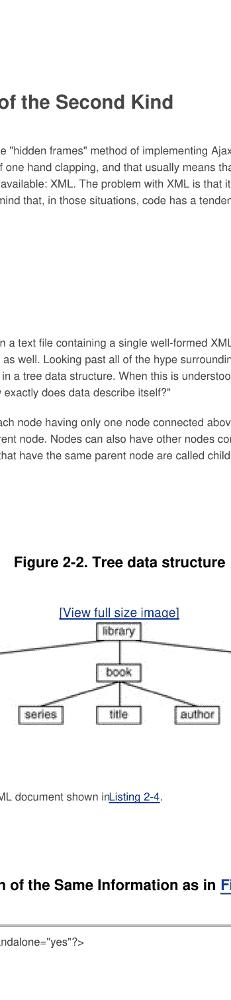

图 2-2 也可以用清单 2-4 所示的 XML 文档来表示。

#### 清单 2-4. 与图 2-2 信息相同的 XML 表示

```xml
<?xml version="1.0" encoding="UTF-8" standalone="yes"?><library> <book> <series>The Wonderland Gambit</series> <title>The Cybernetic Walrus</title> <author>Jack L. Chalker</author> </book> <book> <series>The Wonderland Gambit</series> <title>The March Hare Network</title> <author>Jack L. Chalker</author> </book> <book> <series>The Wonderland Gambit</series> <title>The Hot-Wired Dodo</title> <author>Jack L. Chalker</author> </book></library>
```

[清单 2-4](Listing%202-4)中显示的节点被称为 *元素*，它们与 HTML 标签非常相似。和 HTML 标签一样，开始标签以`<`开头，而结束标签以`</`开头。然而，与 HTML 标签不同，所有 XML 标签要么必须有结束标签，要么是自闭合的，要么必须是空元素。自闭合标签以`/`结尾；如果省略了斜杠，文档就不是格式良好的。除了所有元素都必须关闭或自闭合外，标签还必须始终按顺序匹配。这意味着[清单 2-5](Listing%202-5)中的 XML 文档是格式良好的，但[清单 2-6](Listing%202-6)中的 XML 文档则不是格式良好的。简而言之，“格式良好”意味着万物各得其所。脚就是一个很好的例子：想象一下如果伊戈尔用了两只左脚；这个怪物就不会是“格式良好”的，也无法跳舞。

#### 清单 2-5. 一个格式良好的 XML 文档

```xml
<?xml version="1.0" encoding="UTF-8" standalone="yes"?><one> <two> <three> <four/> </three></two></one>
```

#### 清单 2-6. 一个格式不良好的 XML 文档

```html
<table>

<tr>

<th colspan='3' style="text-align:center;"><?xml version=&quot;1.0&quot; encoding=&quot;utf-8&quot; ?><time>3:30 PM</time></th>

</tr>

<tr>

<td>&lt;?</td><td&gt;</td><td>&gt;</td>

</tr>

<span class="warning">This document was created by an unregistered ChmMagic, please go to http://www.bisenter.com to register it. Thanks.</span>

    </three></two><one></table>
```

与服务器通信的隐藏帧方法虽然巧妙且高效，但添加 XML 文档提供了另一种选择：*XMLHTTP*，或者，正如有些人所称的，`XMLHTTPRequest`对象。注意那些大写字母，它们旨在强调其重要性。`XMLHTTPRequest`对象向服务器发送信息并从服务器检索信息。尽管不一定必须如此，但这些信息通常以 XML 形式存在，因此比服务器发送的常规 HTML 更紧凑。以防你感兴趣，在“它不会眨眼”事件中我手写并使用的那个页面就是使用这种通信方式的。

### 2.5.2. XMLHttpRequest 对象

与隐藏帧方法不同（在该方法中，卸载/重新加载周期仍然存在，只是被隐藏起来），使用`XMLHttpRequest`对象意味着最终告别我们大家都已熟知并憎恶的卸载/重新加载周期。这意味着，理论上（即使不是在实践中），一个页面完全可以成为一个完整的网站。基本上，这是一个加载即用的安排。


理论上，原始页面加载后，用户在表单中输入信息并点击提交。一个 JavaScript 事件处理程序通过 XMLHTTP 将用户信息发送到服务器，并虔诚地等待响应（同步）或为响应设置事件处理程序（异步）。当收到响应时，JavaScript 执行其编程设定的任何操作，包括更新页面的部分内容；因此，不存在卸载/重新加载周期。”这是很好的理论，但如果理论不能付诸实践，那它就相当没用；让我们通过清单 2-7 和 2-8 看看如何从客户端角度实现这一点。

##### 清单 2-7 Ajax 网页示例

```html
<html> <head> <title>AJAX Internet Explorer Flavor</title> <script language="javascript"> var dom = new ActiveXObject('MSXML2.FreeThreadedDOMDocument.3.0'); var objXMLHTTP = new ActiveXObject('Microsoft.XMLHTTP'); /* Obtain the XML document from the web server. */ function initialize() { var strURL = 'msas.asmx/getTime'; objXMLHTTP.open('POST',strURL,true); objXMLHTTP.onreadystatechange = stateChangeHandler; try { objXMLHTTP.send(); } catch(e) { alert(e.description); }
} /* Handle server response to XMLHTTP requests. */ function stateChangeHandler() { if(objXMLHTTP.readyState == 4){ try{ dom.loadXML(objXMLHTTP.responseText);}catch(e){ document.getElementById('time').innerText = 'Dom.selectSingleNode('time').text;}}catch(e){ }} </script> </head><body onload="initialize()"> <div id="time"></div></body></html>
```

##### 清单 2-8 XML 文档

```xml
<?xml version="1.0" encoding="utf-8"?><time>3:30 PM</time>
```

如果这是《犯罪现场调查》，或者《神探可伦坡》（甚至《瘦子》），现在正是主角解释作案手法的时候。大致如下：HTML 页面加载，触发 `onload` 事件处理程序 `initialize()`。在此函数中，调用了 JavaScript `XMLHttpRequest` 对象的 `open` 方法，该方法仅设置方法（POST）、提供 Web 服务的相对 URL，并声明请求将是异步的（`true`）。接下来，设置了 `onreadystatechange` 事件处理程序；这是处理 Web 服务响应时要执行的函数。最后，调用 `XMLHttpRequest` 对象的 `send` 方法，将我们的请求愉快地发送出去。

当从 Web 服务收到响应时，`stateChangeHandler` 被触发。你可能已经注意到了对 `readyState` 属性的测试。这样做的原因是存在多种可能的就绪状态值（注：修正了笔误），而我们只对四个特定状态感兴趣（“完成”是其中之一）。当响应完成时，结果被加载到 XML 文档中；选择了相应的节点；并自动更新了 HTML。”

有些人可能认为清单 2-7 和 2-8 是 Ajax 的纯正示例。不幸的是，它当前的编码方式意味着除了微软 Internet Explorer 浏览器之外的其他浏览器会遇到真正的问题（注：修正了笔误）。什么样的问题？由于 XML 和 `XMLHttpRequest` 对象在不同浏览器中的工作方式存在差异，代码根本无法工作。这并不意味着这种形式的 Ajax 是仅限 IE 的技术；它仅仅意味着需要仔细规划以确保跨浏览器兼容性。

关于兼容性，我不想吓到你，但让我指出，客户端编码越高级，出现问题的可能性就越大。其中大多数问题只是些小烦恼：类似于苍蝇在周围嗡嗡作响。这些“苍蝇”并非致命；然而，将这些事情记在心里是个好主意（注：修正了语法错误）。

## 2.6 第三类 Ajax 邂逅

Ajax 的第五部分，一个可选部分，并不适合胆小之人。它超越了“疯狂科学家 stuff”的领域，进入了魔法的境界，它被称为**eXtensible Stylesheet Language for Transformations**，简称 XSLT。换句话说，如果 Ajax 真的是疯狂科学，并且在学校里教授的话，这将是一门 400 级别的课程。为什么？原因是这项技术既相对较新，又非常、非常依赖浏览器。然而，当它正常工作时，这种方法能为用户提供难以置信的体验。

### 2.6.1 XSLT

XSLT 是一种基于 XML 的语言，用于将 XML 转换为其他形式。XSLT 将样式表（XSLT）作为输入应用于 XML 文档，并在大多数情况下生成输出，通常是 XHTML 或其他某种形式的 XML。然后，这些 XHTML 会在浏览器中显示，literally 在“眨眼之间”。

关于 XSLT 的一个有趣之处是，除了要求 XML 格式良好之外，XML 来自哪里其实并不重要。这为 XML 的来源带来了一些有趣的可能性。例如，正如你可能已经知道的，数据库查询可以返回 XML。但你知道 Excel 电子表格可以保存为 XML 吗？XSLT 可用于转换任何源自 XML 的语言，无论其来源如何。

清单 2-9 展示了一个简单的仅限 Internet Explorer 的网页，与前面的示例类似。通过使用 XSLT 和 `XMLHttpRequest` 对象来检索清单 2-10 中所示的 XML 和 XSLT，它极其灵活。这是因为在初始页面加载后，只需独立悬架只需更改 XML 和/或 XSLT 就可以生成任何可以想象的页面。听起来很强大，不是吗？

##### 清单 2-9 一个简单的仅限 IE 的网页

```html
<html>
  <head>
    <title>AJAX Internet Explorer Flavor</title>
    <script language="javascript">
var dom = new ActiveXObject('MSXML2.FreeThreadedDOMDocument.3.0');
var xslt = new ActiveXObject('MSXML2.FreeThreadedDOMDocument.3.0');
var objXMLHTTP;

/*
    Obtain the initial XML document from the web server.
*/
function initialize()
{
    doPOST(true);
}

/*
    Use the XMLHttpRequest to communicate with a web service.
*/
function doPOST(blnState) {
	var strURL = 'http://localhost/AJAX/msas.asmx';

	objXMLHTTP = new ActiveXObject('Microsoft.XMLHTTP');

	objXMLHTTP.open('POST',strURL,true);

	if(blnState)
		objXMLHTTP.setRequestHeader('SOAPAction','http://tempuri.org/getState');
	else
	objXMLHTTP.setRequestHeader('SOAPAction','http://tempuri.org/getXML');

	objXMLHTTP.setRequestHeader('Content-Type','text/xml');

	objXMLHTTP.onreadystatechange = stateChangeHandler;

	try
	{
	objXMLHTTP.send(buildSOAP(blnState));
	}
	catch(e)
	{
	alert(e.description);
	}
}

/* Construct a SOAP envelope. */

function buildSOAP(blnState) {
	var strSOAP = '<?xml version="1.0" encoding="UTF-8"?>';
	strSOAP += '<soap:Envelope
	xmlns:xsi="http://www.w3.org/2001/XMLSchema-instance"
	xmlns:xsd="http://www.w3.org/2001/XMLSchema"
	xmlns:soap="http://schemas.xmlsoap.org/soap/envelope">';
	strSOAP += '<soap:Body>';

	if(blnState)
	{
		strSOAP += '<getState xmlns="http://tempuri.org"/>';
		strSOAP += '<state_abbreviation>'; 
		strSOAP += '</getState>';
	}
	else
	{
		strSOAP += '<getXML xmlns="http://tempuri.org">'; 
		strSOAP += '<name>xsl/state.xsl</name>'; 
		strSOAP += '</getXML>'; 
	}

	strSOAP += '</soap:Body>';
	strSOAP += '</soap:Envelope>';

	return(strSOAP);
}

/* Handle server response to XMLHTTP requests. */
function stateChangeHandler()
{
	if(objXMLHTTP.readyState == 4)
		try
		{
			var work = new ActiveXObject('MSXML2.FreeThreadedDOMDocument.3.0');

			work.loadXML(objXMLHTTP.responseText);

			switch(true) {
				case(work.selectNodes('//getStateResponse').length != 0):
					dom.loadXML(objXMLHTTP.responseText);
					doPOST(false);

					break;
				case(work.selectNodes('//getXMLResponse').length != 0):
					var objXSLTemplate = new ActiveXObject('MSXML2.XSLTemplate.3.0');

				xslt.loadXML(work.selectSingleNode('//getXMLResult').firstChild.xml);

					objXSLTemplate.stylesheet = xslt;

					var objXSLTProcessor = objXSLTemplate.createProcessor;

					objXSLTProcessor.input = dom;
					objXSLTProcessor.transform();

					document.getElementById('select').innerHTML = objXSLTProcessor.output;

					break;
				default:
					alert('error');

					break;
			}
		}
		catch(e) { }
}
</script>
</head>
<body onload="initialize()">
<div id="select"></div>
</html>
```

verbatim

##### 清单 2-10 XML 和 XSLT 部分

```xml
<?xml version="1.0" encoding="UTF-8"?>

<xsl:stylesheet version="1.0"

xmlns:xsl="http://www.w3.org/1999/XSL/Transform">

<xsl:output method="html" version="1.0" encoding="UTF-8" indent="yes">

<xsl:template match="/">

  <xsl:element name="select">

    <xsl:attribute name="id">state</xsl:attribute>

    <xsl:attribute name="name">selState</xsl:attribute>

    <xsl:apply-templates select="//Table[country_id = 1]"/>

  </xsl:element>

</xsl:template>

<xsl:template match="Table">

  <xsl:element name="option">

    <xsl:attribute name="value"><xsl:value-of select="state_abbreviation"/></xsl:attribute>

    <xsl:value-of select="state_name"/>

  </xsl:element>

</xsl:template>

<xsl:stylesheet>
```


### 2.6.2. 主题变奏

乍看之下，前一个示例中的 JavaScript 似乎与清单 2-7 中所示的非常相似；然而，事实远非如此。第一个差异在于对 Web 服务的两次调用，以及使用 XSLT 生成要在浏览器中显示的 HTML。让我们更详细地看看这一点。

首先，`initialize` 函数所做的唯一一件事就是调用另一个函数 `doPOST`，并传入一个 `TRUE`。检查 `doPOST` 可以发现，`true` 的用途是指示请求头中的 SOAPAction 是什么，`http://tempuri.org/getState` 用于从 Web 服务获取有关州和省的信息，还是 `http://tempuri.org/getXML` 用于从 Web 服务获取 XML/XSLT。然而，第一次运行时，我们获取的是 XML。

第二个差异，也在 `doPOST` 中，是在 `XMLHttpRequest` 对象的 `send` 中添加了调用 `buildSOAP`。这就是将参数传递给 Web 服务的方式，在本例中以 SOAP 请求文本的形式。查看 `buildSOAP`，你会注意到来自 `doPOST` 的布尔值被传入，以指示 SOAP 请求的主体应该是什么。基本上，这就是需要从 Web 服务获取什么信息，是州信息还是 XSLT。

你会记得前面一组示例中的 `stateChangeHandler`，虽然它很相似，但也有一些不同之处。首先映入眼帘的是添加了一个“work” XML 文档，加载后用于测试特定节点：`getStateResponse` 和 `getXMLResponse`。前者表示 SOAP 响应来自对 Web 服务的 `getState` 方法的请求，后者表示来自 `getXML` 方法的响应。还要注意处理 `getState` 响应的部分中，`doPOST` 带有一个 `false` 参数；其目的是获取用于 XSL 转换的 XSLT。

说到转换，这就是你在 `stateChangeHandler` 函数的 `getXML` 部分中可能不认识的代码的目的。请允许我指出所使用的 `selectSingleNode` 方法，其目的是从 XSLT 中移除 SOAP。原因是当 XSLT 被包裹在 SOAP 响应中时，它根本无法工作。最后的几行 JavaScript 执行转换并将结果插入到页面的 HTML 中。

使用 XSLT 即时生成 HTML 提供了一些其他两种实现 Ajax 的方法所不具备的有趣可能性。例如，在前面的示例中，页面的外观由硬编码的 HTML 决定，而使用 XSLT 时不一定需要这样。试想一下，一个页面使用多个样式表来改变页面的外观和感觉。此外，凭借 XSLT 的速度，这种改变会以 Windows 应用程序的速度发生，而不是 Web 应用程序通常的缓慢速度。

## 如何撰写研究论文：初学者指南

撰写研究论文可能颇具挑战，但以下简单步骤可以为你指引方向：

1. **选择主题** — 选择你感兴趣的方向。
2. **开展研究** — 使用书籍和期刊等可靠来源。
3. **创建大纲** — 在动笔前组织你的核心观点。
4. **撰写论文** — 遵循引言、正文和结论的结构。
5. **修订与编辑** — 检查语法、清晰度和引用是否规范。

遵循这些步骤将使你的研究论文条理清晰、结构严谨。

| 组成部分 | 目的 |
|---|---|
| 引言 | 介绍主题与论点陈述 |
| 正文段落 | 陈述论点与论据 |
| 结论 | 总结核心观点 |

## 2.7. 事物未来的形态

本章的唯一目的是提供一个对未来形态的管窥之见，既包括本书的内容，也涵盖行业的展望。不开玩笑地说，这种预见并非源于疯狂科学或任何其他黑暗艺术。它是多年“驯服”各种网络浏览器的结果，是持续推动技术边界、创造具有统一行为模式的丰富应用界面的成果。

Ajax 所涵盖的广泛技术可能是一把双刃剑。一方面，开发者可使用的工具具有极高的灵活性。另一方面，目前 Ajax 应用的构建方式，与 1990 年代末 DHTML 页面的拼凑方式如出一辙。不幸的是，尽管手工打造的方法适用于家具和怪物，但它却极度依赖开发者伊戈尔的技能水平。

在后续章节中，我打算详细阐述本章简要触及的各种技巧。此外，尽管 Ajax 目前被认为开发时间比“传统” Web 开发方法更长，但我将展示一些缩短这一时间的思路。毕竟，哪个自尊的疯狂科学家会手工打造每一个怪物呢？这都是为了制造工具的工具，我是说怪物。

本文档由未注册的 ChmMagic 创建，请访问`http://www.bisenter.com`进行注册。谢谢

## 2.8. 总结

本章首先简要介绍了 Ajax，包括其起源以及使用“疯狂科学东西”所引发的一些问题，例如被指责将界面原型当作实际应用，以及难以描述其工作原理。当然，有些人一听到 Ajax 仍然会联想到科林斯头盔和重装步兵，但你无法取悦所有人。

接着，简要概述了 Ajax 背后的哲学，其核心思想是尽可能减少对服务器的打扰。目标是减少（如果不是消除）卸载/重新加载周期，或有些人所说的“闪烁”。Ajax 的哲学还包括让客户端计算机“工作起来”的理念。毕竟，个人计算机以某种形式存在已近 30 年；它们应该干些活——倒垃圾、修剪草坪，或做点别的什么。

最后，我展示了三个 Ajax 如何实现的简单示例。第一个示例，虽然算不上完全的 Ajax，但它很好地展示了早期尝试实现具有 Windows 应用体验的 Web 应用的情况。尽管以今天的标准看它很原始，但它仍然优于当今 99% 的网页。

第二个示例使用`XMLHTTPRequest`对象，精确体现了 Ajax 应用的期望。它打破了自互联网诞生以来一直束缚着我们的、将更新限制在卸载/重新加载周期中的枷锁。此外，XML 与减少流量的概念配合得很好。

第三个也是最后一个示例，通过将 XSLT 融入其中，将 Ajax 推向了当前的极限。XSLT 允许我们将 XML 扭转、拉伸成任何我们能想象的形状。我们的造物不再局限于能找到的现成零件；我们可以按需制造自己的零件。

## 第 3 章 HTML/XHTML

如果你已经读到这里，那么你已经进入了本书的“公路战士”部分，这里充满了参考资料和各种奇特的想法。这一部分的起源可以追溯到我的汽车后备箱——除非你是英国人，那么起源可以追溯到我的汽车的行李箱。直到不久之前，如我先前所述，我是一名顾问、一名雇佣枪手、一名独角戏推销员，或一名驻场访客。无论你喜欢哪个术语，拥有带书架的固定办公室对我来说都不是一种选择。所以我被迫每天把书带来带去。

这真是一次富有教育意义的经历。我从计算机书籍中学到了一些你难以置信的知识。首先，无论主题和类型如何，精装还是平装，计算机书籍都很重。其次，有一条鲜为人知的计算机书籍定律——我们称之为“艾德的计算机书籍定律”。大意是：“无论主题是什么，你需要知道的内容总是在另一本书里。”

这是真的；我已经记不清有多少次，我需要的信息还在我车里的那本书上。所以如果车停在附近，我就得下楼走到车旁，取回那本书，然后再上楼，结果发现我又需要另一本书。这就是本章的目的：让我可以安坐在这里，而不必跑到车旁去取书。

如果你不像我这么懒，愿意携带不止一本书，那么可以把本章看作是关于 Ajax 几个基础构件的复习。嗯，也许从技术上讲这不算复习，因为 XHTML 对一些人来说仍然有点神秘。这可能是因为那个“X”。

本章涵盖了开发 Ajax 应用所需的一些背景知识，特别是 HTML 和 XHTML。很可能，你对这里涵盖的许多（如果不是全部）材料都很熟悉。但因为我在宾夕法尼亚州写这本书，而你无论在哪里阅读它，我都很难专门针对你的需求来撰写。

## 3.1. HTML 与 XHTML 的区别

从一开始，超文本标记语言就是万维网得以实现的基础。它既传达了页面创建者的思想，也定义了我们访问的每一个网页上几乎所有可见方面。像英语、法语、西班牙语、日本语、俄语或当今使用的任何其他语言一样，它是一种活的语言，在不断演进和发展。

早期，这种增长是迅速而突然的，各种“特性”常常绕过万维网联盟的规范。再加上许多网页设计师为了内容比别人多而随意变通。即使牺牲一些细节又如何？一切为了内容，内容为王。

于是 XHTML 出现了，被一些人视为试图通过将 HTML 变成 XML 的一种方言来约束 Web 开发中“狂野西部”式做法的努力。XHTML 有三种类型：过渡型、严格型和框架集型，每种类型提供不同的功能或不同程度地符合 XML 标准。

### 3.1.1. 格式不正确

HTML 和 XHTML 之间最大的单一区别可能是 XHTML 必须格式正确。“没什么大不了的，”你可能会说。嗯，可能有关系。文档中格式不正确的部分并不一定是明显的错误，就像额头上长了一只脚。因为 XHTML 文档本质上是 XML，仅仅沿用我们多年来的 HTML 做法就足以让我们陷入麻烦。考虑以下两条 HTML 输入语句：

```html
<input type="text" name="bad" id="bad" value="Not well-formed">
```

```html
<input type="text" name="alsobad" id="alsobad"
value="Not well-formed" disabled>
```

这两条语句都是完全可接受的 HTML，但作为 XHTML，它们却不合格，因为两者都不是格式正确的。第一条语句的问题在于标签没有关闭——这在 HTML 中完全可接受，但在 XHTML 中是禁止的。幸运的是，纠正它很简单；只需以自闭合标签的方式关闭它，或将其视为容器标签。第二条语句的问题可能更难发现。给你一个提示：属性。是的，在 XML 中，属性必须始终有值，所以给它一个值。`disabled="disabled"` 看起来可能有点怪，但它能工作。

### 3.1.2. 格式正确

乍一看，似乎将 HTML 转换为 XHTML 只需要在 HTML 标签前添加一个 DTD，关闭一些标签，并清理一些属性。瞧，瞬间变成 XHTML！嗯，也许吧，有时，偶尔，除非是在星期二或满月的夜晚。你看，不幸的是，仍然存在潜在的问题源。

大约在我创建第一个 XHTML 页面后 5 分钟，我就偶然发现了这个问题，我立刻感到被背叛了。问题的源头是我 JavaScript 函数中的比较操作。由于各种比较使用了和号（`&`）、大于号（`>`）和小于号（`<`），导致文档格式不正确。在绝望中，我体会到了维克多·弗兰肯斯坦的感受，被自己创造的怪物所击倒。哦，多么讽刺！

### 3.1.3. 一个格式规范的示例

谢天谢地，我的绝望并没有持续太久。这并非像家里有人去世，或者《星际之门：SG-1》被取消，或发生其他类似重大事件。它只是人生道路上的一个技术性减速带（对于宾夕法尼亚州的朋友来说，或许是一只白尾鹿）。

我并不担心，因为我知道一个能让任何事物都变得格式规范的技巧。

XHTML 实际上只是 XML 的一种方言，这与 XSL 和 SVG 是同样的道理。这意味着虽然它遵循 XML 的规则，但也适用于这些规则的例外情况。例如，有两种方法可以确保大于号是格式规范的，但由于 JavaScript 无法处理`&gt;`，实体引用并非选项。这使得 CDATA 成为向浏览器隐藏 JavaScript 的唯一途径。

如果你不熟悉 CDATA，它相当于 XML 中的“请勿注意幕后那个人”。基本上，CDATA 内的任何内容都不会被解析为 XML，这在此情况下非常方便。然而，使用 CDATA 存在一个问题：某些浏览器会出现兼容性问题，因此有必要按照清单 3-1 所示的方式将其从浏览器中隐藏起来。

##### 清单 3-1. 隐藏 CDATA

```javascript
<!-- <![CDATA[

function xyzzy(a,b) {

 if(a > b)

    alert('a is bigger');

 else

    if(a = b)

    alert('a & b are equal');

 else

    alert('b is bigger')

}

// ]]> -->
```


HTML/XML 注释的目的是将 CDATA 部分从 HTML 中隐藏。JavaScript 注释则防止特定浏览器从 JavaScript 角度出现问题。虽然它看起来可能不太美观，但效果很好。

## 3.2. 元素和属性

我不确定为什么，但似乎存在一条法律，规定书籍中用于参考的部分必须既枯燥又乏味。请耐心听我描述元素和属性之间的关系时，努力遵循这一法则。不幸的是，美国教育体系在教导学生如何用单调的语气写作方面有所欠缺，但我会尽力而为。

### 3.2.1. XHTML 元素及其属性简要概述

出于无聊的目的，我整理了[表 3-1](Table 3-1)，涵盖了属性及其关联的元素。由于这是一个高级概述——大约在 30,000 英尺的高空——除了“这个元素与那个属性相关”之外，没有太多内容。然而，参考此表时，有两点需要牢记。

| 元素 | 描述 | 已弃用 | 属性 |
| --- | --- | --- | --- |
| `a` | 锚点 |  | `accesskey`, `charset`, `class`, `coords`, `dir`, `href`, `hreflang`, `id`, `lang`, `name`, `onblur`, `onclick`, `ondblclick`, `onfocus`, `onkeydown`, `onkeypress`, `onkeyup`, `onmousedown`, `onmousemove`, `onmouseout`, `onmouseover`, `onmouseup`, `rel`, `rev`, `shape`, `style`, `tabindex`, `target`, `title`, `type` |
| `abbr` | 缩写 |  | `class`, `dir`, `id`, `lang`, `onclick`, `ondblclick`, `onkeydown`, `onkeypress`, `onkeyup`, `onmousedown`, `onmousemove`, `onmouseout`, `onmouseover`, `onmouseup`, `style`, `title` |
| `acronym` | 首字母缩略词 |  | `class`, `dir`, `id`, `lang`, `onclick`, `ondblclick`, `onkeydown`, `onkeypress`, `onkeyup`, `onmousedown`, `onmousemove`, `onmouseout`, `onmouseover`, `onmouseup`, `style`, `title` |
| `address` | 作者信息 |  | `class`, `dir`, `id`, `lang`, `onclick`, `ondblclick`, `onkeydown`, `onkeypress`, `onkeyup`, `onmousedown`, `onmousemove`, `onmouseout`, `onmouseover`, `onmouseup`, `style`, `title` |
| `applet` | Java 小程序 | 是 | `align`, `alt`, `archive`, `class`, `code`, `codebase`, `height`, `hspace`, `id`, `name`, `object`, `style`, `title`, `vspace`, `width` |
| `area` | 客户端图像映射区域 |  | `accesskey`, `alt`, `class`, `coords`, `dir`, `href`, `id`, `lang`, `nohref`, `onblur`, `onclick`, `ondblclick`, `onfocus`, `onkeydown`, `onkeypress`, `onkeyup`, `onmousedown`, `onmousemove`, `onmouseout`, `onmouseover`, `onmouseup`, `shape`, `style`, `tabindex`, `target`, `title` |
| `b` | 粗体 |  | `class`, `dir`, `id`, `lang`, `onclick`, `ondblclick`, `onkeydown`, `onkeypress`, `onkeyup`, `onmousedown`, `onmousemove`, `onmouseout`, `onmouseover`, `onmouseup`, `style`, `title` |
| `base` | 文档基础 URI |  | `href`, `lang`, `target` |
| `basefont` | 文档基础字体大小 | 是 | `color`, `face`, `id`, `size` |
| `bdo` | 双向覆盖 |  | `class`, `id`, `lang`, `style`, `title` |
| `big` | 大文本 |  | `class`, `dir`, `id`, `lang`, `onclick`, `ondblclick`, `onkeydown`, `onkeypress`, `onkeyup`, `onmousedown`, `onmousemove`, `onmouseout`, `onmouseover`, `onmouseup`, `style`, `title` |
| `blockquote` | 块引用 |  | `cite` |
| `body` | 文档主体 |  | `alink`, `background`, `bgcolor`, `class`, `dir`, `id`, `lang`, `link`, `onclick`, `ondblclick`, `onkeydown`, `onkeypress`, `onload`, `onmousedown`, `onmousemove`, `onmouseout`, `onmouseover`, `onmouseup`, `onunload`, `style`, `text`, `title`, `vlink` |
| `br` | 换行符 |  | `class`, `clear`, `id`, `style`, `title` |
| `button` | 按钮对象 |  | `accesskey`, `class`, `dir`, `disabled`, `id`, `lang`, `name`, `onblur`, `onclick`, `ondblclick`, `onfocus`, `onkeydown`, `onkeypress`, `onkeyup`, `onmousedown`, `onmousemove`, `onmouseout`, `onmouseover`, `onmouseup`, `style`, `tabindex`, `title`, `type`, `value` |
| `caption` | 表格标题 |  | `align`, `class`, `dir`, `id`, `lang`, `onclick`, `ondblclick`, `onkeydown`, `onkeypress`, `onkeyup`, `onmousedown`, `onmousemove`, `onmouseout`, `onmouseover`, `onmouseup`, `style`, `title` |
| `center` | 居中内容 | 是 | `class`, `dir`, `id`, `lang`, `onclick`, `ondblclick`, `onkeydown`, `onkeypress`, `onkeyup`, `onmousedown`, `onmousemove`, `onmouseout`, `onmouseover`, `onmouseup`, `style`, `title` |
| `code` | 代码片段 |  | `class`, `dir`, `id`, `lang`, `onclick`, `ondblclick`, `onkeydown`, `onkeypress`, `onkeyup`, `onmousedown`, `onmousemove`, `onmouseout`, `onmouseover`, `onmouseup`, `style`, `title` |
| `col` | 表格列 |  | `align`, `char`, `charoff`, `class`, `dir`, `id`, `lang`, `onclick`, `ondblclick`, `onkeydown`, `onkeypress`, `onkeyup`, `onmousedown`, `onmousemove`, `onmouseout`, `onmouseover`, `onmouseup`, `style`, `title`, `valign`, `width` |
| `colgroup` | 表格列组 |  | `align`, `char`, `charoff`, `class`, `dir`, `id`, `lang`, `onclick`, `ondblclick`, `onkeydown`, `onkeypress`, `onkeyup`, `onmousedown`, `onmousemove`, `onmouseout`, `onmouseover`, `onmouseup`, `span`, `style`, `title`, `valign`, `width` |
| `dd` | 定义描述 |  | `class`, `dir`, `id`, `lang`, `onclick`, `ondblclick`, `onkeydown`, `onkeypress`, `onkeyup`, `onmousedown`, `onmousemove`, `onmouseout`, `onmouseover`, `onmouseup`, `style`, `title` |
| `del` | 删除的文本 |  | `cite`, `class`, `datetime`, `dir`, `id`, `lang`, `onclick`, `ondblclick`, `onkeydown`, `onkeypress`, `onkeyup`, `onmousedown`, `onmousemove`, `onmouseout`, `onmouseover`, `onmouseup`, `style`, `title` |
| `dfn` | 定义实例 |  | `class`, `dir`, `id`, `lang`, `onclick`, `ondblclick`, `onkeydown`, `onkeypress`, `onkeyup`, `onmousedown`, `onmousemove`, `onmouseout`, `onmouseover`, `onmouseup`, `style`, `title` |
| `dir` | 目录列表 | 是 | `class`, `compact`, `dir`, `id`, `lang`, `onclick`, `ondblclick`, `onkeydown`, `onkeypress`, `onkeyup`, `onmousedown`, `onmousemove`, `onmouseout`, `onmouseover`, `onmouseup`, `style`, `title` |
| `div` | 样式容器 |  | `align`, `class`, `dir`, `id`, `lang`, `onclick`, `ondblclick`, `onkeydown`, `onkeypress`, `onkeyup`, `onmousedown`, `onmousemove`, `onmouseout`, `onmouseover`, `onmouseup`, `style`, `title` |
| `dl` | 定义列表 |  | `class`, `compact`, `dir`, `id`, `lang`, `onclick`, `ondblclick`, `onkeydown`, `onkeypress`, `onkeyup`, `onmousedown`, `onmousemove`, `onmouseout`, `onmouseover`, `onmouseup`, `style`, `title` |
| `dt` | 定义术语 |  | `class`, `dir`, `id`, `lang`, `onclick`, `ondblclick`, `onkeydown`, `onkeypress`, `onkeyup`, `onmousedown`, `onmousemove`, `onmouseout`, `onmouseover`, `onmouseup`, `style`, `title` |
| `em` | 强调 |  | `class`, `dir`, `id`, `lang`, `onclick`, `ondblclick`, `onkeydown`, `onkeypress`, `onkeyup`, `onmousedown`, `onmousemove`, `onmouseout`, `onmouseover`, `onmouseup`, `style`, `title` |
| `fieldset` | 表单控件组 |  | `class`, `dir`, `id`, `lang`, `style`, `title` |
| `font` | 字体更改 | 是 | `class`, `color`, `dir`, `face`, `id`, `lang`, `onclick`, `ondblclick`, `onkeydown`, `onkeypress`, `onkeyup`, `onmousedown`, `onmousemove`, `onmouseout`, `onmouseover`, `onmouseup`, `size`, `style`, `title` |
| `form` | 输入表单 |  | `accept-charset`, `accept`, `action`, `class`, `dir`, `enctype`, `id`, `lang`, `method`, `name`, `onclick`, `ondblclick`, `onkeydown`, `onkeypress`, `onkeyup`, `onmousedown`, `onmousemove`, `onmouseout`, `onmouseover`, `onmouseup`, `onreset`, `onsubmit`, `style`, `target`, `title` |
| `frame` | 框架集窗口 |  | `class`, `frameborder`, `id`, `longdesc`, `marginheight`, `marginwidth`, `name`, `noresize`, `scrolling`, `src`, `style`, `title`, `width` |

本文档由未注册的 ChmMagic 创建，请访问 `http://www.bisenter.com` 进行注册。谢谢

| 元素 | 描述 | 已弃用 | 属性 |
| --- | --- | --- | --- |
| `frameset` | 窗口分割集合 |  | `class`, `cols`, `id`, `onload`, `onunload`, `style`, `title` |
| `h1` | 标题 |  | `align`, `class`, `dir`, `id`, `lang`, `onclick`, `ondblclick`, `onkeydown`, `onkeypress`, `onkeyup`, `onmousedown`, `onmousemove`, `onmouseout`, `onmouseover`, `onmouseup`, `style`, `title` |
| `h2` | 标题 |  | `align`, `class`, `dir`, `id`, `lang`, `onclick`, `ondblclick`, `onkeydown`, `onkeypress`, `onkeyup`, `onmousedown`, `onmousemove`, `onmouseout`, `onmouseover`, `onmouseup`, `style`, `title` |
| `h3` | 标题 |  | `align`, `class`, `dir`, `id`, `lang`, `onclick`, `ondblclick`, `onkeydown`, `onkeypress`, `onkeyup`, `onmousedown`, `onmousemove`, `onmouseout`, `onmouseover`, `onmouseup`, `style`, `title` |
| `h4` | 标题 |  | `align`, `class`, `dir`, `id`, `lang`, `onclick`, `ondblclick`, `onkeydown`, `onkeypress`, `onkeyup`, `onmousedown`, `onmousemove`, `onmouseout`, `onmouseover`, `onmouseup`, `style`, `title` |
| `h5` | 标题 |  | `align`, `class`, `dir`, `id`, `lang`, `onclick`, `ondblclick`, `onkeydown`, `onkeypress`, `onkeyup`, `onmousedown`, `onmousemove`, `onmouseout`, `onmouseover`, `onmouseup`, `style`, `title` |
| `h6` | 标题 |  | `align`, `class`, `dir`, `id`, `lang`, `onclick`, `ondblclick`, `onkeydown`, `onkeypress`, `onkeyup`, `onmousedown`, `onmousemove`, `onmouseout`, `onmouseover`, `onmouseup`, `style`, `title` |
| `head` | HTML 文档头部 |  | `dir`, `lang`, `profile` |
| `hr` | 水平线 |  | `align`, `class`, `dir`, `id`, `lang`, `noshade`, `onclick`, `ondblclick`, `onkeydown`, `onkeypress`, `onkeyup`, `onmousedown`, `onmousemove`, `onmouseout`, `onmouseover`, `onmouseup`, `size`, `style`, `title`, `width` |
| `html` | HTML 文档根元素 |  | `dir`, `lang`, `version` |
| `i` | 斜体 |  | `class`, `dir`, `id`, `lang`, `onclick`, `ondblclick`, `onkeydown`, `onkeypress`, `onkeyup`, `onmousedown`, `onmousemove`, `onmouseout`, `onmouseover`, `onmouseup`, `style`, `title` |
| `iframe` | 内联框架 |  | `align`, `class`, `frameborder`, `height`, `id`, `longdesc`, `marginheight`, `name`, `scrolling`, `src`, `style`, `title` |
| `img` | 嵌入式图像 |  | `align`, `alt`, `border`, `class`, `dir`, `height`, `hspace`, `id`, `ismap`, `lang`, `longdesc`, `name`, `onclick`, `ondblclick`, `onkeydown`, `onkeypress`, `onkeyup`, `onmousedown`, `onmousemove`, `onmouseout`, `onmouseover`, `onmouseup`, `src`, `style`, `title`, `usemap`, `vspace`, `width` |
| `input` | 表单输入控件 |  | `accept`, `accesskey`, `align`, `alt`, `checked`, `class`, `dir`, `disabled`, `id`, `ismap`, `lang`, `maxlength`, `name`, `onblur`, `onchange`, `onclick`, `ondblclick`, `onfocus`, `onkeydown`, `onkeypress`, `onkeyup`, `onmousedown`, `onmousemove`, `onmouseout`, `onmouseover`, `onmouseup`, `onselect`, `readonly`, `size`, `src`, `style`, `tabindex`, `title`, `type`, `usemap`, `value` |
| `ins` | 插入的文本 |  | `cite`, `class`, `datetime`, `dir`, `id`, `lang`, `onclick`, `ondblclick`, `onkeydown`, `onkeypress`, `onkeyup`, `onmousedown`, `onmousemove`, `onmouseout`, `onmouseover`, `onmouseup`, `style`, `title` |
| `isindex` | 单行输入提示 | 是 | `class`, `dir`, `id`, `lang`, `prompt`, `style`, `title` |
| `kbd` | 键盘文本输入 |  | `class`, `dir`, `id`, `lang`, `onclick`, `ondblclick`, `onkeydown`, `onkeypress`, `onkeyup`, `onmousedown`, `onmousemove`, `onmouseout`, `onmouseover`, `onmouseup`, `style`, `title` |
| `label` | 表单文本字段 |  | `accesskey`, `for`, `onblur`, `onfocus` |
| `legend` | 字段集图例 |  | `accesskey`, `align`, `class`, `dir`, `id`, `lang`, `onclick`, `ondblclick`, `onkeydown`, `onkeypress`, `onkeyup`, `onmousedown`, `onmousemove`, `onmouseout`, `onmouseover`, `onmouseup`, `style`, `title` |
| `li` | 列表项 |  | `class`, `dir`, `id`, `lang`, `onclick`, `ondblclick`, `onkeydown`, `onkeypress`, `onkeyup`, `onmousedown`, `onmousemove`, `onmouseout`, `onmouseover`, `onmouseup`, `style`, `title`, `type`, `value` |
| `link` | 媒体无关链接 |  | `charset`, `class`, `dir`, `href`, `hreflang`, `id`, `lang`, `media`, `onclick`, `ondblclick`, `onkeydown`, `onkeypress`, `onkeyup`, `onmousedown`, `onmousemove`, `onmouseout`, `onmouseover`, `onmouseup`, `rel`, `rev`, `style`, `target`, `title` |
| `map` | 客户端图像映射 |  | `class`, `dir`, `id`, `lang`, `name`, `onclick`, `ondblclick`, `onkeydown`, `onkeypress`, `onkeyup`, `onmousedown`, `onmousemove`, `onmouseout`, `onmouseover`, `onmouseup`, `style`, `title` |
| `menu` | 菜单列表 | 是 | `class`, `compact`, `dir`, `id`, `lang`, `onclick`, `ondblclick`, `onkeydown`, `onkeypress`, `onkeyup`, `onmousedown`, `onmousemove`, `onmouseout`, `onmouseover`, `onmouseup`, `style`, `title` |
| `meta` | 文档元信息 |  | `content`, `dir`, `http-equiv`, `lang`, `name`, `scheme` |
| `noframes` | 当不支持框架时的替代文本 |  | `class`, `dir`, `id`, `lang`, `onclick`, `ondblclick`, `onkeydown`, `onkeypress`, `onkeyup`, `onmousedown`, `onmousemove`, `onmouseout`, `onmouseover`, `onmouseup`, `style`, `title` |
| `noscript` | 当不支持 JavaScript 时的替代文本 |  | `class`, `dir`, `id`, `lang`, `onclick`, `ondblclick`, `onkeydown`, `onkeypress`, `onkeyup`, `onmousedown`, `onmousemove`, `onmouseout`, `onmouseover`, `onmouseup`, `style`, `title` |
| `object` | 嵌入式对象 |  | `align`, `archive`, `border`, `class`, `classid`, `codebase`, `codetype`, `data`, `declare`, `dir`, `height`, `hspace`, `id`, `lang`, `name`, `onclick`, `ondblclick`, `onkeydown`, `onkeypress`, `onkeyup`, `onmousedown`, `onmousemove`, `onmouseout`, `onmouseover`, `onmouseup`, `standby`, `style`, `tabindex`, `title`, `usemap`, `vspace`, `width` |
| `ol` | 有序列表 |  | `class`, `compact`, `dir`, `id`, `lang`, `onclick`, `ondblclick`, `onkeydown`, `onkeypress`, `onkeyup`, `onmousedown`, `onmousemove`, `onmouseout`, `onmouseover`, `onmouseup`, `start`, `style`, `title`, `type` |
| `optgroup` | 选项组 |  | `class`, `dir`, `disabled`, `id`, `label`, `lang`, `onclick`, `ondblclick`, `onkeydown`, `onkeypress`, `onkeyup`, `onmousedown`, `onmousemove`, `onmouseout`, `onmouseover`, `onmouseup`, `styleconnections`, `style`, `title` |
| `option` | 选择选项 |  | `class`, `dir`, `disabled`, `id`, `label`, `lang`, `onclick`, `ondblclick`, `onkeydown`, `onkeypress`, `onkeyup`, `onmousedown`, `onmousemove`, `onmouseout`, `onmouseover`, `onmouseup`, `selected`, `style`, `title`, `value` |
| `p` | 段落 |  | `align`, `class`, `dir`, `id`, `lang`, `onclick`, `ondblclick`, `onkeydown`, `onkeypress`, `onkeyup`, `onmousedown`, `onmousemove`, `onmouseout`, `onmouseover`, `onmouseup`, `style`, `title` |
| `param` | 小程序/对象参数 |  | `id`, `name`, `type`, `value`, `valuetype` |
| `pre` | 预格式化文本 |  | `class`, `dir`, `id`, `lang`, `onclick`, `ondblclick`, `onkeydown`, `onkeypress`, `onkeyup`, `onmousedown`, `onmousemove`, `onmouseout`, `onmouseover`, `onmouseup`, `style`, `title`, `width` |
| `q` | 内联引用 |  | `cite`, `class`, `dir`, `id`, `lang`, `onclick`, `ondblclick`, `onkeydown`, `onkeypress`, `onkeyup`, `onmousedown`, `onmousemove`, `onmouseout`, `onmouseover`, `onmouseup`, `style`, `title` |
| `s` | 删除线 | 是 | `class`, `dir`, `id`, `lang`, `onclick`, `ondblclick`, `onkeydown`, `onkeypress`, `onkeyup`, `onmousedown`, `onmousemove`, `onmouseout`, `onmouseover`, `onmouseup`, `style`, `title` |
| `samp` | 样本 |  | `class`, `dir`, `id`, `lang`, `onclick`, `ondblclick`, `onkeydown`, `onkeypress`, `onkeyup`, `onmousedown`, `onmousemove`, `onmouseout`, `onmouseover`, `onmouseup`, `style`, `title` |
| `script` | 脚本容器 |  | `charset`, `defer`, `language`, `src`, `type` |
| `select` | 选项选择 |  | `class`, `dir`, `disabled`, `id`, `lang`, `multiple`, `onblur`, `onchange`, `onclick`, `ondblclick`, `onfocus`, `onkeydown`, `onkeypress`, `onkeyup`, `onmousedown`, `onmousemove`, `onmouseout`, `onmouseover`, `onmouseup`, `size`, `style`, `tabindex`, `title` |
| `small` | 小号文本 |  | `class`, `dir`, `id`, `lang`, `onclick`, `ondblclick`, `onkeydown`, `onkeypress`, `onkeyup`, `onmousedown`, `onmousemove`, `onmouseout`, `onmouseover`, `onmouseup`, `style`, `title` |
| `span` | 样式容器 |  | `class`, `dir`, `id`, `lang`, `onclick`, `ondblclick`, `onkeydown`, `onkeypress`, `onkeyup`, `onmousedown`, `onmousemove`, `onmouseout`, `onmouseover`, `onmouseup`, `style`, `title` |
| `strike` | 删除线 | 是 | `class`, `dir`, `id`, `lang`, `onclick`, `ondblclick`, `onkeydown`, `onkeypress`, `onkeyup`, `onmousedown`, `onmousemove`, `onmouseout`, `onmouseover`, `onmouseup`, `style`, `title` |
| `strong` | 强调 |  | `class`, `dir`, `id`, `lang`, `onclick`, `ondblclick`, `onkeydown`, `onkeypress`, `onkeyup`, `onmousedown`, `onmousemove`, `onmouseout`, `onmouseover`, `onmouseup`, `style`, `title` |
| `style` | CSS |  | `class`, `dir`, `lang`, `media`, `type` |
| `sub` | 下标 |  | `class`, `dir`, `id`, `lang`, `onclick`, `ondblclick`, `onkeydown`, `onkeypress`, `onkeyup`, `onmousedown`, `onmousemove`, `onmouseout`, `onmouseover`, `onmouseup`, `style`, `title` |
| `sup` | 上标 |  | `class`, `dir`, `id`, `lang`, `onclick`, `ondblclick`, `onkeydown`, `onkeypress`, `onkeyup`, `onmousedown`, `onmousemove`, `onmouseout`, `onmouseover`, `onmouseup`, `style`, `title` |
| `table` | HTML 表格 |  | `align`, `bgcolor`, `border`, `cellpadding`, `cellspacing`, `class`, `dir`, `frame`, `id`, `lang`, `onclick`, `ondblclick`, `onkeydown`, `onkeypress`, `onkeyup`, `onmousedown`, `onmousemove`, `onmouseout`, `onmouseover`, `onmouseup`, `rules`, `style`, `summary`, `title`, `width` |

| 元素 | 描述 | 已弃用 | 属性 |
| --- | --- | --- | --- |
| `tbody` | 表格主体 |  | `align`, `char`, `charoff`, `class`, `dir`, `id`, `lang`, `onclick`, `ondblclick`, `onkeydown`, `onkeypress`, `onkeyup`, `onMouseMove`, `onMouseOut`, `onMouseOver`, `OnMouseUp`, `Style`, `Title`, `Valign` |
| `TD` | 表格数据单元格 |  | `abbr`, `align`, `axis`, `bgcolor`, `char`, `charoff`, `class`, `colspan`, `dir`, `headers`, `height`, `id`, `id`, `lang`, `nowrap`, `onclick`, `ondblclick`, `onkeydown`, `onkeypress`, `onkeyup`, `onMouseDown`, `onMouseMove`, `OnMouseOut`, `OnMouseOver`, `OnMouseUp`, `Rowspan`, `Scope`, `Style`, `Title`, `Valign`, `Width` |
| `textarea` | 多行文本输入区域 |  | `accesskey`, `class`, `cols`, `dir`, `disabled`, `id`, `lang`, `name`, `onBlur`, `onChange`, `onclick`, `ondblClick`, `onFocus`, `onKeyDown`, `onkeypress`, `onkeyup`, `onMouseDown`, `onMouseMove`, `OnMouseOut`, `OnMouseOver`, `OnSelect`, `OnReadonly`, `Rows`, `Style`, `tabIndex`, `Title` |
| `tfoot` | 表格页脚 |  | `align`, `char`, `charoff`, `class`, `dir`, `id`, `lang`, `onclick`, `ondblClick`, `onKeyDown`, `OnKeyPress`, `ONKeyup`, `onMouseDown`, `onMouseMove`, `onMouseOut`, `onMouseOver`, `OnMouseUp`, `Style`, `Title`, `Valign` |
| `th` | 表格标题单元格 |  | `abbr`, `align`, `axis`, `bgcolor`, `char`, `charoff`, `class`, `colspan`, `dir`, `headers`, `height`, `id`, `lang`, `nowrap`, `onclick`, `ondblClick`, `onKeyDown`, `ONKeyPress`, `ONKeyup`, `onMouseDown`, `OnMouseMove`, `onMouseOut`, `onMouseOver`, `OnMouseUp`, `Rowspan`, `Scope`, `Style`, `Title`, `Valign` |
| `thead` | 表格标题 |  | `align`, `char`, `charoff`, `class`, `dir`, `id`, `lang`, `onclick`, `ondblclick`, `onKeyDown`, `onkeypress`, `onkeyup`, `onMouseDown`, `onMouseMove`, `OnMouseOut`, `OnMouseOver`, `OnMouseUp`, `Style`, `Title`, `Valign`, `Width` |
| `title` | 文档标题 |  | `cite`, `class`, `dir`, `id`, `lang`, `onclick`, `ondblClick`, `onKeyDown`, `ONKeyPress`, `ONKeyup`, `onMouseDown`, `onMouseMove`, `onMouseOut`, `onMouseOver`, `OnMouseUp`, `Style`, `Title` |
| `tr` | 表格行 |  | `align`, `bgcolor`, `char`, `charoff`, `class`, `dir`, `id`, `lang`, `onclick`, `ondblclick`, `onKeyDown`, `onkeypress`, `onkeyup`, `onmousedown`, `onMouseMove`, `onMouseOut`, `onMouseOver`, `OnMouseUp`, `Style`, `Title`, `Valign` |
| `tt` | 电传打字文本样式 |  | `class`, `dir`, `id`, `lang`, `onclick`, `ondblClick`, `onKeyDown`, `ONKeyPress`, `ONKeyup`, `onMouseDown`, `onMouseMove`, `onMouseOut`, `onMouseOver`, `OnMouseUp`, `Style`, `Title` |
| `u` | 下划线 | 是 | `class`, `dir`, `id`, `lang`, `onclick`, `ondblClick`, `onKeyDown`, `onkeypress`, `onkeyup`, `onMouseDown`, `onMouseMove`, `onMouseOut`, `onMouseOver`, `OnMouseUp`, `Style`, `Title` |
| `ul` | 无序列表 |  | `class`, `compact`, `dir`, `id`, `lang`, `onclick`, `ondblclick`, `onKeyDown`, `onkeypress`, `ONKeyUp`, `onMouseDown`, `onMouseMove`, `onMouseOut`, `onMouseOver`, `OnMouseUp`, `Style`, `Title`, `Type` |
| `var` | 变量 |  | `class`, `dir`, `id`, `lang`, `onclick`, `ondblclick`, `onKeyDown`, `onkeypress`, `ONKeyup`, `onMouseDown`, `onMouseMove`, `onMouseOut`, `onMouseOver`, `OnMouseUp`, `style`, `title` |

首先，尽管此表格是根据 HTML 4.01 的要求创建的，但它绝不是金科玉律。总会有些网络浏览器不支持某些属性和/或元素，也总会有些浏览器会添加自己的属性和元素。此外，如果您还记得我们关于绑定 XML 和 HTML 的探索，当开发者自创属性和元素，或者在应该使用 `onclick` 时使用了 `onchange` 时，网络浏览器也丝毫不会生气。

### 3.2.2. 可见与不可见的框架

问题在于，在 Ajax 应用程序这个全新的世界里，HTML 框架究竟能发挥什么作用？

坦白说，我并不完全清楚，但我可以提供一些可能的建议。

我能提出的第一个建议是，使用带有 CSS 定位的 `IFRAME`，而不是使用 JavaScript `alert` 或 JavaScript `prompt` 来与访问者进行信息交互。这不仅可以提供更多布局上的灵活性，而且不会有弹出窗口带来的负面印象。事实上，它甚至可能提供一种绕过某些弹出窗口拦截软件的方法。

其工作原理如下：在创建原始页面时，同时创建一个零尺寸的 `IFRAME`。当需要时，可以使用 CSS 定位将其移动到页面的任何位置，并调整其大小以显示所需的信息。信息的来源可以是页面自身的 JavaScript，网络服务器上的另一个页面，或者是一个网络服务。

我的第二个建议是使用框架，特别是隐藏的框架，作为信息缓存的位置。我指的不仅仅是常见的 XML 或 XSL 样式表等形式的信息，还包括内联的层叠样式表。想象一下，当访问者发现他们可以在一个本身就感觉像应用程序的网站上自定义其浏览体验时，会作何反应。想想类似于为 Bob 使用来自第五个 `IFRAME` 的 CSS 这样的场景，你就会明白我的意思。

同样的技术也可以用来缓存大型 XML 文档，那种会消耗大量带宽的文档。缓存整个或几乎整个不常加载的页面也是一种可能性，就像前面示例中的 Items 页面。与其每次访问者访问该页面时都重新获取 XML，不如只构建一次页面并进行缓存。这样做的另一个好处是进一步提高了应用程序的速度。

### 3.2.3. 自创元素与属性

我们在 IE 和 Firefox 中都使用了 Microsoft Internet Explorer 的 XML 元素。有趣的是，与 Internet Explorer 不同，Firefox 并不支持 XML 元素，那么它到底是如何工作的呢？根据万维网联盟发布的几项建议，当遇到无法识别的文档元素时，需要对其进行优雅的处理。这很可能是一种“为未来扩展做准备”的机制。

想一想，这非常有道理，因为如果缺少这个机制，那么当某个手指粗笨的用户输错一个标签时，浏览器就会直接崩溃。如果没有这个功能，万维网将变得一团糟。有趣的是，同样的特性也适用于属性，这解释了自定义数据绑定是如何工作的。

在过去，我曾多次利用属性来实现这个功能。我以几种不同的方式运用了这个小技巧，但有几个是我最喜欢的。第一个是存储 HTML 输入对象的原始值，用于重置功能。点击一个按钮，客户端 JavaScript 事件处理器就会用 `oldvalue` 属性的值来更新 `value` 属性。

我另一个最喜欢的用途是将其作为“值已更改”的指示器。当表单提交时，会检查这个指示器。根据测试结果，可以执行任何数量的操作，包括生成客户端错误消息。

然而，我最喜欢的是用它来存储 `select` 的其他选项。你看，我所开发的系统中有一些页面包含多个 HTML `select` 对象，每个 `select` 的内容都基于前一个 `select` 中的选择。最初，每当访问者访问网站并做出选择时，他们都必须等待每次选择触发的页面卸载/重新加载。

我的“疯狂科学家”解决方案是创建一系列由各种属性组成的属性。每个 `select` 都有一个 `onchange` 事件处理器，它会更新下一个逻辑 `select` 对象的选项。虽然这不是一个 Ajax 应用程序，但我所做的改变赋予了它一个 Ajax 的特征；它不再给服务器带来任何不必要的负担。

### 3.2.4. 一点 CSS

在引入层叠样式表之前，当开发者想要更改字体名称或颜色时，只有一个选择：HTML 的 `FONT` 元素。如果你从未见过使用 `FONT` 元素编写的页面，那就算你幸运了。它们非常臃肿，就像梅西百货感恩节游行中的气球。

它们似乎还吸引了那些觉得有必要将字体从 11 点更改为 12 点，或者用颜色来表示粗体文本的经理们。“你知道，用洋红色或桃色可能会更好看。”于是我就去查了洋红色（`#FF00FF`）和桃色（`#FFDAB9`）的 RGB 值，这比在整个文档中查找所有 `FONT` 元素要容易得多。不用说，当我发现 `FONT` 元素已被弃用的那天，是我最开心的日子之一。

现在，我不再被迫使用 HTML 的 `FONT` 元素，而是有了选择。基本上，这归结为为整个文档设置字体，或者为单个元素类型设置，或者为单个元素设置。这带来了一个难题，当然，除非你像我一样：一个从事需要打字职业的糟糕打字员。在这种情况下，我建议以以下方式应用层叠样式表：

1. 通过为 `BODY`、`TABLE`、`DIV` 和 `SPAN` 元素设置样式来设定文档的整体风格。这是“涓滴经济学”真正起作用的一个领域。
2. 接下来，集中处理你计划使用的其他元素，例如 `INPUT` 元素。这也是处理任何自定义元素（如 Firefox 中的 XML 元素）的时间和地点。
3. 第三，处理类（`class`），那些在很大程度上决定网站特定外观和感觉的元素。前面示例中的 `rowHeader` 和 `rowData` 类就体现了这种理念。
4. 最后，处理单个元素本身的样式：定位 CSS 和可滚动的 `DIV`。

最后，由于本章的主要目的是作为参考，这里有一个[表 3-2](#)，其目的是描述一些更常见的 CSS 1 元素。

##### 表 3-2. 一些更常见的 CSS 1 元素

| 属性 | CSS | 描述 |
| :--- | :--- | :--- |
| `font-family` | 1 | 设置字体名称或字体系列名称 |
| `font-style` | 1 | normal、italic 或 oblique |
| `font-variant` | 1 | normal 或 small-caps |
| `font-weight` | 1 | normal、bold、bolder、lighter、100、200、300、400、500、600、700、800 或 900。 |
| `font-size` | 1 | 字体的大小，可以是绝对值、相对值、长度或百分比 |
| `font` | 1 | 一次性设置所有字体属性 |
| `color` | 1 | 设置指定元素的颜色 |
| `background-color` | 1 | 设置元素的背景颜色 |
| `background-image` | 1 | 设置元素的背景图片 |
| `background-repeat` | 1 | 设置背景图片的重复方式 |
| `background-attachment` | 1 | 设置背景图片的滚动方式 |
| `background-position` | 1 | 设置背景图片的位置 |
| `background` | 1 | 一次性设置所有背景属性 |
| `word-spacing` | 1 | 设置单词之间的间距 |
| `letter-spacing` | 1 | 设置字母之间的间距 |
| `text-decoration` | 1 | 设置文本装饰：blink、linethrough、none、overline 或 underline |
| `vertical-align` | 1 | 设置垂直对齐方式：baseline、bottom、middle、percentage、sub、super、text-bottom、text-top 或 top |
| `text-transform` | 1 | 设置文本转换：capitalize、lowercase、none 或 uppercase |
| `text-align` | 1 | 设置文本对齐方式：left、right、center 或 justify |
| `text-indent` | 1 | 设置容器元素的缩进属性 |
| `line-height` | 1 | 设置行间距 |
| `margin-top` | 1 | 将属性设置为百分比、长度或 auto |
| `margin-right` | 1 | 将属性设置为百分比、长度或 auto |
| `margin-bottom` | 1 | 将属性设置为百分比、长度或 auto |
| `margin-left` | 1 | 将属性设置为百分比、长度或 auto |
| `margin` | 1 | 一次性设置所有外边距属性 |
| `padding-top` | 1 | 将属性设置为百分比或长度 |
| `padding-left` | 1 | 将属性设置为百分比或长度 |
| `padding-right` | 1 | 将属性设置为百分比或长度 |
| `padding-bottom` | 1 | 将属性设置为百分比或长度 |
| `padding` | 1 | 一次性设置所有内边距属性 |
| `border-top-width` | 1 | 将属性设置为 thin、medium、thick 或长度 |
| `border-bottom-width` | 1 | 将属性设置为 thin、medium、thick 或长度 |
| `border-right-width` | 1 | 将属性设置为 thin、medium、thick 或长度 |
| `border-left-width` | 1 | 将属性设置为 thin、medium、thick 或长度 |
| `border-width` | 1 | 一次性设置所有边框属性 |
| `border-color` | 1 | 设置边框的颜色 |
| `border-style` | 1 | 将边框样式设置为以下之一：none、dotted、dashed、solid、double、groove、ridge、inset 或 outset |
| `border-top` | 1 | 设置边框的宽度、样式和颜色 |
| `border-bottom` | 1 | 设置边框的宽度、样式和颜色 |
| `border-right` | 1 | 设置边框的宽度、样式和颜色 |
| `border-left` | 1 | 设置边框的宽度、样式和颜色 |
| `border` | 1 | 一次性设置所有边框的宽度、样式和颜色 |
| `width` | 1 | 设置元素的宽度 |
| `height` | 1 | 设置元素的高度 |
| `float` | 1 | 表示文本可以环绕元素流动 |
| `clear` | 1 | 指定浮动元素是否可以浮动到一侧 |
| `display` | 1 | 设置元素的显示方式：block、inline、list-item 或 none |
| `white-space` | 1 | 设置空白符的处理方式：normal、pre 或 nowrap。 |
| `list-style-type` | 1 | 指定列表项标记的类型：disc、circle、square、decimal、lower-roman、upper-roman、lower-alpha、upper-alpha 或 none |
| `list-style-image` | 1 | 设置图像 |
| `list-style-position` | 1 | 设置位置 |
| `list-style` | 1 | 一次性设置所有列表样式属性 |

尽管层叠样式表与 HTML/XHTML 有天壤之别，但它们实际上协同工作，而且配合得非常好。在采用 CSS 之前，让网页具有统一外观和感觉的任务是使用 `font` 标签处理的，谢天谢地，该标签已被弃用（或者，我喜欢这么想：被拖出去枪毙了！）。抱歉，自从有一次网页的微小外观修改花了 2 天时间——主要因为页面中散布了大约 700 个实例——我就一直不喜欢 `font` 标签。将这两种技术的结合视为一种协同效应，就像氘和裂变炸弹，或者花生酱和巧克力。

## 3.3. 总结

本章希望作为复习/参考章节，涵盖了较旧的 HTML 与新的改进的 XHTML 之间的一些差异。特别关注了 XHTML 与其近亲 HTML 不同，必须是格式良好的，以及这具体意味着什么。此外，本章展示了如何在 XHTML 中隐藏 JavaScript——它大概和鸭嘴兽一样格式良好。

接下来，涵盖了 HTML/XHTML 元素的一些基础知识：具体来说，哪些属性与哪些元素一起使用，以及哪些元素已弃用。然后讨论了框架，包括可见的和不可见的，接着是能够添加自定义元素和属性的优势。最后，我通过层叠样式表的高级概述结束了讨论。

# 第 4 章. JavaScript

我想指出的是，JavaScript 与 Java 编程语言本身毫无关系。许多不熟悉 JavaScript 的人对此真的很困惑，认为 JavaScript 中的 Java 这个词表示某种关系。嗯，这种关系类似于“松”树和菠萝的关系，或者苹果和菠萝的关系。是的，它们都有远亲关系，但仅此而已。

我第一次接触编写 JavaScript 是在宾夕法尼亚州立大学开设的一门网络开发课程中，该课程是网页设计证书项目的一部分。我不耐烦地上了先修课程，等待着我的编程技能能派上用场的课程。上课大约 5 分钟后，很快就发现某些经验比其他经验更适合用作 JavaScript 的先修课。例如，HTML 课程除了为 JavaScript 提供存放位置外，用处不大。另一方面，了解 C 或任何类似语言，如 C++、Java、Pascal，甚至 PL/I，将对学习 JavaScript 大有裨益。

在本章中，我将涵盖 JavaScript 的以下几个方面：

- [数据类型](Data types)
- [变量](Variables)
- [运算符](Operators)
- [流程控制语句](Flow-control statements)
- [函数](Functions)
- [递归](Recursion)
- [构造函数](Constructors)
- [事件处理](Event handling)

## 4.1. 数据类型

与其祖先 Kernighan 和 Ritchie 的 C 编程语言一样，JavaScript 支持多种数据类型。虽然数量远不及 C，但基本数据类型的代表都存在，并且存在描述你自己的数据类型的方法。事实上，只需稍微深入一下“黑魔法”，就完全有可能在客户端使用 JavaScript 解决许多问题。

### 4.1.1. 数字

在 JavaScript 中，所有数字都是 64 位双精度浮点数，无论是浮点数还是整数。这意味着 JavaScript 可以表示 18,437,736,874,454,810,624 个平均分布在正负之间的值。此外，还有三个“特殊”值，使总数增加到 18,437,736,874,454,810,627。你以为你被抢劫了呢。

这三个“特殊”值中的第一个是 `NaN`，表示“不是数字”，或者我喜欢称之为“哎呀”。从我的角度来看，这意味着我犯了某种愚蠢的错误，并注定要为此受苦。第二个和第三个值是正无穷和负无穷，它们是，嗯，无限的。

### 4.1.2. 字符串

JavaScript 字符串是 UTF-16 字符串或 16 位 Unicode 转换格式：字符编码。归根结底，字符串中的每个字符都用 2 个字节表示，这意味着有可能显示非英语字符。这似乎没什么大不了的，但当老板走进你的办公室询问国际化时，情况可能就不同了。哦，吓人。

不过说真的，JavaScript 中可以完成相当多的字符串操作类工作。例如，使整行文本变成大写或小写非常容易，这在测试特定字符串值时是一个非常好的功能。此外，其他函数允许搜索、提取和替换子字符串。[表 4-1](Table 4-1) 概述了这些功能。

##### 表 4-1. JavaScript 字符串函数

| 名称 | 类型 | 说明 |
| :--- | :--- | :--- |
| `escape(string)` | 方法 | 将 URL 中非法的字符转换为合法的转义序列。 |
| `string.charAt(n)` | 方法 | 返回位置 `n` 处的字符，其中 `n` 为正整数。 |
| `string.charCodeAt(n)` | 方法 | 返回位置 `n` 处字符的编码值，其中 `n` 为正整数。 |
| `string.concat(stringB)` | 方法 | 返回将两个字符串连接后的结果。 |
| `String.fromCharCode(u1,...,uN)` | 静态方法 | 根据一系列 Unicode 字符构造并返回一个字符串。 |
| `string.indexOf(stringB, n)` | 方法 | 从位置 `n` 或 0（若省略 `n`）开始，返回第二个字符串在第一个字符串中的起始位置。若未找到则返回 -1。 |
| `string.lastIndexOf(stringB, n)` | 方法 | 从位置 `n` 或字符串末尾（若省略 `n`）开始，返回从后往前查找时第二个字符串在第一个字符串中的起始位置。若未找到则返回 -1。 |
| `string.length` | 属性 | 字符串的字符长度。 |
| `string.match(regexp)` | 方法 | 返回由正则表达式 `regexp` 中模式匹配项组成的数组。 |
| `string.replace(regexp, text)` | 方法 | 将一个或多个匹配模式的实例替换为指定文本。 |
| `string.search(regexp)` | 方法 | 返回一个布尔值，表示字符串中是否找到匹配模式。 |
| `string.slice(n,m)` | 方法 | 返回从 `n` 开始到 `m` 结束的字符串部分，其中 `n` 和 `m` 均为整数。此外，若任一值为负数，则表示从字符串末尾算起的偏移位置。 |
| `string.split(regexp)` | 方法 | 返回一个数组，包含由正则表达式 `regexp` 中模式分隔的字符串。 |
| `string.substr(n,m)` | 方法 | 返回从位置 `n` 开始、长度为 `m` 个字符的子字符串。若省略 `m` 或 `m` 超过字符串长度，则最终字符为字符串的最后一个字符。 |
| `string.substring(n,m)` | 方法 | 返回从位置 `n` 开始、长度为 `m` 个字符的子字符串。若省略 `m` 或 `m` 超过字符串长度，则最终字符为字符串的最后一个字符。 |
| `string.toLowerCase()` | 方法 | 将字符串转换为小写。 |
| `string.toString()` | 方法 | 返回字符串值。 |
| `string.toUpperCase()` | 方法 | 将字符串转换为大写。 |
| `string.valueOf()` | 方法 | 返回字符串的值。 |
| `unescape(string)` | 方法 | `escape` 的逆操作；将转义序列转换回原始字符。 |

在我看来，操作字符串最酷的方式之一莫过于正则表达式，不过仔细想想，这也可能是最晦涩不寒而栗的方式之一。如果你还不熟悉正则表达式，它们是一种存储模式的对象，用于字符串搜索。该模式随后通过正则表达式方法或字符串方法应用于字符串。

正则表达式背后的理论相对容易理解，但实际运用起来却并非如此。原因在于模式本身：它需要足够具体，只匹配你真正想要查找的内容，但又需要足够通用，以便能够发现那些并不总是容易找到的序列。也许在你查看完表 4-2（描述了用于构建模式的特殊字符）之后，你会更好地理解它的工作原理。

##### 表 4-2. 用于创建正则表达式的字符

| 模式 | 说明 |
| --- | --- |
| `\` | 将下一个字符指定为字面字符或特殊字符。 |
| `^` | 指定字符串的开头。 |
| `$` | 指定字符串的结尾。 |
| `*` | 指定匹配前一个字符零次或多次。 membrane |
| `+` | 指定匹配前一个字符一次或多次。 |
| `?` | 指定匹配前一个字符零次或一次。 |
| `.` | 匹配除换行符以外的任意单个字符。 |
| `( )` | 匹配括号内的内容。注意这是模式匹配，并且会被记住。 |
| `a|b` | 指定匹配 a 或 b。 |
| `{n}` | 指定匹配前一个模式恰好 `n` 次，其中 `n` 为非零正整数。 |
| `{n,}` | 指定匹配前一个模式至少 `n` 次，其中 `n` 为非零正整数。 |
| `{n,m}` | 指定匹配前一个模式至少 `n` 次且至多 `m` 次，其中 `n` 和 `m` 均为非零正整数。 |
| `[xyz]` | 匹配括号内的任意单个字符。 |
| `[^xyz]` | 匹配不在括号内的任意单个字符。 |
| `[0-9]` | 匹配括号内指定范围内的字符。 |
| `[^0-9]` | 匹配不在括号内指定范围内的字符。 |
| `\b` | 匹配单词边界。 |
| `\B` | 匹配非单词边界。 |
| `\d` | 匹配数字字符，`[0-9]` 的同义词。 |
| `\D` | 匹配非数字字符，`[^0-9]` 的同义词。 |
| `\f` | 匹配换页符。 |
| `\n` | 匹配换行符。 |
| `\r` | 匹配回车符。 |
| `\s` | 匹配任意单个空白字符。 |
| `\S` | 匹配任意单个非空白字符。 |
| `\t` | 匹配制表符。 |
| `\v` | 匹配垂直制表符。 |
| `\w` | 匹配任意单个单词字符或下划线。 |
| `\W` | 匹配任意不是单词字符或下划线的字符。 |
| `\n` | 当紧跟在模式 `()` 之后时，匹配 `n` 次，其中 `n` 为正整数。当未紧跟模式时，匹配八进制转义值。 |
| `\xn` | 匹配十六进制转义值，其中 `n` 为正整数。 |

好了，现在来举个简短的例子。比如说，我们想要将字符串中所有的 `red` 或 `blue` 替换为 `purple`。虽然这可以通过编程方式实现，如清单 4-1 所示，但这并非世界上最简单的事情。然而，使用正则表达式（同样展示在清单 4-1 中）来实现，就真的不算太难了。

##### 清单 4-1. 字符串替换的编程方式和正则表达式方式

```javascript
```


```javascript
function initialize() {
  var colors = 'redorangebluegreenblueyellow';

  /*
   * 调用替换函数两次，一次替换 blue，一次替换 red。
   */

  alert(substitute(substitute(colors, 'blue', 'purple'), 'red', 'purple'));

  /*
   * 定义用于搜索 red 或 blue 的正则表达式，
   * 同时设置全局和忽略大小写的选项。
   *
   * 可用选项如下：
   *
   *   g  = 全局（字符串中的所有匹配项）
   *   i  = 忽略大小写
   *   gi = 全局且忽略大小写
   */

  var re = new RegExp('red|blue', 'gi');

  /*
   * 执行替换。
   */

  alert(colors.replace(re, 'purple'));
}

function substitute(text, word, replacement) {
  var temp = text;

  /*
   * 使用 substring 进行字符串替换。
   */

  while (temp.indexOf(word) >= 0) {
    temp =
      temp.substr(0, temp.indexOf(word)) +
      replacement +
      temp.substr(temp.indexOf(word) + word.length);
  }

  return temp;
}
```

我想指出的是，在撰写本文时，Microsoft Internet Explorer 似乎在正则表达式方面存在一个 bug。该 bug 出现在循环中执行正则表达式时。偶尔，即使存在模式匹配，也无法被识别。

幸运的是，有一个变通方法。在循环体内，使用`compile`方法来“重置”模式。这样做之后，模式匹配就总是能被识别了。是的，这有点像是权宜之计，但正则表达式实在太有用了，不容忽视，而且我们也应该善待那些不如我们幸运的人——兼容他们那有缺陷的浏览器。

## 4.1.6. 对象

在 JavaScript 中，对象类型是名称和值对的无序集合。虽然这听起来没什么了不起，但它是一种通常被称为关联数组的数据结构。我倾向于使用关联数组。

## 4.2. 变量

与许多其他编程语言不同，在 JavaScript 中，变量不是强类型的，这意味着一个原本包含数字的变量现在可能是一个字符串。这有时在客户端开发时会导致一些问题；想想当期望得到一个数字时却遇到一个字符串的情况。这种情况可能有些令人尴尬，特别是因为应用程序就像狗一样；它们能闻到恐惧的气味。这就是为什么应用程序总是在向高层管理人员演示时出故障。

JavaScript 中变量名由字母字符后跟数字组成。也允许使用下划线字符；我通常用它来提醒自己某个特定的变量不能被碰。就像支撑 Buck Rogers 飞船的电线一样，如果你乱动它，可能会发生不好的事情。

与许多编程语言一样，JavaScript 中的变量有作用域。在你陷入偏执（“他们在监视我！”）之前，请允许我解释一下变量的作用域。变量作用域指的是变量被定义的位置。在 JavaScript 中，变量可以具有局部作用域或全局作用域。

在局部作用域中，变量在特定函数内定义。最简单的解释方法是查看[清单 4-2](#)中的两个函数。第一个函数`Jeckle`定义了一个名为`monster`的变量。第二个函数`Frankenstein`也定义了一个名为`monster`的变量。由于两个变量都是局部的，`Jeckle`的`monster`与`Frankenstein`的`monster`是不同的。

### 清单 4-2. 两个局部变量

```javascript
function Jeckle() {
  var monster = 'Mister Hyde';
}

function Frankenstein() {
  var monster = 'Bob';
}
```

全局作用域指的是在整个页面中定义的变量。它们通过以下两种方式之一被定义：要么使用`var`在函数外声明变量，要么省略`var`在函数内声明。对于第一种声明全局变量的方法我没有问题，但对第二种方法我有一些明确的问题。只要出现一次“香肠手指”：变量名打错，我就得调试好几个小时。

## 4.3. 运算符

JavaScript 有许多你可能熟悉或可能不熟悉的运算符。这些包括无处不在的`==`（等于）和`!=`（不等于），你肯定接触过；还有许多其他的。尽管其中一些运算符很熟悉，但其他的可能不那么熟悉，所以[表 4-4](#)简要介绍了这些运算符。

### 表 4-4. JavaScript 运算符

| 运算符 | 类型 | 描述 |
|---|---|---|
| `a + b` | 算术 | 加法 |
| `a - b` | 算术 | 减法 |
| `a * b` | 算术 | 乘法 |
| `a / b` | 算术 | 除法 |
| `a % b` | 算术 | 取模，除法的余数 |
| `++a` | 算术 | 增加一 |
| `--a` | 算术 | 减少一 |
| `a = b` | 赋值 | 设置等于 |
| `a += b` | 赋值 | 增加右边的值 |
| `a -= b` | 赋值 | 减少右边的值 |
| `a *= b` | 赋值 | 乘以右边的值 |
| `a /= b` | 赋值 | 除以左边的值 |
| `a %= b` | 赋值 | 对右边的值取模 |
| `a == b` | 比较 | 值相等 |
| `a === b` | 比较 | 值和类型都相等 |
| `a != b` | 比较 | 不相等 |
| `a > b` | 比较 | 大于 |
| `a < b` | 比较 | 小于 |
| `a >= b` | 比较 | 大于/等于 |
| `a <= b` | 比较 | 小于/等于 |
| `a && b` | 逻辑 | 与 |
| `a || b` | 逻辑 | 或 |
| `!a` | 逻辑 | 非 |
| `a + b` | 字符串 | 字符串连接 |
| `a = (condition) ? b : c` | 比较 | 三元运算符 |
| `typeof(a)` | 特殊 | 返回由操作数类型组成的字符串 |
| `void a` | 特殊 | 抑制变量的返回 |

我敢打赌你不知道`typeof`是一个运算符。

## 4.4. 流程控制语句

我大学毕业后第一份工作是参与一个订单录入系统的开发，该系统由贝尔实验室的“精灵”们开发。不用说，我发现自己进入了应许之地；虽然薪水只是还可以，但工具和一些代码非常出色。注意我说的是“一些代码”。也有一些代码真的很、真的很糟糕。

我特别想到一个“实用工具”。它的目的是模拟订单发送到制造和计费的过程。它完全没有条件或循环，只是粗暴地更改订单状态，完全无视订单是否准备好传输。我不太确定为什么，但这段不优雅的代码至今仍困扰着我。

一个可能的原因可能是我将代码想象成一条有水流和漩涡的河流。就像一条河流，程序的流动会根据现有条件而减慢或加快。在我脑海中，我几乎能看到流动沿着特定的通道，向左或向右分叉，偶尔还会循环回来。也许这是一种奇怪的看待方式，但我认为流程控制语句很优雅。

### 4.4.1. 条件语句

所有条件语句的鼻祖必须是`if`语句。在某些形式上，`if`语句存在于我曾使用、见过、读过或偶然发现的每一种编程语言中。由于 JavaScript 的 C 语言根源，`if`语句语法类似于一个函数，条件包含在括号中，只有当条件为真时，才执行后续语句。有时会有一个`else`，后面跟着条件为假时执行的语句，有时则没有。当需要执行多个语句时，它们被包含在花括号中。[清单 4-3](#)展示了基础知识。

#### 清单 4-3. JavaScript if 语句的基础

```javascript
if (a == 1)
  alert('a is one');
else {
  alert('a is not one');

  if (b == 1) {
    if (c == 1)
      alert('Both b and c are one');
  } else {
    alert('b is not one');
  }
}
```

几乎就像从 Kernighan 和 Ritchie 的《The C Programming Language》（Prentice Hall, 1988）书中克隆出来的一样，条件运算符是一个三元运算符，本质上是整个`if`语句/`else`语句压缩成一个方便的小包，给我们这些深受“香肠手指”困扰的人使用。唯一的问题是许多开发者认为它太令人困惑，因此避免使用它。但它真的没那么难；只要记住它分解如下：

```javascript
room != 'y2' ? 'xyzzy' : 'plugh'
```

我敢打赌你不知道`typeof`是一个运算符。

### 表 4-3. JavaScript 数组

| 方法 | 描述 |
|---|---|
| `array.concat(arrayb)` | 连接两个数组成一个单一数组 |
| `array.length()` | 返回数组的长度，即元素的数量 |
| `array.reverse()` | 返回元素顺序反转的数组 |
| `array.slice(start, end)` | 返回数组的一部分 |
| `array.sort()` | 将数组按升序排序 |
| `array.join()` | 将所有元素转换为字符串并用逗号连接它们 |
| `array.push(item)` | 向数组末尾添加一个元素 |
| `array.pop()` | 从数组末尾移除并返回一个元素 |
| `array.splice(r, a...a)` | 移除由第一个参数指定的元素并添加后续元素 |
| `array.unshift(item)` | 向数组开头添加一个元素 |
| `array.shift()` | 从数组开头移除并返回一个元素 |

最常见的是将结果赋值给一个变量，就像这样：

```javascript
magicWord = room != 'y2' ? 'xyzzy' : 'plugh'
```

对于那些有疯狂科学家倾向的人来说，答案是，没错，条件运算符是可以嵌套的。至于下一个问题的答案也是，没错，我确实嵌套过条件运算符。

接下来的四个流程控制语句是配套使用的；事实上，你永远不会单独看到其中三个。我指的是在各种编程语言中以不同名称称呼的条件结构。

## 4.6. 递归

如果你是那种对递归感到恐惧的开发者，那么完全可以跳过本节。这不仅被视为一个高级主题，而且真的可能让你头疼不已。如果你决定继续读下去，那太好了！克服头疼的唯一真正方法就是尽可能多地使用递归，并努力克服它们。毕竟，与能够编写一些真正紧凑的代码相比，几周的痛苦又算得了什么呢？

你还在吗？糟糕！看来我不得不撰写这一章的这一部分了。看来是没法悠闲地看 DVD 版的《我的名字叫无》了。

从最简单的形式来说，递归是指一个函数反复调用自身以达到某种结果。一些天然适合递归的例子是数学函数，例如欧几里得算法、阿克曼函数，以及计算阶乘、斐波那契数和卡特兰数的函数。

在开始创建递归函数时，需要记住一点：任何可以用递归完成的事情，也可以用迭代来完成。事实上，有时用迭代函数来编码实际上更高效。这是因为递归的深度是有限制的，通常在 32K 左右。试图超出这个内置限制会导致一个措辞得体的错误消息，其本质意思是“堆栈溢出”。在实现递归函数时请牢记这一点。

在对递归的潜在风险进行免责声明之后，让我们来研究一个较早的递归算法示例——欧几里得算法。欧几里得算法可追溯至大约公元前 200 年，是一种计算两个整数最大公约数的方法。[清单 4-9](#)展示了一个递归实现的欧几里得算法。

### 清单 4-9. 欧几里得算法的递归实现

```javascript
function gcd(m, n) {
  if ((m % n) == 0)
    return n;
  else
    return gcd(n, m % n);
}
```

为了展示这个函数的工作原理，让我们用 24 和 18 作为值来调用`gcd`函数。因为`24 % 18`的结果是 6，函数再次被调用，值为 18 和 6。因为`18 % 6`的结果是 0，我们就完成了，值 6 作为最大公约数被返回。

如果你想知道迭代版本的`gcd`函数是什么样子，它在[清单 4-10](#)中展示。

### 清单 4-10. 欧几里得算法的迭代实现

```javascript
function gcd(m, n) {
  var t;

  while (n != 0) {
    t = n;
    n = m % n;
    m = t;
  }

  return m;
}
```

## 4.7. 构造函数

创建自定义对象的能力是将现代编程语言与过去的编程语言区分开来的关键。不幸的是，在 JavaScript 中，这种语言特性常常被忽视或忽略。信不信由你，这其实是有充分理由的；这完全是一个认知问题。你看，JavaScript 通常被视为一种轻量级语言或儿童编程语言，只适合用于创建弹出窗口或处理鼠标悬停事件等任务。

虽然我认为每个人都有权保留自己的意见，但我也认为这种观点使得 Web 应用程序一直停留在其最初的卸载/重新加载的模式中。因此，再加上我并不太喜欢编写成百上千行自定义代码，我开始尝试使用 JavaScript 构造函数。是的，只要在开始时进行一些规划和设计工作，很有可能在后续的偶尔“疯狂科学家”项目中节省一些时间。

第一个问题是，我们如何开始编写构造函数？是直接创建一个构造函数并使用它？还是应该先弄清楚某个东西是如何工作的细节，然后再用它来编写构造函数？哪种方法更好？

棘手的问题，不幸的是，我不能说哪种方法对你有效。不过，我可以告诉你什么对我有效。每当我开发一个构造函数时，我做的第一件事是编写一个不使用构造函数但能实现我所需功能的示例应用程序。示例应用程序开发完成后，下一步就是用构造函数重写它。这看起来可能费力不讨好，但这对我有效。而且，我倾向于在每次重写时看到完成任务的更好方法。

解释了这些之后，让我们来看看创建 JavaScript 构造函数的一些编码细节。我一直喜欢回文（正着反着拼写都相同的单词、数字或句子），所以让我们创建一个与此相关的构造函数。闲话少说，这里是 JavaScript 中两种编写类构造函数的方法的介绍。

是的，在 JavaScript 中有两种不同的方式来编码类构造函数。第一种，可能是两者中较容易的一种，涉及创建一个函数，然后使用`new`运算符创建该函数的一个实例。清单 4-11 展示了一个使用此方法创建构造函数的注释示例。

### 清单 4-11. 创建类构造函数的注释示例

```javascript
function Monster(text) {
  /*
   * The purpose of the following code is to increment a global
   * variable for each instance of this class. In the event of the
   * global variable being undefined it will be initialized with a
   * value of one.
   */

  try {
    ++_monster;
  } catch (e) {
    _monster = 1;
  }

  /*
   * This code, which is executed whenever a new instance is
   * created, initializes new occurrences of this object. Private
   * and public properties are defined and initialized. In
   * addition, methods are exposed making them public.
   */

  var occurrence = _monster; // Private property
  this.string = text; // Public property
  this.palendrome = _palendrome; // Public method
  this.number = _number; // Public method

  /*
   * The following function is a method which has been made public
   * by the above: this.palendrome = _palendrome; statement.
   */

  function _palendrome() {
    var re = new RegExp('[,.!:\"\'\'\n]{1,}', 'g');
    var text = this.string.toLowerCase().replace(re, '');

    return text == _reverse(text);
  }

  /*
   * The following function is a public read only method that gets
   * the value of the private property occurrence. Through
   * techniques like this it is possible to maintain control over
   * the inner workings of objects.
   */

  function _number() {
    return occurrence;
  }

  /*
   * The _reverse function is a private method. Methods are private
   * when they are not exposed using the this.[external name] =
   * [internal name] statement as _palendrome and _number were.
   */

  function _reverse(string) {
    var work = "";

    for (var i = string.length; i >= 0; i--)
```


```javascript
  work += string.charAt(i);

  return(work);

  }

}
```

要实例化（一个表示“创建实例”的专业术语）这个类，只需按如下方式使用`new`运算符：

```javascript
var myMonster = new Monster();
```

使用新实例化的类只需使用构造函数定义的各种公共属性和方法即可。例如，要设置和获取`Monster`类的`myMonster`实例的`string`属性，代码如下：

```javascript
myMonster.string = 'Able was I ere I saw Elba!';

alert(myMonster.string);
```

要使用属性方法，语句将如下所示：

```javascript
alert(myMonster.palindrome());

alert(myMonster.number());
```

然而，在JavaScript中还有另一种创建类构造函数的方法：使用`prototype`属性。这在[清单 4-12](#)中展示。

### 清单 4-12. 使用`prototype`属性创建类构造函数

```javascript
function Creature() {

/*

  The purpose of the following code is to increment a global

  variable for each instance of this class. In the event of the

  global variable being undefined it will be initialized with a

  value of zero.

*/

  try {

    ++_creature;

    /*

      This is a public property which really shouldn't be accessed

      externally.

    */

    this._instance = _creature;

  }

  catch(e) {

    /*

      Zero is used here due to the fact that this constructor is

      executed at class definition time.

    */

    _creature = 0;

  }

}

Creature.prototype = new Creature;

Creature.prototype.constructor = Creature;

Creature.prototype.string;           // Public property

/*

  The following function is a method which has been made public

  by the Creature.prototype.palendrome = _Creature_palendrome;

  statement below.

*/

function _Creature_palendrome() {

  var re = new RegExp('[^ ,.;:;]', 'g');

  var text = this.string.toLowerCase().replace(re,'');

  return(text == _reverse(_text))

/*

  The _reverse function is a private method available only within

  the enclosing method.

*/

function _reverse(string) {

var work = '';

for(var i=string.length;i >= 0;i)

  work += string.charAt(i);

  return(work);

 }

}

```

```javascript
Creature.prototype.palendrome = _Creature_palendrome;
```

```javascript
/*

  以下函数是一个方法，它通过下面的

  Creature.prototype.number =7744; 语句被公开。

*/

function _Creature_Number() {

   return(this._instance);

}

Creature.prototype.number = _Creature_Number;
```

在一群Web开发者中提及客户端事件，第一个（有时也是唯一一个）被提及的事件处理程序就是`onclick`事件处理程序。偶尔，有人会提到`onmouseover`和`onmouseout`事件，但这通常很少见，就像闰年或千年虫之后的加薪一样。想一想，你更有可能听到一个关于有人为沃尔特·凯尼格（Walter Koenig）开门的故事，而不是听到关于另一个事件的哪怕是最小的只言片语。

问题在于开发者们陷入了常规，进入了一个舒适区，日复一日地使用着相同的事件。这样过了几个月，我们往往会忘记事件处理程序的存在。其中一个原因是，开发Web应用程序就像骑自行车；当你不记得如何正确操作时，甚至在摔倒之前都来不及尖叫。因此，我整理了表4-5，涵盖了大多数浏览器通用的事件处理程序。是的，比尔，这意味着`beforeunload`事件被省略了。

| 操作符 | 语法 | 描述 |
|---|---|---|
| `blur` | `object.onblur = function` | 当对象失去焦点时触发，例如按下Tab键或点击另一个对象时。 |
| `focus` | `object.onfocus = function` | 当对象获得焦点时触发，无论是通过编程还是用户交互。 |
| `load` | `window.onload = function` | 当页面加载完成时触发。可以通过定期检查文档的`readyState`属性来模拟此事件。 |
| `resize` | `window.onresize = function` | 当窗口大小调整时触发。 |
| `scroll` | `window.onscroll = function` | 当使用页面滚动条时触发。 |
| `unload` | `window.onunload = function` | 在页面卸载之前触发。虽然通常被弹出窗口用来生成更多弹出窗口，但它确实有一些合理的用途。 |
| `onclick` | `object.onclick = function` | 当对象被点击时触发。 |
| `dblclick` | `object.ondblclick = function` | 当对象被双击时触发。 |
| `mousedown` | `object.onmousedown = function` | 当鼠标按钮被按下时触发。 |
| `mouseup` | `object.onmouseup = function` | 当鼠标按钮被释放时触发。 |
| `mousemove` | `object.onmousemove = function` | 当鼠标移动时触发。 |
| `mouseover` | `object.onmouseover = function` | 当鼠标指针移动到指定对象上方时触发。 |
| `mouseout` | `object.onmouseout = function` | 当鼠标指针移出指定对象时触发。 |
| `change` | `object.onchange = function` | 当对象的值改变时触发。 |
| `reset` | `object.onreset = function` | 当对象（表单）被重置时触发。 |
| `select` | `object.onselect = function` | 当在对象（select）上选择不同的选项时触发。 |
| `submit` | `object.exploiterooksubmit = function` | 当对象（表单）被提交时触发。 |
| `keydown` | `object.onkeydown = function` | 当指定对象具有焦点时按下键盘按键触发。 |
| `keyup` | `object.onkeyup = function` | 当指定对象具有焦点时释放键盘按键触发。 |
| `keypress` | `object.onkeypress = function` | `keydown`和`keyup`事件的结合。 |

不幸的是，知道这些事件只是成功了一半。要使这些知识有用，必须知道如何将JavaScript事件分配给处理程序。与JavaScript中的许多尝试一样，有两种方法可以完成此任务。不，我指的不是一种正确的方式和一种错误的方式；我指的是通过HTML分配和通过JavaScript分配。清单4-13展示了这两种分配事件处理程序的方法。

## 清单4-13. 在JavaScript中分配事件处理程序的两种方法

```javascript
document.getElementById('myButton').onclick = new Function('alert(\'Ouch! You clicked me!!')');
```

```html
<input type="button" id="myButton" value="Don't click">

<input type="button" id="myButton" value="Click" onclick="alert('Oooh! Do it again!')">
```

在结束本章之前，还有一些重要的项目可以归入事件处理的范畴。虽然它们不是真正的事件，但它们确实会引发事件。我指的是`window.setTimeout()`和`window.setInterval()`方法。如果你从未听说过它们，不要惊讶；它们有点“另类”。

这些方法的目的是将JavaScript函数的执行延迟特定的毫秒数。为什么？嗯，举个例子，假设你想稍后检查某个事件是否发生，仅此而已。真正的问题是，为什么有两个方法而不是一个？有两个方法的原因是`setTimeout`执行一个函数一次，而`setInterval`重复执行一个函数，直到被通知停止。将`setInterval`想象成患了狼人症，你就理解了这个概念。这两个方法的语法，如所示，是相同的：

```javascript
var oTime = window.setTimeout('myFunction()',1000);

var oInterval = window.setInterval('myYour()',100);
```

剩下的是当需要清除超时或间隔时该怎么做。很简单；只需执行以下操作，它们就被清除了：

```javascript
window.clearTimeout(oTime);

window.clearInterval(oInterval);
```

在JavaScript编码时请记住一件重要的事情：允许违反规则。去实验，去探究人类本不该探究的事情。毕竟，这是疯狂科学家的方式。

## 4.9. 总结

在本章中，我们从JavaScript数据类型和变量的基础知识开始；顺带介绍了运算符，我们涵盖了基础知识以及更多内容。

我们的旅程继续穿过了流程控制语句，包括条件语句，如`if-then-else`和`switch`语句。此外，还涵盖了循环语句，从常见的`for`循环到更晦涩的`for-in`循环。

接下来，涵盖了JavaScript函数以及多少有些令人畏惧的递归函数主题。与函数一脉相承，我们涵盖了构造函数，从使用“function”方法创建构造函数开始。还涵盖了原型方法。最后，讨论了事件处理——具体来说，如何设置处理程序以及事件触发时如何处理。

# 第5章. 使用HTML和JavaScript的Ajax

人类以及其他生命形式由铁、氮和水等化学物质组成。然而，简单地将所有东西混合在大锅里并快速搅拌，并不会导致有人从锅里爬出来。原因在于，重要的不是将什么类型的配料放在一起；而是配料是如何放在一起的。毕竟，如果女孩真的是由糖、香料和所有美好的东西组成的，那么毕业舞会上就会有更多书呆子有约会对象了。如果你读过莱斯特·德尔·雷（Lester Del Rey）的短篇小说《海伦·奥洛伊》（*Helen O'Loy*），你可能已经习惯了利用手边物品构建伴侣的概念。

Web应用程序也是如此。思考一下通常所说的动态HTML，简称DHTML。它仍然广泛用于Web应用程序中，与普通HTML的区别仅在于事情是基于事件发生的。这就是*动态*部分的由来。我想指出的是，我从未提到JavaScript这个词。原因在于，不仅可以在没有JavaScript的情况下实现DHTML，也可以在没有DHTML的情况下使用JavaScript。

万一你好奇，在没有JavaScript的情况下实现DHTML的方法是在事件处理程序中使用层叠样式表而不是JavaScript。虽然它不如JavaScript灵活，并且只能用于诸如鼠标悬停和移出之类的事情，但它确实满足了动态要求。毕竟，重要的是各个部分是如何组合在一起的，而不是部分本身。让我们稍微深入一下启动Ajax应用程序时可用的客户端部件堆，看看在构建我们的“怪物”时什么可以派上用场。

然而，在本章中，我打算利用可用给我们的工具。这些工具大多数都是以传统方式使用的。然而，有些则不是；如果所有事情都按照手册来做，那还有什么乐趣可言？以框架为例。无论你是否意识到，你可以用相当多的方式滥用框架。我使用的其他工具包括跨浏览器的文档对象模型和用于显示信息的HTML表格。嘿，只要对信息施加足够的“酷刑”，它最终会“招供”。

除了这些工具，我还介绍了终极数据库“工具”——存储过程，但有一个古怪的不同之处。这个不同之处在于我使用的是MySQL，而不是Oracle或Microsoft SQL Server。万一你想知道为什么，我有三个非常好的理由。第一个是MySQL是一个开源数据库。第二个是存储过程在MySQL中相当新，所以关于它们的资料不多。最后一个理由，也是我认为最重要的，是我的妻子让我遵守预算；唉，没有特斯拉线圈给我了。

# 5.1. 隐藏框架与内联框架

出于某些原因，框架和内联框架（iframe，即行内框架）是那些令各地网页开发者闻风丧胆的事物之一。这是一种根深蒂固的恐惧，就像防晒产品之于吸血鬼，或者宠物绝育广告之于狼人一样。对框架存在这种原始恐惧的原因有几个；幸运的是，针对每个原因都有相应的对策。

其中第一个原因是一个错误的观念，即认为框架是非标准的，因此只被少数“不入流”的网页浏览器支持。幸运的是，这个观念完全是一个彻头彻尾的神话，因为框架和内联框架都得到了万维网联盟（W3C）的认可。事实上，唯一不入流的——不妨说是与众不同的部分——就像一个疯狂的科学家，即使他起初并非如此。最初使用的是较旧的框架（frame）而不是较新的内联框架（iframe），隐藏操作完全在框架集（frameset）中进行，如[清单 5-1](link)所示。

##### 清单 5-1. 旧式框架

```html
<frameset rows="100%,*">

  <frame name="visible_frame" src="visible.htm">

  <frame name="hidden_frame" src="hidden.htm">

  <noframes>

    Frames are required to use this web site.

  </noframes>

</frameset>
```

如前一章所述，`rows="100%,*"`实现了这个魔法，但这并不是我们可用的唯一方法。事实上，仅看起始的框架集标签，以下八种写法都能产生期望的效果：

- `<frameset rows="100%,*">`
- `<frameset rows="100%,0">`
- `<frameset rows="*,0%">`
- `<frameset rows="*,0">`
- `<frameset cols="100%,*">`
- `<frameset cols="100%,0">`
- `<frameset cols="*,0%">`
- `<frameset cols="*,0">`

之所以有这么多选择，是因为这是我们真的不关心隐藏是如何实现的少数情况之一——重要的是隐藏*确实*实现了。哦，这正好让我指出，在开发使用隐藏框架的新应用时，为了测试目的而让隐藏框架可见，并不违反“疯狂科学家”规则。然而，让其他人看到框架与隐藏框架同时可见，这既违反了规则，因为它给人一种我们邪恶计划出了问题的印象，而且它看起来很丑。

与通过使用行或列来实现隐藏的框架集不同，内联框架有更容易记忆的`height`和`width`属性，如下所示：

```html
<iframe height="0" width="0" src="hidden.htm">
```


就这样——仅仅这一个简单的标签，我们就得到了某种看起来很像 Ajax 的东西。此时此刻，你可能正在骂我，或者想知道为什么我没有从内联框架开始。事实上，可能有些人两者兼而有之。嗯，答案既个人又简单。每当我学习新东西时，我都会完全沉浸其中，避免所有捷径，直到我学的东西成为第二天性。坦白说，学会游泳后，我皱巴巴了一个星期。

## 5.2. 跨浏览器 DOM

既然我们有了经典框架或内联框架，我们就到达了人们回避它们的最普遍原因之一：访问问题。除非有水晶球和茶叶占卜，或者两个汤罐头和一根绳子，否则各个框架之间究竟如何通信？我曾与一些网页开发者合作，他们认为与埃尔维斯的鬼魂交谈比让单个框架相互通信更容易。然而，说实话，那些网页开发者大多谈论黑色直升机，并戴着铝箔帽子以抵御心灵控制。

尽管看起来并非如此，框架间通信其实相对简单，可以用一个词来解决：`DOM`。好吧，你抓住我在说小谎了；`DOM` 是一个首字母缩写词，所以实际上是三个词，文档对象模型。它有 HTML 和 XML 两种形式，在这里，`DOM` 是网页的分层表示，允许 JavaScript 访问和修改页面。实际上，使用 `DOM` 时不小心编码是页面自我毁灭的绝佳方式，就像“早上好，菲尔普斯先生”中那样。

尽管 `DOM` 听起来令人生畏，但它不过是文档的分层表示，在这里，是一个 HTML 文档。想想树——数据结构的树，而不是绿色的木头植物。而且，不，不是二叉树；我们需要的是可以有超过两个子节点的树。

以防你需要复习一下树的结构，是这样的：

- HTML 文档中的每个标签都可以称为节点或元素。
- 只有一个最顶层的节点，称为根节点。
- 所有节点都是根节点的后代，无论是直接还是间接的。
- 除根节点外，所有节点都有一个父节点。
- 位于同一树级别并共享同一父节点的节点称为兄弟节点。
- 一个特定节点的直接后代称为该节点的子节点。

然而，访问文档对象模型时，你必须记住一件事：这里有怪物。这是真正需要在几个不同浏览器上测试的地方之一。原因通常是：这基本上是对万维网联盟的 `DOM` 规范的解释问题。这可能听起来有点像同一宗教不同派别之间的分裂，但根据应用程序的不同，它可能会导致一些大问题。[清单 5-2] 显示了这种潜在问题的一个例子。

### 清单 5-2. 由对 W3C DOM 规范的不同解释造成的问题示例

```html
<html>
    <head>
        <title>DOM Test</title>
        <script language="JavaScript">
/*
    递归遍历 HTML DOM，使用传入的节点作为起点。
*/
function transverse(obj) {
    var strNode = ancestor(obj) + obj.nodeName.toString() + '\n';

    for (var i = 0; i < obj.childNodes.length; i++)
        strNode += transverse(obj.childNodes.item(i));

    return (strNode);

    function ancestor(obj) {
        if (obj.parentNode != null)
            return ('>' + ancestor(obj.parentNode));
        else
            return ('');
    }
}
        </script>
    </head>
    <body onload="document.getElementById('textarea1').value = transverse(document)">
        <table width="300" border="1" cellspacing="1" cellpadding="1">
            <tr>
                <td>
                    <input type="text" id="input1" name="input1" />
                </td>
            </tr>
            <tr>
                <td>
                    <textarea id="textarea1" name="textarea1" cols="80" rows="20"></textarea>
                </td>
            </tr>
        </table>
    </body>
</html>
```

这个页面由一个 HTML 文档和一个嵌入的 JavaScript 函数组成，该函数的唯一目的是遍历文档，根据网页浏览器的不同，会产生一些有趣的结果。清单 5-3、5-4 和 5-5 分别显示了在 Microsoft Internet Explorer、Firefox 和 Opera 中加载该文档的结果。

### 清单 5-3. Microsoft Internet Explorer

```text
#document

>HTML

>>HEAD

>>>TITLE

>>>SCRIPT

>>BODY

>>>TABLE

>>>>TBODY

>>>>>TR

>>>>>>TD

>>>>>>>INPUT

>>>>>>>TEXTAREA

>>>>>>>#text

>>>>>>>#text
```

### 清单 5-4. Firefox

```text
#document

>HTML

>>HEAD

>>>TITLE

>>>>HEXTEXT

>>>SCRIPT

>>>>TSET

>>BODY

>>>TABLE

>>>>TBODY

>>>>TR

>>>>>>>TD

>>>>>>>>INPUT

>>>>>>>TEXTAREA

>>>>>>>#text

>>>>>>>#text

>>>>>>>#text

======= TR ========

>>>>>>>#TEXT ====== TD ========= # TEXT == >======.
```

### 清单 5-5. Opera

```text
#document

>>HTML

>>HEAD

>>>TITLE

>>>>HEXTEK

>>>SCRIPT

>>>BODY

>>>TSETA

>>>>TABLE ==== TBODY >>>> TR === =>===D >> #TEXT >===> INPUT ==> == TEXTAREA ====== HEXTK ======== 3 ========= TETRA AREA.
```

有趣，不是吗？你甚至无法播放芝麻街的“其中一样东西不一样”歌曲，因为它们彼此都不一样。然而，相似之处多于差异，例如基本结构和特定节点的存在。需要记住的重要一点是，根据网页浏览器的不同，`#TEXT` 元素可能会分散在这里或那里。

现在这个问题已经解决了，让我们仔细看看清单 5-6 中的 HTML 文档，目标是定位特定的元素，例如 BODY 元素。事实上，拿起一支 2 号铅笔；是随堂测验的时候了。以下哪个 JavaScript 语句可用于定位清单 5-6 中所示 HTML 文档中的 BODY 元素？

1. ```javascript
   window.document.body;
   ```
2. ```javascript
   document.body;
   ```
3. ```javascript
   self.document.body;
   ```
4. ```javascript
   document.getElementsByTagName("body").item(0);
   ```

### 清单 5-6. 示例 HTML 文档

```html
<html>
<head>
    <title>Sample</title>
</head>
<body>
    <p>Hello, World!</p>
</body>
</html>
```

请放下笔。正确答案是：全部。没错，这确实是个陷阱题，但它指出了抵达同一目的地的方式有多种。可以将其理解为“条条大路通罗马”的道理，这样大家就不会介意了。当然，或许需要记住一点：通往目的地的某些路径可能会比其他路径更快。

我想再补充一个常被忽略的 `DOM` 主题。处理框架时，总会存在不止一个 `#document`。不仅框架集（frameset）有一个 `#document`，每个框架（frame）也都有自己独立的 `#document`。

## 5.2.1. JavaScript、ECMAScript 和 JScript

无论人们怎么称呼它，对 JavaScript 的态度非爱即恨，这可能就是为什么关于它的评价两极分化，要么被视为自切片面包以来最伟大的发明，要么被当作恶魔的工具。就我个人而言，我认为芝士汉堡才是自切片面包以来最伟大的发明，而恶魔的工具是手机。没什么比正享用着美味的芝士汉堡配洋葱圈，而那该死的手机却开始播放“怪物大乱斗”更糟的了。不过我跑题了。

JavaScript 是一种工具，像任何其他工具一样，本身无所谓好坏；关键在于如何使用它。给十个人一箱工具和一项工作，其中九个人会以不同程度完成任务，而第十个人可能就需要呼叫 911 了。人性如此，你永远不会听说那前九个人；你只会听说可怜的老鲍勃用修边器把自己严重弄伤了。因此，人们会认定修边器是邪恶的。

JavaScript 本质上也属于同一范畴，它是一种轻量级、解释型、基于对象的语言，非常灵活，并且与浏览器紧密耦合。例如，你现在知道通过使用 JavaScript 和 `DOM`，可以在不打扰服务器的情况下修改页面内容（如前所示），但你是否也知道，通过 JavaScript 也可以创建对象呢？

假设，比如，你的网站使用了几个标准尺寸的弹出窗口。那么，与其手动编码每一个，并可能在几个页面上出现拼写错误，为什么不创建一个对象来打开多个标准尺寸的窗口呢？三种不同尺寸的弹出窗口应该就够了；再加上能够覆盖各种属性的能力，我们最终得到了“函数”，这实际上是一个类，如[清单 5-7](#)所示。

### 清单 5-7. JavaScript childWindow 类

```javascript
function childWindow(strURL, strName, strChildType) {
    /*
    The purpose of this function is to act as a
    class constructor for the childWindow object.
    The properties for this object are the following:

        url      = uniform resource locator
        name     = child window name
        child    = child window object
        attributes = child window attributes

    The methods for this object are the following:

        open()   = Opens and sets focus to the
                   childWindow

        close()  = Closes the childWindow

        focus()  = Sets focus to the childWindow

        closed() = Returns a boolean indicating if the
                   childWindow is open.
    */

    var reName = new RegExp('[^a-z]', 'gi'); // Regular expression
    var e; // Dummy for error code

    // Properties
    this.url = strURL; // Uniform resource locator
    this.name = strName.toString().replace(reName, '');
    this.childType = strChildType; // Child window type
    this.child = null; // Child window object
    this.alwaysRaised = 'no'; // Window always raised
    this.copyhistory = 'yes'; // Copy browser history
    this.height = ''; // Window's height
    this.left = 0; // Window's left start position
    this.location = 'no'; // Window's location box
    this.menubar = 'no'; // Window's menu bar
    this.resizable = 'yes'; // Window's resizable
    this.scrollbars = 'yes'; // Window's scroll bars
    this.status = 'yes'; // Window's status bar
    this.toolbar = 'yes'; // Window's tool bar
    this.width = ''; // Window's width
    this.top = 0; // Window's top start position

    // Methods
    this.open = childWindowOpen; // Open method
    this.close = childWindowClose; // Close method
    this.focus = childWindowFocus; // Focus method

    // Determine attributes based on type
    try {
        if (typeof this.childType != 'undefined')
            switch (this.childType.toLowerCase()) {
                case 'info':
                    this.height = Math.round(screen.availHeight * 0.4);
                    this.width = Math.round(screen.availWidth * 0.4);
                    this.left = (screen.availWidth - Math.round(screen.availWidth * 0.4) - 8) / 2;
                    this.top = (screen.availHeight - Math.round(screen.availHeight * 0.3) - 48) / 4;
                    this.toolbar = 'no';
                    break;

                case 'help':
                    this.height = Math.round(screen.availHeight * 0.7);
                    this.width = Math.round(screen.availWidth * 0.8);
                    this.left = screen.availWidth - Math.round(screen.availWidth * 0.8) - 8;
                    this.top = (screen.availHeight - Math.round(screen.availHeight * 0.7) - 48) / 4;
                    break;

                case 'full':
                    this.height = screen.availHeight - 48;
                    this.width = screen.availWidth - 8;
                    this.toolbar = 'no';
                    break;

                default:
                    throw (null);
                    break;
            }
        else
            throw (null);
    } catch (e) {
        this.height = screen.availHeight - 147;
        this.width = screen.availWidth - 8;
        this.menubar = 'yes';
        this.resizable = 'yes';
        this.scrollbars = 'yes';
        this.status = 'yes';
        this.toolbar = 'yes';
        this.location = 'yes';
    }
}

function childWindowOpen() {
    /*
        The purpose of this function is to act as the open
        method for the childWindow object by
        opening a window with attributes based upon


```javascript
/*
        the window type specified.
*/

var strAttributes; // Window attributes

var e;

// Dummy error

// Build window attribute string

strAttributes = 'alwaysRaised=' + this.alwaysRaised;

strAttributes += ',copyhistory=' + this.copyhistory;

if(typeof this.height == 'number')

    if(this.height > 0)

        strAttributes += ',height=' + this.height;

strAttributes += ',left=' + this.left;

strAttributes += ',location=' + this.location;

strAttributes += ',menubar=' + this.menubar;

strAttributes += ',resizable=' + this.resizable;

strAttributes += ',scrollbars=' + this.scrollbars;

strAttributes += ',status=' + this.status;

strAttributes += ',toolbar=' + this.toolbar;

strAttributes += ',top=' + this.top;

if(typeof this.width == 'number')

    if(this.width > 0)

        strAttributes += ',width=' + this.width;

// Try to open a child window

try {

    this.child = window.open(this.url, this.name,

        strAttributes);

    if(window.opener.name == this.name)

        this.child = window.opener;

    else

        if(window.opener.opener.name == this.name)

            this.child = window.opener.opener;

        else

            if (window.opener.opener.opener.name == this.name)

                this.child = window.opener.opener.opener;

            else

                if(window.opener.opener.opener.name == this.name)

                    this.child = window.opener.opener.opener;

    this.focus();

}

catch (e) {

    this.focus();

}

}

function childWindowClose() {

    /* The purpose of this function is to act as the close

       method for the childWindow object and close the child window.

    */

    var e;

    // Dummy for error code

    try {

        this.child.close();

    }

    catch (e) {}

}

function childWindowFocus() {

    /* The purpose of this function is to act as the focus

       method for the childWindow object. In other words,

       set focus to the child window.

    */

    this.child.focus();

}

```

与更传统的语言一样，要使用我们的窗口对象，有必要实例化该类——换句话说，创建该类的一个实例。清单 5-8 展示了如何完成实例化，图 5-1 显示了结果。

#### 图 5-1. 运行中的 `childWindow` 类

[查看完整图片]

### 清单 5-8. 使用 `childWindow` 类的示例

```javascript
var child = new childWindow('child.html','child','info');

child.open();
```

JavaScript 另一个经常被忽视的特性是它的递归能力，不过仔细想想，这也许是有意为之的遗漏。出于某种原因，大多数开发者像避开 Osmonds 或 Carpenters 的专辑一样避开递归。我认为原因在于，就像刚才提到的两个乐队的专辑一样，递归可能会导致头痛。当然，更可能是因为，除非经过训练，我们的大脑并不擅长递归思维。

然而，有时递归是处理特定编码问题的最简单方式。这里不是指计算斐波那契数列或阶乘，那些是用来让计算机科学教授们有活可干的“跑腿任务”。把这两个问题与单链表和双链表归为一类，足够讲一整学期了。

相反，让我们来看看清单 5-2 中的 `transverse()` 函数，为方便起见，这里将其复制到清单 5-9。除了内嵌的 `ancestor()` 函数外，`transverse()` 函数几乎可以算是 JavaScript 中递归的经典示例。`ancestor()` 函数也是如此，它的唯一目的是为当前节点的每个祖先返回一个大于号。

```javascript
/*
  使用传入的节点作为起点递归遍历 HTML DOM。
*/

function transverse(obj) {

  var strNode = ancestor(obj) + obj.nodeName.toString() + '\\n';

  for(var i=0;i < obj.childNodes.length;i++)

    strNode += transverse(obj.childNodes.item(i));

  return(strNode);

  function ancestor(obj) {

    if(obj.parentNode != null)

      return('>' + ancestor(obj.parentNode));

    else

      return('');

  }

}
```

### 清单 5-9. 重复清单 5-2

## 5.2.2. 一个待解决的问题

尽管我非常尊重我的一位前任经理，他相信世上没有所谓的问题，只有机遇，但有一个问题我已经打算解决很久了。这是那种普通人——没有疯狂科学家倾向的人——意识不到其存在的事情。疯狂科学家们在哪里网购呢？哦，当然有 Amazon.com 和 Walmart.com，但你可曾在这些网站上买过一桶阿蒙蒂亚多酒（Amontillado），或者石头和灰泥？这些行业必备工具在网上并不容易买到。

大网站就是不理解孤独疯狂科学家的需求。事实上，也许应该把其他一些经常被忽视的群体也包括进来。我想象炼金术士和巫师们在购买行业工具时也会遇到一些问题。就我个人而言，我从未见过这些网站提供蒸馏烧瓶或魔法书之类的东西。当然，我也不知道蒸馏烧瓶是什么；我猜它大概是某种林茨蛋糕的备份之类的东西。这里绝对有一个未被开发的市场，以至于如果我在大约六年前想到这个主意，恐怕得用棍子才能赶走潜在的投资者。

我设想的这个网站是一系列相当普通的网页，从一个引导页开始，将访客带到展示各个公会商品的页面：疯狂科学家、炼金术士和巫师。然后访客可以选择浏览所有商品，或者按公会进行筛选。

购物者可以查看单个商品的详细信息，并在需要时将其添加到购物车，购物车随时都可以查看。当他们确定已经选购了所有想要的商品后，就可以进入结账流程，输入配送和账单信息，然后完成交易。

带着这个想法，各个网页可以归为几个简单的类别：

- 显示不可更改的表格信息的页面，例如在售商品
- 显示可更新的表格信息的页面，例如购物车中商品的数量
- 静态表单式页面，例如输入配送地址的页面
- 可更新的表单，例如访客输入配送和账单信息的页面

哦，还有一件事我忘了提：这个网站需要支持多种不同的浏览器。我对这一跨浏览器能力有几个完全合理的理由。第一个是为了吸引尽可能广泛的客户群，因为客户越多，销量越高。第二个是，惹恼一个可能正在制造月球挂载死亡射线的人恐怕不是个好主意。嗯，备忘一下：用邮政信箱作为公司地址。

在继续之前，现在是时候稍微了解一下服务器端环境了。先从操作系统和 Web 服务器开始；我使用的是 Windows XP Professional 和 Internet Information Server。原因很平常：机器上自带这个系统，而我又懒得换。此外，我很确定《神话时代》在 Linux 上跑不了。备忘一下：确保不要让玛丽·安抓到你在应该写作的时候玩游戏。

到目前为止，我的环境选择都相当乏味，开源界的朋友们可能会想，光 Firefox 可撑不起一本书。好吧，那 MySQL 5 怎么样？事实上，MySQL 5 加上存储过程怎么样？有兴趣吗？如果有，请继续读下去。

在 5 版本中，MySQL 引入了一个在 proprietary 数据库中存在已久的功能：存储过程。万一你是在 1974 年被外星人绑架、最近才回到地球的话，让我解释一下什么是存储过程。存储过程是预编译的 SQL，可以接受参数并返回结果。

比如说，我们有一个包含美国各州和地区以及加拿大各省的表。同时我们希望能向该存储过程传入一个两字符的缩写来获取某个州或省的名称，或者传入 null 值来获取所有的名称和缩写。我们可以创建一个如清单 5-10 所示的存储过程。

### 清单 5-10. 一个 MySQL 存储过程

```sql
DELIMITER $$

DROP PROCEDURE IF EXISTS `ajax`.`stateSelect`$$

CREATE PROCEDURE `ajax`.`stateSelect`(

  stateAbbreviation VARCHAR(2)

)

BEGIN

  SELECT state_abbreviation,

         state_name

  FROM  state

  WHERE  (stateAbbreviation IS NULL OR stateAbbreviation = state_abbreviation);

END$$

DELIMITER ;
```

现在我们有了存储过程，最大的问题是：用它来做什么呢？幸运的是，这很容易回答；我们可以像第一个示例中那样调用它。不过，我想指出的是，由于调用存储过程的方式，当参数为 null 时，实际上必须如第二个示例所示传入 null。

```sql
CALL stateSelect('NJ');
```

```sql
CALL stateSelect(NULL);
```

既然数据库的问题解决了，接下来的时间来确定服务器端用什么语言编写。我的第一想法是选择一种有良好发展、并被广泛接受的语言，但我找不到可靠的打孔卡片来源，所以 COBOL 不是一个可行的选择。真正可怕的是，我见过一些公司尝试这样做，因为他们认为可以将大型机 CICS 代码移植到 Web 上，但那是另一个故事了。

我最终选择了 PHP 5。原因有几个。第一，我见过它，知道它不仅有效，而且效果很好。另一个原因是它似乎是 C 和 UNIX Shell 的结合体，这两种语言我以前都用过。第三个原因是它与 MySQL 和存储过程配合良好——至少，在配置正确的情况下，而且如果我记得使用 mysqli 库而不是旧的 mysql 库的话。

最后一个原因是它是开源的，因此有几个很棒的 IDE 可供我们这些预算有限的人使用，比如 MPSOFTWARE 的 PHP Designer 2005。

# 5.3. 表格信息

如前所述，前两种类型的网页都以某种方式涉及表格信息，要么用于显示，要么用于更新。

上高中时，我选修了不少制图课程，当时以为自己的未来可能从事建筑行业。但我后来发现了计算机，呃，未来从事的是一种不同意义上的架构。而这正是我们现在需要的：一个架构，用来构建我们的生物——呃，电子商务网站。所以让我们打发伊戈尔去拿杯冷饮，在开始之前先播放暴风雨的音效。

已经回来了？

因为编程是一个像政治一样的领域，抛出旧想法是一种美德，所以我们把第 2 章“初识 Ajax”中的框架集拖到本章再次使用。如果国会年复一年地重复利用相同的法案，我们当然也可以对代码做同样的事。万一你已经忘了它的样子，清单 5-11 展示了其完整版本，无商业中断。  

### 清单 5-11. 框架集

```html
<!DOCTYPE HTML PUBLIC "-//W3C//DTD HTML 4.0 Transitional//EN">

<html>

 <head>

  <title>MSAESS</title>

 </head>

 <frameset rows="100%,*">

  <frame name="visible_frame" src="visible.html">

  <frame name="hidden_frame"

 src="customer.php?email=ewoychowsky@yahoo.com">

 <noframes>

  Frames are required to use this web site.

 </noframes>

 </frameset>

</html>
```

不幸的是，由于范围蔓延，第 2 章中的可见页面在本章不达标。它几乎完成了，但需要更多功能——基本上是额外的逻辑来使其坚不可摧。所谓坚不可摧，我的意思是能够抵御“机枪”凯利或任何其他每分钟点击鼠标超过 200 次的“客人”的攻击。

但在添加必要的逻辑之前，让我们看看已经有哪些 JavaScript 函数可以被克隆用于我们邪恶的目的。第一个要被克隆的 JavaScript 函数是 `changeEvent`，它本身也做一点克隆。这个跨浏览器兼容的小函数的唯一目的是处理 HTML input、textarea 和 select 标签的 `onchange` 事件。第二个可以被克隆的函数是 `submitForm`，令人惊讶的是，它也是跨浏览器兼容的。

在架构设计的这一点上，我已经没有代码可以克隆了，现在必须从头开始写代码。但在那之前，请允许我解释一下我想做什么。毕竟，解释计划是我们疯狂科学家的共同弱点，如果我不能向你解释，我就得向伊戈尔解释，而他那空洞、呆滞的眼神实在太令人不安了。

首先，我想要一个确保平民——呃，客人——不要乱动“后退”按钮的程序。这是因为“后退”按钮就像维克多的怪物遭遇火焰——它会导致不可预测的结果。对于任何 HTML 框架，点击“后退”按钮很可能导致隐藏页面后退而不是可见页面后退。简而言之，这不是件好事。幸运的是，在这种情况下，一点点 JavaScript 就能派上大用场，如下一行代码所示：

```javascript
window.history.forward(1);
```

看起来不怎么样，对吧？嗯，重要的不是船的大小，而是，呃，算了。这么说吧，这就是确保当前页面始终位于历史记录顶端的全部所需，而这正是它的作用。当然，它需要在每个页面上都包含，无论是可见页面还是隐藏页面。同样重要的是记住要提供某种导航方式；否则，购物者将会迷失在“蜿蜒曲折、千篇一律的通道迷宫”中，这对回头客业务可不太好。

下一个函数实际上根本不算函数；它实际上只是一个布尔全局变量，仅用于指示 Web 浏览器是 Microsoft Internet Explorer 还是其他浏览器。之所以这是个 IE 指示器，不是因为我喜欢 IE；而是因为公司越大，在遵循标准方面越有可能偏离正轨。所以考虑到这一点，编写了以下代码：

```javascript
var _IE = (new RegExp('internet explorer','gi')).test(navigator.appName);
```

这个项目所需的第三个函数是一个将隐藏框架中的表单“克隆”到可见框架的函数。虽然这听起来很简单，但实际上绝非简单。事实上，大多数开发人员除非亲自尝试过这种事，否则不会问一个主要问题：

第一次加载框架集时，哪个页面先加载？

幸运的是，这个问题有个简单的答案；不幸的是，答案是我不知道，这是完成网站的一个相当大的障碍。这意味着该函数不仅需要将隐藏表单克隆到可见表单，还可能需要坐等可见表单加载完成。好消息是，检查框架完整性的过程与第 2 章中所做的非常相似，如清单 5-12 所示。

### 清单 5-12. `initialize` 函数

```javascript
/*
    Update the visible frame with information from this page.
*/

function initialize()

{

    var hiddenForm = document.getElementById('hidden_form');

    if(_IE)

    {

        if(parent.document.frames.item('visible_frame').document.readyState != 'complete')

            window.setTimeout('initialize()',100);

        else
```


```javascript
parent.frames['visible_frame'].document.getElementById('visible_form').innerHTML = hiddenForm.innerHTML;

}

else

{

    try

    {

        var node = parent.frames['visible_frame'].document.getElementById('visible_form').firstChild;

        try

        {

            parent.frames['visible_frame'].document.getElementById('visible_form').removeChild(node);

        }

        catch(e) { }

        parent.frames['visible_frame'].document.getElementById('visible_form').appendChild(hiddenForm.cloneNode(true));

    }

    catch(e)

    {

        window.setTimeout('initialize()',100);

    }

}

}

```

`initialize()`函数由隐藏框架的`onload`事件处理程序调用，它做的第一件事就是使用我之前创建的 IE 布尔值。原因是偶尔我也会屈服于诱惑，使用非标准的浏览器特性。在这种情况下，该特性是`document`对象的`readyState`属性。只需将其与`"complete"`进行测试，我们就没问题了（也就是说，如果浏览器是 Microsoft Internet Explorer；否则，就只能尝试一下并捕获异常了）。

如果可见框架尚未就绪，则需要使用`window.setTimeout()`方法在等待指定的毫秒数后再次调用`initialize()`函数。不要将此方法与`window.setInterval()`方法混淆，因为`setTimeout`只调用指定函数一次。而`setInterval()`会像萨拉米香肠一样重复执行，直到被停止，这很糟糕，除非你喜欢调试非常奇怪客户端现象。

我想添加的下一个函数是限制键盘输入为数值的函数。虽然在提交时可以测试适当的元素，但我们面对的是一旦被激怒，可能会对新泽西州斯波茨伍德发动巨型刺猬瘟疫的客人。那为什么不防患于未然呢？清单 5-13 展示了该函数的全部荣耀。

##### 清单 5-13. `restrict` 函数

```javascript
/*
    Restrict keyboard input for the provided object using the
    passed regular
    expression and option.
*/

function restrict(obj,rex,opt) {

    var re = new RegExp(rex,opt);

    var chr = obj.value.substr(obj.value.length - 1);

    if(!re.test(chr)) {

        var reChr = new RegExp(chr,opt);

        obj.value = obj.value.replace(reChr,"");

    }

}
```

最后两个函数是`changeEvent()`和`submitForm()`函数，它们直接复制自第 2 章。清单 5-14 展示了这两个函数。

##### 清单 5-14. `changeEvent` 和 `submitForm` 函数

```javascript
/*
    Handle form visible form onchange events. Values from the
    visible form are copied to the hidden form.
*/

function changeEvent(obj)

{

    parent.frames[1].document.getElementById(obj.id).value = obj.value;

}

/*
    Submits the form in the hidden frame.
*/

function submitForm() {

    parent.frames[1].document.getElementById('hidden_form').submit();

}
```

```html
</script>
</head>

<body onload="initialize()">

    <form name="visible_form" id="visible_form"></form>

</body>

</html>
```

## 5.3.1. 只读

说来也怪，当我从零开始创建网站时，我经常发现从接近结尾的地方开始编码比从开头开始更简单。这可能是某种独特的心理缺陷，但它有效，所以我不会乱来。那么让我们从显示那个冤大头订购的垃圾——呃，客户选择购买的商品的页面开始。事实上，我们友好一点，试着把客户称为"客人"而不是"用户"或"冤大头"——至少，当着他们的面这么说（记住月球 mounted 死亡射线）。

带着我这种全新而开明的态度，让我们确定客人需要哪些信息。嗯，订单编号会不错，如果只是为了我们自己的保护的话。同样适用于商品编号、商品名称、数量以及单价和商品总价。显示总计以及任何运费和税费（至少，在我们自己的死亡射线投入运行之前）是绝对必须的。

那么让我们看看，我们有以下内容：

- 一个订单编号
- 可变数量的商品行，包括商品编号、商品名称、订购数量、单价和商品总价
- 一个运费总计
- 一个税收总额，至少在未来短期内
- 一个大计总

既然我们已经拥有了某种勉强像计划的方案，是时候付诸实施了。首先是要描述公会（Mad Scientist、Alchemist 或 Sorcerer）、订单、物品及其明细行的数据库表。从这段 SQL 很容易推断出其他一些表的用途，但我们目前暂且不考虑它们，因为现在还不需要用到这些表。Listing 5-15 展示了定义这些表格所需的 SQL 语句。

##### Listing 5-15. 创建 MySQL 数据库表的 SQL

```sql
CREATE TABLE guild (

    guild_id int(6) auto_increment NOT NULL,

    guild_name varchar(255) NOT NULL,

    PRIMARY KEY (guild_id),

    UNIQUE id (guild_id)

);

CREATE TABLE orders (

    orders_id int(6) auto_increment NOT NULL,

    customer_id int(6) NULL,

    ship_address_id int(6) NULL,

    orders_date datetime NOT NULL,

    PRIMARY KEY (orders_id),

    UNIQUE id (orders_id),

    KEY customer_key (customer_id),

    KEY ship_address_key (ship_address_id)

);

CREATE TABLE item (

    item_id int(6) auto_increment NOT NULL,

    item_name varchar(255) NOT NULL,

    item_description varchar(255) NULL,

    item_price decimal(10, 2) NOT NULL,

    PRIMARY KEY (item_id),

    UNIQUE id (item_id)

);

CREATE TABLE line (

    line_id int(6) auto_increment NOT NULL,

    orders_id int(6) NOT NULL,

    item_id int(6) NOT NULL,

    line_quantity int NOT NULL,

    line_item_price decimal(10, 2) NOT NULL,

    PRIMARY KEY (line_id),

    UNIQUE id (line_id),

    KEY orders_key (orders_id),

    KEY item_key (item_id)

);
```

如果你还记得，之前我说过 MySQL 5.0 及更高版本支持存储过程；事实上，我之前还向你展示了一个例子。我们刚刚涵盖了本示例中使用的表，所以现在是介绍存储过程的好时机。存储过程`lineSelect`（参见 Listing 5-16）相对简单，只是一个带有大量内部连接的`select`语句。虽然它并非重量级功能，没有游标、事务等内容，但它依然是 MySQL 中的存储过程实例，目前其普及程度仅略高于独角兽。

然而，有一些理由需要引入存储过程，尤其是在 MySQL 中。其中第一个理由是避免使用 Microsoft Access（尽管它在技术上也是一种数据库），但该软件的鲁棒性其实并不强。有些人可能会认为 Access 是 SQL Server 的替代品，我也认同这一观点，但我目前预算有限，不想要精简版的开发者版。此外，Access 和 SQL Server 都是仅限 Windows 平台的数据库。相比之下，Oracle 可以在多个平台上运行且功能健全，但它不是开源软件。至于我引入存储过程的最后一个理由：速度令人振奋。

##### Listing 5-16. `lineSelect` 存储过程

```sql
DELIMITER $$

DROP PROCEDURE IF EXISTS `ajax`.`lineSelect`$$

CREATE PROCEDURE `ajax`.`lineSelect`(

  ordersId INTEGER(6)

)

BEGIN

  SELECT   line_id,

        item_id,

        line_quantity,

        line_item_price

  FROM    line

  WHERE   (ordersId IS NULL OR ordersId = orders_id)

  ORDER BY line_id ASC;

END$$

DELIMITER ;
```

之前我说过示例代码将使用 PHP。由于现在需要用到存储过程，因此必须改用 mysqli 库而不是 mysql 库。这听起来似乎并不重要，但在此提供有关本示例中所用 mysqli 各部分的一些基本信息是个好主意。表 5-1 概述了这些“组成部分”。

##### Table 5-1. `mysqli`

| Method/Property | Type | Description |
|---|---|---|
| `mysqli` | Constructor | Returns a connection |
| `connect_errno()` | Property | Returns the result of the connection attempt |
| `query` | Method | Executes the provided SQL statement |
| `error` | Property | Returns the result of the command |
| `fetch_array` | Method | Returns the result of a query as an array |
| `close()` | Method | Closes the connection |

奇怪的是，在涵盖了所有细节之后（例如客户端 JavaScript、数据库表和存储过程），实际需要编写的代码却非常少。主要归结为将这些组件拼凑在一起，并使用 Listing 5-17 中所示的级联样式表（CSS）赋予网站一致的外观和感觉。

##### Listing 5-17. CSS

```css
A:active {

    color: #0000FF;

}

A:visited {

    color: #0000FF;

}

A:hover {

    color: #800080;

    text-decoration: none;

}

BODY {

    background-color: #F0F8FF;

    font-family: tahoma;

    font-size: 12px;

}

BUTTON {

    cursor: hand;

    font-family: tahoma;

    font-size: 12px;

}

INPUT {

    cursor: hand;

    font-family: tahoma;

    font-size: 12px;

}

H1 {

    font-family: tahoma;

    font-size: 18px;

}

TABLE {

    border-collapse: collapse;

}

TH {

    font-family: tahoma;

    font-size: 12px;

}

TD {

    font-family: tahoma;

    font-size: 12px;

}

.cellAlert {

}

{

    color: #FF0000 !important;

    font-weight: bold;

}

.pageHeader {

    background-color: #000080;

}

.pageCell {

    color: #FFFFFF;

    font-family: tahoma;

    font-size: 16px;

    font-weight: bold;

}

.rowHeader {

    background-color: #6495ED;

    color: #FFFFFF;

    font-weight: bold;

}

.rowData {

    background-color: D3D3D3 !important;

}

.numeric {

    font-family: tahoma;

    text-align: right

}
```

这项努力产生的最终结果如图 5-2 所示，其代码列在 Listing 5-18 中，同时附带了 Listing 5-19 中提到的一些常见 PHP 变量和例程。既然我们正讨论常见的例程，我必须在此说明一点：存在几种不同的处理通用代码包含的方法。第一种也是我在本示例中使用的方法是，从单个文件中包含所有可能具有任何用途的内容。然而在后文中，我会转向一种将变量和例程按函数拆分的方法。例如，与数据库相关的项集中在一处，与渲染有关的项放在另一处，其余内容则根据实际情况逐一处理。现在这听起来似乎有些过度设计，但它属于防御性编程的范畴。

**Figure 5-2. We made this page with our own efforts.**

[查看原图](#)

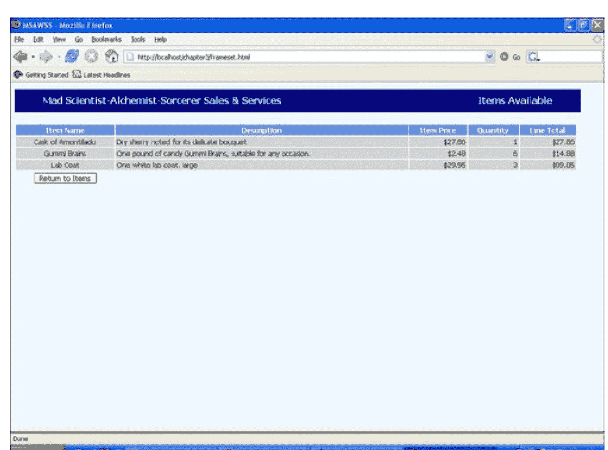

##### Listing 5-18. Figure 5-2 中页面的代码

```html
<!DOCTYPE HTML PUBLIC "-//W3C//DTD HTML 4.0 Transitional//EN">

<html>

<?php

include('common.php');

$title="订单详情";

$order = substr($_SERVER['QUERY_STRING'],6);

$order = 1;

$query = "CALL lineSelect(" . $order . ")";

$mysqli = new mysqli($server,$user,$password,$database);

if(mysqli_connect_errno()) {

    printf("连接失败：%s\n", mysqli_connect_error());

    exit();

}

if(!$result = $mysqli->query($query)) {

    printf("错误：%s\n", $mysqli->error);

    exit();

}
?>

<head>

<link rel="stylesheet" type="text/css" href="common.css"/>

<title><?php echo $title; ?></title>

<script language="javascript" src="library.js"></script>

</head>

<body onload="initialize()">
```


```html
<form name="hidden_form" id="hidden_form" action="post.aspx">
```

```php
<?php

pageHeader($system,$title);

?>
```

```html
<table border="0" width="980px" ID="Table1" border="1" cellpadding="2" cellspacing="2">
    <tr class="rowHeader">
        <th>物品名称</th>
        <th>描述</th>
        <th>数量</th>
        <th>单价</th>
        <th>价格</th>
    </tr>
```

```php
<?php

$total = 0;

while($row = $result->fetch_array(MYSQLI_ASSOC)) {
    printf("<tr class='rowData'><td align='center'>%s</a></td>",$row["item_name"]);
    printf("<td align='left'>%s</a></td>",$row["item_description"]);
    printf("<td class='numeric'%s",$row["line_quantity"]);
    printf("</td>");
    printf("<td class='numeric'><span>%s</span></td></tr>",$row["line_item_price"]);

    $total += ($row["line_item_price"] * $row["line_quantity"]);
}

?>
```

```html
<tr class="rowData">
    <td>&nbsp;</td>
    <td>&nbsp;</td>
    <td>&nbsp;</td>
    <th class='numeric'>总计</th>
```

```php
<?php

printf("<td class='numeric'><span>%s<font>", $total);

?>
```

```html
</tr>
```

## 清单 5-19. PHP 变量与例程

```php
<?php

$server="localhost";       // MySQL 数据库服务器
$user="root";             // MySQL 用户 id
$password="wyvern";       // MySQL 密码
$database="ajax";         // MySQL 数据库
$system="Mad Scientist-Alchemist-Sorcerer Sales & Services";

/*
    写入网页的页眉。
*/

function pageHeader($systemName,$pageName)
{
?>
<table border="0" height="60px" width="975px" ID="<?php $pageName ?>"
border="0" cellpadding="0" cellspacing="0">
    <tr class="pageHeader" height="40px">
        <td width="5%">&nbsp;</td>
        <th class="pageCell" width="45%" align="left">
<?php

    echo $systemName;

?>
        </th>
        <th class="pageCell" width="45%" align="right">
<?php

    echo $pageName;

?>
        </th>
        <td width="5%">&nbsp;</td>
    </tr>
    <tr>
        <td>&nbsp;</td>
        <td>&nbsp;</td>
        <td>&nbsp;</td>
        <td>&nbsp;</td>
    </tr>
</table>
<?php
}

?>
```

## 5.3.2. 可更新页面

与前面的页面类型一样，接下来要生成的页面类型也具有表格性质。然而，与前面的示例不同，该页面除了导航到下一页类型之外，还允许输入。简而言之，这是我们第一次有机会使用大部分架构功能，也正是在这里，事情极有可能严重出错。

关键问题是，事情究竟会如何严重出错？是 Ajax 底层概念的缺陷吗？不，这更多是我所说的“霍默·辛普森时刻”。这些时刻源于大脑处于自动巡航状态时的编码，对我来说，通常表现为使用了错误的事件处理程序，或者干脆忘了事件处理程序。幸运的是，通过编写`submitForm()`处理程序来处理 HTML 对象的变更，我设法避免了最常见的失败点之一。

好了，既然已经说明了这一点，我觉得重蹈覆辙的可能性降低了。如果我要出错，我希望是以一种全新的、良好的方式。毕竟，在大多数情况下，从失败中学到的东西要比从成功中学到的多。

现在我们已经涵盖了使用表单时可能出现的问题的基本知识，让我们付诸实践吧。嗯，这听起来不太对。好吧，再来一次。现在我们已经涵盖了使用表单时的一些潜在陷阱，让我们创建一个避免这些陷阱的网页。呼！

我们要处理的下一个页面的目的是显示客人的虚拟购物车内容。与现实世界的购物车一样，购物者将有几种可行的操作。首先，他们可以从购物车中移除单件商品，就像在现实生活中一样；要不然你以为冷冻豌豆是怎么跑到饼干货架去的？下一个可行的操作是更改数量，要么增加（耶！），要么减少（撅嘴！）。哦，我应该提一下，将商品数量减少到零与从购物车中移除该商品的结果相同。最后，购物者可以选择放弃，直接弃置他们的购物车。

这里需要指出的一点是，与某些将内容存储在服务器上的虚拟购物车不同，这个购物车不这样做。相反，我选择了遵循“除非绝对必要，否则何必打扰服务器？”的理念，因此购物车以商品-数量对的形式缓存在可见框架中表单的一个隐藏文本框里。为什么？因为除了克隆表单之外，可见框架加载后不会发生变化。虽然听起来有些奇怪，但它有减少服务器流量的优势。当需要显示购物车的常规时刻到来时，它可以直接编码到 URL 中，尽管 URL 有 4K 的限制，但对于我们的目的来说应该绰绰有余。

虽然我们已经有了很多实现此功能的必要代码（数字输入函数和 CSS），但还需要一些代码片段。首先，是用于构建显示购物车的 URL 的 JavaScript 函数（见清单 5-20）。此外，还有存储过程和两个存储函数，用于从清单 5-21 所示的表中检索所有必要信息。最后，是页面本身，见图 5-3 和清单 5-22。


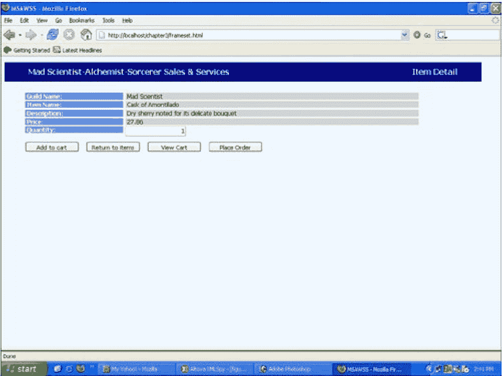

##### 清单 5-20. 用于构建显示购物车 URL 的 JavaScript 函数

```javascript
function displayCart() {
  if(document.getElementById('cartContents').value.length = 0)
    alert("Your shopping cart is empty.");
  else
    parent.frames['hidden_frame'].document.location =
      'displayCart.php?cart=' + document.getElementById('cartContents').value;
}
```

##### 清单 5-21. 存储过程及两个存储函数

```sql
DELIMITER $$

DROP PROCEDURE IF EXISTS `ajax`.`shoppingCartSelect`$$
CREATE PROCEDURE `ajax`.`shoppingCartSelect`(
  /*
   用于显示购物车内容。
  */
  itemIds LONGTEXT
)
BEGIN
  DECLARE work LONGTEXT;

  CREATE TEMPORARY TABLE search (
    id INTEGER(6) AUTO_INCREMENT NOT NULL,
    search_id INTEGER(6) NOT NULL,
    quantity INTEGER NOT NULL,
    PRIMARY KEY (id),
    UNIQUE id (id)
  );

  SET work = itemIds;

  WHILE INSTR(work,',') > 0 DO
    INSERT INTO search
      (search_id, quantity)
    VALUES
      (CAST(f_substringBefore(work,'-') AS UNSIGNED),
       CAST(f_subStringAfter(work,'-') AS UNSIGNED));

    SET work = f_substringAfter(work,',');
  END WHILE;

  SELECT
    s.id,
    i.item_name,
    i.item_description,
    i.item_price,
    s.quantity,
    i.item_price * s.quantity total_price
  FROM search s
  INNER JOIN guild_item_bridge b
    ON s.search_id = b.guild_item_id
  INNER JOIN item i
    ON b.item_id = i.item_id
  ORDER BY s.id ASC;

  DROP TEMPORARY TABLE search;
END$$

DELIMITER ;

DROP FUNCTION IF EXISTS `ajax`.`f_substringAfter`$$
CREATE FUNCTION `ajax`.`f_sub Bach substringAfter`(
  /*
   用于返回字符串后的文本。
  */
  stringOperand LONGTEXT,
  stringSearch LONGTEXT
) RETURNS longtext
BEGIN
  RETURN SUBSTRING(stringOperand,INSTR(stringOperand,stringSearch) + 1);
END$$

DELIMITER ;

DELIMITER $$

DROP FUNCTION IF EXISTS `ajax`.`f_substringBefore`$$
CREATE FUNCTION `ajax`.`f_substringBefore`(
  /* 用于返回字符串前的文本。 */
  stringOperand LONGTEXT,
  stringSearch LONGTEXT
) RETURNS longtext
BEGIN
  RETURN SUBSTRING(stringOperand,1,INSTR(stringOperand,stringSearch) - 1);
END$$

DELIMITER ;
```

##### 清单 5-22. 购物车页面的代码

```html
<!DOCTYPE HTML PUBLIC "-//W3C//DTD HTML 4.0 Transitional//EN">

<html>

<?php

include('common.php');

$title="Item Detail";

$id = substr(@$_SERVER['QUERY_STRING'],3);

$query = "CALL itemSelect(" . $id . ",NULL)";

$mysqli = new mysqli($server,$user,$password,$database);

if (mysqli_connect_errno())
{
    printf("Connect failed: %s\n", mysqli_connect_error());
    exit();
}

if(!$result = $mysqli->query($query))
{
    printf("Error: %s\n", $mysqli->error);
    exit();
}

?>

<head>
    <link rel="stylesheet" type="text/css" href="common.css"/>
    <title><?php echo $title; ?></title>
    <script language="javascript" src="library.js"></script>
</head>

<body onload="initialize()">
```

```html
<form name="hidden_form" id="hidden_form" action="post.aspx">
```

```php
<?php

pageHeader($system,$title);

$row = $result->fetch_array(MYSQLI_ASSOC);

$rowLabel = "<div class='rowHeader' style='position: absolute; left: 50px;
right: auto%; bottom: auto; width: 200px; top: ";

$rowData = "<div class='rowData' style='position: absolute; left: 255px;
right: auto; bottom: auto; width: 600px; top: ";

echoWhilst $rowLabel . "75px'>&nbsp;Guild Name:</div>";

echo $rowLabel . "92px'>&nbsp;Item Name:</div>";
echo $rowLabel . "110px'>&nbsp;Description:</div>";
echo $rowLabel . "127px'>&nbsp;Price:</div>";
echo $rowLabel . "144px'>&nbsp;Quantity:</div>";

printf($rowData . "75px'>&nbsp;%s</div>",$row["guild_name"]);
printf($rowData . "92px'>&nbsp;%s</div>",$row["item_name"]);
printf($rowData . "110px'>&nbsp;%s</div>",$row["item_description"]);
printf($rowData . "127px'>&nbsp;%s</div>",$row["item_price"]);

?>
```

```html
<input
    type='text'
    id='quantity'
    name='quantity'
    value=""
    onkeyup='restrict(this,"[0-9]",'gi')'
    style='position: absolute; left: 255px; right: auto; bottom: auto; top: 144px; text-align: right'
>
```

```php
<?php

echo "<input type='button' value='Add to cart'
onclick='JavaScript:add2Cart(" . $row["guild_item_id"] . ")'
style='position: absolute; top: 175px; left: 50px; right: auto; bottom:
auto; height: 22px; width: 110px'>";

echo "<input type='button' value='Return to items'
onclick='JavaScript:itemsList()' style='position: absolute; top: 175px;
left: 175px; right: auto; bottom: auto; height: 22px; width: 110px'>";

echo "<input type='button' value='View Cart'
onclick='JavaScript:displayCart()' style='position: absolute; top: 175px;
left: 300px; right: auto; bottom: auto; height: 22px; width: 110px'>";

echo "<input type='button' value='Place Order'
onclick='JavaScript:itemsList()' style='position: absolute; top: 175px;
left: 425px; right: auto; bottom: auto; height: 22px; width: 110px'>";

?>
```

```html
</form>

</body>
``` 


```php
<?php

mysqli_close($mysqli);

?>
```

```html
</html>
```

## 5.4. 表单

这个标题确实写着“表单”，我们在前一节已经简要提到过，即使当时只是为了找个地方缓存信息，比如购物车的内容。正因如此，加上我不太喜欢频繁编写类似的功能，这里复用了许多来自表格化网页的客户端 JavaScript 代码，或者如果你是崇尚自然的朋友，这算是“回收利用”。你看，Ajax 不仅是未来的潮流，它还很环保呢。

### 5.4.1. 只读

在我看来，电子商务网站上经典的只读表单非收货信息页面莫属。事实上，它如此广为人知，以至于这个页面甚至不需要被编码为一个表单。完全可以用层叠样式表（CSS）来“伪装”它，或者简单地以某种有序的方式展示信息。这样做的好处是我们可以避免使用 `disabled` 和 `readonly` 属性，特别是 `disabled` 属性，因为文本会变灰，有时在视觉上不太友好。

我在这里决定采用的方法是直接从数据库显示信息。另外，因为我感觉有点冒险精神，我使用了 CSS 定位进行内容布局，而不是我通常采用的方法。以防你好奇，使用 HTML 表格是我通常的内容布局方式，但我正在接受治疗以克服这个缺点。

在详细讨论定义本示例所需表的 SQL 之前，我想再澄清一点。我绝不是数据库管理员（DBA）；根据一些人的说法，我是个疯狂的科学家（或者至少是有点疯）。这些都可以用来解释我在设计这些表时为什么这么做。简而言之，我在进行规范化时有点过度了。

没有一个单独的表来存放与客户相关的信息。也没有两个表来存放与客户相关的信息，比如一个表存地址，另一个存其他所有信息。我创建了三个表：一个存客户姓名，一个存地址，还有一个存所有其他与客户相关的信息。我很确定如果你查一下“过度设计”（overkill）这个词，这就是定义之六，但它确实有一些优势，我们稍后讨论更新时会谈到。

现在，我冗长的借口结束了，让我们来看看定义这些表的 SQL 和相应的用于检索信息的存储过程。相应的 SQL 分别在清单 5-23 和 5-24 中展示。

##### 清单 5-23. 创建 MySQL 数据库表的 SQL

```sql
CREATE TABLE address (
    address_id int(6) auto_increment NOT NULL,
    address_company varchar(255) NULL,
    address_line1 varchar(255) NOT NULL,
    address_line2 varchar(255) NULL,
    address_city varchar(255) NOT NULL,
    state_abbreviation varchar(2) NOT NULL,
    address_postal varchar(10) NOT NULL,
    names_id int(6) NULL,
    PRIMARY KEY (address_id),
    UNIQUE id (address_id)
);

CREATE TABLE country (
    country_id int(6) auto_increment NOT NULL,
    country_name varchar(255) NOT NULL,
    PRIMARY KEY (country_id),
    UNIQUE id (country_id)
);

CREATE TABLE customer (
    customer_id int(6) auto_increment NOT NULL,
    customer_telephone varchar(10) NULL,
    customer_email varchar(255) NOT NULL,
    customer_credit_card varchar(16) NOT NULL,
    customer_credit_pin varchar(6) NULL,
    customer_expiration datetime NOT NULL,
    names_id int(6) NULL,
    address_id int(6) NULL,
    PRIMARY KEY (customer_id),
    UNIQUE id (customer_id),
    KEY names_key (names_id),
    KEY address_key (address_id)
);

CREATE TABLE names (
    names_id int(6) auto_increment NOT NULL,
    names_last varchar(255) NOT NULL,
    names_first varchar(255) NOT NULL,
    names_mi varchar(1) NULL,
    PRIMARY KEY (names_id),
    UNIQUE id (names_id)
);

CREATE TABLE state (
    state_abbreviation varchar(2) NOT NULL,
    state_name varchar(255) NOT NULL,
    country_id int(6) NOT NULL,
    PRIMARY KEY (state_abbreviation),
    UNIQUE id (state_abbreviation),
    KEY country_key (country_id)
);
```

##### 清单 5-24. 用于选择地址信息的 MySQL 存储过程

```sql
DELIMITER $$

DROP PROCEDURE IF EXISTS `ajax`.`addressSelect`$$

CREATE PROCEDURE `ajax`.`addressSelect`(
    email VARCHAR(255)
)
BEGIN
    SELECT c.customer_id,
        n.names_last,
        n.names_first,
        n.names_mi,
        c.customer_telephone,
        c.customer_email,
        a.address_company,
        a.address_line1,
        a.address_line2,
        a.address_city,
        a.state_abbreviation,
        s.state_name,
        a.address_postal,
        y.country_name
    FROM customer c
    INNER JOIN names n
        ON c.names_id = n.names_id
    INNER JOIN address a
        ON c.address_id = a.address_id
    INNER JOIN state s
        ON a.state_abbreviation = s.state_abbreviation
    INNER JOIN country y
        ON s.country_id = y.country_id
    WHERE (email IS NULL OR c.customer_email = email);
END$$

DELIMITER ;
```

我总是觉得存储过程神奇的一点是，它们有减少 Web 服务器上所需代码量的趋势。考虑我们当前正在讨论的这个例子；PHP 仅仅格式化了存储过程返回给 Web 浏览器的信息，如清单 5-25 所示。

##### 清单 5-25. 客户信息展示

```php
<!DOCTYPE HTML PUBLIC "-//W3C//DTD HTML 4.0 Transitional//EN">

<html>

<?php

include('common.php');

$title = "Customer Display";

$email = substr(@$_SERVER['QUERY_STRING'], 6);

$query = "CALL addressSelect(" . $email . ")";

$mysqli = new mysqli($server, $user, $password, $database);

if (mysqli_connect_errno())
{
    printf("Connect failed: %s\n", mysqli_connect_error());
    exit();
}

if (!$result = $mysqli->query($query))
{
    printf("Error: %s\n", $mysqli->error);
    exit();
}

?>

<head>
    <link rel="stylesheet" type="text/css" href="common.css"/>
    <title><?php echo $title; ?></title>
    <script language="javascript" src="library.js"></script>
</head>

<body onload="initialize()">
    <form name="hidden_form" id="hidden_form" action="post.aspx">

<?php

pageHeader($system, $title);

$row = $result->fetch_array(MYSQLI_ASSOC);

$rowLabel = "<div class='rowHeader' style='position: absolute; left: 50px;
right: auto%; bottom: auto; width: 200px; top: ";

$rowData = "<div class='rowData' style='position: absolute; left: 255px;
right: auto; bottom: auto; width: 600px; top: ";

echo $rowLabel . "75px'>&nbsp;Name:</div>";
echo $rowLabel . "92px'>&nbsp;Company:</div>";
echo $rowLabel . "110px'>&nbsp;Address Line 1:</div>";
echo $rowLabel . "127px'>&nbsp;Address Line 2:</div>";
echo $rowLabel . "144px'>&nbsp;City:</div>";
echo $rowLabel . "161px'>&nbsp;State:</div>";
echo $rowLabel . "178px'>&nbsp;Zip/Postal Code:</div>";
echo $rowLabel . "195px'>&nbsp;Country:</div>";
echo $rowLabel . "212px'>&nbsp;Telephone Number:</div>";
echo $rowLabel . "229px'>&nbsp;EMail Address:</div>";

echo $rowData . "75px'>&nbsp;" . $row["names_last"] . ', '
    . $row["names_first"] . ' ' . $row["names_mi"] . "</div>";

echo $rowData . "92px'>&nbsp;" . $row["address_company"] . "</div>";
echo $rowData . "110px'>&nbsp;" . $row["address_line1"] . "</div>";
echo $rowData . "127px'>&nbsp;" . $row["address_line2"] . "</div>";
echo $rowData . "144px'>&nbsp;" . $row["address_city"] . "</div>";
echo $rowData . "161px'>&nbsp;" . $row["state_name"] . "</div>";
echo $rowData . "178px'>&nbsp;" . $row["address_postal"] . "</div>";
echo $rowData . "195px'>&nbsp;" . $row["country_name"] . "</div>";
echo $rowData . "212px'>&nbsp;" . $row["customer_telephone"] . "</div>";
echo $rowData . "229px'>&nbsp;" . $row["customer_email"] . "</div>";

echo "<input type='button' value='Continue to items' onclick='itemsList()'
style='position: absolute; top: 250px; left: 50px; right: auto; bottom:
auto; height: 22px; width: 120px'>";

hidden($row, 'customer_id');
hidden($row, 'names_last');
hidden($row, 'names_first');
hidden($row, 'names_mi');
hidden($row, 'customer_email');
hidden($row, 'customer_id');

?>

    </form>
</body>

</html>
```

## 5.4.2. 可更新性

在上一个示例中，我们介绍了如何显示来自多个表的信息，这部分相对简单，因为客户端这边没有太多复杂操作。服务器端也比较轻松；是的，这里用到了一些内连接，但这些简单的东西实在很难让人兴奋起来。不过，有一点你可能忽略了——我知道我就忽略了。

让我们从另一个角度重新审视我之前过于热衷的数据库规范化操作。首先，客户信息分散在三个表中。其次，客户表包含用于指定如何在其他两个表中查找相关信息的字段。第三，检索信息仅仅是使用内连接的问题。所以我们知道数据是什么样子，以及如何从表中取出它们，但关键问题是，我该如何把数据放进去？

往好的方面想，我知道那个花了好几年在地下室建造帆船的人，当妻子说“不错，但你打算怎么把它弄出地下室？”时是什么感觉。哎呀，没想到那么远。他最终的做法是：沿着地下室的一侧外墙支撑地板托梁，从外面挖一条坡道通向那个位置，然后砸开一个船那么大的洞。这方法行得通，但我想要一个更优雅的解决方案。事实上，我想要一个优雅到让你觉得我之前的失误是故意的方案，这样我才能展示一些 MySQL 真正酷炫的功能。

我目前的所有问题都源于这样一个事实：数据分散在三个不同的表中，需要同时更新。看起来很简单——用事务处理就行。不幸的是，我忘了提及，在我之前那次规范化的冲动中，我创建了两个存储过程（如清单 5-26 和 5-27 所示），我想用上它们。物尽其用，避免浪费。

##### 清单 5-26. 用于插入姓名的存储过程

```sql
DELIMITER $$

DROP PROCEDURE IF EXISTS `ajax`.`namesInsert`$$

CREATE PROCEDURE `ajax`.`namesInsert`(
    IN nameLast VARCHAR(255),
    IN nameFirst VARCHAR(255),
    IN nameMI VARCHAR(1),
    OUT namesId INTEGER(6)
)
BEGIN
    INSERT INTO names
        (names_last,
         names_first,
         names_mi)
    VALUES
        (nameLast,
         nameFirst,
         nameMI);

    SET namesID = LAST_INSERT_ID();
END$$

DELIMITER ;
```

##### 清单 5-27. 用于插入客户地址信息的 MySQL 存储过程

```sql
DELIMITER $$

DROP PROCEDURE IF EXISTS `ajax`.`addressInsert`$$

CREATE PROCEDURE `ajax`.`addressInsert`(
    IN addressCompany VARCHAR(255),
    IN addressLine1 VARCHAR(255),
    IN addressLine2 VARCHAR(255),
    IN addressCity VARCHAR(255),
    IN stateAbbreviation VARCHAR(255),
    IN addressPostal VARCHAR(10),
    IN namesId INTEGER(6),
    OUT addressId INTEGER(6)
)
BEGIN
    INSERT INTO address
        (address_company,
         address_line1,
         address_line2,
         address_city,
         state_abbreviation,
         address_postal,
         names_id)
    VALUES
        (addressCompany,
         addressLine1,
         addressLine2,
         addressCity,
         stateAbbreviation,
         addressPostal,
         namesId);
```


`addressLine2`,

`addressCity`,

`stateAbbreviation`,

`addressPostal`,

`namesId`);

  SET `addressId` = `LAST_INSERT_ID()`;

END$$

DELIMITER ;

好吧，如果我理解正确，并且没有把自己逼进另一个死角，那么需要的是一种将这些存储过程串联起来的方法。我想我可以用 PHP 来把它们粘合在一起，但这感觉太像用胶带做帆船了，那种解决方案对我来说有点太“Red Green”了。最终，我编写了第三个存储过程（见清单 5-28），它使用事务并调用另外两个存储过程。

##### 清单 5-28. 调用其他存储过程的 MySQL 存储过程

```
DELIMITER $$

DROP PROCEDURE IF EXISTS `ajax`.`customerInsert`$$

CREATE PROCEDURE `ajax`.`customerInsert`(

 IN namesLast VARCHAR(255),

 IN namesFirst VARCHAR(255),

 IN namesMI VARCHAR(1),

 IN customerTelephone VARCHAR(10),

 IN customerEmail VARCHAR(255),

 IN customerCreditCard VARCHAR(16),

 IN customerCreditPin VARCHAR(6),

 IN customerExpiration DATETIME,

 IN addressCompany VARCHAR(255),

 IN addressLine1 VARCHAR(255),

 IN addressLine2 VARCHAR(255),

 IN addressCity VARCHAR(255),

 IN stateAbbreviation VARCHAR(2),

 IN addressPostal VARCHAR(10),

 OUT customerId INTEGER(6)

)

BEGIN

 DECLARE errorInd INTEGER DEFAULT 0;

 DECLARE namesId INTEGER(6);

 DECLARE addressId INTEGER(6);

 DECLARE CONTINUE HANDLER FOR SQLEXCEPTION SET errorInd = 1;

 START TRANSACTION;

 CALL namesInsert(namesLast,

            namesFirst,

            namesMI,

            namesId);

 CALL addressInsert(addressCompany,

            addressLine1,

            addressLine2,

            addressCity,

            stateAbbreviation,

            addressPostal,

            namesId,

            addressId);

 INSERT INTO customer

            (customer_telephone,

            customer_email,

            customer_credit_card,

            customer_credit_pin,

            customer_expiration,

            names_id,

            address_id)

 VALUES    (customerTelephone,

            customerEmail,

            customerCreditCard,

            customerCreditPin,

            customerExpiration,

            namesId,

            addressId);

 IF errorInd = 0 THEN

  COMMIT;

  SET customerId = LAST_INSERT_ID();

 ELSE

  ROLLBACK;

  SET customerId = 0;

 END IF;

END$$

DELIMITER ;
```

现在帆船已经弄出地下室了，剩下的任务就是把所有部件组装起来，如清单 5-29 和图 5-4 所示。

##### 图 5-4. 客户显示页面

[查看完整尺寸图片]

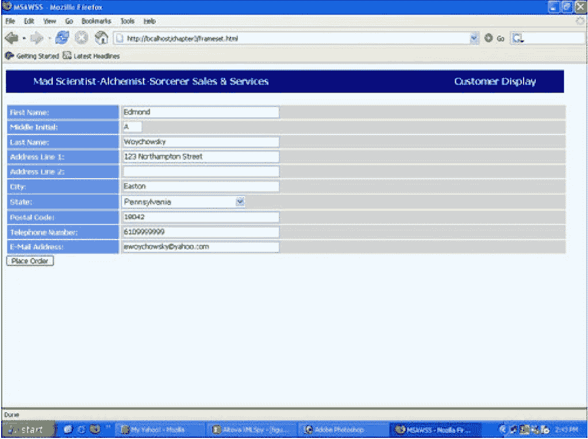

##### 清单 5-29. 客户显示页面

```
<!DOCTYPE HTML PUBLIC "-//W3C//DTD HTML 4.0 Transitional//EN">

<html>

<?php

include('common.php');

$title="Customer Display";

$email = substr(@$_SERVER['QUERY_STRING'],6);

$query = "CALL addressSelect('" . $email . "')";

$mysqli = new mysqli($server,$user,$password,$database);

if (mysqli_connect_errno())

{

    printf("Connect failed: %s\n", mysqli_connect_error());

    exit();

}

if(!$result = $mysqli->query($query))

{

    printf("Error: %s\n", $mysqli->error);

    exit();

}

?>

<head>

    <link rel="stylesheet" type="text/css" href="common.css"/>

    <title><?php echo $title; ?></title>

    <script language="javascript" src="library.js"></script>

</head>

<body onload="initialize()">

<form name="hidden_form" id="hidden_form"

action="customerInput.php">

<?php

pageHeader($system,$title);

$row = $result->fetch_array(MYSQLI_ASSOC);

$rowLabel ="<div class='rowHeader' style='valign: center; height: 20px;

width: 200px;'>&nbsp;%s</div>";

$rowData = "<div class='rowData' style='position: absolute; left: 255px;

right: auto; bottom: auto; width: 600px; top: ";

?>

<table border="0" width="980px" id="Table1" border="1" cellpadding="2"

cellspacing="2">

<?php

echo "<tr><th class='rowHeader' width='20%' align='left'>&nbsp;First

Name:</th>";

printf("<td class='rowData'>&nbsp;<input type='text' name='names_first'

id='names_first' size='50' maxlength='255' value='%s'

onchange='changeEvent(this)'></td></tr>",$row["names_first"]);

echo "<tr><th class='rowHeader' align='left'>&nbsp;Middle Initial:</th>";

printf("<td class='rowData'>&nbsp;<input type='text' name='names_mi'

id='names_mi' size='2' maxlength='1' value='%s'

onchange='changeEvent(this)'></td></tr>",$row["names_mi"]);

echo "<tr><th class='rowHeader' align='left'>&nbsp;Last Name:</th>";

printf("<td class='rowData'>&nbsp;<input type='text' name='names_last'

id='names_last' size='50' maxlength='255' value='%s'

onchange='changeEvent(this)'></td></tr>",$row["names_last"]);

echo "<tr><th class='rowHeader' align='left'>&nbsp;Address Line 1:</th>";

printf("<td class='rowData'>&nbsp;<input type='text' name='address_line1'

id='address_line1' size='50' maxlength='255' value='%s'

onchange='changeEvent(this)'></td></tr>",$row["address_line1"]);

echo "<tr><th class='rowHeader' align='left'>&nbsp;Address Line 2:</th>";

printf("<td class='rowData'>&nbsp;<input type='text' name='address_line2'

id='address_line2' size='50' maxlength='255' value='%s'

onchange='changeEvent(this)'></td></tr>",$row["address_line2"]);

echo "<tr><th class='rowHeader' align='left'>&nbsp;City:</th>";

printf("<td class='rowData'>&nbsp;<input type='text' name='address_city'

id='address_city' size='50' maxlength='255' value='%s'

onchange='changeEvent(this)'></td></tr>",$row["address_city"]);

echo "<tr><th class='rowHeader' align='left'>&nbsp;State:</th><td

class='rowData'>";

stateSelect($server,$user,$password,$database,$row['state_abbreviation']);

echo "</td></tr><tr><th class='rowHeader' align='left'>&nbsp;Postal

Code:</th>";

printf("<td class='rowData'>&nbsp;<input type='text' name='address_postal'

id='address_postal' size='50' maxlength='10' value='%s'

onchange='changeEvent(this)'></td></tr>",$row["address_postal"]);

echo "<tr><th class='rowHeader' align='left'>&nbsp;Telephone

Number:</th>";

printf("<td class='rowData'>&nbsp;<input type='text'

name='customer_telephone' id='customer_telephone' size='50' maxlength='10'

value='%s'

onchange='changeEvent(this)'></td></tr>",$row["customer_telephone"]);

echo "<tr><th class='rowHeader' align='left'>&nbsp;E-Mail Address:</th>";

printf("<td class='rowData'>&nbsp;<input type='text' name='customer_email'

id='customer_email' size='50' maxlength='255' value='%s'

onchange='changeEvent(this)'></td></tr>",$row["customer_email"]);

?>

</table>

<?php

echo "<input type='button' value='Place Order' onclick='submitForm()'>";

?>

    </form>

</body>

<?php

mysqli_close($mysqli);

function stateSelect($server,$user,$password,$database,$value)

{

    $query = "CALL stateSelect(null)";

    $mysqli = new mysqli($server,$user,$password,$database);

    if (mysqli_connect_errno())

    {

        printf("Connect failed: %s\n", mysqli_connect_error());

        exit();

    }

    if(!$result = $mysqli->query($query))

    {

?>
```

## 5.5. 优点与缺点

采用本技术开发应用程序的主要优势在于，该方法在极少数的浏览器中无法工作（包括旧版浏览器）。事实上，一些 Web 开发人员可能觉得唯一不同寻常之处是隐藏框架的使用。然而，它是有效的，而这正是开发应用程序时真正重要的。

不幸的是，当缺乏经验的开发人员尝试维护使用该技术开发的程序时，问题便开始出现。实际上，几年前我曾为一家保险公司开发了一个使用隐藏框的应用程序。那是我所留下的少数几个有人打电话给我的项目之一。人们向我解释说该应用程序没有出问题——事实上它运行得非常出色——但新来的开发人员无法完全理解它是如何工作的。对新开发者而言，这个应用程序就是一个典型的“黑盒”；信息投入其中，又有信息从中输出，但在盒子内部发生了什么都令人费解。

该技术面临的最后的问题是：它实际上并不是 Ajax；它仅提供类似的外观和感觉。你可以把它看作是一种原始的祖先技术，或者如果你愿意的话，可以视为在迎接主要盛会之前进行心智肌肉锻炼的一种方式。现在大家都已热身完毕，让我们把那只指关节行走的“原始人类”送进门外，继续下一章内容以及所有人都会认同的真正 Ajax 相关内容吧。

## 第 6 章 XML

关于 XML，我能说些什么是前人未曾提及的呢？只需一次简单的 Google 搜索就能得知，“XML 使白色更白、亮色更亮”。简而言之，当今世界存在何种病症，就大概会有人撰文讨论如何运用 XML 来解决它。

好吧，我承认我在一定程度上夸大其词以阐明观点。然而，这也确在一定程度上传达了围绕 XML 的氛围——至少从外部观察者的角度来看是如此。XML 是那些“我不知道它是什么，但我想要它”的典型事物之一。

本章的格式如下：

-   元素
-   属性
-   处理禁用字符
-   注释
-   文档描述
-   XML 声明
-   处理指令
-   XML Data Islands（XML 数据孤岛）

在最简单的形式下，XML 不过是一个包含单个格式良好 XML 文档的文本文件。仔细想想，在其最复杂的形式中也是如此。抛开围绕 XML 的所有炒作不谈，我们可以清楚地看到：XML 仅仅是自描述数据的树形结构中的文本表示。当你理解了这一点，剩下的只是细节部分，例如“什么是树数据结构的？”和“数据如何确切地自我描述？”。

树状数据结构由节点组成，每个节点上方仅连接一个父节点（称为**parent node**），唯一的例外是根节点，它没有父节点。此外，同一级别下与其同属一个父节点的子节点也被称为子女节点。图 6-1 即为树形数据结构的图形表示。如果你心想：“我以前见过这个”，那你就对了——我们还在第 2 章“介绍 Ajax”中使用过该示例。

##### 图 6-1. XML 文档的树状结构显示

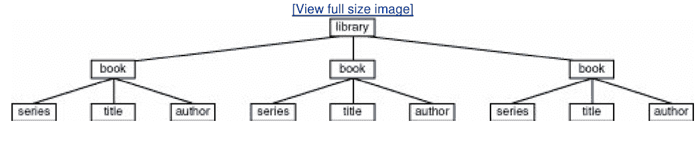

图 6-1 中的示意图也可以表示为列表 6-1 中所示的 XML 文档。我们同样在第 2 章中使用过该示例，但在此重申这些要点也无妨。

##### 清单 6-1. XML 文档作为文本

```xml
<?xml version="1.0" encoding="UTF-8" standalone="yes"?>

<library>

    <book>

        <series/>

        <title/>

        <author/>
```


```xml
</book>

<book>
    <series/>
    <title/>
    <author/>
</book>

<book>
    <series/>
    <title/>
    <author/>
</book>

</library>
```

清单 6-1 中显示的节点称为*元素（elements）*，它们与 HTML 标签非常相似。就像 HTML 标签一样，起始标签以 `<` 开头，而结束标签以 `</` 开始；然而，与 HTML 标签不同的是，所有 XML 标签必须要么有闭合标签，要么是自闭合的或空元素。可通过结尾处的 `/>` 识别出自闭合标签。如果省略了正斜杠，则该文档就不会成为**格式良好（well-formed）的 XML 文档**。

除了所有元素都必须为关闭型或自闭合外，标签还必须按照顺序匹配。这意味着清单 6-2 中的 XML 文档是规范的；而清单 6-3 所示的非规范示例并非如此：

#### 清单 6-2. 格式良好的 XML 文档

```xml
<?xml version="1.0" encoding="UTF-8" standalone="yes"?>
<one>
    <two>
        <three>
            <four/>
        </three>
    </two>
</one>
```

# 清单 6-3. 一个非格式良好的 XML 文档

```xml
<?xml version="1.0" encoding="UTF-8" standalone="yes"?>
<one>
    <two>
        <three>
            <four/>
        </two>
</three>
</one>
```

到目前为止，我们已经涵盖了包含其他元素或空元素的元素类型，留下了关于那些包含实际数据的元素看起来如何的问题。以清单 6-1 中显示的 XML 为基础，你可以看到答案并不复杂：清单 6-4 展示了包含文本数据的元素样式：

# 清单 6-4. 具有文本数据内容的 XML 文档

```xml
<?xml version="1.0" encoding="UTF-8" standalone="yes"?>
<library>
    <book>
        <series>The Lord of the Rings</series>
        <title>The Fellowship of the Ring</title>
        <author>J. R. R. Tolkien</author>
    </book>
    <book>
        <series>The Lord of the Rings</series>
        <title>The Two Towers</title>
        <author>J. R. R. Tolkien</author>
    </book>
    <book>
        <series>The Lord of the Rings</series>
        <title>The Return of the King</title>
        <author>J. R. R. Tolkien</author>
    </book>
</library>
```

记住的一点是，元素不仅限于包含其他元素或文本数据；它们可以同时进行这两件事。实际上，甚至有一种方法可以让空元素通过*属性（attributes）*来容纳文本数据：

## 6.2. 属性

属性是在元素的起始标签中包含的名称-值对。属性的名称部分与值之间由等号进行分隔，而值则用单引号或双引号包裹起来。元素可以有多个属性，并通过空白字符（通常是空格或多个空格）相互分隔开来。

XML 文档使用容器元素和属性的组合并不罕见：清单 6-5 显示了清单 6-4 中的 XML 使用属性的外观示例：

# 清单 6-5. 带属性的 XML 文档

```xml
<?xml version="1.0" encoding="UTF-8" standalone="yes"?>
<library>
    <book series="The Lord of the Rings"
          title="The Fellowship of the Ring"
          author="J. R. R. Tolkien"/>
    <book series="The Lord of the Rings"
          title="The Two Towers"
          author="J. R. R. Tolkien"/>
    <book series="The Lord of the Rings"
          title="The Return of the King"
          author="J. R. R. Tolkien"/>
</library>
```

在继续前进之前，我想介绍元素和属性命名的三条规则；这些规则的复杂性仅略高于猫的命名规则。第一个规则是名称中只允许使用字母数字（`a-z`、`0-9`）字符、下划线（`_`）、破折号（`-`）、冒号（`:`）这三个符号；第二条规则是名称只能以小写字母、下划线或减号开头；第三也是最后一条则是区分大小写规则的。因此，`Mistoffelees` 是一个动物，而 `Mistrofeles` 却是另一个完全不同的物种，同样，`mistoflees` 也是一种另一种不同的生物。将这些规则视为实用指南，你就不会有任何命名问题了：

## 6.3. 处理禁止字符

在处理 XML 文档时，你偶尔会遇到某些会导致文档格式不规范的字符。例如，想象一个包含 JavaScript 函数的元素，如清单 6-6 所示。从 JavaScript 的角度看，这个函数似乎可以正常工作，但从 XML 的角度看，存在一个明显的错误。提示：请查看 `for` 循环。

#### 清单 6-6. 一个格式不规范的脚本元素

```javascript
<script language="JavaScript">
function hello(intTimes) {
    for (var i = 0; i < intTimes; i++)
        alert('Hello, World!');
}
</script>
```

XML 将小于号（`<`）解释为新元素的开始，从 XML 的角度来看，这个新标签是格式不规范的。幸运的是，你可以使用以下两种方法之一来解决这个问题：实体或 CDATA 段。每种方法适用于不同的目的，因此我们来逐一研究，以确定哪种方法更适合我们的问题。

### 6.3.1. 实体

实体。我本人就喜欢说*实体*这个词。这是一个有趣的词，尤其是对不熟悉 XML 的经理说。想象一下，当有人被告知 XML 中包含*实体*时，对方的反应。这简直就像让你想起深夜恐怖片的回放！当然，总是有另一种选择：被穿上带环绕式袖子的紧身衣。无论哪种方式，你都已经引起了经理的注意。

XML 有五个预定义实体，其目的是在遇到特定常见字符时避免格式规范性问题。表 6-1 定义了这五个实体，后续主题将介绍如何定义额外的实体。

#### 表 6-1. 实体

| 字符 | 实体 | 描述 |
| :--- | :--- | :--- |
| `<` | `&lt;` | 小于号 |
| `>` | `&gt;` | 大于号 |
| `'` | `&apos;` | 撇号/单引号 |
| `"` | `&quot;` | 双引号 |
| `&` | `&amp;` | 和号 |

清单 6-6 中的 JavaScript 可以通过将其字符 `<` 替换为相应的实体 `&lt;` 来使其格式规范。不幸的是，尽管使用实体可以从 XML 的角度纠正这个问题，但从 JavaScript 的角度看，`<` 和 `&lt;` 之间存在天壤之别。为了同时满足 XML 和 JavaScript，有必要使用 CDATA 段。

### 6.3.2. CDATA 段

CDATA 段是 XML 中类似于《绿野仙踪》里“别去注意窗帘后面的那个人”的说法。然而，这里没有讨厌的小女孩和小狗来捣乱。因此，XML 完全忽略 CDATA 段标签 `<![CDATA[` 和 `]]>` 内的任何内容，如清单 6-7 所示。

#### 清单 6-7. 一个格式规范的脚本元素

```javascript
<script language="JavaScript">
<![CDATA[
function hello(intTimes) {
    for (var i = 0; i < intTimes; i++)
        alert('Hello, World!');
}
]]>
</script>
```

## 6.4. 注释

从 XML 的角度看，清单 6-7 是格式规范的；不幸的是，某些网页浏览器会将其作为网页的一部分而出现问题。需要一种方法来向 XML 隐藏 JavaScript，并向浏览器及其 JavaScript 解释器隐藏 CDATA 段标签。这可以通过 XML 注释标签来实现，顺便说一句，这与 HTML 的注释标签完全相同。

由于 JavaScript 解释器只对 CDATA 段的结束标签有问题，一个 `//` 就足以让浏览器视而不见。最终结果如清单 6-8 所示。

#### 清单 6-8. 一个跨浏览器兼容的格式规范脚本元素

```javascript
<script language="JavaScript">
<!-- <![CDATA[
function hello(intTimes) {
    for (var i = 0; i < intTimes; i++)
        alert('Hello, World!');
}
// ]]> -->
</script>
```

## 6.5. 期望

当滚石乐队唱起“你不能总是得到你想要的”时，他们只讲了一半的故事。另一半是，“你并不总是想要你得到的东西。”是的，这句话不像前一句那样朗朗上口，而且我唱歌完全不像米克·贾格尔；事实上，我的孩子们宁愿我根本不唱歌。所以当我唱歌时，他们既得不到他们想要的东西，也得到了他们不想要的东西。他们会适应的，但是 XML 如何处理得到期望的东西和得到意外的东西呢？

### 6.5.1. 命名空间

处理期望和意外正是 XML 命名空间的全部意义。命名空间用于描述词汇表，因为在某些情况下，相同的元素名称可能有两种不同的含义，这是一种通常会导致不良后果的意外情况。

用非技术性语言来说，想象你有一批棉花需要从印度运往英国。假设你希望它能在 11 月的特定船只上运送。看起来很清楚，对吧？但现在想象有另一艘同名的船只在 12 月起航。看出问题了吗？仅仅使用名称是不够的，因为它可能有不止一种含义。

命名空间是一个 URI，用于通过提供法律上所谓的“双方合意”来解决这类问题。这是一种确保当元素和属性具有相同名称时，使用正确含义的方法。这是避免冲突的好方法。唯一的替代方案是猜测，这在 19 世纪中期的前一个例子中就是这样做的。如果你想知道，他们猜错了。

### 6.5.2. DTD

文档类型定义用于描述和验证 XML 文档。本质上，你明确规定在特定 XML 文档中期望什么，以避免混淆。考虑清单 6-9 所示的 XML 文档，基本上是一个简短的怪物列表及其出现过的地方。

#### 清单 6-9. 一个示例 XML 文档

```xml
<?xml version="1.0" encoding="UTF-8"?>
<monsters>
    <monster name="Dracula" books="yes" plays="yes" movies="yes"/>
    <monster name="Alien" books="yes" plays="no" movies="yes"/>
    <monster name="The Thing" books="yes" plays="no" movies="yes"/>
    <monster name="Sweeny Todd" books="yes" plays="yes" movies="no"/>
</monsters>
```

如果存在名称混淆的可能性，那么将使用如清单 6-10 所示的 DTD。

#### 清单 6-10. 清单 6-9 的 DTD

```dtd
<!ELEMENT monster EMPTY>
<!ATTLIST monster
    name CDATA #REQUIRED
    books CDATA #REQUIRED
    plays CDATA #REQUIRED
    movies CDATA #REQUIRED
>
<!ELEMENT monsters (monster+)>
```

剩下的就是将其保存在 `C:` 驱动器上名为 `namespace` 的文件夹中，并通过在第一个元素之前插入以下内容来分配 DTD：

`<!DOCTYPE monsters SYSTEM "C:\namespace\sample.dtd">`

以防你还没有注意到文档类型定义的奇怪之处，我想指出它们不是 XML。然而，有一个与文档类型定义等效的 XML 标准，称为模式。

### 6.5.3. 模式

模式具有 XML 的优点，并且能够提供比 DTD 更强大的验证能力。原因在于模式可以描述超出 DTD 可用的基本类型（如 `dateTime`、`decimal`、`integer` 和 `string`）的复杂数据类型。这本质上意味着可以描述复杂类型，如清单 6-11 所示。

#### 清单 6-11. 清单 6-9 的模式

```xml
<?xml version="1.0" encoding="UTF-8" standalone="yes"?>
<!--W3C Schema generated by XMLSpy v2006 sp2 U (http://www.altova.com)-->
<xs:schema xmlns:xs="http://www.w3.org/2001/XMLSchema"
           elementFormDefault="qualified">
    <xs:complexType name="monsterType">
        <xs:attribute name="name" use="required">
            <xs:simpleType>
                <xs:restriction base="xs:string">
                    <xs:enumeration value="Alien"/>
                    <xs:enumeration value="Dracula"/>
                    <xs:enumeration value="Sweeny Todd"/>
                </xs:restriction>
            </xs:simpleType>
        </xs:attribute>
        <xs:attribute name="books" use="required">
            <xs:simpleType>
                <xs:restriction base="xs:string">
                    <xs:enumeration value="no"/>
                    <xs:enumeration value="yes"/>
                </xs:restriction>
            </xs:simpleType>
        </xs:attribute>
        <xs:attribute name="plays" use="required">
            <xs:simpleType>
                <xs:restriction base="xs:string">
                    <xs:enumeration value="no"/>
                    <xs:enumeration value="yes"/>
                </xs:restriction>
            </xs:simpleType>
        </xs:attribute>
        <xs:attribute name="movies" use="required">
            <xs:simpleType>
                <xs:restriction base="xs:string">
                    <xs:enumeration value="no"/>
                    <xs:enumeration value="yes"/>
                </xs:restriction>
            </xs:simpleType>
        </xs:attribute>
    </xs:complexType>
    <xs:element name="monsters">
        <xs:complexType>
            <xs:sequence>
                <xs:element name="monster"
                            type="monsterType"
                            maxOccurs="unbounded"/>
            </xs:sequence>
        </xs:complexType>
    </xs:element>
</xs:schema>
```

是的，它更长，但它也比 DTD 所能提供的更详细地描述了 XML 文档。这只剩下“如何分配它？”的问题，清单 6-12 将给出答案。

#### 清单 6-12. 应用了模式的文档


```xml
<?xml version="1.0" encoding="UTF-8"?>
<monsters xmlns:xsi="http://www.w3.org/2001/XMLSchema-instance"
          xsi:noNamespaceSchemaLocation="C:\namespace\sample.xsd">
    <monster name="Dracula" books="yes" plays="yes" movies="yes"/>
    <monster name="Alien" books="yes" plays="no" movies="yes"/>
    <monster name="Sweeny Todd" books="yes" plays="yes" movies="no"/>
</monsters>
```

## 6.6. XML 声明

在进一步讨论之前，我想先解释一下`<?`和`?>`之间内容的含义。它被称为 XML 声明，是一种出现在 XML 文档开头的元数据标签。其目的是指定 XML 版本、字符编码以及是否存在外部标记声明。

判断 XML 文档是否具有外部标记声明（`standalone="no"`）或没有（`standalone="yes"`）基于三条规则。如果属性具有默认值、使用了除五个默认实体之外的其他实体，或者元素或属性受到空白标准化处理，则该 XML 文档具有外部标记声明。

## 6.7. 处理指令

除了 XML 声明元数据标签外，还有一种称为处理指令的东西，它也使用`<?`和`?>`。乍一看，处理指令似乎与 XML 声明相同，但它们具有不同的功能并服务于不同的目的。例如，与 XML 声明不同，处理指令可以出现在 XML 文档中的任何位置。此外，处理指令用于向能够读取 XML 文档的应用程序传递信息。

## 6.8. XML 数据岛

对于不熟悉 XML 数据岛术语的读者，它们指的是通常用第一本书的利润购买的房地产。你知道的，就是那种涨潮时就不见的房地产。哦，我错了：定义错了。

再来一次！

对于那些不熟悉 XML 数据岛术语的读者，它们是嵌入在 HTML 文档主体中的 XML。虽然这听起来很简单，但实际上比这复杂一点；Microsoft Internet Explorer 会隐藏 XML，而 Firefox 和其他基于 Gecko 的 Web 浏览器则不会。

### 6.8.1. Internet Explorer

由于 Microsoft Internet Explorer 内置了对 XML 数据岛的支持，因此只需将 XML 嵌入网页中即可，如[第 8 章](#)中更详细的描述。将 XML 绑定到 HTML 只需定义`datasrc`和`datafld`，其中`datasrc`是 XML 元素的 ID，`datafld`可以是元素或属性。其思想是，由于 HTML 绑定到 XML，因此一个中的更改会反映在另一个中，这在开发 Web 应用程序时可以真正节省时间。

### 6.8.2. Firefox

对于基于 Gecko 的 Web 浏览器（如 Firefox、Flock、Netscape 或 Mozilla），XML 数据岛需要更多工作才能实现。让我们看一个[清单 6-13](#)中显示的级联样式表示例。其目的是防止 XML 数据岛被渲染，但这只解决了一部分问题。

##### 清单 6-13. 用于隐藏 XML 的 CSS

```css
xml
{
    display: none;
    font-size: 0px
}
```

问题的其余部分，即绑定，是通过 JavaScript 和 HTML 解决的，最初在[清单 4-7](#)中显示，并再次在[清单 6-14](#)中显示。

##### 清单 6-14. 跨浏览器绑定 XML

```html
<html>
<head>
    <title>XML Data Island Test</title>
    <style type="text/css">
        xml
        {
            display: none;
            font-size: 0px
        }
    </style>
    <script language="JavaScript">
        var _IE = (new RegExp('internet explorer','gi')).test(navigator.appName);

        /*
            Function:  _bind
            Programmer: Edmond Woychowsky
            Purpose:  Handle the logic necessary to bind HTML elements
                    to XML nodes. Note that in some instances this
                    binding is a two-way street. For example, if the value in
                    a text box should change the corresponding value in the
                    XML data island will also change.
        */
        function _bind() {
            if(arguments.length == 0) {
                doBind(document.body.getElementsByTagName('div'));
                doBind(document.body.getElementsByTagName('input'));
                doBind(document.body.getElementsByTagName('select'));
                doBind(document.body.getElementsByTagName('span'));
                doBind(document.body.getElementsByTagName('textarea'));
            } else {
                applyChange(arguments[0],arguments[1]);
                _bind();      // Re-bind
            }
        }

        /*
            Function: doBind
            Programmer: Edmond Woychowsky
            Purpose: To handle data-binds for specific nodes
                    based upon HTML element type and browser type.
        */
        function doBind(objects) {
            var strTag;            // HTML tag
            var strDI;             // XML data island id
            var strNode;           // XML node name
            var strValue;          // XML node value

            for(var i=0;i < objects.length;i++) {
                strTag = objects[i].tagName;
                strDI = objects[i].getAttribute('xmldi');
                strNode = objects[i].getAttribute('xmlnode');

                if(_IE)
                    strValue = document.getElementById(strDI).XMLDocument.selectNodes('//' + strNode).item(i).text;
                else
                    strValue = document.getElementById(strDI).getElementsByTagName(strNode)[i].innerHTML;

                switch(strTag) {
                    case('DIV'):
                    case('SPAN'):
                        objects[i].innerHTML = strValue;
                        break;
                    case('INPUT'):
                        switch(objects[i].type) {
                            case('text'):
                            case('hidden'):
                            case('password'):
                                objects[i].value = strValue;
                                objects[i].onchange = new Function("_bind(this," + i.toString() + ")");
                                break;
                            case('checkbox'):
                                if(objects[i].value == strValue)
                                    objects[i].checked = true;
                                else
                                    objects[i].checked = false;
                                objects[i].onclick = new Function("_bind(this," + i.toString() + ")");
                                break;
                            case('radio'):
                                if(_IE)
                                    strValue = document.getElementById(strDI).XMLDocument.selectNodes('//' + strNode).item(0).text;
                                else
                                    strValue = document.getElementById(strDI).getElementsByTagName(strNode)[0].innerHTML;
                                if(objects[i].value == strValue)
                                    objects[i].checked = true;
                                else
                                    objects[i].checked = false;
                                objects[i].onclick = new Function("_bind(this,0)");
                                break;
                        }
                        break;
                    case('SELECT'):
                    case('TEXTAREA'):
                        objects[i].value = strValue;
                        objects[i].onchange = new Function("_bind(this," + i.toString() + ")");
                        break;
                }
            }
        }

        /*
            Function:  applyChange
            Programmer: Edmond Woychowsky
            Purpose:    To handle changes to the bound HTML elements and apply
                        those changes to the appropriate XML node.
        */
        function applyChange(obj, index) {
            var strDI = obj.getAttribute('xmldi');
            var strNode = obj.getAttribute('xmlnode');
            var strValue = obj.value;

            if(obj.type == 'checkbox')
                if(obj.checked)
                    strValue = obj.value;
                else
                    strValue = '';

            if(_IE)
                document.getElementById(strDI).XMLDocument.selectNodes('//' + strNode).item(index).text = strValue;
            else
                document.getElementById(strDI).getElementsByTagName(strNode)[index].innerHTML = strValue;
        }
    </script>
</head>
<body onload="_bind()">
    <xml id="xmlDI">
        <a>
            <b>
                <c>one</c>
            </b>
            <b>
                <c>two</c>
            </b>
            <b>
                <c>three</c>
            </b>
        </a>
    </xml>
    <b>XML Data Island Test</b>
    <br />
    <div xmldi="xmlDI" xmlnode="c"></div>
    <br />
    <div xmldi="xmlDI" xmlnode="c"></div>
    <br />
    <div xmldi="xmlDI" xmlnode="c"></div>
    <br />
    <input type="text" xmldi="xmlDI" xmlnode="c" value="" />
    <br />
    <input type="text" xmldi="xmlDI" xmlnode="c" value="" />
    <br />
    <input type="text" xmldi="xmlDI" xmlnode="c" value="" />
    <br />
</body>
</html>
```

本质上，此清单中的代码在 HTML 文档中搜索可以绑定到 XML 的特定类型的标签。当遇到它们时，将使用 XML 中的下一个值，并将一个变更事件处理程序附加到 HTML。这样，当访问者更改值时，XML 数据岛就会更新。

说到懒惰！无需手动编码变更事件处理程序。这就带来了简单地从服务器刷新 XML 数据岛并重新绑定以显示更新的可能性。当用户请求另一个信息页面时，这非常有用，不仅是下一页或上一页，甚至可能是搜索。

## 6.9. 总结

本章介绍了 XML 的一些基础知识，包括元素与属性之间的区别。还深入探讨了 XML 文档格式良好与格式不良的判定标准。此外，我从 XML 和 JavaScript 的角度，讲解了如何在 XHTML 中创建脚本元素，以及实体的概念。


本章还涵盖了命名空间及其用途，简要介绍了文档类型定义和模式，以及它们在验证中所扮演的角色。最后，本章讨论了 XML 数据岛在 HTML 文档中可以发挥的作用。

## 第 7 章 XMLHttpRequest

几年前，我曾在一家以提出惊人创意而闻名的公司工作。不幸的是，这家公司同样以无法识别这些创意的价值或利用这些创意推出产品而著称。`XMLHttpRequest` 对象就是这样一个例子，它最初由微软为其 Office 套件中的某个产品而创建。这个对象一直被闲置，直到外部开发者在 Internet Explorer 中发现了它。

这些不知名的勇敢开发者立刻意识到，`XMLHttpRequest` 对象是一个正在寻找问题的解决方案。唯一真正的问题在于找到这个问题。虽然我不能代表其他人，但我选择的问题是第 2 章“Ajax 简介”中描述的一个购物车应用。还记得那个“不是模型”且不会“闪烁”的“原型”吗？在那件事之后，我选择应用时变得相当谨慎，至少在选择演示对象时是这样。

事实上，有时我选择在何处使用 `XMLHttpRequest` 对象时过于谨慎，以至于必须检查代码才能确切了解其工作原理。我首先选择那些看起来信息在客户端缓存的应用程序：那种令人头疼的 HTML `select`，其内容基于另一个 HTML `select`，而后者又基于另一个 HTML `select`。只要没人查看代码（事实上也从未有人查看过），这个网页看起来就不会与系统中数百个其他网页有任何不同。也就是说，除非你考虑到速度。没有那些缓存信息，初始加载速度要快得多。

回顾过去那些“疯狂科学家”式应用，我现在意识到并非所有这些应用都能被称作 Ajax。这是因为 Ajax 是 Asynchronous JavaScript and XML 的缩写，而其中一些应用是被编码为同步运行的。谁听说过 Sjax 呢？

不过，由于 `XMLHttpRequest` 对象既可以同步使用，也可以异步使用，本章将涵盖这两种情况。此外，本章还将讨论以下主题：

- 同步
- 异步
- Microsoft Internet Explorer
- XML 文档对象模型
- RSS
- Web 服务

### 7.1 同步

尽管不如编写异步客户端应用那么酷炫，但同步客户端应用也绝不应被轻视。事实上，它（当然是比喻意义上）比普通的 Web 应用要强得多，因为 Web 应用可不会“穿裤子”。仔细想想，同步使用 `XMLHttpRequest` 对象实际上是让自己（同样是比喻意义上）接触一些基础知识的好方法。

`XMLHttpRequest` 对象基础知识中有趣的一点是，这些基础知识确实是基础性的。只需几个参数和几行代码就能将同步与异步区分开来。当你理解了这一点，将同步应用改为异步应用所需的工作并不多。不相信？请看表 7-1 中展示的 `XMLHttpRequest` 对象的属性和方法。

| 方法/属性 | 描述 |
| :--- | :--- |
| `abort()` | 终止上一个未完成的请求。 |
| `getAllResponseHeaders()` | 以字符串形式返回所有响应头标签和值。 |
| `getResponseHeader("label")` | 返回提供标签的值。 |
| `open("method","url", asynchronous,"username","password")` | 打开/分配一个方法：GET 或 POST，以及可选的异步指示器。 |
| `send(content)` | 发送带有可选内容的请求。此内容可以是字符串或 DOM 数据。 |
| `setRequestHeader("label", "value")` | 设置请求头标签/值对。 |
| `onreadystatechange` | 用于异步请求的事件处理程序；在 `readyState` 属性每次更改时触发。 |
| `readyState` | 以整数表示的请求状态。0 = 未初始化，1 = 加载中，2 = 已加载，3 = 交互中，4 = 完成。 |
| `responseText` | 从服务器返回的字符串。 |
| `responseXML` | 从服务器返回的 XML 文档。 |
| `status` | 从服务器返回的 HTTP 响应代码。 |
| `statusText` | 与 HTTP 状态关联的字符串消息。 |

**表 7-1. `XMLHttpRequest` 对象属性和方法**

现在，`XMLHttpRequest` 对象可能看起来像一堆不相关的部件，但当这些部件按正确的顺序组装起来时，情况就不同了。为了证明我的观点，让我们看一下在基于 Gecko 的浏览器（如 Firefox、Mozilla 和 Flock）中，使用 XMLHTTP 从服务器同步获取文件的 JavaScript 代码（参见代码清单 7-1）。

#### 代码清单 7-1. 同步获取文件

```javascript
var objXMLHTTP = new XMLHttpRequest();

objXMLHTTP.open('GET', 'books.xml', false);
objXMLHTTP.send(null);

var objXML = objXMLHTTP.responseXML;
```

第一步是使用 JavaScript 的 `new` 运算符创建一个 `XMLHttpRequest` 对象的实例。接下来，使用请求方法 GET、目标 URL 以及一个指示请求非异步的布尔值来调用 `open` 方法。第三步也是最后一步是调用 `send` 方法，并将响应 XML 文档赋值给一个变量。如果你对使用 XML 不感兴趣，总是可以使用 `responseText` 属性。

### 7.2 异步

表面上看，将请求从同步改为异步，似乎只需要将 `open` 方法的 `false` 参数改为 `true`。不幸的是，尽管这会使请求异步化，但它在 `responseXML` 属性上会有一些问题。这是因为请求是异步的；处理程序不会等待 `send` 方法的响应，而是继续愉快地运行。这意味着 `responseXML` 属性是未定义的，这并非我们想要或预期的结果。

幸运的是，有一种方法可以纠正这个问题，但这需要创建一个事件处理程序来，呃，处理 `readyState` 属性的变化。对于 `XMLHttpRequest` 对象，每当请求响应发生变化时，`readyState` 属性的值就会改变。这个变化会触发由 `onreadystatechange` 属性定义的处理程序。让我们看一下代码清单 7-2 中的示例。

#### 代码清单 7-2. 创建事件处理程序以解决问题的示例

```javascript
var objXMLHTTP = new XMLHttpRequest();
var objXML;

objXMLHTTP.onreadystatechange = asyncHandler;
objXMLHTTP.open('GET', 'books.xml', true);
objXMLHTTP.send(null);

function asyncHandler() {
  if(objXMLHTTP.readyState == 4)
    objXML = objXMLHTTP.responseXML;
}
```

在此示例中，函数 `asyncHandler` 通过 `onreadystatechange` 属性被指定为事件处理程序。这意味着每次 `readyState` 属性变化时，`asyncHandler` 函数都会触发。由于它在属性每次变化时都会触发，因此有必要在对响应执行任何操作之前，验证响应是否确实完成。`asyncHandler` 函数中的 `if` 语句处理了这个问题；`readyState` 等于 `4` 表示一切正常，我们完成了。但如果一切不正常呢？

任何玩过《机甲突击》战役的人都知道，总会有事情出错。如果一切总是正常运行，那还有什么意思呢？仔细想想，请忽略我最后那句话，那只是一个病态想法的胡言乱语。尽管如此，宇宙是乖戾的，坏事会发生在好人、国家、城市和 Web 应用身上。因此，有时有必要进行防御性编程，以处理意外情况。请注意，我说的是防御性，而不是攻击性。不要主动去找问题；就像一只充能了 PPC 的疯猫，它们会很快找到你。

你可以用几种方式来处理这个潜在问题。第一种可能的方法是什么都不做，然后祈祷。不幸的是，管理层倾向于对这种错误处理方式表示不满。可能是因为管理者不是特别充满希望的一群人。也许是因为他们的脑袋和我们的脑袋一样，都摆在砧板上。

从工作长久的角度来看，处理潜在问题的更好方法是考虑可能出错的地方。在我看来，事情可能以两种方式出错。第一种是从服务器返回基本的错误信息。在开发阶段，可以通过 `alert` 和 `responseText` 属性来处理。然而，超过开发阶段，这可能会吓跑那些理智的科学家。在这些时候，你可能想要告知用户已经发生了错误，并使用 `XMLHttpRequest` 对象向开发人员通报此事。一种更常见且更难处理的错误是超时。

对于观看《星际之门 SG-1》而非阅读 Web 开发内容的人来说，当应用程序完全无响应或在合理时间内未响应时就会发生超时。谁定义了“合理”？由你定义。你是“七秒法则”的坚定信奉者吗？那就用 7 秒。你喜欢《银河系漫游指南》吗？那就用 42 秒。总之，使用看似合适的时段即可。决定之后，所有需要做的就是弄清楚如何处理它。

就个人而言，我倾向于使用 `setTimeout` 方法，并将变量设置为该方法的结果。如果在指定的时间限制内收到响应，可以使用 `clearTimeout` 来防止超时函数执行。否则，由 `setTimeout` 方法指定的函数将执行，并且此时可以处理任何问题。总而言之，使用 `setTimeout` 方法是解决潜在致命问题的一种相当优雅的解决方案。

## 7.3 Microsoft Internet Explorer

与大多数其他 Web 浏览器不同，Microsoft Internet Explorer 使用的是 ActiveX，这是从前时代的遗留物，当时对象库尚属新颖、未经尝试且鲜为人知。因此，ActiveX 就像船舱底部一样：有时那里藏着些脏东西。在 ActiveX 的情况下，这艘“船”是一艘名为 Nostromo 号的宇宙飞船。不过，这并不是一个诋毁 Microsoft Internet Explorer 的帖子。你可以在网上找到足够多的这类内容。

与其他开发 Web 应用程序时遇到的跨浏览器差异不同，这一次所需的代码并不多。事实上，单凭这里展示的这一行代码就足以完成此事（针对 Internet Explorer 的角度）。这行 JavaScript 代码在 Microsoft Internet Explorer 中创建了一个 ActiveX 对象，即 `XMLHttpRequest` 对象：

```javascript
var objXMLHTTP = new ActiveXObject('Microsoft.XMLHTTP');
```

既然我们已经有了潜在的 XML 来源，现在的大问题是如何处理它。

## 7.4 XML Document Object Model

大多数 Web 开发人员都熟悉 HTML DOM，但如果他们不习惯 XML 开发，甚至可能不知道 XML DOM 的存在。事实上，即使他们知道有一个用于 XML 的文档对象模型（Document Object Model），他们可能也不知道 XML DOM 和 HTML DOM 之间存在差异。例如，HTML DOM 更侧重于各种 HTML 元素，而 XML 文档对象模型则更具通用性。

XML 文档对象模型（XML DOM）是处理 XML 的常用 API。它提供了访问、修改和创建 XML 文档各个部分的标准接口。让我们以列表 7-3 中展示的 XML 文档作为起点，你就能看到我的意思。

#### 列表 7-3. 一个 XML 文档

```xml
<?xml version="1.0"?>
<garden>
  <plant>
    <name>Foxglove</name>
    <use>heart</use>
    <part>root</part>
  </plant>
  <plant>
    <name>Mandrake</name>
    <use>impotency</use>
    <part>root</part>
  </plant>
  <plant>
    <name>Trillium</name>
    <use>poison</use>
    <part>leave</part>
  </plant>
  <plant>
    <name>Wolfsbane</name>
    <use>werewolf repellent</use>
    <part>flower</part>
  </plant>
  <plant>
    <name>Meadowsweet</name>
    <use>cramps</use>
    <part>leave</part>
  </plant>
</garden>
```

在必需的特异性浏览器 JavaScript 执行完毕，并将列表 7-3 中的 XML 文档加载到变量中（例如 `myXML`）之后，就是测试 DOM 的时候了。比如，假设我们对获取节点集中的所有植物节点感兴趣。使用 DOM，我们可以这样编写代码：

```javascript
var myNodeset = myXML.getElementsByTagName('plant');
```

挺不错，不是吗？

但是，XML 文档对象模型不仅仅是 `getElementsByTagName` 方法。事实上，使用 JavaScript 中的 XML DOM 接口，可以提供一系列属性和方法。然而，要使用这些属性和方法，必须了解 JavaScript 中可用的各种接口，如表 7-2 所示。

#### 表 7-2. 与使用 XML DOM 相关的 JavaScript 接口

| 接口名称 | 描述 |
| :--- | :--- |
| `DOMException` | DOM 方法请求的操作无法完成时抛出的异常 |
| `ExceptionCode` | 指示 `DOMException` 所抛错误类型的整数 |
| `DOMImplementation` | 提供独立于任何 XML 文档对象模型实现的特定方法的 API |
| `DocumentFragment` | 轻量级 XML 文档，通常用于保存 XML 文档的片段 |
| `Document` | 用于存放整个 XML 文档 |
| `Node` | 表示一个 XML 文档中的单个节点 |
| `NodeList` | 节点的索引列表 |
| `NamedNodeMap` | 通过名称或索引访问的节点集合 |
| `CharacterData` | 通过添加特定于字符的属性和方法来扩展 `Node` 接口 |
| `Attr` | 表示各个元素的属性 |
| `Element` | 通过添加访问和添加属性的方法来扩展 `Node` 接口 |
| `Text` | 表示 `Element` 的内容文本 |
| `Comment` | 表示 XML 注释，即 `<!--` 和 `-->` 之间的文本 |
| `CDATASection` | 用于转义通常会被解析为 XML 的文本的接口 |
| `DocumentType` | 用于定义文档类型 |
| `Notation` | 表示在文档类型定义（DTD）中声明的记法 |
| `Entity` | 用于表示 XML 实体（可以是解析或不可解析）的接口 |
| `EntityReference` | 包含对 XML 实体的引用的接口 |
| `ProcessingInstruction` | 包含文本处理指令的接口 |

这些接口中的每一个都有若干属性和方法，可用于操作 XML 文档。表 7-3 列出了各种属性和方法，及其对应的接口。

#### 表 7-3. 各种接口的属性和方法

| 属性/方法 | 接口 | 描述 |
| :--- | :--- | :--- |
| `hasFeature(feature, version)` | `DOMImplementation` | 返回布尔值，指示是否支持该特性。 |
| `Doctype` | `Document` | 与该 XML 文档关联的 DTD。 |
| `Implementation` | `Document` | 此文档的 `DOMImplementation`。 |
| `documentElement` | `Document` | 文档的根元素。 |
| `createElement(tagName)` | `Document` | 创建指定的元素。 |
| `createDocumentFragment()` | `Document` | 创建一个空的文档片段。 |
| `createTextNode(data)` | `Document` | 使用提供的数据创建 `Text` 元素。 |
| `createComment(data)` | `Document` | 使用提供的数据创建 `Comment` 节点。 |
| `createCDATASection(data)` | `Document` | 使用提供的数据创建 `CDATASection` 节点。 |
| `createProcessingInstruction(target, data)` | `Document` | 创建 `ProcessingInstruction` 节点。 |
| `createAttribute(name)` | `Document` | 创建一个属性（Attribute）。 |
| `createEntityReference(name)` | `Document` | 创建一个 `EntityReference`。 |
| `getElementsByTagName(tagName)` | `Document`, `Element` | 返回由具有匹配标签名的元素组成的节点集。 |
| `nodeName` | `Node` | 节点的名称。 |
| `nodeValue` | `Node` | 节点的值。 |

#### 表 7-4. 节点类型

| 节点类型 | 值 | 接口 |
| :--- | :--- | :--- |
| `ELEMENT_NODE` | 1 | `Element` |
| `ATTRIBUTE_NODE` | 2 | `Attr` |
| `TEXT_NODE` | 3 | `Text` |
| `CDATA_SECTION_NODE` | 4 | `CDATASection` |
| `ENTITY_REFERENCE_NODE` | 5 | `EntityReference` |
| `ENTITY_NODE` | 6 | `Entity` |


| `PROCESSING_INSTRUCTION_NODE` | 7 | `ProcessingInstruction` |
| `COMMENT_NODE` | 8 | `Comment` |
| `DOCUMENT_NODE` | 9 | `Document` |
| `DOCUMENT_TYPE_NODE` | 10 | `DocumentType` |
| `DOCUMENT_FRAGMENT_NODE` | 11 | `DocumentFragment` |
| `NOTATION_NODE` | 12 | `Notation` |

通过使用这些接口，可以操作 XML 文档，而无需过多地直接处理底层细节。唯一真正的问题是可用属性和方法的数量极其庞大。它们可能会让人感到不知所措。但对我个人而言，我发现自己只使用一小部分属性和方法来完成任何需要的任务。这一小部分方法包括`getAllElementsByTagName`和`attributes`等。

| 属性/方法 | 接口 | 描述 |
| :--- | :--- | :--- |
| | `DocumentType`<br>`Notation`<br>`Entity`<br>`EntityReference`<br>`ProcessingInstruction` | |
| `nodeType` | `Document`<br>`Node`<br>`CharacterData`<br>`Attr`<br>`Element`<br>`Text`<br>`Comment`<br>`CDATASection`<br>`DocumentType`<br>`Notation`<br>`Entity`<br>`EntityReference`<br>`ProcessingInstruction` | 节点的类型。接受的值参见表 7-4。 |
| `parentNode` | `Document`<br>`Node`<br>`CharacterData`<br>`Attr`<br>`Element`<br>`Text`<br>`Comment`<br>`CDATASection`<br>`DocumentType`<br>`Notation`<br>`Entity`<br>`EntityReference`<br>`ProcessingInstruction` | 当前节点的父节点。 |
| `childNodes` | `Document`<br>`Node`<br>`CharacterData`<br>`Attr`<br>`Element`<br>`Text`<br>`Comment`<br>`CDATASection`<br>`DocumentType`<br>`Notation`<br>`Entity`<br>`EntityReference`<br>`ProcessingInstruction` | 由当前节点的子节点组成的节点集。注意该节点集可能为空。 |
| `firstChild` | `Document`<br>`Node`<br>`CharacterData`<br>`Attr`<br>`Element`<br>`Text`<br>`Comment`<br>`CDATASection`<br>`DocumentType`<br>`Notation`<br>`Entity`<br>`EntityReference`<br>`ProcessingInstruction` | 当前节点的第一个子节点。 |
| `lastChild` | `Document`<br>`Node`<br>`CharacterData`<br>`Attr`<br>`Element`<br>`Text`<br>`Comment`<br>`CDATASection`<br>`DocumentType`<br>`Notation`<br>`Entity`<br>`EntityReference`<br>`ProcessingInstruction` | 当前节点的最后一个子节点。 |
| `previousSibling` | `Document`<br>`Node`<br>`CharacterData`<br>`Attr`<br>`Element`<br>`Text`<br>`Comment`<br>`CDATASection`<br>`DocumentType`<br>`Notation`<br>`Entity`<br>`EntityReference`<br>`ProcessingInstruction` | 当前节点父节点的前一个子节点。 |
| `nextSibling` | `Document`<br>`Node`<br>`CharacterData`<br>`Attr`<br>`Element`<br>`Text`<br>`Comment`<br>`CDATASection`<br>`DocumentType`<br>`Notation`<br>`Entity`<br>`EntityReference`<br>`ProcessingInstruction` | 当前节点父节点的后一个子节点。 |
| `Attributes` | `Document`<br>`Node`<br>`CharacterData`<br>`Attr`<br>`Element`<br>`Text`<br>`Comment`<br>`CDATASection`<br>`DocumentType`<br>`Notation`<br>`Entity`<br>`EntityReference`<br>`ProcessingInstruction` | 由当前节点的属性组成的集合。 |
| `ownerDocument` | `Document`<br>`Node`<br>`CharacterData`<br>`Attr`<br>`Element`<br>`Text`<br>`Comment`<br>`CDATASection`<br>`DocumentType`<br>`Notation`<br>`Entity`<br>`EntityReference`<br>`ProcessingInstruction` | 与当前元素关联的`Document`。 |
| `insertBefore(new, reference)` | `Document`, `Node`, `CharacterData`, `Attr`, `Element`, `Text`, `Comment`, `CDATASection`, `DocumentType`, `Notation`, `Entity`, `EntityReference`, `ProcessingInstruction` | 在参考子节点之前插入新的子节点。 |
| `replaceChild(new, old)` | `Document`, `Node`, `CharacterData`, `Attr`, `Element`, `Text`, `Comment`, `CDATASection`, `DocumentType`, `Notation`, `Entity`, `EntityReference`, `ProcessingInstruction` | 用新的子节点替换旧的子节点。 |
| `removeChild(old)` | `Document`, `Node`, `CharacterData`, `Attr`, `Element`, `Text`, `Comment`, `CDATASection`, `DocumentType`, `Notation`, `Entity`, `EntityReference`, `ProcessingInstruction` | 移除旧的子节点。 |
| `appendChild(new)` | `Document`, `Node`, `CharacterData`, `Attr`, `Element`, `Text`, `Comment`, `CDATASection`, `DocumentType`, `Notation`, `Entity`, `EntityReference`, `ProcessingInstruction` | 将新的子节点追加为最后一个子节点。 |
| `hasChildNodes()` | `Document`, `Node`, `CharacterData`, `Attr`, `Element`, `Text`, `Comment`, `CDATASection`, `DocumentType` | 如果存在子节点则返回`true`，如果不存在子节点则返回`false`。 |
| `cloneNode(deep)` | `Document`<br>`Node`<br>`CharacterData`<br>`Attr`<br>`Element`<br>`Text`<br>`Comment`<br>`CDATASection`<br>`DocumentType`<br>`Notation`<br>`Entity`<br>`EntityReference`<br>`ProcessingInstruction` | 复制指定的节点。布尔参数`deep`用于指示深拷贝，即是否应复制子节点。 |
| `length` | `NodeList`<br>`NamedNodeMap`<br>`CharacterData` | 集合中的项目数或字符数据的长度。 |
| `item(index)` | `NodeList`<br>`NamedNodeMap` | 根据索引从集合中返回单个节点。 |
| `getNamedItem(name)` | `NamedNodeMap` | 根据节点名称返回单个节点。 |
| `setNamedItem(node)` | `NamedNodeMap` | 添加单个节点。 |
| `removeNamedItem(name)` | `NamedNodeMap` | 根据节点名称移除节点。 |
| `Data` | `CharacterData`<br>`Text`<br>`Comment`<br>`CDATASection`<br>`ProcessingInstruction` | 节点的字符数据。 |
| `substringData(offset, length)` | `CharacterData`<br>`Text`<br>`Comment`<br>`CDATASection` | 从节点的字符数据中提取子字符串。 |
| `appendData(string)` | `CharacterData`<br>`Text`<br>`Comment`<br>`CDATASection` | 将字符串追加到节点字符数据的末尾。 |
| `insertData(offset, string)` | `CharacterData`<br>`Text`<br>`Comment`<br>`CDATASection` | 在偏移量处将字符串插入节点的字符数据中。 |
| `deleteData(offset, length)` | `CharacterData`<br>`Text`<br>`Comment`<br>`CDATASection` | 从偏移量开始删除由长度指定的字符数。 |
| `replaceData(offset, length, string)` | `CharacterData`<br>`Text`<br>`Comment`<br>`CDATASection` | 从偏移量开始，用指定的字符串替换由长度指定的字符数。 |
| `Name` | `Attr`<br>`DocumentType` | 属性名称，或者在`DocumentType`的情况下为 DTD 名称。 |
| `specified` | `Attr` | 一个布尔值，指示该属性在原始文档中是否有值。 |
| `Value` | `Attr` | 属性的字符串值。 |
| `tagName` | `Element` | `Element`的标签名。 |
| `getAttribute(name)` | `Element` | 根据名称返回属性的值。 |
| `setAttribute(name, value)` | `Element` | 创建一个属性并设置其值。 |
| `removeAttribute(name)` | `Element` | 按名称移除属性。 |
| `getAttributeNode(name)` | `Element` | 按名称检索`Attr`节点。 |
| `setAttributeNode(name)` | `Element` | 按名称添加`Attr`节点。 |
| `removeAttributeNode(name)` | `Element` | 按名称移除`Attr`节点。 |
| `normalize()` | `Element` | 规范化指定的元素和该元素的子节点。 |
| `splitText(offset)` | `Text` | 在指定的偏移量处将`Text`节点拆分为两个`Text`节点。 |
| `Entities` | `DocumentType` | 一个`NamedNodeMap`，包含 DTD 中声明的实体。 |
| `Notations` | `DocumentType` | 一个`NamedNodeMap`，包含 DTD 中声明的符号。 |
| `publicId` | `Notation`, `Entity` | 此符号的公共标识符，如果未指定公共标识符则为`null`。 |
| `systemId` | `Notation`, `Entity` | 此符号的系统标识符，如果未指定系统标识符则为`null`。 |
| `notationName` | `Entity` | 如果该实体是未解析的，则为该实体的符号名称。如果该实体是已解析的，则结果为`null`。 |
| `Target` | `ProcessingInstruction` | 此处理指令的目标。 |

## 7.5. RSS

Really Simple Syndication，简称 RSS，是一种 XML 方言，常用于提供与新闻相关的内容。新闻标题等事物都属于 RSS 的范畴。唯一的问题是，由于 RSS 是 XML，它在网页浏览器中显示得不如 HTML 美观。以 [Listing 7-4](http://www.bisenter.com) 中的 RSS 为例。

##### Listing 7-4. RSS 示例

```xml
<?xml version="1.0"?>
<rss version="2.0">
  <channel>
    <title>NEWS!</title>
    <link>http://overlord.gov/</link>
    <description>Latest news</description>
    <language>en-us</language>
    <pubDate>Tue, 29 Nov 2005 03:00:00 GMT</pubDate>
    <lastBuildDate>Tue, 29 Nov 2005 03:07:00 GMT</lastBuildDate>
    <docs>http://blogs.overlord.gov/rss/docs</docs>
    <generator>My Generator</generator>
    <managingEditor>Bob@gol.com</managingEditor>
    <webMaster>webmaster@gol.com</webMaster>
    <item>
      <title>Galactic Overlord Resigns</title>
      <link>http://overlord.gov/news/2005/news-resign.aspx</link>
      <description>
        The much despised Galactic Overlord has announced
        his resignation as the Blorf fleet entered
        orbit.
      </description>
      <pubDate>Tue, 29 Nov 2005 03:07:00 GMT</pubDate>
      <guid>http://overlord.gov/news/2005/11/28.html#item1</guid>
    </item>
    <item>
      <title>Earth's Moon Stolen</title>
      <link>http://overlord.gov/news/2005/news-moon.aspx</link>
      <description>
        Luna, the often photographed natural satellite of
        Earth, has been reported stolen. According to a
        UN spokesperson, at this moment, there are no
        suspects.
      </description>
      <pubDate>Tue, 29 Nov 2005 05:28:00 GMT</pubDate>
      <guid>http://overlord.gov/news/2005/11/28.html#item2</guid>
    </item>
  </channel>
</rss>
```

不太好看，对吧？不过，有一些方法可以美化它。（哇，谁能想到`prettify`竟然是一个词？哎呀，跑题了。）使用 JavaScript 以及 DOM 方法和属性，可以从上述 RSS 中提取仅有的新闻标题。例如，可以使用`getElementsByName`或`getNamedItem`属性来获取`title`元素。然后，这些元素的内容可以作为超链接显示在页面上。点击链接可以触发一个 JavaScript 处理程序来显示`description`元素。

这次对 Really Simple Syndication 奇妙世界的旁门左道，目的仅仅是展示 XML 的一些可能性。当信息以 XML 形式可用时，它有时可以像数据库一样被对待。本质上，XML 不仅是数据本身，也是该数据子集的**来源**。

## 7.6. Web Services

无论在何处，Web 服务都是一个热门话题，而且不仅仅是在简历上。Web 服务带有某种神秘色彩；就像最热门的电子游戏一样，每个人都想要一个，即使没人确切知道它是什么。啊，真想回到小时候，仅仅因为想要就要。我在 kidding 谁呢？我还是老样子，痴迷于诸如 Xbox 上的 *Stargate: The Alliance* 之类的游戏，以及 *Practical Guide to Red Hat Linux: Fedora Core and Red Hat Enterprise Linux* 之类的书籍。然而，与企业相当不同，我的口袋里除了 lint 之外没什么别的，这意味着我必须等待，而企业则可以直接掏出支票簿。

### 7.6.1. What Is a Web Service?

好吧，因为每个人都想要一个 Web 服务，所以只有两个问题。第一个问题是，什么是 Web 服务？第二个问题是，Web 服务如何工作？让我们先回答第一个问题：什么是 Web 服务？


Web 服务是一段设计用于响应互联网或内部网络请求的软件。本质上，它是一个在收到请求时执行的程序，并产生某种结果返回给调用者。这听起来很像网页，但有一个重要区别：对于网页，调用者需要了解的只是 URI；而对于 Web 服务，调用者需要同时知道 URI 和 Web 服务的至少一个公共方法。例如，考虑 Listing 7-5 中显示的 C# Web 服务。仅知道 URI——顺便说一下，它是 `http://localhost/AJAX4/myService.asmx`——是不够的。还需要知道公共方法名为 `monster`。

#### Listing 7-5. Web Service 示例

```csharp
using System;
using System.Collections;
using System.ComponentModel;
using System.Data;
using System.Diagnostics;
using System.Web;
using System.Web.Services;

namespace AJAX4
{
	public class myService : System.Web.Services.WebService
	{
		public myService()
		{
			InitializeComponent();
		}

		#region Component Designer generated code

		//Required by the Web Services Designer
private IContainer components = null;

/// <summary>
/// Required method for Designer support - do not modify
/// the contents of this method with the code editor.
/// </summary>
private void InitializeComponent()
{
}

/// <summary>
/// Clean up any resources being used.
/// </summary>
protected override void Dispose( bool disposing )
{
    if(disposing && components != null)
    {
        components.Dispose();
    }
    base.Dispose(disposing);
}

#region Web Form Designer generated code
/// <summary>
/// Required method for Designer support - do not modify
/// the contents of this method with the code editor.
/// </summary>
private void InitializeComponent()
{
    this.disposed += new System.EventHandler(this.MyWebForm_Disposed);
}
#endregion

[WebMethod]
public string monster()
{
    return "Grrr!";
}
}
```

太好了，现在我们有一个 Web 服务了，哇哦，我们完成了，对吧？错了！拥有 Web 服务只是战斗的一部分；这类似于拥有一个游泳池却不知道如何游泳。是啊，这很令人印象深刻，但在内心深处，会有一种愚蠢的不必要支出的挥之不去的感觉。需要的是知道如何调用 Web 服务的知识。

`invoke` 这个词真令人印象深刻；它让人联想到烟雾、蜡烛、五角星和恶魔，那种能够将灵魂从身体中撕扯出来并永恒折磨它的恶魔，或者至少是在年度绩效评估期间折磨。就像召唤恶魔一样，调用 Web 服务完全取决于措辞方式，既要知道问什么，也要知道如何问。在这两种情况下，错误都可能导致，嗯，不理想的结果。

### 7.6.2. SOAP

与恶魔学不同，后者需要使用拉丁语（罗马那种，不是猪那种），调用 Web 服务需要使用一种称为 SOAP 的 XML 方言。而且，就像所有与计算机沾边的事物一样，SOAP 也是一个缩写，代表 Simple Object Access Protocol（简单对象访问协议）。幸运的是，在 SOAP 这件事上，给那些命名事物的小精灵们没有撒谎：它确实很简单，谁能想到呢？

SOAP 请求的基本结构是一个信封，这不仅是一个相当好的类比，说明了它是什么，还说明了它做什么。它作为请求和传递给 Web 服务的任何参数的包装器。考虑 Listing 7-6 [1] 中显示的 SOAP 示例，其目的是调用 Listing 7-5 [2] 中的 Web 服务。

#### Listing 7-6. 调用 Web Service 的 SOAP

```xml
<?xml version="1.0" encoding="utf-8"?>
<soap:Envelope xmlns:xsi="http://www.w3.org/2001/XMLSchema-instance"
xmlns:xsd="http://www.w3.org/2001/XMLSchema"
xmlns:soap="http://schemas.xmlsoap.org/soap/envelope/">
  <soap:Body>
    <monster xmlns="http://tempuri.org/" />
  </soap:Body>
</soap:Envelope>
```

看起来没什么，不是吗？SOAP 信封所做的只是指定方法 `monster`，以及一个命名空间，在本例中是默认的，基本上是一个占位符。如果该方法需要任何参数，它们将作为该方法的子元素传递。例如，让我们将 Listing 7-7 [#] 中显示的方法添加到 Listing 7-5 [#] 的 Web 服务中。

#### Listing 7-7. 要添加到 Web Service 的方法

```csharp
[WebMethod]
public string echo(string text)
{
  return text;
}
```

除了将方法从 `monster` 更改为 `echo` 之外，还有一个名为 `text` 的参数的小问题。由于该参数，有必要将 SOAP 请求的主体更改为 Listing 7-8 [#] 中所示的那样。

#### Listing 7-8. 新的 SOAP 请求

```xml
<?xml version="1.0" encoding="utf-8"?>
<soap:Envelope xmlns:xsi="http://www.w3.org/2001/XMLSchema-instance"
xmlns:xsd="http://www.w3.org/2001/XMLSchema"
xmlns:soap="http://schemas.xmlsoap.org/soap/envelope/">
  <soap:Body>
    <echo xmlns="http://tempuri.org/">
      <text>Dijon Ketchup</text>
    </echo>
  </soap:Body>
</soap:Envelope>
```

现在我们已经掌握了 SOAP 信封的基础知识（是的，还有更多内容），接下来考虑一下如何将其交付给 Web 服务。遗憾的是，FedEx 和 UPS 都不行，尽管打电话询问将 SOAP 信封交付给 Web 服务的费率可能会很有趣——至少，在他们获得限制令之前。这使得 `XMLHttpRequest` 对象成为最佳可用资源：风雨无阻，诸如此类。

交付 SOAP 信封所需的一切都已经内置其中，所以唯一的问题是如何发送我们的 SOAP 信封——毕竟，没有带小红旗的邮箱。幸运的是，我们已经完成了大部分代码，包括 SOAP 信封本身。不再绕弯子，清单 7-9 展示了调用我们 Web 服务的 `monster` 方法所需的客户端 JavaScript。

#### 清单 7-9. 调用 `monster` 方法的 JavaScript

```javascript
try {
  objXMLHTTP = new XMLHttpRequest();
}
catch(e) {
  objXMLHTTP = new ActiveXObject('Microsoft.XMLHTTP');
}

objXMLHTTP.onreadystatechange = asyncHandler;

objXMLHTTP.open('POST', 'http://localhost/AJAX4/myService.asmx', true);
objXMLHTTP.setRequestHeader('SOAPAction','http://tempuri.org/monster');
objXMLHTTP.setRequestHeader('Content-Type','text/xml');
objXMLHTTP.send(soap);

function asyncHandler() {
  if(objXMLHTTP.readyState == 4)
    alert(objXMLHTTP.responseText);
}
```

与之前的异步请求相比（参见清单 7-2），第一个明显的变化是方法已从 `GET` 改为 `POST`；这是因为需要将 SOAP 信封发布到 Web 服务。这导致了第二个变化；`open` 方法中的 URI 现在是 Web 服务的地址，而不是文件名。

也许最大的变化是添加了两个 `setRequestHeader` 方法。第一个将 `SOAPAction` 设置为 Web 服务的命名空间和要调用的方法。需要注意的是，`SOAPAction` 头必须与 SOAP 信封中的方法完全相同。如果它们不相同，就无法工作。就我个人而言，当方法不同时，我花了大量时间徒劳地试图找出问题所在，不过话说回来，我是在狼群中长大的，有一种强烈的追尾巴倾向。

第二个 `setRequestHeader` 很简单；它只是将 `Content-type` 设置为 `text/xml`。就好像我们还会做别的什么似的。但这引出了一个问题：除了是 XML 之外，Web 服务的响应会是什么样子呢？

嗯，基本上有两种可能的响应；要么成功了，要么没成功。如果成功了，它会看起来非常像清单 7-10 中显示的响应。不过，可能会有一些差异。例如，它可能是一个 XML 文档，而不是 `"Grrr!"`，但这只是一个例子，所以我们何必自找苦吃呢？

#### 清单 7-10. 响应

```xml
<?xml version="1.0" encoding="utf-8"?>
<soap:Envelope xmlns:soap="http://schemas.xmlsoap.org/soap/envelope/"
xmlns:xsi="http://www.w3.org/2001/XMLSchema-instance"
xmlns:xsd="http://www.w3.org/2001/XMLSchema">
  <soap:Body>
  <monsterResponse xmlns="http://tempuri.org/">
    <monsterResult>Grrr!</monsterResult>
  </monsterResponse>
  </soap:Body>
</soap:Envelope>
```

第二种可能的响应分为两部分。第一部分称为 SOAP 故障。基本上，这意味着请求中存在某些问题，例如方法不相同。当我将请求头中的 `SOAPAction` 改为 `xxxx`（本应是 `monster`）时，便产生了清单 7-11 所示的 SOAP 故障。

#### 清单 7-11. SOAP 故障

```xml
<?xml version="1.0" encoding="utf-8"?>
<soap:Envelope xmlns:soap="http://schemas.xmlsoap.org/soap/envelope/"
xmlns:xsi="http://www.w3.org/2001/XMLSchema-instance"
xmlns:xsd="http://www.w3.org/2001/XMLSchema">
  <soap:Body>
    <soap:Fault>
      <faultcode>soap:Client</faultcode>
      <faultstring>
      System.Web.Services.Protocols.SoapException: Server
      did not recognize the value of HTTP Header
      SOAPAction: http://tempuri.org/xxxx.
      at
System.Web.Services.Protocols.Soap11ServerProtocolHelper.RouterRequest()
      at System.Web.Services.Protocols.SoapServerProtocol.Initialize()
      at System.Web.Services.Protocols.ServerProtocol.SetContext(Type type,
HttpContext context, HttpRequest requestRemote, HttpResponse response)
      at System.Web.Services.Protocols.ServerProtocolFactory.Create(Type
type, HttpContext context, HttpRequest requestRemote, HttpResponse response,
Boolean& abortProcessing)
      </faultstring>
      <detail/>
    </soap:Fault>
  </soap:Body>
</soap:Envelope>
```

最后两种可能的响应也涉及错误。例如，Web 服务中可能存在未正确处理错误的情况。这可能导致 Web 服务返回有关错误的文本，而不是 SOAP 响应或 SOAP 故障。在创建 Web 服务时，考虑这一点很重要。

虽然这里使用了 C# 语言来编写 Web 服务，但重要的是要记住，这些技术可以应用于大量语言。最终，语言的选择取决于你，或者取决于当权者，或者层级结构中的某个地方。

### 7.7. 小结

本章介绍了 Ajax 所必需的对象，即基于 Gecko 的浏览器和 Microsoft Internet Explorer 中的 `XMLHttpRequest` 对象。此外，还描述了同步和异步请求之间的区别，以及两种类型请求的处理方法。通过使用 XML 文档对象模型，说明了如何处理检索到的 XML。

接着介绍了无处不在的简易信息聚合（RSS）作为 XML 的潜在来源。最后，描述了 XML 的最终来源（你可能已经拥有的），即 Web 服务，以及 SOAP。

## 第 8 章. 使用 XML 和 XMLHttpRequest 的 Ajax

与上一章那种带辅助轮的“疯狂科学家 stuff”不同，这里辅助轮要卸掉了。我们要么乘风飞翔，要么从身体各个部位剥掉大量皮肤。根据我作为 Web 开发人员的个人经验，我们可能两者都会做一些。从本章开始，任何人，无论其个人感受如何，都不能否认我们在本章所做的不属于 Ajax 的定义范畴。

到目前为止，我们真正看到的 Ajax 部分只有 JavaScript。感觉像是被骗了，不是吗？

别担心，我们正在逐步构建。让怪物在第 1 章开头就从手术台上跳起来，那可不合适，对吧？好吧，我也确实倾向于快进到精彩部分。例如，我不在乎 SG-1 是怎么到达南极洲的；我只想看到极点上空的舰对舰战斗和太空中的战斗。想来，《Stargate SG-1》应该成为疯狂科学家的必看节目，因为其中两个常驻角色自己就可以归类为疯狂科学家。

本章涵盖的疯狂科学家 stuff 是 Ajax 应用程序的基本构建块，即 `XMLHttpRequest` 对象以及如何确定实际发生了什么。与此对象相关的是 XML，包括如何在客户端处理它，以及处理它的一些方法，例如 SOAP（基本上，是一种将 XML 打包以便在服务器和客户端之间传输的方式）。最后涉及的是在客户端如何处理 XML，例如将其放入 XML 数据岛。稍微超前一点说，因为疯狂科学家喜欢描述他们邪恶的计划，XML 数据岛是一种可用于嵌入和绑定 HTML 控件和数据的方法。最棒的是，如果你更改其中一个，另一个也会随之改变。

### 8.1. 传统网站与 Ajax 网站

在继续之前，现在是回顾普通网站如何工作的好时机，哪怕只是为了看看它与 Ajax 网站之间的对比。对于传统网站来说，同一页面在进入下一个逻辑页面之前经历几次卸载/重新加载周期并不罕见。有许多合理的原理解释为什么会出现这些卸载/重新加载周期，从基于其他 `select` 对象的 HTML 选择对象内容，到服务器端捕获的简单错误输入。最终，结果看起来与图 8-1 非常相似。

#### 图 8-1. 传统的卸载/重新加载周期

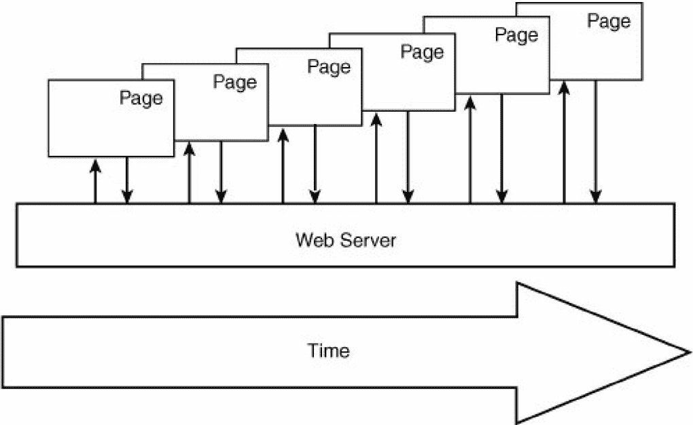

即使在早期，当万维网上的油漆尚未完全干透时，卸载/重新加载周期也让人很快就厌烦了，尤其是在拨号速度下。现在有了更充足的带宽，情况有所不同；它从一开始就没意思了。例如，几年前，我曾作为顾问为一家公司工作，他们试图掌握他们所说的“网络那回事”。他们的方法是挥舞魔杖，“噗！”——一个 CICS 程序员就成了 Web 开发人员。虽然这种方法在某种程度上管用，但它导致了一些相当有趣的 Web 开发标准。

他们的标准大致上是试图让网页尽可能像大型机 CICS 页面。这些标准是古怪和可怕的结合体。一个古怪的例子是，最初所有滚动，无论方向如何，都是被禁止的，因为被认为不专业。这意味着需要将表格网页拆分成单个页面大小的块，并为用户提供某种导航方式。

#### 图 8-2. 一个 Ajax 应用程序


另一方面，有些令人担忧的事情确实非常、非常可怕。例如，他们认为赋予脚本对 Web 服务器的写权限没什么问题。假设，举个例子，需要为 Web 应用程序开发一个购物车。按照本地标准，将“临时”购物车写入 Web 服务器是完全可以接受的。其理由是，与将信息存储在客户端或数据库表中相比，处理扁平文件更容易。如果时间允许，他们还可以编写一个“批处理作业”，直接在 Web 服务器上清理废弃的购物车。这大大减少了卸载/重载周期的需求，而这个周期开销很大。

想象一下这就像一趟月球之旅。如果阿波罗宇航员需要携带所有必需品怎么办？空气、水、食物以及其他任何必需品都必须从地球一路运输到月球。现在，请想象一下月球有一个可呼吸的大气层和一家麦当劳。突然之间，去月球的旅程就变得像去佛罗里达州一样容易了。

Ajax 通过在客户端建立一个基础设施来实现类似的功能。这个基础设施的复杂程度可以随心所欲。事实上，现在正是了解构建 Ajax 基础设施所需内容的好时机。所以，排好风暴音效，穿上实验室外套，让我们动手实践吧。


<!-- no content -->

## 8.2 XML

正如你所知，即使只是从[第 2 章](BINDING-OF-POWER-P094-CHAPTER-2)“Ajax 简介”中的短暂出场，XML 代表可扩展标记语言，但除了用来填充简历之外，你可能并不清楚 XML 为何被如此广泛使用。基本上，XML 流行有三个主要原因，并不包括任何带有`X`的事物所笼罩的神秘感。（不信我说的神秘感？那`X 档案`和`X 战警`呢？）

关于 XML 的著述可以说堆积如山——好吧，至少考虑到纸质书的话。至于电子版，我无法确定，因为无论可用空间有多少，我的笔记本电脑重量似乎总是一样的。因此，我不会用 XML 的历史，或者它如何是自切片面包以来最伟大的发明，或者它如何能治愈秃顶等说法来让你厌烦，因为那要么是多余，要么是彻头彻尾的谎言。

任何开发过使用 XML 的应用程序的人都知道，在试图向那些仍未掌握软件概念（相当于火的发现）的同事解释 XML 时，很可能会抓狂。然而，我至少应该强调要点，并指出一些更有用且晦涩的主题。

### 8.2.1 格式良好

好吧，XML 必须格式良好的概念并不晦涩，但它确实属于“有用”的范畴。你会惊讶于我不得不向具有大型机背景的特定项目负责人解释“格式良好”概念的次数。或者，再想想，也许你不会惊讶。

我们只能说，就像来自黑湖的怪物一样，XML 能力欠缺者就生活在我们中间，你甚至不需要去佛罗里达州现已关闭的海洋世界就能找到他们。因此，现在是时候讲讲 XML 101 了。

当满足以下条件时，XML 文档是格式良好的：

- 所有开始标签要么有结束标签，要么是自闭合的。
- 所有属性都有值。
- 所有属性值都用引号或撇号括起来。然而，我需要指出，它们必须保持一致。这意味着不能混用；如果值的左侧使用了引号，那么右侧也必须使用引号。
- 小心实体！哇，这听起来很诡异，不是吗？实体是需要谨慎处理的特殊字符，因为如果不进行特殊处理，它们可能会被误认为是内容以外的东西。

这相对容易，不是吗？我建议在向毫无头绪的项目负责人解释概念时，逐字引用这段话。但你需要记住，在说“小心实体！”时要睁大眼睛，因为他们喜欢这样。

好了，既然你（希望）已经对 XML 持开放态度了，那么大问题是，它从何而来？嗯，这取决于你的 Web 服务器和数据库环境；有些环境内置了直接从 SQL `SELECT` 语句或存储过程结果生成 XML 的方法。如果你的环境不支持，总有“自己动手”创建 XML 的可能性。因为 XML 是人类可读的——本质上是文本——只要稍微花点功夫，即使在不支持 XML 的地方，也可以创建 XML。

以 MySQL 为例。虽然 Oracle 和 SQL Server 都可以从存储过程直接生成 XML，但从 MySQL 生成 XML 需要更多的努力。首先，需要一个存储函数，通过连接节点名称和值来构建各个节点，如[清单 8-1](LISTING-OF-POWER-P094-LISTING-8-1)所示。接下来，需要一个函数，使用游标遍历查询结果，并使用前面提到的存储函数构建 XML。[清单 8-2](LISTING-OF-POWER-P094-LISTING-8-2)包含一个执行此操作的示例存储过程。

#### 清单 8-1. 连接存储函数

```sql
DELIMITER $$

DROP FUNCTION IF EXISTS `ajax`.`f_xmlNode`$$
CREATE FUNCTION `ajax`.`f_xmlNode`(
/*
   To produce the text representation of an XML node.
*/
   nodeName VARCHAR(255),  /* XML node name                  */
   nodeValue LONGTEXT,     /* XML node value                 */
   escape BOOLEAN          /* Apply XML entity escaping      */
) RETURNS longtext
BEGIN
   DECLARE xml LONGTEXT;   /* XML text node/value combination */

   IF nodeValue IS NULL OR LENGTH(nodeValue) = 0 THEN
      SET xml = CONCAT('<',nodeName,' />');
   ELSE
      IF escape THEN
         SET xml =
         CONCAT('<',nodeName,'>',REPLACE(REPLACE(REPLACE(REPLACE(REPLACE(nodeValue,
         '&','&amp;'),'>','&gt;'),'<','&lt;'),'"','&quot;'),'\'',"''",'&apos;'),'</',nodeName,'>');
      ELSE
         SET xml = CONCAT('<',nodeName,'>',nodeValue,'</',nodeName,'>');
      END IF;
   END IF;

   RETURN xml;
END$$

DELIMITER ;
```

#### 清单 8-2. 生成 XML 的存储过程

```sql
DELIMITER $$

DROP PROCEDURE IF EXISTS `ajax`.`itemSelectXML`$$
CREATE PROCEDURE `ajax`.`itemSelectXML`(
    guildItemId INTEGER,
    guildId INTEGER
)
BEGIN
    DECLARE done BOOLEAN DEFAULT FALSE;
    DECLARE xml LONGTEXT DEFAULT '<items>';
    DECLARE cGuildItemId INTEGER(6);
    DECLARE cGuildId INTEGER(6);
    DECLARE cGuildName VARCHAR(255);
    DECLARE cItemName VARCHAR(255);
    DECLARE cItemDescription VARCHAR(255);
    DECLARE cItemPrice DECIMAL(10,2);
    DECLARE itemCursor CURSOR FOR SELECT b.guild_item_id,
                                        b.guild_id,
                                        guild_name,
                                        item_name,
                                        item_description,
                                        item_price
                                    FROM   guild_item_bridge b
                                    INNER JOIN guild g
                                    ON     b.guild_id = g.guild_Id
                                    INNER JOIN item i
                                    ON     b.item_id = i.item_id
                                    WHERE  (guildItemId IS NULL
                                        OR guildItemId = b.guild_item_id) AND
                                        (guildId IS NULL
                                        OR guildId = b.guild_id);
    DECLARE CONTINUE HANDLER FOR SQLSTATE '02000' SET done = TRUE;
    OPEN itemCursor;
    FETCH itemCursor INTO cGuildItemId,
                          cGuildId,
                          cGuildName,
                          cItemName,
                          cItemDescription,
                          cItemPrice;
    REPEAT   
        SET xml    = CONCAT(xml,'<item><guild_item_id>',cGuildItemId,'</guild_item_id>');  
        SET xml     = CONCAT(xml,'<guild_id>',cGuildId, '</guild_id>'), 
        SET xml     = CONCAT(xml,'<item_name>', REPLACE(REPLACE(REPLACE(REPLACE( cGuildName, '&', '&amp;'), '>', '&gt;','<', '&lt;'), '"', '&quot;')),'</item_name>');
```

其工作原理如下：清单 8-2 中显示的存储过程检索查询结果，构建一个包含开始根元素的 XML 字符串，然后对检索到的每一行执行以下步骤：

1. 如果项是数字，则将其连接（包裹在适当的 XML 标签中）到 XML 字符串。
2. 如果项是字母或字母数字，则调用清单 8-1 中显示的存储函数来处理任何实体，并将信息包裹在适当的 XML 标签中。然后，将该存储函数的结果连接到 XML 字符串。

处理完所有行后，将结束根元素附加到 XML 字符串，流程完成。现在我们有了一个可靠的 XML 来源，让我们研究一下如何在 Web 浏览器中使用它。

## 8.2.2 Internet Explorer 的数据岛

关于 XML 数据岛的官方说法是，它们是“仅限 Microsoft”的技术，因此不适用于任何其他浏览器。是啊，说得对。然而，在像疯狂科学家那样改变现实结构之前，让我们仔细看看 XML 数据岛是什么以及它们是如何工作的。

尽管 XML 数据岛这个词听起来令人生畏，但根据官方定义，它只不过是嵌入在 HTML 文档某处的 XML。这没什么——听起来大概像一碗金鱼那么可怕。事实上，清单 8-3 是一个基本的 HTML 页面，其中 XML 就嵌入在正中间，图 8-3 显示了它在 Microsoft Internet Explorer 中的样子。


\

[查看完整图片]

此文档由未注册的ChmMagic创建，请访问http://自控力技术.com进行注册。谢谢。

#### 清单 8-3. 内嵌 XML 的 HTML

```html
<html>
<head>
<title>XML数据岛测试</title>
</head>
<body>
<xml id="di">
<states>
<state>
<abbreviation>NJ</abbreviation>
<name>New Jersey</name>
</state>
<state>
<abbreviation>NY</abbreviation>
<name>New York</name>
</state>
<state>
<abbreviation>PA</abbreviation>
<name>Pennsylvania</name>
</state>
</states>
</xml>
<b>XML数据岛测试</b>
</body>
</html>
```

小菜一碟，不是吗？直到有人用 Firefox 打开它，如图 8-4 所示。

#### 图 8-4. 在 Firefox 中显示内嵌 XML 的 HTML

[查看完整图片]

### 8.2.3 人人皆可用的数据岛！

现在，如果你和我一样，可能有点要绝望了。为什么不呢？一堆丑陋的东西嵌在网页中间。但要记住，仅仅因为某物存在，并不意味着它必须可见。有多种方法可以在网页上隐藏信息，例如将其放入隐藏输入框的值中，或者使用层叠样式表（CSS），又或者使用白色遮盖。

嗯，仔细想想，我会忽略第一种选项，因为虽然它可行，但也会极其繁琐。我也同样会忽略第三种选项，因为它要么太永久，要么纯属愚蠢。这样就只剩下第二种选项，层叠样式表了。

使用 CSS 的妙处在于，它不仅是一个优雅的解决方案，而且具有跨浏览器兼容性。那么，让我们对之前的网页做一个小小的修改——即添加清单 8-4 所示的样式表——然后再次查看该页面（参见图 8-5）。

#### 图 8-5. 在 Firefox 中使用 CSS 隐藏内嵌 XML 的 HTML

[查看完整图片]

#### 清单 8-4. 用于隐藏 XML 的 CSS

```css
xml
{
display: none;
font-size: 0px
}
```

好的，现在我们既有了 XML 数据岛，也有了一个可行的针对该 XML 数据岛的伪装装置，但我们仍然需要一种使用它的方法。因为除了“末日装置”之外，任何未被使用的东西本质上都是无用的，而且我很确定，要求“一百万美元的无瑕疵未切割钻石，否则我就使用我的 XML 数据岛”不会得到太多回应——当然，除非你把拿着捕蝶网和束袖夹克的友善人士的回应也算在内的话。

关键问题是，既然我们有了它，该如何使用它？这是一个好问题，但有点宽泛，不幸的是，它忽略了尚未解决的一些技术问题。也许将这个问题拆分为两个独立的问题会更好——例如，“既然我们有了一个 XML 数据岛，我们如何在页面上找到它？”以及“如何将其整合到页面中？”

第一个问题很简单。还记得第 5 章“使用 HTML 和 JavaScript 的 Ajax”中的`transverse`函数吗？那个本质上遍历 HTML DOM 的函数。类似的方法也行。然而，我更喜欢更直接的方法，会使用`getElementById`方法或`getElementsByName`方法。

我们在前面的示例中用过的`getElementById`方法，其优点是返回单个对象。但是，如果由于某些不可预见的原因该对象不存在，则会抛出错误。另一方面，`getElementsByName`方法返回一个由具有特定名称的节点组成的数组。这比前一种方法需要多敲一些键盘。这两种方法的语法如下所示：

```javascript
document.getElementById('xmlidi')
```

```javascript
document.getElementsByTagName('xml')
```

下一个问题是，“如何将其整合到页面中？”与之前的问题一样，达成目标有多种不同的方法。例如，如果你只对用新的 XHTML 对象替换现有的 XHTML 对象感兴趣，可以使用`getElementById`，如清单 8-5 所示。

#### 清单 8-5. 使用 getElementById


```html
<html>
  <head>
    <title>XML Data Island Test - Version 2</title>
    <style type="text/css">
xml
{
  display: none;
  font-size: 0px
}
    </style>
    <script language="javascript">
/*
  用XML数据岛中的一个输入文本框替换另一个。
  此外，调用此函数的按钮会被隐藏。
*/
function doReplace() {
    document.getElementById('here').innerHTML =
  document.getElementById('xmliki').innerHTML;
    document.getElementById('replace').style.display = 'none';
}
    </script>
</head>
<body>
    <xml id="xmlDI">
        <input type="text" id="new" name="new"
            value="Hello, World!" />
    </xml>
    <b>XML Data Island Test - Version 2</b>
    <br />
    <div id="here">
        <input type="text" id="old" name="old"
            value="Goodbye, cruel world!" />
    </div>
    <br />
    <input type="button" id="replace" name="replace"
        value="Replace" onclick="doReplace()" />
</body>
</html>
```

虽然这既整洁又巧妙，但它本质上只是过去几年一直在使用的DHTML方法的一个变体。要让人眼前一亮，需要的是一种动态更新页面内容的方法。幸运的是，有多种方法可以实现此任务，我们将在后面介绍。唯一的问题是你对“疯狂科学家式的东西”有多大的容忍度。

### 8.2.4. 绑定

对于那些对这个标题有不纯洁想法的人，我想说：“真害臊！”它简单地指的是将XML绑定到网页HTML的行为。把你们的思想从沟渠里拿出来。如果你从未使用过这种技术，有许多理由值得考虑使用它。首先，当你掌握语法后，它相对容易理解。另一个原因是，尽管功能强大，但它非常紧凑，同时将内容与呈现分离。最后，它听起来真的很古怪，我们多久才能用一次听起来这么古怪的东西？

将XML绑定到HTML通常被认为是微软Internet Explorer独有的功能。在Internet Explorer中，每个绑定的HTML元素都标识了XML数据岛的ID和正在绑定的单个节点，如清单8-6所示。

##### 清单 8-6. 在Internet Explorer中的XML绑定

```html
<html>
    <head>
        <title>XML Data Island Test</title>
        <style type="text/css">
            xml {
                display: none;
                font-size: 0px
            }
        </style>
    </head>
    <body>
        <xml id="xmlDI">
            <plugh>
                <magic>xyzzy</magic>
            </plugh>
        </xml>
        <b>XML Data Island Test</b>
        <br />
        <input type="text" name="test" datasrc="#xmlDI"
        datafld="magic" value="" />
    </body>
</html>
```

每个要绑定的HTML标签（上例中的input标签）都有一个`datasrc`来标识XML数据岛，以及一个`datafld`来标识特定的节点。重要的是要认识到，对文本框内容所做的更改会反映在XML数据岛本身。因此，将`xyzzy`键入为`plover`，那么magic节点中的文本就是`plover`。如果访问者使用的是微软Internet Explorer，这是一个很好但有点不稳定的解决方案，但如果他们使用的是Firefox呢？

简单的答案是伪造它。使用客户端JavaScript，许多函数可以为Firefox添加相同的功能，甚至使用相同的标签。关于这些工具的有趣之处在于，它们通常比Internet Explorer自己的内置绑定更稳定。为了绕过IE的不稳定性，我编写了清单8-7所示的页面。此外，我将`datasrc`属性重命名为`xmldi`，将`datafld`属性重命名为`xmlnode`，以避免Internet Explorer使用它自己的绑定。

##### 清单 8-7. 跨浏览器的XML绑定

```html
<html>
<head>
<title>XML数据岛测试 - 跨浏览器版</title>
<style type="text/css">
xml {
    display: none;
    font-size: 0px
}
</style>
<script language="javascript">
/*
    一个用于模拟IE数据绑定的简单函数。
    在页面加载时调用。
*/
function bindXML() {
    // 在实际应用中，这里会有遍历和绑定逻辑。
    // 为简单起见，我们只隐藏原始XML。
    document.getElementById('xmlDI').style.display = 'none';
}
window.onload = bindXML;
</script>
</head>
<body>
<xml id="xmlDI">
    <plugh>
        <magic>xyzzy</magic>
    </plugh>
</xml>
<b>XML Data Island Test - 跨浏览器版</b>
<br />
<input type="text" id="myText" name="test" value="" />
</body>
</html>
```

### 绑定的未来

虽然XML绑定曾经是Internet Explorer的一个独特功能，但现代Web标准和JavaScript库已经使其过时。对于新项目，更推荐使用JavaScript直接操作DOM，或者使用像React、Vue或Angular这样的框架进行数据绑定。这些方法提供了更好的跨浏览器兼容性、可维护性和性能。

---

*注意：本文档是XML的概述，并非特定于任何特定的实现或平台。*

```javascript
doBind(document.body.getElementsByTagName('textarea'));

} else {

    applyChange(arguments[0], arguments[1]);

    _bind(); // Re-bind

}

/*

    To handle data-binds for specific nodes based upon HTML

    element type and browser type.

*/

function doBind(objects) {

    var strTag; // HTML tag

    var strDI; // XML data island id

    var strNode; // XML node name

    var strValue; // XML node value

    for (var i = 0; i < objects.length; i++) {

        strTag = objects[i].tagName;

        strDI = objects[i].getAttribute('xmldi');

        strNode = objects[i].getAttribute('xmlnode');

        if (_IE)

            strValue =

                document.getElementById(strDI).XMLDocument.selectNodes('//' +

                    strNode).item(i).text;

        else

            strValue =

                document.getElementById(strDI).getElementsByTagName(strNode)[i].innerHTML;

        switch (strTag) {

            case ('DIV'):

            case ('SPAN'):

                objects[i].innerHTML = strValue;

                break;

            case ('INPUT'):

                switch (objects[i].type) {

                    case ('text'):

                    case ('hidden'):

                    case ('password'):

                        objects[i].value = strValue;

                        objects[i].onchange = new Function("_bind(this," +

                            i.toString()往北

                        break;

                    case ('checkbox'):

                        if (objects[i].value == strValue)

                            objects[i].checked = true;

                        else

                            objects[i].checked = false;

                        objects[i].onclick = new Function("_bind(this," +

                            i.toString()往北

                        break;

                    case ('radio'):

                        if (_IE)

                            strValue =

                                document.getElementById(strDI).XMLDocument.selectNodes('//' +

                                    strNode).item(0).text;

                        else

                            strValue =

                                document.getElementById(strDI).getElementsByTagName(strNode)[0].innerHTML;

                        if (objects[i].value == strValue)

                            objects[i].checked = true;

                        else

                            objects[i].checked = false;

                        objects[i].onclick = new Function("_bind(this,0)");

                        break;

                }

                break;

            case ('SELECT'):

            case ('TEXTAREA'):

                objects[i].value = strValue;

                objects[i].onchange = new Function("_bind(this," +

                    i.toString()往北

                break;

        }

    }

}

/*

    To handle changes to the bound HTML elements and apply

    those changes to the appropriate XML node.

*/

function applyChange(obj, index) {

    var strDI = obj.getAttribute('xmldi');

    var strNode = obj.getAttribute('xmlnode');

    var strValue = obj.value;

    if (obj.type == 'checkbox')

        if (obj.checked)

            strValue = obj.value;

        else

            strValue = '';

    if (_IE)

        document.getElementById(strDI).XMLDocument.selectNodes('//' +

            strNode).item(index).text = strValue;

    else

        document.getElementById(strDI).getElementsByTagName(strNode)[index].innerHTML

            = strValue;

}

</script>

</head>

<body onload="_bind()">

    <xml id="xmlDI">

        <a>

            <b>

                <c>one</c>

            </b>

            <b>

                <c>two</c>

            </b>

            <b>

                <c>three</c>

            </b>

        </a>

    </xml>

    <b>XML Data Island Test</b>

    <br />

    <div xmdi="xmlDI" xmlnode="c"></div>

    <br />

    <div xmdi="xmlDI" xmlnode="c"></div>

    <br />

    <div xmdi="xmlDI" xmlnode="c"></div>

    <br />

    <input type="text" xmdi="xmlDI" xmlnode="c" value="" />

    <br />

    <input type="text" xmdi="xmlDI" xmlnode="c" value="" />

    <br />

    <input type="text" xmdi="xmlDI" xmlnode="c" value="" />

    <br />

</body>

</html>
```

`bind()`函数使用DOM获取所有的`div`、`input`、`select`、`span`和`textarea`元素。接下来，从HTML中使用`xmdi`和`xmlnode`属性获取数据岛的ID以及元素名称。然后将XML节点的值复制到HTML中。最后，为每个受影响的HTML元素设置事件处理程序。该事件处理程序的目的是当访问者修改HTML值时更新XML，例如，在输入框中更改值时。

## 8.3. The XMLHttpRequest Object

尽管上一节可能很有趣，但请记住，它只是开胃菜。现在主菜登场的时候到了：[`XMLHttpRequest`](http://www.xmlhttprequest.com)对象。如果你从未使用过`XMLHttpRequest`对象，那么正如前面所述，它是一个赋予Web浏览器直接与服务器通信能力的对象，无需经历卸载/重新加载的周期，或者用外行的话说，就是“闪烁”。

### 8.3.1. Avoiding the Unload/Reload Cycle


我能想到的最佳类比是，`XMLHttpRequest`对象就像各种版本的*星际迷航*中的传送器。有了传送器，只有执行特定任务所必需的人员才需要传送到行星表面。另一种选择是要么让星舰着陆，如果它具备行星着陆能力的话，要么派遣穿梭机。无论哪种情况，都会有许多不必要的设备和人员被调动，花费巨大，而不是像传送器那样“只传送所需”的理念。

`XMLHttpRequest`对象就是网络版的传送器。当真正需要的只是数据本身时，为什么要传输整个网页呢？

> 用于展示的HTML和JavaScript已经在那儿了，所以只需更改数据，我们就可以开始了。我应该指出，虽然从服务器发送到客户端的数据不一定是XML，但在所有这些示例中，它都是XML。

### 8.3.2. Browser Differences

在描述使用`XMLHTTP`的实际语法之前，我建议您坐下，因为我不想吓到您或什么的。坐好了吗？很好。在Microsoft Internet Explorer中，`XMLHttpRequest`对象的语法与所有其他支持它的浏览器不同。事实上，从微软的角度来看，在冥卫一的表面某处，连万维网联盟都没有做对。实际上，他们犯了与Firefox完全相同的错误。幸运的是，由于所有非Internet Explorer浏览器之间的错误是一致的，所以只需要为IE编码，其他的就都涵盖了。嗯，我在想是不是也许……算了！

首先是按照以下方式创建`XMLHttpRequest`对象的实例：

```javascript
try {
    var x = new DOMParser();
    var _IE = false;
}
catch(e) { var _IE = true; };
var _XMLHTTP;

if(_IE)
    _XMLHTTP = new ActiveXObject('Microsoft.XMLHTTP');
else
    _XMLHTTP = new XMLHttpRequest();
```

在继续之前，必须做出几个决定，涉及到我们希望页面如何工作。

同步还是异步？

GET还是POST？

同步或异步的选择是一个相对重大的决定，但归根结底是等待响应还是在有响应时收到通知。只要记得为异步请求的响应指定状态变化处理程序，事情就应该能正常工作。GET或POST的问题也是一个重要的决定。幸运的是，自从HTML表单引入以来，这就一直是一个存在的问题，所以只要我们遵循相同的规则，一切都会好起来的。

比如说，我们想从服务器检索示例8-8所示的州和省XML文件。首先需要确定浏览器——基本上是Microsoft Internet Explorer和其他所有浏览器。接下来的任务是创建`XMLHttpRequest`对象的实例，然后为异步请求设置事件处理程序。最后，用三个参数打开`XMLHttpRequest`对象：

- GET或POST
- 请求的URL
- 异步为true，同步为false

但是，您必须记住关于编写状态变化处理程序的一件事。它是一个状态*变化*处理程序，而不是“我*完成了*”处理程序。除了“完成”之外还有其他状态；我们关注的是4，它表示请求已完成。示例8-9展示了一个页面，该页面从示例8-8检索XML，将其存储在XML数据岛中，并进行绑定以供显示目的。

##### 示例 8-8. Sample XML Document

```xml
<states>
  <state>
    <state_abbreviation>AB</state_abbreviation>
    <state_name>Alberta</state_name>
    <country_id>3</country_id>
  </state>
  <state>
    <state_abbreviation>AK</state_abbreviation>
    <state_name>Alaska</state_name>
    <country_id>1</country_id>
  </state>
  <state>
    <state_abbreviation>AL</state_abbreviation>
    <state_name>Alabama</state_name>
    <country_id>1</country_id>
 .po  <state>
    <state_abbreviation>AR</state_abbreviation>
    <state_name>Arkansas</state_name>
    <country_id>1</country_id>
  </state>
  <state>
    <state_abbrevion>AS</state_abbreviation>
    <state_name>American Samoa</state_name>
    <country_id>1</country_id>
  </state>
  <state>
    <state_abbreviation>AZ</state_abbreviation>
    <state_name>亚利桑那州</state_name>
    <country_id>1</country_id>
  </state>
</states>
```

##### 清单 8-9. 使用 XML 数据岛的 HTML 文档

```html
<html>
  <head>
    <title>XML 数据岛测试</title>
    <style type="text/css">
      xml
      {
        display: none;
        font-size: 0px
      }
    </style>
    <script language="JavaScript">
      try {
        var x = new DOMParser();
        var _IE = false;
      }
      catch(e) { var _IE = true; };
      var _URL = 'http://localhost/chapter4/states.xml';
      var _XMLHTTP;

      /*
      执行页面初始化。
      */
      function initialize() {
        if(_IE)
          _XMLHTTP = new ActiveXObject('Microsoft.XMLHTTP');
        else
          _XMLHTTP = new XMLHttpRequest();

        _XMLHTTP.onreadystatechange = stateChangeHandler;

        _XMLHTTP.open('GET',_URL,true);   // 异步（true）
        _XMLHTTP.send(null);
      }

      /*
      处理对 XMLHttpRequest 的异步响应，
      包括加载 XML 数据岛。
      */
      function stateChangeHandler() {
        if(_XMLHTTP.readyState == 4) {
          var strHTML = "";
          var nodeCount;

          if(_IE) {
            document.getElementById('xmlDI').XMLDocument.load(_XMLHTTP.responseXML);
            nodeCount =
              document.getElementById('xmlDI').XMLDocument.getElementsByTagName('state_name').length;
          } else {
            document.getElementById('xmlDI').innerHTML = _XMLHTTP.responseText;
            nodeCount = document.body.getElementsByTagName('state_name').length;
          }

          try {
            _XMLHTTP.close();     // 关闭 XMLHttpRequest
          }
          catch(e) {}

          for(var i=0;i < nodeCount;i++)
            strHTML += '<div xmIdi="xmlDI" xmlnode="state_name"></div>';

          document.getElementById('show').innerHTML = strHTML;

          _bind();              // 绑定 XML 和 HTML
        }
      }

      /*
       处理将 HTML 元素绑定到 XML 节点所需的逻辑。
      注意，在某些情况下，这种绑定是双向的。
      例如，当文本框中的值发生变化时，
      XML 数据岛中的相应值也会发生变化。
      */
      function _bind() {
        if(arguments.length == 0) {
          doBind(document.body.getElementsByTagName('div'));
          doBind(document.body.getElementsByTagName('input'));
          doBind(document.body.getElementsByTagName('select'));
          doBind(document.body.getElementsByTagName('span'));
          doBind(document.body.getElementsByTagName('textarea'));
        } else {
          applyChange(arguments[0],arguments[1]);
          _bind();                 // 重新绑定
        }

      /*
       根据 HTML 元素类型和浏览器类型，
       处理特定节点的数据绑定。
      */
      function doBind(objects) {
        var strTag;            // HTML 标签
        var strDI;             // XML 数据岛 id
        var strNode;           // XML 节点名
        var strValue;          // XML 节点值

        for(var i=0;i < objects.length;i++) {
          strTag = objects[i].tagName;
          strDI = objects[i].getAttribute('xmIdi');
          strNode = objects[i].getAttribute('xmlnode');
          if(strDI != null && strNode != null) {
            if(_IE)
              strValue =
                document.getElementById(strDI).XMLDocument.selectNodes('//' + strNode).item(i).text;
            else
              strValue = document.getElementById(strDI).getElementsByTagName(strNode)[i].innerHTML;

            switch(strTag) {
              case('DIV'):
              case('SPAN'):
                objects[i].innerHTML = strValue;
                
                break;
              case('INPUT'):
                switch(objects[i].type) {
                  case('text'):
                  case('hidden'):
                  case('password'):
                    objects[i].value = strValue;
                    objects[i].onchange = new Function("_bind(this," + i.toString() + ")");
                    break;
                  case('checkbox'):
                    if(objects[i].value == strValue)
                      objects[i].checked = true;
                    else
                      objects[i].checked = false;
                    objects[i].onclick = new Function("_bind(this," + i.toString() + ")");
                    break;
                  case('radio'):
                    if(_IE)
                      strValue = document.getElementById(strDI).XMLDocument.selectNodes('//' + strNode).item(0).text;
                    else
                      strValue = document.getElementById(strDI).getElementsByTagName(strNode)[0].innerHTML;

                    if(objects[i].value == strValue)
                      objects[i].checked = true;
                    else
                      objects[i].checked = false;

                    objects[i].onclick = new Function("_bind(this,0)");
                    break;
                }
                
                break;
              case('SELECT'):
              case('TEXTAREA'):
                objects[i].value = strValue;
                objects[i].onchange = new Function("_bind(this, " + i.toString() + ")");
                
                break;
            }
          }
        }
      }
    </script>
  </head>
  <body onload="initialize()">
    <xml id="xmlDI">
    </xml>
    <b>XML 数据岛测试</b>
    <br />
    <div id="show"></div>
  </body>
</html>
```

本文档由未注册的 ChmMagic 创建，请访问 <http://www.bisenter.com> 进行注册。谢谢

```javascript
/*
    处理已绑定 HTML 元素的更改，
    并将这些更改应用于相应的 XML 节点。
*/
function applyChange(obj,index) {
    var strDI = obj.getAttribute('xmldi');
    var strNode = obj.getAttribute('xmlnode');
    var strValue = obj.value;

    if(obj.type == 'checkbox')
        if(obj.checked)
            strValue = obj.value;
        else
            strValue = '';
    if(_IE)
        document.getElementById(strDI).XMLDocument.selectNodes('//' +
strNode).item(index).text = strValue;
    else
        document.getElementById(strDI).getElementsByTagName(strNode)[index].
innerHTML = strValue;
}
</script>
</head>
<body onload="initialize()">
    <xml id="xmlDI">
    </xml>
    <b>XML 数据岛测试</b>
    <br />
    <div id="show"></div>
</body>
</html>
```

本质上，[清单 8-9] 中的 JavaScript 发出一个异步的 Info 异步 XMLHTTP 请求。这除了通常的“这是什么浏览器？”之类的检查外，还包括创建`XMLHttpRequest`对象的实例、设置响应事件处理程序，以及使用请求类型、URL 和true（表示异步）来发出请求。状态改变处理程序，呃，处理来自服务器的响应。如果你仔细观察，会发现一个条件检查`readyState`属性是否等于4，即完成状态。检查`readyState`属性的原因是，这个处理程序会因多种原因多次触发，范围从“我正坐在这里”到“嘿，我正在收到响应”。

前面的例子说明了如何使用`XMLHttpRequest`对象异步地从服务器上的文件获取XML文档。可以将其视为概念验证，因为所需的XML文档很可能不在网站服务器的文件夹中。相反，可能会有一些类似Igor脚本版本的东西坐在那里看着奥普拉，等待真正的工作。


有几种不同的方法可以向我们的虚拟 Igor 获取和发送数据，范围从简单的自定义方法到稍微复杂一些的基于 XML 的标准。其中一种可以让虚拟 Igor 运动起来的标准叫做 XML 远程过程调用，简称 XML-RPC。简而言之，XML-RPC 是一个万维网联盟推荐标准，描述了一个请求/响应协议。请求被发送到 Web 服务器，Web 服务器处理该请求并返回响应。整个过程听起来可能相当复杂，但实际上并不比我们已经完成的工作更难。唯一的区别在于，我们将执行 POST 而不是 GET，并且请求需要是 XML 格式的，如[清单 8-10]所示，响应如[清单 8-11]所示。

#### 清单 8-10. XML-RPC 请求

```xml
<?xml version="1.0"?>
<methodCall>
  <methodName>igor.getGuildName</methodName>
  <params>
    <param>
      <value>
        <int>1</int>
      </value>
    </param>
  </params>
</methodCall>
```

#### 清单 8-11. XML-RPC 响应

```xml
<?xml version="1.0"?>
<methodResponse>
  <params>
    <param>
      <value>
        <string>Mad Scientist</string>
      </value>
    </param>
  </params>
</methodResponse>
```

正如你可能从中推断出的，XML 文档的结构大致是 `methodCall`、`params`、`param`、`value`，最后是数据类型（本例中是整数）。结构规则大致是一个 `methodResponse`、一个 `params` 和至少一个 `param`。此外，每个 `param` 只能有一个 `value`——不多不少。`value` 本身又有一个节点，该节点既描述数据又保存数据。[表 8-1](#) 显示了 XML-RPC 的有效数据类型。

#### 表 8-1. XML-RPC 数据类型

| Type | Description |
|---|---|
| `int` | 4 字节有符号整数 |
| `i4` | 4 字节有符号整数 |
| `boolean` | True = 1，false = 0 |
| `sting` | 字符字符串 |
| `double` | 双精度浮点数 |
| `dateTime.iso8601` | 日期/时间 |
| `base64` | 64 进制二进制 |

当然，像上面那样只通信单个信息项的情况非常罕见。更常见的是更复杂的数据结构，例如数组或记录型结构。数组和结构与前面那个简单示例的工作方式基本相同。清单 8-12 展示了数组的示例，清单 8-13 展示了结构的示例。

#### 清单 8-12. XML-RPC 数组

```xml
<?xml version="1.0"?>
<array>
  <data>
    <value>
      <int>5</int>
    </value>
    <value>
      <string>Lab Coat</string>
    </value>
    <value>
      <double>29.95</double>
    </value>
  </data>
</array>
```

#### 清单 8-13. XML-RPC 结构

```xml
<?xml version="1.0"?>
<struct>
  <member>
    <name>name_last</name>
    <value>
      <string>Woychowsky</string>
    </value>
  </member>
  <member>
    <name>name_first</name>
    <value>
      <string>Edmond</string>
    </value>
  </member>
  <member>
    <name>purpose</name>
    <value>
      <int>42</int>
    </value>
  </member>
</struct>
```

上面展示的数组示例只是对前面简单 XML 文档的扩展，但结构示例则更为复杂。除了指定参数类型和值之外，它还指定了参数的名称。这看起来可能没什么了不起，但对于具有许多参数的应用程序来说，这一点很有用，因为此时很难分清它们的相对位置。

这就引出了一个问题：当相对位置没有保持一致时，响应看起来是什么样子的？这很简单；会返回如清单 8-14 所示的错误。

#### 清单 8-14. XML-RPC 错误

```xml
<?xml version="1.0"?>
<methodResponse>
  <fault>
    <value>
      <struct>
        <member>
          <name>faultCode</name>
          <value>
            <int>86</int>
          </value>
        </member>
        <member>
          <name>faultString</name>
          <value>
            <string>
              Invalid data type.
            </string>
          </value>
        </member>
      </struct>
    </value>
  </fault>
</methodResponse>
```

既然我们知道了请求通常的样子，下一步就是修改前面的示例，即通过 `XMLHttpRequest` 对象检索 XSLT，并使用 GET 方法来使用 XML-RPC。不过，这次我们将跳过示例，直接进展到一些人认为是创建 Web 服务的首选协议：SOAP。

### 8.3.3. 使用 SOAP 进行清理

除了作为一种清洁手段外，SOAP 是简单对象访问协议（Simple Object Access Protocol）的缩写，这是一种用于在 Web 浏览器和 Web 服务器之间通信的协议。如果仅仅是为了处理原始 SOAP 的多个网站，SOAP 可能是网上最难研究的主题之一。然而，在搜索时，你最终会获得所需的结果，并发现 SOAP 不过只是 XML 的一个封装器。

XML-RPC 被设计用来提供标准结构。然而，在 SOAP 中，采用了稍微不同的方法。XML-RPC 使用严格的 `params-param-value` 结构，将信息与封装器 rigidly（刚性）地绑定在一起，而 SOAP 则使用更灵活的信封方法。就像物理信封一样，SOAP 信封既标识收件人，又包含其中的消息。SOAP 信封与物理信封唯一的真正区别在于，SOAP 信封中包含的消息必须是格式良好的，如清单 8-15 所示。

#### 清单 8-15. SOAP 请求

```xml
<?xml version="1.0" encoding="utf-8"?>
<soap:Envelope xmlns:xsi="http://www.w3.org/2001/XMLSchema-instance"
  xmlns:xsd="http://www.w3.org/2001/XMLSchema"
  xmlns:soap="http://schemas.xmlsoap.org/soap/envelope/">
  <soap:Body>
    <getItems xmlns="http://tempuri.org/">
      <guild_item_id>string</guild_item_id>
      <guild_id>string</guild_id>
    </getItems>
  </soap:Body>
</soap:Envelope>
```

与 XML-RPC 示例一样，SOAP 请求有两种可能的响应。要么是 Web 服务正常运行并返回 SOAP 响应，如清单 8-16 所示，要么是发生了某种错误，请求失败并返回 SOAP 错误。清单 8-17 包含一个 SOAP 错误的示例。

#### 清单 8-16. SOAP 响应

```xml
<?xml version="1.0" encoding="utf-8"?>
<soap:Envelope xmlns:xsi="http://www.w3.org/2001/XMLSchema-instance"
  xmlns:xsd="http://www.w3.org/2001/XMLSchema"
  xmlns:soap="http://schemas.xmlsoap.org/soap/envelope/">
  <soap:Body>
    <getItemsResponse xmlns="http://tempuri.org/">
      <getItemsResult>xml</getItemsResult>
    </getItemsResponse>
  </soap:Body>
</soap:Envelope>
```

#### 清单 8-17. SOAP 错误

```xml
<soap:Envelope xmlns:xsi="http://www.w3.org/2001/XMLSchema-instance"
  xmlns:xsd="http://www.w3.org/2001/XMLSchema"
  xmlns:soap="http://schemas.xmlsoap.org/soap/envelope/">
  <soap:Body>
    <soap:Fault>
      <faultcode>soap:MustUnderstand</faultcode>
      <faultstring>Mandatory Header error.</faultstring>
      <faultactor>http://localhost/AJAX4/chapter4.asmx</faultactor>
      <detail>Web Service coffee break.</detail>
    </soap:Fault>
  </soap:Body>
</soap:Envelope>
```

## 8.4. 重新审视一个问题

既然我们已经涵盖了使用 XML、SOAP 和 XMLHTTP 所需的一些背景知识，让我们将其应用于电子商务站点。你可能记得，该站点的目标是提供通常被忽视的市场：疯科学家、炼金术师和法师的材料。在第 5 章中，我们使用 Ajax 的原始祖先创建了页面；现在让我们尝试使用真正的 Ajax。这并不意味着完全放弃隐藏帧是绝对必要的。如果你决定需要它们，那就尽管使用吧；然而，从这里开始我们将放弃隐藏帧。

此外，我们将服务器端语言从 PHP 更改为 C#。做出这种更改的原因并不是 PHP 不能用于开发 Web 服务；实际上是因为我在开发 Web 服务时更习惯使用 C#。对于质疑开源书中出现 C# 的人，我只对你们说一个词：Mono。

不，不是每个人在高中、大学或像我所在的贝尔实验室时都讨厌的那个 Mono；而是 .NET Framework 的开源实现的那个 Mono。如果你没有在 Linux 下运行过 C# 应用程序，你就没有真正活过。它并不感觉错误；它更像是在《星际迷舰：第一次接触》中，少校指挥官沃尔夫说的那样：“同化它！”

清单 8-18 包含了将处理本章其余部分服务器端要求的 Web 服务。

#### 清单 8-18. Web 服务

```csharp
using System;
using System.Collections;
using System.ComponentModel;
using System.Data;
using System.Diagnostics;
using System.IO;
using System.Web;
using System.Web.Services;
using System.Web.Services.Protocols;
using System.Xml;
using MySql.Data.MySqlClient;
using MySql.Data.Types;

namespace AJAX
{
    /// <summary>
    /// msas 的摘要说明。
    /// </summary>
    public class msas : System.Web.Services.WebService
    {
        const string CONNECTION_STRING =
            "Persist Security Info=False;database=ajax;server=localhost;username=root;password=wyvern";

        public msas()
        {
            InitializeComponent();
        }

        #region Component Designer generated code

        //Web 服务设计器所需
        private IContainer components = null;

        /// <summary>
        /// 设计器支持所需的方法 - 请勿使用代码编辑器
        /// 修改此方法的内容。
        /// </summary>
        private void InitializeComponent()
        {
        }

        /// <summary>
        /// 清理正在使用的任何资源。
        /// </summary>
        protected override void Dispose(bool disposing)
        {
            if (disposing && components != null)
            {
                components.Dispose();
            }

            base.Dispose(disposing);
        }

        #endregion

        [WebMethod]
        public XmlDocument getState(string state_abbreviation)
        {
            MySqlConnection connection =
                new MySqlConnection(CONNECTION_STRING);
            MySqlDataAdapter adapter = new MySqlDataAdapter();
            DataSet dataSet = new DataSet();
            XmlDocument xml = new XmlDocument();
            string query = "CALL stateSelect(NULL)";

            if (state_abbreviation.Length != 0)
            {
                query = "CALL stateSelect('" + state_abbreviation + "')";
            }

            adapter.SelectCommand =
                new MySqlCommand(query, connection);
            adapter.Fill(dataSet);

            xml.LoadXml(dataSet.GetXml());
            connection.Close();

            return(xml);
        }

        [WebMethod]
        public XmlDocument getXML(string name)
        {
            XmlDocument xml = new XmlDocument();

            try
            {
                xml.Load(Server.MapPath(name));
            }
            catch (Exception e)
            {
                StringWriter writer = new StringWriter();
                Server.UrlEncode(name, writer);
                String encodedName = writer.ToString();
                XmlNode node =
                    xml.CreateNode(XmlNodeType.CDATA, "detail", "");

                node.Value = encodedName;

                throw(new SoapException(
                    e.Message,
                    SoapException.ClientFaultCode,
                    "",
                    node));
            }

            return(xml);
        }

        [WebMethod]
        public XmlDocument getItems(string guild_item_id, string guild_id)
        {
            MySqlConnection connection =
```


```csharp
new MySqlConnection(CONNECTION_STRING);

MySqlDataAdapter adapter = new MySqlDataAdapter();

DataSet dataSet = new DataSet();

XmlDocument xml = new XmlDocument();

string query;

if(guild_item_id.Length == 0)

  if(guild_id.Length == 0)

    query = "CALL itemSelect(NULL,NULL)";

  else

    query = "CALL itemSelect(NULL," + guild_id + ")";

else

  if(guild_id.Length == 0)

    query = "CALL itemSelect(" + guild_item_id + ",NULL)";

  else

    query = "CALL itemSelect(" + guild_item_id + "," + guild_id +

")";

adapter.SelectCommand =

new MySqlCommand(query, connection);

adapter.Fill(dataSet);

xml.LoadXml(dataSet.GetXml());

connection.Close();

return(xml);

}

}

}

```

我想指出，所示的 Web 服务处理了几项不同的工作。首先，如果有必要，它会对 MySQL 数据库执行数据库查询。紧接着查询之后，它构建了显示页面所需的 XHTML；最后，它创建了一个包含一行 JavaScript 的节点。所有这些都被整合到一个单一的 XML 文档中，然后发送给客户端。虽然这看起来可能有点奇怪，但我的做法自有其道理。与隐藏框架的示例类似，将有一个 HTML 文档也需要执行多项不同的任务。

服务器端处理完毕后，在客户端开发有三种方式。第一种是继续我们一直以来的开发方式，手动编码每个函数。虽然这能让我们真正理解应用程序的工作原理，但开发任何有用的东西都需要花费很长时间。

第二种方法是上网找一个合适的 Ajax 库，下载它，然后继续开发。目前，市面上有不少这样的库，例如 `Sarissa` 和 `JSON`（读作“Jason”）。（然而，如果我没记错的话，Jason 是阿尔戈英雄的首领，而 Ajax 是特洛伊战争中的英雄。）

第三种可能性是编写我们自己的 Ajax 库，或者更准确地说，使用我已经编写好的一个库。这个方法有几个好处，第一个原因是我（希望）完全了解库的工作原理。第二个原因是，我可以在后面的章节中剖析它们，这样我们就确切知道它们是如何工作的。最后一个原因是，这有助于增加页数——呃，我是说，加深这些示例的深度。表 8-2 简要描述了该库中的类及其相关方法和属性。

## 8.5. 表格信息和表单

本文档由未注册的 ChmMagic 创建，请访问 <http://www.bisenter.com> 进行注册。谢谢

### 表 8-2. Ajax 库类

| 名称 | 父类 | 类型 | 描述 |
| :--- | :--- | :--- | :--- |
| `XMLHttpRequest` | | 类 | 构造函数 |
| `action` | `XMLHttpRequest` | 属性 | `GET`、`POST` 或 `HEAD` |
| `asynchronous` | `XMLHttpRequest` | 属性 | `true` 或 `false` |
| `envelope` | `XMLHttpRequest` | 属性 | SOAP 信封 |
| `readyState` | `XMLHttpRequest` | 方法 | 返回文档的 `readyState` |
| `getresponseHeader` | `XMLHttpRequest` | 方法 | 返回单个 HTTP 响应头 |
| `getAllResponseHeaders` | `XMLHttpRequest` | 方法 | 返回所有 HTTP 响应头 |
| `responseText` | `XMLHttpRequest` | 方法 | 以文本形式返回 SOAP 响应 |
| `responseXML` | `XMLHttpRequest` | 方法 | 以 XML 文档形式返回 SOAP 响应 |
| `stateChangeHandler` | `XMLHttpRequest` | 方法 | 虚拟状态变更处理器 |
| `setRequestHeader` | `XMLHttpRequest` | 方法 | 设置 HTTP 响应头 |
| `removeRequestHeader` | `XMLHttpRequest` | 方法 | 移除先前设置的 HTTP 响应头 |
| `Send` | `XMLHttpRequest` | 方法 | 发送 `XMLHttpRequest` |
| `Cache` | | 类 | 构造函数 |
| `insert` | `Cache` | 方法 | 插入一个名称/值对 |
| `retrieve` | `Cache` | 方法 | 检索一个值 |
| `purge` | `Cache` | 方法 | 清除一个或多个名称/值对 |
| `names` | `Cache` | 方法 | 返回一个名称数组 |
| `XmlDocument` | | 类 | 构造函数 |
| `Load` | `XmlDocument` | 方法 | 加载一个 XML 文档 |
| `serialize` | `XmlDocument` | 方法 | 将 XML 文档序列化为文本 |
| `DOMDocument` | `XmlDocument` | 方法 | 返回一个 XML 文档 |
| `readyState` | `XmlDocument` | 方法 | 返回文档的 `readyState` |
| `setRequestHeader` | `XmlDocument` | 方法 | 设置 HTTP 响应头 |
| `getresponseHeader` | `XmlDocument` | 方法 | 返回单个 HTTP 响应头 |
| `getAllResponseHeaders` | `XmlDocument` | 方法 | 返回所有 HTTP 响应头 |
| `setEnvelope` | `XmlDocument` | 方法 | 为 `XMLHttpRequest` 设置信封 |
| `selectNodes` | `XmlDocument` | 方法 | 返回一个 XML 节点数组 |
| `SOAPEnvelope` | | 类 | 构造函数 |
| `envelope` | `SOAPEnvelope` | 方法 | SOAP 信封 |

现在，应用架构的基础（尽管是粗略地）已经介绍完毕，这是查看基于该架构构建的 HTML 页面样貌的好时机。图 8-6 展示了它在浏览器中的样子，代码清单 8-19 展示了 HTML 和 JavaScript。

### 图 8-6. Ajax 页面

[查看完整图片]

### 代码清单 8-19. Ajax 页面

```html
<html>

<head>

<title>chapter4</title>

<link rel="stylesheet" type="text/css" href="common.css">

<script language="JavaScript" src="Cache.js"></script>

<script language="JavaScript" src="XMLHTTPRequest.js"></script>

<script language="JavaScript" src="XMLDocument.js"></script>

<script language="JavaScript" src="SOAPEnvelope.js"></script>

<script language="javascript">

<!--[![CDATA[

try {var x = new DOMParser(); var_IE = false; } catch(e)

{ var_IE = true; };

var xml = new XMLDocument();

var soap = new SOAPEnvelope();

var pageNum = 'Items';

var itemsXHTMLStart = '<table width="960px" border="1" cellpadding="2"

cellspacing="2"><tr class="rowHeader">

<th width="10%">Guild</th><th width="70%">Item Name</th><th>

Item Price</th></tr>';

var itemsXHTMLEnd = '</table>';

var itemsInnerXHTML = '<tr class="rowData" id="data">

<td align="center"><a href="javascript:pageLoad(\'Items\',@guild)"

xmldi="xmlDI" xmlnode="guild_name"></a></td><td align="left"

<a href="javascript:pageLoad(\'Detail\',@item)"><div id="value"

xmldi="xmlDI" xmlnode="item_name"></div></a></td>

<td class="numeric">$<span xmldi="xmlDI"

xmlnode="item_price"></span></td></tr>';

var detailXHTML = '<div><div class="rowHeader" style="position: absolute;

left: 50px; right: auto%; bottom: auto; width: 200px; top: 75px"> Guild

Name:</div><div class="rowHeader" style="position: absolute; left: 50px;

right: auto%; bottom: auto; width: 200px; top: 92px"> Item Name:</div><div

class="rowHeader" style="position: absolute; left: 50px; right: auto%;

bottom: auto; width: 200px; top: 110px"> Description:</div><div

class="rowHeader" style="position: absolute; left: 50px; right: auto%;

bottom: auto; width: 200px; top: 127px"> Price:</div><div

class="rowHeader" style="position: absolute; left: 50px; right: auto%;

bottom: auto; width: 200px; top: 144px"> Quantity:</div><div

class="rowData" style="position: absolute; left: 255px; right: auto;

bottom: auto; width: 600px; top: 75px" xmldi="xmlDI"

xmlnode="guild_name"></div><div class="rowData" style="position: absolute;

left: 255px; right: auto; bottom: auto; width: 600px; top: 92px"

xmldi="xmlDI" xmlnode="item_name"></div>

<div class="rowData" style="position: absolute; left: 255px; right: auto;

bottom: auto; width: 600px; top: 110px" xmldi="xmlDI"

xmlnode="item_description"></div><div class="rowData" style="position:

absolute; left: 255px; right: auto; bottom: auto; width: 600px; top:

127px">$<span xmldi="xmlDI" xmlnode="item_price"></span></div><input

type="text" id="quantity" name="quantity" value=""

onkeyup="restrict(this,\'[0-9]\',\'gi\')" class="rowData" style="position:

absolute; left: 255px; right: auto; bottom: auto; width: 600px; top:

144px; text-align: right"></div>';

function setEvents() {

pageLoad();

}

</script>

</head>
```

## 8.5.1. 只读页面

再次强调，只读页面的目的是向访问者展示我们的商品。从表面上看，它只是排列着可供出售商品的行列。然而，在背后却是另一番景象。这是一个网络服务，针对获取在售商品信息的请求，返回一个 SOAP 响应。

收到请求后，该网络服务从数据库中获取必要信息，这与前面章节中使用的 MySQL 数据库是同一个。获取到信息后，它以编程方式构建填充可滚动 `div` 所需的 XHTML。此页面不允许更新，因此只有 XHTML 会被发送到客户端。嘿，能节省带宽 unavoidably 就节省吧。

不幸的是，事情远不止如此。例如，页面的 `onload` 事件处理程序需要发送 SOAP 请求，以便调用前面的方法。此外，按钮需要被激活或禁用，单击事件需要处理，总之，还有更多的事情要做。

```javascript
function pageLoad(name, parm) {

    switch(true) {

        case(arguments.length == 0):

            soap.content = '<guild_item_id/><guild_id/>';

        case(name === 'Items'):

            if(arguments.length <= 0)

                soap.content = '<guild_item_id/><guild_id>' + parm + '</guild_id>';

            soap.operator = "getItems";

            xml.setEnvelope(soap.envelope());

            xml.setRequestHeader('SOAPAction', 'http://tempuri.org/getItems');

            xml.setRequestHeader('Content-Type', 'text/xml');

            xml.load('http://localhost/AJAX4/ch心理_w_ 烦死了删完又要重写 4.asmx');

            var guild = xml.selectNodes('//guild_id')[i].serialize().replace(new RegExp('<[^<]{0,}>', 'g'), "");

            var item = xml.selectNodes('//guild_item_id')[i].serialize().replace(new RegExp('<[^<]{0,}>', 'g'), "");

            xhtml += itemsInnerXHTML.replace(reGuild, guild).replace(relItem, item);

        }

        document.getElementById('formBody').innerHTML = xhtml + itemsXHTMLEnd;

        break;

        case('Detail'):

            document.getElementById('formBody').innerHTML = detailXHTML;

            break;

    }

    window.setTimeout('_bind()', 10);

} else {

    window.setTimeout('pageWait()', 10);

}

function _bind() {

    if(arguments.length == 0) {

        doBind(document.body.getElementsByTagName('a'));

        doBind(document.body.getElementsByTagName('div'));

        doBind(document.body.getElementsByTagName('input'));

        doBind(document.body.getElementsByTagName('select'));

        doBind(document.body.getElementsByTagName('span'));

        doBind(document.body.getElementsByTagName('textarea'));

    } else {

        applyChange(arguments[0], arguments[1]);

        _bind(); // Re-bind

    }

}

/*

    Function:   doBind
```


```javascript
/*
    Programmer: Edmond Woychowsky

    Purpose:    To handle data-binds for specific nodes based upon HTML element type and browser type.
*/

function doBind(objects) {
    var strTag; // HTML tag
    var strDI; // XML data island id
    var strNode; // XML node name
    var strValue; // XML node value
    var index = new Object(); // Object to store information

    for (var i = 0; i < objects.length; i++) {
        strTag = objects[i].tagName;
        strDI = objects[i].getAttribute('xmlid');
        strNode = objects[i].getAttribute('xmlnode');

        if (strDI != null && strNode != null) {
            if (typeof(index[strNode]) == 'undefined') index[strNode] = -1;

            ++index[strNode];

            if (_IE) {
                strValue = document.getElementById(strDI).XMLDocument.selectNodes('//' + strNode).item(index[strNode]).text;
            } else {
                strValue = document.getElementById(strDI).getElementsByTagName(strNode)[index[strNode]].innerHTML;
            }

            switch (strTag) {
                case ('A'):
                case ('DIV'):
                case ('SPAN'):
                    objects[i].innerHTML = strValue;
                    break;

                case ('INPUT'):
                    switch (objects[i].type) {
                        case ('text'):
                        case ('hidden'):
                        case ('password'):
                            objects[i].value = strValue;
                            objects[i].onchange = new Function("_bind(this, " + i.toString() + ")");
                            break;

                        case ('checkbox'):
                            if (objects[i].value == strValue)
                                objects[i].checked = true;
                            else
                                objects[i].checked = false;

                            objects[i].onclick = new Function("_bind(this, " + i.toString() + ")");
                            break;

                        case ('radio'):
                            if (_IE)
                                strValue = document.getElementById(strDI).XMLDocument.selectNodes('//' + strNode).item(0).text;
                            else
                                strValue = document.getElementById(strDI).getElementsByTagName(strNode)[0].innerHTML;

                            if (objects[i].value == strValue)
                                objects[i].checked = true;
                            else
                                objects[i].checked = false;

                            objects[i].onclick = new Function("_bind(this,0)");
                            break;
                    }

                    break;

                case ('SELECT'):
                case ('TEXTAREA'):
                    objects[i].value = strValue;
                    objects[i].onchange = new Function("_bind(this, " + i.toString() + ")");
                    break;
            }
        }
    }
}

/*
    Function:   restrict

    Programmer: Edmond Woychowsky

    Purpose:    Restrict keyboard input for the provided object
                using the passed regular expression and option.
*/

function restrict(obj, rex, opt) {
    var re = new RegExp(rex, opt);
    var chr = obj.value.substr(obj.value.length - 1);

    if (!re.test(chr)) {
        var reChr = new RegExp(chr, opt);
        obj.value = obj.value.replace(reChr, "");
    }
}

/*
    Function:   add2Cart

    Programmer: Edmond Woychowsky

    Purpose:    To add an item/quantity pair to an XML Data
                Island that represents a shopping cart.
*/

function add2Cart() {
    var item =
        xml.selectSingleNode('//guild_item_id').serialize().replace(
            new RegExp('[^<]{0,}>', 'g'),
            ""
        );

    var quantity = document.getElementById('quantity').value;

    var re = new RegExp(
        '<item><sanitized]<id>' + item +
        '</id><quantity>[^<]{1,}</quantity></item>',
        'g'
    );

    if (re.test(document.getElementById('cart').innerHTML))
        document.getElementById('cart').innerHTML =
            document.getElementById('cart').innerHTML.replace(re, "");

    document.getElementById('cart').innerHTML +=
        '<item><id>' + item +
        '</id><quantity>' + quantity + '</quantity></item>';

    alert('Item added to cart.');
}

// ]]>

</script>

</head>

<body onload="setEvents()">
    <table border="0" height="60px" width="975px" cellpadding="0" cellspacing="0" ID="Table1">
        <tr class="pageHeader" height="40px">
            <td width="5%"> </td>
            <th id="systemName" class="page疫件" width="45%" align="left">My System</th>
            <th id="pageName" class="pageCell" width="45%" align="right">My</th>
        </tr>

        <tr>
            <td> </td>
            <td> </td>
            <td> </td>
            <td> </td>
        </tr>
    </table>

    <xml id="cart"></xml>
    <xml id="xmlDI"></xml>

    <div id="formBody" style="color: #000000; background-color: F0F8FF; font-family: tahoma; font-size: 12px; border: solid 1px gray; height: 400px; width: 980px; overflow: scroll"></div>

    <p />

    <div id="buttons">
        <input id="show_all" type="button" value="Show All" onclick="javascript:pageLoad()" style="height: 22px; width: 110px" />
        <input id="add_to_cart" type="button" value="Add to cart" onclick="add2Cart()" style="height: 22px; width: 110px" />
        <input id="view_cart" type="button" value="View cart" onclick="javascript:pageLoad('displayCart')" style="height: 22px; width: 110px" />
        <input id="place_order" type="button" value="Place order" onclick="" style="height: 22px; width: 110px" />
    </div>
</body>

</html>
```

正如前面的 HTML 示例一样，清单 8-19 绑定了 XML 数据岛，并使用了异步 XMLHTTP 请求。最大的区别在于，这里的 XML 来自网络服务，而且请求是通过 SOAP 发出的。这意味着，虽然此处显示的所有代码都是为本书定制的，但 Ajax 前端完全可以为现有的网络服务编写。就像巴顿将军说的：“永远不要为同一块地皮付两次钱。”

请注意带有 `id` 属性的 HTML DIV 标签；它有些特别之处。你可能已经从 `style` 属性中推断出，它的高度和宽度都是固定的。这是为了防止底部的按钮四处移动。此外，它提供了一个显示服务器返回信息的位置，而无需担心按钮的问题。另一种做法是将按钮放在页面顶部，但向上滚动查找按钮会非常烦人。底层架构完成了大约 90%，让我们重新审视显示我们网站上可购买商品的页面。

还有工作要做。

从页面 `onload` 事件的处理程序开始，我们需要构建一个 SOAP 请求，将请求发送到 Web 服务，并激活相应的按钮。此外，最终 Web 服务会通过其响应返回到页面，这也必须得到处理。听起来够多了？让我们把它分解得更详细一点。

1. 创建一个 `XMLDocument()` 的全局实例。
2. 构建一个 SOAP 请求，描述 Web 服务的 URI、方法、命名空间和发送的参数。
3. 使用 `XMLDocument` 类中包含的 `XMLHttpRequest` 发送 SOAP 请求。
4. 等待来自 Web 服务的 SOAP 响应。
5. 激活相应的按钮。
6. 填充页面。

听起来挺容易？嗯，第一次之后确实容易。然而，第一次的时候，弄清楚什么是什么以及什么放在哪里是有点困难的。我第一次做的时候，在第 2 步和第 4 步上遇到了点困难。我在第 2 步遇到的问题纯粹是关于什么放在哪里的问题；看看代码就能解释一切。处理第 4 步只是在 JavaScript 中使用 `window.setTimeout`，在适当毫秒后重复调用一个函数，以检查 `XMLHttpRequest` 的 `readyState`。如果 `readyState` 为 4，则表示完成。[表 8-3] 显示了可能的 `readyState` 值及其含义。

##### 表 8-3. readyState 值

| readyState | 描述 |
| --- | --- |
| 0 | 未初始化 |
| 1 | 加载中 |
| 2 | 已加载 |
| 3 | 交互中 |
| 4 | 完成 |

对于 Ajax，最难适应的可能就是客户端 JavaScript 与 HTML 的比例了。在传统的 Web 开发中，HTML 的行数远远超过 JavaScript 的行数。而在 Ajax 开发中，则恰恰相反，JavaScript 比 HTML 多。幸运的是，有了一个尚可的对象和函数库，Ajax 开发通常不需要大量自定义代码。例如，[清单 8-20] 显示了我们页面列出可用项目的自定义 JavaScript，而[图 8-7] 显示了它在浏览器中的样子。

##### 图 8-7. 可用项目


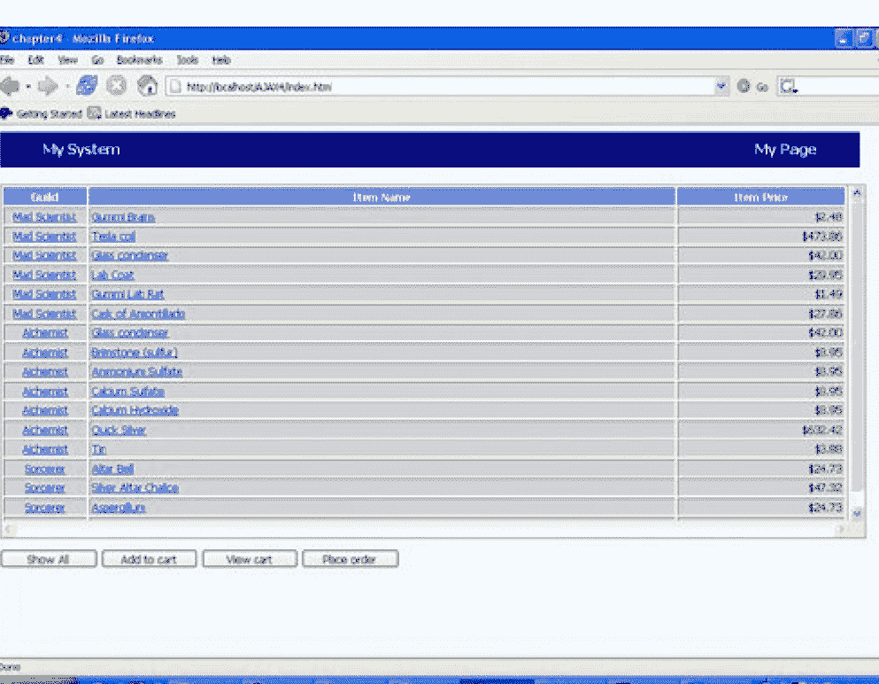

##### 清单 8-20. 可用项目

```javascript
soap.content =
    '<guild_item_id>' + parm + '</guild_item_id><guild_id/>';

soap.operator = 'getItems';

xml.setEnvelope(soap.envelope());

xml.setRequestHeader('SOAPAction', 'http://tempuri.org/getItems');

xml.setRequestHeader('Content-Type', 'text/xml');

xml.load('http://localhost/AJAX4/chapter4.asmx');

window.setTimeout('pageWait()', 10);

pageName = name;

function pageWait() {
    if (xml.readyState() == 4) {
        var xhtml = itemsXHTMLStart;

        var input =
            document.getElementById('buttons').getElementsByTagName('input');
    }
}
```


### 8.5.2. 可更新的页面

因为我们已经设计出了底层架构，一个可更新的页面仅仅是前一个示例中所示只读页面的变体。本质上主要有两个区别。第一个是，绑定的标签不再是 SPAN 或 DIV 标签，而是诸如 INPUT 和 SELECT 之类的东西。第二个区别是最终需要将整个 XML 数据岛发送到服务器。有趣的是，它不必是绑定到 HTML 的 XML 数据岛，尽管也可以是。

> 还记得本书前面的购物车吗？嗯，现在购物车本身就是一个 XML 数据岛，而不再使用文本框中那个古怪的项目 ID-破折号-数量了。不幸的是，这意味着我不能偷懒从第 5 章重用那个函数了。唉，有必要编写清单 8-21 所示的函数。它没有什么花哨的地方；事实上，它将 XML 作为文本来处理。这不仅是一个有效的选项，而且它还适用于跨浏览器环境。

#### 清单 8-21. 添加到购物车的函数

```javascript
/*
 将一个项目/数量对添加到代表购物车的 XML 数据岛中。
*/

function add2Cart() {
  var item =
    xml.selectSingleNode('//guild_item_id').serialize().replace(
      new RegExp('<[^<]{0,}>', 'g'),
      ''
    );

  var quantity = document.getElementById('quantity').value;

  var re =
    new RegExp(
      '<item><id>' + item +
      '<\\/id><quantity>[^<]{1,}<\\/quantity><\\/item>',
      'g'
    );

  if (re.test(document.getElementById('cart').innerHTML)) {
    document.getElementById('cart').innerHTML =
      document.getElementById('cart').innerHTML.replace(re, '');
  }

  document.getElementById('cart').innerHTML +=
    '<item><id>' + item +
    '<\\/id><quantity>' + quantity +
    '<\\/quantity><\\/item>';

  alert('Item added to cart.');
}
```

其最终结果就是[清单 8-21](listing-8-21)以及[图 8-7](figures-8-7)和[8-8](8-8)所示的页面。它的工作原理与[清单 8-20](listing-8-20)中的`pageWait()`函数大致相同。区别在于，它不是基于 XML 文档向 HTML 文档添加元素，而是基于访问者的行为向嵌入的 XML 文档添加元素。[图 8-7](figure-8-7)所示的页面列出了可供购买的物品，而[图 8-8](figure-8-8)处理的是添加到购物车的操作。

#### 图 8-8. 物品已添加到购物车

[查看完整图片]

### 我的系统

#### 我的页面

| 供应商名称： | 疯狂科学家 |
| --- | --- |
| 物品名称： | 蒙蒂利亚多酒桶 |
| 描述： | 以其精致花香而闻名的干雪利酒 |
| 价格： | $27.86 |
| 数量： | |

显示所有 添加到购物车 查看购物车 下单


冒着重复自己以及每个谈论过 Ajax 的人的风险，Ajax 的优势在于 Web 应用程序具有 Windows 或 Linux 应用程序的外观和感觉。访问者不再需要点击并等待整个卸载/重新加载周期完成。相反，只有页面实际发生变化的部分会被更新，这大大减少了页面更新所需的时间。

另一方面，Ajax 需要在通常被忽视的客户端进行额外的工作；此外，这种技术极度依赖于浏览器。有些人会被排除在外，包括那些未能认识到我们就像深水鲨鱼的开发者；我们要么不断前进，要么就开始死亡。一些用户也会被抛在后面，例如那些自从 1995 年购买计算机以来就没有升级过的人，以及那些偏执到禁用了 JavaScript 的人。但从某些角度来看，这可能是一种优势：第一类人不会购买任何东西，而第二类人只对铝箔帽感兴趣。

### 8.7. 总结

通过几次涉足 XML、XML-RPC、SOAP 和 MySQL 存储函数和过程的奇妙世界，我们已经触及了截至本书写作时 Ajax 的所有部分。好吧，也许 MySQL 部分并不直接适用于 Ajax，因为即使没有它也能完美运行，但它确实说明了存在的一些可能性。事实上，Oracle 和 SQL Server 都内置了 XML 支持，那我们为什么不在 MySQL 中“伪造”一下呢？

毫无疑问，直接适用于 Ajax 的是使用 XMLHttpRequest 对象，没有它，本章所示的示例将无法实现。

本文档由未注册的 ChmMagic 创建，请访问`http://www.bisenter.com`注册。谢谢

## 第 9 章. XPath

XPath 到底是什么？简而言之，XPath 对于 XML 就像 SQL SELECT 对于关系数据库一样。这乍一听可能像是过度简化，但本质上是正确的。XPath 可用于定位和导航 XML 文档的各个部分。不幸的是，与天下所有其他语言一样，在开始理解它之前，需要定义许多独特的术语。这些概念和术语起初可能看起来令人不知所措，但它们对于查询 XML 和让我们保持就业都至关重要。

尽管你可以选择略过这些术语，但我实际上并不推荐这样做，哪怕只是为了工作保障。几年前，我利用我对术语的理解延长了一份合同，当时以节俭著称的客户想要通过让他们的员工大型机程序员支持 Web 应用程序来省钱。在交接过程中，我使用精确的 Web 和 XML 术语描述了该网站的工作方式。长话短说，合同又延长了两年。

第一个概念是，即使围绕 XML 的一切都在大肆宣传，它本质上不过是以树数据结构表示的数据。从 XPath 的角度来看，XML 仅由七种节点组成：

- 根节点——每个 XML 文档只有一个。所有其他节点都是根节点的子节点。
- 元素节点。
- 文本节点。
- 属性节点。
- 注释节点。
- 处理指令节点。
- 命名空间节点。

请注意，DTD（数据类型定义）、CDATA 节和实体引用并未包含在此节点类型列表中，原因各不相同。因为 DTD 不是 XML 文档，所以 XPath 无法寻址它。另一方面，CDATA 是 XML 的一部分，但根据设计，会被 XPath 忽略，实体引用也是如此。

此外，需要注意的是，根元素和根节点并不是同一事物的不同术语。使用清单 9-1 所示的 XML 文档，XML 文档的根节点包含处理指令`<?xml version="1.0" encoding="UTF-8"?>`和根元素`<library>`。

#### 清单 9-1. XML 文档示例

```xml
<?xml version="1.0" encoding="UTF-8"?>

<library>
  <book publisher="Del Rey">
    <series/>
    <title>Way Station</title>
    <author>Clifford D. Simak</author>
  </book>

  <book publisher="Del Rey">
```

## 9.1. 位置路径

尽管它功能强大且灵活，位置路径可能是初学者最容易着手的路径类型。以 XML 文档清单 9-1 为起点，假设我们希望获取根节点。这可以通过使用以下 XPath 来实现：

`/`

仅此而已。记得根节点与根元素是不同的，根元素可以通过以下两个 XPath 语句中的任何一个获得：

`/library`

`/*`

第一个示例隐式指定了根元素名称。第二个示例使用了通配符（`*`）。通配符可用于增加 XPath 的灵活性，使得无需知道各个节点的名称。唯一需要的知识是我们想要的是根元素。

在继续之前，我想介绍一下其中一个令人头疼的新概念——节点集（node set）。节点集是由 XPath 语句返回的节点的集合；想想 SQL 中的 SELECT 和返回多行结果，你就会明白。考虑到这一点，假设我们想要清单 9-1 XML 文档中的`book`元素。这可以通过以下任何 XPath 语句来实现：

`/library/book`

`/*/book`

`/library/*`

`/`

`//book`

此处展示的前四个示例都是之前覆盖的基本位置路径的逻辑进展。然而，最后一个示例完全是另一回事。双正斜杠（`//`）指的是根节点的子节点，以及根节点本身。例如，`//*`指的是文档中的根元素和每一个元素节点。

## 9.2. 上下文节点

对前述讨论的一种变化是`//*`，单个点（`.`）则指向上下文节点。在 XSLT 中最常用于引用当前匹配节点的值时，它对所有节点类型同样有效。

## 9.3. 父节点

有时需要获取特定节点或节点的父节点。这可以通过使用双点（`..`）来实现。以下示例展示了如何使用它来获取`series`元素（`book`元素）的父节点。

```xpath
//series/..
```

```xpath
//book/series/..
```

## 9.4. 属性节点

属性节点的处理方式与我们迄今为止处理的节点略有不同。要指定属性节点，在其前加上“@”符号。这将属性节点与元素节点区分开来。以下 XPath 语句获取由所有`publisher`属性组成的节点集：

```xpath
//@publisher
//@*
```

谓词相当于 SQL WHERE 子句，基本上是一种限制 XPath 返回的节点集的方式。基本格式如下：

```text
XPath[*condition*]
```

尽管这并不太难，但在条件部分最容易出错。这是因为在 Altova 的 XMLSPY XPath 评估器中评估 XPath 与在 XSLT 中评估 XPath 之间存在差异。我给你一个提示：“well formed”（格式良好）。XMLSPY XPath 评估器使用标准编程中的大于（`>`）和小于（`<`）条件运算符。而在 XSLT 中，这会导致文档格式不良。表 9-1 列出了两种环境中使用的条件运算符。

#### 表 9-1. XMLSPY XPath 评估器和 XSLT 中的 XPath 使用的条件运算符

| Evaluator | XSLT | Description |
| --- | --- | --- |
| `>` | `&gt;` | Greater than |
| `<` | `&lt;` | Less than |
| `=` | `=` | Equal to |
| `!=` | `!=` | Not equal to |

使用 XPath 评估器，返回所有由 Del Rey 出版的书籍的 XPath 语句如下：

```xpath
//book[@publisher = 'Del Rey']
```

该语句产生包含五本书的节点集：一本由 Simak 所著，四本由 Tolkien 所著。但如果我们只想要不属于《指环王》三部曲的书籍呢？在 SQL 中，我们使用“and”条件。由于 XPath 同时支持“and”和“or”，我们也这样操作：

```xpath
//book[@publisher = 'Del Rey' and series != 'The Lord of the Rings']
```

这将产生一个单一的 XML`book`节点，Simak 的*Way Station*。一种替代方案，虽然更为冗长，但能获得相同结果的方法表明多个谓词可以位于单个 XPath 语句上：

```xpath
//book[@publisher = 'Del Rey']/series[. != 'The Lord of the Rings']/..
```

除了能够根据布尔条件获取节点和节点集之外，还可以检索特定实例的节点。例如，假设我们想要图书馆中的第三本书*《双塔记》*（The Two Towers）。获取它的最简单方法是：

```xpath
//book[3]
```

此方法也可以与布尔条件结合使用，以获取 Tolkien 三部曲中第二本书的名称：

```xpath
//book[series = 'The Lord of the Rings'][2]
```

结果依然是*《双塔记》*。

## 9.6. XPath 函数

除了我们已经看到的内容外，XPath 还提供在以下四种数据类型之一上操作或返回该类型的数据的函数：

- Boolean（布尔值）
- Numeric（数值）
- Node set（节点集）
- String（字符串）

### 9.6.1. 布尔函数

XPath 有四个布尔函数：`true()`、`false()`、`not()`和`boolean()`。`true()`和`false()`函数返回你期望的确切结果，即`true`或`false`。`not()`接受传入的布尔值并返回相反的值。这提供了一种又一种迂回的方法来查找书籍*Way Station*：

```xpath
//book[@publisher = 'Del Rey' and not(series = 'The Lord of the Rings')]
```

`boolean()`函数的操作方式有些不同；它接受参数并进行评估，返回`true`或`false`。如果参数的结果是节点集，则仅评估第一个节点；其余将被忽略。省略参数导致评估当前上下文节点（`.`），并返回`true`或`false`。

### 9.6.2. 数值函数

存在六个数值函数：`ceiling()`、`count()`、`floor()`、`round()`、`number()`和`sum()`。前三个中的每一个函数都接受单个参数并对该参数进行操作。`ceiling()`函数返回大于或等于参数的最小整数。函数`count()`返回参数节点集中的节点数。`floor()`函数返回小于或等于所传参数的最大整数。函数`round()`返回与参数最接近的整数；如果数字在两个整数之间等距，则返回较大的值。`number()`函数评估参数（或上下文节点）并返回节点的数值或 NaN（Not a Number）。函数`sum()`作用于传入的节点集，首先像`number()`函数一样工作，然后将各个值相加并返回总和。

### 9.6.3. 节点集函数

XPath 提供五个节点集函数：`last()`、`position()`、`local-name()`、`name()`和`namespace-uri()`。`last()`函数返回对应于节点集中最后一个节点的数字。例如，这是查找最后一本书的 XPath 语句：

`//book[last()]`

`position()`函数返回对应于上下文节点的数字。这提供了一种替代方法，通过编写以下两个语句之一来获取与`last()`函数相同的结果：

```xpath
//book[position() = last()]
```

```xpath
//book[position() = 8]
```

`local-name()`函数返回节点名称中冒号（`:`）之后的部分。如果没有冒号，该函数的行为与`name()`函数类似，返回参数或上下文节点的完整节点名称。`namespace-uri()`函数返回在命名空间声明中使用的 URI，即`xmlns`或`xmlns:`属性的值。

### 9.6.4. 字符串函数

XPath 提供了大量的字符串函数，这些函数可以单独使用，也可以相互组合以产生所需的结果。这些函数包括`concat()`、`contains()`、`normalize-space()`、`starts-with()`、`string-length()`、`substring()`、`substring-after()`、`substring-before()`和`translate()`。

`concat()`函数将每个参数转换为字符串，连接它们，然后返回结果。参数可以是字面量、节点或节点集。但是，对于节点集，只会评估第一个节点。例如，以下代码产生字符串"Clifford D. Simak, Way Station"：

```xpath
concat(//author, ', ', //title)
```

`contains()`函数用于测试一个字符串，以确定它是否包含另一个字符串作为子字符串。当只有部分信息可用时，这可能很有用——例如，如果你正在寻找标题中包含"Lord"的书籍：

```xpath
//title[contains(., 'Lord')]
```

`normalize-space()`函数删除字符串的前导和尾随空白；此外，任何重复出现的空白都会被替换为单个空格。因此，字符串" Post no bills! "变成了"Post no bills!"。

`starts-with()`函数的运行方式与`contains()`函数相同，唯一的例外是它只测试字符串的开头。因此，除非字符串以该子字符串开头，否则结果为假。

`string-length()`函数返回传递的字符串参数的长度，这在测试有内容或无内容的元素时特别有用。例如，要测试不属于任何系列的书籍，可以使用以下 XPath 语句：

```xpath
//book[string-length(series) = 0]
```

接下来的三个函数都与返回字符串的子字符串有关。`substring()`、`substring-after()`和`substring-before()`函数各自返回字符串参数的子字符串。`substring()`函数有以下两种格式：

```xpath
substring(string, start)
```

```xpath
substring(string, start, length)
```

使用来自[清单 9-1](#)的 XML 文档，以下 XPath 的结果将是 Station：

```xpath
substring(//book[1]/title, 5)
```


通过以以下方式指定`substring`函数的`length`参数，结果将是`Stat`：

```
substring(//book[1]/title,5,4)
```

当然，有更简单的方法来获取"Station"结果。`substring-after()`函数返回紧接在指定参数子字符串之后的整个子字符串。使用`substring-after()`函数，无需知道第二个单词从位置5开始；只需知道它跟在一个空格之后即可，如下例所示：

```
substring-after(//book[1]/title,' ')
```

第三个子字符串函数是`substring-before()`，它返回紧接在参数字符串之前的整个子字符串。

最后一个字符串函数是`translate()`，它根据第二个和第三个字符串中的字符来替换第一个字符串中的字符。这是基本格式：

```
translate(string, from-string, to-string)
```

该函数的功能带来了一些有趣的可能性。例如，假设需要将一个字符串（例如第三本书的作者）转换为全大写。这可以使用以下 XPath 完成：

```
translate(//book[3]/author,'qwertyuiopasdfghjklzxcvbnm','QWERTYUIOPASDFGHJKLZXCVBNM')
```

`translate`的另一个可能用途是移除不需要的字符，例如元音字母。`translate()`函数使这成为可能。只需在"from"字符串中指定要删除的字符，并在"to"字符串中省略它们，如下例所示：

```
translate(//book[3]/author,'aAeEiloOuUyY','')
```

突然之间，J.R.R. Tolkien变成了J.R.R. Tlkn。

## 9.7 XPath 表达式

除了已涵盖的内容外，XPath还提供了一些基本的数学处理。然而，重要的是要记住，XPath中的所有数字都是浮点双精度数。此外，正负无穷大以及NaN（非数字）也有特殊表示。

XPath还提供了表9-2中显示的五个基本算术运算符。

| 运算符 | 描述 |
| --- | --- |
| `+` | 加法 |
| `-` | 减法 |
| `*` | 乘法 |
| `div` | 除法 |
| `mod` | 模，有时称为余数，或除法后的剩余部分 |

## 9.8 XPath 并集

回到我最初的比较：XPath之于XML，就像SQL SELECT之于关系数据库，还有一个相似之处：并集。在XPath中，并集返回两个节点集中的所有节点。当你不确定确切在寻找什么或处理什么时，这可能非常有用。例如，假设我们想要第三个`book`节点的子元素或属性。一种方法是使用两个单独的 XPath 语句。尽管这种方法可行，但像大多数程序员一样，我基本上很懒，宁愿通过使用并集运算符（`|`）在一个语句中完成所有操作，如下所示。

```
/book[3]/* | //book[3]/@*
```

## 9.9 轴

尽管轴通常不与邪恶相关联（不过诅咒是另一回事），但它是一个节点集，从特定节点开始，基于 XML 文档中节点之间的关系。使用轴的基本格式如下：

```
axis::context-node
```

表9-3描述了XPath中可用的各种轴的属性。

### 表9-3. XPath 轴

| 轴 | 描述 |
|---|---|
| `ancestor` | 选择上下文节点的所有祖先节点，更靠近文档树的顶端... |
| `ancestor-or-self` | 选择与`ancestor`轴相同的节点。但是，它从上下文节点开始，而不是从上下文节点的父节点开始。 |
| `attribute` | 选择上下文节点的所有属性（如果有）。 |
| `child` | 选择上下文节点的所有子节点，不包括属性和命名空间节点。 |
| `descendant` | 递归选择上下文节点的所有子节点及其子节点，直到每个树分支的末端。 |
| `descendant-or-self` | 选择与`descendant`轴相同的节点，但从上下文节点开始。 |
| `following` | 按文档顺序选择文档树中位于上下文节点之后、任何级别的所有节点。 |
| `following-sibling` | 按文档顺序选择位于同一级别且具有相同父节点的所有节点... |
| `namespace` | 选择在上下文节点作用域内的命名空间节点... |
| `parent` | 选择上下文节点的父节点... |
| `preceding` | 按相反的文档顺序选择所有节点，不包括祖先节点... |
| `preceding-sibling` | 按相反的文档顺序选择所有节点... |
| `self` | 选择上下文节点。 |

对于 XPath 的新手开发者来说，使用轴可能是最难理解的概念之一，他们常常难以想象使用轴的结果。幸运的是，像 Altova 的 XMLSPY 中的 XPath Evaluator 这样的工具使查看指定特定轴的结果变得更容易。从清单9-1的原始 XML 文档开始，以下部分将展示每个轴的示例。

### 9.9.1 `ancestor`轴示例

#### XPath 语句

```
//book[3]/ancestor::*
```

#### 结果节点集

`library`

#### 解释

因为上下文节点（第三个`book`节点）是根元素的子节点，所以只有一个祖先。

### 9.9.2 `ancestor-or-self`轴示例

#### XPath 语句

```
//book[3]/ancestor-or-self::*
```

#### 结果节点集

`book`

`library`

#### 解释

除了祖先节点之外，`ancestor-or-self`轴还会返回上下文节点。同时，由于结果是按文档顺序的逆序排列的，上下文节点是节点集中的第一个节点，其次是父节点，依此类推直至树顶。

### 9.9.3 `attribute`轴示例

#### XPath 语句

```
//book[3]/attribute::*
```

#### 结果节点集

`publisher`

#### 解释

由于上下文节点只有一个属性，因此节点集中只返回了这一个属性。

### 9.9.4 `child`轴示例

#### XPath 语句

```
//book[3]/child::*
```

#### 结果节点集

`series "The Lord of the Rings"`

`title "The Two Towers"`

`author "J.R.R. Tolkien"`

#### 解释

结果节点集由上下文节点的三个子节点组成。我展示了各个节点的内容，以将这些节点与内容不同的类似节点区分开来。

### 9.9.5 `descendant`轴示例

#### XPath 语句

```
//book[3]/descendant::*
```

#### 结果节点集

`series "The Lord of the Rings"`

`title "The Two Towers"`

`author "J.R.R. Tolkien"`

#### 解释

这里显示的结果与`child`轴的结果相同。这是因为 XML 文档的结构所致。例如，如果这里显示的任何子节点有自己的子节点，那么`descendant`轴将按文档顺序返回它们的子节点，然后是子节点的子节点，依此类推，而`child`轴则不会。

### 9.9.6 `descendant-or-self`轴示例

#### XPath 语句

```
//book[3]/descendant-or-self::*
```

#### 结果节点集

- `book`
  - `series "The Lord of the Rings"`
  - `title "The Two Towers"`
  - `author "J.R.R. Tolkien"`

#### 解释

与`descendant`轴一样，所有子节点都递归返回。但是，它不是从第一个子节点开始，而是上下文节点作为节点集中的第一个节点。

### 9.9.7 `following`轴示例

#### XPath 语句

```
//book[3]/following::*
```

本文档由未注册的 ChmMagic 创建，请访问 http://www.bisenter.com 进行注册。谢谢

#### 结果节点集

`book`

`series "The Lord of the Rings"`

`title "The Return of the King"`

`author "J.R.R. Tolkien"`

`book`

`series "Lord Darcy"`

`title "Too Many Magicians"`

`author "Randall Garrett"`

`book`

`series "Lord Darcy"`

`title "Murder and Magic"`

`author "Randall Garrett"`

`book`

`series "Lord Darcy"`

`title "The Napoli Express"`

`author "Randall Garrett"`

`book`

`series "Lord Darcy"`

`title "Lord Darcy Investigates"`

`author "Randall Garrett"`

#### 解释

`following`轴的结果节点集始终是文档顺序中在上下文节点之后出现的所有节点。

### 9.9.8 `following-sibling`轴示例

#### XPath 语句

```
//book[3]/following-sibling::*
```

#### 结果节点集

- `book`
  - `book`
  - `book`
  - `book`

#### 解释

使用`following-sibling`轴检索到的这五个`book`节点与使用`following`轴检索到的节点相同。唯一的区别是，`following-sibling`轴仅检索与上下文节点在同一层级且与上下文节点具有相同父节点的那些节点。

### 9.9.9 `namespace`轴示例

#### XPath 语句

```
//book[3]/namespace::*
```

#### 结果节点集

空节点集

#### 解释

由于上下文节点上没有命名空间在作用域内，因此结果节点集为空。但是，如果有一个或多个命名空间在作用域内，那么结果节点集将包含这些在作用域内的命名空间。

### 9.9.10 `parent`轴示例

#### XPath 语句

```
//book[3]/parent::*
```

#### 结果节点集

`library`

#### 解释

结果节点集将始终由一个空节点集或单个节点组成。例如，`library`元素的`parent`轴将检索到一个空节点集。

### 9.9.11 `preceding`轴示例

#### XPath 语句

```
//book[3]/preceding::*
```

#### 结果节点集

`author "J.R.R. Tolkien"`

`title "The Fellowship of the Ring"`

`series "The Lord of the Rings"`

`book`

`author "Clifford D. Simak"`

`title "Way Station"`

`series`

`book`

#### 解释

`preceding`轴的结果节点集由在 XML 文档中上下文节点之前出现的那些节点组成，按文档顺序的逆序排列。

### 9.9.12 `preceding-sibling`轴示例

#### XPath 语句

```
//book[3]/preceding-sibling::*
```

#### 结果节点集

`book`

`book`

#### 解释

使用`preceding-sibling`轴检索到的这些`book`节点与使用`preceding`轴检索到的节点相同。然而，区别在于`preceding-sibling`轴仅检索与上下文节点在同一层级且与上下文节点具有相同父节点的那些节点。

### 9.9.13 `self`轴示例

#### XPath 语句

```
//book[3]/self::*
```

#### 结果节点集

`book`

#### 解释

`self`轴返回上下文节点；本质上，结果与省略该轴相同。

本文档由未注册的 ChmMagic 创建，请访问 http://www.bisenter.com 进行注册。谢谢

PREV

NEXT

### 9.10 总结

本章介绍的内容完全涵盖了 XPath 的基本部分：各种类型的路径、上下文节点、函数和轴。尽管演练内容很全面，但重要的是要记住，XPath 本身并不是一个终点。它仅仅是达到目的的一种手段。要让 XPath 大放异彩，需要将其与另一种工具（如 XSLT）结合使用。

PREV

NEXT

## 第10章 XSLT

电影《星际迷航：可汗之怒》中引入了一种名为“创世鱼雷”的装置，它可以在亚原子层面重排物质，以产生适合生命存在的行星。这简直是疯狂科学家的杰作！可扩展样式表语言转换（XSLT）是 XML 领域的“创世”技术；它在元素层面重排 XML 以产生所需的结果。然而，与“创世”不同的是，所需的结果不限于单一类型，而是可以是任何可想象的基于 XML 或文本的格式。此外，不是修改原始文档，而是在所需格式中创建一个新文档，这个新文档可能与原始文档完全相同，也可能大相径庭。

XSLT 文档有时也称为样式表，是一个格式正确的 XML 文档，它使用 XSLT 命名空间（`xmlns:xsl=http://www.w3.org/1999/XSL/Transform`）来描述将源 XML 文档转换为结果 XML 文档的规则。XSLT 始终与 XPath 结合使用，XPath 指定源文档中各个元素的位置。另一方面，XSLT 描述结果文档的结构。

清单 10-1 包含一个简单的样式表，其目的是将源 XML 文档复制到结果 XML 文档。由于没有使用特定的节点名称，这个样式表适用于所有 XML 文档。

### 清单 10-1. 将源 XML 文档复制到结果 XML 文档的简单样式表

```xml
<?xml version="1.0" encoding="UTF-8"?>

<xsl:stylesheet version="1.0"
xmlns:xsl="http://www.w3.org/1999/XSL/Transform">

  <xsl:output method="xml" version="1.0" encoding="UTF-8"/>

  <xsl:template match="/">

    <xsl:copy-of select="."/>

  </xsl:template>

</xsl:stylesheet>
```


清单 10-1 中显示的 XSL 样式表的工作原理如下。首先，XML 声明描述了 XML 版本和字符集编码。`xsl:stylesheet` 元素将文档描述为样式表，其属性指定了 XSLT 版本和命名空间。`xsl:output` 元素定义了结果文档的 XML 声明。`xsl:template` 定义了源 XML 文档与结果文档之间的关系。例如，`match` 属性为`/`指定了源文档的根节点；该元素的所有子元素都将应用于根元素。最后，`xsl:copy-of` 指定对上下文节点执行深拷贝；换句话说，递归地复制上下文节点及其所有后代。

本章涵盖以下主题：

- 递归与迭代样式表
- 样式表中的 XPath
- [元素](#)
- [XSLT 函数](#)
- [XSLT 概念](#)
- [客户端转换](#)

XSLT 的一个特点是，虽然具备*迭代*（循环）的能力，但开发社区强烈不鼓励这样做。相反，递归模板被认为是可接受的标准。尽管这种哲学要求开发者改变思维方式，但它也意味着递归样式表通常更加紧凑，且嵌套深度远不及其迭代对应物。至少，递归样式表总是具有更好的结构，这在较大的样式表中是一个主要优势。

假设我们的目标是创建一个 XSLT 表格，且源 XML 文档如[清单 10-2](#)所示。作为起点，有两种截然不同的处理方式：迭代样式表（参见[清单 10-3](#)）和递归样式表（参见[清单 10-4](#)）。这两种编码样式表的方法各有优劣。例如，迭代样式表

## 10.2. 样式表中的 XPath

尽管前面展示的三个样式表中的 XSLT 元素并不熟悉，但它们说明了 XPath 是样式表中不可或缺的一部分。递归样式表尤其显示了这种对 XPath 的依赖，因为它大量使用了`template`和`apply-templates`元素进行模式匹配，以及它们的元素进行流程控制。但因为你已经读了前面关于 XPath 的章节，所有这些 XPath 内容都是老套东西了。你确实读了吧？直接跳到精彩部分了，是吧？真丢人，没有汤给你喝！

在继续之前，我想花点时间向一位前同事解释一些事情，他可能正在读这本书（是啊，没错！就像那会发生似的——他读过的最后一本技术书是*好奇乔治建网页*）。首先，XPath 没有区别，无论它在哪里使用。欧洲的 XPath 和亚洲的 XPath 相同，和北美的 XPath 也相同，如果火星探测器上的某些东西使用 XPath，那也是一样的。这叫做标准，也就是说它在整个太阳系都是标准的。抱歉那些理解标准概念的人；我只是出于个人原因需要锻炼（驱除）那个特定的恶魔。此外，它变得有点胖了，谁想要一个胖恶魔呢？

## 10.3. 元素

无论你认为 XSLT 是一种标记语言、脚本语言，还是仅仅是一种烦人的东西，它首先且首要地是一种 XML 方言，因此必须遵守所有 XML 规则。我的意思是所有 XML 规则，因为如果它格式不正确，那就游戏结束了。幸运的是，我们已经经历过并且已经做过了，这让我们有机会查看可用的各种 XSLT 元素。表 10-1 提供了这些元素的高级概述——不完全是轨道概述，但接近。别担心；我们马上会更详细地介绍其中一些元素。

| 元素 | 属性 | 描述 |
|---|---|---|
| `apply-imports` |  | 应用使用`import`元素导入的外部模板。 |
| `apply-templates` | `select`_可选_<br>`mode`_可选_ | 应用本地定义的模板。 |
| `attribute` | `name`<br>`namespace`_可选_ | 为前面的元素指定属性。 |
| `attribute-set` | `name`<br>`use-attribute-sets`_可选_ | 定义一组命名属性，可用于批量指定属性列表，而不是逐个指定。 |
| `call-template` | `name` | 用于调用命名模板。 |
| `choose` |  | 表示 case 结构的开始。 |
| `comment` |  | 用于在输出文档中创建注释。 |
| `copy` | `use-attribute-sets`_可选_ | 将当前节点和命名空间复制到输出文档。但是，它不会复制当前节点的子节点。 |
| `copy-of` | `select` | 将`select`属性指定的节点或多个节点复制到输出文档。 |
| `decimal-format` | `decimal-separator`_可选_<br>`digit`_可选_<br>`grouping-separator`_可选_<br>`infinity`_可选_<br>`minus-sign`_可选_<br>`name`_可选_<br>`NaN`_可选_<br>`pattern-separator`_可选_<br>`per-mille`_可选_<br>`percent`_可选_<br>`zero-digit`_可选_ | 定义使用`format-number()`函数格式化的数字的外观。 |
| `element` | `name`<br>`namespace`<br>`use-attribute-sets`_可选_ | 用于在输出文档中创建元素。 |
| `fallback` |  | 向 XSL 处理器指定替代代码，以便在 XSL 元素不受支持时运行。 |
| `for-each` | `select` | 循环遍历`select`属性指定的节点集。 |
| `if` | `test` | 当`test`结果为 True 时执行所包含的 XSL。重要的是要记住，`if`元素不存在 else 子句。在这些情况下，应使用`choose`、`when`和`otherwise`元素。 |
| `import` | `href` | 导入外部样式表，这与包含样式表相同。 |
| `include` | `href` | 包含外部样式表，这与导入样式表相同。 |
| `key` | `name`<br>`match`<br>`use` | 定义一个搜索键，用于根据其值或另一个节点的值查找特定节点。 |
| `message` | `terminate`_可选_ | 将程序员定义的消息写入输出文档。 |
| `namespace-alias` | `stylesheet-prefix`<br>`result-prefix` | 将输入样式表上`stylesheet-prefix`属性指定的命名空间替换为输出文档上`result-prefix`属性指定的命名空间。 |
| `number` | `level`_可选_<br>`count`_可选_<br>`from`_可选_<br>`value`_可选_<br>`format`_可选_<br>`lang`_可选_<br>`letter-value`_可选_<br>`group-separator`_可选_<br>`grouping-size`_可选_ | 用于将格式化数字写入输出文档。 |
| `otherwise` |  | 定义 case 结构（`choose`）的默认操作。 |
| `output` | `method`_可选_<br>`version`_可选_<br>`encoding`_可选_<br>`omit-xml-declaration`_可选_<br>`standalone`_可选_<br>`doctype-public`_可选_<br>`doctype-system`_可选_<br>`cdata-section-elements`_可选_<br>`indent`_可选_<br>`media-type`_可选_ | 定义输出文档的格式。 |
| `param` | `name`<br>`select`_可选_ | 用于指定模板、样式表和转换输入参数。 |
| `preserve-space` | `elements` | 定义要在输出文档上保留空白字符的元素。 |
| `processing-instruction` | `name` | 将 XML 处理指令写入输出文档。 |
| `sort` | `select`_可选_<br>`lang`_可选_<br>`dataExtracteddata-type`_可选_<br>`order`_可选_<br>`case-order`_可选_ | 对节点集进行排序。 |
| `strip-space` | `elements` | 定义不在输出文档上保留空白字符的元素。 |
| `stylesheet` | `id`_可选_<br>`extension-element-prefixes`_可选_<br>`exclude-result-prefixes`_可选_<br>`version` | 将 XSL 文档定义为样式表给 XSLT 处理器。 |
| `template` | `match`_可选_<br>`name`_可选_<br>`priority`_可选_<br>`mode`_可选_ | 定义模板，它本质上是一个 XSL 函数。 |
| `text` | `disable-output-escaping`_可选_ | 表示所包含的是文本。 |
| `transform` | `id`_可选_<br>`extension-element-prefixes`_可选_<br>`exclude-result-prefixes`_可选_<br>`version` | 将 XSL 文档定义为样式表给 XSLT 处理器，与`stylesheet`元素相同。 |
| `value-of` | `select`<br>`disable-output-escaping`_可选_ | 将`select`属性指定的信息写入输出文档。 |
| `variable` | `name`<br>`select`_可选_ | 定义 XSLT 处理器的局部或全局变量。 |
| `when` | `test` | 定义 case 结构（`choose`）的各个 case。 |
| `with-param` | `name`<br>`select`_可选_ | 定义模板的参数。 |

### 10.3.1. 开始之际

在开始的时候，你的所有数据都画在某个洞穴的墙上，而且很好。根据光线的不同，它是人类可读的、自我描述的、色彩丰富的，甚至很漂亮。不幸的是，文明已经发展到洞穴壁画无法表达我们今天可用的大量信息的程度。于是 XML 出现了，它与其远古祖先一样，也是人类可读的、自我描述的，而且如果你使用的是 Stylus Studio 这样的 XML 编辑器，还是丰富多彩且漂亮的。

尽管对一些人来说，我们的数据存储似乎兜了个圈子，从洞穴壁画又回到了 XML，但 XML 有一个明显的优势。与洞穴壁画不同，洞穴壁画基本上就是挂在墙上，看起来和 4 万年前差不多，XML 更具可移植性。加上 XSLT 之后，XML 还具有弹性和灵活性。我对这个概念很推崇，你呢？很好。剩下的唯一问题是如何开始开发 XSL 样式表。

所有 XSL 样式表都以两个元素之一开头，要么是`stylesheet`元素，要么是`transform`元素。它们可以互换，因为两者做的事情完全相同，不过我建议在没有*r*的月份不要使用`transform`元素。等等，也许那是牡蛎！我倾向于把两者搞混。

样式表的下一部分是`output`元素，它本质上描述了输出的格式。在这里你要确定输出文档是 XML、HTML、文本，还是甚至 XSLT。不太喜欢确定？不是问题。只要省略`output`元素，输出默认为 XML。当然，仔细想想，那也是一种确定形式。

XSL 样式表的下一个“标准”部分是第一个模板，就是启动整个流程的那个。但是，在我们到达那里之前，我应该指出，在第一个元素和第一个模板之间是放一些真正有用元素的地方。来自外部世界的参数和全局变量只是两个例子。事实上，让我们看看表 10-2，它指示了元素可以在样式表中定义的位置以及位置对它们行为的影响。

| 元素 | 定义位置 |
|---|---|
| `apply-imports` | 根级别或元素级别 |
| `apply-templates` | 根级别或元素级别 |
| `attribute` | 元素级别 |
| `attribute-set` | 根级别 |
| `call-template` | 元素级别 |
| `choose` | 元素级别 |
| `comment` | 根级别或元素级别 |
| `copy` | 元素级别 |
| `copy-of` | 元素级别 |
| `decimal-format` | 根级别 |
| `element` | 元素级别 |
| `fallback` | 元素级别 |
| `if` | 元素级别 |
| `import` | 根级别 |
| `include` | 根级别 |
| `key` | 根级别 |
| `message` | 元素级别 |
| `namespace-alias` | 根级别 |
| `number` | 根级别 |
| `otherwise` | 元素级别 |
| `output` | 根级别 |
| `preserve-space` | 根级别 |
| `processing-instruction` | 根级别 |
| `sort` | 元素级别 |
| `strip-space` | 根级别 |
| `stylesheet` | 根级别 |
| `template` | 根级别 |
| `text` | 元素级别 |
| `transform` | 根级别 |
| `value-of` | 元素级别 |
| `variable` | 元素级别 |
| `when` | 元素级别 |
| `with-param` | 元素级别 |

最后，我们来到了样式表中的第一个模板。遗憾的是，这有点虎头蛇尾，因为 99% 的样式表都以一个看起来像这样模板元素开头：

```xml
<xsl:template match="/">
```

很无聊，不是吗？是的，你可以让它更具体一些，让它查找输入文档中应该存在的某个特定元素。不过，我不建议这样做，因为总有一天，由于某种原因，那个特定元素不在输入文档中，这就会引发问题。然后便是不可避免的叫嚷、指责，还有拿着干草叉和火把的村民。那可不是什么美好的画面。

## 10.3.2. 模板及其使用方法

在初始模板（即把当前位置确立为根的那个模板）之后，使用模板还有哪些其他方式呢？

前面我说过，模板可以有名字，尽管这不是必须的。在 XSLT 中，这些命名模板的作用与 JavaScript 或 PHP 等语言中的函数基本相同。它们可以接受参数并返回结果。在我看来，如果它看起来像鸭子，走起路来也像鸭子，那它很可能就是鸭子。除非它是鹅，但鹅有点像鸭斯拉，所以这不是问题。

让我们来看看一个典型的（尽管没什么用的）命名函数长什么样。[清单 10-6](Listing%2010-6) 展示了它的样子，其目的是接受两个数字，将它们相加，并返回结果。

##### 清单 10-6. 命名模板

```xml
<xsl:template name="add">
  <xsl:param name="a" />
  <xsl:param name="b" />
  <xsl:value-of select="number($a) + number($b)" />
</xsl:template>
```

谢天谢地，这是那种既看起来简单实际上也确实简单的情况之一，只要你记住美元符号在定义时不需要，但在使用时是必需的。然而，使用 XPath 调用的模板就不能总是这样说了——在深入研究之前，或许先看看两个更普通的模板会更好。使用[清单 10-4](Listing%2010-4)中所示的 XML，[清单 10-7](Listings%2010-7)和[10-8](10-8)中的样式表以略有不同的方式完成了完全相同的事情。

##### 清单 10-7. 纯 XSLT 示例

```xml
<?xml version="1.0"?>
<xsl:stylesheet version="1.0"
  xmlns:xsl="http://www.w3.org/1999/XSL/Transform">
  <xsl:preserve-space elements="text"/>
  <xsl:template match="/">
    <xsl:element name="div">
      <xsl:apply-templates select="//library"/>
    </xsl:element>
  </xsl:template>
  <xsl:template match="library">
    <xsl:element name="table">
      <xsl:attribute name="width">100%</xsl:attribute>
      <xsl:for-each select="book">
        <xsl:element name="tr">
          <xsl:for-each select="*">
            <xsl:element name="td">
              <xsl:attribute name="width">33%</xsl:attribute>
              <xsl:value-of select="."/>
              <xsl:if test="string-length(.) = 0">
                <xsl:text> </xsl:text>
              </xsl:if>
            </xsl:element>
          </xsl:for-each>
        </xsl:element>
      </xsl:for-each>
    </xsl:element>
  </xsl:template>
</xsl:stylesheet>
```

##### 清单 10-8. XSLT/XHTML 混合示例

```xml
<?xml version="1.0"?>
<xsl:stylesheet version="1.0"
  xmlns:xsl="http://www.w3.org/1999/XSL/Transform">
  <xsl:preserve-space elements="text"/>
```

```xml
<xsl:template match="/">
  <xsl:element name="div">
    <xsl:apply-templates select="//library"/>
  </xsl:element>
</xsl:template>

<xsl:template match="library">
  <xsl:element name="table">
```


```xml
<xsl:attribute name="width">100%</xsl:attribute>

<xsl:for-each select="book">
  <tr>
    <xsl:for-each select="*">
      <td width="33%">
        <xsl:value-of select="."/>

        <xsl:if test="string-length(.) = 0">
          <xsl:text> </xsl:text>
        </xsl:if>
      </td>
    </xsl:for-each>
  </tr>
</xsl:for-each>

</xsl:element>
</xsl:template>
</xsl:stylesheet>
```

困惑了吗？别这样。因为 XSLT 和 XHTML 都是 XML 的方言，所以将两者混合使用完全没有任何问题。乍看之下，[清单 10-8](http://example.com) 中的样式表可能有点像杂种狗，一部分是这个，一部分是那个。但尽管看起来很奇怪，它比[清单 10-7](http://example.com)中的纯种解决方案要常见得多。

前面我说过，使用 XPath 调用的模板并不总是那么简单，因为有时会有多个模板匹配。如果你没有预料到这一点，那至少会令人尴尬。不过，有一种方法可以在多个模板匹配条件时指定使用哪个模板。

`mode` 属性分别存在于 `template` 和 `apply-templates` 元素上，用于在特定的 `select` 可能导致多个匹配时指定使用哪个模板。[清单 10-9](http://example.com) 是[清单 10-7](http://example.com)和[10-8](http://example.com)的合并，其中有一个这样的例子。除了合并之外，唯一的区别是为 `mutt` 模板添加了一个 `mode` 属性，以及一个新的带有 `mode` 属性的 `apply-templates` 元素。

##### 清单 10-9. 使用 Mode 区分模板匹配

```xml
<?xml version="1.0"?>

<xsl:stylesheet version="1.0"
  xmlns:xsl="http://www.w3.org/1999/XSL/Transform">

  <xsl:preserve-space elements="text"/>

  <xsl:template match="/">
    <xsl:element name="div">
      <xsl:apply-templates select="//library"/>
      <xsl:apply-templates select="//library" mode="mutt"/>
    </xsl:element>
  </xsl:template>

  <xsl:template match="library">
    <xsl:element name="table">
      <xsl:attribute name="width">100%</xsl:attribute>

      <xsl:for-each select="book">
        <xsl:element name="tr">
          <xsl:for-each select="*">
            <xsl:element name="td">
              <xsl:attribute name="width">33%</xsl:attribute>
              <xsl:value-of select="."/>

              <xsl:if test="string-length(.) = 0">
                <xsl:text> </xsl:text>
              </xsl:if>
            </xsl:element>
          </xsl:for-each>
        </xsl:element>
      </xsl:for-each>
    </xsl:element>
  </xsl:template>

  <xsl:template match="library" mode="mutt">
    <xsl:element name="table">
      <xsl:attribute name="width">100%</xsl:attribute>

      <xsl:for-each select="book">
        <tr>
          <xsl:for-each select="*">
            <td width="33%">
              <xsl:value-of select="."/>

              <xsl:if test="string-length(.) = 0">
                <xsl:text> </xsl:text>
              </xsl:if>
            </td>
          </xsl:for-each>
        </tr>
      </xsl:for-each>
    </xsl:element>
  </xsl:template>

</xsl:stylesheet>
```

`mode` 属性为匹配提供了额外的条件。XPath 不再是唯一的条件，`mode` 也会被用到。所以仅靠简单的 XPath 匹配是不够的；还必须有 `mode` 的匹配。这导致了一些有趣的可能性，比如当 `mode` 名称未知时。只需用星号作为 `mode` 名称，并使用 `mode` 来指示深度，或者类似的东西。

## 10.3.3. 抉择，抉择

与大多数编程语言一样，XSLT 提供了决策结构形式的流程控制。排除可用于类似功能的 `apply-templates`，还有 `if` 元素和称为 `choose` 的 case 结构。基本上，这些都是很容易的东西，但 XSLT 决策中的两个问题可能会让许多开发者头疼。

第一个问题是如何测试大于和小于，同时保持文档格式良好。幸运的是，前一章在讨论 XPath 时已经涵盖了这个问题。唯一剩下的问题是一个让不少人为之头疼的问题：`if` 元素缺少 `else`。

缺少 `else` 可能看起来不像是一个无法克服的问题，但至少是一个恼人的问题。由于缺乏 `else`，`choose` 元素在有 `else` 的语言中使用得更为频繁。清单 10-10 是针对这种缺少 `else` 情况的变通方案示例。

##### 清单 10-10. 一种变通方案

```xml
<?xml version="1.0"?>

<xsl:stylesheet version="1.0"
  xmlns:xsl="http://www.w3.org/1999/XSL/Transform">

  <xsl:template match="/">
    <xsl:variable name="value" select="7"/>

    <xsl:element name="div">
      <xsl:choose>
        <xsl:when test="($value mod 2) = 0">Even</xsl:when>
        <xsl:otherwise>Not even</xsl:otherwise>
      </xsl:choose>
    </xsl:element>
  </xsl:template>

</xsl:stylesheet>
```

## 10.3.4. 理清循环

XSL 样式表内置了用于对节点集进行排序的机制，这在需要将信息按特定顺序排列时非常有用。与 XSL 中的一切一样，排序是通过使用一个元素来实现的，这个元素恰如其分地被称为 `sort`。有趣的是，事情就是这样运作的，不是吗？清单 10-11 和 10-12 都展示了 `sort` 元素的使用示例，有一些细微的差别。例如，清单 10-11 使用 `for-each` 元素遍历节点集，节点集被按升序排序。在清单 10-12 中，使用 `apply-templates`，并且节点集将按降序排列。

##### Listing 10-11. `for-each` 排序示例

```xml
<xsl:template match="">
  <xsl:element name="table">
    <xsl:attribute name="width">100%</xsl:attribute>

    <xsl:for-each select="//book">
      <xsl:sort select="title" order="ascending"/>

      <xsl:element name="tr">
        <xsl:for-each select="*">
          <xsl:element name="td">
            <xsl:value-of select="."/>
          </xsl:element>
        </xsl:for-each>
      </xsl:element>
    </xsl:for-each>
  </xsl:element>
</xsl:template>
```

##### Listing 10-12. `template` 排序示例

```xml
<xsl:template match="">
  <xsl:element name="table">
    <xsl:attribute name="width">100%</xsl:attribute>

    <xsl:apply-templates select="//book">
      <xsl:sort select="title" order="descending"/>
    </xsl:apply-templates>
  </xsl:element>
</xsl:template>
```

```xml
<xsl:element name="tr">
  <xsl:for-each select="*">
    <xsl:element name="td">
      <xsl:value-of select="."/>
    </xsl:element>
  </xsl:for-each>
</xsl:element>
</xsl:template>

</xsl:stylesheet>
```

## 10.4. XSLT 函数

与拥有大量函数的 XPath 不同，XSL 函数的数量明显较少。主要原因在于，XPath 函数完全可以用于补充[Table 10-3](Table 10-3)中所示的少数函数。

##### Table 10-3. XSL 函数

| 函数 | 描述 |
| :--- | :--- |
| `Current()` | 仅返回节点集中的当前节点 |
| `document()` | 用于访问源文档以外的 XML 文档 |
| `element-available()` | 如果传入的字符串是支持的 XSL 元素，则返回 true 条件 |
| `Format-number()` | 使用数字和模式作为输入，返回格式化的数字字符串 |
| `function-available()` | 如果传入的字符串是支持的 XSL 或 XPath 函数，则返回 true 条件 |
| `generate-id(node)` | 返回对所传入节点唯一的 ID，无论该节点是如何获取的 |
| `key()` | 返回先前使用 key 元素建立索引的节点集 |
| `System-property()` | 返回特定系统属性的值 |
| `unparsed-entity-uri()` | 返回未解析实体的 URI |

## 10.5. XSLT 概念

在开发 XSL 样式表时，我通常只使用前面介绍的两个 XSL 函数：`key()` 函数和 `generate-id()` 函数，这两个函数对于执行 XSL 样式表特有的操作来说都是不可或缺的。我指的是一种称为 Muenchian 分组的方法。

Muenchian 分组由甲骨文公司（Oracle Corporation）的 XML 布道者 Steve Muench 发明，是一种基于节点值对节点进行分组的方法。尽管我可以描述它的工作原理，但最好先看一下 Listing 10-13 中所示的 Muenchian 分组示例。之后，我们再将其拆开来看它是如何工作的。

##### Listing 10-13. Muenchian 分组示例

```xml
<?xml version="1.0" encoding="UTF-8"?>

<xsl:stylesheet version="1.0"
  xmlns:xsl="http://www.w3.org/1999/XSL/Transform">

  <xsl:output method="html" version="1.0" encoding="UTF-8" indent="yes"/>

  <xsl:key name="keyBook" match="book" use="series"/>

  <xsl:template match="/">
    <xsl:element name="table">
      <xsl:attribute name="width">100%</xsl:attribute>

      <xsl:apply-templates select="//book[1]" mode="header"/>
      <xsl:apply-templates select="//book[generate-id(.) = generate-id(key('keyBook', series)[1])]"/>
      <xsl:apply-templates select="//book[string-length(series) = 0]/series"/>
    </xsl:element>
  </xsl:template>

  <xsl:template match="book">
    <xsl:variable name="key">
      <xsl:value-of select="series"/>
    </xsl:variable>

    <xsl:apply-templates select="//series[node() = $key]"/>
  </xsl:template>

  <xsl:template match="series">
    <xsl:element name="tr">
      <xsl:apply-templates select="parent::node()/*" mode="cell"/>
    </xsl:element>
  </xsl:template>

  <xsl:template match="*" mode="cell">
    <xsl:element name="td">
      <xsl:attribute name="align">left</xsl:attribute>
      <xsl:value-of select="."/>
    </xsl:element>
  </xsl:template>

  <xsl:template match="book" mode="header">
    <xsl:element name="tr">
      <xsl:apply-templates select="./*" mode="columnHeader"/>
    </xsl:element>
  </xsl:template>

  <xsl:template match="*" mode="columnHeader">
    <xsl:variable name="lowerCase">qwertyuiopasdfghjklzxcvbnm</xsl:variable>
    <xsl:variable name="upperCase">QWERTYUIOPASDFGHJKLZXCVBNM</xsl:variable>

    <xsl:element name="th">
      <xsl:attribute name="width">33%</xsl:attribute>
      <xsl:value-of select="translate(name(.), $lowerCase, $upperCase)"/>
    </xsl:element>
  </xsl:template>

</xsl:stylesheet>
```


启动整个过程的关键元素是`key`元素，它基于`use`属性指定的节点创建交叉引用。使用`series`元素作为键，结果会生成一个包含`The Lord of the Rings`和`Lord Darcy`的索引，而书籍`The Way Station`被排除在外，因为其`series`元素为空。这个交叉引用通过`key`函数访问，该函数接受两个参数：`key`元素中的名称和节点。

在 Muenchian 分组中另一个起重要作用的函数是`generate-id`函数。这个函数，嗯，每次处理 XML 文档时都会为文档中的每个节点生成一个唯一的 ID。因此，XPath 语句`/book[generate-id(.) = generate-id(key('keyBook',series)[1])]`查找每个唯一键的第一个元素，从交叉引用中定位并应用匹配的模板。匹配的模板随后使用唯一的`series`来选择匹配的元素。

这些都是相当基础的 XSLT 和 XPath 内容，尽管它确实有可能让成年男子像受惊的小狗一样呜咽。如果这还不足以让你感到困惑，那么这里还有一个会让人崩溃的例子：想象一下基于多个条件进行分组，比如作者和系列。尽管这种做法并不常见，而且你可能永远不需要这么做，但我还是给你一点提示：使用`concat`函数连接这些元素。

## 10.6. 客户端转换

现在我们对 XSL 样式表是什么以及它对 XML 有什么影响有了一定了解，我认为有必要看看如何在浏览器中应用 XSL。尽管支持 XSLT 的浏览器都使用 JavaScript 来创建必要的对象，但这是又一个存在微软 Internet Explorer 和其他浏览器的实例。尽管如此，无论客户端浏览器是什么，其流程基本上是一样的。

当开始进行客户端转换时，首要任务始终是获取 XML 和 XSL 样式表。有多种方法可以实现这一点，从将文档嵌入网页中，到直接从 Web 服务器加载，再到从 Web 服务请求。如何获取文档并不重要，重要的是获取到它。接下来的任务是创建 XSLT 处理器，传入样式表和 XML 文档，然后获取结果文档并使用它。这整个过程听起来相对简单，不是吗？而且我的问题带有引导性，不是吗？这些问题的答案是"是"和"否"。在浏览器中应用 XSL 样式表实际上确实如听起来那么简单。

对于客户端转换，唯一需要注意的是要了解浏览器。ActiveX 在 Firefox、Flock、Mozilla 或 Netscape 中无法工作，而在 Internet Explorer 中只有 ActiveX 能工作。是的，这很烦人，但我们已经忍受了十多年了。况且，这是一种一旦编写完成就可以反复复用的东西。简而言之，这是我们技巧库中一个不错的补充。

### 10.6.1. Microsoft Internet Explorer 中的 XSLT

在使用 Internet Explorer 时，如果某个功能不属于 HTML、CSS 或 JavaScript 的一部分，那么它很可能属于 ActiveX。把 ActiveX 想象成 Internet Explorer 的底舱；那里有很多东西，其中一些还挺可怕的，但那是另一个故事了。实际上，ActiveX 是微软原始基于对象的框架——对象链接与嵌入（Object Linking and Embedding，简称 OLE）的 Internet 后代。

ActiveX 对象使用 JavaScript `new`运算符按以下方式实例化：

```javascript
var XSLTemplate = new ActiveXObject('MSXML2.XSLTemplate.3.0');
```

前面的语句只是使用 JavaScript 在客户端应用 XSL 样式表的第一步。在 Internet Explorer 中，下一步是将 XSL 样式表以 XML 文档的形式指定给模板，如下所示：

```javascript
XSLTemplate.stylesheet = XSL;
```

下一步是使用 XSL 模板的实例创建 XSLT 处理器：

```javascript
var XSLTProcessor = XSLTemplate.createProcessor;
```

现在是时候以下列方式将 XML 文档指定给 XSLT 处理器了：

```javascript
XSLTProcessor.input = XML;
```

坚持住，终点就在眼前。到目前为止，我们已经创建了一个 XSL 模板，指定了 XSL 样式表，创建了一个 XSLT 处理器，并指定了 XML 文档。这只剩下两个步骤，第一步是应用样式表：

```javascript
XSLTProcessor.transform();
```

最后一步只需使用处理器的输出，顺便说一句，输出是文本：

```javascript
document.getElementById('example').innerHTML = XSLTProcessor.output;
```

将整个序列组合成一个例程，完整的 JavaScript 代码如清单 10-14 所示。

##### 清单 10-14. Internet Explorer

```javascript
var XSLTemplate = new ActiveXObject('MSXML2.XSLTemplate.3.0');

XSLTemplate.stylesheet = XSL;

var XSLTProcessor = XSLTemplate.createProcessor;

XSLTProcessor.input = XML;

XSLTProcessor.transform();

document.getElementById('example').innerHTML = XSLTProcessor.output;
```

如果你是复杂流程的忠实粉丝，比如前面展示的 Microsoft Internet Explorer 必需的流程，那么准备好失望吧。与 Internet Explorer 不同，其他支持 XSLT 的浏览器，包括 Firefox、Mozilla 和 Flock 等开源浏览器，只需要简单的三步流程：

1. 创建 XSLT 处理器。
2. 将样式表作为 XML 文档导入。
3. 应用样式表并使用生成的 XML 文档或文档片段。

从 Internet Explorer 的角度来看，唯一奇特的地方是结果是一个 XML 文档或文档片段。这意味着有两种应用 XSL 样式表的方法：一种用于文档，即`transformToDocument`；另一种用于文档片段，即`transformToFragment`。清单 10-15 展示了如何使用`transformToFragment`方法。

##### 清单 10-15. 非 IE 浏览器

```javascript
var XSLTProcessor = new XSLTProcessor();

XSLTProcessor.importStylesheet(xslt);

document.getElementById('example').appendChild(objXSLTProcessor.transformToFragment(xml, document));
```

在我看来，除非应用程序是内部网应用程序，否则应该同时为两种类型的浏览器编写代码。但这只是一个个人决定；只要记住，有时内部网应用程序不会永远停留在内部网中。

## 10.7. 总结

XSLT 是我最喜欢的编程部分之一；然而，它可能难以掌握。为了解决这个问题，我们从迭代和递归样式表开始。接下来，我讲解了作用域和非变量变量的问题。然后我们稍微退后一步，介绍了 XPath 及其与 XSLT 的关系，然后才卷起袖子开始深入探讨严肃的 XSLT。

讨论了模板的基础知识，包括命名模板和使用`mode`属性。之后，我们介绍了如何使用`if`和`choose`处理决策，以及排序。接着描述了内置的 XSLT 函数，以及其中一些函数如何在分组中使用。最后，我们介绍了客户端转换的主题。

# 第 11 章. 使用 XSLT 的 Ajax

> “但是等等，还有更多 ....”

我确实感觉自己像是在深夜电视购物节目中推销商品，但嘿，这是真的。实际上，Ajax 的内容比我们已经涵盖的要多。事实上，我们即将进入我最喜欢的部分之一。我开玩笑地将到目前为止涵盖的内容称为“疯狂科学家的玩意儿”，但我们将要涵盖的内容超越了我们迄今所涵盖的一切。它被称为可扩展样式表语言转换，即 XSLT，我喜欢将其视为魔法。将 XSLT 想象成咒语中说明做什么的部分。咒语的第二部分是 XPath，它充当咒语的瞄准装置。XSLT 和 XPath 紧密交织在一起，共同工作来修改，或者如果你愿意的话，转换 XML。

## 11.1. XSLT

转换是与人类思想一样古老的概念。原始社会有狼人、熊人和虎人。希腊人有警告不要看到女神沐浴，除非一个人有兴趣独自参加聚会，字面意思。在文艺复兴时期，有莎士比亚的《仲夏夜之梦》，其中 Bottom 变成了驴。今天我们有 Jack Chalker 的《灵魂之井的午夜》和《星际迷航》中的博格人。尽管这些故事中的转换都涉及物理世界，而 XSLT 只能影响 XML，但它们都有许多相同的特征：没有变化，故事就无法继续前进。

作为一个在编程领域工作多年的人，我可以证明一件事：大约 40% 的情况下，数据格式不正确。在古代，当名字类似 System/36 的巨兽在地球上漫游时，这是一个主要问题。程序必须被更改或从头开始编写，以处理数据使其可用。在任何时代，更改程序和创建程序一直是一项代价高昂的任务。

现在情况不同了，时间似乎在加速。那些巨兽要么已经死亡，要么被关在博物馆的玻璃后面，人们可以……~

为什么有这么多？通过 XPath，可以描述完整的路径、带通配符的路径、基于位置的路径，或者仅描述节点本身。从宏观角度看，其工作原理如表 11-1 所示。

##### 表 11-1. XPath 概览

| XPath 表示法 | 描述 |
|---|---|
| `/` | 根节点（第一个斜杠时）或节点之间的分隔符 |
| `//` | 文档中符合标准的任何位置 |
| `*` | 通配符（此处存在节点，但我不知其名） |
| `.` | 上下文节点（我们当前所在位置） |
| `[2]` | 谓词，表示我们想要第二个节点 |
| `states` | 限定节点名称 |
| `state` | 限定节点名称 |
| `state_name` | 限定节点名称 |
| `name()` | 返回传入节点名称的函数 |
| `[name(.) = 'state_name']` | 谓词，表示所需节点名称为 `state_name` |

好了，这些 XPath 知识足以入门。现在让我们看看清单 11-3 中的 XSLT，其目的是使用清单 11-1 的 XML 构建一个 HTML `select`对象。

##### 清单 11-3. 示例 XSL 样式表

```xml
<?xml version='1.0'?>

<xsl:stylesheet version="1.0"
xmlns:xsl="http://www.w3.org/1999/XSL/Transform">

    <xsl:output method="html" indent="yes" media-type="text/html"/>

    <xsl:template match="/">

        <select id="myselect" name="myselect">

            <xsl:for-each select="/states/state">

                <xsl:element name="option">

                    <xsl:attribute name="value">

                        <xsl:value-of select="state_abbreviation" />

                    </xsl:attribute>

                    <xsl:value-of select="state_name" />

                </xsl:element>

            </xsl:for-each>

        </select>
    </xsl:template>
</xsl:stylesheet>
```

很酷，不是吗？乍一看，它不仅缩进美观，而且还是你见过的最晦涩难懂的东西之一。再看一遍，你会发现第一次可能错过的细节；例如，`select`语句看起来非常像 HTML。这种相似性有很好的理由：它就是 HTML。事实上，`xsl:output`语句甚至说明了它是 HTML，相信我，`xsl:output`语句不会撒谎。

仔细观察，你可能会发现其他细节，比如带`match="/"`的`xsl:template`。根据我们前面的内容，斜杠意味着我们在寻找根节点。当我们研究 XPath 时，你会发现带`select="/states/state"`的`xsl:for-each`。以防你疑惑，`for-each`的意思和你认为的一样：对每个匹配谓词的节点迭代一次。

另一个可能引人注目的是带`name="option"`的`xsl:element`节点。这是指定输出元素的一种替代方法。`xsl:attribute`的功能也如其名；它定义前一个`xsl:element`的属性。最后，`xsl:value-of`只是将源文档中的节点内容复制到输出文档中。简而言之，这就是 XSLT 和 XPath 的基础。当然，下一个问题是，“那么，输出的 HTML 是什么样子的？”要了解答案，请查看清单 11-4。

##### 清单 11-4. HTML 输出

```html
<select id="myselect" name="myselect">
    <option value="AB">Alberta</option>
    <option value="AK">Alaska</option>
    <option value="AL">Alabama</option>
    <option value="AR">Arkansas</option>
</select>
```

稍后，无论是在本章还是其他章节，你将找到更多客户端 XSLT 的详细示例。

## 11.1.4. 我从 Gecko 中学到的

当我刚开始学习 XSLT 时，我用最简单的工具进行开发：一个文本编辑器和一份 Microsoft Internet Explorer 5.01，我很开心！嗯，至少大约 20 分钟，直到我读了万维网联盟的 XSLT 建议。但我们已经讨论过这个了，后来我下载了 Internet Explorer 6，我至少又开心了一阵子，直到我发现了 Mozilla 和 Firefox。

我的第一印象是 Gecko XSLT 处理器有问题，但我内心有个疑虑。原因是，我从未在基于 Gecko 的浏览器中亲自发现过错误，而在 Internet Explorer 中我发现了几个。因此，我带着批判的眼光和一份建议的纸质副本，开始检查我在 Gecko XSLT 处理器中发现的“错误”。

结果并不让我意外。Gecko 严格遵循发布的建议，而 IE 似乎在某些方面比较宽松。我的问题在于，我之前在一个封闭环境中开发，养成了一些坏习惯，倾向于让我的代码适应那个环境。正因为如此，我现在会在至少两个不同的 XSLT 处理器中测试我的样式表，然后再认为它们至少是部分测试过的。

让我们看看如何在 Microsoft Internet Explorer 以及地球上所有其他网页浏览器中创建 XSLT 处理器实例，我指的是 Firefox，是的，Firefox。清单 11-5 展示了一个跨浏览器网页的示例，它使用了一个 XML 数据岛，第一个包含 XML，而 XSLT 则通过`XMLHttpRequest`对象从服务器加载。这没什么花哨的，只是一个“概念验证”。它只是创建一个 HTML `select`对象并将其放在页面上。

##### 清单 11-5. XSLT 跨浏览器网页示例

```html
<html>
  <head>
    <title>XML Data Island Test</title>

    <style type="text/css">
xml
{
  display: none;
  font-size: 0px
}
    </style>

    <script language="JavaScript">
var _IE = (new RegExp('internet explorer','gi')).test(navigator.appName);
var _XMLHTTP;                          // XMLHttpRequest object
var _objXML;                           // XML DOM document
var _objXSL;                           // Stylesheet
var _objXSLTProcessor;                 // XSL Processor
var _xslt = 'stateSelect.xsl';         // Path to style sheet

/*
  Function: initialize
  Programmer: Edmond Woychowsky
  Purpose: Perform page initialization.
*/

function initialize() {
  if(_IE) {
    _XMLHTTP = new ActiveXObject('Microsoft.XMLHTTP');

    _objXML =
      new ActiveXObject('MSXML2.FreeThreadedDOMDocument.3.0');

    _objXSL =
      new ActiveXObject('MSXML2.FreeThreadedDOMDocument.3.0');

    _objXML.async = false;
    _objXSL.async = false;

    _objXML.load(document.getElementById('xmlDI').XMLDocument);
  } else {
    var _objParser = new DOMParser();
    _XMLHTTP = new XMLHttpRequest();
```


`_objXSLTProcessor = new XSLTProcessor();`

```
_objXML =
_objParser.parseFromString(document.getElementById('xmlDI').innerHTML,
"text/xml");
```

```
}
_XMLHTTP.onreadystatechange = stateChangeHandler;
_XMLHTTP.open('GET',_xslt,true);
_XMLHTTP.send(null);
```

```
/*
    Function:    stateChangeHandler
    Programmer: Edmond Woychowsky
    Purpose:     Handle the asynchronous response to an
                 XMLHttpRequest, transform the XML Data Island and
                 display the resulting XHTML.
*/
function stateChangeHandler() {
  var strXHTML;
  if(_XMLHTTP.readyState == 4) {
    if(_IE) {
        var _objXSLTemplate =
            new ActiveXObject('MSXML2.XSLTemplate.3.0');
        _objXSL.loadXML(_XMLHTTP.responseText);
        _objXSLTemplate.stylesheet = _objXSL;
        _objXSLTProcessor = _objXSLTemplate.createProcessor;
        _objXSLTProcessor.input = _objXML;
        _objXSLTProcessor.transform();
        strXHTML = _objXSLTProcessor.output;
    } else {
        var _objSerializer = new XMLSerializer();
        _objXSL = _XMLHTTP.responseXML;
        _objXSLTProcessor.importStylesheet(_objXSL);
        strXHTML =
_objSerializer.serializeToString(_objXSLTProcessor.transformToFragment
(_objXML, document));
    }
    document.getElementById('target').innerHTML = strXHTML;
  }
}
```

```
</script>
</head>
<body onload="initialize()">
    <xml id="xmlDI">
        <states>
            <state>
                <state_abbreviation>AB</state_abbreviation>
                <state_name>Alberta</state_name>
            </state>
            <state>
                <state_abbreviation>AK</state_abbreviation>
                <state_name>Alaska</state_name>
            </state>
            <state>
```

好的，概念验证（Proof of Concept）已经成功完成，剩下的就是看看它如何应用到我们的电子商务网站中。

#### 重新审视一个问题

既然我们已经掌握了一些基础知识，让我们来看看 XSLT 如何为我们的电子商务网站提供额外的功能。我应该注意指出，然而，当我最初向客户提出这个想法时，我被认为是不正常的。评论认为这是不可行的，没有人会理智地提出这样的建议。为我的辩护，这个客户使用了诸如“眨眼”之类的术语，并且正在“考虑”将所有 Web 应用程序转换为 COBOL，以便除了顾问之外的开发人员也能理解它。

介绍就到此为止；闲话少说，让我描述一下我认为的终极“疯狂科学家”网站。

不包括弹出窗口，该站点将是单个 Web 页面，服务器和客户端之间的所有通信都使用`XMLHttpRequest`对象进行。页面不会让访问者陷入无尽的卸载和重新加载循环中，而是直接请求所需的内容。此外，当从服务器获取特定的 XSLT 时，客户端会对其进行缓存，这意味着下次需要时，它已经存在于那里。最终，客户端的 Web 浏览器中缓存所有 XSLT 是有可能的。访问者操作越多，购物体验就会越好。

不用说，网站从未创建，唉，我的合同被终止了，因为他们认为资源可以更好地用于支持他们的主机应用程序。个人来说，我认为他们缺乏远见，如果他们按照逻辑结论追求这个概念，他们现在会被与谷歌相提并论。相反，他们决定回归到 20 世纪 60 年代的未来，而不是 21 世纪的未来。但我 hardly 是一个客观的观察员。

## 11.2. 表格信息

前一章介绍了几种 JavaScript 类构造函数，目的是保持客户端代码的可管理性。现在是引入另一个类的好时机，它是 XSLT 处理器的包装器，用于处理涉及 XSL 转换所需内容的浏览器特定细节。展示我通常缺乏想象力，这个类构造函数被恰当地命名为：`XSLTProcessor`。**表 11-2** 显示了此类属性和方法。

随着`XSLTProcessor`构造函数的创建，剩下的唯一项目是那些对网站绝对必要的。必要的项目是 XSL 样式表本身，总共有三个。第一个样式表创建商品页面的 HTML。第二个样式表的目的是创建/渲染详细信息页面。最后一个样式表以不同于您期望的方式渲染购物车。这三个项目中的每一个都将根据需要涵盖。

| 名称 | 父类 | 类型 | 描述 |
| --- | --- | --- | --- |
| `XSLTProcessor` | | Class | 构造函数 |
| `importStylesheet` | `XSLTProcessor` | Method | 加载用于转换的 XSL 文档。 |
| `load` | `XSLTProcessor` | Method | 加载要转换的 XML 文档。 |
| `output` | `XSLTProcessor` | Method | 前一次转换的序列化结果。 |
| `setParameter` | `XSLTProcessor` | Method | 为 XSLT 处理器设置参数。 |
| `transform` | `XSLTProcessor` | Method | 执行转换并返回序列化结果。 |

##### 列表 11-6. 生成非绑定表的 XSL 样式表

```
<?xml version='1.0'?>
<xsl:stylesheet version="1.0"
xmlns:xsl="http://www.w3.org/1999/XSL/Transform">
    <xsl:output method="html" indent="yes" media-type="text/html"/>
    <xsl:template match="/">
        <xsl:element name="div">
            <xsl:call-template name="row">
                <xsl:with-param name="string" select="'Guild Name:'" />
                <xsl:with-param name="top" select="'75px'" />
            </xsl:call-template>
            <xsl:call-template name="row">
                <xsl:with-param name="string" select="'Item Name:'" />
                <xsl:with-param name="top" select="'92px'" />
            </xsl:call-template>
            <xsl:call-template name="row">
                <xsl:with-param name="string" select="'Description:'" />
                <xsl:with-param name="top" select="'110px'" />
            </xsl:call-template>
            <xsl:call-template name="row">
                <xsl:with-param name="string" select="'Price:'" />
                <xsl:with-param name="top" select="'127px'" />
            </xsl:call-template>
            <xsl:call-template name="row">
                <xsl:with-param name="string" select="'guild_name'" />
                <xsl:with-param name="type" select="'data'" />
                <xsl:with-param name="top" select="'75px'" />
            </xsl:call-template>
            <xsl:call-template name="row">
                <xsl:with-param name="string" select="'item_name'" />
                <xsl:with-param name="type" select="'data'" />
                <xsl:with-param name="top" select="'92px'" />
            </xsl:call-template>
            <xsl:call-template name="row">
                <xsl:with-param name="string" select="'item_description'" />
                <xsl:with-param name="type" select="'data'" />
                <xsl:with-param name="top" select="'110px'" />
            </xsl:call-template>
            <xsl:call-template name="row">
                <xsl:with-param name="string" select="'item_price:'" />
                <xsl:with-param name="type" select="'data'" />
                <xsl:with-param name="top" select="'127px'" />
            </xsl:call-template>
        </xsl:element>
    </xsl:template>
    <xsl:template name="row">
```

```
<xsl:param name="dataisland" select="" "" />
<xsl:param name="string" />
<xsl:param name="type" select="'header'" />
<xsl:param name="top" />
<xsl:variable name="apostrophe">'
<xsl:variable name="nbsp">&amp;nbsp;
<xsl:element name="div">
    <xsl:attribute name="class">rowHeader</xsl:attribute>
    <xsl:attribute name="style">
        <xsl:choose>
            <xsl:when test="$type = 'header'">
                <xsl:value-of
                    select="concat($apostrophe,'position: absolute; left: 50px; right: auto%;
                    bottom: auto; width: 200px; top: ',$top,$apostrophe)" />
            </xsl:when>
            <xsl:otherwise>
                <xsl:value-of
                    select="concat($apostrophe,'position: absolute; left: 255px; right: auto%;
                    bottom: auto; width: 600px; top: ',$top,$apostrophe)" />
            </xsl:otherwise>
        </xsl:choose>
    </xsl:attribute>
    <xsl:choose>
        <xsl:when test="$type = 'header'">
            <xsl:value-of disable-output-escaping="yes"
                select="concat($nbsp,$string)" />
        </xsl:when>
        <xsl:otherwise>
            <xsl:attribute name="xmlID">
                <xsl:value-of select="$dataisland" />
            </xsl:attribute>
            <xsl:attribute name="xmlNode">
                <xsl:value-of select="$string" />
            </xsl:attribute>
        </xsl:otherwise>
    </xsl:choose>
</xsl:element>
</xsl:template>
</xsl:stylesheet>
```

此样式表首先创建一个带有必需属性的 HTML 表格元素，以赋予网站统一的外观和感觉。接下来，渲染列头并调用一个模板来创建各个行，这是源 XML 文档中的表格元素。如果没有表格元素，则只生成 HTML 表格头。各个单元格是根据节点名称生成的，我们就完成了。

然而，在继续之前，我想解释样式表中的两个语句。第一个是定义撇号变量的语句：

```
<xsl:variable name="apostrophe">'
```

第二个语句是使用撇号变量的语句：

```
<xsl:value-of select="concat('javascript:pageLoad
```

```
(',\$apostrophe,'itemsDisplay.xsl',\$apostrophe,\',
',guild_id,\',null)\' )" />
```

这两个语句看起来可能有点奇怪，因为如果你稍微熟悉 XSL，你就知道有一个完全可接受的实体可用于渲染撇号。我指的是`&apos;`，但不幸的是，如果在这里使用，会引起相当多的麻烦。该实体将被视为实际上是一个撇号。XSLT 处理器随后会将前一条语句视为等同于以下内容。

```
<xsl:value-of select="concat('javascript:pageLoad
(',\'',itemsDisplay.xsl',\'',',',guild_id,\',null)\')" />
```


正如你所见，这会导致错误和一条难看的错误消息，而不是图 11-1 中所示的页面。

##### 图 11-1. 正确渲染的页面

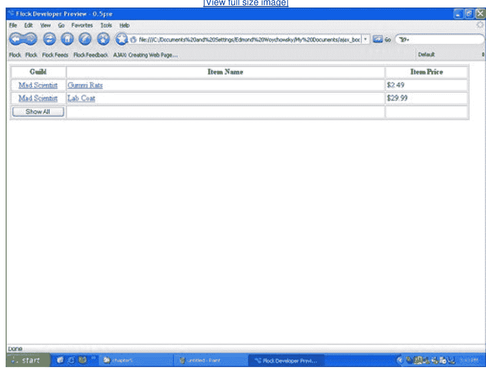

### 11.2.2. 可更新

与之前的只读示例不同，使用 XSLT 创建可更新的网页时，绑定不能忽略。即便如此，仍存在一些前几章所没有的优势。例如，funky 的循环和连接字符串以构建具有正确行数的 HTML。XSL 为我们处理了这些烦人的细节。

## 11.3. 优点和缺点

设计使用客户端 XSLT 的网站存在许多优势。首先是在旧简历上看起来很酷——划掉。首先是能够设计更具动态性的网站，可以利用客户端的机器。此外，通过在客户端机器上缓存 XSL 样式表，可以减少信息量。然而，如果客户端可用资源成为问题，总是有替代方案的。

第一个想到的替代方案是完全不缓存 XSL；相反，可以将其与 XML 一起来回发送。对于大型网站，另一种可能性是仅缓存一定数量的页面。这可以用一种类似栈的方式来处理：先进先出。

关于缓存，还有一个想法：完全放弃预加载。相反，样式表可以按需加载。加载后，它们可以被缓存。这个想法的有趣之处在于，从客户端的角度来看，性能会随着时间的推移而提高——几乎就像网站通过练习变得更好一样。这才是疯狂科学家的东西！

唉，如果客户端浏览器不支持转换，这一切都无济于事。并非所有浏览器都支持。我想应该为那些出于某种原因仍在运行 Microsoft Internet Explorer 3.0 的人提供替代方案。不，我不是说要进行服务器端转换来迎合守旧派；我更倾向于提供一个指向 [www.mozilla.org](http://www.mozilla.org) 的链接，让他们加入二十一世纪的行列。

## 11.4. 总结

在本章中，我涵盖了为什么客户端执行转换的想法令人恐惧，主要是因为微软的行为。此外，我涵盖了为什么现在使用客户端 XSLT 是有意义的，随着基于 Gecko 的浏览器和 Microsoft Internet Explorer 的出现。

# 第十二章 通过代码复用实现更美好的生活

在我职业生涯的某个时期，我是一名顾问，或者如果你愿意，可以叫雇佣枪手。我的工作是骑马进城，收拾残局，然后骑马消失在夕阳中。就像西部英雄一样，只有我和我的马——好吧，只有我和我的小蓝车。请相信我，我的骑术像已故影星李·马文一样；你看过 *Cat Balloo* 吗？如果你没有，这么说吧，我在马鞍上的姿势不是最好的。

我提起这个的原因是，就像那些旧时的英雄一样，我靠我的智慧生存，或者说大约一半的智慧，以及我能随身携带的东西。然而，代替柯尔特龙骑兵手枪的是，我带着一台笔记本电脑，里面装满了我曾经编写或下载的每一个小工具。有些工具很有用，有些则不太有用，但不管怎样，它包含了我可能需要的一切，不包括游戏。我想另一种看法是，我是个囤积狂，但一旦我编写了某样东西，我就不愿意再编一次了。

当然，这并不是说我在逃避编码；实际上，我是在避免调试。调试的行为并不令人厌恶，但一次又一次地调试同一样东西很快就会变老。听说过“不要重复造轮子”这句话吗？嗯，我完全同意。不过，也许如果我能把它做得更好……

这些 Ajax 工具最棒的地方在于它们不是刻在石头上的；实际上更像是用蜡笔涂鸦的。因此，它们是流动的，更多的是作为指导而非福音。然而，即使你不选择使用这些，我建议你至少看看它们。这些函数大多工作原理相似。

## 为什么？

原因很简单。你看，Ajax 应用程序就像柠檬水。换句话说，有一些基本原料，就像柠檬、糖和水。当然，并非所有柠檬水都是平等的。这主要是因为每种原料的数量以及额外的小东西，比如伏特加或检查对象的 `readyState` 属性。

我不确定这是一种性格缺陷还是一种技能，但我倾向于把一些例程编写两次。第一次是为了解决手头的特定问题；第二次是为了在问题在其他地方出现时有一个通用解决方案。有时确实会用到，有时则不然，但能够接受任务并且至少部分解决方案已经编写好，这感觉很好。这也是确保总有时间阅读 User Friendly 的好方法。

不幸的是，当我开始职业生涯时，情况并非如此，主要是因为我遇到了信奉清教徒工作伦理的经理：一直工作到死，或者在 33 岁之前退出，变成一个精疲力竭的空壳。基本上，代码行数越多越好，尽管他们有时会用“我需要让每个人都能理解”或避免“疯狂科学家的东西”之类的话来掩饰他们的理念。然而，多年来，这类经理大多要么已经去世，要么已经退休。我想，在某种程度上，我会想念他们，就像头痛消失后一样。是的，我会非常想念那些因为复用代码创建新应用程序而威胁不付钱的。

“你好，我叫 Ed。我把代码复用到底，而且我不懒！”

## 12.1. 复用 = 懒惰

### 12.1.1. 按行付费

几年前，作为一名顾问，我被指派编写客户端 JavaScript，其唯一目的是加速客户的网站。问题是他们有一个愿景，但不知道如何实现。例如，假设一个网页由 HTML 表格中的 20 行组成，每一行都有一个从数据库查询创建的 select，而且每个 select 都有相同的选项。他们认为执行相同的查询 20 次并使用 VBScript 20 次来创建 20 个 select 没有问题。哦，还有另外两件事：除了遍历查询结果之外，没有循环，甚至没有一个被调用 20 次的函数。代码是一条直线。由于这是由首席开发人员大约在六个月前编写的，而我只是一名顾问，所以我从未问过这个燃烧的问题：为什么？

我只花了几天时间就找到了答案。事实上，只需看一眼他们的 JavaScript 库就足够了。整个库只包含一个函数，其目的是确定参数是否为数字，尽管它在任何地方都没有被使用。就像我穿越了时空结构的裂缝，发现自己身处一个平行现实。我越是检查这个网站，就越是四处张望，期待看到 Rod Serling。举个例子，那是在 Y2K 之后，他们仍在使用 HTML FONT 标签。到处都看不到一个层叠样式表的例子。deprecated 这个词在他们的世界里不存在。

有些经典的 ASP 页面超过 30,000 行混合脚本和 HTML。我是一个陌生土地上的陌生人，在那里开发人员是按行付费的。这是一个新应用，尚未投入生产，所以不可能是维护到无法理解的。还有什么能解释事情的方式呢？

### 12.1.2. 按页付费

幸运的是，我是按页付费的——好吧，实际上是按小时，但我有限定的小时数来完成每一页。再加上我是一个单指敲击打字员，你就会很快理解为什么我是代码复用的忠实信徒。奇怪的是，除了一个例外，从来没有人注意到代码被左右复用。

在我最后一次咨询任务之一中，我遇到了一位刚出校门的实习生，但他是我见过的最敏锐的开发人员之一。在一起工作了大约六个月后，他问我为什么似乎在可能的情况下我编写了可复用的代码，这些代码经常使用

## 12.2. JavaScript 对象

尽管它不是一门面向对象的语言，但 JavaScript 是一种面向对象的编程语言。这意味着虽然它的功能可能不如 PHP、Ruby 或 Java 那样强大，但它仍然相当厉害。再加上目前它是最佳乃至唯一的选择，你就能很快理解为什么对象如此重要。

在 JavaScript 中创建对象有几种方式，但我通常只使用两种。在 JavaScript 中使用第一种方法创建对象只需编写一个函数，并使用 `new` 运算符将其分配给变量以创建实例，如下列表所示：

### 列表 12-1. 示例构造函数类 Function Word Constructor

```javascript
function word() {
   var _setCount = 0;        // 保护变量

   this.theWord;             // 公有属性

   this.setWord = _setWord;  // 公有方法 setWord
   this.getWord = _getWord;  // 公有方法 getWord
   this.count = _getSetCount; // 公有方法 count

   function _setWord(theWord) {
      // Public exposed as getWord
      this.theWord = theWord;
      _incrementCount();
   }

   function _getWord() {     // Public exposed as setWord
      return(this.theWord);
   }

   function _getSetCount() { // Public exposed as count
      return(_setCount);
   }

   function _incrementCount() { // Private method
      ++_setCount;
   }
}

var myInstance = new word();
```

现在，我们拥有一个名为 `word` 的属性实例分配给了变量 `myInstance`，唯一的问题是如何使用它？幸运的是，访问属性和方法的符号遵循相对标准的 `instancename.property` 或 `instancename.method()` 格式。如果你在查看构造函数，区分它们的特征是它们都以前缀的 `this` 关键字开头。判断哪些是属性、哪些是方法的标准在于：方法始终等于函数。需要特别指出的是，省略括号是因为如果包含它们，不仅会暴露该方法，还会调用它。

虽然之前的类构造器本质上没什么用处，但它展示了如何创建构造器的细节。它具有私有成员 `_setCount` 和私有方法 `_incrementCount`。此外，正如前文所述，它还具有公有属性（如 `theWord`）和公有方法（如 `setWord`、`getWord` 和 `getSetCount`）。当然，一个真正有用的示例可能不会包含所有这些内容。

### 12.2.1. 集合（Collections）

我或许错了，但我认为最令人印象深刻的数据结构种类莫过于关联数组（Associative Array），除了 DOM 之外几乎没有其他可比肩的。如果你对此类数据结构不熟悉，信息则以名称对值存储形式保存。若知道名称，即可找到对应的值；而且此处的值不限于任何特定数据类型，想想看，其名称同样如此。一个很好的用途是缓存 XSL 样式表，因为它们通常不会频繁更改。一旦它们被缓存在本地，就不再需要麻烦网络服务器来获取这些文件了；仅需从缓存中检索出来即可。然而，这里仍存在一种危险，那就是缓存那些本不应缓存的信息（例如数据库查询结果），因为其他人可能会修改它。

[列表示例 12-2](http://www.bisenter.com)是一个轻量级缓存/关联数组构造器的例子。单个私有属性 `_cache` 是 JavaScript 对象形式的缓存本身。这里有三个公有方法用于插入名称与值对、检索数据以及清除选定的名称/值对的整个内容。

### 列表 12-2. 缓冲区类构造函数（对应于联编阵列）Cache Class Constructor (Associative Array)

```javascript
<!-- <![CDATA[
/*
    Class:    Cache

    Function: Cache

    Purpose:  To act as a client-side cache(associative array).
              Data are stored as name/value pairs.
*/

function Cache() {
   var _cache = new Object();        // Array to store information
   var _namesArray = new Array();    // For names

   this._insert = _inserter;         // Method: insert into cache an object
   this.retrieve = _retrieve;        // Function: retrieve from the Cache
   this.purge = _purge;              // Function: purge object(s)
   this.names = _names;              // Method: return names

   /*
      Function: _insert
      Method: _insert
      Purpose: inserts a name/value pair into the cache.
   */
   function _insert(name, value) {
      _cache[name] = value;          // The cache object
      _namesArray.push(name);        // Store this name as well
   }

   /*
      Function: _retrieve
      Method: _retrieve
      Purpose: Retrieve a value from the cache using name.
   */
   function _retrieve(name) {
      if (typeof (_cache[name]) == 'undefined') {
         return(null);               /* Object Not Cached */
      }

      return(_cache[name]);           // Return object
   }

   /*
      Function: _purge
      Method: _purge
      Purpose: Purges one or more name/value pairs from the cache.
   */
   function _purge() {
      if (arguments.length > 0) {
         _cache = new Object();       // Create new cache object
         _namesArray = new Array();   // Create new name array
      } else {
         var singleName;
         var nameList = new Array();  // Create a new names array

         for (var i = 0; i < arguments.length; i++) {
            _cache[arguments[i]] = null;
         }

         // Check which object's names have values
         for (var name in _cache) {
            if (_cache[name] != null) {
               nameList.push(name);
            }
         }
      }
   }

   /*
      Function: _names
      Method: _names
      Purpose: Return an array consisting of the names from cache.
   */
   function _names() {
      return(_namesArray);
   }
}
// ]]> -->
```

像前面的示例一样，在使用该对象之前需要创建其实例。[表 12-3](#)展示了将对象推入运行状态的过程，以及注释中显示的预期结果。

### 列表 12-3. 头标题在此 Listing Head Here（此处应为“列表示意的内容被展示出来”）[示例显示]

```javascript
var _magicWords = new Cache();

_magicWords.insert(1, 'xyzzy');       // Insert key=1, value='xyzzy'
_magicWords.insert(2, 'plugh');       // Insert key=2, value='plugh'
_magicWords.insert(3, 'plover');      // Insert key=3, value='plover'

alert(_magicWords.names());           // 1, 2, 3
alert(_magicWords.retrieve(1));       // 'xyzzy'
alert(_magicWords.retrieve(2));       // 'plugh'

_magicWords.purge();                  // Purge key/values
alert(_magicWords.retrieve(1));       // null
```


该缓存类非常简单；它仅仅是 JavaScript 对象的包装器，提供公有方法以允许修改对象并从对象中检索数据。

##### 12-2. XML

毫无疑问，我对客户端 XML 最大的抱怨是缺乏单一的跨浏览器创建 XML 文档的方法。这是那些跨浏览器编程真正令人头疼的领域之一，因为我倾向于使用单个浏览器开发页面。只有当我在我首选的浏览器上使其正常工作时，我才会回去尝试让它适用于 Internet Explorer。如果你好奇的话，这会产生一些非常丑陋的 JavaScript 代码，由各种不匹配的组件拼凑而成。也许我是一个疯狂的科学家，但可重用性是值得倡导的特点。

这就是我拼凑了几个类构造器来美化旧实验室环境的原因。这并不是因为我在使用杯垫或类似的东西；我只是希望六个月后仍然能够理解我所写的代码。他们说记忆是会最先衰退的器官之一还是头发？不管怎样我记不起是谁“他们”了，所以这也不是很重要。

这些类构造器的第一个是用来处理与使用 `XMLHttpRequest` 对象相关细节的问题。它判断浏览器是 Microsoft Internet Explorer 还是其他任何类型的浏览器，然后创建适合该特定浏览器的 `XMLHTTPREQUEST` 对象语法；此外它还支持异步请求的 `readyState` 变化状态（Ready state changes for asynchronous requests）。这与之前的示例不同，之前是以常规 JavaScript 类的方式创建的，而这次则创建了原型对象。虽然它们在构造器中并未直接使用，但若将来需要继承性时，它们便提供了可能性优势；列表第 12-4 展示了这个构造函数看起来是什么样的样子：

### 列表 12.9 跨平台（Gecko 和 IE）XMLHttp 类的构造器 Cross-Browser (Gecko and IE) XMLhttp Class Constructor

```javascript
<!-- #if[CDATA 

XMllHttpRequest.prototype =new XMLHttpRequest;  

xmlHTTPRequest.pr0totype= new xmllrequest object.     <!--  -->     

*/
```

本文档 created by an unregistered ChmMagic, please go to `http://www.bisenter.com` to register it. Thanks

###### Class: `XMLHttpRequest`

##### Function: `XMLHttpRequest`

- **Method:** n/a
- **Description:** 该类的构造函数。

```javascript
function XMLHttpRequest() {
  try {
    var x = new DOMParser();
    this._IE = false;
  }
  catch(e) { this._IE = true; };
  this._XMLHttp;			// XMLHttp 请求对象
  this._requestHeader = new Cache();

  if(this._IE)
    this._XMLHttp = new ActiveXObject('Microsoft.XMLHttp');
  else
    this._XMLHttp = new XMLHttpRequest();
}
```

- **Property:** GET, POST 或 HEAD

  ```javascript
  XMLHttpRequest.prototype.action = 'GET';
  ```

- **Property:** true/false

  ```javascript
  XMLHttpRequest.prototype.asynchronous = true;
  ```

- **Property:** 要发送的包

  ```javascript
  XMLHttpRequest.prototype.envelope = null;
  ```

###### Class: `XMLHttpRequest`

##### Function: `XMLHttpRequest_readyState`

- **Method:** `readyState`
- **Description:** 返回 `XMLHttpRequest` 对象的 `readyState`。

```javascript
function XMLHttpRequest_readyState() {
  return(this._XMLHttp.readyState);
}
XMLHttpRequest.prototype.readyState = XMLHttpRequest_readyState;
```

###### Class: `XMLHttpRequest`

##### Function: `XMLHttpRequest_getResponseHeader`

- **Method:** `getResponseHeader`
- **Description:** 返回最近一次 `XMLHttpRequest` 的单个响应头。

```javascript
function XMLHttpRequest_getResponseHeader(name) {
  return(this._XMLHttp.getResponseHeader(name));
}
XMLHttpRequest.prototype.getResponseHeader =
XMLHttpRequest_getResponseHeader;
```

###### Class: `XMLHttpRequest`

##### Function: `XMLHttpRequest_getAllResponseHeaders`

- **Method:** `getAllResponseHeaders`
- **Description:** 返回最近一次 `XMLHttpRequest` 的所有响应头。

```javascript
function XMLHttpRequest_getAllResponseHeaders() {
  return(this._XMLHttp.getAllResponseHeaders());
}
XMLHttpRequest.prototype.getAllResponseHeaders =
XMLHttpRequest_getAllResponseHeaders;
```

###### Class: `XMLHttpRequest`

##### Function: `XMLHttpRequest_responseText`

- **Method:** `responseText`
- **Description:** 返回最近一次 `XMLHttpRequest` 的文本响应。

```javascript
function XMLHttpRequest_responseText() {
    return(this._XMLHttp.responseText);
}
XMLHttpRequest.prototype.responseText =
XMLHttpRequest_responseText;
```

###### Class: `XMLHttpRequest`

##### Function: `XMLHttpRequest_responseXML`

- **Method:** `responseXML`
- **Description:** 返回最近一次 `XMLHttpRequest` 的 XML DOM 文档响应。

```javascript
function XMLHttpRequest_responseXML() {
    if(this._IE) {
        var xml =
        new ActiveXObject('MSXML2.FreeThreadedDOMDocument.3.0');
        xml.async = true;

        xml.loadXML(this._XMLHttp.responseText);

        return(xml);
    } else
        return(this._XMLHttp.responseXML);
}
XMLHttpRequest.prototype.responseXML =
XMLHttpRequest_responseXML;
```

###### Class: `XMLHttpRequest`

##### Function: `XMLHttpRequest_stateChangeHandler`

- **Method:** n/a
- **Description:** 异步请求的虚拟状态变更处理程序。

```javascript
function XMLHttpRequest_stateChangeHandler() { }
XMLHttpRequest.prototype.stateChangeHandler =
XMLHttpRequest_stateChangeHandler;
```

###### Class: `setRequestHeader`

##### Function: `XMLHttpRequest_setRequestHeader`

- **Method:** `setRequestHeader`
- **Description:** 插入到 HTTP 请求头的缓存中。

```javascript
function XMLHttpRequest_setRequestHeader(name,value) {
    this.removeRequestHeader(name);
    this._requestHeader.insert(name,value);
}
XMLHttpRequest.prototype.setRequestHeader = XMLHttpRequest_setRequestHeader;
```

###### Class: `setRequestHeader`

##### Function: `XMLHttpRequest_removeRequestHeader`

- **Method:** n/a
- **Description:** 从 HTTP 请求头的缓存中移除。

```javascript
function XMLHttpRequest_removeRequestHeader(name) {
  this._requestHeader.purge(name);
}
XMLHttpRequest.prototype.removeRequestHeader =
XMLHttpRequest_removeRequestHeader;
```

###### Class: `XMLHttpRequest`

##### Function: `XMLHttpRequest_send`

- **Method:** `send`
- **Description:** 发送 `XMLHttpRequest`。

```javascript
function XMLHttpRequest_send() {
  var successful = false;

  if(arguments.length != 0)
    this.envelope = arguments[0];

  switch(this._XMLHttp.readyState) {
    case(4):
    case(0):
    try {
      if(this._IE)
          this._XMLHttp.onreadystatechange =
this.stateChangeHandler;
          else
          this._XMLHttp.stateChangeHandler =
this.XMLHttpRequest_stateChangeHandler;

      this._XMLHttp.open(this.action,this.uri,this.asynchronous);

      var names = this._requestHeader.names();

      for(var i=0;i < names.length;i++)

this._XMLHttp.setRequestHeader(names[i],this._requestHeader.retrieve(names
[i]));

      this._XMLHttp.send(this.envelope);

      successful = true;
    }
    catch(e) { }

    break;
    default:

    break;
  }
  return(successful);
}
XMLHttpRequest.prototype.send = XMLHttpRequest_send;
// ]]>
```

所示的构造函数与**第 8 章**“使用 XML 和 `XMLHttpRequest` 的 AJAX”开头的手写代码完全一致。简而言之，它向服务器发送一个 `XMLHttpRequest`，等待响应，然后根据响应执行操作。这没什么大不了的；只需创建一个实例，它就会处理一切，当然，除非你是按行计酬的。

现在我们已经有了一个用于获取 XML 的构造函数，找一个地方来放置它可能是个好主意。需要的，仿佛你还不知道似的，是一个通用的 XML 文档对象。它不必是完美的；只需要能*工作*，而“工作”我指的是提供一套统一的属性和方法。从前面的章节中，你已经知道这是写好的，所以让我们来看一下**清单 12-5**。

##### 清单 12-5. 跨浏览器 XML 文档类构造函数


```javascript
//<![CDATA[
XMLDocument.prototype = new XMLDocument;
XMLDocument.prototype.constructor = XMLDocument;

/**
Class:       XMLDocument
Function:    XMLDocument
Method:      n/a
Description: Constructor for this class.
*/
function XMLDocument() {
try {
var x = new DOMParser();
this._IE = false;
} 
catch(e) { this._IE = true; };
this._XMLHttpRequest = new XMLHttpRequest();
this._XML;                // XML DOM 文档
this._DOMParser;          // XML DOM 解析器 (仅限 Gecko)
this._XMLSerializer;      // XML 序列化器 (仅限 Gecko)
this._state = 0;         // 伪 readyState

if(!this._IE) {
this._DOMParser = new DOMParser();
this._XMLSerializer = new XMLSerializer();
}
this._XML = document.implementation.createDocument("", "", null);
} 
}

/**
Class:       XMLDocument
Function:    XMLDocument_load
Method:      load
Description: 加载指定的 XML 文档。
*/
function XMLDocument_load(xml) {
  var isXMLText = false;
  var isXMLDocument = (typeof(xml) == 'object');

  try {                 // 测试元素
    isXMLText = (new RegExp('<','g')).test(xml);
  }
  catch(e) { }

  switch(true) {
    case(this._IE && isXMLText):    // Internet Explorer & 文本
      this._XML =
        new ActiveXObject('MSXML2.FreeThreadedDOMDocument.3.0');
      this._XML.async = true;
      this._XML.loadXML(xml);
      this._state = 4;            // 就绪状态完成
      break;
    case(!this._IE && isXMLText):   // 非 IE & 文本
      this._XML =
        this._DOMParser.fromString(xml,"text/xml");
      this._state = 4;            // 就绪状态完成
      break;
    case(this._IE && isXMLDocument):
      // Internet Explorer & XML DOM
      this._XML =
        new ActiveXObject('MSXML2.FreeThreadedDOMDocument.3.0');
      this._XML.async = true;
      try {
        this._XML.loadXML(xml.serialize());
      }
      catch(e) {
        this._XML = xml;
      }
      this._state = 4;            // 就绪状态完成
      break;
    case(!this._IE && isXMLDocument): // 非 IE & XML DOM
      try {
        this._XML = xml.DOMDocument();
      }
      catch(e) {
        this._XML = xml;
      }
      this._state = 4;            // 就绪状态完成
      break;
    default:
      this._XMLHttpRequest.uri = xml;
      try {
```

```javascript
    this._XMLHttpRequest.send();

    this._state = 1;
} catch(e) {
    if(this._IE) {
        this._XML =
            new ActiveObject('MSXML2.FreeThreadedDOMDocument.3.0');
        this._XML.async = true;
    } else
        this._XML =
            this._DOMParser.parseFromString('', 'text/xml');
    this._state = 4;         // Error - force complete
}

if(this._state == 4)
    this._XMLHttpRequest = new XMLHttpRequest();
}
XMLDocument.prototype.load = XMLDocument_load;

/*
Class:     XMLDocument
Function:  XMLDocument_serialize
Method:    serialize
Description: Returns the result of the prior transformation
as a serialize XML DOM document (text).
*/
function XMLDocument_serialize() {
    try {
        if(this.readyState() == 4) {
            if(this._XMLHttpRequest.readyState() == 4)
                this.load(this._XMLHttpRequest.responseXML());
            if(this._IE)
                return(this._XML);
            else
                return(this._XML);
        } else
            return(null);          // Not loaded
    } catch(e) {
        return(null);             // Invalid document
    }
}
XMLDocument.prototype.serialize = XMLDocument_serialize;

/*
Class:     XMLDocument
Function:  XMLDocument_DOMDocument
Method:    DOMDocument
Description: Returns the result of the prior transformation
as a Browser-native XML DOM document.
*/
function XMLDocument_DOMDocument() {
    try {
        if(this.readyState() == 4) {
            if(this._XMLHttpRequest.readyState() == 4)
                this.load(this._XMLHttpRequest.responseXML());
            return(this._XML);
        } else
            return(null);                // Document not loaded
    } catch(e) {
        return(null);                    // Invalid document
    }
}
XMLDocument.prototype.DOMDocument = XMLDocument_DOMDocument;

/*
    Class:  XMLDocument
    Function:  XMLDocument_readyState
    Method:    readyState
    Description: Returns the readyState for the XML document.
*/
function XMLDocument_readyState() {
    if(this._XMLHttpRequest.readyState() == 0)
        return(4);
    else
        return(this._XMLHttpRequest.readyState());
}
XMLDocument.prototype.readyState = XMLDocument_readyState;

/*
    Class:  XMLDocument
    Function:  XMLHttpRequest_setRequestHeader
    Method:    setRequestHeader
    Description: Inserts to the cache of HTTP request headers.
*/
function XMLDocument_setRequestHeader(name,value) {
    this._XMLHttpRequest.setRequestHeader(name,value);
}
XMLDocument.prototype.setRequestHeader = XMLDocument_setRequestHeader;

/*
    Class:  XMLDocument
    Function:  XMLDocument_getResponseHeader
    Method:    getResponseHeader
    Description: Returns a single response header from the last
                XMLHttpRequest.
*/
function XMLDocument_getResponseHeader(name) {
    return(this._XMLHttpRequest.getResponseHeader(name));
}
XMLDocument.prototype.getResponseHeader = XMLDocument_getResponseHeader;

/*
    Class:  XMLDocument
    Function:  XMLDocument_getAllResponseHeaders
    Method:    getAllResponseHeaders
    Description: Returns all of the response headers from
                the last XMLHttpRequest.
*/
function XMLDocument_getAllResponseHeaders() {
    return(this._XMLHttpRequest.getAllResponseHeaders());
}
XMLDocument.prototype.getAllResponseHeaders = XMLDocument_getAllResponseHeaders;

/*
    Class:     XMLDocument
    Function:    XMLDocument_setEnvelope
    Method:     setEnvelope
    Description: Sets the envelope for an XMLHttpRequest.
*/
function XMLDocument_setEnvelope(value) {
    this._XMLHttpRequest.envelope = value;
    this._XMLHttpRequest.action = 'POST';
}
XMLDocument.prototype.setEnvelope = XMLDocument_setEnvelope;

/*
    Class:      XMLDocument
    Function:    XMLDocument_selectNodes
    Method:      selectNodes
    Description: Returns an array of XMLDocument based upon
                an XPath statement.
*/
function XMLDocument_selectNodes(xpath) {
    var results;
    var resultArray = new Array();    // XML Document result array

    if(this.readyState() == 4)
        if(this._XMLHttpRequest.readyState() == 4)
            this.load(this._XMLHttpRequest.responseXML());

    if(this._IE) {
        results = this._XML.selectNodes(xpath);
        for(var i=0;i < results.length;i++) {
            resultArray.push(new XMLDocument());
            resultArray[i].load(results[i].xml);
        }
    } else {                          // XPath evaluator
        var results = 
            new XPathEvaluator();
        var result;                   // Single XPath result
        var xml;
        var i = 0;                    // Counter

        results = 
            results.evaluate(xpath,this._XML,null,null);

        while(result = results.iterateNext()) {
            xml = 
                document.implementation.createDocument("", "",null);
            xml.appendChild(xml.importNode(result,true);
            resultArray.push(new XMLDocument());
            resultArray[i].load(this._XMLSerializer.serializeToString(xml));
            ++i;
        }
    }
    return(resultArray);
}
XMLDocument.prototype.selectNodes = XMLDocument_selectNodes;

/*
    Class:     XMLDocument
    Function:    XMLDocument_selectSingleNode
    Method:      selectSingleNode
    Description: Returns a single XML document based upon an
                XPath statement.
*/
function XMLDocument_selectSingleNode(xpath) {
    return(this.selectNodes(xpath)[0]);
}
XMLDocument.prototype.selectSingleNode = XMLDocument_selectSingleNode;
```

## 12.2.4. 无浆果的序列化

在之前的每个构造函数中，您都会注意到一个共同点：在处理 XML 方面，序列化起着重要作用。造成这种情况有几个原因，首先是 XML 的设计旨在供人类阅读，而人类阅读的是文本，而非二进制数据。

例如，你最后一次听到“ASCII 65，大写字母 'A'”是什么时候？我就是那个被称作“疯狂科学家”的人，我不处理那些东西，所以很难想象普通人类会做这种事。


序列化的第二个原因是 Web 的底层架构，即超文本传输协议（HTTP），简称 HTTP。HTML、XHTML、JavaScript、CSS、XML 和 XSL 以文本形式在服务器和客户机之间来回传输。如果没有序列化，正如我以前的上司所说，所有的“X 类东西”都将无法动弹。

序列化的另一个原因是，与 XML 对象相比，文本关联的开销非常小。XML DOM 文档需要三到十倍于等效文本文档的内存。这种开销在旧机器的客户机浏览器上可能会引起一些问题。当然，必须权衡解析文本以加载文档带来的问题。

我最终选择序列化的原因是，从文本文档加载 XML 文档是如此简单。在 Microsoft Internet Explorer 中，只需使用`loadXML`方法即可。对于 Firefox，需要做一些额外的工作，但也并不是很多。只需使用`DOMParser 的 parseFromString`方法重建 XML，就像冻干咖啡或冻干的小黄人一样。


## 12.3. 通用 XSLT

每当我创建 XSL 样式表时，除非非常非常小心，否则我的样式表基本上只是个“只会一招的家伙”。是的，它们能把那招做好，但正如我之前所说，我是按页付费的，而不是按行付费的。也许这就是我创建的样式表是……呃，如何优雅地表达？它们很怪异的原因。是的，这个词就是“怪异”。

并不是说它们不起作用——它们工作得很好。更多的情况是，我使用了大量的相对定位。虽然这种方法似乎有些危险，但有几种方法可以将危险降低到可容忍的水平。换句话说，要格外小心，防止样式表“爆炸”并将网页一起带崩。其中一种方法是始终确保 XML 文档具有相同的基本结构：`*/root/row/node*`。这使得你遇到意外情况的可能性大大降低。

回想一下[第 9 章](.)，“XPath”，那里简要介绍了带有所有斜杠和星号的 XPath？好吧，星号是通配符，用于节点名未知的情况。这意味着`*/`/*等同于`*/root/row/node*`——至少，当我们想要获取根节点的所有孙节点时。

### 12.3.1. 表单

只要知道 XML 文档的结构，创建通用 XSL 样式表就不太困难。了解各个节点的名字同样不重要，虽然，对于像我这样极度懒惰的人来说，名字在创建标签或列标题时可能是重要的。为了说明我的意思，有必要介绍两个 XSLT 函数。

第一个函数是`name`函数。它提供了传入节点的名字，在这些情况下即上下文节点。它会返回实际的节点名，因此如果节点名为`item_price`，则返回`item_price`。是的，我知道带有`item_price`的标签或标题好不了多少，这正是因为第二个函数`translate`介入的地方。

`translate`函数，嗯，就是翻译。它将一个字符替换为另一个，因此不再是标签或标题`item_price`，而是可以改为`ITEM PRICE`。对我来说，后者更符合我访问网站时的预期。接受三个参数——源字符串、来自字符串和目标字符串——它会返回一个由字符一对一替换组成的字符串。

在我们使用`translate`函数之前，我应该先说明几点。首先是，当“来自字符串”中不包含某个特定字符时，该字符将被原样复制。第二点，最好验证“来自字符串”中的字符和“目标字符串”中的字符在各自的字符串中是否处于相同的位置。或者说，简单来说，使用来源字符串为`qwerty`，目标字符串为`wertyu`会导致凯撒密码。虽然凯撒密码可能在公元前 40 年曾是尖端技术，但我相当确定这不是你希望的结果。

好了，让我们看看[清单 12-8](.)，这是一个创建基本表单的 XSL 样式表。

```xml
<?xml version='1.0'?>
<xsl:stylesheet version="1.0"
xmlns:xsl="http://www.w3.org/1999/XSL/Transform">
   <xsl:output method="html" indent="yes" media-type="text/html"/>
```

##### 清单 12-8. 生成 HTML 表的通用 XSL 样式表

```xml
<xsl:template match="/">
    <xsl:element name="table">
        <xsl:apply-templates select="/*/*/*"/>
    </xsl:element>
</xsl:template>

<xsl:template match="*">
    <xsl:element name="tr">
        <xsl:element name="td">
            <xsl:value-of select="translate(name(.),'qwertyuiopasdfghjklzxcvbnm_','QWERTYUIOPASDFGHJKLZXCVBNM ')"/>
        </xsl:element>
        <xsl:element name="td">
            <xsl:element name="input">
                <xsl:attribute name="type">text</xsl:attribute>
                <xsl:attribute name="name">
                    <xsl:value-of select="name(.)"/>
                </xsl:attribute>
                <xsl:attribute name="value">
                    <xsl:value-of select="."/>
                </xsl:attribute>
            </xsl:element>
        </xsl:element>
    </xsl:element>
</xsl:template>
</xsl:stylesheet>
```

此并非什么花哨的东西，但这只是一个证明，可以进一步展示它实际上可以做到创建一个通用的 XSL 样式表来产生 HTML 表单。虽然它相当简单——初级的，甚至——很容易想象某些可能性，比如通过参数指定输入类型。

### 12.3.2. 表格

应用一个通用的 XSL 样式表来表格信息不同于应用它来创建一个表单。仅仅只有几个差异在工作使用表格信息而不是表单。第一个差异是，而不是在侧面有标签，它们是列标题在上。所需的全部做的是创建两个模板；第一个处理创建一个表行，并且第二个创建一个表标题。除了那个，唯一的真正的差异是添加谓词`[1]`，以确保标题仅一次创建。然后我们有 XSL 样式表看起来像 Listing 12-9。

##### Listing 12-9. 生成 HTML 表格并标题基于节点的通用 XSL 样式

```xml
<?xml version="1.0"?>
<xsl:stylesheet version="1.0"
xmlns:xsl="http://www.w3.org/1999/XSL/Transform">
  <xsl:output method="html" indent="yes" media-type="text.html"/>

  <xsl:template match="/">
    <xsl:element name="table">
      <xsl:apply-templates select="/*[1]" mode="header" />
      <xsl:apply-templates select="/*/*"
      mode="row" />
    </xsl:element>
  </xsl:template>

  <xsl:template match="*" mode="header">
    <xsl:element name="tr">
      <xsl:apply-templates select="." mode="column" />
    </xsl:element>
  </xsl:template>

  <xsl:template match="*" mode="row">
    <xsl:element name="tr">
      <xsl:apply-templates select="." mode="node" />
    </xsl:element>
  </xsl:template>

  <xsl:template match="*" mode="column">
    <xsl:element name="th">
      <xsl:value-of select="translate(name(.),'qwertyuiopasdfghjklzxcvbnm_', 'QWERTYUIOPASDFGHJKLZXCVBNM ')"/>
    </xsl:element>
  </xsl:template>

  <xsl:template match="*" mode="node">
    <xsl:element name evertimes="td">
      <xsl:value-of select="."/>
    </xsl:element>
  </xsl:template>

</xsl:stylesheet>
```

当然，这里展示的示例相当简单，并且有几种方式改进它们。改进通用样式表的方式之一是用写 header 模板 with`xsl:when`输出更有意义的标题。另一个可能性是使用层叠样式表来给出更有抛光的外观和感觉。最后，右对齐数字不会伤害。

## 12.4. 总结

代码复用的优势很明显；大型代码只需被设计、编码、测试和文档。无论它是一个类构造函数、函数或 XSL 样式表，如果至少部分解决方案已写入，你就是那更接近于交付最终应用程序。

另一个议题是开发者可以被隔绝于各种网络浏览器的输入和输出。不再有一个陡峭的学习曲线在前的感觉，或者希望lessness，试图使一些东西在 Internet Explorer 工作而不是试图不打破它 Firefox。我不得不承认在那些时刻我“固定”web 页面在一个浏览器只为了在另一个浏览器它是被修复同样的方式 vet 固定我的猫 Moreta。

重要的是要记住如果你可以三个 web 页面在时间花费 Igor 完成一个，你会认为将被展示 door 下一次 layoff 妖精访问？

不幸，一些开发商店仍 cling 过时的想法更好的程序员写更多代码行。庆幸，这个想法正在方式 of three-martini 午餐。Gin，yuck！当你得到 down 到它，最大的可能的难题是如果构造函数之一的 bug，每一页使用该构造函数直接或不间接的 bug。

# 第 13 章。用 Ruby 在 Rails

提到 Ajax 的主题，并且五分钟内某人将提出 Ruby on Rails。正如 Ajax，Ruby on Rails 已经成为公司 buzzword 中的赢家短语。它有点 sad 的是两个议题已被归类为 buzzwords，管理员挥动它们 interchangeably，像它们一些武器。不幸，管理员只是像某人 else 会 hurt，这 just 展示它是一个好的想法在试图使用前了解工具。

在本章，我们覆盖一些 Ruby on Rails 的历史，随后是什么和如何在 Windows XP 系统上安装。从那里，我们考察如何开始开发，使用 Ruby on Rails，并且如何解决一个简单的问题用它。

不幸，它超出了本书的范围做更多的介绍 Ruby on Rails。实际上有逻辑理由这，超过事实我是更多 JavaScript 人而不是 Ruby 人。原因是 college。

Huh？

当我是 college，一些学生，well，complained 教授教。问题教授没有给他们每 assignment 需要的代码。我们教，例如，如何创建一个数据结构，但不 particular 数据结构 Question 6 在中期考试。教授指出我们在一个方向并期望我们达到目的地在我们的自己的。Gee，那 nerve 那些教授—they指出我们在一个 particular 方向并期望我们找到我们自己方式。

Seriously，这仅仅是一个例子，不是 Question 6 答案。所以如果你选择 seriously 检查 Ruby on Rails，允许我指向 the way。

-_-

## 13.1. 什么是 Ruby on Rails？

一个英语单词，在我的意见，总结 Ruby on Rails 是—synergy。以防你不知道这个词“synergy”的含义，它大致意味着整体大于其部分的总和。需要几个 synergy 的示例吗？巧克力的花生酱？单独，任一配料都是好的，但它们放在一起，well，yum！

用 Ruby on Rails，代替巧克力和花生酱，有 Ruby 和 Rails。这导致我两个额外问题。第一个是“Beyond 是深红色刚玉晶体，just 什么是 Ruby？”是，毕竟，一件事我确定的是，并且是 Ruby 是一种语言不是矿物，虽然它是可能的使用 ruby 创建 laser，lasers 是大多数 mad scientist 的肉和土豆。

### 13.1.1. Ruby

本章提到的 Ruby 是 Yukihiro Matsumoto 在日本创建的一个面向对象编程语言。在日本，不奇怪，Ruby 迅速变得相当受欢迎，主场优势 all 那 kind。然而，因为它零价格（毕竟它是一个开源语言），Ruby 开始 catch on 日本之外。是的，尽管所有 odds，Ruby 成为 something of a phenomenon。

虽然一些人可能认为奇怪一个来自远离我们 piece 宇宙远地的开源语言 plant 了 idea 的 seed，我不。我，之一，开放 ideas，无论来源。Rights，我更多开放 related 食物的 ideas，但，然后，我是那些 eats 任何不试图吃我的人的 developer。

有趣的是，即使与像我的人，mad scientist 没有足够时间喜欢 sushi 和绿茶冰淇淋，Ruby 的 popularity 只是缓慢增长—fast 于一个 盆景树，但 slow 于 Godzilla, Pokemon, 或 Yu-gi-oh。幸运，something 改变了 back 在 2004。No，radiation 没有 involved，但发生是 Ruby 得到 Rails。

### 13.1.2. Ruby on Rails

单词“Rails”相当 interesting；它唤起一个 sleek, silent, fast 电火车进入 future 的 connotations。那是一个 pretty nice connotation，特别 tied 到 web 开发，在 my opinion，more 经常像 runaway 蒸汽 train 没有 brakes on a downgrade, 进入 hairpin curve 在 Monday 的雪风暴。简短，平均项目是等待的事故。事故可能永不发生，但潜力存在 regardless。Rails 是 full-stack 编程 framework 实施在 Ruby，其目的是平滑 web 应用的开发。

由丹麦学生创建，David Heinemeier Hansson，Rails 是开源并基于两个简单原则。第一个是更少的代码行等于更少的编码错误。这是一个 sensible 想法因为更小，更紧的代码需要更少时间写和 debug。这剩余时间 then 可以 put 到测试或到不可避免的特征 creep 上升像 monster 从 slab。

第二个 principle 是 configuration。不像许多 environments，Rails 不 use configuration files。相反，Rails 使用信息在 application code 本身来确定它的 configuration。这消除“Doh!” factor 每当 application 被移动到另一个 environment，即使环境只是另一个 developer 的 laptop。虽然我不能为任何人 else 说话，我知道 from personal experience 配置 files 是那些 things 通过 cracks about 20 percent。


## 13.2. 安装

这段导言将引出两个重要的问题：在哪里获取 Ruby，以及在哪里获取 Rails。这很简单。简单的 Google 搜索“ruby rails”足以同时回答这两个问题。除非你当然也对珠宝和乘坐火车旅行感兴趣，否则我建议使用一次搜索而不是分别进行搜索。

Ruby 的安装过程取决于您机器运行的操作系统。对于像我这种运行 Windows XP Professional、听着 Jethro Tull（杰思罗·陶尔乐队）并写书这样的新手来说，安装只是下载一个`.exe`并双击它开始进程那么简单。它就像您购买时包装好的软件一样安装，除了没有自动运行光盘和价格标签，如图 13-1 和图 13-2 所示。

**图 13-1. Windows 安装向导**

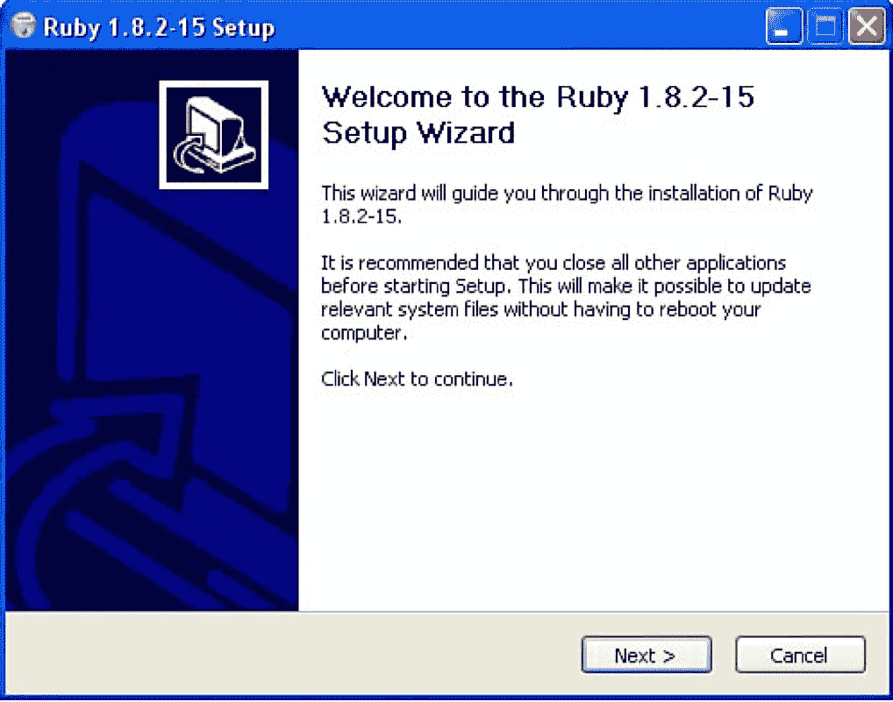

**图 13-2. Windows 向导中的组件选择**

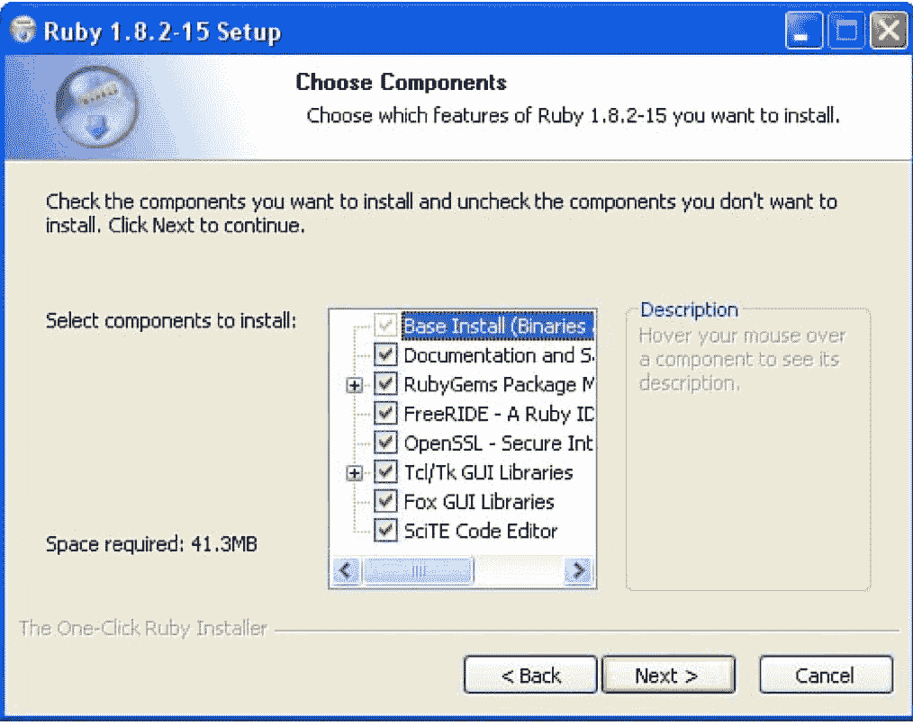

如果缺少自动运行光盘让您不安，那无论如何请自己制作一个。但是，如果是没有价格标签让您不安，我建议购买本书的第二个副本并作为礼物送给朋友。通过这种方式，您就得到了一张账单，同时也给了 Prentice Hall 的友好工作人员一个理由给我寄来支票。简而言之，大家都很高兴。

在 Windows 环境中，安装 Ruby on Rails 需要几个额外的步骤。第一步是安装 Rails 本身。如果您有互联网连接，这只是一行；它在命令提示符下，但尽管如此，它仍然是一行（见图 13-3）。

**图 13-3. 在命令提示符下安装 Rails**

[查看原图](#)

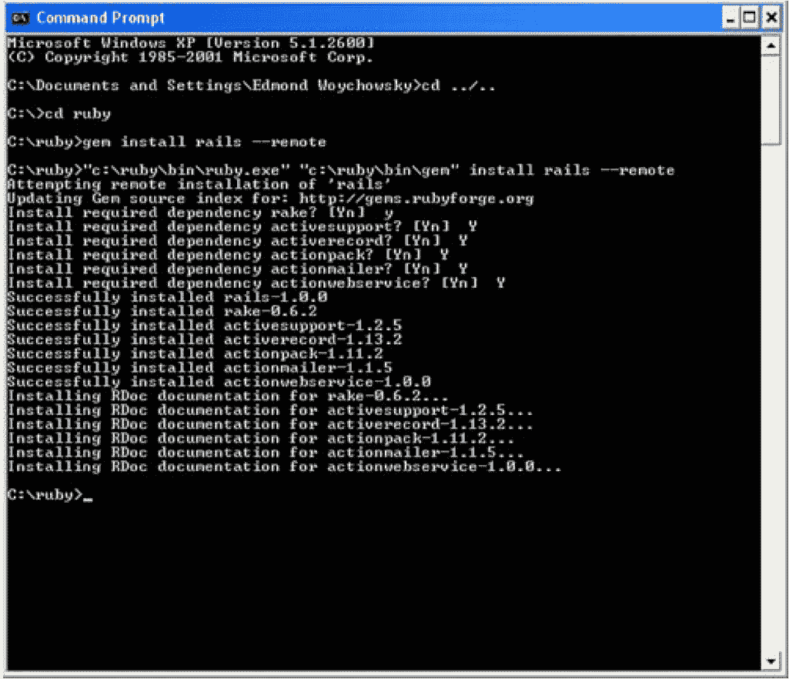

但是，如果您是一位真正的网页开发者，而不是那种只会吃千层饼的 Windows 用户，安装过程会稍微复杂一些。别担心，这并非“Windows 更优越”的问题——事实上，更像是“Windows 还在使用辅助轮”。既然我已经彻底搞混了您，事实是 RubyGems 包管理器是 Windows 安装程序的一部分，而在 Linux 上则不是。但是，由于 Linux 并非停滞不前的环境，我建议您访问 Ruby 网站以获取最新的安装程序。

现在您（希望）已安装好了 Ruby 和 Rails，是时候驱动钢轮（哎哟）并把它拿出来试运行一下了。耶！

## 13.3. Ruby on Rails 热身练习小插曲

如前所述，Ruby 是面向对象的编程语言，Rails 是用于开发应用程序的框架。假设例如，我想使用 Ruby on Rails 创建一个疯狂科学家应用程序。步骤大致如下：

1. 如果文件夹/目录不存在，请创建一个用于存放每个 Ruby on Rails 应用程序的文件夹。在本例中，我在 C: 驱动器上创建了一个名为`rails`的文件夹。
2. 使用命令提示符，输入`cd rails`。这将当前目录更改为`C:\rails`。
3. 运行命令`rails madscientist`创建一个空的 Web 应用程序，如图 13-4 所示。


[查看原图]

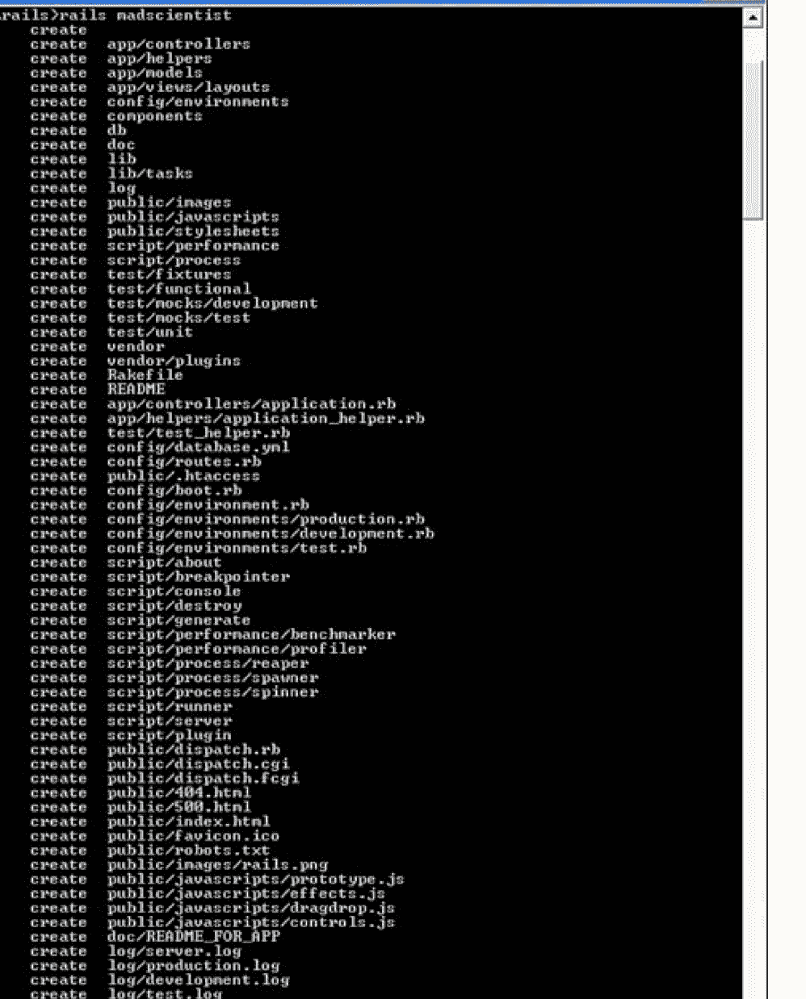

4. 启动 Web 服务器 WEBrick，该服务器包含在 Ruby 中，如图 13-5 所示。

**图 13-5. 在命令提示符下启动 WEBrick Web 服务器**

This document was created by an unregistered ChmMagic, please go to http://www.bisenter.com to register it. Thanks

5. 在您选择的浏览器中查看 Web 服务器上显示的内容（见图`13-6`）。

**图 13-6. 默认起始页面**

```text
C:\rails\madscientist>ruby script\server

=> Booting WEBrick...

=> Rails application started on http://0.0.0.0:3000

=> Ctrl-C to shutdown server; call with --help for options

[2005-12-26 15:40:49] INFO WEBrick 1.3.1

[2005-12-26 15:40:49] INFO ruby 1.8.2 (2004-12-25) [i386-mswin32]

[2005-12-26 15:40:49] INFO WEBrick::HTTPServer#start: pid=3124 port=3000
```

```text
Welcome aboard

You're riding the Rails!

About your application's environment

Getting started

Here's how to get rolling:

1. Create your databases and edit config/database.yml

   Rails needs to know your login and password.

2. Use script/generate to create your models and controllers

   To see all available options, run it without parameters.

3. Set up a default route and remove or rename this file

   Routes are setup in config/routes.rb.
```

不太令人印象深刻，是吗？

1. 现在是在命令提示符窗口中按下`Ctrl+C`以关闭 WEBrick 的好时机（见图 13-7），然后再撤退并重新整理。

**图 13-7. 在命令提示符下关闭 WEBrick Web 服务器**

[查看原图]

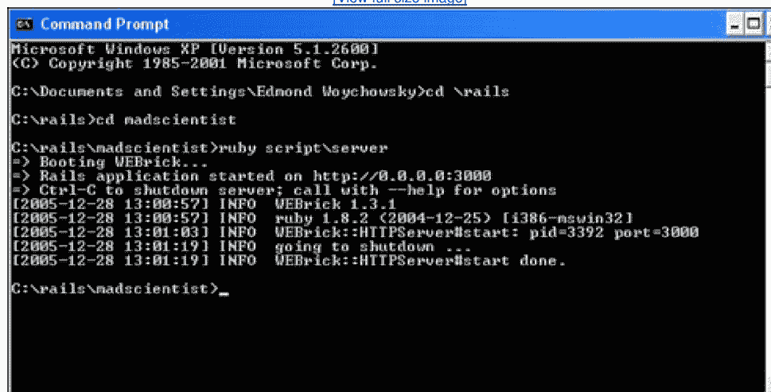

好吧，我们只完成了部分路程；事实上，我们应该感到庆幸至少还有一些东西可看。满意吗？我也不满意，所以为了进一步进展，我们需要了解 Rails 应用程序中的事物是如何排列的。

`rails madscientist`命令创建了执行各种功能的多个文件夹和文件。以`config`文件夹中的`database.yml`文件为例；其目的是向应用程序提供有关应用程序将使用的数据库的详细信息。这是 Rails“万物归位”方法的例子。个人我希望这个想法更广泛一些。这本来可以避免过去的一些尴尬时刻。

另一个引起兴趣的文件夹是`public`文件夹。连同其三个子文件夹`images`、`javascripts`和`stylesheets`，它提供了存放上述内容的标准位置。在大多数其他环境中，定位这些类型的文件更像是在寻宝而不是 Web 开发。

我将介绍的最后一个文件夹是`app`文件夹，以及名为`controllers`、`helpers`、`models`和`views`的子文件夹。仍然觉得您在黑暗中吗？给我一点时间照亮。第一个目录`controllers`包含处理访客 Web 请求的类。`helpers`目录包含助手类，这些类被其他类（如控制器类）使用。模型类包含在`models`子目录中，用于包装数据库中存储的数据。个人我认为这就是应用程序开发可能变得非常混乱并经常出错的地方。最后，还有一个`views`子目录，其中包含视图。视图是转换为 HTML 并返回给访客 Web 浏览器的模板。

乍一看，应用程序似乎散布在各处，但实际上并非如此。与 Web 开发通常关联的“我知道它就在附近某处”的正常方法不同，Rails 为每个类提供了一致的位置。如果这种方法能应用于现实世界，我就能花更少的时间去找我的手表。

## 13.4. 重新审视一个问题

现在我对我要用 Ruby on Rails 做什么有了一个大概的想法（是的，当然），下一个问题是如何在应用程序中使用它。第一项任务是要确切地识别我想做什么。例如，假设我想显示`item`表中的项目。第一个必要的任务是使用命令控制台生成数据模型，如图 13-8 所示。

**图 13-8. 在命令提示符下生成数据模型**

[查看原图]

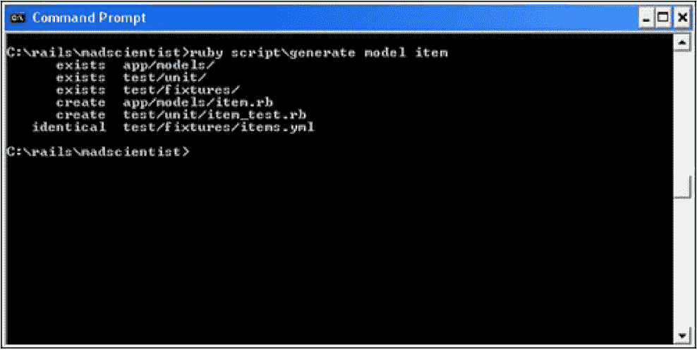

下一步是更新`config`目录中的`database.yml`以使用前几章中的 MySQL 数据库。以下是必要代码的片段。

```yaml
development:
  adapter: mysql
  host: localhost
  database: ajax
  username: root
  password: wyvern
```

随后的步骤如下：

1. 为`item`数据模型生成一个控制器（见图 13-9）。

##### 图 13-9. 在命令行提示符下为数据模型生成控制器

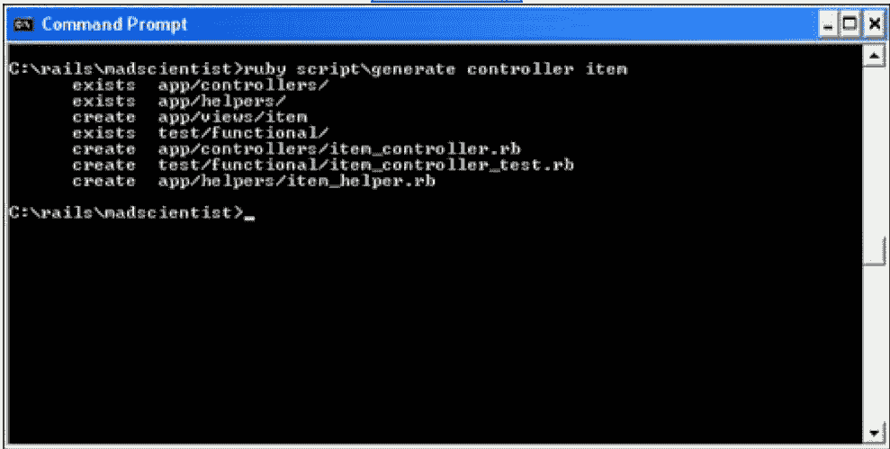

2. 向生成的控制器中添加强条语句（参见**列表 13-1**）。

## 列表 13-1

```ruby
class ItemController < ApplicationController
  scaffold :item
end
```


### 3. 启动 WEBrick，观察结果（见图 13-10）

## 图 13-10：访问数据库时的“哎呀！”时刻

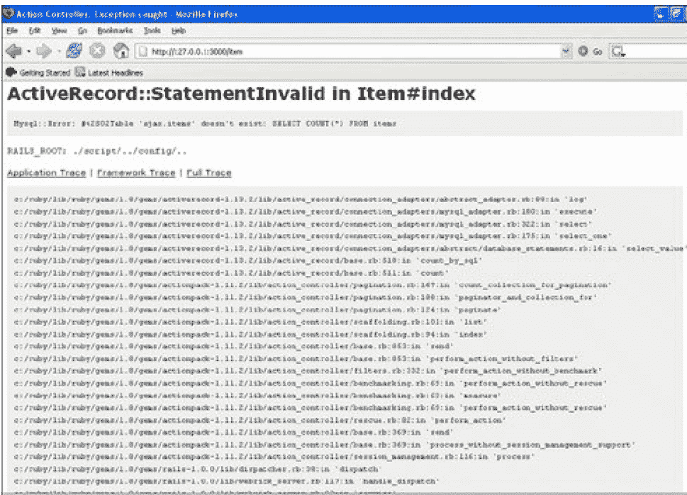

嗯，这并非我预期的结果。看来 Rails 将表名 `item` 改为了复数形式 `items`。情况不妙。鉴于我也是懒人中的一个，我决定进入 MySQL Query Browser（MySQL 查询浏览器），并将表名从 `item` 改为 `items`（见图 13-11），然后再次尝试（参见图 13-12）。

## 图 13-11：在 MySQL 中更改数据库名称

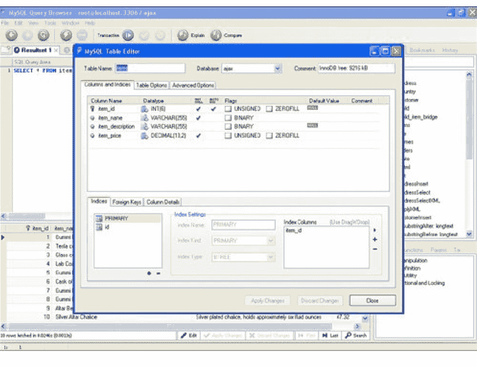

## 图 13-12：一个可行的示例

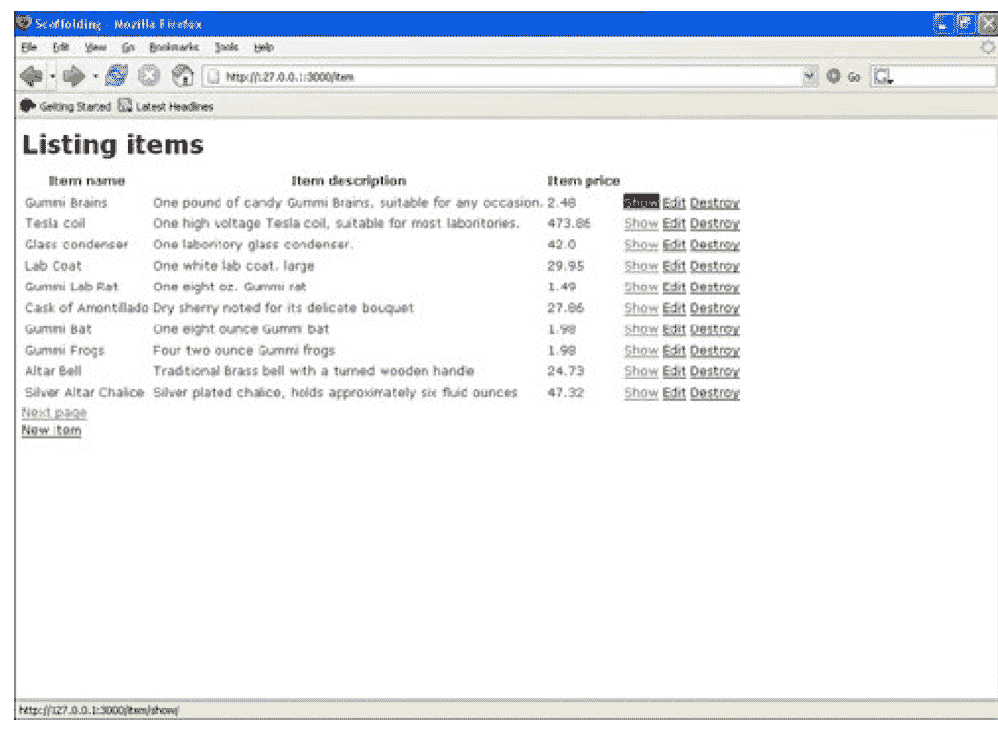

这比我期望的更接近了。诀窍在于，默认情况下，Rails 生成查询时假设 `item` 是行（row），而 `items` 是表。这并不是什么大问题；这只是创建一个表和使用时需要记住的内容之一。

但如果您不想使用默认生成的内容怎么办？Ajax 又该如何融入其中呢？

第一个问题的答案很简单：只需像图 13-13 所示的那样生成脚手架即可。

## 图 13-13：在命令行提示符下生成交互式脚本（scaffold）

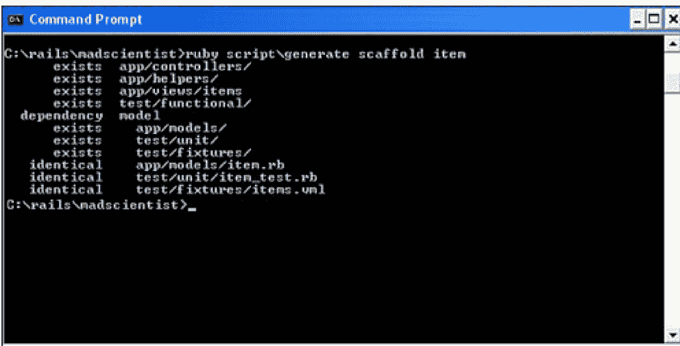

然后需要在控制器、视图、布局和各种模板中添加逻辑。

这仅剩下最后一个未解决的问题：Ajax？还记得 `public` 文件夹下的 `javascripts` 文件夹吗？其实，那里有一个名为 `prototypes.js` 的文件，其中包含了 Ruby on Rails 中异步 JavaScript 和 XML 所需的所有逻辑。如果您感兴趣的话，我给您一点提示：查看 `xml_http_request?` 方法。这可是大有文章可做，我建议亲自尝试一下玩耍一番哦！


## 13.5 Ajax 何方？

考虑到 Rails API 内置的很多好东西，找出 Ajax 功能确切的隐藏位置可能需要花费一番功夫。不过，因为我特别不擅长保守秘密（或者说是真的“crumby”——意为糟糕、差劲），我就把底牌亮出来吧：我们所感兴趣的一切都在 `JavaScriptHelper` 模块中，如表 13-1 所示。

| 方法 | 描述 |
| --- | --- |
| `define_javascript_functions()` | 将 `JavaScriptHelper` 的所有 JavaScript 函数包含在页面内。 |
| `draggable_element(element_id, options = {})` | 使具有相应 ID 的元素可拖动（拖拽）。 |
| `drop_receiving_element(element_id, options = {})` | 强制执行元素的丢弃（拖放）。这也发起一个 Ajax 调用。 |
| `escape_javascript(javascript)` | 转义提供的 JavaScript 代码。 |
| `evaluate_remote_response()` | 创建一个 JavaScript 函数来评估从服务器返回的文档。 |
| `form_remote_tag(options = {})` | 创建 HTML 表单，使用 `XhrRequest` 对象提交该表单。 |
| `javascript_tag(content)` | 创建包含所提供内容的 JavaScript HTML 标签。 |
| `link_to_function(name, function, html_options = {})` | 创建一个超链接，指向客户端 JavaScript 函数。 |
| `link_to_remote(name, options = {}, html_options = {})` | 创建通过异步 `XhrRequest` 请求与服务端连接的超链接。 |
| `observe_field(field_id, options = {})` | 监视具有所提供 ID 的字段，以查看用户更改。 |
| `observe_form(form_id, options = {})` | 观察表单（根据提供的 ID）中的用户操作。 |
| `periodically_call_remote(options = {})` | 每当间隔时间到达时调用指定的 URL。如果未指定间隔时间，则默认使用 10 秒。 |
| `remote_function(options)` | 返回远程函数所需的 JavaScript 片段。 |
| `sortable_element(element_id, options = {})` | 修改具有相应元素 ID 的 HTML 元素，使其可以通过 Ajax 调用进行排序。 |
| `submit_to_remote(name, value, options = {})` | 显示一个按钮，使用该异步 `XhrRequest` 对象提交表单。 |
| `update_element_function(element_id, options = {}, &block)` | 使用传递的参数更新浏览器的 DOM（文档对象模型）。 |
| `visual_effect(name, element_id = false, js_options = {})` | 返回 JavaScript 代码，该脚本使用 Ajax 回调实现视觉效果。 |

正如我在上大学时发现的那样——至少就 Ruby on Rails 而言——我发现自己与某些教授处于非常相似的情况：白天上课，晚上带班授课（指同时担任学生和讲师）。鉴于此，我决定暂时搁置展示如何用 Ruby on Rails 构建 Ajax 示例的工作计划，等到第 14 章“用 Ruby 走得更远”中再进行演示。原因是我对此有点不太在行；就像那位教授一样，我基本上是一边学习一边教学的。


## 总结（第 13 章）

在本章中，我们复习了 Ruby on Rails 的一些历史知识——包括 Rails 与 Ruby 的分离情况。从那里开始，我们介绍了安装 Ruby 以及随后安装 Rails 并查看默认主页的过程。接着探讨了如何创建空白项目、启动内置 WEBrick Web 服务器以及访问 MySQL 数据库（尽管过程有些困难）。本质上地说，本章的目的是在读者寻找支持 Ajax 的环境时指引其走向正确方向。

# 第 14 章：用 Ruby 编程

如果您属于那些从未涉足过封装软件世界之外的开发者之一——也许您甚至没听说过 Ruby 语言，即我在“与 Rails 同路”（*Traveling with Rails on Ruby*）这一章节中介绍的编程语言，而非 gem 宝石包。正如我刚才所指出的一样，Ruby 是一种面向对象的语言，由日本程序员 Yukihiro Matsumoto 创建并于 1985 年推向野外（注：此处原文应为 1993 年底或者更可能是 20 世纪末，Ruby 语言诞生于早期版本，即“Matz 在 NEC 时期”），并迅速占领了世界舞台。相对于其他填补相同利基市场的编程语言而言，Ruby 具有诸多优势。

其中首要的优势之一就是它采用解释方式而非编译模式执行代码。表面来看这可能听起来像是个缺点，但实际上并非如此。因为目前我只运行 Windows XP 操作系统，某些时候可能会出现仅在另一套操作系统（例如 Linux）下才能工作的二进制版本程序。然而，对于那些 scripting 类编程语言如 Ruby，只要我已经安装了相应的环境，就可以随意使用了。现在我所需要的只是找到一个 Hunt the Wumpus（追捕巫师）版本的 Ruby 实现，我就万事俱备了。

就像哥斯拉一样，Ruby 从创作者眼中的一抹微光扩展到了其卑微的起源，演变成了一个宗教现象。哦，我是说积极意义上的“邪教”——没有像那些奇怪的人为了参加文艺复兴节而穿戴奇装异服那样大声吟诵或穿怪衣服跳舞。

认真地说，Ruby 是一种面向对象语言，具备当今快节奏开发环境所需的能力和特性。而且我是否提到过 Ruby 是开源的呢？是的！一旦您克服了硬件成本之后，唯一需要的只是互联网连接费用以及下载和安装花费的时间。我会为您做数学计算，但分数运算并不是我的强项，所以就不多做解释了。

取而代之的是，我可以脱下剑带，带您近距离观察 Ruby 的数据类型，因为有一些不成文规定：诸如葡萄柚必须切半上菜，所有编程语言介绍必须以数据类型开头。所以我们从这里开始讨论，内容布局大致如下：

- 数据类型（Data types）
- 运算符（Operators）
- 控制流程语句（Flow-control statements）
- 线程（Threads）
- Ajax（Ajax）

那个词又出现了：Ajax。您知道它会在某个地方再次出现，对吧？不过确实存在一个微小差异：基本上我们快速浏览生成的代码，看看它是如何工作的。我不清楚您的情况，但我总是关注幕后的人（man behind the curtain）。

## 14.1 数据类型

Ruby 中的数据类型不同于你在 C、COBOL 或 Pascal 等更传统语言中习惯的数据类型。因为 Ruby 是纯粹面向对象的，所以你甚至找不到像 Java 中那样的原始数据类型。在 Ruby 中，所有数据类型都是基于类的。

这并不意味着 Ruby 中没有整数或字符串这样的东西；它仅仅意味着它们是 `Integer` 和 `String` 类的实例。对某些人来说，这种“一切皆类”的方法可能听起来有些过头，但它也相当合理。就我个人而言，我认为编码时无需不断切换思维模式会更容易。只需将我的思维置于面向对象模式即可。这就引出了一个问题：去向何方？我想的是一个岛屿。

### 14.1.1 数字

“我不是一个数字，我是一个自由人！”是英国电视剧《囚徒》中一句颇为人知的台词。我真的不明白六号在抱怨什么——情况可能更糟。例如，他可能像五号一样，在核电站从事一份他厌恶的工作。然而，六号确实与荷马（五号）有一些共同点。你看，他们都是整数。

`Integer`，首字母大写 `I`，是所有整数类的基础类。派生自 `Integer` 的类示例有 `Bignum` 和 `Fixnum`。虽然每个都有自己的特性，但它们都继承自 `Integer` 基础类，其属性和方法见表 14-1。

#### 表 14-1：Integer 属性和方法

| 方法 | 类 | 描述 |
|---|---|---|
| `chr` | `Integer` | 返回一个包含与该数值对应的字符的字符串。 |
| `downto` | `Integer` | 迭代执行一个代码块。 |
| `integer?` | `Integer` | 返回 `true`。 |
| `next` | `Integer` | 将值递增 1。 |
| `size` | `Bignum` | 返回存储该值所用的字节数。 |
| `size` | `Fixnum` | 返回存储该值所用的字节数。 |
| `step` | `Integer` | 按照设定的步长将值递增到结束值。 |
| `succ` | `Integer` | 将值递增 1。本质上与 `next` 方法相同。 |
| `times` | `Integer` | 执行预设次数的代码块。 |
| `to_f` | `Bignum` | 将值转换为浮点数。当值太大无法包含在浮点数中时，返回无穷大。 |
| `to_f` | `Fixnum` | 将值转换为浮点数。 |
| `to_i` | `Bignum` | 返回一个 `Bignum`。 |
| `to_i` | `Fixnum` | 返回一个 `Bignum`。 |
| `to_s` | `Bignum` | 返回一个 `String`。 |
| `to_s` | `Fixnum` | 返回一个 `String`。 |
| `upto` | `Integer` | 执行一个代码块，每次将值递增 1，直到达到指定值。 |

然而，除了那些被困在岛上的可怜灵魂之外，生活不仅仅有整数；还有浮点数，在 Ruby 中称为 `Float`。如果你忘了的话，浮点数是那些带有小数部分的数字，比如当统计学家说美国家庭平均有 2.6 个孩子时。数字 2.6 就是一个浮点数，并且，根据我的心情，它要么是我两个同父异母兄弟中的一个。

与 `Integer` 类一样，`Float` 类也有许多属性和方法，如表 14-2 所述。

#### 表 14-2：Float 属性和方法

| 方法 | 描述 |
|---|---|
| `ceil` | 返回最接近的整数，该整数等于或大于浮点值。 |
| `finite?` | 一个布尔值，指示该值是否为有效的浮点数。 |
| `floor` | 返回小于或等于该值的最大整数。 |
| `infinite?` | 返回 `true` 或 `false`，指示该值是否为无穷大。 |
| `nan?` | 返回 `true` 或 `false`，指示该值是否为非数字。 |
| `round` | 将值四舍五入到最接近的整数。 |
| `to_f` | 返回一个 `Float`。 |
| `to_i` | 将值转换为整数。 |
| `to_s` | 返回一个 `String`。 |

### 14.1.2 字符串

对于使用多种语言编程的人来说，字符串作为 `String` 类的实例有一个主要优势。可以将其视为一站式购物；如果需要做什么，很可能有一个方法可以做到。事实上，方法非常多，我建议访问 Ruby 主页（http://www.ruby-lang.org/en/）查看所有方法。

### 14.1.3 布尔值

在编程中，任何问题总是有两个可能的答案：`true` 和 `false`。也许这就是为什么有两个类，`TrueClass` 和 `FalseClass`。实际上，由于 Ruby 中变量的动态特性，情况确实如此。`TrueClass` 代表逻辑真值，而 `FalseClass` 代表逻辑假值。

### 14.1.4 对象

可能由于完全没有原始类型，Ruby 中的内置对象极其丰富和多样化。有用于哈希的对象，用于文件访问的对象，甚至还有用于数组的对象。在许多情况下，只要你能想象到，很可能已经有一个对象可以满足需要，正如以下内置类列表所示：

- `Array`
- `Bignum`
- `Binding`
- `FalseClass`
- `File::Stat`
- `File`

拥有所有这些内置属性和方法，可能需要一段时间才能编写我们自己的对象，但尝试一下可能是个好主意。比如说，我们想要添加一个数学类，该类有两个方法：`add` 和 `subtract`。通过勤奋工作和健康生活，我们将创建清单 14-1 中所示的代码。

#### 清单 14-1：myMath 类

## 14.2 变量

Ruby 支持几种不同类型的变量，实例变量和类变量。与其让你猜测它们的名字是否真的如其所说，我直接说明白。名字的意思就是它们所说的。实例变量是为类的每个实例创建的。另一方面，类变量则是类的所有实例共享一个变量。虽然实例变量很常见，但类变量相对少见一些。这并不意味着它们没有用；事实上，很多时候类变量是无可替代的。

关于变量的唯一问题是如何区分实例变量和类变量。它们身上有写着“实例变量”和“类变量”的小标签吗？一句话，有。

实例变量和类变量通过前缀来区分。实例变量以单个 `@` 为前缀，而类变量以两个 `@` 为前缀。所以 `@Bob` 是一个实例变量，`@@Paul` 是一个类变量。

现在我们有了存放信息的地方，让我们对它做点什么。

## 14.3 运算符

无论哪种语言，通常都有一些共通之处。有加法、减法、乘法、除法和赋值。在某些语言中，包括 Ruby 和 JavaScript，加法运算符也充当连接运算符。这意味着，无论语言如何，类似下面的示例基本上是相同的：

```ruby
X = 1 + 1

X = 1 - 1

X = 1 * 1

X = 1 / 1
```

然而，偶尔你会看到一些稍微不寻常的东西，通常是在从 C 借用了一些语法的语言中。在 Ruby 中，它们被称为多重赋值；我更愿意把它们看作少打字。考虑一下下面这行代码：

```ruby
X = X + 5
```

它所做的只是将变量 `X` 增加 5，那么输入这个不是更容易吗？

```ruby
X += 5
```


是的，我节省的只是两次按键，第二个 X 和一个空格，但积少成多。想象一下，如果变量名是我的姓氏 `Woychowsky` 而不是 `X`。只需输入一次就能大大延长 `W` 键的使用寿命。同样的快捷方式也适用于减法、乘法和除法。

本文档由未注册的 ChmMagic 创建，请访问`http://www.bisenter.com`进行注册。谢谢

# 14.4. 流程控制语句

在任何非平凡程序中，流程控制可能是编程中最重要的因素。编程语言中如果没有某种形式的流程控制，计算机本质上将是昂贵的桌面装饰品。仔细想想，当你抛开每天将每封收到的邮件转发给团队的做法后——我曾经有一位经理，他的计算机就是一件非常昂贵的桌面装饰品。实际上，他曾经将同一封邮件转发了14次，才意识到自己不知怎的被添加到了团队的地址列表中。但我有点跑题了，让我们回到流程控制上来，从条件判断开始。

## 14.4.1. 条件判断

在普通的语言中，有`if`语句，差不多也就这些了。Ruby 有一个`if`语句，看起来像这样：

```ruby
if x == 1
  b = 2
end
```

相当简单。让我们通过添加`else`来增加一层复杂性：

```ruby
if x == 1
  b = 2
else
  b = 3
end
```

在 Ruby 中，也可以使用`elsif`语句来达到更高的复杂度：

```ruby
if x == 1
  b = 2
elsif x == 2
  b = 4
else
  b = 3
end
```

趁我没忘记，为了清晰起见，Ruby 允许在`if`语句中添加`then`：

```ruby
if x == 1 then
  b = 2
end
```

还记得回到[第 4 章，“JavaScript”]吗？还记得条件运算符吗？它们回来了！事实上，这里有一个例子：

```ruby
b = (x == 1 ? 2 : 3)
```

## 14.5. 线程

在 Ruby 中，线程在所有平台上都是兼容的，这是一个相当大的成就。然而，我建议进一步阅读有关多线程的主题。从个人经验来看，我知道多线程确实是一门深奥的学问，不宜轻易尝试。

### 清单 14-2. 我的早晨用 Ruby 表示：while 循环

```ruby
cupsofcoffee = 0

while cupsofcoffee < 4
  puts "hurry..."
  cupsofcoffee += 1
end
```

用程序化的方式描述一个人早晨的妙处在于，总有不同的表达方式。例如，有些早晨，被子怪兽把我困住，在身体里有一定水平的咖啡因之前，我似乎无法动弹。像这样的早晨，用清单 14-3 中显示的代码来表达更合适。

### 清单 14-3. 我的早晨用 Ruby 表示：until 循环

```ruby
cupsofcoffee = 0

until cupsofcoffee >= 4
  puts "hurry..."
  cupsofcoffee += 1
end
```

不久以前，我曾经有一个带定时器的咖啡壶。在那些我前一晚已经设定好程序的早晨，咖啡已经在煮了。啊，一定数量的咖啡正等着加入奶油和糖。我想[清单 14-4](清单 14-4)最能概括这一点。

### 清单 14-4. 我的早晨用 Ruby 表示：for/in 循环

```ruby
puts "for-in loop"

for x in ["hurry...", "hurry...", "hurry...", "hurry..."]
  puts x
end
```

如今，我有了一个使用胶囊的咖啡机。只需放入胶囊，按下按钮，90秒后就有咖啡了。这使煮咖啡从一门艺术变成了一门科学，这种感觉最好通过[清单 14-5](清单 14-5)中所示的例子来传达。

### 清单 14-5. 我的早晨用 Ruby 表示：for/in 循环

```ruby
puts "Iterators"

1.step(4, 1) do |x|
  puts "hurry..."
end
```

## 14.6. Ajax

所有这些关于 Ruby 的讨论给我们留下了一个问题：Ajax 到底在哪里适用？嗯，还记得[第 13 章]的 Rails 吗？那就是 Ajax 适用的地方，但为了证明这一点，我们必须生成另一个控制器（参见[图 14-1](图 14-1)）。

![生成控制器.png]

我们感兴趣的是两个文件：位于`madscientist/app/controllers/`下的`sample_controller.rb`，以及位于`madscientist/app/views/sample`下的`index.rhtml`。第一个文件是定义`sample`类的 Ruby 应用程序控制器。这个类，如[清单 14-6](清单 14-6)所示，将完成我们所有的服务器端脏活。另一方面，第二个文件（参见[清单 14-7](清单 14-7)）的目的是处理 Ajax 演示的客户端部分。

### 清单 14-6. controller.rb

```ruby
def echo_data
  render_text "<i>" + params[:textinformation] + "</i>"
end
```

### 清单 14-7. index.rhtml

```html
<html>
  <head>
    <title>link_to_remote Demo</title>
    <%= javascript_include_tag "prototype" %>
  </head>

  <body>
    <%= form_remote_tag(:update => "form", :url => { :action => :echo_data }) %>
      Text
      <%= text_field_tag :textinformation %>
      <%= submit_tag "Echo" %>
      <%= end_form_tag %>

    <br />

    <div id="form"></div>
  </body>
</html>
```

在修改了这两个文件（针对`controller.rb`的情况）或创建了它们（如`index.rhtml`需要的那样）之后，我们就可以启动`WEBrick`（参见[图 14-2](图 14-2)）并打开页面（参见[图 14-3](图 14-3)）。

### 图 14-2. WEBrick

![生成控制器.png]

[查看完整尺寸图片]

### 图 14-3. 生成的页面

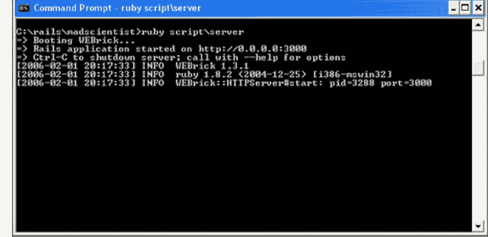

[查看完整尺寸图片]

### 图 14-4. 回显的文本

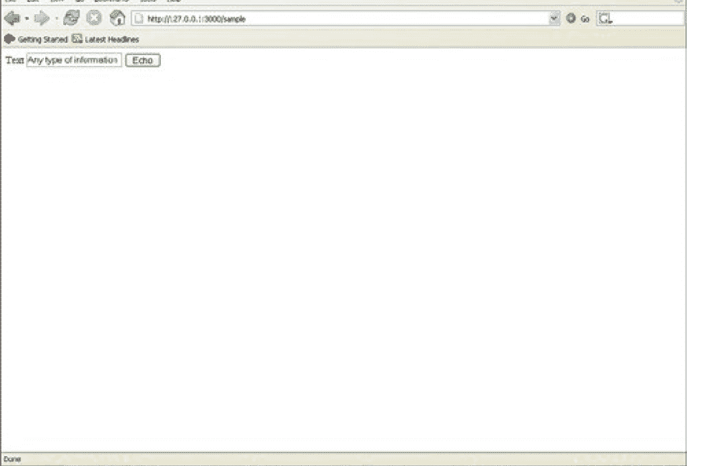

[查看完整尺寸图片]

现在只剩下试用这个页面了，其唯一目的是当点击按钮时，将文本框中输入的内容从服务器回显回来。图 14-4 显示了结果。

### 清单 14-8. 生成的 HTML

```html
<html>
  <head>
    <title>link_to_remote Demo</title>
    <script src="/javascripts/prototype.js" type="text/javascript"></script>
  </head>

  <body>
    <form action="/sample/echo_data" method="post" onsubmit="new Ajax.Updater('form', '/sample/echo_data', {asynchronous:true, evalScripts:true, parameters:Form.serialize(this)}); return false;">
      Text
      <input id="textinformation" name="textinformation" type="text" />
      <input name="commit" type="submit" value="Echo" />
    </form>

    <br />

    <div id="form"></div>
  </body>
</html>
```


很有趣，不是吗？来自`index.rhtml`的源代码转化成了一些非常漂亮的 HTML，所有 Ajax 功能都内置于其中。`javascript_include_tag`包含了`prototype.js`，其中包含所有必要的客户端 JavaScript，而其余标签描述了一个 HTML 表单。就个人而言，我开始觉得自己找到了应许之地，而且不打算离开了。在大约 24 行代码中，我们就有了一个简单的 Ajax 应用程序。当然，事情远不止于此；这个例子仅触及了 Rails API 中可用的一些功能。但 Ruby on Rails 显示出了一定的前景。

## 14.7. 总结

在本章中，我们简要介绍了 Ruby 编程语言，`begin{code}`这是一门本身就可以写满整本书的学科。我们指出了这样一个事实：Ruby 没有原始类型，所有变量实际上都是对象。数值对象被详细介绍，我们还简要涉及了字符串和布尔值。自定义类的创建示例被用来展示这实际上是多么简单。

我们讨论了运算符，包括较为不常见的多重赋值运算符，然后介绍了各种类型的循环。接下来，我们涉及了在 Ruby 中使用线程的可能性。最后，本章以一个示例收尾，展示了如何用极少量的代码使用 Ruby on Rails 创建一个 Ajax 应用程序。

# 第 15 章. 跨浏览器 HTML DOM 精华

不管普通 Web 开发者是否意识到，它就在那里，看不见也注意不到，但确实就在那里。请允许我解释，在你认定我脑子进水、需要被送往一个舒适的软垫房间之前。我指的是 HTML 文档对象模型——是的，那个常常被忽略的、既能成为福音也能成为诅咒的应用程序编程接口。

是的，普通 Web 开发者使用 HTML DOM 的程度仅限于完成工作所必需的，仅此而已。造成这种状况的原因有很多，从早期 Web 浏览器时代大家各自为政，到客户端代码常被认为不可靠，因为有些人使用的浏览器更适合放在博物馆里，而不是放在 21 世纪制造的计算机中。

我想这可以被视为一个重大问题，即 Web 应用程序需要兼容自时间开始以来发布的每一款浏览器。你可能会觉得我有点 snob，但我为什么要让愿意超越 20 世纪 90 年代中期的人受罚呢？你看电力并不会因为某些群体不认可而被轻视。不管忽视 HTML DOM 的原因是什么，除非他们喜欢行为方式像 20 世纪 70 年代大型机应用程序的 Web 应用，否则人们要么跟上时代，要么被淘汰。

本章按照以下结构组织：

- [接口](#)
- [文档](#)
- [框架](#)
- [集合](#)

## 15.1. 接口

HTML 文档对象模型是一个应用程序编程接口（API），它定义了浏览器中 HTML 文档的结构。此外，它还定义了如何通过 JavaScript 访问和操作该文档，有时 JavaScript 就嵌入在被操作的那个 HTML 文档中。

这听起来有点可怕，不是吗？JavaScript 例程可以实质性地修改其自身宇宙的基本结构，这种想法可能令人恐惧。只要一个失误，就完了——它把自己修改得不复存在。就浏览器而言，它仿佛从未存在过。幸运的是，要做到这一点需要一些工夫，而且只有 JavaScript 函数以及可能关联的页面会消失。相信我，如果不是这种情况，我早就“噗”地一声消失了。

[表 15-1](#) 展示了 JavaScript 中可用的各种 HTML 文档对象模型接口。我想指出的是，这些接口中的绝大多数都对应着实际的 HTML 元素。是的，说出一个 HTML 元素，就有对应的接口；不过请记住，即使某个已废弃元素存在接口，你也不必使用它。它仍然是被废弃的。

### 表 15-1. JavaScript 中可用的 HTML 文档对象模型接口

| 接口名称 | 描述 |
|---|---|
| `HTMLCollection` | HTML 节点的集合 |
| `HTMLDocument` | HTML 文档的根元素 |
| `HTMLElement` | 所有 HTML 元素的基类 |
| `HTMLHtmlElement` | 对应`html`元素 |
| `HTMLHeadElement` | 对应`head`元素 |
| `HTMLLinkElement` | 对应`link`元素 |
| `HTMLTitleElement` | 对应`title`元素 |
| `HTMLMetaElement` | 对应`meta`元素 |
| `HTMLBaseElement` | 对应`base`元素 |
| `HTMLIsIndexElement` | 对应`isindex`元素 |
| `HTMLStyleElement` | 对应`style`元素 |
| `HTMLBodyElement` | 对应`body`元素 |
| `HTMLFormElement` | 对应`form`元素 |
| `HTMLSelectElement` | 对应`select`元素 |
| `HTMLOptGroupElement` | 对应`option group`元素 |
| `HTMLOptionElement` | 对应`option`元素 |
| `HTMLInputElement` | 对应`input`元素 |
| `HTMLTextAreaElement` | 对应`text area`元素 |
| `HTMLButtonElement` | 对应`button`元素 |
| `HTMLLabelElement` | 对应`label`元素 |
| `HTMLFieldSetElement` | 对应`field set`元素 |
| `HTMLLegendElement` | 对应`legend`元素 |
| `HTMLUListElement` | 对应`unordered list`元素 |
| `HTMLOListElement` | 对应`ordered list`元素 |
| `HTMLDListElement` | 对应`dash list`元素 |
| `HTMLDirectoryElement` | 对应`directory`元素 |
| `HTMLMenuElement` | 对应`menu`元素 |
| `HTMLLIElement` | 对应`list`元素 |
| `HTMLBlockquoteElement` | 对应`block quote`元素 |
| `HTMLDivElement` | 对应`div`元素 |
| `HTMLParagraphElement` | 对应 paragraph 元素 |
| `HTMLHeadingElement` | 对应 heading 元素 |
| `HTMLQuoteElement` | 对应 quote 元素 |
| `HTMLPreElement` | 对应 preformatted 元素 |
| `HTMLBRElement` | 对应 break 元素 |
| `HTMLBaseFontElement` | 对应 base font 元素 |
| `HTMLFontElement` | 对应 font 元素 |
| `HTMLHRElement` | 对应 horizontal rule 元素 |
| `HTMLModElement` | 对应 modification 元素 |
| `HTMLAnchorElement` | 对应 anchor 元素 |
| `HTMLImageElement` | 对应 image 元素 |
| `HTMLObjectElement` | 对应 object 元素 |
| `HTMLParamElement` | 对应 parameter 元素 |
| `HTMLAppletElement` | 对应 applet 元素 |
| `HTMLMapElement` | 对应 map 元素 |
| `HTMLAreaElement` | 对应 area 元素 |
| `HTMLScriptElement` | 对应 script 元素 |
| `HTMLTableElement` | 对应 table 元素 |
| `HTMLTableCaptionElement` | 对应 table caption 元素 |
| `HTMLTableColElement` | 对应 table column 元素 |
| `HTMLTableSectionElement` | 对应 table section 元素 |
| `HTMLTableRowElement` | 对应 table row 元素 |
| `HTMLTableCellElement` | 对应 table cell 元素 |
| `HTMLFrameSetElement` | 对应 frame set 元素 |
| `HTMLFrameElement` | 对应 frame 元素 |
| `HTMLIFrameElement` | 对应 iframe 元素 |

### 15.1.1. Window

> 虽然它并非 HTML 文档对象模型的正式组成部分，但`window`对象却是大佬、大腕，或者用 Web 开发术语来说，是层级结构的顶端。许多 Web 开发者没有意识到，所有 HTML 文档实际上都是`window`对象的子对象。
>
> 这意味着写`window.document`和写`document`一样有效。
>
> 你可能只会看到后者而非前者，但我认为指出前者的可能性是个好主意，哪怕只是为了避免那些霍默·辛普森式的瞬间：`D'oh!`

## 15.2. 文档

好了，现在我们正式开始处理 HTML 文档对象模型（HTML Document Object Model）及其所有层级结构的光辉内涵。唯一的问题是，在引用 HTML DOM 时，“层级”（hierarchical）这个词意味着什么？

对我而言，这意味着我将这种结构构想为一棵树——但不是那种二叉树，也不是那种向外生长的树。它拥有一个单一的根节点和分支（元素），有时这些分支还有它们的分支（更多元素）。在我脑海中，它与常规生长类树木的唯一区别在于根节点位于顶部；不过既然我身处宾夕法尼亚州，我便将这里的树木与中国的所有树木等同起来。如果你恰好在中国，只需将宾夕法尼亚州的树木想象出来，一切便没问题。前大型机（Mainframe）程序员应当联想到 IMS 数据库（IMS DB），以便顺利通过本节。

说正经的，虽然听起来有点奇怪，“层级数据”（hierarchical data）的概念已经存在很久了。请暂时考虑 Listing 15-1 中所示的 HTML 文档。

### Listing 15-1. 一个 HTML 文档

```html
<html>
<head>
<title>Test</title>
<script language="JavaScript"></script>
</head>
<body>
<h1>Test 1</h1>
<h2>Test 2</h2>
<h3>Test 3</h3>
</body>
</html>
```


看到了吗？它是层级结构的。存在一个单一的根节点，即`html`元素，它有两个子元素：`head`和`body`。`head`和`body`元素是兄弟元素，因为它们拥有同一个父节点。`head`元素有两个子元素，而`title`、`script`元素以及`body`元素各有三个子元素：`h1`、`h2`和`h3`元素。`title`和`script`元素是兄弟元素，`H1`、`H2`和`H3`元素也是兄弟元素，但这两个元素组彼此不是兄弟元素，因为它们拥有不同的父节点。

到目前为止，这基本上还是一项智力练习，那么有人能从一张图片中得到多大程度的兴奋呢？呃，我的意思是，一张不带分级限制的图片！

我的意思是，或许如果能有一个方便的表格来涵盖通过文档接口提供的各种属性和方法，会有所帮助。幸运的是，Igor 整理了 [Table 15-2](http://www.bisenter.com)，让你对可用的内容有个概念。

##### Table 15-2. HTML DOM 属性/方法

| Property/Method | Description |
| --- | --- |
| `anchors` | 当前文档中标签集合的集合。 |
| `applets` | 当前文档中插件（applets）的集合。 |
| `attributes` | 当前节点属性的集合。 |
| `body` | 页面的`body`元素。 |
| `childNodes` | 由当前节点的子节点组成的节点集（nodeset）。请注意，该节点集可能为空。 |
| `cookie` | 与当前文档关联的 Cookie 的集合。 |
| `doctype` | 与此 XML 文档关联的文档类型声明（DTD）。 |
| `documentElement` | 文档的根元素。 |
| `domain` | 服务器的域名。 |
| `firstChild` | 当前节点的第一个子节点。 |
| `forms` | 当前文档中表单的集合。 |
| `frames` | 当前文档中框架的集合。 |
| `images` | 当前文档中图像的集合。 |
| `implementation` | 此文档的`DOMImplementation`。 |
| `lastChild` | 当前节点的最后一个子节点。 |
| `links` | 当前文档中链结的集合。 |
| `nextSibling` | 当前节点的父节点的下一个子节点。 |
| `nodeName` | 节点的名称。 |
| `nodeType` | 节点的类型。 |
| `nodeValue` | 节点的值。 |
| `ownerDocument` | 与当前元素关联的文档。 |
| `parentNode` | 当前节点的父节点。 |
| `previousSibling` | 当前节点的父节点的上一个子节点。 |
| `referrer` | 链接到此页面的页面的 URI。 |
| `title` | HTML 文档的标题。 |
| `URL` | 当前页面的 URL。 |
| `appendChild(new)` | 将新子节点追加为最后一个子节点。 |
| `cloneNode(deep)` | 复制指定的节点。布尔参数`deep`用于指示是否为深度复制，即无论子节点是否应被复制。 |
| `close()` | 关闭文档流，并导致文档被渲染。 |
| `createAttribute(name)` | 创建一个属性。 |
| `createCDATASection(data)` | 使用提供的数据创建`CDATASection`节点。 |
| `createComment(data)` | 使用提供的数据创建注释节点。 |
| `createDocumentFragment()` | 创建一个空的文档片段。 |
| `createElement(tagName)` | 创建指定的元素。 |
| `createEntityReference(name)` | 创建一个实体引用（EntityReference）。 |
| `createProcessingInstruction(target,data)` | 创建一个处理指令节点。 |
| `createTextNode(data)` | 使用提供的数据创建一个文本元素。 |
| `getElementById(elementId)` | 根据该元素的`id`属性返回单个元素。当有多个具有相同`id`的元素时，仅返回第一个。 |
| `getElementsByTagName(tagname)` | 根据元素名称返回元素集合。 |
| `getElementsByName()` | 返回由具有匹配标签名的元素组成的节点集。 |
| `hasChildNodes()` | 如果存在子节点则返回`TRUE`，如果不存在子节点则返回`false`。 |
| `insertBefore(new,reference)` | 在参考子节点之前插入新子节点。 |
| `open()` | 打开文档流以进行写入。 |
| `removeChild(old)` | 移除旧的子节点。 |
| `replaceChild(new, old)` | 用新子节点替换旧的子节点。 |
| `write()` | 向文档写入文本字符串。 |
| `writeln()` | 向文档写入文本字符串并追加换行符。 |

在继续之前，我想提醒你，文档是层级结构的。这意味着每个元素都有其自身的属性和方法。与其发疯似的尝试创建一个超级表格，列出表 15-1 所示接口的所有可能属性和方法，我决定创建表 15-3。表 15-3 涵盖了各种元素共有的属性和方法。

> 本文档由未经注册的 ChmMagic 创建，请访问 http://www.bisenter.com 进行注册。谢谢

##### Table 15-3. 各种 HTML DOM 接口共有的属性和方法

| Property/Method | Description |
|---|---|
| `attributes` | 由当前节点属性组成的集合。 |
| `childNodes` | 由当前节点的子节点组成的节点集。请注意，该节点集可能为空。 |
| `className` | 元素的类（class）属性。 |
| `dir` | 元素的文本方向。 |
| `firstChild` | 当前节点的第一个子节点。 |
| `id` | 元素的标识符。 |
| `lang` | 元素的语言代码。 |
| `lastChild` | 当前节点的最后一个子节点。 |
| `nextSibling` | 当前节点的父节点的下一个子节点。 |
| `nodeName` | 节点的名称。 |
| `nodeType` | 节点的类型。请参阅`Table 15-2`了解接受的取值。 |
| `nodeValue` | 节点的值。 |
| `ownerDocument` | 与当前元素关联的文档。 |
| `parentNode` | 当前节点的父节点。 |
| `previousSibling` | 当前节点的父节点的上一个子节点。 |
| `tagName` | 元素的标签名。 |
| `title` | 元素的标题。 |
| `appendChild(new)` | 将新子节点追加为最后一个子节点。 |
| `cloneNode(deep)` | 复制指定的节点。布尔参数`deep`用于指示是否为深度复制，即无论子节点是否应被复制。 |
| `getAttribute(name)` | 根据名称返回属性的值。 |
| `getAttributeNode(name)` | 通过名称检索一个`Attr`节点。 |
| `getElementsByTagName(tagname)` | 返回由具有匹配标签名的元素组成的节点集。 |
| `hasChildNodes()` | 如果存在子节点则返回`true`，如果不存在子节点则返回`false`。 |
| `insertBefore(new, reference)` | 在参考子节点之前插入新子节点。 |
| `normalize()` | 规范化指定的元素及其子元素。 |
| `removeAttribute(name)` | 通过名称移除属性。 |
| `removeAttrbutNode(name)` | 通过名称移除一个`Attr`节点。 |
| `removeChild(old)` | 移除旧的子节点。 |
| `replaceChild(new,old)` | 用新子节点替换旧的子节点。 |
| `setAttribute(name,value)` | 创建一个属性并设置其值。 |

| 属性/方法 | 描述 |
| --- | --- |
| `setAttributeNode(name)` | 通过名称添加一个`Attr`节点。 |

我想简单提示一下如何查找各种接口中剩余的属性或方法。基本上，思路是这样的：如果它是某个元素的属性或方法，那么它也很可能是该接口的属性或方法。虽然这听起来可能有些奇怪，但我发现每个人在职业生涯中都会对某些事情存在盲区。万一你好奇的话，我的盲区是拿着干草叉和火把的农民。

## 15.3. 框架

从HTML文档对象模型的角度来看，框架（frames）是一种相当奇特的存在，因为它们本质上是HTML文档中的HTML文档。试想一下，同一时间可以存在多个文档。例如，以下写法是完全合法的：

```
document.frames[1].document.body
```

它指的是索引为1的框架中文档的`body`。这往往会搞晕很多人，可能是因为这是一种“轮子套轮子”式的关系，初次接触时有点难以理解。还有一个额外的复杂性是，如果脚本本身在某个框架中执行，它可能是在操作父文档、兄弟文档，甚至是兄弟文档的子文档。需要记住的重要一点是：对当前文档能做的任何操作，对另一个文档也同样适用。

## 15.4. 集合

你可能已经在表15-1中注意到，有一个接口的唯一用途就是处理集合。再加上表15-2和15-3中定义的各种集合，很快就能看出，有人真的很喜欢集合。这能怪谁呢？

集合使得代码非常紧凑，并且可以按顺序遍历。表15-4详细说明了通过集合接口可用的单个属性和两个方法。

| 属性/方法 | 描述 |
| --- | --- |
| `length` | 集合中的项目数量 |
| `item()` | 根据索引从集合中检索单个项目 |
| `namedItem()` | 根据标识符从集合中检索单个项目 |

## 15.5. 总结

本章绝不是对HTML文档对象模型的完整解释，也从未打算如此。它的目的不是成为一本关于HTML DOM的百科全书，而更像是一个概览，强调其重要的部分。我愿意相信自己可能略微达到了这个目标，但话说回来，也许是我妄想了。

# 第16章. 其他感兴趣的事项

尽管我对现实的把握相当松散，但我的把握还没有松散到认为这些页面中包含的信息就是关于异步JavaScript和XML（Ajax）的全部和终极。Ajax几乎独一无二地兼具了与一个新主题相关的兴奋感，以及只有一项成熟技术才具备的稳重感。事实上，我能想到的最后一个具有这种双重性质的主题是NASA的阿波罗计划。一方面，将人类送上月球并安全返回地球的想法是科幻小说的题材。另一方面，人类玩火箭已经好几个世纪了，偶尔还会带来灾难性的结果。

仔细想想，Ajax和阿波罗计划有很多共同点。一方面，拥有类似Linux和Windows应用程序外观和感觉的Web应用程序是科幻小说的题材。另一方面，人类过去几年一直在创建Web应用程序，偶尔还会带来灾难性的结果。嗯，这里似乎存在某种模式。

在本章中，我将讨论一些与Ajax互补的技术，一种类似于Ajax或某种专有Ajax实现的方法，最后就浏览器提供一些进一步/最终的想法。本章的目的不仅是总结本书涵盖的所有内容，还要提供一个关于何处寻找其他可能实现方式的起点。例如，大约两个月前，我与一位从事Ajax开发的开发者交谈过。然而，他的技术是使用Java小程序进行通信，而不是使用`XMLHttpRequest`对象。我想传达的是，每个问题都有多种答案，所有答案都同样正确。所以这里提供了一些答案，并穿插了我的个人观点。

## 16.1. Sarissa

虽然官方上它只是一个开源的、跨浏览器的JavaScript XML库，但Sarissa是那种能力远超我预期的基础XML支持的库之一。在当今这个我们都能记住被电影、工作和大多数国会议员失望过的世界里，这很少见。Sarissa用通用接口包装了浏览器的原生XML应用程序编程接口。这使得客户端开发者的开发工作比原本要轻松得多。

与我自制的库仅支持Microsoft Internet Explorer和基于Gecko的浏览器（如Firefox、Flock、Mozilla和Netscape）不同，Sarissa支持多个平台上的多种浏览器。这很好地说明了当许多专注的开发者齐心协力时所能取得的成就，与孤独的疯狂科学家甚至臃肿的大公司形成对比。Sarissa至少部分支持以下网络浏览器：

- Firefox
- Konqueror (KDE 3.3)
- Microsoft Internet Explorer (MSXML 3.0)
- Mozilla
- Opera
- Safari

这是一个相当令人印象深刻的浏览器列表；我甚至没有一台能运行Safari的机器。我通常只是把鼻子贴在苹果商店的窗户上许愿。仔细想想，我通常对大多数卖电脑的商店（包括在线商店）都这么做。好吧，至少现在我妻子知道她电脑显示器上的鼻印是怎么来的，以及鼻印是谁的了。

### 16.1.1. Sarissa简介

**表16-1** 简要介绍了Sarissa中可用的功能，读起来就像Ajax功能的名人录。

| 操作 | 描述 |
| --- | --- |
| DOM Document Object (create) | 创建一个新的XML DOM文档实例 |
| DOM Document Object (load) | 从远程源（如服务器）或字符串同步或异步加载XML DOM文档 |
| Parse | 解析XML DOM文档以查找错误 |
| Serialize | 将XML DOM文档序列化为文本字符串 |
| XMLHttpRequest | 通过`XMLHttpRequest`对象与Web服务器通信 |
| XPath | 提供使用JavaScript应用XPath语句的能力 |

Sarissa的整体语法既合乎逻辑又保持一致。所谓*合乎逻辑*，我指的是如果一个特定参数对于某个对象是必需的，那么它就会存在。我所指的一致性是指能够编写一次脚本，然后在任何支持的Web浏览器上运行它，而无需对代码进行太多修改。这是多么棒的概念！

为了让我要表达的意思更清楚，我们来看看如何使用Sarissa创建一个XML DOM文档：

```
var myXMLDocument = Sarissa.getDomDocument();
```

相对简单且轻松，不是吗？

从远程源加载XML文档只稍微复杂一点，除非你优柔寡断，那么你在决定同步还是异步时就真的有麻烦了。没关系，我会大胆地在**代码清单16-1**中展示如何同步完成，在**代码清单16-2**中展示如何异步完成。

##### 代码清单16-1. 同步加载

```
var myXMLDocument = Sarissa.getDomDocument();

myXMLDocument.async = false;

myXMLDocument.load("duckzilla.xml");
```

##### 代码清单16-2. 异步加载

```
var myXMLDocument = Sarissa.getDomDocument();

myXMLDocument.async = true;

myXMLDocument.onreadystatechange = readyStateHandler;

myXMLDocument.load("duckzilla.xml");

function readyStateHandler() {

  if(myXMLDocument.readyState == 4)

    alert('Loaded.');

}
```

但如果 XML 不是远程的呢？例如，假设它已经作为 JavaScript 字符串存在于页面中。在这种情况下，[第 16-3 节](listing-16-3) 就是为你准备的示例。

#### 第 16-3 节。加载页面上已存在的 XML 文档

```
var myXMLDocument = Sarissa.getDomDocument();

var myDOMParser = new DOMParser();

var myXMLString = '<xyzzy>plugh</xyzzy>';

myXMLDocument = myDOMParser.parseFromString(myXMLString,'text/xml');
```

好了，现在通过各种方式，我们已经加载了一个 XML 文档。这就只剩下如何处理它的问题了。这是一个小细节；它不像 leftover（吃剩下的）感恩节火鸡之类的东西。我们不会缺乏想法。从来没有人考虑过制作 XML 卷饼或 XML 斯特罗加诺夫牛肉。XML 给了我们两种可能的选项；我们可以对其进行转换，或者将其发送到某处。

我们先从转换的选项开始，因为我认为自己有点 XSLT 极客，尤其是在执行像客户端转换这样的危险操作时。我总是乐于尝试任何可能让我工作更轻松的东西，没有什么比这更简单了。在使用 XSLT 和 Sarissa 时，只需记住几个简单的规则：XML 是一个 XML 文档，XSL 样式表也是一个 XML 文档。就是这样，[第 16-4 节](listing-16-4) 展示了一个示例。

#### 第 16-4 节。Sarissa 中的 XSLT

```
var myXMLDocument = Sarissa.getDomDocument();

var myXSLDocument = Sarissa.getDomDocument();

var myXSLTProcessor = new XSLTProcessor();

var myXMLTransformed;

// 同步加载 XML 文档

myXMLDocument.async = false;
```


```javascript
myXMLDocument.load("jeckle.xml");

// 同步加载 XSL 样式表
myXSLDocument.async = false;
myXSLDocument.load("hyde.xsl");

// 导入样式表
myXSLTProcessor.importStylesheet(myXSLDocument);

// 添加参数 'take' 值 'formula'
myXSLTProcessor.setParameter(null, 'take', 'formula');

// 转换，结果存入 myXMLTransformed
myXMLTransformed = myXSLTProcessor.transformToDocument(myXMLDocument);
```

排除 XSLT 后，这里我要介绍的最后一个部分是 Sarissa 对`XMLHttpRequest`对象的实现。除非你只是为了阅读关于 Sarissa 的内容而跳到了这一章，否则这个`XMLHttpRequest`对象的实现不会带来任何惊喜。如果是这种情况，请允许我解释一下：`XMLHttpRequest`有两种截然不同的风味：同步和异步。同步的是那种安静排队等待响应的，异步的是那种做其他事情并期望通过定期更新进行回调的。第 16-5 节展示了同步请求的示例，第 16-6 节展示了异步请求的示例。

#### 第 16-5 节：同步请求

```javascript
var myXMLHttpRequest = new XMLHttpRequest();

myXMLHttpRequest.open('GET', 'manticore.xml', false);

myXMLHttpRequest.send(null);
```

#### 第 16-6 节：异步请求

```javascript
var myXMLHttpRequest = new XMLHttpRequest();

myXMLHttpRequest.open('GET', 'ELP.xml', true);

myXMLHttpRequest.onreadystatechange = function() {
    if (myXMLHttpRequest.readyState == 4)
        alert('Done.');
};

myXMLHttpRequest.send(null);
```

如果你打算将 Sarissa 用于 Ajax 应用程序或你自己的任何 Web 应用程序，我强烈推荐使用它。Sarissa 的源代码可以从 SourceForge.net 下载，其网址巧合地是`www.sourceforge.net`。如果你对 SourceForge.net 不熟悉，我建议你抽出半天时间，大约 30 张空白 CD，并浏览他们的开源精选内容。

此文档由未注册的 ChmMagic 创建，请访问`http://www.bisenter.com`进行注册。谢谢。

源代码好物。除了种类繁多的软件之外，令人惊讶的是，还有与软件配套的文档。像 Sarissa 一样，这些文档也值得花时间。


## 16.2. JSON 和 JSON-RPC

在使用`XMLHttpRequest`对象时，许多名字确实带有希腊主题。首先是 Ajax 本身，这是一位传奇英雄，紧接着是微软的版本 ATLAS，这是泰坦诸神之一。最后是 JSON，读作 “Jason”（杰森），代表 JavaScript 对象表示法（JSON）。

### 16.2.1. JavaScript 对象表示法

虽然我在这一领域绝非专家，但 JavaScript 对象表示法（JSON）作为一种 XML 的替代品运作良好。这听起来可能有点奇怪，但从跨浏览器的角度来看，这完全合理。原因是支持 JavaScript 的 Web 浏览器比支持 XML 的更多。这只是另一种尽可能地向更多人分发应用程序的方式。

JSON 的工作原理有点像儿童的积木。有了积木，几种基本形状与想象力结合，创造出复杂的结构。JSON 也是如此：几种基本的“形状”与想象力结合，创造出复杂的结构。唯一的区别是，儿童积木导致的是物理结构，而 JSON 产生的是逻辑结构。

让我们看看 JSON 中用于创建更复杂结构的两种基本数据结构（积木）。这些基本数据结构中的第一种是名称-值对，这实际上并不是我们在上一章中从未见过的东西。只需将其视为 JavaScript 集合或关联数组，你就能理解了。

JSON 中的第二种基本数据结构有着令人望而生畏的描述：“有序的值列表”。哦，听起来很吓人。事实上，它听起来比实际名称“数组”可怕得多。你说“有序的值列表”，人们会注意；你说“数组”，除非你是在谈论导弹发射井的数组，否则没人关心。

这些结构反过来用于创建稍微更复杂的结构。这些更复杂的结构中的第一种是对象；此类对象由无序的名称-值对列表组成，空对象的语法如下：

```javascript
object_name { }
```


当然，空对象用处不大，因此有必要以字符串-值对的形式添加成员。当然，有时什么都不说也就够了。

这是对`JSON`背后概念的高层（如轨道高度）视图。现在我们只需要看看实际的语法。毕竟，由于在`Web`服务器和`Web`浏览器之间来回发送的信息必须是文本，`JavaScript`数组的内部表示可能在尝试发送时会引发一些问题。

## 16.3. ATLAS

`ATLAS`是微软对`Ajax`的回答。谈谈那些深受“非此地发明”综合征影响的人群。对于那些不熟悉这种综合征的人来说，它大致是这样的：

1. 如果我们没有发明它，那它就是邪恶的。
2. 如果我们能卖出一个仿制品，那么原版就是邪恶的，而我们的则是创新的。
3. 在这种如此创新的产品中，难免会有一些错误，但错不在我们。

我第一次遇到这种综合征是在一家我公司制造的计算机终端上。它有一个分离式键盘，重量大约有 20 公斤左右，但被认为优于那些键盘可以放在腿上的终端，在我看来，分离式键盘的目的就是为了放在腿上。

多年来，我在各种地方遇到过这种综合征，通常与某种拙劣的拼凑方案有关。通常它是软件上的拼凑方案，要么是自家开发的程序或工具，可能曾在更新近纪（`Pliocene`）期间填补某种需求。无论如何，它是本地创建的，因此优于来自任何其他来源的东西。

当然，除了“非此地发明”综合征之外，微软创建`ATLAS`还有另一个原因。也许微软打算通过创建不兼容的替代品来`Balkanize`（分裂/使碎片化）该技术，或者通过拥有自己的风味来试图控制局面。然而，还有一个额外的可能性是他们再次被蒙蔽。就我个人而言，我最喜欢最后一种可能性，因为想到被某些人视为“邪恶帝国”的公司再次错过机遇，这有点令人安心。

### 16.3.1. ATLAS 的图片

不幸的是，要使用微软的`ATLAS`技术，需要一台运行`Windows`的机器和一个`Visual Studio 2005`的副本。虽然我的笔记本电脑确实运行`Windows XP Professional`，但我没有`Visual Studio 2005`的副本，而专业版的价格标签为 549 美元，这不是我近期会购买的东西。毕竟，549 美元可以买到大量《星际之门`SG-1`》（*`Stargate SG1`*）剧集、`Gummi Lab`老鼠和火鸡俱乐部三明治。对于疯狂的科学家来说，这全在于优先级的选择。

## 16.4. 万维网联盟

如前所述，万维网联盟在大多数情况下是`Web`相关事物的来源。因此，我建议您偶尔访问其网站，[www.w3.org](http://www.w3.org) 浏览首页，看看是否有新内容。事实上，这是一个确定接下来学习哪项技能的绝佳场所。毕竟，如果我们不保持技能更新，甚至比更新还要超前，我们很可能就会步恐龙的后尘，至少是美国钢铁工人的后尘。

万维网联盟也是像`SourceForge`那样可以获取一些免费好东西的网站之一。然而，与`SourceForge`不同，人们想到万维网联盟时往往只想到文档。幸运的是，万维网联盟不仅仅是`HTML`页面和`PDF`文件的集合。许多人没有意识到，除了描述各种技术的文档外，通常还有支持这些各种技术的相关文档——例如哪些`Web`浏览器支持`CSS Level 1`，这对于购买新`Web`浏览器时可能有些用处。

## 16.5. Web 浏览器

本节可怕之处在于我实际上需要查看我的东芝笔记本上安装了哪些`Web`浏览器。在过去的几个月里，我的收藏集已经增长到了超过我通常的两个浏览器的范围，包括以下（按字母顺序排列）：

- `Firefox` ([www.mozilla.org](http://www.mozilla.org))
- `Flock` ([www.flock.com](http://www.flock.com))
- `Microsoft Internet Explorer` ([www.microsoft.com](http://www.microsoft.com))
- `Netscape` ([http://browser.netscape.com](http://browser.netscape.com))
- `Opera` ([www.opera.com](http://www.opera.com))

除了增加原始的两个浏览器之外，在同一时间段内还安装了几次`Firefox`升级。

总的来说，我发现了关于这些浏览器和自身的一些有趣的事情。首先是尽管`Microsoft Internet Explorer`很烦人，但相比之下却远不如`Opera`。`Opera`封闭得像牡蛎一样紧。此外，某些版本的`Opera`说谎，声称自己是`Microsoft Internet Explorer`。如果其行为与`Microsoft Internet Explorer`完全相同，这倒不会是个问题，但不幸的是事实并非如此。最后，我被迫放弃了`Opera`。

在剩余的浏览器中，`Firefox`、`Flock`和`Netscape`都基于`Gecko`构建，这意味着如果在其中一个浏览器中起作用，那么在所有浏览器中应该也能起作用。事实上，发现这种情况我并不感到惊讶。一致性真令人叹服！

然而，我想指出关于这些浏览器的一项事项。因为它们使用开源，它们比`Microsoft Internet Explorer`更容易经常发生变化——然后，年代更替得也比`Microsoft Internet Explorer`快。这可能在测试中成为一个需要注意的问题。

最后还有`Microsoft Internet Explorer`，此时它仍然是使用率最高的`Web`浏览器。与其他浏览器不同，除非您运行`Windows`或拥有`Apple`电脑，否则如果您想要运行`Internet Explorer`，您将彻底完蛋（`hosed`）。但总会有`Firefox`或`Flock`或`Netscape`。

## 16.6. 总结

本章是整本书的某种总结——一个奇怪的总结，因为虽然`Ajax`已经存在了几年，但它仍在不断演变。这方面的例子有`Sarissa`、`JSON`和微软的`ATLAS`，解决基本上相同问题的不同方法。我也提到了万维网联盟和`SourceForge`，前者对文档有用，后者对开发工具有用。对于配偶坚持将钱花在抵押贷款而不是开发工具上的我们来说，`SourceForge`的工具派上用场了。最后，我给出了本文写作时可用的`Web`浏览器的网址。

本档由未注册的`ChmMagic`创建，请访问 http://www.bisenter.com 进行注册。谢谢。

## Index

- [符号]
- [A]
- [B]
- [C]
- [D]
- [E]
- [F]
- [G]
- [H]
- [I]
- [J]
- [K]
- [L]
- [M]
- [N]
- [O]
- [P]
- [Q]
- [R]
- [S]
- [T]
- [U]
- [V]
- [W]
- [X]

- [符号]
- [A]
- [B]
- [C]
- [D]
- [E]
- [F]
- [G]
- [H]
- [I]
- [J]
- [K]
- [L]
- [M]
- [N]
- [O]
- [P]
- [Q]
- [R]
- [S]
- [T]
- [U]
- [V]
- [W]
- [X]

- `$` (美元符号)
- `()` (括号)
- `*` (星号) 2nd
- `+` (加号)
- `.` (点号) 2nd
- `..` (双点号)
- `/` (斜线)
- `//` (双斜线) 2nd
- `?` (问号)
- `@` (`@`符号)
- `[0-9]` 模式（正则表达式）
- `[^0-9]` 模式（正则表达式）
- `\` (反斜杠)
- `^` (脱字符)
- `|` (并集运算符)

本档由未注册的`ChmMagic`创建，请访问 http://www.bisenter.com 进行注册。谢谢。

- [符号]
- [A]
- [B]
- [C]
- [D]
- [E]
- [F]
- [G]
- [H]
- [I]
- [J]
- [K]
- [L]
- [M]
- [N]
- [O]
- [P]
- [Q]
- [R]
- [S]
- [T]
- [U]
- [V]
- [W]
- [X]

- [`a` 元素 (`XHTML`)]
- [`abbr` 元素 (`XHTML`)]
- [`abort()` 方法]
- [`action` 属性 (`XMLHttpRequest` 类)]
- [`ActiveX`, `XMLHttpRequest` 对象]
- [`add2Cart()` 函数]
- [`address` 元素 (`XHTML`)]
- [`addressSelect` 存储过程]
- [`Ajax` (异步 `JavaScript` 和 `XML`)]
  - [优点]
  - [自动请求系统示例]
  - [定义]
  - [发展历史]
  - [隐藏框架实现方法]
    - [`hidden.htm`]
    - [`HTMLfs.htm` 2nd]
    - [`submitForm()` 函数]
    - [`visible.htm`]
  - [类库]
  - [名称起源]
  - [哲学思想]
  - [`Ruby on Rails`]
- [`Altova XMLSPY XPath Evaluator`]
- [祖先轴 (`XPath`)]
- [`ancestor()` 函数]
- [`ancestor-or-self` 轴 (`XPath`)]
- [`Apache Web` 服务器]
- [`app` 文件夹]
- [`appendChild()` 方法]
- [`appendData()` 方法]
- [`Apple Safari`]
- [`applet` 元素 (`XHTML`)]
- [`apply-import` 元素 (`XSLT`)]
- [`apply-template` 元素 (`XSLT`)]
- [应用 `CSS` (级联样式表)]
- [`area` 元素 (`XHTML`)]

本档由未注册的`ChmMagic`创建，请访问 http://www.bisenter.com 进行注册。谢谢。

- [(链接) 算术运算符]
- [(链接) `arraylength()` 方法]
- [(链接) 数组]
  - [(链接) 向数组添加元素]
  - [(链接) 数组方法]
  - [(链接) 关联数组]
  - [(链接) 连接操作]
  - [(链接) 定义]
  - [(链接) 在 `JSON` (`JavaScript Object Notation`) 中]
  - [(链接) 连接元素]
  - [(链接) 从数组中移除元素]
  - [(链接) 反转顺序]
  - [(链接) 切片]
  - [(链接) 排序]
  - [(链接) `XML-RPC` 数组]
- [(链接) 赋值运算符]
- [(链接) 关联数组]
- [(链接) 星号 (`*`)]
- [(链接) `asyncHandler()` 函数]
- 异步 `JavaScript` 和 `XML` [见 [(链接) `Ajax` (异步 `JavaScript` 和 `XML`)](link)。]
- [(链接) `Sarissa` 的异步加载]
- [(链接) 异步页面]
- [(链接) 异步属性 (`XMLHttpRequest` 类)]
- [(链接) 异步请求]
- [(链接) 异步 `XMLHttpRequest` 应用程序]
- [(链接) `@`符号]
- [(链接) `ATLAS`]
- [(链接) `Attr` 接口]
- [(链接) 属性轴 (`XPath`)]
- [(链接) 属性元素 (`XSLT`)]
- [(链接) 属性节点]
- [(链接) 属性集元素 (`XSLT`)]
- [(链接) `XML` 属性] [(参见*特定属性*)。]
- [(链接) `Attributes` 属性]
- [(链接) 自动请求系统示例]
- 轴 (`XPath`)
  - [祖先轴](link)
  - [自-后-代轴](link)
  - [属性轴](link)
  - [子轴](link)
  - [后代轴](link)
  - [自-后-代轴](link)
  - [后续轴](link)
  - [兄弟-同辈轴](link)
  - [命名空间轴](link)
  - [父轴](link)
  - 先行轴
  - 先行-同辈轴
  - 自轴
  - 表格

## 索引

### 符号
- [A]
- [B]
- [C]
- [D]
- [E]
- [F]
- [G]
- [H]
- [I]
- [J]
- [K]
- [L]
- [M]
- [N]
- [O]
- [P]
- [Q]
- [R]
- [S]
- [T]
- [U]
- [V]
- [W]
- [X]

### A
- [`b` 元素 (`XHTML`)](b element (XHTML))
- [`\b` 模式 (正则表达式)](\b pattern (regular expressions))
- [背景元素 (`CSS`)](background element (CSS))
- [背景附件元素 (`CSS`)](background-attachment element (CSS))
- [背景颜色元素 (`CSS`)](background-color element (CSS))
- [背景图像元素 (`CSS`)](background-image element (CSS))
- [背景位置元素 (`CSS`)](background-position element (CSS))
- [背景重复元素 (`CSS`)](background-repeat element (CSS))
- [反斜杠 (`\`)](backslash (\))
- [基础元素 (`XHTML`)](base element (XHTML))
- [`basefont` 元素 (`XHTML`)](basefont element (XHTML))
- [`Berns-Lee, Tim`](Berns-Lee, Tim)
- [`big` 元素 (`XHTML`)](big element (XHTML))
- [绑定 `XML`](binding XML)
    - [跨浏览器 `XML` 绑定](cross-browser XML binding)
    - [`Internet Explorer`](Internet Explorer)
- [引用块元素 (`XHTML`)](blockquote element (XHTML))
- [模糊事件处理器](blur event handler)
- [`body` 元素 (`XHTML`)](body element (XHTML))
- [`Boolean` 数据类型 2nd](Boolean data types2nd)
- [布尔函数](Boolean functions)
- [`boolean()` 函数](boolean() function)
- [边框元素 (`CSS`)](border element (CSS))
- [边框底部元素 (`CSS`)](border-bottom element (CSS))
- [边框底部宽度元素 (`CSS`)](border-bottom-width element (CSS))
- [边框颜色元素 (`CSS`)](border-color element (CSS))
- [边框左侧元素 (`CSS`)](border-left element (CSS))
- [边框左侧宽度元素 (`CSS`)](border-left-width element (CSS))
- [边框右侧元素 (`CSS`)](border-right element (CSS))
- [边框右侧宽度元素 (`CSS`)](border-right-width element (CSS))
- [边框样式元素 (`CSS`)](border-style element (CSS))
- [边框顶部元素 (`CSS`)](border-top element (CSS))
- [边框顶部宽度元素 (`CSS`)](border-top-width element (CSS))
- [边框宽度元素 (`CSS`)](border-width element (CSS))
- [`br` 元素 (`XHTML`)](br element (XHTML))
- [`break` 语句](break statement)

### B
- `brochure-ware`
- browsers
    - 跨浏览器开发
        - 兼容性问题
        - 市场份额
        - `SOAPEnvelope` 类构造函数
        - 万维网联盟
        - `XML` 文档类构造函数
        - `XMLHttpRequest` 类构造函数
        - `XSLTProcessor` 类
    - 跨浏览器 `DOM`（文档对象模型）
        - `Firefox`
        - `Microsoft Internet Explorer`
        - `Opera`
        - 示例 `HTML` 文档
    - `Firefox`
    - `Linux` 浏览器
    - 列表
    - `Microsoft Internet Explorer`
        - 客户端转换
        - `XML Data Islands` 2nd
    - `Mozilla` 系列浏览器
    - `Opera`
    - `Safari`
    - `Sarissa` 支持
- `XML` 绑定
    - 跨浏览器 `XML` 绑定
    - `Internet Explorer`
    - `XMLHttpRequest` 对象语法
- `XSLT` 支持
    - 跨浏览器网页示例
    - `Internet Explorer 5.0`
- `buildSOAP()` 函数
- `button` 元素 (`XHTML`)

### C
- [`Cache()` 函数 2nd](cache-function-2nd)
- [`caching`](caching)
- [`call-template` 元素 (`XSLT`)](call-template-element-xslt)
- [`caption` 元素 (`XHTML`)](caption-element-xhtml)
- [`caret (^)`](^)
- `Cascading Style Sheets` [详见 `CSS`（层叠样式表）。]
- [`case` 语句](case-statement)
- [`CDATASection` 接口](cdata-section-interface)
- [`CDATA`区段 (`XML`)](cdata-sections-xml)
- [`ceiling()` 函数](ceiling-function)
- [`center` 元素 (`XHTML`)](center-element-xhtml)
- `CERNServer`
- `change` 事件处理器
- [`changeEvent()` 函数 2nd](change-event-function-2nd)
- [`CharacterData` 接口](character-data-interface)
- [`charAt()` 方法](char-at-method)
- [`charCodeAt()` 方法](char-code-at-method)
- [子轴 (`XPath`)](child-axes-xpath)
- [子节点 2nd](child-nodes2nd)
- [`childNodes` 属性](child-nodes-property)
- [`childWindow` 类](child-window-class)
- [`choose` 元素 (`XSLT`)](choose-element-xslt)
- classes
    - [`Ajax` 库类](ajax-library-classes)
    - [`childWindow`](child-window)
    - [构造器](constructors)
    - 函数类构造函数
    - [`Ruby` 类，创建](ruby-classes-creating)
    - [`SOAPEnvelope` 2nd](soap-envelope-2nd)
    - [`XMLHttpRequest`](xml-http-request)
    - `XSLTProcessor`
- [`clear` 元素 (`CSS`)](clear-element-css)
- [客户端](client-side)
    - 客户端转换
- [`cloneNode()` 方法](clone-node-method)
- [`close()` 方法]
- [`code` 元素 (`XHTML`)]
- [代码重用]
    - [优势 of](#)
        - `JavaScript` 对象
            - [关联数组]
            - [集合]
            - [创建]
            - [跨浏览器（`Gecko` 和 `IE`）`XMLHttpRequest` 类构造函数]
            - [跨浏览器 `SOAPEnvelope` 类构造函数]
            - [跨浏览器 `XML` 文档类构造函数]
            - [跨浏览器 `XSLTProcessor` 类]
            - [序列化]
        - [`XML`]
        - [`XSLT`]
            - [表单]
            - [表格信息]
- [手工编码]
- [`col` 元素 (`XHTML`)]
- [`colgroup` 元素 (`XHTML`)]
- [集合 2nd](collections 2nd)
- [`color` 元素 (`CSS`)]
- [`comment` 元素 (`XSLT`)]
- [`Comment` 接口]
- [注释 (`XML`)]
- [比较运算符]
- [`concat()` 方法 2nd 3rd](#)
- 连接
    - [数组]
    - [存储函数]
- [条件运算符 2nd](conditional operators 2nd)
- [条件语句](conditional statements)
    - [`if`](if)
    - [`switch`](switch)
- [`Ruby` 中的条件](conditions in Ruby)
- [`config` 文件夹]
- [`connect_errno` 属性 (`mysqli`)](http://www.bisenter.com)
- [构造器](constructors)
- [`contains()` 函数](#)
- [上下文节点](context nodes)
- [`continue` 语句](continue statement)
- [`controller.rb`](controller.rb)
- [`controllers` 文件夹](controllers folder)
- [`copy` 元素 (`XSLT`)](copy-element-xslt)
- [`copy-of` 元素 (`XSLT`)](copy-of-element-xslt)
- [`count()` 函数](#)
- [`CP/M`](http://www.bisenter.com)
- [`createAttribute()` 方法](http://www.bisenter.com)
- [`createCDATASection()` 方法](http://www.bisenter.com)
- [`createComment()` 方法](http://www.bisenter.com)
- [`createDocumentFragment()` 方法](http://www.bisenter.com)
- [`createElement()` 方法](http://www.bisenter.com)
- [`createEntityReference()` 方法](http://www.bisenter.com)
- [`createProcessingInstruction()` 方法](http://www.bisenter.com)
- [`createTextNode()` 方法](http://www.bisenter.com)
- [跨浏览器（`Gecko` 和 `IE`）`XMLHttpRequest` 类构造函数](http://www.bisenter.com)
- [跨浏览器绑定 `XML`](http://www.bisenter.com)
- [跨浏览器开发](http://www.bisenter.com)
    - [兼容性问题](http://www.bisenter.com)
    - [跨浏览器 `DOM`](http://www.bisenter.com)
        - [`Firefox`](http://www.bisenter.com)
        - [`JavaScript`](http://www.bisenter.com)
        - [`Microsoft Internet Explorer`](http://www.bisenter.com)
        - [`Opera`](http://www.bisenter.com)
        - [示例 `HTML` 文档 2nd](http://www.bisenter.com)
        - [服务器端环境](http://www.bisenter.com)
        - [存储过程](http://www.bisenter.com)
        - [树结构](http://www.bisenter.com)
    - [市场份额](http://www.bisenter.com)
    - [`SOAPEnvelope` 类构造函数](http://www.bisenter.com)
    - [万维网联盟](http://www.bisenter.com)
    - [`XML` 绑定](http://www.bisenter.com)
    - [`XML` 文档类构造函数](http://www.bisenter.com)
    - [`XSLT` 网页](http://www.bisenter.com)
    - [`XSLTProcessor` 类](http://www.bisenter.com)
- [`CSS`（层叠样式表）2nd](http://www.bisenter.com)
    - [应用](http://www.bisenter.com)
    - [元素](http://www.bisenter.com)
    - [用 2nd 隐藏 `XML`](http://www.bisenter.com)
    - [表格信息](http://www.bisenter.com)
- [`Current()` 函数](http://www.bisenter.com)
- [自定义元素 (`XHTML`)](http://www.bisenter.com)
- [客户显示页面](http://www.bisenter.com)
- [`customerInsert` 存储过程](http://www.bisenter.com)

### D
- [`\D` 模式 (正则表达式)](#)
- [`Data Islands` (`XML`)](#)
    - [跨浏览器解决方案](#)
        - [`CSS` 隐藏 `XML`](#)
        - [`getElementById()` 方法](#)
    - [`Firefox`](#)
    - [`Internet Explorer` 2nd](#)
    - [带有嵌入 `XML` 的示例 `HTML` 页面](#)
- [`Data` 属性](#)
- 数据类型
    - `JavaScript` 数据类型
        - [`Boolean` 数据类型](#)
        - [`null` 数据类型](#)
        - [`numeric` 数据类型](#)
        - [`object`](#)
            - [概述 of](#)
        - [`strings`](#)
        - [`undefined` 数据类型](#)
    - `Ruby` 数据类型
        - [`Boolean`](#)
        - [`numeric`](#)
        - [`objects`](#)
        - [`string`](#)
    - [`XML-RPC` 数据类型](#)
- [数据库访问示例](#)
- [`dblclick` 事件处理器](#)
- [`dd` 元素 (`XHTML`)](#)
- [`decimal-format` 元素 (`XSLT`)](#)
- [决策结构 (`XSLT`)](#)
- [声明 (`XML`)](#)
- [深度复制](#)
- [定义数组](#)
- [`del` 元素 (`XHTML`)](#)
- [`deleteData()` 方法](#)
- [后代轴 (`XPath`)](#)
- [后代或自身轴 (`XPath`)](#)

本文档由未注册的`ChmMagic`创建，请访问 http://www.bisenter.com 进行注册。谢谢。

- [`dfn` 元素 (`XHTML`)](#)
- [`DHTML` (动态 `HTML`) 第二版](#)
- [`Digital Research`, `CP/M`](#)
- [`dir` 元素 (`XHTML`)](#)
- [目录结构](#)
- [`Ajax` 的缺点](#)
- [`display` 元素 (`CSS`)](#)
- [`displayCart()` 函数](#)
- [`div` 元素 (`XHTML`)](#)
- [`dl` 元素 (`XHTML`)](#)
- [`do/while` 循环](#)
- [`Doctype` 属性 (`Document` 接口)](#)
- [`Document` 接口](#)
- [文档对象模型](#) [参见 [`DOM` (文档对象模型)](#).]
- [文档类型定义 (`DTDs`)](#)
- [`document()` 函数](#)
- [`documentElement` 属性 (`Document` 接口)](#)
- [`DocumentFragment` 接口](#)
- 文档 (`HTML`)
  - [层次结构](#)
  - `HTML DOM`
    - [跨浏览器问题](#)
    - [`JavaScript`](#)
    - [服务器端环境](#)
    - [存储过程](#)
    - [树结构](#)
- [`DocumentType` 接口](#)
- [美元符号 (`$`)](#)
- [`DOM` (文档对象模型)](#)
  - [`HTML DOM`](#)
    - [跨浏览器问题](#)
    - [`JavaScript`](#)
    - [服务器端环境](#)
    - [存储过程](#)
    - [树结构](#)
  - `XML DOM`
    - [`JavaScript` 接口](#)
    - [节点类型](#)
    - [属性和方法](#)
    - [示例 `XML` 文档](#)
- [`DOMDocument()` 方法](#)
- [`DOMException` 接口](#)
- [`DOMImplementation` 接口](#)
- [`doPOST()` 函数](#)
- [双点号 (`..`)](#)
- [双斜杠 (`//`)](#)
- [`dt` 元素 (`XHTML`)](dt element (XHTML))
- [`DTDs` (文档类型定义)](DTDs (Document Type Definitions))
- [哑终端](dumb terminals)
- 动态 `HTML` [参见 [`DHTML` (动态 `HTML`)](DHTML (Dynamic HTML)).]
- [动态网页](dynamic web pages)

## 索引

[符号] [A] [B] [C] [D] [E] [F] [G] [H] [I] [J] [K] [L] [M] [N] [O] [P] [Q] [R] [S] [T] [U] [V] [W] [X]

- [`element` 元素 (`XSLT`)](#)
- [`Element` 接口](#)
- [`element-availability()` 函数](#)
- [元素](#)
    - [`CSS`](#)
    - [`HTML`/`XHTML`](#)
        - [`a`](#)
        - [`abbr`](#)
        - [`address`](#)
        - [`applet`](#)
        - [`area`](#)
        - [`b`](#)
        - [`base`](#)
        - [`basefont`](#)
        - [`big`](#)
        - [`blockquote`](#)
        - [`body`](#)
        - [`br`](#)
        - [`button`](#)
        - [`caption`](#)
        - [`center`](#)
        - [`code`](#)
        - [`col`](#)
        - [`colgroup`](#)
        - [自定义元素](#)
        - [`dd`](#)
        - [定义](#)
        - [`del`](#)
        - [`dfn`](#)
        - [`dir`](#)
        - [`div`](#)
        - [`dl`](#)
        - [`dt`](#)
        - [`em`](#)
        - [`fieldset`](#)
        - [`font`](#)
        - [`form`](#)
        - [`frame`](#)
        - [`frameset`](#)
        - [`h1`](#)
        - [`h2`](#)
        - [`h3`](#)
        - [`h4`](#)
        - [`h5`](#)
        - [`h6`](#)
        - [`head`](#)
        - [`hr`](#)
        - [`html`](#)
        - [`i`](#)
        - [`iframe`](#)
        - [`img`](#)
        - [`input`](#)
        - [`ins`](#)
        - [`isindex`](#)
        - [`kbd`](#)
        - [`label`](#)
        - [`legend`](#)
        - [`li`](#)
        - [`link`](#)
        - [`map`](#)
        - [`menu`](#)
        - [`meta`](#)
        - [`noframes`](#)
        - [`noscript`](#)
        - [`object`](#)
        - [`ol`](#)
        - [`optgroup`](#)
        - [`option`](#)
        - [`p`](#)
        - [`param`](#)
        - [`pre`](#)
        - [`q`](#)
        - [`s`](#)
        - [`samp`](#)
        - [`script`](#)
        - [`select`](#)
        - [`small`](#)
        - [`span`](#)
        - [`strike`](#)
        - [`strong`](#)
        - [`sub`](#)
        - [`sup`](#)
        - [`table`](http://www.bisenter.com)
        - [`tbody`](http://www.bisenter.com)
        - [`td`](http://www.bisenter.com)
        - [`textarea`](http://www.bisenter.com)
        - [`tfoot`](http://www.bisenter.com)
        - [`th`](http://www.bisenter.com)
        - [`thead`](http://www.bisenter.com)
        - [`title`](http://www.bisenter.com)
        - [`tr`](http://www.bisenter.com)
        - [`tt`](http://www.bisenter.com)
        - [`u`](http://www.bisenter.com)
        - [`ul`](http://www.bisenter.com)
        - [`var`](http://www.bisenter.com)
    - `XML`
        - [属性](http://www.bisenter.com)
        - [禁止/受限字符](http://www.bisenter.com)
        - [命名约定](http://www.bisenter.com)
        - [结构](http://www.bisenter.com)
    - `XSLT`
        - [在样式表中定义](http://www.bisenter.com)
        - [输出](http://www.bisenter.com)
        - [排序](http://www.bisenter.com)
        - [样式表](http://www.bisenter.com)
        - [表格](http://www.bisenter.com)
        - [转换](http://www.bisenter.com)
- [`else` 语句 (`Ruby`)](http://www.bisenter.com)
- [`elsif` 语句 (`Ruby`)](http://www.bisenter.com)
- [`em` 元素 (`XHTML`)](http://www.bisenter.com)
- [实体 (`XML`)](http://www.bisenter.com)
- [`Entities` 属性 (`DocumentType` 接口)](http://www.bisenter.com)
- [`Entity` 接口](http://www.bisenter.com)
- [`EntityReference` 接口](http://www.bisenter.com)
- [`envelope` 属性 (`XMLHttpRequest` 类)](http://www.bisenter.com)
- [`envelope()` 方法](http://www.bisenter.com)
- [`Epiphany`](http://www.bisenter.com)
- [`error` 属性 (`mysqli`)](http://www.bisenter.com)
- [`escape()` 方法](http://www.bisenter.com)
- 欧几里得算法
    - [迭代实现](http://www.bisenter.com)
    - [递归实现](http://www.bisenter.com)
- [事件处理程序 (`JavaScript`)](http://www.bisenter.com)
- [`ExceptionCode` 接口](http://www.bisenter.com)
- [退出循环](http://www.bisenter.com)
- 表达式
    - [正则表达式](http://www.bisenter.com)
    - [`XPath`](http://www.bisenter.com)
- 可扩展标记语言 [参见 `XML` (可扩展标记语言).]
- 可扩展样式表语言转换 [参见 `XSLT` (可扩展样式表语言转换).]

本文档由未注册的`ChmMagic`创建，请访问 http://www.bisenter.com 进行注册。谢谢。

## 索引

[符号] [A] [B] [C] [D] [E] [F] [G] [H] [I] [J] [K] [L] [M] [N] [O] [P] [Q] [R] [S] [T] [U] [V] [W] [X]

- [`\f` 模式 (正则表达式)](link)
- [`fallback` 元素 (`XSLT`)](link)
- [`false()` 函数](link)
- [`Falseclass` 类 (`Ruby`)](link)
- 错误
    - [`SOAP` 错误 第二版](link)
    - [`XML-RPC` 错误](link)
- [`fetch_array()` 方法](link)
- [`fieldset` 元素 (`XHTML`)](link)
- [文件，同步检索](link)
- [`Firefox` 第二版](link)
    - [跨浏览器 `DOM` (文档对象模型)](link)
    - [`XML` 数据岛](link)
- [`firstChild` 属性](link)
- [`Float` 类 (`Ruby`)](link)
- [`float` 元素 (`CSS`)](link)
- [`Flock`](link)
- [`floor()` 函数](link)
- 流程控制
    - 条件语句
        - [`case`](link)
        - [`if`](link)
        - [`switch`](link)
    - 在 `Ruby` 中
        - [条件](link)
        - [循环](link)
    - 循环
        - [`do/while`](link)
        - [退出](link)
        - [`for/in`](link)
        - [`while`](link)
    - [概述](link)
- [`focus` 事件处理程序](link)
- [`following` 轴 (`XPath`)](link)
- [`following-sibling` 轴 (`XPath`)](link)
- [`font` 元素](link)
    - [`CSS`](link)
    - [`HTML` 第二版](link)
    - [`XHTML`](link)
- [`font-family` 元素 (`CSS`)](link)
- [`font-size` 元素 (`CSS`)](link)
- [`font-style` 元素 (`CSS`)](link)
- [`font-variant` 元素 (`CSS`)](link)
- [`font-weight` 元素 (`CSS`)](link)
- [`for-each` 元素 (`XSLT`) 第二版](link)
- [`for/in` 循环 第二版](link)
- [禁止字符 (`XML`)](link)
- [`form` 元素 (`XHTML`)](link)
- [`Format-number()` 函数](link)

## 表单

- 代码重用
- 只读
    - [`addressSelect` 存储过程](link)
    - [客户显示](link)
    - [`MySQL` 数据库表，创建](link)
- 可更新
    - [客户显示页面](link)
    - [`customerInsert` 存储过程](link)
    - [`nameInsert` 存储过程](link)
- [`forward()` 函数](link)
- [`frame` 元素 (`XHTML`)](link)
- [框架 第二版](link)
    - [隐藏框架的 `Ajax` 实现方法](link)
        - [`hidden.htm`](link)
        - [`HTMLfs.htm` 第二版](link)
        - [`submitForm()` 函数](link)
        - [`visible.htm`](link)
    - [`HTML DOM`](link)
- [`frameset` 元素 第二版](link)
- [框架集](link)
- [`fromCharCode()` 方法](link)
- [`function` 类构造函数](link)
- [`function-available()` 函数](link)
- 函数 [另请参见方法。]
    - [`add2Cart()`](link)
    - [`ancestor()`](link)
    - [`asyncHandler()`](link)
    - [`buildSOAP`](link)
    - [`Cache()` 第二版](link)
    - [`changeEvent()` 第二版](link)
    - [`Current()`](link)
    - [`displayCart()`](link)
    - [`document()`](link)
    - [`doPOST()`](link)
    - [`element-availability()`](link)
    - [`Format-number()`](link)
    - [`forward()`](link)
    - [`function-available()`](link)
    - [`gcd()`](link)
    - [`generate-id()`](link)
    - [`initialize()` 第二版](link)
    - [`key()`](link)
    - [`name()`](link)
    - [`pageWait()`](link)
    - [`restrict()`](link)
    - [`selectSingleNode()`](link)
    - [`stateChangeHandler()`](link)
    - [存储函数，串联](link)
    - [`submitForm()` 第二版](strlen()](link)
    - [`substringAfter()`](link)
    - [`substringBefore()`](link)
    - [`system-property()`](link)
    - [`translate()`](link)
    - [`transverse()`](link)
    - [`unparsed-entity-uri()`](link)
    - [`xmlNode()`](link)
    - `XPath` 函数
        - [布尔函数](link)
        - [节点集函数](link)
        - [数值函数](link)
        - [字符串函数](link)
    - `XSLT` 函数（略）

## Index

- [SYMBOL] [A] [B] [C] [D] [E] [F] [G] [H] [I] [J] [K] [L] [M] [N] [O] [P] [Q] [R] [S] [T] [U] [V] [W] [X]
- - 盖利翁
- `Garrett, Jesse James`
- `gcd()` 函数
- `generate-id()` 方法
- `GET` 方法
- `getAllResponseHeaders()` 方法第 2 页
- `getAttribute()` 方法
- `getAttributeNode()` 方法
- `getElementById()` 方法
- `getElementsByName()` 方法
- `getElementsByTagName()` 方法
- `getNamedItem()` 方法
- `getResponseHeader()` 方法第 2 页
- `getResponseHeaders()` 方法
- `Google`

本文件由未注册的`ChmMagic`创建，请访问 http://www.bisenter.com 进行注册。谢谢。

## Index

- [SYMBOL] [A] [B] [C] [D] [E] [F] [G] [H] [I] [J] [K] [L] [M] [N] [O] [P] [Q] [R] [S] [T] [U] [V] [W] [X]
- - `h1` 元素 (`XHTML`)
`h2` 元素 (`XHTML`)
`h3` 元素 (`XHTML`)
`h4` 元素 (`XHTML`)
`h5` 元素 (`XHTML`)
`h6` 元素 (`XHTML`)
`hasChildNodes()` 方法
`hasFeature()` 方法
`head` 元素 (`XHTML`)
`height` 元素 (`CSS`)
`helpers` 文件夹
`hidden frames()` `Ajax` 实现的方法
    `hidden.htm`
    `HTMLfs.htm` 第 2 页
    `submitForm()` 函数
    `visible.htm`
`hidden.htm`
隐藏 `XML`
`hierarchical structure of HTMLDOM`
`Ruby on Rails` 历史
`hr` 元素 (`XHTML`)
`HTML` 第 2 页 [另见 `DHTML` (动态 `HTML`); `XHTML`.]
    与 `XHTML` 相比
    元素 [另见 elements.]
    `frames` 第 2 页
    `framesets`
`HTML DOM` (文档对象模型)
    `collections`
    `frames`
    `hierarchical structure`
    `interfaces`
    `properties/methods`
    `window object`
    `iframes`
`html` 元素 (`XHTML`)
`HTMLfs.htm` 第 2 页

本文件由未注册的`ChmMagic`创建，请访问 http://www.bisenter.com 进行注册。谢谢。

### hybrid `XSLT`/`XHTML` template example

`Hypertext Markup Language` [另见 [`HTML`](http://www.w3.org/TR/html4/)]。


## Index

- [SYMBOL] [A] [B] [C] [D] [E] [F] [G] [H] [I] [J] [K] [L] [M] [N] [O] [P] [Q] [R] [S] [T] [U] [V] [W] [X]
- - [`i` 元素 (`XHTML`)]
- [`if` 元素 (`XSLT`)]
- [`if` 语句]
    - example
    - nesting
- [`iframe` 元素 (`XHTML`)]
- `iframes`
- [`IIS` (`Internet Information Server`)]
- [`img` 元素 (`XHTML`)]
- [`Implementation property (Document interface)`]
- [`import` 元素 (`XSLT`)]
- `in-line frames`
- [`include` 元素 (`XSLT`)]
- `index.rhtml`
- [`indexOf()` 方法]
- [`initialize()` 函数第 2 页]
- [`input` 元素 (`XHTML`)]
- [`ins` 元素 (`XHTML`)]
- [`insert()` 方法]
- [`insertBefore()` 方法]
- [`insertData()` 方法]
- installing `Ruby on Rails`
- instance variables
- [`Integer class (Ruby)`]
- interfaces
    - `Attr`
    - `CDATASection`
    - `CharacterData`
    - `Comment`
    - `Document`
    - `DocumentFragment`
    - `DocumentType`
    - `DOMException`
    - `DOMImplementation`
    - `Element`
    - `Entity`

- [`EntityReference`]
- [`ExceptionCode`]
- [`HTMLDOM`]
- [`NamedNodeMap`]
- [`Node`]
- [`NodeList`]
- [`Notation`]
- [`ProcessingInstruction`]
- [`properties and methods of`]
- [`Text`]

- [`Internet Explorer` 第 2 页]
    - [`client-side transformations`]
    - [`cross-browser DOM (文档对象模型)`]
    - [`XML binding`]
- [`XML Data Islands` 第 2 页]

- [`Internet Information Server (IIS)`]
- [`invoking web services`]
- [`isindex` 元素 (`XHTML`)]
- [`item()` 方法]
- [`Items Available` 网页代码清单]
- [`itemSelectXML` stored procedure]
- [`iterative style sheets (XSLT)`]

- [PREV]
- [NEXT]

## Index

[SYMBOL] [A] [B] [C] [D] [E] [F] [G] [H] [I] [J] [K] [L] [M] [N] [O] [P] [Q] [R] [S] [T] [U] [V] [W] [X]
* `JavaScript` 第 2 页 第 3 页
    * arrays
        * adding elements to
        * array methods
        * concatenating
        * defining
        * joining
        * removing elements from
        * reversing order of
        * slicing
        * sorting
    * `childWindow` class
    * conditional statements
        * `case`
        * `if`
        * `switch`
    * constructors
    * data types
        * `Boolean` data types
        * `null` data types
        * `numeric` data types
        * `objects`
        * overview of
        * `strings`
        * `undefined` data types
    * event handlers
    * functions [另见 functions.]
    * `HTML DOM` interfaces
    * loops
        * `do/while`
        * exiting
        * `for/in`
        * `while`
    * objects
        * collections
        * creating

## Index

- cross-browser (`Gecko` 和 `IE`) `XMLHttpRequest` class constructor
- cross-browser `SOAPEnvelope` class constructor
- cross-browser `XML` document class constructor
- cross-browser `XSLTProcessor` class
- serialization
- operators
- recursion 第 2 页
- regular expressions
- variables
- `JavaScript Object Notation` (`JSON`)
- `JavaScriptHelper` module (`Ruby on Rails`)
- `join()` 方法
- joining arrays
- `JSON` (`JavaScript Object Notation`)


本文件由未注册的`ChmMagic`创建，请访问 http://www.bisenter.com 进行注册。谢谢。

◄ PREV
下一页 ►

## Index

[SYMBOL] [A] [B] [C] [D] [E] [F] [G] [H] [I] [J] [K] [L] [M] [N] [O] [P] [Q] [R] [S] [T] [U] [V] [W] [X]
+ `kbd` 元素 (`XHTML`)
`key` 元素 (`XSLT`)
`key()` 函数
`keydown` event handler
`keypress` event handler
`keyup` event handler
`Konqueror`
◄ PREV
下一页 ►

本文件由未注册的`ChmMagic`创建，请访问 http://www.bisenter.com 进行注册。谢谢。

## Index

[SYMBOL] [A] [B] [C] [D] [E] [F] [G] [H] [I] [J] [K] [L] [M] [N] [O] [P] [Q] [R] [S] [T] [U] [V] [W] [X]
+ `label` 元素 (`XHTML`)
- `last()` 函数
- `lastChild` property
- `lastIndexOf()` 方法
- `legend` 元素 (`XHTML`)
- `Length` property
- `length()` 方法
- `letter-spacing` 元素 (`CSS`)
- `li` 元素 (`XHTML`)
- `line-height` 元素 (`CSS`)
- `link` 元素 (`XHTML`)
- `Linux` browsers
- `list-style` 元素 (`CSS`)
- `list-style-image` 元素 (`CSS`)
- `list-style-position` 元素 (`CSS`)
- `list-style-type` 元素 (`CSS`)
- `load` event handler
- `Load()` 方法
- `local-name()` 函数
- location paths (`XPath`)
- logical operators
- loops
  - `do/while`
  - exiting
  - `for/in`
  - in `Ruby`
  - `while`

本文件由未注册的`ChmMagic`创建，请访问 http://www.bisenter.com 进行注册。谢谢。

PREV
NEXT

## Index

[SYMBOL] A B C D E F G H I J K L M N O P Q R S T U V W X
+ `map` 元素 (`XHTML`)
- `margin` 元素 (`CSS`)
- `margin-bottom` 元素 (`CSS`)
- `margin-left` 元素 (`CSS`)
- `margin-right` 元素 (`CSS`)
- `margin-top` 元素 (`CSS`)
- market share of web browsers
- `match()` 方法
- math operators
- `menu` 元素 (`XHTML`)
- `message` 元素 (`XSLT`)
- `meta` 元素 (`XHTML`)
- methods [另见 functions.]
    - `abort()`
    - `appendChild()`
    - `appendData()`
    - `arraylength()`
    - `charAt()`
    - `charCodeAt()`
    - `cloneNode()`
    - `close()`
    - collections
    - `concat()` 第 2 页
    - `createAttribute()`
    - `createCDATASection()`
    - `createComment()`
    - `createDocumentFragment()`
    - `createElement()`
    - `createEntityReference()`
    - `createProcessingInstruction()`
    - `createTextNode()`
    - `deleteData()`
    - `DOMDocument()`
    - `envelope()`
    - `escape()`
    - `fetch array()`

`Float class`

`fromCharCode()`

`getAllResponseHeaders()` 第 2 页

`getAttribute()`

`getAttributeNode()`

`getElementById()`

`getElementsByName()`

`getElementsByClassName()`

`getNamedItem()`

`getResponseHeader()` 第 2 页

`hasChildNodes()`

`hasFeature()`

`HTML DOM`

`indexOf()`

`insert()`

`insertBefore()`

`insertData()`

`Integer class`

`item()`

`JavaScriptHelper module`

`join()`

`lastIndexOf()`

`length()`

`Load()`

`search()`
`selectNodes()`
`send()`
`serialize()`

`setAttribute()`

`setAttributeNode()`

`setEnvelope()`

`setInterval()`

`setNamedItem()`

`setRequestHeader()` 第 2 页

`setTimeout()` 第 2 页

`shift()`

`slice()` 第 2 页

`sort()`

`splice()`

`split()`

`splitText()`

`stateChangeHandler()`

`substr()`

`substring()`

`substringData()`

`toLowerCase()`

`toString()`

`toUpperCase()`

`transformToDocument()`

`transformToFragment()`

`unescape()`

`unshift()`

`valueOf()`

`Microsoft Internet Explorer` 第 2 页
    - client-side transformations
- cross-browser `DOM` (文档对象模型)
- `XML` binding
- `XML Data Islands` 第 2 页

`mode` attribute (`template` element)

`models` folder

`mousedown` event handler

`mousemove` event handler

`mouseout` event handler

`mouseover` event handler

`mouseup` event handler

`Mozilla`

`Mozilla-based browsers`

`Muench, Steve`

`Muenchian grouping`

`multiple assignments (Ruby)`


- 此文档是由未注册的`ChmMagic`创建的，请访问 http://www.bisenter.com 进行注册。谢谢。

- `Ruby` 中的多线程
- `MySQL` 数据库表的创建
- `MySQL` 存储过程
  - `addressSelect`
  - `customerInsert`
  - `itemSelect`
  - `lineSelect`
  - `nameInsert`
  - producing `XML` from
  - `shoppingCartSelect`
- `mysqli()` 方法和属性

## 索引

[SYMBOL] [A] [B] [C] [D] [E] [F] [G] [H] [I] [J] [K] [L] [M] [N] [O] [P] [Q] [R] [S] [T] [U] [V] [W] [X]

- `{n}` 模式（正则表达式）
- `\n` 模式（正则表达式）
- `{n,}` 模式（正则表达式）
- `{n,m}` 模式（正则表达式）
- `name` 属性
- `name()` 函数第 2
- `JSON` (`JavaScript Object Notation`) 中的 `name-value` 对
- named `XSLT` 模板示例
- `NamedNodeMap` 接口
- `nameInsert` 存储过程
- `names()` 方法
- `namespace axes` (`XPath`)
- `namespace-alias` 元素 (`XSLT`)
- `namespace-uri()` 函数
- `namespaces` (`XML`)
- naming conventions (`XML`)
- `NaN` 特殊值
- `NCSA HTTPd`
- nesting `if` statements
- `Netscape` 第 2
- `nextSibling` 属性
- `Node` 接口
- `node set` 函数
- `NodeList` 接口
- `nodeName` 属性
- nodes
  - attribute nodes
  - child nodes
  - context nodes
  - parent nodes 第 2
  - root nodes
- `nodeType` 属性
- `nodeValue` 属性
- `noframes` 元素 (`XHTML`)
- nonbound tables, creating with `XSL` style sheets
- `normalize()` 方法
- `normalize-space()` 函数
- `noscript` 元素 (`XHTML`)
- `not()` 函数
- `Notation` 接口
- `notationName` 属性
- `Notations property (DocumentType interface)`
- `null` data types
- `number` 元素 (`XSLT`)
- `number()` 函数
- `numeric` data types 第 2
- `numeric()` functions

O

- `Object` data type
- `object` 元素 (`XHTML`)
- objects [另请参见 `DOM` (文档对象模型)。]
  - `JavaScript` objects
    - collections
    - creating
    - cross-browser (`Gecko` and `IE`) `XMLHttpRequest` 类构造函数
    - cross-browser `SOAPEnvelope` 类构造函数
    - cross-browser `XML` document 类构造函数
    - cross-browser `XSLTProcessor` 类
    - serialization
  - `Ruby` objects
  - `XML DOM` (文档对象模型)
    - `JavaScript` interfaces
    - node types
    - properties and methods
    - sample `XML` document
  - `XMLHttpRequest` 第 2 第 3
    - `ActiveX`
    - asynchronous applications 间谍 plications 第 2
    - browser differences
    - creating instances of
    - cross-browser (`Gecko` and `IE`) `XMLHttpRequest` 类构造函数
    - `GET` versus `POST` methods
    - properties and methods
    - `readyState` values
    - `RSS` (`Really Simple Syndication`)
    - sample `XML` document
    - `SOAP` (`Simple Object Access Protocol`)
    - synchronous applications 第 2
    - web services
    - `XML-RPC` data types
    - `XML-RPC` faults
    - `XML-RPC` requests
    - `XML-RPC` responses
- `ol` 元素 (`XHTML`)
- `onclick` event handler
- `onreadystatechange` event handler
- `open()` 方法
- `Opera` 第 2 第 3
- operators
  - arithmetic operators
  - conditional operators
  - in `Ruby`
  - `JavaScript` operators
  - union operator (`|`)
- `optgroup` 元素 (`XHTML`)
- `option` 元素 (`XHTML`)
- `otherwise` 元素 (`XSLT`)
- `output` 元素 (`XSLT`) 第 2
- `ownerDocument` 属性

P

- `p` 元素 (`XHTML`)
- `padding` 元素 (`CSS`)
- `padding-bottom` 元素 (`CSS`)
- `padding-left` 元素 (`CSS`)
- `padding-right` 元素 (`CSS`)
- `padding-top` 元素 (`CSS`)
- `pageWait()` 函数
- `param` 元素
  - `XHTML`
  - `XSLT`
- `parent axes` (`XPath`)
- parent nodes 第 2 第 3
- parentheses ()
- `parentNode` 属性
- paths (`XPath`)
- period (.)
- philosophy of `Ajax`
- `PHP` tabular information
- plus sign (+)
- `pop()` 方法
- `position()` 函数
- `POST` method
- `pre` 元素 (`XHTML`)
- `preceding axes` (`XPath`)
- processing instructions (`XML`)
- `processing-instruction` 元素 (`XSLT`)
- `ProcessingInstruction` 接口
- properties [另请参见具体属性。]
  - collections
  - `Float` class (`Ruby`)
  - `HTML DOM`
  - `Integer` class (`Ruby`)
  - `XMLHttpRequest` object
- `prototype` 属性
- `public` folder
- `publicid` 属性
- `purge()` 方法
- `push()` 方法

Q

- `q` 元素 (`XHTML`)
- `query()` 方法
- question mark (?)

R

- `\r` 模式（正则表达式）
- `Rails` [另请参见 `Ruby on Rails`。]
- read-only forms
  - `addressSelect` 存储过程
  - customer display
  - `MySQL` 数据库表的创建
- read-only tabular information 第 2
  - `CSS`
  - items available page
  - `lineSelect` 存储过程
  - `MySQL` 数据库表的创建
  - `mysqli()` 方法和属性
  - `PHP` variables and routines
  - `readyState` values
  - web page code listing
- `readState` property (`XMLHttpRequest` object) 第 2
- `readyState()` 方法
- `Really Simple Syndication` (`RSS`)
- recursion
  - `JavaScript`
  - recursive style sheets (`XSLT`)
- regular expressions
- `removeAttribute()` 方法
- `removeAttributeNode()` 方法
- `removeChild()` 方法
- `removeNamedItem()` 方法
- `removeRequestHeader()` 方法
- removing array elements
- `replace()` 方法
- `replaceChild()` 方法
- `replaceData()` 方法
- requests
  - `SOAP` requests 第 2
  - `XML-RPC` requests
  - `XMLHttpRequest` object
- `reset` event handler
- `resize` event handler
- responses
  - `SOAP` responses 第 2
  - `XML-RPC` responses
- `responseText` 属性 (`XMLHttpRequest` object)
- `responseText()` 方法
- `responseXML` 属性 (`XMLHttpRequest` object)
- `responseXML()` 方法
- `restrict()` 函数
- restricted characters (`XML`)
- `retrieve()` 方法
- reusing code [另请参见代码复用。]
- `reverse()` 方法
- reversing arrays
- root nodes 第 2
- `round()` 函数
- `RSS` (`Really Simple Syndication`)
- `Ruby`
  - advantages of
  - classes
  - data types
    - `Boolean`
    - `numeric`
    - `objects`
    - `string`
  - flow control
    - conditions
    - loops
  - history of
  - operators
  - threads
  - variables
- `Ruby on Rails`
  - `Ajax` and 第 2
  - database access example
  - directory structure
  - history of
  - installation
- `s` 元素 (`XHTML`)
- `\S` 模式（正则表达式）
- `Safari`
- `samp` 元素 (`XHTML`)
- `Sarissa`
  - asynchronous loading
  - browser support
  - features
  - synchronous loading
  - syntax
  - `XMLHttpRequest` implementation
  - `XSLT` with
- schemas (`XML`)
- scope
  - variables
  - `XSLT`
- `script` 元素 (`XHTML`)
- `scroll` event handler
- `search()` 方法
- `select` 元素 (`XHTML`)
- `select` event handler
- `selectNodes()` 方法
- `selectSingleNode()` 函数
- `self axes` (`XPath`)
- `send()` 方法第 2
- serialization
- `serialize()` 方法
- server-side environment
- servers, web
- services, web
  - definition of
  - example of
  - invoking
    - `SOAP` (`Simple Object Access Protocol`)
- `setAttribute()` 方法
- `setAttributeNode()` 方法

本文档由未注册的`ChmMagic`创建，请访问 http://www.bisenter.com 进行注册。谢谢。

### `setEnvelope()` 方法
- `setInterval()` 方法
- `setNamedItem()` 方法
- `setRequestHeader()` 方法 2nd
- `setTimeout()` 方法 2nd
- `shift()` 方法

### 购物车应用
- `add2Cart()` 函数
- `displayCart()` 函数
- 可用商品网页代码清单
- 购物车页面代码清单
- `shoppingCartSelect` 存储过程
- `substringAfter()` 函数
- `substringBefore()` 函数

### `shoppingCartSelect` 存储过程
- 简单对象访问协议 [参见 [`SOAP` (简单对象访问协议)]。]
- 斜杠 (`/`) 2nd
- `slice()` 方法 2nd
- 数组切片
- `small` 元素 (`XHTML`)

### `SOAP` (简单对象访问协议) 2nd
    - 故障 2nd
    - 使用 `SOAP` 调用 `Web` 服务
        - 请求 2nd
        - 响应 2nd
- `SOAPEnvelope` 类 2nd
- `sort` 元素 (`XSLT`) 2nd
- `sort()` 方法

### 排序
- 数组
- 节点集 (`XSLT`)

- `span` 元素 (`XHTML`)
- 指定属性 (`Attr` 接口)
- `splice()` 方法
- `split()` 方法
- `splitText()` 方法
- `start-with()` 函数
- `stateChangeHandler()` 函数 2nd

### 语句
- `break`
- 条件语句
    - `case`
    - `if`
    - `switch`
- `continue`
- 循环
    - `do/while`
    - 退出
    - `for/in`
    - `while`

- 静态网页
- `status` 属性 (`XMLHttpRequest` 对象)
- `statusText` 属性 (`XMLHttpRequest` 对象)
- 存储过程
    - `addressSelect`
    - `customerInsert`
    - `itemSelectXML`
    - `lineSelect`
    - `nameInsert`
    - 从存储过程生成 `XML`
    - `shoppingCartSelect`
- 存储函数，拼接
- `strike` 元素 (`XHTML`)
- `String` 类 (`Ruby`)
- 字符串函数
- `string-length()` 函数
- 字符串
    - 在 `Ruby` 中
    - 正则表达式
    - 字符串函数
    - 替换
- `strip-space` 元素 (`XSLT`)
- `strong` 元素 (`XHTML`)
- 结构体，`XML-RPC`
- 样式表 [参见 `CSS` (层叠样式表)；`XSLT` (可扩展样式表语言转换)。]
- `stylesheet` 元素 (`XSLT`)
- `sub` 元素 (`XHTML`)
- 提交事件处理器
- `submitForm()` 函数 2nd
- 字符串替换
- `substr()` 方法
- `substring()` 方法 2nd
- `substring-after()` 函数
- `substring-before()` 函数
- `substringAfter()` 函数
- `substringBefore()` 函数
- `substringData()` 方法
- `sum()` 函数
- `sup` 元素 (`XHTML`)
- `switch` 语句
- 使用 `Sarissa` 进行同步加载
- 同步页面
- 同步请求
- 同步 `XMLHttpRequest` 应用程序
- `system-property()` 函数
- `systemid` 属性


## 索引
[符号] [A] [B] [C] [D] [E] [F] [G] [H] [I] [J] [K] [L] [M] [N] [O] [P] [Q] [R] [S] [T] [U] [V] [W] [X]
- `\t` 模式 (正则表达式)
- `table` 元素 (`XHTML`)
- 表格化信息 2nd
    - `Ajax` 库类
    - 布尔全局变量
    - 代码重用
    - 框架集
    - `JavaScript()` 函数
        - `changeEvent()` 2nd
        - `forward()`
        - `initialize()`
        - `restrict()`
        - `submitForm()`
    - 非绑定表格，使用 `XSL` 样式表创建
    - 只读
        - `CSS`
        - 可用商品页面
        - `lineSelect` 存储过程
    - 创建 `MySQL` 数据库表
    - `mysqli()` 方法和属性
    - `PHP` 变量和例程
    - `readyState` 值
    - 网页代码清单
    - 示例 `Ajax` 页面
    - 可更新 (购物车应用) 2nd
        - `add2Cart()` 函数
        - `displayCart()` 函数
        - 购物车页面代码清单
        - `shoppingCartSelect` 存储过程
        - `substringAfter()` 函数
        - `substringBefore()` 函数
    - `XSLT`
- 标签 [参见元素。]
- `Target` 属性 (`ProcessingInstruction` 接口)
- `body` 元素 (`XHTML`)
- `td` 元素 (`XHTML`)

本文档由未注册的`ChmMagic`创建，请访问 http://www.bisenter.com 进行注册。谢谢。

- `template` 元素 (`XSLT`)
- 模板 (`XSLT`)
    - 使用 `mode` 属性区分模板匹配
    - 命名模板示例
    - 纯 `XSLT` 模板示例
    - `XSLT`/`XHTML` 混合模板示例
- `text` 元素 (`XSLT`)
- `Text` 接口
- `text-align` 元素 (`CSS`)
- `text-decoration` 元素 (`CSS`)
- `text-indent` 元素 (`CSS`)
- `text-transform` 元素 (`CSS`)
- `textarea` 元素 (`XHTML`)
- `tfoot` 元素 (`XHTML`)
- `th` 元素 (`XHTML`)
- `then` 语句 (`Ruby`)
- `thread` 元素 (`XHTML`)
- `Ruby` 中的线程
- `title` 元素 (`XHTML`)
- `toLowerCase()` 方法
- 工具
- `toString()` 方法
- `toUpperCase()` 方法
- `tr` 元素 (`XHTML`)
- 传统网站与 `Ajax` 网站
- 培训
    - 手动编码
    - 指南
    - 工具
- `transform` 元素 (`XSLT`)
- 转换 [参见 [`XSLT` (可扩展样式表语言转换)]。]
- `transformToDocument()` 方法
- `transformToFragment()` 方法
- `translate()` 函数 2nd
- `transverse()` 函数
- 树数据结构 2nd
- `true()` 函数
- `Trueclass` 类 (`Ruby`)
- `tt` 元素 (`XHTML`)

## 索引
[符号] [A] [B] [C] [D] [E] [F] [G] [H] [I] [J] [K] [L] [M] [N] [O] [P] [Q] [R] [S] [T] [U] [V] [W] [X]
- `u` 元素 (`XHTML`)
- `ul` 元素 (`XHTML`)
- 未定义数据类型
- `unescape()` 方法
- 联合运算符 (`|`)
- 联合 (`XPath`)
- `unless` 语句 (`Ruby`)
- `unload` 事件处理器
- `unparsed-entity-uri()` 函数
- `unshift()` 方法
- `until` 循环
- 可更新表单
    - 客户显示页面
    - `customerInsert` 存储过程
    - `nameInsert` 存储过程
- 可更新表格化信息 (购物车应用)
    - `add2Cart()` 函数
    - `displayCart()` 函数
    - 购物车页面代码清单
    - `shoppingCartSelect` 存储过程
    - `substringAfter()` 函数
    - `substringBefore()` 函数
- 使用 `XSLT` 创建可更新网页

本文档由未注册的`ChmMagic`创建，请访问 http://www.bisenter.com 进行注册。谢谢。

## 索引
[符号] [A] [B] [C] [D] [E] [F] [G] [H] [I] [J] [K] [L] [M] [N] [O] [P] [Q] [R] [S] [T] [U] [V] [W] [X]
- `\v` 模式 (正则表达式)
- `Value` 属性 (`Attr` 接口)
- `value-of` 元素 (`XSLT`)
- `valueOf()` 方法
- `var` 元素 (`XHTML`)
- `variable` 元素 (`XSLT`)
- 变量
    - `JavaScript`
    - `Ruby`
    - `XSLT`
- `vertical-align` 元素 (`CSS`)
- `views` 文件夹
- `visible.htm`

## 索引
[符号] [A] [B] [C] [D] [E] [F] [G] [H] [I] [J] [K] [L] [M] [N] [O] [P] [Q] [R] [S] [T] [U] [V] [W] [X]
- `\W` 模式 (正则表达式)
- 网页浏览器 [参见浏览器。]
- `Web` 服务器
- `Web` 服务
    - 定义
    - 示例
    - 调用
    - `SOAP` (简单对象访问协议)
        - 故障
        - 使用 `SOAP` 调用 `Web` 服务
        - 请求
        - 响应
- 网站
    - 宣传手册式网站
    - 传统网站与 `Ajax` 网站
- 万维网，历史
- `WEBrick`
- 格式正确的 `XHTML` 文档
- 格式正确的 `XML` 文档 2nd 3rd
- `when` 元素 (`XSLT`)
- `while` 循环 2nd
- `white-space` 元素 (`CSS`)
- `width` 元素 (`CSS`)
- `window` 对象
- `with-param` 元素 (`XSLT`)
- `word-spacing` 元素 (`CSS`)
- 万维网联盟 2nd 3rd

## 索引

[符号]
[A] [B] [C] [D] [E] [F] [G] [H] [I] [J] [K] [L] [M] [N] [O] [P] [Q] [R] [S] [T] [U] [V] [W] [X]

`XHTML` [另见 `HTML`。]
与 `HTML` 的比较
元素 [见 elements。]
格式良好的文档
`XSLT`/`XHTML` 混合模板示例
`XML`（可扩展标记语言） 第2版 第3版 第4版 第5版 [另见 `XMLHttpRequest` 对象。]
使用 `Sarissa` 进行异步加载
绑定
跨浏览器 `XML` 绑定
`Internet Explorer`
`CDATA` 节
注释
跨浏览器绑定 `XML`
跨浏览器 `XML` 文档类构造函数
`DTD`（文档类型定义）
元素 [见 elements。]
实体
禁止/受限字符
使用 `CSS` 隐藏 第2版
命名空间
命名约定
非格式良好的文档
处理指令
从存储过程生成
示例文档 第2版
模式
序列化
存储函数，连接
使用 `Sarissa` 进行同步加载
树数据结构 第2版
格式良好的文档 第2版 第3版
`XML` 数据岛
跨浏览器解决方案
`Firefox`
`Internet Explorer` 第2版
带嵌入式 `XML` 的示例 `HTML` 页面
- `XML` 声明
- **`XML DOM`（文档对象模型）**
  - `JavaScript` 接口
  - 节点类型
  - 属性和方法
  - 示例 `XML` 文档
- `XML-RPC` 数据类型
- `XML-RPC` 故障
- `XML-RPC` 请求
- `XML-RPC` 响应
- `XMLHttpRequest` 对象 第2版 第3版 第4版
  - `ActiveX`
  - 异步应用 第2版
  - 浏览器差异
  - 创建实例
  - 跨浏览器（`Gecko` 和 `IE`）`XMLHttpRequest` 类构造函数
  - `GET` 与 `POST` 方法
  - 使用 `Sarissa` 实现
  - 属性和方法
  - `readyState` 值
- `RSS`（简易信息聚合）
- 示例 `XML` 文档
- **`SOAP`（简单对象访问协议）**
  - 故障
  - 请求
  - 响应
- 同步应用 第2版
- **`Web` 服务**
  - 定义
  - 示例
  - 调用
  - `SOAP`（简单对象访问协议）
- **`XML DOM`（文档对象模型）**
  - `JavaScript` 接口
  - 节点类型
  - 属性和方法
  - 示例 `XML` 文档
- `XML-RPC` 数据类型
- `XML-RPC` 故障
- `XML-RPC` 请求
- `XML-RPC` 响应
- `xmlNode()` 函数
- `XMLSPY XPath` 求值器
- `\n` 模式（正则表达式）
- `XPath` 第2版
  - 算术运算符
  - 属性节点
- 轴
  - 祖先轴
  - 祖先或自身轴
  - 属性轴
  - 子轴
  - 后代轴
  - 后代或自身轴
  - 后续轴
  - 后续兄弟轴
  - 命名空间轴
  - 父轴
  - 先前轴
  - 先前兄弟轴
  - 自身轴
  - 轴表
- 条件运算符
- 上下文节点
- 表达式
- 函数
  - 布尔函数
  - 节点集函数
  - 数值函数
  - 字符串函数
- 位置路径
- 父节点
- 谓词
- 并集
- `XMLSPY XPath` 求值器

### `XSLT`（可扩展样式表语言转换） 第2版 第3版 第4版 [另见 `XPath`。]

- 优缺点
- 优点
- 浏览器支持
  - 跨浏览器网页示例
  - `Internet Explorer 5.0`
- 缓存
- 客户端转换
  - `Microsoft Internet Explorer`
  - 概述
- 决策结构
- 元素
  - 在样式表中定义
  - 输出
  - 排序
  - 样式表
  - 元素表
- 转换
- 流程控制
- 表单
- 函数
- 目标
- `HTML` 输出
- 迭代样式表
- `Muenchian` 分组
- 创建非绑定表
- 只读网页
- 递归样式表
- 示例 `XSL` 样式表
- 作用域
- 简单 `IE` 专用网页示例
- 简单样式表示例
- 节点集排序
- 表格信息 第2版
- 模板
  - 使用 `mode` 属性区分模板匹配
  - 命名模板示例
  - 纯 `XSLT` 模板示例
  - `XSLT`/`XHTML` 混合模板示例
- 可更新的网页
- 变量
- 与 `Sarissa` 一起使用
- `XSLTProcessor`
- `XSLTProcessor` 第2版
- `[xyz]` 模式（正则表达式）
- `[^xyz]` 模式（正则表达式）

---

### 地址信息

| 姓名： | |
|:---|:---|
| 地址行 1： | |
| 地址行 2： | |
| 城市： | |
| 省/州： | |
| 邮政编码： | |

[提交]

---

父级

子级

---

### 疯狂科学家-炼金术士-巫师 销售与服务

| 物品名称 | 描述 | 物品价格 | 数量 | 链接 |
|---|---|---|---|---|
| 蒙蒂亚多酒桶 | 以其精致的香气而闻名的干雪利酒 | $27.86 | 1 | |
| 软糖大脑 | 一磅软糖大脑糖果，适合任何场合。 | $2.48 | 6 | |
| 实验服 | 一件白色实验服，大号 | $29.95 | 3 | |

[返回物品列表]

---

### 疯狂科学家-炼金术士-巫师 销售与服务

### 物品详情

| 公会名称： | 疯狂科学家 |
|:---|:---|
| 物品名称： | 蒙蒂亚多酒桶 |
| 描述： | 以其精致的香气而闻名的干雪利酒 |
| 价格： | 27.86 |
| 数量： | 1 |

- 添加到购物车
- 返回物品列表
- 查看购物车
- 下订单

 ## 疯狂科学家-炼金术士-巫师销售与服务

### 客户信息...

| 字段 | 值 |
|---|---|
| 名字： | Edmond |
| 中间名首字母： | A |
| 姓氏： | Woychowsky |
| 地址第一行： | 123 Northampton Street |
| 地址第二行： | |
| 城市： | Easton |
| 州： | Pennsylvania |
| 邮政编码： | 18042 |
| 电话号码： | 6109999999 |
| 电子邮件地址： | ewoychowsky@yahoo.com |

### `XML` 数据岛测试 - `Microsoft Internet Explorer`

地址 C:\Documents and Settings\Edmond Woychowsky\My Documents\ajax_book\examples\chapter4\dataisland.htm

### `XML` 数据岛测试

NJ 新泽西 NY 纽约 PA 宾夕法尼亚 **`XML` 数据岛测试**

### `XML` 数据岛测试

### 我的系统

| 公会 | 物品名称 | 物品价格 |
|-------|-----------|------------|
| | | |

显示全部

加入购物车

查看购物车

下单

### 我的系统

| 公会 | 物品名称 | 物品价格 |
|---|---|---|
| 疯狂科学家 | 胶质大脑 | |
| 疯狂科学家 | 特斯拉线圈 | |
| 疯狂科学家 | 玻璃冷凝器 | |
| 疯狂科学家 | 实验服 | |
| 疯狂科学家 | 胶质实验鼠 | |
| 疯狂科学家 | 阿蒙蒂亚多酒桶 | |
| 炼金术士 | 玻璃冷凝器 | |
| 炼金术士 | 硫磺（硫黄） | |
| 炼金术士 | 硫酸铵 | |
| 炼金术士 | 硫酸钙 | |
| 炼金术士 | 氢氧化钙 | |
| 炼金术士 | 水银 | |
| 炼金术士 | 锡 | |
| 巫师 | 祭坛铃 | |
| 巫师 | 银质祭坛杯 | |
| 巫师 | 洒圣水器 | |

显示全部 加入购物车 查看购物车 下单

### 我的系统

| | |
|---|---|
| 公会名称： | 疯狂科学家 |
| 物品名称： | 阿蒙蒂亚多酒桶 |
| 描述： | 以其精致香气著称的干雪利酒 |
| 价格： | $27.86 |
| 数量： | 1 |

显示全部

加入购物车

查看购物车

下单


```javascript
javascript:pageLoad('Detail',11)
```

```text
Flock

Flock

Flock 动态

Flock 反馈

AJAX：创建网页...

默认

| 公会 | 物品名称 | 物品价格 |
|---|---|---|
| 疯狂科学家 | 胶质鼠 | $2.49 |
| 疯狂科学家 | 实验服 | $29.99 |
| 显示全部 | | |

完成
```

```text
Microsoft Windows XP [Version 5.1.2600]

(C) Copyright 1985-2001 Microsoft Corp.

C:\Documents and Settings\Edmond Woychowsky>cd ../..

C:\>cd ruby

C:\ruby>gem install rails --remote

C:\ruby>"c:\ruby\bin\ruby.exe" "c:\ruby\bin\gem" install rails --remote

Attempting remote installation of 'rails'

Updating Gem source index for: http://gems.rubyforge.org

Install required dependency rake? [Yn]  y

Install required dependency activesupport? [Yn]  Y

Install required dependency activerecord? [Yn]  Y

Install required dependency actionpack? [Yn]  Y

Install required dependency actionmailer? [Yn]  Y

Install required dependency actionwebservice? [Yn]  Y

Successfully installed rails-1.0.0

Successfully installed rake-0.6.2

Successfully installed activesupport-1.2.5

Successfully installed activerecord-1.13.2

Successfully installed actionpack-1.11.2

Successfully installed actionmailer-1.1.5

Successfully installed actionwebservice-1.0.0

Installing RDoc documentation for rake-0.6.2...

Installing RDoc documentation for activesupport-1.2.5...

Installing RDoc documentation for activerecord-1.13.2...

Installing RDoc documentation for actionpack-1.11.2...

Installing RDoc documentation for actionmailer-1.1.5...

Installing RDoc documentation for actionwebservice-1.0.0...

PROGRAM:CONSOLE

C:\ruby>_
```

```text
G:\rails>rails madscientist

      create

      create  app/controllers

      create  app/helpers

      create  app/models

      create  app/views/layouts

      create  config/environments

      create  components

      create  db

      create  doc

      create  lib

      create  lib/tasks

      create  log

      create  public/images

      create  public/javascripts

      create  public/stylesheets

      create  script/performance

      create  script/process

      create  test/fixtures

      create  test/functional

      create  test/mocks/development

      create  test/mocks/test

      create  test/unit

      create  vendor

      create  vendor/plugins

      create  Rakefile

      create  README

      create  app/controllers/application.rb

      create  app/helpers/application_helper.rb

      create  test/test_helper.rb

      create  config/database.yml

      create  config/routes.rb

      create  public/.htaccess

      create  config/boot.rb

      create  config/environment.rb

      create  config/environments/production.rb

      create  config/environments/development.rb

      create  config/environments/test.rb

      create  script/about

      create  script/breakpointer

      create  script/console

      create  script/destroy

      create  script/generate

      create  script/performance/benchmarker

      create  script/performance/profiler

      create  script/process/reaper

      create  script/process/spawner

      create  script/process/spinner

      create  script/runner

      create  script/server

      create  script/plugin

      create  public/dispatch.rb

      create  public/dispatch.cgi

      create  public/dispatch.fcgi

      create  public/404.html

      create  public/500.html

      create  public/index.html

      create  public/favicon.ico

      create  public/robots.txt

      create  public/images/rails.png

      create  public/javascripts/prototype.js

      create  public/javascripts/effects.js

      create  public/javascripts/dragdrop.js

      create  public/javascripts/controls.js

      create  doc/README_FOR_APP

      create  log/server.log

      create  log/production.log

      create  log/development.log

      create  log/test.log

G:\rails>_
```

```text
C:\rails\madscientist>ruby script\server

=> Booting WEBrick...

=> Rails application started on http://0.0.0.0:3000

=> Ctrl-C to shutdown server; call with --help for options

[2005-12-26 15:40:49] INFO  WEBrick 1.3.1

[2005-12-26 15:40:49] INFO  ruby 1.8.2 (2004-12-25) [i386-mswin32]

[2005-12-26 15:40:49] INFO  WEBrick::HTTPServer#start: pid=3124 port=3000
```

### 欢迎登机

您正在使用 Rails！

[关于您应用的环境](http://127.0.0.1:3000/)

### 入门指南

以下是开始的方法：

1. 创建数据库并编辑`config/database.yml`  
   Rails 需要知道您的登录名和密码。
2. 使用`script/generate`创建您的模型和控制器  
   要查看所有可用选项，请不带参数运行它。
3. 设置默认路由并删除或重命名此文件  
   路由在`config/routes.rb`中设置。

### 加入社区

- [Ruby on Rails](http://127.0.0.1:3000/)
- [官方博客](http://127.0.0.1:3000/)
- [邮件列表](http://127.0.0.1:3000/)
- [IRC 频道](http://127.0.0.1:3000/)
- [Wiki](http://127.0.0.1:3000/)
- [Bug 追踪器](http://127.0.0.1:3000/)

### 浏览文档

- [Rails API](http://127.0.0.1:3000/)
- [Ruby 标准库](http://127.0.0.1:3000/)
- [Ruby 核心](http://127.0.0.1:3000/)

```text
Microsoft Windows XP [Version 5.1.2600]

(C) Copyright 1985-2001 Microsoft Corp.

C:\Documents and Settings\Edmond Woychowsky>cd \rails

C:\rails>cd madscientist

C:\rails\madscientist>ruby script\server

=> Booting WEBrick...

=> Rails application started on http://0.0.0.0:3000

=> Ctrl-C to shutdown server; call with --help for options

[2005-12-28 13:00:57] INFO  WEBrick 1.3.1

[2005-12-28 13:00:57] INFO  ruby 1.8.2 (2004-12-25) [i386-mswin32]

[2005-12-28 13:01:03] INFO  WEBrick::HTTPServer#start: pid=3392 port=3000

[2005-12-28 13:01:19] INFO  going to shutdown ...

[2005-12-28 13:01:19] INFO  WEBrick::HTTPServer#start done.

C:\rails\madscientist>_
```

```text
C:\rails\madscientist>ruby script\generate model item

      exists  app/models/

      exists  test/unit/

      exists  test/fixtures/

      create  app/models/item.rb

      create  test/unit/item_test.rb

  identical  test/fixtures/items.yml

C:\rails\madscientist>
```

```text
C:\rails\madscientist>ruby script\generate controller item

 exists  app/controllers/

 exists  app/helpers/

 create  app/views/item

 exists PLAINTEXT

 exists  test/functional/

 create  app/controllers/item_controller.rb

 create  test/functional/item_controller_test.rb

 create  app/helpers/item_helper.rb

C:\rails\madscientist>_
```

## ActiveRecord::StatementInvalid 在`Item#index`中

Mysql::Error: #42S02 表`ajax.items`不存在：`SELECT COUNT(*) FROM items`

RAILS_ROOT: `./script/../config/..`

应用追踪 | 框架追踪 | 完整追踪

```text
c:/ruby/lib/ruby/gems/1.8/gems/activerecord-1.13.2/lib/active_record/connection_adapters/abstract_adapter.rb:88:in `log'

c:/ruby/lib/ruby/gems/1.8/gems/activerecord-1.13.2/lib/active_record/connection_adapters/mysql_adapter.rb:180:in `execute'

c:/ruby/lib/ruby/gems/1.8/gems/activerecord-1.13.2/lib/active_record/connection_adapters/mysql_adapter.rb:322:in `select'

c:/ruby/lib/ruby/gems/1.8/gems/activerecord-1.13.2/lib/active_record/connection_adapters/mysql_adapter.rb:175:in `select_one'

c:/ruby/lib/ruby/gems/1.8/gems/activerecord-1.13.2/lib/active_record/connection_adapters/abstract/database_statements.rb:16:in `select_value'

c:/ruby/lib/ruby/gems/1.8/gems/activerecord-1.13.2/lib/active_record/base.rb:518:in `count_by_sql'

c:/ruby/lib/ruby/gems/1.8/gems/activerecord-1.13.2/lib/active_record/base.rb:511:in `count'

c:/ruby/lib/ruby/gems/1.8/gems/actionpack-1.11.2/lib/action_controller/pagination.rb:167:in `count_collection_for_pagination'

c:/ruby/lib/ruby/gems/1.8/gems/actionpack-1.11.2/lib/action_controller/pagination.rb:188:in `paginator_and_collection_for'

c:/ruby/lib/ruby/gems/1.8/gems/actionpack-1.11.2/lib/action_controller/pagination.rb:124:in `paginate'

c:/ruby/lib/ruby/gems/1.8/gems/actionpack-1.11.2/lib/action_controller/scaffolding.rb:101:in `list'

c:/ruby/lib/ruby/gems/1.8/gems/actionpack-1.11.2/lib/action_controller/scaffolding.rb:94:in `index'

c:/ruby/lib/ruby/gems/1.8/gems/actionpack-1.11.2/lib/action_controller/base.rb:853:in `send'

c:/ruby/lib/ruby/gems/1.8/gems/actionpack-1.11.2/lib/action_controller/base.rb:853:in `perform_action_without_filters'

c:/ruby/lib/ruby/gems/1.8/gems/actionpack-1.11.2/lib/action_controller/filters.rb:332:in `perform_action_without_benchmark'
```


```text
c:/ruby/lib/ruby/gems/1.8/gems/actionpack-1.11.2/lib/action_controller/benchmarking.rb:69:in `perform_action_without_rescue'

c:/ruby/lib/ruby/gems/1.8/gems/actionpack-1.11.2/lib/action_controller/benchmarking.rb:69:in `measure'

c:/ruby/lib/ruby/gems/1.8/gems/actionpack-1.11.2/lib/action_controller/benchmarking.rb:69:in `perform_action_without_rescue'

c:/ruby/lib/ruby/gems/1.8/gems/actionpack-1.11.2/lib/action_controller/rescue.rb:82:in `perform_action'

c:/ruby/lib/ruby/gems/1.8/gems/actionpack-1.11.2/lib/action_controller/base.rb:369:in `send'

c:/ruby/lib/ruby/gems/1.8/gems/actionpack-1.11.2/lib/action_controller/base.rb:369:in `process_without_session_management_support'

c:/ruby/lib/ruby/lib/ruby/gems/1.8/gems/actionpack-1.11.2/lib/action_controller/session_management.rb:116:in `process'

c:/ruby/lib/ruby/gems/1.8/gems/rails-1.0.0/lib/dispatcher.rb:38:in `dispatch'

c:/ruby/lib/ruby/gems/1.8/gems/rails-1.0.0/lib/webrick_server.rb:117:in `handle_dispatch'
```

### 物品列表

| 物品名称 | 物品描述 | 物品价格 | 操作 |
|---|---|---|---|
| 软糖大脑 | 一磅重的软糖大脑糖果，适合任何场合。 | 2.48 | 显示 编辑 删除 |
| 特斯拉线圈 | 一个高压特斯拉线圈，适合大多数实验室。 | 473.86 | 显示 编辑 删除 |
| 玻璃冷凝器 | 一个实验室玻璃冷凝器。 | 42.0 | 显示 编辑 删除 |
| 实验服 | 一件白色实验服。大号 | 29.95 | 显示 编辑 删除 |
| 软糖实验鼠 | 一个八盎司重的软糖老鼠 | 1.49 | 显示 编辑 删除 |
| 阿蒙蒂亚多酒桶 | 以其精致香气闻名的干雪利酒 | 27.86 | 显示 编辑 删除 |
| 软糖蝙蝠 | 一个八盎司重的软糖蝙蝠 | 1.98 | 显示 编辑 删除 |
| 软糖青蛙 | 四个每个两盎司重的软糖青蛙 | 1.98 | 显示 编辑 删除 |
| 祭坛铃 | 传统黄铜铃，配有车削木柄 | 24.73 | 显示 编辑 删除 |
| 银质祭坛圣杯 | 镀银圣杯，容量约为六液体盎司 | 47.32 | 显示 编辑 删除 |

**[下一页]**

**[新物品]**

```text
C:\rails\madscientist>ruby script\generate scaffold item

 exists  app/controllers/

 exists  app/helpers/

 exists  app/views/items

 exists  test/functional/

dependency model

 exists    app/models/

 exists    test/unit/

 exists    test/fixtures/

 identical app/models/item.rb

 identical test/unit/item_test.rb

 identical test/fixtures/items.yml

C:\rails\madscientist>_
```

```text
C:\rails\madscientist>ruby script\generate controller sample

 exists app/controllers/

 exists app/helpers/

 create app/views/sample

 exists test/functional/

 create app/controllers/sample_controller.rb

 create test/functional/sample_controller_test.rb

 create app/helpers/sample_helper.rb

C:\rails\madscientist>_
```

### `link_to_remote` 演示 - Mozilla Firefox

文本：[任何类型的信息] [回显]

### `link_to_remote` 演示 - Mozilla Firefox

文件  编辑  查看  转到  书签  工具  帮助

入门  最新头条  `http://127.0.0.1:3000/sample`  转到

文本 任何类型的信息 回显

任何类型的信息
