# Ajax 入门指南

## 关于作者

史蒂夫·霍尔纳是获奖作家，著有近 100 本计算机书籍。他的书籍已售出超过 200 万册，并被翻译成 18 种语言。他专注于在线主题，尤其是 Ajax，并长期从事商业 Ajax 编程。

## 献词

献给南希，当然！

## 出版商致谢

我们为这本书感到自豪；请通过我们的在线注册表（位于`www.dummies.com/register/`）发送您的评论。

协助本书上市的人员包括以下各位：

### 策划、编辑与媒体开发

**高级项目编辑：** Paul Levesque

**策划编辑：** Katie Feltman

**文字编辑：** Virginia Sanders, Heidi Unger

**技术编辑：** Vanessa Williams

**编辑经理：** Leah Cameron

**媒体开发专员：** Angela Denny, Kate Jenkins, Steven Kudirka, Kit Malone, Travis Silvers

**媒体开发协调员：** Laura Atkinson

**媒体项目主管：** Laura Moss

**媒体开发经理：** Laura VanWinkle

**媒体开发副制片人：** Richard Graves

**编辑助理：** Amanda Foxworth

**漫画：** Rich Tennant (`www.the5thwave.com`)

### 排版服务

**项目协调员：** Maridee Ennis

**版式与图形：** Carl Byers, Andrea Dahl, Barbara Moore, Lynsey Osborn

**校对：** Leeann Harney, Jessica Kramer, TECHBOOKS Production Services

**索引：** TECHBOOKS Production Services

### 特别协助

Becky Huehls, Elizabeth Kuball

### 技术类 For Dummies 图书出版与编辑

**Richard Swadley**，副总裁兼执行出版人

**Andy Cummings**，副总裁兼出版人

**Mary Bednarek**，执行策划总监

**Mary C. Corder**，编辑总监

### 消费者类 For Dummies 图书出版

**Diane Graves Steele**，副总裁兼出版人

**Joyce Pepple**，策划总监

### 排版服务

**Gerry Fahey**，生产服务副总裁

**Debbie Stailey**，排版服务总监

## 引言

让 Web 应用程序看起来和感觉像桌面应用程序——这正是本书的全部内容，也就是 Ajax 所做的事情。尽管 Web 开发越来越受欢迎，但用户仍然不得不忍受那个糟糕的部分：点击一个按钮，等待新页面加载，再点击另一个按钮，等待另一个页面加载，如此反复。

这就是 Ajax 的用武之地。使用 Ajax，你可以与服务器在后台进行通信，获取你需要的数据，并将其立即显示在网页中——无需页面刷新，浏览器中没有闪烁，无需等待。这意义重大，因为它终于让 Web 应用程序开始看起来像桌面应用程序。凭借当今更快的连接速度，从服务器获取数据通常轻而易举，因此 Web 软件可以拥有与用户桌面上的软件相同的外观和感觉。

简而言之，这将是 Web 编程的未来——现在你浏览器中的应用程序可以看起来和运行起来就像安装在你计算机上的应用程序。难怪 Ajax 是多年来最热门的话题。

### 关于本书

本书将 Ajax 的全部故事——从头到尾——呈现给你。它首先带你了解 Ajax 在当今的使用情况，看看一些前沿应用程序（以及一些游戏）。然后，因为 Ajax 是基于在浏览器中使用 JavaScript 的，所以有一章专门介绍如何使用 JavaScript（如果你已经知道 JavaScript，可以跳过该部分）。

接着，本书深入 Ajax 本身，从零开始创建 Ajax 应用程序，从入门级到最高级。你将看到如何利用许多免费的 Ajax 框架（它们为你进行编程）来工作。因为 Ajax 也经常涉及使用 XML、层叠样式表（CSS）和服务器端编程（本书使用 PHP），所以每个主题也有一章。

你也可以随意浏览本书，而不必从头读到尾。像其他 For Dummies 书籍一样，这本书的设计旨在让你尽可能多地跳跃阅读。你不需要按顺序阅读章节，如果你不想的话。这是你的书，Ajax 是你的主场。

## 本书中使用的约定

有些书包含大量令人眼花缭乱的约定，在开始阅读前你就必须了解它们。但本书并非如此。你需要知道的全部内容是：新术语在首次讨论时会用斜体标注，例如 `this`；而新引入的代码行则会以粗体显示：

```javascript
function getDataReturnText(url, callback)
{
    var XMLHttpRequestObject = false;

    if (window.XMLHttpRequest) {
        XMLHttpRequestObject = new XMLHttpRequest();
    } else if (window.ActiveXObject) {
        XMLHttpRequestObject = new ActiveXObject("Microsoft.XMLHTTP");
    }
          .
          .
          .
}
```

请注意，被省略的代码会用三个垂直省略号标示。这就是本书记号的全部内容。

## 愚蠢的假设

我并不假设你在开始阅读本书时已具备 JavaScript 知识，但要理解 Ajax，你必须掌握 JavaScript。第 2 章介绍了本书所需的所有 JavaScript 内容。

此外，Ajax 通常涉及一些服务器端编程，像大多数 Ajax 相关书籍一样，本书使用 PHP 进行这方面的讲解。你无需了解大量 PHP 知识，而且本书涉及的 PHP 代码非常直观易懂，因为它与 JavaScript 很相似。不过，本书第 10 章是关于 PHP 的完整章节，你可以随时查阅。

然而，你应该具备一定的 HTML 技能——足以创建基本的网页并将其上传到服务器。如果你对此感到不太有把握，可以参考一本好的 HTML 书籍，例如由 Ed Tittel 和 Mary Burmeister 编写（Wiley 出版）的 *HTML 4 For Dummies* 第 5 版。

## 本书的组织结构

以下是本书即将介绍的各个部分。

### 第一部分：入门

第 1 章和第 2 章将带你开始 Ajax 之旅。在这里，你将概览 Ajax 当今的用途及其提供的功能。本部分展示了大量使用 Ajax 的应用程序示例。然后，你将扎实地学习 Ajax 基础——JavaScript 编程语言。（如果你已经是 JavaScript 高手，可以随意跳过这部分内容。）要使用 Ajax，就必须使用 JavaScript，本部分为你奠定了全书的基础。

### 第二部分：Ajax 编程

在第 3 章和第 4 章，你将深入真正的 Ajax 编程。这里，你将学习如何从服务器获取数据（无论是纯文本还是 XML）以及如何利用这些数据。为了说明这些技术如何运作，你将看到大量使用 Ajax、动态 HTML 更新网页（无需刷新页面）的示例，甚至包括像在后台连接 Google 进行实时同页面网页搜索这样的高级技术。最后同样重要的是，你将了解如何同时支持多个对服务器的 Ajax 请求。

### 第三部分：Ajax 框架

Ajax 可能涉及大量编程工作，第三部分将介绍许多可用的捷径。与其自己重新发明轮子，你可以使用 Ajax 框架。这些框架是免费的，并且为你完成了大部分编程工作，因此你肯定需要了解本部分。在这里你可以找到各种 Ajax 技术，例如使用 Ajax 实现拖放操作、弹出菜单、后台下载图像等等。

### 第四部分：Ajax 深入探讨

第 8 章到第 10 章为你深入讲解 Ajax。第 8 章专注于在 JavaScript 中使用 XML，而这正是 Ajax 中经常要做的事情。在本章中，你将发现如何处理可能相当复杂的 XML 文档，并在需要时提取所需数据。

第 9 章为你介绍了层叠样式表（CSS），它提供了各种选项（例如创建弹出菜单）来显示你使用 Ajax 技术从服务器获取的数据。因为使用 Ajax 意味着在不重新加载网页的情况下显示数据，所以使用 CSS 是 Ajax 编程的重要组成部分。

第 10 章是关于 Ajax 编程的另一大重要部分——编写服务器端代码，以便将数据从服务器发送回浏览器。像大多数 Ajax 书籍以及你可以在互联网上找到的 Ajax 示例一样，本书在服务器端使用 PHP。阅读本书你不需要了解 PHP，但当你开始自己使用 Ajax 时它会很有帮助，因此第 10 章为你奠定了编写和使用 PHP 的基础。

### 第五部分：十个……部分

没有 For Dummies 系列能缺少“十个……”部分。第 11 章全部关于你将会遇到的十个 Ajax 设计问题——以及如何解决它们。例如，像 Ajax 那样与网页进行交互，意味着如果用户想要撤销最近的更新，浏览器的“后退”按钮将无法工作。你将在第 11 章找到讨论的一些解决方案。

第 12 章为你介绍了十个必备的 Ajax 资源。了解在哪里可以找到这些资源，以及互联网上的 Google 群组和 Ajax 讨论，将让你加入全球 Ajax 社区。

## 本书中使用的图标

你会在本书中看到一些图标，它们的含义如下：

**提示**图标指出便捷的快捷方式或帮助你理解 Ajax 编程的重要内容。


这个图标标记需要记住的内容，例如如何处理 Ajax 中特别棘手的部分。


这个图标表示后续是技术性的、内部人士的内容。如果你不想，可以不读，但如果你想成为 Ajax 专业人士（谁不想呢？），可以看看。


尽管**警告**图标很少出现，但当你需要警惕某个问题或常见陷阱时，这个图标会提醒你。


这个图标告诉你，有一些非常酷的网络资源正等着你去浏览。（事实上，网络的一小角`www.dummies.com/go/ajax`提供了本书代码的免费下载。）


## 从这里开始

好了，你已准备就绪，可以开始第 1 章了。你不必从那里开始；你可以随意从任何地方开始——本书的编写就是为了允许你这样做。但如果你想从头获得完整的故事，请先跳到第 1 章——那里是所有行动的起点。（如果你熟悉 Ajax 是什么，并且已经精通 JavaScript，你可能想翻到第 3 章开始摆弄使 Ajax 运行的代码。）

# Ajax For Dummies

# 第一部分：入门


> “我真的无法解释，但每次我制作某人挥动高尔夫球杆的动画时，主页上总会少了一小块代码。”

## 本部分简介……

本部分向你介绍 Ajax。你将在本部分获得 Ajax 世界的导览，并有机会看到 Ajax 如今是如何被使用的。第 1 章展示了许多 Ajax 应用程序示例，只等你亲自查看，以便了解 Ajax 能提供什么。从自动完成和实时搜索到 Google 地图，我在这里汇集了大量 Ajax 内容。接下来是第 2 章，它提供了本书其余部分所依赖的 JavaScript 基础。如果你已经了解 JavaScript，可以随意跳过这部分内容，否则，请看一看。Ajax 是建立在 JavaScript 之上的，因此你要确保在继续学习前掌握所有需要的 JavaScript 知识。

# 第 1 章：Ajax 入门

## 本章内容

- 介绍 Ajax 的工作原理
- 观看 Ajax 在实时搜索、聊天、购物车等场景中的应用

“我们的网站订单量不足，”CEO 怒气冲冲地说。“人们就是不喜欢不停点击那些按钮并等待新页面加载。这太烦人了。”

“一个更简单的解决方案怎么样？”你问道。“如果人们可以停留在同一个页面，只需将他们想购买的物品拖到购物车里呢？无需页面刷新，没有麻烦，没有混乱。”

“你的意思是，人们不需要从一个页面导航到另一个页面来将物品添加到购物车，然后再结账？客户可以在单个网页上完成所有操作？”

“没错，”你说。“而且那个页面会自动让服务器上的我们的软件知道客户购买了哪些物品——所有这些都无需重新加载网页。”

“我喜欢这个主意！”CEO 说。“它叫什么？”

“Ajax，”你说。

欢迎来到 Ajax 的世界，这项技术让 Web 软件能够像桌面软件一样工作。传统 Web 应用程序最大的问题之一就是那种“Web”感——你必须不断点击按钮在页面间切换，并且在浏览器加载新网页时看着屏幕闪烁。

Ajax 就是来解决这个问题的，因为它使你能够从服务器获取数据，而无需在浏览器中重新加载新页面。

## Ajax 如何工作？

通过 Ajax，Web 应用程序终于开始让你的用户感觉像是在使用桌面应用程序。这是因为 Ajax 能让你的 Web 应用程序在后台运行，在需要时获取数据，并按你的意愿显示这些数据。随着越来越多的人获得高速互联网连接，在后台访问数据将会成为一种流行趋势。很快，你将无法区分专用的桌面软件和实际上位于互联网上、远离用户机器的软件。为了帮助你理解 Ajax 的工作原理，以下各节将从用户和程序员的角度来审视 Ajax。

### 用户视角

为了向你展示 Ajax 如何使 Web 应用程序更像桌面应用程序，我将使用一个简单的 Web 搜索作为例子。当你打开一个典型的搜索引擎时，你会看到一个文本框，你可以在其中输入搜索词。假设你输入 Ajax XML，因为你想弄清楚 XML 与 Ajax 有何关系。然后，你点击“搜索网络”按钮开始搜索。之后，浏览器闪烁，然后加载了一个包含你搜索结果的新页面。

就目前情况而言，这没问题——但现在看看支持 Ajax 的 Yahoo! 搜索版本。要亲自体验，请访问`http://openrico.org/rico/yahooSearch.page`。当你输入搜索词并点击“搜索 Yahoo!”时，页面不会刷新；相反，搜索结果只是出现在框中，如图 1-1 所示。

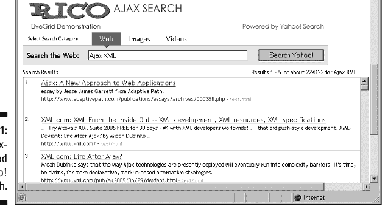

这就是 Ajax 的不同之处。在第一种情况下，你得到了一个包含搜索结果的新页面，但要查看超过十个结果，用户必须不断加载页面。在第二种情况下，一切都在同一个页面上完成。没有页面刷新，没有麻烦，没有混乱。


你可以在`http://openrico.org`网站上找到大量 Ajax 应用。如果你有兴趣，可以四处浏览，发现那里所有好的内容。

### 开发者视角

在文章《Ajax：Web 应用程序的一种新方法》（`www.adaptivepath.com/publications/essays/archives/000385.php`）中，首次将这项技术命名为 Ajax 的 Jesse James Garrett，对其如何改变 Web 提出了重要的见解。他指出，尽管创新的新项目通常是在线的，但 Web 程序员仍然觉得桌面软件的丰富功能超出了他们的能力范围。但 Ajax 正在缩小这一差距。

那么 Ajax 是如何工作的呢？名称 Ajax 是 Asynchronous JavaScript and XML 的缩写，它由几个组成部分构成：

1. 使用 HTML 和层叠样式表（CSS）的基于浏览器的呈现。
2. 以 XML 格式存储并从服务器获取的数据。
3. 在浏览器中使用`XMLHttpRequest`对象进行后台数据获取。
4. 使一切发生的 JavaScript。

JavaScript 是几乎所有浏览器都支持的脚本语言，它让你能够在后台获取数据；而 XML 是一种流行的语言，让你能够以简单的格式存储数据。以下是 Ajax 工作原理的概述：

1. 在浏览器中，你编写 JavaScript 代码，该代码可以根据需要从服务器获取数据。
2. 当需要从服务器获取更多数据时，JavaScript 使用浏览器支持的一个特殊项目——`XMLHttpRequest`对象，在后台向服务器发送请求——而不会导致页面刷新。

浏览器中的 JavaScript 不必停下来等待数据从服务器返回。它可以在后台等待数据，当数据出现时（这称为异步数据检索）立即开始行动。

3. 从服务器返回的数据可以是 XML（更多关于 XML 的内容见第 2 章和第 8 章），或者如果你愿意，也可以是纯文本。浏览器中的 JavaScript 代码可以读取该数据并立即使用。

这就是 Ajax 的工作原理——它使用浏览器中的 JavaScript 和`XMLHttpRequest`对象与服务器通信，无需刷新页面，并处理从服务器发回的 XML（或其他文本）数据。在第 3 章中，我将更详细地解释所有这些组件如何协同工作。


这也指出了你需要什么来开发带有 Ajax 的网页。你将在你的网页中添加 JavaScript 代码，以便从服务器获取数据（我将在第 2 章介绍 JavaScript），并且你需要存储数据，可能还需要编写服务器端代码，以便在后台与浏览器进行交互。换句话说，你将需要访问一个在线服务器，你可以在那里存储你将使用 Ajax 获取的数据。除了仅仅将数据存储在服务器上，你可能还想在服务器上放置你的 JavaScript 可以交互的代码。例如，一种流行的服务器端语言是 PHP，本书中的许多示例展示了如何通过 Ajax 连接到 Web 服务器上的 PHP 脚本。（第 10 章是 PHP 入门，如果你感兴趣的话，可以让你快速掌握这门语言。）所以你需要一个 Web 服务器来存储你的数据，如果你想运行服务器端程序，你的服务器必须支持你想要使用的语言（例如 PHP）的服务器端编码。

## 你能用 Ajax 做什么？

Ajax 技术自 1998 年就已出现，并且少数应用程序（如 Microsoft 的 Outlook Web Access）已经将其付诸实践。但 Ajax 真正流行起来是在 2005 年初，当时一些备受瞩目的 Web 应用程序（如 Google Suggest 和 Google Maps，两者都将在本章后面介绍）开始使用它，而 Jesse James Garrett 撰写了那篇文章，创造了 Ajax 这个术语，从而将一切整合在一起。

从那时起，随着人们意识到 Web 软件终于可以开始像桌面软件一样工作，Ajax 爆发了。你能用 Ajax 做什么？这正是本章其余部分要讲述的内容。

## 通过实时搜索进行实时搜索

你可以用 Ajax 做的真正酷的事情之一是实时搜索，即在你输入搜索词的同时，即时获得搜索结果。例如，看看`http://www.google.com/webhp?complete=1&hl=en`，即图 1-2 所示的页面。当你输入一个搜索词时，Ajax 在后台联系 Google，你会看到一个下拉菜单，显示来自 Google 的、可能与你输入内容匹配的常见搜索词。如果你想选择其中一个词，只需在菜单中点击它即可。就这么简单。

你也可以编写一个 Ajax 应用程序，以这种方式在后台连接到 Google。第 4 章有所有细节。

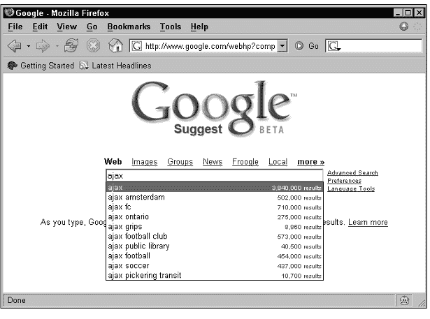

## 通过自动完成功能获取答案

与实时搜索应用密切相关的是自动完成应用程序，它试图通过从服务器获取相似单词列表并显示它们来猜测你正在输入的单词。你可以在`www.pap mountain.org/demos/live`看到一个例子，如图 1-3 所示。

当你输入一个单词时，此示例会查找服务器上词典中可能匹配的单词并显示它们，如图 1-3 所示。如果你看到正确的单词，只需点击它即可输入到文本字段中，从而节省一些输入。

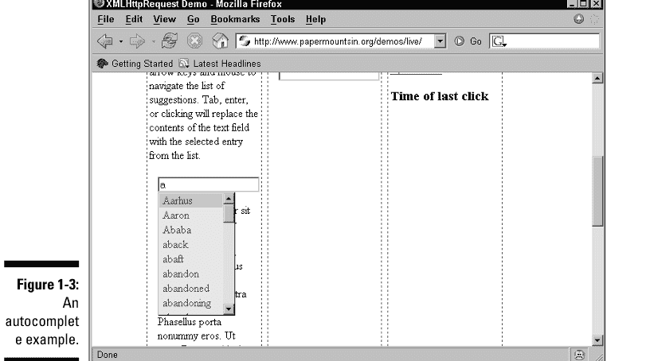

## 与朋友聊天

由于 Ajax 擅长在不刷新显示页面的情况下更新 Web 页面，因此它是基于 Web 的聊天程序的理想选择，许多用户可以同时聊天。例如，看看[www.plasticshore.com/projects/chat](http://www.plasticshore.com/projects/chat)，你可以看到图 1-4。在这里，你只需输入你的文本并点击“提交”按钮，即可将该文本发送到服务器。同时，你可以看到当前正在聊天的所有其他人——无需刷新页面。

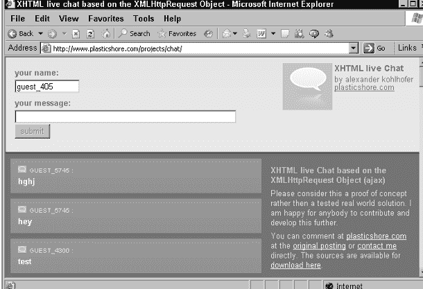

图 1-4：一个基于 Ajax 的聊天应用程序。

网上有很多基于 Ajax 的聊天室。再看一个例子`http://treehouse.ofb.net/chat/?lang=en`。

## 使用 Ajax 进行拖放

在本章开头，我提到了一个拖放购物车的例子。如图 1-5 所示，当用户将电视机拖到右下角的购物车时，服务器会收到通知，用户购买了一台电视机。然后服务器发回出现在左上角的文本，“你刚刚买了一台不错的电视机。”你将在第 6 章中了解如何创建这个购物车。

## 第一部分：入门指南

## 使用 Ajax 进行游戏

这里有一个很有趣的例子——一个使用 Ajax 技术实现交互回应的魔法日记，如图 1-6 所示。你可以在`http://pandorabots.com/pandora/talk?botid=c96f911b3e35f9e1`找到它。当你输入某些内容，比如`"Hello"`，服务器会收到通知并返回相应的回应，然后显示在日记中，比如`"Hi there!"`。

或者通过 Ajax 来一局国际象棋怎么样？可以看看`www.jesperolsen.net/PChess`，借助 Ajax 技术，你可以移动棋子（服务器上的软件也可以）。

## 第 1 章：Ajax 基础入门

图 1-6：一个基于 Ajax 的交互式日记。

## 获取即时登录反馈

另一个可能涉及大量烦人页面刷新的互联网任务是登录网站。例如，如果你输入了错误的登录名，会得到一个解释问题的新页面，然后必须在另一个页面重新登录，以此类推。如果借助 Ajax 在你尝试登录时提供即时反馈呢？这也是可行的。可以看看`www.jamesdam.com/ajax_login/login.html`，如图 1-7 所示。我输入了错误的用户名和密码，应用程序立即指出了这一点。你将在第 4 章学习如何编写这样的登录应用程序。

图 1-7：Ajax 让纠正登录错误变得更容易。

## Ajax 驱动的弹出菜单

你可以使用 Ajax 在用户需要数据时立即从服务器获取数据。例如，看看图 1-8 中的应用程序，我将在第 9 章讲解如何构建它。当你移动鼠标时，弹出菜单会出现，并显示使用 Ajax 技术从服务器检索到的文本。通过访问服务器，Ajax 允许你建立一个交互式菜单系统，该系统能根据用户已经做出的菜单选择进行响应。

图 1-8：Ajax 驱动的弹出菜单。

## 动态修改网页

Ajax 擅长在不刷新页面的情况下动态更新网页，你可以找到成百上千个这样做的 Ajax 应用程序。例如，看看图 1-9 所示的 Ajax 名片盒，网址是`http://openrico.org/rico/demos.page?demo=ricoAjaxInnerHTML.html`。当你点击某个人的名字时，会出现一张包含其完整数据的“卡片”。

你可以在`http://digg.com/spy`看到另一个例子。这个新闻网站使用 Ajax 技术定期更新自身，通过向页面上的列表添加新的文章标题来实现。

通过获取数据来更新网页中的 HTML 是一种非常流行的 Ajax 技术，你将在第 3 章和第 4 章看到很多这样的例子。

## Google 地图与 Ajax

最著名的 Ajax 应用程序之一是 Google 地图，网址是`http://maps.google.com`，你可以在图 1-10 中看到它正在缩放到波士顿的南市场街。

图 1-10：使用 Google 地图。

看到地图中心附近的那个标记图标了吗？该标记的位置是使用 Ajax 技术从服务器传递给浏览器的，浏览器中的 Ajax 代码相应地定位了该标记。Ajax 再次大显身手！

## 何时选择 Ajax 是个好主意？

我在上一节展示的例子仅仅是个开始——更多例子，包括你自己可以编写的，将在后续章节中出现。有一个 Web 应用程序要求用户在页面之间跳转，因此需要改进吗？这正是 Ajax 的用武之地。

# 第 2 章：核心在于 JavaScript

## 本章内容

- 理解 Ajax 和 JavaScript 的联系
- 编写 JavaScript
- 处理浏览器事件
- 编写 JavaScript 函数
- 在变量中存储数据
- 使用 JavaScript 循环
- 将 JavaScript 连接到按钮
- 使用 JavaScript 处理文本字段

那么，Ajax 到底是什么东西？你听说它是一个很棒的方式，可以将你熟悉的一些 Web 语言（如 HTML、XML、CSS 和 JavaScript）结合起来，创建一个看起来和运行起来都像无缝桌面应用程序的 Web 应用。但你想了解更多，而你来对地方了。

正如你可能听说过的，Ajax 基于 JavaScript。由于你需要扎实的 JavaScript 基础才能使用 Ajax（并且理解本书的许多章节），本章将完全围绕使用这种脚本语言展开。本书可能会向你展示如何做你从未做过的事情——即使你已经使用 JavaScript 一段时间了。因此，准备好参加 JavaScript 的速成课程吧。如果你认为自己已经具备了坚实的 JavaScript 基础，可以随时直接跳到第 3 章开始使用 Ajax。

## 初窥 Ajax 实战

这是一个 Ajax 应用程序示例，它展示了你将在本书中看到的 JavaScript 类型。看看图 2-1；该网页显示了一条消息`"The fetched data will go here"`。当你点击`"Display Message"`按钮时，这段文本将会改变，而且不需要刷新新页面。

图 2-1：一个简单的 Ajax 示例。

要使用 Ajax 方法替换文本，现在只需点击按钮。浏览器不会闪烁。你只会看到显示的文本变为`This text was fetched using Ajax.`，如图 2-2 所示。

图 2-2：你可以用 Ajax 获取文本。

这种变化在 Web 开发中并不稀奇——只要文本是存储在网页内置脚本中的本地数据即可。但这段文本并非存储在本地；它来自服务器上一个名为`data.txt`的简单文本文件。浏览器使用 Ajax 方法获取了该文本。

当你从本书的配套网站下载示例代码时，会发现示例是按章节存储在文件夹中的。你在图 2-1 中看到的页面是`ch02`文件夹中的`index.html`，而存储从服务器获取的文本的数据文件存储在同一`ch02`文件夹中的`data.txt`文件中。要运行此示例，你只需将`index.html`和`data.txt`文件上传到你的 Web 服务器上的同一个目录中。然后像访问任何其他网页一样，在浏览器中导航到`index.html`。URL 类似于：`http://www.yourdomain.com/yourname/index.html`。如果你已经有一个`index.html`文件，你可能需要将此文件重命名为`ajaxexample.html`以避免冲突——示例仍会像以前一样运行。

## 查看代码

那么这个示例的 JavaScript 代码是什么样子的呢？清单 2-1 展示了`index.html`的内容。注意这里有相当多的 JavaScript 代码。正如你将在第 3 章了解到的，你有多种不同的方式让 JavaScript 做它必须做的事情。因此，我在清单 2-1 中展示的代码只是编写它的其中一种方式。

```html
清单 2-1：让 Ajax 工作起来

<html>
  <head>
    <title>Ajax at work</title>

    <script language = "javascript">
      var XMLHttpRequestObject = false;

      if (window.XMLHttpRequest) {
        XMLHttpRequestObject = new XMLHttpRequest();
      } else if (window.ActiveXObject) {
        XMLHttpRequestObject = new ActiveXObject("Microsoft.XMLHTTP");
      }

      function getData(dataSource, divID)
      {
        if(XMLHttpRequestObject) {
          var obj = document.getElementById(divID);
          XMLHttpRequestObject.open("GET", dataSource);

          XMLHttpRequestObject.onreadystatechange = function()
          {
            if (XMLHttpRequestObject.readyState == 4 &&
                XMLHttpRequestObject.status == 200) {
                  obj.innerHTML = XMLHttpRequestObject.responseText;
            }
          }
          XMLHttpRequestObject.send(null);
        }
      }
    </script>
  </head>

  <body>
```

# 24 第一部分：入门

## 清单 2-1（续）

```html
<H1>Fetching data with Ajax</H1>

<form>
    <input type = "button" value = "Display Message"
        onclick = "getData('http://localhost/ch01/data.txt',
        'targetDiv')">
</form>

<div id="targetDiv">
    <p>The fetched data will go here.</p>
</div>

</body>
</html>
```

另一个文件是`data.txt`，它包含的所有文本如下：

```text
This text was fetched using Ajax.
```

这就是你第一个 Ajax 示例的代码。如果你想成为一名顶尖的 Ajax 程序员（谁不想呢？），你就必须牢固掌握 JavaScript。许多初次接触 Ajax 的 Web 开发人员掌握的 JavaScript 知识并不足以满足需要，因此本章的剩余部分将专门帮助你打好坚实的 JavaScript 基础。

## 深入了解 JavaScript

本章并不试图涵盖关于 JavaScript 的所有知识，但它确实涵盖了你在学习后续 Ajax 编程章节之前需要了解的内容。在本章中，我将解释你顺利学习本书所需的全部 JavaScript 知识。如需获取更多关于 JavaScript 的信息，可以在网上查找一些教程，例如`www.w3schools.com/js/js_intro.asp`上的教程，或者阅读一本优秀的 JavaScript 书籍，例如艾米丽·A·范德维尔（Emily A. Vander Veer）所著的《JavaScript 傻瓜书》（第四版）（Wiley Publishing, Inc.）。

## JavaScript 的登场

尽管名为 JavaScript，但它与 Java 关系甚微。一切始于 1995 年的网景通信公司，当时一位名叫布兰登·艾奇（Brendan Eich）的开发者被指派任务，让 Navigator 新增的 Java 支持对非 Java 程序员更加友好。他将其称为`LiveScript`，但最终重命名为`JavaScript`，尽管它实际上与 Java 编程语言几乎毫无相似之处。

## 审视标准

那么，这些标准都在哪里呢？你可以在`http://web.archive.org/web/20040211195031/devedge.netscape.com/library/manuals/2000/javascript/1.5/guide`找到 JavaScript 1.5 用户指南。你也可以在线找到 JScript 5.6 的文档，网址为`http://msdn.microsoft.com/library/default.asp?url=/library/en-us/script56/html/js56jsoriJScript.asp`。ECMAScript 规范也是在线的：

- ECMAScript 语言规范，第 3 版：`http://www.ecma-international.org/publications/standards/Ecma-262.htm`
- ECMAScript 组件规范：`http://www.ecma-international.org/publications/standards/Ecma-290.htm`
- ECMAScript 第 3 版紧凑规范：`http://www.ecma-international.org/publications/standards/Ecma-327.htm`

JavaScript 有趣且允许各种视觉技巧，例如当用户将鼠标悬停在图像或文本上时会发生变化的交互效果。随着 JavaScript 变得越来越流行，网景的主要竞争对手微软决定不能再忽视这门新语言。微软决定创建自己的 JavaScript 版本，并将其称为 JScript。

于是，一场旷日持久的跨浏览器战争就此拉开序幕，使得 JavaScript 程序员的生活从此变得“多姿多彩”。程序员们开始发现，尽管 JScript 看起来和 JavaScript 一模一样，但有些脚本能在网景浏览器中运行却无法在 Internet Explorer 中运行，反之亦然。

为了遏制一些混乱局面，网景和 Sun 公司转向欧洲计算机制造商协会（ECMA）以标准化 JavaScript，标准化的版本被称为 ECMAScript。

现在 JavaScript 在各浏览器间正趋于统一，至少其核心部分与 ECMAScript 3.0 版本相匹配。正如你将在本书后续部分看到的那样，仍然存在一些差异，但情况比过去好多了。

## 创建脚本

是时候开始编写 JavaScript 了。如果你想编写 JavaScript，你需要将代码放在`<script>`元素中，如下所示：


```html
<html>
  <head>
    <title>A First Script</title>
    <script language="javascript">
      document.write("You're using JavaScript");
    </script>
  </head>
  <body>
    <h1>A First Script</h1>
  </body>
</html>
```

如你所见，这个 `<script>` 元素使用 `language` 属性来指明所包含脚本的语言是 JavaScript。

## 从 JavaScript 访问网页

假设你想用 JavaScript 将消息 `You're using JavaScript` 写入一个网页。你该如何从脚本中访问网页呢？

在 JavaScript 中，你可以通过各种内置对象来访问网页和浏览器本身。可用的对象包括 `document`（指代网页）、`window`（指代浏览器窗口）以及 `history`（指代允许浏览器前进和后退的历史列表）。

每个对象都包含方法和属性。你可以调用一个方法来执行某些操作（例如向网页写入内容），也可以设置属性的值来配置这些对象（例如设置网页的背景色）。以下是一些有用的对象方法及其执行的任务示例：

- `document.write`：向当前网页写入文本。
- `history.go`：将 Web 浏览器导航到其历史记录中的某个位置。
- `window.open`：打开一个新的浏览器窗口。

以下是你为这些方法设置的一些有用属性：

- `document.bgcolor`：当前页面的背景色。
- `document.fgcolor`：当前页面的前景色。
- `document.lastmodified`：页面最后修改的日期。
- `document.title`：当前页面的标题。
- `location.hostname`：互联网服务提供商（ISP）主机的名称。
- `navigator.appName`：浏览器的名称，你可以用它来确定访问者正在使用什么浏览器。

你现在拥有了编写欢迎消息的工具。你可以使用 `document.write` 方法，并将你的 JavaScript 嵌入 HTML 中。这是一个向网页写入文本的首个示例：

```html
<html>
    <head>
        <title>A First Script</title>
        <script language="javascript">
            document.write("You're using JavaScript");
        </script>
    </head>
    <body>
        <h1>A First Script</h1>
    </body>
</html>
```

在这个例子中，你将文本 `You're using JavaScript` 传递给 `document` 对象的 `write` 方法。`write` 方法会在网页上显示这段文本，不用担心。

将前面的 HTML 输入到一个新文件中，并将其保存为 `firstscript.html`，或者从配套网站的 `ch02` 文件夹中下载 `firstscript.html`。在浏览器中打开该文件。如图 2-3 所示，该页面在加载时使用 JavaScript 向网页写入了一条消息。

太棒了——`firstscript.html` 完全成功，一切都有了一个良好的开端。

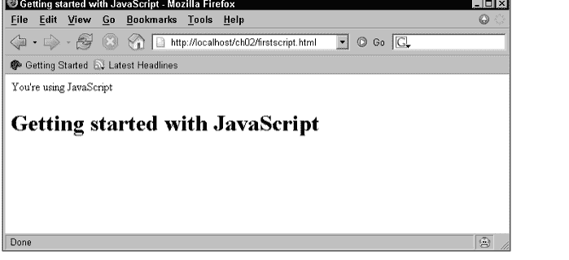

## 噢，那些分号

严格来说，每一行 JavaScript 代码都应该以分号（`;`）结尾，就像在 Java 中一样（如果你对那门语言有所了解的话）。请注意以下 JavaScript 代码行末尾的分号：

```html
<html>
  <head>
    <title>A First Script</title>
    <script language="javascript">
      document.write("You're using JavaScript");
    </script>
  </head>
  <body>
    <h1>A First Script</h1>
  </body>
</html>
```

在 JavaScript 中，包含分号是正确的做法，我在本书中也是这样做的。然而，浏览器在这方面变得非常宽容。如果你省略了行末的分号，浏览器也不会有问题。

## 为你的 JavaScript 添加注释

JavaScript 支持使用双斜杠（`//`）标记进行单行注释，这意味着 JavaScript 不会读取 `//` 之后该行上的任何内容。因此，你可以在代码中添加供人阅读的注释，而它们不会中断 JavaScript 的运行。请参阅以下代码中的注释行：

```html
<html>
  <head>
    <title>A First Script</title>
    <script language="javascript">
      //Write the message to the Web page
      document.write("You're using JavaScript");
    </script>
  </head>
  <body>
    <h1>A First Script</h1>
  </body>
</html>
```

事实上，JavaScript 还支持第二种注释，可用于多行。这种注释以 `/*` 开头，以 `*/` 结尾。当 JavaScript 看到 `/*` 时，它会忽略后续所有内容，直到看到 `*/`。以下是一个示例：

```html
<html>
  <head>
    <title>A First Script</title>
    <script language="javascript">
      /* Write the message
         to the Web page */
      document.write("You're using JavaScript");
    </script>
  </head>
  <body>
    <h1>A First Script</h1>
  </body>
</html>
```

## 使用独立的脚本文件

这是 Ajax 应用中非常常见的做法：如果你想将 JavaScript 代码存储在网页之外的文件中，可以将其存储在扩展名为 `.js` 的文件中。例如，当你需要处理跨浏览器问题时，这可能是个好主意，因为你可以为某个浏览器加载一个 `.js` 文件，为另一个浏览器加载另一个 `.js` 文件。

例如，假设你将这段 JavaScript 代码放入名为 `script.js` 的文件中：

```javascript
document.write("You're using JavaScript");
```

现在，你可以通过使用 `<script>` 元素的 `src` 属性，在新的 HTML 文件 `usescript.html` 中引用 `script.js`，如下所示：

```html
<html>
  <head>
    <title>A First Script</title>
    <script language="javascript" src="script.js">
    </script>
  </head>
  <body>
    <h1>A First Script</h1>
  </body>
</html>
```

就这么简单。现在，当你加载 `usescript.html` 时，`script.js` 也会自动加载，其中的代码会被执行。我向你展示的许多 Ajax 应用都使用外部脚本，因此理解 JavaScript 的这个方面非常重要。

## 检查脚本错误

信不信由你，有时人们编写的 JavaScript 会存在错误（也许不是你的脚本，但众所周知，我的脚本中也会出现错误）。你可以从各种浏览器中查看这些错误并获得简短的描述。这些错误可以帮助你调试问题——除非错误信息过于简洁，以至于毫无帮助。

以下脚本中有一个错误——你能发现吗？

```html
<html>
    <head>
        <title>A First Script</title>
        <script language="javascript">
            docment.write("You're using JavaScript");
        </script>
    </head>
    <body>
        <h1>A First Script</h1>
    </body>
</html>
```

是的，对象 `document` 被错误地拼写成了 `docment`，尽管初读时可能不那么明显。这段 JavaScript 无法运行。当你在 Internet Explorer 等浏览器中打开我命名为 `error.html` 的文档时，会发生什么？你会得到图 2-4 所示的结果。JavaScript 没有任何操作，你在左下角看到一个小黄色三角形图标。JavaScript 程序员称之为死亡黄三角。

双击死亡黄三角会打开你在图 2-5 中看到的对话框，它解释了问题所在：Internet Explorer 无法理解 `docment`。既然你知道了问题所在，就可以修复它。

Firefox 会如何处理同样的问题？如果你在 Firefox 中打开 `error.html`，JavaScript 同样不会运行，就像在 Internet Explorer 中一样。但这里没有可点击的死亡黄三角。相反，你可以选择“工具 -> JavaScript 控制台”来打开 Firefox JavaScript 控制台。这会显示图 2-6 所示的窗口。

## 第 2 章：全是关于 JavaScript

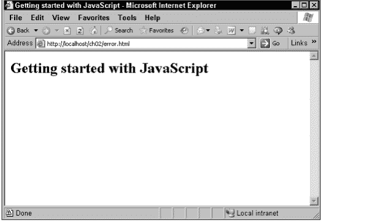

图 2-4：死亡黄三角表示你的 JavaScript 中有错误。

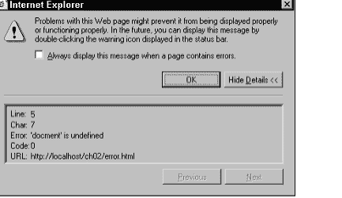

图 2-5：你可以从 Internet Explorer 获取错误的详细信息。

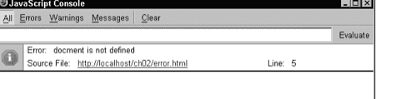

图 2-6：Firefox JavaScript 控制台。

你可以立即看到错误是什么：`docment` 未定义。现在你知道了错误所在，就可以修复它了。

> 这两款流行的浏览器中，哪一个能为 Ajax 程序员提供最完整的错误解释，从而提供最佳帮助？Firefox。当你开发自己的脚本时，Firefox JavaScript 控制台对于修复可能出现的任何 bug 来说是无价之助。控制台将为你提供比 Internet Explorer 更详细的错误信息。

## 你使用的是哪个浏览器？

这里有一个值得探讨的问题：用户使用的是哪个浏览器？如今浏览器之间的 JavaScript 不兼容性很小，但仍然存在一些——比如如何在 Ajax 脚本中创建你需要的核心对象，即 `XMLHttpRequest` 对象。因此，有时你需要知道你面对的是哪个浏览器，才能进行正确的 JavaScript 处理。

这就是 `navigator` 浏览器对象的用武之地。这个对象包含了关于浏览器的各种详细信息。以下是这个对象的相关属性：

- `navigator.AppName`：提供浏览器应用程序的名称。
- `navigator.AppVersion`：提供浏览器的版本。
- `navigator.UserAgent`：提供关于浏览器的更多详细信息。

例如，以下脚本在网页 `browser.html` 中显示这些属性——注意 JavaScript 中用于连接文本字符串的 `+` 号：

```html
<html>
    <head>
        <title>
            What's Your Browser?
        </title>
    </head>
    <body>
        <script language="javascript">
            document.write("You're using: " + navigator.appName)
            document.write("<br><br>")
            document.write("Version: " + navigator.appVersion)
            document.write("<br><br>")
            document.write("Browser details: " + navigator.userAgent)
        </script>

        <h1>What's Your Browser?</h1>
    </body>
</html>
```

你可以在图 2-7 中看到这个 HTML 页面在 Firefox 中的样子，在图 2-8 中看到在 Internet Explorer 中的样子。拥有了这些信息，你就可以让 JavaScript 为一个浏览器做一件事，为另一个浏览器做另一件事。具体的使用方法将在本章后面介绍——请留意“使用 if 语句进行选择”这一节。

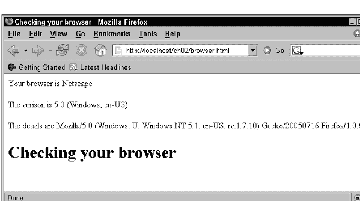

图 2-7：在 Firefox 中确定浏览器类型。

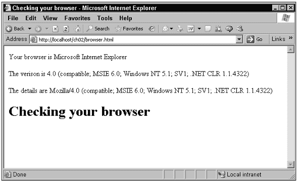

图 2-8：在 Internet Explorer 中确定浏览器类型。

## 让事情发生：浏览器事件

Ajax 应用经常需要响应用户操作——按钮点击、鼠标双击、页面加载等等。脚本如何知道何时响应发生的事情？你可以使用浏览器事件，这是本书中你将经常看到的东西。当用户执行你可以响应的操作时，就会发生一个事件，例如鼠标点击。

那么有哪些可用的事件呢？表 2-1 列出了一些在 Ajax 应用中可能看到的常见事件。

| 事件 | 发生在…… |
|---|---|
| `onabort` | 当用户中止操作时发生 |
| `onblur` | 当元素失去输入焦点时发生 |
| `onchange` | 当控件（如文本字段）中的数据发生变化时发生 |
| `onclick` | 当用户单击元素时发生 |
| `ondblclick` | 当用户双击元素时发生 |
| `ondragdrop` | 当用户拖放元素时发生 |
| `onerror` | 当发生 JavaScript 错误时发生 |
| `onfocus` | 当元素获得焦点时发生 |
| `onkeydown` | 当用户按下键时发生 |
| `onkeypress` | 当用户按住键时发生 |
| `onkeyup` | 当用户释放键时发生 |
| `onload` | 当页面加载时发生 |
| `onmousedown` | 当用户按下鼠标按钮时发生 |
| `onmousemove` | 当用户移动鼠标时发生 |
| `onmouseout` | 当用户将光标移出元素时发生 |
| `onmouseover` | 当用户将光标移入元素时发生 |
| `onmouseup` | 当用户释放鼠标按钮时发生 |
| `onreset` | 当用户单击重置按钮时发生 |
| `onresize` | 当用户调整元素或页面大小时发生 |
| `onsubmit` | 当用户单击提交按钮时发生 |
| `onunload` | 当浏览器卸载页面并转到另一个页面时发生 |

## 实际运用浏览器事件

要触发表 2-1 中的任何浏览器事件，你需要将它们放置在网页的 HTML 中。例如，如果你想在用户点击页面时将网页颜色变为粉色，可以将表 2-1 中的事件作为属性用于各种 HTML 元素。例如，网页本身由 `<body>` 元素表示，因此你可以在 `<body>` 标签中使用 `onmousedown` 属性，并附上少量 JavaScript 代码来将页面变为粉色。

这一切意味着什么？下面是一个名为 `blanner.html` 页面的示例——注意，你可以通过将 JavaScript 赋值给事件属性（如 `onmousedown` 属性）来执行 JavaScript，而无需将该 JavaScript 放入 `<script>` 元素中；这类脚本被称为内联脚本（内联脚本文本必须用引号括起来，如下所示）：

```html
<html>
  <head>
    <title>
      JavaScript Event Example
    </title>
  </head>
  <body onmousedown="document.bgcolor='pink'">
    <h1>
      Click this page to turn it pink!
    </h1>
  </body>
</html>
```

要使用 JavaScript 将页面变为粉色，你需要设置网页的 `bgcolor` 属性，就像在 HTML 中使用 `<body>` 元素的 `bgcolor` 属性来设置页面颜色一样。在 JavaScript 中，你通过 `document` 对象访问页面，该对象支持 `bgcolor` 属性，可让你动态设置页面颜色。（要查看哪些浏览器对象支持哪些属性，请参阅本章开头提到的 JavaScript 手册。）

在此情况下，用户点击网页时执行的 JavaScript 如下：

```html
<body onmousedown="document.bgcolor='pink'">
```

这将 `document.bgcolor` 属性设置为文本 `'pink'`。（注意这里的单引号，我将在下一节详细说明。）当你点击此页面时，它会变为粉色，如图 2-9 所示（图中为黑白显示）。效果不错。

浏览器会理解 `pink` 这个词吗？当然会——所有现代浏览器都内置了数十种颜色名称。你可以为 `document.bgcolor` 赋予各种颜色，不仅限于 `pink`，还包括 `blue`、`green`、`yellow`，甚至 `coral` 或 `cyan`。


如果你不希望事件触发内联脚本，而是希望在页面发生某些操作（如鼠标点击或按钮按下）时调用`<script>`元素中的 JavaScript，则需要使用 JavaScript 函数。要了解具体方法，请参阅本章后文的“分而治之：JavaScript 函数”。

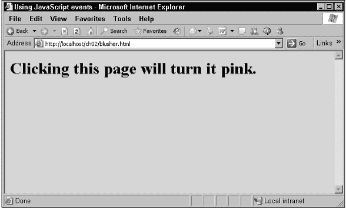

图 2-9：点击页面会改变其颜色。

## 正确使用引号


你必须始终用引号将赋值给属性的值括起来。注意这里的单引号！因为整个内联脚本是用双引号括起来的，如果你输入：

```
body onmousedown="document.bgcolor='pink'"
```

就会让 JavaScript 困惑。当 JavaScript 遇到第二个双引号（在`"pink"`开头处）时，它会认为内联脚本已结束，并且不知道如何继续。为避免这种情况，你可以将赋值给属性的文本用单引号括起来。

如果你希望在`<script>`元素中使用 JavaScript 更改网页颜色（而不是在内联脚本中），则无需将整行 JavaScript 用引号括起来，因此可以在`"pink"`周围使用双引号，如下所示：

```
document.bgcolor="pink";
```

或者，如果你更喜欢单引号，也可以使用：

```
document.bgcolor='pink';
```

## 分而治之：JavaScript 函数

当你使用 Ajax 技术时，通常希望在从服务器获取文本后将其放置在网页的特定位置。正确实现这一点将解决一些重要的 JavaScript 问题。

要使文本出现在特定位置，你需要确保 JavaScript 仅在需要时运行。为此，你可以将代码放入 JavaScript 函数中。在 JavaScript 中，函数是一组仅在你明确调用该函数时才运行的代码行——这正是你需要的。（函数就像你已经见过的方法——比如`document`对象的`write`方法——只不过函数不与对象关联。）

函数对你作为 Ajax 程序员很重要，因为除非将代码打包到函数中，否则它会在 HTML 页面加载时立即运行。如果你将`<script>`元素放入页面的`<head>`部分，情况会更糟，因为你的代码将无法访问`<body>`部分中的元素，因为它们尚未加载。为了能够在需要时交互式获取数据而无需重新加载整个页面，你需要使用函数，因此请确保了解其工作原理。本节将分解如何组合函数以及如何向函数传递参数。

你将在本章后文中进一步了解函数——例如，当用户点击按钮触发某事时，函数非常有用，因为按钮点击只是其他可以连接到函数的事件。

## 理解问题

要了解何时需要函数，了解内联脚本如何产生问题会有所帮助。这是你本章前面开发的用于显示消息的脚本：

```html
<html>
  <head>
    <title>Getting started with JavaScript</title>
    <script language="javascript">
      document.write("You're using JavaScript");
    </script>
  </head>

  <body>
    <h1>Getting started with JavaScript</h1>
  </body>
</html>
```

当此页面在浏览器中加载时，`<head>`部分`<script>`元素中的 JavaScript 会立即执行。在这种情况下，这意味着浏览器读取到该行时立即执行：

```
document.write("You're using JavaScript");
```

而这又意味着文本`You's using JavaScript`会出现在浏览器中。加载`<head>`部分后，页面的`<body>`部分加载，然后`<h1>`标题文本`"A First Script"`出现在页面上（参见图 2-3）。

这看起来没问题，但有点本末倒置。标题需要出现在顶部，普通文本在其下方。如何实现呢？在标题已经出现之后再执行 JavaScript 不是更好吗？

一种将文本放在标题下方的方法是将 JavaScript 放入页面的`<body>`部分而不是标题中。例如，可能如下所示：

```html
<html>
  <head>
    <title>Getting started with JavaScript</title>
  </head>

  <body>
    <h1>Getting started with JavaScript</h1>
    <script language="javascript">
      document.write("You're using JavaScript");
    </script>
  </body>
</html>
```

这有效——当你在浏览器中打开此页面时，文本`You're using JavaScript`出现在标题`A First Script`下方。换句话说，了解页面哪一部分先加载会产生差异——例如，如果你在`<head>`部分有 JavaScript 引用了`<body>`部分中的元素，并且该 JavaScript 在页面加载时立即执行，脚本将失败，因为`<body>`部分尚未加载。

虽然你可以将`<script>`元素放入页面的`<body>`部分，但通常不这样做。现代 JavaScript 约定是只将`<script>`元素放在页面的`<head>`部分。那么现在该怎么办？在这种情况下，你不希望 JavaScript 在页面其余部分加载之前执行。

这里的问题在于，当页面加载时，`<head>`部分首先加载，因此`<script>`部分中的代码会立即运行。这首先将`You're using JavaScript`文本放置在网页上。然后加载`<body>`部分，将`A First Script`标题放置在网页上。

关键在于，仅使用内联脚本无法获得所需的控制。要让 JavaScript 仅在需要时运行，你需要一个函数。

## 组合函数

为了说明 JavaScript 函数在 Ajax 应用程序中通常如何工作，假设你创建一个名为`displayText`的函数，其工作方式如下：

```html
<html>
  <head>
    <title>Getting started with JavaScript</title>

    <script language="javascript">
      function displayText()
      {
        .
        .
        .
      }
    </script>

  </head>

  <body>

    <h1>Getting started with JavaScript</h1>

  </body>
</html>
```

## 40 第一部分：入门

请注意，你使用了`function`关键字，函数名后跟有圆括号（圆括号表示是否有数据传递给函数——这里没有），并将要执行的 JavaScript 代码行——称为函数体——包含在花括号`{`和`}`中。

现在，只有当你想要运行时，`displayText`函数内部的 JavaScript 才会被执行。但这种额外的灵活性带来了更多的工作。你需要调用该函数并放置编写消息的代码。

### 调用函数

要调用此函数并运行该代码，你可以使用浏览器事件。这里有一个完美的事件——`onload`事件，它在页面加载完成后发生。

你可以这样使用`<body>`元素的`onload`属性：

```html
<html>
    <head>
        <title>Getting started with JavaScript</title>
        
        <script language="javascript">
            function displayText()
            {
                .
                .
                .
            }
        </script>
        
    </head>
    
    <body onload="">
        
        <h1>Using a div</h1>
        
        <div id="targetDiv">
        </div>
        
    </body>
</html>
```

但是，你在引号里放什么内容？你可以使用什么内联脚本来调用`displayText`函数？调用函数只需给出其名称，后跟一对圆括号（如果你想向函数传递数据，可以将数据放在圆括号之间，正如我稍后向你展示的）：

```html
<html>
  <head>
    <title>Getting started with JavaScript</title>
    <script language="javascript">
      function displayText()
      {
        .
        .
        .
      }
    </script>
  </head>
  <body onload="displayText()">
  </body>
</html>
```

很好。如果你熟悉在代码中使用函数，你可能会直观地认为可以将编写消息的代码放在`displayText()`函数中，像这样：

```javascript
function displayText()
{
  document.write("You're using JavaScript");
}
```

不幸的是，你不能这样做。`displayText`函数会在页面加载后被调用，这没问题。但这里有个问题——当你调用`document.write`方法时，文档会为写入而打开，这会清除文档中已有的所有文本——这意味着浏览器中将只显示文本`You're using JavaScript`，因为浏览器会覆盖标题文本`A First Script`，正如你在图 2-10 中看到的。

为什么将`<script>`元素放在`<body>`元素内部时不会发生这种情况？在那种情况下，当你的 JavaScript 执行时，文档仍然处于打开写入状态，因为`<body>`元素仍在加载。但页面加载后，文档会关闭，如果你想再次写入，必须重新打开——而打开文档会清除其中的文本。


## 42 第一部分：入门

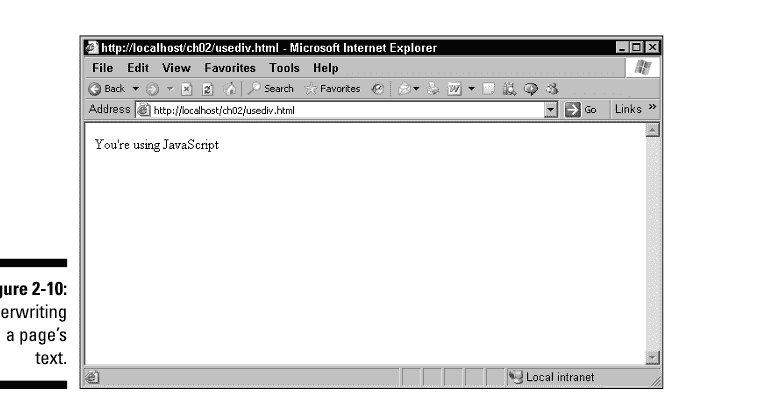

那么，你应该怎么做呢？解决方案是采用许多 Ajax 脚本的做法——在页面加载后写入页面的特定部分。在这种情况下，你可以通过向页面添加一个`<div>`元素来实现。

此`<div>`元素将在页面加载后显示文本`You're using JavaScript`（请注意，我给了它 ID`"targetDiv"`）：

```html
<html>
  <head>
    <title>Using a div</title>
    <script language="javascript">
      function displayText()
      {
        .
        .
        .
      }
    </script>
  </head>

  <body onload="displayText()">

    <h1>Using a div</h1>

    <div id="targetDiv">
    </div>

  </body>
</html>
```

到目前为止，一切顺利。但如何从 JavaScript 访问该`<div>`元素？这个`<div>`的 ID 是`"targetDiv"`，你可以使用该 ID 来访问它。你可以使用 JavaScript 代码中的`document`对象（它代表网页）来访问此`<div>`。`document`对象有一个非常方便的方法名为`getElementById`，如果你将`<div>`的 ID 传递给此方法，它将返回给你一个与`<div>`对应的 JavaScript 对象。

JavaScript 中的工作原理就是这样——你可以获得与网页或页面中任何元素对应的 JavaScript 对象。获得与`<div>`对应的对象后，你可以使用该对象的内置方法和属性来操作它。例如，要将文本粘贴到`<div>`中，你可以使用`innerHTML`属性。如果你想将新文本写入`<div>`元素，可以使用表达式`document.getElementById('targetDiv')`来获取与`<div>`元素对应的对象，然后使用该对象的`innerHTML`属性（就像这样：`document.getElementById('targetDiv').innerHTML`）来访问`<div>`内部的文本。

呼。

以下是代码中的样子——页面加载后，这里的 JavaScript 将文本`"You're using JavaScript"`写入`<div>`元素：

```html
<html>
    <head>
        <title>Using a div</title>

        <script language="javascript">
            function displayText()
            {
                document.getElementById('targetDiv').innerHTML =
                    "You're using JavaScript";
            }
        </script>

    </head>

    <body onload="displayText()">

        <h1>Using a div</h1>

        <div id="targetDiv">
        </div>

    </body>
</html>
```

## 44 第一部分：入门

这一切都能工作吗？当然可以。你可以在图 2-11 中看到此页面`usediv.html`的实际效果。完美。

这是 Ajax 应用程序经常使用的一种技术——在使用 Ajax 技术从服务器获取数据后，你可以在`<div>`元素中显示该数据。

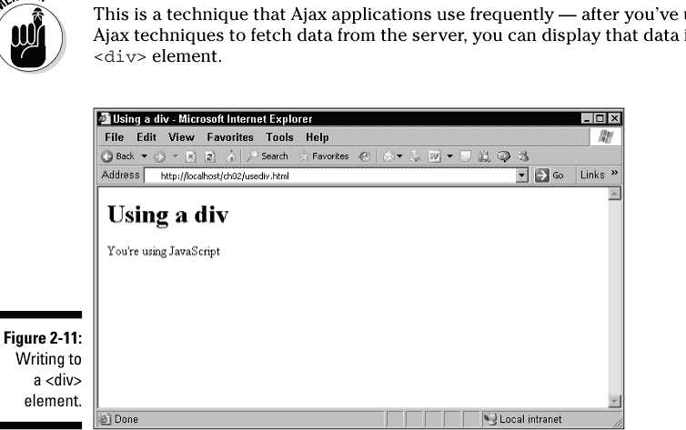

### 向函数传递单个参数

当你使用`document.write`方法时，你像这样将要写入的文本传递给该方法：`document.write("You're using JavaScript")`。你也可以向你编写的函数传递数据。

方法如下：假设你想将要写入的文本传递给`displayText`函数。这很容易；当你调用该函数时，只需在函数名后的圆括号中传递你想写的文本，像这样：`displayText('You're using JavaScript')`。你以这种方式传递给函数的数据——在这种情况下，只是文本`"You're using JavaScript"`——称为参数。所以在这里，你向`displayText`函数传递了一个参数。

然后，通过在圆括号中为传递的数据命名来设置函数本身，如下所示，其中我简单地将该文本命名为`text`：

```javascript
function displayText(text)
{
    .
    .
    .
}
```

现在你可以通过名称引用传递给函数的文本，如下所示，其中函数将该文本显示在`<div>`元素中：

```javascript
function displayText(text)
{
    document.getElementById("targetDiv").innerHTML = text;
}
```

以下是所有内容组合在一起的样子：

```html
<html>
    <head>
        <title>Using a div</title>

        <script language="javascript">
            function displayText(text)
            {
                document.getElementById("targetDiv").innerHTML = text;
            }
        </script>

    </head>

    <body onload="displayText('You're using JavaScript')">

        <h1>Using a div</h1>

        <div id="targetDiv">
        </div>

    </body>
</html>
```

这给你带来了与之前相同的结果，文本出现在标题下方（请参阅图 2-11）。当页面完成加载时，`displayText`函数被调用，传入要写入的消息文本`You're using JavaScript`，该文本立即被发送到目标`<div>`元素。

不错。

### 使用`<div>`与`<span>`


像`<div>`这样的元素是 HTML（和 XHTML）中的块级元素，这意味着它们会自动单独成行（类似于标题，如`<h1>`）。有时，你可能不希望通过 Ajax 技术获取的数据单独成行——你可能希望它与其他文本出现在同一行上，例如解释你的数据含义的文本（例如，“记录编号： ”或类似内容）。要实时将文本内联放置，你可以使用`<span>`元素代替`<div>`。你可以在本书的可下载代码中找到一个示例`usespan.html`。

## 46 第一部分：入门

那个示例将文本直接插入到句子中：新文本将出现在这里：`<span id="targetSpan"></span>`。下面是它在实际代码中的样子。

```html
<html>
  <head>
    <title>Using a span</title>

    <script language="javascript">
      function displayText()
      {
        document.getElementById('targetSpan').innerHTML =
          "You're using JavaScript";
      }
    </script>

  </head>

  <body onload="displayText()">

    <h1>Using a span</h1>

    The new text will appear here: "<span id="targetSpan"></span>".

  </body>
</html>
```

你可以在图 2-12 中看到它的实际效果，其中`<span>`正在发挥作用。

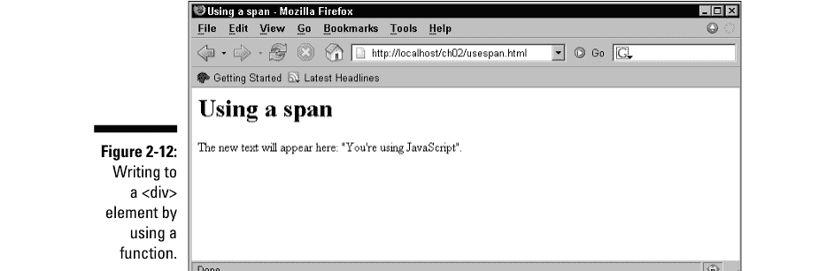

使用 Ajax 的核心就在于无需重新加载页面即可将新数据插入到页面中，而使用动态 HTML（DHTML）技术将文本插入到`<div>`或`<span>`中非常流行。想要显示一些新数据？从服务器获取它，放入一个`<div>`中，然后，砰！大功告成。`<div>`元素是最常用的，但别忘了它是一个块级元素，因此会在浏览器中占据自己的行。如果你想将新文本内联放置，请考虑使用`<span>`。


在你开始使用`<div>`甚至更多时候使用`<span>`随意地将新文本插入网页之前，你必须考虑用户在多大程度上能意识到你所做的更改。这是我在第 4 章讨论的 Ajax 主题之一——也是对 Ajax 的批评之一——即用户可能没有意识到任何内容已经改变。因为你使用了动态 HTML 技术，比如将文本弹出到`<div>`和`<span>`元素中，整个页面不会改变——只有你正在操作的元素会改变。用户注意到了吗？你应该将这些更改引起他们的注意吗？这是第 4 章即将介绍的 Ajax 风格的要素之一。


到目前为止，一切顺利。但关于使用 JavaScript 函数，还有更多内容。`usediv.html`和`usespan.html`示例只是向`displayText`函数传递了一个参数，但这并非唯一选择——你可以同样轻松地向函数传递多个参数。

## 传递多个参数

要了解如何传递多个参数，请查看本书关联网站上可供下载的代码中的`usearguments.html`示例。此示例中的内联 JavaScript 代码不仅传递要显示的文本，还传递要插入文本的`<div>`的名称：

```html
<html>
  <head>
    <title>Passing multiple arguments to a function</title>
    <script language="javascript">
      function displayText(text, divName)
      {
        document.getElementById(divName).innerHTML = text;
      }
    </script>
  </head>
  <body onload="displayText('You're using JavaScript', 'targetDiv')">
    <h1>Passing multiple arguments to a function</h1>
    <div id="targetDiv">
    </div>
  </body>
</html>
```

如你所见，向函数传递多个参数很简单——只需使用逗号：

```javascript
displayText('You're using JavaScript', 'targetDiv')
```

当你设置函数时，为希望传递给函数的数据项命名，并用逗号分隔。然后，你可以在函数体内使用这些名称来引用这些数据项：

```javascript
function displayText(text, divName)
{
    document.getElementById(divName).innerHTML = text;
}
```

你可以在图 2-13 中看到这个页面的实际效果，其中两个参数——要显示的文本和要写入文本的`<div>`元素的名称——都已成功传递给函数。很酷。

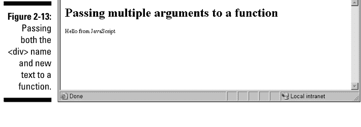

**图 2-13：** 同时将`<div>`名称和新文本传递给函数。

## 你必须记住这一点：存储数据

Ajax 应用程序可能会大量使用 JavaScript，除此之外，这意味着处理诸如音乐 CD 的当前价格、LCD 显示器的库存数量、旧金山的气温等等数据。在 JavaScript 中，你可以使用变量来存储数据。

例如，假设你想在脚本中存储那条“You're using JavaScript”消息，以便于处理。这样，你就不必像本章前面解释的那样，每次想显示文本时都必须将该消息传递给`displayText`函数。相反，该文本将已经对`displayText`函数可用。

## 使用 var 语句进行简单的数据存储

要使用 JavaScript 存储像“You're using JavaScript”文本这样的数据，你可以使用 JavaScript 的`var`（variable 的缩写）语句。例如，要将消息文本存储在名为`text`的变量中，你可以在`<script>`元素中使用这行 JavaScript：

```javascript
var text = "You're using JavaScript";
```

然后，你就可以从那时起在 JavaScript 代码中通过名称引用该文本。例如，当你想显示该文本时，你可以这样做：

```html
<html>
  <head>
    <title>Using variables</title>
    <script language="javascript">
      var text = "You're using JavaScript";
      function displayText()
      {
        document.getElementById('targetDiv').innerHTML = text;
      }
    </script>
  </head>
  <body onload="displayText()">
    <h1>Using variables</h1>
    <div id="targetDiv">
    </div>
  </body>
</html>
```

这就是全部所需——你创建了一个名为`text`的变量，然后像这样利用该变量来显示你存储在其中的文本：

```javascript
document.getElementById('targetDiv').innerHTML = text;
```

非常好。

## 使用运算符处理数据

许多编程语言在你可以存储在变量中的数据类型方面有严格的区分，它们提供不同类型的变量来存储不同类型的文本——例如，一种变量用于文本字符串，另一种用于整数，等等。但 JavaScript 没那么死板——你可以使用同一个`var`语句存储各种数据。例如，假设你想在两个名为，比如说，`operand1`和`operand2`的变量中存储数字。你可以这样做：

```javascript
var operand1 = 2;
var operand2 = 3;
```

然后假设你想将这两个值相加，并将结果存储在一个名为`sum`的变量中。JavaScript 有一堆运算符，可以让你执行诸如加法（`+`运算符）或减法（`–`运算符）之类的操作，你可以在表 2-2 中看到它们。（不要试图记住你在那里看到的内容——在本书中随时根据需要回到这个表格。）所以，下面是你可能创建一个名为`sum`的新变量，并将`operand1`和`operand2`的和存储在其中的方式（请注意，这段代码在第一次创建时并未给`sum`变量任何初始值）：

```javascript
var sum;
sum = operand1 + operand2;
```

代码清单 2-2 展示了这在网页上的整体样子，即本书代码中的`usenumbers.html`，其中 JavaScript 将`operand1`和`operand2`中的值相加，将它们存储在名为`sum`的变量中，并显示该结果。

### 代码清单 2-2：让 JavaScript 运算符发挥作用

```html
<html>
  <head>
    <title>Using numeric variables</title>

    <script language="javascript">
      var operand1 = 2;
      var operand2 = 3;
      var sum = 0;
      function displayText()
      {
          sum = operand1 + operand2;
          document.getElementById('targetDiv').innerHTML =
              operand1 + " + " + operand2 + " = " + sum;
      }
    </script>
  </head>
  <body onload="displayText()">
    <h1>Using numeric variables</h1>
    <div id="targetDiv">
    </div>
  </body>
</html>
```

你可以在图 2-14 中看到这个页面的实际效果，用户了解到 2 + 3 = 5。他们可能早就知道这个数学知识，但他们不禁会对你的变量使用印象深刻。

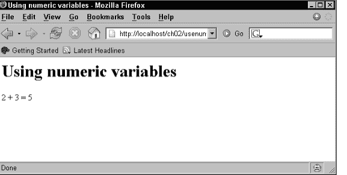

## 第一部分：入门

表 2-2 JavaScript 运算符

| 运算符 | 描述 |
| :--- | :--- |
| 算术运算符 | |
| `+` | 加法 — 将两个数相加。 |
| `++` | 自增 — 将变量的值递增 1。 |
| `-` | 减法、取负 — 从一个数中减去另一个数。也可以改变操作数的符号，如下：`-变量名`。 |
| `--` | 自减 — 将变量的值递减 1。 |
| `*` | 乘法 — 将两个数相乘。 |
| `/` | 除法 — 将两个数相除。 |
| `%` | 取模 — 返回两个数使用整数除法后剩下的余数。 |
| 字符串运算符 | |
| `+` | 字符串加法 — 连接两个字符串。 |
| `+=` | 连接两个字符串，并将连接后的字符串赋值给第一个操作数。 |
| 逻辑运算符 | |
| `&&` | 逻辑与 — 如果两个操作数都为真，则返回`true`；否则，返回`false`。 |
| `\|\|` | 逻辑或 — 如果任一操作数为真，则返回`true`。但是，如果两个操作数都为假，则返回`false`。 |
| `!` | 逻辑非 — 如果其操作数为真，则返回`false`；如果其操作数为假，则返回`true`。 |
| 位运算符 | |
| `&` | 按位与 — 如果两个操作数的对应位都为 1，则结果的对应位为 1。 |
| `^` | 按位异或 — 如果两个操作数的对应位只有一个为 1（但不是都为 1），则结果的对应位为 1。 |
| `\|` | 按位或 — 如果任一操作数的对应位为 1，则结果的对应位为 1。 |
| `~` | 按位非 — 将所有位位置的 1 变为 0，0 变为 1 — 即，翻转每个位。 |
| `<<` | 左移 — 将第一个操作数的位向左移动第二个操作数指定的位数。 |
| `>>` | 带符号位传播的右移 — 将第一个操作数的位向右移动第二个操作数指定的位数。 |
| `>>>` | 零填充右移 — 将第一个操作数的位向右移动第二个操作数指定的位数，并在左侧补入 0。 |
| 赋值运算符 | |
| `=` | 如果第一个操作数是变量，则将第二个操作数的值赋值给第一个操作数。 |
| `+=` | 如果第一个操作数是变量，则将两个操作数相加，并将结果赋值给第一个操作数。 |
| `-=` | 如果第一个操作数是变量，则将两个操作数相减，并将结果赋值给第一个操作数。 |
| `*=` | 如果第一个操作数是变量，则将两个操作数相乘，并将结果赋值给第一个操作数。 |
| `/=` | 如果第一个操作数是变量，则将两个操作数相除，并将结果赋值给第一个操作数。 |
| `%=` | 如果第一个操作数是变量，则计算两个操作数的模，并将结果赋值给第一个操作数。 |
| `&=` | 如果第一个操作数是变量，则对两个操作数执行按位与操作，并将结果赋值给第一个操作数。 |
| `^=` | 如果第一个操作数是变量，则对两个操作数执行按位异或操作，并将结果赋值给第一个操作数。 |
| `\|=` | 如果第一个操作数是变量，则对两个操作数执行按位或操作，并将结果赋值给第一个操作数。 |
| `<<=` | 如果第一个操作数是变量，则对两个操作数执行左移操作，并将结果赋值给第一个操作数。 |
| `>>=` | 如果第一个操作数是变量，则对两个操作数执行带符号位传播的右移操作，并将结果赋值给第一个操作数。 |
| `>>>=` | 如果第一个操作数是变量，则对两个操作数执行零填充右移操作，并将结果赋值给第一个操作数。 |
| 比较运算符 | |
| `==` | 相等运算符 — 如果两个操作数相等，则返回`true`。 |
| `!=` | 不等于 — 如果两个操作数不相等，则返回`true`。 |
| `===` | 严格相等 — 如果两个操作数相等且类型相同，则返回`true`。 |
| `!==` | 严格不等于 — 如果两个操作数不相等和/或类型不同，则返回`true`。 |
| `>` | 大于 — 如果第一个操作数的值大于第二个操作数的值，则返回`true`。 |
| `>=` | 大于或等于 — 如果第一个操作数的值大于或等于第二个操作数的值，则返回`true`。 |
| `<` | 小于 — 如果第一个操作数的值小于第二个操作数的值，则返回`true`。 |
| `<=` | 小于或等于运算符 — 如果第一个操作数的值小于或等于第二个操作数的值，则返回`true`。 |
| `?:` | 条件运算符 — 执行一个`if...else`测试。 |
| `,` | 逗号运算符 — 计算两个表达式，并返回第二个表达式计算的结果。 |
| `delete` | 删除 — 删除一个对象并将其从内存中移除，或删除对象的属性，或删除数组中的元素。 |
| `function` | 创建一个匿名函数。（在第 3 章中使用。） |
| `in` | 如果你正在测试的属性受特定对象支持，则返回`true`。 |
| `instanceof` | 如果给定对象是指定类型的实例，则返回`true`。 |
| `new` | 对象实例化 — 从指定的对象类型创建一个新对象。 |
| `typeof` | 返回操作数的类型名称。 |
| `void` | 用于允许对表达式进行求值而不返回任何值。 |

## 第 2 章：JavaScript 一切

## 更改变量的数据

你可以通过为变量分配新值来更改变量中的数据。例如，如果你这样做：

```javascript
var operand1 = 2;
var operand2 = 3;
.
.
.
```

但随后像这样将`operand1`的值改为`12`：

```javascript
var operand1 = 2;
var operand2 = 3;
operand1 = 12;
.
.
.
```

那么`operand1`将保存 12，而`operand2`将保存 3。如果你将它们相加并将结果放入名为`sum`的变量中：

```javascript
var operand1 = 2;
var operand2 = 3;
operand1 = 12;
var sum;
sum = operand1 + operand2;
```

那么`sum`将保存 15。请注意，你可以在脚本中的任何位置使用`var`语句，但你应该在使用该语句创建的变量之前使用它。

## 在变量中存储 JavaScript 对象

除了文本和数字，你还可以在变量中存储支持方法和属性的 JavaScript 对象。在本书中，最重要（也最著名）的对象是 Ajax 用于在后台与服务器通信的`XMLHttpRequest`对象。

关于它如何工作的详细解释将在下一章中介绍，但这里先预览一下。在不同浏览器中创建`XMLHttpRequest`对象的方式不同；以下是在 Firefox 和 Netscape Navigator 中的方法（注意这里使用了名为`new`的运算符，这是你在 JavaScript 中创建对象的方式）：


```javascript
var XMLHttpRequestObject;
XMLHttpRequestObject = new XMLHttpRequest();
.
.
.
```

现在你已经在名为`XMLHttpRequestObject`的变量中拥有了一个`XMLHttpRequest`对象，你可以使用该对象的方法和属性（我将在下一章中详细说明），就像你使用内置 JavaScript 文档对象的`write`方法一样。例如，要使用`XMLHttpRequest`对象的`open`方法开始从服务器获取数据，你只需像`XMLHttpRequestObject.open`这样调用该方法：

```javascript
var XMLHttpRequestObject;
XMLHttpRequestObject = new XMLHttpRequest();
.
.
.
XMLHttpRequestObject.open("GET", dataSource);
```

## JavaScript 的数据类型猜测游戏

因为 JavaScript 没有针对不同类型数据的不同类型的变量，所以它必须猜测变量中的数据应该被视为，比如说，数字还是文本。JavaScript 基于你使用变量的上下文来做出这个猜测，有时它会猜错。例如，假设你没有将总和存储在名为`sum`的变量中，而是简单地这样做来显示`operand1 + operand2`的结果（注意此代码的最后一行）：

```javascript
document.getElementById('targetDiv').innerHTML =
    operand1 + " + " + operand2 + " = "
    + operand1 + operand2;
```

这里的问题在于，这个 JavaScript 语句中的其他所有部分都将数据视为文本字符串，因此 JavaScript 将`operand1`和`operand2`视为字符串——这意味着这里的`+`运算符将用于连接这些字符串（“2”和“3”），而不是将它们的值作为数字相加。所以你会惊讶地看到显示“2 + 3 = 23”，这看起来不太符合数学。你需要一个像`sum`这样的变量来向 JavaScript 明确你处理的是数字：

```javascript
sum = operand1 + operand2;
document.getElementById('targetDiv').innerHTML =
    operand1 + " + " + operand2 + " = "
    + sum;
```

这样就能得到正确的结果。

## 哦，那些函数！

在 JavaScript 中使用变量和函数时，最重要的事情之一是：在函数内部创建的变量将在每次脚本调用该函数时重置为原始值。不了解这个事实已经让许多 JavaScript 程序员感到困惑。如果你想避免混淆，请将用于创建你想使用的变量的`var`语句放在函数外部。

这里有一个例子——一个点击计数器，每次点击它都会递增。这里有两个计数器变量，一个存储在函数外部（`counter1`），另一个存储在函数内部（`counter2`）。因为这个页面使用了`<body>`元素的`onclick`属性，所以每次用户点击页面时，都会调用`displayText`函数，并且两个计数器都使用 JavaScript 的`++`运算符递增一，如下所示（有关`++`运算符，请参见表 2-2）：

```javascript
counter1 = counter1++;
counter2 = counter2++;
```

然而，`counter1`是在`displayText`函数外部创建的，而`counter2`是在该函数内部创建的：

```javascript
var counter1 = 0;
function displayText()
{
    var counter2 = 0;
    counter1 = counter1++;
    counter2 = counter2++;
    .
    .
    .
}
```

这意味着每次调用`displayText`时，`counter2`变量都会被重新创建，并重置为前面代码中给出的值，即 0。尽管它在每次函数调用时都会自增，但其值永远无法超过 1。而另一个变量`counter1`，在任何函数之外创建，能够在页面点击之间保持其值，因此它将充当一个真正的计数器。你可以在网页本身看到所有这些效果，即`usevariablesandfunctions.html`（参见清单 2-3）。

## 清单 2-3：结合使用变量和函数

```html
<html>
    <head>
        <title>Using variables</title>

        <script language="javascript">
            var counter1 = 0;
            function displayText()
            {
                var counter2 = 0;
                counter1 = counter1++;
                counter2 = counter2++;
                document.getElementById('targetDiv').innerHTML =
                    "First counter equals " + counter1 + "<br>" +
                    "But the second counter is still stuck at " + counter2;
            }
        </script>

    </head>

    <body onclick = "displayText()">

        <h1>Using variables (Click Me!)</h1>

        <div id="targetDiv">
        </div>

    </body>
</html>
```

实际运行起来是什么样子呢？你可以在图 2-15 中看到，我点击了页面六次。在函数外部创建的计数器变量保持着正确的值——但在函数内部创建的计数器变量每次页面被点击时都会重置为其原始值，因此它总是只显示值 1。

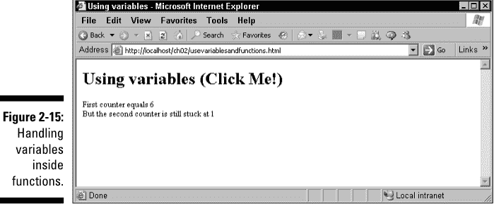

## 使用 if 语句进行选择

JavaScript 的`if`语句让你可以测试某个条件是否为真（温度变量中的值是否超过 65 度？），如果是，则采取相应的行动（野餐时间！）。`if`语句还包括一个可选的`else`子句，其中包含在测试条件为假时要执行的代码。正式地讲，该语句的语法如下所示——注意，要执行的代码位于花括号`{`和`}`之间，而标准方括号`[`和`]`中的部分是可选的：

```javascript
if (condition) {
    statements1
}
[else {
    statements2
}]
```

## 使用 if 语句

是时候看个例子了。`temperature`变量中的值是否超过 65 度？如果是，清单 2-4 中的示例`temperature.html`会显示消息`野餐时间！`。为了检查温度，代码使用了`>`（大于）运算符（参见表 2-2）。

第一部分：入门

## 清单 2-4：使用 if 语句

```html
<html>
	<head>
		<title>Using the if statement</title>

		<script language="javascript">

			function displayText()
			{
				var temperature = 70;
				if(temperature > 65) {
					document.getElementById('targetDiv').innerHTML =
							"Picnic time!";
				}
			}
		</script>

	</head>

	<body onload="displayText()">

		<h1>Using the if statement</h1>

		<div id="targetDiv">
		</div>

	</body>
</html>
```

你可以在图 2-16 中看到结果，如你所见，是野餐时间。

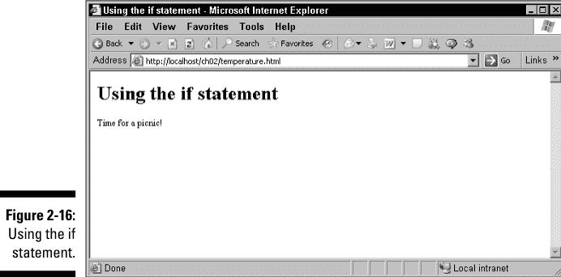

## 使用 else 语句

你也可以使用`if`语句的可选`else`语句，在条件不为真时执行代码。例如，如果不是野餐时间，你可能想在`temperature.html`中说“回去工作！”，清单 2-5 展示了使用`else`语句可能是什么样子的——注意，我已经修改了温度，以便`else`语句会被执行。

## 清单 2-5：使用 else 语句

```html
<html>
  <head>
    <title>Using the if statement</title>
    
    <script language="javascript">
      function displayText()
      {
        var temperature = 62;
        if(temperature > 65) {
            document.getElementById('targetDiv').innerHTML =
               "Picnic time!";
        }
        else {
            document.getElementById('targetDiv').innerHTML =
               "Back to work!";
        }
      }
    </script>
    
  </head>
  
  <body onload="displayText()">
    
    <h1>Using the if statement</h1>
    
    <div id="targetDiv">
    </div>
    
  </body>
</html>
```

你可以在图 2-17 中看到结果，很遗憾，温度低到该回去工作了。唉。

## 第一部分：入门

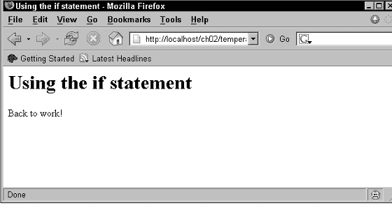

## 确定浏览器类型和版本

这是一个更高级的例子，它确定用户使用的是哪种浏览器，并允许你根据浏览器类型执行代码以显示浏览器版本。此示例利用了`if`和`else`语句以及几个处理字符串的 JavaScript 内置函数。在 JavaScript 中，文本字符串被视为对象，它们具有一些内置属性和方法，使事情变得更容易。此示例使用了：

- `length`属性以字符为单位给出字符串的长度。
- `indexOf`方法搜索子字符串的出现，并返回第一个匹配项的位置——如果没有匹配项，则返回 -1。（字符串的第一个字符被视为第 0 个字符。）
- `substring`方法允许你从较大的字符串中提取子字符串。你可以将要提取的子字符串的起始和结束位置传递给此方法。

此示例搜索`navigator.userAgent`属性（正如我在本章前面的“你使用的是哪个浏览器？”中介绍的那样，该属性包含浏览器名称和版本），提取该信息并显示它。（你真的不必记住这里的字符串函数——我编排这个示例是因为在 Ajax 编程中，了解用户使用的浏览器和版本通常很重要。）清单 2-6 展示了代码`browserversion.html`的样子。

第 2 章：全是关于 JavaScript 的

## 清单 2-6：查明你正在使用的浏览器

```html
<html>
  <head>
    <title>
      Determining your browser
    </title>

    <script language="javascript">

    var versionBegin, versionEnd

    function checkBrowser()
    {
      if(navigator.appName == "Netscape") {
        if(navigator.userAgent.indexOf("Firefox") > 0) {
          versionBegin = navigator.userAgent.indexOf("Firefox") +
          "Firefox".length + 1;
          versionEnd = navigator.userAgent.length;
          document.getElementById("targetDiv").innerHTML =
            "You have Firefox " +
            navigator.userAgent.substring(versionBegin, versionEnd);
        }
      }

      if (navigator.appName == "Microsoft Internet Explorer") {
        versionBegin = navigator.userAgent.indexOf("MSIE ") +
        "MSIE ".length;
        if(navigator.userAgent.indexOf(";", versionBegin) > 0) {
          versionEnd = navigator.userAgent.indexOf(";", versionBegin);
        } else {
          versionEnd = navigator.userAgent.indexOf(")", versionBegin)
          + 2;
        }
        document.getElementById("targetDiv").innerHTML =
          "You have Internet Explorer " +
          navigator.userAgent.substring(versionBegin, versionEnd);
      }
    }
    </script>
  </head>

  <body onload="checkBrowser()">
    <h1>Determining your browser</h1>
    <div ID="targetDiv"></div>
  </body>
</html>
```

## 第一部分：入门

你可以在图 2-18 中看到结果，其中用户使用的是 Firefox 1.0.6。使用这样的代码，你可以找出用户使用的浏览器——并且如果他的浏览器不满足你的需求，可以加入某种变通方案。

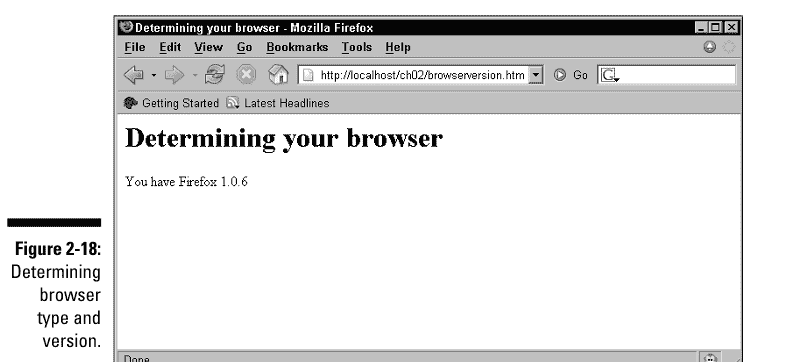

计算机擅长的一件事是反复执行同类任务，而 JavaScript 通过循环来帮助实现这一点。我将在下一节中研究它们，为处理网页中用户可以点击的按钮做好铺垫。

## 情况只会更好：for 循环

假设你有一个教授 Ajax 的班级，其中有 600 名学生的考试成绩，你想确定他们的平均考试成绩。你该怎么做？你可以使用`for`循环遍历他们的分数——也就是说，获取第一个分数，然后下一个，再下一个，依此类推。这是 JavaScript 中最常见的循环，它的工作原理如下：

```javascript
for ([initial-expression]; [condition]; [increment-expression]) {
    statements
}
```

程序员通常将`for`循环与循环索引（也称为循环计数器）一起使用，它只是一个跟踪循环已执行次数的变量。以下是它的工作原理：

1. 在`initial-expression`部分，你通常将循环索引设置为一个起始值。
2. 在条件部分，你测试该值，以查看是否仍希望继续循环。
3. 然后，递增表达式允许你增加循环计数器。

举个例子来说明这一切如何运作？假设你想将数字 1 到 100 相加。清单 2-7 展示了在`for.html`示例中可能的样子。

## 清单 2-7：运用 for 循环

```html
<html>
  <head>
    <title>使用for语句</title>
    
    <script language="javascript">
      
      function displayText()
      {
        var loopIndex;
        var sum = 0;
        
        for(loopIndex = 1; loopIndex <= 100; loopIndex++) {
          sum += loopIndex;
        }
        
        document.getElementById('targetDiv').innerHTML = 
          "将1到100相加的结果为: " + sum;
      }
    </script>
    
  </head>
  
  <body onload="displayText()">
    <h1>使用for语句</h1>
    
    <div id="targetDiv">
    </div>
    
  </body>
</html>
```


注意这段代码使用了两个新运算符（两者均可参见表2-2）：`<=` 和 `+=`。`<=` 运算符是小于或等于运算符。`+=` 运算符是 `+` 和 `=` 运算符的简写形式；换句话说，以下两行代码作用相同：

```javascript
sum = sum + loopIndex;
sum += loopIndex;
```

JavaScript 允许你将诸如 `+`（加法）和 `-`（减法）之类的运算符与 `=` 运算符组合成方便的简写版本，例如：`+=` 和 `-=`。非常简洁。

此示例中的 `for` 循环通过逐步递增变量 `loopIndex` 并在该索引达到100时停止，将1到100的所有数字相加。结果是多少？你可以在图2-19中看到——将1到100相加得到5050。

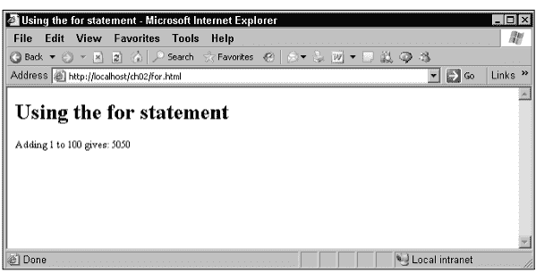

图2-19：使用`for`循环将数字相加。

## 使用`while`循环反复执行！

另一种循环方式是使用 `while` 循环。这种循环在其条件为真时简单地持续执行。正式来说，它看起来是这样的：

```javascript
while (condition) {
    statements
}
```

下面是一个使用 `while` 循环和JavaScript另一个方面——数组——来探索新领域的例子。在JavaScript中，你可以使用数组来保存可以通过索引号引用的数据。例如，假设你想存储一个日常物品的列表。你可以通过创建一个包含六个元素的数组来实现这一点（每个元素的作用就像一个普通变量，你可以在每个元素中存储字符串、数字或对象），就像这样：

```javascript
var items = new Array(6);
```

这就是创建一个包含特定数量元素（在本例中为六个）的数组的方法。现在你可以通过使用方括号 `[` 和 `]` 内的数字来访问每个元素，像这样：

```javascript
items[0] = "Shoe";
items[1] = "Sandwich";
items[2] = "Sand";
items[3] = "Rocks";
items[4] = "Treasure";
items[5] = "Pebbles";
```

注意 `items` 数组中的五个元素从索引0开始，到索引4结束。现在，`items[0]` 存储 "Shoe"，`items[1]` 存储 "Sandwich"，依此类推。数组之所以非常适合与循环一起使用，是因为数组只是一组可以通过数字访问的变量——而这个数字可以只是一个循环索引，这意味着一个循环可以为你遍历数组中的所有数据。

在这个例子中，假设你想在数组中搜索 "Treasure" 项目。你可以通过遍历数组中的元素来找到 "Treasure"。换句话说，只要当前数组元素不包含 "Treasure"，你就希望继续查找并递增。在这种情况下，你必须检查数组中的元素是否包含 "Treasure"，你可以使用JavaScript的 `==`（等于）或 `!=`（不等于）运算符来实现。例如，如果 `items[3]` 包含 "Treasure"，那么JavaScript表达式 `items[3] == "Treasure"` 的结果为真，而表达式 `items[3] != "Treasure"` 的结果为假。因为你需要在这里持续循环直到找到 "Treasure"，所以你可以这样做：

```javascript
var loopIndex = 0;

while(items[loopIndex] != "Treasure"){
    loopIndex++;
}
```

在这个循环结束时，变量 `loopIndex` 将包含存储 "Treasure" 的元素的索引。但这里有一个问题——如果没有元素包含 "Treasure" 怎么办？你应该对可能要搜索的值的数量设置一个上限，例如，如果当前数组元素不包含 "Treasure" 并且当前循环索引小于6，则循环应继续。JavaScript有一个运算符 `&&` 表示与，因此你可以像这样同时检查这两个条件：

```javascript
while(items[loopIndex] != "Treasure" && loopIndex < 5){
    loopIndex++;
}
```

呼，准备好出发了。你可以在`while.html`中的清单2-8看到搜索 "Treasure" 的代码。

## 清单2-8：运用`while`循环

```html
<html>
  <head>
    <title>使用while语句</title>

    <script language="javascript">

      function findTreasure()
      {
        var loopIndex = 0, items = new Array(6);

        items[0] = "Shoe";
        items[1] = "Sandwich";
        items[2] = "Sand";
        items[3] = "Rocks";
        items[4] = "Treasure";
        items[5] = "Pebbles";

        while(items[loopIndex] != "Treasure" && loopIndex < 6){
          loopIndex++;
        }

        if(loopIndex < 6){
          document.getElementById('targetDiv').innerHTML = 
          "在索引 " + loopIndex + " 处找到了宝藏";
        }
      }
    </script>

  </head>

  <body onload="findTreasure()">

    <h1>使用while语句</h1>

    <div id="targetDiv">
    </div>

  </body>
</html>
```

JavaScript能否找到宝藏？当然可以，正如你在图2-20中所看到的。

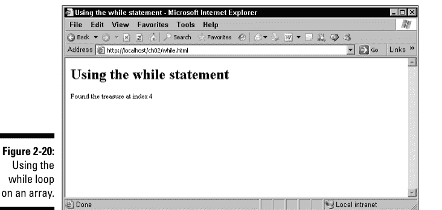

## 按下一些按钮

Ajax应用程序通常在从服务器获取数据之前等待用户执行某些操作，而执行某些操作意味着在浏览器中引发事件，例如点击按钮。许多HTML控件可以出现在网页上，例如列表框、文本字段、单选按钮等，你需要知道如何一般性地使用它们。下一个示例展示了如何将按钮点击连接到一个JavaScript函数。

要显示像按钮这样的HTML控件，你需要使用HTML表单。要将按钮连接到JavaScript函数，你只需要将该按钮的 `onclick` 属性设置为要调用的函数名，就像这样（`value` HTML属性设置按钮的标题）：

```html
<form>
    <input type="button" onclick="showAlert()" value="Click Me!">
</form>
```

### 通过按钮点击显示消息

当用户点击此按钮时，JavaScript函数 `showAlert` 被调用。在该函数中，你可以显示一个称为警报框的消息框，以指示用户点击了按钮。清单2-9展示了在`button.html`文件中JavaScript的样子。

## 清单2-9：处理按钮点击

```html
<html>
    <head>
        <title>使用按钮</title>

        <script language="javascript">
            function showAlert()
            {
                alert("感谢您的点击。")
            }
        </script>

    </head>

    <body>
        <h1>使用按钮</h1>
        <form>
            <input type="button" onclick="showAlert()" value="点击此处">
        </form>
    </body>
</html>
```

你可以在图2-21的浏览器中看到此页面。当用户点击按钮时，函数 `showAlert` 被调用，它会显示一个警报框，如你在图2-22中所见。因此，这个按钮确实连接到了JavaScript。非常酷。

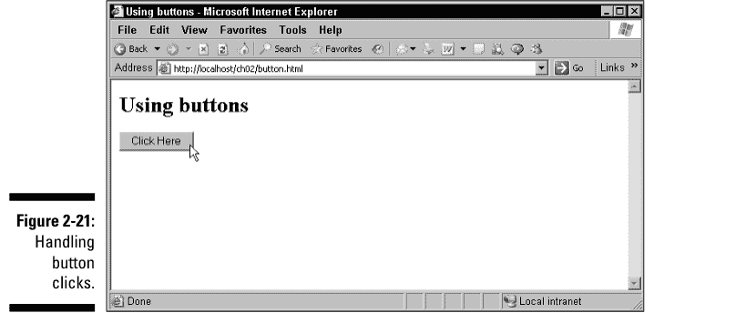

图2-22：显示一个警报框。

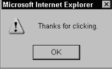

### 通过按钮点击读取文本字段

在这个例子中，当按钮被点击时调用的JavaScript代码读取HTML文本字段中的文本，然后在 `<div>` 元素中显示该文本。为此，你需要在表单中添加一个HTML文本字段，就像这样——请注意，文本字段被赋予了ID "textField"：

```html
<form>
请输入一些文本: <input type="text" id="textField">
<br>
然后点击按钮: <input type="button"
onclick="handleText()" value="读取文本">
</form>
```

要在代码中访问文本字段中的文本，你可以像这样引用该文本：`document.getElementById('textField').value`。因此，你可以在用户点击按钮时读取文本字段中的文本，然后在 `<div>` 元素中显示该文本，如你在`text field.html`文件中的清单2-10所见。

## 清单2-10：从文本字段读取文本

```html
<html>
<head>
<title>点击按钮</title>

<script language="javascript">
function handleText()
{
document.getElementById('targetDiv').innerHTML =
"您输入了: " +
document.getElementById('textField').value;
}
</script>
</head>

<body>
<h1>读取文本</h1>

<form>
```

（续）

## 第一部分：入门

清单 2-10：（续）

```html
Enter some text: <input type="text" id="textField">
<br>
Then click the button: <input type="button"
    onclick="handleText()" value="Read the text">
</form>

<div id="targetDiv">
</div>

</body>
</html>
```

这就是全部内容了。你可以在图 2-23 中看到这个页面 `textfield.html` 的样子，用户已经在文本框中输入了一些文本。

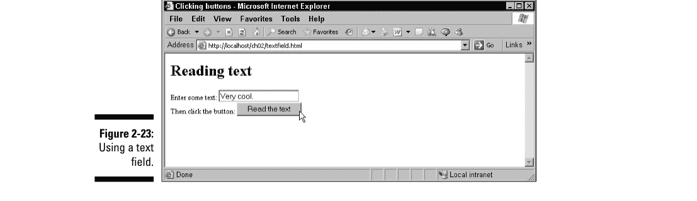

当用户点击按钮时，JavaScript 会读取该文本并将其显示在一个 `<div>` 元素中，正如你在图 2-24 中看到的。效果不错。

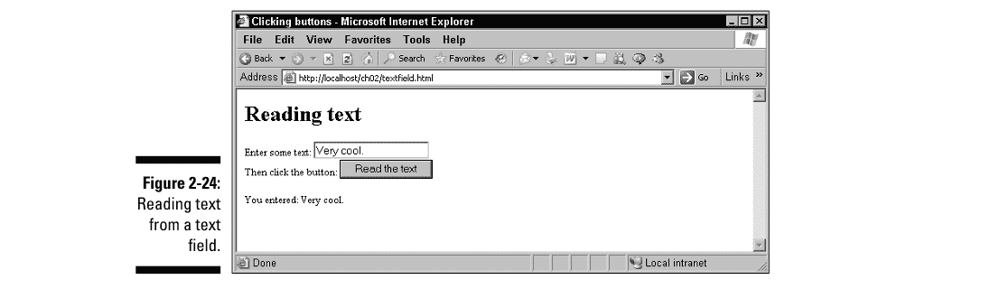

## 第二部分：Ajax 编程

**第五波** &nbsp;&nbsp;&nbsp;&nbsp; **作者：里奇·坦南特**

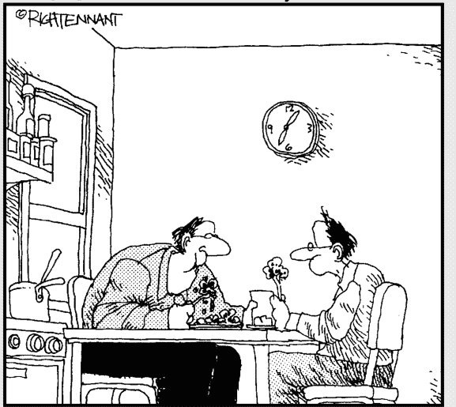

"太棒了，斯坦。这让我想起来了，你还在自己编写网页脚本吗？"

本部分 ...

在这里，你将深入到真正的 Ajax 编程中。贯穿本部分，你将使用 Ajax 在浏览器中从后台服务器抓取文本和 XML 数据，并利用这些数据进行工作。本部分将介绍数十个示例。你将使用 Ajax 和动态 HTML 来动态更新网页——无需服务器刷新页面！我还会向你展示一些正在使用的高级技术，例如在后台连接 Google 进行实时的同页面网页搜索，或同时支持对同一服务器的多个 Ajax 请求。

### 第 3 章：认识 Ajax

本章内容：

- 开发一个 Ajax 应用程序
- 从服务器获取 XML
- 使用 `XMLHttpRequest` 对象
- 使用 Ajax 向服务器传递数据
- 使用 GET 方法从服务器获取数据
- 使用 POST 方法从服务器获取数据

"看看这个！"首席执行官喊道。"难怪用户不喜欢在我们的网站上购物。页面总是闪烁不停。"

"那是因为你每次获取更多数据时都在刷新页面，"你平静地说着，从阴影中走了出来。

"*你*是谁？"首席执行官叫道。

"一位 Ajax 编程大师，"你回答。"而且我的收费相当合理。至少对大公司来说是这样。"

"你能解决那个无休止的闪烁问题吗？"首席执行官问道。

"当然，"你说，"不过价格不菲。"

"什么都行！"设计团队说道。

你在电脑前坐下，平静地接过了控制权。你想，这会很棒。而且报酬也相当不错。只需要在关键位置用上一点 Ajax，问题就差不多解决了。

本章将开始编写一些 Ajax 代码。你将从本章和下一章开始深入使用 `XMLHttpRequest` 对象。本章将为你提供 Ajax 的实用知识——从最基础开始，一直到向服务器发送和接收数据。

## 编写一些 Ajax 代码

为了说明 Ajax，清单 3-1 中的代码要求用户点击一个按钮，使用 Ajax 技术从服务器获取数据，并将该数据显示在与按钮相同的网页中——而无需刷新页面。先看看代码，然后再看后面的解释。

### 清单 3-1：第一个 Ajax 应用程序

```html
<html>
    <head>
        <title>Ajax at work</title>
        
        <script language = "javascript">
            var XMLHttpRequestObject = false;
            
            if (window.XMLHttpRequest) {
                XMLHttpRequestObject = new XMLHttpRequest();
            } else if (window.ActiveXObject) {
                XMLHttpRequestObject = new ActiveXObject("Microsoft.XMLHTTP");
            }
            
            function getData(dataSource, divID)
            {
                if(XMLHttpRequestObject) {
                    var obj = document.getElementById(divID);
                    XMLHttpRequestObject.open("GET", dataSource);
                    
                    XMLHttpRequestObject.onreadystatechange = function()
                    {
                        if (XMLHttpRequestObject.readyState == 4 &&
                            XMLHttpRequestObject.status == 200) {
                            obj.innerHTML = XMLHttpRequestObject.responseText;
                        }
                    }
                    
                    XMLHttpRequestObject.send(null);
                }
            }
        </script>
    </head>
    
    <body>
        
        <H1>Fetching data with Ajax</H1>
        
        <form>
            <input type = "button" value = "Display Message"
                   onclick = "getData('http://localhost/ch03/data.txt',
                   'targetDiv')">
        </form>

        <div id="targetDiv">
            <p>The fetched data will go here.</p>
        </div>

    </body>
</html>
```

这个 Ajax 应用程序如图 3-1 所示。（在你可以从与本书相关的网站下载的代码中，该应用程序是`ch03`文件夹中的`index.html`文件）。

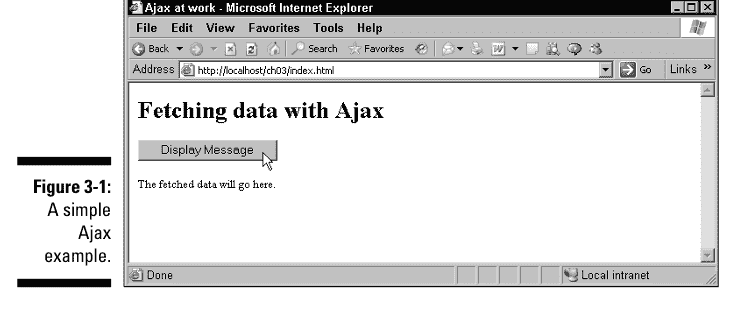

当你点击那个按钮时，页面中的 JavaScript 会获取一些新文本，并用这个新版本替换应用程序中的原始文本，如图 3-2 所示。没有屏幕闪烁，没有页面请求，没有麻烦。非常好。当然，你*可以*使用简单的 JavaScript 来显示这样的数据，但这里的区别在于，当你使用 Ajax 时，你能够从 Web 服务器获取数据。


那么这个页面`index.html`是如何实现其功能的？它是如何使用 Ajax 获取那个新文本的？页面主体首先在一个`<div>`元素中显示原始文本。以下是加粗的`<div>`元素：

```html
<body>

<H1>Fetching data with Ajax</H1>

<form>
    <input type = "button" value = "Display Message"
        onclick = "getData('http://localhost/ch03/data.txt',
        'targetDiv')">
```

```html
</form>
<div id="targetDiv">
<p>The fetched data will go here.</p>
</div>
</body>
```

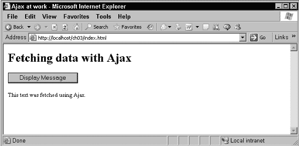

这个页面上还有一个按钮，当用户点击该按钮时，会调用一个名为`getData`的 JavaScript 方法，如下所示：

```html
<body>

<H1>Fetching data with Ajax</H1>

<form>
<input type = "button" value = "Display Message"
onclick = "getData('http://localhost/ch03/data.txt',
'targetDiv')">
</form>

<div id="targetDiv">
<p>The fetched data will go here.</p>
</div>

</body>
```

如你所见，`getData`函数被传入了两个文本字符串：要从服务器获取的文本文件名`data.txt`，以及要显示获取到的文本的`<div>`元素的名称。`data.txt`文件仅包含以下文本：

```text
This text was fetched using Ajax.
```

这就是你希望浏览器在用户使用网页其余部分时，在后台从服务器下载的文本。那么，完成所有工作的 JavaScript 看起来是怎样的呢？你将在接下来的章节中找到答案。

### 创建`XMLHttpRequest`对象

这个示例应用程序首先需要一个`XMLHttpRequest`对象，因此它从创建该对象的代码开始；这段代码位于任何函数之外，因此在页面加载时会立即运行。你通过为这个对象创建一个变量`XMLHttpRequestObject`来开始一切，就像这样：

```html
<script language = "javascript">
var XMLHttpRequestObject = false;
.
```

这个变量被初始化为`false`，以便脚本稍后可以检查该变量是否确实已被创建。除了`false`值，JavaScript 还支持一个名为`true`的值——这两个是可以赋给变量的布尔值。Netscape（7.0及更高版本）、Apple Safari（1.2及更高版本）和 Firefox 浏览器允许你直接使用代码创建`XMLHttpRequest`对象，像这样：

```javascript
XMLHttpRequestObject = new XMLHttpRequest();
```

如何确定你正在处理的浏览器是否支持这段代码？`XMLHttpRequest`对象通常是浏览器`window`对象的一部分，因此要检查`XMLHttpRequest`是否可用，你可以使用这个`if`语句来检查`XMLHttpRequest`对象——再次说明，你可以通过`window.XMLHttpRequest`来访问——是否可用：

```html
<script language = "javascript">
var XMLHttpRequestObject = false;

if (window.XMLHttpRequest) {
.
.
.
```

如果`XMLHttpRequest`存在且可用，你可以使用以下方式创建所需的`XMLHttpRequest`对象：

## 第82节 第二部分：Ajax编程

```javascript
<script language = "javascript">
var XMLHttpRequestObject = false;

if (window.XMLHttpRequest) {
  XMLHttpRequestObject = new XMLHttpRequest();
  .
  .
  .
}
```

另一方面，如果你在处理 Internet Explorer 浏览器，则必须使用该浏览器处理此对象创建过程的不同方式。你在 Internet Explorer（5.0及更高版本）中使用`ActiveX`对象来创建`XMLHttpRequest`对象，因此，要检查你是否在处理该浏览器，你可以检查`ActiveX`对象是否可用，如下所示：

```javascript
<script language = "javascript">
var XMLHttpRequestObject = false;

if (window.XMLHttpRequest) {
  XMLHttpRequestObject = new XMLHttpRequest();
} else if (window.ActiveXObject) {
  .
  .
  .
}
```

如果你在使用 Internet Explorer，你可以通过以下方式创建`XMLHttpRequest`对象：

```javascript
<script language = "javascript">
var XMLHttpRequestObject = false;

if (window.XMLHttpRequest) {
  XMLHttpRequestObject = new XMLHttpRequest();
} else if (window.ActiveXObject) {
  XMLHttpRequestObject = new ActiveXObject("Microsoft.XMLHTTP");
}
.
.
.
}
```

现在，你就在名为`XMLHttpRequestObject`的变量中拥有了一个`XMLHttpRequest`对象。从此时起，就本章其余内容而言，各种浏览器之间的差异就消失了。但是，就这个对象而言，浏览器之间确实存在一些差异，那么不同浏览器中`XMLHttpRequest`对象有哪些可用的属性和方法？你可以在表3-1中查看 Internet Explorer `XMLHttpRequest`对象的属性，在表3-2中查看其方法。Mozilla、Netscape Navigator 和 Firefox 中该对象的属性见表3-3，方法见表3-4。Apple 尚未发布其`XMLHttpRequest`对象的完整属性和方法列表，但它已发布了一组常用属性（见表3-5）和常用方法（见表3-6）。

### 表3-1 Internet Explorer 的`XMLHttpRequest`对象属性

| 属性 | 含义 | 读/写 |
| --- | --- | --- |
| `onreadystatechange` | 保存当`readyState`属性值更改时应调用的事件处理程序的名称 | 读/写 |
| `readyState` | 保存请求的状态 | 只读 |
| `responseBody` | 保存响应体，这是 HTTP 响应可以返回的一种方式 | 只读 |
| `responseStream` | 保存响应流，一个指向服务器的二进制流 | 只读 |
| `responseText` | 以字符串形式保存响应体 | 只读 |
| `responseXML` | 以 XML 形式保存响应体 | 只读 |
| `status` | 保存请求返回的 HTTP 状态码 | 只读 |
| `statusText` | 保存 HTTP 响应状态文本 | 只读 |

### 表3-2 Internet Explorer 的`XMLHttpRequest`对象方法

| 方法 | 含义 |
| --- | --- |
| `abort` | 中止 HTTP 请求 |
| `getAllResponseHeaders` | 获取所有 HTTP 头 |
| `getResponseHeader` | 获取 HTTP 头的值 |
| `open` | 向服务器打开一个请求 |
| `send` | 向服务器发送 HTTP 请求 |
| `setRequestHeader` | 设置 HTTP 头的名称和值 |

### 表3-3 Mozilla、Firefox 和 Netscape Navigator 的`XMLHttpRequest`对象属性

| 属性 | 含义 | 读/写 |
| :--- | :--- | :--- |
| `channel` | 保存用于执行请求的通道 | 只读 |
| `readyState` | 保存请求的状态 | 只读 |
| `responseText` | 以字符串形式保存响应体 | 只读 |
| `responseXML` | 以 XML 形式保存响应体 | 只读 |
| `status` | 保存请求返回的 HTTP 状态码 | 只读 |
| `statusText` | 保存 HTTP 响应状态文本 | 只读 |

### 表3-4 Mozilla、Firefox 和 Netscape Navigator 的`XMLHttpRequest`对象方法

| 方法 | 含义 |
| :--- | :--- |
| `abort` | 中止 HTTP 请求 |
| `getAllResponseHeaders` | 获取所有 HTTP 头 |
| `getResponseHeader` | 获取 HTTP 头的值 |
| `openRequest` | 打开请求的原生（非脚本）方法 |
| `overrideMimeType` | 覆盖服务器返回的 MIME 类型 |

### 表3-5 Apple Safari 的`XMLHttpRequest`对象属性

| 属性 | 含义 | 读/写 |
| :--- | :--- | :--- |
| `onreadystatechange` | 保存当`readyState`属性值更改时应调用的事件处理程序的名称 | 读/写 |
| `readyState` | 保存请求的状态 | 只读 |
| `responseText` | 以字符串形式保存响应体 | 只读 |
| `responseXML` | 以 XML 形式保存响应体 | 只读 |
| `status` | 保存请求返回的 HTTP 状态码 | 只读 |
| `statusText` | 保存 HTTP 响应状态文本 | 只读 |

### 表3-6 Apple Safari 的`XMLHttpRequest`对象方法

| 方法 | 含义 |
| --- | --- |
| `abort` | 中止 HTTP 请求 |
| `getAllResponseHeaders` | 获取所有 HTTP 头 |
| `getResponseHeader` | 获取 HTTP 头的值 |
| `open` | 向服务器打开一个请求 |
| `send` | 向服务器发送 HTTP 请求 |
| `setRequestHeader` | 设置 HTTP 头的名称和值 |

## 检查以确保你拥有一个有效的`XMLHttpRequest`对象

既然你已经将所需的`XMLHttpRequest`对象存储在`XMLHttpRequestObject`变量中，那么当用户点击按钮时，你实际上如何获取应用程序想要的文本呢？所有这一切都在`<script>`元素中的`getData`函数中进行，如下所示：

```javascript
<script language = "javascript">
.
.
.
function getData(dataSource, divID)
{
.
.
.
}
</script>
```

在此函数中，代码首先使用`if`语句检查`XMLHttpRequestObject`变量中是否确实存在一个有效对象。（记住，如果对象创建失败，此变量将包含`false`值——并且因为 JavaScript 将任何非`false`的值都视为`true`，所以如果变量包含一个真实对象，`if`语句的条件将为`true`。）

```javascript
<script language = "javascript">
  .
  .
  .
  function getData(dataSource, divID)
  {
    if(XMLHttpRequestObject) {
      .
      .
      .
      .
    }
  }
</script>
```

## 打开`XMLHttpRequest`对象

此时，你在`XMLHttpRequestObject`变量中拥有一个`XMLHttpRequest`对象。你可以使用此对象的`open`方法配置对象以使用你想要的 URL。以下是如何使用`open`方法（请记住，方括号`[`和`]`中的项目是可选的）：

```text
open("method", "URL"[, asyncFlag[, "userName"[, "password"]]])
```

表3-7告诉你这些不同参数的含义。

### 表3-7`open`方法的参数

| 参数 | 含义 |
| :--- | :--- |
| `method` | 用于打开连接的 HTTP 方法，例如 GET、POST、PUT、HEAD 或 PROPFIND。 |
| `URL` | 请求的 URL。 |
| `asyncFlag` | 一个布尔值，指示调用是否是异步的。默认为`true`。 |
| `userName` | 用户名。 |
| `password` | 密码。 |

你希望从中获取数据的 URL 作为`dataSource`参数传递给`getData`函数。要打开一个 URL，你可以使用标准 HTML 技术，如`GET`、`POST`或`PUT`。（当你创建 HTML 表单时，使用这些方法来指示如何将数据发送到服务器。）使用 Ajax 时，你通常主要使用`GET`来检索数据，使用`POST`向服务器发送大量数据，因此此示例使用`GET`以这种方式打开服务器上的`data.txt`文件：

```javascript
<script language = "javascript">
   .
   .
   .
   function getData(dataSource, divID)
   {
      if(XMLHttpRequestObject) {
         
         XMLHttpRequestObject.open("GET", dataSource);
         .
         .
         .
      }
   }
</script>
```

这将配置`XMLHttpRequestObject`使用你指定的 URL——在本例中是`http://localhost/ch03/data.txt`——但尚未实际连接到该文件。（如果你想在自己的服务器上尝试此示例，请务必更新该 URL 以指向你放置`data.txt`的位置。）确保`data.txt`在服务器上的目录与`index.html`相同。

默认情况下，与此 URL 的连接是*异步*进行的，这意味着此语句不会等待连接建立和数据下载完成。（你可以在调用`open`方法时使用可选的第三个参数`asyncFlag`来使调用同步，这意味着一切都会停止直到该方法调用完成，但 Ajax 中不会这样做——毕竟 Ajax 代表 Asynchronous JavaScript and XML。）

那么，当你要下载的数据准备好时，你如何才能被通知到呢？很高兴你问了这个问题；请查看下一节。

## 当你准备好时：处理异步下载

`XMLHttpRequest`对象有一个名为`onreadystatechange`的属性，它允许你处理异步加载操作。如果你将名称

## 第二部分：Ajax 编程

将脚本中的一个 JavaScript 函数赋值给`onreadystatechange`属性，那么每当`XMLHttpRequest`对象的状态发生变化时（例如下载数据时），该函数就会被调用。

你可以使用一种快捷方式将 JavaScript 函数赋值给`onreadystatechange`属性，这种快捷方式在 Ajax 脚本中很常见——你可以即时创建一个函数（有时被称为*匿名*函数，因为它没有名称）。要即时创建一个函数，只需使用`function`语句，并在花括号内定义这个新函数的主体，如下所示：

```html
<script language = "javascript">
.
.
.
function getData(dataSource, divID)
{
  if(XMLHttpRequestObject) {
    var obj = document.getElementById(divID);
    XMLHttpRequestObject.open("GET", dataSource);

    XMLHttpRequestObject.onreadystatechange = function()
    {
    .
    .
    .
    }

  }
}
</script>
```

这个新的匿名函数将在`XMLHttpRequest`对象发生变化时被调用，例如当它下载数据时。你需要关注这个对象的两个属性——`readyState`属性和`status`属性。`readyState`属性告诉你数据加载的进度。以下是`readyState`属性可能取的值（注意值为`4`表示数据已全部下载）：

- `0` uninitialized
- `1` loading
- `2` loaded
- `3` interactive
- `4` complete


`status`属性保存下载本身的状态。（这是浏览器为提供的 URL 获取的标准 HTTP 状态码。）以下是`status`属性可能取的一些值（注意值为`200`表示一切正常）：

- `200` OK
- `201` Created
- `204` No Content
- `205` Reset Content
- `206` Partial Content
- `400` Bad Request


- 401 Unauthorized
- 403 Forbidden
- 404 Not Found
- 405 Method Not Allowed
- 406 Not Acceptable
- 407 Proxy Authentication Required
- 408 Request Timeout
- 411 Length Required
- 413 Requested Entity Too Large
- 414 Requested URL Too Long
- 415 Unsupported Media Type
- 500 Internal Server Error
- 501 Not Implemented
- 502 Bad Gateway
- 503 Service Unavailable
- 504 Gateway Timeout
- 505 HTTP Version Not Supported

要确保所需数据已完全下载且一切正常，需要检查`XMLHttpRequestObject`对象的`readyState`属性是否等于`4`且`status`属性是否等于`200`。以下是 JavaScript 中的实现方式：

```html
<script language = "javascript">
.
.
function getData(dataSource, divID)
{
  if(XMLHttpRequestObject) {
    var obj = document.getElementById(divID);
    XMLHttpRequestObject.open("GET", dataSource);

    XMLHttpRequestObject.onreadystatechange = function()
    {
      if (XMLHttpRequestObject.readyState == 4 &&
          XMLHttpRequestObject.status == 200) {
          .
          .
          .
      }
    }
  }
}
</script>
```

非常酷——如果此时一切正常，浏览器已经从服务器获取了你的数据（即通过`open`方法传递的 URL 所指向的`data.txt`文件中的文本）。那么你自己如何获取这些数据呢？请看下一节。

## 你拿到数据了！

要使用`XMLHttpRequest`对象获取数据，可以使用以下两种常用方式之一：

- 如果你检索的数据要作为标准文本处理，可以使用对象的`responseText`属性。
- 如果你的数据已格式化为 XML，可以使用`responseXML`属性。在本例中，`data.txt`只包含文本，因此使用`responseText`属性。

要让下载的文本实际显示在你的网页上（这才是你的最终目的）——你可以将该文本赋值给`<div>`元素，其 ID 是网页中的`targetDiv`，并且该 ID 已作为名称传递给`getData`函数。具体实现如下：

```html
<script language = "javascript">
.
.
.
function getData(dataSource, divID)
{
    if(XMLHttpRequestObject) {

        var obj = document.getElementById(divID);

        XMLHttpRequestObject.open("GET", dataSource);

        XMLHttpRequestObject.onreadystatechange = function()
        {
            if (XMLHttpRequestObject.readyState == 4 &&
                XMLHttpRequestObject.status == 200) {
                obj.innerHTML = XMLHttpRequestObject.responseText;
            }
        }

    }
}
</script>
```

好的，你已经设置了代码来处理服务器响应。但你现在如何实际连接服务器以获取该响应呢？你需要使用`send`方法。当使用 GET 方法时，你需要传递一个`null`值（`null`是 JavaScript 中的一个内置值——它是 JavaScript 中表示零的特殊值），如以下代码所示，使用你已经配置好的`XMLHttpRequest`对象连接服务器并请求数据：

```html
<script language = "javascript">
    .
    .
    .
    function getData(dataSource, divID)
    {
        if(XMLHttpRequestObject) {
            var obj = document.getElementById(divID);
            XMLHttpRequestObject.open("GET", dataSource);

            XMLHttpRequestObject.onreadystatechange = function()
            {
                if (XMLHttpRequestObject.readyState == 4 &&
                    XMLHttpRequestObject.status == 200) {
                    obj.innerHTML = XMLHttpRequestObject.responseText;
                }
            }

            XMLHttpRequestObject.send(null);
        }
    }
</script>
```

这个`send`调用才是实际下载数据的操作，以便匿名函数能够处理这些数据。太棒了。你刚刚完成了你的第一个完整的 Ajax 应用程序。这个应用程序在后台从服务器获取数据，并在页面中显示，无需任何完整的页面刷新。你可以在本章前面的图 3-1 和图 3-2 中看到它的工作情况。

你是通过创建一个`XMLHttpRequest`对象并使用其`open`方法来配置该对象，以及使用`send`方法连接服务器并获取响应来完成这一切的。并且你通过使用请求对象的`responseText`属性从服务器恢复了文本。对于第一次尝试来说，这很不错。

## 决定使用相对 URL 还是绝对 URL

本示例从一个名为`data.txt`的文件中获取文本，该文件与`index.html`位于同一`ch03`文件夹中，你可以从本书关联的网站下载。以下是`index.html`用于指向该文件的 URL：`http://localhost/ch03/data.txt`：

```html
<body>

    <H1>Fetching data with Ajax</H1>

    <form>
        <input type = "button" value = "Display Message"
            onclick = "getData('http://localhost/ch03/data.txt',
                'targetDiv')">
    </form>

    <div id="targetDiv">
        <p>The fetched data will go here.</p>
    </div>

</body>
```

然而，由于`data.txt`与`index.html`位于同一目录中，你可以简单地将`data.txt`引用为`data.txt`，而不是`http://localhost/ch03/data.txt`：

```html
<body>

    <H1>Fetching data with Ajax</H1>

    <form>
        <input type = "button" value = "Display Message"
            onclick = "getData('data.txt', 'targetDiv')">
    </form>

    <div id="targetDiv">
        <p>The fetched data will go here.</p>
    </div>

</body>
```

当你在浏览器中查看`index.html`时，`index.html`在服务器上的所在目录将成为服务器的默认目录。当`index.html`查找`data.txt`时，不需要使用完整 URL`http://localhost/ch03/data.txt`——相反，你可以简单地说`data.txt`，服务器会在你当前正在查看的页面（`index.html`）所在目录中查找`data.txt`。`http://localhost/ch03/data.txt`是一个**绝对 URL**，但仅文件名`data.txt`是一个**相对 URL**（相对于`index.html`的位置——相对 URL 在适当情况下也可以包含路径名）。

由于本章和接下来几章中的示例都由 HTML 文件、PHP 脚本和其他文件组成，这些文件都应该放入服务器上的同一目录中，因此我从现在开始使用相对 URL。这样，无论你的服务器 URL 是什么，你都可以运行这些示例——你不必将像`http://localhost/ch03/data.txt`这样的 URL 重写为指向你的服务器（例如`http://www.starpowder.com/frank/data.txt`）。

请确保，当你运行本书中的示例时，特定 HTML 文件所需的任何 PHP、文本文档或其他文档都位于服务器上与该 HTML 文件相同的同一目录中。最简单的方法是将本书代码中`ch03`文件夹中的所有文件保存在服务器上的同一目录中，`ch04`文件夹中的所有文件也保存在同一目录中，依此类推。

## 获取 XMLHttpRequest 对象的其他方式

前面几节详细说明的示例展示了一种获取`XMLHttpRequest`对象并使用它的方法。也存在其他方式，让你可以使用更新的`XMLHttpRequest`对象。在 Ajax 中很少需要使用更新的`XMLHttpRequest`对象，但如果你想使用，值得了解如何操作。

例如，Internet Explorer 有不同版本的`XMLHttpRequest`对象可用。你可以使用`Microsoft.XMLHTTP` ActiveX 对象创建此对象的标准版本，但也有一个更新的版本可用：`MSXML2.XMLHTTP`。`Microsoft.XMLHTTP` ActiveX 对象提供了本书中所有内容所需的所有功能，但如果你想使用`MSXML2.XMLHTTP`——甚至更新的版本，如`MSXML2.XMLHTTP.3.0`、`MSXML2.XMLHTTP.4.0`或现在`MSXML2.XMLHTTP.5.0`——你也可以这样做。

## 第二部分：Ajax 编程

下面是一个示例，展示如何使用较新的`XMLHttpRequest`对象，并结合 JavaScript 的`try/catch`结构。如果在`try`语句中尝试可能失败的代码，且它确实失败了，那么关联的`catch`语句中的代码将会执行，使你能够从问题中恢复。因此，你可能首先尝试获取一个`MSXML2.XMLHTTP` ActiveX 对象，并捕获可能出现的问题：

```javascript
var XMLHttpRequestObject = false;

try {
    XMLHttpRequestObject = new ActiveXObject("MSXML2.XMLHTTP");
} catch (exception1) {
    .
    .
    .
}
```

如果浏览器无法创建`MSXML2.XMLHTTP` ActiveX 对象，你可以使用另一个`try/catch`结构来尝试标准的`Microsoft.XMLHTTP` ActiveX 对象，如下所示：

```javascript
var XMLHttpRequestObject = false;

try {
    XMLHttpRequestObject = new ActiveXObject("MSXML2.XMLHTTP");
} catch (exception1) {
    try {
        XMLHttpRequestObject = new ActiveXObject("Microsoft.XMLHTTP");
    } catch (exception2) {
        XMLHttpRequestObject = false;
    }
}
```

如果以上两种方法都不行，你可以使用 Mozilla/Firefox/Netscape Navigator/Safari 的方式，如下所示（注意这里使用了 JavaScript 的`!`运算符，表示“非”，如第 2 章所述——换句话说，如果`XMLHttpRequestObject`不存在，则`!XMLHttpRequestObject`为真）：

```javascript
var XMLHttpRequestObject = false;

try {
    XMLHttpRequestObject = new ActiveXObject("MSXML2.XMLHTTP");
} catch (exception1) {
    try {
        XMLHttpRequestObject = new ActiveXObject("Microsoft.XMLHTTP");
    } catch (exception2) {
        XMLHttpRequestObject = false;
    }
}

if (!XMLHttpRequestObject && window.XMLHttpRequest) {
    XMLHttpRequestObject = new XMLHttpRequest();
}
```

## 使用 Ajax 实现交互式鼠标悬停效果

这是另一个 Ajax 示例——在视觉上稍微更引人注目一些。这个示例`mouseover.html`出现在图 3-3 中。当你的鼠标悬停在页面上的某个图像上时，应用程序会通过 Ajax 获取该鼠标悬停事件对应的文本。试一试——只需移动鼠标，观察文本随之变化以匹配图像内容。

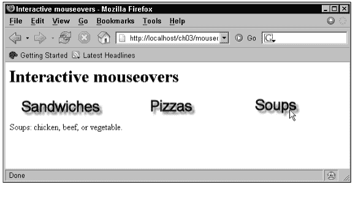

这个示例实现起来并不难。你真正需要做的，就是将`getData`函数（用于获取文本数据并将其显示在你传递名称的`<div>`元素中）连接到图 3-3 中每个图像的`onmouseover`事件。

每个图像的文本数据存储在不同的文件中——`sandwiches.txt`、`pizzas.txt`和`soups.txt`——所以整个工作原理如下：

```html
<body>
    <H1>Interactive mouseovers</H1>

    

    
    

    <div id="targetDiv">
        <p>Welcome to my restaurant!</p>
    </div>
</body>
```

完全没有问题。剩下的部分与本章第一个示例完全相同。`sandwiches.txt`的内容如下：

```text
We offer too many sandwiches to list!
```

`pizzas.txt`的内容如下：

```text
Toppings: pepperoni, sausage, black olives.
```

`soups.txt`的内容如下：

```text
Soups: chicken, beef, or vegetable.
```

这样，你就可以根据鼠标光标悬停的图像来下载相应的文本。那下载一些图片呢？不幸的是，这行不通。无法做到，因为使用`XMLHttpRequest`对象你只有两种选择——文本或 XML（XML 本质上也只是文本，尽管遵循 XML 规则进行格式化）。


将来或许有办法通过 Internet Explorer 的`XMLHttpRequest`对象来下载图像和其他二进制数据，因为它有一个有趣的属性：`responseStream`。`responseStream`属性表示来自服务器的二进制数据流，这确实可以让你将二进制数据从服务器发送到浏览器。问题在于 JavaScript 没有提供任何方法来处理这样的流。其他支持 Web 的微软语言，如 Visual Basic，可以使用这个属性，但 Internet Explorer 的 Jscript（目前）还不行。

## 使用服务器端脚本实现交互


本章前面的所有示例都向你展示了如何使用 Ajax 方法在后台下载静态文本文件，但你也可以连接到服务器端应用程序。这样做能开启各种可能性，因为你可以将数据发送到那些服务器端应用程序，并在后台获取它们的响应。

这正是 Ajax 真正威力所在。你可以创建一个应用程序来监视用户的操作，该应用程序可以根据需要从服务器获取数据。实际上，所有的 Ajax 应用程序都连接到某种服务器程序。

### 选择服务器端脚本语言

我将在本书中使用两种不同的服务器端脚本语言——PHP 和 JavaServer Pages（JSP）。这里的重点当然是 Ajax，所以你不需要知道如何编写 PHP 或 JSP 也能跟上。然而，如果你想在实际工作中运用你的 Ajax 专业知识，了解这两种语言的基本用法是很有用的，因为它们可能是最容易上手的服务器端编程类型。在你将在网上看到的连接到服务器端脚本的 Ajax 示例中，PHP 是最受欢迎的选择。我将在本章开始时介绍如何使用 Ajax 连接到一些 PHP 脚本，以便你可以处理 XML 数据，并将数据发送到服务器以配置从服务器返回的响应。

> **提示**
>
> 成千上万的 Web 服务器支持 PHP，所以如果你想注册一个，很容易找到。你当前使用的服务器可能已经支持 PHP，因为如今大多数都支持——直接问问他们。为了测试目的，你也可以在自己的机器上安装 PHP。你可以从`www.php.net`免费获取 PHP，并附带完整的安装说明（在 Windows 上，安装可以像运行`.exe`文件一样简单）。

### 连接到服务器上的脚本

首先，不如将本章的第一个示例`index.html`（清单 3.1）转换为与 PHP 脚本通信，而不是仅仅下载一个文本文件？接下来的示例`index2.html`不再连接到服务器上的`data.txt`，而是连接到一个 PHP 脚本`data.php`。

`data.txt`中的文本是"This text was fetched using Ajax."，所以对于这个第一个示例，`data.php`将返回相同的文本。以下是该 PHP 文件的内容（记住，阅读本书你不需要了解 PHP 或 JSP）：

```php
<?php
echo 'This text was fetched using Ajax.';
?>
```

如果你将`data.php`安装在自己的计算机上用于测试，放在名为`ch03`的文件夹中，它的相对 URL 是`sample.php`。你可以通过连接该 URL 将`index.html`修改为`index2.html`，如下所示：

```html
<html>
    <head>
        <title>Ajax and PHP at work</title>
        
        <script language="javascript">
            var XMLHttpRequestObject = false;
            
            if (window.XMLHttpRequest) {
                XMLHttpRequestObject = new XMLHttpRequest();
            } else if (window.ActiveXObject) {
                XMLHttpRequestObject = new ActiveXObject("Microsoft.XMLHTTP");
            }
            
            function getData(dataSource, divID)
            {
                if(XMLHttpRequestObject) {
                    var obj = document.getElementById(divID);
                    XMLHttpRequestObject.open("GET", dataSource);
                    
                    XMLHttpRequestObject.onreadystatechange = function()
                    {
                        if (XMLHttpRequestObject.readyState == 4 &&
                            XMLHttpRequestObject.status == 200) {
                            obj.innerHTML = XMLHttpRequestObject.responseText;
                        }
                    }
                    
                    XMLHttpRequestObject.send(null);
                }
            }
        </script>
    </head>
    
    <body>
        
        <H1>Fetching data with Ajax and PHP</H1>
        
        <form>
            <input type="button" value="Display Message"
               onclick="getData('data.php', 'targetDiv')">
        </form>
        
        <div id="targetDiv">
            <p>The fetched data will go here.</p>
        </div>
        
    </body>
</html>
```

这一次，应用程序获取的文本来自一个 PHP 脚本，而不是文本文件。你可以在图3-4中看到这个应用程序的工作情况。当用户点击按钮时，JavaScript连接到`data.php`，返回的文本就会出现在网页上。很酷。

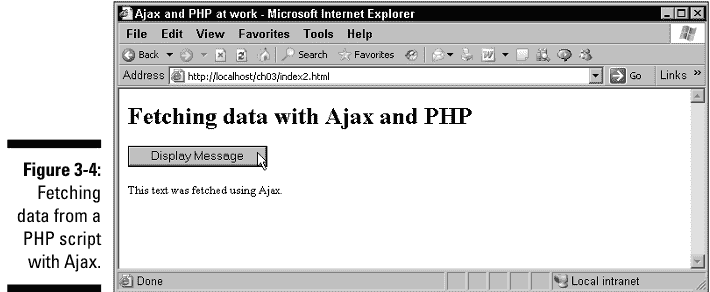

## 是时候来点 XML 了

Ajax应用程序可以通过使用简单文本来回传输数据，但毕竟 Ajax 代表的是异步 JavaScript 和 XML。让一些 XML 加入这个等式如何？来看看图3-5中的新例子`options.html`，它为用户提供了重置此网页上文本（即“给这段文字着色。”这段文字）颜色的各种选项。虽然你看不出它在黑白图中有多绚丽，但这里的文字是绿色的。

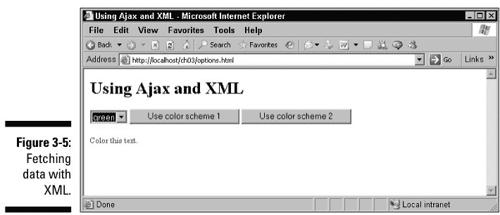

## 第二部分：在 Ajax 中编程

此应用程序下拉列表中的各种颜色是使用 Ajax 方法和 XML 格式的数据获取的。这个应用程序有两个不同的配色方案。

**配色方案1：**

- 红色
- 绿色
- 蓝色

**配色方案2：**

- 黑色
- 白色
- 橙色

用户只需点击你在图3-5中看到的按钮，就可以在这两种（承认吧，相当任意的）方案之间进行选择；当他点击一个按钮时，该配色方案的颜色就会加载到左边的下拉列表中。用户可以选择一种颜色，当他选择后，“给这段文字着色。”的文字就会变成相应的颜色。

## 从 PHP 脚本获取 XML

那么，图3-5中的应用程序是如何工作的呢？两个 PHP 脚本提供了每个配色方案的颜色，`options1.php`和`options2.php`。这些脚本通过使用来自`options1.php`的 XML 来发回它们的数据，就像这样（这是`options1.php`最终发送回浏览器的 XML）：

```xml
<?xml version="1.0"?>
<options>
    <option>
        red
    </option>
    <option>
        green
    </option>
    <option>
        blue
    </option>
</options>
```

## 第3章：认识 Ajax

这是合法的 XML；它以 XML 声明`<?xml version="1.0" ?>`开头，所有 XML 文档要合法都必须有这个声明。所有 XML 文档还必须有一个*文档元素*，它包含所有其他元素。你在 XML 中自定义元素的名称，这里的文档元素是`<options>`元素。


如果你不是 XML 专家也不要担心。对于本书的大部分内容，这就是你需要了解的全部 XML 知识——XML 文档以 XML 声明开头，有一个包含所有其他元素的文档元素，你可以自定义元素的名称，并且每个元素可以包含文本或其他元素。当然，XML 远不止这些，特别是当涉及到用 JavaScript 处理它的时候。关于 XML 以及如何在 JavaScript 中使用它的完整细节，请参见第8章。

`<options>`元素包含三个`<option>`元素，每个元素都包含对应一种颜色的文本：这里是红色、绿色和蓝色。这个第一个 XML 文档很简单，但它完成了任务——目的是列出三种不同的颜色，它做到了。

如何通过使用 PHP 脚本从服务器发送这个 XML？你必须做的第一件事是在你创建的文档中将内容类型头设置为“text/xml”。这会通知浏览器这是 XML 数据，并应如此处理。（这是必要的步骤——否则浏览器不会将你的数据视为 XML。）你可以这样做：

```php
<?php
header("Content-type: text/xml");
.
.
.
?>
```

然后你必须构建 XML 文档的其余部分。以下是如何将颜色名称存储在一个数组中，然后遍历该数组，将每种颜色放在一个`<option>`元素中发回浏览器：

```php
<?php
header("Content-type: text/xml");
$options = array('red', 'green', 'blue');
echo '<?xml version="1.0"?>';
echo '<options>';
foreach ($options as $value)
{
    echo '<option>';
    echo $value;
    echo '</option>';
}
echo '</options>';
?>
```

完美。这是`options2.php`的样子，用于第二个配色方案：

```php
<?php
header("Content-type: text/xml");
$options = array('black', 'white', 'orange');
echo '<?xml version="1.0"?>';
echo '<options>';
foreach ($options as $value)
{
    echo '<option>';
    echo $value;
    echo '</option>';
}
echo '</options>';
?>
```

## 设置网页以读取 XML

那么这个应用程序的重要部分——Ajax 部分呢？那是在`options.html`中完成的。两个按钮让用户选择配色方案，这些按钮调用两个函数：用于配色方案1的`getOptions1`和用于配色方案2的`getOptions2`，如下所示：

```html
<body>
    <h1>Using Ajax and XML</h1>
    <form>
        <select size="1" id="optionList"
                onchange="setOption()">
            <option>Select a scheme</option>
        </select>
        <input type = "button" value = "Use color scheme 1"
               onclick = "getOptions1()">
        <input type = "button" value = "Use color scheme 2"
               onclick = "getOptions2()">
    </form>
    <div id="targetDiv" width =100 height=100>Color this text.</div>
</body>
```

`getOptions1`函数像这样连接到`options1.php`脚本：

```javascript
var options;

function getOptions1()
{
    if(XMLHttpRequestObject) {
        XMLHttpRequestObject.open("GET",
        "options1.php", true);
        .
        .
        .
    }
}
```

## 处理从服务器读取的 XML

当服务器的响应以 XML 而不是纯文本返回时，你可以使用 XMLHttpRequest 对象的`responseXML`属性来读取该响应，如下所示：

```javascript
var options;

function getOptions1()
{
    if(XMLHttpRequestObject) {
        XMLHttpRequestObject.open("GET",
        "options1.php", true);

        XMLHttpRequestObject.onreadystatechange = function()
        {
            if (XMLHttpRequestObject.readyState == 4 &&
                XMLHttpRequestObject.status == 200) {
                var xmlDocument = XMLHttpRequestObject.responseXML;
                .
                .
                .
            }
        }

        XMLHttpRequestObject.send(null);
    }
}
```

前面代码中加粗的 JavaScript 行将`options1.php`发回的 XML 存储在一个名为`xmlDocument`的变量中。你如何在 JavaScript 中处理那个 XML？

事实证明这并不难。正如你可以使用内置的`getElementById`函数通过其 ID 值获取元素一样，你也可以使用内置的`getElementsByTagName`函数获取所有具有特定名称的元素。在这个例子中，包含你所需数据的元素是`<option>`元素，因此你可以像这样获取它们并将它们全部存储在一个名为`options`的变量中：

```javascript
var options;

function getOptions1()
{
  if(XMLHttpRequestObject) {
    XMLHttpRequestObject.open("GET",
      "options1.php", true);

    XMLHttpRequestObject.onreadystatechange = function()
    {
      if (XMLHttpRequestObject.readyState == 4 &&
          XMLHttpRequestObject.status == 200) {
        var xmlDocument = XMLHttpRequestObject.responseXML;
        options = xmlDocument.getElementsByTagName("option");
        .
        .
        .
      }
    }

    XMLHttpRequestObject.send(null);
  }
}
```

到目前为止一切顺利——你已经将服务器返回的颜色存储在名为`options`的变量中了。现在如何解包这些颜色的实际名称呢？嗯，请看下一节。

## 从 XML 中提取数据

要从 XML 中提取信息，这个例子调用另一个名为`listOptions`的函数，它将解包颜色并将其存储到下拉列表中：

```javascript
var options;

function getOptions1()
{
  if(XMLHttpRequestObject) {
    XMLHttpRequestObject.open("GET",
      "options1.php", true);

    XMLHttpRequestObject.onreadystatechange = function()
    {
      if (XMLHttpRequestObject.readyState == 4 &&
```

## 第二部分：Ajax 编程

`listOptions`函数如何从`options`变量中解包颜色，并将它们存储到用户可以选择的 HTML 下拉`<select>`控件中？（`<select>`控件会显示一个下拉列表，例如本例中的这个。）目前，`options`变量包含以下数据：

```xml
<option>
  red
</option>
<option>
  green
</option>
<option>
  blue
</option>
```

这些数据实际上存储为一个`<option>`元素的数组，这使得事情变得简单，因为你可以遍历该数组。（我将在第2章介绍数组中的循环。）你可以通过使用数组的`length`属性来找到数组中的项目数量，因此，以下是遍历`listOptions`函数中所有`<option>`元素的方法：


```javascript
function listOptions()
{
  var loopIndex;

  for (loopIndex = 0; loopIndex < options.length; loopIndex++)
  {
    .
    .
    .
  }
}
```

到目前为止进展顺利。在循环中，你可以通过这种方式引用`options`变量中的每个`<option>`元素：`options[loopIndex]`——这会在每次循环中选出当前的`<option>`元素。第一个这样的元素看起来像这样：

```xml
<option>
  red
</option>
```

你如何从这个XML元素中提取颜色？JavaScript通过将此元素中的文本视为元素的*子节点*来处理这类元素——即，包含在元素内部的节点。要获取该子节点，你可以使用元素的`firstChild`属性（第8章将详细介绍使用JavaScript处理XML的细节），因此，以下是将当前`<option>`元素的文本作为XML节点恢复的方法：`options[loopIndex].firstChild`。这会给你一个*文本节点*——一个只包含文本的节点，信不信由你——它持有颜色“red”的文本。你如何实际提取对应于颜色的文本？你使用文本节点的`data`属性，所以（终于！）你可以使用这个表达式从当前`<option>`元素中提取颜色：`options[loopIndex].firstChild.data`。

呼。所以现在你可以从`options`变量中的每个`<option>`元素获取颜色了。

## 在下拉控件中列出颜色

你如何将这些颜色存储到下拉`<select>`控件（名为`optionList`的那个）中，以便用户可以选择她想要的颜色？在JavaScript中，你可以通过以下方式获取与下拉控件对应的对象：

```javascript
function listOptions()
{
    var loopIndex;
    var selectControl = document.getElementById('optionList');

    for (loopIndex = 0; loopIndex < options.length; loopIndex++)
    {
    .
    .
    .
    }
}
```

要将颜色添加到`<select>`控件，你可以使用控件的`options`属性，该属性持有控件中列出的项目。你想添加到列表中的每个项目都是一个`option`对象，对应于一个HTML `<option>`元素，因此你可以通过以下方式将所有颜色添加到`<select>`控件：

```javascript
function listOptions()
{
    var loopIndex;
    var selectControl = document.getElementById('optionList');

    for (loopIndex = 0; loopIndex < options.length; loopIndex++)
    {
        selectControl.options[loopIndex] = new
            Option(options[loopIndex].firstChild.data);
    }
}
```

就是这样。现在下拉列表显示了用户选择的配色方案的可用颜色。

你必须采取最后一个步骤。当用户在下拉列表中选择一种颜色时，代码必须将显示的文本着色以匹配。当用户在下拉颜色列表中进行选择时，列表的`onchange`事件发生，它会调用一个名为`setOption`的函数，如下所示：

```html
<form>
    <select size="1" id="optionList"
        onchange="setOption()">
        <option>Select a scheme</option>
    </select>

    <input type="button" value="Use color scheme 1"
        onclick="getOptions1()">
    <input type="button" value="Use color scheme 2"
        onclick="getOptions2()">
</form>
```

`setOption`函数的工作是将“Color this text.”文本（存储在名为“targetDiv”的`<div>`元素中）着色以匹配用户选择的颜色。用户选择了哪种颜色？你可以使用`<select>`控件的`selectedIndex`属性来确定用户选择的项目编号。如果用户选择了第一个项目，此属性将为0；如果选择了第二个项目，此属性将为1；以此类推。你可以将此属性与`options`变量（持有你从服务器获得的所有`<option>`元素）一起使用，来确定要使用的适当颜色。因此，以下是获取用户选择的颜色的方法（说JavaScript是轻量级语言的人从未需要处理这样的表达式）：

```javascript
options[document.getElementById('optionList').selectedIndex].firstChild.data
```

你如何将`targetDiv` `<div>`元素中的文本着色以匹配此颜色？你可以使用`<div>`元素的`style`属性来恢复其样式设置。要访问`<div>`元素的文本颜色，你可以引用`style`属性的`color`。因此，以下是如何从JavaScript引用`targetDiv` `<div>`元素中文本颜色的方法：

```javascript
document.getElementById('targetDiv').style.color
```

这意味着在`setOption`函数中，要将`targetDiv` `<div>`元素中的文本颜色设置为匹配用户选择的颜色，你可以这样做：

```javascript
function setOption()
{
    document.getElementById('targetDiv').style.color =
        options[document.getElementById
        ('optionList').selectedIndex].firstChild.data;
}
```

是的，它看起来很复杂，但随着你对JavaScript的了解，或者如果你已经是JavaScript专家，这类东西将变得自然而然。只需要一些时间。就是这样——这个示例成功了。

但是，如果你退后一步，作为Ajax程序员评估情况，你可能想知道为什么需要两个PHP脚本来处理两种不同的配色方案。为什么不能只是向一个*单一*的PHP脚本传递一些数据来指示我们想要哪个配色方案？这是一个非常好的问题。你确实可以从JavaScript向服务器端脚本传递数据，这是一项重要的技能，因为Ajax应用程序通常需要向服务器发送数据以获得所需的响应。

## 使用GET将数据传递给服务器

没有充分的理由需要两个服务器端PHP脚本——`options1.php`和`options2.php`——来传回两种配色方案的颜色。你真正需要的只是一个服务器端脚本——`options.php`——但你必须告诉它你感兴趣的配色方案。这样做意味着向服务器传递数据。

尽管这些示例使用PHP，但Ajax将数据传回服务器的方式对于几乎所有服务器端编程语言都是相同的，从PHP到Perl，从JSP到Python。那么，在Ajax中如何将数据传递给服务器端程序呢？一种方法是使用`GET`方法和*URL编码*。但这里有一个值得注意的问题——如果你使用URL编码和`GET`方法，你的数据相当公开。当它在互联网上传输时，可能会被他人读取。你可以通过使用`POST`方法而不是`GET`来加以保护。

然而，要使用`POST`，你仍然需要理解`GET`。以下各节将提供所有细节。

当你使用`GET`方法从服务器获取数据时，就像本书中到目前为止所有的Ajax示例一样，数据是通过URL编码从网页发送回服务器的，这意味着数据被附加到从服务器读取的实际URL上。

例如，如果你正在使用GET方法，并且有一个名为`a`的文本字段包含数字5，一个名为`b`的文本字段包含数字6，一个名为`c`的文本字段包含文本“Now is the time”，所有这些数据将被编码并添加到你正在访问的URL。当数据被URL编码时，会在URL末尾添加一个问号（`?`），数据以`name=data`格式添加在该问号之后。文本中的空格被转换为加号（`+`），并且你使用与号（`&`）来分隔`name=data`项对。因此，要将来自`a`、`b`和`c`文本字段的数据编码并发送到`http://www.servername.com/user/scriptname`，你会使用这个URL：

```text
http://www.servername.com/user/scriptname?a=5&b=6&c=Now+is+the+time
```

请注意，你以这种方式发送的数据始终是文本——即使你发送的是数字，它们也被视为文本。

JavaScript的`escape`函数将编码数据以附加到URL末尾，它会自动处理诸如将空格转换为加号之类的事情。例如，如果你想准备一个文本字段的文本以附加到URL，你会使用这样的代码：`var urlReadyText = escape(textField.value);`。

在这个特定示例中，目标是告诉一个在线脚本`options.php`，你想使用哪个配色方案，方案1还是方案2。思路是将值“1”或“2”发送到`options.php`。你如何在服务器端脚本中恢复这些值取决于你使用的语言。例如，在PHP中，你可以使用一个名为`$_GET`的数组来恢复这些值（因为你使用的是GET方法——如果你使用POST方法，你会使用`$_POST`）。因此，如果你将发送给脚本的数据命名为`scheme`，URL类似这样：

```text
http://localhost/ch03/options.php?scheme=1
```

那么你可以在PHP中通过`$_GET["scheme"]`来恢复`scheme`参数的设置。对于`scheme = "1"`，你想返回颜色'red'、'green'和'blue'；对于`scheme = "2"`，你返回值'black'、'white'和'orange'。以下是`options.php`的内容——请注意检查所请求的`scheme`的部分：

```php
<?
header("Content-type: text/xml");
if ($_GET["scheme"] == "1")
    $options = array('red', 'green', 'blue');
if ($_GET["scheme"] == "2")
    $options = array('black', 'white', 'orange');
echo '<?xml version="1.0"?>';
echo '<options>';
foreach ($options as $value)
{
```

第二部分：Ajax 编程

```php
echo '<option>';
echo $value;
echo '</option>';
}
echo '</options>';
?>
```

好的，这个PHP脚本会根据你选择的配色方案——1或2——返回两个不同的XML文档。下一步是设计一个新的HTML文档`options2.html`，它将正确调用`options2.php`。在`options2.html`中，用户点击选择配色方案的按钮会将所选方案的编号（1或2）传递给`getOptions`函数，如下所示：

```html
<body>

    <h1>使用 Ajax 和 XML 传递数据</h1>

    <form>
        <select size="1" id="optionList"
            onchange="setOption()">
            <option>选择一个方案</option>
        </select>
        <input type = "button" value = "使用配色方案 1"
            onclick = "getOptions('1')">
        <input type = "button" value = "使用配色方案 2"
            onclick = "getOptions('2')">
    </form>

    <div id="targetDiv" width =100 height=100>给这段文字着色。</div>

</body>
```

`getOptions`函数接受这个参数，即方案编号：

```javascript
function getOptions(scheme)
{
    .
    .
    .
}
```

第一步是对方案编号进行URL编码，将`scheme`参数设置为"1"或"2"，正如`options.php`脚本所预期的那样：

```javascript
function getOptions(scheme)
{
    var url = "options2.php?scheme=" + scheme;
    .
    .
    .
}
```

很好。现在你要做的就是使用`GET`方法打开URL，然后使用服务器返回的数据来填充下拉列表：

```javascript
function getOptions(scheme)
{
  var url = "options2.php?scheme=" + scheme;

  if(XMLHttpRequestObject) {
    XMLHttpRequestObject.open("GET", url, true);

    XMLHttpRequestObject.onreadystatechange = function()
    {
      if (XMLHttpRequestObject.readyState == 4 &&
          XMLHttpRequestObject.status == 200) {
        var xmlDocument = XMLHttpRequestObject.responseXML;
        options = xmlDocument.getElementsByTagName("option");
        listOptions();
      }
    }

    XMLHttpRequestObject.send(null);
  }
}
```

就是这样——`options2.html`将调用服务器上的`options.php`，传递用户选择的配色方案编号。而`options.php`将返回该配色方案的颜色数据。非常好。它按预期工作。现在你正在向服务器发送数据。

## 使用POST向服务器传递数据

当你使用`POST`方法向URL传递数据时，它会在内部进行编码（在发送到服务器的HTTP请求中），这使得发送数据比使用`GET`更安全（尽管不如使用安全的HTTPS连接到服务器安全）。

在接下来的部分，你将了解使用`POST`方法的工作原理。

在Ajax中使用`POST`方法传递数据与使用`GET`略有不同。对于PHP，你可以使用`$_POST`数组（而不是`$_GET`）来恢复通过`POST`发送到PHP脚本的数据。以下是新PHP脚本`options3.php`中的样子：

```php
<?
header("Content-type: text/xml");
if ($_POST["scheme"] == "1")
  $options = array('red', 'green', 'blue');
if ($_POST["scheme"] == "2")
  $options = array('black', 'white', 'orange');

echo '<?xml version="1.0"?>';
echo '<options>';
foreach ($options as $value)
{
    echo '<option>';
    echo $value;
    echo '</option>';
}
echo '</options>';
?>
```

我听说过一些罕见的PHP安装，在这些安装中，当你使用`POST`方法时，`$_POST`在Ajax应用程序中无法工作。在这种情况下，你必须使用`$HTTP_RAW_POST_DATA`代替。这种技术可以让你获取发送到PHP脚本的原始数据字符串（例如"a=5&b=6&c=Now+is+the+time"），你需要从中提取数据。

如何在JavaScript中使用`POST`方法？这不像在连接到服务器时简单地将"GET"改为"POST"那样简单：

```javascript
XMLHttpRequestObject.open("POST", url); // 单独这样行不通！
```

没那么简单，因为当你使用`POST`时，你不对数据进行URL编码。相反，你必须使用`XMLHttpRequest`对象的`send`方法显式发送数据。

你需要这样做。你以如下方式在`getOptions`函数中设置要打开的URL，不进行任何URL编码，该函数负责与服务器通信：

```javascript
function getOptions(scheme)
{
    var url = "options3.php";
    .
    .
    .
}
```

然后你配置`XMLHttpRequest`对象使用此URL。你通过使用`open`方法并指定要使用`POST`方法来实现这一点：

```javascript
function getOptions(scheme)
{
    var url = "options3.php";

    if(XMLHttpRequestObject) {
        XMLHttpRequestObject.open("POST", url);
```


要使用`POST`方法，你还应为请求设置一个 HTTP 头，表明请求中的数据将以标准的`POST`方式设置。如下所示：

```javascript
function getOptions(scheme)
{
    var url = "options3.php";

    if(XMLHttpRequestObject) {
        XMLHttpRequestObject.open("POST", url);
        XMLHttpRequestObject.setRequestHeader('Content-Type',
            'application/x-www-form-urlencoded');
            .
            .
            .
    }
}
```

然后，你可以像以前一样将匿名函数连接到`XMLHttpRequest`对象的`onreadystatechange`属性以处理异步请求，如下所示：

```javascript
function getOptions(scheme)
{
    var url = "options3.php";

    if(XMLHttpRequestObject) {
        XMLHttpRequestObject.open("POST", url);
        XMLHttpRequestObject.setRequestHeader('Content-Type',
            'application/x-www-form-urlencoded');

        XMLHttpRequestObject.onreadystatechange = function()
        {
            if (XMLHttpRequestObject.readyState == 4 &&
                XMLHttpRequestObject.status == 200) {
                var xmlDocument = XMLHttpRequestObject.responseXML;
                options = xmlDocument.getElementsByTagName("option");
                listoptions();
            }
        }
        .
        .
        .
    }
}
```

现在关键部分来了。与其像使用`GET`方法那样发送`null`值，你现在发送脚本想要获取的数据。在这种情况下，那就是`scheme = 1`，像这样：

```javascript
function getOptions(scheme)
{
    var url = "options3.php";

    if(XMLHttpRequestObject) {
        XMLHttpRequestObject.open("POST", url);
        XMLHttpRequestObject.setRequestHeader('Content-Type',
            'application/x-www-form-urlencoded');

        XMLHttpRequestObject.onreadystatechange = function()
        {
            if (XMLHttpRequestObject.readyState == 4 &&
                XMLHttpRequestObject.status == 200) {
                var xmlDocument = XMLHttpRequestObject.responseXML;
                options = xmlDocument.getElementsByTagName("option");
                listOptions();
            }
        }

        XMLHttpRequestObject.send("scheme=" + scheme);

    }
}
```

好了。现在这个新版本的 Ajax 应用程序`options3.html`将使用`POST`方法将数据发送到`options3.php`，后者将以 XML 格式返回其数据。非常简洁。

如果你想使用 XML 将数据发送到服务器端程序，`POST`方法也适用。这是因为你不必自己显式编码发送到服务器的数据，也不必将其附加到 URL 的末尾。（某些服务器对 URL 的长度有限制。）

要将你的数据作为 XML 发送，你需要设置一个请求头，以便你的请求的内容类型是`"text/xml"`而不是`"application/x-www-form-urlencoded"`：

```javascript
XMLHttpRequestObject.setRequestHeader("Content-Type", "text/xml")
```

然后你可以使用`send`方法直接将 XML 发送到服务器，大致如下：

```javascript
XMLHttpRequestObject.send("<doc><name>limit</name><data>5</data></doc>");
```

# 第四章：深入 Ajax

## 本章内容

- 从服务器返回 JavaScript
- 返回 JavaScript 对象
- 自己连接到 Google Suggest
- 创建实时搜索
- 执行服务器端验证
- 处理 head 请求
- 同时处理多个 XMLHttpRequest 请求

> “嘿！”高薪的 Ajax 大师程序员说，“这是怎么回事？我只是在做我正常的 Ajax 编程，但某个该死的安全消息一直弹出来。”
>
> “浏览器在给你安全警告，”首席执行官说。“它说你的应用程序正在尝试访问另一个网站。”
>
> “嗯，这消息真有用，”高薪的 Ajax 大师程序员说，“我知道了。”
>
> “你不应该尝试从你的 JavaScript 连接到另一个 Web 域，比如 Google——你没读过 *Ajax For Dummies* 的第 4 章吗？”你平静地说着，从阴影中走出来。
>
> “哈？”Ajax 大师程序员问道。
>
> “没关系，”你坐下来接手，说道，“我会告诉你这应该如何工作——当然，需要支付可观的费用。”

你知道 Ajax 为你的 Web 应用程序增添了强大的功能，但正如这个例子所示，除非你了解其中的技巧，否则诸如此类的问题会让你的用户望而却步。本章解释了如何最好地实现强大的 Ajax 技术，例如连接到 Google 进行即时搜索、从服务器返回 JavaScript、向服务器发送 HTTP head 请求、调试 Ajax 以及处理多线程问题。所有这些内容都将在本章中呈现。

# 114 第二部分：Ajax编程

## 从服务器返回JavaScript

在第3章中，我讲解了如何处理从服务器发送回Ajax应用程序的文本，以及如何处理从服务器返回的简单XML。但还有一种技术你有时会看到——服务器可以发送回JavaScript供你执行。这听起来并不像表面那么奇怪，因为你可以使用名为`eval`的内置JavaScript函数来处理从服务器发回的文本，如果该文本是JavaScript，你就能使其生效。

## 何时从服务器发送回JavaScript？

你有时会看到这种技术被用在Ajax应用程序向服务器发送多个请求，并且你不知道哪个请求会先返回的情况下。在这种情况下，程序员有时会让服务器返回要执行的实际JavaScript，该JavaScript会调用正确的函数——一个异步请求对应一个函数，另一个请求对应另一个函数。

> **切记：** 我不推荐这种技术，除非在一种情况下——你对服务器端代码没有任何控制权，并且必须处理它发送给你的JavaScript（例如连接到Google Suggest，我将在本章稍后解释）。否则，让服务器返回要执行的代码并非最佳编程方式——服务器端程序不应该需要了解你JavaScript代码的细节，并且从外部来源获取代码会使你的应用程序更难调试和维护。相反，我建议你的服务器调用应返回一个可测试的值，然后浏览器中的JavaScript代码可以调用正确的函数。

另一方面，这是一种常见的Ajax技术，当你不得不处理一个你无法控制的、返回JavaScript代码的服务器时，有时无法避免，因此你应该了解其工作原理。

## 返回JavaScript是如何工作的？

为了向你展示这项技术的工作原理，这里有一个例子——本书代码中的`javascript.html`。如图4-1所示，该示例显示了一个标题为`Fetch JavaScript`的按钮。

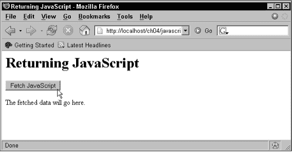

图4-1：使用Ajax获取JavaScript。

以下是在`javascript.html`中用 HTML 创建按钮的方法：

```html
<body>
    <H1>Returning JavaScript</H1>
    <form>
        <input type = "button" value = "Fetch JavaScript"
               onclick = "getData('javascript.php')">
    </form>
    <div id="targetDiv">
        <p>The fetched data will go here.</p>
    </div>
</body>
```

注意，当用户点击按钮时，一个名为`getData`的函数会被调用，参数是用于获取 JavaScript 的相对 URL，`javascript.php`。以下是`getData`函数如何调用该 URL 的方法：

```javascript
<html>
<head>
    <title>Returning JavaScript</title>
    <script language = "javascript">
        var XMLHttpRequestObject = false;
        if (window.XMLHttpRequest) {
            XMLHttpRequestObject = new XMLHttpRequest();
        } else if (window.ActiveXObject) {
            XMLHttpRequestObject = new ActiveXObject("Microsoft.XMLHttp");
```

# 116 第二部分：Ajax编程

```javascript
function getData(dataSource)
{
    if(XMLHttpRequestObject) {
        XMLHttpRequestObject.open("GET", dataSource);

        XMLHttpRequestObject.onreadystatechange = function()
        {
            if (XMLHttpRequestObject.readyState == 4 &&
                XMLHttpRequestObject.status == 200) {
                .
                .
                .
            }
        }

        XMLHttpRequestObject.send(null);
    }
}
.
.
.
```

服务器端脚本`javascript.php`非常简单。它返回一行 JavaScript，该 JavaScript 将调用一个名为`alerter`的函数：

```php
<?php
    echo 'alerter()';
?>
```

因此，当`javascript.html`在后台调用`javascript.php`时，`XMLHttpRequest`对象最终会在其`responseText`属性中获得文本`"alerter()"`。你可以轻松地执行该 JavaScript——只需在`getData`函数中以如下方式将其传递给 JavaScript 的`eval`函数：

```javascript
function getData(dataSource)
{
    if(XMLHttpRequestObject) {
        XMLHttpRequestObject.open("GET", dataSource);

        XMLHttpRequestObject.onreadystatechange = function()
        {
            if (XMLHttpRequestObject.readyState == 4 &&
                XMLHttpRequestObject.status == 200) {

                eval(XMLHttpRequestObject.responseText);
            }
        }

        XMLHttpRequestObject.send(null);
    }
}
```

很好，现在剩下的就是将`alerter`函数添加到`javascript.html`中。该函数只是通过将文本写入一个`<div>`元素，在页面上显示一条友好的消息`"Got the JavaScript OK."`：

```javascript
function alerter()
{
    var targetDiv = document.getElementById("targetDiv");

    targetDiv.innerHTML = "Got the JavaScript OK.";
}
```

当服务器端脚本发送回要执行的 JavaScript 行`alerter()`时，将调用此函数。页面`<body>`部分中的消息显示所在的`<div>`元素如下所示：

```html
<body>

    <H1>Returning JavaScript</H1>

    <form>
        <input type = "button" value = "Fetch JavaScript"
               onclick = "getData('javascript.php')">
    </form>

    <div id="targetDiv">
        <p>The fetched data will go here.</p>
    </div>

</body>
```

就是这样。现在，当用户点击按钮时，这个 Ajax 应用程序从服务器获取 JavaScript 来执行，并执行该 JavaScript，调用一个显示成功消息的函数，如图4-2所示。

图4-2：成功使用 Ajax 获取 JavaScript。

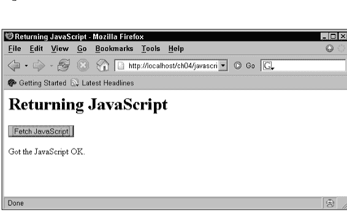

## 返回JavaScript对象

在 Ajax 应用程序中，你不仅可以返回要执行的 JavaScript 代码行——你还可以从服务器返回 JavaScript 对象。

但是等等——服务器不是只能向 Ajax 应用程序返回文本和格式为 XML 的文本吗？是的，但你可以将 JavaScript 对象格式化为文本，然后在 JavaScript 代码中获取它后将其转换回对象。

这里有一个例子，本书代码中的`object.html`，用来展示这是如何工作的。（有关本书配套网站上代码的详情，请参见本书简介。）假设你有一个名为`adder`的函数，如本例所示，该函数将两个数字相加并在警报框中显示总和：

```javascript
function adder(op1, op2)
{
    var sum = op1 + op2;
    alert(op1 + " + " + op2 + " = " + sum);
}
```

然后假设你想创建一个对象，该对象包含要调用的函数名称以及要传递给该函数的两个操作数——这正是服务器端程序可能传回给你的对象类型。在这种情况下，传回给你脚本的对象可能具有以下三个属性：

- ✓ `function`：要调用的函数，例如`"alerter"`。
- ✓ `operand1`：传递给`alerter`函数的第一个操作数，本例中为2。
- ✓ `operand2`：传递给`alerter`函数的第二个操作数，本例中为3。

你可以在 JavaScript 中从文本创建一个具有这三个属性的对象。名为`text`的变量保存要使用的文本，名为`jSObject`的变量保存将要创建的对象：

```javascript
var text = "{function: 'adder', operand1: 2, operand2: 3};";
var jSObject;
```

你可以使用`eval`函数来创建新对象并将其分配给`jSObject`变量，如下所示：

```javascript
eval('jSObject = ' + text);
```

然后你可以使用新创建对象的属性来调用`adder`函数：


# 将文本转换为 JavaScript 对象

```html
<html>
  <head>
    <title>
      Converting text to a JavaScript object
    </title>

    <script>
      var text = "{method: 'adder', operand1: 2, operand2: 3;}";
      var jSObject;

      eval('jSObject = ' + text);

      eval(jSObject.method + '(' + jSObject.operand1 + ',' +
           jSObject.operand2 + ')');

      function adder(op1, op2)
      {
        var sum = op1 + op2;
        alert(op1 + " + " + op2 + " = " + sum);
      }
    </script>
  </head>

  <body>
    <h1>
      Converting text to a JavaScript object
    </h1>
  </body>
</html>
```

你可以在图4-3中看到结果。显然，`2 + 3 = 5`。

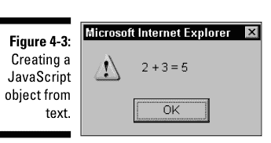

这就是如何将 JavaScript 对象从服务器传递回 Ajax 应用程序——传递你可以通过 JavaScript `eval` 函数转换为对象的文本。

# 连接到谷歌进行实时搜索

我并不太提倡在 Ajax 应用中使用服务器发送的 JavaScript，除非一种情况——即你所连接的服务器没有给你其他选择。而本节展示的示例就是这种情况：直接连接到谷歌以实现实时搜索。

著名的 Ajax 应用之一是谷歌建议功能，你可以在图4-4中看到它的运行情况。要使用谷歌建议，只需访问其页面（截至本文写作时，其网址为`www.google.com/webhp?complete=1&hl=en`），然后开始输入搜索词。正如你在图中看到的，谷歌会在你输入时给出建议——如果你点击某个建议，谷歌就会搜索该词条。

这个应用是 Ajax 的旗舰之一，因为你在图中看到的下拉菜单是直接出现的——无需刷新页面。这种实时搜索应用正是最初让人们对 Ajax 感到惊叹的地方。

事实上，你可以自己实现同样类型的实时搜索，直接连接到谷歌建议功能，正如你在接下来的示例中看到的——本书代码中的`google.html`文件，其效果如图4-5所示。就像在谷歌页面输入搜索词一样，在这个本地版本中，你会看到一个可点击项目组成的菜单，并且随着你的输入而更新。

你如何自己连接到谷歌建议呢？假设你将想要搜索的词条放入名为`term`的变量中。然后你可以打开这个网址：

```
http://www.google.com/complete/search?hl=en&js=true&qu=" + term;
```

你会从谷歌建议返回一行 JavaScript，它调用一个名为`sendRPCDone`的函数。以下是传递给该函数的参数：

```
sendRPCDone(unusedVariable, searchTerm, arrayTerm, arrayResults, unusedArray)
```

你从谷歌建议返回的实际 JavaScript 是什么样子的？如果你搜索的是“ajax”，那么截至本文写作时，你将从谷歌得到如下 JavaScript：

```
sendRPCDone(frameElement, "ajax", new Array("ajax", "ajax amsterdam", "ajax fc", "ajax ontario", "ajax grips", "ajax football club", "ajax public library", "ajax football", "ajax soccer", "ajax pickering transit"), new Array("3,840,000 results", "502,000 results", "710,000 results", "275,000 results", "8,860 results", "573,000 results", "40,500 results", "454,000 results", "437,000 results", "10,700 results"), new Array(""));
```

你可以通过构建一个名为`sendRPCDone`的函数来处理这些数据，该函数将按图4-5（如前所示）所示的方式显示这些数据。很酷吧。

## 处理谷歌发送的数据

`google.html`中的代码是什么样子的？用户输入文本的文本框通过`onkeyup`事件与一个名为`getSuggest`的函数绑定。因此，每次用户按键并松开时，都会调用`getSuggest`函数。（注意，事件对象通过这段代码传递给`getSuggest`，因为该对象包含了关于哪个键被按下的信息，另外注意显示建议的`<div>`元素，即`targetDiv`。）以下是代码的样子：

```html
<body>

    <H1>Google live search</H1>

    Search for <input id = "textField" type = "text"
        name = "textField" onkeyup = "getSuggest(event)">

    <div id = "targetDiv"><div></div></div>

</body>
```

## 检测按键

`getSuggest`函数应该接收一个事件对象，该对象在函数内被称为`keyEvent`，它包含了关于刚刚发生的按键事件的数据：

```javascript
function getSuggest(keyEvent)
{
    .
    .
    .
}
```

然而，这种传递事件对象的方法在 Internet Explorer 中不起作用，这意味着在该浏览器中，`getSuggest`不会收到任何传入值。你必须在 Internet Explorer 中使用`window.event`对象。因此，`getSuggest`的第一行是典型的 JavaScript 代码，它使用 JavaScript 条件运算符（参阅第2章表2-1）来确保你有一个可用的事件对象。以下是展示如何使用此运算符的示例：

```javascript
var temperature = condition ? 72 : 55;
```

如果`condition`为真，`temperature`变量将被赋值为72；如果`condition`为假，`temperature`将被赋值为55。在`getSuggest`函数中，你可以使用条件运算符来测试`keyEvent`是否具有非零值。如果没有，你应该改用`window.event`：

```javascript
function getSuggest(keyEvent)
{
    keyEvent = (keyEvent) ? keyEvent: window.event;
    .
    .
    .
}
```

你还可以确定用户正在向哪个控件中输入内容，但这取决于用户使用的浏览器。在 Internet Explorer 中，你使用`keyEvent`对象的`srcElement`属性，但在其他浏览器中，你使用`target`属性来获取用户正在输入内容的控件：

```javascript
function getSuggest(keyEvent)
{
  keyEvent = (keyEvent) ? keyEvent: window.event;
  input = (keyEvent.target) ? keyEvent.target :
          keyEvent.srcElement;
  .
  .
}
```

很好。你现在已经拥有了关于按键事件的所有数据。现在你可以使用以下代码来检查该事件是否为按键释放事件：

```javascript
function getSuggest(keyEvent)
{
  keyEvent = (keyEvent) ? keyEvent: window.event;
  input = (keyEvent.target) ? keyEvent.target :
          keyEvent.srcElement;

  if (keyEvent.type == "keyup") {
    .
    .
    .
  }
}
```

如果该事件是按键释放事件，就该读取按下的键了。如果文本框中有文本，就该连接到谷歌建议了。

## 连接到谷歌建议

要连接到谷歌建议，你需要调用一个名为`getData`的函数，该函数的功能正是获取实时搜索数据，如下所示：

```javascript
function getSuggest(keyEvent)
{
  keyEvent = (keyEvent) ? keyEvent: window.event;
  input = (keyEvent.target) ? keyEvent.target :
          keyEvent.srcElement;

  if (keyEvent.type == "keyup") {
    if (input.value) {
      getData("google.php?qu=" + input.value);
    }
    else {
      var targetDiv = document.getElementById("targetDiv");
      targetDiv.innerHTML = "<div></div>";
    }
  }
}
```

`getData`函数是如何工作的呢？这个函数调用实际与谷歌建议交互的 PHP 脚本，并将当前搜索词传递给该脚本。此函数通过要调用的相对 URL 被调用，即如下形式（其中`term`包含搜索词）：

```
google.php?qu=" + term;
```

该 URL 在`getData`函数中按如下方式打开：

```javascript
<script language = "javascript">
    var XMLHttpRequestObject = false;

    if (window.XMLHttpRequest) {
        XMLHttpRequestObject = new XMLHttpRequest();
    } else if (window.ActiveXObject) {
        XMLHttpRequestObject = new ActiveXObject("Microsoft.XMLHttp");
    }
}
```

```javascript
function getData(dataSource)
{
    if(XMLHttpRequestObject) {
        XMLHttpRequestObject.open("GET", dataSource);
        .
        .
        .
    }
}
```

## 显示谷歌的响应

当你获得搜索数据后，你需要显示来自谷歌的响应，该响应将是 JavaScript 代码。响应通过 JavaScript 的`eval`函数执行：

```javascript
function getData(dataSource)
{
    if(XMLHttpRequestObject) {
        XMLHttpRequestObject.open("GET", dataSource);

        XMLHttpRequestObject.onreadystatechange = function()
        {
            if (XMLHttpRequestObject.readyState == 4 &&
                XMLHttpRequestObject.status == 200) {
                    eval(XMLHttpRequestObject.responseText);
            }
        }

        XMLHttpRequestObject.send(null);
    }
}
```

这将调用`sendRPCDone`函数。在`google.html`中，剩下的就是以如下方式设置该函数：

```javascript
function sendRPCDone(unusedVariable, searchTerm, arrayTerm,
    arrayResults, unusedArray)
{
    .
    .
    .
}
```

## 126 第二部分：Ajax 编程

你在`sendRPCDone`函数中，使用从 Google 获取的数据填充`<div>`元素`targetDiv`，并使用 HTML 表格来对齐列。以下是如何创建表格并开始循环处理 Google 返回的建议：

```javascript
function sendRPCDone(unusedVariable, searchTerm, arrayTerm,
    arrayResults, unusedArray)
{
    var data = "<table>";
    var loopIndex;

    if (arrayResults.length != 0) {
        for (var loopIndex = 0; loopIndex < arrayResults.length;
            loopIndex++) {
            .
            .
            .

        }
    }

    data += "</table>";

    var targetDiv = document.getElementById("targetDiv");

    targetDiv.innerHTML = data;
}
```

接下来，为每个建议创建一个独立的超链接，点击时将搜索 Google，并像这样将浏览器重定向到 Google 网站：

```javascript
function sendRPCDone(unusedVariable, searchTerm, arrayTerm,
    arrayResults, unusedArray)
{
    var data = "<table>";
    var loopIndex;

    if (arrayResults.length != 0) {
        for (var loopIndex = 0; loopIndex < arrayResults.length;
            loopIndex++) {
            data += "<tr><td>" +
                "<a href='http://www.google.com/search?q=" +
                arrayTerm[loopIndex] + "'>" + arrayTerm[loopIndex] +
                "</a></td><td>" + arrayResults[loopIndex] + "</td></tr>";
        }
    }

    data += "</table>";

    var targetDiv = document.getElementById("targetDiv");

    targetDiv.innerHTML = data;
}
```

最后一步：在`<head>`部分的`<style>`元素中为`targetDiv` `<div>`元素设置浅黄色背景（关于如何在 Ajax 中使用样式，你可以参考第9章了解更多）：

```html
<html>
  <head>

    <title>Google live search</title>

    <style>
    #targetDiv {
      background-color: #FFEEAA;
      width: 30%;
    }
    </style>
      .
      .
      .
```

这就是全部所需。

由于这个 Google 示例比较复杂，清单4-1展示了完整代码以帮助你理清思路：

## 清单 4-1：连接 Google Suggest

```html
<html>
  <head>

    <title>Google live search</title>

    <style>
    #targetDiv {
      background-color: #FFEEAA;
      width: 30%;
    }
    </style>

    <script language = "javascript">
      var XMLHttpRequestObject = false;

      if (window.XMLHttpRequest) {
        XMLHttpRequestObject = new XMLHttpRequest();
      } else if (window.ActiveXObject) {
        XMLHttpRequestObject = new ActiveXObject("Microsoft.XMLHttp");
      }

      function getData(dataSource)
      {
```

（续）

## 128 第二部分：Ajax 编程

## 清单 4-1（续）


```javascript
if(XMLHttpRequestObject) {
    XMLHttpRequestObject.open("GET", dataSource);

    XMLHttpRequestObject.onreadystatechange = function()
    {
        if (XMLHttpRequestObject.readyState == 4 &&
            XMLHttpRequestObject.status == 200) {
            eval(XMLHttpRequestObject.responseText);
        }
    }

    XMLHttpRequestObject.send(null);
}

function getSuggest(keyEvent)
{
    keyEvent = (keyEvent) ? keyEvent: window.event;
    input = (keyEvent.target) ? keyEvent.target :
            keyEvent.srcElement;

    if (keyEvent.type == "keyup") {
        if (input.value) {
            getData("google.php?qu=" +
                    input.value);
        }
        else {
            var targetDiv = document.getElementById("targetDiv");

            targetDiv.innerHTML = "<div></div>";
        }
    }
}

function sendRPCDone(unusedVariable, searchTerm, arrayTerm,
                     arrayResults, unusedArray)
{
    var data = "<table>";
    var loopIndex;

    if (arrayResults.length != 0) {
        for (var loopIndex = 0; loopIndex < arrayResults.length;
             loopIndex++) {
            data += "<tr><td>" +
                "<a href='http://www.google.com/search?q=" +
                arrayTerm[loopIndex] + "'>" + arrayTerm[loopIndex] +
                "</a></td><td>" + arrayResults[loopIndex] + "</td></tr>";
        }
```

```javascript
        }

        data += "</table>";

        var targetDiv = document.getElementById("targetDiv");

        targetDiv.innerHTML = data;
    }
    </script>

    </head>

    <body>

    <H1>Google live search</H1>

    Search for <input id = "textField" type = "text"
        name = "textField" onkeyup = "getSuggest(event)">

    <div id = "targetDiv"><div></div></div>

    </body>

</html>
```

查看 PHP 脚本`google.php`，这是实际与 Google 通信的脚本。它需要使用一些第 10 章将详细介绍的 PHP 知识。该脚本接收用户在文本字段中输入的术语，并通过 PHP 的`fopen`（打开文件）语句从 Google 获取一些建议，如下所示：

```php
<?php
$handle = fopen("http://www.google.com/complete/search?hl=en&js=true&qu=" . $_GET["qu"], "r");
.
```

这为你提供了一个 PHP 文件句柄，你可以在 PHP 中使用它从 Google URL 读取数据。以下是 PHP 中的实现方式，其中`while`循环只要没有看到数据结束标记，就会持续从 Google 读取数据。你可以使用`feof`函数检查是否已到达数据末尾，如果到达数据末尾，该函数返回`true`：

```php
<?php
$handle = fopen("http://www.google.com/complete/search?hl=en&js=true&qu=" . $_GET["qu"], "r");
while (!feof($handle)){
```

## 130 第二部分：Ajax 编程

```php
    .
    .
    .
  }
?>
```

要从 Google 获取数据，你可以使用`fgets`（获取文件字符串）函数，并`echo`回显获取的文本，这将把文本发送回浏览器。以下是实现方法：

```php
<?php
    $handle = fopen("http://www.google.com/complete/search?hl=en&js=true&qu=" .
        $_GET["qu"], "r");
    while (!feof($handle)){
        $text = fgets($handle);
        echo $text;
    }
    fclose($handle);
?>
```

这就是你所需要的全部。现在，脚本`google.php`将从 Google 读取建议数据并将其发送回你的脚本。

一切如预期般工作。（但请注意，此示例可能执行缓慢；在我撰写本书时，Google Suggest 仍处于测试版。）但是，为什么需要使用 PHP 脚本呢？为什么 Ajax 部分不能直接调用 Google 来获取建议呢？答案即将在下一节揭晓。

## 调用不同域

当 Ajax 脚本尝试访问它不属于的 Web 域（例如`http://www.google.com`）时，如今的浏览器会变得疑神疑鬼。它们肯定已经被恶意脚本坑够多次了。因此，如果你的 Ajax 应用托管在你自己的网站上，而你尝试在代码中访问一个完全不同的站点，你可能会看到如图 4-6 所示的安全警告。

如果每次你的 Ajax 应用访问数据时都会出现这种警告，那就成灾难了。哪个用户愿意一遍又一遍地点击“是”按钮？

那么解决方案是什么呢？你会看到 Ajax 社区中提出各种解决方案，比如更改用户浏览器的安全设置。显然，这是一个糟糕的建议——你打算如何说服普通大众这样做以便使用你的脚本？你可能看到的另一个建议是镜像你要访问的站点。当涉及到与 Google 这样的网站合作时，这又是一个糟糕的建议。（你能想象当你说需要额外 10,000GB 硬盘空间——而且这只是开始时，你的 ISP 会如何回应吗？）

图 4-6：当你尝试通过 Ajax 访问不同域时，会看到安全警告。

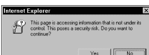

就 Ajax 而言，这个问题的解决方案其实并不难，尽管浏览器在安全性方面变得有些固执。解决方法是让一个服务器端脚本，而不是你在浏览器中执行的代码，为你访问不同的域。这就是为什么需要`google.html`使用`google.php`来访问 Google URL。以下是实现方法：

```php
<?php
$handle = fopen("http://www.google.com/complete/search?hl=en&js=true&qu=" . $_GET["qu"], "r");
.
.
.
```

> 访问与浏览器获取你的 Ajax 应用时不同的 Web 域，将导致浏览器显示安全警告。为避免这种情况，请使用服务器端代码访问该不同域，并将任何数据发送回给你。

## 角色互换：在服务器上执行验证

正如我在本章前面“连接 Google 进行实时搜索”中解释的那样，你实际上可以逐个字符地检查用户输入。

## 132 第二部分：Ajax 编程

这一特性对 Ajax 至关重要。为了节省带宽，你可能不想总是这样做，但它确实能派上用场。例如，你可能想在用户输入时就验证其输入内容。

如今，数据验证通常由浏览器中的 JavaScript 完成，但浏览器中的脚本在不联系服务器的情况下无法检查某些内容，例如服务器上的数据库，或者出于明显的安全原因你不想下载到浏览器的用户名和密码列表。相反，你可以使用 Ajax 进行一些服务器端的验证。

本书的代码有一个对应的示例——`login.html`和`login.php`，它们允许新用户选择一个用户名。当你打开`login.html`并输入一个试探性的用户名时，代码会与服务器上的`login.php`进行检查，确保用户输入的名称没有被占用，正如你在图 4-7 中看到的那样。

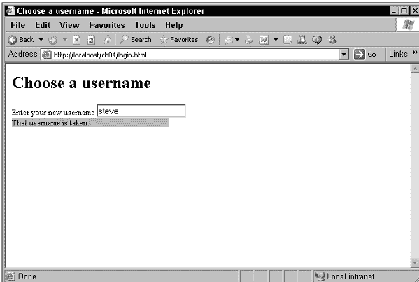

**图 4-7：**在服务器上执行验证。

以下代码展示了`login.php`的内容。如你所见，只存在一个禁忌名称：“steve”。如果你试图使用该用户名，这个 PHP 脚本将返回一个“taken”的值。

```php
<?php
if ($_GET["qu"] == "steve"){
    echo "taken";
}
else {
    echo "ok";
}
?>
```

`login.html`文件要求用户在一个文本字段中输入可能的新用户名，并且每次有新的按键时，`checkUsername`函数就会被调用，如下所示：

```html
<body>
    <H1>Choose a username</H1>
    Enter your new username <input id="textField" type="text"
        name="textField" onkeyup="checkUsername(event)">
    <div id="targetDiv"><div></div></div>
</body>
```

`checkUsername`函数将控制权传递给`getData`函数，以检查用户到目前为止输入的用户名，像这样：

```javascript
function checkUsername(keyEvent)
{
    keyEvent = (keyEvent) ? keyEvent: window.event;
    input = (keyEvent.target) ? keyEvent.target :
                keyEvent.srcElement;

    if (keyEvent.type == "keyup") {
        var targetDiv = document.getElementById("targetDiv");
        targetDiv.innerHTML = "<div></div>";

        if (input.value) {
            getData("login.php?qu=" +
                    input.value);
        }
    }
}
```

然后`getData`函数询问`login.php`用户当前建议的用户名是否已被占用。如果已被占用，代码将显示消息“That username is taken.”，方式如下：

```javascript
function getData(dataSource)
{
    if(XMLHttpRequestObject) {
        XMLHttpRequestObject.open("GET", dataSource);

        XMLHttpRequestObject.onreadystatechange = function()
        {
            if (XMLHttpRequestObject.readyState == 4 &&
                XMLHttpRequestObject.status == 200) {
                if(XMLHttpRequestObject.responseText == "taken"){
                    var targetDiv = document.getElementById("targetDiv");

                    targetDiv.innerHTML = "<div>That username is taken.</div>";
                }
            }
        }

        XMLHttpRequestObject.send(null);
    }
}
```

你可以在本章前面的图 4-7 中看到这个服务器端验证的工作情况。现在你正在使用 Ajax 逐个字符地检查用户输入。非常酷。

逐个检查用户键入的每个字符只适用于有限、特定的用途，就像本例中的情况。你不希望用无穷无尽的数据请求使服务器不堪重负。

## 使用 HEAD 请求获取一些惊人的数据

在第 3 章中，我解释了当你主要需要从服务器获取一些数据时如何使用 GET 方法，而当主要目的是向服务器发送数据时如何使用 POST 方法。另一个选择是使用 HEAD 请求，它可以获取有关文档和服务器的数据。

如何发起 HEAD 请求？你只需使用 HEAD 作为获取数据的方法。你可以在图 4-8 中看到一个示例`head.html`的工作情况。

正如你在图中所看到的，此示例显示了服务器上的数据、文档的最后修改日期、当前日期、正在访问的文档类型等。以下是这些数据的样式：

```
Server: Microsoft-IIS/5.1 Date: Tue, 09 Aug 2005 16:17:03 GMT
Content-Type: text/plain Accept-Ranges: bytes Last-Modified: Thu, 28 Jul
2005 16:29:44 GMT Etag: "94125909193c51:911" Content-Length: 38
```

这些数据代表了当 Ajax 脚本试图读取服务器上的一个文本文件`data.txt`时，它所获得的 HTTP 头的值。如果你发送 GET 请求，你会得到`data.txt`内部的文本。但如果你发送 HEAD 请求，你会得到关于`data.txt`和服务器的数据。例如，“Last-Modified” HTTP 头包含文本“Thu, 28 Jul 2005”，这是`data.txt`最后修改的日期。

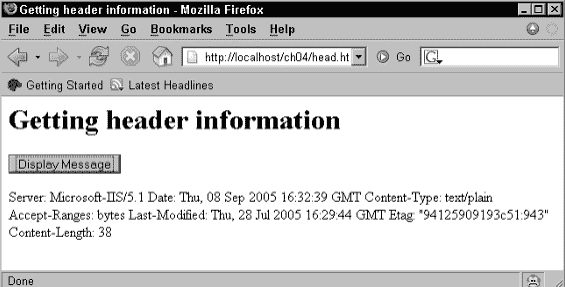

你可以抓取所有这些数据，或者只抓取你需要的零星数据。以下各节有详细说明。

### 返回所有你能获取的头数据

如何获取这类数据？当用户单击你在图 4-8（前面已展示）中看到的按钮时，代码会使用相对 URL`data.txt`调用`getData`函数（负责与服务器交互）：

```html
<form>
    <input type="button" value="Display Message"
        onclick="getData('data.txt', 'targetDiv')">
</form>
```

`getData`函数中的代码向服务器发送针对该 URL 的 HEAD 请求，如下所示：

```javascript
<html>
    <head>
        <title>Getting header information</title>
        
        <script language="javascript">
            var XMLHttpRequestObject = false;
            
            if (window.XMLHttpRequest) {
                XMLHttpRequestObject = new XMLHttpRequest();
            } else if (window.ActiveXObject) {
                XMLHttpRequestObject = new ActiveXObject("Microsoft.XMLHttp");
            }
            
            function getData(dataSource, divID)
            {
                if(XMLHttpRequestObject) {
                    var obj = document.getElementById(divID);
                    XMLHttpRequestObject.open("HEAD", dataSource);
                    .
                    .
                    .
                }
            }
        </script>
    </head>
    .
    .
    .
}
```

当数据从服务器返回时，数据将位于`XMLHttpRequestObject`对象中，你可以使用该对象的`getAllResponseHeaders`方法来获取图 4-7 中出现的所有头和头数据的列表。方法如下：


```javascript
function getData(dataSource, divID)
{
    if (XMLHttpRequestObject) {
        var obj = document.getElementById(divID);
        XMLHttpRequestObject.open("HEAD", dataSource);

        XMLHttpRequestObject.onreadystatechange = function()
        {
            if (XMLHttpRequestObject.readyState == 4 &&
                XMLHttpRequestObject.status == 200) {
                obj.innerHTML = XMLHttpRequestObject.getAllResponseHeaders();
            }
        }

        XMLHttpRequestObject.send(null);
    }
}
```

此示例获取了服务器上所有可用的头数据，但如果你想只提取特定头的数据，例如用于确定服务器上的文件最后修改时间的“Last-Modified”头呢？事实证明，也有一种方法可以做到。

### 查找最后修改日期

如何查找特定头的数据，例如服务器上文件的“Last-Modified”头？以下是在一个新示例`date.html`中实现的方法，你可以在图4-9中看到其工作情况。此示例检查服务器上的目标文件`date.txt`最后修改的日期，并显示该日期，正如你在图中看到的那样。

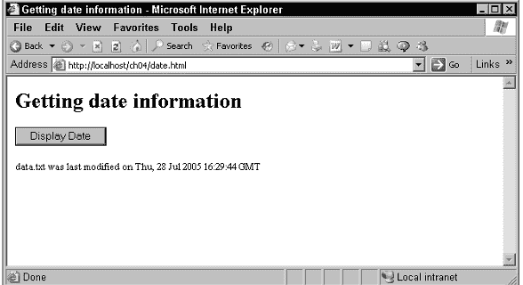

**图4-9：**获取文件最后修改的日期。

与前面的示例一样，此示例获取`data.txt`文件的所有HTTP头：

```javascript
<script language="javascript">
  var XMLHttpRequestObject = false;

  if (window.XMLHttpRequest) {
    XMLHttpRequestObject = new XMLHttpRequest();
  } else if (window.ActiveXObject) {
    XMLHttpRequestObject = new ActiveXObject("Microsoft.XMLHttp");
  }

  function getData(dataSource, divID)
  {
    if(XMLHttpRequestObject) {
      var obj = document.getElementById(divID);
      XMLHttpRequestObject.open("HEAD", dataSource);
      .
      .
      .
    }
  }
</script>
```

但是，与其使用`getAllResponseHeaders`方法获取所有头，你可以使用`getResponseHeader`方法仅获取特定头的数据，即“Last-Modified”头，像这样：

```javascript
XMLHttpRequestObject.getResponseHeader("Last-Modified")
```

## 第二部分：Ajax编程

这段代码在网页上显示该响应头中返回的文本：

```javascript
function getData(dataSource, divID)
{
    if(XMLHttpRequestObject) {
        var obj = document.getElementById(divID);
        XMLHttpRequestObject.open("HEAD", dataSource);

        XMLHttpRequestObject.onreadystatechange = function()
        {
            if (XMLHttpRequestObject.readyState == 4 &&
                XMLHttpRequestObject.status == 200) {
                obj.innerHTML = "data.txt was last modified on " +
                    XMLHttpRequestObject.getResponseHeader(
                        "Last-Modified");
            }
        }

        XMLHttpRequestObject.send(null);
    }
}
```

如你所见，这会给你一个类似`"data.txt was last modified on Thu, 28 Jul 2005 16:29:44 GMT"`的结果。如果你想将该文本转换为数字，以便检查文件是否在特定日期之后？你可以为此使用 JavaScript 的 Date 对象。只需使用从`Last-Modified`头获取的文本，以此方式创建一个名为`date`的新 Date 对象：

```javascript
var date = new Date(XMLHttpRequestObject.getResponseHeader("Last-Modified"));
```

现在你可以通过使用 JavaScript 运算符（如`>`）将`date`与其他 Date 对象进行比较，以确定哪个日期更晚。你也可以使用内置的 Date 对象方法，如`getMonth`来获取日期对象的月份。以下是 Date 对象方法的一些示例：

```javascript
alert ("Day (1-31): " + date.getDate());
alert ("Weekday (0-6, 0 = Sunday): " + date.getDay());
alert ("Month (0-11): " + date.getMonth());
alert ("Year (0-99-31): " + date.getYear());
alert ("Full year (four digits): " + date.getFullYear());
alert ("Day (1-31): " + date.getDate());
alert ("Day (1-31): " + date.getDate());
alert ("Hour (0-23): " + date.getHours());
alert ("Minutes (0-59): " + date.getMinutes());
alert ("Seconds (0-59): " + date.getSeconds());
```

## URL是否存在？

有时，你可能想在尝试下载 Web 资源之前，先检查它是否存在。如果该 Web 资源很长，你可能不想为了检查它是否存在而下载整个内容。你可以使用 HEAD 请求来检查 Web 资源是否存在，这样使用的带宽也少得多。

本书代码中的示例`exists.html`通过检查`data.txt`文件是否存在来展示其工作原理。以下示例通过对该文件执行 HEAD 请求并检查返回的 HTTP 状态码来工作——200 表示一切正常且文件存在，可以使用，而 404 表示不，文件不存在：

```html
<script language = "javascript">
var XMLHttpRequestObject = false;

if (window.XMLHttpRequest) {
    XMLHttpRequestObject = new XMLHttpRequest();
} else if (window.ActiveXObject) {
    XMLHttpRequestObject = new ActiveXObject("Microsoft.XMLHttp");
}

function getData(dataSource, divID)
{
    if(XMLHttpRequestObject) {
        var obj = document.getElementById(divID);
        XMLHttpRequestObject.open("HEAD", dataSource);

        XMLHttpRequestObject.onreadystatechange = function()
        {
            if (XMLHttpRequestObject.readyState == 4) {
                if (XMLHttpRequestObject.status == 200) {
                    obj.innerHTML = "URL exists";
                }
                else if (XMLHttpRequestObject.status == 404) {
                    obj.innerHTML = "URL does not exist";
                }
            }
        }

        XMLHttpRequestObject.send(null);
    }
}
</script>
```

你可能想使用类似此示例中的技术来检查你的服务器端程序是否存在并准备好使用——如果它不可用（这可能意味着你的服务器宕机了），则使用 JavaScript 的替代方案，如下所示：

```javascript
if (XMLHttpRequestObject.readyState == 4) {
    if (XMLHttpRequestObject.status == 200) {
        keepGoing();
    }
    else if ((XMLHttpRequestObject.status == 404) {
        callAJavascriptFunctionInstead();
    }
}
```

## 找到问题所在：调试Ajax

在调试 JavaScript 方面，Firefox 远优于 Internet Explorer。Firefox 拥有自己的 JavaScript 控制台（你通过选择工具->JavaScript 控制台来打开），它实际上会告诉你问题是什么（而不是你在 Internet Explorer 中几乎遇到任何问题时看到的那种毫无启发性的`"Object expected"`错误）。

但具体到调试 Ajax 问题呢？有没有什么工具可以让你观察发往服务器的请求和来自服务器的响应？此类工具开始出现了。

一个例子是 Julien Couvreur 的 XMLHttpRequest 调试器，它是一个 Greasemonkey 脚本。Greasemonkey 是 Firefox 的一个扩展，它允许你添加动态 HTML 来改变特定页面的行为。在接下来的部分中，我将解释如何设置和使用这个调试器来完善你的 Ajax 代码。

这并不是说 Greasemonkey 没有隐患——已经出现了一些安全问题。例如，在 Greasemonkey 0.3.4 版本中发现了此类问题，该版本已不再提供。因此使用此产品时请务必小心。

### 为调试设置浏览器

你可以从 Mozilla 人员那里获取 Greasemonkey，并按照以下步骤设置调试脚本：

1. 打开 Firefox 并访问`http://greasemonkey.mozdev.org`。
2. 单击 Install Greasemonkey 链接。
3. 访问`http://blog.monstuff.com/archives/000252.html`以获取 Julien Couvreur 的 XMLHttpRequest 调试器脚本。
4. 要在 Greasemonkey 中安装此类脚本，请右键单击指向该脚本的链接，然后选择“安装用户脚本”菜单项。这会打开你看到的图 4-10 中的对话框，用于安装脚本。
5. 你可以在“包含的页面”框中输入脚本应对其生效的 URL。当你访问这些页面时，你的 XMLHttpRequest 信息将显示在调试器脚本中。
6. 完成后单击“确定”。

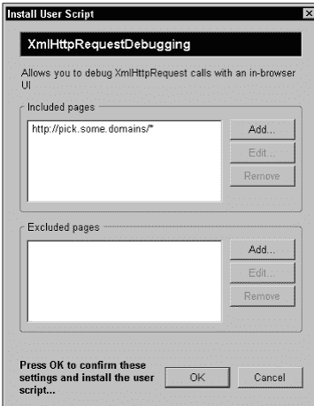

安装 Greasemonkey 后，你会在 Firefox 右下角看到一个猴子图标（如果你想看到该图标，可跳至图 4.12）。单击该图标可切换 Greasemonkey 的开启和关闭。你可以在`http://greasemonkey.mozdev.org/using.html`获取更多关于使用 Greasemonkey 的信息。

初始设置后，你还可以通过选择工具->管理用户脚本来打开你看到的图 4-11 中的对话框，从而在 Firefox 中管理`XMLHttpRequest Debugging`脚本。在该对话框中，你可以添加或删除你想要跟踪的页面，就像你第一次安装脚本时一样。

### 使用Greasemonkey进行调试

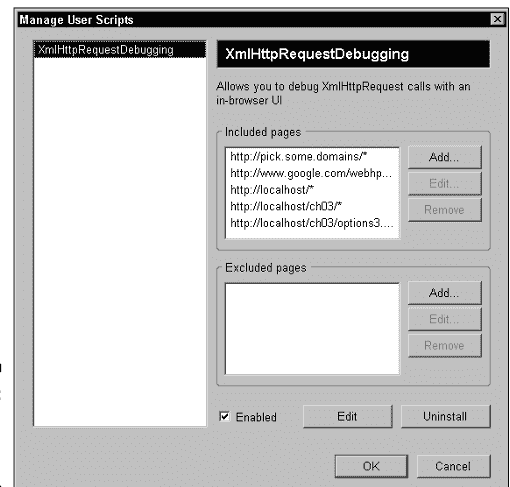

调试部分发生在你导航到你在上一节步骤 5 中包含的其中一个页面时。例如，如果你已经包含了 Google Suggest 页面（`http://www.google.com/webhp?complete=1&hl=en`），在 Firefox 中导航到该页面并开始输入搜索词，`XMLHttpRequestDebugging`脚本会以 Ajax 术语显示正在发生的事情，如图 4-12 所示。

在此例中，用户在文本字段中键入了 s，然后是 t，然后是 e。每次用户键入一个字符，都会向服务器发送一个 Ajax 请求，你可以在脚本在右侧显示的窗口中跟踪这些请求，如图 4-12 所示。

该脚本让你可以观察每个`GET`请求及其发送位置（例如，`"GET /complete/search?hl=en&js=true&qu=s"`），以及从服务器返回的响应（例如，`"Status: completed (200 OK)"`）。在调试时，这种观察 Ajax 术语下发生情况的窗口非常有用——你可以交互式地监视你的代码向服务器发送了什么，以及服务器发回了什么。

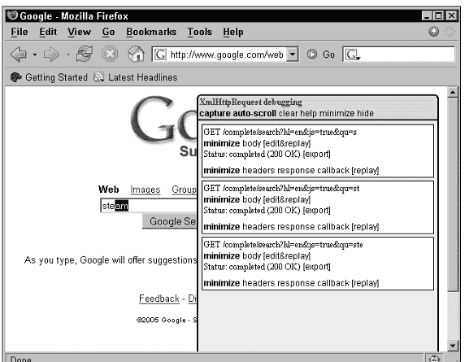

## 过载：处理多个并发请求

你从用户肩膀后观察，注意到他们在你的 Ajax 应用程序中飞快地点击不同的按钮。“嘿，”你说，“别那样做。”

“为什么不行？”用户问。

“因为如果你那样做，可能会把应用程序搞混。你可能会让它在前一个请求还没来得及从服务器返回之前就开始一个新请求。”

“我明白了，”用户说，但他其实完全没明白。你看着用户，他又像以前一样飞快地点击起按钮来。

到目前为止，你在这里看到的 Ajax 应用程序都只使用了一个 XMLHttpRequest 对象，这并没有造成大问题。但在现实世界中，你的 Ajax 应用程序可能有许多按钮可以点击，许多图像需要鼠标悬停，许多文本字段需要检查——这意味着你的 Ajax 应用程序可能几乎同时有多个请求发送到服务器。

**第二部分 144：Ajax编程**

如果你的所有Ajax工作都使用同一个`XMLHttpRequest`对象，这可能会成为一个问题。如果当用户点击另一个按钮并强制同一个`XMLHttpRequest`对象发起新请求时，该对象正在等待服务器的响应，会发生什么？`XMLHttpRequest`对象将不再等待先前请求的响应；它现在将等待当前请求的响应。

这是一个问题。当你的Ajax应用程序只有一个`XMLHttpRequest`对象可用，但同时可能发生多个请求时，新请求会破坏该对象处理先前响应的能力。唉呀。

有什么解决方法呢？好吧，你有几种选择，我们马上来看。

## 双倍的乐趣

一个简单的解决方案是使用多个`XMLHttpRequest`对象，每向服务器发送一个请求就使用一个。本书代码中有一个这样的例子，`double.html`，你可以在图4-13中看到它的运行效果。

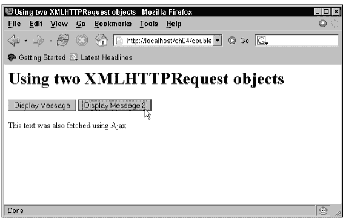

这个示例从`data.txt`（"此文本是通过Ajax获取的。"）和`data2.txt`（"此文本也是通过Ajax获取的。"）获取文本，并使用两个按钮和两个独立的`XMLHttpRequest`对象来完成。代码中是这样的：


```html
<html>
  <head>
    <title>Ajax at work</title>
    <script language = "javascript">
      var XMLHttpRequestObject = false;
      var XMLHttpRequestObject2 = false;

      if (window.XMLHttpRequest) {
        XMLHttpRequestObject = new XMLHttpRequest();
        XMLHttpRequestObject2 = new XMLHttpRequest();
      } else if (window.ActiveXObject) {
        XMLHttpRequestObject = new ActiveXObject("Microsoft.XMLHttp");
        XMLHttpRequestObject2 = new ActiveXObject("Microsoft.XMLHttp");
      }

      function getData(dataSource)
      {
        if(XMLHttpRequestObject) {
          var obj = document.getElementById("targetDiv");
          XMLHttpRequestObject.open("GET", dataSource);

          XMLHttpRequestObject.onreadystatechange = function()
          {
            if (XMLHttpRequestObject.readyState == 4 &&
                XMLHttpRequestObject.status == 200) {
              obj.innerHTML = XMLHttpRequestObject.responseText;
            }
          }

          XMLHttpRequestObject.send(null);
        }
      }

      function getData2(dataSource, divID)
      {
        if(XMLHttpRequestObject2) {
          var obj = document.getElementById("targetDiv");
          XMLHttpRequestObject2.open("GET", dataSource);

          XMLHttpRequestObject2.onreadystatechange = function()
          {
            if (XMLHttpRequestObject2.readyState == 4 &&
                XMLHttpRequestObject2.status == 200) {
              obj.innerHTML = XMLHttpRequestObject2.responseText;
            }
          }

          XMLHttpRequestObject2.send(null);
        }
      }
    </script>
  </head>

  <body>

<H1>使用Ajax获取数据</H1>

<form>
  <input type = "button" value = "显示消息"
         onclick = "getData('data.txt')">
  <input type = "button" value = "显示消息2"
         onclick = "getData2('data2.txt')">
</form>

<div id="targetDiv">
  <p>获取的数据将显示在这里。</p>
</div>

  </body>
</html>
```

146 第二部分：Ajax编程

这是一个简单的解决方案，在许多情况下可以处理多个请求。但即使这样，在某些情况下仍然不够好。如果用户多次点击同一个按钮会怎样？你可能会在旧请求从服务器返回之前，就陷入尝试发送新请求的困境。而且这只处理了两个`XMLHttpRequest`对象。如果你需要几十个呢？

## 将它们全部打包到一个数组中

处理多个并发请求的最佳方式是使用多个`XMLHttpRequest`对象，每个请求一个。例如，你可以创建一个这样的对象数组，并在每次有新请求时使用内置的 JavaScript `push`函数向数组添加新对象。你可以在本书代码中名为`objectarray.html`的示例中看到一种实现方法。这个示例声明了一个`XMLHttpRequest`对象数组：

```javascript
var XMLHttpRequestObjects = new Array();
```

然后，当应用程序需要一个新的`XMLHttpRequest`对象时，它只需使用`push`函数将其添加到数组中：

```javascript
if (window.XMLHttpRequest) {
  XMLHttpRequestObjects.push(new XMLHttpRequest());
} else if (window.ActiveXObject) {
  XMLHttpRequestObjects.push(new
    ActiveXObject("Microsoft.XMLHttp"));
}
```

这就是它的原理。当然，这里面还有很多内容；你可以在`objectarray.html`中看到完整的代码。像这样创建一个`XMLHttpRequest`对象数组是可行的，它允许你处理多个`XMLHttpRequest`而不会混淆。但事实证明这是一种相当冗长的方法，实际上，有一个更简单的方法——使用 JavaScript 内部函数。

## 深入了解内部函数

在 JavaScript 中，内部函数只是在另一个函数内部定义的函数。这里有一个例子，其中名为`inner`的函数是一个内部函数：

```javascript
function outer(data)
{
    var operand1 = data;

    function inner(operand2)
    {
        alert(operand1 + operand2)
    }
}
```

这是发生的情况：假设你调用外部函数并传入值 3，像这样：`outer(3)`。这会将此函数中的变量`operand1`设置为 3。内部函数可以访问外部函数的数据——即使在外部函数调用完成之后。所以如果你现在调用内部函数，并传入值 6，那会将内部函数中的`operand2`设置为 6——而`operand1`仍然设置为 3。所以调用内部函数的结果将是 3 + 6 = 9，这就是 JavaScript `alert`函数在这里会显示的值。

现在有趣的部分来了。每次你调用外部函数，都会创建一个函数的新副本，这意味着`operand1`将存储一个新值。而内部函数将能够访问那个值。所以，如果你开始从思考`operand1`转变为思考变量`XMLHttpRequestObject`，你就能看到，每次调用这样的函数时，JavaScript 都会创建一个带有新`XMLHttpRequest`对象的函数新副本，并且该对象将对任何内部函数可用。

这在这里非常完美，因为你在这章和前一章中开发的代码已经使用了一个（匿名）内部函数来处理`getData`函数中的`onreadystatechange`事件。目前，它的工作方式是，首先创建`XMLHttpRequest`对象，然后像这样在匿名内部函数中使用它：

第二部分：Ajax编程

```javascript
var XMLHttpRequestObject = false;

if (window.XMLHttpRequest) {
    XMLHttpRequestObject = new XMLHttpRequest();
} else if (window.ActiveXObject) {
    XMLHttpRequestObject = new ActiveXObject("Microsoft.XMLHttp");
}

function getData(dataSource, divID)
{
    if(XMLHttpRequestObject) {
        var obj = document.getElementById(divID);
        XMLHttpRequestObject.open("GET", dataSource);

        XMLHttpRequestObject.onreadystatechange = function()
        {
            if (XMLHttpRequestObject.readyState == 4 &&
                XMLHttpRequestObject.status == 200) {
                obj.innerHTML = XMLHttpRequestObject.responseText;
            }
        }

        XMLHttpRequestObject.send(null);
    }
}
```

所以，要为每个请求使用一个新的`XMLHttpRequest`对象，你所要做的就是运用你对内部函数的掌握，将创建`XMLHttpRequest`对象的代码部分移到`getData`函数内部，因为`getData`函数是包含匿名内部函数的外部函数。这样每次调用`getData`时，都会创建一个新的`XMLHttpRequest`对象供匿名内部函数使用——并且每次调用`getData`时，都会创建一个新的`getData`副本。这正是你想要的——为每个新请求创建一个新的`XMLHttpRequest`对象。

下面是本书代码中的一个示例`multiobject.html`，其中`XMLHttpRequest`对象的创建部分已移入外部函数`getData`内部。（注意此示例还在完成每个`XMLHttpRequest`对象的使用后将其删除。这不是必需的，但这是一个好主意，可以避免用额外的`XMLHttpRequest`对象占用内存。）

```html
<html>
  <head>
    <title>使用多个XMLHttpRequest对象</title>
    <script language = "javascript">
      function getData(dataSource)
      {
```

## 第二部分：Ajax 编程

这就完成了。这个应用程序能够处理多个并发的`XMLHttpRequest`请求，例如当用户快速连续点击多个启用了 Ajax 的按钮时。每次调用`getData`函数时，都会创建该函数的一个新副本——同时也会创建一个新的`XMLHttpRequest`对象，匿名内部函数可以访问该对象，即使在`getData`（外部函数）调用结束之后也是如此。并且由于每个请求都获得自己独立的`XMLHttpRequest`对象，因此不会发生任何冲突。

非常酷。你可以在图 4-14 中看到`multiobject.html`的实际运行效果。

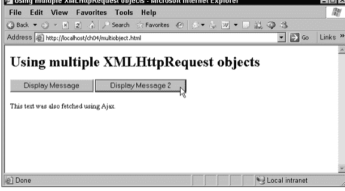

> 图 4-14：使用两个`XMLHttpRequest`对象。

## 第三部分

## Ajax 框架


“……然后有一天，丛林之王泰山突然想到——这有什么前途？”

## 关于本部分……

前面的部分（第二部分）已经相当清楚地表明，从头开始编写所有内容可能涉及大量的编程。但与其每次都重新发明轮子，你可以利用众多 Ajax 框架中的一些来开展工作。Ajax 框架可以为你完成大部分编程工作，从 JavaScript 到使用 PHP 或 JavaServer Pages 等语言的服务器端编程。第三部分将为你介绍许多可用的 Ajax 框架，在编写自己的代码时为你提供捷径。我在本部分分享了各种便捷技巧，例如使用 Ajax 进行拖放操作、弹出菜单、在后台下载图像等等。

## 第 5 章

## Ajax 框架简介

### 本章内容

- 应对 Ajax 设计问题
- 使用 Ajax 和动态 HTML 下载图像
- 使用 Ajax Gold 框架
- 使用 AJAXLib 框架获取 XML
- 使用 libXmlRequest 框架抓取 XML

你负责的 Ajax 编程团队效率不高，你决定去看看发生了什么。

“我们是不是总是必须从头开始开发所有的 Ajax 代码？”程序员们问道。“我们总是忘记`onreadystatechange`以及其他一些东西的拼写，这拖慢了我们的速度。”

“嗯，”你说。“不，你可以使用众多可用的 Ajax 框架之一，这会使开发 Ajax 代码变得容易得多，因为这些框架已经为你完成了所有的编程。通常你只需要调用几个函数。”

“哇，”程序员们齐声说。“我们怎么才能获得一个框架？”

“读读这一章就行了，”你说。“Ajax 框架通常是 JavaScript 文件，你只需将它们包含在自己的脚本中即可。这就是你需要做的全部。”然后你向编程团队展示了一份可用 Ajax 框架的清单。

“天哪，”他们说，“外面的框架可真多！我们要花很长时间才能弄清楚该用哪个。”

你叹了口气。

本书从这一章开始介绍可用的 Ajax 框架，包括我为本书特别开发的一个（Ajax Gold）。这些框架大多是免费的，它们通常是函数库，你可以调用这些函数来使用 Ajax 技术，而无需记住所有的编码细节。

### 更强大的 Ajax 功能

> **提示**
>
> 本章中的一些示例使用了可在线免费获取的 Ajax 框架。在尝试运行特定示例之前，请确保该框架所需的文件与您尝试运行的示例位于服务器上的同一文件夹中。出于版权原因，我将在本章和下一章中讨论的 Ajax 框架的代码无法包含在本书的可下载代码中，因此在尝试运行使用该框架的示例之前，请从提供的 URL 获取该框架的代码。（为本书特别开发的 Ajax Gold 框架确实包含在本书的可下载代码中。）

既然你即将开始开发自己的、可分发的 Ajax 应用程序，记住 Ajax 的核心在于响应时间就显得非常重要。使用一些 Ajax 框架时，你可能会做得非常花哨，因此请务必测试你的应用程序，确保它们在从在服务器上动态编写 JavaScript 到使用 Ajax 下载数十张图像等所有操作中都具有那种 Ajax 的流畅感。

什么？下载*图像*？Ajax 不是只关于文本和 XML 吗？是的，Ajax 本身确实只涉及下载文本或 XML，但浏览器可以使用动态 HTML 下载图像并在不刷新页面的情况下显示它们。因此，如果你开始下载图像或其他二进制对象，注意响应时间是值得的。

如何通过使用 Ajax 和动态 HTML 来下载图像？例如，你的 Ajax 脚本可能下载应该显示的图像的名称或 URL，然后你可以动态构建一个 HTML `` 标签，使浏览器下载该图像。

本书代码中的`image.html`示例演示了这是如何工作的。该示例有两个按钮，如图 5-1 所示。当用户点击第一个按钮时，应用程序显示`Image1.jpg`，如图所示；当用户点击第二个按钮时，应用程序显示`Image2.jpg`。（两个图像文件都在与本书相关的网站提供的可下载代码的`ch05`文件夹中。）

此应用程序的工作原理是使用 Ajax 从两个图像文件`imageName.txt`或`imageName2.txt`之一获取要加载的图像名称，而从服务器获取哪一个取决于用户点击了哪个按钮。以下是`imageName.txt`的内容：

```
Image1.jpg
```

这是`imageName2.txt`的内容：

```
Image2.jpg
```

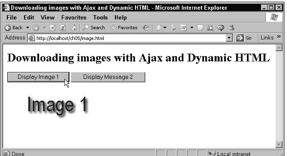

**图 5-1：** 使用 Ajax 和动态 HTML 在不刷新页面的情况下下载图像。

当用户点击一个按钮时，会从服务器获取对应`.txt`文件的文本，并使用该文本创建一个``元素，然后将其插入到`targetDiv` `<div>`元素中，浏览器将评估该元素并在不刷新页面的情况下下载图像。清单 5-1 展示了`image.html`中的代码。

### 清单 5-1：使用 Ajax 从 Web 服务器抓取图像


```html
<html>
  <head>
    <title>Downloading images with Ajax and Dynamic HTML</title>
    <script language = "javascript">
      function getDataReturnText(dataSource, callback)
      {
        var XMLHttpRequestObject = false;
        if (window.XMLHttpRequest) {
          XMLHttpRequestObject = new XMLHttpRequest();
        } else if (window.ActiveXObject) {
          XMLHttpRequestObject = new
            ActiveXObject("Microsoft.XMLHTTP");
        }
        if(XMLHttpRequestObject) {
          XMLHttpRequestObject.open("GET", dataSource);
          XMLHttpRequestObject.onreadystatechange = function()
          {
            if (XMLHttpRequestObject.readyState == 4 &&
                XMLHttpRequestObject.status == 200) {
              callback(XMLHttpRequestObject.responseText);
```

*（续）*

## 清单 5-1（续）

```javascript
            delete XMLHttpRequestObject;
            XMLHttpRequestObject = null;
        }
    }

    XMLHttpRequestObject.send(null);
}

function callback(text)
{
    document.getElementById("targetDiv").innerHTML =
        "";
}

</script>
</head>

<body>

<h1>使用 Ajax 和动态 HTML 下载图像</h1>

<form>
    <input type="button" value="显示图像 1"
        onclick=
            "getDataReturnText('imageName.txt', callback)">
    <input type="button" value="显示消息 2"
        onclick=
            "getDataReturnText('imageName2.txt', callback)">
</form>

<div id="targetDiv">
    <p>获取的图像将显示在这里。</p>
</div>

</body>
</html>
```

结果显示在图 5-1 中，通过 Ajax 和动态 HTML 的结合，你无需刷新页面即可下载图像。这里的设计问题在于，确保当你通过动态编写 HTML 标签来下载数据时，不会显著降低响应时间。这种技术不仅可用于图像，还可用于其他二进制数据对象（例如 PDF 文件、Microsoft Word 文档或 Excel 电子表格），前提是使用 Internet Explorer 的 `<object>` 元素。如果使用此技术，请注意性能可能下降的问题。

## 介绍 Ajax Gold 框架

Ajax 框架允许你利用他人的代码来使用 Ajax。这些框架从非常简单到非常复杂不等。

但你已经在本书中创建了自己的 Ajax 代码，所以在查看他人的成果之前，何不将这些代码应用于一个专门为本书编写的 Ajax 库呢？这个库就是 Ajax Gold 库，与其他 Ajax 框架一样，它是一个 JavaScript 文件——在本例中是 `ajaxgold.js`（可从本书关联网站的代码下载部分的 `ch05` 文件夹中获取）。你可以使用该库中预先编写好的函数，让 Ajax 调用变得异常简单。你只需在网页的 `<head>` 部分像这样包含 `ajaxgold.js`：

```html
<script type="text/javascript" src="ajaxgold.js"></script>
```

现在你已完全掌握了该库的强大功能——它将实现你想要使用的 Ajax 技术。例如，假设当用户点击按钮时，你想通过 `GET` 方法从服务器获取文本。你可以使用 Ajax Gold 函数 `getDataReturnText` 来实现——只需传递一个 URL 给它，该 URL 会返回你想要的文本，例如：`http://localhost/ch05/data.txt` 或 `http://localhost/ch05/data.php`。

当文本从服务器返回时，你如何处理它？你可以向 `getDataReturnText` 传递一个你编写的函数名，你希望用返回的文本调用该函数——这样的函数被称为回调函数。

这里有一个例子。假设当用户点击按钮时，你希望脚本获取 `data.txt` 文件中的文本，并且当文本获取后，你希望将该文本发送给你命名为 `callback1` 的函数。你可以像这样设置按钮来实现这一切：

```html
<form>
    <input type="button" value="显示消息"
        onclick=
            "getDataReturnText('data.txt', callback1)">
</form>
```

你不需要在函数名周围加上引号，因为你这里传递的不是函数名的字符串，而是函数本身。

然后你只需将你命名为 `callback1` 的函数添加到你的 `<script>` 元素中。该函数将接收从你指定的 URL 获取的文本。在这个例子中，你可能只是在 `callback1` 函数中像这样在 `<div>` 元素中显示该文本：

```javascript
function callback1(text)
{
    document.getElementById("targetDiv").innerHTML =
        "函数 1 说 " + text;
}
```

所以，如你所见，简单得如同儿戏。如果你想使用 Ajax 从 URL 获取文本，只需调用 Ajax Gold 函数 `getDataReturnText`，并传递 URL 和用于处理接收到的文本的回调函数，像这样：

```javascript
getDataReturnText(url, callbackFunction);
```

没问题。现在你正在使用 Ajax，甚至无需编写任何 Ajax 代码。这就是 Ajax 框架的全部意义所在。

`ajaxgold.js` 中内置了四个函数，它们旨在让你通过 `GET` 或 `POST` 方法从 URL 获取文本或 XML：

- `getDataReturnText(url, callback)`：使用 `GET` 方法从服务器获取文本。
- `getDataReturnXml(url, callback)`：使用 `GET` 方法从服务器获取 XML。
- `postDataReturnText(url, data, callback)`：使用 `POST` 方法向服务器发送数据，并从服务器获取文本。
- `postDataReturnXml(url, data, callback)`：使用 `POST` 方法向服务器发送数据，并从服务器获取 XML。

你可以在以下各节中找到有关这些函数及其使用方法的更多详细信息。

### 使用 GET 获取文本

Ajax Gold 库中的第一个函数是 `getDataReturnText`，它使用 `GET` 方法从服务器获取文本。`getDataReturnText` 函数和 `getDataReturnXml` 函数是从服务器获取 XML 的两个最常用的函数。你可以在 `ajaxgold.js` 中找到每个函数的描述，以下是 `getDataReturnText` 的描述：

> Ajax Gold JavaScript 库支持这些用于使用 Ajax 的函数
>
> （最常用的是：`getDataReturnText` 和 `getDataReturnXml`）：

```text
getDataReturnText(url, callback)
    ** 使用 GET 方法从服务器获取文本。 **
    从 url 获取文本，使用该文本调用名为 callback 的函数。
    当你只想从 URL 获取数据，或者可以轻松地将要传递给服务器的数据
    编码到 URL 中时使用，例如
    "http://localhost/script.php?a=1&b=2&c=hello+there"。
    示例：getDataReturnText("http://localhost/data.txt", doWork);
    这里，url 是一个字符串，doWork 是你自己脚本中的一个函数。
```

这个函数是如何工作的？你将一个 URL 传递给此函数，以便脚本可以从该 URL 获取文本，同时还传递一个回调函数，该回调函数随后接收浏览器从服务器获取的文本。它看起来像这样：

```javascript
function getDataReturnText(url, callback)
{
        .
        .
        .
}
```

此函数首先创建一个 `XMLHttpRequest` 对象：

```javascript
function getDataReturnText(url, callback)
{
    var XMLHttpRequestObject = false;

    if (window.XMLHttpRequest) {
        XMLHttpRequestObject = new XMLHttpRequest();
    } else if (window.ActiveXObject) {
        XMLHttpRequestObject = new
            ActiveXObject("Microsoft.XMLHTTP");
    }
        .
        .
        .
}
```

如果浏览器成功创建了 `XMLHttpRequest` 对象，代码会通过将用户想要获取数据的 URL 传递给 `open` 方法来初始化该对象。以下是具体过程：

```javascript
function getDataReturnText(url, callback)
{
    var XMLHttpRequestObject = false;

    if (window.XMLHttpRequest) {
        XMLHttpRequestObject = new XMLHttpRequest();
    } else if (window.ActiveXObject) {
        XMLHttpRequestObject = new
            ActiveXObject("Microsoft.XMLHTTP");
    }

    if(XMLHttpRequestObject) {
        XMLHttpRequestObject.open("GET", url);
        .
        .
        .
    }
}
```

然后代码设置匿名内部函数（在第 4 章讨论过）来处理 `XMLHttpRequest` 对象的事件，如下所示：

```javascript
function getDataReturnText(url, callback)
{
    var XMLHttpRequestObject = false;

    if (window.XMLHttpRequest) {
        XMLHttpRequestObject = new XMLHttpRequest();
    } else if (window.ActiveXObject) {
        XMLHttpRequestObject = new
            ActiveXObject("Microsoft.XMLHTTP");
    }

    if(XMLHttpRequestObject) {
        XMLHttpRequestObject.open("GET", url);

        XMLHttpRequestObject.onreadystatechange = function()
        {
            if (XMLHttpRequestObject.readyState == 4 &&
                XMLHttpRequestObject.status == 200) {
                callback(XMLHttpRequestObject.responseText);
                delete XMLHttpRequestObject;
                XMLHttpRequestObject = null;
            }
        }
            .
            .
            .
    }
}
```

最后，浏览器获取 URL，代码将 `null` 作为数据传递，这在使用 `GET` 方法时很常见。具体实现如下：

```javascript
function getDataReturnText(url, callback)
{
    var XMLHttpRequestObject = false;

    if (window.XMLHttpRequest) {
        XMLHttpRequestObject = new XMLHttpRequest();
    } else if (window.ActiveXObject) {
        XMLHttpRequestObject = new
            ActiveXObject("Microsoft.XMLHTTP");
    }

    if(XMLHttpRequestObject) {
        XMLHttpRequestObject.open("GET", url);

        XMLHttpRequestObject.onreadystatechange = function()
        {
            if (XMLHttpRequestObject.readyState == 4 &&
                XMLHttpRequestObject.status == 200) {
                callback(XMLHttpRequestObject.responseText);
                delete XMLHttpRequestObject;
                XMLHttpRequestObject = null;
            }
        }

        XMLHttpRequestObject.send(null);
    }
}
```

## 第5章：介绍 Ajax 框架

```javascript
if (XMLHttpRequestObject) {
    XMLHttpRequestObject.open("GET", url);

    XMLHttpRequestObject.onreadystatechange = function() {
        if (XMLHttpRequestObject.readyState == 4 &&
            XMLHttpRequestObject.status == 200) {
            callback(XMLHttpRequestObject.responseText);
            delete XMLHttpRequestObject;
            XMLHttpRequestObject = null;
        }
    }

    XMLHttpRequestObject.send(null);
}
```

好了，是时候让这个新函数 `getDataReturnText` 派上用场了。如果你想试一试，可以像往常一样打开本书代码中的 HTML 文档 `testGetDataReturnText.html`，该文档可从本书关联的网站下载。你可以在图 5-2 中看到这个示例的实际效果。这里有两按钮，它们从服务器上的两个不同文件中读取文本。浏览器获取到文本后，会如图所示显示出来。

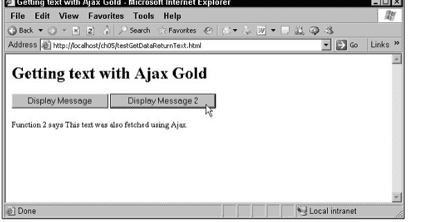

一切开始于确保 Ajax Gold 库已加载并可供你的 JavaScript 使用，方法是在你的网页的 `<head>` 部分加入这行代码：

```html
<script type="text/javascript" src="ajaxgold.js"></script>
```

这两个按钮中的每一个都调用自己的 URL，并拥有自己的回调函数来处理从其 URL 获取的文本。在创建按钮时，你可以通过简单地使用 `getDataReturnText` 函数来实现这一点：


```html
<form>
    <input type="button" value="Display Message"
        onclick="getDataReturnText('data.txt', callback1)">
    <input type="button" value="Display Message 2"
        onclick="getDataReturnText('data2.txt', callback2)">
</form>
```

这两个回调函数只是处理获取的文本，并将其显示在名为 `targetDiv` 的 `<div>` 元素中，如下所示：

```html
<script type="text/javascript" src="ajaxgold.js"></script>

<script language="javascript">
    function callback1(text) {
        document.getElementById("targetDiv").innerHTML =
            "函数 1 说 " + text;
    }

    function callback2(text) {
        document.getElementById("targetDiv").innerHTML =
            "函数 2 说 " + text;
    }
</script>
```

这就是全部内容了。

## 使用 GET 获取 XML

如果你不想获取文本，而是想获取 XML 怎么办？在这种情况下，你可以使用 Ajax Gold 的 `getDataReturnXml` 函数，你可以在 `ajaxgold.js` 中找到如下描述：

```
getDataReturnXml(url, callback)
** 使用 GET 方法从服务器获取 XML。 **
从 URL 获取 XML，并以该 XML 为参数调用名为 callback 的函数。
当你只想从 URL 获取数据，或者可以轻松地将要传递给服务器的数据编码到 URL 中时使用，
例如 "http://localhost/script.php?a=1&b=2&c=hello+there"。
示例：getDataReturnXml("http://localhost/data.txt", doWork);
此处，URL 是一个字符串，doWork 是你自己脚本中的一个函数。
```

这个函数与你刚刚看到的 `getDataReturnText` 函数相同，但获取的是 XML 而不是文本。换句话说，这个函数使用的是 `XMLHttpRequestObject` 对象的 `responseXML` 属性，而不是 `responseText`，如代码清单 5-2 所示。

### 代码清单 5-2：`getDataReturnXml` 函数

```javascript
function getDataReturnXml(url, callback) {
    var XMLHttpRequestObject = false;

    if (window.XMLHttpRequest) {
        XMLHttpRequestObject = new XMLHttpRequest();
    } else if (window.ActiveXObject) {
        XMLHttpRequestObject =
            new ActiveXObject("Microsoft.XMLHTTP");
    }

    if (XMLHttpRequestObject) {
        XMLHttpRequestObject.open("GET", url);

        XMLHttpRequestObject.onreadystatechange = function() {
            if (XMLHttpRequestObject.readyState == 4 &&
                XMLHttpRequestObject.status == 200) {
                callback(XMLHttpRequestObject.responseXML);
                delete XMLHttpRequestObject;
                XMLHttpRequestObject = null;
            }
        };

        XMLHttpRequestObject.send(null);
    }
}
```

那么，让 `getDataReturnXml` 函数来读取一些 XML 怎么样？例如，重写第 3 章中从脚本 `options1.php` 和 `options2.php` 获取两种不同配色方案 XML 的例子怎么样？完全没问题——你可以在图 5-3 中看到 Ajax Gold 版本，`testGetDataReturnXml.html`。

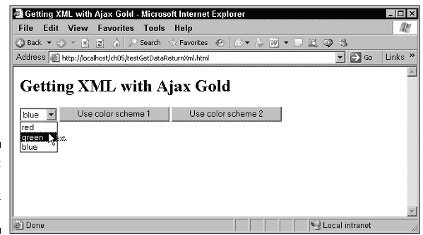

图 5-3：一个简单的 Ajax 示例。

此示例中的 PHP 脚本返回的 XML 如下所示：

```xml
<?xml version="1.0"?>
<options>
    <option>red</option>
    <option>green</option>
    <option>blue</option>
</options>
```

使用 Ajax Gold 函数 `getDataReturnXml` 编写这个示例非常简单。你希望在用户点击按钮时从 `options1.php` 或 `options2.php` 获取 XML，并调用一个函数（比如 `getOptions1` 或 `getOptions2`）来在 XML 获取后处理它。很简单。看起来是这样的：

```html
<input type="button" value="Use color scheme 1"
       onclick="getDataReturnXml('options1.php', getOptions1)">
<input type="button" value="Use color scheme 2"
       onclick="getDataReturnXml('options2.php', getOptions2)">
```

`getOptions1` 和 `getOptions2` 函数接收 PHP 脚本发回的 XML，它们所要做的就是将 `<option>` 元素存储在一个数组中，并将该数组传递给第 3 章中开发的 `listOptions` 函数，该函数将在应用程序的下拉列表控件中列出可用选项。看看这个：

```javascript
function getOptions1(xml) {
    options = xml.getElementsByTagName("option");
    listOptions(options);
}

function getOptions2(xml) {
    options = xml.getElementsByTagName("option");
    listOptions(options);
}
```

就像这个示例的原始版本一样，`listOptions` 函数在下拉列表控件中列出颜色选项：

```javascript
function listOptions() {
    var loopIndex;
    var selectControl = document.getElementById('optionList');

    for (loopIndex = 0; loopIndex < options.length; loopIndex++) {
        selectControl.options[loopIndex] =
            new Option(options[loopIndex].firstChild.data);
    }
}
```

这就是了——在用户从所选配色方案中做出选择后，页面中的文本会着色以匹配。

```javascript
function setOption() {
    document.getElementById('targetDiv').style.color =
        options[document.getElementById('optionList').selectedIndex].firstChild.data;
}
```

所以如你所见，使用 `getDataReturnXml` 非常简单——只需传递 URL 和应该使用获取到的 XML 来调用的回调函数。毫无麻烦。如果你想在使用 `GET` 方法的同时向服务器发送数据，只需将该数据编码为你正在访问的 URL 的一部分即可。

## 使用 POST 发送数据并获取文本

在 Ajax Gold 库中，你可以使用 `postDataReturnText` 函数向服务器发送数据并获取文本作为返回。方法如下：

```
postDataReturnText(url, data, callback)
```

你要做的只是传递你想要访问的服务器 URL、你想要发送的数据，以及将被传递从服务器恢复的文本的回调函数。以下是 `ajaxgold.js` 中出现的 `postDataReturnText` 的描述：

```
postDataReturnText(url, data, callback)
** 使用 POST 方法向服务器发送数据，获取文本返回。 **
向 url 发送数据，并以返回的文本为参数调用 callback 函数。
使用 POST 方法，当你有更多要发送到服务器的文本数据，而这些数据不容易编码到 URL 中时使用。
示例：postDataReturnText("http://localhost/data.php",
    "parameter=5", doWork);
此处，URL 是一个字符串；发送到服务器的数据（"parameter=5"）是一个字符串；
doWork 是你自己脚本中的一个函数。
```

这个函数是如何工作的？你传递三个参数：要获取的 URL、要发送的数据，以及你希望使用返回的文本调用的回调函数。以下是 `postDataReturnText` 的实际代码：

```javascript
function postDataReturnText(url, data, callback) {
    // ...
}
```

你首先获取一个本地 `XMLHttpRequest` 对象来处理 POST 操作：

```javascript
function postDataReturnText(url, data, callback) {
    var XMLHttpRequestObject = false;

    if (window.XMLHttpRequest) {
        XMLHttpRequestObject = new XMLHttpRequest();
    } else if (window.ActiveXObject) {
        XMLHttpRequestObject =
            new ActiveXObject("Microsoft.XMLHTTP");
    }
}
```

然后，你使用 `POST` 方法打开 `XMLHttpRequest` 对象以供使用，并调用 `setRequestHeader` 方法，这样服务器就会知道你发送的数据在请求中是以 `POST` 方法的标准方式编码的：

```
function postDataReturnText(url, data, callback)
{
    // ...
    if (XMLHttpRequestObject) {
        XMLHttpRequestObject.open("POST", url);
        XMLHttpRequestObject.setRequestHeader('Content-Type',
            'application/x-www-form-urlencoded');
        // ...
    }
}
```

为了完成准备工作，你设置一个匿名内部函数来处理来自服务器的文本。该内部函数还会用该文本调用 `callback` 函数：

```
function postDataReturnText(url, data, callback)
{
    // ...
    if (XMLHttpRequestObject) {
        XMLHttpRequestObject.open("POST", url);
        XMLHttpRequestObject.setRequestHeader('Content-Type',
            'application/x-www-form-urlencoded');

        XMLHttpRequestObject.onreadystatechange = function()
        {
            if (XMLHttpRequestObject.readyState == 4 &&
                XMLHttpRequestObject.status == 200) {
                callback(XMLHttpRequestObject.responseText);
                delete XMLHttpRequestObject;
                XMLHttpRequestObject = null;
            }
        }
        // ...
    }
}
```

现在一切就绪——你只需发送请求，然后自信地等待返回的文本出现即可。以下是你如何发起请求：

```
function postDataReturnText(url, data, callback)
{

    XMLHttpRequestObject.onreadystatechange = function()
    {
        if (XMLHttpRequestObject.readyState == 4 &&
            XMLHttpRequestObject.status == 200) {
                callback(XMLHttpRequestObject.responseText);
                delete XMLHttpRequestObject;
                XMLHttpRequestObject = null;
            }
        }

        XMLHttpRequestObject.send(data);
    }
}
```

你会如何使用 `postDataReturnText`？这里有一个示例，即本书关联网站下载代码中的 `testPostDataReturnText.html`。此示例将数据发布到一个名为 `echo.php` 的小型 PHP 脚本，该脚本只是回显在名为 `message` 的参数中发送的数据：

```php
<?
echo ($_POST["message"]);
?>
```

`testPostDataReturnText.html` 示例在用户点击按钮时，使用 Ajax Gold 的 `postDataReturnText` 函数将数据 `message=Good afternoon.` 发布到 `echo.php`。以下是其实现方式：

```html
<input type="button" value="Get the message"
    onclick="postDataReturnText('echo.php', 'message=Good afternoon.',
    display)">
```

当浏览器将数据 `message=Good afternoon.` 发布到 `echo.php` 时，该脚本将发回文本 `Good afternoon.`，然后回调函数 `display` 将在 `<div>` 元素中显示该文本。清单 5-3 展示了如何使用 Ajax Gold 发布数据。

## 清单 5-3：使用 Ajax Gold 向 Web 服务器发布数据

```html
<html>
<head>
<title>Posting data and returning text with Ajax Gold</title>
<script type="text/javascript" src="ajaxgold.js"></script>
<script language="javascript">
function display(text)
{
  document.getElementById('targetDiv').innerHTML = text;
}
</script>
</head>
<body>
<h1>Posting data and returning text with Ajax Gold</h1>
<form>
<input type="button" value="Get the message"
onclick="postDataReturnText('echo.php', 'message=Good afternoon.', display)">
</form>
<div id="targetDiv">The fetched text will go here.</div>
</body>
</html>
```


你可以在图 5-4 中看到结果。当用户点击按钮时，`postDataReturnText` 函数将数据 `"message=Good afternoon."` 发布到 `echo.php`，并用从服务器返回的文本（`"Good afternoon."`）调用 `display` 函数，然后该文本就会出现在网页的 `<div>` 元素中，如图 5-4 所示。

酷。现在你正在向 Web 服务器发布数据并处理返回的文本——当你使用 Ajax Gold 库时，这一切都不需要你进行任何 Ajax 编程。

## 使用 POST 发布数据并获取 XML

如果你希望发布数据并获取 XML 回来怎么办？Ajax Gold 库中的 `postDataReturnXml` 函数允许你使用 Ajax 技术将数据发布到服务器。作为回报，你会得到 XML。以下是使用方法：

```
postDataReturnXml(url, data, callback)
```

要使用此函数，你需要传递想要访问的 URL、想要发布的数据以及希望接收从服务器返回的 XML 的回调函数。以下是 `ajaxgold.js` 中 `postDataReturnXml` 的描述：

```
postDataReturnXml(url, data, callback)
** 使用 POST 方法将数据发送到服务器，获取 XML 回来。 **
将数据发布到 url，用返回的 XML 调用函数 callback。
使用 POST 方法，当你需要发送给服务器的文本数据太多，无法轻松编码到 URL 中时使用此方法。
示例：postDataReturnXml("http://localhost/data.php",
"parameter=5", doWork);
此处，URL 是一个字符串；发送给服务器的数据
("parameter=5") 是一个字符串；doWork 是你自己脚本中的一个函数。
```

正如你所料，这个函数的工作方式与其对应函数 `postDataReturnText` 非常相似，只不过它返回的是 XML，而不是文本。换句话说，`postDataReturnText` 使用 `XMLHttpRequest` 对象的 `responseText` 属性，而 `postDataReturnXml` 使用 `responseXML` 属性：

```javascript
function postDataReturnXml(url, data, callback)
{
    var XMLHttpRequestObject = false;
    if (window.XMLHttpRequest) {
        XMLHttpRequestObject = new XMLHttpRequest();
    } else if (window.ActiveXObject) {
        XMLHttpRequestObject = new
            ActiveXObject("Microsoft.XMLHTTP");
    }

    if(XMLHttpRequestObject) {
        XMLHttpRequestObject.open("POST", url);
        XMLHttpRequestObject.setRequestHeader('Content-Type',
            'application/x-www-form-urlencoded');

        XMLHttpRequestObject.onreadystatechange = function()
        {
            if (XMLHttpRequestObject.readyState == 4 &&
                XMLHttpRequestObject.status == 200) {
                callback(XMLHttpRequestObject.responseXML);
                delete XMLHttpRequestObject;
                XMLHttpRequestObject = null;
            }
        }

        XMLHttpRequestObject.send(data);
    }
}
```

让我们把 `postDataReturnXml` 用起来怎么样？看看 `textpostDataReturnXml.html` 这个示例。此示例修改了配色方案应用程序以处理发布的数据，使用了 `options3.php`。发布 `"scheme=1"` 将返回颜色方案一，发布 `"scheme=2"` 将返回颜色方案二：

```php
<?
header("Content-type: text/xml");
if ($_POST["scheme"] == "1")
    $options = array('red', 'green', 'blue');
if ($_POST["scheme"] == "2")
    $options = array('black', 'white', 'orange');
echo '<?xml version="1.0"?>';
echo '<options>';
foreach ($options as $value)
{
    echo '<option>';
    echo $value;
    echo '</option>';
}
echo '</options>';
?>
```

`textpostDataReturnXml.html` 示例使用 Ajax Gold 的 `postDataReturnXml` 函数将数据 `"scheme=1"` 或 `"scheme=2"`（取决于用户选择的配色方案）发布到 `options3.php`：

```html
<input type = "button" value = "Use color scheme 1"
       onclick = "postDataReturnXml('options3.php', 'scheme=1', getOptions)">
<input type = "button" value = "Use color scheme 2"
       onclick = "postDataReturnXml('options3.php', 'scheme=2', getOptions)">
```

当 `options3.php` 返回相应配色方案的 XML 时，`postDataReturnXml` 会调用 `getOptions` 函数来处理该 XML：

```html
<html>
<head>

    <title>Posting data and returning XML with Ajax Gold</title>

    <script type = "text/javascript" src = "ajaxgold.js"></script>

    <script language = "javascript">

        var options;

        function getOptions(xml)
        {
            options = xml.getElementsByTagName("option");
            listOptions();
        }

        function listOptions ()
        {
            var loopIndex;
            var selectControl = document.getElementById('optionList');

            for (loopIndex = 0; loopIndex < options.length; loopIndex++ )
            {
                selectControl.options[loopIndex] = new
                    Option(options[loopIndex].firstChild.data);
            }
        }

        function setOption()
        {
            document.getElementById('targetDiv').style.color =
                options[document.getElementById
                    ('optionList').selectedIndex].firstChild.data;
        }

    </script>
</head>

<body>
```

## 使用 Ajax Gold 发布数据并返回 XML

```html
<form>
    <select size="1" id="optionList"
        onchange="setOption()">
        <option>Select a scheme</option>
    </select>
    <input type = "button" value = "Use color scheme 1"
        onclick = "postDataReturnXml('options3.php', 'scheme=1', getOptions)">
    <input type = "button" value = "Use color scheme 2"
        onclick = "postDataReturnXml('options3.php', 'scheme=2', getOptions)">
</form>

<div id="targetDiv" width =100 height=100>Color this text.</div>
```

你可以在图 5-5 中看到此示例的实际运行效果。当用户点击按钮时，此应用程序使用 `postDataReturnXml` 向服务器发布数据，服务器通过 XML 返回一个配色方案。然后该配色方案会出现在下拉列表框中，如图 5-5 所示。

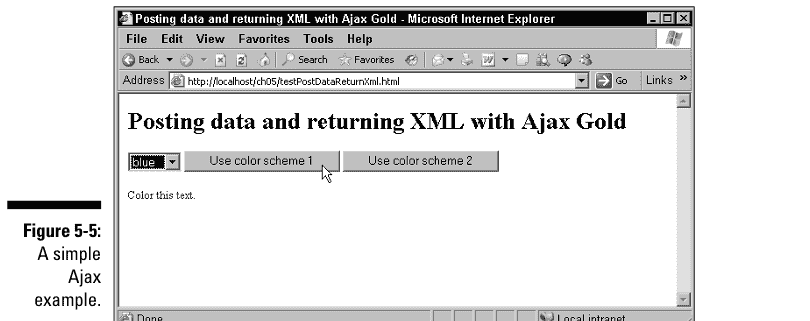

## 寻找现成的 Ajax 框架

本书编写的 Ajax Gold JavaScript 库（并在前面章节中介绍）是一个 Ajax 框架的示例，它允许你将 Ajax 应用于网页，而无需亲自编写任何 Ajax 代码。还有许多其他 Ajax 框架可供使用，我将在以下章节中介绍其中两个。

## 第三部分：Ajax 框架

### 使用 AJAXLib 轻松实现 Ajax

AJAXLib 是一个非常简单的 Ajax 框架，你可以从 `http://karaszewski.com/tools/ajaxlib` 免费获取。实际的框架文件名为 `ajaxlib.js`。

如何使用它？很简单——你只需调用其 `loadXMLDoc` 函数，传入应该从中获取 XML 的 URL、希望使用该 XML 调用的回调函数，以及一个 `true/false` 参数（如果希望自动从获取的 XML 中移除多余的空白，则设置为 `true`）。

PHP 脚本可以在 XML 文档中返回 XML（例如第 3 章中的 `options1.php`，它返回三种颜色）。这里有一个示例：

```php
<?
header("Content-type: text/xml");
$options = array('red', 'green', 'blue');
echo '<?xml version="1.0"?>';
echo '<options>';
foreach ($options as $value)
{
    echo '<option>';
    echo $value;
    echo '</option>';
}
echo '</options>';
?>
```

尝试使用 AJAXLib 读取来自 `options1.php` 的 XML 怎么样？要在新页面——确切地说是 `textAjaxlib.html`——中包含 `ajaxlib.js`，你使用这一行：

```html
<html>
  <head>
    <title>Testing ajaxlib</title>

    <script type = "text/javascript" src = "ajaxlib.js"></script>
        .
        .
        .
```

现在你可以使用 AJAXLib 的 `loadXMLDoc` 函数来加载从 `options1.php` 接收的 XML，并用 XML 调用你代码中名为 `decodeXml` 的函数，像这样：

```html
<html>
  <head>
    <title>Testing ajaxlib</title>

    <script type = "text/javascript" src = "ajaxlib.js"></script>

<head>
    .
    .
    .
</head>

<body>

    <H1>Testing ajaxlib</H1>

    <form>
        <input type = "button" value = "Display Message"
            onclick = "loadXMLDoc('options1.php', decodeXml, false)">
    </form>

    <div id="targetDiv">
        <p>The fetched data will go here.</p>
    </div>

</body>
</html>
```

剩下的就是解码 XML。例如，在这种情况下，你可能会显示从 `options1.php` 接收到的第一个颜色，即 `"red"`。我在代码清单 5-4 中向你展示如何做。

### 代码清单 5-4：让 AJAXLib 发挥作用

```html
<html>
    <head>
        <title>Testing AJAXLib</title>

        <script type = "text/javascript" src = "ajaxlib.js"></script>

        <script language = "javascript">

            function decodeXml()
            {
                var options = resultXML.getElementsByTagName("option");

                var loopIndex;
                var div = document.getElementById('targetDiv');

                div.innerHTML = "The first color is " +
                    options[0].firstChild.data;

            }
        </script>
    </head>

    <body>

        <H1>Testing AJAXLib</H1>

        <form>
            <input type = "button" value = "Display Message"
                   onclick = "loadXMLDoc('options1.php', decodeXml, false)">
        </form>

        <div id="targetDiv">
            <p>The fetched data will go here.</p>
        </div>

    </body>
</html>
```

你可以在图 5-6 中看到结果，图中显示从 `options1.php` 的 XML 中检索到的第一个颜色确实是红色。

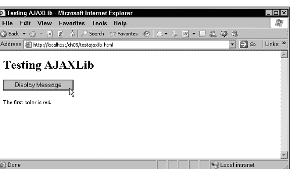

不错，现在你已经让 AJAXLib 框架发挥作用了。这个框架非常简单，只提供了 `loadXMLDoc` 函数，但它开启了 Ajax 框架的使用之旅。

### 使用 libXmlRequest 抓取 XML

你可以从 `www.whitefrost.com/reference/2003/06/17/libXmlRequest.html` 免费获取 Ajax 的 `libXmlRequest` 框架。该框架有两个主要方法，`getXML` 和 `postXML` 方法，它们使用 GET 和 POST 方法从服务器检索 XML。这个库的特点是 `XMLHttpRequest` 对象池，因此浏览器不会创建过多的此类对象（这可能会消耗内存），并且还允许你缓存从服务器获得的响应 XML。

以下是此库中的主要函数，来自 `libXmlRequest` 文档：

- `getXml(sPath)`：一个同步 GET 请求；返回 `null` 或一个 XML 文档对象。
- `getXml(sPath, fHandler, 1)`：一个异步 GET 请求；如果请求已发出则返回 1，并在 XML 文档加载时调用处理程序 `fHandler`。
- `postXml(sPath, vData)`：一个同步 POST 请求；返回 `null` 或一个 XML 文档对象。请注意，此函数期望服务器响应格式良好的 XML。如果服务器没有响应格式良好的 XML，则响应 XML 对象将为 `null`。


- `postXml(sPath, vData, fHandler, 1)`：一个异步 POST 请求。如果请求已发出则返回 1，并在 XML 文档加载时调用处理程序 `fHandler`。请注意，此函数期望服务器响应格式良好的 XML。如果服务器没有响应格式良好的 XML，则响应 XML 对象将为 null。不查询 `responseText`。

你用两个参数调用 `callback` 函数（此处命名为 `fHandler`），第二个参数是一个 JavaScript 对象，它保存你想要的 XML 数据。此对象支持两个属性：

- `id`：如果你提供了请求 ID，则为此 ID。
- `xdom`：保存你数据的 XML 对象。

你还可以使用这些函数控制缓存（有关避免浏览器缓存数据的更多信息，请参见第 6 章）和池化。`libXmlRequest` 文档以这种方式解释：

- `setCacheEnabled([true | false])`：启用缓存。
- `getCacheEnabled()`：如果缓存已启用则返回 `true`。
- `setPoolEnabled([true | false])`：启用池化。
- `getPoolEnabled()`：如果池化已启用则返回 `true`。
- `getXmlHttpArray()`：返回一个池对象数组。
- `clearCache()`：清除缓存的 XML DOM 引用。
- `testXmlHttpObject()`：测试是否可以创建 `XmlHttpObject`；如果可以则返回 `true`。

`libXmlRequest` 库还提供了一些实用函数，帮助你处理从服务器获得的 XML：

- `newXmlDocument(sNodeName)`：返回一个具有指定根节点名称的新 XML 文档对象。
- `serialize(oNode)`：返回节点的字符串表示。
- `selectNodes(xmlDocument, sXpath, oNode)`：根据给定 XML 文档的指定 XPath 返回结果数组。
- `selectSingleNode(xmlDocument, sXpath, oNode)`：根据给定 XML 文档的指定 XPath——一种特殊的 XML 语言，允许你指定 XML 文档中确切节点或节点集的位置——返回单个 XML 节点。**注意：**对于此实现能在 Mozilla 中工作，节点引用是必需的。
- `removeChildren(node)`：从 HTML 或 XML DOM 节点中移除所有子节点。
- `setInnerXHTML(target_node, source_node, preserve)`：将 `source_node`（XML 或 HTML）结构复制到 `target_node`（HTML）中。
- `transformNode([xml_dom | xml_path], [xsl_dom | xsl_path] {}, node_reference, xml_request_id, xsl_request_id, bool_cache_xsl})`：使用 XSL 转换节点。（有关转换 XML 的更多信息，请参见第 8 章。）

请注意，在此库中，你必须在所有这些函数的名称前加上文本 `org.cote.js.xml.` 才能调用它们；例如，如果你想调用 `getXml` 函数，你需要调用 `org.cote.js.xml.getXml`。

一个让这个库发挥作用的例子怎么样？看看 `libXmlRequest.html`——可以从与本书相关的网站下载——它像这样连接到 `libXmlRequest` 库：

```html
<html>
  <head>
    <title>Testing libXmlRequest</title>

    <script type = "text/javascript" src = "libXmlRequest.js"></script>
    .
    .
    .
```

与前面的示例一样，你也可以在这里从 `options1.php` 检索 XML。你可以使用 `libXmlRequest` 的 `org.cote.js.xml.getXml` 函数来做到这一点，传递获取 XML 的位置（这里是相对 URL `options1.php`）、回调函数（`decodeXML`，如（前一个示例），以及一个数字 1，表示你希望这是一个异步数据获取：

```html
<html>
  <head>
    <title>Testing libXmlRequest</title>

    <script type="text/javascript" src="libXmlRequest.js"></script>
    .
    .
    .
  </head>

  <body>

    <H1>Testing libXmlRequest</H1>

    <form>
      <input type="button" value="Display Message"
      onclick="org.cote.js.xml.getXml('options1.php', decodeXml, 1)">
    </form>

    <div id="targetDiv">
      <p>The fetched data will go here.</p>
    </div>

  </body>
</html>
```

`decodeXML` 函数处理 XML 的方式与前一个示例类似——但在这个案例中，这个回调函数被传入了两个参数。第二个参数是一个 JavaScript 对象，它有一个名为 `xmldom` 的属性，该属性包含了你想要的 XML 数据。清单 5-5 展示了如何使用该属性从 XML 数据中提取 `<option>` 元素。

## 清单 5-5：让 `libXmlRequest` 发挥作用

```html
<html>
  <head>
    <title>Testing libXmlRequest</title>

    <script type="text/javascript" src="libXmlRequest.js"></script>

    <script language="javascript">

      function decodeXml(a, b)
      {
        var options = b.xdom.getElementsByTagName("option");

        var loopIndex;
```

（续）

180 第三部分：Ajax 框架

## 清单 5-5（续）

```javascript
var div = document.getElementById('targetDiv');

div.innerHTML = "The first color is " +
    options[0].firstChild.data;

}
</script>
</head>
<body>

<H1>Testing libXmlRequest</H1>

<form>
    <input type="button" value="Display Message"
           onclick="org.cote.js.xml.getXml('options1.php', decodeXml, 1)">
</form>

<div id="targetDiv">
    <p>The fetched data will go here.</p>
</div>

</body>
</html>
```

这个示例运行起来是什么样子？你可以在图 5-7 中看到答案，其中 `getXml` 函数执行了它的任务并获取了 XML。`libXmlRequest` 框架为你提供了一种通过 `GET` 和 `POST` 方法从服务器获取 XML 的方式，并在你获取到 XML 后提供了一些额外的处理函数。

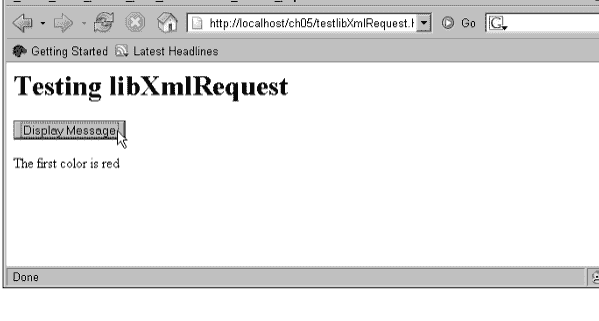

# 第 6 章：更强大的 Ajax 框架

### 本章内容

- 使用在线购物车进行拖放操作
- 使用 XHConn 框架
- 使用 Sack 框架
- 使用 `HTMLHttpRequest` 处理旧版浏览器
- 使用 Sarissa 处理 XML
- 使用 Rico

CEO 走过来对你说：“我们需要一种更简单的方式让顾客从我们的网站购买电视机。太多顾客不喜欢在网页间跳转、使用购物车购买商品的多步流程。我们正在损失金钱。”

“好的，”你说，“怎么样用 Ajax 来解决呢？”

“好主意！”CEO 说。“怎么做？”

“嗯，你可以让用户直接将想要购买的商品拖放到一个可视化的购物车中。这样他们就可以在同一个页面上购买任意多的电视机，而无需离开页面。”

“太棒了！”CEO 说。“现在我们终于能让我们的 19,995 美元电视机动销了。”

“一台电视机要 19,995 美元？”你问道。“嗯。我想我知道你们的电视机卖不动的原因了，这和购物车没关系。”


本章中的一些示例使用了可在线免费获取的 Ajax 框架。在你尝试运行某个特定示例之前，请确保该框架所需的文件与你要运行的示例位于服务器上的同一文件夹中。由于版权原因，我在这章和前一章中讨论的 Ajax 框架代码不能包含在本书的可下载代码中，因此，在你尝试运行使用该框架的示例之前，请从框架提供的 URL 获取该代码。

第三部分：Ajax 框架

## 使用购物车进行拖放

Ajax 的一个流行用途是让用户拖放物品，例如当他们想将物品放入购物车时，并将购物车中的新物品更新到服务器。

你可以使用本章中的多个 Ajax 框架来构建拖放应用程序，它们非常适合此类用途。然而，在大多数情况下，你仍然必须自己编写拖放部分的代码。因此，我将在本章开头介绍一个自制的拖放应用程序，以便在你想自己实现时让事情变得稍微简单一些。

你可以在图 6-1 中看到 Ajax 应用程序 `drag.html`。该应用程序的代码包含在本书的代码中。（有关如何从本书的配套网站下载代码的详细信息，请参见简介。）

在这种情况下，用户看到一台电视机（在这种情况下由 `<div>` 元素表示，但也可以很容易地是使用 `` 元素的图像），以及一个购物车（本例中也由一个 `<div>` 元素表示）。用户可以用鼠标拖动电视机，如图 6-2 所示。


图 6-2：将电视机拖到购物车中。

当用户将电视机放到购物车中时，应用程序会使用 Ajax 与服务器通信，并显示你在图 6-3 中看到的文本——`You just bought a nice television`（你刚刚购买了一台不错的电视机）。

这就是这个示例的工作原理——用户可以将物品放入购物车，服务器会立即收到购物车新内容的通知，用户无需点击按钮并在页面间跳转。（如果你打算在真实的购物车应用程序前端使用这种代码，显然需要美化一下图像和应用程序的外观，但这展示了如何实现拖放以及如何将拖放与 Ajax 连接起来。）处理像拖放这样的鼠标事件在不同浏览器之间存在显著差异，因此在创建像这样的 Ajax 应用程序时，了解如何处理主要浏览器非常有用。

184 第三部分：Ajax 框架


图 6-3：购买新电视机。

这个示例首先使用 `<div>` 元素显示电视机和购物车。请注意，电视机 `<div>` 元素还将其 `onmousedown` 事件处理程序连接到一个名为 `handleDown` 的函数，这意味着当鼠标悬停在电视机上并且用户按下鼠标按钮时，将调用 `handleDown` 函数，如下所示：

```html
<body>
    <h1>Buy a television by dragging it to the shopping cart</h1>
    <div id="targetDiv"></div>

    <div id="television"
         style="left:200px; top:100px; width:80px; height:80px;"
         onmousedown="handleDown(event);">Television</div>

    <div id="target"
         style="left:300px; top:300px; width:200px; height:100px;">
        Shopping Cart</div>

</body>
```

要为电视机和购物车上色，你可以应用 CSS 样式（有关如何在 Ajax 元素中使用 CSS 样式的详细信息，请参见第 9 章）。你可以通过使用 `<style>` 元素并将元素的 ID 前加上 `#` 符号来将样式连接到 HTML 元素。接下来的代码片段展示了如何使用样式设置电视机和购物车。

```html
<head>
  <title>Ajax Drag and Drop</title>

  <style type="text/css">
    #television {
      position:absolute;
      z-index:200;
      background: #FF0000;
      color:#0000FF;
    }

    #target {
      position:absolute;
      background: #00FF00;
      color:#000000;
    }
  </style>
  .
  .
  .
</head>
```

注意，在 `<style>` 元素中，电视机 `<div>` 的 `z-index` 值被设置为 200，这将确保当用户拖动它时，它始终保持在其他元素（如购物车）之上。这对你来说很奇怪吗？你可以在第 9 章找到关于此类样式工作原理的详细信息。

## 处理鼠标事件

现在是时候开始处理用户拖动电视机时的鼠标了——这也是浏览器差异出现的地方。处理像鼠标按下和移动这样的事件，在针对多个浏览器时总是需要一些额外的工作。

在像 Firefox 这样的浏览器中，电视机 `<div>` 元素中的这一行代码将导致调用 `handleDown` 函数，并传入一个名为 `event` 的对象，该对象包含鼠标当前位置的详细信息：

```html
<div id="television"
     style="left:200px; top:100px; width:80px; height:80px;"
     onmousedown="handleDown(event);">
     Television</div>
```

另一方面，在 Internet Explorer 中，调用 `handleDown` 函数时不会传递事件对象。你使用 `window` 对象的 `event` 对象来代替。要在电视机 `<div>` 中找到鼠标的 X 和 Y 位置，你在 Firefox 中使用事件对象的 `pageX` 和 `pageY` 属性，但在 Internet Explorer 中使用 `clientX` 和 `clientY`。要找到鼠标点击了哪个元素，你在 Firefox 中使用 `target` 属性，但在 Internet Explorer 中使用 `srcElement`。

## 第 186 章：第三部分：Ajax 框架

这确实相当复杂，因此本例首先支持其自定义的事件类型，命名为 `MouseEvent`。这样，其余代码可以统一处理这种事件，而不必总是检查当前使用的浏览器类型。

当鼠标事件发生时，将获得的 `event` 对象（在 Internet Explorer 中，该对象将为 `null`，因为事件处理函数不会接收 `event` 对象）传递给 `MouseEvent` 函数，它将创建一个具有以下主要属性的新 JavaScript 对象：

- `x`：鼠标在页面上的 x 坐标。
- `y`：鼠标在页面上的 y 坐标。
- `target`：鼠标所在的 HTML 元素。

以下是创建 `MouseEvent` 对象的代码，应用程序的其他部分可以使用该对象，而无需担心所使用的浏览器。注意此处使用了关键字 `this`，这是 JavaScript 中引用当前对象的方式：

```html
<script type="text/javascript">
    .
    .
    function MouseEvent(e)
    {
        if(e) {
            this.e = e;
        } else {
            this.e = window.event;
        }

        if(e.pageX) {
            this.x = e.pageX;
        } else {
            this.x = e.clientX;
        }

        if(e.pageY) {
            this.y = e.pageY;
        } else {
            this.y = e.clientY;
        }

        if(e.target) {
            this.target = e.target;
        } else {
            this.target = e.srcElement;
        }
    }
</script>
```

## 处理鼠标按下事件

当用户按下鼠标开始拖动操作时，将调用 `handleDown` 函数：


```html
<div id="television"
     style="left:200px; top:100px; width:80px; height:80px;"
     onmousedown="handleDown(event);">
     Television</div>
```

在 Firefox 中，`handleDown`函数会接收到一个`event`对象，但在 Internet Explorer 中则没有。首先要做的就是以这种方式创建一个新的`MouseEvent`对象：

```javascript
function handleDown(e)
{
   var e = new MouseEvent(e);
   .
   .
   .
}
```

现在你可以使用`MouseEvent`对象的属性，例如`target`属性，它是鼠标所在的 HTML 元素。（在这个例子中是`television <div>`，但在一个通用的购物车应用中，它可能是你提供的任何待售商品。）

既然鼠标已经按下，用户可能开始拖动某个项目，因此下一步是让浏览器“监听”`mouseMove`事件（当用户拖动项目时发生）和`mouseUp`事件（当用户释放被拖动的项目时发生）。要让浏览器监听这些事件，你需要使用`listener`函数。如何将这些函数连接到当前文档取决于你使用的浏览器，因此本例添加了一个新函数`addListener`，用于将`mouseMove`事件连接到名为`handleMove`的函数，并将`mouseUp`事件连接到名为`handleUp`的函数：

```javascript
function handleDown(e)
{
   var e = new MouseEvent(e);
   addListener("mousemove", handleMove);
   addListener("mouseup", handleUp);
   .
   .
   .
}
```

## 第188章 第三部分：Ajax框架

`addListener`函数将事件连接到你想在事件发生时调用的函数，而实现方式取决于用户使用的浏览器。该函数如下所示：

```javascript
function addListener(type, callback)
{
    if (document.addEventListener) {
        document.addEventListener(type, callback, false);
    } else if (document.attachEvent) {
        document.attachEvent("on" + type, callback, false);
    }
}
```

为`mouseMove`和`mouseUp`事件调用`addListener`函数后，当这些事件发生时，你的代码就会被调用。目前为止一切顺利。

当用户移动鼠标时，你必须移动他们正在拖动的 HTML 元素。为此，你应该记录鼠标在元素内部被按下的位置。这样做的原因是，当用户移动元素时，你希望让元素的新位置与新的鼠标位置匹配。要通过使用样式来移动元素，你可以将元素的左上角定位到与新的鼠标位置匹配，但如果用户是在元素内部的某个位置按下鼠标的，你必须记住，左上角不一定对应元素内的鼠标位置。考虑到这一点，你可以存储鼠标相对于被拖动元素左上角的 X 和 Y 偏移量，如下所示：

```html
<script type="text/javascript">

    var offsetX, offsetY;
    .
    .
    .
    function handleDown(e)
    {
        var e = new MouseEvent(e);
        addListener("mousemove", handleMove);
        addListener("mouseup", handleUp);
        offsetX = e.x - parseInt(television.style.left);
        offsetY = e.y - parseInt(television.style.top);
        document.getElementById("targetDiv").innerHTML = "";
    }
</script>
```

还要注意这里的最后一行，它清除了显示消息`You just bought a nice television`的`<div>`元素中的文本。

恭喜，你已经为处理其余的拖动操作（从鼠标移动事件开始，我将在下一节介绍）设置了一切。

# 第6章：更强大的 Ajax 框架

**189**

## 处理鼠标移动事件

当用户拖动鼠标时，你的`handleMove`函数将被调用。在该函数中，你应该移动`television <div>`以匹配鼠标的新位置（在考虑了鼠标在`<div>`内部的偏移量之后）。`handleMove`函数首先创建一个新的`MouseEvent`对象，以便解析鼠标的位置：

```javascript
function handleMove(e)
{
    var e = new MouseEvent(e);
    .
    .
    .
}
```

现在你可以通过使用动态样式将被拖动的 HTML 元素移动到其新位置：

```javascript
function handleMove(e)
{
    var e = new MouseEvent(e);
    var x = e.x - offsetX;
    e.target.style.left = x + "px";
    var y = e.y - offsetY;
    e.target.style.top = y + "px";
}
```

这很好。现在你正在拖动用户选择的项目。但是当他放下这个项目时呢？请查看下一节获取更多信息。

## 处理鼠标释放事件

当用户放下他正在拖动的项目时，`handleUp`函数将被调用。首要任务是创建一个`MouseEvent`对象来获取用户释放被拖动 HTML 元素的位置。方法如下：

```javascript
function handleUp(e)
{
    var e = new MouseEvent(e);
    .
    .
    .
}
```

既然用户已经释放了鼠标按钮，任何正在进行的拖动操作都结束了，因此在下一个鼠标按下事件发生之前，你可以停止响应鼠标事件。要停止响应`mouseMove`和`mouseUp`事件，你可以使用一个新函数`removeListener`来移除你之前连接到这些事件的监听函数，如下所示：

```javascript
function handleUp(e)
{
    var e = new MouseEvent(e);
    removeListener("mousemove", handleMove);
    removeListener("mouseup", handleUp);
    .
    .
    .
}
```

本例中的`removeListener`函数如下所示：

```javascript
function removeListener(type, callback)
{
    if (document.removeEventListener) {
        document.removeEventListener(type, callback, false);
    } else if (document.detachEvent) {
        document.detachEvent("on" + type, callback, false);
    }
}
```

但是用户是否将电视机放进了购物车？你需要购物车的位置和尺寸来检查。购物车`<div>`元素的 ID 是`"target"`，因此你可以通过以下方式获取屏幕上对应购物车的对象：

```javascript
function handleUp(e)
{
    var e = new MouseEvent(e);
    removeListener("mousemove", handleMove);
    removeListener("mouseup", handleUp);

    var target = document.getElementById("target");
    .
    .
    .
}
```

你可以通过购物车`<div>`元素的`left`和`top`样式获取其左上角的 X 和 Y 位置，通过`width`和`height`样式获取其宽度和高度。然而，这些样式是以文本形式存储的，你需要将它们转换为数字，才能判断用户是否将电视机放进了购物车。让 JavaScript 将像`"220"`这样的文本字符串转换为相应的数字 220 的方法是使用 JavaScript 的`parseInt`（解析整数）函数，因此以下是获取购物车位置和尺寸的方法：

```javascript
function handleUp(e) {
    var e = new MouseEvent(e);
    removeListener("mousemove", handleMove);
    removeListener("mouseup", handleUp);

    var target = document.getElementById("target");
    var x = parseInt(target.style.left);
    var y = parseInt(target.style.top);
    var width = parseInt(target.style.width);
    var height = parseInt(target.style.height);
    .
    .
    .
}
```

很好……那么用户是否把电视机拖进了购物车？你可以通过以下方式检查鼠标最终位置是否在购物车内：

```javascript
function handleUp(e) {
    var e = new MouseEvent(e);
    removeListener("mousemove", handleMove);
    removeListener("mouseup", handleUp);

    var target = document.getElementById("target");
    var x = parseInt(target.style.left);
    var y = parseInt(target.style.top);
    var width = parseInt(target.style.width);
    var height = parseInt(target.style.height);

    if (e.x > x && e.x < x + width &&
        e.y > y && e.y < y + height) {
        .
        .
        .
    }
}
```

如果执行了这个`if`语句，说明用户将电视拖进了购物车，现在该让服务器知道这个消息了（参见下一节）。

## 更新购物车

好的，购物车中新增了一个商品，你应该用这个信息更新服务器端程序。你可以使用常规的 Ajax 方式来完成，通过以下代码获取一个`XMLHttpRequest`对象：

```javascript
function handleUp(e) {
    var e = new MouseEvent(e);
    removeListener("mousemove", handleMove);
    removeListener("mouseup", handleUp);

    var target = document.getElementById("target");
    var x = parseInt(target.style.left);
    var y = parseInt(target.style.top);
    var width = parseInt(target.style.width);
    var height = parseInt(target.style.height);

    if (e.x > x && e.x < x + width &&
        e.y > y && e.y < y + height) {

        var XMLHttpRequestObject = false;

        if (window.XMLHttpRequest) {
            XMLHttpRequestObject = new XMLHttpRequest();
        } else if (window.ActiveXObject) {
            XMLHttpRequestObject = new ActiveXObject("Microsoft.XMLHTTP");
        }

        if (XMLHttpRequestObject) {
            XMLHttpRequestObject.open("GET", "text.txt");

            XMLHttpRequestObject.onreadystatechange = function () {
                if (XMLHttpRequestObject.readyState == 4 &&
                    XMLHttpRequestObject.status == 200) {
                    .
                    .
                    .
                    delete XMLHttpRequestObject;
                    XMLHttpRequestObject = null;
                }
            }

            XMLHttpRequestObject.send(null);
        }
    }
}
```

这段 Ajax 代码只是从`text.txt`文件中获取文本，其内容为“You just bought a nice television.”，并将其显示在一个名为`targetDiv`的`<div>`中：

```javascript
function handleUp(e) {
    var e = new MouseEvent(e);
    removeListener("mousemove", handleMove);
    removeListener("mouseup", handleUp);
    .
    .
    .

    if (XMLHttpRequestObject) {
        XMLHttpRequestObject.open("GET", "text.txt");

        XMLHttpRequestObject.onreadystatechange = function () {
            if (XMLHttpRequestObject.readyState == 4 &&
                XMLHttpRequestObject.status == 200) {
                document.getElementById("targetDiv").innerHTML =
                    XMLHttpRequestObject.responseText;
                delete XMLHttpRequestObject;
                XMLHttpRequestObject = null;
            }
        }

        XMLHttpRequestObject.send(null);
    }
}
```

这段 Ajax 代码从服务器获取的文本显示在了网页上（参见图 6-3）。

这就是购物车的未来趋势。用户不再需要按一堆按钮、在页面间来回跳转、再返回购物页面，仅仅是为了把商品添加到购物车。现在他们只需将商品拖入购物车，剩下的事情 Ajax 会处理。非常棒。当你使用这种拖放技术构建用户界面时，本章介绍的 Ajax 框架将为你处理 Ajax 操作。

在这个例子中，只涉及一个页面，如果你是亚马逊（Amazon.com），提供数百万种图书，这种单页面方案就不切实际了。但原理依然成立：每本书的页面都可以包含一个购物车图标（例如在左上角），你只需将图书的图片拖到那里就能将其添加到购物车，购物车会即时更新并显示其中的商品。

## 了解一些更强大的框架

现有的 Ajax 框架让你开发自己的应用变得轻而易举，而且这类框架数量众多。在第 5 章中，我介绍了 Ajax 框架能做什么。在接下来的章节中，我将继续这一调查，从众多可用的框架中向你介绍一些更强大的框架。当你需要编写自己的 Ajax 应用程序时，这些框架可以为你节省大量时间。以下各节旨在帮助你了解它们的工作原理，以便你决定使用哪些框架。

### 使用 XHConn 获取 XMLHttpRequest 对象

XHConn 是一个具有独特之处的 Ajax 框架：它传递给你的是整个`XMLHttpRequest`对象，而不仅仅是该对象中的数据。你可以自己通过`XMLHttpRequest`对象的`responseText`和`responseXML`属性来获取数据。你可以在`http://xkr.us/code/javascript/XHConn`免费获取 XHConn。你可以使用`GET`或`POST`方法与 XHConn 一起工作。

如何使用 XHConn？XHConn 为你提供一个 JavaScript 对象，它将完成所有工作。你首先创建该对象：

```javascript
var xhconn = new XHConn();
```

要使用这个新对象，你调用其`connect`方法。以下是传递给`connect`方法的参数：


- `URL`：你想要连接的服务器端资源的 URL。
- `method`：你想要用于连接的 HTTP 方法；`"GET"` 或 `"POST"`。
- `variables`：你想要发送给服务器的 URL 编码变量，以字符串形式给出。例如，`"color=red&number=3..."`。
- `function`：数据下载完成后调用的函数。该函数接收 `XMLHttpRequest` 对象作为参数。

所以，以下是你可能如何使用 `XHConn` 对象：

```
xhconn.connect("data.php", "POST", "color=red&number=3", handlerFunction);
```

清单 6-1 展示了一个示例 `testXHConn.html`，你可以随本书代码一起下载。这个示例让 `XHConn` 发挥作用，从一个名为 `xhconn.txt`（同样在本书代码中）的文件中获取文本，该文件包含以下内容：

> This data was fetched using XHConn.

此示例创建了一个 `XHConn` 对象，设置了一个函数，该函数在数据（本例中为 `xhconn.txt`）被获取后被调用，并显示获取到的数据。

### 清单 6-1：使用 XHConn Ajax 框架

```html
<html>
<head>
<script type="text/javascript" src="XHConn.js"></script>
<script language="javascript">
function testXHConn() {
    var myConn = new XHConn();
    if (!myConn) {
        alert("XHConn creation failed.");
    }
    var fnWhenDone = function (XMLHTTPRequestObject) {
        document.getElementById("targetDiv").innerHTML
            = XMLHTTPRequestObject.responseText;
    };
    myConn.connect("xhconn.txt", "GET",
        "", fnWhenDone);
}
</script>
</head>
<body>
<h1>Testing XHConn</h1>
<form>
    <input type="button" value="Display Message"
        onclick="testXHConn()">
</form>
<div id="targetDiv">
<p>The fetched data will go here.</p>
</div>
</body>
</html>
```

当你想运行这个示例时，请确保 `xhconn.js` 位于你的服务器上与本示例代码相同的目录中。结果显示在图 6-4 中，`XHConn` 成功为你抓取了一些文本。

**图 6-4：** 使用 `XHConn` 获取数据。

### 简易 AJAX 代码工具包：Sack

这是另一个有用且易于使用的 Ajax 框架——Sack，代表 Simple AJAX Code Kit（简易 AJAX 代码工具包）。你可以在 `http://twilightuniverse.com/projects/sack` 免费获取 Sack。

当你创建一个 Sack 对象时，你可以通过 `setVar` 方法对其进行配置（例如将方法设置为 `"GET"`）。然后你可以使用 `runAJAX` 方法获取数据。

这里的思路是，你创建一个 Sack 对象，设置你想要的参数，然后调用 `runAjax` 来执行 Ajax 操作。例如，假设你想使用 Sack 获取以下存储在服务器上名为 `sack.txt` 的文件中的文本：

```
This data was fetched using Sack.
```

以下是在本书代码中的一个示例中展示该功能如何运作的说明，该示例名为 `testSack.html`，展示了使用 Sack 的一种方式。在创建一个新的 Sack 对象后，你需要配置该对象的各种属性，以表明你想读取的文本文件是 `sack.txt`，你想使用的 HTTP 方法是 GET 方法，以及你想在网页中显示获取到的文本的 HTML 元素是 ID 为 `"targetDiv"` 的元素：

```
sackObject = new sack();
var vars = "";
sackObject.requestFile = "sack.txt";
sackObject.method = "GET";
sackObject.element = "targetDiv";
sackObject.runAJAX(vars);
```

你可以在代码清单 6-2 中看到这个示例的完整代码。

## 代码清单 6-2：使用 Sack Ajax 框架

```html
<html>
    <head>
        <title>Testing Sack</title>

        <script type = "text/javascript" src = "tw-sack.js"></script>

        <script language = "javascript">

            function getData(dataSource, divID)
            {
                sackObject = new sack();
                var vars = "";
                sackObject.requestFile = "sack.txt";
                sackObject.method = "GET";
                sackObject.element = "targetDiv";
                sackObject.runAJAX(vars);
            }
        </script>
    </head>

    <body>

        <H1>Testing Sack</H1>

        <form>
            <input type = "button" value = "Display Message"
                   onclick = "getData('sack.txt', 'targetDiv')">
        </form>

        <div id="targetDiv">
            <p>The fetched data will go here.</p>
        </div>

    </body>
</html>
```

198 第三部分：Ajax 框架

结果显示在图 6-5 中，其中 Sack 正在为你使用 Ajax 获取数据。Sack 是一个易于使用的优秀框架。


## 使用交互式网站框架解析 XML

交互式网站框架（IWF）是一个多用途 Ajax 框架，它包含一个自定义的 XML 解析器和其他功能。你可以免费获取 IWF，地址是 `http://sourceforge.net/projects/iwf`。

此框架允许同时发出多个 `XMLHttpRequest` 请求，并通过向服务器发送唯一 URL 来防止缓存。其自定义的 XML 解析器可以更轻松地处理 XML，这样你就可以在 JavaScript 中使用如下语法从 XML 文档中提取数据：

```javascript
var dressing = doc.food.sandwich[0].dressing;
```

而不是像下面这样的方式（关于如何使用 JavaScript 从 XML 文档中提取 XML 数据的详细信息，请参见第 8 章）：

```javascript
var dressing = doc.documentElement.firstChild.getAttribute("dressing");
```

IWF 为你提供了许多内置工具，例如允许你在网页上移动元素以支持拖放操作的函数，或者允许你获取 XML 数据并将其插入到网页上的 HTML 元素中的函数。

## 第 6 章：更强大的 Ajax 框架

你还可以使用 IWF 执行其他操作，例如使用名为 `iwfMoveTo` 的函数在网页上移动元素。IWF 附带了该功能的示例 `iwfajax.html`，你可以在图 6-6 中看到其实际效果。当你点击各种超链接时，一个小的橙色方框会在页面中移动，如图 6-6 所示。


## 使用 HTMLHttpRequest 处理旧版浏览器

`HTMLHttpRequest` Ajax 框架（你可以在 `www.twinhelix.com/javascript/htmlhttprequest` 免费获取）不仅支持 Ajax，还使用隐藏的 `IFrame` 元素在那些不支持 `XMLHttpRequest` 对象的旧版浏览器中模拟 Ajax。

你可以在 `www.twinhelix.com/javascript/htmlhttprequest/demo` 查看 `HTMLHttpRequest` 的演示，如图 6-7 所示。这里展示了一些标准的 Ajax 功能。当你点击此演示中的选项卡时，文本会加载到选项卡下方的区域，如图 6-7 所示。

200 第三部分：Ajax 框架


图 6-7：使用 `HTMLHttpRequest` 加载文本。

同一页面上的另一个演示将一个数学运算（例如乘法）和两个操作数传递给服务器，服务器执行该运算。你可以在图 6-8 的页面底部看到这一点，其中 `HTMLHttpRequest` 告诉你 2 x 6 = 12。

如果你正在处理那些不支持 `XMLHttpRequest` 对象的旧版浏览器，请研究一下这个框架。


图 6-8：使用 `HTMLHttpRequest` 进行数字乘法。

## 使用 Sarissa 解码 XML

Sarissa 是一个 JavaScript 库（尽管它使用 JavaScript 的正式名称 ECMAScript），专门用于处理 XML——最近，它还包含了一些 Ajax 功能。

Sarissa 允许你：

- ✓ 创建或加载 XML 文档并操作它们。
- ✓ 使用 XML 的 XPath（参见第 8 章）从 XML 文档中提取数据。
- ✓ 使用 XSLT 将 XML（同样参见第 8 章）转换为其他形式，例如 HTML。
- ✓ 使用 `XMLHttpRequest` 对象通过 Ajax 下载 XML。

你可以在 `http://sourceforge.net/projects/sarissa` 获取 Sarissa。

Sarissa 非常有用，因为它可以帮助你轻松处理下载的 XML。这里有一个例子，来自本书代码中的 `testSarissa.html`。此示例读取此 XML 文件 `sarissa.xml`，并从名为 `<span>` 的元素中提取文本：

```xml
<?xml version="1.0" ?>
<ajax>
  <response>
    <span>Hello from Sarissa.</span>
  </response>
</ajax>
```

你可以在图 6-9 中看到此示例的实际效果。当用户点击按钮时，`sarissa.xml` 被下载，Sarissa 提取 `<span>` 元素中的文本并显示出来。这很棒，因为使用 JavaScript 处理下载的 XML 可能是一个复杂的过程（正如我在第 8 章中解释的那样）。


第三部分：Ajax 框架

此示例通过创建一个 Sarissa `DomDocument` 对象来工作，该对象将持有 XML：

```javascript
var domDocument = Sarissa.getDomDocument();
.
.
.
```

要表明你希望异步下载数据，你需要将 `DomDocument` 对象的 `async` 属性设置为 `true`：

```javascript
var domDocument = Sarissa.getDomDocument();
domDocument.async = true;
.
.
.
```

接下来，使用 `DomDocument` 对象的 `onreadystatechange` 属性设置回调函数：

```javascript
var domDocument = Sarissa.getDomDocument();
domDocument.async = true;

domDocument.onreadystatechange = function myHandler()
{
.
.
.
}
.
.
.
```

当 XML 被获取后，你可以使用 Sarissa 的 `selectSingleNode` 方法提取 `<span>` 元素。你通过向 `selectSingleNode` 传递一个 XML XPath 表达式（参见第 8 章）来做到这一点；在本例中，它是 `"//span"`，它将匹配文档中任何位置的 `<span>` 元素：

```javascript
var domDocument = Sarissa.getDomDocument();
domDocument.async = true;

domDocument.onreadystatechange = function myHandler()
{
    if (domDocument.readyState == 4) {
        var element = domDocument.selectSingleNode("//span");
        .
        .
        .
    }
}
.
.
.
```

这个变量 `element` 现在包含一个持有 XML `<span>` 元素的对象。要提取该元素中的文本，你可以使用 Sarissa 的 `serialize` 方法，它将 XML 对象转换为文本。然后文本被显示在一个名为 `targetDiv` 的 `<div>` 元素中：

```javascript
var domDocument = Sarissa.getDomDocument();
domDocument.async = true;

domDocument.onreadystatechange = function myHandler()
{
    if (domDocument.readyState == 4) {
        var element = domDocument.selectSingleNode("//span");
        document.getElementById("targetDiv").innerHTML =
            "This XML fetched and decoded by Sarissa: " +
            Sarissa.serialize(element);
    }
}
```

剩下的就是异步加载 XML 文件（你可以使用 Sarissa 的 `load` 方法完成）、包含 Sarissa JavaScript 文件以及设置网页的其余部分。请查看代码清单 6-3。

## 代码清单 6-3：使用 Sarissa Ajax 框架

```html
<html>
  <head>
    <title>Testing Sarissa</title>

    <script type = "text/javascript" src = "sarissa.js"></script>
    <script type = "text/javascript" src = "sarissa_ieemu_xpath.js">
    </script>

    <script language = "javascript">

      function getData(dataSource, divID)
      {
        var domDocument = Sarissa.getDomDocument();
        domDocument.async = true;

        domDocument.onreadystatechange = function myHandler()
        {
          if (domDocument.readyState == 4) {
            var element = domDocument.selectSingleNode("//span");
            document.getElementById("targetDiv").innerHTML =
              "This XML fetched and decoded by Sarissa: " +
              Sarissa.serialize(element.firstChild);
          }
```

## 第三部分：Ajax 框架

## 清单 6-3（续）


```javascript
        }

        domDocument.load("sarissa.xml");
    }
</script>
</head>

<body>

    <H1>测试 Sarissa</H1>

    <form>
        <input type="button" value="显示消息"
               onclick="getData('data.txt', 'targetDiv')">
    </form>

    <div id="targetDiv">
        <p>获取的数据将显示在这里。</p>
    </div>

</body>
</html>
```

结果如图 6-9 所示（前面已展示）。

## 使用 Rico 创建视觉效果

Rico 是一个流行的 JavaScript 框架，提供了许多炫酷的视觉效果，例如拖放功能。例如，可以查看图 6-10 所示的演示页面，您可以在以下地址找到：

`http://openrico.org/rico/demos.page?demo=ricoDragAndDropSimple.html`

Rico 还有一个名为 `LiveGrid` 的控件，可以在表格中显示和排序数据，这些数据是它在后台获取的。您可以在图 6-11 中看到一个正在工作的 Rico `LiveGrid` 控件，该图展示了 `http://openrico.org/rico/livegrid.page` 的部分内容，显示了一个电影标题的表格。如果您点击列标题，表格会根据该标题自动排序。

图 6-12 展示了另一个 `LiveGrid` 示例 `http://openrico.org/rico/yahooSearch.page`，它使用 Ajax 方法执行雅虎搜索。当您点击按钮时，搜索结果会出现在表格中，而无需刷新页面。


图 6-10：使用 Rico 进行拖放。


图 6-11：Rico `LiveGrid` 控件。


除了这些技术，Rico 还提供其他视觉效果，例如使元素淡入淡出，以及一个“手风琴”控件，它可以显示多个文本窗格，您可以通过拖动条来滑动打开或关闭它们。

## 在 HTML 元素中显示数据

Rico 库文件 `prototype.js`、`rico.js`、`util.js` 包含对通过 Ajax 直接获取文本和 XML 数据的支持。例如，假设您想恢复名为 `rico.xml` 的 XML 文档中的文本，该文档如下所示：

```xml
<?xml version="1.0" ?>
<ajax-response>
  <response type="element" id="targetDiv">
    <span>此数据使用 RICO 方法获取。</span>
  </response>
</ajax-response>
```

在这种情况下，XML `<response>` 元素表明其内容应显示在名为 `targetDiv` 的 HTML 元素中。要实现这一点，您可以使用 Rico 库文件。您可以使用 Rico `ajaxEngine` 对象的 `registerRequest` 方法，将请求名称（本例中为 `"request1"`）连接到 XML 文档，并使用 `registerAjaxElement` 方法指明在哪个 HTML 元素中显示获取的数据。您可以在一个名为 `testRico.html` 的示例中看到所有这些是如何工作的，如下代码所示：

```javascript
<script language="javascript">
    function init()
    {
        ajaxEngine.registerRequest("request1", "rico.xml");
        ajaxEngine.registerAjaxElement("targetDiv");
    }
</script>

<body onload="init()">
</body>
```

设置好请求后，您可以使用 `ajaxEngine` 对象的 `sendRequest` 方法执行该请求。当用户点击按钮以这种方式获取数据时：

```html
<html>
    <head>
        <title>测试 Rico</title>

        <script src="prototype.js"></script>
        <script src="rico.js"></script>
        <script src="util.js"></script>

        <script language="javascript">
            function init()
            {
                ajaxEngine.registerRequest("request1", "rico.xml");
                ajaxEngine.registerAjaxElement("targetDiv");
            }

            function getData()
            {
                ajaxEngine.sendRequest("request1", "");
            }
        </script>
    </head>

    <body onload="init()">
        ...
    </body>
</html>
```

```html
<h1>测试 RICO</h1>

<form>
    <input type="button" value="显示消息" onclick="getData()">
</form>

<div id="targetDiv">获取的数据将显示在这里。</div>
</body>
</html>
```

您可以在图 6-13 中看到 `testRico.html` 的结果，其中代码使用 Rico 方法从服务器上的 `rico.xml` 获取了文本 "This data was fetched using RICO methods."。


## 让 JavaScript 对象处理您的数据

Rico 还允许您获取 XML 数据并使用 JavaScript 对象处理该数据，如果您想利用这些数据而不仅仅是显示它，这将非常方便。例如，假设您有一个 XML 文档 `rico2.xml`，并且您想恢复分配给 `<response>` 元素的 `day` 属性的文本（即 "Friday"）：

```xml
<?xml version="1.0" ?>
<ajax-response>
    <response type="object" id="displayHandler" day="Friday">
        <span>这是一些文本。</span>
    </response>
</ajax-response>
```

您可以通过使用 Rico 来完成此任务，使用 JavaScript 对象处理获取的数据。前面代码中的 `<response>` 元素表明您想使用一个名为 `displayHandler` 的对象，这正是您将要做的。

Rico 的设置方式使得您用于处理数据的 JavaScript 对象应有一个名为 `ajaxUpdate` 的方法，该方法接收 XML 数据。此示例使用一个名为 `DisplayHandler` 的 JavaScript 对象类型，该类型支持 `ajaxUpdate` 方法。此方法的目标是恢复分配给 `<response>` 元素 `day` 属性的文本并显示该数据，其工作方式如下（有关通过 JavaScript 处理 XML 的更多信息，请参见第 8 章）：

```javascript
<script language="javascript">

    function DisplayHandler () {}

    DisplayHandler.prototype =
    {
        ajaxUpdate: function(ajaxResponse)
        {
            var attrs = ajaxResponse.attributes;
            document.getElementById("targetDiv").innerHTML =
            "今天是 " + attrs.getNamedItem("day").value;
        }
    }
    .
    .
    .
</script>
```

现在您可以创建 `displayHandler` 对象并设置请求，以便它将获取 `rico2.xml` 中的数据。接下来，您使用一个名为 `registerAjaxObject` 的 Rico 方法来注册 JavaScript 对象，其 `ajaxUpdate` 方法应随 XML 数据一起被调用：

```javascript
<html>
    <head>
        .
        .
        .
        <script language="javascript">
            .
            .
            .
            function init()
            {
                displayHandler = new DisplayHandler();
                ajaxEngine.registerRequest("request1", "rico2.xml");
                ajaxEngine.registerAjaxObject(
            }
        </script>
```

现在，当用户点击按钮时，会调用 `ajaxEngine` 的 `sendRequest` 方法来获取数据，如您所见：

```javascript
"displayHandler", displayHandler);
}

</script>
</head>

<body onload="init()">
.
.
.
```

```html
<html>
  <head>
    <title>使用 JavaScript 对象测试 RICO</title>

        .
        .
        .

        function init()
        {
          displayHandler = new DisplayHandler();
          ajaxEngine.registerRequest("request1", "rico2.xml");
          ajaxEngine.registerAjaxObject(
              "displayHandler", displayHandler);
        }

        function getData()
        {
          ajaxEngine.sendRequest("request1", "");
        }

    </script>
  </head>

  <body onload="init()">
    <h1>使用 JavaScript 对象测试 RICO</h1>

    <form>
      <input type="button" value="显示消息" onclick="getData()">
    </form>

    <div id="targetDiv">获取的数据将显示在这里。</div>

  </body>
</html>
```

当数据被获取时，它将被传递给 `displayHandler` 对象的 `ajaxUpdate` 方法，该方法将提取并显示在 `rico2.xml` 中分配给 `day` 属性的文本，如图 6-14 所示。


此示例是成功的。在显示之前，像这样将数据传递给 JavaScript 对象可能是一种有用的技术，可以用于处理从服务器获取的数据。

## 使用 Http 框架克服缓存问题

遇到缓存问题了吗？Internet Explorer 会缓存从服务器获取的数据，因此即使您更改了服务器返回的实际数据，您也经常会一遍又一遍地看到相同的数据。一个解决方案是使用 Firefox 进行开发，而不是 Internet Explorer。但您最终将不得不与 Internet Explorer 打交道，如果在开发完成后仍然存在缓存问题，您可能需要查看 Http 框架，您可以在 `http://adamv.com/dev/javascript/http_request` 免费获取。

此框架支持在 Firefox 中强制缓存，以及在 Internet Explorer 中强制不缓存。

您可以在 `http://adamv.com/dev/javascript/files/time` 看到一个示例，该示例显示当前时间（以毫秒为单位），如图 6-15 所示。Internet Explorer 默认缓存服务器的响应，因此点击顶部的“获取时间”按钮总是会得到相同的时间。但 Http 包可以避免缓存（它通过在每次调用 URL 时向 URL 末尾附加唯一数据来实现这一点）。例如，当您点击图中从上往下的第二个按钮时，每次点击按钮时间都会更新，即使在 Internet Explorer 中也是如此。

## 第212节 第三部分：Ajax 框架


当数据缓存成为问题时，这是一个有用的工具包，但正如前面讨论的，你通常可以通过向 URL 末尾附加唯一数据来自己处理这个问题。

# 第7章：服务端 Ajax 框架

## 本章内容

- 使用 PHP 和 Sajax 或 Xajax 编写 JavaScript
- 使用直接 Web 远程调用（DWR）访问 Java
- 使用 Echo2 构建 Web 应用程序
- 了解更多框架

> “嗯，”首席执行官说，“所有那些基于 JavaScript 的 Ajax 框架都非常不错——”
>
> “太好了，”你说，“所以我们达成合作了？”
>
> “嗯，我有个问题，”首席执行官说。“正如我所说，那些基于 JavaScript 的 Ajax 框架非常不错，但你仍然需要开发服务端代码。”
>
> “当然，”你说，“除非你只是想从简单的数据文件中获取数据。”
>
> “难道没有 Ajax 包能让你只开发服务端代码，然后自动为你创建 JavaScript 吗？”
>
> “很高兴你这么问，”你说。“事实上，这正是整章的内容。”

## 使用 Ajax 框架编写 JavaScript

使用 Ajax 通常意味着在浏览器中使用 JavaScript，在服务器上使用 PHP 或 JavaServer Pages 等语言。在前面的章节中，我向你展示了允许你开发应用程序浏览器端部分的 Ajax 包。但有些 Ajax 包是为在服务器上使用而设计的——它们可以为你编写 JavaScript。这正是你在本章中看到的内容。

尽管一些服务端框架基于非主流的服务端语言，但你看到的大多数使用流行的 PHP（更多关于 PHP 的内容请参见第 10 章）和 Java 语言，特别是 JavaServer Pages。我在这里坚持使用这些，从 Sajax 开始。请注意，以下许多框架做的事情大致相同：让你通过使用服务端编程来使用 Ajax。当你在本章中看到这些包的工作方式时，你就会知道哪一个适合你。

## Sajax 和 PHP

`Sajax` 是一个 Ajax 框架（可从 `www.modernmethod.com/sajax` 下载），它允许你通过使用各种服务端语言在服务器上创建 Ajax JavaScript。

`Sajax` 是如何工作的？你可以在服务器上使用它来创建支持浏览器中 Ajax 的 JavaScript。目前，`Sajax` 允许你在服务器上连接到 ASP、ColdFusion、Io、Lua、Perl、PHP、Python 和 Ruby。

例如，你可以使用它在网页中创建一个 JavaScript 函数，将该函数连接到服务器上的 PHP 方法，后者反过来处理你的数据，然后将其数据发送回浏览器中的另一个 JavaScript 函数。因此，当用户打开 PHP 页面时，`Sajax` 会生成所有 JavaScript 来处理生成的网页中的 Ajax 操作。

例如，看一下加法示例 `addem.php`——可从与本书相关的网站下载——它出现在图 7-1 中。当你输入两个值并点击“计算”按钮时，页面使用 Ajax 在服务器上对值求和，并在不刷新页面的情况下显示结果。


它是如何工作的？在这个示例 `addem.php` 中，你首先包含 `Sajax.php`：

```php
<?php
require("Sajax.php");

// ...
?>
```

然后你定义一个名为 `addem` 的 PHP 函数来将两个数字相加（这是将在服务器上运行的 PHP 函数）：

```php
<?php
require("Sajax.php");

function addem($op1, $op2)
{
    return $op1 + $op2;
}

// ...
?>
```

你将能够从网页中的 JavaScript 调用此函数，只是你将其称为 `x_addem`。换句话说，如果你定义一个名为 `addem` 的 PHP 函数，你可以使用 `Sajax` 在 JavaScript 中将其称为 `x_addem` 来调用。

接下来，通过调用 `sajax_init` 设置 `Sajax`，并*导出* `addem` 函数：


```php
<?php
require("Sajax.php");

function addem($op1, $op2)
{
    return $op1 + $op2;
}

sajax_init();
sajax_export("addem");

// ...
?>
```

导出`addem`函数意味着你将能够在JavaScript中访问`addem`函数（作为`x_addem`）。最后，代码调用`sajax_handle_client_request`方法将`addem`函数连接到Sajax，并开始设置将出现在浏览器中的JavaScript：

```php
<?php
require("Sajax.php");

function addem($op1, $op2)
{
    return $op1 + $op2;
}

sajax_init();
sajax_export("addem");
sajax_handle_client_request();
?>
```

Sajax生成了此示例中所需的大部分JavaScript，并通过PHP函数`sajax_show_javascript`来实现。你可以在HTML `<script>`元素内使用PHP来执行它，这样生成的JavaScript就会包含在该`<script>`元素中：

```html
<script>
  <?php
    sajax_show_javascript();
  ?>
  . . .
```

此示例还包括图7-1中所示控件的HTML：三个文本字段和一个按钮。用于两个操作数的文本字段名为`op1`和`op2`，而用于显示答案的文本字段名为`result`。

```html
<body>
  <center>
    <h1>使用Sajax相加数字</h1>
    <input type="text" name="op1" id="op1" value="7" size="3">
    <br>
            +
    <br>
    <input type="text" name="op2" id="op2" value="8" size="3">
    <br>
          =
    <br>
    <input type="text" name="result" id="result" value="" size="3">
    <br>
    <input type="button" name="check" value="计算"
      onclick="do_addem(); return false;">
  </center>
</body>
```

请注意，这里的按钮绑定到一个名为`do_addem`的JavaScript函数，该函数调用`x_addem`，这是生成的JavaScript函数，它连接回服务器上的PHP函数`addem`。当用户点击按钮执行乘法时，操作数从第一个文本字段中读取，并调用`x_addem`函数，该函数将操作数传递给服务器上名为`addem`的PHP函数。

```javascript
<script>
    <?php
        sajax_show_javascript();
    ?>

    function do_addem()
    {
        var op1, op2;

        op1 = document.getElementById("op1").value;
        op2 = document.getElementById("op2").value;
        x_addem(op1, op2, show_results);
    }
</script>
```

请注意，`x_addem`函数不仅将操作数传回服务器上的`addem`函数，还接受一个JavaScript函数的名称，该函数将使用乘法的结果来调用。在此示例中，该回调函数名为`show_results`，正如你可以在前面的代码中看到的那样。

这个回调函数`show_results`接收来自PHP `addem`函数的参数，并将其显示在第三个文本字段中，该字段名为`result`。代码如下所示：

```javascript
<script>
    <?php
        sajax_show_javascript();
    ?>

    function show_results(result)
    {
        document.getElementById("result").value = result;
    }

    function do_addem()
    {
        var op1, op2;

        op1 = document.getElementById("op1").value;
        op2 = document.getElementById("op2").value;
        x_addem(op1, op2, show_results);
    }
</script>
```

如你所见，Sajax允许你在服务器上创建JavaScript，并通过Ajax将该JavaScript与服务端函数绑定。非常酷。你也可以看看`http://cyberdummy.co.uk/test/dd.php`，它使用Sajax进行拖放操作。

### Xajax和PHP

Xajax可以从`http://xajax.sf.net`免费获取，它是一个Ajax框架，允许你使用服务端方法来创建用于浏览器中的Ajax JavaScript。Xajax在服务器上使用PHP，你可以通过查看我的便捷示例`addem.php`——可从与本书相关的网站下载——来了解它的工作原理，该示例将对两个数字求和。你可以在图7-2中看到此示例的效果。


与前面章节中的Sajax示例非常相似，这个Xajax示例使用一个名为`addem`的PHP函数，该函数将传递给它的值相加，并将结果赋给一个名为`"result"`的变量。PHP代码如下所示：

```php
function addem($op1, $op2)
{
    $objResponse = new xajaxResponse();
    $objResponse->addAssign("result", "value", $op1 + $op2);
    return $objResponse->getXML();
}
```

### LibAjax与PHP

然后，代码会创建一个名为`$xajax`的新对象。

```php
function addem($op1, $op2)
{
    $objResponse = new xajaxResponse();
    $objResponse->addAssign("result", "value", $op1 + $op2);
    return $objResponse->getXML();
}

$xajax = new xajax("addem.server.php");
.
.
```

接着，代码将`addem`函数注册到`$xajax`对象中。

```php
function addem($op1, $op2)
{
    $objResponse = new xajaxResponse();
    $objResponse->addAssign("result", "value", $op1 + $op2);
    return $objResponse->getXML();
}

$xajax = new xajax("addem.server.php");
$xajax->registerFunction("addem");
.
.
```

然后，代码调用Xajax的`processRequests`方法，这与Sajax的`sajax_handle_client_request`方法非常相似，用于为生成JavaScript做准备。

```php
function addem($op1, $op2)
{
    $objResponse = new xajaxResponse();
    $objResponse->addAssign("result", "value", $op1 + $op2);
    return $objResponse->getXML();
}

$xajax = new xajax("addem.server.php");
$xajax->registerFunction("addem");
$xajax->processRequests();
.
.
```

## 第三部分：Ajax框架（续）

在本示例的HTML部分，代码使用一个名为`printJavascript`的Xajax方法来创建Xajax将要使用的JavaScript。

```html
<html>
<html>
  <head>
    <title>Adding numbers with Xajax</title>
    <?php $xajax->printJavascript(); ?>
  </head>
  .
  .
  .
```

HTML部分还设置了如图7-2所示的HTML控件，并调用一个名为`xajax_addem`的生成函数，该函数将调用服务器上的PHP函数`addem`：

```html
<body>
<center>
<h1>Adding numbers with Xajax</h1>
<input type="text" name="op1" id="op1" value="7" size="3" />
<br>
+
<br>
<input type="text" name="op2" id="op2" value="8" size="3" />
<br>
=
<br>
<input type="text" name="result" id="result" value="" size="3" />
<br>
<input type="button" value="Calculate"
       onclick="xajax_addem(document.getElementById('op1').value,
       document.getElementById('op2').value);return false;" />
</center>
</body>
```

加法的结果是如何显示在名为`"result"`的第三个文本字段中的？PHP的`addem`函数使用一个名为`addAssign`的Xajax方法将计算结果赋值给`"result"`文本字段的`value`属性：

```php
function addem($op1, $op2)
{
  $objResponse = new xajaxResponse();
  $objResponse->addAssign("result", "value", $op1 + $op2);
  return $objResponse->getXML();
}
```

就是这样。用户输入的数据通过Ajax技术发送到服务器，结果显示时无需刷新页面，正如你在图7-2中所看到的。如果你对以这种方式在服务器上生成JavaScript感兴趣，可以同时看看Sajax和Xajax。

### LibAjax与PHP

这是另一个基于PHP的Ajax服务器端框架：LibAjax，你可以从`http://sourceforge.net/projects/libajax`免费获取。其文档位于`http://libajax.sourceforge.net/documentation.html`。为了演示LibAjax的工作原理，我在此也展示一个加法示例，你可以在图7-3中看到。

请记住，我此处重点介绍的脚本文件默认解压到`php`文件夹中。本章的代码（可从与本书关联的网站下载）假定`addem.php`和`libajax.php`位于同一目录中，因此请确保你确实将这些文件放在同一目录下。

这个示例——可从与本书关联的网站下载的`addem.php`——是如何工作的？在PHP中，你首先通过如下方式创建一个新的LibAjax对象（本例中命名为`$ajax`）：

```php
<?php
require_once("libajax.php");
$ajax = new ajax();
.
.
.
```

然后，此示例使用一个名为`addem`的PHP函数来对传入的操作数求和：

```php
function addem($op1, $op2)
{
    print $op1 + $op2;
}
```

接着，你配置`$ajax`对象以选择HTML方法（GET或POST）来发送数据，并导出`addem`函数，使其在JavaScript中可用。

```php
$ajax->mode = "POST";
$ajax->export = array("addem");
.
.
.
```

现在你可以从JavaScript中访问`addem`函数了。如果你有其他PHP函数需要导出，可以用逗号将它们列出来，像这样：

```php
array("addem", "subtractem");
```

导出`addem`函数后，你调用LibAjax的`client_request`方法来设置从JavaScript到PHP代码的回调。

```php
$ajax->mode = "POST";
$ajax->export = array("addem");
$ajax->client_request();
.
.
.
?>
```

当你调用`$ajax->output()`方法时，LibAjax会自动为你生成JavaScript代码：

```html
<html>
  <head>
    <title>Adding numbers with LibAjax</title>
    <script type="text/javascript">
    <?php $ajax->output(); ?>
    .
    .
    .
```

到目前为止一切顺利。那么，如何从用户那里读取实际数据呢，如图7-3所示？在这个示例中，我使用了名为`op1`、`op2`和`result`的HTML文本字段来实现：

```html
<body>
  <center>
    <h1>Adding numbers with LibAjax</h1>
    <form>
      <input type="text" name="op1" id="op1" value="7" size="5">
      <br>
      +
      <br>
      <input type="text" name="op2" id="op2" value="8" size="5">
      <br>
      =
      <br>
      <input type="text" name="result" id="result" value="" size="5">
      <br>
      <input type="button" name="check" value="Calculate" onclick="addem();
      return false;">
    </form>
  </center>
</body>
</html>
```

当用户点击按钮时，会调用一个名为`addem`的JavaScript函数。该函数是服务器端PHP函数`addem`的接口（你在JavaScript中通过调用生成的函数`ajax_addem`来调用它）。在JavaScript的`addem`函数中，代码首先获取要相加的两个操作数，如下所示：

```javascript
function addem()
{
    var op1 = document.getElementById("op1").value;
    var op2 = document.getElementById("op2").value;
    .
    .
    .
}
```

然后代码调用`ajax_addem`，该函数会调用服务器上的PHP `addem`函数。两个操作数`op1`和`op2`会被传递给`ajax_addem`，同时还传递一个回调函数，该函数将处理从服务器代码返回的答案。

```javascript
function addem()
{
    var op1 = document.getElementById("op1").value;
    var op2 = document.getElementById("op2").value;
    ajax_addem(op1, op2, addem_init);
}
```

这个回调函数接收结果并将其显示在`result`文本字段中。

这就是LibAjax的工作原理——你导出一个PHP函数，然后可以在JavaScript代码中通过在函数名前加上`ajax_`前缀来调用它。传递给`ajax_addem`的最后一个参数是一个回调函数的名称，服务器上的PHP代码将在浏览器的JavaScript中调用这个函数，在本例中，这个函数名为`addem_init`。`addem_init`函数只需获取传递给它的值并将其显示在名为`result`的第三个文本字段中。以下是此示例中的代码：

```javascript
function addem_init(result)
{
    document.getElementById("result").value = result;
}
```


这就是全部所需。你要做的只是编写一个服务器端 PHP 函数（例如 `phpFunction`），将其导出，并调用 `client_request` 方法；然后你就可以在 JavaScript 中通过 `ajax_phpFunction` 来调用该函数。当你调用 `ajax_phpFunction` 时，需要传递你想传给 `phpFunction` 的参数，以及一个 JavaScript 函数用于处理结果。在这个 JavaScript 函数中，你可以按照认为合适的方式处理结果，例如像前面示例那样将其显示在文本字段中。

# JPSpan 与 PHP

另一个基于 PHP 的 Ajax 框架是 JPSpan，你可以从`http://sourceforge.net/projects/jpspan`获取。文档位于`http://jpspan.sourceforge.net/api`。

JPSpan 是一个相对复杂的框架，需要相当多的代码才能运行，但它提供了强大的 Ajax 支持。你可以在图 7-4 中看到一个自动完成示例（在 JPSpan 下载中可用）的工作情况，该应用程序通过对用户击键的响应给出可能的国家名称匹配项。

## 通过直接 Web 远程访问 Java

直接 Web 远程（DWR）在服务器端使用 Java（本章后续介绍的框架也是如此），而非 PHP。你可以免费获取 DWR：`http://getahead.ltd.uk/dwr`，并阅读其文档：`http://getahead.ltd.uk/dwr/documentation`。同时，也请查看介绍页面：`http://getahead.ltd.uk/dwr/intro.html`。

直接 Web 远程是一个 Ajax 框架，它允许从 JavaScript 代码直接调用 Java 方法。由于 DWR 使用 Ajax，你可以在幕后访问服务器上 Java 的全部功能（这些功能在浏览器中原本是无法直接使用的），并在服务器端显示结果。这非常棒，因为 Java 比 JavaScript 更强大，内置功能也丰富得多。

## 为 Web 上的 Java 做好设置

要使用 DWR 及其他基于 Java 的 Ajax 框架，你需要一个支持 Java 的 Web 服务器。互联网上有许多此类服务器。事实上，你的 ISP（互联网服务提供商）可能已经支持 Java，或者你可以通过 Google 搜索“Java 托管”来找到支持 Java 的 ISP。基于 Java 的 Web 服务器支持使用 JavaServer Pages（JSP）和 Java servlets（Java 服务器端程序）的应用程序，而你编写的用于连接 Ajax 代码的服务器端代码将由 JSP 或 servlets 组成。

> **提示** 一个流行的基于 Java 的服务器是 Apache Tomcat，你可以从`http://jakarta.apache.org/tomcat`免费获取。你可以将此服务器安装在自己的机器上，并立即测试你的应用程序。安装很简单；在 Windows 机器上启动服务器，只需打开 Apache Tomcat 并点击 Start 按钮。

## 通过使用 DWR 连接到 Java

DWR 是一个开源代码库，它实现了许多 PHP 包的功能——它允许 JavaScript 代码调用服务器端的 Java 函数。

DWR 由两部分组成：你在浏览器中使用以连接服务器端 Java 的代码，以及你可以使用来更轻松地显示你获取的数据的浏览器代码。DWR 代码的主要部分是允许你调用服务器上 Java 函数的部分。与你在本章看到的其他框架类似，你可以调用服务器端函数，而 DWR 将处理将你的代码与这些函数连接的细节。当你的数据被获取后，DWR 将使用该数据调用你提供的回调函数。

获取所需数据后，你可能还会考虑使用 DWR 的 JavaScript 库，这些库允许你使用动态 HTML 来显示这些数据并创建交互式网页。

你可以在 DWR 网站`http://getahead.ltd.uk/dwr/examples/text`上看到图 7-5 中的示例。这个简单的 Ajax 示例检查服务器类型和详细信息，并使用 Ajax 获取该数据并将其显示在网页上，如图 7-5 所示。


图 7-5：使用 Ajax 和 DWR 获取文本。

你也可以在 DWR 网站上找到其他 DWR 示例。例如，在图 7-6 中，你可以看到一个 DWR 聊天应用程序（`http://getahead.ltd.uk/dwr/examples/chat`），它使用 Ajax 获取数据并将其显示在文本区域控件中。你所要做的就是输入你的文本，点击 Send 按钮将其发送到服务器。你的文本以及其他人输入的文本将出现在文本区域中。

你可以在图 7-7 中看到另一个 DWR 示例，其中列表框通过使用 Ajax 技术从服务器获取数据来填充值。如果你在该示例中点击复选框，应用程序将获取一些数字来填充列表框，如图 7-7 所示。

## 第 7 章：服务器端 Ajax 框架


图 7-6：使用 DWR 的 Ajax 聊天会话。


图 7-7：使用 Ajax 和 DWR 填充列表框。

## 第三部分：Ajax 框架 第 228 页

这是另一个 DWR 示例，你可以在`http://getahead.ltd.uk/dwr/examples/table`上查看。此示例允许你编辑表格内容（你对表格的编辑通过浏览器中的 cookie 存储），并且表格使用 Ajax 技术重新显示。你可以在图 7-8 中看到此示例的工作情况——只需点击表格中某行的 Edit，在表格下方的 HTML 控件中编辑该行数据，然后点击 Save。所有内容都通过 Ajax 更新，因此不需要刷新页面。非常方便。

如果你想将 Java 连接到你的 Ajax 应用程序，可以看看 DWR。它功能强大且应用广泛。安装它确实需要一些工作（请参阅`http://getahead.ltd.uk/dwr/getstarted`上的说明）。

> 这是一个快捷方法：下载`dwr.war`文件（参见`http://getahead.ltd.uk/dwr/download`），然后将其放入基于 Java 的 Web 服务器的主目录中（在 Apache Tomcat 中，该目录是`webapps`目录）。Web 服务器会将`dwr.war`解压成一个可工作的 DWR 安装。


## 使用 Echo2 构建 Web 应用程序

Echo2 是一个你可以用来创建应用程序的框架，它最近已升级以支持 Ajax。Echo2 是一个用于创建基于 Web 的应用程序的包，这些应用程序的工作方式非常类似于你在桌面计算机上找到的应用程序。在版本 2 中，Echo 包的创建者在性能和功能方面进行了显著改进。当你使用 Echo2 时，你甚至不需要了解 HTML、HTTP 或 JavaScript 的任何知识。

使用 Echo2 构建完整的应用程序超出了本书的范围，但你可以在`http://demo.nextapp.com/Email/app`查看在线演示，这是一个出现在图 7-9 中的基于 Web 的电子邮件程序。

此应用程序使用 Ajax 下载各种电子邮件的文本。你所要做的就是选择右侧顶部框中的一条电子邮件消息，该消息的文本将出现在其下方的框中，如图所示。


图 7-9：使用 Echo2 的 Web 邮件客户端。

## 通过 Ajax 标签处理 Ajax 和 JavaServer Pages

这是另一个有趣的框架——Ajax 标签库，你可以从`http://ajaxtags.sourceforge.net`获取。这个 Ajax 框架依赖于服务器端的 JSP 标签来创建你所需的 JavaScript。在 JSP 中，你可以创建自己的自定义标签来告诉服务器你想要做什么，并将这些标签与 Java 代码关联起来，服务器在将页面发送回浏览器之前会运行这些代码。

## 第三部分：Ajax 框架 第 230 页

该库带有内置的 JSP 标签，你可以使用它们来实现标准的 Ajax 应用程序。以下是标签列表：

- **Autocomplete（自动完成）**：获取与用户在字段中输入的文本匹配的可能项目列表，用于自动完成。
- **Callout（提示框）**：显示一个连接到网页中特定元素的弹出气泡。
- **Select/dropdown（选择/下拉）**：基于用户在另一个下拉控件中的选择，设置下拉控件的内容。
- **Toggle（切换）**：允许你在两个不同的图像源之间切换。
- **Update Field（更新字段）**：基于用户在另一个字段中输入的数据，更新当前字段中的文本。

例如，你可以在`http://ajaxtags.no-ip.info`看到一个正在工作的自动完成演示。你可以在文本字段中输入汽车名称的首字母，然后会出现一个自动完成菜单，如图 7-10 所示。第二个文本字段也支持自动完成，允许你输入汽车的品牌。


其工作原理如下：你构建一个使用 Ajax 标签库来支持各种 Ajax 功能（如自动完成、填充`<select>`控件或使用 Ajax 在 HTML 元素中显示获取的文本）的 JSP 页面。然后你在服务器上编写 Java 支持代码，以提供包含你要呈现的数据的 XML。有关 Ajax 标签库的详细信息，请查看使用指南：`http://ajaxtags.sourceforge.net/usage.html`。

## 使用 SWATO 处理 Java

另一个基于 Java 的 Ajax 框架是 SWATO，你可以从`https://swato.dev.java.net`获取。你可以在`https://swato.dev.java.net/doc/html/quickstart.html`找到 SWATO 的介绍。

SWATO 带有用于常见 Ajax 操作的内置组件，例如自动完成文本字段、实时表单、实时列表等。在图 7-11 中，你可以看到 SWATO 附带的示例中的自动完成控件。

SWATO 是一个有趣的框架。它依赖于服务器端的普通旧 Java 对象（Java 程序员称之为 POJOs），因此服务器端编程可以相对简单一些。


图 7-11：使用 SWATO 的自动完成。

## 追踪众多其他可用的 Ajax 框架

市面上还有许多其他 Ajax 框架，使用各种语言编写。我将在接下来的部分简要介绍其中一些。越来越多的 Ajax 功能正不断涌现——未来确实一片光明！

## 使用 WebORB 开发令人惊叹的应用程序

你可以在`www.themidnightcoders.com/weborb/aboutweborb.htm`找到 WebORB。WebORB 专注于创建专业级的富互联网应用程序。使用 WebORB，你可以将 Ajax 和其他技术（如 Flash）无缝集成到你的应用程序中。

WebORB 可以连接服务器端的各种语言，从 .NET 到 Java。在图 7-12 中，你可以看到一个来自`www.themidnightcoders.com/examples/session-activation.htm`的购物车示例。


图 7-12：WebORB 在工作

在这个示例中，你只需在左侧的`<select>`控件中选择一个项目，然后单击“添加”按钮。得益于 Ajax，所选项目无需页面刷新就会出现在右侧的购物车中。

## Ruby on Rails

Ruby on Rails（`www.rubyonrails.org`）是一个支持 Ajax 的重量级框架。它不是使用 PHP 或 Java，而是在服务器端使用自己专有的语言。它内置了各种对 Ajax 的支持。

在充当服务器端 Ajax 框架方面，Ruby on Rails 的功能与本章中展示的其他框架非常相似，只是它在服务器端使用自己的语言。与通常的 Ajax 应用程序一样，你可以使用`XMLHttpRequest`对象异步向服务器发送数据。在你请求的数据发送回浏览器后，Rails 生成的 JavaScript 将让你轻松处理该数据——例如，你可以使用`<div>`元素显示该数据。

你可以在`www.papermountain.org/demos/live`看到一个使用 Ajax 的 Ruby on Rails 演示，如图 7-13 所示。例如，看看左边的自动完成演示，用户输入了`he`，应用程序已经建议了各种单词。


第 234 页 第三部分：Ajax 框架

## Backbase

另一个支持 Ajax 的框架是 Backbase，网址为`www.backbase.com`。与 WebORB 类似，Backbase 专注于开发富互联网应用程序。

## Dojo

Dojo 是另一个有用的框架，你可以在`www.dojotoolkit.org`获取它。Dojo 自称是一个用户界面工具包，并已更新以包含大量 Ajax 支持。它是一个开源软件包，因此你可以根据需要修改其代码。

## Atlas.NET

诸如 Microsoft 的 ASP.NET（Microsoft 的 Active Server Pages [ASP] 包的 .NET 版本）之类的框架正在添加更多对 Ajax 的支持。Microsoft 已宣布正在开发 Atlas 客户端脚本框架，该框架将把 Ajax 支持集成到 ASP.NET 中，并将适用于所有现代浏览器。Atlas 看起来是一个重要的 Ajax 包，但细节才刚刚开始浮出水面。目前，密切关注 Atlas 的较好地点之一是`http://beta.asp.net/default.aspx?tabindex=7&tabid=47`，但请继续关注——Atlas 肯定会引起轰动。

# 第四部分

# 深入 Ajax 的力量

第 5 波

作者：Rich Tennant


## 本书第 4 部分简介……

本部分将赋予你更多 Ajax 能力，从第 8 章开始，该章全部关于在 JavaScript 中处理 XML。当你使用 Ajax 时，服务器返回的结果通常是 XML，知道如何遍历该 XML 并提取所需数据——用 Ajax 的术语来说——是一项宝贵的技能。第 9 章继续介绍级联样式表（CSS），它通过让你处理实时显示（如弹出菜单或拖放）与 Ajax 相关联。请记住：Ajax 的核心是在不重新加载当前网页的情况下处理该页面，而 CSS 是其中的重要组成部分。Ajax 还涉及处理服务器上的代码，第 10 章为你提供 PHP 入门知识，让你能编写服务器端代码。（你不需要了解 PHP 就能阅读本书，但当你开始自己使用 Ajax 时，了解 PHP 会有所帮助，因此第 10 章为该主题提供了基础。）

## 第 8 章：在 Ajax 应用程序中处理 XML

### 本章内容

- 理解基本 XML
- 使用 JavaScript 遍历 XML 文档
- 批量获取 XML 元素
- 提取 XML 属性的值
- 验证从服务器获得的 XML

“嗯，”这位技术高超的 Ajax 程序员说。“我需要些帮助。”

“很乐意为你服务，”你说。“我能帮你什么？”

“我已经成功从服务器获取了 XML，但现在我无法处理它。我到底该如何从一个元素导航到另一个元素？如何从这个 XML 中提取我需要的数据？”

“没问题，”你说。“只需阅读本章。”然后你将账单递给这位惊讶的 Ajax 程序员。

Ajax 的核心是从服务器获取数据——通常是 XML 数据。如何在浏览器中处理那个 XML？正如你在本章所发现的，JavaScript 具有一些强大的 XML 处理能力。知道如何在 JavaScript 中处理 XML 对于任何 Ajax 程序员都至关重要，因为服务器向你发送 XML，你需要知道如何从该 XML 中提取数据。

## 理解基本 XML

要在 Ajax 中处理 XML，你需要了解关于该语言及其工作原理的一些基础知识。XML 的一个关键特性是，你不像在 HTML 等语言中那样受限于预定义的标签集。你可以创建自己的标签。除了标签，你还需要了解什么使得一个 XML 文档是格式良好的和有效的。我将在后续章节中解释你需要知道的内容。

### 标签里有什么？

你可以创建自己的标签，例如一个`<people>`标签，用来保存一系列名称。尽管标签名称是你自己编造的，但少数规则规定了哪些名称是合法的。标签名称不能以数字开头，不能包含空格，也不能包含一些其他非法字符，例如引号。以下是一些非法的标签：

```
<5fish>
<wow that was a big lunch>
<"no way!">
```

每个 XML 元素以开始标签开头，以结束标签结尾，除非该元素是空元素，在这种情况下只有一个标签——没有结束标签，也没有通常在开始和结束标签之间看到的任何内容。这里有一个空元素的示例——注意 XML 中关闭空元素的方式，使用标记`/>`：

```
<supervisor />
```

开始标签也可以包含属性，你分配给这些属性的值必须是带引号的文本。此外，你必须为你使用的每个属性分配一个值。以下是一些示例（在第一个示例中，`<witness>`是标签，`name`是属性，"Karen Jones"是值）：

```
<witness name = "Karen Jones">
<movie title = "Mr. Blandings Builds His Dream House">
<sandwich type = "ham" dressing = "mayo">
```

即使是空元素也可以包含属性，如本例所示：

```
<language english="yes" />
```


关于XML的完整介绍，请参阅Lucinda Dykes和Ed Tittel所著的《XML傻瓜书》（XML for Dummies，第4版）。如果你想查看由万维网联盟（负责XML规范的组织）发布的正式XML规范，请访问`www.w3.org/tr/rec-xml`。

## 保持XML文档格式良好

XML文档的一个标准是它们是*格式良好的*。格式良好的XML文档的主要规则是XML文档必须：

- 以XML声明开头。
- 有一个包含所有其他元素的文档元素。
- 没有*嵌套错误*（即，元素不能重叠，例如`<a><b>This is not good.</a></b>`）。


在浏览器中读取XML的XML解析器，如果XML不是格式良好的，将无法读取它。

每个XML文档开头的XML声明给出了你使用的XML版本。（目前，版本的合法值只有1.0和1.1。）

```xml
<?xml version="1.0"?>
.
.
.
```

在XML中，元素可以包含其他元素，如果有的话，XML文档中的文档元素包含XML文档中的所有其他元素。这是一个文档元素的示例：

```xml
<?xml version="1.0"?>
<events>
    .
    .
    .
</events>
```

要使XML文档中的元素正确嵌套，你必须将每个子元素嵌套在其父元素内。在下面的示例XML文档`guests.xml`中，请注意盛大仪式的宾客是如何嵌套在`<people>`标签内的：

```xml
<?xml version="1.0"?>
<events>
    <event type="informal">
        <event_title>15th award ceremony</event_title>
        <event_number>1207</event_number>
        <subject>gala event</subject>
        <date>7/4/2006</date>
        <people>
            <person attendance="present">
                <first_name>Sam</first_name>
            </person>
        </people>
    </event>
</events>
```

## 240 第四部分：深入Ajax技术

```xml
<last_name>Edwards</last_name>
</person>
<person attendance="absent">
    <first_name>Sally</first_name>
    <last_name>Jackson</last_name>
</person>
<person attendance="present">
    <first_name>Cary</first_name>
    <last_name>Grant</last_name>
</person>
</people>
</event>
</events>
```

## 使XML文档有效

要使一个XML文档有效，你必须为其语法提供规则。例如，一个`<person>`元素是否总应置于`<people>`元素内部？一个`<event>`元素可以拥有哪些属性？

所有的语法规则都可以通过XML*文档类型定义*（DTD，参见`www.w3.org/tr/rec-xml`）或XML*模式*（Schema，参见`www.w3.org/XML/Schema`）来指定。如何创建DTD和模式超出了本书的范围。但是某些浏览器，例如Internet Explorer，允许你通过提供DTD或模式来验证XML，你将在本章后续部分了解其工作原理。


检查以确保XML文档是由服务器端软件正确创建的，在Ajax应用程序中是一件有用的事情。

## 在Ajax中请求XML数据

在本节中，你将了解Ajax如何与XML配合以传递数据。假设你已将一场晚会活动的详细信息存储在一个名为`guests.xml`的XML文档中。你希望在一个名为`guests.html`的Ajax应用程序中检索该活动第三位嘉宾的名字，如图8-1所示。（`guests.html`和`guests.xml`均可在本书的配套代码中找到，该代码恰好可在与本书关联的网站上下载。）当用户点击你的Ajax应用程序中的“获取主要嘉宾”按钮时，页面会读取`guests.xml`，提取第三位嘉宾的姓名，并将其显示出来。

## 第8章：在Ajax应用程序中处理XML


图8-1：使用XML获取数据。

当用户点击“获取主要嘉宾”按钮时，实际发生的是调用一个名为`getGuest`的函数：

```html
<body>
    <h1>Using Ajax and XML</h1>
    <form>
        <input type = "button" value = "Get the main guest"
               onclick = "getGuest()">
    </form>
    <div id="targetDiv" width="100" height="100">
        Who was the main guest?
    </div>
</body>
```

`getGuest`函数从服务器获取`guests.xml`。`guests.xml`文件如下所示：

```xml
<?xml version="1.0"?>
<events>
    <event type="informal">
        <event_title>15th award ceremony</event_title>
        <event_number>1207</event_number>
        <subject>gala event</subject>
        <date>7/4/2006</date>
        <people>
            <person attendance="present">
                <first_name>Sam</first_name>
                <last_name>Edwards</last_name>
            </person>
            <person attendance="absent">
                <first_name>Sally</first_name>
                <last_name>Jackson</last_name>
            </person>
            <person attendance="present">
                <first_name>Cary</first_name>
                <last_name>Grant</last_name>
            </person>
        </people>
    </event>
</events>
```

## 242 第四部分：深入Ajax技术

然后，`getGuest`函数将XML文档通过`XMLHttpRequest`对象的`responseXML`属性传递给另一个函数`displayGuest`。（你将在后面使用`displayGuest`函数来提取嘉宾的姓名。）

```javascript
<script language = "javascript">

    function getGuest()
    {
        var XMLHttpRequestObject = false;

        if (window.XMLHttpRequest) {
            XMLHttpRequestObject = new XMLHttpRequest();
            XMLHttpRequestObject.overrideMimeType("text/xml");
        } else if (window.ActiveXObject) {
            XMLHttpRequestObject = new
                ActiveXObject("Microsoft.XMLHTTP");
        }

        if(XMLHttpRequestObject) {
            XMLHttpRequestObject.open("GET", "guests.xml", true);

            XMLHttpRequestObject.onreadystatechange = function()
            {
                if (XMLHttpRequestObject.readyState == 4 &&
                    XMLHttpRequestObject.status == 200) {
                    var xmlDocument = XMLHttpRequestObject.responseXML;
                    displayGuest(xmlDocument);
                }
            }

            XMLHttpRequestObject.send(null);
        }
    }
    .
    .
    .
```

好的，你已经拿到了XML数据。现在你需要在`displayGuest`函数中提取第三位嘉宾的姓名以便显示。有几种方法可以做到这一点，都很有用；我将首先介绍使用节点属性（如`firstChild`和`nextSibling`）的方法，接下来是使用方法（而非属性）来访问元素的方法。

## 使用属性提取XML数据

当你使用属性提取数据时，你利用这些属性来导航嵌套的标签，并定位你想提取的数据。至少这是简单的解释。在实践中，浏览器的差异会使这个过程变得有些复杂。在接下来的章节中，我将解释所有细节。

### 节点的正确定位

要借助一点JavaScript从你的XML文件中提取Cary Grant的名字和姓氏，请记住——在JavaScript中，XML被视作节点的集合。例如，看一下这个简单的XML文档：

```xml
<?xml version="1.0" ?>
<document>
    <greeting>
        Hello From XML
    </greeting>
    <message>
        Welcome to the wild and woolly world of XML.
    </message>
</document>
```

在这里，`<document>`节点有两个子节点：`<greeting>`和`<message>`节点。这些子节点是`<document>`节点的*子节点*，并且彼此是兄弟节点。`<greeting>`和`<message>`元素本身都有一个子节点——一个包含字符数据的文本节点。图8-2展示了当你将其视为节点树时这个文档的样子。


### 介绍JavaScript属性

JavaScript有内置属性，你可以使用它们来处理XML文档中的节点，就像在`XMLHttpRequest`对象的`responseXML`属性中返回的那个节点一样。表8-1列出了这些属性。

## 244 第四部分：深入Ajax技术

表8-1：用于处理XML的JavaScript属性

| 属性 | 它找到什么 |
| :--- | :--- |
| `attributes` | 此节点的属性 |
| `childNodes` | 子节点数组 |
| `documentElement` | 文档元素 |
| `firstChild` | 第一个子节点 |
| `lastChild` | 最后一个子节点 |
| `localName` | 节点的本地名称 |
| `name` | 节点的名称 |
| `nextSibling` | 下一个兄弟节点 |
| `nodeName` | 节点的名称 |
| `nodeType` | 节点类型 |
| `nodeValue` | 节点的值 |
| `previousSibling` | 前一个兄弟节点 |

你将在下一节了解如何在JavaScript中使用这些属性。特别要注意的是，`nodeType`属性保存着节点的类型——当你想要提取和处理特定节点时，了解节点的类型很重要：

- ✓ 1 元素
- ✓ 2 属性
- ✓ 3 文本节点
- ✓ 4 CDATA（XML字符数据）节
- ✓ 5 XML实体引用
- ✓ 6 XML实体节点
- ✓ 7 XML处理指令
- ✓ 8 XML注释
- ✓ 9 XML文档节点
- ✓ 10 XML文档类型定义（DTD）
- ✓ 11 XML文档片段
- ✓ 12 XML表示法

那么，这在实践中如何工作呢？是时候开始编写一些代码了。

## 使用JavaScript属性导航XML文档

使用本章前面在“在Ajax中请求XML数据”一节中引入的例子，本节解释你如何将XML和JavaScript结合起来，从`guests.xml`中提取第三位嘉宾Cary Grant。

首先，`displayGuest`函数被传入XML文档`xmldoc`。（这只是来自`XMLHttpRequest`对象的`responseXML`属性的XML。）

```javascript
function displayGuest (xmldoc)
{
   .
   .
   .
}
```

这个XML文档有一个名为`<events>`的文档元素：

```xml
<?xml version="1.0"?>
<events>
   .
   .
</events>
```

你可以使用JavaScript的`documentElement`属性获取一个对应于文档元素的对象：

```javascript
function displayGuest (xmldoc)
{
   var eventsNode;

   eventsNode = xmldoc.documentElement;
   .
   .
   .
}
```

`eventsNode`现在保存着一个对应于`<events>`元素的对象——而该文档元素包含了所有其他元素。例如，`<events>`元素的子元素是`<event>`元素：

```xml
<?xml version="1.0"?>
<events>
   <event type="informal">
      .
```

## 246 第四部分：深入Ajax的强大功能

你可以通过`eventsNode`对象的`firstChild`属性来获取与`<event>`元素对应的对象，方法如下：

```javascript
function displayGuest (xmldoc)
{
    var eventsNode, eventNode;

    eventsNode = xmldoc.documentElement;
    eventNode = eventsNode.firstChild;
    .
    .
    .
}
```

现在，你得到了一个与`<event>`元素对应的对象。下一步是更接近第三位宾客的名字，这个名字被包裹在`<people>`元素中：

```xml
<?xml version="1.0"?>
<events>
    <event type="informal">
        <event_title>15th award ceremony</event_title>
        <event_number>1207</event_number>
        <subject>gala event</subject>
        <date>7/4/2006</date>
        <people>
        .
        .
        .
        </people>
    </event>
</events>
```

`lastChild`属性再次派上用场，你可以使用`eventNode`对象的`lastChild`属性来获取与`<people>`元素对应的对象：

```javascript
function displayGuest (xmldoc)
{
    var eventsNode, eventNode, peopleNode;
    var firstNameNode, lastNameNode, displayText;

    eventsNode = xmldoc.documentElement;
    eventNode = eventsNode.firstChild;
    peopleNode = eventNode.lastChild;
    .
    .
    .
}
```

现在，你需要获取`<people>`节点内的第三个（也是最后一个）`<person>`元素：


```xml
<?xml version="1.0"?>
<events>
    <event type="informal">
        <event_title>15th award ceremony</event_title>
        <event_number>1207</event_number>
        <subject>gala event</subject>
        <date>7/4/2006</date>
        <people>
            <person attendance="present">
                <first_name>Sam</first_name>
                <last_name>Edwards</last_name>
            </person>
            <person attendance="absent">
                <first_name>Sally</first_name>
                <last_name>Jackson</last_name>
            </person>
            <person attendance="present">
                .
                .
                .
            </person>
        </people>
    </event>
</events>
```

`lastChild`属性再次派上用场，用于获取与正确`<person>`元素对应的对象：

```javascript
function displayGuest (xmldoc)
{
    var eventsNode, eventNode, peopleNode;

    eventsNode = xmldoc.documentElement;
    eventNode = eventsNode.firstChild;
    peopleNode = eventNode.lastChild;
    personNode = peopleNode.lastChild;
    .
    .
    .
}
```

## 248 第四部分：深入Ajax的强大功能

剩下的就是获取第三位宾客的名字和姓氏：

```xml
<?xml version="1.0"?>
<events>
    <event type="informal">
        <event_title>15th award ceremony</event_title>
        <event_number>1207</event_number>
        <subject>gala event</subject>
        <date>7/4/2006</date>
        <people>
            <person attendance="present">
                <first_name>Sam</first_name>
                <last_name>Edwards</last_name>
            </person>
            <person attendance="absent">
                <first_name>Sally</first_name>
                <last_name>Jackson</last_name>
            </person>
            <person attendance="present">
                <first_name>Cary</first_name>
                <last_name>Grant</last_name>
            </person>
        </people>
    </event>
</events>
```

你可以使用`firstChild`和`nextSibling`属性来获取与`<first_name>`和`<last_name>`元素对应的对象：

```javascript
function displayGuest (xmldoc)
{
    var eventsNode, eventNode, peopleNode;
    var firstNameNode, lastNameNode;

    eventsNode = xmldoc.documentElement;
    eventNode = eventsNode.firstChild;
    peopleNode = eventNode.lastChild;
    personNode = peopleNode.lastChild;
    firstNameNode = personNode.firstChild;
    lastNameNode = firstNameNode.nextSibling;
    .
    .
    .
}
```

太好了。现在你得到了与`<first_name>`和`<last_name>`元素对应的JavaScript对象。你现在要做的就是提取这些元素中的文本：

```xml
<first_name>Cary</first_name>
<last_name>Grant</last_name>
```

该文本被认为是一个*文本节点*，而文本节点是`<first_name>`和`<last_name>`元素的第一个子节点。这意味着在JavaScript中，你可以使用表达式`firstNameNode.firstChild`和`lastNameNode.firstChild`来获取文本节点。

一旦获取了这些文本节点，如何从中提取文本呢？你可以使用文本节点的`nodeValue`属性。

## 使用`nodeValue`提取

那么，下面是如何获取第三位宾客的名字和姓氏，并在名为`targetDiv`的`<div>`元素中显示它们的方法：

```javascript
function displayGuest (xmldoc)
{
    var eventsNode, eventNode, peopleNode;
    var firstNameNode, lastNameNode, displayText;

    eventsNode = xmldoc.documentElement;
    eventNode = eventsNode.firstChild;
    peopleNode = eventNode.lastChild;
    personNode = peopleNode.lastChild;
    firstNameNode = personNode.firstChild;
    lastNameNode = firstNameNode.nextSibling;

    displayText = "The main guest was " +
        firstNameNode.firstChild.nodeValue + ' ' +
        lastNameNode.firstChild.nodeValue;

    var target = document.getElementById("targetDiv");
    target.innerHTML=displayText;
}
```

就这样——你可以在图8-3的Internet Explorer中看到结果。


**图8-3：** 在Internet Explorer中显示第三位宾客的姓名。

## 250 第四部分：深入Ajax的强大功能

这看起来很棒，但只有一个问题——这个绝妙的解决方案在基于Mozilla的浏览器（如Firefox）中不起作用。问题在于空白符，接下来的部分将解释如何创建在任何浏览器中都能工作的代码。

完全不知道XMLHttpRequest对象的`responseXML`属性内部具体是什么XML？使用`responseXML`属性的`xml`属性可以将XML作为文本获取，你可以直接查看。例如，要在Internet Explorer中的alert框中显示XMLHttpRequest对象中的XML，你可以这样做：

```javascript
alert(XMLHttpRequestObject.responseXML.xml);
```

## 在Mozilla和Firefox中处理空白符

基于Mozilla的浏览器将XML文档中的所有空白符（包括示例`guests.xml`中用于缩进元素的空格）都视为文本节点。看看本例的`guests.xml` XML文档：

```xml
<?xml version="1.0"?>
<events>
    <event type="informal">
        <event_title>15th award ceremony</event_title>
        <event_number>1207</event_number>
        <subject>gala event</subject>
        <date>7/4/2006</date>
    .
    .
    .
</events>
```

在Internet Explorer中，这个文档由一个名为`<events>`的文档元素组成，其第一个子节点是`<event>`元素。`<event>`元素的第一个子节点是`<event_title>`元素，第二个子节点是`<event_number>`，依此类推。

但在Firefox（以及其他基于Mozilla的浏览器）中情况则不同。在那里，文档元素确实是`<events>`，但`<events>`元素的第一个子节点是文本节点，该文本节点包含`<events>`标签后的回车符以及`<event>`标签前的缩进空格。换句话说，标签之间的任何空白符——制表符、回车符、空格等——都被视为合法的文本节点，因此不会被忽略。所以用Mozilla的术语来说，这段XML看起来像这样：

```xml
<?xml version="1.0"?>
<events>
[text node]<event type="informal">
[text node]<event_title>15th award ceremony</event_title>
[text node]<event_number>1207</event_number>
[text node]<subject>gala event</subject>
[text node]<date>7/4/2006</date>
.
.
.
```


因此，当你访问`<events>`元素的`firstChild`属性时，你得到的不是`<event>`元素——你得到的是`<events>`标签之后的空白符文本节点。所有这些都意味着在基于Mozilla的浏览器中，导航XML文档时必须考虑空白符。

那么，代码中是如何工作的呢？这里有一个示例——`guestsmozilla.html`——它向你展示了如何导航空白符文本节点。例如，要查找第三位宾客的姓名，你在Firefox中从文档元素`<events>`开始：

```xml
<?xml version="1.0"?>
<events>
.
.
.
</events>
```

要获取该文档元素，你可以使用XML文档的`documentElement`属性，就像你在Internet Explorer中所做的那样：

```javascript
function displayGuest(xmldoc)
{
    var eventsnode;

    eventsnode = xmldoc.documentElement;
    .
    .
    .
}
```

下一个要获取的元素是`<event>`元素：

```xml
<?xml version="1.0"?>
<events>
    <event type="informal">
        .
        .
        .
    </event>
</events>
```

## 第252页 第四部分：深入 Ajax 的力量

虽然这样获取`<event>`元素会很方便：

```javascript
eventnode = eventsnode.firstChild;
```

但这段代码实际上只是获取了`<events>`元素的第一个子节点，这个节点在Firefox中是`<events>`标签和`<event>`标签之间的空白文本节点。因此，你必须跳过这个文本节点，使用`nextSibling`属性才能获取到`<event>`元素，因为`<event>`元素是那个空白文本节点的兄弟节点。

```javascript
eventnode = eventsnode.firstChild.nextSibling;
```

下一步是获取与`<people>`元素对应的对象：

```xml
<?xml version="1.0"?>
<events>
    <event type="informal">
        <event_title>15th award ceremony</event_title>
        <event_number>1207</event_number>
        <subject>gala event</subject>
        <date>7/4/2006</date>
        <people>
            .
            .
            .
        </people>
    </event>
</events>
```

看起来`<people>`元素似乎是`<event>`元素的最后一个子节点，但在Firefox中并非如此。最后一个子节点是`</people>`标签之后、`</event>`标签之前的文本节点：

```xml
<?xml version="1.0"?>
<events>
    <event type="informal">
        <event_title>15th award ceremony</event_title>
        <event_number>1207</event_number>
        <subject>gala event</subject>
        <date>7/4/2006</date>
        <people>
            .
            .
            .
        </people>
        [text node]</event>
</events>
```

因此，不能使用以下方式来获取与`<people>`元素对应的对象：

```javascript
peoplenode = eventnode.lastChild;
```

你必须向后回退一级，跳过真正的最后一个子节点——即那个空白文本节点——才能获取与`<people>`元素对应的对象。你可以通过`previousSibling`属性来实现：

```javascript
peoplenode = eventnode.lastChild.previousSibling;
```

如你所见，考虑到所有那些空白文本节点，意味着你必须使用`nextSibling`和`previousSibling`属性来绕过它们进行导航。这在示例`guestsmozilla.html`的代码中是这样实现的：

```javascript
function displayGuest(xmldoc)
{
    var eventsnode, eventnode, peoplenode;
    var firstnamenode, lastnamenode, displaytext;

    eventsnode = xmldoc.documentElement;
    eventnode = eventsnode.firstChild.nextSibling;
    peoplenode = eventnode.lastChild.previousSibling;
    personnode = peoplenode.firstChild.nextSibling
        .nextSibling.nextSibling.nextSibling.nextSibling;
    firstnamenode = personnode.firstChild.nextSibling;
    lastnamenode = firstnamenode.nextSibling.nextSibling;

    displaytext = "The main guest was: " +
        firstnamenode.firstChild.nodeValue + ' ' +
        lastnamenode.firstChild.nodeValue;

    var target = document.getElementById("targetDiv");
    target.innerHTML=displaytext;
}
```

这当然可以工作，但确实很烦人。你不仅需要在跳过空白节点的同时导航XML文档，而且必须针对Internet Explorer和Firefox使用不同的JavaScript代码。难道没有某种方法可以修复这个双浏览器问题吗？当然有。

## 在Mozilla和Firefox中移除空白字符


你可以在基于 Mozilla 的浏览器（如 Firefox）中通过简单地移除所有空白文本节点来预处理 XML 文档。完成此操作后，你就可以在 Firefox 和其他 Mozilla 浏览器中使用与在 Internet Explorer 中完全相同的代码来导航 XML。

例如，你可以创建一个名为`removeWhitespace`的函数，用于基于 Mozilla 的浏览器，并将 XML 对象（如`XMLHttpRequest`对象返回的对象）传递给此函数以移除空白字符。

这是一个为你清除空白字符的函数。你将一个 XML 对象传递给它，它首先遍历所有子节点（通过`childNodes`属性可以找到这些子节点，该属性包含一个子节点数组）：

```javascript
function removeWhitespace(xml)
{
    var loopIndex;

    for (loopIndex = 0; loopIndex < xml.childNodes.length; loopIndex++) {

        var currentNode = xml.childNodes[loopIndex];

        .
        .
        .
    }
}
```

在循环中的这一点，当前子节点存储在名为`currentNode`的变量中。当前节点是什么类型的节点？如果它是一个元素节点（这意味着`currentNode.nodeType`等于 1），那么它可能有自己的子节点，这些子节点也需要清除空白字符。在这种情况下，你可以再次将当前节点传递给`removeWhitespace`函数。（从函数内部调用相同的函数称为`递归`，如果你以前从未听说过的话，这是一种方便的技术。）

```javascript
function removeWhitespace(xml)
{
    var loopIndex;

    for (loopIndex = 0; loopIndex < xml.childNodes.length; loopIndex++) {

        var currentNode = xml.childNodes[loopIndex];

        if (currentNode.nodeType == 1) {
            removeWhitespace(currentNode);
        }
        .
        .
        .
    }
}
```

另一方面，如果当前节点是一个文本节点（这意味着`currentNode.nodeType`等于 3），那么它可能是一个空白节点，此时应该将其移除。

如何检查当前节点是否仅包含空白字符？你可以使用只匹配空白字符的`正则表达式`来检查当前节点中的文本，即`currentNode.nodeValue`。正则表达式允许你测试文本字符串的内容，并且 JavaScript 支持它们。（关于正则表达式的完整讨论超出了本书的范围；如果你想了解所有细节，请查看 http://perldoc.perl.org/perlre.html。）

以下是你如何测试空白文本节点并移除它们的方法。（特别注意`loopIndex--`表达式，它使用 JavaScript 的`--`运算符在包含该表达式的语句执行后将`loopIndex`减一，以考虑已移除的节点。）

```javascript
function removeWhitespace(xml)
{
    var loopIndex;

    for (loopIndex = 0; loopIndex < xml.childNodes.length;
         loopIndex++) {

        var currentNode = xml.childNodes[loopIndex];

        if (currentNode.nodeType == 1) {
            removeWhitespace(currentNode);
        }

        if (((/^\s+$/.test(currentNode.nodeValue))) &&
            (currentNode.nodeType == 3)) {
            xml.removeChild(xml.childNodes[loopIndex--]);
        }
    }
}
```

现在，如果你在像 Firefox 这样的基于 Mozilla 的浏览器中工作，你可以调用此函数来清除 XML 文档中的空白字符。

在基于 Mozilla 的浏览器中清除文档中的空白字符后，你可以使用与在 Internet Explorer 中相同的导航代码。例如，清单 8-1 显示了最终版本的`guests.html`（查找第三位嘉宾 Cary Grant 的网页）的样子，已更新为可在 Internet Explorer 和 Firefox 中工作——注意它是如何在 Firefox 中清除 XML 文档中的空白字符的。

## 第 256 页 第四部分：深入 Ajax 的力量

## 清单 8-1：从 XML 文档中提取嘉宾姓名

```html
<html>
  <head>
    <title>Using Ajax and XML</title>
    <script language = "javascript">
      function getGuest()
      {
        var mozillaFlag = false;
        var XMLHttpRequestObject = false;

        if (window.XMLHttpRequest) {
          XMLHttpRequestObject = new XMLHttpRequest();
          XMLHttpRequestObject.overrideMimeType("text/xml");
          mozillaFlag = true;
        } else if (window.ActiveXObject) {
          XMLHttpRequestObject = new
            ActiveXObject("Microsoft.XMLHTTP");
        }

        if(XMLHttpRequestObject) {
          XMLHttpRequestObject.open("GET", "guests.xml", true);

          XMLHttpRequestObject.onreadystatechange = function()
          {
            if (XMLHttpRequestObject.readyState == 4 &&
                XMLHttpRequestObject.status == 200) {
              var xmlDocument = XMLHttpRequestObject.responseXML;
              if(mozillaFlag){
                removeWhitespace(xmlDocument);
              }
              displayGuest(xmlDocument);
            }
          }

          XMLHttpRequestObject.send(null);
        }
      }

      function displayGuest (xmldoc)
      {
        var eventsNode, eventNode, peopleNode;

        var firstNameNode, lastNameNode, displayText;
```

## 第 8 章：在 Ajax 应用中处理 XML

```javascript
eventsNode = xmldoc.documentElement;
eventNode = eventsNode.firstChild;
peopleNode = eventNode.lastChild;
personNode = peopleNode.lastChild;
firstNameNode = personNode.firstChild;
lastNameNode = firstNameNode.nextSibling;

displayText = "The main guest was " +
  firstNameNode.firstChild.nodeValue + ' ' +
  lastNameNode.firstChild.nodeValue;

var target = document.getElementById("targetDiv");
target.innerHTML=displayText;
}

function removeWhitespace(xml)
{
    var loopIndex;

    for (loopIndex = 0; loopIndex < xml.childNodes.length;
         loopIndex++) {

        var currentNode = xml.childNodes[loopIndex];

        if (currentNode.nodeType == 1) {
            removeWhitespace(currentNode);
        }

        if (((/^\s+$/.test(currentNode.nodeValue))) &&
            (currentNode.nodeType == 3)) {
            xml.removeChild(xml.childNodes[loopIndex--]);
        }
    }
}
</script>

</head>

<body>

<h1>使用 Ajax 和 XML</h1>

<form>
    <input type = "button" value = "获取主要嘉宾"
        onclick = "getGuest()">
</form>

<div id="targetDiv" width =100 height=100>
    主要嘉宾是谁？
</div>

</body>

</html>
```

## 第 258 页 第四部分：深入 Ajax 的强大功能

你可以在图 8-4 的 Firefox 中看到这个页面的工作效果。

现在，你可以在 Internet Explorer 和 Firefox 中使用相同的导航代码来提取数据。


图 8-4：在 Firefox 中显示第三位嘉宾的名字。

这很好，但难道没有更简单的方法吗？我的意思是，你必须了解你正在处理的 XML 文档的确切结构的所有细节——哪个元素是哪个父元素的子元素等等——而且必须一步一步地浏览整个文档，这有些笨拙。难道不能直接获取你想要的数据吗？

## 按名称访问 XML 元素

你可以只获取你想要的数据。到目前为止，代码一直使用像`nextSibling`和`nextChild`这样的属性来导航 XML 文档。但你也可以通过使用 JavaScript 的`getElementsByTagName`方法按名称搜索它们来获取单个元素。（请注意，了解如何使用像`firstChild`和`nextSibling`等属性来从检索到的元素中提取所需数据仍然很重要。）

如果你只是对从 XML 文档中提取特定元素感兴趣，`getElementsByTagName`可能就是你的解决方案。在`guests.xml`文档中，第三位嘉宾的名字包含在`<first_name>`和`<last_name>`元素中：

```xml
<?xml version="1.0"?>
<events>
  <event type="informal">
    <event_title>15th award ceremony</event_title>
    <event_number>1207</event_number>
    <subject>gala event</subject>
    <date>7/4/2006</date>
    <people>
        <person attendance="present">
            <first_name>Sam</first_name>
            <last_name>Edwards</last_name>
        </person>
        <person attendance="absent">
            <first_name>Sally</first_name>
            <last_name>Jackson</last_name>
        </person>
        <person attendance="present">
            <first_name>Cary</first_name>
            <last_name>Grant</last_name>
        </person>
    </people>
  </event>
</events>
```

你如何挑选出`<first_name>`和`<last_name>`元素并从它们中提取文本？你需要做的就是将这些元素的名称`"first_name"`和`"last_name"`传递给`getElementsByTagName`方法，该方法将返回一个包含这些名称的元素数组：

```javascript
function displayGuest (xmldoc)
{
    firstnamenodes = xmldoc.getElementsByTagName("first_name");
    lastnamenodes = xmldoc.getElementsByTagName("last_name");
    .
    .
    .
}
```

这个例子对获取第三位嘉宾的名字和姓氏感兴趣。第一位嘉宾的名字是`firstnamenodes[0]`，第二位是`firstnamenodes[1]`，依此类推。这意味着你可以在一个新的应用程序（本网站上可供下载的代码中的`guests2.html`）中以这种方式提取第三位嘉宾的名字和姓氏：

```javascript
function displayGuest (xmldoc)
{
    firstnamenodes = xmldoc.getElementsByTagName("first_name");
    lastnamenodes = xmldoc.getElementsByTagName("last_name");

    var displayText = "The main guest was: " + 
        firstnamenodes[2].firstChild.nodeValue + ' ' 
        + lastnamenodes[2].firstChild.nodeValue;

    var target = document.getElementById("targetDiv");
    target.innerHTML=displayText;
}
```

## 第四部分：深入 Ajax 的强大功能

你可以在图 8-5 的 Internet Explorer 中看到这个新示例`guests2.html`。非常酷。

这让你很好地掌握了如何使用 JavaScript 和 Ajax 技术从服务器获取的 XML 元素进行工作。这对于从 XML 元素中恢复数据来说很好——但是如何恢复 XML 属性的值呢？


图 8-5：在 Internet Explorer 中从 XML 元素提取数据。

## 访问 XML 元素中的属性值

当然，XML 元素可以有属性，读取 XML 属性的值在 Ajax 应用程序中可能很重要，因为属性值包含数据。`guests.xml`文档包含一些属性，包括一个名为`attendance`的属性：


```xml
<?xml version="1.0"?>
<events>
    <event type="informal">
        <event_title>15th award ceremony</event_title>
        <event_number>1207</event_number>
        <subject>gala event</subject>
        <date>7/4/2006</date>
        <people>
            <person attendance="present">
                <first_name>Sam</first_name>
                <last_name>Edwards</last_name>
            </person>
            <person attendance="absent">
                <first_name>Sally</first_name>
                <last_name>Jackson</last_name>
            </person>
            <person attendance="present">
                <first_name>Cary</first_name>
                <last_name>Grant</last_name>
            </person>
        </people>
    </event>
</events>
```

你如何读取`attendance`属性的值——具体来说，是Cary Grant的`attendance`属性？

这是在与本书相关的代码中一个名为`attributes.html`的新示例中的工作方式。你首先遍历文档以获取对应于你感兴趣的元素的JavaScript对象。（你当然也可以在这里使用`getElementsByTagName`。）

```javascript
function displayGuest (xmldoc)
{
    var eventsNode, eventNode, peopleNode;
    var firstNameNode, lastNameNode;

    eventsNode = xmldoc.documentElement;
    eventNode = eventsNode.firstChild;
    peopleNode = eventNode.lastChild;
    personNode = peopleNode.lastChild;
    firstNameNode = personNode.firstChild;
    lastNameNode = firstNameNode.nextSibling;
    .
    .
    .
}
```

包含相关属性的元素是`<person>`元素。要从该元素获取`attendance`属性，你可以使用元素节点的`attributes`属性，它包含一个属性的*命名节点映射*。

命名节点映射到底是什么？它是一个允许你按名称访问项目的对象，例如，当你想访问`attendance`属性时。这是如何工作的？首先，你获取属性的命名节点映射，我将其称为`attributes`。

```javascript
function displayGuest (xmldoc)
{
    var eventsNode, eventNode, peopleNode;
    var firstNameNode, lastNameNode, displayText;

    eventsNode = xmldoc.documentElement;
    eventNode = eventsNode.firstChild;
    peopleNode = eventNode.lastChild;
    personNode = peopleNode.lastChild;
    firstNameNode = personNode.firstChild;
    lastNameNode = firstNameNode.nextSibling;
    attributes = personNode.attributes
    .
    .
    .
}
```

然后，你可以使用命名节点映射方法`getNamedItem`，以这种方式获取对应于`attendance`属性的`attribute`节点：

```javascript
function displayGuest (xmldoc)
{
    var eventsNode, eventNode, peopleNode;
    var firstNameNode, lastNameNode, displayText;

    eventsNode = xmldoc.documentElement;
    eventNode = eventsNode.firstChild;
    peopleNode = eventNode.lastChild;
    personNode = peopleNode.lastChild;
    firstNameNode = personNode.firstChild;
    lastNameNode = firstNameNode.nextSibling;
    attributes = personNode.attributes
    attendancePerson = attributes.getNamedItem("attendance");
    .
    .
    .
}
```

快完成了。你已经获得了对应于`attendance`属性的`node`对象。要获取分配给Cary Grant的`attendance`属性的值（即`"present"`），你只需要使用该`node`对象的`nodeValue`属性。

所以，这个例子是如何恢复Cary Grant的姓名和出席状态并显示这些数据的：

```javascript
function displayGuest (xmldoc)
{
    var eventsNode, eventNode, peopleNode;
    var firstNameNode, lastNameNode, displayText;

    eventsNode = xmldoc.documentElement;
    eventNode = eventsNode.firstChild;
    peopleNode = eventNode.lastChild;
    personNode = peopleNode.lastChild;
    firstNameNode = personNode.firstChild;
    lastNameNode = firstNameNode.nextSibling;
```

## 第8章：在Ajax应用程序中处理XML

```javascript
attributes = personNode.attributes;
attendancePerson = attributes.getNamedItem("attendance");

var displayText = firstNameNode.firstChild.nodeValue
    + ' ' + lastNameNode.firstChild.nodeValue
    + " was " + attendancePerson.nodeValue;

var target = document.getElementById("targetDiv");
target.innerHTML = displayText;
}
```

你可以在图8-6中看到结果，该示例展示了如何提取在返回给Ajax应用程序的XML中，已分配给某个属性的值。


## 在Ajax应用程序中验证XML文档

在主要的Ajax应用程序中，为了确保万无一失，你可能需要检查所接收XML的有效性。正如本章开头所讨论的，XML文档可以是格式良好的，也可以是有效的。

*格式良好*意味着XML文档可以被主流浏览器（如Internet Explorer和Firefox）支持的XML解析器读取。如果XML文档不是格式良好的，解析器就无法读取，局面就无法挽回了。

*有效*则取决于你——你可以指定XML文档的语法，然后检查文档是否遵守你的语法规则。

## 264 第四部分：深入Ajax的强大功能

你可以指定什么样的语法规则呢？你可以指定哪些元素在你的文档中是合法的，哪些属性是合法的。你可以规定哪个元素是哪个其他元素的子元素。你可以说明哪些属性在哪些元素中是合法的，以此类推。

如果你的Ajax应用程序处理的是重要数据，确保你所使用的XML是有效的，以及确保创建该数据的来源没有在某种程度上搞乱数据，是一个好主意。

验证XML文档有两种方法，本章已经提到过：DTD和XML Schema。DTD更简单，但XML Schema提供了更强大的功能。（例如，使用Schema时，你可以设置分配给属性的可能数值范围，而DTD则不能。）

你可能希望在将XML发送回Ajax应用程序之前，在服务器上对其进行验证，许多语言（如Java 1.4和现在的1.5）都提供了对DTD和XML Schema验证的完整支持。

然而，有时你无法控制生成和检查发送给你的XML——你必须处理收到的内容。在这些情况下，你可以在浏览器中使用JavaScript验证XML——如果浏览器是Internet Explorer的话。

下面是一个示例`validator.html`，它仅在Internet Explorer中验证XML。（Firefox的XML解析器不执行XML验证。）

该示例为`guests.xml`添加了一个DTD。（Internet Explorer也支持使用XML Schema进行验证。）以下是在新文档`guestsdtd.xml`中，指定`guests.xml`语法的DTD的样子。（有关DTD工作原理的所有细节，请参见`www.w3.org/tr/rec-xml`。）

```xml
<?xml version="1.0"?>
<!DOCTYPE events [
<!ELEMENT events (event*)>
<!ELEMENT event (event_title, event_number, subject, date, people*)>
<!ELEMENT event_title (#PCDATA)>
<!ELEMENT event_number (#PCDATA)>
<!ELEMENT subject (#PCDATA)>
<!ELEMENT date (#PCDATA)>
<!ELEMENT first_name (#PCDATA)>
<!ELEMENT last_name (#PCDATA)>
<!ELEMENT people (person*)>
<!ELEMENT person (first_name,last_name)>
<!ATTLIST event
    type CDATA #IMPLIED>
<!ATTLIST person
    attendance CDATA #IMPLIED>
]>
<events>
    <event type="informal">
        <event_title>15th award ceremony</event_title>
        <event_number>1207</event_number>
        <subject>gala event</subject>
        <date>7/4/2006</date>
        <people>
```

## 第8章：在Ajax应用程序中处理XML

```xml
<person attendance="present">
    <first_name>sam</first_name>
    <last_name>edwards</last_name>
</person>
<person attendance="absent">
    <first_name>sally</first_name>
    <last_name>jackson</last_name>
</person>
<person attendance="present">
    <first_name>cary</first_name>
    <last_name>grant</last_name>
</person>
</people>
</event>
</events>
```

这个文档现在带有一个DTD，它指定了文档中XML的语法。你如何用这个文档来测试其有效性呢？

仔细观察，你会发现这里有一个错误：起始的`<date>`标签实际上已经被`<date1>`标签取代了。

```xml
<date1>7/4/2006</date1>
```

为了让Internet Explorer捕获这个错误，你可以解析从服务器获得的XML来检查它。以下是其工作原理：创建一个新的Internet Explorer XML解析器对象，将其配置为验证XML，并在Internet Explorer中以这种方式加载从服务器接收的XML：

```javascript
function getGuest()
{
    var XMLHttpRquestObject = false;

    XMLHttpRquestObject = new
        ActiveXObject("Microsoft.XMLHTTP");

    if(XMLHttpRquestObject) {
        XMLHttpRquestObject.open("GET", "guestsdtd.xml", true);

        XMLHttpRquestObject.onreadystatechange = function()
        {
            if (XMLHttpRquestObject.readyState == 4 &&
                XMLHttpRquestObject.status == 200) {
                var xmlDocument = XMLHttpRquestObject.responseXML;

                var parser = new ActiveXObject("MSXML2.DOMDocument");
                parser.validateOnParse = true;
                parser.load(XMLHttpRquestObject.responseXML);

                .
                .
                .
            }
        }
    }
}
```

## 第四部分：深入Ajax的强大功能

如果`parser`对象在加载XML后，其`parseError`属性为`zero`，则表示没有问题。否则，你就遇到了错误，你可以通过以下方式检查：

```javascript
function getGuest()
{
  ...
  XMLHttpRequestObject.onreadystatechange = function()
  {
    if (XMLHttpRequestObject.readyState == 4 &&
        XMLHttpRequestObject.status == 200) {
      var xmlDocument = XMLHttpRequestObject.responseXML;

      var parser = new ActiveXObject("MSXML2.DOMDocument");
      parser.validateOnParse = true;
      parser.load(XMLHttpRequestObject.responseXML);

      if (parser.parseError.errorCode != 0) {
        ...
      }
      else {
        displayGuest(xmlDocument);
      }
    }
  }

  XMLHttpRequestObject.send(null);
}
```

如果发生错误，本示例将使用`parseError`属性中的`error`对象来显示错误的详细信息。`error`对象支持以下属性：`url`（导致问题的文件名）、`line`（问题发生的行）、`linepos`（问题在行中的位置）、`srcText`（解释错误的文本）、`reason`（错误原因）和`errorCode`（错误的数字代码）。

本示例`validator.html`使用这些属性来显示问题的详细信息：


```javascript
function getGuest()
{
  var XMLHttpRequestObject = false;

  XMLHttpRequestObject = new
    ActiveXObject("Microsoft.XMLHTTP");

  if (XMLHttpRequestObject) {
    XMLHttpRequestObject.open("GET", "guestsdtd6.xml", true);

    XMLHttpRequestObject.onreadystatechange = function()
    {
      if (XMLHttpRequestObject.readyState == 4 &&
          XMLHttpRequestObject.status == 200) {
          var xmlDocument = XMLHttpRequestObject.responseXML;

          var parser = new ActiveXObject("MSXML2.DOMDocument");
          parser.validateOnParse = true;
          parser.load(XMLHttpRequestObject.responseXML);
          var target = document.getElementById("targetDiv");

          if (parser.parseError.errorCode != 0) {
              target.innerText = "Error in " +
                  parser.parseError.url +
                  " line " + parser.parseError.line +
                  " position " + parser.parseError.linepos +
                  ".\nError source: " + parser.parseError.srcText +
                  "\n" + parser.parseError.reason +
                  "\n" + "Error: " +
                  parser.parseError.errorCode;
          }
          else {

              displayGuest(xmlDocument);
          }
      }
    }

    XMLHttpRequestObject.send(null);
  }
}
```

这就是全部内容。你可以在图8-7中看到结果，Internet Explorer确实定位到了错误，并且应用程序显示了完整的错误详情。干得不错。

图8-7：在Internet Explorer中处理XML验证错误。


# 第四部分：深入 Ajax 技术

# 第9章：在 Ajax 应用中处理层叠样式表

## 本章内容

- 创建 Ajax 驱动的下拉菜单系统
- 让新显示的文本获得注意
- 处理文本样式
- 设置颜色和背景
- 使用样式定位元素

**“哎呀，”高级 Ajax 程序员说。“这不管用。”**

“什么问题？”你——高薪聘请的 Ajax 顾问——问道。

“我搞不定这个菜单应用。用 Ajax 从服务器获取菜单项数据没问题，但我没法让菜单显示和隐藏。怎么回事？”

“你用什么样式属性来让它们显示和隐藏的？”你问。

“样式属性？”高级 Ajax 程序员反问道。

“天哪，”你说，“最好让我来处理一会儿。”

因为 Ajax 在没有页面刷新的情况下完成工作，所以 Ajax 应用非常喜欢*动态*地更改当前页面。也就是说，Ajax 应用不能依赖于在页面下次出现时重新构建页面——它已经在用户面前了。这意味着你必须在用户注视着的同时施展你的魔法。因此，Ajax 程序员非常喜欢动态 HTML (DHTML) 和层叠样式表 (CSS)。

## DHTML 和 CSS

DHTML 让你可以动态地重写页面中的 HTML。你已经在这本书中看到了很多使用 DHTML 的例子，比如这行 JavaScript 代码，它重写了 `<div>` 元素的内容以显示一些文本：

```javascript
targetDiv.innerHTML = "You just won a new car.";
```

你也可以通过操作 Web 页面中现有元素的*样式*来处理它们。使用 CSS，你可以移动页面上的元素、为它们着色、配置它们的字体和边框、让它们可见或不可见、设置它们的背景图像等等。

这就是本章的内容——将 CSS 和 Ajax 一起使用以达到最大效果。

CSS 和 Ajax 是完美的搭档。你可以在本书中看到它们协同工作的例子。例如，第 6 章中的拖放示例使用 CSS 让用户移动他正在购买的电视机。这是通过设置一个 ID 为 `television` 的 `<div>` 来实现的：

```html
<body>
    <h1>Buy a television by dragging it to the shopping cart</h1>
    <div id="targetDiv"></div>

    <div id="television"
        style="left:200px; top:100px; width:80px; height:80px;"
        onmousedown="handleDown(event);">Television</div>

    <div id="target"
        style="left:300px; top:300px; width:200px; height:100px;">
        Shopping Cart</div>
</body>
```

在网页 `<head>` 部分的 `<style>` 元素中，`<div>` 元素的 `position` 样式属性被设置为 `absolute`，其 `z-index` 属性被设置为一个较高的数字，以确保它会*在*页面上所有其他元素*之上*移动，而不是之下：

```html
<html>
<head>
    <title>Ajax Drag and Drop</title>

    <style type="text/css">
        #television {
            position:absolute;
            z-index:200;
            background: #FF0000;
            color:#0000FF;
        }
    </style>
```

像 `position` 和 `z-index` 这样的样式属性就是你将在本章中看到的内容。因为你将电视机 `<div>` 元素的样式设置为 `absolute`，所以你可以在 JavaScript 中使用 `<div>` 元素的 `left` 和 `top` 样式属性来移动它，这些属性可以让你设置 `<div>` 元素的左上角位置。以下是用户拖动电视机时代码的样子：

```javascript
function handleMove(e)
{
    var e = new MouseEvent(e);
    var x = e.x - offsetX;
    e.target.style.left = x + "px";
    var y = e.y - offsetY;
    e.target.style.top = y + "px";
}
```

能够实时处理 Web 页面中的元素对 Ajax 来说非常棒，特别是因为你没有机会通过页面刷新来重新排列事物。


> 关于 CSS 的完整、正式细节，请参阅 www.w3.org/tr/css21 上的 CSS 规范，并查看 Richard Mansfield 所著的《CSS Web Design For Dummies》（Wiley Publishing, Inc.）。

## Ajax 驱动的菜单系统

最常见的样式密集型 Ajax 应用之一是在用户移动鼠标时向用户显示一个菜单系统。看看图 9-1，它展示了一个正在运行的示例 `menus.html`。当用户将鼠标移动到页面上的某个图像（例如本例中的*三明治*或*披萨*图像）上时，应用程序会显示一个使用 Ajax 从服务器获取文本的菜单。用户选择一个项目后，该项目会显示在网页中，如图 9-2 所示。

在接下来的章节中，我将向你展示如何编写这个应用程序。


## 设置样式

`menus.html` 应用让你很好地了解了样式在 Ajax 应用中的使用方式。以下是你是如何在此应用中的网页创建控件的。（注意 `style` 属性，它设置了每个元素的样式。）

```html
<body onclick = "hide()" onmousemove = "check(event)">

    <H1>Ajax-driven menus</H1>

        
        <div id = "menuDiv1" style="left:30; top:100; width:100;
            height: 70; visibility:hidden;"><div></div></div>
        
        <div id = "menuDiv2" style="left:270; top:100; width:100;
            height: 70; visibility:hidden;"><div></div></div>
        <div id = "targetDiv"></div>
</body>
```

每个样式对，例如 `visibility:hidden`，都构成一个样式*规则*。该对的第一部分是你正在设置的*样式*属性，第二部分是你分配给该属性的*值*。在本例中，你正在执行以下操作：

- 将 `visibility` 属性的值设为 `hidden`，以使将要显示菜单的 `<div>` 元素最初隐藏，像这样：`visibility:hidden`。
- 使用 `left` 属性（元素的左边缘位置）像这样：`left:270`。
- 使用 `top` 属性（元素的顶部位置）像这样：`top:100`。
- 使用 `width` 属性（元素的宽度）像这样：`width:100`。
- 使用 `height` 属性（元素的高度）像这样：`height:70`。

当你像这段代码一样使用 HTML `style` 属性时，你正在使用*内联*样式。你在每条规则中为样式属性分配一个值，并用分号分隔每条规则：

```html

```

除了使用 `style` 属性的内联样式外，你还可以使用 `<style>` 元素来分配样式，该元素通常放在页面的 `<head>` 部分。这样的样式称为*嵌入式样式*。在这里，你指定要为其设置样式的元素，并将要使用的样式规则（用分号分隔）放在花括号内。这是一个为 `<body>` 元素设置样式的示例，设置了前景（文本）颜色、背景颜色和使用的字体。（注意颜色的指定方式与 HTML 中指定颜色的方式相同。）

```html
<style>
body {
color: #000000;
background-color: #FFFFFF;
font-family: times;
}
</style>
```

你还可以使用 `type` 属性指定所使用样式的*类型*，对于 CSS 样式，将其设置为 `"text/css"`。不过这是默认值，因此你可以省略 `type` 属性：

```html
<style type="text/css">
body {
    color: #000000;
    background-color: #FFFFFF;
    font-family: times;
}
</style>
```

某些元素，如 `<a>` 锚点元素，允许你设置元素的特定方面的样式。例如，`<a>` 元素允许你设置链接的颜色（你将链接称为 `a:link`）、已访问链接的颜色（`a:visited`）以及单击时链接的颜色（`a:active`），像这样：

```html
<style>
    body {background: white; color: black}
    a:link {color: red}
    a:visited {color: blue}
    a:active {color: green}
</style>
```

如果你想为多个 `<div>` 元素设置样式怎么办？如何在 `<style>` 元素中区分它们？这里的示例 `menus.html` 包含许多 `<div>` 元素，你可以在 `<style>` 元素中为它们提供样式：

```html
<body onclick = "hide()" onmousemove = "check(event)">

    <H1>Ajax-driven menus</H1>

        
        <div id = "menuDiv1" style="left:30; top:100; width:100;
          height: 70; visibility:hidden;"><div></div></div>
        
        <div id = "menuDiv2" style="left:270; top:100; width:100;
          height: 70; visibility:hidden;"><div></div></div>
        <div id = "targetDiv"></div>
</body>
```

注意，每个这样的 `<div>` 元素都有不同的 ID 值。要为具有特定 ID 的标签分配样式，你需要在该 ID 前加上一个*井号*（`#`），并在 `<style>` 元素中这样写：

```html
<html>
<head>
    <title>Ajax-driven menus</title>
```

# 第9章：在 Ajax 应用中操作层叠样式表

```css
#menuDiv1 {
    color: #222222;
    background-color: #77CCFF;
    font-weight: bold;
    font-family: arial;
    position: absolute;
    visibility: hidden;
    cursor: hand;
}

#menuDiv2 {
    color: #222222;
    background-color: #77CCFF;
    font-weight: bold;
    font-family: arial;
    position: absolute;
    visibility: hidden;
    cursor: hand;
}

#targetDiv {
    color: #990000;
    font-size: 36pt;
    font-weight: bold;
    font-family: arial;
    font-style: italic;
}
```

这段样式为将显示菜单的两个 `<div>` 元素 `menuDiv1` 和 `menuDiv2` 设置了以下格式：

- ✔ 设置特定的文本颜色（`color` 属性），如：`color: #222222`
- ✔ 设置特定的背景颜色（`background-color` 属性），如：`background-color: #77CCFF`
- ✔ 设置粗体文本（`font-weight` 属性），如：`font-weight: bold`
- ✔ 设置特定的字体类型（`font-family` 属性），如：`font-family: arial`
- ✔ 将这些 `<div>` 元素定位在特定位置（通过将 `position` 属性设置为 `absolute`），如：`position: absolute`
- ✔ 默认隐藏这些 `<div>` 元素（`visibility` 属性），如：`visibility: hidden`
- ✔ 当鼠标悬停在这些菜单上时，使用手形图标作为鼠标光标（此样式仅在 Internet Explorer 中有效），如：`cursor: hand`


## 第276页 第四部分：深入 Ajax 核心

此 `<style>` 元素还为将显示结果文本的目标 `<div>` 元素`targetDiv`设置了样式。

### 外部样式表

处理样式的另一种方式（`menus.html`未使用）是使用*外部样式表*。例如，你可以将 `<style>` 元素中的样式规则放入一个外部文件中，比如命名为`style.css`，其内容如下：

```css
#menuDiv1 {
    color: #222222;
    background-color: #77CCFF;
    font-weight: bold;
    font-family: arial;
    position: absolute;
    visibility: hidden;
    cursor: hand;
}

#menuDiv2 {
    color: #222222;
    background-color: #77CCFF;
    font-weight: bold;
    font-family: arial;
    position: absolute;
    visibility: hidden;
    cursor: hand;
}
/* ... */
```

你可以通过 `<link>` 元素将外部样式表连接到网页，将 `rel` 属性设置为`"stylesheet"`，并将 `href` 属性设置为样式表的 URL，如下所示：

```html
<html>
    <head>
        <title>
            Using An External Style Sheet
        </title>

        <link rel="stylesheet" href="style.css">

    </head>

    <body>

        <center>
            <h1>
                Using An External Style Sheet
            </h1>
```

此代码在页面中包含了新的样式表`style.css`，并根据需要应用其中定义的样式。这就是设置外部样式表的方法。（**请记住：** 示例`menus.html`使用 `<style>` 元素和内联样式来设置其样式，而非外部样式表。）

## 处理鼠标事件

在设置了本示例将使用的嵌入式样式后，你如何实际使用这些样式来使示例工作呢？在这种情况下，一切都始于鼠标，因为当用户将鼠标移动到图像上方时，代码应显示一个可点击项目的菜单。

本示例通过监视鼠标位置来工作；如果鼠标在图像上方，代码应显示一个菜单（如果该菜单尚未显示）。为了跟踪鼠标，`<body>`标签的`onmousemove`事件连接到一个名为`check`的 JavaScript 函数：

```html
<body onclick = "hide()" onmousemove = "check(event)">
```

`check`函数检查鼠标的位置，并首先创建一个与浏览器无关的鼠标对象（`e`）。

```javascript
function check(evt)
{
    var e = new MouseEvent(evt);
    .
    .
    .
```

该对象使用名为`MouseEvent`的 JavaScript 函数创建，该函数创建了一个跨浏览器的鼠标事件对象（类似于第6章中拖放操作的处理）：

```javascript
function MouseEvent(e)
{
    if(e) {
        this.e = e;
    } else {
        this.e = window.event;
    }

    if(e.pageX) {
        this.x = e.pageX;
    } else {
        this.x = e.clientX;
    }

    if(e.pageY) {
        this.y = e.pageY;
    } else {
        this.y = e.clientY;
    }

    if(e.target) {
        this.target = e.target;
    } else {
        this.target = e.srcElement;
    }
}
```

你可以使用新的鼠标事件对象来确定鼠标当前的位置。

## 第278页 第四部分：深入 Ajax 核心

### 显示菜单

如果鼠标在图像内部，代码应显示一个菜单。以下是代码检查鼠标是否在第一个图像（其 ID 等于`image1`）内部的方法：

```javascript
function check(evt)
{
    var e = new MouseEvent(evt);
    var img;

    img = document.getElementById("image1");
    if(e.x > parseInt(img.style.left) && e.y >
        parseInt(img.style.top) &&
        e.x < (parseInt(img.style.left) +
        parseInt(img.style.width))
        && e.y < (parseInt(img.style.top) +
        parseInt (img.style.height))){
    .
    .
    .
}
.
.
.
.
```

如果鼠标在此图像`image1`内部，应用程序将从服务器获取第一个菜单的数据，它通过调用一个名为`getData`的新 JavaScript 函数并传递值`1`（表示它想要第一个菜单的数据）来实现：

```javascript
function check(evt)
{
    var e = new MouseEvent(evt);
    var target = null;
    var img;

    img = document.getElementById("image1");
    if(e.x > parseInt(img.style.left) && e.y >
       parseInt(img.style.top) &&
       e.x < (parseInt(img.style.left) +
       parseInt(img.style.width))
       && e.y < (parseInt(img.style.top) +
       parseInt (img.style.height))){
           getData(1);
    }
    .
    .
    .
}
```

类似地，如果鼠标在第二个图像内部，应用程序应获取第二个菜单的数据：

```javascript
function check(evt)
{
    var e = new MouseEvent(evt);
    var img;
    .
    .

    img = document.getElementById("image2");
    if(e.x > parseInt(img.style.left) && e.y >
       parseInt(img.style.top) &&
       e.x < (parseInt(img.style.left) +
       parseInt(img.style.width))
       && e.y < (parseInt(img.style.top) +
       parseInt(img.style.height))){
           getData(2);
    }
    .
    .
    .
}
```

### 隐藏菜单

至此，代码已检查是否应显示菜单。但如果鼠标在任何图像外部，同时也在任何菜单 `<div>` 元素外部呢？在这种情况下，你可以使用名为`hide`的 JavaScript 函数来隐藏菜单：

```javascript
function check(evt)
{
    var e = new MouseEvent(evt);
    var target = null;
    var img;
    .
    .
    .
    target = document.getElementById("menuDiv1");
    img = document.getElementById("image1");

    if (target.style.visibility == "visible"){
        if(e.x < parseInt(target.style.left) || e.y <
            parseInt(img.style.top) ||
            e.x > (parseInt(img.style.left) +
            parseInt(img.style.width))
            || e.y > (parseInt(target.style.top) +
            parseInt(target.style.height))){
            hide();
        }
    }

    target = document.getElementById("menuDiv2");
    img = document.getElementById("image2");

    if (target.style.visibility == "visible"){
        if(e.x < parseInt(target.style.left) || e.y <
            parseInt(img.style.top) ||
            e.x > (parseInt(img.style.left) +
            parseInt(img.style.width))
            || e.y > (parseInt(target.style.top) +
            parseInt(target.style.height))){
            hide();
        }
    }
}
```

`hide`函数在菜单当前可见时隐藏它们，它使用菜单 `<div>` 元素的 `visibility` 样式属性，如下所示：

```javascript
function hide()
{
    var menuDiv1 = document.getElementById("menuDiv1");

    if(menuDiv1.style.visibility == "visible"){
        menuDiv1.innerHTML = "<div></div>";
        menuDiv1.style.visibility = "hidden";
    }

    var menuDiv2 = document.getElementById("menuDiv2");
    if(menuDiv2.style.visibility == "visible"){
        menuDiv2.innerHTML = "<div></div>";
        menuDiv2.style.visibility = "hidden";
    }
}
```

### 从服务器获取菜单项

前面的部分处理了鼠标的显示和隐藏以及菜单 `<div>` 元素。现在如何为它们填充一些数据呢？在本示例中，当`check`函数调用`getData`函数时，它传递了想要获取数据的菜单编号——菜单1或菜单2。菜单1的菜单项存储在名为`items1.txt`的文件中：

```
Tuna, Roast beef, Chicken
```

而菜单2的项存储在名为`items2.txt`的文件中：

```
Pepperoni, Sausage, Olive
```

以下是本示例中`getData`函数下载正确菜单文本的方式：

```javascript
function getData(menu)
{
    var XMLHttpRequestObject = false;

    if (window.XMLHttpRequest) {
        XMLHttpRequestObject = new XMLHttpRequest();
    } else if (window.ActiveXObject) {
        XMLHttpRequestObject = new
            ActiveXObject("Microsoft.XMLHTTP");
    }

    var dataSource = (menu == 1) ? "items1.txt" : "items2.txt";

    if(XMLHttpRequestObject) {
        XMLHttpRequestObject.open("GET", dataSource);

        XMLHttpRequestObject.onreadystatechange = function()
        {
            if (XMLHttpRequestObject.readyState == 4 &&
                XMLHttpRequestObject.status == 200) {
                .
```

## 第282页 第四部分：深入 Ajax 技术

```javascript
            .
            .
        }
    }
    XMLHttpRequestObject.send(null);
}
}
```

当菜单的文本下载并准备就绪后，此代码会调用另一个函数（`show`）来显示实际的菜单项。

```javascript
    XMLHttpRequestObject.onreadystatechange = function()
    {
        if (XMLHttpRequestObject.readyState == 4 &&
            XMLHttpRequestObject.status == 200) {
            show(menu, XMLHttpRequestObject.responseText);
        }
    }
```

## 处理菜单项

`show`函数接收要显示的菜单编号以及该菜单中应出现的项目。这里负责构建每个菜单中的菜单项。这些项目将被放置在 HTML 表格中，以便在菜单 `<div>` 元素中轻松显示。

`show`函数接收要处理的菜单编号，以及该菜单中出现的项目，格式如下：“Tuna, Roast beef, Chicken”。如何将该文本转换为可用于构建菜单本身的数组？事实证明非常简单——你可以使用内置的 JavaScript 函数`split`，该函数根据你传递给它的文本拆分字符串。因此，如果你传递一个带引号的逗号给此函数，它会自动将逗号分隔的字符串拆分为子字符串：

```javascript
<script language = "javascript">
    var arrayItems;
    .
    .
    .
    function show(menu, items)
    {
        arrayItems = items.split(", ");
        .
        .
        .
```

## 第9章：在 Ajax 应用程序中使用层叠样式表

如果你传递给此函数字符串`"Tuna, Roast beef, Chicken"`，在`split`函数完成后，`arrayItems[0]`将包含`"Tuna"`，`arrayItems[1]`将包含`"Roast beef"`，而`arrayItems[2]`将包含`"Chicken"`。非常方便。

下一步是在菜单 `<div>` 元素中显示这些项目，这是通过构建 HTML 表格来完成的。代码开始构建该表格，方法是遍历菜单项并将表格的文本存储在名为`data`的变量中：

```javascript
function show(menu, items)
{
    var data = "<table width = '100%'>";
    var loopIndex;
    arrayItems = items.split(",");

    if (arrayItems.length != 0) {
        for (var loopIndex = 0; loopIndex < arrayItems.length;
            loopIndex++) {
            .
            .
            .
        }
    }

    data += "</table>";
    .
    .
    .
}
```

当用户单击菜单项时，代码需要做出响应，因此它将每个表格单元格的`onclick`事件属性绑定到一个名为`display`的函数，并向该函数传递被单击项目的索引：


```javascript
function show(menu, items)
{
    var data = "<table width = '100%'>";
    var loopIndex;
    arrayItems = items.split(",");

    if (arrayItems.length != 0) {
        for (var loopIndex = 0; loopIndex < arrayItems.length;
            loopIndex++) {
            var text = "display(" + loopIndex + ")";
            data += "<tr><td "
                + "onclick='" + text + "' >" +
                arrayItems[loopIndex] +
                "</td></tr>";
        }
    }
}
```

```javascript
data += "</table>";
.
.
.
```

现在菜单项已全部组装到 HTML 表格中并准备就绪，剩下的就是通过将其 `visibility` 样式设置为 `"visible"` 来实际显示菜单（如果它当前是隐藏的）。（如果菜单已经可见，代码不会更改 `visibility` 样式——这可以防止屏幕闪烁。）

```javascript
function show(menu, items)
{
  var data = "<table width = '100%'>";
  var loopIndex;
  arrayItems = items.split(",");
  var target;
  .
  .
  .
  data += "</table>";

  if(menu == "1"){
    target = document.getElementById("menuDiv1");
  }

  if(menu == "2"){
    target = document.getElementById("menuDiv2");
  }

  if(target.style.visibility == "hidden"){
    target.innerHTML = data;
    target.style.visibility = "visible";
  }
}
```

就是这样。剩下的就是添加 `display` 函数，当用户进行菜单选择时会调用此函数。该函数接收所选项目的索引，并在名为 `targetDiv` 的带样式 `<div>` 元素中显示该项目（参见图 9-2）。当前菜单项的文本存储在 `arrayItems` 数组中，`display` 函数只需从该数组中获取被单击菜单项的文本。以下是其实现方式：

```javascript
function display(index)
{
  var targetDiv = document.getElementById("targetDiv");

  targetDiv.innerHTML = "You selected "
                        + arrayItems[index] + ".";
}
```

## 第 9 章：在 Ajax 应用程序中使用层叠样式表

这样就完成了此应用程序 `menus.html`。此应用程序使用 CSS 样式根据需要显示和隐藏可单击的菜单，并使用 Ajax 从服务器获取这些菜单的项目。当用户将鼠标移到图像上时，会弹出一个菜单，用户可以选择菜单项；当用户将鼠标移开图像或菜单时，菜单会关闭。非常酷。

## 显示引人注目的文本

Ajax 的批评者有时说，Ajax 的一个问题是，网页上的内容可能会在用户未察觉的情况下发生变化。解决这个问题的一种方法是使用 CSS 样式使变化更加突出。例如，看看图 9-3。图中获取的文本最初以红色显示半秒，然后变为黑色（如图中所示）。当这种情况发生时，很难不注意到它。


你可以使用样式以及一些 JavaScript 来实现这种效果。JavaScript 有一个名为 `setTimeout` 的内置函数，可以在经过一段时间后调用你的代码。在此示例中，从服务器获取的文本最初以红色显示，然后变回黑色。颜色变化如你所料是使用样式完成的。此示例如何工作？`setTimeout` 函数被指示调用另一个函数 `dimmer`，该函数将在半秒后将文本颜色更改为黑色：

```javascript
<script language = "javascript">
    function getData(dataSource, divID)
    {
        var XMLHttpRequestObject = false;

        if (window.XMLHttpRequest) {
            XMLHttpRequestObject = new XMLHttpRequest();
```

```javascript
    } else if (window.ActiveXObject) {
        XMLHttpRequestObject = new
            ActiveXObject("Microsoft.XMLHTTP");
    }

    if(XMLHttpRequestObject) {
        var obj = document.getElementById("targetDiv");
        XMLHttpRequestObject.open("GET", dataSource);

        XMLHttpRequestObject.onreadystatechange = function()
        {
            if (XMLHttpRequestObject.readyState == 4 &&
                XMLHttpRequestObject.status == 200) {
                    obj.style.color = "#FF0000";
                    obj.innerHTML = XMLHttpRequestObject.responseText;
                    setTimeout(dimmer, 500);
            }
        }

        XMLHttpRequestObject.send(null);
    }
}

function dimmer()
{
    var obj = document.getElementById("targetDiv");
    obj.style.color = "#000000";
}
</script>
```

试试这个——获取的文本首次以红色出现时非常醒目。

事实上，`setTimeout` 函数在许多用途中都很方便。例如，以下是你如何让浏览器底部状态栏中的文本滚动以吸引用户注意力的方法（这在 Firefox 中无效）：

```javascript
<script language="JavaScript">
    var text = "Hello from Ajax! Hello from Ajax! "
    function scroller()
    {
        window.status = text
        text = text.substring(1, text.length) + text.substring(0, 1)
        setTimeout("scroller()", 150)
    }
</script>
```

如你所见，掌握 CSS 样式对于 Ajax 程序员来说非常重要。但可用的样式如此之多，很难通读所有 CSS 文档。因此，在以下部分中，我将向你展示一些 Ajax 程序员最常用的样式属性。

## 文本样式

以下是一些你可以与文本搭配使用的流行样式属性：

- `font-family`：指定实际字体，例如 Arial 或 Helvetica。如果你想列出备用字体以防目标计算机缺少首选字体，请将字体指定为逗号分隔的列表，如下所示：`font-family: Arial, Helvetica`。
- `font-style`：指定文本的呈现方式。设置为 `normal`、`italic` 或 `oblique`。
- `font-weight`：指用于呈现文本的字形的粗细或深浅，相对于同一字体族中的其他字体。设置为 `normal`、`bold`、`bolder`、`lighter`、100、200、300、400、500、600、700、800 或 900。
- `line-height`：指示每行的高度。
- `font-size`：指字体大小。
- `text-decoration`：给文本添加下划线。设置为 `none`、`underline`、`overline`、`line-through` 或 `blink`。
- `text-align`：居中文本。设置为 `left`、`right` 或 `center`。

这是一个示例 `font.html`，展示了字体属性的实际应用：

```html
<html>
    <head>
        <title>
            Setting Font Styles
        </title>
        <style type="text/css">
            body {font-style: italic; font-variant: normal; font-weight: bold;
                font-size: 12pt; line-height: 10pt; font-family: arial, helvetica;
                text-align: center;}
        </style>
    </head>

    <body>
        <h1>Setting Font Styles</h1>
        <br>
        <b>This text has been styled with CSS styles.</b>
    </body>
</html>
```

你可以在图 9-4 中的浏览器中看到 `font.html` 的样子。

**图 9-4：** 使用字体属性设置文本样式。

设置文本样式是使用 CSS 样式最常见的用途之一，但要知道哪个样式属性起什么作用并不总是容易。下一个示例通过使用这些文本属性来澄清一些困惑：

- `font-style` 使文本变为斜体
- `font-weight` 使文本变为粗体
- `font-size` 设置字体大小
- `font-family` 设置字体字形
- `text-decoration` 给文本添加下划线
- `text-align` 居中文本

以下是示例 `text.html` 的样子：

```html
<html>
    <head>
        <title>
            Styling Text
        </title>

        <style>
            p {font-size: 18pt; font-style: italic; font-family:
                Arial, Helvetica; text-align: center;}
        </style>
    </head>

    <body>
        <center>
            <h1>
                Styling Text
            </h1>
        </center>
        <p>
            This text is in italics. Some of it is
            <span style="font-weight: bold">bold</span>,
            and some is
            <span style="text-decoration: underline">
            underlined</span>.
        </p>
    </body>
</html>
```

你可以在图 9-5 的浏览器中看到 `text.html`，它使用斜体、粗体和下划线显示文本。效果不错。


## 处理颜色和背景

以下是一些你用于设置颜色和背景的流行样式属性：

- `color`：设置前景色。设置为一种颜色，例如 `#FFFFFF`。
- `background-color`：设置背景色。设置为一种颜色，例如 `#FFFFFF`。
- `background-image`：设置背景图像。设置为一个 URL。
- `background-repeat`：指定背景图像是否应该平铺。设置为 `repeat`、`repeat-x`、`repeat-y` 或 `no-repeat`。
- `background-attachment`：指定背景是否随文档其余部分滚动。设置为 `scroll` 或 `fixed`。
- `background-position`：设置背景的初始位置。设置为 `top`、`center`、`bottom`、`left` 或 `right`。

这是一个示例 `colors.html`。在这个例子中，我同时设置了文档的背景和前景样式，以使一些文本突出显示：

```html
<html>
  <head>
    <title>
      Styling foregrounds and backgrounds
    </title>
  </head>

  <body style="background-color: #AADDDD">

    <div align="left">
      CEO
      <br>
      HTML Styles, Inc.
      <br>
      Oz, North Carolina
    </div>

    <p>
      Dear Leo:
      <div align="center" style="color: #FF0000; background-color:
      #FFFFFF; font-style: italic;">
        Like my new text?
      </div>

      <div align="right">
        <p>
          President
          <br>
          CSS Styles, Inc.
          <br>
          Emerald City, Pennsylvania
        </p>
      </div>
  </body>
</html>
```

你可以在图 9-6 中看到 `colors.html` 的样子（以黑白方式显示）。正如你在该图中看到的，中间的文本确实很突出（在现实中，由于是红色，它更加突出）。

想要一种简单的设置颜色的方法吗？除了使用常规 HTML 方式设置颜色（例如 `#AAFFAA`）之外，你还可以在 CSS 样式表中设置颜色时使用一个特殊的函数 `rgb`。你将想要的新颜色的红、绿、蓝值（0-255）传递给这个函数——例如，`rgb(255, 0, 0)` 表示纯红色。以下是一个示例，展示如何使用 `rgb` 设置前景色和背景色：


图 9-6：设置前景和背景。


```html
<table border="2" width="400" height="200" style="text-align:center">
    <tr>
        <th style="background-color: rgb(255, 0, 0)">Tic</th>
        <th style="background-color: rgb(255, 0, 0)">Tac</th>
        <th style="background-color: rgb(255, 0, 0)">Toe</th>
    </tr>
    <tr>
        <td style="background-color: rgb(0, 0, 255)">X</td>
        <td style="background-color: rgb(0, 0, 0); color: rgb(255, 255, 255)">0</td>
        <td style="background-color: rgb(0, 255, 0)">X</td>
    </tr>
    <tr>
        <td style="background-color: rgb(0, 0, 0); color: rgb(255, 255, 255)">0</td>
        <td style="background-color: rgb(255, 255, 255)">X</td>
        <td style="background-color: rgb(0, 0, 0); color: rgb(255, 255, 255)">0</td>
    </tr>
    <tr>
        <td style="background-color: rgb(255, 255, 0)">X</td>
        <td style="background-color: rgb(0, 0, 0); color: rgb(255, 255, 255)">0</td>
        <td style="background-color: rgb(0, 255, 255)">X</td>
    </tr>
</table>
```

这个示例`colortable.html`出现在图9-7中——同样是以黑白方式显示。要看到它的真实样子，请在你的浏览器中打开它——这里面有很多颜色。


图9-7：设置背景和背景。

> 你也可以按名称将标准颜色分配给`color`和`background-color`属性。例如，你可以将`red`、`green`甚至`coral`、`magenta`和`cyan`等值分配给颜色属性`color`和`background-color`。

## 使用样式定位

Ajax开发者最喜欢的CSS样式之一是那些处理网页元素定位的样式——适用于弹出菜单、拖放、自动完成框、Google搜索框等等。你可以在本书中找到大量定位元素的示例。

定位是Ajax程序员在更新页面时常用的一种方式。使用样式，你可以以绝对或相对方式定位元素。我将在以下部分中介绍这两种方式。

### 绝对定位

在**绝对定位**中，你将元素定位为浏览器从其**客户端区域**（浏览器的内容显示部分，不包括菜单栏、状态栏、滚动条等）的左上角测量`x`和`y`距离。换句话说，元素在浏览器窗口中是固定位置的。默认情况下，测量单位是像素。正`x`向右增加，正`y`向下增加。以下是你在以绝对方式定位元素时使用的CSS样式属性：

# 第9章：在Ajax应用中使用层叠样式表

- `position:`设置为`absolute`以进行绝对定位。
- `top:`元素顶部在屏幕上的偏移量。默认情况下，此度量单位被认为是像素。你可以在该值后添加“px”，以确保浏览器将度量解释为像素，例如“50px”。
- `bottom:`元素底部在浏览器客户区中的偏移量。默认情况下，此度量单位被认为是像素。你可以在该值后添加“px”，以确保浏览器将度量解释为像素，例如“50px”。
- `left:`元素左边缘在浏览器客户区中的偏移量。默认情况下，此度量单位被认为是像素。你可以在该值后添加“px”，以确保浏览器将度量解释为像素，例如“50px”。
- `right:`元素右边缘在浏览器客户区中的偏移量。默认情况下，此度量单位被认为是像素。你可以在该值后添加“px”，以确保浏览器将度量解释为像素，例如“50px”。
- `z-order:`设置项目相对于其他元素的层叠顺序。

这是一个示例`absolute.html`。在这个例子中，我将`position`设置为`absolute`，然后为三个`<div>`元素指定了`top`和`left`属性，每个元素都包含一个图像和文本：

```html
<html>
    <head>
        <title>
            Absolute Positioning
        </title>
    </head>
    <body>
        <h1 align="center">
            Absolute Positioning
        </h1>
        <div style="position:absolute; left:50; top:60;">
            
            <br>
            Image 1
        </div>
        <div style="position:absolute; left:200; top:90;">
            
            <br>
            Image 2
        </div>
        <div style="position:absolute; left:350; top:120;">
            
            <br>
            Image 3
        </div>
    </body>
</html>
```

你可以在图9-8中看到结果，其中三个图像按预期定位。

你也可以使用`z-order`属性指定网页中的元素如何相互堆叠。具有更高`z-order`设置的元素会出现在具有较低`z-order`设置的元素之上。例如，假设你将第二张图像的`z-index`设置为一个较高的值200：

```html
<div style="position:absolute; left:200; top:90; z-index:200">
    
    <br>
    Image 2
</div>
```

现在图像2位于页面中其他图像的顶部，如你在图9-9中所见。如果你拖动该图像，它总是保持在页面中其他图像的上方。

## 相对定位

你也可以相对于其他元素来定位网页中的元素，这称为**相对定位**。以下是使用相对定位时设置的属性：

- `position:`设置为`relative`以进行相对定位。
- `top:`元素顶部相对于其原本位置的偏移量。默认情况下，此度量单位被认为是像素。你可以在该值后添加“px”，以确保浏览器将度量解释为像素，例如“50px”。
- `bottom:`元素底部相对于其原本位置的偏移量。默认情况下，此度量单位被认为是像素。你可以在该值后添加“px”，以确保浏览器将度量解释为像素，例如“50px”。
- `left:`元素左边缘相对于其原本位置的偏移量。默认情况下，此度量单位被认为是像素。你可以在该值后添加“px”，以确保浏览器将度量解释为像素，例如“50px”。
- `right:`元素右边缘相对于其原本位置的偏移量。默认情况下，此度量单位被认为是像素。你可以在该值后添加“px”，以确保浏览器将度量解释为像素，例如“50px”。
- `z-order:`设置项目相对于其他元素的层叠顺序。

你在浏览器中使用相对定位来改变元素相对于其原本正常放置位置的位置。换句话说，相对定位会改变元素相对于正常“流”的位置。

这是一个示例`relative.html`。在这个例子中，我将一些文本从浏览器通常放置该文本的正常位置向上移动了5像素，另一些文本向下移动了5像素：

```html
<html>
    <head>
        <title>
            Relative Positioning
        </title>
    </head>
    <body>
        <h1 align="center">
            Relative Positioning
        </h1>
        Do you like
        <span style="position: relative; top: -5">roller</span>
        <span style="position: relative; top: 5">coasters</span> as much as I do?
    </body>
</html>
```

你可以在图9-10中看到结果。如你所见，一些文本比其在正常流中放置时高了5像素，而另一些文本则低了5像素。

# 第10章

## 在Ajax和PHP中工作

### 本章内容

- 理解基本的PHP语法
- 从HTML控件中提取数据
- 将数据发送到服务器
- 在服务器上读写文件
- 使用PHP处理数据库

首席执行官说：“不，我们不能仅仅让服务器返回静态数据。我们需要从我们的Ajax代码向服务器发送数据，并让服务器返回**定制化的**数据。我们该怎么做？”

你，这位高薪的Ajax顾问，走上前说：“没问题。在服务器上使用PHP来交互式地处理你的数据怎么样？”

“听起来不错，”首席执行官说。“希望你的收费合理？”

“不，”你说。

“真该死，”首席执行官说。

Ajax应用程序通常与服务器上的编程代码交互，而如今最常用的选择是PHP。Ajax程序员通常不需要大量深入的服务器端编码，但如果你想编写自己的PHP脚本，了解基础知识很重要——而这正是本章要为你提供的：PHP基础。

由于Ajax涉及服务器端编程，本章重点介绍在服务器上使用PHP。如果你能处理JavaScript，你就能处理PHP。事实上，很多语法非常相似，所以你已经有了很大的优势。

请注意，本章只是一个PHP入门——我无法在这些页面中涵盖PHP的全部内容。如果你需要比这里看到的更多内容，请查阅Janet Valade所著的《PHP 5 For Dummies》（Wiley Publishing, Inc.）。

## PHP入门

从技术上讲，你应该将你的PHP脚本（存储在扩展名为`.php`的文件中，如`checkprice.php`）放在`<?`和`?>`之间，如下所示：

```php
<?php
    . 你的PHP代码写在这里....
?>
```

PHP的一个吸引人的地方在于你可以随意穿插HTML和PHP。支持PHP的服务器将执行`<?php . . . ?>`部分内的PHP代码，并像往常一样发送HTML。

下面是一个示例，运行内置的PHP函数`phpinfo`，它会创建一个HTML表格，告诉你关于你的PHP安装的信息。

请注意，在这个示例`phpinfo.php`中，HTML和PHP是穿插在一起的，并且请注意，就像你在本书中看到的JavaScript一样，每个PHP语句都以分号（`;`）结束。

```php
<html>
    <head>
        <title>
            A first PHP page
        </title>
    </head>
    <body>
        <h1>
            A first PHP page
        </h1>
        <?php
            phpinfo();
        ?>
    </body>
</html>
```

这在实际中是什么样子的？你可以在图10-1中看到结果。细节会根据你的PHP安装有所不同，但思路是一样的：`phpinfo`函数显示你在图中看到的表格，而标题“A first PHP page”来自你放置在`phpinfo.php`中的HTML。


图10-1：获取PHP安装的详细信息。

那么，如何使用PHP将你自己的部分文本发送回浏览器呢？为此，你可以使用PHP的`echo`语句。你只需将要发送回浏览器的文本作为参数传递给`echo`语句即可，如本例`echo.php`所示：

```php
<html>
    <head>
        <title>
            Using the echo statement
        </title>
    </head>
    <body>
        <h1>
            Using the echo statement
        </h1>
        <?
            echo "Hello from PHP.";
        ?>
    </body>
</html>
```

你可以在图10-2中看到结果，其中`echo`语句正在按计划工作，将文本发送回浏览器。

`echo`语句将文本发送回浏览器，但有时在Ajax中你不想只发送文本——你想发送XML。为了确保发送回浏览器的文本被浏览器视为XML，可以使用PHP的`header`语句并将HTTP Content-Type头部设置为`text/xml`。

这是一个示例`xml.php`，我将在本章后面的“循环与循环”一节中向你展示，该节涵盖了数组的循环。此示例将XML发送回浏览器：

```php
<?php
header('Content-Type: text/xml');
$data = array('This', 'is', 'XML.');
echo '<?xml version="1.0" ?>';
echo '<document>';
foreach ($data as $value)
{
    echo '<data>';
    echo $value;
    echo '</data>';
}
echo '</document>';
?>
```

前面的示例将以下XML发送回浏览器：

```xml
<?xml version="1.0" ?>
<document>
    <data>This</data>
    <data>is</data>
    <data>XML.</data>
</document>
```

像Internet Explorer这样的浏览器会以特殊方式显示XML，如图10-3所示，Internet Explorer确实相信这个示例`xml.php`中的文本是货真价实的XML。


**图10-3：**使用PHP将XML发送到浏览器。

你也可以为PHP代码添加注释。PHP中有三种类型的注释。第一种注释允许你编写多行注释，以`/*`开始，以`*/`结束，如下所示：

```php
<?
/* Start by displaying a
   message to the user */

echo "Hello from PHP.";
?>
```

另外两种类型的注释是单行注释，就像你在JavaScript中看到的那样，用于容纳适合单行的文本（注释在行尾自动结束）。要开始这些注释，你可以使用`//`或`#`：

```php
<?
// Start by displaying a
# message to the user

echo "Hello from PHP.";
?>
```

## 掌握变量

那么，在变量中存储一些数据怎么样？与JavaScript一样，PHP中的变量可以包含数字、字符串或对象。在PHP中，变量名以美元符号（`$`）字符开头，并且你不必声明它们。例如，要将名为`$peaches`的变量设置为1，你只需这样做：

```php
$peaches = 1;
```

你可以使用`echo`语句像这样显示此变量中的值：

```php
echo "Number of peaches: ", $peaches, "<br>";
```

这里有两点需要注意：

- 如果你用逗号分隔项目，可以将多个项目传递给`echo`语句。
- 你正在将HTML发送回浏览器，因此要跳到下一行，你需要使用像`<br>`这样的HTML。

在PHP中使用变量与在JavaScript中使用变量非常相似。所以这是一个PHP示例`variables.php`，它为`$peaches`赋值，然后通过加5来改变该变量的值：


```html
<html>
    <head>
        <title>
            Assigning values to variables
        </title>
    </head>
    <body>
        <h1>
            Assigning values to variables
        </h1>
        <?
            echo "Setting number of peaches to 1.<br>";

            $peaches = 1;

            echo "Number of peaches: ", $peaches, "<br>";

            echo "Adding 5 more peaches.<br>";

            $peaches = $peaches + 5;

            echo "Number of peaches now: ", $peaches, "<br>";
        ?>
    </body>
</html>
```

结果显示在图10-4中。如你所见，在PHP中处理变量与在JavaScript中处理变量非常相似。


除了将数字赋值给变量外，你也可以将文本字符串赋值给变量，如这里所示：

```php
$string = "Hello from PHP.";
```

在JavaScript中，你使用`+`运算符连接字符串，但在PHP中，你使用点（`.`）运算符：

```php
$string = "Hello " . "from " . "PHP.";
```

PHP还内置了许多字符串函数。以下是一些示例：

- `trim`：去除字符串开头和结尾的空格
- `substr`：从字符串中提取子串
- `strpos`：查找子字符串在字符串中的位置
- `ucfirst`：将字符串的第一个字符转换为大写
- `substr_replace`：替换字符串中的文本
- `strtoupper`：将整个字符串转换为大写

这是一个使用这些字符串函数的示例：

```php
<?
    echo trim("    No problem."), "<br>";
    echo substr("No problem.", 3, 7), "<br>";
    echo "'problem' starts at position ", strpos("No problem.", "problem"),
          "<br>";
    echo ucfirst("no problem."), "<br>";
    echo "'No problem.' is ", strlen("No problem."), " characters long.<br>";
    echo substr_replace("No problem.", "problems.", 3, 8), "<br>";
    echo strtoupper("No problem."), "<br>";
?>
```

以下是此脚本逐行运行的结果（每行末尾的“`<br>`”已被去除）：

```text
No problem.
problem
'problem' starts at position 3
No problem.
'No problem.' is 11 characters long.
No problems.
ABC
NO PROBLEM.
```

想处理数组吗？完全没问题。只需使用PHP的`array`语句。这是一个例子：

```php
$data = array(15, 18, 22);
```

你可以像这样访问数组中的任何项：

```php
echo $data[0]; //displays 15
echo $data[1]; //displays 18
echo $data[2]; //displays 22
```

在PHP中，如果你愿意，也可以使用文本索引引用数组中的项，如下所示：

```php
$data["temperature"] = 81;
echo $data["temperature"]; //displays 81
```

## 使用运算符处理数据

PHP拥有丰富的运算符来处理你的数据，其中大多数与JavaScript中的运算符相同。以下是PHP运算符的一些示例：

- `new`
- `[`
- `! ~ ++ --`
- `* / %`
- `+ - .`
- `== !=`
- `&`
- `|`
- `&&`
- `||`
- `? :`
- `= += -= *= /= .= %= &= |= ^= <<= >>=`

这些运算符的作用如你所料。这是一个示例`operators.html`，它使用了其中一些运算符：

```html
<html>
    <head>
        <title>
            Assigning values to variables
        </title>
    </head>
    <body>
        <h1>
            Assigning values to variables
        </h1>
        <?
            echo "2 + 3 = ", 2 + 3, "<br>";

            echo "2 - 3 = ", 2 - 3, "<br>";

            echo "2 * 3 = ", 2 * 3, "<br>";

            echo "2 / 3 = ", 2 / 3, "<br>";

        ?>
    </body>
</html>
```

此示例的结果显示在图10-5中，你可以看到PHP运算符已经完成了它们的工作。


**图 10-5：** 在PHP中使用运算符。

本节前面列出的PHP运算符是按PHP中的`运算符优先级`给出的，优先级较高的运算符在前。运算符优先级表示在发生冲突时哪个运算符将首先执行。例如，以下语句将显示什么？

```php
echo 2 + 3 * 4;
```

是2加上3，然后乘以4得到20吗？还是3乘以4，然后加上2得到14？在PHP中，乘法运算符`*`的优先级高于加法运算符`+`，所以`*`会先执行。因此，`2 + 3 * 4`变成`2 + 12`，结果为14。

## 使用`if`语句进行选择

几乎所有高级编程语言，包括PHP，都有`if`语句。你使用`if`语句在运行时做出选择。这是一个示例`if.php`，它测试名为`$temperature`的变量中的值是否小于80度：

```html
<html>
    <head>
        <title>
            Using the if statement
        </title>
    </head>
    <body>
        <h1>
            Using the if statement
        </h1>
        <?
            $temperature = 75;

            if ($temperature < 80) {
                echo "Pleasant weather.";
            }
        ?>
    </body>
</html>
```

在这种情况下，`$temperature`的值为75，因此语句`echo "Pleasant weather.";`被执行。结果显示在图10-6中。

PHP 同样有一个`else`语句，其工作方式与 JavaScript 中的完全相同：

```html
<body>
    <h1>
        Using the if statement
    </h1>
    <?
    $temperature = 95;

    if ($temperature < 80) {
        echo "Pleasant weather.";
    }
    else {
        echo "Too hot.";
    }
    ?>
</body>
```

因为这里的`temperature`变量值为95，所以这段代码会输出"Too hot."。

## 循环往复的循环

PHP 也支持多种`循环`语句。`for`循环的工作方式与 JavaScript 中的相同；事实上，唯一的真正区别是，按照 PHP 的变量命名方式，你必须在循环索引变量前加上一个`$`。（有关 JavaScript 中`for`循环的更多信息，请参阅第 2 章。）这是一个名为`for.php`的示例：

## 第四部分：深入 Ajax 技术

```html
<html>
    <head>
        <title>
            Using the for loop
        </title>
    </head>
    <body>
        <h1>
            Using the for loop
        </h1>
        <?
            for ($loopCounter = 0; $loopCounter < 4; $loopCounter++){
                echo "You're going to see this four times.<br>";
            }
        ?>
    </body>
</html>
```

你可以在图 10-7 中看到这个示例的运行结果。

PHP 还有一个`while`循环，当其条件为真时会持续循环。下面的示例显示了消息"You're going to see this four times"，与前一个`for`循环示例的效果相同：

```html
<html>
    <head>
        <title>
            Using the while loop
        </title>
    </head>
    <body>
        <h1>
            Using the while loop
        </h1>
        <?
            $loopIndex = 1;

            while ($loopIndex <= 4){
                echo "You're going to see this four times.<br>";
                $loopIndex++;
            }
        ?>
    </body>
</html>
```

PHP 还有一个`do...while`循环，它在循环结束而非开始时检查条件，这在你要测试的条件甚至需要循环体执行后才设置时非常有用。这个循环也显示了四次消息：

```php
<?
    $loopIndex = 1;

    do {
        echo "You're going to see this four times.<br>";
        $loopIndex++;
    } while ($loopIndex <= 4)
?>
```

PHP 还有一个`foreach`循环，它允许你自动遍历数组和其他多元素对象。这个循环很方便，因为你无需明确知道数组中有多少个元素就可以遍历它——你只需提供一个变量名，每次循环时，该变量将被填充为当前的数组项。下面这个名为`xml.php`的示例使用`foreach`循环创建 XML 文档，并将其发送回服务器：

```php
<?
header('Content-Type: text/xml');
$data = array('This', 'is', 'XML.');
echo '<?xml version="1.0" ?>';
echo '<document>';
foreach ($data as $value)
{
    echo '<data>';
    echo $value;
    echo '</data>';
}
echo '</document>';
?>
```

非常酷。

310 第四部分：深入 Ajax 技术

## 处理 HTML 控件

当网页被发送到服务器时，你可以在 PHP 脚本中自行从 HTML 控件提取数据。要让单击“提交”按钮时将数据发送到服务器，你需要设置包含文本字段的 HTML 表单的以下属性：

- ✔ `action`：此属性被赋值为表单数据将被发送到的 URL。你可以省略此属性，在这种情况下，其默认值是当前 PHP 文档的 URL。
- ✔ `method`：指定将数据发送到服务器的方法。如果你将其设置为 GET（默认值），此方法会将所有表单名称/值对信息放在一个类似于`URL?name=value&name=value&name=value`的 URL 中发送。如果你使用 POST 方法，表单的内容编码方式与 GET 方法相同，但它们是通过隐藏的环境变量发送的。

例如，这个名为`text.html`的网页要求用户在名为"nickname"的文本字段中输入其昵称，然后将该数据发送到名为`phpttext.php`的 PHP 脚本。

```html
<html>
    <head>
        <title>
            Sending data in text fields
        </title>
    </head>

    <body>
        <center>

            <h1>
                Sending data in text fields
            </h1>

            <form method="post" action="phpttext.php">
                Enter your nickname:

                <input name="nickname" type="text">

                <br>
                <br>

                <input type="submit" value="Submit">
            </form>

        </center>
    </body>
</html>
```

你可以在图 10-8 中看到这个页面的实际运行情况，它正在要求输入用户的昵称。

**图 10-8：**

一个包含文本字段、要求用户输入其昵称的网页。

### 从文本字段获取数据

如何像在前面的 PHP 示例中读取昵称文本字段那样，读取 HTML 控件中的数据？

- 如果你使用**GET**方法将数据发送到服务器，你可以从 PHP 的`$_GET`数组中恢复该数据，如下所示：`$_GET["nickname"]`，其中 nickname 是你给文本字段（使用 HTML 的`name`属性）取的名称。
- 如果你使用**POST**方法发送数据，你可以通过`$_POST["nickname"]`访问文本字段中的数据。

> 还有另一个名为`$_REQUEST`的 PHP 数组，它让你无论使用 GET 方法还是 POST 方法都能获取该数据。继续这个示例，下面是如何使用`$_REQUEST`恢复用户输入到昵称文本字段中的文本：

```html
<html>
    <head>
        <title>
            Reading data from text fields using PHP
        </title>
    </head>

    <body>
        <center>

            <h1>
                Reading data from text fields using PHP
            </h1>

            Your nickname is
            <?
                echo $_REQUEST["nickname"];
            ?>
        </center>
    </body>
</html>
```

这就是你需要的全部。现在，这个名为`phptext.php`的页面可以读取输入到文本字段中的文本，如图 10-9 所示。

### 从复选框中获取数据

上一节中的技术适用于文本字段和文本域，但复选框呢？下面这个名为`checkboxes.html`的示例询问用户想在她的披萨上加什么配料：


```html
<html>
    <head>
        <title>Sending data in checkboxes</title>
    </head>

    <body>
        <center>
            <h1>Sending data in checkboxes</h1>
            <form method="POST" action="checkboxes.php">
                What do you want on your pizza?
                <input name="pepperoni" type="checkbox" value="Pepperoni">
                Pepperoni
                <input name="olives" type="checkbox" value="Olives">
                Olives
                <br>
                <br>
                <input type="submit" value="Submit">
            </form>
        </center>
    </body>
</html>
```

你可以在图 10-10 的浏览器中看到这两个复选框。用户只需选择一个或两个，然后单击“提交”将其选择发送到服务器。

你可以使用 PHP 的 `isset` 函数来确定一个复选框是否被选中。如果对应于 HTML 控件的参数已设置，则该函数返回 `true`，否则返回 `false`。

如果一个复选框被选中，你可以使用 `$_GET`、`$_POST` 或 `$_REQUEST` 数组获取分配给该复选框 `value` 属性的文本（在本例中是 `"pepperoni"` 或 `"olives"`）。下面是 PHP 代码 `phpcheckboxes.php` 的样子，你可以从中恢复用户请求的配料名称：

```html
<html>
    <head>
        <title>
            Reading data from checkboxes using PHP
        </title>
    </head>

    <body>
        <center>
            <h1>Reading data from checkboxes using PHP</h1>
            You want:<br>
            <?
            if (isset($_REQUEST["pepperoni"]))
                echo $_REQUEST["pepperoni"], "<br>";
            if (isset($_REQUEST["olives"]))
                echo $_REQUEST["olives"], "<br>";
            ?>
        </center>
    </body>
</html>
```

如图 10-11 所示，这个 PHP 脚本确实能够确定用户想要她的披萨上加什么。不错。

**图 10-11：** 确定用户想要她的披萨上加什么。

### 从单选按钮中提取数据

如何从单选按钮中恢复数据？在这里，你将单选按钮分组在一起，使它们作为一个集合工作，方法是给两个或多个按钮相同的名称，正如你在 `radios.html` 中看到的那样。这里，赋予单选按钮的名称是 `"radios"`：

```html
<html>
    <head>
        <title>Sending data in radio buttons</title>
    </head>
    <body>
        <center>
            <h1>Sending data in radio buttons</h1>
            <form method="POST" action="phpradios.php">
                Do you want fries with that?
                <input name="radios" type="RADIO" value="Yes">
```

你可以在图 10-12 中看到 `radios.html` 的实际运行效果。


要获取单选按钮组中被选中的按钮，你可以使用 `$_REQUEST` 结合单选按钮组的 `group` 名称，而无需像处理复选框那样单独处理每个控件。你可以在 `phpradios.php` 中看到这是如何工作的：

```html
<html>
    <head>
        <title>Reading data from radio buttons using PHP</title>
    </head>
    <body>
        <center>
            <h1>Reading data from radio buttons using PHP</h1>
            <?
                echo "You selected: ", $_REQUEST["radios"];
            ?>
        </center>
    </body>
</html>
```

结果显示在图 10-13 中，PHP 成功获取了用户在单选按钮中的选择。


**图 10-13：** 恢复单选按钮的设置。

# 将数据发送到服务器

在 Ajax 中，通常不依赖表单提交来向服务器发送数据。那么你如何自行发送数据呢？通常的做法是将数据附加到 URL 末尾，并使用 GET 方法（如第 3 章所示）。在那个例子中，代码使用名为 `scheme` 的参数对要发送到服务器的数据进行了编码：

```javascript
function getOptions(scheme)
{
    var url = "options2.php?scheme=" + scheme;

    if(XMLHttpRequestObject) {
        XMLHttpRequestObject.open("GET", url, true);

        XMLHttpRequestObject.onreadystatechange = function()
        {
            if (XMLHttpRequestObject.readyState == 4 &&
                XMLHttpRequestObject.status == 200) {
                var xmlDocument = XMLHttpRequestObject.responseXML;
                options = xmlDocument.getElementsByTagName("option");
                listOptions();
            }
        }

        XMLHttpRequestObject.send(null);
    }
}
```

在服务器端的 PHP 中，你可以通过 `$_GET["scheme"]` 来获取 `scheme` 参数的数据。以下是第 3 章中 `options2.php` 如何使用这个恢复的值：

```php
<?php
if(isset($_GET["scheme"])){
    header("Content-type: text/xml");
    if ($_GET["scheme"] == "1")
        $options = array('red', 'green', 'blue');
    if ($_GET["scheme"] == "2")
        $options = array('black', 'white', 'orange');
    echo '<?xml version="1.0"?>';
    echo '<options>';
    foreach ($options as $value)
    {
        echo '<option>';
        echo $value;
        echo '</option>';
    }
    echo '</options>';
}
?>
```

使用 `GET` 方法使得向服务器发送数据变得非常简单。

# 读取文件

PHP 允许你处理服务器上的文件，这对于保存数据非常有帮助——无论是访客留言簿还是当前的割草机价格。要从文件中读取数据，你可以使用 PHP 的 `fopen` 函数来打开服务器上的文件。以下是此函数的典型用法：

```php
fopen (filename, mode)
```

这里，`filename` 是你要打开的文件的名称，`mode` 表示你希望如何打开文件：

- `'r'`：仅以读取方式打开文件。
- `'r+'`：以读写方式打开文件。
- `'w'`：仅以写入方式打开文件，并将文件截断为零长度。如果文件不存在，PHP 将尝试创建它。
- `'w+'`：以读写方式打开文件，并将文件截断为零长度。如果文件不存在，PHP 将尝试创建它。
- `'a'`：仅以追加方式打开文件。如果文件不存在，PHP 将尝试创建它。
- `'a+'`：以读写方式打开文件，从文件末尾开始写入。如果文件不存在，PHP 将尝试创建它。
- `'x'`：创建并仅以写入方式打开文件。如果文件已存在，`fopen` 调用将不会创建文件，并返回 `FALSE`。
- `'x+'`：创建并以读写方式打开文件。如果文件已存在，`fopen` 调用将不会创建文件，并返回 `FALSE`。

`fopen` 函数返回一个文件句柄，它在你的代码中代表该文件。你将这个文件句柄传递给各种函数，以便从文件中读取数据、向文件写入数据等。例如，使用 PHP 函数如 `fgets` 可以从文件中读取数据，`fgets` 从文件中读取一行文本。要读取一行文本，你需要传递文件的句柄。假设你服务器上有一个文件 `file.txt`，其内容如下：

```text
This
text
comes
from
the
server.
```

你该如何读取这个文本呢？你可以用 `fopen` 打开 `file.txt`，然后在一个循环中使用 `fgets` 逐行读取。你可以通过 `feof` 函数来确定是否已到达文件末尾，当你到达文件末尾时，该函数返回 `true`。以下是 `phpreadfile.php` 中 PHP 如何读取并显示 `file.txt` 中文本的示例：

```php
<html>
    <head>
        <title>
            Reading text from a file using PHP
        </title>
    </head>
    <body>
        <h1>
            Reading text from a file using PHP
        </h1>
        <?
            $handle = fopen("file.txt", "r");
            while (!feof($handle)){
                $text = fgets($handle);
                echo $text, "<br>";
            }
            fclose($handle);
        ?>
    </body>
</html>
```

注意表达式 `!feof($handle)`。这个表达式使用了 PHP 的“非”运算符 `!`，它将 `true` 反转为 `false`，将 `false` 反转为 `true`。所以 `!feof($handle)` 在你尚未到达文件末尾时为 `true`。

还要注意代码末尾使用 `fclose` 来关闭文件。处理完文件后，你应该使用 `fclose` 将其关闭。（关闭文件是打开文件的补充操作。）你可以在图 10-14 中看到 `phpreadfile.php` 的工作效果。


**图 10-14：** 在服务器上读取文件。

这个例子使用了 `fgets` 从服务器上的文件中读取文本字符串。PHP 还提供了其他方式，例如 `fgetc`（读取单个字符）和 `fread`（逐字节读取数据）。

# 写入文件

你也可以使用 PHP 和 `fwrite` 函数向服务器上的文件写入数据。例如，假设你想在服务器上创建文件 `file.txt`，其内容与前几节中使用的相同。你可以先将要放入此文件的文本放入一个名为 `$text` 的变量中：

```php
$text = "This\ntext\ncomes\nfrom\nthe\nserver.";
```

注意这里的 `\n` 代码：每个这样的代码代表一个换行符，它将文本分成单独的行，就像该文件的原始文本一样。

要能够在服务器上写入文件，你首先必须确保你有这样做的权限。如果你没有写入文件的权限，你就无法使用像这样的例子。

要写入 `file.txt`，你只需打开该文件进行写入（向 `fopen` 传递模式 `"w"`），然后使用 `fwrite` 将你想要的文本写入文件。`fwrite` 函数如果成功返回 `true`，否则返回 `FALSE`。以下是 `phpfilewrite.php` 中创建文件的样子：

```php
<html>
  <head>
    <title>
      Writing a file using PHP
    </title>
  </head>
  <body>
    <center>
      <h1>
        Writing a file using PHP
      </h1>

      <?
        $handle = fopen("file.txt", "w");

        $text = "This\ntext\ncomes\nfrom\nthe\nserver.";

        if (fwrite($handle, $text) == FALSE) {
            echo "Could not create file.txt.";
        }
        else {
            echo "Created file.txt OK.";
        }
        fclose($handle);
      ?>
    </center>
  </body>
</html>
```

以 `"w"` 模式打开文件会首先将其截断为零长度（在你开始写入之前），因此当前内容会丢失。除了以这种方式创建文件外，你还可以以追加模式打开它们，使用 `fopen` 模式 `"a"`，这意味着你添加到文件中的任何内容都将被添加到文件的末尾。

# 处理数据库

PHP 擅长连接各种数据库系统，这对于希望从服务器检索数据的 Ajax 程序员来说非常有利。

PHP 有许多内置函数可用于处理各种数据库系统；一个流行的选择是 MySQL（`www.mysql.com`）。PHP 内置了诸如 `mysql_connect`（用于连接到 MySQL 数据库服务器）这样的函数、`mysql_select_db`（用于选择要操作的数据库）、`mysql_query`（用于向数据库发送 SQL 查询）、`mysql_fetch_array`（用于将查询结果转换为数组）等等。

尽管全面介绍 PHP 与数据库的交互已超出本书范围，但这里提供一个示例帮助你入门。假设你有一个名为 `products` 的数据库，其中包含一个名为 `pencils` 的数据表，该表列出了你库存的铅笔类型和数量。

以下是如何获取 `products` 数据库及其中的 `pencils` 表，并将表中行内的 `type` 和 `number` 字段值以 HTML 表格形式显示：

```php
<?php
$connection = mysql_connect("localhost","root","");
$db = mysql_select_db("products", $connection);

$query = "SELECT * FROM pencils";
$result = mysql_query($query);

echo "<table border='1'>";
echo "<tr>";
echo "<th>Type</th><th>Number</th>";
echo "</tr>";

while ($row = mysql_fetch_array($result))
{
    echo "<tr>";
    echo "<td>", $row['name'], "</td><td>", $row['number'], "</td>";
    echo "</tr>";
}

echo "</table>";

mysql_close($connection);
?>
```

如果你有兴趣了解更多关于 PHP 中数据库操作的内容，请查阅珍妮特·瓦拉德所著的《*PHP 5 For Dummies*》（Wiley Publishing, Inc. 出版）。

## 322 第四部分：深入 Ajax 高级应用

## 第五部分

### 十分钟速成系列

**第五波浪潮**

作者：Rich Tennant


> “我所寻找的是动态的 Web 应用和内容，而非 Web 上的含沙射影与言外之意。”

### 本部分概览……


《For Dummies》系列图书若缺少几个“十分钟速成”章节，便不成其为《For Dummies》。在此，第11章和第12章以便捷的“十大列表”形式为你提供实用的Ajax信息。第11章列出了你迟早会遇到的Ajax设计问题及其应对方法。第12章则另辟蹊径，为你提供十个必不可少的在线Ajax资源列表，涵盖开创性的Ajax网站、Google Ajax群组以及Ajax博客。如果你在Ajax编码中遇到问题，这些网站就是你的去处。不妨一观——我相信你会发现Ajax在线社区是个相当友善的地方。

## 第11章：你应该了解的十大Ajax设计问题

### 本章内容

- 处理“后退”按钮
- 思考安全性
- 在Ajax页面中存储搜索词
- 注意缓存

Ajax在Web应用领域堪称新事物，因此，关于界面应该如何或不应如何运作的新规则正在形成。这些规则尚未正式确立，但Ajax社区正在讨论中。在着手创建自己的Ajax应用程序之前，思考一下本章解释的设计问题是个好主意。

> 你还可以在`http://ajaxpatterns.org`找到更多关于Ajax编程最佳实践（也称为Ajax模式）的信息。第12章将更详细地介绍Ajax模式网站以及其他一些有用的Ajax资源。

### 破坏“后退”按钮与书签

当你能控制网页中发生的事情，并且使用JavaScript在页面中切换显示或隐藏内容——甚至改变页面的整体外观时——浏览器的“后退”按钮将不再有效。“后退”按钮依赖于浏览器的历史对象（history object），该对象存储了依次加载到浏览器中的页面。但如果你没有加载新页面——而这正是Ajax的核心——历史对象就不会感知到它们。

在设计Ajax应用程序时，务必要记住这一点。如有必要，使用JavaScript提供你自己的本地“后退”按钮。如果你想让用户能够回退到之前的窗口状态，你必须跟踪发生的事情，并允许用户按需导航。

> **提示**
>
> 虽然尝试解决此问题的方案通常实现起来相当复杂，但已有过一些尝试。其中最好的方案之一是Mike Stenhouse在`www.contentwithstyle.co.uk/articles/38`上的工作，它通过巧妙处理URL，使浏览器将页面存储在其历史对象中。

### 提供视觉提示

Ajax主要在幕后工作，这对用户来说可能难以适应。例如，如果你正在加载大量数据或等待服务器响应，提供一个视觉提示（如旋转的沙漏图像）是个好主意，因为提示能帮助用户理解他们需要耐心等待，并且他们的连接实际上正在工作。你可以使用小型`.gif`文件显示动画图像，并利用动态样式在JavaScript中控制这些图像的出现或消失：

```javascript
document.getElementById("image1").style.visibility = "visible";
document.getElementById("image1").style.visibility = "hidden";
```

用户可能期望以浏览器通常的方式获得一些视觉提示，例如一个显示蓝线从左到右缓慢移动的控件，或者任何你能想到的、能帮助用户匹配预期的东西。

### 让用户保持控制感

Ajax应用程序因其幕后运行的特性，有时似乎会“自行其是”。它们甚至可以在用户不希望的情况下与服务器通信——比如当用户输入错误时。你可以想象，如果你刚输入一个拼写错误，而一个未经询问的应用程序立即将其存储到数据库中，你会作何感受。

因此，为了让你的应用程序带来良好的用户体验，这里有一些让用户保持控制感的建议：

- 除非用户确实想要存储数据，否则不要匆忙将其取走存储。
- 请记住，理想情况下，你的应用程序应该只响应由用户引发的事件。过多的服务器端验证会让用户感到不安，因为它给人的印象是你在纠正他们的每一次按键。不要忘记，图形用户界面（GUI）的设计原则之一是用户应该处于控制地位，应该由他们来指导操作。
- 别忘了为用户提供撤销错误的方法。

### 记住所有不同的浏览器

与任何Web应用程序一样，值得牢记的是，市场上存在许多不同的浏览器，你的Ajax应用程序应在你希望支持的浏览器中进行测试。

截至本文撰写时，Internet Explorer和Firefox占据了约96%的浏览器使用量，其余（Opera、Safari等）各自占比1%或更少。

另外，别忘了并非所有浏览器都支持JavaScript，或者JavaScript可能已被禁用——对于这些用户，你应该有一个备用方案。

### 向用户展示文本何时发生变化

一项强大的Ajax技术是使用`<div>`、`<span>`或其他HTML元素，或使用HTML控件（如文本字段）来更改页面中显示的数据。Ajax应用程序可以在与服务器通信后更改页面中的数据——但无需与用户沟通。例如，当服务器上的数据发生变化时，你可能已经更改了数据表中的数据。

这意味着用户可能没有注意到数据已发生变化。因此，要谨慎考虑你在网页中更改了多少内容以及更改的位置，因为用户可能会错过它。

再次强调，视觉提示在这里能提供帮助——如果你更改了某些文本，可以为其或其所在的控件设置不同的背景颜色。例如，以下是如何使用`color`样式属性将`<div>`元素中的文本变为红色：

```javascript
document.getElementById("targetDiv").style.color = "red";
```

想改为更改背景颜色？请使用`background-color`样式属性：

```javascript
document.getElementById("targetDiv").style.background-color = "red";
```

### 避免浏览器运行迟缓

Ajax应用程序可能非常庞大，当它们开始消耗内存和CPU速度等资源时，你必须小心。一个大型应用程序可能会占用巨量内存，尤其是如果你不注意清理已创建的大对象。

有时，开发者仅仅因为Ajax是新事物就使用它。也要小心这种倾向。Ajax能解决许多问题，但如果你不必使用它，就没有理由非用不可。另外，别忘了你的Ajax应用程序可能并非在所有浏览器中都能工作——例如在那些JavaScript已被禁用的浏览器中。在那种情况下，你应该提供某种备用方案。

### 处理敏感数据

使用Ajax，很容易在用户不知情的情况下发送数据。事实上，这正是让Ajax如此流行的客户端/服务器连接机制的一部分。但同样真实的是，用户可能并不希望你发送他们正在发送的数据。

最好对敏感数据格外小心。毕竟，互联网对于敏感数据来说未必安全，如果你未经用户许可就开始发送社会保障号码或信用卡号码，你可能会惹上麻烦。因此，在发送敏感数据前，请先征得用户同意。

### 创建备用方案

Ajax依赖于与服务器的连接，但别忘了并非每个人都在一直在线。你自己的服务器也可能宕机，因此你的用户可能正在从缓存页面工作。如果你无法连接到在线页面，你应该有某种备份方案。这对于使用不支持JavaScript的浏览器的用户也同样适用。

### 在搜索引擎中显示

Google会搜索数十亿网页以匹配用户搜索的文本——但如果你显示的文本是基于用户操作（而非浏览器刷新）加载到页面中的，Google就无法看到该文本。因此请记住，如果你想让你的页面在Google等搜索引擎上可被搜索到，你必须确保重要的文本内容在页面初始加载时就存在，或者通过服务器端技术使其可被索引。

## 规避浏览器缓存

好了，注意事项说够了。让我们来点实际的编程内容吧？

像Internet Explorer这样的浏览器会缓存网页。这意味着，如果有人使用Ajax多次访问同一个URL，浏览器可能会向他们提供缓存中的页面副本，而不是实际回到服务器获取页面的新副本。如果服务器上的数据发生了变化，这就会成为问题。

如果你在服务器上更改了数据，但在你的Ajax应用程序中看到的仍是之前的数据，你可能就是缓存问题的受害者。

如果你想让你的Ajax应用程序避免缓存，可以在从服务器返回数据时尝试设置各种头部信息；在PHP中，代码会像这样：

```php
header("Cache-Control", "no-cache");
header("Pragma", "no-cache");
header("Expires", "-1");
```

然而，这种方法在Internet Explorer上被证明并不可靠。一个帮助你的应用程序避免缓存的实用方法是，更改应用程序从服务器请求的URL。例如，你可以在URL末尾附加一个名为`t`的无意义值——服务器端程序会忽略它——就像这样：

```javascript
var myUrl = "data.php?name=steve" + "&t=" + new Date().getTime();
```

这会将当前时间（以毫秒为单位）附加到URL的末尾。因为这个URL以前从未被访问过，所以它没有被缓存，你可以确信你的应用程序正在从服务器获取最新数据。


允许你像这样开启和关闭缓存功能的Ajax框架之一是`request.js`，你可以在`http://adamv.com/dev/javascript/http_request`获取。关于Ajax框架的更多信息，请参阅第三部分。

## 第12章：十个超级有用的Ajax资源

### 本章内容

- 开创这一切的原始Ajax文章
- 一些超级Ajax网站
- Ajax教程
- Ajax讨论组
- XMLHttpRequest对象参考页

互联网上有大量Ajax帮助资源，随时准备为你提供各种信息和建议。你可以在本章找到一份很好的Ajax资源列表，包括Adaptive Path的Jesse James Garrett发表的、引发整个Ajax浪潮的原始文章的网址。你还可以深入了解我在这里介绍的任何Ajax博客和讨论组。

别忘了，这是互联网，URL可能会在毫无通知的情况下更改。同时也要记住，Ajax现象仍在爆发式增长——网站、框架和讨论每天都在出现。请与Ajax社区保持在线联系——精彩的日子还在后头。

### 原始Ajax页面

`www.adaptivepath.com/publications/essays/archives/000385.php`

是的，就是这个重要的页面，Jesse James Garrett创造了Ajax这个术语的原始Ajax页面。这篇题为“Ajax：Web应用的一种新方法”的文章，甚至包含了Jesse的一张精美照片。尽管一些人指出，所有涉及的Ajax技术在这篇文章发表之前就已经在使用，但这篇文章仍然将巨大的注意力集中到了Ajax及其潜力上。

Adaptive Path表示，“自从我们首次发布Jesse的文章以来，我们收到了来自读者的大量关于Ajax的来信。”你可以在页面末尾找到一个问答部分，Jesse回答了其中的一些问题。


### Ajax模式页面

`http://ajaxpatterns.org`

Ajax模式页面是一个极好的Ajax资源。模式指的是最佳编程实践，该站点上有大量关于此主题的讨论。

此外，该站点还有一个出色的Ajax示例链接页面（`http://ajaxpatterns.org/Ajax_Examples`）和各种可用Ajax框架的链接页面（`http://ajaxpatterns.org/Ajax_Frameworks`）。在第三部分中，我将解释使用这些框架的多种方法。

在我看来，互动讨论和海量资源使这成为无与伦比的最佳Ajax网站。来看看吧！

### 维基百科Ajax页面

`http://en.wikipedia.org/wiki/AJAX`

维基百科的Ajax页面也是一个极好的资源。维基百科是一个免费的在线百科全书，这个页面深入讨论了Ajax是什么（以及不是什么），并包含了许多链接。

这个页面包含你能找到的最好的Ajax综述之一，不仅讨论了Ajax的优点，还讨论了问题——换句话说，涵盖了优缺点。

你还可以找到各种Ajax资源的链接，从Ajax示例到Ajax框架。


### Ajax Matters

`www.ajaxmatters.com/r/welcome`

Ajax Matters是另一个内容丰富的Ajax网站，目前持续更新所有关于Ajax的内容。它非常适合各种全面的Ajax主题。以下是你能找到的内容的快速列表：

- 新产品发布的头条新闻
- 书籍、使用Ajax的示例网站以及Ajax开发人员所需资源（如JavaScript参考资料）的链接
- 框架
- 文章
- 讨论

### XMLHttpRequest对象参考

在各个浏览器中使用XMLHttpRequest对象的官方参考在哪里？你可以在以下网站找到每个浏览器的官方参考，列出了对象方法和属性：

- Internet Explorer：`http://msdn.microsoft.com/library/default.asp?url=/library/en-us/xmlsdk/html/7924f6be-c035-411f-acd2-79de7a711b38.asp`
- Mozilla（包括Firefox）和Apple Safari：`http://developer.apple.com/internet/webcontent/xmlhttpreq.html`

### Ajax博客

一些Ajax博客拥有大量精彩的Ajax评论。以下是一些较好的博客列表：

- `http://ajaxblog.com`
- `www.ajaxian.com`
- `http://weblogs.asp.net/mschwarz/archive/2005/11.aspx`
- `www.robsanheim.com/category/software/ajax`

### Ajax示例

有时候，没有什么比看到你想做的功能已经在示例中实现更有帮助了。而且有很多示例可供你参考。例如，一个展示如何开始使用Ajax的简单示例可以在以下网址找到：

`www.openajax.net/wordpress/simple-ajax`

你可以在以下网址找到两个最好的Ajax示例列表：

- fiftyfoureleven.com的Ajax示例列表在`www.fiftyfoureleven.com/resources/programming/xmlhttprequest/examples`
- Ajax Pattern的示例列表在`http://ajaxpatterns.org/Ajax_Examples`

### Ajax教程

互联网上有许多Ajax教程，但大多数涉及使用特定的Ajax框架，例如Ruby on Rails。以下是一些不局限于特定框架的优秀通用Ajax教程：

- 一个“30秒”Ajax教程：`http://marc.theaimsgroup.com/?l=php-general&m=112198633625636&w=2`
- 这个教程使用PHP：`www.phpbuilder.com/columns/kassemi20050606.php3`
- 这个教程构建了一个节点树，其文本按需下载：`http://www.codeproject.com/aspnet/ajax_treeview.asp`

### Ajax讨论组

`http://groups.google.com/group/ajax-world`

如果你正在寻找互动的Ajax帮助，请查看这个活跃的Google讨论组，它专门讨论Ajax。

> 这个小组是询问和获得关于Ajax问题解答的好地方。无论问题多么复杂，这个小组里可能都有人能提供建议。

### 更深入地了解XMLHttpRequest

`http://jibbering.com/2002/4/httprequest.html`

这个网站提供了更多关于如何使用XMLHttpRequest对象的信息，并且比通常的Ajax页面更深入。

你可以找到许多提供Ajax基础知识的网站，但像这样的网站，在你准备好超越初步讨论深入该主题时，会非常有用。这个网站包括如何使用`Head`请求等更多内容。

## 索引

### 符号

- `+`（加法）运算符，功能，52
- `>=`（大于或等于）运算符，功能，54
- `+=`（加号，等号）运算符，功能，53
- `++`（自增）运算符，功能，52
- `&=`（与号，等号）运算符，功能，53
- `+=`（连接字符串）运算符，功能，52
- `*=`（星号，等号）运算符，功能，53
- `<<`（左移）运算符，功能，53
- `*/`（星号，斜杠），编写PHP脚本注释及，301
- `<`（小于）运算符，功能，54
- `/=`（反斜杠，等号）运算符，功能，53
- `<<=`（小于号，小于号，等号）运算符，功能，54
- `&`（按位与）运算符，功能，52
- `>?`（小于号，问号），用于包围PHP脚本，298
- `~`（按位非）运算符，功能，53
- `<=`（小于或等于）运算符，功能，54
- `|`（按位或）运算符，功能，52
- `&&`（逻辑与）运算符，功能，52
- `^`（按位异或）运算符，功能，52
- `!`（逻辑非）运算符，功能，52
- `^=`（脱字符，等号）运算符，功能，53
- `||`（逻辑或）运算符，功能，52
- `,`（逗号）运算符，功能，55
- `*`（乘法）运算符，功能，52
- `,`（逗号），向JavaScript函数传递多个参数，47–48
- `\n`（换行符），在PHP脚本中，319
- `?:`（条件）运算符，功能，55
- `!=`（不等于）运算符，功能，54
- `--`（自减）运算符，功能，52
- `()`（括号），向JavaScript函数传递单个参数及，44–45
- `/`（除法）运算符，功能，52
- `%=`（百分号，等号）运算符，功能，53
- `$`（美元符号），表示PHP脚本变量，301–302
- `""`（引号），传递JavaScript函数及，157；在JavaScript中使用，36–37
- `//`（双斜杠）标记，使用其为JavaScript添加注释，28–29


`;`（分号）用于结束 JavaScript 行，28 用于结束 PHP 脚本行，28

`=`（等号）运算符，功能，53

`#`（井号），分配样式及，274

`==`（相等）运算符，功能，54

`>>`（符号传播右移）运算符，功能，53

`>`（大于）运算符，功能，54

`/*`（斜杠，星号），编写 PHP 脚本注释及，301

`>>=`（大于号，大于号，等号）运算符，功能，54

`===`（严格相等）运算符，功能，54

`>>>=`（大于号，大于号，大于号，等号）运算符，功能，54

`<?`（大于号，问号），用于包围 PHP 脚本，298

# Ajax 入门经典

`+`（字符串连接）运算符，功能，52

`-`（减法）运算符，功能，52

`-=`（减号，等号）运算符，功能，53

`|=`（竖线，等号）运算符，功能，54

`>>>`（零填充右移）运算符，功能，53

# ● A ●

- `abort` 方法
  - Firefox 和 Navigator，82
  - Internet Explorer，81
  - Safari，83
- 绝对定位，网页元素，292–295
- 绝对 URL，与相对 URL 对比，90–91
- `action` 属性，在 PHP 脚本中设置，310
- 操作，响应，33
- Adaptive Path 网站，331–332
- `addem` 函数
  - 使用 Xajax 创建用于浏览器的 JavaScript 及，218–220
  - 在 Sajax 中，215–217
  - 在 Xajax 中，218–220
- 加法（`+`）运算符，功能，52
- 加号，等号（`+=`）运算符，功能，53
- “Ajax：Web 应用的新方法”（Garrett），11，331–332
- Ajax 博客，333
- Ajax 讨论组，334–335
- Ajax Gold 框架
  - 概述，157–158
  - 使用 `POST` 方法向服务器发布数据并检索文本，166–170
  - 使用 `POST` 方法向服务器发布数据并检索 XML，170–173
  - 使用 `GET` 方法检索文本，158–162
  - 使用 `GET` 方法检索 XML，162–165
- Ajax Gold 库
  - 描述 `getDataReturnText` 函数，158–159
  - 描述 `getDataReturnXml` 函数，162–163
  - 描述 `postDataReturnText` 函数，166–170
  - 描述 `postDataReturnXML` 函数，170
  - 概述，157
  - 验证其加载和可用性，161–162
- Ajax Matters 网站，332–333
- Ajax Patterns 网站，332
- Ajax Tags 库，使用其处理 JavaServer Pages，229–231
- AJAXLib 框架，使用，174–176
- 警告框，概述，69–71
- 与号，等号（`&=`）运算符，功能，53
- 匿名函数
  - 创建，55
  - 处理异步下载及，86，111
- Apache Tomcat（基于 Java 的服务器），225
- Apple Safari
  - 在其中获取 `XMLHttpRequest` 对象的替代方法，92–93
  - `XMLHttpRequest` 对象参考网站，333
  - `XMLHttpRequest` 对象方法，83
  - `XMLHttpRequest` 对象属性，82–83
- 应用程序，自动完成，13–14
- 参数
  - 向 JavaScript 函数传递多个，47–48
  - 向 JavaScript 函数传递单个，44–45
- 算术运算符，功能，52
- 数组
  - 概述，66–67
  - 在 PHP 脚本中从文本字段检索数据及，311–312
  - 存储提取的 XML 数据，103
  - 将文本转换为数组，282–283
  - `while` 循环及，67–69
  - 处理多个 `XMLHttpRequest` 对象及，146–147
- ASP.NET，234
- 赋值运算符，功能，53–54
- 星号，等号（`*=`）运算符，功能，53
- 星号，斜杠（`*/`），编写 PHP 脚本注释及，301
- `asyncFlag` 参数，用于 `open` 方法，84
- 异步下载，处理，85–88
- Atlas 客户端脚本框架，234
- `attributes` 属性，功能，244
- 自动完成
  - 功能，13–14
  - 使用 JPSpan 框架，224
  - 使用 Ruby on Rails 框架，233
  - 使用 Ajax Tags 库，230
- Autocomplete JSP 标签，230
- 按位与（`&`）运算符，功能，52
- 按位非（`~`）运算符，功能，53
- 按位运算符，功能，52–53
- 按位或（`|`）运算符，功能，52
- 按位异或（`^`）运算符，功能，52
- 块级元素，概述，45
- 博客，Ajax，333
- 书签，Ajax 禁用浏览器，325–326
- `bottom` 属性
  - 绝对定位功能，293
  - 相对定位功能，295
- 框
  - 警告框，69–71
  - 使用 Direct Web Remoting 填充列表，227
  - 为框设置定位，292
  - 使用 PHP 脚本与检查框，312–314
- 浏览器事件
  - 调用 JavaScript 函数及，40–44
  - Ajax 应用中的常见 JavaScript，34
  - 处理，35–36
- 浏览器。另请参阅特定浏览器
  - 从 JavaScript 访问，26–27
  - Ajax 禁用浏览器的后退按钮，325–326
  - Ajax 禁用浏览器的书签，325–326
  - 避免浏览器缓存，329
  - 避免浏览器运行缓慢，328
  - 了解各种浏览器，327
  - 调用不同的 Web 域及，130–131
  - 使用 Xajax 为浏览器创建 Ajax JavaScript，218–220
  - 浏览器中的数据验证，132
  - 确定代码是否适用于浏览器，79
  - 使用条件确定浏览器类型，62–64
  - 使用 Ajax 和动态 HTML 下载图像，154–156
  - 处理拖放事件，183
  - 处理鼠标事件，185
  - 使用 XMLHttpRequest 框架处理旧版浏览器，199–200
  - 识别 JavaScript 错误及，30–32
  - JavaScript 与各种浏览器协作，32–33
  - 监听鼠标移动事件，187
  - 使用 Ajax 检索文本，21–22
  - 使用 PHP 脚本向浏览器发送文本，299
  - 使用 PHP 脚本向浏览器发送 XML，299–300
  - 设置浏览器进行调试，140–142

# B

- 后退按钮，Ajax 禁用浏览器，325–326
- Backbase 框架，234
- `background-attachment` 属性，功能，289
- `background-color` 属性，功能，289
- `background-image` 属性，功能，289
- `background-position` 属性，功能，289
- 背景，使用层叠样式表设置，289–292
- 反斜杠，等号（`/=`）运算符，功能，53
- 备份计划，用于离线工作，328
- `bgcolor` 属性，设置，35–36
- 二进制数据对象，使用 Ajax 和动态 HTML 下载，156
- 按钮。另请参阅 HTML 控件
  - 单击显示消息，69–71
  - 单击读取文本字段，71–72
  - 单击从服务器检索数据并显示，76–78

# ● C ●

- 缓存
  - 避免，329
  - 使用 `libXmlRequest` 框架库控制，177
  - Http 框架处理，211–212
  - Interactive Website Framework 防止，198
- 回调函数
  - 定义，157
  - 在 `libXmlRequest` 框架库中，177
  - 使用其向服务器发布数据并检索文本，166–167
  - 从 URL 检索文本，162
  - 与 Sajax 协作及，217
- Callout JSP 标签，230
- 脱字符，等号（`^=`）运算符，功能，53
- 层叠样式表（CSS）
  - 绝对定位，292–295
  - Ajax 程序员对其的偏爱，269
  - 使用样式为购物车和项目着色，184–185
  - 使网页更改突出显示，285–286
  - 概述，270–271
  - 相对定位，295–296
  - 使用其设置颜色和背景，289–292
  - 使用其设置文本样式，287–288
- `channel` 属性，Firefox 和 Navigator，82
- 聊天
  - 基于 Ajax，14–15
  - 使用 Direct Web Remoting，227
- 复选框，与 PHP 脚本配合使用，312–314
- `checkUsername` 函数，数据验证及，133
- `childNodes` 属性，功能，244
- `clearCache()` 函数，在 `libXmlRequest` 框架库中，177
- `color` 属性，功能，289
- 颜色
  - 浏览器理解颜色，36
  - 使用层叠样式表设置，289–292
- 逗号（`,`）运算符，功能，55
- 逗号（`,`），向 JavaScript 函数传递多个参数，47–48
- 注释
  - 为 JavaScript 添加，28–29
  - 在 PHP 脚本中，301
- 配套网站，从网站下载示例，22–23
- 比较运算符，功能，54
- 条件（`?:`）运算符，功能，55
- 条件
  - 在 JavaScript 中使用条件确定浏览器类型，62–64
  - 在 JavaScript 中测试，59
  - 使用 JavaScript `if` 语句及，59–60
  - 使用 PHP 脚本 `else` 语句及，307
  - 使用 PHP 脚本 `if` 语句及，306–307
- Couvreur, Julien（`XMLHttpRequest` 调试器开发者），140
- CSS（层叠样式表）
  - 绝对定位，292–295
  - Ajax 程序员对其的偏爱，269

## 索引

- 使用样式为购物车和商品着色，184–185
- 使网页更改突出显示，285–286
- 概述，270–271
- 相对定位，295–296
- 使用其设置颜色和背景，289–292
- 使用其设置文本样式，287–288
- 《CSS 网页设计傻瓜书》（Mansfield），271
- 使用 PHP 脚本从单选按钮中检索，314–316
- 从服务器检索，9
- 从服务器检索并显示，76–78
- 使用 PHP 脚本从文本字段中检索，311–312
- 检索菜单，278–279
- 使用 `XMLHttpRequest` 对象检索，88–90
- 显示来自 Google 搜索的响应，125–130
- 数据存储
  - 访问完整的 Http 头，135–136
  - 在提取的 XML 数据中，103
  - 使用 `HEAD` 请求访问，134–135
  - 在 PHP 脚本变量中，301–304
  - 更改变量，55–56
  - 使用 JavaScript 变量，48–49
  - 无需重新加载页面即可更改，21–22
  - `var` 语句，49–50
- 在 Internet Explorer 中显示提取的 XML，249–250
- 数据验证，在服务器上，131–134
- 使用 Rico 框架在 HTML 元素中显示，206–208
- 数据库，使用 PHP 脚本操作，320–321
- 提取 XML，102–104
- `data.txt` 文件
  - 使用属性提取 XML，243–250
  - 访问完整的，135–136
  - 处理 Google 发送的，121–122
  - 从 Http 头访问最后修改日期，136–138
- 处理敏感数据，328
- 使用 `HEAD` 请求访问，134–135
- 使用 JavaScript 对象通过 Rico 框架处理，208–211
- 验证存在性，139–140
- 隐藏菜单，280–281
- 日期对象，方法示例，138
- JavaScript 的猜测处理方式，56
- 日期，从 Http 头访问最后修改日期，136–138
- 在下拉控件中列出，104–106
- 调试
  - 使用 `GET` 方法传递给服务器，106–109
  - 使用 Greasemonkey 调试，142–143
  - 使用 `POST` 方法传递给服务器，109–112
  - 概述，140
  - 发布到服务器并检索文本，166–170
  - 为调试设置浏览器，140–142
- `decodeXML` 函数，检索 XML 并，178–179
- 递减（`-`）运算符，功能，52

### 342 Ajax 傻瓜书

- 直接 Web 远程（DWR）框架，通过其访问 Java，225–228
- 目录，下载 LibAjax 示例并，221
- `display` 函数，显示用户菜单选择，284–285
- `<div>` 元素
  - 页面加载后显示文本并，42–43
  - 与 `<span>` 元素对比，45–47
- 除法（`/`）运算符，功能，52
- `document` 对象，通过其访问 `<div>` 元素，43
- `documentElement` 属性
  - 功能，244
  - 在基于 Mozilla 的浏览器中处理空白并，251
  - 在 Internet Explorer 中使用其导航 XML 文档，245
- 文档，XML
  - 在 Mozilla Firefox 中处理空白，250–253
  - 使其有效，240
  - 使用 JavaScript 属性导航，245–249
  - 概述，99
  - 在 Ajax 中请求数据，240–242
  - 在 Ajax 应用程序中验证，263–267
  - 良构的，239–240，263
- `document.write` 方法，向 JavaScript 函数传递参数，44–45
- Dojo 框架，234
- 美元符号（`$`），表示 PHP 脚本变量，301–302
- 双斜杠（`//`）标记，使用其向 JavaScript 添加注释，28–29
- `do...while` 循环，在 PHP 脚本中，309
- 拖放操作，使用 Sajax 实现，218
- 拖放式购物
  - 功能，15–16
  - 启用，9
  - 处理其鼠标按下事件，187–188
  - 处理其鼠标事件，185–186
  - 处理其鼠标释放事件，189
  - 处理其鼠标移动事件，189
  - 概述，182–185
- 下拉控件
  - 在其中列出数据，104–106
  - 在其中存储数据，103–104
- DTD（XML 文档类型定义）
  - 概述，240
  - 验证 XML 文档并，264–267
- DWR（直接 Web 远程）框架，通过其访问 Java，225–228
- Dykes, Lucinda（《XML 傻瓜书》，第 4 版），238
- 动态 HTML（DHTML）
  - Ajax 程序员对它的喜爱，269
  - 使用其下载图像，154–156
  - 使用其插入文本，47
  - 有用性，270

# E

- Echo2 框架，使用其构建 Web 应用程序，228–229
- ECMA（欧洲计算机制造商协会），JavaScript 标准化，25
- ECMAScript 组件规范，25
- ECMAScript，创建，25
- ECMAScript 语言规范，第 3 版，25
- ECMAScript 第 3 版精简规范，25
- Eich, Brendan（JavaScript 创造者），24
- 元素
  - 网页元素的绝对定位，292–295
  - 按名称访问 XML，258–260
  - 层叠样式表与，270–271
  - 使用 Rico 框架在 HTML 中显示数据，206–208
  - 网页元素的相对定位，295–296
  - 为其设置样式，272–277
  - XML 文档元素，239–240
- `else` 语句
  - 使用 JavaScript 确定浏览器类型，62–64
  - JavaScript 中的，59
  - PHP 脚本中的，59
  - 使用 JavaScript，61–62
- 嵌入式样式，使用，273
- 等号（`=`）运算符，功能，53
- 相等（`==`）运算符，功能，54
- 错误，检查 JavaScript 错误，30–32
- `escape` 函数，向 URL 追加文本并，107
- 欧洲计算机制造商协会（ECMA），JavaScript 标准化，25
- `eval` 函数
  - 执行 Google 搜索响应，125
  - 执行服务器端 JavaScript 并，116–117
  - 使用其从服务器返回对象，118
- 事件
  - 调用 JavaScript 函数与浏览器事件，40–44
  - Ajax 应用程序中常见的 JavaScript 浏览器事件，34
  - 处理鼠标事件，185–186
  - 处理鼠标按下事件，187–188
  - 处理鼠标释放事件，189–191
  - 处理鼠标移动事件，189
  - 使用浏览器事件，35–36
- 示例，从配套网站下载，22–23
- 导出
  - LibAjax 框架中的 PHP 函数，222
  - Sajax 框架中的 PHP 函数，215
- 外部样式表，使用，276–277
- 文件扩展名，在网页外存储 JavaScript 代码并，29–30
- 文件句柄，PHP 脚本
  - 使用其从 Google URL 读取，129


- 使用其读取服务器文件，318

- 文件
  - 使用 PHP 脚本读取服务器文件，317–319
  - 在网页外存储代码于其中，29–30
  - 使用 PHP 脚本写入服务器文件，319–320

- Firefox
  - 使用 JavaScript 的优势，32
  - 检索 `XMLHttpRequest` 对象的替代方法，92–93
  - 其中的缓存，211–212
  - 调试 JavaScript，140
  - 处理鼠标事件，185
  - 处理 XML 文档空白，250–253
  - 识别 JavaScript 错误，30–31
  - 移除 XML 文档空白，254–258
  - `XMLHttpRequest` 对象参考网站，333
  - XML 验证，264
  - `XMLHttpRequest` 对象方法，82
  - `XMLHttpRequest` 对象属性，82

- `firstChild` 属性
  - 功能，244
  - 在基于 Mozilla 的浏览器中处理空白，251
  - 在 Internet Explorer 中使用其导航 XML 文档，246，248

- `font-family` 属性，功能，287
- `font-size` 属性，功能，287
- `font-style` 属性，功能，287
- `font-weight` 属性，功能，287
- `fopen` 函数，使用其读取文件，317–319

- `for` 循环
  - JavaScript 中的，64–66
  - PHP 脚本中的，307–308

- `fclose` 函数，使用其关闭文件，319

### 344 Ajax 傻瓜书

- `foreach` 循环，在 PHP 脚本中，309

- 框架
  - 使用直接 Web 远程访问 Java，225–228
  - Ajax Gold，157–158
  - 可用性/有用性，153–154
  - 使用其避免缓存，329
  - Backbase，234
  - 使用 Echo2 框架构建 Web 应用程序，228–229
  - 使用 Xajax 创建用于浏览器的 Ajax JavaScript，218–220
  - 使用 LibAjax 创建用于浏览器的 JavaScript，221–224
  - 使用 Sajax 在网页中创建 JavaScript 函数，214–218
  - 使用 Sarissa 解码 XML，201–204
  - 使用 WebORB 开发 Web 应用程序，232–233
  - 使用 Rico 在 HTML 元素中显示数据，206–208
  - Dojo，234
  - 查找框架，173
  - 使用 Http 处理缓存，211–212
  - 使用 JavaScript 对象通过 Rico 处理数据，208–211
  - 使用 SWATO 处理 Java，231
  - 使用 Ajax 标签库处理 JavaServer Pages，229–231
  - `XMLHttpRequest`，199–200
  - `libXmlRequest`，176–180
  - Microsoft Atlas 客户端脚本，234
  - 使用交互式网站框架解析 XML，198–199
  - 使用 Ajax Gold 向服务器发布数据并检索文本，166–170
  - 使用 Ajax Gold 向服务器发布数据并检索 XML，170–173
  - 获取框架代码，181
  - 使用 Ajax Gold 检索文本，158–162
  - 使用 Ajax Gold 检索 XML，162–165
  - Rico，204–206
  - Sack，196–198
  - 服务器端框架，213–214
  - 使用 AJAXLib，174–176
  - 使用 JPSpan，224
  - 使用 Ruby on Rails，233
  - XHConn，194–196

- `function` 运算符，功能，55

- 函数。另请参见特定函数
  - 在 Sajax 中使用 PHP 访问 JavaScript，215
  - 调用 JavaScript 函数，40–44
  - 在 `<script>` 元素中调用 JavaScript，36
  - 在 JavaScript 内部调用自身，254
  - 创建 JavaScript 函数，39–40
  - 使用 Sajax 在网页中创建 JavaScript 函数，214–218
  - 动态创建 JavaScript，86
  - JavaScript 函数，37
  - `libXmlRequest` 框架库中的 JavaScript 函数，177
  - JavaScript 监听器函数，187–188
  - 向 JavaScript 函数传递多个参数，47–48
  - 向 JavaScript 函数传递单个参数，44–45
  - PHP 函数，使用 LibAjax 创建用于浏览器的 JavaScript，221–224
  - PHP 函数，使用 Xajax 创建用于浏览器的 JavaScript，218–220
  - 引号与 JavaScript 函数，157
  - 从服务器返回对象与 JavaScript 函数，118–119
  - 在 JavaScript 内部创建的变量，57–59
  - 使用内部 JavaScript 函数，147–150
  - `fwrite` 函数，使用其写入服务器文件，319–320

## G

- 游戏，功能，16–17
- Garrett，Jesse James（“Ajax：Web 应用程序的一种新方法”），11，331–332

## 索引 345

### `GET` 方法

- 使用其向服务器传递数据，106–109
- 使用 PHP 脚本通过其从文本字段检索数据，311
- 使用 PHP 脚本通过其向服务器发送数据，316–317
- 使用其检索文本，158–162
- 使用其检索 XML，162–165

### `getAllResponseHeaders` 方法

- 使用其访问完整的 Http 头数据，136
- Firefox 和 Navigator，82
- Internet Explorer，81
- Safari，83

### `getCacheEnabled()` 函数

位于 `libXmlRequest` 框架库中，177

### `getData` 函数

- 使用其访问完整的 Http 头数据，135–136
- 调用 URL，115–116
- 检查 `XMLHttpRequest` 对象的有效性，83–84
- 使用其连接到 Google Suggest，123–125
- 使用其创建交互式鼠标悬停效果，93–94
- 数据验证与，133–134
- 使用其检索菜单数据，279
- 使用其检索菜单项，281–282

### `getDataReturnText` 函数

- 描述，158–159
- 使用其检索文本，159–162

### `getDataReturnXml` 函数

- 描述，162–163
- 使用其检索 XML，163–165

### `getElementsByTagName` 函数

从服务器读取 XML 并使用其，101–102

### `getElementsByTagName` 方法

使用其按名称访问 XML 元素，258–260

### `getResponseHeader` 方法

- 使用其从 Http 头中访问最后修改日期，137–138
- Firefox 和 Navigator，82
- Internet Explorer，81
- Safari，83

### `getSuggest` 函数

- 处理 Google 发送的数据，121–122
- 在 Internet Explorer 中，122

### `getXML` 方法

位于 `libXmlRequest` 框架库中，176

### `getXMLHttpArray()` 函数

位于 `libXmlRequest` 框架库中，177

### `getXML(sPath, fHandler, 1)` 函数

位于 `libXmlRequest` 框架库中，177

### `getXML(sPath)` 函数

位于 `libXmlRequest` 框架库中，177

### Google

- Ajax 讨论组，334–335
- 连接到 Google 进行实时搜索，12–13
- 使用其查找支持 Java 的服务器，225
- 处理 Google 发送的数据，121–122
- 实时搜索与，12–13
- 显示来自 Google 的响应数据，125–130

Google Maps，支持 Ajax，19–20

### Google Suggest

- 连接到，123–125
- 概述，120–121

### Greasemonkey

- 概述，140
- 设置，140–142
- 使用，142–143

- 大于（`>`）运算符，功能，54
- 大于号，大于号，等于号（`>>=`）运算符，功能，54
- 大于号，大于号，大于号，等于号（`>>>=`）运算符，功能，54
- 大于号，问号（`>?`），用于包裹 PHP 脚本，298
- 大于或等于（`>=`）运算符，功能，54

## H

- `HEAD` 请求
  - 使用其访问完整的 Http 头数据，135–136
  - 使用其从 Http 头中访问最后修改日期，136–138
  - 使用其检查 URL 的存在性，139–140
  - 概述，134–135

- 头
  - 访问完整的 Http 数据，135–136
  - 从 Http 访问最后修改日期，136–138
  - 使文本显示在其下方，38–39
  - Http，134–135

- `hide` 函数，使用其隐藏菜单数据，280–281

- HTML 控件
  - 通过按钮点击显示消息，69–71
  - 在 PHP 脚本中处理，310–311
  - 概述，69
  - 通过按钮点击读取文本字段，71–72
  - 在 PHP 脚本中从文本字段检索数据，311–312
  - 使用 Sajax 设置，220
  - 在 PHP 脚本中使用复选框，312–314
  - 在 PHP 脚本中使用单选按钮，314–316
  - 与 Sajax 一起使用，216–217

- HTML 元素，使用 Rico 框架在其中显示数据，206–208
- HTML（超文本标记语言），与 PHP 脚本交错使用，298
- `XMLHttpRequest` 框架，处理旧版浏览器，199–200
- Http 框架，处理缓存，211–212

- Http 头
  - 访问完整的数据，135–136
  - 访问最后修改日期，136–138
  - 概述，134–135

- 超链接，为 Google 建议添加超链接，126
- 超文本标记语言（HTML），与 PHP 脚本交错使用，298

## I

- `if` 语句
  - 使用 JavaScript 确定浏览器类型，62–64
  - JavaScript，59
  - PHP 脚本，306–307
  - 使用 JavaScript，59–60

- `IFrame` 元素，处理旧版浏览器，199

- 图像
  - 鼠标悬停时的可下载性，94
  - 使用 Ajax 和动态 HTML 下载，154–156
  - 下载，`XMLHttpRequest` 对象及，94
  - 拖放到购物车，193
  - 定位，293–295

- `in` 运算符，功能，55
- 自增（`++`）运算符，功能，52

- 内联脚本
  - 调用 JavaScript 函数，40–41
  - 事件触发，35–36
  - 理解其问题，38–39

- 内联样式，使用，273

- 内部函数
  - 使用其向服务器发送数据并检索文本，167
  - 处理，147–150

- `instanceof` 运算符，功能，55
- 交互式鼠标悬停效果，创建，93–94
- 交互式网站框架（IWF），使用其解析 XML，198–199
- 从此连接到其他 Web 域，113

## Internet Explorer

- 在其中检索 `XMLHttpRequest` 对象的替代方法，91–92
- 使用 LibAjax 为浏览器创建 JavaScript，221–224
- 使用 Xajax 为浏览器创建 Ajax JavaScript，218–220
- 其中的缓存，211–212
- 创建 `<script>` 元素，25–26
- 创建 `XMLHttpRequest` 对象，80–81
- 使其能够从服务器检索数据，12
- 返回函数，114–117
- 在其中显示提取的 XML 数据，249–250
- 在其中识别错误，30–32
- 来自 Google 的响应，125
- `getSuggest` 函数及，122
- Sajax 生成，216
- 通过它处理 Google 发送的数据，122–123
- 将 XML 视为节点，243
- 处理鼠标事件，185
- 从服务器发回以执行，114
- 在其中识别 JavaScript 错误，30
- 服务器端框架，213–214
- `XMLHttpRequest` 对象参考网站，333
- 标准，25
- 其中的 XML 验证，264–267
- 在网页外存储代码，29–30
- `XMLHttpRequest` 对象方法，81
- 在其中使用引号，36–37
- `XMLHttpRequest` 对象属性，81
- 在其中使用分号，28
- 处理浏览器事件，35–36

- IWF（交互式网站框架），使用其解析 XML，198–199
- 处理各种浏览器，32–33

## J

JavaScript 入门经典，第 4 版（Vander Veer），24

## Java

- 使用直接 Web 远程访问，225–228

## JavaScript 函数

另见特定函数。

- 调用，40–44
- SWATO 框架及，231
- 在 `<script>` 元素中调用，36
- 使用 JSP 标签，229–231
- 在其内部调用自身，254
- Java servlet，查找，225
- 创建，39–40
- 基于 Java 的 Web 服务器，查找，225
- 使用 Sajax 在网页中创建，214–218

## JavaScript

- 从 JavaScript 访问网页，26–27
- 动态创建，86
- 添加注释，28–29
- 位于 `libXmlRequest` 框架库中，177
- 背景，24–25
- 监听器，187–188
- 用于在不重新加载页面的情况下更改数据，21–22
- 概述，37
- Ajax 应用程序中常见的浏览器事件，34
- 传递多个参数，47–48
- 传递单个参数，44–45
- 引号与，157
- 从服务器返回对象，118–119
- 在其内部创建的变量，57–59
- 处理内部函数，147–150

JavaScript 1.5 用户指南，25

## JavaServer Pages（JSP）

- 查找支持它的服务器，225
- 使用 Ajax Tags 处理，229–231

- 连接字符串（`+=`）运算符，功能，52
- JPSpan 框架，使用，224
- JScript 5.6 文档，25
- JSP 标签，Ajax Tags 库与，229–231

- 使用其避免缓存，329
- Backbase，234
- 使用 Echo2 框架构建 Web 应用程序，228–229
- 使用 Xajax 为浏览器创建 Ajax JavaScript，218–220
- 使用 LibAjax 为浏览器创建 JavaScript，221–224
- 使用 Sajax 在网页中创建 JavaScript 函数，214–218
- 使用 Sarissa 解码 XML，201–204
- Ajax Gold 中 `getDataReturnText` 函数的描述，158–159
- Ajax Gold 中 `getDataReturnXml` 函数的描述，162–163
- Ajax Gold 中 `postDataReturnText` 函数的描述，166–170
- Ajax Gold 中 `postDataReturnXML` 函数的描述，170
- 使用 WebORB 开发 Web 应用程序，232–233
- 使用 Rico 在 HTML 元素中显示数据，206–208
- Dojo，234
- 查找，173
- `libXmlRequest` 中的函数，177–178
- 使用 Http 处理缓存，211–212
- 使用 Rico 处理 JavaScript 对象中的数据，208–211
- 使用 SWATO 处理 Java，231
- 使用 Ajax Tags 库处理 JavaServer Pages，229–231
- `HTMLHttpRequest`，199–200
- `libXmlRequest`，176–180
- Microsoft Atlas 客户端脚本，234
- 使用交互式网站框架（IWF）解析 XML，198–199
- 使用 Ajax Gold 向服务器发送数据并检索文本，166–170
- 使用 Ajax Gold 向服务器发送数据并检索 XML，170–173
- 获取代码，181
- 使用 Ajax Gold 检索文本，158–162
- 使用 Ajax Gold 检索 XML，162–165
- Rico，204–206

## K

- 按键
  - Google 读取，121–123
  - JPSpan 应用程序响应用户，224

- 关键字，创建 JavaScript 函数及，40

## L

- 语言，选择服务器端脚本语言，95

- `lastChild` 属性
  - 功能，244
  - 使用 Internet Explorer 导航 XML 文档，246–247

- `left` 属性
  - 绝对定位功能，293
  - 相对定位功能，295

- 左移（`<<`）运算符，功能，53
- 小于（`<`）运算符，功能，54
- 小于号，小于号，等于号（`<==`）运算符，功能，54


- 小于号，问号（`<?`），用于包裹 PHP 脚本，298
- 小于或等于（`<=`）运算符，功能，54
- LibAjax 框架，使用其为浏览器创建 JavaScript，221–224
- 库
  - 使用直接 Web 远程访问 Java，225–228
  - Ajax Gold，157–158
  - 可用性/实用性，153–154

## 索引

Sack，196–198

服务器端，213–214

使用 AJAXLib，174–176

使用 JPSpan，224

使用 Ruby on Rails，233

在 Ajax Gold 中验证加载和可用性，161–162

XHConn，194–196

`libXmlRequest` 框架，使用，176–180

`line-height` 属性，功能，287

列表框，使用 Direct Web Remoting 填充，227

监听器函数，鼠标移动事件和，187–188

`listOptions` 函数，从 XML 提取数据和，102–104

实时搜索

- 功能，12–13
- 连接到 Google 进行，120–121
- 执行，123–125
- Google 读取按键记录进行，121–123
- Rico 框架执行 Yahoo!，204，206
- 显示 Google 的响应，125–130

LiveGrid（Rico），204

`loadXMLDoc` 函数，使用其检索 XML，174–176

逻辑与（`&&`）运算符，功能，52

逻辑非（`!`）运算符，功能，52

逻辑或（`||`）运算符，功能，52

登录，即时反馈来自，17–18

循环计数器

- 使用 `for` 循环和，64–66
- `while` 循环和，66–69

循环索引

- 使用 `for` 循环和，64–66
- `while` 循环和，66–69

循环

- PHP 脚本中的 `do...while`，309
- 从 XML 提取数据和，103
- JavaScript 中的 `for`，64–66
- PHP 脚本中的 `for`，307–308
- PHP 脚本中的 `foreach`，309
- Google 返回的建议和，126，129
- 处理菜单项，283–284
- 从基于 Mozilla 的浏览器中移除空白和，254–255
- JavaScript 中的 `while`，66–69
- PHP 脚本中的 `while`，308–309

### M

Mansfield，Richard（*CSS Web Design For Dummies*），271

菜单系统

- 显示菜单，278–279
- 处理菜单项，282–285
- 处理鼠标事件，277–278
- 隐藏菜单数据，280–281
- 概述，271
- 从服务器检索菜单项，281–282
- 设置样式，272–277

消息，通过按钮点击显示，69–71

`method` 属性，在 PHP 脚本中设置，310

`method` 参数，用于 `open` 方法，84

方法。另见具体方法

- 概述，26
- `date` 对象的采样，138
- `XMLHttpRequest` 对象，用于 Firefox 和 Navigator，82
- `XMLHttpRequest` 对象，用于 Internet Explorer，81
- `XMLHttpRequest` 对象，用于 Safari，83

Microsoft ASP.NET，234

Microsoft Atlas Client Script Framework，234

Microsoft Internet Explorer

- 检索 `XMLHttpRequest` 对象的其他方式，91–92
- 缓存，211–212
- 创建 `XMLHttpRequest` 对象和，80–81
- 调试 JavaScript 和，140
- 显示提取的 XML 数据，249–250
- `getSuggest` 函数和，122
- 处理 Google 发送的数据，122–123
- 处理鼠标事件，185
- 识别 JavaScript 错误，30
- `XMLHttpRequest` 对象参考网站，333
- XML 验证，264–267
- `XMLHttpRequest` 对象方法，81
- `XMLHttpRequest` 对象属性，81

镜像，网站，131

鼠标事件

- 按下，187–188
- 拖放购物和，185–186
- 移动，189
- 检索菜单数据和，278–279
- 为菜单系统设置样式和，277–278
- 释放，189–191

鼠标悬停，创建交互式，93–94

Mozilla Firefox

- 检索 `XMLHttpRequest` 对象的其他方式，92–93
- 缓存，211–212
- 调试 JavaScript 和，140
- 处理鼠标事件，185
- 处理 XML 文档空白，250–253
- 移除 XML 文档空白，254–258
- `XMLHttpRequest` 对象参考网站，333
- XML 验证和，264
- `XMLHttpRequest` 对象方法，82
- `XMLHttpRequest` 对象属性，82

Mozilla Greasemonkey

- 概述，140
- 设置，140–142
- 使用，142–143

基于 Mozilla 的浏览器

- 检索 `XMLHttpRequest` 对象的其他方式，92–93
- 缓存，211–212
- 调试 JavaScript 和，140
- 处理鼠标事件，185
- 处理 XML 文档空白，250–253
- 移除 XML 文档空白，254–258
- `XMLHttpRequest` 对象参考网站，333
- XML 验证和，264
- `XMLHttpRequest` 对象方法，82
- `XMLHttpRequest` 对象属性，82

乘法（`*`）运算符，功能，52

MySQL 数据库，使用 PHP 脚本操作，320–321

`name`，通过名称访问 XML 元素，258–260

`name` 属性，功能，244

命名节点映射，XML 属性的，261–262

`navigator` 浏览器对象，处理各种浏览器和，32–33

嵌套错误，XML 文档中，239

Netscape Communications Corporation，创建 JavaScript 和，24–25

Netscape Navigator

- 检索 `XMLHttpRequest` 对象的其他方式，92–93
- `XMLHttpRequest` 对象方法，82
- `XMLHttpRequest` 对象属性，82

`new` 运算符，功能，55

换行符（`\n`），PHP 脚本中，319

### 350 Ajax For Dummies

`newXMLDocument(sNodeName)` 函数，在 `libXmlRequest` 框架库中，178

`nextSibling` 属性

- 功能，244
- 使用 Internet Explorer 导航 XML 文档，248

`nodeName` 属性，功能，244

节点

- JavaScript 属性用于操作，243–244
- 导航 XML 文档和，248–249
- 移除空白，254–258
- 空白作为节点，250–251
- XML 被视为节点的集合，243

`nodeType` 属性，功能，244

不等于（`!=`）运算符，功能，54

### O

对象。另见 `XMLHttpRequest` 对象

- 使用其访问网页和浏览器，26–27
- 二进制数据，156
- 日期，138
- 文档，43
- 使用 Rico 框架处理数据，208–211
- 处理 Google 发送的数据和，121–123
- `navigator` 浏览器，32–33
- 普通旧 Java 对象，231
- 从服务器返回，118–119
- Sack，196–198
- 存储在变量中，56
- XHConn，194–196

`XMLHttpRequestObject`，136

`onabort` 事件，发生时机，34

`onblur` 事件，发生时机，34

`onchange` 事件，发生时机，34

`onclick` 事件，发生时机，34

`ondblclick` 事件，发生时机，34

`ondragdrop` 事件，发生时机，34

`onerror` 事件，发生时机，34

`onfocus` 事件，发生时机，34

`onkeydown` 事件，发生时机，34

`onkeypress` 事件，发生时机，34

`onkeyup` 事件，发生时机，34

`onload` 事件，发生时机，34

`onmousedown` 事件，发生时机，34

`onmousemove` 事件，发生时机，34

`onmouseout` 事件，发生时机，34

`onmouseover` 事件，发生时机，34

`onmouseup` 事件，发生时机，34

`onreadystatechange` 属性

- 处理异步下载，85–88
- Internet Explorer，81
- 使用 POST 方法向服务器传递数据和，111
- Safari，82

`onreset` 事件，发生时机，34

`onresize` 事件，发生时机，34

`onsubmit` 事件，发生时机，34

`onunload` 事件，发生时机，34

`open` 方法

- Internet Explorer，81
- 参数，84–85
- Safari，83

`openRequest` 方法，Firefox 和 Navigator，82

运算符优先级，PHP 脚本，306

运算符。另见具体运算符

- 算术，52
- 赋值，53–54
- 位运算，52–53
- 比较，54–55
- 逻辑，52
- PHP 脚本，304–306
- 字符串，52
- 变量和，50–51

`overrideMimeType` 方法，Firefox 和 Navigator，82

### P

页面获取，更改数据而无需新页面，21–22

参数，用于 `open` 方法，84–85

### 352 Ajax For Dummies

括号（`()`），向 JavaScript 函数传递单个参数和，44–45

`password` 参数，用于 `open` 方法，84

百分号、等号（`%=`）运算符，功能，53

权限，写入服务器文件和，319

PHP 文件句柄

- 使用其从 Google URL 读取，129
- 使用其读取服务器文件，318

PHP 5 For Dummies（Valade），297，321

PHP 函数。另见具体函数

- 在 Sajax 中使用其访问 JavaScript 函数，215
- 使用 LibAjax 创建供浏览器使用的 JavaScript 和，221–224
- 使用 Xajax 创建供浏览器使用的 JavaScript 和，218–220

PHP 脚本

- 与 Google 通信，129–130
- 连接到服务器上的，95–97
- 从中获取 XML，98–100
- 处理 HTML 控件，310–311
- LibAjax 框架和，221–224
- 运算符，304–306
- 概述，298–300
- 使用 GET 方法向服务器传递数据和，106–109
- 使用 POST 方法向服务器传递数据和，109–112
- 读取服务器上的文件，317–319
- 从文本字段检索数据，311–312
- Sajax 框架和，214–218
- 向服务器发送数据，316–317
- 使用复选框，312–314
- 使用单选按钮，314–316
- 变量，301–304
- 操作数据库，320–321
- 编写注释，301
- 写入服务器文件，319–320
- Xajax 框架和，218–220

图片

- 鼠标悬停时可下载，94
- 下载，`XMLHttpRequest` 对象和，94
- 拖到购物车，193

普通旧 Java 对象（POJO），SWATO 和，231

弹出菜单，功能，18

`position` 属性

- 绝对定位功能，293
- 相对定位功能，295

定位

- 绝对，292–295
- 相对，295–296

POST 方法

- 使用其向服务器传递数据，109–112
- 向服务器发布数据并检索文本，166–170
- 向服务器发布数据并检索 XML，170–173
- 使用 PHP 脚本从文本字段检索数据和，311

`postDataReturnText` 函数

- 描述，166–170
- 向服务器发布数据并检索文本，166–170

`postDataReturnXML` 函数

- 描述，170
- 向服务器发布数据并检索 XML，170–173

`postXML` 方法，在 `libXmlRequest` 框架库中，176

`postXML(sPath, vData, fHandler, 1)` 函数，在 `libXmlRequest` 框架库中，177

`postXML(sPath, vData)` 函数，在 `libXmlRequest` 框架库中，177

`previousSibling` 属性，功能，244

属性。另见具体属性

- 绝对定位，293
- 常见颜色和背景，289
- 导航 XML 文档，245–249

### Q

- 引号（“”）
  - 传递 JavaScript 函数时使用，157
  - 在 JavaScript 中使用，36–37

### R

- 单选按钮，配合 PHP 脚本使用，314–316

`readyState` 属性

- Firefox 和 Navigator 中的情况，82
- 处理异步下载时涉及，86
- Internet Explorer 中的情况，81
- Safari 中的情况，82

递归，定义，254

相对定位，网页元素的，295–296

相对 URL，与绝对 URL 对比，90–91

`removeChildren(node)` 函数，在 `libXmlRequest` 框架库中，178

`removeWhitespace` 函数，254

请求

- 交互式网站框架与多请求，198–199
- 服务器处理多个并发请求，143–144
- 使用数组处理多个请求，146–147
- 使用内部函数处理多个请求，147–150

### S

- Sack 框架，使用，196–198

Safari

- 在其中获取 `XMLHttpRequest` 对象的其他方法，92–93
- `XMLHttpRequest` 对象参考网站，333
- `XMLHttpRequest` 对象方法，83
- `XMLHttpRequest` 对象属性，82–83

Sajax 框架，在网页中创建 JavaScript 函数，214–218

Sarissa 框架，解码 XML，201–204

脚本，在服务器上连接，95–97

# 354 Ajax For Dummies

`<script>` 元素

- 在网页的 `<body>` 与 `<header>` 部分对比，38–39
- 创建，25–26
- 在其中调用 JavaScript 函数，36

搜索引擎，可检索的文本，328–329

搜索

- Ajax 与标准方式，10–11
- 连接 Google 进行实时搜索，10–11
- 执行实时搜索，123–125
- Google 读取按键进行实时搜索，121–123
- 实时搜索，12–13
- Rico 框架执行 Yahoo! 实时搜索，204，206
- 显示实时响应，125–130

安全，Greasemonkey 与，140

安全警告，调用不同 Web 域时出现，113，130

Select/dropdown JSP 标签，230

`selectNodes(XMLDocument, sXpath, oNode)` 函数，在 `libXmlRequest` 框架库中，178


`selectSingleNode (XMLDocument, sXpath, oNode)`函数，在`libXmlRequest`框架库中，178

分号（`;`）

- 结束 JavaScript 代码行，28
- 结束 PHP 脚本行，28

`send`方法

- Internet Explorer 中的情况，81
- 使用 POST 方法向服务器传递数据，110–112
- Safari 中的情况，83

`sendRPCDone`函数，Google 搜索响应相关，125–126

`serialize (oNode)`函数，在`libXmlRequest`框架库中，178

服务器

- 使用直接 Web 远程访问 Java，225
- 连接到服务器脚本，95–97
- 接收多个并发请求，143–144
- 使用 GET 方法传递数据，106–109
- 使用 POST 方法传递数据，109–112
- 在服务器上执行数据验证，131–134
- 向服务器发送数据并检索文本，166–170
- 向服务器发送数据并检索 XML，170–173
- 使用 PHP 脚本读取服务器上的文件，317–319
- 从服务器读取 XML，101–102
- 从服务器检索数据，9
- 从服务器检索数据用于显示，76–78
- 使用 Ajax 从服务器检索数据，21–22
- 从服务器检索图像，154–156
- 从服务器检索菜单项，281–282
- 从服务器返回对象，118–119
- 返回 JavaScript 到浏览器执行，114
- 使用 PHP 脚本向服务器发送数据，316–317
- 使用数组处理多个服务器请求，144–146
- 使用内部函数处理多个服务器请求，147–150
- 使用多个 XMLHttpRequest 对象处理，144–146
- 使用 PHP 脚本向服务器上的文件写入内容，319–320

服务器端框架

- 使用直接 Web 远程访问 Java，225–228
- Backbase，234
- 使用 Echo2 框架构建 Web 应用程序，228–229
- 使用 Xajax 为浏览器创建 Ajax JavaScript，218–220
- 使用 LibAjax 为浏览器创建 JavaScript，221–224
- 使用 Sajax 在网页中创建 JavaScript 函数，214–218
- 使用 WebORB 开发 Web 应用程序，232–233
- Dojo，234
- 使用 SWATO 处理 Java，231
- 使用 Ajax 标签库处理 JavaServer Pages，229–231
- Microsoft Atlas 客户端脚本，234
- 概述，234
- 使用 JSpan，224
- 使用 Ruby on Rails，233

服务器端脚本

- 使用服务器端脚本访问不同的 Web 域，131
- 返回脚本的功能，114–117
- 来自 Google Suggest 的脚本，120–121
- 缺乏控制，114
- 概述，94–95

服务器端脚本语言，选择，95

`setCacheEnabled (<true | false>)`函数，在`libXmlRequest`框架库中，177

`setInnerXHTML (target_node, source_node, preserve)`函数，在`libXmlRequest`框架库中，178

`setOption`函数，在下拉控件中列出数据，104–106

`setPoolEnabled ()`函数，在`libXmlRequest`框架库中，177

`setPoolEnabled (<true | false>)`函数，在`libXmlRequest`框架库中，177

`setRequestHeader`方法

- Internet Explorer 中的情况，81
- Safari 中的情况，83

`setTimer`函数，使网页更改更突出显示，285–286

井号（`#`），分配样式相关，274

购物车

- 将商品拖入购物车，189
- 将商品放入购物车，183, 189–191
- 为购物车选择商品，187–188
- 更新购物车，191–193

`show`函数，处理菜单项，282–285

符号传播右移（`>>`）运算符，功能，53

斜杠、星号（`*/`），编写 PHP 脚本注释，301

`<span>`元素，与`<div>`元素对比，45–47

规范，JavaScript 和 ECMAScript，25

`split`函数，将文本转换为数组，282–283

标准，JavaScript 和 ECMAScript，25

`status`属性

- Firefox 和 Navigator 中的情况，82
- 处理异步下载时涉及，86–87
- Internet Explorer 中的情况，81
- Safari 中的情况，83

`statusText`属性

- Firefox 和 Navigator 中的情况，82
- Internet Explorer 中的情况，81
- Safari 中的情况，83

存储

- 在网页外部存储代码，29–30
- 在 PHP 变量中存储数据，301–304
- 使用变量存储数据，48–49
- 使用`var`语句存储数据，49–50
- 存储提取的 XML 数据，103
- 在变量中存储对象，56

严格相等（`===`）运算符，功能，54

字符串加法（`+`）运算符，功能，52

字符串函数，PHP 脚本，303–304

字符串运算符，JavaScript，52

`strpos`函数，功能，303

`strtoupper`函数，功能，303

样式规则，构成，273

样式表，使用外部样式表，276–277。*另见* 级联样式表（CSS）

样式类型，指定，274

样式

- 使网页更改更突出显示，285–286
- 为菜单系统设置样式，272–277
- 处理元素样式，270–271

`substr`函数，功能，303

`substr_replace`函数，功能，303

`text-decoration`属性，功能，287

减法（`-`）运算符，功能，52

Tittel, Ed (*XML For Dummies, 4th Edition*)，238

减号、等号（`==`）运算符，功能，53

Toggle JSP 标签，230

SWATO 框架，处理 Java，231

`top`属性

- 绝对定位功能，293
- 相对定位功能，295

语法规则，指定 XML 文档，263–264

## T

- 表格，使用直接 Web 远程编辑内容，228

标签

- Ajax 标签库中的 JSP 标签，229–231
- XML 标签，238

测试分数，计算平均值，64–66

教程，网站资源，334

`testXmlHttpObject ()`函数，在`libXmlRequest`框架库中，177

`typeof`运算符，功能，55

文本

- 页面加载后显示，42–43
- 向用户显示文本更改，327
- 将对象格式化为文本，118–119
- 使网页中的文本更改更突出显示，285–286
- 实时内联放置，45–47
- 可被搜索引擎检索，328–329
- 向服务器发送数据后检索文本，166–170
- 使用直接 Web 远程检索文本，226
- 使用鼠标悬停检索文本，93–94
- 使用 PHP 脚本向浏览器发送文本，299
- 样式选项，287–288
- 转换为数组，282–283
- 使用`GET`方法检索文本，158–162

`transformNode ([xml_dom | xml_path], [xsl_dom | xsl_path], { node_reference, xml_request_id, bool_cache_xsl})`，在`libXmlRequest`框架库中，178

`trim`函数，功能，303

`try/catch`结构，获取`XMLHttpRequest`对象的其他方法相关，92

## U

- `ucfirst`函数，功能，303

Update Field JSP 标签，230

更新

- 购物车，191–193
- 动态更新网页，19

URL 编码，使用`GET`方法向服务器传递数据相关，106–109

URL 参数，用于`open`方法，84

URL

- 检查 URL 是否存在，139–140
- 从 URL 传递文本，159–162
- 使用相对 URL 与绝对 URL，90–91

`userName`参数，用于`open`方法，84

概述，26–27

流行文本样式，287

相对定位，295

设置`bgcolor`，35–36

样式，273

用于处理 XML 的样式，243–244

`XMLHttpRequest`对象属性（Firefox 和 Navigator），82

`XMLHttpRequest`对象属性（Internet Explorer），81

`XMLHttpRequest`对象属性（Safari），82–83

`responseBody`属性（Internet Explorer），81

`responseStream`属性（Internet Explorer），81

`responseText`属性

- Firefox 和 Navigator 中的情况，82
- Internet Explorer 中的情况，81
- 使用`XMLHttpRequest`对象检索数据相关，88–90
- Safari 中的情况，82

`responseXML`属性

- Firefox 和 Navigator 中的情况，82
- Internet Explorer 中的情况，81
- 从服务器读取 XML 相关，101–102
- Safari 中的情况，82

Rico 框架

- 在 HTML 元素中显示数据，206–208
- 使用 JavaScript 对象处理数据，208–211
- 概述，204–206

Rico LiveGrid，204

`right`属性

- 绝对定位功能，293
- 相对定位功能，295

Ruby on Rails 框架，使用，233

`runAJAX`方法，检索数据，196–197

文本出现在特定位置，37

文本字段，通过按钮点击读取，71–72

## V

Valade, Janet（《PHP 5 入门经典》），297, 321

验证

- 用户输入，131–134
- Ajax 应用程序中的 XML 文档，263–267

Vander Veer, Emily（《JavaScript 入门经典（第 4 版）》），24

`var`语句，使用它存储数据，49–50

变量

- 更改 JavaScript 数据，55–56
- 在 JavaScript 函数内部创建，57–59
- 为`XMLHttpRequest`对象创建，79
- JavaScript 对变量中数据的猜测性处理，56
- JavaScript 运算符与变量，50–51
- 使用 JavaScript 存储数据，48–49
- 在 JavaScript 中存储对象，56
- 使用 PHP 脚本，301–304

竖线等于号（`|=`）运算符，功能，54

可见性样式属性

- 显示菜单数据，284
- 隐藏菜单数据，280–281

视觉提示

- 使用向用户显示文本更改，327
- 使用，326

视觉效果，使用 Rico 框架创建，204–206

`void`运算符，功能，55

## W

Web 应用程序

- Ajax 改进 Web 应用程序，9
- 使用 Echo2 框架构建，228–229
- 使用 WebORB 框架开发，232–233

Web 域

- 调用不同的域，130–131
- 从 JavaScript 连接到其他域，113

网页

- 网页中元素的绝对定位，292–295
- 从网页访问 JavaScript，26–27
- 缓存网页，329
- 将外部样式表连接到网页，276–277
- 在网页中使用 Sajax 创建 JavaScript 函数，214–218
- 在网页上显示从服务器获取的数据，76–78
- 将 XML 数据插入网页的 HTML 元素，198
- 使网页上的更改更显眼，285–286
- 使文本在网页的特定位置显示，37
- 使用 Interactive Website Framework 在网页上移动元素，199
- 网页各部分加载优先级问题，38–39
- 网页中元素的相对定位，295–296
- 设置网页以读取 XML，100–101
- 实时更新网页，19

网站

- Adaptive Path，331–332
- Ajax 博客网站，333
- Ajax 示例网站，334
- Ajax Matters，332–333
- Ajax Patterns，332
- Ajax Tags Library 网站，229
- AJAXLib 框架网站，174
- Apache Tomcat（基于 Java 的服务器）网站，225
- Backbase 框架网站，234
- Dojo 框架网站，234
- 从配套网站下载示例，22–23
- HTMLHttpRequest 框架网站，199
- Http 框架网站，211
- Interactive Website Framework 网站，198
- JavaScript 和 ECMAScript 规范网站，25
- JPSpan 框架网站，224
- LibAjax 服务器端框架网站，221
- `libXmlRequest`框架网站，176
- Microsoft Atlas Client Script Framework 网站，234
- Rico 框架网站，204
- Ruby on Rails 框架网站，233
- Sack 框架网站，196
- Sajax 服务器端框架网站，214
- Sarissa 框架网站，201
- 教程网站，334
- WebORB 框架网站，232
- Wikipedia Ajax 页面，332
- Xajax 服务器端框架网站，218
- XHConn 框架网站，194
- `XMLHttpRequest`对象网站，335
- `XMLHttpRequest`对象参考网站，333

WebORB 框架，使用它开发 Web 应用程序，232–233

### while 循环

- 使用 JavaScript，66–69
- 使用 PHP 脚本，308–309

### 空白

- 在 Mozilla 和 Firefox 中处理，250–253
- 从基于 Mozilla 的浏览器的 XML 文档中移除，254–258

Wikipedia Ajax 页面，332

Xajax 框架，使用它创建用于浏览器的 Ajax JavaScript，218–220

XHConn 框架，使用，194–196

### XML

- 数据，在 Ajax 中请求，240–242
- 使用 Sarissa 框架解码，201–204
- 在 Internet Explorer 中显示提取的数据，249–250
- 从 XML 中提取数据，102–104
- 从 PHP 脚本获取 XML，98–100
- JavaScript 与 XML，11–12
- 用于处理 XML 的 JavaScript 属性，243–244
- 在下拉控件中列出 XML 数据，104–106
- 概述，97–98
- 使用 Interactive Website Framework 解析 XML，198–199
- 使用 POST 方法将数据传递到服务器，109–112
- 将数据发布到服务器并检索，170–173
- 从服务器读取 XML，101–102
- 使用`libXmlRequest`框架检索，176–180
- 使用`loadXMLDoc`函数检索，174–176
- 使用 PHP 脚本将 XML 发送到浏览器，299–300
- 设置网页以读取 XML，100–101
- XML 标签，238
- XML 被视为节点，243
- 使用 GET 方法检索 XML，162–165

### XML 属性，访问 XML 元素中的属性，260–263

XML 声明，XML 文档的开始，239

### XML 文档类型定义 (DTD)

- 概述，240
- 验证 XML 文档，264–267

### XML 文档

- 在 Mozilla Firefox 中处理 XML 文档的空白，250–253
- 使 XML 文档有效，240
- 使用 JavaScript 属性浏览 XML 文档，245–249
- 概述，99
- 从基于 Mozilla 的浏览器的 XML 文档中移除空白，254–258
- 在 Ajax 中请求 XML 文档中的数据，240–242
- 在 Ajax 应用程序中验证 XML 文档，263–267
- 格式良好的 XML 文档，239–240, 263

### XML 元素

- 访问 XML 元素中的属性值，260–263
- 按名称访问 XML 元素，258–260
- XML 文档中的 XML 元素，239–240

《XML 入门经典（第 4 版）》（Dykes, Tittel），238

### XML 解析器

- Interactive Website Framework 自定义解析器，198
- 读取格式良好的 XML 文档，239, 263


- 验证 XML 文档，264–266

### XML 架构

- 概述，240
- 验证 XML 文档，264

`XMLHttpRequest` 调试器（Coureur），140

### `XMLHttpRequest` 对象

- 检索 `XMLHttpRequest` 对象的替代方法，91–93
- 检查 `XMLHttpRequest` 对象的有效性，83–84
- 创建 `XMLHttpRequest` 对象，79–81
- 处理不支持 `XMLHttpRequest` 的旧浏览器，199–200
- `libXmlRequest` 框架库中的 `XMLHttpRequest` 对象，176
- 适用于 Firefox 和 Navigator 的 `XMLHttpRequest` 对象方法，82
- 适用于 Internet Explorer 的 `XMLHttpRequest` 对象方法，81
- 适用于 Safari 的 `XMLHttpRequest` 对象方法，83
- 打开 `XMLHttpRequest` 对象，84–85
- 使用 `POST` 方法和 `XMLHttpRequest` 对象将数据传递到服务器，110–112
- 使用 `XMLHttpRequest` 对象传递 URL，159–160
- 适用于 Firefox 和 Navigator 的 `XMLHttpRequest` 对象属性，82
- 适用于 Internet Explorer 的 `XMLHttpRequest` 对象属性，81
- 适用于 Safari 的 `XMLHttpRequest` 对象属性，82–83
- 参考，333
- 使用 `XMLHttpRequest` 对象检索数据，88–90
- `XMLHttpRequest` 对象的网站资源，335
- 使用数组处理多个 `XMLHttpRequest` 对象请求，146–147
- 使用内部函数处理多个 `XMLHttpRequest` 对象请求，147–150
- 处理多个 `XMLHttpRequest` 对象，144–146
- XHConn 框架处理 `XMLHttpRequest` 对象，194

`XMLHttpRequestObject` 对象，使用它访问完整的 HTTP 头数据，136

## Y

Yahoo! 实时搜索，Rico 框架与 Yahoo! 实时搜索，204、206

黄色三角形（死亡黄三角），JavaScript 错误与黄色三角形，30

## Z

零填充右移（`>>>`）运算符，功能，53

### `z-order` 属性

- `z-order` 属性的绝对定位功能，293
- `z-order` 属性的相对定位功能，295
- 结合绝对定位使用 `z-order` 属性，294–295

# 商业、职业与个人理财

**另有出售：**

- 会计入门经典  
  `0-7645-5314-3`
- 商业计划入门经典  
  `0-7645-5365-8`
- 求职信入门经典  
  `0-7645-5224-4`
- 节俭生活入门经典  
  `0-7645-5403-4`
- 领导力入门经典  
  `0-7645-5176-0`
- 管理入门经典  
  `0-7645-1771-6`
- 营销入门经典  
  `0-7645-5600-2`
- 个人理财入门经典  
  `0-7645-2590-5`
- 项目管理入门经典  
  `0-7645-5283-X`
- 简历入门经典  
  `0-7645-5471-9`
- 销售入门经典  
  `0-7645-5363-1`
- 小型企业入门经典  
  `0-7645-5093-4`

# 家庭与商业计算机基础

**另有出售：**

- ACT! 6 入门经典  
  `0-7645-2645-6`
- iLife '04 全能桌面参考手册入门经典  
  `0-7645-7347-0`
- iPAQ 入门经典  
  `0-7645-6769-1`
- Mac OS X Panther 节时技巧入门经典  
  `0-7645-5812-9`
- Mac 入门经典  
  `0-7645-5656-8`
- Microsoft Money 2004 入门经典  
  `0-7645-4195-1`
- Office 2003 全能桌面参考手册入门经典  
  `0-7645-3883-7`
- Outlook 2003 入门经典  
  `0-7645-3759-8`
- PC 入门经典  
  `0-7645-4074-2`
- TiVo 入门经典  
  `0-7645-6923-6`
- PC 升级与维修入门经典  
  `0-7645-1665-5`
- Windows XP 节时技巧入门经典  
  `0-7645-3748-2`

# 食品、家居、园艺、爱好、音乐与宠物

**另有出售：**

- 贝斯吉他入门经典  
  `0-7645-2487-9`
- 糖尿病食谱入门经典  
  `0-7645-5230-9`
- 园艺入门经典  
  `0-7645-5130-2`
- 吉他入门经典  
  `0-7645-5106-X`
- 节日装饰入门经典  
  `0-7645-2570-0`
- 家居装修全能入门经典  
  `0-7645-5680-0`
- 编织入门经典  
  `0-7645-5395-X`
- 钢琴入门经典  
  `0-7645-5105-1`
- 幼犬入门经典  
  `0-7645-5255-4`
- 剪贴簿制作入门经典  
  `0-7645-7208-3`
- 老年犬入门经典  
  `0-7645-5818-8`
- 歌唱入门经典  
  `0-7645-2475-5`
- 30 分钟餐点入门经典  
  `0-7645-2589-1`

# 互联网与数字媒体

**另有出售：**

- 2005 在线购物指南入门经典  
  `0-7645-7495-7`
- CD 与 DVD 刻录入门经典  
  `0-7645-5956-7`
- eBay 入门经典  
  `0-7645-5654-1`
- 反垃圾邮件入门经典  
  `0-7645-5965-6`
- 在线家谱入门经典  
  `0-7645-5964-8`
- Google 入门经典  
  `0-7645-4420-9`
- 音乐家家庭录音入门经典  
  `0-7645-1634-5`
- 互联网入门经典  
  `0-7645-4173-0`
- iPod 与 iTunes 入门经典  
  `0-7645-7772-7`
- 防范身份盗窃入门经典  
  `0-7645-7336-5`
- Pro Tools 全能桌面参考手册入门经典  
  `0-7645-5714-9`
- Roxio Easy Media Creator 入门经典  
  `0-7645-7131-1`

\* 另有加拿大单独版本

† 另有英国单独版本

在所有售书处均有售。欲了解更多信息或直接订购：美国客户请访问 `www.dummies.com` 或致电 `1-877-762-2974`。英国客户请访问 `www.wileyeurope.com` 或致电 `0800 243407`。加拿大客户请访问 `www.wiley.ca` 或致电 `1-800-567-4797`。

## 体育、健身、育儿、宗教与灵性

另有其他版本可供选择：《领养入门》`0-7645-5488-3`、《篮球入门》`0-7645-5248-1`、《圣经入门》`0-7645-5296-1`、《佛教入门》`0-7645-5359-3`、《天主教入门》`0-7645-5391-7`、《冰球入门》`0-7645-5228-7`、《犹太教入门》`0-7645-5299-6`、《武术入门》`0-7645-5358-5`、《普拉提入门》`0-7645-5397-6`、《宗教入门》`0-7645-5264-3`、《教孩子阅读入门》`0-7645-4043-2`、《力量训练入门》`0-7645-5168-X`、《瑜伽入门》`0-7645-5117-5`

## 旅行

另有其他版本可供选择：《阿拉斯加入门》`0-7645-1761-9`、《亚利桑那入门》`0-7645-6938-4`、《坎昆与尤卡坦入门》`0-7645-2437-2`、《邮轮度假入门》`0-7645-6941-4`、《欧洲入门》`0-7645-5456-5`、《爱尔兰入门》`0-7645-5455-7`、《拉斯维加斯入门》`0-7645-5448-4`、《伦敦入门》`0-7645-4277-X`、《纽约市入门》`0-7645-6945-7`、《巴黎入门》`0-7645-5494-8`、《房车度假入门》`0-7645-5443-3`、《华特迪士尼世界与奥兰多入门》`0-7645-6943-0`

## 图形、设计与网站开发

另有其他版本可供选择：《Adobe Acrobat 6 PDF 入门》`0-7645-3760-1`、《建站入门》`0-7645-7144-3`、《Dreamweaver MX 2004 入门》`0-7645-4342-3`、《FrontPage 2003 入门》`0-7645-3882-9`、《HTML 4 入门》`0-7645-1995-6`、《Illustrator CS 入门》`0-7645-4084-X`、《Macromedia Flash MX 2004 入门》`0-7645-4358-X`、《Photoshop 7 全能参考手册入门》`0-7645-1667-1`、《Photoshop CS 省时技巧入门》`0-7645-6782-9`、《PHP 5 入门》`0-7645-4166-8`、《PowerPoint 2003 入门》`0-7645-3908-6`、《QuarkXPress 6 入门》`0-7645-2593-X`

## 网络、安全、编程与数据库

另有其他版本可供选择：《A+ 认证入门》`0-7645-4187-0`、《Access 2003 全能参考手册入门》`0-7645-3988-4`、《编程入门》`0-7645-4997-9`、《C 语言入门》`0-7645-7068-4`、《防火墙入门》`0-7645-4048-3`、《家庭网络入门》`0-7645-4279-6`、《网络安全入门》`0-7645-1679-5`、《网络入门》`0-7645-1677-9`、《TCP/IP 入门》`0-7645-1760-0`、《VBA 入门》`0-7645-3989-2`、《无线全能参考手册入门》`0-7645-7496-5`、《无线家庭网络入门》`0-7645-3910-8`

## 健康与自助

`0-7645-6820-5` *†

`0-7645-2566-2`

另有其他版本可供选择：

- 《阿尔茨海默病入门》
- 《哮喘入门》
- 《控制胆固醇入门》
- 《抑郁症入门》
- 《节食入门》
- 《生育入门》
- 《纤维肌痛入门》
- 《改善记忆力入门》
- 《怀孕入门》†
- 《戒烟入门》
- 《人际关系入门》
- 《甲状腺入门》

## 教育、历史、参考与考试准备

`0-7645-5194-9`

`0-7645-4186-2`

另有其他版本可供选择：

- 《代数入门》
- 《英国历史入门》
- 《微积分入门》
- 《英语语法入门》
- 《法医学入门》
- 《GMAT 入门》
- 《西班牙语入门》
- 《意大利语入门》
- 《拉丁语入门》
- 《刘易斯与克拉克探险入门》
- 《研究论文入门》
- 《SAT I 入门》
- 《科学博览会项目入门》
- 《美国历史入门》

## 在 `dummies.com®` 获取智能

- 查找完整的 Dummies 书籍列表
- 浏览大量免费站内文章
- 注册每周免费发送到您邮箱的电子提示
- 了解其他 Dummies 品牌产品
- 直接从 Dummies 书店购物
- 每月参与抽奖赢取新奖品！

* 亦提供单独的加拿大版本

† 亦提供单独的英国版本

在各大书店有售。如需更多信息或直接订购：美国客户请访问 `www.dummies.com` 或致电 `1-877-762-2974`。英国客户请访问 `www.wileyeurope.com` 或致电 `0800 243407`。加拿大客户请访问 `www.wiley.ca` 或致电 `1-800-567-4797`。

## 与 Dummies 一起做更多

面向普通人的产品！

从爱好到健康，

探索种类繁多的

有趣产品。

DVD/视频 • 音乐 CD • 游戏

消费电子产品 • 软件

手工套件 • 烹饪套件 • 更多！

请访问 `www.dummies.com` 的 Dummies 专卖店了解更多信息！

WILEY
